# 智能化落地：企业AI应用的完整路径

# 作者简介


田野现为联想方案服务集团产品中心资深数据科学家，彼时曾获联想数据智能集团突出贡献专家表彰。其研究聚焦机器学习、人工智能与工业智能的交叉应用，长期深耕工艺优化、品质管控、能耗精益化、供应链提效等实战领域，主导并交付了十余家世界500强组织的智能化转型与应用项目，累计获得中外授权专利三十余项。


张建伟现为联想方案服务集团产品中心总监，是中国企业数字化转型的资深操盘手。拥有二十余年大数据与智能制造一线经验，对数据应用、数据治理、智能化落地等体系有深刻洞察与丰富实操。作为首席架构师，他牵头完成数十家制造企业的数字化升级，沉淀出一套可复用的转型方法。

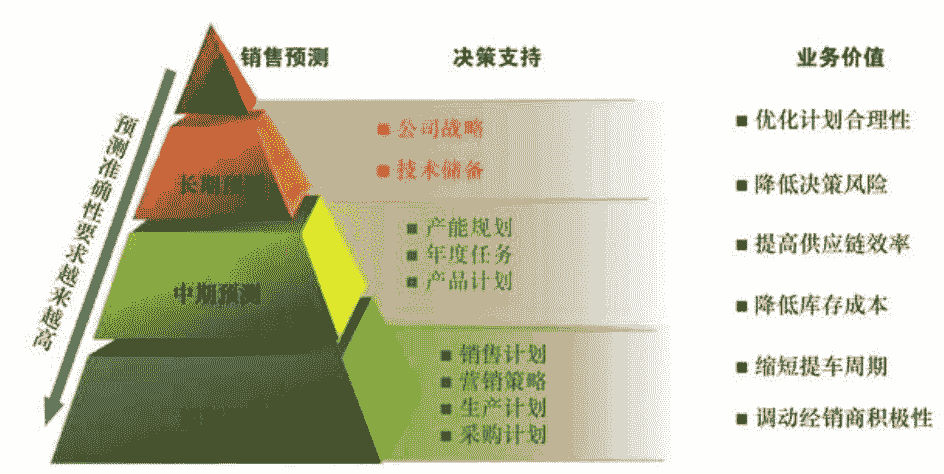
图4-1 销量预测的决策支持与业务价值

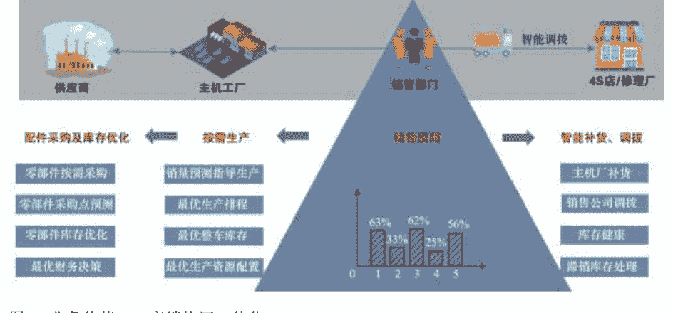
图4-7 业务价值二：产销协同一体化

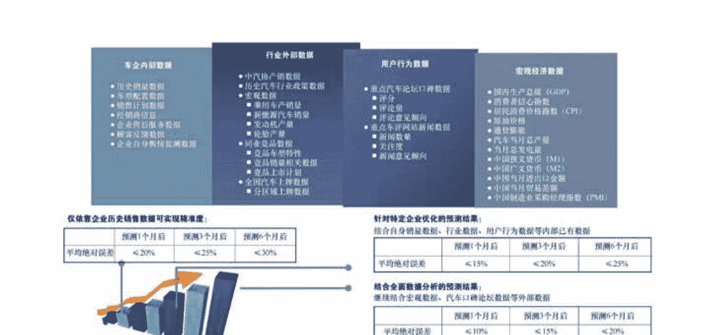
图4-4 基于机器学习技术的汽车销量效果

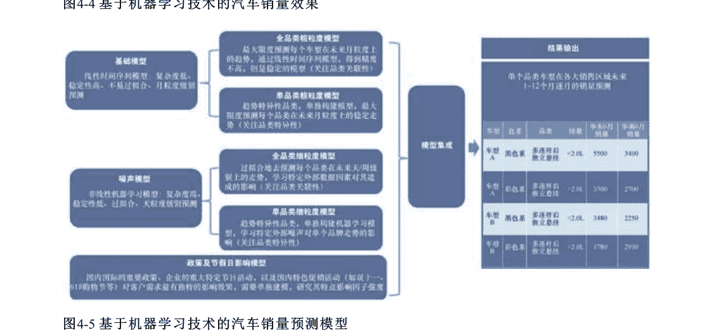
图4-5 基于机器学习技术的汽车销量预测模型
- 汽车整体市场分析
- 汽车区域市场分析
- 各车型销量分析
- 各车型特征分析
- 各车型用户群体分析
- 各车型需求量趋势分析
- 竞品车型销量与分布
- 竞品成交价分析

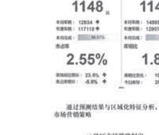
a) 地区市场策略制定

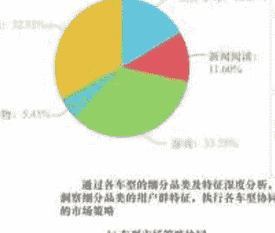
b) 车型市场策略协同

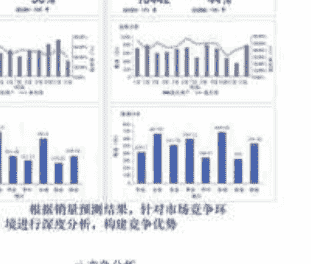
c) 竞争分析

# 图4-8 业务价值三：精准把握市场趋势

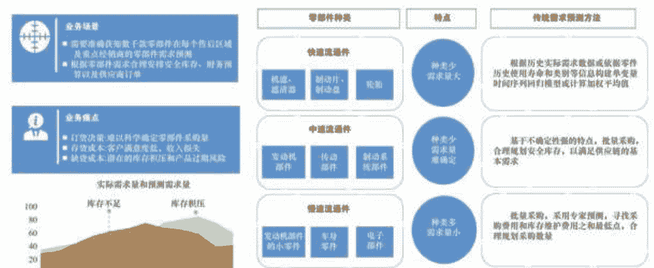
# 图4-9 售后备件的分类及传统需求预测方法

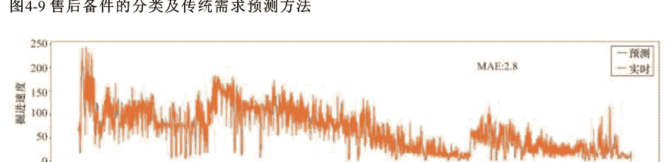
# 图4-12 某油井的实时钻井数据与模型预测数据对比

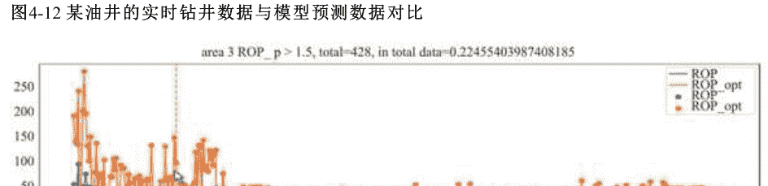
# 图4-13 某油田钻井参数的实时优化结果


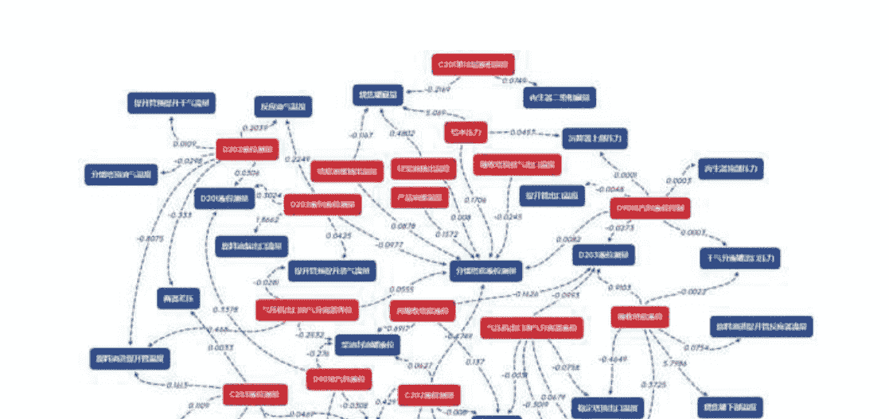
图4-17 部分催化裂化装置参数因果链路

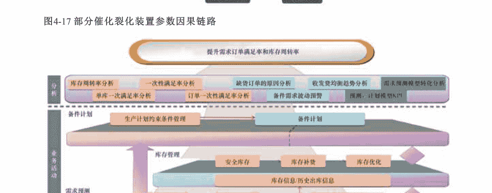
图6-1 项目整体架构

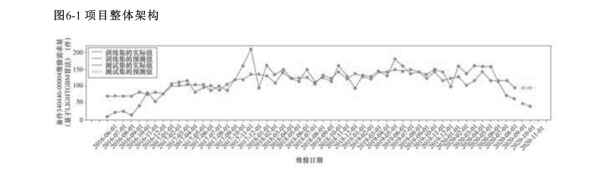
图6-6 基于LIGHTGBM 算法的备件（编号：340440-00004）维修需求量预测结果

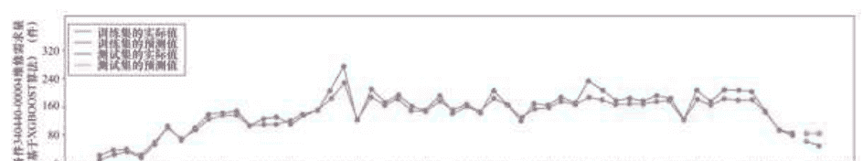
图6-7 基于XGBOOST算法的备件（编号：340440-00004）维修需求量预测结果

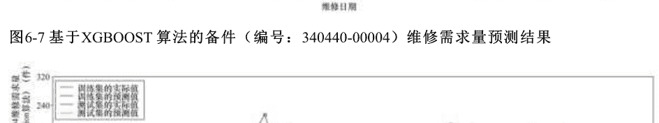
图6-8 基于LinearRegression算法的备件（编号：340440-00004）维修需求量预测结果

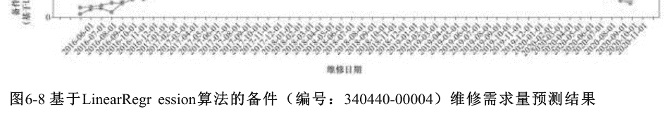
图6-9 基于ARIMA算法的备件（编号：340440-00004）维修需求量预测结果

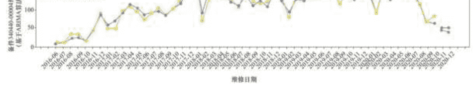
图6-10 基于硬件全生命周期衰变算法的备件（编号：340440-00004）维修需求量预测结果

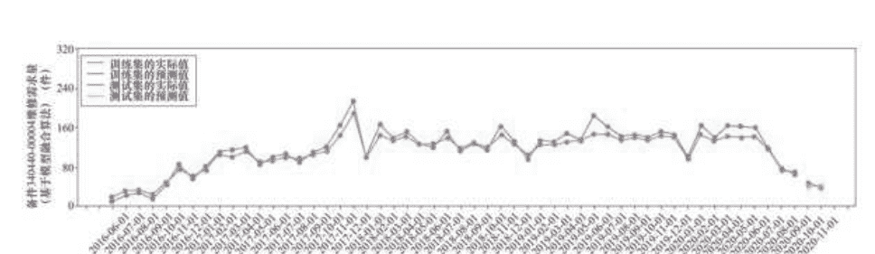
图6-11 基于模型融合算法的备件（编号：340440-00004）维修需求量预测结果

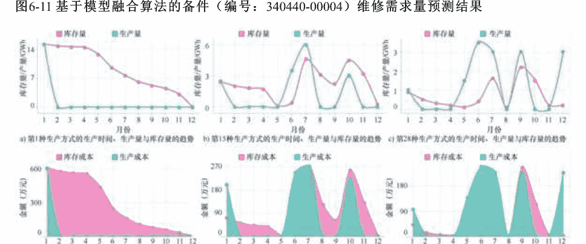
图6-13 订单满足率为98%时的3种备件生产计划

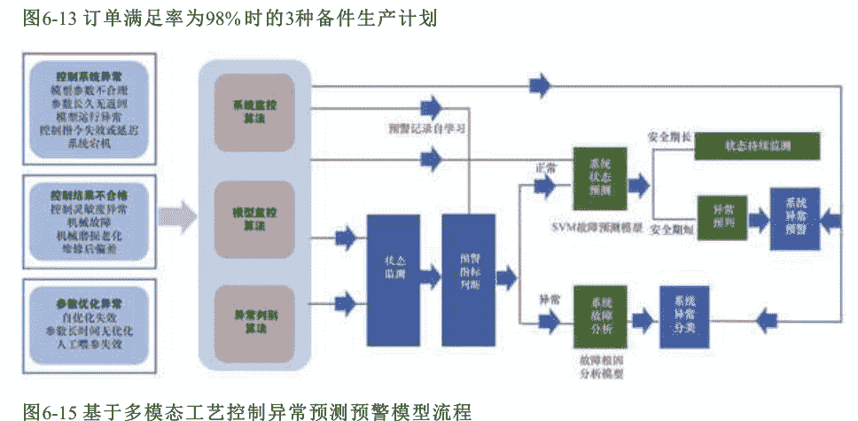
图6-15 基于多模态工艺控制异常预测预警模型流程

# 适产综合排名

| 排名 | 类型 | 规格 | 适纺能力评分 |
| :--- | :--- | :--- | :--- |
| 11 | FDY | 83DTEX/36F | 55 |
| 12 | FDY | 61DTEX/72F | 55 |
| 13 | FDY | 65DTEX/24F | 55 |
| 14 | POY | 125DTEX/48F | 54 |
| 15 | POY | 83DTEX/48F | 54 |
| 16 | FDY | 55DTEX/24F | 54 |
| 17 | POY | 136DTEX/36F | 54 |
| 18 | FDY | 67DTEX/24F | 53 |
| 19 | POY | 178DTEX/96F | 52 |
| 20 | FDY | 55DTEX/72F | 52 |

图6-26 各规格产品的适产产品排序

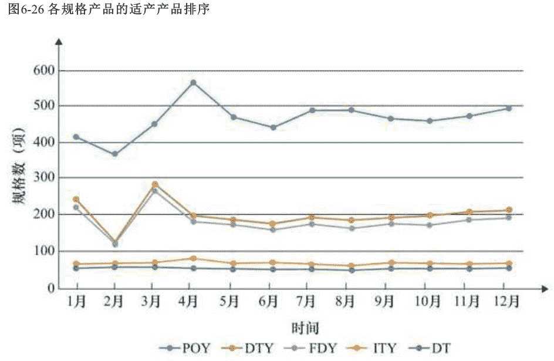
图6-23 2020年每月在售规格数统计

本书围绕人工智能在生产经营环节的落地实践展开，共分六章，依次介绍智能化应用的基础认知、价值挑战与演进方向、技术全景、多行业场景拆解、项目化实施路径以及典型案例。

全书为企业提供可直接复用的AI落地方法论，完整呈现从顶层设计到落地的关键环节，涵盖架构设计、数据治理、算法甄选、模型训练与验证等，并以大量实战案例传递可复制的方法论，帮助读者补齐构建智能化能力所需的技术与管理素养。

适合数据分析、机器学习、人工智能等技术岗位从业者，关注数字化转型与智能化落地的管理层与决策者，以及希望系统掌握智能化技术与场景的学生与实践者。

# 序言一

受邀为田野与张建伟合著的新作作序，深感荣幸。当下商业环境变化加速，智能化应用已成为组织保持增长与创新的核心驱动。本书依托丰富的项目沉淀与具体案例，清晰呈现了智能化在企业内部的价值空间与应用潜力。

田野长期致力于将智能化实践提炼为可迁移的知识体系，通过归纳共性难题与解法，形成可指导落地的工具集，降低跨行业、跨组织的适配成本。张建伟作为资深实战者，在智能化领域经验深厚，带领多家企业完成转型并取得显著成效。本书根植于二人的多年积累，对企业智能化真实场景具有较强示范意义。

作者以平实语言梳理了智能化推进的路径、常见难点与应对思路，系统论述其对组织的价值，有助于读者更科学地规划与管控项目，最大化技术红利。

本书突出实践导向与可操作性。作者精选多行业、多领域的代表案例，深入剖析策略制定、实施过程与效果评估，帮助读者把握智能化核心要素与关键节点。

对管理者、决策者及智能化领域专业人士均有参考价值。它梳理了前沿趋势与优秀实践，提供从立项到评估的全生命周期指引，也能激发创新思维，帮助组织整合内外要素，通过有效策略持续获取竞争优势。

祝本书取得佳绩，成为智能化领域的重要参考，助力读者在智能化时代稳步前行。

联想集团原高级副总裁、数据智能集团总裁 蓝烨

# 序言二

智能化应用正以更快更大的规模重塑组织运营与商业模式。技术演进带来机遇与挑战并存，欣喜于田野与张建伟愿意将多年企业智能化落地的经验系统梳理并分享，助力更多组织把握方向、实现突破。

本书提供全景式、体系化的实践指南，阐明智能化在组织中的核心概念、原理与方法。通过对各行业典型案例的深度剖析，展示智能化在生产、销售、客户服务、供应链等环节的关键作用，助力组织实现卓越绩效与可持续竞争优势。

本书凝聚了两位作者在不同行业多轮落地的经验，是兼具洞见与操作价值的指南。无论是高管、技术专家，还是市场、人力、财务等领域的专业人士，都能从中获得启发，了解智能化方案的重要性、掌握关键要素、学会用智能技术解决实际问题并创造商业价值。

期待本书能成为读者在智能化道路上的良师益友，在充满挑战与机遇的浪潮中助力开拓新商机、创造新价值，为建设更智能、高效、可持续的组织提供实用指导。

桐昆集团股份有限公司原副总裁 周军

# 前言

## 为什么要写这本书

在数字化时代，企业生产运营对智能化方案的需求日益迫切。将传统业务流程与人工智能技术深度融合，可推动流程数据化、自动化与智能化，为组织带来深刻变革与广阔机遇。但开发与落地也面临技术与管理双重挑战，需要系统化思考与解决。

作为长期深耕企业智能化建设与咨询的实践者，我与团队在项目中积累了大量方法与经验，对智能化在数字化建设中的重要性与价值有深刻体会。因此决定撰写此书，目标如下。

**经验输出：** 将多年沉淀的方法论与案例对外分享，帮助更多人理解与应用智能技术，提升核心竞争力，为寻求智能化落地的组织提供借鉴。

**推广认知：** 提升对智能技术价值的认知，推动更多组织认识其在降本增效、提质增稳方面的作用。

**产业贡献：** 为数字化转型与智能化方案产业发展贡献力量，推动数字经济向前迈进。

## 本书的主要内容

本书为组织提供实用指南，详解智能化方案开发与实施全流程，包括技术架构、数据管理、算法选择、模型训练与评估，并结合案例分享经验与方法论，帮助读者在实践中掌握关键技术与管理能力。

本书既涵盖传统数据智能技术，也探讨机器学习、深度学习、自然语言处理等前沿方向，并对AIGC、大模型、ChatGPT等新热点作出思考与解读，帮助读者把握技术演进脉络并应用于实际问题。

同时本书讨论智能化方案的优势与挑战，分析其在组织转型中的作用及落地注意事项，帮助读者更全面地认识发展趋势与应用场景，实现数字化转型与竞争力提升。

主要结构如下：

**第1章为智能化应用的概念，** 介绍基础概念与相关知识，为后续学习奠定基础。

**第2章为智能化应用的价值、挑战及发展趋势，** 整体梳理智能化技术并进行分类，为后续案例与技术实现做铺垫。

**第3章为智能化技术概述，** 提供必要背景，助读者理解智能化在各行业的实际运用。

**第4章为多行业智能化应用业务场景分析，** 围绕汽车、石油石化、化工、烟草、钢铁、通信等行业展开详细剖析。

**第5章为智能化应用的项目化实施，** 从工程视角结合实战案例，涵盖前期准备、可行性分析、团队组建、开发流程与集成等。

**第6章为智能化应用的实践案例，** 深度呈现五个重点行业的典型案例，解析建设步骤、方法与难点。

## 本书的价值创新

本书系统介绍了智能化应用的概念、演进、技术分类与应用场景，提供全面基础知识。

在价值、挑战与趋势章节，从技术深度融合、数据价值挖掘、跨行业应用等维度分析未来走向，具有强参考性。

通过汽车、石油石化、烟草、通信、零售、钢铁、化工等多行业案例，帮助读者理解实际应用价值。

在实施方法部分，详细阐述准备工作、实施流程、数据处理与分析方法，对拟开展智能化项目的组织与团队具指导意义。

在实践案例章节，以五大实战案例逐步拆解具体做法，让读者深入了解落地细节与流程。

## 本书适合的人群

- 数据分析、人工智能、机器学习等领域从业者
- 关注企业数字化转型与智能化应用的管理者与决策者
- 学习计算机科学、数据科学、人工智能等专业的学生
- 对智能化技术与场景感兴趣，希望深入了解的读者

## 致谢

本书成文离不开多方支持。感谢家人的鼓励与陪伴；感谢合作者张建伟在构思阶段的鼎力支持；感谢算法团队同事在研究中的协作；感谢责任编辑王斌的专业指导与建议。

田野
2023年6月28日

# 第1章 智能化应用的概念

智能化方案是数字化转型的重要着力点，其带来的经营效益日益显现。背后是前沿技术与理念的持续迭代。智能化方案不仅能助力组织实现高效智能运营，也能与产业融合，推动整个生态向智能化演进。

构建智能化方案首先要厘清概念与价值，明晰其与传统业务应用、数据分析应用、大数据应用的区别，才能判断组织是否需要、需要何种智能化方案。在此基础上，还需掌握分类与构成要素，并重视其与产业融合、与数字化转型的协同。本章深入探讨概念与作用，介绍分类与构成，并分析与产业融合及数字化转型的关系。

## 1.1 智能化的概念

### 1.1.1 什么是智能化

智能化是依托人工智能、物联网、云计算、大数据、自动化等现代信息技术，对信息进行采集、处理、分析与应用，实现生产、管理、服务等环节的智能化。核心在于运用先进信息技术对数据进行分析处理，驱动生产、管理、服务的智能化管理与优化，提升效率、降低成本、推动产业升级。具体可体现在：

**智能化生产：** 借助智能制造等技术，使生产流程自动化、数字化、网络化与智能化，提升效率与质量，降低成本。

**智能化管理：** 利用人工智能优化管理流程，实现智能化操作，提升决策效率、资源利用率与运营效率，推动精细化管理与创新。

**智能化服务：** 通过智能客服、智能营销等手段，实现服务自动化与个性化，提升客户满意度与忠诚度。

**智能化安全：** 依托智能安防等技术，实现风险预警与处置，保障企业与社会安全。

提到智能化，常会联想到智能工厂、智能城市、智能医疗等场景。智能工厂指借助智能化技术实现产线自动化与智能化；智能城市指借助信息化手段实现城市管理与服务智能化；智能医疗指借助信息化技术实现医疗服务智能化。

实现智能化依赖多种信息技术，核心是人工智能，包括机器学习、深度学习、自然语言处理等，使计算机能够从海量数据中学习、分析、预测并作出智能决策。物联网技术也是重要支撑，实现设备互联与信息共享。

### 1.1.2 企业为什么需要智能化

智能化浪潮：企业转型的核心驱动

智能化是信息技术与制造体系深度融合的产物，也是当下全球产业重塑的主线之一。现阶段，越来越多公司正加速推进智能化进程，尤其在工业场景里，智能制造、智能物流、智能仓储等话题已成为行业共识。得益于物联网的普及，智能化正向城市治理、医疗健康、教育服务等社会板块扩散。

为什么智能化会成为全球企业的优先选项？本质上它能带来可量化的商业回报：生产更顺畅、运营成本被压缩、管理更精细、产品品质更稳定。伴随人工智能、物联网等技术成熟，智能化的落地边界不断拓展，可适配差异化行业需求。可以说，拥抱智能化已是企业实现升级换代、巩固竞争壁垒的必答题。

从战略层面看，智能化是组织进化的关键路径。它让企业更敏捷地捕捉市场波动、更精准地响应客户诉求，推动企业从传统的生产导向型向智能服务导向型过渡，从而提升市场占有率与盈利能力。

从文化层面看，智能化催生了一种以科技为底座、以创新为动力的新型组织文化。企业必须强化创新思维与能力建设，倡导开放、协同、创新的价值取向，为数智化转型营造土壤。

智能化带来的直接收益主要体现在以下维度。

**提效增质：** 生产环节实现自动化与数字化，减少人工干预与失误，提升产出效率与产品一致性。

**降本增效：** 通过机器人替代、智能供应链调度等手段，降低生产与管理开支，库存占用随之下降。

**管理升级：** 多源数据被实时采集、分析与应用，决策依据更充分，管理效能随之提升。

**竞争力增强：** 品质、效率与管理水平的综合提升带来市场份额的扩张。

**促进跃迁：** 智能化是技术升级与产业升级的抓手，有助于开拓新业务与新市场。

除此之外，智能化能够补足传统信息化、数字化难以覆盖的短板。

**数据处理更快更强：** 大数据可在短时间内完成分析，使企业更快把握信息、支撑业务判断。

**生产能力更强：** 自动化产线、机器人制造等模式带来效率跃升，同时降低人力消耗、保障安全。

**管理能力更精：** 自动化物流、智能供应链、数字化营销等手段帮助优化链路、去库存、改善客户体验。

**响应需求更敏捷：** 智能客服、千人千面推荐等功能让个性化需求得到更快满足，提升满意度与粘性。

总体而言，智能化不仅提升品质与效率、压缩成本，更为企业打开新的成长空间与竞争优势。

### 1.1.3 企业如何实现智能化

智能化转型是一项长期复杂的系统工程，必须立足自身实际，从战略、文化、技术投入、组织调整、人才、落地应用等维度协同推进。

1）制定清晰的智能化战略。需全面盘点现况，结合行业动向与市场需求明确方向与目标，避免脱离实际。需审视现有业务，判断哪些环节可通过智能化获得效率与竞争力提升，并对产品与服务进行再定位，以发挥技术与数据优势。

2）推动文化重塑。文化是价值观与行为方式的集合。智能化要求新的思维与经营方式，企业需从领导力与文化建设入手，培养开放创新与协同协作氛围，提升员工数智意识与能力。

3）加大技术投入。需要软硬件、平台、分析工具与人才协同。按需配置高性能算力、服务器、嵌入式系统等，搭建以人工智能、机器学习、大数据为核心的平台，支撑智能制造、智能管理、智能服务。同时投入数据分析团队与工具，深挖存量数据获取洞察。

4）优化组织架构。组建专门团队或部门负责平台研发维护与应用整合，确保跨部门协同。智能化往往跨越多个业务单元，需建立跨部门协作机制，动态调整职能边界。

5）强化人才建设。建立培养与引进并重的机制。构建培训体系，覆盖技术基础、场景应用与案例研究，提升全员素养。引进具备数智背景的人才，通过成长机制激发积极性。鼓励跨部门项目合作，促进知识流动与创新。

6）做好数据治理。确保数据安全合规，保证质量与可信度。

7）加速应用落地。制定应用规划，明确目标、路径、技术选型、投入与人力安排。依据需求优化业务流程，提升质量与效率。用试点验证价值后再逐步推广。针对通用技术的局限，加强定制化技术研发。同时与硬件厂商、软件厂商、服务商等生态伙伴协同，构建完整数智生态。

转型中，企业需结合自身情况灵活调整，持续推进，实现可持续发展。

### 1.1.4 智能化与数字化的关系

数字化理念早已深入人心，众多企业已从中获益。那么两者有何关联？

二者概念不同但存在递进关系。

数字化是将业务流程、管理方式、数据等转化为数字形态，完成信息化与数据化的过程，使数据可被处理、传输、存储与分析，从而提升信息共享与使用效率。主要包括：

**流程数字化：** 将业务流程转为电子形态，提升透明度与效率。

**数据平台建设：** 搭建数据仓库、数据中心，实现集中管理与标准化，提升可靠度与价值。

**信息系统建设：** 部署ERP、CRM、OA等系统，实现信息集成与共享，提升管理效能。

**电商建设：** 利用互联网搭建交易平台，打通企业与客户、供应商的信息流物流，提升营销与服务能力。

智能化是在数字化之上，利用人工智能、大数据、物联网等技术，让系统具备自学习、自决策、自执行能力。它让企业更智能、高效、自动化，既是数字化的延伸，也是一种新的经营理念。

差异点在于：数字化侧重物理信息向数字形式的转换，依托计算机技术处理与利用数据；智能化则基于人工智能与机器学习，实现自动化与智能决策，强调理解与判断。

其次，数字化是智能化的基础，智能化是其深化升级。数字化奠基于信息化，智能化则在数字化之上更深度挖掘数据价值。

再次，数字化的目标是数据处理的高效与准确，智能化的目标是赋予机器类人智能，辅助人类决策与创造价值。

关联性同样紧密：数字化提供智能化所需的基础设施与数据供给；智能化依赖数字化在采集、处理、存储环节的技术支持。两者共同目标是提升效率、准确性与创新力。数字化把纸质信息转为电子形态，实现快速检索与流程优化；智能化在此基础上引入AI实现更自动化流程，从海量数据中挖掘洞察，支撑决策与创新。两者共同帮助企业在不确定市场中保持优势。

因此，智能化是数字化的升级与拓展，实现更高阶的自主与自动化，进一步强化效率与竞争力。

## 1.2 智能化应用：构建企业智能化生态的关键要素

业界对智能化应用尚未形成统一定义。通俗理解，它是指引入人工智能、大数据、云计算等技术，与企业管理与运营深度融合，形成面向业务痛点的多形态解决方案，提升运行效率。应用更贴近真实需求，使用更友好，开发与推广效率更高，可覆盖生产、物流、营销、服务等领域，解决传统业务瓶颈并增强竞争力。

理解智能化应用需厘清技术与落地场景。智能化技术是支撑，应用是面向具体痛点的解决方案。二者相互促进，只有结合才能真正赋能业务。

智能化应用通常具备以下特征。

- **数据驱动：** 以数据为核心，通过采集与分析驱动决策与预测。
- **自动化：** 利用机器学习与人工智能实现流程自动化，提升效率与准确度。
- **个性化：** 根据用户行为提供定制化产品与服务。
- **实时性：** 快速处理数据，实现实时反馈与响应。
- **安全性：** 面临大量数据与业务，需技术与管理双重保障。

应用场景包括。

- **制造：** 自动化产线、智能仓储等实现流程智能化。
- **物流：** 物联网与大数据支撑智能调度，提升效率与安全。
- **营销：** 大数据分析驱动精准触达。
- **客服：** 自然语言处理与语音识别实现智能服务。

价值体现在：挖掘数据资产价值；推动流程自动化与决策优化、提升品质；形成差异化竞争优势；改善用户体验。

因此，智能化应用既是数字化转型的关键手段，也是智能化落地的核心载体。

## 1.3 智能化应用的分类

分类维度多样，如按行业、功能、技术划分。但尚未统一，导致跨领域协作困难。

本书基于技术与业务协同提出分类框架。

### 1.3.1 数据分析型智能化应用

通过数据挖掘、机器学习等手段对企业数据进行分析，提炼信息，实现运营状态实时监控、预警与决策支持。帮助企业快速发现问题、调整策略，提升数据价值与决策质量。

主要功能：

- 快速分析业务数据，发现痛点与机会。
- 实时监控与预警，提前应对风险。
- 多维度分析结果支撑战略与运营决策。
- 优化流程，降低成本提升效益。

典型形态：数据看板与报表、智能预警与异常检测、客户行为分析与营销优化、财务分析与预测、生产数据分析与优化。

判断要点在于是否依赖分析技术、是否实现信息提炼、是否具备监控预警与决策支持能力，核心价值在于提升分析能力与运营效率。

### 1.3.2 决策支持型智能化应用

基于人工智能与大数据为决策提供辅助，实现决策智能化与自动化。核心在于将分析结果可视化，为管理层提供清晰洞察。

主要形式包括数据看板、报表、可视化场景、预测模型等，通过图表与模型为决策者提供基于数据的建议，提升决策效率与精度。

### 1.3.3 自动化型智能化应用

依托机器人、自动化控制、物联网等技术，实现业务与生产流程的自动化与智能化，提升效率并降低人力成本，可实现全天候高效运行。

代表应用有工业自动化控制、智能制造、智能交通、智能家居等。以工业自动化为例，通过PLC、传感器等实现产线智能控制与优化；在智能交通中，通过智能设备实时监控与调度，提升通畅度与安全。

自动化型应用可细分为：

**机器人流程自动化（Robotic Process Automation，RPA）：** 借助机器学习、自然语言处理与视觉识别，模拟人工操作完成规则性、重复性办公任务，实现流程自动化。

**AI 驱动的自动化升级**
依托深度学习、强化学习、推荐算法等人工智能手段，让复杂任务实现无人化运行。比如融合 AI 与运筹优化的智能排产系统、基于机器学习的工艺路线优化、自动驾驶方案、智能物流网络等，都是这一思路的落地形态。

**自适应自动化响应**
借助传感器、物联网与云计算，让生产过程具备环境感知与自主调节能力，从而动态提升效率与良率。典型案例就是卷烟企业的制丝线整线水分自适应控制系统。

自动化类智能化应用带来的核心价值主要体现在三方面。

**提效增能：** 自动化可以替代重复性、机械化的人工操作，节省人力与时间成本。
**提质稳产：** 机器执行标准稳定，减少人为疏漏，提升结果的一致性与准确度。
**降险护安：** 规避因人误操作带来的生产安全事故与质量失误。

需要厘清的是，自动化型智能化应用与数据分析型智能化应用存在交集，自动化落地必然涉及数据采集与分析。但前者的落脚点是“用智能技术把生产与业务流程自动化”，而非单纯的数据挖掘与洞察。

### 1.3.4 人机协作型智能化应用

人机协作型智能化应用的核心，是让人工智能与人的经验、判断形成合力，共同优化业务流程。系统能理解人的动作意图与环境变化，主动提供协助，从而把重复、高风险的工作交给机器，把高价值、创造性的工作留给人，实现效率与质量的双提升。

与全自动化不同，这类应用强调的是互动与协同，常见技术栈包括人工智能、机器学习、自然语言处理与机器视觉。

ChatGPT 就是典型的代表。它基于生成式人工智能 AIGC，利用大规模机器学习训练语言模型，实现类人文本理解与生成。通过自然语言交互，用户提出问题或指令后，模型即时响应，完成任务或提供答案，有效分担日常重复工作，让人聚焦战略与创意。由此可见其本质是人机协作的典范。

除此之外，这一类别还涵盖：

**语音交互类应用：** 依托语音技术实现自然对话，如智能音箱、语音助手等。
**机器人协作类应用：** 通过机器人实现人机配合，如工业协作机器人、家庭服务机器人等。
**增强现实类应用：** 将虚拟信息叠加至现实场景，增强感知，例如 AR 眼镜、AR 巡检、AR 游戏等。
**智能辅助决策类应用：** 借助机器学习对数据进行分析，为人工决策提供支撑，如医学影像辅助诊断、金融风控系统等。
**AIGC 类应用：** 以深度学习与 NLP 为基础的协同创作，如 AI 写作、AI 绘画、智能编程等。

归纳来看，人机协作型应用与自动化型应用路径相似，但前者必须依赖人与机器的结合来完成任务，后者则追求机器的独立自主运行。

## 1.4 智能化应用的构成要素

一个完整的智能化应用由四个相互促进的基础要素构成。数据基础是基石，关乎来源、质量、存储与处理能力；业务需求是原点，决定应用是否真的能解决问题；技术支撑是引擎，涵盖算法模型、视觉、语言、机器学习及软硬件架构；战略驱动是方向，涉及规划、管理与人才培养。四者共同形成闭环生态。

### 1.4.1 数据基础

数据是智能化应用运转的燃料。数据基础包括企业内部数据与外部第三方数据。随着数字化进程推进，数据规模呈爆发式增长，采集、整合、分析后即可为经营与客户洞察提供支撑。

智能化应用必须善用高质量数据，通过挖掘、学习与推理提取有效信息，助力精准决策与智能运营。但数据质量与可信度直接影响效果，因此必须做好质量管控与安全保障。

理想的数据基础应具备：
- **完整且准确：** 来源可靠，采集处理规范，避免因脏数据影响结果。
- **及时更新：** 实时或近实时的数据才能支撑快速决策。
- **安全可控：** 加密、防篡改、备份等机制保障隐私与合规。
- **可视易读：** 通过可视化呈现，让分析结论更直观，便于业务人员使用。

数字化转型的目标之一，是把企业数据结构化存储并开放调用。但数据本身不等同于智能化，真正关键的是能否提供高质量、结构化、可靠的数据，并配备相应的处理与分析能力。数据基础因此成为开发与运营的根基。

### 1.4.2 业务需求

业务需求是智能化应用的设计依据。它来自企业真实的流程、规则与痛点。业务在持续演进，智能化方案也必须随之迭代，才能保持落地价值。

首先，应用必须锚定具体业务场景，解决实际痛点。脱离业务需求的智能化只是空中楼阁。
其次，为什么要引入智能化？一方面企业数据量激增，人工分析已难以为继；另一方面机器学习、深度学习等技术成熟，能处理更复杂的业务问题；再者智能化不仅降本提效，还能通过预测分析提供更优决策，帮助企业赢得竞争。

总体而言，贴合业务需求的智能化应用才能创造可感知的效率与商业价值。

### 1.4.3 技术支撑

技术是智能化落地的保障。核心包括机器学习、深度学习、自然语言处理、计算机视觉等算法能力，以及云计算、物联网、区块链等基础设施，还包括分布式架构、服务化架构等系统设计与运维管理。

选型时应结合业务场景评估可行性、可扩展性与稳定性。例如边缘计算场景更看重实时低延迟，云端场景更看重高性能与弹性扩展。

科学的技术选型、合理架构与规范运维，才能保证应用高效、稳定、安全地持续运行，提升业务效率与用户体验。

### 1.4.4 战略驱动

智能化建设必须与企业战略同频。战略目标涵盖增长、效率、成本、客户满意度等，智能化正是实现这些目标的抓手。

智能化应嵌入企业数字化战略，成为转型的重要组成部分。落地时需从战略高度把握：
首先，明确业务目标与发展方向，让智能化成为战略落地的工具，如降本、提质、优化客户体验。
其次，设计清晰的商业模式与盈利路径，技术之外要考虑订阅、广告、数据服务等变现方式。
再次，制定市场推广与营销策略，匹配目标用户需求，通过品牌、投放、口碑等手段实现价值传递。
最后，保持持续优化与创新投入，响应市场与技术变化，维持竞争力与客户满意度。

只有在战略驱动下，智能化应用才能真正产生业务价值。

# 第2章 智能化应用的价值、挑战及发展趋势

随着智能技术渗透的加深，智能化应用已成为企业数字化转型的核心引擎。它为决策提供精准数据支撑，为营销降本增效，为招聘提速提质，为生产提效降耗并实现故障预测。

但同时，落地也面临挑战：数据规模与质量要求高、专业人才稀缺、敏感行业的数据隐私与安全难题、以及价值评估体系尚未成熟。

本章将系统梳理价值、挑战与未来走向。

## 2.1 智能化应用的价值

智能化应用本质是数据、算法、算力与人类智慧的融合，为企业带来效率、成本与创新的多重红利。下面聚焦三大核心价值。

### 2.1.1 提高效率

智能化首先改变工作方式，用自动化替代人工重复劳动。

#### 1. 自动化流程
AI 让大量流程可被自动执行，减少人力投入并提升精确性。生产线上的智能机器人可快速完成复杂作业，银行业务中对账、审核等重复任务也能自动完成，同时提升可追溯性与可重复性。

#### 2. 提高生产效率
通过自动化、数据分析与实时监控优化流程，减少浪费与瓶颈。例如自动化产线降低人工干预，数据分析定位瓶颈并给出改进建议，实时监控及时发现设备异常，避免停产损失。

#### 3. 优化资源分配
智能调度系统可根据生产计划与资源状况自动分配任务，避免资源闲置或过度使用。结合瓶颈识别与优化方案，企业能更精细地配置人力、设备与能源，进一步提升产出。

### 2.1.2 优化决策

智能化让决策从经验驱动转向数据驱动。

#### 1. 数据驱动的决策
通过海量数据分析，企业可洞察市场需求、用户偏好与供应链风险，制定更精准的销售与战略方案。生产中可依据实时运行数据动态调度，物流中可根据交通天气自动调整路线，实现更高效履约。

#### 2. 提高决策质量
智能系统能处理超大规模数据并给出预测反馈，降低主观偏见与人为失误，提升决策的客观性与可靠性，避免高成本的错误决策。

#### 3. 实时决策支持
实时采集与处理能力让企业在变化中快速响应。电商可依据用户行为实时推荐与定价，制造可据设备状态实时调整计划与质量控制，实现更敏捷的运营。

### 2.1.3 降低成本

智能化应用的第三大价值是降本增效。通过自动化、资源优化与效率提升，减少人力与物资浪费，降低运营开支，提升整体盈利能力。

# 智能化降本增效与用户体验双升级

智能化正在成为企业压缩成本的利器。机器人承接重复性操作后，人力开销和出错率同步下降，生产效率与品质也随之提升。由人工智能驱动的自动化流程，可以在保证品质的前提下实现更精细的成本管控，比如借助精准的需求预测避免物资积压。

在供应链和物流端，智能化同样价值明显。通过智能手段对采购、库存、配送等环节进行优化，企业能把支出压到更低，同时让整条链条更高效、更可靠。

#### 1. 控制人力支出
重复性事务交由自动化系统完成，人力就不会被耗在低价值环节。智能化还能重新梳理资源配置，让现有团队各司其职、发挥最大效能。用更少的人实现更高的产出，人力成本自然被拉低。

#### 2. 压缩生产开销
智能化帮助生产流程找到最优配置方式，让资源得到最高效利用，从而提升效率、降低开支。例如智能制造的产线可通过智能控制与调度实现动态优化与调整，直接减少生产成本。

自动化流程本身也能省钱。智能化仓储里，自动化物流系统替代人工搬运与分拣，减少了人力投入和物流损耗。

#### 3. 节约物流费用
智能物流系统依托实时数据和分析模型做路线优化，选择更优线路与运输方式，减少车辆空驶，从而节省费用。同时，减少人工干预和操作失误，提高自动化水平与准确性，进一步压低物流成本。物流费用的下降，也能直接提升企业的市场竞争力与份额。

#### 4. 削减能源消耗
在能源生产与输送环节，智能化可监测并优化使用情况，减少浪费，提升利用效率。在消费端，智能系统能监测并控制设备运行，避免不必要耗能，比如自动控制照明、空调等，防止过度使用。借助智能传感器采集实时能耗数据，企业可实现更精准的能耗预测与调节，进一步提升效率、降低能源成本。

### 2.1.4 用户体验的提质
智能化带来的另一大价值是体验升级。传统业务流程依赖人工，容易出现失误、延迟与不便，影响用户满意度。智能化通过自动化、实时数据与决策优化，能够显著改善使用感受，提升满意度与忠诚度。

#### 1. 个性化服务升级
以智能客服为例，传统人工接听效率低、等待时间长。智能客服借助语音识别、自然语言处理实现自动应答，并通过分析客户的语音与文本快速定位问题，给出精准方案，大幅缩短等待、提升服务效率。

智能推荐系统也是一例。传统推荐多依赖历史行为或基础信息，难以精细。智能推荐通过分析行为、偏好与需求等多维度数据，实现更精准的个性化推送，让用户获得更匹配的产品与服务。

#### 2. 提升客户满意度
智能化能以更智能的方式增强满意度和忠诚度。一方面实时监测行为、偏好与反馈，提供个性化服务与推荐；另一方面借助自动化流程减少人为干预，提高服务质量与效率，降低等待时间与成本；同时通过智能反馈与预测分析，及时发现并解决用户问题，增强粘性。

当企业能更懂用户需求与偏好时，就能提供更具定制化的服务。收集与分析客户数据来确定需求，再匹配定制化产品与服务，是提升满意度的关键。自动化与在线服务也优化体验，例如24小时在线客服、机器人自动解答常见问题，都能增强满意度与忠诚度，推动企业发展。

#### 3. 交互体验打磨
智能化能以更智能的手段优化人与应用的交互。例如智能语音助手，用户通过语音指令完成操作，无需手动干预，既省时又减少误操作，体验更流畅。自然语言处理与机器学习还能更好地理解意图，提供更个性化的服务，如智能推荐系统依据历史浏览、搜索关键词、购买行为推送匹配内容，提升满意度与忠诚度。

通过语音识别、自然语言处理等便捷交互方式，用户无需繁琐的指令输入或表单填写即可完成操作。个性化推荐与智能搜索进一步满足需求，提升体验。以智能音箱为例，语音即可查询天气、播放音乐、控制家电，系统还能通过语音识别与自然语言处理分析需求，提供个性化推荐，显著提升使用体验与客户满意度。

### 2.1.5 竞争力的增强
智能化是提升竞争力的核心抓手，能帮助企业更灵活地应对市场变化、提高效率、改善客户体验，从而占据优势。

#### 1. 产品品质提升
质量监测与反馈机制让企业能实时监控产品质量，及时发现并处理问题，避免不合格品流入市场。收集与分析质量数据，有助于把握整体质量情况、溯源问题根源，从而优化设计与生产工艺，提升品质与性能。产品质量提升能增强客户忠诚度与口碑，扩大销量与份额，优秀的产品还能提升企业声誉与品牌价值。

#### 2. 品牌声量扩大
智能化不仅通过产品与体验增强竞争力，也能提升品牌知名度。随着社交媒体与移动技术普及，企业需要在各渠道传递一致的品牌形象。智能化通过更好的用户体验与个性化服务吸引消费者，提升品牌认知。例如智能营销平台通过用户数据分析推荐更符合兴趣的产品，提高购买率与满意度，同时增加品牌曝光。自动化营销还能加快市场反应速度，迅速抓住变化与客户需求，增强竞争力。

#### 3. 营销费用优化
传统营销投入大、难以实现精准触达。智能化借助数据分析、个性化推荐、智能客服等实现精准营销，降低成本、提升效果。如智能广告投放可依据兴趣、行为、地理位置等定向投放，提高点击率与转化率。智能客服通过聊天机器人实现自动化服务，降低客服成本，同时提升满意度与忠诚度，这些都能在竞争中带来更大优势。

## 2.2 智能化应用面临的挑战
企业落地智能化虽能带来诸多机会，但也面临技术、安全与管理层面的挑战，如数据安全与隐私保护、技术成熟度与失控风险、误判与不当应用等。因此需要审慎评估并采取措施降低风险。以下从数据质量、算法不可解释、数据隐私、数据安全风险四个维度展开。

### 2.2.1 数据质量
智能化成败很大程度上取决于数据的准确、可靠、完整与相关性。数据易出现采集处理失准、不完整缺失、不一致不可靠等问题，进而导致错误结果与不当决策。

#### 1. 数据采集处理失准
若数据本身不准，分析与预测自然失真，影响决策效果。不准确的原因包括数据源不可靠、采集不完整、处理环节出错等。

解决路径是建立数据质量管控体系。制定严格的采集与处理流程，保障准确性、完整性与一致性。采集阶段可引入物联网传感器、人工智能视觉识别等更高效技术；处理阶段可使用机器学习、深度学习等算法提升精度。同时建立质量监控与反馈机制，及时发现并纠偏。

#### 2. 数据缺失与不完整
采集与处理过程中常出现缺失、错误、不准确的情况，造成数据不完整，影响预测与决策的可靠性与准确性。

应对方式包括更精细的采集处理流程与更先进的分析建模方法，如用机器学习算法填补缺失值，或用数据清洗剔除错误记录。数据共享时也要兼顾完整性与隐私保护，确保数据可用且安全。

#### 3. 数据冲突与不可靠
现实中数据来源多样，格式、定义与结构可能不一致，造成冲突与矛盾，降低应用准确性。数据本身也可能存在偏差，影响决策。

企业需采用高质量的数据管理方法，如数据清洗、验证、整合与质量评估，并制定数据质量控制标准与流程，定期更新维护，以确保一致性与准确性，提升应用的可靠性与商业价值。

### 2.2.2 算法不可解释
智能化常用的算法多由机器学习或深度学习构建，结构复杂，常被称作“黑箱”，内部运作难以解释，带来挑战。

#### 1. 黑盒模型的透明度缺失
黑盒算法只展示输入输出，过程不透明，用户难以理解、验证与信任结果。以图像识别为例，算法能识别物体、场景、人物，却难以解释识别逻辑，导致错误分类原因不明、改进困难；也可能出现种族或性别偏见；若处理数据含敏感信息，还会引发隐私问题。

对企业而言，决策过程不透明易导致误判风险；生产中如机器人由黑盒控制，出现异常操作难以快速排查修复；同时会影响声誉与信任度。应对方式是选用白盒算法，或借助解释器、可视化工具揭示黑盒决策过程，并加强数据质量管理，降低误判风险。

#### 2. 可解释性分析方法
技术层面可通过可解释性分析提升模型透明度。特征重要性分析通过计算各特征对预测结果的影响，识别关键驱动因素。局部可解释性分析 LIME 则构建局部线性模型解释单个实例的预测原因，帮助理解模型在特定情境下的行为，提升可解释性，便于决策与优化。

### 2.2.3 数据隐私
智能化涉及大量数据，常包含姓名、地址、电话、支付信息等个人隐私，一旦泄露损失巨大；同时或涉商业机密与专利，泄露将带来严重后果。

#### 1. 泄露与滥用隐患
数据泄露指未经授权公开或泄露给非法主体，如黑客攻击、系统漏洞；数据滥用指将数据用于未经授权目的，如广告投放或售卖第三方。

这些风险会削弱用户对个人数据的掌控，降低对智能应用的信任；还可能导致身份盗窃、财务损失等安全问题，损害企业声誉。应对需要技术手段与策略配合，如加密、访问控制与隐私保护法规。开发者与管理者需遵守相关法规，加强数据管理与监督，提升安全与可信度，增强用户使用意愿。

#### 2. 隐私保护技术清单
数据隐私保护贯穿采集、存储、处理、传输与使用全生命周期。常见技术包括：加密确保只有授权方可解密；匿名化通过去标识、扰动隐藏敏感信息；脱敏去除或替换敏感字段；访问控制结合身份验证与权限管理限制访问；安全计算如安全多方计算、同态加密保护计算隐私；数据备份与恢复应对安全事件；数据生命周期管理覆盖全流程管控；法律合规要求及时更新隐私政策、履行披露义务并加强安全管理。

### 2.2.4 数据安全风险
智能化在处理与存储敏感数据时面临多重威胁，可能导致泄露、系统瘫痪、业务中断，损害声誉与信誉。

#### 1. 威胁来源盘点
外部攻击：黑客攻击、网络钓鱼、恶意软件窃取机密数据。内部威胁：员工、合作伙伴、供应商滥用权限或无意泄露。数据篡改：导致应用输出不准确，影响决策。拒绝服务攻击 DoS：通过大量请求占用带宽与资源，导致服务不可用。数据窃取：未经授权获取机密信息，泄露商业机密。社交工程：通过欺骗获取敏感信息，破坏安全性。

#### 2. 安全防护对策
可通过访问控制限制敏感数据访问权限，降低泄露风险；加密将数据转为不可读形式，保护机密性；安全审计帮助发现未授权访问等事件，及时响应；安全培训提升员工意识，减少内部威胁；安全监测实现实时检测与预警，快速处置网络安全事件。

## 2.3 智能化应用的发展趋势

智能时代的下一站

技术创新正掀起一波智能浪潮，渗透面越来越广、深入程度也在持续加深。人与机器的沟通正变得更直观、更聪明、更易普及。借助 AI 和海量数据分析，各种智能设备和软件通过网络连成整体，正在让智能方案变成日常生活的智能副脑，提供省心、高效、更体贴的体验。下一步推进中，安全和隐私会变得更为关键。同时在低碳可持续的思路下，智能方案会和环保节能更紧密结合，孵化更多节能环保类产品和服务，实现智能与可持续的统一。

### 2.3.1 技术深度融合
随着 AI、海量数据等不断成熟，智能场景的迭代节奏在加快，算力、通信、传感等技术要素彼此交错，不同应用场景也在互相渗透。所谓深度整合，就是在保留各技术专长的同时，通过联动协同实现整体效能提升。

深度整合的意义在于突破单一技术难以达到的效果。融合让彼此的短板被补齐，协同效应被放大，最终产生更高效、更聪明、更安全、更可靠的应用表现。

#### 1. 计算机视觉与人工智能的融合
视觉计算和机器智能是目前最广的智能技术，两者联动将成为关键方向。融合后能自动解析图像视频，涵盖识别、场景解读、目标追踪、行为分析等能力。未来在医疗、出行、安防、家居等场景，这类融合将提供更精准、高效的智能服务，并推动人机交互走向更丰富、更自然。

#### 2. 传感技术与云计算的融合
传感和云端计算是万物互联落地的两大支柱，两者深度结合有助于实现端到端的智能化管理与服务。传感端负责物理量的实时监测与采集，云端负责海量数据的分析与处理。融合后可实现大规模设备的集中管控，进而在智慧制造、智能交通、智能能源等领域实现高效管理与智能调度。

#### 3. 物联网技术与5G的融合
万物互联实现多设备互联互通，5G提供高速、低时延的网络连接，两者缺一不可。深度融合后，将为智能出行、智能医疗、智能家居、智慧城市等提供更丰富、更快速、更稳定的智能化服务体验。

#### 4. 语音技术与自然语言处理的融合
在未来应用中，语音识别和语言理解将成为核心支撑。语音负责自然的人机交互，语言理解负责语义解析。深度融合后可实现多语种、多方言的自然语言理解，为用户提供更自然、高效的语音交互体验。

### 2.3.2 数据价值挖掘

#### 1. 多源数据的整合
未来数据价值挖掘的视角将从单源转向多源。整合来自不同部门、不同业务线的数据，成为释放价值的关键一步。多元数据融合能提供更立体的信息，帮助企业洞察客户需求、做出更精准判断。

#### 2. 智能化技术的普及
随着智能技术在各行业落地，企业对其价值的认可度不断提升。未来应用会更普遍，其中自适应学习因擅长自主推理与决策，深度神经网络学习因能用神经网络自动处理海量数据而备受青睐。借助这些技术，企业可实现数据自动化分类与模型持续优化，提升价值萃取效率，从中发现规律与模式。

#### 3. 自动化数据治理
数据体量激增使得整合与治理成为价值挖掘的核心环节。数据治理本质是把不同来源、不同类型的数据汇聚起来并确保其质量安全。传统做法以业务驱动、依赖行业经验，分阶段项目推进，周期长、效率低，往往是出了问题才补救。未来治理将走向自动化：借助自动化工具，机器可自主发现数据问题、自主制定标准与流程、自主完成整合治理，高效支撑价值挖掘。

总体来看，未来数据价值挖掘将聚焦多源整合、智能技术应用和自动化治理。企业可结合行业诉求与技术走向，挑选合适的方案与服务，从而提升数据价值与核心竞争力。

### 2.3.3 跨行业应用
跨界应用就是借助智能技术，把某行业优势和另一行业需求结合，形成跨界智能方案。它既能优化内部流程，也能开拓新市场，增强竞争力。随着 AI、海量数据、万物互联的普及，行业边界日益模糊，跨界融合已成为智能化发展的重要方向。

#### 1. 智能制造与智慧物流的结合
智慧制造依托智能技术贯穿生产全流程，提升效率、压缩成本；智慧物流则借助万物互联、云端计算、海量数据打通物流全链路，提升时效并降本。未来两者将深度联动，形成上下游协同，提升全产业链效率与盈利空间。融合后生产与物流实现无缝衔接，透明度、品质与效率同步提升。实时物流数据接入智能生产系统，可缩短交付周期、降低制造成本。例如，精准的物流排期与运单追踪信息，能让生产计划更灵活、高效。

#### 2. 智能交通与城市智能化的结合
智能交通利用现代信息技术对运输领域进行改造，提升效率、优化流动与安全。城市智能化则是通过信息技术实现公共服务、城市管理与生态环境的智能化。两者结合可形成智慧城市交通，缓解拥堵、事故与污染，实现运输系统与公共服务的协同智能。例如，城市交通监控可实时采集分析数据，制定车流调节、拥堵疏导等策略，优化运营并提升居民出行体验。

#### 3. 智能医疗与保险业的结合
智能医疗与保险联动有助于提升服务质量与效率。通过和保险公司合作，智能医疗系统可为患者提供更及时的个性化诊疗与保险服务。同时保险公司可基于系统数据评估风险、优化定价，降低成本并提升客户满意度。

在实际落地中，智能技术往往需要和现有系统融合，实现跨界应用。因此跨界应用需要标准规范的支撑，也依赖相关产业间的协作与合作。

# 第3章 智能化技术概述
智能技术是近几年信息技术领域持续涌现的新力量，构成了数字经济的重要支柱，也是智能应用落地的核心驱动。它整合 AI、海量数据、云端计算、万物互联等手段，让计算机系统具备智能处理能力，从而催生更高级的应用。当前其覆盖面极广，从智能影像、自动驾驶、语音助手、智能音箱到智能家居，都因其突出表现而备受瞩目。

## 3.1 智能化技术的概念和发展历程

### 3.1.1 智能化技术的概念
智能技术是指运用数据挖掘、自适应学习、深度神经网络学习、语言理解、视觉计算等 AI 方法，结合云端计算、海量数据、万物互联等手段，对现实问题建模，从海量数据中抽取信息与知识并进行推理，从而让系统或设备实现智能化改造，具备自主感知、自主决策与自主执行能力。其目标在于实现人机智能交互，提升效率、降本增效，提供更便捷优质的服务并解决实际问题。

### 3.1.2 智能化技术的发展历程
智能技术的萌芽可追溯至20世纪，随着信息、计算机与通信技术的高速发展，其应用价值逐步显现。

20世纪50年代，机器智能概念诞生。1956年相关会议的召开标志着该领域正式起步。此后 AI 逐渐成为计算机科学的重要分支，早期研究聚焦于模仿人类认知与推理，通过计算机模拟感知、思考与行动，实现类人智能行为，核心在于将人类智力知识化并形式化表达。

20世纪60年代，机器智能向更具实践意义的方向转向，如机器翻译、语音与视觉信息处理、具备自主学习推理能力系统等。同期出现基于规则推理、知识推理与专家系统开发、自适应学习等新趋势。

20世纪70年代，专家系统成为主流分支，通过把专家经验转化为程序实现智能决策。同时神经网络技术开始发展，模拟人类神经系统实现类学习过程。

20世纪80年代，自适应学习与数据挖掘成为重要分支。自适应学习利用算法与模型对大量数据集进行自动化分类、预测与决策；数据挖掘致力于从海量数据中发现潜在知识与模式，辅助决策。

20世纪90年代，随着互联网普及与数字化到来，智能技术应用面更广。搜索引擎、语音识别、图像识别等成为重要组成部分，同时涌现基于规则推理、统计语言理解、遗传算法、模糊逻辑等新技术。

21世纪以来，硬件与云端计算飞速发展，智能家居、自动驾驶、医疗健康、智慧制造等场景大规模应用。深度学习崛起，通过模拟神经网络结构与功能，实现更高效更准确的模式识别与决策。

过去数十年，智能技术经历了起步、成熟到高速发展的历程。机器学习、专家系统、语言理解、深度学习、云端计算与万物互联等构成里程碑式进展，持续推动机器智能快速发展。未来其应用领域与深度将进一步扩展，持续促进社会进步。

## 3.2 智能化技术的分类
依据不同维度，智能技术可按任务类型、技术类型、应用领域、发展阶段等进行划分。

按任务类型可分为智能控制，如智能家居控制、智能工厂控制、智能建筑控制；智能感知，如视觉计算、声音识别、语言理解、传感器技术；智能决策，如基于规则、基于统计、基于自适应学习的决策；智能推荐，如个性化推荐、内容推荐、广告推荐；智能搜索，如文本、图像、视频搜索；智能生成，如自动生成音乐、图像、视频、文本；智能对话，如语音助手、聊天机器人、智能客服等。不同应用场景下还衍生出路况识别、车道识别、交通信号识别等细分任务，均是人机交互、自主决策与自主执行的关键。

按技术类型可分为机器智能技术，包括自适应学习、深度神经网络学习、试错学习、语言理解、视觉计算等；区块链技术，包括去中心化存储、智能合约、数字身份认证等；机器人技术，包括控制、运动规划、人机交互等；传感器技术，包括光学、声学、压力、温度等。还涉及云端计算、海量数据、万物互联、边缘计算等支撑技术，新兴的生成式智能与大模型技术也在其中快速成长。

按应用领域可分为制造业智能化，如工业机器人、自动化产线、智能物流；交通运输智能化，如智能驾驶、智能交通管理、智能公共交通；健康医疗智能化，如智能医疗设备、健康管理系统、医疗机器人；金融智能化，如智能风控、智能投资分析、智能客服；教育智能化，如智能教育平台、智能辅导、智能评估；农业智能化，如智能农机、智能温室、智能养殖；建筑智能化，如智能建筑控制、智能安防监控等。环境保护、能源管理、文化娱乐等领域也在被深刻重塑。

按发展阶段可分为原型阶段，技术仍在研发尚未大规模应用；成熟阶段，技术已在实际中验证并产生商业成果；发展阶段，技术趋于成熟并持续创新以满足新需求；创新阶段，技术已成熟但仍有较大突破空间；转化阶段，技术已广泛应用并需进一步转化为商业与社会价值。还可按发展速度、应用领域、技术特征等做进一步细分。

本节重点介绍技术类型中的机器智能技术。

### 3.2.1 人工智能技术
机器智能是指用计算机技术实现类似人类智能的理论、方法、技术和应用系统。核心是研究人类智能本质与实现路径，主要包括自适应学习、深度学习、语言理解、知识表示与推理、视觉计算等。过去十年，得益于算力与数据爆发，这些技术快速发展，使机器在特定领域展现出超越人类的能力。

机器智能应用广泛，覆盖智能家居、智能安防、智能交通、智能医疗、智慧城市、智慧制造等。随着技术进步，更多场景将实现自主化、智能化。

常见算法包括自适应学习、深度学习、试错学习、语言理解、视觉计算、进化类算法、大模型技术等，构成机器智能系统的核心能力。

#### 1. 机器学习
机器学习是机器智能的重要分支，旨在让计算机具备类学习能力。算法通过分析数据发现规律，使计算机能从输入中自动提取特征并进行预测或决策。其基本思路是基于大量数据学习模式，从而在新数据上做出判断。

按数据类型分为监督学习、非监督学习与半监督学习。监督学习利用已标注数据训练并进行预测分类，常见算法有决策树、支持向量机、逻辑回归等。非监督学习在未标注数据中发现模式与结构，如聚类、降维。半监督学习结合少量标注数据与大量未标注数据进行训练。

机器学习广泛应用于语言理解、视觉计算、语音识别、推荐系统、金融风险管理等领域，为数据分析与预测提供有效工具。

#### 2. 深度学习
深度学习模拟人脑神经元交互，通过多层神经网络实现复杂模式的学习与理解。与传统机器学习相比，其自适应能力与精度更高。数据经多层隐藏层计算，每层神经元接收前层输出并与可学习权重组合后传向下一层。通过反向传播算法自动调整权重，实现分类、回归、聚类等任务。

深度学习已广泛用于图像识别、语音识别、语言理解、推荐系统、智能游戏等领域，其发展持续拓展智能化应用边界。

#### 3. 强化学习
强化学习是一种试错式学习，机器通过不断尝试不同行动并依据环境反馈即奖励来调整策略，目标是最大化累计奖励。其过程可形式化为马尔可夫决策过程。深度强化学习结合深度学习与强化学习，能处理更复杂任务与更大规模数据。

#### 4. 自然语言处理
自然语言处理是将人类语言转化为计算机可处理形式的技术，涵盖词法分析、语法分析、语义分析。词法分析把文本分解为单词、标点等基本单元；语法分析解析句子结构；语义分析理解文本含义，包括命名实体识别、情感分析等。

#### 5. 计算机视觉
计算机视觉通过图像处理与视觉模型实现图像的识别、分析、理解与处理，主要包括图像分类、目标检测、图像分割、物体跟踪。图像分类为图像标注分类；目标检测在图像中定位并识别目标；图像分割将图像分解为多个区域实现精细分析；物体跟踪在视频中追踪目标位置与运动。

#### 6. 进化类算法
进化类算法基于生物进化原理进行优化，通过模拟自然选择、遗传变异等过程寻找最优解。可处理单目标、多目标、约束优化等问题。典型代表是遗传算法，通过交叉、变异产生新个体并依据适应度筛选，逼近最优解。

#### 7. 大模型技术

大模型技术的核心在于借助特殊的神经网络架构完成训练与调优。依托海量算力对深度神经网络进行大规模训练，模型参数规模可从数十亿扩展到数百亿量级。其突出特点是拟合能力更强、判断精度更高，能够胜任更为复杂的业务场景。

不过，高算力消耗与漫长的训练周期始终是痛点，同时过拟合风险也较为明显。落地时需要提前规划算力资源，并配合合适的正则化方法与优化算法来控制过拟合。

目前，大模型已深度渗透计算机视觉、自然语言处理、推荐系统、语音识别等领域，在图像分类、目标检测、机器翻译、情感分析等典型任务上取得优异表现。随着深度学习持续演进、算力不断提升，大模型未来将在更多行业出现并推动新一轮技术革命，期待其尽快在各行业实现高价值应用。

### 3.2.2 区块链：可信的去中心化协作网络
区块链是基于密码学与分布式系统构建的新型技术，用于搭建去中心化、可信、安全的信息交换平台。其基本思路是把多个数据区块经加密算法串联成一条不可篡改的链，实现数据的分布式存储与共享。

从技术层面看，区块链是一种去中心化的分布式账本，采用加密方式将区块链接成链，每个区块都记录了前一个区块的哈希值，形成难以篡改的结构。去除中心化中介后，交易双方可直接达成信任交易，同时兼顾安全与匿名。

每个区块内包含若干笔交易记录，需经过多节点验证与确认后才能写入。一旦上链，数据就无法修改或删除，从而保障完整性与不可篡改性。凭借去中心化特征，区块链已在货币支付、物联网、供应链管理、知识产权保护等领域得到探索。

### 3.2.3 机器人技术：替代与协作的智能装备
机器人技术融合仿生学、控制工程、电子技术等多学科成果，研发并制造具备自主能力的机器人。机器人是能够执行任务、替代人类完成系列工作的智能机械设备。

分类维度多样：按应用领域可分为工业机器人、服务机器人、医疗机器人、农业机器人等；按形态结构可分为人形机器人、车载机器人、无人机等；按控制方式可分为自主机器人与远程操控机器人；按功能可分为定位导航、抓取搬运、视觉识别等类型。

价值体现在多方面：可承担危险、重复、繁琐工作，提升生产效率与质量；在深海探测、核辐射等危险环境中替代人工；医疗场景可辅助手术与康复护理；服务业中已有导购、清洁等机器人应用。未来在交通运输、农业生产、智能家居等领域仍有广阔空间。总体看，机器人技术能提高效率、降低成本、增强生产力并改善生活质量，已成为现代科技的重要组成并将持续发挥作用。

### 3.2.4 传感器技术：连接物理与数字的桥梁
传感器技术是智能化体系的关键基础。利用物理、化学或生物原理，将环境中的各类信号或物理量转化为可测电信号。传感器可感知温度、压力、湿度、光线、声音、运动、化学物质等参数，并输出数字或模拟信号供后续处理与决策。自身并无复杂智能，但在实时感知与信息采集上不可或缺。

分类方式丰富：按测量参数分有温度、压力、湿度、光学、声音、加速度、化学等传感器；按原理分有电阻式、电容式、电感式、光电、磁性等；按输出形式分有模拟与数字传感器；按应用领域分有工业、汽车、生物医学、环境等传感器。

应用价值广泛：为工业过程提供实时准确测量数据，助力监测与控制，提升效率与质量；在汽车领域服务于安全、环境监测与自动驾驶；在医疗、农业、环保领域用于健康监测、作物生长监测、水质监测等。发展成熟的传感器技术将为物联网、智慧城市、工业4.0等提供更多智能化方案与数据支撑，实现更智能、安全、高效的系统与设备。

### 3.2.5 云计算：弹性供给的算力服务
云计算是一种依托互联网的计算模式，将海量计算资源集中于数据中心，通过网络按需供给用户。用户可远程访问数据与应用，利用远程算力进行处理分析。典型服务形态为IaaS、PaaS、SaaS三大模型。

其底层依赖虚拟化将物理资源抽象为虚拟资源，实现灵活分配；借助自动化管理提升部署、运维效率；通过资源池化实现共享，提升利用率。

主要应用包括：云存储，实现数据的备份、共享与管理；云平台，提供弹性算力以应对业务波动；云安全，提供备份、监控、审计等能力应对风险；数据分析，利用强大算力提升挖掘效率；物联网，利用云端连接与管理海量设备。凭借高度灵活、可扩展、低成本和高可靠，云计算已成为企业信息化、科研、软件开发、数据处理与安全等领域的通用选择，帮助用户降低成本与复杂度。

### 3.2.6 大数据技术：海量数据的价值挖掘
大数据指数据体量巨大、类型繁杂、处理难度高的集合。大数据技术主要涵盖采集、处理、应用与分析。采集环节从传感器、社交网络、交易记录等渠道收集数据；处理环节借助分布式存储、分布式计算、数据挖掘、机器学习等技术；应用分析环节将结果导入业务场景，形成决策支持。

大数据的五大特征：Volume数据量以TB、PB、EB计，呈爆发式增长；Velocity数据产生、传输、处理速度极快，需实时响应；Variety数据来源与格式多样，包含结构化、半结构化、非结构化；Veracity数据需真实、完整、一致、可靠，否则影响分析结论；Value数据蕴含商业与社会价值，是决策的重要依据。

### 3.2.7 物联网：万物互联的智能协作网络
物联网技术通过通信与互联网技术，将传感器、执行器及各类智能对象接入网络，实现信息采集、交互与控制，从而让物品互联互通。物理设备借助网络实现通信、数据交换与协同，推动应用的智能化与自动化。

典型场景包括：智慧城市，利用感知设备管理基础设施、交通、环保；智能家居，连接门锁、灯光、家电实现远程控制与安全；智能制造，设备与产品互联提升生产效率与质量；智能交通，融合大数据分析优化流量与提升安全；智能医疗，连接设备与患者数据提升诊断与治疗效率；智能零售，借助智能收银与货架自动采集购买行为。凭借智能化与安全保障优势，物联网已成为各行业关注的热点。

### 3.2.8 边缘计算：靠近数据源的实时处理
边缘计算是一种将计算与存储资源下沉至数据源或消费端附近的架构。相较于传统云中心化模式，边缘计算减少数据传输延迟与带宽压力，提升处理速度，同时降低数据泄露风险并强化隐私保护。越来越多的智能功能被植入边缘设备，支持分布式智能应用。

工业领域已将采集、处理、存储与管理下沉至产线边缘，实现生产智能化与自动化；医疗领域结合移动、远程、智能医疗技术，提供更个性化精准服务；智慧城市中智能交通、环保、物流等应用加速城市智能化进程。

## 3.3 智能化落地的关键场景
智能化技术可广泛应用于智能制造、智慧城市、智能家居、医疗健康、金融服务、交通运输、教育科研等。借助数据采集、处理、分析与建模，实现对环境、设备与用户的智能感知与控制，提升系统效率、安全与可靠性，为生活带来更便捷、舒适、安全、健康的体验。

### 3.3.1 智能感知与识别：赋予机器感知能力
智能感知与识别是智能化的核心应用。计算机系统模拟人类感知，通过硬件采集信息并转化为可处理数据，再借助深度学习等算法进行分析，为决策提供依据。技术基础包括传感器、数据处理、信号处理。

智能识别则模拟人类识别能力，对复杂信息加工提取有用特征并进行预测决策，常用手段为机器学习、神经网络、自然语言处理、计算机视觉。

典型应用：安防监控实现环境检测与报警；机器人视觉实现自定位、自主导航；语音识别应用于智能音箱与语音助手，实现控制、搜索、翻译；人脸识别用于身份认证、门禁与安全监控。技术虽已取得进展，但仍存在瓶颈，持续探索其更广泛应用仍是重点。

### 3.3.2 数据分析与挖掘
数据分析与挖掘旨在从海量数据中提取信息与知识，帮助企业评估运营状况、把握市场趋势，提升竞争力。

### 3.3.3 业务智能决策
业务智能决策即BI决策，通过信息技术与数据分析对企业经营、管理、市场、客户等进行全方位深层次分析，为决策者提供支持，帮助其更快更准决策。

BI决策是面向数据的决策方式，提供查询、分析、计算与可视化支持，实现实时反馈。它融合数据仓库、数据分析、可视化与决策支持，将业务、客户、市场、社会数据整合，形成基于实际的决策依据，提升准确性与效率。

其目标是将海量数据提炼为及时、准确、有效的信息，指导经营管理，实现对市场、客户、销售、财务等业务的精细测算，保持竞争优势。

### 3.3.4 工艺与流程优化
传统生产依赖人工易产生质量与效率问题。智能化技术正推动生产流程自动化、优化与智能化。

工艺优化聚焦参数调整，在提升产量同时减少资源浪费，通过深度分析寻找优化策略并借助智能化实现自动化、高精度优化。

流程优化针对产线各环节进行持续改进。智能化可实时监测流程，借助数据分析定位瓶颈，从而优化整体流程。例如通过数据发现某设备速度过慢导致前后积压，增加工作环节或设备数量即可实现整体提效。

### 3.3.5 智能控制与自动化
智能控制与自动化融合人工智能、机器学习与自动控制，助力企业实现生产自动化与智能化。

智能控制利用计算机、传感器、执行器对生产过程进行监控、调节与优化，核心在于控制算法与控制器设计，通过采集、处理、决策实现自动控制。

自动化则通过计算机控制系统实现生产流程无人化，实质是将人工智能技术运用于制造，实现智能化控制。

### 3.3.6 人机交互与协同

## 3.4 智能化技术的发展趋势
智能化技术深刻影响生活、工作与经济。随着人工智能、大数据、云计算等成熟，智能化正走向更智能、更高效。未来技术将更成熟、更普及，进一步推动社会进步。

### 3.4.1 多模态融合将普及，交互体验持续强化
在物联网、人工智能、大数据与硬件性能提升的推动下，多模态融合成为重要趋势，可显著增强交互体验。

多模态融合整合语音、视觉、手势、姿态、情感等多种输入输出方式，使机器更好理解人类意图，实现更自然沟通交互。

应用场景丰富：语音助手可融合语音、文本、手势等多通道指令；自动驾驶可融合视觉、雷达、激光等传感器实现精准定位与安全行驶。

随着ChatGPT为代表的AIGC快速发展，多模态融合将进一步提升。AIGC不仅可支持多模态交互，还能借助语言推理与群体智慧进行语境理解与知识挖掘，提供更智能个性化的解决方案。

多模态融合：让机器更像人，也让交互更自然

ChatGPT 作为生成式 AI 的代表，依托自然语言生成能力把更接近人类的话语方式带入多模态融合体系，令机器的语言理解更敏锐、回复更流畅，进而明显提升人与系统的对话感受与沟通质感。

多模态融合的应用边界非常宽阔，未来将在众多行业落地，对生产与生活方式带来深层改变。

它也是智能化演进的重要走向，能改善人机交互体验，拓宽智能手段的使用场景，为后续创新与落地提供更多可能。

### 3.4.2 业务深度耦合 推动组织跃迁
智能手段正加速渗入经营活动，驱动企业实现升级。随着技术演进，越来越多的组织意识到智能化对业务转型的价值。借助数据洞察、智能决策与流程自动化，能够助力提升产出、压缩成本、打磨流程。

依托物联网、大数据、AI 的深度协同，可把生产、运营、服务、维护等环节全面数智化，构建更精准高效的运行模式，并催生新商业形态。智能与业务的深度结合，有助于转型提效、降本增费、升级服务，让组织在未来竞争中占据主动。

这一趋势会持续强化，为公司带来更多机会。组织应积极推广智能手段、搭建智能业务全生命周期管控、营造智能文化、形成可持续增长路径，为深度融合提供支撑，为长期发展蓄能。

### 3.4.3 算力下沉边缘 构建分布式智能
物联网终端激增与数据爆炸推动智能技术持续演进，越来越多场景把智能推向边缘侧与终端侧，这已成为主要发展主线。传统集中式数据中心难以满足实时计算与分析需求，而用户对即时响应与更高安全性的期待也在上升。把智能下沉到设备端与终端端，实现更分布式的智能服务，成为未来方向。

智能向边缘终端推进已成趋势，推广后将带来更高效智能的服务，提升实时性与安全性。伴随边缘计算、5G 网络与 AI 加速器的成熟，下沉式应用会更普及。微软等科技巨头已在智能零售、智能制造等领域取得成效。从市场视角看，该趋势也将释放更多商业机会。在技术与商业的共同支撑下，分布式智能必将成为未来主流。

### 3.4.4 强化数据安全与隐私 防控风险挑战
智能应用覆盖面持续扩大，已深度融入生活与工作，带来便利的同时也暴露出问题，其中数据安全与隐私保护最为突出。未来发展中，智能化会更强调数据安全与隐私，主动应对风险挑战。

为化解风险，未来会进一步强化数据加密与隐私保护措施以保障安全；完善数据备份与恢复机制，确保故障或丢失时及时恢复；采用多层次安全防护以避免单点故障与数据泄露；保证数据的可追溯与可审查，便于问题追踪；推动更分布式的智能应用，减少集中存储与传输，降低安全风险。

### 3.4.5 兼顾社会责任与伦理 促健康发展
智能化快速发展带来前所未有的变革，但也伴随风险与挑战，社会责任与伦理考量愈发关键。重视责任与伦理将成为未来发展的重要趋势，也是应用健康发展的保障。

智能化发展承担着更重的社会责任。从生产制造到医疗健康，从金融服务到交通出行，智能化已成为经济发展的核心驱动力。商业价值凸显的同时，开发与应用需要承担更多义务，包括保护个人隐私、提升数据安全、改善用户体验等。

推动者应认识到延伸出的责任与义务日益增大，需要更深入思考，并在法律与政策层面明确规范要求，以确保应用健康有序发展。

同时要高度关注可能引发的伦理问题。生产与应用不能仅聚焦技术优势、功能与效率，还需重视伦理。随着技术演进，或将出现难以区分人与机器、注意力与同理心差异等问题，对社会伦理产生不良影响。

开发者与使用者需关注伦理议题，制定相应规范，确保智能化产出与应用成为社会进步力量，而非埋下伦理隐患。

# 第4章 多行业智能化应用业务场景分析
当前各行业都在积极探索智能技术，以提升效率、降低成本、改善服务质量。

智能应用已成为各行业的重要工具与资源，对行业发展起到关键推动作用。本章将对多个行业的业务场景展开分析，探讨具体应用场景、效果与前景，并通过案例予以说明。

## 4.1 汽车行业

### 4.1.1 汽车行业业务分析
汽车行业体量庞大、产业链条长。随社会经济发展与生活水平提高，行业持续演变，市场竞争激烈，各大厂商不断推陈出新以提升份额。

从业务角度可拆分为整车制造、供应链、销售、售后服务等环节。

整车制造是核心，涵盖设计、研发、生产、装配。设计与研发是前置环节，需通过市场分析与用户研究确定车型配置，再开展产品设计与研发。生产与装配是将设计成果转化为实车的环节，包括原材料采购、零部件生产、车身制造、总装等。

供应链是关键环节，涉及原材料采购、零部件供应、物流运输等。需建立稳定可靠的供需关系，管控成本与库存，以保障整车制造顺畅。

销售是收入来源之一，包含渠道搭建与销售活动开展。需与经销商建立合作，开发契合市场需求的渠道提升销售额；销售活动如广告宣传、市场推广、促销等也能吸引更多消费者。

售后服务是重要环节，包含保养、维修、配件供应等。需建立完善服务体系与客户服务渠道，提升满意度与忠诚度。

总体来看，汽车业务环节复杂，需要精细化管理以提升生产效率、销售额与客户满意度。

### 4.1.2 汽车行业智能应用全景
随着智能化持续发展，汽车行业正经历前所未有的变革与机遇。从智能驾驶到智能网联，从车联网到车辆云端，智能应用不断涌现，深刻改变行业生态与商业模式。数字化和智能化正推动行业向智能化、服务化、共享化、绿色化方向演进。

在数字化背景下，转型日益深入。车企与零部件供应商通过数字化实现供应链数字化、产线数字化、工业互联网平台与车联网平台建设等，提升运营与生产效率。

在智能化驱动下，应用不断成熟。智能驾驶、车联网、智能客户服务平台等已逐步普及。广泛应用不仅提升管理效率与服务质量，更促进产业升级与创新。

在此背景下，智能化建设在汽车行业的价值意义不言而喻。通过智能技术可提高生产效率、降本增效、改善产品质量并为消费者提供更好体验。同时有助于构建更可靠高效的供应链，推动数字化智能化转型，促进绿色可持续发展。

## 智能导航
智能导航系统依托人工智能提供更精准的路线规划与实时路况，帮助驾驶者规划路径、避开拥堵。部分系统还能根据道路与天气条件自动调整出行路线。

## 智能制造
智能制造指借助人工智能实现汽车制造过程自动化、智能化与高效化。例如利用人工智能优化生产计划，提升效率与质量，同时提高生产过程的安全性与可靠性。

## 智能供应链
汽车行业智能供应链通过数字化与自动化对信息、物流、资金进行优化整合，实现管理智能化高效化。供应链涵盖原材料采购、零部件制造、物流配送等多个环节，信息与资金流动量大。智能化可实现全链条优化与管控，提升透明度、响应速度与效率，增强整体竞争力，同时降低成本、规避信息不对称与数据孤岛带来的损失，实现可持续发展。

## 智能售后服务
智能售后服务通过人工智能实现车辆故障预警、自动检测等功能，为车主提供更便捷及时的服务。如车辆故障时，系统可自动诊断问题并给出解决方案与维修建议。

总之，智能化为汽车行业带来巨大变革与发展机遇，未来将进一步深耕各领域，推动行业迈向更智能高效的发展。

#### 1. 智能驾驶
智能驾驶类应用指借助人工智能实现车辆自动驾驶或辅助驾驶，减少人工干预，提升行车安全、降低事故率、改善驾驶体验。下文从自动化驾驶与智能化辅助驾驶两方面介绍。

##### （1）自动化驾驶
自动化驾驶指在行驶过程中，通过传感器、定位与人工智能等技术使车辆独立完成行驶，无需人工干预。目前全球主流车企均在积极研发与应用。

以特斯拉全自动驾驶系统为例，其融合激光雷达、摄像头、超声波传感器等，可实现自动泊车、自动换道、自动超车、自动行驶等功能，并推出高速路段自动驾驶功能，大幅提升安全与舒适性。

使用自动化驾驶的车辆可自主完成控制、感知、决策、规划等行为。典型场景包括：

- 物流配送：自动驾驶车辆承担货物运输与配送，提升效率与准确性，降低成本，推动物流智能化升级。
- 城市公共交通：应用于无人驾驶巴士、电车、地铁等，提升准点率、安全性和舒适度，减少拥堵与污染。
- 农业机械：应用于自动驾驶收割机、播种机等，提升生产效率，降低劳动成本与强度。
- 配送机器人：应用于无人机、配送机器人等，实现自主配送，提升速度与准确性。

这些案例通过自动化技术实现自主控制，提升效率与精度，降低成本与人力投入。

##### （2）智能化辅助驾驶
智能化辅助驾驶指通过人工智能监测分析驾驶员行为，结合实时路况提供相应辅助，提升安全与舒适度，已成为重要发展方向。

以奔驰辅助驾驶系统为例，通过摄像头、激光雷达、超声波传感器实时监测驾驶员行为与路况，提供自动加速、自动刹车、自动转向等功能，并可自动识别与躲避障碍物，提升安全性。

搭载智能设备与系统的辅助驾驶可通过传感器、算法与数据分析帮助驾驶员。主要应用包括：

- 预警与辅助驾驶：感知周边环境，实现交通标志识别、车辆与行人检测，提供实时导航、路线规划、车道保持、车距控制等辅助功能，助力更明智决策。
- 自适应巡航控制：根据周边情况自动调节车速，保持安全车距，避免拥堵与追尾，并依据路况自动调节行驶更平稳舒适。
- 自动泊车：利用传感器与自动化控制实现方向盘、节气门、制动自动控制，驾驶员按提示操作即可轻松完成泊车，提升准确性与安全性。
- 智能语音识别：允许驾驶员通过语音指令控制音乐、导航、温度等功能，减少分心，提升安全与舒适。
- 电子驻车制动：通过传感器与控制系统自动控制制动与停车，避免因忘记拉手刹导致的溜车事故。

#### 2. 智能导航
智能导航利用人工智能、大数据、云计算等技术为驾驶者提供更精准智能高效的导航服务。具体应用如下。

##### （1）高精地图
高精地图是比普通地图更精准详细且实时的地图数据，是智能导航的核心基础。通过多种传感器与高精度定位设备采集路况、地形、信号灯等信息上传云端处理后返回车载系统，实现实时路况更新与动态路径规划。高精地图通过精确测绘道路、建筑物、交通设施等构建数字化地图，保障定位准确性，提升驾驶体验与安全性。

具体可实现：

- 实时导航：与车辆GPS信号交互提供准确路线规划与导航信息，帮助快速到达目的地，避免迷路或堵车。

##### （2）实时交通状况监测
智能导航可实时监测路况，依据实际情况提供最佳路线并持续更新，实现动态路径规划。

实时交通监测通过传感器与数据分析技术对道路实时状况进行监测分析，向驾驶者提供实时信息以规划最佳路线、避开拥堵，提升效率与安全。借助机器学习与大数据分析，系统可基于历史轨迹、交通流量、拥堵状况、天气等多因素预测未来路况，提供更准确规划。

##### （3）智能路线规划
基于实时监测结果为驾驶者提供动态优化的行驶路径。

##### （4）个性化推荐
基于用户历史行驶记录、偏好设置、目的地信息与实时路况等多因素推荐个性化路线，可显著提升出行效率并节约时间与能源。

##### （5）智能语音交互
在汽车导航应用中，智能语音交互是重要功能，可提升安全与体验。通过语音指令完成导航、播放音乐、接电话、发短信等操作，无需触碰屏幕。语音识别使驾驶者可口头输入目的地、调整路径、查看路况等，减少手动操作，更专注行车安全。

#### 3. 智能制造
汽车行业智能制造旨在应用现代信息技术实现生产全流程智能化与自动化，提升效率、质量与效益。主要包括：

##### （1）智能化设计
指利用人工智能与信息技术对设计与生产过程进行智能优化。如借助CAD与CAE等技术提升设计效率与精度，降低成本，具体包括：

- 基于虚拟现实技术的数字化设计：VR技术将设计师创意可视化，可进行3D设计并多视角观察调整。智能VR设计还能进行多样性设计与仿真分析，通过数据与模拟快速验证性能，降低制造成本与周期，提升设计效率与精度。
- 基于机器学习的自动化设计：机器学习可分析大量数据与产品参数，学习特征规律并生成新方案。在汽车领域可自动生成多套方案并通过分析仿真筛选最优，缩短周期、降低人力成本。
- 基于智能算法的优化设计：智能算法可对产品数据建模分析快速求解最优解。针对特定需求快速找到最优设计方案，相比传统试错方式大幅降低成本与周期。

以上案例涵盖VR、机器学习、智能算法等技术，相比传统方式可显著提升设计效率、精度与降本效果。

##### （2）智能化制造
智能化制造是汽车智能制造的重要环节，指通过自动化、数字化、智能化实现制造过程高效化、柔性化、精益化，提升效率、降本、提质、增强竞争力。采用数字化工厂与智能制造系统，实现生产过程智能化、自动化、信息化，提升效率与产品质量。

具体包括：

- AI驱动的机器人与自动化生产线：人工智能使机器人更智能自适应，可感知学习实现高效精准操作。机器人在焊接、喷涂、装配等环节应用广泛，能完成高重复、高强度工作，提升生产效率与质量水平。

**汽车智造全链路升级观察**

**生产过程的数据化优化：** 通过数据分析、机器学习等人工智能手段对产线数据进行实时感知，企业能够把制造流程不断精简、持续改进。

**智能制造系统集成：** 将多种智能制造技术和平台有机融合，形成全生命周期覆盖的智能化生产管理体系，从而拉升效率和品质。例如借助系统集成可让生产计划与现场执行无缝衔接，对市场变化做出快速响应。

同时，智能化已渗透到整车制造与装配车间的流程管控、质量管控、零部件检测等环节。

相较于传统制造，智能化制造能更精准把控过程、提升效率与品质，并同步压缩成本、减少人力浪费。

##### （3）智能化装配
智能化装配是汽车智能制造的关键环节，依托智能装配系统实现零部件装配的智能化、自动化、高效化与精准化，进而提高装配质量与效率。具体体现如下。

- **智能化机器人装配：** 自动化装配线可自动从库区取出车身零部件并完成组装。结合机器人与物联网，系统能对每个组件进行实时监控与在线控制；机器人借助人工智能算法与视觉识别完成零件识别与装配。借助深度学习训练视觉模型，可识别不同外形与尺寸的零件。

- **智能化装配计划：** 汽车制造需为各组件制定装配计划。传统手工编制效率低，智能化方案利用机器学习与规划算法分析工艺路线、库存状态与设备负荷，对计划进行优化。机器学习还能预测装配顺序与耗时，实现更高效排布。计划编制常用遗传算法、模拟退火等人工智能方法自动调整流程，减少时间与资源损耗。

- **智能化生产装配调度：** 主要依托机器学习与人工智能，对生产过程进行监测与分析，预测运行状态并动态调整，保证产线平稳运行、提升效率与质量。

- **智能化零部件识别：** 结合计算机视觉与机器学习实现零部件自动识别与分类，提升装配精度、质量与效率。

- **智能化零部件匹配：** 利用人工智能自动完成需匹配件的配对，并在匹配过程中实施检测验证，确保装配精度与质量。

- **智能化检测与质量控制：** 生产中需对每个组件严格把关。智能化装配借助机器学习与图像处理自动检测缺陷与质量问题，降低人为失误。训练模型可实现自动化检测与控制。

与手工装配相比，智能化装配效率更高、精度更好、质量更稳，同时减少人力物力浪费，提升经济效益。

##### （4）智能化质检
汽车智能制造中的智能化质检依托人工智能与机器视觉提升过程质量控制与检验效率，降低误判与漏检风险。具体表现：

- **智能化检测设备：** 设备集成传感器、计算机视觉、声纹识别等技术，对各环节进行在线检测与分析。如用计算机视觉自动识别车身缺陷与变形，提升检验效率。

- **智能化预测分析：** 通过分析过程数据预测未来可能出现的质量问题并给出改进建议。机器学习可对产线数据进行挖掘，提前预警零部件潜在问题并及时调整工艺。

- **智能化协同：** 借助互联网与物联网实现企业内部及上下游协同。零部件供应商可将生产数据实时共享给整车厂，共同提升质量与效率。

##### （5）智能化生产物流
依托物联网、云计算等实现物流信息智能化管理与监控，让生产物流更智能、高效、可视。具体方面：

- **智能化仓储管理：** 利用物联网与RFID对原材料、零部件、半成品、成品进行自动化管理，实现自动入库、出库、盘点，提升效率与准确率，降低人工成本与差错。

- **智能化生产调度：** 借助人工智能算法实时分析生产计划、物料需求与库存，实现自动排程，避免因物料缺失或线体闲置造成的延误与浪费。

- **智能化配送管理：** 通过物联网与GPS实时监控与调度配送车辆，提升配送效率与准确性，同时降低成本。

- **智能化质量管理：** 以人工智能算法对过程数据实时分析与检测，自动监控与调节生产过程，保障质量与效率。

#### 4. 智能供应链
智能化供应链管理将物流、采购、生产、销售等环节与信息技术深度融合，通过实时共享与数据管理实现整体优化，提升效率与质量。在汽车行业的应用可精细化管控生产计划、运输、库存等，降低成本、缩短周期，增强竞争力。具体应用：

##### （1）智能化采购管理
- **供应商管理：** 借助大数据与人工智能评估供应商信用、产能、质量水平，实现智能化筛选与管控。
- **采购过程的自动化：** 智能采购系统可自动生成、审核、分配采购订单，提升流程效率与准确性。
- **采购过程的信息化：** 信息化手段实现订单在线管理、实时追踪与信息共享，提高透明度与可控性。
- **采购过程的智能化：** 人工智能分析采购需求、供应商与库存数据并预测，实现采购计划的智能制定与优化。

##### （2）智能化仓储管理
利用物联网传感器实时监测物料、原材料、半成品、成品的库存、温湿度、货位等信息，配合人工智能分析处理，提升效率与降本。主要场景：

- **自动化仓储管理：** AGV、机器人等自动化设备实现物料存储、出入库的自动控制，提升处理效率与准确性。
- **智能化库存管理：** 基于物联网、大数据与人工智能实时监控、分析、预测库存状态，避免积压或缺货带来的损失。
- **仓储作业优化：** 机器视觉实时监测作业细节，发现瓶颈并优化流程与作业规划。
- **智能化质检管理：** 机器学习与计算机视觉实现仓内物料自动化质检与分拣，减少人工耗时与成本。

智能化仓储提升作业效率与准确性，降低损耗与误操作风险，增强供应链可视性与透明度。

##### （3）智能化生产计划管理
通过智能调度与优化提升计划准确性与效率。如利用人工智能优化排程，避免线体闲置或过载。主要环节：

- **需求预测：** 运用数据分析与机器学习分析历史销售、市场趋势与消费者需求，对未来销量进行预测，为计划提供依据。精准预测帮助制定更贴合市场的生产计划，减少废品与库存积压。
- **产能分析：** 分析设备利用率、人力、线体效率等，评估实际产能与瓶颈，指导计划制定与调整，避免生产不足或过剩。

##### （4）智能化运输管理
应用人工智能对物流运输进行智能化管理与优化，提升效率、降本、增强透明度与可追溯性。物联网实现车辆、货物、司机信息的实时监控，人工智能进行数据分析与智能调度。具体包括：

路线规划和优化：分析运输需求与路况，算法优化路线，提升效率、降低成本。
车辆调度和管理：智能调度算法优化车辆使用，提升使用率与效率；追踪系统确保行车安全与准时交付。
运输模式选择：人工智能比较公路、铁路、航空、海运等模式，提升效率、控制成本。
货物追踪和监控：物联网与传感器实现实时定位、路线监控、状态感知与异常预警，降低货损与遗失。
运输成本控制：数据分析与成本管理系统有效管控支出，减少无效运输与浪费。
可视化技术实现供应链透明度，实时掌握运作情况，提升灵活性与响应速度。

#### 5. 智能售后服务
智能售后服务是汽车企业数字化转型的核心环节。通过智能化技术满足消费者个性化需求，提升服务质量与效率、降低运营成本，增强竞争力与市场份额。具体应用：

##### （1）智能化预约
传统预约需到店排队登记，耗时易错。智能预约系统支持手机或电脑随时预约，自动生成方案，减少等待。系统记录客户信息、车型与维修历史，实现个性化保养建议与提醒；与门店计划与资源对接，优化排期，减少资源浪费；实时追踪服务进度并推送更新，增强信任感。

##### （2）智能化诊断
利用数据挖掘、机器学习、深度学习等对故障进行诊断与分析，并给出维修建议，提升定位精度与维修效率，降低误判风险。

主要功能：
**智能故障诊断：** 传感器与数据采集设备实时监测车辆数据，结合数据分析与模式识别定位故障。
**智能维修推荐：** 根据故障类型、位置、程度推荐维修方案与材料，并基于维修数据库与车型特征自动生成建议。
**故障预测和预警：** 分析比对车辆数据发现潜在风险，提前预警。
**预防性维修：** 实时监测分析数据预测可能故障，提出预防建议，提升可靠性与寿命。

##### （3）智能化维修
依托智能化技术提升维修效率与准确性，实现全流程自动化与标准化。

**智能故障诊断：** 通过诊断接口结合人工智能算法与数据分析快速诊断，并基于历史数据推荐原因与修复方案。
**智能备件管理：** RFID、条码等技术实现备件全流程追踪与自动化库存管理。
**智能保养提醒：** 车载系统或手机应用提醒定期保养，延长使用寿命。
**智能维修指导：** VR/AR提供可视化指导与培训，提升操作速度与准确性。
**智能化客户服务：** CRM结合人工智能分析投诉与反馈，提升体验。

##### （4）智能化维保推荐
在4S店售后中，智能技术可推荐保养品与零部件，提升收益与个性化服务。
对低利润保养品，可用数据挖掘结合历史购买与保养记录预测客户需求并主动推荐，提升满意度与忠诚度；基于历史记录给出保养周期建议，引导及时保养。
对高利润产品如机油、润滑油，可结合驾驶习惯、车型等进行精准推荐，利用传感器数据与厂家规范提供个性化方案。

##### （5）智能化续保
即客户回站管理，利用智能化技术预警保险到期并主动联系，提供续保服务，提升续保率与收益，增强满意度。
借助客户、车辆及其他数据，结合机器学习与数据挖掘实现精准提醒与推荐；分析使用行为与理赔数据预测理赔概率，帮助选择合适套餐；结合车联网获取实时里程、车速、车况等数据，提供个性化续保建议。
同时利用自然语言处理与语音识别提供便捷查询与推荐，降低服务人员负担、提升效率。

##### （6）智能化备件管理
利用先进技术对备件采购、库存、配送、管理进行智能化处理，提升效率与准确性，降低成本与资金压力。
**智能化备件采购：** 人工智能与数据分析预测并优化采购计划，机器学习预测数量与类型，智能化供应商管理确保价格与服务质量。
**智能化备件配送管理：** 智能规划与优化配送路径，实现快速准确可靠交付，物联网与实时数据分析提升交付效率。
**智能化备件管理系统：** 整合采购、库存、配送、数据分析与可视化，实现信息化、自动化、智能化管理，降低浪费与成本，提升满意度。
人工智能、物联网、大数据与云计算共同支撑备件管理的合理化与优化，实现实时监控与信息智能化，为售后可持续发展提供支撑。

### 4.1.3 典型智能化应用一：基于机器学习技术的汽车销量预测

#### 1. 为什么需要汽车销量预测
当前汽车行业面临内外环境深刻变化，企业必须转型适应。消费者需求日益多元、定制化，生产需更贴近市场；经销商被迫压货导致库存系数持续攀升、长期处于警戒线以上；产销失衡使生产决策困难，对供应链形成巨大压力；产业链利润结构变化要求厂商与经销商协同增效。
因此，车企正转向以用户为中心、拉动式生产模式，精准预测未来销量已成为运营决策的关键抓手。

车企和经销商每天要面对生产排期、库存周转、促销投放、供应链协同等一连串关键决策。少了可靠的销量预判，这些决策很容易走向高成本、低效率、库存堆积的困境。销量预测因此成为经营的底座，其支持作用主要体现在以下几个方面。

一是可以让生产计划更合理。造车要兼顾零部件供给、产线稼动率、物流费用等多重约束，预测越准就越能把生产规模和节奏卡在合适的区间，压缩生产成本同时提升效率。

二是能降低决策风险。市场波动大、竞争激烈时，定价、推广、促销等动作都充满不确定性。靠准确的需求预判，就能提前洞察市场走向和对手动向，让决策更稳健。

三是助力供应链更顺畅。经销商和工厂都需要通过精细的供应链来响应客户并避免积压。预测精准后，配送和库存管理可以做到更合理，整体成本下降、效率提升。

四是帮助控制库存费用。为满足交付需求企业必须备货，但库存本身就是成本。靠预测来把握备货量和时间点，就能减少资金占用和仓储压力。

五是缩短用户提车等待。预测到位，交付计划更清晰，交车周期被拉短，客户体验自然提升。

六是激发经销商积极性。经销商的库存规模和销售策略取决于对市场和产能的判断。靠精准预测制定激励和目标，经销商的执行力与利润都能得到改善。

销量预测的决策支持与业务价值如图4-1所示。

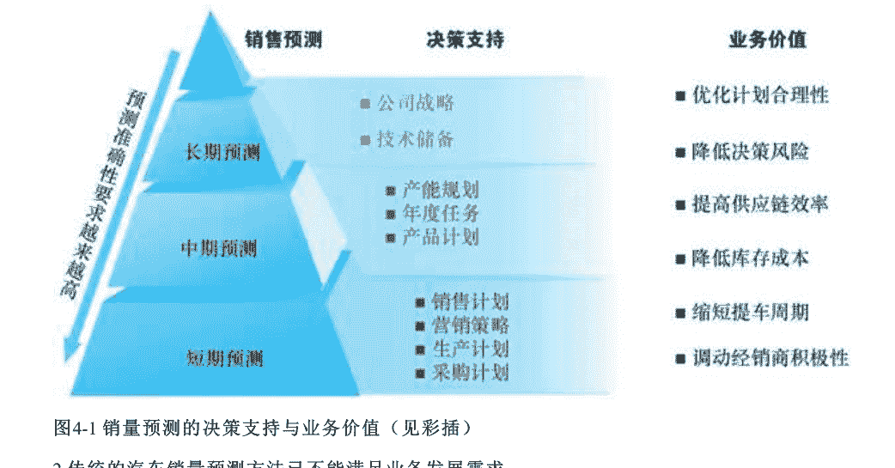

#### 2. 传统预测手段已难以跟上业务需求
针对汽车销量预测，传统方法已经露出明显短板。常见做法可分为定性、定量和综合三类。定性类主要依靠经验和主观判断，借助历史资料和直观信息推断未来趋势，代表有专家判断、德尔菲法、类推法等。定量类则基于相对完整的历史统计数据，用数学工具做加工，挖掘变量间的规律，典型有回归分析、时间序列模型、季节模型等。综合类把两者结合。

这些方法在一定程度上能反映供需走势，但受限于数据和模型本身，实际表现不理想：短期销量难以把握，无法做到车型、颜色、排量等细颗粒度的拆分，也做不到周度、月度的滚动持续预测，预测精度难以稳定。另外，结果的可解释性也较为薄弱。

传统的汽车销量预测方法及其难点如图4-2所示。

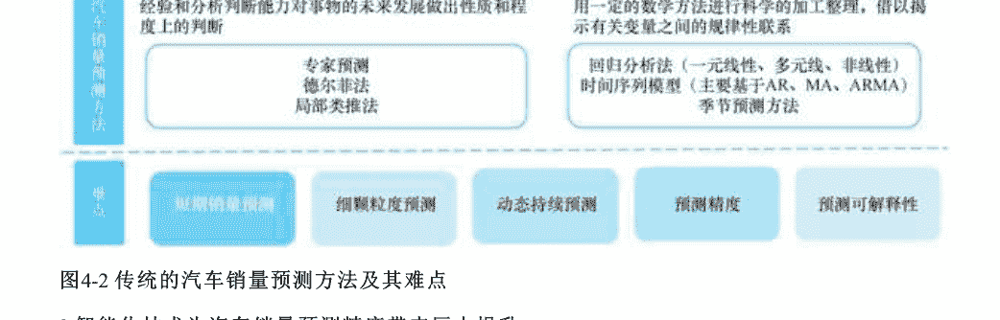

#### 3. 智能化技术如何大幅提升预测精度
首先，智能化能够提供更强的高性能学习模型。这些模型融合统计学、机器学习与深度学习，能更敏锐捕捉市场脉搏与变化规律，对比传统定性和定量手段，识别模式的能力更强，准确率自然提升。

其次，数据覆盖面被显著拓宽。除了历史销量、车型配置、供给信息，智能化还能接入行业外部数据、宏观经济指标，以及汽车论坛口碑等互联网行为数据。多源信息融合后，对市场趋势和用户需求的把握更立体。

最后，颗粒度和持续性得到增强。可以实现车型、颜色、排量等细分的销量预估，并做到每周、每月滚动更新，持续稳定输出高精度结果。不仅结果更准，也能为销售策略和经营决策提供更具体、可执行的依据。

智能化技术在汽车销量预测的应用价值如图4-3所示。

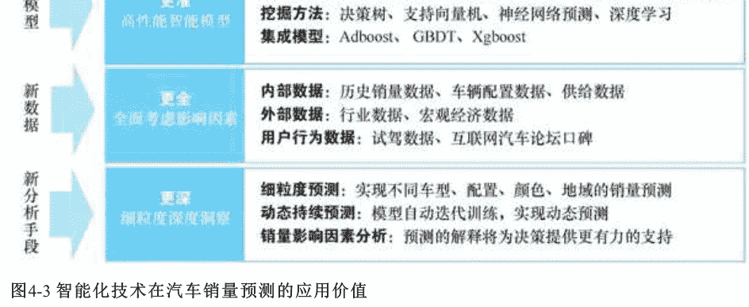

图4-3 智能化技术在汽车销量预测的应用价值

#### 4. 如何搭建机器学习驱动的销量预测体系
构建以机器学习为核心的销量预测，需要围绕数据融合和智能化应用两条线展开。

数据融合层面，要把车企内部的历史销量、车型配置等数据，与供给数据、行业外部数据、宏观经济数据以及用户行为数据如重点汽车论坛口碑等整合起来，全面刻画影响销量的因素，包括市场需求、配置偏好、竞争态势、季节性等。在此基础上融合内外数据，搭建立体预测模型。

基于机器学习技术的汽车销量效果如图4-4所示。随着数据维度与复杂度的增加，预测准确度同步提升。

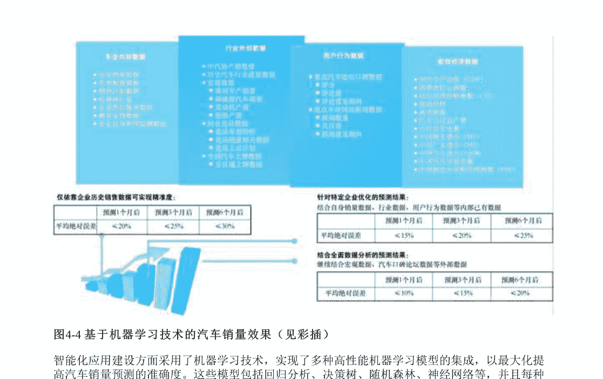

智能化应用层面，采用了多模型集成的做法，集合回归分析、决策树、随机森林、神经网络等多种高性能算法，不同场景下各取所需。单一算法风险高，实践中针对各车型、各品类，构建了基于时间序列的基础模型、基于机器学习的噪声捕捉模型，以及面向节假日与政策冲击的专项影响模型。每个模型内部还区分全品类粗粒度长周期预测与单品类细粒度短周期预测，以兼顾品类间的关联与差异。最后通过多模型融合投票或加权，提升稳定性和精度。

同时系统具备自适应学习与动态更新能力，能随市场变化实时修正参数，保证结果的持续可靠。基于此可实现多粒度洞察与滚动预测，为生产与销售提供更精细、全面、可信的决策依据。

#### 5. 精准预测如何赋能车企核心业务
1）精细化经销商管理，助力销售目标最大化
机器学习带来的精准预测，为经销商精细化管理提供了抓手。过去很多目标靠经验拍板，已不适应变化。现在可以据此制定更科学的销售目标指导。

以往串货、压货等行为常扰乱市场，导致厂商目标落空。借助精准预测，企业能设计更有针对性的补贴与激励，避免不合理操作。同时经销数据分析能力增强，异常波动可提前发现并干预。整体上，预测更准、管理更细，目标达成率和收益随之提升。

2）产销一体化协同提升效率
精准预测可指导主机厂按需生产，优化决策。企业能据此制定最优生产批次、生产策略与库存水平、资源配置，避免产能闲置与库存积压，降低成本、提高盈利。

同时对4S店和维修厂，预测能驱动智能补货与调拨。明确各车型的热销程度与库存状况后，形成合理的补货与调拨方案，确保各网点库存充足、各区域客户能及时提车与取件。客户满意度与售后服务质量提升，品牌忠诚度也随之增强。整体来看，产销协同能提高全产业链效率与盈利能力。

3）精准把握趋势，开展区域化营销与竞品分析
预测结果帮助车企更敏锐地读懂市场变化和竞争环境，从而制定更精准的营销策略。结合区域特征，可以做区域化营销：了解不同区域的消费习惯、经济水平、政策环境，推出差异化策略，提升转化。

在车型层面，借助细分品类的深度分析，可以洞察用户群体特征，实现车型间的协同策略。同一细分市场中不同车型的优势场景不同，依托预测与竞争态势制定差异化打法，有助于提升份额。

此外，预测也支撑竞品分析。通过对竞争对手定位、份额、产品特性的跟踪，企业能构建自身的竞争优势，基于自身优势制定对策，在竞争中占据更好位置。

### 4.1.4 售后备件需求预测：多分类深度学习方案

#### 1. 售后备件需求预测的价值所在
售后备件是汽车产业链的重要环节，直接关系车主用车体验、客户满意度与售后收入。做好需求预测，有助于生产采购与库存协同，降低成本并提升服务效率。

主要作用包括：确保备件库存充足，提前准备生产与采购，避免因缺货导致服务中断；降低库存成本，减少积压与过期，改善资金周转；提高服务质量效率，快速响应维修需求；支持售后收入增长，依托需求洞察调整产品结构与策略，推出更符合市场需求的备件。总之，精准预测能帮助企业降本增效、提升满意度与收入。

#### 2. 传统预测方法难以适应市场快速变化
备件按周转速度可分为快速流通件、中速流通件与慢速流通件，不同类型需要不同方法。

##### （1）快速流通件
种类少但用量大，多用于日常保养。典型如机油机滤、空气滤清器、燃油滤清器、刹车片刹车盘、轮胎等。传统上多用时间序列类方法，如单变量回归或加权平均，依赖历史需求推断未来。但市场波动较大时容易失稳。具体问题有：数据非平稳，需求受季节、周期、趋势影响，常规方法对平稳数据假设失效；对异常值敏感，需求易受突发因素干扰；忽略其他影响因素，仅看历史需求，无法纳入市场与竞争变化；难以应对突发事件，如自然灾害或政策变化。

##### （2）中速流通件
品类相对少，需求量不稳定，多用于复杂维修。典型如发动机曲轴连杆、传动系统离合器变速器、制动泵制动缸等。传统预测多用历史值替代未来值，或简单的时间序列回归、加权平均。弊端在于无法综合市场变化、竞争态势、产品迭代等多因素影响，且预测结果常出现骤升骤降，缺乏体系化方法。企业常采取批量采购与提高安全库存来应对，但带来资金占用高、库存积压、需求变化快导致库存贬值等风险。

##### （3）慢速流通件
品类多但需求量小，多用于零星维修。如活塞气门等小件、车身门把手雨刷等、车载娱乐导航等电子件。传统做法多依赖专家经验，结合采购成本与库存维护成本权衡来定采购量。优点是能考虑供应商与成本因素，减少积压损失。缺点是科学性不足，依赖主观判断易失误；人力投入大，效率低；只关注局部成本，缺乏供应链整体视角；易出现采购量过大导致积压或过小导致缺货。

#### 3. 多分类深度学习驱动的备件需求预测
基于数据挖掘、机器学习与深度学习的预测，相较传统方法具备更高的准确性与适应性。

首先，大量历史数据可被自动学习。算法能从数据中提取特征与模式，发现潜在规律，提升预测精度并节省人力时间。

其次，可处理多维度多类别数据。整合销售、供应链、市场等多源数据，得到更全面的结果。深度学习通过卷积、池化等操作，能有效处理高维数据。

最后，具备实时更新与优化能力。传统模型固定不变，难以应对多变市场。人工智能方案可通过持续监控与学习，动态调整模型与参数，保持预测的实用性与精度。

需要注意数据质量与隐私、算法选择与优化、模型可解释性等挑战，预测结果也需评估验证，确保落地效果。

### 4.1.5 以多目标优化提升售后备件生产与库存效率

#### 1. 售后备件生产计划与库存优化是什么
它是指针对售后领域的备件生产与库存管理制定系统化方案。通过优化生产与库存计划，提升供应链效率与服务水平，同时压缩成本。

备件生产计划依据市场需求与销售预测，确定生产量、时间与成本，合理规划可控制成本并提高效率，同时满足服务需求。

备件库存优化基于需求与库存策略，确定安全库存、最优库存与周转率，平衡成本与供给，确保备件及时可得，提升服务体验。

两者结合，能更好地管控成本并增强供应链竞争力。

#### 2. 生产与库存优化中的多目标权衡
该问题本质是多目标博弈，主要包括：最小化库存成本，涵盖订购、仓储、报废等费用；最大化服务水平，保证备件供应及时可靠，提升客户满意度；最小化缺货损失，减少因缺货带来的收入损失与品牌损害；最大化生产效率，提高生产与采购效率，缩短交付周期。

售后备件保障里，多个考核点经常互相牵制、此消彼长。把库存开支压到极致和把服务表现拉满几乎难以兼得。单为了省钱而削减备件储备，很容易出现断供，进而拖累服务口碑。反过来盲目堆货追求高服务，则会让资金占用和维护负担飙升。由此可见，售后备件的排程和库存管理本质上是多维诉求的博弈，需要在多项指标并存的情况下找平衡点，让彼此制约的诉求得到最优协调。具体要围绕生产排程、采购节奏、库存水位等决策变量，同时兼顾综合支出下降、缺货频次减少、客户满意度提升等方向。方案设计还需要纳入需求波动、交付延误等供应链扰动，确保结果既稳健又能落地。总体来看，备件计划与库存的精进关键在于厘清指标间的取舍，并在不确定环境下制定兼顾各方的策略。

#### 3. 单一视角困局：传统备件计划为何难以兼顾
传统售后备件的排程与库存管理往往只盯一个维度，比如只求库存开销最低或只求服务最好。单点改进容易顾此失彼，难以实现多维联动。例如，为压降库存开销而调低安全库存，缺货概率会上升，服务满意度随之下滑；反过来，为提升服务而囤货，又会推高库存与维护支出。所以备件生产排程与库存规划必须兼顾多项指标，找到最佳平衡。

传统做法主要存在以下偏差。
**压低库存开支：** 核心在把资金占用降到最低，却容易让缺货风险放大，进而损害服务表现和客户口碑。
**拉升服务表现：** 核心在提升服务与满意度，却往往伴随库存水位抬升，从而推高库存成本和维护费用。
**减少缺货损失：** 核心在降低断供带来的损失，却可能导致储备规模膨胀，增加持有成本和维护负担。
**提升生产效率：** 核心在尽可能提高产出效率，却可能导致库存积压，进而推高库存成本和维护成本。

以上偏差都源于单指标改进，无法实现多维协同，导致在一个维度改善的同时，其他维度的表现被牺牲。

#### 4. 多维寻优如何打通备件生产与库存协同
多维寻优是一种面向多个考核函数求解的思路，通常把多个诉求整合为综合指标，或通过算法搜索解空间中的帕累托最优解集，这些解能在多个维度上同时取得较好的表现。

常见技术包括：
- **遗传算法 GA**：借鉴生物进化中的基因、遗传和自然选择机制来寻找优解。
- **蚁群算法 ACO**：模拟蚂蚁觅食时释放信息素的行为，寻找最优路径。
- **粒子群算法 PSO**：模拟鸟群或鱼群群体行为进行寻优。
- **非支配排序遗传算法 NSGA**：基于支配排序的多维进化算法。
- **多目标粒子群优化 MOPSO**：粒子群算法的多维扩展。
- **多目标模拟退火 MOSA**：模拟退火思想的多维版本。

应用多维寻优实现售后备件生产排程与库存计划的协同通常分为以下步骤。
1. **构建多维寻优模型**：先构建模型，纳入生产开销、库存开销、缺货损失、服务表现等多个因素作为不同考核函数，同时确定生产排程、采购节奏、库存水位等决策变量。
2. **挑选适配算法**：依据实际情况挑选适配的多维寻优算法，例如基于遗传、蚁群、粒子群等进化算法，或基于线性规划、整数规划等传统方法。
3. **数据采集与处理**：收集并整理历史需求、生产与采购成本、库存费用、缺货损失等数据，为建模与求解提供基础。
4. **求解与分析**：利用所选算法求解模型，并分析结果，评估各考核函数的权重及对应决策变量取值。
5. **落地与持续改进**：据求解结果制定生产与库存计划，落地执行并监控，不断迭代优化，以满足客户需求与企业经济利益。

通过多维寻优，可实现备件生产排程与库存计划的整体改进，提升客户满意度，压降库存与生产开销，减少缺货损失，优化供应链管理。

## 4.2 石油石化行业

### 4.2.1 石油石化全产业链与痛点拆解
石化产业链体量庞大、环节繁复，涵盖油气勘探开采、运输、加工、销售等，涉及油田、气田、炼厂、化工厂等多个领域，是世界经济的重要支柱，对国家能源安全和经济发展意义重大。

主要业务包括：
**油气勘探开采：** 通过地质勘探定位资源，再以钻井等手段实现开采。
**炼油加工：** 将原油经分离、裂化、重组等工艺转化为成品油、润滑油和化工原料。
**化学品生产：** 通过化学反应制造涂料、塑料、橡胶、纤维、化肥等产品。
**润滑油生产：** 生产各类润滑油，用于保护机械、降低磨损、延长寿命。
**产品销售：** 将石油化工产品出售给下游客户，包括燃料油、润滑油、化工原料和成品化学品等。

行业痛点主要体现在：
**油气田开采难题：** 大型油气田步入中后期，采收率递减；新增区块多位于复杂地质，开采难度和成本上升，亟需更高效的勘探开发方式。
**生产排程与效率问题：** 生产排程多依赖经验与规则，科学性不足；生产受设备故障、物料短缺、质量波动等复杂因素影响，需建立高效调度体系以提升效率与质量。
**成本管控问题：** 生产消耗大量原料与能源，成本管控关键。传统成本中心模式易形成信息孤岛、协调困难，需转向基于数据的成本管理。
**产品销售问题：** 产品规模大、周期长，渠道复杂，市场需求难以精准把握；竞争加剧下，如何提升市场竞争力、拓展渠道、提升业绩是亟待解决的问题。

针对上述痛点，行业正引入数据分析、人工智能、调优算法等手段进行业务分析与改进。例如，基于市场供需建立生产与库存模型以优化效率与水位；利用预测模型研判原油价格与市场需求，优化采购与销售策略；应用多维寻优技术协调各环节成本与效益，优化整体供应链运营。

### 4.2.2 石化智能化落地全景
智能化应用依托人工智能、大数据、物联网等技术，对企业生产、运营、管理各环节进行改造，以提升效率与质量、降低成本与风险、增强核心竞争力，实现自动化、智能化生产与安全管理。

在石油石化领域，智能化可覆盖油气田勘探生产管理、炼油生产储运管理、化工生产安全管理等多个方向。典型案例包括：
**智能化油田勘探与生产管理：** 某石化公司推出的智能油田平台，实现勘探、生产、销售全流程数字化与智能决策。
**智能化炼油生产与储运管理：** 智能监控与控制技术提升炼油过程管理与产品质量；智能化储运实现自动化与安全管控。某公司的智慧炼化系统可实现炼油过程智能监控与控制，提升质量与效率。
**智能化化工生产与安全管理：** 通过在设备部署传感器采集温度、压力等数据上传云端，结合大数据与人工智能分析预测，实现化工过程智能控制与优化，降低能耗物耗，提升效率与质量。

以下通过具体场景展示智能化在石油石化行业的应用与成效。

#### 1. 油田开发的智能化实践
油田开发流程复杂，涵盖勘探、开采、储存、运输等多个阶段，是高耗能、高排放、高风险行业。为提升采收率、降低能耗与环境污染，智能化应用正加速渗透。

数字化与智能化技术主要应用于智能勘探、智能钻井、智能生产、智能物流。勘探环节借助数据采集与处理提升准确性与效率；钻井环节借助智能控制与决策提升效率与质量、降低成本风险；生产环节借助先进监测与控制提升产出稳定性与井龄；物流环节借助智能化管理优化运输计划与过程，提升效率与安全性。

典型案例：
##### （1）智能勘探
利用人工智能与大数据分析地质资料，实现油气资源的高效发现与开发。包括地震数据处理、图像识别、数据挖掘与模型预测。地震数据借助AI分析处理以判断资源分布；计算机视觉对勘探图像进行识别以精确定位；大数据挖掘构建预测模型以评估资源存在性与规模。
##### （2）智能钻井
在勘探开发过程中以智能化技术对钻井作业进行自动化控制与优化，实现高效、安全、节能、环保。借助物联网、传感器与云计算实现过程实时监测与控制。例如中海油某公司在深水区应用的智能钻井系统可自动调节井口压力、钻头位置与钻井液流量，提升效率与安全性。
##### （3）智能生产
通过数字化与智能化技术提升油气生产效率，减少人工干预，提升安全性与设备寿命。应用于采油、油气处理、储运等环节。借助人工智能、大数据与物联网实现生产过程智能化管理与优化。例如中海油某公司的智能化生产平台实现全流程数字化控制，以提升效率并降低成本。
##### （4）智能物流
勘探、开采与储运中，智能物流至关重要，可实现货物运输实时监测与管理，提升效率与安全性、降低成本。借助物联网、大数据与人工智能实现实时监测与智能调度。例如某天然气公司应用的智能物流平台可实时调度管道、储罐与运输车辆，提升效率并降低运输成本。

总体来看，智能化技术在油气勘探开采与储运中的应用可提升生产效率、降低成本并提高安全生产水平，对行业可持续发展具有重要意义。

#### 2. 炼油厂的智能化改造
炼油是石油产业的核心环节，负责将原油加工为成品油与化工产品。随着技术进步，数字化与智能化技术在炼油厂的应用不断深化。

数字化技术让生产管理更精细智能，提升效率、节约成本、降低污染，应用范围涵盖工艺自动化、智能化控制系统、数字化监控与数据分析。随着人工智能发展，智能化应用在炼油厂愈发广泛，可实现高效、安全、可靠运营。

**智能化控制系统**
智能化控制系统是炼油厂建设的重要组成，依托物联网、云计算、大数据分析、人工智能，结合传感器、控制器、执行器，实现温度、压力、流量、质量等关键参数的监测与控制。通过实时数据采集与分析，及时发现预警异常，提升效率与安全性。
**智能化安全监测**
炼油厂属于高危行业，传统人工抽检巡检易出现疏漏且效率低。智能化安全监测借助传感器、摄像头与人工智能实现生产过程实时监测与分析，实现安全事件早期预警与精准诊断，减少事故概率。
**智能化质量管理**
以数字与智能技术提升产品质量与生产效率、降低质量问题与成本。主要包括：
**智能化质量数据分析与预测系统：** 深度分析历史生产数据与质量指标，预测潜在质量问题与生产瓶颈，并给出优化建议。
**智能化质量控制中心：** 集成各生产环节数据，建立实时质量监控体系，设立专门控制中心以实现质量问题的快速定位、处理与反馈。
**智能化维护**
借助人工智能与物联网实现设备状态监测、故障预测、维修计划制定与执行的全流程智能化管理，实现设备全生命周期管理，提升效率、降低维护成本。核心在于设备健康监测与故障预测，通过传感器与物联网实时采集运行参数，建立模型预测故障并提前制定维修计划，并根据实际使用情况动态调整维护策略。

#### 3. 化工厂的智能化升级
化工生产是石油石化重要组成部分，产品广泛应用于医药、日化、涂料、塑料、橡胶等领域，但事故隐患与环境污染风险突出。生产过程涉及原料输入、加工生产、质量检测等多个环节，智能化可在各环节实现优化提升。

**生产工艺优化**
通过对生产过程数据监测与分析优化各环节，提升效率与质量。例如采用模型预测控制算法，对过程进行预测建模，实现自适应控制，优化工艺、提高收率与质量。
**基于运筹优化的参数控制**
在化工生产中，运筹优化技术可用于控制温度、压力、流量等参数，通过实时监测与计算自动调整控制参数，使过程保持在最优状态，减少浪费、提高效率，实现自动化控制、减少人为干预、降低风险。
**产品收率提升**
**基于人工智能的质量检测**
传统人工采样送检周期长、成本高、易出错，且只能检测样品无法实时监控。利用人工智能实现质量检测智能化与精细化，如图像识别与机器学习自动检测外观、尺寸等，大幅提升检测效率与准确性。
**化工生产过程虚拟仿真**
利用虚拟现实技术模拟化学反应与物理变化，便于理解与优化生产过程，降低操作错误与风险。通过建立虚拟仿真模型多次模拟优化，找到最优工艺与操作方案，提升效率与质量。

### 4.2.3 典型案例：运筹优化驱动的智能钻井参数调优
随着资源逐渐枯竭与采集难度加大，钻井技术研发与提升成为行业重点。传统钻井耗费大量人力物力时间，且受地质变化、井深增加影响，易出现钻头受损、井眼塌陷、井壁稳定性差等问题，导致效率低、成本高、安全风险大。如何借助现代科技优化钻井过程、提升效率与安全性，成为关键挑战。

#### 1. 什么是油气田智能钻井参数优化

智慧钻井：用数据指挥钻头，让效率说话

智慧化钻进参数调校的本质，是借助数据挖掘与AI手段，对钻进作业中的关键操作变量进行精细化调理，从而把作业效率拉高、把运营开支压低。面对不同井段、不同地层条件，策略能灵活切换，以匹配多样的施工需求。

现场涉及的变量很多，比如钻头转速、机械钻速、轴向力、扭矩、泥浆循环量与压差等，每一个因素都在牵动效率与成井质量。变量搭配方式不同，最终的表现也截然不同。过去多靠技术人员的经验手调，难免偏差，难以稳定触及最优。转向智慧化调校后，全流程可实现更高程度的自动化与高效运行。

在AI加持下，海量钻进数据可被挖掘建模，实现在线预估与动态调校。深度网络、强化学习、模糊推理等方法，都能完成变量的智能寻优。

智慧化钻进参数调校的价值体现在：
- 变量能在线寻优，钻进效率与质量同步提升；
- 成本被有效压缩，经济效益更好；
- 作业安全性提高，事故隐患减少；
- 可针对不同阶段和井下地质条件做个性化调校；
- 钻进数据得以积累共享，为后续分析挖掘提供基础。

#### 2. 运筹优化技术在油气钻井中的落地实践
近年来，团队为多家油气勘探企业实施了基于运筹优化技术的智能钻进参数调校。下面以某企业的油田钻进参数调校项目为例，展开说明。

##### （1）数据收集与分析
首先要汇集钻进过程中的实时监测信息，例如井深、压力、扭矩、流量等，开展数据质量审查、异常排查与关联挖掘。结合工艺机理与数据分析视角，锁定与机械钻速高度相关的控制变量和监测变量。影响钻速的关键要素排序见图4-10。 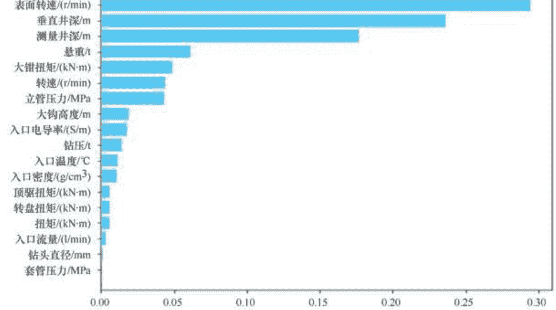

##### （2）钻井参数优化方案
以历史参数为基础，搭建机器学习驱动的钻速预估模型，能够在当前工况下对各层位、井眼尺寸和钻机装备的钻进速度进行即时预估。依托工程物理原理与工况特征在线判断调校方向，并结合可调节变量——比如马达转速、钻杆转速、泵压、泥浆流速等——的允许调整区间，构建运筹优化框架下的最优变量组合推荐模型，实现最优控制变量及调节路径的即时推送。整体技术路线如图4-11所示。 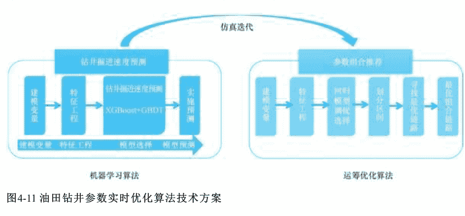

##### （3）建立钻井实时预测模型
融合经验公式与机器学习，搭建钻速即时预估模型，可精准捕捉钻进速度的动态变化。

项目中累计获取20口油井的钻井资料，涵盖钻头类型、井深、井径、转速、轴向力、钻重、泥浆密度等多维指标。其中16口用于训练与交叉验证，4口用于独立实测，以检验模型精度与鲁棒性。测试显示，模型即时预估平均准确率达94.7%，平均绝对误差仅2.4 m/s，具备高度可信的预估能力，为现场调校提供可靠依据。

图4-12展示了某口井的实测数据与模型预估曲线的对比，预估吻合度高、波动稳定，验证了方案的实用性。借助该模型，油田能实现更精细的作业管控，提升效率并控制成本。 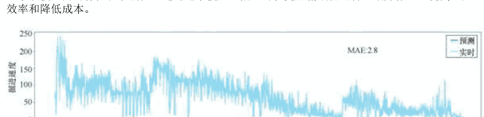

图4-12 某油井的实时钻井数据与模型预测数据对比（见彩插）

##### （4）建立钻井参数优化模型
在运筹优化框架下构建参数调校模型，可将钻井过程的变量调节逐步自动化，进而提升效率、降低开支。为保证模型有效性，需要依托历史数据明确各工况下变量的可调区间、调整频率、步长以及先后顺序，并形成多维度变量组合，以适应不同井深、地层、作业条件的需求。

钻速即时预估模型是支撑参数调校的核心环节。基于经验公式与机器学习的预估能力确保速度变化被准确、稳定地预判，为调校提供基础。

现场应用时，调校模型与预估模型联动，实现钻井全流程的自动化寻优。系统根据预估结果筛选提升潜力最大的变量组合，推送至控制系统执行，同时结合实时监测数据持续微调。

图4-13呈现了某油田的实时调校效果，蓝色曲线为未调校前的实际钻速，橙色曲线为调校后的实际钻速。两口同类井的对比实测显示，调校后钻速平均提升22.5%，钻井周期缩短18.5%，单井可量化成本节约约135.6万元人民币，调校收益十分明显。 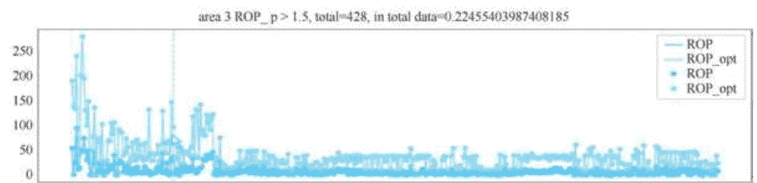

图4-13 某油田钻井参数的实时优化结果（见彩插）

### 4.2.4 典型应用二：炼油产品收率的智能化提升

#### 1. 产品收率的定义与意义
在炼油生产中，产品得率指的是目标产品产量占投入原油总量的比例。通过调整加工路线与工艺变量，可推动目标产品产量最大化，进而提升得率、压缩成本、扩大盈利。得率是衡量炼厂经营效益的核心指标，直接关乎竞争力。

原油在炼厂内部要经过分离、重整、裂化等多个单元，每个单元的操作条件与变量都会影响最终产品的产出与质量。各异品质的原油、不同的市场需求，都需要匹配合理的工艺流程设计和变量调优，才能实现得率最大化，这也要求对原油性质进行系统化分析与检测。

#### 2. 传统收率优化手段及局限
得率优化的核心是定位生产瓶颈并据此调整流程。过去常用试错、统计推断与专家经验等手段，对配方、操作条件、流程或设备进行改进，具体包括：

优化原油混合配方：把各来源原油按比例混配以获取更高得率和质量，常通过AB试验或模拟软件在生产前寻找最优配比。
改变操作条件：如温度、压力、流速等，通过调节这些条件提高得率，例如裂化时调整温度与催化剂用量提升汽油产出。
引入新工艺：采用更先进的催化剂或新工艺路线，提升产物得率与质量。
优化设备：如精馏塔板布置、填料选择等，提升生产效率与得率。
优化操作流程：如复合式加热、多级换热等，提高加热效率从而提升得率。

这些方式能在一定程度上改善得率，但存在明显不足：基于经验或试错的调校易出现偏差且耗时；传统方法多聚焦单一因素，难以实现多因素综合最优；人工干预多，缺乏智能化支撑，难以满足大规模高效生产需求。

#### 3. 机器学习赋能的收率优化新思路
基于机器学习的炼油工艺产品得率优化，能够更准确地预估工艺中的产品得率并有针对性地调整工艺变量，从而提升得率、降低生产成本。相比传统方法，机器学习方式在预估精度与变量联动调校上具有明显优势。

#### 4. 裂化装置收率优化案例
以某炼油企业裂化装置的干气、液态烃、汽油、液态烃加汽油等产品得率优化为例。

##### （1）数据收集与分析
分别采集并整理裂化装置四类产品的相关数据，包括操作变量、原料性质、产品质量、环境因素等，并开展相关性分析，找出与得率关联性强的关键点位变量。产品收率关联参数收集如图4-14所示。

##### （2）产品收率优化模型
针对干气、液态烃、汽油、液态烃加汽油等得率优化问题，建立基于机器学习与多变量因果链路的变量调校模型。产品收率优化实时过程如图4-15所示。 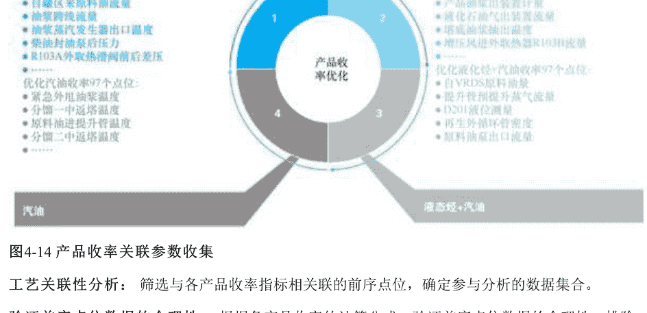

图4-14 产品收率关联参数收集

工艺关联性分析：筛选与各产品得率指标相关联的前序点位，确定分析数据集合。
验证前序点位数据的合理性：依据各产品得率计算公式校验数据，剔除异常点影响。
特征工程：结合裂化工艺机理与机器学习方法，提炼与得率相关的特征，包括物质成分、工艺变量等，并通过皮尔逊相关与斯皮尔曼关联性分析挑选高影响特征。
异常值处理：对点位数据及构建特征进行分布检测，对缺失、极值或非正态数据进行处理，保证数据质量。
构建多模型融合的产品得率回归预估模型：采用支持向量回归、随机森林等算法构建融合模型，基于实时数据预估产品得率。
聚类分析：按得率分布区间进行聚类划分，找到最优变量组合的分段区间。
构建工艺链路的变量调控：分析各区间变量组合分布，找到使得率达到峰值时的最优变量组合并确定调控链路，实现得率优化。

炼油工艺涉及复杂的物理化学反应，调校需结合实际生产控制。

##### （3）优化结果展示
项目中分别构建了干气、液态烃、汽油、液态烃加汽油四类产品的得率优化模型，并建立了裂化装置产品得率控制系统（见图4-16），实现实时得率优化与监控。为避免频繁微调，根据产品特性、原料配方与工艺过程实时更新各产品得率优化目标区间，在区间内进行变量组合与链路实时控制。最终平均得率提升约4.5%。 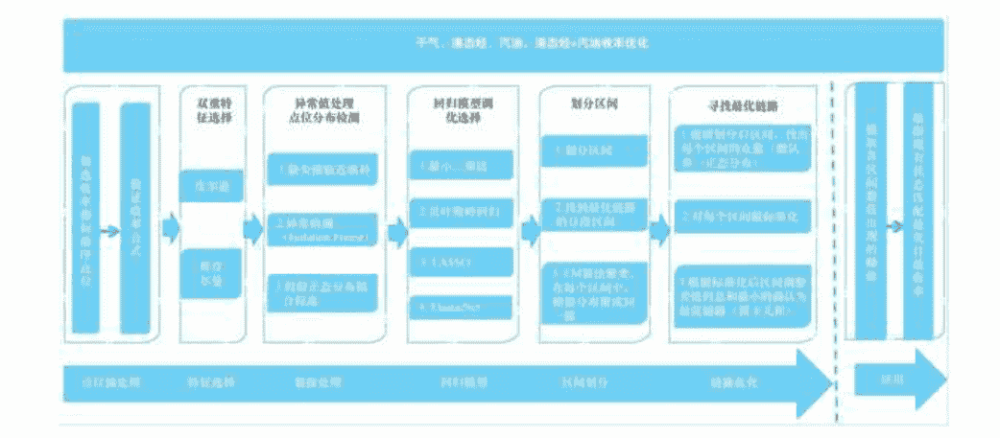

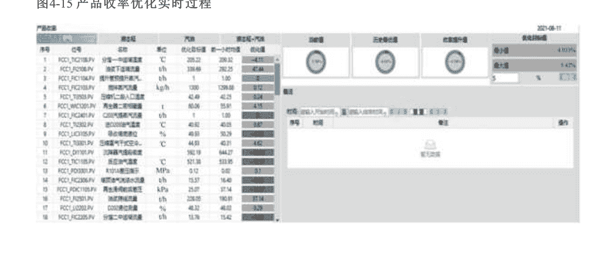

图4-16 产品收率控制系统

### 4.2.5 典型应用三：工艺参数的智能预警与闭环控制

#### 1. 为什么需要工艺参数预警和控制
通过采用不同的工艺变量进行预警和控制，是石化行业工艺管理的重要环节。石化生产工艺流程复杂，变量异常可能导致设备损坏、停产甚至安全事故，造成重大经济与社会损失。因此需要通过工艺变量的异常预警和反馈控制，及时发现并解决潜在问题，保证生产稳定与安全。

工艺变量预警和控制可实时采集、分析、处理工艺数据，及时发现异常并发出预警。异常可能包括温度、压力、流量超安全范围、设备运行状态不正常等。发现后可立即调整运行变量、停止不安全工序甚至关停生产线，避免事故。

实施预警与控制的价值显著：预防设备故障与生产事故，避免停滞、损失与修复费用；实现生产线稳定运行，提升产品质量与效率，增加产量与利润；保障生产安全与环保，保护人员与财产安全，提升企业形象。

#### 2. 实现路径
传统方法多靠人工经验与手动调整，人力成本高、效率低、响应慢。智能化技术可大幅提升预警与控制的效率和准确性。

实现主要分三部分：
（1）根据工艺机理和数据科学技术构建基于化工反应控制原理的变量因果链路。深入研究反应动力学与控制模型，抽象变量间因果关系，建立因果链路，并利用数据科学识别关键变量纳入链路。
（2）构建基于机器学习技术的关键变量预估模型。根据因果链路、工艺机理与控制目标，识别产品质量关联、能耗关联、安全关联等变量，通过历史数据学习建立预估模型，为后续控制提供可靠数据支持。
（3）构建基于图网络技术的智能控制。把变量因果链路建模为图网络，结合预估模型，实时预估分析，当关键变量预估值超出目标边界时，通过图网络定位影响变量并实时调整关联变量设定值，实现工艺智能控制。

#### 3. 催化裂化装置的工艺参数智能预警和控制
催化裂化是炼油工业重要的二次加工过程，包括反应再生部分、分馏部分、吸收稳定部分。温度、压力、催化剂负荷等变量对产品质量与产量影响重大，智能预警控制可提高质量与产量，减少能耗与废料。

针对某石化公司催化裂化装置，选取关键工艺点位，建立关键报警点预警预估模型，结合实时数据对关键点进行实时预估，一般可提前1至10分钟预警异常工况，为操作人员提供充足响应时间。

项目主要步骤：

##### （1）构建催化裂化装置的参数因果链路
依据工艺机理与数据科学技术，构建基于化工反应控制原理的变量因果链路。项目共梳理装置反再系统、分馏塔、吸收塔关键变量697个，其中关键控制变量31个，反再系统19个、分馏塔6个、吸收塔6个，这些是需实时监控、预估与控制的核心变量。图4-17所示为部分变量因果链路。

##### （2）构建31个关键参数的预测模型
利用机器学习构建关键变量预估模型，通过历史数据训练与优化，实现异常预警与多项指标预估。部分关键变量预估结果见表4-1。

表4-1 部分关键参数的预测结果

| 分析项目 | 数据量 (组) | 使用特征 | | | 基模型误差 | | 测试误差 | | 上线误差 | |
| :--- | :--- | :--- | :--- | :--- | :--- | :--- | :--- | :--- | :--- | :--- |
| | | 原料 (个) | 控制系统 (个) | 总计 (个) | 均方误差 MSE | 平均绝对误差 MAE | 均方误差 MSE | 平均绝对误差 MAE | 均方误差 MSE | 平均绝对误差 MAE |
| 粗汽油终馏点 | 24332 | 14 | 57 | 71 | 2.52565 | 1.24660 | 2.31010 | 1.21433 | 3.42345 | 1.51450 |
| 稳定汽油终馏点 | 24335 | 14 | 42 | 56 | 4.44672 | 1.46694 | 4.04377 | 1.44800 | 3.76990 | 1.50858 |

| 油浆固体含量 | 21202 | 14 | 34 | 48 | 1.22961 | 0.33454 | 1.14909 | 0.33800 | 0.01241 | 0.05243 |

| 油浆密度 | 31506 | 14 | 44 | 58 | 22.29729 | 3.32980 | 16.24758 | 2.96868 | 37.19093 | 4.72321 |

| 液态烃 C₅ 含量 | 12468 | 14 | 41 | 55 | 0.05088 | 0.14715 | 0.04010 | 0.13571 | 0.01743 | 0.12329 |

##### （3）图网络赋能的智能化操控

实时采集工艺数据后进行加工处理，把关键参数的实测值与模型预测值做对比，迅速识别异常并处置。结合预测模型与参数间的因果链路，对各参数实现自动调控，推动催化裂化装置实现智能化运行。鉴于控制系统涉及项目保密，技术细节不予披露。图4-18呈现了催化裂化装置反再系统的工艺点位预警与控制架构。

该项目落地后，催化裂化装置的运行稳定性与生产效率明显提升，操作人员的人工干预大幅减少，运行与维护成本同步下降。依托历史数据的分析与预测，还能为企业提供更科学的生产计划与资源配置，提升整体竞争力与效益。

## 4.3 化工行业概览

### 4.3.1 化工业务画像

化工是国民经济的支柱产业之一，以化学原料为基础，通过化学合成、发酵、萃取等工艺，生产氨、硫酸、酚类、塑料、橡胶、颜料、精细化学品等各类有机与无机产品。化工产品品类丰富、技术含量与附加值高，应用覆盖制药、农药、化妆品、食品、医疗、电子等众多领域。我国化工产业综合实力强、市场竞争力突出，数字化与智能化转型步伐正不断加快。

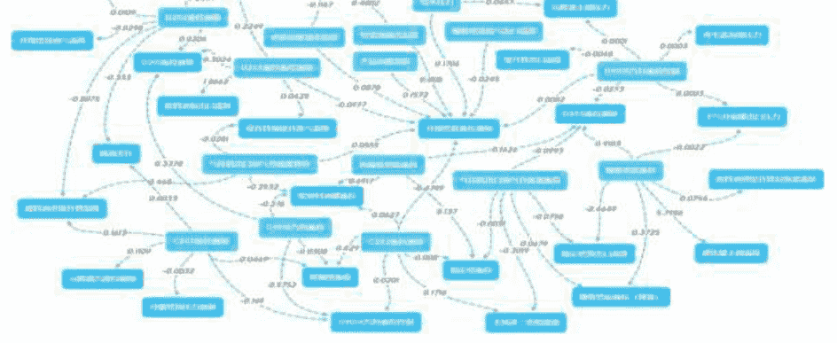

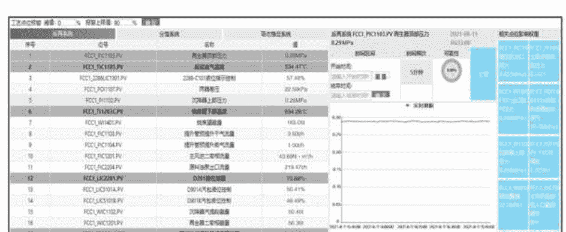

化工行业的核心盈利模式主要涵盖化学品生产、贸易销售、工程承包与技术服务。其中，化学品生产是主线，企业凭借技术与原材料资源生产销售各类化学品获取收益。但该类生产具有高风险、连续性强、流程复杂等特征，实际运营中普遍面临以下痛点。

**安全风险：** 大多数生产设备在高温高压下运行，溶剂、催化剂、助剂等物料多为易燃易爆品，安全管控要求极高，需严格执行安全生产规范、加强培训并配置相应保险。

**质量管控难题：** 工艺流程繁复、产品种类繁多，品质难以稳定把控，需要精细化的质量监测体系以确保合格率，同时避免不合格品与资源浪费，要求配套先进设备与技术手段。

**生产过程管控难题：** 各环节参数与工艺必须严格受控以保证产品稳定与品质，亟需高度自动化控制与监测能力，并建立完善的监控与数据分析体系。

**资源优化难题：** 生产消耗多种原材料与能源，需合理配置与优化利用以降本增效，对企业生产管理与运营能力提出更高要求。

**环保压力：** 生产会产生大量废水、废气、废渣等污染物，企业必须建立健全环保措施，满足法规标准，守护环境与公众健康。

### 4.3.2 化工智能化应用全景

在数字化与智能化层面，我国化工行业的数字化转型已迈入初级成熟阶段，生产各环节已实现数字化覆盖。借助数字化手段，企业可实现生产全流程可视化，提升效率并降低人为误差。

近年来，人工智能在化工领域的应用逐步深化。通过大数据分析优化流程，推动生产自动化，提升效率与品质。智能仓储和供应链管理系统在化工企业中推广广泛，有效提高库存周转与物流效率。

环保领域也出现智能化实践，如污染治理与废弃物回收利用的智能化技术应用，提升了环保效果与资源利用率。

智能化建设仍面临技术水平与投入成本的制约。为破解难题，部分企业正与科技公司协同合作，加速技术落地推广。以精细化工为例，智能化主要体现在研发与生产自动化优化上，原料研发、生产监控、质量管控的机制尤为突出。智能化技术可实现原料高精度分析与检测，降低研发成本并提速；智能生产监控推动产线数字化和自动化，提升效率与品质；智能质量管控实现全流程监测，提升产品质量与市场竞争力。

总体看，数字化和智能化有助于化工行业提质增效、降本增耗，同时强化环保与资源利用。智能化技术可助力提效、降本、提质、加速研发、实现智能管理与数字化转型，化工企业应积极推进相关建设，提升全行业竞争力。

接下来重点拆解化工行业的典型智能化场景。

#### 1. 原料采购的智能化落地

化工原料品类繁多、采购难度大，原料品质直接影响产品质量，智能化采购意义重大。借助大数据与人工智能，可对历史采购数据、市场价格走势、供应商信息进行分析，制定更精准的采购计划，并结合生产计划实现自动下单。同时，智能供应链管理系统可实时跟踪原料库存与市场供需，动态调整采购与库存策略，降低成本与风险。

**供应商智能筛选：** 利用大数据与AI分析供应商历史表现、信用评级、交付能力、价格等维度，为采购决策提供支撑，提升效率与质量。

**价格智能预测：** 基于原材料市场趋势与供需变化进行AI建模预测，辅助采购人员把握价格波动，作出更合理的采购决策。

**订单智能管理：** 依托实时库存与客户需求数据，自动安排生产与发货，避免积压或缺货导致的交付延误。

**质量智能管控：** 建立原料质量数据库，记录各批次检验数据，利用AI分析与预测潜在质量风险，及时干预，避免生产损失。

**仓储智能管理：** 运用物联网实时监控仓库，记录各货位存量，预测库存变化趋势，动态优化库位布局与流转效率，提升利用率与周转率。

**供应链智能协同：** 整合上下游信息，构建协同平台，借助AI实现供需匹配与资源优化，推动供应链信息化、智能化与协同化，提升整体效率与竞争力。

总体而言，化工原料采购的智能化集中在供应商选择、价格预测、订单管理、质量控制、仓储管理与供应链管理，通过大数据与AI实现流程优化、降本增效。

#### 2. 生产过程控制的智能化实践

化工生产常涉及高温高压、易燃易爆等高危场景，智能化过程控制至关重要。借助传感器与智能控制系统，可实现生产过程的实时监测与调控，结合数据分析与机器学习进行智能优化。例如液态化工生产中，智能传感器可实时采集温度、压力、流量等参数，机器学习模型可提前预警异常并自动调节，防止事故与质量问题。

化工生产过程控制的智能化主要包括：

**生产智能调控：** 工艺参数众多、人工调控复杂度高，需以智能化替代人工。以合成氨为例，借助大数据与AI对反应实时数据进行监测与分析，实现反应过程的智能调优，提升产率与纯度。

**多目标过程优化：** 传统抽检易导致质量控制滞后，需保持过程稳定。以聚氨酯生产为例，构建多目标优化模型，在保证产率前提下最小化反应物消耗、降低成本。

**智能化计量调配：** 生产涉及多种原料精准计量，传统手动方式易出错。智能计量调配系统可实现高精度自动化计量与配比。

**工艺流程智能优化：** 传统手动参数调节存在误差与滞后。智能优化系统可自动调节关键工艺参数，实现流程优化，提效提质。核心在于构建高效的数据采集与分析体系，挖掘优化空间。

**质量智能检测：** 传统取样送检周期长、操作繁琐。智能检测系统可实时监测温度、压力、pH等关键参数及产品理化性质，快速发现问题并调整。同时机器视觉技术可对产品外观与形态进行自动判别，如涂料厚度的颜色光泽检测。

**能耗智能优化：** 生产依赖电力、蒸汽等能源。智能能耗管理体系可实时监测与分析能耗数据，定位瓶颈与浪费点并提出优化方案，降低成本。

**预测预警智能化：** 针对设备故障、人为失误等突发事件，智能预测预警系统可基于大数据与AI对生产数据实时监测与分析。

#### 3. 环境监测的智能化应用

环境监测是化工智能应用的关键环节。生产过程产生的废气、废水若未及时监测处理，将对环境与健康造成严重威胁。智能化环境监测通过部署传感器与监测设备，实现对气体、液体浓度、水质、噪声等多指标的实时采集，经物联网传输至云端分析，生成报告与预警。

通过历史数据统计分析，可预测未来污染风险，为科学制定环保方案提供依据。智能环境监测还可与智能生产、物流等系统联动，实现全方位智能管理。

主要场景包括：

**废气智能监测：** 传统人工采样化验周期长、成本高。智能在线监测系统可实时检测废气污染物成分，异常时自动报警并处置，确保环保合规。

**水质智能监测：** 生产用水量大，水污染影响重。智能水质监测系统可实时跟踪水质参数并预警，实现水资源智能化管理。

**噪声智能监测：** 传统噪声监测依赖人工巡检。智能系统可实时采集、传输、分析噪声数据，异常自动报警并反馈，及时处置。

**粉尘智能监测：** 传统粉尘监测人工耗时费力。智能在线系统可实时监测粉尘浓度与成分，快速响应异常。

### 4.3.3 典型智能化应用一：化学品生产工艺的多目标优化

#### 1. 化学品生产工艺的核心目标

化学品生产是一个多目标并存的复杂系统，目标通常涵盖生产成本、产品质量、环境安全、能源效率等。各目标相互关联，需通过多目标优化寻得最佳平衡点。具体目标包括：

**产品质量：** 保证化学纯度、物理性质等指标符合标准，是生产首要任务。

**生产效率：** 降低原材料与能源消耗、缩短周期、减少废品，提升整体效率。

**生产成本：** 在保证质量与效率前提下控制成本，核心在于提高原料转化率与降低能耗。

**安全性：** 高温高压、易燃易爆等风险需管控，降低事故概率并具备快速应急能力。

**环境友好：** 减少废水废气排放，降低对环境影响。

#### 2. 多目标优化的实施路径

化工工艺多目标优化需兼顾目标间的相互制约关系。首要步骤是明确待优化目标并量化指标，确定优先级与权重。其次选择合适的优化算法，如遗传算法、粒子群算法、模拟退火算法等，通过参数调节与多次迭代寻找最优解。最后通过仿真与试验验证最优解的实际可行性，不符合时需迭代调整模型直至收敛。

#### 3. MTBE生产工艺的多目标优化案例

MTBE即甲基叔丁基醚，是汽油添加剂与溶剂的重要原料。生产通常以异丙醇与异丁烯为原料，在催化剂作用下反应生成MTBE。

**多目标构成：** 在确保质量前提下，最大化原料转化率并最小化能源消耗。质量取决于反应选择性、温度、时间、催化剂类型与用量；原料转化率影响成本与效率；能源消耗涉及蒸汽、电力等使用。

**实施步骤：**
- ①明确优化目标指标：确定质量、转化率、能耗对应的量化参数。
- ②构建反应机理模型：深入研究反应机理，建立化学反应方程模型，用于模拟与预测。
- ③确定控制参数：如塔回流量、出口甲醇浓度、干燥塔盘温、灵敏板温度、塔顶压力等，通过相关性分析与仿真确定。
- ④建立多目标优化模型：基于非线性规划与遗传算法等方法构建模型。
- ⑤求解与计算：利用数值求解器进行计算，综合考虑机理复杂性、参数多样性与目标多样性。

某MTBE生产工艺的多目标优化流程如图4-19所示。

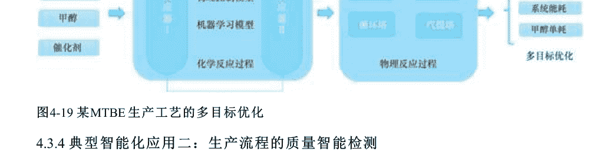

图4-19 某MTBE生产工艺的多目标优化

### 4.3.4 典型智能化应用二：生产流程的质量智能检测

#### 1. 生产流程质量检测的内涵

化学品生产中的质量检测是指运用物理、化学、生物学等检测手段，对产品进行定性、定量与分析测试，以判定其是否符合预设质量标准与规格要求。

过去很长一段时间，化工生产的质量把关主要靠“抽样—送检—等结果”这条老路。厂里在关键点位人工取样，再把样品送到实验室化验，靠报告来判定合格与否。对企业来说，这一步不可或缺，但弊端也很明显。

先是成本高。人工取样、运输、化验全靠人，耗费的人力物力非常大，而且化验过程离不开昂贵的试剂和仪器，整体开销居高不下。
再是反馈慢。样品从产线到实验室往往要几小时甚至几天，问题出现时已经错过最佳干预窗口，生产节奏和产品合格率都会受影响。
还有规模瓶颈。随着产线扩张、样品量增加，实验室团队必须同步扩编，人力成本随之攀升。

为了摆脱这些限制，已经有企业开始引入在线分析技术。无需人工抽样送检，生产各环节都能实现在线监测与闭环控制，数据回传几乎是实时的。生产状态可即时掌握，质量波动能迅速纠偏，既省人省力，也让效率和品控同步提升。

2. 基于机器学习的智能质检新范式
依托机器学习的数据驱动思路，化工质检正走向更精准、更自动化的阶段。其典型作业链路大致包含四个环节：数据采集、特征提炼、模型训练、预测判。

在采集端，传感器和监控系统会持续抓取温度、压力、流量等关键工艺参数。原始数据进入处理层后，会做清洗、去噪和特征工程，挑出真正与质量强相关的指标。随后选用神经网络、支持向量机等算法对这些特征进行学习和优化，构建高精度预测模型。模型上线后可对新数据实时判读，提前发现异常并触发处置，把效率和良品率一起拉上去。

与传统点检相比，这种做法准确性更高、自动化程度更强、响应速度更快。模型还能随工况和工艺参数变化动态调整特征与权重，保持预测的稳定可靠。把机器学习嵌入质检体系，既能提升产品一致性，也为企业的竞争力与可持续发展提供支撑。

4.3.5 典型智能化应用三：AI驱动的组分纯度精准控制
产品组分纯度直接决定使用效果和市场竞争力。过去很多工厂靠老师傅手动调温、调压、调投料速率来追求目标纯度，效果有限且风险不小：人工调节精度不足、难以做到即时响应；控制存在滞后，反应过程很难被实时管控；对操作人员经验要求极高，工作强度大、效率低。

越来越多企业改用基于机器学习的智能控制方案。思路是实时感知反应全过程，用算法建立模型并预测趋势，进而动态优化工艺参数。

一套常见流程包括：
① 数据采集：通过各类传感器在线获取温度、压力、反应物浓度、产物浓度等；
② 数据预处理：清洗、降噪、补齐缺失值，保证数据可信完整；
③ 特征提取：从预处理数据中提炼反应速率、物料消耗速率等核心特征；
④ 建模与预测：用机器学习学习历史规律，预测未来工况和产质量指标；
⑤ 条件闭环调整：依据预测结果实时修正反应条件，直至达到目标纯度。

落地时要注意几个关键点。数据质量决定模型上限，必须保证采集数据的准确可靠；特征选择要贴合纯度变化规律，选对才能学得准；模型选型要结合实际场景，决策树、SVM、神经网络各有适用边界；化工生产对实时性要求极高，预测必须秒级更新并反馈至控制系统；同时涉及高温高压和危险介质，系统的安全性和稳定性必须优先保障。

4.4 烟草行业全景透视
烟草是我国重要的传统产业，覆盖面广，对经济贡献度高。整体链条包括种植、生产、营销、供应链等多个环节，各自特征鲜明。

4.4.1 业务全链路拆解：种植到供应链
种植主要集中在云南、贵州、湖南、重庆等地，面积庞大但受天气、气候、土壤等自然因素影响大，稳定可控难度高。
生产分为加工与制造两部分，加工指卷烟及其他烟草制品，制造指滤嘴、烟用纸等辅材。质量与效率是核心关注点，且生产过程涉及有害物质，对车间环境和工人健康提出更高要求。
营销主要靠渠道分销和宣传推广，但受健康与合规限制，推广空间受限，销售必须严格遵循法规与质量标准。
供应链横跨种植到零售，环节多、衔接复杂，需要保证协同、稳定与可靠。

总体来看，行业在质量管控、生产效率、营销合规和供应链协同上仍有提升空间。方向是强化研发、优化工艺流程、完善质量管控、健全渠道、加强供应链治理，从而提升市场竞争力与运行效率。

4.4.2 智能化如何重塑烟草行业
随着消费升级，用户对品质、安全、健康的要求持续提高，而市场竞争加剧、质量管理难度加大，智能化成为提质增效的重要抓手。

数字化是基础。行业在信息化管理、流程自动化、智能设备应用上已有较好积累。自动化产线提升了效率与一致性，信息平台让企业更精准洞察需求、优化排产。

具体应用已形成多个切面。质量管理上实现产品自动检测、数据实时采集与分析，效率和准确度明显提升；销售管理上借助智能化实现渠道精细化运营和个性化促销；客户服务上可做到信息管理、投诉闭环与反馈分析，满意度随之改善。

价值不仅体现在效率与品质，也在于推动转型升级、强化核心竞争力、更好地响应消费者需求。随着技术成熟与场景扩展，智能化将成为烟草行业数字化建设的主动力。

智能化同样带来产品稳定性与一致性的改善，自动化检测与分拣提升了效率和准确率。
在营销层面，通过数据分析挖掘消费行为与偏好，实现精准营销与体验增强；客户服务系统可实时响应诉求，提升忠诚度。
在供应链层面，智能平台实现数据采集、分析、可视化，实时监控与调度；智能规划与优化提升库存周转与稳定性。

整体而言，烟草行业的智能化正覆盖生产、销售、管理全域，推动企业在效率、品质与服务上实现跃升。

1. 种田也要用AI：种植环节智能升级
作为传统行业，烟草种植正加速数字化转型。种植是质量源头，智能化手段通过现代技术、传感器和物联网实现全流程在线监测与数据分析，减少环境影响，提高效率与品质。

（1）物联网织网，田间全在线
烟草农业物联网通过传感器和设备采集土壤温湿度、光照、二氧化碳等环境数据，并上传云端分析。系统据此判断长势、预测趋势并给出管理建议。
典型场景包含：
智能灌溉：实时监测并动态调整水量与频次，节水增产；
智能施肥：基于土壤与植株数据精准调配肥料用量与时机；
病虫害监测：结合传感器与图像识别实现早期预警与精准防治；
气象监测：实时分析气象数据，提供科学决策参考；
智能收获：借助图像识别实现分级采收，提升效率与品质；
智能物流管理：全流程可视化，降低成本与风险。

（2）大数据决策助手
决策支持系统整合天气、土壤、病虫害等多源数据，为种植户和管理者提供定制化建议。人工智能可实时监测温度、湿度、光照强度及病虫害概率，提前预警并给出应对方案；还能结合生长状态与市场需求制定最优种植与销售计划；同时辅助土壤养分与水分管理，并提供技术培训与指导，帮助提升产量与收益。

（3）闭环控制实现精细化管理
智能化控制通过自动化技术对环境、土壤、水分、施肥等进行实时监测与分析，实现精细化管理。
环境监测与控制：传感器实时调控光照、温度、湿度、CO₂等；
智能化施肥：依据养分与长势实现分区分期精准施肥；
智能化灌溉：按需精准供水，提升用水效率；
智能化病虫害防治：基于发生规律实现早期预警与精准施药；
智能化收割：机器人自动采收并采集数据，提升效率。

2. 智造卷烟：工厂数字化转型
烟草制造是行业核心，主要生产卷烟、烟丝、雪茄等。数字化与智能化技术的引入正推动生产效率、流程优化与品质提升。

智能制造平台与数字化工厂是基础，可实现全流程可视化、可追溯、可控。

（1）质量大脑：全程实时监控
智能化质量控制通过数据采集与AI技术实现实时监测与优化。
生产过程数据采集与分析：传感器实时获取温度、湿度、烟丝质量等数据，进行分析预警；
自动化控制系统：PLC、DCS等控制器配合数据优化，提升控制精度与响应速度；
质量智能控制：基于成分、水分、长度、密度等多维度数据，利用深度学习构建预测模型，实现精准调控；
质量数据分析与挖掘：快速定位问题根源，预测潜在风险并提前干预；
智能质量检测：图像识别与AI算法实现外观与形态自动检测，降低人工成本与误判。

（2）制丝线智能提效
制丝环节智能化集中在烘丝与再加工。
烘丝环节通过传感器监测温湿度、氧含量等参数，实现工艺智能调控；历史数据建模用于工艺优化与品质预测。
整体上通过物联网与大数据实现原材料、能源、设备实时调度与计划优化；基于控制技术与AI实现过程实时优化；机器视觉与传感器实现物理特性、含水率等在线检测，提升一致性。

（3）卷包线末梢智能化
卷包是与消费者直接接触的最后工序。
烟丝配比环节通过算法分析品质与性能，实现自动化配比控制；质量检测环节借助视觉识别与智能算法实现缺陷分类与分级；部分产线已引入机器人卷烟。
整体调度借助物联网与大数据实现实时监测与计划优化；控制层面采用人工智能算法实现过程实时优化，提升品质稳定性。

**智造升级：卷烟全流程智能化图谱**

**智能化检测**
生产线上引入机器视觉与多类型传感器协同工作，实时捕捉烟支的重量、长度、密度、成型圆润度与印刷品质等关键指标，对偏差即时识别、即时反馈，让品控从抽检走向全检，产品稳定性和一致性显著提升。

整体来看，工业互联网与人工智能正深度嵌入卷烟制造，通过生产过程的在线感知、在线调控与在线优化，推动效率、品质与可靠性同步跃升，为企业长期可持续发展提供坚实支撑。

##### （4）智能化生产过程仿真
借助计算机技术构建卷烟生产的虚拟镜像，实现过程的预演、优化与闭环管控，既能提效增质、降本增效，也能减轻生产环节的环境负荷。

具体路径可归纳为：
**搭建虚拟模型：** 把设备布局、物料流转、人工操作等要素全部数字化，拼成一张完整的虚拟产线。
**运行仿真推演：** 在虚拟环境中设定不同工况参数，模拟生产全流程，获取各节点的数据与表现。
**分析诊断优化：** 对仿真结果进行挖掘，定位堵点与风险点，形成针对性的改进方案。
**预测预警管控：** 依托仿真模型提前预判可能出现的异常，提前布控、提前干预，避免质量事故与停线损失。

通过仿真，企业能更清晰地掌控生产脉络，实现质量可控、效率可增、成本可降、污染可减。

##### （5）智能化产线数字孪生
以虚拟化手段把制丝与卷包的实体产线映射到数字空间，借助数字孪生模型实现状态实时看清、效率实时调优。

技术基础是物理世界与虚拟世界的双向数据流动：传感器和物联网设备把产线数据汇入云端，经数据挖掘与机器学习处理后生成高保真孪生体。基于该孪生体可以随时掌握设备状态、运行负荷与效率水平，并据此调度优化。

典型价值体现在：
**实时监测与优化：** 持续获取运行数据，动态优化工艺，减少非计划停机，提速提效。
**运维预判：** 在虚拟环境中做试验运行与故障复现，提前识别设备隐患与维护需求，缩短维修时间。
**质量在线管控：** 对关键质量点进行持续监控与在线修正，确保过程稳定、成品达标。

总体而言，数字孪生让生产管理实现可视化、实时化与精细化，效率与品质双提升，成本持续下降。

##### （6）智能化生产设备
智能化装备是智能制造的落脚点。制丝线常见的智能设备包括松散回潮机、加料机、加香机、烘丝机、水分检测、增温增湿与温度检测等，均经过智能化改造。

松散回潮机可实时跟踪烟丝回潮状态，自动修正回潮参数，保证柔软度与延展性稳定。加料机与加香机依据生产计划自动投料投香，并实时计量消耗，避免浪费与配比偏差。烘丝机实时采集烟丝温度、湿度与形态，自适应调节工艺参数，保障一致性。水分与温度检测设备则为回潮与烘干过程提供精准闭环数据。

卷包线同样装备丰富：自动点烟机、烟包机、外包机、贴标机、装盒机等，均可构建场景化智能应用。

智能化体现为：
**自动化控制：** 搭载传感器与执行器，实现温度、湿度、加香量等参数的自动调节。
**数据采集与分析：** 采集温度、湿度、振动、电流等运行数据上云，进行分析挖掘与故障诊断。
**远程监控与维护：** 通过网络实现设备状态远程巡检，故障信息直传云端，技术人员在线处置。
**智能决策：** 内置AI算法自动优化运行策略，例如优化加香量降低浪费与质量波动。
**人机交互：** 图形化界面呈现设备状态与参数，简化操作、提升效率。

综上，设备的智能应用集中在自动化、数据化、远程化、决策化与易用化，推动设备效率与质量控制水平全面提升。

##### （7）智能化能耗优化
能耗管理是卷烟厂长期关注的重点，智能化手段让能源管理更精细、更高效。

**智能监测：** 利用传感器与采集装置实时监测设备运行与能耗情况，数据汇聚至数据中心，快速发现异常与节能空间。
**智能控制：** 基于模型与算法对关键设备进行自适应控制，如烘丝机温湿度精准调节，降低无效耗能。
**能耗分析：** 借助数据挖掘深挖高耗能环节与设备，制定结构优化方案。
**能耗监管：** 构建全流程能源监管体系，实现科学化、精细化管理与闭环控制。

落地后，企业能耗下降、生产效率提升、经营成本降低，并契合绿色发展的要求。

#### 3. 烟草销售中的智能化应用
销售端智能化聚焦三大方向：供应链管理、营销智能化与销售预测。

供应链管理依托物联网与大数据，对生产、仓储、物流全链路实施追踪与协同，提升运转效率与透明度。营销智能化利用人工智能与大数据洞察渠道、模式与市场趋势，为决策提供依据，实现需求精准预判与策略优化。销售预测则通过机器学习与深度学习对历史数据与市场环境进行建模，提升预测精度。

价值在于销售效率与品质提升、供应链协同增强、产品安全可控、浪费与成本下降，助力企业在竞争中增强话语权与市场份额。

##### （1）烟草销售的智能供应链管理
通过规划、组织、指挥与改进仓储、流通、销售等环节，实现物流成本最优与质量安全可控。随着信息技术演进，销售企业正加速用智能技术重塑供应链。

运输环节可部署智能调度系统，借助算法优化路径与配送计划，结合物联网实时监控车辆，提升时效与安全性。销售环节可采用智能预测系统与客户关系管理系统，实现需求精准预估与客户精细运营。

具体优化手段包括：
**数据共享与分析：** 打通各环节数据，实现快速响应与高效决策。
**智能预测与计划：** 对需求、库存、产能进行预测，实现精准库存与生产排程，避免积压或缺货。
**智能物流管理：** 以物联网与算法管理车辆、路线与时效，实现物流可视化与精益化。
**智能质量管理：** 实时监测分析烟草品质，快速处置异常保障安全。
**智能销售管理：** 以数据分析与智能推荐优化渠道与促销，提升转化与满意度。

整体而言，智能供应链可显著提升协同效率与准确性，降低风险与成本，增强竞争力。

##### （2）烟草销售预测
利用人工智能与大数据对市场进行深度剖析，为销售决策提供科学支撑，帮助企业把握需求、提升业绩、缓解库存压力。

实现路径：
**数据采集与清洗：** 汇总历史销售、市场趋势、经济环境等数据并进行清洗，保证可信度。
**数据挖掘与分析：** 运用机器学习与数据挖掘发现规律与趋势，预判未来走势。
**预测模型构建：** 基于分析结果建立可靠模型，对未来销量进行量化预估。
**结果呈现与应用：** 以图表报表等可视化方式输出预测结果，指导生产计划、库存管理和营销策略。

智能预测可有效提升销售效率与质量，增强企业市场竞争力与行业健康发展。

### 4.4.3 典型智能化应用一：制丝线水分稳定性智能控制
水分波动会直接影响工艺稳定性与成品口感，是制丝线必须严控的核心指标。

传统做法采用高精度传感器实时监测水分，数据回传自动控制系统后自动调节加湿与除湿动作。进一步升级可引入机器学习，对水分历史数据进行深度学习建模，提前预判趋势并动态修调，实现更精准的闭环控制。

同时借助人工智能进行过程管理，实现智能预警、智能决策与智能调节，进一步巩固水分稳定水平。

### 4.4.4 典型智能化应用二：基于机器学习与运筹优化技术的烘丝机出口质量优化
烘丝机是烟叶加工中决定含水率与品质的关键设备。烟叶经前处理后进入烘房，通过热风或直接加热配合湿度与温度控制达到目标含水率。常见类型有循环式与直接式，前者回收余热提升能效，后者直接加热。

#### 1. 烘丝机的出口质量控制目标
出口水分与出口温度是两项核心指标。出口水分影响品质、口感、耐藏性与加工难度，需结合烟叶特性与水分迁移规律进行参数优化。出口温度关乎烟丝的物理状态，需综合温度场分布、干燥速率与时间制定控制策略。

#### 2. 基于机器学习与运筹优化技术的烘丝机出口质量优化
烘丝机控制长期面临出口水分波动大的痛点。需建立出口水分预测模型，揭示不同生产阶段偏差与工艺参数的关联，并融合机器学习与运筹优化构建智能控制模型，配合自学习反馈机制逐步收敛偏差。

**（1）数据采集**
采用高精度传感器与采集设备保证数据实时准确，经清洗剔除噪声。结合历史工艺参数识别与目标间的关联，需考虑设备波动、原料流量与水分波动的影响。构建出口水分、温度的关联因子分析模型时，融合机理知识与机器学习，并用实时生产数据持续训练优化。建立不同季节、温度、品牌下的变化规律与时间滞后关联分析，提升数据解释力。

##### （3）基于机器学习的出口含水率实时预测模型
利用历史全量多维度数据还原工艺影响因素，通过数据挖掘识别关键关联，模拟人为与非人为操作规律。同时考虑设备运行波动与原料流量、水分波动。基于机器学习建立出口含水率预测模型，程序读取当前实时数据，结合自适应分段模型判断生产状态，兼顾非线性、时变、强干扰、耦合与大时滞特性。对不同参数的滞后性进行分析，采用机理与数据科学结合的大时滞模型进行数据对齐，确保实时数据完整表征当前批次特征，最后由预测模型输出未来出口含水率。

##### （4）基于运筹优化的出口含水率智能控制模型
模型可根据实时出口含水率自动给出最优控制参数建议，保证目标稳定。当实测值偏离质量要求时，结合设定值、当前值、预测模型与运筹优化算法，按“当前状态与近邻原则”计算最优热风风量与排潮风量，再反推热风风机频率与排潮风门开度，参数可推送至MES供操作参考，或直接接入集控系统实现闭环自控。

### 4.4.5 典型智能化应用三：基于机器视觉与仿真技术的全线质量控制
以机器视觉与仿真技术联动，实现制丝线全流程自动化质量管控，大幅提升效率与成品质量。

实现步骤：
- ①机器视觉数据采集：于关键点部署相机与传感器，实时采集重量、水分、温度、宽度、厚度、颜色等信息。
- ②机器视觉处理：通过视觉算法提取特征，识别不合格烟丝、卷曲、断裂等缺陷。
- ③仿真建模：对各工序进行仿真复现，例如构建烟丝拉伸模型模拟拉伸过程，优化参数以满足尺寸要求。
- ④质量控制策略制定：结合视觉数据与仿真结果，制定参数调整时机与方法，确保宽度、厚度等指标稳定。
- ⑤实时监控与控制：将策略部署在线，通过自动控制系统实时调节烘丝温度、拉伸参数等，保持质量恒定。

通过全线闭环控制，企业可实现质量可追溯、效率可提升、成本可下降，市场竞争力随之增强。

## 4.5 钢铁产业全景解读

### 4.5.1 业务链条与核心挑战

钢铁是国民经济发展的基础性材料产业，支撑着上下游众多行业。其主要经营环节包括：

**钢冶炼与成品制造：** 钢铁厂根据需求轧制出螺纹钢、角钢、H型钢、工字钢、各类管材等规格化产品。

**钢材流通贸易：** 贸易商从钢厂拿货，供给建筑、制造、船舶等终端用户，也开展跨境业务。

**钢材深加工：** 对钢材进行二次加工，制成汽车零部件、机床、建筑构件、家电、船舶等成品及半成品。

**冶金工程服务：** 提供炼钢、轧钢等环节的工艺设计、设备选型与技术咨询。

**煤化工板块：** 焦化生产为炼钢提供焦炭，也可作为能源产品对外销售。

**资源获取：** 开采铁矿石、煤炭等上游原料，保障生产供给。

**环境治理：** 处理生产过程中产生的废气、废水、固废，并开展环保技术研发与应用。

以上环节串联成从资源开采到终端服务的完整产业链。

近年行业面临的压力主要体现在：

**产能过剩：** 过去多年供大于求，市场竞争加剧，企业盈利承压，集中度偏低。

**环保要求趋严：** 环保意识提升带来更严标准，企业需加大环保投入，成本随之上升。

**原料价格波动：** 铁矿石、焦炭价格不稳，直接冲击企业经营。

**海外竞争加剧：** 国际贸易活跃，外部产品质量和成本优势明显，倒逼国内提升竞争力。

**人力成本攀升：** 人工费用上涨，倒逼企业提效降本。

应对路径大致为：

- 调整产能结构，加大市场开拓，提升产品附加值，推动产业升级。
- 加大环保投入，升级工艺技术，提升环保意识与责任。
- 推进资源综合利用，开发替代原料，优化原料结构，降低成本。
- 强化海外竞争力，提升质量和技术含量，拓展国际市场。
- 推动智能化生产，引入机器人与自动化设备，提高效率、降低人工。

### 4.5.2 钢铁智能化应用全景概览

在国家产业升级与数字化转型的驱动下，钢铁行业逐步实现智能化落地。

数字化层面，企业搭建数字化工厂、数字化矿山、数字化仓储系统，实现生产自动化、数据互通与过程可视化。同时应用物联网，通过传感器采集生产数据，实现全流程监测与控制。

智能化层面，企业引入人工智能用于质量管控、故障预判、节能降耗。例如，利用AI分析生产数据提前预警设备故障，减少停机损失；利用AI进行在线质检，提升检测效率与产品一致性。

本书作者团队自2015年起与多家钢企深度合作，基于大数据与人工智能构建了多项智能化方案。以下梳理钢铁行业可落地的智能化场景。

#### 1. 生产管理智能化场景

钢铁作为传统重工业，物流、设备操作、工艺控制等环节管理复杂。随着新技术普及，生产管理正逐步智能化。

##### （1）智能化生产调度系统

该系统基于数字化技术，对生产全过程进行规划、监控、协调与管控。通过采集工序、设备、人员、原材料、产品等信息，实现计划制定、任务派发、过程监控与效率提升。

数据驱动的调度与资源管理能够最大化生产效率，同时保证质量与成本可控。流程复杂、参数众多时，精细化调度尤为关键，智能化调度可显著提升效率、降低成本、增强竞争力。

##### （2）智能化质量管理系统

产品质量直接影响企业声誉与盈利。智能化质量管理借助数字化与自动化手段，实现全流程质量管控。系统可实现质量管理的数字化、智能化与标准化，提升管理水平与市场竞争力，支撑可持续发展。

##### （3）智能化设备维护管理系统

钢铁生产依赖大量关键设备，智能运维对于延长寿命、降低维护成本至关重要。

系统核心是实时监测设备运行状态、预测潜在故障并执行预防性维护。依托传感器采集、数据分析与人工智能建模，形成运行模型与故障预测模型，实现设备状态的提前识别与智能化管控。

#### 2. 质量管理智能化场景

企业通过搭建智能数据平台与分析模型，对生产数据进行全景分析与优化，实现异常、故障的实时发现，提升效率并降低风险。

结合人工智能与机器学习，可构建质量预测与实时控制模型，基于历史与实时数据提前预警质量波动，提升产品稳定性和一致性。

##### （1）智能化质量检测

利用传感器与成像设备对尺寸、外观、表面质量等进行采集，通过机器学习与AI算法自动识别缺陷，提升准确率与效率。

例如，采用机器学习与主动学习对钢材零配件缺陷进行分类判别，提升检出率并减少人工成本。先采集大量标注样本训练模型，再通过主动学习挑选代表性样本优化训练，实现自动化缺陷识别，效果显著优于传统手工分拣。

###### 1）基于机器视觉的表面缺陷检测

将高分辨率图像输入视觉系统，结合图像处理与模式识别实现表面缺陷的自动检测与分类，提高检测效率与精度。

###### 2）基于声音识别的设备故障检测

轧机、切割机等设备运行会产生不同声纹，其中蕴含运行状态信息。通过收集标注声纹数据训练分类模型，可快速识别异常声响并判断故障类型，提升检测精度与响应速度。

##### （2）智能化质量控制

炼铁、炼钢、轧钢各环节均需质量管控。智能化手段包括机器学习、数据分析等。

###### 1）基于模型预测的质量控制

建立质量预测模型，实现过程控制。例如在连铸中，预测坯料温度、结晶器尺寸、浸入深度等参数，指导连铸质量控制。

###### 2）智能化在线质量控制

通过传感器与测量仪器实时监测生产参数，结合智能算法实现在线调整。如热轧过程中实时监测轧制力、辊缝变形，动态调整工艺，控制板厚与表面质量。

###### 3）智能化质量反馈调整

基于大数据与智能算法，对设备状态、产品质量、原料质量等进行综合分析，实现自动化参数调整，实现质量稳定与生产优化。

##### （3）智能化质量管理

对生产数据进行采集、分析与追溯，建立产品质量数据库，提升管控全面性与效率。同时利用大数据与智能算法提前预测质量风险，实现预防性管控。

###### 1）基于机器学习的钢铁生产质量预测

对生产数据清洗、挖掘并构建预测模型，及时发现质量隐患，提升效率与水平。

###### 2）基于人工智能的钢铁轧制智能化控制

采用AI算法对轧制指标进行分析与控制，如利用神经网络优化轧制参数，提升效率与质量。

###### 3）基于智能识别技术的缺陷分类和定位

除机器视觉外，还包括声音识别、振动识别等。通过深度学习提升缺陷识别准确性与效率。

###### 4）基于智能算法和传感器技术的温度控制

温度对钢材性能影响显著。智能算法结合传感器实现精准温控，避免人工经验带来的误差，满足高质量生产需求。

利用AI构建数学模型模拟生产过程，预测最优参数与控制策略，结合深度学习识别异常，保障过程稳定。

##### （4）供应链管理中的智能化应用

钢铁供应链面临需求不确定、可视性差、供应商管理难等问题。智能化可提升可靠性、可预测性与效率。

###### 1）钢材产品的需求预测

需求预测关乎采购、计划与库存。智能预测融合历史销售、市场趋势、天气、政策等多维度数据，提升预测精度，优化采购与生产计划。基于大数据与AI模型，可实现更精准的需求研判。

###### 2）原材料的智能采购

基于大数据与AI，结合供应商信息、质量、价格与市场行情，建立原材料需求预测模型，筛选评估供应商，实现低成本、高品质采购。

###### 3）智能生产排程

依托AI优化生产计划，包括产线平衡、设备调度、订单优先级等。适合批量与定制化混线生产，提升效率、缩短周期、降低成本。

###### 4）智能敏捷生产转产

面向多品种多规格需求，快速切换生产线，减少停机时间，提升柔性与效率。企业可基于历史数据、市场需求与库存，借助AI进行预测与预警，及时调整方案。

###### 5）智能库存管理与优化

利用物联网与传感器采集库存信息，结合数据挖掘与机器学习预测需求，实施库存预警、动态调度与成本控制，提升周转率与资源利用率，避免积压与短缺。

### 4.5.3 典型应用一：卷积神经网络驱动的钢板表面缺陷检测与识别

钢板表面缺陷直接影响使用性能，常见缺陷包括凹坑、凸起、裂纹、皮损、气泡等，常由设备、原料或操作导致。

传统人工检测存在主观性、疲劳度高，且难以适应高速产线。计算机视觉与机器学习的发展推动了自动化检测。

基于卷积神经网络的方案可自动检测与分类缺陷，降低漏检与误检，提升效率。实现流程包括：

- ①图像采集：拍摄或扫描钢板表面获取缺陷样本。
- ②图像预处理：去噪、增强、分割、灰度化、二值化等，提升模型鲁棒性。
- ③特征提取：提取形态、纹理、颜色等特征。
- ④模型训练：基于大量数据训练卷积神经网络，得到高精度检测模型。
- ⑤缺陷检测：待检图像输入模型自动识别并标注缺陷。

该方法可提升质量控制水平，缩短质检周期，降低成本，减少人工误差。

### 4.5.4 典型应用二：深度学习赋能VD炉温控制质量检测

气相熔炼炉或气相真空炉，简称VD炉，用于精炼不锈钢、合金钢等高品质钢材。

VD炉由炉体、真空系统、加热系统、电子控制系统等构成。操作流程为将预熔钢液加热至液相区后注入真空室，通过喷氩或其他惰性气体搅拌，去除氧化物与气体杂质并加入合金元素后出钢。

VD炉具有处理量大、效率高、冶炼稳定等优势，是钢铁精炼常用设备之一。

# VD炉温控质检：从人工巡检到AI闭环

VD炉的温度质检，说白了就是在钢水冶炼全流程里对炉内热度进行持续捕捉、解读和评判，让成材质量和生产效率都能得到保障。VD冶炼时钢液温度必须被死死拽在合理带内，热过头或冷过头都会酿成安全事故或成分跑偏，所以这一步是整个生产线的关键卡口。

过去这件事基本靠人。现场人员读表、记曲线、手工分析后再调控参数，把温度维持在预期区间。做法直观但负担重、响应慢，现场风险也高。

换成深度神经网络后，逻辑完全不一样了。炉内多点热电偶能产生海量热度信息，结合深层算法做清洗与建模，温度调节就有了自动化与自学习闭环。

落地路径大致分五步走：

- ①信息收集：在VD炉内部布置多路热电偶进行连续采集，全部汇入中枢库。
- ②信息清洗与预处理：对原始记录做去噪、归一化等处理，为后续分析提供干净可靠的输入。
- ③关键特性挖掘：借助深层网络融合多路热度记录，提炼出与热状态强相关的特征向量。
- ④学习训练：基于提炼出的特征搭建网络架构，用历史记录反复训练调优，强化准确度与泛化力。
- ⑤闭环控温：在线调用已训练好的网络进行决策，自动改变加热功率、气体通量等执行参数，实现热度平稳均匀。

整体来看，这种方案明显拉高了效率与成品水准，同时把人为误差与人工成本压下去，是钢铁行业智慧化改造的典型样本。

### 4.5.5 典型场景三：AI驱动的钢材成品出货量预判

#### 1. 成品钢材到底指什么
成品钢材是经过轧制、锻打、切割等工序后可直接投入使用或销售的钢材品类，常见如钢板、钢管、钢筋、钢丝等。它们大量用在建筑、机械、汽车、造船、航空航天等领域。中国既是全球最大的成品钢材制造地，也是最大的消费市场。品质、性能与规格高度决定市场需求与出货表现。

#### 2. 为什么企业必须提前算销量
近几年各行业需求波动加快、振幅加大，是全球化与数字化浪潮下的常态。内外市场联动、疫情冲击等多重力量深刻改变了用户需求。

全球化加深让国内市场对海外更敏感。贸易摩擦、政策转向、汇率波动都会传导到国内钢市。比如2018年外部环境收紧，国内钢材出口回落，库存堆积、价格下行。国内经济增速放缓、产业结构调整也会带来需求起伏。

2019年底新冠疫情爆发，对全球经济与供应链造成冲击，钢铁需求随之受影响。2020—2022年，汽车、机械制造等部分行业需求减弱，给钢企供应链带来压力。

面对内外环境的不确定性，钢企需要通过市场调研、信息分析与建模来应对需求波动。提前算准销量，有助于企业统筹生产、库存与销售。具体价值体现在：

**排产与库存管理：** 依据出货预判制定合理排产，控制成本，避免过度生产与库存堆积。
**营销决策：** 掌握市场需求走向，结合实际情况制定营销策略，推动销售。
**风险控制：** 规避产销失衡、库存堆积风险，降低存货损失与浪费。

#### 3. 传统预判难以应对市场快变
传统预判多依赖历史记录法、市场调研法与统计模型法，主要基于过往销售记录、市场走势及相关因素进行推演。

但这些方法的精度高度依赖历史记录质量，且难以应对市场的快速变化。钢铁需求波动频繁、振幅大，传统模型反应滞后，误差明显。

同时，传统做法往往忽视市场环境的复杂性，未充分纳入宏观经济、竞争格局、政策变动等对出货的实质影响。

历史记录法以时间序列单变量回归为主，未考虑市场变化与需求波动，难以适应新环境。
市场调研法依靠问卷与访谈获取用户需求，受主观性、问卷设计、周期长、成本高等限制，难以实时反映变化。
统计模型法需大量历史记录构建模型，预判精度受记录质量与参数选择影响，适应性差。

因此，传统手段难以匹配快速变化，企业需要更灵活精准的机器学习与AI方案。

#### 4. 用AI提升成品钢材出货预判精度
基于AI的出货预判可融合内外信息，借助机器学习、深层学习等算法提升预判精度，主要体现在：

**处理大量非线性信息：** 出货涉及季节性、产品结构、产业链上下游、宏观经济等多种非线性因素。传统方法难以及时处理，而神经网络、决策树等AI技术对此具备良好适应性。
**自适应学习能力：** 传统方法难以随环境演进更新。AI可在运行中持续调整框架，融入新信息，逐步适应变化的市场与用户需求，提升准确性与泛化能力。
**综合考虑多种因素：** 传统预判多聚焦少数变量。AI可整合数万级信息与特征，构建深层或机器学习框架，实现更全面的销量研判。

#### 5. AI出货预判模型的落地流程
结合项目实践，构建AI出货预判模型可按以下流程展开：

- ①多维信息收集：汇聚历史销售、市场研究、宏观经济、气象等多元信息。要实现高精度，需整合以下内外信息。
    - 企业内部历史出货相关信息：至少3～5年各类成品销售记录，含采购合同、销售合同、资金流水、物流信息、客户计划产量、定制件对应的物料清单。
    - 行业供应链相关信息：至少3年行业政策记录、上游原材料行业产销量与价格信息、重点钢厂销售流向、重点钢厂库存、全国钢材产量与价格等。
    - 国内外宏观信息：钢材趋势调查、中国经济数据库、国内外铁矿石数据库、钢铁消费与出货信息等。
    - 互联网相关信息：上下游企业口碑论坛、网站新闻、股价走势等。
- ②自动化特征工程：对海量实时与非实时结构化、半结构化、非结构化信息进行持续识别、提取与优化，并在业务知识指导下完成特征筛选。需建设自动化特征工程体系，实现特征向量自动提取与分析。
- ③智能化框架选择与训练：按信息特性与任务需求建立自动化框架选择与训练范式，或采用AutoML平台，训练决策树、神经网络、支持向量机等框架，或采用随机森林、GBDT、XGBoost等集成方法。
- ④参数调优：借助交叉验证、网格搜索等手段优化参数组合，提升框架泛化与准确度。
- ⑤框架集成与监督学习：利用集成学习融合多框架预判结果提高精度，同时可引入半监督学习、迁移学习提升学习效率与泛化能力。

## 4.6 通信运营商

### 4.6.1 运营商主营业务拆解
通信运营商提供电信服务，核心业务覆盖移动通信、固定电话、宽带互联网与数据通信，构成了信息产业的重要支柱。在数字化转型背景下，其商业模式持续创新。

移动通信是核心板块，涵盖2G、3G、4G、5G网络建设与运营。固定电话与宽带属于传统固网服务，通常与地方电信公司合作提供接入与客户服务。数据通信面向企业客户，提供VPN、MPLS、云服务等传输能力。

除传统业务外，运营商正探索物联网、云计算、5G、人工智能等新方向。物联网实现物品联网互通，运营商可提供传输与存储；云计算提供基于互联网的计算服务；5G带来更高速率与更多创新场景；人工智能可赋能客服、网络优化等环节。

运营商面临的主要挑战包括市场竞争激烈、运营成本高、服务体验要求提升等，具体问题为：

**网络覆盖和服务质量：** 用户对通话质量、数据速率、网络稳定性要求高，运营商需持续强化建设与运维能力。
**用户体验和服务：** 移动互联网普及后，用户除基础通话短信外，还期待流量套餐、流媒体、在线支付等增值服务，对客服与投诉渠道要求更高。
**业务创新和转型：** 通信技术演进带来新场景，运营商需不断创新转型以匹配市场需求，如开拓物联网业务为企业与消费者提供智能化解决方案。
**竞争压力和营销策略：** 市场同质化竞争激烈，需通过差异化产品服务提升份额与忠诚度，并制定有效促销与会员策略留住用户。

针对上述问题，运营商需持续优化业务模式，提升运营效率与客户体验。

### 4.6.2 运营商智能化布局全景扫描
随数字经济推进，通信运营商在数字化与智能化应用上取得明显进展。

数字化层面，运营商建设智能化网络，实现网络智能管控与智能调度，提升运营效率与服务质量，并大力推进数字化转型，推出云计算、物联网、人工智能等数字化产品。

智能化应用层面，运营商逐步将AI嵌入业务场景，实现智能客服、智能营销、智能运营。例如借助语音识别、自然语言处理构建智能客服系统，提升服务效率并降低人工成本；智能营销与智能运营则增强市场竞争力与服务个性化。

总体而言，运营商在智能化建设上仍具较大空间。未来可通过AI实现智能安全、智能网络优化、智能决策等更多场景，进一步降本增效、提升服务质量，推动行业发展。

#### 1. 网络运营中的智能化应用
网络运营行业数字化与智能化程度较高，涵盖互联网运营、电信运营、云服务等。随着移动互联网与数字经济发展，该行业快速扩张，智能技术应用成为竞争关键。

例如，互联网运营商引入AI提供智能客服；电信运营商用大数据分析优化网络质量与用户体验；云服务商开发智能监控系统实现资源实时管控。

智能化应用的价值突出：提升运营效率、降低成本；改善用户体验、增强粘性与满意度；强化网络安全稳定性、减少故障风险。

未来在5G、物联网等技术驱动下，网络运营的智能化将更深入广泛。

智能化网络运营具体包括：

##### （1）网络智能分析
通过采集、整理、挖掘网络信息，提取有价值信息与模式，用于网络优化、故障排除、安全防御。借助机器学习与信息挖掘，可更深入理解用户行为、网络质量与服务需求，提升体验。具体包括性能监控与故障排除、流量优化、安全威胁检测与防御、网络规划优化等，帮助运营商理解行为、提升性能安全与营销策略。

##### （2）智能网络调度
利用人工智能与大数据分析，对网络资源进行动态优化调度，提升资源利用率与服务质量。依托智能算法与网络管理系统实现资源最大化利用，提升运行效率与服务水平，具有重要应用价值。

##### （3）智能网络安全
依托智能化技术保障网络安全可靠稳定，涵盖网络攻击、病毒、恶意软件等威胁的防范与应对。采用机器学习与深度学习实时监测识别异常流量与攻击行为，及时发现并阻断风险。

##### （4）智能客户服务
借助人工智能与自然语言处理，为用户提供高效优质服务，是智能网络运营的重要环节。通过自然语言处理与智能语音交互，用户可通过语音或文字与服务商交互，提升体验。具体形态包括智能语音客服、智能聊天客服、智能问答系统、智能客户关系管理系统等，可提升服务质量、降低成本、增强忠诚度。

##### （5）智能维护管理
通过智能技术实时监测、诊断与维护网络设备状态，提升可靠性、稳定性与安全性，降低故障率与维护成本。采用远程监测、智能预测与信息分析实现设备智能化运维。具体应用有远程监控诊断、设备预测性维护、自愈网络分析、智能化故障排除等，可减少故障与成本，提升运营质量。

##### （6）智能化网络设计
利用人工智能与大数据对网络架构、拓扑、设备等进行智能化优化设计，提升性能、可靠、安全，降低运营成本，适应业务与技术变化。借助仿真、虚拟化、可视化技术实现网络智能规划，确保可扩展性与性能优化。应用范围涵盖数据中心、企业局域网、城域网、广域网设计等，有助于优化结构性能，提升可靠性与用户体验。

#### 2. 客户服务中的智能化应用
在数字化智能化时代，运营商需应对激烈的市场竞争，加速转型、提升服务体验、洞察客户需求与行为、提高决策精度与营销效果。因此，运营商积极采用智能化技术优化客服、提升效率、降低成本。

运营商通过智能客服、自助服务、语音识别、人工智能等技术打破传统客服时空限制，实现全天候在线服务，并依托信息挖掘精准识别需求，提供个性化服务。智能化客户管理系统可整合客户信息、行为数据、服务记录，实现全流程管理与预测，为客户提供定制化服务与营销方案。

具体智能化应用包括：

##### （1）智能化机器人客服
基于人工智能研发的客服机器人，提供高效便捷贴心服务。主要依靠自然语言处理、自动学习与模型优化，可自动识别问题并基于知识库与信息分析给出答案，实现自然流畅对话，并通过用户反馈持续学习优化。

##### （2）智能化在线客服
借助人工智能与自然语言处理，机器人替代人工实现智能对话。通过在线客服系统与智能对话引擎，可快速响应咨询、支持多渠道接入、实时监控服务质量，提升服务质量与效率，降低人力与运营成本。

##### （3）智能化客户关系管理
为提升满意度与忠诚度，运营商可利用智能化CRM对客户需求与行为进行精细化分析，包括客户画像、分类、行为轨迹、需求预测等，实现个性化服务与产品推荐。系统还能构建多渠道服务接入、快速响应、智能导航、精准营销等完整服务生态，提供更全面便捷的体验。

##### （4）投诉管理智能化升级
在运营商的智能化客服体系里，投诉管理的智能化是核心环节。依托数据分析与预测模型，系统能主动捕捉客户不满苗头并快速处置，直接作用于满意度提升和品牌维护。落地层面通常包含智能识别、智能分析、智能处置、智能预警四个闭环。借助这套机制，运营商处理投诉的效率明显提高，客户流失被有效遏制，服务品质与品牌形象也在持续优化中。

##### （5）服务质量智能化管控
客户服务质量的智能化监控，是智能客服不可或缺的一环。借助智能手段，运营商可对服务全流程的关键指标进行实时把控与评估，精准定位服务堵点。常见做法有自动化监控告警、数据分析与报表、语音质量监测、智能投诉管理、智能知识库协同等。这些应用共同作用，提升了服务效率与水准，更好地满足个性化需求，增强客户满意度与粘性，同时强化品牌竞争力。

#### 3.营销管理中的智能化应用
在数智化转型进程中，智能化营销已成为通信运营商实现可持续增长的关键抓手。它既能通过精细用户画像与个性化推荐提升营销效率和体验，也能借助智能分析与预测让市场决策更科学。

通信运营商的智能化营销主要聚焦以下方向。

##### （1）营销分析的智能化
智能化营销分析以大数据与人工智能为底座，对市场格局、竞争态势、用户行为等多维信息进行挖掘与预测，为决策提供依据。通过整合行为数据、画像标签、产品属性等，进行深层需求洞察，输出更精准的个性化策略。实践中，运营商会搭建大数据分析平台与智能营销分析系统，实现数据全流程收集、分析与应用。结合机器学习与自然语言处理，可自动处理海量信息，显著提升效率与准确度。

##### （2）营销执行的智能化
智能化营销执行是利用人工智能对营销活动进行精细化管理与落地，旨在放大效果并提高投资回报。应用场景主要包括：

**智能广告投放：** 依托大数据与AI进行投放实时监测与优化，提升曝光与转化。

**智能内容营销：** 基于用户需求与兴趣画像自动生成契合的内容，提升内容触达效果。

**智能社交营销：** 在社媒平台借助智能工具为不同人群制定差异化策略，提升互动与转化。

**智能邮件营销：** 通过行为与偏好分析优化邮件内容与投递时机，提高打开率与点击率。

总体来看，智能化执行在提效、改善体验、降本增效上价值突出。

### 4.6.3 典型智能化应用一：智能语音客服
智能语音客服是运营商智能化服务的代表形态，融合自然语言处理与语音识别技术，实现问题自动分类与应答，为用户提供即时便捷的服务体验。

系统通过持续学习海量服务记录，不停优化识别与解决的准确性。叠加情感识别与智能交互能力，可感知用户情绪并动态调整语调与表达，从而提升满意度与粘性。

例如客户拨打热线时，系统即刻识别诉求并自动给出解答，同时分析语音情感并匹配相应沟通风格。结合知识图谱与大数据分析，历史服务记录、行为数据可被关联，形成更完整的用户上下文，实现服务理解与解决的升级，并可与其它智能客服模块联动，构建一体化服务体验。

### 4.6.4 典型智能化应用二：智能化用户画像与营销推荐系统
智能用户画像是智能营销的重要基座。画像通过整合基础信息、行为特征、偏好等数据，还原用户的全貌，为个性化服务与产品推荐提供依据。

在运营场景中，画像帮助运营商洞察真实需求，对不同群体实施差异化运营。如基于通话与短信记录推荐更合适的套餐与增值服务，提升满意度与忠诚度。同时，画像能够识别高价值潜在用户与易流失用户，提前干预；还能支撑客户精细化运营，提升服务质量。

智能推荐系统则在画像基础上运行。依托数据采集与处理能力的提升，运营商可将行为、偏好、历史等多源数据转化为画像，并以智能算法实现个性化推荐，让产品服务更贴合需求，进而增强用户忠诚与业务收益。

### 4.6.5 典型智能化应用三：智能化网络调度与安全
智能网络调度首先需要对网络资源进行实时监测采集，包括拓扑、带宽利用率、流量等，随后借助智能算法进行分析与预测，识别流量高峰与瓶颈节点，动态调度资源，实现资源利用最大化与服务可用性保障。

应用场景覆盖数据中心、移动通信与云计算网络。数据中心可依据流量与负载实时调度，提升性能与稳定性；移动网络可按用户位置与负载智能分配资源，改善服务质量；云网络则根据需求与资源利用率动态调度，提升效率。

智能网络安全则以智能技术保障网络可靠与稳定，覆盖攻击、病毒、恶意软件等威胁防范。以机器学习与深度学习实现异常流量与攻击行为的实时监测与识别。

典型手段包括：
- 智能防火墙：依托AI与机器学习分析流量，自动识别并阻断威胁，提升响应速度与精度。
- 威胁情报分析：利用大数据与AI实时监控安全事件，自动识别攻击并预警潜在风险。
- 智能加密技术：结合密码学与智能算法保障数据传输的保密性与完整性。
- 智能身份认证：借助生物识别与智能算法确保访问合法合规。
- 网络安全预警：通过数据挖掘与AI识别异常行为，预测威胁并及时预警。

整体上实现了安全预防、检测、响应与修复的智能闭环，提升了网络安全与稳定水平。

## 4.7 其他行业

### 4.7.1 零售业

#### 1.零售业的业务概述
零售业本质是把商品或服务交付到消费者手中，涵盖选品采购、定价销售、库存维持、客户服务及供应链协同等环节，并辅以营销活动吸引客流。现代零售借助移动应用、社交媒体与大数据分析，持续改善购物体验与运营效率。

#### 2.零售业的业务痛点分析
消费习惯变化带来多重挑战。供应链管理链条长，涉及议价、订单、物流、仓储，任一环节失误即影响业务。库存作为主要成本，需精准预测，过剩或短缺均会侵蚀利润。电商兴起分流线下客流，消费者对体验、品质与价格更敏感，品牌忠诚度下降，企业需投入更多资源维系客户。

#### 3.智能化应用解决零售业务痛点
智能化正在成为零售业的驱动力。可优化物流资源配置，提升配送效率与准确性，增强客户满意度。智能库存管理借助实时监测与预测，实现库存可控，避免积压与缺货。智能化还能洞察消费者偏好，提供更精准快速的服务体验。通过数据挖掘与分析，企业可把握市场趋势与需求，开展精准促销，预测销售走势并制定营销策略，实现增长与降本。

#### 4.零售业智能化应用案例分析
随着数字化与智能化水平提升，越来越多零售企业将AI、大数据、物联网引入各个环节，实现自动化与效率提升。智能化带来的价值体现在效率与竞争力提升、客户体验改善、经营成本降低以及数字化转型与新业务探索。

主要方向包括供应链智能化、库存管理智能化、销售智能化与营销智能化。

##### （1）零售供应链智能化
控制库存、保持新鲜度、减少损耗与成本是关键。通过历史销售与社交媒体数据建立预测模型，提前把握需求，减少损失并提升销售额。智能供应链系统可实现高效配送与库存协同。

**供应链智能化：** 借助大数据与AI实现库存、配送、物流的智能管理，优化整体效率。
**配送智能化：** 物联网传感器部署于车辆与站点，实时追踪货物状态，结合智能算法优化路线，提升配送效率。
**智能物流管理：** 对配送过程进行实时监控与优化，提高物流效率与客户满意度。

##### （2）零售库存管理智能化
**RFID技术应用：** 射频识别实现商品的无线识别与跟踪，便于实时管控、盘点与防损。
**商品智能化预测：** 依托大数据与机器学习对未来销售与库存进行预测，优化采购与库存策略。
**商品智能化管理：** 分析销售数据与顾客反馈，预测趋势，优化组合与定价，提升转化与满意度，并实现智能推荐与定制。

##### （3）零售销售智能化
**智能客服：** 基于AI与自然语言处理快速理解问题并精准答复，结合语义解析进行情感分析，更好把握需求与反馈。
**个性化推荐：** 利用购物历史与搜索行为，结合协同过滤与机器学习实现精准推荐，提升效率与体验。
**无人售货：** 借助智能自助售货机与售货柜实现自助下单、支付、取货，提升体验。
**智能支付：** 移动支付与无人收银等技术提供快速便捷安全的支付体验。

整体来看，销售智能化涵盖客服、推荐、无人化与支付等多个维度，推动运营提效与体验升级。

##### （4）零售营销智能化
通过大数据与AI分析，结合需求与市场趋势制定更有效的营销策略。智能营销基于购买历史、偏好与行为进行个性化分析与推荐，提升转化与满意度，同时降低营销成本，增强竞争力。对消费者而言，可获得更优质、更符合个性化的体验，避免信息噪音。

代表性做法包括数据驱动营销、数据分析与营销、智能营销、搜索引擎营销与社交媒体营销。通过海量数据转化为可执行信息，实现精准定位与定价；借助智能算法进行定价与库存控制；依托浏览与购买记录实现定向广告与个性化推荐；购买关键词广告提升曝光；利用社交平台进行互动与品牌建设。

### 4.7.2 医疗健康行业

#### 1.医疗健康行业业务概述
医疗健康行业以医疗服务与健康管理为核心，致力于保障与提升健康水平。当前行业既面临资源分配不均、医保改革、科技快速迭代等挑战，也迎来AI、大数据、区块链等技术带来的机遇，未来仍将创造重要社会与商业价值。

#### 2.医疗健康行业的业务痛点分析
医疗诊断方面，准确率不足、医生水平参差、资源不均以及医患沟通不畅制约诊疗质量。远程医疗受限于技术成熟度、资源供给与医保政策，且缺乏面对面交流影响信任。药品管理面临价格高、质量波动、假冒伪劣监管难与滥用风险。健康管理则存在数据采集与治理不足、理念与方法缺乏统一标准等问题。

#### 3.智能化应用解决医疗健康行业的业务痛点
大数据与AI模型的应用可有效缓解上述痛点。资源优化算法帮助医院与医生更高效使用资源，缓解紧张局面。智能技术可降低医疗差错风险，AI辅助诊断提升准确性与效率。远程医疗降低患者交通与住宿成本，提升就医效率。虚拟助手等智能应用改善医患沟通效率与就医体验，优化医患关系。

总体来看，智能技术在医疗健康领域的渗透空间十分广阔，市场需求持续升温。不过要真正规模化落地，还必须直面技术瓶颈与政策合规等挑战，并始终把服务的安全性和可信度放在首位。

#### 4.医疗健康智能化应用实践拆解
医疗健康领域的智能化，本质上是把信息技术、人工智能、物联网等手段深度植入诊疗与健康管理流程，让服务走向智能、数字化与网络化。这一转型显著提升了服务的效率与质量，也让健康支持更全面、更具个性，进而推动行业整体向前发展。

常见的落地方向包括智能数据分析、智能诊断、远程医疗、药物管理以及健康管理平台等。

##### （1）智能医疗数据分析
医疗技术的迭代让数据体量快速膨胀，智能化手段帮助机构高效整理与挖掘这些数据，从而优化诊疗效率与质量。典型做法是借助人工智能对影像资料进行解析，辅助医生更快更准地识别病变。具体场景如下。

**电子病历管理：** 将纸质病历转化为电子档案，医生可随时调取病史、检查结果等关键信息。

**病情诊断：** 利用人工智能对临床数据、症状体征进行量化建模，结合机器学习与深度学习对海量病例训练模型，为疾病判断、病情评估与治疗方案选择提供辅助。

**疾病预测和预防：** 基于病史、用药记录、检查结果及生理指标，构建预测模型，提前捕捉疾病风险信号。

##### （2）智能医疗诊断
将人工智能与诊疗流程结合，实现诊断过程的数字化与自动化，通过大数据、机器学习与深度学习提升诊断准确性，降低误诊漏诊风险。主要体现为：

**病情自动化记录和管理：** 依托智能化系统自动归档患者信息，减少人工负担，提升病历完整性与准确性。

**病情自动化诊断和判断：** 构建基于算法与大数据的诊断模型，快速分析病情、判定病种与严重程度，为医生提供科学依据。

**治疗方案制定：** 运用深度学习对CT、MRI等医学影像进行分析识别，形成机器学习模型，辅助生成治疗建议。

**治疗方案推荐：** 在诊断与预测结果基础上，智能模块推荐最优方案并评估利弊，帮助医生制定计划。

**诊疗决策支持：** 融合智能诊断结果与医学知识库，为临床决策提供参考，提升诊疗的科学性。

##### （3）智能远程医疗
借助现代通信手段开展诊疗的新模式，让患者在家即可获得服务，医生通过视频完成沟通，有效解决距离限制带来的就医延迟。主要应用包括：

**远程诊断：** 通过视频、图像传输，医生远程观察病情，完成初步诊断与方案设计。

**远程会诊：** 依托互联网平台与视频会议，实现多学科专家协同会诊，共同确定最佳方案。

**远程监护：** 利用监测设备与传感器实时采集生理参数，医生远程掌握病情变化并及时调整治疗。

**远程健康管理：** 结合可穿戴设备与移动应用，实现健康行为追踪与个性化干预；医生借助大数据分析健康趋势，提供更精准服务。

##### （4）智能药物管理
通过物联网与云计算打通设备、人员与药品信息，实现全流程监测与优化，减少用药差错与不良反应，同时提升库存、配送与回收效率。主要环节有：

**电子处方管理：** 处方电子化提升开具效率，避免纸质处方丢失与查询困难。

**处方合理性管理：** 运用语义解析与知识蒸馏技术审查药品、剂量与用法，识别潜在用药风险，保障用药安全有效。

**药物配送管理：** 基于智能技术与大数据实现药品储存、分拣、配送全程可追溯，并按用药需求优化路线与时效。

##### （5）健康管理平台
依托互联网为用户提供的自我健康管理入口，通过数据分析为专业人员提供决策支持，并可承载远程医疗服务。核心功能包括：

**健康管理：** 实时采集行为与体检数据，提供健康监测、生活习惯分析等服务。

**健康咨询：** 整合医学知识库与自然语言处理技术，实现在线问诊与专业建议输出。

**预防保健：** 提供疾病预防、饮食运动指导等个性化建议，降低发病风险，提升生活质量。

**医疗教育：** 开展医学知识、临床技能、疾病防治与健康养生的培训，提升公众自我保健能力。

**医疗金融：** 覆盖医保、医疗贷款等服务，缓解就医经济压力。

### 4.7.3 物流行业
#### 1. 物流行业业务全景
在经济快速扩张的背景下，物流成为支撑各行各业运转的关键力量，承担生产、运输、仓储、保管、销售等环节的精细化货物管理。仓储环节负责存储、保管、管理、装卸、分类与配送，确保货物状态稳定并及时交付。运输作为核心业务，涵盖公路、铁路、水路与航空，服务于不同类型的企业与机构。物流信息服务则聚焦信息管理、数据分析与软件开发，在互联网时代成为行业数字化转型的关键驱动。

总体来看，运输、仓储与快递构成核心业务，信息服务正快速崛起，行业具备广阔的发展空间。

#### 2. 物流行业痛点梳理
需求旺盛的同时，行业痛点也十分突出。运输效率受路况拥堵、交通管制与货物积压影响，时效性差。跨环节信息流通成本高、共享难，导致资源利用率低下。仓储方面，租金与运维成本高企，混杂货物分类标识难度大，库存信息不透明。分拣环节高度依赖人力，成本高、速度不稳定、出错率高。

综合来看，仓储、分拣与运输面临成本高、效率低、管理复杂与安全风险等共性难题，企业需推动技术创新与信息化建设，并强化安全管理与人员培训。

#### 3. 智能化破解物流痛点
随着互联网、物联网与人工智能的融合，智能化在物流领域应用加速。智能物流指依托网络将货物从源地高效送达目的地。智能化带来的价值体现在提升效率、降低成本、优化资源配置与改善客户体验，加速行业数字化、智能化与网络化进程，增强企业竞争力并推动全产业链协同共赢。

#### 4. 物流行业智能化应用案例分析
主要聚焦智能仓储、智能分拣与智能运输三大方向。

##### （1）智能仓储管理
借助RFID、传感器等实现货物实时追踪与精准定位，结合人工智能优化存储与出库流程，提升效率与准确率。

- **货位管理：** 分类标记与科学布局，提升空间利用率。
- **入库管理：** 扫描、RFID或人工录入完成入库并实时更新库存，自动化识别与上架。
- **出库管理：** 订单驱动的自动化拣货、配货与打包，动态更新库存并提供补货提示。
- **库存管理：** 实时监控数量、品类与位置，支持自动盘点与成本核算，指导运营调整。
- **盘点管理：** 周期性智能盘点比对系统与实物，保障数据准确。
- **物流跟踪：** 实时监控出入库、运输路径与交付状态，自动采集分析信息。
- **堆垛机控制：** 自动化调度、路径规划与故障处理，实现自适应运行。
- **告警管理：** 预设规则监测异常，及时预警避免损失。

##### （2）智能分拣管理
采用自动化与机器视觉实现货物分拣、归类与装载，提升速度与准确性并降低人力成本。核心技术包括视觉识别、自动化设备与算法优化。主要功能为追踪溯源、数据管理、异常处理与可视化操作，已成为提升效率与服务竞争力的关键。

##### （3）智能运输管理
通过系统实现运输过程的实时监控、路径规划与车辆调度。实时数据支持动态调路，降低成本与时长。

- **电子运单管理：** 纸质运单转为电子化，扫码与RFID识别提升处理效率。
- **任务调度管理：** 结合货物属性、车辆状态与路况智能派单，实时监控位置与运行状态并预警异常。
- **运力调度和路径优化：** 全面管理车辆、司机资源，统计油耗、里程与出勤，支持成本控制与资源优化。
- **货物追踪和安全管理：** 全程监控装卸、中转与运输，保障安全；同步评估车辆安全与驾驶行为。
- **数据分析和应用：** 采集车辆、司机、货物与路况数据，挖掘关键指标，支撑运营评估与优化。

### 4.7.4 机械制造行业
#### 1. 机械制造行业业务全景
机械制造覆盖设计、制造、销售到售后全生命周期，涉及各类机械设备与工业产品的研发与生产。核心业务包括产品设计研发、生产计划控制、制造装配与调试。

#### 2. 机械制造行业痛点分析
作为制造业支柱，传统机械制造正面临转型压力。生产仍高度依赖人工，效率不足且难以满足高质量需求；人为因素与工艺波动导致质量不稳定；大量手工操作与设备运行推高成本与能耗。随着全球化加剧，竞争日益激烈，企业需强化创新与核心竞争力。

#### 3. 智能化驱动转型升级
人工智能与大数据普及为机械制造带来新路径。通过数据采集分析与信息化、数字化、智能化技术应用，可提升质量与服务水平，实现自动化与智能化。数字化贯通设计、制造、测试，实现可视化与优化；传感器与控制系统推动生产线自动化；人工智能实现过程分析与优化；工业互联网打通设备与数据共享，推动高效智能制造。

#### 4. 机械制造业智能化应用案例分析
##### （1）智能化材料采购和加工管理
材料采购与加工是智能化转型的关键环节，数字化系统可优化采购、库存与流程控制，提升效率与质量。

- **智能化材料采购：** 供应链管理系统实时监控需求与库存，基于历史数据与市场趋势预测采购计划，实现精准补货与成本控制；同时管理供应商信息与履约评估。
- **智能化材料加工：** 加工系统实现工艺自动化、数据实时采集与设备维护优化，实时监控关键指标并预警，及时发现问题保障产线稳定；远程监测与预测性维护减少停机。

##### （2）智能化零部件的装配和检验管理
装配与检验的智能化是数字化转型的重要方向，可提升效率、降低成本与不良率。

- **智能化装配：** 自动化装配线与机器人实现流程自动化，提升精度并减少人为失误。
- **智能化检验：** 计算机视觉、机器视觉与智能传感器实现质量自动检测，数据化追溯降低不良品。
- **智能化数据管理：** 建立装配数据管理系统，实时监控与分析，持续改进工艺。
- **智能化维护：** 物联网实现产线与机器人远程监控与维护，快速排除故障降低停机损失。

##### （3）智能化整机装配和调试管理

完成零部件装配与检验后，紧接着的就是整机装配与调试。在传统机械制造里，这道工序牵涉环节多、技能要求杂。引入数字化与智能化手段实施整机装配调试，能够显著提升效率与品质水平，同时有效压缩制造成本。

- **智能化整机装配：** 核心在于提效与提准。借助更精准的工装和自动化装配设备，整机装配更高效更可靠。比如智能装配机器人能把零部件精确定位后进行组装，并自动完成固定与连接。系统还能提供实时监控与反馈，及时发现装配偏差并纠正，从而减少返工与材料浪费。

- **智能化整机调试：** 核心在于加快调试速度并提升精度。依托高精度量测工具与实时监控，工程师可以迅速定位问题并纠偏。智能传感器可实时采集整机运行状态，将数据即时推送至控制中心进行分析处理。同时，虚拟调试环境可以在实物装配前先行模拟，降低现场调试耗时与费用。

##### （4）智能化生产计划与管控升级
机械制造的生产计划与控制是贯穿全流程的关键环节。将数字化技术嵌入制造过程，形成自动化、智能化、高效化、可追溯化的管控模式，可实现计划优化、效率提升、成本下降、质量保障和竞争力增强。

- **智能化生产调度：** 传统调度多为手工或半自动，效率不高且易产生冲突。智能调度系统以数据分析与算法优化为基础，结合计算机与人工智能技术，实现资源最优配置与计划动态调整。系统实时感知设备、人员、原材料的运行情况，对生产过程进行全覆盖监控并动态修正计划与任务。如可依据销售订单与产能生成排程，对产线设备与人力资源进行统筹调度，保障资源利用最大化；当设备出现故障时，系统能自动识别并通知维修，同时同步调整计划，确保生产连贯。

- **数字化质量控制：** 靠人工目检手工记录易出现漏检误检。数字化质控体系通过自动化检测与数据分析，实现质量的实时监测与反馈，提升产品一致性与可靠性，并将质控过程自动化，减少人为偏差。人工智能还能参与过程质控，通过学习与预测提前预警。借助数据挖掘对历史数据进行分析，可挖掘出潜在的质量隐患并提出改进建议，进而实现问题预判与提前干预。

# 第5章 智能化应用项目化落地实践
与传统软件开发项目不同，智能化应用的实施更强调数据驱动、模型迭代、多技术栈协同以及跨团队合作。本章系统阐述智能化应用的项目化实施路径，覆盖前期准备、可行性研判、工程化团队搭建、开发流程与集成等。尤其前期准备与可行性分析是确定实施方案与经济收益的重要起点，工程化团队建设是顺利落地的保障。开发与集成部分将分别展开需求定义、数据采集预处理、算法方案设计、架构实现、业务集成及前后端集成等要点，帮助企业规避常见失误，更好地推进数字化转型。

## 5.1 智能化应用前置准备工作
落地智能化应用首先要明确场景与目标，即厘清要解决的痛点与期望达成的效果，并开展数据收集与整理。数据来源多样，常见于传感器、日志、数据库等。

### 5.1.1 智能应用场景识别
准备阶段首要任务是识别应用场景，判断在哪些领域与业务环节引入智能化技术能够提效降本并改善体验。整体可从以下维度展开。

#### 1. 业务流程分析
对企业内部各类业务流程进行系统性梳理与评估，找出优化空间，提升运营效率与竞争力。分析涵盖流程各环节、所涉资源与对象、规则制度及影响因素等，进行全面收集、整理与分析后提出改进建议。流程分析是再造流程、推进信息化与精益管理的基础，通过它可定位问题与瓶颈，明确优化重点与方向。

#### 2. 竞争对手分析
研判竞争对手的业务优劣势，明确智能化可弥补的短板或可强化的优势。一般步骤如下。

- 1）确定竞争对手：锁定直接、间接、现有与潜在竞争者。
- 2）收集竞争情报：获取市场份额、销售额、产品特性、价格、品牌形象、定位与推广策略等信息。
- 3）分析竞争对手：对比优劣势及自身产品、价格、品牌等，洞察对手目标市场、营销与销售方式，判断其战略定位。
- 4）制定应对策略：基于分析结果制定策略，如产品改进、价格优化、推广加强与销售方式调整。

通过业务流程分析与竞争对手分析，可明确智能化应用的方向与目标，为后续准备提供依据。

#### 案例5-1
2016年我们服务国内一家化工行业龙头企业。在项目启动初期调研发现，客户对智能化场景并不熟悉，但能清晰描述业务痛点。

据客户反馈，企业积累了海量实验室配方试验数据，相同成分与比例在反应罐停留时间不同会带来转化率与性能差异，反之亦然；温度波动会影响反应结果甚至产生副反应；原材料成本高，试错成本昂贵，但缺乏将需求转化为智能场景的经验。

我们先梳理业务流程，锁定实验室瓶颈并给出降本提效方案，减少试验次数、提升试验效果。随后针对生产流程提出自动化控制思路，实现班次调配的智能化管理；原料管理上提出实时监控与预测方案；安全生产上建议引入智能监控实现全环节安全检测；质量检测上建议采用智能品质检测技术，对关键参数进行计量校准与检测，延长保质期并提高可靠性。

竞争对手分析显示，同行标杆仍停留在实验室化验阶段。若项目落地，将大幅节约配方投入。我们还对照了同行的应用场景、投入规模与创新力度，并从产成品价格与成本角度评估优势。

综合调研与分析后，识别出可行的智能场景：依托AI算法模拟构建化学配方反应模型，在保证可解释性的前提下，动态调整配方比例或反应时长等参数。

### 5.1.2 智能应用的业务价值评估
建设前进行业务价值分析至关重要，可在投入前判断商业价值与回报前景。典型评估流程为：

- 1）明确目标与需求：厘清建设目的与期望价值。
- 2）制定指标体系：构建经济、效率、质量、安全等维度指标，用于衡量价值。
- 3）数据采集与分析：获取现状数据，理解流程、资源配置与生产效率。
- 4）制定方案：基于目标与需求形成实施方案并做初步预算，明确成本与周期。
- 5）评估商业价值：依据指标与数据评估价值，对方案进行优化。

评估时需兼顾市场竞争、技术趋势、法规环境等因素，确保结论可靠。实施阶段亦应持续跟踪评估结果，及时调整优化。

#### 案例5-2
以案例5-1的化工龙头企业为例，沟通后我们将其方案同步给实验室相关方，从可行性与投入产出比角度确认商业价值。

首先明确目标：用智能算法构建化学配方反应模型，解决配方试验依赖大量试错的问题。其次结合场景制定考核指标，经济层面关注试验次数与资金成本节约占比，模型层面关注准确率与泛化能力，业务层面覆盖效率、质量与安全。随后从实验室获取多年历史配方量化数据，包括原材料规格、配比与产品性能等，通过概念验证快速评估数据质量与完整性，为落地提供支撑。基于分析结果制定针对性模型方案，确保项目可控交付。最后从经济效益视角预估项目建成后的收益。

## 5.2 智能化应用的可行性研判
场景选择需综合业务价值、技术可行性、数据可用与质量、安全隐私、用户需求与参与度等维度。

第一，场景应带来真实业务价值，如提升效率、降低成本、优化品质、提高服务、开拓新增长点等，需与企业战略与市场需求匹配。例如在油气管道设备上应用智能监测预警，通过实时监控与数据分析提升设备可靠稳定，降低维护成本，从而提高生产效率与盈利能力。

第二，技术上具备可行性。智能化依赖大数据、人工智能、物联网等技术，需结合企业实际选择适配方案。例如烟草行业通过智能产线数字孪生、制丝线全线水分智能控制、智能设备与单机智能控制，实现生产智能化与自动化。

第三，需有充足且高质量数据支撑。智能化决策依赖完整、准确、实时的数 据。例如政务领域构建城市治理大数据平台，汇聚各类城市数据以支撑决策与智能服务。

第四，考量内部技术与人员资源及管理成熟度。选择与现有能力相符的场景可提高成功率，避免复杂技术与高昂培训成本。管理层面需结合现有体系与文化，评估实施所需的组织与管理变革。

第五，成功高度依赖用户使用与参与。设计与实施要贴合用户习惯与需求，兼顾易用性、可操作性与实用性，包括界面、交互、数据可视化与信息呈现。只有真正满足用户需求，才能提升参与度与成功率。实施过程中应充分沟通收集反馈，设计阶段与用户紧密协作，实施阶段提供培训与支持并持续改进。

### 5.2.1 ROI 预估
ROI即投资回报率，用以衡量投入产出。项目可行性研究中ROI预估是核心环节，可帮助决策者判断投是否值得并量化回报。本节从概念、方法与要点展开。

#### 1. ROI 预估的概念
ROI为投资收益与成本之比，通常以百分比表示。ROI预估是在投资前对预期收益与成本进行测算，以评估可行性与回报水平。

#### 2. ROI 预估的内容
ROI预估通常包括：

**成本测算：** 涵盖硬件、软件、人力、维护等必要投入，明确总投资规模。

**效益测算：** 包括提升效率、节约人力、提高客户满意度等经济收益，判断是否值得投入。

**风险评估：** 识别技术、市场、法律等风险并提出应对措施，降低不确定性。

**回收期测算：** 估算从投产到累计收益覆盖总投入所需时间，影响投资决策。

##### （1）ROI预估的方法
- 明确收益与成本：智能化项目收益通常体现在提效降本、减少人力等；成本包括软硬件采购、人力、运维等。
- 计算公式：ROI =（收益－成本）/成本，收益与成本一般以净现值计。
- 确定期限：常见为3～5年，可依企业实际调整。
- 确定折现率：通常为8%～12%，外部设定。
- 敏感性分析：分析收益、成本、期限、折现率变化对ROI的影响，检验稳健性。

##### （2）ROI预估的注意事项
**准确性：** 须基于实际情况分析，避免粗略估算，尤其成本需细化到各环节。

**数据来源：** 涉及投资成本、预期收益、现金流等，需来源于内部财务、市场调研、供应商与客户数据，质量直接影响结论可信度。

**指标选择：** 常见指标有净现值NPV、内部收益率IRR、ROI等，需结合企业目标选择。追求快速回本可选ROI，关注长期价值可选NPV。

综合来看，ROI预估是智能化投资决策的重要工具，应结合实际制定合理方法，支撑可行性分析与投资规划。

#### 案例5-3
2018年我们为某石化企业打造了油气管道设备智能监测预警系统，通过实时监测与数据分析提升设备可靠稳定。可行性研究引入ROI预估，并以过往类似项目进行类比。

成本方面总投入500万元，其中硬件约30%、软件约50%、培训与安装约20%。效益方面预计降低设备维护成本10%，年节约约800万元；提升生产效率10%，年增销售额约500万元。

风险方面可能存在方案不确定性、监测数据质量可靠性不足、数据泄露等，我们提出相应规避措施。测算回收期为2～3年，与行业平均水平相符，方案可行。

### 5.2.2 数据可用性与可信度评估
数据可用性与可信度是智能化建设的基础。只有可用且可信的数据才能支撑精准运行与决策。

数据可用性指数据可有效使用的程度，涉及完整性、准确性、可靠性、可访问性与可用性等，评估目的是确保数据不干扰结果。

数据可信度指数据的真实性、可靠性、完整性与准确性，评估目的是保障结果可信。

评估时需关注数据是否具备代表性，能否真实反映业务状况并体现工艺特征与变化。

数据能不能用好，直接决定了智能化能不能落地。判断数据能不能用，核心要看四个维度是不是都过关。

数据准不准、稳不稳。是否出现重复、冲突、错误或丢失的情况。
数据新不新。能不能做到及时采集、及时更新，让决策不掉队。
数据全不全。是否覆盖了业务所需的全部信息，有没有空白点。
数据好不好用。能否直接接入业务系统和智能应用，还是必须反复清洗加工。

要对可用性和有效性做出判断，通常要做三件事：用数据质量评估工具检验准确性、完整性、一致性等；评估数据源本身的可靠度、可用性和安全性；评估采集方式、采集频率和采集精度是否达标。评估时必须结合业务和工艺特点，多方法交叉验证，同时建立质量监控机制，持续监测和处置问题，保证数据始终可靠。

#### 案例5-4
2021年，某化纤企业上了聚酯工艺质量预测项目，目标是实时预测酯化反应酸值、甘醇含量和缩聚羟基含量。数据来源很分散，一部分在实时DCS里，一部分在ERP里，甚至还有纸质记录，采集、获取和加工难度很大。

我们从几个角度核查数据：
**代表性。** DCS采集的是毫秒级数据，按大数据平台标准归档，涵盖原料组分、温度、压力、配料负荷、物质的量配比、催化剂浓度等对工艺有直接量化影响的点位，能真实反映生产过程。
**准确性和一致性。** 随机抽取DCS和大数据平台同一时段数据，比对类型、范围、重复采集情况。少数几条因网络异常未采集，其余正常；异常总记录20多条，可忽略。DCS会按更高维度定期聚合归档，我们按算法所需粒度重新核对，两个来源数据一致。
**时效性。** 采集频率设为3秒一次并归档。建模时可调取近三年历史数据，与DCS实时数据频率一致；上线后DCS实时取数输入模型，保障输入实时性。
**完整性。** 覆盖原料组分与配比、全流程点位、行业多年积累的中间公式与数据、聚酯工艺机理特征数据，全方位覆盖反应过程。
**可操作性。** 通过工艺调研获取聚酯反应的中间公式，可直接把采集的点位数据和产量数据代入计算，得到所需指标。

数据来源和质量都经得起检验，为后续实施奠定了基础。

### 5.2.3 智能化技术可行性和可扩展性评估
智能化技术可行性和可扩展性评估，本质是对技术在落地后能否真正跑起来、未来能否跟着业务一起长大的预判。

#### 1. 智能化技术可行性评估
场景选定后，要先确认技术是否匹配需求。可用的方式包括文献调研、技术小试、试验数据分析、模型验证与性能评估等。结论会直接影响方案的可行性。

一般先在实验室小规模验证算法模型，再到真实生产环境大规模验证。比如某汽车零部件的AI质量检测项目，先在实验室反复调试算法确认可行，再在一条生产线试点，通过试点数据证明有效后逐步推广。

#### 2. 模型可用性评估
评估模型要多角度：准确性、鲁棒性、泛化能力、数据处理能力、实时性等。常用方法有对比试验、误差分析、混淆矩阵、特征选择等。

以某银行客户信用评估为例，先做大量数据采集和预处理，确定特征，再对多种机器学习算法多轮试验，最终选出最适配业务的模型并投入使用，表现稳定。

#### 3. 技术可扩展性评估
应用场景会变，数据量会涨，系统必须能优化升级。可扩展性要看数据规模能否支撑、算法模型能否拓展、运维管理是否便捷、能否与其它系统顺畅集成。

某石化设备预警系统采用深度学习做故障诊断和预测，为保证可扩展性，设计了自适应模型架构，并定期更新维护，使系统在环境变化和需求变化下保持可靠稳定。

可行性看当下能不能稳运行，可扩展性看未来能不能持续演进。开发和实施时需要权衡技术可行性、经济可行性、用户可操作性、适用性、可集成性和可扩展性。

#### 案例5-5
2020年，国内某新能源企业做售后备件需求预测。传统预测不准，影响计划和库存。需要提升预测精度，构建合理生产计划和补货策略。

按备件特性和实用性区分处理：中高速流通平稳件，用维修记录和客档数据建机器学习模型和生命周期模型，解决“锯齿”波动；缺乏历史数据的新件和次新件，用相似特征构建相似性准则模型和硬件生命周期模型，克服无数据可用问题。多模型融合迭代后，准确率明显提升。

在可扩展性上，预估了备件种类和数据量年增长并写入模型；算法升级与软件版本兼容；严格规定数据接入标准和后端输出格式便于维护；模型设计时即做模块化，避免后续集成障碍。

整体上可行性、可用性和可扩展性共同保障了项目健康稳定实施。

### 5.2.4 企业内部的技术和人员资源评估
引入智能化，本质是采购、设计、开发、测试全链条的协同，必须先评估内部技术和人力能否配合。

评估技术专业能力要看员工的技能水平、学习能力是否足够支撑机器学习、深度学习、统计学、数学建模等需求，以及算法实现、调参、优化的实战经验。评估经验和项目经历要看是否做过类似项目，是否熟悉内部业务和运营。评估资源分配和项目负载要看人手和时间是否充足。

同时要做内部能力建设，通过培训、研讨、实践项目提升团队水平，也可引入外部专家提供支持。

整体而言，智能化涉及企业几乎所有生产服务环节，除了引进技术，更要盘活内部资源，制定科学计划并严格执行。

#### 案例5-6
2020年，某化工智能化项目立项时组建了跨部门项目组，成员包括精通化工工艺的高级技术人员、有丰富实战经验的项目经理、一线熟练操作人员和专业模型运维人员。

高级技术人员熟知反应流程和设备特性；项目经理具备行业洞察和跨复杂项目管理能力；操作人员能精准控制工艺参数保证质量；运维人员能进行算法部署、维护和迁移。

成立后加强成本、规划进度、质量和风险管理，定期例会通报进展、收集意见并提供培训。项目全程整合内部技术人员参与，共享知识、吸收意见、借鉴外行业优秀做法，形成适合自身的高质高效低成本的工作流程。

## 5.3 工程化实施团队组建
工程化落地需要专业团队，涵盖数据分析师、数据工程师、软件开发、产品经理等。成员要具备扎实知识和实践经验，能协同作战、快速解决问题并持续学习。清晰的沟通渠道和工作流程是团队高效稳定的保障。

### 5.3.1 确定团队目标与考核体系
智能化是向数字化转型的关键，明确目标和考核体系是团队高效协作和工程质量的基石。

#### 1. 目标的确定
目标要具体、可衡量、明确、有挑战。
具体：能精确描述产出成果，避免抽象模糊。
可衡量：用数据量化，比如不能只说提高效率，要给出指标和KPI。
明确：梳理整体目的，细化到每个环节，全覆盖不遗漏。

#### 2. 考核的实施
设定目标只是开始，考核决定能否兑现。
考核指标设定要与目标对应，覆盖每个阶段每个环节，指标细致可行。
考核模式选择要兼顾顺序、权重和反馈机制，以客观公正标准评估。
绩效奖励机制要激励协作与竞争，让智慧和劳动得到认可。
考核评价周期要有规划，落在企业运营关键节点，保证效益可追踪。

只有目标清晰、考核有效，团队才能在实施中做出正确决策。

#### 案例5-7
2020年，某化工企业实施智能化应用，目标是实现全流程数字化监控实时采集分析建模优化，提升效率降本；建立生产数据管理系统，实时监测指标报表支持管理决策；提升生产环境安全性，自动监控隐患。

考核指标设定为：智能化监控技术应用率≥90%，生产效率提升率≥20%，生产成本降低率≥15%，生产安全事故率降低率≥20%。考核结果录入管理系统，按周期出具报告供决策。

项目实施后，生产效率提升超20%，成本降低超15%，安全响应能力显著增强，取得良好效果。

### 5.3.2 确定团队人员角色及分工
工程化实施涉及多方，合理的人才配置和分工是项目成功的核心。

#### 1. 人员角色
项目经理：统筹规划、跨部门协调、确保进度质量成本资源平衡。
业务分析员：深入理解业务需求，提供技术方案，跟踪业务变化及时调整。
数据分析师：整理分析企业数据，提供数据支撑，关注质量可靠性并具备挖掘能力。
技术架构师：规划整体技术架构，确保方案与现有IT基础架构和技术标准兼容。
开发人员：负责具体开发与测试，掌握编程语言、开发工具及规范流程。
实施人员：把开发好的智能应用导入企业系统，解决实施过程中的问题。
运维人员：负责上线后的日常维护、备份、数据安全，及时发现并处置系统问题。

#### 2. 分工
角色明确后要进行合理分工，分担压力、提升效率、避免冲突，确保项目顺利交付。

智能化项目的人才拼图

项目经理：统筹项目的策划与落地，在团队内部承担协调与管理职能，根据执行情况合理分配成员任务，保持整体工作有序推进。

业务分析员：深度对接业务部门挖掘真实需求，为项目提供可落地的业务方案，并与数据分析师、技术架构师、开发人员等保持协同，确保方案能顺利实施。

数据分析师：负责企业的原始数据整理与洞察，从中提炼有价值的信息支撑项目决策，并与业务分析、技术架构、开发等角色配合，保证数据质量与可信度。

技术架构师：依托业务需求和数据分析结论，与业务分析员和开发人员紧密配合，制定技术方案与实施路线，在团队中发挥技术引领作用。

开发人员：按照技术架构师提供的方案与计划，按时按质完成开发交付，同时与业务分析、数据分析、技术架构师多方配合保障项目成功。

实施人员：把研发完成的智能化应用部署到企业实际系统里，需与开发团队密切协作，并结合企业具体情况做针对性调整。

运维人员：在项目上线后承担系统维护职责，需充分了解项目全貌，与团队保持沟通，做好日常运维与数据安全管理。

在企业智能化应用工程化落地中，明确角色与分工是核心课题。角色是否清晰、分工是否有效，直接决定项目能否成败。团队成员要在各自位置发挥价值，通过紧密组织与高效协作，形成协同有序的高效体，保持过程与结果都符合企业预期。

### 5.3.3 团队组织形态怎么选：跨部门、委外、联合

智能化应用工程化需要一支协同能力强的执行团队，组织形态的选择会直接影响交付质量与效率。常见做法有跨组织、委外、合作三种，可根据不同需求灵活选用。

#### 1. 跨组织形式
指企业内部多部门协同，组建一个临时的跨部门项目组负责推进。优势在于能够整合内部专业能力与资源，缩短沟通链路，提升效率与成果质量。

**资源协同快：** 内部部门关联紧密，信息共享顺畅，能迅速调配资源，降低组建成本。
**专业覆盖广：** 成员来自多个部门，技术与专业技能更全面，项目更专业、更扎实。
**风险更易控：** 成员熟悉企业文化与管理模式，对核心业务了解度高，有利于把控风险。

存在的挑战：
**调用不够灵活：** 跨部门抽人需协调原部门工作，耗时成本高。
**协调难度大：** 成员分散在不同部门，沟通成本上升，易拖慢进度。
**目标易模糊：** 涉及部门多，项目目标容易不清晰，需要反复对齐。

#### 2. 委外形式
指把项目某环节或整体外包给外部专业机构实施。优势是能借用外部的专业与经验，快速低成本达成目标。

**内部减负：** 外包给外部机构，不干扰企业正常运转。
**专业完备：** 外包方技能储备充足，专业性与交付质量更有保障。
**效率提升：** 外包机构经验丰富，执行效率通常更高。

存在的挑战：
**风险难控：** 外包方对企业内部业务与风控逻辑理解有限，存在风险隐患。
**成本难控：** 外包报价普遍较高，且存在多层利润，费用易失控。
**信息易脱节：** 外包团队与内部员工交流不足，易产生误解与返工。

#### 3. 合作形式
指企业内部门与外部机构按协议组队，共同推进项目实施与运营。优势是内外部优势互补，协作更紧密。

**成本效益好：** 内部负责业务侧，外部提供技术、人力、场地等资源，共同降本。
**人选更宽：** 内外部资源叠加，人才选择面更广，能更好发挥各自长处。

存在的挑战：
**管理更复杂：** 内外部人员混编，考勤、福利等制度差异带来管理难度。
**沟通成本高：** 文化、工作方式、技术标准不同，需投入更多时间协调。
**风控难统一：** 来自不同主体，风险认知与控制标准难以完全一致。

综合来看，三种组织形态各有优劣。资源充裕且希望深度参与的企业，跨组织更合适；依赖外部能力快速达标时，委外更高效；追求内外协同与流程效率时，合作是好选择。无论哪种形态，都要重视团队管理、风险管控与信息交流，才能保证项目顺利推进。

#### 案例5-8
2019年初我们承接了一个内部智能化转型项目，覆盖十余个部门。采用跨组织方式，整合各部门技术和管理人员共同孵化、开发与落地，有效激发创新活力，实现项目快速启动。

落地过程中我们聚焦技术研发与人员培训，确保上线后稳定可用，并持续根据需求优化方案。项目涉及工厂ERP、MES、原材料采购、质量管理等多个模块，电子元器件多、工艺复杂、流程繁琐，必须多部门协同。我们内部组建跨部门团队，涵盖IT、生产管理、质量管理、设备维护、研发等工程师与管理人员，共同推进沟通与落地。

协作中遇到组织架构调整、信息管理与风险管控问题。我们通过设立核心岗位明确权责，保持定期会议与信息共享，建立统一的风险评估机制，加强风险沟通，及时发现并解决问题。

团队在数据湖与数据中台方面经验不足，于是引入外部公司联合实施。外方负责需求分析、业务流程优化与内部培训，我方提供开发环境与业务支持。双方按协议分工协作，既实现技术与经验互补，也让员工在推进中获得能力提升，项目灵活性增强。过程中双方沟通协调成本仍需持续投入，并通过规范化管理保证计划与风险可控。

### 5.3.4 打造高效团队沟通机制

良好的沟通机制是智能化应用工程化不可或缺的基础，能促进协作、提升效率与质量，确保项目顺利交付。

#### 1. 沟通机制为何关键
智能化项目涉及需求分析、系统开发、测试、运维等多个角色，只有形成紧密协作才能高质量交付。若沟通机制不清不全，容易出现协作障碍、效率低下甚至延期。

#### 2. 沟通机制的落地策略
要想沟通真正有效，需制度、技术与人员三同步。

##### （1）技术赋能
在沟通体系中引入技术支持，由纯人工沟通升级为人工+技术，减轻沟通负担。推广人工智能、云计算等新技术，支撑沟通自动化与高效化。

##### （2）人员培养
优秀人才聚集不等于高效团队。需对沟通机制进行持续的人员开发与培训，提供官方学习与自主提升、技术渠道扩充等多元成长路径。

##### （3）绿色协同
摒弃纸质报告、传真等低效方式，推动办公虚拟化与电子化，提升时效性、避免文件丢失，降低成本并体现环保意识。

通过技术、培训与绿色办公的组合，能优化沟通机制，提升工程化实施的规范性与成功率。建议从角色职责清晰、制度落地、及时反馈、效率提升等方面持续加强团队协作。

#### 案例5-9
2017年为某企业实施智能化应用时，我们将生产数据采集、监控、分析数字化。沟通机制建设尤为重要。企业引入即时通讯、云盘共享、在线会议等工具，配合定期沟通会与技术培训，规范协作流程。最终项目成功升级，生产效率与质量提升，企业竞争力增强。

### 5.4 智能化应用开发全流程拆解

智能化应用的工程化实施大致分为需求调研与分析、方案设计、系统开发、测试验收、上线运营、优化升级。需求阶段通过业务沟通明确目标与问题；设计阶段输出技术方案，包括数据源、算法模型与技术架构；开发阶段把方案转化为代码并集成；测试阶段确保稳定与准确；上线阶段负责部署与维护；优化阶段持续迭代以适应新需求。

### 5.4.1 需求分析与定义

需求分析与定义决定研发与上线的顺畅程度，是项目成败的关键。

需求分析与定义是对需求进行概括、分类、目标明确与开发计划制定的过程，主要包括：

- **精确定义：** 需用户、客户与研发共同确认，每个需求与功能点都清晰无歧义。
- **分类优化：** 合并同类需求，剔除不可行或非必要项。
- **优先级确认：** 明确哪些功能必须优先实现，为资源配置提供依据。
- **开发计划制定：** 明确时间表、流程、交付物、人员与资金安排。
- **用户体验明确：** 细化交互方式、界面风格、排版等，提升易用性与美观度。
- **变更管理：** 预留需求动态调整空间，确保开发中可灵活响应变化。

全面研究用户需求，结合市场与技术可行性，才能为项目奠定坚实基础。

#### 案例5-10
2021年我们实施新能源电池数字化生产信息化平台，目标是提升生产信息化水平，打造高标准、高安全平台。

先基于业务梳理拆解任务，明确目标：依托核心数据平台构建算法模型，用于工艺参数调优与反控、产品质量管控；搭建运营指挥平台支撑数据分析、生产看板与报表；部署资源管理、计算存储、分析展示与边缘采集服务器；采购工业大屏及管理软件；建设自动取样、自动包装与喷码系统；以大数据与物联网为核心汇聚沉淀数据。

依据功能模块制定开发计划与资源配置，重点业务优先，次要业务分级处理。同步制定实施周期、里程碑与上线时间，为后续高效推进提供明确节奏，最终实现高质量、低成本交付。

### 5.4.2 数据采集与预处理

数据采集与预处理是数据分析与挖掘的前提。在大数据环境下，数据量大、类型复杂，采集与清洗是转化为可用信息的基础。

#### 1. 数据采集
采集是获取原始数据的过程，来源包括社交媒体、Web日志、传感器、数据库等。

需关注：
**数据源选择：** 结合场景与需求，选取现场设备、传感器、PLC等，确保全面准确。
**采集方式选择：** 根据数据源选用OPC、Modbus、CAN总线等协议，保证及时稳定。
**采集频率控制：** 依据场景特点设定频率，既反映实时变化，又避免对设备造成干扰。

#### 2. 数据预处理
预处理是对原始数据清洗、转换，使其可用于建模分析。

需关注：
**数据清洗：** 去除无效、重复、异常、缺失数据，保证准确可靠。
**数据过滤：** 筛选噪声与无关信息，提升数据质量。
**数据对齐：** 对多源数据做时间与空间对齐，确保一致连续。
**数据转换：** 统一格式与单位，便于后续训练与应用。

以上为基础步骤，具体场景需灵活调整优化。

#### 案例5-11
2018年某制造企业希望实现产线智能化监测与预测。我们提供包含数据采集与预处理的方案，采集温度、湿度、振动、气体浓度等多项指标。

现场传感器数据存在精度不足、缺失与异常问题。我们采取数据清洗，删除重复与不合理记录；对缺失值采用均值、中位数、插值法填补；对异常值进行删除、替换或均值填充。

针对不同数据类型采用差异化处理：离散型数据用One-hot编码与Label-encoding，连续型数据做归一化与标准化。对温度、湿度、压力、振动等特殊数据进行专项预处理，提升质量与可用性。

温度、湿度这类传感数据在采集和传输过程中容易出现设备掉线、信号中断，导致出现空缺或数值异常。对此通常会用相邻时间点的数据进行插值补齐，也可以用移动平均或中位数做平滑处理，必要时设定合理阈值将异常点剔除或标记。

压力、振动信号本身频带宽且随机波动大，带有一定的高频噪声。处理这类数据要先做去噪，再做降维。常用的去噪手段有中值滤波、高斯滤波等，降维则多借助主成分分析 PCA 把特征压缩到更低维度，提升可视化和后续分析效率。

经过上述预处理，数据缺失、精度不足、异常波动等问题得到控制，整体质量和可信度明显提升，也为下一步建模打下了扎实基础。

### 5.4.3 算法技术方案设计

在需求明确、数据预处理完成后，才进入针对性算法方案的制定与验证。算法工程师要综合考虑数据处理、模型选型、参数调优等环节，让系统具备自学习和持续改进能力，从而提高效率与准确性。

#### 1. 什么是算法技术方案设计

算法是用严谨步骤解决特定问题的计算方法。算法技术方案设计就是围绕具体业务目标，比较不同算法的优劣与效率，选定最优路径并完成优化与落地。方案质量直接决定智能化应用的性能表现和用户价值。

#### 2. 算法技术方案设计的流程

整体设计过程环环相扣，主要包含以下步骤。

1. 数据处理：依据数据特点清理缺失值和异常值，数据量大时可采用分批处理提升效率。
2. 特征工程：结合业务场景进行特征筛选与加工。筛选常用相关系数、卡方检验、互信息等，加工包含归一化、标准化、离散化等。
3. 模型选择和构建：在特征与数据准备好后挑选适配的算法。常见模型有线性回归、逻辑回归、决策树、随机森林、支持向量机、神经网络等。
4. 模型优化：通过参数调整与交叉验证提升泛化与预测能力。常用手段包括网格搜索、随机搜索、贝叶斯优化等。

下面通过一个案例说明落地方法。

#### 案例5-12

2017年笔者主导了一个能源行业的智能化项目，目标是提升产线能效、减少能源浪费。算法方案在其中起到关键作用。

团队先完成大规模数据采集与清洗，从传感器中获取温度、压力、振动等信息，并进行去重、补全缺失等工作。随后制定完整技术路线，涵盖数据处理、特征工程、模型构建与优化。

数据处理环节采用异常值剔除、离群点检测、数据平滑等手段保证可靠性。特征工程侧重选择与降维，降低维度并增强泛化。模型对比了决策树、随机森林、神经网络，最终选用深度学习神经网络，并在 Keras、TensorFlow 框架下实现。优化阶段使用交叉验证与网格搜索提升精度与稳定性。

方案先小范围试运行，后续逐步迭代。出现问题时快速响应、敏捷处理，大幅缩短了交付周期。最终产线能效得到优化，能源消耗明显下降，项目周期仅为同类项目的约一半，得益于成熟的方案设计与敏捷执行。

### 5.4.4 算法和模型开发

此阶段决定产品是否真正具备智能能力。开发人员需要借助计算机技术与数学知识，构建适配具体领域的算法与模型，实现最佳效果。

主要环节包括：

先划分数据集为训练集、验证集、测试集。训练集用于学习，验证集用于调参防过拟合，测试集用于评估泛化能力。

再进行特征工程，不仅提升精度，也能节省训练成本。它包含特征选择、变换与生成，例如将文本转为数值，或从时序数据中构造滞后特征。

随后选择并构建模型，根据业务场景挑选决策树、支持向量机、神经网络等合适的算法，并设定参数与超参数。

最后对模型进行调参与集成，使其在验证集和测试集上表现更稳定。

开发过程中需注意：数据质量与完整性，杜绝噪声与缺失；算法选型贴合业务并适时调整；关注泛化能力，防止过拟合和欠拟合；遵循代码与文档规范，便于后续维护。

#### 案例5-13

2022年初，我们与一家卷烟厂合作，目标是实现制丝线烘丝机出口水分的智能预测与控制。难点在于温度、湿度、流量等参数实时变化，且数据呈现周期性与趋势性。

特征构建上采用时序特征与统计特征结合。时序特征取前一小时的水分、温度等指标，统计特征使用均值、方差等，更好刻画数据特性。

模型选择上先用时间序列 ARIMA，再引入 LSTM 机器学习模型弥补复杂度与精度问题。训练时采用 K-fold 交叉验证降低过拟合风险。

优化阶段使用参数调优、超参数优化与模型融合。网格搜索与贝叶斯优化寻找最优参数，集成学习投票融合提升稳定性和精度。

项目中参数变化快导致预测难度大，且部分数据缺失。我们通过灵活的预处理与特征筛选解决，并用 LSTM 弥补 ARIMA 的局限。经多次迭代，最终实现出口水分的精准预测与智能控制，为烟草生产提供可靠保障。

### 5.4.5 智能化应用集成

集成是将各模块与算法模型组合，实现系统级智能决策与控制。关键在于模块间的互操作与协同。

集成方式多样，如基于 API、基于中间件、或借助容器技术。成败取决于数据交换是否顺畅、通信协议是否一致。

集成前应明确目标与需求，确定所需数据、功能、流程，厘清各系统接口与协议。

不同系统的数据需进行格式转换与映射，保证结构对齐、交互正常。

要保障安全性与可靠性，包括数据保密完整、系统稳定可用。

完成集成后需充分测试验证，确保系统按预期运行。

实践中集成复杂度高，不同语言技术栈需额外兼容，数据格式与规模差异需预处理优化，需要经验丰富的团队支撑。

#### 案例5-14

2017年底笔者负责一个工业自动化项目，目标是实现设备数据实时监测与预测性维护。项目涉及多台设备，传感器每秒产生大量数据，需采集、处理、存储，并用机器学习预测故障。

面临数据源、格式、处理要求多样化的挑战，集成步骤如下。

①数据采集与清洗：采集振动、温度、电流、电压等数据，借助开源工具与自研代码清洗，并统一为通用格式。
②特征工程：对振动数据做傅里叶变换提取频域特征，用统计方法计算均值、方差、标准差等。
③算法与模型选择：评估多种机器学习方法，采用神经网络、决策树、支持向量机等。
④模型优化与调整：用交叉验证挑选最佳参数，集成多个模型提升预测精度。
⑤系统集成：将组件部署到工业自动化系统，使用开源框架进行测试调试，保证稳定可靠。

集成前明确目标：将实验室数据自动推送至生产控制系统，实时监控关键参数，并定义格式与协议。数据集成时通过中间件转换格式，使用映射表对应实验室数据与生产控制参数。安全方面使用加密与身份验证，确保数据不被篡改或非法访问，并进行严格测试验证通信可靠性。

只有在目标、数据映射、安全可靠性等方面做好规划，集成后的系统才能稳定运行并达预期。

### 5.4.6 应用部署和测试

部署与测试直接关乎应用的稳定性和可靠性。

#### 1. 应用部署

将开发完成的应用上线到服务器或云端。需注意：

环境准备：部署前准备好 CPU、内存、存储等硬件，安装操作系统、数据库等软件。
代码测试：全面测试代码稳定性，根据结果优化改进。
服务器配置：按应用需求与用户场景调参。
应用部署：把应用与组件部署到目标环境，完成配置后启动运行。
监测维护：上线后实时监控运行状态与性能指标，定期维护优化。

#### 2. 应用测试

通过功能、性能、安全等测试发现潜在问题。

测试需求分析：明确目标、范围、方法与流程。
测试用例设计：覆盖全部功能与需求场景。
测试工具选择：选用合适工具与框架提升效率。
测试数据准备：准备充足数据覆盖各场景。
测试结果分析：汇总问题并提出优化建议。

部署与测试是实现高质量交付的基础，企业应按规范标准执行，为后续迭代提供依据。

#### 案例5-15

2022年我们为卷烟企业开发制丝线烘丝机出口水分智能预测与控制系统。系统采集湿度数据，经预处理与特征工程后，用机器学习构建预测模型，实现闭环控制。

部署方面：严格按开发环境要求准备底层环境，避免版本冲突；测试组按标准流程做单元测试，编写全流程用例确保上线；按规划采购合理服务器配置；实现一键部署，支持快速迭代；通过预警报警与邮件短信通知维护人员，保证稳定。

测试方面：开展功能、性能、安全测试，通过用例与数据发现隐患并给出改进建议。最终系统上线后提升了生产效率与质量。

### 5.4.7 迭代和优化

上线不是终点，持续迭代优化才能保持长期竞争力。

模型层面需不断优化数据采集与特征工程，调整算法与参数，持续监测评估效果，可用在线学习与增量学习实现实时更新。

系统层面要更新数据、技术架构与应用本身，根据用户反馈与业务变化持续改进。

运维层面要完善监控、优化故障处理与预防机制，提升日志分析能力，增强可靠性与可维护性。

在系统性、规范性、科学性原则指导下迭代，才能确保效果可信、稳定、可持续，最终提升精度、效率与用户体验。

#### 案例5-16

2021年中一家烟草制造企业希望实现烟丝湿度智能控制。我们交付一套实时监测并自动调节烘干温度与湿度的系统。

开发阶段采集生产数据、环境因素与温湿度，构建神经网络预测模型。上线后持续与生产数据校准，不断优化算法参数以保持准确稳定。控制策略采用反馈控制并持续微调，确保湿度精准可控。

通过持续迭代，企业实现了烟丝湿度的精确控制，提升产品质量与生产效率，为数字化转型提供了可复制经验。

### 5.5 智能化应用的系统化集成

智能化应用在生产系统的落地是实现商业价值的关键。通常借助 API 或 SDK 嵌入生产系统，需经过集成、测试、上线等环节确保稳定运行。

### 5.5.1 智能化应用的架构设计与实现

架构设计决定系统的可扩展、可靠、高性能与安全性。

#### 1. 架构设计的基本原则

可扩展性：便于后续扩展功能与承载更多负载。
可靠性：保障系统故障时数据安全完整。
高性能：快速响应并处理大规模数据。
安全性：保护用户数据与系统资源。

#### 2. 架构设计的组成部分

用户界面层：用户交互入口，包含前端与 UI 设计，注重易用性与体验。
应用逻辑层：承载业务逻辑与流程控制，强调可扩展与可维护。
数据层：负责数据存储与管理，重点关注安全性与可靠性。

智能化应用分层解构与实现路径

**智能化技术层：** 该层处于应用的核心位置，承载全部算法与模型资产。构建时要优先考量算法的横向扩展能力与复用价值，让模型能够在不同场景下被便捷调用与迭代。

**集成层：** 该层负责应用与外部系统的衔接，包含各类接口与对接通道。设计重点在于跨系统互操作能力与整体扩展性，保障信息能够顺畅进出。

#### 3. 架构设计的具体实现

落地智能化应用的架构设计是开发全流程中的关键环节，合理的架构能够明显提升性能、扩展性与可维护性，同时为业务变化与技术演进提供适配空间。以下从需求梳理、架构选型、组件构建、数据治理四个维度展开说明。

（1）需求分析

需求分析是架构起点，需深入把握业务诉求、用户诉求与技术约束。分析过程中要覆盖业务流程与规则、数据体量与处理能力、系统扩展与维护诉求、安全与隐私保护等要素。通过系统化梳理，明确功能边界与性能指标，为后续方案设计提供依据。

（2）架构选择

适配场景的架构选型决定成败，典型智能化应用架构主要有以下三种。

**集中式架构：** 所有组件部署在同一服务器上，由单机完成请求处理。优势在于部署简便、运维直观；劣势是存在单点风险，扩展性与性能上限受限。

**分布式架构：** 将应用拆分为若干独立组件，各组件可单独部署与弹性扩容。提升了扩展与性能表现，同时需专门处理组件通信与数据一致性问题。

**微服务架构：** 在分布式基础上进一步细化，将应用拆解为多个围绕单一职责的微服务，每个微服务可独立发布、扩容与升级。更适应业务快速变化与技术迭代，但对架构复杂度和运维能力提出更高要求。

（3）组件设计

组件设计是架构落地的核心环节，需兼顾扩展性、可维护性与性能。

**可扩展性。** 智能化应用需要持续叠加新功能与模块，组件应具备良好扩展空间。主要手段包括：

- **模块化设计：** 将功能拆分为相互独立的模块，支持单独扩展某个模块能力。
- **接口设计：** 明确模块间交互契约，使调用关系清晰，便于后续扩展与维护。
- **插件化设计：** 预留第三方插件接入能力，便于未来功能横向补充。

**可维护性。** 应用需长期迭代与维护，组件设计应降低维护成本。主要做法包括：

- **清晰的代码结构：** 目录与逻辑层次分明，便于理解与定位。
- **规范的编程风格：** 统一编码规范，降低协作成本。
- **文档和注释：** 完善的代码注释与使用文档，提升交接效率。

**保证性能。** 响应速度是用户体验的关键，组件需从以下方面保障性能：

- **高效的算法和数据结构：** 选用计算效率高的数据结构与算法。
- **缓存：** 通过缓存层减少数据库访问频次，提升响应速度。
- **分布式架构：** 借助分布式部署分散系统负载，提升整体吞吐。

（4）数据管理

数据管理旨在为智能化应用提供稳定存储与高效访问，优秀的数据策略能够提升效率、保证可用性与可靠性。关键技术包括：

**数据库管理系统：** 用于管理结构化海量数据的软件，可提供高并发访问、可靠存储及多用户控制，同时保障数据安全与完整。

**数据仓库：** 面向决策与商业智能的集中式存储系统，具备抽取、转换、加载能力，将异构数据源整合为统一分析视图。

**数据湖：** 承载非结构化与半结构化数据的存储体系，常用于大数据、机器学习与数据挖掘场景，支持原始数据与加工后数据的统一保存。

**数据集成：** 跨源数据的采集、转换与加载流程，覆盖文件、数据库、Web服务、第三方API等来源，确保数据一致完整。

在隐私与安全层面，需对涉及个人信息或机密数据场景采取加密、访问控制、身份验证等保护措施。

案例5-17

2022年，为某烟草生产企业打造制丝线烘丝机出口水分智能预测与智能控制系统，目标是构建可扩展、可靠、高性能且安全的架构。实施过程如下：需求阶段调研烘丝机工作原理与工艺参数，收集历史与实时数据，明确数据规模、处理能力、扩展维护等要求；架构选型上采用分布式架构，将系统划分为用户界面层、应用逻辑层、数据层、智能化技术层与集成层；组件设计采用模块化思路，划分数据处理、水分预测、智能控制、用户界面等独立模块，模块间通过清晰接口通信，支持插件化与分布式部署；数据管理层面选用数据库管理系统作为主存储，采用数据仓库技术处理历史数据，用数据集成技术实时拉取烘丝机运行数据，并通过加密、访问控制、身份验证保障数据安全；开发与测试阶段使用Python、Java等语言实现系统，借助机器学习算法构建预测与控制模块，完成测试后上线。

该方案依托历史与实时数据对制丝线进行预测与闭环控制，提升了烟丝品质与生产效率，分布式架构与数据保护措施同时保障了系统的可扩展性、可靠性、性能与安全性。

### 5.5.2 业务应用设计、开发与集成

设计、开发与集成业务应用时，应充分利用现有技术与工具，强化业务协同与数据融合，提升生产效率与质量，支撑企业数字化转型。本节聚焦智能化应用在生产系统中的集成思路。

#### 1. 业务应用设计

业务应用设计是集成的首步，需兼顾业务复杂度、实时性与实用性。

**数据模型：** 描述业务数据的结构化表达，设计时需确保存储与管理逻辑清晰准确。

**界面设计：** 兼顾用户需求与使用习惯，同时保证可用性与易用性。

**安全性：** 涵盖身份认证、权限授权与数据防护等安全维度。

**可扩展性：** 支持业务动态变化与新功能的平滑接入。

#### 2. 应用开发

设计完成后进入开发阶段，需借助成熟的开发工具与技术栈提升效率与质量，并引入机器学习、深度学习、自然语言处理等AI技术支撑智能化与自动化。

**编程语言和框架：** 依据场景选择合适的语言与框架实现。

**数据库设计：** 结合数据结构与查询模式进行建模。

**算法和模型：** 针对智能化需求进行算法选型与实现。

**接口设计：** 明确输入输出规范，支持与其他系统的联动。

**测试：** 通过系统化测试确保功能正确与运行可靠。

#### 3. 应用集成

集成是智能化应用进入生产系统的关键环节，实现数据共享、信息交互与业务协同。

（1）数据共享与转换

首要任务是跨应用的数据互通，需考虑格式、结构、安全与实时性，确保完整准确。借助数据转换工具将异构数据源映射为目标应用所需的格式。

（2）信息交换与传递

跨应用信息传递需保障安全性，避免泄露与丢失。消息队列、Web服务等机制可实现可靠传递与业务联动。

（3）业务协同与流程整合

集成最终目标是实现业务协同与流程自动化。对多业务进行整合，开发自动化脚本与监控工具，提升系统稳定性与运行效率。

案例5-18

2023年初，参与某世界五百强企业智能制造项目，研发面向生产制造执行优化的智能化应用系统，以提升效率与质量。该系统集成多项智能化能力，主要体现为：业务设计覆盖物料管理、生产调度、质量控制，需兼顾业务规则、数据模型、界面与安全；开发环节涉及语言框架选择、数据库设计、算法模型、接口设计与测试；集成环节聚焦数据共享转换、信息交换传递、业务协同流程整合。例如系统将生产计划、物料管理等模块与现有ERP集成，实现数据通达与流程贯通，同时利用机器学习与深度学习实现生产过程实时监控与优化。

项目设计阶段综合考虑业务规则、数据模型、界面、安全与扩展性；开发阶段依托现有工具与AI技术实现智能自动化；集成阶段重点把控数据、信息与业务协同的衔接质量。

### 5.5.3 前后端应用的设计、开发与集成

前后端协同是智能化应用集成的重要环节。前端负责界面呈现与交互逻辑，后端负责数据管理、算法实现与服务接口。

#### 1. 前端和后端应用的概念、设计、开发和集成的关系

前端是用户可见的交互层，需关注体验、习惯与易用性，并通过数据请求与展示与后端联动。并非单纯页面制作，而是交互闭环的入口。

后端为业务逻辑与数据处理的支撑层，涵盖数据库、服务器、网络等，对外提供数据与服务。

两者设计开发呈相互依赖关系。后端侧重数据处理能力，设计需明确存储方式与处理逻辑，开发需具备架构、数据库与网络编程能力；集成时需保证交互与校验机制，确保安全与稳定。

#### 2. 前端和后端应用集成的实现

（1）通过API进行集成

利用应用程序接口实现前后端通信，前端通过API请求数据，后端通过API返回结果。接口化设计实现前后端解耦，提升可维护性与扩展性。

（2）前端与后端应用集成的分离

前端与后端独立开发与发布，新功能上线互不干扰，避免代码耦合、体积膨胀与修改成本升高。

（3）使用RESTful API

基于HTTP协议的RESTful风格提供统一资源标识与操作方式，为前后端集成提供可靠、可扩展、易用的标准接口。

前端与后端设计、开发与集成密不可分，采用API、分离设计与RESTful方式可提升整体稳定性与安全性。

案例5-19

2023年初，参与某卷烟企业制丝线智能化生产计划系统优化项目，通过前后端集成实现流程优化。前端负责界面与交互，通过可视化呈现生产计划、任务派发、加工流程与质检等环节；后端负责数据管理与算法模型，结合外部数据源与自动化算法制定高效计划。系统以API实现前后端集成，采用分离设计便于维护扩展，并使用RESTful API提供稳定接口。

研究表明，前后端均需具备智能化、自动化与持续优化能力，以提升效率、优化计划、降低成本。设计时关注前端使用习惯与视觉体验、应用逻辑的清晰可靠与扩展维护性、后端存储方案的准确可靠。开发采用CSS、HTML、JavaScript及Angular、React等前端技术栈；后端采用Java、Python及Spring、Django等框架，并引入自动化测试与集成工具保障质量。集成层面以API、分离设计与RESTful API为核心，实现快速集成、安全可靠的系统互联。

# 第6章 智能化应用的实践案例

过去十余年，笔者团队在石油石化、烟草、汽车、政务、钢铁等行业落地近百个智能化项目，形成方法论与实践经验。项目始终聚焦业务需求理解、技术选型开放可持续、数据治理与团队协同，实施流程覆盖启动、需求分析、方案设计、开发实施、测试上线与维护支持。

## 6.1 某全球化学品龙头生产企业——工艺优化与产品质量智能预测

### 1. 企业简介

该企业以聚氨酯生产为核心，产品涵盖聚氨酯原料MDI、TDI、制品及功能性化学品。2019年聚氨酯事业部产能位居全球第一，市场份额约20.5%。企业积极推进数字化转型，构建内部云平台整合工厂、仓储物流与销售数据，并引入自动化与智能化控制系统提升效率、降本与提质。智能化应用助力其实现生产优化、质量提升与定制化服务。

### 2. 项目背景

该企业样品质量检测涉及外购原料、上下游、中间品、成品、环境检测、包装检验等多环节，检测样本量庞大。面临的主要问题包括：样品总量过大

石化质检的隐形损耗与智能化出路

**质检仍被人工主导**
生产线上虽然布放了一些在线仪表，但所采集的数值精度不足，达不到作为最终判定依据的水准。真正落到实处的仍是人工取样化验，耗费大量人力物力不说，还会因操作差异带来不稳定偏差，直接拉低结果的可信度。

**抽检频次全靠经验主义**
目前多久抽一次样，几乎都是参照过往惯例，没有数据洞察做背书。缺乏量化支撑的频次管理让质量管控和工艺优化都缺少抓手，问题常被延迟发现，最终伤及品质和市场竞争力。

**稳定装置上的低效抽检**
部分长期稳定运行的装置不合格率极低，却仍在按固定节奏抽检，等于把资源投入到产出甚微的环节，既浪费人力也消磨团队积极性。

这三类痛点共同挤压了企业在全面质量管理、工艺提效和人力成本上的空间，引入智能化应用是必要的破局路径，可以让质控更准、更精、更快，提升核心竞争力。

### 3. 项目目标与范围
结合前期诊断，石化行业在质量检测上普遍面临样品基数大、人工依赖重、频次决策缺数据、稳定装置抽检无效等困境，这些都制约了质量管控、工艺改进和成本控制。

项目思路是把工艺实时数据与历史质检数据融合起来，对运行工况实施在线监控，一旦出现偏离及时预警报警，帮助降不良、控风险、减成本。同时构建样品质量预测能力，为降低抽检频次提供模型支撑，通过模型预判结果来减少无效取样，释放人力。

试点选在环氧丙烷装置，装置体量大、样品点多、流程复杂且具有代表性，便于复制推广。初步预期把取样量压缩30%到50%，实现工艺改善、产品质量提升与成本下降。

### 4. 项目可行性评估
项目计划用大数据和人工智能对丙烷脱氢、环氧丙烷、丙烯酸及酯、多元醇、MMA五套装置进行建模分析，解决上述检测难题。可行性从业务价值与ROI、数据可得性与可信度、技术可行与可扩展、企业内部技术与人员资源四个维度研判。

（1）业务价值评估和ROI预估
参照智能化项目评估方法论，从六个方面展开。

1）明确目标和需求。
与工艺部门深度交流后，本期聚焦环氧丙烷装置的建模分析，实现工艺监控与质量预测。工艺端对该装置期望很高，因其规模大、工序多且处在关键生产位置，智能化监控和预警能明显增效提质。

2）制定指标体系。
为衡量商业价值，建立了指标组合：取样频率、异常报警率、质量预测准确率、生产效率提升率、成本降幅、检测频次下降率、人力节约金额、合格率提升幅度、年产值增量、技术投入成本、实施周期等，并参考行业规范校准指标合理性。

3）数据采集和分析。
收集装置的实时监控与质检数据，与IT和工艺工程师一起解析工艺逻辑与数据分布，洞察业务特征。分析显示在特定工况下装置存在可改进的质量问题，针对性优化可降低不合格率、降本增效。同时实时监测可及时报警，降低事故风险，提升安全生产可靠度，减少维修管理开销。在此基础上形成优化建议并做ROI测算。

4）制订方案。
基于分析形成大数据与人工智能技术路线，覆盖数据采集、清洗、建模、算法优化等环节，并评估实施时间与资源。初步预算项目投入约500万元人民币，含人力、设备、软件等，周期约8个月，涵盖需求分析、方案设计、开发测试、系统集成、验收等阶段，便于项目管控与资源配置。

5）评估商业价值和ROI。
访谈财务、工艺、物料、维修部门及管理层，结合历史与市场数据评估成本效益与风险。

商业价值判断要点：

- 提高质量：实时监控与异常检测可早发现问题，提升产品质量与生产效率。
- 降低成本：优化工艺与流程，减少生产开销，提升利润率。
- 提高效率：智能化加快生产节奏，提高产能。

ROI计算公式：

```
ROI=（收益－成本）/成本×100%
```

成本涵盖人力、技术、设备、材料等全部投入，收益包含直接和间接部分。直接收益如效率提升、成本下降，间接收益如安全性与品质改善虽难量化却价值重大。

测算结果：

- 成本：500万元
- 直接收益：预计生产效率提升5%，生产成本下降3%，带来年均150万元直接收益
- 间接收益：安全性与质量提升带来的隐性价值
- ROI预估：约30%，即年净收益150万元。项目落地后累计收益可超800万元，约3年收回成本并持续获益。

商业价值显著，投资回报率高。

6）决策。
基于评估与优化方案，决定启动项目，明确目标指标与实施计划，与工艺、IT等部门协同推进。

（2）数据可用性和可信度评估
确认业务价值后，重点检验数据能否支撑目标。从数据质量、来源、采集三方面展开。

1）数据质量评估。
调研获取部分实例，涵盖500多个维度的工艺控制与监控参数，以及各装置出口不同频次的检测数据。数据包括实时工艺参数如出口甲醇流量、注碱流量、塔底温度、釜温、进出口温度、压力等，以及各类物质含量、浓度、纯度、杂质和有害物数据，还有装置产能、运行时间、停机时间、维护记录等历史运营数据。

准确性方面，部分传感器老化、维护不到位导致漂移偏差，通过多源对比、异常清洗和特征工程得以改善。完整性方面，设备故障或维修会造成缺失，采用多点采集与备份，并用插值法补全。一致性方面，不同系统格式和单位不统一，已做统一转换。可用性方面，已搭建采集存储体系保障时效可靠性，并通过多种方法提升质量。

2）数据源评估。
数据来自MES、集控系统、PLC与检测系统。

MES传输存在一定延迟，整体可靠性高，主要用于计划与物料管理，不直接参与生产。集控系统直接参与生产数据采集处理，对其准确性和实时性重点核查，经监控测试数据可靠。PLC与检测系统存在采集频率低、传输延迟问题，影响实时性与准确性，但经后续处理与特征工程可改善质量。安全性方面，通过权限、加密、身份认证评估，保障数据安全。

针对问题制定对策：低频采集用插值填充，传输延迟用缓存与排队机制保障实时性，后续处理提升可用性。

## 3）数据采集评估
采集环节主要依托实时监控系统与检测系统。监控系统基于PLC与传感器实时采集，频率高满足实时监测，但极端情况下可能失效或中断，需备用传感器与数据恢复机制。检测系统定期抽样，频率低有滞后，但数据准确可靠。

对比两种数据源存在偏差，需清洗校准，例如传感器漂移或干扰需滤波校准。根据业务需求与数据特性制定差异化采集策略：关键实时参数高频采集，检测数据定期抽样，确保及时性与可信度的平衡。

（3）技术可行性和可扩展性评估
从技术可行、模型可用、技术可扩展三角度剖析。

技术可行性方面，以压缩机为代表装置在实验室采集数据并建模，验证预测性能和故障识别能力。模型覆盖支持向量机、随机森林等经典机器学习，以及循环神经网络、长短期记忆网络等深度学习，可预测温度、压力、流量等运行指标。

模型可用性方面，根据业务需求评估不同算法表现，使用XGBoost、随机森林、CNN、LSTM等，通过交叉验证与超参数调优选择最优模型。

技术可扩展性方面，利用工艺与数据相似性引入迁移学习思想，借已有模型微调适配相似装置，加快建模速度。结合自动建模技术提升推广效率。

综合来看，技术可行、模型适配性强、可扩展性好，具备落地条件。

（4）企业内部的技术和人员资源评估
从专业能力、经验、资源分配与项目负载评估。企业算法建模资源相对不足，相关项目经验有限，但拥有大量熟悉工艺的业务专家，且管理层与工艺人员高度支持，愿意调配资源。IT技术人才储备充足，可协助数据处理、搭建技术框架并提供业务知识，帮助算法团队理解场景。

项目需做好业务专家与IT人才的协同配合。总体看，业务价值、数据基础、技术可行性与内部资源均能支撑目标达成，决定成立甲乙方联合项目组推进实施。

### 5.项目实施
完成可行性研究后进入执行阶段，充分利用内部资源，依托算法模型与工具，搭建采集处理体系，迭代训练优化模型，实现业务目标，并与业务部门紧密协作快速响应需求。

#### （1）需求分析和定义
项目聚焦两大方向：取样点量值预测模型与装置工艺段稳定性模型。

取样点量值预测模型针对聚烯烃装置20个取样点的120个重点组分，建立量值分析预测模型，关联工艺控制变量、监测变量、上游物料量值及进料量与取样点结果，预测关键组分含量，减少人工抽检依赖。需融合回归、神经网络、支持向量机等多算法，并做数据清洗以提升精度。

装置工艺段稳定性模型针对PO装置特定工艺段构建稳定性模型，结合机器学习与传统控制理论，分析检测数据、控制数据、物料进项与历史出项，识别不同稳态下温度、压力等稳定区间，给出稳态参数变化范围，降低全流程质检频次，提升稳定性和可靠性。

技术难度较高，需多算法与工艺知识结合。

#### （2）数据采集和预处理
##### 1）数据采集
引入联想自主研发的LEAP-IoT作为数据采集与整合平台，连接生产线传感器、PLC及SCADA系统，实时采集PO装置的控制参数、监测参数、取样试验数据、设备运行与检修记录等。根据参数特性设定差异化采集频率。系统提供事件触发、定时触发等多种采集策略。

LEAP-IoT同时承担指令下发功能，通过网络接口与PLC及生产系统集成，将模型计算结果转化为控制指令下发调控工艺。系统本身不做计算与存储，仅作为数据传输通道连接智能应用与生产系统，保证传输的可靠、及时与稳定。

##### 2）数据清洗
对采集数据做初筛，剔除无用数据、缺失值与异常值，保障完整与一致。

异常值处理采用三种方式：

- 业务规则法。利用工艺限制如温度、压力范围等规则，统计合理区间，剔除不合理数据，直观高效。
- 离散统计法。统计离散值出现频次，结合3Sigma、箱线图、分位数切割等方法识别连续数据的异常，适用于常规数据清洗。
- 算法剔除法。采用孤立森林算法处理高维非线性数据的离群点，通过随机树在高维空间识别孤立样本。

综合使用可显著提升数据质量，为建模预测提供可靠基础。

PO装置建模全流程：从数据治理到智能控制的实战拆解

在本次项目里，缺失值的处置采用了两条主线并行推进。

- **规则剔除法。** 先按业务重要性对字段做取舍。对于缺失比例过高的字段，结合业务价值判断其对建模和预测的贡献度，贡献度低的直接剔除；贡献度高的则保留并进入后续补全环节。
- **缺失填充法。** 锁定需要补全的字段后，结合业务逻辑和数据形态挑选填充策略，常用的有：
    - **0值填充：** 缺失量很少且业务上可解释为零的场景，可直接填0，适用于对结果影响不大的指标。
    - **插值填充：** 面向时间序列或连续型数值，用线性插值、样条插值等方法按趋势补齐，适合变化平稳的序列。
    - **前向（后向）填充：** 面向有序数据，用前一个或后一个有效观测值向前或向后平移填充，适合趋势稳定且短期内变化不大的情形。
    - **随机森林预测填充：** 特征维度多、关系非线性的情况，用随机森林等机器学习方法对缺失值进行预测填充。
    - **线性回归填充：** 数值型特征且呈现较明显线性规律时，用线性回归模型进行估计填充。

综合使用上述手段，能够在不扭曲数据分布的前提下提升后续建模的精度与稳定性。

##### 3）特征工程

特征工程的核心是把原始数据转成模型可用的表达。本项目依托业务与数据双重视角展开。

首先针对PO装置20个采样点、120个重点组分做特征筛选与降维。在设备运行日志里提取开机时长、停机时长、故障频次等；在流量监测里提取最大值、最小值、均值等统计量。随后借助相关性分析与卡方检验剔除与目标关联弱的冗余特征，再用主成分分析PCA等方法压缩维度，保留核心信息。

其次对工艺控制变量、监测变量、上游物料及进料量进行特征衍生。依据变量变化趋势构造滞后特征，以捕捉工艺的时序与非线性特性；同时参考专家经验，将部分离散变量编码为连续形式，提升建模友好度。

最后把缺失值处理嵌入特征工程。对连续型特征优先采用插值方式并遵循原始趋势；对离散型特征则按业务逻辑选用前向或后向填充。经过上述处理，特征的表达力与稳定性均得到明显改善，为建模奠定基础。

##### 4）数据划分

项目采用常规的训练测试划分策略，默认以约70%作为训练集、30%作为测试集，具体比例可根据数据量灵活调整。划分时重点控制分布一致性，避免因样本偏差导致过拟合或欠拟合。为降低随机性影响，常配合交叉验证使用，将训练集再拆分为多个子集轮换训练验证，最终聚合评估。

在本次划分中特别关注了以下要点：

- **数据分布：** 确保训练集与测试集在分布上尽可能接近，保证泛化能力。
- **样本数量：** 训练与测试样本均需充足，项目中训练集占比控制在70%～80%，其余作为测试。
- **随机性：** 采用随机抽样消除顺序带来的偏差。
- **交叉验证：** 除基础划分外，使用k折交叉验证与留一交叉验证提高评估的可靠性。
- **分层抽样：** 数据集中存在类别不均衡，异常工况样本稀少，采用分层抽样保持各类别在训练集与测试集中的比例一致。

经过上述采集与预处理，得到高质量、规范化的数据集，为后续建模提供坚实底座。

#### （3）算法技术方案设计

下文围绕项目目标，重点介绍采样点量值预测模型与装置工艺段稳定性模型的设计思路。

##### 1）采样点量值预测模型的算法技术方案设计

该模型需同时应对多元性和联合性问题，即多组分协同预测、变量间相关性处理以及泛化与可解释性的平衡。

因此选用三种技术路线：多元线性回归、随机森林、神经网络。多元线性回归用于单个采样点内多组分的建模；随机森林与神经网络用于全采样点、各组分的联合建模，以更好捕捉非线性关联。方案中还涵盖特征选择、模型融合与参数优化等环节以进一步提升性能。

###### 多元线性回归：对于单个采样点中的多个组分进行预测建模

选用多元线性回归主要基于：

- 同一采样点内组分测量值高度相关，存在线性可解释关系。
- 结果可解释性强，可量化各自变量对因变量的贡献，便于业务决策。
- 单点预测的组分数量有限，数据规模适中，线性模型表现稳定。
- 建模速度快，成本低。

###### 随机森林：对于所有采样点的各个组分进行联合预测建模

随机森林作为集成决策树方法，被用于全量联合预测的原因在于：

- 可处理高维大样本，匹配项目的数据规模。
- 能捕捉非线性关系与变量间交互作用。
- 对异常值与噪声具有较强鲁棒性。
- 内置特征重要性评估，可辅助筛选关键特征。

###### 神经网络：对于所有采样点的各个组分进行联合预测建模

神经网络的优势体现在：

- **非线性能力强**：可学习复杂非线性映射。
- **自适应性好**：参数可随数据自适应调整，提升精度与泛化。
- **并行计算效率高**：适合大规模数据训练。
- **高维处理能力**：可同时处理多变量、多因变量场景。

##### 2）装置工艺段稳定性模型的算法技术方案设计

项目选取PO装置中若干关键独立生产单元作为系统整体，以流出口产品纯度最高、系统能耗最低、物料转化率最高为核心目标，在可变负荷下实现自动化范围优化、核心变量智能调控与多目标协同。纯度并非越高越好，需结合季节、温湿度、市场需求及阶段性综合收益、生产成本等约束。

###### 基于支持向量机算法的多稳态识别模型

系统负荷变化时需快速识别稳态并匹配参数调整。利用SVM对预处理后的数据进行稳态分类标记，实时监测中将当前变量映射到已知稳态，以便触发对应控制策略。SVM在小样本、高维、非线性分类场景下表现突出，适合稳态判别。

###### 基于朴素贝叶斯算法的稳态变化概率预测模型

在稳态识别基础上，需提前预判转移概率。采用朴素贝叶斯学习操作参数与监控参数的先验与条件概率，输出从当前稳态向其他稳态转移的概率估计。建模时需精选特征并做归一化处理，分类器可选用高斯、多项式或伯努利朴素贝叶斯等形式。

###### 基于多目标函数求解的各独立单元的多目标优化模型

针对每个独立单元，以纯度、能耗、转化率为优化目标，控制变量如温度、压力、流量为自变量，在可变负荷约束下求解最优组合。流程包括定义目标、确定自变量、建立约束、组合多目标函数、采用线性规划、混合整数线性规划等运筹方法求解。

###### 基于多目标优化的可协同的目标优化模型

在单单元优化后，需在系统层面协同。构建上层模型，考虑单元间控制变量的相互影响与系统级约束，如总能耗上限、总转化率下限等，通过多目标优化权衡各目标优先级，实现整体综合收益最大化或生产成本最小化。

###### 基于多目标系统控制的智能化参数范围寻优模型

为在多稳态下找到最优调控区间，采用：

- 遗传算法：通过交叉、变异迭代搜索最优参数范围。
- 多目标优化算法：如NSGA-Ⅱ、MOEA/D处理纯度、能耗、转化率之间的冲突。
- 基于模型的优化：借助多元线性回归、SVM、神经网络等快速预测目标值，加速寻优。

模型可自动搜索满足纯度最高、能耗最低、转化率最高，同时兼顾阶段性收益与成本要求的最优参数区间。

###### 基于强化学习算法的调控参数智能控制模型

利用深度强化学习学习状态与控制变量的映射关系，根据目标优化方向自主调整参数，需结合仿真环境进行训练与调参。

###### 基于强化学习算法的多目标协同控制模型

采用模型预测控制等强化模型控制算法，将状态预测与多目标优化结合，实现控制目标的协同调节。

具体模型落地由算法工程化团队根据数据质量与分布选择，Python生态下的Scikit-learn与PuLP等工具可直接调用，本项目统一采用Python2.7进行开发。

#### （4）算法和模型开发

为实现目标，需开发采样点量值预测模型与装置工艺段稳定性模型两大类。其中预测模型包含单点多组分建模、全点联合建模等多种形式；稳定性模型则涵盖多稳态识别、稳态变化概率预测、各单元多目标优化、协同目标优化、智能化参数范围寻优、调控参数智能控制与多目标协同控制等。

开发团队为跨领域组合，包含算法科学家、机器学习算法工程师、优化算法工程师。科学家负责方案优化与技术选型，机器学习工程师主攻预测类模型，优化工程师负责智能控制类模型。

在采样点量值预测方面，单点多组分建模由科学家设计特征提取与建模方案、工程师实现调参评估；全点联合建模同理推进。

在装置工艺段稳定性模型方面，需要分别建立以下模型。

化工过程智能化升级实战手记

多稳态判别——支持向量机路线：该方案落地需由模型研发人员完成，人员要实现SVM建模、参数寻优和效果验证。

稳态变化概率预判——朴素贝叶斯路线：同样由模型研发人员负责，需搭建朴素贝叶斯模型并完成调参与评估。

独立单元多目标寻优——多目标函数求解模型：算法负责人先判断该求解思路是否可行并给出开发指引，优化实施人员据此设计并实现多目标函数求解算法，对各独立单元实施多目标优化以获得最佳运行效果，选定合适算法后进行性能评估与调优。

协同目标优化——可协同多目标优化模型：算法负责人判断多目标优化算法的适用性并指导开发，优化实施人员按指导实现多目标优化算法，达成各独立单元之间的协同优化，从而提升整体运行效率与稳定性。

参数区间智能寻优——多目标系统控制模型：算法负责人评估多目标系统控制算法的可行性并指导开发，模型研发人员在指导下利用该类控制算法对系统参数区间进行智能寻优，并完成模型调优与性能评估。

调控参数智能控制——强化学习路线：算法负责人完成方案设计与优化，择优选择强化学习尤其是深度强化学习算法，明确奖励函数与状态表征方式，提出策略网络结构与学习方法。模型研发人员依据方案开展建模训练，执行数据预处理、特征抽取、网络搭建、参数调整并使用合适数据集训练。优化实施人员针对训练中出现的过拟合、欠拟合等难题进行调试优化，同时提升训练效率。

#### （5）智能化应用集成
本项目需串联起原始数据获取单元、数据清洗单元、特征处理单元、核心模型单元、指令下发单元、异常告警单元、自适应调优单元、可视化呈现单元、操作界面单元共9大单元，部分单元串行，部分并行，且需与生产现场实时联动，集成环节至关重要。各单元按技术方案协同配合。

原始数据获取单元实时拉取生产现场的原始数据并推送至数据清洗单元做预处理，预处理涵盖清洗、缺失值补全、异常值处理等，处理后的数据送入特征处理单元完成特征挑选与特征抽取。

随后核心模型单元基于特征处理输出构建并运行核心模型，通过指令下发单元和异常告警单元对生产现场实施监控与管理。自适应调优单元依据数据反馈与控制结果动态调整模型，保证模型始终保持最佳表现。模型完成后，可视化呈现与操作界面单元呈现结果与报告供用户参考，各单元协同实现智能化应用目标。

单元间交互以服务接口为纽带。原始数据获取采用实时长连接方式调取现场数据，数据清洗接收后完成预处理并通过接口传递给特征处理。特征处理利用机器学习技术对实时数据做特征抽取与挑选，生成可用于训练预测的数据文件经接口送至核心模型。

核心模型训练时需由指令下发单元下发超参数如学习率、正则化系数等，同时异常告落单元实时监测系统运行状态并对异常告警。自适应调优单元对模型进行动态调优，一旦运行效率或结果出现偏差，运行记录即回流至自适应调优单元触发重训练与优化。

部署阶段需对各单元的服务文件进行调度，保证按设计配合运行。为避免接口错误引发系统崩溃，需在上线前完成联合验证与优化，并对不同单元的异步请求响应机制进行监控，确保系统高效稳定。

#### （6）应用部署和测试
模型开发与智能化集成完成后进入部署测试阶段。部署即把系统推向真实业务场景运行，测试则用于验证正确性与性能。

实际部署中，将集成好的智能化应用推送至业务环境，配置服务器与数据库等基础设施，并与系统管理员、运维人员协同保证顺利上线。具体包括：

①配置服务器和数据库：部署前选型并配置满足项目需求的服务器与数据库。项目直连生产现场且要求秒级控制响应，故选用高效稳定的服务器与可处理海量数据、支撑高并发的数据库。

②部署集成应用：将各智能化应用单元部署到服务器，通过接口打通前端交互与后端数据采集存储。服务端框架选用开源Web框架。

③配置网络和安全：运行前对服务器进行网络配置、漏洞修补、防火墙设置等，确保安全可用的运行环境。

④进行联合测试和优化：针对部署后的系统设计测试用例，开展单元测试、功能测试、性能测试，并在运行中持续优化。需要强调的是，核心模型单元包含多个面向不同工艺流程的模型，其集成关系会随工艺逻辑变化调整。为兼顾安全性与有效性，采用多模型融合部署。

采样点量值预测模型采用云化部署。将单个采样点的多组分预测、全部采样点组分联合预测等模型部署至云服务器，通过接口对外提供服务，用户可上传多组分采样数据获取各组分的预测值。

装置工艺段稳定性模型因控制逻辑复杂涉及核心功能，故采用本地部署以保证敏捷响应。将多稳态识别、稳态变化概率预测、各独立单元多目标优化、可协同目标优化、智能化参数范围寻优、调控参数智能控制以及多目标协同控制模型部署到本地服务器，通过本地接口提供服务。用户可在本地软件界面输入实时监测数据，获取各模型的预测结果与控制指令，实现装置工艺段的智能监测与控制。

同时把采样点量值预测与装置工艺段稳定性模型集成到本地服务器，通过本地接口统一提供决策控制服务，也可扩展至云端实现跨地域的智能决策与控制。

#### （7）迭代和优化
系统投产以后，通过数据监控、用户反馈、业务分析评估性能与满意度并持续迭代。

数据监控：对全链路数据流及各单元运行时数据进行实时监控、分析与预警。曾发现异常告警单元响应迟缓，指令发出后约30秒才回传监控数据。初步怀疑算法运算耗时，经优化后响应未改善。通过数据流日志分析定位到数据库冗余导致的数据传输瓶颈，及时调整优化。

用户反馈：邀请工艺段多位工程师试用并收集问题。某工艺段反馈系统偶发漏报，明显质量缺陷未触发预警与控制指令，影响生产效率与成品质量。经内部讨论与现场调研，发现问题源于模型训练与数据集更新。缺陷类型多，部分历史数据稀缺导致分布不均、特征抽取不足、模型识别效果差。随即调整训练算法，扩充并优化训练集。历经一个月的集中开发与测试，问题得到彻底解决。

业务分析：通过业务数据挖掘发现优化机会。系统原用于PO装置重要产品质量检测，对稳定性要求极高。近年来市场需求波动频繁，PO装置需由定频生产转为变频生产，按需调整负荷，对算法适应性提出挑战。团队紧急修正方案，通过叠加矫正模型、超参算子等手段重新优化模型，顺利适配新业务需求。

算法迭代：面对多变因素与频繁工艺改进，历史数据训练的固化模型难以长期支撑。制定历史数据滚动、历史特征滚动、变频自动训练、人工定期优化等多重机制，不断更新训练数据、优化超参数、引入新特征以提升性能。

技术优化：同步对技术架构与组件进行优化，提升性能与稳定性。对网络、数据库、缓存等组件进行调优，提高吞吐量与响应时间。

以采样点量值预测模型为例，半年内持续优化包括：①数据增强，通过旋转、平移、翻转等手段扩充样本多样性，提升泛化与鲁棒性；②特征设计，针对不同组分设计更适配的抽取方法，提升精度与可解释性；③模型融合，采用投票、平均等集成学习方式融合多模型结果；④算法挑选，为不同组分匹配最优算法，特殊组分尝试深度学习；⑤在线学习，持续更新参数以适应时段性数据变化；⑥模型可解释性，对不准预测进行参数与特征归因分析，辅助决策者理解原因。其他模型亦按此思路迭代优化。

### 6. 项目总结
该项目是基于数据智能的化工过程优化实践，通过采集、清洗、处理、建模、智能化集成等环节，最终实现生产过程优化，提升效率与产品质量。

项目中使用了机器学习量值预测、强化学习参数调控、多目标优化系统控制等多种算法与模型，各具特点，为成功落地奠定基础。实施采用分工协作，数据采集、数据处理、算法开发、应用集成、系统部署由不同团队负责，保证进度与质量，同时注重可维护性与可扩展性。

投产后持续迭代优化，涵盖参数优化、新算法引入、场景扩展等，提供更准确、稳定、高效的智能化服务。

业务价值突出：其一，通过降低采样频率、提升采样质量并部分替代人工质检，采样频次大幅下降，人工成本节约超50%，经济效益提升；其二，实现实时控制、实时预测、实时预警、实时决策，精准反映工艺状态，快速响应异常，实现精细化控制与生产优化；其三，模型准确率高，质量预测准确率超99%，平均绝对误差小于0.1，为生产计划与流程提供高质量可靠数据，提升生产效率。

## 6.2 某新能源电池企业
——售后备件供应链智能优化

### 1. 企业简介
该公司是国内领先的汽车与电池制造商，起初聚焦电池技术与制造，后拓展至汽车及新能源领域，已成长为全球领先的电动汽车制造商之一，在新能源电池领域具备完整的产业链与领先技术。

近年来公司将数字化转型与智能化应用作为核心竞争力重点，推进新能源电池领域的数字化、智能化布局。生产制造端引入数字化工厂理念，自主研发MES、WMS等系统实现全流程数字化管理，并引入机器人自动化提升效率与品质。销售服务端也在推行数字化提升客户满意度。公司还推出智能电池交换技术与自动驾驶技术，通过智能化设备与传感器实现电池快速更换与车辆自主行驶，进一步巩固市场地位。

### 2. 项目背景
公司新能源电池品类繁多，新型电池年年增加，对供应链、生产计划与库存管理压力巨大。售后供应链同样承压，备件种类与数量持续增长，售后服务挑战加剧。为保证售后及时高效，需加强备件管理，包括需求预测、采购、生产、配送、库存等。售后备件需求预测、生产计划与库存优化是关键难题，管理不当将导致库存过多或不足，影响客户服务与口碑。

公司备件总量达两万多种，自制件占比75%，其中电芯、模组、电池包等核心组件多由公司自主生产组装。不同组件性能差异大，需求差异显著，需精准掌握各类备件实际需求以指导采购与生产。

公司生产的电芯、模组、电池包既可用于装配，也可作为售后备件。生产需结合实际需求制定计划与转产计划，基于需求规划以最小成本与最高满足率的目标，售后备件生产计划、转产计划与插单计划尤为重要。需依托需求预测结果制定生产计划并优化流程，综合考虑存货成本、研发生产交叉关系及生产效率，达到经济高效优质目标。

售后备件库存为多级管理，含中心仓、区域仓、本地仓等。库存过高增加成本，过低影响满意度，需建立科学库存管理系统，根据需求预测、库存总量与周转率制定计划。优化供应链亦是关键，包括协调供应商、降低库存、缩短交期，以提升效率与满意度。

总体而言，准确预测需求、严格执行生产计划与科学库存管理是解决售后备件问题的核心。

### 3. 项目的目标和范围
为解决售后备件生产计划难满足实际需求、库存不合理等问题，项目目标是通过备件需求预测实现有效计划与库存管理，支撑决策分析，提升订单满足率与库存周转率。

具体目标分为：

（1）售后备件需求预测
针对公司售后备件实际需求进行逐月预测。自制备件因生产周期长，需构建1至24个月的较长周期预测，并整合历史数据趋势分析与机器学习算法，结合产品生命周期与市场变化定期更新调整。

采购备件供应周期较短，供应商一般2周至6个月可交付，仅需预测未来1至6个月需求，可基于订货周期、采购量、库存水平等多因素预测。

精准预测需多角度综合多种方法与工具，并持续更新模型以适应市场与产品生命周期变化，提升效率与准确性，提高售后服务质量与客户满意度。

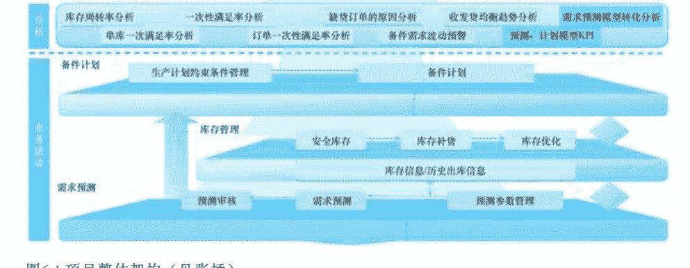
图6-1 项目整体架构（见彩插）
（2）售后备件生产计划

面向自产备件，以需求预测结果为基准，叠加各仓在库水平、运输与收发耗时、生产周期等要素，构建多目标优化的生产排程模型，力求在阶段性供需匹配、订单履约率最大化、安全库存最小化、库存资金占用最小化、安全库存保障率最大化之间取得均衡，帮助企业在保障供应的同时降本增效，提升售后服务支撑品质。

（3）售后备件库存优化
在既定生产计划前提下，统筹各仓库备件保有状况，建立库存优化模型，在满足客户交付要求的基础上压降各品类库存规模，降低仓储成本。

### 4. 项目可行性评估
我们从业务价值及ROI预估、数据可用性与可信度、技术可行性与可扩展性三个维度完成可行性研判。

（1）从业务价值评估和ROI预估方面
在售后备件业务中，精准的需求预测、高效的库存管理与合理的生产排程至关重要，直接决定售后服务水准、客户满意度及品牌口碑，进而带来增量客户与销售机会，项目业务价值突出。借助智能算法完成需求预测与生产排程，并联动备件库存管理系统，可减少库存量与库存周转天数，提升周转速度与客户满意度，同时降低库存费用与过期损耗。优化生产计划还能压缩生产成本、提高生产效率，进一步增厚利润。系统化测算显示，项目落地后可为企业节约成本约3500万～5000万元，ROI表现较高。

（2）从数据可用性和可信度方面
智能化需求预测、库存管理与生产计划均依赖大量历史数据进行训练与验证，且数据质量直接影响模型效果。项目启动前对企业现有数据进行摸底，涵盖数据质量与数据源等层面。总体来看，企业历史数据基础扎实、采集范围广、系统建设成熟，完整沉淀了近五年售后备件实际需求、各类生产计划、各品类库存等数据，具备较高的可用性与可信度。

（3）从技术可行性和可扩展性方面
项目难点在于多频次、多类型备件的需求预测。一方面不同备件材质差异大、生命周期非线性，单纯统计学习难以达到高精度；另一方面新品、次新品及非易损品预测难度更高。结合过往经验，需融合机器学习、数据挖掘与优化算法，实现需求预测、库存管理与生产计划的智能化，技术可行且具备扩展空间。同时，可根据企业不同需求与业务场景调整模型参数与算法，提升系统适应性与稳定性。

### 5. 项目实施
遵循智能化项目方法论，完成业务与流程调研、需求分析与定义、数据采集与预处理，并据此制定技术方案，包括备件需求量预测方案、备件生产计划优化方案与备件库存优化方案。在此基础上，分别搭建备件需求量预测系统、备件生产计划优化系统与备件库存优化系统，三系统串联运行：需求预测结果作为生产计划优化的输入，生产计划的输出再作为库存优化的输入，实现中央仓与区域仓的协同优化。各方案实现要点如下。

（1）备件需求量（维修需求量）预测技术方案及实施
企业售后备件品类众多，历史统计显示有6947种备件处于正常运维，需构建预测模型。以月均维修量为依据对售后备件进行分类，见表6-1。

表6-1 售后备件分类统计表

| | 常规件 | 次新件 | 全新件 | 总计 |
|---|---|---|---|---|
| 未流通件 | | | 962 | 962 |
| 快速流通件 | 597 | | | 597 |
| 中速流通件 | 935 | 1967 | | 2902 |
| 慢速流通件 | 757 | 1729 | | 2486 |
| 总计 | 2289 | 3696 | 962 | 6947 |

从品龄看，历史数据超3年的定义为常规件，1～3年为次新件，少于1年为全新件。从流通性看，月均维修量≥1000件为快速流通件，50～1000件为中速流通件，≤50件为慢速流通件。项目以企业月度维修需求量为预测目标，不再细分中央仓与区域仓。考虑计划排产、生产、出库与运输周期，预测时域定为未来12个月，即每月初滚动预测未来1～12个月各品类的维修需求。针对不同类型备件采用差异化算法，以下以典型分布为例说明。

1）中速流通平稳常规件。
该类备件历史维修数据超3年，月均50～1000件，需求平稳波动较小。以编号340440-00004为例，自2016年5月上市后月度维修量多集中在100～150件。该类可采用统计建模或机器学习结合硬件全生命周期模型预测，效果较好。

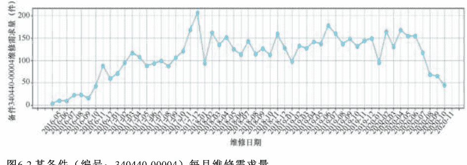

基于中速与快速流通平稳常规件的历史维修工单数据，构建机器学习与硬件全生命周期融合模型，预测未来维修量。长周期数据呈现锯齿状，相邻周期波动约13%且无明显季节性，机器学习擅长捕捉波峰波谷，全生命周期模型可分阶段刻画早期失效、偶发失效与耗损失效。通过融合，可准确识别上升锯齿期、平稳锯齿期与下降锯齿期。

2）低速流通平稳常规件。
历史数据超3年，月均≤50件，需求平稳。以编号770151-00089为例，自2017年7月上市后月度维修量多在15件以内，多因对应产品市场容量小或备件耐用。该类宜采用时间序列建模。

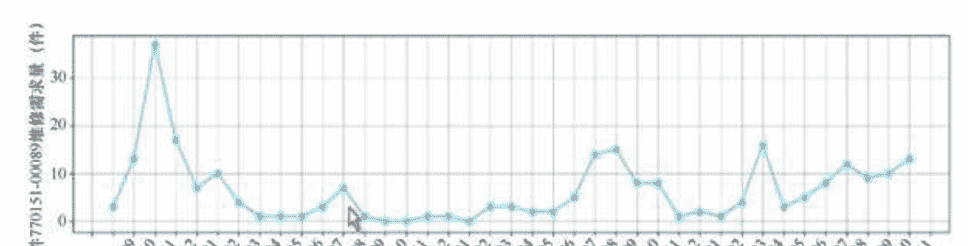

图6-3 某备件（编号：770151-00089）每月维修需求量

基于慢速流通平稳常规件的历史维修工单数据构建时间序列模型。数据呈现中长周期非规律性上升与回落，模型将数据分解为趋势、周期、季节与误差项，挖掘内生规律与外生影响，利用周期与季节特性捕捉非规律性拐点。

3）非平稳常规件。
历史数据超3年，大部分月份平稳，个别月份出现骤增骤降且无明显周期性。以编号800122-00069为例，自2017年6月上市后月度维修量多在5件以内，但在2018年6月—2019年6月出现异常抬升与回落，多因对应产品销量激增叠加生命周期衰减。该类宜融合时间序列与硬件全生命周期建模。

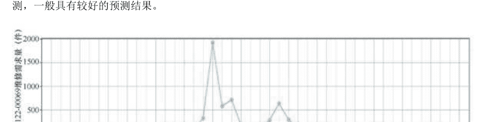

图6-4 某备件（编号：800122-00069）每月维修需求量

基于非平稳常规件的历史工单数据构建时间序列与全生命周期模型。数据在少数时段出现暴涨，月维修量可猛增300%以上甚至千倍，且周期与季节性较弱。时间序列模型分解趋势、周期、季节与误差，捕捉上升与回落点；全生命周期模型分阶段刻画三类失效期，与时间序列配合强化对暴涨段与平稳段的识别。

4）缺数据全新件及次新件。
历史维修数据≤1年或无记录，月均个位数且分布稀疏。以编号770252-00127为例，自2019年12月上市后维修量极少甚至为零，多因产品仍在销售期尚未进入维修高峰。该类宜结合硬件全生命周期与相似性准则建模。

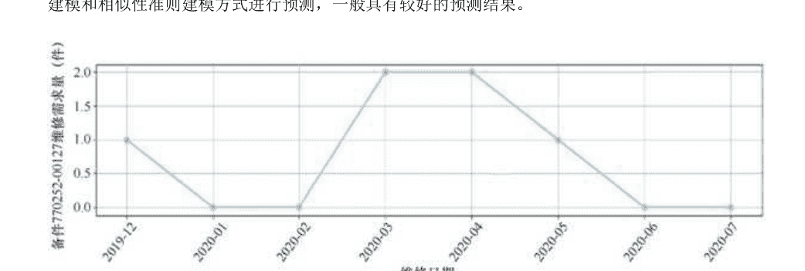

图6-5 备件（编号：770252-00127）月均维修需求量

针对全新件与次新件历史数据匮乏的特点，构建相似性准则模型与全生命周期模型。相似性准则挖掘同类备件特性，全生命周期模型拟合早期失效特征，两者叠加解决早期预测难题。

表6-2是编号340440-00004在不同算法下的预测表现。

表6-2 某备件（编号：340440-00004）在不同算法建模下的维修需求量预测

| 模型 | 训练 R² | 训练 MAE | 测试 MAE | 训练 ARA% | 验证 ARA% |
| :--- | :--- | :--- | :--- | :--- | :--- |
| LIGHTGBM | 0.573 | 21.823 | 51.748 | 76.00 | 43.80 |
| XGBOOST | 0.705 | 17.141 | 47.106 | 75.80 | 71.70 |
| LinearRegression | 0.718 | 5.356 | 6.573 | 81.54 | 80.34 |
| ARIMA | 0.721 | 6.014 | 7.340 | 82.58 | 82.34 |
| 硬件全生命周期失效函数 | 0.741 | 8.014 | 9.276 | 82.76 | 80.73 |
| 多模型融合 | 0.8245 | 4.685 | 5.9565 | 88.04 | 87.84 |

注：1. R²：拟合优度，取值[0,1]，越大越好。2. MAE：平均绝对误差，越小越好。3. ARA%：平均相对准确率，数值越大表示准确性越高。

共收集56个月实际需求数据，2016年5月—2020年6月训练，2020年后6个月测试。LIGHTGBM拟合趋势不足且波峰波谷捕捉弱；XGBOOST训练表现好但存在过拟合，测试偏差较大；LinearRegression趋势跟随灵敏但对小幅波动捕捉不足；ARIMA趋势跟随较好但部分月份偏大或偏小；硬件生命周期模型对趋势敏感、波动捕捉有限。模型融合在趋势拟合与波峰波谷预测上均表现最佳，结合生命周期算法后对未来拟合能力最强。综合来看，多模型分类型预测策略效果良好，整体准确度可达80%以上，为后续计划执行提供坚实支撑。

（2）备件生产计划优化方案及实施
备件生产计划需在市场需求与供应链约束下实现供需平衡，既保证充足供应又避免过量生产与囤积。核心目标是快速响应需求，避免靠库存兜底。计划环节关注订单一次满足率、单库一次满足率、缺货原因分析及需求波动预警等指标。本项目聚焦企业自产备件，还需兼顾原材料采购、生产与运输成本。

当前企业售后备件计划主要依靠人工测算。售后部门结合市场需求与零部件生产计划提出初稿，计划部门据产能、原材料采购与需求变化调整，反复沟通确定未来半年至一年排程，市场需求波动时需随时调整，对生产节奏影响较大。

本项目生产计划优化分为两部分：未来1～12个月各品类最优生产计划，以及备件生产计划决策仿真引擎。

具体而言，最优生产计划是在需求预测与产能等信息基础上制定，确保订单与单库一次满足率、避免缺货，并明确各备件生产时间与数量、调度产线与采购订单，保证计划落地。

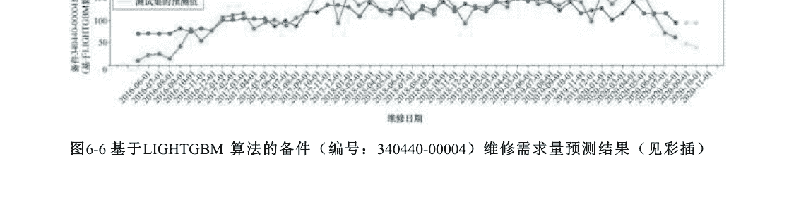

## 1）备件最优生产计划。
生产计划涉及数据采集、预处理、特征工程、算法建模与可视化等环节，需综合影响需求的多重因素。实现路径如下。

第一，数据采集。依托ERP与现场传感器双渠道，保障数据完整准确。涉及五类数据：备件需求数据、备件库存数据、备件运输数据、备件生产数据、产能限制数据。
- 备件需求数据：近5年实际需求量及未来1～12月预测需求量。
- 备件库存数据：中央仓与区域仓本月在库量、历史在库量、期初与期末库存、出库频率、日增量、日消耗、在途量等。
- 备件运输数据：本地仓、区域仓、中央仓运输时长，仓库间调拨周期。
- 备件生产数据：EOP&SOP阶段生产时长、物料准备、生产准备、原材料与替代料等。
- 产能限制数据：各生产单元在产情况、产能计划、原材料库存与到货时长、入库时长、库存限制等。

第二，数据预处理。采用清洗、合并、异常值处理、重采样等技术消除噪声与冗余。企业各系统已打通，通过API即可拉取历史数据。数据按备件与月度维度聚合，形成逐月备件数据表，为后续特征构建做准备。

第三，特征工程。提取季节性、月度累计变化、节假日影响、地域差异等关键特征。分析显示非平稳常规件受地域与季节影响最大，华东、华南区域在3、6、9、12月需求明显抬升，由促销、政策补贴与区域主推模式共同驱动。这些特征作为模型输入。

第四，算法建模。采用可调多目标运筹优化算法实现最优化。约束条件包括产能计划、原材料库存与到货时长、入库时长、库存限制等；优化目标为最小化库存成本、最大化服务水平、最小化缺货损失、最小化生产成本，可按实际需求调整权重。依据各备件过去6个月预测准确度均值设定精度权重，对预测需求进行校准，提升计划可信度。售后备件计划算法实现流程见图6-12。

最后，可视化。采用仪表盘与图表实时展示需求量与生产计划，预测结果动态更新，便于操作者及时发现问题并调整优化。

总体而言，各环节协同构成完整的备件生产计划体系，为企业决策提供可靠参考。

## 2）备件生产计划决策仿真引擎。

在本项目里，额外搭建了一套面向售后备件的计划决策仿真工具，供售后备件计划部门在落地前做虚拟推演。先前的备件最优生产计划系统更像是黑箱，输出只有最终的生产排期，看不到排期背后的成因，也难以判断其是否合理。正是为了解开这个黑箱，我们让仿真引擎承担起过程复现和效果检验的功能，核心在于把生产过程搬到数字环境中跑一遍，检验不同方案的实际表现，从而让决策更可信、更精准。它的实用价值体现在：投产前就能预判风险点，及时修正排期减少损失，同时压降生产费用，提升整体盈利。

使用时，计划人员可以自由调整约束条件、优化目标、风险假设和不确定性因子，引擎会同步给出多套备件生产方案的演算结果，并延伸展示对其他产线、工序的连带影响，同时量化呈现生产成本、库存成本、订单满足率等关键指标。基于仿真最优解对应的参数组合，再回溯校准最优生产计划系统的输入，就能得到更贴合实际、更稳健的备件生产方案。

这套仿真引擎由三部分构成。生产模型是基础，根据企业真实的产线环境，把产能、人力配置、设备状态、现有计划等现实要素和潜在风险都抽象进去。仿真算法在模型之上运行，借助概率论、统计学与随机过程反复抽样，得到不同参数组合下的运行轨迹。结果可视化则把算出的轨迹转成直观图表，帮助售后计划人员快速理解数据并挑选最适配的方案。表6-3为订单满足率为98%时的最优备件生产计划，它列出了限制条件下的推荐生产方案、推荐库存方案、生产成本和库存成本。根据仿真结果，库存成本为111万元人民币，生产成本为1150万元人民币。

图6-12 售后备件生产计划算法实现流程

表6-3 订单满足率为98%时的最优备件生产计划

| 时间 | 1月 | 2月 | 3月 | 4月 | 5月 | 6月 | 7月 | 8月 | 9月 | 10月 | 11月 | 12月 |

| :--- | :--- | :--- | :--- | :--- | :--- | :--- | :--- | :--- | :--- | :--- | :--- | :--- |

| 推荐生产方案/GWh | 1 | 0 | 0 | 0 | 1.5 | 3.5 | 3 | 0 | 3 | 0 | 0 | 3 |

| 推荐库存方案/GWh | 0.9 | 0.5 | 0.3 | 0.2 | 0.1 | 0.4 | 1.6 | 0.1 | 2.2 | 1.5 | 0.2 | 0.2 |

| 生产成本（万元） | 95 | 0 | 0 | 0 | 135 | 245 | 225 | 0 | 225 | 0 | 0 | 225 |

| 库存成本（万元） | 8.1 | 2.5 | 0.9 | 0.4 | 0.1 | 0.6 | 25.6 | 0.1 | 48.4 | 22.5 | 0.4 | 0.4 |

在同一套限制条件下，引擎会枚举所有可行的备件生产方案，支持按需对比并给出最优推荐。以订单满足率98%为例，系统共生成28种可行方案，挑出总成本最低的3种进行可视化对比。对比显示，第28种方案的库存规模最小，生产费用与库存费用也均为最低。

总体来看，备件生产计划决策仿真引擎的落地，意在提升排期的可靠性与决策质量，降低企业的运营风险和成本，为备件生产提供科学、智能的新路径。

#### （3）备件库存优化技术方案及实施

项目第三部分聚焦备件库存优化系统的建设。目标是科学配置中央仓、区域仓与本地仓的备件分布，在保障区域订单最大化履约的前提下，压缩各节点的库存占用。

该系统的内核由库存模型与补货模型两部分组成。库存模型负责确定各仓各备件的保有量与安全库存水平，补货模型负责给出最佳补货时机。以下分别说明实现思路。

##### 1）库存模型。

库存模型本质上是用来计算与预测库存水平的数学工具，目标是平衡库存成本与缺货风险。常见做法分为基于需求、基于容量、基于时间三类。其中基于需求最为常用，依据历史或预测需求推算所需库存。典型方法有定量法、安全库存法、经济批量订货模型等。定量法按预测需求与库存上限计算各期最优批量；安全库存法在需求波动较大时预留缓冲以防断供；批量订货模型则结合经济订货量与库存周期确定最优规模。

基于容量的方案适用于库容受限的仓储或备件中心，按空间与体积测算库存；基于时间的方案多用于保质期敏感品类，按时效与需求量测算库存。

本项目采用需求预测驱动并融合定量法与安全库存法的思路。备件预测周期很长，近7000种备件的长周期准确性难以保证，新旧件预测难度更高，因此无法将总需求直接细化到各仓库使用定量法。单纯依赖历史统计的安全库存法易导致冗余抬高成本。

为此引入需求分摊法，先把各零部件的总需求预测按比例拆分到各仓，得到仓级需求，再用机器学习定量预测未来1~6个月的库存量。为抵消预测偏差，同时建立基于需求不确定性与订单满足率的安全库存机制。

确定仓级需求的第一步，是拿到全国近7000种备件的1~12个月总需求预测。以备件编号340440-00004为例，其月度需求预测见表6-4。

表6-4 某备件（编号：340440-00004）的每月需求量预测结果

| 时间 | 2023年1月 | 2023年2月 | 2023年3月 | 2023年4月 | 2023年5月 | 2023年6月 | 2023年7月 | 2023年8月 | 2023年9月 | 2023年10月 | 2023年11月 | 2023年12月 |

| :--- | :---: | :---: | :---: | :---: | :---: | :---: | :---: | :---: | :---: | :---: | :---: | :---: |

| 需求量预测（件） | 1356 | 1021 | 987 | 890 | 1032 | 1215 | 859 | 982 | 796 | 956 | 1108 | 948 |

再依据中央仓、区域仓、本地仓的历史实际需求占比，采用统计比例分摊法把月均预测拆分到各仓单元。备件340440-00004的分摊结果见表6-5。

表6-5 某备件（编号：340440-00004）的预测需求量在各仓库单元的分摊结果

| 仓储单元 | 仓库编号 | 月均需求比 | 1月 | 2月 | 3月 | 4月 | 5月 | 6月 |

| :--- | :--- | :--- | :--- | :--- | :--- | :--- | :--- | :--- |

| 中央仓 | 中央仓 A | 3.80% | 52 | 39 | 38 | 34 | 39 | 46 |

| 区域 A | 本地仓 AA | 7.60% | 103 | 78 | 75 | 68 | 78 | 92 |

| | 本地仓 AB | 10.20% | 138 | 104 | 101 | 91 | 105 | 124 |

| | 本地仓 AC | 6.20% | 84 | 63 | 61 | 55 | 64 | 75 |

| 区域 B | 本地仓 BA | 4.50% | 61 | 46 | 44 | 40 | 46 | 55 |

| | 本地仓 BB | 7.20% | 98 | 74 | 71 | 64 | 74 | 87 |

| | 本地仓 BC | 4.40% | 60 | 45 | 43 | 39 | 45 | 53 |

| 区域 C | 本地仓 CA | 12.60% | 171 | 129 | 124 | 112 | 130 | 153 |

| | 本地仓 CB | 12.70% | 172 | 130 | 125 | 113 | 131 | 154 |

| | 本地仓 CC | 9.40% | 127 | 96 | 93 | 84 | 97 | 114 |

| 区域 D | 本地仓 DA | 4.80% | 65 | 49 | 47 | 43 | 50 | 58 |

| | 本地仓 DB | 9.30% | 126 | 95 | 92 | 83 | 96 | 113 |

| | 本地仓 DC | 7.30% | 99 | 75 | 72 | 65 | 75 | 89 |

安全库存的构建考虑了四个维度。需求不确定性，预测越不准，安全库存需越高；需求波动性，季节、天气、市场变化导致需求剧烈波动时需更高缓冲；供应链风险，采购、加工、运输、配送周期越长，安全垫需越大，本项目备件产线与主产品共用，需求波动会传导至备件；库存服务水平，即订单满足率，服务要求越高，安全库存相应提升。

项目中采用机器学习预测安全库存。收集各仓各备件的历史需求、季节差异、历史销量、产线信息、生产计划、周转率、库存成本、占比、调拨周期、准时交付率等特征，结合ARIMA时间序列与GBDT模型，预测未来1~6个月安全库存。按此方法得到的备件340440-00024各仓月度需求预测见表6-6。

表6-6 各仓储单元的（编号：备件340440-00024）每月的需求量预测结果

| 仓储单元 | 仓库编号 | 1月 | 2月 | 3月 | 4月 | 5月 | 6月 |

| :--- | :--- | :--- | :--- | :--- | :--- | :--- | :--- |

| 中央仓 | 中央仓 A | 22 | 18 | 18 | 14 | 17 | 22 |

| 区域 A | 本地仓 AA | 44 | 36 | 37 | 28 | 35 | 43 |

| | 本地仓 AB | 59 | 49 | 49 | 37 | 46 | 58 |

| | 本地仓 AC | 36 | 30 | 30 | 23 | 28 | 35 |

| 区域 B | 本地仓 BA | 26 | 22 | 22 | 16 | 20 | 26 |

| | 本地仓 BB | 42 | 35 | 35 | 26 | 33 | 41 |

| | 本地仓 BC | 26 | 21 | 21 | 16 | 20 | 25 |

| 区域 C | 本地仓 CA | 73 | 60 | 61 | 46 | 57 | 72 |

| | 本地仓 CB | 74 | 61 | 61 | 46 | 58 | 73 |

| | 本地仓 CC | 55 | 45 | 45 | 34 | 43 | 54 |

| 区域 D | 本地仓 DA | 28 | 23 | 23 | 18 | 22 | 27 |

| | 本地仓 DB | 54 | 45 | 45 | 34 | 42 | 53 |

| | 本地仓 DC | 43 | 35 | 35 | 27 | 33 | 42 |

##### 2）补货模型。

补货模型用于判断何时补货、补多少，以满足需求并保持库存不低于安全水平。核心参数是补货周期与补货量。主流做法有基于需求预测的补货与基于库存水平触发的补货。前者用移动平均、指数平滑、回归、ARIMA等方法预测需求后确定订货量；后者根据当前库存与安全库存的差值触发补货，常用最小库存法与变动安全库存法。

本项目中补货决策受四类因素影响：安全库存水平决定底线；运输时长与调拨周期要求提前量，不同出货地与流程时间差异明显；生产计划通过产能与供应能力间接影响补货可行性；需求预测的波动性直接影响库存高低与补货频次。

据此搭建了基于运筹优化的备件补货仿真引擎，如图6-14所示。引擎输入包括三个可调参数：生产计划间隔NRT、运输与补货时间VLT、应对供应波动与预测偏差的缓冲时间BP；三个安全库存计算模型；以及安全库存结果、需求预测结果、库存模型结果三类基础输入。输出为各库存单元每个备件未来6个月的补货时间与补货量。

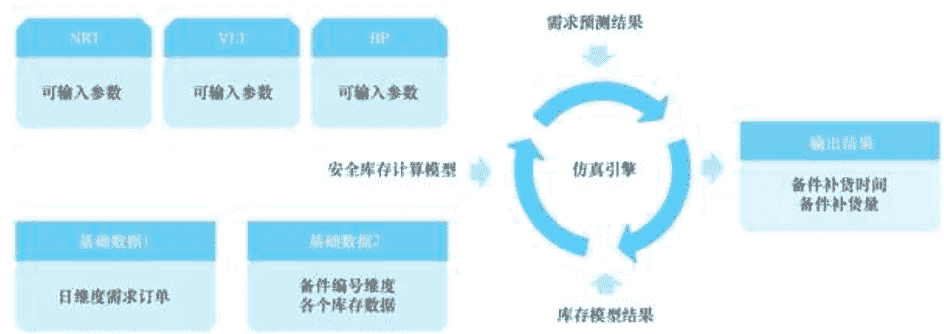

图6-14 基于运筹优化算法的备件补货仿真引擎

以区域A本地仓AB中备件340440-00024为例，其补货计划见表6-7。

表6-7 本地仓AB中某备件（编号：340440-00024）的补货时间和补货量结果

| 月份 | 第1次 | | 第2次 | | 第3次 | | 月度补货总量 |

| :--- | :--- | :--- | :--- | :--- | :--- | :--- | :--- |

| | 补货时间 | 补货量（件） | 补货时间 | 补货量（件） | 补货时间 | 补货量（件） | |

| 2023年1月 | 1月9号 | 9 | 1月16号 | 7 | 1月21号 | 6 | 22 |

| 2023年2月 | 2月8号 | 11 | 2月17号 | 6 | 2月23号 | 9 | 26 |

| 2023年3月 | 3月12号 | 6 | 3月19号 | 5 | | | 11 |

| 2023年4月 | 4月9号 | 7 | 4月18号 | 7 | 4月27号 | 8 | 22 |

| 2023年5月 | 5月13号 | 9 | 5月20号 | 10 | | | 19 |

| 2023年6月 | 6月10号 | 11 | 6月26号 | 16 | | | 27 |

### 6.项目总结

项目旨在提升售后备件的供应效率与管理水平，覆盖需求预测、生产计划与库存优化三个环节。采用多元方法与工具组合实现目标。

需求预测层面，针对不同备件的周期差异，使用历史趋势分析、机器学习等多种手段，并结合产品生命周期与市场变化定期校准。

生产计划层面，构建多目标优化模型，融合需求预测、在库库存、运输与出入库时长、生产周期等信息，实现订单满足率最大化、安全库存最小化、库存成本占用率最小化与安全库存保障达标等目标。

库存优化层面，建立库存模型确定各仓库存与安全库存水平，建立补货模型确定最优补货时间，在满足客户需求前提下压降库存占用，降低综合成本。

项目落地后的运行数据相当亮眼。覆盖近7000个售后备件品类的需求预测，平均准确率稳定在80%以上，直接推动了生产计划的制定与执行发生根本性变化。生产端优化方案的月均采纳比例达到67%，与此同时备件生产计划的决策仿真引擎已全面取代过往的人工核算流程，售后计划团队的重复性工作负担大幅减轻。库存侧的优化系统也完成全链路对接，在华东、华南区域仓及本地仓半年试运行期间，备件需求的月均满足率达到94.5%，同比提升3.5个百分点；平均安全库存下降12.6%，单仓库月均库存成本降低5.8%。

综合来看，该方案打通了需求预测、生产排程与库存管理三个环节，提升了售后服务支撑能力，降低了备件库存压力，能够快速跟上市场波动实现供需平衡。智能化手段在真实场景中帮助企业以更科学、更高效的方式管理备件全生命周期，客户满意度与企业竞争力同步增强。

## 6.3 某卷烟厂——基于机器学习与运筹优化的制丝线智能控制系统

### 1.企业简介
我国烟草行业长期位居国民经济支柱产业，年销售额超过1.2万亿元，年利润超3000亿元。某卷烟厂成立于1952年，是国内最早的卷烟生产企业之一，近年来持续在数字化与智能化方向深耕，成效明显。

一方面，工厂加速将信息技术与数字化技术融入生产、管理与服务全流程，搭建起稳定可控的网络与系统平台，为各类业务顺畅运行提供底座。生产现场引入互联网与物联网技术，实现生产数据透明、可溯源、可智能化，效率与质量同步提升。销售服务方面，依托多元互联网平台和数字化工具，与消费者互动更紧密，销售渠道扩大，服务体验和品牌影响力增强。

另一方面，企业加大人工智能与机器人技术的应用力度，从内部制造管理到外部服务接待都在探索更高效的流程与更好的用户体验。产线上部署机器人检测与自动化装备，实现精准自动化控制，产能与品质双升。客服领域则积极试点智能客服、机器翻译等，提升响应速度与服务感知。

总体而言，该厂的数字化实践为烟草行业转型升级提供了可参考路径，也为传统制造业向智能化迈进积累了经验。

### 2.项目背景
在烟草制丝环节，烟丝水分是决定品质的核心工艺参数。水分过高易霉变，过低则易产生碎料，均会带来损失。但制丝线受多道工序串联影响，水分稳定性难以保证。制丝线涵盖原料处理、叶片割裂、膨胀处理、水分控制、叶片输送、干燥、烟丝处理与包装等，每一步都直接影响最终烟丝质量与口感，其核心作用是让烟草生丝水分保持准确稳定。

当前行业多以PID调节配合人工经验来控水。受制丝线前后设备耦合影响大、滞后明显，人工经验受个人能力限制，操作滞后会破坏烟丝均质性。PID控制效果有限，需要工艺专家频繁校正调试，过度依赖主观判断。叠加数据不及时、不完整、不准确以及生产计划与过程的不确定性，批间加工含水率常难达标。

因此，推动制丝线水分控制向数字化、智能化转型成为各厂共识。

### 3.项目的目标和意义
项目旨在融合AI与工艺机理，打造产品质量自动化控制、多工艺目标协同、流程自动化联动、多维参数自调、异常自动化预警的制丝线自控系统。基于机器学习实时处理生产数据，结合运筹优化算法，实现精准控水与调节。

系统目标归纳为五大智能化：质量控制智能化、目标协同智能化、产线联动智能化、参数优化智能化、异常预警智能化。具体包括：用机器学习构建质量控制模型降低指标偏离；用运筹优化构建多目标优化模型实现制丝最优；用动态规划构建敏捷控制模型快速响应上游来料波动；用因果链路构建参数网络模型提升各工艺段与关键设备稳态；用Crow-AMSAA构建工艺异常预测预警模型实现实时异常管控。

运行逻辑上，传感器实时采集制丝过程水分数据回传至智能平台，平台运用机器学习进行实时分析，结合温度、湿度、气压等参数及历史制丝数据，自主优化各设备操作参数，形成全流程闭环。系统可稳定生丝水分、降低水分标准差，提升产品均质性与稳定性，减少人工干预带来的误差，为企业提供可靠生产保障，提升效率、降本增效。

### 4.项目可行性评估
评估维度覆盖业务价值与ROI、数据可用性与可信度、技术可行性与可扩展性。

业务价值与ROI预估方面，构建智能控制系统可替代人工控水，提效增质降本。
提高生产效率：搭载运筹优化算法实时调优工艺参数，初步测算效率提升10%～15%，年均新增产值约500万元人民币，5年累计约2500万元。
提高产品质量：实时监测烟叶烟丝水分并自适应调整，产品稳定性预计提升10%，水分整体标准偏差由人工调控的0.08降至0.05以内，变差优化率37.5%。
降低生产成本：实时监测与控制减少能耗人力浪费，稳定水分温度降低废叶废丝率，综合成本预计下降15%。综合测算项目1～2年可收回投资，并带来长期效益。

数据可用性与可信度方面，厂内在“十三五”与“十四五”初期已成立信息化管理部门，构建稳定网络平台与系统平台，建立信息管理组织架构与运行体系，搭建生产管控平台与数字孪生平台，完善信息安全体系。

生产管控平台与数字孪生平台可实时监测温度、湿度、氧气浓度、热辐射等参数，数据既可分析也可直接用于产线控制与优化。数字孪生平台可批量采集、存储、自动处理与分类海量传感器数据，更贴近实际工况，提升数据库可用性与实时性。

在可信度上，数字孪生采用数据过滤、异常检测、数据质量评估等多重校验。烘丝机先进控制模型研究中，通过建立复杂烘丝模型、对比历史数据与模拟数据并迭代参数，确保模型精度与生产可靠性。温度湿度监测时，数字孪生数据与物理传感器实时比对，保证准确可信。整体数据基础为智能化转型提供了坚实支撑。

### 5.项目实施
实施路径包括业务流程调研、需求分析定义、数据采集预处理、技术方案制定与系统开发框架设计。核心控制方案开发涵盖五大模块。

1）基于机器学习的出口质量智能控制。
制丝线对水分影响最直接的设备为回潮机、加料机、烘丝机三类。回潮机通过温湿度调节实现烟丝回潮，特点是温湿度均匀可控、回潮速度快。加料机负责将化学添加剂、香料等投配，操作简便、加料精准。烘丝机通过加热通风完成干燥，烘干效果好、时间可控、系统协调性强。

出口质量智能控制目标是基于三类设备历史数据建模，自动输出满足出口质量要求的控制指令，配合人工干预，使各设备出口含水率稳定在允差范围内，质量数据更平稳。实现包含四个子模块：
- 基于数据科学与热力学机理的大时滞机理模型。针对数据非线性、时变、强干扰、耦合与大时滞特性，构建时滞模型对齐数据，提升仿真与控制精度。
- 基于深度学习的自适应状态识别与出口含水率、出口温度预测。利用历史运行参数及原料流量水分波动数据，建立预测模型，实现质量在线监控。回潮机出口含水率波动大，采用深度神经网络DNN提升拟合效果。
- 基于运筹优化的参数组合优化模型。结合出口含水率与温度预测结果，模型推荐可操作的参数组合，操作人员据此调整设备，使指标达标。鉴于参数调整幅度小，采用禁忌搜索实现寻优。
- 基于Online Learning的在线自优化。生产中参数、工艺、技术、环境持续变化，需在线自适应自学习。区别于离线批学习需全量重训练、响应慢且资源占用高，在线学习可根据线上预测结果动态修正，及时反映变化。

2）基于多目标强化学习的协同优化。
方案旨在通过多目标强化学习实现多项质量指标协同提升。系统建立单机多层级多维度统筹模型，提高产品质量、降低干头干尾率、减少物料损耗。控制目标包括各关键设备出口水分与温度、干头干尾率、加香精度与变异系数、加料均匀性及烟丝、水分、香料等损耗。

通过强化学习搭建协同优化模型，设置回潮机、加料机、烘丝机等智能代理，实现生产过程智能化管理与实时优化。具体步骤：①确定协同指标组合，将制丝线15个控制指标按工艺关联分为6组；②构建多目标优化模型，融合运筹优化与Q-learning、Actor-Critic算法；③为各设备分配智能代理；④设计奖励机制，按加料均匀性、物料损耗等任务完成情况给予奖励；⑤对代理进行试错训练。最终实现多质量目标协同，适应生产波动，提升效率与经济效益。

3）基于动态规划的敏捷控制算法。
来料水分异常、断料堵料、温湿度突变会使仿真与控制失准。基于动态规划的敏捷控制算法可实时响应波动，实现参数敏捷调整与质量保持。流程为构建来料波动检测与状态识别模型识别单机质量波动区间，结合禁忌搜索动态规划算法实时调整参数，并将异常状态标记为人工学习范式，固化控制逻辑。优势在于快速响应、提升控制精度，并通过经验积累持续优化模型，帮助管理者及时发现问题、优化流程。

实现步骤包括：①建立初步数据分析模型，完成数据清洗、变换、归一化、可视化与统计分析，掌握关键特征；②构建来料波动检测与状态识别模型，采用基于最大期望EM算法的高斯混合模型实时识别质量波动区间；③构建动态规划算法模型，明确状态转移方程与最优化目标函数，兼顾实时性、可行性与可调节性；④通过策略控制与机理纠偏实现质量控制，异常状态标记后形成自学习优化闭环，提高效益与质量稳定性。

卷烟智能制造与汽车售后数字化的两段实践

要把品质管住，第一件事是把影响烟丝品质的作业变量找出来，比如温度、湿度、运转速率等。对这些关键因子做持续追踪并形成闭环调节，就能把丝质偏低、波动增大的隐患降下来。

整体看，以动态规划为驱动的敏捷调控路径，先搭建数据分析底座、来料波动探测与工况辨识模块、动态规划核心算法，再落到品质管控并不断迭代优化模型，能够有效化解制造企业在数智化转型中的典型痛点，提升工厂整体运行效能，为长远发展提供正向支撑。

## 4）自适应参数调优引擎，维持运行状态长期平稳

本项目自研了一套多策略自学习参数调优引擎。它的学习范围不止于历史记录，还能够针对烟叶加工产线上的各类主机、同系列不同厂牌主机、不同烟丝规格进行差异化调参，实现精准化干预并提升整体建模精度。方案采用在线增量学习的方式，搭建多目标联动优化框架，让各环节效能同步提升，最终达成操控体系长期平稳运行。

借助该引擎，历史记录与人工经验持续累加，自优化体系能够不断吸收新经验。通过优化评估机制完成新旧经验的累积与迭代置换。我们按主机类型、厂牌、烟丝规格分别调参，构建适配不同季节与生产状况的专属模型。同时引入积极式自学习来强化人工经验的提炼，确保操控体系长期保持平稳优化。

## 5）多模态工艺异常预测与预警体系，守住系统稳定

为确保智能操控体系的可靠性，我们打造了一套多模态工艺异常预测预警体系。该体系能够实时巡检操控流程，对各类异常进行前瞻预测与预警，覆盖操控体系异常、操控结果不达标、调参过程异常等场景，流程如图6-15所示。

通过多模态监测算法，体系能够及时捕捉模型参数不合理、参数长时间未刷新、模型运行异常、操控指令失效或延迟、系统宕机等情况。同时还能监控因操控灵敏度异常、机械故障、机械磨损老化、维修后出现的操控偏差等导致的结果不达标问题。针对调参后的异常，仍以自优化方式应对，通过前述参数调优引擎持续优化历史记录并构建适配不同季节与生产情况的模型。一旦异常出现，体系即刻完成判别并发出预警，实现敏捷纠偏与人工介入，保障智能操控体系稳定运行。

## （2）烟丝加工智能操控体系架构设计与开发

下面重点介绍烟丝加工智能操控体系的整体架构，如图6-16所示。体系自下而上由四层构成：信息采集、信息整合、智慧算法与智慧应用。

##### 1）信息采集
本项目信息来源主要分三类：一是终端侧信息，包括加工产线各操作界面信息、各主机信息、各终端传感实时信息；二是体系侧信息，包括加工产线上所有操控体系、监控体系、人工下达指令体系等信息；三是与操控目标相关的离线与在线检测、评估、计算相关指标信息。上述信息通过集控体系、MES、TIMMS、数据终端等以接口协议方式实时接入智能操控体系。

##### 2）信息整合
采集完成后，体系会自动执行信息清洗、处理与特征工程，并依据不同模型的入参需求，将信息组合成各类信息宽表，便于后续分析与训练。宽表可按信息源、时间粒度、变量组合等维度划分。然后在不同宽表间进行融合与统计分析，挖掘隐含经验与知识，提升操控体系的精准度与效率。

##### 3）智慧算法
智慧算法层是体系的核心，承载全部算法与模型，并由模型管理库统一分类管理。如图6-17所示，共构建七大类、265个细分模型：

- 数据分析模型库：挖掘生产信息中的可用信息，为决策与优化提供依据。
- 工艺模型库：建立生产环境下各工艺的数学模型，实现过程描述与预测。
- 基础模型库：涵盖回归、决策树、神经网络等基础统计模型与智能算法。
- 预测仿真库：用于生产计划与产品质量预测仿真。
- 操控算法库：提供PID、自适应操控、模糊操控等算法，优化生产环节操控。
- 优化算法库：面向优化调参、参数自适应等场景。
- 预警算法库：依托数据挖掘与机器学习，实现异常检测与预警。

七类模型共同构成完整算法支撑，保障体系稳定与生产效率提升。

##### 4）智慧应用
智慧应用层与加工产线直接交互，是核心操控方案的实现载体，包含品质操控、目标协同优化、产线联动操控、参数优化操控、智能预警五大模块。

图6-17 烟丝加工智能操控体系模型管理库

### 6.项目小结

项目旨在探索数字化与智能化转型在卷烟制造智能操控中的应用，以烟丝加工为核心，融合机器学习与运筹优化实现智能操控。该体系落地后为烟丝品质管控提供了新思路，对行业创新有积极参考价值。

在体系中，智慧算法层是核心，汇聚全部算法与模型赋予决策能力；智慧应用层直接关联产线，涵盖品质操控、目标优化、产线联动、参数优化与智能预警。通过机器学习与运筹优化的结合，成功构建多模态工艺异常预测预警体系，提升生产效率与操控质量，实现加工产线稳态优化，为提升行业效率与质量奠定基础。

落地后价值显著：多模态异常预测预警帮助工厂实时掌握生产状态、提前预警以减少质量损失；机器学习手段对不同批次烟叶进行信息建模，提升烟丝质量均衡性与稳定性，提高烟叶利用率；生产流程优化带来效率提升与成本控制，增强盈利能力。整体上更好地满足健康风险管控与消费者健康需求，缩短研发周期、提高产品质量，增强市场竞争力。

## 6.4 某国产汽车龙头企业——售后服务智能优化

### 1.企业概况
该车企是中国领先的汽车制造商之一，主营整车制造、汽车零部件制造与销售服务。截至2023年，员工约12.8万，拥有38个工厂与研发中心，产品覆盖轻型商用车、乘用车、新能源汽车等。2022年年营业收入约1.2万亿元人民币，其中整车销售约占70%，零部件销售约占30%，规模与实力居行业前列。

近年企业加速数智化探索。在智能制造方面，成立智能制造研究院，引入智能设备实现产线自动化与高效化，提升效率与质量；在新能源领域，与中国移动合作打造行车管理App，实现充电状态实时监控与远程操控、在线预约充电等服务；在智能驾驶方面，引入自动驾驶技术与智能交通管理系统，实现车与车、车与路的信息互联，提升安全与通行效率，为未来发展奠定基础。

### 2.项目缘起
随汽车保有量攀升，汽车售后市场潜力巨大。售后维保市场体量大、成长性好、集中度低，成为产业新焦点。主机厂与经销商需提升客户忠诚度、减少流失、建设高效客户管理体系方能占优。

该车企售后服务存在客户忠诚度低、流失率高的问题。竞争加剧下消费者更重体验与个性化，企业需更精准把握需求。通过大数据分析技术可更好理解、预测与满足消费者需求，提升忠诚度与服务效率；预测付费零部件购买概率可实现精准营销；预测保外客户定期保养入厂概率可提高邀约触达效率，实现差异化服务与业绩提升。因此利用大数据分析优化售后服务十分必要。

### 3.项目的目标和范围
项目围绕售后服务优化场景，针对维保客户构建客户流失预测模型、流失客户挽回概率预测模型、流失影响因素分析、保养产品购买概率预测模型。如图6-18所示，通过模型实现流失客户精准挽留、制定针对性维护方案、延长客户生命周期。

#### （1）保有客户流失预测
基于售后信息建模预测保有客户流失率，分析影响因素，指导业务优化邀约模式，提升邀约精准性，降低流失、提高回店率。

#### （2）流失影响因素分析
从售后服务质量、行业价格竞争、个性化服务、信息透明度与客户权益保障等维度，剖析客户流失驱动因素，为挽回策略与保养套餐推荐提供依据。

#### （3）流失客户挽回概率预测
在厘清流失原因基础上挖掘挽回概率。对高流失高挽回客户可采取优惠或专属服务提升满意度与忠诚度；对高流失低挽回客户则需长期沟通回访、持续信任培育以逐步提升挽回概率。

#### （4）保养产品购买概率预测
基于售后信息与客户特征预测保养产品购买概率，提升高价值付费产品与保养套餐销量。利用历史保养记录、车况信息等建立行为预测模型，基于预测结果向客户推荐适配套餐并配合促销手段，优化服务、提升满意度与营收。

图6-18 汽车售后服务优化场景

### 4.项目可行性评估

#### （1）从业务价值评估和ROI预估方面
项目可提升售后服务效率与客户满意度，吸引更多保养消费，增加收益；同时挖掘流失原因与概率，制定挽回策略，减少负面影响。业务价值明确，若ROI达预期，可有效提升竞争力与市场份额。

#### （2）从信息可用性和可信度方面
“十三五”及“十四五”初期，企业建信息化管理部门，构建全厂信息化整体架构。

信息可用性：项目涵盖保养记录、车况信息及社交媒体信息等，更新及时、质量有保障、历史信息充足，满足大数据分析需求。

信息可信度：客户信息来源可靠，经清洗处理后真实反映保养行为与购买意愿；企业持续优化客户管理体系，并整合社交媒体、用户行为、第三方信息丰富可信度；2017、2018年两次信息质量专项治理确保质量。

分析方法：采用数据挖掘、机器学习、自然语言处理等技术，可准确发现流失隐含规律与原因，制定有效挽回策略。综合来看项目可行。

### 5.项目实施

项目在大数据平台上实现自动化信息处理与模型构建，预测客户流失率并进行根因分析与挽回概率预测，同时提供保养套餐推荐，结果推送至客户画像应用及DMS系统，指导经销商进行客户关系管理。

#### （1）场景实现架构与实现流程
架构如图6-19所示。模型部署于大数据平台并与DMS系统连通。售后相关信息汇聚于DMS后通过API导入大数据平台，经处理与特征工程形成各模型所需宽表，模型包括客户流失预测、流失影响因素分析、流失客户挽回概率预测、保养产品购买概率预测。

客户流失预测模型输出流失排序与评级，回传DMS形成预警；流失影响因素分析模型输出重要因素，形成行为特征模式；流失挽回概率预测模型基于前两步结果输出挽回概率与针对性策略，回传DMS形成挽回推荐；保养产品购买概率预测模型输出购买概率，形成保养产品推荐。整体目标是通过流失预测与定向挽回提升满意度与利润。

图6-19 售后服务优化实现架构

#### （2）信息选择及特征工程
信息来源于DMS售后客户信息，涵盖客户基本信息、车辆状态、车辆基本信息、消费水平、三包、客服、回站习惯、服务站、保养套餐、保修等10大类，初筛后得368维有效信息，经特征构建与选择后形成596个有效特征。特征构建在原始信息上补充新特征提升描述力；特征选择筛选与目标变量相关性高的特征，保证模型有效性。

以客户流失率预测模型为例，入模变量达90维，涵盖曾购车品牌、个人年收入、购车人年龄段、购车重视因素、家庭常住地类型、家庭成员构成、家庭年收入、家庭人数、家庭状态、进站频次分类、客户爱好、客户类型、客户状态、是否为会员、喜好车型、消费金额分类、性别、是否为意见领袖、是否为忠诚客户等，可用于预测流失率、分析原因并优化售后流程。

#### （3）客户流失率预测

精准触达：让回店邀约从盲打转向画像

提升到店比例的核心在于提前主动联系。现阶段多数服务站仍沿用5、6、9、12个月未进站就批量外呼的老习惯，主要目的只是提醒保养。筛选只依据上次到店时间，沟通话术高度一致，既缺少针对性也拉低转化，反而增加了前线同事负担。正因如此，项目首先把工作重心放在流失风险的提前判断上。

整体逻辑如图6-20所示，先对流失行为进行建模并分层，再依据分层结果匹配差异化的邀约策略与沟通话术，从而改善转化与回店情况。

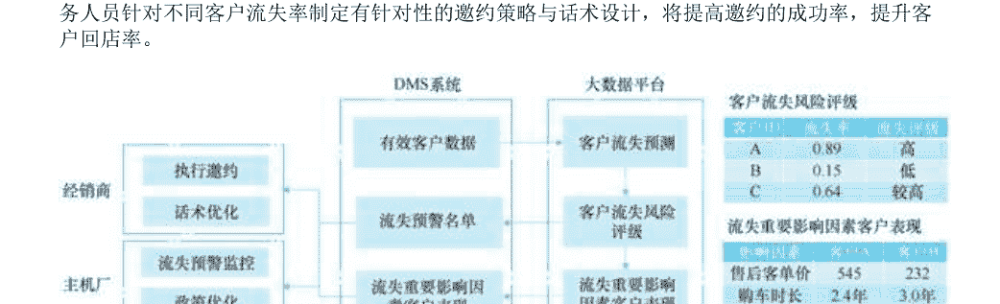

建模样本来自190家已完成初始化的经销点，选取2017年12月1日至2019年11月30日期间有到店记录的车辆，汇总全部到店轨迹约76.5万辆。按业务口径，连续12个月及以上未到站即视为流失。

预测目标是判断在某一时点之后12个月内是否会进入流失状态。验证以2019年12月1日以后的真实到店行为为依据，若随后12个月无到店记录则判定为流失。

流失概率模型已上架至企业数据中台，操作权限限定为平台管理员。数据就绪后管理员可触发预测任务，结果写入中台客户信息表，随后经数据服务推送至DMS，支撑回访处理等模块调用风险查看功能。客户流失率预测应用示例见表6-9。

表6-9 客户流失率生成

| 用例名称 | 客户流失率生成 |

| :--- | :--- |

| 功能描述 | 模型预测所有客户是否在12个月内成为流失客户，输出流失率及流失率等级（较低/低/中/较高/高），流失率等级划分规则为按照客户流失从高到低进行排序，前20%客户流失率等级为高，前20%-40%为较高，前40%-60%为中，前60%-80%为较低，剩余20%为低 |

| 用户 | 系统管理员 |

| 前提条件 | 数据准备完成，模型训练完成 |

| 主要过程步骤 | 启动流失率生成→客户数据加载→概率预测→客户流失率数据写入 |

| 结束条件 | 预测率数据写入客户信息数据表 |

#### （4）客户流失影响因素分析

在预测结果基础上，系统会呈现车主在关键影响维度上的具体数值，便于后续研判。影响因子是在整体客群层面统计得出，并非个体指标，因子数值越大，说明该维度对流失行为的驱动越强。客户流失影响因子分析见表6-10。

表6-10 客户流失影响因子分析

| 排名 | 特征 | 重要性 | 排名 | 特征 | 重要性 |

|---|---|---|---|---|---|

| 1 | 下次保养时间距今时间 | 8.71 | 11 | 平均回站里程 | 4.36 |

| 2 | 价税合计 | 8.46 | 12 | 末次维修实收费用合计 | 4.30 |

| 3 | 平均月行驶里程 | 7.27 | 13 | 末次维修结算金额 | 3.76 |

| 4 | 平均回站周期 | 5.71 | 14 | 末次服务站省份 | 2.90 |

| 5 | 末次服务站所在城市人均收入 | 5.64 | 15 | 总维修结算次数 | 2.83 |

| 6 | 末次服务站日接车辆 | 5.60 | 16 | 估计行驶里程 | 2.72 |

| 7 | 末次服务站城市 | 5.51 | 17 | 上上次到上次回站周期 | 2.68 |

| 8 | 平均维修结算金额 | 5.34 | 18 | 上上次到上次回站间平均月行驶里程 | 2.36 |

| 9 | 最近一次保养里程 | 5.29 | 19 | 上上次到上次回站里程 | 2.36 |

| 10 | 总维修结算金额 | 5.19 | 20 | 近3个月行驶里程 | 2.06 |

同时借助SHAP、LIME等可解释方法，输出每个车主在关键影响因子上的特征值，呈现影响单车的驱动因素。

客户流失影响因素应用示例见表6-11。数据中台通过数据服务将更新后的客户信息表传给DMS，DMS可在回访处理等模块下开发重要影响因素查看功能。

表6-11 重要影响因素客户表现分析

| 示例名称 | 重要影响因素客户表现分析 |

|---|---|

| 功能描述 | 模型训练好后，输出各个特征的影响因子，按照从大到小进行排序，并存入文件。在预测客户流失率后，输出客户在排序前10位的特征上的特征值 |

| 用户 | 系统管理员 |

| 前提条件 | 模型训练完成 |

| 主要过程步骤 | 模型训练→特征影响因子写入<br>预测客户流失率→重要影响因素客户表现写入客户信息表 |

| 结束条件 | 重要影响因素客户表现写入数据表 |

#### （5）流失客户挽回概率预测

售后市场竞争激烈，车主流失是普遍难题。测算显示车企年均流失率常超20%，保外车主流失率接近40%。并非所有流失群体都值得投入，识别高挽回可能性且价值较高的客群更具意义。

项目需解决：如何解析流失关键驱动因素，以及如何借助大数据提供针对性方案提升体验与利润。分析过程整合特征重要性、可视化、统计与机器学习方法，挖掘真正的关键因素并形成可执行建议，需兼顾数据源、清洗、特征构建与入模变量设计。最终目标是提高挽回成功率并最大化客户价值。流失客户挽回问题描述及技术路线如图6-21所示，执行步骤如下。

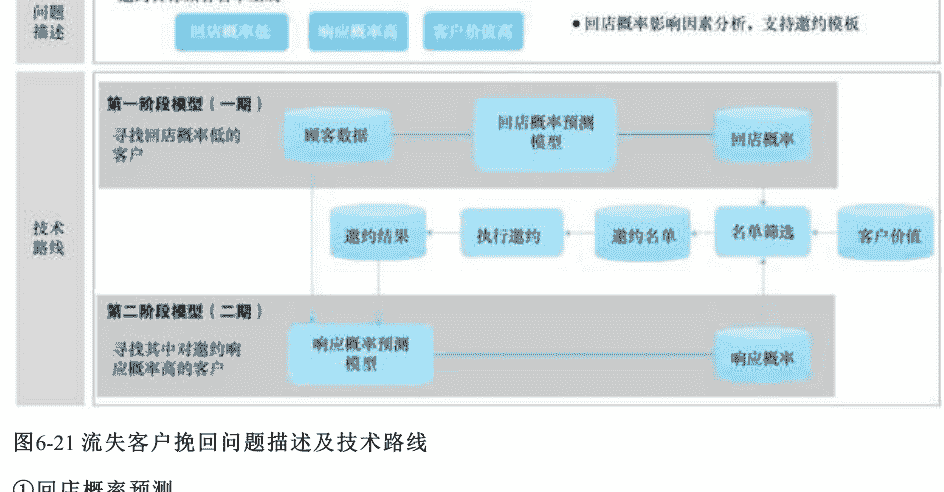

①回店概率预测。
识别回店概率低即流失风险高的车主，利用流失概率模型定期自动输出各维修店的风险清单，形成预警。模型同时为每家店维护的车主生成流失概率画像，包含基本信息、购车历史、维修记录等。门店据此可采取优惠、个性化服务等措施增强粘性，降低流失。

②客户价值评估。
结合流失影响因素分析的输出与车主画像，对价值进行分层。首先通过大数据挖掘行为数据，提炼导致流失的行为特征，如保养周期拉长、服务满意度下降、竞品吸引力增强等。随后基于画像与流失因子对车主进行价值评级，例如到店频次低但每次消费高端机油和付费保养套餐的车主可判定为高价值；到店频繁但仅做低价保养的车主则为低价值。基于评级结果制定差异化售后策略，对高价值车主提供更细致的个性化跟进，对低价值车主通过促销提升消费意愿。

③挽回概率预测。
即邀约后的响应概率预测，用于不断优化邀约名单。采用交互式学习与基于GBDT的机器学习方法建模，根据输出结果优先筛选响应概率高且客户价值高的群体，并采用个性化方式进行邀约与跟进。

④邀约模板生成。
基于回店概率影响因素分析与车主画像，构建快捷邀约模板辅助话术设计。通过大数据分析形成贴合车主特征的邀约话术，简化邀约流程，提升话术与需求的匹配度，从而提高售后服务水平与满意度。

#### （6）保养产品购买概率预测

项目利用车主历史保养记录、消费金额、保养周期等信息，结合机器学习与数据挖掘模型，预测未来购买保养产品的概率。实施中先对数据进行清洗、缺失值填补、标准化等处理，再划分训练集与测试集，试验逻辑回归、SVM、决策树等分类算法进行优化。投产后系统可自动计算每位车主未来的购买概率，统计显示预测准确率可达80%以上，为缓解客户流失提供支撑。

推荐策略依据流失率进行差异化：对流失风险高的车主推荐价格较低、次数较多的保养套餐；对流失风险低的车主推荐价格较高、次数较少的套餐。

保养产品购买概率预测应用示例见表6-12。数据中台通过数据服务将更新后的客户信息表推送至DMS，DMS可在维保服务工单等模块下开发产品推荐查看功能。

表6-12 保养产品推荐建议

| 示例名称 | 保养产品推荐建议 |

| :--- | :--- |

| 功能描述 | 根据模型流失率生成保养产品推荐建议 |

| 用户 | 系统管理员 |

| 前提条件 | 预测流失率数据完整，推荐规则定义。推荐规则定义需考虑三方面因素：<br>• 客户车型配置；确定适用套餐<br>• 历史保养习惯；确定推荐等级<br>• 流失率；确定套餐包含保养次数 |

| 主要过程步骤 | 加载客户流失率数据→生成保养产品推荐建议→写入保养产品推荐建议数据 |

| 结束条件 | 将保养产品推荐建议数据写入客户信息数据表 |

### 6.项目总结

在汽车行业竞争加剧的背景下，该项目对售后业务是一次系统性的智能化尝试。通过数据分析与建模，构建了客户画像、流失预测、服务推荐、流失挽回等多场景应用，且各应用相互衔接、互为支撑。流失预警为行为特征分析提供数据基础，进而丰富画像；挽回预测与个性化话术推荐则依托画像与行为数据实现精准触达，指导高端保养产品与套餐的推荐，提升转化效率。

项目落地后取得以下成效。

**提升满意度与忠诚度：** 基于画像与历史行为的个性化推荐更贴合需求，有助于增强客户满意与忠诚，进而带来利润增长。

**降低流失率：** 通过保有客户流失预测、挽回概率预测及影响因素分析，及时识别风险并采取措施，有效遏制流失。

**提高维护精准度：** 大数据与人工智能驱动的分析模型可精准识别需求，优化邀约方式，提升邀约命中率与回店率。

**优化产品与套餐销售：** 基于购买概率预测的差异化推荐与促销策略，有助于推动高价值售后付费产品与保养套餐销售，提升营业额。

总体而言，基于人工智能的汽车售后服务优化体系，通过多场景协同，实现精准服务、提升忠诚、降低流失、优化销售，有效增强企业竞争力与盈利能力。

6.5 化纤龙头企业：销量预测驱动智能排产与转产

### 1.企业简介

该集团在国内化纤领域处于领先位置，下设多家子公司，工厂遍布全国，员工规模超2万人，主要业务包括纯棉纺纱、机织面料、针织面料、家纺制品等。企业长期坚持高品质、创新与可持续服务，并积极推进数字化转型。

在数字化方面，企业已引入ERP、MES等系统，实现生产计划、物料与库存的数字化管理；在供应链领域部署智能仓储与物流管理系统，提升运输及时性与效率；在设备端加大智能化投入，推动自动化生产；在大数据分析方面组建专业团队，利用业务与销售数据支撑决策；在人工智能应用上与头部企业合作，探索AI在产品设计与研发中的应用。

作为全球化纤龙头，企业提出“打造百年企业、实现永续经营”的愿景，明确将“提升销售力”作为重点目标，依托核心技术与高效运营，坚持以科技创新为核心竞争力，推动人工智能、大数据与工业制造深度融合。

### 2.项目背景

涤纶长丝产品同质化严重，行业竞争充分且价格透明，客户选择灵活。长丝产业处在产业链中游，下游主要为纺织企业，客户集中于长三角地区，尤其是浙江。纺织行业进入门槛低，客户基数大、规模小，2020年企业每月服务约5000家客户，单笔订单体量普遍偏小。

产品规格高度细分，企业作为行业龙头拥有5大类型：预取向丝POY、拉伸变形丝DTY、全拉伸长丝FDY、交织复合丝ITY、拉伸加捻丝DT，共细分为1000余种规格，常在售约600项，集中在POY、DTY、FDY。每月在售规格波动较大，市场销量直接决定生产计划。

企业现有11个生产工厂，各工厂在销售、库存、盈利、设备适纺、产能、转产成本等方面差异明显，如何快速响应市场、预测销量、甄选适产产品、合理安排转产与生产计划，成为核心难题。

### 3. 项目的目标和范围

项目目标是构建基于销量预测的产品生产转产优化系统，通过销量预测分析现有在产产品，建立合理生产方案，并依据各工厂产线特征制定最优转产计划。具体包括：

#### （1）销量预测
按需生产是降本增效的关键。当前多数规格产品的生产多依赖历史销量经验预估，缺乏精准预测，导致生产盲目。高效预测可提升销售能力，并为原辅料采购、产量调整、库存管理提供参考。预测需融合企业内外部数据，如历史销售订单、合同、产品、价格、金额、优惠、成本、盈亏、库存天数等，同时考虑行业竞品活动、原油价格波动、汇率、居民消费水平等外部因素。项目聚焦长丝产业，对1000余种产品构建销量预测模型，引入机器学习提升效率与精度。

#### （2）适产产品分析
在销量预测基础上，综合产品库存周转、预期盈利及相关因素，建立综合排序筛选当前适宜生产的规格。在保证客户订单按期交付前提下，将排序结果与生产计划、产品调配结合，实现销售与供应链协同优化，并通过数据集成实现库存与生产管理的智能化。

#### （3）转产方案分析
不同工厂的产能、在产与适产类型、转产成本各异。制定转产方案需确定符合市场需求的产品类型，按利润与销售前景排序，并结合工厂自身能力与在产情况，评估不同方案的成本效益，在保证质量与交期前提下降低转产成本。

### 4. 项目可行性评估

电纺产线智能调产可行性研判与落地方案

可行性研判
本轮研判围绕商业价值与回报、数据底座可信度、技术落地可行度展开。

（1）商业价值与回报测算
商业层面看，搭建以需求预估为驱动的制造与转线协同体系，能帮助团队更精准把握各品类的市场需求节奏，优化排产计划与资源调配，提升制造效率与品质稳定性，压缩综合运营成本，增强市场竞争力与盈利能力。需求量预估配合适产分析，可让供需匹配更透明，制造与供应链运转效率同步提升，客户满意度与回报随之改善。转线方案分析则能盘活存量资源，调整品类结构，提高产线利用率，更好满足需求，实现可持续运营。
投入产出角度看，项目虽需投入人力、物力与财力，但通过需求量预估与适产模型，可规避不必要的库存积压和生产中断风险，提升排产准确度与效率，从而降本增利。转线方案借助合理资源配置，在品质与交期受控前提下获取更高收益。初步测算显示，排名前十的规格进行转线后，单厂单月净利润可提升3%~5%。从经济性看，项目具备可行性。

（2）数据可用性与可信度
数据底座层面，早在2018年企业就与联想集团合作，构建了集团级大数据平台、企业级IoT平台与人工智能应用平台，各工厂的产销、制造与业务分析数据每日汇聚至集团。企业已基本完成集团及下属单位数据汇聚，并依托联想集团的数据治理体系，显著提升了可用性与可信度。
集团拥有集团级、工厂级等多层数据平台，涵盖大数据、ERP、MES、SCM等系统，从生产订单、实时制造数据、库存信息到客户订单等多维度采集并入库云端。系统集成后数据准确性与实时性明显改善，延迟与不一致问题被有效抑制。从数据角度，项目具备较好可行性。

5. 项目实施
本项目实施分为需求量预估模型建设、适产分析建设、转线方案建设三个环节。

（1）需求量预估模型建设
1）数据处理。
规格历史中存在异常记录，与实际业务表述不完全一致，且存在多指标语义相近的字段，需比对业务口径选取合适字段。预处理要点如下：
- 不同规格订单量差异显著，需剔除订单极小样本，保证时序预估可用性与精度。
- 存在合同单价、销售差价、下单金额、出库价、返利优惠等相近字段，需做分布校验并按业务逻辑择优。
- 数据波动过大时进行平滑，降低噪音并加速计算。
2）特征工程。
提取与下单量强相关的变量，构造建模特征。对波动较大的规格做平滑。
- 统计口径：历史下单以订单为单位，需转为时间序列标准。以日计销量波动剧烈，难以捕捉规律；以周计销量呈现周期性升降。
- 异常剔除：去除疫情等外部冲击带来的异常点，降低对时序模型干扰。
- 稳定性校验：通过ADF检验筛选稳定规格。例如稳定性 -2.93，各分位稳定性系数：1%分位数 -3.47，5%分位数 -2.88，10%分位数 -2.57，稳定性小于1%分位阈值时数据可用。
- 周期影响：从历史规格中拆解趋势、季节与随机波动，衡量其对下单量的影响。
3）模型开发。
筛选规律明确的规格编号，建立未来7天预估模型。
输出包括：大规格下单量t+7周期的预估值；对难以时序预估的小产量规格，采用统计学分级管理并预估；按规则排序形成最优生产进度。

（2）适产分析建设
1）数据处理。
不同规格、品质对应不同客户价格，且受市场影响，特殊客户与订单带来不确定性。需求量预估完成后需同步预估利润，以保证转线调度准确。
- 利润多维度：票据单价为出产时价格；销售报价单成本含原料、制造成本、税费等；单位盈亏额=票据单价-销售报价单成本×销量。需校验稳定性与业务一致性择优。
- 库存口径不统一：可销售库存并非库存量/理论产能，需转为库存量/近期销量口径。
- 异常处理：对异常数据平滑降噪。
2）特征工程。
提取库存可用天数与出库价格，构建模型特征，按规格与品质建模预估。
- 补齐缺失：不同工厂库存可用天数可能缺失，需结合业务修补或清理。
- 统一时维：销售量、当前库存与出库价格使用预估销量与预估利润价格关联，确保时点一致。
3）模型开发。
以预估销量、预估利润价格与库存为基础构建机器学习模型，进行因子重要度预估、因果挖掘，并用TopRank等综合排序。
输出包括：最优生产品类方案及解释；各特征对结果影响程度；挖掘对生产调度有影响的潜在变量。每周结合本周需求量预估、预期盈利、销量预估与在库情况，对下周适产品类综合排序。

（3）转线方案建设
1）算法方案设计。
结合数据能力评估，设计稳定可落地的调度模型。
- 以试产排序为基础，叠加产能、库存、利润、现有同规格设备数量、转线成本与生产成本比等多重限制，制定合理分配方案。
- 以利润最大、转线成本最小为原则，结合库存阈值设置，保证工艺稳定性。
- 计算工厂整体增益，用图表直观呈现。从集团层面统筹，工厂侧赋予转线权重。
2）数据处理。
应用分级销量、库存、利润价格数据，设置黑白名单、分级与阈值，过滤干扰。
- 设备规格与性能：同一设备可产多规格，同一规格可由多设备生产，性能各异，采用one-hot对设备产能与类型统一编码。
- 规格量级失衡：特殊订单导致分布不均，需阈值过滤订单量少、利润率低、库存过大的数据并分级。
- 异常平滑：对异常做平滑处理。
3）特征工程。
关联当前设备纺织类型与产能，结合利润价格、库存等指标核算转线方案并排序。
- 统一量纲：归一化权重以便综合排序。
- 缺失处理：设备类别数据缺失时业务补齐或清理。
- 业务关联：同一规格多厂生产，不同工厂存在库存积压或不足，需综合设备适纺能力、产能、成本与销售协同优化。
4）模型开发。
基于适产排序与当前产线状况，按序计算订单满足率，优先满足高排名订单，降低排名靠后且库存超过周用量规格的产能并转移至高排名规格。
当头部订单无法完全满足时触发转线，结合历史预估规律保留安全库存。
构建多约束多目标优化模型。约束包括产能限制、转线产位限制、转线质量限制、转线规格限制；目标为利润最大化、产能利用率最大化、安全库存最小化、转线成本最小化、订单满足率最大化。
结合产能、库存、价格、综合排名与各类成本计算转线成本并给出建议。对影响因素量化抽取特征，设定阈值与方程，按规格分布分级并调整权重。输出转线方案明细，如某厂周转方案明细可细化到具体规格转线产线与预期盈利，辅助厂长决策。

6. 项目总结
该项目对企业意义重大。构建基于需求量预估的制造转线优化体系，利用机器学习对历史销售订单、合同、品类、价格、成本等数据进行精准分析，并引入外部经济与竞争因素，提升需求量预估准确性与效率。
在此基础上进行适产分析，以库存、盈利、客户成交情况为依据，在保障按期交货前提下优化生产布局与调配，提升供应链协同与管理水平，降低成本。
同时全面考量各工厂生产能力、在产与适产类型、转线成本等，通过综合排序制定转线方案，在保证质量与交期的同时降本增效。
2021年试点应用显示，单一试点工厂整体利润提升7.3%，综合生产成本降低2.4%，为企业持续稳健发展奠定基础。

产线基本信息
机位信息
产线：1线
卷绕头配置类型：二叶
产量负荷（T）：50
喷丝方式：一板二组/单板
冷却方式：侧吹
组件头数：8
卷绕头数：16/8
单线位数：48
适纺规格（D/F）：100-300/36-96
在产产品：267GTEX/48F
评价排名：54位
落丝时间：4:22:00
单产：1.3844吨
待产产品：178dtex/192F
评价排名：3位
产线：1线
卷绕头配置类型：二叶
产量负荷（T）：50
喷丝方式：一板二组/单板
冷却方式：侧吹
组件头数：8
卷绕头数：16/8
单线位数：72
适纺规格（D/F）：100-300/36-96
产线：1线
卷绕头配置类型：二叶
产量负荷（T）：50
喷丝方式：一板二组/单板
冷却方式：侧吹
组件头数：8
卷绕头数：16/8
单线位数：96
适纺规格（D/F）：100-300/36-96