# AI 入门全书：零门槛读懂人工智能

这本读物完全避开公式推导与艰涩术语，面向零基础读者。用通俗叙述、贴近生活的案例和大量图解，讲清楚人工智能是什么，以及它如何在各行各业里发挥作用并带来变化。全书分为上下两册。上册聚焦认知，梳理能力边界、发展脉络、机器学习、深度学习与学习机制等基础知识。下册聚焦行业应用，涵盖客服、烹饪、播音配音、保育与教学、动画制作、医疗、农业、秘书、翻译等典型场景。

适合想建立初步认知的读者阅读，既能帮助准备开展相关研究的从业者快速入门，也能让没有专业背景的青少年顺畅阅读。书中内容同时可为职业选择与未来规划提供参考。

# 前言

“人工智能究竟是什么？”该如何作答？

技术迭代飞快，AI 已深度嵌入日常生活的各个角落。可真正弄明白其运作原理的人并不多。AI 并不是无所不能的魔杖。

为了给想入门的读者一条捷径，作者撰写了此书。即使不具备数学基础，也能借助本书把握 AI 的核心理念。作者试图跳出数学框架，用其他方式把“AI 到底是什么”讲得更透。这样的阐述，也能为即将开展正式研究的读者提供帮助。

愿大家通过本书对 AI 有更深刻的认识。

大西可奈子

# 目录

## 上篇 认识 AI /001
- 01 什么是 AI? /003
    - “智能”到底是什么? /003
    - 何为“计算机的自主思维”? /004
    - 根据事先存储的信息进行预测 /008
    - 出现未知面包时如何处置? /009
    - 关键所在: 让客户购买 (网站) 推荐的面包 /012
- 02 我们身边的 AI /014
    - AI 能够在文字输入时做出预测 /014
    - AI 是实现小目标的复合体 /016
    - AI 的实质是程序 /017
    - 这是 AI 吗? /018
- 03 AI 的强项与弱项 /021
    - AI 的强项——分类 /021
    - AI 的弱项——创造力 /023
    - AI 无法断定正解 /024
- 04 AI 的历史 /026
    - AI 热潮不断来袭 /026
    - 可以对话的计算机“伊莉莎（ELIZA）” /027
    - 评估对话计算机性能的“图灵测试” /028
    - 第二次人工智能热潮——“专家系统” /030
    - 现阶段的 AI /031
- 05 AI 的用途 /033
    - AI 的本质 /033
    - 为什么进行机器学习？ /035
- 06 什么是机器学习 /039
    - 机器学习究竟能做些什么？ /039
    - 机器学习的种类及内容 /040
    - 辨别 AI 性能优劣的方法 /077
    - 监督学习中的性能评价 /081
    - 机器学习的优化使用 /089
- 07 什么是深度学习 /091
    - 深度学习是机器学习的一种方法 /091
    - 深度学习会进行多阶段验证 /093
    - 深度学习起源于感知机 /094
    - 改变条件的要素“偏差” /098
    - 尝试设计多层感知机 /101
    - 通过“激活函数”可以实现微调 /104
    - 输出层不仅限于一个 /106
    - 深度学习的优势 /108
    - 深度学习的难点 /112
- 08 AI 学习的过程 /114
    - 调整带参数函数的参数部分 /114
    - “模型”的具体含义 /116
- 09 尝试使用 AI /118
    - 使用 AI 时，重要的事情是什么？ /118
    - 将 AI 用于卡拉 OK 的视频制作 /120
    - 对业务和问题进行细化，培养思考的习惯 /124
    - 数据准备的重要性和难度 /126

## 下篇 AI 与各行各业 /129
- 01 AI 将会使工作发生何种改变？ /131
    - AI 真的会代替人类进行工作吗？ /131
    - AI 时代的新工作 /133
- 02 问询处和客服中心 /137
    - AI 已经开始应用于问询工作 /137
    - AI 的强项——“任务指向型”对话 /138
    - 客服中心是否会迎来 AI 时代？ /139
- 03 烹饪 /141
    - AI 根据食材信息制作全新食谱 /141
    - 非常复杂的食谱内容 /142
    - 创造全新食谱的 AI 应该由烹饪专家负责开发？ /144
    - 只要告知想吃的菜品，AI 便可以提供从食谱到烹饪的一站式服务 /145
- 04 播音和配音 /147
    - AI 替代人声有百利而无一害？ /147
    - AI 把文字转换成波形（声音）并输出 /148
    - 声音识别系统达到实用水平 /149
- 05 保育员和教师 /151
    - 机器人可以代替教师吗？ /151
    - 可对话 AI 目前尚难实现 /152
    - 依靠声音对话的 AI 是若干个 AI 的组合 /153
    - 即将迎来机器人教师的破晓时代 /155
- 06 小说作家 /156
    - 无法实现由 0 创造 1 /156
    - 倘若将故事情节和出场人物等信息输入 AI…… /157
- 07 动画师 /160
    - AI 可以自动完成中割 /160
    - 无数个小色点中隐藏的规律 /162
- 08 医生 /164
    - AI 医生不会误诊 /164
    - 尊重患者隐私 /168
- 09 农业 /169
    - AI 可以实现经验共享 /169
    - AI 擅长出货分拣工作 /170
    - 天气状况与收获时黄瓜形态的关联 /172
- 10 秘书 /174
    - 日程重在安排 /174
    - AI 的强项是对计划进行预测 /176
    - 难以遵循一般常识进行回应 /177
- 11 翻译 /179
    - AI 擅长的领域——翻译 /179
    - AI 与声音系统的组合 /181
    - 译者的工作 /182
- 12 AI 和人类今后的工作 /183
    - 了解 AI 概况及其优势和短板 /183
    - 对于 AI 而言，“完善”很重要 /184

# 上篇 认识AI

## 01 什么是 AI?

### “智能”到底是什么？

市面上充斥着“借助 AI 实现”等宣传口号。AI 听起来很酷，但它具体指什么？这些口号背后又藏着怎样的内涵？即便常挂在嘴边，大多数人也说不清 AI 到底是什么。

AI 是 Artificial Intelligence 的缩写，通俗解释是在计算机环境下模拟人类智能并实现相关技术。可“人类智能”本身就很难界定。若把智能等同于计算能力，电脑在精确度与速度上远超人类，那台个人电脑算不算人工智能？通常大家不会这么认为。人工智能不仅要求会算，还需要具备某种创造性的处理能力。

很多人会把 AI 与机器人划等号，但这并非机器人的专属。自动驾驶、机器人等靠计算机实现自我智能运行的技术常被称作 AI，吸尘器、电饭煲等简单家电里也可能内置 AI。正因如此，AI 一词才随处可见。

### 何为“计算机的自主思维”？

如果有人让你“用 AI 做点事”，做到什么程度才算成功？标准并不清晰。若要给出可操作的说法，可以理解为：人工智能通过学习能实现触类旁通，也就是具备自主的思考与判断能力。

以电商推荐为例。买某款电脑的人群里很多人也买了某款鼠标，系统就会向仅买电脑的人推荐鼠标。

再以牛奶和面包说明。

> 某天 甲 在某网站买了牛奶和樱桃面包。第二天 乙 在同一网站仅买了牛奶，系统向 乙 推荐了樱桃面包。这算人工智能吗？

并不算。这只是把 甲 买牛奶时一起买的东西告诉 乙。计算机没有真正思考。

加入 丙 再看。甲、乙、丙 在同一网站的购买记录是：甲 买牛奶、樱桃面包；乙 买牛奶；丙 买牛奶、红豆面包。仅买牛奶的 乙 应该被推荐樱桃面包还是红豆面包？系统可以随机推荐，但要提升成交率，就需要推测 乙 更可能选哪种。没有绝对正解，需要猜测倾向。

计算机可通过历史记录判断。假设在此前的面包购买记录里，甲 买过炒面面包、果酱面包、香肠面包；乙 买过巧克力碎面包、肉桂面包卷、肉桂面包卷；丙 买过奶油面包、樱桃面包、果酱面包。由此可看出 甲 偏咸，乙、丙 偏甜，于是更适合推荐红豆面包。

### 根据事先存储的信息进行预测

怎样让计算机看出 乙 和 丙 口味相近？一种做法是事先在系统里存入“甜面包”和“非甜面包”的标签。该网站共八种面包：果酱、奶油、樱桃、巧克力碎、肉桂面包卷、红豆、炒面、香肠。提前把咸甜属性标注好，计算机就能从历史记录判断 甲 多买非甜，乙、丙 只买甜，从而推断口味接近。

这能算 AI 吗？还不够。因为没有触类旁通，只是按人类提前填好的信息执行。如果面包属性没提前存入，系统就无法判断。

### 出现未知面包时如何处置？

再假设系统里没有肉桂面包卷的甜咸信息。甲 的面包史是炒面、果酱、香肠；乙 是巧克力碎、肉桂面包卷；丙 是奶油、樱桃、果酱。若缺少该信息，系统就不知道 乙 是否爱甜。这时计算机需要自主推测肉桂面包卷的甜度，这才是真正的触类旁通。

常见思路是：买过类似面包的客户，其购买的未知面包大概率同类。以肉桂面包卷为例，若常买甜面包的人买了它，就推断它是甜的；反之则推断不甜。

假设 S、T、U 买过肉桂面包卷，同时还买过其他面包：S 买炒面、果酱、奶油；T 买香肠、奶油、樱桃、巧克力碎；U 买果酱、樱桃、巧克力碎。按事先标注，三人甜面包更多，于是推断肉桂面包卷应属甜面包。

由此可推 乙 爱吃甜，和 丙 接近，进而向 乙 推荐 丙 买的红豆面包。计算机并不确定肉桂面包卷是否真甜、乙 是否真爱甜，但它基于已存信息给出了最接近答案的做法。

用已知事物推断未知事物的性质，是 AI 的常用手段。推荐面包只是简单例子，但这种思维在 AI 领域十分常见。

### 关键所在：让客户购买（网站）推荐的面包

前面说的 AI 以推荐面包为目标。目的不同，技术也不同。表面看都是给 乙 推荐面包，但背后原理差异很大。两者都属于商品推荐，但内部工作方式截然不同，计算机总会给出更接近正确答案的结果。

如开篇所说，人工智能没有统一定义，但必须具备处理未知事物的能力。上面肉桂面包卷的例子，系统成功处理了未事先录入的信息，已可归为人工智能。并不意味着越复杂越好。技术的关键不在于复杂，而在于能否以更高精度达成目标。对推荐系统而言，客户是否愿意买下推荐的面包才是最重要的。使用 AI 时，初心和目标始终要放在第一位。

## 02 我们身边的 AI

### AI 能够在文字输入时做出预测

身边有哪些 AI？一说 AI 人们常联想到高科技，觉得与生活无关。实际上 AI 就在身边，而且越来越离不开。

比如在手机或电脑上输入文字，只打几个字的拼音或首字母，系统就能猜出你要写的内容。表面看是小功能，实则是系统在运行中自主判断，这就可称为 AI。

很多人对 AI 的印象是大型机器，所以会怀疑“换几个字也能算 AI”。现实是 AI 更常以实现特定功能的形式出现。除了文字预测，还有中英互译、人脸识别、语音操控、电商推荐等。细数下来会发现，它们都是为做一件事而存在的。像一个能同时做翻译和推荐的购物网站，背后其实是多套功能不同的 AI 在协作。

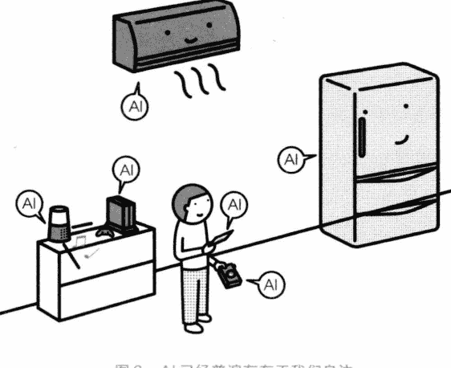
图 6 AI 已经普遍存在于我们身边

换言之，能边翻译边推荐的网站，是由多套 AI 组合而成。

### AI 是实现小目标的复合体

可见 AI 并不是一个庞然大物，而是为达成小目标而存在个体，或由多个个体组成的复合体。所以搭载特定 AI 功能的产品有时也会被称作 AI。比如电饭煲输入气温天气后给出加水量建议，这类特定功能被视作 AI，厂商便宣传 AI 电饭煲。对电饭煲而言做饭本就存在，加入 AI 系统后整体会被称为 AI。

一般来说，产品被冠名 AI 的前提是让计算机完成某种智能处理。但若不深究原理，很难判断它是否真能自主思考处理，可能只是按简单规则机械执行。正因目前对 AI 缺乏严格界定，即便是按规则处理的产品也常被叫做 AI。所以更需要剖析自称 AI 产品的运行机制。

### AI 的实质是程序

身边 AI 种类繁多，但本质上 AI 就是计算机的一个程序。过去计算机完成任务都靠程序驱动。近来常说“AI 失控”，但 AI 只是程序，只会按程序行事。近几年 AI 能实现很灵活的功能，有些超出人类想象，看起来像要脱离控制。

或许还有更多 AI 潜伏在我们身边，等待被发现和想象。

### 这是 AI 吗？

到这里，读者或许可初步判断了，但辨别产品是否属于 AI 并不容易。下面设想几个例子做初步判断，结论没有绝对权威。

- 输入计算方式即可自动计算税金的软件

如果只是按输入数值套公式计算税金，就不能算 AI。因为无论多复杂，也只是固定算式里填数而已。

如果只做基础的功能，还谈不上 AI。但当系统额外具备一些能力，比如依据过往的花费模式给出未来的消费建议，或是自动揪出那种肉眼不容易发现的录入错误并发出警示，这类能够主动提出方案、自主发现问题的功能，才更符合 AI 的特质。

**用个人偏好做人群匹配**
光是把爱好、性格相同的用户简单配对，还称不上 AI。真正具有 AI 特征的是能够利用已有结婚人群的性格爱好数据，从多个维度去挖掘合适人选。类似的服务现在已经融入日常生活，AI 不只在婚恋配对上发挥作用，在人才选拔等职场场景也被广泛使用，未来这类为人们做各种匹配的 AI 应用会更普遍。

**会自己判断何时关机的空调**
设定“连续运行一段时间就关机”“温度超过 25℃就关机”这种只靠单一规则断电的空调，并不具备 AI 属性。人们真正期待的自动关机，是人离开房间一段时间后才自行切断电源。

如果空调能做到人在离开后自动断电，就可以被视作 AI。因为这要求设备自主判断房间是否空无一人。不同家庭的布局各异，人的行动方式也千变万化，不可能把所有情况事先写进程序。判断一个程序是否算 AI 的关键之一，就是它能否对未被预设的情况做出恰当反应。

**能进行简单对话的机器人**
很多人以为所有机器人都是 AI，实际上并非如此。有些机器人只是听到声音就点头，背后不过是写好“听到声音即点头”的指令，并不需要思考。

那能对话的机器人算 AI 吗？假设一个机器人只对五种提问作出固定回应：

| 发话 | 应答 |
|---|---|
| “你好！” | “你好！” |
| “你好吗？” | “我很好。” |
| “今天天气真好啊！” | “是啊！” |
| “我饿了。” | “吃点饭吧！” |
| “谢谢。” | “不客气。” |

对于“你好吗？”它会照本宣科回答“我很好”。但如果换成“你感觉如何？”，它会怎样？若对此类未预设的提问没有任何反应，就不能算 AI 机器人。AI 必须具备对超出既定清单的问题做出灵活、恰当回应的能力。

## 03 AI 的长处与短板
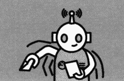
### 强项一：分类能力
现在的 AI 并非万能，可用的场景仍比较有限。总的来看，它最擅长的是从海量数据中提炼规律和模式，也就是对事物进行分类。日常的垃圾邮件过滤就是典型的分类应用，邮箱软件会自动把疑似垃圾信挪到特定文件夹。AI 的分类能力与此类似，但并不局限于二分类。比如把照片里的动物区分成猫、狗或鸟，AI 也能轻松完成。

具备分类功能的 AI，会基于人类提前输入的大量样本建立判断标准。以垃圾邮件识别为例：

> 1) 先由人工检查大量邮件，标记哪些是垃圾邮件、哪些不是。
将人工的判断结果连同邮件一起输入计算机，让它围绕垃圾邮件的特征进行自主学习。

> 2) 随后计算机依据自己建立的判断标准，对新收到的邮件进行归类。
值得注意的是，即使人类没有提供过相关信息的邮件，AI 也能给出一个推测。当然这只是推测，并非总对。总之计算机总能给出最接近正确答案的答案。

当然 AI 不止于分类，很多应用是通过分类来解决问题，具体后面会再展开。

### 短板一：缺乏创造力
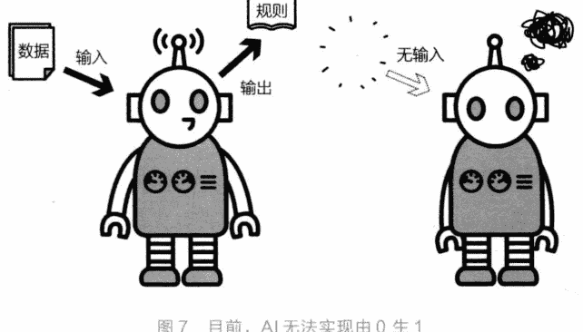
现阶段的 AI 做不到真正的从零创造。它无法在没有任何输入的情况下凭空生出新事物，必须依赖人类提供数据或信息，然后再在此基础上“学习”。

有些 AI 会作画或写小说，但这也不是凭空而来，而是先学习大量已有的绘画或文本，再基于这些素材进行生成。

有人会问，这算不算创作？这个问题很难一刀切。人类创作也离不开过往经验和信息积累。即使是全新的作品，也必然建立在作者的阅历之上。如此看，当前的 AI 活动与人类创作有相似之处。某种程度上，人类开发 AI 的过程，也是对自身智慧的探索。

### AI 给不出确定答案
AI 的另一个弱点是无法自主推导出唯一正解。比如网上同时流传着“A 已婚”和“A 未婚”两种说法。AI 能识别出两者矛盾，却判断不出哪一个是对的。它只能借助其他海量数据去推测哪条更接近真实，但这终究只是推测。想要真相，还是得问当事人或权威机构。AI 再擅长分类，本质上也只是提供一个最可能的猜测，最终的取舍仍需人类来做。

另外，AI 的优势之一是面对人类也不知道答案的问题时，能够基于现有数据给出预测。虽然正解仍需人类判定，但在很多不确定情境下，AI 能提供尽可能接近真实的判断。

## 04 人工智能发展史

### 三次浪潮的轮回
最近 AI 被频繁提及，似乎像个新概念，实际上它的历史很长。我们熟知的“人工智能热潮”已经是第三次了。第一次和第二次主要发生在学术圈，并未走进大众视野。

前两次热潮局限于研究，原因很简单，当时的人工智能性能还不足以应用于生活。

### 对话先驱 伊莉莎
AI 这个词首次出现于 1956 年，随后开启了第一次热潮。代表人物是文本对话计算机伊莉莎。伊莉莎没有语音，而是通过文字与人交流，最著名的是扮演心理医生，与病人进行模拟对话。

看起来很厉害，但实质上只是依靠简单的模式匹配来应答，与人们的期待相差甚远。类似伊莉莎的系统常被戏称为“人工无脑”。由于智能的边界模糊，后来在伊莉莎基础上改进的对话系统也被归入人工智能的范畴。

### 用图灵测试衡量对话能力
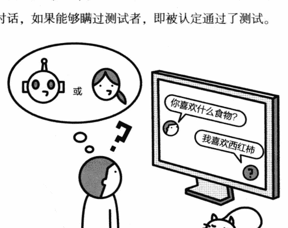
从第一次热潮至今，对话计算机一直是研究重点。图灵测试是衡量其性能的经典方法：在测试者与被测者不见面的情况下，通过对话判断对方是人还是机器。若对话计算机能在一定时间内瞒过测试者，就被认为通过了测试。

听起来简单，但很久以来没有 AI 能真正通过。2014 年，一台计算机首次通过了测试，引发全球震动。但实际情况是，该系统被预设为“住在乌克兰的 13 岁少年”，测试者允许口语存在偏差。测试时长也只有几分钟，计算机即使无法真正对话，也可能蒙混过关。

图灵测试促使我们思考“什么是智能”。人类的对话能力靠什么感知对方情绪？是靠外表还是内容？如果不见面，仅从文字就能感受到智慧，是否就可认定为智能？这正是图灵测试想探讨的问题。

### 第二次热潮：专家系统
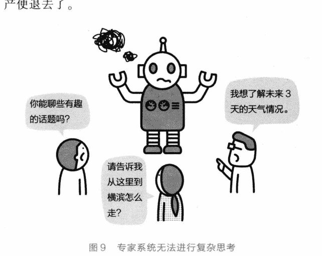
20 世纪 80 年代，“专家系统”的出现带来了第二次热潮。专家系统专注于特定领域，比如用自然对话预订酒店、诊断某种疾病等。

这次热潮的目标不是通用人工智能，而是为具体任务开发系统。可以说更贴近实际，也确实能实现“用自然对话预订酒店”这类简单目标。

但系统无法像人类那样自主推理，只能按“由 X 推及 Y”的规则运行，遇到规则之外的情况就失效。受限于适用范围窄、灵活性差，这股热潮很快退潮。

### 当下的 AI 格局
经历两次高潮低谷后，研究从未停止。随着机器学习技术的成熟，能服务日常生活的 AI 开始爆发式增长，这也是第三次热潮的起点。机器学习让计算机能自主从数据中归纳模式和规则，从而实现灵活应答。

在机器学习出现前，人们会把“由 X 推及 Y”的规则直接写进程序，输入 X 就得到 Y，输入未收录的 Z 就无能为力。有了机器学习，即使只教过 X 到 Y 的关系，面对未知输入 Z 也能给出回应。

正是这种可落地的技术，让第三次热潮从研究走向社会，成为与每个人息息相关的现象。其中，深度学习技术的发展尤其引发了研究者的震动和期待。

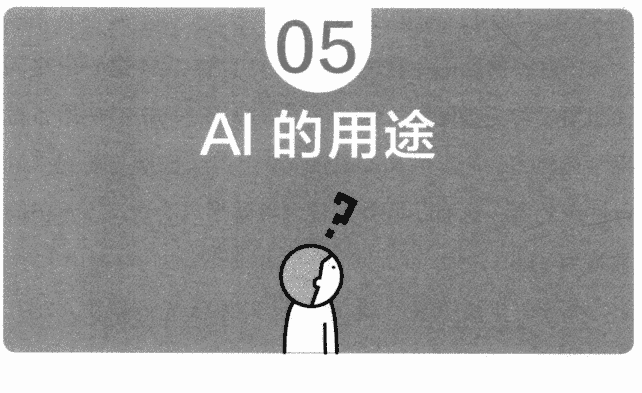
### AI 的本质是什么
目前多数 AI 都基于机器学习。虽然“AI”定义模糊，但机器学习是确切的技术名词。因此说“借助 AI 实现××”往往让人摸不着头脑，换成“借助机器学习实现××”会更清楚。对于熟悉领域的人，不必刻意强调 AI，因为大家并不清楚它到底能做什么、有什么不同。

不过对大众而言，AI 这个说法更直观，因为今天的大多数 AI 都用了机器学习，这里也以此为前提。值得注意的是，也有一些不使用机器学习却被称作 AI 的情况。

生活中充斥着为不同目的研发的 AI。人们容易以为存在某种叫“AI”的实体在起作用，实际上 AI 并非单一事物，其内部结构千差万别。简单说，AI 就是运用了机器学习或其他技术的程序。

AI 的形态多样，实现方法也各不相同。机器学习的方法也很多，但大体可以归纳为：计算机根据人类输入的数据自行制定规则，而不是由人类直接规定规则。

用户接触到的往往不是 AI 本身，而是搭载 AI 的产品。以 AI 冰箱为例，存放食物防腐是基本功能，与 AI 无关；如果冰箱具备“自动调温”，这部分才算 AI。AI 通常只是产品的一个功能模块，了解到这一点就不会产生误解。

### 为什么需要机器学习
日常邮箱的垃圾邮件判断就是机器学习的应用。自动分类功能很方便，但也有重要邮件被误判的情况。这种判断技术多基于机器学习。

如果靠人工分类，几封邮件还能应付，成千上万封就难以实现，耗时且不现实。计算机的优势在于高速处理海量数据，且不会因疲劳而判断失误，能始终按既定标准工作。当然自主判断难免出错，需要人工复核。

有人会问，既然规则可写，为什么不用人类制定的规则？问题在于人类很难制定完美规则。比如垃圾邮件规则：来自通讯录外的地址、邮件含“http://”、正文含“中选”等。即便列很多条，也仍会出现无法覆盖的情况。

机器学习的价值在于能从纷繁复杂的数据中自动提取规则和模式，进行分类和预测，甚至发现人类不易察觉的隐藏规律。

机器学习还便于维护升级。当出现新型垃圾邮件时，只需把新样本加入数据，再次训练即可生成新规则。而人工规则往往庞大复杂，增改容易影响已有逻辑。

## 06 机器学习是什么
### 它能做什么
机器学习并非人类直接输入规则，而是让 AI 自行从提供的数据中构建规则。它需要不完美的初始规则和数据作为起点，通过不断完善来形成能力，也需要大量与任务相符的数据。盲目收集数据并不能保证效果，数据必须与要解决的问题匹配。

例如想让 AI 区分照片里是橘子还是葡萄，就需要大量橘子和葡萄的照片作为训练素材。学完后它只能做这个区分，不能自动延伸到苹果。

### 主要类型
机器学习的形式多样，核心可分为三种：监督学习、无监督学习和强化学习，下面分别说明。

## 机器学习的主要类型
## 监督学习
### 概况
监督学习是机器学习中使用最广泛的方法。简单说，就是先给计算机提供带正确答案的数据，让它自动学习规律。提供正确答案的数据称为监督数据。只有能产生监督数据的任务才能采用这种方法。

产生监督数据有两种常见情况：
一种是人类能掌握正解。垃圾邮件判断就属于此类。需要准备包含垃圾和非垃圾邮件的样本数据，并对邮件性质进行标注，作为计算机的监督数据[PRE?]

人类对邮件内容虽不能百分百准确判断，但多数情况下可以分类，这些标注后的数据就能作为训练用监督数据。

数据里藏着答案，才叫监督

有些场景下，正确答案其实早就嵌在数据里，只是我们人类暂时读不出来。把在英格兰和苏格兰街头拍的照片混在一起，人眼很难凭画面判断具体在哪，除非撞上地标。可是每张照片本身就自带拍摄地信息。正是这份隐藏的标签，让这些照片可以直接拿来当监督数据训练模型。反过来，如果拍摄地信息被误删，又无法靠肉眼补全，监督数据也就无从生成。

监督数据的规模不能太小。机器学习的方式和任务不同，所需数量也会变化，但实践中至少要到万级量级。拿垃圾邮件分类举例，要让模型学会分清垃圾与非垃圾，就得准备数万封已标注的邮件样本。

把监督数据喂给计算机时，必须明确告诉它要学什么。监督数据的本质就是给出正确答案。比如垃圾邮件前面标记数字1，正常邮件标记数字0，这样模型才知道目标是什么。

学会监督数据的过程可以拆成两个阶段。先用已标注数据在内部搭建一套判断规则，这是学习阶段；之后用这套规则对新数据做推断，这是预测阶段。规则要尽可能贴合训练用的监督数据，所以当把同一批监督数据重新放回去时，模型应该给出接近正解的结果。这里的核心不是让模型死记硬背，而是让它能对未出现过的数据做合理预测。若只是复刻已有样本，记下来就够了，不需要机器学习。

监督学习的通俗版是：输入面包名称，输出配饮品。想让机器学会这种搭配，我们得先给它一个期望。豆沙包对应牛奶，奶油面包对应咖啡，这就是开发者心里想要的“正解组合”。这六组期望分别是：
豆沙包→牛奶
奶油面包、豆沙包→牛奶
奶油面包→咖啡
菠萝包、香肠面包→咖啡
果酱面包、豆沙包→牛奶
果酱面包、菠萝包→咖啡

仅覆盖这六种情况意义不大，真正的价值在于举一反三，让模型在未见过的面包组合上也能给出合理推荐。机器学习的任务就是在没有标准答案的新输入上，尽可能模拟开发者的意图。

在这套机制里，正解数据被称作监督数据，用监督数据训练的过程就是监督学习。训练时人类先给模型一个初始结构，模型会把从数据中学到的内容映射到这个结构上。初始结构无法反映数据，模型需要不断调整，调整完的模型才能代表监督数据的规律，并用来预测未知。

以面包配饮品为例，模型会形成饮品和面包之间的关联程度。关联程度可以用点来表示，交叉格点越多，关联越强。学习过程就是在这些格子里填点。

先学到豆沙包→牛奶，豆沙包与牛奶的交叉位会增加点。接着学到奶油面包、豆沙包→牛奶，奶油面包与牛奶、豆沙包与牛奶都增加点。随后学到奶油面包→咖啡，如果不做调整，奶油面包同时与牛奶、咖啡的点数相同，模型就无法决策。因此必须削弱奶油面包与牛奶的联系，才能让咖啡胜出。

随着后续五条信息依次进入，点数分布会不断被微调。菠萝包、香肠面包与咖啡关联增强；果酱面包与豆沙包与牛奶关联增强；果酱面包与菠萝包与咖啡关联增强。最终形成的粗略模型里，豆沙包强烈倾向牛奶，奶油面包倾向咖啡，菠萝包倾向咖啡略强于牛奶，香肠面包倾向咖啡，果酱面包对两类饮品都有一定关联。

模型的好处在于灵活性。即使“香肠面包和豆沙包”这组组合在监督数据里从未出现，模型也可以通过比较点数给出牛奶的倾向。这正是规则的局限无法做到的事。

现实中输出往往不是非黑即白的确定结果，而是概率。输入豆沙包时，模型可能给出牛奶80%、咖啡20%的分布。只要模型足够灵活，概率输出反而更容易通过微调逼近真实分布。

模型如何微调？它会把当前模型的预测结果和监督数据的真实答案做对比，差异越小，调整越保守；差异越大，调整越剧烈。学习可以只进行一次，也可以重复多次，反复学习通常会让模型更稳。监督数据的质量与数量直接决定模型效果，怎样标注、准备多少样本，是监督学习成败的关键。

监督到无监督的视角切换

如果把输入面包输出饮品换个说法，其实就是把面包或面包组合分到牛奶组或咖啡组。豆沙包被归入牛奶组，奶油面包被归入咖啡组。监督学习本质上是在做分类。

无监督学习则相反，不提供明确正解。它用没有标签或标签未知的数据，归纳数据内部的潜在规律。常说的聚类就是典型操作，把相似的数据聚成若干小团体。

分类和聚类容易混淆，需要先确认问题类型。监督学习要的是一个能对未知样本做判断的模型；无监督聚类要的是让数据自己抱团，之后由人去解读这些团体的意义。

分类场景举例是判断甜面包与非甜面包。学习数据列出甜面包如果酱面包、奶油面包、菠萝包、巧克力碎面包、豆沙包、肉桂面包卷，非甜面包如炒面面包、香肠面包。学完后模型能对新面包名称做出甜或非甜的推测。

聚类场景举例是把面包分成两个集群。学习数据只给出面包名称，没有甜非甜标签。聚类结果可能把果酱面包、奶油面包、菠萝包、巧克力碎面包、豆沙包、肉桂面包卷聚到集群1，把炒面面包、香肠面包聚到集群2。集群1和集群2是什么特征，需要人类根据内容自行推断。聚类方法不同、集群数量不同，结果也会变化，使用时需要反复试验。

手把手体验一次聚集式聚类

用最简单的数据感受聚类。准备五句话：
吃菠萝包和果酱面包。
请买回来菠萝包、果酱面包和香肠面包。
香肠面包和奶油面包好吃。
棒球和足球都喜欢。
踢足球很开心。

初始时每句话各自为一个集群。相似度定义为句子中共有的名词数量。名词清单包括菠萝包、果酱面包、香肠面包、奶油面包、棒球、足球。

标记结果显示，前三句围绕面包名词，后两句围绕球类名词。按相似度最高原则合并，最终会形成面包相关的集群和运动相关的集群。这说明即使没有正解标签，数据也能按内在相似性自行归类，而解读这些归类的含义，则需要人的参与。

聚类：相似的句子如何自动抱团

先看第一句和后面几句的亲近程度。判断两句有多像，这里用的是同一个名词出现了多少次。算下来，第一句和第二句有2个共同名词，和第三句、第四句、第五句都是0个。

句子1 与句子2～5 的相似度对照

句子 和句子1的相似度

2 2

3 0

4 0

5 0

再来看第二句。它的共同名词与第三句有1个，和第四句、第五句都是0个。

句子2 与句子3～5 的相似度对照

句子 和句子2的相似度

3 1

4 0

5 0

把所有句子两两比较一遍后，最亲近的一对是相似度为2的第一句和第二句。把它们合并，当前分成四堆：第一句+第二句这一堆、第三句单独、第四句单独、第五句单独。下一步要继续找最像的两堆合并。

这里会遇到一个问题：现在有一堆里有两句话，另一堆只有一句，该怎么算两堆之间的相似度？

常用的做法有两种，都很简单。先把第一句和第二句构成的堆与第三句构成的堆做比较。第一句和第三句的共同名词是0，第二句和第三句的共同名词是1。

句子1、句子2 与句子3 的相似度

句子 和句子3的相似度

1 0

2 1

如果把两堆的相似度定义为两堆里最接近的一对，相似度就是1；如果定义为两堆里最远的一对，相似度就是0。

取最大值的做法叫单连结法，取最小值的做法叫完全连结法。

用单连结法继续聚类，第一句+第二句的堆与第三句的堆相似度为1，第一句+第二句的堆与第四句、第五句的堆相似度为0，第四句与第五句的堆相似度为1。合并后就会形成新的分组。

最后比较第一句+第二句+第三句这堆和第四句+第五句这堆。按单连结法计算，两堆之间的相似度是0。虽然是0，但已经没有其他可比对象，于是两堆被合并，聚类结束。

聚集式聚类如果一直做下去，最终会把所有数据拢成一堆，所以必须提前设好停止条件，通常要事先告诉系统希望得到几个簇。无监督学习的分组行为本身就是学习的过程，看似只是机械操作，实际上是在不断思考怎么分，这正是学习的特征。

聚类的方式不只有聚集式一种，核心目标都是把数据分成有意义的群。结果不理想时可以调整簇的数量或换一种策略。即使是同一类方法，因为“怎样判断更像”“怎么比较两堆”这些规则的设定不同，结果也会不一样。无监督学习不是把数据丢进去就能自动做好，需要结合目标反复试验，机器学习也是如此。

## 强化学习：让AI自己试错变强

### 核心概念

强化学习简单说就是：在某个状态下，对各种可能的行动打分，然后主动学出更好的行动方式。最近围棋、象棋等竞技场景，还有机器人控制，都很看重它。比起监督学习给出标准答案，或无监督学习自行找规律，强化学习的做法显得更复杂一些。

监督学习会提供正确答案，强化学习不会。它只会得到行动的备选，以及人类给出的好坏评判标准。系统在允许的范围内不断试验。像围棋象棋这种规则固定、评价标准清晰的任务特别适合；如果规则不固定，人类也给不出评价，系统就无从下手。

### 怎么学

强化学习是在不断试探中优化“在某状态下下一步该怎么走”的内在规则。做出一个行动后，看结果好坏，再回头修正规则。这和人类靠经验积累的思路很像。

“下一步做什么”通常不是硬性决定，而是以概率呈现。举例说，走右边概率30%，走左边概率70%，系统更可能往左走。若走左的结果不好，就会降低走左的概率，提升走右的概率。

反复试验并调整行动概率，这就是强化学习中的学习。注意学的对象不是“选左还是选右”，而是“选左和选右各自的概率”，如图25所示。

系统如何找到有价值的行动？基本逻辑是：一个状态采取一个行动，会进入下一个状态，下一个状态再行动，进入再下一个状态，如此循环。比如没钱时做困难工作可得500元进入相当宽裕的状态，做轻松工作可得100元进入稍稍宽裕的状态。

表14 完成困难工作会变得相当宽裕，反之则只能稍稍宽裕一些

状态 行动 报酬 下一个状态

没有钱 完成困难的工作 500元 相当宽裕的状态

没有钱 完成轻松的工作 100元 稍稍宽裕的状态

想要更宽裕，困难工作显然更优，靠近目标的行动价值更高。

现实中更常见的是：眼前不是最优，但长期来看能带来更好结果。以跑腿路线为例，A、B、C三条路线能得到的零花钱不同，且余额会改变宽裕程度。如果只能挑一条走，长远累计下来A路线可得1020元，B和C都是610元。即时缺钱时，立刻能拿100元的C路线似乎最划算，但从累计收益看A路线最好。强化学习的重点正是这种累积回报的思维，不只看眼前小利，而是为长期利益最大化而学习。

问题往往更复杂，状态很多，行动更多，链条也很长。强化学习除了累积回报，还有折算累计回报的观念，即未来得到的报酬价值会打折。

仍以路线为例，单纯累计A是1020，B是610，C是610。若采用折扣，假设每往后一步价值乘以90%。路线A第一次10元算10元，第二次10元算9元，……最后1000元只算810元。总折算累计回报为A约829元，B约541元，C约558元。折扣后，原本和B相同的C变成了更优的选择。

把“状态1下该怎么做”转化为“如果进入下一状态，能拿到多少折算累计回报的期望值”就能做决策。这可以用成：在遵循某种行动概率的情况下，从某个状态出发能获得的折算累计回报期望值。

上面的例子很理想化，行动总是带来固定报酬，状态也随之改变。实际上固定报酬很少见，需要人为合理设定报酬。比如象棋里兵走一步、象斜走一步很难直接定分。可以用最终胜负作为报酬，赢就给分，输就不给，然后反推每一步的价值。

## 判断AI好坏的标准

AI的好坏没有唯一答案，研发目的不同，评价标准也不同。下面只讨论机器学习类AI，特别是监督学习的性能。

以AI电饭煲为例，它能根据气温、天气、心情给出最合适的煮饭水量。评价方式可以看使用者是否觉得饭好吃。但主观感受受个人偏好、饥饿程度影响很大，不够客观。可宣传“90%的人说好”，但这不适合作为机器学习性能的严谨评价。

更客观的做法是用监督学习的方法做测试。开发这个功能需要大量的监督数据。

表15 开发“输入气温、天气、心情可显示最合适水量”所需的监督数据

气温 天气情况 心情 水量

23.0℃ 晴 一般 195mL

22.5℃ 多云 快乐 207mL

24.2℃ 多云间晴 一般 202mL

21.8℃ 暴雨 失落 190mL

…… …… …… ……

在这些数据里，23℃、晴天、心情一般时，最佳水量是195mL。监督数据必须由人工实测得到。理想输出水量在190~210mL之间，共有21种可能。问题可以转化为三个输入要素对应21种水量中的一种。

监督数据是开发者认为正确的数据集合，AI的性能体现在对这类输入输出的正确率上。更重要的是举一反三，对没见过的数据也能给出高概率的正确答案。为了验证这一点，通常会从监督数据里先挑出一部分作为验证用数据，学习完成后检查模型对这部分未参与训练数据的预测准确率。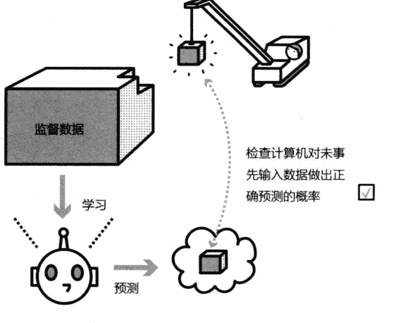

图28 事先从监督数据中提取部分数据，对学习后的计算机进行检查，确认其对这部分未事先输入数据做出正确预测的概率

① 一合约0.18千克——译者注。

## 监督学习里的性能评估

监督学习里，模型的基础由人设计，AI学到的东西都体现在模型里，模型的优劣决定了性能。测试模型性能主要有两个目的：选模型和评模型。

先说选模型。同样的数据，用不同的模型基础去学，结果会不一样。需要先用几套不同的基础分别训练，再比较它们的表现，挑出最合适的。

再说评模型。选定模型后，要知道它对未知数据的适用范围。为了公平测试，不能用学过的数据去测。独立数据指的是没参与学习的数据，而且必须带正确答案。最简单做法是从监督数据里预留一批确认用数据。

先从监督数据里挑出确认用数据，只能用来测试不能用来学。虽然会减少训练数据，但别无他法。用扣除了确认用数据的剩余数据分别训练模型1和模型2，训练完成后把确认用数据输入两个模型，比较输出结果与正确答案的吻合度，吻合度高的模型性能更好。

要确认最终选出的模型在真正未知数据上的表现，还需要另一批测试用数据。测试用数据既不在训练集里，也没用在模型挑选过程中，只能在最后用来评价。于是需要同时预留确认用数据和测试用数据。先用除去这两批的数据训练模型，用确认用数据选出最佳模型，再用测试用数据计算其准确率并评价。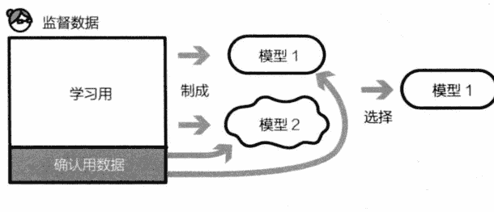

图30 利用测试用数据计算所选模型的精确度，并对模型进行评价

如果只做一个模型，想评价它，只要事先预留测试用数据，按同样流程评估即可，不需要确认用数据。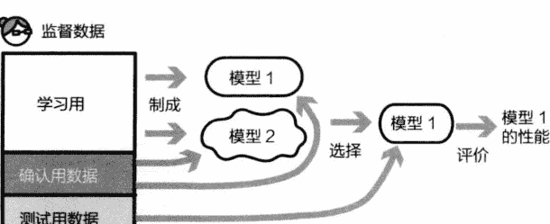

【先选模型再评模型，为什么要做两次】

读到这里，很容易产生一个疑问：既然已经把几组候选模型训练完、再用准确率比一比挑出最好的一组，为什么还要额外再做一次性能确认？挑选和评判其实是两件事。

先批量造模型、训练后比较分数，本质目的是“挑一个”。而要判断这个模型放到真实业务里能否用上，目标是“评”。目的不同，检验的严格程度和做法也不同，否则就不算合格的性能核查。

把实际业务常见诉求拆开来看，就能判断何时需要二次评估。

第一种诉求是：用现有数据做几组模型，帮我选出表现最好的一组。这种场景下，评测只服务于筛选。做一次测试、按结果定冠军就够了，后续不需要再验证。因为目标就是选，而不是给出可信的性能承诺。

第二种诉求是：做几组模型选最好的，同时把该模型的真实水平告诉我。这就要求给出一个严谨、可复现的数值。科研里这种精度很有必要，对纯商业上线则很少做到这个程度。这里必须在选出模型后再独立测一次，原因在于我们是在测试集上“挑最优”，这个过程本身会让分数偏乐观。测试集上的表现并不能等同于面对全新样本时的表现。对候选集算分数时可以复用同一批数据；对最终上线的模型算能力时，参与过学习的数据必须完全剔除。把在测试集上挑选出来的分数直接当成模型实力是错误的。

第三种诉求是：按指定设定做一个模型，并告知其性能。这种需求不多见，相当于方案已定，最终只产出一套模型，自然只需评价一次。

弄清选与评的区别后，就能理解为何要从监督样本中提前预留验证集与测试集。只是当监督样本总量不足时，预留就会让训练集捉襟见肘。这时可以借助交叉检验来解决。

交叉检验的核心是不预先抽离验证集与测试集，而是把样本切分轮换充当测试集。以 4 折为例，实践中常见 5 折或 10 折，这里先用 4 折说明。将监督样本分成集合 A、集合 B、集合 C、集合 D，如图 31 所示。

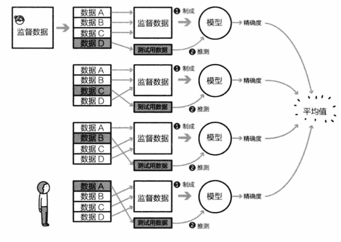

图 31 交叉检查法：无须提取确认用数据和测试用数据，即可对模型性能进行评价

操作是每次挑一折出来当测试集，其余三折合并训练，然后用预留那一折检验效果，再轮换。

先用 A、B、C 训练，D 不参与学习。训练完成后再把 D 输入预测，与 D 自带的正确答案对照，可得到该模型在 D 上的准确率。假设为 80%。

再用 A、B、D 训练，这次 C 被排除。训练完成后用 C 测试，得到另一组准确率。

依次让 A、B、C、D 各轮一次，就能得到 4 次结果，如表 16。

表 16 4 组分割交叉检查

| 监督数据 | 测试用数据 | 精确度 |

| :--- | :--- | :--- |

| A、B、C | D | 80% |

| A、B、D | C | 70% |

| A、C、D | B | 80% |

| B、C、D | A | 90% |

把 4 次准确率求平均，就作为该模型的综合性能。按表 16，平均是 80%。最终上线时我们会用全部 A、B、C、D 重新训练一次模型，交叉检验相当于提前模拟了这个全量训练模型的表现。

## 机器学习的优化使用

到此为止，我们已介绍了监督学习、无监督学习和强化学习三种类型。虽然方法很多，但能解决的问题本质都很清晰，选型并不难。

何时选用哪一种，见表 17。

表 17 监督学习、无监督学习和强化学习的比较

| 分类 | 具备能力 | 适用场合（具体示例） |

|---|---|---|

| 监督学习 | 希望对数据进行分类时 | 希望第一时间判别新进网评的内容优劣 |

| 无监督学习 | 希望对数据进行若干分割时 | 希望将大量网评按优劣进行分组内容 |

| 强化学习 | 希望在某种状态下决定行动规则时 | 希望研发一个能够与客户产生良好互动的机器人 |

监督学习的长处是分类；无监督学习的长处是聚类与分割；强化学习的长处是学习在特定状态下做出最优行动。选定类型后再挑具体算法需要专业知识，但方向是明确的。

## 07 什么是深度学习

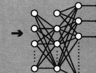

### 深度学习是机器学习的一种方法

AI 热度上升后，“深度学习”被频繁提及。它本质上是机器学习的一种具体实现。很多人会把机器学习等同于深度学习，其实机器学习包含众多方法，深度学习只是其中一种，且在多数场景下表现更强，未来很可能成为主流。人工智能、机器学习、深度学习的关系如图 32 示。

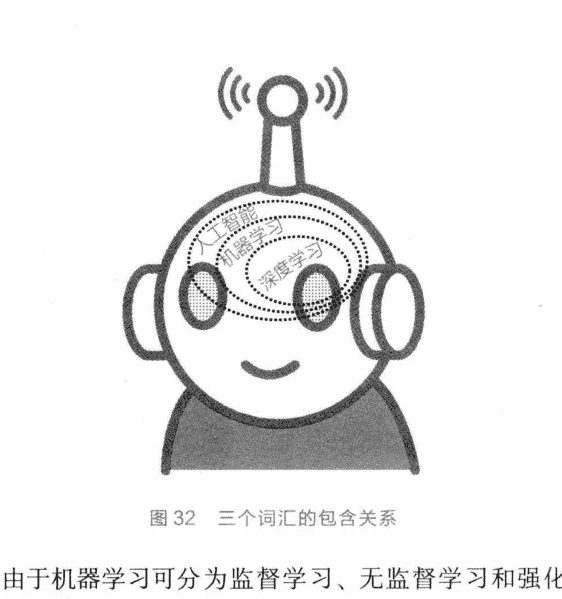

机器学习可分为监督、无监督、强化三类，深度学习可以覆盖这三类之上，所以不能说深度学习只属于监督学习。本书以最常用的监督学习来展开说明。

监督学习是预先输入正确答案，让计算机自行归纳规律的方法。深度学习在监督场景下的含义，就是用深度学习的方式自动发现规律。前面监督学习中标注过的操作，原则上都可以用深度学习替代。

深度学习推动多个领域实现跃升，最典型的是机器翻译。输入一段日文，自动输出英文。深度学习流行前，在线翻译可用但质量难达实用水平。深度学习出现后，准确度大幅提升。翻译这类“在一定规则下答案基本唯一”的任务，深度学习特别擅长。

### 深度学习会进行多阶段验证

计算机用深度学习学到的是什么？它会进行多类、多阶段的检验，再综合得出结论。

例如判断照片里是苹果还是橘子，系统会分别检验“右上角偏橘色”“左下角偏红色”“上方有绿色”等线索。有时还会把前面检验的结果用于下一步检验，例如先判断颜色，再判断表面斑点。实际检验过程难以完整解释，但思路就是分层验证再汇总。

最终输出的是“这是苹果的概率 90%”。深度学习的要点在于分阶段多次验证后综合决策，从而完成非常复杂的判断。

### 深度学习起源于感知机

提到深度学习，很多人以为是近年才出现的发明，实际上早在 20 世纪 50 年代就有雏形，称作感知机。

感知机的思想很简单：接收多个输入，给出一个输出。输入是数值，输出是 0 或 1。系统把输入加总后，超过阈值就输出 1，否则输出 0。输入不是直接相加，会先被加权，如图33所示。

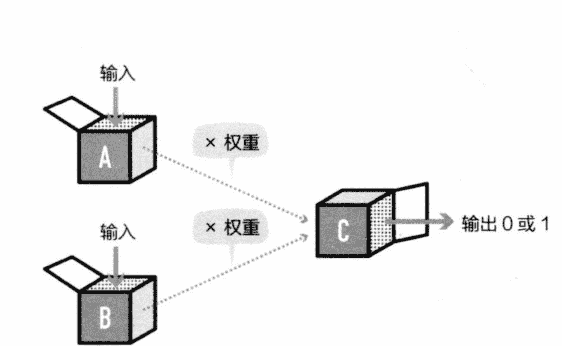

图 33 将 A、B 的输入值分别进行加权后再进行合计，合计值经 C 判定后输出 0 或 1

A、B 是输入，C 是输出。图里只有 A、B，实际可以更多。A、B 的数值沿箭头传到 C 的过程中会按权重改变。先加权再求和，C 再据此判断输出 0 或 1。

可以把权重想象成水管粗细。A 注入的水，经水管粗细改变后再流入 C，B 同样如此。流入 C 的总量决定输出。设阈值为 300ml，A 注入 150ml，B 注入 50ml，会输出 0 还是 1？

先看 A 权重 1、B 权重 2，如图 34。

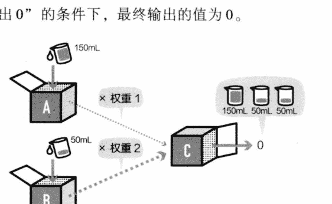

图 34 当 A 权重是 1，B 权重是 2 时，输出结果是 0

A 经权重 1，水量不变 150ml；B 经权重 2，水量变成 100ml。总计 250ml，未达 300ml，输出 0。

再看 A 权重 2、B 权重 1，如图 35。

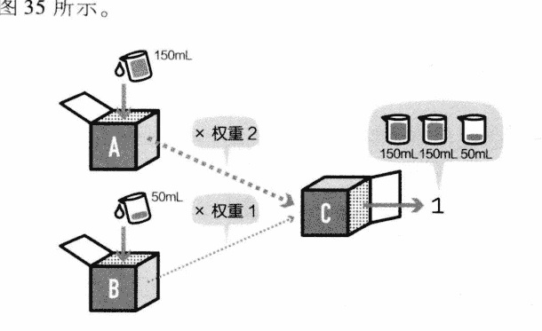

图 35 当 A 权重是 2，B 权重是 1 时，输出结果是 1

A 经权重 2，水量变成 300ml；B 经权重 1，水量保持 50ml。总计 350ml，超过阈值，输出 1。

可见同样输入，权重不同结果不同。深度学习要学习的东西，本质上就是这些水管的粗细。

在监督学习里，监督数据记录了 A、B 的输入和 C 的正确输出。计算机不断调整权重，让输出与正确答案一致。

感知机结构极简，却奠定了深度学习的基础。

## 改变条件的要素“偏差”

上面的例子，C 的判定条件是“达到 300ml 输出 1，否则 0”。A 权重 1、B 权重 2 时，150ml+50ml 加权后 250ml，输出 0。

深度学习学习的是权重，但阈值会不会也学习？输出 0 或 1 这部分是固定的，但“何时该输出 1”是可以学习的。阈值 300ml 这个部分就叫偏差。

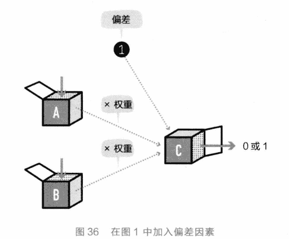

图 36 中，①代表偏差。偏差会让判定条件发生偏移。换成水的说法，就是在 C 处额外加减水量。

引入偏差后，判定条件可以写成“合计值大于 0 输出 1”。这个形式更通用。

举例，偏差设为 -300ml，即先倒掉 300ml。水经权重到 C 为 250ml，再减去 300ml，变为 -50ml，不到 0，输出 0，如图 37。

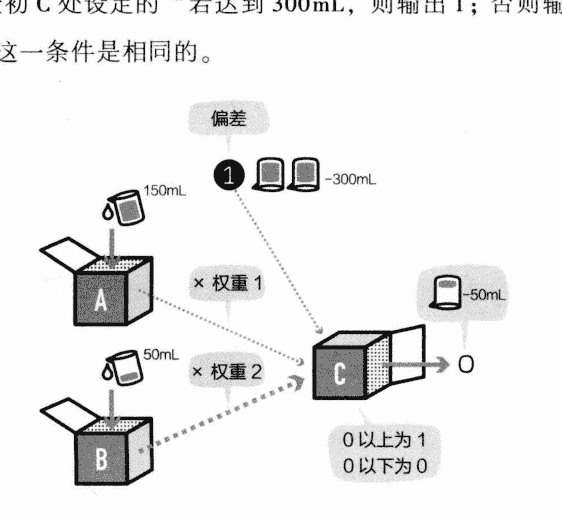

图37 偏差导致水被输出时，合计值未达到0，因此输出为0

实际上“偏差 -300ml，且合计 >=0 输出 1” 等价于原来的“合计 >=300ml 输出 1”。两种写法结果一样，但带偏差的形式更利于后续叠加。偏差和权重一样，都是学习过程中会不断调整的参数。

## 尝试设计多层感知机

感知机的优势是可以把若干个 A、B、偏差这样的单元堆叠起来。两个感知机叠加的例子如图 38，常用叫法是双层网络。

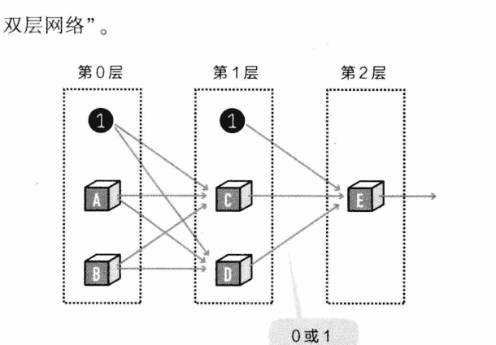

图 38 双层网络（部分文献将该图的第 0 层看作第 1 层，因此称该图为 3 层网络）

每层上方有偏差①，从各输入引出的连线带有权重。第 0 层的 A、B 是输入，C、D、E 根据规则输出 0 或 1。只看第 0 层的偏差、A、B 和第 1 层的 C，和前面单层例子本质相同，只是被放到了第二层。

层数还可以继续增加，如图 39。

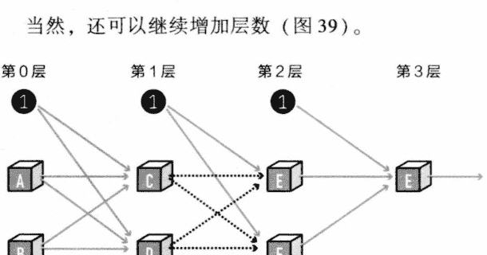

图39 会让人觉得不可思议——感知机本应是接收若干输入后输出一个数值，但是 C 和 D 却各引出了两个箭头。这些虚线并非表示 C 或 D 有多个输出，而是表示同一个输出同时传给 E 和 F。

这已经很像深度学习了，但还差最后一步。

回顾机器学习，监督学习会根据正确答案和模型输出来微调参数。深度学习的权重、偏差就是这些参数。但感知机只能输出 0 或 1，稍微调一下参数输出就可能从 1 变成 0，无法做精细的微调。

## 通过“激活函数”可以实现微调

为了能渐进调整，需要把输出从二值扩展到 0~1 之间的连续值。输入到 C 的计算不变，改变的是 C 的判定方式。相当于在 C 后面加一个过滤器，把数值映射成新的数值，这个过滤器就叫激活函数。

最开始的“输入 >=0 输出 1，否则 0”本身也是一种激活函数。换成可微的激活函数后，参数就能一点点地被优化，这正是深度学习得以进行大规模学习的关键。

我们先拿一个简单的激活函数举例：输入非负就返回1，负数就返回0。随后把它换成另一种形式，让输出能够随输入连续变化，在0到1之间取任意数值。过去的结果只有0和1两种可能，现在则可以得到0.001、0.002之类的小数，组合空间变得无限。激活函数有很多种，实际使用时需根据具体任务事先选定合适的类型。

结构和工作方式没变，唯一不同是输出从二值变成了连续区间。具备这种特性的网络就叫做神经网络。其中最前面的第0层负责接收信息，称为输入层；最末尾的层负责给出结果，称为输出层；夹在两者之间的部分则统称为隐藏层，如图40所示。

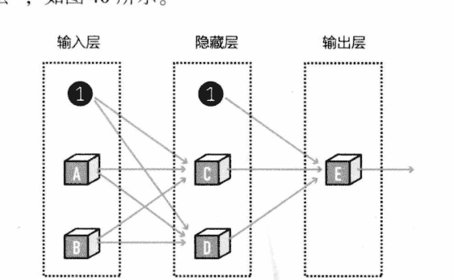
图40 输入层排在第0层，输出层位于最末，其余夹在中间的层即为隐藏层

深度学习本质上就是让神经网络层数加深。到底多少层才算“深”学界并没有严格界线，常见的做法是用隐藏层不少于两层的网络来指代深度学习。

这个思路五十年代就有了，却迟迟没有走红。主因有二：一是层数上去后参数调整难以精确完成；二是计算需求激增，而当时硬件算力远不足以支撑。

换个角度看，提升准确率离不开海量数据，而过去数据积累不足。如今算法、算力和数据都成熟了，深度学习才迎来爆发式关注。

## 输出可以多元化

本书前面介绍输出层时大多以单一数值举例，其实输出可以是多个。在实际应用中，网络结构要根据任务设定，同时输出维度的数量也要事先确定。

比如只判断一张手写体是不是数字1，输出层只需要设为1个节点，这个节点的值就代表“是1的可能性大小”。

若要识别0到9十个数字，就把输出层扩到10个节点，分别对应“是0的概率”“是1的概率”……“是9的概率”，如图41所示。

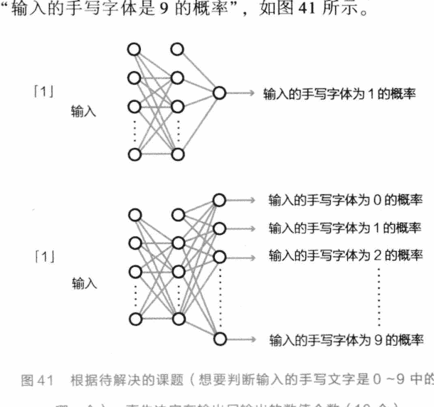

神经网络里每个连接都有自己的权重和偏置。隐藏层一般共用同一种激活函数，而输出层的激活函数往往会另外指定。

## 深度学习为何更受欢迎

深度学习最突出的优点是精度提升明显。它并非万能，但在特定问题上，表现远超传统机器学习。

另一大特点是自动化特征学习。传统机器学习需要人工指定模型该关注数据的哪些部分，这些人为指定的线索被称为特征量。

例如用机器学习做垃圾邮件判别，除了提供正负样本，还得人工给出“要特别注意标题”“关注词性”“忽略助词”等提示。特征量源于经验假设，效果常不稳定。训练不理想时人们会反复删减或增补特征，靠试错调整，效率很低。

使用深度学习搭建同样分类器时，不必手动给出特征。只需确定模型框架，特征提取交给网络自行完成。这种无需先验经验即可获得高精度的能力，曾让研究者感到惊讶，如图42所示。

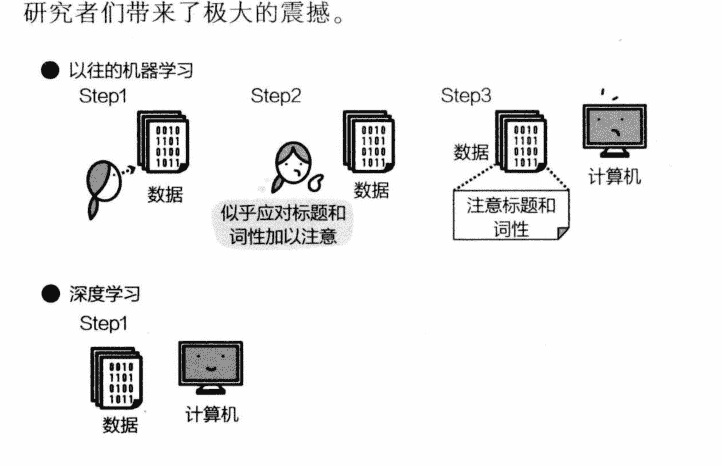
图42 深度学习无需人工指定关注点

很多人觉得深度学习门槛很高，实则恰恰相反，传统机器学习更依赖专业调参经验。

不过自动化并非全然是好事。没有人工特征，也就无法追溯模型到底学到了什么，规则提取过程变得不透明。

传统方法因特征已知，决策依据相对清晰；深度学习则常呈现黑箱效应，训练到结果的内部路径难以解释。

小规模网络还能勉强解析，大规模网络则超出人类理解。于是常见两种困惑：明明数据看起来难分，模型却能给出合理预测；加一层隐藏层准确率就提升，却说不清为何。

可解释性研究正在推进，未来或能以更直观的方式呈现黑箱内部。

虽然控制性较弱，但因经验依赖减少，上手门槛反而更低，不少新手也能快速应用。

## 深度学习的使用门槛

有人说深度学习更适合业余者，其实它也有明显短板：对数据量的需求远高于传统机器学习。正如前面所说，机器学习本身就需数据，深度学习则需要更大规模。少量数据也能训练，但效果往往不理想。数据并非越多越好，但最低门槛很高，具体多少因任务而异，数万条起步甚至更多。

落地时数据采集往往是重中之重。拥有海量高质量数据是巨大优势，但现实中多数团队数据不足。未来能否有效收集数据，将直接决定AI应用成效。

数据足够就能包打天下吗？并非如此。深度学习擅长寻找规律，对于答案近乎无限且无固定模式的问题并不拿手。比如日常自由对话，人类回应千变万化。

听到“谢谢”回“不客气”很机械，真实交流中几乎不会如此。100个人对“富士苹果很好吃”做出回应，可能会得到100种不同说法，这类开放性对话很难仅靠深度学习解决。

并非所有问题都适合深度学习，选型前理解问题本质至关重要。

# 08 AI 如何学习

## 学习就是调参

前面讲了机器学习如何从数据中寻找规律，这里进一步说明它到底在学什么。实际上，机器学习就是在不断调整带参数函数的参数。调整方向由学习数据决定，监督学习则由带标签数据决定。

简单说，函数就是输入一个值，经过运算给出另一个值。比如“输入加1”，输入1得到2，输入2得到3，如图43所示。

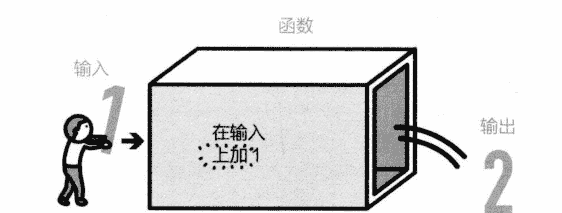
图43 函数对输入进行处理后输出结果

带参数函数意味着运算中存在未知量。刚才的加1可以泛化为加一个未知数，这个未知数就是参数，函数因此被称为带参数函数，如图44所示。AI的任务就是根据数据学习出合适的参数值。

例如机器内置“输入加某数”，告诉它1应得3、2应得4，那么这个某数就是2。

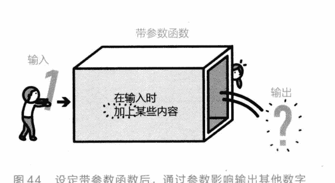

这些输入输出对就是学习数据。机器学习就是在大量输入输出样本上寻找能让参数与之吻合的最佳值。

## 模型到底是什么

一般说来，模型就是带参数的函数。开始学习时，人为设定若干候选函数，监督学习还会提供输入值及其对应的正确输出，即监督数据。

计算机利用监督数据反复调整参数，让函数在输入时尽可能输出正确答案，如图45所示。

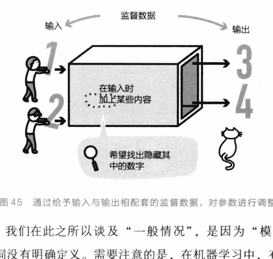
图45 用配对的监督数据指导参数更新

需要说明的是，“模型”没有绝对统一的定义，在不同语境下含义会略有差异，使用时要注意上下文。

# 09 把AI用起来

## 用好AI的两大核心能力

要让AI真正发挥价值，需要哪些核心能力？是编程还是数学？知识当然越多越好，但最关键的两点是：

1. 把握问题本质的能力。
2. 制作数据的能力。

第一点是理解问题的本质，能以AI的视角判断问题是否适合用AI解决，以及如何解决。

工作中常因耗时过长或过于繁琐而想引入AI，但表面看不出切入点。这时需要把流程拆解，明确各环节构成、瓶颈所在、AI能介入的位置，才能形成AI视角。

第二个关键是数据构建能力，这可能出人意料，却至关重要。当前AI多靠机器学习，而机器学习依赖数据。AI性能上限很大程度上取决于相关高质量数据的数量和质量。

当然算法优化也很重要，但现实是，投入巨大精力换来的方法提升往往只有零点几个百分点，而数据的改善带来的收益更为显著。

## 案例：卡拉OK视频自动化

下面用一个例子说明如何把握问题本质。假设你在卡拉OK视频制作公司工作，每天要根据歌词挑选合适的画面。歌词千变万化，画面库庞大，需要反复匹配，工作量大且易疲劳。

先把整条业务链条拆成最小步骤。整体任务是“依据歌词制作视频”，可拆为：

- 第 1 步，对歌词进行切分。
- 第 2 步，理解切分后的各部分歌词。
- 第 3 步，结合歌词内容寻找画面。
- 第 4 步，按照歌词顺序对画面进行排列。

画面种类共有 1000 种，每种都有对应的名字，例如“在海边嬉闹的男女”等。

接下来逐项评估。第1步歌词切分可用简单自动化完成，耗时不大，暂不考虑AI。第2步理解歌词目前仍依赖人工，先跳过。第4步只是排序拼接，也能自动实现。第3步匹配画面耗时最长，最适合用AI加速。

具体做法是把歌词归类到1000种画面标签之一。比如“分手后独自在海边哭泣”，就对应“海边哭泣的女性”这一画面标签，如图46所示。

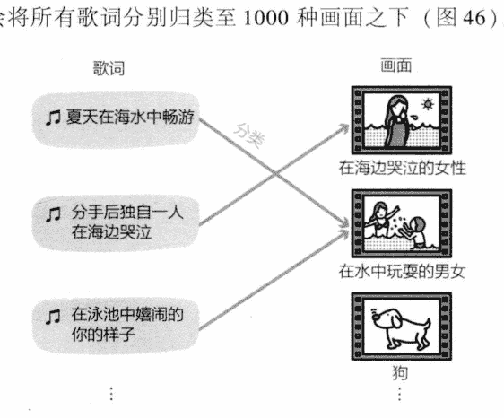
图46 把歌词映射到对应画面即是一种分类任务

人类做的是分类决策，而这是AI擅长的。所以第3步完全可以交给AI。整体来看，把工作拆细后找到隐藏的分类环节，就是AI介入的关键。分类只是起点，后续还能发现更多适用场景。

要实现这一步，需要准备歌词到画面的标注数据，也就是监督数据。过去人工完成的分类结果可以直接作为训练样本，数据量足够即可训练模型。

很多传统工作里都藏着分类操作，非常适合AI接手。AI不会疲劳，标准稳定，往往能超越人工精度。

## 拆解问题，养成习惯

再看另一个例子。想做一个简单的自动聊天系统，对话如下：

| 发话 | 应答 |
| :--- | :--- |
| “今天好热啊！” | “真是啊！” |
| “我饿了。” | “吃点儿东西吧。” |
| “我走啦”。 | “走好啊。” |

若应答不能固定，问题很复杂；但如果应答只有几种可选，就能转化为分类问题。假设只有“真是啊”“吃点儿东西吧”“走好啊”三种回复，那么“我没吃早饭”也应归入“吃点儿东西吧”，“那片云真特别”归入“真是啊”。

从这个角度看，对话其实也是把用户输入归类到预设回复中，本质仍是分类。

用AI时要穿透表象，看清本质，这样才能判断适配性和使用方式。

要做到这点，关键是养成拆解工作的习惯。把任务拆到最小粒度，就能更容易发现其中的分类点，聊天案例里的分类就是被表象掩盖后才显现出来。

## 数据准备的痛点

对现阶段AI而言，数据是核心。没有数据，再好的算法也无从发挥。数据制作看似简单，实则困难，主要体现在两点：

- ①人工难以收集令人满意的数据。
- ②难以制作海量数据。

关于①，多见于需要人工采集数据的场景。只要动用人力采集，首先就要写一份操作指南，然后让执行人员按指南去收集。这种做法对答案比较直观的研究题比较适用。但我们想用 AI 解决的问题，往往更复杂，一旦理解出现差异，采集标准就会跑偏。为避免这种情况，除了要准备操作手册进行指导，还要在执行过程中不断确认操作者的理解程度，并及时刷新手册。

不过即便手册做得再完善，在传递给执行者的环节里，还是会因沟通方式产生偏差。操作者的个人能力会影响对手册的解读，如果说明本身就不够清晰，误解就更容易发生。所以在这类课题的数据采集环节，必须格外留心，防止人为因素导致标准不统一。

关于②，多见于需要处理海量数据的情况，比如数百万到数千万条。举例来说，假设要在 3 天内拿到 1000 万条数据，其中包含与运动相关的句子等。此时用好 AI 的关键在于能否找到高效的采集路径。

没有海量采集经验的人可能会觉得 3 天凑齐 1000 万条不现实。其实海量采集是有技巧的。以这个目标为例，第一步先找到可以作为数据底座的大量句子，最大的难题是：在这些句子里，哪些与运动有关？靠人力逐条筛查是不可能的。

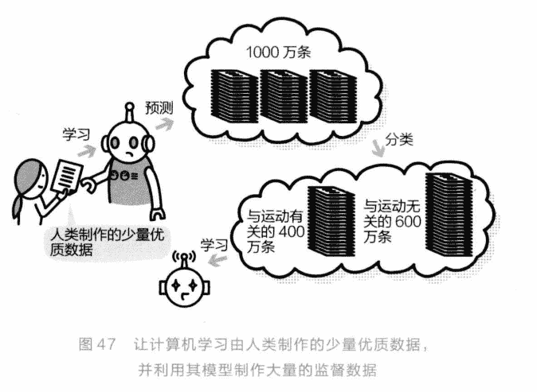

图 47 让计算机先学习人类制作的少量高质量样本，再利用模型批量产出监督数据

最常见的做法是：先由人工制作少量优质数据，让计算机学习，再借助模型对海量数据进行分类，如图 47 所示。也就是说，需要先准备好机器学习用的监督数据。

技巧和方法可以通过学习获得，但做出“让人满意的数据”更多依赖实践经验积累，所以关键是要敢于试错，逐步培养并提升使用 AI 的能力。

# 下篇

# AI 与行业真实碰撞

# 01 AI 正如何重塑工作方式？

## AI 真能全面取代人类工作吗？

今天 AI 已在全球广泛落地，未来覆盖面还会更大。试着设想一下未来会如何变化？很多人会感到不安，担心 AI 发展的速度会不会把人类的岗位全都抢走。

如果你读过前面关于 AI 构造的介绍，就能明白，AI 有擅长的地方，也有短板，所以它不可能取代所有工作。

确实 AI 的能力很强，但就目前来看，它并不会直接夺走人的饭碗。不过认为 AI 的到来对工作毫无影响是错误的。工作形态会因为 AI 的引入发生巨大变化。比如按既定流程操作的工作，AI 完成起来会比人更准确。这样，原本由人来做的这类工作就会被 AI 取代。这就意味着相关工作全部消失了吗？并非如此。比如会产生下面这些需要人来做的新岗位（图 48）：

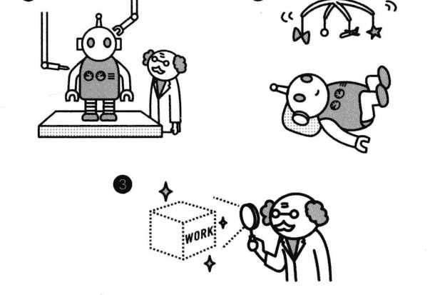

图 48 AI 时代可能催生的新岗位

①AI 开发 ②AI 优化 ③对 AI 产出进行最终审核

- 1. 开发所需要的 AI。
- 2. 对 AI 进行持续完善。
- 3. 对 AI 的工作结果做最终检查。

下面逐项展开。

## AI 时代的新型工作

### 开发所需的 AI

有人觉得开发 AI 是专家的事。让模型学习这部分确实需要专业，但把 AI 做成能用的产品时，数据准备至关重要。没有数据支撑，开发根本无从谈起。

当下 AI 的竞争很大程度上是数据的竞争，必须结合具体课题去收集大量优质数据。为此，人类需要精通业务领域，同时要擅长大规模数据采集。

比如想做一个能识别垃圾邮件的 AI，就需要大量普通邮件作为训练样本。即使 AI 已经存储了大量邮件，要让它在海量邮件中准确分辨出垃圾邮件，也必须由人先教会它的判别规则。

不过垃圾邮件的判断相对简单，因为不需要专业知识就能下结论。

那么如果要收集健康人群和非健康人群的肺部影像，该怎么做？成千上万张影像摆在面前，要判断哪张属于健康者，就需要专业医学知识。类似地，当我们为某个课题开发 AI 时，在数据准备阶段就必须对课题有深刻认知。未来不仅要懂 AI 开发，还要具备相关领域专业知识，以及高效获取课题相关数据的能力，这会越来越重要。

### 完善 AI

AI 开发完成后，并不建议长期不动。几乎不可能一次就做到完美，所以必须在实际使用中不断完善。完善本质上就是二次学习。比如用 AI 判别垃圾邮件时，偶尔会出现误判：把正常邮件当成垃圾，或反之。在真实使用过程中，要检查 AI 的失误并纠正，避免重蹈覆辙。

垃圾邮件的例子比较简单，看似不会出大问题，但也有更复杂的情况。有些课题和开发一样，在优化 AI 的过程中同样需要行业专业知识。只有人类先弄清楚 AI 错在哪里以及该如何纠正，才能进行有效的二次教学。而且 AI 的二次学习也离不开数据。未来的关键在于：先搞明白什么样的数据能修正错误，再去制作可用数据。

### 对 AI 产出做最终把关

AI 会给出答案，但那只是推测。正如“AI 的短板”部分所说，AI 本身无法推导出绝对正确的结论。以垃圾邮件为例，每天判定量巨大，人工复核不现实，但如果是产量有限的产品，人类的最终检查就必不可少。当然人类的判断也不是万无一失，也可能出现人判错而非 AI 判错的情况。尽管如此，未来“人复核、AI 初筛”的模式会越来越多。

如上所述，当 AI 进入人类工作场景，工作形态会发生根本变化。未来既要掌握业务知识，也要懂 AI 知识；还要具备为 AI 采集数据的能力，这将在很大程度上决定竞争力。

AI 已对各行各业产生深远影响。下面将围绕在具体工作中如何有效利用 AI，以及 AI 对工作的冲击展开讨论。

# 02 咨询与客服中心

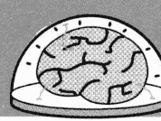

## 问询工作正被 AI 接手

咨询窗口和客服中心的服务对象主要是对产品或服务有疑问的客户。工作人员不仅要掌握大量产品知识，还要有良好的理解力，能准确把握客户到底在问什么。而且不能只是照本宣科，还要根据实际情况适当地补充相关信息。

如果让 AI 来承担咨询和客服，就必须具备与人对话的能力。历史上提到的伊莉莎 ELIZA 虽然能对话，但程序只是“问 A 回 B”，远不能胜任咨询和客服工作。

现在 AI 已能在一定程度上承担咨询和客服。今天我们身边已经出现了 AI 咨询入口。在浏览网页时，你是否注意到页面角落常出现的“客服咨询”标识和动画人物？点开后输入文字就能与它聊天。这个动画人物正是替代人工完成问询的 AI。这种可交互系统叫聊天机器人，已被广泛应用。

## AI 的强项在任务型对话

聊天机器人的对话大致可分为两类。一类是有明确目标的“任务指向型”对话，比如“我想查天气”“从体育馆到百货大楼打车要多久”“我想设置闹钟”等为达成目的而进行的对话。另一类是无目的的“非任务指向型”对话，也就是闲聊。通常在咨询和客服场景，客户都带着需求而来，所以 AI 需要擅长任务指向型对话。

在两类对话中，AI 更擅长的是任务指向型。AI 擅长从海量数据中提炼规则和模式，任务指向型对话范围相对限定，答案往往唯一，AI 就能给出高质量回应。

那闲聊呢？稍加思考就会发现日常谈话内容无限，回应方式也千变万化。对于同一个话题可以有各种各样的接法，让 AI 进行像人一样的天马行空聊天，难度非常大。

## 客服会走向纯 AI 时代吗？

虽然自由对话仍难以实现，但只要是为了达成目标的交流，AI 已经能比较准确地完成了。可以设想：未来如果对话型 AI 的精确度进一步提升，人类客服和咨询岗位很可能被 AI 取代。到那时，只需少量资深人工待命，应对“坚持要找真人”的客户，或处理 AI 无法应对的难题。

再往后，或许能出现真正擅长闲聊的 AI。到那时，人类在咨询和客服领域的工作将转向为 AI 持续提供最新信息、进行信息校对和优化 AI 本身（图 49）。

对商家而言，充分利用 AI 能大幅降本。AI 让计算机分担部分工作，节省大量人力成本。对顾客而言，信息的可靠性会提升。人工信息也可靠，但由 AI 提供可以避免因疏忽导致的错误。我们未来能更轻松地通过与计算机交流获取信息，这个时代正在到来。

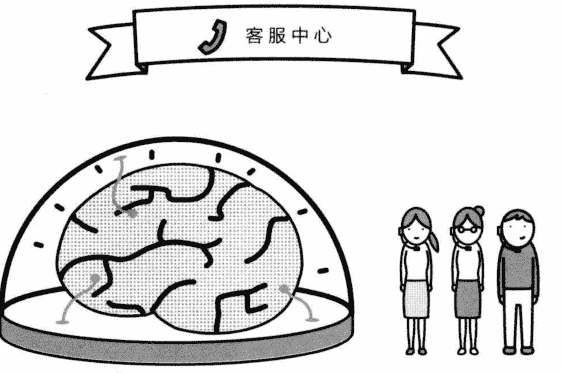

图 49 人类可能为客服 AI 补充新信息或调整内容

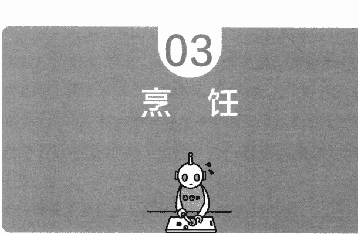

## AI 能基于食材创造全新食谱

提到烹饪和 AI，很多人觉得两者无关。如果把 AI 引入餐饮，会发生什么？

最直观的想法是：输入食材，AI 就推荐食谱。当然，如果只是检索食谱，还谈不上 AI。AI 不仅能检索，还能基于用户做过的菜和浏览记录，推荐用现有食材能做出的菜品，并尽量贴合口味。

具备这种功能后，随着使用，AI 会越来越懂用户口味，不断推荐合适的食谱。用当前技术开发这样的 AI 并非难事，类似系统早已存在。因为规划每日菜单很费力，如果 AI 能帮忙，工作就能轻松不少。

不过只推荐存量食谱没什么新意，我们更期待能自主设计全新食谱的 AI。具体来说，输入食材后，AI 能围绕这些食材提出全新菜谱。要实现这一点，需要让 AI 学习与食材相关的海量食谱。机器学习擅长从大量数据中找规律，因此 AI 通过学习现有的食谱大数据，就能发现输入食材常与哪些食材同现，或不常搭配的规律。

## 食谱内容的复杂性

仅有数据就能生成新食谱吗？未必。原因之一是食谱虽以文章呈现，但 AI 需要结构化地理解其中的信息。举个例子，食谱里写“将 2/3 个土豆去皮后切成不规则形状”，其中就包含“给土豆削皮”“取 2/3 并切成不规则形状”等复合、结构化的操作，而且还需要理解什么是“不规则形状”（图 50）。要让 AI 学会这类具有特殊属性的数据，就必须找到合适的处理方法。

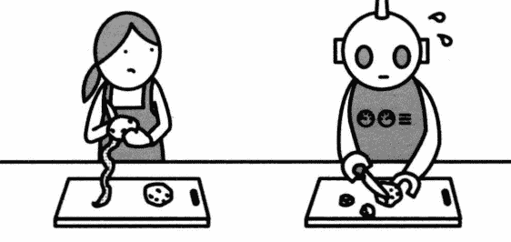

图 50 “将 2/3 个土豆去皮后切成不规则形状”——这类菜谱表述对 AI 来说理解难度很大

如果这个问题被解决，AI 能顺利学习食谱数据，创造新食谱就成为可能。因为食谱本身符合一定规则，有时甚至会诞生只有 AI 才会想到的搭配。人常有“某食材和某食材绝对不能同吃”的成见，而 AI 没有包袱，能跳出思维定式。AI 在大量食谱中学习搭配规律时，可能会发现人类意想不到却实用的组合。围绕“会做菜的 AI”的研究已经在进行中。

## 能创作食谱的 AI 需要厨师来做吗？

一旦 AI 能学习食谱，下一步人们很可能让它继续学习营养、时令等知识。加入营养知识后，AI 创造的食谱不仅考虑口味，还会兼顾营养均衡，并优先使用当季食材。

不过 AI 创造的食谱是否真的好吃，还得做出后再尝才知道。如果 AI 做出的菜都好吃，厨师的工作或许就会变成开发能做美味食谱的 AI。

另外，人们还在研发其他烹饪相关 AI，例如通过菜品照片分析出食材和使用方法。开发这类 AI 需要把大量菜品照片、食材清单、食谱等组合起来训练。AI 从中学会食谱模式，比如某种菜通常用哪些食材、怎么烹饪等。如果这类 AI 能实用化，不久的将来，拍下餐厅里的一道美味，就能在家复刻出来。

## 说出想吃的菜，AI 可实现从食谱到烹饪的一站式服务

如前所述，当前 AI 已在很大程度上能创造或推测食谱。那么再往前瞻望，AI 能否不仅创造食谱，还能完成实际烹饪？人们已经开始研发具备烹饪能力的 AI，目前还未实用化。如果机器人能与人对话，只要说出想吃什么，它就能根据冰箱里的食材创造新食谱并动手烹饪——这样的场景很可能在未来实现。

如果有一天机器人能自创食谱并烹饪，并且成为日常生活，那么人类是否就不用做饭了？确实，如果工作交给机器人，即使什么都不做也能吃到稳定美味的饭菜。人类烹饪做不到机械性的稳定，每次味道可能有偏差，有时偏甜有时偏咸。但正是这种不稳定构成了家的味道，让人百吃不厌。如果机器人烹饪时代真的到来，就需要人为设置，让机器每天做的菜略有变化，否则一成不变的饭菜迟早会让人厌倦。

# 04 播音与配音

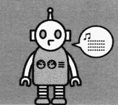

## 用 AI 替代人声真的全是好处吗？

播音员和配音员的工作都与声音相关。播音员播报新闻，配音员按剧本配音，本质上都是把文字变成声音。如果交给 AI，会有哪些优势？

对人类播音员而言，直播时可能读错，AI 不会。而且 AI 的声音没有瑕疵，不需要休息，能始终保持稳定质量。

对配音员而言，从制作公司角度看，若不用请专业配音员就能大幅降本。而且 AI 能瞬间生成声音，即使截止日期临近也能快速完成。

现实中已出现把文字转成语音的 AI，称为“语音合成系统”，它已在解说等场景投入使用。

## AI 如何把文字变成波形输出

语音合成系统属于哪类 AI？简单说，声音可以用波形表示，要把文字变成语音，只需把文字转成波形即可。所以语音合成系统本质上是文字到波形的转换器（图 51）。实现方式多样，一种是从大量录音中截取极短的声音片段拼接起来。这种方法合成的声音听起来会不自然，于是又出现了把声音和文本信息综合建模、按特征合成的方法。

语音合成的研究很早开始，市场上已有成熟产品。虽然发音已经相当自然，但和真人相比仍有违和感。更难的是动画或电影那种情感丰富的配音。最近人们尝试用深度学习合成更自然的声音，或许不久的将来，语音合成系统就能像人一样饱含感情流畅发声。如果那一天到来，我们或许只能在顶级动画或电影里才能听到真人配音。

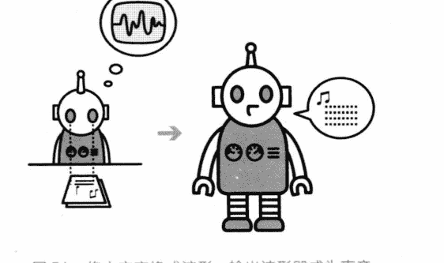

图 51 把文字转为波形，输出波形即为声音

## 语音识别系统已可实用

与语音合成相反，还有一种 AI 是把声音转为文字，称为“语音识别系统”。它把波形转成文字。当用户用语音输入并想达成某个目的时，这种 AI 就派上用场。它同样基于机器学习，性能已达到实用水平。

现在可以将磁带里的声音自动转写，原本需要人边听边记，现在系统能自动完成。当然出于准确性考虑，仍需人工校对，但相比从零手工记录，效率大幅提升。

语音识别系统很少单独使用，实际中常与其他功能组合。例如与机器翻译结合，可把汉语转成英语。因为机器翻译只处理文本，所以输入语音时，还需要先把语音转成文本。

在此基础上再搭配语音合成系统，就能实现把输入的汉语语音转为英语语音输出。AI 通过组合能实现各种功能，人类也能充分发挥想象，用组合的方式达成更多目标。

# 05 保育员与教师

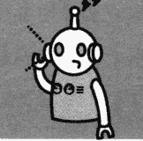

### 机器人能取代老师吗？

【AI 真能搬进教室吗？从教师到农田的替代边界】

想象一下，如果保育员、幼儿园老师这类教育岗位被 AI 机器人取代会是什么景象。面向教育开发的机器人大致分两种：一种是能自己拼装、按程序跑起来，让人理解机器人结构的学习型机器；另一种像真正的老师一样向人类传授知识。人们担心被替代的保育员、教师，正属于后一种。我们就围绕这种“教学型”机器人展开看。

机器人真的能当老师吗？市场上已经出现不少面向儿童的教育机器人。对孩子常问的“这是什么”“为什么会这样”这类问题，机器可以给出回答。孩子的好奇心往往来得突然，父母常手足无措。再加上联网的 AI 拥有海量知识库，几乎能应付大部分提问。某种意义上，这台机器就是一本会说话的百科全书。

## 对话式 AI 仍卡在“自然感”

但以现阶段的技术，要实现真正顺畅的对话并不容易。AI 可以回答“富士山多高”，却做不到在不经意的闲聊里自然带出与富士山相关的背景信息。即便如此，机器掌握的数据总量远超人类，足以满足求知欲。

比如问“富士山的高度是多少米”，机器人会回“3776 米”。支撑这类问答的是内置的对话系统，类似问询处或客服后台。从外表看机器人是实体的存在，其实它更像一个窗口，联网后背后的对话系统才开始工作。

很多人以为对话系统靠声音，其实它本质是文字对文字。系统本身不具备收音放音的能力，只是接收文本、输出文本。

## 语音对话其实是三体协作

要让机器人开口说话，需要把多个 AI 串起来。语音对话的组合至少包含三块：能进行文本对话的核心系统、把人声转成文字的语音识别、把文字转成声音的语音合成。也就是说，会说甚至会聊天的机器人，背后至少是三套专业 AI 在协作。

其构成大致是这样的：人说话的声音先进入对话系统，系统判断是语音输入，于是把信号送给语音识别。识别模块推测出文字内容，再把文字序列传回对话系统。对话系统据此生成回答文本，因为机器人不能直接把文字说出来，就要把这段文字再交给语音合成变成声音，最后由对话系统送回机器发出。如果只是纯文本交互，就不需要识别和合成环节。所谓机器人这一块，可以理解成发声装置，也可以是智能手机，关键是能把声音或文本送进对话系统，外形并不重要。

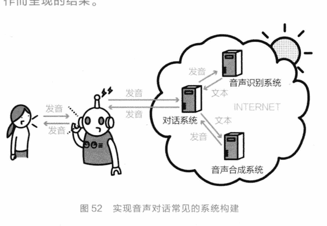
拿“富士山的高度是多少米”举例，问题通过机器传给对话系统。系统判定是语音，先交给语音识别。识别后把文字猜测回传，系统据此生成“3776 米”的文本回答，再送给语音合成转成语音，最后由机器发出。若只需文字输入输出，识别和合成都可以省掉。

## 机器人教师黎明前夜

受限于对话技术，目前机器人只能答题或进行简短会话。随着技术迭代，AI 有一天像人类教师那样开展教学并非空想。一旦实现，教师供给会大幅增加，因材施教、个别化指导成为可能。

不过教育不只是知识传递。真人老师会和学生一起做游戏，犯错时批评，伸手摸摸头，这些身体接触与情感陪伴必不可少。无论 AI 如何进化，人与人交往中的温度，是机器人难以替代的。

## 06 小说作家
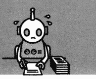

### 零到一的创作鸿沟
前文提到过，AI 很难做到从无到有的创造。而小说创作恰恰需要零到一的原创。让 AI 写小说听起来像科幻桥段，但尝试已经在进行。多数情况下人类仍要先把基本框架或情节输进去，完全由 AI 独立完成的尚不存在，而且成品质量也远不及人类手笔。

AI 能创作吗？AI 确实做不到零到一，但人类创作真的是零到一吗？人类写小说时积累了大量过往经历和信息，创作不过是把这些素材提炼重组。如果是这样，AI 也有机会模仿这个过程。

AI 的前提是海量数据。世界上小说无数，让模型学习后或许能生成文本。但小说创作远比拼凑复杂。

## 给 AI 喂剧情，故事会成吗
小说创作的难点在于，它不是文章的堆砌。就像之前谈烹饪数据学习的难题，故事里有多个情节、细节、人物，人物之间还有关系网。创作必须把这些庞大信息合理组合，保证前后逻辑自洽。稍有敷衍就会出现同一个人物一会儿爱吃甜食一会儿又厌恶，情节自相矛盾。人类写手也会犯这种错。

AI 可以自主造句，只要语法不出错就行。可这不等于小说。真正的叙事要围绕情节展开，而 AI 目前难以做到，因为我们还不知道该如何把情节、人物等结构化信息充分喂给模型。未来若找到输入方法，AI 也许能通过模仿掌握故事概念。

现阶段让 AI 写出与人类相当的小说很难。但如果有一天 AI 真成作家，也许会产出超乎人类想象的异想天开情节。也能让 AI 学习带有个人偏好的故事来定向生成。若喂给它某位作家的全部作品，也许能写出风格相近的新作（图 53）。当下不妨平常心看待 AI 小说的败笔，耐心等待它真正赶上甚至超越人类的一天。

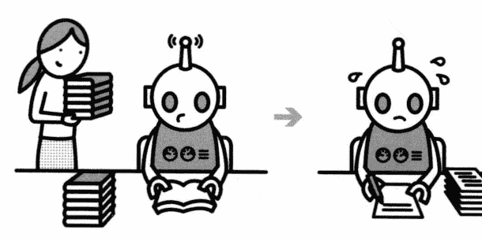

图 53 如果让 AI 学习某位作家所有的文章，AI 或许可以写出具有那位作家风格的新作品

## 中割能否交给 AI 手绘
动画相关职业很多，最先想到的就是动画师。他们绘制的画面最终拼成动画。其中一种工作是绘制连接关键帧的中间画，也就是中割。最初和最终的画面叫原画，中割就是填补其间的画面。

中割能交给 AI 吗？已经有团队在研自动中割的 AI，但现阶段性能还不足以实用。自动生成的画容易变形，导致整幅失败。

不过 AI 擅长根据前一动作推断下一个动作。如果提前把中割的重点部分设计好，其余细节交给 AI 自动补全，已经接近实用。

举例来说，两张原画之间原本手绘 4 格，要扩充到 24 格。4 格动作会显得生硬，24 格则流畅。难点在于那 4 格本身也需要自动生成，这对创造力要求很高。创造性是 AI 的短板，但中割处于可推断的原画之间，从长远看 AI 独立完成中割终将实现（图 54）。一旦实现，人类可把精力放在更高阶工作上，动画整体品质也会提升。

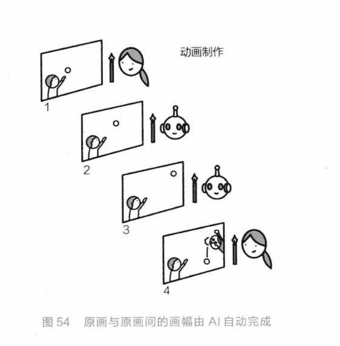

图 54 原画与原画间的画幅由 AI 自动完成

## 像素背后的规律
数码画由无数小点组成，逐个上色后俯瞰才显出画面。海面是大量蓝色小点，沙滩是茶色小点，上色前只有黑白点阵。AI 学习的就是这些点阵里隐藏的规律。

人物设计属于动画环节，创造力偏弱的 AI 能否胜任？原创设计非常困难，暂且假设基于已有作品改编。即使如此，对现阶段 AI 仍有难度，但并非完全不可行。

只要数据足够，AI 能总结出特征。比如让 AI 学习某画家的作品，再给出作画要求，就能产出风格相近的画面，这一点已可实现。

套用到漫画人物设计：让 AI 学习某原画家的作品，再告诉它想要的人物类型，它就能用接近该画家的笔触创造出动画人物。尽管 AI 不擅长原创创造，承担部分创造性内容仍有可能。

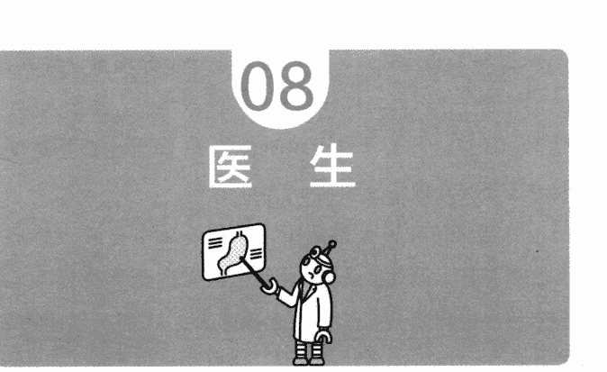

## AI 医生会不会误诊
AI 取代医生听起来难以置信，但医疗工作与 AI 契合度很高，已成为 AI 引入的前沿。近期新闻甚至报道 AI 诊断出医生漏掉的病例。

医生工作面广，最熟悉的是根据症状诊断并给出治疗方案。医生依靠经验和知识判断是普通感冒还是重症，这正是 AI 的逻辑。

医疗领域使用 AI 的优势很多，其中一点是“基本不会误诊”。医生在影像或症状上偶有疏漏导致误诊，人类难免犯错。但 AI 在数据支持下，只要匹配到诊断数据对应的症状，就不会失误，前提是它学过相关病症。对医疗而言，这种零失误价值巨大。

另一优势是无需长时间思考。人工在海量数据中找目标耗时极长，危重病人等不起十天。AI 处理速度远快于人类，在大数据诊断上优势明显。

未来 AI 可能不会完全取代医生，但以下工作完全可以由 AI 完成，甚至做得更好：
- 问诊。
- 基于问诊和检查结果诊断疾病。
- 根据诊断结果提供治疗方案。

能同时胜任全部的 AI 仍难，但分别完成上述任务的 AI 已出现。

问诊依赖对话技术研发，问诊本质是任务指向型，比自由闲聊更容易实现。若需要高阶闲聊来捕捉病人状态，目前仍需人工。

诊断方面，AI 已能部分落地。有案例显示 AI 根据影像诊断癌症的准确度高于人类。把生活习惯、职业等背景信息综合输入 AI 再诊断，目前仍难。但当前技术已足以开发一种 AI：用癌症患者与非患者的肺部影像训练，之后通过影像判断是否患癌（图 55）。

而且机器学习能发现人类未察觉的规律。AI 通过学习大量疾病和症状数据，可能找出人类尚未发现的关联。没有思维定势的 AI 更擅长捕捉细微关联。全面交给 AI 或需时日，但医生与 AI 协作诊断的时代已经不远。

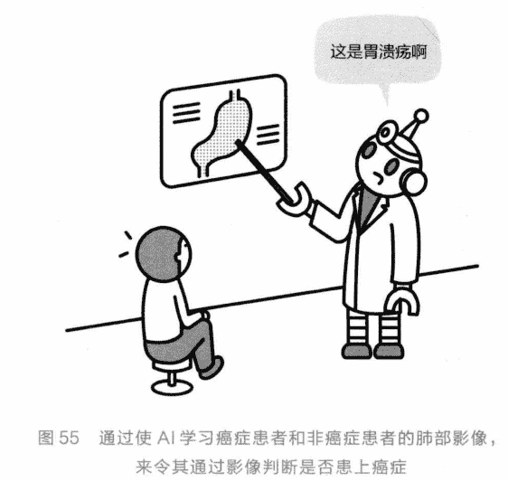

图 55 通过使 AI 学习癌症患者和非癌症患者的肺部影像，来令其通过影像判断是否患上癌症

## 隐私是医疗 AI 的红线
正如所述，AI 在医疗领域前景诱人，但现实问题不少。除了技术，个人信息保护和患者隐私更关键。AI 需要的是真实患者的症状与疾病数据，处理时虽不指向个人，但很多人不愿把隐私交给系统。加速医疗 AI 推广的第一步，是向公众说明使用好处，让大家理解收集疾病数据的重要性。

## 让经验不再只存在脑袋里
农业与 AI 乍看无关，但农业领域已开始引入 AI，优势明显。

一是作业高效化，把原本手工的环节交给 AI。对于已机械化的农户，效率提升有限，但在作业优质化上优势明显，因为 AI 精度高于现有机械。

二是实现难以明示的经验共享。农业极重经验，很多心得只留在作业者记忆里，无法语言化。比如“照这个天气，黄瓜该收了”，没有统计验证，却是多年经验总结的规律。AI 擅长经验性和统计性工作，把这些经验移植到系统是必然趋势。

把经验转成 AI 的好处在哪？假设凭经验种黄瓜的农户要传给接班人，方法教了，接班人种出来的却不如前辈。因为数十年经验很难传授，接班人只能从零积累。若把依赖经验的工作交给 AI，接班人就能在继承经验的基础上再积累新经验。

## 分拣黄瓜，AI 更省心
AI 可广泛应用于农业的多个环节。AI 擅长分类，农业中有大量分类场景，比如农作物出货时分拣。种黄瓜的农户需要剔除弯度过大的果实，需判断“弯”与“不弯”，这很适合 AI。

设想 AI 判断黄瓜形态。可收集大量弯曲超标和合格的黄瓜照片让 AI 学习，AI 会自行找出判断弯曲的规则。学习后，AI 看到新图像就能按弯曲与否分类。这样既省人力，又能按统一标准持续判断（图 56），出货更放心。

## 用天气预测黄瓜长相
与分类不同，还能开发预测收获日黄瓜形态的模型。农户都想在不同气象条件下找最佳收获时机，通常靠经验。若把过去四天天气与收获时的黄瓜形态记录成数据，就能看到收获日天气相同，前期天气仍会影响形态。把收获前四天的天气信息与形态好坏关联，让 AI 学习后预测形态，就能选择形态较好的日子收获。

现实中除天气外还需输入更多信息，也要思考如何定义“形态好坏”。黄瓜分类的课题并不简单。但只要用传感器采集信息并存储数据，对 AI 来说问题都会迎刃而解。

## 10 秘书

### 安排日程才是核心
秘书工作繁杂：接打电话、写文件、安排日程等。终有一天 AI 会接手，但目前仍有局限。

以电话为例，若对话内容相对固定，AI 可胜任。但真实通话需根据对方发言即时应答，现阶段 AI 难以自如对话，因此仍需人工。

文件写作同理，有规则可循时 AI 能写，但机械按规则书写不符合“秘书”定位。

再看日程安排。市场上已有能安排日程的 AI，指的是读取对方邮件内容，结合已有日程进行安排。不仅要理解邮件、写入日程，关键是“安排”本身，还要通过邮件与对方沟通。这要求 AI 能理解邮件、确认日程并回信。做到这些，才能算名副其实的秘书。

## 预测计划才是 AI 的拿手戏

想一下，假如秘书这份工作交给 AI 来干，最先会被提到的好处是什么？无疑是花钱更少。跟养一个真人团队比起来，接入 AI 的开销要小得多。当然秘书的工作范围非常宽，绝大多数环节现在仍离不开人手。但往后看，像日程排布这类重复性任务，被 AI 接手只是时间问题。

AI 怎么排日程？它处理邮件、回信的逻辑，跟任务型对话很像，都是奔着一个明确目标去的。先读懂邮件里有没有会议、约饭之类的安排需求，判断有就进入理解和调度环节。跟开放式聊天比，这里只限定在会议场景，看似简单，其实有个关键难点：AI 必须先掌握使用者现有的档期，在此基础上调整后再回复给对方。

分类和推算是 AI 的拿手戏，它还能基于历史数据做推演。比如周三周四都空，到底哪天更合适？AI 会回溯这个人过往的所有安排，尝试预测接下来会塞进哪些事项，从而推断周三可能已有其他计划，于是把会议推到周四。

但重要会议目前没人放心全权放手，人类也不会把工作完全甩给机器。常见的配合方式是让 AI 先写邮件草稿，人再在发送前过一遍。这样既保证效率，也守住关键节点的质量。

### AI 的常识短板：不懂人情世故

AI 另一大痛点是缺乏常识。对人类来说 11 到 14 点吃午饭是理所当然的事，对 AI 来说这必须被明确写进规则里。常识浩如烟海，想全部列清单既不现实，也容易因人类觉得理所当然而遗漏。

即使只写进“12 到 13 点不排事”这种硬规则，AI 也会变得死板。比如对方想约 13 点碰面，回信时加一句“抱歉怕耽误您午饭”的体贴，AI 没有这份人情直觉就很难做到。秘书不只是排时间，还要通过沟通让人舒服。如果收件人察觉是机器发的回复，感受往往会打折。未来真正好用的 AI 秘书，核心是学会在互动中顾及情绪。哪怕它普及了，人类独有的细腻判断依然不可替代。

### 翻译是 AI 的强项

翻译领域已经大量在用 AI。如果机器翻译能达到真人译者的水准，语言隔阂会大幅缩小。

机器翻译根植于机器学习和深度学习。与自由对话不同，翻译更像是给出相对固定的答案。虽然译文不止一种，但不像对话那样答案无限，判别对错也更清晰。比如“昨天我吃了拉面”在对话里怎么接才算对，很难界定；放在翻译里，对应译句基本可以确定。正因为规则性强，AI 执行起来很顺手。如今实用化的机器翻译产品已经很多见。
图 58 AI 已经频繁应用于翻译领域

### 语音翻译：让口语实时互通

翻译形式很多，图书是笔译，字幕是听译，出国时想把说出的汉语直接变成当地语言则是口译。本质都是从一种文字到另一种文字的转换。

之前提到的文字与声音互转的 AI，与专门做翻译的系统是两回事。想实现说汉语直接变英语，就要把语音对话系统换成翻译系统。

做深度学习翻译，最核心的是平行语料。把英语变汉语，就需要成千上万对像“I like apples.”——“我喜欢苹果。”这样的对应样本来训练。把语音识别、语音合成和机器翻译拼在一起，就能得到语音翻译系统。这种产品市面上已有雏形，还达不到人类译员水准，但已能看出进步，未来不同语言的人交流会更自由。

### 专业文本翻译靠精准语料

翻译不只在日常对话，专业论文这类文本要求完全不同。如果只喂给 AI 日常对话的语料，让它去翻专业文章会很吃力。需要先收集该领域的特殊对译数据，再让模型学习。这再次说明，机器学习成败取决于是否准备了合适的训练数据。

现在的研究不只追求译文正确，还在探索让译文更像人写的风格。发展到哪一步还未知，但一种可能的方向是：译者未来的核心工作会变成整理高质量对译语料，让 AI 去学习。

## 12 与 AI 并肩工作的关键

看起来跟 AI 没关系的岗位，未来也都会被波及。关键不是躲开，而是学会协作。

要协作顺畅，先要了解 AI。并不需要学数学或编程，只需要掌握它的整体图景和优劣势。

弄懂这些，就能判断哪些环节必须保留给人，从而实现人机各司其职。当前 AI 做不到的，未来也许能行。但只要对 AI 有足够认知，就能预判工作形态的变化。

### 先弄清 AI 的长处与局限

表面上与智能无关的职业，未来也会或多或少被影响。对我们而言，重要的是不要回避，而是学会协同合作。

为了顺利合作，首先要更了解 AI。当然，这并不意味着要学习数学知识，也不需要编程，正如前文所述，只需了解概况，掌握优势和短板即可。

掌握这些，就能找出必须依赖人类的任务，更好地实现分工。现阶段 AI 无法胜任的，未来也许会变得可行。只要对 AI 有足够了解，便能预测未来工作的变化趋势。

## AI 需要人类持续打磨

几乎没有工作可以完全交给 AI 独立完成。开发之后，还需要持续“完善”。这需要专业技术知识，也需要基于经验的良好判断。完善离不开数据，而收集数据又需要对业务有深入理解。人类凭借业务知识和经验，在了解 AI 的前提下为其准备所需数据——未来最抢手的人才，或许就是这样的人。