# NotebookLM 極效筆記攻略

# 文淵閣工作室介紹

不少讀者曾這樣告訴我們，是看過工作室出版的書才開始接觸電腦的。

這正是我們一直堅持寫作的原因，讓讀者透過書籍跟上軟體演進，把工具轉化為提升個人效率的利器。

文淵閣工作室創立於 1987 年，創辦人鄧文淵、李淑玲在自學電腦時也曾碰到諸多瓶頸，因此結合編輯與教學經驗，並邀集新一代高手，陸續推出「快快樂樂全系列」電腦叢書，以輕鬆易懂的敘述與詳盡圖解，陪伴學習者走出困惑，並透過官網持續提供後續支援。

隨著需求改變，除了原有的 Office、多媒體與網頁設計系列，出版範疇已擴展至 AI 實務、程式開發、影像後製與創意類書籍。閱讀過程如有疑問，歡迎前往文淵閣工作室官網或以電子郵件聯繫。


- 文淵閣工作室網站 http://www.e-happy.com.tw
- 服務電子信箱 e-happy@e-happy.com.tw
- Facebook 粉絲團 http://www.facebook.com/ehappytw

# 隨書學習資源總覽

本書附上專屬學習地圖，協助讀者快速熟悉 NotebookLM 筆記系統，彙整關鍵素材與重點，讓實作更順暢。示範以 Google Chrome 呈現電腦流程，需在連網環境執行；行動裝置以 iPhone 介面為主，並標註 Android 的差異。

### ✦ 學習地圖說明

學習地圖連結：https://bit.ly/e-happy-NotebookLM，透過電腦瀏覽器開啟即可進入，網址大小寫請留意。行動裝置可掃描右側 QR Code 進入。


- **單元學習素材**：依章節收錄 AI 提示寫法、主題範例連結，以及音訊、文字、圖片等檔案。


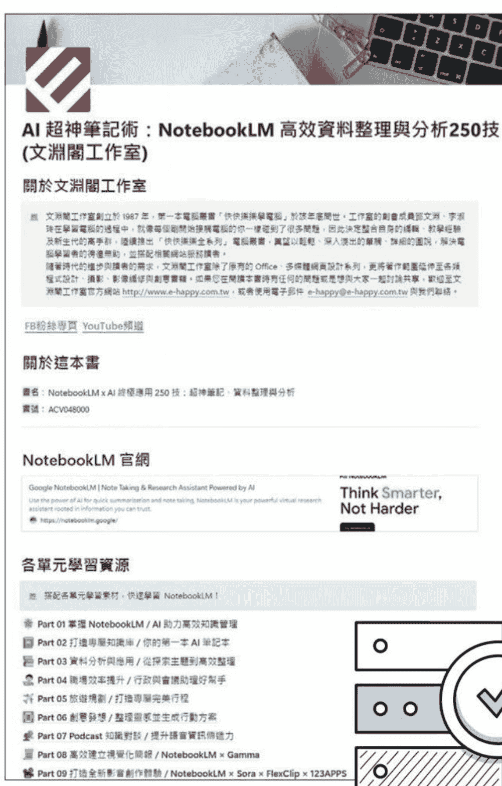


# 取得各單元範例提示與參考資料

在學習地圖點選單元名稱即可進入該單元頁面。每個單元皆提供 **ChatGPT 提示詞**、**NotebookLM 提示詞**、**資料來源** 三大項目，分別對應書中範例使用的 AI 指令，以及需匯入 NotebookLM 的連結、檔案或文字。以 **Part 02** 為例：

- ■ AI 提示詞：可直接複製，依章節說明貼至 ChatGPT 或 NotebookLM 對話視窗。

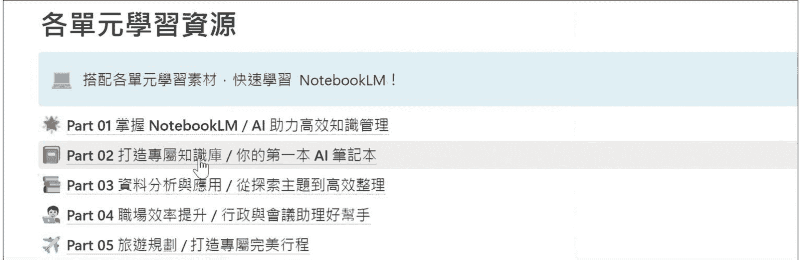

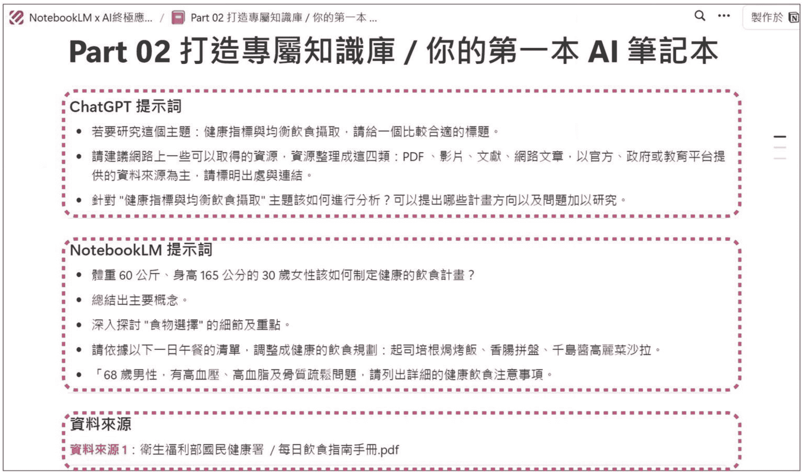

- ■ 資料來源：以 **資料來源 (編號)** 標示，方便邊讀範例邊下載對應素材並加入 NotebookLM。

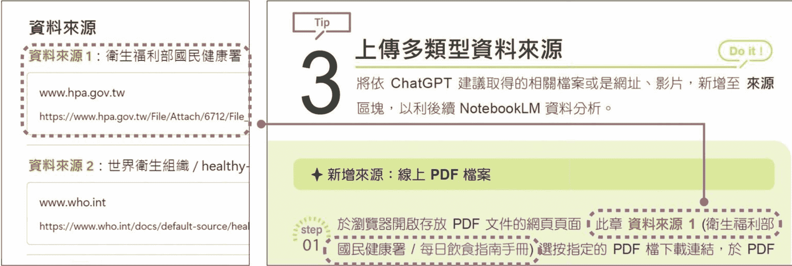

# ✦ 多媒體影音範例檔下載

Part 04、Part 06、Part 09 的練習需用到影音檔，可自行錄製或生成，也可下載書中提供的範例。請於學習地圖對應單元點選資料來源，依說明操作取得檔案。

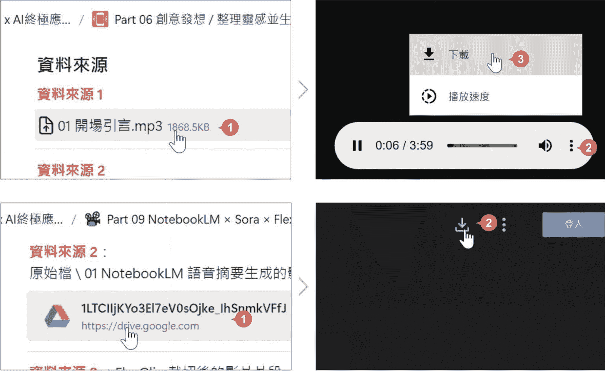

# Google 簡報雲端範例檔取得

Part 04 會示範把 Google 簡報加入 NotebookLM 來源。若想使用書附檔案，請先以瀏覽器登入 Google 帳戶，且帳戶需與 NotebookLM 登入帳戶相同。於學習地圖對應單元點選資料來源後依下列步驟操作：

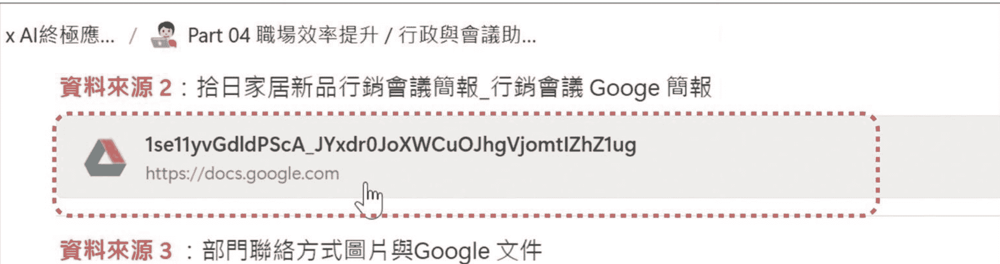

開啟 Google 簡報後，請確認右上角登入狀態，若尚未登入請點 **登入** 按鈕並選擇正確帳戶。登入完成後，該份簡報會自動存入帳戶的 **與我共用** 清單，在 NotebookLM 新增來源時即可找到。

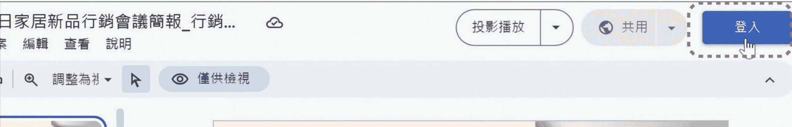

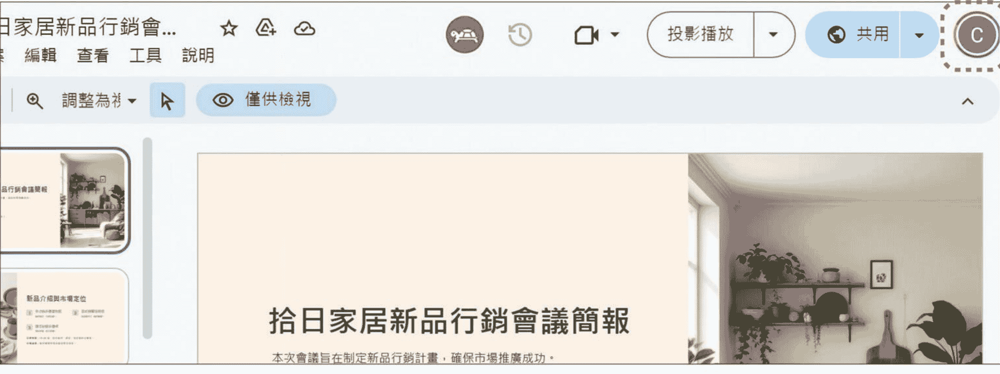

# PART 01

## 掌握 NotebookLM

### 以 AI 驅動知識管理

### 本單元重點

在資訊爆炸的時代，NotebookLM 搭配生成式 AI 已成為知識管理的核心利器，協助蒐集、分析與運用資訊，提升決策效率與工作效能。

- NotebookLM 可處理的工作類型
- 五項核心優勢
- 適合使用的族群
- 新手入門方式
- 首次啟用流程
- 六種分析模式
- 常見疑問
- 深色／淺色主題切換

# NotebookLM 開啟知識管理新紀元

NotebookLM 由 Google 於 2023 年底推出，專為知識整理而生，協助使用者更輕鬆地組織、理解與應用資訊。

### ✦ NotebookLM 的實際應用

透過生成式 AI，NotebookLM 以對話提問協助深入理解匯入的內容，並自動產出摘要、解析內容關聯，大幅提升學習、研究與決策效率。

過去準備專案簡報，常需耗費數天從文件、會議紀錄與市場報告中蒐集比對。如今只要將資料匯入 NotebookLM，透過提問即可快速取得重點，甚至挖掘出原本未曾想到的觀點。

常見情境：

- **學術研究**：快速掌握論文主旨、產出筆記、擷取關鍵資訊。
- **內容創作**：整理靈感、歸納要點與大綱，產出高品質內容。
- **行政管理**：整理會議紀錄、撰寫報告摘要、歸納重點，讓流程更有條理。
- **企業決策**：整合市場報告與競品分析，支援更精準的判斷。

### ✦ NotebookLM 五項核心優勢

結合 AI 能力，NotebookLM 超越傳統筆記軟體，成為智慧學習與知識分析的助手，協助高效整理與快速理解。

- 智慧濃縮與多格式支援：可匯入 Google 文件、簡報、PDF、YouTube 影音、純文字筆記等多種格式，打破單一文件限制，並自動整合重點節省閱讀時間。
- 關聯探索：能辨識筆記本內各資料的關聯，挖掘隱藏脈絡，提升研究、創作與市場分析效率。
- 知識彙整與語音輸出：自動將筆記整理為研讀指南、簡報文件、關鍵問題、人事時地物時間軸等，也可轉為雙人對話形式的 Podcast 語音摘要，讓學習更生動。
- 智慧問答降低幻覺風險且附出處：可像 ChatGPT 般互動提問，但僅以使用者匯入的資料為依據回覆，避免偏離主題與錯誤資訊，並附上來源註記方便追溯。
- 激發新觀點：不僅整理資訊，還能主動提出使用者尚未思考的問題或觀點，對研究者、創作者與決策者極具助益。

### ✦ 適合哪些人使用

應用範圍廣泛，無論學習、研究、創作或職場皆能發揮效益。

- **學生與研究人員**：整理課程資料、產生複習大綱，透過 AI 產生的筆記、摘要與研讀指南提升效率。
- **教師與教育工作者**：整理教案、產生課程大綱，歸納重點，分析教材、設計測驗，並可將教材轉為 Podcast，提供創新教學。
- **內容創作者與寫作者**：整理靈感、優化寫作流程，產生文章大綱與資料分析，發掘新觀點。
- **職場與專業人士**：協助新進同仁快速適應，行政人員整理會議紀錄與重點，提升商業管理、專案規劃與文件整理效率。
- **語言學習者**：整合學習資源，查詢單字、語法與例句，產生學習指南。
- **健身與健康愛好者**：彙整訓練與營養知識，建立個人健身指南，協助規劃飲食與運動。
- **旅遊愛好者**：整合旅遊資訊，協助規劃行程、管理攻略，整理美食與景點推薦。
- **美食達人與家庭料理愛好者**：建立個人食譜資料庫，整理烹飪技巧，方便查找新菜色。
- **新手父母**：彙整育兒知識、記錄寶寶成長，快速取得日常育兒解答。
- **家電與設備管理**：整合各類說明書與操作手冊，快速查找使用方法與故障排除。
- **多媒體內容發想與人物專訪**：整理訪談資料、統整受訪者背景，擬定訪綱、產生重點摘要，適用於影片、Podcast、新聞報導等內容規劃。

### ✦ 零經驗新手建議

操作直覺，匯入資料即可開始，AI 會自動產生摘要，降低提問門檻。

建議由熟悉主題逐步探索：

- **從簡易資料開始**：挑選短文或日常文件，匯入 Google 文件或 PDF，透過 AI 摘要熟悉介面。
- **對話式提問**：向 NotebookLM 提問，觀察回應，並嘗試其建議的延伸問題，深入理解內容。
- **多文件整合**：熟悉基本功能後，匯入多份相關文件，請 AI 整合資訊、找出共通點或比較。
- **逐步探索功能**：試用研讀指南、常見問題、簡報文件、時間軸等功能，提升知識管理效率。

熟悉後會發現其直覺且高效，能大幅提升學習與工作效率。但 NotebookLM 僅為輔助工具，仍需閱讀原始資料，避免過度依賴摘要而遺漏細節。

### ✦ 首次使用 NotebookLM

使用 Google 帳戶登入即可免費體驗。

#### 登入並建立第一本筆記本

**Step 01** 開啟瀏覽器，於網址列輸入「https://notebooklm.google.com/」，首次進入會顯示歡迎畫面，若未登入請先完成登入，接著點 **建立**。

**Step 02** 會開啟空白筆記本，左上角預設名稱為 **Untitled notebook**，點選後輸入合適名稱完成命名。

### ✦ 筆記本畫面認識

介面簡潔，功能一目了然。

- **分享筆記**：可與他人共享。點 **分享** 後透過 Email 指定對象，並設定權限為 **檢視者** 或 **編輯者**。
- **相關設定與說明**：查詢 NotebookLM 說明、提供意見、切換裝置顯示模式、升級至 **Plus**。
- **來源** 區塊：列出已匯入的參考資料，如 PDF、文字檔、音檔、Google 文件、簡報、YouTube 影片、網頁等。可點選檢視內容、逐字稿與摘要，或核選特定資料讓 AI 回答。
- **對話** 區塊：於下方聊天框輸入問題，AI 會依目前資料回覆；此區顯示問答紀錄，可編輯問題以獲得更精準答案。
- **Studio** 區塊：自動產生創作與分析內容，如語音摘要、研讀指南、常見問題、簡報文件、時間軸或手動建立筆記。

匯入來源後即可提問，例如：「AI 個性化設計對品牌行銷的影響？」，AI 會依資料內容回覆。

- **重新整理**：點 **重新整理** 按鈕，對話紀錄會清空。
- **儲存至記事**：離開或重新整理會清空對話紀錄，若想保留回覆，可點 **儲存至記事**，內容會整理至右側 Studio 區塊。
- **數字註腳**：將指標移至回覆中的數字註腳，可顯示引用的來源項目與內容。

### ✦ 首頁畫面認識

於筆記本畫面左上角點 📓 NotebookLM 標誌可回首頁，進入其他筆記本或建立新本，並可切換檢視模式與排序方式。

- **+ 新建**：點按可建立新筆記本。
- **筆記本**：以卡片形式呈現名稱、建立時間與來源數量，點卡片即可進入編輯與互動。
- **檢視模式**：可選 **網格模式** 或 **列表模式**。
- **排序**：依 **最新**、**最舊**、**與我共用** 等條件調整顯示順序。

### ✦ 六種資料分析模式

面對大量資訊，AI 分析功能能快速掌握重點。

除了互動問答，NotebookLM 另提供摘要、研讀指南、簡報、常見問題、時間軸與語音摘要六種處理方式。

#### 智慧摘要：萃取重點
匯入來源後自動產生摘要，快速提取文件、影片或音檔重點，讓使用者無需逐字閱讀即可掌握主旨，適用於學術研究、報告分析與策略擬定。

#### 研讀指南：結構化筆記
依主題自動分類內容，建立章節重點、關鍵概念，甚至提供測驗題與解答，適合學術研究、備考或專業進修。

#### 簡報文件：會議與分享利器
將來源資料整理成條理分明的簡報文案，提供標題與重點摘要，無需手動整理即可快速產出，適用會議報告、學術發表與專案介紹。

#### 常見問題：快速取得核心資訊
提取重點並生成問答，讓使用者直覺理解資料。適合老師準備測驗、閱讀長篇報告、手冊或政策文件，也可應用於客服與知識管理。

### 時間軸分析：事件脈絡更清晰
依資料中的時間資訊整理事件發展脈絡，並列出人物、事件等關鍵事項。適用於歷史分析、新聞整理與專案管理，協助將零散資訊組織成結構化時間線。

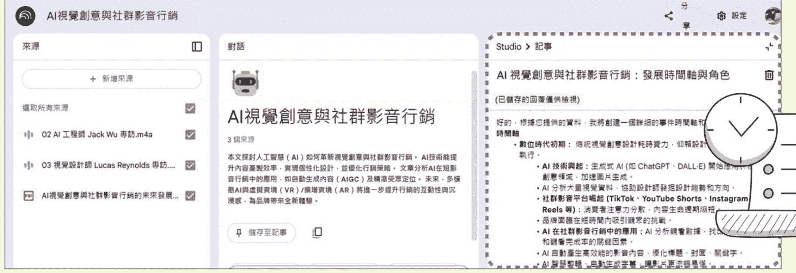

### 語音摘要：對話式收聽
將來源整合後轉為對話式語音，目前僅支援英文語音，讓使用者在通勤、運動或休息時隨時收聽重點，提升學習便利性。

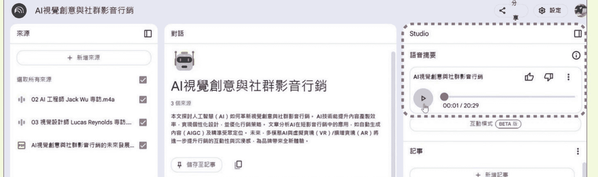

這六大分析模式讓 NotebookLM 不僅是筆記管理工具，更是強大的知識處理與內容優化助手，有效提升學習、研究與資訊應用的效率。

## NotebookLM 常見問題

NotebookLM 常見問題一次看懂

不少使用者對於免費配額、支援格式、隱私保護以及實際操作方式存在疑問。以下把網路上詢問度最高的問題整理成重點，幫助你快速上手。

#### ✦ 能否完全免費使用
只要持有 Google 帳號就能登入並使用基礎功能。自 2025 年起，官方釋出付費方案 NotebookLM Plus，提供更進階的能力來回應專業需求。

#### ✦ 免費版與 Plus 版差在哪
下表彙整兩者的功能差異，方便判斷免費方案的限制範圍。

| 功能項目 | NotebookLM | NotebookLM Plus |
| --- | --- | --- |
| 筆記本數量上限 | 每帳號 100 本 | 每帳號 500 本 |
| 每日對話次數 | 50 次 | 500 次 |
| 每本筆記本可收納來源數 | 50 個資料來源 | 300 個資料來源 |
| 單一來源字數上限 | 500,000 字 | 500,000 字 |
| 每日語音摘要生成次數 | 3 次 | 20 次 |
| 自訂回應風格與長度 | 不支援 | 支援 |
| 團隊筆記本共享與使用分析 | 僅限指定對象共享 | 支援 |
| 隱私與安全層級 | 基本保護 | 企業級保護 |
| 適用族群 | 個人使用者 | 企業、學校、組織及高需求個人使用者 |
| 取得方式 | 免費提供 | 透過 Google Workspace 或 Google Cloud 購買 |

最新說明請參考官網「https://support.google.com/notebooklm」中 NotebookLM 升級至 NotebookLM Plus 的頁面。

#### ✦ 與市面上常見 AI 工具有何不同
相較於一般生成式工具，NotebookLM 的核心在於可追溯的回答。它僅依據使用者自行上傳的素材產生回覆，並清楚標示引用來源，方便核對驗證，提升答案可信度。

#### ✦ 支援上傳哪些資料類型
系統接受多種素材來整合資訊，上傳前請先確認擁有合法權限，避免違規內容。

- Google 文件與簡報：可直接從雲端硬碟匯入。
- 本機或線上檔案：包含 PDF、純文字 .txt、Markdown .md 檔案。
- 網頁連結：一般網頁網址、公開影片的 YouTube 連結。
- 音訊檔案：上傳音檔讓系統進行處理。


#### ✦ 單一來源的容量上限
每個來源的字數上限為 500,000 字，檔案大小不可超過 200 MB，頁數則沒有限制。

#### ✦ 為何 PDF 有時無法辨識文字
部分 PDF 以圖片方式儲存內容，系統無法正確擷取文字，影響分析品質。自 2024 年 9 月起，系統已開始支援含圖片的 PDF 並強化處理，但純文字型文件仍能取得更完整的內容。

#### ✦ Google 文件與簡報的使用限制
從雲端硬碟讀取文件與簡報時目前限制如下：

- 無法刪除或自動更新：NotebookLM 僅能讀取登入帳號有權限的文件與簡報，會建立副本但不會自動同步原始檔案的變更。
- 手動同步：原始檔案若有修改，需在來源中點選 **按一下即可與 Google 雲端硬碟保持同步** 來重新整理匯入。

#### ✦ YouTube 來源的使用限制
匯入 YouTube 影片時目前限制如下：

- 僅支援附帶字幕的公開影片，字幕可為上傳或自動產生。
- 影片長度不限，字幕內容不可超過 50 萬字。
- 僅能匯入文字轉錄稿，不含影像或其他資料。

可能無法成功取得的情形會隨版本調整，常見狀況包括：

- 72 小時內剛上傳的影片可能暫時無法新增，建議稍後再試。
- 無語音的影片不支援。
- 連結失效、影片被刪除或設為私人，其內容會在 30 天內自動移除。
- 影片內容不安全、字幕檔無法讀取、語言不支援等。


#### ✦ 網頁連結的使用限制
擷取網頁時，系統僅能取得指定頁面的文字，會忽略圖片、嵌入影片或子網頁。設有付費牆或關閉爬取功能的網站無法使用。

#### ✦ 上傳失敗常見原因
免費版若來源長度超過 50 萬字、檔案超過 200 MB、PDF 禁止複製，或 YouTube、網頁、Google 文件與簡報的權限受限，都可能導致失敗。失敗項目會被取消或顯示粉紅色警告，請確認來源是否符合支援條件，或更換其他來源。

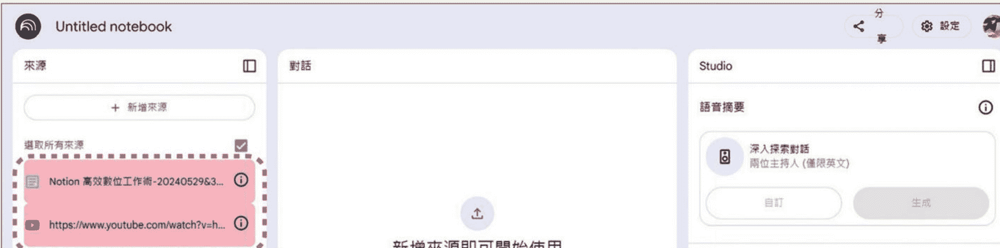

#### ✦ 能否在行動裝置使用
NotebookLM 以桌機瀏覽器為主要操作環境，手機或平板的瀏覽器仍可存取功能。未來 Google 可能會擴大行動裝置的支援。

畫面支援深色模式，可依使用環境調整視覺體驗。

於畫面右上角點選 設定。

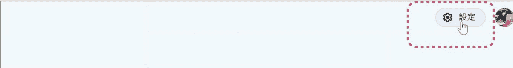

再點選 裝置 \ 深色模式，即可切換為深色介面。

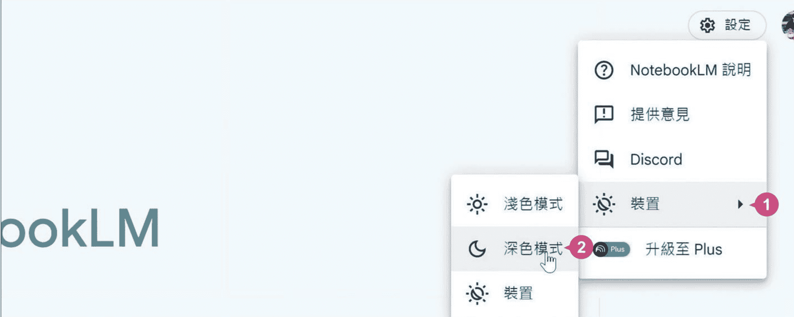

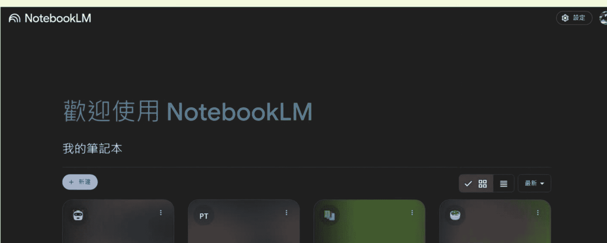

# PART 02

## 打造專屬知識庫

### 你的第一本 AI 筆記本


### 單元重點

在 NotebookLM 建立第一本筆記本並上傳參考資料後，系統會自動生成摘要。透過精準提問可取得重點回覆，並將重要內容保存至記事。

- [x] 抓出關鍵資訊與分析切入點
- [x] 建立新的筆記本
- [x] 導入多種資料來源
- [x] 瀏覽整體資料摘要
- [x] 瀏覽特定資料摘要與主題
- [x] 檢視各份資料全文與逐字稿
- [x] 常見提問技巧與做法
- [x] 將重點回覆存入記事

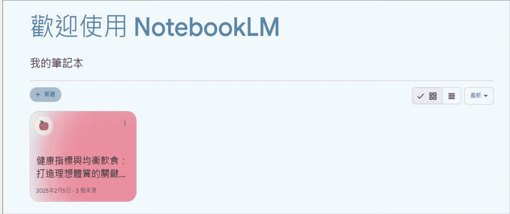

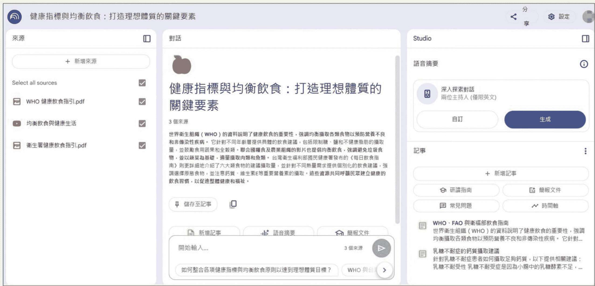

■ 2-2

## 1 提取關鍵資料與分析方向

開始整理資料前，可先用 ChatGPT 協助擬定主題標題並蒐集參考資源。

開啟瀏覽器於網址列輸入「https://chatgpt.com/」進入 ChatGPT，可選擇登入或直接提問。

**step 01** 請 ChatGPT 產出更吸引、專業或精確的主題標題，概括「健康指標與均衡飲食攝取」的研究主題。

> **提示詞**
> 若要研究這個主題：健康指標與均衡飲食攝取，請給一個比較合適的標題。

「 健康指標與均衡飲食：打造理想體質的關鍵要素 」

**step 02** 開啟搜尋功能，請 ChatGPT 整理可信賴的線上資源，協助深入研究上述主題。

> **提示詞**
> 請建議網路上可取得的資源，整理成四類：PDF、影片、文獻、網路文章，以官方、政府或教育平台資料為主，請標明出處與連結。

1 請建議網路上可取得的資源，資源整理成這四類：PDF、影片、文獻、網路文章，以官方、政府或教育平台提供的資料來源為主，請標明出處與連結。

+ 搜尋 2 推理 3

開啟 **搜尋** 可取得最新或更精確的資訊，如新聞、官方公告與特定網站內容，提升即時性與準確度。回覆內容會於每個項目提供參考連結，點選 **資料來源** 可於右側開啟所有相關清單。

1. 健康飲食原則
   - 出處：香港衛生防護中心
   - 連結：健康署
   - 簡介：介紹健康飲食的基本原則，包含健康飲食金字塔

2. 健康促進推動項目相關衛教素材參考網站
   - 出處：教育部學校衛生資訊網
   - 連結：教育部學校衛生資訊網
   - 簡介：提供多種健康促進相關衛教素材，包含食安教學影片與資料。

希望以上資源能對您的研究有所幫助。

引用

高雄市政府衛生局

每日飲食指南手冊 - 衛生福利部國民健康署

本版每日飲食指南涵蓋六大類食物：全穀根莖類、豆魚蛋肉類、乳品類、蔬菜類、水果類、油脂與堅果種子類。

高雄市政府衛生局

資源下載 - 衛生福利部國民健康署

以下9部影片資源因應網站使用流暢度進行區移除。請大家可改由以下路徑找到相關資源。

兒童醫學及健康研究中心

[PDF] 健康生活型態第一節、營養與飲食

2019年5月30日 — 均衡營養是兒童健康的基石，我國兒童在飲食營養方面面臨許多挑戰。

國立屏東科技大學

[PDF] 營養教育應用於三年級學童飲食


**step 03** 請 ChatGPT 針對研究主題提出分析方向，並拆解成具體問題以利 NotebookLM 探討。

> **提示詞**
> 針對「健康指標與均衡飲食攝取」主題該如何進行分析？可以提出哪些計畫方向以及問題加以研究。

分析「健康指標與均衡飲食攝取」可從生理數據、飲食模式、影響因素等面向切入。以下為分析方法、計畫方向與可研究問題：

---

**1. 分析方法**

* **數據收集：**
  * 記錄 BMI、體脂率、血糖、膽固醇等健康指標。
  * 透過飲食紀錄收集碳水化合物、蛋白質、脂肪、維生素等營養素攝取情況。
  * 進行問卷調查，分析飲食習慣與健康指標的關聯性。

***以下省略***

## 建立筆記本

在 NotebookLM 為筆記本命名精確有助於快速辨識主題，提升工作效率。

#### 首次建立筆記本

首次進入 NotebookLM，點選 **建立** 鈕，即可進入新的筆記本畫面。

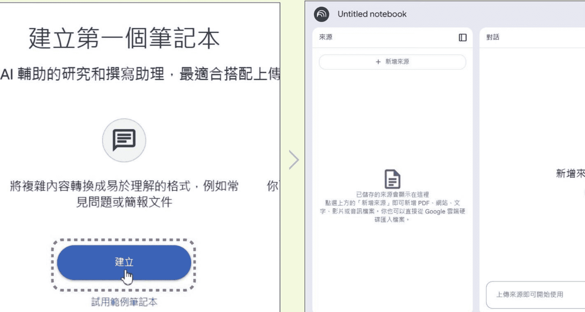

##### 小提示

出現「上傳來源」畫面

進入新筆記本畫面，若出現下方「上傳來源」畫面，可先點選畫面右上角的 × 關閉，待命名完成後再上傳來源。

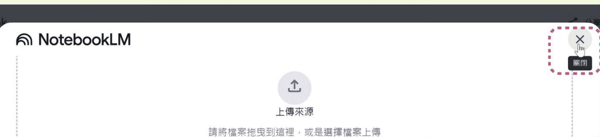

#### ✦ 回到首頁再次建立筆記本

筆記本左上角點選 🌐 返回首頁，再點選 **+ 新建** 鈕，即可再次建立並進入新的筆記本畫面。

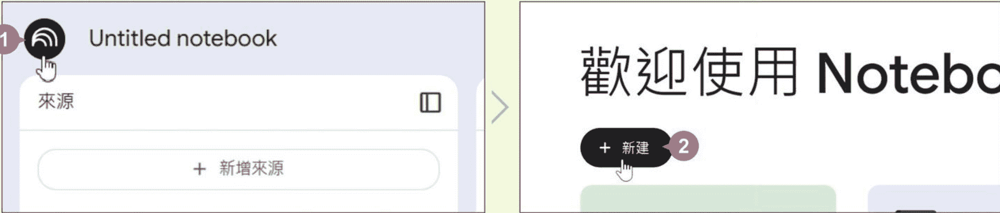

##### 小提示

出現「上傳來源」畫面

進入新筆記本畫面，若出現下方「上傳來源」畫面，可先點選畫面右上角的 × 關閉，待命名完成後再上傳來源。

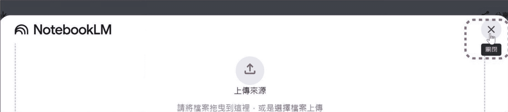

#### ✦ 修改筆記本名稱

於首頁點選任一筆記本進入畫面，左上角點選預設名稱 **Untitled notebook**，再輸入合適名稱，例如「健康指標與均衡飲食：打造理想體質的關鍵要素」。

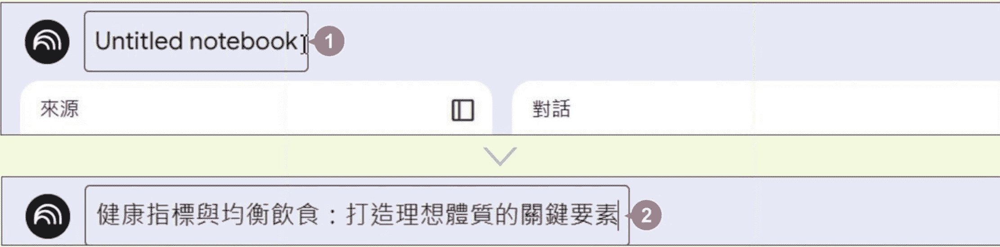

## 上傳多類型資料來源

依 ChatGPT 建議取得的檔案或網址、影片，新增至來源區供後續分析使用。

#### ✦ 新增來源：線上 PDF 檔案

於瀏覽器開啟存放 PDF 的網頁，本章資料來源 1（衛生福利部國民健康署／每日飲食指南手冊）點選指定 PDF 下載連結，於預覽畫面點選 ⬇ 將檔案下載至本機。

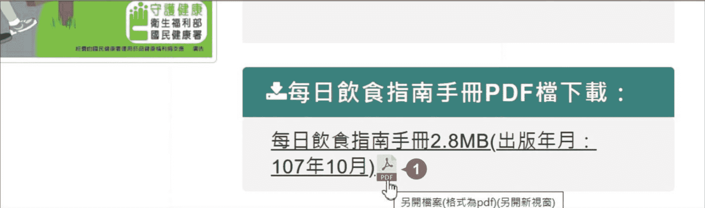


回到 NotebookLM 筆記本，於來源區點選 + 新增來源 鈕。

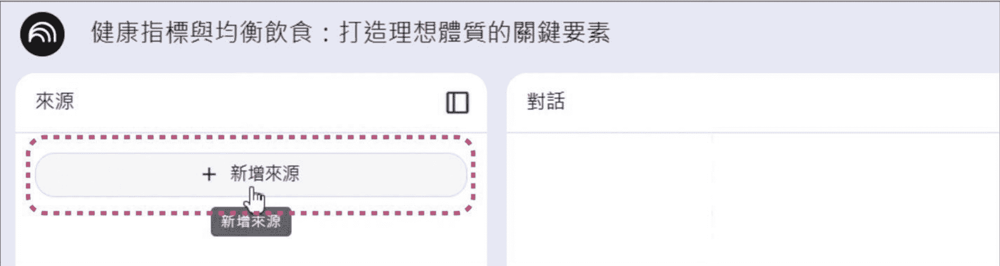

**Step 03** 在新增來源視窗點選 ↗ 開啟對話方塊，指定存放路徑並選取欲上傳的 PDF，再點選 **開啟** 鈕。

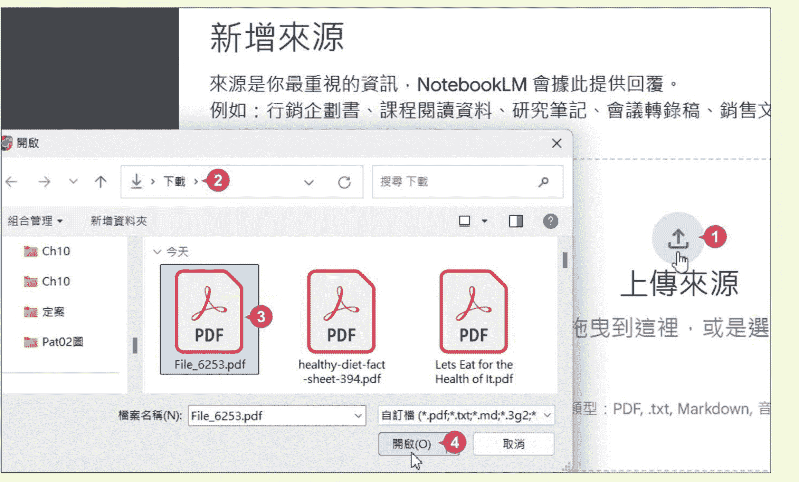

**Step 04** 上傳完成後，來源區會顯示該 PDF 項目且呈核選狀態。

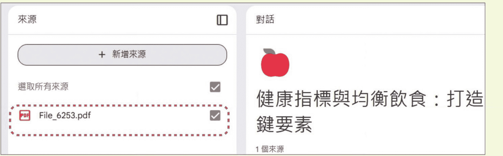

**Step 05** 再依相同方式，分別將其他欲參考的 PDF 加入來源區。

> **小提示**
> 依相同方式新增其他參考資料：
> 本章資料來源 2：(世界衛生組織／healthy-diet-fact-sheet-394.pdf)

#### ✦ 新增來源：YouTube 連結

於來源區點選 + 新增來源 鈕。

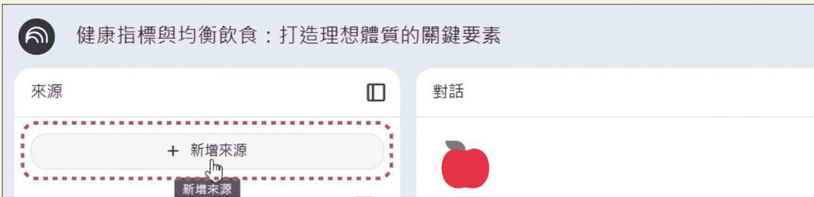

新增來源視窗下方連結項目點選 YouTube，將 ChatGPT 取得或手邊收集的合適網址貼入欄位，複製本章資料來源 3（FAO／A healthy diet is about balancing food）的網址貼上，點選 插入 鈕。

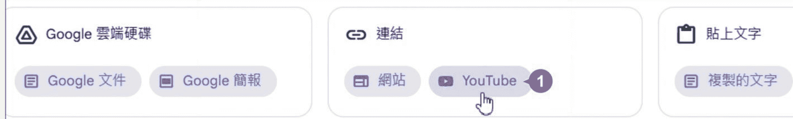

在下方貼上 YouTube 網址，即可上傳作為 NotebookLM 的來源

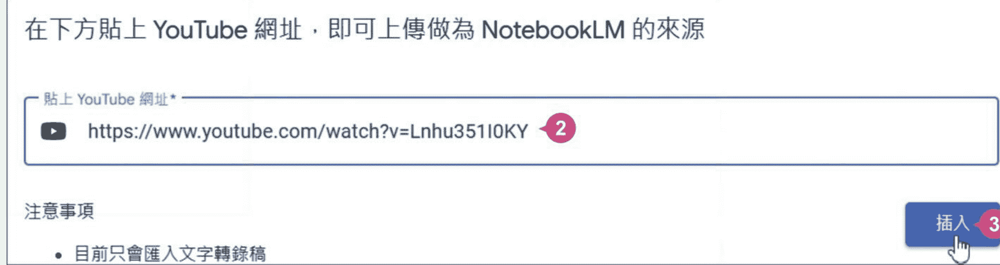

上傳完成後，來源區會顯示該 YouTube 項目且呈核選狀態。

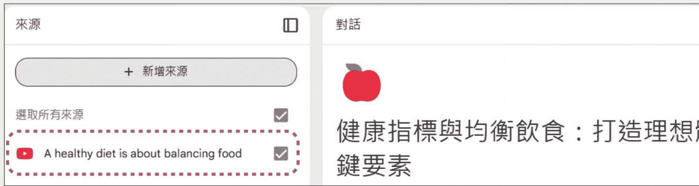

#### 管理來源：重新命名來源

NotebookLM 左側來源區會列出所有來源項目，可重新命名以利管理與查找，避免重複或混亂。

step 01

將滑鼠移至欲重新命名的項目上，點選 `⋮` \ 重新命名來源。

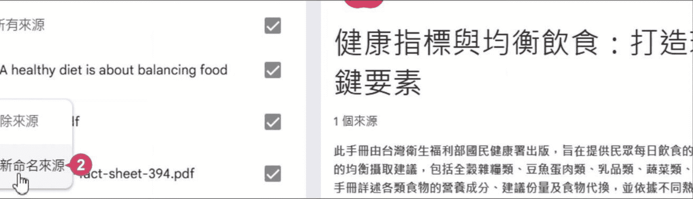

step 02

於來源名稱欄位刪除原名稱，再輸入新名稱，點選 儲存。

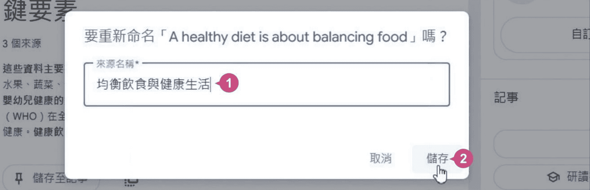

step 03

依相同方式，分別變更其他來源名稱，方便後續分析時快速辨識需核選或取消核選的項目。

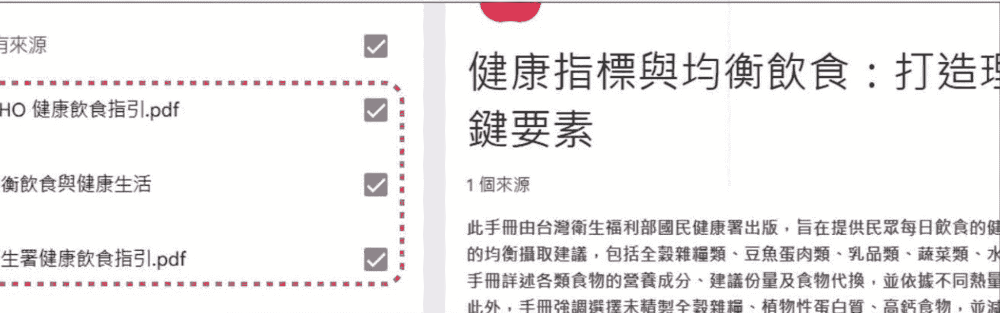

#### ✦ 管理來源：刪除來源

即時移除影響分析準確度的來源，避免提問時出現誤導資訊，導致決策或研究結果錯誤。

將滑鼠移至欲刪除項目上，點選 ⁞ \ 移除來源。

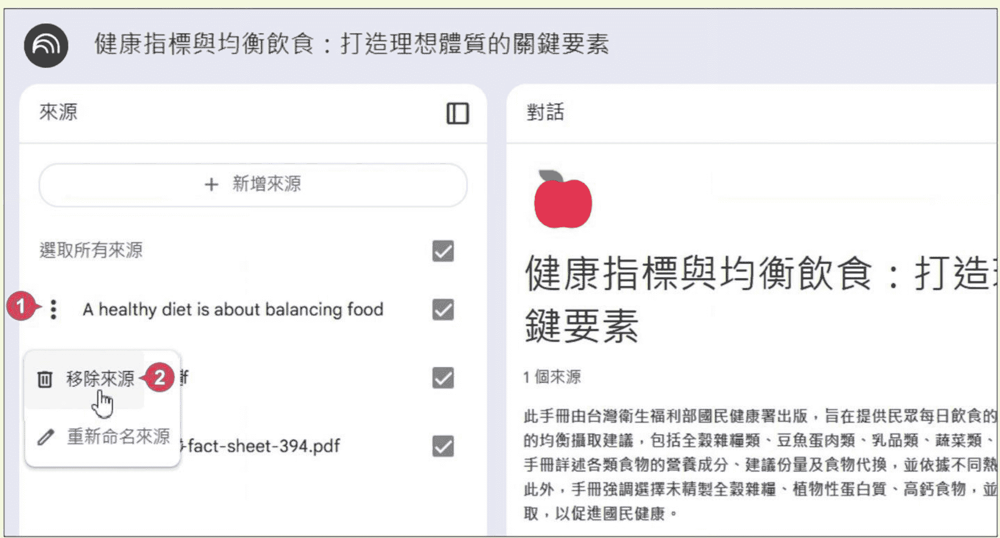

> 🟢 小提示 🟢

**提升資料分析準確度與精確性**

上傳觀點偏頗、未經查證或過時等資料來源會影響分析正確性，找尋資料時需注意以下方向。

- **資料來源**：未經學術單位或專業審核的資料可能存在錯誤或偏見，建議參考可信的資訊機構或單位。
- **資料時效**：過時資料可能不適用於最新情境，若未及時更新，將導致趨勢判斷失去參考價值。
- **引用方式**：引用原資料時理解錯誤，或未仔細閱讀前後文便斷章取義，會在後續造成研究方向偏差。
- **觀點偏頗**：過度偏向特定論點或觀念，忽略多元觀點探討，會導致研究偏差，建議參考多元資料並交叉驗證，取得更全面視野。

## Tip 4 閱讀所有資料的摘要

新增資料來源後，會於對話區顯示目前所有資料摘要，快速掌握研究方向。

將欲分析研究的資料來源上傳後，可於對話區最上方顯示所有來源資料的摘要（若未出現摘要，於網頁左上角點選 🔄 重新整理），方便快速掌握關鍵資訊，提升閱讀與研究效率。

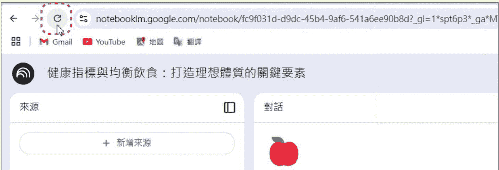

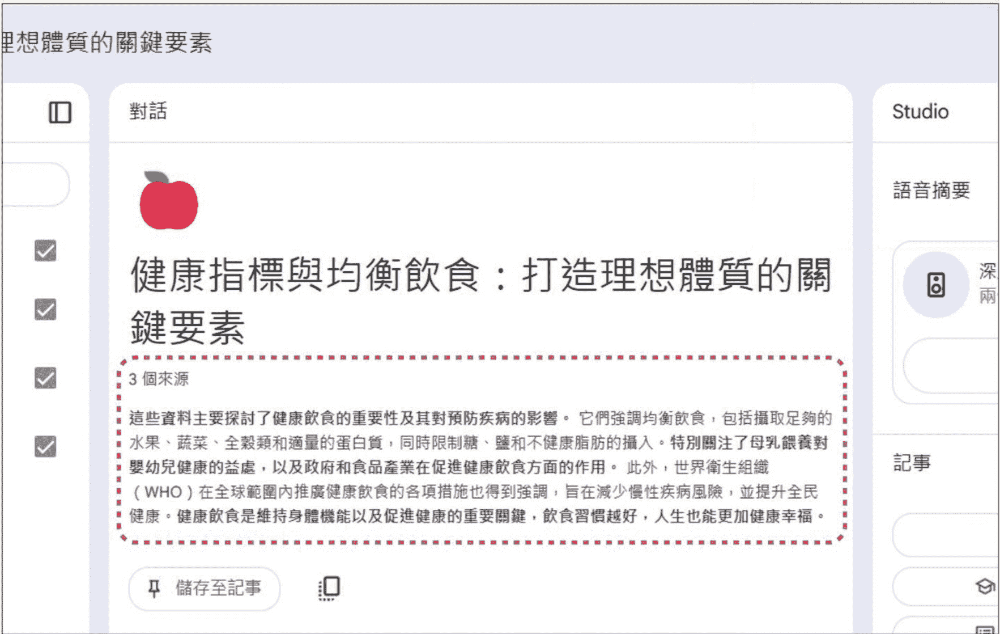

## 5 摘要与主题一目了然
每份导入的资料都会自动产出精简摘要并萃取出关键主题，让使用者快速掌握精华，提升处理效率与判断的准确度。

- ✦ 检视单份资料的摘要
在 来源 区域点选对应的 PDF 预览，即可看见系统为该文件生成的摘要内容。

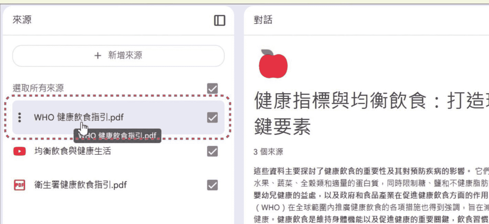

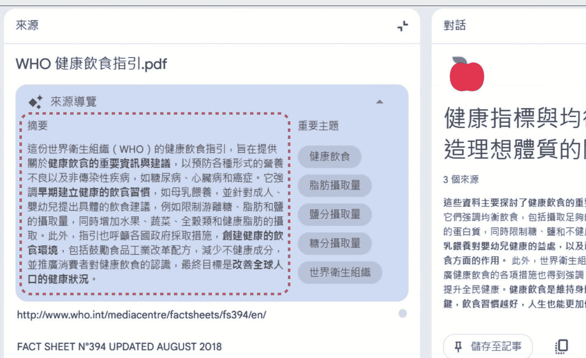

## ✨ 透过关键词点亮主题
若想弄懂文件在谈什么或某个专业用语的意思，只要在 重要主题 区域点选想了解的关键字，系统就会自动在 对话 区块发起相关提问并回覆说明。

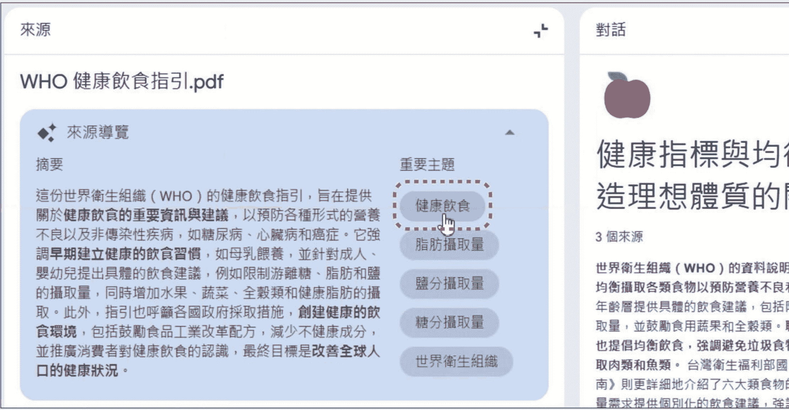

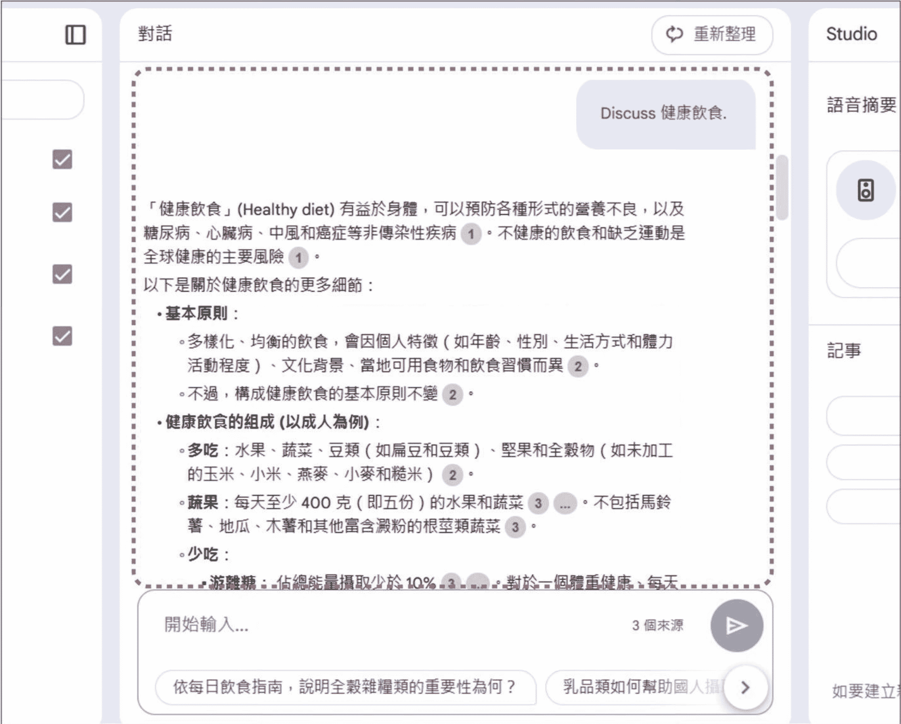

## 发问前先看原文与逐字稿
提问前先快速浏览原始资料，有助于确认关键资讯、加深理解，进而让问题更精确。

### ✦ 阅读文件本文
在 来源 中点选对应的 PDF 预览，下方会呈现该文件的纯文字内容，持续向下滚动即可看完；要收起检视画面，可点 来源 区域右上角的 🗔。

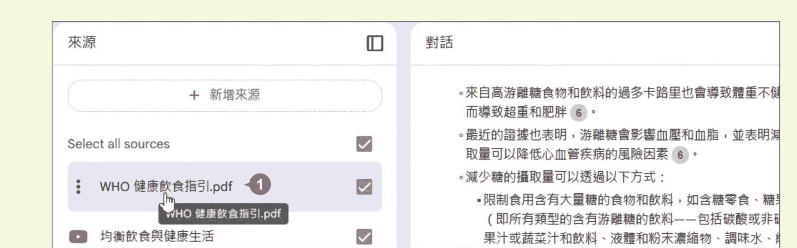

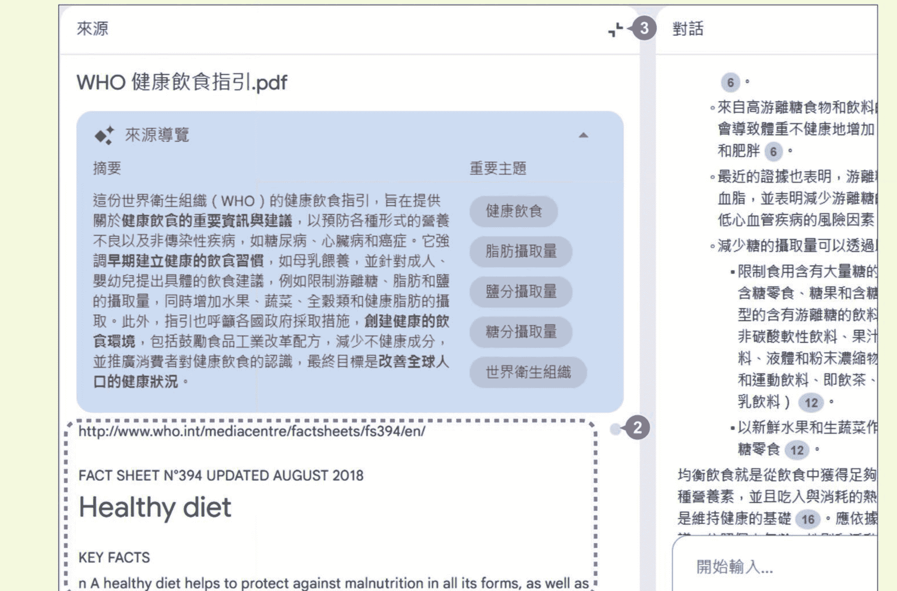

### ★ 浏览影片逐字稿
在 来源 中点选影片来源，下方会同时显示播放器与自动生成的逐字稿，向下滚动即可完整阅读；点 来源 区域右上角的 ✚ 即可关闭该检视画面。

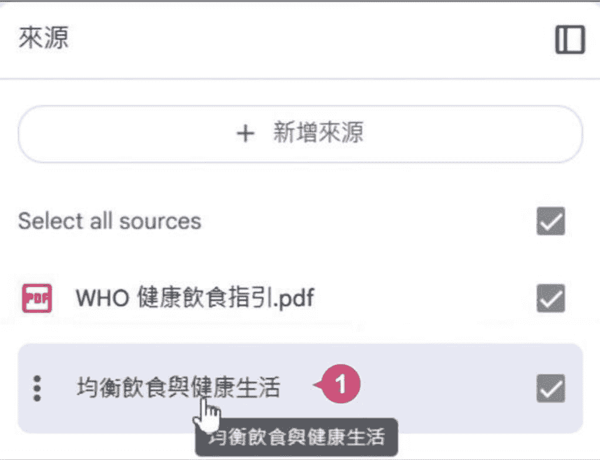

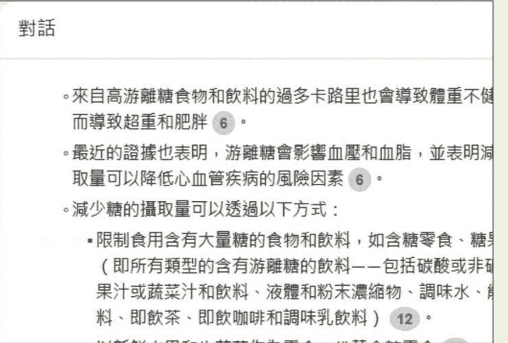

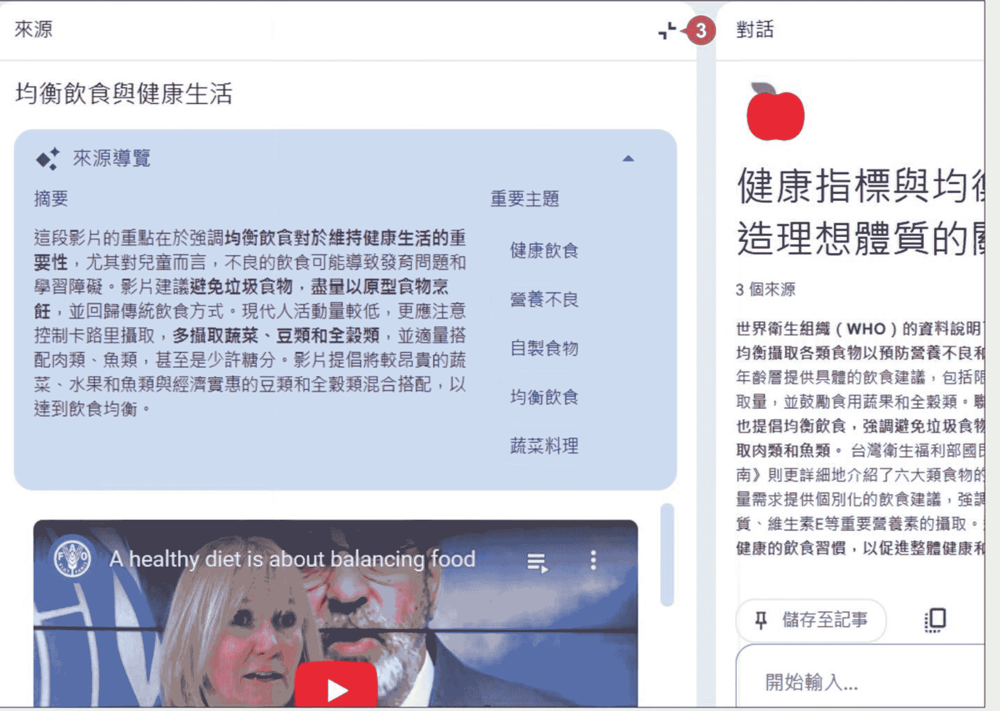


2-16

## 7 提问技巧与实作方法
掌握 NotebookLM 的提问逻辑，就能在大量资料中快速锁定重点、深入探究并取得关键答案。

### ✦ 把问题说清楚
与 AI 互动时，提问等同于指令与描述，模糊的说法会让沟通受阻、结果失真。建议用明确指示、细节化描述与情境化提问来引导，系统才能抓住问题本质给出更精准的回覆。

尽量给予具体指示，避免模棱两可的表述。

例如「请制定一份健康饮食计划」就太笼统，建议改为：「30 岁、身高 165 公分、体重 60 公斤的女性该如何规划健康饮食？」

在 对话 区输入框填入问题后按 ▶ 送出，NotebookLM 会依 来源 区的资料分析并给出详细回覆。

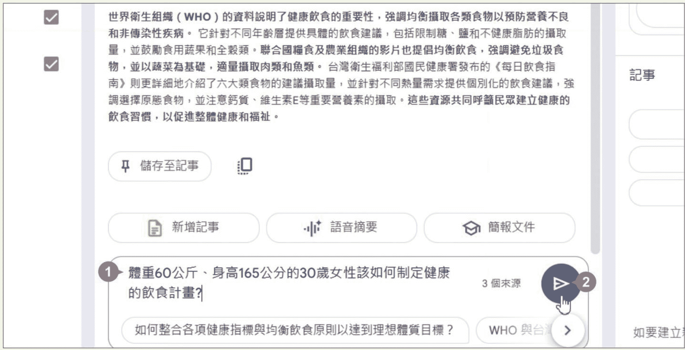

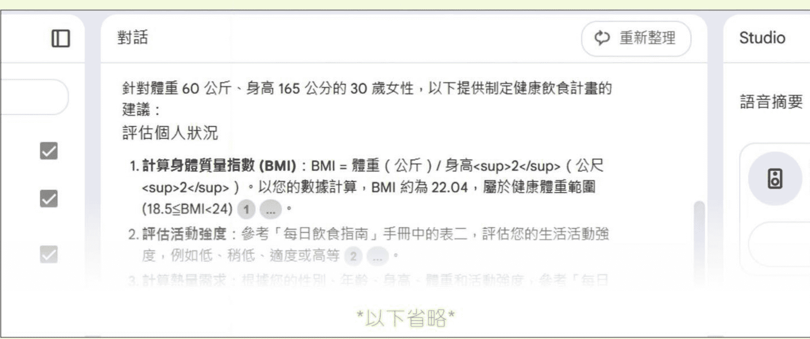

### 循序渐进的拆解
依 基础理解 → 比较分析 → 进阶应用 的路径提问，能得到更有脉络的答案，也可聚焦核心、深化思考。

基础理解：先搞懂主题在资料中的定义或基本概念。可在 对话 输入：「国民健康署每日饮食指南主要建议哪些食物摄取原则？」，送出后系统会分析并说明。

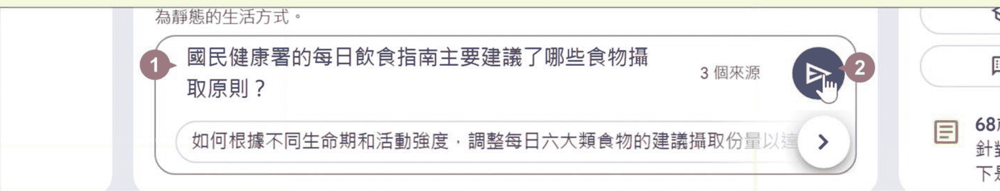

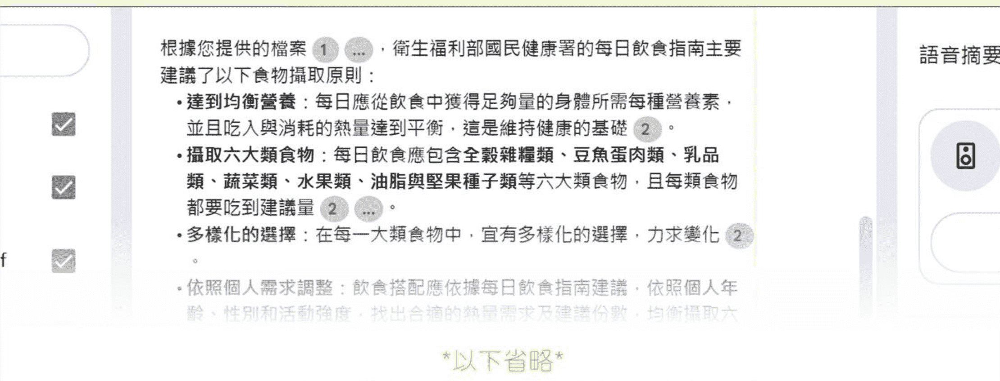

比较分析：在掌握基础后进行对比，透过交叉检视可了解背后的科学依据与文化差异。可在 对话 输入：「WHO 与国民健康署的饮食指南在建议上有何相同与相异之处？」，送出即可获得分析。

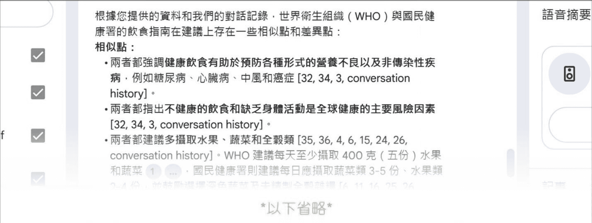

进阶应用：理解原则与差异后思考实际运用。可在 对话 输入：「若要开发饮食追踪 APP，这些资料中哪些资讯最值得纳入？」，送出后系统会给出建议。

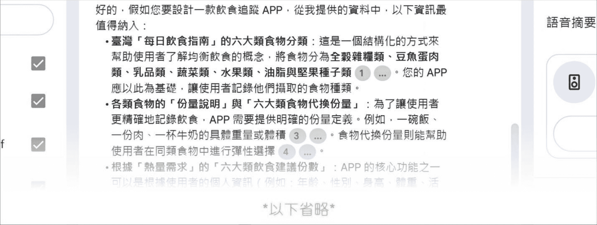

后续可依回覆内容微调问题，或自行挑选延伸主题，取得更精确深入的资讯。

> **小提示**
**查看回覆的参考来源**
把游标移到回覆文字末尾的数字脚注上，就能看到该段内容的引用出处。

### 多情境提问方式
在掌握资料脉络后，可依需求灵活选用不同提问法，更有效分析并加深理解。常见情境如下：

- 基础理解：快速掌握概念，如「请简要说明这篇文章的重点」。
- 深入探讨：挖掘细节，如「深入分析影响食物选择的因素」。
- 比较与对照：对比观点，如「对比 A 与 B 的优缺点」。
- 摘要与整理：总结长文，如「请将此文件摘要为 200 字」。
- 应用与推论：转化为实作，如「如何将此策略应用于市场营销？」。
- 创意发想：脑力激荡，如「基于这篇文章内容，发想 3 个创新点子」。
- 校对与优化：润饰文字，如「请将这段文字优化，使其更清晰流畅」。

以「应用与推论」为例，可在 对话 输入：「请依据以下午餐清单调整为健康饮食方案：起司培根焗烤饭、香肠拼盘、千岛酱高丽菜沙拉。」送出后系统会分析并给出建议。


以「深入探讨」为例，可输入：「68 岁男性有高血压、高血脂及骨质疏松，请列出详细的饮食注意事项。」送出后系统会提供具体分析。


### ✦ 从建议问题开始
面对新主题或大量素材时，可参考对话框内提供的问题建议，帮助定向提问并激发更深思考。点选合适建议后，系统即可展开分析并回覆。


### ✦ 清除对话重新开始
若对话累积后偏离主题，或想开启全新研究方向，可在 对话 区右上角点选 重新整理 或 继续 按钮，清除现有对话纪录重新开始。


## 8 把重要回答存进笔记
关闭笔记本、离开或重新整理页面后， 对话 区的纪录不会保留，因此重要回覆需即时存入 记事，方便日后查阅。

### ✦ 保存回覆至笔记
在 对话 区，找到想留存的回覆下方点选 储存至记事 按钮，即可将其存到 Studio 区的 记事。


在 Studio 区即可看到刚保存的笔记，点选即可阅读内容。


已保存的笔记仅供浏览，不能继续追问或编辑。


> **小提示**
> **将全部素材概要存入笔记**
> 在 对话 区最上方，素材总概要下方有 储存至记事 按钮，可同样把概要存到 Studio 区的记事。


### ✦ 更名笔记
点选想改名的笔记，在笔记名称上点一下左键重新输入，例如输入「WHO、FAO 与卫福部饮食指南」。


点选 ✦ 返回笔记本主画面，即可看到更新后的名称。


### ✨ 删除笔记
将游标移至欲删除的笔记，点选 `...` → 删除记事 → 删除 即可完成。


### ✨ 批量删除所有笔记
在 记事 区域点选 `...` → 删除所有记事，再按 继续 即可一次性清除全部笔记。


# PART 03

## 资料分析与应用
从探索主题到高效整理


## 本单元重点
NotebookLM 能协助整理论文或大量文件，透过 AI 解析、萃取重点、生成笔记与问答，让资料分析更高效。

- 提取关键资料与分析方向
- 建立笔记本
- 上传多类型资料来源
- 快速掌握核心要点
- 自动整理关键问题
- 自动产出学习研读指引
- 问答与分析
- 将重要回复储存至记事
- 将记事转换为来源
- 多层次摘要
- 论文资料整理与总结


## 提取关键资料与分析方向
在用 NotebookLM 整理资料前，可先以 ChatGPT 探讨合适的标题，并获取相关资源建议与分析方向。

打开浏览器，在网址列输入「https://chatgpt.com/」进入 ChatGPT，可选择登入帐号或直接开始提问。

希望 ChatGPT 提出更具吸引力、专业或精准的标题，来概括本章研究的主题 “AI 影音多媒体应用”。

> **提示词 💬**
> 若要研究这个主题：AI 影音多媒体应用，请给一个比较合适的标题。
1. 「AI技术在影音多媒体应用中的创新与挑战」
2. 「人工智能在影音与多媒体领域的应用与发展趋势」
3. 「探索人工智能在影音多媒体产业中的应用场景」
4. 「AI驱动的影音多媒体创作与技术突破」

开启搜寻功能，请 ChatGPT 整理并推荐可靠的线上资源，以便更有效研究 “AI 影音多媒体应用” 主题。

> **提示词 💬**
> 请建议网路上一些可以取得的资源，资源整理成这四类：PDF、影片、文献、网路文章，以官方、政府或教育平台提供的资料来源为主，请标明出处与连结。

开启搜寻能取得最新或更精准的资讯，例如新闻、官方公告及特定网站内容，提升时效与准确度。回覆每个项目都会提供参考连结，点选 资料来源 按钮即可在右侧打开全部参考列表。


**Step 03** 希望 ChatGPT 针对研究主题提出可能的分析方向，并拆解为具体问题，方便 NotebookLM 深入探讨。

> **提问 💬**
> 针对 “AI 影音多媒体应用的创新与发展” 主题该如何进行分析？可以提出哪些分析方向以及问题加以研究。


## 2 建立笔记本
先建立一本新笔记本，再为其命名并规划类别，让资料井然有序。

### + 新建笔记本
在 NotebookLM 首页点按 + 新建 按钮，即可进入新笔记本画面。


> **小提示**
> **若出现“上传来源”画面**
> 进入新笔记本后若跳出 上传来源 画面，可先点右上角的 x 关闭，待命名完后再上传来源。


### + 修改笔记本名称
在笔记本画面左上角点选预设名称 Untitled notebook，重新输入合适名称，例如「AI 影音多媒体应用的创新与发展」。


## 3 上传多类型资料来源
依据 ChatGPT 建议取得的文件、网址或影片，新增到 来源 区块，供 NotebookLM 后续分析。

### ✦ 新增来源：线上 PDF 文件
1. 在浏览器打开存放 PDF 的网页，例如本章 资料来源 1（教育部全球资网 / 即时新闻），点选 档案下载 按钮，在 PDF 预览画面点按 ↓ 下载到本地电脑。


2. 回到 NotebookLM 笔记本，在 来源 区块点选 + 新增来源 按钮。


**Step 03** 在 新增来源 视窗点选 ⬆ 打开选档框，指定路径并选取要上传的 PDF，再点 开启。


**Step 04** 上传完成后， 来源 区块会出现该 PDF 项目，且处于已勾选状态。


> **小提示**
> 依同样方式新增其他参考档案：
> - 资料来源 2（教育部全球资网 / 你不可不知的生成式 AI.PDF）
> - 资料来源 3（财团法人中技社 / 教师培育与教材教法之探讨.PDF）

### ✦ 新增来源：YouTube 连结
**Step 01** 在 来源 区块点选 ＋ 新增来源 按钮。


**Step 02** 在 新增来源 视窗下方 连结 选项中选取 YouTube，将先前透过 ChatGPT 搜集或手边有的合适网址贴入，例如本章 资料来源 4（BBC News）的网址，点选 插入。


**Step 03** 上传完成后， 来源 区块会出现该 YouTube 项目，并处于已勾选状态。


> **小提示**
> 依相同方法新增其它参考资料来源档案：
> ■ 此章 资料来源 5 (台湾事实查核中心 / AI时代，人类如何胜出？)

### 新增来源：网站连结
目前 NotebookLM 仅能擷取指定网页的文字内容，无法获取图片、嵌入影片或巢状网页。

在 来源 区块点选 ＋新增来源 按钮。


在 新增来源 视窗下方 连结 选项中选取 网站，将合适网址贴入，例如本章 资料来源 6（国家教育研究院 / 国际脉动）的网址，点选 插入。


上传完成后， 来源 区块会出现该网页项目，并处于已勾选状态。


## 4 一键产出简报与核心要点

简报文件 的作用是把已导入的全部来源进行整合分析，萃取出主线脉络，帮助使用者迅速归纳资料、交流见解并准备汇报素材。

操作方式
第一步 在 Studio 区块按下 简报文件 钮。
第二步 等待模型完成解析后，会自动产出一份可检阅的笔记，点击即可打开。此笔记为唯读，不可编辑。

该功能会将多来源内容整理成条理分明的文本并列出重点摘要，适用于工作报告、提案说明、会议纪要等情境；不同来源组合产生的笔记结构会有所差异。

笔记名称可直接左键点选重新命名，建议于前方加上「简报文件-」方便辨识产生方式；按 📌 可收合笔记。

## 快速梳理核心问答

常见问题 功能会依据全部来源资料自动产出重点提炼、核心提问与对应解答，让使用者迅速掌握主题主线。

操作方式
第一步 在 Studio 区块按下 常见问题 钮。
第二步 分析完成后即生成一份详细笔记，点击即可浏览，自动生成的笔记仅供阅读无法修改。

该功能从多来源中抽取摘要并配对关键问答，协助使用者：
- 迅速理解内容：自动抓取重要资讯，减少逐字阅读，提升理解效率。
- 掌握核心概念：针对主题提供关键提问与解答，引导深入探索。
- 提升学习研究效率：把复杂资讯整理好，专注于分析与决策而非手动筛选。
常见于研究、报告撰写、内容整理等情境，可在短时间内取得高价值资讯，优化工作学习流程。不同来源产生的问题数量与架构会不同。

笔记名称可左键重命名，建议前缀「常见问题-」；按 📋 收合笔记。

## 一键生成学习测验指引

研读指南 功能可依全部来源资料快速制作学习指引与测验，包含简答题、参考答案、申论题与词汇表。

在 Studio 区块按下 研读指南 钮即可启动。
处理完成后会自动生成详细笔记，点开可阅读，自动生成的笔记仅供检视。

此功能能依据资料建立章节要点与关键概念，并提供测验题目与解答，让学习者循序渐进掌握知识，适合学术研究、备考或专业进修。不同来源会产生不同数量与类型的题目。

笔记名称可左键重命名，建议前缀「研读指南-」；按 📌 收合笔记。

03 资料分析与应用／从探索主题到高效整理

Studio > 笔记

## 研读指南-AI教育与媒体素养：教学指南与测验

已储存的回复仅供检视

## AI 教育与媒体素养研究指南

测验

题型

简答题 每题2-3句

问题

1. 根据「AI 教师培育与教材教法之探讨」报告，目前中小学教师在推动 AI 教育时面临哪些主要挑战？
2. 「AI 教师培育与教材教法之探讨」中，建议如何加强教师学习AI的内在动机？
3. 根据「AI 教师培育与教材教法之探讨」，大学应如何设计AI课程以确保学生能熟练应用AI于其专业领域？
4. 根据「你不可不知的生成式AI_国小高年级学生版」，使用生成式AI时，学生应注意哪些事项？
5. 根据「数位时代媒体素养教育白皮书」，媒体素养教育的愿景为何？
6. 根据「数位时代媒体素养教育白皮书」，媒体素养教育的能力架构包含哪些？

答案

媒体应用的创新与，特别是生成式AI，在教育和职场的应用与推动AI教育的现况，包含中小学教师培因应生成式AI的教学策略。第二份文件则的生成式AI入门手册，说明生成式AI的原并强调批判性思考的重要性。最后一份文与机会，指出人类独有的创新力、敏捷力，将在与AI协作的未来职场中持续占据。

语音摘要

简报文件

*以下省略*

3-15

## 7 问答与分析

可自行输入问题，也可参考系统建议问题，配合合适来源资料，让 NotebookLM 回应更精准。

### ✦ 输入问题提问

提问时可自行输入，或使用建议提示词如摘要、比较、应用、评估等，引导模型给出更精确深入的回应。

在对话区输入：「请归纳出这些资料的三大核心观点」，按下 ▶ 发送，系统会分析并回复详细内容。

步骤二
在对话区输入：「目前 AI 影片生成技术的局限性是什么？」，按下 ▶ 发送，系统会开始分析并回复。若问题超出来源范围，会出现「由于目前提供的文件中没有直接定义 ****，因此无法直接回答这个问题，不过....」的说明。

目前 AI 影片生成技术的局限性是什么？

- 智慧财产权侵害风险 ①：生成式 AI 在大量蒐集、学习与产出资料的过程中可能涉及著作权问题，使用 AI 生成影片时恐有侵权风险，尤其模型训练若使用受保护素材。
- 产出内容可能存有偏见、歧视或错误 ②：生成式 AI 可能产生偏见、歧视、捏造或不正确的资讯，影片生成亦可能出现偏差、不实或误导内容，使用者需保持思辨与批判，避免采用不当资料。
- 需要精准的提示词 ③：要产出符合预期的文字或影音内容，必须懂得下达精准提示词，使用者需具备提示词工程能力才能有效控制生成影片的内容与风格。
- 使用者需为自身决策负责 ②：不应完全信任 AI 输出，使用者须对自己的判断与决定负责任，保持审慎态度。

### ✦ 以建议问题提问

NotebookLM 会根据目前来源内容提供多则建议问题，描述清楚且具结构性，便于发掘新见解。

在对话区下方点选建议问题，点右侧 > 可查看更多，系统会依问题开始分析并返回详细内容。

### ✦ 检视引用来源

对话区的回答段落后有灰色数字注脚，悬停会显示引用的来源出处与内容；拖动卷轴可浏览更多。点按数字注脚，左侧来源区会开启对应资料项目并高亮引用段落。

### 依指定来源资料提问

可指定特定文件、影片或音讯作为回答依据，适用于深入研究或避免主题混淆。

步骤一 在来源区勾选欲分析的项目，其他项目取消勾选。
步骤二 对话区会显示来源数量变化，例如由 6 个来源变为 2 个来源，输入：「请整理这些来源资料产生重点摘要」，按下 ▶ 发送。

3-20

## 8 重要对话存档到笔记

询问 AI 后，若担心找不到回复，可将重要内容存入笔记便于统整。

对话区的讯息需手动储存才会被保留，否则刷新页面或返回首页后讯息会消失。

步骤一 捲动至欲储存的回复下方，点按「储存至笔记」钮，将内容存入区块 \ 笔记。
步骤二 在区块点开储存的笔记即可浏览；笔记名称可点按左键重命名，点按  回到笔记本主画面。该笔记仅供检视，不可编辑。

## 将笔记转换为来源

对话中产生的分析笔记或提问结果皆可转为来源资料，来源越多元，分析深度与准确度越高。

步骤一 在区块点开欲转换的笔记。
步骤二 在笔记下方点按「转换成来源」，左侧来源区即可看到转换完成项目。

在来源区勾选由笔记转换而来的来源，其他来源取消勾选，即可针对该来源提问。

AI 影音多媒体应用的创新与发展

7 个来源

这三份文件探讨人工智能，特别是生成式 AI，在教育与职场的应用与影响。第一份文件分析台湾推动 AI 教育的现状，包含中小学教师培训、大学 AI 课程规划，以及因应生成式 AI 的教学策略。第二份文件则...

在对话区输入：「请列出此来源的八个重点，并加以说明。」按下 ▶ 发送。

好的，以下为您整理的此来源的八个重点，并加以说明：

- AI 的发展与焦虑：许多人对 AI 发展感到焦虑，担心职场被取代，例如以文字工作为主的作家...然而 AI 也带来新机会，可把繁琐工作交由 AI 处理，让人专注于喜爱的事务。AI 既带来挑战也提供可能性。
- 与 AI 协作：面对 AI 时代，关键不是抗拒，而是学习与 AI 和平共处、协同合作。例如法律界律师可利用 AI 分析大量法律文件，再由律师验证评估后决策。强调人机协作而非单纯竞争。

*以下省略*

## 10 多层次重点摘要与完整笔记

摘要整理可依文章长短或格式需求，直接在对话中具体提问，省去后续编辑时间。

### ★ 整理摘要 分段落、字数

在对话区输入：「请将所有来源资料汇整并摘要，字数于300字内，分成二个段落。」按下 ▶ 发送，NotebookLM 会分析并回复内容。

### ✦ 条列重点

在对话区输入：「请将所有来源资料，整理为条列式重点摘要。」按下 ▶ 发送，系统会返回条列结果。

### ✦ 整理出完整的笔记资料并解析、补充

在对话区输入：「请根据所有资料整理成详尽的笔记，撰写一篇对高中三年级学生易懂的内容，重要内容或其中涉及较复杂的观念，请适当解释补充。」按下 ▶ 发送，系统会返回内容。

## 心智图：让思绪更清晰！

NotebookLM 心智图可让想法更有条理。透过视觉化笔记自动整理概念与关联，使复杂资讯一目了然。

在对话区上方点按「心智图」钮，会依来源区已勾选项目快速生成；完成后区块下方会生成心智图笔记。

点开心智图笔记可浏览内容，中心主题向外延伸分支。透过层级分类与视觉化呈现，使用者能快速掌握主题发展。

点选心智图各项目可在对话区针对该项目提问；点选项目右侧节点 ▶ 可展开下层，◀ 可收合；点选画画面右上角 ⬇ 可下载 PNG 格式图档。

## 11 论文资料整理与总结

论文资料整理与总结旨在系统化蒐集、分类与归纳研究内容，透过 NotebookLM 依需求统整观点，为论文撰写摘要并调整格式。

### ✦ 指定重点、彙整摘要

第一段通常说明研究主题背景与重要性，并概述相关研究重点，可在此基础上彙整摘要。接续前次摘要提问，在对话区输入：「请基于以上的摘要彙整，作为论文文献回顾的第一个段落，重点在于{AI 影音多媒体应用的创新与发展}，并将字数控制于500字以内。」按下 ▶ 发送，系统会详细分析并回复。

### ✦ 调整引注格式

引注又称内文引注与参考文献，用以标示引用来源。NotebookLM 默认以句尾数字标注，点选可查看详情，亦可调整为指定格式以符合学术规范。

在对话区输入：「上方资料中资讯来源格式 [数字] 的格式可以调整吗？将上方回复的资料中，资讯来源 [数字] 的格式，改为论文的引用格式 (Smith, 2020)。」按下 ▶ 发送，系统会返回调整后内容。

### 指定结构与层级式标题

层级式标题依内容结构区分主标、副标与次标，以清晰层次呈现论点。对话区输入：「请整理以上资料与所有来源资料，从目录结构开始，整理重要知识点、研究方法、成果、结论。输出包含层级式标题、笔记内容。」按下 ▶ 发送，系统会返回内容。

### APA 7 格式输出观点的对比、阐述

APA 7 为美国心理学会第七版引用格式，规范文献引用、参考文献与排版。对话区输入：「请将资料透过 APA7 格式输出；将{文献内容}进行{议题观点}的对比、阐述。」按下 ▶ 发送。

请将资料透过 APA7 格式输出；将{文献内容}进行{议题观点}的对比、阐述。

AI 时代人类应如何发挥自身优势？ 中小学推动 AI 教育面临哪些挑战？

请将资料透过 APA7 格式输出；将{文献内容}进行{议题观点}的对比、阐述。

- • 效法之...
- • 之所...
- • pact...
- • 高年...
- • 工智...

针对 AI 时代的教育与人才培育，以下依据 APA7 格式，对来源文献的内容进行议题观点的对比与阐述：

AI 时代教育与人才培育之议题观点对比与阐述

**AI 融入教育的必要性与挑战**

正面观点：
- 教育转型：为适应 AI 技术对经济与产业的影响，各国政府积极关注 AI 教育，提升教学能量 ①。
- 技能培养：学生需习得未来职场所需的 AI 技能 ②。
- 辅助学习：生成式 AI 可视为辅助学习工具，提升学习动机与趣味性 ③...

挑战：
- 教师准备度：教师可能缺乏学习动机、时间与 AI 知识，难以投入 AI 教学 ①...
- 课程设计：需将复杂 AI 概念转化为易懂教材，并与产业连结 ②。
- 学生差异：不同背景学生学习成效不一，需因材施教 ⑥...
- 资源限制：学校可能缺乏足够的软硬体资源支持 AI 教学 ⑤。

**人才培育目标与策略**

跨领域人才：
- 需求：AI 应用广泛，需整合不同领域知识，培养跨领域人才 ①...

*以下省略*

- • 深入
- • 两位
- • 自
- • 研讨
- • 常见
- • AI时代：好的，根为您整理
- • 台湾AI教常见问题学和大学
- • 简介文件

##### 小提示

### 论文的引用格式

论文引用格式依引用风格而异，常见格式如下：
- APA 适用于社会科学、心理学、教育学、企业管理等领域。
- MLA 适用于人文学、语言学、文化研究等领域。
- Chicago 适用于历史学、艺术学等领域。

3-30

# PART 04

## 職場效率提升

### 行政與會議助理好幫手

### 單元重點

透過 NotebookLM 上傳會議錄音檔、Google 簡報及手寫筆記圖片，快速整理會議大綱、擷取重點摘要，高效進行後續行政安排與規劃。

- [x] 建立筆記本
- [x] 上傳會議錄音生成逐字稿
- [x] 上傳會議簡報並整併錄音進行分析
- [x] 上傳 Google 文件讀取手寫筆記
- [x] 提取行銷問卷關鍵因素
- [x] 行銷問卷製作與調查與分析
- [x] 有效整理回覆的表格內容

| | 對話 | Studio |
|---|---|---|
| 內容 | 根據您提供的資訊，以下彙整 Alan 於會議中說明的事項，並列項摘要：... | 語音摘要 ... |
| | Facebook (FB) | Instagram (IG) |
|---|---|---|
| 特性 | ... | ... |
| 受眾行為 | 常見社群活動：瀏覽貼文、按讚、發限時動態、私訊... | 常見社群活動：瀏覽貼文、按讚、發限時動態、私訊... |
| 主要社群平台 | 各年齡層均有使用 | 各年齡層均有使用 |
| 內容偏好 | 未提及 | 短影音 (Reels) 觸... |
| 演算法 | 偏向社團與付費廣告 | 偏向短影音 Reels |
| 標籤影響力 | 關鍵字導向內容搜尋 | Hashtag (#) 影響... |
| 品牌互動方式 | 按讚、留言、分享、標註、私訊、收藏等 | 按讚、留言、分享、私訊、收藏等 |

## 建立筆記本

NotebookLM 中，为笔记本命名准确有助于快速识别主题，轻松找到所需内容，节省时间并提高工作效率。

#### + 新建筆記本

在 NotebookLM 首頁点按 **+ 新建** 钮，即可进入新笔记本画面。

> 小提示

出现 "上传来源" 画面

进入新的笔记本画面，若出现如下 上传来源 画面，可先点按该画面右上角的 × 关闭此画面，待后续完成笔记本命名后再上传来源。

#### + 修改筆記本名稱

在笔记本画面左上角点选预设名称 Untitled notebook，再输入合适名称，此示例输入「新产品行销会议 / 社群平台用户行为调查」。

## 上傳會議錄音生成逐字稿

将会议录制的 MP3 档案新增至 来源 区块生成逐字稿，以利后续 NotebookLM 资料分析。

#### step 01

在 来源 区块点按 **+ 新增来源** 钮。

#### step 02

新增来源 窗口点按 ⬆️ 开启对话方块，指定存放路径并点选欲上传的 MP3 档案，本章 资料来源 1 (会议录音.mp3)，再点按 开启 钮。

> 小提示

如何用手机录制会议记录？

可参照 P6-6 行动装置录音的详细说明，从 App 安装、开始使用到把音频档上传至 NotebookLM，帮助你完整收录会议内容。

上传完成后，在**来源**区块会看到该音频档案项目，且呈勾选状态。点选档案，会看到该音档的摘要与未分段的逐字稿。

*以下省略*

#### step 04
未分段的逐字稿不易浏览内容，可借由 NotebookLM 依讲者分段整理。于**对话**区块对话框输入：「请将录音中的语音转为逐字稿，并依讲者分段整理。」，点按 ▶ 钮送出提问，接着 NotebookLM 会开始分析并回覆依照讲者分段整理的逐字稿。若语音档中无法识别讲者身份时，则只会依序分段整理。

> *以下省略*

##### 小贴士
MP3、M4A 档案格式上传

MP3 与 M4A 皆为音频档案类型，其中 M4A 常见于 Apple 产品的装置与软件，如：iPhone 录音、音乐...等。两种音频档案类型皆可于 NotebookLM 上传并识别录制的语音。行动装置的录音方式与相关操作，可参考 Part 06 说明。

## 会议简报与录音合并分析
上传会议 Google 简报作为来源并整合录音内容进行分析，以快速取得会议大纲、关键重点、会后安排与建议等资讯。

#### 上传 Google 简报
依前篇说明，取得本章**资料来源 2** Google 简报云端範例，或使用自己建制的 Google 简报进行后续操作。

回到 NotebookLM，于**来源**区块点按**+ 新增来源**钮。

**新增来源**视窗下方**Google 云端硬盘**项目点按**Google 简报**，点选取得的会议简报，点按**插入**钮。

#### 预览简报摘要
待上传完成后，**来源**区块会看到该简报档案项目，且呈勾选状态。点选档案，于**来源导览**浏览简报摘要。

#### Google 简报与 Google 云端硬盘保持同步
上传至 NotebookLM 的 Google 简报或 Google 文件档，不会自动与 Google 云端硬盘来源档保持同步，必须于来源检视器重新读取已汇入的 Google 简报或文件，才可进行资料同步。

于**来源**区块点按欲同步的 Google 简报来源，来源名称下方点按**点一下即可与 Google 云端硬盘保持同步**，状态转变为**同步成功**即完成读取。

#### 取得会议总结与特定人员报告事项
于**对话**区块对话框输入：「整理总结 summerize，以专业的方式说明，100 字以内。」，点按 ▶ 钮送出提问，接着 NotebookLM 会开始分析并回覆会议总结。

于**对话**区块对话框输入：「彙整 Alan 于会议中说明的事项，并列项摘要。」，点按 ▶ 钮送出提问，接着 NotebookLM 会开始分析并整理 Alan 于会议中说明的内容。

#### 取得会议重点与后续安排建议
于**对话**区块对话框输入：「**整理关键重点。**」，点按 ▶ 钮送出提问，接着 NotebookLM 会开始分析并回覆本次会议的关键重点。

于**对话**区块对话框输入：「**整理后续安排与建议**」，点按 ▶ 钮送出提问，接着 NotebookLM 会开始分析并回覆各部门分工建议与时间安排。

## 上传 Google 文件读取手写笔记
只需拍摄手写笔记并插入 Google 文件作为来源，NotebookLM 即可辨识图片中的文字资讯，与其他来源资料整併分析与应用。

#### 开启 Google 文件插入手写笔记图档
**Step 01** 于你登入**NotebookLM**的**Google**帐号云端空间，开启**Google**文件并建立一份新文件，文件画面左上角选取预设的名称“未命名文件”，再输入合适的文件名称，此範例输入「部门联络资讯」。

**Step 02** 上方工具列点按**插入 \ 图片 \ 上传电脑中的图片**，指定存放路径并点选欲插入的图片，本章**资料来源 3** (各部门联络资讯.jpg)，点按**开启**钮。

#### 上传 Google 文件
**step 01** 回到 NotebookLM，于**来源**区块点按**+ 新增来源**钮。

**step 02** **新增来源**视窗下方**Google 云端硬盘**项目点按**Google 文件**，点选插入手写笔记图片的**Google 文件**，点按**插入**钮。

**step 03** 待上传完成后，**来源**区块会看到该 Google 文件项目，且呈勾选状态。

#### 提问并快速取得手写笔记资讯
于**对话**区块对话框输入：「请给我社群行销部门组长的联络方式并列出负责事项。」，点按 ▶ 钮送出提问，接着 NotebookLM 会开始分析并回覆详细的内容 (组长联络资讯是由 Google 文件的手写笔记图片中取得)。

## 提取行销问卷关键因素
设计问卷前，先了解关键因素，可确保问题设计与品牌目标一致，同时可将这些关键因素加入来源，让问卷分析结果更全面精确。

### 提取关键资料与分析方向
开启浏览器，于网址列输入：「https://chatgpt.com/」进入 ChatGPT，可以选择登入帐号，或直接于画面中开始提问。

**step 01**
希望 ChatGPT 提供 "社群平台使用习惯与品牌互动" 这一研究主题的行销关键因素与指标。

> 分析 “社群平台 Facebook 与 Instagram 使用习惯与品牌互动”，需要参考哪些行销关键因素。

分析「社群平台 Facebook 与 Instagram 使用习惯与品牌互动」，需要参考以下行销关键因素：

1. 受众行为与使用习惯
    - 使用时段：使用者何时最常浏览或互动早晨、午休、下班后等。
    - 使用频率：每日、多次或偶尔使用，不同年龄层的差异。
    - 内容偏好：短影片 Reels、图片贴文、长文内容、直播等的受欢迎程度。
    - 装置使用：行动装置 vs. 桌机使用占比，影响广告与内容设计。

2. 品牌互动方式
    - 互动类型：按赞、留言、分享、标註、私讯、收藏等。
    - 品牌内容偏好：促销资讯、品牌故事、使用者生成内容 UGC、教育型内容等。
    - 购物行为：社群购物功能 FB Shops、IG Shopping 的影响，消费决策流程。

**step 02**
希望 ChatGPT 提供 "社群贴文成效指标" 这一研究主题的行销关键因素与分析方向。

> 提示词：监控社群贴文 FB、IG 成效，需要参考哪些关键因素？

在监控 Facebook FB 和 Instagram IG 的社群贴文成效时，需要关注以下关键因素，以评估贴文影响力与行销策略的有效性：

#### 一、基本贴文指标 Metrics
1. 触及率 Reach
    * 自然触及 Organic Reach：未透过广告，自然到达的用户数。
    * 付费触及 Paid Reach：经由广告推播而触及的用户数。

2. 曝光数 Impressions
    * 一则贴文被观看的总次数可能同一用户多次观看。
    * 高曝光但低互动，可能代表内容不够吸引人或受众不精准。

3. 互动率 Engagement Rate = 赞 + 留言 + 分享 + 储存 / 触及人数
    * 赞 Likes/Reactions：是否吸引正向回馈？
    * 留言 Comments：内容是否引发讨论？
    * 分享 Shares：内容是否值得用户主动推荐？
    * 储存 Saves，IG：用户是否认为内容有价值例如资讯型贴文？

#### 二、用户参与行为
4. 点击率 Click-Through Rate, CTR
    * 若贴文含连结，监控用户点击网站的比例。
    * IG 则可监控“点击个人档案连结”、“点击贴文中的标签”等。

5. 观看时间与完成率 适用于影片
    * 影片平均观看时长 Average Watch Time
    * 影片完播率 Completion Rate：几% 的用户完整观看？

*以下省略*

#### 上传分析关键因素
将前面 ChatGPT 提问取得的社群平台行销与评估贴文影响力的关键因素资讯，新增至 NotebookLM 来源，以提升后续问卷分析的准确性与深度。

**step 01**
于**来源**区块上点按**＋新增来源**钮。

**step 02**
**新增来源**视窗下方**贴上文字**项目点按**复制的文字**，将在 ChatGPT 提问时取得且合适的文字内容复制后，回到 NotebookLM 貼入至文字栏位，点按**插入**钮。

**step 03** 待上传完成后，**来源**区块会看到该文字项目，且呈勾选状态。

**step 04** 调整该项目的名称可帮助清楚辨识资料内容，将鼠标指标移至欲重新命名的项目上，点按**重新命名来源**。

**step 05** 于**来源名称**栏位删除原名称，再输入欲变更的名称，点按**储存**。

## 行销问卷制作与调查结果分析
运用 ChatGPT 生成指定条件的问卷题目并建立 Google 表单，将问卷结果于 NotebookLM 分析，以更有效地识别受众行为、优化社群策略。

#### ChatGPT 快速生成 Google 问卷
延续前一个 Tip 于 ChatGPT 的交谈对话，接续以下的提问。

**step 01** 希望 ChatGPT 协助设计一份指定目标、题数与题型的调查问卷题目。

**提示词** 💬

> 我要设计一份调查问卷，目标是 "了解受众的社群平台使用习惯以及与品牌的互动行为"，请帮我制作十二个题目：五题选择题、五题是非题、二题简答题。其中需涵盖使用者基本资讯与核心问题，以及衡量品牌互动是否影响购买行为。

这是一份完整的调查问卷，涵盖使用者基本资讯、社群平台使用习惯、与品牌的互动行为，以及品牌互动对购买决策的影响。

#### 社群平台使用与品牌互动调查问卷
亲爱的受访者，您好！

感谢您参与本调查，本问卷旨在了解您对社群平台的使用习惯以及与品牌的互动行为。您的回馈将有助于品牌更好地与消费者建立连结。本问卷约需 3-5 分钟填写，所有数据将仅作研究用途，敬请放心作答。

一、基本资讯 请选择最符合您的选项

1. 您的年龄层为？
    - □ 18 岁以下
    - □ 18-24 岁
    - □ 25-34 岁
    - □ 35-44 岁
    - □ 45 岁以上

*以下省略*

#### Step 02
有了调查问卷题目可于 Google 表单中开始建立问卷；或如下示范由 ChatGPT 协助将问卷内容转换为 Google Apps Script 程式码，后续进入 Google Apps Script 一键完成表单问卷。

> 提示词 💬

请帮我把以上的问卷内容制作成 Google Apps Script 的程式语言，让我可以 在 Google Apps Script 生成问卷，并希望能自动将问卷结果连结至试算表。

*以最新 Google Apps Script API 中建议的方法撰写，将所有 setChoices() 方法替换为 setChoiceValues()*

## Google Apps Script 问卷程式
```
// Google Apps Script Survey
function createSurveyForm() {
    var form = FormApp.create("社群平台使用與品牌互動調查問卷");
    form.setDescription("感謝您參與本調查，您的回饋將幫助品牌更好地與消費者互動。");

    // 連結試算表
    var sheet = SpreadsheetApp.create("社群平台問卷回應");
    form.setDestination(FormApp.DestinationType.SPREADSHEET, sheet.getId());

    // 基本資訊題目
    form.addMultipleChoiceItem()
        .setTitle("您的年齡層為？")
        .setChoiceValues(["18 歲以下", "18-24 歲", "25-34 歲", "35-44 歲", "45 歲以上"]);
...
*以下省略*
```

#### Step 03
点按程式码区块右上角的 ，于画面右上角点按 📋 复制程式码。或直接点按 📋 复制程式码。

#### Step 04
开启 Google 云端硬盘，点按 + 新增 \ 更多 \ Google Apps Script。

点按**建立指定码**钮，开启编辑画面。


#### Step 05
于画面左上角选取预设的名称“未命名的專案”，再输入合适的文件名称，此範例输入「社群行销问卷」，点按**重新命名**。


### Step 06
于程式码编辑区，删除原有的程式码，贴上刚刚在 ChatGPT 复制的程式码，点按 💾 储存專案，再点按 执行 钮。也可复制、贴上本章整理的 Google Apps Script 问卷程式。


```
function myFunction() {

}
```


```
.addCheckboxItem()
    .setTitle("您通常使用社群平台來做什麼？（可複選）")
    .setChoiceValues(["瀏覽朋友的動態", "觀看短影片或直播", "搜尋新知"])

form.addMultipleChoiceItem()
    .setTitle("當您看到品牌在社群平台上的廣告或貼文時，您的反應是？")
    .setChoiceValues(["忽略，不感興趣", "點擊查看詳細內容", "按讚或留言"])

// 是非題
var yesNoChoices = ["是", "否"];
var trueFalseQuestions = [
    "我會因為朋友或網紅推薦，而去關注某個品牌的社群帳號。",
    "品牌的社群貼文內容如果有價值，我會分享給朋友。",
    "如果品牌與我互動（如回覆留言、私訊回應），我會對該品牌有更好的印象。",
    "我曾因為看到品牌在社群上的促銷資訊，而去購買該產品或服務。",
    "相比於傳統廣告，我更容易被社群上的品牌內容影響購買決策。"
];

trueFalseQuestions.forEach(function(question) {
    form.addMultipleChoiceItem()
        .setTitle(question)
        .setChoiceValues(yesNoChoices);
});
```


```
.addCheckboxItem()
    .setTitle("您通常使用社群平台來做什麼？（可複選）")
    .setChoiceValues(["瀏覽朋友的動態", "觀看短影片或直播", "搜尋新知"])

form.addMultipleChoiceItem()
    .setTitle("當您看到品牌在社群平台上的廣告或貼文時，您的反應是？")
    .setChoiceValues(["忽略，不感興趣", "點擊查看詳細內容", "按讚或留言"])

// 是非題
var yesNoChoices = ["是", "否"];
var trueFalseQuestions = [
    "我會因為朋友或網紅推薦，而去關注某個品牌的社群帳號。",
    "品牌的社群貼文內容如果有價值，我會分享給朋友。",
    "如果品牌與我互動（如回覆留言、私訊回應），我會對該品牌有更好的印象。",
    "我曾因為看到品牌在社群上的促銷資訊，而去購買該產品或服務。",
    "相比於傳統廣告，我更容易被社群上的品牌內容影響購買決策。"
];

trueFalseQuestions.forEach(function(question) {
    form.addMultipleChoiceItem()
        .setTitle(question)
        .setChoiceValues(yesNoChoices);
});
```

Google 会要求相关授权，点按**审查权限**钮并依提示完成授权流程。

待执行完程式码后，下方会出现**执行完毕**的讯息，Google 问卷与存放问卷结果的试算表就自动生成了。


于 Google 云端硬盘开启问卷 若无看到相关档案可先重新整理页面，进行检查和调整，如果没问题就可点按 🔗 ＼ 复制，将连结分享给受众。


### ✦ 上传问卷调查结果
透过 Google 表单或其他表单工具完成表单制作与问卷调查后，将调查结果转为 PDF 档案格式 如下图，再回到 NotebookLM 新增来源。


#### Step 01

前往来源区块顶部，点击加号就能开启新增来源的操作。


#### Step 02
进入新增来源画面后，按下 ⬆ 图示弹出档案选择窗口，指定储存路径并挑选中本章资料来源第4项《问卷填写结果.pdf》，再按下开启即可完成选择。


#### Step 03
上传完成后，来源区块会列出该 PDF 项目，且保持勾选状态。

### ✦ 指定来源资料分析问卷结果
先把不需要的来源取消勾选，只保留要分析的项目，接着清空对话纪录再提问，就能取得更聚焦的分析内容。

#### Step 01
在来源区块，将不需要的项目右侧的 ☑ 点击成 □ 状来取消选取。


#### Step 02
切换到对话区块右上角，按下 **重新整理** 或 **继续** 即可把既有对话清除。


#### Step 03
在对话输入框键入：「**依照 Instagram 各年齡層用戶活躍時間，建議最佳的發文時間。**」，按下 ▶ 送出后，NotebookLM 会依据问卷填写结果与关键因素进行推演并给出详细说明。


#### Step 04
接着在对话输入框输入：「**影響轉換率的因素是內容還是廣告投放？**」，按下 ▶ 送出，系统就会展开分析并回覆详细内容。


## # 7 有效整理回覆的表格内容
NotebookLM 的对话回复可以把比较型资料整理成表格形式，但存入記事后版面常会消失。以下示范几种维持可读性的方法。

### ✦ 将资料以表格格式整理
承接前一技巧的操作，在对话区块输入：「**FB 與 IG 哪個對品牌忠誠度提升更有效，請將結果整理成表格，表頭為 FB、IG。**」，按下 ▶ 送出后，NotebookLM 便会开始分析并提供详细回复。


*以下省略*

## ★ 保留表格格式：記事转成资料来源
若想保留结果，可先存成記事。对话区产生的表格存进記事后会变成纯文字排列，失去格线。将该記事再转为来源，就能以表格方式再次浏览。

#### Step 01
在表格回复下方点击 **储存至記事** 按钮。


#### Step 02
在 **Studio** 区块打开已储存的記事，会发现表格已变为连续文字。可在記事内容下方点选 **转成来源** 按钮，把記事资料转为来源资料。


#### Step 03
转换完成后，来源区块会出现该記事项目且保持勾选。点开后资料会以表格列项方式呈现。

- 問卷填寫結果.pdf

- 拾日家居新品行銷會議簡報_行銷會議

- 會議錄音.mp3

- 社群貼文成效監測關鍵指標

- 臉書與 Instagram：品牌忠誠度分析與比較

- 部門聯絡方式

IG。目前资料来源并未明确指出 Facebook (FB) 或 Instagram (IG) 在品牌忠誠度上何者更有效。不过资料中提供了若干关键要素，可用来比较两平台在品牌互动与行销策略上的差异，进而评估潜在影响。以下表格整理了 FB 与 IG 的特性供参考：

| 特性 | Facebook (FB) | Instagram (IG) |

| :--- | :--- | :--- |

| 受眾行為 | 常見社群活動：瀏覽貼文、按讚、發限時動態、私訊 [1] ... | 常見社群活動：瀏覽貼文、按讚、發限時動態、私訊 [1] ... |

| 主要社群平台 | 各年齡層均有使用 [1] ... | 各年齡層均有使用 [1] ... |

| 內容偏好 | 未提及 | 短影音 (Reels) 觸及較高 [82] |

### 來源

### 對話

### 臉書與 Instagram：品牌忠誠度分析與比較

忠誠度方面更有效。然而，资料中提供了一些关键因素，可以帮助分析和比较这两个平台在品牌互动和行销策略上的差异，进而评估其对品牌忠诚度的潜在影响。以下表格整理了 FB 和 IG 的特性，供参考：

| 特性 | Facebook (FB) | Instagram (IG) |

| :--- | :--- | :--- |

| 受眾行為 | 常見社群活動：瀏覽貼文、按讚、發限時動態、私訊 [1-81] | 常見社群活動：瀏覽貼文、按讚、發限時動態、私訊 [1-81] |

| 主要社群平台 | 各年齡層均有使用 [1-81] | 各年齡層均有使用 [1-81] |

| 內容偏好 | 未提及 | 短影音 (Reels) 觸及較高 [82] |

| 演算法 | 偏向社團與付費廣告 [83] | 偏向短影音 Reels [83] |

| 標籤影響力 | 關鍵字導向內容搜尋 [83] | Hashtag (#) 影響力大 [83] |

| 品牌互動方式 | 按讚、留言、分享、標註、私訊、收藏等 [84] | 按讚、留言、分享、標註、私訊、收藏等 [84] |

| 購物行為 | 社群購物功能影響消費決策流程 [83] | 社群購物功能影響消費決策流程 [83] |

*以下省略*

### ✦ 保留表格格式：整理至 Google 文件
为保留回复中以表格列项的资料，可复制到文件或试算表保存，下列以 Google 文件为示范。

#### Step 01
在回复的表格内容下方点击 📋 钮。


#### Step 02
于 Google 文件建立新文档，按 Ctrl + V 将 NotebookLM 复制的资料贴上。


贴上的表格会缺少格线样式，在 Google 文件中可透过 **表格属性** 调整。于表格资料任一位置点一下滑鼠左键，选择 格式 \ 表格 \ 表格属性，画面右侧开启 **表格属性** 面板。


于右侧 **表格属性** 面板选择 颜色 \ 表格边框 来设定边框线条粗细，为表格加上黑色边框。


| 特性 | Facebook (FB) | Instagram (IG) |

| :--- | :--- | :--- |

| 受眾行為 | 常見社群活動：瀏覽貼文、按讚、發限時動態、私訊 [1-81] | 常見社群活動：瀏覽貼文、按讚、發限時動態、私訊 [1-81] |

| 主要社群平台 | 各年齡層均有使用 [1-81] | 各年齡層均有使用 [1-81] |

| 內容偏好 | 未提及 | 短影音 (Reels) 觸及較高 [82] |

#### Step 05
为使表格更易浏览，选取表格第一列，于右侧 **表格属性** 面板选择 **颜色 \ 储存格背景颜色** 来设定合适颜色。


# PART 05

## 旅遊規劃

打造专属完美行程


### 單元重點
使用 NotebookLM 高效整理旅游资讯，智慧化规划行程，结合 LINE 群组讨论讯息、个人喜好与预算，快速打造专属旅程。

- 提取关键资料与分析方向

- 整理关键的人事时地物

- 建立笔记本

- 根据资料生成景点推荐与行程建议

- 上传多类型资料来源

- 将重要回复储存至記事与新增記事

- 快速掌握旅游规划重点

- 用 Google 地图储存景点并共享


### 提取关键资料与分析方向
在开始用 NotebookLM 整理资料前，可先用 ChatGPT 询问标题名称，并寻求相关资源建议与分析。

开启浏览器，于网址列输入：「https://chatgpt.com/」进入 ChatGPT，可选择登入帐号，或直接于画面中开始提问。

希望 ChatGPT 提供更具吸引力、专业性或精确性的标题，以概括本章要分析的 "葡萄牙 14 日旅游" 主题。

> 提示词...

若要规划葡萄牙 14 日旅游，请给一个比较合适的标题。


开启 **搜寻**，希望 ChatGPT 整理并推荐可信赖的线上资源，以便更有效地针对 "葡萄牙旅游攻略" 主题获取更多相关文章或影片资讯。

> 提示词...

葡萄牙旅游攻略，附上至少 5 个资料来源，资源整理成这三类：PDF、影片、网络文章，请标明出处与连结。


The request was rejected because it was considered high risk

### 在 Google 地图标记重要地点
step 01

于 **Studio** 区块开启刚新增的記事，选取欲标记的重要地点名称或是详细地址，按 `Ctrl` + `C` 键复制。


step 02

于浏览器开启 Google 地图，画面左上角搜寻栏位贴入刚复制的文字，搜寻结果清单中选按正确项目，即会在地图上标记该地点。


step 03

确认搜寻的地点与规划中的饭店或景点是相同即可储存，于侧边栏选按 **总览** 标签 \ 📌 **储存**，再选按合适的清单项目即可，或是建立新的清单。(在此选按 + 新增清单)


step 04

于 **清单名称** 栏位输入合适的名称，选按 **建立**，回到 Google 地图主画面，即可看到该地点已标记为 📌 **已储存** 状态。


step 05

于画面左侧选按 **已储存 \ 清单** 标签，即可看到刚建立好的清单项目，之后只要依相同方法将饭店一一加至同一个清单即可。


### 将 Google 地图分享给同行者
完成所有地点的标记后，即可将地图清单分享给同行者。

于侧边栏选按 🔖 **已储存 \ 清单** 标签，于欲分享的清单项目右侧选按 🔖 **\ 传送检视连结**。


选按 **取得分享连结**，再选按 **取得连结**。(若是要使用电子邮件寄送则可选按 **Gmail**)


最后选按 **复制连结**，即可复制检视连结，之后只要将该网址传送给欲分享的同行者即可检视已标记的地图清单。


当其他同行者收到连结后，选按或于网址列贴上，即可开启并浏览该项目清单。(此为公开项目，不需登入 Google 帐号也可以浏览。)


# PART 06

## 創意發想

整理灵感并生成行动方案


### 單元重點
用行动装置录制 Podcast 节目内容，完成后再上传至 NotebookLM 生成逐字稿与后续检讨、改进的行动清单。

- [x] 提取关键资料与分析方向

- [x] 用行动装置录音

- [x] 建立笔记本

- [x] 上传来源与生成音档逐字稿

- [x] 检讨与改进并生成完整行动清单

- [x] 依指定风格生成文章


## 1 提取关键资料与分析方向
开始以 NotebookLM 整理资料前，可先用 ChatGPT 询问标题名称，并寻求相关资源建议与分析。

开启浏览器，于网址列输入：「https://chatgpt.com/」进入 ChatGPT，可选择登入帐号，或直接于画面中开始提问。

step 01

已构思好 Podcast 主题后，希望 ChatGPT 提供建议并生成一份节目架构，并以此架构延伸后续的提问与生成。

> 提示词

我想制作一个 Podcast 节目访谈，主题暂定为：「电影中的 AI：科幻与现实的距离有多远？」，你有什么建议？


step 02

如果生成的架构提及到的电影项目不适合或你有其他想要的内容，可以请 ChatGPT 依所设定的项目重新安排架构。

> 提示词

主题引入的部分，以美国电影 "AI 人工智慧" 中的 David、"星际效应" 中的 TARS 以及 "钢铁人" 的 JARVIS 舉例说明，后续也会以这三部电影的角色来讨论这次的节目主题。

> 主题引入的部分，以美国电影 "AI 人工智慧" 中的 David、"星际效应" 中的 TARS 以及 "钢铁人" 的 JARVIS 来举例说明，后续也会以这三部电影的角色来讨论这次的节目主题。

这样的引入方式很棒！这三个 AI 角色代表了不同的 AI 形态，可以帮助听众快速理解「电影中的 AI 与现实技术的距离」。以下是更细致的引导方式：

*以下省略*

step 03 根据主题，可以请 ChatGPT 建议该邀请什么类型的来宾来接受访谈，让节目内容可以更加丰富。

> 提示词 💬 以 "电影中的 AI：科幻与现实的距离有多远？" 这主题跟所设定的 3 部电影，建议该邀请什么类型的来宾来进行访谈？

> 以 "电影中的 AI：科幻与现实的距离有多远？" 这主题跟所设定的 3 部电影，建议该邀请什么类型的来宾来访谈？

这个主题已经有明确的电影范围（《AI 人工智慧》、《星际效应》、《钢铁人》），所以来宾的选择可以围绕这三部电影涉及的 AI 技术、电影制作与哲学思考来进行。以下是几类适合的来宾：

*以下省略*

step 04 完成主要节目架构的安排后，接着就可以请 ChatGPT 生成开场引言的文字稿。

> 提示词 💬 首先帮我生成开场的引言文字稿，并简单描述 "现实 AI 发展与电影 AI 形象的距离，真的没有我们想像中那么远？" 这个主题的开场文字稿，时间长度约约 3 分钟。

首先帮我生成开场的引言文字稿，并简单描述 "现实 AI 发展与电影 AI 形象的距离，真的没有我们想像中那么远？" 这个主题的开场文字稿，约 3 分钟以内可以说完。

### 🎙 Podcast 开场引言文字稿

🎧（配乐：带点科幻感的背景音）

主持人（你）开场白：

*以下省略*

step 05

依相同方法，可以请 ChatGPT 生成结语与收尾的文字稿。

> 针对节目主题："电影中的 AI：科幻与现实的距离有多远？"，生成最后结语与收尾的内容，时间长度约 5 分钟。

针对节目主题："电影中的 AI：科幻与现实的距离有多远？"，生成最后结语与收尾的内容，时间长度约 5 分钟。

### 🎙 Podcast 结语与收尾文字稿

🎧（配乐：带点未来感、轻柔的背景音）

主持人（你）结语：

本集討論的觸角相當廣泛，從大銀幕上極具代表性的智慧角色大衛、TARS 與 J.A.R.V.I.S. 出發，再延伸到現實世界中人工智能的演進脈絡。

*以下省略*

step 06

先前產出的各項素材統一交給 ChatGPT 彙整，整理成一份完整的說明文件；若想在節目結束後持續與聽眾保持互動，也能請 ChatGPT 額外產出相關提問。

> 將先前產生的開場與結尾段落合併，形成一份完整的節目說明，並設計一道供聽眾參與的提問。

整理節目的架構，將剛剛生成的開場引言以及結語與收尾的內容收集合成一篇完整的說明，並安排一個與聽眾互動的問題。

### 節目架構總覽：

🎙 主題：《電影中的 AI：科幻與現實的距離有多遠？》

## 2 手機錄音實務
手機影像與聲音錄製的專業門檻因行動裝置普及而大幅降低。挑對適用的手機 App，就能輕鬆完成錄製任務。

#### ✦ 安裝錄音 App
iPhone 內建「語音備忘錄」，若裝置上查不到可掃描右側 QRCode 取得；Android 用戶同樣能掃描右側 QRCode 安裝，或自行選用習慣的錄音程式。


#### ✦ 建立資料夾並開始錄音
開啟程式後即可進入錄音介面，以下以 iPhone 示範流程。

01 錄音前建議先建立專屬資料夾，點選畫面右下角圖示，輸入名稱後按 **儲存**。


step 02 建立完成後，進入「我的資料夾」點選該資料夾名稱進入，隨後點下方 🔴 即可啟動錄音。


step 03 錄音啟動時預設僅顯示下半部資訊與控制項，手指向上滑即可展開更完整的畫面。


#### 錄製過程操作
step 04

錄音中可先暫停，點上方檔名重新命名；想續錄按 **繼續**，結束後按 **完成** 即可。

#### 局部重錄
若對某段內容不滿意想重講，可依下列方式操作：

先按 **暫停錄音**，在音軌上向右滑到欲重錄的位置，再點 **取代** 開始重錄。可先按 **播放** 確認時間點後再執行。

#### ✦ 將錄音檔儲存至雲端或手機資料夾
依相同方式完成節目錄製後，可將成品音檔存到指定位置。

點選欲儲存的錄音檔，再點選 \ 分享。


手指向上滑動選單，點「儲存到檔案」，左上角點 < 瀏覽後選擇 iCloud 或「我的 iPhone」本例選我的 iPhone，右上角按 **儲存** 即可。也可先點 ... 建立資料夾再集中存放。


使用 Android 裝置錄製時，依指示完成錄製後，可將音訊檔保留在裝置，或直接備份到 Google 雲端硬碟。

## 3 在 NotebookLM 建立筆記本
進入 NotebookLM 入口後，先新建一本筆記本並取個合適名稱。

#### ✦ 新建筆記本
NotebookLM 目前尚無手機 App，可透過 Chrome 瀏覽器開啟。手機開啟 Chrome，網址列輸入「https://notebooklm.google.com/」進入入口，點 + 即可進入新建筆記本畫面。


#### ✦ 重新命名筆記本
點左上角筆記本名稱進行編輯，本例命名為「Podcast 節目訪談：電影中的 AI：科幻與現實的距離有多遠？」，完成後按換行或點空白處確認。手機畫面較窄時，可轉為橫向以顯示更多欄位。


## # 匯入素材並自動產生逐字稿
把錄製好的音檔匯入 NotebookLM，會自動產生逐字稿，並可把其他準備好的資料或文件加入 **來源** 區塊。

> ✨ 匯入音檔自動轉逐字稿
官方說明僅列出 MP3、WAV 等格式，實測 iPhone 錄製的 .m4a 格式亦可直接使用，無需轉檔。

**Step 01** 在 **來源** 區塊點 **+ 新增來源**，彈出視窗點 **[↑] \ 選擇檔案**。


**Step 02** 勾選要匯入的錄音檔，再按 **打開**。


step 03 新增完成後，點選任一錄音來源再點一次，即可開啟瀏覽逐字稿。按 ← 可返回上一頁。


> **小提示**
> **練習用範例音檔**
> 若手邊沒有合適音檔，可改用電腦下載 **資料來源 1~5** 再匯入 NotebookLM。

#### ✦ 匯入 PDF 參考檔
後續將再加入 PDF 文件與 ChatGPT 文字回覆，因此建議改用電腦進行後續編輯。

step 01 在電腦 Chrome 開啟 NotebookLM，入口選取「Podcast 節目訪談」筆記本，在 **來源** 區塊點 ＋ 新增來源。


step 02 在新增來源視窗點 ↑ 打開檔案對話框，指定路徑並選擇本章 **資料來源 6**《貝爾熊的電波漫遊 - 淺談電影裡的穿越時光.pdf》，再按 **開啟**。

### 新增來源
來源是你最重視的資訊，NotebookLM 會根據來源產生見解。例如：行銷企劃書、課程閱讀資料...

檔案拖曳到這裡，或是選擇檔案上傳

step 03 匯入完成後，**來源** 區塊會出現該 PDF 項目並處於選取狀態。


#### ✦ 匯入 ChatGPT 文字回覆
step 01 在 **來源** 區塊點 **+ 新增來源**。


step 02 在新增來源視窗下方點 **貼上文字** → **複製的文字**，把 ChatGPT 提問後取得且合適的內容整理好的節目架構複製貼入，點 **插入**。


← 貼上複製的文字

在下方貼上複製的文字，即可上傳做為 NotebookLM 的來源

在這裡貼上文字*

🔊 結語與收尾

🎤 主持人總結：

銀幕上的智慧體形象映照出人類的想像與焦慮，科幻與現實的落差或許比預期更小。

現實的人工智慧仍受限，但像 TARS 這種「智慧夥伴型」最有可能先現身。

🎤 觀眾互動問題：

「如果你可以選擇擁有 大衛、TARS、或 J.A.R.V.I.S.，你會選誰？為什麼？」

🎤 下集預告：「AI 如何影響電影產業？AI 是否會取代導演與編劇？」

🎤 感謝來賓，感謝收聽！

「再次感謝 Jack Wu、Lucas Reynolds 和 Ray，帶來精彩的討論，也感謝所有聽眾的收聽！我們下次見，拜拜！」

插入

step 03 匯入完成後，**來源** 區塊會顯示該文字項目並被選取。

03 視覺設計師 Lucas Reynolds 專訪.m4a

貝爾熊的電波漫遊節目聚焦電影人工智慧與現實科技發展的落差，鎖定《AI 人工智慧》、《星際效應》、《鋼鐵人》三部經典。節目邀請 AI 專家 Jack Wu、視覺設計師 Lucas Reynolds 與資深影評人 Sofia，從技術、視覺與敘事三面向剖析情感型 AI、高度計算型 AI 等可能性。來賓探討電影 AI 設計如何形塑大眾想像，哪些情節有望實現、哪些純屬想像。節目末段鼓勵聽眾反思若能選擇現實生活中的 AI 角色會選誰並說明原因，並預告下一集將探討 AI 對電影產業的影響。

04 資深影評人 Sophia 專訪.m4a

05 結語與收尾.m4a

儲存至記事

電影中的人工智慧：科幻與現實

step 04 將游標移至剛新增的文字項目上，點 ⋮ ＼ 重新命名來源，在 **來源名稱** 欄位改為「節目架構」，再按 **儲存**。

電影中的人工智慧：科幻與現實

儲存至記事

移除來源

貝爾熊的電波漫遊 - 淺談電影裡的穿越時...

新增記事

語音摘要

重新命名來源

要重新命名「電影中的人工智慧：科幻與現實」嗎？

8 個來源

這個音訊節目探討了電影中的人工智慧與現實科技發展的差距，節目主持人與三位專家討論了《AI人工智慧》、《星際效應》、《鋼鐵人》等電影中的AI形象，分析了情感型AI、高度計算型AI等超智能，並評估了時空旅行等科幻情節是否有可能在某一天成真，以及它們對未來社會的影響。最後邀請聽眾選擇哪一個。

來源名稱*

節目架構

記事

取消

儲存

研讀指南

常見問題

6-14

## 5 檢討優化與行動清單產出
利用 NotebookLM 分析節目內容，整理出後續檢討建議與改進方向，也可規劃上線前的社群宣傳素材。

#### ★ 分析節目內容並提出建議與改善
請 NotebookLM 以錄音檔來源為基礎，分析節目內容並給出建議與改進方向。

1. 在 **來源** 區塊先取消所有選取，再針對欲分析的項目勾選。右側 **選取所有來源** 可以先清空後再指定，本例勾選來賓訪談內容。
2. 在 **對話** 區塊輸入：「**與來賓之間的問答是否有可改進或是加強提問內容建議？**」，按 ▶ 送出。NotebookLM 會解析並回覆詳細建議。

把對話區塊捲動到欲保存的訊息下方，按 **儲存至記事**，即可收納分析後的建議。

#### 生成社群平台宣傳貼文
利用來源「節目架構」，快速產出適合社群使用的預告文案。

先在 **來源** 區塊清空選取，再只勾選「節目架構」。

在 **對話** 區塊輸入：「生成適合在 Facebook 與 Instagram 的節目預告貼文推廣內容。」，按 🚀 送出，NotebookLM 會回覆具體文案。

以下是適合在 Facebook 與 Instagram 推廣 Podcast 節目的貼文內容，重點已加粗：

貼文一：

🎬 電影裡的 AI，離我們有多遠？🎬

想知道《A.I. 人工智慧》的大衛、《星際效應》的 TARS、《鋼鐵人》的 J.A.R.V.I.S. 這些經典 AI 角色，在現實中實現的可能性嗎？ ❶ …

這集 Podcast 我們請來 AI 工程師、好萊塢視覺設計師、以及影評人，從技術、視覺、影評角度，帶你深入剖析 科幻與現實的距離！ ❶

👉 馬上收聽，一起聊聊你最想擁有的 AI 夥伴是誰？ ❷ 💬 留言告訴我們，還有機會在下集節目中聽到你的想法！

若文案合適，可在對話區塊下方按 **儲存至記事** 保存。

#### ★ 生成後續節目主題與規劃
依本次主題與架構，若要打造系列內容，可請 NotebookLM 提出主題建議並規劃內容。

在 **來源** 區塊勾選除 PDF 文件外的所有來源。

在 **對話** 區塊輸入：「依此次的主題，如果後續想做一系列的內容，有何建議的主題與規劃？」，按 ▶ 送出。滿意後按 **儲存至記事** 保存建議。

### ✦ 設計與聽眾互動的 Google 表單
透過來源「節目架構」，可請 NotebookLM 產出問卷題目，再於 Google 表單製作調查。

step 01 在 **來源** 區塊清空選取，再只勾選「節目架構」。
step 02 在 **對話** 區塊輸入：「依節目架構，設計一份 Google 表單問卷，內容包含架構中所提到的互動問題外，也要涵蓋節目內容滿意度、改進建議...等。」，按 ▶ 送出。

*以下省略*

若回覆滿意，按 **儲存至記事** 保存。後續可利用儲存的記事在 Google 表單建立問卷，再將連結搭配 Podcast 頁面或社群貼文收集聽眾意見。也可參考 P4-19 ChatGPT 快速生成 Google 問卷，以 Google Apps Script 程式碼製作。

## 依指定風格生成文章
NotebookLM 不只分析來源，也能協助撰寫文章，讓社群或部落格經營更穩定。

#### ✦ 指定仿寫來源與了解風格
開始仿寫前，先指定來源文件讓 NotebookLM 解析其寫作風格，後續再比對確保一致。

在 **來源** 區塊只勾選 PDF 文件。

在 **對話** 區塊輸入：「請用 10 點列項說明 "貝爾熊的電波漫遊 - 淺談電影裡的穿越時光" 文章的寫作風格。」，按 ▶ 送出。滿意後按 **儲存至記事** 保存。

#### ✦ 說明主題與規格開始仿寫
接著請 NotebookLM 依先前文章的語氣與思維，產出主題不同但風格相似的文章。

step 01 維持 **來源** 區塊 PDF 項目的選取。
step 02 在 **對話** 區塊輸入：「請幫我依 "貝爾熊的電波漫遊 - 淺談電影裡的穿越時光" 的風格、口吻、思維路線，並針對 "電影中的 AI：科幻與現實的距離有多遠？"，仿寫一篇節目內容心得與想法的文章。」，按 ▶ 送出。滿意後按 **儲存至記事** 保存。

#### ✦ 優化文章細節並調整語氣
對已完成的仿寫文章若需調整，可請 NotebookLM 優化或改調語氣。

例如輸入：「請加入更多感性的表達方式。」或「能否讓語氣更輕鬆幽默一些？」。

若要段落更清晰或貼近特定族群，可輸入：「請重新整理段落，使內容更有邏輯性。」、「能否讓文章更貼近年輕族群的語言風格？」等指令優化。

> ### 小提示
> 模仿其他作家或是網路文章風格
>
> 本例的文章風格是基於先前撰寫內容進行再製。
> 若想學習特定人士或部落客的寫作風格，可在 **對話** 區塊提問：「請依 "古代詩人 (或指定某詩人)" 的風格、口吻、思維路線，仿寫一篇節目內容心得與想法的文章。」，或在 **來源** 區塊新增該作家的文章或部落格網址，供 NotebookLM 參考模仿。產出後仍需仔細檢查用字與句法，確保內容符合主題並避免過度相似或版權問題。

# PART 07 Podcast 知識對談 提升語音資訊傳遞力

### # 單元重點
上傳 PDF 文件至 NotebookLM，可生成對談式語音摘要並轉換為逐字稿，讓資訊以更自然、生動的方式呈現。

- 提取關鍵資料與分析方向

- 建立筆記本

- 上傳多類型資料來源

- 生成與管理語音摘要

- 下載語音摘要音訊檔

- 語音摘要音訊檔上傳並分析

- 與語音摘要互動

- 用 Mixerbox AI 生成中文 Podcast 對話

### # 生成關鍵資料與分析方向
要開始以 NotebookLM 整理資料之前，可以先用 ChatGPT 詢問標題名稱，並尋求相關資源的建議與分析。

# 用 ChatGPT 打样 NotebookLM 复现：把 PDF 变成语音播客

打开浏览器，在地址列输入 https://chatgpt.com/ 进入 ChatGPT 页面，可先登入帐号，也能直接在画面上提问。

step 01 在对话窗点选 + \ 从电脑上载，叫出上传对话框，指定电脑里存放的位置并挑出欲上传的 PDF 档案，本章的资料来源 1《AI视觉创意与社群影音行销的未来发展.pdf》，再按开启。

step 02 上传完成后，可请 ChatGPT 以“AI视觉创意与社群影音行销的未来发展”为主题，产出一组可供挑选的标题。

> 提示词
> 若要制作对话式访谈节目，以 “AI视觉创意与社群影音行销的未来发展” 及 PDF 文件内容为方向，请提供一个适合做为 Podcast 节目的标题。

以下是结合主题与 PDF 内容，适合作为 Podcast 节目的标题选项：

1. 「未来视界：AI创意与影音行销新风向」
2. 「AI创意进化论：社群影音行销的下一步」
3. 「AI X 影音：视觉创意的未来探索」
4. 「数位行销新视界：AI如何重塑影音体验」
5. 「创意无限：AI驱动的影音行销革命」

*以下省略*

在 NotebookLM 生成语音摘要前，可先请 ChatGPT 产出几组关键提示词，让语音摘要更贴合需求。

> 以 PDF 文件为架构，在设计 Podcast 节目时， hosts 在访谈过程中应聚焦哪些重点？又或是在开场与结尾时以活泼语气说明，请生成若干建议提示词。

依据 PDF 文件内容「AI视觉创意与社群影音行销的未来发展」，以下为设计 Podcast 节目时可用的重点与提示词，涵盖访谈进行中的切入点，以及开场结尾的活泼说法。

一、访谈进行中的重点

1. 前言与背景设定
   - 「AI 如何重塑视觉创意与影音行销的模式？」
   - 「您认为 AI 对创意工作者最大的影响是什么？」
   - 「面对数位时代浪潮，品牌应如何因应 AI 带来的行销变革？」

2. AI视觉创意的革新
*以下省略*

step 04 若要整理、分析受访者分享的内容，可请 ChatGPT 建议在 NotebookLM 中可使用的合适提示词。

> 如何撰写合适的提示词，以整理和分析 Podcast 采 访后受访者分享的内容？

如何撰写合适的提示词，以整理和分析 Podcast 采 访后受访者分享的内容？

整理分析 Podcast 访谈后受访者分享的内容，可使用以下提示词，以清晰结构化方式执行：

1. 摘要与重点整理
   - 「请总结受访者在 Podcast 访谈中分享的主要观点和关键想法，并列出最具影响力的三个重点。」
   - 「整理受访者的核心论点，并按照主题分类，使内容更具条理性。」

2. 深入分析与洞察
   - 「分析受访者分享的观点背后的原因或动机，并探讨其可能带来的影响或启发。」
   - 「根据受访者的分享，提出对未来趋势的预测或可能的发展方向。」

3. 引用与重构
   - 「从受访者的回答中，撷取出有价值的引言，并重构成易于分享的金句或社群贴文。」
   - 「将受访者的观点重组，以形成连贯且引人入胜的叙事框架。」

4. 受众互动与共鸣
   - 「根据受访者的分享，设计可引发听众共鸣的问题或互动式内容，以提高参与度。」
   - 「分析受访者的故事或案例，并找出最能打动受众的情感元素。」

5. 行销与推广应用
   - 「将受访者的观点转化为行销讯息，并设计出适合在不同社群平台上推广的文案或影音素材。」
   - 「根据受访者分享的内容，策划后续的延伸讨论主题，以持续吸引听众关注。」

6. 具体范例
   假设采访内容涉及「AI视觉创意与社群影音行销」，可这样撰写：
   - 「请整理受访者对 AI 在视觉创意应用上的见解，并分析他们对短影音行销趋势的预测。」
   - 「根据受访者分享的成功案例，总结 AI 驱动行销策略的最佳实践，并提出可操作的建议。」

*以下省略*

## 2 建立筆記本

进入 NotebookLM 首页后，先创建一本新笔记本，再为其命名。

#### ✦ 新建筆記本

在 NotebookLM 首页点选 + 新建 钮，就能进入新的笔记本画面。

> 小提示：出现 “上传来源” 画面
> 进入新笔记本画面，若出现如下 上传来源 画面，可先点该画面右上角的 × 关闭，待完成笔记本命名后再上传来源。

#### ✦ 修改筆記本名稱

在笔记本画面左上角选取预设名称 Untitled notebook，再输入合适的笔记本名称，本范例输入：「AI 影响力：视觉创意与影音行销新世代」。

### # Tip 3 上傳多類型資料來源

把准备好的资料上传到 NotebookLM，后续将以此内容生成对话式语音摘要。

**Step 01**

在 来源 区块点选 + 新增来源 钮。

**Step 02**

新增来源 窗口点选 上传 叫出对话框，指定存放路径并挑出欲上传的 PDF 档案，本章资料来源 1 (AI 视觉创意与社群影音行销的未来发展.pdf)，再按 开启 钮，完成 后，来源 区块会看到该文件项目。

> ### 小提示
> #### 生成语音摘要前的注意事项
> 由于生成语音摘要时会依据 来源 区块中的所有项目来分析（无法指定项目），因此先新增 PDF 文件即可，如后续需要新的来源项目，再依相同方式新增。

## 4 生成與管理語音摘要

NotebookLM 的语音摘要采用对话模式，能归纳并深入解析来源中的关键主题，让使用者像聆听 Podcast 一样快速理解重要资讯。

#### ✦ 檢視資料來源內容

生成语音摘要前，先确认来源 PDF 文件是否正确，也顺便确认没有其他来源会影响生成结果。

确认 来源 区块只有欲用来生成语音摘要的 PDF 文件，接着点选该来源项目展开。

开启后，浏览内容是否已被 NotebookLM 正确分析，确认无误后，于 来源 区块右上角点选 ➜ 返回。（若 PDF 文件内的文字被图片化，就无法正确分析出完整内容。）

### ✦ 自訂對話式語音摘要並生成

预设的语音摘要会依来源全部内容自动生成，透过 自订 功能可让摘要在生成时聚焦在特定部分。

Step 01

在 Studio 区块点选 自订 钮。


Step 02

把在 ChatGPT 提问 “访谈重点” 与 “开场及结尾时的语气” 时取得且合适的文字内容复制后，回到 NotebookLM 貼入文字栏位，点选 生成 钮。


Step 03

等待片刻后即会生成完成，点选 ▶ 即可试听完整的语音内容。(目前语音摘要生成只支援英文)


### ✦ 分享語音摘要

**01** 若要分享语音摘要，于 Studio 区块语音摘要点选 [分享图示]。


**02** 于 公开存取权 右侧对话方块点选 [关闭] 呈 [开启] 狀开启，再点选 复制分享链接 钮，即可把复制的链接网址传送给他人。(之后若要停止分享，只要点选 [开启] 呈 [关闭] 狀关闭。)


### ✦ 調整語音速度

于 Studio 区块语音摘要右侧点选 [更多选项] \ 变更播放速度，清单项目再点选欲设定的播放速度。(此设定只会影响在 NotebookLM 播放时的语速，并不会实际缩短或延长已生成好的语音摘要时间长度。)


### 刪除並重新生成語音摘要

若觉得此次生成的內容不符合需求，想重新生成新的语音摘要，需先删除已生成的语音摘要，才可以再重新生成。

Step 01 若要删除语音摘要，于 Studio 区块语音摘要点选 ；\ 删除。


Step 02 于对话方块点选 删除 钮即可删除，之后可再依 P7-9 相同方法重新生成语音摘要。


> **小提示**
重新载入语音摘要
已生成的语音摘要若在页面重整或是重启浏览器的情况下，会显示 “点选即可载入对话”，此时只要点选 载入 钮，即可将之前生成的语音摘要载入。


## 5 下載語音摘要音訊檔

如果生成的语音摘要符合需求，便可下载并保存至本机，之后也可以上传至 NotebookLM 作为参考来源。

于 Studio 区块语音摘要点选 [⋮] \ 下载。

Step 01


下载完成后，于浏览器右上角点选 [↓] 开启下载清单，将鼠标指针移至档案名称上，点选 [📁] 即可使用档案总管开启下载的资料夹。

Step 02


■ 7-12

## 6 語音摘要音訊檔上傳並分析

把下载的语音摘要新增为来源，让 NotebookLM 进行分析并提供改进建议与回馈。

#### + 新增來源：語音摘要音訊檔

Step 01 于 来源 区块点选 + 新增来源 钮。


Step 02 新增来源 窗口点选 ⬆ 开启对话框，指定存放路径并点选欲上传的音讯档，再点选 开启 钮。


#### ✨ 生成語音摘要逐字稿

利用语音摘要音讯来源，请 NotebookLM 分析内容生成逐字稿，并为其中的男声与女声加入名称以利分辨。

+   **Step 01**
于 来源 区块 选取所有来源 右侧点选 ✅ 先取消所有核选项目，再核选语音摘要音讯来源。


+   **Step 02**
于 对话 区块对话框输入：「<mark>将音讯档中的语音转为繁体中文逐字稿，并为女音名称设定为 "Maria"，男音名称为 "Vincent"。</mark>」，点选 ▶️ 钮送出提问，接着 NotebookLM 会开始分析并回覆完整的逐字稿内容。


Step 03
于 对话 区块捲动画面至欲储存的讯息下方，点选 储存至記事 钮，将 NotebookLM 分析后所整理的逐字稿储存起来。


#### ✦ 彙整受訪者的內容並列項摘要

语音摘要中有一来一往的对话，在此要提取其中一位的访谈内容列项。

Step 01
于 来源 区块维持语音摘要音讯的核选。


Step 02
于 对话 区块对话框输入：「**请根据采访内容，提取 Vincent 的核心观点，并整理出主要论点、关键数据、案例分享，以及对 AI 视觉创意与社群影音行销的影响。请用条列式摘要，并适当分类内容。**」，点选 ▶ 钮送出提问。


于 对话 区块捲动画面至欲储存的讯息下方，点选 储存至記事 钮，将 NotebookLM 所整理的核心观点与摘要储存起来。


#### ✦ 摘錄精采語錄及可供社群宣傳的貼文金句

在社群宣传贴文中，提取访谈的精彩语录与金句，能让内容更精炼、更具吸引力，迅速抓住目光！

于 来源 区块维持语音摘要音讯的核选。


Step 02
于 对话 区块对话框输入：「**请从访谈内容中，摘录 Vincent 的精彩语录、具有启发性的观点，以及可用於社群宣传的金句。**」，点选 ▶ 钮送出提问。


Step 03
于 对话 区块捲动画面至欲储存的讯息下方，点选 储存至記事 钮，将 NotebookLM 分析后所整理的语录与金句储存起来。


#### 分析並建議合適的短影音片段

若要制作短影音宣传影片，可请 NotebookLM 分析并建议合适的剪辑片段。

于 来源 区块维持只有语音摘要音讯的核选。


于 对话 区块对话框输入：「请根据访谈内容，识别适合剪辑为短影音片段的关键时刻，并提供最佳剪辑点的具体时间标记，例如 10:25 - 11:10 。」，点选按钮送出提问。


于 对话 区块捲动画面至欲储存的讯息下方，点选 储存至記事 钮，将 NotebookLM 分析影音片段时间点储存起来。

#### 特定主題於語音摘要互動的建議

于 来源 区块维持只有语音摘要音讯的核选。


于 对话 区块对话框输入：「想在语音摘要互动模式下参与讨论，可以提问哪些问题？并使用英文提问。」，点选 ▶ 钮送出提问。


#### 重新命名已儲存的記事

完成所有提问与分析后，请将先前储存的記事重新命名为适当的名称，以便之后要查询时，能更快速找到所需资料。


## 7 與語音摘要互動

可与已建立的语音摘要互动，只需切换至 互动模式 ，并透过麦克风提问，主持人将依据来源文件回答相关问题。

于 Studio 区块语音摘要点选 互动模式 (BETA 版) 钮。


点选 ▶ 开始播放语音摘要。


在对谈过程中点选 加入 钮，主持人就会以欢迎的口气欢迎你的加入，此时依事先想好的问题或前面 NotebookLM 建议的内容，对著麦克风说出，主持人就会依来源文件中的资讯来回答问题并与你互动，回答完成后会继续进行原本语音摘要的对话内容。


##### 小提示
语音摘要只支援英文
目前语音摘要只支援英文，所以在互动模式下也只能以英文的方式提出你的问题。

无法开启互动模式？
需先启用麦克风才可以进行互动模式，初次进行互动模式时，浏览器会出现要求权限的对话方块，点选 造访这个网站时允许 钮；若是没有出现要求权限时，可于网址列最前方点选 `⋮:`，再于对话方块 麦克风 右侧点选 ○ 呈 ● 狀，回到 NotebookLM 主画面再重整画面即可执行互动模式。


若是以上状况都没有出现，可于浏览器右上角点选 `⋮:` \ 設定，于 設定 画面 \ 隐私权和安全性 中的 网站设定 清单中，选择 notebooklm.google.com 的设定页面，于 麦克风 右侧设定 允许，设定完成回到 NotebookLM 主画面再重整画面即可执行互动模式。


## 8 用 Mixerbox AI 生成中文 Podcast 對話

# PART 08 視覺化簡報高效打造

NotebookLM 目前的對話模式以英文為主，若想取得中文訪談內容，可搭配 MixerBox AI 完成製作。

在瀏覽器網址列輸入 https://mixerbox.ai/genpod 進入 MixerBox AI 中文 Podcast 製作頁面。

步驟一

在輸入框填入「AI 影響力：視覺創意與影音行銷新世代」，按下 免費產生 按鈕送出。


步驟二

初次使用需驗證電子信箱，填入後按下 繼續。


步驟三

開啟收件信箱取得驗證碼，將碼填入即可。


步驟四

系統會自動開始製作 Podcast，在下方按下 編輯文稿 開啟內容，將 NotebookLM 整理好的中文逐字稿複製進來，把原本的受訪者名稱改為「a:」與「b:」來區分對話，再按下 產生新的 Podcast 語音與連結 按鈕。


Podcast 範例

甲：變化真的很大吧？即使只是幾年間，短影音的崛起就是例子。

乙：確實。

甲：到處可見。我想說的是，如今我們取得新聞、娛樂、產品資訊與趨勢的方式，都高度仰賴短影音。它幾乎形成一種新的語言。但對行銷人員而言，想要跟上節奏並做出有吸引力的內容……

乙：嗯。

甲：只能說蠻辛苦的。

乙：沒錯。視覺呈現的環境已完全改觀。也難怪人工智慧對想創作與推廣視覺內容的人變得不可或缺。

甲：沒錯，這正是今天要探討的核心。我們蒐集了不少研究，以及許多關於人工智慧如何改寫規則的觀點，從視覺設計到行銷的個人化。

產生新的 Podcast 語音與連結 👆

字數限制說明

MixerBox AI 免費版每次產出上限約 2000 字，若需要較長的內容建議分段製作。

重新產出完成後可點播放收聽成品，若要分享可點 複製連結 將網址傳給他人或貼到社群。


恭喜完成人工智慧產製的 Podcast！

立即複製連結分享給朋友收聽！

https://mixerbox.ai/genpod/epEtwOJR_tVIM?hl=zh

複製連結

分享至 Threads

## NotebookLM 與 Gamma 協作


### 單元重點

把 NotebookLM 整理好的大綱匯入 Gamma，運用自動化技術生成图文並茂的專業簡報，自動分配段落並判斷分頁。

- ✅ 用 NotebookLM 產製簡報大綱
- ✅ 用編輯器深化設計
- ✅ 用 Gamma 快速搭建簡報
- ✅ 匯出與分享檔案
- ✅ 大綱一鍵轉為簡報
- ✅ 管理 Gamma 專案

### 視覺創作的變革

1. **生成式工具的突破**
   透過 ChatGPT 與 DALL·E 等工具，可大量製作精緻視覺素材，優化設計流程。
2. **人工智慧驅動的趨勢洞察**
   以深度學習分析海量視覺資料，掌握設計走向，協助品牌制定市場策略。
3. **個人化視覺**
   依使用者數據生成客製化素材，提升互動並提高轉換。


### 社群影音行銷的應用

1. **短影音的挑戰**
   注意力分散、內容週期縮短，品牌需快速抓住目光。
2. **行銷輔助**
   分析觀看數據優化內容，提升演算法推薦，並提供智慧剪輯與自動字幕。
3. **效率提升**
   自動剪輯與腳本快速生成，大幅提高產出效率。

## 以 NotebookLM 產製簡報大綱

在 Gamma 建立簡報前，可先用 NotebookLM 依 Gamma 格式製作分頁大綱。

✦ 建立新筆記本

在 NotebookLM 首頁按下 ＋新建 即進入新筆記本。


> 小提示
出現「上傳來源」畫面
進入新筆記本後若看到上傳來源，建議先點右上角 × 關閉，完成命名後再上傳。


✦ 修改筆記本名稱

在左上角點擊預設名稱 Untitled notebook，改為「AI 視覺創意與社群影音行銷的未來發展」。


✦ 新增來源：本地 PDF

在來源區按下 ＋ 新增來源。


在新增來源視窗點擊 ⬆，指定路徑後選取本章資料來源1 AI視覺創意與社群影音行銷的未來發展.pdf，再按 開啟。


上傳完成後來源區會顯示該 PDF 項目並被核選。


### 彙整簡報內容

指定主題、對象、時間等要素，依來源生成簡報。在對話區輸入「請將來源轉化為職場技術分享會一小時教學方案，並以專業語氣整理簡報內容。」按下 ▶️ 送出，系統會分析並回覆。

### 指定大綱格式與分頁

在對話區輸入「請將上述內容整理為主標、副標、內容，並以 h1、h2、h3 與條列呈現，第一頁為標題與演講者 Clair，再整理 8 頁內容。每頁以 --- 區隔。」按下 ▶ 送出，產生後點 📋 複製回覆。

> 小提示
> 重要回覆保留
> 為避免關閉頁面遺失，可在重要回覆下方點 儲存至記事，方便後續彙整。

## Gamma 簡報設計流程

Gamma 提供設計建議與內容優化，簡化製作流程。

### 線上 AI 簡報編輯器

Gamma 以一頁式編排操作直覺，並可透過 AI 快速生成圖像與文案。提供中文介面與大量免費版面素材。也可付費升級取得自訂網域、自訂字型、無浮水印等服務。

|  | 免費版 | Plus 版 | Pro 版 |
|---|---|---|---|
| 費用 | $0 / 年 | 需付費 | 需付費 |
| AI 使用 | 註冊送 400 點 | 無限 | 無限 |
| 卡片數 | 最多 10 張 | 最多 20 張 | 最多 50 張 |
| 圖像模型 | 基礎 | 基礎 | 進階 |
| 其他 | PDF/PPT 匯出含浮水印 | PDF/PPT 匯出無浮水印 | PDF/PPT 無浮水印、發布自訂網域、自訂字型、分析、密碼保護 |

詳情請參考 https://gamma.app/zh-tw/pricing

### 註冊登入

step 01
開啟 https://gamma.app/ 點選 免費註冊。
step 02
選擇註冊方式，點 使用 Google 繼續，完成登入後點 繼續。
step 03
勾選用途並回答問題，點 完成。

### 認識首頁

註冊完成會進入 使用 AI 建立 簡報畫面，先點左上角 首頁。

## 一鍵將大綱轉簡報

利用 Gamma 的 貼上文字 功能，搭配 NotebookLM 大綱快速建構。

✦ 貼上文字自動分頁

step 01 在側欄點 Gammas，點 + 新建 AI 再點 貼上文字。於下方欄位貼上 NotebookLM 產出的文字或資料來源2 簡報大綱.txt 內容，可編輯後點 簡報內容 與 繼續。
設定可調整文字精簡度與每張卡片最大字數。NotebookLM 已加入 --- 分隔符號，預設會以逐卡片模式分頁。
確認後點 繼續，完成設計會扣除 40 點。

小提示
未自動分割？點逐卡片標籤後點 是，替我分割，或點右側 ✂ 要求分割。

### 挑選主題生成

step 01 在主題預覽右側依風格篩選深色、細、專業、多彩，套用後點 產生。
step 02 初稿會自動存於 Gammas，可點左上角名稱修改，再按 Enter 完成。

後續可利用編輯工具調整。

### 文字與格式編輯

將指標移至段落點一下可編輯。點 ⋮ 或選取文字可套用樣式、字色、粗體、斜體等。

### AI 局部修辭

選取文字後點 ✨ 使用 AI 編輯，選 AI 重新措辭。每次扣 10 點。右側會顯示建議，可切換建議/原始比對。

### AI 整卡調整

點卡片左上角 ✨，選擇寫作方式或輸入需求送出，每次扣 5 點。確認後點 ✓。

### 插入 AI 圖像

點卡片右側 🖼️ 圖片，拖曳 AI 圖片 至位置。於媒體窗設定來源為 AI 圖片，填入描述、樣式、比例、模型後點 產生，每次扣 10 點。選取後關閉完成插入。可拖曳控點縮放，並調整對齊與欄位寬度。

小提示
變更圖像：選取後點快速工具列 ✏️ 編輯 可重新生成或替換。

### 新增卡片

將指標移至位置點 + 新增空白卡片。也可點 ✦ 透過 AI 新增卡片，輸入提示詞並選範本後點 生成，每次扣 5 點。

從範本新增：點 ⌄ 從範本新增，或右側 📂 卡片範本拖曳範本。

### 複製、刪除、移動

複製單張：點卡片左上角複製圖示。複製多張：在膠片檢視按 Ctrl 選取後 Ctrl+C/V。刪除：點 ⋮ 🗑。移動：於膠片檢視拖曳排序。

### 插入影片與媒體

點卡片右側 🎬 影片和媒體，拖曳 YouTube 影片至位置，貼上網址後設定縮圖，關閉即可播放。連結顯示可選連結、按鈕、預覽或內嵌。

### 插入手冊

點卡片右側嵌入圖示，拖曳 PDF 至位置，點 按一下即可上傳 選檔開啟，完成後點 X 關閉。

# PDF 預覽與連結切換

載入 PDF 後系統預設開啟預覽模式，能同時觀看縮圖與說明。若僅想展示文件連結，選中該 PDF 之後於上方的快捷列找到 連結顯示 選單，並從中挑選 連結 即可完成切換。

步驟四 在進入連結模式後，可透過快捷列的 顏色 按鈕調整文字色調；點擊對應圖示便能在新分頁打開文件；若需更細緻設定，可再次呼叫右側面板。

### 復原上一個動作
在專案編輯畫面進行編輯時若誤刪內容或想退回先前狀態，可點選畫面右上角的 ... 並選擇 復原，或直接使用鍵盤 `Ctrl + Z` 快速撤銷。

### ✦ 回復上一個版本
Gamma 會在編輯過程中自動保存各個時間點的專案快照，方便使用者追蹤改動軌跡，並在需要時回到舊版。

步驟一 在編輯畫面右上角點擊 … ＼ **版本歷程記錄**。


步驟二 從左側清單挑選目標版本預覽，確認無誤後點擊畫面右下角的 **還原** 按鈕，即可把專案恢復到該時間點的編輯狀態。


## Gamma 投影片豐富化方案
編輯專案時，右側的編輯列能加入多元元素，也可嵌入第三方服務：

- 🖼️ **圖像**：由裝置上傳或輸入網址抓取，也可調用 Unsplash 高品質庫與 Giphy 動態素材。另可依投影片關鍵字透過智慧模型產生圖像。
- 🎞️ **影音媒體**：支援裝置上傳或網址抓取，可直接嵌入 Loom、YouTube、Vimeo、TikTok、Wistia、Spotify 等平台內容。
- 💻 **網頁與應用嵌入**：輸入網址即可將外部網頁或服務嵌入畫面。
- 📊 **圖表與圖解**：包含長條圖、直條圖、折線圖、目標圖等多種類型。
- ⚙️ **表格與按鈕**：可自訂按鈕，也能連結 Airtable、Calendly、Typeform、Jotform、Google Form 等資料庫或表單。


Tip

### 分享與匯出
完成後可直接播放、在線分享，或匯出為 PDF、PowerPoint 格式。

### 展示模式
開啟目標專案後點上方 **展示** 即可開始。藉由 `PageUp`、`PageDown` 或方向鍵切換上下一張卡片。

將游標移至畫面上方會顯示控制列：
- 點選 **Spotlight**，配合方向鍵依序強調特定區域。
- `+`／`-` 調整縮放比例。
- `[ ]` 切換全螢幕。
結束時按 `Esc` 或 **結束** 即可返回編輯。


**講者備註同步瀏覽**
展示狀態下，點 **結束** 下拉選單選擇 **簡報者檢視**，即可邊播放邊新增與檢視備註。


### 連結分享流程
步驟一 開啟欲分享的專案，點上方 **分享**。


步驟二 進入 **分享** 分頁，在 **任何有連結的人** 欄位調整權限，預設為 檢視。對方可檢視、留言、編輯但無法轉發。也可設定 編輯、留言、無權限 等選項。

步驟三 設定完畢後點 **複製連結** 傳送給他人。點 **完成** 返回編輯畫面。


### 匯出 PDF 或 PowerPoint
步驟一 開啟欲匯出的專案，點上方 **分享**。


步驟二 切換至 **匯出** 分頁，下方選擇輸出範圍與格式，系統開始轉檔並自動下載到本機。免費帳號輸出的檔案右下角會帶有 Gamma 浮水印。


### 專案管理
完成設計後可在首頁檢視所有專案，進行複製或刪除等操作。

#### ✦ 回到首頁
編輯畫面左上角點 🏠 即可返回 Gamma 首頁。


#### ✦ 編輯專案
首頁側邊欄點 **Gammas**，可列出全部專案，點選縮圖即可進入編輯。


#### ✦ 重新命名、複製或刪除
於首頁專案縮圖右下角點 ...，可選擇重新命名、複製、移至垃圾桶等功能。


**小提示**

**永久移除垃圾桶內的專案**
首頁側邊欄點 **垃圾桶**，在目標縮圖右下角點 ... ＼ **永久刪除**，再確認一次即可。


# PART 09

## 整合式影音創作工作流
NotebookLM × Sora × FlexClip × 123APPS


### 單元重點
利用 Sora 快速產出符合情境的雙人對話影像，再以 FlexClip 將影像與 NotebookLM 產生的語音摘要整合並加上字幕，形成完整流暢的影片。

- [x] 了解 Sora
- [x] 開始操作 Sora
- [x] 為語音摘要製作對應畫面
- [x] 用 FlexClip 合併音畫


## 1 認識 Sora
Sora 不僅能將文字轉成影像，還可加入多種特效，提升作品專業度與吸引力。

#### ✦ Sora 是什麼
Sora 為 OpenAI 推出的影像生成工具，透過簡短提示即可產出高品質影片，也可上傳圖像或照片製作成動態短片。內建定格動畫、黑白電影等風格，操作門檻低，適合新手、創作者與專業團隊。

#### ✦ 優勢
- **雙語提示**：支援中文與英文提示，以簡短或詳細描述產出影像。
- **圖像與影片輸入**：可上傳圖片產出影片，或上傳影片後輸入新提示重新生成。
- **分鏡規劃**：Storyboard 可用提示安排時間軸，快速建立劇情雛形。
- **循環播放**：Loop 讓首尾幀相連，製作無縫循環內容。
- **影片融合**：Blend 可將兩段影像流暢合成，創造亮眼視覺。


#### ✦ 限制
- 使用門檻：目前僅開放 ChatGPT Plus 與 ChatGPT Pro 付費用戶。
- 生成數量：Plus 每月上限 50 部；Pro 上限 500 部。
- 長度上限：Plus 最長 10 秒；Pro 為 20 秒。
- 點數配額：Plus 每月 1000 點；Pro 為 10000 點。
- 語言影響：中文若使用過於艱澀詞彙，可能導致物件跳動或運鏡異常，建議避開成語或詩意表達，專業術語以英文提示效果較佳。

**小提示**

**點數消耗計算**
解析度、畫質、長度與數量皆會影響消耗，以下為常見組合參考：

| 畫面比例 | 畫質 | 長度 | 生成數量 | 花費點數 |
| :---: | :---: | :---: | :---: | :---: |
| 1 : 1 | 480p | 5 秒 | 1 部 | 20 點 |
| 1 : 1 | 720p | 5 秒 | 1 部 | 30 點 |
| 1 : 1 | 480p | 10 秒 | 1 部 | 40 點 |
| 16 : 9 | 480p | 5 秒 | 1 部 | 25 點 |
| 16 : 9 | 720p | 5 秒 | 1 部 | 60 點 |
| 9 : 16 | 480p | 5 秒 | 4 部 | 100 點 |
| 9 : 16 | 720p | 5 秒 | 2 部 | 120 點 |

## 2 開始使用 Sora
Plus 與 Pro 用戶皆可使用，先熟悉登入方式即可開始。

### 登入帳號
步驟一 在瀏覽器網址輸入「https://sora.com/」，進入後點右上角 **Log in**。


步驟二 需以 ChatGPT 付費帳號登入，本例示範點 **使用 Google 帳戶繼續**。


步驟三 輸入 ChatGPT 付費帳號點 **下一步**，輸入密碼再點 **下一步**，完成登入。


### ✦ 介面導覽
Sora 提供提示規劃、循環與融合等多元功能，生成前先熟悉位置。

介面預設英文，空白處右鍵選 **翻譯成中文 (繁體)** 即可切換。後續示範以英文介面為主，若操作異常建議回到英文環境。


- 篩選與佈局：點 🗂️ 可依 Prompts、Storyboards 等分類；點 📋 選擇排列方式；點 ⏰ 展開紀錄。
- 帳號設定：包含設定、說明、訂閱與登出，點 **My plan** 可在 **Credits** 查看剩餘點數。
- 探索範本：點 👁️ **Recent** 與 🔥 **Featured** 可瀏覽他人作品，滑至目標可點 🔄 調整、🔍 找相似、❤️ 收藏。
- 影片管理：成品存於 📁 **All videos**，點 ⋯ 可加入 ⭐ **Favorite**；上傳素材皆在 ☁️ **Uploads**。
- 提示輸入區：輸入描述並設定風格、尺寸、畫質、長度與數量，移至 ❓ 可預估消耗；點 ➕ 可上傳附加檔案；點 **Storyboard** 進入劇情設計。


## 3 為語音摘要製作對應畫面
為 NotebookLM 的語音摘要打造符合對話情境的影像，並用 Loop 設計循環效果，得到自然流暢素材。

#### ✦ 提示生成
在輸入欄填入「靜止鏡頭拍攝一男一女面對面進行訪談節目，兩人邊說話邊比手畫腳。」，設定比例 16:9、畫質 720p、長度 5 秒、數量 2 部後送出。

進度可在 **All videos** 查看，完成後將游標移至縮圖即可預覽。


### Loop 製作循環影像
Sora 的 Loop 可讓第一幀與最後一幀無縫銜接，適合製作可無限循環的對談片段。

步驟一 選取合適影片，於檢視畫面點 **Loop**。


步驟二 將游標移至時間軸上方會顯示指標線，點擊任一位置即可預覽該時點畫面。


步驟三 點選 **Normal loop ＼ Short**。


步驟四 將指標移至時間軸呈 ↔ 狀態，左右拖曳調整起止點，確認後點 **Loop**。


步驟五 點左上角 X 返回 **All videos**，新影片會顯示於此，滑鼠移上即可預覽。


**小提示**

**調整 Loop 長度**
Loop 會自動擷取片段融入原片以達到頭尾銜接。Plus 帳戶使用 720p 設計循環時，最長不超過 5 秒，可透過 **Loop type** 調整長度。

### 下載成品
步驟一 點選欲保存的影片。


步驟二 於檢視畫面右上角點 ⊙ ＼ Video ＼ Download，將影片以 .mp4 格式儲存至本機。


## 用 FlexClip 合成音畫
FlexClip 是免費線上剪輯工具，操作直覺且內建豐富智慧輔助，讓剪輯更高效專業。

### ✦ 平台概覽
FlexClip「https://www.flexclip.com/tw/」為功能強大且易用的線上創作平台，無需安裝，瀏覽器開啟即可使用。內建腳本產生、自動翻譯、自動字幕等輔助，適合新手與專業用戶。亦提供付費進階與商業方案，詳情見官網定價頁。


### 註冊並登入 FlexClip
開始前需先建立帳號，可用 Google、Facebook 或電子信箱註冊，以下以 Google 帳號示範：

step 01 打开浏览器，在地址栏输入「https://www.flexclip.com/tw/」进入 FlexClip 首页，点击右上角的 **注册** 按钮，再点 **以 Google 账号继续**。


step 02 在 **登录** 介面填入账号后点 **下一步**，再输入密码点 **下一步** 即可完成登入。


### 初识 FlexClip 首页版面

注册完成后会直接进入 FlexClip 首页，建议在正式剪辑前先熟悉主要功能区的位置与用法：


### 音频剪辑前处理

FlexClip 免费版单支影片最长支援 10 分钟，本次以免费版进行演示。请先准备 Part 07 NotebookLM 产生的语音摘要 wav 档，也可直接下载本章资料来源 2 的完整版示范档 AI 影响力：视觉创意与影音行销新世代.wav 来练习。

因长度限制，需要把音档切成 10 分钟以内的段落分别制作，付费方案则可跳过裁切直接后续操作。

- **Step 01** 在浏览器打开「https://www.flexclip.com/tw/tools/audio-cutter/」进入 FlexClip 在线音频裁剪页面。

- **Step 02** 点 **上传音档** 按钮，选择本机存放位置后选中语音摘要档，再点 **开启**。


- **Step 03** 在波形上点选接近想切分的时点，按 ▶ 从该位置试听。


- **Step 04** 依内容断句决定结束时间，本例将结束时间填入「**00:09:47.6**」、输出格式选 **WAV**，再点 **开始**。


- **Step 05** 点 ▶ 预览效果无误后点 **下载**，把裁切好的片段存回电脑。


- **Step 06** 点 **返回** 回到剪辑主画面，用同样方式把其余音频再分两段，裁切区间为 **00:09:47.6-00:17:47.0** 与 **00:17:47.0-00:24:40.5**。


### ✦ 建立影片

回到 FlexClip 首页点 **建立影片 \ 16:9**。


### ✦ 上传并放入影片

- **Step 01** 在 **输入媒体** 区域点 **浏览**，指定位置后选中 Sora 生成的影片，再点 **开启**。


在 媒体 \ 这个项目 标签下，将影片拖到时间轴第一页缩图上放开即可完成插入。


选中时间轴第一页缩图后按 Ctrl + D 复制，重复操作直到复制到第 147 页。


### ✦ 上传并加入音轨

把对话音档导入并对齐影片，超出部分再删除。

- **Step 01** 在 **媒体** 栏点 **上传档案**，选好对话音档存放路径后点 **开启**。


- **Step 02** 把鼠标移到音档上点 🟠，将音轨加入时间线。


■ 9-20

- **Step 03** 滑动滚动条到时间轴末端，鼠标移到影片上呈现 ⇔ 时，按住左键向左拖曳至图示位置，把超出音轨的影片段落剪掉。


### AI 自动生成字幕

FlexClip 的 **AI 字幕** 可自动辨识影片中的语音并产出字幕，生成后还能编辑内容与位置。

- **Step 01** 在侧边面板点 **字幕 \ AI 字幕**。


- **Step 02** 选择对话音频语言，本章示范选 英语(美国)，内容来源选 音讯，字幕风格选 游框，设定完成后点 生成 按钮。免费版每月有 3 次免费生成额度。


### ✦ 编辑生成的字幕

- **Step 01** AI 分析完成后字幕会自动出现，点选文字即可修改内容；把鼠标移到字幕上呈现 ✧ 时按住左键拖曳可调整画面位置。


9-22

- **Step 02** 若需新增字幕，在前一组字幕右侧点 +，在下方插入新条目后输入合适文字。


- **Step 03** 在要删除的字幕右侧点 🗑 即可移除不需要的条目。


### ✦ 翻译成中文字幕

需要翻译时点 翻译 按钮，设定目标语言、翻译模式与选择内容，再点 翻译。翻译完成后会覆盖原字幕，免费版每月有 3 次免费翻译额度。


### ✨ 导出影片

- **Step 01** 在预览画面上方点选预设名称 **Untitled**，输入合适的影片名称，本例命名为「AI 影响力：视觉创意与影音行销新世代-1」。


- **Step 02** 点击画面右上角 **输出** 按钮，设定 **解析度：480p、帧率：30fps、品质：普通品质**，设定好后点 **带浮水印输出**。此设定是为了配合后续的影片融合工具。


■ 9-24

- **Step 03** 处理完毕后会自动以 .mp4 格式存到本机。若要分享，点 复制钮 取得连结即可贴到想分享的位置。


- **Step 04** 若要发布到社群平台，点 平台，本例点 绑定抖音 按钮，按步骤完成账号绑定后再发布即可。


第一支影片到此完成，依相同流程再制作另外两支即可。

## 123APPS 合并影片

把三支完成的影片送到免费的线上合并工具 123APPS 合成完整版再下载。

- **Step 01** 打开浏览器输入「https://online-video-cutter.com/merge-videos」进入 123APPS 影片合并页面。


- **Step 02** 点 **Open file** 按钮打开对话框，指定路径后选中三支影片，再点 **开启**。


- **Step 03** 编辑区内的影片不会依档名排序，想调整顺序时直接按住影片拖到合适位置即可。


- **Step 04** 在侧边面板点 **Save**，选择输出格式与画质，本例选格式 MP4、画质 720p，再点 **Export**。


- **Step 05** 处理完成后点 **Save** 按钮即可储存到本地。


> ### 小提示
> 
> **合并影片档案大小限制**
> 
> 123APPS 有免费版与付费版之分，免费版上传上限为 **500 MB**，影片总长上限为 **30** 分钟。若需要加入更多素材或更长片长，可先压缩档案大小或参考官网方案说明。

# PART 10 强化团队知识整合力：笔记共用协作


### 单元重点

NotebookLM 支援邀请伙伴共同使用同一本笔记，实时协作提升团队资讯交流与知识管理效率。

- [x] 邀请伙伴加入笔记
- [x] 修改共用权限或移除协作者
- [x] 协作伙伴开始与你共用笔记


## 1 邀请伙伴加入笔记

每本 NotebookLM 笔记都能个别邀请协作者透过交流补充内容。

### 邀请限制说明

NotebookLM 以 Google 账号登入，个人账号与 Google Workspace 账号在共用上有所不同：

- Google 个人账号： 누구나免费申请，适用个人用途；仅能与同样为个人账号的用户共用笔记本，最多共用给 50 位使用者。
- Google Workspace 账号：供企业、学校或组织使用；只能与组织内账号共用，共用人数无上限。


### 分享笔记并指定对象

先确认当前登入的 Google 账号类型，再开始分享。

- **Step 01** 打开欲分享的 NotebookLM 笔记本，点击右上角 **分享** 按钮。


- **Step 02** 在 **新增使用者** 栏输入伙伴在 NotebookLM 使用的 Google 邮箱，需遵守账号类型限制，符合条件的账号会出现在下方清单中，点选即可加入。


### ✦ 設定共用权限

在新增使用者后为其设定权限：

- **检视者**：可浏览来源资讯与笔记内容，并在 **对话** 区使用既有来源提问，无法新增、编辑或删除来源与笔记。
- **编辑者**：可对话、检视、新增、编辑或移除笔记内的来源文件与笔记，也能邀请其他伙伴。

新增的使用者在 **具访问权的使用者** 清单中显现，点其右侧权限钮即可指定为 **检视者** 或 **编辑者**。


#### 取得分享连结

设定完账号与权限后可点 **复制连结** 按钮，后续透过讯息把连结给伙伴。


#### 完成共用设定

依相同方式可再新增其他使用者，最后点 **传送** 按钮才算正式开启共用。若仅复制连结却未点传送，权限不会生效。


## 2 与协作伙伴共用笔记

可依需求给予不同权限，让对方查看、提问或补充资料。

#### ★ 协作伙伴开启共用笔记

伙伴可直接点你寄来的分享连结，或自行在浏览器输入连结进入共用笔记。


#### ★ 检视者角色

拥有 **检视者** 权限的伙伴：进入后可在 **对话** 区依指定来源提问或使用建议问题，其他功能按钮呈灰色不可用。


### ✦ 编辑者角色

拥有 **编辑者** 权限的伙伴：可使用笔记内全部功能，新增的来源与笔记都会保留在笔记中，与其他人共同协作。


### ✦ 区分共用笔记与个人笔记

回到 NotebookLM 首页，笔记清单中右下角出现 👥 图示代表为共用笔记，无图示或 👤 图示为自己建立的笔记。

非拥有者的角色点笔记旁 ⋮ \ **移除笔记**，只会从自己的清单中删除该共用笔记，无法真正删除笔记本体。


## 3 变更共用权限或移除协作者

可随时调整权限或移除人员，以符合安全需求。

### ✦ 变更共用权限

拥有者或编辑者可点 **分享**，在目标使用者右侧点权限钮重新指定；两者差异如下：

- **拥有者**：笔记建立者，可更改任何协作者的权限。
- **编辑者**：无法更改拥有者与自己的权限。

重新设定后点 **传送** 即完成变更。


### ✨ 移除协作者

拥有者或编辑者可点 **分享**，在目标使用者右侧点权限钮指定为 **撤銷存取權**；差异为：

- **拥有者**：可移除任何协作者。
- **编辑者**：无法移除拥有者与自己。

移除后点 **传送** 完成变更。


# NotebookLM 超實用筆記攻略：250招整理分析

作者：文淵閣工作室 編著 鄧君如 總監製
企劃編輯：王建賀
文字編輯：王雅雯
設計裝幀：張寶莉
發行人：廖文良
發行所：碁峰資訊股份有限公司
地址：台北市南港區三重路66號7樓之6
電話：(02)2788-2408
傳真：(02)8192-4433
網站：www.gotop.com.tw
書號：ICV048000
版次：2025年10月初版三刷
建議售價：NT$480
格式：PDF

商標說明：書中提及的各品牌、商品名稱及網站截圖，其智慧財產皆屬原註冊企業所有，本書僅為介紹用途，並無侵害之意，謹此聲明。

授權說明：本書內容僅供合法擁有者自學參考，未經作者及碁峰資訊股份有限公司書面同意，禁止以任何方式複製、改作、轉載或網路散布。

著作權所有，翻印必究

本書內容以撰稿當下之資訊為準，後續若因版本更新而產生出入，敬請諒解。關於軟體或硬體操作疑問，請直接洽詢原廠商。

# 筆記從記錄升級為智囊

筆記功能正從單純存檔進化成主動協作的智囊。本書以入門、進階、精熟三個層次展開，拆解 NotebookLM 與多種生成型工具的搭配玩法，強化資訊收納、內容解讀、工作效能與創意產出。串接 ChatGPT、Gamma、Sora、FlexClip 等平台，涵蓋個人知識庫搭建、文件洞察、視覺化提案、影像製作、行程設計、團隊共筆與聲音節目整理，協助讀者全面提升學習力與職場優勢。


# 私人知識庫從零到成

- 熟悉 NotebookLM 的核心機制，讓模型自動歸檔筆記、萃取重點並轉化為可用素材。
- 鑄造專屬的 AI 資料倉，學會提問技巧以獲得精準回覆，讓筆記整理更流暢。


# 海量資料快速提煉

- 同時處理學術論文、企劃報告、PDF、Google Docs、Google Slides、YouTube 內容與網站資料，自動產出主旨、摘要、思維導圖及閱讀指引。
- 運用對話式提問即時抓取重點，把分散的資訊整合成有層次的知識架構。


# 團隊協作加速工作流

- 將會議錄音、雲端簡報與手寫紀錄合併，自動生成逐字稿、重點整理與待辦建議。
- 支援行銷與市場分析、設計市調問卷並解讀結果，優化行政流程與決策品質。
- 提供多人的共筆與即時同步功能，使知識沉澱與資訊流通更加順暢。


# 靈感轉化為影音內容

- 利用手機搭配生成式模型激發創意，錄製節目素材、彙整靈感並轉換為具體執行計畫。
- 為 Podcast 製作語音摘要，將文字改寫為對話形式，使內容傳達更自然流暢。
- 結合 Sora 與 FlexClip 產出高品質影片，提升視覺質感與吸睛度。


# 生活與簡報一鍵搞定

- 快速彙整旅遊資料，結合 LINE 對話、個人偏好與預算，自動規劃客製化行程。
- 透過 NotebookLM 與 Gamma 快速打造精美的簡報，使觀點清晰傳達並強化視覺說服力。


著作權聲明：書中圖片、文字及其他素材，未取得原權利人授權前，禁止以任何方式轉載使用