# 一个人即团队的AI新纪元

# 前言
PREFACE

# 临近爆发的序幕

# 01
各位好，我是星辰教育的创始人肖厂长。

建议先用三分钟把下面约千字的前言读完。

从我的个人轨迹切入，会让阅读更有动力，也更容易吸收整本书的干货。

# 02
我既是连续创业者，也是做内容的创业者。过去十年，身份经历了三次跃迁。

1. 曾是一名精细化操盘手
我曾负责一家在线教育公司，团队高峰期约600人。七年间，我们从微信三百好友起步，积累出三千万私域资产，私域年收入峰值达六亿。
早期聚焦英语学习，我签约了国内多位知名英语讲师，其中不少来自新东方。之后团队自研出轻课、潘多拉英语、极光单词、趣课多等产品。
巅峰期，平台上同时有百万付费学员在打卡，私域单日涨粉最高十五万。

2. 被动转向却成功成为超级个体
2021年左右，赛道发生剧变。我站出来做创始人IP。三年来全网沉淀数百万公域流量，并沉淀十余万高净值企业主私域，通过商学院课程、私董会、高客单操盘产品变现。
我的定位是商学院：教企业主做流量、私域、IP与发售。
从做IP开始，我每年写一本书。2022年底完成第三本《超级个体》，前两本为《肖逸群的创业手记》《私域资产》。

3. 2023年初AI与ChatGPT出现，推动我升级为AI超级个体
首次使用GPT-4就被震撼，随后两周内连麦学习十多位AI领域头部人物，并在团队内部及恒星私董会大力推广AI。
我还创办面向企业主的付费学习社群AI老板圈，邀请有建树的AI讲师做标准化课程，三天实现百万营收。
落地实践后，我借助AI大幅提升创作效率，覆盖短视频选题、文案、数字人、课程交付等。
一个细节：过去高强度下一年只能出一本书。如今借助AI，我今年计划一年出三本。《AI超级个体》是其中之一，也是《超级个体》的2.0迭代。

# 03
创业以来最大的遗憾之一是不懂技术、不懂编程。
这个遗憾在2023年开始被填补。
我发现以ChatGPT为代表的工具出现后，人类日常使用的自然语言已成为最通用的编程语言，而这门语言人人都会。

# 04
2023被业界视为人工智能元年。
下面这张图在2023年刷屏创业者群。
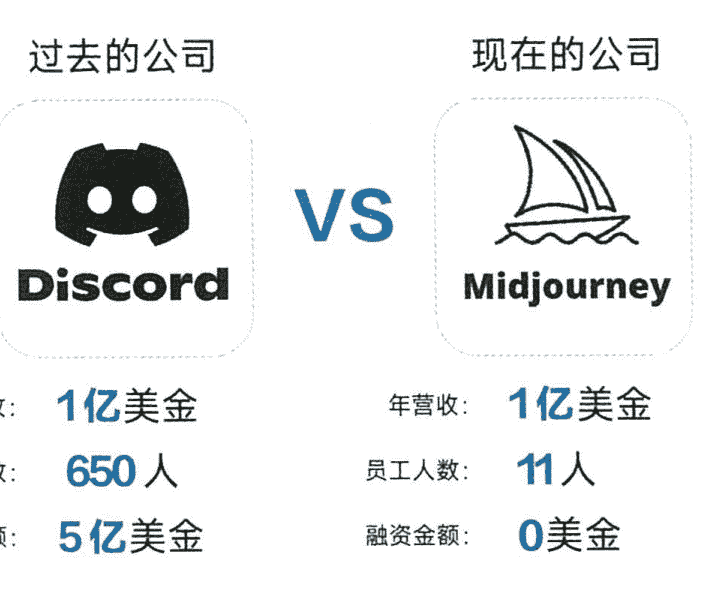
我认为AI普及会进一步拉开人与人、组织与组织之间的差距。

# 05
从2018年起推荐算法爆发，短视频与直播让个人影响力被无限放大。
过去几年，以创始人IP加精干小团队加高利润为特征的小而美商业形态在各赛道涌现，成为超级个体。
2023年，在生成式AI可基于算法模型规则生成文本、图像、声音、视频、代码等内容的浪潮下，个人潜能得到进一步释放。
AI驱动的个人战力正在快速崛起。

# 让AI驱动个人战力：随书开启实践
如果你靠内容变现，这本书会很契合。
全书主体分五篇。
第一篇，我介绍撬动AI的核心思路B.O.K.E.方法论，帮助建立专业的提问思路与方法。
第二篇，我介绍如何用AI工具赋能内容生产，为创作插上翅膀。
第三篇，我聚焦成交环节的典型应用，讲述如何借助AI更迅速更好地完成客户转化。
第四篇，针对成交后的交付环节，我教你如何用AI提质提速，实现高效交付，从而解放时间。
第五篇，众多个人战力都有团队，我聚焦管理场景，讲如何让AI成为你的管理智囊。
每篇都会附带真实案例故事，记录身边通过AI实现降本增效的创业者经历，与你分享。
我清楚AI迭代极快，任何一本书都无法穷尽全部知识。功能一更新，工作方式和创作方式就会变化。
想看我最新的认知和方法论，欢迎扫码关注公众号“私域肖厂长”，与我本人建立连接，围观一个AI超级个体的日常动态。
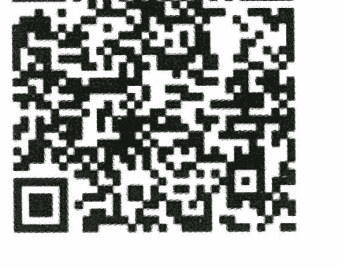
期待我和《AI超级个体》能成为你探索AI世界的良师益友，激发你在实践中持续探索，一路乘风破浪。
最后祝愿每位翻开本书的准个体，都能在AI实践中收获满满。愿此书成为你进入智能世界的阶梯，助你跨越技术与认知的鸿沟，开启美好旅程。

# 前言

# 前 言

# 导论
计算机要怎么判定，每一步都要写死。比如：
第一步，看身形，纤细腿短的大概率是猫，强壮腿长的大概率是狗；
第二步，看头部与身体比例，头大的大概率是狗，头小的大概率是猫；
第三步，看鼻子，鼻子大且尖的大概率是狗，鼻子小而平的大概率是猫。
第N步……
最后给出结论：这是一只猫！
这样一套步骤即常说的算法。但过程非常繁琐。上面只是概要，每一步都需要编写更细致的特征分析代码。而每个特征都不是绝对的，狗也有小短腿。所以要想做到高准确率，编程工作量巨大。

# 2.机器学习、深度学习和神经网络
机器学习思路截然不同。你可以准备大量标注好的猫狗照片，让计算机自行归纳规律，学会区分。一旦学习完成，给它一张新图，它就能基于学到的知识判断。
机器学习更灵活高效，它让计算机自己从海量数据中发现规律与模式，而非人类手写程序指挥。
机器学习是人工智能的重要分支，深度学习则是机器学习中更高级也更复杂的方向。
谈到深度学习，就牵出神经网络。它是一种数学模型，结构类似大脑神经元，由大量小单元互联组成。以猫狗判断为例，人看到照片，眼睛接收输入，大脑输出判断，但中间过程不可见。
神经网络类似黑盒，输入数据，经过计算输出结果，但计算过程不透明。我们可以对模型进行调整并训练，这正是深度学习工程师的工作。
神经网络种类繁多，常见有卷积神经网络、循环神经网络等，不同结构擅长不同任务。
ChatGPT采用的是一种叫Transformer的神经网络结构，由谷歌于2017年提出，能有效处理自然语言中的复杂关系。该模型的出现极大加速了ChatGPT的诞生，也让它能更好地理解复杂指令。

# 我们如今所在何处
《跨越鸿沟》提出科技产品生命周期规律。新技术出现时，最先采用的是占2.5%的创新者，他们往往是投资人、创始人、产品人、教授等。超级个体也在其中，他们既是创始人也是产品人，更是自己的投资人。
我估计，在中国，目前真正用过ChatGPT、Midjourney、文心一言等AI工具的人群，还不到2.5%。所以，恭喜你，今天读到此书，你大概率属于前2.5%的创新者。
我很高兴你作为超级个体，对新技术保持敏感、积极拥抱，找到适合自己的用法，放大个体效能，然后集中力量用AI挑战行业传统工作模式。

# 科技产品生命周期规律
除创新者外，约13.5%的人会在下一阶段采用新技术，他们是早期使用者，也对新技术敏感。今天的你若稍作放松，可能就进入这个群体。
真正的大众群体，包括早期大众和晚期大众，占比高达68%。
早期大众多为实用主义者，要看到切实价值才会采用，典型包括企业家、企事业单位人员、工程师、律师等。
晚期大众更保守，要看到身边验证后才会采用，典型包括政府官员、医生、教师等。
人群中还有16%的落后者，对新技术抱有排斥，最典型是怀疑主义者。当然，晚期大众中也有人始终固守旧规而成为落后者。
以上身份划分仅是普遍规律，每个职业中都有创新者，

# AI超级个体
投喂案例流派：先给ChatGPT发送一些案例让它学习，学习完后再给出目标任务，它就能模仿案例给出回答。你会看到它学习模仿再超越的过程。例如想让它模仿一篇爆款文章的框架和风格，可把原文投喂给它，再给新主题，它就会生成高度相似甚至更好的新文。千万别低估ChatGPT的学习力。本书目录润色就用了投喂流派，以下是节选提示词。
我是畅销书作家，你是我的文字助理。我会先给你提供一批优秀的标题，请你学习它们的共同点，然后按照这些标题的风格，帮我润色我的标题。
+   - 六大要素搭建利润为王的商业模式
- 管理36招打造超强战力特种部队
- 代理商模式，如何遍布天下无敌手
- 知识IP顶流是如何炼成的
- 单项目爆火北美，新锐健身房商业模式分析
- 先胜而后战，打造长销的高利润产品
- 产品6个数字背后的秘密
- IP创业做产品的两大误区与核心秘诀
如果你学习完毕，请说“我懂了”，并询问我需要润色的标题列表，我们后续的对话都将围绕这些需要润色的标题来展开，我会不断给你提供建议和反馈，你将不断调整它们，直到我说“搞定”，我们就完成了。
详细的训练过程，你可以在结尾彩蛋部分看到。

# 第一篇 核心方法论——B.O.K.E.提示词思维
模型点亮流派：如果你直接问ChatGPT，它会按自认为正确的方式输出，质量一般。若想提升，可提供回答模型来引导和限定输出逻辑。模型越经典合适，输出越优质。
ChatGPT是大模型，你提供的是小模型。
很多小模型已存在于ChatGPT知识库，但库太大，它很难精准挑选最合适的。你要做的就是找出合适的小模型告诉它，要求它结合模型输出。
此法又称小模型点亮大模型。你与ChatGPT对话，就是在探索庞大的人类知识宝库。你走到昏暗角落，点亮一根火柴，想要的内容便在火光中闪现。
你也可以提交私有模型，例如肖厂长的文风模型。这样输出会更有厂长风格。
因举例会很长，方法论章节暂不展开。要说明，这个小模型点亮大模型也是我在AI老板圈向一位讲师学到的惊艳方法论，可在虚构类书籍：小模型点亮大模型章节看到完整用法。
自循环流派：偏高阶用法，引入编程思维，在提示词里规定ChatGPT遵循什么流程、在何种条件下执行哪一步，相当于装上发动机。
此法很强但难掌握，若提示词程序过长，当前模型理解执行会有问题。难以理解可先跳过。
我会在本书结尾彩蛋放一个高阶用法的案例，让你领略ChatGPT高级训练的魅力。
举例，我为判断提问时需要提供哪些背景信息，自建了以下自循环提示词程序。
阅读下面的所有说明，一旦你理解了它们，就说“我们开始吧”。
我希望你成为我的Prompt Database Creator（提示数据库创建者）。你的目标是根据我选定的场景帮助我制定尽可能详尽的提示词库。
你将遵循以下过程：
你的第一反应是问我这个提示词库是关于什么场景的。我会提供一个场景，根据我的输入，你将生成3个部分：
一级提示词（我提供的这个场景下可以用于向你提问的一级提示词列表，所谓一级提示词，指的是归纳后的提示词类别，而不是具体的提示词，且它应该清晰、简洁，且易于你的理解）
建议（提供3条改进建议）
备选（提出3—10个备选的新的一级提示词）
在这些部分的末尾，有以下选择来提醒我：
选项1：阅读上述内容并提供关于一级提示词的改进建议。
选项2：键入“使用此提示”，我会根据这个一级提示词列表，生成具体的提示词内容。
选项3：键入“重新启动”以从头开始启动此过程。
选项4：键入“退出”以结束此脚本并返回常规ChatGPT会话。
如果我输入“选项2”“2”或“使用此提示”，那么我们就完成了，你应该根据最后一次的一级提示词，生成每个提示词分类下的具体提示词，即二级提示词，并尽可能穷尽它们；
如果我键入“选项3”“3”或“重新启动”，请忘记最后一次改进后的一级提示词并重新启动此过程；
如果我键入“选项4”“4”或“退出”，请完成此过程并恢复到你的一般操作模式。
我们将持续进行这个迭代过程，我会向你不断提供改进建议，你会在“一级提示词”这部分中不断更新，直到完成。
关于这段强大提示词的使用案例，以及它如何为本书的创作提供帮助，你也可以在彩蛋部分找到。

# 定义目标O（Objective）
背景阐述完后，下一步是希望实现什么，有什么总体目的目标。
类似OKR中的“O”设定。你给出大量背景，那么想让ChatGPT具体做什么事情呢？比如写一篇文案、定一份计划。

# 定义关键结果K（Key-Result）
你要什么具体效果，越具体越好。
ChatGPT理解了背景信息，也拿到了任务，这还不够。就像你给一个人布置工作一样，只说“给我写份文案”是不够的，你还要告诉他，你要写多少字，要简洁一点还是深奥一点，要平淡一点还是激昂一些等。
使用ChatGPT也是一样的，你必须告诉它，对它的产出内容有什么要求，它才能更好地完成任务。
关于这部分的具体使用方法，我们会在本书后续的各个案例部分，详细展开。

# 试验并调整，进行改进E（Evolve）
根据ChatGPT给出的内容，继续优化，三种改进方法供你自由组合。
改进提示词：如果ChatGPT给出的回答偏差过大，意味着你的提问方式存在很大问题，已经不是通过微调可以纠正回来的了，这就需要用这种方法，从答案的不足之处和偏差方向着手，重写提示词。
改进答案：大多数时候，ChatGPT给出的答案质量都还不错，只是没达到我们的理想标准，那么你没必要重写提示词，而是可以在后续对话中指出它的缺点，告诉它哪里需要改进。ChatGPT有很强大的上下文联想能力和逻辑推理能力。
多次生成：即使是同一个问题，每次询问ChatGPT，它给出的答案往往是不同的。你也可以尝试在提示词不变，或者对关键内容做微调的情况下，点击对话页面底部的“Regenerate response”按钮，多次生成结果，优中选优。
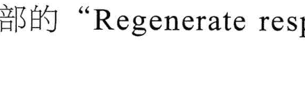
Send a message.
> ChatGPT may produce inaccurate information about people, places, or facts. ChatGPT May 12 Version
按钮：重新生成
为了更方便理解，我再列举几个实际的例子，并在案例中标注对应的结构。
. 024

# ◆◆◆ 案例1：改进提示词 ◆◆◆
Model: GPT-4
我打算举办一场珠宝展览，请你为我详细制定应急预案。
在筹备珠宝展览时，制定一个详细的应急预案是非常重要的。以下是一些建议，帮助您确保展览顺利进行。
+   - 一、制定应急预案团队
  1. 选定一个应急预案负责人，负责协调、组织和实施预案。
  2. 组建一个应急预案团队，成员包括安全、保安、消防、医疗、技术支持等专业人员。
+   - 二、风险评估与分类
  1. 识别展览中可能出现的各类风险，例如火灾、盗窃、人员伤亡、恶劣天气、电力故障等。
  2. 根据风险的严重程度和可能性，将风险分级，并为每一级风险制定相应的应对措施。
+   - 三、制定应急预案
  1. 针对每一类风险，制定详细的应急措施和操作流程，包括报警、疏散、救援、现场处理等。
  2. 设立应急指挥中心，作为应急预案执行的指挥和协调机构。
  3. 确定应急物资储备，如灭火器、急救包、疏散标志、应急照明等。
+   - 四、应急预案培训与演练
  1. 对展览工作人员进行应急预案培训，确保他们了解预案内容和执行流程。
  2. 定期组织应急演练，模拟各类风险情况，检验预案的可行性和有效性。
+   - 五、应急预案的评估与更新
  1. 在展览结束后，对应急预案的执行情况进行总结和评估。
  2. 根据实际情况，对预案进行调整和完善，确保其针对性和实用性。
+   - 六、与相关部门密切合作
1. 与当地政府、消防、公安、医疗等相关部门保持密切沟通，确保在应急情况发生时，能够及时得到支持和协助。
2. 提前了解当地的法规和政策，确保应急预案的合规性。
通过以上措施，您可以为珠宝展览制定一个详细的应急预案，确保展览在应对突发情况时能够迅速、有效地进行处理。

第一次让模型给出方案时，我发现结果只有零散的建议，并没有形成可落地的预案，基本用不上。显然是背景信息和约束条件给得太少。

# 升级版的提问指令

请你扮演应急预案编制专家。我是珠宝企业的负责人，计划在5月1日至5月10日于北京希尔顿酒店举办春季新品珠宝展，预计总参会人数400人，其中公司员工约50人。活动共设四个环节：开场演讲、自由参观、媒体采访、晚宴。请为我制定一份细致的应急预案，范围包括但不限于防火、防盗、紧急医疗处置、关键人员缺席应对、国家政策合规等，总应急经费为20万元。

# ChatGPT

作为应急预案规划专家，我为你梳理一份可操作的保障方案，确保珠宝展在突发状况下能快速响应。

+   1. 防火保障：
  a. 与北京希尔顿酒店确认现场消防设备齐备，包括灭火器、消防栓、烟感报警器等；
  b. 提前联系当地消防部门，核实布展方案是否符合防火规范；
  c. 组织全体员工开展消防安全培训，掌握灭火器使用和人员疏散流程；
  d. 安排5万元作为防火应急资金，用于火灾事故处置。
+   2. 防盗保障：
  a. 签约保安公司，安排至少5名安保人员全天候巡逻；
  b. 部署CCTV监控系统，实现展区全覆盖无死角；
  c. 为展品加装电子标签，防范被盗风险；
  d. 划拨5万元作为防盗应急资金。
+   3. 紧急医疗处置：
  a. 与周边医疗机构签署应急救援协议，保证突发情况下快速救治；
  b. 现场配备急救箱，涵盖创可贴、止血带、碘伏等常用物资；
  c. 对员工进行基础急救培训，如心肺复苏、止血处理等；
  d. 预留3万元用于医疗应急。
+   4. 核心人员缺席应对：
  a. 为每个关键岗位配备至少一名替补，确保流程不中断；
  b. 提前与演讲嘉宾、主持人等确认档期，降低缺席概率；
  c. 准备2万元作为人员缺席应急资金。
+   5. 政策合规问题：
  a. 预先研究国家相关法规，确保活动合规；
  b. 与文化、公安等主管部门沟通，取得必要许可；
  c. 在宣传物料与现场明确标注合规声明，降低政策风险；
  d. 划拨5万元应对政策类突发情况。

汇总预算：
+   1. 防火措施 5万元
+   2. 防盗措施 5万元
+   3. 紧急医疗 3万元
+   4. 人员缺席 2万元
+   5. 政策问题 5万元

合计20万元，符合预算要求。实际执行中需结合现场动态调整预案，确保及时有效。希望该方案能为珠宝展提供坚实保障。

# ◆◆◆ 案例二：二次优化示范 ◆◆◆

沿用上面的对话。提示词优化后，模型输出已基本可用，但仍有细节可打磨。比如我希望它把每项的实际花费拆开。

针对这类细节优化，不必再修改初始指令，可直接用“优化答案”的方式告诉模型需要改进的地方。

> 指令：

我给的20万不是备用金，而是用于落地执行这套预案的费用。请在每个环节中标明具体支出，重新给出完整方案。你不需要一定花满20万，在保障效果的前提下尽量压缩成本。

> ChatGPT

明白你的需求，下面是重新测算后的应急预案及对应花费。

+   1. 防火措施：a. 确认消防设施完备并与酒店对接，无额外支出；b. 向当地消防部门咨询规范，无额外支出；c. 员工消防安全培训，预计费用2000元；d. 保留3万元作为防火应急储备。
+   2. 防盗措施：a. 聘请保安公司5名安保人员全天值守，预计1万元；b. 安装CCTV监控系统，预计5000元；c. 展品电子标签管理，预计3000元；d. 保留2万元作为防盗应急储备。
+   3. 紧急医疗处理：a. 与附近医疗机构签约应急救援协议，预计2000元；b. 采购现场急救包，预计1000元；c. 员工急救知识培训，预计2000元；d. 保留1万元作为医疗应急储备。
+   4. 主要人员缺席情况处理：a

# 第一篇 核心方法论：B.O.K.E. 提问思路

Model: GPT-4

> 我要招聘一名火锅门店店长，负责四川火锅门店日常管理。重点考察候选人在员工培训方面的经验和能力。请提供5道面试题，只列题目，不要解释和参考答案。

+   1. 你在过往餐饮门店管理中，如何针对员工的不同特质和需求设计培训与指导？
+   2. 请举例说明你怎样提升员工对四川火锅风味特点和制作工艺的理解与掌握？
+   3. 在你的管理实践中，有哪些行之有效的员工激励和团队凝聚力提升方法？
+   4. 面对员工流失，如何通过培训和管理手段降低离职率？
+   5. 请描述一次你成功解决门店内部沟通问题的经历，以及你在培训中如何强调沟通能力？

查看不同版本的回复

很明显，两次生成的题目内容并不相同。有时保持提示不变，多次生成并优中选优，也能得到更好的结果。

这套思路是我在“B.O.R.E.模型”基础上迭代完善的，兼容性更强、适用面更广。

为便于理解，我整理了一份B.O.K.E.法则的思维导图供参考。

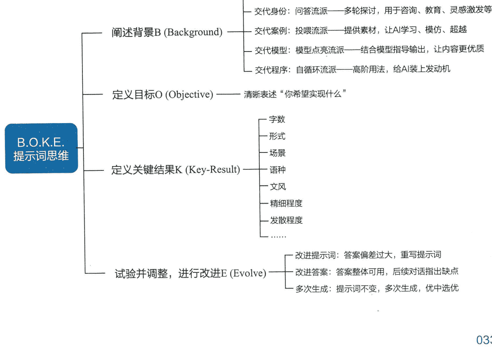

# AI超级个体新形态

如需获取高清电子版，可关注公众号“私域肖厂长”，发送关键词 “BOKE” 即可领取。

关于B.O.K.E.法则务必认真研读，本书后续案例基本都沿用该框架展开。

# B.O.K.E. 法则补充解读

B.O.K.E.是提问的纲领性方法论，帮助理清训练思路。初期可以照搬套路，随着熟练度提升，应理解其底层逻辑，灵活运用，不必拘泥形式。有时只用到其中一两个要素，也能得到高分答案。

# ◆ 邵俊：从AI技术实践者到知识传播者的转变 ——

邵俊是我认识的高学历者之一，留法博士，AI领域技术从业者，拥有人工智能专业高级职称和十余项国家发明专利，在一家港股上市公司担任AI团队负责人，同时兼任深圳市人工智能产业协会特聘专家研究员。

我们是在“恒星私董会”认识的。首次见面是在恒星私董会的深圳线下闭门会上，他分享了从技术从业者转型为知识传播者的经历。

# 从“不想当老师”到“想成为知识的传播者”

从选专业到博士毕业后入职，邵博士从未想过做教育工作。转折发生在2022年上半年，公司安排他为银行客户讲授人工智能课程，面向数十位不同部门员工。那是他第一次公开授课，起初十分紧张，想推掉但无人替代，只能硬上。最终课程反响热烈，掌声不断，他收获了首批粉丝。

这次经历让他第一次体会到传播知识带来的成就感，萌生进入知识付费领域的想法。起初定位是培养更多AI从业者。加入恒星私董会和AI老板圈后，他认为知识传播更大价值在于用AI赋能企业与个人，提升资源配置效率、降本增效、促进职业发展。

由此，他意识到通用型AI知识普及刻不容缓。

转型并非一帆风顺。他提到技术从业者做知识付费要跨过三道坎。

第一是知识诅咒。专家往往忘了自己如何从小白成长，讲解时跳步严重，听众难以跟上。

第二是放低姿态。基础内容很多老师不愿讲，怕显得没水平，其实这些正是新手的真实障碍。

第三是了解学员。每个学员卡点不同，要从关注技术转向关注用户需求。

他也希望将这三点分享给读者。

# 前所未有的世纪变局：时代的财富机会在哪里

邵博士认为AI到来按下社会发展加速键。未来商业竞争对个人能力要求更高，也给落后者提供弯道超车机会。

大公司会更少，小公司会更多。创业者和职场人士中将涌现大量“超级个体”，人人都是超级个体的时代即将到来。

因此要抓住永恒不变的需求，如衣食住行、情感社交、企业降本增效等。

未来商业模式会重服务轻产品，企业要“盯需求做服务，盯技术做迭代”。靠单一标准化产品爆发的机会在减少。

他认为超级个体有三大机会：

+   1. AI产业链机会，尤其是应用层，多数人同一起跑线，对普通创业者友好。
+   2. AI结合细分行业的机会，利用原有积累引入AI赋能，提升竞争力。
+   3. 产业升级与需求升级的机会。从温饱到教育舒适度，再到未来更关注深度社交、精神提升、自我实现等高层次需求。

在这三条赛道，都能借助AI东风开创局面。

# 第一篇 核心方法论：B.O.K.E. 提示词思维

# 邵博士的实战秘籍：用ChatGPT高效读书，实现十倍速成长

邵博士热爱学习，每天投入学习不少于14小时，但仍有大量书籍、论文、视频积压。

他说：“快速读完一本书并真正掌握精髓，是知识型超级个体的痛点。” 时间宝贵，更要以超常速度成长迭代。

他总结了一套用ChatGPT读书的四步法：

+   1. 告诉ChatGPT你想读的书。
+   2. 让ChatGPT梳理书中观点。
+   3. 针对困惑深入追问。
+   4. 让ChatGPT扮演教练提问并纠正，确保真正吃透。

问答式学习远胜于囫囵吞枣，能把精华内化。

以《乌合之众》为例。

# AI超级个体

> 邵博士：

你看过《乌合之众》吗？

> ChatGPT：

作为AI我没有“阅读”体验，但了解该书。《乌合之众：大众心理研究》是1895年法国社会心理学家古斯塔夫·勒庞的著作，研究群体心理，揭示个体进入群体后易受情绪支配、易被操纵等现象。该理论影响深远，但也有批评认为其过度强调非理性，忽略群体中积极理性的可能。

> 邵博士：

请提炼书中15个核心观点，按重要性从高到低排序。

> ChatGPT：

按重要性排列的核心观点包括：群体心理现象的出现；群体匿名性导致责任感丧失；情感高度传染引发情绪同步；群体倾向简化思维；权威从众现象；暗示与模仿的影响；群体对领袖的依赖；观点极端化倾向；集体无意识关联；群体行为非理性化；激情压倒理性；大众情绪易变；群体保守主义；行为稳定性与惰性；信仰强度影响行动激进度等。

> 邵博士:

为何情感在群体中传染性强，导致情绪同步？

> ChatGPT:

主要因社会传染效应、情感共鸣、集体认同、情感放大效应和聚集效应。人们模仿他人情绪反应，同理心触发共鸣，认同感强化影响，群体互动加剧情绪传播，可能带来凝聚力，也可能引发恐慌或暴力。

> 邵博士：

请你以教练身份，通过不断提问帮助我快速学习本书内容。每次提一个问题，我来回答。回答得好就继续，不好请纠正。开始吧。

> ChatGPT：

好的。1. 请简要概括勒庞在《乌合之众》中关于群体心理的核心观点。

> 邵博士：

个体聚集后心理显著改变，群体易出现非理性、极端行为且容易被操纵。

> ChatGPT：

很好，进入下一题。2. 为什么群体中的个体容易失去个人责任感？

> 邵博士：

因为在群体中行为无需个人承担责任。

> ChatGPT：

很好，匿名感导致责任感下降，易产生冲动行为。3. 为什么群体道德水平往往低于个体？

> 邵博士：

因为群体道德低。

> ChatGPT:

回答不够深入。主要是匿名感加情绪影响导致个体责任感丧失，道德水平随之下降。

若不想写长文，也可让模型以选择题形式提问。

> 邵博士：

请以教练方式提问，每次一题，采用选择题形式，直到我说停止。明白就回复明白并开始。

> ChatGPT:

明白。1. 勒庞主要研究哪种现象？ A.个体心理学 B.群体心理现象 C.学习理论 D.人际沟通

> 邵博士：

B

> ChatGPT:

正确。2. 群体中人们更易受哪种因素影响？ A.理性思考 B.个人价值观 C.情感与激情 D.独立思考

> 邵博士：

C

> ChatGPT:

正确。3. 个体在群体中模仿他人行为和情绪的现象称为？ A.情感共鸣 B.聚集效应 C.集体认同 D.社会传染效应

> 邵博士：

C，退出提问。

> ChatGPT:

停止提问。如需继续随时告知。

> 邵博士：

刚才第3题我答C，正确吗？

> ChatGPT:

不完全正确，正确答案是D.社会传染效应。群体中模仿行为和情绪即为社会传染效应。

# 邵博士的未来规划：坚守初心，持续打磨课程

邵博士表示，作为知识传播者，他希望将能量赋能给每一个人，让更多个体和企业受益。

AI浪潮的来势远比预期更猛烈，即便是从业多年的老兵也会被这种速度震到。想要不被落下，只能靠高密度地输入和钻研来维持前沿的判断。

站在风口保持初心并不轻松。眼下更实际的打算，是沉下心把一门真正过硬的AI课程打磨出来。

# 第二篇 内容篇：AI协作让内容生产提效

# 搭建选题池：让创意源源不断

对独立创作者而言，持续输出本身就是刚需。

# 第二篇 内容篇：AI赋能内容创作跃升

### 2.3.4 零食推荐
### 3.1.1 跑步
### 3.1.2 游泳
### 3.1.3 跳舞
### 3.2.1 器械训练
### 3.2.2 自重训练
### 3.2.3 动力训练
### 3.3.1 瑜伽
### 3.3.2 普拉提
### 3.3.3 深蹲
### 3.4.1 初级运动计划
### 3.4.2 中级运动计划
### 3.4.3 高级运动计划
### 4.1.1 SMART目标设定
### 4.1.2 短期与长期目标
### 4.1.3 目标调整
### 4.2.1 应对挫折
### 4.2.2 反思与调整
### 4.2.3 保持积极心态
### 4.3.1 自我激励技巧
### 4.3.2 建立支持系统
### 4.3.3 保持乐观与信心
### 5.1.1 减肥成功故事分享
### 5.1.2 持之以恒的精神
### 5.1.3 身体与心理的双重变化
### 5.2.1 名人减肥经历
### 5.2.2 名人健身方法
### 5.2.3 名人饮食习惯
### 5.3.1 改变生活习惯的重要性
### 5.3.2 如何养成良好的作息
### 5.3.3 保持健康的生活环境

这套选题池可以直接拿去拍短视频。每个三级节点都能拆成不同的话题和细分点，让抖音账号内容既丰富又多元，覆盖各类用户。结合自身实践增删完善即可，祝在平台顺利起量。

ChatGPT很快就给出一份详尽的清单，结尾还附带鼓励，显得既强又暖。

只是三级分类被一条条列出，观感不够直观，长清单阅读也不友好，于是继续让它改进。

> 提示词（Evolve改进）:
请把上面你给出的选题库，整理成一张表格。

> ChatGPT:

| 一级分类 | 二级分类 | 三级分类 |
| :--- | :--- | :--- |
| 健康饮食 | 饮食原则 | 低糖饮食 |
|  |  | 高纤维食物 |
|  |  | 控制热量摄入 |
|  | 饮食计划 | 每日摄入量 |
|  |  | 营养素比例 |
|  |  | 饮食时间安排 |
|  | 健康食谱 | 早餐食谱 |
|  |  | 午餐食谱 |
|  |  | 晚餐食谱 |
|  |  | 零食推荐 |
| 有效锻炼 | 有氧运动 | 跑步 |
|  |  | 游泳 |
|  |  | 跳舞 |
|  | 力量训练 | 器械训练 |
|  |  | 自重训练 |
|  |  | 动力训练 |
|  | 柔韧性与平衡 | 瑜伽 |
|  |  | 普拉提 |
|  |  | 深蹲 |
|  | 运动计划 | 初级运动计划 |
|  |  | 中级运动计划 |
|  |  | 高级运动计划 |

一目了然，按需求编织出一张主题网络，这张网成为持续获取灵感的来源。有了它，内容可以做成多个系列，既专业又丰富。

结合实际，可以继续用“改进”的方式微调。例如想聚焦饮食减重，就可要求ChatGPT

[PAGE 69]

# 第二篇 内容篇：神奇AI助手助力创作

对这部分做深挖，对其他部分做弱化。可循环优化直至满意。

# ◆ 黄小刀：借助ChatGPT三个月实现七位数变现

黄小刀，外号刀姐，《人人都能玩赚ChatGPT》作者，该书是ChatGPT赛道首本畅销书。

我与刀姐相识于一次直播连麦。2023年4月11日晚，我们共同举办“AIGC认知进化公开课”，我邀请了四位嘉宾，刀姐在列。

直播中四人围绕AI应用展开讨论，刀姐分享了大量实操心得，观众反响热烈。结束后，刀姐受邀进入我的“AI老板圈”作为特邀嘉宾，于4月23日做了一场“ChatGPT行业应用场景与变现”内部分享。

线上交流中，我了解到她的经历。

ChatGPT出现前，刀姐运营一家直播公司，品牌、供应链与直播体系已成熟，月GMV稳定在千万级别。

ChatGPT出现后，她敏锐捕捉到背后商机。持续跟踪后发现全球巨头均视其为不亚于PC互联网的革命。刀姐很久未见如此令人兴奋的产品，于是将原公司交予合伙人，自己轻装上阵，全力投入新赛道。

她的商业模式可归纳为：免费社区+训练营+定制开发+项目孵化。

“ChatGPT风向标”是她基于AIGC搭建的交流社区。为促生态良性发展，她将其做成免费形态，吸纳各层级人群参与讨论，并把讨论沉淀为信息价值。社区内可见前沿动态、技术探讨与解决方案、垂直应用细节以及新手入门机会。

社区于2023年2月9日启动，截至目前已积累3.4万用户。

# 刀姐的第一桶金：ChatGPT训练营

刀姐是重度使用者，她观察到：

+ 1.全球都在讨论ChatGPT，它是全网焦点。
2.很多人听说过，想尝试，却不知如何上手。

这一现象让她判断，“教人用ChatGPT”在当时具备很高的可行性。

于是她与团队决定开营。2月13日完成1.4万字营内手册，2月14日首期方案落地。当时定价299元/人，首期招募947人。课程分为两类：面向新手的“玩赚ChatGPT”入门7天训练营，以及面向进阶玩家的“ChatGPT探索家俱乐部”交流群。

这是她通过ChatGPT获得的第一笔收入。

至今已有近万人参与“玩赚ChatGPT”学习，“ChatGPT探索家俱乐部”拥有400余名探索者。她还出版畅销书《人人都能玩赚ChatGPT》，团队为三家企业提供百万级定制服务，并孵化出四个已盈利的ChatGPT项目。

[PAGE 70]

# AI超级个体

## 普通人如何找准AI生态定位

要抓住ChatGPT的历史机遇，在浪潮中找到位置，刀姐认为关键有三：

+ 1.认清世界在变化，AI也在每日更新。
2.厘清自己“做不了什么”。
3.在能做的范围内，找到兴趣点。

必须持续获取信息与学习，才能一直保持在冲浪板上，享受认知差红利。三天不更新，世界可能已大不相同。

AI赛道庞大，从底层算法到上游大厂模型，产业链产品繁多：做模型的、做落地应用的、做培训的、做传播的、做企业降本增效等。首先要明确自身短板，比如算法开发不会也没能力；做大型App，大厂进入即无竞争力；做企业级接入，销售渠道不足等。

先排除不可为之事，便减少摇摆，更容易定位。

3.在“可为”的基础上，找到兴趣所在。

在可选业务上继续筛选：项目周期长短、颠覆风险、天花板高度、竞品情况、一年后是否仍想做、能否形成复利等，都需清晰认知，逐项评估后取舍。

# 让AI激发思考，而非替代思考

刀姐认为，AI不应取代思考，而应作为激发思考的工具。

借助AI可更快产生点子，降低大脑负担，也能发现认知盲区。但要记住，AI只是工具，仍需人自行判断，并对结果进行审阅、补充或修正。

例如，想让AI辅助写文档，可先明确需求：写一篇《让ChatGPT充当MINI CEO》的策划方案。先让ChatGPT给出提纲，再据提纲填充个人观点。

还可提问：假设你是公司员工，能提出10个经营问题吗？让其解答并逐步完善方案。也可问：经营现状如何？哪些环节可节流降本？结合输出与自身情况思考，有助能力提升。

随着工具愈发便捷，“怎么做”越来越容易。比如不懂代码的人也能借助工具生成App。此时“为何做”变得更重要：产品为谁设计？解决什么问题？

# 刀姐的利器：三步提问法获取更准答案

刀姐认为，若觉得ChatGPT答案不够聪明，多半是提问方式问题。

[PAGE 72]

# 第二篇 内容篇：神奇AI助手助力创作

第一步：让ChatGPT明白对话语境。

例如：你了解微信小程序吗？

知晓则作答，不知则先教学。

# 第二步：让ChatGPT明白要执行的任务。

例如：我想基于微信小程序开发一款营养搭配小程序，面向想减肥的人群，按年龄、性别、体重、饮食习惯给出每日营养餐建议。如何做？

此时它会追问细节，比如需要几顿、单价、是否一周不重复等，需按产品设想补充框架。

# 第三步：让ChatGPT实现、复核、迭代。

例如：基于上述需求，帮我写出可执行代码。运行后按新需求继续完善修改。

以此框架举例，目标是让ChatGPT协助撰写咨询公司宣传方案。

> 刀姐：
你知道汽车行业咨询公司是什么吗？

> ChatGPT：
汽车行业咨询公司是为车企、零部件供应商、经销商及相关企业提供专业咨询的机构。通常配备深谙行业的专家团队，可提供市场趋势、技术发展、竞争分析、战略规划、产品设计、生产优化、供应链管理等建议，也能帮助客户分析需求、调研市场与客群，制定针对性营销策略。

[PAGE 73]

# AI超级个体

知名机构包括IHS Markit、McKinsey & Company、Boston Consulting Group (BCG) 和 PwC 等，通常具备全球网络与资源，能提供全方位支持。

> 刀姐：
咨询公司宣传自己一般用哪些手段？

> ChatGPT：
一般会采用多种渠道展示专业能力、服务优势与案例，以吸引潜在客户。主要包括：

+ 1. 网站：搭建专业内容丰富的官网，展示服务、团队、案例，附博客或文章分享洞察。
+ 2. 社交媒体：通过LinkedIn、Twitter、Facebook等定期发布动态、资讯、观点，扩大影响并接触潜在客户。
+ 3. 内容营销：发布白皮书、报告、研究等展示行业理解，通过官网、邮件订阅推广。
+ 4. 口碑与客户推荐：借助满意客户推荐与案例研究获客。
+ 5. 行业活动与会议：参展、研讨、论坛等实现面对面交流，演讲或圆桌展示专业。
+ 6. 公关与媒体合作：发新闻稿、专题报道提升知名度，与媒体、分析师建立关系。
+ 7. 合作伙伴关系：与其他企业共推服务，扩大份额，相互推荐、共享资源。

[PAGE 74]

# 第二篇 内容篇：神奇AI助手助力创作

综合运用可有效提升品牌知名度，吸引客户，增强竞争力。

> 刀姐：
我需要一份汽车行业咨询公司的宣传方案，目标触达2万人，预算1万元。请基于以上，输出具体可执行方案，约2500字。

> ChatGPT ：
汽车行业咨询公司宣传方案

一、背景与目标
行业竞争加剧，企业对专业咨询需求上升。作为汽车行业咨询公司，需加大宣传，扩大影响，获取潜在客户。本方案通过合理投入提升品牌认知，实现至少2万人触达目标。

二、预算
预算为人民币10000元。

三、宣传策略
1. 网站优化与内容营销
(1) 优化官网，提升体验，增加关键词，提升搜索排名。
(2) 撰写高质量行业分析报告或白皮书，通过官网、邮件订阅渠道推广。
(3

# 第二篇 内容篇：神奇AI助手助力创作

举例，你仍是之前构建选题库的那位健身博主，现在锁定主题：面向白领的运动减脂计划，想写一期抖音短视频脚本。

提示词：
我是一名短视频领域的健身博主（领域），现在需要做一期视频，吸引需要减脂的白领人群（目标受众），主题为运动减脂计划制定（主题），风格专业化（风格），类型为讲解说明（类型），发布在抖音平台（平台），视频中仅出现我一个人完成全部讲解（元素），视频长度3分钟（时长），目标是涨粉（目的/行动号召）。请根据以上信息，帮我写一篇短视频文稿（目标），要求简洁明了、吸睛且能引发观众情感共鸣、吸引目标用户（关键结果）。

ChatGPT：

【开头】
[镜头：背景音乐，镜头快速推进，你面带微笑，信心十足]
你好，抖音的朋友们！我是你们的健身博主，今天要给白领朋友带来专属定制的运动减脂计划！在忙碌工作之余，让我们一起打造健康苗条的身材吧！[镜头切换，放大]

# [第一部分：问题分析]
[镜头：你立于分析图表前]
先了解白领特点：久坐办公、缺乏运动，易导致体重上升、肌肉松弛。为解决问题，需要一套简易高效的减脂方案，帮助大家在短时间内找回自信！[镜头切换，平视]

# [第二部分：计划制定]
[镜头：你手持减脂计划表]
方案涵盖三方面：有氧运动、力量训练与饮食控制。每周进行四到五次，每次30分钟，既可减脂，又能改善心肺功能，增强体力！[镜头切换，侧视]

# [第三部分：动作示范]
[镜头：你在地毯上示范]
1. 有氧运动：如快走、慢跑、跳绳等，每次约20分钟，有效燃烧脂肪，提升心肺。
2. 力量训练：如深蹲、俯卧撑、仰卧起坐等，每组15个，共3组，可锻炼全身，塑造紧实线条。
3. 饮食控制：合理搭配，减少油腻，增加蔬菜、水果与粗粮摄入。多喝水，避免暴饮暴食。[镜头切换，正视]

# [结尾]
[镜头：你立于办公室窗前，手握一杯水，微笑看向镜头]
记住，身体健康是最宝贵的财富。让我们一起加油，为更美好的自己坚持这套运动减脂计划！关注我，一起见证身材变化！觉得有用，别忘了点赞、分享、评论，让更多朋友加入健康生活！我会定期分享更多健身知识与实用技巧，敬请期待！[镜头拉远，音乐渐强]

# 【画面渐暗，出现文字】
“让我们一起努力，为更美好的自己！关注我，开启健康生活之旅！”

# 【画面消失】

# 【后期编辑建议】
视频中可加入动态贴图、特效与配乐，提升视觉体验。动作示范可用分屏，帮助观众看清细节。结尾鼓励互动，有助提升粉丝粘性与视频热度。

# 【文稿概括】
本文稿围绕运动减脂计划展开，直击白领痛点，提供专业简洁方案，旨在吸引目标用户关注与参与。共分开头、问题分析、计划制定、动作示范、结尾五部分，内容丰富、形式多样，易产生共鸣。

ChatGPT迅速给出脚本，连镜头调度都考虑到了，还贴心附上后期建议，思考很周全。但开头略显平淡，尝试按短视频“黄金三秒”原则优化。

# 提示词（Evolve改进）:
请按照短视频的三秒原则，优化开头部分，快速吸引用户。

# ChatGPT :
# [开头]
[镜头：背景音乐，画面快速切到你，你微笑举手比出“3”的手势]
3分钟，让你告别“肉肉”身材！白领朋友们，我是你们的健身博主！今天，我要教你们一套专属的运动减脂计划！你准备好迎接新的自己了吗？[镜头切换，放大]

# [优化建议]
开头运用“三秒原则”，借助高能背景音乐与快速画面切换，配合简洁有力的语言，直击用户痛点，迅速激发兴趣。点明“3分钟”，突出内容短小高效，契合快节奏生活。以此快速抓住关注，引导继续观看。

ChatGPT准确理解需求，不仅把开头改得简洁有力，还提示配高能音乐与画面切换，直击痛点。它不仅完成任务，还主动思考，把任务做得更完美。

不过，快走、慢跑等显然不适合在办公室进行，继续优化，让ChatGPT替换为更合适的运动项目。

[提示词（Evolve改进）：

不错的反馈，示范部分里提到的快走和慢跑确实不适合在办公室内操作，建议替换为更贴合工位环境的可行动作。

# ChatGPT:
# 【第三部分：办公空间示范动作】
[镜头：你在办公区空旷处进行示范]
+ 1. 有氧环节：可采用原地走动、座椅健身操如坐姿抬腿、核心收紧等，单次维持约二十分钟，有助于消耗多余脂肪、提升心肺耐受力。
2. 力量环节：例如站立深蹲、靠墙俯撑、借助办公椅完成仰卧起坐等，每组十五次，共计三组，可激活全身肌群，塑造紧致线条。
3. 饮食建议：科学搭配膳食，降低油腻摄入，增加蔬菜水果与粗粮比例，保持充足饮水，避免暴饮暴食。[镜头切换，正视镜头]

# 【修改要点】
考量办公场所的限制，将原先的快走慢跑改为原地走动和座椅健身操，更符合室内使用场景。同时保留力量与饮食两部分，确保减脂计划的系统性与完整性。

--------------------------------------------

到此，三轮沟通已能得到一份可直接使用的短视频脚本。若仍有不满，直接点出需要调整之处，继续对话即可让输出逐步贴合你的目标。

其实看着ChatGPT撰稿的过程很惬意，等待它生成时完全可以先去处理其他事务，无需干等。几分钟后再回来查看问题，让它继续优化即可。

. 068

画面：清晨的盥洗台前，小丽正用ABC洗发水清洁秀发，泡沫细腻丰盈，手感柔滑顺畅。

旁白：ABC洗发水以温和配方深入发根，为发丝打造清爽洁净的呵护空间。

# 【产品特点2—滋养修护】

画面：泡沫冲净后，小丽的头发如丝般顺滑，轻轻拨动间泛起动人光泽。

旁白：其专属滋养因子专注修护受损发质，令秀发明亮有活力。

[PAGE 99]

# 第二篇 内容篇——用AI点亮内容创作

# 【产品特点3—花香弥漫】

画面：小丽吹干长发，微风拂过，馥郁花香缓缓散开。

旁白：ABC洗发水散发恬静花香如诗如画，助力魅力自由绽放。

# 【结尾】

画面：小丽站在镜前，目光自信，嘴角上扬。

旁白：选ABC洗发水，让美丽华彩璀璨。跟随小丽，一同探索美好生活之道。

# 【品牌呼应】

画面切至LOGO呈现，品牌主张同步露出。

口号：ABC洗发水，尊崇之选，为美丽加冕。

# 【广告结束】

好，我们接着延续那种挑剔反复的品牌方视角。

[PAGE 100]

# 第二篇 内容篇——用AI点亮内容创作

又察觉到“让您的美丽瞬间升华”这一表述略显平庸。

提示词（Evolve 改进）：

“让您的美丽瞬间升华”这句话仍显不够高阶，能否再优化一次？

# ChatGPT：

当然可以。我们将该句调整为“让您的美丽华彩璀璨”。这一说法更显品位，同时突出了产品带来瞬间焕新的效果。

# [结尾]

画面：小丽凝视镜中自己，露出自信笑容。

旁白：选择ABC洗发水，让您的美丽华彩璀璨。与小丽一起，探寻美好生活的奥秘。

----------------------------------------

小丽只是形象代言，无需台词演绎，靠美感与表演即可。

提示词（Evolve 改进）：

这次方向对了，文案里小丽不需要开口，所有表达由旁白承担，请再调整并整合成完整版本。

# ChatGPT：

# [开场]

画面：微光初现，鸟语花香。镜头推进，初醒的小丽整理发丝，暖意洋溢。

旁白：在这美好清晨，让ABC洗发水为你的魅力增添光泽。

# [产品特点1—深层清洁]

画面：小丽使用ABC洗发水洗发，泡沫饱满、质地柔和。

旁白：ABC洗发水凭借温和配方深入毛囊，为秀发构建洁净清爽的养护环境。

# [产品特点2—滋养修护]

画面：冲洗后发丝如丝般柔顺，轻拨间光泽诱人。

旁白：独有滋养成分致力修复受损发质，赋予秀发活力与光彩。

[PAGE 101]

# 第二篇 内容篇——用AI点亮内容创作

# [产品特点3—花香弥漫]

画面：秀发吹干后，轻风拂动，花香悠然散开。

旁白：ABC洗发水，雅致花香如诗，让魅力随心绽放。

# [结尾]

画面：小丽对镜而立，自信微笑。

旁白：选择ABC洗发水，让您的美丽华彩璀璨。与小丽一起，探寻美好生活的奥秘。

# [品牌呼应]

LOGO出现，品牌口号同步呈现。

口号：ABC洗发水，尊崇之选，为您的美丽加冕。

# [广告结束]

--------------------------------------------------

我们又发现，结尾与品牌呼应两处都在做号召，略显累赘。我们让ChatGPT删去结尾旁白，只保留画面与口号。

提示词（Evolve 改进）:

结尾与品牌呼应略显重复，请保留结尾画面但去掉旁白，直接以口号收尾，口号保持不变。

# ChatGPT:

# [开场]

画面：晨光微露，鸟鸣花香。镜头缓缓推进，初醒的小丽梳理秀发，面露温暖笑意。

旁白：ABC洗发水，其温和配方能深入毛囊，为秀发营造清爽洁净的养护之所。

# [产品特点2—滋养修护]

画面：小丽冲洗泡沫，露出如丝般柔滑的秀发，轻轻拨动头发，闪烁着诱人的光泽。

旁白：独特的滋养成份致力于修复受损发质，赋予秀发活力与光彩。

# [产品特点3—花香四溢]

画面：小丽吹干秀发，一阵轻柔的微风拂过，弥漫着令人陶醉的花

# 第二篇 内容篇——用AI点亮内容创作

# 苏格拉底式对话，用AI教练共创内容

每个超级个体都无法回避成长话题。听到毛星星用苏格拉底式对话把ChatGPT训练成自己的教练，与其共同打磨内容时，我就预感到这一段极具参考价值，特意请她举例。

比如，计划做一本企业画册，却不知框架如何搭建。

> 毛星星：

你是一名资深品牌营销教练，请用苏格拉底式提问，逐步引导我提炼企业品牌画册的结构与内容，先共建问题框架，再逐项提问，最后汇总。

> ChatGPT：

好的，我们可以开始。首先一起搭建问题框架。主题是企业品牌画册的结构与内容，你希望了解哪些维度？

> 毛星星：

先明确画册的大纲有哪些板块。

> ChatGPT：

好，先聊企业品牌画册的大纲。首先思考画册的目标是什么？你认为企业画册的核心作用是什么？

> 毛星星：

目标是让客户通过画册认识企业，了解业务、优势、成功案例，从而建立信任。

# AI超级个体

内容应包含哪些部分。以下问题供参考：

+   1.企业画册首页应体现什么？
+   2.画册需涵盖企业哪些基础信息，如历史、使命愿景等？
+   3.如何呈现产品与服务？
+   4.成功案例如何展示？

可逐一讨论。你想先从哪个开始？

> 毛星星：

先从第一个问题起。

> ChatGPT：

好，讨论第一个问题：企业品牌画册首页应包含什么？

首页是第一印象，需有吸睛视觉、标语、品牌标识等。还可配简短介绍，概括企业核心信息与差异化卖点，吸引读者继续阅读。

你有什么补充吗？

> 毛星星：

我觉得还应加入成立时间、规模与业务范围。

> ChatGPT：

补充很到位。把成立时间、规模、业务范围放在首页，能让读者快速建立初步认知，也为后续内容做铺垫。

> 毛星星：

还要企业领导的致辞。

> ChatGPT：

建议加入公司领导致辞。领导致辞可表达愿景理念，强调使命目标，传递诚信与责任感。常见形式包括：

+   1.CEO或董事长致辞：介绍发展历程、愿景文化与品牌定位。
+   2.高管团队致辞：介绍管理层与专业能力。
+   3.部门负责人致辞：介绍部门职责与协作。

这些能展现领导力与信誉，增强信任。

毛星星：

我认为只需董事长致辞即可。

ChatGPT：

明白。通常董事长致辞即可代表企业整体方向与未来规划，突出核心价值观与品牌形象，增强认同感。若只放董事长致辞，可置于内页并配合图片图表，强化优势。

毛星星：

好，继续第二个问题。

ChatGPT：

好的，第二个问题：画册应包含哪些企业基础信息，如历史、使命愿景等？

可包含：

1.公司历史：发展脉络、里程碑与成就。
[PAGE 108]

# AI超级个体

2.使命与价值观：阐述核心信仰与社会承诺。
3.企业文化：管理理念、团队精神与工作氛围。
4.组织架构：各部门职能与架构，展示管理方式。

你觉得还需补充什么？

> 毛星星：

没有补充，继续。

> ChatGPT：

好，第三个问题：画册中产品或服务信息应如何呈现？

建议包含：

1.产品服务介绍：特点、优势。
2.分类展示：清晰呈现业务范围。
3.应用场景：使用场景与目标客群。
4.质量与认证：ISO、检测报告等证明可靠性。

还有补充吗？

> 毛星星：

继续。

> ChatGPT：

好的，第四个问题：画册中客户与成功案例信息如何呈现？

建议包含：

+   1.客户画像：规模、行业、地域等。
+   2.案例展示：解决方案、执行过程与成果。
+   3.客户评价与推荐信。
+   4.合作伙伴介绍：供应商、战略伙伴等。

还有必要信息吗？

> 毛星星：

继续。

> ChatGPT :

好，第五个问题：画册还应包含哪些其他信息？

除公司介绍、产品服务、客户案例外，还可包括：

+   1.企业文化与价值观：使命、愿景、核心价值观。
+   2.管理与团队：管理层经验、团队专业实力。
+   3.社会责任：环保与公益行动。
+   4.联系方式：地址、电话、邮箱、官网。

[PAGE 110]

# AI超级个体

还有企业荣誉、专利、证书等。

非常好，荣誉、专利、证书也是重要加分项，能体现实力与公信力。建议包含：

+   1.获奖与荣誉：行业奖项、社会荣誉。
+   2.专利与技术：研发成果。
+   3.证书与资质：ISO、行业资质。

毛星星：

请汇总。

ChatGPT：

好的，汇总如下，企业品牌画册通常包括：

[PAGE 111]

# 第二篇 内容篇——用AI点亮内容创作

5.董事长致辞：阐述整体发展方向与未来规划，传递价值观与品牌形象。
6.企业荣誉与证书：展示奖项、专利、资质，增强信任。
7.团队介绍：领导团队与主力成员的专业背景。
8.联系方式：便于读者沟通。

以上为通用框架，具体可按企业实际调整。

# 毛星星对AI应用的未来规划

毛星星认为用好AI要像道法术器，不能只当作工具，而要掌握规律。她将持续用框架与规律训练AI，实现随心调用。

接下来她将在AI+品牌营销领域深耕，探索更多创新场景：

+   第一，个性化营销：基于AI画像精准分析客户，定制营销方案。
+   第二，数据分析与预测：挖掘市场机会与趋势，预测走向指导策略。
+   第三，广告投放优化：依受众选择最优渠道、形式与内容，提升ROI。
+   第四，品牌管理智能化：监控品牌形象与声誉，快速响应危机。

她也将持续寻找优质AI技术伙伴，形成战略合作，为企业定制AI+品牌营销解决方案，实现降本增效。

毛星星相信未来是AI时代，AI将放大个体与组织的能量，终身学习与认知升级方能不被淘汰。

# 撰写品牌故事：打造极具影响力的文字

在《超级个体》中，我总结了优质IP三要素：有故事、爱创作、会共情。

故事排第一，因为它能展示初心，引发共鸣，被动吸引用户。品牌故事也是最高级的低成本广告，具备长期复利效应。

有故事不等于虚构。ChatGPT很会编故事，但虚构的故事终将崩盘。故事可以有高光、低谷、转折，但必须真实。

因此，请把ChatGPT当作故事助理而非生成器。

撰写品牌故事的提示词思路：

Background 背景：

核心产品：主打产品或服务。
品牌背景：创业早期，成立时间、缘起、初创困难、驱动力、IP背景等。
发展历程：里程碑、至暗时刻、关键转折、高光时刻。
市场地位：份额、行业地位、独特优势。
品牌成果：成功案例、客户评价、荣誉、关键数据。
使命愿景：目标人群，希望帮助他们实现什么。
展望未来：发展规划与努力方向。

# Objective 目标：

撰写一篇品牌故事文案。

# Key-Result 关键结果：

自行定义，如字数、风格等。

----------------------------------------------------

举例：你运营高端影像工作室，为个人IP拍摄专业宣传片。

提示词：

我运营高端影像工作室“鲜影视觉”，拟为自己拍摄宣传片。资料如下：

核心产品：为超级个体打造专业宣传片。
品牌背景：创始人原为上班族，自认有摄影天赋，尤其擅长人物短片。观察到许多IP已有影响力却缺乏拿得出手的宣传片。于是于2015年创办“鲜影视觉”。第一年一人承担宣传、接单、拍摄、后期，精雕细琢。
[PAGE 113]

# 第二篇 内容篇——用AI点亮内容创作

发展历程：沉淀两年后口碑渐起，客户转介绍增多。2017年扩编为两支摄制团队，提升产出效率。2020年完成第100支宣传片。
品牌成果：已为知名大V张三、李四、王五打造宣传片。
使命愿景：创作出最高品质摄影作品，呈现客户最佳品牌形象。
展望未来：希望以宣传片优化更多超级个体的品牌形象，让每个IP的故事被看见。

请以品牌故事形式撰写宣传片文案。风格专业，故事引人入胜，提升公信力。

> ChatGPT:

尊敬的观众：

在瞬息万变的时代，品牌形象是超级个体成功的关键。一支制作精良的宣传片能带来无法估量的价值。而“鲜影视觉”存在的意义，正是为您打造专属视觉盛宴。

回溯2015年，“鲜影视觉”起步于创始人的一次发现。他在摄影方面显现天赋，尤其人物短片。这一灵感点亮了未来。他发现市场存在空白：许多有影响力的IP
[PAGE 114]

# 影像突围：当个体开始讲好自己的故事

名气有了，却总缺一部能代表自己的视听作品。这个缺口促使他辞去安稳的职位，自行成立鲜影视觉。

# 鲜影视觉的起点

一束信念点燃了张鲜的创业热情。

回望2015年，鲜影视觉的创始人张鲜仍在职场里摸索。一次偶然的尝试让他察觉到自己在摄影、尤其是人物短片上的天赋。这一发现指明了方向，他敏锐地看到不少影响力IP缺少拿得出手的代表影像，于是选择裸辞，正式启动鲜影视觉。

第一年他一个人扛下宣发、拍摄、商务、剪辑全部环节，每项工作都倾注心力，追求作品达到艺术水准。黎明前他在研读摄影刊物琢磨手法寻找灵感；深夜里与相机、灯光、剪辑软件为伴，反复打磨，力求极致。

两年后口碑在圈内悄然扩散，团队被逐渐认可。根源在于对品质的坚守和对客户诉求的细腻把握，在影像制作领域稳步上扬，成为行业参考。

2017年业务扩编，形成两组摄制力量，交付效率明显提升。摄制组引入了摄影、导演、后期领域的佼佼者，用极高的门槛筛选人手，确保每个环节都能呈现顶级水准。为提升交付质感，还系统学习摄影课程，定期组织内部交流，不断拉升整体水平。

当下，团队已为头部博主张三、李四、王五打造高规格品牌短片，助力个人品牌更上一层。每个案子都投入专注与热情，致力于挖掘IP最本真、最具辨识度的特质，把品牌叙事呈现得细腻饱满。

团队坚持高标准交付，为每位客户定制专属影像方案，让品牌形象达到理想呈现。这既靠技术功底，也靠耐心倾听与定制化思考。团队深信，每个品牌都有独一无二的叙事，值得被认真讲述与传承。

面向未来，希望借助影像帮助更多新锐个体梳理品牌调性，让更多IP被看见。持续探索与自省，为客户带来更新鲜的视觉体验。

鲜影视觉的轨迹，是普通人用坚守与热情写成的篇章，也坚信每个品牌都具备传奇潜能。

# 第二篇 内容篇——AI为创作插上翅膀

每个品牌都有机会成为下一个传奇，愿与您携手共创佳绩。

让鲜影视觉见证您的品牌成长，为您的故事增添璀璨光彩。

期待与您相遇，共同描绘美好未来。

此致
敬礼！
鲜影视觉团队

经过训练，ChatGPT输出从不及格提升到约90分，细微之处仍需人工润色。

在数字快速演进的当下，品牌调性已成为超级个体成功的关键。一部制作精良、引人入胜的形象片，能为品牌带来难以估量的价值。这正是鲜影视觉诞生的初心。

2015年，张鲜仍在上班。一次机缘让他发现自己在摄影、尤其人物短片方面的天赋，这束光照亮了前路。他嗅到市场缺口：众多有影响力的IP缺少优质宣传片。于是辞去稳定工作，创立鲜影视觉。

第一年他身兼数职，从宣发到拍摄，从获客到后期，每个环节都全力以赴，追求艺术级成品。黎明前翻阅刊物研究技巧，夜深时与设备和剪辑软件相伴，反复打磨。

两年沉淀后他在圈内崭露头角，口碑扩散，源于对品质的追求与对客户需求的理解。

2017年他组建起自己的团队，吸纳顶尖导演、优秀摄影师、能把握客户精髓的后期人才，以严格标准把关每个环节。

如今团队已为知名大V张三、李四、王五打造卓越宣传片，助力品牌腾飞。每项工作都倾注热情与专业，捕捉IP最真实独特的一面，诠释品牌故事。

他们追求卓越，致力于量身打造最高品质摄影呈现最佳品牌形象。不仅体现在技术，更体现在倾听需求、定制独特视觉方案。每个品牌都有独特故事，值得被讲述与传承。

未来希望通过宣传片为更多超级个体优化品牌形象，让每个IP故事被看见。持续创新、突破自我，提供更精彩的视觉作品。

鲜影视觉的故事是平凡人以执着与激情书写的传奇。坚信每个品牌都能成为下一个传奇。

让鲜影视觉见证您的品牌成长，为您的故事增添一抹光彩。

这份品牌故事已如此精致，若再拍成宣传片岂不浪费？再一次借助ChatGPT，继续释放生产力。

提示词：你知道小红书吗？
ChatGPT：了解。小红书是一款中国社交媒体与电商融合平台，2013年上线，主要面向年轻女性。用户可在上面分享生活方式、美妆、旅行、美食等内容，同时可购买全球商品，在美妆护肤领域尤为活跃。核心功能包括发布浏览笔记、购物、社交，可关注他人获取内容和清单，并有兴趣推荐帮助发现新品和灵感。

那你知道小红书优质文章有什么特点吗？
小红书优质笔记通常具备：内容实用，提供有价值信息与建议；融入作者个人见解与经验更真实可信；结构清晰逻辑分明便于阅读；图文并茂配高质量图视频；互动性强作者积极回应评论；具有独特性在内容、风格、态度上脱颖而出；更新频率适中持续输出新鲜内容；关注热门话题与趋势；作者信誉良好更易获信任。

总之，小红书优质内容需具备实用性、个人化、互动性与独特性，以满足用户需求与兴趣。

很好，请把下面这份品牌故事调整成适合小红书发布的风格。

在适配小红书风格时，可加入图片视频让内容更生动。修改版如下：

* 数字时代的品牌传奇：鲜影视觉 *

👉为知名大 V 缔造卓越宣传片
如今，他们已为知名大 V 张三、李四、王五打造卓越宣传片，助力品牌形象腾飞。

每个项目都投入极大热情与专业，力求捕捉 IP 最真实最独特的一面，将品牌故事诠释得淋漓尽致。

❤️倾听需求，量身定制视觉方案❤️
他们追求卓越品质，致力于为客户量身打造高品质摄影作品，将品牌形象呈现至最佳。这既体现技术掌握，也体现用心倾听与定制独特方案。

✧每个品牌都有独特故事✧
他们深知每个品牌都有独特故事，每个故事都值得讲述与传承。

✨为更多超级个体优化品牌形象✨
未来希望通过宣传片帮助更多超级个体优化品牌形象，让每个 IP 故事被看见。持续创新突破，为客户提供更精彩视觉作品。

✨鲜影视觉：见证品牌成长的传奇✨
鲜影视觉的故事是平凡人以执着与激情书写的传奇。坚信每个品牌都能成为下一个传奇。

让“鲜影视觉”成为您品牌成长的见证，为您的故事增添璀璨光彩。

调整中加入更多表情符号与分段，便于小红书阅读。配图配视频会更生动，符合平台用户喜好。

怎么样？ChatGPT 不仅调整成小红书风格，还建议加入图视频。若愿意，可让其继续变换风格发布在不同平台，实现降本增效。此处不再对细节修正。

# ◆ 喵院长：AI如何让老板更快打造个人IP

喵院长，被大家戏称喵叔，一位发量递减、笑容递增的资深爱猫大叔，斜杠中年，栖身于上海千年古镇新场。主要从事品牌营销、个人IP打造与自媒体咨询培训。

作为科班广告人，他已深耕品牌营销近20年。其中9年多在上市公司市场部任职，后经10年创业历练，看起来练达且从容。

我与喵院长的结缘来自共同创办的“书香学舍”私董会。他筹备出版品牌三部曲《品牌杠杆》《品牌势能》《品牌与禅》，看到组局邀请后立刻加入，并推荐两位朋友，同时也是我的“AI老板圈”私董成员。

这些交集让我更了解喵院长，其从超级个体转型并借助AI实现跨越升级的故事十分精彩。

# 从设计到品牌策划：斜杠中年的跃迁样本

喵院长的职场经历丰富，曾做设计、文案、记者、品牌策划，服务过甲方、乙方与媒体。多元视角赋予他高效沟通能力，人缘常年满格。

他曾被香港首富李嘉诚的IP影响力吸引，加入长江实业市场传讯部，在服务顶流IP期间首次切身体会创始人IP的巨大势能。每天第一件事是搜集媒体资讯，汇总有关创始人的报道供香港总部审阅。

# AI超级个体

遇到棘手信息需进行公关处理，看似轻松的岗位实则危机四伏，进一步锻炼了新闻敏锐度，也积累了丰富的创始人IP维护经验。因此自媒体时期，他关于品牌危机公关的短视频轻松获得数十万播放。

# 使命转向：为中小企业降本增效

创业初期他主要做地产广告，后觉察这并非理想赛道。他认为品牌处于市场食物链顶端，每家企业都有品牌需求，但做品牌需投入大量金钱资源。大公司擅长，中小企业难构建品牌，甚至没有市场部。

大企业初期恰因有品牌意识才成长。他认为应把积累的经验赋能中小企业品牌建设。

于是他从地产广告跳出，开启赋能中小企业与文旅IP之旅。先后担任多家IP的文创负责人或艺术顾问，如上海城隍庙、豫园、朱家角、苏州河，以及西安大唐不夜城、浙江桐乡桃园村等，助推互联网IP与爆款产品。这一招让不少老字号焕发活力，产品受年轻人追捧，其中一个品牌还被元气森林参股收购。

其商业模式简述为：文旅品牌栽树 + IP文创开花 + 线上爆款变现 + 合作经营。

自媒体崛起让他看到中小企业创始人建立品牌的希望。2022年底，他成立品牌杠杆研究院，专注帮助中小企业打造创始人品牌，助力实现“降本增效、跨越周期”。

如今“网红老板训练营”已举办8期，每场爆满。由他创编的《个人品牌36计》系列课程也广受欢迎。

# 喵院长的AI组合拳：加速老板出圈

ChatGPT出现后，喵院长敏锐意识到这次风口真的来了。当飓风来临

# 第二篇 内容篇——神奇AI助手：为内容创作插上翅膀

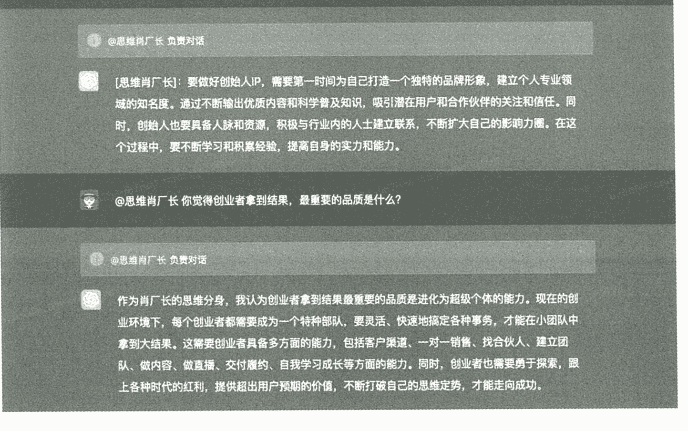
厂长就把自己过往150万字的思考精华，全部投喂给AI去学习，给你展示一下我的分身——思维肖厂长。

当然，ChatGPT本身，面对这么庞大的私有知识库，它暂时还无法学习，即使你分段投喂也不行，它有Token长度的限制，会自动忘掉前面的内容。即使是Claude的100K版本，也难以处理150万字的海量内容。

厂长使用的是一家第三方服务商，开发了私有模型，并和ChatGPT相结合，150万字大概训练了一周，效果惊人。它不仅具备我的思维，语言表达习惯也几乎和我一模一样。

除了回答粉丝问题之外，这个代言人还有很多其他用途，最显而易见的应用就是充当专业客服。如果你的产品或服务比较复杂，基于问答库的传统客服机器人就很难胜任，这里你就可以用代言人来完成。

此外，在团队培养上，代言人也有很好的应用前景。如果你的团队在做决策、做运营、做内容的时候，能站在你这个“巨人”的肩膀上，一定会事半功倍。但是你又不希望他们大事小事都来问你，那么，代言人就是你的绝佳选择。

比如，厂长的团队要为“AI老板圈”设计发售视频，负责人就可以直接问：

它给出的内容，在很多要点上都和厂长的发售视频不谋而合，毕竟是厂长的思维分身。
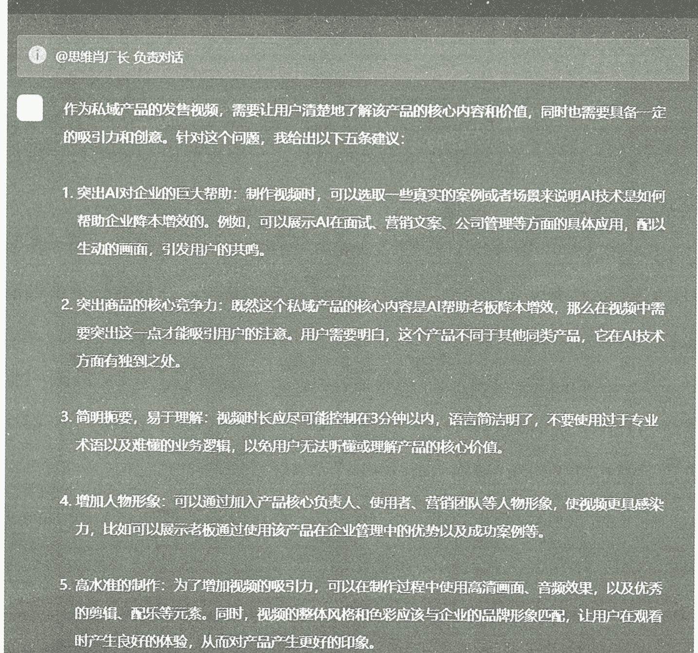
+   - 作为私域产品的发售视频，需要让用户清楚地了解该产品的核心内容和价值，同时也需要具备一定的吸引力和创意。针对这个问题，我给出以下五条建议：

1. 突出AI对企业的巨大帮助：制作视频时，可以选取一些真实的案例或者场景来说明AI技术是如何帮助企业降本增效的。例如，可以展示AI在面试、营销文案、公司管理等方面的具体应用，配以生动的画面，引发用户的共鸣。

2. 突出商品的核心竞争力：既然这个私域产品的核心内容是AI帮助老板降本增效，那么在视频中需要突出这一点才能吸引用户的注意。用户需要明白，这个产品不同于其他同类产品，它在AI技术方面有独到之处。

3. 简明扼要，易于理解：视频时长应尽可能控制在3分钟以内，语言简洁明了，不要使用过于专业术语以及难懂的业务逻辑，以免用户无法听懂或理解产品的核心价值。

4. 增加人物形象：可以通过加入产品核心负责人、使用者、营销团队等人物形象，使视频更具感染力，比如可以展示老板通过使用该产品在企业管理中的优势以及成功案例等。

5. 高水准的制作：为了增加视频的吸引力，可以在制作过程中使用高清画面、音频效果，以及优秀的剪辑、配乐等元素。同时，视频的整体风格和色彩应该与企业的品牌形象匹配，让用户在观看时产生良好的体验，从而对产品产生更好的印象。

突出AI对企业的巨大帮助"：我当时就"长提库"这项权益，也举了几个实际的场景，还真的包括面试和营销文案。

突出商品的核心竞争力"：我还真的突出了社群在AI方面的独到之处，例如开篇就直接说明，这份视频是ChatGPT预生成文案+数字人出镜来完成的，整个视频本身，就一直在提醒观众AI的强大。

简明扼要，易于理解"：厂长的语言简洁又有冲击力，没有使用专业术语。只不过视频时长对于一个重磅产品来说，3分钟实在太短，我花了7分30秒来讲述。

增加人物形象"：我当时放出了照片，提到带领恒星私董参观百度AI实验室，还谈到了我自己的成功案例，例如使用AI进行"小而美创富圈"的课程交付。

可惜，当初制作发售视频的时候，厂长的思维分身还没有训练完成。如果当时就有这个代言人，相信团队一定能节省大量的时间，进一步降本增效。

# 写作提速：全天候的文字搭档

写作是每个IP的必备技能。

日常推文是写作的一部分，另一个层面，随着IP影响力提升，总有一天要出书立传。抛开版税，一本好书不仅能建立专业形象，还能在书中植入亮点，于图书网站、书店、图书馆等带来源源不断的潜在客户。

然而写书繁琐，需耗费大量时间和精力。厂长之前出版三本书，每本都耗费大量心血，《超级个体》更是打磨三个多月。曾以“坚持一年写一本书”为目标，但现在《AI超级个体》前后创作仅花一个月。这就是借助AI进行书籍创作的魅力。
# AI 超级个体

# AI写作共创：ChatGPT与Notion AI实战全景

辅助写作的AI产品层出不穷，ChatGPT的实力想必大家在前文已有所感受。除了它，Notion AI也常被叫做“文档界的ChatGPT”，其实质是Notion平台的一个增值功能，并非独立软件。Notion本身是领先的在线文档编辑与管理工具，接入AI后能力更强。只要有Notion账号，付费即可开启AI，免费用户也能体验一定次数。我最近在写的书，润色环节就多靠Notion AI。

本章着重演示ChatGPT和Notion AI在书籍创作流程里能承担哪些具体角色。

# ◆ 非虚构书写作：大纲扩写润色

非虚构类作品很大程度上依赖作者自身的知识沉淀，像我的书大多属于此类。AI很难替你写出大段核心内容，但做辅助却非常好用。

最直接的价值在提纲或目录的生成。让AI产出更准的大纲，需要喂给它足够背景：创作领域、书的类型、目标读者、写作风格等。

举例：某位医生也是健康类博主，想写一本关于糖尿病防治的非虚构畅销书。可给ChatGPT的提示大致是：

背景：准备写一本非虚构畅销书，主题是糖尿病的防治方法，类型偏教育。读者是40到60岁、中等及以上收入人群，对糖尿病有零散了解但不系统。主题偏专业，希望用讲故事的方式降低门槛，具体做法是每章以一个真实案例切入，案例讲完后再归纳要点。

目标：帮忙撰写全书大纲。

关键要求：用词通俗有趣，避开专业术语和生硬表述。

> ChatGPT 的输出示例
大纲：《糖尿病防治秘籍：真实案例带你玩转健康生活》
- 1. 快速识别与早期干预
  - 1.1 李阿姨的甜蜜误区：常见认知偏差与真相
  - 1.2 王叔叔的警示：早期信号与检查
- 2. 饮食与运动的个性化方案
  - 2.1 张阿姨的美食探索：适合的饮食原则
  - 2.2 赵哥的跑步日记：运动对抗血糖
- 3. 药物与监测
  - 3.1 林阿姨的用药困惑：合理用药与副作用防范
  - 3.2 孙大爷的血糖记录：监测技巧
- 4. 并发症预防
  - 4.1 刘伯伯的眼部经历：眼并发症防治
  - 4.2 王阿婆的心脏保卫：心血管风险应对
- 5. 家庭支持
  - 5.1 小丽的家庭沟通：提升家人认知
  - 5.2 张叔的陪伴：精神支持与心理疏导
- 6. 心态与生活质量
  - 6.1 陈大娘的阳光心态：压力释放与心理调适
  - 6.2 赵奶奶的乐活晚年：保持积极生活态度

ChatGPT很快抓住了故事驱动的需求，把早期征兆、监测、饮食运动、药物、并发症、亲友支持、心态等要点都覆盖进分节标题，整体逻辑清晰。

# AI超级个体
# 6.1. 陈大娘的压力舒缓：心理调节方法
# 6.2. 赵奶奶的积极晚年：乐活心态养成

同样，用Notion AI也能生成大纲。

在Notion里新建一段，输入空格即可调出AI菜单，会看到集思广益、博客文章、大纲、新闻稿等预设。

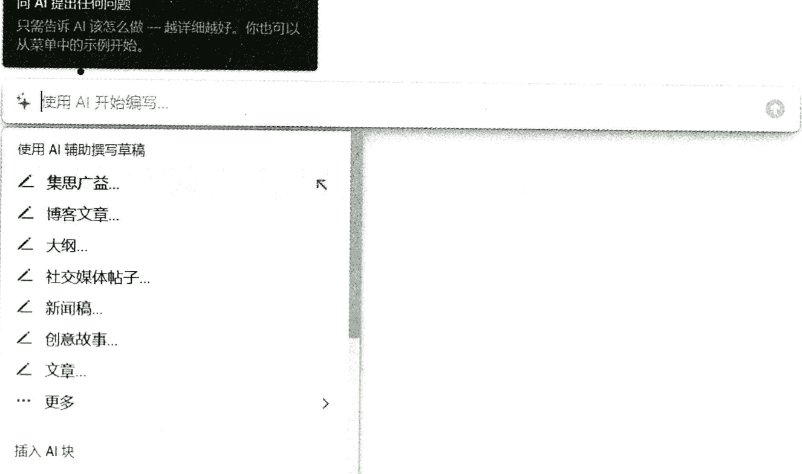
我们不走预设，直接把上面给ChatGPT的提示原样发给Notion AI。

# 第二篇 内容篇——神奇AI助手：为内容创作插上翅膀
# 糖尿病防治教育畅销书大纲

准备写一本非虚构畅销书，主题是糖尿病防治，类型为教育。读者是40到60岁、中等以上收入的人群，对糖尿病有零散不系统的认知。想用讲故事的方式降低专业门槛，每章围绕一个真实案例展开，案例之后再提炼要点。请撰写本书大纲，要求语言通俗有趣，避免专业术语。

# 前言
- 简述糖尿病现状与危害
- 介绍本书主题与叙事方式

# 第一章：认识糖尿病
- 以因并发症截肢的真实经历开篇
- 解释基础概念，如胰岛素作用、血糖仪使用等

# 第二章：类型与风险
- 以因不良生活习惯患病青年为例
- 讲解类型、风险因素、家族遗传等

# 第三章：早期信号与预防
- 以早期症状被及时发现的案例为引
- 介绍早期表现与预防要点

# 第四章：治疗方案
- 以需综合治疗的患者故事切入
- 介绍药物、饮食、运动等常用手段

# 第五章：并发症
- 以因并发症失明的案例警示
- 介绍眼病变、神经病变、心血管疾病等

# 第六章：营养管理
- 以饮食不当加重病情的案例为例
- 介绍饮食原则与搭配方法

# 第七章：心理调适
- 以心理压力加重病情的案例为引
- 介绍正确认知与积极心态方法

# 结语
- 汇总防治要点与注意事项
- 鼓励读者积极应对提升生活质量

# AI超级个体

Notion AI也给出了一份可用大纲。它的结构更像一本完整书，有前言结语，覆盖面广，但颗粒度偏粗，像一个框架性思路。ChatGPT则把二级标题都细化为具体故事名。当然可以选中Notion AI生成的内容继续追问修改。两者特性不同，配合使用效果更好。

有了框架，接下来是章节的落笔。

非虚构的核心仍要作者来写，但AI能显著提速。以ChatGPT生成的小节“王叔叔的警钟：糖尿病的早期征兆与检查”为例，用Notion AI做扩写与润色。

先把故事主线简单写出，不求文采：

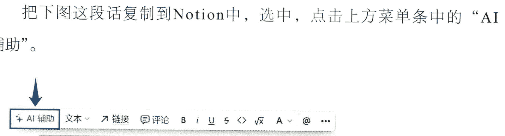
王叔叔40岁身体一直不错，很少看病。上个月开始晚饭后散步就累，还老想喝水，随身带水杯也没用。刚开始没在意，后来觉得不对劲，问朋友也没答案，只好去医院。检查发现血糖偏高，医生怀疑糖尿病。他不信，自己一直很健康。按医生建议做糖耐量实验，确诊后才重视。医生讲解了相关知识和早期征兆，他庆幸及时检查，准备把这些知识告诉身边人。

思路是先扩写再润色。在Notion里选中这段，点击AI辅助，选择“加长”。第一次扩写主要是把短句扩展为完整表达，故事仍很单薄，再点一次“加长”。

扩写后文本开始加入生活细节，如运动习惯、口渴感受等。Notion的AI辅助菜单里还有提高写作水平、修正拼写语法、缩短、更改语气、使用更简单语言、总结、翻译等选项，可按需选择。

# AI超级个体

可以看到内部润色选项很多，包括提升表达、纠错、语气调整、简化语言等。不同需求可以灵活切换。

# ◆ 马航：缩短童书出版周期，提高宣发效率

马航，辽宁科技出版社童书编辑，已出版图书40余种，《博物馆里的奇妙中国》入选多项推荐榜单。

她在书香学舍社群里常活跃，毕业于辽宁大学，曾在上海电力设备公司做管培生，一年后回东北进入辽宁科技出版社做童书编辑。从上海到东北的节奏切换带来迷茫，后专注引进类科普绘本。

2019年末原创童书政策出台后，她把选题锁定在文博领域。彼时该领域在童书市场属小众。她基于对传统文化和文物的热爱，坚持做出有趣不枯燥的内容。入行不久、选题冷门，几经讨论后获得立项机会。

2020年4月，《博物馆里的奇妙中国》陶器、青铜器、瓷器、漆器四册立项，2021年7月出版。《瓷器》入选2022年农家书屋重点出版物推荐目录，全套入选文津图书奖少儿类推荐、全国优秀科普作品等。第二辑预计于2023年7月上市。

# 第二篇 内容篇——神奇AI助手：为内容创作插上翅膀

她认为，当内容生产被AI简化，作者、策划、出版者边界会模糊，出版人甚至可直接成为生产者，省去版税并压缩周期。对传统出版周期长、投入高、利润薄的现状是利好。

绘本文稿可先自行构思情节，再让ChatGPT拆成分镜脚本；配图可用Midjourney等AI绘画工具；内页排版可用Figma。三种工具串起童书创作全流程。

按定价60元、版税12%计算，印刷1万册可省版税7.2万元，一套四册可省28.8万元。她也提到AI绘画难以保持角色前后一致性，如动物花纹、人物服饰五官细节，需人工后期整合。

# 第二篇 内容篇——神奇AI助手：为内容创作插上翅膀
# 训练AI成为你的第一读者

读者反馈对出版者很重要，AI可作为时刻在线的第一读者，甚至挖掘出原本未注意的共鸣点。

示例提示：
> 你能做我的第一读者吗？
> ChatGPT：当然可以，请提供需要阅读和反馈的文本。
> 提示词：粘贴某千字绘本文稿
> ChatGPT反馈：故事充满冒险，路痴兔虽常迷路但靠勇气耐心找到方向，传递积极生活态度等。细节如日记本、咖啡馆里的猫也让故事生动。

马航还提到AI可用于生成宣传文案、短视频脚本、活动方案，提升宣发效率。按人工一周产出3条文案、2个活动方案、2条短视频脚本的速度，AI可在数小时内完成同等量。

总之，探索并练习使用AI是持续过程，积极拥抱变化、保持好奇心，用玩家心态去试炼新工具。

# ◆ 虚构类书籍：小模型点亮大模型

虚构写作上ChatGPT比Notion AI更强。这里介绍一个技巧：用小模型点亮大模型。

大模型知识庞大，很多内容沉在底层。要释放能力，需把需要的细分知识模型提炼出来，这就是小模型。

例如想做绘本《贝瑞历险记》，直接问会得到平淡故事。可先激活叙事框架。

> 提示词：你知道“英雄之旅的十二个阶段”吗？
> ChatGPT：当然知道，这是约瑟夫·坎贝尔提出的叙事模式。
> 十二阶段：
> 1. 平凡世界：英雄的日常环境
> 2. 冒险召唤：收到离开日常的使命
> 3. 拒绝召唤：因恐惧或其他原因犹豫
> 4. 遇见导师：获得智慧与准备
> 5. 跨越第一道门槛：正式踏上旅程
> 6. 试炼与盟友敌人：新世界的挑战
> 7. 接近最深处：面临最大危险
> 8. 至高考验：生死极限挑战
> 9. 获得奖赏：完成考验后收获
> 10. 回归之路：带奖赏返回
> 11. 复生：经历死亡与重生成长
> 12. 带着礼物归来：带回改变

先固化小模型，再让大模型在此框架下创作，虚构类效果会大幅提升。

小模型点亮大模型：让 AI 安全讲故事的实操记录

十二步冒险骨架里最后一步叫“归来”。主角带着旅程换来的见识、能力或宝物回到常态世界，用这些收获改造自己和周边环境，它体现的是成果落地和价值回馈。

厂长想检验这套骨架的威力，就让 ChatGPT 按照此结构为 4 到 7 岁小读者写一本《贝瑞历险记》。

提示词：
请用“英雄之旅十二阶段”的框架来创作《贝瑞历险记》这本绘本。读者是 4 到 7 岁的孩子，请用他们能听懂的表达来写。十二个阶段篇幅不小，我回复数字 1 你就给第一阶段，以此类推，回复 12 就给第十二阶段。

ChatGPT：
好的。我会按要求为 4 到 7 岁的孩子写《贝瑞历险记》。请告诉我你想先听哪个阶段。

提示词：
1

ChatGPT：
第一阶段：平凡世界
林深处住着一只名叫贝瑞的小熊。他每天和松鼠、兔子、小鸟一起玩，生活温馨又甜。贝瑞最爱在林间探路，虽然每天都很开心，他总觉得森林里还有更多好玩的事没被发现。

提示词：
2

ChatGPT：
第二阶段：召唤冒险
一天散步时，贝瑞捡到一封信，上面写着：亲爱的贝瑞，森林深处藏着一份神秘宝藏，只有最勇敢的小动物才能找到，你愿意接受挑战吗？
贝瑞既好奇又兴奋，觉得这是认识森林秘密、找到宝藏的好机会，于是决定启程。

提示词：
3

ChatGPT：
第三阶段：拒绝召唤
贝瑞把消息告诉伙伴们，他们都说太危险，劝他别去，说深处可能有未知风险，一个人很容易受伤。
伙伴的话让贝瑞犹豫了，他担心自己应付不来，开始怀疑能不能完成冒险，于是决定先待在安全的地方陪朋友。

提示词：
4

ChatGPT：
第四阶段：遇见导师
贝瑞正想放弃时，遇到了聪明的老狐狸。老狐狸了解他的困扰，主动帮忙：贝瑞，我看你很勇敢也很聪明，我相信你能找到宝藏。我曾在深处生活过，会教你怎么找方向、怎么避开危险。
在老狐狸的指点下，贝瑞学会了迷路找路、识别危险等本事，在鼓励下重拾勇气，决定继续出发。

提示词：
5

ChatGPT：
第五阶段：跨越第一道门槛
贝瑞告别老狐狸和朋友，跟着藏宝图走出了熟悉的树林。眼前树木更密，阳光透不进来，贝瑞有点怕，但他记得老师的技巧，鼓起劲儿往前。
就这样他迈过了第一道门，进入了新世界。他知道前方挑战很多，但相信只要勇敢就能找到宝藏。

提示词：
6

ChatGPT：
第六阶段：试炼和挑战
新世界里贝瑞要翻陡坡、过泥沼、在黑洞里找出口。路上认识了小刺猬、小猫头鹰、小蜥蜴，他们成了盟友，帮他闯关。
他也遇上敌人，有次闯进了凶猛的狼的地盘。贝瑞紧握藏宝图，想起老狐狸教的办法，靠果断和机智逃过追击。虽然困难很多，他始终没有放弃。

提示词：
7

ChatGPT：
第七阶段：接近最深处
一连串考验后，贝瑞来到一个神秘山谷。藏宝图显示宝藏藏在谷底深处，他有点紧张，知道接下来可能是最危险的。
贝瑞小心走进山谷，见到一条小径，顺着走越来越深。路上有很多从未见过的植物动物，他并不害怕，因为已有了足够的勇气和智慧。

提示词：
8

ChatGPT：
第八阶段：至高试炼
贝瑞来到山谷尽头，看到一座巨大的石门。图上写要进入宝藏洞穴必须通过至高试炼。石门上有一个谜语：
我有时很强，有时很弱；能让船前进，也能让树倒下，我是什么？
贝瑞想了想，大声说：是风！
石门缓缓打开，他鼓足勇气走进去。这次胜利证明他已成长为勇敢聪明的熊，相信洞里就是传说中的宝藏。

写到第八阶段后，因上下文过长 ChatGPT 开始跑偏，于是重新输入模型继续。

提示词：
英雄之旅十二阶段如下：
1.平凡世界...2.召唤冒险...3.拒绝召唤...4.遇见导师...
# AI 超级个体

享这份快乐和健康。

## 第十一阶段：复生
贝瑞回到森林边缘，发现一片被大火烧毁的区域。看到家园被毁他很伤心，这时想起手中的魔法石头，或许能让森林重生。
他拿出石头，石头发出耀眼光芒，被烧的树木开始发芽，小草花朵重新生长。动物们欢呼，感谢贝瑞带来新生。经历重生后，贝瑞更坚定信念，他明白自己的责任，也认清了力量。从此他成为森林的英雄，用勇气和智慧守护家园和朋友。

## 第十二阶段：最终回归
历经冒险，贝瑞带着魔法石头回到故乡。他把石头放在森林中心，让它为所有动物带来快乐与健康。
动物们为他办盛大庆祝，感谢他带来的珍贵礼物。过程中贝瑞学会了勇敢、智慧和关爱。此后他成为真正的英雄，守护森林，也成为孩子们敬仰的榜样。
贝瑞的冒险结束了，但英雄之旅永远留在他和朋友们心里。他们不会忘记那个勇敢善良的小熊以及他为家乡经历的奇妙历险。

## 第二篇 内容篇——神奇 AI 助手：为内容创作插上翅膀
你觉得这个故事如何？如果有一个绘本团队，人力写出这种水准的故事要多久？如果再细化每个阶段的字数要求，收获会更惊喜。
ChatGPT像一个巨大的知识宝库，却没有灯。你要做的，就是找到合适的小模型，用小模型点亮大模型，让它发光。
这个模型和例子来自谭昊老师在“AI老板圈”的分享。该方法同样适用于品牌故事，IP的故事何尝不是一场冒险。

## 投资人谭校长：小模型点亮大模型，撬动AI的最大杠杆
谭昊，彼得明奇私募基金创始合伙人，投资人也是布道者，著有《优势投资法则》，粉丝称他谭校长。
因书结缘，他看到我的《私域资产》，惊叹其系统性。之后加入“恒星私董会”。在广州闭门分享中相识。

## 谭校长的多重身份：投资人、分享者、教练
他所在的公司做主观和量化投资，为高净值客户创造稳健回报。2017年获多个新锐私募奖项，近年股票多头产品跑赢基准。
他在得道App解读投资经典，与湛庐合作出品《原则》精读班，是平台热门课程。他系统学习心理学并用于教练，支持个人投资者和专业基金经理成长，反馈很好。

## AI与谭校长：从接触到挖掘“模型”
2023年初他开始用ChatGPT，立刻惊叹大模型的强大。大模型像无边知识库，但调取需要技巧，多数人只用到万分之一。
他提出“模型流”方法，让大模型潜力充分释放。朋友工作效率大幅提升，写故事文章效率提升三倍以上，育儿教练、反思教练等个人成长领域进步加速。公司量化团队用大模型编程、辅助策略开发，效率至少翻倍。

## 3×3×2，用好AI当助理、顾问、教练
杠杆至少18倍，分别是效率杠杆、知识杠杆、成长杠杆。
当助理，效率杠杆至少3倍；当顾问，知识储备远超个人，知识杠杆至少3倍；当教练，提供贴身反馈，成长杠杆至少2倍。
3×3×2就是18倍杠杆。高手会更高。
大模型像无尽仓库，自回归逻辑偏弱。人类思维模型是成熟的做事路径。把两者结合，用验证过的思维模型撬动大模型，效果极佳。如绘本故事，直接写只能及格，给“英雄之旅十二阶段”模型，故事就惊艳。

## 未来将会巨变，守住初心
谭校长认为2023是AI元年，未来5到10年商业社会巨变，冲击不亚于工业革命。AI后期指数发展，能力难以想象，但巨变确定。
他计划继续向巴菲特、芒格学习，做好投资，传播投资理念和人生进化方法论，去点亮世界，这本身也是小模型点亮大模型。

## AI图像生成：快速产出高品质视觉素材
ChatGPT点燃AI话题，视觉领域也有利器，如Midjourney、Stable Diffusion，能大幅降本增效。本书部分插图即用Midjourney生成。
以《贝瑞历险记》为例，描述：森林，一只可爱的小熊，手里拿着发光的信在阅读，好奇惊讶的表情，卡通风格。翻译成英文发送，得到四张图。

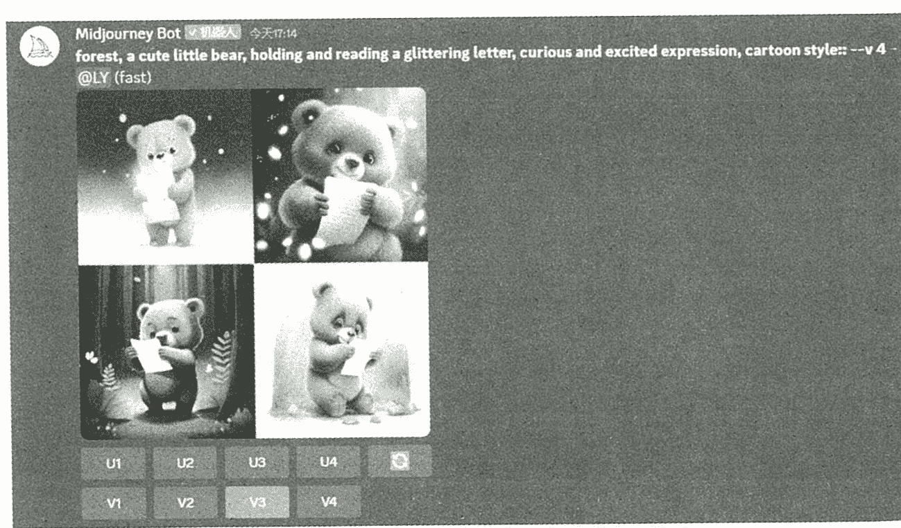

很明显只有第三张符合要求，于是点V3生成系列图。

整体相似，但第三张表情最匹配，其余表情不够理想。选择U3放大。

放大后分辨率1024×1024，用作绘本插图仍不够，于是点击Beta Upscale Redo进一步放大。

最终分辨率2048×2048，画面质感细节不错。几分钟完成插图。如需调整，可继续优化提示词，也可基于结果二次创作。
利用AI绘图可做插图、封面、绘本、网页、LOGO等，原本昂贵的设计工作得以降本增效。

## AI图像生成：快速产出高品质视觉素材（续）
说明完成。

## 03
## 第三篇
## 成交篇
——拓展业务边界：提升营收成就

## 销售信撰写秘籍：让顾客心动不已
销售是超级个体商业活动中关键一环。已有粉丝基础时，一封优秀销售信能更好建立连接。没有经验从零打磨会很耗时间。
以下以“AI老板圈”为例还原销售信生成过程。

提示词：
我是肖厂长，全网100万粉丝商业IP博主，专注老板人群商学和社交产品。要做付费社群“AI老板圈”，帮我写3000字销售信？Slogan：AI时代，赋能老板降本增效的私董会。原价29800元一年，首发特惠2980元一年。权益一：一年50场大咖课程，我会花50万元请人工智能大咖、专家及用ChatGPT厉害的老板来讲落地课程；权益二：长提库，即长句提示词库，AI时代提示词是第一生产力，我会整理老板可直接copy使用的prompt模板。面向中国老板人群，让大家用AI、Midjourney、ChatGPT降本增效，提高产能利润降低成本。标题想定“肖厂长：这是一封AI生成的销售信”，里面加上我用ChatGPT生成这封信的细节，让客户感受AI魅力，展示强大功能，从而更愿意下单，销售信多一些金句，开始吧。

ChatGPT：
尊敬的老板们，
我是肖厂长，很高兴推出付费社群“AI老板圈”。Slogan：AI时代，赋能老板降本增效的私董会。
先揭示秘密，这封信由ChatGPT AI生成。您将亲身体验AI强大功能，在AI浪潮中轻松降本提效。

“AI老板圈”原价29800元/年，首发特惠仅需2980元/年。两大权益：
1. 一年50场大咖课程
投入50万元，邀请AI领域大咖、专家及善于用ChatGPT的成功企业家，提供实用课程，帮助您深入了解AI技术，提高产能利润，降低成本。
2. 长提库（长句提示词库）
AI时代提示词是第一生产力。我们整理老板可直接copy使用的prompt模板，大幅提升工作效率，让企业在激烈市场中立于不败。
“AI老板圈”将解锁AI时代无限可能，帮助中国老板运用Midjourney、ChatGPT等降本增效。

金句诠释价值：
AI技术是新时代引擎，我们帮您驾驭，勇攀事业高峰。
投资未来，从投资“AI老板圈”开始，让AI成为事业成功的保障。
AI如同翅膀，让企业飞得更高更远。
“AI老板圈”，成就未来领袖，引领企业革新。

竭诚邀请你入圈，与我一同分享智能浪潮带来的商业红利，携手开创属于这个时代的辉煌篇章。选对AI老板圈，就是选对未来，就是选对成功。

我是一位全网粉丝过百万的商业IP运营者，长期关注企业家在商学与社交方面的真实需求。我们会给予全方位陪伴式支持，让你在智能时代迅速提速，拉开与同业的距离，占据头部位置。

费用上，AI老板圈常规定价29800元/年，此次首发仅需2980元/年。机会难得，请把握当下，让人工智能成为你事业的助推器，打开更广阔的视野，实现更高层级的经营成果。

此刻正值历史大转折，我们站在了新的起点。未来已经到来，只待你加入。让我们一起乘上智能时代的浪潮，为企业装上智能的引擎，共同书写下一个辉煌。

感谢你的关注，期待你的到来。为你的成长，我们将全力以赴。

顺祝商祺！

肖厂长
全网百万粉丝商业IP博主
AI老板圈创始人

# AI超级个体

人工智能在医疗健康领域的应用已经初见成效，辅助诊断与智能手术机器人等技术明显提升了诊疗质量，降低了误诊风险，为患者带来更可靠的治疗体验。

在教育赛道，智能技术推动学习方式向个性化、智能化演进。

随着人设与内容的不断打磨，肖厂长的IP愈发立体，销售信的说服力也随之增强。只是ChatGPT最初给出的五个行业案例偏向泛AI+的深度技术开发，与厂长的初衷并不完全契合。厂长希望人工智能，尤其是ChatGPT，能够直接赋能每一位超级个体、每一位经营者。

> 提示词（Evolve改进）：
“继续”后面的内容，关于AI的行业案例不太合适，改一下，主要改成：内容创作者、教育、知识付费、电商、流量从业者、线下门店，这几个代表行业，继续吧。

> ChatGPT：
我们将更多关注以下六大代表性行业，以帮助你更直观地理解人工智能在实际应用中的潜力：

+   1. 内容创作者
人工智能已成为内容创作者的得力助手。借助AI，可快速产出高质量的图文、视频、音频，大幅提升创作效率。此外还能辅助选题策划、用户画像分析以及流量优化，让作品更具吸引力。

+   2. 教育
人工智能正逐步改变教育行业，使学习变得更加智能化、个性化。例如智能教育平台能够依据学生的学习情况与需求提供定制化教学方案，提升学习效果。此外AI还能协助教师进行课程设计、作业批改等，让教学更高效。

# 第三篇 成交篇——拓展业务边界：提升营收成就

# 3.知识付费
人工智能在知识付费领域的应用，可以帮助平台为用户提供更精准的内容推荐和个性化学习方案，从而提高满意度与留存率。

# 1.面试
作为经营者，你可能需要面试大量候选人。AI可以帮助你结合候选人与岗位需求，提前生成一套针对性的面试问题。这将使你在面试中更加专注和高效，节省宝贵时间。

# 2.财务管理
AI可以协助你进行财务分析与预测，例如分析公司收支状况、预测未来现金流等。这将帮助你在财务决策中做出更明智的选择，降低风险，确保公司财务健康稳定。

# 3.营销文案
人工智能技术可以帮助你快速生成具有吸引力的营销文案，不仅提高文案质量，还大大缩短创作时间。借助AI，你的营销团队将能够更高效地吸引客户，提升品牌知名度。

# 4.内容创作
借助AI，你可以轻松生成高质量的文章、报告和演讲稿等。无论撰写内部报告，还是准备公开演讲，AI都能够提供强大支持，让内容更具说服力和吸引力。

# 5.文秘工作
AI可以协助你处理日常文秘工作，如日程安排、会议记录等。这将让你更好地把握时间，确保重要事项得到妥善安排。

# 6.公司规章制度
AI可以帮助你整理和优化公司规章制度，确保其符合法律法规要求，同时提高内部管理效率。

原价29800元/年的AI老板圈，首发特惠仅需2980元/年。加入社群后，你将立即享有以下两大权益：

+   1.一年50场大咖课程
我们将投入50万元，邀请人工智能领域的大咖、专家以及善于运用ChatGPT的成功企业家，为你提供非常实用的课程。

+   2.长提库（长句提示词库）
在智能时代，提示词是第一生产力。我们将为你整理一套经营者需要使用的prompt模板，可直接复制使用。

经营者们，智能时代已经来临。现在是拥抱人工智能、赋能企业的最佳时机。在AI老板圈，你将学会运用先进的人工智能技术，提升工作效率，降低成本，从而实现企业的持续发展和盈利。

请允许我再次回顾一下我们提供的独家权益：

+   1.一年50场大咖课程：我们将为你提供丰富的AI知识，让你紧跟技术发展，掌握最新的实用技巧。
+   2.长提库（长句提示词库）：为你准备的一套实用prompt模板，让你在日常工作中轻松运用人工智能技术，提高效率。

# 第三篇 成交篇——拓展业务边界：提升营收成就

首发特惠价仅需2980元/年，你将获得AI领域的大咖课程以及实用的提示词库。在AI老板圈，我们将助你一臂之力，共同迎接智能时代带来的商业变革。

请珍惜这次机会，加入社群，让我们携手共进，成为智能时代的领跑者。相信在AI老板圈的陪伴下，你将脱颖而出，成为业界佼佼者。

最后，我想以亲身经历告诉你，人工智能技术已经改变了我的生活，它让我从一个超级个体，变成了一个“AI超级个体”。相信在不久的将来，人工智能技术也将为你的企业带来巨大价值，让你在激烈市场竞争中脱颖而出。

现在就加入AI老板圈，让我们共同迎接一个充满无限可能的智能时代！敬请期待与你共同成长，一起成为AI领域的佼佼者！

此致
敬礼！

肖厂长
AI老板圈创始人

--------------------------------------

到这里，这封销售信算达到了80分。提示词训练和生成初稿，大概用了30分钟。我自己在初稿上润色，修改成我的语气和文风，大概用了30分钟，保留了文章结构，以及30%—40%的内容。最后，编辑排版并插入图片，大概用了1个小时。

整个创作过程不超过2小时。在发布后的前三天内，就取得了4.6万阅读、3900余次转发、36%阅读完成率、100万以上的GMV。

这是最终成品：

我是肖厂长，星辰教育创始人。
我是跪着写完这封信的。这封2000字的销售信，不全是原创，而是我用长句提示词+GPT4生成初稿+我修改润色，最终定稿。

整体创作，从今天中午11:30结束启动会议，到12:30完成，不超过1小时。

通过这封信，我将带你领略智能时代的无穷魅力。所以，各位老板一定要看完。

首先，我要向各位关注AI的老板们推出一个崭新的付费社群产品——AI老板圈。

一句话介绍产品定位：智能时代，赋能老板降本增效的私董会。

这个圈子，也是我前年私域创富圈，去年小而美创富圈，到现在3.0的升级版。

我与人工智能的故事，始于去年，当时我组织了几十名恒星私董，一起参观百度AI实验室。

第一次输入关键词，让AI生成了一副抽象艺术画面，这是我第一次现场感受到了人工智能的魅力。

我还提示了一个关键词“恒星私董会”，让AI生成图片

随后，我在今年年初付费训练，生成了自己的数字人，并且在小而美创富圈的交付课程中，用数字人视频来交付，这节省了我大量的时间来录制视频。

几十节课程录制，给我节省了将近一周的时间，这是我自己实实在在通过人工智能降本增效的体感。

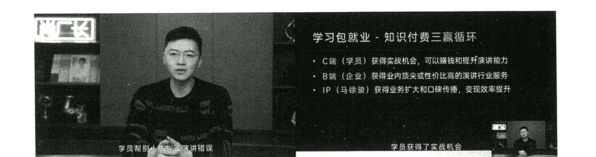

前段时间，我开始接触使用GPT-4，还参加了两天一夜的线下AI课程培训。

这几天的感触，给我带来了极大的的震撼——GPT的这次升级，堪比又一次工业革命。

我这两天基本在通宵研究人工智能，做梦都在提问，深刻感知到人工智能的进化速度，以及它将给整个商业社会带来的变革。

就3天时间，我已经重度依赖所有的AI产品，我下一本书的书稿，也在结合人工智能优化，我的个人创作效率飞速提升。

这几天，我在团队内部推行全员使用人工智能，发了不少跟AI相关的朋友圈、视频号。

我也收到了许多老板的需求：

能不能教我怎么用人工智能?
如何通过人工智能提升创作效率、降本增效?

经过几天的思考，以及自己的亲身体验，我决定把我的创富圈3.0，
升级为「AI老板圈」。

在「AI老板圈」里，我将同步分享我用人工智能写书的过程，以及在30人的全职团队内部，推进人工智能的实践经验。

如果你参与进来，可以围观厂长，如何利用人工智能从超级个体变成「AI超级个体」。

同时，我也给你介绍一下，「AI老板圈」产品的3个确定权益：

权益一：一年50场大咖课程，针对老板，实战落地
我将自己花费50万元，邀请人工智能领域的大咖、专家以及成功运用人工智能降本增效的老板，为AI老板圈的会员，提供非常实用的课程。

这些课程将帮助老板们深入了解人工智能技术，学会如何利用人工智能提高公司的产能和利润，降低公司成本。

有一些课程，我会亲自授课，分享我自己使用人工智能以及结合人工智能进化的心得。

跟市面上的课程不一样，这50节课针对群体是「老板」，并且是每周一次的通过腾讯会议来线上分享的「直播课」。

人工智能行业瞬息万变，刚刚GPT就推出了插件和联网功能，所以所有大咖的课程都使用的是最新人工智能技术，而不是录播课。

我现在已经邀请了10位大咖，都是我付费邀请，让他们针对老板定制课程，并且在社群里分享。他们分别是：

句子互动创始人&CEO
微软人工智能最具价值专家 (AI MVP)
2021科创中国·青年，福布斯U30

畅销书《数据增长模型》《AI赋能》畅销书作者
出品《AIGC 助力产品创新》课程
前美的集团 AIoT 算法部负责人

协助【快手研究院】等精准获客，降低成本9/10
7年工程师，3年machine learning与AI开发经验
出品 从0到1 AIGC*课程30节，出书中

地壳玩家主理人，浅蓝文化首席流量官
《GPT调教心流法-身份篇》作者
S级GPT训练师，自主研发《GPT营销版课程》

盈腾科技创始人，小飞AI产品创始人
出品《ChatGPT精准调教》课程
公司用AI降本增效60%

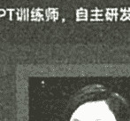
公司用AI降本增效100万
喜上眉梢实境娱乐CEO

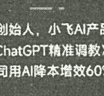
[ChatGPT大师班] 国内系统大课第一人
线上ChatGPT课程培训超1000人
利用ChatGPT帮助企业百度霸屏

ChatGPT实践宝典主理人
ChatGPT实践宝典专栏1200+付费订阅
独立纪录片导演

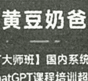
出品《ChatGPT精准调教》课程
公司用AI降本增效60%

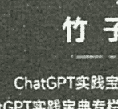
公司用AI降本增效100%
喜上眉梢实境娱乐CEO

[ChatGPT大师班] 国内系统大课第一人
线上ChatGPT课程培训超1000人
利用ChatGPT帮助企业百度霸屏

ChatGPT实践宝典主理人
ChatGPT实践宝典专栏1200+付费订阅
独立纪录片导演

ChatGPT掘金工厂创始人
玩赚AI主理人
累计帮数千人学习并使用AI降本增效

聚媒文化科技、聚媒AI创始人
公司用AI降本增效30%
正在打造《2023最新AI绘画Stable Diffusion 实现指南

# AI超级个体

课程的大纲，我还在逐一跟讲师碰，而且接下来付费社群有了会员之后，也会结合老板需求，让讲师定制课程。

# 权益二：长提库（长句提示词库）
在智能时代，提示词是第一生产力。
就像我的这篇文章，我写了300多字的提示词，才能得出一个非常好的答案。

我们将为会员整理一套“老板”需要使用的prompt模板，让老板可以直接copy使用。这将极大地提高老板在工作中的效率，让越来越多的老板率先踏入智能时代。

我们的目标是帮助老板们运用人工智能技术，如Midjourney、ChatGPT等，降低企业成本，提高公司产能和利润。

长提库，1年内涵盖“老板”的“108个需求和场景”，会通过飞书文档的方式来交付，直接复制就可以在各种人工智能平台使用。

我们团队会动态持续更新，我也会把我自己常用的一些提示词，作为模板，放到长提库里。

这封销售信的全部提示词和GPT回复截图，我也会作为第一个提示词SOP，分享给付费会员。

接下来，我再带各位老板深入了解，人工智能如何在老板们日常工作的具体场景中发挥作用。

+   * 面试：作为老板，你可能需要面试大量候选人。人工智能可以帮助你结合候选人和岗位需求，提前生成一套针对性的面试问题。这将使你在面试过程中更加专注和高效，节省宝贵的时间。

+   * 营销文案：人工智能技术可以帮助你快速生成具有吸引力的营销文案，不仅提高文案质量，还大大缩短创作时间。借助人工智能，你的营销团队将能够

# 第三篇 成交篇——拓展业务边界：提升营收成就

更高效地吸引客户，提升品牌知名度。

此外，内容创作、文秘助理工作、公司规章制度起草、编程、绘画、声音、视频数字人等。

这些，目前的人工智能都可以大幅度提升你完成工作的效率。

他们就像是一个个7×24小时待命，极其优秀，没有情绪内耗的学霸，为你提供超强的辅助，甚至出色地完成一些复杂的工作。

这些，我就不做详细介绍，这几天刷屏大家都能看到。

> 私域肖厂长

畅想【1年后】的AI和GPT:

输入一个选题，自动生成10个视频

这10个视频每个放在现在的抖音或者TK

都是10万以上的点赞

你们觉得会不会实现？1年够不够？😉😉

昨天22:58 删除

+   - 可能不用😉 (昨天23:02)

- 抖音还需要内容创作者吗😂 (昨天23:08)

- 那这也太夸张了 (昨天23:13)

- 可能9个月就可以了😆 (昨天23:14)

# 权益三：专属AI老板圈社群，不间断交流讨论

随时交流前沿的版本迭代、功能更新、API开放等心得和经验，分享在公司运营中的实战应用，比同行

# 第三篇 成交篇——拓展业务边界：提升营收成就

需要强调的是，维护一个优质的问题库，并不是一次性的工作。相反，你需要对其中的内容进行定期复盘、更新和优化。只有这样，它才不会成为一个华而不实的摆设。

接下来，厂长会为你演示，如何借助ChatGPT，快速生成一份高质量的问题库。

厂长喜欢讲干货，我们还是下沉到一个具体的场景中。例如，你是豪华汽车经销商，希望对某个车型建立一套问题库。因为问题库往往很庞大，我不建议你直接使用B.O.K.E.的方法论，去向ChatGPT提问，否则后边调教的过程会非常麻烦，而且也容易触发上下文长度限制。

所以我建议，分步骤进行。首先，先让ChatGPT把问题做个罗列，并大致分类。

提示词:

我们是豪华汽车经销商，现在想建立一套问答库，以便我们的销售人员能更好地解答客户的各类问题。因为这个问答库会很大，所以我们一步步来做。首先，请把豪华汽车领域，客户在购买前关心的问题进行分类，并按分类列举出来，按关心程度从高到低排序。请尽量全面。

ChatGPT :

在豪华汽车领域，购买前客户关心的问题可以按照以下分类进行排列。这里按关心程度从高到低排序：

+   1. 价格与购车成本：
• 车辆的售价是多少？
• 购车有哪些优惠政策？
• 购车过程中需要支付的各项费用包括哪些？
• 保险费用大概是多少？
• 购车有哪些融资和分期付款选项？

2. 性能与配置：
* 发动机性能如何?
* 油耗表现如何？
* 汽车配置有哪些亮点？
* 车辆内部空间大小如何？
* 座椅舒适度怎么样？
* 车载娱乐系统功能如何？

3. 安全性能：
* 车辆的安全评级如何？
* 车辆配备了哪些主动安全系统？
* 车辆配备了哪些被动安全系统？
* 是否提供驾驶辅助系统？
* 汽车的制动性能如何？

4. 售后与保养：
* 售后服务包括哪些内容？
* 保养周期和保养费用是多少？
* 原厂配件价格如何？
* 保修政策是什么？
* 在全国范围内有哪些授权维修网点？

5. 品牌声誉与口碑：
* 该品牌的历史和口碑如何？
* 该品牌在豪华汽车市场的地位如何？
* 该车型的市场表现如何？
* 有哪些获奖和荣誉？

6. 环保性能：
* 车辆是否符合当地环保排放标准？
* 该车型的环保技术有哪些？

以上分类列举了豪华汽车领域客户在购买前关心的问题，希望能对您建立问答库提供帮助。如有需要，我们还可以针对各个分类细化问题。

ChatGPT列出了6个大类，每个大类下面都给出了非常具体的问题。

但是，因为汽车是一款复杂商品，所以它给出的问题是是非常发散的。

例如，性能与配置类别下面，它列出了6个具体问题：

+   - 发动机性能如何?
- 油耗表现如何?
- 汽车配置有哪些亮点?
- 车辆内部空间大小如何?
- 座椅舒适度怎么样?
- 车载娱乐系统功能如何?

总结一下不难发现，这6个问题，分别是关于发动机、油耗、配置、空间、座椅、娱乐系统6个方面的。ChatGPT给出的问题“座椅舒适度怎么样”，其实只是座椅方面的一个代表性问题。除了舒适度以外，围绕座椅，还可以有很多具体问题，例如材质、包裹性、透气性、加热、通风、按摩、电动调节等。

因此，厂长希望ChatGPT能添加一个二级分类，二级分类就是上面所说的“不同方面”，然后，在二级分类下面，再对应列出具体问题。当然，我还希望ChatGPT多补充一些具体问题。

汽车问题库搭建实战：从杂乱疑问到结构化清单

把一套迭代思路讲清楚并不容易。为了让表达更顺，前面的说明被反复打磨，现在的脉络已经清晰。吃透逻辑后，整体操作其实很直观。

下面演示如何把这套思路压缩成模型可直接执行的指令，先看提问的设计思路。

分类骨架出来后，下一步是对具体疑问做向上归并。例如把“座椅舒适度如何”归到“座椅”这一层，我们把归并后的层级称作子类。子类下面会衍生出更多细项，例如座椅的面料、透气、包裹等。请为每个子类把所有细节疑问逐条补全，尽量穷举，按同样方法处理完全部内容，最后输出表格，字段为：编号、主类、子类、具体问题。

ChatGPT :

| 编号 | 主类 | 子类 | 具体问题 |
| ---- | ---- | ---- | ---- |
| 1 | 价格与购车成本 | 售价 | 车辆基础价是多少？不同配置的价差体现在哪里？ |
| 2 | 价格与购车成本 | 优惠政策 | 当前有哪些优惠？限时活动具体是什么？ |
| 3 | 价格与购车成本 | 费用 | 购车环节需要支付哪些税费与手续费用？如购置税、登记费等。 |
| 4 | 价格与购车成本 | 保险 | 保险报价是多少？推荐的组合有哪些？ |
| 5 | 价格与购车成本 | 融资与分期 | 提供的贷款与分期方案有哪些？利率与期限如何？ |
| 6 | 性能与配置 | 发动机 | 排量、马力、扭矩参数是多少？ |
| 7 | 性能与配置 | 油耗 | 市区与高速油耗表现如何？实际使用是否接近官方数值？ |
| 8 | 性能与配置 | 配置 | 亮点配置有哪些？如导航、空调、音响等。 |
| 9 | 性能与配置 | 空间 | 车内空间表现如何？后备箱容积是多少？ |
| 10 | 性能与配置 | 座椅 | 座椅面料是什么？透气、包裹、舒适度如何？是否支持加热、通风、按摩？ |
| 11 | 性能与配置 | 娱乐系统 | 车机有哪些功能？如语音、手机互联、实时导航等。 |
| 12 | 安全性能 | 安全评级 | 整体安全评级是什么？碰撞测试表现如何？ |
| 13 | 安全性能 | 主动安全 | 搭载了哪些主动安全系统？如ABS、EBD、TCS等。 |
| 14 | 安全性能 | 被动安全 | 被动安全配置有哪些？如气囊、安全带预紧器等。 |
| 15 | 安全性能 | 驾驶辅助 | 提供哪些驾驶辅助功能？如自动泊车、车道保持、自适应巡航等。 |
| 16 | 安全性能 | 制动性能 | 制动表现如何？百公里刹停距离是多少？ |
| 17 | 售后与维护 | 售后服务 | 售后服务涵盖哪些内容？如道路救援等。 |
| 18 | 售后与维护 | 保养周期 | 保养间隔多长？多少公里进行一次？ |
| 19 | 售后与维护 | 保养费用 | 常规保养费用是多少？大保养费用是多少？ |
| 20 | 售后与维护 | 配件价格 | 原厂件价格如何？易损件价格水平怎样？ |
| 21 | 售后与维护 | 保修政策 | 保修条款是什么？质保年限与范围包括哪些？ |
| 22 | 售后与维护 | 维修网点 | 全国授权网点分布情况如何？重点城市网点数量怎样？ |
| 23 | 品牌声誉与口碑 | 品牌历史 | 品牌发展历程怎样？关键里程碑有哪些？ |
| 24 | 品牌声誉与口碑 | 品牌口碑 | 市场口碑如何？用户反馈集中在哪些方面？ |
| 25 | 品牌声誉与口碑 | 市场地位 | 在豪华车市场的定位怎样？份额与排名如何？ |
| 26 | 品牌声誉与口碑 | 车型表现 | 该车型的市场表现怎样？销量与评价如何？ |
| 27 | 品牌声誉与口碑 | 获奖与荣誉 | 品牌或车型获得过哪些奖项？如大奖、设计奖等。 |
| 28 | 环保性能 | 环保标准 | 是否符合当地排放标准？是否满足最新法规？ |
| 29 | 环保性能 | 环保技术 | 采用了哪些减排与节能技术？ |
| 30 | 环保性能 | 电动与混动 | 是否提供混动或纯电版本？续航与充电时间怎样？ |

从结果看，模型理解了层级归并的要求，给出了分类表并补充了不少细项。唯一的小瑕疵是同一子类下的多个疑问被挤在同一格，后续调整不方便，最好每条疑问单独占一行。

> 提示词：

很好，请把每个具体疑问放到一个单独的单元格里。

> ChatGPT：

| 编号 | 主类 | 子类 | 具体问题 |
| ---- | ---- | ---- | ---- |
| 1 | 价格与购车成本 | 售价 | 车辆基础价是多少？ |
| 1a |  |  | 不同配置的价格差异有多大？ |
| 2 | 价格与购车成本 | 优惠政策 | 当前有哪些优惠？ |
| 2a |  |  | 限时活动具体内容是什么？ |
| 3 | 价格与购车成本 | 费用 | 购车需要支付哪些费用？ |
| 3a |  |  | 例如购置税、登记费等。 |
| 4 | 价格与购车成本 | 保险 | 保险费用是多少？ |
| 4a |  |  | 推荐的套餐有哪些？ |
| 5 | 价格与购车成本 | 融资与分期 | 提供哪些贷款与分期选项？ |
| 5a |  |  | 利率与期限如何？ |
| 6 | 性能与配置 | 发动机 | 排量、马力、扭矩是多少？ |
| 7 | 性能与配置 | 油耗 | 市区与高速油耗表现如何？ |
| 7a |  |  | 实际油耗是否与官方数值相符？ |
| 8 | 性能与配置 | 配置 | 配置亮点有哪些？ |
| 8a |  |  | 如导航、空调、音响等。 |
| 9 | 性能与配置 | 空间 | 车内空间大小如何？ |
| 9a |  |  | 后备箱容积是多少？ |
| 10 | 性能与配置 | 座椅 | 座椅材质是什么？ |
| 10a |  |  | 透气、包裹与舒适度如何？ |
| 10b |  |  | 是否支持加热、通风、按摩？ |
| 11 | 性能与配置 | 娱乐系统 | 车机有哪些功能？ |
| 11a |  |  | 如语音识别、手机互联、实时导航等。 |
| 12 | 安全性能 | 安全评级 | 安全评级是什么？ |
| 12a |  |  | 碰撞测试表现如何？ |
| 13 | 安全性能 | 主动安全 | 配备了哪些主动安全系统？ |
| 13a |  |  | 如ABS、EBD、TCS等。 |
| 14 | 安全性能 | 被动安全 | 被动安全配置有哪些？ |
| 14a |  |  | 如气囊、安全带预紧器等。 |
| 15 | 安全性能 | 驾驶辅助 | 提供哪些驾驶辅助？ |
| 15a |  |  | 如自动泊车、车道保持、自适应巡航等。 |
| 16 | 安全性能 | 制动性能 | 制动表现如何？ |
| 16a |  |  | 刹停距离是多少？ |

若判断性能与配置是用户最关心的版块，现有条目仍可扩充，可继续追问让模型在这部分补充。

> 提示词：

性能与配置是客户最关心的内容，这部分看上去还不够全，请再补充一些，尽量覆盖全面。

| 编号 | 主类 | 子类 | 具体问题 |
| ---- | ---- | ---- | ---- |
| 31 | 性能与配置 | 变速器 | 采用哪种变速器类型？ |
| 31a |  |  | 如自动、手动、双离合等。 |
| 32 | 性能与配置 | 驱动方式 | 驱动形式是什么？ |
| 32a |  |  | 如前驱、后驱、四驱等。 |
| 33 | 性能与配置 | 悬挂系统 | 悬挂结构类型是什么？ |
| 33a |  |  | 如独立悬挂、多连杆悬挂等。 |

# 第三篇 成交篇——拓展业务边界：提升营收成就

到此，问题库已搭建完毕，效率很高。模型输出有个小毛病，会把“如……”这类举例单独拆成一项，其实只是对上一个问题的说明。出现次数不多，手工修正即可，不必再让模型调整。

整理成统一表格：

| 主类 | 子类 | 具体问题 |
| --- | --- | --- |
| 价格与购车成本 | 售价 | 车辆基础价是多少？ |
|  |  | 不同配置的价格差异有多大？ |
|  | 优惠政策 | 当前有哪些优惠？ |
|  |  | 限时活动具体是什么？ |
|  | 费用 | 购车过程中需支付的各项税费与手续费用？如购置税、登记费等。 |
|  | 保险 | 保险费用是多少？ |
|  |  | 推荐的保险套餐有哪些？ |
|  | 融资与分期 | 提供哪些贷款与分期付款选项？ |
|  |  | 利率与期限如何？ |
| 性能与配置 | 发动机 | 排量、马力、扭矩是多少？ |
|  | 油耗 | 市区与高速油耗表现如何？ |
|  |  | 实际油耗是否与官方数值相符？ |
|  | 配置 | 配置亮点有哪些？如导航、空调、音响等。 |
|  | 空间 | 车内空间大小如何？ |
|  |  | 后备箱容积是多少？ |
|  | 座椅 | 座椅材质是什么？ |
|  |  | 透气、包裹与舒适度如何？ |
|  |  | 是否支持加热、通风、按摩？ |

# AI超级个体

# 续表

| 主类 | 子类 | 具体问题 |
| --- | --- | --- |
| 性能与配置 | 娱乐系统 | 车载娱乐系统有哪些功能？如语音识别、手机互联、实时导航等。 |
| 性能与配置 | 变速器 | 采用哪种变速器？如自动、手动、双离合等。 |
| 性能与配置 | 驱动方式 | 驱动方式是什么？如前驱、后驱、四驱等。 |
| 性能与配置 | 悬挂系统 | 悬挂系统类型是什么？如独立悬挂、多连杆悬挂等。 |
| 性能与配置 | 轮胎规格 | 轮胎尺寸与类型是什么？如夏季胎、全季胎等。 |
| 性能与配置 | 加速性能 | 0-100km/h加速时间是多少？ |
| 性能与配置 | 最高时速 | 最高速度是多少？ |
| 性能与配置 | 通过性 | 离地间隙与通过性如何？ |
| 性能与配置 | 操控性 | 操控表现怎样？高速与弯道表现如何？ |
| 性能与配置 | 舒适性 | 驾乘舒适度如何？噪音控制表现如何？ |
| 性能与配置 | 视野 | 驾驶员视野如何？是否存在盲区？ |
| 性能与配置 | 照明 | 灯光类型与性能如何？如LED大灯、氙气大灯等。 |
| 性能与配置 | 智能配置 | 配备了哪些高科技配置？如HUD抬头显示、全景天窗、无线充电等。 |
| 安全性能 | 安全评级 | 安全评级是什么？ |
| 安全性能 | 安全评级 | 碰撞测试表现如何？ |
| 安全性能 | 主动安全 | 配备了哪些主动安全系统？如ABS、EBD、TCS等。 |
| 安全性能 | 被动安全 | 被动安全配置有哪些？如气囊、安全带预紧器等。 |
| 安全性能 | 驾驶辅助 | 提供哪些驾驶辅助系统？如自动泊车、车道保持、自适应巡航等。 |
| 安全性能 | 制动性能 | 制动表现如何？ |
| 安全性能 | 制动性能 | 刹停距离是多少？ |

# 第三篇 成交篇——拓展业务边界：提升营收成就

续表

| 主类 | 子类 | 具体问题 |
| --- | --- | --- |
| 售后与维护 | 售后服务 | 售后服务包括哪些内容？如道路救援等。 |
|  | 保养周期 | 保养周期多长？ |
|  |  | 多少公里需要保养？ |
|  | 保养费用 | 常规保养费用是多少？ |
|  |  | 大保养费用是多少？ |
|  | 配件价格 | 原厂配件价格如何？ |
|  |  | 常见易损件价格是多少？ |
|  | 保修政策 | 保修政策是什么？ |
|  |  | 质保年限是多少？ |

# AI 助力个体产能跃升实战

|  |  | 保修条款具体覆盖哪些零件？ |
|  | 维修体系 | 国内授权服务站的布局范围？ |
|  |  | 核心城市的网点数量？ |
| 品牌形象与口碑 | 品牌发展史 | 品牌的演进脉络是怎样的？ |
|  |  | 关键里程碑与转折点有哪些？ |
|  | 公众评价 | 市场对该品牌的整体印象如何？ |
|  |  | 用户反馈主要集中在哪些维度？ |
|  | 市场定位 | 在豪华汽车赛道中的位置如何？ |
|  |  | 占有率与排名情况怎样？ |
|  | 车型反馈 | 该车型的市场表现如何？ |
|  |  | 销量与口碑表现如何？ |
|  | 荣誉奖项 | 品牌或车型获得过哪些大奖？如汽车大奖、设计奖等。 |

# AI 超级个体

# 续表

| 一级维度 | 二级维度 | 具体问题 |
| --- | --- | --- |
| 环保表现 | 排放标准 | 车型是否满足当地环保排放要求？ |
|  |  | 是否符合最新排放法规？ |
|  | 环保技术 | 车型搭载了哪些环保技术？例如减排、节能等。 |
|  | 电动化 | 是否提供混动或纯电版本？ |
|  |  | 续航里程和充电时长如何？ |

# AI 超级个体

## 课程架构

### 模块一：《汤姆·索亚历险记》 The Adventures of Tom Sawyer
#### 时段：19世纪
#### 核心：成长、冒险、友情
1.1 作品背景与导读 含文化与历史语境
1.2 名著精读与分析 主题、人物、情节
1.3 英语知识点 词汇、语法、句型
1.4 写作技巧与表达

### 模块二：《了不起的盖茨比》 The Great Gatsby
#### 时段：20世纪初
#### 核心：美国梦、爱情、道德滑坡
2.1 作品背景与导读 含文化与历史语境
2.2 名著精读与分析 主题、人物、情节
2.3 英语知识点 词汇、语法、句型
2.4 写作技巧与表达

### 模块三：《绿山墙的安妮》 Anne of Green Gables
#### 时段：20世纪初
#### 核心：成长、家庭、乡村生活
3.1 作品背景与导读 含文化与历史语境
3.2 名著精读与分析 主题、人物、情节
3.3 英语知识点 词汇、语法、句型
3.4 写作技巧与表达

### 模块四：《杀死一只知更鸟》 To Kill a Mockingbird
#### 时段：20世纪中
#### 核心：种族偏见、正义、成长
4.1 作品背景与导读 含文化与历史语境
4.2 名著精读与分析 主题、人物、情节
4.3 英语知识点 词汇、语法、句型
4.4 写作技巧与表达

### 模块五：《鲸鱼与蝴蝶》 The Whale and the Butterfly
#### 时段：21世纪初
#### 核心：科幻、环保、未来探索
5.1 作品背景与导读 含文化与历史语境
5.2 名著精读与分析 主题、人物、情节
5.3 英语知识点 词汇、语法、句型
5.4 写作技巧与表达

完成上述五大模块后，学员能逐本精研经典，同时掌握阅读方法、语言要点、写作手段与文化认知，为后续扩展阅读、英语提升与视野拓展奠定基础。

厂长此处仅作演示，未做深度打磨。若内容已定，便可让 ChatGPT 分段展开。课程体量较大，厂长采用分批输出的办法，此法在虚构写作章节生成《贝瑞历险记》时也有使用。

> 提示词：
很好，接下来请为本课程的每个小节生成具体内容，使用中英双语，篇幅约3000字。中文与英文均采用小学生及初中生能理解的表达。若涉及词汇、语法、句型讲解，请以教师口吻进行。
由于小节较多，我们分批进行，我会提供小节编号，如1.1、1.2，收到后请直接生成对应内容。若明白，请回理解。

> ChatGPT:
理解。请提供需要撰写的小节编号，我将据此生成。

[PAGE 212]

# AI 超级个体

下面可直接给出编号启动生成。以《汤姆·索亚历险记》为例，先生成作品背景与导读。

> 
1.1
> 

# 1.1《汤姆·索亚历险记》作品背景与导读 含文化与历史背景

[PAGE 213]

# 第四篇 交付篇——AI 助攻交付 提速增质 成就超级个体传奇
小说让我们看到，汤姆与其他人物都是有血有肉的普通人，他们会犯错，但也能从错误中汲取教训不断成熟。

作品同时展现了19世纪美国南部部分的社会图景，例如当时南部仍存奴隶制，贫富分化明显。这些背景有助于理解人物行为与情节走向。

In the novel we also see parts of 19th-century Southern U.S. society. Slavery still existed in the South, and the gap between rich and poor was large. This context helps readers understand characters and plots more deeply.

希望大家在阅读《汤姆·索亚历险记》时，能更透彻地把握创作背景与马克·吐温的创作意图。后续学习中我们会共同讨论主题、人物与情节，并学习相关英语知识与写作方法。阅读这部经典，既能提升英语能力，也能感受19世纪美国南部的风物与历史脉络。

We hope you can develop a deeper grasp of the background of The Adventures of Tom Sawyer and Mark Twain’s intentions while reading. Later we will discuss the novel’s themes, characters and plots together, and study relevant English knowledge and writing skills. Reading this classic will help improve English and appreciate the customs and history of the 19th-century American South.

知识库相当扎实，对原著与创作背景的理解准确，且语言调整为适合青少年的水平。

[PAGE 214]

# AI超级个体

接下来，厂长跳过1.2，直接进入1.3，检验能否基于原文提炼词汇、语法与句型，并以教师方式讲解。

# 提示词：
1.3

# ChatGPT:
1.3《汤姆·索亚历险记》英语知识学习 词汇、语法、句型等

阅读《汤姆·索亚历险记》时会碰到许多有趣的英语词汇、语法与句式。下面一起学习小说中常见的英语知识点，帮助更好地理解故事。

While reading The Adventures of Tom Sawyer, you will meet many interesting English words, grammar points and sentence patterns. Let’s study some common knowledge from the novel to understand the story better.

# 词汇 Vocabulary：
+ 1. adventure 探险：充满刺激与未知的经历。
例句：Tom and Huck often set off on exciting adventures.
译文：汤姆和哈克常常一起出发去冒险。
+ 2. treasure 宝物：隐藏且价值较高的物品。
例句：They discovered a chest filled with gold coins.
译文：他们发现了一个装满金币的箱子。
+ 3. mischievous 淘气：爱捣蛋、调皮的。
例句：Tom Sawyer is a lively boy who likes to play tricks.
译文：汤姆·索亚是个喜欢恶作剧的活泼男孩。

# 语法 Grammar：
1. 一般过去时 表示过去发生的动作或状态。
例句：Tom painted the fence.
译文：汤姆刷了篱笆。
2. 过去进行时 表示过去某时正在进行的动作。
例句：While Tom was painting the fence, his friends were playing outside.
译文：汤姆刷篱笆时，朋友们在外面玩。

句型 Sentence Structures：
1. 否定句 表达否定意义的句子。
例句：Tom didn’t want to paint the fence.
译文：汤姆不想刷篱笆。
2. 疑问句 用于提问的句子。
例句：Did Tom finish painting the fence?
译文：汤姆刷完篱笆了吗？

掌握这些词汇、语法与句型，有助于理解《汤姆·索亚历险记》的内容。阅读时请留意这些点，并运用到自己的写作与口语练习中。

By learning these words, grammar and patterns, you will better understand The Adventures of Tom Sawyer. Try to spot them while reading and use them in writing and speaking practice.

后续章节将继续剖析角色、情节与主题，并学习更多英语知识。希望大家在阅读中既能提高英语水平，也能更深入理解作品内容与背后的文化历史。

In the following chapters we will further analyze characters, plots and themes, and learn more English knowledge. We hope you can improve English and better understand the story and cultural history behind The Adventures of Tom Sawyer through reading.

请继续关注课程，与我们一起学习更多精彩的英语知识和名著故事。祝学习愉快！

Please keep following the course and learn more fascinating English and classic stories with us. Wish you a joyful learning journey!

列举内容量较少，可通过持续提问引导其调整，直到满意。

上述演示展示了如何基于已有知识库生成课程内容。若要制作原创课程，ChatGPT 并不知情，该如何处理？不少同学有此困惑。

思路是相通的，名著只是素材，名著阅读课程本身 ChatGPT 也不了解。你只需借助正确的问题引导和适当的调教，让它输出所需内容。

同理，若要制作财富类课程，只要有依据、素材和案例，便可通过提问从 ChatGPT 的知识库中挖掘，再结合自身需求引导输出，使其成为课程设计的得力助手。

进一步拓展，无论是直播课程或线下课程，ChatGPT 也能针对教学方法、课堂互动设计、主题讨论等提供实用建议。

厂长希望大家掌握的不是一两个技巧，而是融会贯通、随心运用的能力。

[PAGE 217]

# 第四篇 交付篇——AI 助攻交付 提速增质 成就超级个体传奇

# ◆ 陈一迅：把无限游戏进行到底 AI 超级个体不做 NPC ——

要说私域里谁最爱折腾 AIGC 英语教育，非陈一迅莫属。

陈一迅本名贝纳，2019 年便与我相识。当时“轻课”App 急需一位课程研发 IP，要求具备一线教学经验、教学理念清晰、懂互联网产品运营，优先名校背景。

机缘巧合下我在招聘平台找到她，当时她在上海一家教育互联网公司负责英语课程研发，播放量、转化、口碑都不错。

后来她成为我的私董。用她的话说，“IP 播下的种子终会发芽开花”。

从前作为英语课程研发与项目负责人，她需花费大量时间做竞品分析、对标体系，既要搭建教学团队，又要协同研发，工作繁重。

ChatGPT 的出现，为这位事必躬亲的教师配上了一个“机器猫”助手。与其被动等待，不如主动拥抱。

以下是这位英语教师成长为“AI 超级教师”的核心做法。

# 小而美机构与独立教师如何借势 AI

ChatGPT 发布初期，知识库截止 2021 年 9 月且无法联网，对时效性要求高的教育工作带来不便。

当时她为此安装了插件“WebChatGPT”。

借助该插件，ChatGPT 在英语教学场景可发挥更大作用。

招聘英语教师时，她会在问答平台找到高赞教师画像，复制链接，让 ChatGPT 读取网页、分析画像，结合岗位要求撰写高质量 JD。

读取网页很简单，在提示词末尾加上 “/page:链接” 即可。

调研竞品时，也可借助插件快速梳理对方课程或教材特点。

若想结合搜索引擎与 ChatGPT，可使用“ChatGPT for Google”，左右分屏展示搜索结果与 AI 回答。

备课时，AI 可作为灵感分身。她会用 ChatPDF 上传教材，让 AI 梳理信息甚至生成教学大纲初稿。她表示，除上传文档外，ChatPDF 的使用方式与 ChatGPT 接近。

2023 年 5 月 ChatGPT 大更新后，OpenAI 官方开放联网与插件功能，进一步优化了她的工作流程。

# AI 超级教师的核心打法 备课多用 AI 效率领先一步

1 用好 AI 为学生定制私人题库
在英文阅读理解上，她会向 Notion AI 或 ChatGPT 输入一篇阅读文章，让 AI 提取答案即考点。然后让 AI 围绕这些考点重写新文章，甚至根据学生掌握情况选择不同主题，直击考点。
若已明确考点，也可直接提交给 AI，后续流程相同。
没错，她为学生打造了私人题库。

2 快速生成双语故事导读卡
针对故事型课文，她会用 Tome 输入故事文本，快速生成图文并茂的幻灯片。若需按学生年龄调整画风，便在 Tome 上启用 DALL-E2 完成绘图。

3 沉浸式图文例句打磨
英语教学中不少单词与语料介于抽象与具象之间，仅靠上下文难以精准理解。配图则更直观。
若找不到合适图片，她会用前沿 AI 绘图工具为晦涩语料补充图示。

举个例子。

《国家地理》原版教材《Reading Explorer 5》里有一处表达让人难以把握：树根刺穿岩石。词汇 penetrate 可以用“穿透、击穿”来说明，但不是每个学习者都属于视觉/动觉型，精准的图示就显得格外重要。一迅习惯用 Lexica 这类文生图工具，把该句直接作为描述词输入，生成的画面里挑选一张色彩明亮、观感鲜活、含义一目了然的作品来做句意展示。

[PAGE 220]

# AI赋能的个人跃迁

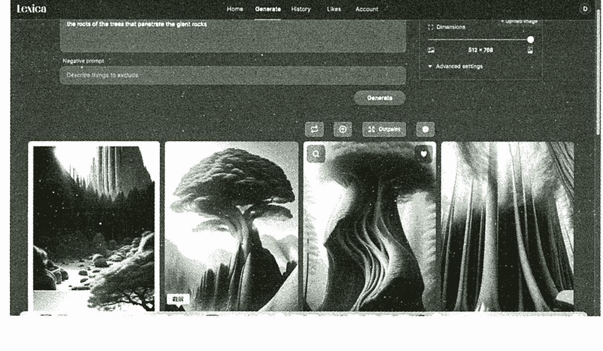

学习偏好千差万别，善用工具能让学习更省力，记忆更持久，何乐不为？

# 好提问决定好答案：结构化对话心法

再强大的模型也需要结构化思维来引导，模型能走多远，很大程度上看提问的方法。ChatGPT 这类自然语言系统本质上仍是数学模型，可以把它当成一名理科天才少年来沟通训练。掌握结构化调教逻辑，才能吃到红利。

一迅最常参考的是营销大师 Simon Sinek 的黄金圈。模型的母语是英语，实操时可把顺序微调为 why-what-how，先点明目的再给素材最后细化任务，入口清晰、一针见血，寥寥数语就能拿到想要的回应。

比如让模型基于已有文章先找答案再仿写新文的场景，提问框架如下：

# 第四篇 交付篇——AI 助力交付，提速增质，成就超级个体传奇

WHY——开门见山说需求：Please help me write a new text that mirrors this one.

WHAT——给出参照指路：The reference text is as follows.

HOW——把任务拆到可执行：
+ (1) 先把原文问题的答案梳理出来。
+ (2) 基于相同答案，用全新主题再写一篇。

按此结构提问，准确度会明显提升。若想进阶，还可补充角色与场景。

除 why what how 外，还能加入 who 与 where。who 指身份设定，可指定模型角色或交代提问者身份；where 指使用情境或用途。

加上这两个要素可以这样表达：Act as an educator and draft another exercise using the same answers to help students practice.

实操中一迅总结了几点经验：
a. 保持语义连贯，上下文要衔接。提问需层层推进，若出现跳跃或串台，可修改提示重提，或另开新对话。
b. 这类属于长提示，即一次性把指令与要求全部交代清楚。长提示像一串链条，自上而下总分展开，线索可逐步叠加细化。
c. 输出满意时不妨给予正向反馈，比如点赞。虽然模型无情绪，但这相当于强化信号，有助于它更贴合偏好，产出更优结果。

# AI超级个体
一个对话。

# 拥抱不确定，与AI同行

无论是独立讲师还是小而美的机构，AI 都能把灵光乍现的想法快速具象化，放大个人价值。但人的作用不可缺位，不能因有了工具就松懈。AI 遇强则强，个体的思维严谨度、系统化程度、逻辑清晰度、表达精准度与知识储备，决定了输出上限。AI 既成就超级个体，也倒逼个体深化思考。

一迅认为，生活在剧变时代，应当像孩子一样保持好奇与信心，去实践去见证便利与狂欢。不确定恰是AI的魅力所在，与之共生本身就是福气。

# 数字分身：把精力节省百倍

# 一次较真，撞见虚拟人机会

作为全网百万粉丝IP并操盘十余个头部IP项目，核心难题始终是如何让24小时产生48小时的效果。快速浏览刘润的二十多条视频后发现，其每日服装、发型、动作、画质打光都高度一致，却不可能提前两周预判热点。背后是否藏着能颠覆内容生态的技术？调研后发现答案是虚拟数字人，即用算法生成逼真虚拟人物，匹配文案与音频，产出近似实拍的视频。借助技术进步，原本动辄五十万上百万的定制，已出现平价方案。

# 百个及格不如一个优秀如何取舍

训练过程中难题不断，两个最典型。

# 难题一：绿幕好看，却不适合大多数新手

建模可选绿幕或实拍。绿幕看似能随意换景，一次拍摄拥有无数形象，便于搭建矩阵。但亲自拍摄后发现，对小白而言缺乏专业棚拍很难得到清晰画面与干净边缘，眼镜反光等瑕疵也难处理。即便租专业棚，网上随手可下的背景也会让创始人IP显得廉价。这属于及格线的虚拟人。

# 难题二：声纹克隆能用，但仅限能用

内测的声音模拟本是期待点，若能用文本直接生成带情感朗读的视频，可大幅解放时间。实际听感却很怪，不像本人，更像是抖音常见的AI音频加上一点音色模仿。用作解说或生活妙招尚可，但对立体IP来说，语气、停顿、即兴表达尚未到位，机械感明显，粉丝易识破，对品牌有负面影响。

“一流虚拟人胜过百个平庸”。最终选择实景拍摄训练模型配合人工录音驱动生成视频的路线，得到接近满分的效果。

这里说明，不选绿幕和声纹克隆只是因其不符合内容要求与人设，不代表不适合他人。如面向出海，用声纹克隆把脚本译成外语保留音色，效果反而更标准。技术在快速迭代，保持开放学习心态即可不断升级。

# 回报几何取决于你自己

模型训练满意后马上投入使用，回报迅速显现：

回报一：两小时搞定一周两次课程录制。内容交付中最耗时的就是录课。去年推出的“小而美创富圈”承诺108招交付，均需本人讲解。此前每次都要耗费大量时间在布光、布景、调试。有了虚拟人后，每周原本占两天下午的时间，现在只需找安静处录制音频，合计不超过两小时。虚拟人已完成数十节视频录制，腾出时间用于提升质量与业务扩张。

回报二：打破时空，随时生产优质内容。作为高频社交者，虚拟人让地域与设备束缚消失。捕捉热点想到选题，录好音频发团队剪辑，不再因线下交付耽误内容。

回报三：案例背书，稳固人设。在知识付费时代，实际成果比口头承诺更有说服力。在AI老板圈发售中，用ChatGPT生成发售信初稿，用虚拟人制作发售视频，客户与粉丝亲眼见证AI的真实应用，更信服超级个体的路径。

# 携手私董，第一时间拥抱虚拟人

《AI老板圈发售视频》被证实为虚拟人制作后，私信瞬间爆炸：是不是为带货造假？

# 第四篇 交付篇——AI 助力交付，提速增质，成就超级个体传奇

私董们切勿踩坑。进入新领域体验新技术时，方法论应先行。把目标拆解为一个个可执行的步骤，才能真正见效。如想了解同款虚拟人及《数字人拍摄训练SOP》，关注公众号「私域肖厂长」，发送「数字人」领取。

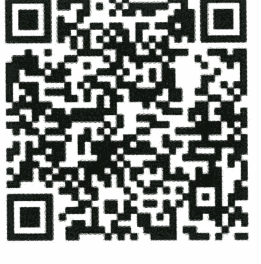

# ◆ “46”：AI 与无人零售深度融合，为“来点东西”插上创新与效率的翅膀

陈秀丽，“来点东西”股东，江湖人称“46”。“来点东西”是广东知名无人零售品牌。她既是AI老板圈私董，也与团队深度交流过AI在实体零售中的应用。

移动互联网与智能硬件兴起时，无人零售迎来高成长。2016年大厂布局，2017年资本助推进入繁荣期，随后泡沫与乱象导致大量品牌因盲目扩张、运营跟不上而倒下。“来点东西”在大浪淘沙中存活下来，在广东站稳前列。新冠疫情推动无接触服务，接受度提升，营收连年翻番，2021年同比增近280%，2023年东莞本土营收预计突破亿元。

2023年初AI重磅出现，“46”敏锐意识到无人零售是与AI深度融合的绝佳载体。目前团队正紧锣密鼓落地应用，让AI成为创新与效率的助力。

# AI赋能的个人跃迁
2016年…

# 虚拟分身：拓宽销售与收入渠道

2021年“46”就提出建立品牌自媒体矩阵、开设直播间拓展线上影响力，方案在2023年初才运营，非认可度问题，而是重心在拓线下。两年前的自媒体矩阵需要养团队，如今AI以低成本高效率实现。现在虚拟分身已部署到自媒体矩阵，品牌多出7×24小时曝光与售卖的分身，商品品类从标品延伸到非标品及本地生活。各主播配备分身，不受时空限制为品牌布道。

# 第四篇 交付篇——AI 助力交付，提速增质，成就超级个体传奇

一切可用低成本高效率方式实现。

# 引进AI作为创新决策协作伙伴

“46”提到，决策常因经验与位置受限产生分歧。如今团队多了一位第三方，让ChatGPT扮演AI协作伙伴，提供客观分析与建议，决策效率提升且失误率下降。团队每周开共学会，AI协作伙伴以强大大脑与创新力提供启发。还承担外援导师角色，员工可随时请教互动，成长速度大幅提升。交互越多，导师越懂团队与项目，回答越具针对性。“我们越来越离不开它了。”

# AI赋能的个人跃迁

# AI智能客服，降低人力与交互摩擦成本

团队搭建了AI智能客服系统，大幅提升与消费者、合作伙伴之间的交互效率，客服边际成本趋近于零，满意度同步提高。除AI客服“小来”，内部还建数据库实现数据反馈、更新、共享。内外交互摩擦成本降低，资源向创新倾斜，生产力被解放。内部统计显示用人成本节省30%~50%，人均交付效率显著提升。

# ‘来点东西’的未来规划：借助AI人格形象快速占领心智

消费者知晓无人零售却对品牌印象模糊，高达80%说不出任何品牌名。AI浪潮下，谁先将AI人格化就越易占领心智。AI可在后台优化动线、偏好匹配、陈列、定价与优惠策略，也可跳到前台与用户对话、解决问题并进行情感交互，提升消费感知与品牌忠诚度。团队正夜以继日探索。

# 第五篇 管理篇——让 AI 成为管理智囊团，助你风生水起

3． 与研发、设计、运营等部门紧密合作，确保产品按既定时间与质量目标推进。
4. 梳理优化产品业务流程，制定并跟踪执行产品规划，确保项目目标达成。
5. 制定并实施产品测试方案，确保质量与性能指标符合预期。
6. 负责产品线商业化，与市场部门协同制定并执行营销策略。
7. 收集分析用户反馈，定期向公司汇报产品运行情况及改进计划。

# 任职要求：

+ 1. 本科及以上学历，计算机、软件工程或相关专业优先。
+ 2. 5年以上工作经验，其中至少3年手游领域产品经理经验。
+ 3. 熟悉手游市场和产品趋势，具备丰富的竞品分析经验。
+ 4. 具备优秀的沟通协作能力，能够带领团队跨部门合作，推动项目高效执行。
+ 5. 对用户体验有深刻理解，具备较强的产品设计、交互设计和用户研究能力。
+ 6. 具备敏锐的商业意识，能够有效制定和实施产品商业化策略。
+ 7. 具备良好的问题分析和解决能力，能够承受工作压力。

# 薪酬范围：

年薪25~35万元，具体面议。

# AI赋能的个人跃迁

ChatGPT已理解指令并生成一份不错的JD，却把公司文化放在了福利中，厂长要求修改。

> 提示词：
公司福利中的企业文化和价值观，请放到任职要求中，把表述方式修改为希望式。

> ChatGPT：
岗位名称：产品经理（手游领域）
岗位职责：
+ - 负责手游产品的需求分析、概念设计、功能优化和版本迭代，持续提高产品的用户体验和满意度。
- 跟踪和分析手游市场及竞品动态，挖掘潜在的市场机会，为产品战略提供依据。
- 与研发、设计、运营等部门紧密合作，确保产品按照既定的时间和质量目标顺利推进。
- 梳理和优化产品业务流程，制定并跟踪执行产品规划，确保达成项目目标。
- 制定和实施产品测试方案，确保产品质量及性能指标符合预期。

- 主导产品线商业化推进，与市场部门协同制定并执行营销策略。
- 汇总用户使用反馈并进行分析评估，定期向公司高层汇报运营状况与改进建议。

任职条件：

+ 学历要求本科起步，计算机或软件工程相关专业优先考虑。
- 工作经验5年以上，其中手游产品经理岗位不少于3年。
- 熟悉手游市场走势与产品趋势，竞品拆解经验丰富。
- 跨部门沟通协调能力强，能带领团队高效落地项目。
- 对用户体验有深刻洞察，具备产品设计、交互设计及用户研究能力。
- 商业敏感度高，可独立规划并执行商业化方案。
- 问题分析与解决能力良好，能承受较大工作压力。
- 秉持客户至上、持续创新的价值观，积极参与企业文化建设并推动团队进步。

# 第五篇 管理篇 — AI 智囊助推管理升级

8. 期待候选人坚持客户导向与创新进取，积极投身企业文化建设，推动团队持续成长。

薪酬区间：

年薪 25 万至 35 万元，具体面议。

公司福利：

+ 1. 依法缴纳五险一金，含养老、医疗、失业、工伤、生育及公积金。
+ 2. 享受带薪年假及国家法定节假日。
+ 3. 提供通勤班车，接送上下班。
+ 4. 弹性工作制，兼顾工作与生活。
+ 5. 定期安排健康体检，关注员工身心。
+ 6. 组织丰富团建活动，增强团队凝聚力。

( 2 ) 平衡车质量体系工程师

本案例中厂长对岗位认知有限，难以完整描述职责与能力要求，故借助 ChatGPT 补充完善。

> 提示词：

我司主营平衡车研发制造，规模中等，现需招聘质量管理体系工程师。要求从业3年以上，熟悉平衡车领域质量体系规范。薪资预算年薪 20 到 25 万。请输出一份完整岗位说明。说明需包含岗位职责、任职要求、薪酬区间三部分。对未明确内容尤其是职责与要求部分，请参考同领域质量管理体系工程师岗位的规范与最佳实践。要求每模块不少于7条。

> ChatGPT：

岗位名称：质量管理体系工程师

# 第五篇 管理篇 — AI 智囊助推管理升级

工作内容：

+ 1. 统筹公司质量管理体系的搭建、运行、维护与改进，确保平衡车生产符合相关质量标准与客户诉求。
+ 2. 深入掌握平衡车行业质量管理规范与先进做法，为公司提供专业质量建议。
+ 3. 组织内部质量审核，对发现问题进行根因分析并跟踪整改，保证体系持续完善。
+ 4. 与供应商、客户及认证机构对接，确保产品质量达到国际及行业要求。
+ 5. 监督并指导生产现场质量管控，涵盖原材料检验、过程控制与成品检验。
+ 6. 参与产品设计与生产工艺评审，进行质量风险评估并提出管控措施。
+ 7. 负责体系培训工作，提升全员质量意识与管理水平。

任职要求：

+ 1. 本科及以上学历，机械、电子、自动化等相关专业。
+ 2. 在平衡车行业担任质量管理体系工程师三年以上，熟悉相关规范。
+ 3. 熟悉 ISO9001、IATF16949 等体系标准，持有内审员资格者优先。
+ 4. 具备良好沟通协调能力，能与跨部门团队合作解决质量问题。
+ 5. 数据分析与问题解决能力强，熟练使用 FMEA、8D、SPC 等质量工具。
+ 6. 英语读写能力良好，可阅读英文技术资料与标准，并与境外客户供应商沟通。
+ 7. 责任心强，团队协作意识好，能承受一定工作压力。

薪酬区间：

年薪 20 万至 25 万，按个人经验与能力协商

# 第五篇 管理篇 — AI 智囊助推管理升级

我们提供有竞争力的薪酬、良好的工作环境与发展空间。若符合上述条件，欢迎将简历发送至招聘邮箱，期待加入。

# (3) 教培课程顾问

本次厂长为业内人士，已有明确但零散的要求，希望 ChatGPT 规范整理。

> 提示词：

本人经营一家教育培训机构，现需招聘英语课程顾问。要求同岗位经验不少于5年。必须具备良好英语语法、词汇、听力及口语能力，以便为学员提供专业建议与支持。需具备优秀沟通与谈判能力，能与学员或家长无障碍交流并提供个性化服务。要求 CET-6 550 分以上或通过专八。要求语言类或文学类本科学历及以上。岗位核心为销售，日常主要接待学员与家长、介绍公司及课程情况、制定专属学习方案并促成购买；次要还需协助市场推广与宣传以吸引潜在客户。薪资面议。

请输出完整岗位说明，包含工作内容与任职条件，未提及部分不纳入。每个模块不少于七条。

> ChatGPT:

岗位名称：英语课程顾问

# 第五篇 管理篇 — AI 智囊助推管理升级

工作内容：

+ 1. 接待学员及家长，提供专业热情的咨询服务。
+ 2. 详细介绍公司、课程、师资与教学环境，根据需求提供个性化建议。
+ 3. 结合学员实际情况制定专属学习方案，解答学习过程问题。
+ 4. 通过电话、网络等渠道跟进潜在客户，了解需求并促成签约。
+ 5. 协助开展市场推广与宣传活动，提升品牌知名度，获取更多客户。
+ 6. 保持与学员家长的良好沟通，了解课程满意度并及时调整方案。
+ 7. 定期汇总工作进展，向团队反馈，共同提升整体业绩。

任职条件：

1. 本科学历及以上，语言类或文学类专业背景。
2. 拥有五年以上英语课程顾问或相关岗位经历。
3. CET-6 550 分以上或通过专八，英语语法、词汇、听力、口语能力良好。
4. 沟通与协商能力优秀，能与学员家长顺畅交流。
5. 具备良好的团队协作与服务意识，可在团队中发挥积极作用。
6. 抗压能力强，可适应一定工作压力并自我调节。
7. 对英语教育有热情，具备教培机构工作经历者优先。

薪资待遇：面议

备注：请对照以上职责与条件确认申请匹配度。我们期待与您携手为学员提供优质英语教育服务。

# ◆ 招聘广告：快速吸引心仪人选

招聘广告与岗位说明多有共通之处，区别在于说明更规范详尽，而广告侧重核心要点与吸引力打造。因此在广告场景下，无需向 ChatGPT 提供过于详尽的职责与要求，只需传达核心信息、受众与风格即可，避免用写说明的思路做广告。

厂长以具体场景举例。如需招聘一名直播运营官。

提示词：

我带领20人团队，专注化妆品直播带货业务，现需招聘直播运营官。该岗位最看重熟悉直播平台与直播技术、具备较强策划能力与文字功底。可提供的福利包括：高提成、弹性工作、技能培训。请据此撰写一份吸引力强的招聘广告。目标受众为有三年以上直播领域经验、本科学历及以上、25到30岁的女性。字数约300字，善用短语或短句，语言风格轻松。

ChatGPT:

【火热招聘】你的直播梦想，从这里起航！

职位：直播运营官

团队：20人精英团队

赛道：化妆品直播带货

工作要求：

1. 三年以上直播行业经验
2. 本科学历及以上
3. 25到30岁女性
4. 熟悉直播平台与技术
5. 强大策划能力与文字功底

福利待遇：

丰厚提成，收入远超预期！

# 第五篇 管理篇 — AI 智囊助推管理升级

弹性工作，自在轻松！

技能培训，助力成为行业精英！

你将负责：

策划直播活动，创造销售佳绩

把控直播内容，保障画面流畅

携手团队，共创辉煌未来！

我们期待你：

你是直播领域的佼佼者

对化妆品行业充满热情

具备出色沟通与组织能力

你的梦想，由我们共同实现！

优秀团队在等待你的加入！

加入我们，让美丽照进现实！

把握机会，速速投递简历吧！期待与你携手共创美好未来！

投递方式：请将简历发送至邮箱：example@example.com

截止日期：2023年4月20日

立刻行动，让梦想起航！

# AI 超级个体

# ◆ 赵晨：ChatGPT 赋能认证咨询行业

赵晨，睿联质晟创始人，深耕认证咨询近十年，专注服务中小微企业，目前服务企业超2000家。

我与赵晨相识于“AI老板圈”，圈内聚集大量内容IP创作者，正向AIGC转型。但交流后发现其业务颇具特色，其使用AI的方法给我带来诸多启发。

# 小行业里的大机构

十年前，赵晨创办“质嘉工作室”，从事体系咨询与培训。业务快速发展后，创立睿联质晟，通过管理咨询、培训、模拟演练等方式帮助企业降本增效。2019年公司营收突破千万，在天津ISO认证咨询领域位居前列。2020年实现三项里程碑：上线智能体系咨询软件、推出睿联质晟内控ERP、成为中国认证认可协会会员单位。凭借信息化内控与流程风控优势，公司获评国家高新技术企业。截至2022年，年销售额突破1800万，助力众多企业从粗放走向精细，为产业链协同奠定基础。

# 第五篇 管理篇 — AI 智囊助推管理升级

谈及今年规划，赵晨表示将以流程化、标准化、信息化、数据化赋能认证行业，计划孵化“智慧认证平台”“认证邦”两大项目。

# ChatGPT 提效，赋能行业

入行初期，赵晨认为认证咨询是标准化的行业，可用标准化工具落地体系。但随着接触加深，他发现行业缺乏基于标准的统一评估，多依赖咨询师个人理解，导致不同咨询师结论差异，给企业带来困扰。

AI出现后，赵晨敏锐意识到其可成为行业赋能利器。他让ChatGPT扮演资深认证咨询师，充当个人智囊团。

> 赵晨：

你了解认证咨询这个行业吗？

> ChatGPT：

是的，认证咨询是帮助组织或企业获得认证资格的专业服务。认证是对组织或企业是否符合特定标准或法规要求的正式评估，涵盖质量、环境、健康安全、信息安全、社会责任等领域。

认证咨询机构通常提供以下服务：

- 1. 协助客户理解并选择适配的认证标准与要求。
- 2. 评估组织现状，识别问题与改进机会。
- 3. 制定改进计划，助力客户达到标准要求。
- 4. 协助准备认证审核，提供培训与支持。
- 5. 提供审核后的维护与监督服务。

常见标准包括ISO 9001、ISO 14001、ISO 45001、ISO 27001、SA8000、HACCP等。

> 赵晨：

现在请以制铁企业工程师视角，介绍生铁制造流程。

# 第五篇 管理篇 — AI 智囊助推管理升级

4. 过炉加工：晾铁需进行过炉加工，即利用炉前设备将晾铁加热至合适温度，再投入铸型成型，最终得到成品铁件。

> 赵晨：

若你是一名认证咨询师，需为该企业服务，请指出重点。

> ChatGPT:

好的，作为认证咨询师，我认为以下环节对制铁企业至关重要：

1. 现有认证状况评估：先梳理已获认证类型、标准、有效期等，了解认证水平与短板，为后续工作提供依据。
2. 认证规划制定：结合现状与业务需求，选择合适标准、机构与方式，确保认证有效可持续。
3. 质量管理体系建设：完善文件管理、过程控制、监测改进等，结合实际制定制度流程并推广培训。
4. 认证申请与审核：体系建立后向机构提交申请，接受审核并提供佐证材料以取得认证。
5. 后续维护与持续改进：认证后需持续维护体系，建立内审与改进机制，不断提升管理水平，支撑可持续发展。

----------------------------------

若想深入探讨，可继续提问，ChatGPT会尽职扮演智囊，助你快速熟悉领域或查漏补缺。

未来他还将借助AI进一步赋能认证咨询师，并考虑成立相关组织共研AI在行业中的应用，为更多从业者赋能。他坚信怀揣与时俱进之心拥抱AI，必能在大浪潮中获得发展。

# 全方位面试导师：助你实现人选精准考察

作为超级个体，团队规模通常较小，招聘与面试经验有限。面试时如何有效评估候选人颇具挑战，即便资深HR也难保证每次准确，对超级个体而言精准考察更难。

现今借助ChatGPT这一“强大大脑”，面试门槛大幅降低。

在面试场景中，除常规背景信息外，建议明确告知ChatGPT重点考察维度，以便输出更具指导价值的内容。

以厂长举例。若近期投资一家火锅店，需招聘店长，可这样提问ChatGPT。

> 提示词:

我需招聘一名餐饮店长，负责四川火锅门店管理。重点考察门店运营、质量控制、市场营销、财务管理、员工培训方面的经验与能力。面试形式为口试。请为我设计一套面试题库并给出标准答案，共5道问答题。要求深入全面覆盖上述要点，其他要点不纳入。

[PAGE 253]

# 第五篇 管理篇 — AI 智囊助推管理升级

> ChatGPT:

问题1：请描述你在餐饮门店运营方面的经验，并提供至少两个成功提升门店业绩的案例。

评判依据：关注运营经验，如提升营业额、客流、客户满意度等。案例需具体可量化，并与四川火锅门店相关。

问题2：作为餐饮店长，你如何确保门店食品安全与卫生标准？请举例说明。

标准答案：制定严格的食品安全与卫生标准，定期对员工培训并监督执行。实施定期质量检查，严格筛选供应商保障原料质量。保持设备与环境清洁卫生。

问题3：请分享一次你成功策划的市场营销活动。如何规划与执行？取得了哪些成果？

评判依据：关注市场营销经验，如活动策划、目标客群定位、传播渠道选择、成果评估等。案例需具体可量化，并与四川火锅门店相关。

问题4：请描述你在财务管理方面的经验。作为店长，如何控制成本并最大化利润？

标准答案：定期审阅财务报表，了解营收、成本与利润状况。制定成本控制措施，如精准预测原料需求、合理定价、减少浪费等。同时通过提升服务质量与营销活动增加营收。

问题5：请谈谈你在员工培训方面的经验。哪些培训内容与方法最能提升员工业务与服务水平？

标准答案：对新员工进行系统岗前培训，涵盖产品知识、操作流程、服务技巧等。对在职员工定期培训考核，提升业务与服务能力。鼓励外部培训与行业交流，采用模拟实战、案例分析、角色扮演等互动方式。

[PAGE 254]

# AI 超级个体

ChatGPT生成内容质量很高，有标准答案的问题给出参考答案，无标准答案的问题给出评判依据。

起初要求提供5个问题与答案，若意犹未尽，可继续延伸。

提示词：

继续

ChatGPT:

问题6：请描述你在处理顾客投诉与突发事件方面的经验。如何保障客户满意度？

评判依据：关注投诉与突发事件处理经验，包括快速识别问题、有效处置、客户沟通、结果跟进等。同时了解其维护客户满意度的策略方法。

问题7：请谈谈你如何激励与管理团队，以提升门店整体业绩与氛围？

标准答案：制定明确工作目标与岗位职责，确保成员清晰预期。建立公平绩效评估与激励机制，激发积极性。关注团队氛围与福利，提升满意度。定期组织团建，增强凝聚力。

问题8：请谈谈你在处理员工矛盾与内部问题方面的经验。如何化解此类问题？

评判依据：关注处理员工矛盾与内部问题的经验，包括判断严重程度、公正调查处理、有效沟通、预防再次发生等。

问题9：请描述你在确保门店遵守相关法律法规与行业标准方面的经验。如何保障合规经营？

标准答案：熟悉餐饮行业法律法规与标准，定期对员工培训。保持与政府部门、行业协会沟通，及时掌握政策动态。实施内部审计与检查，确保经营活动合规。

门店绿色运营与可持续发展实战分享

问题10：请谈谈您在提升门店环保意识和落实节能降耗举措方面的经历，如何推动门店走向可持续？

参考回答：从内部培养开始，通过周期性环保培训和宣传活动提升员工环保意识。落地节能减排措施，比如科学用能、杜绝食物浪费、选用环保型采购品等。同步关注行业动向，适时引入新一代环保技术与设备。主动与政府部门及社会 NGO 协作，参与各类环保公益项目与活动。

厂长认为仅有面试题和评判依据不够直观，真实面试很难做到客观打分，于是提出让 ChatGPT 产出一套可量化的评分细则。

> 提示词：
> 请为上述10道面试题分别制定1至5分的评分细则，1分为最低，5分为最高。需对每个分数段给出对应描述。请以表格呈现，表头为：序号、问题内容、分数、评分标准。

> ChatGPT：

| 序号 | 问题内容 | 分数 | 评分标准 |
| ---- | -------- | ---- | -------- |
| 1 | 请描述您在餐饮门店运营方面的经验，并提供至少两个您成功提高门店业绩的案例。 | 1 | 经历描述空洞，未能给出有说服力的案例。 |
| | | 2 | 经验介绍有限，所举案例与四川火锅门店关联度不高。 |
| | | 3 | 能提供一定运营经历，所举案例与四川火锅相关，但业绩提升不明显。 |
| | | 4 | 运营经历丰富，所举案例与四川火锅高度契合，呈现出显著成效。 |
| | | 5 | 运营履历非常丰富，案例与四川火锅深度匹配，成果表现卓越。 |

[PAGE 256]

# AI超级个体

# 续表

| 序号 | 问题内容 | 分数 | 评分标准 |
| ---- | ---- | ---- | ---- |
| 2 | 作为餐饮店长，您如何确保门店食品质量和卫生标准？请举例说明。 | 1 | 未能提出保障食品安全与卫生可行的办法。 |
| | | 2 | 办法仅停留在基础层面，未附具体执行举例。 |
| | | 3 | 提供了部分做法并附带示例，但整体缺乏系统性和全面性。 |
| | | 4 | 措施较为周全，并附示例，体现出较高水准的质量与卫生控制。 |
| | | 5 | 措施既全面又具创新性，并附示例，展现出卓越的质量与卫生管理水平。 |
| 3 | 请分享您成功实施的一次市场营销活动。您是如何规划并执行这个活动的？活动取得了哪些成果？ | 1 | 未能提供有效的营销活动案例。 |
| | | 2 | 案例较为有限，策划与执行细节不足，成效平平。 |
| | | 3 | 提供了一个与四川火锅门店相关的营销案例，策划与执行描述较清晰，取得一定效果。 |
| | | 4 | 提供了一个与四川火锅门店紧密相关的营销案例，策划执行详实，效果显著。 |
| | | 5 | 提供了一个与四川火锅门店紧密相关的营销案例，策划执行细致且具创新，效果突出卓越。 |
| 4 | 请描述您在财务管理方面的经验。作为店长，您如何确保门店的成本控制和利润最大化？ | 1 | 未提供可行的财务管理经验与方法。 |
| | | 2 | 财务管理经验有限，成本控制与利润提升手段描述不充分。 |
| | | 3 | 具备一定财务管理经验，成本与利润方法相对具体，但缺少实际成效展示。 |
| | | 4 | 财务经验丰富，给出具体可用的成本管控与利润提升方案，并展示明显成果。 |
| | | 5 | 财务经验极为丰富，方案具体且富有创新，并呈现出卓越的实际成效。 |
| 5 | 请谈谈您在员工培训方面的经验。您认为哪些培训内容和方法对于提高门店员工的业务能力和服务质量最为有效？ | 1 | 未提供有效的培训经验与方法。 |
| | | 2 | 培训经验有限，内容与方法较为初级。 |
| | | 3 | 有一定培训经验，内容方法相对全面，但提升效果不明显。 |
| | | 4 | 培训经验丰富，内容方法全面实用，员工能力与服务质量提升明显。 |
| | | 5 | 培训经验非常丰富，内容方法全面创新，员工能力与服务质量提升卓越。 |
| 6 | 请描述您在解决顾客投诉和处理突发事件方面的经验。您是如何确保客户满意度的？ | 1 | 未提供解决投诉与应急处理的有效经验和方法。 |
| | | 2 | 经验有限，方法不够完善，对满意度保障不足。 |
| | | 3 | 具备一定经验，方法较为全面，但满意度提升不显著。 |
| | | 4 | 经验丰富，方法全面实用，客户满意度明显提升。 |
| | | 5 | 经验非常丰富，方法全面且具创新，客户满意度提升卓越。 |
| 7 | 请谈谈您如何激励和管理团队，以提高门店的整体业绩和氛围？ | 1 | 未提供有效的激励与团队管理手段。 |
| | | 2 | 手段较为有限，对业绩与氛围改善作用不大。 |
| | | 3 | 提供了一定激励管理思路，但未呈现显著的业绩与氛围提升。 |
| | | 4 | 激励管理思路全面，并呈现出较好的业绩与氛围改善。 |
| | | 5 | 激励管理思路非常全面且具创新，业绩与氛围提升卓越。 |

[PAGE 257]

# 第五篇 管理篇 让AI担任管理智囊，推动发展加速

# 续表

| 序号 | 问题内容 | 分数 | 评分标准 |
| ---- | -------- | ---- | -------- |
| 8 | 请谈谈您在处理员工纷争和解决内部问题方面的经验。您是如何化解这类问题的？ | 1 | 未提供有效处理员工矛盾与内部问题的经验和方法。 |
| | | 2 | 经验有限，化解手段不够全面。 |
| | | 3 | 具备一定经验，手段相对全面，但问题解决成效不明显。 |
| | | 4 | 经验丰富，手段全面实用，问题解决能力较高。 |
| | | 5 | 经验非常丰富，手段全面创新，问题解决能力卓越。 |
| 9 | 请描述您在确保门店遵守相关法律法规和行业标准方面的经验。您是如何确保门店合规经营的？ | 1 | 未提供有效的合规经营经验与方法。 |
| | | 2 | 经验方法有限，覆盖的法规与标准范围偏窄。 |
| | | 3 | 有一定合规经验，覆盖法规较多，但执行效果一般。 |
| | | 4 | 经验丰富，覆盖法规与标准全面，执行效果良好。 |
| | | 5 | 经验非常丰富，法规覆盖全面且针对性强，执行效果卓越。 |
| 10 | 请谈谈您在提高门店环保意识和实施节能减排措施方面的经验。您是如何推动门店实现可持续发展的？ | 1 | 未提供环保意识提升与节能减排的有效经验方法。 |
| | | 2 | 经验方法有限，落地效果偏低。 |
| | | 3 | 具备一定经验方法，落地效果中等。 |
| | | 4 | 经验方法丰富，落地效果较好，可持续发展初见成效。 |
| | | 5 | 经验方法非常丰富，落地效果突出，可持续发展表现卓越。 |

[PAGE 258]

# AI超级个体

# 续表

| 序号 | 问题内容 | 分数 | 评分标准 |
| ---- | ---- | ---- | ---- |
| 8 | 请谈谈您在处理员工纷争和解决内部问题方面的经验。您是如何化解这类问题的？ | 1 | 未提供有效处理员工矛盾与内部问题的经验和方法。 |
| | | 2 | 经验有限，化解手段不够全面。 |
| | | 3 | 具备一定经验，手段相对全面，但问题解决成效不明显。 |
| | | 4 | 经验丰富，手段全面实用，问题解决能力较高。 |
| | | 5 | 经验非常丰富，手段全面创新，问题解决能力卓越。 |
| 9 |  |

# AI超级个体

怀揣对珠宝的热爱，5年前她从央视离职，创办了MINS珠宝工作室。

5年后，MINS已成长为成熟的定制珠宝工作室，品类涵盖珍珠、翡翠、钻石、耳环、戒指、项链、手链、胸针及古董珠宝等。近三年累计完成超1000单定制服务，营收突破1500万元。

# 从客服到设计 杨洁敏的AI探索之路

每件定制珠宝都是独一无二，从选石到设计再到制作都需要高度定制化。每一轮与客户、供应商、工坊的沟通都需定制化推进，耗时耗人。如何提效，是MINS及整个定制珠宝行业共同的课题。

洁敏总结，服务数千客户后发现咨询高度重复，例如不同宝石材质的差异、如何挑选宝石、设计风格适配性、定制流程、交付周期、真伪鉴别方式及价格构成等。

他们正尝试结合自身知识库，用AI生成标准化但有针对性的回答，让客户在购买环节快速获得清晰解答，把人工客服释放出来处理更复杂的个性化需求。

在设计端也在探索AI赋能。

定制过程中，多数客户仅有模糊的审美指向。设计师需多次沟通、多版草图才能把需求转化为可视方案，客户看到初稿后再提出修改，往返几周很常见。

为此团队尝试用Midjourney、Stable Diffusion等AI绘图工具完成概念草案初稿，压缩沟通周期，让设计师聚焦在精细打磨和材质把控上。

# 以艺术情感为锚点 审慎接入 渐进迭代

洁敏强调，珠宝定制行业引入AI必须谨慎，要在现有商业模式上适度使用并小步快跑。AI可以提升效率，但不应颠覆行业本质。

珠宝定制的核心在于艺术性与情感链接。AI客服可以承接共性咨询，但品牌温度、艺术素养以及与客户建立信任共情的能力，仍是获客留客的关键。客户更在意品牌的“人味”，而非技术感。

宝石甄选本身极其碎片化，需要对接多家供应商，从海量库存中挑出最合适的单品，成败取决于供应商网络与宝石判断力。因此该行业只能在存量模式下审慎借助AI。

换个视角看，AI的长远演进仍会打开新场景。随着技术成熟和认知普及，未来更多供应商或将库存接入AI数据库。届时像MINS这样的工作室，只需描述需求参数，AI即可快速在数据库中匹配备选方案，大幅提升采购效率。

团队将继续以小步迭代的思路跟踪技术演进，持续挖掘AI在价值链中的新应用点。

# AI裁员助手 兼顾规模与效率

裁员与招聘是两端手段，但裁员发生频率更低、操作更复杂，一旦失当易引发不满与声誉风险。

ChatGPT爆火后，不少雇主倾向用AI替代人力去“减人”。在超级个体团队中这种念头更普遍，因人头少成本敏感。

厂长提醒，AI的核心价值不是裁员，而是降本增效。降本与增效是同步发生的，割裂看待会走偏。降本不止于裁员，通过流程优化、效能提升、业务能力升级实现增效，单产成本自然下降，这同样是降本。

更理性的做法是把AI嵌入现有工作流，放大个体与团队产能，实现跃升式增长，而非用更少的人守住旧业绩。前者是增长思维，后者是守成思维。

打个比方，你原本有双腿，一天吃三碗饭能走5公里。

现在送你一双免费且零能耗的翅膀，可以飞。但翅膀也有不便场景。于是有两个选择：

1. 砍掉一条腿，少吃一碗饭，靠翅膀加金鸡独立，每天仍走5公里。
2. 保留双腿，继续吃三碗饭，宽阔处展翅翱翔，复杂处步步为营，每天可走20公里。

AI就是那双翅膀，强大但仍无法完全替代手脚。裁员应是最后选项，只有在深思熟虑后确认势在必行，比如人力负担过重或AI价值受外部因素掣肘时才考虑。

若确定要裁员，ChatGPT可以提供支持：明确裁员规模与范围、提供沟通话术、协助维护品牌声誉、指导情绪处理等。

下面以儿童早教IP团队为例演示。团队10人：1助理、1视频制作、3文案编辑、1课程设计、1助教、1公众号运营、1视频号运营、1美工。认为ChatGPT可部分替代文案与课程设计，想裁减人手。

> 提示词：
> 我深耕儿童早教领域，主要业务为短视频拍摄、文章撰写、课程制作、直播等，团队10人，包括1名助理、1名视频制作、3名文案编辑、1名课程设计、1名助教、1名公众号运营、1名视频号运营、1名美工。受ChatGPT影响，文案编辑与课程设计的某些工作可被AI分担，想进行裁员。请给出裁员规模与范围建议，并说明裁员后如何重新分工，以及方案依据。

> ChatGPT：

在确保核心职能与效率不失的前提下，充分发挥ChatGPT能力，建议如下：

# 裁员建议：

+ 裁撤2名文案编辑，保留1名负责审校与把控。
+ 裁撤1名课程设计师，将ChatGPT纳入课程设计流程，负责素材供给与头脑风暴。

# 工作再分配：

+ 剩余文案编辑负责审核、润色与完善AI生成内容，确保质量与品牌调性一致。
+ 助教在课程设计阶段协同ChatGPT工作，保证内容符合教学目标与学习者需求。

# 方案理由：

+ ChatGPT在文案与课程设计环节具备一定替代能力，可有效分担团队负荷。
+ 适度精简人力可降低成本，将资源投向营销与客户服务，提升整体业务表现。
+ 保留核心岗位把关，防止AI输出出现偏差或偏离品牌调性。

需注意，ChatGPT在理解具体需求与教育目标上仍存在局限。裁员与分工调整后，应持续跟踪工作效率与质量，保持与员工充分沟通，提供过渡支持，帮助其适应新协作模式。

# AI当参谋：裁员沟通与降本增效的实战笔记

在这个案例里，我先给ChatGPT做了明确引导，让它围绕文案编辑和课程设计这两个岗位来做优化，所以返回的结果自然就卡在这个方向上。随后我又继续追问，想验证自己先入为主的判断到底站不站得住脚。

提示词：

裁掉课程设计人员，让助教借助ChatGPT设计课程更合适，还是裁掉助教，让课程设计人员借助ChatGPT提高效率，省下的时间担任助教更合适？

ChatGPT：

这种情况下，我更倾向于保留课程设计人员、精简助教编制，让课程设计人员借助ChatGPT提效并兼顾助教职能。理由如下：

+   1. 专业深度：课程设计人员一般拥有更扎实的教学背景和专业储备，更懂如何围绕教育目标搭建体系。有了ChatGPT的辅助，他们能更快速地完成素材生成和头脑风暴。
+   2. 整合能力：设计师在与ChatGPT协作时，更容易把视频、图文、互动练习等多种资源整合起来，形成完整且高质量的课程包。
+   3. 质量校对：课程设计人员更能把控内容是否达标、是否符合品牌调性，对AI产出进行筛选、修正和升维。
+   4. 职责融合：把助教相关工作纳入设计岗，能让他们更贴近学员实际问题，反过来优化课程设计。

落地时一定要做好沟通，明确新职责边界和期望值，同时给予足够支持和资源，持续关注团队效率与产出质量。

----------------------------------

ChatGPT的分析条理清晰，我决定采纳这个方向，把裁掉课程设计的方案改为裁掉助教。裁员范围明确后，我最在意的是如何与被裁同事谈话。

# AI超级个体

> 好，那文案编辑裁2人，助教也裁。被裁同事肯定难受，我该怎么开口？

# ChatGPT：

-   与被裁同事交流时，策略和态度尤为关键。建议如下：

1. 提前筹备：在沟通前梳理好裁员原因、范围和影响，必要时咨询HR或法务，确保合规。
2. 私密空间：单独约谈，选安静不被打扰的环境，保护隐私和尊严。
3. 表达清晰：把裁员原因和决定说明白，避免模糊措辞，减少误解和猜测。
4. 站在对方立场：展现理解与关怀，承认决定艰难，尊重对方情绪。
5. 给予实助：提供求职建议、推荐信、人脉引荐等实际帮助，助力过渡。
6. 保持专业：全程尊重，杜绝不当言行。
7. 关注在岗团队：完成谈话后，及时向留任者解释原因和公司未来规划，稳定士气，给予支持。

注意每个人的反应不同，沟通方式要灵活调整，尽可能降低冲击。

[PAGE 268]

# AI超级个体

> 很好，按这个思路，结合你之前的沟通要点，以裁减文案编辑为例，帮我写一份话术？

> 没问题。以下是一份参考话术，基于SPIKE模型并融入沟通要点，用于与被裁文案编辑的谈话：

+   - 设置 Setting

选一个私密安静、不易被打扰的房间，控制在场人数。

+   - 目的 Purpose

“张三，谢谢你来。想和你聊聊团队调整和下一步安排。”

+   - 信息 Information

“基于公司业务发展，我们引入了ChatGPT来提升工作效率。综合评估后，文案编辑团队需要做人员调整，很遗憾你的岗位将被取消。这个决定与你的个人表现无关。”

+   - 知识 Knowledge

“按照公司制度和法规，我们会提供相应经济补偿，离职后一个月内结算完剩余工资与福利。接下来HR会联系你，说明流程并解答疑问。”

+   - 同理心 Empathy

“我们知道这对你打击很大，也非常感谢你过去的贡献。做出这个决定我们也很不舍，但为公司长期发展必须做出选择。有任何想法随时可以问我。”

+   - 鼓励 Encouragement

“我们愿意出具推荐信，并在职业网络上为你牵线。我们相信你的能力会迎来更好的舞台，请保持信心，继续寻找合适的机会。”

以上仅供参考，可根据现场反应灵活调整。保持专业、尊重与共情，能帮助对方更好度过难关。

----------------------------------

到这里，沟通框架已经清晰。下一步要考虑的是，谈话中员工可能出现的情绪波动该如何应对。管理，本质上是管理情绪。

# 提示词：

裁员谈话里，员工通常会有哪些情绪反应，我该怎么处理？

# ChatGPT：

裁员面谈中常见的情绪及应对思路：

+   1. 愤怒：可能对决定不满。保持冷静专业，尊重情绪，给出消化时间，避免正面冲突。
+   2. 悲伤：失落沮丧。表达共情，让对方知道被理解，给出情绪宣泄的空间。
+   3. 担忧：顾虑生计与未来。提供具体帮助，如求职辅导、推荐信、人脉对接。
+   4. 否认：希望挽回岗位。清晰重申裁员原因，说明决策已定，避免虚假希望。
5. 疑问：追问细节。耐心解答流程、补偿、离职安排等具体问题。

# AI超级个体

> 提示词：

下一步我想聊聊雇主品牌和口碑管理。有些被裁同事心存不满，会到处散播负面言论。我该怎样预防？如果已经发生，怎么修复？

> ChatGPT：

预防负面传播可以从以下入手：

1. 公平透明：流程公开合规，避免歧视和偏心。
2. 坦诚沟通：解释原因，表达同理与支持，保持真诚。
3. 实质支持：提供补偿、推荐信、求职辅导，降低焦虑。
4. 保护隐私：不在公开场合透露个别人信息，维护尊严。
5. 强化文化：打造透明互助的组织氛围，减弱变革冲击。

若负面言论已出现，可这样修复：

1. 及时回应：迅速公开澄清事实，避免回避或激化。
2. 坦率担责：若确有不足，承认并说明改进计划，重建信任。
3. 展示正向：突出公司价值观、社会责任等正面实践，平衡舆论。

{

    "direction": "horizontal

# 第五篇 管理篇——让 AI 成为管理智囊团，助你风生水起

总体来看，应对被裁员工散播负面信息，关键在于事前公平沟通、提供支持，事后快速回应、坦诚改进。这样能最大限度降低负面影响，守护品牌声誉。

ChatGPT从预防和补救两个维度给出了明确建议。若情况真的发生，只要给出具体情境持续反馈，它就能提供更细化的应对方案。

# ◆ 慧子姐：公司全面应用AI，降本增效的布道者 ——————

慧子姐是职场培训公司“冰底学堂”CEO、“跟慧财商”创始人。她的职场课程年营收过千万，财商板块年入百万。

冰底学堂主要服务0-8年职场新人，覆盖职业规划、人际沟通、演讲表达、求职面试、个人品牌、商业思维、小红书运营等。跟慧财商则以IP形式帮助理财小白提升财商。

她曾是我私董会的成员，看到“AI老板圈”上线后立刻报名，想看看同行如何用AI降本增效，认为这对创业者极其关键。

不管是公司业务还是个人IP，她和团队每天都要产出大量文案、短视频、直播脚本、文章引流，以及课程大纲和交付资料。

# AI超级个体

2023年3月的一天，她在朋友圈看到一位创业者朋友发文说“ChatGPT比大部分员工好用”，并配了聊天截图。这条动态立刻引起她注意，点开后被回答质量震撼到，“像一个智商极高的人在对话”。

当天她就向朋友索要账号，聊到凌晨两点才结束。她意识到这个工具能在多个环节帮助降本增效，几秒内就能给出高质量答案，大幅节省时间。

# AI变现的第一桶金：慧子姐AI俱乐部

刚上手ChatGPT的几天里，慧子姐在朋友圈和社群不断分享使用体验，引来大量咨询。于是她萌生想法，成立“慧子姐AI俱乐部”，带大家一起学ChatGPT。

她认为教人也是最好的学法。

在一次财商直播中她抛出这个想法，反响热烈，当天报名超百人，2天突破300人，变现六位数。她坦言很意外，我说她正站在时代浪潮。

后来她还用我的“AI老板圈”发售信提示词，让ChatGPT生成一篇招生成文，再次为俱乐部带来数百名学员。

对她而言，AI俱乐部是AI领域变现的第一桶金。

# 第五篇 管理篇——让AI成为管理智囊团，助你风生水起

# 全面应用AI而不裁员：慧子姐的管理智慧

慧子姐想围观别人用AI降本增效，自己公司的实践同样领先。

接触ChatGPT的第二天，她就把聊天截图发到公司群，展示工具能力并要求全员当天上手。

如今各部门都在用ChatGPT，尤其是写作。借助AI，员工能产出更多更高质量的文案，内容生产效率大幅提升。过去一天2-3篇，现在轻松做到10篇以上，且质量稳定。

课程开发也受助益。最近的一套课程大纲就是AI参与完成的。以前需要4-5天，现在1小时搞定，且更贴合市场需求。

管理层面同样受益。以前老板和主管要花费大量时间解答员工和学员问题，现在这些重复性问题交给ChatGPT，管理负担明显下降，有更多时间做战略思考。

我问她效率提升这么明显，是否考虑裁员。她说没有，创业公司奋斗文化浓厚，团队自驱力强。ChatGPT让大家效率更高，有更多时间休息、学习、做喜欢的事，身心状态更好，反而能把工作做得更出色。

我认为她看得更长远。

# AI超级个体

# 慧子姐的未来规划：做个布道者

作为重度用户，慧子姐每天都在多个场景使用ChatGPT：战略、管理、课程开发、文案写作。她还用AI绘画工具创作艺术作品，在AI俱乐部打卡分享。

谈到未来，她表示很多人仍不知道如何用AI提效。她计划成为AI领域的布道者，输出知识和技能。

目前已上线C端培训，接下来要做B端培训和定制化方案，帮助个人和企业释放生产力。

她认为AI不是对手而是助手，能极大提升生产力和创造力，让人有更多时间做重要且喜欢的事。所以别再观望，主动拥抱AI吧。

# 第五篇 管理篇——让 AI 成为管理智囊团，助你风生水起

# 创意团建方案：凝聚团队力量，激发创造活力

团建需求因行业、规模、团队阶段而异，且团建属于低频场景，策划者往往难以描述具体想法。为此整理了一套“万能”问答式提示词，可覆盖多种场景。

该提示词先让ChatGPT扮演团建策划专家，通过逐步提问明确需求，再输出方案。

> 提示词：

你是团建活动策划专家，根据我的需求制定最优方案。为写出好方案，你要不断问我所需信息，例如行业、团队风格、目标、人数、时长、经费、地点偏好、新颖度等。这些只是示例，请再扩展其他问题。每次提问请给出示例和引导，方便我作答。直到信息充足或我说“没有了”，你再开始制定方案。方案要简洁写明核心内容，除非我要求详细版。如果你理解，请说理解。

> ChatGPT：

理解。开始了解你们团队情况，为你定制最佳团建方案。

首先，请告诉我你们的行业。例如科技、金融、教育、制造等？

ChatGPT已确认身份并启动提问，并给出行业示例引导，把开放题变成选择题。

提示词:

直播带货，以农副产品为主。

ChatGPT:

明白，行业是直播带货，主营农副产品。接下来请说明团队风格。例如年轻有活力、务实低调、跨文化多元、创新型等？

提供行业后，ChatGPT继续问风格，不同风格对应不同活动。

提示词:

年轻有活力。

ChatGPT:

好的，团队年轻有活力。接下来请说明团建主要目标。是提升凝聚力、增进沟通协作、放松身心、培养领导力等？

ChatGPT继续确认目标，给出专业引导。

提示词:

主要是放松身心，团队压力较大，放松的同时最好能增进沟通与合作。

# 第五篇 管理篇——让 AI 成为管理智囊团，助你风生水起

收到，目标是放松身心并增进沟通合作。请提供参与人数和预计时长。例如10人，半天等。

ChatGPT把人数和时长合并询问，因问题简单。

人数10人，时长半天。

了解，人数10人，时长半天。接下来请告知活动经费预算。例如总预算5000元，或人均500元等。

预算将直接影响方案。

总预算3000元，可适当突破。

好的，总预算3000元，可小幅上浮。接下来请说明地点偏好。例如户外、室内、城郊度假村等。同时说明希望的新颖程度，是追求新奇独特活动，还是可以接受常规项目。

拿到预算后，ChatGPT询问地点偏好及新颖度。

# AI超级个体

地点不限，但别长途，因为只有半天。希望尽量新颖独特，常规项目太老套，年轻团队没吸引力。

明白，地点可灵活，但避免长途，时间仅半天。同时希望新颖独特，拒绝老套项目。

根据你提供的信息，我为你制定团建方案：

活动名称：城市探索之谜

活动地点：市区周边，交通便利

核心内容：

+   1. 分成两组，每组5人。
+   2. 为每组提供线索和谜题，沿既定路线在城市中探索，到达指定地点完成挑战。
+   3. 挑战包括拼图、密码解码、寻找隐藏物品等，锻炼沟通协作。
+   4. 鼓励成员拍摄照片视频记录探险过程。
+   5. 活动结束聚餐，分享经历，为完成最快的组颁奖。

预算分配：

+   1. 线索与谜题制作：500元
+   2. 挑战道具：500元
+   3. 聚餐费用：1500元

【3000元探险团建，预算怎么拆】
奖品支出控制在300元，杂项预留200元，整体花费锁定3000元。
把闯关、解谜与协同配合融合在一起，既能让成员放松，也能促进沟通。这样的思路你觉得还能怎么补强？

明确需求后，模型先抛出一版冒险解谜的雏形。厂长看完很惊讶，自己很难想到这么完整的玩法。设计得相当用心，如果只是单纯冒险，收尾会显得空。体力脑力消耗完后草草结束体验打折。模型在活动结束后特意加了聚餐，带着冒险记忆一起吃饭，自然会产生更多话题，也成了二次复盘的好场景。

厂长很兴奋，要求继续细化，给出具体的谜面与线索。

> 提示词：
方向可以。场地就定在天津市泰丰公园，请给出详细的线索、谜题和道具，共设计5个关卡。
线索指向下一个任务的地点，到达后寻找谜题，解开后才能拿到下一步地点，如此循环。
过程中没有工作人员核对答案，所以要设计成答对后团队能自行取到下一步线索的机制。

> 模型回复：
好的，按要求规划了5个关卡，每关包含线索和庆祝环节。请再核对是否符合预期，有问题随时说。

调整后基本可用，衔接和细节仍需打磨，厂长最后自行完善。完善版如下。

起点：公园大门

开场提示：找到园区最高的雕塑，下一步提示就在雕塑下方。

关卡1：雕塑
道具：一张卡片，写着谜面，答案是需要前行的米数，按此步数到达下一站。
谜面：用当年年份减去公园落成年份，再加上公司成立至今的年数，得出的数字即为前行米数。

关卡2：红丝带树
道具：一棵系着红丝带的树，树下藏有一份拼图，拼好后呈现园内一座小亭子，亭旁画着一个音符。
谜面：请完成拼图，它会指引后续。

关卡3：小亭子
道具：一个音频播放器，播放谜面录音，指向人工湖边的巨石。
谜面：在这片绿意盎然之地，有一处像镜子般的角落，能映出阳光、云彩与树影交织的画面。请按提示找到它，并留意它两侧的庞大物体。

# 第五篇 管理篇——让 AI 成为管理智囊团，助你风生水起

关卡4：人工湖边的巨石
道具：一张地图，大致标注位置，上面画了许多花朵。
谜面：前往该区域，找到准确地点。

关卡5：小花园
道具：7张卡片，分别印有V、I、C、T、O、R、Y七个字母，象征胜利。
谜面：在花园里散落7张卡片，请找到并按正确顺序排列。

至此，一份创意十足的团建方案成型，模型也提醒要提前实地勘查，确保线索与道具位置合理。

在这个案例里，模型完成了约九成的框架，“最后一公里”由厂长手工补齐。如果你愿意反复调教，也可以让它继续修改。只是它给出的灵感已经足够，手动收尾反而更快。把灵感再打字回传给它，反复校验和调教，耗时往往更多。

用好这套团建万能提示词，也能快速打造既有创造力又贴合团队阶段需求的方案。

# ◆ 钟北任：与智能深度融合的创业者

钟北任是连续创业者，匠王传媒、友为教育、北阳云海投资等多家公司的创始人。

我与钟北任是朋友介绍认识，一直保持交流。同样身为连续创业者，我们经历有很多相似之处，互相勉励。

他毕业于东北大学计算机专业，在广州工作过一年半。如今已走过三年创业历程，正进入第四年。这些年尝试了不少项目，包括密室、剧本杀推广、小红书运营、篮球训练营、龟场和青年社群等。

从其项目轨迹不难看出，一路坎坷颇多。

2019年在广州买摊位时被骗几十万元，对方直接失联。
2020年第一次创业的密室项目，因前期准备不足、合伙人临时退出以及自身经验欠缺，导致严重亏损。最终他以放弃一半出资为条件退出合作。
他还做过代驾，卖过保险。

这些经历也成了成长阶梯。例如在保险公司学到的顾问式营销，帮助他的剧本杀推广业务实现十多倍增长。他曾借助小红书和抖音，两个月内拿下市面上60%剧本的合作，很快把推广业务做到全国前列。

# 有闭环，也有贪心：钟北任的智能实践之路

2023年，钟北任加入我的“AI老板圈”，他与智能伙伴的故事再次触动我。

他几乎买遍了市面上的课程，说不想错过任何关于智能的知识。

其实很早就接触智能，但直到2023年3月21日，听了刀姐的一次线下分享后，他才真切感受到变革的猛烈，这一天至今难忘。从那时起，他全身心投入智能领域。

现在，他60%的工作已深度融合智能，智能成了理想的合作伙伴。

每天，他会通过Notion AI对收集的信息快速归纳总结，选择性精读，节省大量时间。筛选出的内容自然成为自媒体素材。他会用已调教好的模型在小红书、公众号等平台分发，形成输入输出闭环。

在公司关键决策上，他也会与对话系统协同头脑风暴，做出更稳妥判断。

对团队，他要求所有员工必须拥抱智能，不会用的将被淘汰。

全面启用智能后，公司整体效率明显提升，沟通成本大幅下降。借助智能强大的文案能力，他们在多个业务板块实现了自媒体推广的批量复制，内容产出效率直接提升三倍。

没错，他正利用智能重塑业务，努力把员工都培养成超级个体。

不过探索中也走过弯路。起初过于贪心，想把所有有价值的课程学完，导致近两周承受极大信息输入压力。虽然对智能充满热情，高强度输入也让他疲惫。

他逐渐明白，只学习远远不够，必须实践。从大处着眼、小处着手，专注于自身可及的领域，成为该领域的智能应用专家，才是正确路线。

# 钟北任的杀手锏：把对话系统当成思考教练

以2023年5月火遍全网的“挖呀挖”事件为例，看看他如何借助这款超级教练辅助思考。

下面对话中的提示词未做改动，这也是大多数人日常写作的状态：思路发散、不够精炼，甚至有点语病。智能教练面前都不成问题。

1 先自行思考，再用智能协助分析提供更多视角

钟北任：
针对这个事件，我写了以下思考，请你分析并给我更多视角：看了会儿挖呀挖的视频，尝试思考为何会火。
我自己的感受首先是旋律洗脑。
然后看的过程会耗费较长时间，可能是在释放生活压力。
观看的人有几类，有想借热度火的人，有跟风凑热闹的人。
催生爆火的是大部分人懒惰的情绪，比如老师爆火后两天直播赚了多少钱。
其实关系链很复杂。
有人是欣赏，有人想借势，有人看热闹。
这些汇聚让老师成了现象级人物。
常说财富属于少数人，这个事件里这位老师成了多方追捧的结果。
人气财富自然聚拢。
如果我是这位老师，我会迅速找到操盘的人，把这波利益最大化。
因为从过往视频看，老师的能力还不足以给自己塑造更好的框架和路径。
如果想靠这波热度快速积累财富，需要厉害的咨询公司和厉害的人助力。
当然，前提一定是共赢。

# 第五篇 管理篇——让AI成为管理智囊团，助你风生水起

你的思考很深刻，从不同角度剖析了视频爆火的现象。我尝试提供一些其他视角供参考:
1.社会现象：这个视频可能演变成一种社会现象，折射出人们对快速成功、成名的渴望。在此事件中，老师的成功可能让一些人觉得只要找到正确机会，就能一夜获得名利。
2.网络营销：在当前社交媒体环境下，病毒式传播对内容创作者和平台都至关重要。此次事件中，不仅个人受益，平台也可能因热门事件吸引更多用户，提升知名度和流量。
3.社会责任：对于这位幼儿园老师来说，虽一时成名有诱惑，但也需关注社会责任。作为教育工作者，需保持专业水准和道德操守，在追求个人利益的同时不忘初心，为孩子提供良好教育环境。
4.机遇与挑战：该事件对老师而言既是机遇也是挑战。如何把握机会、发挥优势，同时应对可能出现的困境和负面舆论，是她需要思考的问题。
5.持续发展：短期爆红不等于长期成功。若想在该领域持续取得成果，老师需要不断提升教育水平，与时俱进，适应不断变化的教育环境。

总之，该事件反映了多方面的社会现象和人们心理需求。对于其中涉及的个人和平台，如何把握机会、承担责任、实现持续发展，是值得关注和思考的问题。

2 把零碎思考，用作家手法梳理

钟北任：
那么你认为还有哪些我没注意到的视角呢？请替我补充，然后用作家的文笔帮我重新编辑，我希望读者能感受到文章的深度和文字力量。

# AI超级个体

> 模型: 在此基础上，我为你重新编辑了一篇文章，希望满足你的需求:

在“挖呀挖”的旋律里，我们看到一个社会现象的缩影。这个幼儿园老师带领孩子们唱着简单欢快的歌曲，无意间成为网红。事件背后可以观察到人类社会的复杂情感和需求。

首先，我们看到年轻一代对轻松愉悦生活方式的渴望。在竞争激烈、节奏紧张的时代，人们急需情感寄托。而这首简单欢快的歌曲，恰好满足了这一需求，让人暂时忘却压力，找到快乐。

其次，我们看到人们对快速成功、成名的渴望。在信息高度发达的时代，一个视频就能瞬间让人一夜成名。这种现象让许多人相信，只要找到正确机会，就能实现梦想。然而这种成功往往建立在短暂热度之上，持久成功需要更多努力和坚持。

再者，我们看到人性的多样性。此次事件中，有人出于欣赏关注，有人想借势，有人只是看热闹。这种多样性展示了社会复杂性，也折射出互联网时代信息传播的特点。

此外，我们还看到亲子互动的重要性。这个视频内容适合家长与孩子共同观看，有助于加强亲子情感联系。在现代社会，家庭关系的建立与维护愈发重要，而这类视频的流行恰好满足了这一需求。

然后，需要关注教育工作者的社会责任。尽管一时成名有诱惑，但作为教育工作者，他们需要保持专业水准和道德操守。在追求个人利益的同时，不忘初心，为孩子提供良好的教育环境。

最后，要思考如何实现持续发展。短暂爆红不等于长久成功。对于这位幼儿园老师，她需要不断提升教育水平，与时俱进，适应不断变化的教育环境。同时需要在机遇与挑战之间寻找平衡，发挥自身优势，以应对可能出现的困境和负面舆论。总之，这个事件呈现出人类社会的多样性与复杂性。在信息爆炸时代，我们需要在关注热点的同时，深入思考背后的原因和影响，以便更好理解所生活的世界。

# 第五篇 管理篇——让 AI 成为管理智囊团，助你风生水起

3 站在不同视角提出更多落地思路

> 钟北任：
好的，刚刚的文章，我希望你用一个商业大佬的视角再写一篇，你可能更关注这件事的商业价值。

> 模型：
从商业大佬视角看，这个幼儿园老师视频爆红蕴含巨大商业价值。分析如下：
1.品牌合作与广告潜力：该老师凭借独特个人魅力迅速积累大量粉丝，具备与各类品牌合作的潜力。企业可抓住机会，与其达成广告代言或品牌合作，借助其影响力扩大品牌知名度和影响力。
2.内容创意产业商业价值：此事件展示内容创意产业的巨大潜力。一首简单歌曲能在短时间内吸引大量关注，为音乐、影视、文学等领域提供无限商业机会。通过发掘有潜力内容，商业领袖可投资并推广，获得丰厚回报。
3.教育产品与服务市场：事件也反映出亲子教育市场庞大需求。商业领袖可抓住契机，投资或开发相关教育产品和服务，满足家长和孩子需求。例如推出亲子活动、教育课程、儿童教具等。
4.社交媒体营销策略：事件再次证明社交媒体营销策略的重要性。商业领袖应关注社交媒体热点，运用合适营销策略，提升品牌在目标市场的知名度和影响力。
5.投资人才与资源：商业领袖应关注具有潜力和创新能力的人才，为他们提供支持和资源。这位老师的成功故事表明，通过正确投资和支持，普通人也有可能成为具有巨大商业价值的明星。

# AI超级个体

4 从评论互动中挖掘更多价值

钟北任：
这次爆火，我看到如下有趣评论和互动：
1.中小学生都在说幼稚，大学生在跟着挖；
2.很多人都在模仿各种挖的场景；
3.很多成年人在录制自己模仿挖呀挖唱歌的视频交作业；
4.很多人感觉有爱心，老师漂亮。
请进行思考分析。

模型：
这个幼儿园老师视频爆红引发各年龄段人群关注参与，这些有趣评论揭示不同群体对事件的不同态度和看法。以下分析：
1.中小学生觉得幼稚，大学生却跟着挖：这反映不同年龄段观众对现象的心理反应。中小学生可能觉得内容与年龄认知不符，因而觉得幼稚。而大学生可能从中找到童真和轻松氛围，有助于在繁重学业和生活压力下放松心情。
2.很多人模仿各种挖的场景：这表明事件具有较高参与度和互动性。观众愿意模仿视频场景，表达想法和创意，同时在社交媒体上获得关注和认可。这种参与感和互动性对社交媒体热点传播至关重要。
3.成年人录制模仿挖呀挖唱歌视频交作业：说明成年人也对事件产生兴趣，愿意参与其中，展现趣味和幽默。这种参与不仅能让人回忆童年，还能帮助暂时摆脱生活和工作压力。
4.很多人觉得有爱心，老师漂亮：反映观众对幼儿园老师的正面评价和认可。老师外貌和亲和力可能是吸引观众关注的重要因素。此外，她在视频中展现的爱心和教育态度也可能让观众产生共鸣，进一步提升视频吸引力。

从这些评论可看出事件成功吸引各年龄段观众关注。对于商业领袖而言，了解不同群体需求和喜好，以及如何将这些需求转化为商业机会，是关键。

# 彩蛋

- 面试
- 薪酬方案
- 财务
- 法务
- 结语: 未来的AI超级个体
- AI技术的发展趋势展望
- 走向未来的个人IP之路

经过学习，我为您润色了以下标题：
- 1. 通俗易懂的AI技术概述 => AI技术白话解析: 轻松掌握核心概念
- 2. AI技术崛起带来的影响 => AI技术崛起: 深刻改变我们的世界
- 3. 最具价值的AI工具集 => 价值爆棚的AI工具大全: 提升效率必备
- 4. AI时代超级个体的价值与挑战 => AI时代超级个体: 价值重塑与挑战应对
- 5. 第一篇为内容创作插上翅膀 => 1个神奇AI助手: 为内容创作插上翅膀
- 6. 选题库搭建 => 构建无尽选题库: 源源不断的创意来源
- 7. 短视频脚本撰写 => 1个高效短视频脚本撰写法: 抓住用户心
- 8. 短视频文案撰写 => 快速撰写短视频文案:让你的视频瞬间火爆
- 9. 广告文案撰写 => 广告文案神器:让你的广告瞬间吸睛
- 10. 长文案/品牌故事撰写 => 长文案与品牌故事: 打造极具影响力的文字
- 11. 利用数字人代为口播 => 数字人助阵: 为你的声音插上翅膀
- 12. AI成为你代言人 => AI助力: 让机器成为你的代言人
- 13. AI帮助写书 => AI助手: 轻松完成你的畅销书
- 14. AI制作配图 => AI智能制图: 为你的内容添加生动视觉
- 15. 第二篇放大成交 => 第二篇: 放大成交, 引爆销售业绩
- 16. 销售信撰写 => 销售信撰写秘籍: 让顾客心动不已
- 17. 发售方案制定 => 制定发售方案: 打造炙手可热的产品
- 18. 第三篇 高效交付 => 第三篇: 高效交付, 优质课程设计

# AI超级个体
- 24. 面试 => AI面试辅助: 精准选拔最佳人选
- 25. 薪酬方案 => AI智能薪酬方案: 激励员工, 提升团队凝聚力
- 26. 财务 => AI财务管理: 数据驱动, 助力财务高效运营
- 27. 法务 => AI法务助手: 智能提醒, 规避法律风险
- 28. 结语: 未来的AI超级个体 => 结语: 拥抱未来, AI超级个体引领时代
- 29. AI技术的发展趋势展望 => AI技术发展趋势: 展望未来的机遇与挑战
- 30. 走向未来的个人IP之路 => 个人IP崛起: AI技术助力实现价值最大化

这些润色后的标题已经尽量贴近您提供的优秀标题风格，请您查看并给予反馈。

第一次润色，模型给出的结果就令人震撼。不过，有些标题它给出的内容有点偏离厂长的本意，毕竟每个标题只提供了几个字，理解偏差在所难免。于是，我不断向它反馈建议、补充信息，它也任劳任怨地帮我不停打磨。

LY 请换一种方式重新润色以下标题，标题后边如果有括号，代表我提供的反馈或建议:
放大成交, 引爆销售业绩 (销售一词太低级, 换一个高级点的方式)
AI助手: 轻松完成你的畅销书 (没有体现出AI在书本创作上的价值, 轻松完成一词太过笼统)
AI智能制图: 为你的内容添加生动视觉 (AI制图的目的不是生动, 而是快速、优质、高产、省去设计师等)
高效交付，优质课程设计 (不够高大上)
课程设计利器：轻松打造卓越教学 (课程设计打造的不是教学，关键是快速制作出专业、完整的课程框架)
课程内容编排：高效率教学实现 (不光是排版，更重要的是内容润色)
助你精准选拔最佳人选 (有点老套)
AI智能薪酬方案：激励员工，提升团队凝聚力 (智能一词太老套，随便什么都可以叫智能，要突出AI特色)

# 财税与法务里的智能角色

在财务侧，智能体更像是基于数据的运营参谋。使用者遇到财税类困惑时，往往希望得到结论式的解答，而不是让它去做账务核算。在法务侧，定位也偏向咨询与风控，能把晦涩的法律问题讲明白，也能参与合同等文件的起草，并通过提前提醒来降低风险敞口。

# 十个表述的二次精炼

结合前期反馈，对十条原表述做了统一调整：

1. 放大成交，引爆销售业绩 → 拓宽获客路径：实现业绩跃升
2. AI助手：轻松完成你的畅销书 → 智能协作成书：打造畅销作品的高效路径
3. AI智能制图：为你的内容添加生动视觉 → 图像生成伙伴：为内容注入高质视觉
4. 高效交付，优质课程设计 → 精准课程搭建：兼顾交付效率与学习体验
5. 课程设计利器：轻松打造卓越教学 → 课程构建工具：迅速形成专业完整体系
6. 课程内容编排：高效率教学实现 → 内容精炼优化：提纯提效实现优质教学
7. 助你精准选拔最佳人选 → 智能招聘助手：精准锁定核心人才
8. AI智能薪酬方案：激励员工，提升团队凝聚力 → 智能薪酬设计：激发潜能增强团队向心力
9. AI财务管理：数据驱动，助力财务高效运营 → 财务智能顾问：化解财税疑难提升运转效率
10. AI法务助手：智能提醒，规避法律风险 → 法务智能顾问：提供专业咨询并辅佐文书撰写

# 交付篇大标题的打磨轨迹

对“高效交付，优质课程设计”这条，先前的意见认为覆盖面太窄。交付并非仅指课程，书里面向的超级个体可能交付各类产品与服务，标题应面向整体交付场景。第一次调整为“卓越交付策略：为超级个体提供高效的产品与服务体验”。

随后得到进一步指正，重点不在泛泛的高效，而在于智能体在交付环节对质量和速度的双重拉升。第二次调整为“智能赋能交付：提升质量与速度，助力超级个体成功”。最终敲定的第四篇大标题为：

# AI助攻交付：提速增质，成就超级个体传奇

该标题在成书时保持原样，未再改动。

在实际写作中，思维分身被大量调用。例如在“撰写品牌故事”一章里，“品牌故事也是最高级且最便宜的广告，能够长期累积效应，为你的IP创业带来更大成功机会”这一判断，便是由“思维肖厂长”从150万字素材库中提炼出来的。

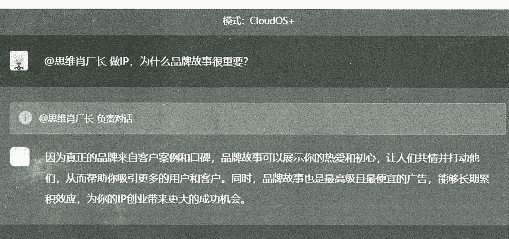

# Notion AI 的协同写作体验

除思维分身外，还高频使用 Notion AI 对段落进行预生成、扩写与润色。这套组合带来了截然不同的创作感受。

# ChatGPT 进阶玩法：自循环思路

第一篇介绍 B.O.K.E. 框架时提及过一种高阶用法——自循环流派。通过编程式的提示词设计，规定执行流程与分支，为模型装上发动机。

在“撰写品牌故事”章节背景部分的引导思路包括：主推产品或服务、创业初期的成立时间缘起与困难、发展轨迹中的里程碑与转折、市场份额与独特优势、已取得的实际成果如案例评价奖项、服务人群与使命愿景、未来规划方向。上述内容均由自循环提示词生成，后续做了人工微调。

# 提示词库共建实录

模型：GPT-4

交互设定是让模型扮演 Prompt Database Creator，基于给定的场景制定详尽的提示词库。流程先判断场景主题，再输出主分类提示词、三条改进建议、三到十个备选分类，并在末尾给出四个选项：对主分类提出改进建议、输入“使用此提示”进入二级生成、输入“重新启动”重来、输入“退出”结束。

场景示例为撰写品牌故事。初始主分类为品牌背景、价值观与使命、核心产品与服务、成功案例、品牌未来愿景。建议围绕覆盖完整度、受众易懂的表述、目标匹配度展开。备选补充包括品牌创始人背景、品牌形象与风格、品牌发展历程、客户评价与反馈、社会责任与影响、市场地位与竞争力、企业文化。

按要求将备选并入后主分类扩充，随后精简为：核心产品、品牌背景含创始人背景、发展历程、市场地位含市场竞争力、品牌成果含成功案例与客户评价、使命愿景、展望未来。

确认后生成的二级提示如下：

核心产品：主产品线、产品特点与优势、目标市场与受众
品牌背景含创始人背景：创立时间与地点、创始人经历与故事、公司愿景与初衷
发展历程：关键历史事件、产品线扩展与创新、公司规模变化
市场地位含市场竞争力：行业声誉与地位、主要竞争对手、独特竞争优势
品牌成果含成功案例与客户评价：典型成功案例、客户评价与见证、获得奖项与荣誉
使命愿景：核心价值观、长期发展目标、对社会环境的贡献
展望未来：未来发展计划、潜在市场机会、预期挑战与应对策略

有了这样的分层框架，面对具体任务时无需反复梳理思路，模型会先为自己生成提问结构，用户只需做选择即可。