# React 19 与 AI 协同的前端实战

## 内容概览

本书从 React 体系切入，以 React 18 之后以函数式组件与 Hooks 为主的工程思路为线索，并以一款即时聊天产品的完整打造过程演示现代前端落地手法，同时深入讨论生成式智能在前端研发流程中的真实落地场景。

全书分为三大块。起步块从脚手架搭建开始，覆盖 JSX 写法、组件组织、核心 Hooks 入门，随后阐释 props、state、context 如何驱动数据流向，以及副作用、事件交互与样式实现的实践要点。进阶块拆解生命周期与虚拟 DOM 的运行机制、应用级状态治理方案与相关工具、性能与体验的优化思路，并从自定义 Hooks 与代码复用角度说明如何构建可扩展的模块。实战块以聊天产品为载体，结合 React 生态演示客户端路由、表单处理、与后端通信、质量保障、工程化与架构设计，并以搭建 AI 聊天助手为例探索智能化浪潮下前端的新方向。全书在对应章节穿插智能化协作案例，涉及智能 IDE、智能体代码生成、拆分建议、性能诊断、样式生成、单元测试与代码评审等。

本书面向已有编程经验的 Web 研发人员，也可作为高校与培训机构相关课程的参考。

## 前言

当大模型能在半分钟内产出可运行的页面，前端人的价值该如何重新定义？

自 2023 年起，生成式智能的爆发正在改写软件工程的基本规则。如今它已能支撑生产级研发，从编码到设计、测试、持续集成、运维的整条链路都在引入智能能力。前端领域里，GitHub Copilot、Vercel v0 已可基于自然语言生成组件，Claude 等大模型甚至能独立完成模块开发。

Gartner 预计到 2028 年，75% 的软件工程师将使用智能化编程工具。由此浮现两个关键疑问：明明能生成可用代码，为何仍需深入掌握 React 这类框架？前端开发者会被智能体取代吗？

答案藏在技术演进的规律里：智能越强，对技术判断的精准度与效率要求越高。作为从业二十多年的一线开发者，我的判断是持续夯实根基、贴近业务实践、保持开放学习。归结为两点。

其一，打牢基础框架才能真正发挥智能编程的效能。智能体处理大任务时不确定性较高，但把大任务拆成足够小的单元，成功率与准确度会明显提升。因此工程师需要具备：把需求拆到可执行的细分能力；熟练掌握常用框架的原理与实操；明确工具的能力边界并掌握提示词设计技巧；具备客观评估产出质量的能力。

其二，智能与前端开发者是协同而非替代。Cursor、GitHub Copilot 等都在推进智能体能力，智能体可自主决策并完成更复杂的任务。如何与之高效协作成为新课题，也带来责任归属问题：代码由谁对接产品、联调后端、部署上线、修复缺陷、迭代版本？只要最终责任仍在人身上，就必须理解智能体的运行逻辑与生成结果，并随时接管。

智能能大幅提升效率，却无法替代对技术本质的深刻理解和对业务需求的精准把握。

在这一背景下，React 的生命力依然强劲。2024 年，时隔三年发布 React 19，带来多项突破：内置表单能力减少样板代码、异步处理增强以应对复杂交互、服务器组件为全栈开辟新路径。这些改动直击长期痛点，使 React 在智能化时代保持竞争力。

作为 Meta 开源的声明式界面框架，React 持续引领趋势：2023 年以 40.58% 的使用率位居榜首，数据来源 Stack Overflow；自 React 18 起全面拥抱函数组件与 Hooks 的现代范式；生态如 Zustand、React Router 不断演进，形成完整技术矩阵。

无论门户、企业级应用，还是移动端、PC 桌面应用，React 应用广泛。就业层面，2021 年以来 React 相关岗位数量与薪酬均明显领先。

技术迭代快也带来学习焦虑，如何避免“学不动”的困境？本书认为根源在于“为学而学”。对策是以目标驱动学习，以 Web 产品开发为牵引，让技术服务业务。

因此本书确立两大支点。

其一，现代 React 的深度应用。讲解覆盖框架本身及开发全链路，包括概念、API、使用方式，以及为 Web 应用需求衍生的生态技术如 Zustand、React Router、React Hook Form。

以 React 19 为基准向下兼容 React 18，聚焦函数组件与 Hooks；弱化类组件写法，优先使用 useState/useEffect 等核心 API；选用适配 Hooks 的生态库；对 React 19 新增与增强的 API 如 startTransition 异步回调、ref 可作为属性传递等，以“React 19”为前缀专项说明。

其二，智能化协作实践。面向智能与开发深度融合的趋势，在系统讲解 React 应用开发的同时加入智能协作内容。以 React 及生态为主线，将相关内容嵌入对应章节，并以“AI 协作”为标题前缀。

在组件开发、单元测试等环节植入协作场景；演示用大模型构建聊天机器人等智能功能；构建人工与智能体协作的完整工作流。

学完后，你将掌握智能化前端研发的最新实践与基于智能协作的 React Web 应用开发能力。

为降低门槛并强化实效，本书采用以下策略：循序渐进，以一套聊天产品的完整构建过程串联知识点。复杂内容后置，避免打断思路。例如 useReducer 与 useState 设计相近，故安排在第二部分进阶章节讲解。重在迁移应用，讲解技术细节时同步剖析其解决的实际问题，培养触类旁通能力。采用贯穿全书的聊天产品，各章围绕同一项目递进扩展功能，而非孤立示例，有助于建立项目上下文与架构关联。

## 贯穿全书的样例产品

动手编码仍是学习软件技术的有效方式。本书讲解现代 React 技术，实践项目是核心。市面上多数图书为单个知识点提供独立示例，针对性强但与真实项目差距大。真实开发需要整合多技术栈，综合运用多个技术点。

因此本书选用典型、可扩展且复杂度适中的“我聊”聊天产品，项目代号 oh-my-chat，界面与微信桌面端相近。业务逻辑不过于复杂，确保不受行业或门槛限制。

建议读者跟随章节逐步编写 oh-my-chat 代码。完成后既能掌握 React 核心知识，也能获得一套类似微信桌面端的 Web 前端源码。若想先系统学习再实践，可从 https://github.com/evisong/oh-my-chat 或 https://gitee.com/evisong/oh-my-chat 获取完整代码。仓库已按章节记录修改历史并打版本标签。

## 本书结构

全书共 18 章，分为 React 基础、React 进阶、应用开发三部分。知识体系与聊天产品的关系可参考图 0-1。图中自上而下的箭头展示学习路径：从基础到深入，同时从基础功能起步逐步为 oh-my-chat 增加高级能力并持续优化重构。

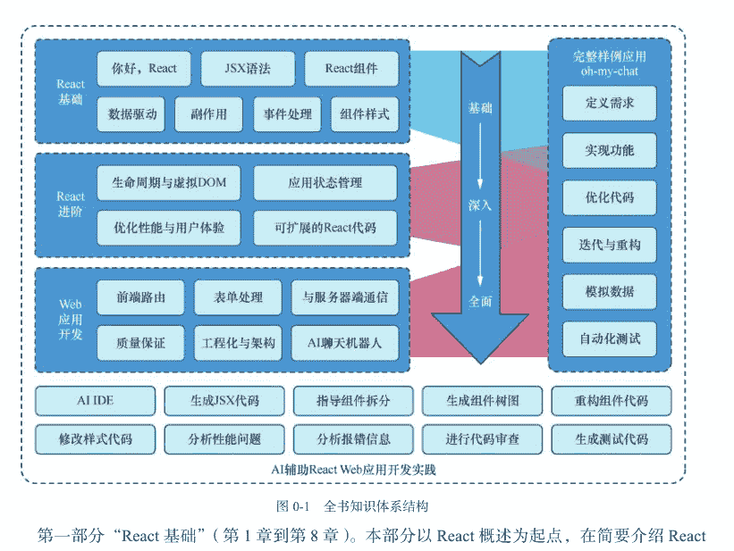
第一部分 “React 基础” 第 1 至 8 章。以 React 概览起步，介绍如何从零创建工程并实现 oh-my-chat 初始界面；随后逐章讲解 JSX 语法、React 组件、基础 Hooks API，并在 oh-my-chat 中创建与拆分组件；最后介绍 props、state、context 驱动开发，以及副作用与事件处理实现业务交互，并为 oh-my-chat 加入数据流与基础交互。

第二部分 “React 进阶” 第 9 至 12 章。聚焦底层原理，先讲解生命周期与虚拟 DOM 机制；再围绕应用状态管理及相关框架、性能与用户体验优化、代码可扩展性展开；最后将不可变数据、独立状态管理框架、公共组件等技术应用到 oh-my-chat。

第三部分 “Web 应用开发” 第 13 至 18 章。跳出 React 本身，探索技术生态。以完整 Web 应用为线索系统讲解前端路由、表单处理、服务端通信三大主题，并在 oh-my-chat 中实践 React Router、React Hook Form、React Query；随后介绍单元测试、端到端测试及前端工程化实践，助力大型项目开发与团队协作；最后利用开源大语言模型为 oh-my-chat 加入聊天机器人功能，探索 React 在智能化时代的新边界。

从第 2 章起，每章开头提供本章知识地图及项目实践，展示核心知识点与 oh-my-chat 的对应内容。三大部分的叶子节点与目录基本对应，其中星号节点代表含项目实作，小飞机图标代表智能化协作相关内容，对钩图标代表已在前文介绍过的内容。知识点与项目实践通过虚线关联。

本书以 CSR 架构为核心，系统讲解 React 在浏览器环境的应用。17.5 节简要提及 SSR 趋势但不深入展开，因实际开发中 SSR 需求多通过 Next.js 等全栈框架实现，直接使用 React SSR API 的场景较少。

适合人群：具备 HTML、CSS、JavaScript 基础的初级前端开发者，希望系统掌握 React；熟悉 Vue、Angular 等技术的中级开发者，计划转向 React 技术栈；曾使用 React 16.8 之前版本的开发者，希望学习最新特性与最佳实践。

## 本书配套资源

可从 https://github.com/evisong/oh-my-chat 或 https://gitee.com/evisong/oh-my-chat 获取 oh-my-chat 完整代码、知识地图及项目实践、彩图等资源。

## 写给智能化时代的开发者

从 jQuery 到 React 的演进亲历者，我深知：框架会更迭，解决问题的思维永恒。在 oh-my-chat 项目中实践智能化协作时，你会体会到：只有能精准描述需求的开发者，才能训练出真正有效的智能助手；只有深入理解 Hooks 依赖数组等核心机制，才能识别智能生成代码中的潜在缺陷；只有具备组件设计经验的开发者，才能将智能输出重构为可维护的优雅实现。

这不是简单的技术迭代，而是开发者能力的整体进化。当智能承担基础代码的搬运工作，工程师可更聚焦业务本质——用技术为用户创造价值。

软件是否被用户认可，关键在于“看得见摸得着”的用户界面。UI 是用户与软件交互的桥梁，在智能重塑代码生产的新时代，前端开发者凭借对界面交互细节的极致把控和对用户需求的精准解码，具备不可替代的核心竞争力。

宋一玮
2025 年 3 月于北京

# 资源与支持

## 资源获取

本书提供：配套代码、配套视频及 PPT、书中彩图文件、知识地图及项目实践、异步社区 7 天 VIP 会员。

可扫描下方二维码按指引领取。


## 提交勘误

作者与编辑已尽力确保准确，但难免疏漏。欢迎反馈问题以提升质量。

发现错误时，请登录异步社区 https://www.epubit.com，按书名搜索进入本书页面，点击“发表勘误”，填写信息后提交。经审核采纳后，将获赠 100 积分，可兑换优惠券、样书或奖品。


# 与我们联系

联系邮箱 contact@epubit.com.cn。如有疑问或建议，请邮件联系并在标题注明书名。

如有出版、视频录制、翻译、技术审校等合作意向，可联系责任编辑 jiajing@ptpress.com.cn。

学校、培训机构或企业批量采购请邮件咨询。

如发现盗版传播，请将链接发邮件反馈。

# 关于异步社区和异步图书

“异步社区” www.epubit.com 由人民邮电出版社创办，2015 年 8 月上线，致力于优质 IT 内容出版与分享，为读者提供高品质学习内容，为作者提供专业出版服务。

“异步图书”是异步社区策划的精品 IT 图书品牌，依托人民邮电出版社 30 余年计算机图书积累，面向 IT 行业及相关技术用户。

# 第一部分
React 基础

本部分共 8 章，介绍 React 基础。首先以快速创建工程的方式介绍 React 基础概念，随后逐章讲解 JSX 语法、React 组件、基础 Hooks API，说明 props、state、context 如何驱动开发，如何利用副作用与事件处理实现业务交互，以及组件样式开发。

学完此部分，可掌握 React 基本概念、写法与主要接口，并跟随章节完成基础 oh-my-chat 应用实践，具备独立开发简单 React Web 应用能力。

# 第1章 你好，React

学习新技术既期待又伴随能否学好的担忧，经典的“Hello, World！”正是消除不安的最佳起点。本章将带你在入门与精进 React 的道路上迈出坚实的第一步。

本章节先给出 React 的整体概览，随后以贯穿全书的聊天案例 oh-my-chat 为主线拆解需求与原型，紧接着手把手演示环境搭建、脚手架初始化以及第一段业务代码的编写，再从全景视角聊聊 React 生态，最后补上 AI 辅助开发工具的安装与实战用法。

## 1.1 React 技术简介

React 是一个偏向声明式与组件化的前端方案。跟传统框架相比，它的差异点很明显。

- 语法层面 React 提供了 **JSX**，把模板能力和 JavaScript 的表达力揉在一起，学习曲线平缓、写法灵活，渲染效率也比常见模板引擎更有优势。

- 在视图之外，React 用单向数据流来管理应用状态。用户交互触发状态变更，变更结果会被汇总，再以不可变数据的方式分发给相关视图，视图依据收到的新数据决定是否重绘。

- 开发者把页面与逻辑封装成独立的 **React 组件**，底层借助轻量级虚拟 DOM，通过新旧两棵虚拟树的智能比对实现高效更新。

- 从 16.8 开始引入的 **Hooks API** 大幅提升了函数式开发体验，组件编写和逻辑复用变得更简洁。Hooks 不仅引领了前端新趋势，也进一步巩固了 React 的主导地位。

与同期 Angular 等方案相比，React 的设计更克制，并没有想包揽所有 Web 开发场景。这恰恰是它流行的重要原因。React 聚焦声明式、组件化、单向数据流这三大核心，避免功能冗余带来的学习成本与使用负担，同时保持开放生态鼓励第三方创新，最终形成繁荣的技术圈层。

得益于这种架构，React 既能保持轻量高效，也能适配各式 Web 应用场景。

## 1.2 贯穿全书的聊天应用 oh-my-chat

全书以一个名为“我聊”的聊天应用作为贯穿案例，交互风格参考微信 macOS 版。为保持阅读一致，后续正文与代码统一使用 **oh-my-chat** 命名。

产品需求拆成功能与非功能两类。核心是基于短文本的即时通信，类似短信，配合联系人管理。

功能需求包含消息、联系人与其他三部分。

消息相关：
- 用户可与指定联系人建立会话，在会话中收发纯文本消息，已发或已收的消息不可修改。
- 支持删除单条消息，也可整会话删除。

联系人相关：
- 支持添加、编辑联系人，编辑后该联系人在会话中的展示信息自动同步。
- 支持编辑本人信息。
- 删除联系人时，关联会话会一并自动清除。

其他功能如注册登录等因篇幅与复杂度本章暂不展开。

非功能需求：仅做桌面端 Web 应用，兼容主流现代浏览器，不兼容 IE 等老旧浏览器及移动端浏览器。服务器接口全部采用模拟实现，不涉及多用户体系与真实即时通信。

原型设计如下。应用有两个主视图：聊天视图与联系人视图，左侧纵向导航图标用于切换。两种视图都采用左右两栏布局，左栏列表、右栏详情。

聊天视图原型如图 1-1。左栏为会话列表，顶部可搜索会话并新建会话。选中某会话后，右栏展示会话详情：顶部联系人名称、中部消息记录、底部输入框用于发送新消息。


图 1-1 oh-my-chat 原型设计：聊天视图

联系人视图原型如图 1-2。左栏为联系人列表，顶部可搜索联系人并添加新联系人。选中联系人后，右栏展示头像与昵称等详情，底部提供三个操作按钮：给该联系人发消息、修改联系人、删除联系人。

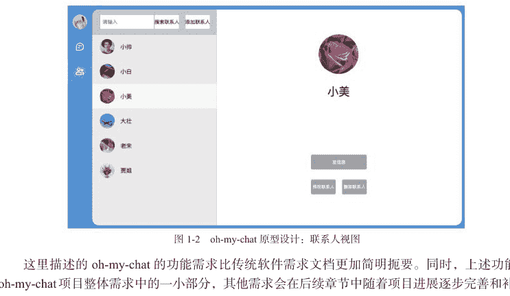

上面描述的需求语言比传统需求文档更简练，后续章节会随着项目推进逐步补充完善。

## 1.3 快速创建 React 项目

明确需求后，下面用最简流程搭起可在浏览器运行的 React 项目。

### 1.3.1 准备开发环境

主流操作系统都有成熟的前端环境方案，本书以 macOS 为主编写示例，大多数技巧可跨平台使用，涉及 Windows 的差异会特别说明。

前端环境的基础是 Node.js，绝大多数工具都依赖它运行。若已安装 Node.js 22 可跳过本节。

Node.js 迭代很快，2023 年主流是 Node 18，2025 年升级到 Node 22，可查官网版本页。实际开发不必追新，建议使用最新或次新的长期支持 LTS 版本。新的 LTS 既能享受新特性，又兼顾稳定与安全维护。本书使用 Node.js 22。

为应对多项目多版本需求，建议使用版本管理工具。主流有 nvm 与 fnm。nvm 基于 Shell 脚本，macOS 与 Linux 运行良好，不支持 Windows。fnm 用 Rust 开发，跨平台，功能类似，可在同一机器安装多个 Node 版本并随时切换，还具备智能切换能力，能根据项目里的 .nvmrc 自动在切换目录时切到对应版本。相比 nvm，fnm 速度更快且覆盖 Windows。

无论 macOS、Linux 还是 Windows，都可访问 fnm 官网下载对应版本后按向导集成到命令行。macOS 也可直接执行命令安装：

```
brew install fnm
```

安装成功后在 .bashrc 或 .zshrc 中加入以下配置，保存并重启终端生效：

```
eval "$(fnm env --use-on-cd)"
```

其中 --use-on-cd 会为 cd 命令加上钩子，切换工作目录时自动检测 .nvmrc 或 .node-version 并自动切换 Node 版本，对维护多项目很有用。

安装 fnm 后，用命令安装最新 LTS：

```
$ fnm install --lts
Installing Node v22.15.0 (arm64)
```

查看版本信息：

```
$ node -v
v22.15.0
```

当存在多个版本时，新开终端默认版本可能不同，可列出所有已装版本：

```
$ fnm list
* v16.20.2
* v18.18.2 default
* v22.15.0 lts-latest
* system
```

若想让新装的 LTS 成为默认，可设别名：

```
$ fnm alias 20 default
$ fnm list
* v16.20.2
* v18.18.2
```

### 1.3.2 选择代码编辑器

环境就绪后建议配一个前端编辑器。本书推荐 Visual Studio Code，它对 JavaScript 与 TypeScript 提供强大的语言服务器支持，语法检查与补全表现优秀，插件生态能显著提升 React 开发效率。

安装 VS Code 后，可通过菜单 View → Command Palette 输入 install code，选择 Shell Command: Install 'code' command in PATH 并回车，将其加入命令行环境，之后可用 `code /path/to/my/project` 快速打开项目。

新装的 VS Code 已内置 JavaScript 与 React 支持，开箱即用。建议额外安装以下插件，方法为打开菜单 View → Extensions 搜索插件标识符后安装。

- 简体中文语言包 `ms-ceintl.vscode-language-pack-zh-hans`，用于切换简体中文界面。
- ESLint `dbaeumer.vscode-eslint`，静态代码检查，可按社区规范或自定义规则提示问题并自动修复。
- Stylelint `stylelint.vscode-stylelint`，专注 CSS 等样式表的静态检查。
- Prettier `esbenp.prettier-vscode`，智能格式化工具，统一缩进、分号、括号风格等，提升协作效率。
- Code Spell Checker `streetsidesoftware.code-spell-checker`，英语拼写检查并给出建议。

后续提到 IDE 时默认指 VS Code。

### 1.3.3 AI 辅助：安装 AI 代码编辑器

如需 AI 辅助开发，可在 VS Code 中安装微软的 GitHub Copilot 插件，标识符为 `github.copilot`，安装时会同步安装 Copilot Chat。

使用前先登录 GitHub：打开 Command Palette 输入 copilot，选择 GitHub Copilot: Sign In 回车，在弹出的浏览器完成登录后返回授权。配置完成后通过菜单“查看”→“聊天”在右侧打开 Copilot 视图，如图 1-3（a）。可用“React 是什么”验证是否正常，如图 1-3（b）所示。

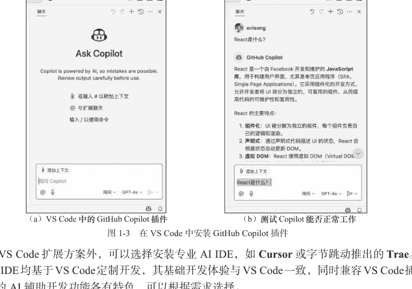

除扩展方案外，也可直接使用专业 AI IDE，如 Cursor 或字节跳动的 Trae。两者基于 VS Code 定制，兼容插件，AI 能力各有侧重，可按需选择。

后文未特别说明时，AI IDE 默认指 VS Code + GitHub Copilot。

### 1.3.4 使用 create-vite 创建 React 项目

前端技术栈配置繁琐，涉及创建 Node 项目、安装依赖、配置打包工具与入口文件等，脚手架可大幅简化流程。

Vite 是现代打包工具，其官方 create-vite 内置 React 模板。工程化细节将在 17.1 节展开，这里演示基础用法。

先建工作目录，再用 npm 执行 create-vite：

```
mkdir ~/workspaces
cd ~/workspaces
npm create vite@latest
```

若提示需安装 create-vite，输入 y 回车即可：

```
Need to install the following packages:
create-vite@6.5.0
Ok to proceed? (y) y
```

运行后进入交互向导，Project name 输入 oh-my-chat，选择框架 React，选择变体 JavaScript。向导也提供 TypeScript 选项，后续 17.2 节会介绍。完成向导后项目骨架生成完毕。

```
✓ Project name: ... oh-my-chat
✓ Select a framework: > React
✓ Select a variant: > JavaScript
```

随后执行提示的命令启动开发服务：

```
$ cd oh-my-chat
$ npm install
$ npm run dev
```

```
VITE v6.5.0  ready in 509 ms
→ Local:   http://localhost:5173/
→ Network: use --host to expose
→ press h + enter to show help
```

在浏览器访问 `http://localhost:5173/` 即可看到默认页面，如图 1-4。

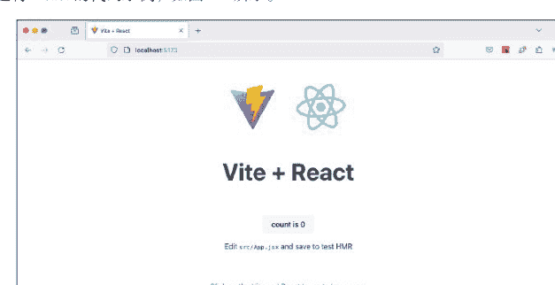

图 1-4 通过 Vite 创建的 React 脚手架项目默认页面

## 第 1 章 你好，React

用 IDE 打开项目目录，可看到脚手架结构与主文件。package.json 显示 React 版本为 9.1.0。

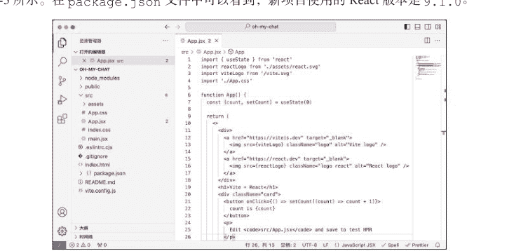

当前代码风格与社区规范有差异，例如 JavaScript 语句末尾省略分号。为保持统一，可用 Prettier 格式化。打开 src/App.jsx，菜单 View → Command Palette 输入 formatdoc，选择 Format Document... 回车，弹出选择格式化程序时选 Prettier。


格式化前后对比可见 App.jsx 每行末尾自动补上了分号。

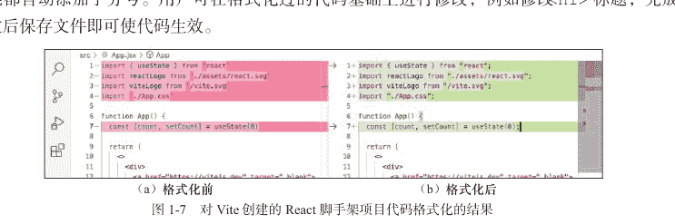

在此基础上可修改 `<h1>` 标题，保存后页面实时更新。

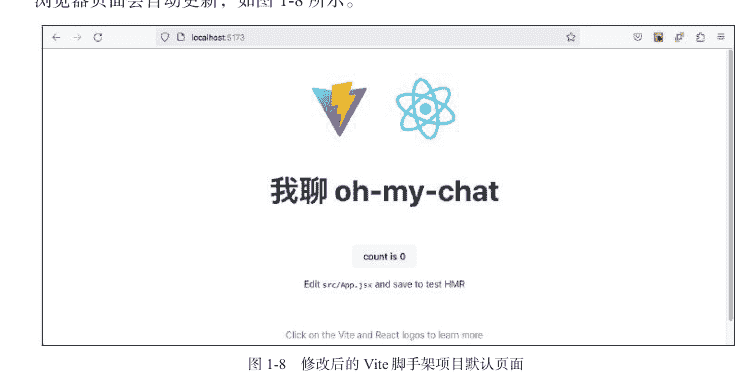

这种即时反馈是前端开发的高效体验，代码一改页面即变，便于快速验证。基于 Vite 搭建的 React 环境均具备热更新特性。

对比 Prettier 格式化前后的效果会发现，格式化之后代码里的所有引号都被统一成了双引号。Prettier 在英文语境下的默认策略是，双引号写法 `"It's Jim's book."` 相比单引号写法 `'It\'s Jim\'s book.'` 需要的转义符号更少。本书并不认为单双引号有高下之分，关键是全项目保持统一，考虑到国内开发者的使用习惯，书中会优先采用单引号。有需要的同学只需要在项目根目录放一个 .prettierrc 配置文件，把默认的引号规则改成单引号，重新跑一次格式化即可：

```
{
  "singleQuote": true
}
```

需要补充的是，虽然本节示例用 create-vite 起 React 项目，但到 2025 年初，React 社区最主流的脚手架仍是 Meta 推出的 Create React App，不过 CRA 已于 2025 年 2 月被官方正式宣告弃用。除 CRA 和 create-vite 外，市场上还有不少优秀的 React 脚手架可选。在小规模示例中不同脚手架的差别很难感知，但当项目文件数达到上百甚至上千时，CRA 的打包速度会明显拖后腿，`npm start` 可能要等数分钟，直接影响开发节奏。

Vite 是一款面向现代浏览器的 JavaScript 打包工具，它借助浏览器原生支持 ES Module 的特性，把部分构建工作交给浏览器端，再结合其他层面的优化，使打包效率大幅超越传统工具。后续章节的示例代码全部以 Vite 为打包方案，开发者也可以按自己的需求挑选工具。

### 1.3.5 提交代码到代码仓库

养成用版本控制工具及时把本地代码推到远程仓库的习惯非常重要，我亲眼见过因本地代码丢失导致数天工作成果付之东流，只能靠回忆重写的惨痛案例。

本书里把代码提交到仓库还有一层练习意义。读者可以跟着章节节奏编写代码，每章结束时做一次提交保存版本，后续学习需要验证修改时就能回滚到上一章的快照。当然也可以直接下载本书附带的源码包本地阅读和调试。若要获取完整修改历史并方便回滚，建议使用 VCS 工具克隆仓库，而不是下载 zip。

本书选型 Git。Windows 用户可从官网安装，macOS 用户除了 Xcode 自带的 Git，也能通过其他方式安装。

在终端执行以下命令：

```
git --version
```

若 macOS 未装 Git，系统会主动提示安装命令行工具。

另外可用 HomeBrew 安装：

```
brew install git
```

装好 Git 之后，VS Code 内置的源代码管理面板即可正常工作。

此时就可以把 1.3.4 节用 create-vite 搭建的脚手架代码推送到仓库。提交前先用 Prettier 统一格式化所有源文件。

也可以选用线上仓库如 GitHub 或 Gitee。本书以 GitHub 为主，同时提供 Gitee 镜像。

先在 GitHub 新建仓库命名为 oh-my-chat，按官方文档 “通过 SSH 连接到 GitHub” 的指引配置本地 SSH 密钥。随后进入项目目录执行：

```
$ cd oh-my-chat
$ git init
Initialized empty Git repository in /Users/user/workspaces/oh-my-chat/.git/

$ git add .
$ git commit -m "初次提交"
[master (root-commit) 7215194] 初次提交
 14 files changed, 6205 insertions(+)
 ...

$ git branch -M main
$ git remote add origin git@github.com:evisong/oh-my-chat.git
$ git push -u origin main
```

```
Enumerating objects: 19, done.
...
Writing objects: 100% (19/19), 67.16 KiB | 6.71 MiB/s, done.
Total 19 (delta 0), reused 0 (delta 0), pack-reused 0
To github.com:evisong/oh-my-chat.git
 * [new branch]      main -> main
branch 'main' set up to track 'origin/main'.
```

出现提示即表示代码已成功推送，可在 GitHub 网页查看。

回顾已提交的文件名会发现大小写混用。目前前端社区建议 React 组件源码文件使用帕斯卡命名法 PascalCase，如 App.jsx、MessageList.jsx；非组件的其它源码文件使用驼峰命名法 camelCase，如 index.js、useTabs.js。这样文件名能与导出模块保持一致。需要注意的是 macOS、Windows 等不区分大小写的文件系统配合 Git 使用时容易出问题，Git 把 A.txt 和 a.txt 当成两个文件，操作系统却认为是同一个。本书不展开细节，只提醒：已提交的文件最好不要再修改文件名中的大小写，例如已提交 messageList.jsx，就不要在本地改名为 MessageList.jsx，否则提交时可能引发一系列错误。

## 1.4 编写基础应用代码

准备工作就绪后，开始编写 oh-my-chat 的代码。

### 1.4.1 项目实现：编写聊天视图代码

本节用最简洁的代码和模拟数据，实现 1.2 节定义的第一个视图——聊天视图。目标有三点：

- 呈现 React 组件与样式代码的基本结构。
- 直观感受 React 应用的开发流程。
- 为后续章节打基础，以迭代方式逐步引入新知识点。

建议跟随内容手写代码，也可直接从配套仓库复制完整代码到本地，进入第 1 章目录 /ch01_3_5，执行 `npm install && npm run dev` 查看效果。

先用 IDE 打开 1.3.4 节创建的 oh-my-chat 项目，对脚手架做少量清理。在项目根目录新建 .nvmrc，指定 Node.js 版本为 22：

```
22
```

该文件配合 fnm 使用，能在进入项目根目录时自动切换到 Node.js 22 LTS，并纳入版本控制，保证团队成员使用一致的 Node 版本。

修改 index.html 中的标题：

```
<meta name="viewport" content="width=device-width, initial-scale=1.0" />
<title>我聊 - 现代 React Web 应用设计开发实践</title>
</head>
```

脚手架默认带暗黑主题样式，为简化示例先清理相关配色。打开 src/index.css 删除多余样式，并增加 overflow 属性：

```
:root {
  font-family: Inter, system-ui, Avenir, Helvetica, Arial, sans-serif;
  font-weight: 400;
  font-synthesis: none;
  /* 保留 ... */
}
body {
  /* 保留 ... */
  min-height: 100vh;
  overflow: hidden;
}
/* 删掉 button 和 @media (prefers-color-scheme: light) */
```

在 src/assets 目录准备本节所需的 SVG 图标：icon-contact.svg、icon-menu.svg、icon-message.svg。将 src/App.jsx 的全部内容替换为以下代码，在应用最外层搭建基础的三栏 DOM 结构：

```
import { useState } from 'react';
import reactLogo from './assets/react.svg';
import contactIcon from './assets/icon-contact.svg';
import messageIcon from './assets/icon-message.svg';
import './App.css';

function App() {
  const [activeView, setActiveView] = useState('chat');

  return (
    <div className="root">
      <nav>
        
        <ul className="top-nav">
          <li className={activeView === 'chat' ? 'active' : undefined}>
            <a href="#" onClick={() => setActiveView('chat')}>
              
            </a>
          </li>
          <li className={activeView === 'contact' ? 'active' : undefined}>
            <a href="#" onClick={() => setActiveView('contact')}>
              
            </a>
          </li>
        </ul>
      </nav>
      <aside>{/* TODO: 对话列表 */}</aside>
      <main>{/* TODO: 消息列表 */}</main>
```

## 1.4.1 实现聊天视图

```jsx
</div>
);
}

export default App;
```

这段代码主体是 JavaScript，但在函数返回值里嵌入了 HTML 标签结构，这种写法就是 JSX。对仅接触过 HTML 与 JavaScript 的初学者来说，React 语法初看会有些陌生，2.1 节会专门介绍 JSX。

在 src/App.css 中把所有样式替换为以下代码，可在已有的三栏结构上实现“左中右”布局：

```css
#root {/* 省略 ... */}

.root {
  display: flex;
  flex-direction: row;
  height: 100%;
}

.root > nav {
  margin: 28px 0;
  flex: 0 0 80px;
  display: flex;
  /* 省略 ... */
}

.root > aside {
  margin: 12px 0;
  border-radius: 20px 0 0 20px;
  border-right: 1px solid #9a9a9a;
  flex: 0 0 400px;
  display: flex;
  /* 省略 ... */
}

.root > main {
  margin: 12px 12px 12px 0;
  border-radius: 0 20px 20px 0;
  flex-grow: 1;
  display: flex;
  /* 省略 ... */
}

.top-nav {/* 以下省略，请参考代码仓库 */}
```

oh-my-chat 主要采用 CSS Flexbox 布局。相比传统绝对定位、浮动等方案，Flexbox 更灵活、DOM 更精简，代码更整洁。需说明的是，为保证阅读体验，正文中的代码片段在换行等方面做了微调，重复或非关键片段会用注释省略；完整格式化后的代码请参考仓库。

执行 `npm run dev` 并在浏览器打开页面，布局如图 1-9 所示。左侧已实现纵向导航，点击聊天、联系人图标可切换高亮，中栏和右栏预留空白，后续用于实现对话列表和消息列表。

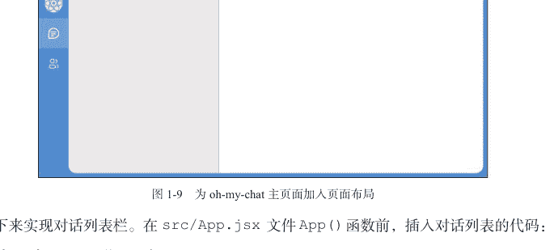

接下来实现对话列表栏。在 src/App.jsx 文件中于 App() 函数之前插入对话列表代码：

```javascript
const ThreadsPane = () => {
  const threads = [
    {
      id: 1,
      contactName: '小帅',
      updateTime: '2023-11-04',
      latestMessage: '书的主题是现代 React Web 应用的设计开发实践。',
    },
    {
      id: 2,
      contactName: '小白',
      updateTime: '2023-11-03',
      latestMessage: '有的，就叫《我聊》。',
      active: true,
    },
    // 省略 id: 3 ~ id: 5
  ];

  return (
    <>
      <header className="thread-top-menu">
        <form><input maxLength={20} /><input type="submit" value="搜索对话" /></form>
        <button>新建对话</button>
      </header>
      <ul className="thread-list">
        {threads.map((thread) => (
          <li key={thread.id} className={thread.active && 'active'}>
            <a href="#">
              
              <div className="thread">
                <span className="contact-name">{thread.contactName}</span>
                <span className="update-time">{thread.updateTime}</span>
                <span className="latest-message">{thread.latestMessage}</span>
              </div>
            </a>
          </li>
        ))}
      </ul>
    </>
  );
};
```

ThreadsPane() 为对话列表生成多条模拟数据，并在后续的标签中引用这些数据，具体写法将在 2.3.2 节详细说明。

提示一下，如果安装 VS Code 时一并装了 Copilot，编辑上述代码时会频繁弹出 AI 代码补全建议，如图 1-10 所示。可预览建议，基本合适就按 Tab 采纳。与传统补全不同，AI 补全通常能给出多行连贯代码，且与项目现有业务关联更强，效率更高。为了更好熟悉 React 基础编码，本书建议暂时关闭 Copilot 自动补全，全程手动编写。

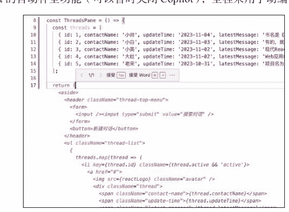

把 App() 函数返回值中的注释 “TODO：对话列表” 替换为以下标签，即可将对话列表嵌入中栏布局：

```jsx
<aside>{activeView === 'chat' && <ThreadsPane />}</aside>
```

在 src/App.css 中补充对话列表及顶栏的样式定义：

```css
.thread-top-menu {
  flex: 0 0 5rem;
  display: flex;
  flex-direction: row;
  /* 省略 ... */
}

.thread-list {
  /* 省略 ... */
  list-style: none;
  overflow-x: hidden;
  overflow-y: auto;
}
.thread-list li.active {
  background-color: #ffffff99;
}
.thread-list li > a:hover,
.thread-list li > a:active {
  background-color: #ffffff77;
}

/* 省略其他样式 ... */
```

保存后页面会自动刷新为图 1-11 的状态。此时对话列表及其顶部管理栏已搭建完成，交互逻辑尚未接入，后续章节会逐步补充。

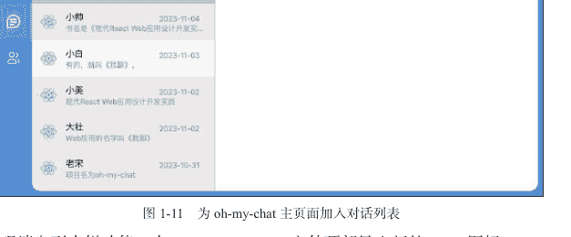

图 1-11 显示 oh-my-chat 主界面已接入对话列表

随后要补上消息列表区。先在 `src/App.jsx` 顶部引入若干新的 SVG 图标：

```javascript
import menuIcon from './assets/icon-menu.svg';
```

React 本身支持图片导入，具体把图片引用进 JS 的方法会在 17.1.2 节前端构建部分详细说明。在 `App()` 定义之前写入下面代码，用来构建消息列表：

```javascript
const MessagesPane = () => (
  <>
    <header className="message-top-menu">
      <h1> 小白</h1>
      <button></button>
    </header>
    <ul className="message-list">
      <li className="from-me">
        
        <p className="message">你好 React！</p>
      </li>
      <li>
        
        <p className="message">你好 React！</p>
      </li>
      <li className="from-me">
        
        <p className="message">欢迎学习 React Web 应用开发，你现在看到的是本书的聊天应用。</p>
      </li>
      <li>
        
        <p className="message">这款应用有名字吗？</p>
      </li>
      <li className="from-me">
        
        <p className="message">有的，就叫《我聊》。</p>
      </li>
    </ul>
    <form className="compose-message">
      <textarea placeholder="请输入消息..." />
      <input type="submit" value="发送" />
    </form>
  </>
);
```

把 `App()` 返回值里那行写着 “TODO：消息列表” 的注释整行替换成下方标签，即可把刚实现的消息列表嵌入页面：

```jsx
<main>{activeView === 'chat' && <MessagesPane />}</main>
```

查看此刻 `src/App.jsx` 中的标签组织方式，可以发现 oh-my-chat 并未大量使用 `<div>` 堆砌，而是依据业务语义选用符合 Web 标准的元素，这对可读性和可维护性都有积极作用。可以尝试清空全部 CSS，观察样式失效时 HTML 的默认呈现。

接着在 `src/App.css` 中补充消息列表相关的样式规则：

```css
.message-top-menu {/* 省略 ... */}

.message-list {
  flex: 1;
  margin: 0 1.2rem;
  padding: 1.2rem 0;
  list-style: none;
  overflow-x: hidden;
  overflow-y: auto;
}

.message-list li {
  display: flex;
  align-items: flex-start;
  justify-content: flex-start;
  column-gap: 1.2rem;
  min-height: 2rem;
}
.message-list li.active {
  background-color: #ffffff99;
}
.message-list li.from-me {
  flex-direction: row-reverse;
}

.compose-message {/* 省略 ... */}
/* 省略其他样式 ... */
```

保存后浏览器会呈现图 1-12 所示的完整画面。目前可用的是消息列表、列表顶栏以及底部的发送表单。列表内容目前是写死的，表单交互仍未实现，后续会陆续完善。到此聊天视图已基本成型。

建议把本次修改整体提交到代码仓库，便于后续追溯。

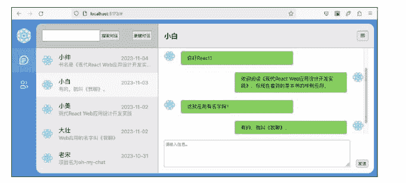

图 1-12 显示 oh-my-chat 主界面已接入消息列表

### 1.4.2 AI 辅助开发：联系人视图生成

本小节要实践 AI 辅助编程的流程。

需要特别提醒，本节由 AI 产出的代码仅作实验演示，学完后会被清理掉，务必保留 1.4.1 节手写代码以便回滚。下面以 1.2 节联系人视图原型图为依据，利用 AI 生成对应代码。准备工作是从仓库下载原型图 `oh-my-chat-mockup_2.png`。

首先在 VS Code 中打开 `App.jsx`，再打开 Copilot 面板，把原型图拖入聊天窗口，输入如下提示：

请在当前文件里，依据上传的图片生成联系人视图。现有聊天视图，当用户点击导航中的“联系人”链接时切换过去。

在聊天框底部把默认的询问 Ask 模式改为代理 Agent 模式，并把模型从 GPT-4o 换成 Claude 3.5 Sonnet。如图 1-13 所示，设置完成后点发送。首次启用可能需要确认是否允许 Claude，确认即可。

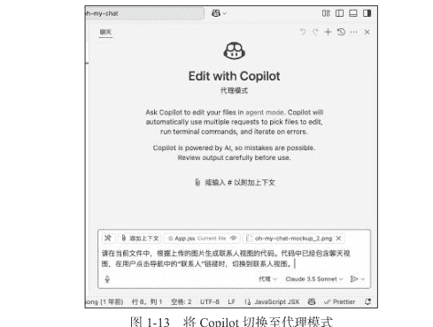

图 1-13 说明如何把 Copilot 换成代理模式

响应时 Copilot 会解析需求并产出修改方案，直接作用于 `App.jsx` 源文件。如图 1-14 所示，改动会在编辑器里高亮。逐项核对后可点右侧保留确认修改，或点撤销放弃并回滚到原状。

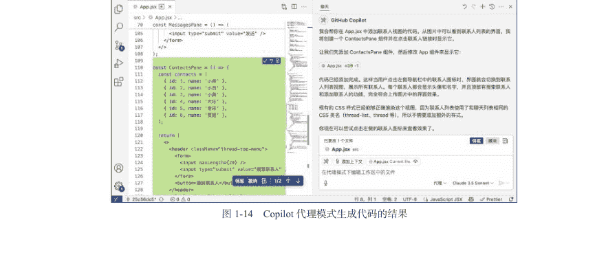

图 1-14 展示代理模式下 Copilot 的修改结果

在浏览器中打开页面，点击左侧导航的联系人入口，可看到 Copilot 部分还原了原型设计，如图 1-15 所示。

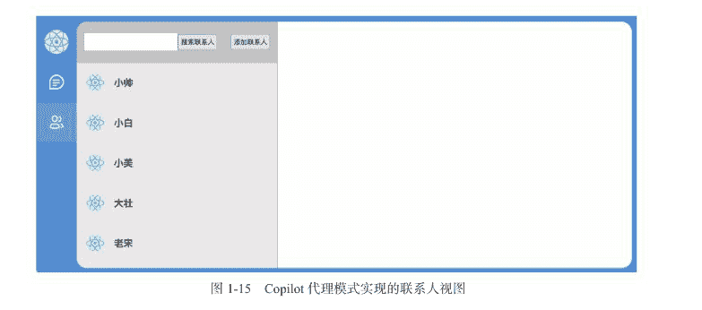

虽然生成的结果并不完整，但界面布局和数据展示基本贴合了原型，代码结构也与 1.4.1 节手写示例相近。AI 生成代码的质量评估要等到第 2 章系统学习 JSX 语法后再展开。本节到此结束，需把 Copilot 生成的代码回滚，为第 2 章实践做好准备。

## 1.5 React 技术生态全景

1.4 节用 React 为 oh-my-chat 搭起了基础功能，但对完整 Web 应用而言这只是起步。**仅靠 React 框架难以构建符合生产标准的完整应用**。这会让新手感到困惑，却也反映了当前前端的真实情况。十年前前端复杂度大幅上升，技术能力同步跃迁，应用场景被极大拓展。挑战与机遇并存，React 正是在这样的背景下脱颖而出。正如 1.1 节所述，React 内置功能并非最多，但克制设计和对第三方库的开放，催生了繁荣的 React 生态。使用者越多，开源库越丰富；生态越繁荣，又吸引更多开发者选择 React，形成典型的马太效应。

因此不必担心学习鸿沟。以 React 为核心，结合其强大生态，完全可以应对不同规模与复杂度的 Web 开发需求。这也带来新课题：开发者需要厘清 React 框架的能力边界，并熟悉生态中的关键组成，以便按场景选型。

### 1.5.1 开源组件库概览

HTML 与 DOM API 最初服务于页面展示，虽经标准化演进，仍缺乏现代富交互应用开箱即用的组件。

React 虽封装了 DOM 细节，但对外仍是原生元素如 `<button>`、`<input>`、`<select>`、`<div>`。Tab、ToggleButton、Tree 这类高级控件需要自行开发；若想统一视觉、交互与接口，也要做大量封装。更省事的做法是选用成熟的 React 组件库。

组件库是一组设计统一、封装完善、接口一致的可复用 UI 单元，是 React 生态的关键部分。以下列出 2023 年 11 月 npm 周下载量前三的库。

- MUI，原名 material-ui，遵循 Google Material Design，提供丰富组件与稳定 API。官方已推出 Base UI，便于脱离 Material 定制主题。
- AntD，全称 Ant Design，由蚂蚁集团开源，提供完整设计体系、丰富组件及数十种国际化语言支持。
- React Bootstrap，基于传统 Bootstrap 重写 JavaScript 部分，去掉 jQuery 依赖。组件种类齐全，保留栅格布局与主题定制能力。

三者均采用 MIT 协议，在各类 Web 项目中广泛使用。后续章节为学习组件开发，不会直接使用现成库，详细用法可参考官网。

### 1.5.2 React 全家桶概说

除了组件库，Web 开发还需关注：

- 应用状态管理：Zustand、Redux、MobX 等。
- 服务器通信：浏览器原生 fetch、Axios、React Query 等。
- 表单处理：React Hook Form、Formik。
- 前端路由：事实标准的 React Router。
- 组件样式：CSS-in-JS、Linaria 等。
- 打包编译：Webpack、Babel、Create React App 脚手架，目前 Vite 因性能出色成为新项目首选。
- 自动化测试：Jest、React Testing Library。

这些工具与框架的组合在中文技术社区常被称为“React 全家桶”，例如 React+Zustand+React Router+Axios+Vite+Jest。

上述框架在现代 Web 开发中大多必备，后续章节会详细介绍并在 oh-my-chat 项目中实践。

### 1.5.3 React Native 快速认识

移动互联网兴起深刻影响了 React 演进。iOS 与 Android 主导移动端后，跨平台代码复用成为关键方向，即一套代码同时运行于 iOS、Android 和 Web。目前主流方案为 Flutter 和 React Native，后者凭借独特优势占据重要地位。

oh-my-chat 的 package.json 中有两个依赖：react 和 react-dom，前者是核心逻辑，后者实现 Web 端特有接口。这种架构自然引出一个问题：是否存在其他平台实现？React Native 就是移动端的接口与实现，对应 npm 包为 react-native，与 Web 端共享 React 内核。跨平台能力的基础正是虚拟 DOM，具体原理会在后续展开。

React Native 秉承 “Learn once, write anywhere” 的理念。它将 JavaScript 与 iOS/Android 原生组件结合，既把 Web 开发技术引入移动端，又利用原生组件提升渲染与交互性能，并通过接口抽象屏蔽平台差异，实现高效复用。对业务导向且对原生功能依赖较低的应用是理想方案。

Facebook 早期推广 React 时，React Native 助力生态扩张。如今 React 设计充分兼顾 Web 与移动。本书聚焦 Web 前端，不会深入 React Native 细节，如需了解可参考官方文档。

## 1.6 AI 辅助前端开发总览

要理解 AI 助力前端开发模式，首先需要了解人工智能辅助软件开发生命周期的运行机制。

本章配置开发环境和编写基础代码时，以 GitHub Copilot 作为示例演示了 AI 编程工具的部分功能。初次接触的开发者可能会留下深刻印象。但需明确，无论是 Copilot 还是其他 AI 编程工具，都只是 AI 在软件开发生命周期中的一部分体现。

软件开发生命周期通常包括计划、设计、实现、测试、部署和维护六个阶段，每个阶段都涉及大量任务，其自动化程度直接影响开发效率。生成式 AI 出现前，软件开发自动化工具和实践已相对成熟，效率提升空间有限。而生成式 AI 为整个领域注入新活力，几乎在每个阶段都能提供智能化支持。

在各阶段 AI 可辅助的具体任务如表 1-1 所示。其中标记“↑↑”表示已有较为成熟的商业产品或开源工具支持并被较多企业采用；标记“↑”成熟度稍低但发展迅速，受业界广泛关注；未标记则仍处于探索阶段。

表 1-1 AI 辅助的软件开发生命周期

| 计划 | 设计 | 实现 | 测试 | 部署 | 维护 |
| :--- | :--- | :--- | :--- | :--- | :--- |
| 业务需求分析 | 界面与交互设计 ↑ | 开发任务分解 ↑ | 单元测试 ↑↑ | CI/CD ↑ | 监控 ↑↑ |
| 产品需求文档 ↑ | 技术设计文档 ↑ | 编写代码 ↑↑ | 集成测试 ↑ | 制品管理 | 故障管理 ↑ |
| 业务风险评估 | 安全设计 | 代码审查 ↑↑ | 性能测试 | 灰度或蓝绿部署 | 故障分析 ↑ |
| 原型设计制作 ↑↑ | | 配置开发环境 | 安全测试 | 配置管理 ↑ | 技术栈升级 ↑↑ |
| | | | | 变更管理 | |

本书聚焦在 React 以及 Web 前端实战层面，对 AI 加持的软件开发生命周期全景不做深度展开。GitHub Copilot 作为编程助手的定位，主要落在编码、代码复审、单元测试等核心环节，在此之上，原型搭建、系统监控、故障定位等工作也能被纳入 AI 支持的前端流程。

后续章节会择机引入 AI 支持开发的相关内容，以 AI 支持 React 编码为主线，配合各章节主题延伸至其他环节，例如借助 AI 生成单元测试。

## 1.7 小结

本章先对 React 技术面貌做了概括，并介绍了贯穿全书的 oh-my-chat 示例的核心功能。随后说明了本地 Node.js 运行环境的配置，推荐 VS Code 作为编辑器，并借助 create-vite 模板工具为 oh-my-chat 搭建项目基础骨架。在此基础上，为 oh-my-chat 的聊天视图编写了初始 React 代码，实现了左右中三栏布局，以及基于模拟数据、暂未交互的会话列表与消息列表。之后对 React 生态做了简要梳理，涵盖开源组件库、“React 全家桶”等，勾勒出以 React 构建 Web 应用的技术全貌。

另，本章演示了 AI 代码编辑工具 GitHub Copilot 的安装配置与补全体验，并通过代理模式生成大段代码，初步讨论了 AI 在开发生命周期中的作用。

# 第 2 章 JSX 入门精要

本章知识地图与落地实践可参考图 2-1。

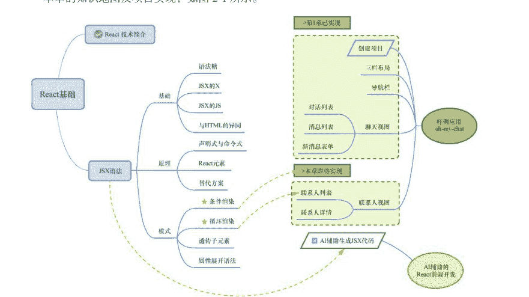

不少初学者初次接触 React，印象最深的往往是其特有的 JSX 模板写法。下面这段代码源自第 1 章 oh-my-chat 的示例，体现了 JavaScript 与 HTML 片段混写的特点：

```javascript
function App({ view }) {
  return (
    <div>
      <nav>导航栏</nav>
      <main>{view === 'chat' ? <MessagesPane /> : <ContactDetailPane />}</main>
    </div>
  );
}
```

面对这份写法，初学者常产生 4 种误读。

- 把 JSX 当成 React 本身
- 把 JSX 等同于组件
- 把 JSX 看作另一种 HTML
- 认为 JSX 既能描述视图又能嵌入表达式，于是把所有逻辑都塞进 JSX

这些误读会在实战中带来以下问题：

- 文件膨胀到数百甚至上千行，可维护性变差
- 在标签上写了 HTML 属性却不生效
- 在 JSX 中掺入表达式导致页面反复报错

理清 JSX 与组件的关系后，上述问题都能化解。React 是一个声明式、组件化的前端框架，组件的声明是其核心。JSX 用来描述组件，但它既不是 HTML，也不是组件本身。

本章围绕 JSX 语法展开，先对比 JSX 与 HTML 的异同、与 React 的关系，再引出 React 元素概念，并以第 1 章 oh-my-chat 为例说明条件渲染、循环渲染等常见用法。最后通过扩展 oh-my-chat 的联系人视图进行实操，并继续探究 AI 工具生成 JSX 的能力。

## 2.1 JSX 语法基础

随着前端复杂度提升，视图层常需处理条件判断、循环遍历等控制逻辑。声明式开发要求这些逻辑融入视图声明，对可读性与可维护性提出更高要求。

JSX 出现前，已有 JSP、Struts、Handlebars、Pug 等视图模板，各自以不同方式应对。JSX 与其他声明式模板有何区别？

### 2.1.1 JSX 是一种语法糖

JSX 本质上是以 JavaScript 为底座扩展的类 XML 语法，内核仍是 JavaScript。

如前所述，React 组件是开发的基本单元。组件内可渲染内容可通过以下两种 API 其一声明。

- 从 react/jsx-runtime 子路径导出的 jsx(type, props, key)
- React.createElement(component, props, ...children)

JSX 实则是 jsx() 的语法糖。浏览器不支持 JSX，上线前需借助编译工具把源码转成若干 jsx 调用的标准 JavaScript。17.1.2 节会详述编译工具。

例如消息列表组件的部分 JSX：

```jsx
<header className="message-top-menu">
  <h1>小白</h1>
  <button>
    
  </button>
</header>
```

编译后会变成 JavaScript，jsxs 可视为 jsx 的别名：

```javascript
jsxs("header", {
  className: "message-top-menu",
  children: [
    jsx("h1", {
      children: "小白"
    }),
    jsx("button", {
      children: jsx("img", { src: menuIcon })
    })
  ]
})
```

也可以不使用 JSX，手写 JavaScript 调用 React.createElement。该函数与 jsx 参数略有差异，但功能等价，具体细节下一节介绍。手写方式无需编译，可直接运行，但结构复杂、层级很深时，JavaScript 会出现大量右括号，可读性与效率都会下降。即便 IDE 提供格式化与缩进，也无法根治括号嵌套问题。

Web 开发中类 HTML 语法因直观而受欢迎。JSX 的类 HTML/XML 写法配合 IDE 高亮，使声明式代码更直观，可维护性远超纯 JavaScript。带来的效率提升足以抵消编译成本。

只关注 JSX 中的 “X” 容易与 HTML/XML 模板混淆，关键在于 “JS” 特性。下面节选 oh-my-chat 的一段 JSX，实现典型条件渲染：activeView 为 chat 时才渲染 ThreadsPane，否则不渲染：

```jsx
<aside>{activeView === 'chat' && <ThreadsPane />}</aside>
```

编译为 JavaScript 后，大括号内的 JavaScript 表达式 activeView === 'chat' && 被保留：

```javascript
jsx('aside', {
  children: activeView === 'chat' && jsx(ThreadsPane, {}),
})
```

与 Java SSH 技术栈中 Struts2 模板实现条件渲染作对比：

```jsp
<aside>
  <s:if test="activeView=='chat'">
```

下面把 JSX 拆成两部分讲解：先讲 “X” 即标记语法与命名规则，再讲 “JS” 即在 JSX 中嵌入 JavaScript 表达式的位置与规则。

### 2.1.2 JSX 的 “X”：标记的基本写法

编写 JSX 时主体由 HTML 标记构成，可借用熟悉的 HTML 语法搭建视图，同时需符合 JSX 规范。

与 HTML 标准直接相关的 JSX 规范主要有两点。

- 标签必须闭合
- 标签属性必须加引号

首先，JSX 要求所有标签闭合。例如下面在 HTML 中有效，但在 JSX 中无效：

```html
<ul>
  <li><p> 你好 React !
  <li><p> 你好 React !
</ul>
```

在 JSX 中需显式闭合 <li> 和 <p>：

```jsx
<ul>
  <li><p> 你好 React ! </p></li>
  <li><p> 你好 React ! </p></li>
</ul>
```

同理， 和 <input> 在 HTML 中可自闭：

```html

<input type="submit" value=" 搜索对话 ">
```

在 JSX 中需使用 "/>" 闭合：

```jsx

<input type="submit" value=" 搜索对话 " />
```

其次，标签属性赋值时字符串值必须用引号包裹。HTML 不严格要求，但未加引号的值在 JSX 中会报错：

```jsx
<input type=submit value=搜索对话 />
```

JSX 中属性值需加引号：

```jsx
<input type="submit" value="搜索对话" />
```

对熟悉 XML 的开发者而言，以上规则并不陌生。21 世纪初 W3C 曾推出 XHTML 作为 HTML4 的升级版，实质是符合 XML 的 HTML，使文档可在非浏览器环境解析。虽然当时已有众多支持 XHTML 的框架，但现实问题导致 W3C 与 WHATWG 推出了 HTML5，XHTML 被搁置。可以说，符合 XHTML 规范的代码基本可直接作为有效 JSX 使用。

除继承 XML/XHTML 特性外，JSX 还有独特规则：

- 整段 JSX 必须包含在单一根标签内
- HTML 标签名必须小写，自定义组件名首字母必须大写
- 标签属性名采用驼峰命名
- HTML 注释需改为 JavaScript 注释
- <script> 标签在 React 19 之前会被忽略

在 React 中，JSX 作为组件函数返回值时，无论结构多复杂，都必须有一个根标签。以 oh-my-chat 的 App 组件为例，其返回值以单一 <div> 包裹全部内容：

```jsx
function App() {
  return (
    <div className="root">
      <nav>导航</nav>
      <aside>{activeView === 'chat' && <ThreadsPane />}</aside>
      <main>{activeView === 'chat' && <MessagesPane />}</main>
    </div>
  );
}
```

若返回值包含多个标签，可用 JSX 特有的 <> </> 包裹，如 oh-my-chat 的 MessagesPane 返回值由 <> </> 包裹的 <header>、<ul>、<form> 三个平级标签：

```jsx
const MessagesPane = () => (
  <>
    <header className="message-top-menu">{/* 表头 */}</header>
    <ul className="message-list">{/* 消息列表 */}</ul>
    <form className="compose-message">{/* 发消息表单 */}</form>
  </>
);
```

<> </> 实为 React.Fragment 的简写，上述代码也可写成：

```jsx
import { Fragment } from 'react';
const MessagesPane = () => (
  <Fragment>
    <header className="message-top-menu">{/* 表头 */}</header>
    <ul className="message-list">{/* 消息列表 */}</ul>
    <form className="compose-message">{/* 发消息表单 */}</form>
  </Fragment>
);
```

选择 <> </> 还是 <div> 作为根标签，可按项目需求与个人偏好决定。建议优先保持 HTML 语义化，避免不必要的嵌套，提升可读性和可维护性。

关于标签命名，从示例可见 JSX 中 HTML 标签均为小写，如 <h1>、、<button> 等。自定义组件如 <ThreadsPane />、<MessagesPane /> 将在 3.2 节详细介绍。开发自定义组件时，组件名必须以大写开头：

```jsx
function App() {
  return (<div></div>);
}

const MessagesPane = () => (
  <div></div>
);
```

使用时标签名需与组件名一致，首字母大写：

```jsx
<main>
  <MessagesPane />
</main>
```

若把自定义组件名首字母改小写，例如把 MessagesPane 改名 messagesPane 并在 App 的 JSX 中写成 <messagesPane />，浏览器将无法渲染该组件。开发者工具中会发现 React 把它当作不规范的 HTML 标签传递给浏览器，浏览器解析为 <messagespane></messagespane>。因此自定义组件首字母大写是 React 的重要约定。

再看属性命名规则。JSX 中属性名使用驼峰且区分大小写。大多数 HTML 属性为单单词小写，差异不大；多单词属性差异明显，例如 <input> 的 maxlength 在 HTML 中可写为：

```html
<input maxlength="40" />
```

在 JSX 中需写成驼峰：

```jsx
<input maxLength={40} />
```

### 2.1.3 JSX 的“JS”：JavaScript 表达式

JSX 的特点是允许嵌入 JavaScript 表达式，需用大括号 {} 包裹，可插入于：

- 属性值位置，如 <input maxLength={20} />
- JSX 元素子节点位置，如 <span>{thread.contactName}</span>

表达式可以很简单，如基本类型 {true}、{123}，也可以很复杂，如由多个 Lambda 组成的函数表达式 {threads.filter(...).map(...)}，只要返回值符合属性值或子元素要求即有效。关于 JSX 子元素可包含的类型，下一节会详细介绍。

需注意，并非所有 JavaScript 语句都能嵌入 JSX，JSX 只接受表达式。表达式可以是字面值、变量，或由字面值、变量、操作符、函数等组合得到单个值。正如 React 是声明式框架，JSX 语法也是声明式的，不应出现命令式语句如 if...else...。不确定某段代码能否嵌入时，可尝试直接赋给一个 JavaScript 变量。若赋值成功则为有效表达式，否则可从以下方面检查。

- 是否存在语法错误。

JSX 编写避坑指南：属性怎么填、元素是什么、条件怎么写

写一个 JSX 组件前，建议快速自检三点：遍历是否已经用上声明式写法而不是 `for...of` 这种命令式循环，例如换成 `array.forEach` 这类；函数体有没有落掉 `return`；返回的结果能不能直接塞进标签属性或作为子节点使用。

属性的写法有明确的分界线。纯字符串值可以直接加引号，非字符串类型比如布尔、数字、函数就必须用 `{}` 包起来。即使最终期望是字符串，只要中间需要计算，就只能放进花括号里。相关示例见：
```
<ul className="top-nav">
<input type="submit" value="发送" />
<input type="checkbox" checked={false} disabled={true} />
<input maxLength={20} />
<li className={activeView === 'chat' ? 'active' : undefined}>
<a href="#" onClick={() => setActiveView('chat')}>
```

布尔类型的属性在取值为 true 时可以只写名字，省去等号和值，示意如下：
```
<input type="checkbox" checked />
{/* 等效于 */}
<input type="checkbox" checked={true} />
```

JSX 会对原生 HTML 属性做统一规范化处理。HTML 里常见的 `readonly="true"` 按 W3C 规范本应是 `readonly="readonly"`，而写成 `readonly="false"` 仍然会生效。进入 JSX 后统一写作 `readOnly={true}` 或 `readOnly={false}`，更贴近 JavaScript 的使用习惯。`className="top-nav"` 的命名是为了避开 HTML 的 `class` 与 JavaScript 保留字的冲突。原生事件属性 `onclick`、`onchange` 在 JSX 中基本都改为驼峰并接收函数，例如 `onClick`、`onChange`，细节会在 7.1 节展开。

JSX 里常见的双层大括号 `{{}}`，比如下面的 style 用法：
```
<ul style={{
    margin: '16px 0',
    padding: 0,
    listStyle: 'none',
    width: '100%',
}}
>
    <li>...</li>
</ul>
```
外层大括号负责进入表达式，内层大括号负责生成一个 JavaScript 对象。最终把对象作为属性值传入。这也体现了 JSX 的 `style` 与 HTML 的 `style` 不同，前者要对象，后者要 CSS 文本，相当于 `ulElement.style.listStyle = 'none'`。

### 2.1.4 JSX 与 HTML 的区别一览
表 2-1 汇总了主要差别。

表 2-1 JSX 与 HTML 的异同

| 特征 | HTML | JSX |
| :--- | :--- | :--- |
| 标签闭合 | 不严格，如 `<p>段落` | 严格，如 `<p> 段落 </p>` |
| 空标签闭合 | 无须闭合，如 `<br>`、`` | 需要闭合，如 `<br />`、`` |
| 单根元素 | 不限制 | 组件需返回单根元素，如 `<div></div>`、`<></>` |
| 属性值加引号 | 可选，如 `<input type=text size=10>` | 须加引号或者大括号，如 `<input type="text" size={10} />` |
| 标签名 | 不区分大小写 | HTML 标签小写，自定义组件标签首字母需大写 |
| 属性名 | 不区分大小写，如onclick | 驼峰命名法，区分大小写，如onClick |
| 样式类属性名 | class | className |
| 样式属性值 | 字符串，如style="background-color: red;" | 对象，如style={{backgroundColor:'red'}} |
| <script>标签 | 支持 | 不支持（React 19以前版本） |
| JavaScript 表达式 | 不直接支持 | 在标签属性值或子元素位置使用大括号 { } |
| 注释 | <!-- xxx --> | {/* xxx */} |

## 2.2 进一步理解 JSX
接下来拆解 JSX 背后的设计思路以及相关接口。

### 2.2.1 声明式与命令式在前端的体现
开篇就点出 React 是一个声明式的、组件化的框架。既然提到声明式，就需要对照命令式。这两种范式在软件领域长期博弈。表 2-2 从现实比喻、技术选型到具体代码把两者做了对比。

表 2-2 前端开发中声明式与命令式的对比

| | 声明式 | 命令式 |
| --- | --- | --- |
| 现实世界用例 | 我希望大象在冰箱里。 | 一、打开冰箱门；二、把大象装到冰箱里；三、关上冰箱门。 |
| 代表性编程范式 | 函数式编程 | 面向对象编程 |
| 代表性后端技术 | SQL | Java |
| 代表性前端技术 | HTML、CSS | DOM API |
| 代表性前端框架 | React | jQuery |
| JavaScript 条件语句 | a ? b : c | if (a) { console.log(b) } else { console.log(c) } |
| JavaScript 循环语句 | array.map(item => ( item.prop )) | for (let item of array) { console.log(item) } |

React 作为声明式技术的代表，核心在于用描述替代操作。不管是 JSX 还是直接调用 `React.createElement()`，开发者只描述期望的视图，具体的渲染和 DOM 操作由框架内部完成。

除了 jQuery，命令式方案依然存在，但主流已向声明式转移。React、Vue、Angular 都是声明式，连 Flutter 这类跨端方案也遵循同样思路，其官方示例展示了典型的声明式 API：
```
Widget titleSection = Container(
  padding: const EdgeInsets.all(32),
  child: Row(
    children: [
      Expanded(
        child: Column(
          crossAxisAlignment: CrossAxisAlignment.start,
          children: [
            Container(
              padding: const EdgeInsets.only(bottom: 8),
              child: const Text('Oeschinen Lake Campground'),
            ),
            Text('Kandersteg, Switzerland'),
          ],
        ),
      ),
      Icon(
        Icons.star,
        color: Colors.red[500],
      ),
      const Text('41'),
    ],
  ),
);
```

自 2017 年起 Flutter 社区每年都有人呼吁加入 JSX，愿望至今未实现，却侧面说明了 JSX 语法糖的吸引力。

理解 React 的声明式本质，有助于明确开发目标，写出更规范的 JSX。

### 2.2.2 JSX 生成的产物：React 元素
从 2.1 节的代码可见，组件函数返回的是完整的 JSX 结构。编译后每个节点都叫做 React 元素，是应用最基础的构建单元。下面按类型介绍。

React 元素主要分三类：

- React 封装的 HTML 或 SVG 节点，如 `<div></div>`、``，最终映射为真实 DOM。
- 组件渲染节点，如 `<ThreadsPane />`，会触发对应组件的渲染。
- React Fragment，`<React.Fragment></React.Fragment>` 或简写 `<></>`，不产生额外 DOM，仅用于分组。

Portal、Suspense 等类型本章暂不展开。

元素上可以添加 props 来区分，这里特意保留英文以强调接口概念。

HTML 元素的 props 与原生 attributes 基本对应，差异前文已对比。

组件元素的 props 需要与组件定义保持一致，未被处理的 props 会被丢弃。常见失误是改了组件内部参数名，却忘了同步 JSX 处的传参，导致子组件收不到预期值。

Fragment 不支持额外 props。

除显式 props 外，只要标签内有子内容，React 会自动生成一个隐式的 `children` prop。

谈到元素类型也要区分子元素。JSX 元素可以指定子元素，后续“子组件”与“子元素”需要明确：子组件一定是子元素，子元素不一定是子组件。

子元素的类型有：
- 字符串，最终渲染为标签内文本；
- 另一段 JSX，会被嵌套渲染；
- JavaScript 表达式，渲染时执行并参与输出；
- 布尔值、null、undefined，不会渲染；
- 上述类型的数组。

子元素可以是字符串与表达式的混合，编译时会分组后作为数组传给父元素的 `children` prop，例如：
```
<div> 你好 {username}</div>
```

数组作为子元素是允许的，比如：
```
<ul className="message-list">
  {{
    <li className="from-me"> 你好 React！</li>,
    <li> 你好 React！</li>
  }}
</ul>
```
代码可以正常运行，但在 IDE 或浏览器控制台会提示警告：Warning: Each child in a list should have a unique "key" prop。这是 React 对数组子元素的特殊要求，key 的作用将在 2.3 节详细说明。

### 2.2.3 不使用 JSX 还能开发 React 吗
2.1.1 节提到 JSX 是 `jsx()` 的语法糖，功能与 `React.createElement()` 等价。不用 JSX 时，可以手动调用该函数创建元素。

`React.createElement()` 的签名如下：
```
React.createElement(type)
React.createElement(type, props)
React.createElement(type, props, ...children)
```
`type` 必填，表示元素类型；`props` 可选，用于定义属性；参数数 ≥3 时，后续参数作为子元素 `children`。

以下面 JSX 为例：
```
function App() {
  return (
    <div className="root">
      <nav>导航</nav>
      <main>{activeView === 'chat' && <MessagesPane />}</main>
    </div>
  );
}
```
改写为 `React.createElement` 形式：
```
function App() {
  return React.createElement('div', { className: 'root' },
    React.createElement('nav', null, '导航'),
    React.createElement('main', null,
      activeView === 'chat' && React.createElement(MessagesPane, null)
    )
  );
}
```
效果与编译后的 `jsx()` 版本几乎一致。

早期 JSX 编译目标是 `React.createElement()`，从 React 17 RC 开始改为 `react/jsx-runtime` 中的 `jsx()` 函数，为框架优化提供空间。

日常开发推荐 JSX，但在构建组件库或复杂可复用组件时，`React.createElement()` 仍有价值。

## 2.3 JSX 常用编写模式
本节介绍 JSX 开发实践中的常见模式，结合第 1 章的聊天应用 oh-my-chat 实现联系人视图。

### 2.3.1 条件渲染
页面模板里条件判断是核心需求，JSX 也不例外。

以 oh-my-chat 的代码为例：
```
<main>{activeView === 'chat' && <MessagesPane />}</main>
```
这是一个典型的条件表达式：当 `activeView` 为 `'chat'` 时返回后面的 JSX 渲染消息列表，否则返回 false。根据子元素规则，false 不会被渲染，消息列表因此隐藏。

JavaScript 的常见条件语句有 if、if-else、switch-case。JSX 内部只能嵌入表达式，可用短路与、三元运算符等技巧替代传统语句。表 2-3 给出了对应写法。

表 2-3 各种 JavaScript 条件语句对应的 JSX 表达式写法

| JavaScript 条件语句 | JSX 条件渲染 |
| :--- | :--- |
| if ... | `<div>{condition && <CompA />}</div>`<br>`<div>{condition || <CompB />}</div>` |
| if ... else ... | `<div>{condition ? <CompA /> : <CompB />}</div>` |
| switch ... case ... | `<div><br>{conditionVar === 'case1' && <CompA />}<br>{conditionVar === 'case2' && <CompB />}<br>{/* 也可以嵌套使用三元运算符，但可读性较差，故不推荐 */}<br></div>` |

为标签属性赋值时同样可以嵌入表达式实现条件逻辑，如 oh-my-chat 导航栏的样式通过三元运算符根据 `activeView` 决定是否高亮：
```
<li className={activeView === 'chat' ? 'active' : undefined}>
  {/* 消息图标 */}
</li>
```

虽然 JSX 代码块要求使用表达式，但限制仅在块内。React 组件本身是 JavaScript 函数，函数体外可以自由使用各种语句，例如在返回 JSX 前用 if-else 做前置处理。

# 条件渲染补全与 JSX 常用模式

```
function Main({ activeView }) {
  if (activeView === 'chat') {
    return <MessagesPane />;
  } else {
    return <ContactDetail />;
  }
}
```

switch-case 写法同样适用：

```
function Main({ activeView }) {
  switch (activeView) {
    case 'chat':
      return <MessagesPane />;
    case 'contact':
      return <ContactDetail />;
    default:
      return null;
  }
}
```

掌握分支渲染之后，安排一次实操。第 1 章已为 oh-my-chat 完成消息展示，左侧导航点开通讯录时中间与右侧却仍是空白。接下来运用刚学的条件渲染思路，把缺失的分支补齐。

先从中间面板开始搭建通讯录列表。在 App.jsx 里，于 App 组件定义之前新增 ContactsPane，内部包含顶部工具区与主体列表区。列表内容先用硬编码占位，具体遍历写法留到下一节再讲。

```
const ContactsPane = () => (
    <>
        <header className="contact-top-menu">
            <form>
                <input maxLength={20} />
                <input type="submit" value="搜索联系人" />
            </form>
            <button>添加联系人</button>
        </header>
        <ul className="contact-list">
            <li>
                <a href="#">
                    
                    <div className="contact-name">小帅</div>
                </a>
            </li>
            <li>
                <a href="#">
                    
                    <div className="contact-name">小白</div>
                </a>
            </li>
            <li className="active">
                <a href="#">
                    
                    <div className="contact-name">小美</div>
                </a>
            </li>
        </ul>
    </>
);
```

App.css 里补充对应的样式，写法与对话列表类似，具体细节省略。

回到 App 组件内部定位中间栏的输出位置，把第 1 章使用的短路写法改写成三元表达式：

```
<aside>{activeView === 'chat' && <ThreadsPane />}</aside>
{/* 改成 */}
<aside>
  {activeView === 'chat' ? <ThreadsPane /> : <ContactsPane />}
</aside>
```

右侧详情随后跟上。同样在 App 组件之前加入 ContactDetail，用来呈现选中条目的详细信息以及操作按钮。

```
const ContactDetail = () => (
  <>
    <div className="contact-detail">
      
      <div className="contact-name">小美</div>
    </div>
    <div className="contact-actions">
      <button className="primary-button">发消息</button>
      <button className="secondary-button">修改联系人</button>
      <button className="secondary-button">删除联系人</button>
    </div>
  </>
);
```

App.css 也要补上相应的样式定义，详细实现可参考代码仓库，此处略。

最后调整 App 组件内右侧区域的渲染判断：

```
<main>{activeView === 'chat' && <MessagesPane />}</main>
{/* 改成 */}
<main>
  {activeView === 'chat' ? <MessagesPane /> : <ContactDetail />}
</main>
```

文件保存后执行 npm run dev，在浏览器里点开左侧导航的通讯录入口，即可看到更新后的页面效果，见图 2-4。

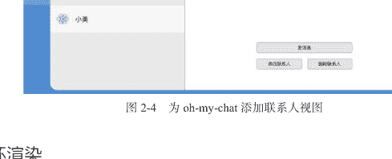

图 2-4 oh-my-chat 新增通讯录界面

### 2.3.2 循环渲染

当前前端大量页面都以数据驱动，数组是渲染列表时最常用的结构。JSX 里把数组映射成视图通常叫做遍历渲染。

以 oh-my-chat 的对话列表为例：

```
<ul className="thread-list">
  {threads.map((thread) => (
    <li key={thread.id} className={thread.active && 'active'}>
      <a href="#">
        
        <div className="thread">
          <span className="contact-name">{thread.contactName}</span>
          <span className="update-time">{thread.updateTime}</span>
          <span className="latest-message">{thread.latestMessage}</span>
        </div>
      </a>
    </li>
  ))}
</ul>
```

上面就是典型的数组映射写法。threads 为空时得到空数组，不会输出任何节点；有数据时则生成一组 JSX 节点。遍历过程中每个 thread 都会被映射为对应的结构：

```
<ul className="thread-list">
  {[
    <li key={1}>小帅</li>,
    <li key={2} className="active">小白</li>,
    <li key={3}>小美</li>,
    {/* 其他省略 */}
  ]}
</ul>
```

遍历时每项根节点 <li> 必须声明 key。排序、新增或删除时，key 能帮助 React 准确复用与更新节点，提升性能。具体原理在 9.2 节虚拟 DOM 与 9.3 节协调过程会展开，这里只讲使用规范。key 可为数字或字符串，要求在同一数组内部唯一，且同一数据项在多次渲染中保持稳定，常用数据库主键或 UUID。

掌握遍历用法后，做个练习。回到 2.3.1 节新加的 ContactsPane，把函数体改为大括号并显式 return，在内部声明一个 contacts 数组存放多条通讯录信息：

```
const ContactsPane = () => {
  const contacts = [
    {
      id: 1,
      name: '小帅',
    },
    {
      id: 2,
      name: '小白',
    },
    {
      id: 3,
      name: '小美',
      active: true,
    },
    {
      id: 4,
      name: '大壮',
    },
    // 省略
  ];

  return (
    {/* 省略 */}
  )
};
```

随后把 `<ul>` 下的静态子节点换成 JS 表达式，对 contacts 进行遍历。遍历时每项会作为 contact 参数传入，模板里即可使用该对象的字段：

```
<ul className="contact-list">
  {contacts.map((contact) => (
    <li key={contact.id} className={contact.active && 'active'}>
      <a href="#">
        
        <div className="contact-name">{contact.name}</div>
      </a>
    </li>
  ))}
</ul>
```

保存后刷新浏览器，图 2-5 的效果与硬编码版本一致。

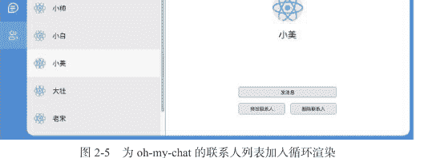

至此本章对 oh-my-chat 的改动告一段落，可以试试让 Copilot 辅助写提交信息。打开 VS Code 的源代码管理侧边栏，在提交信息输入框右侧点“用 Copilot 生成提交消息”，工具会结合 App.jsx 与 App.css 的变更自动生成描述，如图 2-6 所示。确认后点击提交即可把改动推送到本地仓库。

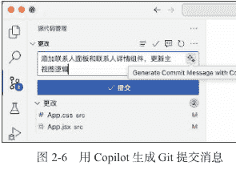

图 2-6 用 Copilot 生成 Git 提交消息

### 2.3.3 透传子元素

前面的示例已表明多个组件在 JSX 中可以灵活组合。嵌套是一种常见组合方式，而在自定义组件里透传子节点是最典型的嵌套模式。

先看 HTML 标签的嵌套：

```
<ul>
  <li>消息</li>
</ul>
```

两个自定义组件嵌套时，例如：

```
<List>
  <Item text="消息" />
</List>
```

参照 2.3.2 节的说明，List 的子节点会作为 children 属性传入 List 组件，于是 List 可以这样定义：

```
const List = ({ children }) => (
  <ul>
    {children}
  </ul>
);
```

通过这种方式，传递给 List 的 children 会被放进 List 自身的 JSX，成为 `<ul>` 的子节点。注意透传内容不限于自定义组件，原生标签如 `<li>` 也完全可行。

### 2.3.4 属性展开语法

JSX 在处理标签属性时提供了一种展开写法。例如：

```
const Button = (props) => (
  <button {...props} />
);
```

这段代码利用了 JS 对象的展开语法 ...，把 props 对象里的全部字段一次性赋给 button，避免逐个书写，代码更简洁。该写法常用于把父级属性向下传递，后面 4.3.3 与 5.2.2 节的练习也会用到。

除上述四种模式外，组件抽取与复用过程中还会遇到其他写法，12.3 节会涉及。

## 2.4 AI 辅助：生成 JSX 代码

回顾 1.4.2 节，我们曾用 Copilot 的代理模式生成过通讯录页面的代码。现在对比手工编写与 AI 生成的差异，先从仓库检出第一章结束时的代码，再用 1.4.2 节的提示语重新生成。AI 修改的片段如图 2-7 所示。

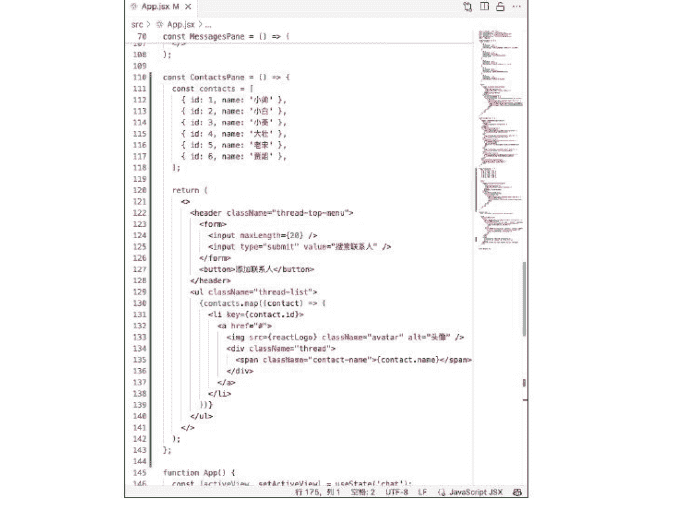

可以看出，AI 生成的中间栏 JSX 与手工版基本一致，连组件名也保持为 ContactsPane。样式方面 AI 直接复用了 ThreadsPane 的已有样式。App 组件内部也根据视图状态条件渲染了 ThreadsPane 或 ContactsPane。可惜右侧详情没有生成。即便如此，接受 AI 的输出也能大幅减少手写量。

特别说明一下，手写时并未参考 AI 的结果。那 AI 为何能写出如此相近的代码？这与生成式 AI 的上下文 Prompt Context 有关，与 React 的 context 不同。

以 Copilot 为例，主流 AI IDE 的核心能力都基于生成式 AI。我们在聊天框输入的内容即提示语，可为任意自然语言，中文英文皆可，上传原型图也算提示语的一种。点击发送后，Copilot 会把项目部分源文件作为上下文，结合提示语和内置的 Instruction 拼接成完整提示，发送给远程大模型，如 Anthropic 的 claude 3.5 Sonnet 或 OpenAI 的 GPT-4o。模型在预训练时已学习大量 JavaScript、React 知识，因此具备编程能力，返回分析过程和代码。

如果选择代理模式，Copilot 会多次调用模型，每次都带上更相关的上下文，并根据上一次返回结果动态调整下一次调用，直到得到满意结果。这种由模型自主决定执行步骤的程序在中文社区常被称作智能体 Agent 或 Intelligent Agent，比“代理”更准确。智能体还能主动调用外部工具，这里不展开。Copilot 的代理模式就是一个智能体，能处理更复杂需求并自动修改源文件。

回到相似性问题，关键在于 Copilot 把 1.4.1 节编写的 App.jsx 中聊天视图代码纳入了上下文，于是生成的命名、JSX 层级、样式习惯都接近聊天视图，也就是手工版的风格。在全新 React 项目里用相同提示语，风格就会不同。风格一致的代码更利于后续扩展和维护。

再看 AI 生成的不足，最明显的是右栏没生成，原因可能是提示语不够、上下文不足或模型能力限制。我曾换过不同模型和 IDE 如 Cursor，结果各不相同。有几次用 Cursor 成功生成了中栏和右栏的 JSX，并额外把 CSS 写进 App.css 中，这里不再详述。实际上，哪怕提示语、原型图、上下文完全相同，用同一 IDE 和模型多次生成也会得到不同结果，这种随机性源于 LLM 原理，本书不深入讨论。

想弥补不足，可以在提示语里更详细地描述需求，或者把任务拆得更细。我们先试第一种方案。在 Copilot 中撤回上次生成的内容，然后输入带 Markdown 语法的提示语：

本次操作要求在当前文件里继续扩充功能。现有代码已具备聊天视图，点击顶部导航中的“联系人”入口就应该切换到联系人视图。新增的联系人视图需要满足两点：中间区域呈现联系人列表，并且默认选中第三条；右侧区域展示所选联系人的详细信息。

输出范围包括两部分文件：在 `App.jsx` 里实现联系人列表组件与联系人详情组件，并在 `App` 组件内部调用它们；在 `App.css` 里补充对应的样式规则。

实际生成效果如图 2-8。Copilot 按照需求在 `App.jsx` 中补充了 `ContactsPane` 与 `ContactDetail` 两个组件，并在 `App.css` 中写入了配套样式。

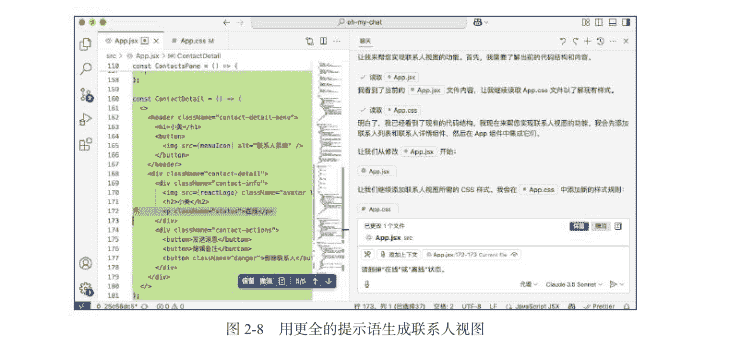

现阶段大语言模型仍然会犯错，幻觉现象难以根除，所以人工复核必不可少。在代码编辑器的改动预览中，Copilot 会逐行展示差异，需要逐条核对、定位问题并修复。刚生成的两个组件里，Copilot 自行加上了“在线”“离线”状态标识，这与需求不符，可以明确要求删除该部分。剩下的实现基本符合预期。实验结束后再把 AI 生成的代码移除，检出 2.3.2 节的最新版本，以便进入下一章学习。

## 2.5 小结

本章围绕 React 的页面描述技术 JSX 语法展开。先点明 JSX 本质上是 `jsx()` 函数的语法糖，再与传统 HTML 进行对照，说明标签写法与 JavaScript 表达式的嵌入方式。随后强调 JSX 的声明式设计思路，指出 JSX 语句最终产出的是 React 元素，并归纳了条件渲染与循环渲染两类常用模式，借助这两种模式为 oh-my-chat 完成联系人视图的实现。最后对比了 Copilot 代理模式下生成的联系人视图代码与手写代码的差异，并通过提示词优化来提升生成质量。过程中穿插介绍了生成式 AI 的相关术语，如 LLM、上下文、智能体、幻觉等。

# 第 3 章 React 组件

本章的知识点概览与项目落地示意见图 3-1。

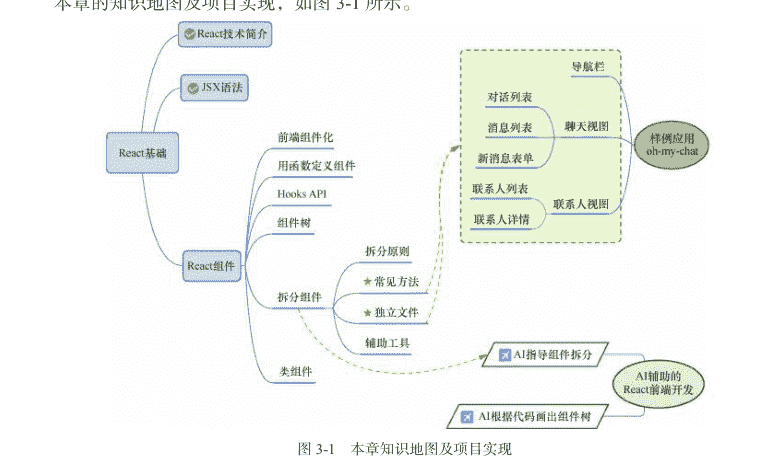

组件化开发已成为前端主流范式，业界多数框架都引入了组件概念，叫法可能是 Component 或 Widget。**在 React 里，组件是整个应用的基石。**

学习组件化时开发者常会卡在以下几个疑问。

- 做应用时是否一定要拆分组件？能不能只靠一个组件把项目做完？
- 面对需求文档，该如何决定拆分边界？
- 组件粒度的拿捏有没有统一标准？

需要厘清的是，**组件拆分没有唯一答案**。实践中要结合业务场景与交互流程来搭建组件层次结构，并用单一职责原则检验拆分是否合理。另外要避免一个误区：组件可以用来复用代码，但并非每个组件都具备复用的价值。

本章从前端组件化的讨论切入，逐步拆解 React 组件的工作原理。先介绍组件的定义与构成，触及与组件密不可分的 Hooks API，以及多个组件如何构成组件树；再以 oh-my-chat 为例演示具体的组件拆分实践；最后补充如何借助 AI 辅助拆分并绘制组件树。学完本章，前述问题就能得到解答。

## 3.1 前端开发组件化

在前端语境里，组件是对视图及其关联的逻辑、数据、交互行为的封装单元。前端组件化就是以组件为基本单元，贯穿设计、开发、测试到部署，实现模块化的现代开发方式。

组件化带来的收益主要有三点。

- 开发效率提升。把复杂应用拆成可并行开发的模块，降低整体复杂度，开发者能集中精力做单一组件的功能，协作也更顺畅。
- 代码复用增强。设计良好的组件可在同一项目甚至不同项目间重复使用，降低开发成本并保持交互体验一致。
- 测试可行性提高。组件可以脱离完整应用上下文独立测试，便于编写单元测试或组合测试，提升质量保障能力。

当然，组件并非前端唯一的组织方式。21 世纪初 ASP.NET 1.0 起以 Web 页面为单位的 Web Forms，Java 生态的 Struts 2 以 Action 为核心的 MVC 框架，都是基于服务端渲染的成熟实践。随着 Web 应用日益复杂，组件凭借更细粒度的封装能力更契合现代需求，因而在浏览器端 JavaScript 框架中成为主流。

若缺少组件化封装，视图、逻辑、交互等代码容易分散冗余，耦合度升高、内聚性下降，形成难以维护、扩展困难的结构。

例如下面这段 HTML 表单代码，常出现在早期的所见即所得制作用品中：

```
<div id="_panel1"><form id="_form1"><input name="__text1" value=""></form></div>
<div id="_panel2">
  <form id="_form2"><input name="__check1" type="checkbox" value="checked"></form>
</div>
<div id="_panel3">
  <script type="text/javascript">
    function _form3_submit(event) {
      var data = {};
      data.text1 = document.getElementById('_form1').elements['__text1'].value;
      data.check1 = document.getElementById('_check1').elements['__check1'].value;
      ajaxPost(_handler_url, data);
    }
  </script>
  <form id="_form3" onsubmit="_form3_submit">
    <input name="__submit1" type="submit"><input name="__reset1" type="reset">
  </form>
</div>
```

表面看结构完整，实则杂乱难辨。在引入现代 AI 技术前，传统工具生成的代码多基于内部中间模型，往往不考虑开发者的真实诉求，这类代码维护成本极高。

未来 AI 或许能承担部分前端工作，但当前面向开发者的前端技术仍是构建高质量代码的关键保障。组件化封装作为低耦合高内聚的工程实践，已被证明是有效的前端范式。

## 3.2 用函数定义 React 组件

React 作为组件化框架，组件是应用开发的基本单元。与其他框架相似，React 组件封装视图与逻辑，粒度可根据设计灵活调整，既可以是一整页的功能，也可以是一个基础的按钮交互。

在 React 中创建组件，只需要写一个 JavaScript 函数：

```
function MyComponent(props) {
  return (
    <p>你好，{props.name}</p>
  );
}
```

这个函数甚至不需要调用任何 React API。定义时需遵守以下规范。

- 函数名必须大写开头。
- 函数可接收一个可选的 object 类型参数，通常命名为 props。
- 返回值可以是 React 元素、字符串、数字、布尔值、null、undefined，或由这些类型组成的数组。

这样定义的 `MyComponent` 可以像标签一样被其他组件的 JSX 使用：

```
function App() {
  return (
    <main>
      <MyComponent name="React" />
    </main>
  );
}
```

当 `App` 被渲染时，页面会输出“你好，React”。

组件的使用场景还有很多。例如 2.1.1 节提到的与 `jsx()` 等价的 `React.createElement()`，下面两行写法是等价的：

```
<MyComponent name="React" />
React.createElement(MyComponent, { name: 'React' });
```

回看 oh-my-chat 项目到第 2 章的代码，`ThreadsPane`、`MessagesPane`、`ContactsPane`、`ContactDetail` 都是合法的 React 组件，但写法与 `App` 不同，前者采用了 ES6 箭头函数，例如 `ThreadsPane` 的定义形式：

```
const ThreadsPane = () => {
  const threads = [/* 省略 */];
  return (
    <>/* 省略 */</>
  );
};
```

而 `ContactDetail` 直接返回 JSX，并省略了函数体的花括号 `{}`：

```
const ContactDetail = () => (
  <>/* 省略 */</>
);
```

这些语法变体在功能上完全等价，开发者可按习惯选用。需要留意的是，函数式组件与普通 JavaScript 函数仍有区别。

- 组件内部禁止使用 `this` 关键字。
- 组件不能作为构造函数调用，不可使用 `new`。

回到返回值要求，这与 2.2.2 节所述的 JSX 子元素类型一致。React 内部为函数组件返回值定义了专门类型 `ReactNode`，JSX 子元素类型也是 `ReactNode`：

```
type ReactNode = ReactElement | string | number | boolean | null | undefined
| ReactPortal | Iterable<ReactNode>;
```

值得注意的是 `undefined`。React 18 之前不允许组件函数直接返回 `undefined`，原因是开发者可能遗漏 `return` 语句，React 会用报错提醒遗漏。显式返回 `undefined` 与遗漏返回的效果相同，因而早期版本禁止。React 18 之后更依赖静态检查工具提醒，限制放宽。但为保持语义清晰与向后兼容，本书仍建议减少返回 `undefined` 的写法，若需渲染空内容，可使用 `return null` 或 `return false`。

除了包含 JSX 的常见写法，下面示例展示了其他合法的组件形式，虽然在实际开发中较少见：

```
const StringComponent = () => '你好 React';
const NumberComponent = () => 1234;
const NullComponent = () => null;
const ArrayComponent = () => [1, 2, 3];
```

## 3.3 组件与 Hooks API

以函数为载体，组件能实现的功能包括声明组件名称、传递 props、用 JSX 描述渲染内容，这三项分别对应函数名、参数和返回值。

- 组件状态管理
- 副作用的处理
- 组件生命周期
- 事件处理

事件处理可直接通过 JSX 标签属性如 `<button onClick={}>` 实现，其余功能需要在组件函数内部实现。从语义上看，函数名、参数、返回值分别对应声明名称、传递 props、定义渲染内容，那么可扩展的部分就是函数体、附加参数以及装饰器。React 通过扩展函数体来实现上述能力，具体载体就是 Hooks API，简称 Hooks。

### 3.3.1 借用函数式编程理解 Hooks

Hooks 是 React 构建组件逻辑的核心手段，可用于操作状态、定义副作用、创建自定义 Hooks。Hooks 源自函数式编程，但在 React 中必须遵守特定约束。

React 对 UI 的理想模型是 UI = f(state)，UI 是视图，state 是应用状态，f 是渲染过程。这个思路与函数式编程相近。借助纯函数与副作用的概念来理解 Hooks 会更清晰。

先明确纯函数概念。满足以下条件即为纯函数。

- 相同输入始终产生相同输出，不受外部状态或 I/O 影响。
- 调用时不产生副作用，即不修改引用参数、不改动外部状态、不触发 I/O 也不调用有副作用的函数。

下面的 JavaScript 代码就是典型纯函数，给定 a、b 返回两者之和：

```
const func = (a, b) => {
  return a + b;
};
```

用纯函数视角分析下面 React 组件，给定 props a 与 b，每次渲染都返回相同的无序列表：

```
const Component = ({ a, b }) => {
  return (
    <ul>
      <li>{a}</li>
      <li>{b}</li>
    </ul>
  );
};
```

官方未正式使用该术语，但为便于理解，可暂称这类写法为“纯函数组件”。

如前所述，纯函数组件仅能完成声明名称、传递 props、定义 JSX 的基础工作，无法实现其他扩展功能——对纯函数组件而言，这些扩展功能都涉及外部状态或副作用。换句话说，若要让函数组件支持扩展能力，就必须显式访问函数外部状态或执行副作用。

**Hooks 就是为函数组件设计的一套以函数形式存在的 React API，用来访问 React 内部状态或执行副作用操作。** 这里的“React 内部状态”含义较广，不仅包括后续章节的 state 与 context，还涵盖 memo、ref 等。

下面示例在纯函数组件代码中加入 Hooks 以实现状态管理。`useState` Hook 可读取或保存组件的 state，从而让函数组件具备操作 state 的能力：

```
import { useState } from 'react';
const Component = ({ a, b }) => {
  const [m, setM] = useState(a); // 一个 Hook
  const [n, setN] = useState(b); // 另一个 Hook
  return (
    <ul>
      <li>{m}<button onClick={() => setM(m + 1)}>+</button></li>
      <li>{n}<button onClick={() => setN(n + 1)}>+</button></li>
    </ul>
  );
};
```

更贴近实际的例子是 oh-my-chat 项目中的 `App` 组件，下面的代码用 `useState` Hook 创建 `activeView` 状态，并在 JSX 中绑定与更新：

```
function App() {
  const [activeView, setActiveView] = useState('chat');
  return (
    <ul className="top-nav">
      <li className={activeView === 'chat' ? 'active' : undefined}>
        <a href="#" onClick={() => setActiveView('chat')}>消息</a>
      </li>
      <li className={activeView === 'contact' ? 'active' : undefined}>
        <a href="#" onClick={() => setActiveView('contact')}>联系人</a>
      </li>
    </ul>
    {/* 省略 */}
  );
}
```

需要明确，组件的 state 并非绑定在组件函数本身，而是绑定在组件渲染生成的虚拟 DOM 节点，即 FiberNode 节点，具体原理将在 9.3 节讲解。因此在组件函数中调用 `useState` 意味着函数访问了自身之外的 React 内部状态，这会带来副作用，函数组件因此不再是纯函数组件。React 并未强制组件函数必须是纯的。引入 Hooks 后组件虽然失去了纯粹性，但在保持代码简洁的同时获得了状态管理、副作用操作等扩展能力。

要想吃透 Hooks 的运行思路，纯函数、外部状态与副作用这几块概念非常管用。它们不仅是理解 Hooks 设计的参照坐标，也能帮助我们更清晰地剖析 React 组件内部的执行逻辑。

### 3.3.2 Hooks 家族全梳理
React 19.1.0 官方内置的 Hooks 已经超过十个，数量看起来不少，但并不要求一次性全部精通。实操建议是先把三枚基础 Hooks 练熟，再逐步熟悉常用 Hooks 的用法，冷门 Hooks 用到时再查即可。

React 里公认的基础 Hooks 有以下三项。

- useState：负责操控组件状态，具体用法见 4.3 节。
- useEffect：负责处理副作用，具体用法见 6.2 节。
- useContext：负责读取上下文，具体用法见 4.4 节。

其余使用频率较高的 Hooks 如下，部分是基础 Hooks 的延伸，部分虽功能不同但共用底层实现。

- useReducer：多在中大型项目里管理复杂状态，详见 10.4 节。
- useRef：除了基础功能外，还可用于保存可变数据，详见 12.3.2 节。
- useImperativeHandle：需要为子组件暴露命令式接口时，与 useRef 配合使用。
- useLayoutEffect：与 useEffect 功能相近，触发时机不同，详见 9.1 节。
- useMemo / useCallback：用来做性能优化，减少无谓渲染，详见 11.2 节。
- useTransition / useDeferredValue：与用户输入、点击、拖拽等交互直接相关的更新属于紧急更新，当这类更新因异步渲染被拖慢、出现卡顿，可用这两个 Hooks 缓解，详见 11.2 节。
- useActionState 和 useFormStatus：React 19 加入的表单专属 Hooks，详见 14.6 节。

除此之外，还有在 Web 项目里用得不多的 useDebugValue、useId，以及官方面向第三方库作者提供的 useSyncExternalStore 和 useInsertionEffect，遇到需要时查阅官方文档即可。

### 3.3.3 Hooks 用法的两条硬规则
Hooks 在语法上借用了函数式编程的影子，其实现也基于 JavaScript 函数，但本质是 React 私有的 API，并非等同于函数式编程，也不能照搬函数式编程的最佳实践。相较于传统函数式编程，Hooks 使用时必须遵守两点。

- 只能在 React 的函数组件内部调用 Hooks。这包括在自定义 Hook 中间接调用其他 Hooks 的情形，其目的在于保证 Hooks 在 React 的虚拟 DOM 机制里运行，脱离 React 环境的 Hooks 完全无效。
- 只能在组件函数的顶层调用 Hooks。组件函数无论执行多少次，Hooks 的调用顺序必须固定不变，否则 React 就无法稳定追踪与管理状态。换句话说，不能在循环、条件分支里调用，也不能放在任何 return 语句之后。

这两条规则背后的原理会在 9.3.5 节展开分析。

## 3.4 组件层级与渲染树的真相
从单个组件再往上看，就来到组件层次结构的概念。在面向对象里，层次往往指父类子类继承，但 React 并没有用类继承的方式去扩展组件。类组件虽继承自 React.Component，但类组件之间并无继承关系。在 React 中，层次指的是组件与组件之间的嵌套关系。

借助组件层次结构，可以把前端应用的业务逻辑与技术复杂度拆解成多个独立单元，再把它们拼装起来形成完整功能。

React 的组件层级从根组件开始，一层层加入子组件，最终形成一棵树。以图书馆管理系统为例，其组件树可能如下：

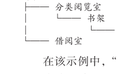

示例中，“图书馆”由“分类阅览室”和“借阅室”组成，“分类阅览室”的基本单元是“书架”，“书架”承载具体的“图书”组件。开发“图书馆”时无需关心“图书”的细节，开发“书架”时也不必涉及“分类阅览室”甚至“借阅室”。这种分层正是关注点分离的体现。组件最终能在浏览器展示的前提，是在渲染函数里加入对应的 HTML 元素，具体实现可参考第 2 章。

值得注意的是：**React 在技术层面并没有真正实现传统意义上的组件树。** 无论是对外 API 还是内部实现，都没有 addChild、setParent 之类建立父子关系的方法。组件间的层次本质上是由 React 元素间接建立的逻辑关系。

在 React 里，组件与 2.2.2 节提到的元素是两个概念。元素是组件渲染的直接产物，在内部只是轻量的 POJO，仅用来描述节点结构，并不会主动渲染其他组件或元素。

我们常说的组件树和父子组件，需要结合 React 元素，从声明与渲染两个维度去理解。

先看声明层面：静态代码中，若一个组件的 JSX 返回值里包含了另一个组件，可认为前者是父组件，后者是子组件，形成逻辑上的父子关系。

假设“图书馆”组件写成如下形式：

```
const 图书馆 = () => (
  <div>
    <分类阅览室 />
    <借阅室 />
  </div>
);
```

从代码结构判断，“分类阅览室”和“借阅室”是“图书馆”的子组件，“图书馆”是它们的共同父组件，但这种判断有局限。回顾 2.3.3 节中透传子元素的写法，若“分类阅览室”支持透传子元素，父子关系可能因动态渲染而产生偏差：

```
const 分类阅览室 = ({ name, children }) => (
  <div>
    <h1>{name} 分类阅览室</h1>
    {children}
  </div>
);
```

随后“图书馆”在 JSX 中指定“分类阅览室”的子元素：

```
const 图书馆 = () => (
  <div>
    <分类阅览室 name="文学">
      <书架 category="小说" />
      <书架 category="传记" />
    </分类阅览室>
    <分类阅览室 name="计算机">
      <书架 category="操作系统" />
      <书架 category="前端开发技术" />
    </分类阅览室>
    <借阅室 />
  </div>
);
```

要确认“书架”到底是“图书馆”还是“分类阅览室”的子组件，就要看渲染层面：组件返回的元素树，剔除 HTML、Fragment 等后，仅保留 React 组件节点。在这棵精简树里，直接包含的组件才是子组件，间接嵌套的不是。即使被嵌套，依据子组件自身的渲染逻辑，它仍可能是子组件的子组件。

回到示例，因为“分类阅览室”最终渲染了透传来的“书架”，两者是直接包含关系，所以“书架”是“分类阅览室”的子组件。这一判定完全依赖“分类阅览室”的渲染实现，如果它在 JSX 中弃用了 children，“书架”就不再属于任何组件的子组件。

基于渲染逻辑建立的父子关系最终构成完整的组件树，也称组件渲染树。9.2 节和 9.3 节会讲到 React 的虚拟 DOM 与协调机制，帮助深入理解层级结构与渲染树。

## 3.5 组件拆分的思路与方法
React 组件是应用开发的基本单元，设计要紧贴产品需求。这里的设计不仅指单一组件，也包括多个组件构成的层次结构。

在实践中，组件层次结构与其说是设计的，不如说是拆分出来的，这个过程与产品需求分解相互促进。以聊天应用 oh-my-chat 为例，下面介绍拆分思路，并在第 2 章代码基础上继续拆分与封装，并抽取到独立文件。

### 3.5.1 用 React Developer Tools 洞察真实组件树
要设计合理的组件树，首先要看清现在的组件树。因为组件树的本质是动态生成的渲染树，受运行时逻辑影响，仅靠静态 JSX 分析容易误判。这时可以用工具辅助。Meta 官方提供的 React Developer Tools 浏览器插件主要提供两项能力：

- 查看页面 React 根组件及由此渲染的组件树；
- 监控 React 页面性能。

在 Chrome、Firefox、Edge 的扩展商店搜索 “React Developer Tools”，确认发布者为 Meta 或 React 后安装即可。安装后开发者工具会新增 Components 和 Profiler 两个面板，如图 3-2。

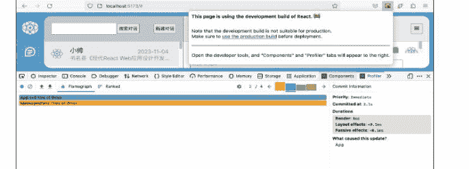

Safari 暂不支持该插件，若需在 Safari 调试，需安装独立 npm 包，命令行执行：

```
npm install -g react-devtools
```

安装后运行 react-devtools 会启动一个 Electron 桌面应用，功能与插件一致。随后在 index.html 的 <head> 中加入：

```
<script src="http://localhost:8097"></script>
```

刷新页面即可与桌面应用联动。安装好插件后启动 oh-my-chat 项目，在开发者工具的 Components 面板即可看到当前组件树，如图 3-3。

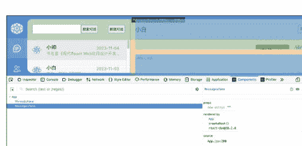

图中 App 是根组件，下挂两个子组件。选中任意组件，对应 UI 会在页面高亮，右侧会同步展示组件信息。点击左上角“检查”按钮，可在页面上反查元素对应的 React 组件。

### 3.5.2 拆分原则与常见做法
组件拆分没有唯一标准，粒度与流程会因经验与项目需求而异。

拆分的动机是产出一组低耦合、高内聚的组件，把视图及相关逻辑、数据、交互封装起来，实现模块化开发。

指导拆分的关键原则是单一职责原则。在组件领域可理解为每个组件只聚焦单一功能，按功能拆分，一个功能对应一个组件，一个组件不承载多种功能。需要说明的是，前端里的“功能”边界并不绝对，该原则并非一成不变。

功能有大小，组件粒度也随之变化，组件数量与颗粒度的关系如图 3-4。

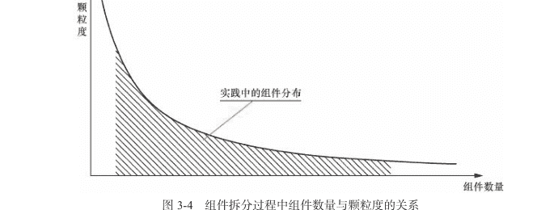

极端情况一是不拆分，所有逻辑堆在根组件；极端情况二是把每个 DOM 都拆成独立组件。实践中应避开两极，大部分组件分布在中间区间，在数量与结构复杂度间取得平衡。

操作上可分为自上而下拆分和自下而上拆分。自上而下是从顶层组件出发，按需求分解逐步拆出子组件与后代组件，适合整体架构设计，强调业务模块划分；自下而上则是先设计叶子组件，再组合成更高层组件，常用于可复用组件开发。下一节以 oh-my-chat 演示自上而下拆分，12.3 节会介绍自下而上拆分。

当视图与逻辑简单时，可边开发边拆分。项目实践中更常见的做法是先明确组件层级与职责，再实现具体功能，这样能快速理清结构，便于任务分配与团队协作。

### 3.5.3 项目实现：继续拆分 oh-my-chat 的组件
从本节起，涉及 oh-my-chat 的实践均在标题前加上“项目实现：”前缀以便定位。

前两章采用自上而下策略，从根组件 App 开始搭建左中右三栏布局并实现左侧导航，随后向下拆分出中栏的 ThreadsPane、右栏的 MessagesPane。ThreadsPane 包含对话列表与顶部工具栏，MessagesPane 包含消息列表与顶部工具栏。按视图条件又从中栏拆出 ContactsPane 实现联系人列表及其工具栏，从右栏拆出 ContactDetail 实现联系人详情。

上述拆分依据是业务功能模块化。

本节依据单一职责原则复盘优化。

分析发现 App 职责过重，既定义页面布局，又提供导航，还条件渲染聊天视图或联系人视图。视图与组件的对应是聊天视图 = ThreadsPane + MessagesPane，联系人视图 = ContactsPane + ContactDetail，这种设计把两个视图的内部逻辑集中到 App，违反单一职责。改进方法是把视图抽离成 ChatView 与 ContactView 两个子组件，原有的 4 个子组件成为这两个视图的子组件。两个视图组件代码如下：

```
const ChatView = () => (
  <>
    <aside>
      <ThreadsPane />
    </aside>
    <main>
      <MessagesPane />
    </main>
  </>
);
```

```
const ContactView = () => (
  <>
    <aside>
      <ContactsPane />
    </aside>
    <main>
      <ContactDetail />
    </main>
  </>
);
```

App 中使用这两个视图组件的代码如下：

```
function App() {
  const [activeView, setActiveView] = useState('chat');

  return (
    <div className="root">
      <nav>{/* 省略 ... */}</nav>
      {activeView === 'chat' ? <ChatView /> : <ContactView />}
    </div>
  );
}
```

优化后 App 只需按条件渲染 ChatView 或 ContactView，不再直接管理 4 个子组件的渲染逻辑。

页面视觉无明显变化，但在 React Developer Tools 的 Components 面板里，可看到组件树新增了 ChatView 层级，如图 3-5。

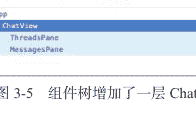

App 左侧纵向导航栏还需要进一步抽成独立子组件，该改动涉及数据传递，将在 5.3.2 节展开。

再看 ThreadsPane 组件，可按功能拆分为顶部工具栏 ThreadTopMenu 与主体对话列表 ThreadList 两个子组件。这两个新组件的代码如下：

```
const ThreadTopMenu = () => (
  <header className="thread-top-menu">
    <form>
      <input maxLength={20} />
      <input type="submit" value="搜索对话" />
    </form>
    <button>新建对话</button>
  </header>
);
```

```
const ThreadList = () => {
  const threads = [/* 省略 ... */];
  return (
    <ul className="thread-list">
      {threads.map((thread) => (
        <li key={thread.id} className={thread.active && 'active'}>
          {/* 省略 ... */}
        </li>
      ))}
    </ul>
  );
};
```

改动之后，ThreadsPane 的职责收缩为单纯的容器，具体渲染交由内部子单元承担，示例代码如下：

```
const ThreadsPane = () => (
  <>
    <ThreadTopMenu />
    <ThreadList />
  </>
);
```

MessagesPane 也可以拆成上中下三段，分别归到 MessageTopMenu、MessageList、NewMessageForm 三个更细的单元，改写后的呈现如下：

```
const MessageTopMenu = () => (
  <header className="message-top-menu">
    {/* 省略 ... */}
  </header>
);
```

```
const MessageList = () => (
  <ul className="message-list">
    {/* 省略 ... */}
  </ul>
);
```

```
const NewMessageForm = () => (
  <form className="compose-message">
    {/* 省略 ... */}
  </form>
);
```

```
const MessagesPane = () => (
  <>
    <MessageTopMenu />
    <MessageList />
    <NewMessageForm />
  </>
);
```

此时打开浏览器开发者工具里的 React Components 面板，能看出组件层级与业务功能的对应更直观，如图 3-6 所示。

沿用 ThreadsPane 的拆分思路，联系人视图下的 ContactsPane 也可解构成 ContactTopMenu 与 ContactList 两个子单元。实现方式与 ThreadsPane 差不多，这里不再展开，读者可自行修改后在 React Developer Tools 里验证。

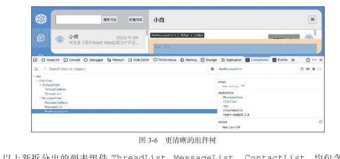

新产生的 ThreadList、MessageList、ContactList 都含有循环渲染逻辑，其列表项还可进一步抽成独立单元，这属于数据驱动视图的优化，将在 4.2.2 节详细说明。

到现在为止，本节做的拆分都是在已有组件的 JSX 内部做细化，并未改变页面呈现与业务逻辑，本质上是组件树的重构。

### 3.5.4 项目实现：将组件拆分为独立文件

经过 3.5.3 节的重构，App.jsx 的代码量已超过 200 行，可读性明显下降。为了提升可维护性，建议把这些 React 单元分散到多个独立源码文件里。

即便带 JSX 的 *.jsx 文件本质上仍是 JavaScript 源码，也能用标准的 import/export 进行互相引用。本节以 3.5.3 节刚调整过的 oh-my-chat 项目为例，演示如何把组件放到独立文件。

首先在 oh-my-chat 项目的 src 下新建 components 文件夹，用来存放拆分出的单元文件。在该文件夹下新建 ThreadTopMenu.jsx，把 App.jsx 中的 ThreadTopMenu 代码整体搬进去，并在文件尾部加上默认导出。完整内容如下：

```javascript
const ThreadTopMenu = () => (
  <header className="thread-top-menu">
    <form>
      <input maxLength={20} />
      <input type="submit" value="搜索对话" />
    </form>
    <button>新建对话</button>
  </header>
);

export default ThreadTopMenu;
```

在 App.jsx 里补上一行导入语句：

```javascript
import ThreadTopMenu from './components/ThreadTopMenu.jsx';
```

这时可以把 App.jsx 中原本的 ThreadTopMenu 代码删除，保存后页面功能与样式保持不变，就说明文件拆分成功。

接下来，把 App.jsx 中除 App 本身外的每个单元都拆到独立文件。操作比较繁琐，可以借助 IDE 的重构功能来省力。以 VS Code 为例，光标选中 ThreadList，按 ^R 或右键打开重构菜单，选择“移动到新文件”，编辑器会把 ThreadList 代码及其相关的 import 语句搬到同目录下的新文件 ThreadList.jsx。随后把 ThreadList.jsx 拖进 components 文件夹，编辑器会自动提示更新引用路径，选择“是”。查看 ThreadList.jsx 会发现声明语句前多了一个 export，即

```javascript
export const ThreadList = () => { // ...
```

在 App.jsx 中，对应的导入写法与手动编写的有差别：

```javascript
import { ThreadList } from './components/ThreadList.jsx';
```

这是因为 VS Code 的“移动到新文件”功能默认采用了命名导出。

JavaScript 的导出有两种形式：默认导出和命名导出。文件只有一个导出项时常用默认导出，多个导出项时常用命名导出，但并非绝对，两种形式可以共存。不同导出对应不同的导入写法，如表 3-1。

表 3-1 JavaScript 文件导出语句与导入语句的对应关系

| | 导出语句 | 导入语句 |
|---|---|---|
| 默认导出 | export default ThreadList; | import ThreadList from './ThreadList.jsx'; |
| 命名导出 | export const ThreadList = // ... | import { ThreadList } from './ThreadList.jsx'; |
| 混合 | export const threadData = // ...<br>export default ThreadList; | import ThreadList, { threadData } from './ThreadList.jsx'; |

为保持项目内部统一，把 ThreadList.jsx 的导出方式改成默认导出，即 export default ThreadList 的形式。

同理，把 App.jsx 里的其他单元逐个搬到 components 文件夹各自的新文件里。重构时除了注意默认与命名导出，还要注意相对路径，例如在 components/MessageList.jsx 中引用 assets 目录的资源，需要写成：

```javascript
import reactLogo from '../assets/react.svg';
```

拆分完成后浏览器页面应保持原样。此时项目目录结构如图 3-7 所示，每个 .jsx 文件的行数明显减少，可读性提升。

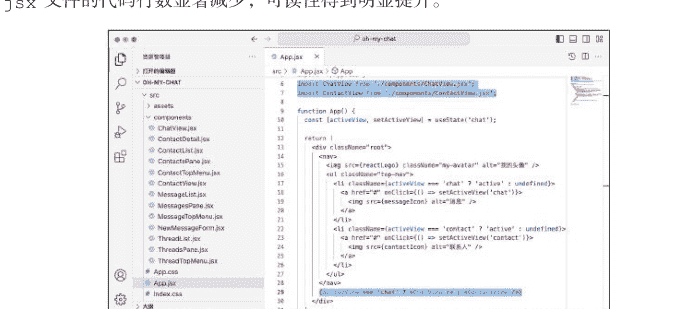

在 React Developer Tools 的 Component 标签页里，组件来源已经发生变化，如图 3-8 所示。

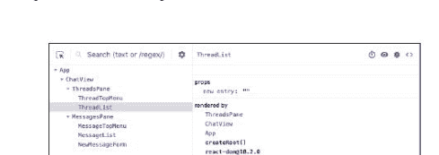

除了 App.jsx，还有样式文件 App.css 需要拆分，这部分修改将在 8.4 节介绍。

随着项目推进，components 文件夹下的文件会越来越多，可能会产生疑问：是否所有单元都要放在同一个文件夹？有没有更具扩展性的目录结构？这个问题将在 12.4 节深入讨论。

### 3.5.5 组件拆分的一些心得

决策疲劳 Decision Fatigue 是一个心理学概念，指连续做决策时决策效率和准确性会逐渐下降，甚至导致错误判断。

在 React 开发中，需要把设计稿转化为界面，势必进行组件拆分。单元可以很大也可以很小，拆分过程中要不断权衡颗粒度、复杂度、可维护性、可测试性，容易引发决策疲劳，导致对后期拆分产生疑虑，甚至怀疑前期判断，增加心理负担。

减轻决策疲劳的建议如下。

- 不必追求一步到位，可以在实现过程中持续优化拆分。
- 不必追求绝对完美，后续可根据实际需求随时调整结构。
- 拆分时保持专注，暂时不考虑后端接口等其他维度，减少决策负荷。
- 日常积累拆分经验，有助于提升后续项目的效率。

## 3.6 AI 助推：AI 与组件树设计

设计和拆分组件像庖丁解牛，经验越多越得心应手。但 React 初学阶段，很多开发者会犹豫不决，不知道如何设计和拆分，甚至希望有导师在侧指导。实际上 AI 可以充当导师角色。

### 3.6.1 AI 助力：让 AI 指导组件拆分

在启动新项目或为现有项目新增业务模块时，对组件设计感到困惑，可以向 AI 寻求指导。你需要清晰描述 UI 的功能布局。1.4.2 节和 2.4 节主要依赖原型图，本节尝试纯文字描述需求。

打开 Copilot 界面，将聊天模式切到“询问 Ask”，模型切到 o3-mini，输入以下提示：

> 我需要实现一个网页端聊天应用的 UI，UI 设计如下：
> 
> * 这个 UI 整体是横向三栏式的。它包括两种视图：聊天视图和联系人视图。UI 的左栏是纵向导航栏，包含分别指向两种视图的链接。中栏和右栏会随视图动态改变。
> 
> * 当 UI 处于聊天视图时，中栏从上到下显示搜索框、聊天列表，用户可以选中列表中的其中一个聊天，右栏从上到下显示选中聊天的联系人名称、消息列表和发送消息文本框。
> 
> * 当 UI 处于联系人视图时，则中栏从上到下显示搜索框、联系人列表，用户可以选中列表中的其中一个联系人，右栏显示当前选中的联系人的详细信息（包括联系人名称等信息）。
> 
> 请根据上述 UI 需求，帮我设计 React 组件层次结构，组件名称为英文，根组件为 `App`。输出结果采用 Markdown 格式。例如：
> 
> * `App`
>   * `Form`
>     * `TextInput`
>     * `Button`

在询问模式下，Copilot 类似于一个专注软件开发的 LLM 聊天机器人。与 ChatGPT 或 DeepSeek 不同，它更聚焦代码相关问题。选择 o3-mini 是因为它在需要深度思考和推理的场景下表现更好。不同 AI IDE 接入的模型各有擅长，开发者可按需选择。

提示语的特殊之处在于在 UI 描述后加入了“设计 React 组件层次结构”的明确指令，并指定了输出格式和示例。这种提供示例的技术叫单样本提示 One-shot Prompting，可引导模型给出更准确的答案。提示工程还包含零样本、少样本、思维链等技术，感兴趣可进一步查阅相关资料。

发送后，Copilot 会返回如下结果：

下面是一个可能的 React 组件层次结构设计示例：

```
* App
    * Sidebar
        * NavigationLink (用于切换视图: Chat/Contacts)
    * ChatView (当选择聊天视图时)
        * ChatPanel (中栏)
            * SearchBar
            * ChatList
        * ConversationPanel (右栏)
            * ContactHeader
            * MessageList
            * MessageInput
    * ContactsView (当选择联系人视图时)
        * ContactsPanel (中栏)
            * SearchBar
            * ContactsList
        * ContactDetailPanel (右栏)
            * ContactDetail
```

该方案中 App 作为根节点，会根据当前视图呈现 ChatView 或 ContactsView，左侧 Sidebar 提供视图切换。开发者可根据具体需求继续拆分或调整。

AI 生成的组件树与手工拆分结构非常相似，主要差异在英文命名上，可作为设计参考。

AI 辅助拆分并不局限于 Copilot，例如在 DeepSeek 中开启深度思考模式，输入相同提示也能获得不同方案。

### 3.6.2 AI 助力：基于代码绘制组件树

对新项目 AI 可辅助设计，对已有项目能否用 AI 分析现有组件层级？完全可以。俗话说一图胜千言，本节演示如何让 AI 根据组件代码自动生成结构图。

先为 Copilot 安装 vscode-mermAId 插件，标识符为 ms-vscode.copilot-mermaid-diagram。安装后在 Copilot 聊天框输入“@”，选择新添加的 @mermAId，输入以下提示：

```
@mermAId 请生成以 `App` 为根组件的组件层次结构图。
```

为保证准确率，需要手动把所有组件源文件加入上下文。在 VS Code 资源管理器中选中 oh-my-chat 项目除 main.jsx 外的所有 JSX 文件，拖拽到聊天框，如图 3-9 所示。

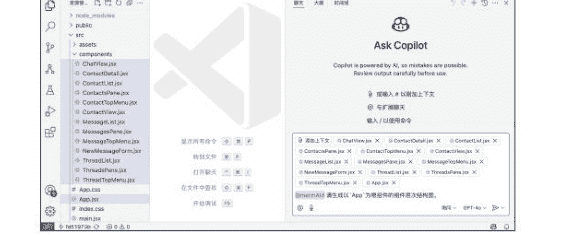

发送后，mermAId 插件会根据选中的代码自动生成组件层级图，如图 3-10 所示。

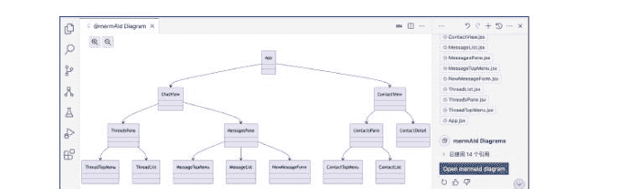

与 React Developer Tools 浏览器插件展示的运行时结构不同，AI 生成的结构图是基于静态代码分析，关系更完整，有助于更全面地了解项目架构。

## 3.7 过时 API：类组件

3.2 节介绍了 React 组件的写法，社区和部分文档中仍能见到另一种写法：类组件。本节简要回顾其发展历程。

### 3.7.1 函数组件的崛起

截至 2025 年，React 已开源 12 年，期间持续演进。其中最具代表性的转变是从类组件向函数组件迁移。

早期 React 组件写法并不精简。2025 年 React 最新版本是 v19.1，而 2015 年 React 发布 v0.13 和 v0.14 时，主流写法是：

```javascript
const Thread = React.createClass({
    render: function() {
        return (<div>对话 ...</div>);
    }
});
```

Meta 官方自 v0.13 开始推广基于 ES6 的 class 写法：

```javascript
class Thread extends React.Component {
    render() {
        return (<div>最近消息：{this.props.latestMessage}</div>);
    }
}
```
基于类的实现方式在概念上归为同一类，业内常称作类式写法。核心在于实现 render 这个函数体，它的输出可以是 JSX 片段、基础数据类型（React 18 之前返回 undefined 会报错）、其他 React 节点，或这些类型的数组。除此之外，这类写法还能挂载额外属性与方法，从而完整支撑状态、交互、生命周期等能力，具体细节这里不展开。

React 在 0.14 引入了更轻量的无状态函数写法：

```javascript
// ES6 箭头函数
const Thread = (props) => {
    const latestMessage = props.latestMessage;
    return (<div>最近消息：{latestMessage}</div>);
};

// 更简单的箭头函数 + 参数解构
const Thread = ({ latestMessage }) => (
    <div>最近消息：{latestMessage}</div>
);
```
该写法接收 props 作为入参，返回值的形态与前面两种写法中 render 的结果保持一致。在 Hooks 出现之前，这类函数本身不支持内部状态，必须由上层组件持有状态并向下分发。虽然功能受限，但因写法简洁获得了大量拥护，也促成了不少扩展方案，比如高阶组件。

比较有代表性的是 recompose，下面用例子说明：

```javascript
import { withState } from 'recompose';

const enhance = withState('activeView', 'setActiveView', 'chat');
```

```javascript
const App = enhance(({ activeView, setActiveView }) => (
  <div className="root">
    <nav>
      {/* 省略 */}
      <a href="#" onClick={() => setActiveView('contact')}>联系人</a>
    </nav>
    <aside>
      {activeView === 'chat' ? <ThreadsPane /> : <ContactsPane />}
    </aside>
    {/* 省略 */}
  </div>
));
```
在这个例子里，App 的主体是一个作为 enhance 参数的箭头函数。recompose 提供的 withState 会生成只负责状态的高阶组件，它会创建名为 activeView 的状态，并把该状态通过 props 注入到子函数组件，最终组合成完整可用组件。顺带一提，recompose 的作者后来加入了 React 核心团队。

React 16.8 正式发布 Hooks 后，函数组件获得了与类写法同等的完整能力，并逐步成为主流。个人回想起来，当时对这种流行趋势是有些意外的。起初我更偏爱 ES6 类，但在体验过 recompose 与官方 Hooks 后，很快就被更简洁的 API 说服。

综合来看，函数写法能够取代类写法，主要推动力有：

- 更贴合 React 的核心理念，即界面是状态的函数。
- 让关注点的分离做得更彻底。
- 受函数式编程思想的影响。
- React 内部实现在持续优化。
- 开源社区的反哺与推动。

### 3.7.2 类写法现在还要学吗
当前官方建议新项目优先用函数定义组件，主流开源库也在向函数组件配合 Hooks 迁移。类写法已被标记为遗留 API，但考虑到存量代码规模，官方没有计划彻底移除，它仍可能出现在老项目、旧文档或教材里。

若目标是学习 React 开发，现在投入时间研究类写法是否必要？我认为必要性不大，原因如下。

- 官方已把组件的默认理解等同于函数写法。自 2019 年初发布 v16.8.0 起至今多年，React 已演进到 v19.1.0，函数组件已全面占主导，成为标准模式。
- 初学顺序会影响思维定式。类写法对应面向对象，函数写法更接近函数式编程。先接触类写法，容易用面向对象的视角套用 React 概念。

## 3.8 本章回顾
React 是一款组件化前端框架，组件是开发的基本单元。本章从组件化的价值切入，引出 React 组件，覆盖了以下四个维度：

- React 组件的定义；
- 如何用函数编写组件；
- Hooks API 的构成、与组件的关系及使用限制；
- 多个组件如何组成组件树。

在此基础上探讨了如何把完整应用拆分为若干组件并组合，依据单一职责原则把示例聊天应用 oh-my-chat 继续细分为更小粒度的组件，并把它们放到独立文件，提升可读性和可维护性。

掌握手工拆分后，本章还介绍了借助 AI 辅助拆分，并演示了使用 Copilot 插件 mermAld 根据已有代码生成组件层级结构图。

最后介绍了 React 的另一种过时写法——基于类的组件，帮助读者理解函数组件和 Hooks 如何逐步成为主流开发方式。

# 第4章 React 数据导向概览
本章知识地图及项目实现，如图 4-1 所示。

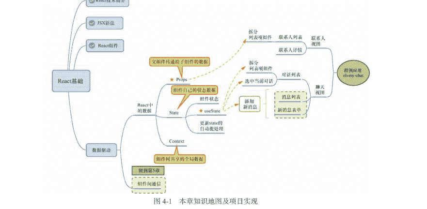
在当下，数据无处不在。浏览网页、使用手机或电脑应用，人们时刻与数据交互。正因如此，数据成为前端应用的核心，以数据为导向也成为前端开发的关键特性。React 正是在这一理念下构建的数据导向框架。

接下来两章会深入实践 React 中的数据导向。你将能够回答：

- 前端应用涉及哪些类型的数据？是否仅限于数据库中的数据？
- React 框架里包含哪些数据？各自的作用是什么？
- 组件之间如何实现数据传递？
- 什么是数据流？为何 React 强调单向数据流的设计原则？

本章会介绍数据导向与 React 的关系，并详细讲解 props、state、context 的概念与用法。后文会介绍组件通信机制及单向数据流的底层原理。

## 4.1 React 的数据导向本质
数据导向是一个宽泛概念，在商业、技术、方法论和实践中都有体现：

- 数据导向决策：依据数据分析而非直觉做决策，用于战略、营销、财务、运营等。
- 数据导向设计：在产品、交互、界面设计中，利用用户行为追踪、反馈收集、A/B 测试等手段指导设计。
- 数据导向开发：以数据为核心贯穿设计、开发、测试等环节。
- 数据导向编程：一种范式，把数据流和控制流抽象为运行时数据，提升灵活性，例如动态表单库会根据字段类型自动选择组件。

React 的设计理念 界面是状态的函数 正体现了这一思想，其中 state 就是数据参数。给定组件，不同数据输入即可得到不同界面。数据导向为 React 带来：

- 更清晰的关注点拆分：React 用专属 API 分离视图与状态，开发者声明式构建组件，React 在数据变化时自动更新。
- 更好的用户体验：界面始终与最新数据同步，交互更流畅。
- 更高的性能：虚拟 DOM 与高效差异对比机制让数据变化只触发必要的 DOM 操作。
- 更强的复用与扩展：对数据流的抽象让组件更专注视图与业务逻辑，便于复用和扩展。

第 3 章介绍了如何搭建组件，本章会讲解 React 中的数据种类及设计使用方法。

驱动 React 应用的数据主要有三种：属性 props、状态 state 和上下文 context。这三个是 React 的专有名词，各自有 API 与实现。为避免混淆，本书直接使用英文原名。

## 4.2 Props 数据传递机制
前两章讲解 JSX 语法和自定义组件时多次提到 props，本节系统介绍。

### 4.2.1 Props 的声明与使用
自定义组件接收一组输入参数改变运行时行为，这组参数即 props。props 通常用于父向子分发数据。子组件依据 props 值定制渲染与交互，真正的控制权仍在父组件，这提升了子组件的灵活性和复用性。

用函数声明组件时，第一个参数就是 props。实践中常见两种写法：

- 在组件内部直接读取 props 对象的属性；
- 用 ES6 解构赋值展开函数参数，直接在组件内使用单个 prop 变量。

二者本质等价，示例如下：

```javascript
// 1. 读取 props 对象的属性
function MyComponent(props) {
  return (
    <ul>
      <li>{props.prop1}</li>
      <li>{props.prop2}</li>
    </ul>
  );
}
```

```javascript
// 2. 用解构赋值语法展开 props 参数
function MyComponent({ prop1, prop2 }) {
  return (
    <ul>
      <li>{prop1}</li>
      <li>{prop2}</li>
    </ul>
  );
}
```
第二种写法更灵活，例如为 prop 设置默认值：

```javascript
function MyComponent({ prop1, prop2, optionalProp = 'default' }) { // ...
```
还可利用 ES2018 的 Rest Properties 把剩余属性收集到一个变量，便于透传给子元素：

```javascript
function MyComponent({ prop1, prop2, ...restProps }) {
  return (
    <ul {...restProps}>
      <li>{prop1}</li>
      <li>{prop2}</li>
    </ul>
  );
}
```
JavaScript 是动态语言，函数参数类型灵活。props 作为整体是对象；props 里每个属性都是一个单独的 prop，其类型可以是原始类型、对象、数组、函数，甚至 React 元素。

无论写法如何，无论整体还是单个属性，props 都是不可变的，组件内部不应修改外部传入的 props。如需更新渲染内容，应由父组件修改 state 并传入新值，具体在 4.3 节说明。不可变性将在 10.2 节讨论。

在其他组件中使用子组件时，可通过 JSX 语法为其 props 赋值：

```javascript
const ParentComponent = () => (
  <MyComponent prop1="文本" prop2={123} booleanProp={false}
    onClick={(evt) => {console.log('clicked')}} />
);
```
关于 JSX 标签属性可回顾第 2 章，这里不再赘述。3.4 节还介绍过一个特殊 prop：children。

```javascript
const 分类阅览室 = ({ name, children }) => (
  <div>
    <h1>{name} 分类阅览室</h1>
    {children}
  </div>
);
```
在“分类阅览室”组件的闭合标签中写入子元素，如“书架”，该子元素会被赋给名为 children 的 prop，可在组件内部直接使用。

JSX 中有两种看起来像 props 却不在 props 中的属性：

- 用于列表子元素的 key，参见 2.3.2 节；
- 用于引用 DOM 元素的 ref，详见 12.3.2 节。

当 JSX 元素类型为自定义组件时，组件内部无法直接读取传递的 key 或 ref，因为这两个属性名并不存在于组件的 props 容器中（React 19 起 ref 可作为 props 成员，详见 12.3.2 节）；若需在组件中使用，必须通过额外 prop 显式传入。

### 4.2.2 案例：用 Props 重构联系人列表
在 3.5.3 节中，已从示例聊天应用拆出 ThreadList、MessageList、ContactList 三个循环渲染列表组件。当时提到循环体里的列表项可进一步拆分，下面用 props 继续拆分 ContactList。

在 src/components/ContactList.jsx 文件开头新建组件 ContactListItem，代码如下：

```javascript
const ContactListItem = ({ contactName, active }) => (
  <li className={active && 'active'}>
    <a href="#">
      
      <div className="contact-name">{contactName}</div>
    </a>
  </li>
);
```
该组件有两个 prop：contactName 和 active，并在 JSX 表达式中使用它们，除此之外与 ContactList 循环体代码基本一致。接下来修改 ContactList 的 JSX，把 ContactListItem 作为子组件调用：

```javascript
const ContactList = () => {
  const contacts = [/* 省略... */];

  return (
    <ul className="contact-list">
      {contacts.map((contact) => (
        <ContactListItem
          key={contact.id}
          contactName={contact.name}
          active={contact.active}
        />
      ))}
    </ul>
  );
};
```
命令行执行启动开发服务，浏览器切换到联系人视图，页面效果与拆分前一致。注意 key 这个标记的赋值位置在父组件循环体内，而不是子组件内。以下实验可帮助理解：

- 若在 ContactListItem 中尝试读取并使用 key，React 会报警告：Warning: ContactListItem: `key` is not a prop...

- 即便强行在子组件的 <li> 上挂上 key={contactId} 并把 contactId 当 prop 传下去，React 依旧会报：Warning: Each child in a list should have a unique "key" prop。
ThreadList 与 MessageList 的拆分及后续优化，会在本章后面的小节里说明。

## 4.3 state：组件自己的状态数据
除了接收父级传来的 props，组件本身也能维护一组私有的状态，用来驱动交互式的行为。

### 4.3.1 组件状态
在实际开发里经常会遇到这类需求：弹出一段提示、让按钮进入不可点状态、给导航项加上高亮。表面看像是一条条指令，实质上都是对界面状态的描述。React 主张声明式编程，回忆下声明式与命令式的差异，我们不会去“操作 DOM”，而是用状态去描述“现在应该是什么样”。因此在 React 中会用状态来表达：提示的内容是什么、按钮是否禁用、链接是否高亮；根据状态决定渲染什么，再通过修改状态触发视图更新。

这些需求能不能只靠 4.2 节的 props 来解决？如果只是只读，父组件完全可以通过 props 把提示文案、禁用标记、高亮标记传给子组件。可子组件只能消费这些值，不能自行改动，也就无法主动刷新自己。追根溯源，父组件的数据从哪来？往往也是从更上层通过 props 递下来的。那这个链条的起点到底是什么？当数据源既不是外部系统也不是写死的常量时，它就只能是某个组件自己可读写、可更新的内部数据，这正是组件状态的定位。

对普通函数来说，函数体内的变量就是“自身数据”。但 React 组件是一个会反复执行的函数，挂载、更新都会重新跑一次函数体，局部变量每次都会被重新创建，根本存不住跨渲染的信息。为了让组件拥有在生命周期里始终稳定存在、并且改动就能触发重渲染的数据，就需要引入专属机制 state。它既要保持数据稳定，又要具备“改动即刷新”的能力。

这里反复出现的挂载和更新属于组件生命周期，后续 9.1 节会细讲，目前可以粗略理解为首次渲染与之后的再次渲染。下面就进入 state 的声明与使用方式。

### 4.3.2 核心 Hook：useState
在 React 里管理状态要借助 Hooks API。常用的就是基础版的 useState 以及进阶的 useReducer，本节聚焦 useState，useReducer 留到 10.4 节。useState 是最常用最基础的 Hook，正因为一个组件可以声明多个 useState 来管理多块状态，React 18 才加入了对多条状态更新的自动批处理，这也印证了官方鼓励这种拆分的思路。

第 3 章接触 Hooks 时已经对 useState 有过印象，这里回看 oh-my-chat 项目里的 App 组件，使用 useState 创建了 activeView 状态，并在 JSX 中消费它。代码里的注释标出了关键用法：

```javascript
import { useState } from 'react';
// ... 省略

function App() {
  const [activeView, setActiveView] = useState('chat');
  //    ^^^^^^^^^^   ^^^^^^^^^^^^^^^^   ^^^^^^^^^^
  //    state 变量   state 更新函数    state 初始值
}
```

组件挂载时，useState 会基于给定的初始值创建一块状态，初始值这里是 'chat'。useState 返回的是一个长度为 2 的数组，通过数组解构可以拿到当前值和对应的更新函数。

在代码里可以直接读取 activeView，当需要改动时调用 setActiveView('contact') 即可。每次更新，渲染阶段会再次执行 useState，但不会重新初始化，而是保证拿到的是最新的值。

需要强调的是，state 虽然可以改动，但其本质和 props 一样具有不可变性。更新 state 时，必须调用对应的 setXxx 函数，不能直接对状态变量赋值。这个规则很重要，关于 state 不可变的深入讨论会在 10.2 节展开。

更新 state 时，不能直接给 state 变量赋值，而是必须调用 state 更新函数，即 setXxx。这个规则非常重要。组件数据 state 的不可变性将在 10.2 节继续深入探讨。

以下代码演示了一个组件里同时维护多块状态的情况：

```javascript
function MyComponent() {
  const [state1, setState1] = useState(123);
  const [state2, setState2] = useState(true);
  const handleClick = () => {
    setState1(789);
    setState2(false);
  };
  return (
    <ul>
      <li>{state1}</li>
      <li>{state2}</li>
      <li>
        <button onClick={() => setState1(456)}>更新 state1</button>
        <button onClick={() => setState2(false)}>更新 state2</button>
        <button onClick={handleClick}>更新 states</button>
      </li>
    </ul>
  );
}
```

MyComponent 里用 useState 分别创建了 state1 和 state2，初始值一个是数字一个是布尔，对应的更新函数是 setState1、setState2。页面里放了三个按钮，分别单独更新 state1、单独更新 state2，以及在 handleClick 里一次性更新两者。调用 setState1 只影响 state1，不会波及 state2，反之亦然；若想一起改，就分别调用对应的更新函数。

state1、state2 只是命名，真正区分不同状态的是 useState 调用次数和调用顺序。变量名和更新函数名可以自定义，xxx 与 setXxx 只是社区约定。

前面提到每次更新都会重新调用 useState，这会不会有性能问题？重新调用不会重建状态，传入的初始值也不会二次使用，对简单值影响极小。但如果初始值是一个成本较高的表达式，即使它最终不会被再次使用，表达式本身仍会在每次渲染时重新执行。用一个斐波那契递归函数做初始值，useState(fibonacci(40)) 就能明显感受到卡顿，这就是表达式执行开销导致的。

为此 useState 支持懒初始化：把一个函数作为参数传入，React 只在首次挂载时执行一次，之后更新就不再执行。于是可以写成 useState(() => fibonacci(40))。

除了初始值，状态更新函数也可以接收函数参数。平时调用频率远低于 useState 本身，所以这并非为性能优化，而是为了解决时序问题。

举个例子，用 hidden 控制一段内容的显隐，点击按钮切换。直观写法是 setHidden(!hidden)。但调用更新函数后，React 并不会立刻改写状态，而是把更新加入队列；React 18 还对多次更新做了自动批处理，合并为一次重渲染。因为状态的实际写入要等到下次渲染，所以如果基于“当前渲染里的旧值”去计算新值，很容易拿到过时的快照。计数器场景 setState1(state1 + 1) 同样会踩坑。

这时用函数式更新就能确保基于最新值计算：

```javascript
function App() {
  const [hidden, setHidden] = useState(false);
  const handleClick = () => setHidden(!hidden); // 这里有隐患!
  return (
    <div>
      <button onClick={handleClick}>{hidden ? '显示' : '隐藏'}</button>
      {hidden || <p>内容</p>}
    </div>
  );
}
```

改为下面这种写法，更新函数会拿到最新的状态作为参数进行计算：

```javascript
setHidden(currentState => !currentState);
setState1(currentState => currentState + 1);
```

当状态更新函数触发 state 变化时，组件会重新渲染。React 内部用 Object.is 来比对新旧值是否不同；若两者相等，比如都是数字 1，就认为没有变化，不会触发渲染。

特别要注意的是，对象、数组、函数这类引用类型，比对依据是引用地址是否一致。对已有对象的属性做修改、或对已有数组的元素做修改，引用地址不变，React 就会判定状态未变。因此这类状态更新时必须新建对象或数组：

```javascript
function MyComponent() {
  const [obj, setObj] = useState({ a: '文本', b: true });
  const [arr, setArr] = useState([1, 2, 3]);
  const handleClick = () => {
    setObj({...obj, a: '更新文本'}); // ...对象展开语法
    setArr([...arr, 4, 5, 6]); // ...数组展开语法
  };
  return (
    <ul>
      <li>{obj.a}</li>
      <li>{arr.join(',')}</li>
      <li><button onClick={handleClick}> 更新 state</button></li>
    </ul>
  );
}
```

如果之前没有接触过 Hooks 这类 API，需要一点时间适应 useState 的使用习惯。毕竟它是 React 里最常用的 Hook，掌握它对理解其他 Hook 会有很大帮助。

### 4.3.3 项目实现：利用 state 管理 oh-my-chat 列表数据
本节给 oh-my-chat 的聊天页新增两个功能：

- 对话列表支持选中当前对话
- 消息列表支持追加新消息

为了保持改动最小，仍沿用模拟数据，暂不处理左右列表的联动。两个需求都涉及列表数据的变更，用 state 来承载很合适。

先看 src/components/ThreadList.jsx，给组件新增一个 threads 状态，把原本写死的对话数组作为初始值。为了后续头像动态加载，给数据结构补充 contactAvatar 字段。参照 4.2.2 节 ContactList 的拆分思路，把 ThreadList 拆出 ThreadListItem 子组件。由于 thread 字段较多，使用属性展开语法 {...thread} 能把对象每个属性批量映射为子组件 props，减少重复书写。调整后的 ThreadList.jsx 完整代码如下：

```javascript
import { useState } from 'react';
import reactLogo from '../assets/react.svg';

const mockThreads = [
  // ... 省略
  {
    id: 2,
    contactName: '小白',
    contactAvatar: reactLogo,
    updateTime: '2023-11-03',
    latestMessage: ' 有的，就叫《我聊》。',
    active: true,
  },
  // ... 省略
];

const ThreadListItem = ({
  contactName, contactAvatar, updateTime, latestMessage, active,
}) => (
  <li className={active && 'active'}>
    <a href="#">
      
      <div className="thread">
        <span className="contact-name">{contactName}</span>
        <span className="update-time">{updateTime}</span>
        <span className="latest-message">{latestMessage}</span>
      </div>
    </a>
  </li>
);

const ThreadList = () => {
  const [threads, setThreads] = useState(mockThreads);
  return (
    <ul className="thread-list">
      {threads.map((thread) => (
        <ThreadListItem key={thread.id} {...thread} />
      ))}
    </ul>
  );
};

export default ThreadList;
```

把对话列表迁移到 ThreadList 组件的 state 后，后续增删对话就有了基础。此时调用 setThreads 修改数组里 active 字段即可实现选中效果。但这里值得停下来思考：是否必须把所有需求都塞进同一个 state？为了改一个标记就重新生成整个数组，是不是有点小题大做？active 的变更频率和整个列表的变更频率是否一致？换个角度，把 active 从 threads 里剥离出来，作为独立的 state selectedThreadId 管理。点击条目时只更新这个独立状态，而非整个 threads 数组，代码如下：

```javascript
const ThreadListItem = ({
  /* ... 省略 */, active, onClick,
}) => (
  <li className={active ? 'active' : undefined}>
    <a href="#" onClick={onClick}>
      {/* ... 省略 */}
    </a>
  </li>
);

const ThreadList = () => {
  const [threads, setThreads] = useState(mockThreads);
  const [selectedThreadId, setSelectedThreadId] = useState(null);

  return (
    <ul className="thread-list">
      {threads.map((thread) => (
        <ThreadListItem
          key={thread.id}
          active={thread.id === selectedThreadId}
          onClick={() => setSelectedThreadId(thread.id)}
          {...thread}
        />
      ))}
    </ul>
  );
};
```
先把 mockThreads 里自带的 active 标记清理掉，选中逻辑改由独立的 selectedThreadId 状态来承载。这样一来对话列表本身和当前选中的那条对话就解耦了，状态更新的写法也更简洁。在浏览器里点任一条对话，高亮随之切换，如图 4-2 所示，列表的选中交互就算完成了。

接下来要给消息列表加上发送消息的能力，和之前处理对话列表的办法有差异。先打开 MessageList.jsx，把 JSX 模板里暗含的消息数据结构抽出来，再按这个结构重塑模板：

```javascript
const MessageList = ({ messages }) => (
  <ul className="message-list">
    {messages.map(({ id, content, from, fromAvatar }) => (
      <li key={id} className={from === 'me' ? 'from-me' : undefined}>
        
        <p className="message">{content}</p>
      </li>
    ))}
  </ul>
);

export default MessageList;
```
可以看到 MessageList 多了一个 messages 属性，负责循环产出消息。这一属性由 MessagesPane.jsx 中的 MessagesPane 组件提供。先在 MessagesPane 里声明 messages 状态，初始值填模拟消息，随后通过 prop 把它下发给 MessageList：

```javascript
import { useState } from 'react';
import reactLogo from '../assets/react.svg';
// ... 省略

const mockMessages = [
  {
    id: 1,
    content: '你好React！',
    from: 'me',
    fromAvatar: reactLogo,
    sentTime: '2023-11-04',
  },
  {
    id: 2,
    content: '你好 React！',
    from: '小白',
    fromAvatar: reactLogo,
    sentTime: '2023-11-05',
  },
  // ... 省略
];

const MessagesPane = () => {
  const [messages, setMessages] = useState(mockMessages);
  return (
    <>
      <MessageTopMenu />
      <MessageList messages={messages} />
      <NewMessageForm />
    </>
  );
};

export default MessagesPane;
```
保存修改后刷新页面，消息列表的外观与改动前一致，说明数据已成功迁移到 MessagesPane 的状态里。紧接着实现发消息。先修改 NewMessageForm.jsx 的 NewMessageForm，在组件内部建一个 content 状态，让 textarea 的值与之绑定，onChange 时把最新输入写回状态，这就是受控组件，后面 7.2 节会详细说明。再为组件新增一个函数型 prop onSubmitMessage，在表单 onSubmit 时触发它并清空 content。代码示意如下：

```javascript
const NewMessageForm = ({ onSubmitMessage }) => {
  const [content, setContent] = useState('');
  const handleChange = (evt) => {
    setContent(evt.target.value);
  };
  const handleSubmit = (evt) => {
    evt.preventDefault();
    onSubmitMessage(content);
    setContent('');
  };

  return (
    <form className="compose-message" onSubmit={handleSubmit}>
      <textarea
        placeholder="请输入消息..."
        value={content}
        onChange={handleChange}
      />
      <input type="submit" value="发送" />
    </form>
  );
};
```
## 84 第4章 数据驱动（上）：React的数据
再回到 MessagesPane，新增 handleSubmitMessage 函数。用收到的 content 组装一条新消息对象，和已有消息数组拼接成新数组后写回状态，并把该函数经 props 传给 NewMessageForm。这样子组件提交表单时就能触发它。示例代码如下：

```javascript
const MessagesPane = () => {
  const [messages, setMessages] = useState(mockMessages);
  const handleSubmitMessage = (content) => {
    setMessages(currentMessages => {
      const newMessage = {
        id: currentMessages.length + 1,
        content,
        from: 'me',
        fromAvatar: reactLogo,
        sentTime: new Date().toISOString(),
      };
      return [...currentMessages, newMessage];
    });
  };
  return (
    <>
      <MessageTopMenu />
      <MessageList messages={messages} />
      <NewMessageForm onSubmitMessage={handleSubmitMessage} />
    </>
  );
};
```
为了让更新基于正确的旧值，采用函数形式的 setState。补充一句，消息 ID 正常是由后端数据库生成，这里演示方便前端做了自增。

打开浏览器试一下发送功能即可。

如图 4-3 所示，在输入框里填任意内容点发送，消息列表底部就会追加新条目。本节规划的两个功能都已落地。

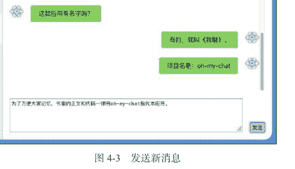
有兴趣可以做两个小实验。

- 不用 state，用普通数组存消息列表，直接在表单处理函数里改数组，看界面是否会同步。
- 仍用 state 存列表，但在更新时不新建数组，而是用 array.push() 直接改原数组，再把改过的原数组写回 state，看是否可行。

这里容易产生疑问：threads 放在 ThreadList 的 state 里很好理解，那 messages 为什么要放在 MessagesPane 的 state，而不是 MessageList 的 state？这个问题先留到第 5 章解答。

### 4.3.4 更新 state 的自动批处理
4.3.2 节提到 state 可以是 object。那当一个组件里有多个数据要放进 state 时，是拆成多个 state 好，还是合并成一个 object 只声明一次更合适。

```javascript
// 1. 定义多个 state
const [state1, setState1] = useState(123);
const [state2, setState2] = useState(true);
const [state3, setState3] = useState('文本');

// 2. 合并成一个 state 对象
const [stateObj, setStateObj] = useState({
  key1: 123, key2: true, key3: '文本',
});
```
先给结论：两种做法各有利弊，按实际需求选即可。具体的权衡会在 10.3 节和 10.4 节展开，本节聚焦多状态更新的性能优化机制。

早期 React 倾向把要一起更新的状态合并成对象来提性能。从 React 18 开始不需要手动优化了，得益于 state 更新自动批处理，连续的更新会被合并成一次渲染。

沿用多状态的例子，假设在按钮点击处理函数里先后更新两个独立状态：

```javascript
const handleClick = () => {
  setState1(789);
  setState2(false);
};
```
组件的 state 改变就会触发重渲染。那连续改两个 state 会渲染几次？答案是只渲染一次，而且渲染时用的是两个状态的最新值。这就是 React 对多状态更新的自动批处理。

如果没有批处理，两个更新会产生两次间隔极短的重渲染。第一次可能只完成部分状态，用户感知不到中间态，且涉及复杂计算会浪费资源。自动批处理是 React 保障基础性能的关键手段。

要注意，React 18 之前自动批处理仅在 React 事件处理函数内生效。若更新写在异步回调里就会失效。比如点击搜索按钮发起请求，返回后再依次更新两个状态：

```javascript
const Search = () => {
  const [province, setProvince] = useState(null);
  const [cities, setCities] = useState([]);
  const handleSearchClick = () => {
    // 模拟调用服务器端接口搜索“吉林”
    setTimeout(() => {
      setProvince('吉林');
      setCities(['长春', '吉林']);
    }, 1000);
  };
  return (
    <>
      <button onClick={handleSearchClick}>搜索</button>
      <ul>
        <li>{province}<ul>
          {cities.map(city => (
            <li>{city}</li>
          ))}
        </ul></li>
      </ul>
    </>
  );
};
```
看上去 handleSearchClick 和之前的 handleClick 很像，但在 React 18 之前，这两处更新会触发两次渲染。而 React 18 起，无论是事件处理、异步回调还是 setTimeout 中的多处 state 更新，默认都会被批处理，只触发一次渲染。

因此在是否拆分 state 或合并成对象时，已无需再考虑更新效率。这类框架层面的增强让开发者不必额外担心理论负担。

## 4.4 context：组件树共享的全局数据
弄懂 props 和 state 之后，来看 React 的第三种数据形式：context。

context 用来在组件树跨层级传递和共享相对“全局”的数据。这里的全局是相对的，传递只沿组件树自上而下，不会反向也不会脱离树。常见场景有主题定制、登录用户信息、国际化语言配置等。

使用 context 分三步。

（1）用 React.createContext() 创建一个 context 对象，命名首字母大写，如 MyContext：

```javascript
const MyContext = React.createContext('初始值');
```
（2）在 JSX 中用 `<MyContext.Provider>` 声明 value，并把子组件放在其闭合标签内：

```javascript
function MyComponent() {
  const [state1, setState1] = useState('文本');
  const handleClick = () => setState1('更新文本');
  return (
    <MyContext.Provider value={state1}>
      <ul>
        <MyChildComponent />
        <li><button onClick={handleClick}>更新 state</button></li>
      </ul>
    </MyContext.Provider>
  );
}
```
（3）在子组件或后代组件里用 useContext Hook 读取 MyContext 的值，该组件即为消费者：

```javascript
import { useContext } from 'react';

function MyGrandchildComponent() {
  const value = useContext(MyContext);
  return (
    <li>{value}</li>
  );
}

function MyChildComponent() {
  return (
    <MyGrandchildComponent />
  );
}
```
当 MyGrandchildComponent 挂载时，会向上找到距离最近的 MyContext.Provider，即 MyComponent 并读取其 value；当 MyComponent 的 state1，也就是 Provider 的 value 发生变化时，所有下游消费者都会重新渲染。

以 Provider 为起点的子树里可以有任意数量的消费者，深度不受限。Provider 还支持嵌套，消费者会优先使用最近的那层值，这可以看作 context 的覆盖机制。

React 在判断 context 的 value 是否变化以及 state 是否变化时，采用的是同一套机制，都依赖 Object.is() 进行浅比较。因此在传递非原始类型时要格外小心。比如把对象放到 value 里，就最好借助 state 来托管，避免因为父组件每次渲染都新建对象导致子树白白重渲染：

```javascript
// 不要这样写
function MyComponent() {
  const [state1, setState1] = useState('文本');
  // ...
  return (
    <MyContext.Provider value={{ key1: state1 }}>
      <MyChildComponent />
    </MyContext.Provider>
  );
}

// 可以利用 state
function MyComponent() {
  const [obj, setObj] = useState({ key1: '文本' })
  // ...
  return (
    <MyContext.Provider value={obj}>
      <MyChildComponent />
    </MyContext.Provider>
  );
}
```

在 React 19 里，context 相关接口也做了优化，细节可参考 15.4.2 节。

## 4.5 小结

本章从宏观视角切入数据驱动的前端思路，随后拆解了 React 里的三大数据手段：props、state、context。props 负责父向子传递信息，state 承载组件自身的内部状态，context 则提供跨层级的全局共享。在概念讲解之外，oh-my-chat 贯穿始终，示范了如何用 props 进一步拆分联系人列表组件，如何用 state 完成对话列表选中与消息列表发送新消息两项功能。

下一章将继续探讨如何把 props、state、context 组合起来实现组件间通信，并引入单向数据流的概念。

# 第5章 数据驱动（下）：组件间通信

本章的知识脉络与实现示例见图 5-1。

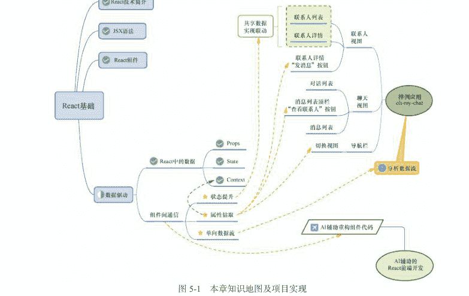

第 4 章主要讲清楚了 props、state、context 的含义与基础用法，本章则把焦点拉到实战层面，聚焦组件间通信的落地策略。核心在于综合运用三种数据形态，并配合状态提升、属性钻取两大技巧，让 React 应用里的组件能够互相联动。为加深理解，会通过不同实现方案的对比，同时聊聊如何借助 AI 辅助重构代码。最后以单向数据流收束全章，揭示 React 数据驱动的本质。

本章仍以 oh-my-chat 为载体，演示这些技巧在真实开发场景中的用法。

## 5.1 React 组件间通信

在 React 里，组件间通信指组件树中不同节点通过框架提供的机制完成数据传递与交互的过程。

做 React 应用时，我们会拆分组件来落实视图与业务逻辑，兼顾复杂度与可维护性，最终形成一棵组件树。在这棵树上，一个组件的行为往往会牵动另一个组件，通信机制就是实现联动的桥梁。

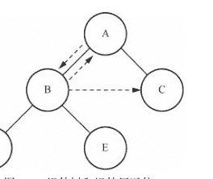

在组件树的约束下，通信大致可分为三类：父向子 A→B、子向父 B→A、平级组件之间 B↔C，如图 5-2 所示。

如 4.2 节所述，父组件可通过 props 把数据下发给子组件，这就构成了父到子的通信路径。父组件决定 props 的内容，子组件据此渲染；父组件更新 props 时子组件会被触发重渲染，通信发起方始终是父。oh-my-chat 中 MessagesPane 到 MessageList 的信息传递就是 props 的典型案例，父组件的 messages 增添新条目时，子列表随之更新。父对孙组件的传递可视为父到子的延伸，同样靠 props 完成。

子向父的通信同样依赖 props，不过角色互换。子组件想要通知父组件，需要父先把回调函数经由 props 注入，子组件内部调用该回调即可完成上报。以 oh-my-chat 为例，ThreadListItem 被点击时触发对 ThreadList 的通知，正是通过执行父组件传入的 onClick 回调实现的。子向祖先的情形也可以用一系列 props 回调逐层传递的方式解决。

平级组件之间不能直接对话，只能借助共同的父节点中转。父节点可以同时向两个平级子节点下发 props，根据是数据还是回调的不同，就能实现不同方向的联动。具体做法见 5.2 节。

从原理看，组件树中任意两个节点的通信，都可以通过上述三种方式组合达成。另外在以 props 为主的场景里，也可按需改用 context 方案，参见 5.3 节。

## 5.2 组件间通信模式：状态提升

当层级较浅时，props、state、context 的使用比较直观。但实际项目里组件树往往很深，选用哪种数据、在哪层声明、如何联动等问题的复杂度会上升，需要借助成熟的模式与技巧来应对。其中最具代表性的就是状态提升与属性钻取，本节先讲状态提升。

### 5.2.1 什么是状态提升

回看 4.3 节 oh-my-chat 消息列表新增消息的实现，当把消息列表转为 state 时，抛出了一个问题：messages 为什么不能放在 MessageList 里，而要放在父组件 MessagesPane 里？原因在于平级组件 NewMessageForm 也需要读写同一份数据。

平级组件共享同一个父组件，但彼此之间没有层级上的直接关系，无法直接通过 props 交流。这意味着若把状态放在其中一个平级组件里，另一个组件就无法触达。在这种情况下，需要把状态从两个平级节点抽离到它们的共同父节点，再由父节点通过 props 把同一份状态分发给两个子节点，这一过程叫做状态提升 Lift State Up，也是 React 开发中的常用手段。

这里的状态包含对应的更新函数。仍以 4.3.3 节的消息列表为例，最初 messages 属于 MessageList 的 state，但由于 NewMessageForm 需要修改它，于是把 messages 提升到共同父组件 MessagesPane 管理。父组件把数据以 props 的形式传给 MessageList，把更新函数封装后传给 NewMessageForm，从而让两个子组件操作同一份数据。从通信角度看，状态提升让 NewMessageForm 与 MessageList 两个平级组件产生了联动。

### 5.2.2 项目实现：利用状态提升实现联系人列表和详情的联动

接下来看 oh-my-chat 联系人视图的一个需求：点选联系人列表中的某条，右侧应同步展示该联系人的详情。不同于传统独立的列表页与详情页，oh-my-chat 在同一视图内同时展示列表与详情，且两者数据字段高度重合，于是可以让两者共享同一份数据，这正是状态提升的用武之地。

首先定位 ContactList 与 ContactDetail 的共同父节点。ContactView 既是 ContactDetail 的父组件，也是 ContactList 的父组件 ContactsPane 的父组件，也就是 ContactList 的祖先组件。在这种祖先后代关系下，状态提升同样适用。打开 src/components/ContactView.jsx，将 contacts 提升为该处的 state；参照 4.3.3 节拆分 ThreadList 的做法，把 contacts 中的 active 字段剥离出来作为独立 state selectedContactId，再依据该 state 从 contacts 中筛选出单个 contact 作为详情数据源；最后通过 props 把这些信息分别下发给对应的子组件。具体代码如下：

```javascript
import { useState } from 'react';
import ContactsPane from './ContactsPane.jsx';
import ContactDetail from './ContactDetail.jsx';
import reactLogo from '../assets/react.svg';

const mockContacts = [
  {
    id: 1,
    name: '小帅',
    avatar: reactLogo,
  },
  // ... 省略
];

const ContactView = () => {
  const [contacts, setContacts] = useState(mockContacts);
```

## 92 第5章 数据驱动（下）：组件间通信

```javascript
const [selectedContactId, setSelectedContactId] = useState(null);
const selectedContact = contacts.find((c) => c.id === selectedContactId);
return (
  <>
    <aside>
      <ContactsPane
        contacts={contacts}
        selectedContactId={selectedContactId}
        onClickContactItem={setSelectedContactId}
      />
    </aside>
    <main>
      <ContactDetail contact={selectedContact} />
    </main>
  </>
);
};

export default ContactView;
```

修改 ContactsPane.jsx，让该组件接收的所有 props 原样透传给子组件 ContactList。代码如下：

```javascript
const ContactsPane = (props) => (
  <>
    <ContactTopMenu />
    <ContactList {...props} />
  </>
);
```

再看 ContactList.jsx。ContactList 从 props 中取出 contacts 进行循环渲染，当某条目的 ID 与 selectedContactId 相同时高亮该条目；点击任一条目时则调用透传而来的 setSelectedContactId 更新函数。具体代码如下：

```javascript
const ContactListItem = ({ contactName, contactAvatar, active, onClick }) => (
  <li className={active ? 'active' : undefined}>
    <a href="#" onClick={onClick}>
      
      <div className="contact-name">{contactName}</div>
    </a>
  </li>
);
const ContactList = ({ contacts, selectedContactId, onClickContactItem }) => {
  return (
    <ul className="contact-list">
      {contacts.map((contact) => (
        <ContactListItem
          key={contact.id}
          contactName={contact.name}
          contactAvatar={contact.avatar}
          active={contact.id === selectedContactId}
          onClick={() => onClickContactItem(contact.id)}
        />
      ))}
    </ul>
  );
};
export default ContactList;
```

最后调整 ContactDetail 组件，从 props 读取 contact 数据并渲染联系人信息。代码如下：

```javascript
const ContactDetail = ({ contact }) => {
  if (!contact) {
    return (<div className="contact-detail">请选择联系人</div>);
  }
  const { name, avatar } = contact;
  return (
    <>
      <div className="contact-detail">
        
        <div className="contact-name">{name}</div>
      </div>
      <div className="contact-actions">{/* ... 省略 */}</div>
    </>
  );
};
```

保存文件后在浏览器中验证功能。如图 5-3 所示。

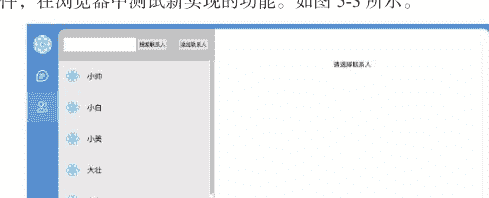

初始进入联系人视图时，列表没有任何选中状态，右侧为空。点击任意联系人条目后，该条目会被高亮，右侧则出现对应的联系人详情。

通过这个例子，状态提升的思路更清晰，同时 oh-my-chat 的联系人列表与详情联动也得以实现。

## 5.3 组件间通信模式：属性钻取

掌握了状态提升后，本节介绍另一个常见现象——属性钻取。

### 5.3.1 什么是属性钻取

快速回顾 5.2 节中 ContactView 的 contacts state，该状态先以 props 形式传给子组件 ContactsPane，再由 ContactsPane 再次以 props 形式传给孙组件 ContactList。

在组件树中把 props 一层层往下传，而中间组件并不消费这些数据，只是充当搬运角色，这种现象被称为属性钻取 Props Drilling。

严格来说，属性钻取并非设计模式，而是层级过深带来的副作用。好处是数据流向非常明确，容易追踪；坏处是中间组件被迫声明自己并不使用的 props，代码冗余度上升，层级越深维护成本越高。

针对这一问题，React 提供了 Context API，见 4.4 节。在钻取起点放置 Context.Provider，在终点使用 Consumer，就能跳过中间层级的 props 传递。选择 props 钻取还是 context 也涉及性能：使用 props 钻取更新起点 state 时，路径上的所有组件都会重渲染；使用 Context API 时，只有 Provider 与 Consumer 触发更新，中间节点不受影响。对小型应用而言，这一差异可以忽略。

需要注意，并非所有钻取场景都适合换成 context。属性钻取的显式传递特性有时比 context 的隐式注入更易于理解与维护，因此要根据具体需求权衡选用。

### 5.3.2 项目实现：用 context 代替 props 切换视图

目前 oh-my-chat 提供了聊天视图与联系人视图两种界面。除了左侧导航栏已实现的视图切换外，还有两个切换点需要处理：
- 聊天视图中，消息列表顶部工具栏的“消息菜单”按钮，点击后应跳转到联系人视图并展示对应联系人的详情；
- 联系人视图中，联系人详情页的“发送信息”按钮，点击后应跳转到聊天视图并打开与该联系人的对话。

针对上述需求，可以统一借助 context 来完成视图切换。

在项目 src 内部先建一个 context 文件夹，并在其中创建 Navigation-Context.jsx。选 .jsx 是因为文件里会放带 JSX 的 Provider 包装，若只是纯数据层 .js 也能胜任。该文件要导出一个名为 Navigation-Context 的上下文，并在同一个文件中提供 NavigationCtxProvider 组件，把来自 App 的 activeView 状态以及对应的更新方法一起包进 NavigationContext.Provider。示例如下：

```javascript
import React, { useState, useMemo } from 'react';

const NavigationContext = React.createContext();

export const NavigationCtxProvider = ({ children }) => {
  const [activeView, setActiveView] = useState('chat');
  const contextValue = useMemo(
    () => ({
      activeView,
      gotoChatView: () => setActiveView('chat'),
      gotoContactView: () => setActiveView('contact'),
    }),
    [activeView, setActiveView]
  );
  return (
    <NavigationContext.Provider value={contextValue}>
      {children}
    </NavigationContext.Provider>
  );
};

export default NavigationContext;
```

value 采用对象形式，里面放着当前视图标识和两个参数固定的更新函数。对象每次渲染都可能产生新引用，会触发不必要的子树更新。为此借助 useMemo 做记忆化，只要 activeView 与 setActiveView 本身没有变动，返回的 contextValue 引用就保持稳定。useMemo 的原理会在 11.2.1 节详细说明。

封装完成后，就不必手写 Provider。修改 App.jsx，把最外层换成 NavigationCtxProvider：

```javascript
// ... 省略
import { NavigationCtxProvider } from './context/NavigationContext.jsx';

function App() {
  return (
    <NavigationCtxProvider>
      <div className="root">
        {/* ... 省略 */}
      </div>
    </NavigationCtxProvider>
  );
}
```

接下来把纵向导航抽离出来。在 src/components 下新建 GlobalNav.jsx，组件内部从 NavigationContext 取出 Provider 传入的三项数据并用于渲染。实现如下：

```javascript
import React from 'react';
import NavigationContext from '../context/NavigationContext.jsx';
import reactLogo from '../assets/react.svg';
// ... 省略，注意相对路径变化

const GlobalNav = () => {
  const { activeView, gotoChatView, gotoContactView } =
    React.useContext(NavigationContext);

  return (
    <nav>
      
      <ul className="top-nav">
        <li className={activeView === 'chat' ? 'active' : undefined}>
          <a href="#" onClick={gotoChatView}>
            
          </a>
        </li>
        <li className={activeView === 'contact' ? 'active' : undefined}>
          <a href="#" onClick={gotoContactView}>
            
          </a>
        </li>
      </ul>
    </nav>
  );
};

export default GlobalNav;
```

App 本身已经不需要保存视图状态，于是把主体区域也独立。创建 src/components/GlobalView.jsx，只需从 NavigationContext 读取 activeView，再按取值渲染聊天或联系人界面。

抽离后 App 不再维护切换逻辑，整个视图流转交由 context 统一承载，结构更清晰。

GlobalView.jsx 实现：

```javascript
import React from 'react';
import NavigationContext from '../context/NavigationContext.jsx';
import ChatView from './ChatView.jsx';
import ContactView from './ContactView.jsx';

const GlobalView = () => {
  const { activeView } = React.useContext(NavigationContext);
  return activeView === 'chat' ? <ChatView /> : <ContactView />;
};

export default GlobalView;
```

整理后的完整 App.jsx 长这样：

```javascript
import './App.css';
import { NavigationCtxProvider } from './context/NavigationContext.jsx';
import GlobalNav from './components/GlobalNav.jsx';
import GlobalView from './components/GlobalView.jsx';

function App() {
  return (
    <NavigationCtxProvider>
      <div className="root">
        <GlobalNav />
        <GlobalView />
      </div>
    </NavigationCtxProvider>
  );
}

export default App;
```

保存文件后刷新浏览器，页面表现与重构前一致，左侧导航图标仍能正常切换视图。

准备工作结束，开始实现开头提出的两个切换需求。先改 MessageTopMenu.jsx，从 context 取出 gotoContactView：

```javascript
const MessageTopMenu = () => {
  const { gotoContactView } = React.useContext(NavigationContext);
  return (
    <header className="message-top-menu">
      <h1>小白</h1>
      <button onClick={gotoContactView}>
        
      </button>
    </header>
  );
};
```

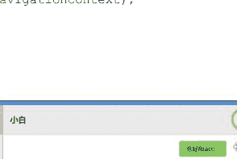

如此一来，点击图示菜单按钮即可进入联系人视图。真实项目里通常还会展示对应会话的联系人详情，这里为了演示做了简化。

再改 ContactDetail.jsx：

```javascript
import React from 'react';
import NavigationContext from '../context/NavigationContext.jsx';

const ContactDetail = ({ contact }) => {
  const { gotoChatView } = React.useContext(NavigationContext);
  // ... 省略
  return (
    <>
      {/* 省略 ... */}
      <button onClick={gotoChatView} className="primary-button">
        发消息
      </button>
      {/* 省略 ... */}
    </>
  );
};
```

点击图示“发消息”按钮即可回到聊天视图。

两个切换功能已完成。可以设想，如果不用 context，就必须把 gotoContactView 与 gotoChatView 从根组件 App 开始逐层向下传，这两个属性会经过多少层中间组件？

另外，context 虽然能用，但对视图切换而言，Web 技术栈里更标准、可扩展的做法是基于 URL 与链接，后续 13.1 与 13.2 节会展开介绍。

## 第 5 章 数据驱动（下）：组件间通信

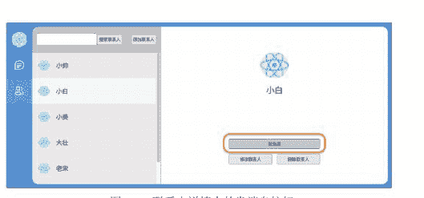

图 5-5 联系人详情中的发消息按钮

## 5.4 AI 辅助：重构组件代码

5.3 节提到属性逐层传递会让代码变得臃肿，于是改用 context 并据此实现了菜单进入联系人视图、联系人详情发消息返回聊天视图两个交互。有人会问，属性钻取真的会冗余吗？不亲自试一遍很难判断。为此把刚用 context 做的逻辑改回属性钻取，并借助 AI 工具完成重构。

先用 Copilot 的代理模式尝试回滚。注意，若上一轮对话未结束，再次输入提示就会进入多轮对话，上下文会自动保留。多轮对话适合追加修改，若要开启全新任务，建议点 “+” 新建会话清空上下文。

打开 App.jsx，在 Copilot 聊天框输入如下提示：

```
请重构代码，用属性钻取的方式取代 `NavigationContext`。
```

选择代理模式并指定 Claude 3.5 Sonnet 模型，点击发送。运行一段时间后，Copilot 修改了 8 个文件并删除了 NavigationContext.jsx。部分输出如下：

> 我来帮你重构代码，将 NavigationContext 改为使用属性钻取的方式。我需要先了解当前的代码实现……

需要改动的文件有：

1. 删除 NavigationContext.jsx

2. 修改 App.jsx，把状态提到顶层

3. 修改所有使用 NavigationContext 的组件

让我先看看哪些组件在用这个 Context ……：

1. GlobalNav - 使用 activeView 控制导航高亮，使用 gotoChatView 和 gotoContactView 处理切换

2. GlobalView - 使用 activeView 决定显示聊天还是联系人

3. MessageTopMenu - 使用 gotoContactView 处理菜单点击

4. ContactDetail - 使用 gotoChatView 处理 “发消息” 点击

开始重构……

首先，删除 NavigationContext.jsx：我已删除了 NavigationContext.jsx 文件。现在让我们修改相关组件，使用属性钻取的方式传递状态；……

修改 App.jsx，将导航状态提升到顶层：……

……让我总结一下所做的改动：

1. 删除了 NavigationContext.jsx，因为我们不再使用 Context API

2. 将导航状态（activeView）和导航函数（gotoChatView, gotoContactView）提升到了 App 组件

3. 通过属性钻取的方式，将导航状态和函数沿组件树向下传递：

   - App → GlobalNav

   - App → GlobalView → ChatView → MessagesPane → MessageTopMenu

   - App → GlobalView → ContactView → ContactDetail

重构完成后，Copilot 共改动了 App、GlobalNav、GlobalView、ChatView、MessagesPane、MessageTopMenu、ContactView、ContactDetail 这 8 个文件，经检查改动基本符合预期，浏览器测试也正常。此处不展开具体代码。

对比可知，相较 context 方案，透传方式多牵涉了 3 个中间组件，复杂度明显上升。

这次 AI 辅助重构效果不错，但 Copilot 自主删改多个文件、甚至顺手修复了部分 Linting 报错的行为值得留意。传统重构通常分步进行，变更范围小、风险可控。如何限制 Copilot 的改动范围？

Copilot 的“编辑（Edit）”模式允许开发者手动指定上下文，精确控制修改范围。现在只把消息菜单相关部分改回透传，同时让 GlobalView 仍继续使用 context。

在 Copilot 中撤销之前的修改，新建会话，切换到“编辑（Edit）”模式，输入提示：

> 请重构选中的代码，用属性钻取的方式取代 `NavigationContext`，但仍在 `GlobalView` 中使用 context。确保每个组件都传递必要的 props。

如图 5-6，将 `ChatView.jsx`、`MessagesPane.jsx`、`MessageTopMenu.jsx` 三个文件拖入上下文，再打开 `GlobalView.jsx`，选中第 7 到第 9 行，右键通过 Copilot → Add Selection to Chat 添加，最后发送。

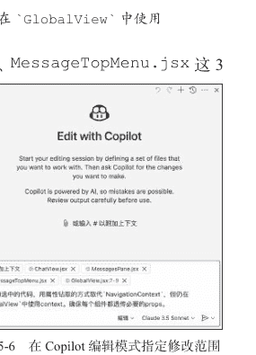

本次修改严格限制在选定的 4 个文件内，Copilot 也未擅自修正 Linting 问题。如图 5-7，编辑模式下不会自动保存修改，而是以可编辑状态打开文件供人工逐项审查。保存后浏览器验证，小范围重构成功。

后续章节仍沿用 5.3.2 节基于 context 的实现，因此验证完成后请务必撤销所有 Copilot 的修改。

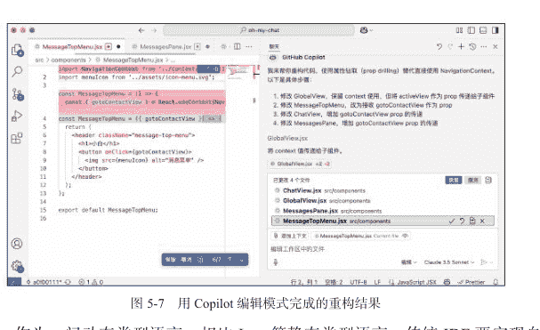

图 5-7 用 Copilot 编辑模式完成的重构结果

JavaScript 归属动态类型体系，相较 Java 等静态类型语言，IDE 要做到全自动重构的技术门槛明显更高。Copilot 出现以前，VS Code 对 JavaScript/TypeScript 的改写能力基本只停留在抽取变量、抽取函数、迁移变量、迁移函数这些基础操作。Copilot 的加入打破了这一边界，本节用到的把 context 改写成属性钻取只是其中一种典型用法，实际上也可以反向把属性钻取收拢进 context，或借助它完成状态上提，玩法远不止这些。务必注意现阶段 AI 并不总是可靠，笔者用编辑模式做一次重构实验共跑了 5 轮，其中 1 轮出现错误，把 gotoChatView 错误透传，接受改动前一定要人工复核生成的代码。

到这里本节已经梳理完 Copilot 的三种工作方式：询问 Ask、编辑 Edit、代理 Agent。询问模式比较直观，主要用于对话式问答；编辑与代理容易混淆，核心差异如下。

- 改动范围：编辑模式由开发者手动圈定修改边界，代理模式则自行判断动手范围。
- 时间开销：代理模式在一次对话里会多次调用大模型，通常比编辑模式更耗时。
- 可预测程度：编辑模式结果更稳定，代理模式会根据中间产出动态调整上下文，不确定性更高。
- 费用：主流 AI IDE 多按大模型调用次数计费，代理模式调用更频繁，成本也更高。

随着 AI 编程辅助的成熟，主流 AI IDE 的设计趋于一致。曾以 Composer 模式闻名的 Cursor，已把 Composer 功能整合进聊天界面，提供询问、手动、代理三种形态，与 Copilot 的划分一一对应。这种趋同降低了开发者在不同产品间切换的成本。

## 5.5 React 中的单向数据流

本小节从更宏观的角度梳理 React 的数据设计思想，核心就是单向数据流。数据流的概念比组件间通信更宽泛也更抽象，理解其设计尤其是 React 的单向做法，有助于全局把握数据的构建与使用，也为学习其他前端框架打下基础。

### 5.5.1 什么是数据流

在谈数据流前，先回顾函数响应式编程 Functional Reactive Programming，简单说，它是用函数式手段实现响应式的一种范式。

**数据流 Data Flow 是响应式编程的关键概念，它把程序逻辑抽象为数据在不同运算间流动并随之变化的过程。**

以 `b = a * 2` 为例，把 `a * 2` 看作一次运算，当输入 `a` 改变时，`b` 会自动跟随更新。

这与 React 的设计哲学 `UI = f(state)` 很相似。在函数组件 `({ a }) => (<div>{ a * 2 }</div>)` 中，只要 prop `a` 变化，渲染出的 `<div>` 内容就会自动刷新。

真实程序往往包含多道运算，每道只负责自己的片段，整体类似工厂流水线。类比到 React，基本单元是组件，运行时构成组件树，根组件沿树逐层分发数据，从根到叶的任意路径都可以看作一条流水线，每个组件就是流水线上的一个工位，对流经的数据做处理并完成自身职责。

### 5.5.2 React 单向数据流

React 里 props、state、context 三者共同构成组件的数据流。作为声明式框架，React 的数据流也是声明式的。典型场景下，开发者通过声明这三类数据来规划应用的数据流，进而控制交互逻辑。

只有这三类数据的变更会触发 React 的重新渲染机制。若在数据流里混入不属于它们的外部数据，常被戏称为“跳出三界之外”，很容易引发难以察觉的 Bug，比如数据已更新但视图未刷新。

这类问题在小项目里还算好定位，随着代码量和复杂度上升，数据源容易混淆，调试成本会大幅增加。顺带一提，“三界之外”这个说法来自笔者同事，当时她就栽在这种 Bug 上，排查许久才恍然大悟。

props、state、context 看似不同，但在组件树中，同一份数据在引用不变的前提下会多次变换身份。例如，最初在组件 A 的 state，传给子组件 B 作为 props，就成了 B 的 prop。再如，从组件 A 的 state 通过 A 声明的 context 传递到子孙树，最后被组件 B 的子组件 C 消费。

数据从诞生、传递、身份转换再到被视图或逻辑消费，就形成了 React 的单向数据流，具体体现在：

首先，**props 的流向是单向的，只能从父向子传递，不可从子向父，也不可横向传递**。如图 5-8 所示。

其次，state 的读写通常局限在定义它的组件内部。若希望子组件或后代组件修改它，可以把对应的更新函数经由 props 或 context 传递下去，由它们决定何时以何种参数调用。函数被调用后 state 更新，定义组件随之重渲染。如图 5-9 所示。

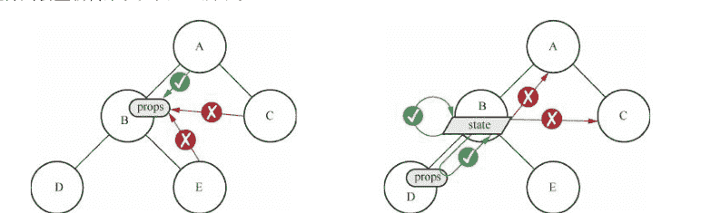

最后，context 的流向同样单向，只能从声明 Context.Provider 的组件流向其子组件树，即子组件及后代，不可向父或祖先传递，也不可跨分支传递。如图 5-10 所示。

从三者的流向可知，React 的整体数据流也是单向的。React 生态中大量处理数据的框架都在此机制之上扩展，使其能对接外部数据源或系统。值得注意的是，这些框架的数据流设计同样遵循单向原则，详情将在 10.5 节介绍。

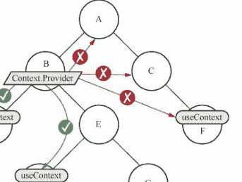

在 React 开发中，始终明确数据的来源、方向和类型，对构建健壮、可维护的应用至关重要。

### 5.5.3 项目实现：分析 oh-my-chat 的数据流

下面是 oh-my-chat 当前的组件树结构及各组件特有的 state 列表，忽略条件渲染，假设所有子组件均已挂载。组件名后的方括号内列出该组件独有的 state 变量。这些信息也可以通过 React Developer Tools 查看。

```
App
├── NavigationCtxProvider [activeView]
│   └── NavigationContext.Provider
│       ├── GlobalNav
│       └── GlobalView
│           ├── ContactView [contacts, selectedContactId]
│           │   ├── ContactsPane
│           │   │   ├── ContactTopMenu
│           │   │   ├── ContactList
│           │   │   │   └── ContactListItem
│           │   │   └── ContactDetail
│           │   └── ChatView
│           │       ├── ThreadsPane
│           │       │   ├── ThreadTopMenu
│           │       │   ├── ThreadList [threads, selectedThreadId]
│           │       │   │   └── ThreadListItem
│           │       │   └── MessagesPane [messages]
│           │       │       ├── MessageTopMenu
│           │       │       ├── MessageList
│           │       │       └── NewMessageForm [content]
```

这些 state 的值及其更新函数，均通过 props 或 context 传递给子组件或后代组件，可结合 5.4.2 节的 props、state、context 流向来分析。例如 selectedContactId 及其更新函数经由 context 传递给 GlobalNav、GlobalView、ContactDetail、MessageTopMenu 组件。再如 messages 经 props 传递给 MessageList 组件，而 messages 的更新函数经 props 传递给 NewMessageForm 组件，NewMessageForm 再把 content 的值通过更新函数传回 MessagesPane 组件。

## 5.6 小结

本章延续数据驱动的主线，在第 4 章介绍 props、state、context 的概念与用法基础上，进一步探讨组件间通信的实现路径。

本章系统分析了如何借助这三种数据机制实现父向子、子向父、平级组件间的通信。针对复杂组件树，重点介绍了两种关键的数据处理技巧：通过 state 与 props 进行状态提升以优化数据管理、利用 context 解决属性钻取带来的繁琐传递。在 oh-my-chat 中，这两种技巧分别用于联系人列表与详情页的数据共享、消息顶部工具栏与联系人详情页的视图切换。为了对比 context 与属性钻取，还演示了如何用 Copilot 的代理模式或编辑模式重构组件代码。最后引出比组件通信更宏观的概念——单向数据流，并通过分析 props、state、context 的流向，阐释了 React 数据流单向性设计及其底层逻辑。

# 第 6 章 React 的副作用

本章的知识地图及项目实现，如图 6-1 所示。

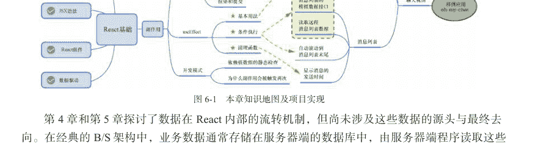

第 4 章和第 5 章介绍了数据在 React 内部的流转，但尚未涉及数据的源头与去向。在经典 B/S 架构中，业务数据常存于服务器数据库，由服务端程序读取并通过 HTTP 传输到浏览器，浏览器也需把新数据提交回服务器持久化。尽管现代浏览器已有 IndexedDB 等本地持久化能力，但鉴于分布式应用的需求，浏览器与服务器交互的 Web 应用仍占主流。

这就引出关键问题：在 React Web 应用中，如何书写与服务器交互的代码？比如组件显示时拉取最新数据、翻页时加载下一页、离开视图时关闭轮询等。

这类代码大致分属事件处理和副作用。前者已在 1.4 节和 4.3.3 节有所涉及，如 `<a>`、`<button>` 的 onClick，具体将在 7.1 节展开。后者是本章重点。

副作用是 React 的重要概念，不仅包含服务器交互，任何与外部系统的协同都可视作副作用，通常通过核心 Hook useEffect 实现。它也是 React 响应式特性的重要体现。

## 6.1 什么是副作用

### 6.1.1 前端领域的副作用

维基百科对计算机领域的副作用定义为：函数在执行过程中，除返回计算结果外，还对调用方产生额外影响，例如修改全局变量、改变入参、向终端或管道输出、更新外部存储等。

简言之，副作用是让函数不再保持纯粹的操作。副作用并非贬义，在特定场景下不可避免，识别它的目的不是彻底消除，而是确保可控、可预期，从而写出更可靠的程序。

对前端同样适用。假设一个完全自给自足、与外部系统零交互的前端应用，可类比为纯函数。一旦加入网络请求、用户输入、浏览器存储等功能，与外部的交互就会引入副作用。这些副作用对“好用”的应用是必要的，需要被明确定义和管理。

事实上前端无处不在副作用，但这一概念直到 Elm 框架出现后才进入开发者视野。随着 React 社区采纳推广，副作用管理逐渐成为主流范式。

### 6.1.2 React 中的副作用

3.2.2.1 节提到，纯函数定义的 React 组件中，诸如 useState、useContext 等 Hooks API 本质是在处理纯函数的副作用。当时是为了简化理解。学习 state、context 后，我们需要把对这些内部数据的读写视为一个整体——由于它们不涉及外部系统，属于自给自足的情形，因此修改 state 或 context 不再计为副作用。除此之外，所有与外部系统交互的行为都应视为副作用，例如设置定时器、操作真实 DOM、请求远程数据、在 console 打印调试信息等。

触发方式分两种：一种由 onClick 等事件引发，另一种由 React 渲染过程本身引发。其中，由渲染本身引发的副作用在 React 中被专门称为 Effect。例如“每次渲染组件就要从服务器获取最新数据”这类需求，与用户点击无关，却与渲染存在因果关系，就是典型的 Effect。

考虑到中文社区习惯，若无特别说明，本书后文的“副作用”均指由渲染引起的 Effect。

### 6.1.3 React 中的渲染和提交

React 的副作用由渲染引起，那么渲染具体指什么？

前文多次提到渲染，如 JSX 最终生成 DOM 树，修改 state 或 context 会触发重渲染。这些说法是为了便于理解而做的简化。实际上 React 中渲染是一个独立阶段，在渲染与真实 DOM 生成之间还有提交阶段。

渲染阶段，React 按顺序执行各个组件的定义函数，在内存中构建虚拟 DOM 中间模型。当所有组件执行完毕、组件树搭建完成，React 进入提交阶段，此时才调用浏览器 DOM API 创建真实节点。只有提交完成，用户才能看到页面变化。初次渲染和重新渲染都会经历这两个阶段，区别在于前者全量、后者增量。

渲染与提交的细节将在第 9 章组件生命周期详细讲解。这里简要介绍是为了帮助理解副作用的触发时机。副作用在提交阶段接近尾声、真实 DOM 更新后才触发，这与“副作用由渲染引起”并不矛盾，后文会进一步解释。

## 6.2 核心 Hook: useEffect

为管理 React 的副作用，React 提供了 useEffect Hook 执行相关操作。如 3.2.2 节所述，它是核心 Hook 之一。和其他 Hook 一样，useEffect 必须在 React 组件内部使用。也就是说，需要在 React 应用中引入副作用时，开发者必须在相关组件中显式定义这些逻辑。

### 6.2.1 useEffect 的基本用法

useEffect 有多种用法。首先是最简单的用法，只传入一个没有返回值的副作用回调函数；

```javascript
import { useEffect } from 'react';
function MyComponent() {
  useEffect(() => {/* 省略 */});
  //           ^
  //           副作用回调函数
  return (<div></div>);
}
```

虽然 useEffect 作为组件函数体的一部分会在每次渲染时被执行，但作为参数的副作用回调函数是在提交阶段才被调用，这时回调可以访问到组件的真实 DOM 节点。

为了让 oh-my-chat 聊天应用更顺手，可以加上这样一个细节：只要进入聊天页面，消息输入框就自动拿到焦点，用户可以直接敲字发送。要实现这个体验，只需打开 src/components/NewMessageForm.jsx，补上下面这段实现：
```javascript
import { useState, useEffect, useRef } from 'react';
const NewMessageForm = ({ onSubmitMessage }) => {
  // 省略
  const inputRef = useRef(null);
  useEffect(() => inputRef.current.focus());
  return (
    <form className="compose-message" onSubmit={handleSubmit}>
      <textarea
        placeholder="请输入消息..."
        value={content}
        onChange={handleChange}
        ref={inputRef}
      />
      <input type="submit" value="发送" />
    </form>
  );
};
```

这段里用到的 useRef 是 React 用于在组件内部保存可变数据的钩子，介绍可参考 12.3.2 节。这里只用到了它的常规写法：先声明一个可变引用 inputRef，然后在 JSX 的标签上加上 ref 属性指向它，React 在提交阶段把真实 DOM 挂载好后会把元素引用写入 inputRef.current，随后在 useEffect 的副作用回调里调用 DOM 元素的 focus() 方法来激活输入框。

保存后执行 npm run dev，在浏览器打开页面就能看到，光标会第一时间停在新消息输入框，可以直接打字。切到联系人页再切回来，光标依然会自动回到输入框。这个自动聚焦正是 NewMessageForm 重新渲染时触发的副作用在起作用。

回看第 4 章，改动 state 就会引起重新渲染，而重新渲染也会跑副作用。新消息框是个受控组件，每次输入都会更新 state，这会不会导致每敲一个字符副作用就执行一次？加一段控制台打印来验证：
```javascript
useEffect(() => {
  inputRef.current.focus();
  console.log('Textarea focused!');
});
```

实际打开开发者工具的控制台会看到（如图 6-2），不只是首次进入聊天页会触发，进框里每个字符的输入都会让副作用再跑一次。好在输入框本身一直是聚焦状态，多次调用 focus 并不会带来可见变化。

这就是 useEffect 的最基础形态，实际项目里用得并不多。因为它会在每次渲染后都执行，用不好很容易拖慢性能甚至形成死循环。

### 6.2.2 副作用的条件执行

真实开发中很少需要每次渲染都跑副作用，useEffect 支持条件执行。只要在基础写法上多传一个第二个参数——依赖项数组，就能控制触发时机：
```javascript
useEffect(() => {/* 省略 */}, [var1, var2]);
// ------------------  ------------------
//                   ^                  ^
//                   |                  |
//             副作用回调函数        依赖项数组
```

React 会在渲染时记录当下的依赖数组，下次渲染时用 Object.is 逐项对比上一次的值。只有发现不一致，才在提交阶段执行副作用回调；一致时则跳过，继续等待下一次对比。

依赖数组里可以放 props、state、context 里的任意值。通常原则是：副作用回调里用到的组件作用域外部变量，都应该列入依赖数组，这样 React 才能把状态变化和副作用关联起来。

副作用也不只限于操作 DOM，还可以和外部系统交互，或把外部状态同步进组件内部。以级联菜单为例，省份 state 改变时，副作用会据此刷新城市列表，state 更新再触发一次渲染，从而实现二级选项的联动：
```javascript
//   ------------------  ------------------
//   | 省份 ... |v|  | 城市 ... |v|
//   ------------------  ------------------
const [province, setProvince] = useState(null);
const [cities, setCities] = useState([]);
useEffect(() => {
  if (province === '山东') {
    // 城市数据可以从外部读取
    setCities(['济南', '青岛', '淄博']);
  }
}, [province]);
```

从语义上看，给 useEffect 传依赖数组，相当于为一种具有响应式特性的值定义响应行为。props、state、context 及其派生计算都属于这类值，它们变化时会触发重渲染，也会触发声明了对应依赖的副作用。这体现了 React 的响应式思想。需要说明的是，React 内部实现并不完全是响应式，也没有暴露 pub/sub 接口，开发者只需关注外部表现。

空数组也是合法的依赖数组。因为生命周期内值不会变，副作用只会在组件挂载时执行一次，后续更新都不会再跑。

借助这个技巧可以把 6.2.1 节的自动聚焦优化一下，给 NewMessageForm 的 useEffect 加上空数组作为第二个参数：
```javascript
useEffect(() => {
  inputRef.current.focus();
  console.log('Textarea focused!');
}, []);
```

实测后会发现，在输入框里打字时副作用不再被触发，符合预期。刷新页面时却能看到副作用连跑了两次，属于正常现象，具体原因本章结尾会说明。

另外，依赖数组并非 useEffect 专属，11.2 节要讲的 useCallback、useMemo 同样接受依赖数组作为第二参数。

### 6.2.3 副作用的清理函数

计算机资源有限，释放资源是个基本意识。后端开发者熟悉数据库连接需要在用完后关闭，前端也有类似场景，资源没管好就可能内存泄漏或出现异常，常见例子有：

- 原生 DOM 的事件监听
- JavaScript 定时器 setTimeout、setInterval
- WebSocket 连接
- WebWorker 启动

React 内置的 JSX 事件如 onClick 会自动清理，开发者不必手动干预。但涉及 React 之外的外部系统时就必须自行清理。前面提到的原生事件、定时器、WebSocket 等都属于外部系统，用 useEffect 介入时一定要考虑释放。

下面是一个用 setInterval 做倒计时的组件示例：
```javascript
function Timer({ time = 30 }) {
  const [seconds, setSeconds] = useState(time);
  useEffect(() => {
    setSeconds(time);
    const intervalId = setInterval(() => {
      setSeconds((curr) => curr - 1);
    }, 1_000);
    return function cleanup() {
      clearInterval(intervalId);
    };
  }, [time]);
  return (<div>剩余 {seconds} 秒</div>);
}
```

useEffect 接受副作用回调和依赖数组两个参数，其中副作用回调可以返回一个函数，这个函数被称为清理函数。React 会在下一次同一副作用执行前，或组件卸载前调用它。副作用回调、清理函数和依赖数组一起构成了 useEffect 的完整用法。

```javascript
useEffect(() => {/* 省略 */; return () => {/* 省略 */};}, [var1, var2]);
// ----------------------------- -------------------
//                     ^               ^               ^
//                     |               |               |
//               副作用回调函数       清理函数       依赖项数组
```

回到倒计时示例，组件挂载以及 time 属性变化时会执行 setSeconds 和 setInterval。当 time 变化或组件卸载时，cleanup 会把正在运行的定时器清除。

如果 state 更新后没有及时清理，更新阶段可能出现多个定时器并发，造成竞态；组件已卸载却仍在运行则可能导致内存泄漏。

当依赖数组为空时，清理函数只会在组件卸载时执行一次。

## 6.3 项目实现：在 oh-my-chat 加入副作用

本节为 oh-my-chat 增加远程数据获取能力。按需求，聊天视图的会话列表、消息列表和联系人视图的联系人列表都应从服务器获取，这里以消息列表为例。当用户选中某个会话时，应用会请求对应消息记录，并在列表中展示发送时间。

### 6.3.1 项目实现：利用副作用读取远程消息

为了方便演示，先用 Vite 的插件模拟服务端数据。在项目根目录执行安装命令：
```bash
npm install -D vite-plugin-mock-server
```

修改 vite.config.js，接入插件：
```javascript
// 省略
import mockServer from 'vite-plugin-mock-server';
export default defineConfig({
  plugins: [react(), mockServer()],
});
```

在根目录新建 mock 目录，并在其中创建 services.mock.js，用来定义 RESTful 接口和模拟数据。消息列表接口路径为 /api/threads/*/messages，实现逻辑是根据路径参数 threadId 的奇偶返回不同的联系人名称和消息数组。消息数组来源于 MessagesPane.jsx，头像图片 react.svg 拷贝到 public 目录，发送时间统一使用 ISO 格式字符串。具体代码如下：
```javascript
export default [{
  pattern: '/api/threads/{threadId}/messages',
```

## 6.3 项目实现：在 oh-my-chat 加入副作用
```javascript
handle: (req, res) => {
  const { threadId } = req.params;
  const data = threadId % 2 === 0 ? {
    contactName: '小白',
    messages: [
      {
        id: 1,
        content: '你好 React！',
        from: 'me',
        fromAvatar: '/react.svg',
        sentTime: '2023-11-05T10:11:12',
      },
      // 省略
    ]
  } : { contactName: '小帅', messages: [/* 省略 */] };
  res.setHeader('Content-Type', 'application/json');
  res.end(JSON.stringify(data));
},
});
```

接口目前没有任何延迟，响应非常快。为了更贴近真实场景，可以给接口加 1 秒等待，把上一段代码的最后一行换成：
```javascript
setTimeout(() => res.end(JSON.stringify(data)), 1000);
```

执行 npm run dev 启动项目，用浏览器访问下面这个地址，如果能返回包含消息列表的 JSON，就说明模拟接口已创建成功：
```
http://localhost:5173/api/threads/1/messages
```

接下来把远程调用逻辑放到 MessagesPane 组件里。在改动 MessagesPane 前，先把当前选中的会话 ID 传递过去。现在 selectedThreadId 是 ThreadList 的 state，需要用 5.2 节的状态提升方法，把它提升到 ThreadList 与 MessagesPane 的共同父组件 ChatView 中。提升完成后 ChatView 的实现如下：
```javascript
const ChatView = () => {
  const [selectedThreadId, setSelectedThreadId] = useState(1);
  return (
    <>
      <aside>
        <ThreadsPane
          selectedThreadId={selectedThreadId}
          onClickThreadItem={setSelectedThreadId}
        />
      </aside>
      <main><MessagesPane selectedThreadId={selectedThreadId} /></main>
    </>
  );
};
```

ThreadsPane 和 ThreadList 的改动很小，这里不展开。回到 MessagesPane，组件新增 prop selectedThreadId，内部新增两个 state isLoading 和 contactName，去掉原来的 mockMessages 数组。核心改造是用 useEffect 增加远程数据获取的副作用，这部分代码如下：

```javascript
const MessagesPane = ({ selectedThreadId }) => {
  const [isLoading, setIsLoading] = useState(true);
  const [contactName, setContactName] = useState();
  const [messages, setMessages] = useState([]);
  useEffect(() => {
    setIsLoading(true);
    const fetchMessages = async (threadId) => {
      try {
        const response = await fetch(`/api/threads/${threadId}/messages`);
        const data = await response.json();
        setContactName(data.contactName);
        setMessages(data.messages);
      } catch (error) {
        console.error('获取消息列表失败', error);
      } finally {
        setIsLoading(false);
      }
    };
    fetchMessages(selectedThreadId);
  }, [selectedThreadId]);
  // 省略
```
从代码里不难判断，useEffect 的依赖数组里写了 selectedThreadId，所以组件一挂载就会执行一次，之后只要这个 ID 发生变化，副作用就会被再次触发。打开回调的具体逻辑，先把 isLoading 标记打开，进入加载状态；接着声明一个异步函数 fetchMessages，把当前选中的线程 ID 作为参数传进去执行。写法上也可以折成立即执行的 async 表达式 `(async ()=>{...})()`。这么写的原因是 useEffect 的回调本身不能是异步函数，只能在同步的回调内部再单独封装一个 async 函数来使用 await，这也是处理异步的常规做法。fetchMessages 内部用 Fetch API 去请求前面约定的模拟消息接口，拿到响应后解析 JSON，再把联系人名称和消息列表分别写入对应的 state，最后把 isLoading 关掉。async/await 只是 Promise 的语法糖，换成 .then() 链式写法同样可以完成。

接下来是在 MessagesPane 的 JSX 里把这些状态用起来。

```javascript
return (
  <>
    <MessageTopMenu contactName={contactName} />
    <MessageList messages={messages} />
    <NewMessageForm onSubmitMessage={handleSubmitMessage} />
    {isLoading && (<div className="overlay-loading"> 加载中 ...</div>)}
  </>
);
```
contactName 会传给 MessageTopMenu，messages 会传给 MessageList，当 isLoading 为 true 时额外叠加一层半透明遮罩，提示“加载中”。遮罩的样式 .overlay-loading 已经提前写在 App.css 里，这里就不展开了。

把改动保存后在浏览器里跑一下，初次打开时右侧聊天区会被蒙上一层暗色，顶部出现“加载中”的提示，约 1 秒后遮罩和提示消失，联系人姓名和消息列表正常显示。换一个会话，右侧会再次进入加载态，1 秒后再刷新为对应的联系人和内容。加载时的视觉效果如图 6-3 所示。

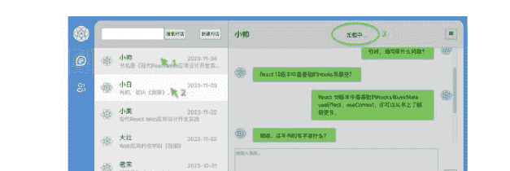
此时列表的数据虽然还是模拟的，但已经从本地硬编码变成了远程接口返回，更接近真实业务。

不过这段代码有一个容易踩的坑：快速在左侧对话列表里连点切换，比如 1 秒内点好几次，右侧的消息会乱跳，出现不同对话的内容交替闪现。这就是典型的竞态问题。

解决思路是给副作用加清理函数。在回调里先声明一个 shouldIgnore 变量，初始为 false；清理函数里利用闭包把 shouldIgnore 改成 true；fetchMessages 在处理返回数据前先判断 shouldIgnore，若为 true 就直接放弃更新 state，否则正常写入。修正后的副作用如下：

```javascript
useEffect(() => {
  let shouldIgnore = false;
  setIsLoading(true);
  const fetchMessages = async (threadId) => {
    try {
      const response = await fetch(`/api/threads/${threadId}/messages.json`);
      const data = await response.json();
      if (!shouldIgnore) {
        setContactName(data.contactName);
        setMessages(data.messages);
      }
    } catch (error) {
      console.error('获取消息列表失败', error);
    } finally {
      if (!shouldIgnore) {
        setIsLoading(false);
      }
    }
  };
  fetchMessages(selectedThreadId);

  return function cleanup() {
    shouldIgnore = true;
  };
}, [selectedThreadId]);
```
在浏览器里复现快速切换的场景，修正后只有最后一次点击的结果会保留，中间的请求即使返回也不会再触发渲染，抖动现象消失了。原理很简单，每次依赖变化都会先执行上一次副作用的清理函数，把旧请求的 shouldIgnore 置为 true，等异步请求 resolve 时先检查标记，被忽略的请求就不再写 state。需要注意的是，这种做法只是丢弃结果，网络请求本身并没有被取消。要想真正中断请求，可以用 AbortController 来中止。

和真实项目相比，上面这段远程获取的代码做了简化，特别是异常处理这一块。如果要做得更稳健、高效、体验更好，还得补不少工作。借助 React Query 这类专注数据获取的库，能大幅减少样板代码，具体可见 15.4 节。另外，发送新消息的功能目前仍停留在浏览器内存里，后端交互会在后面章节实现。

### 6.3.2 项目实现：显示发送消息的相对时间
消息对象里其实已经带了 sentTime，只是界面上一直没展示。本节要做的就是加上时间戳，并且按规则分组显示。

- 把间隔在 3 分钟以内的连续消息归为一组，每组在顶部显示该组最早一条消息的时间。
- 24 小时内的消息用相对时间表达，比如“刚刚”“1 分钟前”“1 小时前”等，超过 24 小时则显示完整的日期时间。

分两步完成。

（1）把发送时间渲染出来。在 MessageList.jsx 文件开头新建两个子组件 MessageItem 和 MessageTimestamp。MessageItem 基本就是原来列表项的 JSX，MessageTimestamp 则借助 ES 2024 的国际化 API 做时间格式化。代码如下：

```javascript
const MessageItem = ({ content, from, fromAvatar }) => (
  <li className={from === 'me' ? 'from-me' : undefined}>
    
    <p className="message">{content}</p>
  </li>
);

const MessageTimestamp = ({ sentTime }) => {
  const formatter = new Intl.DateTimeFormat(undefined, {
    dateStyle: 'medium',
    timeStyle: 'medium',
  });
  const timestamp = formatter.format(new Date(sentTime));
  return (<li className="timestamp">{timestamp}</li>);
};
```

（2）在 MessageList 里把这两个子组件接进来。遍历消息列表时用 Array.map，同时拿到前后两条消息，调用 shouldHideSentTime 判断相邻两条的时间间隔；当间隔大于等于 3 分钟时就渲染 MessageTimestamp。因为需要在列表项前后插入额外节点，要用 Fragment 包裹，key 属性要从原来的 li 迁移到 Fragment 上。注意带 key 的 Fragment 不能写成简写 <>，必须写成完整的 <Fragment> 或 <React.Fragment>。相关代码如下：

```javascript
const MessageList = ({ messages }) => {
  return (
    <ul className="message-list">
      {messages.map((message, idx, arr) => (
        <React.Fragment key={message.id}>
          {(idx > 0 && shouldHideSentTime(arr[idx - 1], arr[idx])) || (
            <MessageTimestamp sentTime={message.sentTime} />
          )}
          <MessageItem {...message} />
        </React.Fragment>
      ))}
    </ul>
  );
};

function shouldHideSentTime(prevMsg, currMsg) {
  const prevTime = new Date(prevMsg.sentTime).getTime();
  const currTime = new Date(currMsg.sentTime).getTime();
  return currTime - prevTime < 1000 * 60 * 3;
}
```
刷新页面后，分组和时间戳已经正常显示。接下来要让相对时间能够自动更新，因为时间在走，文字也要跟着变。这里给 MessageTimestamp 加一个状态保存当前时间，配合 useEffect 和定时器实现自动刷新。修改后的组件如下：

```javascript
const MINUTE = 60 * 1000;
const HOUR = 60 * MINUTE;
const DAY = 24 * HOUR;
const UPDATE_INTERVAL = MINUTE;
const MessageTimestamp = ({ sentTime }) => {
  const [timestamp, setTimestamp] = useState('');
  useEffect(() => {
    const refresh = () => {
      const timePassed = new Date() - new Date(sentTime);
      let relativeTime = '刚刚';
      if (MINUTE <= timePassed && timePassed < HOUR) {
        relativeTime = `${Math.ceil(timePassed / MINUTE)} 分钟前`;
      } else if (HOUR <= timePassed && timePassed < DAY) {
        relativeTime = `${Math.ceil(timePassed / HOUR)} 小时前`;
      } else if (DAY <= timePassed) {
        relativeTime = new Intl.DateTimeFormat(undefined, {
          dateStyle: 'medium', timeStyle: 'medium',
        }).format(new Date(sentTime));
      }
      setTimestamp(relativeTime);
    };
    const intervalId = setInterval(refresh, UPDATE_INTERVAL);
    refresh();
    return function cleanup() { clearInterval(intervalId); };
  }, [sentTime]);

  return (<li className="timestamp">{timestamp}</li>);
};
```
保存后打开页面，发送一条新消息，时间戳先显示“刚刚”，1 分钟后会自动变为“1 分钟前”，如图 6-4 所示。时间显示的需求到这里就完成了。


### 6.3.3 项目实现：自动滚动到消息列表末尾
消息越来越多时，列表会出现纵向滚动条。通常用户更关心最新消息，可以借助 useEffect 让列表自动滚到底部。

做法是在 MessageList 的 <ul> 末尾放一个高度为零的 <li> 作为锚点，用 useRef 拿到真实 DOM，在副作用里调用 scrollIntoView()。代码如下：

```javascript
const MessageList = ({ messages }) => {
  const lastLiRef = useRef();
  useEffect(() => lastLiRef.current.scrollIntoView({
    behavior: 'smooth', block: 'end' }), [messages]);
  return (
    <ul className="message-list">
      {messages.map((message, idx, arr) => (
        <React.Fragment key={message.id}>
          {/* 省略 */}
```

## 6.4 开发模式下的useEffect
useEffect 是 React 处理副作用的核心工具，能力很强但门槛也不低，尤其是依赖数组和清理函数，很容易写漏。好在 React 在开发模式下提供了一些内置的辅助手段，能帮助开发者提前发现问题。

### 6.4.1 依赖项数组的静态检查
如 6.2.2 节提到，使用 useEffect 时必须把回调里用到的所有响应式值都放进依赖数组，否则值变了副作用也不会重新执行。要做到完整，开发者需要对依赖机制有清晰理解。随着代码量变大，很容易遗漏。这时可以用 ESLint 的官方插件 eslint-plugin-react-hooks 来做静态检查。该插件默认就集成在 Vite 创建的 React 模板里。在 VS Code 中装上 ESLint 插件后，检查就会自动生效。

### 6.4.2 开发环境下副作用为何执行两次

利用 6.3 节为 oh-my-chat 追加的副作用就能验证该插件是否正常。用 VS Code 打开 MessagesPane.jsx，把 MessagesPane 组件里 useEffect 依赖列表中的 selectedThreadId 去掉，这时依赖项上会出现 ESLint 提示，说明 React Hook useEffect 缺少依赖 'selectedThreadId'。

> React Hook useEffect has a missing dependency: 'selectedThreadId'. Either include it or remove the dependency array.

如果把整个依赖列表也删掉，useEffect 上会再出现一条 ESLint 提示，指出副作用里调用了 setIsLoading，若不写依赖会产生更新连锁。

> React Hook useEffect contains a call to 'setIsLoading'. Without a list of dependencies, this can lead to an infinite chain of updates. To fix this, pass [selectedThreadId] as a second argument to the useEffect Hook.

IDE 未安装 ESLint 插件时，也可以用命令行执行 npm run lint，看到的警告与编辑器里一致。

ESLint 只在开发阶段起作用，不会影响生产构建的运行结果。除了 useEffect 的依赖校验，静态检查还能帮助规避大量常见写法错误。

### 6.4.2 为什么副作用会被触发两次

在 6.2.2 节里，为防止 NewMessageForm 的副作用随每一次字符输入都跑，我们给它加上了空依赖数组。即便如此，首次挂载时仍然能观察到回调执行了两遍，这是预期行为。

开发模式下 React 对副作用采用特殊策略：挂载阶段先运行副作用回调，紧接着立即执行清理函数，再次运行副作用回调。这相当于模拟了卸载后重新挂载，或依赖多次变更时的情形，便于检查清理逻辑是否正确。生产模式下不会重复执行，只触发一次。无需为开发时的执行次数做额外优化，只需保证副作用在反复挂载时依然可靠。

## 6.5 本章要点回顾

本章从前端副作用的概念切入，给出 React 侧的定义，即由渲染引发、主要用于与外部系统通信的副作用。随后详细讲解核心 Hook useEffect 的基本用法、依赖数组控制执行时机以及清理函数。再以聊天应用 oh-my-chat 为例，用 useEffect 实现了三项与消息列表相关的功能：拉取远程数据、展示相对发送时间、自动滚动到末尾。最后介绍了依赖数组的静态校验工具，并说明 React 在开发模式下会刻意让副作用执行两次。

# 第7章 事件处理

本章知识地图与实现示意见图 7-1。

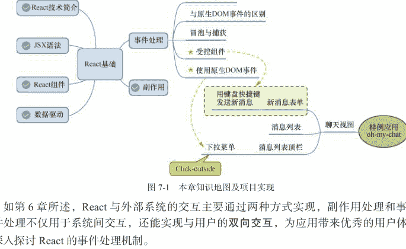

如第 6 章所述，React 与外部系统的交互主要有副作用和事件处理两条路径。事件处理既承担系统间的通信，也支撑与用户的双向交互，是提升体验的关键。本章深入剖析 React 的事件机制。

Web 领域事件体系已相当成熟，原生 DOM API 提供了完整的事件模型，开发者可借助监听、冒泡与捕获构建复杂交互。

React 在此之上封装了合成事件 Synthetic Event，与原生事件有明显差异。刚接触合成事件的开发者常会问：

- 合成事件是什么？
- 为何不用直接原生事件？
- 典型使用场景有哪些？
- 什么情况下仍须原生事件？

本章将对比合成事件与原生事件的异同。oh-my-chat 消息列表中的受控表单是合成事件的典型用法，但合成事件并非全部，部分特殊场景仍需原生事件。随后在 oh-my-chat 中加入若干小功能演示两种事件的处理方式。

## 7.1 React 合成事件

React 的事件能力主要建立在合成事件之上。底层仍依赖浏览器原生事件，通过封装解决了浏览器差异和原生系统复杂性的两大问题，让事件使用更顺畅。

熟悉原生事件的开发者对传统写法并不陌生：

```html
<!-- 这是 HTML 不是 JSX -->
<button onclick="handleClick()">按钮</button>
<input type="text" onkeydown="handleKeyDown(event)" />
```

在 JSX 的标签上同样能看到以 on* 开头的事件属性。区别在于命名采用驼峰，如 onClick、onKeyDown，且必须传入函数，不能传字符串：

```jsx
const MyComponent = () => {
  const handleClick = () => {/* ... 省略 */};
  const handleKeyDown = evt => {/* ... 省略 */};
  return (
    <>
      {/* 这次是 JSX 了 */}
      <button onClick={handleClick}>按钮</button>
      <input type="text" onKeyDown={evt => handleKeyDown(evt)} />
    </>
  );
};
```

以按钮为例，把 handleClick 传给 onClick。用户点击时 handleClick 会被调用，React 会把一个描述点击的对象作为第一个参数传入，这就是合成事件。

合成事件是对原生事件的高层封装，接口保持一致并遵循 W3C 规范，React 内部对各浏览器的差异做了归一化，开发者无需自行处理兼容性。

## 7.2 合成事件与原生 DOM 事件的区别

两者在多个层面不同。

### 7.2.1 监听方式不同

原生事件常见的三种写法：

1. 以内联形式写在 HTML 标签中：
```html
<button id="btn" onclick="handleClick()">按钮</button>
```
2. 把函数赋给 DOM 元素的事件属性：
```javascript
document.getElementById('btn').onclick = handleClick;
```
3. 调用 DOM 元素的 addEventListener，并在合适时机 removeEventListener 防止泄漏：
```javascript
document.getElementById('btn').addEventListener('click', handleClick);
```

合成事件不能用 addEventListener，JSX 写法为：
```jsx
const Button = () => (<button onClick={handleClick}>按钮</button>);
// 会被编译为
const Button = () => jsx('button', {
  onClick: handleClick,
  children: '按钮'
});
```

需要捕获阶段监听时，原生通过 addEventListener 的第三个参数实现：
```javascript
div.addEventListener('click', handleClick, true);
```
React 则在事件名后追加 Capture 后缀：
```jsx
() => (<div onClickCapture={handleClick}>...</div>);
```

### 7.2.2 部分事件表现不同

合成事件通过归一化消除了浏览器与元素间的行为差异，其中 onChange 最具代表性。

原生中，`<input type="text" />` 的 change 通常在失去焦点时触发；而 `<select>` 的 change 在 Chrome 会随方向键每次按下触发，旧版 Firefox 则只在失焦时触发。React 对 input、textarea、select 三类表单元素的 onChange 做了统一：尽可能实时响应，同时避免抖动。以文本框为例，合成 change 的触发频率明显高于原生。

原生 change 的差异只是兼容性问题的冰山一角，即使主流浏览器已改善，框架仍在幕后处理大量类似细节。

### 7.2.3 实际挂载目标不同

原生事件中 event.currentTarget 明确指向 id 为 btn 的按钮：
```javascript
document.getElementById('btn').addEventListener('click', handleClick);
```

合成事件不同。通过调试 oh-my-chat 可观察差异：打开页面并启动开发者工具，切到 Sources 面板，定位到 localhost:5173→src→components 下的 NewMessageForm.jsx。这里会出现两个同名文件，一个是浏览器加载的编译后文件，另一个是经 source map 映射的源码。选择映射后的源码，在 textarea 的 onChange 处理函数 handleChange 打上断点，输入新消息时会在断点停下。控制台显示 evt 类型为 SyntheticBaseEvent，其 nativeEvent 属性指向被封装的原生事件。

查看：
- evt.currentTarget
- evt.target
- evt.nativeEvent.currentTarget
- evt.nativeEvent.target

可确认两种事件的 target 都指向文本框，合成事件的 currentTarget 同样指向文本框，符合 W3C；但原生事件的 currentTarget 却指向 React 应用根容器 `<div id="root"></div>`。这是事件代理机制：通过 createRoot 创建根节点时，React 在根容器上统一监听受支持的原生事件，触发时根据类型和目标定位到对应的 React 元素，生成合成事件后调用处理器。表层接口严格遵循 W3C，既统一行为又提升可维护性。

## 7.3 合成事件的冒泡与捕获

合成事件同样支持冒泡与捕获。示例中定义两层嵌套 div：
```jsx
<div onClick={handleOuterClick}>
  <div onClick={handleInnerClick}> 可点击内容 </div>
</div>
```

内外层都监听 onClick，点击“可点击内容”时，内层先触发，随后冒泡到外层，handleInnerClick 与 handleOuterClick 依次执行，先内后外。

若想改变顺序，给外层事件名加 Capture 后缀：
```jsx
<div onClickCapture={handleOuterClick}>
  <div onClick={handleInnerClick}> 可点击内容</div>
</div>
```
此时执行顺序变为先外后内。

阻止继续传播只需在处理器里调用 evt.stopPropagation()。

## 7.4 受控组件

表单是前端常见需求。oh-my-chat 当前唯一表单代码如下：
```jsx
const NewMessageForm = ({ onSubmitMessage }) => {
  const [content, setContent] = useState('');
  const handleChange = (evt) => {
    setContent(evt.target.value);
  };
  // ... 省略
  return (
    <form className="compose-message" onSubmit={handleSubmit}>
      <textarea
        placeholder="请输入消息 ..."
        value={content}
        onChange={handleChange}
        ref={inputRef}
      />
      <input type="submit" value="发送" />
    </form>
  );
};
```

用户在文本框输入时触发 onChange，调用 handleChange，把最新值写入组件 content 状态。状态更新触发重渲染，文本框显示与 state 保持一致，形成闭环。

以组件 state 为唯一数据源，并通过合成事件响应交互的组件称为受控组件。单选、多选、下拉等均可受控，方便随时取数、校验、提交。

受控组件不局限于 form 内部，文本框等控件脱离 form 使用，只要值与 state 绑定即可受控。

为消息发送增加快捷操作：输入时按住 Shift 再按 Enter 即可发送，无需点按钮。为 NewMessageForm 的 textarea 增加 onKeyDown 并指定 handleKeyDown：
```javascript
const handleKeyDown = (evt) => {
  if (evt.key === 'Enter' && evt.shiftKey) {
    evt.preventDefault();
    // 提交表单
  }
};
```

提交表单有三种做法：
- 直接复制 handleSubmit 逻辑，调用 onSubmitMessage 并清空 state；
- 直接调用 handleSubmit；
- 使用 evt.target.form.requestSubmit() 触发提交。

推荐第三种，按键事件只负责触发提交，不处理后续逻辑，便于后续扩展校验，实现组件逻辑与表单整体逻辑的解耦。

经过实际跑测会发现，当前版本存在一个细节缺陷：当输入框里空无一物，或者只是堆了几个空格时，仍然可以触发发送，最终会在消息列表里留下没有意义的空白条目。避免这种情况的办法是在表单层面加一道简易校验，具体就是在 NewMessageForm 组件的 handleSubmit 里先做条件判断：

```javascript
const handleSubmit = (evt) => {
  evt.preventDefault();
  if (content && content.trim().length > 0) {
    onSubmitMessage(content);
    setContent('');
  }
};
```

加入这层判断后，只有 state.content 真正携带内容时才会走提交流程，空白消息的问题就被堵住了。表单处理的完整细节会在 14.5 节再展开，这里先不展开说明。

## 7.5 React 原生 DOM 事件实战

React 的合成事件体系已经覆盖了大部分日常交互，但在少数特殊情况下仍需要回到底层的原生 DOM 事件来解决。

### 7.5.1 哪些场景必须用原生事件

实践中主要有两种必须使用原生 DOM 事件的情形。

(1) 需要监听 React 组件树之外的节点事件，比如 window、document 这类全局对象的事件。

注意，在组件内部挂载原生 DOM 事件属于典型的副作用操作，必须遵守规范：在 useEffect 中完成注册，并在清理函数里及时卸载。

```javascript
useEffect(() => {
  window.addEventListener('resize', handleResize);
  return function cleanup() {
    window.removeEventListener('resize', handleResize);
  };
}, []);
```

（2）与第三方、尤其是与 React 异构的框架做整合。这类框架运行时会产生额外 DOM，导致非 React 管理的元素混入 React 渲染的树中。若要捕获这些框架抛出的事件，就只能用原生 DOM 监听，React 合成事件无法触达。这类场景同样要放在 useEffect 中处理。

需要强调的是，除开上述两种情况，理论上可以用原生事件配合特殊处理来完全替代合成事件，但这种做法违背 React 设计思路，不建议在常规开发中使用。

### 7.5.2 案例：Click-outside 下拉菜单实战

在 oh-my-chat 的聊天视图里，原先顶部工具栏的按钮是直接跳转到联系人页。为支持更多操作，比如“清空消息”，需要把这个按钮升级为下拉菜单。下拉菜单要满足的核心体验是：

- 点按钮弹出菜单；
- 菜单以浮层形式呈现，内部放置具体操作按钮；
- 点击页面其他区域时自动收起，这就是 Click-outside 交互。

实现思路是在 MessageTopMenu 组件里新增 isDropdownOpen 状态，按状态条件渲染浮层 ul.dropdown，并用 useRef 给浮层挂上 dropdownRef 备用。浮层内部放“查看联系人”和“清空消息”两个按钮，原按钮的 onClick 迁移到“查看联系人”上，外层按钮改为只负责展开菜单。样式写入 App.css，这里省略。组件代码如下：

```javascript
const MessageTopMenu = ({ contactName }) => {
  const { gotoContactView } = React.useContext(NavigationContext);
  const [isDropdownOpen, setIsDropdownOpen] = useState(false);
  const handleDropdownClick = () => setIsDropdownOpen(true);
  const dropdownRef = useRef(null);

  return (
    <header className="message-top-menu">
      <h1>{contactName}</h1>
      <div className="dropdown-wrap">
        <button onClick={handleDropdownClick}>
          
        </button>
        {isDropdownOpen && (
          <ul ref={dropdownRef} className="dropdown">
            <li><button onClick={gotoContactView}>查看联系人</button></li>
            <li><button>清空消息</button></li>
          </ul>
        )}
      </div>
    </header>
  );
};
```

此时点击顶栏菜单按钮即可弹出下拉。接下来补上 Click-outside 逻辑：在 MessageTopMenu 中建一个依赖 isDropdownOpen 的副作用，当菜单打开时在 document 上挂载 mousedown 监听，若点击目标不是下拉 ul 的子节点就关闭菜单，副作用清理时移除监听。具体代码如下：

```javascript
const dropdownRef = useRef(null);
useEffect(() => {
  const handleClickOutside = (evt) => {
    if (
      dropdownRef.current &&
      !dropdownRef.current.contains(evt.target)
    ) {
      setIsDropdownOpen(false);
    }
  };
  if (isDropdownOpen) {
    document.addEventListener('mousedown', handleClickOutside);
  }
  return function cleanup() {
    document.removeEventListener('mousedown', handleClickOutside);
  };
}, [isDropdownOpen]);
```

至此借助原生 DOM 事件实现了下拉菜单的外部点击关闭，如图 7-2 所示。需要说明的是，这个实现比较基础，未处理 iFrame、ShadowDOM 等复杂情况。


## 7.6 小结

本章先介绍了 React 合成事件，它是对原生 DOM 事件的标准化封装，并从监听注册方式、onChange 等特殊事件的行为、实际挂载目标 DOM 三个维度剖析了它与原生事件的区别。合成事件同样支持冒泡与捕获。

随后以 oh-my-chat 为例，学习了受控组件与表单处理，并为发消息增加了键盘快捷键。

最后讨论了合成事件的边界，列出了必须使用原生 DOM 事件的典型场景，并基于 Click-outside 模式为消息列表顶栏添加了下拉菜单。

# 第 8 章 组件样式

本章的知识地图与实现示例见图 8-1。

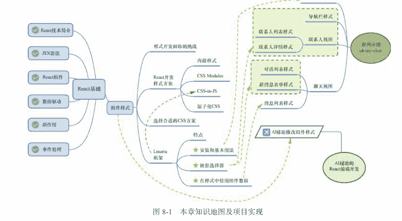

我们每天接触的网站、App、小程序视觉风格各不相同。一个产品凭借布局、色彩、字体、图标、形状、图片等要素塑造独特色调。好的视觉不仅能迅速抓住注意力，还能强化品牌、提升留存，同时是用户体验构建的关键。为此，定义前端视觉样式是开发工作中不可或缺的一环。

在 Web 开发中 CSS 是主流的样式定义手段，React 应用同样如此。React 采用组件化开发，对 CSS 也提出了组件化管理的要求。

前文以聊天应用 oh-my-chat 为例演示了在 JSX 文件中引入 CSS 文件。你可能会以为给每个 JSX 配一个 CSS 文件就算组件化了。实际上这种做法仍有明显短板：CSS 与 JavaScript 本质不同，很难完美契合 React 的组件层级，而且组件间的样式隔离需要额外处理。这就引出几个核心问题：

- 如何让样式与组件共生？
- 如何避免不同组件的 CSS 互相污染？
- 如何在 CSS 中使用 props 或 state 的动态值？

针对这些痛点，社区出现了 CSS Modules、CSS-in-JS、原子化 CSS 等多种方案。本章会简要对比这些方案，并重点采用目前流行的零运行时 CSS-in-JS 框架 Linaria，为 oh-my-chat 实现 CSS 组件化，并说明如何借助 AI 优化组件样式。

## 8.1 前端样式开发的痛点

CSS 作为 Web 三大基石之一，与 HTML、JavaScript 并肩发展，也曾因浏览器兼容性饱受困扰。随着标准完善，CSS 功能不断增强，重新获得开发者青睐。但在现代前端应用里，CSS 在可扩展性、可维护性、开发体验等方面仍面临挑战。

特别是在 React 等组件化框架中，CSS 会遇到一系列组件化相关的问题。根本原因在于 CSS 截至 W3C 2023 定义，尚未完全具备现代组件化开发所需的关键能力，主要体现在：

- 组件样式的作用域需要限定在组件级别；
- 样式与组件需要在源码和构建层面建立更强关联；
- 样式需要随组件数据变化而响应；
- 样式需要以组件为单位复用与扩展。

为补足这些能力、提升效率，社区推出了众多方案。选型时应重点考察上述能力是否被覆盖。

## 8.2 React 样式方案全景

在 React 中常见的样式方案有内联样式、CSS Modules、CSS-in-JS、原子化 CSS 等。本节拆解各自特点，后文 8.3 节给出选型建议。

### 8.2.1 内联样式

原生 HTML 通过 style 属性定义内联样式，JSX 也支持该属性，但语法不同。传统 HTML 使用带 CSS 语句的字符串，JSX 需要传入描述样式的 JavaScript 对象。具体差异如下：

```html
<!-- HTML -->
<div style="margin: 1rem; width: 100px; background-color: blue;">
  Test
</div>
```

```javascript
// JSX
const Component = () => (
  <div style={{margin: '1rem', width: 100, backgroundColor: 'blue'}}>
    Test
  </div>
);
```

CSS 标准属性采用烤串命名如 background-color，而 JSX style 对象遵循驼峰如 backgroundColor，属性值一般加引号，像素值可直接用数字省略 px。这种写法对应真实 DOM 的 style 属性，是 DOM API 的标准实现。

内联样式开箱即用，易懂易上，现代 IDE 也提供提示。它的作用域足够小，不会污染其他组件。但在复用性和可维护性上存在局限，不适合大规模项目。

### 8.2.2 CSS Modules

选择把 CSS 写进独立文件时，需要用选择器将样式与元素关联。随着规模扩大，类名或 ID 冲突导致的样式污染会频繁出现。CSS Modules 能有效解决。CSS Modules 不是框架，也非标准规范，但得到主流构建工具广泛支持。其目标明确：实现样式隔离。实现方式是使用 .module.css 后缀，内部写法保持常规：

```css
/* Component.module.css */
.container {
  margin: 1rem;
  width: 100px;
  background-color: blue;
}
```

在 JSX 中导入模块得到样式对象，再将属性赋给 className：

```javascript
// Component.jsx
import Styles from './Component.module.css';
const Component = () => (
  <div className={Styles.container}>Test</div>
);
```

构建阶段经 Vite 或 Webpack 编译后，最终代码会保证类名唯一：

```css
/* 构建生成的 index-af550414.css */
._container_1kpdq_1 {
  margin: 1rem;
  /* 省略 */
}
```

```html
// React 渲染的 HTML 片段
<div class="_container_1kpdq_1">Test</div>
```

编译时构建工具会自动为每个类名生成唯一哈希并写入最终选择器。即便不同组件使用相同类名，也会得到不同哈希，从而彻底避免冲突。CSS Modules 还提倡使用简单选择器，避免复杂嵌套，降低 DOM 层级内的样式污染风险。

在 React 实践中，典型模式是为每个 .jsx 文件配一个 .module.css。编译后这些模块会被抽取合并到同一 CSS 文件，如 dist/index-af550414.css，供浏览器加载。

### 8.2.3 CSS-in-JS

本章开头提到的组件化缺失能力，包括作用域控制、与组件代码关联、数据驱动更新、组件级复用扩展，前两节方案只能部分弥补。而 CSS-in-JS 是一种以 JavaScript 为核心的技术，能全面补齐这些短板。

直译就是在 JavaScript 中写 CSS。流行且维护良好的库有 styled-components、emotion、styled-jsx、linaria 等。它们实现细节不同，API 呈现两种典型风格。

（1）CSS 函数或属性形式：

```javascript
const Component = () => (
  <div className={css`
    margin: 1rem;
    width: 100px;
    background-color: blue;
  `}>Test</div>
);
```

（2）样式组件形式：

```javascript
const Container = styled.div`
  margin: 1rem;
  width: 100px;
  background-color: blue;
`;
const Component = () => (<Container>Test</Container>);
```

无论哪种风格，CSS-in-JS 库都会对开发者写的 JavaScript 样式做额外处理后生效。原生 JavaScript 操作 CSS 主要有以下 5 种方式。

- 通过 DOM API 设置元素的 style 属性，直接添加内联样式；
- 通过 DOM API 设置元素的 className 属性，关联预定义 CSS 类；
- 通过 DOM API 在页面文档动态插入包含 CSS 规则的 `<style>` 标签；
- 通过 CSSOM 的 CSSStyleSheet 接口动态修改页面的 CSS 规则。

零运行时的一种实现思路，是让构建阶段借助抽象语法树把 JavaScript 代码里写的样式抽离出来，生成独立的静态文件再由页面引用。

开源社区里常见的 CSS in JS 库，底层基本都是上述一种或多种手法的叠加。oh-my-chat 的落地细节会在 8.4 节展开，这里暂不深入。

### 8.2.4 原子化 CSS

面对组件化带来的冲突与污染，有的人选择把选择器粒度压到最小来规避风险，这就是原子化 CSS。它的核心是让每个类只负责一种视觉表现，并用语义化的命名体现用途，开发者在标签上叠加多个类来拼出最终效果。下面是不依赖任何库的演示：

```css
/* atomic-styles.css */
.margin-s { margin: 1rem; }
.width-1 { width: 100px; }
.bg-blue { background-color: blue; }
```

```html
<!-- HTML -->
<div class="margin-s width-1 bg-blue">Test</div>
```

示例里 CSS 只定义了三类单职责样式，div 通过组合这三类得到渲染。视觉上与把三条属性写进同一个类无差别，但从编程角度看，样式的决策权从样式表转移到了 HTML。

原子化 CSS 也常叫做函数式 CSS，可以把这些单职责类看成函数，在 HTML 里通过 class 属性调用并自由组合。因为原子类是 CSS 的最小单元，作用域与副作用都很可控，基本杜绝了不同区域间的相互影响。怎么组合类名都不会牵连其它标签，从而实现隔离。

该思路最早在 2013 年提出，随后出现多套实现。2017 年发布的 Tailwind CSS 以工具优先为定位，内置海量原子类，并配合现代构建工具与 IDE 插件，给开发者带来了高效的样式开发体验，很快成为标杆。Tailwind 同样可用于 React，例如：

```javascript
const Component = (<div class="m-4 w-24 bg-blue-600">Test</div>);
```

## 8.3 如何选择合适的 CSS 方案

除了内联样式，React 本身并未提供完整的样式体系，官方也没有强制推荐或限制。实际项目中可按需求自行挑选。

为便于选型，下面从功能与性能等维度对四类主流方案做归纳，如表 8-1 所示。CSS in JS 方向里零运行时已成为重要趋势，故单独列出。

表 8-1 React 主流 CSS 方案对比

| | 内联样式 | CSS Modules | CSS-in-JS | 零运行时 CSS-in-JS | 原子化 CSS |

|---|---|---|---|---|---|

| 基础 CSS 功能 | 支持伪类、伪元素 | 否 | 是 | 是 | 是 |

| | 关键帧动画 | 否 | 是 | 是 | 是 | 是，但需要额外配置 |

| 样式隔离 | 良好，样式作用域为标签 | 优秀，样式作用域为组件 | 优秀，样式作用域为组件 | 优秀，样式作用域为组件 | 良好，虽然样式作用域为全局，但类与类之间是隔离的 |

| 组件化能力 | 与组件代码关联性 | 强，样式写在组件文件中 | 一般，样式写在 CSS 文件并导入组件文件 | 强，样式写在组件文件中 | 强，样式写在组件文件中 | 弱，大部分样式定义在库中 |

| | 支持响应组件数据变化 | 是，样式中可添加 JavaScript 变量 | 否 | 是 | 是，通过 CSS 变量传递值 | 否 |

| 性能 | 综合性能 | 一般，DOM 样式修改可能触发重新布局（Reflow） | 优秀 | 良好 | 优秀 | 优秀，但前提是移除未用到的样式类 |

| | 是否需要额外的 JavaScript 运行时 | 否，直接操作 DOM | 否，使用纯 CSS | 是，需要运行时 JavaScript 处理样式 | 否，使用编译产生的 CSS | 否，使用纯 CSS |

| 工具链 | 是否需要编译构建 | 否 | 是，支持主流前端构建工具 | 部分框架需要，支持主流前端构建工具 | 是，支持主流前端构建工具 | 是，支持主流前端构建工具，移除未用到的样式类 |

| | IDE 支持 | 支持语句补全 | 支持代码补全 | 插件支持语法高亮 | 插件支持语法高亮 | 插件支持代码补全 |

除此之外，还要权衡可复用性、可扩展性、可维护性，以及库或框架的文档完备度与社区活跃度。

## 8.4 项目实现：为 oh-my-chat 实现 CSS 组件化

前七章里 oh-my-chat 仍沿用最基础的写法，所有样式集中在 App.css。随着功能增长，该文件会变得臃肿难维护，且容易因类名重复引发冲突，这类问题在大项目里排查成本很高。因此需要选定合适的样式方案并重构现有代码。

### 8.4.1 技术选型：Linaria 框架

基于我在多个 React 项目的统计，按代码量计使用率最高的三类是 CSS Modules、emotion 与 Linaria，后两者都属于 CSS in JS。实践表明 CSS in JS 能明显提升 React 的开发体验。Linaria 作为零运行时 CSS in JS 的代表，在保持与传统方案相似 API 的同时，运行时开销更小，因而被选为 oh-my-chat 的样式方案。使用感受上，Linaria 功能完备，API 与 styled-components、emotion 高度兼容，且比起偏向 JS/TS 语法写样式的方案，更贴近原生 CSS 的书写习惯。

接下来用 Linaria 重写组件样式，过程中会掌握 css 基础用法、嵌套选择器、样式组合复用、伪类以及把组件数据融入样式等核心能力，基本覆盖 CSS in JS 的典型场景。

### 8.4.2 Linaria 框架的安装和基本用法

回到 oh-my-chat，先在命令行安装 Linaria 及其 Vite 插件：

```
npm install @linaria/core @linaria/react
npm install -D @wyw-in-js/vite
```

随后修改 vite.config.js，加入 Linaria 构建插件：

```
// 省略
import wyw from '@wyw-in-js/vite';
export default defineConfig({
  plugins: [react(), wyw(), mockServer()],
});
```

执行 npm run dev 启动开发服务器，从最外层 App 组件开始改造。先从 @linaria/core 引入 css 方法，在组件外部声明 rootStyles，再把 App.css 中 .root 的全部样式作为参数传给 css 方法，把返回值赋给 rootStyles，最后把 <div> 的 className 从原字符串替换为 rootStyles：

```
import { css } from '@linaria/core';
import './App.css';
// 省略
const rootStyles = css`
  display: flex;
  flex-direction: row;
  height: 100%;
`;
function App() {
  return (
    <NavigationCtxProvider>
      <div className={rootStyles}>
        <GlobalNav />
        <GlobalView />
      </div>
      </NavigationCtxProvider>
  );
}
```

css`args` 这类写法可能陌生。它是 ES6 的带标签模板字符串，把反引号包裹的模板字面量直接挂在函数名后。为看清模板与参数的对应，可在控制台执行：

```
((...args) => console.log(JSON.stringify(args)))`我说 ${false} 你说 ${true}`;
// 按 Enter 键后控制台会打印
["我说","你说","",false,true]
```

打开应用时可能出现样式未及时生效的情况，这是暂时的。此时检查 DOM 会发现 App 组件对应的 <div> 的 class 变成看似无意义的 crluehvp8。实际上该类是通过动态插入到 <head> 的 <style> 标签生成的，如图 8-2。

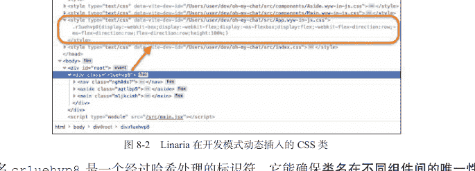

图 8-2 Linaria 在开发模式动态插入的 CSS 类

类名 crluehvp8 是哈希生成的唯一标识，用以保证不同组件间的类名不冲突，从而避免污染。若想查看具体样式，可格式化这段 CSS，得到类似：

```
.crluehvp8 {
  display: -webkit-box;
  display: -webkit-flex;
  display: -ms-flexbox;
  display: flex;
  -webkit-flex-direction: row;
  -ms-flex-direction: row;
  flex-direction: row;
  height: 100%;
}
```

这段代码比手工编写的多出几行，其中 -webkit-、-ms- 这类前缀称为浏览器引擎前缀，用于引入尚未标准化的属性或值。

为提升兼容性，Linaria 会自动为较新的 CSS 标准生成带前缀的声明副本。不支持前缀的浏览器会忽略这些副本，旧版浏览器则按需识别对应前缀，开发者只需按最新标准编写一次即可适配不同环境。

组件内部的 CSS 脱离了传统文件，VS Code 默认不会提供高亮与补全。可安装 vscode-styled-components 扩展，搜索 “styled” 即可找到，标识为 styled-components.vscode-styled-components。安装后在 css 方法的模板字符串里编写样式即可获得完整的高亮与自动补全，效果如图 8-3。

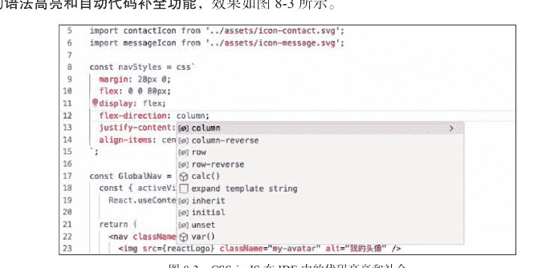

继续改造 <nav>、<aside>、<main> 的样式。先定位 GlobalNav 组件，把 App.css 中的 .root > nav 改写为变量 navStyles，并赋给 <nav> 的 className：

```
import React from 'react';
import { css } from '@linaria/core';
// 省略
const navStyles = css`
  margin: 28px 0;
  /* 省略 */
`;
const GlobalNav = () => {
  return (
    <nav className={navStyles}>
    {/* 省略 */}
  </nav>
  );
};
```

接下来处理 <aside> 与 <main>，它们同时出现在 ChatView 与 ContactView。为避免重复，可把带样式的标签抽象为可复用的样式组件。新建 components/Aside.jsx，从 @linaria/react 导入 styled 对象，用 styled.aside 创建 Aside 组件，参数仍用模板字符串，直接拷贝 .root > aside 的样式：

```
import { styled } from '@linaria/react';
const Aside = styled.aside`
  margin: 12px 0;
  border-radius: 20px 0 0 20px;
  /* 省略 */
`;
export default Aside;
```

再新建 Main.jsx，用 styled.main 基于 .root > main 创建 Main 组件。核心代码如下：

```
const Main = styled.main`
  position: relative;
  /* 省略 */
`;
```

随后用这两个新组件替换 ChatView 中的 <aside> 与 <main>：

```
import { useState } from 'react';
import Aside from './Aside.jsx';
import Main from './Main.jsx';
// 省略
const ChatView = () => {
  // 省略
  return (
    <>
      <Aside>
        <ThreadsPane {/* 省略 */} />
      </Aside>
      <Main>
        <MessagesPane selectedThreadId={selectedThreadId} />
      </Main>
    {/* 省略 */}
    </>
  );
};
```

对 ContactView 做同样的替换。全部改写后，请删除 App.css 中以 .root 开头的样式类，原生 CSS 不具备无效代码消除能力。保存后刷新页面，样式与改写前一致，说明改造成功。

使用过这两种 API 后可能会好奇为何 Linaria 被称为零运行时 CSS in JS。执行 npm run build 构建生产代码，在 dist 目录查看唯一的 CSS 文件会发现，JavaScript 中编写的样式都被抽取到该文件，而生成的 JS 只保留了类名引用，对运行时性能几乎没有影响。

### 8.4.3 嵌套选择器

继续改造 GlobalNav 的其它样式。用 css 方法把原有的 .my-avatar 改写为 myAvatarStyles，把 .top-nav 改写为 topNavStyles。可以看到样式里还有几个以 .top-nav 开头的子选择器，如 .top-nav>li。对应 JSX 中 <li>、<a> 属于本组件，子选择器的样式也需要迁移。最直接的方式是为每个元素单独建变量，但也可以用嵌套。

在 topNavStyles 的模板字符串里追加 .top-nav>li 的样式，并把选择器中的 .top-nav 换成嵌套选择器 &；随后在刚加入的 &>li 样式块内继续添加 .top-nav>li>a 的样式，把选择器中的 .top-nav>li 换成 &；依此类推，在 &>a 的代码块里添加原始 a:hover 与 img 的样式。注意伪类写法，&:hover 中间不可有空格。改写完成后 topNavStyles 的结构如下：

```
const topNavStyles = css`
  margin: 16px 0;
  padding: 0;
  list-style: none;
  width: 100%;

  & > li {
    height: 80px;
    & > a {
      display: flex;
      /* 省略 */
      &:hover, &:active { background-color: #ffffff11; }
      & > img {/* 省略 */}
    }
  }
`;
```

保存后刷新浏览器，就能看到样式被完整还原。Linaria 会把嵌套写法逐层展开，最终生成与原本子孙选择器结构相近的多层级类名。

嵌套选择器 & 并非 Linaria 或某个 CSS-in-JS 方案独有，LESS、SASS 等预处理器早已广泛使用。后经 W3C 收纳，成为 **CSS Nesting** 标准草案，虽然主流浏览器直到 2023 年底才逐步跟进，但在 **CSS-in-JS 体系里嵌套语法早已成为标配**，开发者可以直接使用而无需顾虑兼容性。

需要特别强调，组件内使用嵌套时，**&>li 中的子代组合符 > 必须保留**。若写成 & li，中间带空格，就会退化为后代选择器，只要 DOM 树里属于组件后代的 <li> 都会匹配。假如组件允许传入 children，极易造成子组件样式被污染，违背样式隔离初衷。

另外，导航栏里的 li.active 不宜留在嵌套块中处理，建议单独抽出。可借助 Linaria 提供的 cx 工具函数来简化条件类名的拼接。具体写法如下：

```
import { css, cx } from '@linaria/core';
const activeStyles = css`background-color: #ffffff33;`;
// JSX
<li className={cx(activeView === 'chat' && activeStyles)}>
```

沿用同样思路，其余除 MessageList.jsx 之外的组件都能完成改写。为控制篇幅，具体代码请对照仓库本章源码。

### 8.4.4 用组件数据驱动样式

在样式迁移过程中，为什么 8.4.3 节单独保留了 MessageList？因为 Linaria 支持在 JSX 样式里直接嵌入 JavaScript 表达式，可读取 React 组件的 props、state 或 context。MessageList 中，别人发来的消息靠左，自己发出的靠右，原实现依赖 .from-me 类名，改用 CSS-in-JS 后就能直接在样式里引用变量来切换。

改造 MessageList.jsx 的步骤如下。首先用 Linaria 的 css 函数生成 messageListStyles，仅负责 ul.message-list 的样式，并挂到 <ul> 上，此段省略。随后重写 MessageItem 与 MessageTimestamp 的样式。用 styled 对象 API 先造一个基础样式组件 Li，再借助 styled 函数把它扩展为 MessageLi 与 TimestampLi，分别在两个子组件里替换原 <li>。在 MessageLi 上增加 fromMe 属性，并在 flex-direction 处插入一个函数，根据 fromMe 的值返回不同的方向值。示例代码如下：

```
import { styled } from '@linaria/react';
const Li = styled.li`
  display: flex;
  /* 省略 */
`;

const MessageLi = styled(Li)`
  flex-direction: ${({fromMe}) => (fromMe ? 'row-reverse' : 'row')};
  & > img {
    border-radius: 50%;
    /* 省略 */
  }
`;
const MessageItem = ({ content, from, fromAvatar }) => (
  <MessageLi fromMe={from === 'me'}>
    
    <p className="message">{content}</p>
  </MessageLi>
);

const TimestampLi = styled(Li)`
  justify-content: center;
  /* 省略 */
`;
const MessageTimestamp = ({ sentTime }) => {
  // 省略
  return (<TimestampLi>{timestamp}</TimestampLi>);
};
```

请记得清理 App.css 中的冗余定义。打开开发者工具对比，可见改写前后渲染结果完全一致。

不同 `<li>` 会对应不同的 class，同时元素的 style 属性里会被动态写入以 “--” 开头的 CSS 自定义属性，如图 8-4 所示。这些变量在类样式中被引用，成为 JavaScript 与 CSS 通信的桥梁。

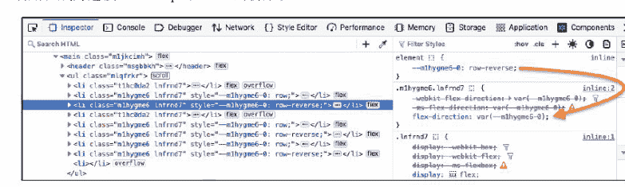

补充说明，使用 Linaria 时，只有通过 styled API 创建样式组件并在其中嵌入函数，才能实现基于运行期 props 的动态计算。其余写法，包括 css 函数或 styled API 中直接写变量，都要求变量在编译期就能确定，例如：

```javascript
const fontSize = 16;
const Paragraph = styled.p`
  font-size: ${fontSize}px;
`;
```

把 JavaScript 数据注入 CSS 虽然方便，却模糊了两者边界，会降低可读性和可维护性，甚至引发隐蔽的 bug。实际项目中应避免过度依赖该特性。

## 8.5 用 AI 辅助调整组件样式

1.4.2 节和 2.4 节曾让 Copilot 生成 JSX 与对应 CSS，回看当时产出的 CSS 并未使用 CSS Modules、CSS-in-JS 等组件化手段，容易污染其他组件样式。这说明 Copilot 默认不会主动套用组件化最佳实践，除非在提示中明确要求或提供足够上下文。

CSS 本质上是全局生效的，若想让 AI 生成精准、不冲突且可扩展的样式，就需要提供完整页面 HTML 与现有 CSS。但 React 项目会持续演进，上下文不断变化，依赖 AI 生成全局 CSS 并不可持续。更合理的做法是把生成范围收窄到组件层级，结合 8.2 节的样式方案保证输出符合组件化要求。

下面以实践说明。检出 8.4.4 节 oh-my-chat 的代码，打开 MessageTopMenu.jsx，选中其中的 dropdownStyles 变量，右键选择 Copilot → 编辑器内联聊天，如图 8-5。

在聊天框输入提示：

修改下拉菜单的样式，删除菜单项的边框，菜单项之间用横线分隔，鼠标悬停时菜单项高亮。

发送后 Copilot 会在编辑器中修改 dropdownStyles 的子选择器代码。确认仅该变量被改动后点击接受并保存。浏览器中打开聊天视图，点击消息菜单，即可看到更新后的效果，如图 8-6。

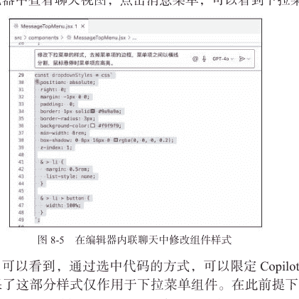


通过选中代码限定作用域，配合 Linaria 的 css 函数确保样式仅作用于下拉菜单组件。此时甚至不必让 Copilot 知道底层用了哪种 CSS-in-JS 库，就能得到正确且可扩展的输出。

除 CSS-in-JS 外，Tailwind CSS 也是众多 AI 代码生成工具青睐的方案，同样能提升生成组件化样式的成功率。需要注意的是 Tailwind 从 3.x 升到 4.x 有破坏性变更，使用时应明确 AI 生成代码所依据的版本，具体不再展开。

## 8.5 小结

本章先梳理了组件化开发中样式管理的痛点，系统介绍了 CSS Modules、CSS-in-JS、原子化 CSS 等主流方案，这些手段都能实现样式隔离，提升可维护性和复用性。随后以 oh-my-chat 为例，演示了零运行时 CSS-in-JS 库 Linaria 的安装配置与基础用法，包括嵌套选择器语法和基于 props 的动态样式逻辑。在手动编写的基础上，还演练了借助 Copilot 优化组件样式的流程。需要说明的是，对比传统写法，本章示例中 Linaria 的基础优势并不明显，但当项目规模扩大、样式复杂度上升时，CSS-in-JS 在组件化样式管理上的价值会更突出。

# 第二部分

React 进阶

本部分共 4 章，围绕 React 进阶开发的核心要点展开，涵盖虚拟 DOM、组件生命周期、不可变数据、应用状态管理及相关框架，以及性能优化、用户体验提升和可扩展代码实践等内容。

学习后，读者能够深入理解 React 底层运行机制，掌握构建高性能、可扩展应用的方法，并在 oh-my-chat 项目中落地实践。

# 第 9 章 生命周期与虚拟 DOM

本章知识概览见图 9-1。


从本章起进入“React 进阶”。即便是资深开发者，也常被两类问题困扰：

- 数据已更新，但组件为何没有重渲染？
- 数据未变，为何却触发了重渲染？

要消除困惑，需要弄清从声明式 JSX 到最终 DOM 更新的完整链路。本章以 React 生命周期切入，解释框架如何协调应用代码。

在介绍生命周期时，会引出虚拟 DOM 及相关概念。虚拟 DOM、协调算法、React Fiber 架构与调度器，是 React 高效运转的基础。掌握这些原理不仅能加深对生命周期的理解，解释渲染与更新行为，还能串联起多数 Hooks 的工作方式，为后续学习打下基础。本章会触及底层原理，但会以通俗方式呈现。

## 9.1 React 的生命周期

建议先从整体看框架级更新周期，即前面提到的渲染与提交两大阶段，合称 React 更新过程；再看单个组件的生命周期；最后关注副作用生命周期。通俗说，React 生命周期主要指组件生命周期。

### 9.1.1 React 更新过程

回顾应用入口，先用 `ReactDOM.createRoot(elem)` 创建根对象 root，再调用 `root.render(<App />)` 渲染根组件。调用后 React 会经历 **渲染** 与 **提交** 两个阶段。修改 state 会触发重新渲染，同样会走这两步。

渲染阶段里，React 从根组件开始递归执行组件函数，调用其中使用的 Hooks 并生成 JSX 对应的 React 元素，同时创建对应的真实 DOM 元素。重新渲染时，只会执行导致更新的组件函数，算出最新的 React 元素与属性。此时生成的真实 DOM 并不会挂到文档树，而是暂存于名为 FiberNode 的中间结构中，用户看不到变化。组件的 state 等信息也会保存在对应的 FiberNode 上。

提交阶段，React 调用 DOM API 把上一阶段生成的真实 DOM 插入文档，形成 DOM 树。重新渲染时，会依据 FiberNode 记录的结果，仅更新必要的节点。用户这时才看到页面变化。为避免术语混淆，真实 DOM 写入屏幕的过程称为 **绘制**。

渲染与提交共同构成 **React 更新过程**，在整个应用生命周期里循环进行，可视作跨越所有组件的基础生命周期。

### 9.1.2 组件生命周期

每个 React 组件都有自己的生命周期，包含 **挂载**、**更新**、**卸载** 三个阶段，外加 **错误处理** 阶段。

3.7 节提到 React 组件分为函数组件与类组件。类组件提供一系列可选项生命周期方法。在类组件为主的时期，开发者常用这些方法处理与外部系统的交互。下例展示了包含部分生命周期方法的类组件：

```javascript
class LegacyComponent extends React.Component {
  constructor(props) {
    super(props);
    this.state = { count: 0 };
  }

  componentDidMount() { /* 省略 */ }
  // ... 其他生命周期方法

  componentWillUnmount() { /* 省略 */ }

  render() {
    return (<div>{this.props.title}: {this.state.count}</div>);
  }
}
```

该组件可在 componentDidMount 中启动定时轮询接口，挂载时开始；在 componentWillUnmount 中清除定时器，卸载前停止。这些方法分布在挂载、更新、卸载、错误处理四个阶段。用类组件时必须准确掌握各方法的用途与触发时机，才能正确处理副作用。类组件在 React 19 仍被支持，但本节不作重点，详情可查阅官方文档。

本书重点在函数组件，它不直接暴露生命周期方法，但能实现类组件的功能。React 通过 Hooks 机制实现了等价能力，可视作生命周期方法的替代。例如 6.2 节的 useEffect Hook 就能完整实现上述轮询逻辑，且更灵活易封装。

既然如此，还需学习组件生命周期吗？需要。生命周期方法不等同于组件生命周期。生命周期是 React 的底层核心机制，类组件与函数组件共享相似流程，生命周期方法和 Hooks 都是开发者介入的入口。对函数组件而言，各阶段不仅对应渲染流程，还决定 Hooks 的触发时机。同一个 Hook 里的代码在不同阶段可能表现不同。深入理解生命周期，有助于更正确高效地使用 Hooks。

下面用一张图展示各生命周期阶段，并在每个阶段标注部分 Hooks 的触发时机。图左侧为跨组件的渲染与提交阶段，这两个阶段与组件的挂载、更新、卸载在时空上存在交叠关系，如图 9-2 所示。

图中出现的一些 Hooks 尚未介绍，其中 useReducer 将在 10.4 节“应用状态管理”中讲解，useMemo、useCallback 等将在 11.2 节“性能优化”中讲解。

先把挂载阶段拆开看。组件函数被调用时，React 会按调用顺序把 useState、useMemo 等钩子逐一装到对应的 Fiber 节点并算出初始值。useEffect 同样会被登记下来，不过它携带的副作用会被保留到提交时再执行。组件一般以 JSX 的形式返回元素，渲染阶段 React 依据这个返回值拼出一棵 Fiber 节点树，等到提交阶段真实 DOM 更新完毕后，再按顺序执行之前登记好的副作用。

再看更新时的行为。外部传入的 props 发生变化、通过 useState 拿到的 setter 修改了内部状态、或者从 context 读取的值变了，组件就会进入更新。此时组件函数会再次运行，各钩子会逐一与 Fiber 上已存在的钩子对齐并按需刷新。函数返回的结构用来刷新 Fiber 树。

# 第9章 生命周期与虚拟DOM揭秘


提交阶段先完成真实 DOM 的写入，随后按序处理上一轮副作用的清理函数，再触发新一批副作用。这里涉及 useEffect 与 useLayoutEffect，两者在功能上相近，触发时机却不同。useLayoutEffect 的回调会在 DOM 更新后立即同步运行，主线程仍在工作、浏览器还没开始绘制，可以做诸如 getBoundingClientRect 的测量或对节点做临门一脚的微调；useEffect 的回调则异步执行，不会阻塞绘制，执行时间晚于 useLayoutEffect。

卸载阶段在渲染阶段几乎没有特殊动作，关键操作都集中在提交阶段，也就是把副作用的清理函数执行掉。

最后是错误处理阶段。渲染时、执行其他生命周期时或执行 Hook 时若抛出异常，React 就进入错误处理。函数组件也会经历这一阶段，但没有对应的 Hook，必须依赖父级或祖先提供的错误边界。能充当错误边界的只有类组件：当类组件实现了 static getDerivedStateFromError 和 componentDidCatch 其中之一，就具备边界能力，React 会调用这两个方法收敛错误。

若当前组件不是边界，React 会向上递归查找父级，直至根节点；若最终仍未捕获，应用会崩溃。截至 React 19，只有类组件可以成为错误边界，函数组件无法原生实现。在全函数组件的项目里，错误边界仍需借助类组件，这会影响开发体验。可借助 react-error-boundary 等第三方库绕开限制，该库会在 15.4.1 节介绍，此处略过。

回看图 9-1，左侧是渲染与提交，右侧是错误处理。画图时想到用交通灯来类比：黄灯对应渲染，绿灯对应提交，红灯对应错误处理。右侧生命周期背景的黄绿红与灯色一一对应。可以想象黄灯亮时 React 正在为组件排定发车顺序和行驶路线；绿灯亮后组件们冲出起点呈现在用户面前，有的重新挂载，有的原地卸载，一旦中途出错红灯就亮起，等边界处理完再回到黄灯绿灯状态。需要强调的是，与现实中黄灯短绿灯长的规律不同，React 的提交阶段通常很快，渲染阶段才可能更慢。

### 9.1.3 副作用的生命周期

本节聚焦 useEffect。按 6.2.2 节的说明，未传依赖数组时副作用会在挂载和每次更新时都执行；传空数组则只在挂载时执行一次；传非空数组时副作用可能在生命周期中多次执行，但次数不一定等于组件更新次数。相比组件生命周期，useEffect 的触发更灵活。虽然它受组件生命周期制约，也可以把副作用本身当作独立单元来分析其生命周期。

以 oh-my-chat 项目里 MessagesPane 的副作用为例：

```javascript
useEffect(() => {
  let shouldIgnore = false;
  // ... 省略
  fetchMessages(selectedThreadId);
  return function cleanup() {
    shouldIgnore = true;
  };
}, [selectedThreadId]);
```
可以把副作用的生命周期理解为与响应式值紧密绑定的过程。以 selectedThreadId 为例，挂载时回调会首次运行，对应初始值。当 selectedThreadId 从旧值变成新值，先执行对应旧值的清理函数，再执行一次回调；组件卸载时最后再执行一次清理。这种模式让每次 selectedThreadId 的变化都对应一个完整的副作用生命周期。通过这种方式，useEffect 不仅挂钩组件生命周期，还与具体的数据流形成映射，提供更精细的副作用管理能力。

## 9.2 虚拟 DOM

弄清生命周期后，要更全面掌握 React 运行机制，就要深入底层原理。但在那之前，先理解虚拟 DOM 这一抽象概念，为后续学习铺路。

### 9.2.1 什么是虚拟 DOM
虚拟 DOM，即 Virtual Document Object Model，是近年来前端领域关注度很高的抽象

### 9.2.1 虚拟 DOM 的概念
虚拟 DOM 的概念是一种比 HTML DOM 更轻量的 JavaScript 模型。在 React、Vue.js、Elm 等声明式前端框架里，虚拟 DOM 是核心组成。

对开发者而言，React 提供了包含 JSX 在内的声明式组件 API。运行时，通过这些 API 声明的组件会被渲染成虚拟 DOM，随后 React 会把虚拟 DOM 转成真实 DOM；虚拟 DOM 的任何改动最终都会自动反映到真实 DOM 上；真实 DOM 上的交互也会被 React 转译为虚拟 DOM 上的副作用，与开发者写的交互逻辑关联起来。

理想情况下，使用 React 开发可以完全避免直接操作真实 DOM，虽然实际中很少做到，这在一定程度上隐藏了 Web 原生细节，降低代码量，提升效率。但虚拟 DOM 的真正价值不止于此，它更像是 React 对外 API 与内部实现之间的桥梁。React API 是声明式的，DOM API 是命令式的。开发者用声明式 API 造出的组件最终会变成页面上的动态 DOM，这背后依赖框架内部的一系列命令式实现，最终调用浏览器 DOM API。

如果没有虚拟 DOM 这个中间层，React API 就要直接对接 DOM API，耦合度会大幅上升。React 的概念和 API 设计会被浏览器实现牵制，React Native 等跨平台愿景也难以实现。没有虚拟 DOM，React 很可能无法保持现在的架构与特性。

### 9.2.2 真实 DOM 有什么问题
上一节从设计与范式讲了虚拟 DOM，那是否还有更硬性的原因让虚拟 DOM 成为必然？答案是性能。

我们多次提到 React 的设计理念 UI=f(state)。理论上，给定 f() 和状态数据，就能重现完全相同的 UI；这意味着状态一变 f() 就要重跑，整个 UI 需重渲染。现实中 f() 的成本不低。对浏览器网页应用，流畅目标是 60 FPS，即 16 ms 内完成一次 f()，否则就会掉帧卡顿。直接操作真实 DOM 很耗资源，频繁大量调用 DOM API 绘制页面很容易卡住，配置不佳时还会导致 CPU、内存飙升、风扇狂转。

为此 React 提供了一套算法和流程来过滤掉不必要的 DOM API 调用，降低 f() 成本。虚拟 DOM 作为这些流程的中间模型，比直接操作 DOM API 轻量得多，分摊成本后保证了组件渲染效率。

社区里也有质疑虚拟 DOM 的声音，比如 Svelte 作者 Rich Harris 发文 Virtual DOM is pure overhead，指出 Diffing 算法本身有代价，并可能误导开发者做无用功。虽然与本书立场不同，但我很认同其观点。

> 虚拟 DOM 的价值在于，它让你在构建应用时不必过度考虑状态变化如何映射到 UI，且在大多数情况下无需担心性能问题。这减少了 Bug，让你把更多时间投入创造性工作。

## 9.3 协调
9.2 节提到的虚拟 DOM 本质是抽象概念，在 React 内部更接近的实现就是协调过程。开发者使用声明式 API，每当 props、state 等数据变化，组件会重新渲染出新元素树，React 随后用 Diffing 算法对比新旧树，并把变动最终落到浏览器 DOM 上。这个过程称作协调 Reconciliation。

### 9.3.1 Diffing 算法
Diffing 算法 ① 是协调过程中的关键环节。React 持续优化它，虽然细节多次变更，基本逻辑仍可归纳如下。

- 从根元素开始，React 递归对比新旧两棵树的根及其子元素。
- 遇到不同类型元素，如 HTML 元素与 React 组件元素，React 会直接清理旧元素及其子树，构建新树。
- 同为 HTML 元素但标签不同，如从 <a> 变为 <div>，会清理旧元素及其子树，构建新树。
- 同为 React 组件元素但组件类或函数不同，如从 ChatView 变为 ContactView，会卸载旧子树，挂载新元素树。
- 标签相同的 HTML 元素，如 <input type="text" value="old" /> 与 <input type="text" value="new" />，保留该元素并记录属性变更，本例为 value 从 old 变为 new。
- 组件函数或组件类相同的组件元素，保留组件实例，更新 props，并触发组件的 Hooks 或生命周期方法。

需要强调的是，对比节点子元素时，若子元素是列表，React 会按顺序匹配新旧列表的元素。若变更仅限于末尾增减，影响较小；若在头部或中间插入删除，React 难以判断保留对象，往往选择推倒重建，性能损耗较大。

为应对这种情况，React 引入了 key 这个特殊属性。列表元素带上 key 后，React 会用 key 值来匹配新旧列表，减少插入时的损耗。这要求列表中每个元素的 key 唯一且稳定。比如数据来自数据库且带自增 ID，就可用其作 key。在 oh-my-chat 项目中，所有循环渲染场景都已使用 key，移除它会触发控制台警告。

Diffing 的对比结果最终会转成 DOM API 调用，只更新必要的 DOM 部分。

> ① 注：部分文献把协调过程和 Diffing 算法混为一谈，统称“协调算法”或“调和算法”。本书认为 Diffing 只是协调过程中的一步，不宜译为“协调算法”，故保留英文 Diffing 算法。Reconciliation 与官方文档保持一致，译为“协调”。

### 9.3.2 触发协调的场景
弄清协调含义与 Diffing 逻辑后，从开发者角度看哪些操作会触发协调。

使用 React API 时不必时刻想着协调细节，否则负担过重；但协调是页面最终变化的必经之路。假设你是框架设计者，会在什么时机触发协调？通常只有两种思路：拉 Pull 或推 Push。

轮询是一种主动拉取策略。极端设计是每隔 16 ms 触发一次协调，只要元素树有变化这次协调就能算出 Diff 并更新页面。但缺点明显：元素树长时间不变时频繁协调纯属浪费资源。

因此更倾向“推”策略，需要一种方式通知 React 启动协调，且该方式应局限在 React API 层面，避免把内部机制暴露给开发者。结合 UI=f(state) 的理念，通常只有数据变化时才应触发协调。

在 React API 中，props、state 和 context 用来操作组件数据。props 是外部传入的参数，state 是组件内部维护的状态，context 则允许在外部通过 Context.Provider 提供数据，供组件内部读取。一旦这三种数据任一变化，React 就会对当前组件启动协调，并按 Diffing 结果更新页面。过程中要注意不可变性 Immutable，确保按 React 设计原则改变数据。

### 9.3.3 什么是 Fiber 协调引擎
从 9.2 节开始一直在讨论虚拟 DOM，但翻阅 React API 文档和源码，却找不到名为 VirtualDOM 的类、函数或变量。虚拟 DOM 是抽象概念。若问 React 中与之最接近的实现，可能会想到 React 元素，但这并非最准确答案。

在 React 早期，协调是同步过程。当虚拟 DOM 足够复杂或渲染计算量够大时，协调耗时可能超过 16 ms，导致掉帧甚至卡顿。React 16 起，协调从同步变为异步，这主要归功于新的 Fiber 协调引擎。Fiber 将渲染过程拆成多个工作单元，并可根据需要调整优先级、暂停和恢复，从而提升性能。这一内部架构下，与虚拟 DOM 最接近的核心模型是 Fiber 协调引擎中的 FiberNode。FiberNode 通过父子双向链表、兄弟单向链表构建一棵树，可随时暂停恢复渲染，并把中间结果分散存储在各节点，避免阻塞浏览器其它工作。

Fiber 协调引擎的工作贯穿应用整个生命周期，包括但不限于：

- 创建各类 FiberNode 并构建 Fiber 树。
- 调度和执行各类工作 Work，如渲染函数组件、挂载或更新 Hooks、实例化或更新类组件等。
- 对比新旧 Fiber，触发 DOM 变更。
- 获取 context 数据。
- 处理错误。
- 进行性能监控。

9.3.4 节和 9.3.5 节将从 Fiber 原理出发，介绍 Fiber 中的重要模型与关键流程，并尽量与之前学过的 React 概念相联系，包括 React 元素、渲染过程、虚拟 DOM、生命周期、Hooks。目标不是面面俱到，而是帮助读者更深入理解 React 框架。

另外要注意，Fiber 协调引擎是 React 内部机制，掌握程度不会影响日常使用 React 进行前端开发。

### 9.3.4 Fiber 中的重要概念和模型
协调过程涉及多种操作，其中调用 Hooks 或生命周期方法在 Fiber 引擎中被称为工作。Fiber 的基本单元是 FiberNode，用于描述组件所需执行或已完成的工作，每个组件可能对应一个或多个 FiberNode。这与一个组件渲染可能产生多个 React 元素的情况一致。实际上，每个 FiberNode 的数据都来源于元素树中的一个元素，二者一一对应。与元素树每次渲染都会重建不同，FiberNode 会被复用，其属性随之更新。

接下来分析 FiberNode 的数据结构，为方便理解，这里将关键属性分组，并省略了一些非关键属性：

```
type Fiber = {
  // ---- Fiber 类型 ----
  /** 工作类型，枚举值包括：函数组件、类组件、HTML 元素、Fragment 等 */
  tag: WorkTag,
  /** 就是那个子元素列表用的 key 属性 */
  key: null | string,
  /** 对应 React 元素 ReactElement.type 属性 */
  elementType: any,
  /** 函数组件对应的函数或类组件对应的类 */
  type: any,

  // ---- Fiber Tree 树形结构 ----
  /** 指向父 FiberNode 的指针 */
  return: Fiber | null,
  /** 指向子 FiberNode 的指针 */
  child: Fiber | null,
  /** 指向平级 FiberNode 的指针 */
  sibling: Fiber | null,

  // ---- Fiber 数据 ----
  /** 经本次渲染更新的 props 值 */
  pendingProps: any,
  /** 上一次渲染的 props 值 */
  memoizedProps: any,
  /** 上一次渲染的 state 值，或是本次更新中的 state 值 */
  memoizedState: any,
  /** 各种 state 更新、回调、副作用回调和 DOM 更新的队列 */
  updateQueue: mixed,
  /** 为类组件保存对实例对象的引用，或为 HTML 元素保存对真实 DOM 的引用 */
  stateNode: any,

  // ---- Effect 副作用 ----
  /** 副作用种类的位域，可同时标记多种副作用，如 Placement、Update、Callback 等 */
  flags: Flags,
  /** 指向下一个具有副作用的 Fiber 的引用，在 React 18 中已被弃用 */
  nextEffect: Fiber | null,

  // ---- 异步性与并发性 ----
  /** 当前 Fiber 与成对的进行中 Fiber 的双向引用 */
  alternate: Fiber | null,
  /** 标记 Lane 车道模型中车道的位域，表示调度的优先级 */
  lanes: Lanes
};
```

```
// 其他需要关注的，还有与 Hooks 相关的模型，这包括了 Hook 和 Effect ：
type Hook = { memoizedState: any, baseState: any, baseQueue: Update<any, any> | null,
queue: any, next: Hook | null };
type Effect = { tag: HookFlags, create: () => (() => void) | void,
destroy: (() => void) | void, deps: Array | null, next: Effect };
```

就目前的 Hook 实现来看，几乎每一个 Hook 内部都预留了一对分发器来对应挂载和更新两个时机。以 useEffect 为例，它同时拥有 mountEffect 与 updateEffect；另外一部分 Hook 还额外带了 rerender* 形式的分发器，比如 useState 自带的 rerenderState。想更细地了解实现细节，可以去 React 源码的 packages/react-reconciler 目录里找对应的文件。

### 9.3.5 协调流程拆解

初次渲染的阶段，React 先把整棵元素树拼出来，随后 Fiber 引擎从 HostRoot 这个特殊节点出发，开始遍历整棵树并为每个节点生成对应的 FiberNode。

FiberNode 之间的连接方式和传统树不一样，不再使用 parent-children 指针。父节点与它的第一个子节点之间用 child 和 return 构成双向链路，同层节点则通过 sibling 指针形成单向链，同时确保链上所有节点的 return 引用都指向同一个父节点。图 9-3 就是这种结构的示意。

选择链表结构的好处在于，协调工作时无需递归遍历整棵 Fiber 树，只用两层循环就能完成深度优先的走访，React 把这个走访循环叫做 workLoop。图 9-3 里的数字表示以 HostRoot 为起点遍历的顺序。


下面给出 workLoop 的简化示意。为了便于理解，这里把源码里的 performUnitOfWork、workLoop、completeUnitOfWork、completeWork 合并简化，代码中叫 workLoop 的函数就是示意版本：

```
let workInProgress;

function workLoop() {
  while (workInProgress && !shouldYield()) {
    const child = workWork(workInProgress);
    if (child) {
      workInProgress = child;
      continue;
    }

    let completedWork = workInProgress;
    do {
      if (completedWork.sibling) {
        workInProgress = completedWork.sibling;
        break;
      }
      completedWork = completedWork.return;
    } while (completedWork);
  }
}
```

更关键的是，这个循环可以随时挂起再恢复。这意味着 workLoop 既支持同步执行，也支持异步切片执行。当检测到当前 Fiber 的工作耗时过长时，会根据 shouldYield() 的判断决定是否暂停，把计算资源让给更紧急的任务，等空闲后再回来继续之前的工作。

## 第9章 渲染生命周期与虚拟 DOM

当组件内部的状态或上下文发生变化时，React 会进入渲染阶段。这个阶段是异步的，Fiber 协调引擎会启动 workLoop，从 Fiber 树的根节点开始遍历，对已经处理过的节点快速跳过；对于发生变化的节点，引擎会为 Current 节点复制一个 WorkInProgress 节点，让这两个 FiberNode 的 alternate 属性互相指向，并把本次更新全部写入 WorkInProgress 节点。如图 9-4 所示。


可以把它理解成两棵 Fiber 树在同时工作：**Current 树对应已经呈现在页面上的内容；WorkInProgress 树则用来记录即将要做的改动。**

函数组件里的 Hooks 也在渲染阶段执行。除了 useContext，其他 Hook 在挂载后会通过 Hook.next 串成一条单向链表，随后这条链表被挂到 fiberNode.memoizedState 上。

在此基础上，像 useEffect 这样可能产生副作用的 Hook，还会为每个 Hook 实例单独创建 Effect 对象，并把 Effect 对象写入 Hook.memoizedState；同时在 FiberNode.updateQueue 上维护一条由 Effect.next 连接的单向链表，把该 Effect 追加到链表尾部。

先暂停一下，回想 Hooks API 的两条重要规则：第一，只能在 React 的函数组件内部调用 Hooks，第二，只能在组件函数的最外层调用 Hooks。因为函数组件重新渲染时，每个 Hook 都会按顺序再次执行，并沿着上述链表找回上一次的自身状态，然后决定是复用还是更新在链表里的状态。这也就解释了为什么同一个 useState 在每次渲染时返回的 state 更新函数引用都保持不变，以及 useEffect 如何通过比较 Hook 的状态来判断依赖数组在两次渲染间是否变化，进而决定是否重新执行副作用。

结合原理再来看这两条规则。

- 如果在 React 的函数组件之外调用 Hooks，Fiber 协调引擎将不会创建用于记录 Hooks 状态的单向链表。
- 如果在循环、条件分支等不稳定的代码位置调用 Hooks，可能导致再次渲染时，执行的 Hook 数量、种类和参数与上一次的链表不匹配，从而破坏 Hooks 的内部逻辑。

回到协调过程。当整棵 Fiber 树的所有节点都完成工作后，WorkInProgress 节点会被改名为 FinishedWork 节点，WorkInProgress 树也随之变为 FinishedWork 树。此时 React 进入提交阶段，这一阶段是同步执行的。Fiber 协调引擎会把 FinishedWork 节点上记录的所有变更，按照特定顺序提交并体现在页面上。

提交阶段可以进一步细分为以下 3 个依次同步执行的子阶段。

- **变更前 Before Mutation 子阶段**。这个子阶段会调用类组件的 getSnapshotBeforeUpdate 方法。
- **变更 Mutation 子阶段**。这个子阶段会更新真实 DOM 树。
  - 递归提交与删除相关的副作用，包括移除 ref、移除真实 DOM、执行类组件的 `componentWillUnmount`。
  - 递归提交添加、重新排序真实 DOM 等副作用。
  - 依次执行 FiberNode 上 `useLayoutEffect` 的清理函数。
  - 引擎用 FinishedWork 树替换 Current 树，供下一次渲染使用。
- **布局 Layout 子阶段**。在这个子阶段，真实 DOM 树已经完成了变更，但浏览器尚未绘制这些变更。这时会同步调用 `useLayoutEffect` 的副作用回调函数和类组件的 `componentDidMount` 方法。

在提交阶段中，引擎还会多次异步或同步调用 `flushPassiveEffects()`。这个函数会先后两轮深度优先遍历 Fiber 树上的每个节点。

- 如果节点的 `updateQueue` 链表中有待执行的、由 `useEffect` 定义的副作用，则顺序执行它们的清理函数。
- 如果节点的 `updateQueue` 链表中有待执行的、由 `useEffect` 定义的副作用，则顺序执行它们的副作用回调函数，并保存清理函数，供下一轮提交阶段执行。

`flushPassiveEffects()` 函数的实际执行时机是在上述提交阶段的 3 个同步子阶段之后，下一次渲染之前。引擎会确保在下一次渲染发生之前，所有待执行的副作用已执行完。

你也许对协调引擎的 Diffing 算法所处位置感到好奇。实际上，从渲染阶段到提交阶段，整个过程中都在使用 `memoizedProps` 和 `memoizedState` 与新的 `props`、`state` 进行比较，目的是减少不必要的工作，从而提升性能。

最后补充一点，前面提到的 `workLoop` 之所以能够灵活地随时暂停和继续执行，还有一个模块功不可没，那就是调度器 Scheduler，正是它负责根据优先级分批次执行众多工作，并允许执行队列暂停和恢复。如需进一步了解，建议阅读相关 React 源码。

## 9.4 小结

本章首先深入探讨了 React 中的生命周期，包括跨组件的生命周期由渲染阶段和提交阶段组成，单个组件的生命周期由挂载、更新、卸载和错误处理阶段构成，以及副作用的生命周期。然后引出了虚拟 DOM 的概念，阐述了 React 中的虚拟 DOM 是真实 DOM 的抽象表示，且远比后者更轻量，是 React 面向开发者提供的 API 与内部实现对接的桥梁。接下来，本章解释了 React 组件的 `props`、`state` 或者 `context` 发生变化时，React 如何触发协调过程，对比新旧两棵元素树，以确定有哪些真实 DOM 需要变更。同时也简要讲解了 React 底层负责协调过程的 Fiber 协调引擎。上述所有概念和模块共同构成了 React 组件的渲染机制。

# 第10章 应用状态管理

本章的知识地图及项目实现，如图 10-1 所示。


本书的第一部分讲解了 React 应用的基本写法，第二部分的第 9 章介绍了 React 的渲染机制和原理，本章将进一步探讨在开发规模更大、复杂性更高的 React 应用时所面临的各种技术挑战，并提出相应的解决策略。

利用 props、state、context 来保存和传递 React 数据的方式足以应对小型乃至中型 React 应用。然而，随着项目规模的扩大和复杂性的增加，开发者将面临以下新的挑战。

- 在处理对象或数组类型的 state 时，更新操作需要格外小心，以维持其不可变性。
- 与业务相关的 state 散布于各个组件中，难以同步和复用。
- 过度的状态提升导致大部分 state 或 context 集中于根组件。

第一个挑战的重点在于不可变数据，而后两个挑战则与应用状态管理直接相关。这些概念与 React 有着密切的联系。

- React 的状态更新依赖于不可变数据。
- React 可以结合独立的状态管理框架来管理应用状态。
- 多数应用状态管理框架是基于不可变数据构建的。

本章将首先介绍应用状态管理的基本概念，然后详细阐述不可变数据的重要性，接下来将探讨在 React 中管理应用状态的不同方案，并进一步讨论在何种情况下应使用 React 的 state，以及何种情况下应采用状态管理框架。最后，通过 oh-my-chat 的实践案例介绍一款主流状态管理框架 Zustand。

## 10.1 什么是应用状态管理

首先来探讨应用状态 Application State。从理论上讲，一个应用在运行期间，内存中所有与之相关联的数据均可被视为应用状态，但实际上这远远超出了应用开发者需要关注的范畴。

这里将后端服务器作为类比：有状态服务 Stateful Service 和无状态服务 Stateless Service 常被并列讨论。例如，一个购物车 HTTP 服务，在服务器端临时存储了当前登录用户的 session 信息，用户先后两次请求都会读写这个 session，因此该 HTTP 服务属于有状态服务；而另一个商品列表 HTTP 服务则不关心用户是否登录，仅凭用户发送的 HTTP 请求中所包含的参数即可完成任务，并将结果作为 HTTP 响应返回给用户，因此该 HTTP 服务属于无状态服务。通过比较这两种服务，可以确定服务器端临时保存的登录用户的 session 信息是需要关注的应用状态，至于 session 存储于内存中还是数据库中，此处暂不展开讨论。

越是富 JS 的浏览器端应用，越是倾向于将服务器端的应用状态迁移至浏览器端。于是就有了以浏览器端临时存储的登录用户的 session 信息为代表的前端 JavaScript 专用的应用状态。

如果不采取这种方法会怎样呢？这里再通过一个比较极端的反例来说明。例如对于一个简单的对话框来说，是否显示取决于一个布尔值状态，如果将该状态保存在服务器端，意味着每次打开和关闭对话框都需要调用后端服务，这比在浏览器端保存状态要复杂得多。从用户体验来看，用户打开和关闭对话框都需要等待服务器响应，这无疑降低了体验质量。从前端开发角度来看，打开和关闭对话框本来是同步的本地逻辑，却不得不转换为异步的服务器请求，这无疑增加了开发复杂性。你可能会有疑惑：真的有框架会这样做吗？答案是肯定的，例如当年的 JSF Java Server Faces。

React 作为由数据驱动的前端框架，更是依赖于浏览器本地的应用状态。随着本地状态的复杂性不断增加，甚至需要专门的抽象层时，应用状态管理框架应运而生，用于管理这些应用状态。当然，应用状态管理并不等同于状态管理框架，利用 React 的内部机制，同样可以实现应用状态管理的目标。本章后半部分将讨论何时应采用独立的状态管理框架。

## 10.2 不可变数据

在深入探讨应用状态管理之前，先来了解不可变数据的概念，它是应用状态管理的重要基础。在 React 开发过程中，未能以正确方式变更数据往往是产生 Bug 的主要原因之一。在 oh-my-chat 项目的 MessagesPane 组件中，在更新 messages 状态时使用了 [...currentMessages, newMessage] 返回了新的数组。你可能会问，为什么不能直接写成 messages.push(newMessage) 呢？当掌握了不可变数据的原理和实现，我们将对 React 的渲染机制与数据流之间的关系形成更深刻的理解。

### 10.2.1 什么是不可变数据

**不可变数据 Immutable Data 一旦创建，便无法更改。** 这种数据在编程和调试过程中更易于预测，有助于降低系统的复杂性。在 Web 开发中，开发者需要引入监听数据变化的机制，而实现这样的机制时需要警惕对应性能的影响。不可变数据的使用可以简化这些功能的实现，从而降低成本。

不同编程语言对不可变数据的支持方式不尽相同。目前为止，在我所接触过的编程语言中，基于 JVM 的 Groovy 语言在处理不可变数据方面令我印象深刻，其创建和变更不可变数据的过程尤为便捷。以下是 Groovy 中操作不可变数据的示例：

```
@groovy.transform.Immutable(copyWith = true)
class Customer {
    String name
    int age
    Date since
    Collection hobbies
}
def d = new Date()
def c1 = new Customer(name: '张三', age: 21, since: d, hobbies: ['读书', '电影'])

c1.age = 25 // 抛出异常
def c1Mutated = c1.copyWith(age: 25)
assert c1 != c1Mutated // true
assert c1.age == 21 // true
assert c1Mutated.age == 25 // true

c1.hobbies << '烫头' // 抛出异常

def c2 = new Customer('张三', 21, d, ['读书', '电影'])
assert c1 == c2 // true
assert c1 !== c2 // true
```

这本书并不要求读者精通 Groovy，只是借用它来形象地说明不可变数据的行为。示例代码的作用就是让概念更直观。

- 不可变对象在实例化时一次性确定属性，后续无法再修改。
- 它的每一个属性本身也必须是不可变的，由此保证整棵对象树都保持稳定。
- 想对不可变数据做改动，只能基于原数据新建一个实例，并明确指出哪些字段需要变化，新实例同样保持不可变。
- 用完全相同的属性创建的两个同类型不可变对象，逻辑上视为相等，但它们在内存中的引用地址并不相同。

把视野拉回到 JavaScript，是否也有不可变数据？答案是肯定的。所有原始值都是不可变的，涵盖 undefined、null、boolean、number、BigInt、string、Symbol。相反，引用类型比如 Object、Function、Array、Map、Set、Date 等，都属于可变类型。

JavaScript 并没有像 Groovy 那样的语法糖，但开发者仍有动力去使用不可变数据，主要收益在以下几个方面。

- 写出真正的纯函数会更顺手。
- 函数不再对入参产生意外的副作用。
- 数据是否发生变化的判断变得简单。
- 对不可变数据的缓存更加可靠。
- 可以很方便地保留同一份数据的多個历史版本。

### 10.2.2 React 里不可变数据的作用

谈到 React 开发，为什么总要强调不可变数据的重要性？

根源在于 React 是一个声明式系统，界面更新必须能响应数据流的变化。无论是开发者还是框架本身，都需要判断 props、state、context 是否发生了改变。前面提到过，对 React 而言，不可变数据让对比逻辑更简洁，开发成本更低；对开发者而言，调试和预测行为会更可控。

换句话说，React 中凡是需要做新旧对比、检查变化的环节，都是不可变数据发挥作用的地方，典型就是协调过程和合成事件。

首先是 React 的核心 Fiber 协调引擎，它执行 Diffing 算法，绝大部分对比都发生在渲染阶段。

之前反复提到，React 用 Object.is() 来判定两个值是否相同。在下面这些场景里，React 会调用 is(oldValue, newValue) 进行新旧比对。

- setState 时，只有新旧 state 不相等才会被标记为需要更新。
- Context.Provider 的 value 被更新时。
- useEffect、useMemo、useCallback 的依赖数组检查，只有在某个依赖真正不同时才会执行回调。
- useSyncExternalStore 中，React 会检查外部状态管理库传来的值是否变化，有变化才标记 Fiber 需要更新。

另外还有一种浅对比，底层依然依赖 Object.is()。当两个对象属性个数一致且每个同名属性都相等时，才被视为相等。11.2 节会介绍的 React.memo 就是定义纯组件的 API，进入更新阶段时，React 会用 shallowEqual(oldObj, newObj) 对比新旧 props，全部相同时直接跳过。

除了协调引擎，合成事件里也有对比：在触发 onSelect 前，React 会浅对比选中项是否变化，只有真正变化才触发事件。

## 10.3 不可变数据的落地方式

前面说过 JavaScript 的引用类型天生可变，如果想用它们实现不可变特性该怎么做？

### 10.3.1 手工实现思路

其实在 oh-my-chat 项目里我们已经做过尝试，这里再简单罗列思路：

```
// 数组
const itemAdded = [...oldArray, newItem];
const itemRemoved = oldArray.filter(item => item.id !== selectedItemId);
// 对象
const propertyUpdated = { ...oldObj, property1: 'newValue' };
// Map
const keyUpdated = new Map(oldMap).set('key1', 'newValue');
```

要点就是“绝不改动源对象”。当然这些写法可以进一步封装，也可以直接使用现成的开源库。

### 10.3.2 可持久化结构与 Immutable.js

谈到不可变对象，就绕不开可持久化数据结构的概念。

> 在计算机编程中，可持久化数据结构是一种在修改后仍能保留历史版本的数据结构，即在保留原数据的基础上进行增删改等操作。这种结构本质上就是不可变对象，因为所有操作都不会直接改动已保存的数据，而是在原版本上衍生出新分支。

——维基百科

在 JavaScript 生态里，Meta 开源的 immutable.js 是典型的实现。它提供了 List、Stack、Map、OrderedMap、Set、OrderedSet、Record 等不可变类型。这些类型构成的可持久化数据集可以直接用在 React 应用中。

const { List } = require('immutable');

const list1 = List([1, 2]);

const list2 = list1.push(3, 4, 5);

const list3 = list2.unshift(0);

const list4 = list1.concat(list2, list3);

该库的另一个亮点是嵌套更新，即使在对象树的最深层修改，也会返回全新且不可变的实例：

```javascript
const { fromJS } = require('immutable');
const nested = fromJS({ a: { b: { c: [3, 4, 5] } } });
const nested2 = nested.mergeDeep({ a: { b: { d: 6 } } });
// Map { a: Map { b: Map { c: List [ 3, 4, 5 ], d: 6 } } }
const nested3 = nested2.updateIn(['a', 'b', 'd'], value => value + 1);
// Map { a: Map { b: Map { c: List [ 3, 4, 5 ], d: 7 } } }
const nested4 = nested3.updateIn(['a', 'b', 'c'], list => list.push(6));
// Map { a: Map { b: Map { c: List [ 3, 4, 5, 6 ], d: 7 } } }
```

### 10.3.3 兼顾直觉与原理

Immutable.js 功能强大，在 React 社区曾很流行。但使用时要随时判断什么时候用原生类型、什么时候换成不可变类型，这会带来不小的认知负荷，即工作记忆资源占用增加。虽然运行效率可能提升，却可能拉低开发效率。

有没有办法既保留熟悉的原生数据结构和 API，又能优雅地引入不可变性？答案是有的，**Immer** 就是为此而生。它允许开发者用原生的 JavaScript 结构和本非不可变的 API 来读写数据，最终得到不可变结果。

官网给出的示例中，`produce` 接收原始数据和一个变更回调，回调里做的任何“修改”都不会影响原数据，而是生成一个等价的新数据：

```javascript
import produce from "immer"
const nextState = produce(baseState, draft => {
  draft[1].done = true
  draft.push({title: "Tweet about it"})
})
```

### 10.3.4 React 组件中使用 Immer

在组件层面，可以直接用 Immer 提供的 Hook 替代 `useState`。先安装：

```bash
npm install immer use-immer
```

组件内使用方式如下：

```javascript
import { useImmer } from 'use-immer';
const MessagesPane = ({ selectedThreadId }) => {
  const [messages, setMessages] = useImmer([]);
  const handleSubmitMessage = (content) => {
    setMessages((draft) => {
      draft.push({
        id: draft.length + 1,
        content,
        from: 'me',
        fromAvatar: reactLogo,
        sentTime: new Date().toISOString(),
      });
    });
  };
  // 省略
```

虽然 useImmer 的使用感与 useState 接近，但它在调用更新函数时会隐式执行 Immer 的 produce，开发者可以像操作可变数据一样直接修改 state。

## 10.4 重新审视 React 应用状态

本节聚焦 React 的应用状态管理。

### 10.4.1 状态的三类划分

开发 React 应用时，状态大致可分为业务状态、交互状态和外部状态三类。

业务状态与业务逻辑强相关，本质上独立于 UI，可在单元测试、Node 环境等场景复用。以 oh-my-chat 为例，对话列表、消息列表、新增消息、联系人列表等核心数据都属于业务状态。假如要为它做一个命令行管理工具，这些状态和逻辑完全可以复用，例如下面这些命令：

```bash
ohmychat list --type=thread
ohmychat list --type=contact
ohmychat add --type=message --to=小白 '新消息内容'
```

在中大型项目里，用户权限信息常保存在前端状态中，用来判断某个模块是否开放、是否只读或隐藏。服务器端仍需再次校验，权限状态同样属于业务状态。

交互状态，也叫 UI 状态，与用户交互密切相关，用来控制交互流程，提升体验。比如 oh-my-chat 中的 activeView、isLoading、isDropdownOpen，分别控制当前视图、加载占位提示、下拉菜单展开，它们都是交互状态。

设想如果把这些交互状态全部去掉：

- 去掉 isDropdownOpen，下拉菜单会一直展开，虽然能用。
- 去掉 isLoading，数据加载时列表会抖动，还算可接受。
- 去掉 activeView，所有视图内容一次性堆出来，已不符合现代前端标准。

优秀的交互体验正是前端工程师的价值所在。

表单状态算业务还是交互，要视情况而定。

**被视为交互状态的情形主要有两种。**

- 表单由多个受控组件组成，用户输入或选择时触发的状态变化本质上是交互行为，尚未具备业务含义；
- 输入过程中做即时校验，比如标题不能为空、密码需含数字，校验结果会写回表单状态。虽然有业务含义，但整体仍偏向交互。

**被视为业务状态的情形主要有三种。**

- 表单包含自动提示下拉框，根据输入从服务器拉取选项列表，这个列表属于业务数据；
- 提交表单时，最终的受控组件值被用于业务操作，此时它们是业务状态；
- 表单用于编辑已有记录，服务器提供的初始值也应看作业务状态的一部分。

再看一个派生值的例子。假设有一个状态 num，需要通过 fibonacci(num) 计算得到结果。为了避免重复计算，开发者可能把结果存到 result state 里。

先不谈计算本身，result 本质上是派生值。用单一事实来源原则来看，num 与 result 来自同一源头，若把两者都存成 state，因果关系就不清晰了。更合理的做法是只保留 num，组件每次基于 num 计算。性能问题则交给 11.2 节会介绍的 useMemo 解决：

```javascript
const memoizedResult = useMemo(() => fibonacci(num), [num]);
```

前面区分了业务和交互状态，外部状态如何界定？你可能会觉得外部就是与 React 无关。以 window.location 为例，React Router 会读取它并通过 History API 修改 URL。从应用视角看，window.location 实际上成了 React 状态的一部分，属于外部状态。

这种分类并不只适用于 React，其他前端框架同样适用。

对状态分类的意义在于，不同类别需要不同的管理策略。通常业务状态比交互状态更可能跨组件共享，对数据一致性的要求也更高。在 oh-my-chat 中，contacts 联系人信息需要在列表组件和详情组件间共享。请思考，如果希望在对话视图里所有显示联系人名称和头像的地方，都能按联系人 ID 从这份 contacts 数据中取值，该如何实现？

### 10.4.2 全局状态与局部状态

从 API 角度看，state 对单个组件是私有的。但从单向数据流来看，一个组件的 state 会影响其所有后代组件。如图 10-2 所示，state 下方连接的梯形区域代表其潜在影响范围。


ParentComponent 的 state A 作用范围如下：

- 可以自用；

直接子组件 MyComponent 能直接从父级拿到 props；如果要穿过层级，也可以靠 props drilling 把数据一路带到第二层、第三层的 MyChildComponent 和 MyGrandchildComponent；想要一次性喂给整棵子树，则用 context 更省事。

MyChildComponent 自己维护的 state B 作用域远比 state A 小，但二者并非完全互斥，存在重叠区。这样一来 MyChildComponent 以及它的后代 MyGrandchildComponent 就能同时消费 state A 和 state B。

当 ParentComponent 就是应用的根节点时，state A 基本可以当成全局状态来用，而 state B 则是局部状态。全局与局部并非绝对，相对看待即可。举例来说，根节点本身不提供状态，而它唯一的子节点提供了状态，这份状态在实际使用中同样具有全局意义。局部状态也可以通过状态提升按需升级为全局状态。

全局状态的波及面更广，初次定义和后续修改都要更谨慎，尤其是某个组件去改动全局状态时可能触发多处重渲染。没有明确需求就把局部状态提升为全局，是应该避免的习惯。区分全局与局部，也是在阅读和维护 React 代码时必备的能力。实践中，业务相关的状态更容易走向全局。

### 10.4.3 状态钩子 useReducer
10.4.2 里提到的全局状态会带来新问题，随着状态覆盖面扩大，更新函数往往会被一路传下去，子孙组件怎么用完全看自觉。尤其是当状态是对象或数组时，更新方式多种多样。定义状态的根组件能否给更新函数加上约束，来提升状态逻辑的内聚性？这里就引出了处理不可变数据的常见做法——**reducer**，也就是归约器函数。

在该模式下，开发者把数据变更逻辑收敛成一个或多个 reducer，并让它们对应不同的动作。调用方只需用调度器派发动作，就能触发对应的状态更新。

React 提供了 `useReducer` 这个 Hook 来以 reducer 的方式描述状态更新。可以把它看成 `useState` 的另一种写法。以 oh-my-chat 中的 `NavigationCtxProvider` 为例，用 `useReducer` 重写后的代码如下：

```javascript
import React, { useMemo, useReducer } from 'react';
// 省略
const initialState = 'chat';
const reducer = (state, action) => {
  switch (action.type) {
    case 'chatView':
      return 'chat';
    case 'contactView':
      return 'contact';
    default:
      return state;
  }
};
export const NavigationCtxProvider = ({ children }) => {
  const [state, dispatch] = useReducer(reducer, initialState);
  const contextValue = useMemo(() => ({
    activeView: state,
    gotoChatView: () => dispatch({ type: 'chatView' }),
    gotoContactView: () => dispatch({ type: 'contactView' }),
  }), [state]);
  // 省略
```

代码量看上去变多了，因为 `useReducer` 相比 `useState` 多了一层抽象，引入了三个概念。

- 动作 action：一个带 `type` 字段的普通 JS 对象，用来表达意图或事件，可选地携带 `payload`。
- 归约器 reducer：纯函数，接收当前状态和动作，根据 `type` 返回新的状态，常定义在组件外部。
- 调度器 dispatch：派发动作以触发 reducer 执行。

即便抽象变多，基于 `useReducer` 的数据流动依然是单向的。上面的例子很简单，只是处理字符串类型的 state。真实项目里状态多为对象、数组甚至多层嵌套，reducer 的编写难度也会上升。值得一提的是，`useState` 底层其实就是基于 `useReducer` 实现的。

另外 `useReducer` 中的 action、reducer、dispatch 与 Redux 的设计几乎一致。提到 React 生态的状态管理，Redux 总是第一个被提及。Redux 是面向 JavaScript 应用的可预测状态容器。它包含 store 这个概念，store 由 reducer 给出的初始值创建，可通过 `store.getState()` 读取最新状态，通过 `store.dispatch()` 派发 action，并允许外部订阅变化。Redux 在 React 之外建立了自己的单向数据流，也能与 React 结合。简化版的 Redux 示例如下：

```javascript
import { createStore } from 'redux';
const store = createStore(reducer);
store.subscribe(() => console.log(store.getState()));
store.dispatch({ type: 'contactView' });
```

受限于篇幅，这里不展开 Redux 的细节，只列出它的三条核心原则。

- 单一事实来源。Redux 全局只有一个 store，保存唯一的状态树。
- 状态只读。状态不可变，只能通过派发 action 让 reducer 返回包含变更的新状态。
- 状态变更无副作用。store 里的 reducer 必须是纯函数。

这三条原则共同保证了 Redux 管理的状态高度可预测，也为选型其他状态管理方案提供了参考。

### 10.5 状态管理方案 Zustand
本节先讨论引入独立状态管理框架的时机，再介绍近两年流行起来的 Zustand，并尝试用它重构 oh-my-chat 部分逻辑，实现聊天视图与联系人视图之间的状态共享，最后探讨项目中能否同时使用 Zustand 与 React 内置 state。

虽然本节示例基于 oh-my-chat 使用了 Zustand，但思路同样适用于 Redux 等框架。

#### 10.5.1 何时引入独立的状态管理框架
对小规模 React 项目来说，加一个状态管理框架往往得不偿失。但当项目会持续变大，或已经是中大型规模时，就值得考虑独立方案。尤其是当大量组件的状态都被提升到根节点，全局状态不断膨胀时，就需要引入专门的状态管理。Zustand、Redux 都倡导全局单一 store 的理念，正适合管理全局状态。

正如 10.4.1 所说，业务状态常被多个组件共享且需要保持一致性，这正是状态管理框架擅长的场景。发现某些状态需要在项目内高度复用且保持一致，就该考虑引入框架。把状态管理从组件树外化后，能摆脱层级限制，让开发者专注状态本身。

尽管理想化一些，可以把 React 的状态管理框架看作 React 单向数据流的一层抽象。基于框架写的代码与 React 解耦，开发和测试更独立。抽象数据流后，组件 state 的复杂度会下降，并实现关注点分离。部分框架甚至完全独立于 React，例如 Redux，其逻辑可平滑迁移到其他 Web 框架。

#### 10.5.2 Zustand 概览
React 早期，Flux 代表了单向数据流的独立方案。Redux 在此基础上发展，并在很长一段时间内成为首选。10.4.3 提到，Redux 的三原则以及 store、action、reducer 等概念深刻影响了后续方案。Redux 流行之余也被诟病代码冗长，后来官方推出的 Redux Toolkit 大幅减少样板代码。

本章为 oh-my-chat 选择的并非 Redux，而是近年兴起的 **Zustand**。相比 Redux，Zustand 设计更轻巧，API 更偏向 Hooks，贴合现代 React 开发。简单示例：

```
import { create } from 'zustand';
const useStore = create((set) => ({
  threads: mockThreads,
  addThread: (newThread) =>
    set((state) => ({ threads: [...state.threads, newThread] })),
  removeThread: (threadId) =>
    set((state) => ({
      threads: state.threads.filter((thread) => thread.id !== threadId),
    })),
}));
```

代码用 Zustand 核心 API `create` 生成了一个状态存储，里面只有一个 `threads` 状态，并附带 `addThread`、`removeThread` 两个动作方法。在 Zustand 里，动作方法等价于 `useReducer` 或 Redux 的 dispatch + action + reducer 组合，用来变更 state。reducer 部分依然遵循不可变写法。`create` 返回的函数本质是一个自定义 Hook，可直接在组件中使用：

```
const ThreadList = ({ selectedThreadId, onClickThreadItem }) => {
  const threads = useStore((state) => state.threads);
  const addThread = useStore((state) => state.addThread);
  const removeThread = useStore((state) => state.removeThread);
  return (
    <>
      <ul className={threadListStyles}>{threads.map(/* 省略 */)}</ul>
      <button onClick={() => addThread({/* 省略 */})}>添加</button>
      <button onClick={() => removeThread(threads.length)}>删除</button>
    </>
  );
};
```

调用 store Hook 时通常会传一个选择器 selector，用来从 store 中挑出需要的 state 或 action。上面的例子调用了三次 useStore，得到的 threads 相当于过去用 useState 定义的 state，addThread 和 removeThread 则相当于更新函数，能直接在 onClick 中调用。点击“添加”后 threads 更新，列表随之重新渲染。底层 Zustand 调用了 React 的 `useSyncExternalStore`，更具体是 `use-sync-external-store` 中的 `useSyncExternalStoreWithSelector`，只要合理设计状态、遵守不可变规则并配合 selector，性能是有保障的。

useStore 还可以抽到独立的 .js 文件导出，多处 import 调用即可跨组件共享状态，无需再靠提升状态、props 或 context 传导。

从这些角度看，Zustand 用起来更简便，也具备不错的扩展性。例如 Zustand 的 devtools 中间件可直接接入 Redux DevTools。Redux DevTools 能跟踪 state 和 action，还提供时间旅行功能。加上以下代码，就能在 Redux DevTools 里观察 Zustand 的状态：

```
import { devtools } from 'zustand/middleware';
const useStore = create(devtools((set) => ...));
```

#### 10.5.3 在 Zustand 中借助 Immer 操作不可变数据
从 10.5.2 的示例可见，Zustand 仍依赖不可变数据。10.3 节提到可以用 Immer 库更直观地更新不可变数据。Zustand 内置了与 Immer 集成的中间件。启用 Immer 后，10.5.2 的代码可改写为：

```
import { create } from 'zustand';
import { immer } from 'zustand/middleware/immer';
const useStore = create(
  immer((set) => ({
    threads: mockThreads,
    addThread: (newThread) =>
      set((state) => {
        state.threads.push(newThread);
      }),
    // 省略
  }))
);
```

#### 10.5.4 实践：用 Zustand + Immer 共享联系人状态
回顾 10.4.1 的需求：在对话视图里，所有展示联系人名称和头像的位置，都应按联系人 ID 从 contacts 数据中读取。这涉及两个视图间的数据共享，为保证一致性，全局应只保留一份联系人名称和头像。为展示状态关联，还会额外实现修改联系人名称与删除联系人。考虑到后续章节仍需改动，本节只限于联系人视图和聊天视图的对话列表。

首先安装依赖：

```
npm install zustand immer
```

在 src 目录下新建 stores 目录，并在其中创建 chatStore.js，使用 Zustand 的 create 接口配合 immer 中间件创建状态存储，命名为 useChatStore 并导出。具体代码如下：

```
import { create } from 'zustand';
import { immer } from 'zustand/middleware/immer';
import reactLogo from '../assets/react.svg';

const mockThreads = [ /* 来自 ThreadList.jsx */
  {
    id: 1,
    contactId: 1, // 将 contactName 和 contactAvatar 替换为对应的 ID
    updateTime: '2023-11-04',
    latestMessage: '书的主题是现代 React Web 应用的设计开发实践。',
  },
  // 省略
];
const mockContacts = [ /* 来自 ContactView.jsx，省略 */ ];
const useChatStore = create(
  immer((set) => ({
    threads: mockThreads,
    addThread: (thread) => set((state) => {/* 省略 */}),
    removeThread: (threadId) => set((state) => {/* 省略 */}),

    contacts: mockContacts,
    addContact: (contact) => set((state) => {/* 省略 */}),
    updateContact: (contact) => set((state) => {/* 省略 */}),
    removeContact: (contactId) => set((state) => {/* 省略 */}),

    selectedContactId: null,
    selectContactById: (contactId) =>
      set((state) => state.selectedContactId = contactId),
  }))
);
export default useChatStore;
```
从上面这段代码看，一共声明了 3 个 state：threads、contacts、selectedContactId，并配有对应的操作方法，部分函数暂时用不到。需要特别留意 selectedContactId，它既可归为业务状态，也能看成交互状态。我们把选中的联系人 ID 搬进 Zustand store，而 selectedThreadId 仍然留在组件自身的 state 里。两种处理方式都会对后续代码产生影响，但不存在绝对的优劣之分。

先改 ContactView.jsx。把 mockContacts 删掉，从 chatStore.js 引入 useChatStore，用它来替代原来的 useState：

```
// 省略
import useChatStore from '../stores/chatStore.js';
const ContactView = () => {
  const contacts = useChatStore((state) => state.contacts);
  const selectedContactId = useChatStore((s) => s.selectedContactId);
  const selectContactById = useChatStore((s) => s.selectContactById);
  const selectedContact = contacts.find((c) => c.id === selectedContactId);
  return ( /* 省略 JSX */ )
};
```

再改 ThreadList.jsx。先移除 mockThreads，引入 useChatStore。通过不同的选择器从 store 里取出 threads 和 contacts，之后用 thread 里的 contactId 去 contacts 中匹配，生成携带联系人信息的 thread 集合，方便在 JSX 里遍历渲染：

```
const ThreadList = ({ selectedThreadId, onClickThreadItem }) => {
  const threads = useChatStore((state) => state.threads);
  const contacts = useChatStore((state) => state.contacts);
  const threadsWithContactInfo = threads.map((thread) => {
    const contact = contacts.find((c) => c.id === thread.contactId);
    return {
      ...thread,
      contactName: contact.name,
      contactAvatar: contact.avatar,
    };
  });

  return (
    <ul className={threadListStyles}>
      {threadsWithContactInfo.map((thread) => ( /* 以下省略 */
  );
};
```

全部保存后刷新浏览器，联系人列表和会话列表的行为应该与之前一致。至此，联系人列表和对话列表的状态已成功收敛到独立的外部 store，同时实现了联系人名称与头像的单一可信来源。

### 10.5.5 Zustand + Immer 实现联系人编辑与删除
趁热打铁，继续加上修改联系人名称和删除联系人的能力。

打开 ContactDetail.jsx。先在 ContactDetail 之前新建一个 ContactEdit 组件。它用受控表单编辑联系人名称，提交时调用 store 里的 updateContact 动作来更新信息。具体代码如下：

```
const ContactEdit = ({ contact, onClose }) => {
  const updateContact = useChatStore((state) => state.updateContact);
  const [name, setName] = useState(contact.name);
  const handleChange = (evt) => setName(evt.target.value);
  const handleSubmit = (evt) => {
    evt.preventDefault();
    updateContact({ ...contact, name });
    onClose();
  };
  return (
    <form onSubmit={handleSubmit}>
      <div className={contactDetailStyles}>
        
        <input type="text" value={name} onChange={handleChange} />
      </div>
      <div className={contactActionsStyles}>
        <button type="submit">保存</button>
        <button type="button" onClick={onClose}>取消</button>
      </div>
    </form>
  );
};
```

接着改动同文件里的 ContactDetail，新增一个 isEditing state 用于切换编辑模式。isEditing 为 true 时渲染 ContactEdit，否则显示原有内容；点击“删除联系人”按钮则触发 store 提供的 removeContact。具体实现如下：

```
const ContactDetail = ({ contact }) => {
  const { gotoChatView } = useContext(NavigationContext);
  const [isEditing, setIsEditing] = useState(false);
  const removeContact = useChatStore((state) => state.removeContact);
  if (!contact) {
    return <div className={contactDetailStyles}>请选择联系人</div>;
  }
  const { id, name, avatar } = contact;
  return isEditing ? (
    <ContactEdit contact={contact} onClose={() => setIsEditing(false)} />
  ) : (
    <>
      {/* 省略部分 JSX */}
      <button onClick={() => setIsEditing(true)}>修改联系人</button>
      <button onClick={() => removeContact(id)}>删除联系人</button>
    </>
  );
};
```

保存后在浏览器中选中任意联系人，点击详情区的“修改联系人”，即可看到图 10-3 的编辑界面。输入新名称后点“保存”，联系人列表和对话列表中的对应名称会同步更新。


### 10.5.6 React 状态和 Zustand 能否混用
用了 Zustand 后，本章的最后一个问题是：项目里能否同时使用 React 内建 state 和 Zustand？答案是可以。引入 Zustand 并不意味着要抛弃 useState，两者可以共存配合。通常的分工建议如下：

- 全局状态放进 Zustand store。
- 局部状态保留在 React state。
- 业务状态交给 Zustand store 管理。
- 交互状态留在 React state。
- 必要时把外部状态同步到 Zustand store。

## 10.6 小结
本章围绕不可变数据展开，说明了它对应用状态管理的重要性。不可变数据让状态更可预测，正确更新不可变结构也是 React 正常触发重渲染的前提。实现方式上可手动处理，也可用 Immutable.js 或 Immer 来简化。

应用状态管理比 React 内置 state 范围更广。厘清业务状态、交互状态、外部状态，以及全局与局部的划分，有助于判断是否需要引入独立的状态框架。本章还介绍了 Zustand 的使用，并在 oh-my-chat 项目中演示了如何借助 Zustand 配合 Immer 将联系人与对话数据关联起来，并完成了联系人的修改与删除功能。

# 第11章 性能优化与体验升级
本章的知识地图如图 11-1 所示。


不管项目大小，前端人对好用户体验的追求一直在路上。

要让前端应用体验在线，性能是必要条件。本章先梳理 React 的常见性能问题，并给出基于 Hooks、纯组件等方向的优化手段；再谈过早优化的陷阱，判断合适的优化时机；最后讲如何借助 AI 分析 React 的性能问题和报错。

## 11.1 何时优化、如何优化
在讲具体优化前，先看前端性能优化的通用原则。

### 11.1.1 避免过早优化
计算机科学家 Donald Knuth 在 *Structured Programming with go to statements* 中提出：“过早优化是万恶之源”。开发早期有很多更关键的事，过早钻优化往往投入大、收益不确定。对前端同样如此。

包括 9.3 节提到的 Fiber 协调引擎在内，React 框架层面已做了大量优化。按常规用法开发，中等规模和复杂度的 React 应用即便不做额外优化，也能达到主流应用的性能水准。当然，完全拒绝优化也是极端做法。更稳妥的做法是，**出现性能问题时再优化**。

### 11.1.2 性能问题长什么样
怎么判断性能问题？与后端不同，前端面向的是人，阈值更高。建议从用户视角出发，把问题归为“慢”、“卡”以及浏览器高负载这三类。

先说“慢”。长期以来用户形成了一种心理预期：看到加载进度或“读取中”提示，等待是正常的。研究显示，1~2 秒内的等待用户满意度较高。搜索引擎首页的首次加载常被压到几百毫秒。换句话说，用户主动抱怨“慢”，通常响应已经超过 2 秒的容忍线。常见的“慢”有 5 种：

- 首次页面加载缓慢。可用首字节时间 TTFB、首次内容绘制 FCP、可交互时间 TTI 等衡量。
- 页面局部数据加载慢。SPA 常先加载骨架再异步拉取列表，等待数秒还没出来会显得迟钝。
- 表单提交处理慢。数据要发往服务端处理存储，提交卡住容易让用户焦虑。
- 页面跳转慢。类电商场景下跳转不流畅会直接影响转化。
- 短时间内反复刷新。连贯操作被刷新打断会放大“慢”的感受。

再看“卡”。对于打字、点下拉菜单这类交互，几秒的等待不可接受，用户会形容为卡顿、延迟。

“卡”有没有量化标准？有人认为人类察觉不到 100 ms 以内的延迟，60 FPS 即约 16 ms/帧算非常顺滑。所以判断是否卡顿通常落在 10~100 ms 量级。常见的“卡”有 5 种：

- 表单控件交互卡顿。比如连续输入“abcdef”，前两个字立刻出现，后面延迟半秒才冒出来。
- 鼠标键盘视觉反馈延迟。按钮悬停特效迟到 1 秒，会让人误以为不可点击。
- 页面纵向滚动不连贯。滚轮翻页顿挫定位困难。
- 页面动画掉帧。类似游戏电影的卡顿感。
- 页面短时间无响应。偶尔恢复也许只是卡住，长时间无响应会被认为崩溃。

除了时间，资源维度也重要。计算资源主要指 CPU，涉及 WebGL 时还有 GPU。某些功能下风扇狂转、占用极高，页面不慢也不卡但资源被吃满，用户同样反感。

当页面不慢不卡时，开发者容易忽略网络带宽和存储，但在移动端这两种资源成本高，过度消耗流量也会变成问题。

### 11.1.3 如何找到性能瓶颈

# React 性能优化，从现象到根因再到对策

做应用性能优化时，书中建议遵循一个闭环：先实现功能 → 在使用中暴露性能问题 → 把表现归类并追溯到根本原因 → 针对性改善 → 重新进入开发。遇到问题时，不要急着改代码，先把用户侧的现象描述清楚，再去寻找背后成因。

**慢的表现怎么判断**
首屏呈现耗时过长、页面之间切换拖沓，这类情况可以用浏览器开发者工具拆解瓶颈，判断是连接建立慢、服务端响应等待久、资源下载慢，还是下载被队列阻塞。Chrome DevTools 里的 Lighthouse 很适合做这类诊断。
局部数据读取缓慢、表单提交后反馈迟滞，往往指向服务端的处理能力不足。
如果必须频繁刷新才能看到正确内容，更像是交互设计或体验流程需要重新考虑。

**卡的表现怎么判断**
表单控件操作不顺滑、鼠标键盘交互的视觉反馈延迟，多半是因为页面里跑了耗时的同步 JavaScript，阻塞了渲染流程。
纵向滚动画面不连贯，常见于 DOM 节点数量过大。
页面长时间无响应，第一反应应检查是否发生了 JavaScript 死循环。

这些判断方法并非 React 专属。仅从根因定位过程就能看出，React 应用的性能问题未必出在 React 本身，也未必需要用 React 的方式解决。

确认问题确实落在 React 层面时，可以借助浏览器插件 React Developer Tools 进一步深挖。插件自带的 Profiler 面板，如图 11-2 所示。上手前建议在设置里打开记录每个组件渲染原因的选项，后续分析会更清晰。


图 11-2 React 浏览器插件的 Profiler 性能分析功能

点击开始录制，复现操作流程后再点击停止，扩展会输出火焰图和排位图，借助这两张图就能定位与 React 相关的耗时点。

当多个问题同时存在时，先识别出对体验影响最大的瓶颈优先处理。

## 11.2 React 组件的性能优化

与 React 强相关的性能损耗，通常可以从下面几个方向入手解决。

### 11.2.1 利用性能优化 Hook：useMemo 缓存计算结果

应用出现卡顿，通过 Profiler 判断问题是否源自 React 内部。若发现某个组件的渲染耗时明显高于其他组件，就要检查其内部是否存在繁重计算。此时可以用以空间换时间的思路，把结果缓存起来。React 提供的 useMemo Hook 就是在渲染期间做缓存的工具。

这里先厘清记忆化 Memoization 的概念：对复杂函数的计算结果做缓存，避免重复运算，节省时间、提升速度。useMemo 的命名就源自这个思路。

useMemo 接收两个参数：一个计算函数，和一个依赖列表：

```
const memoized = useMemo(() => createByHeavyComputing(a, b), [a, b]);
//    ---------                          -------------------------    ---
//    ^                                  ^                            ^
//    工厂函数返回值                      工厂函数                      依赖项数组
```

其作用是返回一个记忆化的计算值。在组件反复渲染的过程中，只有当依赖列表中的值发生变化时，才会重新执行计算函数并更新缓存。

典型场景是把成本较高的计算结果存下来，减少重复。现代 JavaScript 引擎执行效率很高，纯计算成为瓶颈的情况不多，除非涉及大量循环或深层递归。比如用递归实现斐波那契数列，从 state 读取 num 转成整数 n 后计算第 n 项：

```
const [num, setNum] = useState('0');
const sum = useMemo(() => {
    const n = parseInt(num, 10);
    return fibonacci(n);
}, [num]);
```

state num 初始是字符串 '0'，挂载时 useMemo 会执行一次 fibonacci(0) 并缓存 0。之后通过输入框把 num 改成 '40'，与上一次不同，useMemo 重新计算并返回 102334155。若之后其他 state 变化但 num 仍是 '40'，useMemo 直接返回缓存值，避免重复消耗。

任何时候 useMemo 只能作为性能手段，不能用来承载业务逻辑。它的接口和 useEffect 很像，尤其是依赖列表，但两者本质不同：执行时机就不一样，useMemo 在渲染阶段执行，useEffect 在提交阶段执行。不要把它们互相替代。

### 11.2.2 利用 React 纯组件避免不必要的渲染

Profiler 有时显示不是单点耗时高，而是整棵子组件树都在消耗时间。这通常是因为出现了大量不必要的渲染或重复渲染。下面先看触发规律。

组件因自身 state 变化而重渲染时，其子组件和后代都会跟着重渲染，即使 props 并未改变。父组件、祖先组件以及同级分支则不会受影响，这是 React 的设计保证。若这个规律被破坏，就要检查是否不小心改动了其他组件的 state 或 context。如图 11-3 所示。


问题在于：能不能只让当前组件更新，同时阻止后代跟着更新？React 给出的优化手段是纯组件 Pure Component。它的规则很简单：当 props 和 state 都没变时，直接跳过本次渲染，沿用上次结果。注意和 useMemo 一样，纯组件也只是性能优化手段，不能依赖它实现业务逻辑。

通过 React.memo 可以创建纯组件。

```
const MyPureComponent = React.memo(MyComponent);
// ------------------          -----------
//          ^                    ^
//          纯组件                组件

const MyPureComponent = React.memo(MyComponent, compare);
// ------------------          -----------          -------
//          ^                    ^                    ^
//          纯组件                组件          自定义对比函数
```

这是一个高阶组件，接收原组件，返回一个新组件。每次渲染时纯组件会记录传入的 props，下次渲染时做浅比较，相等就跳过原组件的渲染。要注意，原组件内部若涉及 state 或 context 操作，即使 props 不变仍可能被迫重渲染。

如果浅比较不够用，还可以传入第二个可选参数 compare，接收 oldProps 和 newProps，返回 true 表示相等。

回到之前的例子，把 MyChildComponent 用 React.memo 包裹：

const EnhancedMyChildComponent = React.memo(MyChildComponent);

当传入的 props 值未变，MyChildComponent 起的子树重渲染就会被截断，这就是基于纯组件的优化，如图 11-4 所示。


小技巧是首次创建时就用非匿名函数定义被封装的组件，避免开发模式下丢失组件名：

```
const MyChildComponent = React.memo(function MyChildComponent() {
  return (<div>{/* 省略 JSX */}</div>);
});
```

最后别滥用纯组件。把所有组件都改成纯组件看似安全，实则会让元素树更复杂，还可能导致组件不按预期更新。建议只对比较复杂的组件做这层优化。

### 11.2.3 利用性能优化 Hook：useCallback 避免纯组件失效

继续前面的例子，给组件树加入纯组件并通过 props 传递 state：

```
const MyComponent = () => {
  const [count, setCount] = useState(0);
  return (
    <EnhancedMyChildComponent
      count={count} onClick={() => setCount(count + 1)} />
  );
};
```

直觉上，父组件 MyComponent 的 state 不变时，子组件 EnhancedMyChildComponent 不该重渲染。实际却像没优化一样。根源在于可变数据。父组件每次渲染都会重新创建函数类型的 props，这个新引用破坏了不可变性，导致纯组件的浅比较失效。

这时可以用性能优化 Hook useCallback 来稳定引用。

```
const memoizedFunc = useCallback(() => {/* 省略 */}, [a, b]);
// ------------------ ------------------ -----
//                   ^                  ^     ^
// 记忆化的回调函数                   回调函数  依赖项数组
```

useCallback 把第一个参数的回调函数返回给组件，只要第二个参数依赖列表里的依赖没变，就始终返回同一个引用，闭包也保持不变；依赖一变才更新。

本质上 useCallback 就是 useMemo 的特例：

```
const memoizedFunc = useMemo(() => () => {/* 省略 */}, [a, b]);
// ------------------ ------------------ -----
//                   ^                  ^     ^
//                   |                  |     |
// 工厂函数返回的回调函数              工厂函数  回调函数  依赖项数组
```

用 useCallback 固定函数引用后，子组件就不会因为父组件的重新渲染而盲目跟着渲染，节省了重复渲染成本：

```
const MyComponent = () => {
  const [count, setCount] = useState(0);
  const handleClick = useCallback(() => {
    setCount((state) => state + 1);
  }, [setCount]);
  return (
    <EnhancedMyChildComponent count={count} onClick={handleClick} />
  );
};
```

重渲染的连锁反应也会波及 context。以 oh-my-chat 项目的 NavigationCtxProvider 为例，向 context 传递值的方式是：

```
export const NavigationCtxProvider = ({ children }) => {
  const [activeView, setActiveView] = useState('chat');
  const contextValue = useMemo(
    () => ({
      activeView,
      gotoChatView: () => setActiveView('chat'),
      gotoContactView: () => setActiveView('contact'),
    }),
    [activeView, setActiveView]
  );
  return (
    <NavigationContext.Provider value={contextValue}>
      {children}
    </NavigationContext.Provider>
  );
};
```

当 context 消费者很多时，contextValue 只要更新，所有消费组件都会重渲染。为保持 contextValue 对象引用稳定，这里用了 useMemo。只要 activeView 不变，消费组件就不会因 context 更新而重渲染。可见 useMemo 同样能避免不必要的重渲染。

目前 oh-my-chat 在交互时重渲染的组件比例偏高，但 Profiler 并未记录到明显的耗时，所以暂不需要优化。练习层面，用纯组件、useCallback 和 useMemo 去尽量减少无用渲染，可以加深对这三个 API 用法和 React 渲染机制的理解，这里就不再展开。

在一些大型项目或组件库源码里，能看到大量纯组件、useCallback、useMemo 的使用，这是可读性和性能之间的权衡。随着 React 版本演进，这种手动优化可能被自动化。Meta 推出的试验性工具 React Compiler 能在编译阶段自动为组件、计算、函数做记忆化，开发者无需手写纯组件或 Hook，性能会自带提升。

### 11.2.4 区分低优先级的更新：startTransition 和 useTransition

前端里的交互都算关键交互吗？重要性是否相同？浏览器资源受限，JavaScript 单线程，同一时间可做的事有限。如果能人为区分优先级，就能为更关键的操作保留资源，比如文字输入、列表滚动。

如 9.3 节所述，Fiber 协调引擎把 React 的渲染拆成大量可中断、可恢复的细小工作单元，这为性能优化提供了空间。React 18 引入了 transition 概念，用于标记那些非关键的 state 更新。

非关键状态更新是相较关键更新的另一类更新。未做区分时，React 将所有状态变更视为同等重要。4.3.4 节提到，React 18 在事件处理器或回调函数里会对多个状态更新做自动批处理，在一次渲染中统一应用。这种机制整体上提升效率，却也带来副作用：若其中某次更新的渲染开销过大，就会影响其它更新，容易出现输入卡顿。为缓解此类问题，可把开销较大的更新标记为 transition，调度器会优先完成关键更新。transition 运行期间，调度器约每 5 ms 将控制权交还主线程，检查是否有更紧急的工作单元，若有则暂停当前 transition，避免长时间阻塞 UI。

与 transition 相关的有两个入口，分别是 startTransition 函数和 useTransition Hook。其中 startTransition 只接收一个回调函数作为参数，且没有返回值：

```
startTransition(() => {/* 省略 */});
// -------------------
//                   ^
//                   scope 回调函数
```

以 oh-my-chat 的 ThreadsPane 组件为例。当用户在对话列表顶栏输入搜索关键字时，对话列表会重新筛选，仅显示包含关键词的对话。输入搜索应被视为关键交互，列表刷新是非关键操作，必须保证关键交互流畅。因此可把刷新列表的逻辑放在 startTransition 的回调中：

```
const ThreadsPane = () => {
  const [threads, setThreads] = useState([]);
  const [query, setQuery] = useState('');
  const handleSearch = (e) => {
    setQuery(e.target.value);
    startTransition(() => {
      setThreads(threads.filter((t) => t.contactName.includes(query)));
    });
  };
  return (
    <>
      <ThreadTopMenu query={query} onSearch={handleSearch} />
      <ThreadList threads={threads} />
    </>
  );
};
```

如此一来，每次输入关键词时，threads 的更新被标记为 transition，query 的更新会优先被处理，调度器只在空闲时才会继续处理 threads 更新。需要注意两点：其一，只有 ThreadList 渲染耗时明显时，startTransition 的优化效果才明显；其二，startTransition 对存储在 Zustand 中的状态，即通过 useSyncExternalStore 获取的数据，不起作用。

若想在 transition 执行期间获知其状态，可使用 useTransition，其返回的 isPending 标志可用于判断是否存在待处理的 transition：

```
const [isPending, startTransition] = useTransition();
//    ----------   ----------------
//    ^            ^
//    是否存在待执行的 transition    与 startTransition API 相同的函数
```

补充说明，React 18 要求 startTransition 的回调必须同步执行，若回调里包含异步代码，例如 async 关键字或 setTimeout，其中产生的状态更新不会被标记为 transition。从 React 19 起，startTransition 的回调可以写成异步函数。

## 11.3 React 应用的整体性能优化

除了组件代码层面的手段，React 应用整体也有优化空间。

### 11.3.1 为生产环境构建

React 源码中包含大量仅在开发模式下生效的代码分支，用作运行时校验、API 用法提示或改进建议。11.1.3 节提到的 React 浏览器扩展性能分析工具也在源码中埋入了大量数据采集点。

这些对开发调试有帮助的代码在生产环境中没有价值，反而会拖慢运行。例如 console.log 在某些环境下为同步操作，大量使用可能阻塞业务流程。此外，框架代码体积越大，浏览器需要下载的 JavaScript 越多，模块加载成本也越高。

因此构建面向生产环境的 React 项目时，应当明确指定生产模式，让构建工具在最终产物中剔除开发代码，减轻浏览器负担。在 Vite 项目里，执行 vite build，即 npm run build，生成的产物就是生产版本，随后运行 npm run preview 即可在浏览器中预览生产模式的执行效果。

这种方式成本低、收益明确，可作为首选策略。

### 11.3.2 代码分割

若生产产物，例如单个 JavaScript 文件，体积达到数 MB，就可借助构建工具的代码分割，将产物拆分为多个 chunk，每个文件控制在数百 KB 左右。这样能分散整体体积，充分利用浏览器并行下载和缓存，改善加载速度。

除与业务无关的通用分割外，开发者也可按功能模块或路由显式分割应用，并通过懒加载按需在浏览器中加载部分功能。相关 API 与实践将在 13.3 节介绍。

## 11.4 AI 辅助：分析 React 性能问题

11.1.3 节借助 React Developer Tools 插件诊断性能问题。Profiler 虽提供图形化展示，有时问题并不直观。能否借助 AI 分析？答案是肯定的。具体做法是用 Profiler 记录性能数据，下载生成的 JSON 后交由 Copilot 分析。

下面以案例演示。检出 10.5.5 节的 oh-my-chat 代码并运行，使用已安装 React Developer Tools 的 Chrome 打开页面。打开开发者工具切换到 Profiler 标签页，点击图 11-5 所示的 Reload and start profiling 按钮。浏览器会在开发者工具保持打开的情况下自动刷新，Profiler 会在应用加载初期开始记录。需注意，因浏览器扩展接口差异，Firefox 的 React Developer Tools 插件中不包含该按钮。


待聊天视图完成消息列表渲染后，点击导航栏的联系人视图按钮切换到联系人视图。然后点击 Profiler 的 Stop profiling 按钮停止录制，此时会出现类似图 11-2 的火焰图，点击 Save profile.. 按钮下载对应 JSON 文件，文件名类似 profiling-data.2025-04-20.20-30-18.json。

回到 Copilot 界面，新建对话，切换到“询问”模式，选择 OpenAI 的新模型 PT-4.1，将下载的 JSON 文件作为上下文，输入提示语：

> @workspace 你是一位 React 开发的资深专家。附件中是我用 React Developer Tools 浏览器插件的 Profiler 功能抓取的性能分析报告，请分析其中有哪些性能问题，按严重程度降序排列，给出对应的优化建议，精确到组件级别，并找到对应的文件。

片刻后，Copilot 会展示分析结果，如图 11-6 所示。文中组件名和文件名均为链接，点击即可在左侧编辑器打开对应源码，操作便捷。


最后，Copilot 还会将分析结果汇总为表格，如表 11-1。

表 11-1 Copilot 总结的性能问题和优化建议

| 严重程度 | 组件 | 文件路径 | 优化建议简述 |
| :--- | :--- | :--- | :--- |
| 高 | MessagesPane | MessagesPane.jsx | 列表虚拟化、计时器合并、状态拆分 |
| 高 | MessageTimestamp | MessageList.jsx | 计时器合并、仅刷新可见项 |
| 中 | ThreadList/ContactList | ThreadList.jsx ContactList.jsx | 用 React.memo 包裹列表项，优化 key |
| 中 | NavigationCtxProvider | NavigationContext.jsx | context 值使用 useMemo，按需变化 |

报告很详尽，建议具备可操作性。但 AI 的建议仅作参考，需结合实际情况判断。例如引入列表虚拟化虽提升性能，却增加实现复杂度，目前可不采用。另外 NavigationCtxProvider 已使用 useMemo，当前更新是必要的。

我们希望 Copilot 能结合上传的性能数据文件和 oh-my-chat 的源代码做综合分析。提示语开头的 “@workspace” 是 Copilot 插件内置的聊天对象之一，其作用是把整个工作区加入提示上下文，包含 oh-my-chat 源码。

这里存在限制：LLM 的上下文窗口。上下文窗口指模型一次能处理的 token 上限，即输入与输出之和。超出后模型会遗忘先前内容，导致相关性和准确度下降。不同模型上限不同，如 GPT-4o 为 128K，Claude 3.5 Sonnet 可达 200K。目前 src 目录约 32KB 文本，profiling-data.*.json 约 95KB，再加上工作区其它文件、Copilot 内部上下文和指令，输入总量可能超过 GPT-4o。文本大小需换算为 token，大约是字节数除以 4。约 30K token 尚可接受，剩余 token 足以输出。

实际操作中，工作区文件会持续增长，特别是 Profiler 记录步骤增多时 JSON 体积也会膨胀，很容易填满模型上下文，导致分析不完整或出错。应对措施有两种：精打细算减小输入体积，或更换上下文更大的模型，例如 GPT-4.1，其上下文窗口为 1M 足够使用。

提示语开头 “你是一位 React 开发的资深专家” 属于提示工程中的角色提示技巧。角色提示让 LLM 扮演特定角色，使输出更符合该角色风格。实践中确有帮助，并非必须。

在 AI 辅助分析 React 性能时，除 AI IDE 外，还可借助 ChatGPT。但 ChatGPT 缺乏项目源码上下文，分析效果会受影响。

## 11.5 AI 辅助：分析 React 报错信息

11.4 节已尝试使用 Copilot 的聊天对象 “@workspace”。查阅官方文档可知该对象还支持子命令，例如 “@workspace /explain” 可解释选中代码原理，这里不展开。现在进一步探索 “聊天模式 + @workspace + 外部上下文” 的更多可能。

应用出现 bug 时，调试的关键步骤是收集并分析报错信息。成熟框架报错信息很有用，能提示原因和相关源码位置，但分析报错往往需要经验和耐心。11.4 节用 AI 辅助分析性能报告，本节尝试用 AI 分析 React 报错信息。

首先修改 oh-my-chat 的代码，故意制造 bug。具体操作是把 NavigationContext.jsx 第 11 行的 `gotoContactView: () => setActiveView('contact')` 改成 `gotoContactView: 'contact'`。此时浏览器开发者工具控制台会出现图 11-7 的报错。注意，若未安装 React Developer Tools 插件，报错信息可能不同。

选中报错信息复制到剪贴板，回到 Copilot 对话框，选择“询问”模式，输入如下提示语：


@workspace 请结合代码深入解释为什么应用会报如下错误，并给出修正的建议：

```
Warning: Expected `onClick` listener to be a function, instead got a value of `string` type. Error Component Stack
    at a (<anonymous>)
    at li (<anonymous>)
    at ul (<anonymous>)
    at nav (<anonymous>)
    at GlobalNav (GlobalNav.jsx:53:11)
    at div (<anonymous>)
    at NavigationCtxProvider (NavigationContext.jsx:5:41)
    at App (<anonymous>)
```

点击发送。Copilot 基于报错信息和项目源文件，诊断出 bug 原因就是故意修改的 NavigationCtxProvider 代码，并给出修正建议。如图 11-8 所示。


灵活运用 AI 工具，开发者能显著提升分析 React 报错信息和调试 bug 的效率。

## 11.6 小结

本章探讨了前端应用性能优化策略，强调避免过早优化。应用开发的核心仍是开发本身，只有“慢”或“卡”的问题真实出现时，才需用工具定位根源，判断是否与 React 相关。一旦确认，组件层面可用纯组件、useMemo、useCallback、startTransition 或 useTransition 等特性；应用层面可采用生产环境构建或代码分割等方案。最后借助 AI 技术辅助分析了 React 的性能问题和报错信息。

# 第 12 章 可扩展的 React 代码

本章的知识地图及项目实现，如图 12-1 所示。


随着 React 应用规模增长，开发者不仅会遇到第 11 章的性能问题，还会面临可扩展性挑战。

- 一个组件代码已累积数百行，是否能精简？
- 新组件与旧组件高度相似，能否直接复用？
- 多个组件中重复出现的 Hooks 代码，能否复用？
- 随着 JSX 文件增多，新组件应放在何处更合适？

这些问题都与可扩展性紧密相关。本章将从局部和整体两个维度讨论 React 应用的可扩展性。局部方面深入讨论组件逻辑和代码复用策略；整体方面以项目目录结构为切入点，讨论源码组织与扩展策略。此外，还会穿插介绍利用 AI 技术辅助代码审查的实践案例。

## 12.1 React 代码的分解和抽象

面对日益复杂的组件逻辑，我注意到许多单个组件的代码行数已达数百行，甚至上千行。其中有一些结构清晰易维护，但更多是存在以下问题的反面案例。

- 职责过多。
- 业务逻辑与交互逻辑混杂。
- 从其它组件复制粘贴代码。

具体表现包括但不限于：

- 传递的 props 数量过多。
- useState 使用次数过多。
- 单个 useEffect 的依赖项数组成员过多。
- JSX 中嵌套了循环渲染或条件渲染。

很多困境其实都可以通过拆分与抽象来改善。回顾第 3 章讲 React 组件时就提到过拆分的问题，也就是组件的分解。接下来要讲的是如何通过自定义 Hooks 与高阶组件来做抽象，并实现代码复用。

### 12.1.1 React 应用代码中的抽象

在软件工程里，抽象是个高频概念。Java 里面向接口编程就是一种抽象，MVC 架构中模型、视图、控制器各自承担抽象职责，后端分层架构的每一层也在体现抽象思想。抽象的核心作用是降低复杂度，让开发者把精力集中在关键任务上。

这里有个常见误区，认为抽象就是为了复用，没复用需求就不必抽象。这种理解过于片面。复用确实需要抽象，但日常开发中大量的抽象并不是冲着复用去的，而是为了写出更高效、更好读、更好维护的代码。

以本书案例 oh-my-chat 为例，第 2 章末尾的 src/App.jsx 里只有 App、ThreadsPane、MessagesPane、ContactsPane、ContactDetail 这 5 个组件。设想如果从第 10 章开始的新功能都直接塞进这 5 个组件里，代码会臃肿到什么程度。

正因如此，从第 3 章起就持续做组件拆分，拆的不仅是 DOM 结构和样式，还有组件内部的数据与逻辑封装。这本质上都是抽象化的动作。目标是让 App 之外的组件各自封装视图、数据和逻辑，降低开发与维护的负担。

在 React 应用里，最常见的两种抽象手段是自定义 Hooks 和组件组合。

### 12.1.2 项目实现：自定义 Hooks

写函数组件的过程中，useState、useEffect 等 Hooks 用得非常频繁。当一组 Hooks 的组合能对应某类业务或交互逻辑时，就能按需封装成自定义 Hook。自定义 Hook 本质上是个函数，命名要以 use 开头，后接大写字母。内部调用其它 Hooks 时仍要遵守 3.2.2.3 节的使用规范。

- 只能在 React 函数组件内部调用 Hooks。
- 只能在组件函数的最顶层调用 Hooks。

有人会问，自定义 Hook 既然要遵守规则，是不是违背了前面两条？并不冲突，原因在于：

- 自定义 Hook 只有在 React 函数组件中执行才有意义；
- 它只提供了一层薄封装，运行时的调用栈多了一层，但不会在组件与被封装逻辑之间产生循环或条件分支。

先看 oh-my-chat 中 MessagesPane 的代码。该组件维护了 isLoading、contactName、messages 三个状态，并在 useEffect 的副作用里操作它们。把这段逻辑抽成自定义 Hook，命名为 useFetchMessages：

```
const useFetchMessages = (threadId) => {
  const [isLoading, setIsLoading] = useState(true);
  const [contactName, setContactName] = useState();
  const [messages, setMessages] = useState([]);
  useEffect(() => {
    let shouldIgnore = false;
    setIsLoading(true);
    const fetchMessages = async (threadId) => {/* 省略 fetch 逻辑 */};
    fetchMessages(threadId);
    return function cleanup() { shouldIgnore = true; };
  }, [threadId]);

  return { isLoading, contactName, messages, setMessages };
};
```

这个 Hook 把 3 个 useState 和 1 个 useEffect 整合在一起，部分变量打包成对象返回给组件使用，MessagesPane 就可以被简化成：

```
const MessagesPane = ({ selectedThreadId }) => {
  const { isLoading, contactName, messages, setMessages } =
    useFetchMessages(selectedThreadId);
  const handleSubmitMessage = (content) => { setMessages(/* 省略 */); };
  return (
    <>
      <MessageTopMenu contactName={contactName} />
      <MessageList messages={messages} />
      <NewMessageForm onSubmitMessage={handleSubmitMessage} />
      {isLoading && <div className={overlayLoadingStyles}> 加载中 ...</div>}
    </>
  );
};
```

使用方式和普通 Hooks 一样，在组件函数体内调用，通过解构拿到返回值供事件处理和 JSX 使用。useFetchMessages 是典型的业务型自定义 Hook，把数据和逻辑从组件剥离出来，代码行数减少，可读性提升。对当前 MessagesPane 的复杂度来说，收益可能不明显，但意义在于模式。

只要遵守规则，一个组件里可以同时使用多个自定义 Hook，自定义 Hook 内部也可以调用其它自定义 Hook。面对复杂组件，可以按业务相关性把数据逻辑分组，每组封装成独立 Hook，再在组件里组合使用。

### 12.1.3 组件组合

组件层面的扩展如果没有设计模式，很容易堆成一坨。React 解决大多数扩展需求的常用方式就是组合。回想 oh-my-chat 的演进，组件粒度是如何从粗到细变化的。

- 第 2 章时 App 负责把 ThreadsPane、MessagesPane 等组合起来；第 3 章后 App 只负责把 ChatView 和 ContactView 组合起来，原本的组合逻辑被上移到了更抽象的 ChatView。
- 第 3 章时 MessagesPane 拆成了 MessageTopMenu、MessageList、NewMessageForm 三个子组件；第 4、5 章里这三个子组件各自加入新的数据处理和交互，跨组件通信的逻辑被提升到父组件。

可以总结出一个方法论：做组件抽象的落点就是组合，抽象的产物应该是一个能够被进一步组合的新组件。

自定义 Hooks 与组件组合配合使用，能压缩单个组件的代码量，把相关业务聚拢、隐藏细节，最终提升可维护性。

## 12.2 可复用的自定义 Hooks

代码复用是抽象的终极目标之一。正如 12.1 节所述，自定义 Hooks 和组件组合既能拆分，也能复用。下面深入讲如何打造可复用的自定义 Hook。

自定义 Hook 是组件间共享逻辑的好渠道。创建可复用 Hook 的一般路径是：从多个组件里抽取出相同的逻辑封装成 Hook，把可变的部分参数化，再在各组件中复用。

下面这个书籍列表组件会从服务端读取某个分类下的书籍，数据分页返回。用户点“读取更多”会加载下一页拼接到列表尾部。为方便对照，相对 MessagesPane 示例做了简化：

```
const BookList = ({ categoryId }) => {
  const [books, setBooks] = useState([]);
  const [totalPages, setTotalPages] = useState(1);
  const [currentPage, setCurrentPage] = useState(1);
  const [isLoading, setIsLoading] = useState(true);
  useEffect(() => {
    const fetchBooks = async () => {
      const url = `/api/books?category=${categoryId}&page=${currentPage}`;
      // 省略 fetch(url) 逻辑
    };
    fetchBooks();
  }, [categoryId, currentPage]);
  return (
    <ul>
      {books.map((book) => (<li key={book.id}>{book.title}</li>))}
      {isLoading && (<li>Loading...</li>)}
      <li><button onClick={() => setCurrentPage(currentPage + 1)}
        disabled={currentPage === totalPages}>读取更多</button></li>
    </ul>
  );
};
```

其中分页读取书籍的逻辑可以被重构为自定义 Hook useFetchBooks，只接收 categoryId 作为参数，内部调用多个基础 Hooks，返回 books 列表、isLoading 状态，以及经过计算的 hasNextPage 和记忆化的 onNextPage 回调。具体实现如下：

```
function useFetchBooks(categoryId) {
  // 省略 4 个 useState 和 1 个 useEffect 语句
  const hasNextPage = currentPage < totalPages;
  const onNextPage = useCallback(() => {
    setCurrentPage(current => current + 1);
  }, [setCurrentPage]);
  return { books, isLoading, hasNextPage, onNextPage };
}
```

引入后，BookList 可以写成 const { books, isLoading, hasNextPage, onNextPage } = useFetchBooks(categoryId)，JSX 中的按钮也简化为 <button onClick={onNextPage} disabled={!hasNextPage}>。

如果还要做 MagazineList，远程读取逻辑几乎一样，只是 REST API 的 URL 不同。那就可以让 useFetchBooks 接受一个可选的 API URL 参数：

```
function useFetchBooks(categoryId, apiUrl = '/api/books') {
  // 省略 4 个 useState
  useEffect(() => {
    const fetchBooks = async () => {
      const url = `${apiUrl}?category=${categoryId}&page=${currentPage}`;
    }
  }, [categoryId, currentPage, apiUrl]);
}
```

随后在杂志列表组件里复用：

```
const MagazineList = ({ categoryId }) => {
  const { books, isLoading, hasNextPage, onNextPage } =
    useFetchBooks(categoryId, '/api/magazines');
}
```

## 12.3 可复用的 React 组件

除了把数据逻辑封装成自定义 Hook，React 组件本身也是可以复用的。被复用的组件可以只有 JSX 和样式，也可以包含 Hooks。

下面讨论什么场景适合抽取公共组件，并以 oh-my-chat 为例说明如何抽取，以及公共组件开发的关键技巧。

### 12.3.1 项目实现：抽取公共组件

前端开发同样要遵循 DRY 原则，不要重复自己。践行这个原则的有效做法是抽取公共组件。但要注意，并非所有重复都值得抽取。被抽取的公共组件应当在业务逻辑、交互或视觉样式上具有代表性。

抽取公共组件的好处有：

- 减少重复，实现一次多次使用，整体代码量下降；
- 简化开发，使用时只需关注接口，无需了解内部实现；
- 保证一致性，应用各处的交互与样式保持统一；
- 提升可测试性，配合单元测试能提高整体质量；
- 促进协作，团队按公共组件和业务组件分工更清晰。

以 oh-my-chat 已有的公共组件为例。第 8.4 节在写样式时引入了 Main 和 Aside 两个样式组件。下面是 Main.jsx 中 Main 组件的代码：

```
import { styled } from '@linaria/react';
const Main = styled.main`
  position: relative;
  margin: 12px 12px 12px 0;
  /* 省略样式代码 */
`;
export default Main;
```

Aside 组件实现类似。可以看出 Main 本质上是一个可复用的样式组件，作为独立文件存在，可被多处导入复用。它封装了 <main> 元素的样式，使用方无需重复实现，保证了样式一致。

再看另一个值得抽取的例子。第 7.5.2 节为消息列表顶栏按钮添加了下拉菜单，并处理了 click-outside。从功能上看，下拉菜单是常见 UI 模式；从实现上看，click-outside 逻辑相对复杂，不宜每次重写。因此下拉菜单适合抽成公共组件。

先给出需求要点：下拉菜单默认收起，主体是一个可自定义内容的按钮，点击后向下展开浮动层，层内是若干菜单按钮，数量、内容和点击处理可自定义。点击任一菜单项要执行自定义逻辑并关闭菜单；展开时点击菜单外区域，菜单应关闭。

在 components 目录新建 Dropdown.jsx，把 MessageTopMenu.jsx 中的 dropdownWrapStyles 和 dropdownStyles 复制过来，创建 Dropdown 组件。该组件去掉 context 和 contactName 相关代码，保留其余逻辑。接收两个 props：children 用于定义主体按钮内容，menuItems 是数组，每个成员包含 label 和 onClick。JSX 结构使用这两个 props，menuItems 循环渲染为一组按钮。具体实现代码如下。

```
const dropdownWrapStyles = css`/* 省略样式代码 */`;
const dropdownStyles = css`/* 省略样式代码 */`;
const Dropdown = ({ children, menuItems }) => {
  const [isDropdownOpen, setIsDropdownOpen] = useState(false);
  const handleDropdownClick = () => setIsDropdownOpen(true);
  const dropdownRef = useRef(null);
  useEffect(() => {/* 省略 click-outside 逻辑 */}, [isDropdownOpen]);
  return (
    <div className={dropdownWrapStyles}>
      <button onClick={handleDropdownClick}>{children}</button>
      {isDropdownOpen && (
        <ul ref={dropdownRef} className={dropdownStyles}>
          {menuItems.map(({ label, onClick }) => (
            <li key={label}><button onClick={(evt) => {
              onClick && onClick(evt); setIsDropdownOpen(false); }}>
              {label}
            </button></li>
          ))}
        </ul>
      )}
    </div>
  );
};
export default Dropdown;
```

Dropdown 公共组件到这里已经搭好，接下来只需要在 MessageTopMenu.jsx 里把它引进来使用，把原来重复的那段逻辑删掉，整个文件会立刻变得清爽很多。

```
import Dropdown from './Dropdown.jsx';
const MessageTopMenu = ({ contactName }) => {
  const { gotoContactView } = React.useContext(NavigationContext);
  return (
    <header className={messageTopMenuStyles}>
      <h1>{contactName}</h1>
      <Dropdown menuItems={[
        { label: '查看联系人', onClick: gotoContactView },
        { label: '清空消息' },
      ]}>
        
      </Dropdown>
    </header>
  );
};
```

在 oh-my-chat 里，这个 Dropdown 完全可以复用。比如给“新建对话”按钮加一个下拉选项，让用户自行挑选是开启单人聊天还是多人聊天，思路是一样的。

现在这个下拉菜单只是个最小可用版本。要把它打磨成能在多套 React 项目里通用的高质量组件，还得补不少可定制能力：菜单能不能分组、是否支持嵌套子菜单、某个条目能不能被禁用，这些都是基础需求。再往生产级走，还得考虑一堆细节：页面空间不够时菜单要不要滚动、靠近视口边缘时是否自动翻转弹出方向、不同浏览器的兼容表现、不同 React 版本的行为差异、无障碍可访问性等等。有兴趣的话，可以去看 12.3.4 节讲的 React 组件库，里面有成熟开源库是如何处理下拉菜单的。

说回 oh-my-chat 打开 src/components 可能会觉得文件有点多，先别慌，后面章节会专门讲怎么把目录结构梳理得更舒服。

### 12.3.2 项目实现：在组件中暴露 DOM 元素

React 虽然把大量 DOM 操作都抽象掉了，但在实际开发里仍会出现必须直达原生 DOM 的场景。DOM API 提供的能力非常丰富，全部搬进框架既不现实也没必要。像 6.2.2 节里用 useRef 和 useEffect 给新消息输入框自动聚焦，就是直接调用原生 focus() 方法实现的。

同组件内要拿到 DOM，通常 ref 加 JSX 的 ref 属性就够了。但有时候父组件需要更灵活地控制子组件内部某个 DOM 的时机，这时就需要子组件把对应的 DOM 引用“露出”给父组件。简单说就是控制权的反转。下面就用 oh-my-chat 的例子来演示这种做法。

先打开浏览器切一下聊天对象，会发现自动聚焦有问题：只有页面初次加载时输入框会获得焦点，切换对话刷新列表后就不再聚焦，体验明显断层。

最省事的临时修法是给 `<NewMessageForm onSubmitMessage={handleSubmitMessage} />` 加一个 `key={selectedThreadId}`。这样 selectedThreadId 一变，React 会卸载旧实例挂载新实例，副作用重新触发，焦点和输入框清空的问题都能顺带解决。

可这种做法并不理想，焦点会在消息还没加载完就触发，时机过早。更可控的做法是让父组件 MessagesPane 在合适的时机去触发聚焦，这就要求 NewMessageForm 把输入框的引用向上暴露。改造后的 NewMessageForm 如下：

```
const NewMessageForm = ({ onSubmitMessage, ref }) => {
  // 省略 ... 删掉原有的与 inputRef 有关的代码
  return (
    <form className={composeMessageStyles} onSubmit={handleSubmit}>
      <textarea {/* 省略其他 props */} ref={ref} />
      <input type="submit" value="发送" />
    </form>
  );
};
```

补充一点历史背景：在 React 19 之前，把 ref 往下传必须用 forwardRef 这个专用 API，它接受 props 和 ref 两个参数。

```
import { forwardRef } from 'react';
const NewMessageForm = forwardRef(function NMForm(props, ref) {
  return (<textarea ref={ref} />);
});
```

靠 forwardRef 传 ref 主要是为了兼容类组件的历史设计。从 React 19 开始，ref 已经可以像普通 prop 一样直接传，不需要再包一层 forwardRef。

在 MessagesPane 里新建一个 ref，通过 JSX 传给子组件，并在 isLoading 变为 false 的时候调用 focus。代码大致是这样：

```
const MessagesPane = ({ selectedThreadId }) => {
  const { isLoading, /* 省略 */ } = useFetchMessages(selectedThreadId);
  const messageFormRef = useRef(null);
  useEffect(() => {
    if (!isLoading) messageFormRef.current.focus();
  }, [isLoading]);
  const handleSubmitMessage = (content) => {/* 省略 */};
  return (
    <NewMessageForm
      key={selectedThreadId}
      onSubmitMessage={handleSubmitMessage}
      ref={messageFormRef}
    />
    {/* 省略其他 JSX */}
  );
};
```

改完刷新浏览器，切换对话后等列表加载完毕，焦点会准时落在新消息输入框上，bug 就消失了。用 useRef 把引用提到父组件，和 5.2 节的状态提升很像，可以叫它“Ref 提升”。

把 DOM 引用暴露出去，本质上是把子组件的内部实现细节泄漏了。父组件拿到引用后可能做任何事，子组件也无法保证自己的行为不受干扰。所以最好约定好接口。React 提供了 useImperativeHandle 来做这件事。内部仍然用独立的 useRef 去操作真实 DOM，但对外通过 useImperativeHandle 只暴露一个包含 focus() 的对象，把真实 DOM 的 focus 方法包了一层。

```
import { useState, useRef, useImperativeHandle } from 'react';
const NewMessageForm = ({ onSubmitMessage, ref }) => {
  // 省略 ...
  const inputRef = useRef(null);
  useImperativeHandle(ref, () => ({
    focus() { inputRef.current.focus(); },
  }));
  return (
    <form className={composeMessageStyles} onSubmit={handleSubmit}>
      <textarea {/* 省略其他 props */} ref={inputRef} />
      <input type="submit" value="发送" />
    </form>
  );
});
```

改造后 MessagesPane 里的 `messageFormRef.current.focus()` 写起来没变，但实际调用的已经不是裸的 DOM API，而是子组件封装好的方法。这样父组件就无法随意去改 style 之类的属性，保证了封装边界。可以试着在父组件里写 `messageFormRef.current.style.backgroundColor = 'red'`，改写前后效果会明显不同。

除了 DOM 节点，useRef 还能存任何可变数据，比如坐标 `{ x: 1024, y: 768 }`。ref 的生命周期贯穿挂载到卸载，更新不会把它清掉，也不会触发重渲染。它是 React 单向数据流的有力补充，再配合 useImperativeHandle，能衍生出大量非 DOM 的用法。

本节主要演示 Ref 提升和 useImperativeHandle 如何解耦封装，看起来和复用关系不大。但从实战角度看，作者在做可复用 React 组件库时，发现 Ref 提升的使用频率远高于普通业务应用，所以在组件复用章节里把它单独拎出来很有必要。

### 12.3.3 高阶组件

在组件复用里还有一个经典模式：高阶组件 HOC。简单说就是一个函数接收一个组件，返回另一个增强过的组件，常用来抽离通用逻辑。符合下面特征的函数就能算 HOC：

```
const EnhancedComponent = withSomeFeature(WrappedComponent);
// ------------------- ------------------- -------------------
//                   ^         ----        ^                   ^
//                   |         ^           |                   |
//                   增强组件    (约定前缀)   高阶组件              原组件
```

// 或者：

const EnhancedComponent = withSomeFeature(args)(WrappedComponent);

### 12.3.4 React 组件库

Web 技术虽是前端主流，但原生 HTML 仍缺失现代应用里大量常用的构件。拿标签页来说，从 1987 年出现在 GUI 里开始，它就成了 Web 布局的常见方式，可到 2024 年大多数浏览器在 HTML 和 DOM API 里依然没有原生标签页支持。于是几乎每个项目都要自己造一个非标准的标签页。这些通用构件的集合，就是组件库。

React 组件库的意义远不止标签页。一套开箱即用的库里从 Button 到 DataTable 应有尽有，风格统一、交互一致、API 统一。越成熟的库功能越完整、代码质量越高，对开发体验的提升越明显。装个 npm 包就能直接用，能降成本、降风险、提效率。

目前市面上的 React 组件库大致分开源和闭源两类。开源里比较常见的有 AntD、Material-UI。不少公司也会为内部需求自研闭源库。选型没有标准答案，本书的建议是：以项目实际需求为主，不要迷信开源或闭源。定制需求很重时，开源未必划算，闭源也不一定贵。很多时候混合使用开源与自研才是性价比最高的方案。

## 12.4 可扩展的代码目录结构

从局部到整体，复杂度最终都会体现在代码行数上。在工程化和团队协作的语境下，大型 React 项目动辄数万行、甚至十万行代码。随着项目从几行 demo 成长为几十万行系统，很容易遇到：新功能的组件、Hooks、样式该放哪儿、公共代码怎么组织、文件太多找不到文件怎么办。本节就聊 React 应用的可扩展性。

### 12.4.1 典型的 React 项目文件目录结构

目录结构本身不能直接呈现业务逻辑，却是理解项目骨架的地图。结构越自解释，新人上手越快。

常见的 React 项目结构大致有 5 种。

- 单文件结构，把全部业务逻辑塞进一个组件文件里，适合做演示或原型。
- 单目录结构，把拆分后的组件都放在同一个目录下，适合小型项目。
- 按职能划分目录，把组件、自定义 Hook、Context 分别放到不同目录。优点是能快速定位某类源码，导入导出也方便；缺点是当某个目录文件越来越多时，很难迅速找到与之相关的其他文件。

以组件为切口来划分文件，最常见的操作是给每一个组件单独建一个同级文件夹，把与该组件强绑定的所有资源收拢进去，业内常把这种做法叫做同置。好处是组件的边界更清晰，相关代码集中查找方便。弊端也很明显，凡是被多个组件复用的逻辑，就很难判定归属到哪一个组件目录下才合理。

换成以业务功能为切口，组织依据就从技术概念转向了产品本身。同样强调强相关文件的聚合，并且在新增业务时横向扩充更顺手。代价是那些横跨数个业务的公共能力，分类时会比较尴尬，难以安放到某个业务目录里。

### 12.4.2 项目实战：中大型 React 的目录参考方案
当项目规模进入中大型的区间，目录需要同时满足四条诉求：新增功能时能够横向扩展、关联代码可以快速定位、复用被鼓励、协作成本可控。

为达成这些诉求，建议以业务为核心做划分，同时兼顾组件化与职能化的思路。以 oh-my-chat 为例，可以先梳理出一个可复用的骨架，再把现有源码搬迁过去。

```
src
├── assets
│   └── react.svg
├── components
│   ├── Aside.jsx
│   ├── Dropdown.jsx
│   └── Main.jsx
├── context
│   └── NavigationContext.jsx
├── features
│   ├── chat
│   │   ├── ChatView.jsx
│   │   ├── ...
│   │   └── ThreadsPane.jsx
│   └── contact
│       ├── ContactDetail.jsx
│       └── Contact....jsx
├── ContactsPane.jsx
├── nav
│   ├── GlobalNav.jsx
│   ├── icon-contact.svg
│   └── icon-message.svg
├── App.css
├── App.jsx
├── GlobalView.jsx
├── hooks
├── stores
│   └── chatStore.js
├── index.css
└── main.jsx
```
首先在 src 下新建 features。features 每一层目录都对应一个相对完整的业务模块，里面装实现该模块所需的一切。给 oh-my-chat 准备三个一级目录 nav、chat、contact，并把原 components 里属于业务的组件迁移过去。对复杂度较高的业务，可在该一级目录下再细分为二级目录，每个二级目录代表一个相对独立的子业务，内部存放实现代码。必要时可以继续往下分三级、四级，但要防止层级过深。这样 features 既能横向扩展，也能在纵向维度细化。

在 features 之外，用职能型目录承载共享能力：components 放可复用组件，hooks 放可复用 Hook，context 主要用于跨业务的上下文共享，并非单纯复用。这类共享目录保持一到两层扁平即可。本章前半部分提到的 Aside、Main、Dropdown 就放在 components 里。

这套结构具备较好的扩展性，能够支撑 oh-my-chat 很长的迭代周期。

前面都是单仓库的视角。实践中不少团队采用多仓库或 monorepo，虽然会让编译构建与 CI/CD 更复杂，但对协作与效率的提升明显。在这类实践里，向同一个 React 项目或 monorepo 包里添加新功能点算纵向扩展；而把特定模块、可复用组件和逻辑抽离成独立项目或包，则算横向扩展。

### 12.4.3 项目实战：如何缩短过长的导入路径
中大型项目里很容易出现下面这种深层相对导入：

```javascript
// src/a/b/c/d/e/f/g/h/MyComponent.jsx
import Dialog from '../../../../../../../../components/Dialog';
```
面对这种情况，先判断被导入的组件是否真的需要放在这么深的位置。如果普遍存在，就可以用 Node 的子路径导入 Subpath Imports，或构建工具提供的模块别名来简化书写。我更倾向 Subpath Imports，虽然它不是 ECMAScript 规范，但作为 Node 主推的能力，已被 Vite 等主流工具与 VS Code 支持。

在重构后的 oh-my-chat 里启用 Subpath Imports，首先修改 package.json，加入路径映射：

```json
"imports": {
  "#assets/*": "./src/assets/*",
  "#components/*": "./src/components/*",
  "#context/*": "./src/context/*",
  "#hooks/*": "./src/hooks/*",
  "#stores/*": "./src/stores/*"
},
"dependencies": { // 省略...
```
配置完成后，把代码里的冗长相对路径替换掉。以 src/features/chat/MessageTopMenu.jsx 为例，原写法：

```javascript
import React from 'react';
import { css } from '@linaria/core';
import NavigationContext from '../../context/NavigationContext.jsx';
import Dropdown from '../../components/Dropdown.jsx';
import menuIcon from './icon-menu.svg';
```
改写为：

```javascript
import NavigationContext from '#context/NavigationContext.jsx';
import Dropdown from '#components/Dropdown.jsx';
```
实践中也能见到以 “@” 为前缀的别名，如 @/components、@/styles，这是 Next.js 的默认做法，底层依赖 Webpack 或 Turbopack。相比之下 Subpath Imports 属于 Node 原生能力，适用面更广。另有大量 npm 包本身使用 “@” 前缀命名，例如 @linaria/core、@tanstack/react-query、@testing-library/react，用 “@” 做别名容易混淆。

## 12.5 AI 助力代码审查
本章做了多处重构，改动大，出错风险也高。引入他人复核能有效提升质量。代码审查是软件工程的常规环节，即由非原作者对代码进行检查，目标是持续保证入库代码的质量。

GitHub、Gitee 等主流仓库都内置了审查功能。传统上是人工完成，随着 AI 辅助开发成熟，审查也成为 AI 能有效参与的环节。

标准流程是：开发者从仓库检出代码，创建新分支完成修改并提交，之后发起一个从该分支到主分支的 Pull Request。负责审查的工程师在 PR 中提出修改建议或批准合并。

# 第三部分 Web 应用开发
本部分共 6 章，覆盖构建完整 React Web 应用的全过程。

本部分以完整应用构建为线索，结合 React 生态，详细讲解前端路由、表单处理、服务端通信、单元测试、端到端测试、前端工程化等关键知识点，并以开发 AI 聊天机器人为例拓展前端边界。

学完本部分，可以掌握 React Web 应用的核心技术，在 oh-my-chat 中落地实践，甚至独立或协同开发维护中大型 React 项目。

# 第13章 前端路由
本章的知识地图及项目实现，如图 13-1 所示。

互联网上每个网页都有唯一的网址 URL。借助 URL，用户可以定位并访问目标页面。无论部署在互联网还是内网，B/S 架构的 Web 应用基本都靠 URL 访问。现代 Web 应用多为动态生成，同一个 URL 在不同操作和上下文下会呈现不同功能和内容，这与传统静态网页不同。随着体验和 SEO 需求提升，开发者开始为应用精心设计 URL，并基于 URL 实现模块间导航，这一过程即路由。

本章深入探讨前端路由概念，结合 oh-my-chat 讲解 React 中的实现，并涉及代码分割与懒加载。

## 13.1 前端路由概述
本节介绍前端路由的概念，以及它与传统后端路由的差异。

### 13.1.1 前端路由是什么
在计算机领域，路由指在网络中选择数据传输路径；在 Web 领域，路由指把用户请求分发到应用内部不同模块处理并响应的过程。Web 请求包含协议、域名或主机名、端口、路径、参数、请求方法等特征，服务器可通过 Nginx、Envoy、Node 服务等中间件判断并分发请求。对特定 URL 的请求能够精准访问到对应的服务端资源。

这种模式对传统网站适用，但对以单页应用 SPA 为代表的现代应用会带来问题：从一个 URL 导航到另一个 URL 时，若依赖服务端处理路由，就必须刷新页面，导致页面重渲染和状态丢失，体验下降。是否能在改动 URL 的同时避免刷新？答案是肯定的，前端路由可以做到。

前端路由完全基于浏览器技术实现，能在更新 URL 的同时保持页面状态，并通知页面里的 JavaScript 处理 URL 变化。除防止刷新外，还带来以下优势：

- 快速导航到所需视图或功能；
- 导航期间保持页面状态；
- 减少浏览器与服务器通信，提升性能；
- 助力 SEO。

前端路由底层主要有两种技术：

- 浏览器 History API。通过全局对象 history 访问会话历史，可用 history.pushState() 和 history.replaceState() 在不刷新前提下改写 URL，改写会触发 window 的 popstate 事件。
- 浏览器地址中的 hash。URL 中 “#” 之后的部分为 hash，改变 hash 不会刷新页面，JavaScript 可通过监听 window 的 hashchange 事件响应变化，也可主动修改 hash。

两种技术都能修改 URL 并监听事件来支持前端路由。现代浏览器均完整支持。History API 的 URL 格式更接近真实网络地址，因而更受欢迎。但要保证同一个 URL 在前端路由与后端路由中的一致性，服务端也需要能正确解析该 URL 并分发到对应的 SPA 页面。

### 13.1.2 前端路由与后端路由的区别
前端路由与后端路由有相似之处，也存在明显差异。详细对比见表 13-1。

表 13-1 前端路由与后端路由的区别

| | 前端路由 | 后端路由 |
|---|---|---|
| 运行位置 | 浏览器端 | 服务器端 |
| 作用 | 管理单页应用的导航 | 处理 Web 资源请求和响应 |
| 底层技术 | JavaScript | 服务器端编程语言（Node.js、Java、C# 等） |
| 是否刷新 | 不刷新整个页面，只更新局部内容 | 需要刷新整个页面 |
| 可路由条件 | 未真正发出新 HTTP 请求，无法更改协议、域名、主机名、端口号，可更改路径、参数和 hash | 可处理 HTTP、HTTPS、FTP 等协议，可按域名或主机名路由到特定服务器，可配置端口，可处理 GET、POST、PUT 等方法，可响应路径、参数变化，不处理 hash（浏览器不会发送到服务器） |
| 状态保持 | 导航期间可保持页面状态 | 请求响应无状态，可借助 session 在一定程度上保持多请求状态 |
| 性能表现 | URL 变化和视图切换耗时可忽略 | 需等待服务端响应并下载资源 |
| 错误处理方式 | 因未发出实际 HTTP 请求，拿不到 404 等状态码，需自定义找不到视图等逻辑 | 可根据 HTTP 状态码 404、500 等设置专用错误页 |
| 搜索引擎优化 | 提供基础 SEO，需配合 SSR 实现完整 SEO | 具备完整 SEO 功能 |
| 典型框架 | React Router | Express.js、Nginx |

理解两者差异，有助于更有效地设计和应用前端路由。

## 13.2 用 React Router 实现 React 前端路由
上一节介绍了前端路由的底层原理，在 React 项目中同样可以借助这些技术实现路由。重复造轮子前，先看市场已有方案。React Router 是优秀的开源库，以完整功能、易用 API 和详尽文档成为 React 应用实现前端路由的首选。本节介绍其基本用法，并在聊天应用 oh-my-chat 中实践。

### 13.2.1 React Router 基础用法
先来看一段示例代码：

```javascript
import { Route, Link, Outlet } from 'react-router-dom';
// 定义路由的 JSX
<Route path="/" element={<Layout />}>
  <Route index element={<Home />} />
  <Route path="about" element={<About />} />
  <Route path="books" element={<Books />} />
  <Route path="*" element={<NotFound />} />
</Route>
// Layout 组件，其他组件省略
function Layout() {
  return (<div>
```

### 13.2.2 项目实战：为 oh-my-chat 加入前端路由
本节通过 React Router 增强 oh-my-chat，引入前端路由来替代之前用 context 实现的导航，设计两个主路径 “/chat” 和 “/contacts”。

首先在 React 项目中安装 npm 包 react-router，本书使用 v7.6.0 版本：

```
npm install react-router
```
然后改写根组件 App，具体代码如下：

```jsx
import { createBrowserRouter, createRoutesFromElements, Navigate,
  Outlet, Route, RouterProvider } from 'react-router';
// ... 省略

const router = createBrowserRouter(createRoutesFromElements(
  <Route path="/" element={<Layout />}>
    <Route index element={<Navigate replace to="/chat" />} />
    <Route path="chat" element={<ChatView />} />
    <Route path="contacts" element={<ContactView />} />
  </Route>
));

const rootStyles = css`/* 省略样式 */`;
function Layout() {
  return (<div className={rootStyles}>
    <GlobalNav />
    <Outlet />
  </div>);
}

function App() {
  return (<RouterProvider router={router} />);
}
```

`createBrowserRouter()` 的作用是生成一个具备 Data API 的 BrowserRouter 实例，而 `createRoutesFromElements()` 则提供了用 JSX 形式描述路由的通道。如果你对 JSX 写法没有需求，也完全可以用 POJO，即普通的 JavaScript 对象来声明路由配置，官方文档里有详细说明。当前路由配置里，根路径 “/” 挂载了 Layout 组件。渲染时，子路径 “/chat” 与 “/contacts” 会把 Layout 里的 Outlet 占位区分别换成 ChatView 和 ContactView，正因为有 Outlet，我们就不再需要 5.3.2 节里写的 GlobalView。带上 index 标记的路由等价于根路径，命中时它会通过 Navigate 组件把用户自动导到 “/chat”。最后 App 组件借助 RouterProvider 把 BrowserRouter 实例挂载到树上，必要的路由状态和操作方法会被收纳到 React Router 自己的 context 中。

紧接着把 GlobalNav 组件改写一遍，用 React Router 的 NavLink 取代原先的 `<a>`。NavLink 接收 `to` 指定跳转目标，`className` 接受一个回调来动态给出激活态的高亮样式。具体写法如下：

```jsx
import { NavLink } from 'react-router';
const GlobalNav = () => (
  {/* 省略部分 JSX */}
  <li>
    <NavLink to="/chat"
      className={({ isActive }) => cx(isActive && activeStyles)}>
      
    </NavLink>
  </li>
  <li>
    <NavLink to="/contacts"
      className={({ isActive }) => cx(isActive && activeStyles)}>
      
    </NavLink>
  </li>
);
```

随后借助 React Router 提供的 `useNavigate` Hook 重写 `MessageTopMenu` 与 `ContactDetail` 里的视图切换逻辑。以 `ContactDetail` 为例：

```jsx
import { useNavigate } from 'react-router';
const ContactDetail = ({ contact }) => {
  const navigate = useNavigate();
  // 省略
  return ({/* 省略其他 JSX */})
  <button onClick={() => navigate('/chat')} className="primary-button">
```

到这里，5.3.2 节里自建的 `NavigationContext` 已被 React Router 完全覆盖，相关文件可以安心删除。保存修改后在浏览器里验证左侧导航、消息列表顶栏以及联系人详情的切换，它们现在都走 URL 跳转。连续在聊天和联系人之间点来点去，地址栏的 URL 会随之变化，这些记录也会进入浏览器的会话历史，于是按系统后退键就能回到上一视图。

当 URL 停在 “/contacts” 时，按刷新键再加载，oh-my-chat 不会像以前那样回弹到聊天视图，而是稳定地停留在联系人视图，这就是可直接通过地址访问特定页面的深度链接。进一步还可以设计更深的路径，例如 “/chat/{threadId}” 或 “/contacts/{contactId}”，用路径参数替代之前的 `selectedThreadId`。

回头看 10.4 节的应用状态划分，改用 React Router 后，oh-my-chat 的当前视图状态从交互内部状态变成了外部状态，路由组件和 Hook 都能读取和修改它。好处是前端路由被引入，路由逻辑与其他业务解耦；代价是路由状态与其它应用状态被割开了。遇到“先取数再跳转”“无权限时回退默认页”这类需求，就需要在代码组织和状态同步上多加斟酌。

## 13.3 代码拆分与懒加载实践

11.3.2 节曾提到，构建产物体积过大时可以用代码拆分来改善加载性能。本节深入 React 原生的拆分与懒加载机制，并演示如何与路由结合起来用。

### 13.3.1 拆分的基本思路

把 React 应用部署到生产前必须构建，比如 Vite 执行 `npm run build` 会在 dist 下生成 `assets/index-492a4602.js` 之类的文件。这些产物既包含项目源码，也打包了 react、react-dom 等依赖。现在 oh-my-chat 的 `index-xxx.js` 约 229 kB，在常规 Wi-Fi 下几乎瞬间完成，但项目做大后产物可能达数 MB、甚至十几 MB，浏览器解析就会明显卡顿。

代码拆分的核心就是增加文件数量，减小单个文件体积，提升加载效率。

以 Vite 为例，现代构建工具自带通用的拆分能力。想把联系人视图拆出来，只需把 `app.jsx` 中的 `import ContactView from './contact/ContactView.jsx'` 改为 `const ContactView = import('./contact/ContactView.jsx')`。再次构建后，会多出一个不足 3 kB 的 `ContactView-22f116d3.js`，而 `index-xxx.js` 的体积随之下降。注意，被拆出去的文件在 React 里不能直接用，因为 `import()` 返回的是 Promise，而不是组件，需要额外的处理逻辑。

### 13.3.2 React.lazy 与 Suspense 的配合

React 提供了 `React.lazy()` 来做组件懒加载。你可以把上一节的 `import()` 放在 `React.lazy()` 的回调里，它会返回一个 Promise。调用后得到的新组件首次渲染时会执行回调，等待 Promise 解析，解析结果的 `.default` 才会被当作组件渲染。

以 oh-my-chat 的 MessagesPane 为例，实现懒加载的写法如下：

```jsx
const MessagesPane = React.lazy(() => import('./MessagesPane.jsx'));
```

仅此还不够。`React.lazy()` 回调执行、Promise 未 settle 期间，组件处于挂起状态。React 会向上查找最近的 Suspense 边界，用边界指定的兜底视图替换整棵子树。定义边界的组件就是 `<Suspense>`。MessagesPane 配合 Suspense 的完整写法为：

```jsx
import React, { Suspense, useState } from 'react';
const MessagesPane = React.lazy(() => import('./MessagesPane.jsx'));
const ChatView = () => {
  // 省略
  return (
    {/* 省略其他 JSX */}
  );
};
```

```jsx
<Main>
  <Suspense fallback={<div>加载中...</div>}>
    <MessagesPane selectedThreadId={selectedThreadId} />
  </Suspense>
</Main>
);
```

两者配合的效果是：首次进入聊天视图时，右侧先呈现“加载中”，等 `MessagesPane-6e36ef81.js` 下载完成后再渲染消息列表并进入生命周期。可以通过开发者工具的网络限速来复现。示例中拆分后只有约 3 kB，实际项目里不必如此拆分。

Suspense 边界与挂起的组合不仅用于懒加载，也可用于远程数据加载，具体将在 15.3.1 节展开。

### 13.3.3 路由层面的按需加载

开发者可以自由选择在组件树的哪个位置拆分。实践中，路由与功能模块对应紧密，在路由切换时懒加载对应组件是常见做法。

一种方式是在 Route 指定的组件里使用 `React.lazy()` 与 Suspense。另一种是使用 React Router Data API 提供的懒加载入口。定义 Route 时把一个回调传给 `lazy` 属性即可，注意回调返回的 Promise 要解析为带 `Component` 属性的对象。以联系人视图为例，需要对 `import()` 的返回值做轻微包装：

```jsx
<Route path="contacts" lazy={async () => {
  const ContactView = await import('./contact/ContactView.jsx');
  return { Component: ContactView.default };
}} />
```

oh-my-chat 首次打开后，第一次导航到 “/contacts” 时才会拉取 `ContactView-lb6321f1.js`，加载完成后再展示联系人列表。

## 13.4 本章要点

本章先解释了现代 Web 前端路由的概念，介绍了 History API 与 URL hash 两种实现，并对比了前端路由与后端路由；随后介绍了 React 生态的主流路由库 React Router，说明如何定义路由并在 oh-my-chat 中落地；最后讨论了 `React.lazy()` 与 Suspense 如何实现代码拆分和懒加载，以及它们与路由机制的结合方式。

# 第14章 表单处理实战

本章的知识地图及项目演示，如图 14-1 所示。


表单是 Web 应用的核心交互入口，表单处理自然是开发重点。在 React 里，表单的样式与结构和其他组件差别不大，但在交互与逻辑上有些特殊。7.2 节讲事件处理时已提到受控组件，即把 state 当作单一数据源，用 React 合成事件实时同步表单值到 state。受控组件能把表单值纳入 React 的单向数据流，便于后续校验与提交。

那受控组件是唯一选择吗？

为回答这个问题，本章先梳理现代前端表单涉及的要素及在 React 中的实现；再对比非受控与受控组件的利弊；然后介绍 React 19 新增的表单动作 Form Actions，并用 `useFormStatus`、`useActionState`、`useOptimistic` 三个新 Hook 重写 oh-my-chat 的发消息表单；最后探索生态里主流的表单库 React Hook Form，并在联系人表单上实践，以了解不同场景下的技术选型。

## 14.1 表单实现的关键环节

Web 表单是用户输入与提交数据的通道。一个典型表单由 `<form>` 元素、表单控件和提交按钮构成，控件包括 `<input>` 定义的文本框、复选框、单选框、日期选择等，以及 `<textarea>`、`<select>`、`<label>` 等。实际项目中常见变体有：

- 不用 `<form>` 包裹，直接使用控件；
- 不依赖提交按钮，每个控件变化即触发提交；
- 多步骤向导式表单等。

本章以典型表单为基准，讨论以下要素。

- 表单数据绑定，即如何获取与赋值控件值；
- 表单校验，提交前检查字段是否符合规则；
- 表单提交，把字段送到服务端做最终校验与持久化；
- 表单错误处理，提交失败时展示信息并引导重试。

## 14.2 表单的数据绑定

表单处理的核心之一是对控件数据的读写操作，在现代前端里常通过数据绑定实现。数据绑定指表单控件值与 JavaScript 变量实时同步的机制。可分为单向绑定与双向绑定，前者只把控件值写回变量，对应数据获取；后者在前者的基础上支持反向写回，即变量变化更新控件值，对应数据赋值。

### 14.2.1 受控组件的双向绑定

在 React 中，受控组件就实现了双向绑定。控件值改变会更新 state，state 改变又会驱动控件值更新。同步是实时的，因此任何时刻都能从 state 读取最新值进行校验或提交，也能从内部或外部改 state，React 会保证 UI 及时反映。以 oh-my-chat 中的受控组件 NewMessageForm 为例：

```javascript
const [content, setContent] = useState('');
const handleChange = (evt) => setContent(evt.target.value);
// JSX
<textarea value={content} onChange={handleChange} />
```

## React 表单，不只有受控组件

content 本身就可以当成表单数据来处理，也能在组件内部或外部按需调用 setContent 来刷新文本框里展示的内容。前面示例演示了如何新建一条记录，如果是编辑已有数据，就需要在表单首次渲染时把初始值填进控件，这通常靠给 state 指定初始值来实现，比如 ContactEdit 组件：

```javascript
const [name, setName] = useState(contact.name);
```

受控组件的利弊后面再展开，先从技术可行性来看，React 里还有没有别的办法实现数据绑定。

### 14.2.2 单向数据绑定

state 变化会触发重渲染，可如果不需要重渲染，state 还有必要吗？结合表单来思考，当用户修改控件时，DOM 自身会更新，通常并不会重渲染整个组件，这种场景下绑定变量就必须用 state 吗？可以试着把 ContactEdit 里的 state 去掉，在 onChange 里把值写进一个局部变量 name：

```javascript
let name = contact.name;
const handleChange = (evt) => { name = evt.target.value; };
// JSX
<input type="text" defaultValue={name} onChange={handleChange} />
```

改动后组件从受控变成了非受控。要注意，非受控的 `<input>` 里不能用 value 来设定初始值，否则用户输入会被锁死。因为 JSX 的 value 实际对应的是受 React 协调管理的 DOM 元素 value 属性，重渲染不会让用户输入生效。想让首次渲染有默认值，改用 defaultValue 更合适。复选框的 checked/defaultChecked、单选框的 checked/defaultChecked 也是同理。

这里有个坑：如果组件发生了重渲染，name 这个局部变量会被重新创建，用户输入就会丢失。可以借助 useRef 来保存，因为 ref 的值在多次渲染间保持稳定：

```javascript
const name = useRef(contact.name);
const handleChange = (evt) => { name.current = evt.target.value; };
```

这样就得到一个单向数据绑定的非受控实现，后续提交时直接从 name.current 读取文本框内容。

### 14.2.3 操作原生表单控件 DOM

数据绑定实时更新通常依赖 onChange，可如果并不需要实时同步，比如只在提交时读取一次值呢？这会引出一个疑问：不实时的绑定还算绑定吗？回到本质，表单的核心是取值和赋值。此时可以换个思路：用 useRef 直接拿到表单控件的 DOM 引用，通过原生 DOM API 手动读写：

```javascript
const inputRef = useRef();
const handleSubmit = (evt) => {
  evt.preventDefault();
  updateContact({ ...contact, name: inputRef.current.value });
  onClose();
};
// JSX
<input type="text" ref={inputRef} />
```

defaultValue 仍可用来设置首次渲染的初始值，也能在组件挂载的副作用里给 inputRef.current.value 赋值。有了这个引用，甚至可以挂原生事件监听，再把数据绑定重新拼起来。

### 14.2.4 针对整个表单的批量数据绑定

单控件的绑定写起来还好，控件一多代码量就膨胀。能否把视角从单个控件抬高到整个 `<form>`？XMLHttpRequest 规范里的 FormData 接口就能批量抓取表单内所有控件的值并生成键值对。用它有两个前提：

- 所有控件都是同一个 `<form>` 的子节点或后代；
- 所有控件都带 name 属性。

先忽略实时性，只在提交时一次性取数，典型写法如下：

```javascript
const handleSubmit = (evt) => {
  evt.preventDefault();
  const formElem = evt.currentTarget;
  for (const [key, value] of new FormData(formElem)) {
    console.log(`${key}: ${value}`);
  }
};
// JSX
<form onSubmit={handleSubmit}>
  <input type="text" name="contactName" />
  <label><input type="radio" name="gender" value="M" /> 男</label>
  <label><input type="radio" name="gender" value="F" /> 女</label>
  <fieldset><legend>兴趣爱好</legend>
    <label><input type="checkbox" name="hobby" value="1" /> 读书</label>
    <label><input type="checkbox" name="hobby" value="2" /> 电影</label>
  </fieldset>
  <label>简介：<textarea name="intro"></textarea></label>
  <label>头像：<input type="file" name="avatar" /></label>
  <button type="submit">保存</button>
</form>
```

FormData 也支持 `type="file"` 这类文件字段。若要转成普通对象，可用 `Object.fromEntries(new FormData(formElem))`。需要注意，HTML 允许多个复选框共用同一个 name，比如 hobby，传统后端会解析成数组，但 Object.fromEntries 并不会做这种聚合，勾选多个后最终只保留最后一个值，需要开发者自行处理。

如果想要实时监听，可以利用 React 合成事件的冒泡。给 `<form>` 挂一个 onChange，尽管 DOM 规范里 form 本身没有 change 事件，JSX 仍能做事件委托。控件变化时事件冒泡到 form，统一处理函数里用 FormData 拿到最新快照并同步到状态：

```javascript
const handleFormControlsChange = (evt) => {
  const formElem = evt.currentTarget;
  for (const [key, value] of new FormData(formElem)) {
    console.log(`${key}: ${value}`);
  }
};
// JSX
<form onChange={handleFormControlsChange}>
```

这就是对整张表单的单向数据绑定，写起来很省事，实际项目里仍要权衡边界情况和适用场景。

## 14.3 表单验证

14.2 节讲了怎么拿到值，接下来要做的是校验。业内常说“所有用户输入都是危险的”，为了保证数据符合设计规范，必须让用户遵守必填、长度不超过 20、数值在 0 到 100 之间之类的规则。校验越早越好，既是体验问题，也是业务前提。

表单验证分前端和后端。前端在浏览器用 JavaScript 执行，失败就立刻阻止提交并提示；后端在服务器收到 HTTP 请求后再次校验，通过才入库，否则返回错误，常带 400 或 422。即便前端很完善，高安全性场景也要保留后端校验，防止恶意绕过。

在 React 里，通常给控件或表单元素挂事件处理函数来实现校验，常见的是 input 的 onBlur 和 form 的 onSubmit。校验失败时浏览器会在对应字段旁提示，用户修正后可重交。

```javascript
const ContactEdit = ({ contact, onClose }) => {
  const [name, setName] = useState(contact.name);
  const handleChange = (evt) => setName(evt.target.value);
  const [errors, setErrors] = useState({});
  const handleSubmit = (evt) => {
    evt.preventDefault();
    if (name.length === 0 || name.length > 20) {
      setErrors((e) => ({ ...e, name: '联系人名称不应为空且不超过 20 个字' }));
    } else {
      setErrors({});
      // 省略提交表单逻辑
    }
  };
  return (
    <form onSubmit={handleSubmit}>
      <input type="text" value={name} onChange={handleChange} />
      {errors.name && (<div>{errors.name}</div>)}
      {/* 省略部分 JSX */}
    </form>
  );
};
```

从这段代码能看出，校验的前提是拿到值，获取方式没有限制，数据绑定或按需读取都行。if...else... 写起来直观，但字段多、规则复杂时代码会变得臃肿。此时可以把表单数据当成模型，用 yup、zod、ajv 等验证库对模式进行校验。

如果规则简单、对提示样式要求不高，也可直接用 HTML5 原生验证，主要由以下几部分构成：

- 更丰富的 type，如 number、email、date；
- 校验属性，如 required、min、maxLength、pattern；
- API 如 checkValidity()、setCustomValidity()。

在 JSX 中使用时注意大小写，例如 maxLength。配置后浏览器会在提交时自动校验，失败则拦截提交并弹出提示，代码量很小但能力有限。

另外 HTML5 规范虽统一定义了标签、属性和逻辑，具体提示样式仍由浏览器决定，Chrome 和 Firefox 的报错外观就不一样，如图 14-2 所示。


## 14.4 表单提交和错误处理

校验通过后就是提交与错误处理。数据获取方式不同，提交方式也不同。受控组件可以直接从 state 取最新值。以 oh-my-chat 项目的联系人表单为例，先在 mock 目录新增 RESTful 接口 contacts.mock.js，原来的 services.mock.js 可改名为 messages.mock.js：

```javascript
export default [{
  pattern: '/api/contacts/{contactId}',
  method: 'POST',
  handle: (req, res) => {
    req.on('data', (chunk) => {
      const contact = JSON.parse(chunk);
      console.log('更新联系人信息', contact);
      res.setHeader('Content-Type', 'application/json');
      setTimeout(() => res.end(JSON.stringify(contact)), 1000);
    });
  },
}];
```

随后修改 ContactEdit 组件，核心代码如下：

```javascript
const [isLoading, setIsLoading] = useState(false);
const handleSubmit = async (evt) => {
  evt.preventDefault();
  setIsLoading(true);
  try {
    const response = await fetch(`/api/contacts/${contact.id}`, {
      method: 'POST',
      headers: { 'Content-Type': 'application/json' },
      body: JSON.stringify({ ...contact, name }),
    });
    if (!response.ok) throw new Error(response.statusText);
    updateContact(await response.json());
    onClose();
  } catch (error) {
    console.error('更新联系人信息失败', error);
  } finally {
    setIsLoading(false);
  }
};
// JSX
<button type="submit" disabled={isLoading}>保存</button>
```

这里引入了 isLoading 状态，在请求期间禁用提交按钮以避免重复提交。onSubmit 被改写为 async 异步函数，用 fetch API 以 JSON 格式 POST 到 `/api/contacts/<contactId>`。要注意 fetch 只会在网络异常或 CORS 配置错误时抛错，服务器返回 400、500 这类错误状态码并不会触发 catch。

## 14.5 非受控组件与受控组件的区别

前面梳理了数据绑定、验证、提交和错误处理，现在回到开头的问题：受控组件是 React 表单的唯一选择吗？显然不是，非受控组件也能完成表单功能。下面简要对比两种方式的差异，如表 14-1 所示。

表 14-1 受控组件与非受控组件组成表单的区别

| | 由受控组件组成的表单 | 由非受控组件组成的表单 |
|---|---|---|

受控与非受控表单对比速览

在 React 里处理表单主要有两种思路，一种把数据交给组件自己管，另一种让 DOM 自己管。下面这张对比能帮你快速判断什么时候用哪种。

| 比较维度 | 数据由组件 state 管理 | 数据由 DOM 节点自持 |
| 表单数据位置 | 值始终保存在组件内部 state | 值保存在原生控件的 DOM 里 |
| 如何读取值 | 直接从 state 读取 | 需要通过 ref 取 DOM 或使用 FormData 提取 |
| 数据实时性 | 随时可拿到最新的 state | 通常要到提交时才读取，非实时 |
| 初始值设定 | 在 state 初始化时设定 | 用 JSX 的 defaultValue / defaultChecked，或直接设置 DOM 属性 |
| 如何修改值 | 更新对应 state 即可同步到视图 | 先通过 ref 拿到节点，再手动改属性 |
| 验证时机 | 提交时基于 state 校验，也能做到输入时即时校验 | 多在提交时校验，可借助 HTML5 原生验证 API |
| 提交方式 | 提交时从 state 组装请求体 | 提交时通过 ref 读取各控件值或直接用 FormData 构建 |
| 错误展示 | 错误信息一般另起一个 state 来保存和渲染 | 原生验证错误可由浏览器提示，其他错误仍需 state 管理 |
| 代码复杂度 | 每个字段都要写 state 和事件处理，样板代码多，复杂度随数据流增长 | 只需挂 ref 或给控件加 name，就能用 FormData 批量收集 |
| 渲染性能 | 每次输入都会触发重渲染 | 不依赖 state，重渲染次数明显更少 |
| 适用场景 | 需要即时反馈、动态联动的复杂表单 | 交互接近原生表单、逻辑相对简单的场景 |

弄清这两种实现的差异，能让你在做复杂表单时更快选到合适的方案。

## 14.6 React 19 新特性：Form Actions

表单是 Web 应用的高频场景，React 原生的表单支持一直比较克制。React 19 在继承 React 18 的基础上引入了 action 概念，并带来了 `useFormStatus`、`useActionState`、`useOptimistic` 三个与表单相关的 Hook。

### 14.6.1 React 19 中的 Action

在看新 Hook 之前，先了解 React 19 对 action 的定义。11.2 节讲过 React 18 的 transition，过渡相关 API 有 `startTransition` 和 `useTransition`，用来标记非紧急的 state 更新。React 18 里 transition 只能是同步函数，React 19 则允许它是异步函数，应用范围从纯性能优化扩展到业务逻辑。把异步请求这类操作包进 transition 能带来三点好处：

- 不阻塞关键交互，组件更新更顺滑；
- 连续触发的请求会合并竞态，只有最后一次更新会生效，避免中间状态闪现；
- transition 自带 pending 状态，开始时为 true，结束时为 false，可替代手动维护的 loading。

React 19 把用于触发 transition 的函数，无论同步异步，都统一叫做 **action**。这个概念跟 10.5 节 Zustand 中的 action 类似，都是表达意图并最终更新 state。action 有两种常见调用方式：传给 `startTransition`，或作为 `<form>` 的 `action` 属性。后者叫 **form action**。

下面以 oh-my-chat 的发送消息表单为例改造。首先把 `NewMessageForm` 里的 `<textarea>` 改成非受控，并把 `onSubmit` 换成 `action`：

```javascript
const NewMessageForm = ({ onSubmitMessage, ref }) => {
  // 删除 state 和 handleChange
  const handleKeyDown = (evt) => {/* 省略 */};
  const formAction = async (formData) => {
    const content = formData.get('message');
    if (content && content.trim().length > 0) {
      await onSubmitMessage(content);
    }
  };
  // 省略 ref 逻辑
  return (
    <form className={composeMessageStyles} action={formAction}>
      <textarea
        name="message"
        placeholder="请输入消息..."
        onKeyDown={handleKeyDown}
        ref={inputRef}
      />
      <input type="submit" value="发送" />
    </form>
  );
};
```

组件变成由非受控控件构成的表单，并声明了一个异步函数 `formAction` 作为 `action` 属性。提交时 React 会调用该函数，参数是 FormData 实例。执行完毕后 React 会自动重置表单内控件，方便下次输入。form action 也可以是同步函数，这里用异步只是为了演示。配合演示，也把父组件 `MessagesPane` 传入的子组件回调改成异步，模拟网络延迟：

```javascript
const handleSubmitMessage = async (content) => {
  // 模拟异步请求
  await new Promise((resolve) => setTimeout(resolve, 500));
  setMessages((currentMessages) => {/* 省略 */});
};
```

保存后在浏览器里看聊天视图，除了发送有轻微延迟，体验基本一致。

值得注意的是，form action 并不强制使用非受控组件，也不强制用 formData 取值，开发者可按需组合。执行结束后，受控组件的值不会被自动重置。

目前 oh-my-chat 不会全面使用 React 19 的 action，原因有两个：

- 项目用 Zustand 管理状态，其 5.x 版本基于 `useSyncExternalStore`，该 Hook 不支持时间切片，与 transition 不兼容；
- 14.7 节会介绍基于 React Hook Form 的改进，而 React Hook Form 7.x 目前还不支持 React 19 的 form action。

React 19 还在 SSR 领域推出了 Server Actions，现更名为 Server Functions，能让 form action 在服务端执行，感兴趣可参考官方文档。

### 14.6.2 React 19 新 Hook：useFormStatus

form action 本质是 transition，能否像 `useTransition` 一样拿到 pending 状态？可以。`useFormStatus` 就能返回最近一次表单提交的状态。限制是只能在 `<form>` 所在组件的子组件或后代中使用，可理解为 `<form>` 创建了一个特殊 context，后代通过 Hook 访问。

把 oh-my-chat 新消息表单的发送按钮抽成 `SendButton`，在 `NewMessageForm` 中使用：

```javascript
import { useFormStatus } from 'react-dom';

const sendButtonStyles = css`
  padding: 0.5rem 0;
  width: 4rem;
`;

function SendButton() {
  const { pending } = useFormStatus();
  return (
    <button type="submit" disabled={pending} className={sendButtonStyles}>
      {pending ? '发送中...' : '发送'}
    </button>
  );
}

const NewMessageForm = ({ onSubmitMessage, ref }) => {
  // 省略
  return (
    <form className={composeMessageStyles} action={formAction}>
      <textarea />{/* 省略 props */}
      <SendButton />
    </form>
  );
};
```

提交请求期间按钮会被禁用并显示“发送中...”。Hook 除了 pending，还会返回包含表单数据的 data 等字段。

### 14.6.3 React 19 新 Hook: useActionState

form action 提交后如何处理服务器返回值？可以用 `useActionState` 创建增强版的表单 action。签名如下：

```javascript
const [state, formAction, pending] = useActionState(action, initState);
//     -----   -----------   -------
//     ^       ^             ^
//     state 变量 |             | state 初始值
//               用于 form 的 action
//                                 action 函数
```

Hook 的 action 参数接收当前 state 和 formData 两个参数。不要直接把这个 action 赋给 `<form>`，要使用 Hook 返回的第二个值 formAction。第一个返回值是 state，挂载时以 initState 为初值，后续由 action 的返回值更新。第三个返回值 pending 与 `useFormStatus` 的 pending 等价，可直接在表单所在组件中使用。

用它改造 `NewMessageForm`，把校验信息或模拟的服务器返回存到 state 中：

```javascript
import { useRef, useImperativeHandle, useActionState } from 'react';
const NewMessageForm = ({ onSubmitMessage, ref }) => {
  const handleKeyDown = (evt) => {/* 省略 */};
  const [state, formAction, pending] = useActionState(
    async (currentState, formData) => {
      const content = formData.get('message');
      if (content && content.trim().length > 0) {
        await onSubmitMessage(content);
        return { success: true };
      } else {
        return { success: false, error: '消息内容不能为空' };
      }
    },
    { success: true }
  );
  // 省略 ref 逻辑
  return (
    <form className={composeMessageStyles} action={formAction}>
      <textarea name="message" onKeyDown={handleKeyDown} ref={inputRef}
        disabled={pending}
      />
      <SendButton />
      {!state.success && <div className="form-error">{state.error}</div>}
    </form>
  );
};
```

这段代码里 pending 用于在提交期间禁用 `<textarea>`，校验失败时展示 state 里的错误。state 也可用来显示服务器错误或业务数据，不过消息列表已由父组件 `MessagesPane` 管理，这里不再展开。

### 14.6.4 React 19 新 Hook：useOptimistic

配合 form action，React 19 还提供了 `useOptimistic`，可在 action 执行期间乐观更新 state，提升体验。

乐观更新的思路是用户操作后立刻更新 UI，等 transition 结束后同步最终 state。以点赞按钮为例，点击后立刻显示已点赞，请求成功则保持，失败则回滚。若 API 耗时 1s，用户几乎无感知。

Hook 签名如下：

```javascript
const [optimisticState, addOptimistic] = useOptimistic(state, updater);
//      -----------------  --------------          -----  ------
//          ^                  ^                     ^       ^
//      乐观 state      触发乐观更新的函数          原始 state  乐观 state 更新函数
```

参数 state 为原始状态，返回的 optimisticState 为派生后的乐观状态。更新函数 updater 接收原始 state 和 optimisticValue，触发函数 addOptimistic 接收 optimisticValue，开发者应在 action 中尽早调用它以更新乐观状态。transition 执行期间 optimisticState 取 updater 结果，否则与原始 state 保持一致。

这个写法和 10.4.3 小节里讲的 useReducer 思路很像，方便对照可以把 addOptimistic 理解成 useReducer 中的 dispatch，把 updater 理解成 useReducer 中的 reducer。

接下来我们继续对 oh-my-chat 的发新消息功能做优化，用 useOptimistic 来生成一份乐观的 state 取代原先的状态管理。第一步就是改造 MessagesPane 组件，具体实现如下：

## 14.7 用 React Hook Form 构建表单

在真实项目里，如果没有合适的封装，完全受控组件会让表单代码变得臃肿、性能也容易受影响；写非受控组件时，后续又常常要把值同步到特定的 state。怎样才能兼顾两者的优点、补足各自的短板呢？社区里广泛使用的开源方案 React Hook Form 就提供了答案。它以非受控组件为基础，却保留了受控组件的大部分体验，兼具高性能和可扩展性。

### 14.7.1 React Hook Form 核心用法

库名就点明了它对 React Hooks 的全面支持，核心入口是自定义 Hook `useForm`。每个表单调用一次 `useForm`，就能拿到一系列用于构建表单的工具和状态，示例如下：

```javascript
import { useForm } from 'react-hook-form';

function SignUpForm() {
  const { register, handleSubmit, formState: { errors } } = useForm();
  return (
    <form onSubmit={handleSubmit((data) => console.log(data))}>
      <input {...register('username', {required: true, maxLength: 20})} />
      {errors.username && <span>用户名为空或超过 20 个字符</span>}
      <input type="password" {...register('password')} />
      <input type="password" {...register('passwordRepeat', {
        validate: (value, formValues) => value === formValues.password
      })} />
      {errors.passwordRepeat && <span>两次输入密码不相同</span>}
      <input type="submit" value="注册" />
    </form>
  );
}
```

可以看到，整个注册表单组件以 JSX 为主。第一行就执行了 `useForm`，它返回用于创建字段的工厂函数 `register`、用于触发校验的高阶函数 `handleSubmit`，以及可视作表单状态的 `formState`。在标记里，每个控件都通过 `register()` 生成字段，并用展开语法把 `name`、`ref`、`onChange`、`onBlur` 等属性注入到原生元素上。其中 `register()` 的第二个参数可以传入校验规则，提交时 `handleSubmit` 会作为表单的 `onSubmit` 处理函数被调用，校验结果会写入 `formState.errors`，模板里可通过 `formState.errors.<字段名>` 做条件渲染。

这里的 `formState` 并不是普通 state，而是代理对象。它的每个属性都由 getter 实现，比如 `formState.errors`、`formState.isValid`，只有在组件里真正读取到这些值时，React Hook Form 才会通过订阅机制触发重渲染，这正是库性能高效的关键。

除上述三个返回值外，`useForm` 还提供 `watch`、`setError` 等更多能力。它也接受初始化参数，如 `defaultValues`、`mode`、`resolver`，其中 `resolver` 可以接入 yup、zod、ajv 等验证库来增强校验能力。除了 `useForm`，库里还提供了其他实用的 Hooks，详见官方文档。

### 14.7.2 实战：给联系人表单接入 React Hook Form

本节以 oh-my-chat 中的更新联系人表单为例实操 React Hook Form，同时顺手新增“分组”和“简介”两个字段，让用户一次就能修改名称、分组、简介并上传新头像。

先安装依赖，本书使用 v7.56.4：

```
npm install react-hook-form
```

为了让每个字段样式统一，左侧放文本标签、右侧放控件、底部放可选的错误提示，在 `components` 目录下新建可复用组件 `FormField`，代码如下：

```javascript
import { css } from '@linaria/core';
const formFieldStyles = css`/* 省略样式 */`;
const formFieldErrorStyles = css`/* 省略样式 */`;
const FormField = ({ children, label, error }) => (
  <div className={formFieldStyles}>
    <label><span>{label}</span>{children}</label>
    {error && <div className={formFieldErrorStyles}>{error}</div>}
  </div>
);
export default FormField;
```

打开 `features/contact/ContactDetail.jsx`，在 `ContactEdit` 组件里调用 `useForm`，并结合前面定义的 `FormField` 用 `register` 搭建名称、分组、简介三个字段：

```javascript
import { useForm } from 'react-hook-form';
import FormField from '#components/FormField.jsx';

const ContactEdit = ({ contact, onClose }) => {
  const updateContact = useChatStore((state) => state.updateContact);
  const { register, handleSubmit, formState: { errors },
    watch, setValue, setError } = useForm({ defaultValues: contact });

// JSX
<FormField label="名称"
  error={errors.name && '联系人名称不应为空且不超过 20 个字'}>
  <input type="text"
    {...register('name', {required: true, maxLength: 20})} />
</FormField>
<FormField label="分组" error={errors.group}>
  <label>
    <input type="radio" value="1" {...register('group')} /> 同事
  </label>
  <label>
    <input type="radio" value="2" {...register('group')} /> 同学
  </label>
  <label>
    <input type="radio" value="3" {...register('group')} /> 亲友
  </label>
</FormField>
<FormField label="简介" error={errors.intro}>
  <textarea {...register('intro')} />
</FormField>
```

随后用 `handleSubmit` 改写提交逻辑。在 `catch` 分支里可调用 `setError` 手动写入错误，若错误对应某个字段则第一个参数传字段名，如 `'intro'`；若是整表单的服务端错误，则传 `'root.serverError'`。具体代码如下：

```javascript
const doSubmit = async (formData) => {
  setIsLoading(true);
  try {
    const response = await fetch(`/api/contacts/${contact.id}`, {
      method: 'POST',
      headers: { 'Content-Type': 'application/json' },
      body: JSON.stringify(formData),
    });
    if (!response.ok) throw new Error(response.statusText);
    updateContact(await response.json());
    onClose();
  } catch (error) {
    setError('root.serverError', { message: error.message });
  } finally {
    setIsLoading(false);
  }
};
// JSX
<form onSubmit={handleSubmit(doSubmit)}>
    {/* 省略表单字段 JSX */}
    </FormField>
    {errors.root?.serverError && (
        <div className="form-error">{errors.root.serverError.message}</div>
    )}
</form>
```

注意，`doSubmit` 接收到的 `formData` 是 React Hook Form 构造的普通 JavaScript 对象，并非前文提到的 FormData API，它已包含表单内全部字段的值。

最后是头像上传。从产品角度看，大多数聊天应用不会允许修改他人头像，这里仅为演示写法。为了提升体验，需要在用户选择图片时实时预览。实现上可以用 `useForm` 返回的 `watch` 方法订阅 `avatar` 字段的变化，变化时会触发组件重渲染。这里出现一个问题，`<input type="file" />` 的值只有 `undefined` 或 `FileList`，无法直接用于渲染图片 URL。为此在文件框外额外放一个 `<input type="hidden" />` 用于存放字符串，文件框更新时把文件单独上传到服务端拿到图片 URL，再用 `setValue` 写入隐藏字段。具体实现如下：

```javascript
const avatar = watch('avatar');
// JSX

<FormField label="头像" error={errors.avatar}>
    <input type="hidden" {...register('avatar')} />
    <input type="file" {...register('avatarFile', { onChange: (evt) => {
        if (evt.target.files.length > 0) {
            // 模拟上传头像并获取新 URL
            const newUrl = URL.createObjectURL(evt.target.files[0]);
            setValue('avatar', newUrl);
        }
    }})} />
</FormField>
```

这样整表单提交时新的 avatar 值也会被一起提交。注意，`URL.createObjectURL()` 产生的 URL 仅在当前页面有效，实际项目中不要直接把它保存到服务端。保存后在浏览器测试，效果如图 14-4 所示。


正如 14.6.1 节末尾提到，React Hook Form 目前还不支持 React 19 的 form action 特性，实现表单时需要结合需求在这两种方案中做出选择。

## 14.8 小结

本章先分别介绍了基于受控组件和非受控组件的表单处理方式，涵盖数据绑定、校验、提交等要素，并延伸到 FormData 接口、HTML5 原生校验以及向服务器提交时的编码问题；随后对比了两种方案的利弊；接着介绍了 React 19 新增的 form actions 概念及 `useFormStatus`、`useActionState`、`useOptimistic` 三个 Hook，并演示了如何用它们重构 oh-my-chat 的发送新消息表单；最后介绍了开源库 React Hook Form，并演示了如何用它优化 oh-my-chat 的联系人表单。

## 第 15 章

### 与服务器端通信

本章的知识地图及项目实现，如图 15-1 所示。


市面上绝大多数 React Web 应用都是 B/S 架构的一部分，除了加载 JavaScript 资源，前端还要与后端做数据同步和交互。因此，如何实现可靠的前后端通信是 React 开发的核心课题。

本章先回顾浏览器的 fetch API 如何发送请求、处理响应和错误；再介绍 React 19 的新 `use` API 及其与 Suspense 的结合方式；最后结合 oh-my-chat 示例讲解如何借助开源异步状态管理库 React Query 实现请求缓存、数据翻页和后台刷新。

## 15.1 前后端通信的关键点

开发浏览器与服务器交互代码时，需要关注异步处理、数据格式规范、认证授权、错误处理、缓存策略和安全性保障等要点。

### 15.1.1 前后端交互的异步本质

在浏览器端，绝大多数与服务器的通信都是异步的。Web 标准中，fetch API、传统的 XMLHttpRequest、WebSocket、服务器发送事件 SSE、Beacon API 等都以异步为主。唯一的例外是 `XMLHttpRequest.open()` 允许把第三个参数 `async` 设为 `false` 强制同步发起请求，这会阻塞浏览器进程，使用期间页面无法响应用户操作。目前这种同步方式已被官方弃用。异步机制是保证通信性能的基础。

传统异步逻辑常通过回调函数实现，例如：

```javascript
const xhr = new XMLHttpRequest();
xhr.open('GET', '/api/test');
xhr.onload = () => {
  if (xhr.readyState === 4 && xhr.status === 200) {
    console.log(xhr.responseText);
  }
};
xhr.onerror = () => console.error(xhr.statusText);
xhr.send();
```

当回调函数层层嵌套，代码可维护性会急剧下降。为此 JavaScript 引入了 Promise，而浏览器主流的 fetch API 正是基于 Promise 构建的，用 fetch 重写上述代码，可以得到：

```javascript
fetch('/api/test')
  .then(response => {
    if (response.ok) return response.text();
    throw new Error(response.statusText);
  })
  .then(data => console.log(data))
  .catch(err => console.error(err));
```

JavaScript 从 ES2017 起把 async/await 引入语言层面，用作 Promise 的语法糖，让写异步代码的体验接近同步，大幅提升了可读性。示例中的逻辑可以改写为：

```javascript
try {
  const response = await fetch('/api/test');
  if (!response.ok) throw new Error(response.statusText);
  const data = await response.text();
  console.log(data);
} catch (err) {
  console.error(err);
}
```

前端与后端的交互本质是异步的，请求发出后用户仍可在应用内继续操作，这种灵活性带来的代价是状态容易混乱。所以实践中组件往往会加上“加载中”之类的占位提示，来暂时限制用户行为。

### 15.1.2 HTTP 请求的数据格式

发起请求或接收响应时，浏览器会通过专门的请求头 Headers 声明主体格式，最核心的就是 Content-Type。它相当于浏览器与服务器之间的约定，用来告诉对方如何解析 Body。

```
Content-Type: text/html; charset=utf-8
Content-Type: application/json
Content-Type: multipart/form-data; boundary=----1234
```

在浏览器里，用 JavaScript 发起的异步 HTTP 请求多数会把要传输的内容序列化为 JSON 字符串作为请求体，服务器也习惯以 JSON 字符串作为响应体返回，方便前端反序列化为可用数据。当然也有例外，比如 14.4 节提到的表单提交会用 FormData API，配合 fetch 发送并默认走 multipart/form-data；开发者也可以按需选用 application/x-www-form-urlencoded 或 XML application/xml 等格式。

虽然前端和后端都可以强行把 text/html 当成 JSON 来处理，但为了代码规范和可维护，本书建议明确标注格式。例如用 fetch 发 POST 时应加上 headers: { 'Content-Type': 'application/json' }。Content-Type 的值可以带上可选的字符编码 charset，比如 text/html; charset=utf-8，但对 JSON 而言并非必须。依据 IETF 标准 RFC 4627，JSON 使用 Unicode 编码，默认即为 UTF-8。

### 15.1.3 认证授权

当应用涉及商业数据或隐私信息时，就必须做身份验证。这包含两个层面：认证 authentication 确认你是誰，授权 authorization 决定你能做什么。HTTP 本身无状态，前端 JavaScript 除了要完成一次验证，还得保证后续每个请求都保持可信。因此需要在浏览器端维护认证状态。主流做法有：

- 用 Cookie 携带服务器下发的 Session ID；
- 用 LocalStorage 或 SessionStorage 保存服务器下发的令牌 token，比如 JWT；
- 遵循 OAuth 2.0、OpenID Connect 等行业标准。

这些令牌可以放在 Cookie、内存中，或借助 React 的 state 保存。用 Cookie 的好处是写入后同域请求会自动带上，过期时间也由浏览器管理。其他位置的令牌则需要开发者手动拼接到每个请求，并自行处理过期。

在 React 应用里，通常首屏先呈现登录页。登录成功后，服务器端保存用户会话并把对应的 Session ID 写进浏览器 Cookie。之后的请求会自动携带该 Cookie，服务器根据 Session ID 判断请求是否合法，若未登录或会话过期则返回 HTTP 401 未授权。React 收到 401 后可跳转到登录页或弹出登录框，前者可用 13.2 节的 React Router 实现，后者则可通过自定义组件实现。

授权方面，常见模型有 ACL 访问控制列表、RBAC 基于角色的访问控制等，规则会绑定到已认证的用户上。以 RBAC 为例，规则形式是“允许 X 角色对 Y 资源执行 Z 操作”，资源可以是唯一标识也可以是 URL 模式。若想让前端根据权限显示或隐藏视图，需要在 React 中保存一份授权规则，运行时按用户角色做条件渲染。

### 15.1.4 错误处理

网络请求出错的原因很多：URL 写错、参数错误、服务端异常、超时等。HTTP 为此设计了一套状态码，4xx 代表客户端错误，5xx 代表服务器错误。虽然可以自建错误码，但建议优先使用标准码。

在 React 开发中，可以为典型状态码准备友好的提示弹窗并给出解决办法，比如前面提到的 401 触发登录弹窗。另外建议为其余错误统一封装一个基础提示逻辑，并在每次与服务器通信的代码中复用。这样既提升可维护性，也改善用户体验。

### 15.1.5 缓存 HTTP 请求

每次向服务器要数据都会产生等待，等待时长直接影响体验和性能。浏览器端缓存能减少重复请求，提升整体效率。HTTP 标准本身就内置缓存机制，参考 IETF 标准 RFC 9111，比如 Cache-Control: max-age=3600，这类头多用于 *.js、*.css、图片等静态资源，对 RESTful 接口使用较少。

为了更灵活，开发者可用 JavaScript 实现自定义缓存策略。本章后半部分会介绍如何借助 React Query 库完成请求的缓存。

### 15.1.6 安全性

HTTP 是明文传输，容易被截获、窃取或篡改。HTTPS 通过 TLS SSL 对通信加密，大幅提升安全性，生产环境应尽量使用 HTTPS。

前面提到 Cookie 常用来存 Session ID 或认证令牌，若被恶意利用会造成损失。可通过设置 Cookie 的 Secure 属性仅随 HTTPS 传输、HttpOnly 属性禁止 JavaScript 读取、SameSite=Strict 属性限制同源传输等方式降低风险。

CSRF 跨站请求伪造攻击会利用已认证用户的身份在目标网站执行恶意操作。常见防御是在表单提交时加入 CSRF 令牌，服务器据此校验请求合法性。React 可以在登录时从服务器获取唯一 CSRF 令牌并保存在 context 中，后续每次用 fetch 发起 POST 或 PUT 时一并放到请求头里。

Web 安全涉及面很广，想深入了解可查阅专门资料。

## 15.2 在 React 中实现与服务器端通信

React 框架本身不提供网络通信能力，开发者通常依赖浏览器原生的 fetch API，或 Axios 等开源库。

### 15.2.1 使用浏览器标准 fetch API

现代浏览器已全面支持 fetch，它是获取网络资源的高效标准方式。14.4 节已介绍过基本用法，下面从通信要点补充分析：

- 异步操作：入口是全局函数 fetch()，底层基于 Promise，对异步友好。
- 数据格式：支持 JSON、multipart/form-data 等主流格式。
- 认证授权：fetch 发起的请求会像其他网络请求一样自动携带符合条件的 Cookie，因此 Cookie 认证可自动生效；令牌类方案则需要手动添加。
- 错误处理：fetch 不会把 4xx、5xx 的响应当成错误，catch 不会触发。若想统一处理，需要显式抛出非 200 的响应。是否在异常处理里写业务逻辑，业界一直有争议，开发者自行判断。
- 缓存和安全性：这些能力需要额外代码实现。

fetch 作为浏览器标准已被广泛采用。随着其普及，Node.js 从 18 版本起也原生支持 fetch，让同构 JavaScript 开发更一致。

### 15.2.2 使用开源网络请求库 Axios

Axios 是 JavaScript 生态里最受关注的网络库之一。在 fetch 流行前，XMLHttpRequest 是主流，但回调风格使用不便。Axios 对 XMLHttpRequest 做了封装，提供基于 Promise 的接口，代码更易读易维护：

```javascript
try {
  const response = await axios.get('/api/test');
  console.log(response);
} catch (error) {
  console.error(error);
}
```

fetch 成熟后，从 Promise 接口看 Axios 的独特性有所下降，但仍有明显优势：

- 自动完成 JSON 的序列化和反序列化；
- 自动把表单数据转为 JSON；
- 支持请求和响应拦截器；
- 提供 CSRF 防护机制；
- 可展示上传或下载进度。

另外，Axios 与 fetch 不同，会把状态码非 200 的响应视作错误抛出。Axios 在 Node 端封装了 node:http，也便于写同构代码。从 1.7.0 起，Axios 还提供可选的 fetch 适配器，可用熟悉的 Axios 接口调用底层 fetch。

## 15.3 React 19: 新 use API

本章开头提到服务器通信的核心是异步。React 里实现异步也有限制：useEffect 中用 async/await 必须包在异步立即执行函数里，useState 的初始值不能是异步函数。React 19 对此增强，例如 startTransition 现已支持异步函数。

本节介绍 React 19 新增的 use API，看起来像 Hook 却不是。共同点是必须在组件函数或自定义 Hook 内使用，不同点是可以出现在条件分支或循环里。它主要有两个用途：处理 Promise 和读取 context。结合 fetch 这种基于 Promise 的 API，可以用 use 来组织服务端通信逻辑。

### 15.3.1 React 19 新 API: use(Promise)

React 19 的 use 接受一个参数，若为 Promise 类型，则在 resolve 后返回其值。调用 use(Promise) 的组件必须被 Suspense 包裹。Promise 未完成时组件进入挂起，直至兑现或拒绝。拒绝的情况需要 Error Boundary 捕获。

以 oh-my-chat 的对话列表为例，原来 mockThreads 硬编码在 chatStore.js 里，现在改为从服务端获取。首先安装 react-error-boundary 库：

```bash
npm install react-error-boundary
```

新建模拟接口 mock/threads.mock.js，并把 chatStore.js 中的对话数据迁移过去：

```javascript
const threads = [/* 只保留 3 条对话数据 */];
export default [
  {
    pattern: '/api/threads',
    method: 'GET',
    handle: (req, res) => {
      const data = { threads };
      res.setHeader('Content-Type', 'application/json');
      res.end(JSON.stringify(data)); // 可以用 setTimeout 模拟更长的耗时
    },
  },
];
```

修改 ThreadList 组件：

```javascript
import { use } from 'react';
// 省略
const threadsPromise = fetch('/api/threads')
  .then((res) => res.json())
  .then((data) => data.threads);

const ThreadList = ({ selectedThreadId, onClickThreadItem }) => {
  const threads = use(threadsPromise);
  const contacts = useChatStore((state) => state.contacts);
  const threadsWithContactInfo = threads.map((thread) => ({}));
  return (
    <ul className={threadListStyles}>
      {threadsWithContactInfo.map((thread) => {/* 省略 ThreadListItem */})}
    </ul>
  );
};
```

可以看到，组件外部先用 fetch 创建一个 Promise，然后在组件内部把它传给 use，其余写法保持不变。随后在父组件 ThreadsPane 中为 ThreadList 包裹错误边界和 Suspense 边界：

```javascript
import { Suspense } from 'react';
import { ErrorBoundary } from 'react-error-boundary';
// 省略样式
const ThreadsPane = (props) => (
  <>
    <ThreadTopMenu />
    <ErrorBoundary fallback={<div className={statusStyles}>加载失败</div>}>
      <Suspense fallback={<div className={statusStyles}>加载中...</div>}>
```

### 15.3.2 React 19 的 use(Context) 用法升级

当 use 接收到的参数是 createContext 生成的 context 对象时，其表现与 useContext 钩子基本一致，都是在组件内部取值并自动订阅更新。不同点在于 use(Context) 的调用位置更自由，可以放在条件分支或循环里使用。

```javascript
if (showNav) {
  const { activeView } = use(NavigationContext);
  // 省略 JSX
}
```

另外从 React 19 开始，给子孙组件提供 context 时可以省略 .Provider 后缀：

```jsx
{/* React 19 之前 */}
<NavigationContext.Provider value={contextValue}>
  {/* 省略 */}
</NavigationContext.Provider>

{/* React 19 开始 */}
<NavigationContext value={contextValue}>
  {/* 省略 */}
</NavigationContext>
```

## 15.4 异步状态管理的常用选择 React Query

15.3.1 里的做法是每次进入聊天页都重新向后端拉取对话列表。这样既浪费资源，又因为列表其实不常变动，导致加载态反复出现，打断操作节奏。用浏览器缓存是更合理的做法。只是 fetch 或 Axios 这类底层网络库并没有自带缓存，缓存策略往往要结合业务自行设计。相比底层 API，我们更需要一层贴近业务、与 React 哲学更契合的方案。

在社区里，React Query 已经成为异步状态管理的标杆。它不只是缓存工具，更为 React 应用的服务端交互提供了一套完整方案。

### 15.4.1 异步状态到底在讲什么

库的完整名称是 TanStack React-Query。除了 React，TanStack 同步也为 Vue、Svelte 等框架提供了适配版本。名字容易让人以为它只负责发请求，实际覆盖面远不止于此。库本身并不暴露直接的 GET/POST 方法，这部分仍要配合 15.2 节的 fetch 或 Axios。按官方定义，它是一款专为 React 打造的异步状态管理工具。

异步状态和 10.1 节讲的应用状态是一回事吗？简单说，异步状态就是来自后端的动态数据。和 React 的 state 乃至 Zustand 这类库相比，有三点特征：

- 数据源来自远程服务器；
- 必须通过异步接口去获取或修改；
- 后端数据可能在前端毫不知情的情况下被改动，导致本地快照过期。

浏览器资源有限，性能和带宽也有限，只能取必要的后端数据。这就不是简单的远程同步。相较于传统应用状态，异步状态要解决的是：怎样用缓存减少请求次数、在什么时机刷新过期的本地副本、如何处理分页等等。React Query 就是为应对这些问题而生。你当然也可以继续用 state 或 Zustand 来管异步数据，但所有缓存、失效、重试的逻辑都要自己写。必要时可以把 React Query 和 Zustand 结合，但要遵守单一数据源原则，避免同个应用里出现重复的状态。

下面用 oh-my-chat 的例子来演示用法。

### 15.4.2 实战：给对话列表加缓存

本节目标是把读取对话列表的逻辑重构成 React Query 版本，只在第一次打开聊天页时请求一次，后续在联系人和聊天页之间切换时直接读本地缓存，避免频繁网络打断体验。

先在项目里装上 React Query，本书示例用的是 5.76.1：

```bash
npm install @tanstack/react-query
```

在根组件 App.jsx 里实例化 QueryClient：

```javascript
import { QueryClient, QueryClientProvider } from '@tanstack/react-query';
// 省略...
const queryClient = new QueryClient();
function App() {
  return (
    <QueryClientProvider client={queryClient}>
      <RouterProvider router={router} />
    </QueryClientProvider>
  );
}
```

然后重写 ThreadList：

```javascript
import { useQuery } from '@tanstack/react-query';
// 省略...
const ThreadList = ({ selectedThreadId, onClickThreadItem }) => {
  const { data, isPending, isError } = useQuery({
    queryKey: ['threads'],
    queryFn: () => fetch('/api/threads').then((res) => res.json()),
  });
  const contacts = useChatStore((state) => state.contacts);
  const threadsWithContactInfo = data?.threads?.map((thread) => {
    // 省略根据联系人 ID 获取 name、avatar 逻辑
  }) || [];
  return (
    <ul className={threadListStyles}>
      {isPending && <li className={statusStyles}>加载中 ...</li>}
      {isError && <li className={statusStyles}>加载失败，请刷新页面重试</li>}
      {threadsWithContactInfo.map((thread) => (/* 省略 ThreadListItem */))}
    </ul>
  );
};
```

这里把原来放在 Zustand store 里的对话列表管理换成了 useQuery。useQuery 专门用于查询类请求，必传两个参数：queryKey 用来唯一标识一次查询及其结果，必须是可序列化的数组；queryFn 负责真正发起请求并返回 Promise。示例里用 fetch 调用了之前的模拟接口。也可以写成 async/await，或换成 Axios。钩子会返回数据 data、加载状态 isPending、错误状态 isError 等。data 在组件第一次渲染时是空的，等网络返回后才有内容，所以读取时最好用 data?.threads 这种可选链写法防止空指针。

改完后 ThreadList 不再依赖父组件 ThreadsPane 提供错误边界和 Suspense，可以把 ThreadsPane 恢复到 15.3.1 之前的样子。

保存文件后启动开发服务器，在浏览器里打开聊天页。首次进入会看到加载提示，随后出现来自后端的三条对话。切到联系人页再切回来，列表不会再出现加载提示，直接展示之前的三条。用开发者工具看网络，会发现 GET 请求其实仍在后台发出。

这就是 React Query 的缓存思路：useQuery 会根据 queryKey 去缓存找已有数据，命中就先展示。默认缓存会被标记为过期，库会在后台静默请求刷新数据。可以通过 staleTime 延长新鲜期，降低请求频率。除了主动再次调用，页面重新获得焦点、网络中断后恢复时，库也会后台更新过期数据。失败请求默认会自动重试三次，可通过 retry 参数调整。整体 API 声明式，和 React 的使用习惯很搭。

### 15.4.3 实战：新建对话后自动刷新列表

本节要完成新建对话的功能。需求是创建成功后对话列表能立刻更新。为了控制篇幅，这里只演示联系人详情页里的“发消息”按钮作为入口，顶部栏的新建按钮先不做。

先完善“发消息”按钮。之前它只负责用 useNavigate 跳转到聊天页，现在需要带上联系人标识。把按钮的跳转地址改成 /chat?contactId= 加上当前 id。

与此同时在 ThreadList 里加一个副作用，读取地址栏参数，如果存在就根据联系人 id 在列表里找到对应的对话 id 并选中，同时在副作用结束时把参数清空，避免干扰用户后续手动选择。具体实现如下：

```javascript
import { useSearchParams } from 'react-router-dom';
const ThreadList = ({ selectedThreadId, onClickThreadItem }) => {
  const { data, isPending, isError } = useQuery({/* 省略 */});
  // 省略
  const [searchParams, setSearchParams] = useSearchParams();
  useEffect(() => {
    if (!data || !searchParams.has('contactId')) return;
    const { threads } = data;
    const targetContactId = parseInt(searchParams.get('contactId'));
    const targetId =
      threads.find((t) => t.contactId === targetContactId)?.id;
    if (targetId) {
      onClickThreadItem(targetId);
      setSearchParams({});
    }
  }, [searchParams, setSearchParams, data, onClickThreadItem]);
```

本地测试时，点击前三位联系人的详情页“发消息”，会跳转到聊天页并自动选中对应对话。后三位联系人目前还没有对话，会默认选中第一条。理想行为是：没有对应对话时，自动为该联系人创建一条新对话并选中。下面继续实现。

在 threads.mock.js 里补一个模拟的 POST 接口，收到联系人 id 后新建对话对象并插到数组最前面，如果已存在该联系人的对话就跳过插入：

```javascript
{
  pattern: '/api/threads',
  method: 'POST',
  handle: (req, res) => {
    req.on('data', (chunk) => {
      const { contactId } = JSON.parse(chunk);
      let thread = threads.find((t) => t.contactId === contactId);
      if (!thread) {
        thread = { id: threads.length + 1, contactId, updateTime:
          new Date().toISOString().slice(0, 10), latestMessage: null };
        threads.unshift(thread);
      }
      res.setHeader('Content-Type', 'application/json');
      res.end(JSON.stringify(thread));
    });
  },
```

接着改造 ThreadList，引入 useMutation，在找不到对应对话时调用它返回的 mutate 方法向后端创建新对话：

```javascript
import {useMutation, useQueryClient } from '@tanstack/react-query';
const ThreadList = ({ selectedThreadId, onClickThreadItem }) => {
  const queryClient = useQueryClient();
  const { data, isPending, isError } = useQuery({
    queryKey: ['threads'],
    queryFn: () => fetch('/api/threads').then((res) => res.json()),
  });
  const mutation = useMutation({
    mutationFn: (newThread) => fetch('/api/threads', {
      method: 'POST',
      headers: { 'Content-Type': 'application/json' },
      body: JSON.stringify(newThread),
    }).then((res) => res.json()),
    onSuccess: () => queryClient.invalidateQueries({queryKey: ['threads']}),
  });
  // 省略
  useEffect(() => {
    // ... 省略根据 contactId 匹配目标对话 ID 逻辑
    if (targetId) {
      onClickThreadItem(targetId);
      setSearchParams({});
    } else if (mutation.isIdle) {
      mutation.mutate({ contactId: targetContactId });
    }
  }, [searchParams, setSearchParams, data, onClickThreadItem, mutation]);
  return (
    <ul className={threadListStyles}>
      {mutation.isPending && <li className={statusStyles}>新建对话中</li>}
      {/* 省略其他 JSX */}
    </ul>
  );
};
```

useMutation 除了接收 mutationFn 来执行变更请求，还支持 onSuccess 等回调。通过 useQueryClient 拿到 QueryClient 实例，在变更成功后让之前 useQuery 定义的对话列表缓存失效。invalidateQueries 会忽略之前设定的 staleTime，库会在合适的时机重新拉取列表刷新缓存。变更请求同样提供 isPending 等状态，可以用来在界面上做条件提示。

这样整个流程就完整了。

把项目重新跑起来，打开浏览器验证刚完成的交互。先在聊天页切到联系人页，随意点开最后三位联系人中的一个，进入详情后按下“发消息”。页面会跳回聊天页，列表顶部会出现“新建对话中”的提示，随后对话总数变成 4 条，并且新对话自动被选中，如图 15-2。可以确认，oh-my-chat 的新建对话功能已经可用。

### 15.4.4 React Query 进阶用法
目前为止，我们用 use(Promise)+fetch 和 React Query+fetch 两套方式把对话列表和后端连上了。回头看 oh-my-chat 的实现，会发现通信手段是混用的：消息列表单独用 fetch 拉取，联系人信息更新则搭配 React Hook Form 再用 fetch 递交。这种多套并存主要为了演示，真实业务里很少这么做。

从统一性的视角出发，完全可以用 React Query 把这些后端交互收拢起来。比如消息列表就能改用 useInfiniteQuery，分页和无限滚动的逻辑会写得更顺手，再加上 refetchInterval: 5000，就能实现每 5 秒自动轮询刷新。React Query 还提供了 useSuspenseQuery，能和错误边界、Suspense 边界自然配合；useQuery().promise 也可以塞进 use(Promise) 里使用，组合方式很灵活。篇幅有限，这里就不展开具体写法，建议自己试试。改完之后你会注意到，Zustand store 里不少状态都被搬到了 React Query 的异步状态中，因为两者在状态管理上存在功能重叠，可以按项目实际需求挑选合适的方案。

## 15.5 本章要点
本章先梳理了浏览器端尤其是 React 应用和后端打交道的核心要点，涵盖异步处理、数据格式、鉴权、错误处理、缓存与安全；接着简要对比了 fetch API 和 Axios 两类主流通信方案；随后介绍了 React 19 的 use API，并在 oh-my-chat 中结合 fetch 完成了对话列表的拉取；最后引入了 React Query，用它重写了对话列表的获取逻辑，并顺利实现了新建对话。

# 第16章 前端质量保障
本章的知识点概览和实战案例见图 16-1。


和所有工程师一样，前端开发者在交付功能的同时，必须对上线产品的质量负责。为此，团队会引入质量保障流程和相关实践，而软件测试是其中最核心的一环，对中大型 React 项目尤为关键。

本章从质量保障的基础概念切入，厘清质量保证与测试的关系，比较手工与自动化测试的差异，解读测试金字塔，帮助你理解单元测试和端到端测试如何配合。随后会实操演示：用 Jest + React Testing Library 写 React 单元测试，用 Playwright 做端到端测试，并介绍如何借助 AI 生成测试代码。

## 16.1 质量保障入门认知
进入正题前，先拆解几个常见误区：

- 质量保证等于软件测试；
- 只有大项目才需要质量保障；
- 测试是测试岗的事，开发不用管；
- 前端不需要写单元测试。

这些想法看似合理，实则会拖累交付质量。下面我们用概念来逐一澄清。

### 16.1.1 质量保证 与 测试 有什么不同
软件质量保证是指通过监督工程流程和方法来确保质量的一套措施。它贯穿需求、设计、编码、评审、测试、部署、上线以及系统集成等整个生命周期，每个环节都需要嵌入对应的保障手段。

举个例子，代码 Lint 和 Format 就是质量保障的典型做法。Lint 能提前揪出潜在坏味道，避免低级错误；Format 保证风格统一，提升可读性和协作效率。大多数 React 项目起步就会配 ESLint 和 Prettier，一个负责检查，一个负责格式化，oh-my-chat 里我们也用到了。

即便如此，静态工具也无法覆盖运行期问题。大量缺陷只在运行时暴露，这时就需要软件测试来验证功能是否符合预期。

由此可见，测试是质量保证的一部分，范围更窄。两者目标一致，都是提升质量、减少缺陷；但测试主要集中在编码中和编码后，而质量保证从编码前就开始，覆盖全周期。

质量保证已成为软件行业成熟的标志，业内也有不少权威标准，感兴趣的同学可以自行查阅。

### 16.1.2 手工 vs 自动化 测试
在掌握基本概念后，我们来对比手工测试和自动化测试，具体差异见表 16-1。

表 16-1 人工测试与自动化测试的对比

| | 人工测试 | 自动化测试 |
|---|---|---|
| 投资回报率（ROI） | 启动成本小 见效快 长期回报偏低 | 长期回报更高 |
| 灵活性 | 适应性强 | 受限于框架和脚本 |
| 编程知识 | 无需 | 需要 |
| 执行耗时 | 耗时较长 | 耗时短且稳定 |
| 并行测试 | 可行 但需人力投入 | 可行 依赖框架支持 |
| 测试覆盖率 | 易受瓶颈限制 | 理论上可无限扩展 |
| 可靠性 | 不稳定 可靠性有限 | 稳定性好 可靠性高 |
| 调试 | 复现相对容易 | 复现相对困难 |

在迭代中 UI 变更频繁，人工测试通常更灵活。但当项目体量变大、迭代加快时，工作量会指数级增长，手工测试就会力不从心，这时自动化测试就成了刚需。

顺带提一下浏览器兼容性测试。过去因浏览器差异大，多靠手工；现在主流浏览器趋同，自动化框架成熟，兼容性测试也能用自动化降本增效。

自动化测试常碰到的问题是：谁来写脚本？不少团队仍沿用老分工，工程师写代码，测试工程师做手工。按此逻辑，让测试写自动化似乎合理。但从敏捷实践和我自己的经历看，让负责业务的工程师自己写对应的自动化脚本更有效。

第一次接触这种做法时，我也有些抵触。开发偏白盒、重实现；测试偏黑盒、重找问题，看似冲突。但实际操作下来好处明显：

- 开发者必须同时用白盒和黑盒视角理解需求，避免盲目推进；
- 业务代码和测试脚本是迭代关系，写测试时会暴露边界、异常处理等盲区，推动代码完善；
- 两者同步维护，避免测试脚本腐烂失效；
- 对交付质量更有底气。

这种方式要求开发者：建立测试知识体系；掌握自动化工具和脚本开发能力；让业务代码具备更高的可测试性。

另外，在多人协作中，每个人都应为自己负责的模块写自动化测试。既是对自己负责，也是对团队负责，避免他人代码问题拖慢整体进度。

### 16.1.3 测试金字塔 开发者必知
软件测试可按范围和关注点分为端到端、集成、单元等。本章重点介绍 React 项目的两种方法。

- 端到端测试，从最终用户体验出发，模拟真实使用场景，验证行为和数据是否符合预期。它更接近真实环境，可基于真实前端、后端、设备甚至网络，被视为黑盒测试，可手工也可自动化。
- 单元测试，针对最小设计单元做正确性检验，如函数、类，在 React 里常是组件或自定义 Hook。通常是白盒自动化测试。

仅用 E2E，边界情况会产生海量用例，编写和执行效率都低；仅用单元测试，理论上可覆盖每行代码，却容易偏离真实使用场景，难以发现多单元协同的 bug。两者需要配合，这就引出了测试金字塔。

**测试金字塔（Test Pyramid）**由敏捷先驱 Mike Cohn 在《Succeeding with Agile: Software Development using Scrum》中提出，主张分层做自动化测试以提升效率。

从上到下是端到端、集成、单元。E2E 和集成属黑盒、集成度高；单元属白盒、耗时短。用例数量上，E2E 占比约 10%，单元占比约 70%，如图 16-2 所示。


## 16.2 Playwright 端到端实战
本节用开源自动化测试工具 Playwright 为 React 项目开发端到端测试。

### 16.2.1 初始化 Playwright 项目
Playwright 由微软推出，支持 Chromium、Firefox、WebKit 等现代浏览器内核，覆盖 Windows、macOS、Linux，并提供 TypeScript、JavaScript、Python 等多语言 API。

可以把端到端测试集成到 React 项目里，也可以单独建库。以 oh-my-chat 为例，直接在项目根目录初始化 Playwright，交互过程中大部分选项保持默认即可，建议把脚本存放路径改为 `tests/e2e`，避免与其他测试混淆。Playwright 会自动为项目注入端到端能力：

```
npm init playwright@latest
Where to put your end-to-end tests? · tests/e2e
```

完成后会新增配置文件 playwright.config.ts、用例文件 tests/e2e/example.spec.ts、报告目录 playwright-report。需在 package.json 里新增一条 e2e 脚本：

```
"scripts": {
  "e2e": "playwright test",
},
```

命令行运行该脚本，看到通过提示即代表测试成功：

```
npm run e2e
Running 6 tests using 5 workers
  6 passed (15.8s)
```

可打开 playwright-report/index.html 或执行 npx playwright show-report 查看结果，会发现 Playwright 在三个内核浏览器中以无头模式跑了同一批用例。

### 16.2.2 设计测试用例的思路
在写代码前先设计用例。一个用例可大可小，太小会导致用例爆炸，太大则难以维护。建议以一个完整、目标明确的用户旅程为基准来设计。

以 oh-my-chat 为例，可设计如下流程：

- （1）用户从默认聊天视图切换到联系人视图；
- （2）选中第二位联系人，点击详情中的“发消息”按钮；
- （3）应用自动切回聊天视图并选中该联系人的对话后，用户查看消息；
- （4）用户输入新消息并发送。

有人会担心覆盖不足，比如换浏览器、键盘操作等情况。但用户使用方式无法穷举，盲目追求 100% 覆盖不现实。应遵循帕累托法则，优先服务核心用户群体的关键路径，重要的边界情况再补充，合理界定测试范围才是务实的做法。

### 16.2.3 写第一个 Playwright 用例
Playwright 吸收了前辈框架的优点，API 很直观。入门只需掌握几个核心：

- 导航：page.goto()。
- 定位：locator()、getBy*()。
- 动作：click()。
- 断言：expect()。

新建文件 tests/e2e/sendMessage.spec.ts，添加以下代码：

```
import { test, expect } from '@playwright/test';
test('选中联系人发消息', async ({ page }) => {
  // 1. 用户打开应用，切换到联系人视图
  await page.goto('http://localhost:5173/');
  const nav = page.locator('nav');
  const linkToContactView = nav.getByAltText('联系人');
  await linkToContactView.click();

  // 2. 用户选中第二个联系人，点击联系人详情中的“发消息”按钮
  const contactList = page.locator('aside');
  await expect(contactList.locator('li')).toHaveCount(6);
  await contactList.locator('li').nth(1).click();
  const contactDetail = page.locator('main');
  await contactDetail.getByText('发消息').click();

  // 3. 应用自动切换回聊天视图并选中联系人的对话后，用户查看消息
  expect(page.url()).toContain('/chat');
  const threadList = page.locator('aside');
  await expect(threadList.locator('li').nth(1)).toHaveCSS(
    'background-color', 'rgba(255, 255, 255, 0.6)'
  );
  const messageList = page.locator('main');
  await expect(messageList.locator('li')).toHaveCount(8);

  // 4. 用户输入新消息并发送
  const messageInput = messageList.locator('textarea');
  const messageButton = messageList.locator('button', { hasText: '发送' });
  const currentMessageCount = await messageList.locator('li').count();
  await messageInput.fill('测试消息-1');
  await messageButton.click();
  await expect(
    messageList.locator('li').nth(currentMessageCount)
  ).toContainText('测试消息-1');
});
```
前面的示例大量使用了 locator()，通过 CSS 选择器去锁定页面上的具体节点，再执行操作或校验。你会发现几乎所有会触发行为或断言的语句前都带了 await，这正是 Playwright 为 API 内置的自动等待逻辑——框架会在一段时间内反复探测，直到元素满足可操作或可断言的条件才继续。例如 sendMessageButton.click() 会等到消息列表栏里的发送按钮既可见又可交互才真正点击，而 expect(messageList.locator('li')).toHaveCount(8) 则会一直等待到服务端数据回填、列表项数量达到 8 条后断言才算通过。

为了方便本地跑例，可以在 playwright.config.ts 末尾加上启动 Vite 的配置：

```
webServer: {
  command: 'npm run dev',
  url: 'http://localhost:5173/',
  reuseExistingServer: !process.env.CI,
},
```
这时在终端执行 npm run e2e，测试结果会显示三套浏览器都顺利通过。点开任意一条用例详情，就能看到每一步的耗时情况，如图 16-3。


如果觉得同时起三套浏览器负担偏重，可以额外加一个 npm 命令 e2e:firefox，只跑 Firefox：

```
"scripts": {
  "e2e": "playwright test",
  "e2e:firefox": "playwright test --project=firefox"
},
```
需要调试时，给命令加上 --debug 参数即可打开有头浏览器进入调试模式：

```
npm run e2e:firefox -- --debug
```
### 16.2.4 让 Playwright 用例更好维护
上面的用例能跑，但可维护性并不理想。大量写法依赖 HTML 标签名做定位，比如 page.locator('main')。从 React 组件视角看，内部是用 <main> 还是 <li> 渲染属于实现细节，即便同为源码的父组件也不该关心，更不必让外部自动化脚本去感知。同样，用 CSS 样式去判断对话是否被选中也会暴露内部细节，导致测试脆弱，这就是典型可测试性问题。

让 React 应用更利于自动化，主要有两条路。

- 使用 data-testid 属性。虽然这不是官方标准属性，但 RTL 等主流测试库已广泛支持。
- 使用 ARIA 属性。WAI-ARIA 规范通过 role、aria-* 等增强语义，既提升可访问性，也给测试更稳定的锚点。

先看 data-testid。以联系人列表为例，在 JSX 里加上该属性：

```
const ContactList = ({ /* 省略 props */ }) => {
  return (<ul className={contactListStyles} data-testid="contactList">
```
对应的测试就可以改写为：

```
const contactList = page.getByTestId('contactList');
```
依赖度因此大幅降低，组件内部结构变动不再轻易破坏测试。

再看 ARIA。要区分选中对话，最差的做法是靠 class 名。oh-my-chat 用了 CSS-in-JS，选中状态的 class 可能是 alx0ck62 这类随机串，完全不可靠。靠背景色也不稳，颜色随时会调。更合理的选择是借用语义属性 aria-selected。改写对话列表组件：

```
const ThreadListItem = ({ active, /* 省略其他 props */ }) => (
  <li className={/* 省略样式 */} aria-selected={active}>
```
测试侧可改写为：

```
await expect(threadList.locator('li').nth(1)).toHaveAttribute(
  'aria-selected', 'true');
```
这种写法比断言 CSS 更直接、更贴合语义。还可以把 threadList.locator('li') 换成 threadList.getByRole('listitem')，进一步隐藏 HTML 标签的实现细节。

虽然引入 ARIA 让 HTML 语义更清晰，但要强调的是，可访问性不是加几个属性就能完成，需要系统性的设计、打磨和专项测试。

### 16.2.5 主流 E2E 工具对比
除了 Playwright，常见的 Web 端到端方案还有 Cypress 和 Selenium。Cypress 基于 Electron 跑一个高度定制的浏览器环境，并提供了一套测试 API；Selenium 则依赖各浏览器的 WebDriver。

Playwright 的不同之处在于它直接使用浏览器原生支持的 CDP 协议，即 DevTools Protocol，协议更新、运行效率也更高。

## 16.3 React 单元测试怎么做
在测试金字塔里，单元测试与端到端测试相辅相成。下面聚焦 React 应用的单元测试实践。

### 16.3.1 单元测试该测什么
理想状态是项目里所有源码都有单元测试。小项目可行，大中型项目则要分优先级。首要覆盖：

- React 组件，尤其是公共组件
- 自定义 Hooks
- Zustand store
- 其他核心逻辑

实践中，父子组件一起测，或组件与自定义 Hook 结合测，被归为 React 组件测试，它在单元与集成之间有些模糊。不同于后端集成测试常连真实数据库，前端组件测试更依赖模拟，因此仍计入单元测试范畴。

单元测试的成效容易量化，框架普遍支持代码覆盖率统计，即被执行的源码占比。为提升覆盖率，测试应尽可能触达更多分支。很多团队把覆盖率作为质量门槛，我曾待的公司要求前后端都达到 90% 以上，从 80% 提升到 90% 的过程相当有挑战。

### 16.3.2 Jest + RTL 实战配置
目前社区主流组合是 Jest + RTL。Jest 由 Meta 开源，RTL 是轻量级 React 组件测试库。

以 oh-my-chat 为例，Jest 版本 v29.7.0 + RTL 的安装与配置如下。先在命令行执行：

```
npm install -D jest jest-environment-jsdom babel-jest \
  @babel/core @babel/preset-env @babel/preset-react eslint-plugin-jest
npm install -D @testing-library/react @testing-library/jest-dom
```
安装 babel 相关依赖是为了把现代 ECMAScript 和 JSX 转译为更兼容的脚本。完成后在项目根目录创建 babel.config.cjs：

```
module.exports = {
  presets: [
    '@babel/preset-env',
    ['@babel/preset-react', { runtime: 'automatic' }],
  ],
};
```
再运行交互向导创建 jest.config.mjs，测试环境选择 jsdom，用纯 JS 在 Node 中模拟浏览器核心功能：

```
npm init jest@latest
Choose the test environment that will be used for testing > jsdom
```
向导会自动在 package.json 增加 test 脚本。对简单 React 项目，这些配置就够用。

但 oh-my-chat 额外引入了 React Router、React Query，并直接导入 CSS、SVG。需要追加配置。先安装 jest-fetch-mock 用来在测试中模拟 fetch 网络请求：

```
npm install -D jest-fetch-mock
```
在 test 目录新建 ut，再建单元测试初始化脚本 setupTests.cjs：

```
require('@testing-library/jest-dom');
require('jest-fetch-mock').enableMocks();
window.HTMLElement.prototype.scrollIntoView = jest.fn();
window.TextEncoder = require('util').TextEncoder;
```
最后两行用于解决 jsdom 不支持 scrollIntoView，以及缺少全局 TextEncoder 的问题。jsdom 只是部分模拟，并非完整浏览器。

导入 CSS、SVG 是 Vite 等构建工具的扩展，Jest 不原生支持。需要准备 styleMock.cjs 和 fileMock.cjs 做资源模拟，具体代码见仓库示例。

让模拟生效，需在 jest.config.mjs 中加入：

```
setupFilesAfterEnv: ['<rootDir>/tests/ut/setupTests.cjs'],
moduleNameMapper: {
  '\.(css|scss)$': '<rootDir>/tests/ut/__mocks__/styleMock.cjs',
  '\.(jpg|jpeg|png|gif|eot|otf|webp|svg|ttf|woff|woff2|mp4)$':
    '<rootDir>/tests/ut/__mocks__/fileMock.cjs',
},
testMatch: ['**/__tests__/**/*.[jt]s?(x)'],
```
调整 testMatch 的目的，是把 16.2.3 节的 Playwright 端到端测试排除在单元测试之外。

准备就绪后，可以写第一个单元测试。在 src/features 下创建 __tests__/App.test.jsx：

```
import { render, screen } from '@testing-library/react';
import App from '../App.jsx';

test('renders create thread button', async () => {
  render(<App />);
  const buttonElem = await screen.findByText(/ 新建对话 /i);
  expect(buttonElem).toBeInTheDocument();
});
```
每个 test() 代表一个独立用例。render 在 jsdom 中挂载 App 组件，screen 用于从渲染结果定位内容，expect 做断言。此例渲染了子组件并触发副作用，并不完全符合严格的单元测试定义，但足以演示 Jest + RTL 的基本用法。

运行 npm test 即可看到各用例 PASS / FAIL 以及整体统计。

借助 Jest 也能轻松统计覆盖率。在 package.json 增加 cov 脚本：

```
"scripts": {
  "cov": "jest --coverage"
},
```
执行 npm run cov 即可生成覆盖率报告，如图 16-4 所示。

| File | % Stmts | % Branch | % Funcs | % Lines | Uncovered Line #s |
|---|---|---|---|---|---|

| All files | 73.1 | 76.71 | 44.92 | 73.1 | |

| components | 93.98 | 100 | 83.33 | 93.98 | |

| App.jsx | 100 | 100 | 100 | 100 | |

| Dropdown.jsx | 100 | 100 | 100 | 100 | |

| FormField.jsx | 77.14 | 100 | 0 | 77.14 | 26-33 |

| Input.jsx | 100 | 100 | 100 | 100 | |

| features | 100 | 100 | 100 | 100 | |

| features/chat | 78.14 | 69.23 | 55.55 | 78.14 | |

| ChatView.jsx | 100 | 100 | 100 | 100 | |

| MessageInput.jsx | 62.5 | 100 | 0 | 62.5 | 38-39, 52-79, 99-104, 111-115 |

| MessageTopMenu.jsx | 100 | 100 | 50 | 100 | |

| MessagesPane.jsx | 84.09 | 79.31 | 76.92 | 84.09 | 32-35, 62-71 |

| MessagesTopMenu.jsx | 100 | 100 | 100 | 100 | 28-32, 37-38 |

| ThreadList.jsx | 69.79 | 33.33 | 40 | 69.79 | 67-77, 100-104, 109-114, 121-122, 125-129, 138-143 |

| ThreadTopMenu.jsx | 100 | 100 | 100 | 100 | |

| ThreadView.jsx | 100 | 100 | 100 | 100 | |

| features/contact | 46.19 | 100 | 6.25 | 46.19 | |

| ContactInfoPane.jsx | 50 | 100 | 9.09 | 50 | 64-125, 126-173 |

| ContactList.jsx | 69.56 | 100 | 0 | 69.56 | 36-42, 54-67 |

| ContactTopMenu.jsx | 72.41 | 100 | 0 | 72.41 | 20-27 |

| ContactView.jsx | 100 | 100 | 100 | 100 | |

| ContactsPane.jsx | 84.84 | 100 | 0 | 84.84 | 6-9 |

| features/nav | 100 | 100 | 100 | 100 | |

| GlobalNav.jsx | 100 | 100 | 100 | 100 | 51 |

| stores | 73.94 | 100 | 0 | 73.94 | |

| chatStore.js | 73.94 | 100 | 0 | 73.94 | 75-78, 80-84, 88-91, 93-98, 100-108, 113-115 |

| Test Suites: 2 passed, 2 total |

图 16-4 基于 Jest 的单元测试覆盖率汇总

### 16.3.3 项目实践：在 oh-my-chat 里给 React 组件补单元测试
接下来继续在 oh-my-chat 上落地单元测试。前面 16.3.2 节已经提到，把根组件 App 当成单元测试对象并不常见，它更多是起到组装作用，本身的可测性很弱。那哪些组件更值得写单元测试呢？可以回到 12.3.1 节抽离出来的公共组件 Dropdown。按规划 Dropdown 在项目里会被多次复用，内部逻辑也具备一定复杂度，用单元测试来守住质量对整体是很有价值的。

现在就为 Dropdown 写测试。虽然在 16.2.3 节做端到端测试时已经建过 tests 目录，但单元测试更推荐和源码放在同一层级。Jest 允许在源码同级建 __tests__ 目录，测试文件名以 .test 结尾即可。本文档约定在 src/components/__tests__/Dropdown.test.js 中编写。编写时可遵循单元测试的 3A 思路：先 Arrange 准备环境，再 Act 执行行为，最后 Assert 断言结果。具体实现如下：

```
import { fireEvent, render, screen } from '@testing-library/react';
import Dropdown from '../Dropdown.jsx';

describe('Dropdown', () => {
  test('渲染下拉按钮', () => {
    render(<Dropdown menuItems={[]}>吃水果</Dropdown>);
    expect(screen.getByText('吃水果')).toBeInTheDocument();
  });

  test('点击按钮打开下拉菜单', async () => {
    const menuItems = [{ label: '苹果' }, { label: '香蕉' }];
    const { getByText, findAllByRole } = render(
      <Dropdown menuItems={menuItems}>吃水果</Dropdown>
    );
    fireEvent.click(getByText('吃水果'));
    const menuOptions = await findAllByRole('listitem');
    expect(menuOptions).toHaveLength(2);
    expect(menuOptions[0]).toHaveTextContent('苹果');
    expect(menuOptions[1]).toHaveTextContent('香蕉');
  });

  test('点击下拉菜单项目将调用 onClick 并关闭下拉菜单', async () => {
    const onClick = jest.fn();
    const { getByText, findByText, queryAllByRole } = render(
      <Dropdown menuItems={[{ label: '苹果', onClick }]}>吃水果</Dropdown>
    );
    fireEvent.click(getByText('吃水果'));
    const menuOption = await findByText('苹果');
    fireEvent.click(menuOption);
    expect(onClick).toHaveBeenCalled();
    expect(queryAllByRole('listitem')).toHaveLength(0);
  });

  test('点击外部关闭下拉菜单', async () => {
    document.body.innerHTML = '<div>吃蔬菜</div><div id="root"></div>';
    const { getByText, findAllByRole, queryAllByRole } = render(
```

## 16.4 AI 加持：让大模型帮忙生成测试代码
自动化测试能明显拉升前端项目质量。从多年的项目经验看，线上不少隐患都是自动化测试提前揪出来的，尤其在生命周期长、迭代频繁的系统里更明显。现实中却常出现权衡问题：排期紧、人力不足时，自动化测试的优先级会被压低，时间被挤占甚至被砍掉。在这种压力下，开发人员和管理者都希望测试的产出效率能被放大。AI 辅助开发工具出现后，生成测试代码成了不少企业、包括原本对 AI 比较保守的企业 AI 战略的首个落地点。

现在主流 AI IDE 都能生成单元测试，下面以 Copilot 为例演示。先在 VS Code 切到 16.3.3 节的 oh-my-chat 代码，打开 FormField.jsx，调出 Copilot 界面，切换到“代理”模式，选择 Claude 3.5 Sonnet 模型后输入提示词：

> 请为当前文件编写单元测试。

发送后 Copilot 会自行分析项目使用的测试框架，并参考已有目录习惯，把新文件放到 __tests__ 目录，同时主动跑测试，确认全部通过才算完成，如图 16-5 所示。


可以看到它一共产出了 3 个用例：

- 正确渲染标签及子节点；
- error 属性为空时不展示错误信息；
- error 属性有值时正确展示错误信息。

FormField.jsx 最终达到了 100% 的行覆盖率。Copilot 偶尔也会出错，但在代理模式下它会自行修复运行失败的用例，直到全部绿灯。不过即便覆盖率满格，开发者仍需人工审阅生成的测试，避免留下无效或错误的断言。

那端到端测试能否同样受益呢？试试这个提示词：

> 请为聊天视图生成端到端测试，只需覆盖一个用例即可。

会发现 Copilot 能识别项目使用 Playwright，并参考了现有的 sendMessage.spec.ts，但生成的代码经常出现幻觉，比如定位到不存在的页面元素，或断言一些现实中不会发生的行为。

到 2025 年初，AI IDE 在端到端测试生成上仍然表现不佳。AI 在单元测试上更得心应手，主要有三点原因：

- 单元测试输入输出边界清晰；
- 关注面窄、影响范围可控；
- 被测对象上下文明确，代码就地可得。

而端到端测试对大模型更苛刻：

- 需要复现复杂真实的用户交互，比如连点、翻页；
- 要应对交互和数据变化带来的动态页面；
- 下一步操作依赖当前页面状态的实时判断。

要突破这三点，AI 测试工具需要更丰富的上下文、更强的推理能力，还要能实时介入测试执行。新趋势是用 AI 视觉来做端到端测试。主流大模型普遍具备多模态能力，能处理文本、图像甚至视频音频。AI 测试工具可以把页面截图发给模型，让它识别表单、按钮等元素并给出操作指令；操作后再次截图返回模型做断言或继续规划下一步，如此循环直至用例结束。

## 16.5 小结
本章先聊了软件质量保证的含义，厘清了质量保证与软件测试的关系、人工测试与自动化的差异，并建议让业务功能的开发者来写自动化脚本；随后介绍了端到端测试和单元测试两类核心自动化手段；以 oh-my-chat 为例演示了这两种用例的写法；最后用 Copilot 为项目自动生成了部分单元测试代码。

# 第 17 章 工程化与架构
本章的知识图谱与实战内容如图 17-1 所示。


本章从 React 工程化的视角梳理配置、开发、测试、部署到监控的完整链路，期间会回溯并总结前面的关键点，同时补充 TypeScript、CI/CD 等重要议题；再从架构层面简要介绍 React 生态的 CSR、SSR、SSG，以及代表性的全栈框架 Next.js；最后展望 React 的发展方向，并补充 AI 辅助前端开发在其他环节的应用。

## 17.1 配置 React 项目
React 工程化的起点就是项目创建与配置。上个世纪的前端开发还很原始，一个文本编辑器就能干活，Web 功能也有限。随着前端需求膨胀，工程化逐步引入业界实践，开发者为项目引入了转译、构建、静态检查、格式化、代码补全、自动化测试等工具集。第 1 章用 Vite 脚手架创建了贯穿全书的示例项目 oh-my-chat，本节就沿着这个脚手架来看 React 项目需要哪些配置。

### 17.1.1 React 项目脚手架
JavaScript 生态工具繁多，如何选型、如何配置成为共识话题。脚手架工具是一类能快速搭起项目骨架、生成基础目录结构并自动安装配置主流工具的方案。它能降低学习成本、节省安装时间、保持项目一致、落地最佳实践。oh-my-chat 使用的 create-vite，以及 Meta 官方的 Create React App，都是主流 React 脚手架。

先回顾 create-vite。通过 `npm create vite@latest` 调用内置多模板的 create-vite 包，可一键创建 React 项目。生成的 package.json 里除了 React，还会带上 Vite、Vite 的 React 插件、ESLint、ESLint React 插件以及 React 的 TypeScript 类型定义。npm 脚本中 `npm run dev` 会启动 Vite 开发服务器，自带开发构建、文件监听、热更新等能力；对应的生产构建是 `npm run build`，预览是 `npm run preview`。脚手架还会生成入口文件 index.html 和 src 下的 JSX 源码，启动服务器后即可直接在浏览器访问，为后续编码做好准备。

CRA 的项目形态有所不同：以 Webpack 构建开发与生产环境，用 Babel 做转译，内置 Jest + RTL 的自动化测试体系等。

框架与脚手架是相互配合的关系，通常脚手架更具倾向性。它对使用场景做了假设并给出默认最佳实践，契合时能大幅提效；但当需求需要深度定制时，其灵活性往往受限，这时就需重新评估。

### 17.1.2 构建与转译
无论是软件工程化还是前端工程化，核心目标都是解决开发痛点，提升效率与质量。构建是前端工程化的重要环节，通常包含：

- 转译：将 ES6+、JSX 或 TypeScript 代码转为浏览器兼容的 JavaScript；
- 打包：把分散的 JS、CSS 合并成少数便于加载的资源；
- 压缩：通过去空格、缩短变量名、删注释等手段减小体积；
- 静态资源处理：识别并优化图片、字体等资源，保证上线后路径正确。

Vite 流行前，Webpack 长久以来是前端主流的静态模块打包器，CRA 也基于 Webpack 叠加插件实现转译、CSS 处理、图片整合等功能。“打包器 + 插件”模式之所以长期占主导，很大程度上是浏览器限制所致。现代应用依赖众多、文件上百、代码上万行，传统浏览器难以直接处理如此庞大分散的代码，需要打包器做整合优化，这其实是开发过程与浏览器环境关注点的分离。

随着 HTTP/2 与 ECMAScript Modules 逐步落地，前端生态的边界也在松动。Vite 正是依托这些新能力发展起来的构建工具，它对开发与生产做了明确拆分：开发时借助 ESBuild 启动热服务，平均构建耗时远低于 Webpack；生产构建则调用 Rollup 并搭配开箱即用的预设，输出的包体在优化深度与兼容表现上已能与 Webpack 相提并论。

这里先把转译讲清楚。转译属于编译的一种特殊形态，输入是高级语言，输出仍是高级语言，本质上是从源码到源码的转换。Create React App 里常用的 Babel 就是典型的 JS 转译器，而 Vite 底层的 ESBuild 则自带转译能力。

说到编译，容易联想到 C、Java 这类编译型语言。JavaScript 本身是解释执行的脚本，为什么还要编译？根源在浏览器环境。市面上的浏览器种类与版本差异带来的兼容痛点，让早期开发充满重复性兼容工作。虽然业界一直在推动标准统一，但进程缓慢。于是形成了一种工程惯例：用符合标准的写法开发，再靠构建工具把新语法降级为旧语法，从而屏蔽浏览器差异。这正是关注点分离的体现。

浏览器最终加载的是转译、打包、压缩后的代码，可为了定位错误和调试，我们仍需要回到源代码。Source Map 就是解决这个问题的映射文件，记录转换前后代码的对应关系。主流的转译与打包工具都支持生成 Source Map，Vite 项目里在生产构建时只要加上 `build: { sourcemap: true }`，就会为诸如 `index-05166c34.js` 这样的产物生成同名的 `.js.map` 文件。

### 17.1.3 静态代码检查与格式化

人写的代码难免出错，静态检查就是提前发现问题的手段。Linting 通过代码静态分析提示潜在错误并给出改进建议，从而提升质量。JavaScript 生态里最主流的 Linter 是 ESLint，配合 `eslint-plugin-react` 与 `eslint-plugin-react-hooks` 即可覆盖 React 相关规则，`eslint-plugin-jest` 则提供 Jest 规则。现代 IDE 如 VS Code 能实时调用 ESLint 并在代码旁即时标注问题，也可以通过 `npm run lint` 批量扫描。错误等级的问题优先修复，警告等级可稍后处理。

代码风格统一也是质量的一部分。比如大括号换行这类个人偏好，在团队协作中需要保持一致。Prettier 作为前端广泛使用的自动格式化工具，其默认风格已能很好满足 React 项目需求。

### 17.1.4 代码自动补全

在 JavaScript 中调用第三方库时，API 众多难以全部记住。TypeScript 生态带来的 `.d.ts` 类型声明文件让 IDE 能读懂库的接口并给出精准补全，同时许多库还提供 JSDoc 或 TSDoc 文档，提示信息里可以直接看到说明。以 `create-vite` 创建的项目为例，`@types/react` 与 `@types/react-dom` 就是 React 的类型声明，能显著提升编码体验。

### 17.1.5 自动化测试与代码覆盖率统计

单元测试结合 Jest 与 RTL、端到端测试使用 Playwright 的做法已在前文介绍。Playwright 同样暴露了 `coverage.startJSCoverage()` 与 `coverage.stopJSCoverage()` 用于统计代码覆盖率。企业实践中常把端到端与单元测试的覆盖率合并，形成更全面的质量度量。

在搭建 Jest 时会用到 Babel 去转译 JSX，这就让人疑惑：项目本身已用 Vite，ESBuild 内置转译，为何还要 Babel？关键在于生态成熟度。Jest 对 CommonJS 模块的模拟长期稳定，对 ES Modules 的支持直到 2025 年 5 月仍属实验阶段。为了让模拟功能正常，社区最佳实践是搭配把目标转为 CommonJS 的 Babel。而 Vite 下 ESBuild 输出的是 ES Modules，会影响模拟。两者并存会产生冗余与不一致。更优的解法是采用同构于 Vite 的 Vitest，其 API 与 Jest 类似，能直接解决冲突。

## 17.2 使用 TypeScript 语言开发 React 项目

当 React 应用的状态愈发复杂时，常见的困扰包括：

- 通过 props 与 context 传递数据时，因类型使用不当触发 Bug。
- 把自研组件交付他人时，对方不清楚 props 的类型。
- 使用他人组件时，文档已过时，难以判断参数含义。
- 修复旧代码时，因记不清 props 类型而反复翻阅代码或打断点排查。

这些问题都源于 JavaScript 的弱类型特性，变量类型在运行时才确定。引入类型系统可以规避读取不存在属性、使用错误类型、随意给对象加属性、在数组中混入形状不一致对象等典型错误。目前社区主流的类型系统就是 TypeScript。

### 17.2.1 什么是 TypeScript

**TypeScript** 是微软推出的 JavaScript 超集强类型语言，允许为变量显式标注类型，也能对无标注代码进行类型推断，最终可编译为可在浏览器运行的 JavaScript。例如：

```
interface User {
  id: number;
  name: string;
  active: boolean;
}
function hello(user: User) {
  console.log(`你好, ${user.name}`);
}
```

IDE 编码阶段即可依据类型进行检查与提示，编译阶段由 TSC 再做一次类型校验，发现违规即报错，只有全部通过才会输出 JavaScript，且生成的代码里类型信息会被抹除。

### 17.2.2 项目实现：在 React 项目中使用 TypeScript

用 `create-vite` 新建项目时可直接选择 TypeScript，会自动引入依赖与基础配置，文件扩展名也变为 `.tsx`。

为已有 Vite React 项目添加支持，步骤很简洁。以 oh-my-chat 为例，先安装依赖：

```
npm install -D typescript
```

在根目录创建 `tsconfig.json`，只保留必要项：

```
{
  "compilerOptions": {
    "moduleResolution": "Bundler",
    "module": "ESNext",
    "allowImportingTsExtensions": true,
    "noEmit": true,
    "jsx": "react-jsx"
  }
}
```

随后把 `src/main.jsx` 重命名为 `src/main.tsx`，并修改入口 HTML 中 `<script>` 指向的文件：

```
<script type="module" src="/src/main.tsx"></script>
```

为保持一致性与可维护性，建议项目内统一使用 TypeScript。可以先批量把 `*.jsx` 改为 `*.tsx`，再逐步把 JS 改写成 TS，渐进式增强也是可接受的方式。

下面聚焦 React 常见场景的类型写法，语言本身的语法与特性请参考官方文档。

### 17.2.3 项目实现：用 TypeScript 定义组件 props 类型

以 oh-my-chat 为例，联系人数据在多处复用，先建公共文件 `src/types/Contact.types.ts`，用 `interface` 定义联系人类型，并为 `group` 属性定义枚举：

```
export enum ContactGroupEnum {
  Colleague = '1',
  Classmate = '2',
  Friend = '3',
}
export interface Contact {
  id: number;
  name: string;
  avatar: string;
  group?: ContactGroupEnum;
  intro?: string;
}
```

把 `src/features/contact/ContactDetail.jsx` 重命名为 `ContactDetail.tsx`，并同步修改 `ContactView.jsx` 中的导入。在 `ContactDetail.tsx` 中导入 Contact，定义 `ContactDetailProps` 类型，唯一 prop 的类型设为 Contact，并为组件变量加上 `React.FC<>` 类型，泛型里指定 props 类型：

```
import { Contact } from '#types/Contact.types.ts';
// 省略
interface ContactDetailProps {
  contact: Contact;
}
const ContactDetail: React.FC<ContactDetailProps> = ({ contact }) => {
```

如此一来，组件内部使用 `contact` 时 IDE 会给出完整成员与类型提示，写错属性名也会即时纠正。按同样思路可为 `ContactEdit` 添加 props 类型。`interface` 与 `type` 在本场景均可使用。

注意，此处演示中出现了 JS 与 TS 混用的情况，例如 `ContactView.jsx` 导入 `ContactDetail.tsx`，仅为展示最小改动，并非推荐的混用模式。

### 17.2.4 用 TypeScript 定义 Hooks 类型

`useState` 在 TypeScript 中接受泛型参数 `<S>`，返回的 state 与更新函数都会受该类型约束：

```
const [isEditing, setIsEditing] = useState<boolean>(false);
```

即便不显式写泛型，TypeScript 也能根据初始值推断类型。`useEffect` 本身无需类型标注，而 `useContext` 需要在创建 context 时通过 `React.createContext<T>` 指定类型。

### 17.2.5 在 React 项目中使用 TypeScript 的建议

TypeScript 不仅提供 JavaScript 编程能力，还提供强大的类型编程能力。开发时既可以为业务编程，也可以为类型编程，前者实现功能，后者提升类型健壮性，最终目标都是交付更高质量、可维护性更强的应用。

TypeScript 主要减少开发与编译阶段的错误，对运行时错误帮助有限。随着类型标注越来越完整，其边际效益会递减，这是常见的边际效益递减原理。应定期评估项目对强类型的需求与投入成本之间的平衡，对公共的、频繁复用的组件与模块更值得投入更多类型工作。

## 17.3 部署 React 项目

### 17.3.1 部署构建后的静态资源文件

基于 Vite 的 React 项目可通过生产构建命令生成部署用的静态资源。以 oh-my-chat 为例，执行 `npm run build` 会得到：

```
dist/index.html                     0.46 kB | gzip:  0.36 kB
dist/assets/icon-contact-f3584c91.svg  2.64 kB | gzip:  1.09 kB
dist/assets/index-720db618.css         9.65 kB | gzip:  1.81 kB
dist/assets/index-12272001.js        292.11 kB | gzip: 96.46 kB
# ...
```

只需把 `dist` 目录全部上传到 Web 服务器或云厂商 CDN。`index.html` 是入口，浏览器加载后会自动拉取 `*.js` 等资源。为保证前端路由与服务器路由一致，需要把所有非静态资源的请求重定向到 `index.html`。以下是 Nginx 相关配置的代码片段：

```
server {
    # ...
    location / {
        try_files $uri /index.html;
    }
}
```

这样做之后，无论用户打开 https://<你的域名>/ 还是 https://<你的域名>/contact，服务端都会原样返回 index.html，由前端路由来判断最终呈现哪一块内容。接口跨域的问题，可以靠 Nginx 做反向代理来解决。

如果接入 CDN，就要特别注意缓存失效策略。绝大多数静态资源的文件名里都会带上唯一的哈希，比如 assets/index-12272001.js，文件名一致意味着内容一致，反之亦然。正是基于这个特性，这些文件完全可以配上很长的缓存时长，比如一年，让 CDN 节点和浏览器都能充分复用。入口文件 index.html 则不同，每次发版都会用新内容覆盖同一个地址，缓存时间设太长就会导致用户拿不到最新版本。

### 17.3.2 CI/CD 持续集成与交付

CI/CD 即持续集成与持续交付，是当下软件工程里绕不开的一环。

从本章前面提到，React 项目哪怕只改一行代码，发布前也要走构建、静态检查、测试等流程。工程化的核心之一就是把这些非编码环节自动化。想象一条工厂流水线，把集成与部署自动跑通，开发者就能把精力全放在写代码上。CI/CD 就是实现这种自动化的主要手段。

前端尤其是 React 的 CI/CD，在思想上和传统项目没有区别。可以选用 Jenkins、GitHub Actions 这类开源工具，也能用云厂商提供的流水线服务。构建出来的静态资源可以打包成 zip 或 tar，存到制品仓库里，比如开源的 Nexus、商业的 Artifactory，或云厂商的仓库。

在引入制品仓库的情况下，CI 和 CD 往往拆开来做。典型的 CI 流程包括：从代码库拉取代码、安装依赖、执行静态代码检查、跑单元测试、跑端到端测试、面向生产构建、上传制品；触发方式一般是代码变更或 Pull Request。对应的 CD 流程则包括：从制品仓库拉取产物、发布到 Web 服务器或 CDN、清理 CDN 上 index.html 的缓存、在生产环境执行端到端验证；触发可以定时也可以人工。如果想精简，也可以去掉制品仓库，把 CI 与 CD 合并成一条流水线，实现提交即上线。

如今项目成本的重心已经从服务器转向人力。通过工程化和自动化，工程师个人效率会提升，整个项目的整体成本也能得到压缩。

## 17.4 线上监控

React 应用在生产环境跑稳后，下一步就是搭建前端监控体系。整体可以归为三类：客户端异常收集、前端性能监控、用户行为分析。

用户在浏览器里使用应用时，若出现未被 React 错误边界捕获的 JavaScript 报错，很容易导致页面白屏。类似问题通常在后端日志里查不到。出于定位与修复的需要，我们希望能拿到报错的 message、cause、stacktrace，以及用户的浏览器内核版本，有时还需要全局或局部变量来复现。于是需要一套机制，把客户端异常自动汇总到中心服务，并对特定错误设置告警。实现原理大致是借助 window.onerror 捕获未处理的错误并上报。考虑到边界情况和上报策略，业界更推荐成熟方案，例如 Sentry，它提供浏览器 SDK、移动端 SDK 与服务端支持，覆盖监控、告警与统计。

前端性能监控也就是 RUM，通过在浏览器侧调用 Performance API 采集性能指标，上报后基于海量用户数据做统计分析。开源方案有 Boomerang，市场上也有不少 SaaS 或云厂商的 RUM 服务。

相对 RUM，用户行为统计更偏业务，比如哪些功能更受欢迎、用户浏览路径如何。常见工具包括 GA、百度统计等。

对开发者而言，优先级最高的是客户端异常收集。

## 17.5 灵活的 React 架构

随着项目体量和依赖的增长，生产构建产物的 *.js 体积会不断膨胀。我曾见过压缩后仍超过 10MB 的 JS 文件，加载时白屏时间很长，用户体验很差。代码分割可以在一定程度上缓解体积问题，但架构层面 React 其实提供了更多选择。

### 17.5.1 CSR、SSR 与 SSG

访问 React 应用的第一步是拿到一个 HTML 文档。白屏的根因是这个文档本身只负责加载 JS 和 CSS，并没有实际内容。如果 HTML 直接就带上首屏内容，用户就能更快交互。除了浏览器端渲染，React 还支持在服务端渲染组件。

在 oh-my-chat 项目中，main.tsx 是这样导入 createRoot 方法的：

```
import { createRoot } from 'react-dom/client';
```

## 17.5 灵活的 React 架构

```javascript
import { renderToString } from 'react-dom/server';
const html = renderToString(<App />);
```

这段代码完全可以在 Node.js 环境下执行，结合 Express、Koa 等 Web 服务器，直接把渲染好的完整 HTML 返回给浏览器，这就是 **SSR 服务器端渲染**。这种方式生成的页面一开始不具备交互，onClick 之类的逻辑在服务端会被忽略。页面到达浏览器后，会继续加载构建产物中的 *.js，加载完毕会调用 ReactDOM 客户端 API 的 hydrateRoot 方法，重建虚拟 DOM 并把事件绑定上去，这个过程叫做水合。相关代码如下：

```javascript
import { hydrateRoot } from 'react-dom/client';
hydrateRoot(document.getElementById('root'), <App />);
```

从服务端返回 HTML 到水合完成之间，应用虽然不能响应点击，但关键内容已经可视。SSR 能显著缩短首屏时间，也更利于搜索引擎收录。

SSR 和 PHP、ASP.NET 这类传统服务端页面技术有什么不同？传统技术也在服务端生成 HTML，但通常不配合现代前端框架。按应用形态划分，SSR 多用于 SPA 单页应用，传统技术多用于 MPA 多页应用。

和 SSR 相关的还有 CSR 客户端渲染，即本书一直采用的方式，以及 SSG 静态站点生成，利用 React 在构建时生成静态页面。三种架构的对比见表 17-1。

表 17-1 多种 React 应用架构的对比

| | CSR（客户端渲染） | SSR（服务器端渲染） | SSG（静态站点生成） |

|---|---|---|---|

| 渲染位置 | 浏览器运行时 | 服务器运行时 | 构建时（Build Time） |

| 加载性能 | 初次加载慢，后续快 | 初次加载快，后续依赖页面 | 加载快 |

| SEO | 较差，依赖搜索引擎支持 JavaScript | 较好，因为内容预渲染 | 很好，因为页面已经生成 |

| 开发难度 | 适中，完全依赖前端技术 | 较高，需要处理服务器与客户端代码 | 适中，主要在构建阶段处理 |

| 内容更新 | 即时，通过 JavaScript 动态加载 | 每次请求时更新内容 | 构建时更新，发布后不变 |

| 资源消耗 | 客户端负担大，服务器负担小 | 服务器负担较大，客户端负担小 | 构建时服务器负担大，运行时负担小 |

| 用户体验 | 初始较慢，后续流畅 | 一致且快速 | 一致且快速 |

| 适用场景 | 交互性强的单页应用 | 需要快速首屏和 SEO 的应用 | 内容不经常变化的网站 |

### 17.5.2 基于 React 的 Web 开发框架 Next.js

React 本身提供了 SSR 相关 API，但要搭起完整方案，还需要自行处理数据获取、服务端路由等。React 生态丰富，也意味着选型与整合成本高。社区因此出现了多套全栈框架，其中 Next.js 最受关注。

Next.js 早期为了解决 React SSR 的痛点而生，后续不断演进并吸纳业界最佳实践。截至 15 版本，主要能力包括：

- 内置构建。
- 支持在浏览器或服务端渲染组件，页面级别可选 CSR、SSR、SSG。
- 支持主流 CSS 方案。
- 服务端数据获取与内置缓存。
- 服务端与浏览器端路由。
- 内置性能优化及图片等资源优化。
- 支持 React 19 的 Server Components 与 Server Actions。

使用 Next.js 时，通常不必额外引入 React Router、React Query 等库，技术栈更简洁。但由于很多功能依赖 Next.js 作为运行时，部署时需要把整个应用作为 Web 服务器运行，单纯的 Nginx + CDN 方案已不足够。Next.js 的开发范式对服务端行为要求更高，也因此扩展了 React 的能力边界。

在 SSR 领域，Remix 也很有影响力，新版已并入 React Router v7。SSG 领域则有 Gatsby。目前 React 官方更倾向推荐开发者使用 Next.js、Remix 或 Gatsby 等全栈框架来构建项目。

## 17.6 对 React 未来的展望

React 18 到 19 相隔足足三年，体现出框架演进的稳健与克制。它没有把路由、网络请求等常见能力内建，而是保持去中心化，由生态去填补，这也推动了社区繁荣。React Router、React Hook Form、React Query 等都源于开源社区的最佳实践沉淀。

面对新趋势，React 并非固守，而是把更激进的创新下放给生态。正如前文所说，官方现在更鼓励使用全栈框架，这再次强调 React 是库而非框架的定位。Next.js 等框架把服务端能力融入组件开发，既拓展了边界，也降低了入门门槛。但建议在学习 Next.js 的同时，厘清哪些是 React 原生能力、哪些是框架专属，这样才能在出现更合适的泛 React 框架或原生 React 更合适时做出正确判断。

React Compiler 是个令人期待的方向，它把部分非核心优化自动化，让开发者更聚焦业务与交互。

移动端跨平台领域，React Native 持续进步，且官方推荐配合 Expo 使用，以进一步降低门槛。

## 17.7 AI 辅助：前端开发的其他环节

本书已介绍了用 AI IDE 或工具生成 JSX、指导组件拆分、重构、改样式、分析性能与报错、Code Review、生成测试代码等，这些基本覆盖了 React 开发流程，也适用于其他前端框架。

除此之外，前端还有很多环节可以借助 AI。

AI 辅助撰写设计文档。设计文档是项目的重要资产，能帮助新人快速了解架构与关键模块。但现实中文档常过期、低质或缺失。主张代码即文档的人认为代码更可靠。在 AI 帮助下，可以以源码为唯一事实来源，自动或半自动生成“活文档”，保持与代码同步。

AI 生成模拟数据。在前后端分离模式下，前端常需模拟后端接口。随着开发推进，造数据的负担会加重。利用 AI IDE 中的零样本或少样本提示，可以指导模型生成逼真的模拟数据。

AI 提升软件安全性。前端安全关乎用户隐私，AI 可用于漏洞检测、修复、依赖升级等。

AI IDE 本身也在进化。早期需要大量提示技巧来提升生成质量，如今即使是简短提示也能得到可用结果，这得益于内部的提示工程和大模型能力的提升。可扩展性也在增强，例如 Copilot 与 Cursor 支持基于模型上下文协议 MCP 的扩展，使智能体能集成网络搜索、数据库操作、云平台管理等能力。建议积极尝试，用 AI IDE 辅助前端开发。

## 17.8 小结

本章以前端工程化和服务端 React 架构为主线，补充并系统梳理了 React 的相关知识点。

首先介绍了 React 项目的创建与配置，对比脚手架与非脚手架流程，说明构建与转译要点；随后介绍引入 TypeScript 为组件 props 与 Hooks  typing；接着讲解 Nginx + CDN 生产部署、CI/CD 自动化流程，以及上线后的 Sentry、RUM 等监控手段；然后探讨 SSR、CSR、SSG 的差异并重点介绍 Next.js；最后展望 React 未来，并简述 AI 在前端开发中的其他辅助场景。

# 第18章 AI 聊天机器人

本章的知识地图及项目实现，如图 18-1 所示。


本章要为 React 应用的可能性再拓边界。

2023 年 ChatGPT 爆火，随后一大批生成式 AI 产品和服务接踵而至，AI 话题再次被推到风口。这一波浪潮的技术核心是 LLM，海内外的新锐 AI 厂商和传统互联网巨头都在加码，陆续发布了 GPT、Claude、LLaMA、通义千问、DeepSeek 等多款模型。

这场浪潮与前端开发高度相关，我留意到社区里现在最热的讨论集中在三点。

- 生成式 AI 能直接产出前端应用，前端开发者的岗位会不会被替代。
- 基于生成式 AI 的人机交互会不会取代传统 UI，进而让前端岗位消失。
- 该怎样为前端应用集成生成式 AI，或在已有项目里加入 AI 功能。

读完前面关于 AI 辅助前端开发的章节后，相信对第一个议题已有自己的判断。第二点和本书主题关联不大，这里不展开。第三个议题近期在前端技术圈讨论度很高，也是我比较看好的一条新赛道。

具体来看，聊天机器人是生成式 AI 前端落地的典型形态，ChatGPT、豆包 App 这类产品都以对话为核心交互。恰好，本书示例的聊天 Web 应用 oh-my-chat，本质上就是把“与人聊天”的体验迁移到“与机器人聊天”。本章将借助开源大模型 LLaMA 和 LLM 编排框架 LangChain，为 oh-my-chat 增加聊天机器人的能力。

## 18.1 项目实现：安装 Ollama

市面上 LLM 分闭源和开源两种，我们希望 oh-my-chat 的机器人具备基础的推理、总结能力，并了解 React 开发的相关知识，因此选用 Meta 发布的 LLaMA 3.1 作为示例，开发者也可以按喜好换成 DeepSeek-R1 等国产模型。

在本地跑 LLaMA 3.1 的方式不少，其中最省事的是装一个开源工具 Ollama。Ollama v0.6.8 提供了 macOS、Linux、Docker 版本，以及面向 Windows 的预览版。本书开发环境是 macOS，于是只验证了 macOS 版本。从官网下载安装包完成安装后，命令行里就会多出 ollama 命令。建议先通过系统托盘也就是 macOS 菜单栏右侧的图标关闭 Ollama，再在终端执行 ollama serve，这样程序在前台运行，能即时看到日志。

这时可以执行下面命令把模型拉到本地并做校验：

```bash
$ ollama pull llama3.1
pulling manifest
...
success

$ ollama list
NAME                ID              SIZE    MODIFIED
llama3.1:latest     91ab477bec9d    4.7 GB  45 seconds ago

$ ollama run llama3.1 "你好"
你好！我可以帮助你什么吗？
```

Ollama 默认监听 11434 端口，除了命令行，还能通过 RESTful API 调用它。

## 18.2 项目实现：基于 LangChain 实现聊天机器人功能

本节会逐步用 Ollama 里的 LLaMA 模型给 oh-my-chat 加入基础回复能力，再借助 LangChain 的流式接口打造对话般的增量体验，最后把历史对话写入上下文实现多轮会话。

### 18.2.1 项目实现：基础的机器人回复

为了不影响原有的聊天和联系人功能，先在项目里新增一个特殊联系人“AI 小助手”。在 chatStore.js 的 mockContacts 数组里补一条记录：

```javascript
{ id: 100, name: 'AI 小助手', avatar: reactLogo }
```

在 mock/threads.mock.js 中补上对应的会话数据：

```javascript
{ id: 100, contactId: 100, updateTime: '2024-08-01' }
```

在 MessagesPane 组件的 useFetchMessages Hook 里增加针对该联系人的特殊处理：

```javascript
const useFetchMessages = (threadId) => {
  // 省略useState
  useEffect(() => {
    const fetchMessages = async (tid) => {/* 省略获取消息列表逻辑 */};
    if (threadId !== 100) {
      fetchMessages(threadId);
    } else {
      setIsLoading(false);
      setContactName('AI 小助手');
      setMessages([]);
    }
    // 省略...
  }, [threadId]);
}
```

刷新浏览器就能看到与“AI 小助手”的空白会话已出现。

接下来在 oh-my-chat 里装上依赖：

```bash
npm install @langchain/core @langchain/ollama
```

@langchain/core 是 LangChain 的核心库，@langchain/ollama 是专门对接 Ollama 的扩展，这两个库都可以在浏览器里运行。LangChain 另外还提供 @langchain/community 用于对接向量数据库等中间件，以及 @langchain/openai、@langchain/anthropic 等众多扩展，用于接入主流大模型。

修改 MessagesPane 组件的表单提交函数 handleSubmitMessage，为与“AI 小助手”的对话注入 LangChain 逻辑：

```javascript
import { ChatOllama } from '@langchain/ollama';
import { flushSync } from 'react-dom';
const MessagesPane = ({ selectedThreadId }) => {
  // 省略 Hooks
  const isAiThread = selectedThreadId === 100;
  const handleSubmitMessage = async (content) => {
    const newMessage = { content, from: 'me', fromAvatar: reactLogo,
      sentTime: new Date().toISOString() };
    if (!isAiThread) {
      // 省略原有 addOptimisticMsg、setTimeout、setMessages 逻辑
    } else {
      flushSync(() => {
        setMessages((currentMessages) => [
          ...currentMessages,
          { id: currentMessages.length + 1, ...newMessage },
        ]);
      });
      const aiMessage = { content: '...', from: 'ollama', fromAvatar: reactLogo,
        sentTime: new Date().toISOString() };
      addOptimisticMsg({ id: -1, ...aiMessage, sending: true });
      const llm = new ChatOllama({ model: 'llama3.1' });
      const response = await llm.invoke(content);
      setMessages((currentMessages) => [
        ...currentMessages,
        { id: currentMessages.length + 1, ...aiMessage, content: response.content },
      ]);
    }
  };
  // 省略其他 JSX
}
```

### 18.2.2 项目实现：流式对话

用过 ChatGPT、豆包 App 的人都知道，模型回答不是等几秒后一次性吐出，而是先出现开头几个字，随后逐字逐句增量展示，直到完整结束。这种交互叫流式对话。LLM 难以像搜索引擎那样在几百毫秒内给出完整答案，但它可以边生成边返回，体验上会更快获得信息。

LangChain 内置对流式对话的支持，只要底层 LLM 也支持即可。接下来改写 handleSubmitMessage：

```javascript
import { produce } from 'immer';
// 省略
if (!isAiThread) {
  // 省略
} else {
  flushSync(() => {/* 省略首次 setMessages */});
  // 删除 addOptimisticMsg
  const llm = new ChatOllama({ model: 'llama3.1' });
  const stream = await llm.stream(content);
  setMessages((currentMessages) => [
    ...currentMessages,
    { id: currentMessages.length + 1, content: '', from: 'ollama',
      fromAvatar: reactLogo, sentTime: new Date().toISOString() },
  ]);
  for await (const chunk of stream) {
    setMessages((currentMessages) =>
      produce(currentMessages, (draft) => {
        draft[draft.length - 1].content += chunk.content;
      })
    );
  }
}
```

可以看到，原本的 invoke 方法被继承自 Runnable 基类的 stream 方法取代。处理响应时用 for await 遍历返回的 stream，每次拿到新片段就拼接到现有答案末尾，并通过更新 state 渲染。代码里用到了 Immer 来简化 state 修改。

这时在浏览器里向“AI 小助手”提问，回复会以流式方式输出。打开开发者工具的网络面板，可以看到请求发往 http://127.0.0.1:11434/api/chat，响应头里 Content-Type 为 application/x-ndjson，Transfer-Encoding 为 chunked。这种格式与常用的 SSE 略有差异，但呈现的流式体验一致。

### 18.2.3 项目实现：多轮对话

实际使用生成式 AI 工具时，往往需要多轮追问才能达标。ChatGPT 等主流产品都支持多轮对话，同一个会话内模型会记住之前的问答，用户可以像正常聊天一样不断深入。按 18.2.2 的实现，oh-my-chat 尚不支持多轮，例如问完“React 19 的基础 Hooks 有哪些？”后追问“其中哪几个是操纵 state 的？”，机器人可能答非所问。因此需要加入上下文记忆。

继续修改 handleSubmitMessage：

```javascript
import {
  ChatPromptTemplate, MessagesPlaceholder
} from '@langchain/core/prompts';
import {
  AIMessage, HumanMessage, SystemMessage
} from '@langchain/core/messages';

if (!isAiThread) {
  // 省略
} else {
  flushSync(() => {/* 省略首次 setMessages */});
  const promptTemplate = ChatPromptTemplate.fromMessages([
    new SystemMessage('You are a React.js expert. ' +
      'Users are learning React.js and will ask you questions. ' +
      'Please provide helpful answers in Simplified Chinese language. ' +
      'Do not include markdown or other formatting syntax in your answer.'),
    new MessagesPlaceholder('msgs'),
  ]);
  const llm = new ChatOllama({ model: 'llama3.1' });
  const chain = promptTemplate.pipe(llm);
  const msgs = messages.map((m) => m.from === 'me' ?
    new HumanMessage(m.content) : new AIMessage(m.content));
  msgs.push(new HumanMessage(content));
  const stream = await chain.stream({ msgs });
  // 省略对响应的处理逻辑
}
```

代码里使用 @langchain/core 提供的 ChatPromptTemplate 组织一个消息数组，把用户和 AI 的历史消息交替放进去，同时在最前面加上系统消息，用来限定回答的内容、语气和格式。把这些历史消息传入 stream，模型在生成时就能拥有更完整的上下文，从而支持多轮对话。ChatPromptTemplate 的基类同样实现了 Runnable 接口，多个 Runnable 可以通过 pipe 等方式串联，形成 LangChain 的 chain 结构，前一个节点的输出成为后一个节点的输入。

这时可以在浏览器里先问“你好，请问 React 19 的基础 Hooks 有哪些”，再问“其中哪几个是用于操纵 state 的”，最后追加一句纯英文“reducer?”。可以看到问答之间有了逻辑连贯性，机器人的回答见图 18-2。至此，oh-my-chat 已集成聊天机器人，并具备流式输出和多轮对话能力。

如前所述，LangChain 作为 LLM 编排框架，可以接入多种大模型和中间件。本节以 Ollama 为例演示，换成 OpenAI 等其他模型时代码结构基本不变。通过把多个 Runnable 串成 chain，开发者可以轻松组合扩展，比如借助向量数据库实现 RAG 应用。需要注意的是，部分集成需要 Node.js 接口，这类场景建议放在服务端 Next.js 或其他 Node.js 应用服务器中运行 LangChain。

## 18.3 小结

本章把 React 应用开发的边界再往外推了一步，探索在前端里加入生成式 AI 的做法。借助 LLM 编排框架 LangChain、在本地运行 LLM 的工具 Ollama，基于 LLaMA 3.1 模型为 oh-my-chat 集成了聊天机器人，并利用 Runnable 接口的 stream 方法实现流式对话，通过 ChatPromptTemplate 实现多轮对话。

作为曾经的 React Core Team 成员，我很清楚前端开发者正在面临的挑战。正是这段经历让我体会到，一本与时俱进又通俗易懂的 React 书籍对开发者有多重要。离开 Meta 后我投身 AI 产品创业，亲身感受了 AI 工具如何辅助编程。阅读本书时，作者关于 AI 辅助前端开发的观点与我高度共鸣。本书不仅系统梳理了现代 React 的核心思想和最佳实践，更指明了 AI 时代前端工程师的进化方向——夯实基础，拥抱智能。

> —— 陈蒙迪，AI 产品创业者，前 Meta 高级工程师、前 React Core Team 成员
本书描绘了企业级网络产品从体系架构规划、工程落地到长期运维的端到端方法论。书中对生成式智能辅助编程的实战记录，为工程人员提供了很高的借鉴意义。无论是初识 React 的入门者，还是深耕网络前端的资深从业者，都能在阅读中实现思维升级与能力成长。

> —— 张晗，FreeWheel 技术副总裁
这部作品兼顾洞察深度与实操导向，既系统梳理了 React 19 的更新要点，也借助一个从零构建的全流程示例，把当代 React 网络项目的成熟实践呈现得很清晰。入门读者与资深从业者均可从中汲取灵感。

> —— 么敬国，新东方集团首席架构师

读者支持
通过二维码查看操作说明
下载随书资料

分类建议：计算机 / 人工智能

人民邮电出版社网址：www.ptpress.com.cn