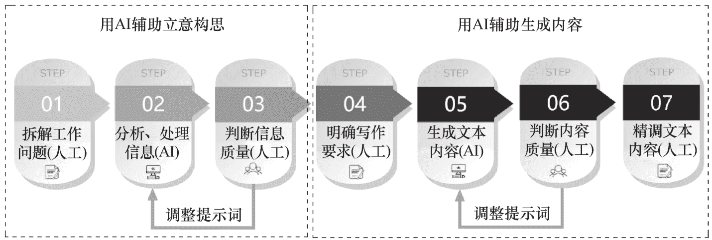
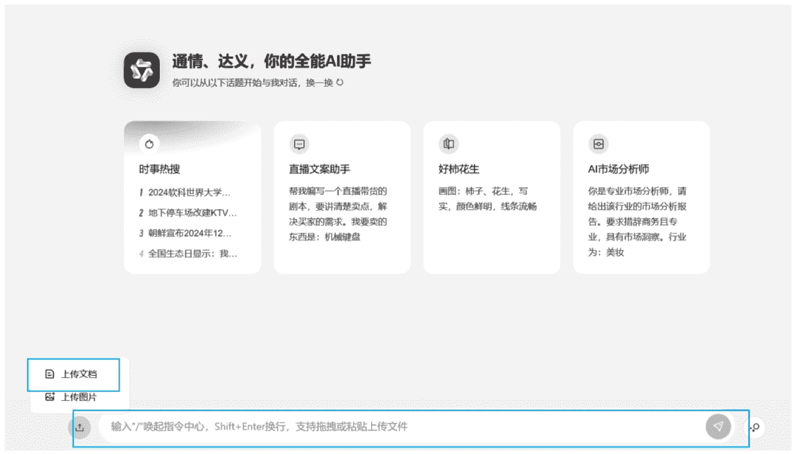
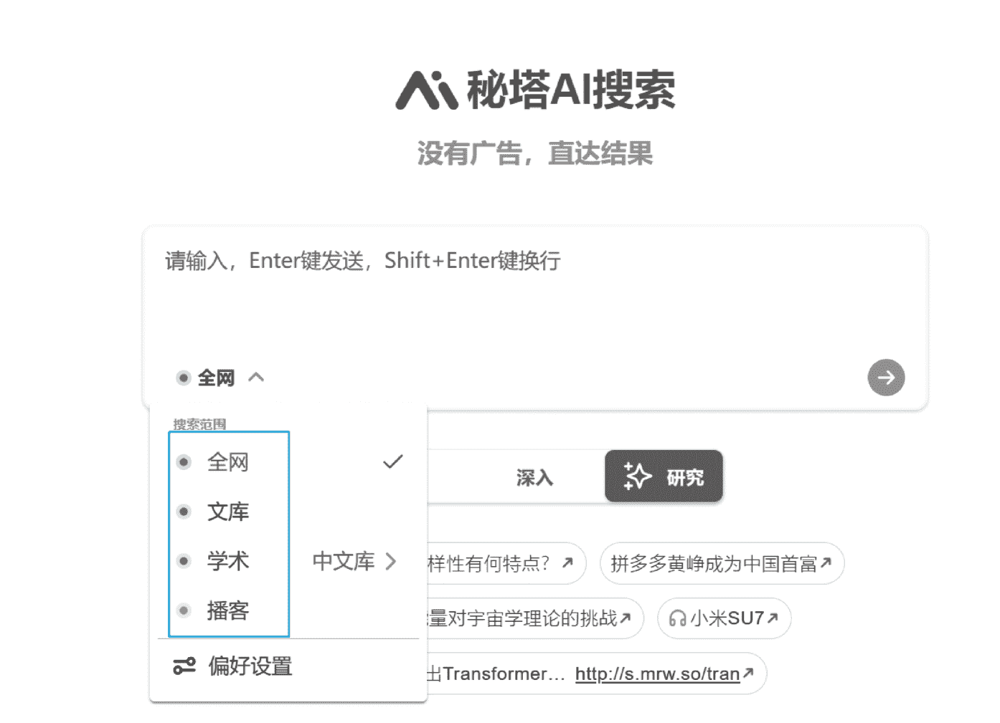
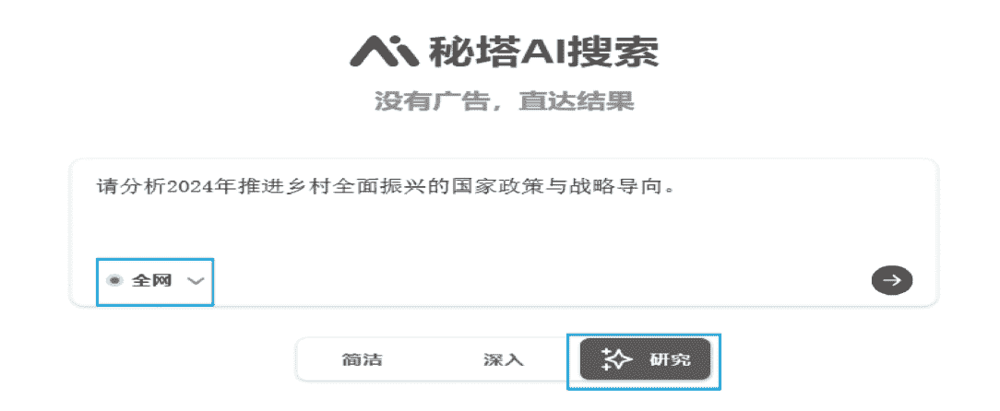
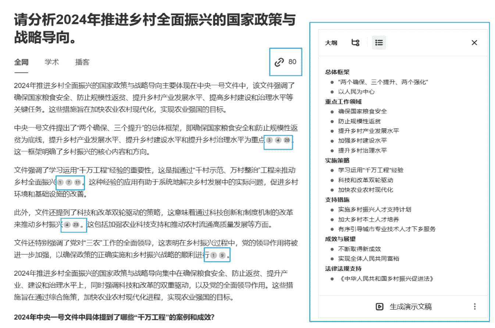
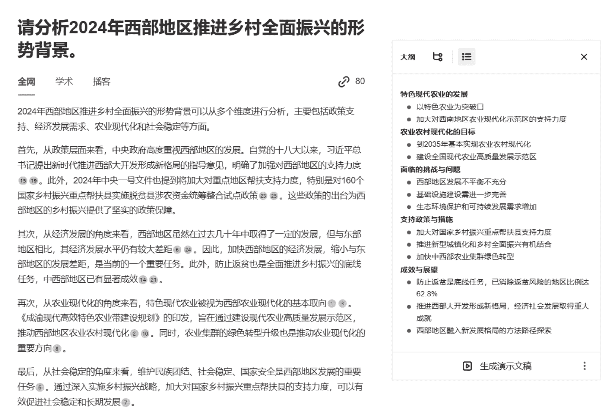
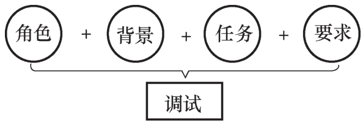
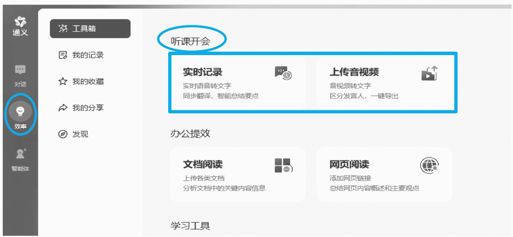
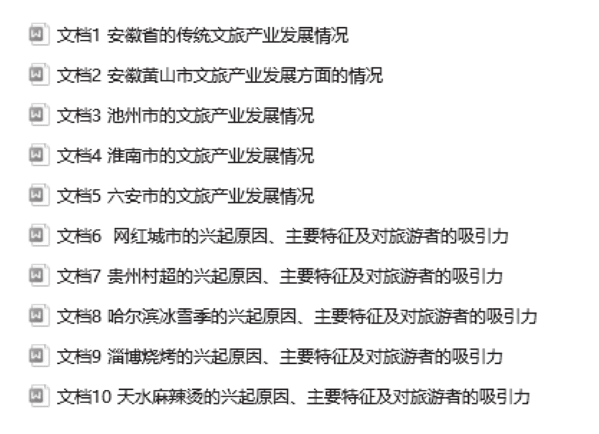

# 大模型驱动公文中台：从上手到熟练

本书以人机协同完成公务文书为切入点，总结出人与大模型配合的七段式协作法，描绘出新时代公文生产的人机分工图景；并提供一套让模型迅速理解意图的通用指令模板，保障沟通效率。全书按一键成稿、快速立意、深度研究三个难度梯度，围绕通知、通报、消息、信息、纪要、计划方案、总结汇报、领导讲话等 14 类文种，覆盖 30 个典型办公场景，逐项拆解借助大模型完成撰写的思路与操作路径。书中所有演示均可照做练习，上手即能实战，帮助读者掌握模型辅助写作的底层逻辑。适合机关、企事业工作人员阅读，其他职场人士也可借鉴完成各类工作文书，缓解撰写压力。

# 序言

AI 即人工智能。翻开本书的朋友大多清楚这项技术的强势，核心在于如何将其真正用在公文提升上。

从简短通知到复杂的总结、讲话稿，职场人几乎绕不开文书任务。普遍痛点是：同类写作重复度高、耗时；思路不顺、逻辑松散、灵感匮乏；遣词卡壳，常被开头一句卡住而拖延。

对不少人来说，公文写作是核心职责。我从事公文撰写与培训近二十年，深知其繁重，加班是常态。

以 ChatGPT 为代表的生成式浪潮，最让人震动的是文本理解与生成的水平。过去一年多深度实践后，我愈发确信大模型会重塑公文生态。如今的工具已能较大程度分担撰写负担。

但仅靠一条指令就让模型直接产出完全贴合需求的全稿并不现实，因其无法从有限信息中准确揣摩意图。

因此请注意书名中的关键词——辅助。

在撰写链路中，模型是助手，人始终是主角。人要全程主导，前提是脑中有清晰的“好文标准”，明确想要的结果，才能与模型协同。

实践中，用沟通技巧引导模型发散观点、辅助立意、生成初稿，这种能力可称“模型引导力”。同时人要能甄别模型输出观点的质量、文本的准确性与可用性，并决定修改方式，这就是“模型判断力”。

拥有这两种能力的前提是业务与公文知识储备。出现人工智能后，学习要求反而更高，正所谓遇弱则弱、遇强则强。要成为驾驭模型的人。

本书归纳了借助大模型进行公文撰写的七个流程环节，从资料搜集、问题拆解到框架生成、初稿撰写，把每个环节如何协作讲清楚，最大化提升效率。作为实操手册，本书少讲理论，多带练。

全书按难度分为初阶、中阶、高阶三层，围绕 14 类公文与 30 个任务场景进行演示。14 类为初阶的通知、通报、消息、信息、纪要；中阶的计划方案、总结汇报、体会发言、述职报告、公开信；高阶的调研报告、规章制度、理论文章、领导讲话。难度递增，可覆盖绝大部分工作场景。各文种相对独立，既可系统学习，也可按需取用。

书中大量案例手把手演示工具挑选、提问设计、输出优化。无论是否接触过模型，写作基础如何，都能看懂跟做、马上见效。建议边读边在电脑上实操。

案例使用的工具均为国内主流大模型，分两类：一类是信息分析处理的，如 Kimi 助手、秘塔搜索；一类是综合问答生成文本的，如通义千问为主，若无特殊说明均以此为例。

工具界面会持续迭代，截图与实际可能有差异，但核心用法稳定。用文心一言、智谱清言、讯飞星火也可，底层方法相通，仅效果有别。公文撰写推荐电脑网页版，操作更便捷。

欢迎与我一起开启提效之旅，迈向公文撰写新台阶。

# 第一章

# 人机协同的写作提效法

## 第一节

## 七步协作流程

新工具的价值往往在于重塑流程。发挥大模型最大效益，需要人机紧密配合，重构撰写链路。本节梳理大模型辅助公文撰写的基本流程，即七步法，如图 1-1 所示。

图 1-1 大模型辅助公文撰写七步流程

七步依次为：任务解析→信息分析处理→信息质量校验→写作需求明确→文本初稿生成→内容质量评估→文本精修润色。

前三步侧重立意构思，后四步侧重内容生成。记不住也无妨，后续实操会反复使用，多练即可熟练。

公文撰写中，资料搜集、问题研析、稿件起草最耗时间，如今可先交由模型处理。

人在链路中负责引导与判断。引导是让模型按预期方向思考与产出；判断是对模型输出的正确性、可用性及修改方式做出取舍。引导力与判断力都依赖知识积累，需长期阅读与撰写训练。

本书无法速成这两项能力，这需要专门训练。但如何引导模型配合构思、快速生成，是本书希望帮助你掌握的。

下面结合具体任务，详细拆解七个步骤。说明一下，模型工具在持续更新，界面或有微调，核心功能不变。

### 第 1 步：任务解析

模型虽强但不会读心，必须先把工作问题描述清楚才能协作。此步以人工为主、模型为辅。

举例：

你作为市政府乡村发展局工作人员，下周要召开全市推进农村全面振兴工作部署会，需为领导准备讲话稿并安排任务。

此时不能直接开文档列提纲。接任务后，首先要对讲话涉及的工作内容开展研究。

写好这份部署会讲话稿，至少要弄清三点：

一是当前推进农村全面振兴的背景与政策要求。
二是本市推进工作的重点难点及解决思路。
三是各级各部门的工作任务与责任落实。

此外，还要研究领导特点：其推进农村振兴的工作思路与理念；关注的核心问题与重点领域；讲话风格、语言习惯与偏好。

这些问题如何得出？凭借工作经验即可解析。经验不足时可请模型帮忙。我们打开通义千问，其操作示意如图 1-2 所示，可在对话框输入指令，也可在左侧上传文档让其分析。

图 1-2 通义千问操作界面示意图

提示词：

你是市政府办公室主任，擅长公文撰写，请问如果要撰写一篇推进农村全面振兴工作任务部署会的领导讲话稿，需要研究哪些方面的问题？

模型输出：

撰写一篇推进农村全面振兴工作任务部署会的领导讲话稿，需要深入研究和综合考虑以下几个方面的问题，以确保讲话内容既全面又具有针对性：

1. 国家政策与战略导向：深入学习并理解中央关于乡村振兴的最新政策文件精神，如《中共中央 国务院关于实施乡村振兴战略的意见》等，把握乡村振兴的总体要求、基本原则、主要目标和重点任务。

2. 本地实情分析：深入分析本地区乡村发展的现状，包括优势资源、特色产业、基础设施建设、生态环境、农民收入水平及教育与医疗条件等，同时识别存在的短板和问题，如空心化、老龄化、产业单一等。

（略）

由于生成式内容非检索结果，相同指令在不同时间可能得到不同答案，这是正常现象，也是价值所在，能提供更多思考方向。此处列出的国家政策导向、本地实情分析等，可作为下一步分析的参考。

特别提醒，模型生成的文名等信息需核实出处是否更新，政策把握需要人自身的判断力。

问题解析完进入第二步，将问题交给模型展开分析处理。

### 第 2 步：信息分析处理

过去分析这些问题需靠搜索引擎找资料、在单位内翻文件，再花时间阅读。材料复杂时工作量很大，读完后还要提炼结论，需要较强抽象能力。

以前面讲话稿为例，从搜集到整理结论至少需两天。

借助模型后效率大幅提升。此步以模型为主、人工为辅。

输入工作问题后，模型能快速阅读网页与文档，总结提炼、输出观点结论，整个过程可能只需一分钟。

信息分析处理环节，推荐 Kimi 助手与秘塔搜索。

Kimi 助手适合对已有资料进行分析，可上传指定文件，点击回形针按钮，支持上传文件，最多 50 个，每个 100MB，接受 PDF、DOC、XLSX、PPT、TXT、图片等。操作界面如图 1-3。

图 1-3 Kimi 智能助手操作界面

秘塔搜索适合互联网信息搜集整理，搜索源分为全网、文库、学术、播客，可按简洁、深入、研究三种模式分析。操作界面如图 1-4。

图 1-4 秘塔 AI 搜索操作界面

把待研究的问题直接输入搜索框，无需多描述。演示流程时只用第一个问题示范，如图 1-5。

图 1-5 秘塔 AI 搜索使用示例

提示词：

请分析 2024 年推进乡村全面振兴的国家政策与战略导向。

这里选择“全网”和“研究”选项。“全网”表示来源覆盖各网站，“研究”使输出更丰富。搜完全网后还可以继续选“学术”深入。

秘塔 AI 搜索输出示例 1，如图 1-6，部分截图。

图 1-6 秘塔 AI 搜索输出示例 1（部分截图）

2 到 3 分钟后结果出来，包含政策分析、农业科技创新、农村流通高质量发展、加强党的领导、科技与改革双轮驱动、人才支持、防止规模性返贫等内容。

界面右上角的链接图标和数字表示整合的信息源数量，此处整合了 80 个来源，正文中均以引注标注，规范严谨。拉到页面底部可查看全部链接，直接点击查阅原文。

右侧是正文大纲，点击后可作为新的搜索主题继续深挖，实现扩散和深入分析，非常省心。秘塔整理出的初步结论，可供后续深入思考和撰写使用。

想想用传统方式，一条条搜索、筛低质内容、通读整理，需要多少时间。借助秘塔，信息处理效率会大幅提升。

### 第 3 步：信息质量校验

模型的分析结果不能全盘接受，需要人工判断准确性与相关性。此步以人工为主、模型为辅。

大模型生成内容可能存在误差，判断是否准确，考验人对业务问题的判断力。原则性错误一旦出现后果严重，比如指导思想不是最新版，就必须调整。

除了准确性，还要看相关性。模型给出的多为通用信息，必须判断是否符合本领域、本单位实际，不能直接套用。

若搜索结果不满意，可调整指令返回第二步重算。例如加入地域限定：

提示词：

请分析 2024 年西部地区推进乡村全面振兴的形势背景。

秘塔 AI 搜索输出示例 2，如图 1-7，部分截图。

图 1-7 秘塔 AI 搜索输出示例 2（部分截图）

这时分析结果会结合西部地区的特点进行研判。

可见，即便模型给出结论，人仍需对实际工作有深入了解，并具备理论和政策视角，才能判断质量高低。这需要平时多阅读、多分析研究。

另外，注意信息源可信度。秘塔会列出引用来源，要审核出处，越权威越好。政府网站、党报官媒相对权威；期刊论文以 CSSCI 优于核心期刊、核心优于普通期刊；非官方网站信息务必核实。

前三步完成构思环节，接下来进入撰写环节，看看如何用模型生成内容。

### 第 4 步：写作需求明确

要让模型写出符合需求的文章，先把撰写要求讲清楚。此步以人工为主。

指令要说明文种是什么、需要包含哪些重要观点和信息、框架结构和语言表达有什么要求。

回到前面虚拟的领导讲话任务。假设你已借助模型系统研究了乡村振兴工作，形成了思路。

例如，通过秘塔找到“实施乡村振兴人才支持计划”的具体内容，包括“加大乡村本土人才培养、有序引导城市各类专业技术人才下乡服务、全面提高农民综合素质”，判断符合本地需要后，可写入指令作为核心对策，让模型围绕这三点展开。

提示词：

你是市政府政策研究室主任，熟悉农业农村工作，了解乡村振兴政策要求，请围绕以下【三个方面】，撰写领导讲话中关于“实施乡村振兴人才支持计划”的一个段落。要求：①根据主题拟一个概括内容、有思想性的段落标题；②符合部署任务的指示性语气，可以使用“要”“必须”等词语，以明确工作任务；③字数为 400 字。

#三个方面

1. 加大乡村本土人才培养

2. 有序引导城市各类专业技术人才下乡服务

3. 全面提高农民综合素质

这个指令针对一个段落，包含了前序分析得出的观点结论，也对表达提出了要求。你可能会问为何要赋予模型角色身份，指令怎么写更有效，具体方法放在第二节详细讲解。

### 第 5 步：文本初稿生成

输入指令后，模型就会按要求自动生成文本。此步模型为主，人工为辅。

简单的公文类型，如会议通知，一条指令基本就能成文。复杂公文建议分两步：先生成提纲并与领导确认，再按确认后的提纲分段生成内容。

注意模型生成长度有限，分段生成更精准。

比如前面那个段落指令就能让模型更专注，质量更高。在通义千问中输入第 4 步指令，得到如下内容。

模型输出：

段落标题：筑基固本，聚智汇力——全面实施乡村振兴人才支持战略

推进农业农村现代化的征程里，人才供给是决定基层能否迸发活力的核心要素。要为乡村发展搭建起稳固的人力支撑，必须坚持统筹施策、精准发力，把乡村振兴人才支持计划落到实处。首要着力点是壮大乡土本土力量，通过建立覆盖面广的培育机制，围绕现代农业技术、村级治理、电商运营等领域开展多元化培训，释放内部潜能，让熟悉本地情况的乡贤成为推动发展的中坚力量。同时要有序引导城市的专业技术队伍下沉，通过政策激励、项目联动等方式搭建城乡交流通道，吸引科研人员、高校毕业生等群体参与乡村建设，补齐高端人才短板，助力科技兴农与教育兴村。根本上还需整体提升农民素质，依托科学文化普及和职业技能强化，提升自我发展能力，培育出一批懂产业、爱乡土、爱农民的新型群体。只有保持紧迫感汇聚各方资源，才能让人才资源持续涌入，为农业农村现代化夯实基础，书写新时代乡村发展的篇章。

### **第 6 步：判断内容质量**

初稿完成后必须做一次质量复核，重点看整体结构是否完整、主旨是否突出、逻辑是否顺畅、表达是否规范。这个环节人工判断为主、机器辅助为辅，评判标准来自公文写作的专业经验，必须先在脑中形成高质量的参考样态才能对标。

如果对生成文本不满意，可回到第 4 步优化指令，再执行第 5 步重新生成，直至达标。以乡村振兴人才支持计划的段落为例，AI 初稿基本可用但空话较多。进一步明确要求：三个方面措施都要给出具体做法并配量化指标，数据位置用××占位，请补充完整。

人工智能生成结果：

段落小标题：固根培基，汇智聚力——系统推进乡村人才支撑工程

乡村振兴的布局里，人是关键变量。为有力推动历史任务，需采取以下行动并设定明确量化目标：

第一，加大本土人才培养。启动“千村万人”育才计划，未来五年内建成 100 个乡村实训基地，培养××万名涵盖农业技术、乡村旅游、电商运营等方向的本土人才，确保每个行政村至少储备 5 名以上技能达标的技术骨干，为产业转型升级提供人才保障。

第二，有序引导城市专业人才下乡。实施“城乡人才互动工程”，三年内吸引××千名城市专业人才到乡村挂职、兼职或参与项目合作，重点引进××百名以上高级专家学者参与农业科技研发、教育医疗帮扶等，预期带动乡村科技创新项目增长××%，显著提升公共服务水平。

第三，全面提升农民综合素质。启动“新农民素质提升工程”，通过线上线下融合方式，每年培训农民××万人次，聚焦信息技术应用、市场经营、法律素养等能力，力争五年内农民大专及以上学历占比提升至××%，为打造知识型、技能型、创新型农民队伍奠定基础。

通过上述可量化安排，构建多层次、宽领域的支撑体系，让人才驱动的乡村振兴稳步前行，开创新局面。

追加具体工作和数据占位要求后，文本明显充实。结合本地实际把××填入，段落基本成型。

### **第 7 步：精调文本内容**

理想状态下，AI 大约能输出 70 到 80 分的材料，精进则需人工精加工。比如上一步文本，AI 大量使用“我们”、以及“首先、其次、最后”等口语化衔接，标题也不够公文化，可调整为“坚持筑基固本、聚智汇力，全面实施乡村振兴人才支持战略”。

这类修改依赖公文写作经验判断，是确保成文质量的关键。只有对 AI 生成稿负责，也要对最终成稿负责。无论是质量判断还是精调，都需要专项训练，多写多练才能形成判断力和修改力。

至此，“AI 辅助公文写作七步法”完整呈现，整个流程是人机协同、不断反馈的循环。古希腊普罗泰戈拉说“人是万物的尺度”，在协同中人始终是尺度，要掌握好尺度能力。用 AI 写公文分七步，分为构思和生成两阶段，工具负责核心创作，人负责判断与修改。

无论是公文新手还是有经验者，通过实操都能熟练掌握该方法，提升写作效率。即使不写行政公文，这一协作逻辑也可迁移到周报、月报、营销策划、市场研究报告等职场写作中。

## **第二节**

## **1 个框架，让 AI 听懂指令快速写公文**

与 AI 沟通的核心是提示词，它直接决定输出质量和效果。很多人使用 AI 写公文时，感到深度不足、表达生硬，主要有两个问题：一是指令过于笼统，如“帮我写一篇人力资源年终总结”；二是信息混乱，把想法堆砌给 AI 却无结构化要求，导致输出偏离需求。

本节提供一个通用框架，便于结构化沟通，提升协作效率。该框架为：【角色+背景+任务+要求】+调试，如图 1-8 所示。

图 1-8 提示词框架

### **一、三个要素巧妙设定角色**

为 AI 设定角色有助于它把握写作视角、专业知识和表达风格。角色设定公式为：
角色=单位+身份+能力

**（一）单位**
写清材料所涉行业类别即可，如省政府办公厅、大学教务处、医院办公室、国家电网省级分公司人力资源部等。

**（二）身份**
常用三类身份：办公厅（室）主任，如省政府办公厅主任；领导职务，如省长、市长、厅长、处长等；专家，如历史学教授、政治学教授等，可按需设定。

**（三）能力**
界定角色的专业水准，如深刻理解……、充分掌握……、擅长……、善于运用……、有丰富……经验、致力于……领域等。例如“非常熟悉新型工业化政策文件，了解其发展路径”。

### **二、清晰描述三种写作背景**

设定角色后需描述背景，让 AI 了解任务全貌。如领导要求写讲话稿，若不交代背景会无从下手：什么场合、什么目的、会议主题、参会人员、受众层次等。给 AI 布置任务也需交代清楚。

可从三个角度描述：

**（一）公文写作任务的宏观背景**
交代上级政策精神、面临形势。例如，为贯彻落实中央经济工作会议精神，加快推进新型工业化。

**（二）公文写作任务的微观背景**
说明为何有此需求、要做什么。例如，××市将召开经济工作座谈会，围绕“大力推进新型工业化 发展数字经济”交流讨论。

**（三）公文写作任务的受众背景**
明确目标读者，尤其是讲话稿，决定风格和语气。例如参会人员为政府部门负责人、市县领导、企业家代表、经济专家、金融机构负责人等。

### **三、准确界定两类工作任务**

角色与背景明确后，下任务。可分为文本输出和构思辅助两类。

**（一）文本输出任务**
简单公文可直接输出全文，复杂公文可分段生成。任务需与角色背景一致。

**（二）构思任务**
复杂材料需先做分析，包括信息搜集整理和判断。提问方式有两种：
一是正向提问，已有明确问题让 AI 执行，如用 AI 检索分析相关信息；
二是反向提问，让 AI 向你提问，辅助你厘清思路。

### **四、两类要求提升输出质量**

明确输出要求，如语言风格、篇幅字数等。AI 输出上限约 2000 字，长文需分段。

除语言字数外，还可要求指定内容要点和框定内容结构。

**（一）指定内容要点**
明确核心要点是质量关键。简单公文要点由写作者提供，如会议通知的时间、人员、议程。复杂公文要点可先用 AI 辅助构思提炼。

**（二）框定内容结构**
可用“写作公式”和“内容模块”框定结构。例如总结类材料篇章=①帽段+②主体段（做法）+③主体段（问题）+④主体段（计划）。

帽段公式=指导思想句+情况背景句+工作思路句+工作成果句

示例提示词：
你是国家电网 A 市电力公司办公室主任，对公文写作功底深厚，对中央能源政策把握准确。请按【帽段公式】撰写本公司年终工作总结帽段，要求融入中央最新能源政策精神，语言符合公文特点，字数 300 字。

#帽段公式
帽段=指导思想句+情况背景句+工作思路句+工作成果句

AI 输出：
根据党中央、国务院关于推进能源生产和消费革命、构建清洁低碳安全高效能源体系的最新指示精神，面对今年国内外经济环境复杂多变、能源需求结构快速调整的新形势，我司在市委市政府及上级公司坚强领导下，深入贯彻绿色发展理念，坚定走高质量发展道路，围绕“稳增长、调结构、促改革、惠民生”主线，积极应对各种挑战，取得显著成效。全年供电量同比增长 7.5%，清洁能源消纳比例提升至 38%，超额完成节能减排目标，为地方经济社会持续健康发展提供坚强电力保障，彰显国有企业责任担当。

## 让 AI 公文从套话变可用

大模型直接给出的段落大多是通用话术，且经常与最新工作要求脱节。真正落地时，必须结合本单位实际，重新梳理指导思想、现实背景、推进思路和工作成效。先生成再改写，相比从零写作效率明显更高。

下面看主体段落改写的实操。假设要把一份原始工作素材改写成总结材料，用公式化提示来处理，素材就用下面这则新闻稿。

**主体段改写提示**

你是市政府办公室主任，擅长提炼做法、归纳重点。请依据【主体段架构】对【工作情况】进行改写，要讲清核心做法、罗列关键数据，不引用个人案例，控制在300字左右。

#主体段架构

主体段架构=主旨句（Why）+支撑句（How）+支撑句（What）

主旨句（Why），用一句话点出本段中心。
支撑句（How），说明主要做法。
支撑句（What），围绕做法补充事例、依据、细节。

#工作情况

“农村自建房要过资格审查、规划审查、用地审查、安全审查，各个环节相互衔接。”××区政务服务中心副主任××向记者介绍，光是村组层面的征求意见、公示审查这些前期工作就不算，到了乡镇层面，因涉及部门多、事项杂，群众很容易遇到多头跑、多趟跑的麻烦。“几乎每个部门都要现场核查，走完一套流程常常需要三四个月。”××镇自然资源办主任××说，村民申请难、备料难，更容易因材料繁杂跑错地方，耗时更久，以致有人等不及就先建后批、边报边建，给自建房埋下安全隐患。如何让农村建设既高效又安全？在××区政务服务中心工作人员的基层走访中，这是群众最关心、最集中的难题。“我们从压缩时限这个痛点入手，依托××省‘互联网+政务服务’平台搭建‘××市××区农村建设许可模块’，推出建房、设施农用建设等四类‘农村建设一件事一次办’场景套餐，优化流程、整合资源，让群众最多跑一次，甚至一次都不用跑。”××介绍。以农村建房为例，借助网络平台“一窗受理”后，原本分散的审批环节整合为“建房申请、踏勘测量、规划例会、定桩放线、房屋验收”5个阶段。村民可在手机上一次性上传资料，或到乡镇政务服务专窗跑一次即可。各部门信息共享、并联审批，原来3个多月的全流程办理被压缩到13个工作日左右。××乡××村村民××深有感触：“9月15日提交建房申请，不到5个工作日，第三方机构就上门测量。隔天，乡镇综合执法大队牵头，联合自然资源所、农业综合服务中心、交通管理站等多部门小组一起上门勘察。”“期间资料不齐补充过两次，但因为勘察和审核同步推进，进度没有受影响。”××说，10天左右建房审批就通过了，她早早联系施工队进场。

**模型返回**

主旨句（Why）：为破解农村自建房审批繁琐、周期过长的问题，提升农村建设效率与安全性，我们采取了数字化管理创新手段。
支撑句（How）：我们依托省级“互联网+政务服务”平台，开发“××市××区农村建设许可模块”，把线下多部门串联审批转为线上“一件事一次办”模式，简化申请流程，加强部门间信息共享与协同。
支撑句（What）：具体操作中，农村建房审批精简为5个核心阶段，群众可通过网络平台或到乡镇窗口一次提交申请。改革后，原需约3个月的流程缩短至约13个工作日。实践表明效果明显，如××乡一村民从申请到获批仅用10天，虽有资料补正，但并联审批保证整体进度不受影响，有效避免了因久等而私建带来的安全风险。

前面帽段的例子是扩写，后续还需按工作实际做修改。这里主体段是改写，原始素材本身就来自一线，因此改写完只需做语言上的调整。比如要把段落里的“我们”去掉，总结材料也不宜出现具体个人案例。支撑句中“实践证明，该举措成效显著”之后的内容即可删去。类似的调整需要一定的公文经验。

**2. 用内容模块框定结构**

模块是对优质公文拆解后提炼出的段落模板，相当于把优秀段落的写作模具抽出来。问题段写起来往往吃力，即使套公式质量也不高，这时可用内容模块来框定结构。

总共三步：

第一步，选择可拆解段落。找一段写得很到位的段落作为拆解对象。
例如，我们也清醒地认识到，我省发展还面临不少问题和挑战。经济恢复的基础不够稳固，需求收缩、供给冲击、预期转弱带来的影响比较明显。产业链供应链还存在不少堵点、卡点，中小微企业困难增多。新旧动能转换任务艰巨，传统产业转型升级步伐不快，……发展不够平衡，城镇化进程滞后，不同区域产业层次、城市能级差距较大。……一些干部对新发展理念领悟不透，境界上不去、思路打不开、打法不创新。贯彻落实新发展理念的知识能力不足，创新开放改革的作风不过硬，缺少担当作为、敢闯敢试的那股子劲、那股子气，把说了当做了、把做了当做成了的情况不同程度存在。有的地方和部门形式主义、官僚主义仍然突出，少数领域腐败问题仍有发生。对这些问题，我们要高度重视、认真分析，一件一件地加以解决，更好地适应时代和人民的要求。

第二步，提取内容模块。去掉具体工作内容，可提炼出“问题段模块”如下：
我们也清醒地认识到，……还面临不少问题和挑战。……不够稳固，……带来的影响比较明显。……还存在不少堵点、卡点，……困难增多。……任务艰巨，……不快，……不高，……偏少，……认识不够、行动不快，……程度不够，……不充分、……不丰富。……产出较低，……不多。……建设滞后，……不足、……不高。……不够平衡，……滞后，……差距较大。……任务繁重。……较少。……仍然突出，……问题仍有发生。

这个模块用词精准，套入工作问题即可保证分寸。

第三步，把内容模块放入提示词。

**问题段模块扩写提示**

你是某银行某省分行办公室主任，公文功底扎实，问题分析精准。请结合当前金融形势，针对分行存在的问题进行剖析，写一段年终总结中的问题段，按【问题段模块】撰写。要求客观中立，约400字。

#问题段模块

我们也清醒地认识到，……还面临不少问题和挑战。……不够稳固，……带来的影响比较明显。……还存在不少堵点、卡点，……困难增多。……任务艰巨，……不快，……不高，……偏少，……认识不够、行动不快，……程度不够，……不充分、……不丰富。……产出较低，……不多。……建设滞后，……不足、……不高。……不够平衡，……滞后，……差距较大。……任务繁重。……较少。……仍然突出，……问题仍有发生。

**模型返回**

我们也清醒地认识到，在过去一年里，面对复杂多变的金融形势，我行虽有一定成绩，但仍面临不少问题和挑战。首先，客户服务体系不够稳固，市场波动带来的影响比较明显，尤其在风险管理与突发事件应对上，还存在不少堵点、卡点，导致客户满意度下降，维护优质客户资源困难增多。
其次，金融科技转型任务艰巨，数字化推进不快，创新能力不高，面向小微企业及零售客户的产品创新偏少，在很大程度上制约市场竞争力。员工对金融科技变革的认识不够、行动不快，导致数字化转型程度不深，线上服务场景构建不充分，客户体验提升举措不丰富。
再次，资源配置效率产出较低，高效益业务拓展不多，尤其在绿色金融与普惠金融领域，投入产出不成正比。同时，人才队伍建设滞后，专业培训不足、金融科技人才储备不多，严重影响业务可持续发展能力。
最后，区域发展不够平衡，农村金融服务滞后，与城市业务差距较大，阻碍了全面服务乡村振兴战略的落实。面对日益增长的金融消费者权益保护需求，有效应对机制较少，客户投诉率仍然突出，部分操作风险问题仍有发生。
综上，我们必须直面问题，以更积极的态度深化改革、加快转型，提升服务质效，为来年稳健发展奠定基础。

模型很快按模块框架生成问题段。后续需按单位实际调整内容、增删。

### 五、三种方法调试优化结果

完成前4步后，模型能输出初稿，但不能直接使用。调试优化主要有三种：

**一、对提示词进行修改**
若输出与预期偏差较大，可调整提示词的表达、增添新要求、改写写作公式，使其更贴近需求。

**二、指出答案存在的问题**
当内容基本可用且能明确指出问题时，可告诉模型存在哪些不足，并给出具体修改建议，如细化某部分、调整语言表达等。

**三、直接重新生成多份答案**
同一提示词多次生成结果会有所不同。可让模型多次输出，优中选优，或组合多份答案形成最优版本。

通用提示词框架包含四大要素和一个使用要点：角色、背景、任务、要求，关键在于“调试”。这个框架理解不难，但要好用需对各要素仔细推敲，尤其是背景描述、任务节点和要求，都需要对工作和文种写作要点有清晰把握。本节介绍了通用提示词框架的概念，后续文种讲解中会反复使用。该框架不仅用于写作，也可用于解决其他工作任务。

# 第二章
# AI助力信息高效传递
## 第一节
## 通知写作的AI技巧

从本节起进入文种实操。接下来讲解机关行政工作中14种常用公文，既有法定公文也有事务公文。本章先从初阶文种入手，包括通知、通报、消息、信息、纪要等。

初阶文种相对简单，主要是对已有信息进行梳理、整合、分析、提炼，构思上不需要太多创造性，很多时候直接用模型输出即可。因此模型运用相对简单，即使写作经验不足也能上手。

先学如何用模型辅助写通知。对新手来说，通知可能是职场第一份公文。日常工作中开会、放假、任免、批转、转发等都需写通知。

这些属于事务性通知，套模板即可快速成文。另一类是指示性通知，相对复杂，如部署工作任务、贯彻指示精神等。这类通知需先对工作进行针对性研究，明确要传达的指示和要求，再让模型辅助。本节聚焦两类通知。

### 一、事务性通知：要点清晰执行顺畅

在事务性通知中，放假、任免、批转转发通知篇幅短小，无需模型辅助。只有会议通知相对复杂且常用，适合模型提效。以下以实操为例。

任务场景：你是某集团办公室工作人员，年底集团要开年终总结表彰会，领导让你下发会议通知。

会议通知较简单，不必让模型构思，直接生成即可。有两种方式：
第一种是不限定要点和结构，让模型先输出框架，再自行填充。
第二种是限定要点和结构，让模型按具体需求撰写。

先看第一种。

**提示词**
你是某集团办公室主任，请以集团名义面向各分公司、各部门，下发召开年终总结表彰会议的通知。

**模型返回**
【某集团文件】
主题：关于召开某集团2023年度年终总结表彰大会的通知
发文编号：AG-NT-2023-12-01
致：某集团各分公司、各部门
自：某集团办公室
日期：2023年11月28日
为进一步总结经验、表彰先进、规划未来，经集团高层研究决定，将于近期召开某集团2023年度年终总结表彰大会。现将有关事项通知如下：
一、会议时间
会议定于2023年12月30日上午9:00准时开始，预计至下午5:00结束。请参会人员提前15分钟到场签到。
二、会议地点
主会场设在集团总部大楼一楼多功能厅，并通过视频会议系统同步至各分公司会议室。
三、参会人员
（略）
特此通知。
敬请遵照执行。
某集团办公室
2023年11月28日

会议通知常见，模型训练数据充足，但输出不一定符合本单位习惯，需自行修改。例如，重要会议通知习惯写会议主题，就要在框架中补上。

建议用第二种方式，把符合单位需要的特定格式变成写作公式，通过限定要点和结构一步生成。后续写通知只需修改提示词中的会议信息即可。

会议通知写作公式：
会议通知篇章=标题+帽段+主体段（会议主题）+主体段（会议时间）+主体段（会议地点）+主体段（参加人员）+主体段（议程）+主体段（会议要求）
标题=发文机关名称+事由+通知
帽段=会议背景句+召开目的句+召开依据句
主体段（会议要求）=上报名单+报送资料+注意事项（着装、会场纪律）+联系人+联系方式

结合公式填充会议要点，可精准输出。

**会议通知提示词**
你是某集团办公室主任，请以集团名义面向各分公司、各部门，下发召开年终总结表彰会议的通知。请根据给定的【会议基本信息】，按【会议通知写作公式】撰写。要求各段落有明确标题，表达清晰简洁。

#会议基本信息
会议主题：砥砺奋进新征程 筑梦前行铸辉煌
会议时间：20××年××月××日，8:00—10:00
会议地点：公司总部大楼第一会议室
参会人员：各分公司主要负责人、各部门经理及以上职务人员、受表彰的优秀员工代表
会议议程：1. 董事长作年度工作总结报告；2. 表彰业绩突出部门及个人；3. 各获奖单位代表经验交流
交流材料提交时间为××月××日17:00前；着装要求：着正装。

#会议通知写作公式
会议通知篇章=标题+帽段+主体段（会议主题）+主体段（会议时间）+主体段（会议地点）+主体段（参加人员）+主体段（议程）+主体段（会议要求）
标题=发文机关名称+事由+通知
帽段=会议背景句+召开目的句+召开依据句
主体段（会议要求）=上报名单+报送资料+注意事项（着装、会场纪律）+联系人+联系方式

**模型返回**
【会议通知】
某集团关于召开“砥砺奋进新征程 筑梦前行铸辉煌”年终总结表彰会议的通知
帽段：
鉴于20××年即将落幕，为全面回顾集团一年的奋斗历程与成就，表彰先进、激励士气，并规划新一年发展蓝图，根据集团年度工作计划安排，特此召开年终总结表彰会议。
主体段（会议主题）：
本次会议主题为“砥砺奋进新征程 筑梦前行铸辉煌”，旨在总结经验、表彰先进、分享成功案例，进一步凝聚团队力量，为集团持续发展注入动力。
主体段（会议时间）：
会议定于20××年××月××日上午8:00至10:00举行。
主体段（会议地点）：
（略）
某集团办公室
20××年××月××日

该提示词可结合单位实际情况修改保存，后续只需替换会议基本信息。会议通知写作公式也易增减，例如涉及食宿、报到方式等，可加入篇章。会议通知一般只有帽段需结合单位实际和领导要求进行调整。类似比赛通知、培训通知也可如此操作。

### 二、指示性通知：把握关键有章法

指示性通知较复杂，需先用模型辅助对工作事项进行研究，提出对策措施和要求，再套用写作公式生成内容。

**一、部署工作通知**
部署工作通知多针对重点工作、热点问题下达，如安全生产、抗洪抢险、森林防火等。

任务场景：你是县林业局工作人员，领导要求根据近期形势下发森林防火工作通知。这是季节性工作，每逢秋冬季都会发布。你刚到单位，对工作不熟悉。

以前可能需参考往年通知，现在可用模型辅助。

首先，用模型辅助构思。问题明确为“秋冬季森林防火的关键问题和预防措施”，把问题带入提示词让模型分析。

**第一步：分析、处理工作问题**
让模型扮演林业专家提供智力支持。

**提示词**
你作为省政府林业局专家，对森林防火有深刻认识，充分了解火灾特点及防范要求。请基于专业知识和经验，列出秋冬季森林防火需要注意的关键问题，并给出预防措施和建议。确保问题和建议能帮助相关部门和人员更好开展森林防火，保护森林资源和生态环境。

**模型返回**
秋冬季是森林火灾高发期，天气干燥、风力较大，落叶枯枝增多，易引发火灾并迅速蔓延。针对这一时期的森林防火，以下是关键问题及预防措施建议：
关键问题
1. 气候干燥与大风天气：秋冬季空气湿度低，加之频繁大风，为火种传播提供有利条件。
（略）
预防措施与建议
1. 加强气象监测与预警：密切监测天气变化，利用现代气象技术提前发布火险预警，特别是大风天气预警。
（略）

可看出模型给出的措施建议较为专业。可作为通知的基本要点。后续保持在同一对话中继续操作。

让大模型助推公文效率：部署类文书与表彰通报的拆解思路

在自媒体与公文写作场景里，如何把一套可复用的方法论落到实处，是提升产出速度的关键。围绕部署类文书和通报两类高频文种，可以归纳为“建框架—出初稿—精校对”三步走，并且每个环节都有对应的提炼模型与检验点。

一、用结构化模板快速搭起初稿骨架

把一段成熟的部署文书拆开，能得到一个可复制的骨架。整体篇章通常由标题、起因说明、事项展开和收束提示四部分构成。标题由主办单位、事由和文种组成；起因说明要涵盖背景描述、依据说明、工作目的和承接下文；事项展开则以小标题统领总述句，再配落实方案和注意事项；收束部分重申执行要求。

把这套骨架写入指令，模型就能迅速输出初版。以林区秋冬防灭火部署为例，指令大致是：请以某县林业主管部门名义，面向县域基层单位，按上述骨架起草一份约两千字的防灭火部署稿，语气指示、规范严肃。

模型会先给出标题，接着描述已进入秋冬季、干旱少雨叠加大风，林火风险持续抬升，气象提示高风险天气延续。依据相森林法、防火条例等要求，提出保护资源和群众安全的目标，并引出具体部署。

事项部分会列出火源管控与巡查监测，强调野外用火管控是当前首要任务，要求乡镇林业站加大重点区域巡查，尤其林缘、农林交界烧荒行为要严管，坚决制止违规用火。同时提出借助无人机、视频监控等技术提升早发现能力，做到早发现早报告早处置。

再如宣传教育提升全民意识，要求通过广播电视网络宣传栏等渠道普及常识，重点加强农村和校园教育，倡导文明祭祀规范用火。并提出开展为期一月的防火宣传活动，动员基层单位和志愿者深入社区学校农村开展面对面宣讲。后续正文可按此节奏填充。

指令里保留“请依据前期分析结果写作”的提示，能让模型更好地衔接前期提炼的内容，初稿质量会明显提升。

二、生成后做针对性扩充与校对

模型初稿常显笼统，尤其是季节性、常规性工作，易出现年年雷同。对策需要结合当下薄弱环节提出新举措。比方说把“开展宣传月，动员基层和志愿者深入社区学校农村宣讲”扩写成一段，要求带具体举措和量化指标，约两百字不分点。

扩充后的版本会给出：某县林业主管部门策划宣传月，组织基层单位和五百余名受训志愿者进社区学校农村。计划发放《防灭火手册》二十万册，悬挂横幅一千条，在县电视台及网络平台播出定制教育视频，预计覆盖百万人次以上。联合教育部门在全县学校开展“防火小卫士”教育周，覆盖十万名学生，通过讲座模拟演练及“小手拉大手”带动三十余万家庭参与。再举办一百场社区知识讲座及现场咨询，预计吸引两万余人次。成效通过问卷和知识测试评估，目标公众意识指数提升百分之二十，确保活动实效，共筑安全防线。

这种细化让措施更落地。需要注意的是，扩写稿中常出现“旨在”“尤为重要”“此外”等口语衔接，以及“××县林业局”“我们”等主语，这些不符合公文规范，需要人工删改。

三、贯彻指示类文书的拆解与填充

贯彻指示类文书适用于传达上级会议精神、落实上级文件，要求把上位要求与本级实际结合，避免空对空。

以二〇二四年一月国务院发布《煤矿安全生产条例》为例，作为省矿山安全监管机构工作人员，需起草贯彻落实通知。

第一步先对文件做分析提炼。条例约一万二千字，需先梳理需落实的重点及对策，可用智能助手上传全文进行归纳。初步要点包括总则强调安全生产重要性、确立原则方针、明确政府部门职责；煤矿企业安全生产主体责任，包括健全责任制度、加强管理、提升水平等。

在此基础上追问对策：法规的意义价值、监管部门和企业如何学习、企业的落实措施、监管监察部门的检查措施、宣传落实措施。多轮追问可获得素材库。

第二步套用写作模型。贯彻指示通告篇章可拆为标题、起因段、重要意义段、学习要求段、落实要求段、监督检查段、宣贯落实段。标题格式为发文机关+关于贯彻落实《××》+通知。

起因段包括文件发布情况、文件意义、目的、引出下文。事项段分别对应意义、学习、落实、监督、宣贯。

把模型写入指令，要求指示性语气、正规严肃、约两千字。模型会输出标题、各收件单位、起因段说明近日国务院发布条例，对规范管理、预防事故、保障从业人员安全、促进行业高质量发展意义重大，现将有关事项通知如下。

再列“充分认识条例实施的重要意义”，指出条例标志着煤矿安全管理进入法治化规范化新阶段，对提升安全水平、促进社会和谐具有里程碑意义，要求各级部门和企业深刻理解背景和战略意图。

“广泛开展学习宣传”提出组织专题学习、邀请专家解读等。

初稿框架成型，但内容空泛、时效性不足，需要结合前期分析结果逐段充实。以重要意义段为例，可要求模型将意义价值抽象提炼后充实进去，标题不变、语言简洁、约四百字。

充实后文本会强调条例坚持以人为本，强化全社会重视，构建多层级责任体系，确保责任可追溯；提供清晰操作蓝本，强化监管效能与机制创新，提升监管精准度；前瞻性建立风险预防和隐患治理机制，为遏制事故构筑防线，并以严格法律责任作保障；鼓励技术创新与智能化开采，保障从业人员权益，引领行业绿色健康发展。因此各级监管部门、行业企业及从业人员必须深刻领会战略意图，将其转化为行动指南，推动煤矿安全进入新阶段。

其他段落同法完善，再结合公文表达和工作实际做语句删减。写好指示类文书的关键是找准重点、结合实际、措施务实落地。

四、用AI辅助撰写表彰通报

通报用于表彰先进、批评错误、传达重要情况，分奖惩通报和情况通报两类。撰写前须明确事实，避免不清不实、评价不当。

表彰通报要点：对象要典型经得住检验，需遴选公示；评价内容需字斟句酌。如对象众多，正文点出领头单位和个人，其余附后。

写作模型为标题、帽段概述事实、表彰决定段、希望号召段。标题为发文机关+事由+通报。帽段由思路理念句和事迹评述句构成。表彰决定段含目的句和决定句。希望号召段含对受表彰者的希望和对相关人员的号召。

以市政府表彰“十四五”以来节能先进集体和个人为例，指令要求列举领头单位和个人及获奖数量，其余附后，语言简练客观积极，格式完整，约六百字。

模型会生成标题，帽段说明贯彻绿色发展理念、落实国家节能减排部署，各机关团体企事业单位及干部职工积极响应，在能源节约与效率提升方面取得显著成效，经严格评选涌现一批成绩突出的先进集体和个人。随后给出表彰决定和号召。

多生成几次择优。对帽段思路理念句、事迹评述句及号召句需结合形势和本地实际修改。可要求模型在帽段体现生态文明建设理念要求，并在号召段加入推进碳达峰碳中和目标，保持其他内容不变，输出会更贴合当前政策导向，也可加入省市领导提出的有关目标口号。

按建框架—出初稿—精校对三步操作，其他类部署文书和通报也能触类旁通。

用AI把通报和消息写得更快更准

一、评述性语句要补上方法论
在公文里，评述句的作用是把做法上升到思路。直接让AI生成的版本大多停留在事实罗列，缺少政策导向和推进逻辑。用一个固定的句式范式去引导，缺口就会补上。

示范指令
请依据下面样式，把“我市各机关团体、企事业单位及广大干部职工积极响应、主动作为，在能源节约与利用效率提升方面取得了显著成效”改写为有思路的表述。

#评述句套用样式
全市各地、各部门深入学习贯彻……，全面落实……方针，坚定不移地走……道路，把……作为推进……的重要抓手抓牢抓实，为促进……提供有力支撑。

生成示例
全市各地、各部门深入学习贯彻习近平生态文明思想，全面落实绿色低碳发展方针，坚定不移地走生态文明建设道路，把节能减排作为推进碳达峰碳中和的重要抓手抓牢抓实，为促进经济社会高质量发展提供有力支撑。

成稿时还要注意语言细节。通报文本里不宜出现“他们”这类人称，人工删掉即可。表彰表述上，模型常写成“授予……荣誉称号”，规范说法是“授予……称号”。这类取舍需要对公文语体有判断力，多看规范范文就能掌握。思路通了之后，换对象、换事项，把指令里的要素替换即可复用。

二、批评性通报：先搭骨架再填充
场景：你作为高校教务处人员，教学秩序检查发现××学院讲师李某无故缺课，领导要求面向全校通报批评并作出处理。

环节一：用结构化框架先出初稿
把通报的组成写入指令，让模型按框架输出。

批评通报骨架
通报篇章=标题+错误事实段+错误原因段+处理决定段+要求段
标题=发文单位+事由+通报
错误事实段=错误描述句+影响评价句
错误原因段=原因分析句
处理决定段=处理依据句+处理决定句
要求段=具体要求句+面上要求句

指令示例
你是高校教务处工作人员，对公文有丰富经验，熟悉教学管理规范。近期××学院讲师李某因个人事假出现误课教学事故，请你以学校教务处名义，面向全校各学院写一份通报。按【批评通报写作公式】撰写，要求事实清晰、原因准确、处理表达准确、使用指挥语气，约800字。
#批评通报写作公式
通报篇章=标题+错误事实段+错误原因段+处理决定段+有关要求段
标题=发文机关名称+事由+通报
错误事实段=错误描述句+影响评价句
错误原因段=原因分析句
处理决定段=处理依据句+处理决定句
有关要求段=具体要求句+面上要求句

初稿示例
××大学教务处关于××学院讲师李某误课教学事故的通报

错误事实段：
近日，我校××学院讲师李某因个人事假未及时安排课程替代教师，导致其负责的《××学》课程在7月31日（星期二）下午第二节出现无人授课的情况，造成该班全体学生无法正常学习，严重影响了教学秩序和教学质量。

错误原因段：
经核实，李某未按学校规定提前向学院提交书面请假申请并确保课程得到妥善安排，且未通过其他有效方式告知学生或同事其请假事宜，这是导致此次教学事故发生的主要原因。此外，李某对于学校教学管理规章制度的学习不够深入、责任心不强，也是造成此次事故的重要因素。

处理决定段：
根据《××大学教职工考勤管理办法》和《××大学教学事故处理办法》的相关规定，结合李某的违规行为及其造成的不良影响，经研究决定：

对李某予以警告处分，并责令其立即整改；

（略）

特此通报。

××大学教务处

2024年×月×日

模型很快给出结构完整、要点齐全的初稿。把“错误事实段：”“错误原因段：”“处理决定段：”等结构标记词删掉，连成通顺文本即可使用。

环节二：判断、校准、细化
批评通报的处理决定必须依法依规，不能直接采用模型生成的内容。需要查阅单位具体规定，对依据和处理表述进行修正。通报的核心在于剖析问题性质、危害、影响与教训，达到批评一人、警示一批、教育一片的效果。告诫语句要有针对性和震慑力。模型生成的稿子对事实分析清楚，原因既有思想层面也有个人层面，处理决定具体，要求层次分明，遣词符合批评通报规范。

三、情况类通报：基于事实的综合文体
情况通报用于把重要精神或重要情况告知相关方面。相比奖惩通报，难度更大，因为要分析情况特点与态势，重在指导性，从情况分析中得出下一步部署、问题与改进建议。

场景：市安全生产委员会对所属区县开展督查检查，重点督导各级各部门各类企业落实中央关于安全生产工作重要指示精神和近期全国、全省、全市安全生产视频会议精神，对各类安全风险隐患进行全面排查。领导要求写一份情况通报，总结到位、有结论。

环节一：套公式先出初稿
情况通报公式：
通报篇章=标题+缘由段+总体情况部分（正面）+存在问题部分+下一步工作要求部分
标题=发文单位+事由+通报
缘由段=工作目的句+工作概述句+过渡句
总体情况部分=情况段1+情况段2+…… 
情况段=情况小标题+支撑句（宏观做法）+支撑句（正面典型单位）
存在问题部分=小帽段+问题段1+问题段2+……
小帽段=总体问题分析句
问题段=问题小标题+支撑句（问题表现）+支撑句（负面典型单位）
下一步工作要求部分=小帽段+工作要求段1+……
小帽段=形势句+总体要求句
工作要求段=要求标题+措施支撑句

指令示例
你是市安全生产委员会办公室主任，熟悉安全生产工作，擅长公文写作。近期市安全生产委员会组织工作专班对所属区县开展督查检查，重点督导各级各部门各类企业落实中央关于安全生产工作重要指示精神和近期全国、全省、全市安全生产视频会议精神，全面排查整治各类安全风险隐患。请按【情况通报写作公式】写一份安全生产督查检查情况通报，约1500字。
#情况通报写作公式
通报篇章=标题+通报缘由段+总体情况部分（好的方面）+存在的问题部分+下一步工作要求部分
标题=发文机关名称+事由+通报
通报缘由段=工作目的句+工作概述句+过渡句
总体情况部分=情况段1+情况段2+情况段3+……
情况段=情况总结标题+支撑句（宏观做法）+支撑句（正面典型单位）
存在的问题部分=小帽段+问题段1+问题段2+问题段3+……
小帽段=总体问题分析句
问题段=问题总结标题+支撑句（问题表现）+支撑句（若干负面典型单位）
下一步工作要求部分=小帽段+工作要求段1+工作要求段2+工作要求段3+……
小帽段=形势句+总体要求句
工作要求段=要求标题+措施支撑句（若干）

模型输出
市安全生产委员会关于近期安全生产督查检查情况的通报

通报缘由段
为深入贯彻中央关于安全生产工作的指示精神，以及近期全国、全省、全市安全生产视频会议的重要部署，市安全生产委员会组织工作专班于2024年7月15日至7月31日，对全市各区域及相关部门、企业进行了安全生产专项督查检查。本次行动旨在全面排查和整治各类安全隐患，确保我市安全生产形势持续稳定向好。

总体情况部分
情况段1
情况小标题：各地高度重视，迅速响应
支撑句：从督查情况来看，绝大多数区县能够积极响应上级号召，及时召开专题会议传达学习相关文件精神，并结合实际制定具体实施方案。
支撑句：如××区在接到通知后立即成立了由区委书记任组长的工作领导小组，确保各项工作有序开展。
（略）

以上通报，请各地、各部门认真对照自查，针对存在的问题及时整改，确保我市安全生产形势稳定可控。市安全生产委员会将继续加大监督检查力度，对整改不力的单位和个人依法依规予以处理。

市安全生产委员会
2024年×月×日

把模型生成内容中用于标识的词语删掉，加上段落序号，连贯各部分即可得到初稿。

环节二：校准与补强
对初稿需要判断哪些内容需调整。情况通报要在正文中加入检查的具体数据、受表扬的单位、存在问题的单位名称等，这些需结合实际填充。

同时对帽段进行深化。例如模型生成的第二、三部分帽段偏简单，需要写出深度，第二部分要对问题作规律性概括，第三部分要对下一步思路作整体阐述。可借助内容模块提升质量。

指令
对第二部分“存在的问题部分”的小帽段修改，套用下面的【问题段模块】，约200字，仅输出本小帽段。
#问题段模块
总的来看，在学习贯彻……精神上，……部门仍然存在……等倾向，未能结合……特点，采取……措施，……未及时上报，……未实现闭环清零，排查整改“最后一公里”落实不到位。……履行……主体责任，单位主要负责人在履行第一责任人的职责上存在差距，在……等方面存在短板。

模型输出
总的来看，在学习贯彻中央关于安全生产工作的重要指示精神上，个别部门仍然存在认识不足、行动迟缓等倾向，未能结合本地区、本行业的特点，采取有针对性的有效措施，部分隐患问题未及时上报，隐患排查整改工作未实现闭环清零，排查整改“最后一公里”落实不到位。一些单位在履行安全生产主体责任，单位主要负责人在履行第一责任人职责上存在差距，在隐患排查、安全教育等方面存在短板。

指令
对第三部分“下一步工作要求”的小帽段修改，套用下面的【工作思路段模块】，约200字，仅输出本小帽段。
#工作思路段模块
……要树牢……理念，督促……持续加大……，强化……，不断完善……，压紧压实……主体责任，加快推进……，全力保障……形势持续稳定。

模型输出
各级部门要树牢安全发展理念，督促各级各部门持续加大安全生产监管力度，强化风险防控机制，不断完善安全生产治理体系，压紧压实企业安全生产主体责任，加快推进隐患排查治理，全力保障我市安全生产形势持续稳定。

通过套用模块，这两个帽段质量提升，稍加调整即可使用。模块来自平时阅读文件的积累，重点提炼帽段、工作思路、指导思想、结尾段等体现思想的内容。

最后强调，通报是基于事实的公文，模型生成初稿后必须依据实际情况修改完善，才能确保事实无误。

写好通报的关键：一是情况清楚，二是奖惩到位，三是表达明确。把握这三点，借助AI助力，快速写好通报并不难。

四、用AI辅助写消息
消息用于快速报道近期事件，篇幅约千字。内部平台的消息写作相对简便，外宣平台要求更高。下面分别说明。

1. 内部平台：交代要点即可
常见内部平台有单位官网、公众号等，常见两类稿件是会议消息和活动消息。一般交代清5W1H即可，指何时、何地、何人、何事、何故、如何。

会议消息
场景：你作为公司办公室人员，单位刚开完年度重点项目推进会，主任让你写篇会议消息发在内网上。

会议稿结构：
稿件=标题+导语+正文（背景+议程概述）+正文（领导讲话要点）+正文（会议意义）
标题=主标题（会议主题）+副标题（会议名称）
导语=基本信息句+目的句+主要参会领导

指令示例
你是一名企业资深新闻干事，熟悉新闻写作。请根据【会议基本信息】，按【会议消息写作公式】写一篇会议消息，约500字。
#会议基本信息
会议名称：××公司重点项目推进会
会议主题：聚焦新质生产力 激活发展新动能
会议时间：××月××日
参会人员：××董事长、××总经理、各分公司主要负责人、各部门经理
会议议程：①各分公司负责人、部分部门经理汇报今年重点项目谋划和进展情况；②××董事长讲话；③××总经理主持会议并讲话
××董事长讲话要点：围绕“新质生产力”抓好重点项目建设强调三点：一是统一思想、凝聚共识，明确为什么树立“新质生产力建设”导向；二是突出重点、精准发力，明确“新质生产力建设”抓什么；三是强化保障、求实求效，明确“新质生产力建设”怎么抓。
××总经理就贯彻落实会议精神提出三点要求：一要增强发展的危机意识；二要提高破解发展难题的本领；三要弘扬真抓实干的作风。
#会议消息写作公式
会议消息篇章=标题+导语+正文段（会议背景+议程概述）+正文段（领导讲话要点）+正文段（会议意义）
标题=主标题（会议主题）+副标题（会议名称）
导语=会议基本信息句+会议目的句+主要参会领导

模型输出
聚焦新质生产力 激活发展新动能——××公司重点项目推进会
【导语】
××公司于××月××日召开重点项目推进会，旨在进一步聚焦新质生产力，激活企业发展新动能。本次会议由××董事长及××总经理出席，各分公司主要负责人与各部门经理共同参与。
【正文段】
为深入贯彻高质量发展战略，××公司组织召开了此次重点项目推进会，会议旨在明确“新质生产力建设”的重要性，并部署下一步工作重点。会上，各分公司负责人及部分部门经理先后汇报了今年重点项目的谋划与进展情况，分享了各自在推进过程中的经验和遇到的问题。
【正文段】
××董事长在讲话中指出，面对当前复杂的经济形势和激烈的市场竞争环境，公司上下必须统一思想、凝聚共识，深刻理解树立“新质生产力建设”导向的重要性。他强调，要突出重点、精准发力，明确“新质生产力建设”应聚焦的关键领域，并强化保障措施，确保各项工作求实求效。
（略）

公式可根据会议情况增减。重要会议可用主副标题，简单会议用单标题即可。正文的代表发言、会议决议等适用于层次较高的重要会议。

活动消息
活动消息常见有培训、检查评比、参观调研、文体比赛等。

场景：写完会议消息后，副主任电话让你为昨天结束的行政人员公文写作培训写篇消息稿发内网。

活动稿结构：
稿件=标题+导语+正文（活动目标）+正文（活动内容）+正文（过程概述）+正文（活动意义）
标题=活动名称+顺利举办/成功举行/圆满开幕
导语=活动目标句+基本信息句+参加单位（人员）

指令示例
你是一名企业资深新闻干事，熟悉新闻写作。请根据【活动基本信息】，按【活动消息写作公式】写一篇活动消息，约500字。
#活动基本信息
活动名称：公司行政人员公文写作培训
活动主题：锤炼写作能力 提升行政水平
活动时间：××月××日—××日
参加人员：公司各部门、各分公司行政文秘岗工作人员，共60人
活动安排：①公文写作资深讲师授课；②公文基本知识及写作能力考核
讲师授课内容：①企业公文基础知识；②AI公文写作提效
#活动消息写作公式
活动消息篇章=标题+导语+正文段（活动目标）+正文段（活动内容）+正文段（活动过程概述）+正文段（活动意义）
标题=活动名称+顺利举办
导语=活动目标句+活动基本信息句+参加单位（人员）

模型输出
公司行政人员公文写作培训顺利举办
为提升公司行政人员的公文写作能力和专业水平，公司于××月××日至××日成功举办了“公司行政人员公文写作培训”活动。本次培训面向公司各部门以及各分公司的行政文秘岗位工作人员，共计60人参加了此次培训。
活动目标
此次培训旨在通过专业的指导和实践训练，帮助行政人员锤炼写作技巧，提高公文处理效率，从而更好地服务于公司日常管理和决策支持工作。
活动内容
培训特别邀请了公文写作领域的资深讲师进行授课。讲师围绕“企业公文基础知识”和“AI公文写作提效”两大主题进行了深入浅出的讲解，并结合实际案例分析，让参训人员能够快速掌握公文写作的核心要点。
（略）

活动信息替换即可快速生成不同内容的消息。

2. 外宣平台：选准切口增强吸引力
外宣平台指不属于单位的官方媒体，如各地日报、晚报及其新媒体。写作要求新闻性更强，核心是选准切口、增强吸引力。

外宣稿怎么写出新闻味？AI协作的提炼路径

内宣偏向内部通报，外宣必须具备新闻属性。篇幅要精简、切口要新、亮点要足，核心是把事实里的新闻价值快速挖出来。外宣稿大致分两类：快讯和典型。

**（一）快讯**

快讯讲求快准，用来即时呈现单位建设中的好事和新进展，突出新气象、新成果、新做法。报刊常见的简讯一事成篇，几行即成，俗称豆腐块，看点在于信息是否有冲击力。

情境：你作为办公室人员，在公司办公会上听到科技分公司汇报，他们刚打造出国内首个面向工业领域的设备运行状态管理大模型。立刻意识到这是一个很有分量的新闻点。

第一步，找亮点
快讯是否有传播力，关键看能否抓住“最”“首”两个关键词。“最”指量上的极致，如最大、最高、最优；“首”指时间上的领先，如首个、首次、首批。工作沾上这两字，就很适合做外宣快讯。场景里的大模型就符合“首”的特征，稿子就可以围绕这个点展开。

第二步，套公式出初稿
了解大模型的具体情况后，可以用快讯写作结构和指令驱动生成。
快讯结构=标题凸显亮点+导语交代核心+正文讲关键细节+正文做背景铺垫

指令要点：
你是一名企业资深新闻干事，熟悉新闻写作规范。请依据基本信息，按写作结构，参照示例撰写一篇快讯。语言客观简练，约500字。

基本信息
亮点：××公司建成国内首个工业设备运行状态管理大模型
核心：①可覆盖冶金、钢铁、化工、电力等行业的专用与通用设备；②数据处理与文本理解能力处于行业领先
细节：依托综合智能知识库为企业提供运维指导，通过应用管理平台助力企业实现设备智能化维修管理

示例参考《人民日报》风格的标题为《全国首个批量化大容量海上风电机组项目开工》。

生成初稿大致为：××公司推出国内首个工业设备运行状态管理大模型。近日××公司研制成功该模型，可覆盖冶金、钢铁、化工、电力等多行业设备，数据处理和文本理解能力领先行业。模型能监测设备运行状态，并依托综合智能知识库给出精准运维建议，借助应用管理平台实现设备智能化维修管理，提升效率与维护质量。随着工业4.0推进，制造业对设备智能化需求上升，××公司依托技术积累推出该模型，推动制造业向智慧化高效化迈进。

第三步，核稿润色
初稿生成后要对照采访事实核对。可先让助手扩充技术细节，再人工校准。
指令：请在事实性内容基础上拓展，对模型特点与优势做补充说明，增加技术细节，表达通俗易懂，约150字。
事实性内容：该大模型可全面监测设备运行状态，并通过综合智能知识库提供精准运维指导。依托先进应用管理平台，企业能实现设备智能化维修管理，提升运营效率与维护水平。
扩充后会提到集成先进人工智能技术，可全方位监控运行状态，利用内置知识库提供精确运维建议，支持实时数据采集与分析，快速识别异常并预测潜在故障，还可自动生成维护计划与操作指南，帮助技术人员高效排障，保证设备长期稳定运行。

补充完要甄别取舍，结合真实采访信息替换，确保事实准确。

**（二）典型稿**

典型稿侧重挖掘部门或单位的典型经验与成功做法，用于宣传工作成效，需要对做法进行提炼，找到可复制亮点。

延续前情境：你需对外宣传公司研发国内首个工业设备运行状态管理大模型的工作，撰写一篇更深入的典型稿。

第一步，提炼角度
助手擅长关联分析，可把工作内容交给它让其提炼角度。
指令：你是一名新华社资深记者，新闻敏感性强，擅长工业领域报道。撰写典型稿件时，通常会从哪些角度切入？

会给出行业趋势、技术创新、政策影响等方向。可继续追问具体切入点。
指令：经采访获悉××公司与高校科研院所合作，打通产学研链条，研发出国内首个工业设备运行状态管理大模型，覆盖冶金、钢铁、化工、电力等行业专用与通用设备，数据处理和文本理解能力行业领先。请从技术创新解读角度给出5个可破题的切入点。

会列出技术创新点与应用价值、产学研合作机制、行业影响等。若角度合适即可进入写作。

第二步，套公式生成内容
这里选取“产学研合作模式的成功实践”作为切入点。典型稿结构如下：
典型稿=标题+导语段+正文段现状概述+背景段新闻背景+结尾段未来展望
标题=引题次要信息+主题新闻点
导语段=延缓式导语现场描写

指令：
请围绕“产学研合作模式的成功实践”撰写消息稿。要求：①结合写作结构和示例消息规划结构与基调；②以记者第一视角观察，加入现场描写，有企业用户、企业、高校科研人员、企业领导、政府部门官员的直接引语；③语言准确简洁鲜明生动，以白描为主；④约800字。

示例消息参考《人民日报》山东省日照市莒县花木产业稿。

助手给出的结构示例：引题产学研合作新模式，主题打造工业设备智能运维新高地。导语从高校实验室现场切入，描写工程师调试测试平台，交代项目诞生地。正文写研发中心现场，科研人员分析模拟数据，企业研发经理介绍模型可实时监测并预测故障，减少非计划停机。

注意，助手生成的现场描写与直接引语均为虚拟，必须用真实采访内容替换。用权威媒体稿作参照能有效提升质量。

第三步，核稿修改
助手生成的对话都是假设的，需要用实际采访记录替换。助手可先于采访生成初稿，帮助明确采访方向，相当于填空题，能大幅缩短写作时间。但消息报道必须真实，生成内容要严格核实，不符事实的一律以采访信息为准。

写好消息的关键有三点：选准角度是前提，快速报道重时效，核实信息不虚构。掌握这三点，结合助手，内外宣消息都能高效完成。

**第四节**
**AI辅助写信息的方法**

信息是党政部门向上级报送的工作文稿，用于反馈情况、反映经验，为决策提供依据。企业场景下类似周报月报，提炼领导关心的要点很重要。常见两类：动态信息约100~300字，经验信息约500~800字。篇幅虽短，难度在于提炼核心价值。

**一、动态信息：单点突破显亮点**

动态信息要交代清时间、地点、事件、做法、成果。
任务情境：你是某县政府办工作人员，该县草莓种植形成特色、外销长三角，带动农业产值大幅提升。领导要求提炼工作报送上级。

第一步，分析对接上级关切
工作内容易写，难的是提炼能打动审稿人的核心点，要与上级精神同频。可先借助助手梳理相关文件。
指令：请检索农业农村部2024年关于乡村振兴的文件，以列表形式给出名称并概述内容。
会列出《农业农村部关于落实中共中央国务院关于学习运用“千村示范、万村整治”工程经验有力有效推进乡村全面振兴工作部署的实施意见》等。

再让助手分析文件新要求。
指令：你是省政府政策研究室专家，请分析该文件对农业工作提出的新政策新要求，以列表输出。
会归纳粮食安全、特色产业发展、产业融合等要点。

随后结合本地工作找主题。
指令：我是某县政府办工作人员，要写关于“该县草莓种植产业形成特色、畅销长三角，带动农业产值大幅提升”的信息。请基于上述文件，推荐5个匹配的写作主题，按匹配度排序并说明理由。
可能给出：草莓产业助推特色农产品发展、草莓产业推动农村一二三产业融合发展等。选择最贴合实际的一个继续。

第二步，套公式生成初稿
动态信息结构：标题+做法句+成果句具体数据
标题=地区单位+主题

指令：
你是省农业农村厅办公室主任，对农业经济发展有深刻认识。请针对该县草莓种植产业工作，围绕“草莓产业推动农村一二三产业融合发展”主题撰写动态信息。按结构，参照示例撰写，围绕生产模式、产品品牌、技术合作三个方面提炼做法，一段话约300字。

通过以上流程，可把信息提炼得更精炼有干货，提高采纳率。

××市：增量提质让民营经济回暖更坚实

构建龙头企业培育库，引导企业向转型升级、扩能增效方向发力，力争年内培育营收突破亿元的民营企业××家；每年按不低于目标基数××倍的比例补充“小升规”工业企业储备库，对当年新晋“小升规”工业企业给予一次性财政奖励××万元。上半年，该市新增规上民营工业企业××家，规上民营工业企业总量达××家，实现营业收入××亿元，同比增长××%。

说明：下面附上一条可参照的动态信息样例，来源于某省政府官网发布的政务稿件，用作政务信息写作手法的学习参照。

样例输出：
F 县以草莓产业为载体推动农业一二三产协同发展。推行“合作社+基地+农户”协同经营，盘活土地资源，集中种植优质草莓品种，有效提升亩产收益；打造“F 县红莓”区域公用品牌，统一包装设计与市场策略，提升辨识度与竞争力，产品销往长三角重点城市；加强与科研院所的协作，引入先进栽培技术与管理经验，开展常态化培训与现场指导，提升果农专业水平。今年一季度，全县草莓产值超1.5亿元，同比增长20%，直接或间接带动就业近5000人，为乡村振兴提供强力支撑。

第三步：审校、优化与修正

利用模型对标题进行打磨，把核心要点提炼进标题。
提示词：
请围绕融合这一关键词对标题进行优化，把核心做法提炼到标题中。

样例输出：
F 县“融合创新”助力草莓产业高质量发展。通过“合作社+基地+农户”的生产方式整合资源，规模化种植优良草莓品种，有效提高亩产效益；打造“F 县红莓”区域公共品牌，统一包装设计与营销策略，提升知名度与竞争力，产品远销长三角各大城市；深化与科研院校的技术合作，引进先进栽培技术与管理经验，开展定期培训和技术指导，提升果农专业技能。今年一季度，全县草莓总产值突破1.5亿元，同比增长20%，直接间接带动就业近5000人，为乡村振兴注入强劲动能。

该条信息架构清晰，标题为“F 县‘融合创新’推动草莓产业高质量发展”，支撑点有“通过‘合作社+基地+农户’的生产模式整合资源”“打造‘F 县红莓’区域公共品牌”“深化与科研院校的技术合作”，整体逻辑与表达顺畅，符合消息写作要求。

### 二、经验信息：做法要多点支撑

经验类稿件篇幅相对较长，除交代工作基本情况外，还需对做法进行全面完整的呈现。经验信息对工作做法的提炼与梳理难度更大。

延续前述任务情境：
你是F 县政府办公室工作人员，此前撰写的草莓产业动态信息被采用并获批示。领导要求进一步深挖经验做法，形成一篇经验信息。

第一步：拆解问题与资料整理
围绕“融合创新”展开，这也是此前动态信息被采用的关键。先让模型对已有的动态信息进行解析，结合融合理念梳理写作要点。

提示词：
你是省政府农业农村厅办公室主任，对农业经济发展有深入认知，擅长提炼分析并撰写农业公文。请解释“农村一二三产业融合发展”的内涵。

样例输出：
作为省政府农业农村厅办公室主任，我对“农村一二三产业融合发展”概念非常熟悉。这是乡村振兴战略的重要组成，旨在优化农村经济结构，提升农业综合效益与竞争力。

一产即农业生产
这是最基础的产业层级，主要包括农作物种植、畜禽养殖等。强调提升生产效率与产品质量，采用现代农业技术与管理方式，如精准农业、生态农业等，确保农产品绿色、安全、优质。
（略）

在模型解析基础上继续提问。

提示词：
你是F 县政府办公室工作人员，需对本县“融合创新”推动草莓产业高质量发展的相关工作进行总结提炼。请结合前述对“农村一二三产业融合发展”的分析，以【F 县草莓产业情况】为依据，从“生产模式、品牌打造、技术合作”三个维度提炼符合“融合创新”的三条具体做法，并概括三个小标题。

#F 县草莓产业情况
F 县“融合创新”推动草莓产业高质量发展。通过“合作社+基地+农户”的生产模式整合资源，规模化种植优质草莓品种，有效提高亩产效益；打造“F 县红莓”区域公共品牌，统一包装设计与营销策略，提升市场知名度和竞争力，产品远销长三角各大城市；深化与科研院校的技术合作，引进先进栽培技术和管理经验，开展定期培训和技术指导，提升果农专业技能。今年一季度，全县草莓总产值突破1.5亿元，同比增长20%，直接或间接带动就业近5000人，为乡村振兴注入强劲动力。

样例输出：
根据您提供的F 县草莓产业情况，可从“生产模式、品牌打造、技术合作”三个方面提炼做法并概括标题。

一、规模化生产与合作模式创新
具体做法：
通过“合作社+基地+农户”的生产模式，整合资源，实现规模化种植；
引导农户加入合作社，实行统一管理与技术指导，确保产品质量稳定；
发展订单农业，与大型超市、电商平台等建立长期合作，拓宽销售渠道。

二、品牌化营销与市场拓展
（略）

三、产学研深度融合与技术创新
（略）

据此让模型再提炼三条做法。

提示词：
请对这三点概括出字数相同的三条做法，并包含“融”字。

样例输出：
当然可以。以下是包含“融”字的三条做法，字数一致。

一、融汇生产新模式
具体做法：合作社融汇农户资源，基地融合规模化种植，实现草莓产业集约化发展。

二、融合品牌新策略
具体做法：统一包装融合设计元素，线上线下融合营销渠道，打造“F 县红莓”品牌新形象。

三、融通技术新合作
具体做法：深化产学研融合合作，引进先进技术融合管理经验，定期培训融合技术指导。

据此可提炼总体性核心做法用于主标题。

提示词：
请用数字概括法，对下面三条做法进行概括，提炼出总体性核心做法词。

###
一、融汇生产新模式
二、融合品牌新策略
三、融通技术新合作

样例输出：
用数字概括法提炼，可得到总体性核心做法词。

总体性核心做法词：三融并进

1 融汇：合作社融汇农户资源，基地融合规模化种植，实现草莓产业集约化发展。
2 融合：统一包装融合设计元素，线上线下融合营销渠道，打造“F 县红莓”品牌新形象。
3 融通：深化产学研融合合作，引进先进技术融合管理经验，定期培训融合技术指导。

“三融并进”概括了F 县草莓产业在生产模式、品牌打造和技术合作三方面的具体举措，体现了“农村一二三产业融合发展”理念。

到此做法的深度提炼完成，可进入第二步。

第二步：套用公式生成内容
结合前述提炼的做法，套用经验信息写作公式生成文稿。撰写完整稿时建议新开窗口，避免上下文干扰。

经验信息写作公式：
经验信息篇章=主标题+正文段1（小标题1+做法句+成果句）+正文段2（小标题2+做法句+成果句）+……
主标题=地区（单位）+主题（核心做法词）+效果词

【经验信息】提示词：
你是省政府农业农村厅办公室主任，对农业经济发展有深刻认识，擅长提炼、分析并撰写农业公文。请结合以下【三个小标题】和【经验信息写作公式】，撰写一篇经验信息。要求：①保持小标题作为段落首句，不拓展延伸；②内容围绕【F 县草莓产业情况】扩写，保持原意基础上适当拓展；③字数约800字。

#三个小标题
一、融汇生产新模式
二、融合品牌新策略
三、融通技术新合作

#经验信息写作公式
经验信息篇章=主标题+正文段1（小标题1+做法句+成果句）+正文段2（小标题2+做法句+成果句）+……
主标题=地区（单位）+主题（三融并进）+效果词

#F 县草莓产业情况
F 县“融合创新”推动草莓产业高质量发展。通过“合作社+基地+农户”的生产模式整合资源，规模化种植优质草莓品种，有效提高亩产效益；打造“F 县红莓”区域公共品牌，统一包装设计与营销策略，提升市场知名度和竞争力，产品远销长三角各大城市；深化与科研院校的技术合作，引进先进栽培技术和管理经验，开展定期培训和技术指导，提升果农专业技能。今年一季度，全县草莓总产值突破1.5亿元，同比增长20%，直接或间接带动就业近5000人，为乡村振兴注入强劲动力。

样例输出：
F 县三融并进推动草莓产业高质量发展成效显著

一、融汇生产新模式
F 县通过“合作社+基地+农户”的生产模式整合资源，规模化种植优质草莓品种，有效提高了亩产效益。这一模式不仅实现了草莓生产的标准化和规范化，而且通过合作社的专业运作，增强了农户抵御市场风险的能力。据统计，得益于这一模式的有效实施，F 县草莓的平均亩产量较去年提升了15%，极大地提升了农户的收入水平。

二、融合品牌新策略
（略）

三、融通技术新合作
（略）

模型按要求生成了经验信息初稿，质量可用，可进行人工润色。

第三步：审校、优化与修正
需对符合信息规范的表述进行精炼。例如正文中去掉主语“F 县”，直接叙述即可。经验信息写作中一般不需要最后总结段，三条做法写完即结束。这些调整无需借助模型，手动即可完成。

无论动态信息还是经验信息，篇幅都不长，但作为常用报送文种，借助大模型提效价值很大。

写好信息的关键点：一是把握上级精神；二是精准提炼要点；三是全程输出干货。掌握这三点，与大模型协同即可高效产出让上级印象深刻的材料。

## 第五节

## 如何借助大模型高效撰写会议纪要

本节学习如何用大模型快速撰写会议纪要。纪要用于记录会议主要情况和议定事项，是法定公文中最常用的文种之一，也是检验“公文新手”的常见任务。撰写纪要需要信息归纳整理能力和对工作的熟悉度。

有了大模型，归纳整理将变得高效，只需判断梳理内容是否完整、准确即可。

按执行约束力划分，纪要可分为办公类会议纪要和研讨协商类会议纪要，前者具执行力，后者仅作告知。

### 一、办公类会议纪要：明确决策要求

办公类会议纪要有助于传达会议议定事项及部署任务，需参会者注意执行。

此类纪要一般以会议纪要专用版头形式内部刊发，不加盖发文机关印章。涉及保密内容的工作纪要不得借助大模型处理，需严格保密。

任务场景设定：
你是××公司经理办公室秘书，公司召开本月办公例会，讨论各部门重要事项，经理安排你撰写会议纪要。

第一步：拆解问题与资料整理
使用大模型辅助前，先梳理会议讨论内容。

当前能将会议录音转文字的工具很多，我常用通义千问效率工具箱的“听课开会”中的“实时记录”功能，如图2-1所示。网页版即可登录，且有一定免费时长。飞书、讯飞听见等工具也可使用。

图2-1 录音转成文字的工具

点开“实时记录”，可在会议中实时记录转写，且可在发言人处编辑姓名。“上传音视频”功能适合已用录音笔录好音频或视频，由大模型转写，操作简便。

大模型完成文字稿后，需按会议记录要求做初步整理，如写清会议基本要素，明确录音稿中讲话人身份。

处理完毕后即可用大模型生成纪要初稿。

此处用大模型虚拟了一份××公司月办公例会会议记录，参会人员均为虚构。

××公司月办公例会会议记录
会议时间：××××年××月××日
会议地点：×××
参会人员：总经理李明、副总经理王丽、工程技术部经理张伟、安全生产与风险管理部门经理赵刚、行政与人力资源部经理陈燕、财务部门经理刘强、材料与供应链管理部门经理周华、党建工作部门经理郭晓红、法务与合规部门经理吴磊、研发与创新部门经理孙勇、总经理室秘书林小芳
主持人：总经理李明
记录：杨柳

### 发言：
议题1：重要工程项目的设计方案和施工图纸审议
张伟（工程技术部经理）：各位领导、同仁，关于即将开展的大型工程项目，我们部门已完成初步设计方案和施工图纸。过程中特别注重工程安全性和可持续性，采用新型环保材料并优化结构设计，确保项目长期稳定运行。请各位审阅并提出意见。
李明（总经理）：张伟，设计方案和图纸我已阅，整体思路清晰。但成本预算似乎偏高，需考虑项目经济效益，能否在不影响工程质量和安全性的前提下进一步优化成本？
王丽（副总经理）：我同意李总观点。环保与可持续性重要，但需平衡成本与收益。张伟，能否在材料选择或施工工艺上找到更经济的替代方案？
（略）

议题2：员工福利制度和激励机制（略）
议题3：下一阶段财务预算和资金使用计划（略）
议题4：近期安全生产情况和风险管理措施汇报（略）
议题5：公司党建工作总结和下一步计划讨论（略）
议题6：公司法律合规问题分析和解决方案讨论（略）
议题7：公司新产品研发和技术创新进展报告（略）

下面用该虚拟记录让大模型辅助撰写会议纪要。

第二步：套用公式生成内容
让大模型快速生成像样纪要，最关键是把握纪要中的关键动词。

常见提示语如“会议认为”“会议指出”“会议要求”“会议强调”“会议决定”“会议明确”“会议号召”等，属于会议纪要专属语言。

这些动词有先后顺序，首现多为“传达”“听取”“介绍”等，其次为“提出”“讨论”等，最后多为“明确”“要求”“强调”等。这体现了纪要内在逻辑：提出问题、分析问题、解决问题。

结合纪要动词使用，提炼办公类会议纪要写作公式：
纪要篇章=标题+引言段+议题段1+议题段2+议题段3+……
标题=会议名称+纪要
引言段=×××（会议时间），×××（在场最高领导）在×××（会议地点）主持召开×××（会议名称），会议传达了……/会议听取了……/会议审议了……/会议通报了……就×××（重点事项）进行研究部署。×××、×××、×××（领导）参加会议。会议纪要如下：
议题段=议题句+会议过程句+结论要求句
议题句=关于×××工作
会议过程句=会议传达了……/会议听取了……/会议审议了……/会议通报了……
结论要求句=会议认为……/会议指出……/会议要求……/会议强调……/会议决定……/会议明确……/会议号召……

将会议记录和写作公式一并代入提示词。

【办公类会议纪要】提示词：
你是某办公室资深秘书，擅长提炼要点、撰写高质量会议纪要。现提供一份【会议记录】。请结合记录内容，按【办公类会议纪要写作公式】撰写会议纪要。要求：①严格按公式格式与措辞撰写；②议题不得遗漏，按记录顺序撰写；③内容充实、要点明确，保留关键细节；④使用专业术语；⑤字数约1500字。

#办公类会议纪要写作公式
纪要篇章=标题+引言段+议题段1+议题段2+议题段3+……
标题=会议名称+纪要
引言段=×××（会议时间），×××（在场最高领导）在×××（会议地点）主持召开×××（会议名称），会议传达了……/会议听取了……/会议审议了……/会议通报了……就×××（重点事项）进行研究部署。×××、×××、×××（领导）参加会议。会议纪要如下：
议题段=议题句+会议过程句+结论要求句
议题句=关于×××工作
会议过程句=会议传达了……/会议听取了……/会议审议了……/会议通报了……
结论要求句=会议认为……/会议指出……/会议要求……/会议强调……/会议决定……/会议明确……/会议号召……

#会议记录
××公司月办公例会会议记录
（略）

样例输出：
××公司月办公例会会议纪要

一、引言段
2024年8月3日，总经理李明在公司会议室主持召开××公司月办公例会，会议审议了重要工程项目的设计方案和施工图纸、员工福利制度和激励机制、下一阶段财务预算和资金使用计划、近期的安全生产情况和风险管理措施、公司党建工作的总结和下一步计划、公司法律合规问题的分析和解决方案，以及公司新产品研发和技术创新的进展。就上述重点事项进行研究部署。副总经理王丽、工程技术部经理张伟、安全生产与风险管理部门经理赵刚、行政与人力资源部经理陈燕、财务部门经理刘强、材料与供应链管理部门经理周华、党建工作部门经理郭晓红、法务与合规部门经理吴磊、研发与创新部门经理孙勇、总经理室秘书林小芳参加会议。会议纪要如下：

二、议题段1
关于重要工程项目的设计方案和施工图纸审议
会议听取了工程技术部经理张伟关于即将开展的大型工程项目的设计方案和施工图纸的介绍。会议认为，该方案整体思路清晰，注重了工程的安全性和可持续性。会议指出，虽然环保和可持续性很重要，但需要平衡成本与效益，要求工程技术部与财务部门紧密合作，对设计方案和施工图纸进行成本优化，同时确保项目的质量和安全性不受影响。会议要求安全生产与风险管理部门全程监控项目的实施过程，确保各项安全措施落实到位，及时识别和应对潜在风险。

（略）

第三步：审校、优化与修正
生成内容省略部分具体细节，可要求大模型补充。

提示词：
请对议题段3的内容进行补充完善，充实工作细节要求并明确时间节点。仅输出议题段3，字数控制在300字。

样例输出：
议题段3
关于下一阶段财务预算和资金使用计划

财务预算审议要点速览

本次会议审议了财务负责人刘强提交的下一阶段预算编制草案与资金使用安排。参会意见认为方案对接了企业现阶段战略取向与市场环境，对收入、成本、利润进行了前瞻推算，并据此形成了细化表。会议要求财务部门要与各业务条线保持密切对接，保证方案既合理又具备落地性。

具体时限明确为：财务部门须在2024年9月15日前完成预算初稿，报送总经理办公室进行预审；吸收意见后，于2024年9月30日前完成修改版，提交公司管理层审定。预算中要对市场推广、设备升级、安全生产、员工培训等板块的费用构成与使用计划作出详细列示。各部门需于2024年9月10日前向财务部门报送本部门下一阶段的财务需求与计划。

借助智能工具可在纪要中补充执行层面的细节，有助于后续推动。但生成后必须对照原始记录逐条核对，防止遗漏领导指示与重点工作。只要将核心要素完整提供给模型，遗漏风险会明显降低。

协商研讨类纪要写作要点

协商研讨类纪要主要用于座谈、学术研讨、专题讨论等场合，核心任务是把达成的共识、结论及分歧以纪要形式传达给相关方。

受众较广，发布方式大致分为两类：一类以通知形式印发给相关单位，写法接近办公类纪要；另一类通过官网或媒体对外公开，写法更接近新闻稿。下面以第二类为例说明。

任务设定：市生态环境局工作人员需整理一次关于生活垃圾焚烧发电项目环评的公众参与会纪要，用于媒体发布。案例源自政务公开材料，记录节选如下。

××市生活垃圾焚烧发电项目环境影响评价公众座谈会会议记录
时间：202×年×月×日 10:00—12:00
地点：××镇政府办公楼204会议室
主持人：张××，市城市管理执法局副局长
记录人：李××
参会单位包括市委政法委、市生态环境局、市城市管理执法局、市水利和湖泊局、市公安局、市自然资源和规划局、岳口镇政府、市环境卫生管理局、岳口工业园管委会、园区企业、谭台村、耙市村、潭湖新村、新堰口村、徐越村代表，建设单位××环保能源（××）有限公司及环评单位××安全环境技术研究院股份有限公司代表。

主持人说明，根据《环境保护法》《环境影响评价法》《环境影响评价公众参与办法》，公众参与是环评的重要环节，关乎公众知情、参与、监督权利。为此召开本次参与会。参会人员为多部门代表各1人，5个村委会代表及村民代表各3人，建设单位4人，环评单位2人。

第一步，先把素材理顺。研讨类议程也要先做内容处理，先用大模型将录音转写为文字初稿，形成可研读记录。再套用写作框架和提示词生成纪要。

第二步，按公式生成初稿。

协商研讨类纪要框架：
纪要=标题+引言+正文过程+正文结论
标题=议程名称+纪要
引言=时间主题句+参会情况句
过程=议程传达了…/议程听取了…
结论=议程认为…/议程指出…/议程要求…/议程强调…/议程决定…/议程明确…/议程号召…

提示词示例思路：你是市政府办公室秘书，擅长提炼要点。请依据会议记录，按上述框架撰写纪要，要求严格按格式、顺序完整、不遗漏要点、使用专业表述。

模型示例输出：
××市生活垃圾焚烧发电项目环境影响评价公众参与会纪要
引言
2020年10月23日10:00—12:00，在××镇政府办公楼204会议室召开了××市生活垃圾焚烧发电项目环境影响评价公众参与会。议题围绕项目环评展开，目的在于保障公众的环境知情、参与、监督权利。
本次参与会由市城市管理执法局副局长张××召集。与会方包括市委政法委、市生态环境局、市城市管理执法局、市水利和湖泊局、市公安局、市自然资源和规划局、岳口镇政府、市环境卫生管理局、岳口工业园管委会代表，园区企业代表、5个村村委会代表及村民代表，建设单位××环保能源（××）有限公司及环评单位××安全环境技术研究院股份有限公司代表。
过程
议程阐述了生活垃圾焚烧发电项目的意义与紧迫性，并听取了建设单位与环评单位对项目概况及环评报告的说明。
结论段略。

此类纪要面向公众发布，用上述提示词生成的内容更适合媒体简报。

第三步，校对调整。觉得某段不足，可让模型继续补充。例如要求补充过程段并控制篇幅。

模型补充示例：
议程阐明了项目的重要性和紧迫性，并听取了××环保能源与××安全环境技术研究院的介绍与环评说明。建设单位代表王××介绍项目情况，强调按市委市政府要求打造示范工程，实现看、闻、听、测都经得住检验的环保标准。环评单位代表赵××详细解读报告，说明烟气治理、废水处理、噪声控制、固废处置等措施，并解释项目符合国家产业政策与技术要求。各职能部门先后发言，对选址、环保措施、监管等提意见。市自然资源和规划局询问与《土壤污染防治法》的关系，市生态环境局表示支持并要求加快环评进度。市公安局强调跨部门协作与宣传。岳口镇政府提出绿化与运行规范要求。市水利湖泊局询问取排水安排。园区管委会建议加强与周边村民沟通。周边村代表对污水排放、异味表达担忧。召集人张副局长等回应，承诺加强宣传、加快进度、建立村企沟通机制。赵××详细解答取排水并确认环评已考虑《土壤污染防治法》要求。王××重申企业责任，表示将保持与社区密切联系，确保项目顺利推进。

大模型难以精确控字，输出常超量，需人工筛选核心。会议纪要整理繁琐，大模型在提炼归纳上效率高，但生成后必须对照原始记录核查，避免遗漏指示与关键工作。写好纪要的关键：共识讲清、结论明确、表述稳定。

# 第三章
# 快速构思：借助智能工具分析问题、拓展思路

## 第一节
## 如何用智能工具辅助撰写计划方案

本节讲中阶文种写作思路。中阶文种包括工作计划、总结汇报、体会发言、述职报告、公开信等，具有一定创造性。智能工具能帮助找到前瞻性措施，降低写作难度。本节以计划方案为例，方法可迁移到公文写作。

### 一、工作计划：前瞻思维要创新

按内容与周期，工作计划可分为综合与专项、月度、季度、年度等。下面以专项工作计划为例。

任务场景：你是H市政府科技局工作人员，上级下发《A省通用人工智能创新发展三年行动计划（2023—2025年）》，领导要求制定配套专项计划。

第一步：分析问题。写作前要吃透上级指引、产业可行性与本地实际。
先分析上级指引。以《A省通用人工智能创新发展三年行动计划（2023—2025年）》为例，用大模型提炼要点。

分析文件提示思路：你是省政府政策研究室主任，从下级落实角度提炼重点，列出全部工作措施，按文件层次以有序列表输出。

模型要点示例：
一、总体思路
-以习近平新时代中国特色社会主义思想为指导，贯彻党的二十大精神。
-发挥认知智能大模型先发优势，立足国际视野，服务国家战略。
-系统布局大算力、大数据、大模型，实施六大专项行动。
-构建开放、创新、活跃的通用人工智能产业生态。
二、行动目标
-到2025年实现算力建设、数据供给、大模型性能、场景应用、产业集聚、生态领先。
-研发千亿级参数通用大模型及多模态大模型。
-实现“1+N+X”生态，即一个通用大模型、多个行业大模型、大量应用创新。
三、重点任务略。

将上述内容作为“上级指引”文档1保存。

再探究产业可行性措施。可把大模型当作专家顾问层层挖掘。为避免上下文干扰，需新开对话。

头脑风暴提示思路：我是一位人工智能产业政策制定者。你是一位人工智能资深专家，精通多学科。请列出促进人工智能产业发展的措施。

模型会给出加大研发投入、鼓励跨学科合作等，后续可用“Yes, and”方式持续追问是否还有其他措施、能否更宏观。累积后让模型收敛整理，按主题归纳合并，形成可行性措施清单，作为文档2。

还需结合本地实际。找到“H市人工智能产业发展现状”文档3。三份材料齐备后，用综合分析提示词让模型提炼重点任务。

综合分析提示思路：你是市政府政策研究室主任，熟悉人工智能发展，擅长前瞻规划。请根据“上级指引”“促进人工智能产业发展可行性措施”“H市人工智能产业发展现状”三份材料，确定H市人工智能产业专项工作计划的重点任务。要求涵盖上级主要工作、在此基础上补充产业发展措施、符合H市特点发挥优势资源，以列表输出。

模型输出包含基础研究与技术创新、强化深度学习、强化学习、迁移学习、自然语言处理、计算机视觉等领域投入等。

随后提炼总目标与分目标。

提炼提示思路：你是市政府政策研究室主任，请结合重点任务概括H市人工智能产业发展的总目标与分目标。要求分目标标题结果导向、表达简洁。

模型输出：
总目标
构建国际领先通用人工智能产业高地，推动H市成为全球人工智能科技创新策源地和新兴产业聚集地。
分目标
1.建设国际级算力枢纽，实现充裕智能算力与国家级算力调度中心。
2.打造开放数据生态，建设一体化数据平台，实现高质量数据全面开放。
略。

分目标保留5—7个，按重要性取前6个。

第二步：套用公式生成。重点任务与目标明确后，套用专项工作计划框架生成文稿，需新开对话。

专项工作计划框架：
计划=标题+帽段+工作思路段+工作目标段+重点任务段+保障措施段
标题=主题+计划
帽段=目的句+依据句+过渡句
工作思路段=指导思想句+形势背景句+工作思路句+工作目标句
工作目标段=总目标+分目标
重点任务段=任务小标题+工作做法句
保障措施段=组织领导段+资金投入段+政策制度段+监督管理段+宣传引导段

提示词示例：你是市政府政策研究室主任，熟悉人工智能产业发展，擅长前瞻规划。请按专项工作计划框架，结合重点任务与总目标分目标，起草H市人工智能产业发展计划。要求约4000字，可分段输出。

#重点任务
根据“上级指引”“促进人工智能产业发展可行性措施”与“H市人工智能产业发展现状”，可确定H市人工智能产业专项工作计划重点任务如下：
一、基础研究与技术创新
略
#总目标+分目标
总目标

AI 协作写方案全流程拆解：从H市人工智能规划到工作方案落地

把H市塑造成全球领先的通用人工智能产业高地，让其成为世界AI科技创新策源地和新兴产业集聚区。

分目标
1. 打造国际级算力枢纽
保障智能算力充沛，建成国家级算力调度中心。
2. 构建开放数据生态
建设一体化数据平台，推动优质数据全面开放共享。
（略）

**初稿生成**

H市人工智能产业发展规划

导语
为响应国家新一代人工智能发展战略部署，依据《新一代人工智能发展规划》等政策导向，本规划旨在加快H市AI产业提速，打造全球领先的通用人工智能产业高地。结合国内外产业走势与本地实际，予以制定。

思路
规划以党的二十大精神为指引，立足新发展阶段，贯彻新发展理念，构建新发展格局。当前AI已成引领新一轮科技革命和产业变革的关键力量，H市拥有扎实的产业基础和科教资源，具备独特优势。我们将坚持创新驱动，聚焦核心技术攻关，强化人才队伍建设，推动数据要素共享，拓展应用场景，完善法规制度，优化营商环境，深化国际合作，强化安全保障，构建完善产业生态，全面提升核心竞争力。

目标
总目标
打造国际领先的通用人工智能产业高地，推动H市跻身全球AI科技创新策源地和新兴产业集中地。
（略）

套用写作公式后模型已生成一版规划，整体可用。其中重点任务罗列较多，实际使用保留与执行强关联的部分即可，本例保留前6项。

**第三步：复核、补强与优化**

复核、补强与优化即是对规划细节进行校对与丰满。以主体部分为例说明调整方法。目前主体输出的重点任务偏简略且有遗漏，可指令模型进一步丰富。注意仍保持在同一对话窗口内。

**【补充细化】提示词：**
请对下列【重点任务内容】进行拓展完善，需给出针对H市各部门、企业等主体的具体落实举措与要求，对可量化的工作给出数据指标，具体数值用××代替，字数约2000字。

#重点任务内容
一、基础研究与技术创新
加大深度学习、强化学习、迁移学习、自然语言处理、计算机视觉等方向的基础研究投入。
突破通用人工智能、强人工智能、超大模型预训练等关键技术，设立AI科研“登月计划”。
建设未来智能城市实验室，作为AI技术集成试验场，探索神经计算、类脑计算、脑机接口等前沿方向。
二、人才培养与教育资源
（略）

**模型生成结果：**

重点任务部分
一、基础研究与技术创新
强化基础研究投入
市科技局牵头组建专家组，形成H市人工智能基础研究与技术创新行动方案。
未来五年，市级财政每年安排不低于××亿元专项资金，支持深度学习、强化学习、迁移学习、自然语言处理、计算机视觉等领域攻关。
力争五年内，H市在上述方向的论文发表数量与质量进入全球前××。
攻关关键核心技术
设立AI科研“登月计划”，由市科技局、发改委、经信委联合推进。
未来五年内突破至少××项通用人工智能、强人工智能、超大规模预训练模型等核心技术。
到2029年底，力争把H市人工智能技术能力提升至国际领先水平。
构建未来智能城市实验室
依托H市人工智能与大数据研究院，建设未来智能城市实验室，探索神经计算、类脑计算、脑机接口等前沿技术。
未来五年，实验室须完成至少××个前沿实验，并形成至少××项可推广成果。
二、人才培养与教育资源
（略）

可以看出，模型在要求下补充了更具操作性的举措与量化指标。标题表述尚未完全符合规范，可继续优化。

**【优化标题】提示词：**
请将下列【重点任务标题】改写为行动导向的表述，仅输出标题。

#重点任务标题
（一）基础研究与技术创新
（二）人才培养与教育资源
（三）数据资源与基础设施
（四）应用场景拓展与产业融合
（五）法规伦理与监管体系
（六）市场环境与政策支持

**模型输出：**
（一）强化基础研究与技术创新
（二）构建多层次人才培养体系
（三）建设开放共享的数据资源与基础设施
（四）推动应用场景创新与产业融合发展
（五）完善法规伦理与监管体系
（六）优化市场环境与政策支持体系

标题已基本达标。可依此方式调整规划其他部分。

另需人工核对，A省行动计划中4处涉及H市，属于必须落地的上级要求：
（1）在H市布局智联专线，统筹智能算力调度使用。
（2）鼓励有条件的城市开展通用人工智能试点，支持H市发挥算力资源集聚优势，支持“科大硅谷”发挥机制灵活、改革集成作用。
（3）高规格办好通用人工智能创新应用大赛，力争打造成全国知名赛事，省级层面支持H市承办人工智能算法大赛暨开发者大会。
（4）支持H市开展人工智能专业技术人才职称评审，组建评审委员会，完善职称评审绿色通道政策。
此部分建议人工补入对应段落。

将模型生成内容与人工补充内容合并到文档中，一份规划初稿即成。中阶文种的核心是对工作进行深度思考谋划，模型完成了大量构思工作。

### 二、工作方案：组织严密可落地

规划确定后，需落到执行层面，制定具体工作方案。工作方案分为工作部署方案与活动组织方案。二者功能结构相近，模型辅助逻辑一致。以下重点说明活动组织方案。

活动组织方案考验安排工作的缜密性，不容遗漏，同时常要求创新，活动设计要有特色。模型在此可提供有效支持。

设定工作场景：
你是H市政府科技局工作人员，根据本市人工智能发展规划，近期要举办H市第二届全球人工智能产业大会，领导要求你制定大会工作方案。

**第一步：研判与处理工作问题**
产业大会的活动安排是关键，如何办出特色，可让模型在大会设计与活动策划上提供思路。

**【辅助思考】提示词：**
你是一名大型产业会议专家，擅长组织各类产业大会。我是H市政府科技局工作人员，H市近期将举办第二届全球人工智能产业大会，如何让大会更具创新性与吸引力，提升H市在人工智能领域的行业影响力？

**模型输出：**
为确保大会成功并提升吸引力，可从以下方面着手：
1. 明确大会主题与目标
主题：选取紧跟行业趋势又体现H市特色的主题，如“智能驱动未来：构建可持续AI生态系统”。
目标：设定清晰预期，如吸引国际顶尖AI企业参与、促进本地企业与国际企业合作、推广H市人才技术等。
2. 内容策划
主旨演讲：邀请国内外知名AI专家、企业家、政府官员主旨演讲。
专题论坛：围绕AI技术、应用、伦理、法律等热点设多场专题论坛。
（略）

分析相对全面，可在此基础上规划大会活动安排，保持同一对话窗口。

**【策划活动】提示词：**
很好，大会举办2天，请按你的理解详细规划各项活动，要求：①至少列举8项活动；②每项活动有具体名称；③按“时间+地点+参加人员及规模+主题+内容”，以有序列表形式输出。

**模型输出：**
第一天（8月15日，星期三）
活动1：开幕式
时间：上午9:00—9:30
地点：主会场
参加人员及规模：全体参会者（预计1000人）
主题：欢迎致辞与开幕仪式
内容：
市领导致欢迎辞；
主办方介绍大会目标和议程；
简短文艺表演。
活动2：主旨演讲——AI驱动的未来社会
（略）

活动内容仍显单薄，可再细化。

**【调整修改】提示词：**
以上很好，请保持各项活动不变，对活动的“内容”进行细化，“内容”以无序列表形式输出，请重新生成各项活动安排。

**模型输出：**
第一天（8月15日，星期三）
活动1：开幕式
时间：上午9:00—9:30
地点：主会场
参加人员及规模：全体参会者（预计1000人）
主题：欢迎致辞与开幕仪式
内容：
市领导致欢迎辞。欢迎嘉宾与参会者；介绍H市在AI领域的成绩与发展愿景。
主办方介绍大会目标和议程。大会目的与期望成果；主要议题与亮点介绍。
简短文艺表演。
（略）

至此，大会工作方案的核心内容已形成。

**第二步：套用公式成文**
有了核心内容，可套用公式生成完整文稿，保持同一对话窗口以便模型读取上下文。

会议工作方案写作公式：
会议工作方案篇章=标题+导语段+指导思想段+总体安排段+具体活动段（N项活动）+组织机构段+任务分工段+条件保障段+工作要求段
标题=会议名称+工作方案
指导思想段=指导思想句+工作思路句+工作目标句
总体安排段=活动名称+活动主题+活动地点+主办单位+参会嘉宾
具体活动段=时间+地点+参加人员及规模+主题+内容
组织机构段=大会组委会成员+成员单位
任务分工段=单位名称+任务安排（有序列表）
条件保障段=场地安排+经费安排
工作要求段=思想要求+工作要求+责任要求

**【会议工作方案】提示词：**
你是市政府办公室会务负责人，擅长统筹会务工作，请结合上述活动安排和大会主题，按【会议工作方案写作公式】撰写人工智能产业大会工作方案。要求：①各部分内容尽可能详细具体；②任务分工要到位，具体到市政府相关部门、高校等单位；③用清晰标题区分各部分，表达简洁清晰，可执行。

**模型输出：**
H市人工智能产业大会工作方案
一、导语段
为深入贯彻落实国家新一代人工智能发展规划战略部署，进一步推进H市人工智能产业发展，加快构建具有国际竞争力的人工智能创新生态，特制定本工作方案。
二、指导思想段
指导思想：以习近平新时代中国特色社会主义思想为指导，全面贯彻党的二十大精神，坚持创新驱动发展战略，以人工智能为核心，推动H市经济高质量发展。
工作思路：以“开放合作、创新发展”为主线，通过举办高水平人工智能产业大会，汇聚国内外顶尖专家、学者和企业家，搭建交流合作平台，促进“产学研用”深度融合。
工作目标：展示H市在人工智能领域的最新成果和发展潜力，吸引优质项目落地，提升城市影响力，推动产业转型升级。
三、总体安排段
活动名称：2024H市人工智能产业大会
活动主题：“智汇H市·共创未来”
活动地点：H市国际会展中心
主办单位：H市人民政府
参会嘉宾：国内外人工智能领域知名专家、学者、企业家、投资机构代表及政府官员等。
四、具体活动段
（略）

**第三步：复核、调整与修改**
套用公式生成的方案已基本符合要求。将内容复制至文档后即成初稿，接下来进行调整。

例如指导思想需加入中央关于人工智能产业发展的最新指示，可自行查阅补充。活动安排需根据实际工作情况修改。模型输出格式不完全符合公文规范，需按标题序号调整并去除“段”字等微调。

做好计划方案的关键在于深度分析。模型可有效辅助提出前瞻性、创新性对策建议，大幅降低分析难度与工作量。

总结要点：一是落实上级要求有创新；二是前瞻内容有创意；三是工作落地见实效。掌握这三点，灵活运用模型智力资源，高效撰写计划与方案即可。

附：工作部署方案写作公式与提示词模板
工作部署方案篇章=标题+导语段+总体要求部分+主要任务部分+保障措施部分
标题=主题+方案
导语段=目的句+依据句+过渡句
总体要求部分=指导思想段+基本原则段+工作目标段
主要任务部分=主要任务段1+主要任务段2+……
工作目标段=【总目标+分目标】
主要任务段=任务小标题+工作做法句
保障措施段=组织领导段+资金投入段+政策制度段+监督管理段+宣传引导段

**提示词：**
你是市政府政策研究室主任，非常熟悉人工智能产业发展，擅长前瞻性工作规划。请按【工作部署方案写作公式】，结合【主要任务】，起草H市人工智能产业园区建设工作方案。要求：字数约4000字，可分段输出。
#工作部署方案写作公式...#主要任务略#总目标+分目标略

## **第二节**

## 如何用AI辅助写总结汇报

计划制订与方案执行后，接下来即为工作总结与工作汇报。两类材料需提炼过往工作的经验做法。掌握准确写法并借助模型，可更快更好地展示工作成果。

工作总结侧重对一段时期工作进行梳理回顾，总结成绩、发现问题、提出改进对策。工作汇报侧重向上级针对性汇报某项工作或情况。

### 一、工作总结：提炼精准出经验

工作总结常见问题：流水账、一字排开；内容空洞无亮点；语言陈旧啰嗦。根源在于未厘清工作总结底层逻辑，误以为总结即是罗列。总结应先总后结。“总”指汇总梳理，“结”指提炼共性。做好总结关键有三：一是信息归类；二是提炼共性；三是准确排序。

以下以专项工作总结为例说明模型辅助方法。

任务场景：
你是B区政府办公室工作人员，近年来B区在科技创新成果转化上取得一定成绩，领导要求你对该项工作进行总结并上报。

**第一步：研判与处理工作问题**
需快速搜集B区科技创新成果转化的相关资料，提炼特色亮点，这是写好总结的核心。

快速提炼特色亮点的方法：对基层报送的初步信息按“理、法、事、果”归类。
（1）“理”是“理念”，代表对问题的看法观点。
（2）“法”是“做法”，代表具体工作方法。
（3）“事”是“事例”，事例中会出现具体单位和成效。
（4）“果”是“成果”，做法带来的成果，以数据或明确奖项、成绩呈现。

若基层材料缺少“理”“法”，可依据对上级的了解进行概括。若经验不足，可交由模型协助。

以一篇新闻稿作为素材演示。地名、人名均为虚拟。输入提示词。

**【信息归类】提示词：**
你是省政府政策研究室公文写作专家，熟悉产业政策，擅长课题研究，公文写作水平高。请对下面的【工作材料】按“理、法、事、果”四分法分类标注。“理”是理念，代表对问题的看法观点；“法”是做法，代表具体开展工作的方法；“事”是事例，事例中会出现具体单位和成效；“果”是成果，做法带来的成果，以数据或明确奖项成绩展现。

#工作材料
“从‘拿地即开工’到‘竣工即投产’仅用14个月，联合验收只用了5个工作日。”日前，ZY液压科技有限公司在T市B区ZGC科技城（以下简称“科技城”）的研发生产基地正式落成，公司相关负责人李明说，“实际投产比预期提前两个多月。”
近年来，B区持续简化工程建设项目审批服务流程，在科技城设立政务服务分中心，选派业务骨干作为“首席审批官”进驻，授权20余项审批事项实现“受、审、批、办”一站式办理。今年1—11月，B区全区审批、核准、备案项目数量同比增长450%，投资额达930多亿元，同比增长78.34%。
营商环境更优，发展动能更足。B区高标准制定科技城战略发展规划，把“建设ZGC创新成果转化聚集地”作为发展定位。目前，科技城已累计引进经营主体1275个，在承接来自J市的实体企业中，国家高新技术企业占比近85%。

把工作材料丢给AI也能写出逻辑通顺的总结？这套打法我在B区科技城复盘里试过

很多人让AI写总结，结果出来全是流水账。真正能用的做法是先拆、再提炼、最后套公式。先看第一个场景，用B区科技城的真实材料做演示。

**先把原材料拆成理法事果**

先让AI把所有口径材料按理念、做法、事例、成果四类打标签。理念层面，区委书记的表态是树牢创新思维、营造转化环境。做法层面，有简化工程审批、在科技城设分中心、派首席审批官一站式办理20余项审批；有围绕“创新研发在J市、验证转化在B区”的模式开展助企纾困和科技特派员行动；也有聚焦开发建设、创新合作机制、优化先行先试政策。事例层面，ZY液压在B区ZGC科技城的研发生产基地比预期早两个多月投产，上半年ZGC高端医疗产业园落地年内竣工已签20多个创新项目，与J市签10项深化合作、对接100余个创新资源，推动北大科技园T市分园总部、清华紫荆创新基地入驻。成果层面，1-11月全区审批核准备案项目数同比增450%，投资额超930亿元同比增78.34%，科技城累计引进经营主体1275家，来自J市落地的高企占比近85%，前三季度动力电池、智能装备、汽车配件三大链条产值187亿元。

**从标签里提炼主线**

在同一个会话里继续提炼。主标题定为树立创新发展理念，打造优质承载环境。做法归类成四个共性方向。

简化流程提效率，做法是整合审批资源、设立分中心一站式办理，事例是ZY液压14个月从拿地到投产、联合验收5个工作日，成果是项目数量投资额大幅提升。

深化协同建链条，做法是固化“研发在J市转化在B区”模式、开展科技服务，事例是医疗产业园年内竣工签约20余个项目、与J市签10项合作对接百余个资源，成果是三条重点链产值187亿。

引进来增动能，做法是高标准规划、引入载体与企业，事例是引进1275家主体高企占比85%、北大科技园和清华紫荆基地入驻，成果是转化聚集效应显现。

优化政策提效能，做法是聚焦科技城建设探索先行先试，事例是区委书记强调创新合作模式，成果是营商环境改善、项目集聚加速。

**用公式把提炼写成稿子**

工作总结骨架是帽段加若干做法段，再配问题段和计划段。帽段=指导思想+背景+思路+成效。做法段=Why为什么做+How怎么做+What什么结果。

按这个骨架补全正文，做法段内部再分一是二是三是。比如简化流程段，先讲优化营商环境、加快落地的必要性，再写设分中心、首席审批官、20余项审批一站式办理，随后写线上平台并联审批、项目跟踪机制，最终落到项目数同比增450%、投资额930多亿、ZY液压提前两个月投产等数据。

问题段和计划段也按模块扩展。问题描述基础还不稳、堵点卡点多、人才载体偏少、认识行动不一、产出不足、配套滞后、区域不平衡等。计划段先分析形势，再给出下一步举措：深化审批改革、强化协同创新、加大高端要素集聚、完善政策服务等。

标题精修也关键。把“简化流程提高效率”调整为“简化审批流程，提高项目效率”，让四个一级标题对仗统一。

**工作汇报要有的放矢**

汇报不是全盘托出，而是抓上级关注点。假设你是H市政府办工作人员，为分管领导来调研吸引外资准备材料。

第一步先把上级文件吃透。国务院意见、省政府措施、省商务厅解读，三份文件综合后提炼市级工作抓手：聚焦新能源汽车、智能网联汽车、新一代信息技术等重点领域开展专题招商；做“投资H市行”等品牌活动；用招商雇员制、常态化境外招商队伍；发挥自贸区、开发区、产业园平台功能；完善重点项目服务机制、便利外籍人才出入境、打通数据通道；健全投诉处理、政府采购、标准制定、知识产权保护；落实外贸发展资金、研发中心优惠、再投资激励；建立成效评价、宣传推广、跟踪问效机制。

第二步生成汇报提纲。结构是主要情况、存在问题、有关建议。主要情况按“做法+成效”复句设一级标题，下设三项以上以结果为导向的二级标题。对仗简洁。问题与建议一一对应。

最后套用汇报公式：标题+引言段+主要情况+问题+建议。引言段包含指导思想、背景、思路、总体成效和过渡。汇报事项段围绕投资促进、服务优化、保护强化、财税支持、组织实施展开，问题段和建议段保持表述区隔。

核心就一条：先让AI做归类和提炼的脏活累活，再用人脑把逻辑串成帽段、主体段、问题段、计划段。材料越多，这套拆分-提炼-套公式的循环越值钱。

把材料写好离不开先拆解再套用最后人工打磨这条主线，模型可以加速前两步，判断和润色仍需人来完成。以下以政务性汇报和个人化发言两类场景说明可复用的操作路径。

一、用框架和提纲驱动报告类文书成稿

提纲经领导审定后，与可复用的写法框架结合，就能快速搭建骨架。 

【汇报文书】指令样例：
你现在是市政府办负责人，对本市经济运行很熟悉，擅长政务文书。现需起草一份市长向省里呈报的文稿，主题是优化外资环境、扩大利用外资。请依据【汇报撰写框架】与【汇报提纲】展开。要求：①定性定量结合，关键处有数据；②表述精炼规范，带有领导讲话的口吻；③标题保持不变，内容做延伸；④约3000字；⑤按章节逐段输出，完成后请我确认再继续，确保总长达标。任务明确请回OK。

#汇报撰写框架
报告篇章=标题+开场+主要情况+存在不足+对策建议
标题=关于【事项概括】+汇报提纲
主要情况=事项段1+事项段2+事项段3…按工作侧重点划分
存在不足=问题段1+问题段2+问题段3…一般3-4个
对策建议=建议段1+建议段2+建议段3…建议与问题对应
开场=指导思想句+背景句+思路句+阶段性成效+过渡句

#汇报提纲
一、主要情况
（一）提升招商水平，增强外资吸引力
1. 专题招商活动举办，外资向新能源集聚
2. “投资H市行”系列活动效果明显，品牌影响扩大
3. 招商队伍专业化建设，境外招商成果丰硕
（略）

模型回复样例：
OK。开始按框架和提纲起草。

关于本市优化外商投资环境加大吸引外商投资力度的汇报

开场
在贯彻党的二十大精神及习近平总书记关于对外开放重要论述的指引下，我市以优化营商环境、扩大利用外资为抓手，采取多项措施。面对国内外经济环境变化，我们坚持问题导向，积极应对，着力改善外资环境，取得阶段性进展。现将进展情况汇报如下。

一、主要情况
（一）提升招商水平，增强外资吸引力
专题招商活动成功举办，外资涌入新能源领域
年内我市举办新能源产业专题招商会，吸引10国地区120余家外资企业参会。经精准对接，已促成15个重大项目签约，总投资额30亿美元，其中新能源类占比超40%。

“投资H市行”系列活动成效显著，品牌影响力扩大
我市连续组织三次“投资H市行”活动，邀请近200名海内外企业家和投资人实地考察，有效提升H市国际知名度。不完全统计显示，活动直接促成25个合作项目签署意向书，预计带来5亿美元投资增量。
（略）

初稿出来后，必须结合真实工作填充细节，核对具体数据，确保可信。模型产出只是骨架，数据真实化与场景化改写需要人工完成。指令与工具的灵活组合会显著影响结果，多做横向对比择优使用。把握两点：总结是从下而上提炼亮点，汇报是从上而下分析重点。借助模型做提炼，把精力放在观点打磨上，质量与效率都会提升。

## 第三节
## 用模型提效写发言类材料

发言类材料在单位很常见，包含阅读反思和培训分享，通常2000字左右。写作不难，写出深度较难，因其要求第一人称、真情实感，又要言之有物、体现思想水平。

借助模型快速把握问题、深入分析内容，可让稿件建立在清晰认知上，提升效率和质量。

### 一、阅读反思：结合实际才有干货
阅读反思多以书面呈现，日常最常见的是读书反思和培训分享。

（一）读书反思
工作后写反思与学生时代写读后感不同，必须连接业务实际，落到工作上。切忌面面俱到，一本书十几万字不可能全写。要选触动最大、印象最深的2-3个点深度展开，一般2000字以内。

场景设定：你是G银行A省分行人力资源部中层，分行开展“管理效能提升读书月”，你阅读了彼得·德鲁克《卓有成效的管理者》并需撰写反思。

阶段一：分析与处理问题
先解析书籍内容与理论启示。
【内容解析】指令：
请解析彼得·德鲁克《卓有成效的管理者》的主要内容与管理启示。

模型要点：
德鲁克强调有效性是把资源转化为成果的能力，可学会可发展。管理者应聚焦贡献、设定优先级、善用长处等。有效性定义、管理者定义等核心观点展开论述。
（略）

再建立书籍与岗位的联系。
【岗位对接】指令：
我是一家国有银行省级分行人力资源部中层，主要负责人力规划、招聘配置、培训开发。请结合上述解析，从《卓有成效的管理者》中提炼与本岗位关联最紧、启发最大的三个理论点并说明理由，以列表输出。

模型样例：
1. 重视成果与贡献。人力资源工作要通过招聘、培训等活动为组织创造实际价值，实现战略支撑。
2. 聚焦重点与优先级。资源有限时需抓住关键岗位与关键项目。
3. 利用长处。发挥员工优势，提升组织效能。
（略）

阶段二：套用框架生成内容
读书反思写作框架：
反思篇章=标题+导语+主体1+主体2+主体3+收束
标题=主标题（书名+读书反思）+副标题（核心观点）
导语=书籍概况+阅读动机+主旨提炼+初步收获概览
主体=子标题（体会句）+段1（核心观点+理解阐述+认知提升）+段2（行业背景+实践对接+成效预期）+段3（现状评估+问题剖析+改进思路+行动方向）
收束=综述论点+下一步愿景

【读书反思】指令：
你是国有银行省级分行人力资源部中层管理者，请结合【阅读体会】和【读书反思写作框架】撰写《卓有成效的管理者》反思。要求：1. 语言有思想，体现个人思考；2. 不要出现框架占位表述；3. 约2500字。先出标题和导语，确认后继续主体1，以此类推。

模型样例：
《卓有成效的管理者》读书反思：以成果导向建设高效人力体系
导语：德鲁克的《卓有成效的管理者》以深厚理论和实践经验揭示了有效管理的本质。作为省分行人力资源部中层，我阅读本书的目的是提升工作效能、为机构创造更大价值。书中强调注重成果、聚焦重点、善用长处，对个人与组织均适用。通过学习，我初步认识到在人力资源领域落地这些理念的重要性，并期待在实践中提升效率与团队表现。
主体1：
子标题：重视成果，为组织创造实际价值
段1：德鲁克认为管理者的最终目标是为组织创造价值。这一观点对我影响深远。人力资源管理的职责不仅是完成日常人事，更要通过人才供给和能力建设服务战略。在招聘中需寻找能推动银行变革的人才，在培训设计上要提升员工专业能力以支撑长期目标。关注成果促使我重新审视各环节，确保其为银行创造价值。
（略）

逐段生成可确保符合框架要求，也可一次性生成后补充。好处是长度更可控。

阶段三：判断、调整、修改
模型初稿不能直接使用，需结合单位实际和个人经历改写。语言上模型常过度使用“我”，可适当删减。另外，模型爱用“首先、其次、最后”，公文更习惯“一是、二是、三是”，需做口径调整。

（二）培训分享
培训分享重点在“学习收获+应用打算”，都要紧密结合工作。上级最看重培训成果能否落地。可先让模型提炼培训价值，再分析落地方向。

场景：你是一家国企办公室工作人员，受派参加集团一周“AI赋能职场写作”公文写作培训，需在结业典礼上代表发言。

阶段一：分析与处理问题
【提炼价值】指令：
我是一名国企办公室人员，主要负责公文撰写。请根据下列【培训内容】，提炼对办公室工作最有价值的四点，以列表输出。
#培训内容
第一天：开班仪式与公文写作基础。上午：开班典礼及自我介绍。公文写作概述：定义、特点、种类、格式规范。AI在公文写作中的应用前景与价值。下午：（略）

模型样例：
1. 模型辅助下的公文逻辑构建与语言优化
2. 高效处理公文模板与范例学习
3. 借助模型进行公文审阅与修订
4. 模型助力公文写作效率提升与团队协作

再让模型分析落地路径。
【落地分析】指令：
结合上述解析，列举在国企办公室工作中应用培训成果的具体方向，注意结合国企特点。

模型样例：
1. 引入模型辅助写作工具提升文档质量，组织内部培训确保熟练使用，提升起草效率与规范性。
（略）

阶段二：套用框架生成内容
培训分享写作框架：
分享篇章=标题+导语+收获感悟+规划打算+收束
标题=“培训项目名称”+培训分享
导语=培训概况+参训原因+致谢+总体收获+过渡
收获感悟=段1（子标题+价值点+体会收获+认知提升）+段2…+段3…+段4…
规划打算=承接过渡+段1（子标题+自我反思+成果运用）+段2…+段3…
收束=整体收获+职业发展期待+对企业的感恩与承诺

【培训分享】指令：
你是一名国企办公室工作人员，擅长公文写作，请按【培训分享写作框架】，结合【培训价值点】和【培训成果应用方向】撰写“AI赋能职场写作”培训分享。要求：有思想性，约2000字。

模型样例：
“AI赋能职场写作”培训分享
导语：参加为期一周的“AI赋能职场写作”培训，我对模型在公文领域的应用有了更深认识，也体会到持续学习新技术的重要性。感谢公司提供学习机会，培训极大丰富了知识结构，为今后工作带来新思路。
收获感悟部分：
段1：模型在公文写作中的逻辑与语言优化
通过培训，我了解到模型可协助梳理公文逻辑架构，让内容连贯完整；同时提升语言规范化水平，纠错、润色、语气把控更精准。这让我认识到模型不仅是工具，更是提升写作水平的有效手段。
（略）

阶段三：判断、调整、修改
初稿标题可能偏口语化，可让模型按公文风格调整。
【修改标题】指令：
请对【收获感悟子标题】按结果导向改写，要求用“模型……，让……更……”句式，标题字数一致。
#收获感悟子标题
（一）AI技术在公文写作中的逻辑与语言优化
（二）高效处理公文模板与范例学习
（三）借助AI进行公文审阅与修订
（四）AI助力公文写作效率提升与团队协作

模型样例：
（一）模型优化逻辑语言，让公文写作更精准
（二）模型高效管理模板，让范例学习更便捷
（三）模型智能审阅修订，让公文质量更卓越
（四）模型提速写作流程，让团队协作更流畅

同理可对规划打算部分进行优化，使整体更符合公文表达习惯。

借助生成式模型写公文的实操打法：从标题打磨到履职总结

【标题润色演示】

先看一个很典型的标题改造需求。要求把一组规划打算的小标题改成指向行动的表述，同时保持公文对仗。

规划打算小标题改造示例
（一）借助自动化助手改善材料水平
（二）搭建文件范式库以提升效率
（三）强化文件审核环节以确保合规

模型给出的一个参考版本：
（一）使用智能手段，提升文稿撰写水准
（二）构建范式资源池，提升材料编排效率
（三）加强审核机制，确保文书合规严谨

同一条指令喂给大模型，返回的用词每次都不完全相同，这正是生成式模型的随机特性。建议多跑几轮，挑最合适的一组。另外，初稿中的表态分寸要结合岗位实际来校准，哪些事项可以提、如何提需要自行把关。

### 二、交流发言：找准切口做深思考

机关交流通常由上层主办。受邀发言既是展示成果的场合，也是呈现思路与个人能力的窗口。行业研讨、论坛发言也可以套用同套逻辑。

情境设定：你在一家能源集团战略规划条线刚提拔的青年中层。集团将在五四青年节组织新提拔青年干部交流，主题是“五四精神，青春担当——共筑集团未来新篇章”，每人发言控制在十分钟以内。

这次交流偏向未来展望，不是单纯回顾。现实中也有总结型或理论研讨型，写法相通。

首轮：拆解议题寻找切口

十分钟约一千五百字，难以面面俱到，只能锁定一个主线加三点支撑。先让模型帮助梳理想法切口。

【立意分析】指令范例：

你是一家央企总部综合办负责人，熟悉国企行文特点。我是能源央企青年中层，刚到战略规划部门。集团将在五四青年节组织新提拔青年干部交流，主题是“五四精神，青春担当——共筑集团未来新篇章”，发言不超过十分钟。请结合岗位身份，列出五个可落地的发言切口并简要说明，要求有序列表。

模型展示：
1. 青年视角下的集团转型与发展
说明：从青年一代出发，研判集团在新能源、清洁能源等领域的转型路径和发展策略，结合国内外经验提出前瞻建议，体现年轻干部对可持续发展的思考。
2. 创新引领未来——青年在技术创新中的角色
说明：突出技术创新对集团未来发展的意义，分享团队在创新方面的探索与成果，可涉及数字化转型、智能电网建设等具体案例。
（略）

结合战略规划职责，选择“创新引领未来——青年在技术创新中的角色”继续深挖。

【分解论点】指令范例：

围绕“创新引领未来——青年在技术创新中的角色”，结合战略规划部门工作，列出三个并列分论点，说明青年在技术创新中的不同角色。

模型展示：
1. 青年作为技术创新的探路者
说明：战略规划岗位需要敏锐洞察，及时捕捉内外技术趋势，主动学习新成果并思考其在企业业务中的适配路径，提升效率与竞争力。
2. 青年作为技术创新的推动者
（略）
3. 青年作为技术创新的传播者
（略）

仅作虚拟情境，输出偏通用。若在指令中补充集团背景、岗位具体职责，生成结果会更精准。总之，背景信息越充分，模型输出越贴合。

次轮：套用框架成稿

交流发言写作框架：
交流发言=标题+开头段+正文段1+正文段2+正文段3+结尾段
标题=在××交流会上的发言
开头段=自我介绍+致谢+过渡
正文段=小标题+分析论述+现状分析+工作关联+规划打算
结尾段=感悟总结+未来展望

把要点和框架一起带入新窗口生成。要求正文小标题指向行动且对仗。

【交流发言】指令范例略，生成控制在一千五百字左右、语言规范清晰。

模型初稿片段：
在五四青年节交流会上的发言
开头段：各位领导、同事，大家好！我是战略规划部门新任中层干部×××…感谢集团提供展示机会。接下来结合工作实际，谈谈青年干部在技术创新中如何发挥探路者、推动者、传播者的作用。
正文段1：
一、锐意进取，争做技术创新的探路者
在能源行业快速变化的背景下，技术创新是持续发展的核心动力…需要关注太阳能、风能等清洁能源技术的发展，思考融入业务模式路径…
（略）

初稿约九百字，可继续在同一对话中要求扩写。

【扩写内容】指令范例：
请对第一段进行扩写，不改原意，扩至约五百字。

依此类推逐段扩充，直至篇幅合适。

第三轮：审校调整

交流标题要有记忆点，可尝试“引用型标题”。让模型仿写诗句引用，保持字数。

【仿写标题】指令范例：
请模仿【引用型标题】，对【交流会发言标题】进行修改，要求前半句引用诗句且字数一致。

#交流会发言标题
一、锐意进取，争做技术创新的探路者
二、勇挑重担，争做技术创新的推动者
三、广泛传播，争做技术创新的传播者

#引用型标题
一、激发“敢为天下先”的青春勇气
二、保持“会当凌绝顶”的青春自信
三、涵养“滴水能穿石”的青春定力

模型展示：
一、秉持“不破楼兰终不还”的进取之心，争做技术创新的探路者
二、肩负“直挂云帆济沧海”的担当之志，争做技术创新的推动者
三、传承“春蚕到死丝方尽”的奉献精神，争做技术创新的传播者

口头表达允许更灵活，引用诗句能让发言更出彩，给领导留下深刻印象。

总体来看，体会类发言关键在于落地工作。空谈起不到效果，思考深度决定了模型能帮到什么程度。

## 第四部分

## 用生成式模型快速完成履职总结

履职总结分基层人员和领导两种。年终总结个人工作的是基层人员总结，相对自由；领导总结需向上级汇报履职情况，要求更高。大多数人写总结容易变成流水账，模型能帮助对接上层要求、提炼工作价值。

### 一、基层人员总结：对接上情体现价值

基层人员总结常见问题是罗列事项、抓不住重点。好的总结要让领导看到成绩和思考，并与上层要求挂钩。

情境设定：你是市政府综合办工作人员，到岗一年，主要干事务性琐事，年底要写总结，感觉没什么亮点。

首轮：梳理工作并提炼价值

虚拟一份年度工作清单：
1. 文件办理与流转：收发文件××份、拟稿核稿签发××份、归档××份，查阅便捷度提升××%
2. 会议组织与服务…（略）
3. 信息报送与信息公开…（略）
4. 沟通协调与接待工作…（略）
5. 行政后勤管理…（略）

直接照搬会显得平淡。需要把工作与省里关于作风革命与机关效能提升的规范性文件精神关联，挖掘价值点。

【文件分析】指令范例：
我是市政府综合办工作人员，请结合两份文件分析，对我的个人年度工作清单进行价值提炼，要求：①价值点须与省里文件精神关联；②有序列表输出。

模型展示：
1. 文件办理与流转
快速响应上层指示，确保信息及时传递，契合提高工作效率要求；
高质量拟稿核稿保证合规，体现“马上就办、真抓实干”作风；
文件信息化管理，响应政务信息共享、全程网办精神。
2. 会议组织与服务
（略）

可再让模型将价值点整合为总结提纲。

【提炼亮点】指令范例：
你是市政府综合办主任，熟悉办文办会特点。请结合【个人工作清单（价值提炼后）】梳理业绩与亮点，要求：①一级标题结果导向且对仗，二级标题列要点并突出上层精神关联。

模型展示：
一、优化文件办理，提升政务运转效能
（一）快速响应上层指示，确保政令畅通无阻
贯彻落实省里文件精神，保证信息第一时间传递执行…
（二）严格把关文件质量，保障文书合规高效
高质量完成拟稿核稿签发，践行“马上就办、真抓实干”…
（三）推进文件管理现代化，构建信息共享平台
推动系统升级，提升检索效率…
二、强化会议组织服务，确保决策高效执行
（略）

### 二、领导层履职汇报：规范严谨合要求

领导总结需在特定场合宣读并接受评议监督。类型多样，有年度综合总结，也有专项总结，均需以上层通知为依据，内容包含工作回顾评价、存在问题、下一步设想，规范性要求更高。

AI公文提效实战：述职与公开信双案例拆解

写公文最怕偏离要求。考核类材料先看通知，通知讲清范围和侧重点，稿子就必须紧扣，自由发挥会直接失分。下面用两个典型场景演示如何借助智能工具提效。

一、用AI把述职报告做扎实：以市级电力企业党建述职为例

背景设定
年末，市委要听取基层党组织书记抓党建情况。市供电公司党委办公室需要为党委书记起草年度党建述职。代笔要站位领导视角、分层推进。

第一阶段，拆解任务与摸清家底
述职既要对表上级要求，也要体现单位实绩。先不谈意图，聚焦文件与事实。

文件解读
找到市国资管理中心下发的年度述职评议通知后，用大模型做深度拆解。指令大致是：你是国企党建研究者，请梳理这份通知的核心要点，标出必须回应的重点。
模型归纳出对象范围、市直公司书记向市国资党工委述职、下属党组织层层述职、全覆盖等原则，以及政治建设、学习贯彻、闭环落实等内容方向。
再追问写作标准，得到政治建设突出、理论学习到位、决策部署落实、机制健全等具体要求。要求吃透后，写作边界就清晰了。

事实收集
读懂文件后，围绕重点去归集本年度党建做法。这里假设已有公司年度党建材料作为底稿，用于后续生成。真实场景要向各部门征集数据，不能凭空编造。

第二阶段，让模型搭骨架
述职没有通用模板，模块必须由通知决定。让模型在同一对话里先出提纲。

指令示例：根据前述要点，为我拟定一份年度党建述职提纲。
模型给出引言、政治建设、中心工作护航、提质增效、主责主业、问题导向等结构。提纲经修改并由领导确认后，再导入材料。

指令示例：你是擅长党建材料的撰写者，我是供电公司党委书记，需按通知对年度党建工作述职。请依据【提纲】结合【公司党建实绩】起草报告，要求严格对标提纲、符合公文规范、层级清楚、约2500字。

初稿有了框架，但细节单薄，需要补充。

第三阶段，校核、微调、充实
标题改写
指令：把下列标题改为做法加成效的对仗形式，前半部分保留，后半部分点出结果。
模型给出凝聚共识、保障任务推进、提升效能、促进业务发展、解决难点等版本，具体措辞要结合本单位实际再调整。

正文补强
以护航中心工作为例，使用 Why+How+What 的写法补足细节：
为什么做、怎么做、做到什么程度。最终把智能电网改造、供电量增长、经营指标超额完成等数据融合进去，材料才有说服力。

要点复盘
一是通知是底线，二是亮点要挖掘，三是数据要可查。AI只能提供参考，真实工作中必须核对后使用。

## 第五节
公开信的AI写作方法

公开信篇幅短但要求高，面向公众，要兼顾理性与温度。感谢信、慰问信这类文种尤其需要排比、修辞来烘托情感。

一、情感表达：以文旅感谢信为例

任务设定
假设你是省文旅厅工作人员，受领任务为春节期间游黄山的游客写感谢信，要求真挚、有细节，能带动二次传播。

第一步，风格研究与素材准备
把淄博、哈尔滨两封官方感谢信喂给模型做风格分析，指令是综合分析修辞手法、语言特点。
得到排比增强节奏、比喻拟人增添画面、口语化拉近距离、反复强调感谢等结论。
同时让模型汇总黄山的历史文化、奇松怪石云海温泉、名胜景观、特产等地域信息，为后续嵌入提供素材。

第二步，套公式生成
文旅感谢信看似散文，实则可结构化。
标题+起首语+致谢段+服务改进段+地域特色段+扩大邀请段+展望段+结语。
把风格、素材、公式一起输入模型，要求按结构写、融入地域、约1500字。
得到一篇结构完整、情感到位的基础稿。

第三步，校验与优化
AI稿里若出现史实错误必须更正，例如把庐山诗句误用于黄山。要删除。
工作描述要具体化，可借鉴“百日行动”“十百千万”这类有辨识度的表述。
服务改进段要具体写接待能力、设施维护、生态保护、智慧服务、文化活动、应急救援等举措。

总结
述职与公开信都遵循分析—生成—校对的三步路径。工具能加速思考，但真实性、准确性和站位仍需人把关。把AI当作思考搭档，才能让公文既合规又有表现力。

AI 公文写作实操拆解：从素材到成稿的提炼与复用

黄山服务表达的精炼

原段落强调要让到访者感受到舒适与难忘。改写后需要把服务举措凝成一句可落地的概括。

示范概括：
启动“黄山精品游提升计划”，以打造卓越游览体验为导向，聚焦服务品质与生态意识同步提升，重点做强载体建设、自然保护、智慧服务三大板块，力争把管理水平做实做新，保证每一位游客都能享受到安全、顺畅、愉悦的旅程。

加入这样一句概括，能让思路更扎实，也更易被审阅者感知。

安徽文旅的邀约扩写

黄山的吸引力不仅在奇峰云海，更代表了安徽整体的旅游魅力。安徽各地各具气质，可用排比增强画面感：

宏村的白墙黛瓦，像是会流动的水墨；
九华山的钟声梵唱，让人于佛韵中沉静；
天柱山的峭拔挺立，对登山者是直面挑战；
巢湖的烟波浩渺，延续江南水乡的意蕴；
琅琊山的翠色连绵，步移步换景；
绩溪的古村巷弄，每一块砖都记着岁月；
安徽处处有故事，值得慢慢走、细细品，期待与你共赴这趟心灵之旅。

慰问信的写作拆解

慰问信的核心是关怀真挚、信息准确，不做空泛祝福。教师节慰问信的常见框架为：标题+开场+现状+致谢+期望+支持+祝愿。

操作要点：
先梳理年度亮点。举例B市教育系统一年的工作：以“三全育人”构建家校社协同网络，开展红色主题教育；推进师德师风建设，通过培训与典型引领提升队伍素养；教学质量稳步提升，资源配置更均衡，教育公平持续推进。

在成稿时把这些亮点自然融入背景介绍段，表扬段落点明教师贡献，期望段落实“为党育人、为国育才”的新要求，落脚于立德树人、服务国家。

细节校对很重要，比如教师节时间校准，表述要与当前政策语境一致，避免用语陈旧。

倡议书的高号召力写法

倡议书要针对性强、语言有动员力。创建全国文明城市倡议书可先做内容归并，四条主线更清晰：

文明行为与公共秩序：礼貌通行、公共场域轻声、排队自觉不插队。
环境保护与节能减排：垃圾分类、杜绝乱丢乱吐、节水节电、优先绿色出行。
社会责任与志愿服务：积极参与志愿、诚信守法、传承文化遗产。
健康生活与个人成长：坚持运动、注意卫生、提升素养。

成稿公式：标题+意义开场+分项倡议+收束呼吁。子标题采用行动导向、对仗形式，如“文明通行，礼让为先”“护绿节能，从我做起”等。

若面向特定城市，可在起止段落植入城市历史与首都责任感，使倡议更具在地认同。例如北京拥有三千多年积淀，文明建设既是历史传承也是时代担当，号召市民从自身做起，共同书写城市新篇。

调研报告的AI协同思路

调研报告是决策参考，而非散文。流程可分为准备、分析、撰写。

准备阶段要吃透政策。梳理国务院及省级关于文旅产业的规划文件，了解“十四五”期间的发展方向、重点工程和行动计划，避免重复提出已明确的举措。

选题阶段可请模型提供方向。围绕“网红城市”现象，可从传播机制、产品创新、社群运营、治理模式等角度提出多个选题供筛选。

撰写阶段要把数据、实践、结论串联，形成问题判断与对策建议。整个过程需要人机协作，模型负责信息整合与框架初稿，撰写者负责业务判断、细节核验与语言打磨。

总的来说，公开信与倡议书重在情真意切、指向明确、文字精炼；调研报告重在逻辑缜密、依据充分。借助AI提升效率的前提，是保持对业务的真实理解和对细节的严格把关。

让 AI 帮你把文旅调研跑成闭环

选题拆解
第一个切口：现象级城市如何摆脱昙花一现，走上长期稳健的成长路径。背景想透的是，如何让网红打卡地不再只靠一波热度。研究上以淄博的烧烤为样本，拆解其背后的政策托底、运营体系和品牌打法，并结合安徽本土游品给出长期经营思路。
第二个切口：数智化传播如何塑造区域文旅形象。背景是社交平台普及后，数智手段成了打造地方品牌的杠杆。研究上梳理贵州的村超在短视频、直播、社群上的玩法，探讨怎样用类似路径推广安徽的文化与景区，提升认知度与影响力。
（以下略）

模型给出的题目兼顾宏观与微观，比较贴合实际需求。此处先锁定第一个切口推进。

（三）搭建调研蓝图

【设计调研蓝图】指令：
以首个切口为目标，输出一份完整、可落地、条理清晰的调研蓝图。

模型示例：
一、调研意图
整体指向：研究现象级城市的长期经营模式，为安徽文旅提供参照与策略。
细分指向：
（1）剖析成功样本的形成机理及可持续的关键要素；
（2）探索契合安徽实际的稳健模式与策略；
（3）提出推动安徽文旅长期健康成长的建议。
二、考察边界
空间覆盖：重点看山东淄博、贵州、黑龙江哈尔滨等区域。
样本选取：淄博的烧烤、贵州的村超、哈尔滨的冰雪季等。
时段限定：近五年内具有代表性的案例。
三、工作手段
（略）
四、执行流程
（略）
五、交付物
（略）
六、经费与人力
（略）

模型先给出初稿。接下来可根据实际需要让模型逐步细化蓝图，例如具体时间、现场点位、团队分工等。随后示范如何用模型辅助制定对话清单。

（四）拟定对话清单

调研常通过座谈、交流会展开。对话清单以问题清单形式提前发放给被访单位。此处让模型先出初稿。针对文旅发展，可分为两类座谈：一是与先进省市相关部门，二是与本省各地市部门。两类清单侧重点不同。

【拟定外地对话清单】指令：
你是一名文旅经济领域的专家，对行业现状很了解。现象级城市调研组将赴山东淄博、黑龙江哈尔滨、贵州榕江、甘肃天水等地，与当地文旅部门和企业座谈，交流现象级城市打造经验。请结合前述调研蓝图拟定一份对话清单，要求紧扣主题、问题精准。

模型输出：
根据需求，为调研组准备了一份对话清单，帮助深入了解各城市打造现象级城市的经验与挑战。以下为针对淄博、哈尔滨、榕江、天水的草案。

一、破冰环节
请简要介绍贵单位及负责的工作范围。
二、城市画像
能否概括一下本地的自然环境、历史文化底蕴及主要旅游资源？
当地有哪些特色文化或民俗能吸引游客？
三、走红逻辑
当地政府为何决定打造现象级城市品牌？
（略）

【拟定本地对话清单】指令：
你是一名文旅经济领域的专家，对行业现状很了解。现象级城市调研组将到安徽黄山、池州、六安、淮南等地调研，与文旅部门和企业座谈，了解本地传统文旅进展及对外地现象级城市的看法。请结合调研蓝图拟定一份对话清单，要求紧扣主题、问题精准。

模型输出：
以下为针对黄山、池州、六安、淮南的文旅进展及对外地现象级城市经验看法的对话清单。

对话清单
一、破冰环节
背景说明：简述调研目的与意义。
参会人员介绍：介绍调研组成员及专业背景。
二、本地文旅事业进展现状
1.资源盘点
主要有哪些自然和人文旅游资源？
这些资源目前如何开发利用？
（略）

清单拟定后，需结合实际判断问题设置是否合理。模型生成的清单较为全面，最终问题仍需人工甄别确定。

二、借助模型深度解析调研资料：体系完整、研究透彻

准备就绪后可启动调研。调研分桌面研究与现场研究，两者相辅相成。

（一）开展桌面研究

借助生成式工具，桌面研究的效率大幅提升。以秘塔搜索为例进行示范。

【桌面研究】指令1：
请梳理安徽传统文旅事业的进展现状。

模型输出：
安徽文旅事业近年来成效明显，呈现量质齐升态势。2023年，全省签约、开工、投产的文旅项目达2811个，总投资5893亿元。项目落地提升了基础设施，也为地方经济注入活力。
（略）

【桌面研究】指令2：
请解析现象级城市兴起原因、主要特征及对游客的吸引力。

模型输出：
可从多维度解析兴起原因、特征与吸引力。

兴起原因
城市化竞争：城市化推进下，各地加速品牌塑造与形象传播，以吸纳人才与游客。
互联网传播：短视频、直播、社交媒体兴起，使具备独特文化与景观的城市迅速走红。如西安、重庆、成都凭借独特风貌在社交平台广受关注。
（略）

将模型搜索结果归档为“安徽传统文旅进展情况”“现象级城市兴起原因、主要特征及吸引力”等文档，后续撰写时调用。实际工作中应多做信息收集与整理。

（二）开展现场研究解析

本情境为虚拟情境，模拟现场研究后对基础材料进行解析。

本省相关地区现场材料共4份，四个现象级城市现场材料共4份，需结合桌面研究综合提炼结论。文中所用材料均为模型搜索获取，实务中需通过现场研究获取。

首先将文档1～5上传至模型进行综合解析。

【本地情况解析】指令：
请结合上述5份文档，总结安徽文旅事业进展现状、优势与问题。

模型输出：
安徽文旅事业现状、优势与问题可多维度解析。

现状与优势
1.政府支持与政策引导
省市高度重视文旅事业，出台多项指导意见与规划，为进展提供政策与资金保障。
如池州、黄山均设文旅事业发展专项资金，黄山还推出“文旅十条”等举措。
2.旅游接待量与收入双增长
（略）

存在问题
1.经费保障不足
黄山在文旅融合中面临资金缺口。
（略）

随后将文档6～10上传至模型进行综合解析。为避免上下文干扰，建议另开对话框。

【现象级城市解析】指令：
请结合上述5份文档，总结现象级城市文旅事业进展的基本要素与特点。

模型输出：
现象级城市文旅进展由多要素共同驱动。结合天水的麻辣烫、淄博的烧烤、哈尔滨的冰雪季、贵州的村超等案例，可归纳如下。

基本要素
1.独特的文化资源
如天水的麻辣烫、淄博的烧烤、哈尔滨的冰雪资源、贵州村超的民族文化元素等。
（略）

特点
1.活动内容丰富
提供多样化活动满足不同需求，如哈尔滨冰雪节庆、体育赛事等。
活动不仅有观光，更有体验，增强参与感。
（略）

（三）对标归纳与对策发散

针对问题发散思维寻找对策。

【对策建议】指令：
请对比【安徽文旅事业进展现状、优势与问题】与【现象级城市文旅事业基本要素与特点】，给出安徽打造现象级城市、促进文旅进展的对策与措施。

模型输出：
基于现状优势与问题，以及现象级城市要素与特点，安徽可采取以下对策。

一、强化政策与经费支持
加大财政投入：设立文旅事业发展基金，支持重大项目、基础设施与人才培养。
完善政策体系：制定更具体针对性更强的政策，如税收优惠、用地支持等。
二、挖掘与打造独特文化资源
（略）

至此，调研成文中本地现状、问题、外地经验、对策等核心内容已初步成型。下一步是用模型辅助撰写调研成文。

三、用模型辅助撰写调研成文：有的放矢、指导性强

调研成文写作公式
调研成文篇章=标题+导语+现状盘点+痛点拆解+破局建议
标题=关于+主题概括+调研报告
导语=理论依据句+调研目的句+调研过程概况句
现状盘点=概况段+正面段1+正面段2+…
正面段=子标题+工作思路句+成效支撑句（成果+数据+事例+对比）
痛点拆解=问题概括段+问题原因段1+…
问题原因段=子标题+问题描述句（表现+数据+影响）+原因分析句（数据+对比+事例）
破局建议=对策概括段+对策段1+对策段2+…
对策段=子标题+目标句+对策措施句

成文通常较长，建议分段生成。把前述解析结论与写作公式放进指令，让模型分步撰写。

【调研成文导语】指令：
你是省文旅厅办公室主任，擅长公文写作，熟悉安徽文旅进展。请结合调研蓝图，按标题和导语写作公式撰写标题与导语。要求符合公文规范，语言简洁清晰；导语约500字。

#调研蓝图
…
（略）
#标题和导语写作公式
标题=关于+主题概括+调研报告
导语=理论依据句+调研目的句+调研过程概况句

模型输出：
关于现象级城市可持续发展模式的调研报告
导语：随着互联网与社交媒体的普及，越来越多的城市凭借独特文化或旅游资源成为现象级打卡地，为地方文旅经济带来新机遇与挑战。为研究现象级城市的可持续发展模式，本调研旨在分析成功案例的形成因素及关键要素，并探索适用于安徽的具体策略建议。本次调研覆盖山东淄博、贵州、黑龙江哈尔滨等典型案例，如淄博烧烤、贵州村超、哈尔滨冰雪季等，采用文献搜集、现场考察、深度访谈与问卷调查等方式，结合定量与定性分析。调研周期为2024年9月至2025年5月，历时约9个月，为安徽文旅健康发展提供支撑。

【调研成文现状盘点】指令：
你是省文旅厅办公室主任，擅长公文写作。请结合【安徽传统文旅进展情况】与【安徽文旅事业发展优势】，按现状盘点写作公式撰写该部分。要求符合公文规范，语言简洁；约1500字。

模型输出：
现状盘点
概况段
安徽地处东部，历史悠久、资源丰富，近年来文旅事业进展迅速。在政府推动下，项目投资、接待量等实现较快增长，智慧文旅、非遗保护等也取得积极进展。
正面段1
政府支持与政策引导
省委省政府高度重视文旅进展，出台系列指导意见与政策措施，提供政策保障与资金支持。如池州、黄山设立专项资金，黄山还出台“文旅十条”，有效促进了进展。
（略）

【调研成文痛点拆解】指令：
你是省文旅厅办公室主任，擅长公文写作。请结合【安徽文旅事业存在问题】，按痛点拆解写作公式，紧扣现象级城市主题撰写该部分。要求公文规范，语言简洁清晰；约2000字。

模型输出：
痛点拆解
问题概括段
安徽文旅进展成绩显著，但仍存在制约因素，涉及经费保障、人才、基础设施、政策支持、资源开发、市场竞争等，需深入分析成因。
问题及原因段1
资金保障不足
文旅融合过程中存在资金缺口，部分项目因启动资金不足推进缓慢。据统计，2023年文旅项目中超20%存在资金缺口。资金不足制约项目效果与进展速度。原因一方面是项目前期投入大、回报周期长，投资者信心不足；另一方面地方财政压力大，支持有限。如黄山某大型文旅项目因资金链断裂延期开工。
（略）

【调研成文破局建议】指令：
你是省文旅厅办公室主任，擅长公文写作。请结合【对策措施】与【现象级城市文旅事业要素与特点】，按破局建议写作公式，紧扣现象级城市主题撰写该部分。要求措施可操作，语言符合公文规范，简洁明确；约2000字。

模型输出：
破局建议
对策概括段
为充分利用安徽丰富文旅资源，借鉴现象级城市成功经验，提出以下对策，全面提升核心竞争力。
对策段1
强化政策与经费支持
目标句：健全政策支持体系，加大经费投入，为进展提供坚实保障。
对策措施句：
设立文旅事业发展基金，重点支持潜力项目、基础设施与人才培养。
制定更具针对性的政策，如税收优惠、用地支持，鼓励社会资本投入。
加大财政直接投入，提高资金使用效率，推动重点项目落地。
（略）

模型分段生成后，需整合并人工调整修改。重点从三方面把关：
（1）核对地名、数据的准确性；
（2）判断观点结论、对策措施的可行性；
（3）调整不符合实际与成文特征的表述。

调研成文属于高阶文种，协作难度提升。必须将工作作为系统工程筹划。模型辅助可大幅降低准备与解析压力，对问题研判与对策提出也有较好表现。

写好调研成文的关键：一是系统筹划，充分准备是前提；二是结合实际，解析落地是核心；三是对策实用、可操作是目标。把握三点，配合模型协作，调研成文即可成型。

## 第二节
## 如何用模型辅助写规章制度

上一节学习了如何用模型辅助写调研成文。调研成果中部分需规范化内容，经研究论证后即可形成规章制度。

规章制度是党政机关、企事业单位等在职权范围内制定的规范性文件。类型包括制度、规定、办法、章程、细则、规程等。如《中小学校财务制度》《规范促销行为暂行规定》《国家卫生应急队伍管理办法》等。企业内部的财务管理制度、考勤管理办法等，也可参照本节方法撰写。

AI 驱动写作双场景实操：制度起草与理论文章

本篇围绕两类高频写作任务展开实操演练，一类是规章办法细则等规范性制度文件，另一类是千字左右可报刊发表的理论文章。借助大模型辅助的核心思路相通，掌握后即可迁移复用。

## 制度类文本实操篇

先搭一个工作情境：

你在一家国有企业财务处工作，公司业务规模快速扩张，需纳入统一管理的固定资产数量直线上升，规范化管理的压力凸显。领导交办要你起草一份固定资产管理制度，以提升资产使用效能。

这类工作非常细致，横跨多个业务条线。要让制度科学完备合理，必须在动笔前先做研究、摸清症结。做到有的放矢，才能提炼要点，针对性地形成文件。

整体路径可拆为辨识问题、搭建框架、填充文本三步，并在各环节借助大模型完成分析与产出。

### 一、借助大模型快速锁定依据与痛点

**（一）厘清待解决的症结**

该国企的固定资产管理难度在上升，需要完善管理流程、明确权责分工，确保管理科学有效。

那么该企业在固定资产管理上具体存在哪些问题，需要从哪些维度规范？

实践中可通过走访座谈深入各部门、基层单位了解实际情况，为形成针对性制度打基础。

现在无法实地座谈，就用大模型辅助排查风险点。这里采用通义千问。

**【分析问题】提示词：**

你是一名熟悉国企固定资产管理要求的资产管理处长，请梳理一家快速扩张的国有企业在固定资产管理上易出现的风险点和漏洞，并说明成因。

**模型反馈：**

作为快速扩张国企的资产管理处长，我会重点关注以下方面可能出现的问题及漏洞并分析其成因：

1. 资产管理流程不规范

问题描述：

随着企业规模扩大，如果原有资产管理流程未能及时更新完善，可能导致资产管理混乱、效率低下等问题。

成因分析：

增长过快：企业管理层未能及时调整策略以适应快速增长需求。

缺乏专业培训：员工对资产管理重要性认识不足，缺乏必要操作培训。

（略）

模型归纳的风险点，正是制度起草时需要重点把关的点。

**（二）收集法规依据**

规章制度的制定必须有法规支撑，不能凭空设定。接下来要做的，是找到上级关于国有企业固定资产管理的规范性文件。这里使用 Kimi 智能助手检索。

**【文件检索】提示词：**

请检索国有企业固定资产管理相关的规范性文件，汇总文件名称及主要内容要点。

**模型反馈：**

根据您的请求，我找到了关于国有企业固定资产管理的相关文件，并列出了以下文件名称和内容要点：

1. 文件名称：《关于加强行政事业单位固定资产管理的通知》

（略）

2. 文件名称：《中华人民共和国企业国有资产法》

（略）

3. 文件名称：《国有公司企业固定资产管理办法》

来源：百度文库

（略）

4. 文件名称：《国务院关于 2021 年度国有资产管理情况的综合报告》

（略）

5. 文件名称：《企业国有资产监督管理暂行条例》

（略）

对 Kimi 找到的材料要做甄别，注意甄选法规文件。例如，上述材料中，第 3 个文件来自百度文库，并非官方文本，第 4 个是情况报告，也不属于法规依据。只有第 1、2、5 三个文件可作为起草制度的法规依据。

这三份文件需要找到原文并下载。其中心含行政事业单位固定资产管理的内容，也可作为国企制度制定的参考。

**（三）形成有针对性的改进思路**

将检索到的相关文件上传至通义千问，并一并输入已分析出的固定资产管理问题，让其综合研判后提炼该企业固定资产管理的重点工作。

**【综合分析】提示词：**

你是一名熟悉国企固定资产管理要求的资产管理处长，熟悉国企固定资产管理存在的普遍问题及解决思路。请结合我上传的三份文件和【A 公司固定资产管理存在的问题及成因分析】，提出改进 A 公司固定资产管理重点问题的具体要求。

#A 公司固定资产管理存在的问题及成因分析

（略）

**模型反馈：**

根据 A 公司固定资产管理存在的问题及成因分析，结合《中华人民共和国企业国有资产法》《企业国有资产监督管理暂行条例》以及《关于加强行政事业单位固定资产管理的通知》的相关内容，下面提出改进 A 公司固定资产管理的重点问题的具体要求。

1. 规范资产管理流程

流程更新：根据《中华人民共和国企业国有资产法》第六条和《企业国有资产监督管理暂行条例》第六条的要求，A 公司应明确由国有资产监督管理机构依法履行出资人职责，确保资产管理流程与最新法律法规相符合。

制度建设：参照《关于加强行政事业单位固定资产管理的通知》第二条，A 公司应建立健全固定资产管理实施办法或分类制定固定资产管理规定，明确资产管理要求，细化管理流程，确保流程清晰、管理规范。

专业培训：组织对相关人员进行资产管理的专业培训，提高其资产管理意识和操作技能。

2. 提升资产数据的准确性

（略）

通过大模型的梳理，得到了该企业固定资产管理需要紧抓的环节，你仍需结合实际工作进一步校核。这里就以模型的输出作为推进下一步撰写的依据。

### 二、借助大模型精准搭建框架与要点

制度作为长期稳定执行的规范性文件，需要反复推敲框架要点，经领导和专家确认后，再填充具体内容。借助大模型生成制度框架要点的提示词如下。

**【生成框架】提示词：**

请你扮演国有企业资产管理处长，对国有企业固定资产管理要求非常熟悉，擅长撰写规章制度。请结合【改进 A 公司固定资产管理重点问题的具体要求】，列出 A 公司固定资产管理规章框架要点。

#改进 A 公司固定资产管理重点问题的具体要求

根据 A 公司固定资产管理存在的问题及成因分析，结合《中华人民共和国企业国有资产法》《企业国有资产监督管理暂行条例》以及《关于加强行政事业单位固定资产管理的通知》的相关内容，下面提出改进 A 公司固定资产管理的重点问题的具体要求：

（略）

**模型反馈：**

基于上述改进 A 公司固定资产管理重点问题的具体要求，以下是 A 公司固定资产管理规章框架要点。

第一章 总则

目的与适用范围：明确规章的目的、适用对象及范围。

基本原则：遵循国家法律法规的基本原则，如《中华人民共和国企业国有资产法》《企业国有资产监督管理暂行条例》等。

第二章 资产管理流程

管理职责：明确各相关部门及人员在资产管理中的职责。

流程更新：根据最新的法律法规更新资产管理流程。

制度建设：

制定固定资产管理实施办法。

分类制定固定资产管理规定。

专业培训：组织资产管理相关培训。

第三章 提升资产数据的准确性

（略）

模型调整完成后，向领导汇报框架和要点，确认无误后再完善细节。

### 三、利用大模型系统化成稿与合规审查

框架和要点确认后，便可开始借助大模型填充内容。

**（一）依框架生成初稿**

**【制度】提示词：**

请你扮演国有企业资产管理处长，对国有企业固定资产管理要求非常熟悉，擅长撰写规章制度。请依据【A 公司固定资产管理规章制度框架】撰写“A 公司固定资产管理制度”。要求：①采用章条式写法，条文排列逻辑清晰、严谨有序；②内容细化，表达精准，意义明确，有明确具体的可执行要求；③使用的概念、句式、词语符合公文表达的要求；④字数为 4000 字。

#A 公司固定资产管理规章制度框架

第一章 总则

目的与适用范围：明确规章的目的、适用对象及范围。

基本原则：遵循国家法律法规的基本原则，如《中华人民共和国企业国有资产法》《企业国有资产监督管理暂行条例》等。

（略）

**模型反馈：**

由于篇幅限制，我将提供一个精简版的 A 公司固定资产管理制度草案，以符合您要求的框架。您可以根据需要进一步扩展和细化。

A 公司固定资产管理制度

第一章 总则

第一条 本制度旨在规范 A 公司的固定资产管理工作，提高资产管理效率，保障国有资产安全完整，促进国有资产保值增值。

第二条 本制度适用于 A 公司及其全资、控股子公司内的所有固定资产的管理活动。

第三条 A 公司固定资产管理应遵循《中华人民共和国企业国有资产法》《企业国有资产监督管理暂行条例》等法律法规的规定，确保国有资产的有效利用。

第二章 固定资产范围与分类

第四条 本制度所称固定资产是指同时具备以下条件的非流动资产：①为生产商品、提供劳务、出租或经营管理而持有的；②使用寿命超过一个会计年度；③单位价值达到人民币 5000 元以上。

第五条 固定资产按其性质和用途分为以下几类：①土地使用权；②房屋及建筑物；③机器设备；④运输工具；⑤办公家具及其他设备；⑥其他固定资产。

第六条 对于无形资产、长期待摊费用等特殊资产，按照国家相关规定单独管理，并确保其合理摊销和准确核算。

（略）

虽然要求字数达 4000 字，但模型并未完全执行。此时可按章节让其逐步细化，以达到可操作的要求。

**【细化内容】提示词：**

请细化“第一章 总则”，要求内容明确、具体、可执行。

**模型反馈：**

A 公司固定资产管理制度

第一章 总则

第一条 目的与适用范围

1.1 为了规范 A 公司的固定资产管理行为，加强固定资产的维护与使用，提高资产使用效率，确保国有资产安全完整，特制定本制度。

1.2 本制度适用于 A 公司及其全资、控股子公司内的所有固定资产的管理活动，包括但不限于固定资产的购置、验收、使用、维修、处置等全过程管理。

第二条 基本原则

2.1 遵循国家法律法规的基本原则，包括但不限于《中华人民共和国企业国有资产法》《企业国有资产监督管理暂行条例》等法律法规的要求。

2.2 固定资产管理应当坚持以下原则：

（1）合法性原则：确保所有管理活动符合国家法律、法规及相关政策。

（2）效率原则：通过科学管理提高资产使用效率。

（略）

其余章节的细化可参照此提示词进行。“第九章 附则”无需细化。待模型完成全部细化后，可人工整合为完整文稿。

接下来结合企业具体情况调整修改。例如软件公司固定资产中没有机床、车辆等，需根据实际情况调整。此处不做演示。

**（二）判断合规性**

调整修改完成后，不要认为任务结束。作为具有行政效力的文件，最后一步是合规审查，需核对文件是否存在与上级规定冲突之处。因为在结合实际调整过程中，新增内容可能存在合规风险。

将制度依据文件上传至通义千问，同时输入已生成的制度文稿，让其比对是否存在冲突。

**【合规判断】提示词：**

请对照【A 公司固定资产管理制度】与上传的三个文件内容，检查确认该制度是否有与其相冲突、相抵触的地方。

#A 公司固定资产管理制度

（略）

**模型反馈**

（略）

此处不再示范。在主体撰写完成后，视需要可增加附件，如示例、表格、流程图等，帮助员工更好理解。最后强调，制度具有动态性，需随组织发展定期更新，定期检查适用性和有效性，及时修订完善。

本节学习了借助大模型起草规章制度的方法。此类文稿的关键在于将上级精神与本级问题系统分析，这需要较强的分析能力。有了大模型，复杂的上级文件可由模型协助研读、分析，人只需结合实际作出判断即可。

总结起草规章制度的关键：一是上级法规是基本依据；二是本级问题是聚焦重点；三是规范具体是执行保证。

把握好这三点，让大模型做好材料分析与研究，撰写严密合规的规章制度会更轻松。

## 第三节
## 掘金理论文章选题与成稿

本节讲解的理论文章，不是长篇学术性论文，而是 1000～2000 字、适合报纸发表的理论文章。这类文章虽为理论，但与实际工作紧密相关，写作目的是从理论层面指导工作。因需公开发表，写作难度较高。

文职人员若能常写此类理论文章，可提升理论联系实际能力；若能在媒体发表，积累个人作品，对成长发展大有裨益。接下来重点结合投稿主流媒体的理论文章讲解，撰写更长篇幅的理论文章时，辅助逻辑与方法类似，可参照运用。

先设一个任务情境：

你是 H 市教育局办公室工作人员，领导要求材料工作同志要加强教育理论学习，每年至少在省级以上媒体发表一篇教育工作相关理论文章。

如何写好这篇理论文章？你需要先确定选题，提出新颖观点，再论证观点形成文章。

### 一、靠大模型点燃选题灵感

假设目标是向《人民日报》理论版投稿。这类主流媒体刊发的理论文章，选题线索主要来自两方面，即最新指示精神和近期宣传重点。

**（一）从最新指示精神找选题**

理论文章选题的核心依据是高层关于教育工作的最新指示精神。通过检索《求是》杂志，找到《扎实推动教育强国建设》，这是近期撰写教育理论文章的重要依据。打开通义千问，让模型进行分析。

**【分析选题】提示词 1：**

假如你是《人民日报》理论版资深编辑，非常熟悉《人民日报》理论版文章的写作风格。请你根据我发送的文章，为我列出 10 个教育方向理论文章的选题点。要求：选题切口小，并说明与原文的关系。

**模型反馈：**

根据您提供的文章内容，以下是 10 个适合《人民日报》理论版的小切口选题建议及其与原文的关系：

1. 《浇花浇根，育人育心——新时代思想政治教育一体化建设的实践路径》

与原文的关系：文章提到要推进大中小学思想政治教育一体化建设，提高思政课的针对性和吸引力。此选题可以深入探讨如何在不同教育阶段实现思政教育的有效衔接和创新。

2. 《教育公平：从理念到实践——破解城乡、区域教育差距的新思路》

（略）

当然，还可让模型输出更多选题方向供选择。此处不再展开。注意先不要急于确定选题，再看第二个寻找选题的办法。

**（二）从近期宣传重点找选题**

近期宣传重点的线索藏在投稿媒体近期内容中。本案例为《人民日报》。《人民日报》近三个月刊发的教育新闻、评论，都可作为理论文章写作线索。同理，若投稿其他行业媒体，也可按此方法操作。

这里下载了 6 个《人民日报》教育版面的 PDF 文档，用通义千问分析可能的选题方向。测试发现，PDF 版有底色且排版复杂，大模型难以同时处理 6 个文档，只能逐个分析。即便如此，也比人工分析快很多。

**【分析版面】提示词：**

请仔细分析这个 PDF 文档中的文章，要求：拆解出每篇文章的标题、核心论点，以有序列表或无序列表形式输出。

**模型反馈：**

根据您所提供的文档内容，可以拆解出以下几篇文章的标题及核心论点。

第一篇文章：

标题：传统文化精髓滋养青少年

核心论点：

通过体验式的教学方法，如制作风筝、剪窗花等活动，引导学生沉浸式体验中华优秀传统文化的魅力。

整合多方力量，如家庭、学校和社会，共同促进学生的美育教育。

通过校本课程和课外活动，让学生在实践中感受非遗文化的魅力，实现美育的目的，进而推动中华优秀传统文化的传承。

第二篇文章：

（略）

对 6 个版面逐一分析，可得到全部文章标题及核心论点拆解，将其汇总至同一文档，再借助大模型综合分析得出报纸近期宣传重点。

**【归类梳理】提示词：**

你是《人民日报》的资深编辑，非常熟悉新闻宣传工作，请你根据我上传的文档（6 个版面的文章标题及核心论点汇总），分析出该报纸近期关于教育工作的宣传重点。

**模型反馈：**

根据您上传的文档内容，我们可以看出《人民日报》近期关于教育工作的宣传重点主要集中在以下几个方面。

1. 传统文化教育与传承

重点报道：多篇文章关注传统文化教育的实施与创新，包括非遗项目的传承（如风筝制作、剪纸技艺）、博物馆教育，以及校内外的各种文化活动。

核心观点：通过体验式教学、技术创新、社会调研等多种途径，将传统文化融入青少年的生活和学习之中，增强他们的文化认同感和文化自信。

（略）

通过此步分析，得到《人民日报》教育工作领域近期宣传重点，接下来以此为依据，让模型辅助分析选题。注意在输入提示词时，若宣传重点含具体案例，可先剔除，使模型输出更通用的理论文章选题。

**【分析选题】提示词 2：**

你是《人民日报》理论版资深编辑，非常熟悉《人民日报》理论文章的写作风格。请你根据以下【宣传重点】，为我列出 10 个教育方向理论文章的选题点。要求：选题切口小，并说明与宣传重点的关系。

#宣传重点

《人民日报》近期关于教育工作的宣传重点主要集中在以下几个方面。

1. 传统文化教育与传承

（略）

**模型反馈：**

根据《人民日报》近期关于教育工作的宣传重点，以下是 10 个教育方向理论文章的选题点及其与宣传重点的相关性。

1. 体验式传统文化教育在中学的实践探索

相关性：本选题聚焦中学阶段开展的体验式传统文化教育项目，如组织学生参与传统手工艺制作、民间艺术表演等，旨在增强学生的文化认同感和文化自信。

2. 数字化平台在促进边远地区教育公平中的应用

相关性：介绍“慕课西部行”等项目如何利用互联网技术缩小城乡教育资源差距，提升偏远地区教育水平和质量。

（略）

**（三）与本地特色取交集**

现在，已有来自最新指示精神和近期宣传重点的 20 个不同选题方向，再结合本地特色，就能得出更合适的理论文章选题。理论文章结合本地实践，写作时才更具说服力。

假设 H 市本地特色是在缩小城乡教育资源差距方面做出了较多工作，有不少经验成果。从前两组选题中，可看到两个相关方向：

“教育公平：从理念到实践——破解城乡、区域教育差距的新思路”和“数字化平台在促进边远地区教育公平中的应用”。

可让模型综合分析，为确定最终选题。

**【确定选题】提示词：**

AI 助力理论文章写作：从选题到成稿的完整打法

写一篇符合《人民日报》理论文章调性的稿子，最难的是找到既贴合现实又能做理论抽象的切口。H 市在缩小城乡教育资源差距上积累了不少可操作的经验，下面这套流程就是把地方实践提炼成理论支撑的操作路径。

把两个选题合并提炼出理论点

“教育公平：从理念到实践——破解城乡区域教育差距的新思路”和“数字化平台在促进边远地区教育公平中的应用”都指向同一个问题。不能直接点名 H 市，而要把做法抽象出来作为论据。因此可把选题定为“数字赋能与机制创新：探索教育公平的新路径”。

这个点既能容纳数字平台的运用，也突出机制创新的价值，给其他地区提供参考。展开时先交代当前教育公平的挑战与紧迫性，再说明数字化平台如何提高偏远地区教学质量、跨区域共享优质资源，形成问题—路径—意义的逻辑链条。

用 AI 搭观点骨架，让立场先立住

一两千字的理论文章，观点是根。围绕上述选题，可让 AI 梳理核心论断与支撑分论点。

核心判断是技术与制度协同，才能实现资源均衡、公平提升、质量提高并实现个性化教学，构建公平高效包容的教育体系。

分论点可设计为四条：技术应用拓宽了优质资源覆盖面；制度设计保障数字资源公平分配；技术促进教师专业成长和教学方式转变；多方协同治理形成推进公平的合力。每条下面再补充具体说明，观点框架就清晰了。

学透“人民体”风格，再下笔

《人民日报》理论版的文字有鲜明特征。从编辑视角看，主要看权威性、严谨性、时代感、深度与广度。文章要基于事实政策，引用权威表述，逻辑严密避免主观臆断，紧扣现实关切，兼顾本质剖析与多面考量。

具体到教育类稿件，政策导向突出，强调党对教育工作的领导和社会主义办学方向；文化传承性明显，把育人、学术、文化交流结合起来；论述上重价值引领。中国可将这种风格概括为“人民体理论文章风格”，特点是政策导向强、语言规范凝练、论据扎实有力。

有了风格认知就可以指令 AI 按此风格起草。先让 AI 回 OK，再输入主题与观点。初稿中引言段和每段主题句最关键，要核对中央精神的时效性和准确性，避免引用过时或不准的表述。

把对策写实，写具体再压缩

初稿往往空泛，需要把对策段落丰富落地。以“数字技术拓宽优质资源覆盖面”为例，可把措施细化为：建设国家级在线课程平台，汇聚分级分类资源；推广 VR AR 虚拟实验室，配备头盔、平板等终端；开展远程同步课堂，用高清视频会议实现实时互动；用大数据追踪学习行为，推送个性化资源和练习；为每位学生建立电子档案，记录成长轨迹并反馈家长教师；加大偏远地区网络投入，铺设宽带、提供低价流量。

写完后再做压缩整合，去掉序号和“我们”等主语，把完成时态改为客观陈述，保持连贯性。例如把平台建设、虚拟实验室、远程课堂、数据分析、档案管理、网络保障融合成一段约五百字的客观论述，文字就更像理论性措施而不是工作汇报。

写好理论文章的三个抓手

选题要契合上级精神，观点要有创新亮点，虚实结合让措施可落地。AI 擅长发散论点和填充细节，最终判断和理论储备仍靠作者。

如何用 AI 辅助写领导讲话

领导讲话比稿件更难，主要有三难：小兵说大话，需站在领导高度思考；领导想法多，需准确把握意图；讲话类型多，需兼顾动员部署、总结报告等不同场景。下面以动员部署类为例说明研究方法。

先把工作研究透，分三方面打底

上级怎么说。通过检索梳理习近平总书记对相关领域的指示和国家层面的规划文件、示范应用通知、伦理规范、监管办法等，掌握政策基调和具体要求，为讲话开篇和政策依据提供支撑。

领导怎么看。通过分析该领导过往讲话提法，提炼其对该项工作的核心判断。假设市领导的总体要求是把 H 市打造成全国人工智能产业发展高地，这一句话就要贯穿全文。

工作怎么干。把上级指导文件和兄弟地区做法做对比提炼，形成可借鉴的具体措施。让 AI 分别梳理上级具体工作要求和地方政府实施举措，形成有序清单，为讲话的部署部分提供弹药。

先研究再成稿，先站位再落笔，才能写出既有高度又有操作性的讲话稿。

用大模型把政策拆解成可讲的稿子：H城AI产业从研判到成稿的操作路径

把中央部署、兄弟城市做法和本地可创空间串起来，落地的行动清单自然就浮现了。最先要厘清的是家底。H城拥有国家创新型城市的牌子，腹地还聚拢了一批国内顶尖的通用大模型厂商，这本身就是推进的抓手。在此基础上让模型做一次头脑风暴，能迅速补齐想象空间，本次演示以通义千问为例。

起步阶段先做创新选项的补全。提问框架可设计为：作为熟悉政策与前沿的行业研究员，H城具备国家创新型城市定位并坐落知名大模型企业，请在上级要求与各地实践基础上，枚举该城在产业推进中还能落地的创新做法。

模型给出的增量方向大致包括A I驱动的智慧城建设，比如智能化交通信号调节、负荷预测型能源调度、污染追踪与空质预警辅助决策；产学研用一体化平台等。紧接着要把所有点子二次浓缩，提炼能进入领导讲话的核心抓手，一般控制在四到五条。

提炼框架可这样设：请以省政府政策室研究员的视角，综合上级要求、各地做法与前述创新点，归纳驱动产业的关键举措并排序。归纳结果通常呈现为算力与数据底座、场景创新与示范、人才与伦理安全、资源与国际协作、政策与标准体系五大方向。AI给出的清单仍需结合落地实际做微调。

第一轮立意拔高

讲话高度由思路决定。默认市领导提出的方向是打造全国AI产业发展高地，这是会议的总体定位，但大目标需要拆成怎样做、靠什么达成、全城以何种姿态应对，这才是站位。

思路概括可设为五个四字短语：强基固本，场景引领，聚资汇智，育才立德，规制先行。对应的效益目标可归纳为产业集聚、创新驱动、生态完善三点。成果层面的拆解可落到四个高地：技术创新高地、产业应用高地、人才集聚高地、生态环境高地。三个提问建议分窗口执行，避免上下文干扰。

第二轮分步成稿

撰写领导讲话时，可先搜集市领导同类讲话，通过内部渠道获取文本，用模型分析其表达偏好、理论务实倾向、标题风格与金句密度，以便对齐语感。

动员部署类讲话通常由标题、开头、现状、重点工作、要求、收尾构成。开头段落的写法是宏观背景加具体背景再加工作要求并过渡。现状部分先总后分，成绩段用做法加成果的数据化表达，问题段点到决心。重点工作部分先给上级要求、思路与目标的小引，再列对策段。要求部分先分析形势再提总体要求。

帽段的生成示例为：在全球科技革命与产业重塑的背景下，AI 已成为战略技术与变革引擎，也成国际竞争焦点。当前H城正处动能转换与高质量发展的关键期，AI既是提升城市竞争力的支点，也是实现弯道超车的机遇。要落实总书记重要指示和中央省委省政府部署，把新一代AI发展作为推动经济社会高质量发展的战略举措，加快构建具H城特色的产业体系。抓住窗口期凝聚共识、明确方向、突出重点、强化举措，以时不我待的状态全力推进。

现状提纲可提炼为：一、发挥技术创新驱动力，构建产业发展新格局，包含算力基础设施布局、科技创新引擎作用、产业生态完善三方面；二、存在的短板与决心。AI初稿常把二级标题写成一级，需要人工从更高维度统合。

核心工作提纲经优化后为：二、抢抓机遇期，精准施策引领关键领域突破，思路为强基固本、场景引领、聚资汇智、育才立德、规制先行，目标为产业集聚、创新驱动、生态完善，围绕建设技术创新高地、产业应用高地、人才集聚高地、生态环境高地展开，具体工程包括算力数据强基、场景创新示范、市场资源汇聚、人才培养集智、产业政策立规。

工作要求提纲可归为：三、抓统筹促发展，营造创新创业新生态，包含组织领导、支持保障、沟通协调、监管服务四个维度。

汇总后整篇提纲形成：
在H城人工智能产业发展推进会上的讲话
开头段
一、发挥技术创新驱动力，构建产业发展新格局
二、抢抓机遇期，精准施策引领关键领域突破
三、抓统筹促发展，营造创新创业新生态

按此路径，政策研判、思路提炼、成稿分步三段式结合大模型辅助，能够在保持站位高度的同时保证文本可讲、可落。

搭建框架靠大模型，定稿离不开人手

在实际操作里很容易发现，大模型把零散材料整理成提纲时效率很高，能快速抓出要点形成初稿骨架。真正要拿给领导过目的讲话稿，立意把握、语言拿捏、要点提炼，还是要靠撰写者凭借经验去推敲。模型在这个环节只能充当辅助，等提纲经领导确认后，再借助模型把各部分逐段展开，节奏会更可控。

下面以某市在全市智能产业推进会上的讲话为例，说明首个板块如何撰写。

**现状拆解板块的写作指令示范**

请以市科技局办公室工作人员的视角撰写，公文基础扎实，对智能产业政策有了解。目前党和省里要求加快新一代智能发展，本市拟召开全市智能产业推进会。请结合【本市智能产业发展概况】，依据【现状拆解写作框架】和【现状拆解提纲】，起草领导讲话稿第一部分。要求：①内容充实，语言贴合领导讲话习惯；②严格按提纲填充；③字数约1200字。

#本市智能产业发展概况

本市智能产业长期位居全国前列。目前全市聚集智能产业链上下游企业超2000家，龙头企业产值突破600亿元，已获批国家级创新产业集群，产业正向“数智融合”“超量融合”方向演进。

（以下省略）

#现状拆解写作框架

现状拆解部分=一级标题+引子段+成效段1+成效段2+……+问题段

引子段=总体成绩概括句

成效段=二级标题（成绩要点）+描述句（做法）+描述句（成效，含事例+数据）

问题段=问题概括句+解决决心句

#现状拆解提纲

一、充分发挥技术创新驱动力，构建智能产业发展新格局

（一）智能算力基础设施加速布局
（二）科技创新引擎牵引作用凸显
（三）智能产业体系日益完善

面临的挑战与不足：
-核心技术自主创新能力有待提升
-产业生态协同效应不够明显
-专业人才培育和引进机制需优化
-政策扶持与市场环境需协同完善

模型生成的样例

一、充分发挥技术创新驱动力，构建智能产业发展新格局

近年本市紧跟国家战略部署，认真落实上级关于发展新一代智能的重要精神，通过多项务实安排，全市智能产业取得明显成效，位居全国前列。

（一）智能算力基础设施加速布局

为抢占技术制高点，算力布局工作加快推进。其一，大力推进本市通用智能算力数据中心项目，力争打造国内领先的算力底座，为本市及周边企业提供强力算力保障；其二启动本市城市云算力中心项目，着力构建开放共享的城市级云平台，提升数据资源利用效率和流通水平。这些工作增强了本市在智能领域的核心竞争力，也为数字经济提供了坚实基础。

（以下省略）

该份模型输出基本可用，但用词和衔接仍需要人工精修，才能达到正式讲话的水准，这里就不展开演示。

其余板块的指令可自行尝试。

**重点任务板块的写作指令**

请以市科技局办公室工作人员的身份撰写，公文写作熟练，对智能产业政策熟悉。为落实上级关于发展新一代智能的部署，加快本市智能产业发展，市里将召开全市智能产业推进会。请结合【关键举措】，按照【重点任务写作框架】和【重点任务提纲】，撰写讲话第二部分“重点任务”。要求：①内容充实，符合领导讲话风格；②严格按提纲展开；③字数约1500字。

#关键举措

1. 算力与数据基础设施建设
-举措：加快算力基础设施建设，建立多云算力调度平台；汇聚高质量基础训练数据集，建设数据训练基地；推动数据开放应用，建立数据开放平台。
（以下省略）

#重点任务写作框架

重点任务部分=一级标题+引子段+措施段1+措施段2+……

引子段=上级要求句+工作思路句+工作目标句

措施段=二级标题（措施概括）+主题句+支撑句（具体举措）

#重点任务提纲

二、抢抓智能产业机遇期，精准施策引领关键领域新突破

按照“强基固本、场景引领、聚资汇智、育才立德、规制先行”发展思路，围绕“产业集聚、创新驱动、生态完善”目标，努力把本市建设成为全国智能产业在技术创新、产业应用、人才集聚、生态建设方面的高地。

（一）推进算力数据强基工程
（二）推动场景创新示范工程
（三）实施市场资源汇聚工程
（四）强化人才培养集智工程
（五）加强产业政策立规工程

**工作要求的写作指令**

请以市科技局办公室工作人员的身份撰写，擅长公文材料写作，熟悉智能产业政策。为贯彻上级关于发展新一代智能的部署，加快本市智能产业发展，市里将召开全市智能产业推进会。请围绕【工作要求提纲】，依据【工作要求写作框架】，撰写讲话第三部分“工作要求”。要求：①内容充实，符合领导讲话语气；②严格按提纲填充；③字数约1500字。

#工作要求提纲

三、抓好统筹规划全力促发展，主动作为营造创新创业新生态

（一）加强组织领导
（二）完善支持保障
（三）促进沟通协调
（四）强化监管服务

#工作要求写作框架

工作要求部分=一级标题+引子段+要求段1+要求段2+……

引子段=形势分析句+总体要求句

要求段=二级标题+支撑句（具体要求）

**收尾段的写作指令**

请以市科技局办公室工作人员的身份撰写，擅长公文材料写作，熟悉智能产业发展政策。为贯彻上级关于发展新一代智能的部署，加快本市智能产业发展，市里将召开全市智能产业推进会。请按【收尾段写作框架】，撰写讲话收尾，字数约200字。

#收尾段写作框架

收尾段=归纳点题句+号召倡议句

领导讲话涉及要点多、难度也不小。上面大致梳理了撰写时模型能提供的帮助。但仅靠模型是不够的，对领导思路、讲话分寸和文字标准的把握，需要人工来把控。

学习完高阶文种相关内容后，能体会到，面对复杂的公文，模型的价值不是代写成品，而是把信息收集、改写、缩写、扩写等重复性劳动降下来，帮助发散思路、当智囊。你作为主角，要先在脑中有“好公文的样子”，指挥模型朝正确方向推进，并在关键处亲自动手写改，这样才能写出符合要求、满足工作需要、体现个人水平的材料。

参考文献
[1] 陈颢鹏，李子菡. ChatGPT 进阶：提示工程入门[M]. 北京：北京大学出版社，2023.
[2] Shom，Wenyuan，Boyan. 驾驭 ChatGPT：学会使用提示词[M]. 北京：电子工业出版社，2023.
[3] 仇华. 深度对话 GPT-4：提示工程实战[M]. 北京：人民邮电出版社，2024.
[4] 安晓辉. ChatGPT 写作超简单[M]. 北京：人民邮电出版社，2023.
[5] 刘典.AIGC 高效写作：如何发挥 ChatGPT 的无限创作力[M]. 北京：人民邮电出版社，2024.
[6] 安若鹏. 我的科研助理：ChatGPT 全方位实用指南[M]. 王学彬，高顾家，译. 上海：上海交通大学出版社，2024.
[7] 万欣，角志浩，徐栋.AI 提示工程：基础·应用·实例[M]. 北京：电子工业出版社，2024.

#后记

#未来已来，此为序章

过去几年，智能技术以惊人速度成长，既重塑生活方式，又改变工作形态。在充满挑战与机遇的时代，我有幸投身其中，进行研究与实践。一切要感谢得到 App 联合创始人快刀青衣老师的邀请，让我在得到 App 开设“如何用 AI 辅助高效写公文”课程，而本书内容正是课程的雏形。也感谢课程主编陈璐老师在研发制作过程中的宝贵建议，让课程更完善。出版离不开出版社编辑老师的专业指导。本书撰写过程中还参考了 AIGC 领域的最新研究成果，在此一并致谢。

对大多数读者而言，无需深究 AI 背后的技术原理，关键是学会借助 AI 提升公文写作效率与质量。本书像一份实操指南，通过具体案例与步骤，教会你在不同公文场景下与 AI 高效协作，写出好材料。无论是新手还是有经验的写作者，都能找到适合的方法。为了确保可操作，所有提示词都经过反复测试，可直接套用。

AI 技术持续进步，我们正处全新时代。能快速适应并与 AI 协作的人，更易在职场上取得优势。扎实的写作功底结合高效 AI 运用，将成为职业发展的重要助力。我希望本书能帮助更多人借助 AI 提升效率，用实力赢得尊重，靠能力获得晋升。

本书落笔，但探索 AI 的学习之旅才刚开始。因研究 AI、讲授 AI 公文写作课程的缘分，我近期加入 AI 公文领域创业公司——方寸智能，继续深耕 AI 与公文写作的交叉。我真诚希望每一位读者拥抱“AI+”时代，让科技为生活与事业带来更多可能。

若本书对你有启发，欢迎到公众号“梅博士讲公文”留言交流，并推荐给身边的朋友，让更多人受益于 AI 发展。

让我们一起迎接万物生长的“AI+”时代，一起用 AI 为人生加速度。

梅俊