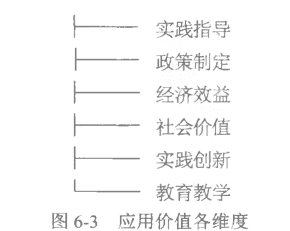
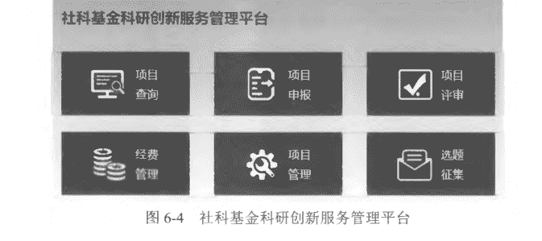
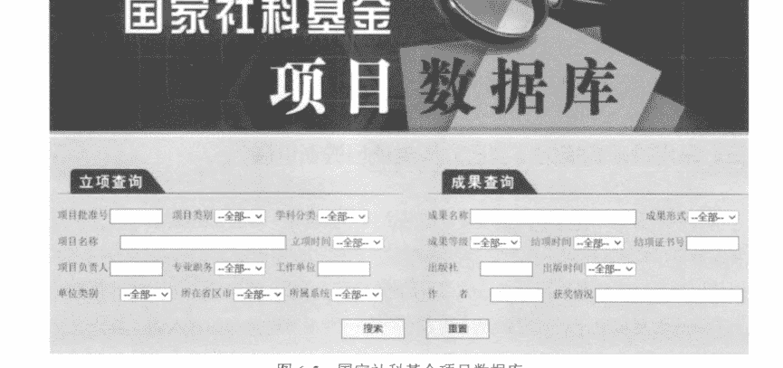
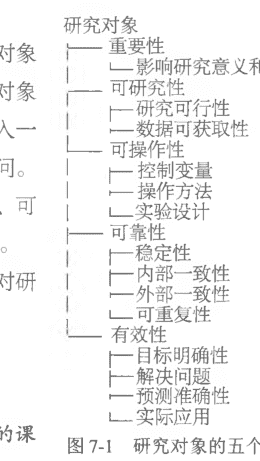

# 用AI协作写好课题申报书

# 前言

## 把AI当作学术伙伴，而非代笔

对高校教师和科研人员而言，争取研究项目支持是一项贯穿职业生涯的核心工作。动笔之前，建议先厘清三个基本问题。

第一，为什么要申项目。面向新时代和中国式现代化建设推进，一批重大的理论议题和现实难题需要学界以学术方式系统研究并提出对策。国家社科基金、教育部人文社科项目、省级社科规划等设立的初衷，就是调动高校和科研人员的智力资源回应党和国家的重点关切。主动申报、扎实研究既是对国家发展需要的回应，也是个人价值实现和学以致用的体现，更符合治学的本质追求。项目一旦立项，可获得经费支持调研、实证、学术交流与会议组织；结项后的结余还能延续后续探索，后续成果又会孵化新选题，形成滚动向上的良性循环，解决问题的能力与学术产出随之提升。

第二，申报材料究竟面向谁。材料由申请人撰写报送主管部门，由其组织专家评审，通过评审和审批后才能立项。这份文稿是把研究思路、内容、观点、计划、基础一次性完整呈现给评审专家的唯一载体。评审专家多为本学科的权威学者或成果丰富的知名学者，对学科知识和研究经验非常熟悉。因此文稿必须专业、具创新性、前瞻性且规范，才能说服评审。

第三，项目选题与学位论文或期刊论文选题是否相同。项目通常需要一定的前期积累，如相关学位论文、已发表论文。但项目选题更强调问题导向。国家社科基金要求紧扣党和国家高度关注的重大理论与现实问题，省级规划则鼓励面向本省关注的理论现实问题，因而兼具鲜明的学术价值与应用价值。多数公告会发布选题指南，它体现了主管单位希望申请人用专业知识解决的具体问题。主管部门通常也允许自拟题目，但仍要回扣重大理论或现实问题。学位论文或期刊论文只要具备学术性、创新性和研究价值即可，并非必须聚焦重大问题；期刊论文篇幅受限，也不适合直接套用到项目题目。

厘清上述问题后，AI在写作中的定位就很关键。不少人想把AI当“代笔”，要求其写得越详尽越完整，自己只负责提问和复制粘贴。这种做法不可取。AI的价值不在于让人更懒，而在于让人更高效，高效的起点和终点都指向人的更高智慧。懂行的人训练模型，模型输出更高质量的回应，反过来激发使用者更深思考与更具原创性的知识生产。人机协作而非机器替代，思考主体始终是人。

我更倾向把AI看作学术咨询顾问、助手与伙伴。研究卡壳时，它能用已有知识答疑、甚至反向提问，帮助理清思路、盘点基础、挖掘创新点，陪伴感很强。

提问要讲究方法，掌握提问模型，理解底层逻辑；同时要善于倾听，从回应的内容里捕捉新的追问点，不断深挖。提问-回应-追问-再回应的循环中，启发才会不断涌现。

总之，AI无法替代扎实的学术训练，只有使用者具备较强学术能力与深厚积累，其价值才能放大。AI也会出现“机器幻觉”，一本正经编造信息，需要使用者保持学术敏感、警觉与严谨，对输出进行细致验证，不可盲从，更不可直接套用。

倡导把AI当成学术咨询顾问、助手与伙伴，与之共同做研究。撰写申报文稿时需要它启发，而非让它代写。这里的“辅助”要准确理解。AI回应中可能出现术语、概念、文件、文献不规范或不真实的问题，本书在呈现AI回应原貌时尽量保留原文，用以提醒读者保持批判精神，并非认可其准确性。

本书采用倒金字塔思路，先拆解申报书，再介绍如何借助智能工具完善各要素。提问时兼顾整体性提问与分要素提问，以呈现两者质量差异，引导读者认识学术训练的重要性，正确使用AI。

最后，随着工具爆发，ChatGPT、Bard、New Bing、Claude、文心一言、讯飞星火等大语言模型底层逻辑相近，提示策略基本通用。本书以AI为例讲解技巧，同样适用于其他同类工具。建议培养综合使用多工具、比较优劣、优中选优的习惯。

# 第1章 课题申报概览

按层级可将科研项目划分为校级、厅局级、省级、部级、国家级。本章重点介绍国家社科基金项目、教育部人文社科项目、省级社科项目。每类都有申报公告，很多申请人只粗读公告，挑经费、选题要求、类别、周期、截止时间、办法等重点信息，忽略细节，不利于精准把握需求。仔细研读后可把公告信息输入AI分析，并提示申报注意事项。

## 第一节 利用AI拆解各层级申报公告

### 一、借助AI解读国家社会科学基金项目公告

在人文社科领域，国家社科基金项目是最高层级，包括重大项目、年度项目、后期资助、中华学术外译、冷门绝学专项、高校思政课专项等，覆盖面广。年度项目涉及23个学科，再加教育学、艺术学、军事学三个单列学科。下面以年度项目为例，公告发布后可借助AI快速把握要求。

**提问：**

以下是从《2023 年度国家社会科学基金项目申报公告》中截取的部分内容。

```
###①
```

打开申报公告，将申报公告里的具体内容粘贴到此处，可根据自己的需求截取申报公告里相应部分。此处，笔者截取了该申报公告的第一、二、三、七部分，目的是借助 AI 辅助分析该类课题的指导方针和选题方向。

```
###
```

请帮我分析国家社会科学基金项目的要求，申请人在进行课题选题论证时需注意哪些要点？

**回答：**

根据你提供的《2023 年度国家社会科学基金项目申报公告》相关信息，提取出以下课题选题论证的要点。

1. 遵循正确的政治方向、价值取向和学术导向。课题必须符合习近平新时代中国特色社会主义思想和党的二十大精神，保持政治方向、价值取向和学术导向的正确性。

① ### 为区隔符，区分用户给 AI 提供的材料内容和用户的提问内容，### 内的内容为提供的材料内容

2. 聚焦重大理论和现实问题。申报的课题需要紧紧围绕事关党和国家事业发展的重大理论和现实问题，以及构建中国特色哲学社会科学的重要基础和前沿问题。

3. 展现时代特征、问题导向和创新意识。课题应具有鲜明的时代特征，以问题为导向，并体现创新意识。

4. 基础研究和应用研究并重。基础研究需要跟踪学术和学科的发展动态，推进学科体系、学术体系、话语体系的创新。应用研究则需要关注党和国家事业的发展需求，解决全局性、战略性和前瞻性的重大问题。

5. 跨学科研究。2023年度国家社会科学基金项目鼓励申请人开展跨学科综合性研究，尤其在综合性选题方面，要求申请人围绕重大理论和实践问题，以及中国特色哲学社会科学的重要基础和前沿问题进行跨学科研究。

6. 灵活选择课题。申请人可以根据《国家社会科学基金项目2023年度课题指南》中的选题进行申报，也可以结合自身的研究兴趣和学术积累自行选择课题。不论选择哪种方式，都需要确保课题名称的表述科学、严谨、简明，避免引起歧义或争议。

以上是在进行国家社会科学基金项目的课题选题论证时需要注意的要点。希望这些信息能够对你有所帮助。

从AI的回答也可以看出，国家社会科学基金项目要求申请人站在党和国家的立场上，关注事关党和国家事业发展的重大理论和现实问题，课题要兼具理论价值和实践价值，体现出强烈的时代特征，具有鲜明的问题意识和创新意识。重要性、现实性、针对性、创新性、前沿性、全局性、前瞻性是国家社会科学基金项目课题的特点，也是申请人在撰写课题申请书时应时刻关注的问题。

国家社会科学基金项目提供了选题指南，申请人要高度关注选题指南，并结合选题指南申报选题。当然，国家社会科学基金项目也允许申请人根据自己的研究兴趣和课题指导方针自拟选题进行申报。由此可见，国家社会科学基金项目在选题方面既具有较强的指导性，又具有较大的灵活性和包容性。

### 二、借助AI解析教育部人文社科项目公告

教育部人文社会科学研究一般项目由教育部社科司主管，同年度不可与国家社会科学基金项目重复申报，说明其分量与认可度，属于高级别人文社科项目。该项目包括规划基金、青年基金、自筹经费和专项任务等。从立项规模看，对青年学者扶持力度大，青年基金占比高，且年龄放宽至40周岁以下。学科覆盖25个，含交叉学科/综合研究。

了解基本情况后，可用AI解析当年度申报通知，快速提炼要点。

**提问：**

以下是从《关于2023年度教育部人文社会科学研究一般项目申报工作的通知》中截取的部分内容。

```
###
可根据自己的需求从申报公告中复制相关内容并粘贴到此处。笔者将申报指导思想、项目类别及资助额度、项目申报学科范围等信息粘贴到这里。
###
```

请帮我分析教育部人文社科项目的要求，申请人在进行课题选题论证时需要注意哪些要点？

**回答：**

根据《关于2023年度教育部人文社会科学研究一般项目申报工作的通知》，申请人在进行课题选题论证时，需要注意以下要点。

1. 研究方向的指导原则。必须遵循正确的政治方向、价值取向和研究导向，深入学习贯彻党的二十大精神，贯彻落实习近平总书记关于教育的重要论述、关于哲学社会科学工作的重要论述。

2. 研究基础和学术特长。申请人应根据自身的研究基础和学术特长来选择研究课题。这意味着申请人需要有清晰的个人学术定位，对自身的研究能力和专业知识有深入的理解。

3. 课题命名。课题名称应表述规范、准确、简洁，避免引起歧义或争议。

4. 课题的创新性和科学性。申请人应充分论证课题的创新性和科学性，包括新颖的研究角度、创新的研究方法以及研究的理论或实际价值。

5. 预期研究成果。在申请书中应明确预期的研究成果，包括理论贡献、实践贡献等。

6. 项目类别和资助额度。根据项目的研究需求和个人情况选择合适的项目类别，如规划基金项目、青年基金项目、自筹经费项目和专项任务项目。

7. 申报学科范围。确保课题选题在规定的学科范围内。

8. 支持西部和边疆地区高校人文社会科学研究的发展。西部和边疆地区的高校申请人可以优先考虑申报西部和边疆地区项目、新疆项目、西藏项目。

总的来说，课题选题的论证过程应充分考虑课题的重要性、可行性和预期成果等方面，以提高项目申请的成功率。

从 AI 的回答中可以看出，教育部人文社科项目不设申报指南（专项任务项目除外），申请人可根据自身研究基础和学术特长，在坚持正确的政治方向、价值取向、研究导向的基础上自拟选题进行申报。该项目的申报公告内容比较简单。值得一提的是，国家社会科学基金项目和省级社会科学项目都是限项申报，而该项目不限项，可见该项目的包容性较强，给申请人尽可能多的选择权和自主研究的空间。

### 三、省级社会科学规划研究项目

各省、自治区、直辖市社科工作办均组织省级社科规划项目。对年轻教师而言，获批省级项目能建立信心，为申报教育部项目、国家社科项目积累基础与经验，故应重视。

下面以山东省社科规划项目为例说明申报要求。

## 做好课题申报：AI辅助申请书写作

### 提问：

以下是从《2023年度山东省社会科学规划研究项目申报公告》中截取的部分内容。

可根据自己的需求从申报公告中复制相关内容并粘贴到此处。此处，笔者将该公告里的前三部分（指导思想、选题要求、项目类别）进行了复制、粘贴。

请帮我分析山东省社科项目的要求，申请人在进行课题选题论证时需要注意哪些要点？

### 回答：

从《2023年度山东省社会科学规划研究项目申报公告》中可以总结出以下课题选题论证时需要注意的要点。

1.  指导思想。项目选题应以习近平新时代中国特色社会主义思想为指导，遵循党的二十大精神，以及习近平总书记对山东工作的重要指示。申请人应深入理解上述指导思想，并将它们体现在课题的设计和研究中。

2.  研究导向。项目选题应具有明确的政治方向、研究导向和价值取向。项目研究应能体现时代特征，具有问题意识和创新意识，能产出高水平的研究成果。

3.  基础研究与应用研究。项目要均衡重视基础研究与应用研究。基础研究应聚焦学术前沿和学科发展，推动学科体系、学术体系、话语体系的建设和创新，力求具备原创性、开拓性和较高的学术思想价值。应用研究则应关注经济社会发展中的重大实际问题，研究成果应具有现实性、针对性和较强的决策参考价值。

4.  课题命名。课题的名称应当科学、严谨、规范、简明，通常不加副标题。

5.  项目类别。山东省社科规划研究项目分为重点项目、一般项目、青年项目和专项项目。申请人需要根据自己的情况和研究课题的性质选择适当的项目类别进行申报。

6.  选题设计。在设计研究课题时，申请人应根据《2023年度山东省社会科学规划研究项目课题指南》规定的研究范围和方向，选择不同的研究角度、方法和侧重点，或者根据自己的学术专长和研究兴趣，结合山东省及国家的经济社会发展情况，自行设计具体题目。

总的来说，进行课题选题论证时需要紧扣中国特色社会主义现代化建设的实际需求，贴近经济社会发展的重大问题，着力提升研究的理论深度和实践价值，同时要尽可能体现原创性和创新性。

结合 AI 的回答可以看出，一般而言，省级社科项目包括重点项目、一般项目、青年项目和专项项目，课题申报总的指导方向与国家社会科学基金项目的指导方向大体一致，但更聚焦，会从本省级行政区域的角度出发，鼓励和支持学者发现和解决重要的理论问题和社会现实问题，所以研究对象的范畴往往比较聚焦，或者说，在课题题目上申请人所在的省级行政区域名称往往成为出现频率较高的限定词。

## 第二节 申报材料——申请书及活页的介绍

一般课题申报中，申请书和活页是核心材料，部分项目要求两者兼备，部分只要求申请书，专家主要据此判断创新性和可行性，填写质量直接决定成败。国家社科项目与省级社科项目表述相近，这里以国家社科项目和教育部人文社科项目为例说明。

## 一、国家社会科学基金项目的申请书及活页

### （一）申请书

国家社科项目申请书封面需填写“学科分类”。按填写说明，应填写一级学科名称，严格参照申报数据代码表。如表 1-1 所示。

### 表 1-1 2023 国家社会科学基金项目学科分类

| 学科 | 学科 | 学科 |

|---|---|---|

| 马列·科社 | 社会学 | 中国文学 |

| 党史·党建 | 人口学 | 外国文学 |

| 哲学 | 民族问题研究 | 语言学 |

| 理论经济学 | 国际问题研究 | 新闻学与传播学 |

| 应用经济学 | 中国历史 | 图书馆·情报与文献学 |

| 统计学 | 世界历史 | 体育学 |

| 政治学 | 考古学 | 管理学 |

| 法学 | 宗教学 | |

# 国社科与教育部人文社科申报要点精讲

申报材料第二页是签字承诺页与填报指南。打印成纸后务必在承诺页的签署处亲笔签名，指南部分建议逐项通读，多数低级失误都源于未读清规则。

整套材料共七大模块，前四项由申报者主笔，分别是基础信息表、研究设计论证、学术积累、费用预算，后三项为依托单位与管理部门的审核及评审意见。

### 1. 数据表
基础信息表汇总拟申报项目的核心要素，涵盖项目题目、关键词、类别、学科定位、研究类型、负责人及组成员信息、预期成果形态与篇幅、申请经费、计划完成时限等。录入前务必对照《数据表填写注意事项》，未逐项核对是导致失败的常见诱因。

要点
1. 项目题目一般不加副题，含标点在40汉字以内。
2. 关键词上限3个，词间空一个汉字位置。
3. 表内学科分类为二级代码及名称，与封面的一级学科名称不一致。
4. 组成员须为实质参与研究的科研人员，不包括负责人及管理后勤人员。
5. 成果字数以千字为单位，非万字。
6. 结项时成果形态原则上须与预期保持一致，需提前想清。
7. 成果类型可多选但不宜过多，如已选专著则无需再选研究报告，同时提交会提升结项难度。
8. 经费单位为万元，填写阿拉伯数字。重点项目35，一般及青年项目20，填35或20，不要写35万。
9. 时限参照公告：基础理论3-5年，应用对策2-3年。跨度过长或过短均不合理，1-2年完成基础理论不现实，若已有部分成果可考虑后续申请后期资助。
10. 组员信息须征得本人同意并在纸质文本签字。同年度申报者只能申报一项且不能兼任其它项目的组员；一名组员同年度最多参与两项申报；在研国家级项目组员同期最多参与一项。组队时应提前沟通确认。

一、数据表
| 课题名称 | |

|---|---|

| 关键词 | |

| 项目类别 | A.重点项目 B.一般项目 C.青年项目 D.一般自选项目 E.青年自选项目 |

| 学科分类 | |

| 研究类型 | A.基础研究 B.应用研究 C.综合研究 D.其他研究 |

| 课题负责人 | | 性别 | | 民族 | | 出生日期 | 年 月 日 |

| 行政职务 | | 专业职称 | | 研究专长 | |

| 最后学历 | | 最后学位 | | 担任导师 | |

| 工作单位 | | 联系电话 | |

| 身份证件类型 | | 身份证件号码 | | 是否在内地（大陆）工作的港澳台研究人员 | （是否） |

| 课题组成员 | 姓名 | 出生年月 | 专业职称 | 学位 | 工作单位 | 研究专长 | 本人签字 |

| 预期成果 | A.专著 B.译著 C.论文集 D.研究报告 E.工具书 F.电脑软件 G.其他 | 字数（千字） | |

| 申请经费（单位：万元） | | 计划完成时间 | 年 月 日 |

### 2. 课题设计论证
此部分为评审核心，包含选题依据、研究内容、创新点、预期成果与参考文献。与活页重叠但不完全一致，不可直接复制。指南已说明活页与表二内容略有差异。

撰写须按指引逐条展开，详略得当。研究价值不能空泛，需写明本课题对既有研究的独特学术与应用贡献，尤其相对已立同类项目的进展。务必使用当年版本，公告发布后下载最新空表研读后填写，避免沿用旧版被认为不严谨。

二、课题设计论证
本表参照以下提纲撰写，要求逻辑清晰，主题突出，层次分明，内容翔实，排版清晰。
1. [选题依据] 国内外相关研究的学术史梳理及研究动态（略写）；本课题相对于已有研究的独到学术价值和应用价值等，特别是相对于国家社科基金已立同类项目的新进展。
2. [研究内容] 本课题的研究对象、框架思路、重点难点、主要目标、研究计划及其可行性等。（框架思路要列出研究提纲或目录）
3. [创新之处] 在学术思想、学术观点、研究方法等方面的特色和创新。
4. [预期成果] 成果形式、使用去向及预期社会效益等。（略写）
5. [参考文献] 开展本课题研究的主要中外参考文献。（略写）

### 3. 研究基础
学术积累用于判断可行性与申报者驾驭力，含学术简历、前期成果、承担项目、与已承担项目或博士论文的关系。

注意底部说明：前期代表性成果限五项，成果名称与形式须与论证活页一致，活页不允许填写的作者、刊物、出版社、发表时间等信息需在本表注明；无关成果不得列入；合作者须标明排序。应挑选关联度最高、最具代表性的五项本人成果，按重要性排序。项目类成果不得放入前期成果，合著需标明申报者在合作中的位次。

公告规定以博士论文或博士后出站报告为基础申报的，需阐明与原成果的联系与区别，并承诺在原基础上实质性修改，重复比例不得超过60%，实质上为后续研究而非简单改写。

三、研究基础
本表参照以下提纲撰写，要求填写内容真实准确。
1. [学术简历] 申请人的主要学术简历、学术兼职，在相关研究领域的学术积累和贡献等。
2. [前期成果] 申请人前期相关代表性研究成果、核心观点及社会评价等。
3. [承担项目] 申请人承担的各级各类科研项目情况，包括项目名称、资助机构、资助金额、结项情况、研究起止时间等。
4. [与已承担项目或博士论文的关系] 凡以各级各类项目或博士学位论文（博士后出站报告）为基础申报的课题，须阐明已承担项目或学位论文（报告）与本课题的联系和区别。（略写）

### 4. 经费概算
2023年度起费用预算表简化，使用灵活性提升。填写前务必阅读《国家社会科学基金项目资金管理办法》财教〔2021〕237号，按办法列支。金额单位万元，间接费用一般按申请总额的40%填写。

四、经费概算
| | 序号 | 经费开支科目 | 金额（万元） |

|---|---|---|---|

| 直接费用 | 1 | 业务费 | |

| | 2 | 劳务费 | |

| | 3 | 设备费 | |

| 间接费用 | | | |

| 合计 | | | |

注：经费开支科目参见《国家社会科学基金项目资金管理办法》（财教〔2021〕237 号）。

### 活页
课题论证活页共六部分，相较申请书表二增加研究基础。活页中的研究基础仅写前期代表性成果与核心观点，只填成果名称、形式、作者排序、是否核心期刊，不得填姓名、单位、刊物名称、发表时间。已结项或在研项目、与本课题无关的成果不得作为前期成果。

国家社会科学基金项目课题论证活页
课题名称：
本表参照以下提纲撰写，要求逻辑清晰，主题突出，层次分明，内容翔实，排版清晰，除“研究基础”外，本表与《申请书》表二内容一致，总字数不超过7000字。
1. [选题依据] 国内外相关研究的学术史梳理及研究动态（略写）；本课题相对于已有研究的独到学术价值和应用价值等，特别是相对于国家社科基金已立同类项目的新进展。
2. [研究内容] 本课题的研究对象、框架思路、重点难点、主要目标、研究计划及其可行性等。（框架思路要列出研究提纲或目录）
3. [创新之处] 在学术思想、学术观点、研究方法等方面的特色和创新。
4. [预期成果] 成果形式、使用去向及预期社会效益等。（略写）
5. [研究基础] 申请人前期相关代表性研究成果、核心观点等。（略写）
6. [参考文献] 开展本课题研究的主要中外参考文献。（略写）
说明：1. 活页文字表述中不得直接透露个人信息或相关背景资料，否则取消参评资格。
2. 课题名称要与《申请书》一致，一般不加副标题。前期相关代表性研究成果限报5项，只填成果名称、成果形式（如论文、专著、研究报告等）、作者排序、是否核心期刊等，不得填写作者姓名、单位、刊物或出版社名称、发表时间或刊期等。申请人承担的已结项或在研项目、与本课题无关的成果等不能作为前期成果填写。申请人的前期成果不列入参考文献。

活页常被漏填课题名称，属于致命硬伤。

## 二、教育部人文社科项目的申请书
教育部人文社科采用“申请评阅书”，全程网上申报，无纸化，立项后才需提交带签章的纸质版。分为A表和B表，B表不出现个人身份信息，无独立活页，流程更简便。

封面需填学科门类，共25种。

表 1-2 教育部人文社科项目学科分类
| 学科 | | |

|---|---|---|

| 马克思主义/思想政治教育 | 考古学 | 教育学 |

| 哲学 | 经济学 | 心理学 |

| 逻辑学 | 管理学 | 体育学 |

| 宗教学 | 政治学 | 统计学 |

| 语言学 | 法学 | 港澳台问题研究 |

| 中国文学 | 社会学 | 国际问题研究 |

| 外国文学 | 民族学与文化学 | 交叉学科/综合研究 |

| 艺术学 | 新闻学与传播学 | |

| 历史学 | 图书馆、情报与文献学 | |

### A 表填写
填写时点击按钮完成四项：项目基本信息、申报者基本信息、团队成员信息、经费预算。填写后自动回填且呈灰色不可改，需重新点击编辑。

1. 项目基本信息
类别分基础、应用、试验。试验发展指基于既有知识开发新工艺的系统研究，人文社科较少见，因有交叉学科门类而设此项。研究期限三年，计划完成时间据此填写。

2. 申报者信息
先核资格。限普通高校申报，申报者须在编在岗，每人限报一项。规划基金需高级职称含副高，青年基金需博士学位或中级以上职称且年龄不超过40周岁。

设有“申请者本人近三年来主要研究成果”项，注明刊物年期或出版信息，限800字，不要求与拟申报课题相关，可列近三年所有主要成果。项目信息不在此栏，应填至“申请者作为负责人承担省级以上社科研究项目情况以及完成情况”，该栏目无时间限制。

3. 课题组成员信息
填写负责人外的成员，职称年龄不限，可不填但团队更有优势，最多9人。须征得每位成员同意，否则视为违规。不同于国社科，设有“课题组成员近三年来与本课题有关的主要研究成果”项，限800字，要求成果与本课题相关，提示组队时关注成员相关积累。

4. 经费预算
规划基金资助不超过10万元，青年基金不超过8万元。自筹经费项目经费自筹不低于8万元，需在“其他来源经费”处填写并上传学校财务提供的到账凭证或银行回单。

### B 表填写

图1-14展示了《申请评阅书》B表的整体布局。除了基础信息栏之外，正文主体由四项内容构成，也是评审的核心依据。

第一项需要论证课题的理论意义与实践价值，并对国内外已有研究做梳理与趋势判断；第二项要明确研究目标、具体研究内容，以及拟攻克的关键点与难点；第三项要说明研究思路与方法、推进计划与时间安排，前期积累与资料准备情况；第四项要列出中期成果与最终成果形式，并说明成果的预期流向。

与国家社会科学基金项目申请书相比，二者在表述措辞上略有区别，实质内容基本相通。差异主要在前期基础的填报规则上：两者都要填写与本课题相关的前期成果，但B表并未像国社科申请书那样硬性限定只能列五项。填写时可参考申报公告附件《××年度教育部人文社会科学一般项目申报常见问题释疑》，其中明确为保证专家能充分了解研究基础并兼顾评审公平，《申请评阅书》B表允许列出申请人已发表论文的刊名、题名，以及本人作为负责人承担的课题名称，但严禁出现所在单位、姓名等个人身份信息。该说明与国社科申请书在前期基础部分的表述并不完全一致，需要仔细研读。

B表（自此往下不得出现申请人个人身份信息，否则申请书作废）

| 课题名称 |  |
|---|---|
| 研究方向及代码 |  |
| 研究类别 |  | 计划完成时间 |  |
| 最终成果形式 |  |
| 申请经费总额(万元) |  | 其他来源经费(万元) |  |
| 一、本课题研究的理论和实际应用价值，目前国内外研究的现状和趋势（限 2 页，不能加页） |  |
| 二、本课题的研究目标、研究内容、拟突破的重点和难点（限 2 页，不能加页） |  |
| 三、本课题的研究思路和研究方法、计划进度、前期研究基础及资料准备情况（限 2 页，不能加页） |  |
| 四、本课题研究的中期成果、最终成果，研究成果的预计去向（限 800 字） |  |

图 1-14 《申请评阅书》B 表

填写时要注意，各栏目没有字数硬限制而是限定页数，可以通过调整字号、行距等方式灵活安排篇幅，但版式要保持整洁。A表和B表完成后，需要点击申请评阅书末尾的“检查填报内容并保护文档”按钮，通过检查后文档顶部才会出现“你现在可以上传申请书”的提示，才可在申报系统上传。

# 第2章 AI辅助选题发掘

从各级课题申报公告来看，绝大多数都发布了申报指南，指南中的条目大体分为具体条目和方向性条目。针对具体条目，申请人可以从不同视角、方法或侧重点切入，也可在文字上作适当调整后申报；方向性条目仅限定研究范围与方向，申请人必须据此自主设计题目，不能直接照搬。2023年国家社科基金项目指南新设的综合性选题即属于方向性条目，而各学科下的选题则类似具体条目，可直接使用也可适当修改。下面以2023年国家社科基金年度项目为例，说明如何依托指南利用AI寻找申报题目。

## 第一节 借助 AI 寻找综合性选题的申报题目

综合性选题仅明确主题、范围与方向，申请人须结合要求，自不同学科、不同视角拟定题目，不得将原条目作为题目使用。申报时需要确定一个主申报学科。针对此类选题，可采用整体式提问与针对性追问两种方式，从综合性选题中提炼出与自身学科相关的更细化题。

### 一、借助 AI 基于 SRGCD 模型整体性寻找综合性选题的申报题目

课题申报是AI应用的高端场景，提问时需要综合运用多种提问方法。

SRGCD即情境、角色、目标、条件、调试框架，要求在提问时设定具体情境、为模型分配角色、明确目标、给出指向性条件并通过多次调试获得启发。

以2023年国家社科基金综合性选题第21条为例说明整体提问的做法。

参考选题：21. 中国式现代化进程中的共同富裕问题研究

提问思路示例为：本人为高校教师，已工作若干年，职称若干，目前未承担或正在主持某级别课题，曾参与或主持教育部课题，研究主题为……专业为……研究方向为……来自……。请你扮演同行评议专家。目前准备申报国家社科基金项目、教育部人文社科项目或某省社科规划项目的年度重点、一般或青年项目，需要指导。指南中综合性选题中我对某条目感兴趣，但综合性选题仅明确主题范围方向，需申请人自拟题目。请结合我的专业、方向与研究基础，推荐可申报的具体题目。

上述提问为模型设定了专家角色、为申请人提供指导的情境、综合性选题的条件以及结合个人背景给出建议的目标。为获得更有价值的回答，需尽可能详细提供专业、方向与研究积累。

具体示例提问为：本人已工作10年，职称副教授，目前未承担国家级课题，但曾主持省级社科规划项目，主要围绕××市非物质文化遗产保护与传承展开，研究专业为新闻传播学，研究方向为文化传播，来自××大学。请扮演同行评议专家。我拟申报国社科年度一般项目，指南综合性选题第21条“中国式现代化进程中的共同富裕问题研究”较感兴趣，但不能直接作为题目。请结合我的专业、方向与基础，推荐具体的题目。

模型给出的回答从文化传播视角提出了多个方向，如基于主流媒体报道内容分析的共同富裕报道研究、以电影产业为案例的文化产业发展与共同富裕研究等，并提示结合自身基础选择并进一步细化。

根据国社科要求，题目不得使用副标题、不得出现冒号，于是进行调试。

调试提问为：题目不得使用副标题，请重新列出不含副标题的题目。

调试后得到十个去副标题的题目，如“中国式现代化进程中文化产业的发展与共同富裕问题研究”“基于社交媒体的中国式现代化进程中的共同富裕问题研究”等，并提醒后续需细化目标与方法。

模型回答偏宽泛，需要进一步追问。追问思路为：我的研究方向为……，研究兴趣为……，研究基础是……包括课题与论文等，越详细越好。请结合我的方向、兴趣、基础，以及项目级别所要求的具体要求，对上述选题再细化。

沿用案例追问：研究方向为文化传播，研究兴趣为非遗的数字化呈现与传播，研究基础是主持××市社会科学规划项目“京剧脸谱的数字化再造及数据库建设”及校级课题“××市大学生数字素养提升路径研究”。请结合国社科要求聚焦党和国家事业发展的重大理论现实问题，对选题再细化。

回答列出十个围绕非遗数字化的题目，随后发现偏离了“中国式现代化进程中的共同富裕问题”的限定，再次调试要求结合该综合性选题重新建议，得到将数字技术助力非遗与共同富裕结合的多个建议。

小结：SRGCD整体提问能够提供一定启发，但若要更精准，还需结合选题类型做针对性提问。

### 二、借助 AI 基于选题类型寻找综合性选题的申报题目

针对综合性选题，SRGCD提问能提供启发但不够精准。基于选题类型的针对性提问，先认识题目构成，再据不同类型提问。

通过对历年国社科立项题目分析可知，题目一般由限定词、研究对象、研究问题组合而成，研究对象和研究问题必现，限定词不一定出现但多会体现。好的限定词体现创新性。

限定词可从时间、地点、范围、情境、理论等维度限定研究对象，使题目更聚焦，也体现视角、创新、方法与价值。

据此可将题目分为“新情境+研究对象+研究问题”型、“新理论+研究对象+研究问题”型、“新理念/思想+研究对象+研究问题”型、“新区域+研究对象+研究问题”型、“新方法+研究对象+研究问题”型、“新模型+研究对象+研究问题”型、“新学科+研究对象+研究问题”型、“新技术+研究对象+研究问题”型和“新对象+研究问题”型等。

#### （一）“新情境 + 研究对象 + 研究问题”型

情境指事件、现象所处的背景环境，包含时间、地点、文化、社会、经济等多重因素，是理解问题的关键。

2022年国社科立项题目示例：

1. 企业产品研发情境下知识协调的底层机理及优化模型研究。
2. “双碳”目标情境下我国碳审计协同机制研究。
3. 立体开发情境下三维土地产权范式及其实现机制研究。
4. 数字化情境下生产性服务业与制造业融合的模式、机制与策略研究。
5. 城市高质量发展情境下我国村改居社区融合性治理的实现路径研究。
6. 基于异构不确定情景的应急物资储备与供应体系规划研究。
7. 旅游式学习背景下博物馆服务管理模式创新研究。
8. 全球化语境下的罗伯特·潘·沃伦诗歌研究。
9. 全媒体时代“三国文化”英译模态重构与多维传播模式研究。

这些题目均立足新情境，有的用“情境”“情景”“背景”“语境”“时代”等词表达，体现创新发现。

为让模型理解该类型，先做类型输入。

提问示例：2022年国社科有以下立项题目：企业产品研发情境下知识协调的底层机理及优化模型研究；“双碳”目标情境下我国碳审计协同机制研究；立体开发情境下三维土地产权范式及其实现机制研究；数字化情境下生产性服务业与制造业融合的模式、机制与策略研究；城市高质量发展情境下我国村改居社区融合性治理的实现路径研究；基于异构不确定情景的应急物资储备与供应体系规划研究。这些属于“新情境+研究对象+研究问题”型，请问其特点是什么？

回答指出共同点是以新情境为起点，结合对象与问题，研究新情境下的社会议题，探讨机理、模式、策略，强调理论实践结合，应用价值强，具有时代性与前瞻性，与政策导向密切相关。

解析显示模型已接受该类型，概括为以新情境为起点研究新问题，理论实践并重，时代感强，创新在于对新情境的关注。

接下来追问该类型对申请人的能力要求。

提问：选择“新情境+研究对象+研究问题”型选题，通常要求申请人具备哪些能力和要求？

把大方向变可申题目：国社科选题的AI打磨思路

想把综合性大方向做成能过会的申报书，第一步是先搞清楚这类题目对申报人到底要什么。素材里提到的综合选题，本质上是让你自己提问题、自己深挖，门槛主要在人本身。

大致有五个硬要求。

1. 能自己提问题并持续追问。题目不是抄来的，得自己提炼核心关切并展开。
2. 对所处领域足够熟悉。理论脉络、研究方法、前沿动向都得心里有数，才有深度可言。
3. 表达和协作过关。研究离不开交流，也要对外呈现，意图和结论必须说得清。
4. 有迭代打磨的习惯。科研是不断试错优化的过程，问题和思路都要反复精进。
5. 时间把控能力扎实。周期长、投入大，得有清晰计划和节奏。

把认知搭起来后，就可以用AI帮助把综合方向层层拆解。

先把感兴趣的大方向盘点出新的变化点。

示范提问：
聚焦现代化进程里追求共享繁荣的议题，现在冒出了哪些新背景？

AI给出的抓手大致有：

1. 发展阶段已切换。经济进入新阶段，政策对共享繁荣的重视度明显抬升，可以研究新阶段下如何更好推进。
2. 技术驱动加速。数字化转型和创新势能很强，对共享路径有直接影响，可看技术如何助力，以及数字化带来的连锁效应。
3. 区域协同承压。各地区发展差距仍在，对共享的落地构成挑战，值得探讨如何实现更均衡的全国协同。
4. 老龄化抬头。人口结构变化对共享目标的实现产生影响，需讨论其作用机制与对策。

接着结合近年的指南导向，往跨学科学术视角收敛。

示范提问：
放在传媒研究视域里，围绕上述议题出现了哪些新背景？

AI归纳的点包括：

1. 新媒体传播崛起。传统传播形态被重塑，能探讨新媒体在共享议题上的传播力与推动方式。
2. 大数据开始应用。它改变了传播效果与形式，可研究大数据如何介入议题解决，能否提升实效。
3. 舆情研判更受重视。可以看怎么借助监测分析工具把握公众态度，并据此设计传播策略。
4. 行业自律在完善。媒体自律机制对议题引导有作用，可研究其机制如何强化议题传播。
5. 环保议题升温。环境传播成为热点，公众环保意识增强，可研究环保宣传如何提升对共享与环保关系的认知。

再把外部背景拉回到自己的学科立场。

示范提问：
我是学社会的，想做跨域研究，对传媒领域的新背景很感兴趣，请基于现代化进程里追求共享繁荣的议题在传媒领域出现的新背景，给我几组 新背景+观察主体+核心关切 的题目建议，不要副标题。

AI示范输出：

背景1：短视频带货热。主体：带货博主、消费者。关切：带货现象对共享繁荣进程起什么作用。
背景2：社交平台网络公益。主体：平台用户、公益组织。关切：线上公益如何助力共享目标。
背景3：网络新闻平台多元化。主体：平台、受众。关切：多元化如何满足共享需求。
背景4：网络直播带货流行。主体：直播平台、主播、买家。关切：直播带货对共享进程的影响。
背景5：舆论场打假行动。主体：网民、打假组织。关切：打假行为如何推动共享环境。

把分析转成可申题目。

提问：
把上面整理成正式题目。

AI初稿出来后，因指南不允许副标题，再优化。

优化后示例：

1. 短视频带货现象对现代化进程共享目标的影响研究。
2. 社交平台网络公益如何推动现代化进程共享？ 
3. 网络新闻平台多元化与现代化进程共享的关系。
4. 网络直播带货对现代化进程共享的影响研究。
5. 网络舆论场打假行动对现代化进程共享的促进研究。

反复试错后提炼的一个高效提问范式：

我是学【专业】的，现正申报【级别】课题，想做跨域研究，发现围绕【参考议题】在【学科领域】出现了一些新变动，请据此围绕【参考议题】给我若干 新背景+主体+关切 型题目，要求体现新背景和研究指向，不加副标题也不加冒号，只列题目。

按此提问得到的质量更高，如：

1. 数字化传播环境下共享理念的机制与影响研究。
2. 社交平台环境下共享话题舆论生成与引导策略研究。
3. 新媒体平台环境下乡村共享信息落差问题研究。
4. 互联网加背景下共享教育资源传播与公平获取问题研究。
5. 新闻直播环境下共享政策宣传效果与策略研究。
6. 短视频和流媒体环境下共享文化价值建构与推广研究。
7. 大数据与算法推荐环境下共享议题信息筛选与传播路径研究。

小结：把AI当学术对话者，从回答里找薄弱点持续追问，认知才会沉淀。

第二部分 新理论+对象+问题型

理论是对现象的系统解释。新理论不等于发明新体系，而是选用比本领域常用更新或来自他域的理论来解释本域对象。

常见例子：

- 模因论视角下红色文化的互联网群体传播研究
- 基于合作博弈论的绿色供应链创新主体收益分配研究
- 基于吕叔湘句段理论构想的汉语常用句式事件语义研究
- 大历史观视角下社会主义意识形态话语创新研究

该类型有四个特点：

1. 突出理论增量。用新范式或新思路重新理解研究对象。
2. 对象选择讲究。要兼顾内部结构与外部情境，搭好框架。
3. 面向现实关切。着眼当下社会痛点，为实践提供参考。
4. 对申报人要求高。需要能读懂、会用、能驾驭新理论与方法。

申报人要具备：扎实的学科基础与方法训练、创新发现问题的能力、清晰的问题意识、把问题方法成果讲明白的表达力、必要时的团队协作力。

难点在于理论的新颖性体现在哪、为何选用、是否吃透、与对象问题的契合度如何。

情形一：申报人已有可用的新理论。

提问示例：
我熟练掌握文化人类学理论，现在申报国社科，参考议题是现代化进程里追求共享繁荣，不能直接用，想做理论+对象+问题型题目，请结合我掌握的理论给几条建议，不要副标题。

AI初稿后，经调试让题目显出理论、主体与关切，且不用冒号副标题。

优化示例：

1. 基于文化人类学视角的现代化进程共享问题研究。
2. 基于社会发展理论的欠发达乡村共享问题研究。
3. 互联网技术与共享 基于技术社会理论的研究。
4. 基于文化适应理论的城市化进程共享问题研究。

最终优化提示词：

我熟练掌握文化人类学方面的理论，现在正申请国家社会科学基金项目，有一个推荐选题是现代化进程里的共享繁荣问题，但是不能用原题目进行申报，我想采用新理论+研究对象+研究问题型课题选题类型，请帮我列几个可能的选题，要求用上我所掌握的理论，题目中不要有副标题、不要出现冒号。

回答：

用 AI 快速找准国社科选题创新点的打法

想让题目既贴合指南又有辨识度，很多老师卡在表述改头换面、实质重复。实操上有效的是三类切口：换分析框架、换价值导向、换地理边界。把提问话术打磨好，AI 能先出一批备选清单，判断权仍在人。

一、用新框架锁定议题+切口+关注焦点

选题的内在逻辑是先定关注焦点，再找能解释该焦点的分析框架，再把两者落到一个具体载体。框架越具体，AI 给出的标题就越聚焦。

以“我国推进现代化建设过程中如何实现全体共享发展成果”这一议题为例：

1. 借文化人类学打量本土现代转型中全民共享繁荣的动因，分析转型与共享之间的文化关联。
2. 用社会发展理论审视经济薄弱乡村的共享困境，探讨欠发达与共享之间的互动机制。
3. 以互联网技术为抓手，结合技术与社会视角，分析技术对共享进程的推动作用。
4. 用文化适应理论审视城市化进程中的共享问题，探究文化变迁如何影响公平达成。

提问时越细越好。常见的高效结构是：
我已熟练掌握【某个具体分析框架】，现申请【课题级别】，推荐议题是【题目】，但不能直接沿用原题。请按“新框架+研究载体+关注焦点”给出若干备选标题，要求标题里出现框架、载体和焦点，不出现冒号和副标题。

一个拆解示范：议题是“我国现代化建设中全体共享发展成果”，申请国家社科基金，想先找新闻传播学视角。
AI 会给出媒介依存、新闻价值、媒介民主等方向，再聚焦到媒介民主后，可改写为：
媒介民主视角下我国现代化推进中共享繁荣的传播机制研究
媒介民主与我国现代化进程中的共享发展问题研究等。

要点是 AI 给出的框架需要人工核验。机器给不出学术判断，人机配合才可用。提问时最好明确“不要冒号，不要破折号，不要副标题”，否则仍会跑偏。

小结：框架掌握越深，告诉 AI 的信息越具体，回应的针对性就越高。

二、用新导向围绕价值主张+研究载体+关注焦点

框架是经过检验的知识体系，理念是价值、信仰、理想的表达，思想是对事物本质规律的认识。三者有重叠，切口不同。理念和思想更偏价值，所以题目更容易体现时代新意。

判断标准是：该价值主张对既定载体是否新鲜。近年立项可见：
新发展理念下我国环境税政策效应评估及深化改革研究
基于儒家仁学思想的人类命运共同体研究
绿色发展理念下中国制造业出口韧性测度及提升路径研究

此类标题的特点是价值创新、载体明确、焦点针对性强，强调知行结合，常具跨学科属性。

申请人需要扎实学养，能准确把握新价值内涵，能界定载体范围，能提出可解答的焦点并设计可行方案。

围绕“我国现代化建设中全体共享发展成果”，可关联的价值主张有社会主义核心价值观、中国特色社会主义、新发展理念、绿色发展理念、全面深化改革、全面依法治国、共享经济、人民至上、以人为本、创新协调绿色开放共享等。

据此可生成的标题例如：
绿色发展理念指导下我国现代转型与全民共享关联研究
创新驱动发展战略推动我国现代转型实现共享繁荣的机制研究
区域协调发展视角下我国现代转型与地区共享问题研究
以人民为中心发展思想下实现共享繁荣路径研究

提问模板可参考：
我现在申请【课题级别】，推荐议题是【议题】，不能直接沿用原题。请按“新理念/思想+研究载体+关注焦点”先推荐与该议题相关的价值主张，再据此列出若干标题，要求标题不含冒号和破折号，无副标题。

三、用新边界以新区域+研究载体+关注焦点开拓空白

同样的载体和焦点，换一个研究较少涉及的地理单元，就能形成新意。区域可按行政、自然、文化、经济等划分。

2022 年立项案例：
黄河上游民族地区旅游产业转型与高质量发展研究
西南民族地区宅基地“三权”分置问题与对策研究
桂滇边境地区文化和旅游深度融合助推固边兴边富民机制与政策设计研究
西藏红色文化传承与发展研究

这类选题新颖性强，能拓展研究边界，加深对特定问题的认识，可塑性高。

申请人需要对所选新区域的经济社会文化政治背景有充分了解，并具备与载体匹配的专业知识与方法。

提问可这样设计：
我申请【课题级别】，关注【载体+焦点】，请推荐一个在该领域研究较少的新区域，并据此给出“新区域+研究载体+关注焦点”格式的标题，要求标题规范。

表 2-1 理论、理念与思想辨析

比较项目 | 理论 | 理念 | 思想
定义 | 系统的知识体系，经验证科学性强 | 价值观、信仰、理想的表达和追求 | 对事物本质、规律、发展趋势的认识和理解
抽象程度 | 抽象性强，强调普遍规律和理性思考 | 带有感性情感色彩，强调主观意识和精神 | 介于两者之间，兼具理性思考与感性认识
科学性 | 具有科学性和验证性，需实证研究支撑 | 一般不需科学验证，强调价值取向和信仰 | 通常具有科学性和理性，也反映主观情感与文化背景
适用范围 | 适用于特定领域或现象，具有实用性和指导性 | 适用于价值观或理想表达，具有倡导性和启示性 | 适用于对事物本质规律的认识，具有启示性和指导性

核心提醒：AI 能加速头脑风暴，但不能替代学术判断。标题格式、禁用标点都需要在提问里反复明确，最终选题仍需人来甄别、细化。学会与 AI 对话，选题效率会明显提升。

国社科选题拆解：两套可复用的AI提问框架

想把推荐方向改造成能落地的题目，很多人在“方向”与“切口”之间卡住。复盘多轮与AI的交锋，比较稳的打法就两类：新地域+研究对象+研究问题，和新方法+研究对象+研究问题。先把门槛说清楚，再看怎么提问。

新地域+研究对象+研究问题，这类题目对申请人综合素养要求高

文献梳理、资料搜集与分析、研究设计等基本功要过硬，工作才能顺利推进。选题往往要求能从新地域、新对象、新议题里挖掘出有价值的问题。涉及新地域多为跨学科，需要与不同学科同行顺畅沟通协作。面对新地域，二手资料不够，必须具备实地走访、观察与访谈拿第一手材料的能力。成果要写得有逻辑、能讲清楚，在学术会议上也能有效表达。

总体看，这类题不是靠单一专业知识就能扛住，需要专业、研究、创新、协作、调研、写作全在线。从交流里也能看出，模型给出的提示对申请人有启发：要对所涉地域的政治、经济、文化、社会有比较深的认知，同时具备创新意识、协作能力、调研能力，否则难以驾驭。

怎么提问出题目，两个典型场景

自己有熟悉的地域
示例提问：
我现在申请国家社科基金，推荐方向是“中国式现代化进程中的共富议题”，不能直接用，想按新地域+研究对象+研究问题立题。我是广东某高校教师，对全省各地市比较熟悉，如果把广东作为落点，结合广东在现代化进程中共富方面出现的具体问题，请列几个题目，标题里请勿使用冒号或破折号。

模型提供的参考方向包括：
当代广东的共富问题研究。
在城乡融合背景下广东实现共富的路径研究。
民营经济与地区共富的关联分析。
大湾区高质量发展与共富关系的探讨。
产业结构调整中的劳动力再分配与共富问题。
数字经济发展与贫富差距收窄策略。
乡村振兴战略下农村共富问题。
创新驱动战略对共富实现的影响分析。
教育资源优化配置与共富问题。
社会保障制度改革对广东共富的促进作用。
绿色发展与环境治理对区域共富的支持研究。

把熟悉的地域嵌入题目，地域本身就成了亮点。
可提炼的提问句式：
我现在申请【某级别课题】，推荐方向是“【方向】”，不能照用，想用新地域+研究对象+研究问题模式。我是【某地域】【某高校】教师，对【某地域】比较熟悉，如果选【某地域】作为落点，结合该地域在【研究领域】的现实问题，请列几个题目，标题中避免使用冒号和破折号。

让模型推荐地域
示例提问：
为解决现代化进程中的共富议题，哪些省区比较值得研究？

模型回应的要点：
广东。作为改革开放前沿，经济发展成熟，共富的经验与矛盾都值得深挖。
江苏。经济实力强，研究其做法可为其他地区提供参考。
浙江。以民营经济为特色，对共富的探索有启示。
四川。西部重点省份，区域协调与缩小差距的经验有价值。
北京。首都资源集中，探索对全国有示范意义。
上海。国际化大都市，全球化背景下的共富问题有研究价值。
陕西。一带一路节点，实践可为沿线提供借鉴。
贵州。经济相对欠发达，扶贫攻坚与缩小差距的经验可参考。
云南。西南边疆，民族文化资源丰富，民族地区共富值得关注。
辽宁。东北老工业基地，振兴与共富的探索值得关注。

选择不能随意，要依据自己的认知和熟悉度。假设发现自己对江苏更熟，就可以继续追问。

跟进提问：
江苏在共富方面做了哪些事？有哪些创新？

模型要点概括：
产业提质与转型。推进结构优化，发展高附加值产业，提升劳动生产率，实现经济与就业双提升。
城乡融合。促进要素互动资源共享，缩小城乡差距，提高农村收入。
社会保障完善。养老、医疗、失业、低保等体系不断健全，降低返贫风险。
教育资源优化。加大投入，补齐欠发达地区和农村短板，提升人力资本。
人才政策创新。引进培养高层次人才，为发展提供智力支撑。
中小企业扶持。出台政策支持创业创新，提升竞争力。
区域协调。推动南北、沿江协作，缩小区域差距。

再把研究视角融进去
示例提问：
从生态保护角度看，研究现代化进程中的共富，还有哪些省区值得关注？

模型给出：
西藏。生态脆弱，如何在保护中实现富裕是个难题。
云南。生物多样性高，现代化进程中生态压力与发展怎么平衡值得研究。
海南。热带岛屿生态独特，保护与发展并重的路径有研究价值。
黄河流域。水资源短缺与污染突出，生态保护与经济发展协同的问题突出。

对黄河流域感兴趣后追问：
如何在保护黄河流域生态的同时促进经济发展实现共富？我想申报国社科项目，围绕现代化进程中的共富议题，请列具体题目，标题中不出现冒号和破折号。

模型给出：
基于生态文明建设视角的黄河流域共富路径研究。
现代化进程中黄河流域生态保护与共富实现路径研究。

通过反复追问，把研究者熟悉的视角嵌进去，综合性方向就能变成有明确指向的选题。

新方法+研究对象+研究问题型

研究方法是收集、分析、解释数据的规范化流程，选法取决于问题性质、目标和研究者能力。方法用得好，题目的创新度就出来了。

立项举例：
基于行为科学理论和数据驱动方法的城市精细化治理研究。
基于自然语言处理方法的上市公司ESG漂绿现象识别及其治理机制研究。
基于大数据及可解释集成学习的信用风险模型构建与应用研究。
基于深度学习的时空模型分析及其在大气污染数据中的应用研究。

这类题共同点是把新颖方法直接写进题目，即新方法+研究对象+研究问题。

特点概述
方法创新。把新方法与对象问题结合，突出前沿性，提升准确性和深度。
对象明确。聚焦具体领域，提高针对性。
问题具体。落到可操作的点，便于积累实证。
跨学科。对不同学科方法进行融合，提升综合性。
实用性强。方法新颖，成果易转化为实践参考。

申请人对应的要求
方法掌握。要吃透所用新方法，懂理论框架、分析技巧或技术应用。
对象认知。对研究对象的基本特征、趋势、问题有清晰把握。
问题敏感度。能捕捉对象中的关键问题并深入展开。
创新意识。能用新方法解决核心问题，提供新见解。
跨学科能力。能在不同学科间交叉整合。
团队协作。能与合作者有效沟通推进行动。

怎么让模型给出新方法
示例提问：
我现在申国家社科基金，推荐方向是“中国式现代化进程中的共富议题”，不能直接用，想用新方法+研究对象+研究问题模式，请列几个能切实解决该问题的新颖研究方法。

模型给出的方向：
大数据分析挖掘社会、经济、政策数据揭示规律。
社会网络分析研究群体联系与影响机制。
行为经济学结合实验研究心理行为特征。
计量经济学做定量研究，揭示与增长、分配的关系。
系统动力学建模分析因素互动。
情景模拟与预测评估政策效果。
机器学习与自然语言处理分析文献、报道、政策文本提炼信息。

方法需要申请人自行甄别，模型输出不一定都准确，要带着质疑精神验证。

把方法落到题目
示例提问：
结合新方法+研究对象+研究问题，围绕现代化进程中的共富议题，列几个题目。

模型示例：
基于大数据分析的区域收入分配差异与共富关系研究。
社会网络分析视角下城乡居民共富路径探究。
行为经济学视角下公共政策对共富的影响研究。
计量经济学方法在分析中国收入分配不均问题中的应用。
系统动力学模型在共富政策制定中的应用研究。
基于情景模拟与预测的中国共富目标实现路径研究。
机器学习与自然语言处理技术在共富政策评估中的应用。

如果你是新闻传播背景，还可以进一步定制。
示例提问：
我是学新闻传播的，能否结合以上内容，给我几个有针对性的选题？

模型给出：
基于大数据分析的新闻报道对共富影响力评估研究。
社交媒体环境下共富问题传播与舆论引导策略研究。
从行为经济学视角探讨新闻报道对公众关于共富认知的影响。
基于计量经济学方法的新闻传播对收入分配不均问题的影响分析。
新闻传播与共富政策制定的系统动力学研究。
基于情景模拟与预测的共富新闻报道策略研究。
机器学习与自然语言处理技术在共富新闻报道中的应用。

最终可简化为：
请结合新方法+研究对象+研究问题模式，围绕中国式现代化进程中的共富议题，列出几个课题题目。

模型可能给出：
基于大数据和机器学习算法的中国共富问题的深度透视与治理机制研究。
基于区域比较研究方法的中国式现代化与共富的实现路径研究。
基于系统动力学方法的现代化进程中共富问题的发展动态及影响因素研究。
基于计量经济学方法的现代化进程中实现共富的政策建议与效应预测研究。
基于社会网络分析的中国共富问题的影响力和传播效应研究。

用好这两种打法，关键是先定地域或方法，再用熟悉的视角不断追问，把综合性方向题落到能写、能做、能中的具体点上。

① 关于“共富政策”这一说法是否准确，还需申请人进一步核实。模型回答不一定全对，需要验证，这正是严谨治学的体现。

选题打磨札记

把中国式现代化语境下的共享富裕议题转化为可申报的题目，难点在于把方法与具体关切拽在一起。下面把两种常用的搭建思路理清楚，并给出可以直接借鉴的方向。

方法驱动型选题：方法加对象加问题

这条路径是先锁定技术手段，再落在传媒关照与现实关切上。围绕共享富裕话题，可以这样展开：

1. 用模式识别技术拆解共享富裕类新闻文本的结构与主题分布。
2. 从网络科学视角观察主流新闻机构的报道如何塑造公众对该议题的认知。
3. 借助计算传播工具评估主流媒体在观念普及上的实际成效。
4. 以大数据分析追踪社交平台上与该议题相关的新闻及评论的演化轨迹。
5. 依托深度学习挖掘新闻里该议题的情感传播路径。
6. 运用GIS空间分析还原相关报道在地理上的分布样态。

把前沿技术与传媒关切结合，能让议题在现代化语境下的研究更具操作性。

> 小结：AI对话确实能打开思路，有些推荐的技术此前并不熟识，经查证也确有其事。关键在于拿到新颖的方法后如何真正用起来。AI只能当工具与学术伙伴，对申报材料的形成帮助很大，但绝不能替代申报人自身的学术训练。对不熟悉的方法必须去学、去练、去消化，而不是只用来点缀。经验丰富的评审一眼就能辨识，一旦立项后无法推进，问题会更大。

模型驱动型选题：模型加对象加问题

这里的模型指可供学术使用的分析框架，常见类型包括：

- 理论模型，把已有研究抽象成解释现象的框架。
- 数学模型，用符号与公式刻画现象，便于量化与预测。
- 计算模型，依托计算机算法与程序来模拟过程，可建立在数学模型上，也可按规则逻辑搭建。
- 统计模型，用统计技术从数据中提取信息，常用于描述关系与预测。
- 概念模型，用图形呈现核心概念间的关联，便于直观理解与交流。

模型类型很多，随着跨学科成为常态，自然科学的模型也被引入人文社科，但选择必须贴合研究现象，不能为用模型而用模型。

2022年国社科立项里有典型示范：

- 全局模型视角下的复杂分层经济预测研究
- 构式变体模型视角下英汉构式变异与演变的交叉验证研究
- 基于数据要素投入产出模型的数字经济价值传导研究
- 双碳目标下技术经济区域信息融合的创新生态系统构建及其协同演化研究

共同点是都嵌入了一个相对新颖的模型。找模型有两条路：一是梳理学界已验证或广受认可的框架；二是基于个人前期研究提出新模型，后者更亮眼，但科学性与适用性必须经得起检验。

这条选题类型呈现的特征：

- 理论上有所创新，采用新颖模型带来新视角与分析框架。
- 整合度高，模型、对象、问题紧密咬合，针对性与实用性强。
- 面向现实，针对具体现象展开深挖，力求揭示成因并给出路径。
- 实证导向，强调在数据上检验与拓展模型的有效性。
- 技术门槛高，对理论功底与技术操作都有较高要求。

做好课题申报：66 AI辅助申请书写作

总体看，这类选题追求理论与实践并重，以模型为中介解决现实问题。跨学科研究中把自然科学模型引入人文社科，既提升创新也抬高难度。

选择这类选题对申请人的要求：

- 理论基础扎实，能熟练调用相关领域的分析框架。
- 技术能力过关，能进行数据处理与模型构建等操作。
- 独立思考与创新能力强，能发现不足并提出新模型。
- 具备实证研究经验，能在数据上验证模型。
- 跨学科视野，能在不同学科间寻找资源与方法。
- 团队协作与沟通能力良好，便于推进研究。

满足以上条件，才能真正把新模型加研究对象加问题落到实处。

围绕共享富裕议题的一些理论模型选用：

- 双循环经济模型，从国内循环与国际循环互动看产业结构、区域协调与全球价值链重塑。
- 人力资本增长模型，探讨教育、培训与技能提升对实现机制的影响。
- 收入分配调节模型，以劳动收入份额、资本收入份额与再分配政策为核心变量剖析分配效应。
- 社会资本理论模型，探究信任、网络关系与文化传统在进程中的作用。
- 产业集群升级模型，以竞争力、创新力与区域协同为核心看产业结构调整与区域差异。

结合传媒学科背景，给出几个可用的题目，不使用冒号或破折号：

- 议程设置理论视角下新闻传播对共享富裕政策的影响研究
- 引导性舆论范式在传媒中缩小贫富差距的应用与成效分析
- 传播范式探讨媒体对劳动力市场流动和共享富裕的影响
- 新媒体环境下知识传播范式与教育公平及共享富裕研究
- 网络舆情分析范式下新闻传播对社会保障体系优化的影响研究

更前沿的范式组合：

## 第2章 AI辅助寻找选题 69

- 复杂网络范式下新闻传播路径对共享富裕政策影响的研究
- 社交媒体挖掘范式评估网络舆情对贫富差距认知的影响
- ML范式下新闻报道风格对共享富裕目标实现的影响分析
- 文本挖掘范式研究网络舆论对公共政策制定与共享富裕的关系
- 情感分析范式下新闻传播对减少地区发展不平衡的作用研究
- 深度学习范式探究新闻报道对社会财富再分配的影响机制

结合前期积累，拟定的题目是“依托ML范式的主流媒体对共享富裕的舆论引领路径研究”。以评审身份看：

优点。议题关联度高，现实意义突出；把ML与主流媒体舆论引领结合，体现技术与传统领域的融合；ML可处理海量新闻数据，挖掘深层规律，提升客观性。

不足。技术挑战大，对研究者技术要求高；数据压力大，需要大量高质量数据采集清洗预处理；概念需细化，主流媒体范围宽泛，共享富裕的量化指标也需明确。

建议进一步明确主流媒体边界与共享富裕的量化指标，加强技术准备，确保数据来源可靠。

细化建议：主流媒体界定可考虑品牌影响力如人民日报新华社中央广播电视总台；传播渠道如报纸电视广播网络新闻社交媒体；传播指标如点击阅读转发等。共享富裕测量指标可包括经济增长如GDP增速人均GDP；区域均衡如城乡收入差距东西部发展差距；劳动力市场状况如就业率失业率；生活水平如人均可支配收入消费住房条件。

据此题目聚焦为“依托ML范式的中央广播电视总台新媒体平台对共享富裕的舆论引领路径研究”，针对性更强。中央广播电视总台新媒体平台是重要主流渠道，影响面广；ML可从海量数据中找规律；研究意义在于为政策制定与媒体责任提供参考。挑战仍在数据与技术层面，需要足够的技术背景或合作。

什么是机器学习模型，这个模型具体的结构或指标是什么

机器学习模型是通过数据训练得到的数学模型，能够从输入中学习规律并对新数据进行预测或分类。包括监督学习、无监督学习、半监督学习和强化学习等。

常见类型与结构指标：

线性回归，通过拟合特征与目标变量的线性关系预测，结构包含权重系数与截距。

决策树，树形结构从根到叶划分数据，内部节点为特征判断条件，叶节点为类别或回归值。指标包括信息增益、基尼系数、树深度等。

支持向量机，通过寻找最大间隔超平面实现分类与回归，结构包含支持向量与超平面参数。

神经网络，模拟神经元结构，由输入层、隐藏层、输出层组成，神经元间以权重连接。结构指标包括层数、每层神经元数、激活函数与权重设置。

5. 集成学习 多模型协同提效

集成学习的想法是把若干个基础学习器拼在一起形成整体判别力，常用的基单元有决策树、SVM 之类。业内常见的整合路线有 Bagging、Boosting、Stacking。搭建时要明确三件事：用什么样的基学习器、用几个、怎么融合。

不同机器学习方法各有擅长与局限，选型一定要结合任务性质和数据特点来定。

提问：
机器学习模型该算理论还是算技术？

回答：
两者属性兼具。从理论层面看，它建立在数学原理之上，用算法刻画数据的内在规律；从应用层面看，它是一套能直接落地的工具，已经用在图像识别、自然语言处理、预测分析等诸多场景。总体而言，它既有完整的数理与算法基础，也是一种面向现实问题的工程手段。

围绕这个提问，申请人可以先对拟用的模型形成初步认识。下一步就要去搜集文献，对模型做系统梳理。随着阅读深入，对选题的理解会不断加深，研究思路与框架也会逐步清晰。

> 小结：在“新模型 + 研究对象 + 研究问题”类选题里，所用的模型要比已有研究更具新意，或来自其他学科乃至自然科学的迁移，或是申请人基于既有积累提出的创新模型。用 AI 找方向时要主动引导其挖掘与既定问题高度关联且新颖的方法，但这只是起点，后续仍需对模型做全面深入的学习。

（七）“新学科 + 研究对象 + 研究问题”型

这里所说的“新学科”，指近几年为回应社会发展与知识体系演进而出现的交叉领域。

这类方向通常呈现以下特征。

- （1）前沿性。往往聚焦尚未完全破解的难题，处于学术探索的前沿，带有一定的开拓意味。
- （2）跨学科性。需要把多个学科的知识与方法整合起来，从不同角度切入同一问题。
- （3）应用性。更关注现实生活中的痛点与需求，应用价值与实践意义比较突出。
- （4）创新性。具有较强的创新驱动，需要研究者不断提出新理论、新方法、新技术来推动发展。
- （5）发展潜力。随着科技进步与社会需求变化，有望成为未来学界与产业的重要动力。

以下是 2022 年国家社科基金立项的参考题目。

- [1] 进化语言学视域下人工智能自然语言处理模式研究（哲学，青年项目）。
- [2] 计量语言学视域下多维源语特征对口译质量的影响和预测模型研究（语言学，青年项目）。
- [3] 技术现象学视角下智能算法嵌入社会与治理研究（社会学，一般项目）。

从以上题目可见，进化语言学、计量语言学、技术现象学都是多学科融合的产物。那么这类选题的内在逻辑是什么？

提问：
“进化语言学视域下人工智能自然语言处理模式研究”“计量语言学视域下多维源语特征对口译质量的影响和预测模型研究”和“技术现象学视角下智能算法嵌入社会与治理研究”等选题涉及的进化语言学、计量语言学、技术现象学都是新兴学科，因此，这几个选题有这样一个特点：将某一种新兴学科作为研究视角或切入点，并且将某种新兴学科直接体现在题目中，这种类型的选题可以称为“新学科+研究对象+研究问题”型课题选题类型，你明白了吗？请问“新学科+研究对象+研究问题”型课题选题有什么特点？

回答：
明白了。“新学科+研究对象+研究问题”型选题主要有以下特点。

1. 视角的突破。以新兴学科作为切入点，能提供新的理论框架与方法论，有助于拓展研究范围，提升研究的深度与广度。
2. 跨学科属性。这种选题通常涉及多个知识体系，要求研究者具备较强的跨学科素养，有利于学科间对话与合作。
3. 研究对象的时代感。通常聚焦当代社会现象、议题或技术，现实针对性强，有助于破解实际问题。
4. 方法更新。新兴学科自带新方法与新工具，能提升研究的科学性与效度，研究者需要掌握并运用。
5. 成果价值较高。该领域尚处成长期，研究成果的学术价值与实践意义往往更大，有助于学科进步与问题解决。

总体而言，这类选题兼顾创新性、交叉性、时代性、方法创新与高价值。对研究者而言，跨学科学养、研究能力与创新意识是关键。新兴学科拓展了研究边界，也因体系仍在完善而对申请人提出更高要求。

提问：
选择“新学科 + 研究对象 + 研究问题”型课题选题对申请人有怎样的要求？

回答：
选择该类型选题对申请人有以下要求。

1. 跨学科知识储备。需掌握目标新兴学科的基础理论，同时了解研究对象相关的其他学科知识，以便在跨学科背景下展开研究。
2. 研究功底。能提出有价值的问题、设计合理方案、选用恰当方法、撰写高质量报告。
3. 创新意识。善于捕捉新兴学科前沿议题，提出新问题与新方法。
4. 学术沟通与协作能力。涉及多学科，需要与不同领域专家有效交流合作。
5. 学术素养。恪守规范，确保研究过程与成果的科学、客观与真实。
6. 适应力。新兴学科发展快，需要快速学习新理论与新方法，应对领域变化。

总之，该类选题对跨学科背景、研究能力、创新意识、沟通协作、学术素养与适应力均提出较高要求，以保证研究顺利并产出高质量成果。

形成初步认识后，可请 AI 围绕感兴趣的综合议题，推荐若干相关的新兴学科。实践中发现，明确指令格式为“某某学”，效果更稳定，否则容易混入非学科条目。

提问：
我现在正申请 2023 年国家社会科学基金项目，我想采用“新学科 + 研究对象 + 研究问题”型课题选题类型，请帮我列几个能够解决“中国式现代化进程中的共同富裕问题”的新兴学科，格式为“某某学”。

回答：
申请国家社会科学基金项目时，选择涉及“中国式现代化进程中的共同富裕问题”的新兴学科可以更好地体现创新性和独特视角。以下是一些建议的新兴学科，它们可以帮助你更深入地研究这一问题。

1. 可持续发展经济学。关注经济、环境和社会三大支柱的可持续发展，着眼于资源配置、收入分配以及环境保护等方面的问题，以实现全体人民共同富裕为目标。
2. 社会创新学。研究社会创新对解决共同富裕问题的影响和作用，包括新型经济组织形式、社会企业、公共—私营合作等方面的内容。
3. 数字社会学。关注数字技术如何影响社会经济结构和收入分配，从而助力实现共同富裕。
4. 城乡融合发展学。研究城乡发展差距如何影响共同富裕问题，以及如何通过政策、产业转移等手段促进城乡融合，实现共同富裕。
5. 普惠金融学。研究如何通过普惠金融政策和服务，为广大群众提供公平的金融资源，以助力共同富裕。
6. 社会保障与福利经济学。关注如何通过完善社会保障体系、提高福利水平等手段，缩小收入差距，实现共同富裕。
7. 人工智能伦理学。研究人工智能技术在经济社会发展中的应用与伦理问题，如何确保技术发展惠及所有人，实现共同富裕。

这些新兴学科可以从不同角度为你研究“中国式现代化进程中的共同富裕问题”提供理论支持和实践指导。在选择课题时，可以根据你的兴趣和研究背景选择一个或多个学科进行深入探讨。祝你申请顺利！

提问：
结合上述建议，请围绕“中国式现代化进程中的共同富裕问题”，为我列几个采用“新学科+研究对象+研究问题”型课题的题目，题目中不带“：”和“——”。

回答：
根据你的要求，以下是一些建议的课题题目，结合了新兴学科、研究对象和研究问题。

1. 可持续发展经济学视角下中国资源配置优化与共同富裕的实现途径研究。
2. 社会创新学与乡村振兴战略的结合：探索中国农村共同富裕新模式。
3. 数字社会学视野中的智慧城市建设如何促进共同富裕问题解决。
4. 城乡融合发展学研究背景下的中国区域协调发展与共同富裕关系分析。
5. 普惠金融学在中国小微企业融资中的应用及对共同富裕的推动作用。
6. 社会保障与福利经济学视角下完善中国养老保险制度的路径选择与共同富裕实现。
7. 人工智能伦理学在中国数字经济中的作用与共同富裕问题的解决策略。

希望这些课题题目能够为你在申请国家社会科学基金项目时提供一些参考。在选择题目时，你可以根据自己的研究兴趣和背景进行适当调整，以确保课题有针对性和实际应用价值。祝你申请顺利！

针对 AI 给出的新兴学科，申请人要对这些新兴学科进行验证，看其是否存在或是否准确。验证结果表明，像“普惠金融学”“城乡融合发展学”就是 AI 杜撰出来的，而“社会创新学”应为“创新社会学”。

由上面的回答可以看出，由于申请人没有明确告知 AI 自己的研究领域或学科方向，AI 提供的选题还是比较宽泛的，涉及多个学科。根据 2023 年国家社会科学基金项目申报要求，综合性选题要在具体的学科内进行申报，因此，申请人要明确学科领域后，进一步调试提问。

提问：
我现在正申请 2023 年国家社会科学基金项目，我是学新闻传播学的，有一个推荐选题是“中国式现代化进程中的共同富裕问题”，但是不能用原题目进行申报，我想采用“新学科＋研究对象＋研究问题”型课题选题类型，请帮我列几个课题题目，题目中不带“：”和“——”。

回答：
作为新闻传播学研究者，你可以将专业知识与“中国式现代化进程中的共同富裕问题”相结合，从不同的传播角度提出独特的课题。以下是一些建议的课题题目，分别涉及新学科、研究对象和研究问题。

1. 基于数据新闻学的中国共同富裕问题舆论分析与传播策略研究。
2. 社交媒体平台在中国共同富裕问题中的信息传播与影响力分析。
3. 新媒体环境下的中国共同富裕问题宣传机制与优化路径研究。
4. 传播心理学视角下的共同富裕观念塑造与传播效果评估。
5. 基于媒介融合发展的中国共同富裕问题传播创新与实践探索。
6. 新闻传播伦理学在中国共同富裕问题报道中的应用及其挑战。
7. 公共外交与国际传播中中国共同富裕战略①的传播策略研究。

希望这些课题题目能够为你申请国家社会科学基金项目提供一些参考。在选择题目时，你可以根据自己的研究兴趣和背景进行适当调整，以确保课题的针对性和实际应用价值。祝你申请顺利！

> 小结：在上述回答中，数据新闻学、传播心理学属于新学科；新闻传播伦理学的表述不够规范，规范说法应为新闻伦理学，也属新学科；而其余题目并未真正引入新兴学科。因为新学科往往是多学科交叉并伴随新技术或新方法，系统容易把新学科与新方法、新技术、新情境、新思路混淆。若限定输出格式为“某某学”，又可能出现“机器幻想”式的杜撰，因此提问时需具备学术甄别力。

① 注：“中国共同富裕战略”表述不准确，实现全体人民共同富裕是中国式现代化的重要目标之一。此处保留原表述以还原系统回答。

（八）“新技术 + 研究对象 + 研究问题”型

技术是指运用科学原理、实践知识与技巧，设计制造工具、设备、系统与流程，用以解决问题、达成目标或提升现有方案效能的方法。技术发展受科学、社会、经济与文化等多重因素驱动，涵盖信息技术、生物技术、制造技术、交通技术、通信技术、建筑技术等。技术推动资源利用效率提升、生产力增长与生活质量改善。人文社会科学研究同样离不开技术支持，其在数据获取、分析与呈现等环节发挥关键作用。

2022年国家社会科学基金立项题目示例：

- [1] 基于区块链技术的食品安全问题治理模式重构研究（管理学，青年项目）。
- [2] 基于机器学习技术的校园欺凌主动识别及干预研究（社会学，一般项目）。
- [3] 数字技术推动社会治理共同体建设的运行机制与实践路径研究（政治学，青年项目）。
- [4] 数字技术驱动乡村治理效能提升的机理与路径研究（政治学，青年项目）。
- [5] 神经定位与调控技术相结合的汉语语法加工与学习的神经机制研究（语言学，青年项目）。
- [6] 超网络视角下制造业国有企业数字化转型与价值共创行为研究（管理学，青年项目）。

可见，这些课题选用区块链、机器学习、大数据等新技术，从而形成“新技术+研究对象+研究问题”型选题。

提问：
“基于区块链技术的食品安全问题治理模式重构研究”和“基于机器学习技术的校园欺凌主动识别及干预研究”等题目，把先进技术作为工作方法或视角并写入题目，这类选题可称为“新技术+研究对象+研究问题”型，你明白吗？其特点是什么？

回答：
明白。这类选题把新技术与研究对象、研究问题结合，具有以下特点。

1. 创新性。借助新技术解决特定问题，提供新视角与新方法。
2. 实用性。新技术在解决现实问题时效率高、成本低，研究结果更精准实用。
3. 跨学科性。新技术常跨学科，推动研究者多维度审视问题，挖掘深层特征。
4. 可扩展性。聚焦特定问题，但技术本身通用性强，可迁移至其他场景。
5. 挑战性。许多新技术尚处探索期，可能面临成熟度、数据获取、应用落地等挑战，需要更多投入。

总体而言，这类选题创新性、实用性与挑战性并存，对研究者的技术能力与跨学科知识要求较高。需充分认识新技术的优势与局限，灵活使用以解决问题。人文社会科学研究的核心仍是对人类行为、社会现象的理解与解释，技术只是支撑工具，批判性与创造性思维不可或缺。

提问：
选择“新技术 + 研究对象 + 研究问题”型选题对申请人有什么要求？

回答：
1. 技术熟练度。掌握新技术原理与应用方法，具备编程、数据处理、算法设计等能力。
2. 跨学科知识。能将技术与研究对象、问题结合，多视角分析。
3. 创新思维。运用技术提出新方法与解决方案，推动领域发展。
4. 实践经验。最好有实际操作经历，能体现技术的实用性与有效性。
5. 学术素养。遵循规范与伦理，保证研究可靠。
6. 沟通协作能力。新技术研究常需跨团队合作，需良好协作。

这类选题既要求技术熟练，也要求思辨能力，二者缺一不可。

在对该类型有认知后，可请系统围绕关注议题推荐可解决问题的相关新技术。

提问：
我正在申请国社科项目，推荐选题是“中国式现代化进程中的共同富裕问题”，不能直接用，想采用“新技术+研究对象+研究问题”型，请列出能切实解决该问题的若干新技术。

回答：
1. 大数据分析。对海量异构数据进行挖掘，揭示共同富裕的规律与趋势，为政策提供依据。
2. 人工智能和机器学习。构建预测模型，分析影响因素与潜在风险，为决策提供量化支持。
3. 社交网络分析。理解群体间关系与互动模式，揭示共同富裕背后的社会结构。
4. 区块链技术。通过透明、可追溯、不可篡改的特性，保障政策执行与公共资源分配公平，推动共同富裕。

# 选题如何更有辨识度：技术牵引与新对象切入

在同质化严重的申报环境下，创新叙事往往决定成败。下面梳理两条高频打法的思路，以及如何用智能工具进行发掘。

## 以技术为杠杆的选题思路：把新工具、研究对象与问题串起来

做好课题申报：84 AI辅助申请书写作

5. 文本智能挖掘。借助自然语言处理可从海量文献与舆情中自动筛选出与共同富裕密切相关的关键词与议题，为政策研判和成效评估提供数据支撑。
6. 空间信息系统。地理信息系统能够呈现共同富裕在不同区域的分布差异与地域特征，为地方规划和区域性政策供给科学参照。
7. 计算社会科学。该路径把计算机科学、统计学与社会科学叠加应用，有助于更深入揭示共同富裕背后行为模式的运行机理。
8. 情绪分析。利用网络数据的情感分析可提炼公众对共同富裕议题的态度倾向，为舆情管控与政策沟通提供参考。
9. 代际分析与微观模拟。通过代际对比与微观模拟能描绘共同富裕在不同年龄段与社会分层中的表现差异，为精细化施策提供依据。
10. 可视化呈现。把复杂模型与大数据以图形化方式呈现，有助于把握共同富裕问题的多维性和复杂性。
11. 云边协同算力。云计算与边缘计算为大规模处理与实时分析提供算力基础，支撑对共同富裕议题的立体化探索。
12. 物联网采集。物联网能够实现多源数据的实时采集与动态监测，为政策落地与跟踪评估提供持续的数据流。

以上手段在“中国式现代化进程中的共同富裕议题”研究中具备较大潜力，能提供新视角与新方法。

> 小结：技术创新是选题创新的重要来源，核心逻辑是“新技术+研究对象+研究问题”。这类选题要求申报人具备跨学科视野、对新兴工具保持敏感并能熟练运用，同时要有扎实的学术功底与理论思辨能力，理论与实践并重。AI可以提供方向性的技术建议，最终取舍仍需结合个人条件，驾驭不了的工具即便新颖也不宜硬上。

## （九）“新对象 + 研究问题”型

限定词并非必须，部分题目本身不写限定词，创新点在于把视野锚定在新事物、新现象、新群体、新领域、新工种或新平台上，这就是新对象加研究问题型。

近年国社科立项的代表性案例：
[1] “躺平”青年的群体画像、心理监测与成长干预研究。
[2] 乡村振兴背景下返乡青年的数字影像实践及乡村生活方式再造研究。
[3] 新时代我国老年人陪伴机器人使用与智慧养老路径研究。

“躺平”青年是伴随躺平现象出现的新群体，返乡青年是在乡村振兴语境下涌现的新群体，老年人陪伴机器人则是智能媒体时代与老龄化叠加下的新产品。对象很新，也正是社会高度关注的热点。随之而来的是新问题：躺平心态扩散后如何进行干预？返乡青年如何提升精神生活质量，又如何在短视频全覆盖下重建乡村生活方式？陪伴机器人缓解了照护压力，但老年人如何熟练使用，社会如何适应智慧养老模式？这些都成为亟待研究的时代议题。

该类型选题的共性
1. 研究对象新颖独特，多为学界此前少触及或尚未深挖的领域，具有探索性。
2. 现实关切度高，常与社会热点、难点和发展趋势紧密相连，对现实问题解决有意义。
3. 研究问题多维度、复杂，常需多学科融合，须从多个层面展开分析。
4. 方法上易出现创新，需借助定量、定性、实证、理论以及多媒体数字化等新手段。
5. 成果易于推广应用，可为决策、实践、学界与公众提供参考。

并不是所有人都能敏锐捕捉到新研究对象，即便捕捉到，也需要驾驭能力。对象越新，学界认知越初级，随发展也可能出现新特征。该类型对申请人提出新要求。

选择此类选题，申请人应做到：
1. 深入理解新对象，掌握其背景、特征、演进与现状；
2. 明确研究问题，识别对象中尚未解决或值得深化的痛点，体现研究敏感与创新意识；
3. 掌握研究方法，具备数据采集、分析、呈现等扎实能力；
4. 具备跨学科知识，能够整合多领域视角；
5. 拥有团队协作与沟通能力，以便与不同背景专家协同；
6. 保持适应与学习力，快速进入不熟悉的领域。

在此认知下，可围绕综合性选题条目向AI询问该领域出现的新兴现象。

例如把“中国式现代化”作为情境，“共同富裕问题”作为研究问题，可能出现的新劳动群体包括：
1. 新兴产业工人，技能与薪酬水平较高，在经济转型中发挥关键作用。
2. 创新型科技人才，技术与创新能力突出，对发展有重要影响。
3. 中等收入群体，在社会结构中占比提升，对经济政治文化产生广泛影响。
4. 非传统就业群体，如自由职业者、网络主播、共享经济从业者，就业形态与传统工薪制明显不同。

基于上述群体，可形成新对象加研究问题型题目，如：
1. 新兴产业工人的就业质量与共同富裕路径研究：以华为公司为例。
2. 创新型科技人才的社会责任感与共同富裕实践研究：以中国科学院为例。
3. 中等收入群体的消费习惯与共同富裕路径研究：以上海市为例。
4. 非传统就业群体的社会保障与共同富裕政策研究：以北京市为例。
5. 农村新型职业农民的收入增长与共同富裕实践研究：以江苏省为例。
6. 青年创业就业的社会价值与共同富裕贡献研究：以深圳市为例。

> 小结：针对新对象加研究问题型的常用提问句式可归纳为：我是一位高校教师，我现在正申请【某级别课题】，将【某情境】作为情境，将【某问题】作为研究问题，会出现哪些【新生事物】？结合以上【新生事物】，采用“新对象+研究问题”型课题选题类型，围绕“【推荐选题】”，提供几个课题题目，要求题目中不带“：”和“——”。

## 第二节 借助 AI 寻找学科选题的申报题目

按2023年国社科申报公告，各学科选题申请人可直接使用，也可从不同视角调整。寻找路径有两种：整体性提问和要素性提问。

### 一、借助 AI 整体性寻找学科选题的申报题目

以管理学第53条“共同富裕视域下的乡村工业创新发展研究”为例。

提问：请分析该选题的要素。
回答要点：核心概念是共同富裕，强调发展均衡与成果共享；研究对象是乡村工业，即乡村地区的生产制造与加工；研究焦点是创新发展，关注技术、管理、模式创新如何推动高质量发展；目的在于从共同富裕视角探讨乡村工业发展的路径与机制，为乡村振兴提供理论与实践指导。

在此基础上追问研究方法，可得到文献梳理、实证调研、比较研究、专家访谈等传统方法，以及跨学科整合、互动式参与、设计思维、数字化分析、实践研究等创新方法。

若要求跨学科结合社会学、经济学、心理学和人类学，可衍生出：
1. 共同富裕背景下乡村工业创新的社会学剖析；
2. 乡村工业创新与地方经济发展的关联研究；
3. 心理因素对乡村工业创新行为的影响；
4. 人类学视角下乡村工业创新对社区生活方式的改变；
5. 共同富裕视域下乡村工业创新的政策评估；
6. 跨学科视角的乡村工业创新成功案例研究；
7. 乡村工业创新与生态文明的协同；
8. 共同富裕视域下的乡村工业创新人才培养策略；
9. 社会资本对乡村工业创新的作用机制；
10. 乡村工业创新中的性别平等与女性赋能。

研究流程包括确定方法、收集资料、分析讨论、形成结论建议并撰写论文。

> 小结：整体性提问有助于建立初步认知，但回答偏宽泛。若想获得更具启发性的信息，需进一步拆解要素提问。

### 二、借助 AI 基于要素寻找学科选题的申报题目

#### （一）借助 AI 针对研究对象寻找

例如询问“共同富裕视域下的乡村工业创新发展研究”中乡村工业是否属新对象。回答指出乡村工业本身并非全新，但在此背景下研究其创新发展具有新意。随着经济社会演进，乡村工业面临转型升级、技术、人才等新挑战，研究其创新对乡村振兴具有推动意义。

让模糊的国社科选题经智能助手打磨后变得可操作

在与模型反复磋商后，申请人逐渐明白，研究对象的本身并不决定价值，能否在创新性上站住脚才是关键。模型的通用建议是：即便切口不新，也能通过立场、工具和议题的调整打开新空间。

对话起点
研究对象看似老套，但申报国社科一定要有亮点。能在哪些维度做文章，让题目更出新？
对象本身不算新颖，该如何赋予创新？可以换看点、换手法、换议题来尝试吗？具体从哪儿着手？

模型回应的核心
即使素材不新，仍能做出学术价值，建议从三处发力。

换一个观察立场。转换观察点，例如从区域经济、可持续发展切入，探讨农村工业对不同区域经济的拉动，并梳理其可持续发展的路径。
换一套分析工具。引入GIS、大数据等技术手段，挖掘农村工业的空间分布规律与演进趋势，为产业布局提供依据。
换一个切入议题。往深里挖、往宽里铺，比如结合人口流动、土地制度，讨论农村工业与乡域发展的互动，或研究其创新驱动机制。

总之，视角、方法、议题的配合调整，都是提升创新性的有效抓手，具体选择要结合自身积累和能力。

申请人从回应里提炼可用信息后继续追问，补充自己的学术兴趣，得到的建议才更具体。

追问示例
关于“共富视域下的农村工业创新发展研究”，我想转换视角，比如从区域经济、可持续发展出发，研究农村工业对各区域经济的影响及可持续发展路径。我关注东部沿海，请给出一个国社科级别的题目。

模型给出的参考题
“东部沿海地区共富视域下的农村工业区域经济影响与可持续发展研究”。聚焦东部沿海的农村工业，以区域经济和可持续发展为分析框架，考察其对地方经济的作用，并探索可持续发展路径。

后续研究内容可包括：东部沿海农村工业现状梳理、对区域经济的总体影响及作用机制；不同类型农村工业如生产型、服务型、文化创意型的差异化影响；基于可持续发展理念，在资源利用、环境保护、社会公平维度上的路径设计；政策制度层面的优化建议；构建评价模型，为共富提供政策参考。

把这个模型生成的题目与指南原题“共富视域下的农村工业创新发展研究”对照，会发现地域更明确、对象更细化、问题更聚焦，本质上是对创新发展命题的深化。

借助模型细化议题
在既定学科选题下，可以进一步细化议题，也可尝试更换议题方向。

追问
在共富视角下，以农村工业为对象，除了创新发展，还有哪些议题值得做？

模型回答
社会公平与发展。农村工业是否拉近了地区差距和城乡差距？发展中是否带来资源、环境、劳动力分配的不平衡？如何通过农村工业推动均衡发展。
生态环境保护。工业发展对生态产生何种影响？如何在发展中实现生态保护与经济增长的良性循环。
劳动力与社会保障。农村工业能否提升农民生产力与生活质量？如何做好劳动力培训、技能提升与保障，改善收入与社会地位。
农业农村现代化。农村工业怎样助推农业现代化，提升生产效率，增强自我发展能力。

从中可捕捉到一个可深挖的问题：如何加强农村工业劳动力的培训、技能提升和社会保障，抬升收入与社会地位以实现共富。

追问
具体该如何加强农村工业劳动力的培训、技能提升和社会保障，提升收入和社会地位，实现共富？

模型回答
可以从八个层面推进。
制定政策支持，出台针对培训、技能提升与社会保障的专项政策，覆盖教育、医疗、养老等。
提供职业培训，构建体系化、差异化的职业培训课程，提升就业与创业能力。
引入先进技术，提升生产效率与产品质量，用政策和资金鼓励技术创新与应用。
完善社会保障体系，保障失业、疾病、养老等基本权益，提升生活水平与社会尊严。
促进乡域产业融合，实现一二三产衔接，拓展就业与创业空间。
发展乡域合作组织，依托集体力量解决生产、销售、技术等难题，提高收益。
增加对相对落后地区的支持，用资金、技术、人才助力薄弱地区农村工业劳动力增收。
提高农民工待遇，强化权益保护，改善工作条件，落实合法权益，提升社会地位。

基于上述内容，申请人让模型直接给出项目题目。

追问
假如有一个国社科项目要解决上述问题，请列出题目。

回应
“基于农村工业的劳动力培训、技能提升与社会保障体系构建：实现农村工业劳动力收入增长和社会地位提升的研究”。

追问
把农村工业作为对象，共富作为视角，修改一下。

回应
“从共富视角探究农村工业劳动力培训、技能提升和社会保障机制构建：实现农村工业劳动力收入增长和社会地位提升的研究”。

追问
题目中不要出现“：”和“——”，再改写。

回应
“基于共富的农村工业劳动力培训、技能提升和社会保障机制构建研究”。

综合提问后，形成修订性表述：

追问
有这么一个问题：如何加强对农村工业劳动力的培训、技能提升和社会保障，提高他们的收入和社会地位，从而实现共富呢？为了解决这个问题，我申报了国家社会科学基金项目，请你为我列出这个项目的题目，题目中不要出现“：”和“——”。

回应
“基于共富理念的农村工业劳动力培训、技能提升和社会保障机制研究”。

追问
换一个。

回应
“共富视角下农村工业劳动力培训、技能提升和社会保障机制研究”。

追问
还能再换一下吗？

回应
“实现共富目标的农村工业劳动力培训、技能提升和社会保障机制研究”。

多次追问后，模型围绕同一研究对象、同一议题、同一视角给出差异化题目供参考。

小结：若想更换议题，先用模型探明新的议题点，再针对该议题让模型生成题目。常用提问句式：
有这么一个问题：【问题】。为了解决这个问题，我申报了【某级别课题】，请你为我列出这个项目的题目，题目中不要出现“：”和“——”。

借助模型寻找自拟选题的申报题目
很多课题允许自选题目。仍以国社科为例，2023年课题指南要求聚焦党和国家事业发展的重大理论与现实问题。申请人可结合自身学科，向模型询问当前国家在该领域的需求。

追问
现阶段，党和国家在新闻传播领域有哪些研究需求？

回应
互联网和社交媒体管理，平衡信息自由与虚假有害信息治理。
大数据和人工智能利用，提升传播效能的同时规避隐私、数据歧视等风险。
全球化挑战，传播正面国家形象，提升软实力，应对外来信息影响。
新闻伦理与专业主义，提升新闻质量，培养职业操守。
信息公平与多样性，缩小获取和使用能力的差距，防止信息垄断。

从中可锁定“向国际社会传播正面国家形象”这一新需求。

追问
传播国家形象方面有什么具体要求？

回应
多元化传播、全方位呈现历史文化科技经济社会；高质量制作；积极正面导向；国际化视野；新媒体运用；互动式传播。

追问
有哪些新媒体可用于传播国家形象？

回应
社交媒体如Facebook、Twitter、Instagram、LinkedIn；视频平台如YouTube、TikTok、抖音、快手、B站；新闻资讯网站；在线论坛社区如Reddit、知乎；博客个人网站；播客；直播平台。

申请人注意到短视频发展迅猛，产生假设：短视频对国家形象传播有何作用？

追问
如何用短视频来传播国家形象？

回应
可展示文化特色、宣传科技成就、讲述人物故事、推广景点、大事件报道。制作需注重精练内容和视觉吸引力，兼顾发布时间、平台选择、标签策略，并追求情感连接。

由此形成选题构想“短视频塑造和传播国家形象研究”。让模型做初步评估。

追问
我在申报2023年国家社会科学基金项目，拟题“短视频塑造和传播国家形象研究”，假设你是资深评审专家，请分析一下。

回应
该题具有及时性和前瞻性，实践意义明确，可丰富新媒体传播与国家形象理论。需注意研究方法、研究范围界定、数据获取难度及伦理问题。总体来看研究价值与实践意义兼具。

通过对话，申请人建立信心，锁定选题方向，后续还需查文献、比对已立项课题确认新颖度。借助模型找自拟选题更适合有一定学术积累者，需要敏锐捕捉议题点并持续追问。对初次申报者，可直接让模型提供选题参考，关键在于提问技巧。

追问
我是一名高校教师，研究方向为文化传播，正在申请2023年国家社会科学基金项目，目前没有明确题目，但对短视频感兴趣。假设你是资深评审专家，请帮我用“三级选题细化法”“研究gap确定法”和“研究选题类型学”来形成课题选题。

选题打磨核心工具全景解析

下面把三层收敛思路、空白点定位思路、问题类型划分思路讲透，帮助把模糊的想法转化为可操作的题目。

### 三层收敛思路
对任意一个探究主体，都可以通过边界条件与切入视角来收敛。边界条件指的是把主体置于具体情境中，比如在某种理论传统之下、在某国、在某区域、在某类人群之中。以高校群体为例，边界可以是西部普通高校群体、“双一流”高校群体。切入视角指对同一主体可以从不同面向展开，比如高校群体的消费行为、高校群体的“躺平”倾向、高校群体的情感恋爱行为。切入视角本身仍需细化，高校群体的消费行为可再细分至电子产品消费、玩偶消费等。要细化到操作者能够落地执行的程度。于是首步锁定边界条件，次步做第一次问题收敛，三步做第二次问题收敛。

### 空白点定位思路
一个有竞争力的题目必须能指出清晰的空白。空白指既有成果对某主体的解释仍显不足，预期与实证之间出现落差。落差常见三种形态，一是理论与现实之间的落差，二是政策与实践之间的落差，三是既有成果相互对照时显现出的分歧。

### 问题类型四象限
问题大致可归为四类。

描述类问题关注现象的呈现与界定，如某社区的人口规模、各年龄段学习者在教育资源可及性上的差异等，强调观察、度量与描绘。

方法类问题关注流程与手段，如用什么方式可加快某化学反应、如何提升员工投入与满意度等，强调可操作与实践价值。

解释类问题关注推断与说明，如为何部分客户更偏爱品牌产品、为何某国诗歌创作在十九世纪后期出现明显变化等，需要构建分析框架、提出假设并做实证检验。

价值类问题关注价值判断与决策，如城市是否需要增设更多公园、是否应采用新的课程教学方式等，需要把成果转化为改进社会与环境的方案。

综合三种逻辑，下面给出九条可供参照的表述，题目内部不使用冒号与破折号

1. 企业产品研发情境下知识协调的底层机理及优化模型研究
2. 模因论视域下红色文化的互联网群体传播研究
3. 新发展理念下我国环境税的政策效应评估及深化改革研究
4. 黄河上游民族地区旅游产业转型与高质量发展研究
5. 基于行为科学理论和数据驱动方法的城市精细化治理研究
6. 构式变体模型视角下英汉构式变异与演变的交叉验证研究
7. 计量语言学视域下多维源语特征对口译质量的影响和预测模型研究
8. 基于机器学习技术的校园欺凌主动识别及干预研究
9. 躺平青年群体特征心理监测与成长干预研究

空白点表述的常用用法可参考

课题申报要点

108 AI 辅助申请书写作

1. 既往成果多从他向切入探讨二代农民工的城市融入，鲜有以音乐消费为视角展开
2. 既往成果已注意到 a b c 等变量的作用，对 d 变量的关注仍显不足
3. 既往成果虽已指出某变量有影响，却缺少对该变量中介机制的深入阐释

问题类型与子问题示例

1. 主问题类型为描述方法解释价值中的一种，这里聚焦二代农民工如何通过音乐消费实现城市生活方式的融入
2. 子问题如下所示

子问题1
子问题2
子问题3

回答
按你的需求，我整理了九个围绕短视频的方向供参考

1. 乡村振兴战略导向下短视频营销策略及其对共同富裕的推动作用研究
2. 基于行为科学的抖音等平台用户参与度及其影响因素研究
3. 短视频平台网络红人现象的社会影响及其深层解读研究
4. 基于机器学习技术的短视频内容分析及其在品牌营销中的应用研究
5. 数字化转型背景下短视频在中小企业营销中的作用及其优化路径研究
6. 短视频平台青少年网络行为与心理健康关联及其干预策略研究
7. 碳中和目标导向下短视频环保主题内容的影响及其优化路径研究
8. 全球化背景下短视频在跨文化交流中的角色及其优化路径研究
9. 基于深度学习的短视频推荐算法优化及其在用户行为预测中的应用研究

以首条题目看空白点，现有成果多聚焦传统媒体或长视频对共同富裕的贡献，对短视频这一新形态在乡村振兴中的作用讨论不足

以第二条题目看问题类型，这属于方法类问题，核心是借助行为科学解释短视频平台用户参与度如何形成以及哪些要素在起作用

具体子问题可这样拆

子问题1 短视频平台的用户参与度如何量化与度量
子问题2 哪些要素在影响短视频平台的用户参与度
子问题3 行为科学理论如何解释这些要素对参与度的影响
子问题4 如何利用理论与研究结论提升平台用户参与度

从 AI 给出的示例看，对初次申报或学术积累较弱的申请者而言，这类题目能提供较强启发。把提问句型提炼出来，只需把文化传播换成专业方向，就可以用自己的研究领域灵活替换

需要提醒的是，不要直接照搬 AI 生成的题目用于申报。这些标题仍需论证新颖性与科学性。课题申报还要匹配申请者的前期积累，因此要结合自己的研究基础、掌握的理论和方法，对参考题目做验证、论证与修改

# 第3章 AI 助力立项选题分析
知己知彼才能提升命中率。不仅要熟读当年指南，还要了解已立项的题目为何能中标。如果题目是基于指南条目改来的，两者关联度多大、改了哪些地方，这都是可以借助AI去拆解的问题。当然立项不只看题目，论证和前期成果也很关键，但题目质量依然是基础，值得重点学习

第一节 使用 AI 解析单一立项选题
可采用整体提问和要素提问两种方式。对2022年国家社科基金民族学学科立项题目滇桂黔石漠化片区巩固脱贫攻坚成果与乡村振兴有效衔接的现状调查研究做分析

一、使用AI做整体性分析
整体提问就是不给分析维度，直接让AI评价特色

提问
2022年国家社科基金立项名单民族学学科有题目滇桂黔石漠化片区巩固脱贫攻坚成果与乡村振兴有效衔接的现状调查研究。假设你是评审专家，请从评审视角分析这个题目的特色

回答
作为评审专家，我认为这个题目有以下亮点

1. 地域性和针对性突出。题目锁定滇桂黔石漠化片区，该区生态环境特殊，需要专门方案
2. 紧扣现实需求。研究内容是巩固脱贫攻坚成果与乡村振兴有效衔接，正是国家当前重点关注方向，与实际需求结合紧密，应用价值高
3. 多学科交叉。该题涉及民族学、生态学、经济学等，需要跨学科协同
4. 方法扎实。强调实地调查和案例分析，能深入了解问题，提出可行对策

总体看，题目地域针对性强、贴合现实、跨学科、有实证基础，研究价值和应用价值兼备

可以就此追问，例如该区生态环境特殊性。追问后得到气候干旱、降水分布不均、水资源短缺，土地贫瘠、土层薄、易侵蚀，植被覆盖率低以荒漠化半荒漠化为主，难以涵养水源与养分。诸如此类，针对 AI 的回答做选择性追问，能获得更深入的信息

二、使用 AI 做要素式分析
整体提问适合入门，有研究基础的申请者宜用要素提问，围绕研究视角、研究对象、研究问题、研究方法等创新点拆解

提问
2022年国家社科基金民族学学科立项题目滇桂黔石漠化片区巩固脱贫攻坚成果与乡村振兴有效衔接的现状调查研究。假设你是评审专家，请从研究视角、研究对象、研究问题、研究方法等方面分析特色

回答
1. 研究视角。兼顾脱贫攻坚与乡村振兴两个议题，体现民族学多维度研究特征
2. 研究对象。滇桂黔石漠化片区生态环境特殊，对生计与发展构成挑战，具有代表性与参考价值
3. 研究问题。聚焦巩固脱贫攻坚成果与乡村振兴有效衔接的现状，对当地经济社会发展意义重大，涉及政策制定、资源配置、社会治理等，复杂且具实践性
4. 研究方法。采用调查研究，具有针对性和实证性，可结合文献分析、案例研究深化

换个角度再问一次，AI 给出民族学学科特色、综合研究特色、实践应用特色、研究方法特色四个维度，强调学科契合度、跨学科能力、与部门和当地群众的合作、可操作性，以及调查与数据的科学处理。反复换问能让认知不断加深

第二节 使用 AI 对立项选题与课题指南推荐选题做比较分析
2022年指南里民族学第19条是民族地区巩固脱贫攻坚成果与乡村振兴有效衔接的现状调查研究，标 * 为具体条目，可直接申报也可在表述上适当修改。立项题目就是在此基础上做了限定

一、使用 AI 做整体性比较
把立项题和指南条目一起给 AI，让它直接对比

提问
2022年国家社科基金立项名单有题目滇桂黔石漠化片区巩固脱贫攻坚成果与乡村振兴有效衔接的现状调查研究，指南推荐题目是民族地区巩固脱贫攻坚成果与乡村振兴有效衔接的现状调查研究。请比较异同

回答
两者都关注经济欠发达地区脱贫攻坚成果巩固与乡村振兴衔接。但研究对象和范围不同。立项题目聚焦滇桂黔石漠化片区这一特定地理区域，地域性、问题性、实践性突出。指南题目范围更广，可覆盖其他民族地区，理论性和实践性兼具

二、使用 AI 做要素式比较
指定比较要素，例如研究视角、研究对象、研究问题

提问
请从研究视角、研究对象、研究问题等方面比较题目滇桂黔石漠化片区巩固脱贫攻坚成果与乡村振兴有效衔接的现状调查研究与指南推荐题目民族地区巩固脱贫攻坚成果与乡村振兴有效衔接的现状调查研究的区别

回答
1. 研究视角。滇桂黔石漠化片区更强调地理生态条件对脱贫攻坚和乡村振兴的影响，侧重生态保护、可持续发展与地理特征。民族地区题目更强调社会文化与经济条件的影响，侧重民族文化、社会结构与经济发展
2. 研究对象。滇桂黔石漠化片区指向特定地理生态区，可能涉及生态保护、土地利用、水资源管理等。民族地区研究对象范围更广

民族地区作为切入点，本质上是带有鲜明族群标识的区域，研究议题通常会触及民族文化的存续、民族经济的振兴路径、民族教育的普及以及健康保障等面向。

3. 研究问题

滇桂黔石漠化片区：这里的研究关切更集中于生态本底受损的语境下，如何稳住脱贫成果并推进乡村振兴。比如依托生态农业、绿色产业等模式，探索一段时间内经济提速与环境修复能够同步推进的实现方式。

民族地区：这里的研究关切更集中于文化本底独特的语境下，如何稳住脱贫成果并推进乡村振兴。比如借力民族文化产业、发展具有地域辨识度的特色经济，在增收提质的同时守护文化命脉。

总结：两类选题都扣在脱贫攻坚与乡村振兴的有效衔接上，但落点不同。研究视域与研究对象的差异，导致关注的具体难点与侧重内容并不相同。

由于需要做二者对照，也可以用表格直观呈现差异。

**提问：**

2022 年国家社科基金立项名单里出现了“滇桂黔石漠化片区巩固脱贫攻坚成果与乡村振兴有效衔接的现状调查研究”，而申报指南的推荐选题则是“民族地区巩固脱贫攻坚成果与乡村振兴有效衔接的现状调查研究”。请从研究视角、研究对象、研究问题等维度对比二者的差异，并以表格形式呈现。

**回答：**

表 3-1 立项选题与推荐选题的比较

| 比较项目 | 滇桂黔石漠化片区巩固脱贫攻坚成果与乡村振兴有效衔接的现状调查研究 | 民族地区巩固脱贫攻坚成果与乡村振兴有效衔接的现状调查研究 |
| :--- | :--- | :--- |
| 研究视角 | 聚焦于特定的地理生态背景，即石漠化区域，研究这种生态环境对脱贫巩固与乡村振兴的制约与影响 | 聚焦于特定的族群社会背景，常涉及民族文化、风俗、制度等对脱贫巩固与乡村振兴的作用机制 |
| 研究对象 | 锁定云南、广西、贵州交界的石漠化集中带，属于可界定的地理单元 | 指向泛指的民族聚居区域，覆盖面较广，可能包含多个民族与多地情境 |
| 研究问题 | 更在意在滇桂黔石漠化这一脆弱生态下如何巩固脱贫成果、推动乡村振兴的有效路径 | 更在意在民族地区特有的社会文化经济条件下来巩固脱贫成果、推动乡村振兴的适配路径 |

从表 3-1 可见，两项选题在视角与对象的定位上存在区别。前者以生态脆弱性为经，探究石漠化片区如何实现脱贫与振兴的衔接；后者以民族特殊性为经，探究民族地区如何实现脱贫与振兴的衔接。在研究问题与研究目的层面，二者高度一致，都是要摸清衔接现状并寻找对策。

**提问：**

换一个切入角度再做一次对比。

**回答：**

表 3-2 立项选题与推荐选题的比较（另一种视角）

| 比较项目 | 滇桂黔石漠化片区巩固脱贫攻坚成果与乡村振兴有效衔接的现状调查研究 | 民族地区巩固脱贫攻坚成果与乡村振兴有效衔接的现状调查研究 |
| :--- | :--- | :--- |
| 研究视角 | 围绕特定自然环境展开，核心是石漠化过程对脱贫与振兴的干扰 | 围绕特定社会文化环境展开，核心是民族属性对脱贫与振兴的塑造 |
| 研究对象 | 具体限定为滇桂黔石漠化片区这一地理实体 | 宽泛指向全国范围内的民族地区这一社会类型 |
| 研究问题 | 重点探讨在生态修复约束下如何实现经济增长与环境安全的双赢 | 重点探讨在文化保护约束下如何实现经济增长与文化延续的双赢 |

① 说明：AI 生成的表格无表题、表序，此处内容为编者依据规范添加。

# 第4章 AI辅助研究背景写作

研究背景是申报书的开篇要义，既要让评审明白问题的来由与价值，也要体现选题的时效性与创新点。首先，清晰的背景能为评审提供情境认知，帮助其判断问题的分量。其次，有力的背景能证明选题的现实紧迫性。最后，背景部分还能凸显研究的增量贡献。也因此，即便申报模板未单列背景，申请人仍常在开头以200~300字简要铺陈。背景写作有两种常见策略：整体性提炼与分要素拆解。

## 第一节 借助 AI 整体性梳理研究背景

下面以自拟题“短视频对国家形象的塑造和传播研究”为例，演示整体性提问的方法。

**提问：**

我在申报2023年国家社科基金，选题是“短视频对国家形象的塑造和传播研究”，请为我撰写该选题的研究背景。

**回答：**

当前移动互联网加速演进，短视频已成为大众获取信息与休闲娱乐的主流形态。各类政务机构也把短视频当成对外传播国家形象的新阵地，投入日渐增多。可是对短视频如何塑造与传播国家形象的系统研究仍显不足，尤其是跨文化、跨国比较方面存在明显空白。深入厘清这一机制，既能丰富传播理论，也能为国家形象的对外传播提供新思路。

**提问：**

换个说法再写一遍。

**回答：**

随着移动互联网持续渗透，短视频作为新媒体形态已占据信息消费的重要位置。政府部门日益借助短视频平台开展国家形象的对外投射。然而，短视频影响国家形象的内在机理尚未充分揭示，不同文化语境下传播策略的差异也缺乏细致梳理。探究这些差异，有助于深化对短视频传播规律的理解，并拓展国家形象传播的有效路径。

因此，系统研究短视频对国家形象的影响，对认识传播机制、提升传播效能具有现实价值与实践意义。

**提问：**

控制在200字以内①。

**回答：**

移动互联网发展使短视频成为信息消费与娱乐的主要渠道。政府机构也开始将其作为塑造国家形象的重要工具。但学界对短视频如何影响国家形象的研究仍有限，跨文化差异更是知之甚少。厘清传播机制与差异，对丰富理论并拓展国家形象传播路径具有重要意义，进而提升对外传播效能。

整体性提问得到的背景表述规范，但内容偏空。建议先拆解背景要素，再逐项提问，能得到更扎实的素材。

## 第二节 借助 AI 分要素梳理研究背景

研究背景可从政治、政策、理论、实践四个层面展开。

1. 政治背景。说明选题与国家政治环境、政策导向、政治目标的关联，阐明研究的必要性。
2. 政策背景。梳理政策出台脉络与影响因素，凸显选题的价值。
3. 理论背景。交代基础理论、核心概念与研究范式，明确理论依托。
4. 实践背景。呈现现实问题、社会需求与实践意义。

四要素相互支撑，共同决定研究指向与方法。

首先问政治背景。

**提问：**

我在申报国家社科基金，选题是“短视频对国家形象的塑造和传播研究”，请为我写出该选题的政治背景，涵盖政治环境、政策取向、政治目标，写成一段话。

**回答：**

在当前国际格局复杂多变的形势下，国家形象的对外塑造愈发关键。短视频以其迅捷、生动、易扩散的特质成为舆论场的新焦点。我国短视频产业快速成长，官方也将其纳入对外传播体系，视为提升软实力与维护国家利益的工具。研究短视频对国家形象的塑造机制，已成为政治议程下备受关注的热点，具有现实与战略双重意义。

再问政策背景。

**提问：**

同上，请写出该选题的政策背景，包含政策演进、形成背景、影响因素。

**回答：**

中国短视频行业在政策扶持下迅速壮大。政策脉络可追溯至2019年，《网络短视频平台管理规范》《网络短视频内容审核标准细则》发布，为行业规范奠基。2020—2021年，国家广电总局发布“十四五”发展规划与科技规划，鼓励拓展短视频等新兴传播渠道。2022年中央网信办开展“清朗·整治网络直播、短视频领域乱象”专项行动，在鼓励发展的同时强化监管。

接着问理论背景。

**提问：**

同上，请写出该选题的理论背景，包含相关理论、概念、研究范式。

**回答：**

你好！以下是可能相关的理论支撑。
1. 传播学理论。用于解析短视频的传播过程、效果及影响因素，从而理解其对国家形象的作用。
2. 品牌形象塑造理论。借鉴品牌塑造逻辑，探讨短视频如何构建与强化国家形象。
3. 社会认知理论。用于分析受众如何通过短视频获取国家形象信息并形成认知与态度。
4. 研究范式。可采用实证研究、比较研究、文献分析等，以提高问题解决效率。

**提问：**

将字数压缩到200字以内。

**回答：**

理论层面涉及传播学、品牌形象塑造、社会认知理论。传播学帮助厘清短视频的传播路径与效果；品牌形象塑造理论指导如何通过短视频构建国家形象；社会认知理论解释受众信息加工过程。配合实证、比较、文献等研究范式，可有效分析短视频对国家形象的塑造与传播，为研究提供方法支撑。

最后问实践背景。

**提问：**

同上，请写出该选题的实践背景，涵盖现实问题、现状与社会需求。

**回答：**

近年来，短视频成为信息获取、休闲娱乐与情感表达的重要载体，其对国家形象的影响日益凸显。但学界在此议题上的积累不足，且内容真实性、准确性与偏颇性争议不断。本课题旨在深入探究短视频塑造与传播国家形象的机制、影响因素与效果，为提升国家形象与文化软实力提供参考，也为内容建设提供优化路径，具有重要实践价值。

**提问：**

对以上内容做精简。

**回答：**

短视频已成为公众获取信息与表达的重要方式，研究其对国家形象的塑造与传播对提升软实力意义重大。但现有研究不足，且内容真实性与偏颇性问题突出。本课题旨在厘清机制、影响因素与效果，为国家形象提升提供理论与实践参考。

随后可将四个要素合并。

**提问：**

将政治、政策、理论、实践背景整合为约300字的研究背景。

**回答：**

在全球化、信息化背景下，短视频作为快速传播的新媒介，已成为各国关注的焦点。我国出台多项政策推动短视频发展，并将其定位为对外传播国家形象的重要手段，以增强国际软实力。短视频也成为应对负面舆情、维护国家形象的关键抓手。传播学、品牌形象塑造与社会认知理论可为分析提供支撑，实证、比较、文献等范式可提升研究效度。但现有研究仍显不足，内容真实性与偏差问题亦存。在此背景下，深入探究短视频塑造与传播国家形象的机制与效果，既有助于把握行业发展趋势、为政策完善提供依据，也有助于提升国家话语权与竞争力。

总体来看，分要素提问能让AI输出更具细节，便于后续核验与补充。

# 第5章 AI 辅助学术史梳理及研究动态写作

学术史梳理与研究动态是选题依据的核心，用于系统回顾某一领域的演进脉络与成果图谱。通过批判性回顾既有研究，可明确问题定位、把握发展趋势、发现研究空白。

## 第一节 借助 AI 分关键词梳理学术史和研究动态

AI并非文献库，生成文献易出现虚构。因此可借助大数据学术写作平台如青泥学术进行智能综述，再由AI进行语言重构。此处以“短视频对国家形象的塑造及传播研究”为例，分别以“短视频”“国家形象”两个关键词展开梳理。

**提问：**

以下是关于短视频的学术史资料。

短视频是重要的研究对象，多位学者已做深入探讨。大致可分为五个阶段。

### 第一阶段（2014—2015年）
核心主题词为“传播特点”。研究者从动态社交语言（张梓轩等，2015）、媒体融合（夏德元，2015）、整合传播（周鹏鹏，2015）等角度切入。

### 第二阶段（2016—2017年）
核心主题词为“短视频”。戴德宝（2017）指出互动与创造行为对感知价值与忠诚度有显著正向影响，浏览行为仅影响功能价值。张梓轩（2017）认为传统电视新闻惯性延续至移动端，但电影与电视时代的视听语言要素对移动收视效果不一定正向。另有学者关注秒拍（张琳，2017）、自媒体（周海娟，2017）等议题。

### 第三阶段（2018—2019年）

短视频研究十年脉络速览

本轮研究的聚焦点依旧围绕短片形态。晏青在2019年的观察里，短新闻的生产仍带有鲜明的源媒体烙印，呈现叙事淡化、播报感减弱、记者在场感下浮的样态，虽更强调过程与结果的呈现，也在努力兼顾整体完整性。总体判断为，传统主流端《人民日报》与央视新闻，新型主流端的短视频新闻实践，在素材来源上差异明显，但在技术形态与新闻要素的使用上趋于收敛。王朝阳2019年的梳理指向情绪面向：新闻类短片内部的负面情绪相当普遍，线上评论区成为个体情绪的释放场，多元主体博弈中负面倾向占优，传播路径可概括为感染、扩散、变异；情绪设置能左右受众“带着怎样的情绪去思考”，却难以决定“如何思考”，与单一文本不同，短片的情绪运作更易偏向负面；用户保留情绪再造的权利，表现为正面转负面、中性转正负的异化。由此认为新闻短片传播存在情绪分化，且分化程度与传播效能相关。同期，何志武2019从移动短片切入，晏青聚焦主流媒体，路鹃2019关注政务新媒体等视角亦有产出。

### 第四阶段（2020—2021年）
时段主线仍是短片。高晓晶2021年的成果显示，图书馆类短片的标题句式、背景音乐情绪、制作类型、内容主题、信息类型五项要素，对传播与互动效果具有显著解释力，据此提出面向用户知识焦虑的标题触发、低门槛高密度的内容供给与多变激励设计的运营思路。秦宗财2021年认为创作者借助短片可以细化城市文化特质、创造性记录城市形象，短片成为网络空间中城市议题的公共话语出口，同时为使用者提供现实感与归属感并存的新社交空间。依托短片塑造城市形象，有助于稳固用户与城市的亲近，也折射出对城市的多元理解与认同。同期关注点还包括薛虹2021年对平台版权治理的探讨，以及侯婧2021年关于移动短片的实证。

### 第五阶段（2022年至今）
主导议题依然是短片。刘远国2022年提出，短片企业的商业模式会改变资源配置逻辑与盈利驱动特征，进而影响营业利润、成长性及加权平均资本成本，最终作用于企业价值。该研究补足了商业模式影响企业价值的路径空白，为模式创新与战略调整提供理论支撑，也丰富了价值评估的工具箱。乐承毅2022年指出，使用疲劳的推力、同伴影响的拉力与媒介依恋的锚定，共同影响用户非持续使用意向，其中媒介依恋在使用疲劳与非持续使用意向间起部分中介作用，用户涉入度对同伴影响与非持续使用意向的关系起正向调节。该成果拓展了非持续使用意向的研究情境与成因解释，为运营商洞察流失动因、改进服务提供参考。除此之外，李冉冉2022年聚焦抖音，陈芸2022年关注主流媒体等方向仍在延续。

### 回顾
近十年，短片从新兴传播形态成长为重要学术场域。2014—2015年为起步期，学界多描述其传播特性，李佩佩2015年为代表，也有张梓轩2015年从动态社交语言、夏德元2015年从媒体融合、周鹏鹏2015年从整合传播等角度切入，为理解形态与传播方式奠基。2016—2017年进入深化期，戴德宝2017年探讨互动、创造、浏览行为对感知价值与忠诚度的影响，张梓轩2017年分析传统电视新闻在移动终端上的延续，该阶段更清晰揭示了短片在社交互动与新闻传播中的作用。2018—2019年出现新转向，晏青2019年梳理短新闻特征与形态，王朝阳2019年探讨新闻短片中负面情绪的普遍性与情绪设置机制，对新闻传播与情绪传播的独特性认识更深。2020—2021年持续拓展，高晓晶2021年聚焦图书馆短片要素与运营策略，秦宗财2021年研究短片在城市形象塑造中的作用，凸显信息传递、情感表达与城市形象构建的价值。2022年至今，研究视野趋于精细，刘远国2022年关注商业模式对企业价值的影响，乐承毅2022年探讨使用疲劳、同伴影响、媒介依恋对非持续使用意向的作用，对商业模式、用户行为与传播效果的关联有了更明确认知。总体看，研究从早期传播特质，到社交互动、新闻与情绪传播，再到商业模式与用户行为，每一阶段都为理解与运用短片提供了知识积累。以国别形象为关键词的梳理此处省略。

2014年以前，国家社科基金等项目申报中此类部分多为文献综述或研究现状，2014年后改为国内外相关研究的学术史梳理及研究动态。两者联系紧密，学术史梳理是在大量既有文献基础上形成的，但区别在于对“史”的要求，即不仅要分类汇总，还要梳理发展脉络与走向，需关注首次提出、阶段性关注点、转向节点、现阶段热点、未来趋势等，并灵活使用首次、开始、逐渐、深入、转向等表述。实践中不少学者混淆两者，将标题仍写为文献综述或研究现状，或忽视申报提示，易被评审视为不严谨或缺乏学术史意识。AI范式可提供写作参考。

需要强调的是，学术史梳理及研究动态在申请书论证中位置关键，它体现申请人对相关文献的掌握、站在前人肩上开展研究的能力、课题价值与创新性，以及对问题产生发展及现状的全面系统把握。从该部分即可看出研究能力与问题把握程度。近几年基金申请要求略写此部分，略写不等于不重要，反而对总结提炼与精准表达提出更高要求。总之，AI可帮助规范表述，但无法替代申请人必须具备的学术训练所养成的能力。

> ① 文传浩，夏宇，杨绍军，等.国家社科基金项目申报规范、技巧与案例[M].4版.成都：西南财经大学出版社，2020：116.

## 第二节 借助 AI 分析研究述评

撰写学术史梳理时常见“只综不述、有述无评”。只综不述指罗列成果却不分析核心观点，有述无评指做了归类阐释却未做评价。正确做法是在综述后进行简短客观评述，在肯定贡献基础上指出不足。借助AI做评价时，可先将梳理后的总结性文字输入，再请其基于已有工作归纳不足。

提问：
已有研究成果在短视频和国家形象研究方面做了如下工作。在国家形象方面，研究重点在于概念界定及其与政治、经济、社会关系；关注点转向西方媒体呈现及其传播效果；开始聚焦理论建构、方法论和新媒体语境下塑造；关注海外华文媒体作用、援助项目影响及新形势下传播策略。在短视频方面，研究主要关注动态社交语言、媒体融合和整合传播；探讨传播特点和影响因素；研究新闻传播领域应用；研究特定领域应用与价值；研究商业领域应用。此外学者还从抖音和主流媒体展开研究。你认为已有研究有哪些不足？

回答：
根据你提供的概述，可能的不足有：
1. 对用户行为的认识有限。传播特点与影响因素已有探讨，但用户如何接收、解读、利用短视频的行为理解尚显不足，而用户动机与感受直接影响传播路径与效果。
2. 跨文化视角不足。国家形象研究多聚焦西方媒体与海外华文媒体，对非西方、非华文媒体与文化视角关注较少，全球化语境下多元声音可能被忽略。
3. 负面效应缺失。虽有应用研究，但对信息过载、虚假信息、隐私风险等负面影响讨论不多。
4. 新技术适应性研究不足。人工智能、大数据等技术改变传播方式，既有研究对技术影响与适应策略涉猎有限。
5. 建构主义视角不足。国家形象不仅是传播结果更是受众建构，现有研究对受众如何基于自身文化、价值观与经验建构形象的探讨不够。

以上只是初步思考，每项研究各有侧重，这些不足也可能成为未来方向。

进一步提炼：
已有研究从多个方面展开研究，取得了一定的成果，但还存在以下不足。
1. 已有研究对短视频用户的接收、解释和利用行为理解得不足。
2. 已有研究在探讨国家形象时较少考虑非西方或非华文的跨文化视角。
3. 已有研究较少关注短视频可能带来的负面影响，如信息过载、虚假信息传播、隐私问题等。
4. 已有研究在处理新技术如人工智能、大数据对短视频和国家形象传播影响时存在不足。
5. 已有研究对于接收者如何基于自身的文化、价值观和经验来建构国家形象探讨较少。

评价时应保持客观中立，不能全盘否定已有贡献，也不应过度批判，更不宜使用填补空白等表述。AI评价依赖申请人提供的总结，申请人总结的全面性直接影响评价质量。评价需高度概括、发现性、思辨性、前瞻性，是研究能力的体现，AI无法完全替代。

# 第6章 AI 辅助研究价值写作

选题依据部分除学术史梳理外，还需写明研究价值，即学术价值与应用价值。价值可从是否挑战或增添理论理解、是否可实践应用、是否开发新方法或改进现有方法、研究的社会影响、是否推动学科发展等角度思考。借助AI可采用整体提问、分维度提问、投喂式提问，由浅入深挖掘价值。

## 第一节 借助 AI 整体性分析研究价值

提问：
我在申报2023年国家社会科学基金项目，我报的选题是“短视频对国家形象的塑造和传播研究”，请你为我写出这个选题的研究价值。

回答：
该选题聚焦当前热点，具有重要价值。短视频简洁生动直观，有助于呈现国家形象，研究其塑造机制可为实践提供依据；可推广文化软实力，文化是软实力的核心，短视频有助于增强文化吸引力；短视频可跨越国界语言快速传播，研究其国际传播作用可改善国家形象，提升国际影响力。

换个角度再写一遍：
短视频已成为普遍媒介，在国家形象塑造与传播中作用增强。研究可揭示短视频在传播中的机制规律，为形象塑造提供依据；有助于推广国家文化软实力，提升国际竞争力；作为跨文化媒介，可改善国家在国际社会的形象与地位。

整体性提问得到的表述偏宽泛，针对性不足。

## 第二节 借助 AI 分维度分析研究价值

研究价值包括学术价值与应用价值。学术价值指对本学科理论体系的丰富完善等，可从理论贡献、实证贡献、研究方法贡献、数据贡献、跨学科贡献、对话贡献、启示贡献等方面考虑。

1. 理论贡献。课题可能提出新观点、理论框架或方法。
2. 实证贡献。提供新实证结果，支持或否定理论假设。
3. 研究方法贡献。提供新方法、技术或工具。
4. 数据贡献。收集新数据供后续研究使用。
5. 跨学科贡献。跨学科视角提供新方法。
6. 对话贡献。引发学术讨论。
7. 启示贡献。为其他研究提供新思路。

提问时应告知拟采用的理论与方法，以便AI给出更精准的学术价值。

提问：
我在申报2023年国家社会科学基金项目，我的选题为“短视频对国家形象的塑造和传播研究”，会综合使用新闻传播学、艺术学等学科的相关理论，将采用案例分析法、实证研究法、问卷调查法、深度访谈法等研究方法。请你帮我写出这个课题的学术价值，包括理论贡献、实证贡献、研究方法贡献、数据贡献、跨学科贡献、对话贡献、启示贡献等方面的学术价值，当然不一定全部列出来，请根据该课题的实际情况列出。

回答：
非常好的选题！你的研究计划有以下学术价值。
1. 理论贡献

价值全景扫描

理论面向，本选题把短视频嵌入国家形象建构与扩散的整体架构加以系统梳理，厘清其运行机理和关键影响因子，为相关理论的迭代提供支撑。
依托新闻传播学、艺术学等领域的既有积累，描绘短视频在形象成形与投放环节的具体路径和效果，据此提出新假设并开展检验。

实证面向
选取具有代表性的短视频案例进行精读，提炼其在形象塑造与传播上的典型特质与内在规律。
以量化评估手段对传播效能进行数值化测度，明确其对国家形象形塑的强度，并解析影响过程的核心要素与运行逻辑。

方法面向
将案例分析、实证分析、问卷调查、深度访谈等手段整合，形成兼顾深度与广度的研究框架。
借由方法组合，全景挖掘短视频影响国家形象的多维表现与综合效应，提升研究的精细度与覆盖面。

数据面向
通过问卷调查获取受众经由短视频感知并评价国家形象的一手资料，充实传播效应量化的依据。
通过深度访谈收集短视频制作与传播一线从业者的实践经验与观点，为研究提供扎实的实证材料。

跨学科面向
融合新闻传播学、艺术学等学科的理论资源，为跨学科探讨提供思路与范式参考。
把研究焦点从单一的短视频传播拓展至国家形象的建构与扩散，为多学科交叉研究提供可复制的样本。

对话面向
借助深度访谈与制作传播从业者展开交流，了解其认知、经验与现实困境，为实践改进提供可行建议。
借助问卷调查与受众对话，摸清其态度取向、信念体系与行为倾向，为理论与实践衔接提供参考。

启示面向
对短视频如何形塑与传播国家形象的系统研究，可为政府及相关机构提供科学引导短视频传播的策略参考。
研究成果有助于短视频生产与传播环节形成创新性思路与操作方法。

整体来看，该选题在理论深度、实证厚度、方法创新、数据质量、跨学科视野、实践对话与现实启示等多个层面均具备明显价值，若顺利推进并取得实质性成果，将为学界与社会实践提供重要参照。

通过上述问答可见，智能体生成的学术价值表述能够为申报者提供启发。归纳后的提问框架如下。

我在申报【课题种类】，我的选题为【题目】，会综合使用【所用理论，越具体越好】，将采用【研究方法，特别是较有新意的研究方法】等研究方法，【列出其他具有特色的地方，比如新的研究对象、新的研究问题、新的研究视角等】。请你帮我写出这个课题的学术价值，包括理论贡献、实证贡献、研究方法贡献、数据贡献、跨学科贡献、对话贡献、启示贡献等方面的学术价值，当然不一定全部列出来，请根据该课题的实际情况列出。

二、智能体视角下的应用价值拆解

课题的应用价值通常指的是研究成果在现实生活、工作、生产及社会运行中的实际用途与作用，具体体现为研究问题得以解决后，能否为政策建议、决策咨询、历史借鉴、科学依据等提供支撑，并为政府、企业或研究机构的跟踪观察与调研提供实践价值①，可从实践指导、政策制定、经济效益、社会价值、实践创新、教育教学等方面综合考量，如图 6-3 所示。



（1）实践指导。研究成果能够为一线实践者提供操作指引与建议，帮助其更有效地解决具体问题。

（2）政策制定。研究成果能够为政策制定者提供决策参考，助力其制定更科学规范的相关政策。

> ① 文传浩，夏宇，杨绍军，等.国家社科基金项目申报规范、技巧与案例 [M]. 4 版.成都：西南财经大学出版社，2020：125.

（3）经济效益。研究成果能为企业或社会创造经济价值，如提升生产效率、降低成本等。

（4）社会价值。研究成果能对社会产生积极影响，如提高公共服务水平、促进社会和谐稳定等。

（5）实践创新。研究成果能为实践者提供新思路与新方法，推动实践方式的革新。

（6）教育教学。研究成果可为教学提供理论支撑与案例资源，帮助教育者提升教学质量与水平。

在对应用价值各维度有基本把握后，可向智能体提出针对性问题。提问时需注意，应用价值关乎研究成果在实践层面的指导与引领作用，因此应尽可能全面告知拟研究的具体问题，以便智能体回馈更贴合的应用价值。

提问：

我在申报 2023 年国家社会科学基金项目，我的选题为“短视频对国家形象的塑造和传播研究”，主要研究短视频塑造了怎样的国家形象以及如何塑造新型国家形象，研究短视频传播新型国家形象的技巧，研究短视频在国家形象塑造和传播方面的现存问题，并提出相应的对策。请你为我列出该课题的应用价值，包括实践指导、政策制定、经济效益、社会价值、实践创新、教育教学等方面的应用价值，当然不一定全部列出来，请根据该课题的实际情况列出。

回答：

你的选题“短视频对国家形象的塑造和传播研究”在实践层面具有多重应用价值，具体可归纳如下。

1. 实践指导。研究结论可为相关从业者提供操作性建议，帮助他们更有效地运用短视频进行国家形象的塑造与传播。

2. 政策制定。研究结论可为政府相关部门制定国家形象塑造与传播政策提供依据，助力政策走向科学化与规范化。

3. 经济效益。研究结论可为短视频产业发展提供参考，指导企业开展制作与传播业务，提升产业竞争力与经济效益。

4. 社会价值。研究结论有助于强化国家形象建设与传播，增强国际交流合作，提升国家整体形象与文化软实力。

5. 实践创新。研究结论可为短视频制作与传播提供创新启示，推动行业的发展与变革。

6. 教育教学。研究结论可为高校与教育培训机构提供教学素材与案例，助推相关学科的教学与研究。

总体来看，该课题的应用前景较为宽广，能为国家形象建设提供重要支撑，同时推动短视频行业创新与社会文化交流。

通过上述问答，针对课题应用价值的提问句型可总结如下。

> 我在申报【课题种类】，我的选题为【题目】，主要研究【研究内容，特别是具有特色的研究内容】。请你为我列出该课题的应用价值，包括实践指导、政策制定、经济效益、社会价值、实践创新、教育教学等方面的应用价值，当然不一定全部列出来，请根据该课题的实际情况列出。

第三节 借助智能体提炼独到的学术价值和应用价值

通常，国家社科基金项目申请书要求的学术价值与应用价值是相较于已有研究的独特之处，即申请者需在梳理学术史与研究动态的基础上，指出本课题的独有价值。因此，在撰写独到价值时，建议采用投喂式提问，先将已有研究成果提供给智能体，再让其在对比基础上提炼拟申报课题的独特性。

一、投喂提问提炼独特学术价值

在第五章第一节中笔者借助智能体梳理了相关已有研究，此处将这些成果作为资料投喂给智能体。

提问：

关于短视频与国家形象的相关研究，学者们主要做了以下工作。

在国家形象方面，研究重点在于国家形象的概念界定及其与政治、经济和社会等方面的关系；研究关注点转向国家形象在西方媒体中的呈现及其传播效果；研究开始聚焦国家形象研究的理论建构、方法论和新媒体语境下国家形象的塑造；研究关注海外华文媒体对国家形象传播的作用、援助项目在国家形象塑造中的影响以及新形势下国家形象传播的策略。

在短视频方面，主要关注短视频的动态社交语言、媒体融合和整合传播等方面；探讨短视频的传播特点和影响因素；研究短视频在新闻传播领域的应用；研究短视频在特定领域的应用与价值；研究短视频在商业领域的应用。此外，学者们还从抖音和主流媒体等方面展开了研究。

请将我拟申报的课题“短视频对国家形象的塑造及传播研究”与已有研究成果进行比较，列出该课题独到的学术价值。学术价值包括理论贡献、实证贡献、研究方法贡献、数据贡献、跨学科贡献、对话贡献、启示贡献等方面。请综合学术价值的这些方面，但不要再出现“理论贡献、实证贡献、研究方法贡献、数据贡献、跨学科贡献、对话贡献、启示贡献”这些词汇，写出该课题独到的学术价值，控制在 300 字左右。

回答：

你的课题“短视频对国家形象的塑造及传播研究”独特的学术价值主要体现在以下几个方面。

1. 此课题结合了新兴的短视频传播形式与国家形象建设，为我们理解和评估新媒体对国家形象塑造的影响提供了新的视角。这种新的视角有助于我们更好地理解和利用新媒体的力量，以更有效地塑造和传播国家形象。

2. 课题计划使用混合研究方法，结合定性和定量的研究方式。这种方式有助于我们更全面、深入地理解短视频在塑造和传播国家形象中的角色和影响力。

3. 课题选取的数据源为实际的短视频内容，这种实证研究方式能够更真实、准确地反映短视频在实际传播过程中的效果，为国家形象的塑造提供科学的数据支持。

4. 课题还将通过对短视频制作者、用户等多方面的访谈，收集到丰富的一手资料，使研究结果具有更高的信度和效度。这一举措将有助于我们从多角度、全方位地理解和评估短视频在塑造和传播国家形象中的作用，为国家形象的塑造和传播提供更有价值的策略和方法。

5. 课题研究成果将对多学科如新闻传播学、社会学、心理学等产生积极的影响。研究结果不仅可以丰富相关学科的理论知识，还可以为实际操作提供有价值的指导。

二、投喂提问提炼独特应用价值

与前面的做法一样，笔者将相关已有研究“投喂”给智能体，此次要做的是，让它基于已有研究分析出拟申报课题的独到的应用价值。

提问：

关于短视频与国家形象的相关研究，学者们主要做了以下工作。

在国家形象方面，研究重点在于国家形象的概念界定及其与政治、经济和社会等方面的关系；研究关注点转向国家形象在媒体中的呈现及其传播效果；研究开始聚焦国家形象研究的理论建构、方法论和新媒体语境下国家形象的塑造；研究关注海外华文媒体对国家形象传播的作用、援助项目在国家形象塑造中的影响以及新形势下国家形象传播的策略。

在短视频方面，主要关注短视频的动态社交语言、媒体融合和整合传播等方面；探讨短视频的传播特点和影响因素；研究短视频在新闻传播领域的应用；研究短视频在特定领域的应用与价值；研究短视频在商业领域的应用。此外，学者们还从抖音和主流媒体等方面展开了研究。

请将我拟申报的课题“短视频对国家形象的塑造及传播研究”与已有研究成果进行比较，列出该课题独到的应用价值。应用价值包括实践指导、政策制定、经济效益、社会价值、实践创新、教育教学等方面。请综合应用价值的这些方面，但不要再出现“实践指导、政策制定、经济效益、社会价值、实践创新、教育教学”这些词汇，写出该课题独到的应用价值，控制在 300 字左右。

回答：

你的课题“短视频对国家形象的塑造及传播研究”具有显著的应用价值，主要体现在以下几个方面。

1. 研究成果能为如何利用短视频来传播和塑造国家形象提供实用的建议，对于新闻媒体和政府宣传部门具有指导意义。

2. 该课题的研究结果将有助于政府和决策者更好地理解短视频在国家形象塑造中的作用，从而有利于他们制定有针对性的媒体政策。

3. 理解短视频如何影响国家形象也具有一定的经济价值。

4. 该课题的研究成果也可以用于教学。它可以作为新闻传播学、广告学以及媒体研究等课程的案例，帮助学生理解和掌握新媒体的传播特性和影响力。同时，课题的研究方法和过程也可以为学生提供参考和启示。

5. 该课题的研究成果也对社会具有深远的意义。公众可以通过理解短视频对国家形象的影响，更好地认识自己的国家，增强对国家的认同感和归属感。

三、投喂提问看已立项新进展

近年来国家社会科学基金项目申请书出现了新变化，即在选题依据部分，不仅要求撰写“本课题相对于已有研究的独到学术价值和应用价值等”，还要求撰写“特别是相对于国家社科基金已立同类项目的新进展”。这一新规定的用意在于避免同类项目的重复立项，同时也督促申请人对已立同类项目进行全面深入的了解，进而使拟申报课题更具创新性和学术价值。

申请人可登录全国哲学社会科学工作办公室官网，找到该网站页面上的“社科基金科研创新服务管理平台”，点击“项目查询”（见图6-4），登录“国家社科基金项目数据库”（见图6-5），通过相关关键词查询往年已立同类项目。需要注意的是，如果查询时数据库并没有收录最近一年的立项信息，则申请人要从全国哲学社会科学工作办公室官网上查询最近一年的立项信息，这样才能保证数据完整。还有，国家社科基金项目包括国家社科基金年度项目、国家社科基金艺术学项目、国家社科基金教育学项目（全国教育科学规划课题）、国家社科基金后期资助项目，这些都属于国家社科基金项目，查询时需要注意不要漏掉。



图6-4 社科基金科研创新服务管理平台



图6-5 国家社科基金项目数据库

提问：

以下是已立项的关于短视频与国家形象的国家社科基金选题。

1. 留守儿童短视频媒体使用对心理健康的影响及机制。

2. 我国农村地区移动短视频的生产、呈现与社会影响。

3. 5G短视频传播生态下青年价值引领路径研究。

4. 当代中国短视频文化的“乡村叙事”研究。

5. 短视频艺术传播研究。

6. 基于短视频语料库的多模态论辩风格研究。

7. 短视频传播的情绪极化原理与情感治理研究。

8. 当前青年群体短视频使用的平台摇摆与政治认同研究。

9. 图书馆阅读推广中的短视频技术应用研究。

10. 短视频使用对青少年身心健康的影响及其精准引导研究。

11. 短视频平台传播机制中的安全风险与治理研究。

12. 5G时代短视频生产与传播的网络安全引导体系研究。

13. 复杂适应性视域下自媒体短视频不良内容监管机制。

14. 国家形象的对外传播理论研究。

15. 中国影视海外传播塑造国家形象研究。

16. 21世纪国外涉华纪录片中的中国国家形象研究。

17. 纪录片塑造国家形象的理论、历史与实践研究。

18. 基于国家形象构建的主旋律影视剧海外传播研究。

19. 文化认同视阈下形象宣传片中的国家形象自塑策略研究。

20. 新世纪以来中国题材纪录片国际传播的国家形象构建研究。

21. 中国电视纪录片中的国家形象研究。

22. 新媒体语境下国家形象传播的话语策略研究。

23. 纪录片塑造国家形象的理论、历史与实践研究。

24. 纪实影像与国家形象关系研究。

25. 中国电视传媒与中国国家形象海外传播研究。

请将我的课题选题“短视频对国家形象的塑造及传播研究”与上述已立项课题选题进行比较，列出我这个选题相对于国家社科基金已立同类项目的新进展。

回答：

对比你的选题“短视频对国家形象的塑造及传播研究”与已立项的课题选题后，可以发现你的选题有以下新的进展。

1. 媒体形式的创新。你的课题将研究对象定位为“短视频”，这是一种新兴的媒体形式。相比之下，已立项的课题主要关注传统的电视和电影媒体。短视频因形式短小、传播快速，已成为当前非常重要的传播媒介，特别是在年轻人中具有极大的影响力。因此，探究短视频如何塑造和传播国家形象具有重要的现实意义。

2. 观察角度的更新。已立项的课题主要从理论、历史、实践等角度探究国家形象的塑造与传播，而你的课题更多关注短视频这种新媒体形式在实际操作中如何对国家形象进行塑造和传播，这是一个新的观察角度。

3. 研究内容的拓展。已立项的课题多关注文化认同、话语策略等抽象的理论概念，而你的课题更加注重具体的传播实践，如短视频的制作、传播、接收等环节，这无疑拓展了研究内容。

4. 方法论的创新。你的课题可能运用大数据、社会网络分析等新兴的研究方法，去挖掘短视频对国家形象的塑造和传播的规律，这是一种方法论上的创新。

总的来说，你的课题“短视频对国家形象的塑造及传播研究”在研究对象、研究角度、研究内容和研究方法等方面，相较于已立项的课题都有所创新和发展，具有较高的研究价值。

综上所述，通过整体性提问、分维度提问和投喂式提问，申请人能够从宏观到微观较为全面、系统地把握拟申报课题的研究价值。当然，智能体只能辅助申请人更好地认知课题的研究价值，对于申请人来说，只有自己最了解课题的研究价值究竟体现在何处。所以，申请人需要结合智能体的回答对研究价值做进一步的总结、凝练和提升，最终让自己撰写的课题价值达到精巧、准确、新颖的标准。

第7章 智能体辅助阐释研究对象


研究对象指的是研究者想要了解、探究和研究的实体、现象、事件或者过程。研究对象可以是一个具体的事物，如一个产品、组织、人群、文化等，也可以是一个抽象的现象、概念或者理论。研究对象可以是自然界中原本存在的，也可以是人为创造的。研究对象的选择非常重要，因为它直接决定研究的目标、方法和结论。研究对象的选择需要根据研究主题、研究问题和研究范围来进行。确定研究对象后，研究者需要深入了解和研究该对象，收集和分析相关的数据和信息，以便对研究对象有更深入的理解和认识。

在诸如国家社会科学基金项目等课题的申报中，申请书的“研究内容”部分包含“本课题的研究对象”，即让申请人对拟研究的对象做出较为全面、深入、系统的阐释，同时让评审专家根据申请人的阐述，对拟申请课题的研究对象是否清晰、科学、准确进行判断。

第一节 借助智能体整体性阐释研究对象

申请书的“本课题的研究对象”部分是让申请人对研究对象进行阐释，而很多申请人将这部分写成了研究问题，甚至有申请人将整个课题题目当成研究对象来阐释，这就混淆了研究对象、研究问题和课题题目。可先借助整体性提问来对研究对象有一个大致的认知。

提问：

我在申报 2023 年国家社会科学基金项目，我的课题选题为“短视频对国家形象的塑造及传播研究”，研究对象是短视频，请对这个研究对象进行阐释。

回答：

好的，针对你的选题，我可以对研究对象——短视频进行阐释。短视频是一种时长在几秒至几分钟之间的视频形式，通常以快节奏、瞬间传递信息为特点。在互联网技术的支持下，短视频得到了广泛的发展和应用。在现代社会中，短视频已成为一种新型的社交媒体形式，被广泛应用于各领域。比如，在教育领域，短视频成为一种新型的教育方式；在商业领域，短视频成为一种新型的广告形式；在娱乐领域，短视频成为一种新型的娱乐方式。

你的研究把短视频置于核心位置，探讨它如何参与国家形象的塑造与传播。这个选题很契合现实，因为短视频已经成为大众获取资讯的主渠道，对国家形象的建构与扩散影响持续加深。对短视频进行系统观察，能够摸清其作用机理与运行规律，为国家形象的对外展示提供可借鉴的理论支撑和实践指引。

阐释研究对象不必冗长，对象相对简单时，用约两百字说明清楚即可。

提问：
将上述内容改写成 200 字左右的一段文字。

回答：
短视频以轻量、快节奏、高效率传递信息为特长，在网络技术加持下快速普及。如今它已成长为一种新型社媒形态，渗透进教学、商业、娱乐等多个场景。你的课题选取它作为观察对象，重点在探究其对国家形象建构与传播的效应。当前短视频是公众获取信息的重要入口，对国形象塑造与扩散的干预力不断增强。深入剖析其运作方式，有助于厘清影响路径与内在规律，为形象宣传提供理论依据和操作建议。

第二节 借助 AI 依据特性整体性阐释研究对象
只用整体性提问能让 AI 给出一个大致轮廓，但描述往往宽泛不够深入。若想获得更细致的认知，可结合研究对象的特质进行整体性提问。

一般来说，研究对象具备重要性、可研究性、可操作性、可靠性、有效性五项特质，如图 7-1 所示。

接下来，就按这五项特质让 AI 展开说明。


提问：
我在申报 2023 年国家社会科学基金项目，我的课题选题为“短视频对国家形象的塑造及传播研究”，研究对象是短视频，请从重要性、可研究性、可操作性、可靠性、有效性五个方面对这个研究对象进行阐释。

回答：
1. 重要性。短视频作为新兴媒介，已成为资讯获取与休闲娱乐的关键入口。其形态独特性赋予它塑造和传播国家形象的巨大空间。借助短视频，能以直观生动易懂的方式向世界呈现一国历史文化、社会政治面貌，进而提升形象并扩大国际话语权。
2. 可研究性。短视频题材与样式丰富，涵盖新闻、纪实、宣传等多种类型，供给充足的研究样本。其传播成效可通过播放量、点赞量、转发量、评论文本等指标量化，形成可观的实证资料。
3. 可操作性。相较传统媒体，短视频制作发布门槛低成本低，便于在实践中试探不同传播策略。制作发布差异化类型与风格的短视频，可直接观察其对国家形象建构与扩散的影响，获得经验性结论。
4. 可靠性。借助大数据技术可对传播效果做精细化分析与评估，提升结论稳健性。短视频传播即时且互动，策略可随时监测调优，保证研究过程的稳妥。
5. 有效性。短视频影响力强、感染力高，能迅速覆盖大批受众，在国家形象塑造与传播上效率突出。运用科学策略，可最大化发挥其工具价值，提升形象传播成效。

提问：
将以上内容写成关于短视频的阐释性文字，字数在 200 字左右，在表述中不要按照“重要性、可研究性、可操作性、可靠性、有效性”分段，也不要出现这些词汇。

回答：
短视频以直观生动的表达和广覆盖的触达，已深度融入日常生活，成为获取资讯与娱乐的重要方式。它题材多元、形态丰富，涵盖新闻纪实宣传等，为研究提供宽广空间。制作发布门槛低、成本低，便于开展实证操作。借助大数据可采集播放、点赞、分享、评论等量化数据，精准评估其对国家形象传播的实际效果。总体看，短视频既具备推动国家形象建构的潜力，也是极具研究价值的对象。

从返回结果可见，即便仍是整体性提问，只要把对象的特性明确抛给 AI，让它按特性展开，得到的描述会比单纯整体提问更饱满。

提问句型总结如下。
> 提问句型：我在申报【某级别课题】，我的课题选题为“【课题题目】”，研究对象是【研究对象】，请从重要性、可研究性、可操作性、可靠性、有效性五个方面对这个研究对象进行阐释。

第三节 借助 AI 依据特性细化阐释研究对象
所谓按特性细化提问，就是围绕对象的五大特质分别展开深入说明，再把各部分阐释喂回给 AI，让它综合成更具针对性的整体描述。

### 一、借助 AI 依据重要性进行阐释
研究对象的重要性可细化为对研究意义和价值的影响，因此，可针对重要性的表征对研究对象进行阐释。

提问：
我在申报 2023 年国家社会科学基金项目，我的课题选题为“短视频对国家形象的塑造及传播研究”，研究对象是短视频，请从对研究意义和价值的影响方面分析这个研究对象的重要性。

回答：
短视频作为新锐媒介，已成为大众获取信息与娱乐的核心渠道，作用力持续放大。在国家形象建构与传播的实践中，其视觉冲击力和传播效能使其被各方主体广泛采纳。由此，研究短视频对国家形象的影响兼具理论价值与实践意义。
理论层面，短视频是新型传播载体，深入探究其作用可充实传播学、国际关系等学科的知识框架，为理解数字时代国家形象生成机理提供新视角与路径。
实践层面，研究成果可为政府、企业、非政府组织等提供可操作的策略参考，助力其更有效地运用短视频开展形象传播。研究还能为公众提供判读依据，引导其更理性全面地理解短视频中的国家形象，提升媒介素养。

提问：
请将上述内容改写为 200 字左右的一段话。

回答：
短视频已成公众获取资讯的主渠道，其独特的视觉呈现和强传播力深刻影响国家形象的构建与扩散。聚焦其在形象塑造中的作用，既可拓展传播学、国际关系等领域的研究视野，丰富理论体系，也能为政府、企业、非政府组织提供科学策略，优化短视频传播效果。同时，研究有助于公众更理性地解读短视频中的国家形象，提升媒介素养。总体来看，短视频在形象传播中作用关键，深入剖析其影响对理论与实践都意义重大。

借助 AI 依据重要性对研究对象进行阐释的提问句型总结如下。
> 提问句型：我在申报【某级别课题】，我的课题选题为“【课题题目】”，研究对象是【研究对象】，请从对研究意义和价值的影响方面分析这个研究对象的重要性，将上述内容改写成一段【字数要求】的话。

### 二、借助 AI 依据可研究性进行阐释
研究对象的可研究性分为研究的可行性和数据的可获取性两个方面，可针对这两个方面对研究对象进行阐释。

提问：
我在申报 2023 年国家社会科学基金项目，我的课题选题为“短视频对国家形象的塑造及传播研究”，研究对象是短视频，请从研究的可行性和数据的可获取性两个方面分析这个研究对象的可研究性。

回答：
从可行性看，短视频的特质及其影响已成为传播学、社会学、心理学等多学科的关注焦点，相关理论与方法已相对成熟，可为本研究提供方法论借鉴。社会各界对短视频的社会影响尤其是其在国家形象塑造中的作用高度关注，为研究提供了广阔的社会背景。
从数据可得性看，短视频平台用户规模大、活跃度高，日均产生海量数据，为实证研究提供丰富源。多数平台开放数据接口，可便捷获取播放、点赞、分享、评论等行为数据，以及内容、形式、风格等信息。基于这些数据可深入把握短视频如何塑造和传播国家形象及其规律特征。

提问：
请将上述内容改成关于短视频可研究性的一段 200 字左右的文字。

回答：
短视频在国家形象塑造与传播中的影响日益凸显，是兼具深度与广度的研究对象。其研究既有理论可行性，也具备操作便利性。一方面，短视频已成多学科关注焦点，成熟的理论与方法为研究提供参考。另一方面，平台用户基数庞大、活跃度高，日产数据量巨大，为实证提供丰富素材。更关键的是，许多平台提供开放接口，可方便获取观看、点赞、分享、评论等行为数据及内容风格信息。这些条件共同保障了对短视频如何塑造和传播国家形象的深入探查。

借助 AI 依据可研究性对研究对象进行阐释的提问句型如下。
> 提问句型：我在申报【某级别课题】，我的课题选题为“【课题题目】”，研究对象是【研究对象】，请从研究的可行性和数据的可获取性两个方面分析这个研究对象的可研究性。将上述内容改写成一段【字数要求】的话。

### 三、借助 AI 依据可操作性进行阐释
研究对象的可操作性可细化为控制变量、操作方法、实验设计等方面，可针对可操作性的这几个方面对研究对象进行阐释。

提问：
我在申报 2023 年国家社会科学基金项目，我的课题选题为“短视频对国家形象的塑造及传播研究”，研究对象是短视频，请从控制变量、操作方法、实验设计等方面分析这个研究对象的可操作性。

回答：
1. 控制变量。研究过程中可对发布时间、目标受众、视频类型、时长、内容和质量等进行限定，以降低干扰并保证结果可比。
2. 操作方法。可利用社交媒体大数据工具量化播放量、点赞量等指标评估传播效果；也可通过观察、访谈等定性手段了解受众解读与接受；还能自行制作发布短视频，亲历运作机制。
3. 实验设计。可设计双盲实验比较长视频与短视频的理解差异，也可做 AB 测试对比不同风格短视频的传播成效，从而找出更有效的传播策略。

提问：
请将上述内容改写成一段 200 字左右的关于短视频研究对象可操作性的文字。

回答：
短视频作为研究对象，可操作性很强。研究中可精准控制发布时间、受众类型、视频风格与质量等变量，把握研究条件。借助现有社交平台，可对播放、点赞等数据做量化分析，评估对国家形象的传播效果；同时可用观察、访谈等定性方法，探究受众如何解读与接收，进而揭示其塑造形象的作用。此外，还可自行制作发布短视频，深入了解其运作与传播机制。设计双盲实验或 AB 测试，也能科学评估不同呈现方式的效果，提炼最优传播策略。

借助 AI 依据可操作性对研究对象进行阐释的提问句型如下。
> 提问句型：我在申报【某级别课题】，我的课题选题为“【课题题目】”，研究对象是【研究对象】，请从控制变量、操作方法、实验设计等方面分析这个研究对象的可操作性。将上述内容改写成一段【字数要求】的话。

### 四、借助 AI 依据可靠性进行阐释
研究对象的可靠性可细化为稳定性、内部一致性、外部一致性、可重复性等方面，可针对可靠性的这几个方面对研究对象进行阐释。

提问：
我在申报 2023 年国家社会科学基金项目，我的课题选题为“短视频对国家形象的塑造及传播研究”，研究对象是短视频，请从可靠性所包含的稳定性、内部一致性、外部一致性、可重复性等方面对短视频这一研究对象进行阐释。写成一段对研究对象进行阐释的文字，200 字左右。

回答：
短视频作为新兴媒体形态，在可靠性上表现突出。跨时段持续产出保证了其基本样态的稳定，即便流行趋势变化，视觉主导、时长短、强互动等特征不变。用户行为数据如播放、点赞、分享等构成稳定可信的信息来源。外部一致性体现在短视频在多平台间的联动传播，互动扩散进一步验证其影响力。平台公开且数据易获取，使得已发布作品可随时回溯研究，保证结论可重复，从而提升研究的可靠性。

借助 AI 依据可靠性对研究对象进行阐释的提问句型总结如下。
> 提问句型：我在申报【某级别课题】，我的课题选题为“【课题题目】”，研究对象是【研究对象】，请从可靠性所包含的稳定性、内部一致性、外部一致性、可重复性等方面对【研究对象】这一研究对象进行阐释。将上述内容改写成一段【字数要求】的话。

### 五、借助 AI 依据有效性进行阐释
研究对象的有效性可细化为目标明确性、解决问题、预测准确性、实际应用等方面，可针对有效性的这几个方面对研究对象进行阐释。

提问：
我在申报 2023 年国家社会科学基金项目，我的课题选题为“短视频对国家形象的塑造及传播研究”，研究对象是短视频，请从有效性所具有的目标明确性、解决问题、预测准确性、实际应用等方面对短视频这一研究对象做阐释。写成一段对研究对象进行阐释的文字，200 字左右。

回答：
短视频在国家形象研究中的效用明显。研究目标清晰，可通过分析多元内容与风格，精准把握其对形象的影响。研究能回应如何提升形象传播效果、如何精准塑造国家形象的现实难题。基于数据积累可推断未来传播走向，为形象策略提供前瞻支持。研究成果实用性强，能指导政府与相关机构更有效地运用短视频塑造形象，也为创作者提供创作参考。总体看，该研究的有效性毋庸置疑。

借助 AI 依据有效性对研究对象进行阐释的提问句型如下。
> 提问句型：我在申报【某级别课题】，我的课题选题为“【课题题目】”，研究对象是【研究对象】，请从有效性所具有的目标明确性、解决问题、预测准确性、实际应用等方面对【研究对象】这一研究对象做阐释。将上述内容改写成一段【字数要求】的话。

### 六、综合“投喂”
下面将从五个特性对研究对象进行阐释的内容输入 AI，让它生成一段完整的关于研究对象的阐释性话语。

提问：
关于短视频有以下几个方面的阐释。
短视频已成公众获取资讯的主渠道，其独特的视觉呈现和强传播力深刻影响国家形象的构建与扩散。聚焦其作用既可拓展传播学、国际关系等研究视野，也能为各类型主体提供科学策略，优化传播效果，同时引导公众理性解读，提升媒介素养。
短视频影响日益显著，是兼具理论可行性和操作便利性的研究对象。多学科关注提供理论方法参考，平台海量数据与开放接口为实证提供充足素材，保障了深入探究的可能。
短视频可操作性强，可控制发布时间、受众、风格等变量，借助大数据量化评估传播效果，结合观察访谈理解受众接受，并可自行制作发布与实验对比，提炼最优策略。
短视频可靠性突出，持续产出保证形态稳定，行为数据提供一致信息源，多平台联动验证影响力，数据公开可回溯确保可重复。
短视频有效性明确，目标清晰、能解决现实传播难题、具备预测价值且成果可直接应用于政府、企业与创作实践。

短视频对国家形象塑造与传播的解释力正快速增强。研究指向很明确，面向不同人群拆解内容形态与呈现手法的差异，能更清晰地捕捉其对形象的细微作用。这项工作直接回应了如何提高传播效能、实现形象精细化运营的现实关切，也有助于预判未来传播走向，为形象管理提供可落地的策略参考。更关键的是，此类研究的产出应用导向强，既能帮助政府部门与相关机构科学使用短视频开展形象管理，也能给内容生产者提供具体创作指引。因此，把“短视频对国家形象的塑造及传播研究”看作高实用价值的课题是成立的。

申报要点提示

## 用 AI 助力申请书撰写

短视频已成为新一代媒介形态，被普遍视为信息获取的主流渠道。其直观的视觉表达与强大的扩散能力，对国家形象的建构与对外输出产生了深远影响。聚焦短视频在形象塑造传播中的功能，不仅能拓展传播学、国际关系等学科的观察边界、补充理论资源，也能为各类行动主体提供可操作的策略建议。短视频平台用户基数庞大、活跃度高，日均产生的数据量惊人，为实证分析提供了充足素材。多数平台开放的数据接口也让信息采集变得便捷。在操作层面，可对发布时间、目标受众、内容风格和制作质量等变量进行精细调控，再配合量化评估来衡量传播成效。质性手段如观察与访谈，则能深入理解受众如何解读和接受这些内容。亲自实践制作并发布短视频，有助于掌握其运行规律与传播机制。短视频在稳定性、内部一致性与外部一致性方面表现良好，是一个可靠的研究对象。其在国家形象相关研究中的效用明显，能够解决提升传播效果、实现精准形象塑造的现实问题，并预判传播趋势以提供策略支持。研究成果的实践价值很高，可指引政府与相关部门更有效地开展形象塑造与传播，也能为创作者提供实质性的创作指导。

短视频作为新媒体的重要形态，兼具独特的视觉表达与强传播力，对国家形象的建构传播产生深远影响。相关研究能够拓宽传播学、国际关系的讨论范围，丰富理论体系，为不同主体提供策略建议。平台大数据为实证工作提供素材，开放接口方便获取数据。研究中可以通过调控发布时间、受众类型、风格与质量等变量进行量化分析，同时运用质性方法深入把握受众对内容的多维解读。自我实践与发布能够帮助理解运作机制与传播规律。短视频的稳定性和内外一致性提升了研究的可靠性。其在塑造与传播研究中的效用显著，能解决传播效果提升、形象精准塑造的问题，预测传播走向并为形象塑造提供策略支撑。研究成果具有实践意义，可指导政府及相关机构有效利用短视频，也能为创作者提供创作参考。

总体来看，将研究对象的各项特征分别提问再综合输入，得到的阐释性内容具有一定参考价值。但这并不能替代申请人本人的学理阐释，申请人需要结合前期文献研读形成的认知对研究对象进行系统说明，这直接影响评审专家对申请人认识的理解与认可程度。

# 第8章 AI 辅助框架思路写作

在申请书的研究内容部分，“框架思路”占据重要位置。根据课题完成程度，课题可分为一般性课题和后期资助课题。一般性课题通常已有一定前期基础，但主体内容尚未展开，立项后按照申报规划推进。后期资助课题则指申请人已完成80%以上研究，成果已初具雏形甚至基本完成，立项后着重完善并形成预期成果。通俗说，一般性课题申报前需先绘制“蓝图”，蓝图质量直接影响立项。框架思路即蓝图的核心，能让评审专家看到蓝图的脉络与全貌，决定课题做什么、怎么做。做什么体现为内容框架，怎么做属于研究思路范畴。往年申请书常将二者分开列出，近年多合并为“框架思路”，强调融合与相互渗透。

## 第一节 借助 AI 初步把握课题内容框架

在利用 AI 辅助撰写内容框架时，可直接请 AI 给出指定选题的框架建议。

提问：
我正在申报2023年国家社会科学基金项目，选题为“短视频对国家形象的塑造及传播研究”，请为我列出该课题的内容框架。

回答：
针对该选题，研究内容大致可包括以下方面。

1. 短视频概览。介绍定义、发展历程、应用场景与基本特征，为后续研究奠定基础。
2. 国家形象的界定与评价指标。通过文献梳理与深度访谈明确国家形象的内涵外延，并构建科学的评价体系，为量化分析提供依据。
3. 短视频对国家形象的塑造作用。分析其呈现方式、传播效果、受众反馈等影响，探讨优势与局限。
4. 国家形象传播策略。分析传播策略与手段，如何借助短视频增强传播，包括内容、渠道、方式等。
5. 短视频对国家形象的影响机制。通过定量与定性方法探讨情感传递、认知塑造、价值传递等方面的影响路径与程度。
6. 短视频对国家形象的传播效果评估。结合实证，通过抽样调查与数据分析评估实际效果，探讨其应用价值。

以上供申报参考。

提问：
换个角度，再作一次回答。

回答：
对于选题“短视频对国家形象的塑造及传播研究”，研究内容可归纳如下。

1. 短视频的定义、特点与发展现状，国家形象的内涵与评价指标。
2. 短视频对国家形象的塑造作用。探究作用机制，分析传播特征，评估实际效果，探讨局限与优势。
3. 短视频对国家形象传播的策略研究。探究策略与手段，分析优缺点并提出优化建议。
4. 短视频对国家形象的传播效果评估。结合实证，通过抽样调查与数据分析评估效果，探讨应用价值。
5. 短视频在国际传播中的地位与作用。通过案例与数据分析其作用与地位，评估优劣并提出应用建议。

以上供研究参考。

提问：
再换一种思路。

回答：
为你再次梳理选题“短视频对国家形象的塑造及传播研究”的研究内容。

1. 国家形象的概念与评价指标。介绍定义、特征、构成要素及评价标准。
2. 短视频发展与特征。回顾历史与现状，分析媒介特点与优势，包括覆盖范围、受众特征、传播方式等。
3. 短视频在国家形象塑造中的作用。探究作用与机制，包括表现形式、传播效果、受众反应等。
4. 短视频对国家形象传播的策略研究。分析内容创意、传播平台、渠道等，提出可行策略。
5. 短视频对国家形象传播效果的评估。利用定量定性方法评估效果，探讨优点、局限与前景。
6. 短视频对国际传播的影响。通过跨国比较探究作用与影响，分析优劣与应用前景。

以上是一种思路参考。

从上述回答可见，这种提问方式得到的内容框架较为粗糙，是 AI 基于自身理解生成的，难以完全契合申请人构想，但不断调试仍可获得启发。不同思路会产生不同框架，“怎么做”直接影响“做什么”。

## 第二节 借助 AI 根据研究思路列出内容框架

当思路变化时，内容框架也会随之变化，因此可将具体研究思路告知 AI，使框架更贴合。

学术研究中常用的思路类型大致如下。

1. 问题导向思路。核心是提出有意义的研究问题，再通过文献、数据、实证等予以回答，遵循“提出—分析—解决”逻辑。
2. 现象导向思路。核心是对特定现象作深入观察、描述和探究，解释成因与运行机制。
3. 理论导向思路。核心是基于既有理论或假设收集数据并检验其可行性与正确性。
4. 实践导向思路。核心是围绕实践问题展开研究，寻求解决办法。
5. 比较研究思路。核心是对多个对象进行比较，发现共性与差异并深入分析。
6. 历史研究思路。核心是通过历史事件与文化变迁把握现象演进过程。
7. 实证研究思路。核心是基于数据与统计分析验证假设或理论。
8. 诠释研究思路。核心是通过文本、符号解读揭示社会文化内涵。
9. 建构主义思路。核心是探索社会现实的建构过程。
10. 参与行动研究思路。核心是研究者参与行动，与被研究者协作解决问题。
11. 实践—理论思路。核心是结合理论与实践，通过观察与反思探索解决方案。
12. 人类学思路。核心是研究不同文化群体的生活方式、价值观念与行为模式。

下面以问题导向、实践导向、建构主义为例说明操作。

### 1. 采用问题导向的研究思路

提问：
我在申报2023年国家社会科学基金项目，选题为“短视频对国家形象的塑造及传播研究”，拟采用“提出问题—分析问题—解决问题”的思路，请为我列出内容框架。

回答：
提供一个基础框架如下。

1. 提出研究问题
   (1) 研究背景与意义；
   (2) 研究目的与问题；
   (3) 研究对象与方法；
   (4) 国内外研究现状。
2. 分析问题
   (1) 短视频影响国家形象的因素分析；
   (2) 短视频在形象塑造中的作用分析；
   (3) 短视频在形象传播中的机制分析。
3. 解决问题
   (1) 形象塑造的路径与策略；
   (2) 形象传播的方法与手段；
   (3) 塑造风险及应对策略。

可据具体需求调整拓展。

### 2. 采用实践导向的研究思路

提问：
我在申报2023年国家社会科学基金项目，选题为“短视频对国家形象的塑造及传播研究”，拟采用实践导向思路，请列出内容框架。

回答：
以下是可参考的框架。

1. 引言
   (1) 研究背景与意义；
   (2) 研究目的与问题；
   (3) 研究假设。
2. 文献综述
   (1) 国内外研究现状；
   (2) 短视频在形象塑造传播中的研究进展。
3. 研究设计
   (1) 研究范围与内容；
   (2) 方法与技术路线；
   (3) 样本选取与数据采集；
   (4) 数据处理与分析。
4. 短视频在形象塑造中的作用分析
   (1) 影响机制分析；
   (2) 作用分析。
5. 短视频在形象传播中的作用分析
   (1) 传播路径与效果分析；
   (2) 传播策略与效果分析。
6. 实践研究
   (1) 基于前期分析，结合实际开展应用实践；
   (2) 设计、过程、结果与分析。
7. 结论与启示
   (1) 结论与发现；
   (2) 启示与建议；
   (3) 问题与展望。
8. 参考文献

### 3. 采用建构主义研究思路

提问：
我在申报2023年国家社会科学基金项目，选题为“短视频对国家形象的塑造及传播研究”，拟采用建构主义思路，请列出内容框架。

回答：
以下是参考框架。

1. 引言
   (1) 研究背景与意义；
   (2) 研究目的与问题；
   (3) 研究框架与理论基础。
2. 文献综述
   (1) 国内外研究现状；
   (2) 建构主义在社会研究中的理论基础与方法。
3. 研究设计
   (1) 研究范围与内容；
   (2) 方法与技术路线；
   (3) 样本选取与数据采集；
   (4) 数据处理与分析。
4. 短视频在形象塑造中的建构分析
   (1) 建构过程分析；
   (2) 符号建构分析；
   (3) 意义建构分析。
5. 短视频在形象传播中的建构分析
   (1) 建构过程分析；
   (2) 符号建构分析；
   (3) 意义建构分析。
6. 实证研究
   (1) 基于理论分析开展实证；
   (2) 设计、过程、结果与分析。
7. 结论与启示
   (1) 结论与发现；
   (2) 启示与建议；
   (3) 问题与展望。
8. 参考文献

由此可见，基于特定研究思路让 AI 生成框架，针对性更强。

提问句型总结：
我在申报【某级别课题】，我的课题选题为【课题选题】，我想采用【研究思路类型】的研究思路进行研究，根据这个思路，请你为我列出这个课题的内容框架。

## 第三节 借助 AI 基于 TMAQ 模型列出内容框架

仅提供思路仍不足，若想获得更精确框架，还需补充研究理论、方法、思路与研究问题，即理论-方法-思路-问题 TMAQ 模型。提问句型如下。

我在申报【某级别课题】，我的课题选题为【课题名称】，我采用的理论是【研究理论】，运用【研究方法】，采用【研究思路】进行研究。根据这个思路，我主要想研究【研究问题】等问题。假设你是经验丰富的课题评审专家，请你为我列出这个课题的内容框架，【提出要求】。

案例 1

提问：
我在申报2023年国家社会科学基金项目，选题为“短视频对国家形象的塑造及传播研究”，采用叙事学、符号学、建构主义等理论，运用传播学、影视学、文化学跨学科方法，采用问题导向思路，主要想研究短视频塑造了怎样的国家形象、如何更好塑造、如何更好传播新型形象、传播效果如何等问题。假设你是资深评审专家，请列出内容框架，正文细化到三级标题。

回答：
非常好，基于你的思路，以下是详细框架。

1 引言
1.1 研究背景
1.1.1 短视频社会影响力及在国家形象塑造中的角色
1.1.2 国家形象塑造传播的重要性
1.2 研究目的与意义
1.2.1 研究目的说明
1.2.2 研究意义阐释
1.3 理论基础与研究方法
1.3.1 叙事学、符号学、建构主义介绍
1.3.2 传播学、影视学、文化学方法应用
2 短视频对国家形象的塑造分析
2.1 理论层面分析
2.1.1 建构主义在形象塑造中的作用
2.1.2 叙事学在内容构建中的应用
2.1.3 符号学在元素选择中的指导作用
2.2 实证分析
2.2.1 典型案例解析
2.2.2 数据统计与解读
3 短视频对国家形象的优化塑造策略
3.1 叙事技巧运用
3.1.1 故事化策略应用
3.1.2 人物塑造与情节设计优化
3.2 符号元素选择与运用
3.2.1 文化符号挖掘与利用
3.2.2 视觉符号设计与表达
3.3 建构主义理论在形象塑造中的应用
3.3.1 建构主义视角与策略
3.3.2 实例分析与讨论
4 短视频对国家形象传播的策略
4.1 传播渠道选择与优化
4.1.1 主流短视频平台分析
4.1.2 社交媒体与互联网联动策略
4.2 传播内容策划与创新

4.2.1 基于受众特征进行内容定制
4.2.2 表现形式创新与内容要素融合
4.3 传播成效评估及反馈机制
4.3.1 衡量传播效果的核心指标
4.3.2 反馈信息的收集与处理

申报要点提示：186 用AI辅助撰写申请书的方法

#### 5 总结与展望
##### 5.1 研究回顾
###### 5.1.1 复盘研究目的与研究内容
###### 5.1.2 归纳研究成果与关键发现
##### 5.2 局限与前瞻
###### 5.2.1 现有研究的不足
###### 5.2.2 后续可深化的方向与待研问题

该提纲展示了拟采用的理论依据、方法路径及拟解决的核心议题，可为研究方案设计提供参考。

### 案例 2

> 提问：
我计划申报2023年度国家社科基金，课题名称为“短视频塑造国家形象并展开传播研究”。拟以符号互动理论为支点，融合传播学、影视学、文化学等多学科视角，采用实践导向的研究思路。希望弄清短视频呈现出怎样的国家形象、如何更有效地进行形象塑造、塑造出的新形态形象如何实现更优传播、传播成效如何。请以资深课题评审专家的身份，为我制定一份细化到三级标题的内容框架。

> 回答：
乐意为你梳理提纲。结合选题与研究思路，建议框架如下，供参考。

#### 1 引言
##### 1.1 背景说明
##### 1.2 研究目的与价值
##### 1.3 方法与理论框架

#### 2 短视频对国家形象的塑造
##### 2.1 短视频与形象建构的关联
###### 2.1.1 短视频特性与优势
###### 2.1.2 短视频在形象塑造中的功能
##### 2.2 短视频中的形象叙事策略
###### 2.2.1 叙事手法
###### 2.2.2 符号与形象的运用
###### 2.2.3 情感连接与认同培养
##### 2.3 短视频形象塑造案例分析
###### 2.3.1 典型案例解读
###### 2.3.2 存在不足与优化空间

#### 3 如何更有效地塑造国家形象
##### 3.1 优化短视频内容策划与制作
###### 3.1.1 传播目标与受众分析
###### 3.1.2 文化要素融入与传播
###### 3.1.3 创新表现手法与技巧
##### 3.2 强化短视频平台建设与运营
###### 3.2.1 平台内容审核与推广策略
###### 3.2.2 用户参与度与互动性提升
###### 3.2.3 国际化与本土化的平衡
##### 3.3 形象塑造效果的评价与改进
###### 3.3.1 国家形象评价体系构建
###### 3.3.2 短视频形象塑造效果监测
###### 3.3.3 反馈机制与改进举措

#### 4 如何更好传播塑造出的新型国家形象
##### 4.1 制定有效传播策略
###### 4.1.1 短视频内容分发与推广
###### 4.1.2 跨平台与跨媒介整合传播
###### 4.1.3 国际传播与合作路径
##### 4.2 传播效果评估与优化
###### 4.2.1 传播效果指标体系构建
###### 4.2.2 数据监测与效果分析
###### 4.2.3 提升传播效果的策略
##### 4.3 短视频传播对国家形象的影响
- 4.3.1 受众认知与态度变化
- 4.3.2 短视频传播对国际社会的效应
- 4.3.3 短视频传播对国家发展的长远影响

#### 5 案例研究与启示
##### 5.1 国内短视频国家形象传播案例分析
- 5.1.1 成功案例解读
- 5.1.2 经验与改进建议
##### 5.2 国外短视频国家形象传播案例分析
- 5.2.1 成功案例解读
- 5.2.2 经验与改进建议
##### 5.3 启示与借鉴
- 5.3.1 内容创作与传播策略
- 5.3.2 形象塑造与传播的融合
- 5.3.3 面向未来的形象传播发展

#### 6 对策与建议
##### 6.1 政策层面的支持与引导
- 6.1.1 完善短视频产业政策体系
- 6.1.2 政府与产业协同推进形象传播
- 6.1.3 强化形象传播在国家战略中的地位
##### 6.2 行业自律与规范发展
- 6.2.1 强化行业规范与标准
- 6.2.2 提升行业整体素质与竞争力
- 6.2.3 营造良好的形象传播环境
##### 6.3 社会各界共同参与推动
- 6.3.1 鼓励民间机构与个人参与传播
- 6.3.2 强化多元化传播渠道与手段
- 6.3.3 倡导积极正面的形象传播理念

以上框架可根据具体研究需求调整。祝申报顺利。

### 案例 3

**提问：**
我正在准备课题申报，题目为“短视频对国家形象的塑造及传播研究”。拟采用媒介生态学理论，运用扎根理论与实证研究法，遵循问题导向思路。希望探究短视频形塑了何种国家形象、怎样优化塑造、如何传播新型国家形象以及传播成效。请以资深评审专家的身份给出内容框架，不含绪论、结论、参考文献等，正文细化到三级标题。

**回答：**
1 短视频对国家形象的塑造
1.1 短视频特征及其对形象塑造的影响
1.1.1 短视频的概念、特征与类型
1.1.2 短视频在国家形象塑造中的功能
1.2 国家形象的概念与构成
1.2.1 国家形象的定义与内涵
1.2.2 国家形象的构成要素
1.3 短视频塑造国家形象的方式与策略
1.3.1 内容策略
1.3.2 表现形式与技巧

2 优化短视频对国家形象塑造的方法
2.1 基于媒介生态学理论的分析
2.1.1 媒介生态学理论概述
2.1.2 媒介生态学在形象塑造中的应用
2.2 提升短视频形象塑造的质量与效果
2.2.1 创作原创高质量内容
2.2.2 注重视听艺术表现
2.2.3 创新传播手段与渠道

3 短视频对国家形象传播的策略与效果评估
3.1 短视频传播策略
3.1.1 制定传播目标与策略
3.1.2 利用社交媒体平台推广
3.1.3 借助大数据与算法优化传播
3.2 国家形象传播效果评估方法
3.2.1 传播覆盖度与影响力分析
3.2.2 受众反馈与互动分析
3.2.3 传播效果的长期影响分析

4 案例分析
4.1 国内短视频塑造国家形象案例分析
4.1.1 案例背景与简介
4.1.2 案例分析与启示
4.2 国外短视频塑造国家形象案例分析
4.2.1 案例背景与简介
4.2.2 案例分析与启示

案例3限定更明确，理论方法匹配度更高，且剔除了引言结论参考文献，更符合申请书提纲的写法。另一种写法是用叙述性文字逐条阐明各部分的研究任务与方法，而非层级标题罗列。

### 案例 4

**提问：**
我拟申报2023年国家社科基金，题目为“短视频对国家形象的塑造及传播研究”，拟以建构主义相关理论为基础，采用大数据技术，遵循问题导向思路。希望研究短视频塑造了怎样的国家形象、如何更好塑造、如何传播新型形象及传播效果。请以描述性方式写出主要研究内容，不列框架目录，采用“该课题主要从以下几个方面展开研究。第一，第二……”的格式，4至6条，约600字。

**回答：**
该课题主要从以下几个方面展开研究。

第一，短视频如何塑造国家形象。该部分聚焦内容与表现形式对受众认知的影响。运用大数据技术对短视频的主题、语言、图像、音乐等要素进行挖掘，分析其如何协同作用形成特定国家形象，并探讨不同文化社会情境下的差异规律。

第二，如何更有效地利用短视频塑造国家形象。在机制分析基础上，探讨内容选择与表现设计的优化路径，以及如何结合情境与受众实现形象塑造的最优化。

第三，如何更好地传播已塑造的新型国家形象。重点关注传播路径、速度、范围与效果，探讨合适的传播渠道选择、策略设计以及障碍应对。

第四，传播效果的评估。采用定量与定性方法系统评估短视频传播对国家形象感知的影响、受众接受度以及长期效应。

第五，未来研究的展望。基于研究结果，对短视频在国家形象塑造与传播中的未来应用进行预判与建议，包括效果提升、技术变化应对、伦理社会问题处理等，为政策与实践提供依据。

第六，研究方法与技术探索。研讨适用于短视频国家形象传播的新方法与新技术，如大数据内容分析、深度学习隐含信息识别、虚拟现实与增强现实提升观赏体验等，提升研究的科学性与实用性。

总体而言，本课题将多角度审视短视频对国家形象塑造与传播的作用，并积极探索新方法与新技术。

由此可见，采用TMAQ模型的提问方式能获得较有价值的内容框架，但仍需申请人输入精准的理论与方法。对学术能力较弱者，也可先让AI推荐适配的理论方法思路，再据此提问。

### 案例 5

**提问：**
我拟申报课题，题目为“短视频对国家形象的塑造及传播研究”，请为该选题匹配合适的研究理论，并在TMAQ模型基础上依据研究思路写出主要研究内容，采用描述形式，不列目录，4至6条。选择最契合的研究思路，问题需与思路匹配。

**回答：**
采用的研究理论是“社会建构理论”，采用的研究思路是“建构主义研究思路”，拟解决的是How型和Why型问题。结合该思路与问题，内容框架如下。

该课题主要从以下几个方面展开研究。

第一，研究短视频作为新兴媒介在国家形象构建与传播中的作用。分析符号、语言、叙事方式如何塑造并传播特定国家形象。

第二，研究平台运作机制，尤其是算法与用户偏好如何影响信息传播，进而塑造国家形象。

第三，理解受众如何解读与接受短视频中的国家形象信息。通过问卷、访谈等方法收集观众理解与感知。

第四，研究短视频的社会文化影响及反作用。深入分析社会文化背景、价值观、群体意识等因素。

第五，分析和评估短视频在塑造与传播国家形象中的效率与效果，基于实证数据比较短视频与传统媒介的差异。

第六，基于研究发现提出优化方案，回应短视频在国家形象塑造与传播中的挑战与问题。

研究基于社会建构理论，认为塑造与传播是一个社会建构过程，不仅取决于媒介与创作者意图，也受观众理解与社会文化环境影响。

让AI匹配理论、方法、思路与内容，能为申请人提供初步参考，尤其对经验不足者有启发。确定合适要素后再用TMAQ提问，效果更佳。

# 第9章 AI辅助重点难点写作

研究重点指研究的核心问题、关键内容、方向和理论创新，是研究的关键所在，也是需要投入主要精力解决的问题，亦是成果中需突出详述的部分。

研究难点指研究过程中遇到的困难与挑战，涉及理论、实证、方法论等。可能包括理论难题、数据采集处理难、实验技术难、文献研究难等，需投入较多时间和精力，常需跨学科合作。攻克难点可推动研究开展，提升质量。

一般研究重点与难点应分述，但有时二者有重叠。若把重点等同于难点，则不够妥当，说明对课题重点及攻关点理解不清。

## 第一节 借助 AI 整体性提炼研究重点和难点

对重点与难点应分别提问。

首先，整体性提炼研究重点。

**提问：**
我在申报2023年国家社会科学基金项目，选题为“短视频对国家形象的塑造及传播研究”，作为申报指导专家，你认为该选题的研究重点有哪些？

**回答：**
作为指导专家，我认为研究重点可能包括：一是短视频对国家形象的塑造方式，从视觉语言、创意、形式入手探究塑造机理；二是短视频对国家形象传播的影响，从传播路径、效果、策略入手；三是国家形象塑造与传播策略，从政治、文化、经济等多维角度探究如何通过短视频塑造真实全面的形象并制定有效传播策略。

**提问：**
换个角度再回答一遍。

**回答：**
研究重点包括：一是短视频塑造国家形象的机理与特点，研究视觉、音乐、文字、演员等元素的作用；二是实践案例研究，探讨塑造国家形象的方法与策略；三是国际传播研究，分析不同国家策略差异与挑战机遇；四是传播效果评估研究，建立科学评估模型。

课题申请书有字数限制，重点与难点应凝练。

**提问：**
将上述内容精简，约300字。

**回答：**
作为指导专家，该选题的研究重点主要包括：一是探究短视频对国家形象的塑造机制，研究符号互动理论的适用性，分析符号选择、组合、演绎等手段；二是研究如何更好塑造国家形象，探讨内容策划、平台运营、效果评价优化策略；三是分析传播新型国家形象的有效路径，包括策略制定、效果评估优化及长期影响；四是通过国内外案例对比总结经验；五是提出政策支持、行业规范、社会参与等方面的对策建议。

研究重点不宜过多，一般两三点即可。

其次，对研究难点进行整体性提问。

**AI实操：让课题申报从发散到收敛**

## 第二节 借助AI基于TMAQ模型提炼研究重点和难点

做研究重点的提炼，需要围绕理论支撑、方法选择与问题意识来展开。理论框架要能解释研究对象，研究方法要能匹配现实资源，研究问题要清晰具体且有学术增量。

做好课题申报：

### 202 AI辅助申请书写作

（1）理论框架。挑选契合研究问题与学科定位的解释框架，这是理解课题的基座。
（2）研究方法。方法必须能回应问题，也要考虑经费与人力边界。
（3）研究问题。问题是研究的锚点，要明确、可行并具贡献。

因此可以借助TMAQ提问法，让模型一次性列出研究重点。

**提问：**
我在申报2023年国家社科基金，题目是“短视频对国家形象的塑造及传播研究”，拟用符号互动理论，结合传播学、影视学、文化学做跨学科研究，思路偏实践导向。打算围绕短视频塑造了怎样的国家形象、如何更好塑造、如何更好传播、传播效果如何展开。请作为指导专家，指出这个选题的研究重点，用“第一、第二、第三”表述。

**回答：**
围绕该题，研究关切可聚焦三处。

第一，短视频塑造国家形象的机制。解析视频如何借助语言、符号与文化意涵建构并传递国家形象，挖掘创作者选择与编码的具体路径。

第二，传播策略对形象认知的影响。梳理不同平台的传播做法，分析这些做法如何改变受众对国家形象的接受与理解，并探讨策略优化的方向。

第三，形象塑造效果的实证检验。通过数据量化观看量、分享量、反馈等指标，结合观众感知变化，评估短视频的实际影响。

撰写研究难点时，常需关注对象复杂性、理论适用性、数据可得性与实证可行性。这些维度都与理论、方法、问题紧密关联，所以仍可用TMAQ模型向AI求助。

**提问：**
同上背景，请指出研究难点及相应对策，将难点与对策合写，一两条即可。

**回答：**
该课题存在以下瓶颈与对策。

难点一：难以精准识别并解读视频中的国家形象符号。国家形象抽象，如何在海量内容里锁定有效符号并作准确认读，是挑战。
对策：依托文化学、社会学与传播学框架，制定识别标准与解读指南，对典型符号作分类阐释，为后续实证提供可靠基础。

难点二：传播效果的评估受多重干扰。受众反馈分散、网络环境复杂，量化影响难度大。
对策：构建综合评估模型，整合观看、点赞、评论、分享等行为数据并定期开展观众调研，引入因果推断与机器学习控制混淆变量，提升分析精度。

合并式提问模板可总结为：我在申报【级别】，课题为【题目】，理论是【理论】，方法为【方法】，思路为【思路】，想研究【问题】。请分别列出研究重点和难点，重点写两三点，难点与对策合写一两点，总字数不超过400字。

# 10

## 第10章

## AI辅助主要目标写作

主要目标是研究要达成的明确指向，是方法选择与成果评价的依据。目标模糊，评审很难判断研究是否聚焦。好目标应具备四性：明确性、可操作性、科学性、可评估性。

### 第一节 借助AI依据特性思考主要目标

可依据四性向AI提问。

**提问：**
我在申报2023年国家社科基金，课题为“短视频对国家形象的塑造及传播研究”，请给出具备明确性、可操作性、科学性、可评估性的主要目标。

**回答：**
为该课题设定如下目标。

1. 厘清短视频类型与表现特征。构建分类体系，明确风格、内容与传播方式，为探究形象塑造提供基础。
2. 深挖形象塑造的机制与成效。运用质性与量化方法揭示短视频如何塑造、影响并传播国家形象。
3. 评估与优化传播策略。检验现行策略成效，提出优化方案提升传播效能。
4. 建立效果评估模型。基于数据构建可衡量与预测的评估工具，为实践提供支撑。

目标应短平快、抓要害，2到3条为宜。

做好课题申报：

### 209 AI辅助主要目标写作

**提问：**
同上，请给出具备四性、2到3条的主要目标。

**回答：**
主要目标一：揭示短视频表现国家形象的手法与传播模式。对500个代表性视频作内容分析，建立编码体系，并在媒介生态学视角下解析其运作逻辑，以体系完成度与模型构建度评估。

主要目标二：评估形象塑造效果与影响力。开展大规模观众调查，量化不同形象的接受度与反馈，结合扎根理论做质性挖掘，以有效样本与新理论产出评估。

主要目标三：在实证基础上提出制作与传播策略建议，推动积极形象的形成与扩散。

**提问：**
请压缩到300字内。

**回答：**
课题“短视频对国家形象的塑造及传播研究”目标如下。

目标1：探究短视频塑造国家形象的角色。通过代表性样本分析，明确建构方式。
目标2：分析受众接受度。借助问卷与访谈收集反馈，理解解读差异。
目标3：据研究结果提出并验证更有效的制作与传播策略，提升形象塑造质量。

信息不足时AI输出偏粗，需补充理论、方法与思路等要素才能更精准。

## 第二节 借助AI基于TMAQ模型思考主要目标

主要目标与理论、方法、问题、思路高度关联，可用TMAQ模型让AI输出更合理的目标。

短视频与国别形象研究：AI 辅助的目标与计划撰写示范

2023年国家社科基金申报窗口即将开启，拟报送《短视频对国别形象的塑造及传播研究》。研究以媒介生态学作理论支撑，融合扎根式分析与实证调查，采用问题导向推进。关注的核心议题包括：短视频在现实中呈现出怎样的国别形象、如何实现更精准的形象建构、已形成的新型国别形象怎样实现更有效的扩散、扩散成效如何衡量等。恳请从课题指导专家的立场出发，依照核心任务须具备明确性、可操作性、科学性与可评估性的标准，为本项目拟定两至三条可落地的关键指向，篇幅控制在三百字以内。

回答：
围绕“短视频对国别形象的塑造及传播研究”这一论题，可提出以下可执行的核心任务。

## 第三节 借助 AI 通过学习型提问思考主要目标

申报过程中，与同行交流、向有立项经验的老师请教、向资深专家求教都很重要。专家往往会拿出过往获批的申请书供学习，这能帮助申请人少走弯路。积累一批质量上乘的范文后，可借助模型对范本进行拆解分析，在此基础上再让模型参照范本为拟申报项目生成关键指向。

提问：
针对选题“护理本科生专业认同感形成的机制研究”，课题负责人拟定的核心任务为：（1）厘清护理专业认同感的形成进程、结构框架、内涵及影响因素；（2）编制护理本科生专业认同感量表，使其客观化；（3）揭示护理专业认同感形成机制并构建常模。若你是评审专家，请评析上述任务的写法。

回答：
从评审视角看，该项目提出的关键指向兼具明确性、可操作性、科学性与可评估性，具体评析如下。

厘清护理专业认同感的形成过程、结构框架、内涵及影响因素。该任务指向清晰，研究方向明确。通过文献梳理和理论构建可明确形成进程、结构与内涵；通过定性或定量手段可探明影响因素。

编制护理本科生专业认同感量表，使专业认同感客观化。该任务可操作性强，可依据量表编制规范完成项目生成、专家评议、预测试、因子分析及信效度检验等环节。

揭示护理专业认同感形成机制并构建常模。该任务具有科学性，强调以定量研究建立理论模型来揭示形成机制。常模的构建可评估，可借助描述统计、分位数等方法实现。

总体而言，这些任务搭建了清晰的研究路径，使研究导向明确、结果可检验。评审角度看，任务撰写质量较高。

## 第 10 章 AI 辅助主要目标写作

提问：
参照上述写法，为课题“短视频对国别形象的塑造及传播研究”撰写切实可行的关键指向。该课题以媒介生态学为理论，运用扎根式分析与实证调查，采用问题导向思路，重点关注短视频塑造了何种国别形象、如何更好塑造、如何传播新型国别形象、传播效果怎样等问题。

回答：
基于课题描述，可设定如下关键指向。

1. 明确短视频在国别形象塑造中的作用机制及形象特质。首先要弄清短视频如何建构国别形象，分析其结构与话语策略，以及意义生成与情感触发方式；再进一步描绘形象的视觉、象征与叙事特征，并阐释其共同构成的内涵。

2. 构建衡量短视频国别形象塑造成效的量化工具或指标。这是实证环节的核心，需设计有效工具以度量塑造效果。可通过受众问卷或实验，评估公众对短视频呈现国别形象的感知与接受程度。

3. 探究短视频传播国别形象的优化路径并评估成效。该任务聚焦策略与效果，需研究如何优化内容与形式以提升传播力，并借助量化工具检验优化策略的实效。

上述指向与课题高度契合，既明确科学又具备操作性与可评估性。

提问：
仿照“针对课题选题‘护理本科生专业认同感形成的机制研究’，课题负责人提出以下核心任务：（1）明确护理专业认同感的形成过程、结构框架、内涵以及影响因素；（2）开发护理本科生专业认同感量表，使专业认同感客观化；（3）揭示护理专业认同感形成的机制，建立护理专业认同感常模”，提炼前述关键指向，文字不超过150字。

回答：
针对“短视频对国别形象的塑造及传播研究”，拟定关键指向如下：

（1）解析短视频塑造国别形象的过程、内涵特征及影响因素；
（2）构建短视频国别形象塑造效果的量化评估工具；
（3）探索优化短视频内容形式与提升国别形象传播成效的策略，并检验其实效。

由此可见，模型学习能力强，可将高质量的关键指向范例输入模型学习，再据此生成拟申报课题的核心任务供参考。

## 第四节 借助 AI 通过分析型提问思考主要目标

如前所述，核心任务即研究要抵达的终点。在抵达前需克服难点、突破重点，问题解决后研究价值方能显现。撰写关键指向时可参照研究价值的写法。申请书通常要求从学术价值与应用价值阐述研究价值，也可从学术指向与应用指向两个层面表述核心任务。任务的达成依托研究内容，研究内容对应各子问题，子问题的解决推动子任务达成，最终实现总任务。因此，可将研究价值与研究内容一并输入模型，让其从学术指向与应用指向两个维度列出核心任务。

提问：
我申报2023年国家社会科学基金项目，题目为“短视频对国别形象的塑造及传播研究”。

该课题的研究价值体现在学术与应用两个方面。

学术价值方面：首先，课题将新兴短视频传播与国别形象建设结合，为认识新媒体对国别形象塑造的影响提供新视角，有助于更好利用新媒体力量实现形象建构与传播；其次，采用混合研究方法，定性与定量结合，能更全面深入理解短视频在塑造与传播中的角色；再次，数据源为真实短视频内容，实证方式更贴近现实传播效果；最后，通过对制作者、用户等多方访谈获取一手资料，提升研究信效度，实现多角度评估；研究成果对新闻传播学、社会学、心理学等多学科具有推动作用。

应用价值方面：首先，研究成果可为新闻媒体、广告公司及政府宣传部门提供利用短视频塑造国别形象的实用建议；其次，有助于政府和决策者把握短视频在形象塑造中的作用，制订更具针对性的媒体政策；再次，成果具有经济价值，如旅游部门可据此优化短视频宣传提升收入；最后，对社会有深远意义，公众可借此更深入认识国家，增强认同感与归属感；研究成果亦可用于教学，作为新闻传播、广告、媒体研究等课程案例，并为学生提供方法借鉴。

主要研究内容为：其一，研究短视频作为新兴媒介在国别形象构建与传播中的作用，分析其符号、语言与叙事方式；其二，研究短视频平台运行机制，尤其是算法与用户偏好如何影响信息传播与形象塑造；其三，研究受众如何解读与接受短视频国别形象信息，采用问卷与访谈收集感知数据；其四，研究短视频的社会文化影响及其反作用于国别形象的机制；其五，分析评估短视频与传统媒介在形象塑造与传播效率与效果的差异；其六，梳理短视频形象塑造与传播的挑战与问题并提出优化方案。

假设你是经验丰富的课题指导专家，请结合研究价值与主要内容，写出该课题的学术指向两到三条，不超150字；再写出应用指向两到三条，不超150字。

回答：
学术指向如下。

1. 揭示短视频媒介在国别形象建构与传播中的运行机制，阐明符号、语言、叙事对形象塑造的影响，以及平台算法与用户偏好如何进一步介入形象建构与传播。
2. 依托实证研究量化短视频在形象塑造与传播中的效率与效果，并探讨其与传统媒介的差异性。

应用指向如下。

1. 依据研究发现，为新闻媒体、广告公司及政府宣传部门提供针对性策略，更有效利用短视频塑造与传播国别形象。
2. 通过厘清受众解读与接受机制，为相关政策制定与媒体运营提供数据支撑，提升公众国家认同感与归属感。

本案例中模型承担的是分析性任务，在分析申请人提供信息的基础上按设定条件输出结果。从质量看，此类提问方式获得的回答更具启发性。

## 第 11 章 AI 辅助研究计划及其可行性写作

申请书研究内容部分除研究对象、框架思路、重点难点、核心任务外，还包括“研究计划及其可行性”，涵盖研究计划与可行性，可合并或分开阐述，建议分开表述更清晰。

## 第一节 借助 AI 设计研究计划

研究计划主要阐述研究步骤与进度编排，是对课题全过程的细化设计。不少申请人认为此部分不重要，仅简单划分阶段即可，这种做法不可取。该部分向评审专家展示申请人是否具备清晰有序的执行方案，评审单位不会将课题授予无计划或计划不科学者。撰写时需注意两点。

第一，明确研究步骤。需列出主要阶段或步骤，对每一步作详细说明，包括阶段目标与预期成果，如文献综述、研究设计、数据采集、数据分析、成果整理与论文撰写等。

第二，做好进度编排。为每个步骤设定可行的起止时间，明确开始与结束节点，确保能在既定期限内完成。各级别课题对研究时限有明确要求，如国家社科基金基础理论型项目一般为3-5年，应用对策型一般为2-3年。申请人可结合研究内容、方法、难点等制定可行计划，避免时长过长或过短。

首先可尝试让模型给出时限建议。

提问：
我申报2023年国家社会科学基金项目，题目为“短视频对国别形象的塑造及传播研究”，采用媒介生态学理论，运用扎根式分析与实证调查，采用问题导向思路，主要想探讨短视频塑造了何种国别形象、如何更好塑造、如何传播新型国别形象、传播效果如何。请问建议用多长时间完成。

回答：
确定研究周期需综合研究深度、广度、实施方式与资源需求。你的课题涉及短视频分析、形象塑造、效果评估与实证调查等环节，各环节均需一定时间。

据经验，此类课题至少需要三年。具体安排如下：

第一年，夯实研究基础，开展短视频市场调研与国别形象塑造相关文献梳理，深化媒介生态学与扎根理论学习，同时启动初步短视频数据收集整理。

第二年，开展实证调查，分析短视频如何塑造国别形象并提出初步策略建议，同时启动传播效果初步评估，需设计调查或实验。

第三年，完善形象塑造与传播策略，持续评估优化，整理研究成果撰写报告。

实际时间可根据具体情况、资源配置与可能问题调整。

模型建议有一定合理性，结合研究深度、广度、方法与资源综合给出。申请人可据此明确时限，再让模型细化研究步骤与时间表。

提问：
我申报2023年国家社会科学基金项目，题目为“短视频对国别形象的塑造及传播研究”，采用媒介生态学，运用扎根式分析与实证调查，采用问题导向思路，主要想研究短视频塑造了怎样的国别形象、怎样更好塑造、如何传播新型国别形象、传播效果如何，我计划用3年完成。请为我列出研究步骤与进度编排。

回答：
基于你的课题与思路，以下为一个可参考的三阶段研究安排，每阶段约一年。

第一年，准备与初步研究

1.1 文献回顾与理论框架搭建，约3个月。收集分析短视频与国别形象塑造传播相关文献，基于媒介生态学建立初步理论框架与研究假设。

1.2 研究设计与方法论确定，约3个月。明确扎根式分析与实证方法的具体运用，设计问卷、访谈、内容分析等工具。

1.3 初步数据采集与分析，约6个月。收集短视频内容、形式、传播渠道等初步数据，分析现状。

第二年，深入研究与分析

2.1 深入数据采集与分析，约4个月。基于首年成果深化数据收集，探讨短视频塑造的国别形象及其传播效果。

2.2 国别形象塑造策略研究，约4个月。总结有效塑造策略，探讨如何借助短视频优化形象建构与传播。

2.3 阶段性总结撰写与提交，约4个月。汇总第二年成果撰写中期总结，获取反馈并调整方向。

第三年，总结与结项

3.1 最终数据分析与解释，约4个月。完成数据分析、验证假设、调整理论框架。

3.2 研究报告撰写，约4个月。形成完整报告，含方法、结果、讨论、结论与建议。

3.3 成果发布与推广，约4个月。发布研究成果，探讨实际应用，为国别形象塑造与传播提供指导。

以上为示例，具体安排需结合实际情况调整。

从回答可见，模型并未获知起止时间，无法给出具体月份节点。申请人可告知具体时间后让模型据此列出精确安排。

提问：
该课题计划从2023年9月开始，至2026年9月结束，请将每一步研究都列出时间节点，采用“某年某月至某年某月”的形式，将上述研究步骤与进度编排重新列一遍。

回答：
基于你提供的时间框架，具体节点如下。

第一年，准备与初步研究，2023年9月至2024年8月

1.1 文献回顾与理论框架建立，2023年9月至2023年11月
收集分析相关文献，建立初步理论框架与假设。

1.2 研究设计与方法论确定，2023年12月至2024年2月
明确研究方法与工具，准备数据采集分析工具。

1.3 初步数据收集与分析，2024年3月至2024年8月
收集初步数据，进行初步分析。

第二年，深入研究与分析，2024年9月至2025年8月

2.1 深入数据收集与分析，2024年9月至2024年12月
深化数据采集与分析，探讨短视频塑造的国别形象。

2.2 国别形象塑造策略研究，2025年1月至2025年4月
分析总结有效塑造策略，探讨短视频传播路径。

2.3 阶段性总结撰写与提交，2025年5月至2025年8月
汇总成果撰写中期总结，提交并获取反馈。

第三年，总结与报告，2025年9月至2026年8月

3.1 最终数据分析与解释，2025年9月至2025年12月
完成最终分析，验证假设，调整理论框架。

3.2 研究报告撰写，2026年1月至2026年4月
撰写完整研究报告，包含方法、结果、讨论、结论与建议。

3.3 研究成果发布与推广，2026年5月至2026年8月
发布成果，探讨应用推广，为国别形象塑造与传播提供建议。

以上为按你时间框架调整的节点安排。

对于研究计划，申请人除文字表述外，还可采用图表形式呈现。

提问：
请将上述研究步骤与进度编排以表格形式呈现。

回答：
以下是按课题与时间安排制作的表格。

| 研究阶段 | 研究步骤 | 具体任务 | 时间节点 |

研究进度样例与AI辅助申报要点

| :--- | :--- | :--- | :--- |
| 第一年 | 1.1 文献回顾和理论框架建立 | 系统检索并研读相关文献，初步搭建理论框架并提出研究假设 | 2023年9月 - 2023年11月 |
| | 1.2 研究设计和方法论确定 | 明确具体的研究路径与操作工具，完成数据采集与分析准备 | 2023年12月 - 2024年2月 |
| | 1.3 初步数据收集和分析 | 进行首轮资料搜集与初步分析 | 2024年3月 - 2024年8月 |
| 第二年 | 2.1 深入数据收集和分析 | 围绕短视频如何塑造国家形象展开深度资料收集与分析 | 2024年9月 - 2024年12月 |
| | 2.2 国家形象塑造策略研究 | 归纳总结可行的国家形象塑造策略 | 2025年1月 - 2025年4月 |
| | 2.3 中期报告编写和提交 | 汇总阶段成果，形成中期报告并上报 | 2025年5月 - 2025年8月 |
| 第三年 | 3.1 最终数据分析和解释 | 完成全部数据分析并检验初始假设 | 2025年9月 - 2025年12月 |
| | 3.2 研究报告编写 | 依据研究发现撰写完整研究报告 | 2026年1月 - 2026年4月 |
| | 3.3 研究成果发布和推广 | 对外发布成果并开展推广活动 | 2026年5月 - 2026年8月 |

以上进度是在理想状态下制定的，后续可依据实际执行情况灵活调整。用表格呈现研究安排更直观、更形象，撰写研究计划时可结合自身习惯选择合适的展示形式。

## 第二节 借助 AI 提炼可行性

在课题评审中，可行性是判断研究方案是否值得投入的关键标准。不少申请人撰写申请书时对可行性不够重视，或不知从何入手，往往一笔带过。

撰写可行性分析时可从以下维度思考。

第一，学术可行性。方案是否建立在已有理论或研究成果之上，文献支撑是否充分，研究方法是否可操作。
第二，技术可行性。所需技术是否成熟或处于快速发展期，能否得到可靠技术保障。
第三，数据可行性。所需数据是否易于获取，是否真实可靠，数据规模是否充足。
第四，时间可行性。方案能否在限定周期内完成，负责人是否有足够时间进行实验、分析与撰写。
第五，实践可行性。方案是否具备落地条件，是否贴合实际。若涉及实地调研，团队是否有保障条件顺利实施。
第六，研究团队可行性。成员是否具备相关学术背景与研究经验，是否能够完成计划，协作沟通是否顺畅。跨学科研究是否满足多学科构成要求。
第七，风险可行性。是否预见到研究过程中可能出现的风险并提出应对举措。

申请人可据此梳理自身课题的可行性，但不必面面俱到，只需在申请书中突出最关键的几點，向评审专家说明课题确属可行的。

要写出科学、合理、完整的可行性分析，必须对团队情况和前期基础心中有数。AI 不了解这些背景，因此提问时需尽可能详实地提供团队信息。

提问：
研究可行性包含学术可行性、技术可行性、数据可行性、时间可行性、实践可行性、研究团队可行性、风险可行性等。目前情况：主持省级社科项目2项，参与教育部课题1项，发表论文5篇；已下载研读相关文献600余篇，收集观看传播国家形象相关短视频500余部。课题组全部硕士以上，其中2人博士；含教授1名、副教授4名、讲师3名、助教1名，均为高校教师。长期关注短视频与国家形象议题，专业涉及传播学、社会学、人类学、影视学。请为课题“短视频对国家形象的塑造及传播研究”做一份全面合理的研究可行性分析，300字内。

回答要点：
学术层面，团队已有项目主持与参与经历及论文产出，显示学术成熟度。技术层面，专业覆盖面广，能提供多视角研究支撑。数据层面，文献与短视频积累丰富。时间层面，团队长期关注该议题，有充足投入。实践层面，实践素材充足。团队层面，学历职称结构均衡。风险层面，经验可降低风险。总体可行。

从此可见，AI 已结合团队情况给出分析，但仍不够深入，申请人还需补充研究理论、方法、思路、核心问题等信息，才能让AI综合课题本身与团队条件给出更贴合的判断。

后续提问补充了媒介生态学理论、扎根理论与实证研究方法、问题导向思路，研究问题聚焦短视频塑造了何种国家形象、如何更好塑造、如何传播新型形象、传播效果如何等。AI据此再次给出七个维度的说明。

再经调试，要求只挑选重要三四条、控制在300字内，AI给出了聚焦学术可行性、数据可行性、团队可行性、实践可行性的精简分析，并总结课题兼具学术深度与实践价值，符合国家社科基金申报要求。

可提炼出用于可行性提问的句式：
我在申报【课题级别】，课题为“【课题名称】”，借助【理论】，运用【方法】，采用【思路类型】研究。根据此思路，我主要关注【研究问题】。可行性维度包括学术、技术、数据、时间、实践、团队、风险等。目前具备【研究基础】，完成【前期准备】，团队学历与专长为【构成描述】，请为【课题名称】撰写一份重点突出、约3-4条的可行性分析，总字数控制在300字以内。

## 第 12 章 AI 辅助其他部分写作

申请书还涉及创新之处、预期成果、参考文献等。课题组成员搭配也是评审关注点。

### 第一节 借助 AI 总结归纳创新之处

创新是立项价值所在，需让专家快速把握创新点。可从学术思想、学术观点、研究方法等梳理特色，也可从研究对象、研究问题、研究工具、跨学科融合、视角转换、数据创新等角度展开。

学术思想指学科内形成的理论体系与范式，使用新理论或创新性运用即属创新。学术观点指研究者对问题提出的见解，提出新问题、新假设、构建新模型都属创新。研究方法指为解决研究问题采取的具体方式，先进设计、新型工具、跨学科综合方法均可体现创新。

### 二、借助 AI 基于 TMAQ 模型总结归纳特色和创新之处

学术思想、观点和方法与理论、思路、问题紧密相关，可用 TMAQ 模型提问。

提问：
我在申报课题“短视频对国家形象的塑造及传播研究”，采用媒介生态学理论，运用扎根理论与实证研究，采用问题导向思路，主要研究短视频塑造了怎样的国家形象、如何更好塑造、如何传播新型形象、传播效果如何等问题。请从学术思想、学术观点、研究方法等方面写出特色与创新，400字内。

回答要点：
学术思想以媒介生态学为基点，把短视频视为新兴传播媒介，关注其在国家形象塑造中的独特作用，突破传统范式。学术观点从内容、形式、传播策略多角度探讨短视频塑造国家形象的特点与优势，提升实践针对性。研究方法以扎根理论与实证研究结合、问题导向为主线，挖掘内在逻辑与规律。跨学科融合形成创新研究框架，提升深度与广度。

提问句式可总结为：
我在申报【课题级别】，课题为【课题名称】，采用【理论】，运用【方法】，采用【思路类型】，主要研究【问题】等。请从学术思想、学术观点、研究方法等方面写出该课题的特色与创新，字数控制在400字以内。

### 三、借助 AI 通过你问我答型提问总结归纳特色和创新之处

若对理论、方法、思路尚不清晰，可采取角色扮演方式，让AI扮演申报指导专家，通过连环提问帮助理清学术思想的特色与创新。

提问示例：
我在申报国家社会科学基金项目，选题为“短视频对国家形象的塑造与传播研究”，请扮演课题申报指导专家辅导我申报。我现在不确定课题在学术思想上的特色与创新，请通过问答形式指导，每次只问一个问题，由我作答再继续。

AI提问：
好的开始吧。关于短视频对国家形象塑造与传播，你目前已做了哪些初步了解与调研？

短视频里的中国形象：AI 如何把国社科项目申请书打磨成型

初次与 AI 对话时，申请人先陈述了观察：近些年的短视频平台里大量内容在记录、艺术化地呈现社会的经济文化演进，传递出中国人的自信、国家发展的动能以及文化创造性转化、创新性发展的活力，进而塑造出可敬、可爱、可亲、可信的新型国家形象。短小精悍的视频凭借新媒体快速触达大众，尤其年轻人，是主要的受众群体，生动鲜活的内容能够有效传播国家形象，让国内外观众看到真实的中国。

AI 接着追问研究上的新意。申请人回应，会用问卷调研收集公众对短视频塑造传播国家形象的满意度，以扎根理论分析大量案例，并对创作者、传播者做深度访谈，从案例与访谈提炼出短视频与国家形象塑造传播的理论模型，在此基础上提出有效路径，并在内容生产传播中检验。与既有工作相比，本选题更聚焦短视频对国家形象的影响。理论上能深化短视频传播理论、完善相关框架，为国家形象研究提供新思路新方法；实证上依托丰富数据与前沿方法系统评估影响，为决策提供支撑；方法上引入大数据与人工智能研究手段，带来方法创新；跨学科上融合传播学、心理学、文化学、计算机科学等，形成交叉视角；对话上促进学界与决策界交流；启示上提升公众对短视频塑造形象的认知与关注度。

AI 再追问创新点与新发现，申请人指出，综合社会学、文化学、影视学、心理学、传播学等理论并采用跨学科研究方法，体现方法创新；研究对象聚焦短视频对国家形象的塑造传播，而以往多聚焦电视剧、电影、纪录片、文学，更贴近当代媒介生态与年轻人生活方式，现实意义更强。AI 总结，研究方法的创新与研究对象的创新是两大关键，跨学科能多角度解决问题，短视频选题更具时代价值。这一问答过程体现了 AI 作为学术伙伴帮助申请人不断厘清研究基础、特色与创新，从而更好地完成申请书撰写。

第二节 让 AI 帮你把预期成果写透
在国社科申报中，成果形式、使用去向与预期社会效益是评审判断价值与效益的重要依据，也是结题时的参照。申请人可以先向 AI 请教写作思路，再把具体的研究理论、方法、思路、问题导入，让 AI 生成针对性文本。

成果形式通常包括高水平期刊论文、学术专著、会议报告、数据集、软件、专利等。对“短视频对国家形象的塑造及传播研究”这一选题，示例回答给出的预期成果为：发表若干篇国内外传播学、社会学权威期刊论文；出版一部系统阐述短视频如何塑造传播国家形象的专著；建成一份短视频国家形象塑造传播的大数据样本；撰写详细的研究报告并提出策略建议。

使用去向方面，论文与专著可丰富传播学、社会学理论认知，为同行提供参考；大数据样本可为后续研究提供支持；研究报告对政策制定者在媒体政策与国家形象策略制定上具有指导意义；研究成果也能为新媒体传播行业的实践提供新策略。

预期社会效益包括：帮助决策者与媒体更有效利用短视频塑造传播国家形象；通过公开成果提升公众对短视频作用的理解，培养更理性的评价能力；为新媒体创新发展提供理论与实证支撑，推动行业进步。

第三节 用 AI 策选文献清单的思路
AI 不能当搜索引擎，生成文献常出现幻觉，但可用于获取选文献的思路。参考文献的质量能让经验丰富的评审快速判断申请人对前期研究的掌握程度以及选题的创新、前沿程度。

对“短视频对国家形象塑造及传播研究”，要点在于相关性、权威性、时效性、平衡性、规范性与明确性。相关性指文献需与媒介生态学理论、扎根理论、实证研究、短视频传播、国家形象塑造等主题关联；权威性指优先选用同行评议期刊论文与知名出版社著作；时效性指近五年成果为主，同时兼顾奠基性经典；平衡性指中英文文献比例合理；规范性指著录信息完整、格式统一；明确性指在申请书中清晰标注引文位置，体现学术尊重。

综合经验，申请人还需注意：中外文献并重；文献类型多样，包括专著、期刊论文、硕博论文、报纸评论等，避免只列期刊；突出密切相关、权威、重要；兼顾新旧，既有早期经典也有最新进展；不列网络文献、不列本人及团队成员成果；参考文献虽可略写，一般不超过20条，需做到小而精、少而全、略而细，格式规范严谨。

第四节 用 AI 组建研究团队的参考
课题组成员的搭配同样影响评审判断，挑选不能随意，也不可仅为充门面。申请人可借助 AI 明确搭配原则。

案例一，申请人为传播学专业博士、教授。建议人数5至8人，保证全面性与协作效率。职称学历方面，可引入副教授、讲师及硕士、博士研究生在指导下开展工作，同时增列1至2位其他领域博士教授提供深度保障。专业配置上，除申请人本专业外，增补传播学专家多角度分析传播效果；社会学专家分析公众观念态度变迁；影视学专家解析制作技巧与受众反应；数据分析或统计学专家负责数据采集处理分析；另设项目协调人追踪进度、协调沟通；条件允许可引入设计或视觉艺术背景成员助力理解短视频视觉表现。

案例二，申请人为传播学专业硕士、副教授。建议团队规模5至8人。职称学历上，建议纳入1至2位博士教授提供高层次支持，并配置数位硕士学历的副教授或讲师承担具体研究。专业上，传播学成员负责传播效果与影响分析；社会学成员从社会情绪观念角度理解形象塑造；影视学成员提供制作层面的建议；数据分析统计学成员保障实证研究的可靠性；设置项目协调人统筹资源与沟通；可考虑视觉设计背景成员辅助理解观众反应。

案例三，申请人为传播学专业博士、讲师。对研究涉及传播学、社会学、影视学等交叉特点，构建团队需兼顾广度与深度。建议人数在5至7人，以确保研究全面且团队协作有效。

课题组怎么配、简历怎么写，两件事决定申报成色

2. 学历与职称搭配
主持人最好是拥有博士学位的讲师。围绕他组建团队时，可以再纳入一到两位在该方向浸淫多年的教授或副教授，他们能提供理论深度和研究视野的支撑。其余力量可以由具备一定研究经历的博士生、硕士生构成，他们能够承担研究执行的重头部分，同时在实践中提升自己。

3. 学科专业组合
传播学层面，除了负责人本专业的积累，最好再补充一到两位传播学领域的专家，以便从不同角度切入短视频传播效能的评估。社会学层面，引入社会学学者可以从社会心态与公众态度的角度拆解短视频对国家形象的塑造与变动机制。影视学层面，影视学专家能剖析短视频的制作手法与受众反馈，为国家形象的优化提供可操作的建议。数据分析与统计学层面，课题倚重实证研究，就必须配备懂数据采集、清洗与分析的成员，让研究结论有数据作支撑。

4. 额外的人才补充
安排一名项目联络人很有价值，负责盯进度、促沟通、根据需要微调研究方案。若条件允许，吸纳设计或视觉艺术背景的成员也有帮助，他们能让团队更精准地把握短视频的视觉语言并加以利用。

总体来看，申请人自身的职称学历不同，团队构成就会随之变化；课题的学科属性不同，搭配逻辑也不同。课题若具跨学科特征，人员组合就必须体现跨学科；课题若采用新颖的研究方法，团队里就应当有人真正熟练掌握该方法。

## 第五节 用 AI 辅助打磨学术简历

团队组建好比根基，而负责人是整个课题的灵魂，主导研究推进，对研究规范、科学性和成果质量负主要责任。申请书里研究基础部分的学术简历，正是评审衡量申请人学术能力、研究经验及在相关领域的沉淀与贡献的重要依据，这部分也可以先借助 AI 进行初步认知。

提问：
我在准备国家社科基金申请书，需要填写申请人的主要学术简历、兼职情况及相关领域的积累与贡献，请问撰写时要注意什么？

做好课题申报：
248 AI辅助申请书写作

### 回答：
撰写学术简历、兼职及领域积累时，需要把握以下要点。

- 完整呈现。教育经历要写明学位、专业及院校；工作经历要写明单位、岗位及时间；学术兼职要包括期刊编务、学会会员等；学术成果要列出论文、著作、获奖等。描述积累与贡献时信息要详尽且准确。
- 信息真实。所有内容必须可核查，任何不实或误导都会损害申请可信度。
- 强调关联。在介绍简历和兼职时，突出与申报课题直接相关的经历与成果，帮助评审快速理解你的专业匹配度。
- 突出重点。把核心成果和代表性贡献明确标出，如高水平期刊论文、重要奖项等。
- 格式统一。排版清晰简洁、规范一致，提升阅读体验。
- 保持时效。确保信息为最新，近期的研究和成果应在简历中体现。

撰写时要诚实反映真实水平，避免夸大。学术简历是评审判断申请人是否具备驾驭课题能力的关键依据，能力薄弱、积累不足便难以支撑创新性强的课题。

提问：
我申报国家社科基金，选题是“短视频对国家形象的塑造及传播研究”，计划用媒介生态学理论，结合扎根理论和实证方法，采用问题导向思路，研究短视频塑造了怎样的国家形象、如何更好地塑造与传播新型国家形象、传播效果等问题。请就申请人的学术简历、兼职及积累贡献部分提供建议。

### 回答：
可以从以下几个角度组织材料。

- 学术背景与职业轨迹。清晰梳理求学经历、所获学位、专业方向和毕业院校；同步说明任职机构、职务及任职时长。
- 学术兼职。担任学术机构委员、期刊审稿人等经历都要列出，体现学术影响力。
- 学术积累与贡献。重点列出在传播学和短视频研究方面的成果，如相关论文、主持或参与的项目、提出的观点，以及获得的奖项，并阐明这些工作与本次申报课题的关联与价值。
- 特殊荣誉。具有区分度的奖项、受邀在重要学术会议做报告等经历可单独说明。
- 持续性研究。若当前或计划中的研究与申报课题相关，也应交代，让评审看到你的持续关注。

做好课题申报：
250 AI 辅助申请书写作

以上属于通用思路，具体仍需结合个人实际调整优化。

即便简历看起来单薄，也能围绕申报选题梳理前期相关工作，归纳已有的研究成果，提炼参与的学术活动和报告经历来丰富内容。这也说明高级别课题申报中研究基础的重要性，积累决定高度。作为研究者，应抓住各个层级的申报机会，从校级起步，逐步走向省部级、国家级，越挫越勇，才能不断收获立项。

# 参考文献

[1] 文传浩, 夏宇, 杨绍军, 等. 国家社科基金项目申报规范、技巧与案例 [M]. 4版. 成都: 西南财经大学出版社, 2020.

[2] 郭泽德. 写好论文 [M]. 北京: 清华大学出版社, 2020.

[3] 郭泽德, 宋义平, 关佳佳. 一本书读懂 30 部人文社科经典 [M]. 北京: 清华大学出版社, 2022.