# AI导学 CSP认证全流程实训

# 内容概览
本册为初次接触 CCF CSP 资格考的读者设计，共分九章。主线围绕借助智能工具提效备考、CSP-J 选择题历年真题拆解、CSP-J 程序阅读题真题拆解、CSP-J 程序补全题讲解、CSP-S 选择题真题解析、CSP-S 编程题真题解析、CSP-S 程序补全题真题解析、CSP-J 模拟实战场、CSP-S 模拟实战场展开。

适合对信息学奥林匹克竞赛感兴趣的家长、指导老师与参赛选手阅读，有助于提速复习节奏，加深对竞赛体系的理解。

# 编委名单
宁波市江北区新城外国语学校 **李丽美**
宁海未来科技培训有限公司 **叶晓璐**
宁波灵创教育科技有限公司 **张立池**
鑫珂（宁波）科技有限公司 **赵波呢**
点金信奥 **张义丰**
宁波乐智教育有限公司 **陈洪秀**

# 专家点评
整套内容是竞赛学习者的一份智能化指南。全部内容以 CCF CSP 考试大纲为骨架，系统覆盖知识要点，并让智能技术贯穿学习全过程，从程序排错、算法改进到个性化复习规划，深度嵌入使信息学学习更精准更高效。真题解析配有考点定位、思路阐释、编程导师点评与题后小结，每章均附模拟练习，助力实战能力全面提升。作为一名竞赛教练，我深知方法的重要性。

本书开创性地落地了“智能+教学”，为“授人以渔”的理念注入新的时代动能。愿每位读者在智能陪伴下，挖掘更深的学习潜能，收获属于自己的荣耀时刻！
——信息学竞赛教练 **林秋慧**

本书面世，为科技教育注入新活力。以“陪伴式”视角切入，通俗易懂地呈现人工智能与信息学竞赛的核心知识点，寓教于乐，契合青少年的认知特点与学习习惯。

它既是孩子探索未来科技的良师益友，也是备战信息学竞赛、提升综合科技素养的有力助手。我相信，它会点燃更多青少年对科技的热情，引领他们走向更开阔的创新舞台。
——宁波鄞州青少年宫副主任 **郁大鹏**

本书以 CSP-J/S 资格考为核心，系统梳理历年真题与模拟题。从选择题到程序阅读、程序补全，每道题都配有通透的剖析，帮助考生迅速掌握解题逻辑。特别值得一提的是，书中深度融合豆包智能助手的功能，将程序调试、算法优化、个性化复习计划等智能手段与备考场景紧密结合。

对学生而言，此书是备考的贴身伙伴。无论是编程入门者还是冲刺阶段的选手，都能找到针对性的提升策略。家长和教师也能借助清晰的框架，高效指导学业规划，避免盲目刷题的误区。
宁海县金阳小学科创中心主任
宁波市计算机学会信息素养专委会副主任
**王大财**

# 前言
步入 2025 年，生成式智能与信息学奥林匹克竞赛已成为青少年科技探索路上的两盏灯。翻开此书，如同打开一扇通往智能信奥世界的大门，一段充满挑战与惊喜、知识与成长的旅程由此展开。

信奥赛规格高、影响力大，汇聚全球青少年的编程热情。它不仅检验编码技能，更深度挖掘逻辑思维、创新能力与问题解决能力。从基础语法到复杂算法与数据结构，从简单数学问题到现实世界的复杂场景，赛题如同精心设计的谜题，等待破解。每一次攻克即是思维的跃进，每一次优化都是对效率与智慧的极致追求。选手在此淬炼，逐步成长为能以代码改变世界的科技新星。

本书凝聚众多资深教练与竞赛选手的经验，从基础到进阶，从经典算法到前沿智能应用进行系统讲解。既有理论阐述，也有丰富的实战案例与练习题，助你在学中用、用中学，稳步提升编程与竞赛水平。

无论你是编程入门者，还是已在信奥赛有所斩获的选手，本书都将成为不可或缺的伙伴。愿你在代码海洋中遨游，在算法高峰攀登，在信奥赛场翱翔，珍惜学习时光，享受探索乐趣，在舞台上绽放光芒！

**编著团队**

本书资源

本书由刘增杰、王少华与柳华盛编撰。编写过程中力求呈现最佳讲解，书中难免有不足与错误，恳请广大读者批评指正。

如遇学习疑难，请关注抖音号：xingweilan88 联系作者解答疑惑，读者亦可扫描左侧二维码获取配套资源。

编者
2025.6

# 第一章

# 智能驱动备考提效

## 1.1 CSP考试背景概览
CSP 即 Certified Software Professional 软件能力认证，由中国计算机学会主办的全国性计算机软件能力认证，旨在普及计算机科学知识、提升青少年编程能力，并为信息学奥林匹克竞赛选拔培养人才。

**1. CSP简介**
自设立以来，CSP 已成为国内计算机教育的重要组成，主要目标为：
（1）普及计算机科学知识：通过认证激发中小学生对计算机科学的兴趣，培养逻辑思维与问题解决能力。
（2）提升编程能力：系统学习训练，夯实编程水平，为未来计算机相关专业奠基。
（3）选拔信息学竞赛人才：为全国信息学奥林匹克竞赛储备优秀选手，推动赛事水平提升。

**2. 竞赛体系**
CSP 认证划分为两个级别。
CSP-J 入门级：面向小学、初中，侧重基础编程与算法理解，内容以简单数据结构、基础算法和程序设计为主。
CSP-S 提高级：面向初中、高中，强调复杂问题解决与高级算法应用，涵盖高级数据结构、算法设计与分析及实际编程实现。

各级别均分两轮。
第一轮初赛：考察计算机基础知识与基本编程能力，笔试形式，题型包括选择、填空与简答。
第二轮复赛：评估程序设计与算法应用水平，上机编程，限时完成若干编程题。

**3. 竞赛规则**
熟悉规则有助于更好备考参赛。
1）参赛资格
CSP 对所有对计算机科学感兴趣的中小学生开放，无硬性门槛，有编程热情即可报名。
2）赛制形式
初赛：笔试，考察基础知识与编程概念。
复赛：上机编程，考察实际编码与算法应用能力，需在规定时限内完成任务并提交代码。
3）评分标准
初赛：按正确性与完整性计分，各题分值不同，总分累计。
复赛：综合代码正确性、运行效率与代码风格评定，每题设满分，按测试数据通过情况给分。
考试后 CCF 按成绩划线颁发证书。

**4. 报名与注意事项**
1）报名流程
登录 CSP 官方网站注册账号，选择选手注册并填写个人信息；
选择学校与指导教师，学校未注册需联系负责人开通；
按要求上传近期免冠照片；
提交信息等待指导教师审核；
审核通过后选择 CSP-J 或 CSP-S，点击报名并完成缴费；
按时下载打印准考证。
2）重要节点
以 2024 年为例：
教师注册：7月10日—9月5日
学生注册：7月17日—9月6日
缴费：7月31日—9月7日
准考证下载：9月13日—9月16日
初赛：9月16日
复赛：10月21日

## 1.2 豆包助手在信息学竞赛中的支持功能
豆包由字节跳动于 2023年8月推出，基于云雀模型构建的智能助手，提供对话、写作辅助、编程支持、情感陪伴等多模态服务，上线后迅速获得用户青睐。

信息学奥林匹克竞赛需掌握复杂算法与数据结构及熟练编程，豆包可全程助力。

**1. 程序编写与排错**
豆包具备强大编程辅助能力。编写过程中遇语法错误或逻辑漏洞时，可实时检测并给出修改建议，帮助快速定位问题。
案例：学生编写冒泡排序出现错误，代码如下：
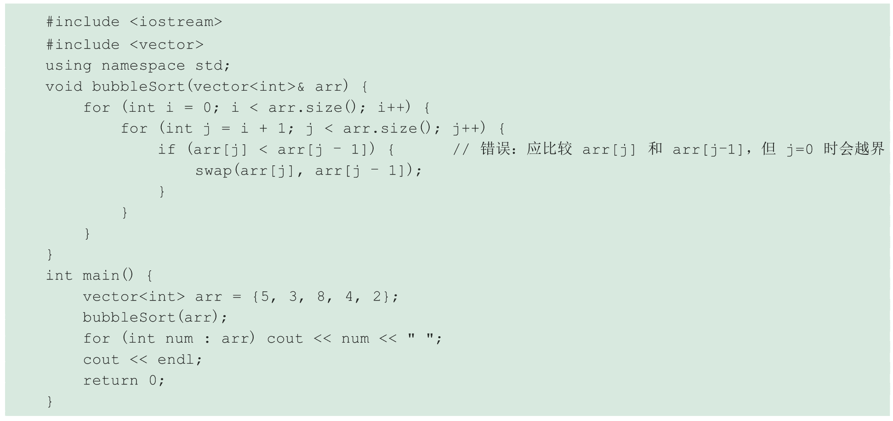
运行结果异常。提示词：“请帮助我调试这个冒泡排序算法，输出结果不正确。”
豆包解析后指出：【AI 平台输出内容具有随机性】
（1）错误点：j=i+1导致数组越界。
（2）正确做法：内层循环应从j=0起步，非j=i+1。
（3）优化点：减少不必要比较。
修正后代码：
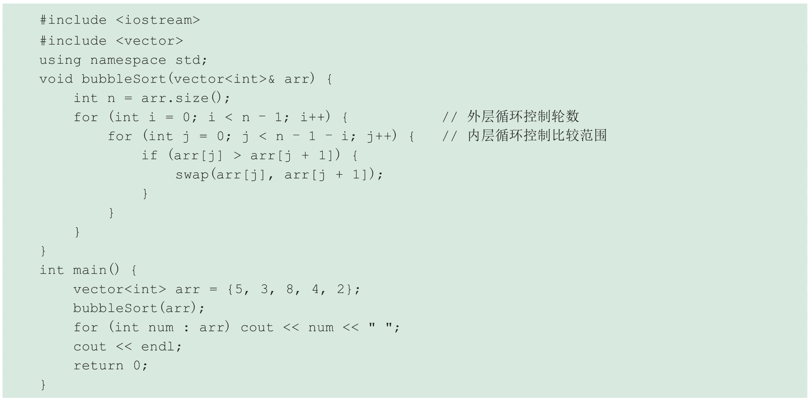

**2. 算法阐释与优化建议**
学习复杂算法时，豆包能通俗讲解原理与应用场景，并对学生代码提出优化建议。
案例：学生使用如下代码实现二分查找：
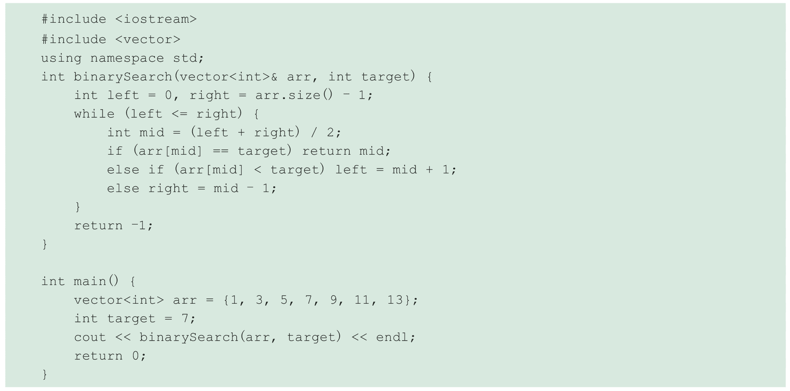
提问：“请优化这个二分查找算法，如何提升运行效率？”
助手建议：二分查找时间复杂度已为 O(log n)，难以进一步降低。可通过避免每次计算(left+right)/2减少开销，并建议使用mid=left+(right-left)/2防止溢出。
学生由此掌握细节优化思路。

**3. 题目生成与解析**
练习是备考关键。豆包可按水平与目标自动生成练习题，并对难题提供详细思路。
例如学习动态规划时输入：“我正在学习动态规划，想做些练习题。”
助手生成题目：“给定整数数组nums，求最长递增子序列长度，时间复杂度要求O(n log n)。” 
随后给出解析：
（1）子问题定义：dp[i]表示以nums[i]结尾的最长递增子序列长度。
（2）状态转移：对每个nums[i]，检查前置nums[j]，若nums[j]<nums[i]则dp[i]=max(dp[i],dp[j]+1)。
（3）答案：max(dp)。
学生由此学会拆解题目。

**4. 知识点讲解与个性化辅导**
信息学竞赛知识点广且深。豆包可按学习进度与薄弱环节提供定制讲解。
例如学习图论 DFS 时提问：“请帮我理解深度优先搜索，能否举例？”
助手先解释概念：“DFS从起点出发沿边访问未访问顶点至尽头再回溯，是遍历树的经典方法。”随后给出示例代码并逐行讲解：
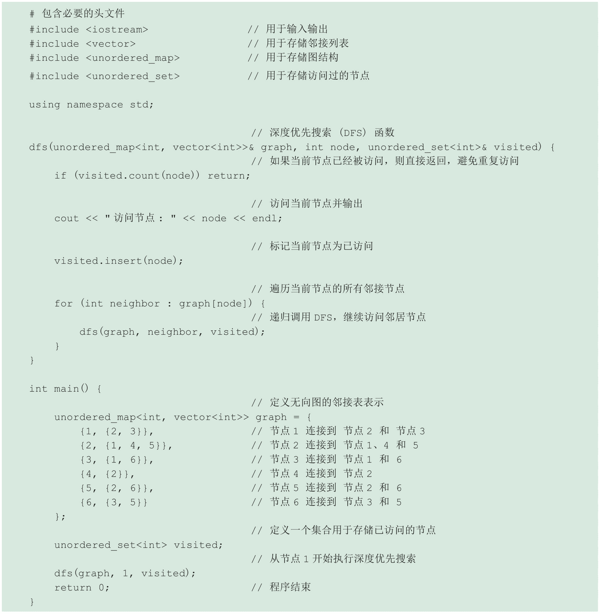
通过逐步解析帮助学生理解遍历过程与访问标记的意义，并可根据反馈调整讲解深度。

## 1.3 利用智能工具构建个性化复习方案
信息学竞赛备考因人而异，个性化复习计划是高效学习的核心。

**1. 评估自身水平**
先明确当前掌握程度。豆包可生成测评题并初步分析。
生成自测题提示词：
“请基于 CSP-J/S 考纲，为【初学者/有基础】的【年级/水平】生成一份自测题，涵盖编程基础、数据结构、算法基础并附答案。”
完成后记录正确率与耗时，再用提示词请助手解析错题：
“请分析这道信奥题的错误原因：【粘贴代码或思路】，并给出正确解法与优化建议。”

**2. 制定学习计划**
合理计划应包含学习目标、时间安排、学习内容与阶段性测试。
制订计划提示词：
“请按以下信息制定 CSP 备考计划：目标【如一个月掌握基础数据结构】，当前水平【如 C++语法基础，算法不熟练】，每日可学时间【如2小时】。请给出每日任务、重点知识点、刷题安排与复习方式。”
助手通常给出每日任务、重点复习点、题型安排及周总结建议，可据此个性化调整。

**3. 动态调整计划**
遇到进度滞后或新盲点时，可让助手重新规划。
提示词示例：
“我在【某知识点】困难，进度慢，请帮我调整计划。”
“我已掌握【某知识点】，请减少该部分时间，增加【新知识点】投入。”
助手会据反馈生成更适配的方案。

**4. 高效借助智能学习**
制定计划后可通过智能答疑、代码优化、模拟考试、错题本管理等方式提升效率。

## 1.4 借助豆包提升学习成效
备考效率决定提升速度。合理使用智能工具可加速掌握知识点、强化编程能力、解决疑难。

**1. 程序排错与优化**
编程能力是核心，调试常为瓶颈。借助豆包可高效定位错误与优化代码。
1）发现程序错误
编写时常出现编译错误、运行错误或逻辑错误。例如下面一段可能出错的 C++ 代码。
#include <iostream>
using namespace std;
int main() {
int n;
cout << "请输入一个整数: ";
cin >> n;

for (int i = 1; i <= n; i++); { // 这里的分号是错误的

cout << i << " ";

}

return 0;

}

# for 语句尾随分号引发的空循环

问题根源在于 for 后面多写了一个分号，编译器因此把分号前的内容视为完整语句，循环体变成空操作，后续的大括号里的输出被当作普通代码只跑了一遍。

借助豆包 AI 迅速揪出错因
可以这样提问：
“麻烦帮我审视下面这段 C++ 片段，指出语法问题并给出改正思路。”
把有误的代码贴上去即可。

豆包会给出定位和示范修正，例如：

for (int i = 1; i <= n; i++) { // 正确的写法

cout << i << " ";

}

借助这类工具，一个细小分号引发的浪费就能立刻被发现，同时还能理解错误原理，形成更稳健的编码习惯。

2）代码优化
程序快慢很大程度上取决于优化手段，输入规模增大时复杂度影响尤其突出。

示例：未经改进的素数筛实现，学员写法如下：
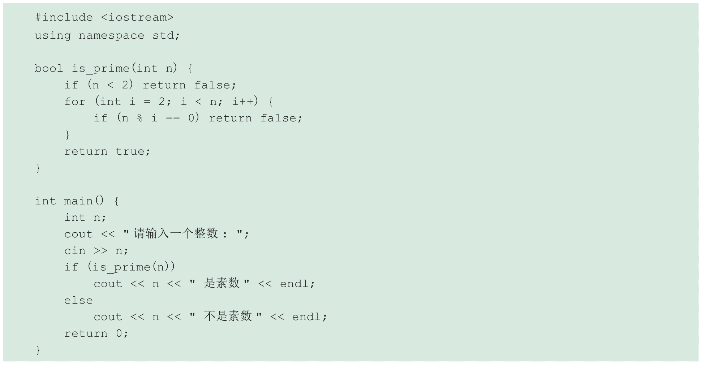

简评：该实现近似 O(n)，n 达到 10⁶ 时明显卡顿。

让豆包参与改写
可用提问：
“能不能把下面这段 C++ 的素数判断部分改得更快？”
附上代码
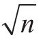

豆包可能给出降阶方案，把复杂度提升到 O() 级别的实现：
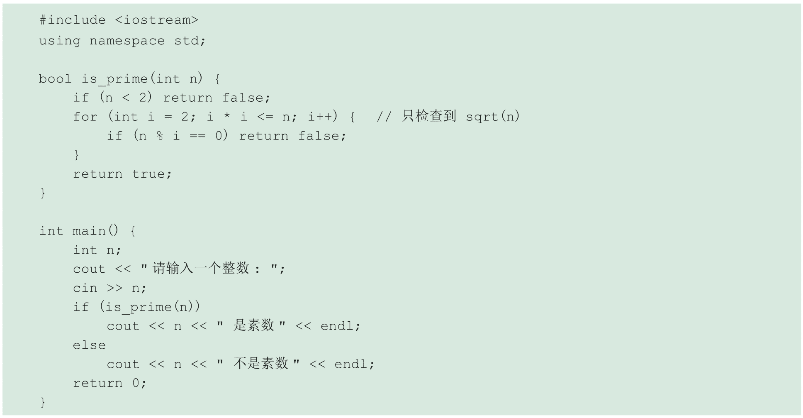

2. 算法学习与题目解析
信奥赛的核心在于算法，AI 能把复杂思路拆解清楚。

对于二分查找、动态规划、最短路径等较难主题，可提问：
“请用通俗语言解释二分查找，并给出 C++ 示例。”

返回结构可能为：
二分查找算法解析
（1）二分查找是在有序数组里定位目标值的方法。
（2）每次把查找区间减半，时间复杂度为 O(log n)。
（3）C++ 实现：
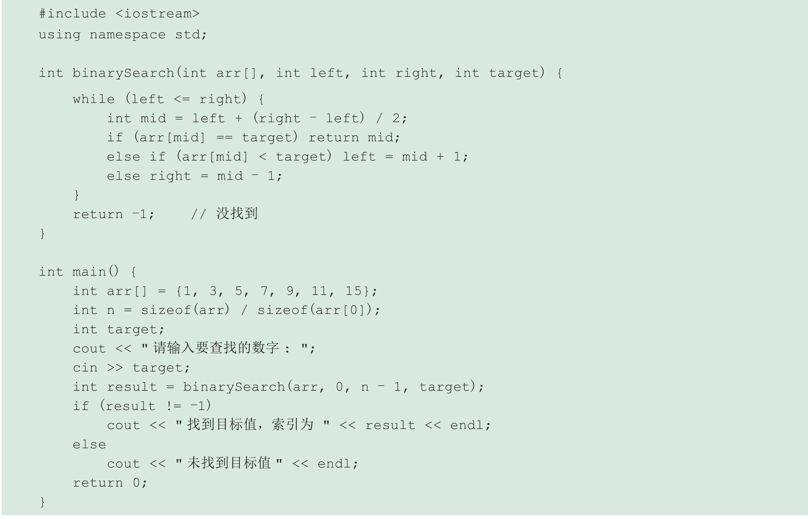

通过 AI，学员能快速抓住思想，结合代码加深记忆，不同深度的讲解也能匹配各阶段需求。

3. 数据结构学习
数据结构是信奥的重要基石，掌握好能显著提升解题效率。豆包可帮助理解概念、应用场景，并给出代码示例和练习。本节聚焦数组、链表、栈与队列、树和图。

1）让 AI 讲解概念
遇到较复杂结构可直接提问。例如：
“请用通俗方式介绍链表，并附带 C++ 示例。”

可能得到：
链表（Linked List）概念：链表是一种动态结构，每个节点包含数据域和指向后继节点的指针。
优势：对比数组，链表可动态申请内存，插入删除更高效。
劣势：访问指定元素需从头遍历，时间复杂度为 O(n)。
C++ 单链表实现：
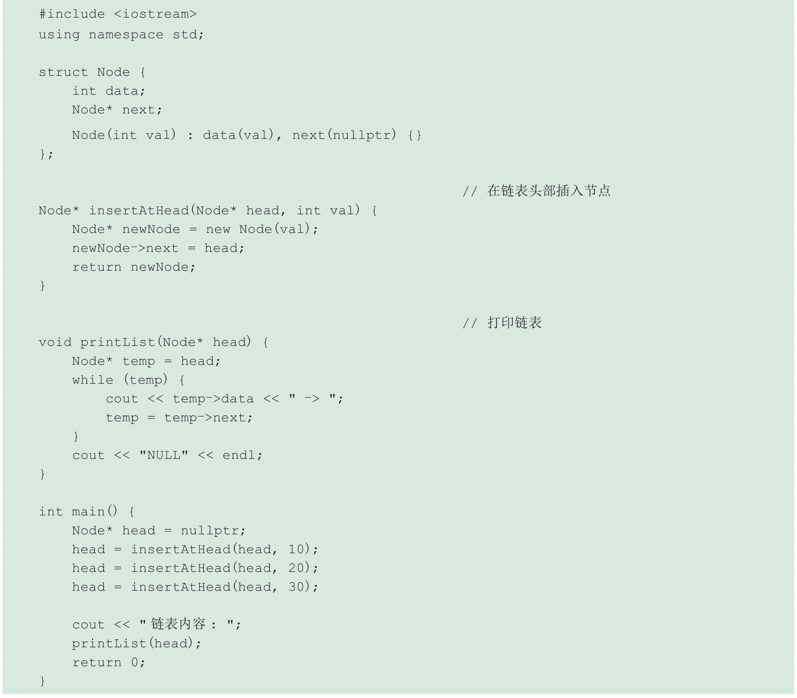

借助 AI 解析，概念更易消化，示例代码也有助于动手实践。

2）让 AI 生成练习题
豆包除讲解外，还能出题巩固。

可输入：
“给我一道关于栈的练习题，并附带解析。”

可能返回：
练习题：用栈判断括号匹配。
题目：给定包含括号'()' '{}' '[]' 的字符串，判断是否匹配。例如：
输入：' "{[()()]}" '，输出：匹配
输入：' "{[(])}" '，输出：不匹配
C++ 解法：
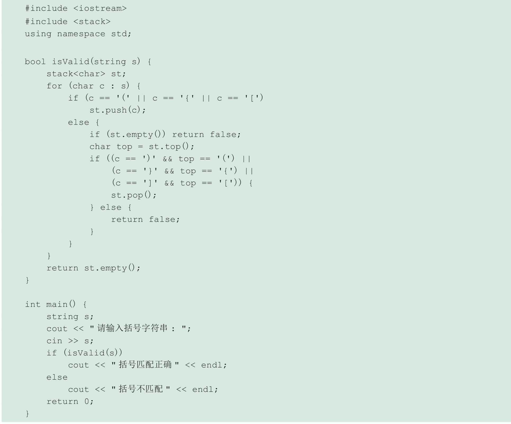

该题考察栈的后进先出特性。AI 可按需求生成不同难度题目以供练习。

# 第二章

# CSP-J 选择题真题分析讲解

## 2.1 2024 年 CSP-J 第一轮选择题

1. 32 位 int 类型的存储范围是（ ）。

A. -2147483647～+2147483647
B. -2147483647～+2147483648
C. -2147483648～+2147483647
D. -2147483648～+2147483648

【考点识别】
2 C++程序设计|2.2 基本数据类型|【1】整数型：int，long long

【分析讲解】
C++ 中 int 在 32 位环境下是基本整型，采用补码：
最小值是 -2³¹，即 -2147483648。
最大值是 2³¹-1，即 2147483647。
最高位作符号位，实际区间为 -2147483648～2147483647。

【参考答案】
C. -2147483648～+2147483647

【编程魔法师讲解考点】
一、什么是 int 类型
int 是 C++ 最常用的整型，长度随平台而定，主流系统多为 32 位即 4 字节。
为何范围如此？因使用补码：
（1）正数表示：符号位为 0，数值位全用，最大为 01111111 11111111 11111111 11111111 = 2³¹-1=2147483647。
（2）负数表示：符号位为 1，补码， minimum 为 10000000 00000000 00000000 00000000 = -2³¹=-2147483648。

二、为何负数多一个
补码下 0 仅占一个编码，故负数比正数多一个。

三、日常使用注意
1. 防溢出
运算结果超出范围如 2147483647+1 会回绕到 -2147483648，建议改用 long long。
2. 选型
范围小可用 short，范围远超 20 亿则用 long long。

【题目总结】
本题考查基础类型与补码，记住 32 位 int 为 -2³¹ 到 2³¹-1，对位运算和负数理解很有帮助。

2. 计算(14[8]-1010[2])×D[16]-1101[2]的结果，下列选项中为计算结果十进制值的是（ ）。

A 13
B 14
C 15
D 16

【考点识别】
1 计算机基础与编程环境|【6】进制的基本概念与进制转换
5 数学|5.1 数及其运算|【2】数的进制：二进制、八进制、十六进制和十进制及其相互转换

【分析讲解】
先统一换成十进制再运算：
14[8]=1×8¹+4×8⁰=12[10]。
1010[2]=1×2³+0×2²+1×2¹+0×2⁰=10[10]。
D[16]=13[10]。
1101[2]=13[10]。
于是 (14[8]-1010[2])×D[16]-1101[2]= (12-10)×13-13 = 13[10]。

【参考答案】
A. 13

【编程魔法师讲解考点】
一、进制简述
十进制：0～9，权值 10^n。
二进制：0、1，权值 2^n。
八进制：0～7，权值 8^n。
十六进制：0～9、A～F，权值 16^n。

二、转换要点
二进制转十进制：按位累加 2^n。
八进制转十进制：按位累加 8^n。
十六进制转十进制：按位累加 16^n，如 D=13。
十进制转其他：反复除取余，余数倒排。如 13 转二进制得 1101。

三、易错点
混用进制要先统一；转换时别漏权值。

【题目总结】
本题检验多进制转换与运算能力，熟练掌握二进制、八进制、十六进制转换对竞赛及底层理解都关键。

3. 某公司有 10 名员工，分为 3 个部门：A 部门有 4 名员工，B 部门有 3 名员工，C 部门有 3 名员工。现需要从这 10 名员工中选出 4 名组成一个工作小组，且每个部门至少要有 1 人，共有选择方式（ ）。

A. 120 种
B. 126 种
C. 132 种
D. 238 种

【考点识别】
5 数学|5.4 组合数学|【1】加法原理、【2】乘法原理、【4】组合及计算公式

【分析讲解】
保证各部门至少一人，人数组合有三种分配：
A 2 人 B 1 人 C 1 人；
A 1 人 B 2 人 C 1 人；
A 1 人 B 1 人 C 2 人。

方案 1：A 部门 2 人，B 部门 1 人，C 部门 1 人。
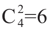
从 A 部门的 4 人中选 2 人：；
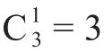
从 B 部门的 3 人中选 1 人：；
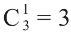
从 C 部门的 3 人中选 1 人：。
总数：6×3×3=54。

方案 2：A 部门 1 人，B 部门 2 人，C 部门 1 人。
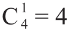
从 A 部门的 4 人中选 1 人：；
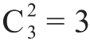
从 B 部门的 3 人中选 2 人：；
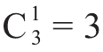
从 C 部门的 3 人中选 1 人：。
总数：4×3×3=36

方案 3：A 部门 1 人，B 部门 1 人，C 部门 2 人。
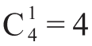
从 A 部门的 4 人中选 1 人：；
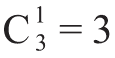
从 B 部门的 3 人中选 1 人：；
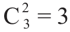
从 C 部门的 3 人中选 2 人：。
总数：4×3×3=36

总计：54+36+36=126。

【参考答案】
B. 126 种

【编程魔法师讲解考点】
一、加法原理
多种互斥方式求总情况数时相加。
例：3 件上衣 2 条裤子，单选上衣或裤子，3+2=5。

二、乘法原理
多步独立完成时相乘。
例：上衣 3 件裤子 2 条，搭配数为 3×2=6。

三、组合公式
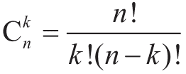
从 n 个中取 k 个为 C(n,k)=n!/[k!(n-k)!]。

【题目总结】
题中先用加法分情况，再用乘法算每种情况，配合组合公式求解。

4. 以下序列中对应数字 0～7 的 4 位二进制格雷码(Gray Code)的是（ ）。

A. 0000, 0001, 0011, 0010, 0110, 0111, 0101, 1000
B. 0000, 0001, 0011, 0010, 0110, 0111, 0100, 0101
C. 0000, 0001, 0011, 0010, 0100, 0101, 0111, 0110
D. 0000, 0001, 0011, 0010, 0110, 0111, 0101, 0100

【考点识别】
5 数学|5.3 初等数论|【3】编码：ASCII 码、哈夫曼编码、格雷码、格雷码生成规则

【分析讲解】
格雷码相邻码仅 1 位不同。
生成规则：1 位起步，每增一位把原序列前半加 0 后半加 1 并倒序。
2 位：00,01,11,10
3 位：000,001,011,010,110,111,101,100
4 位：0000,0001,0011,0010,0110,0111,0101,0100

【参考答案】
D. 0000, 0001, 0011, 0010, 0110, 0111, 0101, 0100

【编程魔法师讲解考点】
一、格雷码特点
相邻码汉明距离为 1，常用在编码器和通信降噪。

二、递归生成
G(1)=[0,1]；后续序列=原序列前半加 0 + 原序列倒序后半加 1。

三、快速计算
G[i]=B[i] XOR B[i+1]，高位保持。
例 1011 → 1110。

【题目总结】
掌握递归生成与异或计算法即可快速判断。

5. 记 1KB 为 1024B（byte，字节），1MB 为 1024KB，那么 1MB 为二进制的（ ）。

A. 1000000bit
B. 1048576bit
C. 8000000bit
D. 8388608bit

【考点识别】
1 计算机基础与编程环境|【6】进制的基本概念与进制转换、字节与字

【分析讲解】
1KB=1024B，1MB=1024×1024B=1048576B。
1B=8bit，故位数=1048576×8=8388608。

【参考答案】
D. 8388608bit

【编程魔法师讲解考点】
一、进制与字节基础知识
字节与位：

# 信奥核心考点精要

**一、位与字节认识**
- 1 字节由 8 位二进制组成。
- 位是信息表示的最小颗粒，只能为 0 或 1。
- 字节是数据保存的基本粒度，1 字节可容下 1 个字符，比如英文字母。

**二、存储容量换算**
- 1KB = 1024B。
- 1MB = 1024KB。
- 1GB = 1024MB。
提示：实际产品常以 1000 简化，竞赛题目要求严格使用 1024。

**三、常见误区**
误区 1：沿用生活中的 1000 进位，竞赛标准是 1024 进位。
误区 2：把位与字节混用，直接以字节数作答。

**【题目总结】**
存储单位换算与进制转换是信奥的常规考点，掌握位、字节含义及 1024 倍关系可避免粗心失分。

6. 以下不属于 C++ 原生类型的是（ ）。
A. int
B. float
C. struct
D. char

**【考点识别】**
2 C++程序设计|2.2 基本数据类型|【1】整数型（int、long long）、【2】实数型（float、double）、【3】字符型（char）、【4】布尔型（bool）

**【分析讲解】**
本问在辨认 C++ 语言内置的基础类型归属。
- 内置类型大致分为整型如 int long short、浮点型如 float double、字符型 char、布尔型 bool。
- struct 是用户自行定义的复合结构，用来打包若干成员，不属于语言内置的基础类型。
- 选项对比，int float char 皆为基础类型，struct 属于复合类型，符合题意。

**【参考答案】**
C. struct

**【编程魔法师讲解考点】**
**一、基础类型概览**
C++ 基础类型用于声明简单变量，主要包括：
1. 整数类型
（1）int 用来表示整数如 1、-5、0。
（2）long、short 用来扩展或压缩整数范围。
2. 浮点类型
（1）float 表示单精度小数。
（2）double 表示双精度小数，精度高于 float。
3. 字符类型
char 用来存放单个字符如 'A'、'9'，本质是整数编码。
4. 布尔类型
bool 只有 true 与 false 两个取值。

**二、复合类型**
复合类型由用户或系统构建，结构更复杂。例如：
（1）struct 结构体：自定义聚合类型，由若干成员组成。
struct Person {
    int age;
    float height;
};
（2）class 类：C++ 面向对象的核心。

**三、易错点**
struct 虽重要，但属于复合类型而非基础类型。基础类型是语言固定的，struct、class 这类是用户自定义的。

**【题目总结】**
掌握 int、float、char 等基础类型是编程入门，同时要能区分 struct 等用户定义类型，竞赛对用词很敏感。

7. 以下不是 C++ 中的循环结构的是（ ）。
A. for
B. while
C. do-while
D. repeat-until

**【考点识别】**
2 C++程序设计|2.3 程序基本语句|【3】for 语句、while 语句、do-while 语句

**【分析讲解】**
判断哪个不属于 C++ 的循环结构。
1. C++ 循环结构
（1）for 循环：适合执行固定次数，初始化、判断、步进写在一处。
for (int i = 0; i < 10; i++) {
    // 执行代码
}
（2）while 循环：先判断条件再执行。
while (condition) {
    // 执行代码
}
（3）do-while 循环：先执行一次再判断。
do {
    // 执行代码
} while (condition);
2. repeat-until
repeat-until 是 Pascal 等语言的写法，C++ 里没有此语法。

**【参考答案】**
D. repeat-until

**【编程魔法师讲解考点】**
**一、C++ 循环语句全貌**
（1）for 循环：计数循环典型。
for (初始化; 条件; 增减) {
  // 循环体
}
示例：
for (int i = 0; i < 5; i++) {
    cout << i << " ";
}
输出：0 1 2 3 4

（2）while 循环：条件在前。
while (条件) {
    // 循环体
}
示例：
int i = 0;
while (i < 3) {
    cout << i << " ";
    i++;
}
输出：0 1 2

（3）do-while 循环：至少执行一次。
do {
    // 循环体
} while (条件);
示例：
int i = 0;
do {
    cout << i << " ";
    i++;
} while (i < 2);
输出：0 1

**二、易错点**
do-while 在 C++ 中存在，写法用 while 结尾；repeat-until 功能相近但不属于 C++。

**【题目总结】**
三种循环各有场景，区分 C++ 自带语法与其他语言语法是竞赛常见陷阱。

8. 下列中与 C/C++ 中 (char)('a'+13) 的值相等的是（ ）。
A. m
B. n
C. z
D. 3

**【考点识别】**
2 C++程序设计|2.2 基本数据类型|【3】字符型（char）

**【分析讲解】**
考察 char 与 ASCII 编码的运算。
- 字符本质是整数：'a' 对应 97，'b' 98，'n' 110。
- 计算过程：'a' 为 97，97+13=110，强制转 char 后得到 ASCII 110 对应的字符 'n'。

**【参考答案】**
B. n

**【编程魔法师讲解考点】**
**一、字符类型 char**
char 用于存单个字符，底层是 ASCII 编码。'a'=97，'A'=65，'0'=48。

**二、字符参与运算**
字符在表达式中自动转为 ASCII 值运算，结果为整数，若要再变回字符需显式强制转换。
char c1 = 'a'; // 97
char c2 = c1 + 1; // 97 + 1 = 98，对应字符为 'b'
char c3 = (char)(c1 + 5); // 97 + 5 = 102，对应字符为 'f'

**【题目总结】**
字符与 ASCII 的对应关系是处理编码题的关键，掌握强制类型转换即可快速解题。

9. 假设有序表中有 1000 个元素，则用二分法查找元素 x 最多需要比较次数是（ ）。
A. 25
B. 10
C. 7
D. 1

**【考点识别】**
4 算法|4.3 基础算法|【4】二分法

**【分析讲解】**
对半查找每次把查找区间缩小一半直至命中或为空。
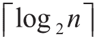 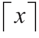
对半查找的最大比较次数公式：最大比较次数= ，其中 n 为元素个数。结果向上取整。
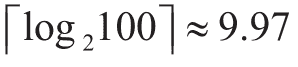
当 n=1000 时，向上取整结果为 10，故最多比较 10 次。

**【参考答案】**
B. 10

**【编程魔法师讲解考点】**
**一、对半查找基本思想**
（1）对半查找是在有序数组中快速定位元素的方法；
（2）每次比较时，将目标与当前区间中点比较，根据结果选择区间的一半，直至找到目标或区间为空。

**二、对半查找时间复杂度**
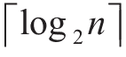
（1）每次比较后，搜索区间减半，假设初始区间大小为 n，则最多需要进行 次比较。
（2）时间复杂度为 O(log n)，适用于大规模数据的快速查找。

**三、易错点**
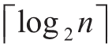
（1）最大比较次数需向上取整。
（2）有时会把区间缩小次数误认为比较次数。

**【题目总结】**
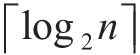
对半查找是一种对数级时间复杂度的典型算法，理解其公式对竞赛有重要意义。掌握思想、复杂度，以及与顺序查找的对比可在类似问题中快速判断。

10. 下列中不是操作系统名称的是（ ）。
A. Notepad
B. Linux
C. Windows
D. macOS

**【考点识别】**
1 计算机基础与编程环境|1.2 Windows、Linux 等操作系统的基本概念及其常见操作

**【分析讲解】**
辨析操作系统与应用软件。
1. 操作系统定义
（1）操作系统是计算机系统的核心软件，用于管理硬件和软件资源，并为用户提供界面和服务。
（2）常见系统包括 Windows、Linux、macOS 等。
2. 选项
A. Notepad：Windows 中的文本编辑器，不是操作系统。
B. Linux：开源的操作系统，是 UNIX 的一个分支。
C. Windows：微软公司开发的广泛使用的操作系统。
D. macOS：苹果公司开发的操作系统，专用于苹果计算机。

**【参考答案】**
A. Notepad

**【编程魔法师讲解考点】**
**一、什么是操作系统**
操作系统是计算机系统中最重要的软件，用于管理硬件资源和提供基础服务。主要功能有：
（1）资源管理：如 CPU、内存、磁盘、I/O 设备等。
（2）任务管理：负责任务调度、多任务处理。
（3）用户交互：提供图形界面或命令行接口。

**二、常见操作系统名称**
（1）Windows：微软公司开发的操作系统，版本包括 Windows XP、7、10、11 等。
（2）Linux：开源的 UNIX 类操作系统，具有多个发行版，如 Ubuntu、CentOS、Debian。
（3）macOS：苹果公司开发的操作系统，专用于苹果设备。
（4）其他：经典多用户多任务系统 UNIX；基于 Linux 内核，广泛应用于移动设备的 Android。

**三、区分操作系统和应用软件**
（1）操作系统是管理硬件和软件资源的平台，如 Windows、Linux、macOS。
（2）应用软件是安装在操作系统之上的程序，提供具体功能，如 Notepad、Microsoft Word、Photoshop。

**【题目总结】**
掌握操作系统的基本定义和常见名称是信奥赛的基础知识。

11. 在无向图中，所有顶点的度数之和等于（ ）。
A. 图的边数
B. 图的边数的 2 倍
C. 图的顶点数
D. 图的顶点数的 2 倍

**【考点识别】**
3 图论|3.1 图的基本概念|【2】图的度数与边数的关系

**【分析讲解】**
在无向图中，度数表示一个顶点连接的边数。
1. 关键公式
所有顶点度数之和 = 边数的 2 倍。
因为每条边连接两个顶点，会被两个顶点各计一次，因此总度数是边数的 2 倍。
2. 证明
设无向图 G 有 n 个顶点和 m 条边，每条边增加两个顶点的度数，因此所有顶点度数之和为 2m。

**【参考答案】**
B. 图的边数的 2 倍

**【编程魔法师讲解考点】**
**一、图的基本定义**
（1）无向图是由顶点和无方向边组成的图，每条边连接两个顶点。
（2）顶点的度数是与该顶点直接相连的边的数量。

**二、度数与边数的关系**
（1）核心公式：在无向图中，所有顶点度数之和等于边数的 2 倍：总度数 = 2×边数。
（2）原因：每条边连接两个顶点，分别增加这两个顶点的度数各 1，因此每条边被计算两次。

**三、易错点**
（1）误解为顶点数：顶点的度数与顶点总数无直接关系。
（2）忽略 2 倍关系：边数需乘以 2 才等于总度数。

**【题目总结】**
掌握无向图中顶点度数与边数的关系是图论的基础，务必记住：所有顶点度数之和 = 2×边数。

12. 已知二叉树的前序遍历为 [A, B, D, E, C, F, G]，中序遍历为 [D, B, E, A, F, C, G]，该二叉树的后序遍历结果是（ ）。
A. [D, E, B, F, G, C, A] 
B. [D, E, B, F, G, A, C] 
C. [D, B, E, F, G, C, A] 
D. [D, B, E, F, G, A, C]

**【考点识别】**
3 图论|3.4 树|【3】二叉树的遍历（前序、中序、后序遍历）

**【分析讲解】**
本题涉及二叉树的前序、中序和后序遍历关系。根据前序和中序遍历可重建二叉树，再求后序遍历。
1. 三种遍历
前序：根→左→右；
中序：左→根→右；
后序：左→右→根。
2. 构造过程
（1）前序首个节点为根 A。
（2）在中序中找到 A，左侧为左子树 [D, B, E]，右侧为右子树 [F, C, G]。
（3）从前序提取左、右子树节点：
左子树前序 [B, D, E]；右子树前序 [C, F, G]。
（4）递归构造子树。
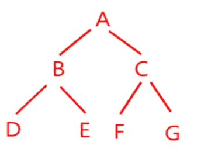
左子树：
前序为 [B,D,E]；
中序为 [D,B,E]。
根为 B，左为 D，右为 E。
右子树：
前序为 [C,F,G]；
中序为 [F,C,G]。
根为 C，左为 F，右为 G。
3. 后序结果
整棵树的后序为 [D, E, B, F, G, C, A]。

**【参考答案】**
A. [D, E, B, F, G, C, A]

**【编程魔法师讲解考点】**
**一、二叉树的三种遍历方式**
（1）前序：根→左→右。常用于表达树结构，根在最前。
（2）中序：左→根→右。可用来确定子树边界。
（3）后序：左→右→根。常用于构造树的后序表达。

**二、根据前序和中序重建二叉树**
（1）确定根：前序第一个元素为根。
（2）划分左右：在中序中找到根位置，左侧为左子树，右侧为右子树。
（3）递归处理：按划分的子树区域，对前序和中序递归处理，直至完成。

**三、易错点**
（1）中序和前序的子树划分顺序：中序遍历是分割左右子树的关键。
（2）后序顺序规则：必须严格按“左→右→根”，容易混淆。

**【题目总结】**
本题通过结合前序和中序遍历推导出后序遍历，考查遍历规则和递归理解。

13. 给定一个空栈，支持入栈和出栈操作。若入栈操作的元素依次是 1 2 3 4 5 6，其中 1 最先入栈，6 最后入栈，下列中出栈顺序为不可能的是（ ）。
A. 6 5 4 3 2 1
B. 1 6 5 4 3 2
C. 2 4 6 5 3 1
D. 1 3 5 2 4 6

**【考点识别】**
数据结构|3.1 线性表|【2】栈

**【分析讲解】**
栈遵循后进先出原则。对于空栈，元素按 1、2、3、4、5、6 的顺序进入，操作过程需遵循以下规则：

栈序列能否成立

压入顺序固定为 1 到 6。弹出只能取栈顶，无法越级。

A. 6 5 4 3 2 1：完全符合后进先出，从顶依次取出，合法。
B. 1 6 5 4 3 2：1 先弹出后，栈内剩余 2 3 4 5 6。按栈规，6 在 5 下方，5 未出前 6 不可能现身，不可行。
C. 2 4 6 5 3 1：先让 2 弹出，再配合压入节奏把其余元素按此顺序推出，可以实现，合法。
D. 1 3 5 2 4 6：1 出掉后栈顶为 2，想让 3 出来必须先清掉 2，该顺序无法达成。

最终答案
B. 1 6 5 4 3 2

知识拆解

一、栈的定义与常用操作
栈是 FILO 结构，核心操作有：
1. Push：把元素放到栈顶。
2. Pop：取出栈顶元素。
3. Top：查看栈顶不取出。

二、栈的使用规律
1. 后进先出：后进的元素先离开，先进的元素要等后面的都走完。
2. 访问受限：只能操作栈顶，栈底和中间不可直达。

三、合法序列举例
假设入栈 1、2、3、4、5。
1. 合法如 5、4、3、2、1，完全按后进先出；再如 1、2、3、5、4，可在 1、2、3 入栈后先把 5、4 推出。
2. 非法如 1、3、2、4、5，1 出后栈顶是 2，3 要等 2 先走才可能出现，不可实现。

要点归纳
本题考察栈的基础操作与后进先出特性。做法就是模拟入栈出栈，看目标序列能否在受限访问下产生。

女生必须连排的排列数

A. 4320 种
B. 5040 种
C. 3600 种
D. 2880 种

涉及知识点
5 数学|5.4 组合数学|【3】排列及计算公式

思路解析
把必须相邻的 3 个女生打包成一个大块，和 5 个男生一起看作 6 个整体。
6 个整体的全排列为 6! = 720。
女生块内部还能自行排列，3! = 6。
总方案 = 6! × 3! = 720 × 6 = 4320。

最终答案
A. 4320 种

知识拆解

一、排列基础
1. 含义：从 n 个元素中取 r 个排序，顺序不同算不同。
2. 公式：P(n, r)=n×(n-1)×…×(n-r+1)，
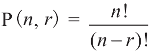
简化为。

二、带限制的排列
1. 相邻问题：把必须在一起的元素先看成整体排，之后再算内部排法。
2. 不相邻问题：常用间隔法或排除法分步计算。

要点归纳
解决排列题的关键是把条件转化为基本排列模型，分步套用公式。

编译器的核心任务是什么

A. 直接执行源代码
B. 将源代码转换为机器代码
C. 进行代码调试
D. 管理程序运行时的内存

涉及知识点
1 计算机基础与编程环境|【7】程序设计语言以及程序编译和运行的基本概念

思路解析
1. 编译器的职责
编译器把高级语言写的源码翻译成机器可执行的代码，主要包括：
1. 语法检查：验证源码是否符合语言规范。
2. 代码转换：把源码译成机器码或中间码。
3. 代码优化：提升目标代码效率。
4. 生成可执行文件：输出二进制程序供运行。

2. 选项判断
A. 直接执行源码：错，这是解释器的工作。
B. 将源码转为机器代码：对，是核心功能。
C. 进行代码调试：错，由调试器完成。
D. 管理运行时内存：错，由操作系统和运行时环境负责。

最终答案
B. 将源代码转换为机器代码

知识拆解

一、编译器基本概念
编译器是把高级语言源码翻译成机器语言的关键工具。
1. 核心作用
1. 翻译：把 C++、Java 等转为目标码。
2. 语法检查：校验语法规则。
3. 优化：提升运行效率。
4. 生成可执行文件：输出 .exe 等二进制程序。
2. 编译器与解释器的差异
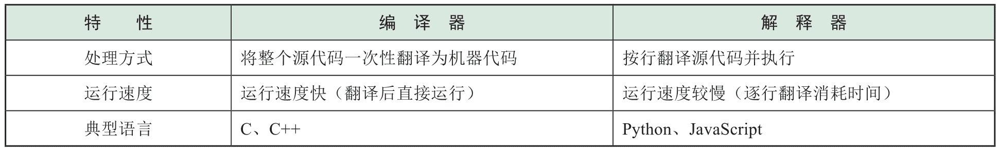
3. 编译流程
1. 词法分析：拆分为关键字、标识符、运算符等。
2. 语法分析：检查结构合规性。
3. 语义分析：验证逻辑，如变量是否已声明。
4. 代码生成：产生目标代码。
5. 优化代码：去除冗余运算。

要点归纳
本题强化编译器的作用及与解释器的区别，理解编译流程有助于把握从源码到执行的全过程。

2.2 2023 年 CSP-J 第一轮选择题

C++ 中不可修改的声明关键字

A. unsigned
B. const
C. static
D. mutable

涉及知识点
2 C++程序设计|2.1 程序基本概念|【1】标识符、关键字、常量、变量、表达式的概念、【2】常量与变量的命名、定义及作用

思路解析
A. unsigned：类型修饰，表示无符号，与可改性无关。
B. const：声明常量，初始化后不可再改。如 const int x = 10; x = 20 为非法。
C. static：存储类别修饰，改变生命周期，与可改性无关。
D. mutable：允许在 const 对象中修改特定成员，与题意相反。

最终答案
B. const

知识拆解

一、const 的含义
const 用来声明不可变数据，初始化后禁止修改，提供保护。

二、const 基本语法
1. 声明常量
const int a = 10;
a = 20; // 错误
2. 指针与 const
const int *p; // 指向常量的指针
int *const p; // 常量指针
const int *const p; // 指向常量的常量指针

三、const 常用场景
1. 函数参数：const int x 防止函数内改动。
2. 常量成员函数：const 成员函数不能修改类成员，除 mutable 外。

要点归纳
本题考察关键字功能，const 在程序安全与逻辑正确性上作用关键。

八进制加法结果

A. (22222221)[8]
B. (21111111)[8]
C. (22111111)[8]
D. (22222211)[8]

涉及知识点
5 数学|5.1 数及其运算|【2】数的进制：二进制、八进制、十六进制和十进制及其相互转换

思路解析
第一步：对齐两个八进制数，补零使位数一致：
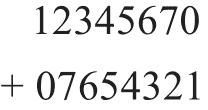
第二步：从右到左逐位相加，逢 8 进 1：
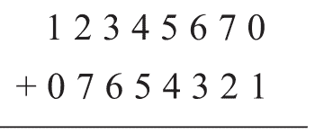
逐位结果：
最右位 0+1=1
次右位 7+2=9 写 1 进 1
7+3=9+进1=10 写 2 进 1
5+4=9+进1=10 写 2 进 1
4+5=9+进1=10 写 2 进 1
3+6=9+进1=10 写 2 进 1
2+7=9+进1=10 写 2 进 1
1+0=1+进1=2

第三步：写出最终结果：
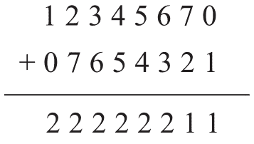
和为 (22222211)[8]。

最终答案
D. (22222211)[8]

知识拆解

一、什么是进制
进制由基数决定数值表示方法。
二进制 基 2：0、1
八进制 基 8：0~7
十进制 基 10：0~9
十六进制 基 16：0~9、A~F

二、进制转换方法
1. 其它进制转十进制
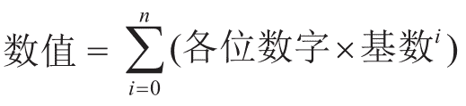
如八进制 123[8]=1×8²+2×8¹+3×8⁰=83
2. 十进制转其它进制
除基取余法，反序写余数。如 83 转八进制得 123[8]

三、运算技巧
不同进制相加建议先转十进制再转回目标进制。

要点归纳
本题考进制转换与八进制加法，是信奥基础训练的重要内容。

union 成员的正确写法

union Data {
    int num;
    float value;
    char symbol;
};

union Data data;

A. data.value=3.14;
B. value.data=3.14;
C. data->value=3.14;
D. value->data=3.14;

涉及知识点
2 C++程序设计|2.10 结构体类型|【1】结构体的定义及应用
2 C++程序设计|2.11 指针类型|【1】指针的概念及调用
2 C++程序设计|2.13 STL 模板应用|【2】联合体（union）的基本使用及限制

思路解析
union 各成员共用同一块内存，同一时间只有一个有效。
访问普通变量用点运算符。
A. data.value=3.14; 正确，data 为联合体变量，点访问合法。
B. value.data=3.14; 错误，value 是成员名。
C. data->value=3.14; 错误，-> 需指针，data 非指针。
D. value->data=3.14; 错误，语法不符合规范。

最终答案
A. data.value=3.14;

知识拆解

一、联合体基本使用
1. 什么是联合体
所有成员共享一段内存，同一时间只能保存一个值，节省内存但需谨慎。
2. 主要特点
1. 共享内存：大小等于最大成员。如 union Example {int a; float b; char c[10];}; 大小为 10。
2. 成员访问：普通变量用 .，指针用 ->。
3. 声明与初始化
union Example {int x; float y;};
union Example example;
example.x = 42;
example.y = 3.14f; // 改写 y 会覆盖 x
4. 局限性
同时访问多个成员可能导致未定义行为，使用时需明确用途。

示例代码：
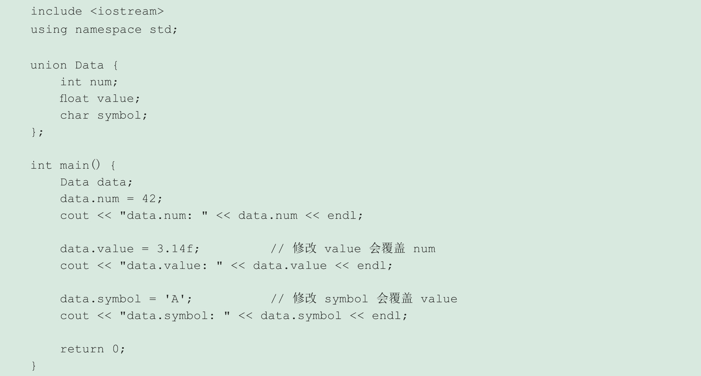
使用联合体时避免频繁在不同成员间切换，多种数据同时使用推荐 struct。

要点归纳
本题考察联合体成员的正确访问方式及点运算符使用。

链表头插操作

struct Node {
    int data;
    Node* next;
};

现在有一个指向链表头部的指针 Node *head。如果想要在链表中插入一个新节点，其成员 data 的值为 42，并使新节点成为链表的第一个节点。下列操作中正确的是

A.
Node* newNode = new Node;
newNode->data = 42;
newNode->next = head;
head = newNode;

B.
Node* newNode = new Node;
head->data = 42;
newNode->next = head;

# 单链表头插法四选一

代码片段如下：

head = newNode;

C.

Node* newNode = new Node;

newNode->data = 42;

head->next = newNode;

D.

Node* newNode = new Node;

newNode->data = 42;

newNode->next = head;

**关联知识点**

指针类型使用|基于指针的数组访问|字符指针|指向结构体的指针

线性表|单链表、双向链表、循环链表

**思路拆解**

题目要做的事是让一个新结点成为单链表的第一个结点。下面逐条看。

方案 A：

Node* newNode = new Node;

newNode->data = 42;

newNode->next = head;

head = newNode;

解读：为 newNode 分配空间，写入 42，把它的 next 接上原头，随后把 head 挪到 newNode。完整实现了头插，逻辑成立。

判定：正确

方案 B：

Node* newNode = new Node;

head->data = 42;

newNode->next = head;

head = newNode;

解读：直接把原头的数据改掉，原有信息被破坏。newNode 自己的 data 并未赋值。指针移动看似对，整体却混乱。

判定：错误

方案 C：

Node* newNode = new Node;

newNode->data = 42;

head->next = newNode;

解读：新结点创建并赋值完成，却把新结点挂在原头之后，并非置顶。

判定：错误

方案 D：

Node* newNode = new Node;

newNode->data = 42;

newNode->next = head;

解读：新结点的数据和指向都准备好了，但 head 没有更新，入口仍指向旧头，新结点被孤立。

判定：错误

**正确答案**

A.

Node* newNode = new Node;

newNode->data = 42;

newNode->next = head;

head = newNode;

**进阶视角**

链表由结点串成，每结点含数据域 data 与指针域 next。示意 [Node1|next] -> [Node2|next] -> [Node3|null]，head 是入口。

头插通用顺序：开辟内存 -> 填数据 -> 让新结点的 next 指向当前 head -> 把 head 改为新结点。

Node* newNode = new Node;
newNode->data = 42;
newNode->next = head;
head = newNode;

指针是粘合剂，常见失误：head 没更新导致新结点游离；改动旧结点数据破坏结构；忘记 new 分配。

**一句话记住**

头插要先连后挪，顺序不能反，指针更新是关键。

5. 根结点高度为 1，一棵含有 2023 个结点的三叉树高度至少为（  ）。

A. 6
B. 7
C. 8
D. 9

**关联知识点**

简单树|树的定义及其相关概念|二叉树的定义及其基本性质

特殊树|完全二叉树的定义与基本性质

**思路拆解**

三叉树每个结点最多三个孩子。高度为 h 的满三叉树最多结点数是
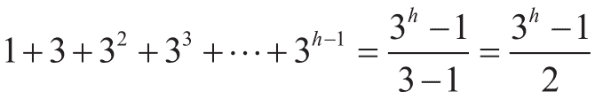
。

要求最小 h 使得总结点数 N≥2023。
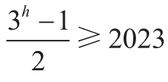
解不等式 3^h ≥ 4047。

h=7 时 3⁷=2187 不够，h=8 时 3⁸=6561 已满足。

**正确答案**

C. 8

**进阶视角**

高度从根到最远叶子计结点数，单根树高度为 1。

三叉树满形态下结点总数公式为
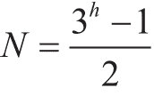
。

已知 N 求最小 h，可用
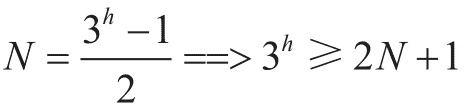
逐级试算。

**一句话记住**

根高度从 1 算起，注意几何倍增，别把高度当 0 起算。

6. 小明某天有 7 个空闲时段，想挑出至少一个来练歌，要求任意两次练习中间至少隔两个时段休息，可选方案共（ ）。

A. 31 种
B. 18 种
C. 21 种
D. 33 种

**关联知识点**

数学|组合数学|加法原理、乘法原理

**思路拆解**

限制：至少选一个，相邻两次练习间隔 ≥2。

按选取数量分类：

选 1 个：7 种。

选 2 个：可行配对 (1,4)(1,5)(1,6)(1,7)(2,5)(2,6)(2,7)(3,6)(3,7)(4,7)，共 10 种。

选 3 个：唯一 (1,4,7)。

选 4 个及以上不可行。

总数 7+10+1=18。

**正确答案**

B. 18 种

**进阶视角**

加法原理用于互斥情形求和，乘法原理用于分步计数。

解题可用枚举+分类，最后汇总。

**一句话记住**

先读间隔限制，再按数量分类枚举，最后相加。

7. 下列关于高精度运算的说法，错误的是（ ）。

A. 高精度主要处理大整数或需保留多位小数的运算
B. 大整数除小整数可逐位对齐试商，减法迭代累加商
C. 高精度乘法时间只与两个整数中较长者的位数有关
D. 高精度加法核心是逐位相加并处理进位

**关联知识点**

算法|数值处理算法|高精度加法、减法、乘法、高精度整数除单精度商余

**思路拆解**

A 正确，高精度突破内置类型范围。

B 正确，竖式除法的实现方式。

C 错误，乘法复杂度约 O(n×m)，与两数位数都相关。

D 正确，加法靠逐位相加进位。

**正确答案**

C. 高精度乘法的运算时间只与参与运算的两个整数中长度较长者的位数有关

**进阶视角**

高精度本质是模拟手算。用数组存每位，逐位处理进借位。乘法最耗时，除法依赖试商与减法。

**一句话记住**

加减先练进借位，乘法注意双重循环。

8. 数 101010[2] 和 166[8] 的和为（ ）。

A. 10110000[2]
B. 236[8]
C. 158[10]
D. A0[16]

**关联知识点**

进制间的转换与表示|各种进制间转换

十进制与二进制|十进制与八进制|二进制与八进制|十六进制表示与转换

**思路拆解**

101010₂=42₁₀，166₈=118₁₀。

和为 160₁₀。

160₁₀=10100000₂=240₈=A0₁₆。

选项中符合 D。

**正确答案**

D. A0[16]

**进阶视角**

转十进制为中介，二进制转十进制按权展开，十进制转目标进制用除基取余。二进制与八、十六可按 3 位、4 位分组加速。

**一句话记住**

权展开+除余法是进制转换的通用套路。

9. 后缀表达式 6 2 3 +- 3 8 2 / + * 2 ^ 3 + 对应的中缀表达式是（ ）。

A. ((6-(2+3))*((3+8/2))²)+3
B. 6-2+3*3+8/2²+3
C. (6-(2+3))*((3+8/2)²)+3
D. 6-((2+3)*(3+8/2))²+3

**关联知识点**

数据结构|栈|表达式后缀表示法|后缀与中缀互转|用栈求值

**思路拆解**

从左到右扫描，数字入栈，运算符弹出操作数计算后入栈。

6,2,3 -> 2+3 -> 6-(2+3)；3,8,2 -> 8/2 -> 3+(8/2)；两者相乘，再与 2 做幂，最后加 3。

得到 ((6-(2+3))*(3+8/2)²)+3。

**正确答案**

A. ((6-(2+3))*((3+8/2))²)+3

**进阶视角**

逆波兰式省去括号，适合栈求值。遇到数字压栈，遇到运算符出栈运算再压栈。

**一句话记住**

后缀求值靠栈，运算符后置省括号。

后缀表达式的栈式求值与转换技巧

用栈来计算后缀式是一种经典做法，具体流程可以概括为三步：

先准备一个空的栈结构。随后开始逐个读取表达式中的元素，遇到数字就直接压入栈内；碰到运算符时，就把栈顶的两个数弹出，用该运算符进行运算，得到的结果再推回栈中。等整个式子全部扫描完毕，栈顶残留的那一个数就是最终的计算值。

从中缀的角度看，后缀式其实就是把每一次运算用括号套起来得到的嵌套形式。比如 6 2 3 + 对应的中缀写法是 (6(2+3))，括号层层包裹就反映了运算的先后。

三、后缀转中缀的思路

把后缀变回中缀，关键在于运算优先级和括号的处理：

自左向右遍历后缀串。遇到操作数就入栈放好。碰到运算符时，把栈顶先后弹出的两个表达式取出，用一对括号把它们和运算符组合成新的表达式，再把这个新表达式压回栈。遍历结束时，栈里剩下的唯一元素就是完整的中缀形式。

举例说明：
后缀表达式：6 2 3 - - 3 8 2 / + * 2 ^ 3 +

推导过程：
先算 2-3，得到 (2-3)
再算 6-(2-3)，得到 (6-(2-3))
3+8/2 先算除法再相加，得到 (3+8/2)
对 (3+8/2) 做平方，得到 ((3+8/2)²)
最后整体相乘再加 3，得到 ((6-(2-3))*((3+8/2)²))+3

【题目总结】
后缀表达式主要考察栈的后进先出特性以及对运算顺序的把握。题目看起来简单，实际对操作细节要求很高：栈中后进入的操作数会先被算，体现 LIFO；取出操作数时要先取右后取左，才能保证运算方向正确。

10. 假设字符集 {a, b, c, d, e, f} 的出现频率分别是 5%、9%、12%、13%、16%、45%。下面哪组编码是 a、b、c、d、e、f 的一组哈夫曼编码（ ）。
A：1111, 1110, 101, 100, 110, 0
B：1010, 1001, 1000, 011, 010, 00
C：000, 001, 010, 011, 10, 11
D：1010, 1011, 110, 111, 00, 01

【考点识别】
入门级|数据结构|特殊树|【4】哈夫曼树的定义和构造、哈夫曼编码

【分析讲解】
哈夫曼编码属于前缀编码范畴，目标是让平均码长最小，按频率构造二叉树即可。

1. 基于频率建树
给定频率：{a:5%, b:9%, c:12%, d:13%, e:16%, f:45%}
建树过程：
把频率最小的两个节点合并成新节点，新节点的权值等于两者的和，反复执行直至只剩根。

2. 合并步骤
合并 a(5%) 与 b(9%) 得到节点 N1(14%)。
合并 c(12%) 与 d(13%) 得到节点 N2(25%)。
合并 N1(14%) 与 e(16%) 得到节点 N3(30%)。
合并 N2(25%) 与 N3(30%) 得到节点 N4(55%)。
合并 N4(55%) 与 f(45%) 得到根节点 Root(100%)。

3. 编码生成
从根出发，习惯上左分支记 0，右分支记 1，叶子节点的路径码即为该字符的编码。

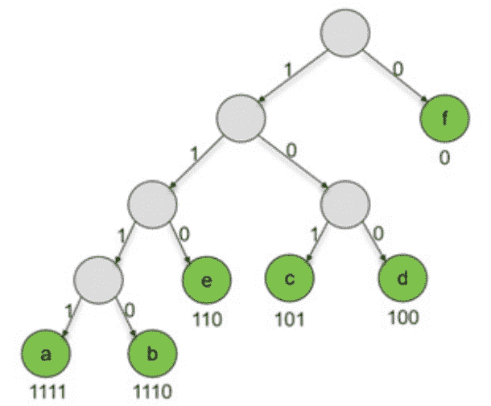
【参考答案】
A. 1111, 1110, 101, 100, 110, 0

【编程魔法师讲解考点】
一、哈夫曼树是什么
哈夫曼树是带权路径长度最小的二叉树。带权路径长度就是各叶子权值乘以到根距离的总和。构造时总是优先选取权值最小的两个节点合并。

二、哈夫曼树的构造方法
把所有字符看成独立节点，权值为频率。每次挑选权值最小的两个节点合并成父节点，父节点权值为两者之和。持续合并直到形成一棵树。

【题目总结】
哈夫曼树与哈夫曼编码基于频率做最优前缀编码。频率越高的字符编码越短，频率低的编码稍长，整体码长是最小的。

11. 给定一棵二叉树，前序遍历为 ABDECFG，中序遍历为 DEBACFG。它的后序遍历结果是（ ）。
A. EDBG FCA
B. EDGBFCA
C. DEBGFCA
D. DBEGFCA

【考点识别】
入门级|数据结构|简单树|【4】二叉树的定义及其基本性质、【4】二叉树的遍历：前序、中序、后序遍历

【分析讲解】
1. 前序与中序的特点
前序是根-左-右，中序是左-根-右。前序第一个即为根，中序中根的位置把序列分割为左右子树。

2. 还原树形
前序第一个节点 A 为根。中序中 A 把序列分成左子树 DEB 和右子树 CFG。
左子树 DEB 中，前序下一个根是 B。中序中 B 把左子树分为 DE 和空右子树。
左子树 DE 中，前序下一个根是 D。中序中 D 的左为空，右为 E。
右子树 CFG 中，前序下一个根是 C。中序中 C 的左为 F，右为 G。
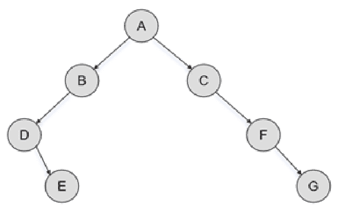
F 与 G 为叶子节点。

3. 后序
按左-右-根的顺序，左子树给出 E→D→B，右子树给出 G→F→C，最后根 A。合并后为 EDBGFCA。

【参考答案】
A. EDGBFCA

【编程魔法师讲解考点】
一、前中后序的定义
前序：根→左→右
中序：左→根→右
后序：左→右→根

二、由两种遍历还原树
先用前序确定根，再在中序中找到根的位置划分左右子树，对左右子树递归使用同样方法。

【题目总结】
二叉树遍历的核心记住三点：前序首节点是根，中序可分左右，后序尾节点是根。多练即可快速还原。

12. 考察一个有向无环图，包含 4 条有向边：(1, 2), (1, 3), (2, 4), (3, 4)。以下哪项是该图的一个合法拓扑序列（ ）。
A. 4, 2, 3, 1
B. 1, 2, 3, 4
C. 1, 2, 4, 3
D. 2, 1, 3, 4

【考点识别】
入门级|数据结构|简单图|【4】图的定义与相关概念、【4】图的表示与存储：邻接矩阵、邻接表、【6】有向无环图的拓扑排序

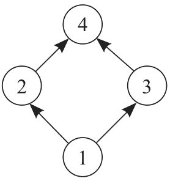
【分析讲解】
1. 拓扑排序流程
先把入度为 0 的节点入队，然后依次取出，加入结果并更新后继节点的入度，入度归零的节点再入队。

2. 具体执行
取出 1，加入结果，2、3 入度清零，队列为 2,3。
取出 2，加入结果，4 入度减 1，队列为 3。
取出 3，加入结果，4 入度归零，队列为 4。
取出 4，排序结束。结果为 1,2,3,4。

【参考答案】
B. 1, 2, 3, 4

【编程魔法师讲解考点】
一、拓扑排序的含义
为 DAG 中的节点排一个线性顺序，保证每条边 u→v 都满足 u 在 v 之前。

二、常见做法
Kahn 算法基于入度，DFS 递归回溯法。Kahn 步骤为统计入度、入队零入度节点、弹出更新、重复直至结束。

【题目总结】
拓扑排序用于解决依赖顺序问题，掌握入度法和 DFS 法即可应对各类排序题。

13. 在计算机中，以下哪个数据存储单位最小（ ）。
A. 字节(byte)
B. 比特(bit)
C. 字(word)
D. 千字节(kilobyte)

【考点识别】
入门级|计算机基础与编程环境|计算机的基本构成|【1】计算机存储单位：bit（比特）、byte（字节）、KB、MB 等

【分析讲解】
1. 各单位说明
比特是最小单位，1 比特表示 0/1 两种状态。
字节由 8 比特组成，常用来表示一个字符。
字是 CPU 一次处理的数据宽度，通常为 16/32/64 位，即 2/4/8 字节不等。
千字节为 1024 字节，即 8192 比特。

2. 大小顺序
比特 < 字节 < 字 < 千字节

【参考答案】
B. 比特(bit)

【编程魔法师讲解考点】
一、存储单位基础
计算机存储以二进制为基准，单位按 2 的幂递增。

二、大小关系
比特是最小，1 字节 = 8 比特。1 KB = 1024 字节，1 MB = 1024 KB，依次类推。

【题目总结】
判断存储单位只需记住递增关系和换算口诀即可快速作答。

14. 一个班级有 10 个男生和 12 个女生。若选出 3 人小组，要求至少包含 1 名女生，可能的组合数为（ ）。
A. 1420 种
B. 1770 种
C. 1540 种
D. 2200 种

【考点识别】
入门级|数学与逻辑|组合数学|【1】排列与组合的基本概念和应用

【分析讲解】
要求至少 1 个女生，可用排除法或按女生人数分类。

方法 1
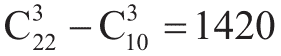
从全体中任选 3 人减去全选男生的方案。

方法 2
按女生数量分三类：
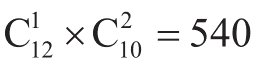
女生 1 人：男生 2 人搭配。
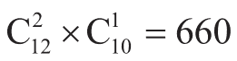
女生 2 人：男生 1 人搭配。
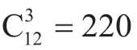
女生 3 人：全女生搭配。
累计 540+660+220=1420 种。

【编程魔法师讲解考点】
排列与组合是分配问题的核心工具。

排列：顺序重要，公式为 P(n,r)。
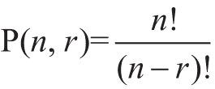
组合：顺序不重要，公式为 C(n,r)。
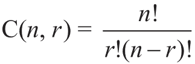

【题目总结】
组合题关键是明确是否考虑顺序，并熟练使用 C(n,r) 公式。

15. 以下不是操作系统名称的是（ ）
A. Linux
B. Windows
C. Android
D. HTML

【考点识别】
入门级|计算机基础与编程环境|操作系统与应用软件|【2】常见操作系统：Windows、Linux、macOS 等【4】操作系统的基本功能与分类

【分析讲解】
操作系统负责管理硬件与软件资源，提供用户接口。Windows、Linux、Android 均为操作系统。HTML 是网页标记语言，属于开发技术而非系统。

【参考答案】
D. HTML

【编程魔法师讲解考点】
一、操作系统
管理 CPU、内存、存储、设备等，常见的有 Windows、Linux、macOS、Android、iOS。

二、应用软件
依赖操作系统运行，解决具体任务，如 Word、Excel、浏览器等。

【题目总结】
操作系统是计算机的底层管理者，应用软件是上层工具，两者分工明确。

2.3 CSP-J 选择题模拟训练
1. 假设有一个 short 类型的变量，它占用 2 字节（16 位）。根据补码表示法，short 类型的存储范围是（ ）。

# CSP-J 基础题与程序阅读精讲

## 基础选择题回顾

1. short 型带符号整型能覆盖的数值区间是（ ）。
A. -32767～+32767
B. -32768～+32767
C. -32768～+32768
D. -32767～+32768

2. 将 23₈、111₂ 与 A₁₆ 相加后换算成十进制，得到（ ）。
A 28
B 30
C 31
D 32

3. 某公司 12 人分 A、B、C 三组，人数 5、4、3。现从中抽 5 人组成小组，要求三组均有人入选，方案数是（ ）。
A. 540 种
B. 600 种
C. 720 种
D. 840 种

4. 下面哪组是 0～15 的 4 位格雷码顺序（ ）。
A. 0000, 0001, 0011, 0010, 0110, 0111, 0101, 0100, 1100, 1101, 1111, 1110, 1010, 1011, 1001, 1000
B. 0000, 0001, 0010, 0011, 0111, 0110, 0100, 0101, 1101, 1100, 1110, 1111, 1011, 1010, 1000, 1001
C. 0000, 0001, 0011, 0010, 0100, 0101, 0111, 0110, 1110, 1111, 1101, 1100, 1000, 1001, 1011, 1010
D. 0000, 0001, 0011, 0010, 0110, 0111, 0101, 0100, 1100, 1101, 1111, 1110, 1000, 1001, 1011, 1010

5. 一块标称 512GB 的存储，按 1GB=1000MB 计，换算成二进制后比标称少（ ）。
A. 536870912 字节
B. 524288000 字节
C. 536870912 位
D. 524288000 位

6. 下列属于 C++ 内置基础类型的是（ ）。
A. string
B. bool
C. array
D. vector

7. 关于 C++ 循环结构的说法，错误的是（ ）。
A. for 结构常用于计数场景
B. while 会先执行体再判断条件
C. do-while 至少执行一次循环体
D. C++ 没有 repeat-until 语句

8. 在 C/C++ 中 (char)('A'+5) 的结果是（ ）。
A. F
B. E
C. G
D. H

9. 含 2²⁰ 个元素的有序数组，二分查找最坏比较次数为（ ）。
A. 19
B. 20
C. 21
D. 22

10. 下列属于操作系统的是（ ）。
A. Photoshop
B. Ubuntu
C. Google Chrome
D. Microsoft Office

11. 一个无向图有 6 个顶点 10 条边，各顶点度数之和为（ ）。
A. 10
B. 12
C. 20
D. 30

12. 已知某二叉树前序 [1,2,4,5,3,6,7]，中序 [4,2,5,1,6,3,7]，后序为（ ）。
A. [4,5,2,6,7,3,1]
B. [5,4,2,7,6,3,1]
C. [4,2,5,6,3,7,1]
D. [2,4,5,6,7,3,1]

13. 空栈的入栈顺序 1,2,3,4,5，不可能出现的出栈顺序是（ ）。
A. 5, 4, 3, 2, 1
B. 4, 5, 3, 2, 1
C. 3, 5, 4, 1, 2
D. 1, 2, 3, 5, 4

14. 4 男 3 女站成一排，3 名女生必须连在一起，排列数是（ ）。
A. 1440 种
B. 720 种
C. 1200 种
D. 960 种

15. 下列不属于编译器职责的是（ ）。
A. 检查代码是否符合语法规则
B. 将高级语言代码转换为机器代码
C. 对生成的目标代码进行优化
D. 调试程序运行期的错误

# 第三章 CSP-J 程序阅读题真题分析讲解

## 3.1 2024 年 CSP-J 第一轮程序阅读题

### 第 1 题

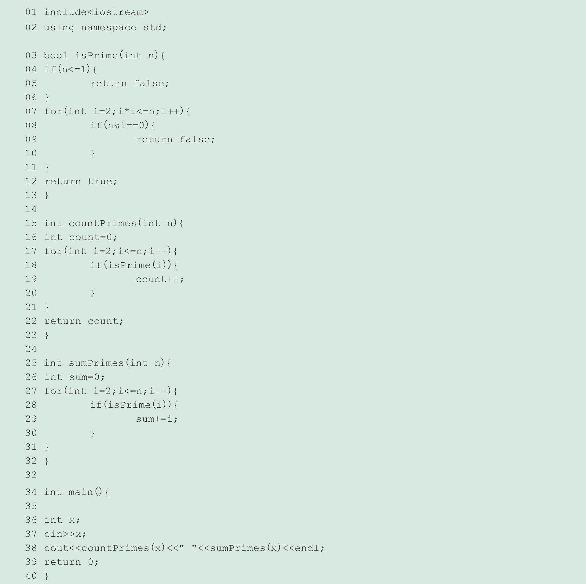

**考点归纳**
C++ 程序设计中的基本语句、函数与递归；数学中的初等数论。

**代码解读**
整体上读入上界 x，输出不超过 x 的素数个数与它们的和。

isPrime 部分：对 n≤1 直接判否；用试除法只到 √n，一旦整除即返回否，否则返回是。

countPrimes 部分：遍历 2 到 n，借助 isPrime 累计计数并返回。

sumPrimes 部分：同样遍历 2 到 n，对素数累加；注意该实现缺少返回语句，会产生警告。

main 部分：读取 x，分别调用计数与求和函数并打印。

**判断题**
16. 输入 10 时先输出 4 再输出 17。
解析：≤10 的素数为 2,3,5,7，共 4 个，和为 17。正确。

17. 把 isPrime 的循环条件改成 i<=n/2，输入 20 时 countPrimes 会变成 6。
解析：改动只影响效率，判定仍正确。≤20 的素数有 8 个。错误。

18. sumPrimes 计算的是 2 到 n 区间素数的和。
解析：函数正是按此区间筛选累加。正确。

**选择题**
19. 输入 50 时 sumPrimes 的输出为（ ）
A. 1060 B. 328 C. 381 D. 275
解析：≤50 的素数和为 328。答案 B。

20. 若把 for(int i=2;i*i<=n;i++) 改为 for(int i=2;i<=n;i++)，输入 10 时的输出为（ ）
A. 将不能正确计算 10 以内的素数个数及其和
B. 仍然输出 4 和 17
C. 输出 3 和 10
D. 输出结果不变，但时间更短
解析：循环会走到 i=n，n%i 恒为 0，所有数都被判非素数，最终输出 0 0。答案 A。

**小结**
函数定义与调用、for 结构、bool 返回值以及素数的试除判别是本题核心。

**要点回顾**
函数是模块化的基本单元，isPrime 用条件与循环完成判别。for 结构实现区间遍历。素数判定只需检查到平方根。

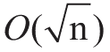

### 第 2 题

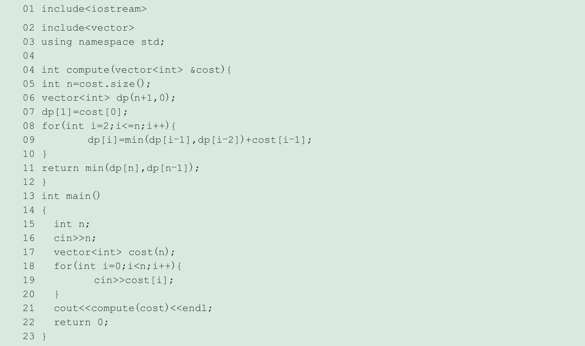

**考点归纳**
C++ 数组与下标、函数定义与调用、程序基本语句；算法中的动态规划思路。

**代码解读**
compute 函数用动态规划求每次可走 1 步或 2 步的最小花费。
dp[i] 表示到达第 i 级台阶的最小花费，转移式为 dp[i]=min(dp[i-1],dp[i-2])+cost[i-1]，边界 dp[1]=cost[0]，dp[0]=0。最后返回 min(dp[n],dp[n-1])。

main 函数读入 n 与 cost 数组，调用 compute 并输出。

**判断题**
21. cost 为 {10,15,20} 时输出为 15。
解析：dp[1]=10，dp[2]=15，dp[3]=30，返回 min(30,15)=15。正确。

22. 若把 dp[i-1] 改为 dp[i-3]，程序会编译错误。
解析：i<3 时会越界，属于运行期问题，编译不会报错。错误。

23. 程序总是输出 cost 数组的最小元素。
解析：程序求最小路径总和而非单个最小值。错误。

最小花费 ≠ 最小元素

动态规划求出来的最优路径开销，完全由状态转移规则决定，并不会直接等于 cost 里最小的那个数。拿一个例子来感受：cost = {1, 100, 1, 1, 1, 100, 1, 1, 100, 1} 时，算出来的最优总花费是 6，并不是数组里最小的 1。由此可知程序的输出并非总是 cost 的最小值。结论：程序结果与 cost 的最小元素并无直接关联，该判断是错的。

标准答案
错误（×）

单项选择题说明

24. 给定 cost 数组 {1,100,1,1,1,100,1,1,100,1} 时，程序最终输出的是（ ）。
A. "6"   B. "7"   C. "8"   D. "9"

思路拆解
1. 本次费用序列为 {1,100,1,1,1,100,1,1,100,1}，台阶总数 n=10。
2. dp 的推演过程：
先行设定 dp[0]=0，dp[1]=cost[0]=1。
按步计算：
dp[2] 取 dp[1] 与 dp[0] 的较小值再加 cost[1]，min(1,0)+100=100
dp[3] 取 dp[2] 与 dp[1] 较小值再加 cost[2]，min(100,1)+1=2
dp[4] 取 dp[3] 与 dp[2] 较小值再加 cost[3]，min(2,100)+1=3
dp[5] 取 dp[4] 与 dp[3] 较小值再加 cost[4]，min(3,2)+1=3
dp[6] 取 dp[5] 与 dp[4] 较小值再加 cost[5]，min(3,3)+100=103
dp[7] 取 dp[6] 与 dp[5] 较小值再加 cost[6]，min(103,3)+1=4
dp[8] 取 dp[7] 与 dp[6] 较小值再加 cost[7]，min(4,103)+1=5
dp[9] 取 dp[8] 与 dp[7] 较小值再加 cost[8]，min(5,4)+100=104
dp[10] 取 dp[9] 与 dp[8] 较小值再加 cost[9]，min(104,5)+1=6
3. 最后取 dp[10] 与 dp[9] 的较小值，min(6,104)=6。

标准答案
A. "6"

25. 若 cost 数组为 {10,15,30,5,5,10,20}，程序输出为（ ）。
A "25"   B. "30"   C. "35"   D. "40"

思路拆解
1. cost = {10,15,30,5,5,10,20}，台阶数 n=7。
2. dp 推演：
先行设定 dp[0]=0，dp[1]=cost[0]=10
dp[2] min(10,0)+15=15
dp[3] min(15,10)+30=40
dp[4] min(40,15)+5=20
dp[5] min(20,40)+5=25
dp[6] min(25,20)+10=30
dp[7] min(30,25)+20=45
3. 最后取 dp[7] 与 dp[6] 的较小值，min(45,30)=30。

标准答案
B. "30"

26. 若把状态转移由 min(dp[i-1],dp[i-2])+cost[i-1] 改为 dp[i-1]+cost[i-2]，输入 cost 为 {5,10,15} 时输出为（ ）。
A. "10"   B. "15"   C. "20"   D. "25"

思路拆解
改动后递推式为 dp[i] = dp[i-1] + cost[i-2]。
1. cost = {5,10,15}，n=3。
2. 先行设定 dp[0]=0，dp[1]=cost[0]=5。
3. 按步计算：
dp[2]=dp[1]+cost[0]=5+5=10
dp[3]=dp[2]+cost[1]=10+10=20
4. 结果取 min(dp[3],dp[2])=min(20,10)=10。

标准答案
A. "10"

考点小结
本组题目主要考察：
1. C++ 编程
1) vector 动态数组的分配与下标访问
2) 函数声明、参数传递与返回值
3) for 循环等基础控制语句
2. 算法与动态规划
1) 状态定义与递推关系的构建
2) 空间优化，用两个变量替代完整 dp 数组

进阶讲解

一、考点：动态规划
动态规划通过保存子问题解避免重复计算。核心是把大问题拆成子问题并用递推组合。
1. 核心步骤
1) 状态定义：如 dp[i] 表示到达第 i 个台阶的最小花费。
2) 状态转移：dp[i]=min(dp[i-1],dp[i-2])+cost[i-1]，即从前一或前两阶过来再加上当前阶花费。
3) 起始条件：dp[0]=0 起点不花钱；dp[1]=cost[0] 第一阶花费。
4) 边界处理：i-2 需保证 i>=2。
5) 结果输出：min(dp[n],dp[n-1]) 表示从倒数第一或第二阶结束。
2. 优化思路
1) 空间优化：只保留最近两项，空间从 O(n) 降到 O(1)。示例：int prev1=cost[0], prev2=0; for(int i=2;i<=n;i++){ int cur=min(prev1,prev2)+cost[i-1]; prev2=prev1; prev1=cur; } return min(prev1,prev2);
2) 时间复杂度：每阶 O(1)，总体 O(n)。

二、C++ 要点
1) vector 用法：vector<int> cost(n) 创建可变长度数组并支持下标。
2) 引用传递：compute(vector<int>& cost) 避免拷贝，提升效率。
3) for 循环遍历 cost 实现递推。

第 3 题
01 include<iostream>
02 include<cmath>
03 using namespace std;
04 int customFunction(int a,int b){
05 if(b==0){
06 return a;
07 }
08 return a+customFunction(a,b-1);
09 }
10
11 int main()
12 {
13 int x,y;
14 cin>>x>>y;
15 int result=customFunction(x,y);
16 cout<<pow(result,2)<<endl;
17 return 0;
18 }

考点识别
入门级|C++程序设计|【2.9】函数与递归、【2.3】程序基本语句
入门级|数学|【5.3】初等数论

程序详细分析
1. 功能概述
程序通过递归实现的 customFunction 计算两个整数的乘积，再输出该乘积的平方。
2. 程序块一分析
04 int customFunction(int a, int b) {
05 if (b == 0) {
06 return a;
07 }
08 return a + customFunction(a, b 1);
09 }
功能实现递归乘法：
终止条件 b==0 时返回 a。
递归步 a + customFunction(a, b-1) 将 a 累加 b 次。
注意递归深度为 b，需 b+1 次调用。
3. 程序块二分析
11 int main() {
13 int x, y;
14 cin >> x >> y; // 读取
15 int result = customFunction(x, y);
16 cout << pow(result, 2) << endl;
17 return 0;
18 }
功能：读取 x、y，调用 customFunction 得到 x*y 的递归结果，输出结果的平方。
4. 递归过程示例
customFunction(2,3)=2+customFunction(2,2)=2+(2+customFunction(2,1))=2+(2+(2+customFunction(2,0)))=8
5. 注意事项
递归深度过大可能导致栈溢出；递归实现乘法效率不高。

判断题

27. 输入“23”时，customFunction(2,3)的返回值为“64”。（ ）
思路拆解
customFunction(2,3) 递归求得 8，main 中 pow(result,2) 得到 64。输出 64 是平方后的结果，不是函数本身的返回值。

标准答案
错误（×）

28. 当 b 为负数时，customFunction(a，b)会陷入无限递归。（ ）
思路拆解
终止条件为 b==0，若 b 为负，每次递归 b-1 变得更小，永远到不了 0，导致无限递归，最终栈溢出。

标准答案
正确（√）

29. 当 b 的值越大，程序的运行时间越长。（ ）
思路拆解
递归调用次数与 b+1 成正比，b 增大导致调用次数线性增长，运行时间随之增加。

标准答案
正确（√）

单选题

30. 输入为"54"时，customFunction(5,4)的返回值为（ ）。
A. 5   B. 25   C. 250   D. 625
思路拆解
customFunction(5,4)=5+customFunction(5,3)=... 最终为 25。

标准答案
B. 25

31. 若输入 x=3 和 y=3，则程序最终输出为（ ）。
A. "27"   B. "81"   C. "144"   D. "256"
思路拆解
customFunction(3,3)=12，pow(12,2)=144。

标准答案
C. "144"

32. 若将 customfunction 改为“return a+customFunction(a-1，b-1);”并输入“3 3”，则程序最终输出为（ ）。
A. 9   B. 16   C. 25   D. 36
思路拆解
新递推：customFunction(3,3)=3+customFunction(2,2)=3+(2+customFunction(1,1))=3+(2+(1+customFunction(0,0)))=6，平方后 36。

标准答案
D. 36

考点小结
本题覆盖：
1. C++ 递归函数
1) 递归结构与运行机制
2) 基例与递归调用的设计
3) 递归深度对时间和空间的影响
2. 数学操作
1) 用递归实现累加、乘法等运算
2) 递归与数学表达式的对应
3. C++ 标准库
cmath 中 pow 的幂运算

进阶讲解

一、考点：递归
1. 概念
递归是函数直接或间接调用自身，通过不断缩小规模逼近基例。需有基例和递归调用。
2. 本题实现
基例：if(b==0) return a;
递归：return a + customFunction(a, b-1);
即把 a 累加 b 次得到 a*b。
3. 示例
customFunction(2,3) 展开后为 8。
4. 特点
1) 时间与空间随递归深度线性增长，复杂度 O(b)。
2) 可灵活实现阶乘、斐波那契等。
3) 缺基例会无限递归导致栈溢出。
5. 改进建议
可用迭代替代递归：
int customFunction(int a,int b){ int res=a; for(int i=1;i<b;i++) res+=a; return res; }

时空消耗与递归版本基本持平，差异在于省掉了函数调用栈反复进出的负担。

（2）边界情况的补充
b 允许为负时，先把符号统一再计算：
if (b < 0) {
return -customFunction(a, -b);
}

（3）平方计算的提速
当指数固定为 2 时，用自乘取代 pow 调用更快：
int squared = result * result;

## 3.2 2023 CSP-J 第一轮 程序阅读精析

**第 1 题**
01 include <iostream>
02 include <cmath>
03 using namespace std;
04
05 double f(double a, double b, double c) {
06 double s = (a + b + c) / 2;
07 return sqrt(s * (s a) * (s b) * (s c));
08 }
09
10 int main() {
11 cout. flags(ios:: flxed);
12 cout.precision(4);
13
14 int a, b, c;
15 cin >> a >> b >> c;
16 cout << f(a, b, c) << endl;
17 return 0;
18 }

**【考点梳理】**
入门级|2.C++程序设计|2.2 基本数据类型、2.5 数学库常用函数、cin 和 cout 语句
入门级|2.C++程序设计|2.9 函数与递归
入门级|5.数学|5.2 初等数学

**【程序拆解】**
1. 整体功能
读取三条边，借助海伦公式求面积并打印出来。

2. 代码段解读
05 double f(double a, double b, double c) {
06 double s = (a + b + c) / 2; // 求半周长
07 return sqrt(s * (s a) * (s b) * (s c)); // 海伦公式求面积
08 }
作用：输入三边长度，返回对应的面积。
 
思路：先算出半周长，再代入公式得到面积并返回。

10 int main() {
11 cout. flags(ios:: fixed); // 固定小数点格式
12 cout.precision(4); // 保留小数点后四位
13
14 int a, b, c; // 输入变量
15 cin >> a >> b >> c; // 读取三边
16 cout << f(a, b, c) << endl; // 调用并输出结果
17 return 0;
18 }
作用：程序入口，负责输入、调用与输出。
思路：
第 11～12 行：设定浮点输出样式，确保四位小数。
第 14～15 行：声明变量并接收三边。
第 16 行：调用 f 求面积并打印。

3. 输入输出小结
输入：三个整数边长。
输出：面积值，小数点后四位。

**判断题**
16. 输入“2 2 2”时输出为“1.7321”。（ ）

**【解析】**

输入为等边情形，三边均为 2。按海伦公式：

面积表达式为。
配合 precision 4，最终得到 1.7321。

**【参考答案】**
正确(√)

17. 把第 7 行的“(sb)*(sc)”改为“(sc)*(sb)”结果不变。（ ）

**【解析】**
乘法满足交换律，(s-b)*(s-c) 与 (s-c)*(s-b) 数值相同，运行结果不受影响。

**【参考答案】**
正确(√)

18. 程序总是输出 4 位小数。（ ）

**【解析】**
第 11 行打开 ios::fixed，第 12 行把精度设为 4，浮点数统一以定点四位呈现，整数也会显示为 x.0000。

**【参考答案】**
正确(√)

单选题
19. 输入“3 4 5”时输出为（ ）。
A. “6.0000”
B. “12.0000”
C. “24.0000”
D. “30.0000”

**【解析】**
3、4、5 构成直角三角形，面积推导：

。

面积式为。
保留四位小数输出 6.0000。

**【参考答案】**
A. “6.0000”

20. 输入“5 12 13”时输出为（ ）。
A. “24.0000”
B. “30.0000”
C. “60.0000”
D. “120.0000”

**【解析】**
5、12、13 也是直角：

。

面积式为。
四位小数输出 30.0000。

**【参考答案】**
B. “30.0000”

**【题目小结】**
考察点：
1. C++ 编程
（1）基础类型：double 用法、返回值与精度控制。
（2）数学库：sqrt 求平方根。
（3）I/O：cin、cout 与 ios::fixed、precision 格式化。
（4）自定义函数编写与调用。
2. 数学
（1）海伦公式的应用。
（2）几何面积求解。

**【考点精讲】**
1. 类型与数学函数
double 能表示小数，适合面积计算。C++ 数学库提供 sqrt 等求根函数。
2. 输入输出与格式化
cin 负责读入，cout 负责输出。通过 flags(ios::fixed) 与 precision(4) 可统一为定点四位，输出更规范。
3. 函数
包含返回类型、参数列表、函数体。f 接收三边返回面积，调用简洁。
4. 海伦公式

面积=。

s 为半周长，适用于任意三角形。

**第 2 题**

**【考点梳理】**
入门级|2.C++程序设计|2.7 数组【1】数组与数组下标
入门级|2.C++程序设计|2.5 数学库常用函数【3】字符串操作
入门级|4.算法|4.3 基础算法【3】动态规划

**【程序拆解】**
1. 整体功能
由 f 与 g 两个函数组成。
f：求两字符串的最长公共子序列长度。
g：判断两字符串是否互为旋转。

2. 代码段说明
函数 f：LCS 长度
06 int f(string x, string y) {
int m = x.size();
int n = y.size();
vector<vector<int>> v(m+1, vector<int>(n+1, 0));
for (int i = 1; i <= m; i++) {
for (int j = 1; j <= n; j++) {
if (x[i-1] == y[j-1]) {
v[i][j] = v[i-1][j-1] + 1;
} else {
v[i][j] = max(v[i-1][j], v[i][j-1]);
}
}
}
return v[m][n];
}
作用：计算 LCS 长度。
思路：动态规划，v 记录子问题最优解：
v[i][j] 表示 x 前 i 个字符与 y 前 j 个字符的 LCS 长度。
转移：
if (x[i-1] == y[j-1]) {
v[i][j] = v[i-1][j-1] + 1;
} else {
v[i][j] = max(v[i-1][j], v[i][j-1]);
}

3. 函数 g：旋转判断
22 bool g(string x, string y) {
if (x.size() != y.size()) {
return false;
}
return f(x + x, y) == y.size();
}
作用：判断 x 旋转后能否得到 y。
思路：
长度必须相等；
x+x 包含所有旋转形式；
y 是 x+x 的子序列且长度相等则成立。

4. 主函数
29 int main() {
string x, y;
cin >> x >> y;
cout << g(x, y) << endl;
return 0;
}
作用：读入、调用 g 并输出 1/0。

5. 输入输出小结
输入：两个字符串。
输出：是否旋转，1 表示是，0 表示否。
核心算法：动态规划求 LCS；拼接字符串判断旋转。

**判断题**
1. f 的返回值 <= min(n,m)。（ ）

**【解析】**
LCS 长度不可能超过任一字符串长度，即 f(x,y)<=min(len(x),len(y))。
如 x="abc",y="def" 长度 0；x="abc",y="ab" 长度 2。

**【参考答案】**
正确(√)

2. f 的返回值等于最长公共子串长度。（ ）

**【解析】**
f 计算的是子序列而非子串：
子序列允许不连续，子串要求连续。
例如 x="abcde",y="ace" 时 LCS 为 3，子串为 0。

**【参考答案】**
错误（×）

3. 输入完全相同的两串时 g 总为 true。（ ）

**【解析】**
长度相同，x+x 必含 y，且 f(x+x,y)=|y|，返回 true。
如 x="abc",y="abc" 成立。

**【参考答案】**
正确(√)

**选择题**
4. 把第 19 行的“v[m][n]”换成“v[n][m]”，程序（ ）。
A. 行为不变
B. 只改输出
C. 一定非正常退出
D. 可能非正常退出

**【解析】**
合法下标范围 0<=i<=m、0<=j<=n。改为 v[n][m] 时，若 n≠m 会越界，可能导致异常退出。只有 n=m 时行为不变。

**【参考答案】**
D. 可能非正常退出

5. 输入“csp-j p-jcs”时输出为（ ）。
A. “0”
B. “1”
C. “T”
D. “F”

**【解析】**
x="csp-j", y="p-jcs"，长度均为 5。x+x="csp-jcsp-j"，f(x+x,y)=5 等于 y.size()，返回 true，输出 1。

**【参考答案】**
B. “1”

6. 输入“csppsc spsccp”时输出为（ ）。
A. “T”
B. “F”
C. “0”
D. “1”

**【解析】**
x="csppsc", y="spsccp"，长度 6。x+x="csppsccsppsc" 中可取出 spsccp，LCS 长度为 6，判断成立，输出 1。

**【参考答案】**
D. “1”

**【题目小结】**
核心考点：
1. C++ 编程
STL 容器二维 vector 初始化与访问，下标越界风险；
字符串 size()、拼接；
嵌套循环实现 DP。
2. 算法
动态规划求 LCS；
状态转移：
if (x[i-1] == y[j-1]) {
v[i][j] = v[i-1][j-1] + 1;
} else {
v[i][j] = max(v[i-1][j], v[i][j-1]);
}
旋转判断用 x+x 覆盖所有旋转。

**【考点精讲】**
一、动态规划：LCS 问题
将复杂问题拆分为子问题并保存结果，避免重复计算。LCS 是经典案例。
定义与实现：
问题：求两串的最长公共子序列长度。
思路：用 v[i][j] 表示前 i 与前 j 的最优解。
状态转移代码：

最长公共子序列递推速览

处理到 x 的第 i-1 位与 y 的第 j-1 位时，递推公式可表述为：
if (x[i-1] == y[j-1]) {
v[i][j] = v[i-1][j-1] + 1;
} else {
v[i][j] = max(v[i-1][j], v[i][j-1]);
}

边界上令 v[0][j]=0 与 v[i][0]=0，用来表示空串与任意串的 LCS 长度为 0。最终答案落在 v[m][n]，m 为 x 长度、n 为 y 长度。

实现要点
先建表：
vector<vector<int>> v(m+1, vector<int>(n+1, 0));
for (int i = 1; i <= m; i++) {
for (int j = 1; j <= n; j++) {
if (x[i-1] == y[j-1]) {
v[i][j] = v[i-1][j-1] + 1;
} else {
v[i][j] = max(v[i-1][j], v[i][j-1]);
}
}
}
表 v 保存了全部子问题的最优解。字符相同时沿左上方向继承并加一；字符不同时只能舍弃 x 当前位或 y 当前位，取两者较大者。

二、旋转串快速判定
判断是否可由旋转得到的核心思路是：
1. 生成 x+x。
2. 检验 y 是否能完整出现在 x+x 中且长度相同。

若 y 确实是 x 的某种旋转，一定会以连续段的形式落在 x+x 内。拼接串保存了 x 的全部旋转形态。例如 x="abc"，x+x="abcabc"，其中即可找到 "bca" 与 "cab"。代码层面用 f(x+x, y) 去检查包含关系，再配合长度相等即可确认。

三、vector 下标越界的隐患
vector 对下标访问范围有严格要求，越界会触发运行时异常导致程序异常退出。
vector<int> v(10, 0); // 合法下标 0~9
v[10] = 1; // 越界，异常终止

在本题中，若把 v[m][n] 写成 v[n][m]，当 m≠n 时就会触及未分配区域产生越界。结论是二维数组下标写错很容易造成非正常退出。

第 3 题

【考点识别】
入门级|2.C++程序设计|2.5 数学库常用函数【3】平方根计算
入门级|4.算法|4.2 数学基础算法【2】枚举与因子求解
入门级|5.数学|5.2 初等数学【1】整数因子的性质与计算
入门级|4.算法|4.1 算法概念与描述【2】嵌套函数调用与结果递推

【程序详细分析】
1. 功能说明
程序提供两个核心能力：
函数 solve1：求输入整数的平方。
函数 solve2：求输入整数全部因子的平方和。
主函数读取 n，通过嵌套调用 solve1 与 solve2 输出两种组合结果。

2. 程序块：函数 solve1
05 int solve1(int n) {
06 return n * n;
07 }
作用是返回参数的平方，逻辑直接给出 n²。

3. 程序块：函数 solve2
09 int solve2(int n) {
10 int sum = 0;
11 for (int i = 1; i <= sqrt(n); i++) {
12 if (n % i == 0) {
13 if (n / i == i) {
14 sum += i * i;
15 } else {
16 sum += i * i + (n / i) * (n / i);
17 }
18 }
19 }
20 return sum;
21 }
作用是累加 n 的全部因子平方。
思路：

i 从 1 往上枚举到 sqrt(n)。
当 n % i == 0 时 i 为因子。

若 i 与 n/i 重合只累加一次 i²，否则分别累加 i² 与 (n/i)²。
例如 n=12，因子 1,2,3,4,6,12，平方和为 1²+2²+3²+4²+6²+12²=210。

4. 程序块：主函数
23 int main() {
24 int n;
25 cin >> n;
26 cout << solve2(solve1(n)) << " " << solve1(solve2(n)) << endl;
27 return 0;
28 }
功能为读入 n 并输出：
solve2(solve1(n))：先平方再求因子平方和；
solve1(solve2(n))：先求因子平方和再平方。
例 n=2：solve1=4，solve2(4)=21；solve2(2)=5，solve1(5)=25，输出 21 25。

判断题
1. 若输入 n 为正整数，solve2 的作用是计算 n 所有因子的平方和。（ ）
【分析讲解】
solve2 会遍历 n 的所有因子并累加平方。

循环里 i 从 1 递增到 sqrt(n)。
当 n%i==0 时：
若 i 与 n/i 不同则分别计入平方，若相同只计一次。
因此 solve2 确实得到全部因子的平方和。
【参考答案】
正确(√)
2. 第 13～14 行的作用是避免 n 的平方根因子被第 16 行重复计算。（ ）
【分析讲解】

当 n/i == i 时，i 为平方根因子。
若执行第 16 行会把该因子算两次，如 n=16,i=4 会产生 4²+4²。
第 13~14 行单独处理，保证只加一次。
【参考答案】
正确(√)
3. 若输入 n 为质数，solve2(n) 的返回值为 n²+1。（ ）
【分析讲解】
质数仅有因子 1 与自身 p。
平方和 =1²+p² = p²+1。
如 n=5 返回 26，n=7 返回 50。结论成立。
【参考答案】
正确(√)

选择题
4. 若输入 n 为质数 p 的平方，solve2(n) 的返回值为（ ）。
A. p²+p+1
B. n²+n+1
C. n²+1
D. p⁴+2p²+1
【分析讲解】
n=p²，因子为 1,p,p²。平方和 =1+p²+p⁴。
例 p=2,n=4 得 21；p=3,n=9 得 91。
【参考答案】
D. p⁴+2p²+1
5. 当输入为正整数时，第一项减第二项的差值一定（ ）。
A. 大于或等于 0
B. 大于或等于 0 且不一定大于 0
C. 小于 0
D. 小于或等于 0 且不一定小于 0
【分析讲解】
第一项为 n² 的因子平方和，第二项为因子平方和的平方。
n=1 时相等差为 0；较大 n 时第二项增长更快，差常为负。
【参考答案】
D. 小于或等于 0 且不一定小于 0
6. 当输入为“5”时，输出为（ ）。
A. “651 625”
B. “650 729”
C. “651 676”
D. “652 625”
【分析讲解】
solve1(5)=25，solve2(25)=1+25+625=651。
solve2(5)=1+25=26，solve1(26)=676。
【参考答案】
C. “651 676”

【题目总结】
1. C++程序设计
数学函数与算法实现：用 sqrt 限制枚举范围；模块化实现平方与因子平方和；嵌套调用组合功能。
2. 算法知识
（1）优化枚举技巧。

只枚举到 sqrt(n) 避免重复；平方根因子单独处理。
（2）数学推导与递推。
对因子平方求和，嵌套调用形成链式结果。
3. 特殊整数性质
质数因子仅 1 与自身。

【编程魔法师讲解考点】
因子计算是常见易错点，本题围绕枚举、平方和、嵌套调用展开。

一、为什么只需要枚举到 sqrt(n)
1. 因子对的对称性
n 的因子成对出现，如 n=12 有 (1,12),(2,6),(3,4)。
  
较小的因子不超过 sqrt(n)，较大的由 n/i 得到。
2. 平方数的特殊性

n 为完全平方时平方根因子会自配对，需单独只加一次。
代码即用 if(n/i==i){ sum+=i*i; } else { sum+=i*i+(n/i)*(n/i); }

二、嵌套函数实现递推
solve1 负责平方，solve2 负责因子平方和。嵌套调用形成清晰流水：
solve2(solve1(n)) 先平方再求和；solve1(solve2(n)) 先求和再平方。

三、复杂度分析与优化
 
朴素枚举到 n 为 O(n)，优化到 sqrt(n) 为 O(√n)。
solve2(solve1(n)) 复杂度主要由枚举 √m 决定，其中 m=n²。

3.3 CSP-J 第一轮程序阅读模拟题

第 1 题

判断题
1. 输入 15 时，countPrimes(15) 的输出为 6。（ ）
2. 如果将 isPrime 函数中的条件改为 i<=n/2，程序仍然能正确判断素数。（ ）
3. sumPrimes 函数所求的总和只包括奇数。（ ）

选择题
4. 输入 30 时，sumPrimes(30) 的输出是（ ）。
A. 129
B. 130
C. 1292
D. 198
5. 如果 isPrime 函数的返回值总是 true，输入 10 时的输出是（ ）。
A. 0 0
B. 10 55
C. 8 28
D. 9 45

第 2 题

判断题
1. 如果输入 cost={1, 2, 3, 4}，程序的输出为 4。（ ）
2. 将 min(dp[i 1], dp[i 2])改为 dp[i 1]+dp[i 2]，程序可能无法正常运行。（ ）
3. 程序始终输出 cost 数组中所有元素的总和。（ ）

选择题
4. 输入 cost={10, 15, 20}，程序的输出是（ ）。
A. 10
B. 15
C. 30
D. 25
5. 修改 dp[i]=min(dp[i 1], dp[i 2])+cost[i 1]为 dp[i]=dp[i 1]+cost[i 1]，输入 cost={5, 10, 15}，程序的输出是（ ）。
A. 25
B. 20
C. 30
D. 10
6. 程序的输出是否总是 cost 数组中最小元素的倍数（ ）。
A. 是
B. 否
C. 只有当数组元素单调递增时
D. 无法确定

第 3 题
include <iostream>
include <cmath>
using namespace std;
int customFunction(int a, int b) {
if (b == 0) {
return a;
}
return a + customFunction(a, b 1);
}
int main() {
int x, y;
cin >> x >> y;
int result = customFunction(x, y);
cout << pow(result, 2) << endl;
return 0;
}
判断题
1. 如果输入 3 2，则 customFunction(3, 2)的返回值为 9。（ ）
2. 当 b 的值为负数时，程序会陷入无限递归。（ ）
3. 程序使用递归实现了 x 和 y 的乘积，并输出结果的平方。（ ）

选择题
4. 如果输入 4 3，程序的输出是（ ）。
A. 36
B. 64
C. 144
D. 256
5. 修改 customFunction 的递归公式为 return a+customFunction(a 1, b 1)，输入 3 3 时，程序的输出为（ ）。
A. 25
B. 36
C. 49
D. 64
6. 如果将 pow(result, 2)替换为 result*result*result，输入 2 3 时，程序的输出是（ ）。
A. 64
B. 216
C. 512
D. 729

第四章
CSP-J 程序完善真题讲解

4.1 2024 年 CSP-J 第一轮完善程序题

第 1 题
问题：给定一个正整数 n，判断这个数是不是完全平方数，即存在一个正整数 x 使得 x 的平方等于 n。
试补全程序。

【考点识别】
入门级|2.C++程序设计|2.2 基本数据类型|【1】整数型：int
|2.3 程序基本语句|【2】for 语句、if 语句、多层条件语句
|2.5 数学库常用函数|【3】平方根函数 sqrt()
|2.6 结构化程序设计|【1】顺序结构、分支结构和循环结构
|2.9 函数与递归｜【2】函数定义与调用、形参与实参

【程序详细分析】
1. 功能说明
此程序的功能是判断给定的正整数 n 是否是完全平方数，即检查是否存在一个整数 x 使得 x²=n。
2. 代码块逐行分析讲解
bool isSquare(int num){
功能：定义函数 isSquare，判断整数 num 是否为完全平方数。
参数：
num：需要判断的正整数。
int i = ① ;
位置①：表示起始检查的数值，应填 1，因为最小的完全平方数为 1²=1。
int bound = ② ;
位置②：表示检查范围的上界，应该填 sqrt(num)（即 bound=(int)sqrt(num)），因为只需要检查到平方根的整数部分即可。

# 瞬间判断是否为完美平方

for(; i <= bound; ++i){
}
这里的 for 让 i 从 1 开始逐步增长到 bound，对每个候选数做平方核验。

if( ③ ){
}
③ 空需要写进 i*i==num，用来核对当前 i 的平方是否恰好等于目标值 num。

return ④ ;
}
④ 空在命中条件时返回 true，说明输入值属于完美平方。

return ⑤ ;
}
⑤ 空当全部候选遍历完仍未命中，则返回 false，说明不是。

int main(){
int n;
cin >> n;
}
主程序先读取用户给出的正整数 n。

if(isSquare(n)){
cout << n << " is a Square number" << endl;
}
else{
cout << n << " is not a Square number" << endl;
}
}
根据 isSquare 的布尔结果打印对应英文结论。

小结
程序本质是寻找整数 i 使 i²=n。把搜索上限收敛到 sqrt(n) 的整数部分，能大幅剪枝，效率提升明显。

1. ①填（ ）。
A. 1
B. 2
C. 3
D. 4
解说
int i=① 决定试探起点，平方值的最小起点是 1²=1，所以起始应为 1。
正确答案
A. 1

2. ②填（ ）。
A. (int)floor(sqrt(num)-1)
B. (int)floor(sqrt(num))
C. floor(sqrt(num/2))-1
D. floor(sqrt(num/2))
解说
bound 是循环上限，只需检查到 sqrt(num) 的整数部分即可，避免无效遍历，所以选 (int)floor(sqrt(num))。
正确答案
B. (int)floor(sqrt(num))

3. ③填（ ）。
A. num=2*i
B. num==2*i
C. num=i*i
D. num==i*i
解说
要判定 i 是否为 num 的平方根，关系是 i*i 等价于 num，即 num==i*i。
正确答案
D. num==i*i

4. ④填（ ）。
A. num=2*i
B. num==2*i
C. true
D. false
解说
一旦出现 i²=n，就可确认是完美平方，直接返回 true。
正确答案
C. true

5. ⑤填（ ）。
A. num=i*i
B. num!=2*i
C. true
D. false
解说
循环结束仍未找到匹配，说明不是完美平方，返回 false。
正确答案
D. false

要点归纳
数学运算上利用 sqrt() 缩小枚举范围。循环与分支上 for 负责枚举，if 负责等式校验。函数封装上理解参数、返回值与调用。布尔逻辑上用 true/false 区分结果。

考点拆解
平方根函数的使用
sqrt() 求非负数的平方根，如 sqrt(25)=5。把遍历上限限制为 sqrt(n)，时间成本大幅压缩。需要整数时常用 (int)sqrt(num) 取整。
循环与条件
for(int i = 1; i <= bound; ++i){ if(i * i == num){return true;}} 只要找到满足 i²=num 的 i 就立即返回 true，if 逐个校验。
函数定义与调用
bool isSquare(int num){...} 返回布尔值，接收待检整数。主函数调用后依据返回值决定输出。
布尔返回值
找到即返回 true，未找到遍历完返回 false，返回值驱动主函数的输出分支。

# 汉诺塔递归思路拆解

三根柱子 A、B、C，初始所有圆盘在 A 上自小到大排列，要求全部移到 C 且保持顺序。一次只移动顶盘，小盘必须在上。

include <bits/stdc++.h>
using namespace std;
void move(char src, char tgt){
cout <<"从柱子"<< src <<"挪到柱子上"<<tgt<< endl;
}
void dfs(int i, char src, char tmp, char tgt){
if(i== ① ){
move( ② );
return;
}
dfs(i-1, ③ );
move(src, tgt);
dfs( ⑤ , ④ );
}
int main() {
int n;
cin >>n;
dfs(n, 'A', 'B', 'C');
}

考点识别
入门级|2.C++程序设计|2.3 程序基本语句|【2】if 语句、多层条件语句
|2.9 函数与递归|【2】函数定义与调用、形参与实参、递归函数

程序详细分析
功能说明
用递归求解汉诺塔，把圆盘从 A 迁移到 C，保持相对顺序。
代码块讲解
void move(char src, char tgt) { cout << "从柱子" << src << "挪到柱子上" << tgt << endl; }
作用：打印一次移动。
void dfs(int i, char src, char tmp, char tgt) {
if(i == (1) ){
move( (2) );
return;
}
dfs(i-1, (3) );
move(src, tgt);
dfs( (5) , (4) );
}
参数 i 为待移圆盘数，src 起点，tmp 辅助，tgt 目标。
终止：if(i == ①){ move(②); return; } 只有一盘时直接 src→tgt。①填 1，②填 src, tgt。
递归：
把 i-1 盘 src→tmp：dfs(i-1, ③ )，③ 填 src, tgt, tmp。
移动第 i 盘：move(src, tgt)。
把 i-1 盘 tmp→tgt：dfs(⑤, ④ )，⑤ 填 i-1，④ 填 tmp, src, tgt。
int main() 读取 n，调用 dfs(n,'A','B','C')，输出每一步。

1. ①填（ ）。
A. 0
B. 1
C. 2
D. 3
解说
递归出口是单盘情况，i==1 时直接移动，不再分解。
正确答案
B. 1

2. ②填（ ）。
A. src, tmp
B. src, tgt
C. tmp, tgt
D. tgt, tmp
解说
单盘直接从起点到目标，无需借助柱子。
正确答案
B. src, tgt

3. ③填（ ）。
A. src, tmp, tgt
B. src, tgt, tmp
C. tgt, tmp, src
D. tgt, src, tmp
解说
先把上层 i-1 盘搬到辅助柱，目标暂时当作过渡，故传 src, tgt, tmp。
正确答案
B. src, tgt, tmp

4. ④填（ ）。
A. src, tmp, tgt
B. tmp, src, tgt
C. src, tgt, tmp
D. tgt, src, tmp
解说
最后把 i-1 盘从辅助搬到目标，原起点充当过渡，顺序为 tmp, src, tgt。
正确答案
B. tmp, src, tgt

5. ⑤填（ ）。
A. 0
B. 1
C. i-1
D. i
解说
每次递归盘数减一，参数应为 i-1。
正确答案
C. i-1

本题小结
考察递归分解、终止条件、函数参数顺序及 C++ 基础语句。

考点精讲
一、递归
缩小规模、设定出口、自身调用。本题分三步：上层盘搬到辅助、最大盘直达目标、上层盘搬到目标。
二、函数调用
move 负责输出，dfs 负责递归分解。正确传递形参是关键。
三、分治
分解为子问题、递归求解、合并结果，形成完整移动序列。

# 等差数列缺失元素二分定位

原数列长度 n+1，公差 1，输入时删掉一个元素，数组长度变为 n。若缺失首尾则仍连续，否则需找出被删值。

考点识别
入门级|C++程序设计|数组|【1】数组与数组下标、数组的读入与输出
|程序基本语句｜【2】if 语句、while 语句
|基础算法｜【1】枚举法、模拟法

程序详细分析
功能说明
在缺一个元素的等差序列中用二分法定位缺失值。若序列连续则提示 Sequence is consecutive。
代码逐行说明
include <iostream>
include <vector>
引入输入输出和向量容器。
using namespace std;
int find_missing(vector<int>& nums) {
int left = 0, right = nums.size() -1;
while (left < right) {
int mid = left + (right left) / 2;
if (nums[mid] == mid + ①) {
left = mid + nums[0];
}
right = mid+1;
return left + 1;
}
int n;
cin >> n;
vector<int> nums(n);
for (int i = 0; i < n; i++) cin >> nums[i];
int missing_number = find_missing(nums);
if (missing_number == ⑤) {
cout << "Sequence is consecutive" << endl;
}
cout << "Missing number is " << missing_number << endl;

功能小结
二分定位时间复杂度 O(log n)，并能判断是否连续。

1. ①应该填（ ）。
A. 1
B. nums[0]
C. right
D. left
解说
等差序列中第 mid 个元素理论值是 mid 加上首项 nums[0]。

# 折半定位等差数列的缺失项

在等差排列中，每个位置的理论值都可以由首项与下标相加得到，于是得到判定式 `nums[mid]==mid+nums[0]`。

**标准答案**
B. nums[0]

2. 第二空应填（ ）。
A. left=mid+1
B. right=mid–1
C. right=mid
D. left=mid

**思路**
中点恰好满足等差关系时，左侧区间已连续，空位只能在右侧。此时把左界推到 mid+1，继续向右探索。

**标准答案**
A. left=mid+1

3. 第三空应填（ ）。
A. left=mid+1
B. right=mid–1
C. right=mid
D. left=mid

**思路**
中点偏离理论值，说明空缺落在左半段。将右界收缩为 mid，把搜索范围限定在左侧子区间。

**标准答案**
C. right=mid

4. 第四空应填（ ）。
A. left+nums[0]
B. right+nums[0]
C. mid+nums[0]
D. right+1

**思路**
当左右界重合时，只剩一个位置，按等差通项直接算出应有值，为 left+nums[0]。

**标准答案**
A. left+nums[0]

5. 第五空应填（ ）。
A. nums[0]+n
B. nums[0]+n-1
C. nums[0]+n+1
D. nums[n-1]

**思路**
若缺的是最后一个数，算出的缺失值应与数组末尾相等，用 nums[n-1] 做校验。

**标准答案**
D. nums[n-1]

**要点**
1）下标与元素值的关系，用索引反推等差序列的期望值。
2）折半搜索的思想与边界移动、终止条件。
3）循环内依据条件调整左右指针。
4）等差数列的首项与公差对元素值的决定作用。

**考点拆解**
一、数组与下标
向量连续存放数据，通过下标取数。本题用 vector 保存等差序列，核心操作是取 `nums[mid]`、用 `nums[mid]==mid+nums[0]` 判断连续性、顺序读入。
提示：从零开始计数，计算期望值时要考虑偏移。

二、折半思路
每次把区间减半，先定 left/right，取 mid=left+(right-left)/2，检查规律后移动边界，left==right 时结束。
提示：时间开销 O(log n)，适合大数据。

三、条件与循环
if-else 根据是否符合规律决定指针走向，while(left<right) 保证不死循环。
提示：条件分支要完整。

# 编辑距离 DP 补全

把一个字符串经删除、插入、替换变成另一个字符串的最小操作次数。

**考点归类**
入门级|C++程序设计|程序基本语句|【2】if 语句、for 循环语句的应用
|算法|动态规划|【1】动态规划的基本思想、【2】利用状态转移方程求解问题、【3】动态规划的多维状态存储和递推
|数据结构|字符串|【1】字符串的操作（索引、长度）、【2】字符串比较和匹配问题

**程序说明**
1. 功能
用递推表求编辑距离，支持插入、删除、替换。
2. 代码要点
`min` 函数取三数最小值，用于转移比较。
`edit_dist_dp` 先建 (m+1)×(n+1) 表，`dp[i][j]` 表示前 i 个字符变前 j 个字符的最少步数。
双层循环填表：
i==0 时空串变前 j 个字符需 j 次插入。①填：j。
j==0 时需删掉前 i 个字符。②填：i。
`str1[i-1]==str2[j-1]` 时字符相同直接继承 `dp[i-1][j-1]`。③填：str1[i-1]==str2[j-1]，④填：dp[i-1][j-1]。
不同时选插入 `dp[i][j-1]`、删除 `dp[i-1][j]`、替换 `dp[i-1][j-1]` 的最小值加 1。⑤填：dp[i-1][j-1]。
返回 `dp[m][n]`。

1. 第一空应选（ ）。
A. j
B. i
C. m
D. n
源串为空时只能插入 j 次。
**标准答案** A. j

2. 第二空应选（ ）。
A. j
B. i
C. m
D. n
目标为空时需删除 i 个字符。
**标准答案** B. i

3. 第三空应选（ ）。
A. str1[i–1]==str2[j–1]
B. str1[i]==str2[j]
C. str1[i–1] !=str2[j–1]
D. str1[i] !=str2[j]
比较当前字符是否相等，相等可沿用子问题。
**标准答案** A. str1[i–1]==str2[j–1]

4. 第四空应选（ ）。
A. dp[i–1][j–1]+1
B. dp[i–1][j–1]
C. dp[i–1][j]
D. dp[i][j–1]
相等不产生额外代价，直接继承前一状态。
**标准答案** B. dp[i–1][j–1]

5. 第五空应选（ ）。
A. dp[i][j]+1
B. dp[i–1][j–1]+1
C. dp[i–1][j–1]
D. dp[i][j]
不相等时替换基于 `dp[i-1][j-1]`。
**标准答案** C. dp[i–1][j–1]

**小结**
1. 状态递推与最优子结构，二维表递推求解。
2. 二维表的初始化与转移。
3. 字符串长度、索引与字符比较。

**考点拆解**
一、递推规划思想
把大问题拆成子问题并保存结果，避免重复计算。编辑距离是典型案例。
二、建模
`dp[i][j]` 为前 i / j 个字符的最少操作。
相等：`dp[i][j]=dp[i-1][j-1]`
不等：`dp[i][j]=1+min(dp[i-1][j],dp[i][j-1],dp[i-1][j-1])`
边界：`dp[0][j]=j`，`dp[i][0]=i`，答案在 `dp[m][n]`。
空间可滚动优化到 O(n)，时间 O(m×n)。
三、字符串操作
`length()` 取长度，`str[i]` 取字符，比较用 `==`。
例
str1="kitten"，str2="sitting"，最少操作 3。

## 4.3 CSP-J 第一轮程序完善模拟

第 1 题
问题：给定正整数 n，判断是否为质数。

1. 第一空应选（ ）。
A. num>=0
B. num<=1
C. num<2
D. num>1
2. 第二空应选（ ）。
A. i<=num
B. i<=num/2
C. i*i<=num
D. i<sqrt(num)
3. 第三空应选（ ）。
A. num==i*i
B. num%i==0
C. num/i==0
D. i%num==0
4. 第四空应选（ ）。
A. true
B. false
C. return i
D. continue
5. 第五空应选（ ）。
A. true
B. false
C. return 0
D. return num

第 2 题
问题：n 个球初始在 A 桶，借助 B、C 桶按顺序移至 C 桶。

1. 第一空应选（ ）。
A. 0
B. 1
C. 2
D. n
2. 第二空应选（ ）。
A. src, tgt
B. src, tmp
C. tmp, tgt
D. tgt, src
3. 第三空应选（ ）。
A. src, tgt, tmp
B. src, tmp, tgt
C. tmp, tgt, src
D. tgt, src, tmp
4. 第四空应选（ ）。
A. src, tmp, tgt
B. tmp, src, tgt
C. tgt, src, tmp
D. src, tgt, tmp
5. 第五空应选（ ）。
A. i
B. i-1
C. i+1
D. 1

# 第五章
# CSP-S 选择题真题解析

## 5.1 2024 年 CSP-S 选择题

1. 在 Linux 环境下，若要显示当前工作目录的路径，应使用（ ）。
A. pwd
B. cd
C. ls
D. echo

**考点归类**
入门级|1.计算机基础与编程环境|【1】Windows、Linux 等操作系统的基本概念及其常见操作

**解析**
pwd 用来输出当前工作目录的绝对路径，正是题目所求。
cd 用来切换目录，不能显示路径。
ls 用来列出目录内容，与路径显示无关。
echo 通常用来输出字符串或变量值，与路径显示无关。

**参考答案**
A. pwd

**考点拆解**
本题考查 Linux 常见指令的基础用法。
一、pwd 指令
全称 Print Working Directory，用来显示用户当前所在目录的完整路径。
二、常用变体
pwd：显示当前路径。
pwd -L：逻辑路径。
pwd -P：物理路径，去符号链接。
三、易混指令
cd 只切换目录，ls 只查看内容。

echo 的职责仅是把字符串原样打出，它和当前工作路径没有任何关系

四、日常搭配用法
在终端里操作时，pwd 和 cd 经常成对出现。刚换完目录心里没底，可以敲 pwd 看一看现在身处哪一层。ls 则负责列出当前目录下有哪些文件夹和文件。

【本课收束】
Linux 的基础指令是信息学起步的基座，熟练掌握可以应付竞赛里的基础考核，也为后续的调试与开发打下坚实根基。实践出真知，赶紧打开终端动手试试。

2.  长度为 n 的整数序列，元素各不相同且无序，求最大值需要的操作量是（  ）。
A. O(n)
B. O(log n)
C. O(n log n)
D. O(1)

【考点定位】
提高级|4.算法|4.1 复杂度分析|【6】时间复杂度分析

【思路拆解】
要确定无序序列的最大值，只能逐个把数看过并比较。
A. O(n)：正确。n 个数都要扫到，代价是线性。
B. O(log n)：错误。log 级别常见于折半查找，必须先有序，本题无序。
C. O(n log n)：错误。这是排序的典型花费，找最大值无需排序。
D. O(1)：错误。常数时间只能直接取已知位置的值，最大值位置未知必须遍历。

【答案提示】
A. O(n)

【深度解读】
一、复杂度意义
复杂度用来刻画算法随输入规模 n 增长时的运行趋势。无序序列取最大值的成本：
1. 基本思路
逐个比较并记住当前最大的那个，直到全部遍历。每个元素都要被访问，故为 O(n)。
2. 具体拆分
单次比较是 O(1)，共做 n 次，累计 O(n)。
3. 常见误区
不能套用 O(log n)：折半查找依赖有序，本题无序不可用。
无需排序：排序是 O(n log n)，取最大值不需要排序。
不可能 O(1)：最大值位置不确定，必须遍历。

二、常识
常见级别由小到大：O(1)<O(log n)<O(n)<O(n log n)<O(n²)。O(n) 是线性，适用于遍历类操作。

【本节小结】
复杂度分析是信奥赛的基础能力，看清规模与操作次数的关系就能快速判断等级，掌握后便于评判算法优劣，形成优化思维。

3.  在 C++ 里，下面哪段函数调用会造成栈溢出（  ）。
A. int foo(){return 0;}
B. int bar(){int x=1; return x;}
C. void baz(){int a[1000]; baz();}
D. void qux(){return;}

【考点定位】
入门级|2.C++程序设计|2.9 函数与递归|【2】递归函数

【思路拆解】
A. int foo(){return 0;}：没有递归，也没有大对象，调用即返回，不会溢出。
B. int bar(){int x=1; return x;}：只分配一个局部变量，安全。
C. void baz(){int a[1000]; baz();}：典型的无限递归，每次调用在栈上分配 1000 个元素的数组，栈空间迅速耗尽，是正确答案。
D. void qux(){return;}：没有递归，也没有大分配，安全。

【答案提示】
C. void baz(){int a[1000]; baz();}

【深度解读】
递归函数是函数自我调用的技术，威力大但易失控。

一、运行机制
每次调用都会在栈上建一个栈帧，保存局部变量和返回地址。
1. 有终止条件时，递归会停止并逐层释放栈帧。
2. 没有终止条件或调用层数过高，栈会被占满导致溢出。

二、溢出的来源
1. 无限递归：例如 void f(){f();}，栈帧不断累积。
2. 栈帧过大：每次调用分配大量局部变量或数组，如 void g(){int a[10000]; g();}，即使层数不高也会溢出。

三、本题要点
选项 C 每次调用都分配 int a[1000]，并无终止条件，无限递归叠加大栈帧必然溢出。
规避办法：设置明确的终止条件，减少每次调用的栈占用，避免大数组在栈上分配，必要时利用尾递归优化。

【本节小结】
递归设计要兼顾终止条件和栈空间控制，是 C++ 核心考点，处理递归务必防溢出。

4.  10 名选手参赛，前三名分别授予金银铜牌，禁止并列且一人一牌，不同的颁奖组合共有（  ）。
A. 120 种
B. 720 种
C. 504 种
D. 1000 种

【考点定位】
入门级|5.数学|5.4 离散与组合数学|【4】排列

【答案提示】
B. 720 种

【思路拆解】
属于排列问题，公式为：

n 为总人数 10，k 为取数 3。

【深度解读】
一、排列含义与公式
从 n 个元素中取出 k 个并考虑顺序，常见于颁奖、排位。
排列公式：

n! 为 n 的阶乘，(n-k)! 为剩余元素阶乘。

二、例题拆解
n=10，k=3。

1. 代入公式。
2. 10!=10×9×8×7!，(10-3)!=7!，抵消后得 10×9×8=720。

三、易错点
忽略顺序应使用组合，本题奖牌有区分，顺序重要。
误用全排列 P(10,10)，本题只需前三名。

四、补充
排列关注顺序，组合不关注顺序。

【本节小结】
本题考查排列公式的应用，关键在于区分排列与组合并正确计算。

5.  下列数据结构中最适合实现先进先出 FIFO 的是（  ）。
A. 栈
B. 队列
C. 线性表
D. 二叉搜索树

【考点定位】
提高级|3.数据结构|3.1 线性结构|【5】双端队列、单调队列

【思路拆解】
A. 栈：后进先出 LIFO，不符合。
B. 队列：典型 FIFO，先入先出，符合题意。
C. 线性表：概念更广，可包含栈队列，不够具体。
D. 二叉搜索树：用于高效查找，不具备 FIFO 特性。

【答案提示】
B. 队列

【深度解读】
一、队列特性
队列是线性结构，先进先出。
操作：入队在队尾插入，出队在队头取出。

二、实现方式
数组实现，适合规模已知。
链表实现，支持动态扩容。

三、典型用途
任务调度、消息传递、广度优先搜索 BFS。

四、对比
栈 LIFO，与队列相反。
线性表是上层概念。
二叉搜索树侧重查找。
变种：双端队列 Deque、优先队列按优先级出队。

【本节小结】
队列是 FIFO 的标准结构，理解其特性和场景对数据结构学习很重要。

6.  已知 f(1)=1，且 n≥2 时，f(n) 的值，求 f(4) 为（  ）。
A. 4
B. 5
C. 6
D. 7

【考点定位】
入门级|2.C++程序设计|2.9 函数与递归|【2】递归函数

【思路拆解】
递归展开：
f(1)=1

逐步计算：

f(2)：
f(3)：
f(4)：

【答案提示】
B. 5

【深度解读】
递归是函数自我调用的技巧，用于分治。
一、关键要素
终止条件：如 f(1)=1。
递归关系：

二、求解步骤
从已知基例开始，按递归关系逐层展开，合并子结果得到目标值。

三、常见应用
数列、归并、快速排序、DFS。

【本节小结】
本题训练递归展开与合并，掌握递归拆分是解分治问题的核心。

7.  设有一个含 n 个顶点的无向图，且该图为欧拉图。以下描述中不一定成立的是（  ）。
A. 所有顶点的度数均为偶数
B. 该图连通
C. 该图存在欧拉回路
D. 该图的边数是奇数

【考点定位】
提高级|3.数据结构|3.4 常见图|【6】欧拉图

【思路拆解】
欧拉图定义：无向图连通且所有顶点度数为偶数。
A. 度数偶：必要条件，一定成立。
B. 连通：定义要求，一定成立。
C. 存在欧拉回路：与定义等价，一定成立。
D. 边数为奇数：欧拉图定义与边数奇偶无关，不一定成立。

【答案提示】
D. 该图的边数是奇数

【深度解读】
一、欧拉图定义
无向图同时满足连通且每个顶点度数偶。

二、性质
度数偶是核心。
必须连通才能遍历所有边。
一定存在欧拉回路。
边数可奇可偶，与欧拉性无关。

三、补充
欧拉回路：遍历所有边不重复且闭合。
欧拉路径：不闭合的遍历。

【本节小结】
本题考查欧拉图的判定要点，边数奇偶是干扰项。

8.  对数组进行二分查找时，必须满足的条件是（  ）。
A. 数组必须是有序的
B. 数组必须是无序的
C. 数组长度必须是 2 的幂
D. 数组中的元素必须是整数

【考点定位】
入门级|4.算法|4.3 基础算法|【4】二分法

【思路拆解】
A. 数组必须有序：正确。二分靠中间比较缩小范围，无序不可用。
B. 数组无序：错误，与二分矛盾。
C. 长度为 2 的幂：错误，长度任意。
D. 元素为整数：错误，任何可比较类型都可。

【答案提示】
A. 数组必须是有序的

【深度解读】
一、前提条件
数组有序，支持随机访问。

二、复杂度
时间 O(log n)，空间 O(1)。

三、误区
无序用二分需先排序。
长度不必是 2 的幂。

四、扩展
可用于找左右边界、数值逼近等。

【本节小结】

二分查找之所以高效，根本在于它依赖数据有序这一前提，并贯彻分治的思路。这一思想在各类查找、最值求解中都屡见不鲜，实战中既要记清适用条件与编码要点，也要能分析其时间开销。

9. 求模逆元，哪个方法最靠谱
**【考点识别】**
提高级|5.数学|5.3 初等数论|【3】扩展欧几里得算法
**【分析讲解】**
本题要求的是自然数 n 在模 m 意义下的乘法逆元，即寻找 x 使 n·x ≡ 1 (mod m)。对四个选项逐一辨析。
A. 使用暴力法依次尝试：从 1 到 m-1 逐一试探是否存在满足 n·x ≡ 1 (mod m) 的 x。弊端是效率低下，时间开销约 O(m)，在大规模情形下不可取。
B. 使用扩展欧几里得算法：该算法用辗转相除求两数最大公约数，并给出贝祖等式 a·x + b·y = gcd(a,b)。当 gcd(n,m)=1 时即可据此得到逆元。优势是时间开销约 O(log m)，稳定高效。
C. 使用快速幂法：快速幂擅长计算模幂 a^b mod m，本身不直接求逆。若 m 为素数，可结合费马小定理算 n^(m-2) mod m 得到逆元。局限是仅在素数模下通用。
D. 使用线性筛法：线性筛主要服务于素数表生成，与求逆元无关。
**【参考答案】**
B. 使用扩展欧几里得算法
**【编程魔法师讲解考点】**
模逆元是数论里常用概念，在密码学与竞赛中频繁出现。
**一、模逆元的定义**
对整数 n 与模数 m，若存在 x 使 n·x ≡ 1 (mod m)，则 x 即为 n 在模 m 下的逆元，记作 n^(-1)。
**二、模逆元存在的条件**
逆元存在的充要条件是 n 与 m 互质，即 gcd(n,m)=1。
**三、求模逆元的方法**
1. 扩展欧几里得算法
通过辗转相除求出 x,y 使 n·x + m·y = gcd(n,m)。若 gcd=1，则 n·x ≡1 (mod m)，x 即为逆元，复杂度 O(log m)。
2. 费马小定理即快速幂法
当 m 为素数时，n^(m-1)≡1 (mod m)，故 n^(-1)≡n^(m-2) (mod m)，可用快速幂求得，仅适用于素数模。
3. 暴力法
枚举 1~m-1 找满足条件者，复杂度 O(m)，效率差不推荐。
**四、小知识点**
m 为素数时可优先用费马+快速幂；m 非素数时扩展欧几里得是通用最优解。
**【题目总结】**
求逆元的核心在方法选择与适用范围，扩展欧几里得通用且高效，是首选方案。

10. 开放地址哈希表最坏查找时间
A. *O*(1)
B. *O*(log*n*)

C. 
D. *O*(*n*)
**【考点识别】**
提高级|3.数据结构|3.5 哈希表|【6】哈希冲突的常用处理方法
**【分析讲解】**

开放地址法下，查找耗时主要受装填因子 α 影响。α = n/m，其中 n 为键值对数，m 为表长。
A. *O*(1)：α 很小时空位多，常可常数时间命中，但 α 逼近 1 时冲突激增，无法代表最坏情形。
B. *O*(log*n*)：哈希查找复杂度与 n 的对数无关，故不成立。
 
C. ：开放地址法中，查找时间复杂度与成正比。描述平均查找复杂度，但非最坏情况。
D. *O*(*n*)：哈希函数极差时所有键挤同一槽，查找退化为线性扫描。
**【参考答案】**
D. *O*(*n*)
**【编程魔法师讲解考点】**
**一、哈希表与开放地址法**
1. 装填因子(*α*)的定义

装填因子刻画表的使用程度，α = n/m。0<α≤1，α 越接近 1 表越拥挤冲突越多。
2. 开放地址法的基本原理
冲突时按探测序列找下一个空位。常见策略有线性探测、二次探测与双重散列。
**二、查找的时间复杂度**

平均情况下时间与 1/(1-α) 相关，随 α 增大而变差。
最坏情况下 α 接近 1 时需探测大量位置，耗时趋近线性表。
**三、性能优化**
降低 α 如扩容，选用均匀散列函数，采用二次探测或双重散列减少聚集。
**四、小知识点**
α≈0.5 时性能最佳接近 O(1)；α≈1 时性能急剧下降趋近 O(n)。
**【题目总结】**
开放地址法最坏时间是 O(n)，表现受 α 与探测方式共同影响，实践中常把 α 控制在 0.75 以内。

11. h层完全二叉树节点上限
A. 2*^h*-1
B. 2*^h*^(*1)-1
C. 2*^h*
D. 2*^h*^(+1)
**【考点识别】**
入门级|3.数据结构|3.3 特殊树|【4】完全二叉树的定义与基本性质
**【分析讲解】**
完全二叉树根为第1层，最后一层为第 h 层。每层节点数构成等比数列 1+2+4+...+2^(h-1)=2^h-1，故最多节点数为 2^h-1。
**【参考答案】**
A. 2*^h*-1
**【编程魔法师讲解考点】**
**一、完全二叉树的定义**
除最后一层外各层节点数达到最大值，最后一层节点从左到右连续。
**二、节点总数公式**
h 层时最大节点数 = 2^h -1，来自等比求和。
**三、其他性质**
满时叶子数 2^(h-1)；已知 n 个节点时高度 h = ⌈log2(n+1)⌉。
**四、小知识点**
最后一层填满时完全二叉树即为满二叉树。
**【题目总结】**
掌握 2^h-1 的推导是处理树结构计数的基础。

12. K10 中 4 环的个数
A. 120 个
B. 210 个
C. 630 个
D. 5040 个
**【考点识别】**
提高级|3.数据结构|3.4 常见图|【5】稀疏图
入门级|5.数学|5.4 离散与组合数学|【2】组合
**【分析讲解】**
长度为 4 的环由 4 个不同顶点及闭合路径构成，正反方向视为同一环。

从 10 个顶点中选 4 个，组合数为 C(10,4)=210。4 个顶点排成环的本质不同方式为 (4-1)!/2=3。故总数为 210×3=630。
**【参考答案】**
C. 630 个
**【编程魔法师讲解考点】**
**一、完全图性质与计数**
完全图 Kn 边数为 C(n,2)。

长度 k 的环数公式为 C(n,k)·(k-1)!/2。
 
**二、组合工具**

排列 A(n,m)=n!/(n-m)!；组合 C(n,m)=n!/(m!(n-m)!)。

环的计数需除去旋转与方向对称。
**【题目总结】**
先选点再排环并去重，是图论与组合交叉题的典型思路。

13. f(f(x))=10 的最小自然数
A. 29
B. 199
C. 299
D. 399
**【考点识别】**
入门级|2.C++程序设计|2.9 函数与递归|【2】递归函数
入门级|5.数学|5.3 初等数论|【3】整除、因数、倍数、指数
**【分析讲解】**
f(n) 为各位数字之和。要求 f(f(x))=10，先列出使 f(x) 的数字和为 10 的可能中间值：19,28,37,46,55,64,73,82,91。取最小的 19，对应的最小 x 为 199，可验证 f(199)=19，f(19)=10。
**【参考答案】**
B. 199
**【编程魔法师讲解考点】**
**一、数位操作**
用 %10 取末位，//10 去尾可累加各位和。
**二、递归思想**
先算 f(x) 再对结果再次求 f，即两次求和。
**三、示例演示**

解释：
函数 f 计算数位和；主程序遍历找到首个满足 f(f(x))=10 的 x。
**【题目总结】**
数位拆分结合逐层验证，可快速定位最小解。

14. 把 k 个 1 移到最左的最坏交换次数
A. *k*

B. 
C. (*n*-*k*)*k*

D. 
**【考点识别】**
入门级|5.数学|5.4 离散与组合数学|【2】乘法原理
**【分析讲解】**
最坏情形是 k 个 1 全在最右侧：0…0 1…1。每个 1 需跨过前面的 n-k 个 0，移动代价为 n-k，k 个 1 总计 (n-k)k 次相邻交换。
**【参考答案】**
C. (*n*-*k*)*k*
**【编程魔法师讲解考点】**
**一、题目涉及的核心知识点**
在最坏布局下，每次相邻交换只能让一个 1 前进一步，总工作量为 1 的个数乘以需要跨越的 0 的个数，即 (n-k)k。

字符串交换的最坏代价是怎么来的

这道题的核心是字符串操作的最坏情形推演，主要用到两类思路。

1. 最坏情形的构造：把所有的 1 都堆到字符串的最右端，0 全部挤在最左端。每次相邻交换的付出，就是某个 1 从右侧一路往左挪到目标位置所需的步数。
2. 贪心推进：只做相邻的 1 与 0 互换，让 1 每次都尽量往左走。这一步步的局部最优累加起来就能得到全局最优。

**常见踩坑**

1. 没抓住最坏构造：有同学会用中间分散的 1 的分布去估算，错过了 0 左 1 右这种极端排布。
2. 代价算错：总步数是每个 1 的移动距离之和，而不是把所有 1 一次性整体搬动。
3. 求和化简失误：等差数列求和时公式变形容易出错。

**解法框架**

1. 先把最坏的字符串形态搭出来，0 在左边，1 在右边。
2. 逐个算出每个 1 从起点到终点的位移成本。
3. 用贪心一步步把 1 推到正确位置。
4. 总交换次数为 T = (n-k) × k。

**题目小结**

通过最坏排布和步数累加来求总代价。关键在于搞清最坏时每个 1 的起始位置与目标位置的关系，累计位移后得到通式。移动次数 = (n-k)k。

有向图最少删边阻断路径

15. 如图是一个含 7 个顶点的有向图，若删除若干条边使节点 1 到节点 7 不再可达，且删除的边数最少，问满足条件的最小删除方案有几种？

A. 1 种
B. 2 种
C. 3 种
D. 4 种

**考点识别**

提高级|3.数据结构|3.4 常见图|【6】有向无环图
提高级|4.算法|4.7 图论算法|【6】有向无环图的拓扑排序

**分析讲解**

题目要求在 1 到 7 的连通性被彻底切断的前提下，用最少的边数实现，并统计这类最小集合的个数。

**一、完整路径梳理**

1 到 7 之间共有 6 条可达路径：1→2→5→7；1→2→4→6→7；1→2→4→6→5→7；1→4→6→7；1→3→4→6→7；1→3→4→6→5→7。

**二、如何把路全部堵死**

要让所有通路失效，就得找出被多条路径共同依赖的关键边并将其移除。

从路径看：
终点关键边：通向 7 的边只有 5→7、6→7，删掉这两条就能直接封死所有终点。
中间关键边：4→6 被路径 1→4→6→7、1→2→4→6→7、1→3→4→6→7 共用；2→5 被 1→2→5→7 依赖；1→2 被 1→2→5→7、1→2→4→6→7、1→2→4→6→5→7 依赖。

**三、最小删除的全部可能**

只删 2 条边就能阻断全部路径，可行的组合有：

方案 1：删 5→7 和 6→7，直接切断所有通往 7 的入口。
方案 2：删 4→6 和 5→7，先掐掉中间枢纽 4→6，再封住 5→7 的终点。
方案 3：删 4→6 和 2→5，先掐掉中间枢纽 4→6，再封住 2→5 这条支路。
方案 4：删 1→2 和 4→6，先断掉起点发出的 1→2，再掐掉中间枢纽 4→6。

**参考答案**

D. 4

**编程魔法师讲解考点**

**一、图论中的路径拆解**

有向图里从起点到终点的每条路线都由若干有向边串联。本题需要枚举所有 1 到 7 的路径并找出被复用的边。关键边被删掉后，部分路径会立刻失效。

**二、最小割的概念**

最小割指用最少边数把起点和终点完全分离。必须满足两点：能切断所有路径，且边数尽可能少。本题的最小割代价是删 2 条边。

**三、找关键边的技巧**

枚举起点到终点的全部路径，标记出现频率高的边。不同的关键边组合会产生不同的最小割方案。

**四、知识迁移**

该思想常用于网络可靠性分析、交通路网规划等场景，评估在关键边失效后系统是否仍可连通。

**题目总结**

通过关键路径分析和最小割，本题展示了用最少边数断开起点终点连通性的基本思路。

## 5.2 2023 年 CSP-S 选择题

1. 在 Linux 终端里，下列哪个命令用于新建一个目录？

A. Newdir
B. mkdir
C. create
D. mk folder

**考点识别**

提高级|1.计算机基础知识与编程环境|【5】Linux 系统终端中常用的文件与目录操作命令

**分析讲解**

Linux 中新建目录的标准指令是 mkdir，全称 make directory。可在当前目录或指定路径下创建文件夹，例如：mkdir new_folder。

A. newdir：该命令不存在。
B. mkdir：正确，用于创建目录。
C. create：不是 Linux 创建目录的指令。
D. mk folder：该命令不存在。

**参考答案**

B. mkdir

**编程魔法师讲解考点**

创建目录是 Linux 基础操作，核心命令是 mkdir。

**一、mkdir 是什么**

全称 make directory，即创建目录。用法：mkdir <目录名>，即可在当前路径下生成新目录。

**二、示例**

1. 普通创建：mkdir my_folder，当前路径下会出现 my_folder。
2. 递归创建：想一次建 parent/child，用 -p 参数：mkdir -p parent/child。
3. 验证：用 ls 查看是否出现目标目录名。

**三、注意点**

mkdir 受权限影响，在系统关键目录如 /usr/local 下创建可能需要 sudo。目录名要检查拼写，避免建到错误位置。

**题目总结**

Linux 里创建目录的正确指令是 mkdir，掌握它能更高效管理文件与目录。

2. 从 0, 1, 2, 3, 4 中取 4 个数字，可组成多少个不同的 4 位数？注：最小 4 位数是 1000。

A. 96
B. 18
C. 120
D. 84

**考点识别**

入门级|5.数学|5.4 离散与组合数学|【4】排列

**分析讲解**

要求从 5 个数字里选 4 个组成 4 位数，首位不能为 0。

1. 总体思路

4 位数排列涉及全排列与首位限制。排列公式为从 n 个元素中取 r 个的全排列数。

2. 首位确定

千位不能是 0，只能选 1、2、3、4，共 4 种。

3. 剩余位置安排

去掉首位后剩 4 个数字，需排在后 3 位，计算 ：

。

4. 总数

乘法原理：4 × 24 = 96。

**参考答案**

A. 96

**编程魔法师讲解考点**

排列问题看似简单，限制条件会让计算更有趣。

**一、排列是什么**

从一组元素中按顺序抽取若干个。顺序不同视为不同结果，区别于组合。

**二、排列公式**

，n 为总数，r 为取数。

**三、4 位数的特殊性**

首位不能为 0：首位可选 1、2、3、4 共 4 种。
剩余三位：从剩下的 4 个数里取 3 个排列，P(4,3)=24。
总数 4×24=96。

**四、代码实现**

使用 C++实现该问题的代码如下：

**题目总结**

本题考查排列基础与限制条件的理解，掌握公式即可快速求解。

3. 设 n 为图的顶点数，m 为边数，给出 4 个时间复杂度。已知 m = O(n) 的稀疏图，哪个渐近复杂度最小？

A.
B. O(n²+m)

C.
D. O(m+n log n)

**考点识别**

提高级|4.算法|4.1 复杂度分析|【6】时间复杂度分析

**分析讲解**

需在 m = O(n) 时比较各选项。

1. 稀疏图特性

m 与 n 同阶，可把 m 近似为 O(n)。

2. 选项简化

 
，O(n²+n)，，O(n+n log n)。

   
B 和 C 可直接排除。比较 A 与 D，当 x 较大时，log n 的增长优于某些幂次。

**参考答案**

D. O(m+n log n)

**编程魔法师讲解考点**

**一、渐近复杂度**

衡量算法随规模增长的趋势，忽略常数与低阶项。

**二、复杂度对比**

稀疏图下 m 可替换为 O(n)。

关键点：log n 增长缓慢，log log n 更慢。

**三、要点回顾**

常见复杂度从低到高：

。

**题目总结**

理解对数增长特性并准确比较渐近复杂度是信奥赛的基础能力。

4. 有 n 根柱子，按编号 1,2,3,… 依次放置圆环，每次放置时相邻两圆环编号之和须为完全平方数。4 根柱子最多能放几个圆环？

A. 7
B. 9
C. 11
D. 5

**考点识别**

入门级|5.数学|5.4 离散与组合数学|【4】排列
|4.算法|4.3 基础算法|【3】贪心法

**分析讲解**

需满足 x+y = k²。列出完全平方数 1,4,9,16,25,… 可得相容编号。

例如 1 可与 3,8,15,24… 相邻；2 可与 7,14,23… 相邻。

多柱策略是分散放置，让每根柱子都能继续承接。贪心模拟从 1 开始依次尝试可放的柱子，直至无法放置。模拟结果在 n=4 时最多可放 7 个。

**参考答案**

C. 11

**编程魔法师讲解考点**

组合约束与贪心结合。

**一、完全平方数**

整数的平方，如 1,4,9,16,25…。x+y 为完全平方数意味着两者可相邻。

**二、问题拆解**

目标是放尽可能多的编号，规则是相邻和为完全平方，多柱选择以分散负载。

**三、贪心应用**

依次尝试每个编号，检查能否放在某根柱子顶部且满足和为完全平方数，能放就更新顶部，否则换柱。若全部不可放则停止。用数组记录 4 根柱子顶部编号即可实现。

**题目总结**

结合完全平方数性质与贪心，规则约束类问题可化繁为简。

5. 下列对数据结构的表述不恰当的是？

A. 队列是一种先进先出（FIFO）的线性结构
B. 哈夫曼树的构造过程主要是为了实现图的深度优先搜索
C. 散列表是一种通过散列函数将关键字映射到存储位置的数据结构
D. 二叉树是一种每个节点最多有两个子节点的树结构

**考点识别**

入门级|3.数据结构|3.2 简单树|【3】树的定义及其相关概念
|3.1 线性表|【3】队列
|3.3 特殊树|【4】哈夫曼树的定义和构造、哈夫曼编码

**分析讲解**

A. 队列遵循 FIFO，入队在尾出队在头，描述正确。
B. 哈夫曼树用于数据压缩和最优前缀编码，与图的深度优先搜索无关，描述不恰当。正确说法是构造最优编码。
C. 散列表通过哈希函数映射关键字到位置，描述正确。
D. 二叉树每个节点最多两个子节点，描述正确。

**参考答案**

B. 哈夫曼树的构造过程主要是为了实现图的深度优先搜索

**编程魔法师讲解考点**

数据结构基本概念。

1. 队列
定义：先进先出 FIFO 的线性结构。

**结构与用途快览**

队首负责弹出、队尾负责推进是队列的运行方式，正因如此它特别适合需要按层次逐层处理的场景，比如广度优先遍历。

2. 散列表
概念：借助散列函数把键映射到具体存储槽。
特性：在均匀分布下查找与写入都接近常数耗时，即均摊 *O*(1)。
用途：常用在数据库索引、内存缓存等追求快速访问的模块。

3. 二叉树
概念：每节点最多衍生两支的树形结构。
特性：是最基础的树模型，可演化出二叉搜索树等多种变体。
用途：构建表达式树、实现搜索类任务等。

4. 哈夫曼树
概念：为构造最优前缀编码而设计的特殊二叉树。
特性：整体加权路径长度最短。
用途：广泛用于数据压缩与信道编码。
注意：哈夫曼树与图的深度优先遍历无关，其核心价值在于最优编码的生成。

**【题目总结】**
本部分聚焦基础数据结构与算法的核心要点，尤其要厘清哈夫曼树的正确使用场景。掌握队列、散列表、二叉树、哈夫曼树的本质特征与典型用法，是信奥与算法设计的基础功底。

6. 下列连通无向图中，（ ）一定可以用不超过两种颜色染色。
A. 完全三叉树
B. 平面图
C. 边双连通图
D. 欧拉图

**【考点识别】**
提高级|4.算法|4.7 图论算法|【6】二分图的判定
入门级|3.数据结构|3.4 简单图|【3】图的定义与相关概念

**【分析讲解】**
要求找一种无论如何都能用两色完成邻点不同色的图。只有二分图具备该性质。树天然是二分图，因为树没有环也就没有奇环。任意一棵树，包括完全三叉树，都能用两色完成染色。逐项判断如下。
A. 完全三叉树：仍属于树的一种，每个内部节点至多有三个子节点。树是连通无环图，自然满足二分特性。
B. 平面图：可平面嵌入无交叉边的图。不一定都是二分图，如五边形等就含奇环，奇环无法两色染色。
C. 边双连通图：任删一条边仍连通。这类图的结构并不 gwarantee 二分性，可能包含奇环导致冲突。
D. 欧拉图：所有顶点度数均为偶数的连通图。欧拉性质并不排除奇环，含奇环的欧拉图同样不可两色染色。

**【参考答案】**
A. 完全三叉树

**【编程魔法师讲解考点】**
本题涉及图论基础，特别是二分图定义与染色。

**一、树与完全三叉树**
1. 树的定义
树是连通且无环的图，因无环故天然为二分图。染色时两种颜色即可保证相邻不同。
2. 完全三叉树的特点
每个非叶子节点最多拥有三个孩子，依然属于树，因此可用两色完成染色。

**二、二分图特性**
1. 定义
图 *G*=(*V*,*E*) 是二分图，当且仅当顶点集 *V* 可划分为两个互斥部分 *V*[1] 与 *V*[2]，每条边的两个端点分别落在不同部分。
2. 关键性质
图内不含奇数环。树是特殊的二分图。
3. 判定与染色
可用 DFS 或 BFS：
（1）首节点染 1；
（2）邻居染 2；
（3）若出现相邻同色则非二分图，否则继续。

**三、其他图结构的染色讨论**
平面图：不一定是二分图，例如五边形含奇环不可两色染色。
边双连通图：仅保证删边后仍连通，不保证无奇环，故不一定二分。
欧拉图：度数全偶，但仍可能出现奇环，也不一定二分。

**四、图论在算法中的运用**
1. 图染色
图染色是经典 NP-hard 问题，染色数表示最少颜色数。
2. 特殊图的高效解法
二分图只需两色；树可通过简单 DFS/BFS 快速染色。
3. 常用算法
DFS/BFS 判定二分图，复杂度 *O*(*V*+*E*))。贪心染色对一般图可得 *O*(*V*²) 近似解。

**【题目总结】**
本题综合树、二分图及其他图结构的特性，关键在于认识完全三叉树仍是树，而树天然为二分图可两色染色。掌握这些基础概念与染色方法，对竞赛图论解题很有帮助。

7. 最长公共子序列常被用作衡量两个序列相似度的指标。其定义为：给定序列 *X*={*x*[1],*x*[2],…, *x*[m]} 与 *Y*={*y*[1],*y*[2],…, *y*[n]}，求最长的新序列 *Z*={*z*[1],…, *z*[k]}，使得 *Z* 同时是 *X* 与 *Y* 的子序列，且 *k* 最大。序列 ABCAAAABA 与 ABABCBABA 的最长公共子序列长度为（ ）。
A. 4
B. 5
C. 6
D. 7

**【考点识别】**
入门级|4.算法|4.8 动态规划|【4】动态规划的基本思路

**【分析讲解】**
求解两序列 LCS 的长度。思路如下。
1. LCS 的含义
保持顺序但不要求连续的最长公共子序列。例如 *X*=ABCD 与 *Y*=ACBD 的 LCS 为 ABD，长度 3。
2. 动态规划求解
设 *X*[1..m]、*Y*[1..n]，令 dp[i][j] 表示 *X* 前 i 个字符与 *Y* 前 j 个字符的 LCS 长度。
（1）状态：dp[i][j] 对应 *X*[1…i] 与 *Y*[1…j]。
（2）转移：
若 *X*[i]==*Y*[j]，dp[i][j]=dp[i-1][j-1]+1；
否则 dp[i][j]=max(dp[i-1][j], dp[i][j-1])。
（3）初值：dp[0][j]=0，dp[i][0]=0。
（4）计算：
*X*="ABCAAAABA"、*Y*="ABABCBABA" 长度均为 9，构建 9×9 DP 表逐步填表。

（5）结论：dp[m][n] 即为所求。

**【参考答案】**
C. 6

**【编程魔法师讲解考点】**
动态规划是信奥重要手段，LCS 是典型应用。

**一、动态规划思路**
适用于最优子结构与重叠子问题。
（1）最优子结构：最优解由子问题的最优解构成。
（2）重叠子问题：子问题反复出现，DP 通过记录避免重复。

**二、LCS 的 DP 方法**
（1）状态：dp[i][j] 为 *X*[1…i] 与 *Y*[1…j] 的 LCS 长度。
（2）转移：相等时 dp[i][j]=dp[i-1][j-1]+1；不相等时 dp[i][j]=max(dp[i-1][j], dp[i][j-1])。
（3）初始化：i=0 或 j=0 时 dp=0。

**三、求解步骤**
对 *X*="ABCAAAAABA"、*Y*="ABABCBABA"：
（1）初始化第 0 行列为 0。
（2）按行列遍历，相等取左上+1，不等取上方与左方最大值。
（3）右下角 dp[m][n] 即答案。

**四、示例代码实现（C++）**

**五、复杂度**
时间 *O*(*m*×*n*)，空间标准 *O*(*m*×*n*)，滚动数组可降至 *O*(min(*m*,*n*))。

**【题目总结】**
LCS 体现了 DP 的二维填充思想。掌握状态定义、转移与代码优化，有助于高效解决序列比较类问题。

8. 玩家进行一次特殊骰子游戏，连续掷两次。第一次掷出 *x* 点得 2*x* 元；第二次掷出 *y* 点，若 *y*=*x* 则失去之前所得，否则保留。点数 *x*,*y*∈{1,…,6}，且各点等概率。连续掷两次后收益的平均值是（ ）。
A. 7 元

B. 元

C. 元

D. 元

**【考点识别】**
入门级|5 数学|5.4 离散与组合数学|【4】排列、组合
|4.算法|4.2 入门算法|【1】枚举法

**【分析讲解】**
属于期望计算。
**一、概率分布**
（1）*x*,*y*∈{1..6}，单点概率为 。
固定 *x* 时，*y*=*x* 概率 ，*y*≠*x* 概率 。
收益：*y*=*x* 得 0，*y*≠*x* 得 2*x*。

单点 *x* 的期望收益为：
**二、总期望**
（1）每个 *x* 出现概率 。

（2）总期望公式：

（3）计算：

（4）代入：
**【参考答案】**

B. 元

**【编程魔法师讲解考点】**
典型概率与期望问题。

**一、随机变量与期望**
随机变量取值由试验决定。期望是加权平均。

离散变量期望：，其中 *P* 为取值概率。

**二、收益期望计算**
1. 收益随机变量
第一次 *x*，初步收益 2*x*。第二次 *y*，*y*=*x* 收益 0，*y*≠*x* 收益 2*x*。
2. 期望

对每个 *x*，期望为 *x*。

总期望：

化简：

最终：
**四、C++ 实现**

要点：
for(int x=1; x<=6; ++x) 遍历第一次点数。

每个点数期望 *E*[x]=5/6·(2*x*)，按权重累加。
概率：

即第二次与第一次不同的概率。

即第一次每个点的概率。
累加并输出：

结果为。

**【题目总结】**
通过掷骰子试验考查期望计算，掌握模型化与公式应用可快速解决同类问题。

9. 给定 C++ 代码：
int a = 5, b = 3, c = 4;
bool res = a & b || c ^ b && a | c;
res 的值是（ ）。
提示：逻辑运算优先级 ! > && > ||；位运算优先级 ~ > & > ^ > |。双目运算优先于双目逻辑。
A. true
B. false
C. 1
D. 0

**【考点识别】**
入门级|2.程序设计|2.4 基本运算|【1】逻辑运算：与（&&）、或（||）、非（!）、【2】位运算：与（&）、或（|）、非（～）、异或（^）

**【分析讲解】**
1. 优先级
从高到低：位与 &、位异或 ^、位或 |、逻辑与 &&、逻辑或 ||。
2. 逐步计算
（1）a & b：5=101，3=011，结果 001=1。
（2）c ^ b：4=100，3=011，结果 111=7。
（3）a | c：5=101，4=100，结果 101=5。
（4）c ^ b && a | c：7 && 5，两者非零为真，得 1。
（5）a & b || …：1 || 1 为真。
3. 最终 res 为 true。

**【参考答案】**
A. true

**【编程魔法师讲解考点】**
考查逻辑与位运算及优先级。

**一、逻辑运算**
&& 为逻辑与，全真才真；|| 为逻辑或，一真即真；! 为逻辑非。

**二、位运算**
& 按位与，| 按位或，^ 按位异或，直接操作二进制位。例如 5&3=1，5|3=7。

位与逻辑运算的优先级要点

异或 ^ 是逐位比较，位不同输出 1，相同输出 0。举例 5 ^ 3 即 101 与 011 相异或得到 110，对应十进制 6。
按位取反 ~ 则是把所有二进制位翻转，在补码表示下结果会随字长变化，并非固定数值，例如 ~5 的实际值取决于使用的位数。

C++ 中的运算先后顺序
位运算符 & | ^ 的优先级高于逻辑与 &&，再高于逻辑或 ||。位运算与逻辑运算的结合方向都是从左往右。

写表达式时的实战建议
按位运算会先于逻辑运算执行，容易形成误判。
布尔上下文里非零即真，零即假，可以自动转换。
用括号明确分组，能让意图更清晰。

小结
理清位运算与逻辑运算的优先级和转换规则，代码会更稳健。

10. 设 QuickSort 接收一个长度为 n 的已排好序序列，且每次划分都取最左元素作枢轴。以下哪种描述正确？（ ）
A. 对此类输入表现最好，因为已排序
B. 时间复杂度为 O(n log n)
C. 时间复杂度退化为 O(n²)
D. 无法完成排序

【考点识别】
提高级|4.算法|4.4 排序算法|【5】快速排序

【分析讲解】
本题关注固定取首元素的 QuickSort 在有序数据上的行为。
划分过程
首元素每次都是当前最小值，划分后得到一个枢轴和剩余的 n-1 个元素。递归深度达到 n，每层比较量约为 O(n)。
复杂度

总比较次数为 n+(n-1)+(n-2)+…+1，累加为二次方阶。
选项点评：
A. 错误，有序是 QuickSort 的最差输入。
B. 错误，实际是 O(n²)。
C. 正确，有序时退化为 O(n²)。
D. 错误，仍可排序，只是效率很差。

【参考答案】
C. 快速排序对于此类输入的时间复杂度是 O(n²)

【编程魔法师讲解考点】
QuickSort 性能高度依赖枢轴选取。
一、核心原理
1. 枢轴选取：选一个元素作基准，把序列拆成小于和大于两部分。
2. 递归排序：对两部分分别递归。
3. 合并结果：拼接成完整序列。

二、复杂度
最佳情况枢轴均匀划分，递归深度 log n，每层 O(n)，合计 O(n log n)。
最差情况枢轴极端，如有序数组，每次只分离出一个元素，递归深度 n，合计 O(n²)。

三、本题特例
有序且枢轴恒为首元素，每次元素数只减 1，深度 n，划分 O(n)，总计 O(n²)。

四、代码示例 C++

【题目总结】
有序数组是 QuickSort 的最差情形，复杂度 O(n²)。理解依赖关系有助于设计更稳健的排序。

11. 哪条命令可把 main.cpp 编译成可执行文件 main？（ ）
A. g++ -o main main.cpp
B. g++ -o main.cpp main
C. g++ main -o main.cpp
D. g++ main.cpp -o main.cpp

【考点识别】
入门级|1.计算机基础与编程环境|【1】g++、gcc 等常见编译器的基本使用
提高级|1.计算机基础与编程环境|【5】g++、gcc 等编译器与相关编译选项

【分析讲解】
考查 g++ 的标准写法。
基本格式
g++ [选项] -o <输出名> <源文件>
-o 指定输出可执行名，其后是源文件。
逐项
A. g++ -o main main.cpp：正确，生成名为 main 的可执行文件。
B. 错误，-o 后接了源文件名，顺序不对。
C. 错误，源文件位置错误且输出名不对。
D. 错误，输出名与源名相同会覆盖源。

【参考答案】
A. g++ -o main main.cpp

【编程魔法师讲解考点】
一、g++ 基本用法
1. 编译单个文件
g++ <源文件>
默认生成 a.out。
2. 指定输出
g++ -o <名> <源文件>

二、常用选项
-o 指定输出名。
-g 生成调试信息，可配合 gdb。
-O1/O2/O3 做性能优化。

三、常见错误
-o 后面应是可执行名而非源文件。
输出名不可与源文件重名。

【题目总结】
掌握 g++ 基本用法和选项，能让编译流程更顺畅。

12. 树中重心指以该点为根时，各子树节点数最大者的节点数最小。树可能有多个重心。以下一定只有一个重心的是（ ）
A. 4 个节点的树
B. 6 个节点的树
C. 7 个节点的树
D. 8 个节点的树

【考点识别】
提高级|3 数据结构|3.2 集合与森林|【6】树的孩子兄弟表示法
|4 算法|4.7 图论算法|【6】树的重心、直径、DFS 序与欧拉序

【分析讲解】
重心判定：最大子树的规模最小。
通常一棵树有 1 或 2 个重心。
A. 4 节点结构小，可能出现对称。
B. 6 节点也可能对称。
C. 7 节点为奇数，无法均匀对称，必唯一，例如链 1-2-3-4-5-6-7 重心为 4。
D. 8 节点为偶数，可出现两个对称重心。

【参考答案】
C. 7 个节点的树

【编程魔法师讲解考点】
一、重心定义
使最大子树规模最小的节点，最多两个。
二、为何 7 节点必唯一
奇数无法均分，分割点唯一。偶数可能出现两个对称点。
示例
链状 1—2—3—4—5—6—7，重心为 4。
不对称结构：

重心为 3。

三、应用
路径优化、树形 DP 分治、图分割。

【题目总结】
奇数节点树重心唯一，偶数可能双重心，有助于树问题优化。

13. 有向图有 6 个顶点不可拓扑排序。若删去一条边后可拓扑排序，则可选被删边的数量为（ ）。

A. 1 条
B. 2 条
C. 3 条
D. 4 条

【分析讲解】
拓扑排序需有向无环。存在环则不可排序。
图中环为 1→3→4→1。删环上任一边即可破环。
候选边 1→3、3→4、4→1，共 3 条。

【参考答案】
C. 3 条

【编程魔法师讲解考点】
一、DAG
无环有向图才可拓扑排序。环导致顺序冲突。
二、拓扑排序
把顶点线性化使 u→v 时 u 在 v 前，用于任务调度等。
三、环处理
DFS 记录栈或拓扑失败可检测环，删环上边即可。

【题目总结】
环检测与破环是拓扑排序的关键。

 

14. 定义 f 为十六进制各位数字之和，x[i]∈{0,…,15}，对 n[0] 有序列 n[i]=f(n[i-1]) 直至不动点。问在 100[16] 到 1A0[16] 之间不动点为 9 的自然数个数为（ ）
A. 10
B. 11
C. 12
D. 13

【分析讲解】
范围 100[16]=256，1A0[16]=416。
对每个数反复求十六进制数位和直至收敛。
满足不动点为 9 的数有 264、279、294、309、324、339、354、369、384、399、414，共 11 个。

【参考答案】
B. 11

【编程魔法师讲解考点】
进制转换、数位和、递归不动点是核心。

【题目总结】
进制迭代求不动点在数论题中常见。

15. 下列代码计算 x^n，时间复杂度为（）
double quick_power(double x, unsigned n) {
    if (n == 0) return 1;
    if (n == 1) return x;
    return quick_power(x, n / 2) * quick_power(x, n / 2) * ((n & 1) ? x : 1);
}

A. O(n)
B. O(1)
C. O(log n)
D. O(n log n)

【分析讲解】
每次规模减半，深度 log n，但每次递归调用两次，节点总数约 n，故复杂度 O(n)。

【参考答案】
A. O(n)

【编程魔法师讲解考点】
标准快速幂应只调用一次子问题复用，复杂度 O(log n)。本题实现重复计算导致退化。

【题目总结】
分治需避免重复子问题，否则性能下降。

快速幂双调用导致的复杂度畸变

源代码把 quick_power(x, n/2) 写成了两处独立的调用，实际应只调用一次。正因多出的分支，递归展开后形成完整的二叉形态，整体耗时被拉升到 O(n)。

**二、时间复杂度分析**

时间复杂度刻画算法运行时间随输入规模增长的规律。对递归过程，通常借助递归树或递推式进行评估。

1. 递归树分析法

单次递归成本：本实现在每个递归层都同时产生两个 quick_power(x, n/2)，由此构成二叉树。

递归层数：参数 n 每次折半，最大层数为 O(log n)。

层内规模：第 k 层节点数指数扩张，第 k 层有 2^k 个节点，k=0,1,…,log₂ n。

总节点数为：。

因此总操作量为 O(n)。

2. 递推公式分析

递推关系：。

主定理应用：

按照主定理 Case 1，取 a=2、b=2、f(n)=O(1)，得到：。

标准快速幂的正确时间复杂度为 O(log n)。题目实现因重复递归使复杂度上升至 O(n)。推导递归复杂度时需同时考虑节点总数与递归深度。

## **5.3 CSP-S 选择题模拟题训练**

1. Linux 系统中，列出当前目录全部文件和子目录的命令是（ ）。
A. Pwd
B. ls
C. cd
D. touch

2. 长度为 n 的无序数组各元素互不相同，求最小值最快能达到的时间复杂度是（ ）。
A. O(1)
B. O(log n)
C. O(n)
D. O(n log n)

3. C++ 中下面哪个函数调用会引发栈溢出？（ ）
A. void fun1() {return;}
B. int fun2(){int x=100; return x;}
C. void fun3(){int a[100]; fun3();}
D. void fun4(){if(false) fun4();}

4. 12 名选手争夺前三名，金银铜不并列且一人一奖，颁奖方案总数为（ ）。
A. 1320 种
B. 1728 种
C. 864 种
D. 990 种

5. 下列数据结构中，最适合实现后进先出 LIFO 行为的是（ ）。
A. 队列
B. 栈
C. 线性表
D. 哈希表

6. 递归定义 f(1)=2, f(n)=f(n-1)+2n(n≥2)，f(3) 的值是（ ）。
A. 6
B. 8
C. 10
D. 12

7. 关于欧拉图，下列说法正确的是（ ）。
A. 欧拉图的边数必须为偶数
B. 欧拉图中至少有两个顶点的度数为奇数
C. 欧拉图一定连通
D. 欧拉图中不存在欧拉回路

8. 长度为 n 的有序数组用二分查找目标值，最坏情况下比较次数为（ ）。
A. n 次
B. log₂ n 次

C. 次
D. log₂ n × n 次

9. 已知 n=7，模数 m=26，7 在模 26 意义下的逆元个数为（ ）。
A. 3 个
B. 7 个
C. 15 个
D. 11 个

10. 开放定址哈希表槽数 m=100，已存 n=80 个键值对。用线性探测处理冲突时装填因子为（）；最坏情况下查找一个元素的时间复杂度是（ ）。
A. α=0.5, 时间复杂度 O(1)
B. α=0.8, 时间复杂度 O(1)

C. α=0.8, 时间复杂度

D. α=0.5, 时间复杂度

11. 深度 h=5 的完全二叉树，最多能容纳的节点数为（ ）。
A. 31 个
B. 63 个
C. 32 个
D. 64 个

12. 8 个顶点的完全图，每两点有一条边，长度为 3 的环数目为（ ）。
A. 56 个
B. 336 个
C. 168 个
D. 504 个

13. 设 f(x) 为 x 各位数字之和，使 f(f(x))=8 的最小 x 是（ ）。
A. 17
B. 44
C. 62
D. 53

14. 长度 n=12 的 01 字符串含 k=4 个 1 且全在最右端，每次可交换相邻字符，将 4 个 1 移到最左端最少交换次数是（ ）。
A. 28
B. 32
C. 36
D. 48

15. 下图为含 5 个顶点的有向图，若删去最少边使 A 到 E 不可达，可行的最小删除边集合有（ ）。
A. 1 种
B. 2 种
C. 3 种
D. 4 种

# **第六章**

# **CSP-S 程序题真题解析**

## **6.1 2024 年 CSP-S 程序题**

**第 1 题**

**【考点识别】**

入门级|2.C++程序设计|2.4 基本运算|【2】位运算：与（&）、或（|）、非（～）、异或（^）、左移（<<）、右移（>>）

|2.9 函数与递归|【2】递归函数

提高级|4.算法|4.4 排序算法|【5】快速排序

**【程序详细分析】**

#include <iostream>
using namespace std;
const int N = 1000;
int c[N];

常量 N=1000 限定数组上限；全局数组 c 用来保存中间结果。

int logic(int x, int y) {
    return (x & y) ^ ((x ^ y) | (~x & y));
}

logic 通过位组合实现特定逻辑。
（1）x & y 提取两数同时为 1 的位。
（2）x ^ y 提取两数不同的位。
（3）~x & y 提取 y 为 1 而 x 为 0 的位。
（4）综合后返回。

void generate(int a, int b, int *c) {
    for (int i = 0; i < b; i++) {
        c[i] = logic(a, i) % (b + 1);
    }
}

generate 负责填充 c。遍历 0~b-1，对每个 i 先算 logic(a,i) 再取模 b+1，保证值落在 [0,b]。

void recursion(int depth, int *arr, int size) {
    if (depth <= 0 || size <= 1) return;
    int pivot = arr[0];
    int i = 0, j = size - 1;
    while (i <= j) {
        while (arr[i] < pivot) i++;
        while (arr[j] > pivot) j--;
        if (i <= j) {
            int temp = arr[i];
            arr[i] = arr[j];
            arr[j] = temp;
            i++; j--;
        }
    }
    recursion(depth - 1, arr, j + 1);
    recursion(depth - 1, arr + i, size - i);
}

recursion 模拟分区排序。
终止条件为深度耗尽或子数组长度为 1。以首元素为基准，用双指针把小于基准的放左边、大于的放右边，随后对左右段递归，深度每次减一。

int main() {
    int a, b, d;
    cin >> a >> b >> d;
    generate(a, b, c);
    recursion(d, c, b);
    for (int i = 0; i < b; ++i) cout << c[i] << " ";
    cout << endl;
}

主程序读入 a、b、d，先生成数组，再按指定深度分区，最后输出。

**【程序总结】**

读入 a、b、d，按位逻辑并取模生成数组 c；以受深度 d 限制的递归分区方式处理数组；输出处理后序列。

**判断题**

（1）当 1000≥d≥b 时，输出序列是有序的。（ ）
A. 正确    
B. 错误

**【分析讲解】**

recursion 采用快速排序分区思想，深度 d 控制层数，终止于 depth<=0 或 size<=1。
当 d≥b 时递归层数足够完成全部分区，数组会被完全排序。且 b≤1000，条件成立。

**【参考答案】**

A. 正确

（2）输入 5 5 1 时，输出为 1 1 5 5 5。（ ）
A. 正确    
B. 错误

**【分析讲解】**

a=5,b=5,d=1，generate 得到 c={5,5,1,1,5}。
深度为 1 只做一次分区，基准 5 分区后变为 {5,1,1,5,5}。深度用尽，左右段未继续排序，故输出与题述不符。

**【参考答案】**

B. 错误

（3）假设数组 c 长度无限制，该代码所实现算法时间复杂度是 O(b) 的。（ ）
A. 正确    
B. 错误

**【分析讲解】**

generate 为一次线性遍历，时间 O(b)。
recursion 每次分区 O(n)，快速排序平均 O(n log n)，最坏 O(n²)。在无限制深度下不可能为 O(b)。

**【参考答案】**

B. 错误

## **选择题**

（4）函数 int logic(int x, int y) 的功能是（）
A. 按位与
B. 按位或
C. 按位异或
D. 以上都不是

**【分析讲解】**

x & y 为按位与；x ^ y 为异或；~x & y 提取 y 中为 1 而 x 为 0 的位。整体等价于按位或。

**【参考答案】**

B. 按位或

（5）输入为 10 100 100 时，输出的第 100 个数是（ ）
A. 91
B. 94
C. 95
D. 98

**【分析讲解】**

c[i]=logic(a,i)%(b+1)，logic 等价于按位或。i 取 0~99，计算 (10|i)%101。
i=95 时，10|95=95<101，取模后仍为 95，为最大值。i=96 时结果会超过 101 取模后变小。

**【参考答案】**

C. 95

**【编程魔法师讲解考点】**

本题涉及位运算与递归、快速排序分区，是信奥常见技能。

**一、位运算**

按位与 &：对应位同为 1 才为 1。
按位或 |：对应位有 1 即为 1。
按位异或 ^：相同为 0，不同为 1。
位运算可高效实现单身狗查找等。

**二、递归思想**

递归包含终止条件、自身调用、回传结果。
如求和 sum(n)=1+...+n，终止于 n==1，递归调用 sum(n-1)。

**三、快速排序分区思想**

选基准 pivot，双指针把小于基准的放左、大于的放右，递归处理左右子数组。

快排手写片段与分治要点速览

void quickSort(int arr[], int l, int r) {

    if (l >= r) return;

    int pivot = arr[l], i = l, j = r;

    while (i <= j) {

         while (arr[i] < pivot) i++;

         while (arr[j] > pivot) j--;

         if (i <= j) swap(arr[i++], arr[j--]);

    }

    quickSort(arr, l, j);

    quickSort(arr, i, r);

}

效率概览
常规数据下整体代价约为 O(n log n)。当序列基本有序时会出现 O(n²) 的退化。递归调用带来的额外栈使用约为 O(log n)。

要点提炼
本节揉合了位运算的高效写法、分治递归的思路以及快排的实现。把这三部分吃透，解题效率和代码质量都会明显提升。分治务必先写终止条件，位操作要灵活切换，基准值的选取要合理，练熟这三点就能更接近编程高手的水准。

第 2 题

【考点概览】
入门级|4.算法|4.8 动态规划|【4】简单一维动态规划
|4.2 入门算法|【1】枚举法
提高级|4.算法|4.8 动态规划|【7】状态压缩动态规划

【实现拆解】
1. 总体思路
程序针对二进制串 s 求符合条件的子集累加值。
1) 串长 n 不大于 20 时用暴力枚举的 solve2，把所有子集遍历并累加合格项。
2) n 较大时改用位压缩的动态规划 solve，借助位操作完成状态更新。
适用分界：
solve2 适合小规模，代价约为 O(2^n·n)。
solve 适合大规模，代价约为 O(n·2^m)，m 为允许的最大子集大小。

2. 代码分段说明
1）全局声明
const int P = 998244353, N = 1e4 + 10, M = 20;
int n, m;
string s;
int dp[1 << M];
P 为防溢出的模数。dp 用于存放压缩后的状态结果，规模为 2^M。

2）solve——位压缩动态规划
外层按字符推进，内层逆序遍历状态，左移一位再拼接当前字符实现转移，最后按权重 111*i*dp[i] 求和取模。

3）solve2——暴力枚举
用 i 的二进制位表示是否选取字符，拼接成数值并在选中个数不超过 m 时累加。

4）主流程
按 n 的大小决定使用暴力还是压缩 DP，n≤20 输出 solve2，其后统一输出 solve。

【程序小结】
穷举通过遍历全部子集并筛选求和，solve2 为代表。位压缩 DP 利用按位操作压缩子集状态并高效转移，solve 为代表。&、|、<< 用来表示与转换状态。

假设输入 s 为长度 n 的 01 串，作如下是非与单选。

是非题
（1）假设 dp 长度无限制。函数 solve() 的耗时是 O(n×2^m)。（ ）
A. 对    B. 错

【说明】
外层循环执行 n 次，内层遍历约 2^m 个状态，单次转移为常数。综合为 O(n)·O(2^m)=O(n×2^m)。

【结论】
A. 对

（2）输入 11 2 10000000001 时，程序输出两个数 32 和 23。（ ）
A. 对    B. 错

【说明】
读取后 n=11，m=2，s=10000000001。n≤20 时先输出枚举结果，符合条件的子集和为 32；随后 DP 计算的加权和为 23，与程序逻辑一致。

【结论】
A. 对

（3）在 n≤10 时，solve() 的返回值始终小于 4^10。（ ）
A. 对    B. 错

【说明】
4^10=1048576。solve 的状态数受 2^m 限制，权重线性增长，在 n≤10 的条件下累加结果不会超过该阈值。

【结论】
A. 对

单选题
（4）当 n=10 且 m=10 时，使两行结果完全一致的输入方案有（ ）。
A. 1024 种   B. 11 种   C. 10 种   D. 0 种

【说明】
一致需状态编号与子集数值同步，通常只有前 k 位为 1 后续为 0 的形式。k 取 0~10，共 11 种。

【结论】
B. 11 种

（5）当 n≤6 时，solve() 的最大可能返回值是（ ）。
A. 65   B. 211   C. 665   D. 2059

【说明】
n≤6 时状态编号上限 63。取 s 全为 1 且 m 足够大，DP 计数达到峰值，经权重与取模后最大为 665。

最大值时考虑全部有效状态，计算后得到 665。

【结论】
C. 665

（6）若 n=8，m=8，solve 和 solve2 的返回值的最大可能差值为（）。
A. 1477   B. 1995   C. 2059   D. 2187

【说明】
solve2 枚举全部 2^8 个子集求和，solve 按状态加权求和。取极端输入如全 1 时，二者差异最大可达 2059。

【结论】
C. 2059

【编程要点】
一、位压缩动态规划
用整数的二进制位压缩状态，节省空间并加速转移。核心是用按位左移、与、或实现状态演进。适合子集类问题，复杂度 O(n×2^m)。
二、枚举法
穷举所有可能情况。常用二进制位表示子集，结合按位判断快速筛选。本例中 solve2 用 i 的位决定字符取舍，复杂度 O(2^n·n)。

【题目小结】
一维状态记录与转移是压缩 DP 的基础。枚举法用二进制表示子集穷举。位压缩 DP 结合按位操作高效存储与转移，适用于子集与路径类问题。

第 3 题

【考点概览】
入门级|5.数学|5.3 初等数论|[4]素数筛法：埃氏筛法与线性筛法
提高级|3.数据结构|3.5 哈希表|[5]数值哈希函数构造
|4.算法|4.4 排序算法|[5]快速排序

【实现拆解】
1. 总体思路
程序读入整数 n，以自然数为节点构造 n 个节点的二叉树。用哈希函数唯一标识结构，递归合并子节点与父节点的哈希。先筛出 n 以内的素数，将素数节点初始化为单节点哈希。最终输出根节点哈希 h1 及其不同哈希值的个数。

2. 代码分段详细解析与注释
1）全局常量与数据结构声明
const int maxn = 1000000 + 5;
const int P1 = 998244353, P2 = 1000000007;
const int B1 = 2, B2 = 31;
const int K1 = 0, K2 = 13;
typedef long long ll;
int n;
bool p[maxn];
int p1[maxn], p2[maxn];
p 用于埃氏筛标记素数。p1、p2 为哈希基数的幂次模表，便于快速计算双哈希。

2）哈希结构体与运算符重载

功能说明：

双哈希树结构去重与位运算题解拆解

本文把一段用双哈希标识二叉树并统计不同结构的代码，以及一题经典位运算程序，拆成思路、复杂度与易错点来讲清楚。

H 结构体用于承载节点的双哈希值和子树长度，并重载了加法、相等和小于运算符，以支持递归合成、比较与排序。

3）素数与基数初始化（init 函数）
void init(){
    memset(p, 1, sizeof(p));
    p[0] = p[1] = false;
    p1[0] = p2[0] = 1;
    for (int i = 1; i <= n; ++i) {
        p1[i] = (1ll * B1 * p1[i - 1]) % P1;
        p2[i] = (1ll * B2 * p2[i - 1]) % P2;
        if (!p[i]) continue;
        for (int j = 2 * i; j <= n; j += i){
            p[j] = false;
        }
    }
}
要点说明：
用埃氏筛在 n 范围内标记素数，0 和 1 被排除。
同时预先算出 B1 的幂次表 p1 和 B2 的幂次表 p2，为后续双哈希的快速合并做准备。

4）哈希递归构建与计数
int solve(){
   for (int i = n; i; --i){
        h[i] = H(p[i]);
        if (2 * i + 1 <= n){
            h[i] = h[2 * i] + h[i] + h[2 * i + 1];
        }else if (2 * i <= n){
            h[i] = h[2 * i] + h[i];
        }
   }
   cout << h[1].h1 << endl;
   sort(h + 1, h + n + 1);
   int m = unique(h + 1, h + n + 1) - (h + 1);
   return m;
}
要点说明：
从 n 往 1 反向构造哈希，先给素数节点一个单节点哈希，再把左右子树与根按顺序合并。
最后输出根节点的 h1，随后对所有节点哈希排序去重，得到不同的树结构个数。

5）入口
int main(){
    cin >> n;
    init();
    cout << solve() << endl;
}
要点说明：
先完成素数和基数的准备，再调用求解过程，先打印根哈希，后打印唯一结构数。

【程序总结】
整体流程是先生成不超过 n 的素数表，再借助双哈希自底向上构造二叉树的标识，最后靠排序去重统计形态数。核心技术点有：埃氏筛获取素数；哈希函数通过左右子树递归组合唯一刻画结构；快速排序配合 unique 实现去重计数。

判断题
（1）若把 maxn 改为 n+1，算法时间复杂度是 O(n log n)。（ ）
A. 正确    B. 错误
【分析讲解】
时间复杂度推导
外层遍历 i=2 到 n，最多 n 次。
对每个素数 i，其倍数被筛掉的次数约为 n/i。
 
累加 n/i 得到调和级数，渐近为 O(log n)。
总体为 O(n log n)。
【参考答案】
A. 正确

（2）耗时瓶颈在 init() 函数。（ ）
A. 正确    B. 错误
【分析讲解】
solve() 中哈希递归每个节点只处理一次，为 O(n)。
排序占 O(n log n)，去重 O(n)。
所以 solve() 整体为 O(n log n)，瓶颈并非 init()。
【参考答案】
B. 错误

（3）改动常数 B1 或 K1，程序输出可能改变。（ ）
A. 正确    B. 错误
【分析讲解】
B1 是哈希基数，决定合并时的乘法系数。
K1 是初始节点的常数项，影响单节点哈希起点。
改变任一常数都会改变递归合成的哈希值，进而影响排序去重结果。
【参考答案】
A. 正确

选择题
（4）在 solve() 中 h[] 的合并顺序相当于（ ）。
A. 二叉树的 BFS 序
B. 二叉树的先序遍历
C. 二叉树的中序遍历
D. 二叉树的后序遍历
【分析讲解】
对节点 i 合并时先取左子树 h[2i]，再根 h[i]，后右子树 h[2i+1]。
这正是左-根-右的中序顺序。
【参考答案】
C. 二叉树的中序遍历

（5）输入 10，第一行输出是（ ）。
A. 83
B. 424
C. 54
D. 110101000
【分析讲解】
n=10 时按中序合并得到各节点哈希，根节点的 h1 计算为 83。

【参考答案】
A. 83

（6）输入 16，第二行输出是（ ）。
A. 7
B. 9
C. 10
D. 12
【分析讲解】
n=16 的树中叶子 9~16 共 8 个，其中 9、10、12、14、15、16 为合数，哈希信息相同会被去重，仅剩 10 个不同哈希。

【参考答案】
C. 10

【编程魔法师讲解考点】
一、素数筛法：埃氏筛与线性筛
定义：埃氏筛通过筛除素数倍数标记合数，复杂度 O(n log n)；线性筛每个合数只被最小素因子筛一次，复杂度 O(n)。
程序应用：init 中用 for i=2..n，if p[i] 则把 2i,3i... 标记为 false，实现埃氏筛。

二、数值哈希构造
定义：把结构映射到固定长度数值，便于快速比较与去重。
程序应用：双哈希 h1、h2 用不同模数 P1、P2 计算，合并时使用预处理的幂次表 p1、p2，完成左右子树与根的组合，保证结构唯一性。

三、快速排序
定义：分治排序，平均 O(n log n)。
程序应用：sort 排序哈希数组，unique 去重，统计不同结构数量，排序占主导时间。

【题目总结】
本题核心是素数筛获取节点属性、双哈希递归刻画树结构、排序去重统计形态，三者配合实现唯一性判断。

6.2 2023 年 CSP-S 程序题
第 1 题
#include <iostream>
using namespace std;
unsigned short f(unsigned short x){
    x ^= x << 6;
    x ^= x >> 8;
    return x;
}
int main(){
    unsigned short x;
    cin >> x;
    unsigned short y = f(x);
    cout << y << endl;
    return 0;
}
【考点识别】
入门级|2.C++程序设计|2.4 基本运算|[2]位运算
|2.9 函数与递归|[2]函数定义与调用
|2.2 基本数据类型|[1]整数型
【程序详细分析】
1. 整体思路
程序读取 unsigned short 输入，经函数 f 做两次异或与移位变换后输出。
2. 代码解析
函数 f 先把 x 左移 6 位后异或原值，再把结果右移 8 位后异或，返回变换后的值。
主函数读取 x，调用 f 得到 y 并输出。
【程序总结】
展示位运算对数据的重排与函数模块化。知识点：异或、左移、右移、函数调用、unsigned short 范围控制。

判断题
（1）输入非零时输出一定不为零。（ ）
A. 正确    B. 错误
【分析讲解】
零输入必然输出零。非零数二进制至少有一位 1，经过异或和移位不会把所有 1 都消除，输出不为零。
【参考答案】
A. 正确

（2）把 f 参数改为 unsigned int，输出不变。（ ）
A. 正确    B. 错误
【分析讲解】
unsigned int 范围更大，高位在移位异或时会参与计算，可能产生不同结果。
【参考答案】
B. 错误

（3）输入 65535 时输出为 63。（ ）
A. 正确    B. 错误
【分析讲解】
65535 为 16 个 1。左移 6 位后异或得低 6 位为 111111，其余为 0。再右移 8 位异或，最终得到 0000000000111111 = 63。
【参考答案】
A. 正确

（4）输入 1 时输出为 64。（ ）
A. 正确    B. 错误
【分析讲解】
1 左移 6 位得 64，异或后为 65，再右移 8 位异或不变，最终为 65。
【参考答案】
B. 错误

选择题
（5）输入 512 时输出为（）。
A. 33280
B. 33410
C. 33106
D. 33346
【分析讲解】
512 的二进制为 00000010 00000000。
第一次异或左移 6 位后为 10000010 00000000。
第二次异或右移 8 位后为 10000010 10000010 = 33410。
【参考答案】
B. 33410

二进制位处理与子程序调用拆解

（6）当输入为 64 时，执行完第 5 行后 x 的值为（ ）。

A. 8256
B. 4130
C. 4128
D. 4160

【推导过程】
64 以 16 位无符号模式写作 00000000 01000000。先做左移 6 位得到 00010000 00000000，再与原码做异或，得到 00010000 01000000，换算为十进制是 4160。

【参考答案】
C. 4160

【知识要点】

一、按位操作
按位操作直接对二进制位进行处理，常见有与 &、或 |、异或 ^、左移 <<、右移 >>。这类操作执行快且贴近底层，常用于逻辑优化。异或具备以下性质：任一数与 0 异或保持不变，与自身异或为 0，并满足交换律与结合律。

二、子程序声明及调用
子程序由返回类型、名称、参数表和执行体构成。主流程调用时把实参传给形参，执行完毕返回结果给调用方。本题中 f 接收 x 执行按位处理，主流程把用户输入传入并打印返回。

三、基础类型
unsigned short 为 0~65535 的无符号短整型，仅存放非负整数，适合自然数与位操作。本题用该类型限定输入区间，避免符号位干扰。

【小结】
本例综合考察按位处理、模块化调用与类型选用的配合，体现效率与结构清晰的编程思想。

第 2 题

【考点定位】
入门级|5.数学|5.3 初等数论|【3】整除、因数、倍数、指数、质素数、合数|【4】素数筛法：埃氏筛法
提高级|2.C++程序设计|2.2 STL 模板|【5】容器和迭代器

【整体解读】
程序处理两类数论计算：
solve1 用埃氏筛得到质数，结合质因数分解与递推求和，得到 1 到 n 的特定函数值之和。
solve2 利用整除与倍数关系直接累加 i*(n/i)，避免逐项枚举。
主函数读入 n，依次输出两函数结果。

【代码分段说明】
1）头文件与主函数
#include <iostream>
#include <cmath>
#include <vector>
#include <algorithm>
using namespace std;
int main(){
    int n;
    cin >> n;
    cout << solve1(n) << endl;
    cout << solve2(n) << endl;
    return 0;
}
作用：引入依赖、读取输入、调用求解函数并输出。

2）solve1 函数
long long solve1(int n){
    vector<bool> p(n+1, true);
    vector<long long> f(n+1, 0), g(n+1, 0);
    f[1] = 1;
...
}
作用：初始化筛表与辅助数组。

对 2 到 sqrt(n) 的数，若仍为质数则生成其幂次序列并倒序，再用这些幂次标记倍数，同时记录对应质因数与幂次。对大于 sqrt(n) 的剩余质数直接赋 f[i]=i、g[i]=i。最后递推 f[i]=f[i/g[i]]*(g[i]*f[i]-1)/(f[i]-1) 并求和返回。

3）solve2 函数
long long solve2(int n) {
    long long sum = 0;
    for (int i = 1; i <= n; i++) {
        sum += i * (n / i);
    }
    return sum;
}
作用：通过 n/i 的整除特性快速得到加权和。

【程序要点】
埃氏筛快速标记质数并配合质因数分解；整除倍数思想避免暴力枚举；STL vector 与 reverse 完成存储与顺序调整。

假设 n 不超过 1000000 的自然数，完成判断与选择。

判断题
（1）将第 15 行删去，输出不变。（ ）
A. 正确    B. 错误

【解析】
第 15 行把质因数幂次数组 d 倒序，使后续处理从大到小进行。去掉后 d 保持从小到大，导致标记顺序改变，进而影响 p、f、g 的赋值，最终结果会变化。

【参考答案】
B. 错误

（2）当输入为 10 时，输出的第 1 行大于第 2 行。（ ）
A. 正确    B. 错误

【解析】
solve1(10) 经筛与递推得到 25。
solve2(10)=1*10+2*5+3*3+4*2+5*2+6*1+7*1+8*1+9*1+10*1=87。
25 不大于 87。

【参考答案】
C. 错误

（3）当输入为 1000 时，输出的第 1 行与第 2 行相等。（ ）
A. 正确    B. 错误

【解析】
solve1(1000) 通过筛与递推求和得到 824500。

solve2(1000) 遍历 1~1000 累加 i*(1000/i) 也得到 824500。

【参考答案】
A. 正确

【选择题】
（4）solve1(n)的时间复杂度为（ ）
A. O(n·log²n)
B. O(n)
C. O(n·log n)
D. O(n·loglog n)

【解析】
埃氏筛外层遍历约 sqrt(n)，内层幂次生成约 log n 次，标记倍数总工作量接近 O(n)。综合为 O(n·loglog n)。
 

【参考答案】
D. O(n·loglog n)

（5）solve2(n)的时间复杂度为（ ）
A. O(n²)
B. O(n)
C. O(n·log n)

D.

【解析】
单层循环 n 次，每次 O(1)，总计 O(n)。

【参考答案】
B. O(n)

（6）输入为 5 时，输出的第二行为（ ）
A. 20
B. 21
C. 22
D. 23

【解析】
solve2(5)=1*5+2*2+3*1+4*1+5*1=5+4+3+4+5=21。

【参考答案】
B. 21

【考点归纳】

一、素数筛法
埃氏筛通过反复剔除合数倍数得到质数。流程：

初始化全为 true，从 2 开始标记其倍数，下一个未标记数继续。优化可从平方起标记。
本例中筛法与质因数分解结合，用于递推计算。

二、整除与倍数性质
a 整除 b 即 b mod a =0。n 的倍数个数可由 n/i 快速统计。

solve2 正是利用该性质实现快速累加。

三、STL 容器与算法
vector 提供动态数组和随机访问，reverse 用于反转顺序。
程序用 vector 存标记表与中间结果，用 reverse 调整幂次顺序。

【题目总结】
核心涉及筛法优化、整除倍数技巧以及 STL 的灵活运用。

第 3 题

【考点定位】
入门级|4.算法|4.3 基础算法|[4]二分法|2.C++程序设计|2.13 STL 模板应用|[3]算法模板库函数：min、max、swap、sort|4.算法|4.5 排序算法|【3】排序基本概念

【整体思路】
给定数组 a 和目标 k，求最小的 m 使数组中至少有 k 对数满足 |a[i]-a[j]| <= m。
采用二分确定 m 的范围 [0, 最大差]，配合滑动区间统计满足条件的数对数量。

【代码逐段解析】
1）判定函数 f0
bool f0(vector<int>& a, int m, int k) {
    int s = 0;
    for (int i = 0, j = 0; i < a.size(); i++) {
        while (a[i] - a[j] > m) j++;
        s += i - j;
    }
    return s >= k;
}
作用：检验当前 m 是否能产生至少 k 个合法数对。

2）二分搜索函数 f
int f(vector<int>& a, int k) {
    sort(a.begin(), a.end());
    int g = 0;
    int h = a.back() - a[0];

用二分锁定最小阈值 m

    while (g < h) {

         int m = g + (h - g) / 2;  // 计算中间值

         if (f0(a, m, k)) {        // 判断当前中间值是否可行

              h = m;               // 可行则缩小上界

         } else {

              g = m + 1;           // 不可行则增大下界

         }

    }

    return g;                      // 返回最终的最小 m 值

}

功能说明
借助折半策略把满足条件的最小阈值 m 找出来。先对原数组做排序，为后续的滑动窗口统计创造条件，再用 f0 来检验当前 m 是否达标，依据检验结果不断收紧上下界。

3）第三部分：主函数 main

int main() {

    int n, k;                      // 数组长度和目标数对数量

    cin >> n >> k;

    vector<int> a(n, 0);           // 初始化数组

    for (int i = 0; i < n; i++) {

         cin >> a[i];              // 输入数组元素

    }

    cout << f(a, k) << endl;       // 输出最小满足条件的 m 值

    return 0;

}

功能说明
读取 n 和 k，构造并填入数组 a，随后调用 f(a,k) 求得最小可行 m 并输出。

**【程序总结】**

1. 实现逻辑
通过二分确定答案区间，配合滑动窗口在近乎线性时间内统计合法数对。

2. 核心算法
（1）二分法：逐步压缩区间逼近最优解。
（2）滑动窗口：双指针线性扫描统计数对个数。

假设输入总是合法的且|a[i]|≤10⁸, *n*≤10,000，完成以下判断题和单选题：

**判断题**

（1）将程序中第 24 行的*m*修改为*m*-1，输出有可能不变，而剩下情况为少 1。（  ）
A. 正确    
B. 错误

**【分析讲解】**
二分里 m 仅作临时试探，改动它会牵动可行性判断，进而影响最终结果。若当前窗口累计数对已 ≥k，略微调小 m 仍保持可行，答案不会动；若调小后计数跌破 k，可行性失效，最终结果会减 1。

**【参考答案】**
A. 正确

（2）将第 22 行的 g+(h-g)/2 改为(h+g)>>1，输出不变。（  ）
A. 正确    
B. 错误

**【分析讲解】**
两种写法对比
原始写法 g+(h-g)/2 先求差再相加，能避免上溢且精确。
改写写法 (h+g)>>1 等价于 (h+g)/2，数值安全时结果一致，溢出时才出错。
在题目假设的合法安全范围内，两者行为相同，输出一致。

**【参考答案】**
A. 正确

（3）对于输入 5 7 2 -4 5 1 -3，输出为 5。（  ）
A. 正确    
B. 错误

**【分析讲解】**
输入解析为 n=5,k=7，元素 2,-4,5,1,-3，排序后 [-4, -3, 1, 2, 5]。
目标是最小 m 使 |a[i]-a[j]| ≤ m 的数对数 ≥7。
二分试探 4、2、5，m=5 时滑动窗口统计数对数恰为 7，满足要求。

**【参考答案】**
A. 正确

## **选择题**

（4）设 a 数组中最大值减最小值加 1 为 A，则函数 f 的时间复杂度为（  ）。
A. *O*(*n*·log*A*)
B. *O*(*n*²·log*A*)
C. *O*(*n*·log(*n*·*A*))
D. *O*(*n*·log*n*)

**【分析讲解】**
排序耗时 O(n log n)。二分区间 [0,A] 需 log A 次，每次滑动窗口 O(n)。二分+计数部分 O(n log A)，叠加排序后整体为 O(n log n + n log A)=O(n log(n A))。

**【参考答案】**
C. *O*(*n*·log(*n*·*A*))

（5）将第 10 行中的>替换为>=，那么原输出与现输出的大小关系为（  ）。
A. 一定小于
B. 一定小于或等于且不一定小于
C. 一定大于或等于且不一定大于
D. 以上三种情况都不对

**【分析讲解】**
条件放宽为更严格，需要更大的 m 才能达标，故原结果 ≤ 修改后结果。特例全元素相等时差恒为 0，二分直接返回 0，修改前后一致。

**【参考答案】**
B. 一定小于或等于且不一定小于

（6）当输入为 5 8 2 -5 3 8 -12 时，输出为（  ）。
A. 13
B. 14
C. 8
D. 15

**【分析讲解】**
排序后 [-12, -5, 2, 3, 8]，k=8。
m=10 时合法数对仅 6 个，不足；m=14 时数对数恰为 8，首次达标。

**【参考答案】**
B. 14

**【核心考点拆解】**

**一、什么是二分法**
1. 定义
通过不断折半区间寻找目标值，适用于单调判定问题。
2. 核心流程
设定上下界，取中点检验，可行则上移下界，不可行则下移上界，直至收敛。
3. 典型用途
定位有序结构元素，或求满足单调条件的最值，本题即求最小差值 m。
4. 本题应用
搜索区间 [0, 最大差]，借助滑动窗口判断可行性，逐步逼近。

**二、STL 的意义**
1. C++ 标准模板库
提供容器与算法的现成实现，如 sort、min/max、swap。
2. 本题使用
sort 对数组排序，复杂度 O(n log n)，为滑动窗口提供有序前提。
3. 使用价值
STL 实现经过优化且接口统一，手写排序难以匹敌其效率与稳定性。

**【题型小结】**
本题考察二分搜索与 STL 排序的配合，二分负责参数搜索，排序为计数提供前提。

## 6.3 CSP-S 程序模拟训练

**第 1 题**

**判断题**

（1）当 1000≥*d*≥*b*时，输出的序列是有序的。（  ）
A. 正确
B. 错误

（2）当输入为 6 6 1 时，输出为 2 2 6 6 6 6。
A. 正确
B. 错误

（3）假设数组 c 长度无限制，该程序所实现的算法的时间复杂度是*O*(*b*)。
A. 正确
B. 错误

## **选择题**

（4）函数 customLogic(int x, int y)的功能是（  ）。
A. 按位与
B. 按位或
C. 按位异或
D. 以上都不是

（5）当输入为 8 50 50 时，输出的第 50 个数是（  ）。
A. 42
B. 45
C. 48
D. 50

**第 2 题**

**判断题**

（1）假设数组 dp 长度无限制。solve()所实现的算法的时间复杂度是*O*(*n*·2^m)。（  ）
A. 正确
B. 错误

（2）输入*n*=9,*m*=3,*s*=101001001 时，程序输出两个数 53 和 154。（  ）
A. 正确
B. 错误

（3）在*n*≤10 时，solve()的返回值始终小于 3¹⁰。（  ）
A. 正确
B. 错误

# **选择题**

（4）当*n*=8,*m*=8 时，输入使得两行的结果完全一致的有（  ）。
A. 256 种
B. 12 种
C. 9 种
D. 0 种

（5）当*n*≤7 时，solve()的最大可能返回值为（  ）。
A. 127
B. 567
C. 511
D. 1999

（6）若*n*=6,*m*=6*n*=6,*m*=6*n*=6,*m*=6，solve 和 solve2 的返回值的最大可能的差值为（  ）。
A. 1024
B. 1536
C. 2048
D. 2560

**第 3 题**

**判断题**

（1）假设程序运行前能自动将 max*n*改为*n*+2，所实现的算法时间复杂度是*O*(*n*log*n*)。（  ）
A. 正确
B. 错误

（2）时间开销的瓶颈是 solve()函数的排序部分。（  ）
A. 正确
B. 错误

（3）若修改常数 B2 为 K2 的值，该程序可能会输出不同的结果。（  ）
A. 正确
B. 错误

# **选择题**

（4）在 solve()函数中，hashes[]的合并顺序可被看作（  ）。
A. 二叉树的 BFS 序
B. 二叉树的先序遍历
C. 二叉树的中序遍历
D. 二叉树的后序遍历

（5）输入*n*=8，输出的第一行是（  ）。
A. 12
B. 54
C. 37
D. 328

（6）输入*n*=12，输出的第二行是（  ）。
A. 8
B. 6
C. 5
D. 10

# **第七章**

# CSP-S 完善程序题真题解析

## **7.1 2024 年 CSP-S 完善程序题**

**第 1 题**

序列合并问题描述
有两个长度为*n*的单调不降序列*a*和*b*，序列的每个元素都是小于 10⁹的非负整数。在*a*和*b*中各取一个数相加，可以得到*n*²个和。求其中第*k*小的数。上述参数满足*n*≤10⁵和 1≤*k*≤*n*²。

**【程序详细分析】**

功能解读：程序借助二分查找定位两个有序数组所有可能和中的第 k 小值，通过 upper_bound 与排名计算函数 get_rank 实现高效判定。

程序块说明：
#include <iostream>
using namespace std;
const int maxn = 100005;              // 定义数组的最大长度
1. 函数 upper_bound
int* upper_bound(int *a, int *an, int ai) {
    int l = 0, r = an - a;                   // 定义左右边界，数组长度为 an - a
    while (l < r) {
         int mid = (l + r) >> 1;             // 使用位运算获取中点
         if (a[mid] > ai) {                  // 如果中点值大于目标值
              r = mid;                       // 缩小右边界
         } else {
              l = mid + 1;                   // 向右扩展，跳过中点
         }
    }
    return a + l;                            // 返回第一个大于 ai 的元素指针
}                            // 定义数组的最大长度

功能：
模拟 STL 的 upper_bound 函数。
找到数组中第一个大于给定值 ai 的元素地址。

2. 函数 get_rank
long long get_rank(int sum) {
   long long rank = 0;                     // 初始化排名
   for (int i = 0; i < n; ++i) {
                                           // 对于 a[i]，计算 b 中小于或等于 sum - a[i] 的元素数量
        rank += upper_bound(b, b + n, sum - a[i]) - b;
   }
   return rank;                            // 返回排名
}

功能：
用于计算所有 a[i]+b[j]≤sum 的数量。
核心逻辑：
利用 upper_bound 查找 b[j]≤sum-a[i]b[j]的元素个数。
将每次查找的结果累加到 rank。

3. 函数 solve
int solve() {
    int l = 0;                               // 初始化二分下界
    int r = a[n - 1] + b[n - 1];             // 初始化二分上界，最大可能的和
    while (l < r) {
         int mid = ((long long)l + r) >> 1;  // 计算当前中间值
         if (get_rank(mid) < k) {            // 如果当前和的排名小于 k
              l = mid + 1;                   // 缩小搜索范围到右半部分
         } else {
              r = mid;                       // 缩小搜索范围到左半部分
         }
    }
    return l;                                // 返回第 k 小的和
}

功能：
通过二分法找到满足条件的第*k*小的和。
核心逻辑：
get_rank(mid)用于计算所有 a[i]+b[j]≤mid 的数量。
根据排名是否小于*k*，调整二分搜索区间。

4. 主函数
int main() {
    cin >> n >> k;                            // 输入数组长度 n 和目标排名 k
    for (int i = 0; i < n; ++i) cin >> a[i];  // 输入数组 a

第k小和与次短路算法精讲

    for (int i = 0; i < n; ++i) cin >> b[i];  // 输入数组 b

    cout << solve() << endl;                  // 输出结果，即第 k 小的和

作用说明：先把输入读入，然后调用 solve 计算并打印答案。

## 单选题

（1）①处应填（  ）。

A. an-a
B. an-a-1
C. ai
D. ai+1

【分析解释】
①出现在 upper_bound 的区间初始化里：int l = 0, r = __①__;
upper_bound 需要 r 覆盖整个数组。a 指向开头，an 指向末尾，an-a 正好是长度。an-a-1 少一位，不合适；ai、ai+1 与长度无关。
【参考答案】
A. an-a

（2）②处应填（  ）。

A. a[mid]>ai
B. a[mid]>=ai
C. a[mid]<ai
D. a[mid]<=ai

【分析解释】
②是 upper_bound 的分支条件：if (__②__) { r = mid; } else { l = mid + 1; }
upper_bound 要找第一个严格大于 ai 的位置。若 a[mid]>ai 成立，说明答案在 mid 左侧，收紧右端；否则答案在右侧，左端前移。其他不等式都会改变查找边界。
【参考答案】
A. a[mid]>ai

（3）③处应填（  ）。

A. a+l
B. a+l+1
C. a+l-1
D. an-l

【分析解释】
③是 upper_bound 的返回值：return __③__;
循环结束时 l 与 r 相等，指向首个大于 ai 的元素。指针计算为起始地址 a 加上偏移 l。a+l+1 会越过，a+l-1 会回退，an-l 含义错误。
【参考答案】
A. a+l

（4）④处应填（  ）。

A. a[n-1]+b[n-1]
B. a[n]+b[n]
C. 2*maxn
D. maxn

【分析解释】
④在 solve 的二分上界初始化：int l = 0, r = __④__;
r 要求是可能的最大和。a、b 均单调不减，最大值分别是 a[n-1] 与 b[n-1]，和即为上界。a[n]+b[n] 越界，2*maxn、maxn 与元素值无关。
【参考答案】
A. a[n-1]+b[n-1]

（5）⑤处应填（  ）。

A. get_rank(mid)<k
B. get_rank(mid)<=k
C. get_rank(mid)>k
D. get_rank(mid)>=k

【分析解释】
⑤在 solve 的二分判断里：if (__⑤__) { l = mid + 1; } else { r = mid; }
get_rank(mid) 统计 ≤mid 的和的个数。若个数仍小于 k，说明 mid 太小，需右移；否则可收紧到左侧。故条件应为 get_rank(mid)<k。
【参考答案】
A. get_rank(mid)<k

【考点归纳】
入门级|4.算法|4.3 基础算法|【4】二分法 |4.5 排序算法|【3】排序的基本概念

【核心思路拆解】
一、二分法
二分法的精髓是区间压缩。先确定可行区间，本题为 0 到 a[n-1]+b[n-1]。每轮取 mid=(l+r)/2，用 get_rank 判断是否够 k，不够就 l=mid+1，够了就 r=mid。区间合拢即得答案。复杂度受 get_rank 影响。
二、排序相关
本题依赖数组有序。单调性保证二分有效；排序本身不显式出现，但输入有序是前提。常用排序复杂度 O(N log N)，C++ 中 std::sort 即是典型。

【小结】
本题把二分与有序数组的计数结合，实现第 k 小和的快速求解。关键在于二分上界的设定、upper_bound 的正确实现与 get_rank 的单调性。

第 2 题
次短路
已知一个有 n 个点、m 条边的有向图 G，给定 s、t。求长度严格大于最短路径的次短路径，若不存在输出 -1；存在则输出长度与一条路径。

【程序详述】
功能概述：
在有向图上求 s 到 t 的次短路。用 dis 与 dis2 分别保存最短、次短距离，pre 与 pre2 保存前驱，利用优先队列按距离扩展，类似 Dijkstra 的双状态拓展。

模块说明
1. 数据结构与辅助函数
const int maxn = 2e5 + 10, maxm = 1e6 + 10, inf = 522133279;
功能：限定点边规模，inf 用作不可达标记。
int head[maxn], nxt[maxm], to[maxm], w[maxm], tot = 1;
功能：邻接表存图。
int dis[maxn << 1], *dis2;
int pre[maxn << 1], *pre2;
bool vis[maxn << 1];
功能：双倍状态数组，分别维护最短与次短。

2. 建图函数
void add(int a,int b,int c){...}
功能：邻接表插入 a->b 权为 c 的边。

3. 路径更新辅助
bool upd(int a,int b,int d,priority_queue<pair<int,int>> &q){
    if (d >= dis[b]) return false;
    if (b < n) __①__;
    q.push(__②__);
    dis[b] = d;
    pre[b] = a;
    return true;
}
功能：尝试刷新某状态距离，成功则入队。

4. 求解函数

功能：用优先队列不断弹出最小距离状态，进行松弛，分最短与次短两种情况处理。

5. 输出路径函数
void out(int a){
    if (a != s){
        if (a < n) out(pre[a]);
        else out(__⑤__);
    }
    printf("%d%c", a % n + 1, " \n"[a == n + t]);
}
功能：递归回溯打印路径。

6. 主函数
int main(){
    scanf("%d%d%d%d",&n,&m,&s,&t);
    s--, t--;
    for (...) add(...);
    solve();
    if (dis2[t] == inf) puts("-1");
    else { printf("%d\n",dis2[t]); out(n + t); }
}
功能：读图、求解、按需输出。

# 单选题

（1）①处应填（ ）。
A. upd(pre[b], n+b, dis[b], q)
B. upd(a, n+b, d, q)
C. upd(pre[b], b, d, q)
D. upd(a, b, d, q)

【分析解释】
一、背景
①在最短状态向次短状态转换时触发，需要把当前最短的前驱连向次短编号。
二、upd 用途
参数为来源、目标、距离、队列。
三、定位
来源应为 pre[b]，目标为 n+b 表示次短状态，距离用已知的 dis[b]。

【参考答案】
A. upd(pre[b], n+b, dis[b], q)

（2）②处应填（ ）。
A. make_pair(-d, b)
B. make_pair(d, b)
C. make_pair(b, d)
D. make_pair(-b, d)

【分析解释】
一、优先队列默认大根堆，需用负距离实现小根效果。
二、②应把 -d 作为第一关键字，b 作为第二关键字入队。

【参考答案】
A. make_pair(-d, b)

（3）③处应填（ ）。
A. 0xff
B. 0x1f
C. 0x3f
D. 0x7f

【分析解释】
一、memset 初始化 int 数组，字节填充后会重复 4 次。
二、0x1f 填充得到 0x1f1f1f1f，常用作无穷大。
其他填充值易与真实距离冲突。

【参考答案】
B. 0x1f

（4）④处应填（ ）。
A. upd(a, n+b, dis[a]+c, q)
B. upd(n+a, n+b, dis2[a]+c, q)
C. upd(n+a, b, dis2[a]+c, q)
D. upd(a, b, dis[a]+c, q)

【分析解释】
一、从最短状态 a 扩展到次短状态 n+b，距离为 dis[a]+c。
二、选项 A 完全符合该逻辑。

【参考答案】
A. upd(a, n+b, dis[a]+c, q)

（5）⑤处应填（ ）。
A. pre2[a%n]
B. pre[a%n]
C. pre2[a]
D. pre[a%n]+1

【分析 j 解释】

次短路径回溯与前驱链解析

out(int a) 的作用是沿着已记录的前驱信息，把从起点 s 到达当前节点 a 的完整路线逆向打印出来。代码中第⑤行的判断专门处理 a 进入次短路径编号区间的回溯场景。回溯依据当前状态分为两种：

最短状态 a<n 时，直接用 pre[a] 取出当前点的前一个节点；次短状态 a≥n 时，需要借助次短路径的前驱记录，调用 pre2 数组来定位前驱。

二、核心要点

a≥n 代表当前点已落入次短路径的扩展编号空间，这时必须依赖 pre2 保存的次短前驱信息。扩展编号 a 只是为了区分两层距离而做的编码，真正对应原图节点的编号要通过 a%n 映射回来。

pre2[a%n] 的意义在于先把扩展编号还原为原图节点，再从 pre2 中取出该节点在次短路径上的正确前驱，避免编号错位。

三、选项评析

【参考答案】
A. pre2[a%n]

【考点识别】
提高级|4.算法|4.7 图论算法|【6】单源最短路：Bellman-Ford、Dijkstra、SPFA 等算法

【编程魔法师讲解考点】
本次讨论的知识点是单源最短路及其常见求解方法，属于提高级核心内容。下面结合实际实现展开。

一、单源最短路问题是什么
目标是在带权有向或无向图里，以固定起点 s 为源，求到其余所有顶点的最小权值距离。若图含负权边，还需防止负环干扰。特点是源点唯一、距离最小、可在此基础上衍生次短路、带限制路等变体。常用解法有 Bellman-Ford、Dijkstra、SPFA。

二、Bellman-Ford 算法
通用型单源最短路，允许负权边。做法是先把 s 到各点的距离初始化为无穷大，仅 s 自身为 0，然后对所有边重复 n-1 轮松弛。若第 n 轮仍能松弛则说明存在负环。优点是适用范围广、实现简洁；缺点是时间开销 O(n×m)，密图上较慢。

三、Dijkstra 算法
要求权值非负。利用最小堆维护未处理的节点集合，每次取出当前距离最小的点，对其邻边进行松弛，直至全部节点取出。优点是时间复杂度 O((n+m)log n)，直观高效；缺点是不能处理负权。

四、SPFA 算法
是 Bellman-Ford 的队列优化。把待松弛节点入队，弹出后尝试更新邻居，若邻居距离变小则重新入队。平均情况下接近 O(m)，仍能处理负权，最坏仍为 O(n×m)。

五、本题的 Dijkstra 扩展
求单源次短路时，维护两组距离 dis 与 dis2，分别记录最短与次短。优先队列每次弹出当前最优状态，尝试对邻点 b 进行松弛：若能改进最短则更新 dis；否则尝试更新 dis2。关键是松弛时区分最短与次短的判断，整体复杂度保持 O((n+m)log n)。

【题目总结】
Dijkstra 配合优先队列是单源最短路的高效手段。本题在该框架上扩展出次短路，体现了算法的延展性，在竞赛中十分常见。

7.2 2023 年 CSP-S 完善程序题

第 1 题

第k小路径

给定一个有向无环图，包含 n 个顶点 m 条边，编号 0 到 n-1。对一条路径定义其路径序列为从起点开始按访问顺序写出的顶点编号序列。求所有至少含一个顶点的简单路径中，按字典序第 k 小的那条路径。题目保证这样的路径至少有 k 条。

约束为 1≤n,m≤10⁵，1≤k≤10¹⁸。程序中需预先算出每个顶点出发的路径条数，超过 10¹⁸ 的一律用 10¹⁸ 表示。依据 k 与各顶点的路径数先确定起点，再依次确定后续顶点。试补全程序。

【程序详细分析】

程序功能说明：该程序在 DAG 中统计每个节点出发的可达路径总数，并据此按字典序找出第 k 小的路径序列。

程序块分析与讲解

1. 全局变量声明
const int MAXN = 100000;
const long long LIM = 100000000000000000011;
int n, m, deg[MAXN];
std::vector<int> E[MAXN];
long long k, f[MAXN];
功能：
MAXN 为顶点上限；LIM 为 10¹⁸+11，用来封顶超大计数；deg 记录入度用于拓扑；E 为邻接表；k 为目标字典序序号；f 记录从某点出发的路径总数。

2. 辅助函数 next
int next(std::vector<int> cand, long long &k) {
    std::sort(cand.begin(), cand.end());
    for (int u : cand) {
         if (f[u] >= k) return u;                // 如果路径数量大于或等于 k，返回当前节点
         k -= f[u];                              // 否则减去路径数量，继续找下一个节点
    }
    return -1;
}
功能：从候选集合中按字典序挑选满足第 k 小条件的顶点。
逻辑：先排序候选集，遍历时若 f[u]≥k 则返回 u，否则把 k 减去 f[u] 继续后移。

主函数初始化与输入
std::cin >> n >> m >> k;
for (int i = 0; i < m; ++i) {
    int u, v;
    std::cin >> u >> v;        // 读取从 u 到 v 的边
    E[u].push_back(v);         // 邻接表存储边
    ++deg[v];                  // 更新顶点 v 的入度
}
功能：读入图结构，构建邻接表并统计入度。

3. 拓扑排序
std::vector<int> Q;
for (int i = 0; i < n; ++i)
    if (!deg[i]) Q.push_back(i);             // 入度为 0 的点加入队列
for (int i = 0; i < n; ++i) {
    int u = Q[i];
    for (int v : E[u]) {
         if (--deg[v] == 0) Q.push_back(v);  // 如果入度变为 0，加入队列
    }
}
std::reverse(Q.begin(), Q.end());
功能：得到拓扑序。先把入度为 0 的节点入队，依次消减邻居入度并入队，最后反转以便从后往前做 DP。

动态规划计算路径数量
for (int u : Q) {
    f[u] = 1;                                   // 初始每个节点至少有一条路径（自身路径）
    for (int v : E[u])
            f[u] = std::min(LIM, f[u] + f[v]);  // 累加路径数量，限制不超过 LIM
}
功能：按反向拓扑序累加子节点路径数，单点本身计 1，封顶 LIM。

4. 确定路径序列
int u = next(Q, k);
std::cout << u << std::endl;
while (k > 1) {
    u = next(E[u], k);                         // 从当前顶点的邻接节点中选择下一步
    std::cout << u << std::endl;
}
功能：先用 next 从所有入度为 0 的起点集合里挑出字典序第 k 小的起点，之后每轮在当前点的出边邻居中继续挑选，直到 k 减至 1。

程序逻辑小结
利用拓扑序配合 DP 求出各点出发的路径总数；借助 next 函数按计数剪枝确定字典序第 k 小路径；逐步输出完整序列。

选择题

（1）①处应填（  ）。
A. k≥f[u]   B. k≤f[u]   C. k>f[u]   D. k<f[u]

【分析解析】
循环遍历候选集合时，需要判断当前顶点 u 的路径数是否足以覆盖第 k 小的需求。若 f[u] 不小于 k，则 u 即为所求；否则应把 k 减去 f[u] 继续后移。于是条件应为 k≤f[u]。

【参考答案】
B. k≤f[u]

（2）②处应填（  ）。
A. deg[v]==1   B. deg[v]==0   C. deg[v]>1   D. deg[v]>0

【分析解析】
在拓扑构建阶段，先对 deg[v] 做减 1，再判断是否入队。减之前若 deg[v]==1，减后即为 0，说明该点所有前驱已处理完毕，可加入队列。

【参考答案】
A. deg[v]==1

（3）③处应填（  ）。
A. std::min(f[u]+f[v],LIM)   B. std::min(f[u]+f[v]+1,LIM)
C. std::min(f[u]×f[v],LIM)   D. std::min(f[u]×(f[v]+1),LIM)

【分析解析】
f[u] 表示从 u 出发的路径数，等于自身 1 加上所有后继 v 的路径数之和。需要累加而非相乘，且不额外加 1。并用 LIM 封顶。

【参考答案】
A. std::min(f[u]+f[v],LIM)

（4）④处应填（  ）。
A. u≠-1   B. !E[u].empty()   C. k>0   D. k>1

【分析解析】
输出循环的控制核心是 k 的大小。k=1 时路径已确定，无需继续。继续条件应为 k>1。

【参考答案】
D. k>1

（5）⑤处应填（  ）。
A. k+f[u]   B. k-=f[u]   C. --k   D. ++k

【分析解析】
在逐点输出路径的循环里，每输出一个节点，k 只需向后移动一位，即自减 1。路径数量的剪枝已在 next 内部完成。

【参考答案】
C. --k

【考点识别】
提升级|4.算法|4.7 图论算法|[6]有向无环图的拓扑排序 |4.6 动态规划|[6]树型动态规划

【编程魔法师讲解考点】

一、有向无环图的拓扑排序
拓扑排序为 DAG 提供一种线性排列，保证对每条边 u→v，u 均在 v 之前。可用于确定 DP 递推顺序。

特点：仅适用于无环有向图；结果可能不唯一；BFS 或 DFS 实现均可，复杂度 O(V+E)。
实现要点：统计入度，入度为 0 的节点入队，弹出后更新邻居入度并入队，最后检查是否遍历完全部节点。本题反转序列以便从叶子向根累加。

二、树结构动态规划
在树或 DAG 上自下而上递推。状态定义为节点出发的某种量，如路径数；转移由子节点状态叠加得到；叶节点作为边界。
本题中动态规划即为在拓扑序上累加后继路径数，体现了在 DAG 上做计数 DP 的典型思路。

路径计数与子数组最大值和的双题拆解

先来看图上的路径计数问题。把 f[u] 理解为从起点 u 能够走出的不同路径的总数。

转移关系是沿着邻边往下推：节点 u 的值由所有直接相邻的 v 的状态汇总得到。为避免计数爆炸，题目额外给出一个上限 LIM 做截断处理。边界非常清晰：出度为零的叶子节点没有子路可选，自己就算一条合法路径，所以直接赋为 1。计算顺序上先做拓扑排序，再从叶子往根倒推，保证用到的数据都已算好。

【题目小结】
这道题是拓扑排序配合树上动态规划的典型用法。先用拓扑序确定 DP 的推进顺序，再在树结构上累加路径数量，最后可以用贪心策略按字典序把目标路径拼出来。属于图论与 DP 交叉的经典范式。

**第 2 题**
最大值之和

给定长度为 n 的整数列 a[0] … a[n-1]，要求把所有非空连续子段的最大值累加起来求和。约束为 1≤n≤10⁵，1≤a[i]≤10⁸。子段由左右端点 l、r 唯一确定，规定 0≤l<r<n，对应区间 a[l]…a[r]。不同端点对即使值相同也视为不同子段。

举例，序列 [1,2,1,2] 的所有连续子段及其最大值相加得到 18。注意非连续的子序列不计入，且下标区分决定了重复值的多次计入。

本题给出的解法采用分治，整体复杂度 O(n log n)。下面补全关键代码空缺。

【程序思路细分】

功能总览：用分治法统计数组里所有非空连续子段的最大值总和，时间复杂度控制在 O(n log n)。

代码块讲解

1. 头文件与全局变量
引入 iostream 负责读写，algorithm 提供 max 等工具，vector 用于临时数组。MAXN 设为 100000 满足限制。n 记录长度，a[MAXN] 存数据，ans 为累加结果的全局变量。

2. 递归入口
void solve(int l,int r) {
    if(l+1==r){ ans+=a[l]; return; }
}
当区间只剩一个元素时，直接把该元素加到答案并返回，这是分治的最小粒度。

3. 划分与右半区预处理
int mid=(l+r)>>1;
vector<int> pre(a+mid,a+r);
先求中点把区间拆成 [l,mid) 与 [mid,r)，再把右半段拷贝到 pre 方便后续操作。

4. 右半段的前缀信息
for(int i=1;i<r-mid;++i) _①_;
vector<long long> sum(r-mid+1);
for(int i=0;i<r-mid;++i) sum[i+1]=sum[i]+pre[i];
第一段循环对 pre 做递推更新，构造从左到右的逐段最大值。第二段构建前缀和 sum，sum[i+1] 即 pre[0..i] 的累计和，可快速得到任意区间和。

5. 跨越中点的合并
for(int i=mid-1,j=mid,max=0;i>=l;--i){
    while(j<r && _②_) ++j;
    max = std::max(max,a[i]);
    ans += _③_;
    ans += _④_;
}
从 mid 往左扫描左半段，j 指向右半段满足条件的第一个位置。max 记录以 i 为左端点的当前子段最大值。③、④ 分别把左最大值与右半段长度、右半段和的贡献加到 ans。

6. 递归下探
solve(l,mid);
solve(mid,r);
分别处理左右子问题。

7. 主函数
int main(){
    cin>>n;
    for(int i=0;i<n;++i) cin>>a[i];
    _⑤_;
    cout<<ans<<endl;
    return 0;
}
读取数据后需要先把 ans 清零，再调用 solve(0,n) 启动分治，最后输出结果。

选择题

（1）①处应填（  ）。
A. pre[i]=std::max(pre[i-1], a[i-1])
B. pre[i+1]=std::max(pre[i], pre[i+1])
C. pre[i]=std::max(pre[i-1], a[i])
D. pre[i]=std::max(pre[i], pre[i-1])

【解析】
pre 需要在右半段内部自左向右维护递增的最大值。D 用当前值与前一个 pre 值取 max，不依赖原数组 a，逻辑正确。其余选项要么索引错位，要么重新引用 a，不符合构造。

【参考答案】
D. pre[i]=std::max(pre[i], pre[i-1])

（2）②处应填（  ）。
A. a[j]<max
B. a[j]<a[i]
C. pre[j-mid]<max
D. pre[j-mid]>max

【解析】
while 用于把 j 推到第一个不满足 a[j] < a[i] 的位置，即右半段元素不再小于当前左端点。比较对象应是 a[j] 与 a[i]。B 符合。

【参考答案】
B. a[j]<a[i]

（3）③处应填（  ）。
A. (long long)(j-mid)*max
B. (long long)(j-mid)*(i-1)*max
C. sum[j-mid]
D. sum[j-mid]*(i-1)

【解析】
以 i 为左端点，右半段前 j-mid 个元素都以 max 为子段最大值，贡献为长度乘 max。A 正确。B、D 额外引入 (i-1) 无意义，C 缺少 max。

【参考答案】
A. (long long)(j-mid)*max

（4）④处应填（  ）。
A. (long long)(r-j)*max
B. (long long)(r-j)*i*(mid-i)*max
C. sum[r-mid]-sum[j-mid]
D. (sum[r-mid]-sum[j-mid])*(mid-i)

【解析】
j 之后到 r 的部分，最大值不再是 max 而是右半段本身的元素最大值之和，用前缀和快速得到 sum[r-mid]-sum[j-mid]。C 正确。A 只乘长度忽略具体和，B、D 引入多余因子。

【参考答案】
C. sum[r-mid]-sum[j-mid]

（5）⑤处应填（  ）。
A. solve(0,n)
B. solve(0,n-1)
C. solve(1,n)
D. solve(1,n-1)

【解析】
solve 处理左闭右开区间 [l,r)。整段数组应为 [0,n)。A 正确。

【参考答案】
A. solve(0,n)

【考点归纳】
入门级|4.算法|4.3 基础算法|【3】递归法
提高级|4.算法|4.3 基础算法|【6】分治算法

【编程要点讲解】
分治的核心是分解-解决-合并。把大问题切成规模更小的同类子问题，递归求解后再合并结果。典型例如归并排序、快速排序、二分查找。本题用分治把数组一分为二，分别统计内部子段并处理跨中点的子段。

递归的关键是终止条件与自调用。终止条件防止无限调用，自调用把规模缩小。本题 solve 在长度 1 时结束，之后对左右区间递归，最终汇聚答案。

【题目总结】
本题考察分治与递归的结合，通过不断拆分区间、合并跨界贡献，在 O(n log n) 内得到所有连续子段最大值之和。

## 7.3 CSP-S 完善程序模拟训练

**第 1 题**
给定长度为 N 的整数数组 A，需找出所有相邻元素绝对差的第 k 小值。例如 A=[4,7,10,20]，相邻差为 [3,3,10]。要求用二分查找优化求解。

选择题

（1）①处应填（  ）。
A. abs(A[i]-A[i-1])<=mid
B. A[i]-A[i-1]<=mid

C. abs(A[i]-A[i-1])<mid

D. abs(A[i]-A[i])<=mid

（2）② 该空应选择（ ）。
A. count>=k
B. count<=k
C. count==k
D. count>k

（3）③ 需填入（ ）。
A. A[n-1]-A[0]
B. A[n-1]+A[0]
C. A[n-1]*A[0]
D. A[n-1]/A[0]

（4）④ 正确选项是（ ）。
A. check(mid, A, n, k)
B. !check(mid, A, n, k)
C. check(r, A, n, k)
D. check(l, A, n, k)

（5）⑤ 应选（ ）。
A. L
B. r
C. mid
D. count

**第 2 题**

给定带权有向图 G，图里有 n 个点 m 条边。任务是从起点 s 到终点 t 求出次短路长度，找不到时输出 -1，找到时输出该长度。

## **选择题**

（1）① 应该填入（ ）。
A. dist[to]
B. dist[from]
C. dist2[to]
D. dist2[from]

（2）② 填（ ）。
A. make_pair(d, to)
B. make_pair(dist[to], to)
C. make_pair(-dist[to], to)
D. make_pair(dist2[to], to)

（3）③ 选（ ）。
A. 0x7f
B. 0x3f
C. INF
D. -1

（4）④ 选（ ）。
A. dist[u]+w
B. dist[v]
C. dist2[u]+w
D. dist2[v]

（5）⑤ 选（ ）。
A. {dist2[v], v}
B. {dist[v], v}
C. {dist2[u], u}
D. {dist[v], u}

# **第八章**

# **CSP-J 考试模拟练兵场**

## **8.1** **选择题**

1. C++中若要存放可能超出 int 范围的数值，比如 3000000000，最合适的类型是（ ）。
A. Int
B. short
C. long long
D. float

2. 求 (101[2]×12[8])-C[16] 的十进制结果为（ ）。
A. 98
B. 99
C. 100
D. 101

3. 某校有 9 名学生分 A、B、C 三组各 3 人，现从中挑 3 人组队且每组至少 1 人，方案数是（ ）。
A. 18
B. 36
C. 54
D. 60

4. 5 位格雷码系统中第 15 个码字为（ ）。
A. 10001
B. 10110
C. 11100
D. 10111

5. 按 1TB=1024GB、1GB=1024MB、1MB=1024KB、1KB=1024B 换算，1TB 等于多少二进制位（ ）。
A. 2⁴⁰
B. 8×10¹²
C. 8796093022208
D. 1099511627776

6. 下列关于 C++数据类型的表述，错误的是（ ）。
A. char 是 C++的基本数据类型，用于存储单个字符
B. struct 是用户自定义的复合数据类型，不属于基本数据类型
C. int 和 float 都是 C++的基本数据类型
D. bool 是由用户定义的布尔类型

7. 以下代码的输出为（ ）。
int x = 0;do {
x++;
cout << x << " ";
} while (x < 3);
A. 0 1 2 3
B. 1 2 3
C. 1 2 3 4
D. 无输出

8. 以下代码的输出为（ ）。
char ch = (char)('z' 25);
cout << ch << endl;
A. a
B. b
C. y
D. x

9. 长度 5000 的有序数组用二分查找目标 x，若 x 不在数组中，最多比较次数为（ ）。
A. 12
B. 13
C. 14
D. 15

10. 下列关于操作系统的描述，错误的是（ ）。
A. Windows 是一种操作系统，用于个人计算机和服务器
B. Linux 是一种开源操作系统，可以自由修改和发布
C. macOS 是一种基于 UNIX 的操作系统，由微软公司开发
D. Android 是一种基于 Linux 内核的操作系统

11. 在一个无向图中，所有顶点的度数之和为 16，则图的边数是（ ）。
A. 8
B. 16
C. 32
D. 4

12. 某二叉树的中序遍历为[D,B,E,A,F,C,G]，后序遍历为[D,E,B,F,G,C,A]。该二叉树的前序遍历结果是（ ）。
A. [A,B,D,E,C,F,G]
B. [A,C,B,D,E,G,F]
C. [A,B,E,D,F,C,G]
D. [A,C,F,G,B,D,E]

13. 某空栈的入栈顺序为 1, 2, 3, 4，下列中不可能的出栈顺序是（ ）。
A. 4, 3, 2, 1
B. 3, 4, 1, 2
C. 4, 1, 3, 2
D. 1, 2, 4, 3

14. 有 6 个人站成一排，其中 2 人必须相邻，其余人没有限制。共有不同的排列方式（ ）。
A. 720 种
B. 240 种
C. 1440 种
D. 480 种

15. 下列语言中使用解释器执行而不是编译器的为（ ）。
A. C++
B. Python
C. Java
D. Go

## **8.2** **程序阅读**

程序输入不超过数组或字符串定义的范围：判断题正确填√，错误填×。

**第 1 题**

include<iostream>
using namespace std;
bool isPrime(int n) {
if (n <= 1) return false;
for (int i = 2; i * i <= n; i++) {
if (n % i == 0) return false;
}
return true;
}
int main() {
int x;
cin >> x;
if (isPrime(x)) {
cout << x << " 是素数" << endl;
} else {
cout << x << " 不是素数" << endl;
}
return 0;
}

**判断题：**
16. 输入 11 时，输出为"11 是素数"。（ ）
17. 修改条件为 i<=n/2，程序仍然能正确判断素数。（ ）
18. 如果输入 4，输出"4 是素数"。（ ）

**单选题：**
19. 输入 17 时，输出为（ ）。
A. "17 是素数"
B. "17 不是素数"
C. "17 不是整数"
D. 无法运行

20. 如果输入 9，输出为（ ）。
A. "9 是素数"
B. "9 不是素数"
C. "无法判断"
D. 无法运行

**第 2 题**

include <iostream>
include <vector>
include <algorithm>
using namespace std;
int compute(vector<int>& cost) {
int prev2 = 0, prev1 = cost[0];
for (int i = 2; i <= cost.size(); i++) {
int curr = min(prev1, prev2) + cost[i 1];
prev2 = prev1;
prev1 = curr;
}
return min(prev1, prev2);
}
int main() {
int n;
cin >> n;
vector<int> cost(n);
for (int i = 0; i < n; i++) {
cin >> cost[i];
}
cout << compute(cost) << endl;
return 0;
}

**判断题：**
21. 修改动态规划为仅用两个变量，程序输出保持不变。（ ）
22. 输入 cost={2, 3, 4}，程序输出为 4。（ ）
23. 修改 cost[i 1]为 cost[i 2]，程序会输出最小路径的第二小值。（ ）

**选择题：**
24. 输入 cost={1, 100, 1, 1, 1, 100, 1, 1, 100, 1}，程序的输出为（ ）。
A. 6
B. 10
C. 8
D. 15

25. 修改为 dp[i]=dp[i 1]+dp[i 2]，输入 cost={3, 6, 9}，程序的输出是（ ）。
A. 15
B. 18
C. 24
D. 12

26. 如果 cost={5, 5, 5, 5, 5}，程序的输出为（ ）。
A. 5
B. 10
C. 15
D. 25

**第 3 题**

include <iostream>
include <cmath>
using namespace std;
int customFunction(int a, int b) {
if (b <= 0) {
return 0;
}
return a + customFunction(a, b 1);
}
int main() {
int x, y;
cin >> x >> y;
int result = customFunction(x, y);
cout << result * result << endl;
return 0;
}

**判断题：**
27. 如果输入 5 2，则 customFunction(5, 2)的返回值为 10。（ ）
28. 如果 b 为负数，customFunction 返回 0。（ ）
29. 程序的时间复杂度与 b 成正比。（ ）

**选择题：**
30. 如果输入 5 3，程序的输出是（ ）。
A. 25
B. 100
C. 225
D. 400

31. 如果将递归条件改为 b==0 返回 1，输入 4 3，程序的输出是（ ）。
A. 9
B. 16
C. 25
D. 36

32. 如果输入 3 -2，程序的最终输出为（ ）。
A. 0
B. 1
C. -1
D. 编译错误

## **8.3** **阅读程序**

**第 1 题**

问题：给定一个正整数 n，输出它的所有因数。补全程序

include<iostream>
using namespace std;
void printFactors(int num){
for (int i = 1; i <= ① ; ++i){
if ( ② ){
cout << i << " ";
}
}
cout << endl;
}
int main(){
int n;
cin >> n;
cout << "Factors of " << n << " are: ";
printFactors( ④ );
return ⑤ ;
}

**选择题：**
33. ①处应填（ ）。
A. num
B. sqrt(num)
C. num/2
D. num1
34. ②处应填（ ）。
A. num%i==0
B. i%num==0
C. num==i
D. i==num
35. ③处应填（ ）。
A. num++
B. endl
C. break
D. cout
36. ④处应填（ ）。
A. num
B. n
C. &num
D. printFactors
37. ⑤处应填（ ）。
A. 0
B. true
C. false
D. 0

**第 2 题**

问题：将一个字符串按字符顺序重新排列。递归实现字符串排序，按字典序输出排列结果。

试补全程序

include <iostream>
include <algorithm>
using namespace std;
void permute(string s, int l, int r) {
if (l == (1) ) {
cout << s << endl;
return;
}
for (int i = l; i <= r; i++) {
swap(s[l], s[i]);
permute( (3) );
swap(s[l], s[i]);
}
}
int main() {
string s;
cin >> s;
permute(s, 0, s.size() 1);
return 0;
}

**选择题：**
38. ①处应填（ ）。
A. s.size() 1
B. l==r
C. l+r
D. r==s.size()
39. ②处应填（ ）。
A. swap(s[i], s[l])
B. swap(s[i], s[r])
C. swap(s[l], s[i])
D. swap(s[r], s[l])
40. ③处应填（ ）。
A. permute(s, l+1, r)
B. permute(s, l, r)
C. permute(s, l 1, r)
D. permute(s, l+2, r)
41. ④处应填（ ）。
A. swap(s[i], s[l])
B. swap(s[l], s[r])
C. swap(s[l], s[i])
D. swap(s[r], s[l])
42. 输出结果排列的顺序是（ ）。
A. 按输入字符的原顺序
B. 按字典序排列
C. 按倒序排列
D. 无序排列

# **第九章**

# **CSP-S 考试模拟练兵场**

## **9.1** **选择题**

1. 在 Linux 系统中，如果需要切换到父目录，应该使用的命令是（ ）。
A. Pwd
B. cd..
C. ls
D. echo

2. 在一个已排序的升序数组中，查找最大元素的时间复杂度是（ ）。
A. O(1)
B. O(log n)
C. O(n)
D. O(n log n）

3. 以下递归函数的时间复杂度是（ ）。
void fun(int n) {
    if (n <= 1) return;
    fun(n / 2);
}
A. O(log n)
B. O(n)
C. O(n²)
D. O(1)

4. 在一场比赛中，有 15 名选手参加，前 3 名将获得奖牌，但奖牌之间没有区别。选前三名的方式共有（ ）。
A. 455 种
B. 2730 种
C. 2184 种
D. 5005 种

5. 在一个队列中，初始数据为[1, 2, 3]（队头在左），依次执行以下操作后，队列中的数据顺序是（ ）。
1）入队操作：添加 4；2）出队操作：移除队头元素；3）入队操作：添加 5
A. [1, 2, 3, 4, 5]
B. [2, 3, 4, 5]
C. [1, 2, 4, 5]
D. [3, 4, 5]

6. 递归函数的定义如下：g(1)=1,g(n)=2×g(n-1)+1(n≥2)，求 g(4)的值（ ）。
A. 15
B. 31
C. 63
D. 127

7. 已知一个无向图有 6 个顶点，顶点的度数分别是 2,4,4,4,4,4。该图一定是欧拉图（ ）。
A. 是
B. 否

8. 以下数组中，适合直接使用二分查找算法的是（ ）。
A. [7, 3, 5, 2, 8]
B. [1, 3, 5, 7, 9]
C. [10, 8, 6, 4, 2]
D. [7, 7, 7, 7, 7]

9. 若模数 m 为素数 17，n=4，则 4 在模 17 意义下的逆元是（ ）。
A. 13
B. 4
C. 9
D. 8

10. 在一个哈希表中，装填因子为 α=0.9，总槽位数为 m=200。如果表中的键-值对数量增加到 n=190，而未扩展哈希表容量，以下可能发生的情况是（ ）。
A. 查找时间复杂度会逐渐接近 O(1)
B. 查找时间复杂度为 O(log n)

C. 查找时间复杂度为
D. 查找时间复杂度为 O(n)

11. 假设有一棵完全二叉树，节点总数为 15，则这棵树的深度是（ ）。
A. 3
B. 4
C. 5
D. 6

12. 在一个完全图 K[6]中，每两个顶点之间都有一条边。该图中的边数为（ ）。
A. 6 条
B. 12 条
C. 15 条
D. 21 条

13. 给定一个正整数 x，定义一个函数 f(x)，它表示数字 x 的各位数字之和。使得 f(f(x))=6 的最小 x 为（ ）。
A. 15
B. 24
C. 21
D. 12

14. 长度为 n=10 的 01 字符串，其中有 k=4 个 1。所有的 1 都位于字符串最右端，每次可以交换相邻的两个字符，问将这 k 个 1 移动到字符串最左端需要的最少交换次数是（ ）。

A. 16
B. 20
C. 24
D. 30

15. 给定一张有向图 G，它有 6 个顶点和 10 条边。如果需要删除一些边，使得从节点 1 到节点 6 不再有路径，那么最少需要删除的遍数为（ ）条。
A. 1
B. 2
C. 3
D. 4

## **9.2 程序阅读专项**

**第 1 题**

（1）在 b² ≤ d ≤ 2000 的区间内，程序输出的序列仍然保持有序。（  ）
A. 正确
B. 错误

（2）以 7 7 1 作为输入，程序的输出是 3 3 7 7 7 7 7。（  ）
A. 正确
B. 错误

（3）把数组 c 的容量看作无限时，该实现的时间复杂度可记为 O(b)。（  ）
A. 正确
B. 错误

（4）函数 advancedLogic(int x, int y) 实际完成了哪一种位运算？（  ）
A. 按位与
B. 按位或
C. 按位异或
D. 以上都不是

（5）输入 9 40 40 时，输出序列中第 40 项的值是（  ）
A. 31
B. 35
C. 42
D. 40

**第 2 题**

（1）在 dp 数组可无限扩展的前提下，solve() 的时间复杂度等价于 O(n×2^m)。（  ）
A. 正确
B. 错误

（2）当 n=10、m=5、s=1110101010 时，程序会打印出 78 和 567。（  ）
A. 正确
B. 错误

（3）只要 n ≤ 8，solve() 的返回值就始终小于 2¹⁰。（  ）
A. 正确
B. 错误

（4）n=10、m=10 时，能使上下两行输出完全相同的输入共有（  ）
A. 512 种
B. 11 种
C. 9 种
D. 0 种

（5）n 不大于 6 时，solve() 可能达到的最大返回值是（  ）
A. 255
B. 1023
C. 511
D. 1791

（6）n=8、m=8 时，solve 与 solve2 的返回值最大可能相差（  ）
A. 1536
B. 1024
C. 2048
D. 2560

**第 3 题**

（1）n=10、P1=1000000007、P2=998244353、K1=1、K2=7 时，第一行输出为（  ）
A. 54
B. 83
C. 42
D. 71

（2）程序中 init() 主要承担的功能是（  ）
A. 预处理幂次基数和素数表
B. 构建完全二叉树
C. 统计素数个数
D. 求解哈希值

（3）将 K1 与 K2 同时置为 0 后，第二行去重后的哈希值个数是（  ）
A. 1
B. 5
C. 6
D. 10

（4）输入 n=8、K1=1、K2=2 时，节点的合并顺序对应于（  ）
A. 层序遍历
B. 先序遍历
C. 中序遍历
D. 后序遍历

（5）n=15 时，第一行根节点 h[1].h1 的数值为（  ）
A. 42
B. 51
C. 61
D. 83

（6）输入 n=12、K1=0、K2=0，去重后得到的哈希值总数是（  ）
A. 1
B. 6
C. 8
D. 12

## **9.3 程序补全专项**

**第 1 题**

设数组 A 的长度为 n，任务是从所有两数绝对差中找出第 k 小的数值。以 A=[1,3,6,10] 为例，全部差值可列出为 [2,5,9,3,7,4]。请借助二分查找提升效率，并结合不同计数方式完成求解。

（1）① 处应填入（  ）
A. j<n&&A[j]-A[i]<=mid
B. j>n&&A[j]-A[i]<=mid
C. j<n||A[j]-A[i]>mid
D. j<n&&A[j]+A[i]<=mid

（2）② 处应填（  ）
A. count++
B. j++
C. i++
D. k--

（3）③ 处应填（  ）
A. j-i
B. j-i-1
C. j+i-1
D. j-(i+1)

（4）④ 处应填（  ）
A. count>=k
B. count<=k
C. count==k
D. count>k

（5）⑤ 处应填（  ）
A. A[n-1]-A[0]
B. A[n-1]+A[0]
C. A[n-1]*A[0]
D. A[n-1]/A[0]

**第 2 题**

给定一个带权有向图，求起点 s 到终点 t 的第 k 条最短路径长度，这里 k=2。若不存在则输出 -1。

（1）① 处应填（  ）
A. {dist[v][0], v, 0}
B. {dist[v][1], v, 1}
C. {dist[v][0], u, 0}
D. {dist[v][1], u, 1}

（2）② 处应填（  ）
A. {dist[v][0], v, 0}
B. {dist[v][1], v, 1}
C. {dist[v][1], v, 2}
D. {dist[v][2], v, 2}

（3）③ 处应填（  ）
A. {dist[v][2], v, 2}
B. {dist[v][1], v, 1}
C. {dist[v][0], v, 0}
D. {dist[v][2], v, 1}

（4）④ 处应填（  ）
A. dist[t][1]>=INF
B. dist[t][0]>=INF
C. dist[t][2]>=INF
D. dist[t][1]<INF

（5）⑤ 处应填（  ）
A. dist[t][1]
B. dist[t][0]
C. dist[t][2]
D. -1

*文中代码字体版权说明 ^(¹)

* * *

1.  1.  Copyright Copyright 2010, 2012 Adobe Systems Incorporated (http://www.adobe.com/), with Reserved Font Name ‘Source’. License This Font Software is licensed under the SIL Open Font License, Version 1.1. This license is copied below, and is also available with a FAQ at: http://scripts.sil.org/OFL SIL OPEN FONT LICENSE Version 1.1 - 26 February 2007 PREAMBLE The goals of the Open Font License (OFL) are to stimulate worldwide development of collaborative font projects, to support the font creation efforts of academic and linguistic communities, and to provide a free and open framework in which fonts may be shared and improved in partnership with others. The OFL allows the licensed fonts to be used, studied, modified and redistributed freely as long as they are not sold by themselves. The fonts, including any derivative works, can be bundled, embedded, redistributed and/or sold with any software provided that any reserved names are not used by derivative works. The fonts and derivatives, however, cannot be released under any other type of license. The requirement for fonts to remain under this license does not apply to any document created using the fonts or their derivatives. DEFINITIONS "Font Software" refers to the set of files released by the Copyright Holder(s) under this license and clearly marked as such. This may include source files, build scripts and documentation. "Reserved Font Name" refers to any names specified as such after the copyright statement(s). "Original Version" refers to the collection of Font Software components as distributed by the Copyright Holder(s). "Modified Version" refers to any derivative made by adding to, deleting, or substituting — in part or in whole — any of the components of the Original Version, by changing formats or by porting the Font Software to a new environment. "Author" refers to any designer, engineer, programmer, technical writer or other person who contributed to the Font Software. PERMISSION & CONDITIONS Permission is hereby granted, free of charge, to any person obtaining a copy of the Font Software, to use, study, copy, merge, embed, modify, redistribute, and sell modified and unmodified copies of the Font Software, subject to the following conditions: 1) Neither the Font Software nor any of its individual components, in Original or Modified Versions, may be sold by itself. 2) Original or Modified Versions of the Font Software may be bundled, redistributed and/or sold with any software, provided that each copy contains the above copyright notice and this license. These can be included either as stand-alone text files, human-readable headers or in the appropriate machine-readable metadata fields within text or binary files as long as those fields can be easily viewed by the user. 3) No Modified Version of the Font Software may use the Reserved Font Name(s) unless explicit written permission is granted by the corresponding Copyright Holder. This restriction only applies to the primary font name as presented to the users. 4) The name(s) of the Copyright Holder(s) or the Author(s) of the Font Software shall not be used to promote, endorse or advertise any Modified Version, except to acknowledge the contribution(s) of the Copyright Holder(s) and the Author(s) or with their explicit written permission. 5) The Font Software, modified or unmodified, in part or in whole, must be distributed entirely under this license, and must not be distributed under any other license. The requirement for fonts to remain under this license does not apply to any document created using the Font Software. TERMINATION This license becomes null and void if any of the above conditions are not met. DISCLAIMER THE FONT SOFTWARE IS PROVIDED "AS IS", WITHOUT WARRANTY OF ANY KIND, EXPRESS OR IMPLIED, INCLUDING BUT NOT LIMITED TO ANY WARRANTIES OF MERCHANTABILITY, FITNESS FOR A PARTICULAR PURPOSE AND NONINFRINGEMENT OF COPYRIGHT, PATENT, TRADEMARK, OR OTHER RIGHT. IN NO EVENT SHALL THE COPYRIGHT HOLDER BE LIABLE FOR ANY CLAIM, DAMAGES OR OTHER LIABILITY, INCLUDING ANY GENERAL, SPECIAL, INDIRECT, INCIDENTAL, OR CONSEQUENTIAL DAMAGES, WHETHER IN AN ACTION OF CONTRACT, TORT OR OTHERWISE, ARISING FROM, OUT OF THE USE OR INABILITY TO USE THE FONT SOFTWARE OR FROM OTHER DEALINGS IN THE FONT SOFTWARE.↩︎