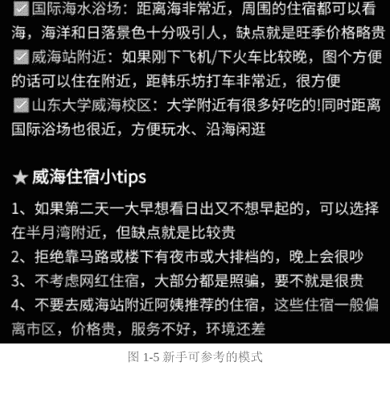
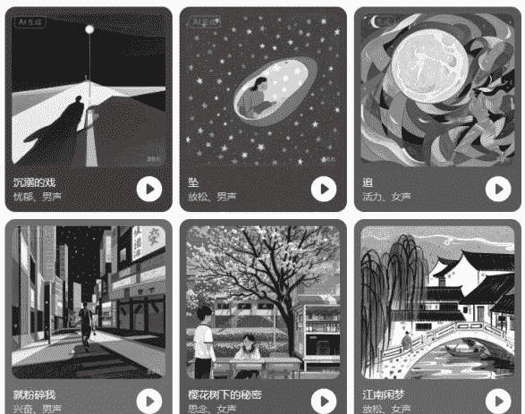
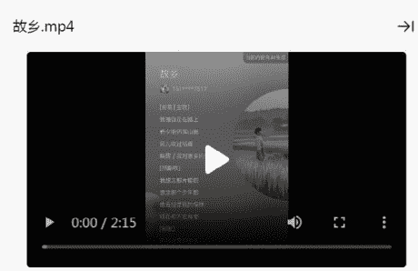
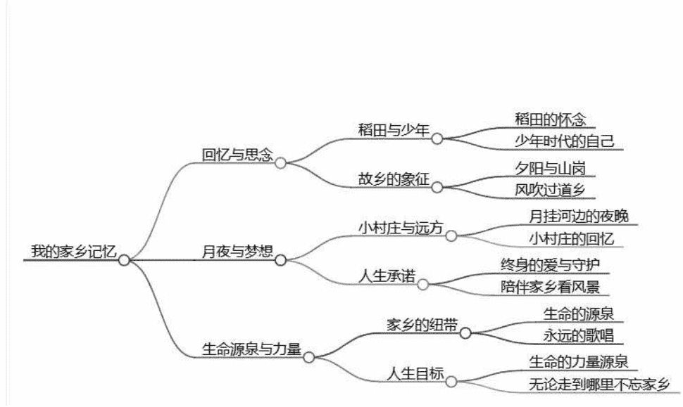
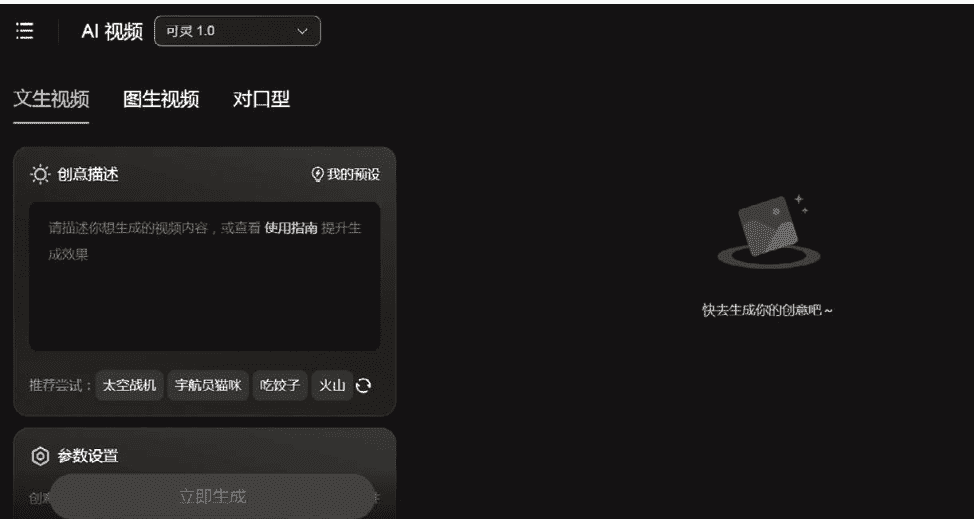
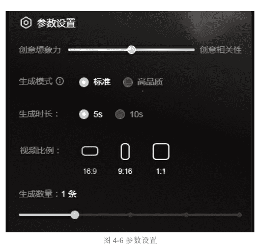
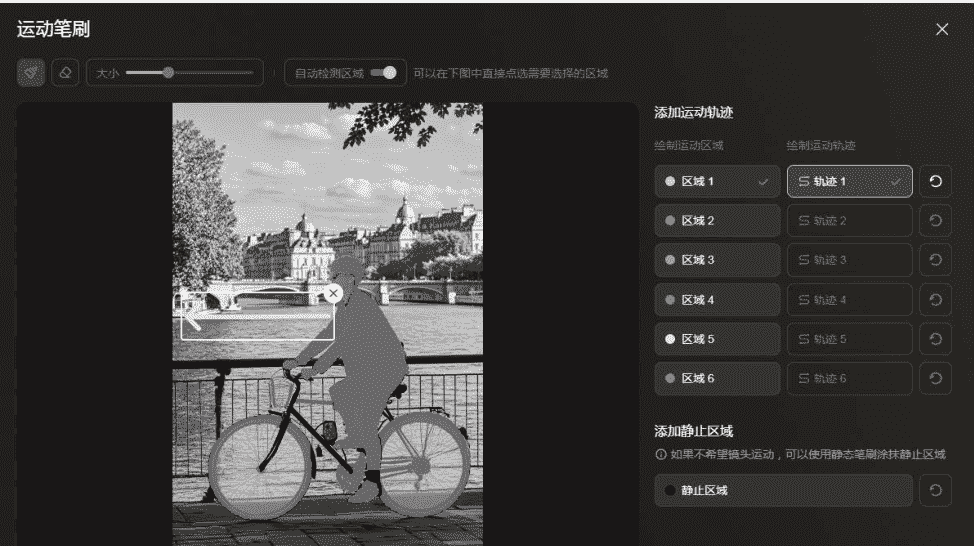
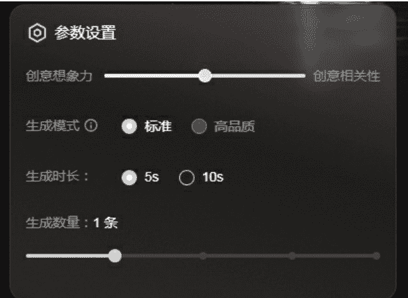

# AI 零成本创业


# 前言

在当今这个充满机遇与挑战的时代，创业成了许多人追逐梦想的途径。然而，一提到创业，很多人首先想到的是雄厚的资金、庞大的团队以及复杂的商业计划，似乎没有这些条件，创业就只能是天方夜谭。

但我要告诉你的是，在这个科技日新月异的时代，创业的版图正被一种快速发展的科技重塑，那就是人工智能（AI），它就像一把神奇的钥匙，打开了一扇通往全新创业世界的大门。在这个世界里，你不需要拥有巨额的启动资金，也无须担心复杂的技术研发成本，一切皆有可能。

当然，零成本创业并不意味着没有付出，它需要你投入时间，投入精力，这是一场与时间赛跑、与精力博弈的征程。同时，你还需要具备强大的执行力，在零成本创业的道路上，没有拖延的余地。你不能只是空想，而是要立即行动。你要学会利用各种免费的在线工具开展自己的业务，建立自己的品牌。从创建一个简单的社交媒体账号，到制作吸引人的内容，每一步都需要你积极落实，让想法从脑海中转化为实际行动。

如果你有创业的想法，但又受资金、技术等因素的限制，本书将成为你创业路上的指南针，指引你如何在资源有限的情况下，凭借AI技术与努力创造出属于自己的商业奇迹。我相信，无论你是初出茅庐的年轻人，还是想寻求新突破的职场人士，都能在这里找到适合自己的创业之路。

为了体现演示的真实性，本书尽可能保留了AI的原始输出，仅在必要的情况下做了少量改动。对于没有改动的部分，其中不免存在部分语法和文字瑕疵，请广大读者谅解。

# 引子 AI时代，零成本创业的4个赛道

AI时代，零成本创业有了更多实现的可能，而在诸多的创业赛道中，我们更推荐AI+文本、AI+绘画、AI+音频、AI+短视频这4个赛道，原因无他，这是一个自媒体时代，上述4个赛道和自媒体有着紧密的联系，并且上述4个赛道都属于轻创业的范畴，对于没有任何经验、没有太多资金的新手而言无疑更加容易上手。

## AI+文本赛道

提到文本，很多人或许担心一个问题：文字功底差也可以尝试这个赛道吗？答案自然是肯定的。有了AI的辅助，你无须再为创作灵感的枯竭而苦恼，也无须再为文笔差而苦恼，它就像是一位万能的文学助手，随时为你出谋划策。它可以在瞬间生成海量的创意点子，无论是撰写引人入胜的故事，还是创作生动有趣的广告文案，你都能在AI的助力下事半功倍。

想象一下，你是一位热爱文学的创业者，想要创作一本小说，但由于文笔、灵感的限制，想法迟迟没有落实。而有了AI的辅助，这些问题都将不再是问题。它可以在短时间内为你提供大量灵感，也可以帮你快速生成故事内容，你只需投入时间和精力对AI生成的文本进行优化和润色，就能在这个赛道上迅速起步。

## AI+绘画赛道

绘画是一种古老而又充满魅力的艺术形式。如今在AI的助力下，绘画焕发出了新的活力，这也为创业者开辟了一条新的赛道。

AI绘画工具拥有丰富多样的绘画风格和元素，无论是古典油画般的细腻质感、现代抽象画的独特韵味，还是动漫插画的可爱风格，它都能轻松驾驭。有了AI的辅助，在绘画这条赛道上，你就像拥有了一支神奇画笔的创作者，即使没有深厚的绘画功底，也能创作出不错的绘画作品。这些作品可以帮你赚取一些收益，也可以成为你自媒体账号的素材，使你的内容更加丰富，从而为你的账号吸引更多粉丝。

## AI+音频赛道

在自媒体这个大赛道上，音频也占有一席之地。但对于很多人来说，一不是专业播音出身，二不想浪费太多时间和精力自己配音，而如今有了AI的辅助，这些问题都可以迎刃而解。

试想一下，你用AI创作好了文本内容，接下来，你只需要再次借助AI，就能将这些文本内容转化成音频内容，省时又省心。除了可以配音外，AI还可以创作音乐。你不需要精通复杂的音乐理论和乐器演奏技巧，AI可以根据你设定的风格、节奏和情感元素生成音乐作品。你可以将这些作品上传到音乐平台，也可以将其变成你自媒体账号的素材，进一步丰富你的内容。

## AI+短视频赛道

在自媒体这个大赛道里，要说哪个细分赛道最热门，非短视频莫属。热门意味着这里有巨大的市场，但同时也有激烈的竞争。所以，要想从这个赛道中脱颖而出，就必须学会弯道超车，用更少的时间成本换取更多的收益。显然，AI是一个不错的帮手。

选题、文案、脚本、视频素材，这些做短视频不可或缺的要素，AI都可以给你一定的助力，从而帮你节省时间和精力；如果你不想出镜，虚拟数字人可以成为你的“替身”，解决这一问题。

其实，针对这4个细分赛道，每个赛道下还有诸多方向，在本书中我们会详细论述。阅读这本书的你们需要思考的是，不能局限于某一个赛道，更不能局限于某个更加细分的方向，因为这4个赛道并不是相互孤立的，而是有着紧密的联系。比如，用AI创作文本内容后，需要结合文本内容用AI绘图，有需要的情况下还需要将文本内容转为音频内容，所以赛道与赛道之间形成内容矩阵就显得非常有必要。此外，同一细分赛道下，不同方向之间同样可以形成矩阵，这样可以提高创业的成功率。我们之所以将其分开论述，只是为了让其可以更直观地呈现。

当然，至于该如何选择，该形成怎样的内容矩阵，还需要你们结合自己的实际情况而定，但如果你的大脑一片空白，不妨继续阅读本书，在书中寻找答案。

# 赛道 1 AI+文本：AI让文本创作更简单

## 1.1 用AI帮你写出“爆款”文章

我们在网上经常看到一些“爆款”文章，看到这些文章时，你是否会跃跃欲试：我是不是也能写出这样的“爆款”文章呢？如果你的文字功底差，要写出“爆款”文章确实很难，但如今有了AI的帮助，写出“爆款”文章将不再是一件难事。

### 好标题是打造“爆款”文章的第一步

关于自媒体文章的标题，有一个“3秒法则”，即你的文章标题不能在3秒内吸引用户，那你的文章大概率就白写了。因此，要想打造“爆款”文章，起一个好的标题是第一步。在这里，我们提供5个起标题的方法。

#### 1. 悬念法

顾名思义，悬念法就是在标题上留下悬念，让读者要想解开这个悬念，就需要打开文章。比如，“业内人士透露，××行业未来10年将有惊人变革”这一标题，可以激起该行业人群的好奇心，从而吸引他们点击文章去寻找答案。使用这个方法要把握好两个度：一是不能过于晦涩难懂，否则会让读者失去兴趣；二是悬念不能设置得太简单，一眼就能猜出答案的悬念无法吸引读者。

#### 2. 热点法

热点法是利用当前的热点来吸引读者，这些热点可以是热门事件、网络流行语、热门影视剧等。比如，在某部热门电视剧播出期间，如果你的文章标题中包含了该电视剧的名字或相关热词，就很容易吸引到对这部剧感兴趣的读者。使用该方法要注意热点与文章内容的相关性，不能为了蹭热度而强行使用某个热点，否则会让读者感到失望。

#### 3. 共鸣法

共鸣法是通过触动读者的情感和经历，引起他们的共鸣。比如，“那些年，我们一起追过的童年动画”这一标题，很容易唤起读者的怀旧情绪，增加他们点击的欲望。共鸣法的关键是要深入了解读者的情感需求和痛点，找到能够引起他们共鸣的点。标题也要表达得真诚、自然，不能过于刻意。

#### 4. 数字法

数字法是在标题中使用具体的数字，来增强标题的吸引力和可信度的方法。数字能够给人一种直观、具体的感觉，让读者更容易理解文章的内容和价值。比如，“10个让你变美的小技巧”这个标题，明确地传达了文章中有10个变美小技巧这一信息，让读者觉得很有实用性。使用数字法起标题时，数字的选择要合理，不能过于夸张。

#### 5. 反常识法

反常识法是提出与人们普遍认知相反的观点，从而引发读者的好奇心。比如，“吃主食会让你更胖”这个标题，与人们普遍认为的“减肥不能吃主食”的观点相悖，从而让读者产生想要了解为什么会有这样的想法。使用反常识法要注意要有合理的论证和解释，不能只是为了标新立异而提出不合理的观点。

掌握了起标题的方法，用户可以自己起标题，也可以用这5个方法引导AI起大量的标题，然后从中选择一个满意的标题。比如，如果你是一个写职场类文章的博主，在毕业季时，你准备写一篇关于“毕业生初入职场”的文章。这时，你可以将上述5个方法发给AI（我们在这里使用的是文心一言，用户可以结合自己的使用习惯选择相应的AI工具），然后输入如下所示的指令。

> 你是一个写职场类文章的博主，现在是毕业季，请针对“毕业生初入职场”这个方向，起一些文章标题，读者对象是即将毕业或刚毕业的学生。请你参考上述5个方法，每个方法下有4个标题。

文心一言生成的标题如下。

#### 悬念法
(1) 毕业生必看：初入职场，这三大陷阱，你能否巧妙避开？
(2) 揭秘！初入职场的毕业生，如何在一年内获得晋升？
(3) 初入职场，你的这些行为可能正在暴露你的“职场新人”身份！
(4) 惊！初入职场的毕业生，这些能力竟然比学历重要。

#### 热点法
(1) 职场新人必看！《令人心动的offer》教你如何在职场中脱颖而出。
(2) 毕业生初入职场，如何应对激烈的竞争？
(3) 毕业季来临，这些职场生存技能你了解了吗？
(4) 毕业生启示录：毕业生如何在职场中乘风破浪。

#### 共鸣法
(1) 致即将步入职场的你：我们都曾迷茫，但终会找到方向。
(2) 毕业生初入职场，那些我们共同经历过的“第一次”。
(3) 初入职场，你并不孤单！与万千毕业生共话职场经验。
(4) 那些年，我们一起追过的职场梦想（毕业生必看）。

#### 数字法
(1) 毕业生初入职场，掌握这5个沟通技巧让你事半功倍。
(2) 职场新人必看！3步打造你的个人职业品牌。
(3) 初入职场，你必须知道的7条职场礼仪。
(4) 毕业生如何在1年内成为职场中的佼佼者？4个策略分享！

#### 反常识法
(1) 毕业生初入职场，加班多并不意味着你更优秀。
(2) 颠覆认知！初入职场的毕业生别急着表现自己！
(3) 毕业生请注意，在职场中，学历低并不一定代表能力弱。
(4) 别被骗了！初入职场，这些“捷径”反而会让你走得更慢。

文心一言生成的标题不一定能满足要求，但它生成标题的速度很快，第一次生成不满意，用户可以继续让它生成第二次、第三次、第四次，直到用户满意为止。

如果生成几次之后依然得不到满意的标题，可能是指令写得不够明确，导致AI的执行出现偏差，此时用户可以修改指令，把自己的需求描述得更详细。其实，在使用任何一款AI工具时都是如此，虽然AI的功能强大，但如果指令写得不够明确，AI生成的内容就容易偏离主题。因此，用户要想让AI充分发挥其作用，就需要把指令写得更清楚。

那什么才算一个好的指令呢？在这里我们介绍一个最容易理解和操作的指标框架——ICIO框架。该框架包括4个部分：任务（instruction）、背景（context）、输入（input）和输出（output）。

- 任务（instruction）：明确说明你需要AI执行的任务。
- 背景（context）：给AI提供任务的背景信息。
- 输入（input）：输入需要AI学习或处理的内容，如果没有可跳过。
- 输出（output）：明确AI输入内容的格式与风格。

下面，我们以刚才写的指令为例，做一个简单剖析。

> 你是一个写职场类文章的博主，现在是毕业季（背景），请针对“毕业生初入职场”这个方向，起一些文章标题（任务），读者对象是即将毕业或刚毕业的学生（背景）。需要你参考上述5种方法（输入），每种方法下起4个标题（输出）。

当然，如果你的指令已经写得很明确，但仍得不到满意的标题时，可以先给AI“喂”一些“爆款”标题，让它知道你想要的标题是什么样的，然后再让它生成标题。因此，当你决定开始在公众号、头条号等平台撰写某个方向或领域的文章时，就需要开始收藏相关方向的“爆款”文章，并将其整理成一个资料库。这些资料库中的文章既可以作为你的参考，也可以作为AI学习的资料。

如果你还没有建立资料库，可以去各平台搜索相关方向的“爆款”文章，从中选取一些你认为有吸引力的标题。以微信公众号为例，用户在搜索栏输入“毕业生初入职场”后，可根据需要选择相应的搜索选项，如图1-1所示。我们选择“毕业生初入职场”这个选项后，得到如图1-2所示的搜索结果。在该界面选择“文章”“最热”两个选项后，就可以看到阅读量较高的相关文章。

图 1-1 搜索界面

图 1-2 搜索结果界面

我们选择了“刚毕业参加工作，应该学会的4件事”这个标题，并设计了如下问题。

> 你是一个写职场类文章的博主，现在是毕业季，请针对“毕业生初入职场”这个方向，起一些文章标题，读者对象是即将毕业或刚刚毕业的学生。标题需要契合毕业生的情感需求和痛点，以引起他们的共鸣。同时，标题也要表达得真诚、自然，不能过于刻意。标题风格参考“刚毕业参加工作，应该学会的4件事”，这个标题很容易引起刚毕业初入职场学生的共鸣。

文心一言生成了下面8个标题。

1. 从校园到职场，毕业生如何跨越那道“看不见的墙”？
2. 以为能改变世界，结果先被职场“上了一课”。
3. 从学霸到职场新人，毕业生如何调整心态、拥抱变化？
4. 职场初体验：那些没说出口的“我不懂”渐渐都懂了。
5. 毕业生，你的职场第一课：不是所有的努力都有即时回报。
6. 从毕业到就业，那些让毕业生“破防”的职场瞬间。
7. 毕业生，你的职场“成人礼”——从依赖到独立的蜕变。
8. 毕业生，你的职场第一课：不是所有梦想都能照进现实。

同理，这8个标题不一定都能满足要求，用户可以让文心一言多生成几次。如果第一次生成的一系列标题中有满足要求的标题，这一步就完成了，可进入下一步。

### 好内容才能吸引读者

有了标题，下一步就是内容创作。一个好的标题，可以吸引读者去点击阅读，但如果内容质量不行，读者根本不会关注你，看几句就会退出。为了避免这种情况的发生，提高将读者转化为粉丝的概率，作者一定要保证内容的质量。

那么，怎么用AI写出一篇质量还不错的文章呢？显然，光靠AI肯定不能完成这项任务。比如，我们从上面AI生成的诸多标题中选择了“职场初体验：那些没说出口的‘我不懂’，渐渐都懂了”这一标题，然后设计了如下指令。

> 你是一个写职场类文章的博主，现在是毕业季，请以“职场初体验：那些没说出口的‘我不懂’，渐渐都懂了”为文章标题，写一篇2000字的文章。文章需要切合毕业生的情感需求和痛点，以引起他们的共鸣。

文心一言生成的文章如下。

**职场初体验：那些没说出口的“我不懂”，渐渐都懂了**

又是一年毕业季，对于初入职场的毕业生而言，无论是刚进入公司时面对陌生的环境、复杂的人际关系，还是在工作中遇到种种问题，总会有一些难以启齿的“我不懂”的问题。将它们藏在心里，或成为深夜辗转反侧的焦虑，或变成第二天工作的绊脚石。

但是，随着时间的推移，在领导的指点和同事的帮助下，在不断地试错与反思中，那些没说出口的“我不懂”后来都懂了。

1. 职场不是学校，没人会把一碗水端平

@匿名用户

毕业后的第一份工作是在一家国企，工作强度不大，但氛围让我一度崩溃。

和我一起入职的有三个同事，其中两个是本地人，一个是研究生，而我是本科生。一开始我觉得学历不应该成为衡量一个人的标准，所以在工作中我格外努力，经常加班到最晚，周末也会主动到公司学习。

和我一起入职的本地同事，他们在下班时间一到就拎包走人，而且经常会被领导安排一些轻松的工作。反观我，不是要做各种杂活，就是要加班赶报表。

渐渐地，我开始怀疑自己的能力，也一度想要辞职。后来，我和一位关系不错的老员工聊起此事，他告诉我：“你要明白，职场不是学校，不会有人一碗水端平。你要做的不是抱怨，而是提升自己，让自己变得不可替代。”

后来，我转变了心态，不再抱怨，而是专注于提升自己。一年后，我因为表现突出被调到了更重要的岗位。

如今我也成了部门的小领导，面对新来的实习生，我会把最基础的工作交给他们，但这并不意味着看不起他们，而是希望他们在做这些基础工作的同时，能够沉下心来好好学习。

毕竟，职场就是“战场”，有竞争才会有进步。

## 2.所有的“为你好”，都可能是“为我好”

@林恩
工作第一年，我遇到过很多“好心人”，他们总是打着“为你好”的旗号，给你各种建议，但后来我发现，所有的“为你好”，其实都是为了他们自己好。
记得刚入职时，和我一起进公司的还有一个女孩，她和我在同一个部门，工位也在我旁边。因为都是新人，所以私下里关系不错，工作上遇到不懂的问题也会互相请教。
有一次，我们部门负责一个很重要的项目，需要加班，但那天我正好有一个很重要的约会，所以打算把手头的工作完成后，再提前下班。
正当我准备收拾东西的时候，她突然凑过来说：“你这么早走啊？我听说这个项目很重要，我们还是要好好表现才行。”
我听了觉得很有道理，于是取消了约会，继续加班。后来我发现，每次加班她都会有意无意地提醒我，要多表现、多干活。
有一次，我无意间听到她和另一个同事聊天，才知道，原来每次加班，她都会把我和她一起加班的事情告诉领导，所以每次项目完成后，领导都会特别表扬她。
那一刻，我明白了，原来不是所有的“为你好”都是真的为你好。

## 3.你可以善良，但一定要有自己的底线

@可乐
初入职场时，我觉得自己一定要成为一个善良的人，无论是对待同事还是领导都应该保持谦虚和礼貌的态度。
所以，一开始的时候，我揽了很多不属于自己的工作，无论是谁找我帮忙，我都会尽力去做。我觉得，只有这样，才能在职场中建立好人缘。
但后来我发现我的善良并没有换来别人的尊重和理解，反而让我陷入了无尽的麻烦。
有一次，因为一个同事的失误，我们部门的工作出现了差错，领导找到他的时候，他居然把所有的责任都推给了我，说是我没有提醒他。
那一刻，我才意识到，善良如果没有底线，就会成为别人伤害你的武器。
从那以后，我学会了拒绝，不再无底线地帮助别人，而是把更多的精力放在自己的工作上。

## 4.不要高估你和同事的关系

@七七
初入职场时，我以为只要自己对别人好，就能收获别人的真心，所以，在工作中，我总是尽力去帮助同事，无论是工作上的事情，还是生活上的困扰，我都会尽力去倾听和帮助他们。
那时候，我觉得我和同事的关系很好，就像是朋友一样。直到有一天，我无意间听到两个同事在议论我，才知道他们一直在背后说我的坏话。
那一刻，我觉得很受伤，也很失望。我开始反思自己，是不是哪里做得不够好，才会让他们这样对待我。
但后来我发现，其实并不是我做得不够好，而是我高估了自己和同事的关系。在职场中，同事之间更多的是竞争关系，很难有真正的朋友。
从那以后，我学会了保持距离，不再轻易和同事交心，而是把更多的精力放在提高自己上。

## 5.你可以不懂，但一定要学会提问

@丸子
作为一个职场新人，我经常觉得自己什么都不懂，很害怕问别人问题，怕别人觉得我笨，也怕打扰到别人。
所以，很多时候，遇到不懂的问题，我都会自己摸索，或者上网找答案，但这样做不仅效率低下，而且很容易出错。
有一次，我负责一个很重要的项目，因为对业务流程不熟悉，导致项目进展缓慢，我很着急，但又不敢问领导，怕他觉得我能力不强。
后来实在没办法，我只好硬着头皮去找领导请教。没想到，领导不仅没有责怪我，反而很耐心地给我讲解了整个业务流程，还给了我很多实用的建议。
那一刻，我才意识到，其实领导并不怕你问问题，他怕的是你不懂装懂，怕的是你不愿意学习。
从那以后，我学会了提问，遇到不懂的问题，我会及时向同事或者领导请教。这样不仅提高了工作效率，也让我学到了很多新知识。

## 6.写在最后

初入职场，每个人都会遇到各种各样的困难和挑战，也都会有很多“我不懂”的时刻，但请相信，这些困难和挑战，都是成长路上的必经之路。
不要害怕提问，不要害怕犯错，更不要因为害怕而不敢尝试。因为只有经历过，你才会明白；只有尝试过，你才会成长。
那些没说出口的“我不懂”，后来都懂了，而你也在这个过程中逐渐成长为更好的自己。

就文章模式而言，文心一言生成的这篇文章是具有可用性的，即通过几个初入职场毕业生的口，说出他们在职场中的经历和成长。但这篇文章存在两个明显缺点：一是故事的叙述有些生硬，难以引起读者共鸣；二是故事与故事之间同质性较强，难以吸引读者读完全文。因此，如果作者决定使用这篇文章，就需要对文章内的故事进行优化。

其实，所有AI工具都存在这样一个问题：虽然它们生成内容的效率很高，但或多或少都会存在一些模式化的“硬伤”，需要用户对文字内容做一定的修改。

用户要想减少模式化的“硬伤”，可以提前准备一篇“爆款”文章，让AI模仿这篇文章的风格去写。用户在这里需要注意一点，只能让AI去模仿“爆款”文章的风格，并且，AI生成文章后，用户需要和原文章进行对比，避免出现抄袭的情况。

比如，我们将《刚毕业参加工作，应该学会的 4 件事》这篇文章发给了文心一言，并设计了如下指令。

> 你是一个写职场类文章的博主，请仿照这篇文章的风格，以“毕业生初入职场，那些没说出口的‘我不懂’，后来都懂了”作为文章标题，写一篇 2000 字的文章。文章需要切合毕业生的情感需求，以引发他们的共鸣。

相比于第一次生成的文章，文心一言此次生成的文章可用性强了很多，但仍旧存在啰嗦、重复等问题。于是我们对文章做了删减，并对部分内容做了简单的修改，得到下面这篇文章。

## 职场初体验：那些没说出口的“我不懂”，渐渐都懂了

2024 年的夏末秋初，随着又一批毕业生的加入，职场迎来了新的面孔。他们带着对未来的憧憬与不安，踏入了这片既熟悉又陌生的领域。学士帽飞扬的瞬间，定格为永恒，而职场的画卷正徐徐展开。

### 初入职场的困惑与沉默

“上班的第一天，我就感觉自己像是迷失在一个陌生的森林里。”小美说起她初入职场的经历时，眼中仍带着一丝迷茫。小美是一名普通的大学毕业生，今年夏天，她正式成为一名职场新人。
小美入职的第一天就被安排参加了一场部门会议。会上，大家讨论的内容她大部分都没听懂，她只能硬着头皮坐在那里，偶尔点头微笑，以表示自己正在认真地听。会议结束后，她甚至不敢问同事那些她没听懂的问题，生怕被嘲笑无知。
“我真的好想问，那个项目到底进展到哪一步了，为什么大家说的那些专业术语我都听不懂？”小美在心里嘀咕着，始终没有勇气开口问。
小美的经历并不是个例。很多毕业生初入职场时都会感到困惑和迷茫。他们面对的是一个全新的环境，需要适应新的工作节奏、新的同事关系以及新的职业规则。这些规则往往不会有人明确地告诉他们，而是需要他们在实践中自己去领悟和摸索。

### 生活与职业的双重挑战

除了职场上的困惑外，毕业生们还需要面对生活压力。
“每个月的房租、水电费、交通费、吃饭钱，这些开销加起来真的让我压力很大。”小丽是一名刚刚毕业的职场新人，她租住在一个离公司不远的公寓里，但每个月的房租却让她喘不过气来。
小丽说，她在学校时从来没有为钱发愁过，每个月的生活费都是父母按时打到卡上，她只需要担心怎么花完这些钱。但现在不同了，她需要自己承担所有的生活开销，还要为未来的职业发展储备一定的资金。
“我开始学会精打细算地过日子，不再像以前那样大手大脚地花钱，”小丽说，“我甚至开始自己做饭吃，虽然厨艺不太好，但总比在外面吃要便宜很多。”
除了生活成本的压力外，毕业生们还需要面对职场上的竞争和压力。他们需要不断地学习和提升自己，才能在职场上站稳脚跟。这种压力让他们不得不放弃很多原本属于他们的休闲和娱乐时间，投入到无尽的工作和学习中。
“我真的很怀念在学校里的日子，那时候我可以无忧无虑地玩耍和学习，”小丽感叹道，“但现在不同了，我需要为自己的未来打拼和奋斗。”

### 那些没说出口的“我不懂”，是成长的见证

经过一段时间的磨炼和成长，毕业生们渐渐发现，那些曾经没说出口的“我不懂”已经成为他们成长的见证。
“我开始学会承担责任和承受压力，不再像以前那样遇到困难就退缩。”小美说：“我现在明白了，职场上没有永远的避风港，只有不断地努力和进步才能让自己变得越来越优秀。”
“我开始学会尊重和理解他人，不再像以前那样以自我为中心。”小丽说：“我现在明白了，每个人都有自己的优点和不足，我们需要学会欣赏和包容他人的不同。”

### 结语：成长，是痛并快乐的过程

职场之路漫长而艰辛，但请相信，每一次的困惑和挑战，都是成长的契机。那些没说出口的“我不懂”，终将在时间的洗礼下变成你们最宝贵的财富。愿你们在未来的职场生涯中，勇敢前行，无畏挑战，成就属于自己的精彩人生！

总体而言，这篇文章经过简单修改后虽然质量谈不上很高，但基本满足发文的要求。如果你能拿出更多时间，继续润色文章，就可以进一步提高文章质量。当然，到这一步只是完成了文字工作，作者还需要结合文章内容匹配一些图片，以提高文章的“颜值”，同时缓解读者因大量阅读文字所产生的视觉疲劳。关于如何使用AI生成图片，我们会在下一章详细介绍。

## 1.2 有了AI，人人都能创作小说

我们直入主题，如果你有写小说的想法，或者想通过写小说增加你的收入，却由于文笔不好、时间不充裕等原因一直搁置，现在不妨借助AI这个工具将你的想法变为现实。

在讲解如何利用AI创作小说之前，我们先来了解一下写小说的流程，大致可以分为5步。

- （1）构思小说的主题和背景。
- （2）写故事梗概。
- （3）设计主要角色。
- （4）构思小说章节提纲。
- （5）创作小说。

这个流程其实也是我们利用AI写小说的流程。当然了，如果前 4 步的内容已经在我们的大脑中完成了构思，那么我们可以直接进入第 5 步。其实，哪怕我们已经有了构思，也可以将构思的内容发给AI，看看它是否能为我们提供更多的灵感。

现在，假设我们的大脑一片空白，只有“想写一部科幻小说”这个想法，我们便需要按照上述流程一步步操作。

### ● 构思小说主题与背景

小说的主题背景是指为小说的故事展开所设定的综合环境，包括社会、历史、地理、文化等诸多方面，它为主角的故事提供了发生的背景。

基于这一认识，我们参照ICIO框架（如果没有特别说明，本书所设计的指令全部参考这一框架，所以在后面的论述中我们不再对其进行强调）设计了如下指令。

> 你是一位科幻小说作家，有着出色的写作能力，请构思一个科幻小说的主题背景，包括主题、时代背景、故事发生地等。要求 200 字左右，并保证主题背景具有原创性和吸引力。

文心一言生成的主题背景如下。

> 主题：星际遗落
> 时代背景：在遥远的未来，人类已进入星际大航海时代，众多星系被探索，文明璀璨而多元。然而，一场突如其来的宇宙灾难摧毁了星际网络，将人类文明的各个分支隔绝在茫茫星海中。
> 故事发生地：遗落星域，一个位于宇宙边缘，被古老星际文明遗弃的神秘星系。这里隐藏着通往古老科技与智慧的关键，也是人类重新连接各星系、找回失落文明的唯一希望。主角将在此地展开一场关于勇气、智慧与人性的星际冒险。

### ● 撰写故事梗概

有了主题背景，下一步就是撰写故事梗概。为了避免文心一言忘记前面生成的内容，用户可以将文心一言前面生成的内容发给它，并设计如下所示的指令。

> 这是一部科幻小说的主题背景，请继续撰写小说的故事梗概，包括事件起因、主要冲突、主要转折点和结局，要求 300 字左右，故事要具有吸引力。

文心一言生成的故事梗概如下。

> 公元 3050 年，宇宙灾难导致星际网络崩溃，人类文明陷入孤立无援的境地。为了重振文明，一支精英探险队踏上征程，前往遗落星域，寻找古老星际文明的遗迹，重建星际网络。
> 在遗落星域，主角林悠然和她的团队遭遇了重重困难：恶劣的星际环境、未知的外星生物，以及古老文明的陷阱。他们不仅要与时间赛跑，还要面对内部的背叛与分裂。林悠然凭借智慧与勇气，揭露了隐藏在团队中的叛徒身份，并获得了古老文明的核心技术。
> 然而，真正的挑战才刚刚开始。在激活古老科技时，他们触发了星际文明的防御机制。面临生死存亡的抉择，林悠然决定牺牲自己，最终以生命为代价破解了防御机制。古老的科技被成功激活，星际网络逐渐恢复，人类文明重燃希望！

### ● 设计主要角色

有了故事梗概，用户只需将故事梗概发给文心一言，然后让它根据故事梗概来设计角色，指令如下。

> 这是一部科幻小说的故事梗概，请结合该内容设计 5~10 个角色（包括主角），并为每个角色提供一个详细的介绍，包括外貌、性格、职业、能力等。要求每个角色的介绍不超过 200 字。

文心一言设计的角色及介绍如下。

> 林悠然：主角，女性，长发披肩，眼神坚定。她是一名杰出的星际考古学家，拥有超凡的智慧和冷静的判断力。她身着特制的探险服，擅长解析古代文明密码。性格坚韧不拔，是团队的灵魂人物。在危急时刻，总能凭借智慧化险为夷，带领团队走向胜利。
> 赵雷：男性，性格直爽，忠诚可靠。林悠然的得力助手。他在战斗中总是冲在最前线，保护队友。
> 李梦瑶：女性，短发，眼神灵动。她是团队的医疗官，精通生物学和医学，外表温柔，内心坚韧。
> 陈子轩：男性，长发微卷，面容俊朗。星际工程师，擅长修理和改造机械。性格沉稳，善于思考。在星际修复过程中，他发挥了关键作用。
> 张心怡：女性，长发飘逸，气质优雅。星际导航员，拥有丰富的星际航行经验，性格独立、冷静。在恶劣的星际环境中，她总能准确地找到前进的方向。
> 罗浩：男性，短发精干，身材适中。星际通信专家，擅长发送和破解加密信息，性格谨慎、机智。在团队遭遇背叛时，他及时发现了叛徒的行踪。
> 许晴：女性，长发披肩，面容清秀。她是团队的历史学家，对古代文明有深入研究，性格温柔、善良。在解读古老文明遗迹时，她提供了重要线索。
> 郭峰：男性，短发，皮肤黝黑。星际地质学家，擅长分析星球地质结构，性格乐观、幽默。他在寻找星际遗迹的过程中，发现了关键的地质线索。
> 韩风：男性，长发微乱，眼神深邃。他是一名星际黑客，擅长侵入和操控计算机系统，性格狡黠、聪明。在激活古老科技时，他成功破解了防御系统。
> 叛徒陆明：男性，短发整齐，面容冷峻。原团队的星际战略家，因个人野心而背叛，性格阴险、狡诈。在关键时刻，被林悠然揭穿并制服。

当然，一部小说不可能只有 10 个角色，用户可以让文心一言继续设计更多的角色，也可以在后续故事情节展开的过程中根据需要设计新的角色。

### ● 构思小说章节大纲

章节大纲是整本书的骨架，在很大程度上影响着小说的质量。为了避免AI理解出现偏差，用户需要将故事梗概和主要角色发给文心一言，然后由它根据这些信息生成小说的章节大纲，指令如下。

> 上述内容是一部科幻小说的故事梗概和主要角色，请结合该内容构思小说的章节大纲。要求 15~20 章，章节标题不要模式化，要有吸引力。

到这一步，AI的不足开始显露，尽管我们在指令中强调了“不要模式化”“要有吸引力”，但AI生成的内容仍然会存在模式化、没有吸引力等问题，因此，从这一步开始，用户便需要投入一些精力，对AI生成的内容进行适当的修改。
修改的方式有两种：一是作者直接对AI生成的章节大纲进行修改；二是针对章节大纲存在的问题，提出修改意见，让AI根据你的修改意见再生成一版章节大纲。如果用户到了这一步已经有了比较清晰的思路，可采取第一种修改方式；如果用户依旧没有比较清晰的思路，可采取第二种方式。
我们在这里采取的是第二种方式，先后让文心一言生成了 5 版章节大纲，然后从这 5 版章节大纲中选取了可用的部分，最后稍作修改，得到了如下章节大纲。

### 小说章节大纲

**第一章：文明的余晖**
- 描述公元 3050 年的宇宙灾难前夜，人类文明高度发达但脆弱，星际网络即将崩溃的场景。
- 林悠然作为星际考古学家，预感灾难即将来临，开始筹备探险行动。

**第二章：遗落星域的传说**
- 探险队成员逐一介绍了各自背景与技能，以及他们对遗落星域的向往与恐惧。
- 林悠然向探险队成员讲述关于遗落星域的古老传说。

**第三章：启程前的暗流**
- 探险队内部出现分歧，陆明提出激进策略，试图加快进程。
- 林悠然坚持谨慎行事，两人之间的裂痕初现端倪。

**第四章：星际迷雾的考验**
- 探险队穿越星际迷雾，遭遇恶劣天气和未知障碍物。
- 赵雷英勇，保护了团队安全，但损失了部分装备。

**第五章：外星生物的突袭**
- 探险队在星球表面遭遇了外星生物，李梦瑶紧急研制了疫苗。
- 团队首次体验到外星生态的复杂性以及与之共存的困难。

**第六章：古老文字的启示**
- 探险队发现古老遗迹的入口，并在入口处发现了古老的文字。经过多次试验，许晴成功解读了古老文字，为团队打开了通往古老遗迹的大门。
- 陆明的野心开始显露，他试图独吞遗迹中的宝藏。

**第七章：信任危机**
- 罗浩在通信中察觉到异常，于是林悠然开始秘密调查陆明。
- 团队内部信任危机加剧，气氛也变得紧张。

**第八章：叛徒的真面目**
- 探险队深入遗迹，遭遇机关陷阱，陈子轩展现机械才能。
- 林悠然与陆明正面冲突，揭露其背叛行为，但未能当场将其制服。

**第九章：生死逃亡**
- 陆明启动遗迹自毁装置，探险队陷入生死逃亡的境地。
- 赵雷带领大家躲避危险，李梦瑶利用疫苗对抗遗迹中的生物陷阱。

**第十章：绝处逢生**
- 林悠然在绝境中找到出路，利用遗迹中的古老科技破解了自毁装置。
- 团队团结一致，成功逃脱，但陆明却下落不明。

**第十一章：遗落星域的秘密**
- 探险队深入研究遗迹，揭示了遗落星域与古老星际文明的关联。
- 团队对遗落星域有了更深刻的认识。

**第十二章：防御机制的觉醒**
- 探险队决定尝试启动古老科技的原型机，以探索其潜在的能力。
- 在启动过程中，他们意外触发了星际文明的防御机制，面临生死存亡的考验。

**第十三章：牺牲**
- 生死存亡的时刻，林悠然决定牺牲自己，成功地破解了防御机制。
- 她的决定让团队得以生存，她却付出了生命的代价。

**第十四章：生死较量**
- 古老科技被成功激活，但陆明突然出现，试图夺取古老科技的“核心”。
- “核心”区域只能容纳两人，赵雷进入后，与陆明展开生死搏斗，最终成功制伏陆明。

**第十五章：曙光**
- 探险队回到飞船，利用遗迹中的科技，修复星际网络。
- 星际网络逐渐恢复，人类文明重燃希望。

需要注意的是，章节数不是固定的，如果用户想写长篇，章节可以多一些。

### ● 创作小说内容

这是创作小说的最后一步，也是实际操作中最难的一步。在这一步，用户可能会遇到诸多问题，其中比较棘手的问题有两个。

第一个是上下文不连贯的问题。如果你只是写一篇几千字的短篇小说，这个问题出现的概率比较低，但如果你要创作的小说达到了上万字，甚至几十万字，超出了AI文本处理能力的上限，那便容易出现上下文不连贯的问题。因此，在这个过程中，用户需要进行干预，以保证AI创作的内容连贯。

第二个问题出现在逐章创作的过程中。AI每次生成的内容有字数限制，所以我们通常采取逐章创作的方式，但如果你对每章的字数要求较多，AI 便会出现跨章创作的问题，即你要求创作第一章的内容，但AI创作的内容却包含了第二章的内容。之所以会出现这样的问题，归根到底还是AI处理文本的能力有一定的局限性。

避免上述问题的方法就是让AI逐步完善内容，而不是直接抛给AI“创作第一章”这样一个简单的指令。以我们前面构思的科幻小说为例，我们设计的指令是这样的。

> 故事梗概
> 公元 3050 年，宇宙灾难导致星际网络崩溃，人类文明陷入孤立无援的境地。为了重振文明，一支精英探险队踏上征程，前往遗落星域，寻找古老星际文明的遗迹，重建星际网络。
> 在遗落星域，主角林悠然和她的团队遭遇了重重困难：恶劣的星际环境、未知的外星生物以及古老文明的陷阱。他们不仅要与时间赛跑，还要面对内部的背叛与分裂。林悠然凭借智慧与勇气，揭露了隐藏在团队中的叛徒，并获得了古老文明的核心技术。
> 然而，真正的挑战才刚刚开始。在激活古老科技时，他们触发了星际文明的防御机制。面临生死存亡的抉择，林悠然决定牺牲自己，最终以生命为代价破解了防御机制。古老科技被成功激活，星际网络逐渐恢复，人类文明重燃希望！
> 小说第一章：文明的余晖
> - 描述公元 3050 年的宇宙灾难前夜，人类文明高度发达但脆弱，星际网络即将崩溃的场景。
> - 林悠然作为星际考古学家，预感灾难即将来临，开始筹备探险行动。
> 这是小说的故事梗概与第一章的情节概述，请完善第一章的情节，包括：①星际网络的作用、人类文明的发达与脆弱，星际网络为什么会即将崩溃？②详细介绍主角林悠然（她是一名卓越的星际考古学家，拥有超凡的智慧和冷静的判断力，擅长解析古代文明密码），她有着怎样的家世背景？是如何察觉到灾难即将来临的？又是如何筹备探险计划的？在筹备的过程中，她遇到了哪些阻碍？

上述指令有两个要点：一是故事梗概，作用是确保文心一言的创作不会偏离主线；二是限定了AI创作的范围，即指明了第一章情节完善的方向，其作用是将AI创作限定在第一章的情节中，避免出现跨章节创作的问题。在后面逐章创作的过程中，这两点都必不可少，否则AI 的创作会不受约束。此外，我们还给出了语言风格的参考对象，这一点可有可无，根据用户的需求而定。

发送上述指令后，文心一言生成的内容如下。

> 公元 3050 年，人类文明如同璀璨星河中最为耀眼的明珠，其光芒穿越了无垠的宇宙，连接起万千星系。在这个时代，星际网络如同人类的神经脉络，不仅承载着信息的洪流，更是文明交流、资源共享、科技跃迁的命脉。巨大的空间站如星辰般点缀在银河的每一个角落，超光速通信技术让遥远的星系仿佛触手可及，虚拟现实技术让知识与文化跨越时空的界限实现无缝对接。人类社会的繁荣与和谐达到了前所未有的高度，艺术与科学相互辉映，创造出无数令人叹为观止的奇迹。
> 然而，在这份辉煌之下，隐藏着难以察觉的脆弱。星际网络的核心——一个由无数量子节点构成的超级智网，其复杂程度超乎想象，也因此变得异常敏感。随着人类对宇宙探索的深入，未知的能量波动和宇宙射线开始干扰这一精密系统，导致信息传输错误频发、系统稳定性日益下降。
> 林悠然，出身于一个历史悠久的知识世家，自小便对古老文明充满了无限的好奇与向往。家族世代守护着一幅古老的星图，上面标记着传说中遗落星域的坐标，据说那里隐藏着能够引领文明飞跃的古老科技。林悠然不仅继承了家族的智慧，更拥有超凡的解析能力和冷静的判断力，这使她在星际考古领域独树一帜。

在一次偶然的机会中，林悠然通过分析星际网络的异常数据，敏锐地察觉到一场前所未有的宇宙灾难正悄然逼近。她发现，那些看似随机的信息干扰实际上是一种古老的宇宙预警信号，预示着星际网络即将彻底崩溃。这一发现让林悠然深感震撼，她深知，一旦星际网络瓦解，人类文明将陷入孤立无援的黑暗时代，科技倒退、文化断层，甚至可能引发文明的消亡与倒退。

面对即将到来的危机，林悠然决定组建一支精英探险队，前往遗落星域寻找古老星际文明的遗迹，以期找到重建星际网络的关键技术。然而，这一计划并不一帆风顺。

筹备过程中，林悠然首先遭遇了来自官方的质疑与阻挠。领导对于她的预言持怀疑态度，认为这是一场无意义的冒险，甚至可能引发社会的恐慌与动荡。同时，探险所需的高额资金与技术支持也让林悠然四处碰壁。更糟糕的是，内部出现了背叛者——一名原本应是她最信任的同事，因为个人利益与恐惧，暗中向外界泄露了探险计划，企图阻止这一可能威胁到现有权力结构的行动。

面对重重困难与背叛，林悠然没有放弃，她凭借自己的智慧与坚韧，逐一化解了外部的阻力，同时巧妙地揭露了内部的叛徒，确保了探险队的纯洁与团结。在这个过程中，林悠然展现出了超越常人的勇气与决心，她在星际网络的余晖中愈发坚定，仿佛成为人类文明最后的希望之光。

上述内容没有偏离这一章设定的情节，但存在两个问题：一是筹备过程中面对的阻挠的描述太简单，情节不够丰富；二是缺少对话和对角色的心理描写，这使得情节略显单调。于是，我们针对这两个问题设计了如下练习。

> 林悠然的计划遭遇了很多科学家的反对，而就在双方争论的过程中，灾难突然降临，星际网络崩溃，林悠然顺理成章地成了计划的负责人。请针对这段情节进行拓展。另外，增加一些心理描写和对话，以使情节丰富，更具吸引力。

文心一言补充了如下内容。

会议室内气氛紧张而压抑，林悠然站在投影幕前，面对着数十位顶尖科学家的质疑和反对，她的声音在空旷的会议室中回荡，但似乎无法穿透那些冰冷的目光和怀疑的壁垒。

“我们不能仅凭一些异常数据就断言星际网络即将崩溃，这太冒险了。”一位年迈的科学家摇着头，语气中充满了不满。

“可是，如果我们不采取行动，一旦灾难真的降临，后果将不堪设想。”林悠然试图说服他们，但她的声音在嘈杂的争论中显得如此微弱。

就在这时，会议室的大屏幕突然闪烁起来，紧接着是一阵急促的警报声，星际网络的图标开始闪烁，数据流动变得缓慢而卡顿，最终彻底失去了反应。

“星际网络崩溃了！”一位年轻的科学家惊呼道。

会议室内的所有人都愣住了，他们眼睁睁地看着星际网络崩溃了，心中充满了震惊和恐惧。这一刻，所有的争论和质疑都烟消云散了，只剩下无尽的绝望和迷茫。

在星际网络崩溃的混乱中，林悠然迅速冷静下来，开始组织团队成员进行应急处理。她深知，此刻的自己必须承担起更大的责任。

“大家不要慌，我们立刻启动应急预案，确保所有关键数据得到保护。”林悠然的声音坚定而有力。她迅速分派任务，指挥团队成员行动。

在她的带领下，团队成员们迅速进入了工作状态，他们尽力保护着那些可能对人类文明至关重要的数据和资料，而林悠然则开始与星际联盟的高层沟通，争取更多的资源和支持。

“林悠然博士，现在星际网络已经崩溃，你的探险计划必须立即执行。”星际联盟的高层在电话中急切地说道。

林悠然点了点头，心中涌起一股责任感和使命感：“我明白了，我会全力以赴的。”

就这样，林悠然顺理成章地成了探险计划的负责人。她知道自己肩上的担子有多重，但她也相信，只要能够找到古老文明的遗迹，重建星际网络，人类文明就有希望复兴。

将第一次生成的内容的最后两段换为第二次补充的内容，第一章的内容便初步完成了。接下来，用户还需要进行人工修改和优化，以进一步提高小说的质量。

最后，我们再来总结一下小说内容创作的技巧：第一点，限定情节，给AI的创作限定一个范围；第二点，针对第一次创作的内容细化要求，使内容更符合用户的需求；第三点，人工修改和优化。

前面我们提到，小说内容的创作是实际操作中最难的一步。但只要按照这三点进行操作，很多问题都可以避免。

## 1.3 用AI撰写拆书稿，你也可以成为读书博主

对于很多新手来说，或许没有听过“拆书稿”这个说法，简单来说，拆书稿就是读者阅读一本书后，将书中的核心内容提炼出来，然后结合自己的认识，用通俗易懂的文字阐述出来。由此可见，撰写拆书稿有个前提，那就是读者要先读完这本书，并理解这本书的主要内容。而如今，哪怕你没有读过某本书，也可以在AI的辅助下写出一篇通顺的拆书稿。

拆书稿的类型有很多，如果我们借助AI来写拆书稿，并不是每种类型都能胜任，相比较而言，荐书类拆书稿和感悟类拆书稿的实操性更强。当然，虽然有了AI的辅助，我们可以跳过阅读这一步，但我仍然建议大家把书粗略地阅读一遍，对这本书有一个大致的了解，以便更好地把握AI生成的内容。当然，如果时间不允许，用户也可以去看其他博主对这本书的解读，从而快速了解本书的核心内容。

对书籍内容有了大致的了解后，下一步就可以撰写拆书稿了。刚刚我们提到了两种拆书稿，这两种拆书稿有着不同的写作方法。

### ● 荐书类拆书稿

荐书类的拆书稿就是向读者推荐书籍的稿子。这类拆书稿也有多种写法，其中最简单的一种就是对书籍进行简要介绍，这也是借助AI最容易操作的一种写法。那么，该怎么向读者介绍这本书呢？我们认为至少应包括如下4点内容。

- （1）作者简介。简要介绍本书作者。
- （2）书籍简介。简要介绍这本书的概要及核心观点。
- （3）主要内容。详细阐述作品的主要内容。
- （4）阅读人群。分析适合阅读本书的群体，并阐述这些群体可以从本书中获得哪些收获。

当然，在设计指令时，第一点可以省去。以《富爸爸·穷爸爸》这本书为例，我们可以设计如下一条指令。

> 你是一个有着丰富经验的读书博主，请从以下4点着手，总结《富爸爸·穷爸爸》这本书的内容。
> （1）作者简介：简要介绍本书的作者。
> （2）书籍简介：简要介绍这本书的概要及核心观点。
> （3）主要内容：详细阐述作品的主要内容。
> （4）阅读人群：分析适合阅读本书的群体，并阐述这些群体可以从本书中获得哪些收获。

文心一言生成的内容如下。

1. 作者简介
《富爸爸·穷爸爸》的作者是罗伯特·清崎和莎伦·L·莱希特。罗伯特·清崎是第四代日裔美国人，1947年出生于美国夏威夷，是一位投资家、企业家和教育家。他是“富爸爸”系列丛书的主要作者，也是富爸爸公司的创始人之一，被誉为财商教育的领路人。莎伦·L·莱希特是一位注册会计师，玩具和出版业的资深经理和咨询专家，她将自己的专业知识奉献给了教育事业，与罗伯特·清崎共同创作了多本畅销书。

2. 书籍简介
作品概要：《富爸爸·穷爸爸》是一本以提倡“财务智商（财商）”教育为主题的畅销书。书中通过作者亲身经历的财富故事，展示了“穷爸爸”和“富爸爸”截然不同的金钱观和财富观。
核心观点：穷人为了钱工作，而富人则让钱为自己工作。作者否定了“高薪=财务自由”的财富法则，强调要分清资产与负债，从容面对个人财富的变化，最终达到财务自由的境界。

3. 主要内容
书中详细描述了作者的两个爸爸：一个是他的亲生父亲，即“穷爸爸”，他是一个高学历的教育官员，虽然受过良好的教育，但每月还要为缴付账单而烦恼；另一个是他好朋友的父亲，即“富爸爸”，一个高中没毕业却善于投资理财的人，生活十分富裕。书中不断比较“富爸爸”和“穷爸爸”在性格、思想、行为和结果上的差异，从而指出造成贫富差异的原因。
书中提出了资产和负债的定义，并强调了增加资产和减少负债的重要性。作者认为，资产是能够不断产生财富的东西，如股票、股权等；而负债则是不能产生收益的东西，如车子。他鼓励人们要关注自己的现金流，学会让金钱为自己工作，而不是为金钱工作。

4. 阅读人群
（1）适合人群：《富爸爸·穷爸爸》适合18岁以上，对财务自由、投资理财有兴趣的人阅读。无论是职场新人、创业者，还是已经有一定财富积累的人，都可以从这本书中获得启发。
（2）阅读收获：对于职场新人来说，这本书可以帮助他们树立正确的金钱观和财富观，学会如何规划自己的职业生涯和管理财务。
对于创业者来说，这本书可以提供宝贵的创业经验和投资建议，帮助他们更好地管理自己的企业。
对于已经有一定财富积累的人来说，这本书可以帮助他们进一步优化自己的资产配置，实现财务自由。

上述内容中，第三部分“主要内容”的内容量较少，所以我们继续用文心一言进行补充，指令如下。

> 关于“主要内容”的阐述可以再详细一些。

文心一言生成的内容如下。

1. 穷爸爸与富爸爸的观念对比
穷爸爸：他是一位教育官员，受过高等教育，拥有稳定的工作和收入，但他的金钱观念相对保守，认为只有通过辛勤工作才能赚钱，而储蓄和避免负债是保障生活的关键。穷爸爸认为“好工作”意味着高收入和高职位，但这样的观念往往使他陷入财务困境，因为工资的增长速度永远赶不上通货膨胀的速度。
富爸爸：与穷爸爸不同，富爸爸虽然学历不高，但他拥有敏锐的商业头脑和投资眼光。他鼓励作者和他的朋友去冒险、去尝试，从失败中学习，并从失败中站起来。富爸爸认为，资产是能产生收入的东西，而负债则是消耗收入的东西。他教导作者如何区分这两者，并鼓励作者努力增加自己的资产，同时减少自己的负债。

2. 资产与负债的区分
资产的定义：能够为你带来收入或增值的东西，如股票、债券、房产、企业等。这些资产可以持续产生现金流，增加你的财富。
负债的定义：让你支出金钱的东西，如贷款、信用卡债务等，这些负债会消耗你的现金流，减少你的财富。
重要性：通过增加资产和减少负债，人们可以逐渐积累财富，实现财务自由。这一观点打破了传统上“收入高就能致富”的观念，强调了理财能力的重要性。

3. 增加资产的方法
打工。虽然可以带来稳定的收入，但往往受限于时间和职位的晋升。打工可以作为初期积累资金和经验的方式，但不应成为实现财务自由的唯一途径。
创业。具有更大的风险和挑战，但也有可能带来更高的回报。创业需要具备一定的市场洞察力和商业智慧，同时需要承担一定的风险。
投资。实现财务自由的重要途径之一。合理的投资配置，可以让资产实现增值。投资需要具备一定的财务知识和投资技巧，同时需要关注市场动态和风险因素。

4. 提升财商和理财能力
财商的定义：一个人处理金钱的能力，包括理财知识、投资技巧和市场洞察等方面。
提升途径：通过不断学习和实践，人们可以提升自己的财商，这包括阅读专业书籍、参加线上或线下的培训课程、与有经验的投资者交流等。
重要性：提升财商和理财能力可以帮助人们更好地掌握金钱的主动权，实现自己的财务目标。

5. 实现财务自由的路径
勇于尝试和冒险。作者鼓励读者要勇于尝试新事物，敢于冒险。在追求财务自由的过程中，可能会遇到挫折和失败，但只有通过不断尝试和学习，才能逐渐掌握理财的要领。
持续学习和实践。实现财务自由需要不断学习和实践。通过不断积累知识和经验，人们可以逐渐提高自己的理财能力，更好地掌握金钱的主动权。
坚持长期投资。实现财务自由需要耐心和毅力。通过长期投资，人们可以逐渐积累财富，实现自己的财务目标。同时，也需要关注市场动态和风险因素，及时调整投资策略。

将两次生成的内容结合到一起，再加上本书的豆瓣评分，然后再让文心一言写一段推荐语放在开头，一篇完整的荐书稿就完成了。

### ● 感悟类拆书稿

感悟类拆书稿是指读完这本书后的感悟，这类拆书稿之所以实操性较强，是因为我们可以让AI模仿范文的风格进行创作。同样以《富爸爸·穷爸爸》这本书为例，我们先发给文心一言一篇范文（这篇范文写的并不是《富爸爸·穷爸爸》，参考的只是这篇范文的风格），然后让它模仿这篇文章的风格写一篇拆书稿。

我们在前面已经提到，让AI模仿某篇文章的风格去进行创作，并能完全避免问题，一些啰嗦、重复等问题还是会出现，甚至会出现套用范文风格导致文风生硬的问题。所以当AI生成的文章存在这些问题时，还需要用户对文章进行修改和优化。我们在对文心一言生成的文章进行简单修改和优化后，得到了如下一篇拆书稿。

> 在纷繁复杂的现代社会，金钱与财富的话题如影随形，困扰着无数追梦人。为什么有些人似乎天生就能轻松驾驭财富，而另一些人却终身在财务困境中挣扎？这样的问题，时常盘桓在我们的脑海中，挥之不去。
>
> 初读《富爸爸·穷爸爸》，或许你会被其中独特的视角和颠覆性的观念所震撼。作者通过自己与两位父亲——一位穷爸爸、一位富爸爸的交往经历，揭示了穷人与富人之间思维方式的巨大差异。穷爸爸注重稳定与安全，而富爸爸则追求自由与财富。这种对比，让我们仿佛看到了两种截然不同的人生轨迹。
>
> 书中的穷爸爸，是我们许多人熟悉的传统形象。他勤奋工作，却总也摆脱不了债务的困扰；他谨小慎微，错失了无数的投资机会。而富爸爸，则是一个截然不同的存在。他教会我们如何让自己的钱为自己工作，如何通过投资实现财务自由。富爸爸的理念冲击着我们固有的思维模式，让我们看到了通往成功的新路径。
>
> “人生最大的谎言，就是你需要一份工作来养活自己。”这是“富爸爸”常常挂在嘴边的一句话。他告诉我们，工作只是实现财务自由的一种手段，而不是生活的全部。真正的富人，懂得如何利用自己的智慧和资源，创造出更多的财富。他们不会为了一份薪水而束缚自己，而是敢于冒险，敢于追求更大的梦想。
>
> 当然，《富爸爸·穷爸爸》并非一味地鼓吹金钱至上，而是告诉我们，财富只是生活的一部分，而非全部。真正的幸福，来自内心的满足与自由。因此，在追求财富的同时，我们更应注重个人成长、家庭和谐以及社会责任感的提升。
>
> 回顾我们自身的成长经历，或许也曾受到传统财富观念的束缚，但正如《富爸爸·穷爸爸》所传达的，只有勇于打破这些束缚，勇于追求自己的梦想，才能真正实现自我价值。
>
> 在《富爸爸·穷爸爸》的指引下，我们要学会用全新的视角去看待财富与人生。我们要明白，生活并非只有眼前的苟且，还有诗和远方。要实现这一切，就需要我们不断提升自己的财商，勇敢地迈出那一步，去追求属于自己的财富与幸福！
>
> 最后，愿我们都能成为自己命运的掌舵者，用智慧与勇气去驾驭财富的风帆，驶向那片属于自己的星辰大海。在未来的日子里，无论风雨如何变幻，我们都能坚守初心、勇往直前，直到抵达心中向往的彼岸。

最后需要强调的一点是，如果用户所选图书比较热门，可以不用上传该书的电子版，但如果图书比较冷门，为了确保AI能够精准提取图书的内容，用户便需要提前上传该书的电子版文件。

## 1.4 借助AI，化身旅游规划师

近些年，国内游的热度不断提升，我们可以抓住这个热点，借助AI强大的文本创作能力，化身旅游规划师，在各短视频平台上发布旅游攻略，借此赚取流量。

用AI制定旅游攻略的方式有两个：一是直接在各AI工具首页的对话框中输入指令；二是借助各AI工具中与旅游有关的智能体。相比之下，我们更推荐第二种方法。当然，使用第二种方法，也需要用户设计指令。

我们选用的AI工具是讯飞星火，如图 1-3 所示。


进入智能体中心，搜索“旅游”，会出现诸多和旅游相关的智能体，如图 1-4所示。选择第一个“旅游攻略”智能体，接下来，便可以开始具体的操作。


图 1-4 旅游相关的智能体

旅游攻略包含 3 个主要的篇章：行程篇、美食篇和住宿篇。下面，我们依次进行演示。

### ● 行程篇

在此，我们以“杭州四天三晚”的旅游攻略为例，设计了如下指令。

> 我想去杭州旅游，请帮我制定一个四天三晚的旅游攻略。4 天的行程安排分开制定，每天的行程安排都以表格的形式呈现，表头分别为时间、景点、景点门票价格、公共交通路线、景点简介。注意，每天的景点安排要考虑时间，如果一天安排多个景点，请安排距离较近的景点。

该智能体生成了一个 4 天的行程安排，如表 1-1、表 1-2、表 1-3、表 1-4 所示。

表 1-1 第一天行程

| 时间 | 景点 | 门票价格 | 公共交通路线 | 景点简介 |
| :--- | :--- | :--- | :--- | :--- |
| 09:00 | 西湖（苏堤、断桥） | 免费 | 地铁1号线至龙翔桥站，换乘公交K4路至苏堤 | 西湖是杭州的标志性景点，以其湖光山色和丰富的历史文化而闻名。苏堤和断桥是西湖上最著名的景点之一，适合漫步欣赏湖景。 |
| 12:00 | 午餐休息 | — | — | — |
| 13:30 | 雷峰塔 | 40元/人 | 步行或乘坐公交游5路至净慈寺站下车 | 雷峰塔位于西湖南岸，是杭州的标志性建筑之一。登塔可俯瞰西湖全景，感受古代文人墨客留下的诗篇韵味。 |
| 16:00 | 灵隐寺 | 飞来峰30元/人，灵隐寺30元/人 | 公交7路至灵隐路口站下车 | 灵隐寺是中国佛教禅宗十大古刹之一，历史悠久，香火鼎盛。寺内环境清幽，古木参天，是游客们感受佛教文化的好去处。 |
| 18:30 | 晚餐及自由活动 | — | — | — |

表 1-2 第二天行程

| 时间 | 景点 | 门票价格 | 公共交通路线 | 景点简介 |
| :--- | :--- | :--- | :--- | :--- |
| 09:00 | 西溪国家湿地公园 | 80元/人 | 地铁3号线至汽车西站，换乘公交Y2路至西溪湿地周家村站 | 西溪湿地是国家级湿地公园，拥有独特的自然风光和生态环境。游客可以乘船游览，体验“以船为车，以楫为马”的古典江南水乡风情。 |
| 12:00 | 午餐休息 | — | — | — |
| 13:30 | 宋城景区 | 《宋城千古情》演出票根据座位不同而异，200～480元/人 | 地铁3号线至汽车西站，换乘公交Y5路至宋城站 | 宋城是一座大型的宋代文化主题公园，集观光、娱乐、休闲于一体。游客可以在这里体验古代市井生活，观看精彩的演出《宋城千古情》。 |
| 18:30 | 晚餐及自由活动 | — | — | — |

表 1-3 第三天行程

| 时间 | 景点 | 门票价格 | 公共交通路线 | 景点简介 |
| :--- | :--- | :--- | :--- | :--- |
| 09:00 | 中国茶叶博物馆 | 免费 | 地铁 2 号线至茶叶博物馆站下车 | 中国茶叶博物馆是国内唯一一家以茶为主题的国家级专题博物馆，展示了中国茶文化的历史和发展。馆内收藏了大量珍贵的茶叶样品和文物，是了解中国茶文化的好去处。 |
| 11:00 | 龙井问茶 | 免费参观茶园，品茶需另付费用 | 步行或乘坐公交游 3 路至龙井山园站 | 龙井问茶是杭州的传统习俗，游客可以在龙井村品尝正宗的龙井茶，并了解其制作过程。同时，这里也是观赏西湖美景的好地方。 |
| 12:30 | 午餐休息 | — | — | — |
| 14:00 | 六和塔 | 20 元 / 人 | 地铁 1 号线至江陵路站，换乘公交 Y5 路至六和塔站 | 六和塔位于钱塘江畔，是杭州的标志性建筑之一。塔高近 60 米，共 13 层，每层都可观赏到不同的风景。登塔远眺，可以俯瞰整个杭州市区和钱塘江的壮丽景色。 |
| 17:00 | 河坊街步行街 | — | 地铁 1 号线至定安路站，步行可到 | 河坊街是杭州的一条历史文化街区，保留了大量的明清时期的古建筑和传统手工艺品店。这里是购物和品尝地道美食的好去处。 |
| 19:00 | 晚餐及自由活动 | — | — | — |

表 1-4 第四天行程

| 时间 | 景点 | 门票价格 | 公共交通路线 | 景点简介 |
| :--- | :--- | :--- | :--- | :--- |
| 09:00 | 杭州动物园 | 20 元/人 | 地铁 1 号线至凤起路站，换乘公交 K850 路至动物园门口 | 杭州动物园是一座集动物保护、科研教育和游览娱乐于一体的综合性动物园。园内有各种珍稀动物，如大熊猫、金丝猴等，是亲子游的好去处。 |
| 12:00 | 午餐休息 | — | — | — |
| 13:30 | 京杭大运河博物馆 | 免费 | 地铁 1 号线至武林门站，换乘公交 B 支线至拱宸桥西岸博物馆站 | 京杭大运河博物馆位于京杭大运河的最南端，是一座以运河为主题的博物馆。馆内展示了运河的历史和文化，以及与运河相关的各种文物和艺术品。 |
| 16:00 | 南宋御街 | 免费 | 地铁 1 号线至定安路站，步行可达 | 南宋御街是杭州的一条历史文化街区，保留了大量南宋时期的建筑风格和文化遗产。这里有许多特色小吃和手工艺品店，是体验杭州传统文化的好地方。 |
| 18:30 | 结束旅程，返回酒店整理行李准备返程 | — | — | — |

行程生成后，用户需要进行核查，确保信息的准确性与合理性。比如，第一天行程中安排在灵隐寺的时间就欠缺一定的合理性。可以把时间提前，缩短雷峰塔的参观时间，增加灵隐寺的参观时间。

除了行程，旅游攻略还需要包含美食和住宿两个要素。

### ● 美食篇

关于美食，我们主要关注特色美食和餐厅两个方面，该智能体给出的推荐如下。

> 特色美食
- 猫耳朵：猫耳朵是一种形状酷似猫耳的面食，通常与虾仁、香菇等多种食材搭配，口感筋道，汤头鲜美。
- 片儿川：片儿川是杭州的一种著名面食，以其特有的浇头和简单的调味而闻名，味道清淡，却回味无穷。
- 葱包桧：葱包桧是一种传统的杭州小吃，由油条和小葱包裹在面饼中制成，外脆里嫩，风味独特。
- 定胜糕：定胜糕是一种具有吉祥寓意的传统点心，主要由糯米和豆沙制成，口感软糯，甜而不腻。
- 干炸响铃：干炸响铃是一种将豆腐皮包裹肉末后油炸的菜品，因其食用时发出的声音而得名，外酥里嫩，很受欢迎。
- 西湖莼菜汤：西湖莼菜汤用西湖莼菜制作而成，汤色清澈，口感滑嫩，是夏日里的一道清凉佳肴。
- 龙井虾仁：龙井虾仁结合了杭州著名的龙井茶和新鲜的虾仁，不仅色泽诱人，而且味道清香独特。
- 东坡肉：东坡肉以宋代文学家苏东坡命名，选用五花肉慢火炖煮，肉质软烂入味，肥而不腻。
- 宋嫂鱼羹：宋嫂鱼羹是一道历史悠久的汤品，主要材料为鱼肉和各种精细的配料，汤汁浓郁，营养丰富。
- 西湖醋鱼：西湖醋鱼使用西湖鲜鱼制作，加入特制醋汁烹制，鱼肉细嫩，酸甜适中，是杭州的传统名菜之一。

#### 餐厅推荐

- xxx酒家：xxx酒家是一家历史悠久的餐厅，以提供地道的杭帮菜而闻名。这里的西湖醋鱼是招牌菜之一，鱼肉鲜嫩，酸甜可口，深受食客喜爱。
- xxx餐厅：xxx是一家具有百年历史的餐厅，位于美丽的西湖边。这里的东坡肉色泽红亮、肥而不腻，是来杭州必尝的美食之一。
- xxx酒家：xxx酒家是一家以杭帮菜为主的餐厅，其中龙井虾仁是其特色菜。这道菜选用新鲜的河虾和龙井茶叶制作而成，虾仁鲜嫩，茶香四溢，口感独特。
- xxx小吃店：xxx是一家历史悠久的小吃店，提供各种杭州传统小吃。这里的小笼包、片儿川等都是非常受欢迎的美食。小笼包皮薄馅多，汤汁丰富，而片儿川则以其独特的口味和制作工艺吸引了众多食客。
- xxx餐厅：xxx是一家以面食为主的餐厅，其中虾爆鳝面是其招牌菜。这道菜选用粗壮的鲜活黄鳝和大河虾制作而成，鳝片黄脆，虾仁白嫩，面条筋道，汤汁浓郁，是一道不可多得的美食。
- xxx餐厅：xxx是一家以家常菜为主的餐厅，提供各种杭州本地特色菜肴。这里的老鸭煲、笋干老鸭等都是非常有特色的菜品，味道鲜美，价格实惠。
- xxx餐厅：xxx是一家以创意杭帮菜为主的餐厅，环境优雅，服务周到。这里的“面包”“椒麻鸡”等都是非常受欢迎的菜品，味道独特，值得一试。
- xxx餐厅：xxx是一家将传统杭州菜与现代风味相结合的餐厅，价格亲民，适合家庭聚餐。这里的酸菜黑鱼、鞋底饼等都是非常有特色的菜品，味道鲜美，让人回味无穷。
- xxx餐厅：xxx是一家老字号餐厅，以正宗的杭帮菜闻名。这里的鱼羊鲜、糖醋排骨等都是非常受欢迎的菜品，味道地道，让人流连忘返。

AI给出推荐后，我们可以去大众点评、美团等平台看看评价，好的保留，评价一般的去掉。这里需要注意，AI给出的推荐带有具体的餐厅名字，但为了避免广告嫌疑，我们隐去了名字。后面涉及类似的情况，会做同样处理。

### ● 酒店篇

酒店推荐没有固定答案，有些游客看重性价比，有些游客看重地理位置，有些游客则看重酒店品牌。在此，我们选择性价比这一指标，该智能体给出的推荐如下。

- xxx酒店：约 600 元/晚。xxx酒店位于杭州市中心，交通便利，靠近西湖和商业区。酒店装修现代，房间宽敞舒适，设施齐全，包括健身中心、室内游泳池等，对于追求高品质住宿体验的游客来说是个不错的选择。
- xxx酒店：约 900 元/晚。xxx位于钱江新城，毗邻钱塘江，部分房间可欣赏到江景。酒店设计典雅，服务周到，提供室外泳池、SPA、健身房等高端设施。虽然价格略高，但考虑到其地理位置和服务品质，性价比仍然很高。
- xxx酒店：约 700 元/晚。xxx酒店位于西溪湿地公园附近，环境优美，空气清新。酒店提供多种类型的客房和套房，设施完善，包括室内外游泳池、健身中心和儿童俱乐部等。价格适中，适合家庭游客和希望远离市区喧嚣的游客。
- xxx酒店：约 400 元/晚。xxx酒店位于杭州市中心，靠近西湖景区和商业区，交通便利。酒店装修现代，房间宽敞舒适，设施齐全，包括健身中心、室内游泳池等。价格适中，对于追求高品质住宿体验的游客来说是个不错的选择。
- xxx酒店：约 350 元/晚起。xxx酒店位于市中心繁华地段，紧邻西湖景区，是商务和休闲旅客的理想下榻之处。酒店拥有豪华的客房和套房，以及完善的服务设施，如室内游泳池、健身中心和多个餐厅。价格适中，性价比高。
- xxx酒店：约 300 元/晚起。xxx酒店位于西溪湿地公园附近，环境优美，空气清新。酒店提供多种类型的客房和套房，设施完善，包括室内外游泳池、健身中心和儿童俱乐部等。价格适中，适合家庭游客和希望远离市区喧嚣的游客。
- xxx酒店：约 250 元/晚。xxx酒店是一家经济型连锁酒店，遍布杭州各个区域。房间虽小，但布局合理，整洁舒适，配备了必要的设施。价格亲民，性价比较高，特别适合背包客和短期停留的商务人士。
- xxx酒店：约 180 元/晚起。xxx酒店位于市中心的繁华地段，交通便利，靠近西湖景区。酒店装修简约时尚，房间宽敞明亮，设施齐全。价格实惠，性价比较高，是商务出差和旅游观光的理想选择。
- xxx旅舍：约 120 元/晚。xxx旅舍是一家面向年轻旅客的经济型住宿选择，位于市中心繁华地段，靠近西湖景区。旅舍提供简洁舒适的床位和公共休息区，价格亲民，性价比高，特别适合背包客和短期停留的游客。

上述酒店包含多个价位，可以满足不同游客的需求。需要强调的是，对于AI推荐的酒店，我们同样需要去一些平台查看酒店的评价，只保留评价较好的酒店。

至此，我们完成了旅游攻略 3 个主要篇章的制定，但目前所呈现的内容还只是文字形式，吸引力不足。鉴于新手不会复杂地操作，或时间比较紧张，可以参考如图 1-5 所示的模式，加入一些简单的小图案，对重点文字做变色处理，这样可以让界面看起来不太单调，从而增加画面的吸引力。



图 1-5 新手可参考的模式

## 1.5 用AI快速批量生产广告文案

当你有了一定的流量时，一些品牌商便可能找到你，请你帮他们做推广，这时，创作广告文案就成了一项必要的工作。当然，哪怕你暂时没有流量，也可以通过创作广告文案赚取一些收益。与专业人士相比，用AI创作广告文案的劣势是专业性有所欠缺，优势则是可以快速批量生产。用户需要从批量生产的广告文案中选出符合要求的那个。

那么，该如何借助AI快速批量地生成广告文案呢？

在这之前，用户需要先对广告文案创作有一个初步的认识。广告文案创作可大致分为策略分析、创意构思和文案撰写3个关键步骤。

1. 策略分析。策略分析包含市场分析、品牌定位和目标设定3项内容。市场分析是指对市场需求、消费者行为、竞争对手等进行分析；品牌定位是指明确广告所要传达的品牌信息，以及期望消费者对品牌的认知；目标设定是指明确广告的目标，如提高产品知名度、增加销售额等。
2. 创意构思。基于策略分析的广告创意构思。
3. 文案撰写。基于构思的创意撰写广告文案。

基于上述认识，用户设计的指令至少应包含如下4项内容。

1. 角色。给AI赋予一个广告设计师的角色。
2. 背景。交代清楚与产品相关的背景。
3. 任务。需要AI创作的广告文案。
4. 目标。这个广告文案要达到怎样的效果。

下面，我们以一款虚构的零食品牌为例来进行演示，设计指令如下。

> 角色：你是一位著名的广告设计大师，具有丰富的广告文案创作经验。
背景：我是一家零食企业的品牌经理，我们的相关信息如下。
- 品牌定位：专注于为年轻人提供前沿、健康、有趣且个性化的零食。
- 品牌理念：
  1. 创新引领：我们坚信创新是品牌持续发展的核心动力，从口味、包装到营销策略，我们都将不断尝试新元素，为年轻人消费群体带来前所未有的零食体验。
  2. 健康至上：在追求美味的同时，我们更注重零食的健康属性。我们承诺使用优质、天然的原材料，严格控制生产过程，确保每一款零食都符合健康标准，让年轻人在享受美食的同时保持健康。
  3. 个性化定制：我们深知年轻人消费群体对个性化的需求，因此，我们将提供多样化的零食选择，并鼓励用户参与产品设计，让每个人都能找到属于自己的零食。
- 目标用户：18~25 岁这一年龄段的消费群体。
任务：我需要你为我写一则广告文案。
目标：通过该广告文案推广品牌文化，吸引年轻消费群体，激发他们的购买欲。

文心一言很快生成了一个广告文案，如图 1-6 所示。

【潮爆味蕾，健康不设限】

✨解锁零食新纪元，你是主角！✨

Hey，年轻的潮流先锋们！👋

在这个属于你们的时代，每一刻都闪耀着个性与不凡！✨ 我们深知，你们的味蕾拒绝平庸，你们的健康意识超前，你们的每一次选择，都是对自我的独特宣言！💪

🚀创新引领，让想象飞起来！🚀

想象一下，当传统零食遇上未来科技，会碰撞出怎样的火花？💥 从奇妙口味到炫酷包装，我们不断突破边界，只为给你带来前所未有的零食奇遇记！🚀 每一次品尝，都是一次味蕾的星际旅行，准备好了吗？🚀

🍎健康至上，美味不设防！🍎

健康？美味？当然可以兼得！我们用优质天然原料，匠心打造每一口零食，承诺无添加、低负担，让你的每一次零食时光，都是对身体的温柔呵护。💖 无需妥协，因为在这里，健康与美味是最佳拍档！🤝

🎨个性化定制，专属你的味道！🎨

拒绝千篇一律，拥抱独一无二！我们邀请你参与设计，从口味混搭到包装DIY，每一款零食都能成为你的个性标签。🎨 让世界看到你的色彩，让零食说出你的心声！🎨

🎉加入我们，开启你的零食新篇章！🎉

是时候告别那些无聊的零食选择了！加入我们的零食大军，和数百万“00后”一起，探索未知，享受创新，拥抱健康，展现个性！🎉

图 1-6 文心一言生成的广告文案

如果你对这种风格的广告文案不感兴趣，可以在“任务”一项中描述具体的风格，比如，图 1-7 所示就是文心一言生成的一版更适用于口播的广告文案。

旁白（年轻、有活力的声音）：“嘿，各位潮流前沿的小伙伴们，你们好呀！在这个充满无限可能的时代，是不是总在寻找那份能让你眼前一亮，味蕾狂欢，还能彰显个性的小确幸呢？😉

来吧，让我带你走进全新的零食世界——这里是[品牌名]，专为你们打造的零食乐园！🎉 我们不仅仅是一家零食企业，更是你们探索新奇、追求健康、展现自我的伙伴！

想象一下，当你打开一包[品牌名]的零食，那不仅仅是味蕾的盛宴，更是一次创新的旅行。从你没尝过的神秘口味，到让你大呼过瘾的创意包装，我们不断突破，只为给你前所未有的惊喜！💖 每一口都是对传统的颠覆，每一包都是对创新的致敬！

健康？当然！在[品牌名]，我们相信美味与健康可以兼得。我们精选全球优质、天然的原材料，用心呵护每一个生产环节，确保每一份零食都是对身体的温柔以待。无论是忙碌学习后的能量补给，还是朋友聚会时的欢乐分享，选择[品牌名]，就是选择了一份对健康的承诺！💪

而说到个性化，嘿，那可是我们的拿手好戏！✨ 在这里，没有千篇一律，只有独一无二。从多样化的零食选择，到鼓励你参与设计，打造专属你的零食，我们就是要让你的每一次选择，都成为一次自我表达的宣言！✨

所以，亲爱的小伙伴们，别再等待，加入[品牌名]的大家庭，让我们一起探索、一起创造、一起享受那份只属于我们的零食时光吧！🎉 现在就行动，打开你的味蕾新世界，让[品牌名]成为你生活中不可或缺的那一抹亮色！

图 1-7 文心一言生成的更适用于口播的广告文案

再如，你需要拍一个视频广告，但是没有思路，那么你可以把指令换成“我需要拍一个视频广告，请为我创作一个广告文案”，文心一言很快生成了一个广告方案的概念稿，如图 1-8、图 1-9 所示。

### 【广告文案概念稿】

**场景一：未来感十足的虚拟空间，光影交错，音乐前卫**

**旁白（充满活力与激情的男声）：**

> “在无尽的想象边际，有一场味觉革命正悄然兴起……”

**画面切换：快速剪辑的零食特写，色彩斑斓，形态各异**

**旁白：**

> “我们，不只是零食的制造者，我们是潮流的引领者，是创新的代名词！”

**场景二：一群“00后”青年在充满科技感的休闲空间，手持品牌零食，笑容灿烂**

**镜头一：一位戴着VR眼镜的女孩，手中拿着一款包装独特的零食，眼神中闪烁着好奇与惊喜。**

**旁白：**

> “创新引领，每一口都是前所未有的惊喜。从味蕾的探险，到心灵的触动，我们带你穿梭于想象与现实之间。”

**镜头二：一群朋友围坐，分享着各式各样的健康零食，背景是绿意盎然的植物墙，传递出自然与健康的氛围。**

图 1-8 文心一言生成的广告方案概念稿（1）

**场景三：个性化定制区，用户通过AR技术设计自己的专属零食包装**

**镜头：一位男生正专注地在屏幕上涂鸦，设计自己的零食包装，屏幕上实时展示着他的创意作品，周围是同样沉浸在创作中的同龄人。**

**旁白：**

> “个性化定制，让每一份零食都成为你的专属标签。在这里，你不仅是消费者，更是创造者。你的每一次灵感闪现，都能成为独一无二的味觉艺术品。”

**场景四：快节奏的城市街头，一群年轻人手持品牌零食，自信地走在人群中，成为一道亮丽的风景线**

**旁白：**

> “加入我们，成为这场味觉革命的先锋。不只是吃零食，是探索未知，是表达自我，是引领潮流！”

**结尾画面：品牌logo华丽登场，背景是璀璨的星空，寓意无限可能**

**旁白：**

> “XXX零食，为年轻人而生，与你一起，创造无限可能！现在就来，开启你的专属零食之旅吧！”

**画面淡出，品牌口号响起：**

> “XXX零食——创新、健康、个性，你的零食新选择！”

图 1-9 文心一言生成的广告方案概念稿（2）

无论哪种风格、哪种形式的广告文案，其核心都是打动目标用户，所以我们在创作广告文案时要始终与目标用户站在一起，不能因为有了AI的辅助就过分追求形式的新颖、风格的新奇而忽视了这一核心问题。换句话说，AI只是工具，我们应该利用好它，而不是被它牵着鼻子走。

## 1.6 当AI遇上问答平台

经过我们的试验，对于情商类的问题，AI的回答并不是总能满足我们的要求，甚至有时会出现低情商回复，哪怕你在指令中要求它做到高情商回复，效果也不会太理想。不过，对于一些知识性的问题，AI的表现就好很多。

例如，我们将“能大致讲一下ChatGPT的原理吗”这个问题抛给文心一言，它很快给出了一个不错的回答，如图 1-10 所示。文心一言的回答参考了 4 个网页信息源，可以在一定程度上保证生成内容的准确性，如图 1-11 所示。

首先，ChatGPT是一个基于GPT（Generative Pre-training Transformer）模型的大型语言模型。这个模型非常庞大，它包含了大量的参数和数据，这些数据都是从互联网上收集来的文本信息。通过训练这些数据，ChatGPT学会了语言的模式、结构和语法，就像我们学习母语一样。

那么，它是怎么进行“单词接龙”的呢？

其实，这个过程可以分为两个阶段：预训练和微调。

在预训练阶段，ChatGPT会阅读大量的文本数据，学习语言的规律和特征。这个阶段就像是我们小时候听大人讲故事、看书、学习说话一样，通过大量的输入来积累语言知识和经验。而ChatGPT使用的核心技术是Transformer架构，这是一种基于注意力机制的神经网络，它可以有效地处理序列数据，比如文本。

接下来是微调阶段。在这个阶段，ChatGPT会接受特定领域或任务的额外训练，以适应不同的应用场景。比如，如果你想让ChatGPT成为一个智能客服，那么就需要对它进行客服领域的微调训练，让它学会如何回答客户的问题、提供解决方案等。

当用户输入一段文本时，ChatGPT会通过多个神经网络层处理输入，每一层都会对文本进行编码和解码，并生成输出。这些输出被组合和调整，最终形成一段自然的文本回复。这个过程就像是我们思考问题时，大脑中的神经元在不断地传递和处理信息一样。

此外，ChatGPT还采用了人类反馈强化学习（RLHF）技术。这个技术在训练过程中引入人类反馈，以最大限度地减少不真实、有害或有偏见的输出。这就像是我们在学习说话时，如果说了不合适的话，大人会纠正我们，让我们学会更恰当的表达方式。

图 1-10 文心一言的回答

1. 通俗易懂的ChatGPT的原理简介
2. 一篇文章让你快速搞懂ChatGPT的原理和用处!
3. 一文读懂ChatGPT的工作原理
4. 技术小白都能看懂的ChatGPT原理介绍

图 1-11 文心一言参考的 4 条网页信息源

其实，很多AI工具都有联网搜索的功能，如果用户的目的是回答问题，就需要将联网功能打开，以确保回答的准确性。

如果问题太过专业，用户可以查找一些专业的文献资料，把这些资料“喂”给AI，这样便可以进一步保证回答的准确性。查找文献资料的途径有很多，除了知网、百度学术等学术网站外，用户还可以使用秘塔AI搜索工具。如图 1-12 所示是该搜索工具的首页，界面设计简洁明了。


图 1-12 秘塔AI搜索首页

如果用户需要检索文献，只需选择“学术”“所有文献”选项即可，如图 1-13 所示。比如，在对话框中输入“ChatGPT的原理”后，得到的搜索结果不仅包括对ChatGPT原理的解析，还包括与之相关的学术文献，如图 1-14、图 1-15 所示。

ChatGPT的原理基于深度学习和自然语言处理技术，特别是采用了Transformer架构和生成式预训练（Generative Pre-trained Transformer, GPT）模型。以下是ChatGPT原理的详细解析：

1.  **Transformer架构**：ChatGPT的核心是Transformer模型，这是一种基于自注意力机制（Self-Attention Mechanism）的神经网络架构。自注意力机制允许模型在处理输入序列时，能够关注到序列中的所有元素，并根据这些元素之间的关系来生成输出 ①。这种机制使得ChatGPT能够在处理文本时，更好地理解上下文信息，从而生成更自然、更连贯的对话。
2.  **生成式预训练**：ChatGPT通过在大规模语料库上进行预训练，学习语言的模式和结构。预训练阶段，模型通过预测缺失的单词或字符来学习语言的统计规律 ④。这种预训练方法使得ChatGPT能够掌握广泛的语言知识，包括语法、词汇和语义等。

图 1-14 对ChatGPT原理的解析（部分）

## 参考文献

1.  安康市委党校.ChatGPT工作原理及对未来工作方式的影响[J].通信与信息技术,2023.[2023-07-25]
2.  复旦大学新闻学院传播学系.概率与反馈:ChatGPT的智能原理与人机内容共创[J].南京社会科学,2023.[2023-03-15]
3.  赵朝阳,朱贵波,王金桥.ChatGPT给语言大模型带来的启示和多模态大模型新的发展思路[J].数据分析与知识发现,2023.[2023-03-21]
4.  黄语,刘海洋,常海军等.基于ChatGPT工作模式的AI工具在BIM技术中的潜在应用与实现途径 附视频[J].科技创新与应用,2024.[2024-09-02]
5.  武汉纺织大学马克思主义学院.生成式人工智能——ChatGPT对主流意识形态传播的影响[J].家庭影院技术,2023.[2023-08-15]
6.  秦涛,杜尚恒,常元元等.ChatGPT的工作原理、关键技术及未来发展趋势[J].西安交通大学学报,2023.[2023-10-17]

图 1-15 部分相关学术文献

如果你对AI生成内容的风格不满意，可以让AI模仿你喜欢的风格，或者模仿一些高赞回答的风格。比如，针对“对刚入职场的新人有哪些建议和忠告”这个问题，我们从类似的问题中找到了一个高赞回答。文心一言模仿这个回答的风格生成了下述 20 条建议。

1.  加班熬夜这事儿，偶尔为之还行，天天如此，那就是糟蹋自己。工作再重要，能有你的身体重要吗？别忘了，公司是老板的，身体才是自己的革命本钱。为了那点儿工资，把身体搞垮了，到时候哭的还是你自己。
2.  做人啊，得学会把握分寸。太嚣张了，容易得罪人；太老实了，又容易被人当软柿子捏。所以啊，咱们得学会既不欺负人也不被人欺负，这样才能在职场上混得风生水起。
3.  赚钱这事儿，永远不嫌多。你得有危机意识，得给自己留条后路。就像我当年，一边上学一边做副业，愣是攒下了十几万元。现在虽然有了正式工作，但副业我也没放下，每个月还能多挣点外快呢。你要是也想搞副业，不妨来找我聊聊，我这儿有不少经验可以分享。
……
18. 别总想着刷短视频、玩游戏，那些玩意儿除了浪费时间，啥也学不到。你得看点有深度的书，增长点见识，提升自己的内涵。当然了，选书也是个技术活儿，你得挑那些真正有价值的书来看，别被那些垃圾书给坑了。
19. 你得学会拒绝，别整天当老好人，啥事儿都往自己身上揽。你得学会说“不”，这样才能避免被那些无聊的事儿缠住。当然了，拒绝也得讲究方式方法，别直接给人怼回去，那样容易得罪人。你得委婉点、客气点，让人知道你不是不想帮忙，而是实在抽不出身。
20. 跟同事相处，你得保持一定的距离。别太近了，免得人家知道你的底细后，在背后说你坏话；也别太远了，免得人家觉得你不合群。你得学会把握这个分寸，既能让同事觉得你是个好人，又能保持自己的神秘感。

最后，针对问答平台，相较于短视频、公众号等平台，问答平台的变现渠道相对少一些，所以在积累了一定量的粉丝后，用户一定要逐步地把粉丝引流到私域，这样才能更高效地实现变现。

# 赛道 2
Track two
AI+绘画：不懂绘画也能上手的绘画项目

## 2.1 海报、头像、表情包，用AI轻松生成

-   **海报**

海报的应用场景很广，如举办线上或线下活动、宣传抽奖活动、发起话题讨论、宣传产品等。所以，如果你想走自媒体创业这条路，但又不想在海报制作上投入成本，不妨借助AI来完成海报的制作。当然，你也可以将制作的海报在各平台进行销售。

可以生成图片（包括海报）的AI平台有很多，如文心一格、通义万相、豆包等。在这里，我们以豆包为例来进行演示。

如图 2-1 所示是豆包的首页，我们选择“图像生成”功能，其操作界面如图 2-2 所示。

图 2-1 豆包首页

### 风格随你定制，分秒生成同款效果

图 2-2 豆包“图像生成”功能操作界面

在操作界面的对话框中，用户可以直接描述需要创作的图像，比如，输入“端午节海报”后，豆包很快生成 4 张海报。

图像生成后，如果某张图基本满足需求，只有少部分内容需要修改，用户可以使用豆包自带的“区域重绘”或“擦除”功能，对图像进行修改；也可以根据需求使用“扩图”功能。

图 2-3 是擦除文字错误后得到的海报，我们在海报上加了“端午安康”四个字，便得到一张完整的海报，如图 2-4 所示。

图 2-3 擦除文字后的海报

图 2-4 端午节海报

前面我们说过，指令是影响AI生成内容质量的一个重要因素，如果用户描述得太简单，可能无法得到理想的图像，这时用户需要在对话框中详细描述自己所想象的画面，包括角色、情绪、场景、风格等要素。当然，用户也可以从模板中选择自己喜欢的风格，点击“做同款”，该风格的描述会同步到对话框中，如图2-5所示。用户参考这个描述，然后结合自己的需要，对内容作出适当的修改。

同样以“端午节海报”为例，我们将描述调整为图2-6所示的内容，得到的海报如图2-7所示。

图 2-7 豆包生成的海报

如果用户在模板中找不到自己想要的风格，可以找一些参考图，并将参考图上传，然后简单写上图像描述，选择比例，如图 2-8 所示。豆包会生成海报，如图 2-9所示。

图 2-8 借助参考图生成图像

图 2-9 根据参考图生成的海报

用户需要注意的是，无论采用哪种方式生成图像，都可能存在文字错误的问题。具体操作如前所述，先擦除文字，然后再借助任意一款图像编辑工具写上自己想要的文字即可。

-   **头像**

当我们需要在多个自媒体平台运营，尤其是当不同平台选择的赛道不同时，就需要针对所选赛道的风格选择与之相匹配的头像。当然，你也可以直接开一个售卖头像的账号，用非常低的价格售卖你制作的头像。

所有可以生成图像的AI平台都可以制作头像，我们同样以豆包平台为例进行演示。

针对头像制作这一需求，除了在豆包首页选择“图像生成”功能外，还可以在智能体模块的搜索栏搜索“头像”，找到和头像制作相关的智能体，如图 2-10所示。不同的智能体指向不同的头像风格，用户可以结合自己的需要制作相应的头像。

### 发现 AI 智能体

Q 头像

图 2-10 与头像制作相关的智能体

以“国风头像”这个智能体为例，只需要给它提供一个关键词，它就可以生成充满东方美学的个性头像，如图 2-11 所示。比如我们输入“古风女子”后，它很快生成了 4 个相关的头像，如图 2-12 所示。

来制作一张你喜欢的国风头像吧！给我一个关键词，打造充满东方美学的个性头像～

图 2-11 “国风头像”智能体

图 2-12 “国风头像”智能体生成的 4 张头像

如果用户对头像细节有要求，可以在对话框中输入更加详细的描述，比如，针对“古风女子”，补充“鹅蛋脸，云鬓，旗袍，背景是山水画卷”的描述，豆包生成了 4 张头像，如图 2-13 所示。其他与头像相关的智能体的操作与该智能体的操作相似，我们就不再赘述了。

图 2-13 “国风头像”智能体针对更加细致描述生成的头像

-   **表情包**

表情包是当代年轻人聊天的一个必备工具，它可以让文字不再单调，也可以让情绪跃然屏上。比如，当朋友向你分享了一件有趣的事时，文字可能无法表达你高兴的情绪，而一个夸张的大笑表情包就能将这一情绪完美地传达过去。

看到各种各样的表情包，你是否想过自己动手制作一些？对于初学者而言，制作动图表情包的门槛稍高一些，但借助AI，我们可以轻松制作一些静态的表情包。相较于表情包相关智能体，豆包的“图像生成”功能所能达到的效果更为理想，所以我们优先选择豆包的“图像生成”功能去制作表情包。

进入“图像制作”界面，在对话框输入“拟人化的小兔子放鞭炮，庆祝新年快乐的表情包”，豆包生成了如图 2-14 所示的 4 款表情包。

当然了，如果你没有好的创意，也可以到豆包的智能体中找一些与表情包创意相关的智能体，让它帮你提供创意，然后利用豆包的“图像生成”功能生成表情包。

在豆包智能体模块的搜索框中输入“表情包”，找到相关智能体，如图 2-15 所示。

选择第一个智能体，发送如下指令。

> 我想制作一个狗狗的表情包，请为我提供一些创意。
> 1. 一只表情呆萌的狗狗，配文“我不是胖，我是对生活过敏了。”
> 2. 一只狗狗张着大嘴打哈欠，配文“困成狗，说的就是我。”
> 3. 狗狗歪着头，一脸疑惑的样子，配文“我不理解。”
> 4. 狗狗在洗澡时满脸抗拒，配文“放过我，我还能再脏三天！”
> 5. 狗狗四脚朝天躺在地上，配文“别打扰我，我正在和周公约会。”
> 6. 狗狗对着镜子欣赏自己，配文“我怎么这么好看。”
> 7. 狗狗嘴里叼着一只拖鞋，配文“看我给你带的礼物，惊不惊喜？”
> 8. 狗狗被玩具吓到，配文“这是什么鬼，吓死宝宝了。”
> 9. 狗狗穿着滑稽的衣服，配文“时尚这一块儿，我拿得死死的。”
> 10. 狗狗趴在地上，面前放着空饭碗，配文“再不开饭，我就离家出走！”

选择第 10 个创意，在对话框中输入如下指令。

> 表情包：狗狗趴在地上，面前放着空饭碗，配文“再不开饭，我就离家出走！”

豆包生成的表情包如图 2-16 所示。
有了表情包，可以进入微信表情开放平台，完成注册后，便可以上传表情包作品。

## 2.2 文本内容太单调，AI帮你配图

前面我们讲了如何借助AI写出“爆款”文章，但完成文字内容只是第一步，还需要给文字内容配图，提高文章的“颜值”。本节，我们将进一步阐述如何借助AI给文本配图。

在此，我们同样以豆包为例进行演示。案例选择前面借助AI生成的《职场初体验：那些没说出口的“我不懂”，渐渐都懂了》这篇文章。由于前面已经演示过基本操作，所以在本节中我们只演示如何给文本内容配图。

给公众号、头条号等文章配图需要遵循一个原则：图片在文章中的分布要比较均衡，避免局部过多或过少的情况。《职场初体验：那些没说出口的“我不懂”，渐渐都懂了》这篇文章除了开头和结语，还有“初入职场的困惑与沉默”“生活与职业竞争的双重挑战”“那些没说出口的‘我不懂’，是成长的见证”这 3 个论述点，我们的方案是开头配一张图，3 个论述点各配一张图。

配图时，用户需要针对文本内容提炼出关键词，然后围绕关键词进行描述，最后选择比例和风格。如果无法提炼出关键词，用户也可以从文本内容中提炼出一个场景，并将其描述出来。

我们针对文章的开头部分，提炼出了“毕业”这个关键词，围绕这个关键词展开的描述为“几位身穿学士服的毕业生，在大学操场上微笑着摆姿势”，比例为“4：3”，风格为“人像摄影”，具体指令如图 2-17 所示。我们所选文章的主题是职场，图片的风格应偏向于写实，可以选择的风格有“人像摄影”和“电影写真”，具体选择哪种依内容而定。4：3 的比例则更适配文章插图，如图 2-18 所示。

在豆包生成的 4 张图中，我们选择了图 2-18 作为文章的第一张配图。

针对“初入职场的困惑与沉默”这个论点，我们提炼的场景是：一间大办公室里，很多人围着大会议桌讨论问题，小美坐在其中一个座位上，认真记笔记。具体指令如图 2-19 所示。

图片风格为 电影写真 一间大办公室里，很多人围着大会议桌讨论问题，小美坐在其中一个座位上，认真记笔记，比例 4:3

参考图 比例 风格

图 2-19 具体的指令

在豆包生成的 4 张图中，我们选择了图 2-20 作为文章的第二张配图。

针对“生活与职业竞争的双重挑战”这个论述点，我们提炼的场景是：躺在出租屋里，面对社会和职场的双重压力，小丽愁容满面，具体指令如图 2-21所示。

图片风格为 电影写真 · 躺在出租屋里，面对社会和职场的双重压力，小丽愁容满面，比例 4:3

图 2-21 具体的指令

在豆包生成的 4 张图中，我们选择了图 2-22 作为文章的第三张配图。

图 2-22 文章的第三张配图

针对“那些没说出口的‘我不懂’，是成长的见证”这个论述点，我们提炼的场景是小美给同事们讲解项目，同事们齐刷刷地看向小美，具体指令如图 2-23所示。

图片风格为 电影写真 · 小美给同事们讲解项目，同事们齐刷刷地看向小美，比例 4:3

图 2-23 具体的指令

在豆包生成的 4 张图中，我们选择了图 2-24 作为文章的第四张配图。

所需图片全部生成后，用户需要结合文本内容将图片插入到合适的位置，然后在排版上做一些简单的设计，便可以得到一篇“高颜值”的文章，剩下的就是在各平台上发布该文章。

## 2.3 用AI设计角色形象

设计角色形象是一件比较专业的事情，想想你看过的漫画，想想你看过的小说，如果让你设计那些角色，是不是会一个头两个大？但借助AI，哪怕你是一个门外汉，也可以上手一些项目。相比较而言，漫画角色形象设计和小说角色形象设计更适合没有任何经验的初学者。

-   **漫画角色形象设计**

在豆包智能体模块中有一个“AI漫画生成”智能体，用户可以使用这个智能体设计漫画角色形象。进入豆包智能体模块，在搜索栏搜索“AI漫画生成”，在搜索结果中选择第一个，如图 2-25 所示。进入智能体，其页面显示如图 2-26 所示。

豆包官方对该智能体的介绍是“通过文字描述生成漫画风格的图片”，并给出了一些描述模板。所以用户只需要输入对某个角色的文字描述，便可以得到该角色的漫画风格的图片。

当然，如果你大脑一片空白，不妨让AI给你提供一些点子。回到豆包首页，发送如下指令。

> 你是一个漫画师，现在需要你设计一个漫画角色，请描述角色的外貌特征。

豆包设计的角色形象如下。

一、基本信息
角色名：星语。
二、外貌特征
发型：一头如银河般璀璨的银色长发，微微卷曲，自然地垂落在肩头和后背，发梢处闪烁着若有若无的星光。
眼睛：眼眸是神秘的紫色，如同深邃的紫水晶，眼神中透露出智慧与坚毅。当她专注时，眼睛会微微眯起，闪烁着锐利的光。
肤色：白皙如雪，仿佛从未被阳光直射过，皮肤散发着柔和的光泽。
身材：身材高挑纤细，身高大约 170cm，比例完美。她的身姿轻盈优雅，行动起来如同翩翩起舞的蝴蝶。
三、服装风格
日常穿着：她喜欢穿着一袭淡蓝色的长袍，长袍上绣着银色的星辰图案，随着她的动作，星辰仿佛在流动；腰间系着一条银色的腰带，凸显出她纤细的腰身；脚上穿着白色的长靴，靴筒上也装饰着星星的图案。
战斗装备：当面临战斗时，她会穿上一套特制的银色战甲，战甲上镶嵌着蓝色的宝石，既能提供强大的防护力，又不失美观；她手持一把闪烁着星光的长剑，剑刃锋利无比，能够轻易地斩断敌人的武器。
四、配饰细节
头饰：头上戴着一个银色的花环，花环上点缀着蓝色的小花和闪烁的星星，为她增添了一抹清新自然的气质。
项链：她脖子上戴着一条蓝色的水晶项链，水晶中蕴含着神秘的力量，能够在关键时刻保护她。
手链：她手腕上戴着一对银色的手链，手链上刻着古老的符文，据说这些符文能够增强她的魔力。
五、性格特点
星语性格冷静、睿智、勇敢而坚强。她对正义有着坚定的信念，不惜一切代价保护弱小。她不善言辞，但内心充满了温暖和善良，总是默默地关心着身边的人。在战斗中，她毫不畏惧，凭借强大的实力和冷静的头脑，战胜了一个又一个强大的对手。

如果你不想按照豆包给的模板提炼关键词，可以将豆包生成的内容直接发送给“AI漫画生成”智能体，如图 2-27 所示的角色形象便是我们直接发送上述内容得到的结果。

### ● 小说角色形象设计

前面我们讲了如何借助AI创作小说，在小说创作的环节，有一步是设计主要角色。在设计主要角色时，我们会让AI给出角色介绍，将这些介绍发给“AI漫画生成”智能体，就可以生成角色的图像。

在这里，我们选取如下角色介绍，将其发给“AI漫画生成”智能体，得到的角色形象如图 2-28 所示。

> 林悠然：主角，女性，长发披肩，眼神坚定。她是一名卓越的星际考古学家，拥有超凡的智慧和冷静的判断力，身着特制的探险服，擅长解析古代文明密码。性格坚韧不拔，是团队的灵魂人物。在危急时刻，总能凭借智慧化险为夷，带领团队走向胜利。

图 2-28 林悠然

如果用户对风格有要求，可以在角色描述后面加上风格要求，如加上“3D渲染风格”的描述后，林悠然的角色形象便变成了如图 2-29 所示的样子。

图 2-29 3D渲染风格的林悠然

当然了，如果用户需要的是“电影写真”这样的偏向写实的风格，那“AI漫画生成”这个智能体便不能满足用户的需求了。这时，用户可以使用豆包的“图像生成”功能，将角色介绍粘贴到对话框后，选择“电影写真”模式。豆包生成的角色形象如图 2-30 所示。

图 2-30 “电影写真”风格的林悠然

小说主要角色的形象设计完成后，作者可以给小说开设一个人物专栏版块，将这些形象在这个版块中进行展示。随着小说剧情的展开、角色的增多，人物专栏版块也随之更新。此外，在宣传小说的过程中，作者也可以借助这些角色形象吸引读者眼球。

## 2.4 从LOGO到商品展示图制作，AI全都行

对于创业者来说，给自己的工作室起一个名字，并设计一个独特的LOGO，是一件看似简单，但又充满挑战的事。有些创业者甚至不惜花费大量资金找专业团队来帮忙。如果你的资金充裕，把专业的事交给专业的人来做自然可以，但如果你正处在创业初期，资金不充裕，那不妨让AI来帮你解决这些问题。

### ● 让AI为你提供起名的灵感

给工作室起名是一件需要灵感的事，但如果你没有灵感，不妨把问题抛给AI，让它帮你提供一些灵感。怎么让AI提供灵感呢？方法有很多：你可以简单粗暴地让AI帮你生成 100 个名字，然后从这 100 个名字里汲取灵感；你也可以让AI给你提供一些灵感，然后从这些灵感中寻找思考的方向。

我们采取的是第二种方法，指令为。

> 我经营了一家工作室，内容是运营我的自媒体账号。我现在想给我的工作室起一个名字，请给我提供一些灵感。

文心一言提供的灵感如下。

> 为您的自媒体工作室起名，我会结合自媒体的特点、创意性、易记性以及您的个人风格来构思。以下是我为您提供的灵感和名字建议。
> 一、灵感来源
> 1. 结合自媒体的特点。考虑自媒体的传播性、互动性、创新性等特点，如“传播”“声音”“视角”“创意”等词汇。
> 2. 融合个人风格。根据个人的风格、兴趣或专长来命名，如喜欢旅行可以用“行者”“旅途”等词语；喜欢美食可以用“味蕾”“美食”等词语。
> 3. 利用诗词文化。从唐诗宋词中汲取灵感，如“云帆济海”“月满西楼”等富有诗意和美感的名称。
> 4. 结合行业趋势。考虑自媒体行业的最新趋势或热门话题，如“新媒体”“短视频”“直播”等。
> 二、名字建议
> 1. 声彩传播工作室
> 理由：结合自媒体的传播特点，用“声彩”来形容内容的丰富和多彩。
> 2. 视角创想坊
> 理由：强调独特的视角和创意，适合喜欢探索和创新的自媒体博主。
> 3. 行者视界工作室
> 4. 味蕾探索社
> 理由：适合美食自媒体博主，用“味蕾”来代表对美食的热爱和探索。
> 5. 云帆济梦工作室
> 理由：灵感来源于“云帆济海”，寓意自媒体博主像扬帆远航的云帆一样，追逐自己的梦想。
> 6. 月满西楼创意坊
> 理由：融合唐诗宋词中的意境，用“月满西楼”来营造一种静谧、美好的氛围。
> 7. 直播创意空间
> 理由：适合专注于直播的自媒体博主，强调直播内容的创意性和多样性。
> 8. 新媒体探索者
> 理由：突出自媒体博主在新媒体领域的探索精神，适合喜欢尝试新技术、新平台的博主。
> 9. 短视频创想家
> 理由：适合专注于短视频创作的自媒体博主，强调创意和个性化。
> 10. 灵感汇聚工作室
> 理由：强调工作室是创意和灵感的汇集之地，适合喜欢团队合作、共同创作的自媒体博主。

上述内容虽然总体质量一般，但为我提供了一个思考的角度，即从传统文化中汲取灵感。于是我们将这个需求发给文心一言（如果用户一开始就有明确的需求，可省去上一步）。

文心一言结合这个需求生成了5个名字。

- 1. 墨韵轩：“墨”代表文字创作，象征内容产出。“韵”寓意韵味、风格，凸显工作室作品独具特色、富有文化底蕴。
- 2. 烛照传媒：“烛照”有照亮、洞察之意。象征工作室像烛光一样，以内容照亮大众视野，洞察世间万象，传播有价值的信息。
- 3. 星河拾萃工作室：“星河”浩瀚神秘，代表丰富的信息与灵感的源泉。“拾萃”意为拾取精华，寓意从海量内容中提炼优质素材，打造精品自媒体。
- 4. 雁字回时传媒
  灵感来源：李清照《一剪梅》中的“云中谁寄锦书来？雁字回时，月满西楼”，寓意企业如等待雁字回时的楼阁，期待着来自远方的灵感与创意。
- 5. 江枫渔火网络
  灵感来源：张继《枫桥夜泊》中的“月落乌啼霜满天，江枫渔火对愁眠”，寓意企业如江枫渔火般，在自媒体领域默默耕耘，终将迎来辉煌的时刻。

针对AI生成的名字，无非就是可用、部分可用和不可用这3种情况。如果可用，用户只需要注意名字不能与已登记注册的同行业企业名称相同；如果部分可用，用户可以对名字做出部分调整；如果不可用，便继续让AI生成更多的名字，或加入更多的限定条件，直到出现让我们满意的结果。比如，针对上述结果，我们对第9个名字做了部分调整，调整后的名字为“雁回时文化传媒有限责任公司”。

### ● 为工作室设计LOGO

有了名字，下一步就是根据工作室的名字设计LOGO。在这里，我们选择通义千问，进入它的智能体模块，在搜索栏搜索“LOGO设计师”，搜索结果的第一个是由官方设计的相关智能体，如图2-31所示。进入智能体，其界面如图2-32所示。

与“LOGO设计师”相关的智能体·30

图 2-31 与“LOGO设计”相关的智能体

图 2-32 “LOGO设计师”智能体

在对话框中输入我们的需求，如“为我的工作室设计一个LOGO”。该智能体的回复如图 2-33 所示。

图 2-33 “LOGO设计师”智能体的回复

针对上述问题，用户需要一一进行思考，给出更详细的回复，这样生成的LOGO才能更加符合需求。当然，如果你暂时没有想法，可以先将工作室的名称发给它，比如，我们将“雁回时文化传媒有限公司”发给它后，它生成了如图 2-34所示的LOGO。

图 2-34 “LOGO设计师”智能体生成的LOGO

该智能体针对LOGO给出的解读为“这个LOGO设计结合了大雁的形象以及文化符号，整体呈现出扁平化的风格，简洁而不失文化底蕴”。如果用户对这一步生成的LOGO不满意，便需要按照前面所说的操作，针对AI提出的问题一一进行思考，然后给出更详细的回复。

### ● 商品展示图制作

当你需要为甲方的产品做推广或者有了自己的产品后，制作商品展示图是必不可少的一环。制作商品展示图可借助剪映App。打开剪映，其首页如图 2-35 所示。点击页面右上角的“展开”，找到“AI商品图”功能，如图 2-36 所示。进入功能页后，选择需要展示的商品图片，图片上传后，软件会自动抠图，抠图效果如图 2-37 所示。抠图完成后，从页面下方的诸多模板中选择与商品相适配的模板，其效果如图 2-38 所示。选定模板图后，点击页面右上角的“导出”，便可得到商品展示图，如图 2-39 所示。如果用户需要对展示图进行编辑，可点击右上角的“去编辑”，进入图片编辑页面，按照自己的需求进行编辑，如图 2-40 所示。

图 2-35 剪映首页

图 2-36 剪映首页的“AI商品图”功能

图 2-37 软件自动抠图后的效果

图 2-38 选择模板后的效果

图 2-39 点击“导出”后得到的商品展示图

图 2-40 商品展示图编辑页面

## 2.5 有了AI，你也可以创作绘本

在阐述接下来的内容之前，我们需要先强调一点，那就是在赛道二的这些绘画项目里，用AI创作绘本是操作难度最大的一个。因为创作一个绘本，需要有主题、有故事，还要绘制出与故事相适配的场景图片，并且这些场景图片要保持风格一致。要满足多样化的创作需要，就需要使用不同的AI程序。当然，针对不同的创作需求，我们所选的AI程序是基于我们的认知与习惯的。用户也可以自主探索更适合自己的认知和习惯的AI程序。

借助AI创作绘本的步骤可分为以下4步。

第一步，构思一个适合目标读者群体的主题，如自然、冒险、友情、成长等。这一步可以自己构思，也可以请AI帮助构思。

第二步，针对故事主题创作具体的故事。这一步及后续步骤的内容全部由AI完成。

第三步，提炼故事，形成与之相适配的画面描述。

第四步，将画面描述转换成具体的指令，由AI生成场景图。

### ● 构思主题

如果你已经构思好了主题，可以直接进入下一步；如果没有，可以将问题抛给AI，让它帮你构思一个主题。

构思主题我们优先选择文心一言，指令如下。

> 我想创作一个绘本，目标读者群体是3~7岁的儿童，故事主角是小动物，请帮我构思10个主题。

文心一言生成的10个主题如下。

- 1. 《小白兔的森林奇遇》
  小白兔好奇心旺盛，勇敢地踏入未知的森林深处，展开了一场充满挑战与奇遇的冒险旅程。
- 2. 《小猫的彩虹桥》
  小猫在雨后发现了一座彩虹桥，它决定踏上冒险之旅。途中遇到各种动物伙伴，共同分享冒险的快乐。
- 3. 《小松鼠的宝藏》
  小松鼠在寻找它认为的“宝藏”——最美味的坚果时，经历了一系列有趣的冒险，学会了珍惜和努力。
- 4. 《小青蛙的音乐会》
  小青蛙想要举办一场音乐会，它邀请森林里的其他小动物加入，一起创造美妙的音乐，展现团队合作的力量。
- 5. 《小狐狸的家园》
  小狐狸的家园被破坏了，它带领朋友们一起重建家园，在这个过程中学会了团队合作和环保意识。
- 6. 《小海龟的第一次旅行》
  小海龟从沙滩上孵化出来后，开始它的第一次海洋之旅。途中遇到了各种海洋生物，探索了海洋的奥秘。
- 7. 《小熊的冬眠准备》
  冬天快到了，小熊开始准备冬眠，它学会了如何收集食物、建造巢穴，并与其他动物分享生存技巧。
- 8. 《小鹿的奇幻森林》
  小鹿在森林中迷路了，但它遇到了神奇的生物和友善的动物，凭借智慧和勇气找到了回家的路。
- 9. 《小袋鼠的跳跃比赛》
  小袋鼠参加了一场跳跃比赛，它通过与朋友们的训练和比赛，学会了坚持和团队合作。
- 10. 《小刺猬的果子派对》
  小刺猬收集了许多水果，决定举办一场果子派对，邀请森林里的朋友们一起来分享。这体现了分享和友谊的价值观。

我们选择“小白兔的森林奇遇”作为故事主题，然后开始下一步的故事创作。

### ● 创作故事

关于绘本故事创作，很多AI程序都有相关的智能体，我们选择的是讯飞星火里的“绘本故事创作助手”。打开讯飞星火网页版，通过主页页面左下方进入“智能体中心”，如图 2-41 所示。在搜索栏搜索“绘本故事创作助手”，选择第一个，进入该智能体，如图 2-42 所示。

我们前面已经确定了故事主题，设计的指令如下。

> 请帮我创作一个绘本故事，故事主题为“小白兔的森林奇遇”。

该智能体生成了如下童话故事。

《小白兔的森林奇遇》

第一章：好奇的小白兔

在一片郁郁葱葱的森林里，住着一只名叫小白的兔子。小白有着雪白的毛和红宝石般的眼睛，它总是对周围的一切充满好奇。一天，阳光透过树梢，洒在小白的小窝旁，小白伸了个懒腰，决定去森林深处探险。

它蹦蹦跳跳地穿过了熟悉的草地，来到了一片从未涉足的树林。树木越来越高大，阳光只能斑驳地洒在地面上。小白听到了鸟儿的歌唱和小溪的潺潺声，兴奋不已，继续向前探索。突然，一阵风吹过，树叶沙沙作响，小白感到有些紧张，但它并没有停下脚步。

就在这时，它听到了前方传来的奇怪声音，它小心翼翼地凑近一看，原来是一只小松鼠正在忙着收集坚果。小白好奇地上前打招呼，小松鼠见到小白，也露出了友好的笑容，它们很快就成了朋友，并一起继续深入森林探险。

第二章：神秘的老乌龟

小白和小松鼠一路欢声笑语，不知不觉来到了森林深处。这里的树木更加茂密，阳光几乎无法穿透树冠。它们的脚步在厚厚的落叶上发出沙沙声，空气中弥漫着泥土和树脂的混合香味。

就在它们好奇地四处张望时，一道沉稳的声音打破了森林的宁静：“小心脚下，孩子们。”声音的主人是一只古老的乌龟，它的背甲上覆盖着青苔，眼睛深邃而明亮。小白和小松鼠被这突如其来的声音吓了一跳，但很快，它们就恢复了平静。

老乌龟慢慢地向它们爬来，每一步都显得那么稳重。它告诉小白和小松鼠，森林深处有一个美丽的秘密花园，但是路途充满了危险。小白的好奇心被激发了，它急切地想知道更多关于这个神秘花园的信息。老乌龟微微一笑，告诉它们如果想要找到花园，就必须解开这个谜题。

小白和小松鼠先对视了一眼，它们知道这将是一次不同寻常的冒险。老乌龟缓缓地说出了谜题：“在月光下，影子会指引你的方向；在星光下，光芒会照亮你的路。”说完，老乌龟又恢复了它慢悠悠的步伐，留下小白和小松鼠在原地思考。

小白和小松鼠开始尝试理解谜题的含义，它们讨论着各种可能的解释，但都无法确定正确的答案。

夜幕渐渐降临，森林中的声响变得更加丰富，蟋蟀的鸣叫和夜鸟的歌声交织在一起。小白抬头望向星空，心中暗自发誓，无论如何，它都要解开这个谜题，找到那个传说中的秘密花园。

第三章：勇敢的决定

夜色中，小白和小松鼠围坐在一棵巨大的橡树下，头顶的星光璀璨，如钻石般点缀着夜空。它们反复琢磨着老乌龟留下的谜题，希望找到一线线索。小白的耳朵不时竖起，捕捉着周围的声音，而小松鼠则用爪子拨弄着地上的落叶，似乎在寻找着什么。

“在月光下，影子会指引你的方向……”小白喃喃自语，它的眼睛闪烁着对未知的渴望。小松鼠则紧锁着眉头，思索着后半句谜题的意义：“在星光下，光芒会照亮你的路。”两者似乎都指向了某种自然现象，但它们还无法将二者联系起来。

就在此时，一阵微风吹过，树叶轻轻摇曳，仿佛在暗示着什么。小白灵光一闪，它想到：“月光会产生影子，而星光则是由无数星星发出的光，我们需要在夜晚行动！”小松鼠听后眼睛一亮，两个小伙伴立刻打起了精神，决定在月光和星光的引导下开始它们的夜间探险。

它们收拾好随身的小包，装上了一些干果和清水，准备迎接即将到来的挑战。小白和小松鼠互相鼓励，它们的心中充满了勇气和期待。即使前方的路途未知且可能充满危险，它们也相信，只要彼此相伴，就没有克服不了的困难。

在月光的照耀下，两个小小的身影踏上了寻找秘密花园的旅程。它们跟随着自己的影子，穿过一片片灌木丛，越过一条条小溪。星光在它们头顶上闪烁，仿佛为它们指明方向。小白和小松鼠的心跳随着冒险的节奏加快，它们知道，这场奇妙的夜间探险才刚刚开始。

第四章：迷失与挑战

随着夜色的加深，森林中的声响变得更加神秘莫测。小白和小松鼠紧紧相依，跟随着月光投下的影子，穿行在蜿蜒曲折的小径上。它们的心跳随着每一步迈出而加速，耳边回响着夜晚森林的生命交响曲。

然而，随着时间的推移，天空中的云层渐渐聚拢，遮住了月亮和星星的光芒，森林变得昏暗起来，小白和小松鼠发现自己的影子变得越来越模糊，直至完全消失。它们停下了脚步，四周的黑暗让它们感到一丝恐惧。

“我们是不是迷路了？”小松鼠紧张地问道，声音中带着一丝战栗。
“别担心，我们一定能找到出路的。”小白尽力保持镇定，但它的内心也在悄悄地打鼓。

就在这时，一阵奇异的花香飘来，引起了它们的注意。小白和小松鼠顺着香味前进，却发现这是一条通往未知深渊的花径。它们站在花径的起点犹豫着是否继续前进。

最终，好奇心战胜了恐惧，它们鼓起勇气，一步步走进了花径。花瓣在夜风中轻轻摇曳，发出沙沙的响声，仿佛在欢迎它们的到来。然而，当它们深入花径后，发现这并不是一条简单的道路，花径中隐藏着各种机关和陷阱，每一步都需要小心翼翼地走。

在一次次的试探和失败中，小白和小松鼠学会了观察和思考，它们开始注意到花径中的规律，利用智慧和勇气，一一克服了障碍。在这个过程中，它们的勇气得到了锻炼，友谊也变得更加牢固。

终于，经过一番努力，它们来到了花径的尽头，在那里，一扇用树枝和藤蔓编织成的门挡住了它们的去路。小白和小松鼠对视了一眼，深吸了一口气，然后齐心协力推开了那扇门。眼前的景象让它们惊叹不已——它们终于找到了那个传说中的秘密花园。

第五章：揭开秘密花园的面纱

当小白和小松鼠推开那扇用树枝和藤蔓编织成的门时，一股温暖的空气迎面扑来，带着淡淡的花香和湿润的泥土味，它们的眼前展现出了一个令人难以置信的景象：一片色彩斑斓的秘密花园展现在它们面前，无数的花朵竞相绽放，犹如一幅精心绘制的画。

还教给小白和小松鼠许多关于植物的知识，以及如何与大自然和谐相处的道理。
夜幕降临时，老妇人邀请小白和小松鼠在她的小屋中过夜。那晚，它们围坐在壁炉旁，听着老妇人讲述森林的故事和她年轻时的冒险经历。小白和小松鼠听得入迷。它们的心灵在这个温馨的环境中得到了滋养。
第二天清晨，当第一缕阳光照进小屋时，小白和小松鼠向老妇人告别。它们带着满满的感激和新学到的知识，踏上了回家的路。

需要注意的是，该智能体有时生成的绘本故事比较简单，情节不够丰富，这时，用户需要把指令写得更清楚，如“共五章”，这样可以使故事情节更加丰富。

### ● 形成画面描述

有了完整的故事后，我们回到文心一言，将故事发给它，并设计了如下指令。

> 从上述故事中提炼出 10 个画面（包括封面），用于AI生成与之相适配的场景图片。

文心一言提炼出的 10 个画面如下。

- 封面：一只小白兔站在森林的边缘，好奇地望向远方，背景是郁郁葱葱的树木。
- 第一页：小白兔在草地上欢快地跳跃着，周围是五颜六色的花朵。
- 第二页：小白兔和小松鼠相遇，小松鼠正在忙着收集坚果。它们互相打招呼，显得非常友好。
- 第三页：老乌龟出现了，它的眼睛深邃而明亮，正在向小白兔和小松鼠讲述关于“秘密花园”的故事。
- 第四页：夜晚的森林，月光下的影子引导着小白兔和小松鼠前进。它们小心翼翼地穿过树林，表情紧张但充满期待。
- 第五页：星光下的花径，小白兔和小松鼠正努力克服各种障碍。在夜风中摇曳的花朵，发出簌簌的声音。
- 第六页：小白兔和小松鼠推开了一扇用树枝和藤蔓编织成的门，眼前是一个色彩斑斓的秘密花园。它们充满了惊喜和喜悦。
- 第七页：老妇人出现在画面中，她微笑着看着小白兔和小松鼠，背景是她精心呵护的花园。
- 第八页：小白兔和小松鼠在老妇人的小屋里过夜，它们围坐在壁炉旁，听着老妇人讲述的故事。
- 第九页：清晨，小白兔和小松鼠告别了老妇人，踏上了回家的路，它们的背影在阳光下显得坚定而勇敢。

针对文心一言生成的 10 个画面（10 个只是举例，用户可以结合故事情节需要修改所需数量）的描述，用户也可以结合自己对故事的理解进行调整。

### ● 生成场景图片

在这一步，我们选择的AI程序是豆包，因为在其“图像生成”功能中有“绘本”风格选项，如图 2-43 所示。

## 2.6 借助AI，化身绘画博主

前面我们提到，借助AI可以化身读书博主、旅游博主，具体到绘画领域，我们同样可以借助AI化身绘画博主。当然了，虽然借助AI我们可以在一定程度上打破绘画领域的壁垒，但作为一个没有任何专业基础的小白，想要单纯地凭借绘画竞争过那些专业人士，其难度可想而知。所以要想从众多绘画博主中脱颖而出，你的绘画一定要有创意，这样才能够吸引用户为你点赞。

那么，怎么获取创意呢？没错，你可以把这个任务交给AI。以文心一言为例，我们设计了如下指令。

> 我是一个绘画博主，请帮我想一些绘画的主题，这些绘画可以引起用户的共鸣，吸引他们点赞。

文心一言给出了如下建议。

1.  情感共鸣系列
    - 怀旧童年：绘制童年记忆中的经典场景，如老式游戏机、学校操场、放学路上的夕阳等，唤起观众的怀旧情绪。
    - 生活片段：捕捉日常生活中的温馨瞬间，如家人共进晚餐、朋友间的欢笑、独自享受一杯咖啡的宁静等，展现平凡生活中的美好。
    - 情绪表达：通过色彩和构图传达不同的情绪，如忧郁的雨天、欢快的节日氛围、宁静的夜晚，让观众在画中找到情感共鸣点。
2.  文化与传统
    - 节日庆典：展示不同文化背景下的节日庆典，如春节的鞭炮声、圣诞节的雪景、中秋节的团圆月，展现文化的多样性和魅力。
    - 民俗风情：探索并呈现世界各地的民俗风情，如穿着传统服饰的人物、民间故事中的场景，增强观众的文化认同感。
3.  自然与环保
    - 自然美景：描绘壮丽的山川湖泊、宁静的森林小径、绚烂的花海，唤起人们对大自然的敬畏和爱护之情。
    - 环保主题：通过绘画传达环保理念，如塑料污染的危害、动植物保护的重要性，提高观众的环保意识。
4.  梦幻与想象
    - 奇幻世界：创造一个充满想象力的奇幻世界，如会飞的城堡、会说话的动物、神秘的魔法森林，满足观众的好奇心和探索欲。
    - 未来科幻：描绘未来世界的景象，如太空旅行、人工智能、未来城市等，激发观众对未来科技发展的期待和想象。
5.  励志与正能量
    - 人物肖像：绘制励志人物或普通人的不凡瞬间，如运动员的拼搏瞬间、普通人的微笑等，传递积极向上的生活态度。
    - 心灵鸡汤：结合绘画和简短的文案，传达正能量信息，如“每一天都是新的开始”“坚持梦想”，鼓励观众在面对困难时保持乐观。
6.  互动与挑战
    - 粉丝定制：定期推出粉丝定制服务，根据粉丝的要求绘制特定主题或场景以增加与粉丝的互动性和黏性。
    - 绘画挑战：参与或发起绘画挑战，如“一周一画”“色彩搭配挑战”等，吸引更多绘画爱好者参与并分享作品，扩大你的影响力。

需要注意的是，AI的作用是给我们提供灵感，所以我们可以让AI多生成一些内容。在此基础上，用户还可以关注一些点赞量较高的绘画作品，以便汲取创作灵感。以我们此次的操作为例，我们在文心一言建议的基础上，结合自身经历，认为可以提炼出多个系列，如怀旧系列、职场系列、治愈系列、文化系列、粉丝定制系列。针对提炼出的系列的多少，用户需要安排不同的周期。比如，提炼出七个系列，便可以按照周一到周日每天更新一个系列的更新周期进行安排。这样的安排可以让用户更好地形成记忆点，如周一固定的职场系列、周二固定的治愈系列，以此类推。下面，我们以“职场”系列为例进行演示。

如果你是职场人，可以留心职场中一些能引起职场人共鸣的瞬间，然后将这些瞬间变成图片。当然，在这一步，你同样可以让AI为你提供一些灵感。以文心一言为例，我们设计了如下指令。

> 我是一个绘画博主，我想创作职场方向的绘画作品，请帮我想一些绘画的方向，这些绘画要有创意，要能够引起用户的共鸣，吸引他们点赞。

文心一言给出了以下建议。

1.  职场小确幸系列
    描绘职场人在忙碌工作中偶遇的小确幸瞬间，如午休时分的阳光洒在桌上、同事间不经意的幽默对话或是完成一项艰巨任务后的轻松一笑。作品通过细腻的笔触和温馨的色彩，展现职场生活的温馨与希望。
2.  职场角色反转剧
    创作一系列描绘职场角色反转的插画，如平时严肃的上司突然展现出搞笑的一面，或是平日里默默无闻的员工在关键时刻大放异彩，通过夸张的表情和动作，以及鲜明的色彩对比，展现职场的多样性和不可预测性。
3.  职场“打工人”的心声
    以漫画或插画的形式，呈现职场人的内心独白和真实感受。可以围绕加班、压力、晋升、团队合作等话题，通过简洁有力的文字和生动的画面，传达职场人的心声，引发共鸣！
4.  职场成长轨迹
    创作一系列展示职场新人从青涩到成熟的成长轨迹的绘画作品。可以通过时间轴的方式，描绘他们在不同阶段的学习、挑战和收获，用色彩和构图的变化来体现成长轨迹。
5.  职场微生态
    关注职场中的小生态，如办公室植物、咖啡机旁的闲聊、会议室里的头脑风暴等，通过细腻的描绘，展现职场环境的多样性和生命力，以及职场人之间的微妙关系。
6.  职场梦幻场景
    创作一系列充满想象力和创意的职场梦幻场景，如悬浮在半空中的会议室、由云朵构成的办公桌，或是拥有超能力的职场英雄，通过超现实的手法展现职场生活的另一面，激发用户的想象力和好奇心。
7.  职场励志故事
    以绘画的形式讲述职场励志故事，如从底层员工一步步晋升为公司高管，或是克服重重困难实现职业梦想的历程，通过生动的画面和感人的故事，传递正能量和激励人心的信息。

虽然上述建议整体质量一般，但为我们提供了一个思考的方向，即职场“打工人”的心声。其实，从前面的操作演示我们也应该知道，AI作为我们创业路上的帮手，虽然有时候生成的内容质量很一般，但的确能够为我们提供更多的灵感！

从“打工人”的心声这个角度，我们想到了通勤这个方向，然后进一步想到了拥挤的地铁、惺忪的睡眼、冒着大雨上班这些通勤的瞬间。那么，该用怎样的形式呈现这些通勤瞬间呢？我们不妨借助豆包绘图功能里的模板来完成这一步的思考，比如，用拟人化的猫咪（图 2-50）、像素人（图 2-51）等形象来代指打工人。

以拟人化的猫咪为例，点击“做同款”，以“冒着大雨上班”为主题，对指令进行了修改，具体修改如图 2-52 所示。豆包生成的 4 张图如图 2-53 所示。

图片风格为 3D渲染 - 拟人化的猫咪，大雨天气，雨水没过了脚脖子，无奈的表情，顶风打着伞，手里拿着公文包，蓝色米黄色的衣服，超高清画质

图 2-52 修改后的指令

我们选择第三张图作为基础图，然后配上文案“像不像下雨天还要上班的你”，随后发布即可。

# 赛道 3
AI+音频：多种玩法，总有一种适合你

## 3.1 自媒体文章、小说，一键生成音频

将文本转换成音频，其应用场景也会变多，比如，在地铁、公交车上，很多用户不方便阅读文本，这时，音频无疑更能满足他们的需求。将文本转换成音频，最传统的方式就是自己录音，但对于非专业人士而言，自己录音不仅浪费时间，而且效果也不理想。幸运的是，AI的出现很好地解决了这个问题。

在此，我们以讯飞智作为例进行演示，其首页如图 3-1 所示。

首页空白处可输入文本内容，最多支持 10000 字。用户还可以先将文章制作成文档，然后通过“导入文件”的方式上传。文件支持doc、pdf和txt格式，如图 3-2 所示。

文本上传后，用户需要结合文本内容选择合适的主播。选定主播后，用户可进一步调节主播的语速、语调与音量增益，如图 3-3 所示。

为了使AI的朗读效果更加真实，用户还需要在必要的地方做“换气”“连续”“停顿”“局部变速”“局部变调”等处理。这些处理可通过工具栏中的工具实现，如图 3-4 所示。

讯飞智作还为用户准备了诸多在线背景音乐，如图 3-5 所示。如果这些在线背景音乐无法满足用户的需求，用户可自行上传满足需求的音乐。

在线音乐  我的音乐

- 全部
- 彩铃配音
- 专题宣传
- 节日祝福
- 广告促销
- 童声音乐
- 短视频

图 3-5 可供选择的在线背景音乐

上述所有操作完成后，点击右上角的“生成音频”，在跳出的窗口中输入文件名，并选择音频的格式以及是否同步生成srt字幕文件，如图 3-6 所示。设置完毕后，点击“确认”，即可得到音频文件。

图 3-6 点击“生成音频”后跳出的窗口

小说的操作流程同上，这里我们就不再重复了。

## 3.2 儿童故事：从文本到声音，AI一站式服务

儿童故事有着很大的市场，很多音频分享平台都有儿童故事专栏，而借助AI强大的内容创作能力，用户也可以进入这个细分领域。

对于所有我们不熟悉的领域，如果不知道该怎么开始，一个思路就是将问题抛给AI，让它帮我们打开思路。在此，我们以“文心一言”为例进行操作演示。我们设计的指令如下。

> 你是一位儿童文学作家，我需要你创作一个儿童故事。你需要我给你提供哪些信息？

文心一言给出的回复如下。

> 作为一位儿童故事作家，为了创作一个符合您期望的故事，我通常需要以下信息。
> 1. 故事主题：您希望故事围绕什么主题展开？比如友谊、勇气、善良、家庭、梦想、成长。
> 2. 目标年龄段：故事是为哪个年龄段的孩子准备的？是学龄前儿童、小学生，还是稍大一些的孩子？这将帮助我决定故事的复杂度、语言和情节安排。
> 3. 主要角色：您是否已经有了特定的角色设定？比如是动物、人类小孩、幻想生物还是其他？角色的数量以及他们的性格特点。
> 4. 背景设定：故事发生在什么地方？是现实世界的一个角落，还是一个完全虚构的奇幻世界？环境描述有助于营造故事氛围。
> 5. 情节线索：你是否有特定的情节或事件希望包含在内，比如一次冒险、一个需要解决的谜题、一个节日庆典或是日常生活中的小故事？
> 6. 教育意义：您是否希望通过故事传达某种价值观或生活教训？这可以帮助我确保故事具有正面影响和教育意义。
> 7. 结尾类型：您希望故事有一个怎样的结局？是快乐团圆、启发性思考、略带悲伤但充满希望的转折，还是其他类型的？
> 8. 特殊元素：是否有任何特别的元素或元素组合你想加入到故事中？比如魔法、时间旅行、神秘物品等。
> 9. 风格偏好：您倾向于哪种风格的故事？是温馨感人、幽默风趣、紧张刺激，还是富有哲理？
> 10. 字数或时长限制：如果您有特定的出版或讲述需求，请告知大致的字数范围或时长限制。

在下一步的回复中，我们不必把上述 10 项信息全部提供给文心一言，可以结合自己的需要从中选择部分信息提供。我们选择了以下 6 项信息。

1.  故事主题：勇气。
2.  目标年龄段：5~7岁。
3.  主要角色：小鹿。
4.  背景设定：大森林。
5.  结局：快乐的结尾。
6.  字数：3000字，分5章。

结合上述信息，文心一言生成了一个叫作《勇敢小鹿的冒险》的故事。由于故事较长，这里我们仅展示部分内容。

### 《勇敢小鹿的冒险》

### 第一章：森林里的新朋友

在一片遥远的大森林里，住着一只名叫小悠的小鹿。小悠有着一对闪闪发光的大眼睛和四条轻盈灵活的腿，它喜欢在森林中快乐地奔跑，与各种各样的动物朋友一起玩耍。
一天早晨，阳光透过树叶的缝隙，洒在小悠的小屋前。小悠伸了个懒腰，打了个哈欠，然后跳出小屋，准备开始新的一天。它先在小溪边喝了点儿清甜的溪水，又吃了一些鲜嫩的青草，然后蹦蹦跳跳地向森林深处跑去……
“嘿，小悠！”一个声音从树后传来。小悠转头一看，原来是小松鼠奇奇。奇奇正抱着一颗大松果，用它那灵巧的小爪子剥着壳。“早上好，奇奇！你今天看起来很开心啊。”小悠笑着说。
“是啊，我今天发现了一个超级大的松果！”奇奇得意地举起松果，对小悠晃了晃。小悠笑着点点头，继续向前走。
不一会儿，它又遇到了小兔子莉莉。莉莉正蹲在地上，小心翼翼地采着地上的蘑菇。“你好，小悠！”莉莉抬起头，露出两颗洁白的大门牙。“早上好，莉莉！你今天又采到不少蘑菇吧。”小悠说。
“嗯，我想晚上做一顿美味的蘑菇汤。”莉莉说。
小悠一边走，一边和遇到的动物打招呼。森林里充满了欢声笑语，大家都快乐地忙碌着。
突然，小悠听到了一阵奇怪的叫声，这声音听起来既急促又害怕，似乎是从森林深处传来的。小悠心里一紧，想：“是谁在叫呢？是不是遇到了什么危险？”
小悠决定去探个究竟，它深吸一口气，鼓起勇气，朝着声音传来的方向追去。
……
经过一夜的艰难寻找，小悠终于在天亮时找到了回家的路。它兴奋地跑回家，扑进妈妈的怀里。
“妈妈，我回来了！”小悠激动地喊道。
妈妈抚摸着小悠的头，关切地问：“你去哪儿了？一晚上都没回来，我担心死了。”
小悠把昨天的经历一五一十地告诉了妈妈。妈妈听完后，既惊讶又欣慰，它紧紧地抱住小悠，说：“我的小悠长大了，变得这么勇敢了！”
小悠听了妈妈的话，心里美滋滋的。它知道，自己这次确实做得很好。它不仅帮助了小狐狸和小鸟，还克服了自己的恐惧，成功地找到了回家的路。
在接下来的日子里，小悠变得更加自信和勇敢了。它不再害怕黑暗和困难，而是勇敢地面对每一个挑战。它的小伙伴们都为小悠的变化感到高兴，它们纷纷向小悠学习，变得更加勇敢和坚强了。
就这样，小悠在森林里快乐地生活着，每天都能听到欢声笑语。

由于AI单次生成文本的能力有限，所以当用户需要AI创作较长的儿童故事时，可以让AI分多次完成。
有了故事，下一步便是给故事配音。关于配音，前面我们以讯飞智作为例进行了演示。给儿童故事配音同样可以选择讯飞智作，其操作流程同上，这里不再赘述。

## 3.3 视频配音怎么加？AI来帮你

视频配音怎么加？传统的方式就是用自己的声音，但如果你不想用自己的声音，或者你的音色不适合视频的内容，抑或你想拥有更多样化的配音，便可以选择AI配音。在此，我们以剪映（电脑端）为例进行操作演示。

打开剪映，导入我们需要配音的视频素材，如图 3-7 所示。

导入视频素材后，点击“默认文本”右下角的加号（图 3-8），然后在页面右侧的文本栏输入需要配音的文本内容，如图 3-9 所示。

图 3-8 添加文本

图 3-9 输入文本内容

文本输入完成后，点击工具栏的“朗读”，下方会出现诸多可供选择的AI配音，结合视频和文本内容选择合适的音色，点击“开始朗读”，如图 3-10 所示。

配音生成完毕后，配音文件会出现在视频文件的下方，如图 3-11 所示。视频文件上方是文本文件，删除该文件，然后通过“智能字幕”功能匹配字幕，如图 3-12所示。

在弹出的窗口中输入需要匹配的字幕，如图 3-13 所示。匹配完成后，相关文件会出现在视频文件的上方，如图 3-14 所示。与此同时，右上角工具栏中也会新增“字幕”板块，字幕的排列方式如图 3-15 所示。

## 3.4 有了AI，你也可以“创作”出动听的旋律

相较于文本创作和绘画，AI创作音乐的效果要稍逊色一些，但对于音乐爱好者而言，AI也能够为他们提供一些帮助。另外，对于想要走自媒体创业这条路的群体来说，有了AI帮他们创作旋律，也可以省去不少时间和精力。

可以创作音乐的AI工具有很多，在这里，我们以生成质量较好的豆包和天工AI为例进行演示。

### 豆包

豆包首页如图 3-19 所示，用户可以通过点击首页的“音乐生成”按钮进入操作界面。在操作界面，用户可以看到平台提供的诸多模板，如图 3-20 所示。


图 3-19 豆包首页



选中某个模板后，点击“做同款”，页面下方的对话框会出现一个指令模板，用户可根据自己的需要选择音乐风格、要传达的情绪、音色，如图 3-21 所示。


需要注意的是，通过“做同款”这种方式生成的指令，其歌词模式默认为“自定义歌词”，即模板的歌词，如图 3-22 所示。


如果用户对系统生成的歌词不满意，可以选择“AI帮我写歌词”模式，然后在指令上写明歌词要表达的主题，如图 3-23 所示；具体指令如图 3-24 所示，生成的歌词作品如图 3-25 所示。


图 3-23 选择“AI帮我写歌词”


图 3-24 具体的指令


图 3-25 生成的音乐作品

用户还可以选择“自定义歌词”模式，在弹出的窗口中输入自己制作的歌词，也可以让AI随机生成歌词，如图 3-26 所示。剩下的操作同上，这里便不再赘述。


虽然用豆包生成音乐的操作很简单，但缺点也比较明显，一是歌词局限在200字以内，二是生成的音乐较短，笔者试验了很多次，时长都在1分钟以内。

### 天工AI

天工AI的首页如图 3-27 所示，点击页面左侧的“AI音乐”进入操作界面。在操作界面，用户可以看到平台提供的诸多模板，如图 3-28 所示。


用户可以选择“做同款”，也可以在页面右侧输入歌名，然后让AI创作歌词。下面的歌词便是AI根据《故乡》这一歌名创作出来的。

> 《故乡》
> [前奏]
> [主歌]
> 我独自走在路上
> 看夕阳洒落山岗
> 风儿吹过稻香
> 唤醒了我对家乡的记忆
> [预副歌]
> 我想念那片稻田
> 想念那个少年郎
> 他曾经是我的模样
> 现在却不在身旁
> [副歌]
> 啊 我亲爱的家乡
> 你是我生命的源泉
> 无论走到哪里都不会忘
> 我会永远把你歌唱
> [主歌]
> 我独自坐在河边
> 看月亮挂在天上
> 星星闪烁着光芒
> 照亮了我的心房和希望
> [预副歌]
> 我想念那片湖泊
> 想念那个小村庄
> 那里有我的梦想和远方
> 如今已变成了回忆里的天堂
> [副歌]
> 啊 我美丽的姑娘
> 你是我的心上人姑娘
> 我要用一生去爱你保护你
> 陪你看遍所有的风景
> [副歌]
> 啊 我亲爱的家乡
> 你是我生命的力量

歌词生成完毕后，用户可选择需要参考的音频，如图 3-29 所示。当然，也可以不选择参考音频，直接让AI生成音乐作品。


天工AI会一次性生成两首歌曲，并提供MP4格式的下载。如果用户对这两首歌曲都不满意，可选择“重新创作”，如图 3-30 所示。


图 3-30 天工AI生成的两首歌

与豆包相比，天工AI的优点是可以生成一首完整的歌，歌曲时长可以达到数分钟；缺点是非VIP用户每天只有一首歌的免费名额，用户可根据自己的需要选择相应的平台。

## 3.5 借助AI，让音频处理更高效

AI时代，很多人都在关心一个问题：我们会不会被AI取代呢？或许，当AI足够智能的时候，我们都会被AI取代，但在那之前，取代我们的不会是AI，而是会使用AI的人。

AI是一个强大的工具，每个人都应该学会使用AI，尤其是对于想要低成本，甚至零成本创业的人来说，更要学会使用AI，让它成为你创业路上的得力助手。

基于“AI+音频”这个赛道，前面我们讲述了几种可行的玩法。最后，我们再补充一点，那就是如何借助AI提高音频处理的效率。

### 实时记录

对于创业者来说，有些场合需要进行音频的实时记录，这时，便可以使用通义千问的“实时记录”功能。图 3-31 是通义千问的首页。用户可点击首页的“实时记录”进入操作界面，如图 3-32 所示。


### 通义实时记录

语音转文字·发言人区分·智能总结


图 3-32 通义实时记录操作界面

用户根据需要设置好各选项后，便可以点击“开始录音”，进入“实时记录”界面，文字内容会跟随语音实时生成，如图 3-33 所示。当然，生成的文字内容难免会出现错误，尤其遇到人名、地名、专有名词时，出现错误的概率会更高一些。所以为了最大限度地降低错误率，用户可以在“自定义专有词汇”中输入这些词语，如图 3-34 所示。


图 3-33 将语音转成的文字


图 3-34 “自定义专有词汇”管理功能

记录过程中，用户可以在右侧的“笔记”栏中记录自己的想法。记录想法时，用户可以插入表格和图片，也可以插入时间戳，写下此时的想法，如图 3-35 所示。


图 3-35 在笔记栏写下自己的想法

录音结束后，点击“结束录音”，通义千问会开始对文字内容进行处理，处理结果显示在页面右侧，如图 3-36 所示。

### 全文概要

大学教育的核心目标是培养学生的思维能力，使他们能够将基本原理应用于多变的情境中，而非仅仅记忆事实。学生应避免在分析学习内容时依赖过时的概念，而应经历从广泛尝试（浪漫阶段）到深入积累（精确阶段），最后到综合运用知识的三个学习阶段。教育过程强调... 展开全部


图 3-36 文字内容处理后的结果

如果用户需要对转换后的文字内容进行翻译，可以从页面左侧的工具栏中选择翻译功能，并选择对应的语言，如图 3-37 所示。


图 3-37 可翻译的语言

### 分析音频

当你需要分析较多的音视频文件时，你可以先把这项工作交给天工AI，让它帮你做初步分析。

进入天工AI，点击页面左侧“智能工具”里的“AI文档-音视频分析”，进入操作界面，如图 3-38 所示。


上传需要分析的音视频文件。我们上传的文件是前面利用天工AI生成的歌曲《故乡》。文件上传完毕后，如图 3-39 所示，点击“确定”，会自动跳转到分析页面，如图 3-40 所示。




故乡.mp4

对话 脑图

> 引用：[文件]故乡.mp4
>
> 该视频通过细腻的画面和悠扬的配乐，表达了对故乡和梦想的深切怀念。人物独自坐在河边，举头望月，思念心爱的家乡与往昔美好时光，传递出一种温暖而又感伤的情感。此外，视频中充满了对未来的承诺与希望，展现了主人公愿意用一生去爱与守护故乡的坚定决心。

重写 复制

- 文章中“如今已变成里堂”表达了怎样的情感变化？
- 为什么作者会将家乡与“梦想和远方”联系在一起？
- 文章中提到的“看遍所有的风景”反映了作者怎样的生活态度？

总结一下以上内容

字幕

复制 下载

- 00:00:00 我独自坐在河边看月月挂，
- 00:00:25 想念那个小村庄，
- 00:00:30 那里有我的梦想和远方，
- 00:00:35 如今已变成里堂。

图 3-40 分析页面

页面左下侧标注的是“字幕”，如图 3-41 所示，但其实这些内容并非视频中的文字内容，而是将视频中的语音转换成文字，并标注了相应音频出现的时间。需要注意的是，识别出的内容会存在一些错误，如果不影响用户理解视频的大致内容，可自行忽略。

字幕

- 00:00:00 我独自走在路上看夕阳洒落山岗风儿吹过道乡，
- 00:00:15 唤醒了我对家乡的记忆。
- 00:00:20 我想念那片稻田，
- 00:00:25 想念那个少年郎，
- 00:00:30 她曾经是我的模样，
- 00:00:35 现在却不在身旁啊。
- 00:00:40 我亲爱的家乡，
- 00:00:44 你是我生命的源泉，

图 3-41 语音转换成的文字

页面右上侧是对视频内容的简要介绍，如图 3-42 所示，可以帮助用户快速了解视频的核心内容。如果用户有什么疑问或者有什么想知道的，可以通过下方的对话框输入问题，也可以直接发送系统随机生成的问题，如图 3-43 所示。


图 3-42 视频内容的简要介绍


图 3-43 问题与回答

点击页面中的“脑图”，系统会以脑图的形式将视频的主要内容呈现出来，如图 3-44 所示。

### 脑图



图 3-44 视频主要内容以脑图形式呈现

音频文件的操作同上，这里就不再赘述。

# 赛道 4
Track four
AI+短视频：短视频时代，AI助你弯道超车

## 4.1 选题、话题、脚本，做短视频不可不知的几个概念

选题、话题、脚本，这些和短视频有关的概念你知道是什么意思吗？如果你不知道，不妨先花十几分钟了解一下。

### 选题和话题

什么是选题？我想现在很多在短视频平台的博主都不知道这个概念，更分不清选题和话题的区别。其实，要解释选题是什么，非常简单，你要制作的短视频的中心思想就是选题。比如，你是一个有着丰富经验的自媒体博主，想教初学者一些做自媒体的技巧，这就是你的选题。

那话题是什么呢？简单来说，有讨论度的内容就是话题。由于讨论度高，所以它可以为你的短视频带来一些流量。比如，最近网络上发生了一些职场相关的事件，这个事件的热度很高，你就可以用这件事作为话题。

### 脚本

了解了选题和话题，接下来，我们继续了解短视频的脚本。短视频脚本是拍摄短视频的依据和指导，它就像电影、电视剧的剧本一样，详细地规划了短视频的内容和拍摄流程。

#### 1. 短视频脚本的基本构成元素

##### 1）镜头景别

（1）全景：展示整个场景，用于交代环境和人物之间的整体关系。比如拍摄一个生日聚会的场景，全景可以看到整个房间的布置、人群的分布等。

（2）中景：重点表现人物的上半身动作和表情，在人物对话场景中常用，如拍摄两个人在聊天，中景能很好地展示双方的表情和手势。

（3）近景：聚焦人物的面部表情或物体的局部细节，常用来突出情绪或传递重要信息，如拍摄美食视频时，近景可以展示食物的色泽和纹路。

（4）特写：对人物的某个部位（如眼睛）或物体的细节（如珠宝的光泽）进行超近距离拍摄，以增强视觉冲击力。

##### 2）拍摄时长

##### 3）画面内容

画面内容是指对镜头中所呈现的场景、人物、动作、道具等元素的详细描述。这是脚本的核心部分，明确每个镜头要拍什么。

##### 4）台词

（1）旁白：以画外音的形式对视频内容进行补充说明、解释背景或引导观众的情感。在纪录片、旅游视频中经常使用旁白来丰富内容。

（2）人物对话：人物之间的交流内容，用于推动剧情发展、表达情感或传递信息，常见于剧情类、访谈类短视频。

##### 5）音效和音乐

（1）音效：配合画面的实际声音，如关门声、脚步声、雨声等，使画面更加真实。在恐怖视频中，适当的音效能营造紧张的氛围。

（2）音乐：根据视频主题和风格选择背景音乐。音乐可以营造氛围、调动观众情绪，比如励志类视频常用激昂的音乐，而情感类视频则用舒缓的音乐。

#### 2. 短视频脚本的类型

##### 1）拍摄提纲

这种脚本相对简单，只列出了视频的主题、拍摄内容的大致方向、主要人物和关键情节，没有详细的镜头划分和时间安排。这种脚本灵活性较高，适用于采访、纪录片等需要根据实际情况进行拍摄的短视频，例如，博主针对某个话题对某些人群进行采访，只需要明确采访对象、采访话题和几个关键问题，脚本示例如下。

> 《大学生兼职现状调查》
> 大致方向：了解不同专业的大学生的兼职经历、兼职目的和对兼职的看法。
> 主要人物：各专业大学生
> 关键情节：询问兼职工作类型、报酬、遇到的困难以及从兼职中获得的收获。
> 主要问题：
> 问题1：您做过兼职吗？
> 问题2：您选择这份兼职出于什么考虑呢？
> 问题3：在兼职中，您觉得最具挑战性的是什么？
> 问题4：您觉得兼职对您个人成长有什么帮助吗？

##### 2）文学脚本

短视频文学脚本是用文学化的语言来描绘短视频内容。它侧重于以生动、形象且富有感染力的文字将视频中的故事、情节、人物形象、对话等元素呈现出来，就像是写一篇短篇小说或者一个小剧本，但这个剧本是专门为短视频创作的。该类脚本对镜头景别和拍摄时长没有严格规定。剧情类（包括Vlog）、情感类短视频常用该类脚本，脚本示例如下。

> Vlog《西安旅游极限24小时》
> 6:00，起床，坐上前往西安的高铁，拍一下窗外的风景，表现出对西安之旅的期待。
> 8:00，到达西安火车站，乘坐地铁前往第一个景点——西安城墙。沿着城墙漫步，重点拍摄城墙的古朴砖石、城墙上的旗帜在风中飘扬的画面，感受西安古城的魅力。
> 10:30，从城墙下来，前往钟鼓楼广场。拍摄钟楼全貌，展现其精巧的建筑结构。在附近找一家地道的羊肉泡馍店，详细拍摄掰馍的过程，以及热气腾腾、料足汤浓的羊肉泡馍端上桌的画面，特写馍粒吸饱汤汁的诱人模样，吃的时候展现满足的表情。
> 12:00，吃完午饭后，前往陕西历史博物馆，穿梭在各个展厅之间，重点拍摄那些具有代表性的文物，感受历史的厚重感。
> 16:30，从博物馆出来，前往下一个景点——大雁塔，拍摄大雁塔的外观，展现它的庄重与古朴。在大雁塔广场可以拍摄音乐喷泉表演，以及人群与喷泉交织的热闹场景。
> 18:30，前往回民街，这里有各种各样的小吃，如甑糕、麻酱凉皮等。每遇到一种好吃的小吃，都给一个特写，展现小吃的色泽、质地。品尝的时候分享口感和味道。
> 20:30，前往西安火车站，踏上返程之旅，回顾这一天的精彩瞬间，对着镜头表达对西安这座历史文化名城的不舍之情。

##### 3）分镜头脚本

与前两种脚本相比，分镜头脚本更加细致和规范，会将每个镜头的景别、时长、画面内容、台词、音效和音乐等都详细地列出来，是拍摄和后期制作精准指导脚本。脚本示例（部分）见表 4-1。

表 4-1 脚本示例（部分）

| 镜号 | 景别 | 拍摄角度 | 时长 | 画面内容 | 台词/旁白 | 音效 | 备注 |
| :--- | :--- | :--- | :--- | :--- | :--- | :--- | :--- |
| 1 | 全景 | 俯拍 | 6秒 | 清晨，阳光洒在古老的西安城墙上，城墙上的旗帜随风飘扬，城墙下是川流不息的车辆和行人 | 旁白：“这里是历史悠久的西安，古老与现代在这里交融” | 城墙上的风声、车辆行驶声 | — |
| 2 | 中景 | 平拍 | 10秒 | 镜头切换至城门口，一位导游举着小旗，带领一群游客走向城墙入口 | — | 人群的嘈杂声 | — |
| ... | ... | ... | ... | ... | ... | ... | — |

对于初学者来说，短视频脚本的作用不容忽视，它对视频的主题、内容、节奏等进行预先规划，可以避免出现主题不明确或内容混乱的问题，从而使短视频在故事完整性、画面表现力、情感传达等方面都能达到预期的效果。

## 4.2 有了文本、图片，就能生成视频

前面我们讲了如何借助AI生成文本、图片和音乐，在这里，我们将进一步阐述如何借助AI生成视频。是的，你没有看错，现在的AI已经强大到可以生成视频，但相较于语言模型、绘画模型而言，视频生成技术的成熟度显然要逊色一些。当然，哪怕视频生成技术还不够成熟，也可以为准备或正在制作短视频的你提供一些帮助。

目前，很多AI工具都可以实现文生视频、图生视频，我们以可灵AI为例进行演示。

可灵AI是快手推出的一款AI创意生产力平台，平台的理念是“点燃你的想象力”。进入该平台，可以看到3个模块：AI图片、AI视频和视频剪辑，如图4-1所示。其中，AI图片、AI视频功能已经上线，视频剪辑功能即将上线。


在这里，我们只介绍它的AI视频板块。点击页面中的“AI视频”，进入主界面，如图4-2所示。



图4-2 可灵AI视频主页面

可灵AI视频目前有两种模型：可灵1.0和可灵1.5，如图4-3所示。相比较而言，可灵1.5在语言理解、画质质量、动态质量等方面的表现更出色。


图4-3 可灵AI视频的两种模型

可灵AI视频支持文生视频和图生视频两种模式，如图4-4所示。这两种模式在操作上存在一些差异，下面，我们依次对这两种模式进行介绍。


图4-4 文生视频和图生视频两种模式

### 文生视频

无论是文生视频模式，还是图生视频模式，提示词都是基础。文生视频的提示词可以参照“角色+环境+动作+镜头设计”的公式进行设计，见表4-2。

表4-2 文生视频提示词公式

| 角色 | 环境 | 动作 | 镜头设计 |
| :--- | :--- | :--- | :--- |
| 一只小狗 | 在街道上 | 奔跑 | 中景拍摄，背景虚化 |

当然，这是最基本的一种结构，如果用户想要进阶版的提示词公式，以及想了解可灵“AI视频”的更多功能，可点击小窗口里的“使用指南”，阅读相关介绍（图4-5）。针对指令公式，使用指南的一个重要观点是：公式的意义旨在帮助大家更好地描述想要的视频画面，我们同样可以尽情发挥想象力，不被公式限制，自由大胆地与可灵交流，可能会有更加惊喜的结果。尽管公式非常重要，但我们千万不要被它限制，否则会适得其反。

### 可灵AI使用指南 - 视频生成


图4-5 可灵AI使用指南-视频生成

输入提示词后（以“一只小狗在街道上奔跑，中景镜头，背景虚化”为例），下一步就是设置相关参数，如图4-6所示。



图4-6 参数设置

用户一共可以设置5个参数：创意想象力与创意相关性、生成模式、生成时长、视频比例、生成数量（最多可以生成4条）。后4个参数都很好理解，我们在这里只解释一下第一个参数。

关于这个参数，我们可以把它理解为AI在生成视频时的自由发挥程度。越靠近“创意相关性”，AI自由发挥的程度越低，即生成的视频越遵从我们给它的提示词；反之，越靠近“创意想象力”，AI自由发挥的程度越高，即生成的视频越不遵从我们给它的提示词。

设置好参数后，接下来就是选择运镜方式，如图4-7所示。需要注意的是，可灵1.5版本不支持选择运镜方式。选择运镜方式后，下方会出现一个滑动条，通过拉动滑动条，可以调节运镜的方向与幅度，最大幅度是±10，如图4-8所示。最后一步是写上不希望视频中呈现的内容，即写上负面提示词，如图4-9所示。


图4-7 选择运镜方式


图4-8 调节运镜的方向与幅度


图4-9 填写负面提示词

为什么要有“负面提示词”这一项呢？而不是直接在提示词上注明不希望呈现的内容呢？这是因为如果用户在提示词上写上了某项内容，哪怕你清楚地标注了不出现该内容，AI还会把该项内容当作一个重要选项，其结果就是你越不希望呈现什么，它反而越出现什么。而单独列出一个负面提示词的选项，就可以避免这种情况的出现。当然，如果没有特别需要注意的内容，此项可以不填写。以我们要生成的这个视频为例，没有要特别注意的内容，所以也跳过了这个选项。

流程完毕，接下来就让我们看一下视频的效果，如图4-10所示。


图4-10 视频截图


### 图生视频

顾名思义，图生视频就是根据图片生成视频，所以第一步是上传图片，如图4-11所示。


图片上传成功后，你可以在下面输入对图片的创意描述，即你想根据图片生成怎样的视频，比如，输入“车子向前方移动”，如图4-12所示。


第三步是通过运动笔刷描绘画面中指定主体的运动轨迹，操作界面如图4-13所示。操作界面左下方是运动笔刷的操作指南链接，用户可以点击链接了解如何使用运动笔刷。简单来说，运动笔刷的功能有两个：一个是添加运动轨迹，即选中某个（或某些）区域后，描述这个（或这些）区域的运动轨迹；另一个是添加静止区域，即选中的区域始终保持静止状态。我们描绘的轨迹如图4-14所示。


图4-13 运动笔刷操作界面



图4-14 描绘的运动轨迹

当然，用户也可以不使用运动笔刷功能，直接进入后面的流程，而后面的流程依次是设置参数、写负面提示词，由于其操作与文生视频相同，所以在这里就不赘述了。需要注意的是，文生视频模式不支持选择运镜方式。具体参数设置如图4-15所示，视频效果如图4-16所示。



图4-15 具体的参数设置


图4-16 视频截图

## 4.3 优质+高产，AI助你鱼和熊掌兼得

在很多博主看来，做短视频存在一个悖论，那就是优质和高产不能兼得，这也是为什么一些优质博主的更新频率很低，因为要制作出优质的短视频往往需要花费大量的时间和精力，而如今，有了AI的辅助，一些流程耗费的时间可以得到缩减，从而助你兼得鱼和熊掌。

那么，制作短视频的哪些流程可以用AI来辅助呢？

### 提供选题思路

俗话说：“万事开头难。”作为短视频制作的第一步，很多博主都会为选题发愁。这时，我们不妨把这个令人头疼的问题交给AI，让它给我们提供一些思路。

以讯飞星火平台的“小红书内容选题助理”智能体（图4-17）为例，只需要发给它一个关键词，它就可以为我们生成10个选题，如图4-18所示。


图4-17 “小红书内容选题助理”智能体


### 旅游


1. 旅行必带物品清单：轻松打包，享受无忧旅程
2. 国内小众旅游目的地推荐：避开人潮，发现隐秘美景
3. 周末短途旅行计划：逃离城市喧嚣，寻找心灵宁静
4. 亲子游完美攻略：全家出游，共享天伦之乐
5. 情侣浪漫旅行地推荐：携手共度甜蜜时光
6. 独自旅行的魅力与挑战：一个人的自由行
7. 背包客旅行省钱技巧：穷游也能玩得开心
8. 海外旅行必备App大盘点：让旅途更加顺畅
9. 美食之旅：吃货的天堂，各地特色美食探索
10. 旅行摄影技巧分享：记录美好瞬间，留住永恒回忆

图4-18 “小红书内容选题助理”智能体生成的选题

需要强调的是，该智能体生成的选题并不只用于小红书，也可以用于其他短视频平台。

### 设计文案

短视频文案是配合短视频画面、声音等元素，以文字形式呈现的文本内容，它可以出现在视频标题、字幕、描述等位置，是创作者向观众传递信息、表达情感、引发共鸣的重要形式。

以文心一言为例，我们设计的指令如下。

> 你是一个经验丰富的旅游博主，请你根据《极限24小时，玩遍北京》这个选题，设计一个完整的短视频文案。

文心一言生成了如下文案。

```
【视频开头】
[镜头快速掠过北京天际线，霓虹闪烁，古建筑与现代建筑交相辉映]
旁白（充满活力）：“嗨，亲爱的旅行者们！欢迎来到‘极限24小时玩遍北京’的奇幻之旅！我是你们的导游兼玩伴。今天，让我们一起打破时间的界限，用一场说走就走、绝不停歇的旅行，探索这座古老而又年轻的城市。准备好了吗？我们的24小时倒计时，现在开始！”
【第一幕：晨光中的故宫】
[画面切换至清晨，故宫角楼在晨曦中渐渐清晰]
旁白：“第一站，直击历史的心脏——故宫。当第一缕阳光穿透云层，照耀在紫禁城的琉璃瓦上，整个皇宫仿佛苏醒过来。快速穿过太和殿、中和殿、保和殿，别忘了在乾清宫前留个影，感受那份皇家的庄严与辉煌。记住，时间宝贵，我们要争分夺秒！”
【第二幕：胡同午餐】
[镜头切换至热闹的胡同，出现小吃摊、老北京四合院]
旁白：“肚子饿了？别急，胡同里的美食正等着我们呢！走进一家地道的北京小吃店，尝尝炸酱面、豆汁儿配焦圈，还有那热乎乎的炒肝儿，每一口都是老北京的味道。吃饱喝足后，我们继续上路。”
【第三幕：颐和园漫步】
[画面转至颐和园，昆明湖波光粼粼，长廊画卷徐徐展开]
旁白：“午后时光，颐和园留给人们宁静与美好。乘船游湖，看十七孔桥倒映在水中；漫步长廊，品味每一幅画中的故事。这里是古代皇家的避暑胜地，也是你我放松心情的绝佳去处。”
【第四幕：798艺术区探秘】
[镜头切换至798艺术区，色彩斑斓的涂鸦墙，现代艺术作品]
旁白：“傍晚时分，我们来到798艺术区，这里是创意与灵感的碰撞地。穿梭在各式各样的画廊、设计工作室之间，感受艺术与科技的完美融合。别忘了，用镜头记录下那些让你眼前一亮的瞬间。”
【第五幕：夜景长城】
[夜幕降临，长城被灯光点缀，宛如巨龙腾空]
旁白：“夜幕降临，是时候挑战一次不一样的长城之旅了。乘坐缆车直达八达岭长城，当灯光逐渐亮起，古老的长城在夜色中更显神秘与壮丽。站在烽火台上，俯瞰北京的万家灯火，这一刻，你会感受到前所未有的震撼。”
【第六幕：簋街夜宵】
[最后，画面定格在热闹非凡的簋街，各式小吃摊前人头攒动]
旁白：“结束了一天的探险，怎能少了夜宵的慰藉？簋街，这里是吃货的天堂，麻辣小龙虾、烤串、涮羊肉……每一口都是对味蕾的极致诱惑。在欢声笑语中，为我们的24小时极限之旅画上完满的句号。”
【结尾】
[镜头缓慢拉远，北京的夜景尽收眼底，背景音乐渐弱]
[视频结束，屏幕上出现“#极限24小时玩遍北京 #北京旅游攻略”等标签]
```

### 设计脚本

上述文案比较粗糙，只提供了一个大致的思路，如果你需要更加详细的拍摄指导，可以在上述文案的基础上让AI生成一个分镜头脚本。我们设计的指令如下。

> 请结合上述文案，参照景别、拍摄角度、时长、画面内容、台词（旁白）等要素，设计一个分镜头脚本。

文心一言很快生成了一个详细的脚本，由于内容太长，在这里我们仅展示一小部分，见表4-3。

表4-3 部分脚本

| 镜号 | 景别 | 拍摄角度 | 时长 | 画面内容 |
| :---: | :---: | :---: | :---: | :--- |
| 1 | 大远 | 鸟瞰 | 5秒 | 北京天际线，霓虹闪烁，古建与现代建筑交相辉映 |
| 2 | 近 | 正面 | 3秒 | 导游（主角）活力四射地面向镜头 |

脚本生成后，用户还需要基于自己的情况对脚本进行核对，以确保每一个镜头的可操作性。比如，鸟瞰的拍摄角度需要使用航拍无人机，如果用户没有该设备，就需要对该镜头做出相应调整。

### 回复评论

“逛”评论区是很多人刷短视频时顺带的一个行为，但就是这个顺带的行为，有时能吸引用户“驻足”很久。

为什么会是这样呢？

原因在于评论区汇聚了大量的人群，它就像一个社区，在这里，大家可以相互交流、彼此讨论，特别是当你发现有人和自己的观点一致时，那种认同感便会油然而生。有时候，一个短视频的评论人数可达几十万。所以，作为短视频博主，评论区的流量一定不能忽视。

哪怕你的评论区没有这么大的流量，通过在评论区与用户互动，也能够拉近与用户之间的距离。另外，短视频平台的算法通常会将互动率（包括评论和回复）作为重要的推荐依据。当创作者积极回复评论时，评论区的互动量会增加，这会向算法传递视频受欢迎的信号，从而使视频获得更多推荐流量。

但是，面对用户的评论，你是不是有时候会因为不知道如何回复而头疼呢？如果有，同样可以让AI给你提供一些思路，我们设计的指令如下。

> 你是一个短视频博主，面对用户的评论，你该怎么回复？

文心一言给出的建议和示例如下。

> 作为短视频博主，回复用户的评论时，保持友好、真诚且个性化是非常重要的。以下是根据不同情境提供的一些回复示例，你可以根据实际情况进行调整。
1. 当用户表示喜欢你的视频时。
“谢谢你们的喜欢和支持！看到你们的评论，我真的好开心，我会继续努力创作更多好的内容给大家！”
“哇，你的鼓励是我最大的动力！感谢收看，期待下次视频也能让你满意哦！”
2. 当用户提出建设性意见时。
“非常感谢你们的宝贵意见！我会认真考虑并努力改进的，希望能做出更符合大家口味的短视频。”
“你的建议真的很中肯，我正在学习怎么做得更好。感谢您的耐心指导，期待下次能给您带来惊喜！”
3. 当用户询问视频中的某个细节或技巧时。
“哈哈，你真的很细心！关于这个技巧，我下次专门出个教程详细讲解，记得关注哦！”
“那个其实挺简单的，我简单说说吧（附上简短解释）。如果想了解更多，记得留言告诉我，我会考虑做更详细的视频！”
4. 当用户分享自己的类似经历或感受时。
“哇，看来我们真的很有共鸣！谢谢你的分享。这让我更坚定了做这类内容的决心。”
“听到你的故事我也很有感触，谢谢你愿意在这里和我分享，希望我们的视频能继续给你带来正能量！”
5. 当用户提出疑问或表示不解时。
“哈哈，看来我解释得还不够清楚，让我再详细解释一下（附解释）。”
“谢谢你的提问！可能是我没说清楚，下次我会注意这个点的。如果还有不明白的地方，随时告诉我哦！”
6. 当用户表示期待新视频时。
“谢谢你们的期待！我正在紧锣密鼓地准备中，保证不让你失望，记得关注更新哦！”
“哈哈，你的期待就是我的动力！放心，新视频已经在路上了，敬请期待。”
7. 当用户提出批评或不满时。
“真的很抱歉没有达到您的期望，我会认真反思并努力改进的。感谢您的反馈，让我有机会变得更好。”
“听到你的不满我很难过，但感谢你的坦诚。我会仔细研究并尝试调整，希望能在未来的视频中看到改变。”

记住，回复时尽量保持个性化和真诚，让用户感受到你的关注和重视，这样不仅能增强与用户的互动，还能提升用户的参与度和忠诚度。

当然，如果你因为某个具体的评论不知道如何回复，也可以试着问问AI。我们就不举例说明了。

最后，我们需要强调一点，虽然AI在短视频制作的很多流程上都可以发挥作用，为博主节省时间和精力，但很多时候它起到的作用只是为我们提供思路，完成的也是一些初步的工作，呈现出的结果也比较粗糙。用户一定要在此基础上对内容进行调整和完善，这样才能确保短视频的质量，从而吸引其他用户的关注。

## 4.4 虚拟数字人替你“抛头露面”

虚拟数字人是指通过计算机技术创造出来的具有人类外观、行为和语言能力等特征的数字化人物。虚拟数字人的出现为很多博主解决了不想出镜的难题，所以如果你也不想出镜，那就让虚拟数字人替你“抛头露面”。

在这里，我们以腾讯智影为例进行演示。

进入腾讯智影首页（图4-19），我们可以看到3个主要的模块：数字人播报、动态动画和AI绘画。在这里，我们仅演示数字人播报模块，其主界面如图4-20所示。


页面左侧是画面工具栏，如图4-21所示，点击工具栏的“数字人”选项后，可以看到系统预置的数字人形象文件。


图4-21 画面工具栏

选择数字人形象，并选择背景，如图4-22所示。如果系统提供的背景无法满足用户要求，用户可以通过上传照片的方式自定义背景。


图4-22 选择数字人与背景

如果有需要，用户还可以加入一些贴纸，如图4-23所示。


图4-23 加入贴纸后的画面

画面设置完成后，从页面右侧的文本工具栏输入文本内容，并对文本内容进行设置，如图4-24所示。


图4-24 文本工具栏

设置好文本内容后，选择数字人的音色，如图4-25所示。

### 选择音色

全部场景 热门 对话闲聊 新闻资讯 影视综艺 知识科普 游戏动漫 生活vlog 广告营销 直播电商 有声小说 娱乐八卦


确认音色后，点击工具栏下方的“保存并生成播报”，文本内容会同步到画面上，如图 4-26 所示。需要注意的是，预览窗口的数字人口型和文字不对齐，合成后的视频才会对齐。


最后，点击“合成视频”，弹出设置窗口，如图 4-27 所示。完成设置后，点击“确定”，一个由虚拟数字人播报的短视频便制作完成了，效果如图 4-28 所示。

### 合成设置

名称 未命名草稿

导出设置 1080P

同时保存数字人原始素材（webm格式）

水印

片尾

格式 mp4

帧率 原帧率（合成速度快）

图 4-27 设置窗口


讯飞智影也为用户提供了诸多模板，如果用户的内容与短视频模板相近，可以直接应用模板，然后替换掉模板的文本即可，如图 4-29 所示，其余操作同上，所以我们就不再赘述了。

### 模板

搜索模板

+   - 模板
- 竖版


禅茶一味产品介绍模板
02:43 9个片段


企业招聘PPT模板
01:38 6个片段


毕业论文答辩

预览数字人 - 暂不支持口型对齐预览，合成后可查看完整动态效果


图 4-29 腾讯智影提供的模板

## 4.5 短剧风口，AI助你快速创作剧本

短视频时代，短剧乘势而起。与传统电视剧相比，短剧最大的特点就是时长短，单集时长大多在几分钟，这种短时长适应了现代人碎片化的时间安排，用户可以在等公交、排队、休息间隙快速看完一集。另外，短剧在场景布置、演员阵容等方面的成本相对较低，而且创作门槛也较低。所以如果你准备踏足短视频这条赛道，不妨尝试抓住短剧这个风口。

当然，虽然短剧的创作门槛较低，但遵循的依旧是“内容为王”这个准则，所以保证短剧质量是关键。决定短剧质量的因素有两个：一是剧本，二是演员的演技。第二点我们没有发言权，所以我们在这里只针对第一点进行阐述。针对第一点还有一个益处，那就是即便你不自己拍摄短剧，也可以将创作好的剧本卖给有需要的人，从而获得一定的回报。

那么，对于初学者来说，该如何借助AI创作短剧剧本呢？老规矩，没有思路的时候就让AI给我们提供思路，指令如下。

> 你是一个经验丰富的短剧编剧，我需要你为我创作一个短剧剧本。请问你需要我提供哪些信息？

文心一言的回复如下。

> 作为一个经验丰富的短剧编剧，为了创作一个贴合您需求的短剧，我需要您提供以下几方面的信息。
1. 主题与背景
· 短剧的核心主题是什么？比如爱情、友情、家庭、职场、科幻、悬疑、喜剧等。
· 故事发生的背景设定是现代社会、历史时代、未来世界，还是特定的虚构世界？
2. 人物设定
· 有几个主要角色？他们的性别、年龄、职业、性格特点、外貌特征，以及背景故事是怎样的？
· 角色之间的关系如何，是否存在冲突、误会或情感纠葛？
3. 情节概要
· 故事的大致走向和关键情节节点是什么？包括开头、发展、高潮和结局。
· 是否有特定的转折点或意外事件推动着剧情发展？
4. 风格与语气
· 您希望短剧的风格是轻松幽默、温馨感人、紧张刺激，还是深刻地反思？
· 对话的语言风格是正式、口语化、幽默风趣，还是富有哲理？
5. 时长与结构
· 短剧的预计时长是多少分钟？这将帮助我确定情节的紧凑度和细节的详略程度。
· 是否需要分幕或分章节，每部分的大致内容如何？
6. 特定要求或元素
- 是否有必须包含的元素或场景，如特定的文化符号、节日气氛、地点特色等。
- 是否有需要避免的内容或敏感话题。
7. 目标受众
- 短剧面向的观众群体是谁？年轻人、家庭观众、特定兴趣爱好者等。
- 这将影响故事的深度、语言的选择以及可能的文化典故的引用。
8. 其他创意或灵感
- 您是否有任何特定的电影、电视剧、书籍或真实事件作为灵感来源？
- 是否有想要强调的主题信息或想要传达的价值观。
提供这些信息后，我就能更准确地为您编写一个符合您要求的短剧剧本了！

有了方向，下一步就是结合这些方向形成更具体的问题，然后发给AI，指令如下。

> 你是一个经验丰富的短剧编剧，我需要你为我创作一个短剧剧本。请结合下述要素，帮我构思一个短剧剧本，剧情要贴近生活实际。
1. 主题与背景
2. 人物设定
3. 情节概要
4. 风格与语气
5. 时长与结构：共 10 集，每集 5 分钟
6. 特定要求或特定元素
7. 目标受众

上述 7 个要素有一点需要强调，那就是要写清时长与结构，这样可以更有效地限定剧本的框架。
文心一言构思的剧本如下（笔者做了简单的修改）。

> 1. 主题与背景
主题：在快节奏的都市生活中，人们如何在繁忙中寻找并珍惜身边的小确幸，以及人与人之间温暖而微妙的情感纽带。
背景：现代都市，高楼林立，车水马龙，人们穿梭于繁忙的工作与生活之间，常常忽略了身边的美好与温情。
2. 人物设定
林晓晨，30 岁，IT公司程序员，性格内向，工作勤奋，生活单调，渴望找到生活的乐趣和真挚的友谊。
苏晴，28 岁，自由撰稿人，性格开朗，善于观察生活，热爱生活中的小细节，与林晓晨因一次“高空抛物”事件而结识。
李大爷，65 岁，退休老人，喜欢养花种草，是社区里的热心肠，对年轻人充满关爱。
小杰，10 岁，是李大爷的孙子，活泼好动，充满好奇心，是社区里的“开心果”。
3. 情节概要
第 1 集：林晓晨与苏晴因一次意外的高空坠物而相识，两人开始有了交集。
第 2~4 集：两人渐渐熟悉，苏晴带着林晓晨体验生活中的小乐趣，如品尝藏在小巷子里的美食、参加社区的夕阳音乐会、在公园里观察各种植物等，让林晓晨逐渐感受到生活的丰富多彩。
第 5~6 集：李大爷的花园成为他们的新乐园，通过帮助李大爷打理花园，林晓晨学会了欣赏自然之美，同时与李大爷建立了深厚的忘年之交。
第 7~8 集：小杰的加入让他们的生活更加充满活力，他们一起策划了一场社区儿童节活动，过程中遇到了不少挑战，但最终取得了成功，加深了邻里间的情感。
第 9~10 集：社区举办了一场“寻找身边的小确幸”分享会，林晓晨作为主讲人，分享了自己的转变和感悟，鼓励大家珍惜生活中的美好瞬间。
4. 风格与语气
风格：温馨、轻松、励志，带有一定的幽默色彩。
语气：对话自然流畅，贴近日常生活，同时不失深度和启发性。
5. 时长与结构
总时长：50 分钟（10 集×5 分钟）。
结构：每集围绕一个小主题展开，通过具体事件展现人物的成长和情感变化，结尾处留下温馨或引人思考的余韵。
6. 特定要求或元素
情感真挚：强调人与人之间的情感联结，展现邻里间的温情与互助。
生活细节：通过细腻的生活细节，如养花、烹饪、观察自然等，展现生活的美好。
励志元素：鼓励观众在忙碌的生活中寻找并珍惜自己的“小确幸”，保持积极向上的生活态度。
7. 目标受众
主要受众：25~40 岁的都市白领，他们正处于职业生涯的上升期，面临着工作与生活的双重压力，需要这样的故事来提醒他们放慢脚步，享受生活。
次要受众：青少年和老年人。青少年可以通过故事学会观察生活、珍惜亲情和友情，老年人则能从中感受到邻里间的温暖和年轻一代的活力。

有了初步的构思后，接下来就是让AI逐集生成剧情。由于剧情太长，我们在此仅展示第一集的部分剧情（笔者对部分细节进行了完善）。

短剧剧本：第一集《意外的相遇》

场景一：深夜的街道

时间：深夜

地点：都市公寓楼下

人物：林晓晨

【画面】

林晓晨（穿着整洁的衬衫，背着双肩包，眼神疲惫）走出公寓楼，抬头望向星空，长长地舒了一口气。

街灯昏黄，偶尔有车辆驶过，夜色显得更加宁静。

【对话】

（内心独白）

林晓晨：“又加班到这么晚，唉……”

场景二：意外的声响

时间：紧接着

地点：公寓楼下

人物：林晓晨、苏晴（未露面）

【画面】

阳台的灯突然熄灭，苏晴被吓了一跳，手中的喷壶也顺势掉下去。

林晓晨刚走到楼下，突然，一个物体落到他身前。
他吓了一跳，紧接着抬头寻找是谁扔的。

【对话】
林晓晨（大声，带着怒气）：“谁干的？”

场景三：意外的道歉与解释
时间：紧接着
地点：苏晴的阳台
人物：林晓晨、苏晴

【画面】
苏晴（穿着休闲装，头发略显凌乱，一脸歉意和惊慌）出现在二楼的阳台上。
她看到林晓晨愤怒的表情，连忙道歉并解释原因。

【对话】
苏晴（急切，带着歉意和惊慌）：“对不起，对不起！是我浇花时阳台的灯突然灭了，我一害怕，手中的喷壶就掉下去了。”

【画面】
林晓晨看到苏晴惊慌失措的样子，怒气稍微平息了。

【对话】
林晓晨（语气稍微缓和）：“原来是这样，那你没事吧？”
苏晴（感激，带着歉意）：“我没事，就是灯突然灭了，吓我一跳，真的很抱歉，给你添麻烦了。”
……

AI生成的剧本通常存在一个问题，那就是细节体现不足。如果你不知道如何完善细节，可以从网上找一些剧本，参考这些剧本的模式，让AI朝着这些方向对细节进行完善。

## 4.6 有了流量，用这几种方式变现

在互联网上，我们经常听到一个说法——流量为王，这是因为有了流量，便有可能变现。那么有了流量后，该如何更好地变现呢？

### ● 独家签约

独家签约是平台与博主之间的一种合作形式。签约之后，博主只能在这个平台发布视频。对平台来说，签约的优质博主越多，平台内容的质量就越高，吸引的用户就会越多；对博主来说，与某个平台签约后，不仅能获得一定的酬劳，还能获得平台的流量支持，即增加作品的曝光量。另外，平台还会为“独家”签约博主提供专业的创作指导和培训。无论是剧情创作、拍摄技巧，还是文案优化等方面，都有专业人士来帮助博主提升。这对于博主而言，是提升自身能力的好机会，有助于他们产出更优质、更有吸引力的内容，从而在竞争激烈的短视频领域中脱颖而出。

当然，独家签约也存在一些弊端。首先，这有可能会对博主的内容创作造成一定的限制。平台出于自身定位和商业考量，会对博主的创作主题、风格等提出要求，这可能会束缚博主的创作灵感，使他们难以自由发挥。其次，博主与平台“独家”签约后，对平台的依赖程度会很高，一旦平台出现问题，如流量下滑、算法调整不力等，博主的发展就会受到严重影响。这就像把所有的鸡蛋放在一个篮子里，风险自然比较大。

因此，独家签约这件事，并不能简单地理解成你签约了就有了“金饭碗”，而是需要你结合自身情况权衡利弊，再去做出选择。如果你选择了签约，有一个原则不能忘记，那就是“内容为王”，要继续保证作品的质量，这样才能走得更远。

### ● 广告变现

当你有了一定的粉丝量后，大概率会有商家找到你，为他们的产品做推广，即我们常说的打广告。提到打广告，很多博主都很谨慎，因为害怕好不容易积累起来的粉丝被广告吓跑。虽然这种现象确实存在，但作为博主也不必谈广告色变，因为只有实现盈利，才能更新优质作品，这一点在很多博主的粉丝群体中都达成了共识。当然，这不代表博主就可以随便打广告，要想实现广告变现的目的，又不想吓跑粉丝，记住下面这两点。

第一点，始终坚持“内容为王”。在广告变现与维护粉丝的微妙平衡中，内容为王是首要原则。对于粉丝来说，他们关注某个博主，是因为这里有他们喜爱的内容，这些内容能满足他们的娱乐、知识获取或者情感共鸣等需求。如果为了插入广告而牺牲内容质量，那就如同舍本逐末。比如，一个以搞笑短视频为主的账号，粉丝们期待的是每次点开视频都能收获快乐。若在搞笑剧情中生硬地插入广告，破坏了原有的搞笑节奏和情节连贯性，粉丝的观看体验就会大打折扣。但如果广告能巧妙地融入搞笑剧情中，成为笑点的一部分，粉丝自然不会因为广告的出现而反感。

第二点，严格把关产品质量。第二点同样要求的是质量，只不过从作品转到了产品上。试想一下，如果你推荐给粉丝的产品质量不过关，他们一定会对你失望，甚至会对你失去信任，你后续推荐的所有产品都会受到影响。相反，如果你对广告产品的质量严格把关，只推荐那些经过自己或团队试用、评估后质量可靠的产品，粉丝们就会更加信任博主的推荐，这无疑有利于长期稳定地实现广告变现。

### ● 电商带货

在流量变现的众多途径中，电商带货有着独特的优势。首先，它具有很强的直观性。通过短视频、直播等形式，能够将商品全方位地展示给消费者。比如，一位美妆博主在介绍一款口红时，可以在镜头前亲自试用，展示口红的色泽、质地、持久度等细节。消费者可以清晰地看到产品在实际使用中的效果，就像在实体店中亲眼看到商品一样。这种直观性能极大地激发他们的购买欲望。

其次，电商带货具有很强的互动性。在直播带货过程中，主播可以实时与观众互动，解答他们对商品的疑问。观众可以随时询问商品的尺寸、材质、使用方法等问题，主播及时回复会让消费者更加放心地购买商品。这种互动还能营造出一种热闹的购物氛围，就像在商场促销现场一样。

最后，电商带货的便捷性为变现提供了有力支持。消费者无须像传统购物那样出门逛商场，只需在观看内容的同时，通过链接点击几下，就能完成购买。对于一些热门商品，消费者甚至可以在直播过程中直接下单，这种便捷的购物体验使得购买行为更容易实现。

当然，电商带货也需要注意一些问题，其中最关键的一点就是产品质量。这一点我们在前面讲述广告变现时已经提及，在这里再次提及，就是要反复强调产品质量的重要性，因为只有做到了这一点，才能在电商带货变现这条道路上走得更稳、更远，实现商业价值最大化。

# 后记

读完了这本书，相信你对本书提到的 4 个赛道有了更加清晰的认识，对于如何选择赛道，如何形成适合自己的内容矩阵也一定有了更加明确的方向。那么，接下来，就请开始你的创业之旅吧！祝你在这个充满挑战与机遇的时代，用智慧和汗水书写属于自己的创业故事。