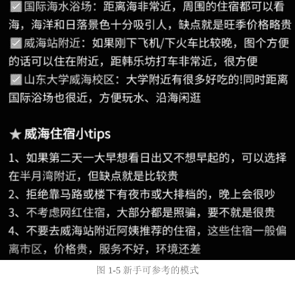
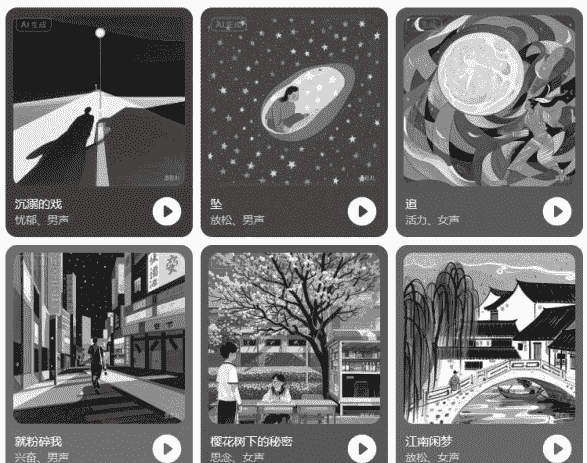
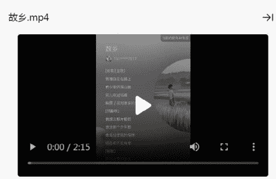
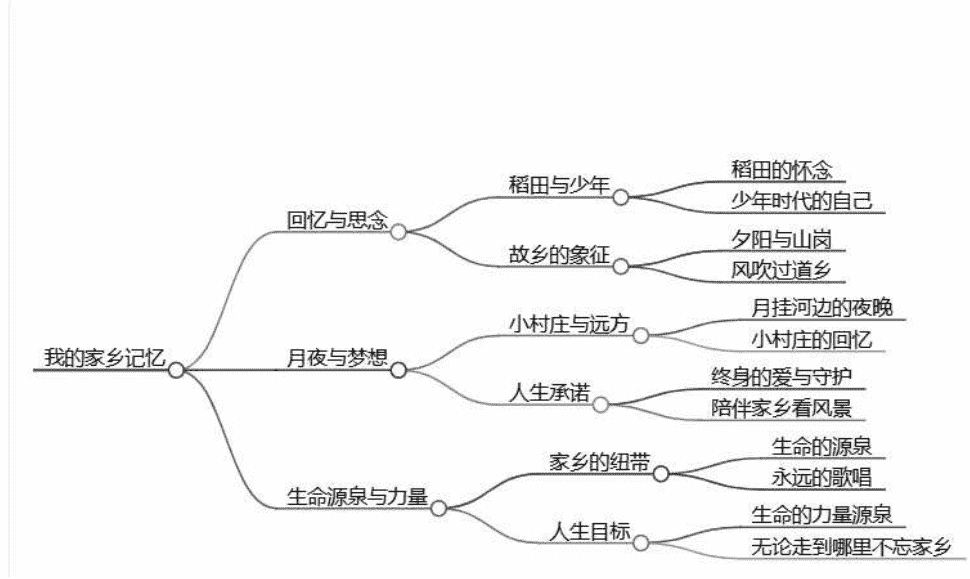
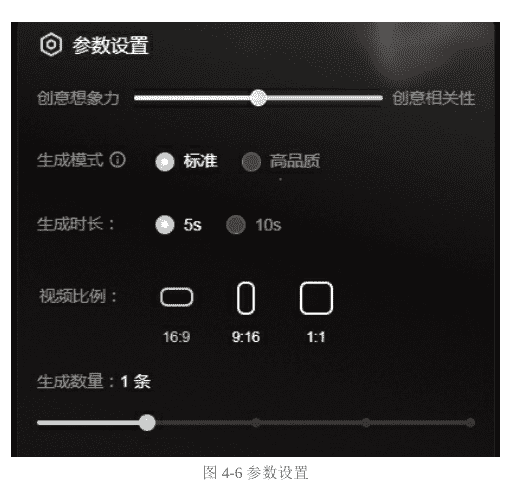
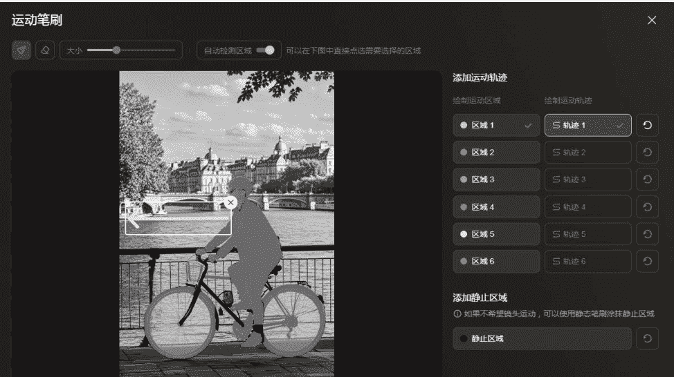
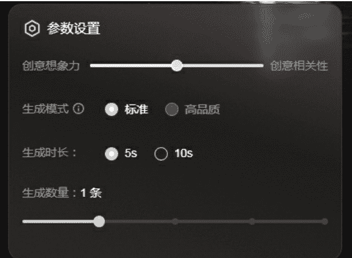

# 零成本上路：用AI撬动创业

# 前言说在前面

提到创业，多数人先想到的是启动金、团队配置、完整商业计划，没有这些就觉得没戏。

环境在变。技术浪潮把创业版图重新打开，人工智能正成为降低起步门槛的关键支点。有了它，开局不必背高额成本，也不用自己扛技术研发的负担，门槛被明显拉低。

要先厘清概念：零成本不等于零投入。它转化为时间投入和精力消耗，是和时间赛跑、和效率博弈的进程，也极度依赖执行力，不容拖延。想法必须立刻落地，要习惯用免费的在线工具搭建业务、经营品牌，从注册一个社交账号开始，到持续产出有吸引力的内容，每一步都要跟进，把脑中设想变成可验证的行动。

如果你被资金、技术等现实卡住，这套思路可以作为参考，帮助你在资源受限时用人工智能放大自身努力，孵化出属于自己的商业机会。无论是刚入行的新人，还是寻求转型的职场人士，都能在这里找到可落地的路径。

为保持演示真实，本书尽可能保留模型的原始输出，仅在必要处做了少量润色。未经修改的部分难免有表达瑕疵，敬请理解。

# 引子：AI时代值得优先试水的四条轻赛道

智能化让零成本起步更可行。众多方向里，文本、绘画、音频、短视频结合人工智能更适合率先尝试。原因很直接，我们正处于内容分发为王的阶段，这四类方向与自媒体高度契合，且都属于轻资产创业，对经验和资金诉求低，新手上手压力相对小。

## 文本创作结合智能体
担心文字功底不够？可以尝试。智能体像一位随时待命的文案搭档，专门解决灵感枯竭和表达焦虑。它能在瞬间给出大量创意点子，无论是吸睛的故事开头，还是具备转化力的广告文案，都能借助它提效。

比如你想写小说，却因笔力与灵感受阻。有了辅助，灵感供给和初稿生成都能加速，你只需投入时间对生成的文本进行优化润色，便可快速启动。

## 绘画创作结合智能体
绘画是古老的艺术门类，如今在智能加持下焕发新活力。智能绘画工具覆盖风格丰富，从古典油画的细腻质感，到抽象画的独特韵味，再到萌系动漫插画，都能轻松生成。

即便没有扎实绘画基础也能产出可用作品。这些作品既可直接变现，也能作为自媒体账号的配图素材，让内容更饱满，吸引更多关注。

## 音频创作结合智能体
在自媒体生态里音频占据一席之地。不少人既非专业播音，又不愿花大量时间自行配音。智能体正好补足这一痛点。

先用智能体完成文本创作，再让它把文字转为语音，省时省心。智能体还能依据设定的风格、节奏和情绪生成背景音乐。你无需懂乐理或会演奏，就能获得可用音轨，上传到音乐平台或作为账号素材使用。

## 短视频结合智能体
在自媒体细分领域里，短视频是最卷的赛道。流量大意味着竞争也激烈，想要弯道超车就必须用更低的时间成本换取更高产出，智能体是很好的杠杆。

选题、文案、脚本、素材剪辑，智能体都能提供辅助，节省大量准备时间。若不想出镜，虚拟数字人可以作为你的形象替身。

这四条赛道并非孤立，每个赛道内部也存在多个分支。本书会分别展开，但实操中建议构建立体矩阵。比如文本生成后可配合智能绘画做视觉延展，必要时再转为音频，形成内容闭环。同赛道内不同品类也能形成矩阵，提升整体成功率。如何挑选、如何组合，需要结合自身情况判断。若暂时没有思路，继续阅读下去会有参考。

# 赛道1 AI+文本 让写作更轻松

## 1.1 借助智能体打造爆款文章

网上不乏爆款文章，看到时常会心想：我能否也写出同类内容？若文字功底有限，单靠自己难度很大，但借助智能体，写出爆款不再遥不可及。

### 爆款起步先从标题抓起
自媒体存在“三秒法则”，标题若在三秒内无法抓住用户，文章很可能被流失。因此，起一个好标题是关键。以下提供五种常用思路。

#### 1. 悬念式
在标题中留下未解之谜，激发读者点开寻找答案的欲望。例如“业内人士透露，某行业未来十年的惊人变化”。使用时要注意两点：悬念不能过于晦涩让人无感，也不能太简单一眼就能猜透。

#### 2. 热点式
借用当下热点事件、流行语或热播剧集吸引关注。例如热剧播出期间，将剧名或相关热词融入标题，更容易触达目标人群。注意热点与内容的相关性，避免硬蹭导致读者失望。

#### 3. 共鸣式
通过触动情感和经历引发共鸣。例如“那些年，我们一起追过的童年动画”。核心是洞察读者的情绪需求和痛点，表达要真诚自然，避免刻意感。

#### 4. 数字式
在标题中使用具体数字，增强直观感和可信度。例如“十个让你变美的小技巧”。数字让价值更清晰，选用时要合理，避免夸张失真。

#### 5. 反常识式
提出与大众认知相悖的观点，制造好奇。例如“吃主食会让你更胖”。使用时需有合理论证，不能为博眼球而制造不实观点。

掌握方法后，可以自行创作，也可引导智能体批量生成再筛选。例如你是职场类博主，毕业季想写“新人入职”，可输入如下指令：

> 你是一名写职场文章的博主，现在是毕业季，请围绕“应届生入职”这个方向，起一些文章标题，读者对象是即将毕业或刚毕业的学生。请参考上述五个方法，每个方法下给四条标题。

文心一言给出的标题如下。

#### 悬念式
(1) 毕业生必看：入职后，这三类陷阱你能避开吗？
(2) 揭秘！应届生如何一年内获得晋升？
(3) 入职后，你的这些行为可能暴露新人身份！
(4) 惊！应届生，这些能力竟然比学历重要。

#### 热点式
(1) 职场新人必看！《令人心动的offer》教你如何在职场中脱颖而出。
(2) 毕业生入职，如何应对激烈竞争？
(3) 毕业季来临，这些职场生存技能你了解了吗？
(4) 毕业生启示录：如何在职场中乘风破浪。

#### 共鸣式
(1) 致即将步入职场的你：我们都曾迷茫，但终会找到方向。
(2) 毕业生入职，那些共同经历过的“第一次”。
(3) 入职后，你并不孤单！与万千毕业生共话职场经验。
(4) 那些年，我们一起追过的职场梦想（毕业生必看）。

#### 数字式
(1) 毕业生入职，掌握这五项沟通技巧事半功倍。
(2) 职场新人必看！三步打造个人职业品牌。
(3) 入职后，必须知道的七条职场礼仪。
(4) 毕业生如何在一年内成为佼佼者？四个策略分享！

#### 反常识式
(1) 毕业生入职，加班多并不意味着更优秀。
(2) 颠覆认知！应届生别急着表现自己！
(3) 毕业生请注意，在职场中，学历低并不一定代表能力弱。
(4) 别被骗了！入职后，这些“捷径”反而会让你走得更慢。

智能体给出的标题未必一次达标，但生成速度快，不满意可连续让其多生成几次。若多次仍不理想，往往是指令不够清晰，需要把需求描述得更详细。

一个清晰的指令可参考四要素模型：任务、情境、输入、输出。

- 任务：说明需要模型完成的事情
- 情境：提供任务发生的背景信息
- 输入：模型需要参考或处理的内容
- 输出：明确结果格式与风格

以刚才的指令为例拆解：
> 你是一名写职场文章的博主，现在是毕业季（情境），请围绕“应届生入职”这个方向，起一些文章标题（任务），读者对象是即将毕业或刚毕业的学生（情境）。需要参考上述五种方法（输入），每种方法下起四个标题（输出）。

若指令已明确仍不满意，可先给模型一批爆款标题作为风格样本，再让其模仿生成。开始运营公众号、头条号等平台时，就应收集同领域的爆款标题，建立素材库，既作参考，也作模型训练。

例如在微信公众号搜索“应届生入职”，选择文章、最热排序，可看到阅读量较高的标题。选取“刚毕业参加工作，应该学会的四件事”作为风格参考，设计指令：

> 你是一名写职场文章的博主，现在是毕业季，请围绕“应届生入职”这个方向，起一些文章标题，读者对象是即将毕业或刚刚毕业的学生。标题需要契合毕业生的情感需求和痛点，以引起共鸣。同时，标题要表达得真诚、自然，不能过于刻意。标题风格参考“刚毕业参加工作，应该学会的四件事”，这个标题很容易引起刚毕业入职学生的共鸣。

文心一言生成了下面八个标题。
1. 从校园到职场，毕业生如何跨越那道“看不见的墙”？
2. 以为能改变世界，结果先被职场“上了一课”。
3. 从学霸到职场新人，如何调整心态、拥抱变化？
4. 职场初体验：那些没说出口的“我不懂”渐渐都懂了。
5. 毕业生，你的职场第一课：不是所有努力都有即时回报。
6. 从毕业到就业，那些让毕业生“破防”的职场瞬间。
7. 毕业生，你的职场“成人礼”——从依赖到独立的蜕变。
8. 毕业生，你的职场第一课：不是所有梦想都能照进现实。

若仍不满意，可让模型继续生成，直至挑选到可用标题。

### 内容为王才能留住读者
好标题能带来点击，内容质量决定能否转化为粉丝。文章若空洞，读者会迅速流失。

要借助智能体写出合格文章，完全依赖智能体是不够的。以标题“职场初体验：那些没说出口的‘我不懂’，渐渐都懂了”为例，指令如下：

> 你是一名写职场文章的博主，现在是毕业季，请以“职场初体验：那些没说出口的‘我不懂’，渐渐都懂了”为文章标题，写一篇二千字文章。文章需要切合毕业生的情感需求和痛点，以引起共鸣。

文心一言生成的文章如下。

**职场初体验：那些没说出口的“我不懂”，渐渐都懂了**

又是一年毕业季，对于初入职场的毕业生而言，无论是刚进入公司时面对陌生的环境、复杂的人际关系，还是在工作中遇到种种问题，总会有一些难以启齿的“我不懂”的问题。将它们藏在心里，或成为深夜辗转反侧的焦虑，或变成第二天工作的绊脚石。

但是，随着时间的推移，在领导的指点和同事的帮助下，在不断地试错与反思中，那些没说出口的“我不懂”后来都懂了。

1. 职场不是学校，没人会把一碗水端平
@匿名用户
毕业后的第一份工作是在一家国企，工作强度不大，但氛围让我一度崩溃。
和我一起入职的有三个同事，其中两个是本地人，一个是研究生，而我是本科生。一开始我觉得学历不应该成为衡量一个人的标准，所以在工作中我格外努力，经常加班到最晚，周末也会主动到公司学习。
和我一起入职的本地同事，他们在下班时间一到就拎包走人，而且经常会被领导安排一些轻松的工作。反观我，不是要做各种杂活，就是要加班赶报表。
渐渐地，我开始怀疑自己的能力，也一度想要辞职。后来，我和一位关系不错的老员工聊起此事，他告诉我：“你要明白，职场不是学校，不会有人一碗水端平。你要做的不是抱怨，而是提升自己，让自己变得不可替代。”
后来，我转变了心态，不再抱怨，而是专注于提升自己。一年后，我因为表现突出被调到了更重要的岗位。
如今我也成了部门的小领导，面对新来的实习生，我会把最基础的工作交给他们，但这并不意味着看不起他们，而是希望他们在做这些基础工作的同时，能够沉下心来好好学习。
毕竟，职场就是“战场”，有竞争才会有进步。

## 2.所有的“为你好”，都可能是“为我好”
@林恩
工作第一年，我遇到过很多“好心人”，他们总是打着“为你好”的旗号，给你各种建议，但后来我发现，所有的“为你好”，其实都是为了他们自己好。
记得刚入职时，和我一起进公司的还有一个女孩，她和我在同一个部门，工位也在我旁边。因为都是新人，所以私下里关系不错，工作上遇到不懂的问题也会互相请教。
有一次，我们部门负责一个很重要的项目，需要加班，但那天我正好有一个很重要的约会，所以打算把手头的工作完成后，再提前下班。
正当我准备收拾东西的时候，她突然凑过来说：“你这么早走啊？我听说这个项目很重要，我们还是要好好表现才行。”
我听了觉得很有道理，于是取消了约会，继续加班。后来我发现，每次加班她都会有意无意地提醒我，要多表现、多干活。
有一次，我无意间听到她和另一个同事聊天，才知道，原来每次加班，她都会把我和她一起加班的事情告诉领导，所以每次项目完成后，领导都会特别表扬她。
那一刻，我明白了，原来不是所有的“为你好”都是真的为你好。

## 3.你可以善良，但一定要有自己的底线
@可乐
初入职场时，我觉得自己一定要成为一个善良的人，无论是对待同事还是领导都应该保持谦虚和礼貌的态度。
所以，一开始的时候，我揽了很多不属于自己的工作，无论是谁找我帮忙，我都会尽力去做。我觉得，只有这样，才能在职场中建立好人缘。
但后来我发现我的善良并没有换来别人的尊重和理解，反而让我陷入了无尽的麻烦。
有一次，因为一个同事的失误，我们部门的工作出现了差错，领导找到他的时候，他居然把所有的责任都推给了我，说是我没有提醒他。
那一刻，我才意识到，善良如果没有底线，就会成为别人伤害你的武器。
从那以后，我学会了拒绝，不再无底线地帮助别人，而是把更多的精力放在自己的工作上。

## 4.不要高估你和同事的关系
@七七
初入职场时，我以为只要自己对别人好，就能收获别人的真心，所以，在工作中，我总是尽力去帮助同事，无论是工作上的事情，还是生活上的困扰，我都会尽力去倾听和帮助他们。
那时候，我觉得我和同事的关系很好，就像是朋友一样。直到有一天，我无意间听到两个同事在议论我，才知道他们一直在背后说我的坏话。
那一刻，我觉得很受伤，也很失望。我开始反思自己，是不是哪里做得不够好，才会让他们这样对待我。
但后来我发现，其实并不是我做得不够好，而是我高估了自己和同事的关系。在职场中，同事之间更多的是竞争关系，很难有真正的朋友。
从那以后，我学会了保持距离，不再轻易和同事交心，而是把更多的精力放在提高自己上。

## 5.你可以不懂，但一定要学会提问
@丸子
作为一个职场新人，我经常觉得自己什么都不懂，很害怕问别人问题，怕别人觉得我笨，也怕打扰到别人。
所以，很多时候，遇到不懂的问题，我都会自己摸索，或者上网找答案，但这样做不仅效率低下，而且很容易出错。
有一次，我负责一个很重要的项目，因为对业务流程不熟悉，导致项目进展缓慢，我很着急，但又不敢问领导，怕他觉得我能力不强。
后来实在没办法，我只好硬着头皮去找领导请教。没想到，领导不仅没有责怪我，反而很耐心地给我讲解了整个业务流程，还给了我很多实用的建议。

现场领悟：问比装懂更重要
有次被当面点醒后我才明白，领导真正忌讳的不是部下爱提问，而是心里清楚不懂却硬撑，以及对学习缺乏意愿。之后我改掉了先动手后请教的老习惯，遇到拿不准的地方就立刻找同事或主管核实。心态一变，推进速度更快，也顺势吸收了不少新知识。

## 6.收官感言
刚踏入职场，难免会碰到各式各样的难题，也会反复出现心里没底的瞬间。请相信，这些卡点都是成长路上必须走的路段。不要逃避提问，不要惧怕犯错，更不要因畏惧而停下尝试。因为只有亲身经历过才懂，只有亲手实践过才会进步。那些曾藏在心里不敢说出口的困惑，后来都会被慢慢理清，而你在过程中也会一步步变得更好。

就产出质量来看，某款大模型生成的稿子多少还能用，它用几名职场新人的口吻呈现了经历与蜕变。短板也很明显：叙事显得生硬，共鸣感不足；各段故事重复度高，读起来容易疲劳。若要采用，需要对细节做优化。

归根结底，任何智能生成工具都高效却偏模式化，或多或少带有先天的套路，需要使用者二次加工。若想降低这种模式感，可以先备好一篇真正有流量的范文，让模型学习其表达风格，使用时注意只能学习风格，生成后再与原文对照，避免雷同。

比如，我们把《刚毕业参加工作，应该学会的 4 件事》这篇文章交给模型，并给出如下提示。
> 你是做职场内容的博主，请参照这篇文章的风格，以“毕业生初入职场，那些没说出口的‘我不懂’，后来都懂了”为标题，写一篇约2000字的文章。要贴合毕业生的情绪需求，争取共鸣。

相比首次生成，这次的可读性提升不少，但仍显啰嗦重复。经删减与局部润色后得到下面这篇。

## 入职手记：憋在心里的疑问最终被打开
2024年夏末秋初，又一批应届生涌入职场。这群年轻人带着憧憬与不安，走进既熟悉又陌生的新天地。学士帽飞起的那一刻被定格，工作的画卷正缓缓展开。

### 初入职场的沉默期
“第一天上班，我感觉自己像走进一片陌生的树林。”小美回忆起入职经历时，眼神里仍有些恍惚。她是今年夏天入职的普通应届生。

入职第一天她就被安排参加部门例会。会上讨论的大部分内容她都听不懂，只能硬坐着，偶尔点头微笑以示在听。散会后，她甚至不敢问同事那些没懂的点，生怕被笑话无知。
“我真想问，那个项目到底进展到哪儿了，为什么大家说的专业词汇我全不懂？”小美在心里嘀咕，却始终没勇气开口。

小美并非特例。大量的毕业生初入职场都会感到困惑。他们要适应全新的环境、新的节奏、新的同事关系和职业规则。这些规则很少有人明说，需要靠实践自行摸索。

### 生活成本与竞争压力并存
除了职场困惑，生活成本也让人喘不过气。
“房租、水电、交通、吃饭加起来，每个月真的很吃紧。”小丽是刚毕业的新人，租住在公司附近的公寓，房租一项就让她压力山大。
在校时她从未为钱发愁，生活费按时到账，只需考虑怎么花。现在她要自负所有开销，还得为职业发展存下一点储备。
“我开始学会精打细算，不再大手大脚，甚至自己做饭，虽然手艺一般，但比外吃便宜多了。”小丽说。
除了经济压力，还有职场竞争的焦虑。他们必须持续学习提升才能站稳脚跟，这让休闲娱乐时间被大量挤占。
“我很怀念在学校的日子，可以无忧地玩和学。”小丽感慨，“现在必须为未来拼搏。”

### 未说出口的疑惑变成成长记录
经过一段时间的磨练，毕业生们发现，那些没说出口的“我不清楚”正成为成长的注脚。
“我学会了担责抗压，不再遇到困难就退缩。”小美说，“我明白职场没有永远的避风港，只有持续努力才能变得更出色。”
“我学会了尊重理解他人，不再以自我为中心。”小丽说，“每个人都有长处短处，需要学会欣赏和包容差异。”

### 结语
职场之路漫长艰辛，但每一次困惑与挑战都是成长契机。那些曾未说出口的疑问，终将在时间里沉淀为最珍贵的养分。愿你在未来的职业生涯里勇敢前行，直面挑战，书写属于自己的精彩。

总体来看，这篇文章经过简单修改后虽谈不上优秀，但基本满足发布要求。若能投入更多时间润色，质量会进一步提升。完成文字后，还需配图以提升视觉质感，缓解阅读疲劳。关于人工智能绘图的使用，我们将在下一章详述。

## 1.2 AI加持，写作长篇不再难
如果你有写长篇虚构的想法，或想靠写作增加收入，却因文笔、时间等原因搁置，现在完全可以借助智能体把想法落地。

在讲具体操作前，先了解写作的大致流程，大约五步。
- （1）构想主题与世界观。
- （2）撰写情节概要。
- （3）设计主要人物。
- （4）搭建分章提纲。
- （5）撰写正文。

这也是利用智能体写作的流程。若前四步已在脑中成形，可直接进入第五步。即使已有构思，也可交给模型看看能否带来灵感。

假设大脑一片空白，仅有“想写一部科幻题材长篇”的念头，就需要按流程逐步推进。

### ● 设定世界观与主旨
作品的世界观是故事展开的环境集合，涵盖社会、历史、地理、文化等，为主角提供舞台。参照ICIO思路，我们设计了如下提示。
> 你是一位科幻题材作者，写作能力出色，请构思一个科幻长篇的主题背景，包含主题、时代背景、故事发生地等。要求约200字，保证原创且吸引人。

模型给出的背景如下。
> 主题：星际遗落
> 时代背景：遥远未来，人类已踏入星际大航海时代，星系纷繁，文明多元璀璨。然而一场突如其来的宇宙灾难摧毁了星际网络，将人类各分支隔绝在茫茫星海。
> 故事发生地：遗落星域，位于宇宙边缘，被古老星际文明遗弃的神秘星系。这里藏有通往古老科技与智慧的钥匙，也是重新连接星系、找回失落文明的唯一希望。主角将在此展开一场关于勇气、智慧与人性的星际冒险。

### ● 撰写情节概要
有了背景，下一步写概要。为避免遗忘，可把前文内容一并提供，并设计如下提示。
> 这是一部科幻长篇的主题背景，请继续撰写情节概要，包括起因、主要冲突、关键转折和结局，要求约300字，故事要有吸引力。

生成的概要如下。
> 公元3050年，宇宙灾难导致星际网络崩溃，人类文明陷入孤立。为了重振文明，一支精锐探险队出发前往遗落星域，寻找古老遗迹，重建星际网络。
> 在遗落星域，主角林悠然与团队遭遇恶劣环境、未知外星生物和古文明陷阱。他们与时间赛跑，也面对内部背叛与分裂。林悠然凭智慧与勇气揭露了隐藏的叛徒，并获得古老文明的核心技术。
> 然而真正的考验才开始。激活古老科技时触发了星际文明的防御机制。生死抉择下，林悠然选择牺牲，最终以生命为代价破解防御。古老科技被激活，星际网络逐步恢复，人类文明重燃希望！

### ● 设计主要人物
把概要交给模型后，可据此设计人物，提示如下。
> 这是一部科幻长篇的情节概要，请结合内容设计5~10个角色（含主角），为每个角色提供详细介绍，包括外貌、性格、职业、能力等。每个介绍不超过200字。

生成的角色介绍如下。
> 林悠然：主角，女性，长发，眼神坚定。星际考古学家，智慧超凡，判断冷静。她穿特制探险服，擅长解析古代文明密码。性格坚韧，是团队灵魂，危急时总能化险为夷。
> 赵雷：男性，直爽忠诚，林悠然的得力助手。战斗时冲在前，保护队友。
> 李梦瑶：女性，短发，眼神灵动。团队医疗官，精通生物与医学，外表温柔内心坚韧。
> 陈子轩：男性，长发微卷，面容俊朗。星际工程师，擅长维修改造机械，沉稳善于思考，在修复中发挥关键作用。
> 张心怡：女性，长发飘逸，气质优雅。星际导航员，航行经验丰富，独立冷静，恶劣环境中总能找到方向。
> 罗浩：男性，短发精干。星际通信专家，擅长发送与破解加密信息，谨慎机智，背叛发生时及时发现叛徒踪迹。
> 许晴：女性，长发披肩，面容清秀。团队历史学家，对古代文明研究深入，温柔善良，解读遗迹时提供重要线索。
> 郭峰：男性，短发，肤色黝黑。星际地质学家，擅长分析星球地质结构，乐观幽默，在寻找遗迹时发现关键地质线索。
> 韩风：男性，长发微乱，眼神深邃。星际黑客，擅长入侵操控计算机系统，狡黠聪明，激活古老科技时成功破解防御。
> 叛徒陆明：男性，短发整齐，面容冷峻。原团队星际战略家，个人野心驱使背叛，阴险狡诈，关键时刻被林悠然揭穿并制服。

人物可继续扩充，也可在情节推进中按需增设。

### ● 构思分章提纲
分章提纲是全书骨架。为了避免理解偏差，需把概要与主要角色一并发给模型生成提纲，提示如下。
> 上述内容是科幻长篇的概要与主要角色，请结合构思分章提纲。要求15~20章，标题避免模式化，要有吸引力。

到这一步模型的短板显现，即便强调“不要模式化”“要有吸引力”，生成内容仍显刻板。因此需要人工介入修改。可直接改写，或提出修改意见让模型再生成。我们采取后者，反复生成5版后取其精华，稍作润色，得如下提纲。

小说分章提纲
第一章：文明的余晖
- 描述公元3050年宇宙灾难前夜，人类文明高度发达却脆弱，星际网络濒临崩溃。
- 林悠然作为星际考古学家，预感灾难将至，开始筹备探险行动。
第二章：遗落星域的传说
- 探险队成员依次介绍背景与技能，对遗落星域既向往又恐惧。
- 林悠然向队员讲述关于遗落星域的古老传说。
第三章：启程前的暗流
- 队伍内部出现分歧，陆明提出激进策略欲加快进程。
- 林悠然坚持谨慎，两人裂痕初现。
第四章：星际迷雾的考验
- 穿越星际迷雾，遭遇恶劣天气与未知障碍。
- 赵雷英勇护队，代价是部分装备受损。
第五章：外星生物的突袭
- 登陆星球表面遭遇外星生物，李梦瑶紧急研发疫苗。
- 团队首次体会外星生态的复杂与共存难度。
第六章：古老文字的启示
- 发现古老遗迹入口，入口处有古文。许晴经多次试验成功解读，为进入遗迹打开通道。
- 陆明的野心显露，试图独占遗迹宝藏。
第七章：信任危机
- 罗浩在通信中察觉异常，林悠然暗中调查陆明。
- 团队信任受损，气氛趋于紧张。
第八章：叛徒的真面目
- 深入遗迹遭遇机关陷阱，陈子轩展现机械才华。
- 林悠然与陆明正面冲突，揭露其背叛，却未当场制服。
第九章：生死逃亡
- 陆明启动遗迹自毁装置，队伍陷入生死逃亡。
- 赵雷带领众人躲避危险，李梦瑶动用疫苗对抗生物陷阱。
第十章：绝处逢生
- 林悠然在绝境中找出口，利用遗迹古老科技破解自毁装置。
- 团队合力逃脱，陆明下落不明。
第十一章：遗落星域的秘密
- 研究遗迹，揭示遗落星域与古老星际文明的关联。
- 团队对遗落星域认知加深。
第十二章：防御机制的觉醒
- 决定尝试启动古老科技原型机，探索潜力。
- 启动时意外触发星际文明防御机制，面临生死考验。
第十三章：牺牲
- 生死关头，林悠然选择牺牲，成功破解防御机制。
- 她的决定换来团队存活，自己付出生命代价。
第十四章：生死较量
- 古老科技成功激活，陆明突然现身欲夺核心。
- 核心区仅容两人，赵雷进入后与陆明展开生死搏斗，最终制伏对方。
第十五章：曙光
- 探险队返回飞船，利用遗迹科技修复星际网络。
- 网络逐步恢复，人类文明重新燃起希望。

章节数并非固定，长篇可适当增加。

### ● 撰写正文
这是最后一步，也是最难的一步。常见难题有两类：一是上下文不连贯，尤其在万字以上时易出现断裂，需人工干预保证连贯。二是逐章创作时字数限制导致跨章，模型会把下一章内容混入本章。

避免方法是不直接下达“写第一章”提示，而是逐步细化。以本篇长篇为例，我们设计的提示如下。
> 故事概要
> 公元3050年，宇宙灾难导致星际网络崩溃，人类文明陷入孤立无援。为了重振文明，一支精英探险队前往遗落星域，寻找古老星际文明遗迹，重建星际网络。
> 在遗落星域，主角林悠然与团队遭遇恶劣星际环境、未知外星生物及古文明陷阱。他们与时间赛跑，也面对内部背叛与分裂。林悠然凭智慧与勇气揭露叛徒，并获得古老文明核心技术。
> 然而真正的挑战才开始。激活古老科技时触发星际文明防御机制。生死抉择下，林悠然选择牺牲，以生命为代价破解防御。古老科技被激活，星际网络逐步恢复，人类文明重燃希望！
> 小说第一章：文明的余晖
> - 描述公元3050年宇宙灾难前夜，人类文明高度发达但脆弱，星际网络即将崩溃。
> - 林悠然作为星际考古学家，预感灾难将至，开始筹备探险行动。
> 这是长篇的概要与第一章情节概述，请完善第一章情节，包括：①星际网络的作用、人类文明的发达与脆弱，星际网络为何即将崩溃？②详细介绍主角林悠然（卓越星际考古学家，拥有超凡智慧与冷静判断力，擅长解析古代文明密码），她的家世背景如何？如何察觉灾难将至？如何筹备探险计划？筹备中遇到哪些阻碍？

两个要点：一是提供故事概要，确保创作不偏离主线，二是限定创作范围，避免跨章。在后续逐章创作中，两点必不可少。

发送提示后，模型生成的片段如下。
> 公元3050年，人类文明如银河中最耀眼的明珠，光芒穿越无垠宇宙，连接万千星系。星际网络如人类神经脉络，承载信息洪流，亦是文明交流、资源共享、科技跃迁的命脉。巨型空间站点缀银河各处，超光速通信使遥远星系触手可及，虚拟现实让知识与文化跨越时空无缝对接。社会繁荣和谐达到前所未有高度，艺术与科学交相辉映，创造无数奇迹。
> 然而辉煌之下暗藏脆弱。星际网络核心是一个由无数量子节点构成的超级智网，复杂异常，也因此敏感。随着人类探索深入，未知能量波动与宇宙射线开始干扰精密系统，导致信息传输错误频发、稳定性日益下降。
> 林悠然出身历史悠久的知识世家，自幼对古老文明充满好奇。家族世代守护一幅古老星图，标记传说中遗落星域的坐标，据说那里藏有引领文明飞跃的古老科技。林悠然不仅继承家族智慧，更拥有超凡解析能力与冷静判断力，使她在星际考古领域独树一帜。

星际探险情节的打磨实战

林悠然偶然梳理星际网络的异状数据时，惊觉一场史无前例的宇宙浩劫正悄然逼近。她判断那些看似杂乱的信息干扰实为远古宇宙留下的警示编码，意味着星际网络将面临彻底瓦解。一旦网络崩解，人类文明将被迫陷入与外界隔绝的黑暗年代，科技倒退、文化断层，甚至有文明灭绝的风险。

察觉危机后，林悠然决意组建精锐探险队，前往失落星域搜寻上古星际文明遗迹，期望从中获得重建网络的核心技术。可筹备并不顺利。

在准备阶段，她先遭遇官方的质疑与阻挠。主事者对她的预言存疑，认为这是毫无意义的冒险，甚至担心会引发社会恐慌。探险所需的高额经费与技术支持也让她碰壁不断。更糟的是内部出现叛徒，一名本应最信任的同事因私利与恐惧，暗中向外泄露计划，意欲阻止可能动摇既有权力格局的行动。

面对叠加的阻力与背叛，林悠然并未退缩。她凭借谋略与坚韧一一化解外界压力，并巧妙揭露内部叛徒，稳住了队伍的纯洁与凝聚力。在星际网络余晖下，她的决心愈发坚定，像是文明最后的亮光。

上述情节并未偏离本章设定的走向，但存在两处不足：筹备受阻的描写较为单薄，细节不够饱满；缺乏对话与心理刻画，读感偏平。所以围绕这两点设计了补充练习。

> 林悠然的方案遭到不少科学家的反对，正争论之际灾难骤至，星际网络崩溃，她顺势成为计划负责人。请对该段落进行拓展，并加入心理与对话，以提升可读性。

在文心一言的补充下，画面被丰富如下。

会议室压抑而紧张，林悠然站在幕布前，对面是数十位顶尖科学家投来的质疑目光。她的话语在空旷空间回响，却难以穿透冰冷的怀疑。

“仅凭几笔异常数据就断言网络崩溃，未免太冒险。”一位年长的学者摇头，语气明显不满。

“若我们坐视不管，一旦灾难真正到来，后果将无法收拾。”林悠然试图说服，声音在纷乱的争论里显得尤为微弱。

就在此时，屏幕忽然闪烁，刺耳警报响起，星际网络的标志开始闪动，数据流变慢、卡顿，最终彻底无响应。

“网络崩了！”一名年轻科学家惊呼。

全场瞬间凝固，所有人亲眼看着网络断线，震惊与恐惧在心头蔓延。质疑与争辩在这一刻化为无声，只剩绝望与迷茫。

乱局中，林悠然迅速冷静下来，开始组织应急处置。她清楚，此刻必须承担更大责任。

“别慌，立刻启动应急预案，确保关键数据得到保护。”她的语气坚定有力，随即分派任务，指挥团队行动。

在她的带领下，众人迅速进入状态，努力保全影响文明存续的数据资料，而她则连线星际联盟高层，争取更多资源支持。

“林悠然博士，网络已崩，你的探险方案必须马上执行。”电话那头高层焦急地说。

林悠然颔首，心中责任感与使命感骤然升起：“我明白，会全力以赴。”

至此，她自然成为探险计划的负责人。她深知肩负之重，也相信只要找到古文明遗迹重建网络，人类文明便仍有回春的可能。

将初稿最后两段替换为上述补充内容后，第一章初版便告完成。接下来仍需人工润色，以进一步提升质量。

回顾创作要点，可归纳为三点：第一，限定创作范围，给AI一个明确的边界；第二，针对初稿细化要求，让内容更贴合预期；第三，进行人工修改与优化。

小说写作在实践中难度最大，但遵循这三步，多数问题都能避免。

1.3 AI拆书：新手也能做读书博主

对许多新人而言，“拆书稿”可能陌生。简单说，就是读完一本书后提炼核心内容，结合自身理解用通俗语言表达。显然这需要先阅读并理解原书。如今借助AI，即便未读过书也能产出通顺的拆书稿。

拆书稿形式多样，AI实操性较强的主要是荐书类和感悟类。尽管AI可跳过阅读环节，仍建议先粗读一遍或阅读他人的解读，以便更好地把控生成内容。

两种拆书稿的写作方法不同。

● 荐书型拆书稿

荐书稿即向读者推荐书籍，最简便的做法是做简要介绍。介绍一般包含四个要素：

- 作者简述
- 书籍概况与核心观点
- 主要内容
- 适合人群及收获

以《富爸爸·穷爸爸》为例，可设计指令：

> 你是一位经验丰富的读书博主，请从作者简介、书籍简介、主要内容、阅读人群四个角度总结《富爸爸·穷爸爸》。

文心一言的生成结果如下。

1. 作者简介

《富爸爸·穷爸爸》由罗伯特·清崎与莎伦·L·莱希特合著。罗伯特·清崎为第四代日裔美国人，1947年生于夏威夷，投资家、企业家、教育家，“富爸爸”系列作者，富爸爸公司联合创始人，被视为财商教育的先行者。莎伦·L·莱希特为注册会计师，曾任玩具与出版业资深经理与顾问，将专业知识投入教育，与清崎合作出版多本畅销书。

2. 书籍简介

作品概要：以“财务智商教育”为主题的畅销书，通过作者亲身经历的财富故事，呈现“穷爸爸”与“富爸爸”截然不同的金钱观。

核心观点：穷人为钱工作，富人让钱为自己工作。书中否定“高薪等于财务自由”的传统观念，强调区分资产与负债，平稳应对财富波动，最终达成财务自由。

3. 主要内容

书中描述了作者的两个父亲。“穷爸爸”即亲生父亲，教育官员，高学历却常为账单犯愁；“富爸爸”即好友之父，高中未毕业却善于理财，生活富足。通过对比二者在性格、思维、行为与结果上的差异，揭示贫富差距的根源。

书中界定资产为能产生收益或增值的项目，如股票、股权、房产；负债则为消耗现金流的支出，如贷款、信用卡。主张增加资产、减少负债，关注现金流，让金钱为自己工作。

4. 阅读人群

适合对象：18岁以上，对财务自由、投资理财感兴趣的人，职场新人、创业者及已有一定积累者均可获启发。

阅读收获：职场新人可树立正确金钱观，规划职业与财务；创业者可获得创业经验与投资建议；财富积累者可优化资产配置，迈向财务自由。

第三部分“主要内容”篇幅较少，于是继续补充：

> 请对“主要内容”进行更详细的阐述。

补充内容如下。

1. 穷爸爸与富爸爸观念对比

穷爸爸：教育官员，观念保守，认为靠勤奋工作赚钱、储蓄避债即可。他视“好工作”为高薪高位，却常陷入财务困境，因工资增速难及通胀。

富爸爸：学历不高但商业嗅觉敏锐，鼓励冒险尝试，从失败中学习。他认为资产产生收入，负债消耗收入，教导区分二者并增资产减负债。

2. 资产与负债的区分

资产定义：能带来收入或增值的东西，如股票、债券、房产、企业，可持续产生现金流。

负债定义：导致支出的项目，如贷款、信用卡债务，会消耗现金流。

意义：增资产减负债打破“高收入即致富”迷思，凸显理财能力。

3. 增加资产的方法

打工：收入稳定，适合初期积累资金与经验，但不应是财务自由的唯一路径。

创业：风险高但回报可能更高，需要市场洞察与承担风险的能力。

投资：通往财务自由的重要途径，需财务知识与技巧，并关注市场动向与风险。

4. 提升财商与理财能力

财商定义：处理金钱的能力，涵盖理财知识、投资技巧、市场洞察。

提升方式：阅读专业书籍、参加培训、与有经验者交流。

意义：提升财商有助于掌握金钱主动权，实现财务目标。

5. 实现财务自由的路径

勇于尝试与冒险：鼓励读者尝试新事物，经历挫折后学习理财要领。

持续学习实践：不断积累知识经验，提升理财能力。

坚持长期投资：需要耐心与毅力，长期积累财富，同时动态调整策略。

将两次生成结果合并，并加入豆瓣评分，再让AI撰写一段推荐语置于开头，一篇完整的荐书稿即成。

● 感悟型拆书稿

感悟类拆书稿指读后感，因可让AI模仿范文风格，实操性较强。以《富爸爸·穷爸爸》为例，先提供一篇范文供AI学习风格，再要求模仿创作。AI模仿易出现啰嗦、重复或文风生硬等问题，需人工修改优化。修改后示例如下：

在纷繁的现代社会，金钱与财富始终萦绕心头，让无数追梦人困扰。为何有人能轻松驾驭财富，有人却长期困于财务困境？这类疑问常在脑海徘徊。

初读《富爸爸·穷爸爸》，其独特的视角与颠覆性观念往往令人震撼。作者通过与两位父亲的交往，揭示穷人与富人在思维上的巨大差异。穷爸爸追求稳定与安全，富爸爸追求自由与财富。这种对比勾勒出两种不同的人生轨迹。

书中的穷爸爸是许多人熟悉的传统形象，勤奋却难摆脱债务，谨慎却错失投资机会。富爸爸则截然不同，他传授如何让钱为自己工作，如何通过投资实现财务自由。其理念冲击固有思维，打开通往成功的新路径。

“人生最大的谎言，就是你需要一份工作来养活自己。”富爸爸常说。工作只是实现财务自由的手段之一，而非全部。真正的富人善用智慧与资源创造财富，不为薪水束缚，敢于冒险与追求更大梦想。

《富爸爸·穷爸爸》并非鼓吹金钱至上，而是提醒财富只是生活的一部分。真正的幸福源于内心满足与自由。因此在追求财富的同时，更应注重成长、家庭和谐与社会责任。

回望自身成长，或许曾受传统财富观念束缚。正如书中所传达，只有打破束缚，勇于追求梦想，才能实现自我价值。

在书的指引下，我们应以全新视角看待财富与人生。生活不仅有眼前的苟且，还有诗与远方。要达成这一切，需不断提升财商，迈出那一步，追求属于自己的财富与幸福。

愿我们都能成为自己命运的掌舵者，以智慧与勇气驾驭财富风帆，驶向星辰大海。在未来无论风雨如何，都坚守初心，勇往直前。

最后说明，若所选图书热门，无需上传电子版；若图书冷门，为保证内容准确，建议提前上传电子版文件。

1.4 用AI做旅游规划师，简单上手

近年来国内游热度持续上升，可借助AI的文本创作能力化身旅游规划师，在短视频平台发布攻略获取流量。

制定旅游攻略有两种方式：一是直接在AI对话框输入指令；二是借助AI平台的旅游智能体。推荐第二种方法，使用时同样需要设计指令。

本次使用的工具为讯飞星火，如图1-3所示。


进入智能体中心，搜索“旅游”，会出现多个相关智能体，如图1-4所示。选择“旅游攻略”智能体后即可开始操作。


图1-4 旅游相关的智能体

一份旅游攻略通常包含三个篇章：行程篇、美食篇、住宿篇。下面依次演示。

● 行程篇

以“杭州四天三晚”为例，设计指令如下：

> 我想去杭州旅游，请帮我制定一个四天三晚的旅游攻略。4天的行程分开制定，每天的行程以表格呈现，表头为时间、景点、景点门票价格、公共交通路线、景点简介。请注意每天景点安排的时间合理，多个景点应选距离相近者。

智能体生成了4天行程安排，如表1-1至表1-4所示。

表1-1 第一天行程

| 时间 | 景点 | 门票价格 | 公共交通路线 | 景点简介 |
| :--- | :--- | :--- | :--- | :--- |
| 09:00 | 西湖（苏堤、断桥） | 免费 | 地铁1号线至龙翔桥站，换乘公交K4路至苏堤 | 西湖是杭州的标志性景区，湖光山色历史文化丰富。苏堤与断桥为最知名景点之一，适合漫步赏景。 |
| 12:00 | 午餐休息 | — | — | — |
| 13:30 | 雷峰塔 | 40元/人 | 步行或乘坐公交游5路至净慈寺站下车 | 雷峰塔坐落西湖南岸，是杭州地标之一，登塔可俯瞰西湖全景，感受古人诗意。 |
| 16:00 | 灵隐寺 | 飞来峰30元/人，灵隐寺30元/人 | 公交7路至灵隐路口站下车 | 灵隐寺为中国佛教禅宗古刹，历史悠久香火旺盛，环境清幽古木参天。 |
| 18:30 | 晚餐及自由活动 | — | — | — |

表1-2 第二天行程

| 时间 | 景点 | 门票价格 | 公共交通路线 | 景点简介 |
| :--- | :--- | :--- | :--- | :--- |
| 09:00 | 西溪国家湿地公园 | 80元/人 | 地铁3号线至汽车西站，换乘公交Y2路至西溪湿地周家村站 | 西溪湿地为国家级湿地公园，自然风光独特，可乘船游览体验江南水乡风情。 |
| 12:00 | 午餐休息 | — | — | — |
| 13:30 | 宋城景区 | 《宋城千古情》演出票200～480元/人 | 地铁3号线至汽车西站，换乘公交Y5路至宋城站 | 宋城为大型宋代文化主题园区，集观光娱乐休闲于一体，可体验市井生活并观看演出。 |
| 18:30 | 晚餐及自由活动 | — | — | — |

表1-3 第三天行程

| 时间 | 景点 | 门票价格 | 公共交通路线 | 景点简介 |
| :--- | :--- | :--- | :--- | :--- |
| 09:00 | 中国茶叶博物馆 | 免费 | 地铁2号线至茶叶博物馆站下车 | 中国茶叶博物馆为国内唯一国家级茶主题馆，展示中国茶文化历史与发展，藏品丰富。 |
| 11:00 | 龙井问茶 | 免费参观茶园，品茶另付费 | 步行或乘坐公交游3路至龙井山园站 | 龙井问茶为杭州传统习俗，可品尝正宗龙井茶，了解制作工艺，同时欣赏西湖美景。 |
| 12:30 | 午餐休息 | — | — | — |

表1-4 第四天行程概览
| 时间 | 景点 | 门票价格 | 公共交通路线 | 景点简介 |
| 14:00 | 六和塔 | 20 元 / 人 | 地铁 1 号线至江陵路站，换乘公交 Y5 路至六和塔站 | 六和塔坐落在钱塘江边，堪称杭州的地标塔楼之一。塔身约六十米高，共十三层，各层视野各异。登高远眺，杭城全貌与钱塘江景一览无余。 |
| 17:00 | 河坊街步行街 | — | 地铁 1 号线至定安路站，步行可到 | 河坊街保留了大量明清古建与传统手作店铺，是逛街购物和品尝本地美食的理想区。 |
| 19:00 | 晚餐及自由活动 | — | — | — |

| 时间 | 景点 | 门票价格 | 公共交通路线 | 景点简介 |
| 09:00 | 杭州动物园 | 20 元/人 | 地铁 1 号线至凤起路站，换乘公交 K850 路至动物园门口 | 杭州动物园兼具保育、科普与游乐功能，园区内有大熊猫、金丝猴等珍稀动物，十分适合亲子出行。 |
| 12:00 | 午餐休息 | — | — | — |
| 13:30 | 京杭大运河博物馆 | 免费 | 地铁 1 号线至武林门站，换乘公交 B 支线至拱宸桥西岸博物馆站 | 博物馆位于运河最南端，以运河为主题布展，展示运河历史、文化及相关文物艺术。 |
| 16:00 | 南宋御街 | 免费 | 地铁 1 号线至定安路站，步行可达 | 御街保留了众多南宋建筑风貌与文化遗存，汇聚特色小吃和手工艺店，便于体验杭州传统风韵。 |
| 18:30 | 结束旅程，返回酒店整理行李准备返程 | — | — | — |

行程确定后务必复核准确性与合理性。以第一天灵隐寺为例，原安排时间偏紧，可以提前抵达，相应压缩雷峰塔参观时长，为灵隐寺留出更充裕的游览空间。

除路线外，完整的旅游攻略还应涵盖吃与住两项。

### ● 美食篇
美食关注点主要在特色菜品与就餐场所。智能体给出的特色美食推荐如下。

特色美食
- 猫耳朵：形似猫耳的面食，面皮筋韧，常与虾仁、香菇等同煮，汤鲜味美。
- 片儿川：杭州知名面点，浇头讲究、调味简洁，口味清淡回味悠长。
- 葱包桧：传统小吃，油条与小葱夹入面饼，酥脆里嫩，风味别致。
- 定胜糕：寓意吉祥的点心，以糯米和豆沙制成，绵软适中甜而不腻。
- 干炸响铃：豆腐皮裹肉末油炸，因食用时有声响得名，外酥内嫩很受青睐。
- 西湖莼菜汤：以西湖莼菜为原料，汤清澈、口感滑嫩，夏季尤为解暑。
- 龙井虾仁：结合龙井茶香与鲜虾，色泽诱人、茶香突出，滋味独特。
- 东坡肉：源自苏东坡，五花肉小火慢炖，酥烂入味不显油腻。
- 宋嫂鱼羹：历史悠久的汤品，以鱼肉配细料熬制，汤浓营养丰富。
- 西湖醋鱼：选用西湖鲜鱼配特制醋汁，鱼肉细嫩酸甜平衡，为杭帮经典。

餐厅推荐
- xxx酒家：历史悠久的杭帮菜馆，招牌西湖醋鱼鲜嫩酸甜，深受食客好评。
- xxx餐厅：临西湖的百年老店，东坡肉色泽红亮肥而不腻，是必尝之选。
- xxx酒家：主打杭帮菜，龙井虾仁选用河虾与龙井叶制作，虾嫩茶香。
- xxx小吃店：老字号小吃店，供应小笼包、片儿川等，皮薄汤多、口味地道。
- xxx餐厅：面食为主，招牌虾爆鳝面以黄鳝与河虾搭配，面条筋道汤浓。
- xxx餐厅：家常菜馆，老鸭煲、笋干老鸭等本地菜品味道鲜美价位亲民。
- xxx餐厅：创意杭帮菜，环境优雅，椒麻鸡等菜品受众广泛。
- xxx餐厅：传统与现代融合，酸菜黑鱼、鞋底饼等特色菜适合家庭聚餐。
- xxx餐厅：老字号杭帮菜馆，鱼羊鲜、糖醋排骨等味道地道。

AI给出的餐厅名已隐去以免广告嫌疑，后续同类处理一致。建议到大众点评、美团等平台查看真实评价，保留口碑较好的去处，剔除评价一般的选项。

### ● 酒店篇
酒店没有唯一标准，看性价比、位置或品牌皆可。此处以性价比为筛选维度，智能体推荐如下。

- xxx酒店：约600元/晚。位于市中心，近西湖与商业区，装修现代设施齐全，有健身中心与室内泳池，适合追求品质的旅客。
- xxx酒店：约900元/晚。坐落钱江新城临江，部分房型可观江景，设计典雅配套泳池SPA健身房，性价比仍较高。
- xxx酒店：约700元/晚。临西溪湿地公园，环境清幽空气好，房型多样配内外泳池与儿童俱乐部，适合家庭。
- xxx酒店：约400元/晚。市中心近西湖景区，交通便利，现代装修配健身与泳池，价格适中。
- xxx酒店：约350元/晚起。市中心繁华地段紧邻西湖，商务休闲皆宜，提供泳池健身及多餐厅，性价比高。
- xxx酒店：约300元/晚起。近西溪湿地，环境优美，设施完善，适合远离喧嚣的家庭客。
- xxx酒店：约250元/晚。经济连锁，房间紧凑但整洁，设施齐备，适合背包客与短期商务。
- xxx酒店：约180元/晚起。市中心交通便利，装修简约时尚，性价比高，适合出差与观光。
- xxx旅舍：约120元/晚。市中心年轻旅舍，床位与公共区舒适，价格亲民，适合背包客。

以上覆盖多个价位，可满足不同需求。AI推荐的酒店也需在点评平台核查评价，仅保留好评较高的选项。

至此攻略的线路、美食、住宿三大部分已完成，目前仍以文字为主，吸引力有限。时间紧张的新手可参考如图1-5所示的方式，用简单小图案点缀并对重点文字做色彩区分，使页面更生动。



图 1-5 新手可参考的模式

## 1.5 用AI快速批量生产广告文案
积累一定流量后接洽品牌推广，广告文案创作变得必要。AI在专业性上略逊，但胜在可快速批量输出供挑选。

广告文案创作大致分策略分析、创意构思、文案撰写三步。策略分析包括市场分析、品牌定位、目标设定三项。市场分析关注需求、消费者行为与竞争态势；品牌定位明确要传达的品牌信息与消费者认知；目标设定明确提升知名度或销售额等具体目的。创意构思在策略基础上展开，文案撰写则把创意落地。

要让AI有效生成，通常需在指令中给出角色、背景、任务、目标四个要素。

以虚构零食品牌为例：
角色：你是一位经验丰富的广告设计大师。
背景：品牌定位为为年轻人提供前沿、健康、有趣、个性化的零食。品牌理念为创新引领、健康至上、个性化定制。目标用户为18-25岁。
任务：撰写一则广告文案。
目标：推广品牌文化，吸引年轻群体，激发购买欲。

文心一言据此生成了一版文案，如图1-6所示，突出潮流、健康、个性三大卖点，语言活泼。

若不偏好该风格，可在任务中指定风格。例如图1-7所示的版本更适合口播，采用旁白体、年轻有活力的语调。

若需要视频广告，可将指令改为“我需要拍一个视频广告，请为我创作一个广告文案”。文心一言会输出概念稿，如图1-8、图1-9所示，包含未来感虚拟空间、00后聚会、AR个性定制、街头场景等分镜与旁白，结尾以品牌logo与口号收束。

不论形式如何，核心仍是打动目标用户。AI只是工具，应以用户为中心而非过度追求形式新颖。

## 1.6 当AI遇上问答平台
实测显示，对情商类问题AI回答常不达标，甚至出现低情商回复，即使要求高情商也改善有限。知识性问题则表现较好。

例如提问“能大致讲一下ChatGPT的原理吗”，文心一言给出了较为通俗的解释，并引用了4条网页信息源，一定程度上保证准确性，如图1-10、图1-11所示。

其说明ChatGPT基于GPT大语言模型，参数庞大、数据来自互联网文本。工作分预训练与微调两阶段。预训练阶段阅读海量文本学习语言规律，核心为Transformer架构的注意力机制。微调阶段针对特定领域进行额外训练。用户输入后模型逐层编码解码生成回复。训练还引入人类反馈强化学习RLHF，以减少不真实、有害或有偏见的输出。

引用信息源包括：
1. 通俗易懂的ChatGPT的原理简介
2. 一篇文章让你快速搞懂ChatGPT的原理和用处!
3. 一文读懂ChatGPT的工作原理
4. 技术小白都能看懂的ChatGPT原理介绍

让大模型回答更靠谱的几个实操思路

很多生成式系统都自带在线检索开关。追求时效与精准时，把网络查询打开，输出会更贴近最新资讯，也更有说服力。

碰到专业度很高的提问，仅靠通用知识储备很容易吃力。主动搜集权威资料，把内容喂给模型，命中率会明显提升。找资料的渠道不少，除知网、百度学术这类学术入口，秘塔搜索也是一个顺手的选择。首页排版简洁，上手很快。


图 1-12 秘塔 AI 搜索首页

做文献检索时，直接点进“学术”“全部文献”入口即可，如图 1-13 所示。以“ChatGPT 的原理”为检索词，返回结果既有通俗解读，也附带了相关论文，如图 1-14、图 1-15 所示。

ChatGPT 的运行底层建立在深度学习与自然语言处理之上，核心是 Transformer 结构以及生成式预训练 Transformer，即 GPT 模型。要点如下：

1.  Transformer 结构：ChatGPT 的底座是 Transformer，这是一种以自注意力机制为基础的神经网络。自注意力让模型在处理序列时能兼顾序列内部各元素的关联，并据此生成输出 ①。该机制帮助 ChatGPT 在理解上下文时更自然，从而产出更连贯的对话。

2.  生成式预训练：ChatGPT 先在海量语料上完成预训练，学习语言的规律与结构。训练阶段通过预测缺失词或字符来掌握统计规律 ④。经过这样的训练，模型能积累广泛的语言知识，涵盖语法、词汇与语义。

图 1-14 对 ChatGPT 原理的解读（节选）

## 参考文献

1. 安康市委党校.ChatGPT 工作原理及对未来工作方式的影响[J].通信与信息技术,2023.[2023-07-25]
2. 复旦大学新闻学院传播学系.概率与反馈:ChatGPT 的智能原理与人机内容共创[J].南京社会科学,2023.[2023-03-15]
3. 赵朝阳,朱贵波,王金桥.ChatGPT 给语言大模型带来的启示和多模态大模型新的发展思路[J].数据分析与知识发现,2023.[2023-03-21]
4. 黄语,刘海洋,常海军等.基于 ChatGPT 工作模式的 AI 工具在 BIM 技术中的潜在应用与实现途径 附视频[J].科技创新与应用,2024.[2024-09-02]
5. 武汉纺织大学马克思主义学院.生成式人工智能——ChatGPT 对主流意识形态传播的影响[J].家庭影院技术,2023.[2023-08-15]
6. 秦涛,杜尚恒,常元元等.ChatGPT 的工作原理、关键技术及未来发展趋势[J].西安交通大学学报,2023.[2023-10-17]

图 1-15 部分相关学术文献

若对生成内容的语气不满意，可让模型模仿你偏好的表达方式，或模仿高赞回帖的风格。以“刚入职场的新人有哪些建议和忠告”为例，从同类问题里挑出一个高赞回帖后，文心一言按该风格生成了下面 20 条建议。

1. 加班偶尔可以，长期透支就是自毁。工作重要，身体更重要，公司是老板的，身体是自己的本钱。为了几块钱工资把健康耗光，最后后悔的是自己。
2. 做人要懂分寸。太张扬容易树敌，太老实容易被拿捏。学会不招惹别人也不被别人欺负，职场才能走得顺。
3. 赚钱这件事永远要留点念想。保持危机感，给自己留后路。当年我边学习边做副业，攒下十几万。如今有正式工作了，副业也没丢，每月还能多一份收入。想做副业可以来交流，我有一些经验可以分享。
……
18. 少刷短视频和游戏，那些东西只消耗时间。应多看有深度的书籍，提升内在。选书也要用心，别被低质量内容误导。
19. 学会拒绝，别做无原则的老好人。能说“不”就能避开无用麻烦。拒绝时要讲究技巧，不要硬怼，委婉客气地说明自己抽不开身即可。
20. 和同事保持恰当距离。太亲密会被人探底，太疏远会被视作不合群。把握好度，既显得友善又保留神秘感。

最后提醒，相较于短视频、公众号等，问答平台的变现渠道相对少。粉丝积累到一定规模后，一定要逐步把流量导入私域，这样变现效率才更高。

# 赛道 2
Track two

AI+绘画：零基础也能上手的创作赛道

## 2.1 海报、头像、表情包，用智能手段快速上手

-   **海报**

海报的应用场景很广，线上线下活动、抽奖宣传、话题发起、产品推广都离不开它。若想做自媒体创业，又不想在设计上花太多成本，可以借助智能生成完成。也可把做好的海报在各平台上出售。

能生成图片的服务平台不少，如文心一格、通义万相、豆包等。下面以豆包为例演示。

如图 2-1 所示是豆包的首页，选择“图像生成”功能后操作界面如图 2-2 所示。

图 2-1 豆包首页

### 风格自由定制，秒出同款质感

图 2-2 豆包“图像生成”功能操作界面

在输入框里直接描述想要的画面，比如输入“端午节海报”，豆包立刻给出 4 张方案。

生成后若基本满意只需局部微调，可用自带的“区域重绘”或“擦除”功能修图，也能使用“扩图”功能。图 2-3 是擦除错误文字后的结果，补上“端午安康”四字后就得到完整海报，如图 2-4 所示。

图 2-3 擦除文字后的海报
图 2-4 端午节海报

指令的描述质量直接决定生成效果。描述过简，效果往往不理想，需要补充角色、情绪、场景、风格等要素。也可从模板中挑选喜欢的风格，点击“做同款”，风格描述会自动填入对话框，如图 2-5 所示，再结合自身需求做适当修改。

仍以“端午节海报”为例，把描述调整为图 2-6 的内容，得到的效果如图 2-7 所示。

图 2-7 豆包生成的海报

若模板里没有合适的风格，可以上传参考图，配上简短描述并选择比例，如图 2-8 所示。豆包会据此生成海报，如图 2-9 所示。

图 2-8 借助参考图生成图像
图 2-9 根据参考图生成的海报

无论哪种方式，文字错误都可能出现。先擦除文字，再用任意图像编辑工具自行添加即可。

-   **头像**

多平台运营或不同赛道运营时，需要头像风格匹配。也可开一个专门售卖头像的账号，低价售卖自制头像。

所有图像生成类应用都能做头像，同样以豆包演示。

除首页的“图像生成”外，还可在智能体模块搜索“头像”，找到相关智能体，如图 2-10 所示。不同智能体对应不同头像风格，可按需选择。

### 发现 AI 智能体
Q 头像

图 2-10 与头像制作相关的智能体

以“国风头像”智能体为例，只需提供一个关键词，就能生成东方美学风格的个性头像，如图 2-11 所示。输入“古风女子”后，迅速得到 4 个头像，如图 2-12 所示。

来制作一张你喜欢的国风头像吧！给我一个关键词，打造充满东方美学的个性头像～

图 2-11 “国风头像”智能体
图 2-12 “国风头像”智能体生成的 4 张头像

如果对细节有要求，可在对话框里补充更具体的描述，例如针对“古风女子”补充“鹅蛋脸、云鬓、旗袍、山水画卷背景”，生成的头像如图 2-13 所示。其他头像类智能体的操作逻辑类似。

图 2-13 “国风头像”智能体针对更细致描述生成的头像

-   **表情包**

表情包是年轻人聊天的重要工具，能让文字更生动。制作动态表情包门槛较高，但借助智能模型制作静态表情包十分简单。相较相关智能体，豆包的“图像生成”功能效果更理想，优先选用。

进入“图像制作”界面，输入“拟人化的小兔子放鞭炮，庆祝新年快乐的表情包”，豆包生成了如图 2-14 所示的 4 款。

没有灵感时，也可在智能体里找表情包创意助手提供点子，再用图像生成功能实现。

在豆包智能体搜索框输入“表情包”，找到相关智能体，如图 2-15 所示。选择第一个智能体后发送指令：

> 我想制作一个狗狗的表情包，请为我提供一些创意。

得到 10 条创意后，选择第 10 条，在对话框输入：

> 表情包：狗狗趴在地上，面前放着空饭碗，配文“再不开饭，我就离家出走！”

生成的表情包如图 2-16 所示。

完成后可注册微信表情开放平台上传作品。

## 2.2 文本内容太单调，智能工具帮你配图

写出爆款文章只是第一步，还需要配图提升“颜值”。本节以豆包为例说明如何为文本配图。

案例文章为之前生成的《职场初体验：那些没说出口的“我不懂”，渐渐都懂了》。公众号、头条等文章配图要分布均衡，避免堆积。文章除开头结语外，有“初入职场的困惑与沉默”“生活与职业竞争的双重挑战”“那些没说出口的‘我不懂’，是成长的见证”三个论点，方案是开头配一张图，三个论点各配一张图。

配图时先提炼关键词，再围绕关键词描述，最后指定比例和风格。若提炼不出关键词，也可从文中提炼场景进行描述。

针对开头，提炼关键词“毕业”，描述为“几位身穿学士服的毕业生在大学操场上微笑摆姿势”，比例 4:3，风格“人像摄影”，具体指令如图 2-17 所示。文章主题偏职场，风格宜写实，可选“人像摄影”或“电影写真”，4:3 更适配插图，如图 2-18 所示。选定其中一张作为首图。

针对“初入职场的困惑与沉默”，场景为“一间大办公室里众人围着会议桌讨论，小美坐在座位上认真记笔记”。图片风格为电影写真，比例 4:3，具体指令如图 2-19 所示。选定图 2-20 作为第二张配图。

图片风格为 电影写真 一间大办公室里，很多人围着大会议桌讨论问题，小美坐在其中一个座位上，认真记笔记，比例 4:3
参考图 比例 风格
图 2-19 具体的指令

针对“生活与职业竞争的双重挑战”，场景为“躺在出租屋里，面对社会和职场双重压力，小丽愁容满面”，具体指令如图 2-21 所示。选定图 2-22 作为第三张配图。

图片风格为 电影写真 · 躺在出租屋里，面对社会和职场的双重压力，小丽愁容满面，比例 4:3

图 2-21 具体的指令
图 2-22 文章的第三张配图

针对“那些没说出口的‘我不懂’，是成长的见证”，场景为“小美给同事讲解项目，同事们齐刷刷看向小美”，具体指令如图 2-23 所示。选定图 2-24 作为第四张配图。

图片风格为 电影写真 · 小美给同事们讲解项目，同事们齐刷刷地看向小美，比例 4:3

图 2-23 具体的指令

全部图片生成后，按文本顺序插入并做简单排版，就能得到一篇高颜值文章，再发布到各平台即可。

## 2.3 用智能工具设计角色形象

设计角色形象本是专业工作，但借助智能模型，即使是新手也能尝试。漫画角色和小说角色更适合零基础入门。

-   **漫画角色形象设计**

豆包智能体模块中有“AI 漫画生成”智能体，可用于设计漫画角色。搜索“AI 漫画生成”并进入后，页面如图 2-26 所示。

豆包官方介绍为“通过文字描述生成漫画风格图片”，并提供了描述模板。只需输入角色文字描述即可得到漫画风格图像。

若缺乏灵感，可先让模型提供点子。回到豆包首页发送指令：

> 你是一个漫画师，现在需要你设计一个漫画角色，请描述角色的外貌特征。

得到的角色方案如下。

一、基本信息
角色名：星语。
二、外貌特征
发型：一头如银河般璀璨的银色长发，微微卷曲，自然垂落至肩头及后背，发梢闪烁若有若无的星光。
眼睛：眼眸神秘紫色，如深邃紫水晶，眼神透露智慧与坚毅。专注时眼微微眯起，闪烁锐利光。
肤色：白皙如雪，仿佛未被阳光直射，皮肤泛柔和光泽。
身材：身高约 170cm，身材高挑纤细，比例完美。身姿轻盈优雅，行动如翩翩起舞的蝴蝶。
三、服装风格
日常穿着：淡蓝色长袍，绣有银色星辰图案，随着动作星辰似在流动；腰间银色腰带，凸显纤细腰身；白色长靴，靴筒装饰星星图案。
战斗装备：银色特制战甲，镶嵌蓝色宝石，既提供防护又不失美观；手持闪烁星光的长剑，剑刃锋利。
四、配饰细节
头饰：银色花环，点缀蓝色小花与闪烁星星，增添清新气质。
项链：蓝色水晶项链，水晶蕴含神秘力量，关键时刻可护主。
手链：手腕银色手链，刻有古老符文，据说能增强魔力。
五、性格特点
星语性格冷静、睿智、勇敢坚强。对正义有坚定信念，不惜一切保护弱小。不善言辞，内心温暖善良，默默关心身边人。战斗中毫不畏惧，凭借实力与冷静头脑战胜强敌。

不想自行提炼关键词，可直接把上述内容发送给“AI 漫画生成”智能体，即可得到如图 2-27 所示的角色形象。

### ● 小说角色形象设计

小说创作中需要设计主要角色，可先让模型给出角色介绍，再发给“AI 漫画生成”智能体生成图像。

例如角色介绍：

> 林悠然：主角，女性，长发披肩，眼神坚定。她是一名卓越的星际考古学家，拥有超凡智慧和冷静判断力，身着特制探险服，擅长解析古代文明密码。性格坚韧不拔，是团队灵魂人物。危急时刻总能凭借智慧化险为夷，带领团队走向胜利。

发送后得到角色形象如图 2-28 所示。

图 2-28 林悠然

若对风格有要求，可在描述后追加风格，如加上“3D 渲染风格”，角色形象变为如图 2-29 所示。

图 2-29 3D 渲染风格的林悠然

若需要偏写实的“电影写真”风格，“AI 漫画生成”可能不适用，可改用豆包的“图像生成”功能，将角色介绍粘贴后选择“电影写真”模式，生成的形象如图 2-30 所示。

图 2-30 “电影写真”风格的林悠然

角色形象设计完成后，可为小说开设人物专栏展示。随着剧情推进和角色增多，专栏持续更新。宣传小说时，这些形象也能吸引读者注意。

## 2.4 从 LOGO 到商品展示图制作，智能工具全都行

没预算也能把工作室搭起来，AI来扛

创业初期最头疼的两件事，往往是给自己的工作室起个好名字，以及配一套像样的视觉。专业团队自然专业，但报价也吓人。资金紧张的时候，把起名和视觉设计交给AI，是一个性价比很高的替代方案。

### ● 先让AI给出命名灵感
给工作室起名本质是找灵感。做法有两种：一是直接让AI批量产出上百个备选，从中筛选；二是让AI先给思路，再自己延展。我们采用第二种。

输入的提示大概是：
> 我经营了一家工作室，内容是运营我的自媒体账号。我现在想给我的工作室起一个名字，请给我提供一些灵感。

文心一言的反馈思路可概括为四类来源。
一是贴合自媒体属性，传播、声音、视角、创意这类词；
二是融入个人标签，喜欢旅行就用行者、旅途，喜欢美食就用味蕾、食光；
三是借用诗词意境，比如云帆济海、月满西楼；
四是结合行业热点，新媒体、短视频、直播等。

基于这四条思路，给出的10个参考方向有：
1. 声彩传播工作室，突出内容丰富多彩；
2. 视角创想坊，强调独特视角与创新；
3. 行者视界工作室；
4. 味蕾探索社，适合美食垂类；
5. 云帆济梦工作室，取意云帆济海，有乘风破浪的意味；
6. 月满西楼创意坊，营造诗意静谧感；
7. 直播创意空间，聚焦直播内容；
8. 新媒体探索者，体现探索精神；
9. 短视频创想家，强调短视频创意；
10. 灵感汇聚工作室，适合团队协作成长。

这个清单整体偏常规，但给了传统文化借鉴的角度。随后把“结合传统文化”作为限定条件继续提问，得到5个更具指向性的名字：
- 墨韵轩，墨指文字创作，韵指风格，凸显文化底蕴；
- 烛照传媒，烛照即照亮、洞察，意在内容点亮视野；
- 星河拾萃工作室，星河代表海量灵感，拾萃意指提炼精华；
- 雁字回时传媒，出自李清照《一剪梅》“雁字回时，月满西楼”，寓意等待远方灵感；
- 江枫渔火网络，化用张继《枫桥夜泊》，比喻在自媒体领域默耕终有收获。

AI产出的名字通常分三类：能直接用、能改良用、直接pass。能用的要核查同行业是否已注册；能改良的可以微调，比如把“雁字回时传媒”调整为“雁回时文化传媒有限责任公司”；不能用的就继续加限定条件再生成，直到满意。

### ● 用AI快速定LOGO
名字确定后就是LOGO。选择通义千问的智能体功能，搜索“LOGO设计师”，进入官方智能体后直接下指令，比如“为我的工作室设计一个LOGO”。

智能体会反问需求细节，回复越具体效果越准。如果暂时没想法，先把工作室全称丢过去。输入“雁回时文化传媒有限公司”后，生成的方案结合了大雁形象与文化符号，采用扁平化手法，简洁且有文化感。若不满意，就按智能体的提问补充风格、配色、元素偏好，再次生成即可。

### ● 剪映AI商品图做推广素材
有了品牌，商品展示图是刚需。剪映App内打开首页，点击右上角展开，找到“AI商品图”功能。上传产品原图，系统自动抠图；抠图完成后在下方模板库挑选适配场景，一键套用。确认后点右上角导出即可得到成片，点“去编辑”还能做细节微调。

2.5 AI绘本创作也能上手，但难度最高
在绘画赛道里，自助创作绘本是门槛最高的项目。因为需要主题、完整故事、配套分镜，还要保持整套视觉风格统一，往往要串联多个AI工具。用户完全可以按自己的习惯替换工具。

标准流程分四步：
第一步，确定目标读者群体的主题；
第二步，基于主题写故事；
第三步，提炼故事成画面描述；
第四步，把描述转为绘图指令生成场景图。

### ● 构思主题
如果没有方向，可以让AI先出题。选用文心一言，指令示例：
> 我想创作一个绘本，目标读者群体是3~7岁的儿童，故事主角是小动物，请帮我构思10个主题。

得到的10个方向包括：
1. 《小白兔的森林奇遇》，好奇心驱使的冒险；
2. 《小猫的彩虹桥》，雨后彩虹与伙伴分享；
3. 《小松鼠的宝藏》，寻找坚果学会珍惜；
4. 《小青蛙的音乐会》，团队合作办音乐会；
5. 《小狐狸的家园》，重建家园与环保；
6. 《小海龟的第一次旅行》，海洋探索；
7. 《小熊的冬眠准备》，收集食物与分享生存技巧；
8. 《小鹿的奇幻森林》，迷路后靠智慧回家；
9. 《小袋鼠的跳跃比赛》，坚持与团队；
10. 《小刺猬的果子派对》，分享与友谊。

这里选用“小白兔的森林奇遇”进入下一步。

### ● 创作故事
使用讯飞星火的“绘本故事创作助手”。在智能体中心搜索后进入，下指令：
> 请帮我创作一个绘本故事，故事主题为“小白兔的森林奇遇”。

生成的五章故事主线为：第一章好奇的小白兔离开熟悉草地进入深林，结识收集坚果的小松鼠；第二章深林遇见背甲长苔的老乌龟，被告知有秘密花园但需解谜，谜面为“月光下影子指方向，星光下光芒照路”；第三章夜幕降临，两位小伙伴决定在月光星光下出发；第四章云层遮月后影子消失陷入迷失，随花香进入花径，克服机关陷阱后推开藤蔓编织的门；第五章进入色彩斑斓的秘密花园，受老妇人接待，学习植物与自然共处之道，夜宿小屋后清晨告别回家。提示写明章节数有助于让情节更饱满。

### ● 形成画面描述
把完整故事丢回文心一言，指令：
> 从上述故事中提炼出10个画面，包括封面，用于AI生成与之相适配的场景图片。

提炼出的分镜为：
封面，小白兔立于林边好奇远望；
第一页，草地上欢跳，周围五彩花朵；
第二页，小白兔与忙着收坚果的小松鼠相遇打招呼；
第三页，老乌龟现身讲述秘密花园；
第四页，月光下影子引路，谨慎前行；
第五页，星光下花径摇曳，需克服障碍；
第六页，推开藤蔓门，惊喜的秘密花园；
第七页，微笑的老妇人与花园背景；
第八页，小屋壁炉旁聆听故事；
第九页，清晨告别，阳光下坚定的背影。

根据理解可以增减或改写描述。

### ● 生成场景图片
这一步选用豆包，因其图像生成支持“绘本”风格。把上述分镜描述逐条输入，即可得到风格统一的插图。

2.6 用AI找灵感，成为绘画博主
绘画博主也可以借助AI破局。没有专业功底时，单纯拼技术很难突围，创意的差异化更重要。让AI帮忙出主题，是快速获取共鸣点的方法。

在文心一言中输入：
> 我是一个绘画博主，请帮我想一些绘画的主题，这些绘画可以引起用户的共鸣，吸引他们点赞。

得到的方向举例是情感共鸣系列：怀旧童年如老式游戏机、学校操场、夕阳放学路；生活片段如家人晚餐、朋友欢笑、独自品咖啡的宁静；情绪表达如雨天的忧郁、节日的欢快、夜晚的宁静。以及文化与传统等方向。围绕这些情绪锚点创作，比盲目画画更易获得反馈。

节日氛围捕捉：以画面记录多元文化里的庆典气息，比如春节的烟火热闹、圣诞的白雪宁静、中秋的团圆月意象，体现文化的丰富与魅力。

民俗细节挖掘：梳理世界各地民俗特色，呈现身着传统服饰的人物造型、源自民间故事的场景再现，帮助观众产生文化共鸣。

3. 自然与环保

自然之美：描绘雄伟的山河湖泊、寂静的林间小径、绚丽的花海，唤起对自然的敬畏与呵护欲望。
环保倡导：通过绘画传递生态观念，如揭示塑料污染的危害、强调动植物保护的重要性，提升受众的环保意识。

4. 梦幻与想象

奇幻构造：搭建脑洞大开的梦境空间，如漂浮城堡、会交流的动物、神秘魔法森林，满足好奇心与探索欲。
科幻展望：勾勒未来社会图景，如星际旅行、人工智能应用、未来都市景观，激发对科技发展的期待与联想。

5. 励志与正能量

人物瞬间：绘制鼓舞人心的形象或普通人闪光时刻，如运动员拼搏瞬间、素人真诚微笑，传递积极向上的人生姿态。
正能量金句：将绘画与简短文案结合输出正向信息，如“每一天都是新的开始”“坚持梦想”，鼓励观众在困难时保持乐观。

6. 互动与挑战

粉丝委托：定期推出定制企划，按粉丝要求绘制指定主题或场景，提升互动粘性。
绘画挑战：参与或发起创作活动，如“一周一画”“色彩搭配挑战”等，吸引绘画爱好者共同创作并分享，扩大影响力。

需要明确，人工智能的核心价值是提供创意灵感，可以让模型批量产出备选方案。在此基础上，创作者可参考点赞量较高的作品汲取灵感。以本次操作为例，我们在文心一言给出建议的基础上，结合自身经验，提炼出可执行的多个系列，如怀旧系列、职场系列、治愈系列、文化系列、粉丝定制系列。系列数量决定排期方式，比如提炼出七个系列，就可按周一到周日每天推出一个系列，形成稳定更新节奏。这种固定记忆点能培养观众期待，例如周一固定更新职场系列、周二固定更新治愈系列，以此类推。下面以“职场”系列为例演示。

如果你是职场人群，可以留意职场中容易引发共鸣的瞬间，并将其转化为图片。在此环节同样可以借助AI获取灵感。以文心一言为例，我们使用了以下指令。

> 我是一个绘画博主，我想创作职场方向的绘画作品，请帮我想一些绘画的方向，这些绘画要有创意，要能够引起用户的共鸣，吸引他们点赞。

文心一言给出了以下建议。

1. 职场小确幸系列
刻画职场人在忙碌中捕捉到的微小幸福时刻，如午休时阳光洒在桌面、同事间不经意的幽默交流，或完成艰巨任务后的释然一笑。通过细腻笔触与温暖色调，展现职场生活的温情与希望。

2. 职场角色反转剧
创作描绘职场角色反转的插画，如平时严肃的上司突然展现搞笑一面，或平日默默无闻的员工在关键时刻大放异彩。借助夸张表情动作与鲜明色彩对比，呈现职场的多样与不可预测。

3. 职场“打工人”的心声
以漫画或插画形式呈现职场人的内心独白与真实感受。可围绕加班、压力、晋升、团队协作等话题，通过简洁有力的文字搭配生动画面，传达打工人的心声，引发共鸣。

4. 职场成长轨迹
绘制职场新人从青涩到成熟的成长历程。可采用时间轴形式，描绘不同阶段的学习、挑战与收获，用色彩和构图的转变体现成长脉络。

5. 职场微生态
聚焦办公室小生态，如办公桌上的绿植、咖啡机旁的闲聊、会议室里的头脑风暴等。通过细致描绘，展现职场环境的多样性与生命力，以及人与人之间的微妙关系。

6. 职场梦幻场景
创作充满想象力的职场梦幻画面，如悬浮在半空的会议室、由云朵组成的办公桌，或拥有超能力的职场英雄。用超现实手法呈现职场生活的另一面，激发用户想象与好奇。

7. 职场励志故事
以绘画讲述职场励志经历，如从基层员工一步步晋升为高管，或克服重重困难实现职业梦想的历程。借助生动画面与感人情节传递正能量与激励。

虽然上述建议整体质量一般，但提供了一个思考切口，即职场“打工人”的心声。从之前的演示也能看出，AI在创业路上虽有时产出一般，但的确能提供更多灵感。

从“打工人心声”切入，我们联想到通勤这一场景，并进一步思考拥挤的地铁、睡眼惺忪的状态、冒雨上班等通勤瞬间。该如何呈现这些瞬间？可以借助豆包绘图功能中的模板来完成思考，比如用拟人化的猫咪、像素人等形象来代表打工人。

以拟人化猫咪为例，点击“做同款”，以“冒着大雨上班”为主题对指令进行修改，具体修改如图 2-52 所示。豆包生成的 4 张图如图 2-53 所示。

图片风格为 3D渲染 - 拟人化的猫咪，大雨天气，雨水没过了脚脖子，无奈的表情，顶风打着伞，手里拿着公文包，蓝色米黄色的衣服，超高清画质

图 2-52 修改后的指令

我们挑选第三张图作为底图，配上文案“像不像下雨天还要上班的你”，发布即可。

# 赛道 3

AI+音频：多种玩法，总有一种适合你

## 3.1 自媒体文章、小说，一键生成音频

将文字转化为音频，应用场景会明显增多，比如在地铁、公交车上阅读不便时，音频更能满足需求。将文本转音频最传统的方式是自行录音，但对非专业人士而言，录音耗时且效果有限。所幸AI很好地解决了这个问题。

下面以讯飞智作为例演示，其首页如图 3-1 所示。

首页空白区可输入文本内容，最多支持 10000 字。用户也可以先将文章制成文档，再通过“导入文件”方式上传。文件支持doc、pdf和txt格式，如图 3-2 所示。

文本上传后，需结合内容选择合适的主播。选定主播后，可进一步调节语速、语调与音量增益，如图 3-3 所示。

为了让AI朗读更真实，需要在必要处进行“换气”“连续”“停顿”“局部变速”“局部变调”等处理。这些操作可通过工具栏中的工具完成，如图 3-4 所示。

讯飞智作还为用户准备了大量在线背景音乐，如图 3-5 所示。若在线音乐不满足需求，可自行上传。

在线音乐  我的音乐

- 全部

- 彩铃配音

- 专题宣传

- 节日祝福

- 广告促销

- 童声音乐

- 短视频

图 3-5 可供选择的在线背景音乐

完成以上设置后，点击右上角的“生成音频”，在弹出的窗口中输入文件名，并选择音频格式以及是否同步生成srt字幕文件，如图 3-6 所示。设置完成后点击“确认”，即可获得音频文件。

图 3-6 点击“生成音频”后跳出的窗口

小说的操作流程与文章相同，此处不再重复。

## 3.2 儿童故事一键配音全流程

儿童故事市场需求较大，多个音频平台均设有儿童故事专栏，借助AI强大的内容创作能力，用户也可进入这一细分赛道。

对于不熟悉的领域，若不知从何开始，可将问题抛给AI，让它打开思路。下面以“文心一言”为例演示。我们设计的指令如下。

> 你是一位儿童文学作家，我需要你创作一个儿童故事。你需要我给你提供哪些信息？

文心一言的回复如下。

> 作为一位儿童故事作家，为了创作一个符合您期望的故事，我通常需要以下信息。

> 1. 故事主题：您希望故事围绕什么主题展开？比如友谊、勇气、善良、家庭、梦想、成长。

> 2. 目标年龄段：故事是为哪个年龄段的孩子准备的？是学龄前儿童、小学生，还是稍大一些的孩子？这将帮助我决定故事的复杂度、语言和情节安排。

> 3. 主要角色：您是否已经有了特定的角色设定？比如是动物、人类小孩、幻想生物还是其他？角色的数量以及他们的性格特点。

> 4. 背景设定：故事发生在什么地方？是现实世界的一个角落，还是一个完全虚构的奇幻世界？环境描述有助于营造故事氛围。

> 5. 情节线索：你是否有特定的情节或事件希望包含在内，比如一次冒险、一个需要解决的谜题、一个节日庆典或是日常生活中的小故事？

> 6. 教育意义：您是否希望通过故事传达某种价值观或生活教训？这可以帮助我确保故事具有正面影响和教育意义。

> 7. 结尾类型：您希望故事有一个怎样的结局？是快乐团圆、启发性思考、略带悲伤但充满希望的转折，还是其他类型的？

> 8. 特殊元素：是否有任何特别的元素或元素组合你想加入到故事中？比如魔法、时间旅行、神秘物品等。

> 9. 风格偏好：您倾向于哪种风格的故事？是温馨感人、幽默风趣、紧张刺激，还是富有哲理？

> 10. 字数或时长限制：如果您有特定的出版或讲述需求，请告知大致的字数范围或时长限制。

在下一步回复中，不必把10项信息全部提供给文心一言，可结合需求选择部分。我们选择了以下6项信息。

1. 故事主题：勇气。
2. 目标年龄段：5~7岁。
3. 主要角色：小鹿。
4. 背景设定：大森林。
5. 结局：快乐的结尾。
6. 字数：3000字，分5章。

结合上述信息，文心一言生成了一个名为《勇敢小鹿的冒险》的故事。由于篇幅较长，这里仅展示部分内容。

### 《勇敢小鹿的冒险》

### 第一章：森林里的新朋友

在一片遥远的大森林里，住着一只名叫小悠的小鹿。小悠有着一对闪闪发光的大眼睛和四条轻盈灵活的腿，它喜欢在森林中快乐地奔跑，与各种各样的动物朋友一起玩耍。

一天早晨，阳光透过树叶的缝隙，洒在小悠的小屋前。小悠伸了个懒腰，打了个哈欠，然后跳出小屋，准备开始新的一天。它先在小溪边喝了点儿清甜的溪水，又吃了一些鲜嫩的青草，然后蹦蹦跳跳地向森林深处跑去……

“嘿，小悠！”一个声音从树后传来。小悠转头一看，原来是小松鼠奇奇。奇奇正抱着一颗大松果，用它那灵巧的小爪子剥着壳。“早上好，奇奇！你今天看起来很开心啊。”小悠笑着说。

“是啊，我今天发现了一个超级大的松果！”奇奇得意地举起松果，对小悠晃了晃。小悠笑着点点头，继续向前走。

不一会儿，它又遇到了小兔子莉莉。莉莉正蹲在地上，小心翼翼地采着地上的蘑菇。“你好，小悠！”莉莉抬起头，露出两颗洁白的大门牙。“早上好，莉莉！你今天又采到不少蘑菇吧。”小悠说。

“嗯，我想晚上做一顿美味的蘑菇汤。”莉莉说。

小悠一边走，一边和遇到的动物打招呼。森林里充满了欢声笑语，大家都快乐地忙碌着。

突然，小悠听到了一阵奇怪的叫声，这声音听起来既急促又害怕，似乎是从森林深处传来的。小悠心里一紧，想：“是谁在叫呢？是不是遇到了什么危险？”

小悠决定去探个究竟，它深吸一口气，鼓起勇气，朝着声音传来的方向追去。

……

经过一夜的艰难寻找，小悠终于在天亮时找到了回家的路。它兴奋地跑回家，扑进妈妈的怀里。

“妈妈，我回来了！”小悠激动地喊道。

妈妈抚摸着小悠的头，关切地问：“你去哪儿了？一晚上都没回来，我担心死了。”

小悠把昨天的经历一五一十地告诉了妈妈。妈妈听完后，既惊讶又欣慰，它紧紧地抱住小悠，说：“我的小悠长大了，变得这么勇敢了！”

小悠听了妈妈的话，心里美滋滋的。它知道，自己这次确实做得很好。它不仅帮助了小狐狸和小鸟，还克服了自己的恐惧，成功地找到了回家的路。

在接下来的日子里，小悠变得更加自信和勇敢了。它不再害怕黑暗和困难，而是勇敢地面对每一个挑战。它的小伙伴们都为小悠的变化感到高兴，它们纷纷向小悠学习，变得更加勇敢和坚强了。

就这样，小悠在森林里快乐地生活着，每天都能听到欢声笑语。

由于AI单次生成文本能力有限，若需要较长的儿童故事，可让AI分多次完成。

有了故事，下一步就是配音。配音同样可选择讯飞智作，操作流程与前文一致，此处不再赘述。

## 3.3 视频配音AI轻松搞定

视频配音传统做法是用自己的声音，但若不想使用自己的声音，或音色不匹配，或希望拥有更多样化的配音，可选择AI配音。下面以剪映电脑端为例演示。

打开剪映，导入需要配音的视频素材，如图 3-7 所示。

导入视频素材后，点击“默认文本”右下角的加号（图 3-8），然后在页面右侧的文本栏输入需要配音的文本内容，如图 3-9 所示。

图 3-8 添加文本

图 3-9 输入文本内容

文本输入完成后，点击工具栏的“朗读”，下方会出现多种可供选择的AI配音，结合视频和文本内容选择合适的音色，点击“开始朗读”，如图 3-10 所示。

配音生成完毕后，配音文件会出现在视频文件的下方，如图 3-11 所示。视频文件上方是文本文件，删除该文件，然后通过“智能字幕”功能匹配字幕，如图 3-12所示。

在弹出的窗口中输入需要匹配的字幕，如图 3-13 所示。匹配完成后，相关文件会出现在视频文件的上方，如图 3-14 所示。与此同时，右上角工具栏中也会新增“字幕”板块，字幕的排列方式如图 3-15 所示。

## 3.4 AI助力创作动听旋律

相比文本创作与绘画，AI创作音乐的效果稍逊一些，但对音乐爱好者仍有帮助。另外，对想要做自媒体创业的人来说，借助AI创作旋律也能节省大量时间和精力。

可创作音乐的AI工具有很多，这里以生成质量较好的豆包和天工AI为例演示。

### 豆包

豆包首页如图 3-19 所示，用户可通过点击首页的“音乐生成”按钮进入操作界面。在操作界面，用户可以看到平台提供的诸多模板，如图 3-20 所示。


图 3-19 豆包首页



选中某个模板后，点击“做同款”，页面下方的对话框会出现一个指令模板，用户可根据自己的需要选择音乐风格、要传达的情绪、音色，如图 3-21 所示。


需要注意的是，通过“做同款”这种方式生成的指令，其歌词模式默认为“自定义歌词”，即模板的歌词，如图 3-22 所示。


如果用户对系统生成的歌词不满意，可以选择“AI帮我写歌词”模式，然后在指令上写明歌词要表达的主题，如图 3-23 所示；具体指令如图 3-24 所示，生成的歌词作品如图 3-25 所示。


图 3-23 选择“AI帮我写歌词”


图 3-24 具体的指令


图 3-25 生成的音乐作品

用户还可以选择“自定义歌词”模式，在弹出的窗口中输入自己制作的歌词，也可以让AI随机生成歌词，如图 3-26 所示。剩下的操作同上，这里便不再赘述。


虽然用豆包生成音乐的操作很简单，但缺点也比较明显，一是歌词局限在200字以内，二是生成的音乐较短，笔者试验了很多次，时长都在1分钟以内。

### 天工AI

天工AI的首页如图 3-27 所示，点击页面左侧的“AI音乐”进入操作界面。在操作界面，用户可以看到平台提供的诸多模板，如图 3-28 所示。


用户可以选择“做同款”，也可以在页面右侧输入歌名，然后让AI创作歌词。下面的歌词便是AI根据《故乡》这一歌名创作出来的。

> 《故乡》

> [前奏]

> [主歌]

> 我独自走在路上

> 看夕阳洒落山岗

> 风儿吹过稻香

> 唤醒了我对家乡的记忆

> [预副歌]

> 我想念那片稻田

> 想念那个少年郎

> 他曾经是我的模样

> 现在却不在身旁

> [副歌]

> 啊 我亲爱的家乡

> 你是我生命的源泉

> 无论走到哪里都不会忘

> 我会永远把你歌唱

> [主歌]

> 我独自坐在河边

> 看月亮挂在天上

> 星星闪烁着光芒

> 照亮了我的心房和希望

> [预副歌]

> 我想念那片湖泊

> 想念那个小村庄

> 那里有我的梦想和远方

> 如今已变成了回忆里的天堂

> [副歌]

> 啊 我美丽的姑娘

> 你是我的心上人姑娘

> 我要用一生去爱你保护你

> 陪你看遍所有的风景

> [副歌]

> 啊 我亲爱的家乡

> 你是我生命的力量

歌词生成完毕后，用户可选择需要参考的音频，如图 3-29 所示。当然，也可以不选择参考音频，直接让AI生成音乐作品。


天工AI会一次性生成两首歌曲，并提供MP4格式的下载。如果用户对这两首歌曲都不满意，可选择“重新创作”，如图 3-30 所示。


图 3-30 天工AI生成的两首歌

与豆包相比，天工AI的优点是可以生成一首完整的歌，歌曲时长可以达到数分钟；缺点是非VIP用户每天只有一首歌的免费名额，用户可根据自己的需要选择相应的平台。

## 3.5 用AI提升音频处理效率

AI时代，很多人都在关心一个问题：我们会不会被AI取代呢？或许，当AI足够智能的时候，我们都会被AI取代，但在那之前，取代我们的不会是AI，而是会使用AI的人。

AI是一个强大的工具，每个人都应该学会使用AI，尤其是对于想要低成本，甚至零成本创业的人来说，更要学会使用AI，让它成为你创业路上的得力助手。

基于“AI+音频”这个赛道，前面我们讲述了几种可行的玩法。最后，我们再补充一点，那就是如何借助AI提高音频处理的效率。

### 实时记录

当创业者需要在访谈、评审会等场合把口头交流立刻沉淀为可检索的文字时，通义千问的实时记录能力就派上用场。先打开通义千问首页，通过首页的实时记录入口进入工作台，首页示意图为图3-31，操作页示意图为图3-32。


### 实时语音纪要

语音转文字·发言人辨识·智能归纳


图3-32 通义实时记录操作界面

进入工作台后，依据实际需求把各项开关调整完毕，再点按开始录音即可进入实时转写状态，说话内容会边讲边出文字，如图3-33所示。自动转写不可避免地会出错，尤其人名、地名、品牌等专有词的误识率更高。为压低错误率，可提前把常用词录入自定义词表，如图3-34所示。


图3-33 将语音转成的文字


图3-34 “自定义专有词汇”管理功能

录音进行时，右侧的笔记区可用来记录临场灵感，支持插入表格与图片，也能加上时间戳标记当时的思考，如图3-35所示。


图3-35 在笔记栏写下自己的想法

按停止录音后，系统会立刻对整段文本做整理，整理结果展示在页面右侧，如图3-36所示。

### 全文概要

大学教育的核心在于培养学生的思维能力，引导其把基本原理灵活运用到多变情境，而非单纯记忆事实。学习时应避免依赖陈旧概念，而要经历从广泛探索的浪漫阶段，到系统积累的精确阶段，再到综合运用的整合阶段。教育过程强调... 展开全部


图3-36 文字内容处理后的结果

若需把转写后的文本做多语种转换，可在左侧工具栏选择翻译并指定目标语言，如图3-37所示。


图3-37 可翻译的语言

### 音视频拆解

当音视频素材堆积较多时，可先让天工AI做一次初步梳理。

打开天工AI后，在左侧智能工具里点选AI文档-音视频分析，即可进入操作页，如图3-38所示。


上传待分析的音视频文件。此处上传的是先前用天工AI生成的歌曲《故乡》。上传完成后如图3-39所示，点击确定后自动跳转到分析页，如图3-40所示。




故乡.mp4

对话 脑图

> 引用：[文件]故乡.mp4

>

> 该视频通过细腻的画面和悠扬的配乐，表达了对故乡和梦想的深切怀念。人物独自坐在河边，举头望月，思念心爱的家乡与往昔美好时光，传递出一种温暖而又感伤的情感。此外，视频中充满了对未来的承诺与希望，展现了主人公愿意用一生去爱与守护故乡的坚定决心。

重写 复制

- 文章中“如今已变成里堂”表达了怎样的情感变化？

- 为什么作者会将家乡与“梦想和远方”联系在一起？

- 文章中提到的“看遍所有的风景”反映了作者怎样的生活态度？

总结一下以上内容

字幕

复制 下载

- 00:00:00 我独自坐在河边看月月挂，

- 00:00:25 想念那个小村庄，

- 00:00:30 那里有我的梦想和远方，

- 00:00:35 如今已变成里堂。

图3-40 分析页面

页面左下角的“字幕”如图3-41所示，实则并非字幕文件，而是把视频中的语音转写为文字并标注时间。转写结果会有一定误差，只要不影响对视频大意的理解即可忽略。

字幕

- 00:00:00 我独自走在路上看夕阳洒落山岗风儿吹过道乡，

- 00:00:15 唤醒了我对家乡的记忆。

- 00:00:20 我想念那片稻田，

- 00:00:25 想念那个少年郎，

- 00:00:30 她曾经是我的模样，

- 00:00:35 现在却不在身旁啊。

- 00:00:40 我亲爱的家乡，

- 00:00:44 你是我生命的源泉，

图3-41 语音转换成的文字

右上角给出的是对视频的简要概括，如图3-42所示，有助于快速把握重点。下方对话框可自行输入疑问，也可选用系统随机生成的问题，如图3-43所示。


图3-42 视频内容的简要介绍


图3-43 问题与回答

点开页面中的脑图，系统会以思维导图形式呈现视频要点，如图3-44所示。

### 脑图



图3-44 视频主要内容以脑图形式呈现

音频文件的处理流程与视频基本一致，这里不再展开。

# 赛道 4
Track four
AI+短视频：短视频时代，AI助你弯道超车

## 4.1 短视频必备概念：选题 话题 脚本

选题、话题、脚本这三个与短视频强相关的概念是否分得清？建议先花十几分钟建立框架。

### 选题和话题

什么是选题？很多做内容的创作者其实并不清楚，更分不清选题和话题。简单说，短视频要传递的核心思想就是选题。比如一位经验丰富的自媒体人想给新手讲解运营方法，这个“教新手做自媒体的技巧”就是选题。

话题可以理解为具有讨论热度的内容。因为热度高，它能为视频带来额外流量。比如近期网络上关于职场的热点事件，就可以用作话题切入。

### 脚本

搞懂选题话题后就该看脚本。短视频脚本是拍摄的依据和蓝图，作用类似影视剧本，对内容和流程做详细规划。

#### 1. 短视频脚本的基本构成元素

##### 1）镜头景别

（1）全景：呈现完整场景，用于交代环境及人物关系。例如拍摄生日派对，全景能看到房间布置和人群分布。

（2）中景：突出人物上半身动作与表情，常用于对话场景，能兼顾表情和手势。

（3）近景：聚焦面部或物体局部细节，用来强化情绪或传递关键信息，美食视频常用近景表现质感。

（4）特写：对眼睛、珠宝光泽等细节做超近距离拍摄，增强视觉冲击。

##### 2）拍摄时长

##### 3）画面内容

指镜头里出现的场景、人物、动作、道具等具体描述，是脚本的核心，要明确每个镜头拍什么。

##### 4）台词

（1）旁白：画外音补充说明、背景或引导情绪，纪录片、旅游类常用。

（2）人物对话：推动剧情、表达情感或传递信息，多见于剧情、访谈类。

##### 5）音效和音乐

（1）音效：配合画面的真实声音，如关门、脚步、雨声，提升真实感，恐怖类可用音效营造张力。

（2）音乐：依据主题风格选配背景音乐，营造氛围并调动情绪，励志片多用激昂音乐，情感片多用舒缓音乐。

#### 2. 短视频脚本的类型

##### 1）拍摄提纲

脚本最简形式，只列出主题、大致方向、主要人物和关键情节，不做镜头细分和时长安排。灵活性强，适合采访、纪录片等需临场发挥的场景。例如调查大学生兼职现状，脚本示例如下。

> 《大学生兼职现状调查》

> 大致方向：了解不同专业大学生的兼职经历、目的及看法。

> 主要人物：各专业大学生

> 关键情节：询问兼职类型、报酬、困难及收获。

> 主要问题：

> 问题1：您做过兼职吗？

> 问题2：您选择这份兼职出于什么考虑呢？

> 问题3：在兼职中，您觉得最具挑战性的是什么？

> 问题4：您觉得兼职对您个人成长有什么帮助吗？

##### 2）文学脚本

用文学化语言描绘视频内容，侧重以生动形象的文字呈现故事、情节、人物和对话，像一篇微型小说。镜头景别和时长无严格限制，剧情、Vlog、情感类常用。示例如下。

> Vlog《西安旅游极限24小时》

> 6:00，起床，坐上前往西安的高铁，拍一下窗外的风景，表现出对西安之旅的期待。

> 8:00，到达西安火车站，乘坐地铁前往第一个景点——西安城墙。沿着城墙漫步，重点拍摄城墙的古朴砖石、城墙上的旗帜在风中飘扬的画面，感受西安古城的魅力。

> 10:30，从城墙下来，前往钟鼓楼广场。拍摄钟楼全貌，展现其精巧的建筑结构。在附近找一家地道的羊肉泡馍店，详细拍摄掰馍的过程，以及热气腾腾、料足汤浓的羊肉泡馍端上桌的画面，特写馍粒吸饱汤汁的诱人模样，吃的时候展现满足的表情。

> 12:00，吃完午饭后，前往陕西历史博物馆，穿梭在各个展厅之间，重点拍摄那些具有代表性的文物，感受历史的厚重感。

> 16:30，从博物馆出来，前往下一个景点——大雁塔，拍摄大雁塔的外观，展现它的庄重与古朴。在大雁塔广场可以拍摄音乐喷泉表演，以及人群与喷泉交织的热闹场景。

> 18:30，前往回民街，这里有各种各样的小吃，如甑糕、麻酱凉皮等。每遇到一种好吃的小吃，都给一个特写，展现小吃的色泽、质地。品尝的时候分享口感和味道。

> 20:30，前往西安火车站，踏上返程之旅，回顾这一天的精彩瞬间，对着镜头表达对西安这座历史文化名城的不舍之情。

##### 3）分镜头脚本

比前两种更细致规范，将景别、时长、画面、台词、音效、音乐逐项列出，是拍摄与后期制作的精确指导。示例见表4-1。

表4-1 脚本示例（部分）

| 镜号 | 景别 | 拍摄角度 | 时长 | 画面内容 | 台词/旁白 | 音效 | 备注 |

| :--- | :--- | :--- | :--- | :--- | :--- | :--- | :--- |

| 1 | 全景 | 俯拍 | 6秒 | 清晨，阳光洒在古老的西安城墙上，城墙上的旗帜随风飘扬，城墙下是川流不息的车辆和行人 | 旁白：“这里是历史悠久的西安，古老与现代在这里交融” | 城墙上的风声、车辆行驶声 | — |

| 2 | 中景 | 平拍 | 10秒 | 镜头切换至城门口，一位导游举着小旗，带领一群游客走向城墙入口 | — | 人群的嘈杂声 | — |

| ... | ... | ... | ... | ... | ... | ... | — |

对新手而言，脚本不可或缺，它提前规划主题、内容和节奏，避免主题模糊或内容混乱，使成片在完整性、画面表现和情感传递上更接近预期。

## 4.2 文本图像生成视频实操

前面讲过用AI生成文本、图片和音乐，这里进一步说明如何用AI生成视频。AI视频模型已能产出视频，和语言、绘画模型比成熟度仍有差距，但已能为创作提供帮助。

目前多款工具支持文生视频和图生视频，以可灵AI为例演示。

可灵AI是快手推出的AI创意生产平台，主张“点燃你的想象力”。首页有AI图片、AI视频、视频剪辑三个板块，如图4-1所示，AI图片和AI视频已上线，视频剪辑待上线。


仅介绍AI视频板块。点击“AI视频”进入主界面，如图4-2所示。


图4-2 可灵AI视频主页面

可灵AI视频提供可灵1.0和可灵1.5两个模型，如图4-3所示。1.5在理解、画质、动态表现上更优。


图4-3 可灵AI视频的两种模型

平台支持文生视频和图生视频两种模式，如图4-4所示，操作逻辑不同，下面分述。


图4-4 文生视频和图生视频两种模式

### 文生视频

无论文生还是图生，提示词都是关键。文生视频提示词可按“角色+环境+动作+镜头设计”组合，见表4-2。

表4-2 文生视频提示词公式

| 角色 | 环境 | 动作 | 镜头设计 |

| :--- | :--- | :--- | :--- |

| 一只小狗 | 在街道上 | 奔跑 | 中景拍摄，背景虚化 |

这是基础结构，若想进阶或了解更多功能，可点小窗里的“使用指南”查看（图4-5）。指南强调公式只是描述画面的辅助，可大胆想象，不要被公式束缚。

### 可灵AI使用指南 - 视频生成


图4-5 可灵AI使用指南-视频生成

输入提示词后，比如“一只小狗在街道上奔跑，中景镜头，背景虚化”，下一步是参数设置，如图4-6所示。



图4-6 参数设置

共可调5项：创意想象力与创意相关性、生成模式、生成时长、视频比例、生成数量，最多4条。后四项易懂，这里重点解释第一项。

该滑块决定AI的自由发挥程度。偏向“创意相关性”，生成结果更贴合提示词；偏向“创意想象力”，AI发挥越大，偏离提示词越多。

参数设好后选择运镜方式，如图4-7所示。注意可灵1.5不支持运镜选择。选定后下方出现滑动条，可调节运镜方向与幅度，范围±10，如图4-8所示。最后填写负面提示词，即不想出现的元素，如图4-9所示。


图4-7 选择运镜方式


图4-8 调节运镜的方向与幅度


图4-9 填写负面提示词

为何单独设负面提示词？若把“不要出现X”写进正向提示词，模型仍可能把X当作重点，反而更易出现。单独列出负面词能有效规避。若无特殊禁忌可留空。本例无需负面词，故跳过。

设置完成后可预览效果，如图4-10所示。


图4-10 视频截图


### 图生视频

顾名思义，先上传图片再生成视频。第一步上传图片，如图4-11所示。


上传成功后，在下方输入创意描述，即期望的视频变化，例如“车子向前方移动”，如图4-12所示。


第三步用运动笔刷绘制指定主体运动轨迹，操作界面如图4-13所示。左下角提供使用指南链接。运动笔刷有两大功能：为选中区域添加运动轨迹，或将区域设定为静止。我们绘制的轨迹如图4-14所示。


图4-13 运动笔刷操作界面



图4-14 描绘的运动轨迹

运动笔刷也可以选择不使用，直接进入后面的操作。后面主要做参数调节和负面提示词的填写，这个部分和文生视频的流程几乎一致，就不再赘述了。需要留意的是，文生视频模式下运镜方式无法自主设定。具体参数见图4-15，生成结果见图4-16。



图4-15 具体的参数设置


图4-16 视频截图

## 4.3 兼顾质量与产量，借助AI提升产能

不少创作者都感受到短视频创作的矛盾：做得精致更新就慢，追求高频质量又难保证。高品质内容耗费时间，导致不少优质号更新频率偏低。如今借助人工智能，部分耗时环节被压缩，精益和高效可以同时兼顾。

具体能在哪几个环节获得支持？

### 选题灵感挖掘
选题往往是最先卡住的地方。可以把灵感收集的工作交给模型来完成。

以讯飞星火里的“小红书内容选题助理”智能体为例，如图4-17所示，输入一个关键词就能批量得到十个方向，示例结果见图4-18。


图4-17 “小红书内容选题助理”智能体


### 旅游


1. 旅行必带物品清单：轻松打包，享受无忧旅程

2. 国内小众旅游目的地推荐：避开人潮，发现隐秘美景

3. 周末短途旅行计划：逃离城市喧嚣，寻找心灵宁静

4. 亲子游完美攻略：全家出游，共享天伦之乐

5. 情侣浪漫旅行地推荐：携手共度甜蜜时光

6. 独自旅行的魅力与挑战：一个人的自由行

7. 背包客旅行省钱技巧：穷游也能玩得开心

8. 海外旅行必备App大盘点：让旅途更加顺畅

9. 美食之旅：吃货的天堂，各地特色美食探索

10. 旅行摄影技巧分享：记录美好瞬间，留住永恒回忆

图4-18 “小红书内容选题助理”智能体生成的选题

该智能体的输出并非只能用在小红书，其他短视频平台同样适用。

### 文案撰写
短视频文案是把画面、声音和文字统一呈现给观众的核心载体，通常体现在标题、字幕和简介里。

以文心一言为例，使用的指令如下。

> 你是一个经验丰富的旅游博主，请你根据《极限24小时，玩遍北京》这个选题，设计一个完整的短视频文案。

生成的文案如下。

```
【视频开头】
[镜头快速掠过北京天际线，霓虹闪烁，古建筑与现代建筑交相辉映]
旁白（充满活力）：“嗨，亲爱的旅行者们！欢迎来到‘极限24小时玩遍北京’的奇幻之旅！我是你们的导游兼玩伴。今天，让我们一起打破时间的界限，用一场说走就走、绝不停歇的旅行，探索这座古老而又年轻的城市。准备好了吗？我们的24小时倒计时，现在开始！”
【第一幕：晨光中的故宫】
[画面切换至清晨，故宫角楼在晨曦中渐渐清晰]
旁白：“第一站，直击历史的心脏——故宫。当第一缕阳光穿透云层，照耀在紫禁城的琉璃瓦上，整个皇宫仿佛苏醒过来。快速穿过太和殿、中和殿、保和殿，别忘了在乾清宫前留个影，感受那份皇家的庄严与辉煌。记住，时间宝贵，我们要争分夺秒！”
【第二幕：胡同午餐】
[镜头切换至热闹的胡同，出现小吃摊、老北京四合院]
旁白：“肚子饿了？别急，胡同里的美食正等着我们呢！走进一家地道的北京小吃店，尝尝炸酱面、豆汁儿配焦圈，还有那热乎乎的炒肝儿，每一口都是老北京的味道。吃饱喝足后，我们继续上路。”
【第三幕：颐和园漫步】
[画面转至颐和园，昆明湖波光粼粼，长廊画卷徐徐展开]
旁白：“午后时光，颐和园留给人们宁静与美好。乘船游湖，看十七孔桥倒映在水中；漫步长廊，品味每一幅画中的故事。这里是古代皇家的避暑胜地，也是你我放松心情的绝佳去处。”
【第四幕：798艺术区探秘】
[镜头切换至798艺术区，色彩斑斓的涂鸦墙，现代艺术作品]
旁白：“傍晚时分，我们来到798艺术区，这里是创意与灵感的碰撞地。穿梭在各式各样的画廊、设计工作室之间，感受艺术与科技的完美融合。别忘了，用镜头记录下那些让你眼前一亮的瞬间。”
【第五幕：夜景长城】
[夜幕降临，长城被灯光点缀，宛如巨龙腾空]
旁白：“夜幕降临，是时候挑战一次不一样的长城之旅了。乘坐缆车直达八达岭长城，当灯光逐渐亮起，古老的长城在夜色中更显神秘与壮丽。站在烽火台上，俯瞰北京的万家灯火，这一刻，你会感受到前所未有的震撼。”
【第六幕：簋街夜宵】
[最后，画面定格在热闹非凡的簋街，各式小吃摊前人头攒动]
旁白：“结束了一天的探险，怎能少了夜宵的慰藉？簋街，这里是吃货的天堂，麻辣小龙虾、烤串、涮羊肉……每一口都是对味蕾的极致诱惑。在欢声笑语中，为我们的24小时极限之旅画上完满的句号。”
【结尾】
[镜头缓慢拉远，北京的夜景尽收眼底，背景音乐渐弱]
[视频结束，屏幕上出现“#极限24小时玩遍北京 #北京旅游攻略”等标签]
```

### 分镜脚本生成
前面得到的文案只是框架，若要获得可执行的拍摄指引，可以让模型在此基础上扩展成分镜头脚本。指令如下。

> 请结合上述文案，参照景别、拍摄角度、时长、画面内容、台词（旁白）等要素，设计一个分镜头脚本。

文心一言很快给出详细脚本，因篇幅限制仅展示部分，见表4-3。

表4-3 部分脚本

| 镜号 | 景别 | 拍摄角度 | 时长 | 画面内容 |

| :---: | :---: | :---: | :---: | :--- |

| 1 | 大远 | 鸟瞰 | 5秒 | 北京天际线，霓虹闪烁，古建与现代建筑交相辉映 |

| 2 | 近 | 正面 | 3秒 | 导游（主角）活力四射地面向镜头 |

脚本完成后，建议结合自身条件核对每个镜头的可行性。例如鸟瞰需要航拍无人机，如果没有相应设备，就要对该镜头进行调整。

### 评论区互动
刷评论区常会延长观看时长。评论区本质上是一个小型社区，观点交流容易产生共鸣，爆款视频的评论量可达数十万，互动价值不容忽视。

即便流量不大，积极回复也能拉近与粉丝的距离。平台推荐机制也偏爱互动率高、回复及时的内容。回复量提升会向算法传递受欢迎的信号，从而获得更多推荐。

遇到不知如何回应的评论，可以让模型提供思路。指令如下。

> 你是一个短视频博主，面对用户的评论，你该怎么回复？

文心一言给出的建议和示例如下。

> 作为短视频博主，回复用户的评论时，保持友好、真诚且个性化是非常重要的。以下是根据不同情境提供的一些回复示例，你可以根据实际情况进行调整。

1. 当用户表示喜欢你的视频时。

“谢谢你们的喜欢和支持！看到你们的评论，我真的好开心，我会继续努力创作更多好的内容给大家！”

“哇，你的鼓励是我最大的动力！感谢收看，期待下次视频也能让你满意哦！”

2. 当用户提出建设性意见时。

“非常感谢你们的宝贵意见！我会认真考虑并努力改进的，希望能做出更符合大家口味的短视频。”

“你的建议真的很中肯，我正在学习怎么做得更好。感谢您的耐心指导，期待下次能给您带来惊喜！”

3. 当用户询问视频中的某个细节或技巧时。

“哈哈，你真的很细心！关于这个技巧，我下次专门出个教程详细讲解，记得关注哦！”

“那个其实挺简单的，我简单说说吧（附上简短解释）。如果想了解更多，记得留言告诉我，我会考虑做更详细的视频！”

4. 当用户分享自己的类似经历或感受时。

“哇，看来我们真的很有共鸣！谢谢你的分享。这让我更坚定了做这类内容的决心。”

“听到你的故事我也很有感触，谢谢你愿意在这里和我分享，希望我们的视频能继续给你带来正能量！”

5. 当用户提出疑问或表示不解时。

“哈哈，看来我解释得还不够清楚，让我再详细解释一下（附解释）。”

“谢谢你的提问！可能是我没说清楚，下次我会注意这个点的。如果还有不明白的地方，随时告诉我哦！”

6. 当用户表示期待新视频时。

“谢谢你们的期待！我正在紧锣密鼓地准备中，保证不让你失望，记得关注更新哦！”

“哈哈，你的期待就是我的动力！放心，新视频已经在路上了，敬请期待。”

7. 当用户提出批评或不满时。

“真的很抱歉没有达到您的期望，我会认真反思并努力改进的。感谢您的反馈，让我有机会变得更好。”

“听到你的不满我很难过，但感谢你的坦诚。我会仔细研究并尝试调整，希望能在未来的视频中看到改变。”

记住，回复时尽量保持个性化和真诚，让用户感受到你的关注和重视，这样不仅能增强与用户的互动，还能提升用户的参与度和忠诚度。

当然，针对具体的评论仍感困惑时，可以直接把评论交给模型，获取针对性回复思路。

最后要强调，人工智能在短视频制作中主要扮演思路提供和初稿生成角色，输出往往比较粗糙。必须在模型结果基础上进行人工修改完善，才能保证最终质量，吸引更多关注。

## 4.4 无需出镜也能播，虚拟数字人代班

虚拟数字人是通过计算机技术构建的具备人形外观、语言与行为能力的数字角色。对不愿出镜的创作者而言，它提供了替代方案。

以下以腾讯智影为例演示。

进入首页图4-19，可见数字人播报、动态动画、AI绘画三大模块。此处仅演示数字人播报，主界面如图4-20。


左侧为画面工具栏，如图4-21所示，点击“数字人”即可查看系统自带形象资源。


图4-21 画面工具栏

选定数字人形象并配置背景，如图4-22所示。若自带背景不足，可上传自有照片自定义。


图4-22 选择数字人与背景

如需装饰，还可添加贴纸，如图4-23所示。


图4-23 加入贴纸后的画面

画面确定后，通过右侧文本工具栏输入并编辑播报文案，如图4-24所示。


图4-24 文本工具栏

文案编辑完成后，选择数字人音色，如图4-25所示。

### 选择音色

全部场景 热门 对话闲聊 新闻资讯 影视综艺 知识科普 游戏动漫 生活vlog 广告营销 直播电商 有声小说 娱乐八卦


确认音色后，点击工具栏下“保存并生成播报”，文案将同步至画面，如图4-26所示。注意预览时口型与文字可能不同步，最终合成后才对齐。


最后点击“合成视频”，弹出设置窗口，如图4-27所示。设置完毕后点击“确定”，即可生成一段由虚拟数字人播报的短视频，效果如图4-28所示。

### 合成设置

名称 未命名草稿

导出设置 1080P

同时保存数字人原始素材（webm格式）

水印

片尾

格式 mp4

帧率 原帧率（合成速度快）

图 4-27 设置窗口


讯飞智影还提供大量现成模板，若内容与模板匹配，可直接套用并替换文本即可，如图4-29所示，其余流程与上述一致，不再赘述。

### 模板

搜索模板

+   - 模板

- 竖版


禅茶一味产品介绍模板

02:43 9个片段


企业招聘PPT模板

01:38 6个片段


毕业论文答辩

预览数字人 - 暂不支持口型对齐预览，合成后可查看完整动态效果


图 4-29 腾讯智影提供的模板

## 4.5 短剧迎来风口，AI帮助剧本提速
在短视频生态下，短剧迅速崛起。相较传统电视剧，短剧单集时长通常数分钟，更契合碎片化观看；同时场景与演员成本更低，创作门槛也更友好。因此有意入局的创作者可抓住短剧赛道。

即便门槛降低，内容为王仍是核心。决定成败的关键在于剧本与演技，后者不在本文讨论范围，这里聚焦剧本。写好剧本的好处是，即使不自行拍摄，也可出售给有需求的团队。

新手如何借助人工智能创作短剧剧本？先让模型厘清需求，指令如下。

> 你是一个经验丰富的短剧编剧，我需要你为我创作一个短剧剧本。请问你需要我提供哪些信息？

文心一言的回复如下。

> 作为一个经验丰富的短剧编剧，为了创作一个贴合您需求的短剧，我需要您提供以下几方面的信息。

1. 主题与背景

· 短剧的核心主题是什么？比如爱情、友情、家庭、职场、科幻、悬疑、喜剧等。

· 故事发生的背景设定是现代社会、历史时代、未来世界，还是特定的虚构世界？

2. 人物设定

· 有几个主要角色？他们的性别、年龄、职业、性格特点、外貌特征，以及背景故事是怎样的？

· 角色之间的关系如何，是否存在冲突、误会或情感纠葛？

3. 情节概要

· 故事的大致走向和关键情节节点是什么？包括开头、发展、高潮和结局。

· 是否有特定的转折点或意外事件推动着剧情发展？

4. 风格与语气

· 您希望短剧的风格是轻松幽默、温馨感人、紧张刺激，还是深刻地反思？

· 对话的语言风格是正式、口语化、幽默风趣，还是富有哲理？

5. 时长与结构

· 短剧的预计时长是多少分钟？这将帮助我确定情节的紧凑度和细节的详略程度。

· 是否需要分幕或分章节，每部分的大致内容如何？

6. 特定要求或元素

- 是否有必须包含的元素或场景，如特定的文化符号、节日气氛、地点特色等。

- 是否有需要避免的内容或敏感话题。

7. 目标受众

- 短剧面向的观众群体是谁？年轻人、家庭观众、特定兴趣爱好者等。

- 这将影响故事的深度、语言的选择以及可能的文化典故的引用。

8. 其他创意或灵感

- 您是否有任何特定的电影、电视剧、书籍或真实事件作为灵感来源？

- 是否有想要强调的主题信息或想要传达的价值观。

提供这些信息后，我就能更准确地为您编写一个符合您要求的短剧剧本了！

明确方向后，再结合具体要素提出更细化的需求，指令如下。

> 你是一个经验丰富的短剧编剧，我需要你为我创作一个短剧剧本。请结合下述要素，帮我构思一个短剧剧本，剧情要贴近生活实际。

1. 主题与背景

2. 人物设定

3. 情节概要

4. 风格与语气

5. 时长与结构：共 10 集，每集 5 分钟

6. 特定要求或特定元素

7. 目标受众

其中时长与结构需写明，以便有效框定框架。

文心一言构思的剧本如下（经笔者微调）。

> 1. 主题与背景

主题：在快节奏的都市生活中，人们如何在繁忙中寻找并珍惜身边的小确幸，以及人与人之间温暖而微妙的情感纽带。

背景：现代都市，高楼林立，车水马龙，人们穿梭于繁忙的工作与生活之间，常常忽略了身边的美好与温情。

2. 人物设定

林晓晨，30 岁，IT公司程序员，性格内向，工作勤奋，生活单调，渴望找到生活的乐趣和真挚的友谊。

苏晴，28 岁，自由撰稿人，性格开朗，善于观察生活，热爱生活中的小细节，与林晓晨因一次“高空抛物”事件而结识。

李大爷，65 岁，退休老人，喜欢养花种草，是社区里的热心肠，对年轻人充满关爱。

小杰，10 岁，是李大爷的孙子，活泼好动，充满好奇心，是社区里的“开心果”。

3. 情节概要

第 1 集：林晓晨与苏晴因一次意外的高空坠物而相识，两人开始有了交集。

第 2~4 集：初尝小确幸
苏晴开始主动带林晓晨走进生活的缝隙里。两人一起钻小巷去寻口碑的街头小食、一起坐在社区里听夕阳音乐会、一起在公园里慢慢分辨草木的名字。就在这些不起眼的片段堆叠里，林晓晨对日常的感知逐渐打开，生活不再是单一的加班与疲惫。

第 5~6 集：花园里的忘年交
李大爷的花园成了他们新的据点。林晓晨跟着帮忙松土、浇水、修剪。看着花开花谢，他慢慢学会用眼睛去欣赏自然的细腻，也在日常的照料里和李大爷越走越近，结下一段跨代的深厚情谊。

第 7~8 集：童趣点亮社区
小杰加入后，整体氛围更活泼了。三个人合力筹备社区儿童节，从摊位策划到节目排练一路磕磕绊绊，挑战不少，但最终活动办得很成功。一起并肩完成的经历，让邻里之间的感情更紧密了。

第 9~10 集：小确幸分享
社区组织了一场“寻找身边的小确幸”主题分享。林晓晨站上台，把自己从麻木到觉醒的心路讲出来，鼓励大家放慢节奏去捕捉那些微小的美好瞬间。故事收束在温暖与思考的余韵里。

4. 风格与语气
整体调性温暖舒缓、轻松向上，点到为止的幽默感让情节更亲切。对白口语化、贴近市井生活，不做作，同时在关键处保持适度的深度，给人启发。

5. 时长与结构
全剧共 50 分钟，10 集每集约 5 分钟。每集锁定一个微型主题，用一个具体的生活事件推动人物变化与情感流动，结尾都留有余温或让人回味的点。

6. 特定要求或元素
感情要真。重点落在人与人之间的联结上，邻里间的体贴与互相帮扶是核心。细节要足。用养花、做饭、看植物这类可感知的日常来呈现生活的美。励志要软。不是鸡血式说教，而是引导观众在忙碌里找到属于自己的小确幸，保持积及的态度。

7. 目标受众
核心人群是 25 到 40 岁的都市白领，正处上升期，工作与生活的压力并存，需要一个故事提醒他们慢下来。兼顾青少年与老年观众。年轻人能学会观察与珍惜关系，老年人则能感受到邻里的温度和年青人的活力。

有了初步框架后，就可以让 AI 进入逐集细化阶段。虽然我们这里只展开第一集的示范，细节也做了补充完善。

短剧剧本：第一集《深夜里的意外》

场景一：楼下夜色
时间：深夜
地点：公寓楼下
人物：林晓晨

画面：林晓晨穿着整洁衬衫背着双肩包走出单元门，眼神透着疲惫抬头望向星空，长舒一口气。
街灯昏黄，偶有车声，夜显得静谧。

对话
内心独白：
林晓晨：又熬到这么晚，真够累的。

场景二：掉落的声音
时间：随即
地点：公寓楼下
人物：林晓晨、苏晴 仅出声未露面

画面：二楼阳台灯忽地熄了，苏晴被吓一跳，手里喷壶脱手掉落。林晓晨刚到楼下，正好被一个东西砸在脚边。
他一惊抬头看向楼上。

对话
林晓晨：谁啊！

场景三：阳台上的道歉
时间：随即
地点：苏晴阳台
人物：林晓晨、苏晴

画面：苏晴穿着居家服，头发有些乱，惊慌又愧疚地出现在二楼阳台。

对话
苏晴：对不起对不起！我刚浇花，阳台灯忽然灭了，一下子吓到，喷壶就掉了。
林晓晨看她一脸慌张，怒气消了些。
林晓晨：原来是这样，你没受伤吧？
苏晴：没事没事，就是灯一黑吓了我一跳，真的不好意思，麻烦你了。
……

AI 写剧本容易流于空泛，细节不够饱满。想让细节更扎实，可以去搜集几部同类短剧的写法，学习它们描写动作、环境与情绪的方式，再引导 AI 在这些方向上补足。

4.6 流量变现的三种常见做法
网上常说流量为王，有流量才有变现可能。那有了流量该怎么用？

● 独家签约
这是平台与创作者的合作模式。签约后创作者通常只能在该平台发布内容。对平台而言，优质签约作者越多内容越强，用户留存越高；对创作者而言，签约能拿到一定基础收入，还能获得流量扶持提升曝光，平台还会提供脚本、拍摄、文案等方面的专业辅导，帮助作品更快提升。
当然也有限制。平台会按自身定位对选题风格提出要求，容易束缚灵感。依赖单一平台风险也高，一旦算法变动或流量下滑，发展会受大影响。所以签约前要权衡利弊，签约后也要坚持内容为王，保持作品质量才能走远。

● 广告变现
粉丝量起来后，商家会主动来谈推广。很多创作者担心广告会劝退粉丝。广告确实要谨慎，但盈利是持续创作的基础，粉丝对此也有基本共识。关键在于两点。
第一，内容优先。粉丝关注你是为内容而来，若为硬广牺牲体验就会本末倒置。比如搞笑账号的梗被生硬广告打断，观感会很差；若把产品自然融进剧情成为笑点，则更容易被接受。
第二，产品把关。推荐失误信任就崩了。只推自己或团队实测过、质量过关的产品，才能建立长期信任，广告变现才可持续。

● 电商带货
带货的优势很明显。直观性强，镜头里能直接展示使用效果，像美妆主播现场试色，消费者能直观看到质感与持久度。互动性强，直播中可实时解答尺寸、材质、使用方法，营造促销现场感。便捷性高，观众看内容的同时点链接就能下单，决策路径短。
需要注意的核心仍是产品质量。质量不过关，后续所有信任都会受损，带货之路很难稳定。

后记
看完以上思路，对四个赛道的打法、如何构建内容矩阵应该更清晰了。现在就开始行动吧，用创意和坚持在这片充满机会与考验的赛道上，写下自己的创业故事。