# AI驱动的数据治理：基于DeepSeek+Dify的实现


### 内容简介

这是一本立足企业的真实痛点，以DeepSeek大模型为“智能大脑”，以Dify应用开发平台为“敏捷工厂”，全景展示大模型赋能数据治理实战路径的工具书。

本书5位作者覆盖甲方和乙方，均有丰富的项目经验，这本书是5位作者多年从业经验的高度凝练。他们通过将一线业务诉求与前沿技术架构深度融合，致力于帮助广大数字化决策者、数据管理者与技术开发者跨越落地鸿沟，将沉重的数据治理转化为驱动企业创新与增长的核心竞争力，助力企业数据治理工作实现从“劳动密集型”向“敏捷智能化”的深刻蜕变。

本书分为4篇，共17章。

**概念与挑战篇：** 厘清与数据治理相关的概念与挑战，直击传统数据治理规则固化、响应迟缓的痛点，系统梳理AI时代的数据管理新范式。深度解析通过DeepSeek核心能力如何破解现实困境，勾勒出一幅清晰的“AI+数据治理”融合框架与实施路线图，全面奠定智能化转型的认知基础。

**理论与方法篇：** 深入数据治理的“深水区”，针对目标管理、元数据管理、数据标准管理、数据质量管理与数据安全管理五大核心领域，逐一拆解大模型的应用原理与场景。提供从核心价值到具体实践的全套方法论，让AI赋能数据治理有章可循。

**工具与实战篇：** 拒绝空洞说教，主打“手把手”实操演练。借助低代码、可视化的Dify敏捷开发框架，从零开始构建数据治理智能基座。全链路演示需求分析、工作流设计、核心提示词工程与部署应用，让每一位数据从业者都能轻松驾驭AI工具。

**案例与展望篇：** 将理论付诸真实行业。深度剖析央国企指标体系构建、制造业物料主数据梳理、金融业数据分类分级以及半导体海量工艺数据治理四大标杆案例。为读者提供极具生命力与适应性的定制化解决方法，并前瞻未来企业级数据战略的演进方向。

## 图书在版编目（CIP）数据

AI 驱动的数据治理 基于 DeepSeek+Dify 的实现 /
申镇等著 . --北京 机械工业出版社 2026. 2.
ISBN 978-7-111-80626-4
I. F272.7-39
中国国家版本馆 CIP 数据核字第 2026H4X990 号

机械工业出版社（北京市百万庄大街 22 号 邮政编码 100037）
策划编辑：孙海亮 责任编辑：孙海亮
责任校对：孙明慧 任婷婷 景 飞 责任印制：任维东
河北宝昌佳彩印刷有限公司印刷
2026 年 4 月第 1 版第 1 次印刷
170mm×230mm·22.25 印张·1 插页·337 千字
标准书号：ISBN 978-7-111-80626-4
定价：99.00 元

电话服务 网络服务
客服电话：010-88361066 机 工 官 网：www.cmpbook.com
010-88379833 机 工 官 博：weibo.com/cmp1952
010-68326294 金 书 网：www.golden-book.com
封底无防伪标均为盗版 机工教育服务网：www.cmpedu.com

## 前言

在人工智能浪潮席卷全球的今天，数据已成为驱动企业创新与增长的核心生产要素。然而，面对海量、多元、高速增长的数据资源，传统的数据治理模式显得力不从心，它就像一座庞大而陈旧的“数据档案馆”，规则僵化、流程烦琐、查阅困难，管理员疲于应付永无止境的编目和修订工作，而用户却迷失在浩如烟海的卷宗里，找不到真正需要的信息。规则固化、流程冗长、响应迟缓、成本高昂等问题，使许多企业在数据治理领域步履维艰。我们不禁要问：在 AI 时代，数据治理是否只能是一种沉重的合规负担？是否能将其转化为一项敏捷、智能并可以直接创造业务价值的核心竞争力？

正是基于这样的行业痛点和时代机遇，我们萌生了撰写本书的想法。我们观察到以大语言模型为代表的生成式 AI 技术，尤其是像 DeepSeek 这样具备强大理解、生成、推理和交互能力的模型，正在为数据治理的范式变革提供全新的可能。它不再是遥远的概念，而是能够切实融入元数据管理、数据标准、数据质量、数据安全等每一个治理环节的“智能伙伴”。因此，本书旨在系统性地探讨如何将 DeepSeek 的核心能力与数据治理深度融合，不仅阐述“为何融合”的理论基础，还聚焦“如何融合”的实践路径，为各行各业的数据管理者、数字化战略决策者、AI 技术开发者等从业人员提供一本兼具前瞻视野与实战指导的案头书。

### 主要读者群体

本书主要面向以下几类读者：

- **企业数据治理负责人与从业者**：包括首席数据官、数据治理经理、数据架构师、数据质量工程师、数据安全专家等，可以从书中获得利用 AI 优化现有治理流程、提升治理效率、解决实际难题的思路、方法与工具。
- **业务部门管理者与数据分析师**：作为数据的需求方和应用方，通过阅读本书可以理解 AI 如何让数据治理更贴近业务、更敏捷地响应分析需求，从而更好地提出数据诉求，与数据团队协同挖掘数据价值。
- **IT 与数字化战略决策者**：本书将帮助读者从战略层面理解 AI 赋能数据治理的价值与实施路径，为制定企业级智能数据战略、评估相关技术投入提供决策参考。
- **AI 技术开发者与数据科学家**：对于希望将大模型能力应用于企业级数据管理场景的技术人员，本书提供了丰富的场景分析、架构设计、工作流构建和提示词工程实践，是宝贵的跨界融合指南。
- **咨询顾问与研究人员**：本书构建的理论框架、方法体系和行业案例，可为相关领域的咨询项目交付和学术研究提供丰富的素材与灵感。

### 本书主要内容

本书分为四篇，共 17 章，层层递进，构建了一个从概念到挑战、从理论到方法、从工具到实战、从案例到展望的完整知识体系。

**第一篇：概念与挑战。** 本篇开宗明义，首先梳理了从传统到 AI 时代数据治理定义的演变、核心框架及面临的挑战与转型方向；随后重点解析了 DeepSeek 的核心能力如何为破解这些挑战赋能，并系统阐述了数据治理与 DeepSeek 融合的理论框架、创新模式、典型场景与实施路线图，为全书奠定思想和理论基础。

**第二篇：理论与方法。** 本篇深入数据治理的核心领域，详细探讨了 DeepSeek 在企业数据治理目标、企业元数据管理、企业数据标准管理、企业数据质量管理、企业数据安全管理五大关键领域中的融合应用。除第 4 章外，每章均遵循“核心价值与实践挑战 → DeepSeek 应用原理 → 智能化应用场景详解 → 实践考量”的逻辑，旨在为读者提供每个领域的 AI 赋能系统方法论。

**第三篇：工具与实战。** 本篇是全书的核心实战部分，致力于“手把手”带领读者将理念落地。以流行的开源 AI 应用开发平台 Dify 为敏捷开发框架，以 DeepSeek 为智能内核，详细展示了如何构建数据治理知识库这一智能基座，并依次提供了在元数据、数据标准、数据质量、数据安全四个核心领域搭建智能化工作流的完整实战教程，内容贯穿从需求分析、工作流设计、核心提示工程到部署应用的全链路过程。

**第四篇：案例与展望。** 本篇将理论付诸真实的行业场景，通过详尽的案例展示 AI 驱动数据治理的落地成效，精心选取了四大代表性行业或企业，深度剖析如何结合行业或企业的特性，定制化地应用 AI 解决其最棘手的治理难题：为央国企构建智能化的指标管理体系、为制造业厘清复杂的物料主数据与 BOM 清单、为金融行业打造合规驱动的数据分类分级保护方案，以及为半导体行业攻克面向海量工艺数据的元数据治理挑战。最后，本篇将对 AI 赋能数据治理的未来进行展望，为企业的长远数据战略提供前瞻性洞察。

### 本书主要特色

- **前瞻性与系统性并存**：不仅聚焦 AI 技术本身，更立足于数据治理体系的现代化转型，构建清晰的“AI+ 数据治理”融合理论框架，并对发展趋势进行研判。
- **理论与实战紧密结合**：摒弃空洞的理论说教，强调实战导向。本书包含大量可操作的方法、步骤、提示词示例和工作流设计图供读者参考。
- **场景驱动，覆盖全面**：围绕数据治理的各大核心领域及多个关键行业，提供极其丰富的应用场景清单和解决方案，力求让读者“一册在手，思路全有”。
- **工具栈清晰，思想可迁移**：本书以 DeepSeek 为“智能大脑”，以 Dify 为“敏捷工厂”，提供一套完整的端到端解决方案。尽管本书以此为主要技术载体进行演示，但其中所蕴含的设计思想、工作流逻辑和提示词技巧，对于使用其他大模型或开发平台的读者同样具有很高的借鉴价值。
- **行业案例深度剖析**：四大行业实战案例均源于对行业或企业痛点的深刻洞察，解决方案设计力求精准，展现了 AI 赋能数据治理在不同土壤中的强大生命力与适应性。

### 如何阅读本书

- **企业数据治理负责人与从业者**：建议通读全书，重点关注第一篇以构建整体认知，精读第二篇中与自身工作相关的章节，并将第三篇的实战教程作为工具手册，边学边练，直接应用于工作场景的改进。
- **业务部门管理者与数据分析师**：建议重点阅读前言、第一篇的第 1 章和第 3 章，以及第一篇、第二篇的全部内容，以理解 AI 赋能下的数据治理如何更好地服务业务。同时，浏览第四篇的行业案例，寻找与本行业相关的灵感。
- **IT 与数字化战略决策者**：建议集中阅读第一篇、第二篇的全部内容，从宏观上把握 AI 赋能数据治理的战略价值、融合模式与实施路径。第四篇的行业案例可作为评估投资回报和潜在风险的参考依据。
- **AI 技术开发者与数据科学家**：建议将第一篇作为背景知识快速浏览，深入研读第三篇的全部内容，特别是各章中关于工作流架构、技术选型、提示词工程和调试优化的部分，从中汲取跨领域落地的技术灵感与实践经验。
- **咨询顾问与研究人员**：建议根据自身研究方向或项目需求，选择性地精读相关章节。本书的理论框架、场景分析和案例细节可作为报告撰写、方案设计或论文研究的重要参考。

**所有读者**：请不要担心实战部分的复杂度。本书采用的 Dify 平台是可视化的低代码工具，本书将从零开始，手把手地引导读者完成每一步操作，旨在让更多的数据从业者都能掌握 AI 赋能的实用技能。

数据治理的智能化转型是一场深刻的变革，它关乎效率，更关乎未来。任何技术的落地都不会一帆风顺，但笔者坚信方向对了，就不怕路远。希望本书能成为读者在这场变革旅程中的可靠向导，帮助读者和读者的组织解锁数据的真正潜能，在 AI 时代赢得先机。

由于笔者水平有限，书中难免有疏漏与不足之处，恳请广大读者指正。

谨以此书，献给所有在数据管理上辛勤耕耘、勇于创新的探索者们。

申 镇

# 概念与挑战篇

本篇概述：作为全书的开篇，本篇旨在帮助读者构建对数据治理的全面认知，并揭示 AI 大模型如何为突破数据治理困境带来帮助。首先，将从数据治理的定义与重要性入手，辨析传统数据治理模式的固有局限性，如任务繁重、高度依赖人工、难以应对海量非结构化数据。接着，将深入剖析 AI 时代数据治理范式的革新，从智能化、自动化、流程化、价值化四个维度重新定义数据治理的未来图景。其次，将详细解构 DeepSeek 的核心能力，阐明其在自然语言理解、生成、代码智能和知识推理等方面的优势，并探讨这些核心能力如何精准应对数据治理的各项核心需求。最后，将系统梳理当前企业在数据治理领域面临的传统模式与 AI 技术并存的挑战，并展望 AI 技术如何重构数据治理作业模式，为后续的理论与实战奠定坚实的概念基础。

# 第 1 章 数据治理的现状与挑战

传统数据治理长期面临工作任务繁重、高度依赖人工的困境。从数据标准制定、元数据管理到质量监控与安全管理，企业须投入大量人力资源以进行重复性操作，而复合型人才（兼具业务、技术与治理能力）的匮乏进一步导致治理规划难以落地、运营成本居高不下。DAMA、DCMM（数据管理能力成熟度评估模型）等框架提供了方法论支撑，但在实际执行中，传统治理模式仍因缺乏自动化手段，难以应对海量多源数据的实时处理需求，尤其在非结构化数据（如文本、图像）治理领域几乎束手无策，进而无法快速支撑核心业务对高质量数据的需求。

AI技术的突破为上述困境提供了自动化的解决方案。通过对企业数据、业务和系统的理解，AI可赋能数据自动分类、数据智能标注、数据异常检测等场景，大幅降低人工工作量，缩短人工干预时间。大模型对非结构化数据的理解与生成能力，可快速实现企业知识库的建立，填补了传统治理工具的空白。本章将从人工治理的局限性切入，剖析数据盘点难、标准制定难、质量修复低效等典型问题，并揭示AI技术如何重构数据治理的作业模式（如智能元数据管理、实时质量监控），为后续探讨DeepSeek等工具的实践场景奠定基础。

## 1.1 数据治理的定义与重要性

### 1.1.1 传统数据治理的定义

传统数据治理（Data Governance）是一套通过政策、流程、标准和工具来确保数据的质量、安全性、可用性和一致性的管理体系。其核心目标是让企业可以有高质量的数据赋能业务应用，并管理数据，使数据成为可信赖的企业资产，以支撑业务决策和合规管理。传统数据治理主要涵盖以下4个关键方面：

- 数据标准与规范：统一数据定义、格式和规则，提高多系统多业务间的数据一致性。
- 元数据管理：记录数据的来源、含义和流转路径，增强数据的可理解性和可追溯性。
- 数据质量管理：通过规则检测和人工干预，减少错误数据并提升数据的及时性。
- 数据安全与隐私合规：确保数据访问权限受控，减少数据安全问题导致的数据丢失、篡改导致的经济损失，并符合法律法规。

然而，传统数据治理受限于管理工具和人才，仅能实现数据的静态管控，且依赖专家经验和人工操作。面对数据需求的激增（尤其是非结构化数据）和快速变化，其响应速度与治理效能逐渐受限。

### 1.1.2 AI 时代的数据治理定义

在 AI 时代，数据治理工作正经历从被动管理向主动赋能的范式升级。AI 技术的融合不仅拓宽了传统数据治理的边界，更通过智能化、自动化、流程化和价值化四个维度的革新，实现了治理效率与数据价值的倍增。

#### 1. 智能化

核心在于赋予治理系统认知与决策能力，包括：智能元数据管理、智能异常检测和合规风险预测等。

- 智能元数据管理：通过大模型自动解析数据语义（如根据字段名“cust_tel”推断为“客户联系电话”），减少人工标注工作量。
- 智能异常检测：利用大模型识别数据质量中的隐性模式（如某销售数据规律性缺失，可能隐含系统接口问题）。
- 合规风险预测：基于历史数据审计记录，大模型可预测潜在合规风险点（如敏感数据异常访问）。

#### 2. 自动化

重构传统人工密集型流程，包括：自动化数据清洗、实时数据质量监控和自愈型数据 ETL 运维等。

- 自动化数据清洗：通过结合企业知识库，大模型可自动识别并修复重复数据记录、填充数据缺失值（如将地址“北京市北京”自动规范为“北京市”）。
- 实时数据质量监控：流式计算引擎可持续校验数据质量，告别传统的事后数据质量管理。
- 自愈型数据 ETL 运维：当 ETL 作业出现异常时，系统可自动回滚、重试或切换备援链路。

#### 3. 流程化

重塑治理工作流以支撑对业务生产数据的敏捷响应，包括：治理流程嵌入数据生产、闭环治理机制和动态策略调整等。

- 治理流程嵌入数据生产：在数据生成时即触发标准校验（如在数据上报时，系统实时校验阈值范围）。
- 闭环治理机制：针对质量问题自动生成工单并路由至责任方，跟踪处理直至验证闭环。
- 动态策略调整：根据数据使用反馈（如某字段错误率骤升），自动优化数据质量稽核规则。

#### 4. 价值化

从以成本为中心转向价值创造引擎，直接通过数据理解业务，并对业务进行赋能，包括：智能数据服务、AI-ready 数据供给、数据价值量化等。

- 智能数据服务：基于需求自动推荐数据资产（如分析师查询“客户流失”时，主动关联消费记录、客服日志等）。
- AI-ready 数据供给：自动为运营分析人员准备高质量训练集（如去除偏差数据、生成合成数据增强样本）。
- 数据价值量化：结合业务生产数据、外部数据、用户数据等，构建业务经营分析模型。

传统数据治理与 AI 时代数据治理的总体区别如图 1-1 所示。

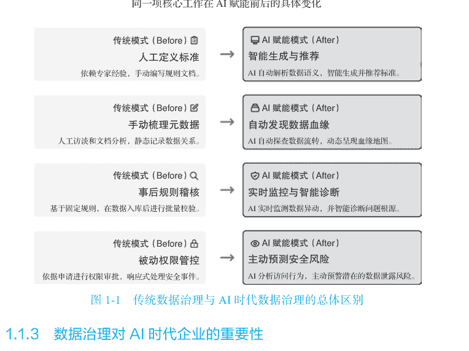

### 1.1.3 数据治理对 AI 时代企业的重要性

在数字化转型和 AI 驱动的商业环境下，数据治理不仅是企业的基础能力，更是实现 AI 赋能的必经之路，其重要性体现在以下 3 个方面。

支撑企业经营与战略决策：高质量数据是精准分析、智能决策的前提。通过数据治理规范数据输入与流转，企业可避免脏数据误导业务增长。例如，零售企业依赖准确的用户行为数据优化供应链与个性化推荐。

实现企业 AI 战略落地：企业构建 AI 能力的核心挑战之一是数据准备。未经治理的数据可能导致模型偏差、低准确度甚至逻辑错误。例如，大语言模型（LLM）的训练依赖大规模高质量语料，而脏数据会使模型生成错误回答。

- 加速业务创新与合规落地：良好的治理体系能平衡数据利用与合规风险。例如，智能制造企业通过实时数据治理优化生产流程，并确保符合行业数据安全标准。

对于传统企业而言，数据治理是智能化转型的必经之路，必须构建“治理先行”的实施路径。首先，这表现为数据标准化，它是为大模型提供一致、干净、高质量数据源的基础保障。其次，通过元数据智能化，为数据补充丰富的业务和管理背景信息，这对于提升 AI 模型的可解释性和透明度至关重要。最后，必须将安全合规的理念深度嵌入 AI 应用的全流程，确保从数据处理到模型部署的每一个环节都严格遵守数据隐私与伦理规范，从而实现稳健、可靠的智能化转型。

企业若跳过数据治理直接部署 AI，可能陷入“垃圾进，垃圾出”的困境，导致 AI 系统失效或不合规。因此 AI 时代的竞争力始于数据治理的成熟度。

## 1.2 数据治理框架与方法论

### 1.2.1 数据治理框架

数据治理框架是对数据治理工作范围和边界的管控。当前最权威的数据治理框架为 DCMM（数据管理能力成熟度评估模型），但此框架注重对数据治理成熟度的评估，偏向事后，缺乏对企业数据治理工作规划和实施落地的关键指导内容，DCMM 框架内容如图 1-2 所示。

DCMM 将企业的数据管理能力划分为 5 个等级：初级（1 级）、受管理级（2 级）、稳健级（3 级）、量化管理级（4 级）和优化级（5 级）。该模型从制度规范、组织建设、技术工具、人员能力、数据文化 5 个维度，全面评估企业在数据战略、数据治理、数据架构等核心领域的健康状况。

然而，现实情况是约 80% 的企业仍处于 2 级以下的初级水平。这是因为这些企业缺乏清晰的数据战略导致数据质量难以提升、大量劳动密集型的治理工作导致数据应用价值实现周期长等问题。这就暴露出 DCMM 的核心痛点：它就像一份详尽的“体检报告”，能精准地诊断出企业“哪里生病了”，却未能提供一套智能化的“药方”来指导如何“治疗”。许多企业在完成评估后，虽然明确了自身短板，但因缺少具体的改进路径和方法，导致能力提升收效甚微，长期停留在较低的成熟度等级。

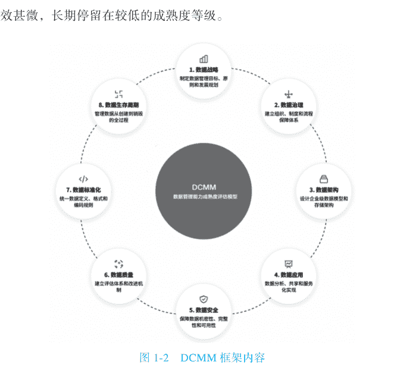

因此，尽管有 DCMM 这类系统性的方法论作为支撑，但在数据治理的实际落地中，无论是使用传统模式还是 AI 技术，企业依然面临着许多共性挑战和新增难题。

### 1.2.2 数据治理方法论

随着企业智能化转型的加速，企业数据治理实践正在持续深化与创新，数据治理方法论也在不断迭代。通过对领先企业数据治理实践的深入研究，下面将对华为数据治理方法论和 IBM 数据治理方法论这两大代表性方法论进行系统性对比分析。

华为的数据治理方法论以“清洁、透明、智慧”为目标，通过多层次框架和差异化策略，支撑企业数字化转型，方法论的核心内容和关键实践如表 1-1 所示。

表 1-1 华为数据治理方法论的核心内容和关键实践

| 维度 | 核心内容 | 关键实践 |
| :--- | :--- | :--- |
| 组织保障体系 | 通过顶层政策、组织保障、流程规范协同构建企业级治理机制 | • 发布《数据管理总纲》《数据质量管理政策》<br>• 设立公司级与领域级数据 Owner（如财务数据 Owner 由 CFO 担任）<br>• 业务部门直接承担数据质量指标考核 |
| 信息架构标准 | 建立业务系统与 IT 系统的统一数据语言，规范企业级数据模型 | • 定义 18 个 L1 级主题域（如客户/产品/供应商等）<br>• 发布 5500 多个业务对象数据实体标准（如“客户”实体包含 92 个标准字段）<br>• IT 系统强制要求在数据字典中映射业务术语与物理字段 |
| 全生命周期管理 | 覆盖数据从生成到销毁的 11 个核心环节 | • 入湖治理：实施 6 项准入标准（如数据 Owner 签名、质量评估等）<br>• 使用监控：设置数据服务调用次数与用户权限关联的自动熔断机制（如单用户 API 日调用上限为 10 万次）<br>• 归档销毁：建立冷数据分级存储策略（如 7 级分层，冷数据占比≤30%） |
| 质量与安全框架 | 双路径管控，确保数据可信可控 | 质量方面：<br>• 定义 45 类质量规则（如供应商主数据完整性≥99.5%）<br>• 实时看板监控质量问题闭环周期（如平均 2.7 天）<br>安全方面：<br>• 敏感数据字段级脱敏（如身份证号仅显示后 4 位）<br>• 数据权限实现“RBAC+ABAC”混合控制 |
| 平台化服务能力 | 通过统一数据平台降低使用门槛 | • 数据服务超市：累计发布 1200 多个标准化 API（如订单状态查询接口的调用次数达日均 800 万次）<br>• 分析工具箱：提供自助式 SQL 编辑器（如支撑 78% 的非技术用户生成报表）<br>• 智能治理工具：AI 辅助识别数据质量问题（准确率达 92%） |
| 成效指标 | 通过治理实现显性业务价值 | • 合同评审效率提升 40%（如数据自动校验替代人工校验）<br>• 跨系统数据对接成本降低 80%（如主数据复用率从 35% 提升至 89%）<br>• 数据质量问题解决周期缩短至原来的 30%（如从平均 21 天缩短至 7 天）<br>• 数字化转型相关项目的 ROI 达到 1:7.8 |

华为数据治理方法论的特点包括以下 4 个维度：

- **业务驱动**：数据治理责任回归业务部门，数据 Owner 机制确保源头质量。

- **技术支撑**：基于数据平台实现数据湖与智能治理。
- **组织保障**：数据管理部与变革项目协同，治理要求嵌入 IT 系统设计。
- **价值闭环**：从数据资产目录到服务超市，推动数据从资源向生产力转化。

华为通过该方法论实现数据质量问题下降 65%、跨系统对接成本降低 80%，其经验为传统企业的数字化转型提供了可复用的标准化范式。

IBM 数据治理方法论是一套体系化的数据管理框架，旨在帮助企业将数据作为核心资产进行治理，其核心内容包括治理体系框架、成熟度模型、实施流程及技术支撑。该方法论的核心内容和关键实践如表 1-2 所示。

表 1-2 IBM 数据治理方法论的核心内容和关键实践

| 维度 | 核心内容 | 关键实践 |
| :--- | :--- | :--- |
| 定义业务问题 | 将真实的业务痛点（而非纯技术问题）作为数据治理的切入点，将治理与业务价值（如风险管理、合规、成本降低、收入增长）直接挂钩，明确初始范围 | 聚焦业务痛点，关联业务价值，明确初始范围。例如，解决销售报告数据不一致导致决策失误的问题，提升决策准确性，初期仅关注核心销售指标 |
| 获取高层支持 | 获得关键业务和 IT 高层领导的认可与支持。组建（虚拟）工作组，识别并任命数据治理负责人。通过业务案例和“快捷区域”（Quick Wins）展示价值 | 争取领导层认同，组建团队，任命负责人，通过 Quick Wins 展示价值。例如，向 CXO 汇报治理价值，组建跨部门（业务、IT）虚拟团队，任命数据治理官，快速清理核心客户数据以展示初步成效 |
| 执行成熟度评估 | 使用成熟度模型评估组织当前的数据治理能力，并定义期望的未来状态，通常设定 12～18 个月的目标。评估覆盖数据治理的多个关键领域 | 评估现状（As-Is），定义目标状态（To-Be），设定时间目标，覆盖关键领域。例如，使用 DAMA 等成熟度模型评估，发现数据质量处于 L1，设定 18 个月内达到 L3 的目标，评估范围包括数据质量、元数据等 |
| 创建路线图 | 基于成熟度评估的差距，制订弥补差距的行动计划。识别所需的人员、流程、技术和策略。对关键计划进行优先级排序，确保短期内产生可见成果 | 基于差距制订行动计划，识别所需资源，并对优先级进行排序，确保短期内可见成果。例如，制订未来 12 个月的行动计划，包括采购元数据工具、定义关键数据元素、优先解决影响财报的数据问题 |
| 建立组织蓝图 | 定义数据治理的组织架构（通常为三层：委员会、工作组、照管社区）、角色、职责和决策权。制定数据治理章程，明确目标、范围和治理原则 | 定义组织架构、角色职责与决策权，制定治理章程，明确治理原则。例如，设立数据治理委员会（决策）和数据管理办公室（执行），明确数据所有者和数据管家的职责，发布数据治理章程 |
| 创建数据字典/业务术语库 | 建立集中的、受控的业务术语库，定义关键业务术语，确保业务和IT之间达成共识。将业务术语与底层技术资产（元数据）相关联 | 建立集中的业务术语库，定义关键术语，确保业务与IT达成共识，并关联元数据。例如，在企业维基或专业工具中建立业务术语表，定义“活跃客户”标准并获得业务/IT的认可，随后关联到CRM系统的客户状态字段 |
| 理解数据 | 通过数据发现和分析，理解企业内数据的实际情况，包括数据源、数据结构、数据关系（主外键）、数据质量、数据血缘、敏感数据分布等 | 执行数据发现与分析，理解数据源、数据结构、数据关系、数据质量、数据血缘、敏感数据分布。例如，使用数据剖析工具分析客户表，识别地址字段的空值率和格式问题，绘制关键报告数据（如销售额）的来源与转换过程（血缘） |
| 创建元数据存储库 | 整合业务元数据（来自数据字典）和技术元数据（来自数据发现），建立统一的元数据存储库，以支持数据血缘分析、影响分析和操作元数据管理 | 整合业务与技术元数据，建立统一存储库，以支持数据血缘与影响分析。例如，将业务术语库与通过数据发现扫描到的数据库表、字段信息整合到统一元数据平台，支持查看某数据变更对下游报表的影响 |
| 定义度量指标 | 建立一套可度量的关键绩效指标（KPI），用于监控数据治理计划的进展和效果。区分业务KPI和技术KPI，并定期跟踪和报告 | 建立可度量的KPI，区分业务KPI与技术KPI，并定期跟踪与报告。例如，设定业务KPI为“客户主数据重复率降低20%”，技术KPI为“核心系统元数据注册率达到90%”，并每月追踪进度 |
| 治理主数据 | （可选专题）定义和实施针对核心主数据（如客户、产品、供应商）的治理策略、标准、流程和数据照管。管理主数据质量，实现单一可信视图 | （可选）定义主数据治理策略与标准，管理主数据质量，实现单一视图。例如，实施客户主数据管理（MDM）项目，建立“黄金客户记录”标准和维护流程，确保各系统使用统一、准确的客户信息 |
| 指导分析（治理分析） | （可选专题）建立策略和流程来协调商业智能（BI）与分析活动。可能涉及建立商业智能能力中心（BICC）来推广最佳实践、管理报告、培训用户 | （可选）建立BI与分析活动的协调策略，推广最佳实践，管理报告，培训用户。例如，成立商业智能能力中心（BICC），推广使用经过认证的数据集进行分析，提供标准报表模板，组织针对数据分析工具的培训 |
| 管理安全和隐私 | （可选专题）制定和执行数据安全与隐私保护策略。发现、分类、标记敏感数据（PII、PHI等）。实施访问控制、加密、脱敏、审计监控等措施 | （可选）制定和执行安全隐私策略，分类与标记敏感数据。实施访问控制、加密、脱敏、审计。例如，制定数据安全分类策略，识别并标记个人身份信息（PII），对敏感数据进行加密存储和访问控制，对非生产环境数据进行脱敏处理 |
| 控制信息生命周期（ILG） | （可选专题）管理信息从创建到归档再到销毁的全生命周期。制定和执行数据（结构化和非结构化）的归档、保留和处置策略。支持电子发现（eDiscovery） | （可选）实施信息全生命周期管理，制定归档、保留与处置策略，支持电子发现。例如，制定“财务数据保留7年，过期后安全销毁”的策略，实施非结构化数据（如邮件）的归档方案，以满足合规要求和电子发现需求 |
| 度量结果 | 定期度量定义的KPI，将结果报告给数据治理委员会和高层管理者。利用结果证明数据治理的价值，获取持续支持。将结果反馈到路线图并进行调整优化，形成持续改进循环 | 定期度量KPI，向干系人汇报结果，证明价值，反馈优化路线图，形成持续改进循环。例如，每季度衡量KPI（如数据质量提升百分比）并向治理委员会汇报，根据报告结果调整下季度路线图的优先级，形成PDCA循环 |

从方法论的对比中可以发现：华为更注重业务场景落地，通过数据湖与业务所有者（Owner）机制解决“数据孤岛”问题，适合需要快速响应业务变化的非数字原生企业使用；IBM强调整体框架的系统性，通过分层治理和成熟度模型实现长期可持续性，适合需要兼顾合规与复杂架构的大型企业使用。通过对中外两种典型方法论的比较发现，国内企业的数据治理方法论更强调集中管控和组织执行力，而国外企业的数据治理方法论则更加注重与企业IT架构的深度融合和价值实现闭环。这种差异性反映了不同市场环境下企业数据治理需求的共性与个性，为后续构建AI赋能的现代数据治理体系提供了重要的方法论基础和实践参考。

这两者代表了国内外领先企业的实践范式。华为强调“业务驱动”，让业务部门直接成为数据的所有者，从源头解决数据质量问题；IBM则强调框架的系统性与价值闭环，从识别业务痛点出发，制定详细的路线图，最终衡量治理带来的业务价值。华为和IBM数据治理方法论的差异如图1-3所示。

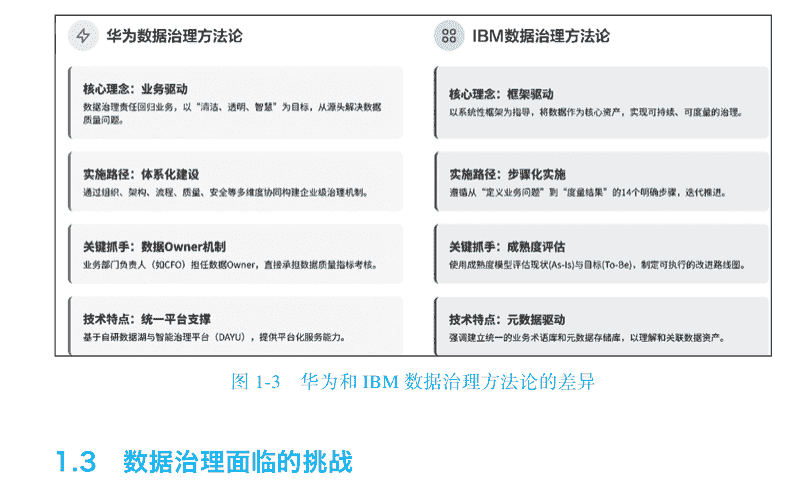

图 1-3 华为和IBM数据治理方法论的差异

## 1.3 数据治理面临的挑战

### 1.3.1 传统数据治理面临的挑战

在AI时代，传统数据治理急需优化和更新数据治理方法论，以应对企业对数据的使用要求。传统数据治理聚焦结构化数据、数据仓库、报表和基础数据分析，主要挑战包括以下内容。

### 1. 数据战略的挑战

- **价值体现困难**：难以清晰量化数据治理对业务的具体贡献，导致治理工作常被视为IT成本而非战略投资，难以获得持续的高层支持和资源投入。
- **目标模糊与对齐不足**：数据治理目标往往偏重技术层面（如数据整合、质量提升），未能与核心业务战略（如提升客户满意度、降低运营风险）紧密结合和有效对齐。
- **缺乏顶层设计**：缺少将数据视为核心资产的全局性战略规划，治理活动往往是零散的、被动响应式的。

### 2. 数据治理（组织与流程层面）的挑战

- **权责不清**：数据的所有权、管理权、使用权界定模糊，缺乏明确的数据管家制度或相关角色的职责未得到有效落实，导致问题无人负责、决策效率低下。
- **政策落地难**：制定的数据政策、标准和流程往往停留在纸面上，缺乏有效的执行、监督和问责机制，难以在业务部门和IT部门间有效推行。
- **跨部门协调困难**：数据治理涉及多个业务和IT部门，打破部门墙、协调各方利益、达成共识并协同行动，这是非常困难的。
- **缺乏专业组织和资源**：企业往往没有设立专门的数据治理办公室或配备足够的人力资源来推动和维持治理工作。

### 3. 数据架构的挑战

- **数据孤岛林立**：系统建设缺乏统一规划，各业务系统（如ERP、CRM、SCM等系统）独立建设，形成数据孤岛，数据难以整合和共享。
- **架构僵化与复杂**：传统数据仓库架构比较僵化，难以快速适应新的数据源和分析需求，点对点的数据集成方式导致架构复杂、难以维护。
- **缺乏统一数据模型**：缺少企业级的概念或逻辑数据模型作为蓝图，导致不同系统间的数据结构和含义不一致。

### 4. 数据应用的挑战

- **报表不一致**：由于数据来源、口径、处理逻辑不同，因此不同报表或系统展示的同一指标数据经常不一致，影响决策可信度。
- **数据获取效率低**：用户（尤其是业务分析师）需要花费大量时间寻找、理解、清洗和整合数据，无法仅专注于分析和洞察。
- **应用开发与数据解耦难**：应用系统与底层数据紧密耦合，数据结构的变更可能对上层应用产生较大影响，反之亦然。

### 5. 数据安全的挑战

- **访问控制粗放**：权限管理往往基于角色而非细粒度的数据内容，难以实现精确的访问控制，存在数据泄露风险。
- **敏感数据管理不足**：对敏感数据（如个人身份信息、财务数据）的识别、分类、脱敏、加密等保护措施不足或不一致。
- **审计能力有限**：对数据的访问和使用行为缺乏有效、全面的审计追踪能力。
- **跨系统安全策略不一致**：不同系统间的安全策略和实施水平参差不齐。

### 6. 数据质量的挑战

- **质量问题普遍**：数据不准确、不完整、不一致、不及时、格式无效等问题广泛存在于源系统。
- **缺乏系统性度量与监控**：缺少对数据质量的持续度量、监控和报告机制，问题往往在下游应用中暴露时才被发现。
- **根源追溯困难**：数据质量问题通常涉及多个系统和流程，难以快速定位问题的根本原因。
- **修复成本高且被动**：数据清洗和修复工作往往依赖人工，成本高、效率低，且多为事后补救，缺乏源头预防。

### 7. 数据标准化的挑战

- **缺乏统一业务术语**：对核心业务概念（如客户、产品、订单状态）缺乏统一、清晰的定义，导致沟通存在歧义和数据整合困难。
- **标准不一**：不同系统对同一数据元素采用不同的编码、格式或度量单位（如日期格式、地址格式、货币单位）。
- **主数据管理分散**：核心主数据（如客户、产品、供应商等）在多个系统中独立维护，缺乏统一管理和黄金记录（Golden Record），导致数据冗余和不一致。
- **标准推广执行难**：即使制定了标准，要在全企业范围内推广和强制执行也面临巨大阻力。

### 8. 数据生存周期的挑战

- **缺乏明确策略**：对数据的创建、存储、使用、归档、销毁等环节缺乏清晰的管理策略和流程。
- **数据冗余与存储成本**：过期、无效、重复的数据未被及时清理或归档，导致存储资源浪费和管理成本增加。
- **合规风险**：无法满足法律法规对数据保留期限和安全处置的要求，存在合规风险。
- **历史数据利用困难**：归档数据格式陈旧或缺乏元数据，导致难以有效检索和再利用。

基于对以上内容的总结和提炼，传统数据治理面临的核心挑战如图 1-4 所示。

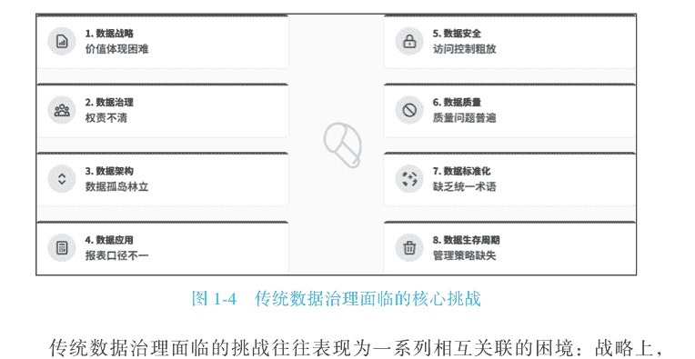

传统数据治理面临的挑战往往表现为一系列相互关联的困境：战略上，数据治理的价值难以量化，且与业务目标脱节；执行上，面临着权责不清、跨部门协调困难和标准落地难的普遍挑战。这些问题最终传导至技术和应用层面，表现为数据孤岛林立、数据质量低下、安全风险事件频发，严重制约了数据潜能的释放。

### 1.3.2 AI 时代数据治理面临的挑战

在 AI 时代，对海量多样化数据（特别是多模态）、AI 模型自身、可解释性等全新维度的治理需求，使整个数据治理体系变得更加复杂、动态，因此需要一个新的数据治理框架。与传统数据治理框架最大的区别是，AI 将传统数据治理领域的内容进行统一接管，AI 模型、数据架构与平台成为重要的管理内容，AI 时代数据治理的分层框架如图 1-5 所示。

综上所述，AI 时代的现代化数据治理框架以明确的数据战略与价值为顶层指引，确保所有治理活动与业务目标同频。其核心框架并行管理着两大关键对象：传统的数据资产与新兴的 AI 模型资产，体现了治理范围的根本性扩展。整个运作过程始终由数据安全与 AI 伦理这两大“守护支柱”提供全方位的保驾护航，确保治理过程合规与可信。

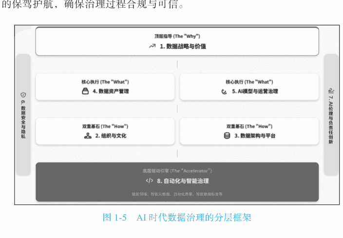

自动化与智能治理作为底层驱动引擎，以 AI 技术为催化剂，持续为上层所有领域赋能，将数据治理从被动的以成本为中心，转变为主动、高效、能够持续创造价值的战略能力为中心。AI 时代数据治理领域的具体定义如表 1-3 所示。

表 1-3 AI 时代数据治理领域的具体定义

| 数据治理领域 | 定义 |
| :--- | :--- |
| 数据战略与价值 | 指制定企业如何利用数据和 AI 作为核心战略资产的顶层规划、目标和路线图。它涉及将数据驱动和 AI 驱动的计划与核心业务目标对齐、论证和衡量数据治理及 AI 应用的商业价值（包括财务和非财务回报）、获得并维持高层领导的支持，并将 AI 融入整体业务发展方向 |
| 组织与文化 | 指建立和维护有效管理数据与 AI 所需的组织架构、角色（包括数据所有者、数据管家以及 AI 伦理官等新角色）、职责、决策流程、政策和标准。同时，它也强调培育一种全员认可数据价值、具备基本数据素养和 AI 伦理意识、鼓励协作、明确问责制的组织文化，并关注相关人才的培养与发展 |
| 数据架构与平台 | 指设计、构建和维护支持数据全生命周期管理，并能够满足 AI 应用需求的技术蓝图、基础设施、工具和服务。这包括可扩展的数据存储（如数据湖、湖仓一体）、高效的数据处理能力（批处理、流处理）、数据集成机制，以及支持模型开发、训练、部署和监控的端到端 AI 平台 |
| 数据资产管理 | 指将数据及其衍生物（如元数据、主数据、参考数据等）视为可管理、可评估价值的企业核心资产，并对其进行全生命周期的系统性管理。它整合了元数据管理（理解资产）、数据质量管理（确保适用性，含 AI 特有的代表性、偏见考量）、数据标准化（确保一致性）、数据血缘（追踪来源与流向，尤其进入 AI 模型的路径）和数据生命周期管理（从创建到销毁） |
| AI 模型与运营治理 | 指对 AI 模型本身在其整个生命周期内进行管理、监控和控制的规程与实践。它涵盖模型的开发标准、验证、注册与版本管理、部署策略、持续性能监控、再训练机制、模型可解释性、公平性评估、模型风险管理以及最终的模型退役 |
| 数据安全与隐私 | 指制定和实施策略、技术与流程，以保护数据资产和 AI 模型免受未经授权的访问、使用、泄露、篡改或破坏，并确保符合相关数据隐私法规。它包括访问控制、加密、脱敏、日志审计、隐私增强技术的应用评估与实施，以及针对 AI 模型特有的安全风险（如对抗性攻击）的防护 |
| AI 伦理与负责任创新 | 指建立一套原则、指导方针、审查机制和实践，以确保 AI 系统的设计、开发、部署和使用是公平、透明、可解释、可问责、安全可靠且符合人类价值观和社会规范的 |
| 自动化与智能治理 | 指利用自动化技术，特别是 AI 驱动的方法，来提升数据治理活动的效率、准确性、一致性并扩大覆盖范围。这包括应用工具实现智能化的数据发现、自动分类、自动化质量监控、元数据自动生成、血缘自动追踪，使治理规则能够自动执行和验证，从而减轻人工负担，实现更主动、更实时的数据治理 |

从上述 AI 时代数据治理领域的定义可以看出，数据治理各领域的目标和范围都发生了变化。因此在这种新变化下，有必要探索新的数据治理方法论以应对 AI 时代的数据治理挑战。AI 时代各数据治理领域面临的挑战和影响分析如表 1-4 所示。

表 1-4 AI 时代各数据治理领域面临的挑战和影响分析

| 数据治理领域 | 挑战内容（AI 时代） | 影响分析 |
| --- | --- | --- |
| 数据战略与价值 | • 如何制定与业务紧密结合的 AI 数据战略<br>• 如何量化 AI 和相关数据治理投入的 ROI<br>• 如何将 AI 融入整体数据战略<br>• 如何维持高层对 AI 数据治理的支持 | AI 项目与业务脱节，价值难以实现；治理投入难以获得持续支持；潜在的问题和风险被忽视；战略执行受阻 |
| 组织与文化 | • 如何构建适应 AI 需求的敏捷、跨职能治理组织<br>• 如何定义新的治理角色（如模型风险官）<br>• 如何培养组织内的数据素养和 AI 伦理意识<br>• 如何克服对 AI 和自动化治理的文化阻力<br>• 如何应对既懂治理又懂 AI 的复合型人才的缺失 | 治理流程僵化，跟不上 AI 的迭代速度；权责不清，风险无人担责；员工对 AI 数据应用不理解、不信任；治理措施难以落地，无法有效实施 AI 治理策略 |

## 1.4 数据治理的困境及转型方向

当前阶段 AI 技术的技术曲线还没有完全趋于稳定，创新式的更新不断产出，传统数据治理挑战和 AI 时代数据治理挑战并存。企业的业务战略也在不断地与 AI 技术进行融合，AI 技术已经完全渗透到企业业务的通用场景，正在对专业场景进行赋能。因此，现阶段数据治理工作应该如何开展、如何转型是需要重点解决的问题。

在现阶段，组织面临的问题既来源于已有的数据治理工作，又来源于 AI 大模型在企业中的应用。许多企业既要维护现有的基于结构化数据、数据仓库和 BI 报表的传统治理体系，又要开始应对由 AI 应用带来的新的、更复杂的治理挑战。这个过渡阶段的数据治理面临着显著的困境，同时也对转型提出了迫切的需求。

### 1.4.1 数据治理的困境

数据治理的困境是指企业在传统数据治理与 AI 数据治理融合的过程中面临的一系列问题，这些问题的表现如下。

1）框架与范围的不适应：传统治理框架主要为结构化数据和批处理设计，难以有效覆盖 AI 所需的海量、高速、多样化（尤其非结构化）数据。治理范围往往停留在数据层面，缺乏对 AI 模型本身生命周期的管理。
表现：对非结构化数据的治理缺失；非结构化数据质量提升难度高；无法将非结构化数据转换为 AI 所需的知识。

2）流程与速度的冲突：传统治理流程往往为瀑布式，审批周期长，依赖手动操作，与 AI 快速迭代、敏捷开发的特点格格不入。
表现：治理成为 AI 项目上线的瓶颈；为了速度牺牲治理要求，导致风险累积；治理活动与开发流程脱节。

3）工具与技术的断层：传统的数据目录、主数据管理、数据质量工具通常不具备处理非结构化数据、检测数据偏见、追踪模型血缘、管理模型资产等 AI 特定功能。AI 平台往往缺乏与传统治理工具链的集成。
表现：治理工作仍需要大量人工介入，效率低下；无法对 AI 特有的风险（如偏见、公平性）进行有效监控；数据和模型的端到端可见性差。

4）质量与标准的扩展困难：传统数据治理对数据质量的关注点（如准确性、完整性等）不足以满足 AI 的需求，需要扩展到代表性、偏见、公平性等更复杂的维度，但这些维度的定义和度量本身就很困难。标准化工作也需要扩展到特征工程、模型接口等新领域。
表现：训练数据中隐藏的偏见未被发现，导致模型产生歧视性结果；模型泛化能力差，特征难以复用。

5）安全与隐私的新挑战：传统安全措施可能不足以应对 AI 模型特有的攻击模式（如对抗性攻击）或保护用于训练的大规模敏感数据集，尤其是在需要共享或使用隐私增强技术时，治理策略跟不上技术发展。
表现：AI 模型易受到攻击；隐私保护措施实施困难或效果不佳；合规风险增加。

在当前传统数据治理与 AI 数据治理并存的阶段，数据治理的困境凸显。现有的为结构化数据设计的治理框架、瀑布式流程、传统工具链难以适应 AI 带来的海量多样化数据、快速迭代以及模型生命周期管理的新要求。治理范围不足（如缺乏模型治理、伦理考量）和流程滞后成为创新瓶颈，技术工具断层导致无法支撑自动化和对 AI 特定风险（如偏见）的监控，人员技能与组织文化也未能及时跟上技术发展，最终使得对 AI 应用的数据质量、安全隐私、伦理合规等关键方面的有效管控面临巨大挑战。

### 1.4.2 数据治理的转型方向

基于当前数据治理面临的困境，结合国家政策文件和行业实践，未来数据治理的转型方向如下。

（1）统一视角，价值驱动治理

- 思路：打破传统数据治理与新兴 AI 数据治理的壁垒，建立一个统一的框架来管理所有数据和 AI 应用。
- 场景：可以设立一个数据与 AI 治理委员会，该委员会负责根据 AI 应用的潜在风险（如财务影响、客户影响）和数据敏感性，决定治理的深度和流程。一个内部运营优化模型可能只需要轻量级治理，而一个客户信用评分模型需要经过数据质量、模型公平性、伦理等多重严格审查。

（2）让 AI 辅助治理

- 思路：利用自动化和 AI 技术来减轻繁重的治理负担，提高效率和覆盖率。
- 场景：部署一个 AI 智能数据目录工作流，它能自动扫描、识别并分类数据（如标记重要数据），自动追踪数据血缘。使用 AI 工具监测数据流，自动发现数据质量异常或潜在的数据偏见，并发出警告，而不是等问题发生后再进行人工排查。

（3）对齐业务目标，主动治理

- 思路：让治理工作紧密服务于业务目标，清晰展示治理工作如何帮助业务实现价值（如提高模型信任度、加速部署）和规避风险（如避免罚款、声誉损失）。
- 场景：在申请 AI 项目预算时，治理团队协助业务部门清晰阐述通过实施特定治理措施（如加强数据质量监控、进行标准审核）可以带来的具体业务收益和风险降低效果。定期向管理层汇报治理成效，使用业务语言（而非纯技术术语）沟通进展和挑战，争取持续的支持。

数据治理的转型方向是构建现代化、综合性的治理体系，将数据治理、模型治理融为一体。关键在于大力拥抱自动化与智能化技术以提升效率，推动治理流程敏捷化并嵌入 AI 开发运维流程。同时，必须加强组织能力建设，提升人员技能水平和数据与 AI 素养，塑造负责任的创新文化。最终目标是使数据治理从合规驱动转向价值赋能与风险共担，保障 AI 健康、可信地发展。

## 第 2 章 DeepSeek 核心能力赋能数据治理解析

本章旨在全面解构 DeepSeek 的核心能力：首先从通用应用视角出发，展示 DeepSeek 如何赋能组织内的广泛工作场景；随后重点剖析 DeepSeek 在自然语言处理、代码智能、知识推理等方面的核心能力，并从数据治理的视角出发，分析这些核心能力（如文本理解、代码生成、模式识别等）在解决数据治理问题中的潜力。

本章的目标是为读者建立对 DeepSeek 能力的清晰认知，了解其作为一种强大的 AI 大模型所具备的基础能力，从而为第 3 章详细阐述 DeepSeek 如何与数据治理工作深度融合、驱动模式创新奠定坚实的技术理解基础。

### 2.1 DeepSeek 核心能力概览：赋能组织场景

本节将分 3 部分进行介绍：首先概述 DeepSeek 核心能力；其次描绘 DeepSeek 典型工作场景；最后展示这些能力如何与场景结合，实现对组织工作的全面赋能。

#### 2.1.1 DeepSeek 核心能力

DeepSeek 分为推理模型和非推理模型两种，以 DeepSeek-V3 和 DeepSeek-R1 两个模型的定义为例。

DeepSeek-V3（非推理模型）是一款针对中文语境进行了深度优化的通用型大语言模型，专注于高效处理问答、文本生成、信息检索等广泛任务，强调语言流畅性、知识广度和响应速度。它擅长开放式对话、内容创作及日常问题解答，适用于不需要复杂推理的常规应用场景，能够快速生成高质量的回答，满足用户对知识获取和自然交互的需求。

DeepSeek-R1（推理模型）是一款具有推理能力的大语言模型，针对数学计算、编程求解、多步逻辑推演等复杂任务进行了专项增强。其显著特点是能够利用先进的链式思维（Chain-of-Thought）策略，对复杂问题进行分步骤拆解、严谨推导，尤其在深度逻辑分析和解决结构化问题的场景中表现卓越，适用于算法设计、数学证明、逻辑分析等需要深度思考的场景。

不同 DeepSeek 模型的使用场景对比如表 2-1 所示。

**表 2-1 不同 DeepSeek 模型的使用场景对比**

| 特性 | DeepSeek-V3（非推理模型） | DeepSeek-R1（推理模型） |
| :--- | :--- | :--- |
| 主要优化方向 | 语言流畅性 & 知识广度 | 逻辑推理 & 分步骤求解 |
| 适用任务 | 回答、写作、信息整理 | 数学、编程、多轮推演 |
| 计算效率 | 通常更快（单次响应） | 可能需要更多计算资源（分步推导） |
| 推理能力 | 适合简单直接的回答 | 适合需要逐步分析的任务 |

从表 2-2 可以看出：非推理模型更侧重于模式识别、信息检索、基于统计规律的生成和理解，通常用于处理相对直接、结构化的任务；推理模型更侧重于进行逻辑推断、理解深层语义、处理复杂指令、进行多步思考，常用于解决非常规问题或生成需要综合分析的创造性内容。

**表 2-2 不同 DeepSeek 模型的核心能力说明**

| 能力类别 | 核心能力 | 简要说明 |
| :--- | :--- | :--- |
| 基础/直接能力 | 基础自然语言理解 | 识别文本主题、关键词、实体（如人名、地名等）、基本情感 |
| | 标准自然语言生成 | 生成格式化文本（如邮件、摘要）、简单描述、文本补全、基础翻译 |
| | 基础代码理解与生成 | 阅读简单代码、识别语言、生成常用代码片段、代码补全 |
| | 信息检索与事实问答 | 从知识库或给定文本中查找特定事实信息、回答直接定义性问题 |
| | 显式模式识别与提取 | 识别固定格式（如日期、邮箱、URL）、提取文本中明确表述的关键信息 |
| 推理/判断能力 | 深层语义理解 | 理解复杂指令、上下文隐含意义、比喻、反讽、多义性 |
| | 复杂与创造性内容生成 | 撰写分析报告、生成结构化长文、创意写作、论证性文本、多轮对话 |
| | 高级代码智能 | 理解复杂算法逻辑、根据高级需求生成代码、调试复杂错误、代码优化建议 |
| | 逻辑推理与问题解决 | 进行演绎/归纳推理、因果分析、解决数学或逻辑问题、多步推理 |
| | 规划与任务分解 | 分解复杂目标、制订行动计划、评估方案可行性 |
| | 隐式信息推断与综合 | 从多源信息中推断隐含关系、识别微妙模式、综合不同观点形成新见解 |

DeepSeek 的基础能力构成信息处理的核心能力。这些能力使 DeepSeek 能够高效地执行相对直接的任务，例如：快速理解文本的基本含义和关键实体（基础自然语言理解）；生成格式规范的日常文本，如邮件或摘要（标准自然语言生成）；处理简单的代码片段读写与补全（基础代码理解与生成）；从知识库中精确检索事实信息并直接回答问题（信息检索与事实问答）；识别和提取文本中明确定义的模式或数据（显式模式识别与提取）。这些能力主要依赖模式识别和对海量数据的学习，特别擅长自动化处理结构化、重复性高的信息工作，是提升基础工作效率的关键。

DeepSeek 的推理能力则展现了更深层次的“智能”。这些能力使 DeepSeek 能够处理更复杂、更需要分析和创造力的任务，例如：深入理解语言的细微差别、隐含意义和复杂指令（深层语义理解）；创作结构复杂、需要分析论证或具有创意的文本内容（复杂与创造性内容生成）；理解并生成具有复杂逻辑的程序代码并进行优化（高级代码智能）；执行逻辑推理、解决需要多步骤思考的问题（逻辑推理与问题解决）；辅助进行规划和任务分解（规划与任务分解）；从多源信息中发现隐含联系并进行综合提炼（隐式信息推断与综合）。这些能力依赖更强的上下文理解、知识关联和模拟推理，让 DeepSeek 能够作为分析师、规划师甚至创意伙伴，在需要深度思考和解决复杂问题的场景中发挥关键作用。

#### 2.1.2 DeepSeek 典型工作场景

本小节将聚焦企业内部普遍存在的、横跨不同部门和职能的典型工作场景。我们通常将企业工作场景分为日常办公与行政管理、业务运营与客户交互、技术研发与数据处理、经营管理与战略决策、知识工作与学习创新。企业内五大类典型工作场景及关键活动如表 2-3 所示。

**表 2-3 企业内五大类典型工作场景及关键活动**

| 场景类别 | 描述 | 关键活动 / 任务示例 | 场景特点 / 挑战 |
| :--- | :--- | :--- | :--- |
| 日常办公与行政管理 | 组织日常运作的基础支持活动，涉及大量信息流转和事务性工作 | 撰写 / 回复邮件、起草 / 审阅文档、安排会议 / 生成纪要、查找内部资料、发布通知、处理简单审批流程 | 重复性高、事务繁杂、信息分散、沟通协调耗时 |
| 业务运营与客户交互 | 直接面向市场和客户的活动，驱动收入增长和客户满意度提升 | 市场营销文案创作、销售材料准备、客户咨询解答、服务工单处理、产品信息查询、社交媒体内容生成 | 响应速度要求高、需要保持信息一致性、客户需求多样、需要快速掌握产品 / 服务知识 |
| 技术研发与数据处理 | 涉及技术创新、系统维护和数据价值挖掘的核心技术活动 | 编写 / 测试代码、撰写技术文档、系统日志分析、数据库查询、数据清洗 / 转换、制作数据报表、解决技术问题 | 技术复杂度高、需要专业知识、文档维护工作量大、数据处理流程可能冗长、逻辑性强 |
| 经营管理与战略决策 | 关乎组织发展方向、资源分配和绩效监控的高层管理活动 | 市场 / 行业研究报告解读、竞品分析、财务数据分析、战略规划草案拟定、风险评估报告撰写、管理汇报材料准备 | 信息量大且来源多样、分析深度要求高、需要整合多维因素、决策影响深远、时间压力大 |
| 知识工作与学习创新 | 以知识的创造、应用和传播为核心的智力密集型活动 | 文献综述、研究报告撰写、新知识 / 技能学习、培训课件开发、创意构思 / 头脑风暴、知识库内容沉淀与整理 | 知识更新快、信息整合难度大、需要批判性思维和创造力、知识显性化和共享是挑战 |

通过这张表格，可以清晰地看到企业内部工作的多样性和复杂性。不同的场景有着不同的活动内容和挑战，并产生不同的数据内容。

#### 2.1.3 DeepSeek 能力结合场景

本小节的核心任务是将这两者紧密结合，具体展示如何将 DeepSeek 的基础能力和推理能力实际应用于不同的工作场景中，从而为企业带来切实的价值。下面将通过具体的应用示例揭示 DeepSeek 如何在提升效率、优化质量、辅助决策和激发创新等方面为企业的各项工作注入新的动能。表 2-4 详细阐述了 DeepSeek 赋能企业业务场景。

**表 2-4 DeepSeek 赋能企业业务场景**

| 场景类别 | 具体应用示例 | 主要赋能价值 / 收益 |
| :--- | :--- | :--- |
| 日常办公与行政管理 | 邮件 / 文档：自动生成邮件初稿、会议纪要摘要、润色报告文本<br>信息查找：快速回答关于公司制度、历史文件的问题<br>流程辅助：理解审批请求意图，从表单中提取关键信息，辅助安排会议日程 | 效率大幅提升：显著减少处理事务性工作的时间<br>沟通改善：提高信息传递的准确性和及时性<br>负担减轻：将员工从重复劳动中解放出来 |
| 业务运营与客户交互 | 营销：生成多样化的广告文案、社交媒体帖子、产品描述<br>销售：快速提供产品信息问答支持，根据客户需求定制方案建议初稿<br>客服：理解客户提出的售前售后问题，提供标准或个性化回复，分析客户反馈并提炼洞察 | 客户体验优化：更快、更准、更个性化的响应<br>营销效果提升：更高效地产出创意内容<br>运营效率提高：自动处理大量客户交互，降低人力成本 |
| 技术研发与数据处理 | 编码：生成代码片段、单元测试、API 调用示例，解释复杂代码逻辑，辅助调试<br>文档：自动生成代码注释、技术文档初稿<br>数据：生成 SQL 查询语句，辅助数据清洗脚本编写，解释数据分析结果 | 开发效率提升：减少编码和文档编写时间<br>技术门槛降低：辅助理解复杂代码和技术概念<br>数据处理简化：自动完成部分数据提取、数据转换任务 |
| 经营管理与战略决策 | 信息分析：快速总结长篇研究报告、财报要点，从新闻 / 研报中提取关键信息<br>决策辅助：基于输入数据和假设进行情景分析推演，辅助制定战略规划框架<br>报告撰写：生成管理汇报 PPT 大纲或初稿 | 决策质量提升：更快地获取和处理信息，辅助深度分析<br>战略敏捷性增强：加速战略规划和调整过程<br>管理效率提高：减少信息收集和报告撰写时间 |
| 知识工作与学习创新 | 研究：辅助进行文献检索和综述，快速理解和总结学术论文<br>学习：解答专业领域问题，生成学习笔记或摘要，解释复杂概念<br>创新：作为头脑风暴伙伴激发新想法，辅助撰写研究计划或创意文案 | 知识获取加速：更快地学习新知识和理解复杂信息<br>研究效率提升：自动完成部分研究辅助工作<br>创新能力增强：提供新的视角和创意 |

DeepSeek 的核心能力与企业的各类工作场景形成了广泛而深入的结合，无论是自动完成基础的事务性工作，还是辅助进行复杂的分析与创造性任务，

## 2.2 DeepSeek 核心能力详解：数据治理能力

本节将聚焦数据治理这一特定领域，深入探讨 DeepSeek 的能力如何为解决复杂的数据治理挑战提供新的可能性。首先基于上节描绘的典型工作场景，分析这些活动所引发的关键数据治理需求。然后阐述像 DeepSeek 这样的大语言模型在应对这些需求时所能扮演的角色，并最终映射在 DeepSeek 的核心能力到数据治理的潜在赋能点上。

### 2.2.1 组织场景中的数据生产与应用：治理需求的源头

通过对组织内各类工作场景的描述，可以看到各类业务工作均会生产数据和应用数据，因此本小节将总结和分析这些数据的内容和数据应用需求。首先以各类工作场景的过程成果和最终成果为分析依据，对工作场景进行数据应用需求识别，然后结合这两个维度进行梳理和分析，掌握组织数据的全貌，以便于后续识别这些数据的治理需求。下面分别对每个大类的工作场景进行说明。

#### 1. 日常办公与行政管理

（1）数据生产内容

- 过程数据：邮件草稿、文档版本、会议议程草案、审批流转记录、临时笔记。
- 最终数据：发送的邮件、最终版报告／通知／备忘录、会议纪要、完成审批的记录、更新的通讯录／组织结构信息。
- 数据类型特点：大量非结构化数据（如邮件、文档、纪要）、少量半结构化数据（如审批表单）、少量结构化数据（如通讯录）。

（2）数据应用需求

- 需要查找历史邮件或文档以获取信息或依据。
- 需要查询同事联系方式或部门信息。
- 需要追踪审批流程状态。
- 需要参考过往会议纪要回顾决策。
- 需要使用标准文档模板。

（3）初步引出的数据治理需求

- **可发现性**：如何快速找到所需的邮件、文档或记录（涉及非结构化数据检索）？
- **访问控制**：谁有权限查看或修改特定的文档或审批记录？
- **标准化**：如何确保使用的模板是最新且统一的？
- **生命周期管理**：过期的文档或记录如何处理（存档/删除）？
- **数据质量**：如何保证通讯录等基础信息的准确性？

#### 2. 业务运营与客户交互

（1）数据生产内容

- **过程数据**：营销活动策划草案、销售线索跟进记录、客户咨询过程记录（如电话录音、聊天记录）、服务工单处理日志。
- **最终数据**：发布的营销内容、成交的销售订单、客户信息（如CRM记录）、解决的客户服务工单、客户反馈评分/评论。
- **数据类型特点**：大量结构化数据（如订单、CRM）、大量非结构化数据（如聊天记录、反馈评论、营销文案）、半结构化数据（如工单）。

（2）数据应用需求

- 需要全面了解客户信息（如360°视图）以提供个性化服务或销售。
- 需要分析营销活动的效果。
- 需要追踪销售进展和预测业绩。
- 需要快速调取知识库信息以解答客户咨询。
- 需要监控客户满意度和舆情。

（3）初步引出的数据治理需求

- **数据集成与主数据管理**：如何整合来自不同系统（CRM、订单、客服）的客户数据，形成统一视图？
- **数据质量**：如何确保订单信息、客户联系方式的准确性？如何校验服务记录的完整性？
- **数据安全与隐私**：如何保护客户的个人信息（PII）？如何确保营销活动符合隐私法规要求？
- **元数据管理**：如何清晰定义营销活动指标、销售阶段、客户标签的含义？
- **数据可理解性**：如何让一线人员快速理解复杂的客户数据或分析结果？

#### 3. 技术研发与数据处理

（1）数据生产内容

- 过程数据：代码版本（Git 记录）、测试脚本与日志、技术设计文档草稿、数据模型迭代版本、ETL/ELT 开发脚本、模型训练日志。
- 最终数据：上线的软件版本、最终技术文档、数据库 Schema 定义、可执行的数据处理流程（ETL/ELT Job）、训练好的机器学习模型、数据分析报告/数据集。
- 数据类型特点：大量代码（半结构化数据）、日志（半/非结构化数据）、文档（非结构化数据）、数据库、测试结果、数据集（结构化数据）、模型（二进制/配置文件）。

（2）数据应用需求

- 需要理解现有代码库的结构和逻辑。
- 需要通过日志排查系统故障或性能问题。
- 需要查询和使用数据库中的数据进行开发或测试。
- 需要构建、验证和部署数据处理流程或模型。
- 需要共享和复用技术文档、代码模块或数据集。

（3）初步引出的数据治理需求

- **数据血缘**：如何追踪数据从源头经过代码处理到最终应用的完整路径？
- **元数据管理**：如何有效管理代码注释、数据库 Schema 文档、模型参数说明等技术元数据？
- **数据质量（在开发测试中）**：如何确保测试数据的质量和覆盖度？如何监控生产环境数据处理的准确性？
- **版本控制与标准化**：如何管理代码、文档、模型的版本？如何推行编码规范和设计标准？
- **数据目录与可发现性**：如何让开发者或分析师方便地找到可用的数据集、API 或模型？

#### 4. 经营管理与战略决策

（1）数据生产内容

- 过程数据：市场分析报告草稿、财务预测模型中间版本、战略讨论会议记录、KPI 计算过程数据。
- 最终数据：发布的财务报表、市场分析报告、董事会决策材料、批准的年度预算、确定的战略规划文档、KPI 仪表盘。
- 数据类型特点：大量报告（半/非结构化数据）、表格（结构化数据）、演示文稿（半结构化数据）、仪表盘（可视化）。数据通常是经过加工和汇总的。

（2）数据应用需求

- 需要获取准确、及时的经营业绩数据（如销售额、利润、成本等）。
- 需要理解市场趋势、竞争格局和客户行为。
- 需要评估不同战略选项的潜在影响。
- 需要监控关键绩效指标（KPI）的达成情况。
- 需要向内外部（如董事会、投资者）清晰地报告业绩和战略。

（3）初步引出的数据治理需求

- **数据质量与可信度**：如何确保用于决策的数据是准确、完整、一致且及时的（这是决策质量的基石）？
- **指标一致性与元数据**：如何确保关键业务指标（如活跃用户、利润率）在不同报告和部门间的定义一致（需要业务术语表和指标字典）？
- **数据安全**：如何保护敏感的财务数据和战略信息不被泄露？
- **数据血缘与可解释性**：如何追溯关键业务指标的计算来源和逻辑，以确保可信并能解释其变化？
- **数据可视化与易用性**：如何以清晰、易懂的方式呈现数据，使管理层能够快速理解和决策？

#### 5. 知识工作与学习创新

（1）数据生产内容

- 过程数据：研究笔记、文献摘要草稿、培训材料初稿、设计草图、头脑风暴记录。
- **最终数据**：发表的研究论文、完成的培训课程、最终的设计方案、知识库文章、专利申请文件。
- **数据类型特点**：绝大多数为非结构化数据（如文档、笔记、演示文稿、设计图），少量为半结构化数据（如知识库条目）。

（2）数据应用需求

- 需要查找相关的内外部研究资料、过往项目经验或最佳实践。
- 需要学习新的技术、方法或领域知识。
- 需要与同事协作编辑文档或分享知识。
- 需要记录和组织个人或团队的学习成果和创新想法。

（3）初步引出的数据治理需求

- **知识发现与检索**：如何有效地从海量的非结构化文档中找到所需的知识或专家经验（知识管理的核心挑战）？
- **知识组织与分类**：如何对知识资产（如文档、报告、最佳实践）进行有效分类和标签化，以便于管理和复用？
- **协作与版本控制**：如何支持多人协作编辑知识文档并管理版本？
- **知识产权保护**：如何管理和保护组织的核心知识资产？
- **知识标准化与共享**：如何促进知识的标准化沉淀和跨团队共享？

### 2.2.2 企业各类场景的数据治理核心需求

通过对组织各类工作场景中的数据生产内容和数据应用需求进行分析，可以初步识别各类工作场景下的数据治理需求。基于上述数据生产内容与应用需求的特点，组织在进行有效的数据治理时，面临着一系列普遍且迫切的需求，包括以下5个方面。

（1）数据可发现与可理解

- **挑战**：数据散落在不同系统和部门，用户难以找到所需数据，即使找到，也常常不清楚数据的确切含义、来源、质量状况和使用限制。非结构化数据（如文档、邮件）中的信息尤其难以利用。
- **需求**：需要有效的机制（如数据目录、业务术语表、数据血缘）来帮助用户快速发现数据资产，并清晰理解其业务和技术背景。

（2）数据质量保障

- **挑战**：数据在生产、流转、处理过程中容易出现错误、不一致、缺失等问题，影响业务运营和决策准确性。定义和实施有效的质量规则本身就很复杂。
- **需求**：需要建立数据质量标准、自动化监控和校验机制，并能快速识别、诊断和修复数据质量问题。

（3）数据安全与合规

- **挑战**：保护敏感数据不被泄露或滥用，确保数据处理活动符合日益严格的法律法规要求，严格管理数据访问权限。
- **需求**：需要准确识别和分类敏感数据，制定并执行数据安全策略和访问控制，确保数据处理全流程的合规性。

（4）元数据管理效率与一致性

- **挑战**：手动维护元数据（如业务定义、技术属性、数据血缘等）耗时耗力、易出错、更新不及时，导致元数据价值大打折扣。不同来源的元数据标准不统一。
- **需求**：需要使用自动化、智能化的手段来捕获、生成、关联和维护元数据，确保其准确性、完整性和一致性。

（5）降低数据应用门槛

- **挑战**：非技术背景的业务人员往往难以直接操作数据或理解复杂的数据分析结果，数据价值未能充分释放给一线业务。
- **需求**：需要更自然、更易用的方式（如自然语言查询）让业务人员能够自助式地访问和理解数据，并参与到数据驱动的决策中。

### 2.2.3 以 AI 能力应对核心数据治理需求

在明确了企业各类工作场景中数据的生产、应用以及由此引发的核心数据治理需求之后，本小节将探讨 DeepSeek 如何应对这些需求，阐述如何使用 DeepSeek 的基础 / 直接能力和推理 / 推断能力生成创新的解决方案，从而显著提升数据治理的效率、效果。

#### 1. 应对“数据可发现与可理解”的需求

挑战回顾：用户难以找到所需数据，且不理解其含义、来源和质量。非结构化数据尤其难以利用。

DeepSeek 的能力包括：

- **自动化描述与摘要生成**：利用标准/复杂自然语言生成能力，DeepSeek 可以为数据表、字段、指标自动生成易于理解的业务描述、技术注释或内容摘要，极大地丰富数据目录内容，降低理解门槛。
- **智能数据问答与探索**：结合知识库检索问答和深层语义理解，DeepSeek 可以构建自然语言查询接口，允许用户用日常语言提问（例如，上季度华东区销售额最高的产品是什么？），并从结构化或非结构化数据中找到答案或相关数据资产。
- **数据血缘推断与可视化辅助**：通过理解代码（基础/高级代码智能）和分析元数据/日志，并结合逻辑推理和信息综合能力，DeepSeek 能够辅助推断数据处理链路（数据血缘），解释复杂的数据转换逻辑，帮助用户理解数据的来龙去脉。
- **业务术语管理**：利用基础语言理解和信息综合能力，DeepSeek 可以从业务文档、需求说明中自动提取业务术语及其定义，辅助构建和维护统一的业务术语表，并将其与技术元数据关联。

#### 2. 应对“数据质量保障”的需求

挑战回顾：数据质量问题频发且难以发现、诊断和修复，定义和实施质量规则过于复杂。

DeepSeek 的能力包括：

- **自动描述并翻译数据质量规则**：DeepSeek 能够理解以自然语言描述的数据质量规则（深层语义理解），并利用其基础/高级代码智能能力将其自动翻译成可执行的 SQL 查询语句或 Python 脚本，大大简化规则实施过程。
- **智能推荐数据质量规则**：基于对数据内容的分析和对业务场景的理解（需要结合上下文），并结合逻辑推理，DeepSeek 可以推荐潜在的数据质量规则（如识别异常值模式、格式不一致等）。
- **自动生成报告与解释**：DeepSeek 可以自动生成数据质量检查报告的摘要和解释，将技术性的校验结果转化为业务人员能理解的语言。
- **辅助进行根因分析**：结合逻辑推理和对数据血缘的理解，DeepSeek 可以辅助分析数据质量问题的可能原因，从而缩小排查范围。

#### 3. 应对“数据安全与合规”的需求

挑战回顾：保护敏感数据、确保符合法规、管理权限是复杂且持续的任务。

DeepSeek 的能力包括：

- **自动识别敏感数据**：利用显式模式识别（如识别身份证号、手机号格式）和隐式信息推断（如从上下文中判断某字段是否为敏感信息），DeepSeek 可以高效扫描结构化和非结构化数据，自动识别潜在的个人身份信息或其他敏感数据。
- **辅助数据分类分级**：基于对数据内容和元数据的理解，并结合逻辑推理，DeepSeek 可以根据预设规则或学习到的模式，辅助进行数据分类分级，为差异化保护奠定基础。
- **合规性分析与解读**：DeepSeek 能够阅读和理解复杂的法律法规文本，并结合逻辑推理，辅助判断特定的数据处理活动是否符合法律法规要求，或解释合规条款的具体含义。

#### 4. 应对“元数据管理效率与一致性”的需求

挑战回顾：手动维护元数据存在效率低、易出错、难统一的问题，使得元数据价值难以发挥。

DeepSeek 的能力包括：

- **自动生成与丰富元数据**：为数据资产自动生成高质量的业务描述、技术注释。结合代码智能，可以从代码注释中提取信息或直接分析代码逻辑，并生成元数据。
- **自动识别与构建数据血缘**：通过解析 ETL 脚本、SQL 代码、数据处理日志，并结合信息综合能力，自动识别与构建数据血缘关系图谱。
- **从非结构化文档中提取元数据**：利用模式识别和信息综合能力，从需求文档、设计文档、业务流程图中自动抽取关键的业务定义、规则、数据实体关系等，并补充到元数据存储库。
- **提升元数据一致性**：DeepSeek 可以被训练或引导来遵循特定的术语规范和描述风格（利用其生成能力），以辅助提升整个组织元数据的一致性。

#### 5. 应对“降低数据应用门槛”的需求

挑战回顾：非技术用户难以直接利用数据和理解分析结果。

DeepSeek 的能力包括：

- **自然语言查询（Text-to-SQL/BI）**：这是最直接的应用。利用深层语义理解解析用户的自然语言查询语句，再通过高级代码智能将其转换为 SQL 查询语句或其他 BI 工具可执行的指令，让业务人员能用对话方式获取数据。
- **数据结果的自然语言解释**：对于复杂的数据报表或分析结果，DeepSeek 可以利用其逻辑推理能力，生成通俗易懂的文字解释和摘要，帮助用户理解数据背后的含义和洞察。
- **智能数据治理知识库**：构建一个基于 DeepSeek 的问答系统，整合所有与数据治理相关的政策、标准、流程文档、FAQ，让用户可以通过自然语言快速获得权威解答。

## 第 3 章 数据治理与 DeepSeek 融合的应用场景

本章将深入探讨新型数据治理模式的实际落地。首先要说明深度融合的理论框架，阐述 DeepSeek 如何与数据治理的各个环节系统性地融合以实现人机协同。接下来将通过一系列具体的、可操作的数据治理场景示例，生动展示 DeepSeek 在元数据管理、数据质量、数据安全等领域的实际应用流程与价值。之后进一步探讨由 DeepSeek 等大模型驱动的数据治理模式创新，分析其如何引发治理理念、组织角色和工作流程的深刻变革。最后本章将正视融合应用过程中可能遇到的问题与挑战，基于行业实践给出相应的实施策略与建议，为企业成功引入和应用 DeepSeek 赋能数据治理提供实践指导。

### 3.1 深度融合的理论框架

深度融合的理论框架是指基于对数据治理核心需求与 DeepSeek 大模型的核心能力的了解，在数据治理整体框架和 DeepSeek 大模型整体框架进行融合的基础上，提出一个新的基于 DeepSeek 大模型的数据治理模型，以指导当前和未来组织数据治理的思路和方向。

接下来分别对融合模式、融合模式组合以及融合模式的未来发展进行分析。

#### 3.1.1 融合模式分析

目前在业界和行业实践中，数据治理与 DeepSeek 大模型融合的模式包括 3 种：

- 将 DeepSeek 大模型与现有数据治理工具或平台融合。
- 基于 DeepSeek 大模型构建独立的数据治理应用。
- 将 DeepSeek 大模型融进已有的数据治理工作流程。

##### 1. 嵌入式融合

嵌入式融合是最常见的一种模式，指的是将 DeepSeek 的特定能力通过 API 直接集成到现有的数据治理工具或平台内部。用户在使用熟悉的工具（如数据目录、数据质量平台、主数据管理系统、数据建模工具）时，可以直接调用或体验由 DeepSeek 提供的智能化功能。

（1）嵌入式融合的工作模式

- 自动填充数据目录或建议业务描述/技术注释。
- 数据质量工具根据数据剖析结果自动推荐稽核规则草稿或生成规则代码。
- 主数据管理平台利用 AI 辅助匹配、去重或属性补全。
- 数据建模工具根据概念模型自动生成物理模型的部分 DDL（数据定义语言）或注释。

（2）嵌入式融合的优点

- **用户体验平滑**：用户无须学习新工具即可在熟悉的环境中获得增强功能。
- **利用现有投资**：保护并扩展企业在现有数据治理工具上的投入。
- **快速实现单点价值**：可以较快看到针对特定痛点（如元数据描述缺乏）的效果。

（3）嵌入式融合的缺点

- **受限于工具本身**：融合的深度和广度可能受到原有工具架构的限制。
- **集成复杂度**：需要工具供应商提供开放接口，或企业自身具备较强的集成开发能力。
- **可能的功能碎片化**：不同工具嵌入的 AI 能力可能不连贯。

当前许多主流的数据目录、数据质量和数据集成工具厂商都在其新版本中加入了 AI 驱动的智能化应用场景，如数据目录自动生成、数据质量规则自动推荐、主数据重复检测等嵌入式功能。

##### 2. 独立智能体应用

独立智能体应用是构建一个全新的、独立的应用程序或智能体（例如，智能聊天机器人、智能治理工作流），专门用于执行一项或多项由 DeepSeek 驱动的数据治理任务。用户通过与这个新应用程序或智能体交互来完成特定的治理工作。

（1）独立智能体应用的工作模式

- 一个数据治理智能问答机器人。回答员工关于数据标准、数据安全或数据分类等相关问题。
- 一个数据标准审核工具。用户上传新增数据标准需求后，由 AI 进行初步的审核并给出通过建议。
- 一个主数据标准制定助手。通过对话描述主数据标准变更需求，并由 AI 辅助生成结构化的标准变更建议。
- 一个数据血缘分析器。用户可以通过自然语言查询特定数据表的上下游影响。

（2）独立智能体应用的优点

- **专注与优化**：可以针对特定任务进行深度优化，提供更专注、更强大的功能。
- **灵活的交互体验**：可以设计全新的、更符合 AI 交互特性的用户界面（如对话式）。
- **解耦性**：与现有工具体系相对独立，便于独立开发、部署和升级。

（3）独立智能体应用的缺点

- **引入新工具**：增加了用户需要学习和使用的工具数量。
- **需要后端集成**：为了有效工作，通常需要与后台的数据源、元数据存储库、治理平台进行集成。
- **潜在的数据孤岛**：如果与其他系统集成不佳，那么可能产生新的数据孤岛。

例如：企业内部开发专门的智能助手来回答内部数据治理规范等问题；初创公司提供独立的 AI 工具，用于自动化数据隐私扫描或标准分析等。

## 3. 人机协同工作流

人机协同工作流的核心在于重新设计数据治理的工作流程，明确定义其中的哪些步骤由 DeepSeek 执行（通常是生成、审核、建议、初筛等）、哪些步骤由人类专家（通常是数据管家、数据管理员等）执行（通常是审核、确认、修正、决策等），并建立两者之间的交互和反馈机制。它更侧重于流程再造和人机分工。

### （1）人机协同工作流的工作模式

- 元数据管理流程：DeepSeek 自动生成元数据描述草稿→数据管家审核、修改并确认→确认结果反馈给 DeepSeek。
- 数据质量规则管理流程：业务人员提出自然语言规则→DeepSeek 生成 SQL/Python 代码→数据质量管理员测试、验证代码→部署规则。
- 数据访问申请审批流程：用户提交申请→DeepSeek 根据数据敏感性、用户角色、数据共享规则进行初步风险评估和建议→数据所有者参考 AI 建议并进行最终审批。

### （2）人机协同工作流的优点

- 发挥各自优势：结合 AI 的效率、广度和人类的深度、判断力、责任感。
- 提升准确性与可信度：人工审核环节确保了关键决策的准确性与可信度。
- 持续改进：通过反馈循环，AI 的能力可以在实际应用中不断提升。
- 适应复杂场景：对于需要复杂判断、涉及多方确认的治理任务尤为适用。

### （3）人机协同工作流的缺点

- 需要流程再造：对现有工作流程的调整可能涉及组织变革，实施复杂度较高。
- 明确角色职责：需要清晰定义人和 AI 在流程中的角色、权限和责任。
- 效率与风险控制的平衡：审核环节可能会在一定程度上影响端到端的效率，需要在效率和风险控制间找到平衡。

很多将 AI 用于内容生成（如报告、代码）的场景，都隐含了人机协同工作流的工作模式。在数据治理领域，企业在应用这种模式时，往往会配套设计相应的人工审核确认流程，这实质上就是人机协同工作流的应用。

## 3.1.2 融合模式组合分析

在行业实践中，上一小节介绍的三种模式并非完全独立，它们之间存在关联，并且常常组合出现，三类组合方式如下：

- **嵌入式融合与人机协同工作流**：这是最常见的组合。嵌入在工具中的 AI 功能（如自动生成元数据）产生的结果，通常会触发一个需要人工审核确认的工作流步骤。
- **独立智能体应用与人机协同工作流**：独立的 AI 应用（如数据标准落地策略）给出的方案报告，需要业务专家进行复核和最终判定，最终形成一个完整的工作流。
- **嵌入式融合与独立智能体应用（并行存在）**：企业可能同时使用嵌入 AI 功能的数据目录，以及一个独立的用于回答通用数据治理问题的智能助手。它们服务于不同的需求点。

## 3.1.3 融合模式发展分析

基于当前的技术趋势和应用探索，未来的融合模式可能会呈现以下特点：

1. **深度与无缝嵌入**：AI 能力将更加深度、无缝地嵌入在数据治理领域使用的相关工具中，使其变得更加智能。AI 能力将解决数据治理领域 90% 以上的需求和问题，用户可能甚至意识不到背后是 AI 在提供支持。例如，在数据分析报告中引用某个指标时，AI 会自动提供该指标的官方定义和血缘连接。
2. **主动与自主智能体**：当前的智能体多是被动响应查询的。未来，AI 智能体将更加主动，能够持续监控数据生态系统，自主发现潜在的数据质量问题、异常使用模式、合规风险，并主动向相关人员发起预警、提出改进建议，甚至在预设规则和权限下自主执行一些常规的修复或管理任务（如根据策略自动归档过期数据）。这些智能体可能被赋予特定的“数字身份”和“职责范围”。
3. **多模态治理**：当前的融合模式主要处理文本和代码。未来，融合模式将扩展到多模态，能够理解和处理图像（如数据可视化图表、仪表盘截图）、语音（如会议录音中关于数据决策的讨论）、视频（如系统操作演示）等多种形式的数据，实现对更广泛的企业知识资产的治理。例如，AI 能“看懂”一张报表截图并解释其中的异常点。
4. **人机协同**：人机协同将更加深入和动态。AI 不仅是智能助手，更是学习伙伴和激发器。人类专家将更多地扮演训练师、评估师和战略引导者的角色。交互方式也将更丰富，可能包括更高级的可视化解释、AI 主动提问以澄清需求等。AI 和人类将在协同中共同学习和进化。

未来的融合模式将朝着更智能、主动、多模态和协同进化的方向发展，AI 将成为数据治理体系中不可或缺的、深度融合的组成部分，而不仅仅是一个外部工具。这将极大地提升数据治理的效率和价值。

## 3.2 数据治理融合场景

本节旨在提供一个数据治理应用场景的全景视图，对比展示在 DCMM 定义的八大能力域下，传统的数据治理工作在与 DeepSeek 等大语言模型深度融合后，这些工作场景的演变。本节将系统性地揭示 DeepSeek 为数据治理的各个环节带来的潜在变革和影响。这有助于读者从宏观层面理解 AI 赋能数据治理的广阔前景。

### 3.2.1 AI 融合后数据治理新场景

AI 的融入并非简单替代人工，而是通过 AI 在自然语言理解与生成、代码智能、模式识别、信息抽取及逻辑推理等方面的优势，赋能数据治理的各个环节，实现自动化、智能化、精准化和普惠化。表 3-1 将逐一展示 DCMM 的 29 个能力项在与 DeepSeek 融合后可能呈现的场景及其具体示例，展示 AI 驱动的数据治理未来图景。

通过上述基于 DCMM 框架的场景对比，可以清晰地看到将 DeepSeek 的能力融入数据治理的各个环节有望带来革命性的变化。AI 不再仅仅是自动化工具，更可能成为智能的“副驾驶”和“分析师”。它能够极大地提升数据战略制定的洞察力、治理流程的自动化水平、数据架构管理的效率、数据应用分析的便捷性、数据安全的防护能力、数据质量问题的主动发现与修复效率、数据标准的统一性与智能维护水平，以及整个数据生存周期管理的智能化程度。虽然这些融合场景的成熟度和落地效果仍需要实践检验和进一步的技术发展，但它们无疑描绘了一个更加高效、智能、价值驱动的数据治理未来。企业应积极探索这些可能性，选择合适的切入点，逐步拥抱 AI 带来的治理新范式。

## 第 3 章 数据治理与 DeepSeek 融合的应用场景

## 表 3-1 DCMM 融合 DeepSeek 的应用场景示例

| DCMM 能力域 | 能力项 | 融合后场景 | 场景示例 |
| :--- | :--- | :--- | :--- |
| 数据战略 | 数据战略规划 | 智能分析与草拟：自动分析内外部环境信息（如报告、新闻、内部数据），提炼关键洞察，辅助生成数据战略规划文档初稿 | 用户输入行业研报和公司运营数据，DeepSeek 输出 SWOT 分析要点及战略目标选项建议 |
| 数据战略 | 数据战略实施 | 智能分解与推荐：基于战略文档，自动将目标分解为可执行任务或项目，并根据组织知识库智能推荐相关负责人或所需资源 | DeepSeek 读取战略规划，生成项目任务列表，并提示“此任务与 ××× 部门职责相关，建议由 ××× 负责” |
| 数据战略 | 数据战略评估 | 自动报告与预警：自动整合战略执行数据，生成易于理解的评估报告摘要和可视化图表，识别执行偏差并发出预警 | 连接 KPI 数据库，DeepSeek 每月自动生成“战略执行晴雨表”报告，用自然语言指出“用户增长率低于目标 ××%，可能原因有……” |
| 数据治理 | 数据治理组织 | 组织知识智能问答：构建基于组织结构和职责文档的智能问答系统，快速响应关于治理职责归属的查询 | 用户输入：“客户主数据的管理流程负责人是谁？” DeepSeek 输出：“根据组织规定，客户主数据管理流程由主数据管理团队 ××× 负责。” |
| 数据治理 | 数据制度建设 | 智能辅助制度文档：辅助起草、修订和审查数据管理制度，检查逻辑一致性、术语规范性，并根据外部法规变化智能提示更新需求 | 上传新版《中华人民共和国网络安全法》，DeepSeek 扫描内部数据安全制度，标记出需要与新法对齐的条款，并提供修改建议 |
| 数据治理 | 数据治理沟通 | 统一知识门户与培训辅助：构建全体成员可访问的数据治理知识库，统一解答疑问；自动生成培训材料要点或 FAQ | 用户输入：“公司的数据分类分级标准是什么？” DeepSeek 输出相关标准定义、示例和政策链接 |
| 数据架构 | 数据模型 | 模型设计建议与文档生成：根据业务需求描述推荐数据模型结构（如实体、关系）；自动为现有数据模型生成易懂的注释、说明文档或 ER 图描述 | 用户输入“我们需要一个管理订单、产品和客户信息的系统”，DeepSeek 输出包含 Order、Product、Customer 实体及其关联关系的概念模型草图描述 |
| 数据架构 | 数据分布 | 自动化分布梳理与可视化展示：分析系统接口文档、元数据甚至代码，辅助识别数据在不同系统间的分布和流动，自动生成数据分布图草稿 | DeepSeek 分析 CRM 和 ERP 的 API 文档，识别出客户信息在这两个系统中都有存储，并在数据地图上标注出来 |
| 数据集成与共享 | 数据集成 | 代码生成与接口文档自动化：根据数据映射或集成需求，自动生成 ETL/API 基础代码框架；根据接口定义自动生成 API 说明文档和调用示例 | 用户输入源表、目标表和字段映射规则，DeepSeek 生成可用的 Python 或 SQL ETL 脚本片段 |
| 数据架构 | 元数据管理 | 智能元数据提取与血缘推荐：自动从数据库、代码注释、文档中提取业务/技术元数据并填充至数据目录；分析代码和日志，智能识别并推荐数据血缘关系。 | DeepSeek 结合工作流扫描数据库，自动为 “CUST_ID” 字段添加业务描述 “客户唯一标识符”；分析 SQL 视图定义，自动建立视图与基表之间的血缘关系 |
| 数据应用 | 数据分析 | 自然语言驱动分析与解读：支持用户通过自然语言提问进行数据查询和分析；自动将复杂的分析结果（如图表、统计数据）翻译成通俗易懂的文字摘要和洞察结果 | 用户输入：“给我看过往一年各区域的销售额趋势和对比”，DeepSeek 生成图表并附注 “所有区域均呈增长态势，其中华东区增长最为显著，同比增长 ××%。” |
| 数据应用 | 数据开放共享 | 智能评估与文档生成：辅助评估待开放数据的潜在应用价值、合规风险和脱敏需求；自动生成数据产品说明书、API 文档或使用协议的初稿 | DeepSeek 分析某数据集内容和访问日志，结合隐私政策，生成报告：“该数据集包含用户地理位置信息，若开放，则需要进行聚合处理，潜在应用场景包括城市规划、商业选址分析。” |
| 数据应用 | 数据服务 | 服务开发与测试辅助：根据服务需求描述，辅助生成 API 定义（如 OpenAPI 规范）、基础实现代码和测试用例脚本 | 用户输入：“创建一个查询用户订单历史的服务”，DeepSeek 生成对应的 API 定义、后端查询逻辑伪代码和几个基础的测试场景 |
| 数据安全 | 数据安全策略 | 策略智能生成与更新：辅助解读最新的法律法规和行业最佳实践，结合企业自身情况，自动推荐或生成数据安全策略条款，并在法规更新时提示修订 | DeepSeek 分析 GDPR 条款，对比公司现有隐私政策，自动高亮需要补充或修改的部分，并提供符合要求的文本建议 |
| 数据安全 | 数据安全管理 | 自动化敏感数据发现与分类：智能扫描结构化数据、非结构化文档、代码库，精准识别各类敏感信息（如 PII、商业机密等），并根据预设规则或上下文理解推荐分类分级标签 | DeepSeek 通过工作流扫描邮件服务器，发现包含 “薪资”“合同” 等关键词的邮件附件，并将其标记为高敏感等级 |
| 数据安全 | 数据安全审计 | 智能审计日志分析与报告：自动分析海量安全审计日志，识别异常行为模式（如权限滥用、数据泄露风险），生成审计摘要并发出风险预警 | DeepSeek 通过工作流分析数据库审计日志，发现某账号在短时间内异常下载大量客户数据，于是，自动生成高风险事件报告并通知安全团队 |
| 数据质量 | 数据质量需求 | 智能规则推荐：分析历史数据质量报告、用户反馈、数据分析结果，并结合业务场景理解，智能推荐需要建立的数据质量校验规则 | DeepSeek 经过分析后发现“订单表”中“收货地址”字段空值率较高且与退货率相关，推荐建立“收货地址非空”的 DQ 规则 |
| 数据质量 | 数据质量检查 | 自然语言到规则代码的转换：让业务人员或数据管理员用自然语言描述数据质量要求，DeepSeek 自动将其翻译成可执行的 SQL 检查语句或 Python 校验脚本 | 用户输入：“检查产品编码是否都符合 ‘P’ 开头加 8 位数字的格式”，DeepSeek 生成对应的正则表达式校验 SQL 语句或 Python 函数 |
| 数据质量 | 数据质量分析 | 自动报告解读与根因初判：自动分析数据质量检查结果，用自然语言生成易懂的报告摘要，识别主要问题类型和分布，并初步推断问题产生的可能环节或原因 | DeepSeek 分析 DQ 报告，并总结“本月地址不完整问题最突出，主要集中在通过 ×× 渠道导入的数据，建议检查该渠道的数据采集接口。” |
| 数据质量 | 数据质量提升 | 智能清洗策略建议与修复辅助：根据识别出的数据质量问题类型和模式，智能推荐合适的数据清洗方法（如标准化、填充、修正），或生成数据修复操作的建议脚本 | 对于识别出的“性别”字段值不规范（如“男”“Male”“1”）问题，DeepSeek 推荐将其统一映射为标准代码，并提供转换 SQL 语句的建议 |
| 数据标准 | 业务术语 | 自动化术语发现与管理：智能扫描公司内部文档（如报告、产品需求文档、设计稿等），自动发现潜在的业务术语及其上下文，辅助构建和维护统一的、带有业务术语表 | DeepSeek 阅读产品需求文档，自动提取“用户画像”“转化漏斗”等术语，找到相关段落并将其作为定义参考，提交给数据管理员审核 |
| 数据标准 | 参考数据 | 智能维护与推荐：监控外部参考数据源（如行政区划代码、行业分类标准）的变化，提示更新内部参考数据；根据数据内容智能推荐适用的参考数据代码 | DeepSeek 检测到国家统计局发布了新的行政区划代码，自动通知管理员更新内部参考数据表；在录入人地址信息时，根据输入的市、区信息，智能推荐对应的标准代码 |
| 数据标准 | 主数据 | AI 驱动的匹配、去重与合并：利用先进的算法和语义理解能力，更精准地识别跨系统的潜在重复主数据记录，智能推荐合并策略，辅助生成“黄金记录” | DeepSeek 对比 CRM 和订单系统的两条客户记录，即使姓名有微小差异（如“张三”“张山”），也能通过地址、电话等信息综合判断为同一个人，并建议合并客户记录，保留更完整的地址信息 |
| 数据元 | 数据元 | 智能化定义与标准化：根据数据元在不同系统中的使用情况和上下文，自动生成或完善其标准定义、数据类型、长度、值域说明，以确保一致性 | DeepSeek 分析多个数据库后发现都存在名为 “status” 的字段，但值域不同，它会根据标准数据元，并根据常见用法推荐一套标准代码（如 1 表示有效，0 表示无效） |
| 数据标准 | 指标数据 | 指标定义一致性校验与智能解释：自动校验不同报表或系统中的同名指标计算口径是否一致；根据指标的计算逻辑（可能从代码或文档中提取），自动生成自然语言解释 | DeepSeek 发现报表 A 和报表 B 中的“销售额”指标计算逻辑不一致（一个含税，一个不含税），并发出警告，用户输入：“什么是 DAU？”，DeepSeek 给出标准定义，“日活跃用户数，指……”，并附上计算公式 |
| 数据标准 | 数据需求 | 自动化需求提取与结构化：智能分析需求文档、邮件、会议纪要等非结构化文本，自动提取关键需求点（如所需字段、筛选条件、展现形式），并生成结构化的需求条目 | DeepSeek 读取销售部门的邮件，自动识别出“需要一份按月统计各产品线销售额和毛利率的报表”的需求，并分解为具体的指标和维度 |
| 数据生存周期 | 数据设计和开发 | 代码生成与设计辅助：基于结构化的数据需求和数据模型，辅助生成数据库创建语句、基础的 ETL 加载脚本、API 骨架代码或报表布局草图 | 用户输入一个逻辑数据模型和目标数据库类型，DeepSeek 生成对应的物理表并创建 SQL 脚本 |
| 数据生存周期 | 数据运维 | 智能监控、预测与诊断：分析历史运维日志和性能指标，预测潜在的系统瓶颈或任务失败风险；在发生故障时，快速分析日志，辅助定位错误原因并推荐解决方案 | DeepSeek 监控到 ETL 任务的运行时间持续增长，预测可能在未来 × 天内超过 SLA，建议检查 ×× 步骤的性能；任务失败后，DeepSeek 分析错误日志，指出“连接数据库超时，请检查网络或数据库负载” |
| 数据生存周期 | 数据退役 | 智能化策略推荐与执行规划：辅助解读数据保留策略和法规要求，结合数据访问频率、业务价值等因素，智能识别应退役的数据范围，并生成详细的归档、迁移或安全删除的执行计划建议 | DeepSeek 分析用户访问日志和数据创建时间，并结合公司 7 年的保留策略，自动生成一份“建议归档数据清单”，包含表名、数据范围和预计归档时间 |

## 3.2.2 AI 赋能数据治理路线图

本小节介绍一个分阶段落地 AI 赋能数据治理的演进路线图，从选择最小可行产品（MVP）进行初步验证开始，逐步扩展到核心治理领域，最终实现 AI 与数据治理的全面深度融合。理解这个过程有助于提高企业稳健、有效地引入 DeepSeek 等大模型的能力，最大化其价值并管理相关风险。建议企业在应用时分为 3 个阶段执行。AI 与数据治理融合落地的 3 个阶段路线图如图 3-1 所示。

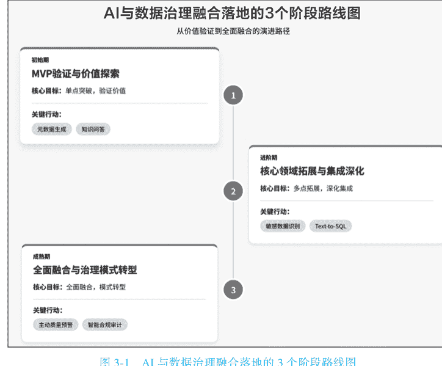

### 1. 初始期：MVP 验证与价值探索

（1）初始期的核心目标

以较低成本和风险，快速验证 DeepSeek 在特定数据治理痛点上的应用价值。积累初步的 AI 应用经验，培养团队信心。为后续更大范围的推广提供事实依据和决策支持。场景选择（选择 1 ～ 2 个）的原则为选择痛点明显、任务相对独立、效果易于衡量、对现有流程影响较小的场景。

（2）推荐示例

- 智能元数据描述生成（能力项为元数据管理）：针对数据目录中大量缺失或不规范的描述，利用 DeepSeek 的能力进行补充和修正，并自动生成初稿。
- 数据质量规则代码生成（能力项为数据质量检查）：针对简单、明确的稽核规则（如格式、非空校验），实现从自然语言描述到 SQL/Python 代码的自动转换。
- 数据治理知识问答（能力项为数据治理沟通）：构建一个基于现有政策、标准文档的简单问答机器人，快速解答员工的基础疑问。

（3）如何开展 MVP 验证与价值探索

- 步骤 1：识别具体痛点与目标。与数据治理团队或业务人员沟通，确定 1 ～ 2 个最迫切希望通过 AI 解决的、相对简单的重复性工作。明确 MVP 要达成的目标（如“将 × × 类数据表的元数据描述覆盖率从 20% 提升到 80%”）和衡量指标（如生成效率、描述质量、用户满意度）。
- 步骤 2：小范围试点与技术实现。选择有限或核心的数据范围进行试验。主要通过调用 DeepSeek 的 API，进行简单的提示词（Prompt）交互。重点是快速搭建原型，而非追求完美集成。
- 步骤 3：人机协同验证。AI 生成的内容（如描述、代码、答案）必须经过相关负责人（如数据管家、治理专家）的审核、修正和确认后才能正式使用。
- 步骤 4：收集反馈与评估。收集用户反馈，评估 MVP 是否达到预期目标，并总结经验教训。

（4）初始期的应用预期价值

- 在特定环节实现显著的效率提升（如元数据注释补充时间缩短 80%）。
- 直观展示 AI 在数据治理中的应用潜力，获得管理层和团队的认可。
- 发现并理解在实际应用中可能遇到的问题（如提示词效果、准确性验证成本等）。

## 2. 进阶期：核心领域拓展与集成深化

（1）进阶期的核心目标
将 AI 应用扩展到数据治理的核心、高价值领域。探索更深度的集成方式，优化人机协同流程，构建更系统化的 AI 赋能能力。场景选择（扩展至多个核心领域）的原则为基于初始期的成功经验，选择对数据质量、数据安全、数据发现与应用等核心目标有重大影响的场景。在这一阶段，开始处理更复杂的任务。

（2）推荐示例

- **自动化敏感数据识别与分类（能力项为数据安全管理）**：应用 DeepSeek 的模式识别能力，对更广泛的数据源（包括文档）进行敏感数据扫描和初步分类。
- **智能数据质量分析与根因建议（能力项为数据质量分析）**：利用 AI 分析数据质量报告，不仅能生成摘要，还能初步推断问题根源，并提出修复建议。
- **自然语言数据查询（能力项为数据分析 / 数据应用）**：针对特定部门或用户群体，提供通过自然语言查询业务数据的能力。
- **智能数据血缘辅助梳理（能力项为元数据管理 / 数据设计和开发）**：利用 AI 解析更复杂的 ETL 脚本或存储过程，辅助识别和构建更全面的数据血缘。
- **主数据智能匹配与去重辅助（能力项为主数据）**：应用 AI 进行更精准的主数据相似度计算和匹配推荐。

（3）如何开展核心领域拓展与集成深化

- **步骤 1：系统规划与集成。** 结合初始期反馈和整体治理目标，规划进阶期要拓展的场景和优先级。考虑将 AI 能力更紧密地嵌入现有的数据治理平台（需要平台支持或二次开发），或开发更完善的独立智能应用。
- **步骤 2：优化人机协同流程。** 明确 AI 与人在新流程中的角色分工，设计更高效的审核、反馈和迭代机制。
- **步骤 3：引入领域知识。** 探索使用检索增强生成（RAG）技术，让 DeepSeek 能够结合企业内部的知识库（如系统说明书、IT 数据字典等）提供更精准的回答或建议。
- **步骤 4：建立监控与评估体系。** 对 AI 应用的性能、准确率以及其带来的业务影响建立持续的监控和评估机制。
- **步骤 5：扩大培训范围。** 对更多的数据治理相关人员进行 AI 应用培训。

（4）进阶期的应用预期价值

- 在多个核心数据治理领域取得显著成效，如提高敏感数据识别覆盖率、缩短数据质量问题诊断时间、提升业务人员数据获取效率等。
- 形成更成熟、更优化的 AI 赋能数据治理解决方案。
- 开始体现 AI 在提升数据可信度、降低合规风险、加速数据价值释放方面的作用。
- 积累更丰富的 AI 集成、运维和管理经验。

## 3. 成熟期：全面融合与治理模式转型

（1）成熟期的核心目标
将 AI 能力全面、深入地融入数据治理的各个环节（覆盖 DCMM 大部分甚至全部相关能力项）。推动数据治理模式从被动、人工密集型向主动、智能、自动化转型。将 AI 作为数据治理的基础设施，赋能全员，促进数据文化建设。场景选择（覆盖领域广泛，侧重主动与智能）的原则为 AI 不再是单点工具，而是贯穿始终的智能引擎。重点在于利用 AI 实现主动预警、智能决策辅助和流程自动化闭环。

（2）推荐示例

- **主动式数据质量监控与预警（能力项为数据质量检查 / 分析 / 提升）：** AI 持续分析数据流和质量指标，主动预测并预警潜在的数据质量问题，甚至自动触发修复流程。
- **智能化合规风险评估与审计（能力项为数据安全策略 / 管理 / 审计）：** AI 实时分析数据访问和处理行为，对照法规和策略，主动识别潜在合规风险，自动化大部分审计检查和报告生成工作。
- **智能数据治理服务（能力项为数据治理沟通 / 数据应用）：** 基于用户的角色和上下文，AI 提供数据标准推荐、数据资产导航、分析建议和治理知识推送服务。
- **数据战略智能推演与优化（能力项为数据战略评估/规划）：** AI 基于内外部数据模拟不同战略选择的潜在影响，辅助管理层进行数据驱动的战略决策和动态优化。
- **跨领域知识融合与洞察（覆盖多个能力域）：** AI 能够整合来自元数据、质量报告、安全日志、业务文档等多方面的信息，提供跨领域的综合性洞察和治理建议。

（3）如何开展全面融合与治理模式转型

- **步骤 1：顶层设计与架构。** 将 AI 能力作为数据治理平台的核心组成部分进行规划和设计，实现各模块间的智能联动。
- **步骤 2：深度集成与自动化。** 将 AI 能力深度嵌入业务流程和 IT 系统，实现更多治理任务的自动化闭环（如自动化的权限审批建议、质量问题工单派发等）。
- **步骤 3：构建企业级数据治理知识图谱。** 结合知识图谱技术，让 AI 更好地理解企业内部的复杂关系和领域知识，提供更精准的推理和问答。
- **步骤 4：建立完善的 AI 治理机制。** 制定明确的 AI 模型管理、伦理规范、风险控制和效果评估机制。
- **步骤 5：赋能全员与文化建设。** 通过易用的 AI 工具和持续的赋能培训，使数据治理的理念和实践深入组织的每个角落，促进数据驱动文化。
- **步骤 6：持续创新与演进。** 跟踪 AI 技术的最新进展，不断探索新的应用场景，保持数据治理能力的领先性。

（4）成熟期的应用预期价值

- 实现数据治理的高度智能化和自动化，极大提升运营效率，显著降低成本。
- 数据可信度、安全性、合规性得到系统性保障，风险被有效控制。
- 数据价值释放速度加快，有力支撑业务创新和精细化运营。
- 形成以数据为中心、AI 赋能的组织文化和核心竞争力。
- 数据治理从后台支撑转变为前瞻性的战略赋能职能。

### 3.3 AI 驱动的治理模式创新

AI 的融入使得企业有机会重新思考数据治理的理念、目标、流程乃至组织形态。从被动响应到主动智能，从人工密集到人机协同，从孤立工具到集成智能中枢，从合规驱动到价值驱动，这标志着数据治理正迈入一个全新的、由 AI 驱动的创新时代。本节将探讨 AI 驱动的治理模式创新的几个关键方向。

#### 3.3.1 从被动响应到主动智能

传统模式下，数据治理往往是问题驱动和滞后响应的。例如，在数据质量问题引发业务投诉后才开始追溯和修复；在监管要求下达后才开始梳理和整改；元数据常常是在数据使用遇到障碍时才被动补充。这种模式下，治理工作常常疲于奔命，难以走在问题前面。融合 AI 后，DeepSeek 的能力使数据治理具备了主动性。模式创新包括以下四个方面：

- **主动风险预警**：通过持续分析数据流、访问日志、元数据变更记录等，AI 可以主动识别潜在的数据质量下滑趋势、异常数据访问行为（可能的安全风险）、合规策略冲突等，并在问题实际发生或造成重大影响前发出预警。例如，AI 可以预测某个数据集成任务因上游变更而即将失败，或某个用户的行为模式偏离了常规，这可能涉及数据滥用。
- **智能推荐与优化**：基于对数据资产的理解，AI 可以主动推荐需要补充的元数据、可能存在问题的数据集、需要优化的数据流程或可以合并的数据标准。例如，AI 发现多个系统存在相似但定义不一的指标，主动建议进行标准化整合。
- **自适应治理**：治理规则和策略可以基于 AI 的持续学习和分析结果进行动态调整和优化，使其能适应快速变化的业务和数据环境。
- **核心转变**：数据治理从“救火队”转变为“防火和预警系统”，从事后补救转向事前预防和持续优化，进而变得更加智能和敏捷。

#### 3.3.2 从人工密集到人机协同

传统模式下，数据治理的许多环节，如元数据录入、数据质量规则编写与执行、标准定义、文档撰写等，都高度依赖人工操作，不仅效率低下、成本高昂，而且容易出错。治理专家的精力在重复性、事务性的工作中被大量消耗。融合 AI 后，DeepSeek 成为数据治理团队的强大助手和能力放大器，形成高效的人机协同模式。模式创新包括以下四个方面：

- **任务自动化与增强**：AI 负责处理大量模式化、重复性的工作，如自动生成描述、代码、报告初稿，执行大规模数据扫描和识别任务。人类专家则从烦琐的工作中解放出来。
- **角色重塑**：数据治理人员的角色从“执行者”转变为“规划师”“审核者”“决策者”“AI 训练师”。他们负责设定目标、审核 AI 的输出、处理复杂和边界模糊的情况、做出最终判断，并利用自己的专业知识指导和优化 AI。
- **知识赋能**：AI 可以快速整合和提供相关知识（如法规条款、历史案例、最佳实践），辅助人类专家做出更明智、更高效的决策。
- **核心转变**：数据治理不再是纯粹的人工密集型工作，而是转变为人机协同的新模式，人的价值得到提升，数据治理人员的工作重心转向更高阶的分析、判断和管理。

#### 3.3.3 从孤立工具到集成智能中枢

传统模式下，数据治理往往依赖一系列功能独立的工具，如数据目录、数据质量工具、主数据管理平台、数据安全扫描工具等。这些工具之间可能缺乏有效的联动，信息分散，用户需要在不同系统间切换，难以形成全局统一的治理视图和操作体验。融合 AI 后，DeepSeek 有潜力成为连接和驱动这些孤立工具的智能中枢或统一交互层。模式创新包括以下四个方面：

- **统一自然语言入口**：用户可以通过一个统一的、类似聊天机器人的界面，用自然语言与整个数据治理体系进行交互，如查询元数据、监控质量、申请权限、了解标准等，而无须关心底层是哪个具体工具在提供服务。
- **跨工具智能联动**：AI 可以整合和关联来自不同治理工具的信息。例如，当发现一个数据质量问题时，AI 能自动关联到其数据血缘（来自元数据管理）、涉及的敏感级别（来自数据安全分类）、相关的业务术语（来自数据标准）以及负责的数据管家（来自治理组织），从而提供更全面的问题上下文。
- **情境化智能推荐**：AI 可以根据用户当前的操作或上下文，智能推荐相关的治理信息或操作。例如，当用户查看某个数据表时，AI 能自动推荐相关的质量报告、标准定义或相似的数据表。
- **核心转变**：数据治理从分散的工具集合，演变为一个以 AI 为核心、相互连接、信息共享的集成化、智能化的治理生态系统，提供更流畅、更智能的用户体验。

#### 3.3.4 从合规驱动到价值驱动

传统模式下，数据治理被视为满足监管要求或内部审计的合规性任务，其投入常常被看作是运营成本。治理工作的成效难以直接量化并与业务价值挂钩，导致其重要性有时被低估。融合 AI 后，DeepSeek 的应用使得数据治理的业务价值更加显性和可衡量。模式创新包括以下四个方面：

- **提升数据可用性与易用性**：通过智能元数据生成、自然语言查询等功能，AI 直接降低了业务人员发现、理解和使用数据的门槛，加速了数据驱动的洞察和决策过程，其价值更容易被业务部门感知。
- **量化治理效益**：AI 可以辅助追踪和量化数据治理活动带来的具体效益，例如，因自动化节省的人工成本；因数据质量提升带来的业务流程效率提升；因更精准的数据缩短的分析项目周期。
- **赋能业务创新**：高质量、易获取、易理解的数据是业务创新的基础。AI 驱动的数据治理能够更好地提供这种基础，从而间接或直接地支持新产品开发、客户体验优化等价值创造活动。
- **核心转变**：数据治理的定位从“成本中心”或“合规部门”，转变为支撑和驱动业务增长的“价值中心”或“赋能平台”，其战略重要性得到提升。

#### 3.3.5 数据治理的普及

传统模式下，数据治理通常被认为是少数数据专家或 IT 部门的职责，使用的工具和术语对普通业务人员来说门槛较高，导致业务人员参与度有限，数据文化难以真正落地。融合 AI 后，DeepSeek 极大地降低了参与数据治理的门槛，推动数据治理走向所有人。模式创新包括以下五个方面：

- **自然语言交互**：使得非技术用户也能轻松地查询治理信息、理解数据标准、报告数据问题，甚至参与到规则的定义中来（通过自然语言描述）。
- **知识普及**：AI 可以将复杂的治理文档、政策、标准转化为易于理解的摘要、问答或解释，使得数据治理知识更容易被广大员工掌握。
- **个性化引导**：AI 可以根据不同用户的角色和需求，提供个性化的数据治理引导和建议。
- **促进数据文化**：当每个人都能更方便地理解和参与数据治理时，有助于在整个组织内建立共同的数据责任感和数据驱动的文化氛围。
- **核心转变**：数据治理不再是少数专家的“专利”，而是成为组织中更多成员可以理解、参与并从中受益的普适性能力，真正实现“人人都是数据治理的参与者和受益者”。

DeepSeek 等大语言模型对数据治理的影响远不止于提高效率，它们正在深刻地重塑数据治理的模式和理念。这些模式上的创新共同指向一个更加敏捷、智能、高效且与业务价值紧密结合的未来数据治理形态。拥抱这些变革将是企业在 AI 时代充分释放数据潜能、构建核心竞争力的关键所在。

### 3.4 融合应用的挑战与实施策略建议

尽管将 DeepSeek 等大语言模型融入数据治理展现出了巨大的潜力和诱人的前景，但在实际的落地过程中，必然会遇到多方面的挑战。这些挑战涵盖从初始投入到技术整合，再到人才培养和文化适应等多个维度。识别并理解这些挑战是制定有效实施策略、确保 AI 赋能数据治理成功转型的关键前提。本节将首先深入分析这些潜在的障碍，然后基于这些挑战，提出在组织层面可行的应对策略和实施建议。

#### 3.4.1 融合应用的挑战

将 DeepSeek 等先进 AI 技术融入现有的数据治理体系并非易事，通常会面临以下五类主要挑战：

（1）高昂的投入与不确定的 ROI
- **资金投入**：可能涉及模型 API 调用费用、私有化部署的软硬件成本、强大的计算资源需求（尤其对于训练或微调），以及集成开发和持续维护的费用。初期投入可能较大。
- **时间与资源投入**：需要投入大量时间进行场景调研、方案设计、技术集成、流程再造、人员培训以及持续的模型优化和效果评估。这需要抽调现有宝贵的人力资源。

（2）人才短缺与技能错配
- **AI 专业人才稀缺**：市场上非常稀缺既懂大语言模型（如提示词工程、模型微调、部署运维）又熟悉数据治理业务的人才，且培养人才成本高昂。
- **现有团队技能升级**：数据治理团队（如数据管家、分析师、架构师等）需要提升对 AI 能力的理解，学会如何与 AI 工具协同工作以及如何有效验证 AI 输出，这需要时间和培训投入。

（3）组织文化与变革阻力
- **对 AI 的不信任与恐惧**：员工可能会担心 AI 的“幻觉”问题导致错误决策，或忧虑自身工作会被 AI 取代，从而产生抵触情绪，不愿意采纳新工具和流程。
- **传统工作习惯的惯性**：长期习惯于手动流程或传统工具的员工可能难以适应人机协同的新工作模式，学习曲线可能较陡峭。

（4）技术复杂性与集成难题
- **集成挑战**：将 DeepSeek 与企业现有的、多样化的数据治理平台、数据仓库、业务系统等进行无缝集成，这可能涉及复杂的技术对接和开发工作。
- **数据隐私与安全风险**：在使用云端 AI 服务时，如何确保敏感数据在传输和处理过程中的安全？私有化部署的安全防护和管理要求高。AI 模型本身也可能成为攻击目标。
- **模型准确性与稳定性**：LLM 的输出并非 100% 准确，存在“幻觉”风险，因此，需要设计有效的验证机制。模型的性能和行为也可能随时间和数据的变化而漂移。
- **可解释性与可审计性**：LLM 的“黑箱”特性使得其决策过程难以完全解释，这对于需要追溯原因、满足合规审计要求的数据治理场景（如权限审批、质量定责）是一个重大挑战。

（5）数据与基础设施要求
- **高质量数据依赖**：AI 模型（尤其是在需要微调时）的效果在很大程度上依赖高质量、标注良好的训练数据或可供参考的企业知识库，这本身就是许多组织在进行数据治理时面临的挑战。
- **算力需求**：无论是训练/微调模型还是大规模推理应用，都可能需要大量的计算资源（如 GPU 等），提升了基础设施的压力和成本。

#### 3.4.2 实施策略建议

面对上述融合应用的挑战，在推进 DeepSeek 与数据治理融合时，不仅需要采取系统性、分阶段的策略，也需要根据企业体量和资源进行考量。实施策略建议如下：

（1）构建复合型人才队伍
- **内部培养与外部引进结合**：通过培训提升现有数据治理团队的 AI 素养（了解 AI 能做什么、不能做什么、如何有效提问、如何验证结果），同时，适度引进 AI 专业人才或与外部专家/供应商合作，形成优势互补的团队。
- **设立跨职能协作机制**：建立数据治理专家、AI 工程师、业务人员、IT 开发人员等共同参与的项目组或虚拟团队，促进知识共享和协同创新。
- **定义新角色与职责**：随着 AI 的融入，可能需要定义新的角色，如 AI 治理专员、提示词工程师（数据治理方向）等，并明确人机协同模式下的职责分工。

（2）强化变革管理与文化建设
- **透明沟通与预期管理**：向员工清晰传达引入 AI 的目的（赋能而非取代）、预期带来的好处以及可能的变化，消除员工的疑虑和恐惧。
- **赋能培训与支持**：提供充足的培训资源，帮助员工掌握使用新工具和

## 企业数据治理目标与 DeepSeek 融合场景

本章将深入探讨如何将前三章所阐述的数据治理挑战、DeepSeek 的核心能力以及 AI 数据治理融合场景，转化为企业内部具体可行的数据治理目标。首先从定义清晰的企业数据治理的核心目标出发，介绍一套系统性的任务拆解方法论，强调平衡数据供给与业务需求的关键作用。本章将指导如何构建一份可操作的数据治理任务清单，并探讨根据企业实际情况制定治理路线图与确定任务优先级的理论依据和实践方法。最后将分析这些具体的治理任务，识别出哪些环节可以被 DeepSeek 等大模型有效赋能，从而为企业规划 AI 驱动的数据治理转型提供理论指导和具体抓手。本章旨在帮助读者将宏观的治理理念落实为具体的、可管理的、能逐步引入 AI 的数据治理规划，为后续实战落地奠定坚实的理论基础。

### 4.1 企业数据治理的核心目标：平衡供给与需求

确立清晰、明确的核心目标是成功实施数据治理的首要步骤。这些目标源于企业内部对高质量、可信赖数据的内在需求（供给侧）与外部业务发展、战略实现的迫切要求（需求侧）之间的平衡与互动。本节将从内外两个视角出发，深入分析组织数据治理的核心目标，说明其为什么不仅要保障数据资产自身的健康与可用性，还要与企业的整体业务战略紧密对齐，最终驱动业务价值的实现。

#### 4.1.1 供给侧视角：保障数据资产的健康与可用性

从数据作为核心资产的内在管理需求出发，数据治理的首要目标是确保数据自身的质量、安全、合规和易用性，使其成为可靠的、可被有效利用的资源，这是满足一切数据应用需求的基础。数据治理的供给侧目标如图4-1所示。

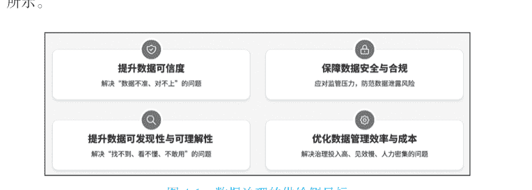

##### 1. 企业对供给侧的目标

企业对供给侧的目标聚焦数据全生命周期的优化管理，旨在通过提升数据质量、保障数据安全合规、增强数据可用性以及提高管理效率，为业务决策和运营提供可靠的数据支撑，解决数据在使用和管理过程中的各类痛点问题。以下是具体的4项目标内容。

- **提升数据可信度**：具体体现在提高数据的准确性、完整性、一致性、及时性，减少数据错误和不一致导致的业务风险和决策失误。衡量指标示例包括核心业务实体（如客户、产品）关键属性的完整率、一致性校验通过率、数据问题报告数量及解决时效。该目标主要对应解决“数据不准”“数据对不上”“垃圾进、垃圾出”等问题。
- **保障数据安全与合规**：重点在于保护敏感数据不被泄露、滥用或非法访问，同时确保数据处理活动全面符合内外部法律法规（如《中华人民共和国数据安全法》《中华人民共和国个人信息保护法》、行业监管要求）的要求。衡量指标示例包括敏感数据识别覆盖率、数据泄露事件数量、合规审计通过率、访问控制策略执行到位率。此目标旨在应对日益严格的监管压力，防范数据安全事件带来的声誉和经济损失。
- **提升数据可发现性与可理解性**：致力于让用户能够方便快捷地找到所需的数据资产，并清晰理解数据的业务含义、技术来源、质量状况和使用规范，从而打破数据孤岛，促进数据透明。衡量指标示例包括数据目录覆盖率、元数据丰富度（如业务描述完整性）、数据血缘关系清晰度、用户查找数据成功率及耗时。主要解决“找不到数据”“看不懂数据”“不敢用数据”的问题。
- **优化数据管理效率与成本**：通过提高元数据管理、数据质量监控、标准执行、数据集成等治理活动的自动化水平和执行效率，减少数据问题造成的重复劳动和沟通成本、数据存储和处理成本。衡量指标示例包括元数据自动化采集率、数据质量问题自动发现率、数据标准符合率、数据集成任务平均开发周期、数据管理相关人力成本。该目标解决数据治理投入高、见效慢、流程烦琐、人力密集的问题。

以上四点是企业内对数据治理供给侧的通用目标的要求，也是数据治理管理者和团队在企业内的基本数据职责和工作要求。

##### 2. 对供给侧的数据治理目标识别

为了制定在短期内是高价值且具体的数据治理目标，企业需要基于实际情况进行识别。以下这些方法能帮助企业全面了解数据治理现状，从而精准锁定目标，为后续的数据治理工作指明方向。

（1）数据质量评估与剖析

- **方法**：使用数据剖析工具或编写脚本，对关键数据域（如客户、产品、财务等）进行系统性检查，分析数据的完整性、一致性、准确性、唯一性、及时性等。
- **过程**：选择关键数据资产。定义剖析规则和维度。执行剖析过程，生成量化报告。识别主要的数据质量问题类型和分布。
- **输出**：数据质量问题清单、质量分析报告。

（2）元数据现状盘点

- **方法**：评估现有元数据（如业务定义、技术来源、数据血缘、标准关联等）的覆盖率、准确性和完整性。评估元数据管理工具和流程的有效性。
- **过程**：确定核心数据系统和数据资产范围。检查数据字典、模型文档、血缘图谱等元数据文档。访谈数据所有者、使用者，了解元数据缺失或不准确带来的问题。
- **输出**：元数据覆盖率报告、元数据质量问题列表。

（3）数据安全与合规风险评估

- **方法**：对照相关法律法规、行业标准和内部安全策略，评估当前数据存储、处理、传输、共享等环节的安全防护措施的合规性。识别敏感数据分布及潜在风险点。
- **过程**：梳理适用的法律法规和内部政策。进行敏感数据扫描和识别。评估访问控制、加密、脱敏、审计日志等安全措施的有效性。访谈安全、法务、IT部门，了解已知风险和历史事件。
- **输出**：数据安全风险评估报告、合规差距分析报告。

（4）数据管理流程与效率分析

- **方法**：审视现有的数据标准制定、元数据维护、数据质量问题处理、数据集成开发等流程，识别其中的瓶颈、冗余、手动环节和效率低下之处。
- **过程**：绘制关键数据治理流程图。访谈流程参与者，了解实际操作的耗时和痛点。分析流程中断点和返工原因。评估现有数据治理工具的易用性和自动化程度。
- **输出**：数据治理流程痛点分析、效率优化建议。

##### 3. 目标衡量指标参考模板

以上方法是数据治理供给侧目标识别的参考，当通过以上工作完成数据治理目标识别后，还需要通过目标识别模板进行结构化分析，并给出目标成功的衡量指标。数据治理供给侧目标衡量指标清单示例如表4-1所示，企业可以自行分析和制定供给侧数据治理目标。

表 4-1 数据治理供给侧目标衡量指标清单示例

| 维度 | 识别方法 | 发现的问题 / 痛点描述 | 对业务使用的影响 | 潜在治理目标 | 初步衡量指标建议 |
| :--- | :--- | :--- | :--- | :--- | :--- |
| 数据质量 | 数据剖析、用户反馈 | 在核心客户表中，“联系电话”字段的缺失率高达 30% | 数据不完整会影响营销触达和客户服务效率 | 将核心客户表中的“联系电话”字段的完整率提升至 95% | “联系电话”字段完整率（%） |
| 元数据管理 | 元数据盘点、用户访谈 | 产品主数据缺乏统一的业务定义和来源说明 | 用户难以理解数据含义，导致误用；跨部门沟通成本高 | 为核心产品主数据建立并维护统一、清晰的业务元数据 | 核心产品主数据业务描述覆盖率（%） |
| 数据安全 | 敏感数据扫描、合规评估 | 多个业务系统日志中明文记录了用户身份证号，存在泄露风险 | 违反《中华人民共和国个人信息保护法》规定，面临合规处罚和声誉风险 | 对所有系统日志进行排查和改造，确保敏感信息脱敏存储 | 敏感信息明文存储实例清零 |
| 数据管理效率 | 流程分析、团队访谈 | 新指标入仓流程涉及多个部门的手动审批和开发，平均耗时超过 2 周 | 指标上线慢，无法快速响应业务分析需求；人力成本高 | 优化指标入仓流程，引入自动化工具，将平均上线时间缩短至 3 天 | 指标平均上线周期（天） |

#### 4.1.2 需求侧视角：支撑业务战略与价值创造

数据治理的最终目的是服务业务、支撑企业战略目标的实现。因此核心目标必须与业务需求紧密对齐，关注如何通过更好的数据管理来驱动业务增长、提升效率、控制风险和促进创新。数据治理的需求侧目标如图 4-2 所示。

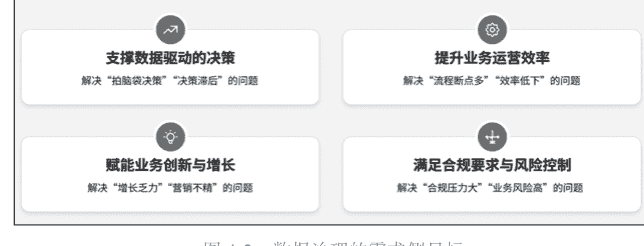

##### 1. 企业对需求侧的目标

企业对需求侧的目标聚焦数据在业务场景中的实际应用价值，通过为决策、运营、创新及合规等环节提供有力的数据支持，实现业务的科学发展、效率提升、创新增长与风险可控，且各目标均与供给侧的数据治理成果紧密关联。以下是具体的四点目标内容：

1）支撑数据驱动的决策：为管理层和业务部门提供及时、准确、易懂的数据洞察，支持更明智的业务决策和战略规划，提升决策的科学性和前瞻性。

- 与供给侧关联：依赖高质量、可理解、易获取的数据。
- 业务战略对齐示例：为了支持“提升市场响应速度”的战略，需要快速获取准确的市场和销售数据。
- 衡量指标示例：关键决策的数据支持覆盖率、数据分析报告的使用频率、决策周期缩短程度。

2）提升业务运营效率：通过提供准确、一致的数据（特别是主数据和参考数据），优化核心业务流程（如订单处理、供应链管理、客户服务），减少错误和返工，提升自动化水平。

- 与供给侧关联：依赖高质量、标准化的数据。
- 业务战略对齐示例：为了支持“降本增效”的战略，需要通过数据标准化和集成打通流程，减少人工干预。
- 衡量指标示例：关键业务流程处理时间缩短率、数据问题导致的流程中断次数。

3）赋能业务创新与增长：通过促进数据共享和开放，提供高质量的数据服务，支持新产品研发、个性化营销、客户体验优化等创新活动，挖掘新的业务增长点。

- 与供给侧关联：依赖可发现、可共享、安全合规的数据。
- 业务战略对齐示例：为了支持“拓展新市场”或“提升客户终身价值”的战略，需要整合多源数据以进行用户画像分析和精准营销。
- 衡量指标示例：新产品/服务中数据驱动的比例、数据服务调用量、个性化推荐/营销转化率。

4）满足合规要求与风险控制：确保企业的经营活动和数据处理行为完全符合法律法规和监管要求，有效管理和控制与数据相关的业务风险（如财务风险、声誉风险）。

- **与供给侧关联**：直接关联数据安全与合规目标，并依赖可追溯的数据（血缘）。
- **业务战略对齐示例**：对于金融、医疗等强监管行业，满足合规要求是生存和发展的前提。
- **衡量指标示例**：监管报告按时准确提交率、合规审计发现问题数量、数据相关风险事件发生率。

##### 2. 对需求侧的数据治理目标识别

以上 4 点是企业内对数据治理需求侧的通用目标要求，这些目标可能是业务的显性或隐性需求，因此也需要对需求侧的数据治理目标进行识别和分析，关键在于理解业务的痛点、诉求以及战略方向对数据的依赖。这需要走出 IT 和数据部门，深入业务一线并进行沟通和分析，可参考的方法如下。

- **业务战略解读与对齐**：深入研读公司的年度战略规划、业务发展目标、部门 KPI 等文件，识别出关键战略方向对数据的显性或隐性需求。首先收集并阅读公司级、部门级战略文件，然后提炼关键业务目标（如“提升客户满意度”“拓展 ×× 市场”“降低运营成本”），最后分析每个目标的关键成功因素（KSF），判断哪些因素强依赖数据支持。输出业务战略对数据的需求映射表。
- **关键业务流程分析**：选择对公司价值链影响重大的核心业务流程（如获客、履约、风控、客服等），分析流程中存在的数据瓶颈、断点或数据问题导致的低效环节。首先绘制核心业务流程图，然后访谈流程负责人和执行者并了解流程中的数据痛点，最后分析流程效率数据（如处理时长、错误率）并探究与数据相关的根因。输出业务流程中的数据痛点清单及改进需求。
- **高层管理者与业务负责人访谈**：与公司高层管理者、各业务线负责人进行结构化访谈，了解他们关注的业务问题、决策中遇到的数据挑战、对数据应用的期望以及对数据风险的担忧。首先设计访谈提纲（聚焦战略、决策、效率、创新和风险），然后进行一对一访谈并深入了解业务视角的需求和痛点，最后整理访谈纪要并提炼共性需求和关键诉求。输出高层管理者与业务负责人的数据需求汇总报告。
- **用户调研与反馈收集**：面向数据分析师、报表用户、一线业务人员等数据最终使用者，通过问卷、座谈会等方式，了解他们在数据查找、理解、使用、信任等方面遇到的实际困难和改进建议。首先确定调研对象和范围，然后设计调研问卷或座谈会提纲，最后收集并分析用户反馈。输出数据用户体验痛点及改进建议报告。

##### 3. 目标衡量指标参考模板

以上方法是针对数据治理需求侧目标识别的参考，当通过以上工作完成数据治理目标识别后，还需要通过目标识别模板进行结构化分析，并给出目标成功的衡量指标。数据治理需求侧目标衡量指标清单示例如表 4-2 所示。

表 4-2 数据治理需求侧目标衡量指标清单示例

| 业务领域/战略 | 识别方法 | 业务挑战/需求描述 | 数据层面的制约/痛点 | 潜在治理目标 | 衡量业务指标建议 |
|---|---|---|---|---|---|
| 市场营销 | 业务负责人访谈、用户调研 | 希望实现更精准的客户分群和个性化营销，但缺乏统一客户视图 | 客户数据散落在CRM、订单、小程序等多个系统，无法有效整合 | 建立统一的客户主数据视图（360°画像），以支持精准营销 | 营销活动响应率、获客成本 |
| 风险管理 | 业务战略解读、合规评估 | 需要满足监管对反洗钱（AML）报送的及时性和准确性要求 | 交易数据质量不高，清洗和校验规则复杂且执行效率低 | 提升交易数据的质量和标准化水平，确保AML报送合规 | AML报送差错率、监管时效要求 |
| 供应链管理 | 关键业务流程分析 | 库存周转率低、预测不准导致积压或缺货 | 销售预测数据与实际库存数据不一致，缺乏实时、准确的供需信息 | 提高销售预测数据和库存数据的准确性与及时性，建立供需预警机制 | 库存周转天数、缺货率/积压率 |
| 高层管理者决策 | 高层管理者访谈 | 难以快速获取跨业务线的整合经营视图，决策依赖滞后、零散的报表 | 缺乏统一、权威、易用的管理驾驶舱或自助分析平台 | 构建高层管理驾驶舱，提供及时、准确、全面的经营分析视图 | 关键决策周期、高层管理者对数据支持的满意度 |

#### 4.1.3 核心目标的平衡与整合

在分别从供给侧（保障数据资产健康）和需求侧（支撑业务战略实现）识别出一系列潜在的数据治理目标后，应该清晰地理解这两个目标的区别和联系，就像一个供需飞轮，不断进行良性循环，数据治理的供需飞轮如图 4-3 所示。

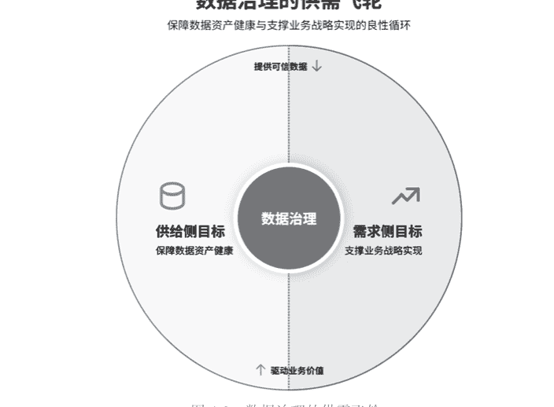

图 4-3 数据治理的供需飞轮

##### 1. 目标平衡原则

在理解两类数据治理目标后，下一步是将这些目标进行有效的平衡、整合与优先级排序。这确保了数据治理工作既能解决当前的痛点，又能支撑长远的业务发展，同时还能在有限的资源下取得最大成效。平衡与整合的关键原则如下。

- **战略对齐是前提**：所有数据治理目标最终都应能追溯到对一个或多个企业战略目标的支持。需求侧目标通常直接体现这种对齐，而供给侧目标（如提升数据质量、保障安全）是实现业务战略的基础保障。在整合时要明确供给侧目标如何支撑需求侧目标的达成。例如，“提升客户数据完整性”（供给侧）是为了支撑“实现精准营销”（需求侧），进而服务于“提升客户生命周期价值”的业务战略。
- **基于现状是基础**：必须基于对当前数据治理成熟度、数据资产现状和痛点的清晰评估，不能设定过高或不切实际的目标。优先解决那些对业务造成最大阻碍的基础性问题（如严重的数据质量问题、关键元数据缺失）往往是必要的。
- **资源约束是条件**：企业资源（人力、财力、时间）总是有限的，不可能同时实现所有识别出的目标，必须进行取舍，将有限的资源投入最关键、最能产生价值或最紧迫问题的领域。
- **依赖关系是关键路径**：很多治理目标之间存在依赖关系。例如，有效的数据质量监控依赖清晰的数据标准；主数据管理是实现跨系统数据一致性的基础；元数据管理是数据发现和理解的前提。在排序时必须考虑这些先后顺序，确保治理工作按逻辑顺序推进。
- **短期见效与长期建设相结合**：既要选择一些能够快速产生可见效果（Quick Wins）的目标来建立信心、争取支持，也要规划那些需要长期投入的基础设施建设和能力提升任务（如平台建设、制度完善）。

##### 2. 目标评估方法

在遵循以上原则的基础上，给出目标优先级评估指标和示例，以便使用者可以直接应用和参考。数据治理目标评估方法如下。

1）**步骤 1：成立跨职能评审小组**。邀请来自业务部门、IT 部门、数据治理办公室、风险合规部门等关键利益相关方的代表组成评审小组。

2）**步骤 2：确定优先级评估维度**。共同商定用于评估目标优先级的关键维度。建议至少包含：

- **业务价值/影响**：该目标实现后对核心业务目标（如收入增长、成本降低、风险控制、客户满意度）的贡献程度（权重较高）。
- **紧迫性/合规需求**：实现该目标的紧急程度，以及是否涉及必须满足的外部监管或内部审计要求（权重次高）。

## 4.2 数据治理目标任务分解与资源评估

在上节中，通过平衡供给侧与需求侧的视角，确立了企业数据治理的核心目标。明确目标是第一步，但要将这些战略层面的目标转化为可执行的行动，需要一个系统性的分解与规划过程。本节将详细介绍一套将高阶治理目标分解为一系列具体的、可管理的工作任务的方法论，并强调在此过程中识别任务依赖、估算所需资源以及通过内部沟通达成共识以制订初步实施计划的重要性。这份初步实施计划将成为后续制定详细实施策略和路线图的关键输入。

### 4.2.1 目标间的逻辑与依赖识别

在将目标转换为任务的时候，需要考虑多个维度。数据治理领域的目标天然存在任务依赖，在分解任务前，需要先理解核心目标之间的内在联系。某些目标的实现可能依赖其他目标的达成，或者几个目标需要协同推进。在将宏观目标分解为具体任务之前，理解这些高阶目标之间的内在联系至关重要。这有助于把握数据治理工作的整体推进逻辑，避免在后续规划中出现顺序错误或资源冲突。识别依赖关系可以帮助我们确定哪些目标是需要优先完成的基础性目标，哪些目标可以在其他目标达成后并行推进。注意事项如下：

- **分析逻辑**：思考实现每个目标的前提条件是什么？它的达成又会为哪些其他目标提供基础或支持？
- **前置依赖**：目标 A 必须在目标 B 实现后才能有效开展或完成。例如，通常需要先建立数据标准（目标 A），才能有效地进行数据质量检查（目标 B）。
- **支撑关系**：目标 C 的实现有助于目标 D 的达成，但不一定遵循严格的先后顺序。例如，提升元数据管理水平（目标 C）能够支撑更高效的数据分析应用（目标 D）。
- **协同关系**：目标 E 和目标 F 可以相互促进，并行推进这两个目标可能效果更佳。例如，数据质量提升（目标 E）和主数据管理（目标 F）往往需要紧密结合。

以上方法的实践可以通过目标关系分析模板进行归纳和总结，以便使用者可以看清各目标之间的整体关系，目标关系分析模板如表 4-4 所示。

**表 4-4 目标关系分析模板**

| 核心目标 | 核心依赖（前置条件） | 重点支撑（后置价值） | 逻辑简述 |
| :--- | :--- | :--- | :--- |
| 提升数据可信度（供给侧核心） | 需要建立数据标准、质量规则 | 所有目标（决策、运营、合规等） | 质量是基石：数据不准会导致后续所有应用（决策、风控、AI）都是空中楼阁 |
| 保障数据安全与合规（供给侧底线） | 需要识别敏感数据、分类分级 | 满足合规要求与风险控制 | 安全是底线：必须做到数据安全可控，才能满足合规监管要求并对外开放 |
| 提升数据可发现性与可理解性（供给侧/元数据） | 需要自动化采集工具 | 支撑决策、赋能创新 | 找得到是前提：业务人员只有先看懂数据（元数据），才能挖掘其价值 |
| 优化数据管理效率与成本（治理效能） | 需要引入自动化工具、优化流程 | 提升数据可信度、提升数据可发现性 | 工具是加速器：通过自动化手段降低治理成本，让高质量数据的产出更高效 |
| 支撑数据驱动的决策（需求侧应用） | 需要提升数据可信度、可理解性 | 提升运营效率、赋能创新 | 数据转为洞察：高质量且易理解的数据，是生成准确 BI 报表和管理驾驶舱的原料 |
| 提升业务运营效率（需求侧流程） | 需要提升数据可信度（如主数据一致性） | 优化成本（业务降本） | 以智能代替人工：通过打通数据孤岛（如主数据），减少业务流程中的人工核对工作 |
| 赋能业务创新与增长（需求侧增值） | 需要提升数据可发现性，以支撑决策 | 企业战略转型 | 数据资产化：在数据好用、易用的基础上，探索数据产品化和新业务模式 |
| 满足合规要求与风险控制（监管侧） | 需要提升数据可信度，并保障安全 | 企业可持续经营 | 合规是结果：通过质量控制和安全措施，自动生成监管报表，降低风控成本 |

### 4.2.2 将目标拆解为主要任务

在理解目标之间的关联关系后，需要将目标分解为多个主要任务，这些任务可以作为组织内讨论和拉通的起点，并对任务执行所需要的资源进行识别。如何将目标分解为任务是本小节的主要内容。通过梳理业界和行业实践的做法，将数据治理目标进行拆解。拆解目标时可以借鉴 PDCA 循环和项目管理两个理论框架，以保障拆解结果与目标的一致性。

在拆解过程中，需要遵循以下原则：

- **逻辑连贯**：分解出的任务/阶段应具有清晰的先后或逻辑关系。
- **成果导向**：每个任务/阶段应指向一个明确的中间或最终成果。
- **层级适中**：分解到可以进行初步资源估算和责任分配的层级即可，避免过于细化。

下面通过两个示例对本小节内容进行详细介绍。

#### 1. 示例 1：提升客户领域数据质量目标

下面对该目标进行拆解，数据质量提升就是一个典型的 PDCA 循环思路，主要任务/阶段包括以下 5 项：

- **质量需求与规则定义**：这项任务主要包括调研业务需求、分析数据现状、明确质量目标、定义关键质量维度和校验规则。预期成果是得到客户领域数据质量的评估报告和数据质量规则库 V1.0。
- **质量检查与监控实施**：选择或开发质量检查工具/脚本，配置和部署质量规则，建立常态化监控机制。预期成果是上线质量检查工具/脚本、建立自动化监控任务。
- **质量问题分析与根因定位**：定期分析质量检查报告，识别主要问题模式，追溯问题源头，评估业务影响。预期成果是形成数据质量问题分析报告和问题根因清单。
- **质量改进与效果验证**：制订并执行数据清洗、流程优化或源头系统改造计划，跟踪修复效果，更新质量基线。预期成果是形成数据质量提升行动计划及执行记录，以及质量改进效果评估报告。
- **质量文化建设与长效机制**：建立质量问题反馈与处理流程，明确责任人，进行相关培训和宣贯。预期成果是形成数据质量管理流程文档、培训材料和考核指标建议。

#### 2. 示例 2：实现客户主数据统一视图的目标

下面对该目标进行拆解，主要任务/阶段包括以下 5 项：

- **标准定义与模型设计**：这项任务主要包括调研各业务方对客户数据的需求、定义统一的客户数据标准与关键属性，并设计出能够覆盖全域业务的逻辑与物理模型。预期成果是得到《客户主数据标准规范》与客户主数据逻辑/物理模型。
- **MDM 平台选型与实施**：选择并部署主数据管理平台。预期成果是得到可用的 MDM 平台环境。
- **数据集成、清洗与匹配**：从源系统中抽取客户数据，进行清洗、标准化，配置匹配与合并规则。预期成果是得到清洗后的客户数据、配置好的匹配规则。
- **主数据初始化与服务发布**：生成统一的客户主数据，开发主数据服务接口。预期成果是得到客户主数据初始化后的数据库、可用的主数据服务 API。
- **治理流程建立与运维**：建立主数据新增、变更、审核流程，制定运维监控方案。预期成果是形成主数据管理流程文档和运维监控计划。

上述两个示例是比较有参考意义的，也是行业常用的拆解方法。但同样建议在企业内进行实际拆解时，一定要考虑企业内数据管理现状与人员数据能力现状。在与高层管理者或业务部门进行沟通时，要在拆解的基础上以业务语言和业务示例的方式进行沟通，以便各类参与人员理解各项任务。

接下来给出前文中的 8 个核心目标的拆解任务示例，以便于企业在进行实际拆解工作时能够进行参照，核心目标拆解示例如表 4-5 所示。

通过以上目标拆解示例的参考，可以在此基础上结合企业实际需求进行融合，并进行删减和补充，但整体需要遵循拆解原则和拆解理论思路，让拆解任务与目标保持一致。

**表 4-5 核心目标拆解示例**

| 核心目标 | 主要任务/阶段 | 活动描述 | 预期成果 |
| :--- | :--- | :--- | :--- |
| 提升数据可信度 | 质量需求与规则定义 | 调研业务对关键数据的质量要求，分析数据现状，明确质量目标，定义质量维度和校验规则 | 数据质量评估报告、数据质量规则库 V1.0 |
| | 质量检查与监控实施 | 选择或开发质量检查工具/脚本，配置部署质量规则，建立常态化监控机制 | 质量检查工具/脚本、自动化质量监控报告 |
| | 质量问题分析与处置 | 定期分析质量报告，识别问题模式，追溯问题源头，评估业务影响，协调并跟踪问题 | 数据质量问题登记库、问题根因分析报告、已关闭问题清单 |
| | 持续改进与文化建设 | 制订并执行数据清洗、流程优化或源头改造计划，验证改进效果，开展质量意识培训，建立长效机制 | 数据质量提升计划及效果评估报告、质量管理流程文档、培训材料 |
| 保障数据安全与合规 | 策略标准制定与风险评估 | 解读法规与业务需求，制定数据安全策略和标准（含分级分类结果），评估现有数据安全风险和合规差距 | 数据安全策略/标准文档、风险评估与差距分析报告 |
| | 技术与管理控制实施 | 部署实施数据加密、脱敏、访问控制、审计等技术措施；完善与数据安全相关的管理流程和岗位职责 | 上线的安全技术工具/平台、更新的安全管理流程/规范 |
| | 监控审计与事件响应 | 建立安全事件监控和日志审计机制，定期开展安全检查和审计，制定并演练应急响应预案 | 安全监控仪表盘、审计报告、应急预案及演练记录 |
| | 意识培训与能力提升 | 面向全员或关键岗位开展数据安全与合规意识培训，提升相关人员的安全技能 | 培训计划与材料、培训效果评估报告 |
| 提升数据可发现性与可理解性 | 元数据与术语管理规划 | 明确元数据管理范围和目标，制定业务术语管理规范，选择或规划元数据管理/数据目录平台 | 元数据管理策略与规划、业务术语管理规范、工具选型/规划报告 |
| | 平台建设与元数据采集 | 部署或开发元数据管理平台，建立自动化元数据采集机制，从源系统中采集技术元数据、血缘信息等 | 上线的元数据管理平台、自动化元数据采集适配器/脚本、已采集的技术元数据 |
| | 业务信息丰富与关联 | 梳理和录入业务元数据（定义、业务规则等），建立业务术语与技术元数据、数据资产的关联 | 丰富且关联的业务术语库、包含业务含义的数据字典 |
| | 推广应用与体验优化 | 提供便捷的数据查找、浏览、血缘可视化等功能，开展用户培训，收集反馈并持续优化平台易用性 | 数据目录用户手册/培训材料、用户反馈报告、平台功能优化迭代记录 |
| 优化数据管理效率与成本 | 现状评估与优化点识别 | 梳理关键数据治理流程（如元数据维护、质量问题处理等），评估各环节效率和成本，识别手动、重复、低效的痛点 | 数据治理流程图及效率/成本分析报告、优化机会清单 |
| | 流程再造与工具/自动化技术引入 | 重新设计并优化数据治理流程，评估并引入可提升效率的自动化工具或技术 | 优化后的流程设计方案、工具/技术评估报告 |
| | 自动化实施与集成 | 开发或配置自动化脚本/工作流，将新工具/技术集成到治理流程中 | 上线的自动化脚本/工作流、集成接口 |
| | 效果度量与持续改进 | 建立衡量治理效率和成本的指标体系，持续监控优化效果，根据反馈进行迭代改进 | 效率/成本度量指标体系及仪表盘、持续改进记录 |
| 支撑数据驱动的决策 | 决策场景与数据需求分析 | 深入理解关键业务决策场景，访谈决策者，识别决策所需的数据、指标和分析维度 | 关键决策场景描述、数据需求清单 |
| | 数据准备与可信保障 | 整合、清洗所需数据，确保数据的准确性、及时性和一致性 | 可用于分析的高质量数据集 |
| | 分析模型与可视化开发/配置 | 开发分析模型，设计并实现数据报表、仪表盘或自助分析工具 | 上线的分析报表、仪表盘、自助分析工具 |
| | 应用推广与能力赋能 | 对决策者和分析用户进行培训，推广数据分析工具和文化，提供数据解读支持 | 用户培训材料与记录、数据分析应用案例库 |
| 提升业务运营效率 | 流程分析与数据瓶颈识别 | 选择关键业务流程，分析数据在流程中的断点、错误点、低效环节的影响 | 业务流程数据瓶颈分析报告 |
| | 数据基础优化方案设计 | 针对瓶颈设计解决方案，可能涉及主数据统一、数据标准应用、系统集成优化等 | 数据基础优化方案（含MDM、标准化应用、集成等） |
| | 数据基础优化实施 | 实施主数据管理、推广数据标准应用、优化数据集成接口等 | 上线的主数据平台/服务、标准化改造后的数据、优化的集成接口 |
| | 业务流程重塑与效果监控 | 基于优化的数据基础，调整或重塑业务流程，并监控流程效率的提升效果 | 优化后的业务流程文档、流程效率监控指标及报告 |
| 赋能业务创新与增长 | 创新机会与数据需求识别 | 与业务创新部门合作，识别可通过数据驱动的创新点（如新产品、新服务、个性化体验），明确所需数据 | 数据驱动的创新用例库、创新所需数据清单 |
| | 数据共享环境与能力建立 | 建立安全合规的数据共享机制和平台（如数据沙箱、API网关），提供数据探索和分析工具 | 数据共享平台/沙箱环境、数据服务API目录 |
| | 数据产品/服务原型开发与验证（PoC） | 基于共享数据和工具，快速开发数据产品或服务的原型（PoC），并进行小范围验证 | 数据产品/服务原型、PoC验证报告 |
| | 规模化推广与生态合作 | 将验证成功的原型进行规模化开发和推广，探索与外部伙伴的数据合作模式 | 上线的数据产品/服务、生态合作协议/案例 |
| 满足合规要求与风险控制 | 合规/风控需求明确与分解 | 深入解读相关法律法规和内部风控要求，将其转化为对特定数据（如客户身份、交易记录）的完整性、准确性、时效性、可追溯性、隐私保护等具体要求 | 合规/风控数据需求细则 |
| | 关键数据保障与治理强化 | 针对合规/风控所需的关键数据，强化其质量监控、安全防护、元数据管理等治理措施 | 关键合规/风控数据的治理强化方案及实施记录 |
| | 监控、报告与审计支持系统建设 | 建立或完善面向合规监管或内部风控的监控仪表盘、自动化报告生成机制以及支持审计查询的数据追溯能力 | 合规/风控监控仪表盘、自动化报告模板/程序、数据审计支持功能 |
| | 流程嵌入与持续验证 | 将合规检查点嵌入相关业务流程和系统操作中，定期进行内部或外部审计，验证合规措施的有效性 | 更新的业务流程（含合规检查点）、内/外部审计报告 |

### 4.2.3 估算目标任务所需资源

现在需要对各项任务所需资源进行初步评估，以判断任务在企业内的可行性，并为后续资源规划和预算制定提供依据，评估维度包括任务复杂度/规模、关键能力/资源依赖、主要成本/量级。维度说明如下：

- **任务复杂度/规模**：评估任务涉及的范围广度、技术难度、协调复杂度和不确定性。建议使用定性评级：低、中、高、极高。
- **关键能力/资源依赖**：识别完成任务所必需的、可能构成瓶颈的核心技能/角色，并标注其内部可用性或稀缺性（如有足够多的内部专家、需要外部咨询）。识别是否强依赖特定的、可能需要额外投入或准备的技术平台/工具。
- **主要成本/量级**：识别任务的主要成本构成（如大量人力、新购软件/平台、外部服务等）。对总体投入给出一个相对的成本量级判断：低、中、高、极高。

通过对以上三个评估维度的理解和应用，可以对数据治理目标任务在企业实施过程中所需的初步资源有一个明确的判断，此评估内容可以作为后续任务计划编制的依据。表4-6是一个可供参考的目标任务资源评估示例。

**表 4-6 目标任务资源评估示例**

| 核心目标 | 主要任务/阶段 | 任务复杂度/规模 | 关键能力/资源依赖 | 主要成本/量级 |
| :--- | :--- | :--- | :--- | :--- |
| 提升可信度 | 质量需求与规则定义 | 中 | 业务分析师（充足）、DQ分析师（需要培养）、DQ规则库（可选购） | 主要为内部人力成本（中） |
| 提升可信度 | 质量检查与监控实施 | 高 | 数据工程师（充足）、DQ分析师（需要培养）、DQ工具/平台（可能新购） | 人力成本（高）、工具/平台成本（高） |
| 提升可信度 | 质量问题分析与处置 | 中（持续性） | DQ分析师（需要培养）、数据管家（需要设立）、业务配合、问题跟踪系统 | 持续人力成本（中） |
| 提升可信度 | 持续改进与文化建设 | 高 | 治理专家（少量）、培训师、跨部门协调 | 人力成本（高，含培训）、（可能）流程优化工具成本（低） |
| 保障安全合规 | 策略标准制定与风险评估 | 高 | 安全/合规/法务专家（关键且可能需要外部咨询）、安全工具（可选） | 人力成本（高，含专家/外部咨询）、（可能）工具成本（中） |

---

**数据治理目标清单示例**

根据以上目标评估方法，数据治理目标清单示例如表 4-3 所示。

**表 4-3 数据治理目标清单示例**

| 数据治理目标（来自 4.1.1 小节/4.1.2 小节） | 业务价值（权重 40%） | 紧迫性（权重 30%） | 可行性（权重 20%） | 基础性（权重 10%） | 加权总分 | 初步排名 | 备注/调整理由 |
| :--- | :---: | :---: | :---: | :---: | :---: | :---: | :--- |
| 建立统一的客户主数据视图（360° 画像） | 5 | 4 | 2 | 5 | 4.1 | 1 | 支撑精准营销战略，价值高，实施复杂度高，基础性强 |
| 提升交易数据的质量，确保报送合规 | 4 | 5 | 3 | 3 | 4 | 2 | 合规要求，紧迫性最高 |
| 为核心产品主数据建立统一、清晰的业务元数据 | 3 | 3 | 4 | 4 | 3.3 | 3 | 基础工作，为后续数据应用打基础，可行性较高 |
| 提供自然语言查询接口，赋能业务人员自助分析 | 4 | 2 | 3 | 2 | 3 | 4 | 业务价值潜力大，紧迫性相对较低，依赖前期基础 |
| 对所有系统日志进行排查和改造，确保敏感信息脱敏存储 | 3 | 4 | 3 | 3 | 3.4 | (调整至3) | 安全合规硬要求，虽然直接业务价值评分不高，但风险高 |

## 4.3 数据治理实施计划与内部拉通

在上节中将宏观的数据治理目标分解为主要任务并进行初步资源评估后，本节将进入数据治理规划的核心阶段：制订详细的实施计划，并确保该计划获得广泛理解与支持。这涉及对分解出的任务进行科学的优先级排序、基于优先级和依赖关系绘制分阶段的实施路线图，并制定周密的内部沟通协调策略。最终目标是形成一份清晰、可行、获得关键干系人共识的数据治理行动蓝图，为后续的顺利执行奠定坚实基础。

### 4.3.1 制定滚动式实施路线图

依据已制定的目标任务分解清单，企业需要统一对各项目标任务进行计划制订，最好是聚焦未来 12 个月以内、分阶段、滚动式的行动计划。计划路线图将明确各阶段（0～3 个月、3～6 个月、6～12 个月）的目标和月度关键进展或成果，使其更具指导性和可操作性，企业计划路线图如图 4-4 所示。

在企业内部制定实施路线图时需要根据战略优先级和可行性，筛选出 12 个月内必须启动或取得关键进展的治理目标和相关主要任务，并按照滚动式实施阶段进行划分，因为数据治理目标是与企业业务战略密不可分的，因此需要在每个月的关键进展汇报中与企业战略目标变更内容进行拉通。

在此基础上，将实施阶段划分为 3 个阶段：

- 近期（0～3 个月）：启动与基础铺垫。优先安排那些紧迫性高（如合规要求）、基础性强（为后续工作打基础）或能快速见效（Quick Wins）以建立信心的任务。
- 中期（3～6个月）：能力建设与初步见效。安排承接短期成果、开始构建核心治理能力并能初步体现业务价值的任务。
- 中长期（6～12个月）：深化应用与价值扩展。安排需要更长周期、依赖前期基础、旨在深化治理能力或拓展应用范围的任务。

图 4-4 企业计划路线图

在理解上述阶段定义后，就需要将目标任务进行路线图编制和可视化，展示阶段、月份、核心目标关联、主要任务／工作包、本月关键活动／进展、本月预期交付成果／里程碑、初步责任部门和关键依赖／备注。通过这些属性可以清晰描述出一个可执行的数据治理实施路线，数据治理实施路线示例如表 4-7 所示。

表 4-7 数据治理实施路线示例

| 阶段 | 月份 | 核心目标关联 | 主要任务/工作包 | 本月关键活动/进展 | 本月预期交付成果/里程碑 | 初步责任部门 | 关键依赖/备注 |
| :--- | :--- | :--- | :--- | :--- | :--- | :--- | :--- |
| 近期（0-3个月） | M1 | G02（安全合规） | G02-1：策略标准制定与风险评估 | 启动法规解读与内部需求调研；组建数据安全策略工作组 | 调研计划；成立工作组 | 安全部/合规部 | |
| | | G01（数据质量） | G01-1：核心DQ规则定义 | 确定核心数据范围（如客户、产品关键表）；启动业务部门数据质量需求访谈 | 核心数据范围清单；访谈计划 | 数据治理办公室/业务部 | |
| | M2 | G02（安全合规） | G02-1：策略标准制定与风险评估 | 完成策略框架草案，发放数据安全风险自评估问卷 | 数据安全策略框架V0.1；风险自评估问卷 | 安全部/合规部 | 需要法务、业务、IT部门配合 |
| | | G01（数据质量） | G01-1：核心DQ规则定义 | 完成主要业务部门质量需求访谈；开始整理和分类质量规则草案 | 访谈纪要汇总；初步DQ规则分类清单 | 数据治理办公室/业务部 | |
| | | G04/G03（元数据/架构） | G04-1/G03-1：元数据规划 | 启动元数据管理现状调研（如工具、流程、覆盖度）；收集各部门对元数据平台的需求 | 现状调研报告；需求收集记录 | 数据架构组/IT部 | |
| | M3 | G02（安全合规） | G02-1：策略标准制定与风险评估 | 完成风险自评估数据收集与初步分析；完成数据安全策略报告初稿V0.5 | 风险自评估初步分析结果；数据安全策略报告V0.5（草稿） | 安全部/合规部 | 依赖IT技术人员的评估 |
| | | G01（数据质量） | G01-1：核心DQ规则定义 | 完成DQ规则草案的技术可行性分析；组织首次规则评审会 | DQ规则库V0.5（技术评估版） | 数据治理办公室/IT部 | |
| | | G08（数据标准-主数据） | G08-1：客户主数据标准定义 | 启动客户主数据标准定义工作；组建主数据标准工作组；梳理现有各系统客户核心属性 | 成立工作组；现有客户属性清单 | 数据标准组/业务部 | |
| | M4 | G04/G03（元数据/架构） | G04-1/G03-1：元数据规划 | 完成元数据管理规划思路草拟；初步筛选潜在的元数据管理工具或方案 | 元数据管理规划思路草稿；潜在工具短名单 | 数据架构组/IT部 | 需要CRM、ERP等系统负责人配合 |
| | | G02（安全合规） | G02-1：策略标准制定与风险评估 | 组织数据安全策略内部评审会；根据反馈修改策略报告 | 评审会议纪要；数据安全策略报告V0.8（修订版） | 安全部/合规部 | |
| | | G01（数据质量） | G01-1：核心DQ规则定义 | 根据评审意见修改并确认DQ规则；完成规则库V1.0的文档化 | 数据质量规则库V1.0（评审通过版） | 数据治理办公室/业务部/IT部 | |
| | | G08（数据标准-主数据） | G08-1：客户主数据标准定义 | 完成客户主数据核心属性（如名称、证件、地址、联系方式）标准草稿；组织首次标准评审 | 客户主数据核心属性标准 V0.5（草稿） | 数据标准组/业务部 | 依赖 G01-1 |
| | | G04/G03（元数据/架构） | G04-1/G03-1：元数据规划 | 完成元数据管理规划报告的撰写；完成工具/方案评估和选型建议 | 元数据管理规划报告 V1.0；工具/方案选型建议报告 | 数据架构组/IT部 | 依赖高层管理者审批流程 |
| | | G02（安全合规） | G02-1：策略标准制定与风险评估 | 完成数据安全策略/标准（含分类分级结果）草稿并提交审批 | 数据安全策略/标准 V1.0（待审批） | 安全部/合规部 | 依赖 G01-1 |
| | | G01（数据质量） | G01-2：核心DQ检查实施 | 启动DQ检查工具/脚本的技术设计；准备测试环境和数据 | DQ检查工具/脚本技术设计方案 V0.5 | IT部/数据治理办公室 | |
| | M5 | G08（数据标准-主数据） | G08-1：客户主数据标准定义 | 根据评审意见修改核心属性标准；定义次要属性标准 | 客户主数据核心属性标准 V0.8（修订版） | 数据标准组/业务部 | |
| | | G04/G03（元数据/架构） | G04-1/G03-1：元数据规划 | 元数据管理规划及工具选型方案获得高层管理者批准 | 获批的元数据规划与选型方案 | 数据治理委员会/高层管理者 | |
| | | G02（安全合规） | G02-2：技术与管理控制实施 | 启动基于已批准策略的访问控制策略细化设计 | 访问控制策略细化设计草稿 | 数据安全工程师/IT部 | |
| | | G01（数据质量） | G01-2：核心DQ检查实施 | 完成DQ检查工具/脚本的核心功能开发，并进行单元测试 | DQ检查工具/脚本核心代码/配置 V0.5 | IT部 | 依赖 G02-1 |
| | M6 | G08（数据标准-主数据） | G08-1：客户主数据标准定义 | 完成客户主数据标准 V1.0 草稿并提交评审 | 客户主数据标准规范 V1.0（待评审） | 数据标准组/业务部 | |
| | | G04/G03（元数据/架构） | G03-2：平台建设与元数据采集 | （若采购）启动元数据平台采购流程；（若自研）启动平台基础架构搭建 | 启动采购流程；基础架构设计文档 | IT部/采购部 | 依赖 G04-1/G03-1 |
| | | G01（数据质量） | G01-2：核心DQ检查实施 | 完成DQ检查工具/脚本的集成测试，并部署到预生产环境 | DQ检查工具/脚本（预生产） | IT部/数据治理办公室 | |
| 中长期（6～12个月） | M7 | G08（数据标准-主数据） | G08-1：客户主数据标准定义 | 完成客户主数据标准的最终评审和发布 | 客户主数据标准规范 V1.0（发布） | 数据标准委员会 | 依赖 G01-1 |
| | | G04/G03（元数据/架构） | G03-2：平台建设与元数据采集 | （若采购）完成合同签订；（若自研）完成核心模块开发，启动核心系统（如CRM）元数据自动采集适配器开发 | 采购合同，开发核心模块代码；采集适配器设计文档 | IT部/采购部 | 依赖G04-1/G03-1 |
| | M8 | G01（数据质量） | G01-2：核心DQ检查实施 | DQ检查工具/脚本在预生产环境试运行；收集并分析试运行结果 | DQ检查工具/脚本试运行报告 | 数据治理办公室/IT部 | 依赖G08-1 |
| | | G08（数据标准－主数据） | G08-3：客户主数据集成清洗 | 启动源系统（如CRM、ERP）数据清洗和标准化规则 | 清洗规则细化文档V1.0 | IT部/供应商 | |
| | | G04/G03（元数据/架构） | G03-2：平台建设与元数据采集 | （若采购）供应商开始部署平台；（若自研）继续开发。完成CRM元数据采集适配器开发与测试 | 平台部署启动/模块开发进展；CRM元数据采集适配器V1.0 | IT部/供应商 | |
| | M9 | G01（数据质量） | G01-2：核心DQ检查实施 | 根据试运行结果调整规则和系统，准备正式上线 | DQ检查工具/脚本上线准备就绪 | 数据治理办公室/IT部 | 依赖基本可用的MDM平台（可能在M8或M9完成） |
| | | G08（数据标准－主数据） | G08-3：客户主数据集成清洗 | 完成CRM系统客户数据抽取和初步清洗，并加载到MDM暂存区 | CRM客户数据（已清洗）进入MDM暂存区 | IT部/供应商 | |
| | | G04/G03（元数据/架构） | G03-2：平台建设与元数据采集 | （若采购）完成平台基本安装配置；（若自研）完成主要功能开发；启动ERP元数据采集适配器开发 | 元数据平台基本可用；CRM元数据已采集 | IT部/供应商 | |
| | M10～M12 | ...（继续排布剩余任务和后续阶段） | ... | ... | ... | ... | ... |

在企业计划实践中，要突出滚动性并聚焦成果，在这 12 个月的计划内，一定会存在相关变动，包括任务延期、任务优先级降低与升高、资源不足等问题。建议每个季度进行回顾和调整，根据实际进展、业务变化和新的优先级，更新未来 12 个月的计划。同时需要重点关注每个月的月度成果，因为成果是下一阶段任务的输入，若成果存在问题，则无法保证目标任务的高质量完成。

上表是数据治理责任部门进行沟通和记录的参考文件，在实际进行数据治理目标任务汇报时，不需要此细粒度的表格，而是需要一个可视化的路线。下表是一个简化上表后的可视化路线，便于企业内横向和纵向沟通，数据治理任务可视化路线示例如表 4-8 所示。

表 4-8 数据治理任务可视化路线示例

| 阶段 | 季度 | 主要任务 / 工作包 | 本季度关键里程碑 / 产出物 | 初步责任部门 |
| :--- | :--- | :--- | :--- | :--- |
| 第一阶段：基础奠定 | Q1 (M1 ~ M3) | G02-1：策略标准制定与风险评估 | 调研计划；工作组成立；风险自评估问卷发放与初步分析；数据安全策略框架 V0.1；数据安全策略报告 V0.5（草稿） | 安全部 / 合规部 |
| | | G01-1：核心 DQ 规则定义 | 确定核心数据范围；访谈计划；访谈纪要汇总；初步 DQ 规则分类清单；DQ 规则库 V0.5（技术评估版） | 数据治理办公室 / 业务部 / IT 部 |
| | | G08-1：客户主数据标准定义 | 主数据标准工作组成立；现有客户核心属性清单 | 数据标准组 / 业务部 |
| | | G04-1/G03-1：元数据规划 | 元数据管理现状调研初步报告；需求收集记录；元数据管理规划思路草稿；潜在工具短名单 | 数据架构组 / IT 部 |
| 第二阶段：能力深化 | Q2 (M4 ~ M6) | G02-1：策略标准制定与风险评估 | 评审会议纪要；数据安全策略报告 V0.8（修订版）；数据安全策略 / 标准 V1.0（提交 / 等待审批） | 安全部 / 合规部 |
| | | G01-1：核心 DQ 规则定义 | 数据质量规则库 V1.0（评审通过版）。 | 数据治理办公室 / 业务部 / IT 部 |
| | | G01-2：核心 DQ 检查实施 | DQ 检查工具 / 脚本技术设计方案 V0.5；DQ 检查工具 / 脚本核心代码 / 配置 V0.5 | IT 部 / 数据治理办公室 |
| | | G08-1：客户主数据标准定义 | 客户主数据核心属性标准 V0.8（修订版）；客户主数据标准规范 V1.0（待评审） | 数据标准组 / 业务部 |
| | | G04-1/G03-1：元数据规划 | 元数据管理规划报告 V1.0；工具 / 方案选型建议报告；元数据规划与选型方案（已获批） | 数据架构组 / IT 部 / 数据治理委员会 / 高层管理者 |
| | | G02-2：技术与管理控制实施 | 访问控制策略设计草稿 | 数据安全工程师 / IT 部 |
| | | G03-2：平台建设与元数据采集 | （若采购）采购流程启动；（若自研）基础架构设计文档 | IT 部 / 采购部 |
| 第三阶段：能力深化/扩展 | Q3 (M7 ~ M9) | G01-2：核心 DQ 检查实施 | DQ 检查工具 / 脚本（预生产）；DQ 检查工具 / 脚本试运行报告；DQ 检查工具 / 脚本上线准备就绪 | IT 部 / 数据治理办公室 |
| | | G08-1：客户主数据标准定义 | 客户主数据标准规范 V1.0（发布） | 数据标准委员会 |
| | | G08-3：客户主数据集成清洗 | 源系统数据探查报告；清洗规则细化文档 V1.0；CRM 客户数据（已清洗）进入 MDM 暂存区 | 主数据团队 / IT 部 |
| | | G03-2：平台建设与元数据采集 | （若采购）平台基本安装配置；（若自研）主要功能开发；CRM 元数据采集适配器 V1.0；ERP 元数据采集适配器设计文档；元数据平台基本可用；CRM 元数据已采集 | IT 部 / 供应商 |
| | | G02-2：技术与管理控制实施 | （假设继续实施访问控制、加密、脱敏等技术措施）技术方案细化设计 | 数据安全工程师 / IT 部 |
| | Q4 (M10 ~ M12) | G01-2：核心 DQ 检查实施 | DQ 检查工具 / 脚本正式上线并输出首期报告 | 数据治理办公室 / IT 部 |
| | | G08-3：客户主数据集成清洗 | ERP/ 订单系统数据抽取与初步清洗；匹配策略初稿 | 主数据团队 / IT 部 |
| | | G03-2：平台建设与元数据采集 | ERP 元数据采集适配器 V1.0；核心系统（CRM/ERP）技术元数据采集完成 | IT 部 |
| | | G01-3：质量问题分析与处置 | 建立问题登记与跟踪机制 | 数据治理办公室 / 数据质量分析师 |
| | | G02-3：监控审计与事件响应 | （假设）启动安全监控规则配置 | 安全运营（SOC）团队 |
| | | ...（其他中长期任务启动） | ... | ... |

### 4.3.2 内部沟通与协调策略制定

拥有一份清晰的数据治理实施路线图是企业沟通的基础，但要确保这个路线图能够转化为企业的实际行动并最终成功，就必须制定一套有效的内部沟通与协调策略。数据治理项目往往涉及跨部门协作、流程变更、资源投入以及潜在的文化适应，因此主动、透明、有针对性地沟通以及明确、高效的协调机制是其成功的关键保障。接下来将探讨如何识别关键干系人及其诉求、制订差异化的沟通计划，并建立必要的协调机制，从而为路线图的顺利实施铺平道路，最大限度地减少阻力，争取广泛支持。

#### 1. 识别关键干系人及其诉求

识别关键干系人及其诉求的目的是明确数据治理计划的实施会影响到谁、需要谁的支持以及谁可能会有顾虑或阻力。我们可以基于路线图涉及的任务和预期影响，系统性地列出所有相关的关键干系人。

常见干系人示例及其可能诉求 / 关注点如下。

- **高层管理者（CEO、CIO、CDO、业务高管）**：关注战略价值、ROI、重大风险、整体进展（需要简洁、高层次的汇报成果）。
- **业务部门负责人 / 代表**：关注计划如何解决其业务痛点、对其部门流程 / 人员的影响、所需投入的配合度、数据应用价值的体现（需要了解与其业务的相关性及收益）。
- **IT 部门（架构、开发、运维）**：关注技术可行性、系统集成复杂度、资源需求（人力、服务器等）、对现有系统的影响、运维责任（需要清晰的技术要求和资源规划）。
- **数据治理办公室 / 团队（DGO）**：数据治理工作的核心推动者和执行者，关注计划的可行性、资源保障、跨部门协调的顺畅度。

风险、合规、法务部门：关注计划是否满足监管要求、是否充分考虑数据安全和隐私保护、是否存在法律风险（需要确保合规性）。

财务部门：关注预算的合理性、成本控制、投资回报（需要清晰的预算说明和效益预期）。

数据分析师/数据科学家：关注数据质量的改善、数据获取的便捷性、元数据的可用性（是数据治理成果的重要使用者和反馈者）。

普通业务员工：关注对其日常工作的影响、是否需要学习新工具或流程、数据易用性的改善（需要易于理解的信息和必要的培训）。

在以上干系人的基础上还可能存在其他干系人，请注意识别。干系人诉求分析表示例如表4-9所示。

完成干系人诉求识别后，需要针对不同的对象制定沟通策略，以便在正确的时间，通过正确的渠道，将正确的信息传递给正确的对象。这是沟通计划存在的价值，一个良好的沟通计划可以起到争取支持、同步信息、协调行动等作用。

在制订沟通计划时需要对以下要素进行分析。

沟通对象：前文提到的关键干系人群体。

沟通目标：针对该群体，本次沟通希望达到的效果（如获得批准、争取资源、达成共识、通报进展、收集反馈、提升认知）。

核心信息：针对不同对象，提炼最相关、最重要的信息点，使用对方能理解的语言，避免信息过载或过于技术化。

沟通渠道：选择最有效的沟通方式（如高层决策会、部门例会、专题研讨会、一对一访谈、项目周报/月报、内部邮件、企业微信/钉钉群、知识库/WIKI、培训课程）。

沟通频率：确定沟通的周期（如一次性启动会、每周、每月、每季度、按需）。

在理解以上沟通要素后，可以针对干系人制订沟通计划，沟通计划表示例如表4-10所示。

## 第 4 章 企业数据治理目标与 DeepSeek 融合场景

### 表 4-9 干系人诉求分析示例

| 干系人角色/部门 | 代表人物/群体(示例) | 主要利益/诉求 | 主要关注点/顾虑 | 对数据治理计划的影响力(高/中/低) | 初步沟通策略侧重点 |
|---|---|---|---|---|---|
| 高层管理者 | CEO、CIO、CDO、业务线 VP | 战略目标达成，业务增长，成本控制，风险管理，公司竞争力提升 | 投入产出比不明，实施周期长，对业务的短期影响，跨部门协调难度大，能否真正解决问题 | 高 | 强调战略价值，量化预期收益，清晰汇报关键风险与进展，寻求决策支持和资源承诺 |
| 业务部门负责人/代表 | 销售总监、市场总监、运营总监、产品负责人 | 解决业务痛点(如数据不准影响决策/效率)，提升部门业绩，获取更便捷的数据支持，赋能业务创新，明确数据责任 | 治理工作增加额外负担，流程变更影响现有操作，IT 支持是否到位，投入的资源能否看到回报，数据权限是否受限 | 高 | 聚焦其痛点的解决方案，展示对其业务的具体价值和效率提升，明确所需配合及收益分享，降低实施对其部门的短期冲击 |
| IT 部门 | IT 总监、架构师、开发经理、运维经理 | 技术架构合理性，系统稳定性，与性能、资源(人力/预算)可控，技术标准统一，运维复杂度降低 | 技术方案是否成熟可行，集成难度和工作量，对现有系统的影响，资源是否充足，运维责任界定 | 高 | 共同制定技术方案，明确技术标准和接口要求，清晰说明资源需求和时间计划，共同评估技术风险，明确长期运维模式 |
| 数据治理办公室团队(DGO) | 数据治理负责人、数据管家、标准/质量专家 | 治理目标达成，治理流程顺畅，跨部门协调有效，治理能力提升，治理的价值体现 | 资源是否到位，跨部门配合度，计划是否可行，是否足够授权，团队成员技能是否匹配 | 高(执行核心) | 确保计划细节清晰可行，提供必要的工具和方法支持，积极争取高层授权和跨部门协作，展现专业性和领导力 |
| 风险、合规、法务部门 | CRO、合规总监、法务经理 | 确保满足内外部监管要求，降低数据安全和隐私风险，确保流程合规可审计 | 治理措施是否全面覆盖风险点，AI 应用是否带来新的合规风险，审计证据是否充分 | 高(否决权/监督权) | 早期介入，共同制定安全合规策略，确保计划符合法规要求，提供合规咨询，定期通报相关风险及应对措施 |
| 财务部门 | CFO、预算经理 | 预算控制在合理范围内，投资回报清晰可见，成本效益分析 | 预算是否超支，效益是否可衡量，投入是否必要 | 中 | 提供清晰的预算构成和效益预测，定期汇报实际花费与预算对比，及时沟通预算调整需求 |
| 数据分析师/数据科学家 | 各业务线分析师、数据平台分析师 | 获取高质量、易理解、可信的数据，提升数据获取和分析效率，拥有便捷的数据探索工具，是否易用，元数据是否准确完整 | 数据质量是否真正改善，数据获取是否更方便，新工具/流程是否易用，元数据是否准确完整 | 中(重要用户/反馈者) | 了解在数据使用中的痛点，展示治理成果如何提升工作效率和分析质量，邀请其参与测试和反馈，提供必要的培训 |
| 普通业务员工 | 客服代表、销售人员、运营专员 | 工作流程更顺畅，系统操作更便捷，数据录入/查询错误减少 | 是否增加额外工作量，是否需要学习复杂的新系统/流程，对个人绩效考核的影响 | 低(群体影响大) | 清晰传达治理带来的好处(如减少重复工作)，提供简单易懂的培训和操作指引，及时解决在使用中遇到的问题 |

### 表 4-10 沟通计划表示例

| 沟通对象 | 沟通目标 | 核心信息示例 | 沟通渠道示例 | 沟通频率示例 |
| :--- | :--- | :--- | :--- | :--- |
| 高层管理者 | 获取战略支持、决策、资源审批 | 治理计划与公司战略对齐，预期 ROI，重大风险，关键里程碑进展，需要决策的事项 | 数据治理委员会 / 指导委员会会议、专项汇报 | 季度 / 按需 |
| 业务部门负责人 | 获取业务支持、协调资源、反馈 | 计划如何解决业务痛点，预期业务收益，对其部门流程 / 人员影响，需要的配合与投入 | 部门沟通会、专题研讨会、一对一沟通 | 月度 / 按需 |
| IT 部门 | 技术对齐、资源协调、进度同步 | 技术方案细节，资源需求（人 / 服务器），集成接口要求，运维职责 | 技术评审会、项目周报 / 例会 | 周度 / 双周 |
| DGO / 项目核心组 | 任务分配、进度跟踪、问题协调 | 具体任务分工，时间节点要求，风险与问题同步，依赖关系协调 | 项目例会、日常沟通工具（IM）、项目管理平台 | 每日站会 / 周例会 |
| 风险 / 合规 / 法务 | 确保合规、风险评估 | 涉及合规 / 风险的任务点，采取的控制措施，需要其专业意见的环节 | 专项咨询会、合规评审 | 按需 |

## 2. 建立组织保障与决策机制

在完成沟通计划的制订后，还需要对整个数据治理实施计划设置相应的组织保障与决策机制，以便于解决在计划执行过程中必然出现的跨部门协调需求、资源冲突、问题升级等问题。

组织保障与决策机制需要包括如下内容：

1）高层决策机构：明确职责范围（如审批重大变更、解决跨部门资源冲突、裁决争议）、成员构成和议事规则，确保其具有足够的权威。

2）执行层协调机制：
- 专项工作组：对于需要多部门紧密协作的关键任务（如主数据建设、元数据平台实施），可成立临时或常设的跨职能工作组，明确其目标、成员和职责。
- 项目管理支持：利用公司现有的 PMO 资源或在 DGO 内部设立项目管理职能部门，进行日常的进度跟踪、风险管理、会议组织和信息汇总。
- 定期例会：建立不同层级的例会制度（如项目周会、治理月会），确保信息及时同步、问题及时暴露并协调。

3）问题升级路径：定义清晰的问题上报和处理流程，明确哪些问题可以在工作组 / 项目层面解决，哪些问题需要提交给更高层级的协调机制或决策机构。

4）角色与职责：对于关键的协调流程和决策点，可以使用 RACI 矩阵来明确各个角色的职责，避免推诿和遗漏。

在理解以上内容后，还需要给出一个针对高层、管理层、执行层的示例，企业可以根据自身规模和机构进行调整：

（1）层级一：数据治理指导委员会
- **定位**：最高决策机构，负责战略方向、重大资源审批、跨业务线冲突裁决。
- **成员构成**：公司高管（如 CIO、CDO、核心业务线 VP）、关键部门负责人（如 IT、风险、法务）、数据治理办公室负责人。
- **运作方式**：定期会议（如季度一次）。审议数据治理战略、年度计划、重大项目进展、关键政策发布、重大风险及预算。处理由下一层级提交的无法解决的重大问题。
- **示例决策**：批准年度数据治理路线图和预算；裁决关于主数据归属权的部门争议；批准重大的数据安全策略变更。

（2）层级二：数据治理执行委员会 / 跨部门工作组
- **定位**：战术层面的协调与推进机构，负责监督路线图的执行、协调跨部门资源、解决执行层面的问题、评审关键交付物。
- **成员构成**：数据治理办公室核心成员、各主要业务部门的数据对接人 / 数据代表、IT 部门相关负责人（架构、开发、运维）、数据平台负责人、安全 / 合规代表。
- **运作方式**：定期例会（如月度一次）。审议项目进展、识别风险与问题、协调资源分配、评审关键标准 / 规范 / 流程文档、向数据治理指导委员会汇报。可根据需要成立专项任务小组（如主数据项目组、元数据项目组）。
- **示例协调**：向业务部门提供主数据清洗所需的人力支持；评审并确认数据质量规则库；解决数据集成接口的技术分歧。

（3）层级三：项目 / 任务层面协调
- **定位**：负责具体任务的日常执行与沟通。
- **成员构成**：项目经理（若有）、任务负责人、相关执行人员（如数据工程师、业务分析师、数据管家）。
- **运作方式**：项目例会（如周会、每日站会）。同步任务进度，讨论具体问题，识别即时风险，确保信息在执行团队内部畅通。无法解决的问题按预定路径向上一层级（数据治理执行委员会/跨部门工作组）汇报。
- **示例沟通**：ETL 开发工程师与业务分析师沟通数据映射规则；数据管家与 IT 运维师沟通数据质量监控脚本的部署问题。

### 4.3.3 治理计划宣贯与拉通确认

在制定了分阶段实施路线图并设计了沟通协调策略之后，关键步骤是将这份凝聚了思考与规划的路线图在内部进行正式的宣贯，并通过有效的拉通过程获得关键干系人的最终确认。这一环节的目标是确保数据治理实施计划不仅被知晓，还能被理解、被认同，并转化为各相关方的行动承诺，从而为计划的顺利启动和有效执行奠定坚实的组织基础。

这一系列的关键活动的目的在于获取高层的最终批准与背书，以确立计划的权威性；随后通过组织正式的计划启动/宣贯会议，在宏观层面上传递愿景、解读计划、对齐目标；接着，深入执行层面，与核心团队进行分层级、分对象的深度沟通与对齐，以敲定细节、确认责任；最后，在吸收各方反馈后，进行最终版计划文档的定稿与发布，为计划的正式启动提供基线文件和明确信号。这个过程层层递进，旨在从上至下、由宏观到微观地扫清障碍，为后续的顺利执行奠定坚实的组织基础。关键活动和实施要点如下。

（1）获取高层最终批准与背书
- 活动：将整合了路线图、资源需求概述、风险评估、沟通协调策略的最终版《数据治理实施计划》正式提交给最高决策机构（如数据治理指导委员会、公司管理层）。
- 目的：获得对计划的最终批准，这意味着计划的合法性、权威性以及高层对所需资源投入的初步认可。高层的公开背书对于后续推动至关重要。
- 形式：正式的决策会议汇报、审议和决议。
- 关键输出：带有高层批准签字或决议记录的正式计划文件。

（2）组织正式的计划启动／宣贯会议
- 活动：策划并召开一次面向关键管理层、核心参与部门负责人以及项目团队成员的正式会议。
- 目的：由高层领导或数据治理负责人阐述数据治理的战略意义、本次计划的核心目标以及组织的决心；清晰、简洁地介绍实施路线图（各阶段目标、时间安排、关键任务）、预期收益以及对组织和个人的潜在影响；初步说明各主要部门和角色在计划执行中的职责与期望；营造重视数据治理、鼓励参与和协作的积极氛围。
- 形式：专门的启动大会或在公司／部门的重要会议上安排的专门议程。务必准备精炼、可视化的宣贯材料（如 PPT）。
- 关键输出：一次成功、信息传达到位、提振信心的启动／宣贯活动。

（3）分层级、分对象的深度沟通与对齐
- 活动：在整体宣贯之后，针对直接参与或受影响较大的部门或团队，组织更小范围的、更具针对性的沟通会议。
- 目的：详细解释路线图中与其相关的具体任务、时间节点、交付要求、协作接口；与任务的初步责任部门／负责人进行确认，明确其对任务的理解和承担意愿（获取口头或书面承诺）；解答他们在具体执行层面可能存在的疑问和顾虑；初步讨论为完成任务所需的具体资源（如人员、时间、技术支持）以及如何协调这些资源。
- 形式：部门内部会议、跨部门专题讨论会、与关键负责人的一对一沟通。
- 关键输出：各责任方对所承担任务的具体理解和初步承诺记录；识别出的潜在执行问题点。

（4）最终版计划文档的定稿与发布
- 活动：根据高层审批意见以及在分层沟通中收集到的合理反馈，对《数据治理实施计划与路线图》进行最后的微调和完善。
- 目的：形成一份内容准确、获得各方认可的最终版本，并将其作为项目执行的基线文件。
- 发布：通过官方内部渠道（如公司内网、知识库、邮件通知等）正式发布最终版计划文档，确保所有相关人员都能方便地查阅。可以考虑同时发布一个简洁版的“一页纸计划”或FAQ，以便于快速理解。
- 关键输出：完成最终版《数据治理实施计划与路线图》文档，并在组织内发布。

计划宣贯与拉通确认是连接规划与执行的“最后一公里”，其核心在于沟通、对齐和承诺。通过获取高层批准赋予计划权威性，借助正式的宣贯会议传递愿景和概要，再通过分层级的深度沟通确保细节被理解并获得承担承诺，最终发布定稿计划并设定明确的启动信号。

## 4.4 AI 赋能数据治理任务

本节将聚焦如何在具体的数据治理任务实施过程中，有效引入并利用 DeepSeek 的强大能力。本节将直接探讨路线图中不同类型的关键治理任务，分析它们与 DeepSeek 核心能力的结合点，并详细阐述融入 AI 后所带来的工作模式变革，通过具体实例展示人机协同如何显著提升任务执行的效率、质量和深度。目标是清晰地描绘 AI 如何将其赋能潜力融入日常治理工作并取得实效。

### 4.4.1 利用 AI 加速治理路线图的实施

将 DeepSeek 的能力应用于单个数据治理任务能显著提升效率。当将这些单点赋能的效果汇集起来，并从整体项目管理的视角审视时，AI 的引入会加速整个数据治理实施路线图的进程。本小节将探讨 AI 通过减少关键路径任务耗时、提高并行处理能力以及优化资源分配，缩短治理目标的达成周期，并为组织提供动态调整和优化路线图的新机遇。赋能实施场景如下：

#### 1. 缩短关键任务执行周期

AI 能够显著缩短数据治理中关键任务的执行周期。这主要得益于其在自动处理重复性、模式化工作方面的优势，例如，自动生成元数据描述、编写简单代码或撰写文档初稿等，这些都能大幅减少人工时间。如果这些被 AI 加速的任务恰好位于数据治理路线图的关键路径上，那么整个项目或阶段周期将会缩短。例如，一项原计划需要 3 个月人工完成的核心系统元数据梳理工作，在利用 AI 辅助生成初稿后，审核与确认过程可能仅需要 1 个月，从而在关键路径上节省了宝贵的 2 个月时间。

#### 2. 提高并行处理能力

在数据治理工作中，AI 的应用能够极大提高任务的并行处理能力。对于许多可以分解为大量相似子任务的工作，例如，对成千上万张数据表进行初步的敏感数据识别，或是对数百份制度文档进行合规性初步检查，AI 都能够以远超人力上限的速度并行地处理。这意味着，那些原本因人力资源限制而不得不分批、串行执行的任务，现在可以大规模地同时启动。例如，一个原计划需要耗时 6 个月的分批对 100 个系统进行敏感数据扫描的项目，在引入 AI 后，在 2 个月内就可同时完成所有系统的初步扫描，极大地加快了风险识别的速度和覆盖广度。

#### 3. 提前启动依赖任务

通过 AI 缩短前置任务的周期，可以有效促成后续依赖任务的提前启动，从而产生积极的连锁效应。在数据治理路线图中，数据质量监控、主数据集成等后续工作的开展，往往依赖数据标准制定、元数据采集等前置任务的完成。由于 AI 能够加速这些基础工作的进程，因此后续任务可以相应地提前开始。这种效应会贯穿整个路线图，使得后续各个阶段的任务都有可能提前完成，最终更快地实现治理目标和业务价值。例如，如果元数据描述工作周期从 3 个月缩短至 1 个月，那么依赖清晰元数据的数据目录推广和数据资产地图构建工作便可以提前 2 个月启动。

#### 4. 优化资源分配与路线图调整

AI 的引入不仅提升了效率，还为动态优化资源分配和调整治理路线图提供了新的可能性。一方面，AI 改变了某些任务的资源需求结构，比如，减少了对大量初级执行人力的依赖，而是需要少量 AI 审核与调优的专业人员，从而释放了人力资源。另一方面，任务周期的整体缩短也节约了时间资源，组织可以利用这些节省下来的资源，重新审视并调整数据治理路线图，比如，将资源投入其他更关键或价值更高的任务上、提升某些原本因资源不足而优先级较低的任务的优先级或者增加路线图的并行度以进一步加速整体进程。例如，通过 AI 自动生成质检规则代码节省下来的开发人力，可以投入更复杂的质量问题根因分析和流程优化工作中去。

### 4.4.2 落地实践建议与注意事项

虽然 AI 为数据治理任务执行的效率和效果带来了巨大的提升潜力，但若要真正将这种潜力转化为实际成果，并在过程中有效管理风险，就必须遵循一些关键的实践原则并注意潜在的问题。落地实践建议与注意事项如下：

(1) 明确应用边界，管理合理预期
- **建议：** 清晰界定哪些任务或任务的哪些环节适合由 AI 处理，哪些任务仍需要人工深度参与或决策。并非所有治理任务都适合 AI。
- **注意事项：** 避免对 AI 有过高或不切实际的期望。AI（尤其是当前阶段的 LLM）并非万能，它的输出需要验证，且在复杂推理、创造性解决问题等方面仍有局限。

(2) “人机协同”而非“完全取代”
- **建议：** 将 AI 定位为强大助手和增强器，而不是完全替代人类专家。设计好人与 AI 的协作流程。
- **注意事项：** 尤其在涉及决策、审核、定责等关键环节，必须保留人类专家的审核权和最终决策权。过度信任或放任 AI 可能导致严重错误或极大风险。

(3) 重视提示词工程与上下文的提供
- **建议：** 对于依赖 LLM 生成的任务（如文本、代码），应投入时间和精力去设计并优化提示词（Prompt）。清晰、具体、结构化的指令，以及足够的、相关的上下文信息（如示例、背景知识、格式要求），能显著提升输出质量。
- **注意事项：** 提示词的细微差别可能导致理解结果的巨大差异。这是一个需要学习和实践的技能。

（4）优先考虑数据隐私与安全

- **建议：** 在与 AI 交互时，特别是使用外部服务时，应严格遵守数据安全和隐私保护规定。对输入给 AI 的敏感数据进行脱敏、匿名化或在受控环境中使用这些敏感数据。评估并选择提供充分安全保障的 AI 服务提供商或考虑私有化部署方案。
- **注意事项：** 警惕数据在传输、处理和存储过程中可能存在的泄露风险。明确 AI 服务提供商的数据使用政策。

（5）构建反馈闭环，持续迭代优化

- **建议：** 建立便捷的渠道，让使用者（包括审核人员）能够方便地反馈 AI 输出的错误、不足或改进建议。将这些反馈用于调整提示词、优化工作流程、对模型进行微调（如果可行且必要）。
- **注意事项：** AI 赋能不是一次性项目，而是一个需要持续监控、评估和优化的过程。

## 第 5 章 企业元数据管理与 DeepSeek 融合场景

本章将深入剖析企业元数据管理的核心价值与当前痛点，并详细阐述 DeepSeek 如何重塑元数据管理的各个环节，例如，AI 驱动的元数据采集、业务描述、血缘分析、标准校验与智能化应用等。本章将通过具体的融合场景案例，展示 AI 如何将元数据管理从繁重的手工劳动转变为高效、智能、易用的体系，从而为企业构建可信赖的数据资产目录，有力支撑数据治理目标的实现。本章旨在为读者提供利用 AI 技术提升元数据管理能力、释放数据资产潜力的具体思路和方法。

### 5.1 元数据管理的核心价值与实践挑战

元数据管理在企业数据战略中扮演着核心角色，它的根本价值在于为庞杂的数据资产构建一份清晰的“地图”和详尽的“说明书”。一个健全的元数据体系是数据治理的基石，无论是承载业务术语与技术规范关联的数据标准、定义校验逻辑的数据质量规则，还是实施访问控制与审计的数据安全策略，都必须依赖精准的元数据。同时，它通过提供统一的数据目录、清晰的业务定义以及完整的数据血缘，极大地提升了数据的可发现性与可理解性，有效弥合了业务人员与技术人员之间的沟通鸿沟，使得业务人员能看懂数据，技术人员能理解需求。对于数据开发与分析人员来说，清晰的元数据能够显著简化应用开发与后期维护，准确的血缘关系为变更影响分析、故障排查和满足合规审计要求提供了关键支撑。尽管元数据战略价值巨大，但在缺乏高效工具和方法的传统模式下，元数据管理的落地实践难点极多，这些难点往往成为数据治理失败的主要原因。

在采集与创建环节，实践普遍面临效率与覆盖度不足的难题。自动化工具难以覆盖 NoSQL 数据库、API、复杂脚本等所有数据源，同时，业务定义、数据所有者等关键业务元数据高度依赖低效且易错的人工访谈和手动录入。这直接导致了业务描述的缺失、低质量与不统一，不同人员编写的内容风格各异、更新滞后，最终使得数据目录无法满足应用需求。数据血缘的梳理更是复杂且不可靠的，自动解析难以覆盖所有复杂逻辑，手动绘制不仅工作量巨大还极易出错，且多数工具仅支持表级血缘，无法满足字段级精细化的血缘分析需求。

在整合与使用环节，元数据孤岛化问题严重，技术、业务、质量等元数据分散在数据库、ETL 工具、BI 平台和各类文档中，无法形成统一完整的视图。即便整合到统一平台，这些平台也往往有较高的使用门槛且用户体验感差，复杂的操作界面和缺失的搜索功能让业务人员难以使用。这最终导致了高昂的整体维护成本，从采集到更新的全过程高度依赖人力和资金投入，使其被视为一个高成本、低回报的“成本中心”。

### 5.2 DeepSeek 在元数据管理中的应用

上节说明了企业数据背后的元数据面临着各种各样的难题，使用传统方法处理这些问题就像大海捞针，耗时又耗力。DeepSeek 给元数据管理带来了全新的改变。表 5-1 给出了 DeepSeek 的各项“本领”在元数据管理中的应用方式。

【理论与方法篇】

表 5-1 DeepSeek 的各项“本领”在元数据管理中的应用方式

| 元数据管理痛点 | 赋能机制与解决方式 |
| :--- | :--- |
| 采集效率低与覆盖不足 | 自动“阅读”代码和文档：利用“精通编程语言”能力，DeepSeek 可以自动阅读和理解复杂的程序代码（比如数据处理脚本、数据库查询语句），找出数据是从哪里来的、经过了哪些处理。同时利用“超强阅读理解”和“信息抓取”能力，DeepSeek 可以从业务文档、注释里自动提取与数据相关的业务信息（比如这个数据是用来干什么的、谁负责），大大减少人工翻阅和录入的工作<br><br>覆盖更多来源：这种能力不受限于特定的系统接口，能处理代码和文档，覆盖了传统工具难以触及的数据来源 |
| 业务描述的缺失、低质量与不统一 | 自动“写”描述初稿：DeepSeek 可以根据字段的技术信息（比如名字、数据类型）、数据样本格式，再结合从文档里“读”到的业务信息（通过“超强阅读理解”和“连接信息”能力把这些信息关联起来），自动为大量数据项生成通顺、有意义的业务描述草稿 |
| 数据血缘复杂，梳理结果不可靠 | 深度“看懂”代码逻辑：相比于传统工具，DeepSeek 可以更深入地理解复杂的程序代码，即使是弯弯绕绕的逻辑也能看懂，找出数据在不同系统、不同表、不同字段之间的流转和转换方式（这叫数据血缘）<br><br>生成更精细的血缘：它不仅能知道数据的具体来源，还能看懂某个字段是如何从上游的哪些字段计算或转换来的，从而提供更精细的血缘信息<br><br>用文字解释血缘：用简单的文字解释复杂的血缘关系 |
| 元数据孤岛化严重 | 跨越信息鸿沟，建立联系：DeepSeek 可以从不同的文档、系统、代码注释中提取分散的元数据信息片段。它利用“连接信息”能力，发现这些信息片段之间可能存在的关联（比如某个技术字段名和某个业务术语可能是一回事），并建议把它们关联起来，从而把分散的元数据信息串联起来，形成更完整的视图 |
| 使用门槛高与用户体验感差 | 用日常业务语言找数据：DeepSeek 可以听懂用日常业务语言提出的数据查找请求（比如“帮我找一下我们新客户最近三个月的消费数据”）。它会理解用户的意思，并在元数据里找到符合条件的表、字段或报告<br><br>用自然语言解释信息：DeepSeek 可以把专业的技术元数据、复杂的血缘、抽象的标准定义，转化为普通业务人员能理解的自然语言解释，让数据“说明书”变得友好易读 |
| 整体维护成本高昂 | 以自动化代替人工：在采集、描述生成、血缘梳理、智能问答等环节，通过使用 DeepSeek 的自动辅助，大量原本需要人工完成的、重复性的基础工作被替代，效率大幅提升。这就意味着投入同样的人力，可以管理更多、更全的元数据，或者用更少的人力完成同样的工作<br><br>人力聚焦高价值：节省下来的人力可以投入更需要人类智慧的活动中，比如元数据体系规划、复杂问题分析、数据应用落地等，让整体投入产出比更高 |

DeepSeek 是一个既懂技术又懂业务的智能助手，它能理解各种形式的数据信息，自动完成那些耗时费力的基础工作，并用更友好的方式呈现信息，从而帮助企业更快、更全面、更有效地构建和维护高质量的元数据体系。

### 5.3 DeepSeek 驱动的元数据管理智能化应用场景

DeepSeek 究竟是如何把这些“本领”变成具体的行动来帮助企业更好地管理元数据的？本节将深入探讨四个关键的元数据管理环节，这些环节给日常工作带来了实实在在的改变。

#### 5.3.1 智能化的元数据采集与丰富

传统的元数据采集就像是拿着探测器一点一点地搜寻，然后手动记录信息，这样的方式效率很低。特别是对于那些隐藏在代码里、文档里或者需要人工判断才能得到的信息，这样的方式更是耗时耗力。DeepSeek 可以从各种数据源中“读”出信息，并快速填充元数据。

以下是 DeepSeek 在元数据采集与丰富方面的 4 个典型应用场景。

##### 1. 自动从代码库里“读懂”数据来源和去向

企业的很多数据处理过程都写在程序代码里，比如，把原始数据抽取出来，先进行计算和转换，再存到另一个地方（这就是 ETL 过程）；写一段复杂的数据库查询代码来生成报表数据。理解这些代码是梳理技术元数据（比如程序用了哪些表、哪些字段）和数据血缘（比如数据从哪里来到哪里去、经过了什么处理）的关键，但人工去一行行看代码太难了。

DeepSeek 如何赋能？若把各种与数据处理相关的代码（比如 SQL 脚本、Python/Scala 代码、ETL 工具的配置导出文件等）提供给 DeepSeek，它会像一个经验丰富的程序员一样，“阅读”并理解这些代码的逻辑。它能识别出：代码里用到了哪些数据库表、哪些文件、哪些字段；这些数据之间有什么关系（比如哪个表和哪个表做了关联）；数据经过了哪些计算或转换（比如字段 A 加上字段 B 得到字段 C）。最后，它会把这些“读懂”的信息结构化输出，比如列出代码用到的所有输入/输出表和字段，以及它们之间的连接和转换逻辑。这生成的就是技术元数据和初步的数据血缘信息。

以前，需要耗费大量时间去人工分析代码和文档才能得到数据血缘信息，现在，可以由 DeepSeek 自动生成。这大大提高了血缘梳理的速度和准确性，尤其是在处理大量代码时。你可以更快地知道数据从哪里来，为后续的数据问题排查或系统变更影响分析打下基础。

**示例：** 给 DeepSeek 一段 SQL 查询语句，它能告诉你这个查询语句是从 customer_table 和 order_table 这两个表里读取数据，通过客户 ID 连接起来，并且只选择 customer_name 和 order_amount 这两个字段。

##### 2. 从业务文档里“挖出”数据业务含义和规则

关于数据的很多重要信息，比如“什么是活跃用户”“怎么计算会员积分”“个人敏感信息包括哪些”等等，往往不是写在数据库里，而是散落在各业务部门的需求文档、产品设计文档、业务流程说明以及相关法规文件里。把这些业务概念和规则提取出来并和技术数据对应上，对于理解和使用数据至关重要，但人工去翻阅海量文档并总结是项大工程。

DeepSeek 如何赋能？若把这些非结构化的业务文档提供给 DeepSeek，它能“读懂”文档内容，自动识别其中提到的关键业务术语（比如“首单客户”“高价值用户”）、关键业务术语的定义、相关的业务规则（比如“活动时间必须在 × 月 × 日之后”）、数据负责人、数据的使用限制或安全要求。它还能利用“连接信息”能力，把这些从文档里提取出的业务概念和通过其他方式（比如代码或数据库）采集到的技术数据项（比如某个字段名）关联起来，进而猜测它们可能指的是同一个信息。

以前需要数据管理员和业务人员花很多时间开会、访谈、翻文档才能梳理清楚的业务元数据，现在可以由 DeepSeek 进行初步的自动提取并提出关联建议。这极大地提高了业务元数据采集的效率和覆盖面，弥合了业务和技术人员之间的信息差。

**示例：** 给 DeepSeek 一份关于新会员活动的策划文档，它能识别其中“新注册用户”的定义（比如“注册时间在活动期间且首次消费”），并建议这个概念与数据库中的 user_status 字段和 first_order_time 字段关联起来。

##### 3. 看看数据“长什么样”，猜猜它代表什么

有时候仅看表名、字段名或者技术文档，并不能完全确定某个字段到底代表什么业务含义，或者它应该是什么样的数据格式。直接看看数据“长什么样”（比如数值、文本格式、分布情况），往往能提供很多线索，但人工去浏览大量数据样本的效率不高，而且容易被样本的局部性误导。

DeepSeek 如何赋能？若给 DeepSeek 一些数据样本（注意，通常需要先进行脱敏处理）或者关于这些数据的统计信息（比如平均值、最大值、最小值、不同值的数量、出现最多的值等），它会分析这些数据的“特征”。比如，如果一个字段包含了大量看起来像地址的文本或者一系列像手机号码的数字，它就会推断这可能是一个“地址”字段或“手机号码”字段；如果它看到一个字段既包含“是”又包含“否”，它就会推断这可能是一个布尔类型或标志类型字段；如果它看到数据格式五花八门，它就会推断这可能是一个潜在的数据质量问题，甚至可以结合常见业务概念，建议可能的业务含义或标准术语。

通过 DeepSeek 的“本领”辅助数据探查和理解，帮助数据管理员和业务人员更快地识别数据资产的业务含义、数据类型、潜在的数据质量问题，并为后续的元数据描述和数据标准制定提供有价值的线索和建议。

**示例：** DeepSeek 分析某个字段的数据样本，发现包含“2023-10-26”“10/27/2023”“20231028”这样的内容，它推断这很可能是一个表示“日期”的字段，并且存在格式不一致的问题。

##### 4. 从代码注释和已有描述中提取并标准化信息

有些开发者或数据人员会在代码里写注释，或者在旧文档里留下一些非正式的描述。这些信息虽然不规范，但包含了宝贵的上下文信息。把这些零散的信息收集起来，并转化为标准的元数据格式，这样可以丰富元数据内容。

DeepSeek 如何赋能？DeepSeek 可以扫描代码里的注释，或者阅读旧描述性文本，它可以理解这些注释或描述的意思，并提取其中可能包含的元数据信息（比如字段的用途、某个逻辑的解释、作者），然后利用“出色的写作表达”能力，将这些非正式的、散乱的信息，整理并转化为符合企业元数据规范的格式，并生成标准的字段描述或规则说明草稿。

通过以上场景可以看出，DeepSeek 在元数据采集与丰富环节扮演着一个高效、智能的“助理”角色。它通过理解各种形式的文本和代码，自动地从源头提取和整理信息，甚至能够进行初步的推断和关联，从而显著提升了元数据采集的效率、覆盖率和准确性，为构建全面、准确的企业数据资产“地图”打下了坚实的基础。但 DeepSeek 生成的结果并非是完美的，仍然需要人工审核和确认，但这已经将工作模式从“从零开始写”转变为“在草稿基础上改”，是效率上的巨大飞跃。

#### 5.3.2 智能化的元数据描述生成与标准化辅助

只采集元数据还不够，更重要的是要让这些元数据能被人理解，并且符合企业内部的统一规范。给海量数据资产写清楚、准确、规范的业务描述，以及检查和确保所有数据和元数据都遵循命名、格式、值域等标准，这是元数据管理中最耗时、最容易出错，也是最影响元数据可用性的环节。DeepSeek 的“写作表达”和“超强阅读理解”等能力在这里发挥了巨大作用，就像一个既能快速写文案，又能严格遵守各种手册规定的智能助理。

以下是 DeepSeek 在元数据描述生成与标准化辅助方面的 4 个典型应用场景。

##### 1. 自动为数据资产写描述初稿

企业里有成千上万张数据表、几十万个字段，还有各种指标和报表，要为它们分别写一段清晰明了的业务描述，并说明其含义、用处、数据来源等，是一项非常繁琐的工作，这常常导致很多数据只有技术名称，没有业务解释，让业务人员望而却步。

DeepSeek 如何赋能？若把一份数据资产的技术信息（比如表名、字段名、数据类型、长度、是否有注释）提供给 DeepSeek，同时给它一些这个数据资产所在的业务上下文信息（比如它属于“客户管理”领域，或者其来源是“订单系统”），再结合前面采集到的业务术语库信息，DeepSeek 会自动生成一段通顺、准确、符合要求的业务描述草稿。例如，对于一个 cust_lifetime_value 字段，它可能会输出：“该字段表示客户的终生价值，通过统计该客户的所有历史订单金额计算得出，用于客户分群和营销策略制定。”数据管理员或业务负责人只需要审核和修改，而不是从零开始构思。

DeepSeek 极大地提高了业务描述的生成效率，可以更快地为更多数据资产补充业务解释，提升元数据覆盖率和易用性。同时，由于是模型生成，因此描述风格和用词会相对一致，解决了描述质量参差不齐的问题。

示例：DeepSeek 获取到一个表为 prod_inventory、一个字段为 stock_quantity、类型为整数、部分数据样本为（100，50，0）等信息，它可能会生成描述：“产品库存表（prod_inventory）：记录公司所有产品的当前库存信息。库存数量（stock_quantity）：指该产品当前在仓库中的可用库存数量。”

##### 2. 智能推荐符合企业规范的数据名称

为了更容易理解和管理数据，企业通常会制定一套数据命名规范，比如表名要以业务域开头、字段名要用驼峰命名法、缩写要有规定等。但在实际操作中，新的表或字段的命名常常不符合规范，需要人工检查和修改，导致数据名称混乱。

DeepSeek 如何赋能？若把企业的数据命名规范文档提供给 DeepSeek，它可以“阅读”并理解这些规则。当一个新的数据资产（比如一个新的表或字段）需要命名或者需要检查现有的命名是否规范时，可以把技术名称和其业务含义（如果知道的话）提供给 DeepSeek。DeepSeek 会对照规则判断这个名称是否合规。如果不合规，那么它能根据业务含义，并利用“出色的写作表达”能力，自动为你推荐一个或多个符合规范的候选名称。

DeepSeek 可以自动检查和推荐符合命名标准的数据名称，减少了人工核对的工作量，提高了命名规范的落地执行效率，让企业的数据名称体系更加统一和易于理解。

示例：企业规范要求字段名用小写字母和下划线，表示“创建时间”的字段应该命名为 create_time。如果输入一个 CreationDate 字段名给 DeepSeek，并告知其含义，它会告诉你这个名称不符合规范，并推荐以 create_time 作为替代。

##### 3. 检查数据内容是否符合规则

除了名称规范，数据的格式（比如日期是不是“YYYY-MM-DD”格式）、数据类型（比如是不是数字、文本）、取值范围（比如年龄不能超过 200 岁）或者特定的值是否允许出现（比如性别只能是“男”或“女”）等等，都需要符合规则，这关系到数据质量。检查海量数据中的每一个值是否符合这些规则，传统方法不仅需要写大量的校验脚本，而且规则变动时修改起来很麻烦。

DeepSeek 如何赋能？若将数据标准中关于格式、值域、数据类型等的规则用自然语言或模板提供给 DeepSeek，它可以利用“超强阅读理解”能力理解这些规则。然后，可以让它利用“信息抓取”能力分析一个字段的数据样本，或者让它根据规则生成一段可执行的校验脚本（比如 SQL 的 WHERE 子句或 Python 代码）。这段脚本可以检查数据库或文件中的数据是否符合规则，并找出不符合规则的数据记录。

DeepSeek 可将业务规则或数据标准快速转化为可执行的数据质量校验逻辑，降低了规则实现的门槛和开发工作量，提高了数据标准在数据质量层面的落地效率和检查覆盖率。

> 示例：告知 DeepSeek 规则是“所有手机号码必须是 11 位数字”，它能根据这个规则，为你生成一段 SQL 代码来检查某个字段中的数据是否都是 11 位数字。

##### 4. 统一企业内部的“行话”

在大型企业里，不同部门可能对同一个业务概念使用不同的说法（比如“客户”可能被叫作“用户”“会员”“C 端”），或者同一个词在不同部门中有不同的含义。建立一个统一的业务术语库，明确每个“行话”的标准定义，是确保跨部门沟通顺畅和数据理解一致的基础，但这需要大量的人工梳理和协调。

DeepSeek 如何赋能？若把企业内部各种包含业务术语的文档、报告、会议记录等提供给 DeepSeek，并给它一些已知的标准术语作为参考，它可以从这些文本中识别出高频出现的业务词汇或短语，并尝试理解它们在上下文中的含义。它还可以找出哪些词语可能是意思相近或相同的（潜在的同义词）、哪些词语可能有多重含义。它可以根据它理解的上下文，生成这些潜在术语的定义草稿，或者建议将某个词语与已知标准术语合并。数据标准管理员只需要在此基础上进行人工审核、协调和最终确认。

DeepSeek 加速了业务术语的发现和定义过程，辅助识别了同义词和多义词，提高了术语库建设的效率和准确性，为企业建立统一的业务语言打下基础。

> 示例：DeepSeek 在不同文档中看到“客户”“用户”“注册用户”“会员”等词，通过分析它们出现的上下文，它建议将“注册用户”和“会员”作为“客户”的子类，并根据文档内容为“注册用户”生成一个定义草稿。

从上述场景中可以看出，DeepSeek 在元数据描述生成和标准化辅助方面，极大地减轻了人工的重复性劳动和脑力负担。它能够理解复杂的语言和规则，自动生成描述和校验逻辑，辅助进行标准化判断，让元数据的“说明书”更容易产出、更容易理解，并且更容易符合企业的统一规范。这不仅提高了元数据管理的效率，还提升了元数据本身的质量和可用性，为数据治理的深入开展铺平了道路。

## 5.3.3 智能化的数据血缘与影响分析

数据不是孤立存在的，它会在企业内部流动，从一个系统到另一个系统，从原始形态到各种计算和转换，最终变成我们看到的报表、分析结果或应用里的数据。理解数据的整个旅程，也就是理解数据的“血缘”（或称数据沿袭），对于数据治理、问题排查、系统变更和合规审计都至关重要。如果没有血缘，就像在城市里想去某个地方，但手里却没有地图，只能靠问路和猜测。而传统的血缘梳理十分困难，特别是在涉及复杂程序代码和多层转换时，更是难上加难，就像要手动绘制整个城市的交通网络图，还要标明每条路上每辆车的行驶轨迹。

此时，DeepSeek 就像一个超级数据侦探和路线规划师，帮助我们自动绘制数据的路线图，并根据这张图预测“如果这里堵车了，那么会影响到哪里”，或者“如果目的地不对，那么是哪个路口走错了”。

以下是 DeepSeek 在数据血缘与影响分析方面的 4 个典型应用场景。

### 1. 自动“看懂”数据代码，绘制数据路线图

很多企业的数据处理逻辑都藏在各种程序代码里，比如把数据从业务系统搬到数据仓库的 ETL 脚本，或者把数据仓库的数据处理后再提供给报表的 SQL 语句。这些代码详细记录了数据是怎么从一个地方被读出来、经过哪些计算（比如加减乘除、汇总、过滤）、被写到哪里。要梳理数据的完整路径，就得读懂这些代码，找出它们之间的数据依赖关系，并把它们串起来，形成血缘图。这项工作非常专业，而且在代码量大、逻辑复杂时，人类根本忙不过来，还容易出错。

DeepSeek 如何赋能？若把涉及数据处理的各种程序代码（比如 SQL、Python 脚本、Java 代码、ETL 工具导出的配置信息等）提供给 DeepSeek，它会像一个对各种编程语言都了如指掌的专家一样，“阅读”并理解这些代码的详细逻辑。它能识别出这段代码从哪个表或文件中读取了数据、把数据写到了哪个表或文件里、对数据做了哪些计算和转换，甚至能识别出某个特定的字段（比如“总销售额”）是怎么利用上游的哪些字段（比如“单价”和“数量”）计算出来的（这是字段级的血缘）。然后，它把这些解析出来的依赖关系整理出来，自动生成可视化的数据血缘图。

DeepSeek 的“本领”大幅提高了数据血缘梳理的自动化程度和准确性，特别是对于复杂的、人工难以分析的代码逻辑。它能帮助我们构建一个更全面、更精确的数据路线图，让数据的流转清晰可见。

**示例：** 给 DeepSeek 一段程序代码，它能告诉你这段代码从订单表中读取数据，经过“计算总价”和“过滤无效订单”两个步骤，最终把结果写入已完成订单汇总表。

### 2. 用业务语言解释数据的“旅程”

自动生成的血缘图通常是技术性的，由很多节点和箭头组成。对于不了解技术细节的业务人员来说，可能还是对血缘图一头雾水。他们更希望听到的是用业务语言讲清楚：“我看到的这个报表数据是从哪个原始系统来的，经过了哪些业务处理步骤，最后到了我这里。”

DeepSeek 如何赋能？一旦 DeepSeek 或其他工具梳理出了数据的血缘路径，你就可以让它把这段技术性的路径翻译成业务人员能理解的自然语言解释。例如，它可以把“Source A → ETL Job 1 → Table B → Report C”这条技术血缘，解释为“你在报表 C 中看到的数据，最开始来自 A 系统，经过一个数据处理流程（ETL Job 1），存储到了 B 表中。”它甚至可以结合从业务文档中提取的信息（利用“连接信息”能力），在解释中加入业务层面的描述。

DeepSeek 降低了数据血缘信息的理解门槛，使非技术用户也能看懂数据的来龙去脉，增强了他们对数据的信任度，减少不理解数据来源导致的误用。

**示例：** 用户单击报表上的一个指标，想知道它的来源。DeepSeek 根据血缘信息，生成一段解释：“你查看的‘当月活跃用户数’指标的数据源于我们 App 的用户行为日志，经过‘活跃度计算’脚本的处理后，汇总到用户画像库，最终展现在此报表中。”

### 3. 评估“牵一发而动全身”的影响

在企业的 IT 系统和数据环境中，数据是相互关联的。当某个地方发生变化时（比如源系统的一个字段要改名、一个数据表要删除、一个计算规则要调整），你需要知道这个变化会影响到下游的哪些系统、哪些报表、哪些应用、哪些用户。这是变更管理和风险控制中的关键环节，但如果血缘不清晰，影响分析就像盲人摸象。

DeepSeek 如何赋能？若告诉 DeepSeek 你打算做什么样的变更（比如“源系统 A 的某个字段将不再提供数据”），DeepSeek 会利用它掌握的数据路线图（血缘信息），从指定的变更点出发，沿着数据流动的方向（下游），找出所有直接或间接依赖这个变更点的数据资产。它能列出所有可能受到影响的下游表、报表、指标、API，甚至是使用这些数据的应用程序。

在系统变更前，DeepSeek 能快速、准确地评估潜在的影响范围，帮助决策者充分理解风险，提前规划应对措施，减少变更导致的服务中断或数据错误。

**示例：** IT 部门计划调整客户管理系统中某个字段的定义。通过 DeepSeek 的影响分析功能，可以快速得知哪些营销报表、风险模型以及客户服务应用会受到影响，从而通知相关团队进行适配。

### 4. 快速追溯数据问题的源头

当我们在报表上发现数据不对（比如“销售额少了”）或者某个应用数据加载失败时，需要找到问题的根源在哪里。数据问题可能发生在数据采集阶段、传输过程中、ETL 处理环节、数据存储环节或者源系统本身。手动沿着数据路径一步步排查非常耗时。

DeepSeek 如何赋能？当出现数据问题时，你可以告诉 DeepSeek 问题发生在哪个数据资产上（比如“报表 x 的销售总额不对”）。DeepSeek 会利用它掌握的数据路线图，从出现问题的点出发，沿着数据流动的相反方向（上游），追溯数据的来源路径。它可以列出数据经过的所有中间环节和源头，帮助数据分析师和工程师缩小排查范围。如果 DeepSeek 还掌握了数据质量规则或监控信息（利用“连接信息”能力），那么它甚至可以结合血缘信息，建议最有可能出现问题的上游环节或数据源。

DeepSeek 极大地加速了数据问题的排查速度，帮助定位问题的具体环节（是源头数据问题还是中间处理逻辑错误），减少解决问题所需的时间和人力成本，快速恢复数据可信度。

**示例：** 某个风控报表数据显示异常。DeepSeek 根据报表血缘，追溯到风控模型计算所依赖的用户行为日志和交易数据，并提示“最近用户行为日志采集任务出现过异常，建议优先排查该数据源和相关 ETL 任务”。

通过以上场景的描绘，可以看到 DeepSeek 在数据血缘与影响分析领域是强大的助力。它能够深入理解复杂的代码和数据关系，自动构建和维护数据的路线图，并基于这张图进行正向的影响预测和逆向的根因追溯。这不仅将原本耗时耗力、准确性依赖人工经验的工作变得更加自动化和可靠，还让企业能够更清晰地掌控数据的流动路径，更自信地进行系统变更，更快速地响应数据问题，是提升数据治理成熟度和业务运营效率的关键一环。

## 5.3.4 智能化的元数据检索、问答与应用

采集、描述、梳理数据的“说明书”（元数据）的最终目的是让企业里需要用数据的人（比如业务分析师、运营人员等）能够方便快捷地找到他们需要的数据、理解数据的真正含义并能有效地利用数据来做决策或开展工作。然而，传统的数据资源平台常常界面复杂、搜索功能不够智能，用户必须知道准确的名称或技术术语才能找到数据，想理解数据含义还得去看厚厚的文档或请教技术人员。这就像虽然有了地图和说明书，但地图是用技术术语写的，说明书又过于专业，业务人员还是不会用。

以下是 DeepSeek 在元数据检索、问答与应用方面的 4 个典型应用场景。

### 1. 用自然语言搜到想要的数据资产

用户知道自己想要什么样的数据（比如“最近一个月活跃客户的订单数据”），但他们可能不知道这些数据被放在哪个数据库的哪张表里，或者哪个报表包含了这些数据。传统的元数据搜索需要输入表名、字段名或精确的关键词，用户使用感和体验感较差。

DeepSeek 如何赋能？用户可以直接在搜索框里用日常业务语言输入他们的需求（比如“活跃用户近期的消费情况报表”“包含客户年龄和地址的表”），DeepSeek 会理解用户输入的需求含义。然后，它在整个元数据知识库里（包括数据表的业务描述、报表名称、指标定义、业务术语等）进行关联匹配，找到最符合用户描述的数据表、报表、指标或其他数据资产并推荐给用户。它甚至可以理解一些模糊的说法，并给出可能的选项。

DeepSeek 极大地降低了数据查找的门槛，让所有企业员工都能像用搜索引擎一样方便地找到所需的数据资产，提高了数据资产的利用率。

**示例：** 用户在数据目录里搜索“公司年度总销售额”，DeepSeek 会推荐名为“年度财务报表”“公司总营收指标”等相关数据资产。

### 2. 关于数据的任何问题，都能问智能助手

用户在找到数据资产后，常常还会有各种问题：这个字段具体是哪天更新的？“新客户”的标准定义是什么？这个指标是怎么计算出来的？使用这个数据有没有什么限制？

DeepSeek 如何赋能？ DeepSeek 可以通过知识库等工具“学习”和“记住”企业所有的元数据信息，就像拥有了一个关于企业数据的“百科全书”。用户可以直接向 DeepSeek 提问（比如“字段 order_amount 的业务含义是什么？”“‘首次购买客户’的标准是什么？”“这个表的数据质量怎么样？”），DeepSeek 会在它的“百科全书”里找到最相关的元数据信息，然后利用清晰、简洁的语言回答用户的问题，甚至引用相关的元数据原文或提供链接。

DeepSeek 提供即时、便捷的元数据信息获取渠道，大大减少了人工咨询和文档查阅的时间，提高了数据理解和使用的效率，促进了数据知识的传播。

**示例：** 用户问：“请解释一下业务术语‘退货率’的标准定义和计算方法”，DeepSeek 会立刻给出术语库中退货率的标准定义和关联的计算公式或指标说明。

### 3. 让 AI “帮你写”取数代码或分析框架

对于数据分析师和开发者来说，将业务需求（比如“统计各个省份的客户数量”）转化为具体的取数代码（比如 SQL 查询代码）是日常工作。这个过程需要了解数据库结构、表之间的关联方式、字段名称等等。即使元数据很全，写代码也需要时间和技能。

DeepSeek 如何赋能？用户可以用自然语言描述他们需要的数据分析任务（比如“帮我写一个查询代码，统计在每个产品分类下，过去一年的销售总额和订单数量”），DeepSeek 会理解这个业务需求，然后在元数据中找到可能相关的表（比如产品表、订单表）和字段（比如产品分类、销售金额、订单日期）。最后，它会生成一段初步的 SQL 查询语句或数据处理脚本草稿，甚至可以建议如何进行可视化展示。

DeepSeek 提升了数据分析和报表开发的效率，降低了编写查询代码的技术门槛，让分析师可以更专注分析数据本身而不是写代码。

**示例：** 用户输入：“我想看看每个月的新增用户趋势”，DeepSeek 会找到用户注册表，生成一段 SQL 查询代码，按月统计注册用户数，并建议使用折线图展示。

### 4. 理解数据的使用限制和合规要求

并非所有数据都可以随意使用和分享，特别是涉及个人隐私或企业敏感信息的数据。用户在使用数据时需要知道这些限制，以及是否符合相关的法规和公司政策。人工去记住和对照所有规则非常困难。

DeepSeek 如何赋能？DeepSeek 掌握了数据资产的敏感级别、使用权限、合规要求等元数据，以及相关的法规和政策文本。当用户尝试访问或导出某个数据时，DeepSeek 可以根据这些信息进行智能提示（比如“该数据包含敏感个人信息，请谨慎使用并遵守相关政策”）。用户也可以直接提问（比如“我能把这份包含客户手机号的名单发给外部合作伙伴吗？”），DeepSeek 会根据政策和法规内容给出解释和建议。

DeepSeek 能够增强用户的数据安全和合规意识，将复杂的规定转化为易于理解的提示和问答，帮助用户在合法合规的范围内使用数据，降低数据滥用和违规风险。

**示例：** 用户试图下载一个包含用户身份证号的表，DeepSeek 弹出提示：“该表包含高敏感个人身份信息，需要记录审计日志并进行脱敏处理，请确认已获得授权并了解相关安全规范。”

通过以上场景的介绍，可以看到 DeepSeek 在元数据的使用环节中扮演着“智能向导”和“高效助手”的角色。它极大地简化了用户与数据及元数据交互的方式，让找数据、理解数据、安全合规地使用数据变得前所未有的便捷。这不仅提升了数据使用者（尤其是业务人员）的体验感和使用效率，还真正激活了企业的数据资产价值，让数据成为驱动业务增长和创新的强大引擎。

## 5.4 元数据融合 DeepSeek 的应用场景清单与实践考量

通过上节的说明，我们已经认识到健全的元数据管理是企业数据治理的基石，但企业数据治理也面临着诸多传统挑战，而 DeepSeek 凭借其独特的能力，为解决这些挑战带来了新的方向。它像一个聪明、勤奋的智能助手，在元数据管理的各个环节中贡献力量。本节将首先以表格形式快速回顾 DeepSeek 能够在哪些具体的元数据管理场景中发挥作用，为读者勾勒出 AI 赋能的元数据管理新图景。在此基础上，将深入探讨要在企业中真正落地这些 AI 驱动的智能化场景，需要重点考虑哪些实际问题和注意事项。

### 5.4.1 DeepSeek 赋能元数据管理的典型场景

DeepSeek 的各项“本领”可以巧妙地融入元数据管理的各个阶段，让很多原本需要大量人工投入、效率低下的工作变得更加智能和高效。表 5-2 是 DeepSeek 在元数据管理中的典型应用场景。

表 5-2 DeepSeek 在元数据管理中的典型应用场景

| 场景类别 | 典型应用场景 | 带来的关键改变与价值 |
| :--- | :--- | :--- |
| 元数据采集与丰富 | 自动“阅读”代码，解析数据源、目标、转换逻辑，生成技术元数据和初步血缘 | 自动化采集，覆盖更多技术源；血缘梳理更准、更快 |
| | 从业务文档中“挖”信息，自动识别业务术语、定义、规则、负责人等业务元数据 | 弥合业务技术鸿沟；业务元数据采集效率大幅提升 |
| | 分析数据样本，智能推断字段业务含义、数据类型、潜在质量问题 | 辅助数据探查与理解；加速元数据识别和标记 |
| | 提取注释/旧描述，从代码注释或非正式文档中抽取信息，辅助生成规范元数据 | 利用非正式信息，丰富元数据内容 |
| 元数据描述生成与标准化辅助 | 批量自动生成描述草稿，结合技术信息和业务上下文，为数据资产写业务描述初稿 | 业务描述生成效率飞跃；提升元数据覆盖率和一致性 |
| | 智能推荐/校验名称，理解命名规范，推荐符合标准的数据名称，或校验现有名称是否合规 | 命名标准化更易落地；数据名称体系更统一易懂 |
| | 辅助校验数据内容，根据规则描述，辅助生成或校验数据格式、值域是否符合标准 | 规则落地更快速；数据质量检查更高效 |
| | 辅助统一业务术语，识别同义词、多义词，生成定义草稿，帮助建立标准术语库 | 术语梳理更高效准确；企业内部沟通歧义减少 |
| 数据血缘与影响分析 | 深度解析复杂代码血缘，梳理更精细（字段级）的数据来龙去脉和转换逻辑 | 数据血缘更完整准确；支持精细化影响分析 |
| | 用自然语言解释血缘，将技术性血缘路径转化为易懂的自然语言描述 | 降低血缘理解门槛；赋能非技术用户 |
| | 预测变更影响，基于血缘，快速评估源头变化对下游报表、应用、用户的潜在影响 | 变更风险评估更全面准确；提前规划应对措施 |
| | 追溯问题源头，沿着血缘路径逆向查找产生数据问题（如报表数据错误）最可能的根因 | 问题排查更快速；缩短解决时间 |
| 元数据检索、问答与应用 | 自然语言搜索数据，用户用自然语言查找数据资产 | 数据发现更便捷高效；降低查找门槛 |
| | 元数据智能问答，即时回答关于数据含义、标准、规则、来源等问题 | 获取元数据信息更即时；提升数据理解效率 |
| | 辅助生成查询代码，根据业务需求描述，生成初步的 SQL 或其他取数代码 | 加速数据分析；降低编写代码门槛 |
| | 智能提示合规限制，在使用数据时，根据元数据提示相关的安全和合规要求 | 增强合规意识；降低数据滥用风险 |

这些场景共同描绘了一幅 DeepSeek 赋能的更加高效、智能、易用的元数据管理图景。然而，要让这幅图景变为现实，需要我们在实施过程中充分考虑各种实际因素。

### 5.4.2 落地实践的关键考量与注意事项

DeepSeek 在元数据管理中的应用前景令人向往，但将其示例能力转化为企业的可靠日常工具，需要脚踏实地地考虑实施过程中的方方面面。以下是企业在落地 DeepSeek 赋能元数据管理实践时，必须重点关注和妥善处理的关键考量与注意事项：

#### 1. 数据安全与隐私保护：守住企业的“生命线”

核心问题：AI 模型需要接触元数据，甚至可能接触经过脱敏处理的数据样本或代码。这些信息可能包含敏感内容，一旦泄露或滥用，后果会很严重。

实践建议：

- **严格遵守法规和政策**：这是最基础也是最重要的。深入理解并严格执行国家和行业的法律法规（如《中华人民共和国个人信息保护法》《中华人民共和国数据安全法》）以及公司内部的数据安全和隐私保护政策。
- **数据输入控制与脱敏**：绝不将未经处理的敏感原始数据直接输入给外部 AI 模型。对于需要模型处理的数据样本或包含敏感信息的代码 / 元数据，必须进行严格的脱敏、匿名化处理，确保个人或敏感信息无法被识别。
- **模型部署选型**：根据数据的敏感程度和企业的安全要求，优先考虑在企业内部网络环境进行 DeepSeek 私有化部署（如果成本和技术可行）。如果使用云服务商提供的模型，那么务必选择提供端到端加密、明确数据处理政策且承诺不使用客户数据训练其通用模型的服务商。
- **访问控制与审计**：对访问 AI 能力的接口和平台实施严格的权限控制，只允许授权人员和系统访问。记录所有通过 AI 对元数据进行的操作（如查询、生成、修改建议等），以便进行安全审计和追溯。
- **供应商安全评估**：对 AI 模型服务提供商进行全面的安全评估，了解其数据处理、存储、安全防护措施等。

#### 2. 人机协同流程：让 AI 和人“各司其职”

核心问题：AI 很强大，但它生成的内容不是 100% 准确的，尤其是在需要主观判断、涉及复杂业务逻辑或罕见情况时。不能完全信任 AI 的输出，需要人工的参与和把关。

实践建议：

- **清晰界定 AI 能力边界**：明确哪些元数据任务环节由 AI 完成（如生成初稿、初步分类、代码解析）、哪些必须由人来审核、修改、最终确认或决策（如业务定义定稿、血缘关系核对、安全分类审批、合规判断）。
- **设计人机协同工作流**：将 AI 输出的内容作为工作流的“初稿”或“建议”，然后由数据管理员、数据管家、业务专家或技术人员进行审核、修改和最终确认。例如，AI 生成业务描述初稿→数据管家审核修改→

## 3. 提示词工程与企业知识：教 AI “听懂人话，理解行话”

核心问题：AI 虽然聪明，但它需要清晰的指令（提示词）和相关的背景信息才能生成高质量、符合企业特定语境的结果。它缺乏对企业内部的“行话”和深层业务知识的理解。

实践建议：

- **投入提示词工程实践**：学习和掌握设计有效提示词的方法，为不同的元数据任务编写清晰、具体、包含必要上下文和示例的提示词。提示词的质量直接决定了 AI 输出的质量。
- **融入企业特有知识**：将企业的业务术语库、数据标准、业务规则、历史元数据等信息，通过输入提示词、构建 RAG 系统、进行模型的领域微调等方式，“教给” DeepSeek，使其能够理解企业的特定语境和知识。
- **持续优化提示词和知识库**：根据 AI 输出的反馈，不断优化提示词，同时持续更新和完善提供给 AI 的企业知识库。

## 4. 与现有平台的集成与技术实施：让 AI “融入团队”

核心问题：AI 能力需要与企业现有的元数据管理平台、数据开发平台、数据治理工具等无缝集成，才能真正发挥效用，避免新的“AI 孤岛”。

实践建议：

- **评估集成可行性**：评估现有数据平台的 API 能力、技术架构和扩展性，判断其是否方便集成 DeepSeek 的 API 或部署模型。
- **设计合理的架构**：根据需求设计 AI 能力的集成方式，可以是后台服务调用、前端插件嵌入、独立应用通过 API 交互等，确保集成方案稳定、高效、安全。
- **数据标准与接口**：确保输入 AI 和 AI 输出的元数据信息遵循标准化的格式和接口规范，方便与其他系统对接。
- **技术资源准备**：评估运行 AI 模型所需的计算资源（CPU/GPU）、存储、网络等，并进行相应的技术投入和准备。

## 5. 组织能力建设与流程调整：让团队“适应新工具”

核心问题：AI 的引入会改变数据管理团队的工作习惯和流程，需要团队成员学习新技能，并调整原有的工作职责和协作方式。

实践建议：

- **提供培训**：为数据管理员、数据管家、数据工程师、业务人员等相关人员提供关于 AI 能力、AI 工具使用、提示词工程、AI 输出审核等方面的培训。
- **调整职责分工**：重新审视和调整与元数据管理相关的职责分工，明确哪些任务由 AI 辅助完成、哪些任务由人审核和决策。
- **优化管理流程**：根据 AI 赋能后的新工作流，修订和完善相关的元数据管理制度、流程和规范。

## 6. 持续优化与迭代：让 AI“越来越聪明”

核心问题：AI 模型和应用不是一成不变的，需要根据实际效果、用户反馈和业务变化持续进行优化和迭代。

实践建议：

- **建立反馈机制**：鼓励用户在使用 AI 功能时积极提供反馈，指出 AI 输出错误或不足之处。
- **定期效果评估**：定期（如每季度）评估 AI 赋能元数据管理的实际效果，对比预期目标，并分析差距。
- **基于反馈持续改进**：根据用户反馈和评估结果，不断调整提示词、优化模型参数、改进人机协同流程，甚至考虑进行模型的更新或领域微调，以确保 AI 能够持续有效地服务于元数据管理。

DeepSeek 为元数据管理带来了前所未有的智能化潜力。但要真正释放这种潜力，企业必须在技术、流程、安全、人员等多个维度进行系统性的规划和投入。通过认真对待上述关键考量和注意事项，企业可以更稳健、更高效地落地 AI 驱动的元数据管理实践。

# 第 6 章 企业数据标准管理与 DeepSeek 融合场景

本章旨在探讨如何利用 DeepSeek 彻底变革传统企业数据标准管理模式。本章将深入剖析传统数据标准管理在制定与定义、查找与理解、落地与执行、持续改进四大环节所面临的效率低下、理解困难、执行脱节等核心挑战，明确其作为企业数据治理基石虽价值巨大但实践起来却困难重重的现状。为应对这些挑战，本章将详细阐述 DeepSeek 如何通过自然语言理解与生成、推理及代码生成能力，为数据标准管理提供全新的智能化解决方案。核心内容聚焦四大智能化应用场景。

- **智能化的数据标准发现与编制**：将标准制定的工作模式从“从零撰写”转变为“人机协同审核”，自动化地从业务文档和系统结构中发现业务术语与定义并生成术语、数据元等标准的初稿。
- **智能化的数据标准校验与合规检查**：由自然语言驱动的规则生成与自动化符合性扫描，实现主动、实时的质量与合规风险防御，大幅降低技术门槛。
- **智能化的数据标准问答与理解**：构建一个交互式的“数据专家”，让员工能即时获取对复杂指标和术语的通俗解释，将静态的标准文档转化为动态的知识服务。
- **智能化的数据标准运营与维护**：建立一个能够主动响应业务与法规变化、持续自我优化的管理闭环，确保数据标准体系的生命力与时效性。

最后，本章将从理论走向实践，强调在企业中想要成功落地这些智能化应用场景必须关注的四大关键考量：人机协同与权威性确认、融入提示词工程与标准知识、与治理及开发工具链的集成、持续优化与迭代闭环，为企业应用 DeepSeek 提升数据标准管理水平提供系统性框架和可行路径。

## 6.1 数据标准管理的核心价值与实践挑战

数据标准管理是企业数据治理的核心与基石，其战略价值在于为整个组织构建一套统一、通用的“数据语言”。一个健全的数据标准体系通过对数据定义、格式和编码规则进行规范，能够从源头上确保数据的一致性与准确性，消除口径不一造成的部门间数据矛盾，为企业提供可信赖的单一事实视图。数据标准体系作为连接业务与技术的桥梁，极大地提升了数据的可理解性与互操作性，从而促进跨系统、跨部门的数据高效共享与集成。在此基础上，高质量、标准化的数据能够为精准分析和智能决策提供可靠基础，支撑业务决策与创新，同时也能显著优化数据管理的长期效率与成本，为企业满足日益严格的合规性要求与风险控制要求提供关键依据。然而，尽管战略价值明确，传统的数据标准管理在实践中却困难重重，其挑战贯穿了从制定到维护的全过程。

在标准制定与定义阶段，企业普遍面临统一难题。例如：不同部门对同一业务术语的理解往往存在偏差；核心主数据（如客户、产品）与参考数据在多系统间格式各异，难以形成“黄金记录”；企业级的统一数据元和指标口径也普遍缺失，导致定义模糊且混乱。

在标准查找与理解阶段，由于标准文档分散存储、缺乏有效索引、内容晦涩难懂，用户查找和理解效率极为低下。

在标准落地与执行阶段，将标准融入现有异构系统和复杂业务流程需要巨大的技术与协调成本，员工的培训与执行意愿也难以保证。

在标准持续改进阶段，频繁的业务变更导致版本管理混乱，同时缺乏有效的执行监控与反馈机制，投入产出难以直接量化，使得数据标准管理常因资源投入不足而陷入困境，难以形成良性循环。

## 6.2 DeepSeek 在数据标准管理中的应用

表 6-1 详细阐述了 DeepSeek 的各项“本领”在数据标准管理中的应用方式。

**表 6-1 DeepSeek 的各项“本领”在数据标准管理中的应用方式**

| 数据标准管理痛点 | 赋能机制与解决方式 |
| :--- | :--- |
| 标准制定与定义困难 | • 自动化定义生成：从业务需求文档、行业规范中抽取潜在的术语、数据元、指标定义及业务规则，生成标准定义的初稿，大幅减轻人工编写负担<br>• 智能推荐与校核：判断不同部门对同一术语或指标定义的理解一致性，智能推荐符合企业规范的定义，辅助解决部门间的理解差异 |
| 标准查找与理解效率低下 | • 智能搜索与问答：使用自然语言查询（如“客户 ID 的标准格式是什么？”），从海量标准文档中精准检索相关信息。将复杂的标准解释为易懂的自然语言，并提供实际应用示例，以降低理解门槛<br>• 术语关系推理：推理术语间的同义词、上下文、关联等关系（如“用户”是“客户”的同义词），提升查找的召回率和准确性 |
| 标准落地与执行挑战 | • 自动化校验规则生成：理解通过自然语言描述的数据标准规则（如“手机号必须是 11 位数字”），将其转化为可执行的 SQL 查询语句、Python 校验脚本或 API 定义，加速标准在业务系统中的落地实施<br>• 业务流程适配辅助：辅助分析数据标准变更对现有业务流程和系统逻辑的影响，提供适配建议，降低人工分析和协调的复杂性 |
| 标准持续改进困境 | • 动态更新辅助：监控业务系统更新、行业法规变化等，抽取可能需要修订的标准内容，生成修订建议的初稿<br>• 版本管理与冲突识别：辅助识别不同版本标准之间的内容冲突或逻辑不一致，为版本合并和管理提供依据<br>• 反馈与优化：分析来自用户（如数据管理员、业务人员）的反馈和问题报告，识别标准体系的薄弱环节和优化点，驱动数据标准的持续改进 |

DeepSeek 使得数据标准管理从一个主要依赖专家经验和人工操作的模式，转变为一个能够借助 AI 力量实现自动辅助、智能决策和高效运营的新范式。

## 6.3 DeepSeek 驱动的数据标准管理智能化应用场景

本节将深入探讨 DeepSeek 如何通过核心技术能力，在数据标准管理的关键环节执行任务，并带来效率提升。本节的介绍重点将从“能做什么”转向“如何做到”。

### 6.3.1 智能化的数据标准发现与编制

在企业内部，数据标准（包括术语、数据元、指标、主数据）的发现与编制往往是耗时耗力、高度依赖人工的。数据治理团队需要从海量的业务文档、现有系统的数据结构、非正式的沟通中发现潜在的标准内容，并将其标准化、文档化，形成统一且易于理解的规范。传统方法效率低下、易出错且难以全面覆盖，导致标准体系建设缓慢。

DeepSeek 在数据标准发现与编制方面进行赋能的具体方法如下。

1）自动化术语发现与定义辅助：DeepSeek 能够批量扫描企业内部的业务需求文档、产品说明、行业报告、代码注释等非结构化文本，自动识别高频出现的业务术语及其上下文，并生成术语定义草稿。DeepSeek 还能辅助识别同义词、多义词和上下文关系，并建议将它们整合到统一的术语库中。

> 示例：当你向 DeepSeek 发送一份“新零售业务规范文档”时，它能自动识别出“用户留存率”“商品 SKU”“订单履约”等核心术语，并根据上下文生成诸如“用户留存率：指在特定时间内，再次活跃的用户在总用户数中的比例，用于衡量用户黏性”这样的定义初稿。

2）数据元/指标/主数据标准初稿生成：DeepSeek 能够分析现有的数据库表结构、数据字典、报表定义以及数据集成脚本。自动生成数据元（如数据类型、长度、是否可为空值）、指标（如计算口径、维度）以及主数据（如关键属性、关联关系）的标准初稿。

> 示例：如果你提供一个名为 customer_order_summary，包含 cust_id、total_amount、order_date 等字段的数据库表结构，DeepSeek 能自动生成这些字段的业务描述和标准定义初稿，如“total_amount（订单总金额）：表示单笔订单的最终交易金额，通常包含商品费、运费等，数据类型为 DECIMAL（18,2）。”

DeepSeek 极大地提高了数据标准（特别是术语和核心实体）的发现、定义和文档化效率，将人工“从零开始写”的工作模式转变为“审核和修改 AI 初稿”，显著降低了人工编制成本。同时，由于 AI 生成的内容具有一定的一致性，因此有助于构建更全面、更一致的企业级标准体系。

### 6.3.2 智能化的数据标准校验与合规检查

企业应确保在处理内部数据、开发新系统或接入外部数据时，严格遵守企业已制定的数据标准。这包括命名规范、数据格式、值域范围以及更复杂的业务逻辑一致性校验。传统的校验与合规检查方式高度依赖人工审查或代码审查（需要编写大量定制化的代码），不仅效率低下，而且容易遗漏错误，难以适应快速变化的业务需求。

DeepSeek 在数据标准校验与合规检查方面进行赋能的具体方法如下。

1）自然语言驱动的规则生成：数据治理人员或业务人员可以用自然语言描述数据标准的要求，DeepSeek 会理解这些要求，并自动生成对应的 SQL 查询语句、Python 校验脚本或 API 定义，用于自动化数据质量检查。

> 示例：用户输入“检查所有客户的手机号码，确保它们是 11 位数字且以 13、15、17、18、19 开头”，DeepSeek 能迅速生成相应的正则表达式校验 SQL 代码，省去了人工编写复杂 SQL 代码的时间。

2）自动化标准符合性检查：DeepSeek 能够扫描新的数据命名（如字段名、表名）、数据格式或业务数据样本，对照已学习的标准规范（构建的知识库），智能识别出不符合标准的项，并提示具体违规原因。

> 示例：有一个新数据库表的字段名为 ClientName，若企业命名规范要求使用以下划线分隔的蛇形命名法，则 DeepSeek 会指出其不合规，并推荐改为 client_name。

3）智能生成纠错建议与风险提示：DeepSeek 不仅能指出错误，还能根据标准和上下文提供符合规范的纠正建议。在合规检查中 DeepSeek 能够阅读数据使用方案，并对照国家法规或内部安全政策，自动识别潜在的合规风险。

> 示例：当检测到合同中包含未脱敏的身份证号，并且该合同将被发送给第三方供应商时，DeepSeek 能立即将其标记为“高风险”，并提示“可能违反《中华人民共和国个人信息保护法》第 × × 条，建议进行脱敏处理或获取用户明确授权”。

DeepSeek 大幅降低了数据标准校验、合规审查的技术门槛和人工工作量，提高了标准符合性检查的效率和准确性，确保了数据在源头或入库时就能符合标准，有效提升了数据质量，并显著降低了数据不合规导致的业务风险和潜在罚款。

### 6.3.3 智能化的数据标准问答与理解

即使有完善的数据标准文档，业务人员在实际工作中也常常难以快速找到所需标准或难以理解复杂标准背后的含义（如指标计算逻辑、术语在不同业务场景中的细微差别），频繁地向数据治理专家或IT团队咨询，不仅占用专家和技术人员的时间，也会降低业务人员的工作效率。

DeepSeek 在数据标准问答与理解方面进行赋能的具体方法如下。

1）数据标准智能问答助手：DeepSeek 可以“学习”企业所有的标准文档、术语库、指标定义、常见问题解答（FAQ），并将这些资料作为其内部知识库。业务人员可以通过自然语言向数据标准智能问答助手提问，无须记住精确的关键词或文档路径。

> 示例：一位新入职的业务分析师可以提问“我们公司的‘活跃用户’的标准定义是什么？”，DeepSeek 能迅速从标准术语库中检索到定义，并用自然语言回答“在公司内部，‘活跃用户’通常指在过去 30 天内至少登录一次系统或完成一次关键行为的用户。”

2）复杂指标与术语的自然语言解释：DeepSeek 能够用业务人员容易理解的语言来解释技术性或复杂的指标计算逻辑、术语在不同场景下的细微差别。

> 示例：业务人员提问“‘GMV’和‘实际销售额’有什么区别？”，DeepSeek 可以根据企业标准解释两者的定义、包含范围（如 GMV 可能包含取消的订单，而实际销售额不包含），并说明两者在不同报表中的应用场景。

3）术语关联与扩展辅助：DeepSeek 能分析语料库和标准定义，推理术语之间的深层关系（如父子、同义、关联），辅助构建和可视化更完整的企业术语体系，提升业务人员对术语间关系的理解。

> 示例：DeepSeek 建议将“用户 ID”“客户编号”“账号”等统一映射为“客户唯一标识符”。

DeepSeek 极大地降低了数据标准问答和理解的门槛，减少了对人工专家的重复咨询，提高了业务人员获取标准知识的效率。这不仅加速了新员工的融入，也促进了企业内部对数据标准的统一认知和落地，提升了全员的数据素养。

### 6.3.4 智能化的数据标准运营与维护

建立数据标准并非一劳永逸的事，数据标准是一个动态演进的体系，需要根据业务发展、技术迭代、行业法规更新等因素进行持续的更新和维护。这包括识别变更需求、评估影响、修订标准、管理版本、发布推广以及持续评估标准应用效果。传统维护方式效率低、易滞后，难以适应快速变化，导致标准与业务实际脱节。

DeepSeek 在数据标准运营与维护方面进行赋能的具体方法如下。

1）智能化标准更新与迭代：DeepSeek 可以持续学习业务部门提出的新需求（如解析需求文档或会议纪要）、新的行业实践或外部法规变化。它能识别出需要更新的数据标准内容，并输出修订建议的初稿。

> 示例：当国家发布新的个人信息保护法规时，DeepSeek 能扫描企业现有标准，自动标记出需要修订或新增的条款，并生成符合新法规要求的文本建议。

2）自动化版本管理辅助：DeepSeek 可以辅助识别不同版本标准之间的内容差异和潜在冲突，为版本合并和管理提供智能建议。

> 示例：当发现不同版本的标准对“客户地址”字段的长度或特殊字符的要求不一致时，DeepSeek 能自动标记并提示需要人工介入协调。

3）标准监控与评估辅助：DeepSeek 可以通过分析数据质量报告（如由其辅助生成的报告）、业务运营数据、用户对标准查询的反馈，评估数据标准的实际应用效果和符合率。它能识别出标准执行的偏差（如某个字段的标准化程度持续低下），并根据用户反馈自动生成优化建议，推动标准的持续改进。

> 示例：通过监控发现某个新发布的数据标准应用率低于预期，DeepSeek 可以分析其原因（如缺乏培训、难以理解），并推荐相应的推广或修订策略。

DeepSeek 显著提升了数据标准维护的响应速度和自动化水平，确保标准体系能够动态适应业务发展和外部环境变化。这不仅提高了标准的时效性和实用性，还形成了标准管理的持续改进闭环，使数据标准始终保持鲜活的生命力。

## 6.4 数据标准融合 DeepSeek 的应用场景清单与实践考量

本节首先将以表格形式快速回顾 DeepSeek 能够在哪些具体的数据标准管理场景中发挥作用，为读者勾勒出 AI 赋能的数据标准管理新图景。接下来将说明要在企业中真正落地这些 AI 驱动的智能化场景，需要重点考虑哪些实际问题和注意事项。

### 6.4.1 DeepSeek 赋能数据标准管理的典型场景

DeepSeek 可以巧妙地融入数据标准管理的各个阶段，让很多原本需要大量人工投入、效率低下的工作变得更加智能和高效。以下是 DeepSeek 在数据标准管理中可以大显身手的 4 个典型应用场景的概览，如表 6-2 所示。

**表 6-2 DeepSeek 在数据标准管理中的典型应用场景**

| 场景类别 | 典型应用场景 | 带来的关键改变与价值 |
| :--- | :--- | :--- |
| 数据标准发现与编制 | • 术语发现：从业务文档（如 DOC、PDF 格式）中自动识别并提取核心业务术语<br>• 定义生成：为提取的术语智能生成符合上下文的定义初稿<br>• 数据元生成：解析数据库结构，为表和字段自动生成业务描述和标准定义 | 从“人工从零撰写”到“人机协同审核”：将数据治理人员从烦琐的文档撰写工作中解放出来，大幅提升标准编制的效率、覆盖度和一致性 |
| 数据标准校验与合规检查 | • 规则代码化：将“检查手机号格式”等自然语言规则，自动转换成可执行的 SQL 或 Python 代码<br>• 规范符合性检查：自动扫描新数据（如表名、字段名），判断是否符合命名规范并提供修正建议<br>• 合规风险预警：阅读合同或数据共享协议，识别未脱敏的敏感信息并提示合规风险 | 从“被动审查”到“主动防御”：将技术门槛降至最低，实现数据质量和合规检查的自动化、实时化，有效提升数据质量，并显著降低业务风险 |
| 数据标准问答与理解 | • 智能问答：作为“数据专家”，随时回答“‘活跃用户’的定义是什么？”等问题<br>• 复杂概念解释：用通俗易懂的语言解释“GMV 和实际销售额的区别”等复杂概念<br>• 术语体系构建：发现术语间的关联，建议将“用户 ID”“客户编号”等统一映射为同一术语 | 从“静态文档”到“交互式知识库”：让每一位用户都能轻松、准确地获取和理解数据知识，减少对专家的重复咨询，加速全员数据素养的提升 |
| 数据标准运营与维护 | • 智能更新：监控外部法规或内部需求变化，主动提示并制定标准修订建议<br>• 版本冲突检测：自动比对不同版本的标准，发现并提示定义不一致的潜在冲突<br>• 效果评估与优化：分析数据质量报告和用户反馈，发现应用不佳的标准并提出优化策略 | 从“被动响应”到“主动进化”：建立一个持续改进的闭环，确保数据标准体系能够与时俱进，始终保持准确性、适用性和生命力 |

这些场景共同描绘了一幅 AI 赋能下更加高效、智能、易用的数据标准管理图景。然而，要让这幅图景变为现实，需要我们在实施过程中充分考虑各种实际因素。

## 6.4.2 落地实践的关键考量与注意事项

将 DeepSeek 的强大能力转化为企业可靠的数据标准管理工具，需要系统性地规划和实践。这不仅是引入一项新技术，还是对数据标准这一核心治理活动流程的重塑。以下是企业在落地 AI 赋能的数据标准管理时，必须重点关注和妥善处理的 4 个关键领域。

1）人机协同与权威性确认：确保标准的“最终解释权”。数据标准是企业数据世界的“法律”，其定义必须精准、无歧义且具备权威性。AI 虽然可以高效起草标准，但不能替代业务专家和治理组织作出最终裁决。实践建议如下。

- 设计“AI 起草，专家定稿”的审批流程：明确 AI 的角色是“高效的初稿撰写者”和“知识助理”。所有由 AI 生成的标准（如术语定义、指标计算口径、主数据编码规则）都必须进入人工审批环节，由指定的数据管家、业务专家或数据标准委员会进行审核、修订和最终签发。
- 建立质量验收标准：制定针对 AI 生成标准初稿的审核清单，确保人工审核有据可依。例如：定义是否清晰无歧义？计算口径是否覆盖所有业务场景？是否与现有其他标准冲突？

2）融入提示词工程与标准知识：教 AI 说好“标准行话”。如何让 AI 精准理解公司在数据标准领域的特定术语、命名规范和质量规则，从而生成符合企业特色的高质量标准内容？实践建议如下。

- 构建专属标准知识库：整理企业现有的数据标准文档、业务术语表、指标字典、数据质量规则、行业规范等，构建一个结构化的知识库。
- 应用 RAG 技术精准“投喂”：利用 RAG 技术，将上述知识库与 AI 模型连接。当 AI 模型处理与标准相关的任务时，系统能先从知识库中检索最相关的内容作为上下文，引导 AI 模型“参考”内部权威资料进行回答。
- 打造标准任务提示词模板库：针对“生成术语定义”“解释指标差异”“创建数据元标准”“将自然语言规则转为代码”等典型任务，设计并优化标准化的提示词模板，提升输出的稳定性和准确性。

3）与治理及开发工具链的集成：让标准“活起来”并“落下去”。AI生成的标准如果仅仅停留在文档中，就失去了价值。如何将其无缝嵌入数据治理、数据开发和数据质量的工具链中，实现自动化的应用与校验？实践建议如下。

- **API驱动的流程自动化**：设计一个API。一旦某个数据标准在治理平台中被AI辅助生成并获批，通过调用该API就能将其自动同步到数据目录、主数据管理（MDM）系统，或自动在数据质量工具中创建对应的校验规则。
- **集成开发环境（IDE）插件**：为数据开发人员提供IDE插件。当开发人员编写代码或设计数据表时，插件可以实时调用AI，AI可以根据已发布的标准，对表名、字段名、数据类型等进行合规性检查和智能推荐。
- **与数据质量平台联动**：将AI生成的标准校验代码（如SQL、Python脚本）直接推送到数据质量监控平台，实现从“标准定义”到“质量监控”的端到端闭环。

4）持续优化与迭代闭环：让标准体系“自我进化”。业务在不断变化，数据标准也需要与时俱进。如何确保AI能够持续学习知识、动态适应业务需求，让标准体系保持生命力？实践建议如下。

- **建立常态化反馈机制**：在AI工具中内置便捷的反馈渠道，鼓励用户（如业务人员、开发人员）对AI生成的标准、回答的准确性进行“点赞”或“报错”。
- **定期分析与迭代**：定期（如每月）复盘用户反馈和AI的应用数据，分析高频问题和错误模式，并将其转化为具体的优化任务，如调整提示词模板、更新知识库内容、补充业务规则等。
- **监控标准应用效果**：利用AI分析数据质量报告和用户查询热点，评估标准的实际应用情况和业务人员的理解程度，主动发现与业务实际脱节或难以执行的标准，并触发修订流程，形成“应用—监控—反馈—优化”的动态闭环。

# 第 7 章
## 企业数据质量管理与 DeepSeek 融合场景

本章将聚焦数据质量管理这一核心领域，探讨如何将 DeepSeek 的能力融入其中，以应对传统管理模式下的诸多挑战。首先将分析数据质量管理在实践中的核心价值与挑战。随后将阐述 DeepSeek 如何凭借其核心能力，为数据质量管理痛点提供创新的解决方案，并在此基础上深入研究 5 个关键的智能化应用场景：需求分析、规则生成与校验、监控与预警、根因分析与改进以及报告解读与决策支持。最后将总结这些应用场景，并提供一套在企业中落地 AI 驱动的数据质量管理的实践考量，确保技术能够稳健、高效地转化为业务价值。

### 7.1 数据质量管理的核心价值与实践挑战

数据质量管理是企业实现数据驱动的基石，其战略价值在于为所有数据活动提供可信赖的“燃料”。高质量的数据是精准决策与业务增长的先决条件，能有效避免“垃圾进，垃圾出”的分析困境，确保管理层基于事实进行科学判断。在运营层面，它能显著优化业务效率与客户体验，通过减少数据错误导致的流程中断和人工返工，提升自动化水平。对于前沿技术应用，高质量的 AI-Ready 数据是赋能人工智能与机器学习模型并确保其准确性和有效性的关键。此外，健全的数据质量体系不仅是企业强化风险控制与满足合规管理的必要保障，还是提升数据资产内在价值与组织信任度、构建强大数据文化的核心举措。然而在传统管理模式下，数据质量的提升之路充满挑战，这些困境贯穿数据从生产到消费的全生命周期。

首先，在质量标准的定义与数据输入环节，不同业务部门对数据质量的理解和关注点存在天然差异（如销售部门关注时效性，财务部门关注准确性），导致难以制定统一的衡量标准。同时数据采集环节缺乏统一规范，多源异构的数据在格式、结构上不一致。而在数据存储与整合的过程中，分散的系统和复杂的数据集成逻辑极易产生数据重复、冲突和丢失，形成“客户信息孤岛”。

其次，在质量标准的监控与改进环节，管理机制的缺失成为主要瓶颈。企业普遍缺乏有效的用户反馈渠道，导致一线发现的问题难以被及时解决。在技术层面，自动化、实时化的质量监控与评估能力不足，问题发现滞后且难以快速追溯根因，最终导致数据质量的提升陷入持续改进的困境；质量问题的根因往往涉及多个系统和部门，修复成本高昂且多为事后补救，缺乏有效的预防和闭环管理机制，这导致问题反复出现，难以从根本上提升数据资产的整体质量。

## 7.2 DeepSeek 在数据质量管理中的应用

对于数据质量管理中遇到的传统痛点，可综合运用 DeepSeek 的“本领”，“对症下药”，从而更智能、更高效地进行解决。表 7-1 详细阐述 DeepSeek 的各项“本领”在数据质量管理中的应用方式。

表 7-1 DeepSeek 的各项“本领”在数据质量管理中的应用方式

| 数据质量管理痛点 | 赋能机制与解决方式 |
| :--- | :--- |
| 需求分析不清，规则定义模糊 | **自动化需求转化**：理解业务人员用自然语言提出的模糊质量要求（如“数据要及时、准确”），自动提取关键的数据对象、质量维度和阈值，并将这些数据自动映射为标准化的技术约束逻辑（如正则表达式、引用完整性或 SLA 时间差校验），最终转化为机器可读的结构化规则定义（如 JSON/YAML 配置），实现从“业务概念”到“技术规范”的实质性落地<br>**交互式澄清与精确化**：借助对话能力，主动向业务人员提问以澄清模糊点（如“你说的一致性，是指跨系统 A 和 B 的一致，还是系统 A 内部字段的一致？”），确保质量规则从定义之初就准确无误 |
| 校验脚本编写耗时、易错 | **“一句话”生成脚本**：理解用自然语言描述的校验逻辑（如“检查订单表中的用户ID是否存在于客户主数据中”），自动生成可直接执行的数据质量校验脚本（如SQL、Python或Spark），实现从规则到代码的秒级转换，极大提升效率，并降低人为错误 |
| 质量报告晦涩难懂，受众感知弱 | **报告解读与故事化呈现**：将枯燥的质量稽核结果（如“表X、字段Y、空值率5.3%”）自动翻译成包含业务影响分析和改进建议的通俗易懂的文字报告。可为不同受众（技术人员或业务人员）生成不同侧重点的报告，让其直观感知数据质量问题带来的风险 |
| 问题根因难定位，解决效率低 | **智能化根因推断**：当数据质量问题发生时，综合分析数据血缘、元数据、历史稽核结果和操作日志，自动推断问题最有可能出在哪个环节（是数据采集、数据处理还是系统同步问题）<br>**生成行动建议**：在定位根因的基础上，进一步生成具体的、可操作的修复建议方案，将数据质量管理从事后“救火”的被动模式转变为主动“诊疗”的智能模式 |

DeepSeek的引入使得数据质量管理从一个主要依赖人工经验和被动响应的模式，转变为一个能够借助AI力量实现需求精准定义、规则自动执行、报告智能解读和根因主动分析的新范式。这为我们将要探讨的具体智能化应用场景奠定了基础。

## 7.3 DeepSeek驱动的数据质量管理智能化应用场景

上节描述了数据质量管理的重要性，以及DeepSeek的各项“本领”如何从宏观层面解决数据质量管理的痛点。本节将深入探讨5个关键的数据质量管理环节来说明DeepSeek是如何赋能数据质量管理的。

### 7.3.1 智能化的数据质量需求分析

数据质量管理的首要环节是准确理解业务部门对数据质量的具体需求。然而，业务人员通常使用自然语言描述需求，这些描述往往模糊且缺乏技术细节。传统上，数据治理人员需要投入大量时间和精力进行访谈和澄清，才能将其转化为可操作的技术规则，这一过程耗时且容易出现偏差。
DeepSeek在数据质量需求分析方面进行赋能的具体方法如下。

1）业务需求描述智能转换：DeepSeek 能够自动识别业务人员用自然语言描述的输入（如“客户订单数据的准确率要达到 99%”）中的关键信息（如数据实体、质量维度、目标值），并将其转化为具体的技术需求描述。

示例：DeepSeek 将“客户订单数据的准确率要达到 99%”转换为“检查客户订单数据中关键字段值是否符合预定义格式和范围，错误率不得超过 1%”。

2）场景化需求智能分析：DeepSeek 能够结合业务场景上下文（如“促销活动期间的订单数据准确性”）、历史数据和业务规则，生成针对特定场景的定制化数据质量需求分析报告，帮助数据治理人员更好地理解业务需求。

示例：在分析某电商“618 大促”期间的数据质量需求时，DeepSeek 能识别出对“秒杀商品库存扣减及时性”和“订单支付状态一致性”的超高要求，并生成相应的分析报告。

3）交互式需求智能澄清：当业务人员的需求描述模糊或不完整时，DeepSeek 可以通过交互式对话进行沟通，以澄清需求。

示例：当业务人员提到“数据的一致性要高”时，DeepSeek 可以通过对话询问“你是指数据在不同系统之间的一致性，还是指同一系统内不同字段之间的一致性？”，并根据回答细化需求。

DeepSeek 可以显著提高数据质量需求分析的效率和准确性，减少人工理解业务需求的偏差和澄清需求所需的时间，确保数据质量需求能够被精准地转化为可操作的技术规则，从而为后续数据质量策略的制定奠定坚实基础。

### 7.3.2 智能化的数据质量规则生成与校验

数据质量规则是确保数据符合质量标准的关键工具，但传统的规则编写过程（从业务需求到代码）十分耗时且容易出错，尤其对于复杂的关联检查和多样的数据环境。这导致规则开发团队压力巨大，规则更新和优化滞后。

DeepSeek 在数据质量规则生成与校验方面进行赋能的具体方法如下。

1）自然语言到代码的智能转换：数据治理人员或业务人员只需要用自然语言描述质量规则（如“检查客户信息表中的电话号码字段是否为空，以及格式是否符合手机号码的标准格式”），DeepSeek 即可自动生成相应的 SQL 查询语句或 Python 脚本。例如对于上述电话号码检查需求，DeepSeek 能生成对应的 Python 代码。

2）复杂规则检查脚本生成：DeepSeek 不仅能够生成简单的检查脚本，还可以根据涉及多个字段关联检查和复杂业务逻辑的需求（如“检查订单表中订单金额是否与商品价格和数量的乘积一致，并考虑折扣”），生成包含多字段关联计算和比较的高级脚本，从而大幅减少人工编写的工作量和降低出错概率。

3）智能化规则推荐：基于对数据内容和业务场景的理解，DeepSeek 可以推荐潜在的数据质量规则（如识别异常值模式、格式不一致等），甚至可以将业务规则（如“订单状态为已完成的，必须有发货日期”）自动转化为可执行的校验逻辑。

DeepSeek 显著提高了数据质量规则的开发效率（如将原来 4.2 小时/条的规则开发耗时缩短到分钟级），降低了规则编写的技术门槛，提升了检查脚本的准确性和通用性，确保数据质量符合既定标准。

### 7.3.3 智能化的数据质量监控与预警

数据质量监控是确保数据质量的重要手段，但传统监控方式往往依赖人工定期检查或被动式告警，难以及时发现和处理数据质量问题，导致问题发现滞后。企业需要一套能够实时监测数据变化、主动发现潜在问题并及时预警的体系。

DeepSeek 在数据质量监控与预警方面进行赋能的具体方法如下。

1）实时数据质量监控：DeepSeek 可以通过与企业数据系统的实时对接，持续监控数据的流动和变化。利用其强大的数据处理能力，DeepSeek 能够实时分析数据的准确性、完整性、一致性等质量维度。

示例：在数据采集环节，DeepSeek 可以实时监测传入数据包的大小、数据丢失率和重复率，一旦发现异常（如某批次数据量突降或重复率突增），就立即触发后续分析。

2）智能预警机制：当数据质量指标超出预设阈值或 DeepSeek 推断出潜在风险时，DeepSeek 能够自动触发智能预警机制。预警信息不仅包括问题描述，还包括问题的严重程度、可能的影响范围以及初步建议的处理措施。

示例：当发现某个关键数据表（如 customer_profile）的准确性（通过 DeepSeek 生成的校验脚本监测）下降到 80% 以下时，DeepSeek 能立即生成如下预警信息：“高危预警：客户画像表 customer_profile 的准确性已降至 78%，低于阈值。该问题可能影响精准营销和客户服务，建议立即检查数据源 CRM_API 的稳定性，并复核最近的 ETL 任务日志。”

3）预警的动态优化：DeepSeek 能够根据历史预警数据和问题处理结果，调整预警阈值和预警规则，减少误报和漏报，提高预警的准确性和实用性。

DeepSeek 实现了数据质量监控的自动化和智能化，使数据质量问题能够在第一时间被发现，并及时预警。这显著提高了问题的响应速度，保障了数据质量的稳定性和可靠性，避免了数据质量问题导致的业务损失。

### 7.3.4 智能化的数据质量根因分析与改进

数据质量问题的根因分析是数据质量管理中最具挑战性的环节之一。传统分析方法往往依赖人工经验、数据挖掘技术和跨部门协调，耗时且容易遗漏关键因素，导致纠正措施无效，问题反复出现。企业急需更高效、更准确的根因定位和改进建议生成工具。

DeepSeek在数据质量根因分析与改进方面进行赋能的具体方法如下。

1）多维度数据关联分析：DeepSeek 能够对数据质量检查结果、监控日志、数据血缘信息（由 AI 辅助生成），甚至业务流程文档进行多维度关联分析，从数据采集、存储、处理、使用等多个环节进行排查。

示例：当发现“订单金额”字段重复率较高时，DeepSeek 可以关联分析采集日志（发现数据重复采集）、ETL 脚本（发现去重逻辑缺陷）和历史变更记录，精准定位问题源头。

2）业务上下文与外部知识融合：DeepSeek 不仅能够分析数据本身，还能够理解业务流程、业务规则和业务目标，从而更准确地定位问题的根源。同时，DeepSeek 可以融合外部知识库和行业最佳实践（通过 RAG 集成），提供更全面的根因分析结果。

示例：在分析“订单金额”准确性问题时，DeepSeek 能结合行业经验，提示可能与“促销期间折扣计算逻辑复杂”或“跨系统支付对账差异”有关。

3）根因定位与报告智能生成：DeepSeek 能够综合分析结果，定位问题的根因，并生成详细的根因分析报告。报告内容包括问题描述、初步诊断、关联分析、异常定位结果以及最终的根因结论。

4）自动生成改进建议与修复脚本：DeepSeek 能够根据识别出的根因，自动生成有针对性的改进建议和行动方案（如流程优化、系统改造、规则调整）。它还能够生成数据修复脚本，将治标与治本相结合。

示例：对于“发货地址”空缺率高的问题，DeepSeek 分析发现根源在于在前端系统中该字段为非必填项，并建议调整系统配置（自然语言生成建议），同时提供批量填充默认值的 SQL 脚本（CodeGen）。

DeepSeek 显著提高了数据质量问题的根因分析效率和准确性，将根因分析的准确率从传统方法的低水平提升至 70%。这使企业能够快速定位问题，制定有效的纠正措施，减少质量问题导致的业务损失，并推动数据质量的持续改进。

### 7.3.5 智能化的数据质量报告解读与决策支持

数据质量报告是数据质量管理的重要输出，但传统报告往往以表格和数字为主，缺乏直观性和可读性，难以被非技术背景的业务人员理解，导致报告价值难以充分发挥。企业需要工具，这个工具能够将复杂的分析结果转化为易懂的文字，并提供直接的决策支持。

DeepSeek 在数据质量报告解读与决策支持方面进行赋能的具体方法如下。

1）自然语言报告自动生成：DeepSeek 可以将数据质量检查结果自动转化为自然语言描述。

示例：对于一份显示“数据表 A 准确率为 95%，其中字段 × 错误率为 3%”的报告，DeepSeek 能生成：“在最近的检查中，数据表 A 整体准确性良好，但仍有 5% 的记录存在错误。特别是字段 × 错误率较高（3%），可能与采集环节相关，建议优化。”

2）定制化报告生成：DeepSeek 可以根据不同受众（如技术团队、业务团队、高管）的需求，定制化生成报告内容。面向技术团队的报告可包含详细技术细节，面向业务团队的报告则应侧重业务影响和改进建议。

示例：为销售总监生成报告时，DeepSeek 会着重强调“客户联系方式完整性对销售转化率的影响，并建议优化客户信息录入流程”。

3）决策支持与行动建议：DeepSeek 通过对数据质量检查结果的深入分析，识别问题的关键因素，并根据业务目标和资源情况生成具体的行动方案。

示例：针对某核心系统数据准确性问题，DeepSeek 可建议“优先修复影响财务报表的关键字段，其次优化与客户体验相关的字段，并提供具体责任部门和时间线。”

DeepSeek 大幅提升了数据质量报告的可读性和实用性，将复杂数据转化为易懂的业务洞察。这不仅提高了数据质量报告的阅读效率，还将数据质量管理从“问题发现”提升到“决策支持”的高度，从而帮助企业做出更快速、更精准的决策，提升业务表现。

## 7.4 数据质量融合 DeepSeek 的应用场景清单与实践考量

本节将首先以表格形式快速回顾 DeepSeek 能够在哪些具体的数据质量管理场景中发挥作用，为读者勾勒出 AI 赋能的数据质量管理新图景，然后说明要在企业中真正落地这些 AI 驱动的智能化数据质量场景，需要重点考虑哪些实际问题和注意事项。

### 7.4.1 DeepSeek 赋能数据质量管理的典型场景

DeepSeek 的各项“本领”可以巧妙地融入数据质量管理的各个阶段，让很多原本需要大量人工投入、效率低下的工作变得更加智能和高效。表 7-2 是 DeepSeek 在数据质量管理中的典型应用场景。

表 7-2 DeepSeek 在数据质量管理中的典型应用场景

| 场景类别 | 典型应用场景 | 带来的关键改变与价值 |
| :--- | :--- | :--- |
| 需求分析 | 智能分析业务需求，并将其转化为精准技术规则 | 提高需求分析效率，减少偏差 |
| | 场景化需求识别与定制化报告生成 | 确保质量策略更具针对性 |
| | 通过与用户交互，澄清模糊需求 | 提高需求理解的准确率 |

## 7.4.2 落地实践的关键考量与注意事项

将 DeepSeek 在数据质量领域的强大能力转化为企业可靠的日常工具，需要系统性的规划与实践。以下是企业在落地过程中必须关注的四个核心领域，我们将其提炼为关键问题和具体的实践建议。

1）数据安全与隐私保护：在进行数据质量管理时，如何确保大量业务数据的绝对安全？实践建议：在进行数据剖析和根因分析时，应坚持严格的数据脱敏与最小化原则。例如，在分析客户电话号码的格式质量时，应提供伪造的号码样本或仅分析其格式特征，而非真实的客户手机号。对于核心交易数据的质量监控，应优先采用私有化部署模式，确保数据不出内网。

2）明确应用边界与人机协同流程：AI 的分析和建议并非完全准确，我们应如何界定人与 AI 的职责边界？实践建议：设计“AI 辅助生成，人工审核确认”的闭环工作流。例如，由 DeepSeek 自动生成的 SQL 质量规则，必须经过数据质量工程师的严格测试后方可上线部署。同样，DeepSeek 提供的根因分析报告应作为辅助决策的“建议”，最终的根因定责和修复方案仍由数据治理专家和业务负责人完成。

3）提示词工程与企业知识融入：如何让 AI 精准理解我们的数据质量规则和特定的业务行话？实践建议：投入资源进行高质量的提示词设计，使其包含清晰的角色、任务指令和少样本示例。通过 RAG 或微调等方式，构建一个包含企业内部数据质量标准文档、历史问题案例库和元数据定义的专属知识库。这让 DeepSeek 在生成数据质量规则或进行根因分析时，能调用这些宝贵的“内部专家知识”。

4）组织能力建设与流程调整：团队和流程是否已经准备好，以适应 AI 辅助下的新工作模式？实践建议：对团队进行体系化的 AI 能力培训，内容不仅包括 AI 工具的使用，还要聚焦如何验证 AI 生成的数据质量规则和解读 AI 提供的根因分析报告。同时对现有的数据质量管理流程进行重塑，例如，将部分工程师的职责从“从零编写脚本”转变为“审核和优化 AI 生成的脚本”，以适应新的人机协同模式。

# 第 8 章 企业数据安全管理与 DeepSeek 融合场景

本章旨在深入探讨企业数据安全管理所面临的日益严峻的挑战，并系统阐述如何利用 DeepSeek 等大语言模型的强大能力，为数据安全管理带来革命性的智能化解决方案。首先将回顾数据安全管理的战略价值及其在传统模式下所遭遇的困境。在此基础上，将详细解析 DeepSeek 的核心“本领”如何在数据安全领域发挥作用，并围绕敏感数据发现与分类、内部数据泄露防控、数据跨境传输合规审查、权限管理与访问监控以及数据安全事件响应与调查这五个核心场景，具象地描绘 AI 驱动的智能化应用模式。最后将全面探讨在实际落地这些 AI 赋能的安全方案时，企业必须关注的关键考量与注意事项，旨在为读者提供一份清晰、可操作的智能数据安全管理实践指南。

## 8.1 数据安全管理的核心价值与实践挑战

在数字化转型的背景下，数据安全管理已从传统的 IT 运维任务上升为企业的核心战略议题。其根本价值在于保护企业的核心业务资产，如客户个人信息（PII）、财务数据和商业秘密等，使其免遭泄露、篡改或破坏。一个健全的数据安全体系是维护企业声誉与客户信任的生命线，能有效规避数据泄露事件对品牌造成的长期损害。同时，它通过保障数据的完整性与可用性来确保业务的连续性与稳定运营，抵御勒索病毒等毁灭性打击。此外，面对全球日益严格的数据相关法律法规，有效的数据安全管理是企业满足合规要求、避免巨额罚款的唯一途径，并最终能够帮助企业构建安全、合规利用数据的核心竞争优势。然而，在数据爆炸式增长和安全威胁日益复杂的今天，缺乏自动化和智能化手段的传统数据安全管理模式正面临着严峻的实践困境。

首先在事前预防与主动防御层面，传统手段挑战重重。企业普遍面临敏感数据分布不明与识别低效的难题，依赖人工或简单规则难以全面掌握散落各处的敏感数据。权限管理过程极其复杂，人工审批和静态配置常常导致权限过宽或回收不及时，带来巨大的内部越权风险。在内部数据泄露防控方面，传统 DLP（数据泄露防护）系统难以理解语义意图，容易被“黑话”或变体写法绕过。同时，随着业务的全球化，如何应对标准各异且动态变化的数据跨境传输合规要求，也成为一个极易出错的难题。

其次在事中响应与事后管理层面，传统手段同样捉襟见肘。当安全事件发生时，事件响应与调查效率低下，依赖人工分析海量、异构的日志信息耗时耗力，难以快速定位根因、评估影响，导致损失扩大。从整体来看，由于技术手段单一、缺乏统筹规划，传统数据安全管理成本高昂且存在碎片化问题，虽投入巨大但管理盲区和漏洞并存、投入产出比不理想，最终往往陷入被动响应的困境。

## 8.2 DeepSeek 在数据安全管理中的应用

在 8.1 节中，我们深入探讨了数据安全管理的战略价值及其在传统模式下所面临的诸多挑战。表 8-1 将详细阐述 DeepSeek 的各项“本领”在数据安全管理中的应用方式。

### 表 8-1 DeepSeek 的各项“本领”在数据安全管理中的应用方式

| 数据安全管理痛点 | 赋能机制与解决方式 |
| :--- | :--- |
| 敏感数据分布不明与识别低效 | 智能识别与分类：利用自然语言理解（NLU）和信息抽取（IE），DeepSeek 能高效扫描海量非结构化和半结构化数据（如文档、日志、邮件），精准识别并提取个人身份信息（PII）、商业秘密、财务数据等敏感内容。通过推理（Reasoning），并结合上下文和预设规则，对识别出的数据进行敏感等级分类分级（如高、中、低）。例如，DeepSeek 能从客服聊天记录中识别出客户姓名、手机号和银行卡号（使用 IE），并根据聊天内容判断该对话是否涉及敏感业务操作（使用 NLU），从而确定是否将该记录标记为“高敏感” |
| 权限管理复杂与越权风险高 | 智能权限推荐与审核：DeepSeek 利用 NLU 理解用户角色描述、职责范围和历史行为模式。结合推理，它能智能推荐最小化数据访问权限（即“按需赋权”），或识别现有权限配置中可能存在的越权风险。例如，DeepSeek 发现某市场经理拥有对财务核心报表的访问权限，通过推理判断其职责通常不需要此类权限，便会发出越权预警，建议管理员复核 |
| 数据跨境传输合规困难 | 合规策略智能解读与评估：DeepSeek 能够学习并理解复杂的国内外数据跨境传输法规（如 GDPR、PIPL），利用 NLU 解析企业拟传输数据的内容和目的。通过推理，它能自动判断该传输行为是否符合相关法律要求，识别潜在的合规风险点（如是否需要用户单独同意、是否涉及需要安全评估的重要数据），并用自然语言生成（NLG）给出初步的合规判断建议。例如，当企业提交一份包含客户联系方式的海外营销数据传输申请时，DeepSeek 能自动提示“该数据可能触发《中华人民共和国个人信息保护法》跨境传输安全评估要求，建议启动内部审批流程并准备评估材料” |
| 内部数据泄露防控挑战 | 异常行为语义检测：传统 DLP 系统难以应对语义层面的泄露。DeepSeek 利用 NLU 分析员工在邮件、聊天、文档中的沟通内容和文件操作行为（使用 IE），通过推理识别异常或可疑的语义模式，即使没有敏感词，也能判断是否存在潜在泄密意图（如“请将那份最新的客户名单通过加密渠道发给我，别走 OA 系统”）。例如，DeepSeek 能从大量正常邮件中筛选出少数几封内容晦涩，但结合附件下载记录（使用 IE）和发送方历史行为（使用推理）判断为高风险的邮件，并发出预警 |
| 数据安全事件响应与调查效率低下 | 智能调查辅助与报告生成：DeepSeek 能够快速处理海量、多源的安全日志（使用 NLU、IE），例如防火墙日志、服务器访问日志、数据库操作日志。利用推理关联碎片信息，还原攻击路径，定位攻击源头和受影响数据范围。最终通过 NLG 生成结构化、易于理解的事件调查报告摘要和初步处置建议。例如，在勒索攻击事件中，DeepSeek 能快速从数 TB 日志中筛选出关键异常行为序列（使用 IE），推断出入侵点、数据加密范围，并生成报告：“初步判断为 RDP 弱口令入侵，影响核心数据库，建议立即隔离受感染服务器并启动数据恢复” |
| 整体安全管理成本高昂且碎片化 | 提升效率与降低成本：DeepSeek 在识别、分类、预警、调查等环节的自动化和智能化辅助，能够大幅减少人工工作量，降低对稀缺安全专家的依赖。优化决策与主动防御：提供更精准的风险洞察和预测能力，帮助企业从被动响应转向主动防御，减少事后补救的巨大成本。整合碎片化信息：DeepSeek 的 NLU、推理能力能够整合来自不同安全工具和系统的数据，打破信息孤岛，提供统一的安全视图，提高整体安全管理效益 |

DeepSeek 的引入，使得数据安全管理从一个主要依赖专家经验和人工操作的模式，转变为一个能够借助 AI 力量实现自动化辅助、智能化决策和高效运营的新范式。这为下一节我们将要探讨的具体智能化应用场景奠定了基础。

## 8.3 DeepSeek 驱动的数据安全管理智能化应用场景

本节将深入探讨 DeepSeek 如何将其各项“本领”转化为具体的、可操作的智能化应用场景，从而为企业构建更高效、更主动的数据安全防线。

### 8.3.1 智能化的敏感数据发现与分类

企业内部存在海量结构化和非结构化数据，但敏感数据（如个人身份信息、商业秘密、财务数据）往往分布不明。传统识别方法依赖人工梳理或基于正则表达式的简单模式匹配，效率低下、覆盖不全且误报漏报率高，难以应对语义变化。这导致企业难以精准实施数据保护，并面临巨大的合规风险。
DeepSeek 在敏感数据发现与分类方面进行赋能的具体方法如下。

1）自动化敏感数据大扫描与识别：DeepSeek 能够批量扫描和解析企业内部的各类数据源，包括数据库表、文档（如 DOC、PDF、TXT 格式）、电子邮件、日志文件、代码库等。它利用 IE 精准识别姓名、身份证号、手机号、银行卡号、邮箱地址、家庭住址等 PII，以及商业秘密关键词、财务敏感数字等。
示例：DeepSeek 扫描一个包含合同条款和人员名单的 Word 文档，自动识别所有出现的姓名、联系电话、银行账号，并标记其类型。

2）智能数据分类分级：DeepSeek 凭借 NLU 和推理能力，能够超越简单的关键词匹配，理解数据内容的上下文和业务含义，从而对识别出的敏感数据进行精确分类（如客户 PII、员工 PII、商业机密、财务数据等）和敏感等级的初步判定（如高、中、低）。
示例：东南亚出行公司 Grab 的实践证明，大语言模型能够自动为数据库表、消息流等数据实体生成隐私和敏感标签，替代了过去烦琐的人工作业，有效减少了人工介入。

3）风险提示与归属识别：DeepSeek 还能辅助识别敏感数据所在的文件或记录，并根据元数据（如文件所有者、部门归属）给出建议的数据所有者，为后续的保护措施和责任落实提供依据。

DeepSeek 大幅提升了敏感数据识别的效率和准确率（相较传统方法可达数倍提升），显著降低了人工投入，帮助企业全面盘点敏感数据资产，为后续的数据安全防护、合规管理和最小化权限原则的落实奠定坚实基础，有效降低数据盲区带来的风险。

### 8.3.2 智能化的内部数据泄露防控

除了外部黑客攻击，内部员工的无意或恶意泄露是企业数据安全的重要风险源。传统 DLP 系统主要依赖关键词匹配或文件指纹，容易产生大量误报（将正常沟通误判）或漏报（泄露者规避敏感词），难以有效识别语义层面的泄露意图或异常行为模式。

DeepSeek 在内部数据泄露防控方面进行赋能的具体方法如下。

1）异常行为语义检测：DeepSeek 利用 NLU 分析员工在邮件正文、聊天对话、云盘分享文件描述中的沟通内容。它能识别异常或可疑的语义模式，即使内容中没有直接出现敏感词，也能判断其是否存在潜在泄密意图。
示例：DeepSeek 能识别“请将那份最新的客户名单通过加密渠道发给我，别走 OA 系统”这样的隐晦表述，并结合上下文判断其高风险性。

2）数据操作异常模式识别：DeepSeek 结合 IE 从系统日志、文件访问记录中提取关键操作信息，并通过推理分析员工的历史行为模式。
示例：当检测到某员工突然在非工作时间批量下载、复制大量与职责不符的敏感文件，或访问异常的内部资源时，DeepSeek 能将其识别为异常行为，并触发预警。

3）智能风险评估与预警：对于判断为高风险的事件，DeepSeek 能生成详细的风险评估报告（使用 NLG），提供判断依据，并自动发送给安全团队，实现事前或事中预警。
示例：微软的安全 Copilot 结合 OpenAI GPT-4 大模型，能够利用海量安全信号进行态势分析，安全团队可以用自然语言询问 Copilot 有关特定漏洞、提取日志中可疑 IP 地址的问题，Copilot 会实时汇总信息，产出易于理解的调查报告，从而大幅降低安全事件的识别和响应时间。

DeepSeek 显著提高了对内部泄露行为的检测率和准确性，减少了传统 DLP 系统的误报和漏报。这使企业能够更精准地识别并拦截潜在的泄密风险，将安全关口前移，保护企业核心数据资产，并降低内部泄露造成的巨大损失。

### 8.3.3 智能化的数据跨境传输合规审查

随着全球化业务的发展，数据跨境流动成为常态，但各国法规标准不一且动态变化。企业在进行数据跨境传输时，需要事先对数据的敏感程度、传输目的和接收方进行合规性评估，以满足 GDPR、《中华人民共和国个人信息保护法》、《中华人民共和国数据安全法》等法律法规的严格要求，避免巨额罚款和法律制裁。传统合规审查依赖人工解读复杂法规和手动评估风险，效率低且容易出现疏漏。

DeepSeek 在数据跨境传输合规审查方面进行赋能的具体方法如下。

1）合规策略智能解读与评估：DeepSeek 能够学习并理解复杂的数据跨境传输法规（使用 NLU）。当企业提交数据跨境传输申请或业务方案时，DeepSeek 能解析申请内容（使用 IE），并通过推理自动判断其中涉及的数据类型（如是否包含 PII、重要数据），对照相关法规条款，识别是否存在潜在的违规风险点（如是否需要用户单独同意、是否涉及需要进行安全评估的数据）。
示例：DeepSeek 分析一份向海外合作伙伴传输客户订单数据的申请后，提示：“该数据集包含收货地址、电话等敏感个人信息，可能触发《中华人民共和国个人信息保护法》跨境传输安全评估要求，建议启动内部审批流程并准备评估材料。”

2）智能风险提示与建议：DeepSeek 能根据评估结果，使用 NLG 给出初步的合规判断建议和风险提示，指导业务部门采取相应措施（如进行数据脱敏、获取用户明示同意、启动安全评估程序）。
示例：对于一份未经脱敏的营销名单跨境传输申请，DeepSeek 会明确提示：“传输该数据可能面临高达年营业额 4% 的罚款（参照 GDPR），建议在境内进行严格脱敏处理。”

DeepSeek 显著提高了数据跨境传输合规审查的效率和准确性，将合规关口前移。这使企业能够更从容、更自信地进行全球化业务拓展，有效降低数据跨境流动不合规带来的法律风险和经济损失。

### 8.3.4 智能化的权限管理与访问监控

在大型企业中，员工角色权限复杂且动态变化，人工审批和静态配置权限往往滞后或不准确，可能导致某些人员拥有不必要的敏感数据访问权（权限过宽）或无法及时获取所需权限（审批效率低），从而造成隐患。因此，需要实现动态的最小权限管理，及时发现和纠正权限滥用。

DeepSeek 在权限管理与访问监控方面进行赋能的具体方法如下。

1）智能权限推荐与优化：DeepSeek 利用 NLU 理解员工的职责描述和所属部门，结合 IE 分析其历史数据访问日志。通过推理，智能推断该员工实际所需的数据范围和权限级别，并与现有权限进行比对，推荐最小化权限配置方案。
示例：DeepSeek 发现某市场部经理的账户拥有对财务明细数据的访问权限，通过推理判断其职责通常仅需要聚合销售数据，便会生成“权限过宽”预警，建议管理员复核并优化权限。

2）实时异常访问监控：DeepSeek 能够持续监控数据访问日志，分析用户的实时访问行为（使用 IE）。当识别到账号的访问模式与其角色常规模式不符（如深夜反常批量导出数据、访问不属于其业务范围的敏感数据）时，DeepSeek 会通过推理判断其风险等级，并触发警报。
示例：某客服人员突然在非工作时间段下载了大量客户联系方式数据，DeepSeek 能立即识别此异常模式并告警。

3）智能审批辅助：对于新的数据访问权限申请，允许申请人用自然语言描述用途。DeepSeek 能利用 NLU 判断其合理性，并结合权限策略（使用推理）自动匹配适当的数据权限集合，以供管理员参考决策，提高审批效率和准确性。

DeepSeek 实现了动态的最小权限管理，显著提高了权限配置的准确性和审批效率，减少了人工判断失误。同时，通过智能监控及时发现并纠正权限滥用行为，有效降低了内部数据泄露和不合规访问的风险。

### 8.3.5 智能化的数据安全事件响应与调查

当发生疑似数据泄露、攻击入侵或系统异常等安全事件时，需要在最短时间内查明影响范围、定位原因并采取补救措施。然而，相关的安全日志、报警信息体量巨大且分散在不同系统中，人工分析费时费力，难以快速还原事件全貌，导致损失扩大。

DeepSeek 在数据安全事件响应与调查方面进行赋能的具体方法如下。

1）智能事件日志分析与关联：DeepSeek 能够汇总并解析来自防火墙、服务器、数据库、应用程序等不同系统的海量安全日志（使用 NLU、IE），快速识别日志中的异常模式、错误代码和关键事件，并通过推理将分散的事件片段关联起来，构建完整的攻击链条或事件时间线。
示例：在一次服务器被入侵事件中，DeepSeek 能从 Web 服务器日志中识别异常访问 IP，从系统日志中追踪提权操作，再从数据库日志中发现敏感数据下载行为，并串联成完整的攻击路径。

2）自动化事件调查与根因定位：DeepSeek 能根据已构建的事件链条，结合威胁情报（使用 NLU）和历史攻击模式库（使用推理），辅助安全分析师快速推断攻击者使用的技术手段、入侵点和受影响的数据资产，从而定位事件的根本原因。
示例：微软的安全 Copilot 能够利用微软每天获取的 65 万亿条安全信号进行态势分析。安全团队成员可以用自然语言询问 Copilot 有关特定漏洞的概述、提取日志中可疑 IP 地址、提交可疑文件代码的问题，并让其分析。Copilot 会实时汇总多源信息，产出易于理解的调查报告。

3）快速生成事件响应报告：DeepSeek 利用 NLG 自动生成结构化、易于理解的事件调查报告摘要，内容包括受影响数据类型、数量、初步原因分析和建议的封堵措施，大幅缩短了报告撰写时间。
示例：DeepSeek 能为安全事件小组快速生成一份报告：“勒索攻击事件初步调查报告：影响核心财务数据库，约 50GB 数据被加密，根源初步判断为 VPN 弱口令，建议立即隔离受感染服务器并启动数据恢复程序。”

DeepSeek 极大地缩短了数据安全事件的识别和响应时间，将响应时间从数周缩短至数天。通过智能化辅助，安全分析师可以更专注决策和处置，而非烦琐的数据梳理，从而最大限度地降低泄露事件的生命周期成本和负面影响。

## 8.4 数据安全融合 DeepSeek 的应用场景清单与实践考量

本节将首先以表格形式快速回顾 DeepSeek 能够在哪些具体的数据安全管理场景中发挥作用，为读者勾勒出 AI 赋能的数据安全新图景。接下来说明要在企业中真正落地这些 AI 驱动的智能化安全方案，需要重点考虑哪些实际问题和注意事项。

### 8.4.1 DeepSeek 赋能数据安全管理的典型场景

DeepSeek 的各项“本领”可以巧妙地融入数据安全管理的各个阶段，让很多原本高度依赖人工分析、效率低下的工作变得更加智能和高效。表 8-2 是 DeepSeek 在数据安全管理中的典型应用场景。

表 8-2 DeepSeek 在数据安全管理中的典型应用场景

| 场景类别 | 典型应用场景 | 带来的关键改变与价值 |
| :--- | :--- | :--- |
| 敏感数据发现与分类 | 自动化敏感数据发现、识别与分类分级 | 准确盘点数据资产；降低合规风险 |
| | 智能辅助敏感数据脱敏与加密策略制定 | 提升数据可用性与保护力度 |
| 内部数据泄露防控 | 内部数据泄露风险语义检测 | 减少漏报、误报，精准防控内部泄露 |
| | 数据访问行为异常智能监控与预警 | 提前发现威胁，降低损失 |
| 数据跨境传输合规审查 | 数据跨境传输合规性智能审查与风险评估 | 确保业务全球化合规；避免法律制裁 |
| | 智能权限管理：按需赋权与越权检测 | 落实最小权限原则；降低内部风险 |
| 数据安全事件响应与调查 | 自动化安全事件日志分析与攻击链还原 | 显著缩短响应时间；提升调查效率 |
| | 智能生成事件调查报告与处置建议 | 快速决策，降低损失 |

这些场景共同描绘了一幅 AI 赋能下更加高效、智能、主动的数据安全管理图景。然而要让这幅图景变为现实，需要在实施过程中充分考虑各种实际因素。

### 8.4.2 落地实践的关键考量与注意事项

将 DeepSeek 在数据安全领域的强大能力转化为企业可靠的日常工具，需要系统性的规划与实践。以下是企业在落地过程中必须关注的四个核心领域，我们将其提炼为关键问题和具体的实践建议。

1.  **数据安全与隐私保护（核心优先）**。AI 在处理数据时，如何确保其绝对安全和隐私？实践建议：优先选择私有化部署或经过严格审查的云服务模式，确保用于训练和分析的数据不出企业内网。在进行权限分析等任务时，应遵循输入最小化原则，例如，只将员工的岗位和部门信息发送给 AI，而不包含其具体的姓名或薪资数据，从源头保障 AI 的安全性。
2.  **合规性与法规适配（复杂且动态）**。全球数据安全法规差异巨大且持续更新，如何确保 AI 提出的方案能适配复杂的合规要求？实践建议：建立一个持续更新的合规知识库，并通过 RAG 等技术与 DeepSeek 连接。在进行数据跨境传输审查时，AI 应能明确指出其建议是依据哪一条具体的法规（如《中华人民共和国个人信息保护法》第 38 条），为人工审核提供清晰的法律依据，并确保合规判断的准确性。
3.  **明确应用边界与人机协同流程（AI 辅助而非替代）**。在分秒必争的安全攻防中，如何界定 AI 和安全分析师的职责？实践建议：设计“AI 初筛，人工决策”的协同工作流。例如，在安全事件响应中，由 DeepSeek 负责对海量日志进行初步的关联分析和威胁排序，将最高风险的警告（Top 10）推送给安全分析师。安全分析师则专注对这些高风险事件进行深度研判、处置和溯源，实现人机能力的最佳结合。
4.  **模型鲁棒性与对抗攻击（安全 AI 的挑战）**。如何防止攻击者通过特殊构造的输入来欺骗或绕过 AI 的安全检测？实践建议：建立多层防御和交叉验证机制。例如，在内部泄露防控场景中，即使 DeepSeek 从语义上判断某个行为风险较低，也应结合传统的行为基线分析（如数据流量、访问频率）进行二次验证。如果语义判断和行为模式都出现异常，则警告级别更高，以此来提升整个安全体系的鲁棒性，防止单一的对抗性攻击绕过 AI 的安全检测。

通过认真对待上述关键考量和注意事项，企业可以更稳健、更高效地落地 AI 驱动的数据安全管理实践，最终构建一个更加强大、可靠、易用且能够持续优化的数据安全体系，从而在满足日益严格的合规要求的同时，有效管控风险并提升企业整体竞争力。

## 工具与实战篇

本篇概述：本篇是全书的核心实战部分，旨在将前两篇的理论与方法转化为可复现、可操作的解决方案。本篇将以 Dify 开源智能体平台和 DeepSeek 大模型为核心工具，手把手地构建和部署一系列 AI 驱动的数据治理工作流，带领读者从“知道”到“做到”。

实战将从构建企业数据治理的智能中枢——知识库开始（见第 9 章）。这是所有后续智能化应用的基础。在这里，将详细演示如何利用 AI 实现治理知识的自动抽取、整合与智能问答。在此基础上，将深入数据治理的四大核心领域，通过具体的场景案例，逐一攻克关键痛点：

- 在元数据管理领域（见第 10 章），将构建一个“智能元数据工作流”，实现数据库字段业务描述的自动化生成，直观地展示 AI 在减轻重复性工作方面的巨大价值。
- 在数据标准管理领域（见第 11 章），将聚焦标准的符合性智能检查，通过客户信息治理与物料编码治理两大场景，打造能够满足不同场景需求的 Dify 工作流。
- 在数据质量管理领域（见第 12 章），将构建一个包含 NL-to-SQL、报告摘要生成、根因分析的组合式工具集，为数据质量的监控与提升提供端到端的智能支持。
- 在数据安全管理领域（见第 13 章），将聚焦敏感数据识别与分类这一关键挑战，构建自动化工作流，展示 AI 如何赋能主动化的安全防护。

在每一章的实战中，将贯穿从需求分析、工作流设计、核心提示词工程、调试优化到部署应用的全链路过程，还将引入成效评估模型，探讨如何量化分析这些 AI 方案带来的具体价值。本篇旨在提供一套完整、从理念到工具落地、包含具体操作步骤的实践指南，使读者能够亲身体验 AI 给数据治理领域带来的效率提升和模式创新，为企业数据治理的智能化转型提供切实可行的操作经验。

# 第 9 章 DeepSeek 赋能数据治理知识库的构建与应用

数据治理工作常常被海量的政策文档、分散的标准规范、复杂的流程说明以及难以获取的隐性经验所困扰。传统的知识管理方式往往效率低下，难以满足快速、精准获取数据治理信息的需求。本章作为工具与实战篇的开篇，将详细阐述如何利用先进的 DeepSeek 大模型能力，并结合开源工具 Dify，从零开始构建一个功能强大、易于使用的企业数据治理知识库。首先从明确构建此知识库的战略价值与具体目标入手，深入探讨结合 Dify 特性的系统架构设计与关键技术选型，并通过详细的步骤和截图示例，展示如何利用 Dify 和 DeepSeek 完成知识的自动抽取、整合与向量化。随后本章将演示构建完成的知识库在解决实际数据治理工作场景问题的应用，并最终探讨持续优化知识库、评估其成效的关键方法，以及在 Dify 平台上进行实战的技巧与注意事项。本章旨在为读者提供一套完整的、从理念到工具落地、包含具体操作步骤的智能数据治理知识中枢建设指南。

## 9.1 数据治理知识库：贯穿始终的智能支撑

首先，剖析传统知识管理方式在应对复杂、动态的数据治理需求时所面临的普遍困境，进而描绘由 AI（特别是 DeepSeek 与 Dify 平台）驱动的知识库新范式及其核心理念。其次，将从事前、事中、事后这三个关键阶段出发，详细阐述数据治理知识库在每个阶段所扮演的角色、提供的核心价值以及需要设定的具体目标。最后，明确本章后续实战的目标范围，并简述选择 Dify 与 DeepSeek 作为实现工具的理由。

### 9.1.1 重新定义数据治理知识库

传统数据治理知识库存在管理不足等问题，例如，事后对相关文档进行收集和整理并放入文件共享平台、知识内容更新不及时等，不能通过传统数据治理知识库对数据治理工作进行赋能。传统知识管理在数据治理领域面临诸多困境，主要表现为信息孤岛现象严重、查找效率低下且体验不佳、理解与应用成本高、知识更新不及时与维护困难，以及隐性知识难以沉淀与共享等。

在 AI 大模型时代，数据治理知识库的目标不仅仅是“存储”知识，更多的是可以主动“服务”数据治理工作。数据治理知识库能够深度融入数据治理工作的全流程，提供主动、精准的知识支持。该知识库覆盖数据治理的事前、事中和事后三个阶段，AI 赋能的数据治理知识服务循环如图 9-1 所示。

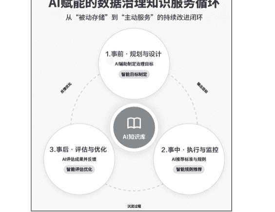

图 9-1 AI 赋能的数据治理知识服务循环

1.  **事前阶段（规划与设计）**：在编制数据治理规划时，通过数据治理知识库查询公司的相关战略规划文档、过往信息化报告、数据治理未完成问题、数据质量分析报告、各业务部门规划等文件。数据治理知识库可自动将数据治理规划与各类文件内容进行关联和匹配，输出一个符合公司业务战略的数据治理规划文件。
2.  **事中阶段（执行与监控）**：在编制数据标准时，通过数据治理知识库查询国标标准、行业标准和企业标准，并引入相关业务文档，辅助数据标准的快速对标与制定。在编制数据质量稽核规则时，通过数据治理知识库查询已有数据标准、业务文档、报表等，数据治理知识库可自动推荐数据质量稽核规则，并将其与业务规则进行关联。
3.  **事后阶段（评估与优化）**：在完成数据治理目标后，将相关过程文档和成果物提交至数据治理知识库，并通过该知识库对所有文档内容与数据治理规划进行匹配分析，数据治理知识库可自动评估和优化数据治理任务。

### 9.1.2 数据治理知识库的核心价值与目标

构建数据治理知识库的最终目的是服务数据治理工作并提升其整体效能。它的核心价值体现在能够深度融入数据治理的事前、事中和事后三大关键阶段，为每个阶段提供精准、高效的知识支持。为了确保数据治理知识库建设的目标和价值导向，需要清晰地定义它在不同数据治理阶段应扮演的角色、能创造的核心价值，并设定具体、可衡量的应用目标。本小节将分别针对这三个阶段，详细阐述数据治理知识库的赋能价值，并提供具体的目标设定示例，为后续的架构设计和功能实现提供清晰的指引。

1.  **事前阶段（规划、设计、决策支持）**：在数据治理工作启动前，数据治理知识库能够提供全面、准确、及时的信息输入和智能化分析辅助，提高规划的前瞻性、科学性与效率，识别并规避潜在风险，从而提升决策质量。事前阶段知识库赋能示例如表 9-1 所示。

表 9-1 事前阶段知识库赋能示例

| 赋能方向 | 核心价值体现 | 具体目标示例 |
| :--- | :--- | :--- |
| 战略对齐与规划编制 | 确保治理规划与公司战略一致，从现有文档中快速汇集决策依据 | 在制订年度治理计划时，数据治理知识库能快速检索并提供近两年的公司年度报告、IT 部门工作总结以及关键业务部门的年度规划 PPT，以辅助管理层快速对齐方向 |
| 需求分析与范围界定 | 快速理解业务需求背景，参考过去的项目文档，避免重复“踩坑” | 对于新立项的数据治理项目，数据治理知识库能根据关键词，自动查找并推送过往类似项目的立项申请书和系统需求规格说明书，以供项目经理参考其背景和范围 |
| 风险评估与合规检查 | 主动提示内部规章制度要求，识别潜在的合规风险点 | 在进行新数据应用方案设计时，数据治理知识库能扫描方案描述，并对照已录入的《公司数据安全管理办法》等内部制度，主动提示可能冲突的条款 |
| 方案设计与技术选型 | 提供内部已有技术实战和相似方案作为参考，提高设计质量 | 当规划元数据管理平台建设时，数据治理知识库能提供过往相关项目的技术设计文档和系统架构图，展示公司内部已使用的技术栈和集成方案，以辅助技术选型 |
| 资源与预算初步规划 | 基于历史项目数据，为新项目的资源估算提供量级参考 | 在进行任务初步资源评估时，数据治理知识库能根据任务类型，从过往类似项目的项目预算审批文件中，提取其总体预算范围和计划周期，为新项目的资源估算提供初步的量级参考 |

2.  **事中阶段（执行、监控、问题解决）**：在治理工作的执行过程中，数据治理知识库能够提供即时、准确、规范的知识支持和操作指引，加速任务执行进程，减少操作错误和返工，确保执行的一致性，从而提高问题响应和解决效率。事中阶段知识库赋能示例如表 9-2 所示。

表 9-2 事中阶段知识库赋能示例

| 赋能方向 | 核心价值体现 | 具体目标示例 |
| :--- | :--- | :--- |
| 标准规范即时查询 | 确保开发、分析、业务操作符合统一标准 | 提升数据开发人员和数据分析师通过数据治理知识库查询数据标准（如命名、格式、定义）的效率，查询结果准确率达到 95% |
| 流程操作智能指引 | 降低流程执行门槛，规范操作步骤，减少错误 | 对于已纳入数据治理知识库的核心治理流程（如元数据变更、DQ 问题上报），用户通过问答可获取清晰的操作步骤，这一比例达到 80%，相关流程执行错误率降至 15% |
| 常见问题快速解答（FAQ） | 减少对专家的重复咨询，提升问题自助解决率 | 上线后，用户能够通过数据治理知识库自助解决常见数据治理相关问题（Top 20），这一比例达到 60%，显著降低治理/IT 团队的工单量/咨询量 |
| 历史案例与经验借鉴 | 遇到问题时快速找到相似场景的解决方案，避免重复试错 | 数据管家或问题处理人员在面对新的数据质量/安全问题时，能在数据治理知识库中找到至少 1 个高度相关的历史处理案例，这一比例达到 50% |
| 上下文感知的信息推送 | 在特定操作场景下主动提供相关信息，减少遗漏和错误 | 在数据建模工具中，当用户创建与“客户”相关的实体时，数据治理知识库能主动推送客户主数据标准链接和相关隐私保护要求的提示信息 |

3.  **事后阶段（评估、复盘、优化、知识沉淀）**：在治理工作完成后，数据治理知识库能够系统化地沉淀和组织治理过程中的经验教训与成果数据，支持更客观、高效的治理效果评估，促进知识的显性化、复用与共享，从而驱动数据治理体系的持续学习和优化。事后阶段知识库赋能示例如表 9-3 所示。

表 9-3 事后阶段知识库赋能示例

| 赋能方向 | 核心价值体现 | 具体目标示例 |
| :--- | :--- | :--- |
| 项目复盘与经验萃取 | 自动整理项目过程信息，高效提炼经验教训 | 对于完成的数据治理项目，数据治理知识库能在项目结束后1周内，基于项目文档库自动生成包含关键挑战、解决方案、经验教训要点的复盘报告初稿，以供项目经理完善 |
| 治理成效评估与数据整合 | 便捷查询和整合历史治理绩效数据，支持效果评估 | 用户可通过自然语言查询获取过去四个季度内特定数据域（如产品域）的数据质量得分趋势、已解决的关键问题数量及主要改进措施记录 |
| 知识更新与版本管理 | 确保数据治理知识库的内容能及时反映最新的治理实践和决策 | 建立月度知识更新机制，确保新发布的治理制度、标准或重要项目总结在发布后被纳入数据治理知识库并可检索 |
| 最佳实战识别与推广 | 发现并整理成功的治理案例和方法，促进组织内共享 | 数据治理知识库能基于项目评估结果和用户反馈，每季度自动推荐数据治理最佳实战案例，并生成简报，以供内部推广 |
| 驱动持续改进 | 基于用户查询热点和反馈，识别治理体系的薄弱环节和优化点 | 每月分析数据治理知识库查询日志和用户反馈，识别出用户最关心但当前解答不充分的治理问题点（Top 5），并将其作为下一阶段治理优化或知识补充的输入 |

### 9.1.3 实战目标与工具选择

本小节将明确实战环节的核心目标、范围界定，并详细阐述选择 DeepSeek 和 Dify 进行实战的原因和考量。这有助于读者理解本章后续实操内容的具体目标和技术背景。实战目标是在构建最小可行产品（MVP）后，进行企业级知识库实战，并给出整体建设思路，因此实战聚焦如下内容：

- **核心功能验证**：利用 DeepSeek 和 Dify 构建一个基础的、基于 RAG 的数据治理知识库。核心功能是根据用户输入的自然语言问题，从导入的数据治理文档中检索相关信息，并生成连贯、准确的答案。
- **初步价值体现**：至少要覆盖数据治理事前、事中和事后三个数据治理知识领域，解决这些领域信息效率不高的痛点，初步展示数据治理知识库在提升数据治理工作效率的价值。
- **掌握核心技术流程**：让读者通过实操，掌握使用 Dify 和 DeepSeek、处理知识文档、构建和调试 RAG 应用的核心步骤和关键配置。
- **数据治理知识库建设思路扩展**：构建 MVP 后，后续数据治理知识库扩展和升级由组织实际现状决定，笔者会给出扩展思路示例，以帮助读者学习和理解。

实战范围界定，为了使实战过程聚焦且可控，将限定本次 MVP 构建的范围如下：

1.  知识源范围包括 6 份具有代表性的企业数据治理文档，分别为 2 份事前规划的参考性文档，包含业务战略与行业数据治理案例，以 DOC 格式为示例；2 份事中执行的参考性文档，包含数据标准文档和数据质量评估指标，以 XLSX 格式为示例；2 份事后评估的参考性文档，包含数据管理成熟度和数据治理目标价值评价，以 PDF 格式为示例。
2.  目标用户为数据治理团队内部成员或对这些文档有查询需求的 IT/业务人员。
3.  选择 DeepSeek 和 Dify 作为本章实战的核心工具，主要考量如下：
    - **DeepSeek**：国内领先的开源大模型，在中文理解、生成上表现出色，非常适合处理中文语境下的数据治理文档和查询。DeepSeek 可以私有化部署到组织自有的 IT 设备中，数据安全保障性强，也可以使用便捷的 API 服务。
    - **Dify**：开源且部署灵活，可视化界面极大降低了 AI 应用的开发门槛，非专业用户也能快速上手。Dify 兼容性强，可以支持本地部署和国内主流大模型调用，应用开发后可直接集成到组织现有的系统。

## 9.2 数据治理知识库的架构设计与技术选型

构建一个有效的 AI 驱动的数据治理知识库，需要一个清晰、合理的技术架构作为支撑。本节将详细阐述数据治理知识库的逻辑架构，并重点说明 Dify 在其中扮演的核心角色。本节将深入探讨在利用 Dify 和 DeepSeek 构建数据治理知识库时，涉及的关键技术选型考量，包括知识格式、文档处理、Embedding（嵌入）模型、大模型接入以及部署模式等，为后续的实战环节提供明确的技术指引和决策参考。

### 9.2.1 数据治理知识库的架构设计

为了支撑数据治理事前、事中、事后的全流程知识服务需求，数据治理知识库架构设计包括 5 层，即数据源层、知识抽取与处理层、知识向量化与存储层、LLM 应用平台层（Dify 核心）和用户应用与交互层，数据治理知识库逻辑架构如图 9-2 所示。

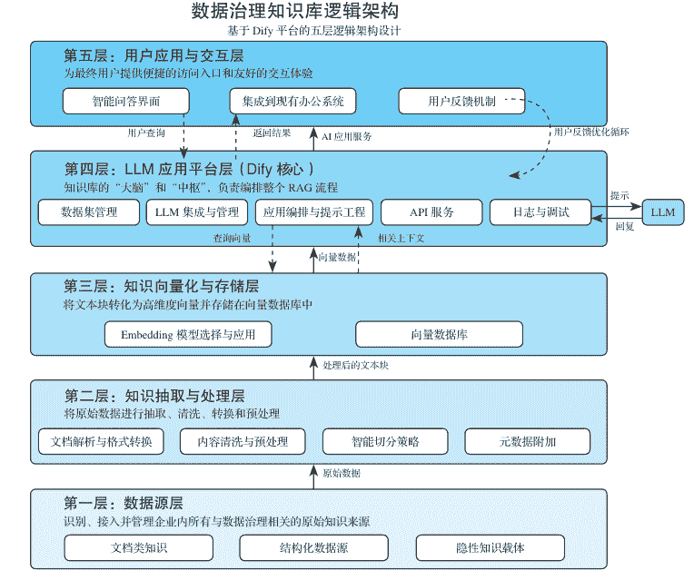

图 9-2 数据治理知识库逻辑架构

第一层是数据源层。对于从零起步的企业，此层旨在主动识别、收集并初步规范构成数据治理知识库基础的各类分散的原始信息与文档。针对核心数据信息的收集范围建议如下。

- 战略与治理框架类：收集公司级战略、特定领域规划、待制定或已有的数据治理政策初稿、数据安全与隐私制度以及必须遵守的法律法规与行业标准。
- 数据描述与资产类：收集业务术语表/数据字典、关键系统的数据模型、核心数据资产清单等。
- 管理流程与实战类：收集现存的数据质量检查方法、数据访问流程、过往数据项目经验总结、业务SOP操作指南等。

在收集过程中，企业应明确收集范围与优先级，通过跨部门协作（如IT、业务、财务等）共同参与。从现有材料入手，逐步完善，鼓励知识贡献并建立初步的文档规范与版本意识，为后续动态维护打下基础。

第二层是知识抽取与处理层。将原始、异构的数据源信息转化为干净、结构化、适合模型处理的文本片段。主要用到的核心功能如下。

- 文档解析与格式转换：支持多种格式（如PDF、DOC、XLSX等）的文本提取，对扫描件进行光学字符识别（OCR）。
- 内容清洗与预处理：去除无关信息（如页眉、页脚、广告），规范化文本。
- 智能切分策略：采用合适的策略将长文本切分为语义完整、大小适中的知识块。
- 元数据附加：为知识块关联来源、类型等元数据，以便于溯源和筛选。

在文档解析与转换、内容清洗时，企业可以借助成熟的开源工具或大模型对这些知识进行处理，一定不可以直接将各类文档进行切分就导入数据治理知识库，知识的准确程度决定了知识回答的效果。

第三层是知识向量化与存储层。将处理后的文本知识转化为机器可理解的数字向量，并高效存储以支持语义检索。主要用到的核心功能如下。

- Embedding模型选择与应用：选用合适的Embedding模型将文本块转换为高维语义向量。
- 向量数据库：将文本向量及其元数据存入向量数据库，建立高效索引，并支持快速相似度检索。

第四层是LLM应用平台层（Dify核心）。作为数据治理知识库的“大脑”，编排整个检索增强生成（RAG）流程，管理DeepSeek，并提供应用开发与部署能力。主要用到的核心功能如下。

- 数据集管理：支持知识文档的上传、流程配置（如分段、清洗）、索引构建。
- LLM集成与管理：便捷接入并管理大语言模型（如DeepSeek），配置模型参数。
- 应用编排与提示工程：通过可视化界面或配置，构建RAG应用，精心设计和优化提示词，引导模型生成高质量答案。
- API服务：将构建的应用发布为API服务，并提供日志、调试工具，以支持应用迭代优化。

第五层是用户应用与交互层。提供用户友好、便捷高效的知识访问入口与交互方式。主要用到的核心功能如下。

- 智能问答界面：提供自然语言问答、对话等多种交互方式。
- 集成到现有办公系统：将知识服务智能体嵌入企业现有办公系统（如OA、业务系统插件）。
- 用户反馈机制：建立用户反馈机制（如答案评价），并对数据治理知识库的使用情况、用户查询行为进行分析，驱动数据治理知识库的持续改进。

通过这五层架构的协同，企业可构建一个结构清晰、功能完善、可持续优化的数据治理知识库。

## 9.2.2 数据治理知识库的技术选型

在构建数据治理知识库的实战中，合理的技术选型能有效降低项目风险，提升成功率。本小节将结合数据治理业务的特点，为读者提供一些关键技术的选型建议和需要注意的事项，帮助读者做出更合适的决策。

### 1. 知识格式兼容与处理技术

知识格式兼容与处理技术选型的核心需求是确保各类数据治理文档（如DOC、XLSX、PDF，包括扫描件）都能被有效纳入数据治理知识库。在技术选型过程中，建议如下：

- **常规文档**：优先选择Dify平台内置的文档解析能力。对于Dify未直接支持的特定复杂格式，可辅以成熟的Python脚本库进行预处理。
- **扫描件与图片**：对于此类文档，OCR质量至关重要。建议评估并投入一款高质量的OCR工具。若预算有限或处理量不大，可先尝试优秀的开源OCR引擎；若对准确率要求高且文档量大，商业OCR服务通常效果更佳且更稳定。

> **注意事项**：低质量的OCR会严重影响数据治理知识库的内容准确性，务必在选型前用代表性文档充分测试。

### 2. Embedding模型

Embedding模型选型的核心需求是将文本知识转化为计算机能够理解的“语义向量”，以便智能系统能“读懂”并精准匹配相关内容。在技术选型过程中，建议如下：

- **优先考虑中文优化模型**：鉴于数据治理文档以中文为主，强烈建议选用在中文理解和语义表达上表现优异的Embedding模型。
- **参考社区与Dify支持**：也可以考虑在Dify平台中已获得良好支持并在中文社区中有广泛好评的开源模型（如BGE系列、M3E系列等）。

> **注意事项**：Embedding模型的质量直接决定了知识检索的精准度。在选定并大规模使用后，更换模型的成本较高（所有知识需要重新向量化）。

### 3. 大语言模型

大语言模型（LLM）选型的核心需求是依据检索到的知识片段，理解用户问题并生成清晰、准确、有逻辑的回答。在技术选型过程中，建议如下：

- **初期推荐API模式**：对于初次构建数据治理知识库的企业，建议通过API接入成熟、知名的大语言模型服务（如DeepSeek的通用大模型API）。这样做可以显著降低初期技术门槛，快速搭建系统、验证业务价值，且无须承担复杂的模型运维工作。
- **将私有化部署作为长远考虑**：当企业能够成熟应用数据治理知识库或企业对数据安全、模型自主可控性有极高要求时，投入资源评估并实施LLM的私有化部署。

> **注意事项**：即使是最好的LLM，也可能产生“幻觉”（即编造信息），因此务必结合RAG架构、优化提示词和必要时的人工审核来保障回答的真实性。

### 4. 文档处理流程自动化

文档处理流程自动化选型的核心需求是高效、准确地完成知识文档的导入、清洗、切分等预处理工作。在技术选型过程中，建议如下：

- **充分利用Dify内置功能**：Dify平台通常提供了覆盖大部分场景的文档导入和自动化处理功能（如自动分段、元数据提取等），应优先利用这些内置能力。
- **将Python脚本作为补充**：对于Dify平台无法直接满足、高度定制化或复杂的预处理逻辑（如特定格式的解析、复杂的清洗规则），建议使用Python脚本进行开发，并可考虑将其集成到Dify的任务流中或作为前置处理步骤。

通过上述建议，希望能帮助读者在构建数据治理知识库时，做出更明智的技术决策，少走弯路，更快地实现业务价值。

## 9.3 数据治理知识库助手的搭建

本节的核心目标是引导读者亲手搭建一个基础但功能完整的数据治理知识库助手。通过以下步骤，读者将学习如何配置必要的环境、准备并导入知识源、在Dify平台上构建和配置数据治理知识库及AI应用，并进行初步的功能测试。这是一个强调动手实践的过程，建议读者在阅读的同时，同步进行操作。

### 9.3.1 环境准备与工具安装

在开始构建之前，需要确保开发环境和所需工具均已就绪。

#### 1. 获取DeepSeek服务

获取DeepSeek服务的步骤如下。

1. 步骤1：注册DeepSeek开发者账号。访问DeepSeek官方网站的开发者平台，按照指引完成注册并登录。
2. 步骤2：创建API密钥。在开发者控制台中，找到“API密钥”菜单，创建一个新的API密钥。请妥善保管此密钥，它将用于Dify平台与DeepSeek模型的通信。
3. 步骤3：私有化部署说明。若企业已对DeepSeek模型进行私有化部署，请确保拥有访问该模型服务的API端点URL和任何必要的认证信息。对于本次实战，推荐使用更便捷的API密钥方式。

#### 2. Dify平台安装部署

推荐使用Docker Compose在服务器（如虚拟机、云服务器）上部署Dify，具体步骤如下。

1. 步骤1：获取Dify安装包。访问Dify的官方地址（https://github.com/langgenius/dify），按照README.md中的指引，获取最新的项目文件（通常是下载docker-compose.yaml文件）。
2. 步骤2：执行部署命令。在存放docker-compose.yaml的目录下，执行docker-compose up -d命令。此命令会自动拉取Dify所需的镜像并启动服务。（提示：确保服务器已安装Docker和Docker Compose，并且有足够的内存和磁盘空间。如果遇到问题，请查阅Dify官方文档或在社区中寻求支持。）
3. 步骤3：访问Dify平台。部署成功后，通过浏览器访问“http://服务器IP:端口号（默认端口通常为80）”。在首次访问时，需要创建管理员账户。

#### 3. 准备示例知识源文档

将准备以下6份具有代表性的数据治理文档，并存放在本地文件夹中。请务必注意，在实际操作中，如果使用真实业务数据作为测试样本，必须进行严格的脱敏处理，以保护数据隐私和安全。本章提供的文档示例内容均为虚构或已脱敏：

- 《公司数据战略规划_2025》(事前规划文档示例，DOCX格式)。
- 《行业数据治理优秀案例分析》(事前规划文档示例，DOCX格式)。
- 《核心业务数据元标准_V1》(事中执行文档示例，XLSX格式)。
- 《数据质量评估指标体系》(事中执行文档示例，XLSX格式)。
- 《数据管理成熟度评估报告》(事后评估文档示例，PDF格式)。
- 《数据治理项目价值评价方法》(事后评估文档示例，PDF格式)。

### 9.3.2 知识源导入与向量化

当环境部署就绪后，开始将准备好的数据治理文档导入Dify平台。

(1) 文档初步检查
快速浏览6份示例文档，确保内容清晰、无密码保护。对于PDF文档，确认其为文本型而非纯图片扫描型。若是纯图片扫描型，在理想情况下应先进行OCR处理。确保文件名与内容对应，文件扩展名正确。

(2) 在Dify中创建知识库
登录Dify平台，在主界面找到“知识库”入口，单击进入。单击“创建知识库”按钮，为知识库命名，例如“数据治理知识库”，并根据提示完成创建。

(3) 上传文档至Dify知识库
进入刚创建的“数据治理知识库”。单击“上传文档”按钮，在上传后进行文档知识处理，具体步骤如下。

1) 步骤1：配置文本处理与分段策略。在“数据治理知识库”的上传设置中，需要对上传文档进行“分段设置”“文本预处理”等操作，如去除多余空格、处理特殊字符等。对于MVP，可先采用平台默认设置。
分段策略是确保检索效果的关键，其目的是将长文档切分成适合LLM上下文窗口处理且语义相对完整的知识片段（Chunks）。建议初次推荐的分段长度为800～1200字符，分段重叠长度为150～250字符。分段策略设置方式如图9-3所示。

2) 步骤2：选择并配置Embedding模型。在知识库设置中，找到“Embedding模型”配置项，选择决定使用的Embedding模型。建议使用bge-large-zh-v1.5模型，可以选择使用API接入或本地部署此模型。API密钥配置：如果选择的是API类Embedding服务，那么在模型供应商的系统模型设置中选择对应的Embedding模型，Embedding模型选择如图9-4所示。

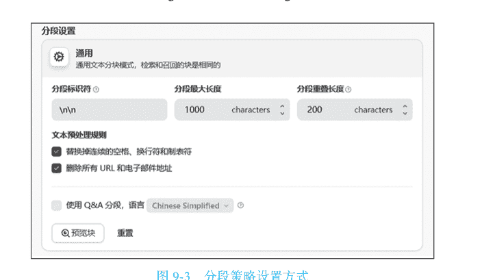

图9-3 分段策略设置方式

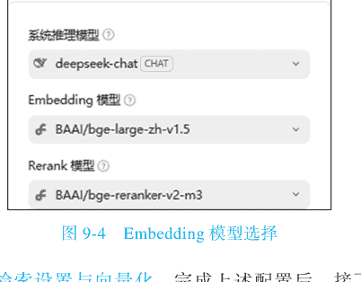

图9-4 Embedding模型选择

3）步骤3：检索设置与向量化。完成上述配置后，接下来进行检索设置。选择检索类型，推荐使用混合检索、默认参数。确认以上配置后，单击“保存并处理”按钮，Dify将开始对上传的文档进行分段、清洗，并将文本块通过Embedding模型转换为向量，最终存入内置的向量数据库中。检索设置与向量化如图9-5所示。

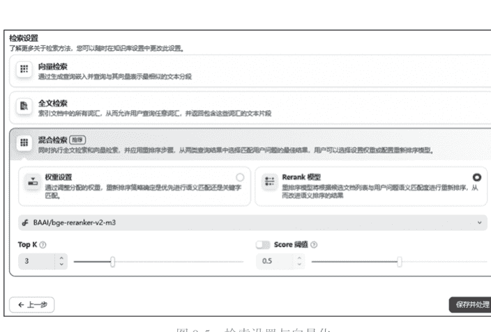

通过以上步骤操作，上传数据治理知识库所需的6个文档并完成向量化操作，文档向量化如图9-6所示。

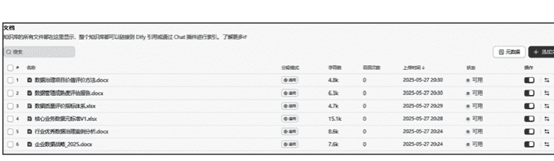

### 9.3.3 AI工作流的创建与配置

数据治理知识库准备就绪后，开始创建一个AI工作流，使其能够利用这个知识库来回答用户问题。

#### 1. 创建新的AI应用

从工作室页面中进入“创建空白应用”界面。选择应用Chatflow（支持记忆的复杂多轮对话工作流）类型。对于知识库问答场景，Chatflow类型是符合实际业务需求的。为应用命名，例如“数据治理知识库助手”。AI应用创建如图9-7所示。

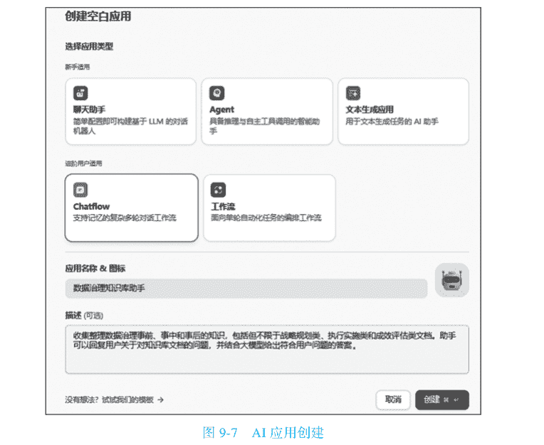

#### 2. 关联知识库

在新创建的“数据治理知识库助手”应用的配置界面中，添加知识检索节点，选择之前创建且已索引完成的“数据治理知识库”，并将知识检索节点与当前开始节点关联。这将启用知识库检索功能。关联知识库如图9-8所示。


#### 3. 配置DeepSeek模型

在知识检索节点后添加LLM节点，并选择具体模型：从下拉列表中选择一个具体的DeepSeek模型（对话模型，如deepseek-chat），然后调整其基础参数，具体如下。

- 温度（temperature）：控制回复的创造性。对于知识库问答场景，建议设置为较低值（如0.2～0.5），使回答更稳定、更基于事实。
- 最大标记（max_token）：限制单次回复的最大字符数或token数，默认为4096。

模型参数调整如图9-9所示。

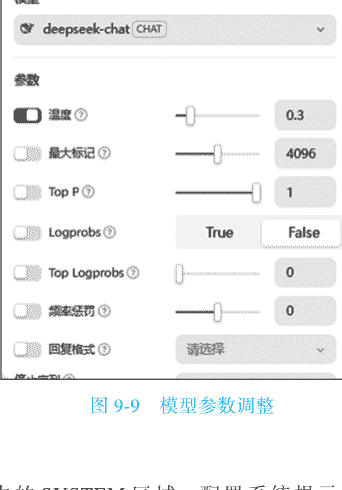

#### 4. 提示词工程

在LLM节点中的SYSTEM区域，配置系统提示词（System Prompt）。这是指导LLM如何行动的核心指令，也是影响AI应用效果的关键。一个好的提示词应清晰地定义AI的角色、任务，并提供必要的约束和上下文。
提示词的设计原则如下：

- **明确角色与任务**：让AI知道它“是谁”，以及它“要做什么”。
- **提供充足上下文**：利用Dify的{{context}}变量，将知识库检索到的信息传递给LLM。
- **设定输出约束**：明确回答的格式、长度、风格，以及信息不足的情况下的处理方式。
- **引导与示例**：提供高质量的问答示例，帮助LLM理解期望的输出模式。

MVP系统提示词示例：
你是一个专业的数据治理知识库助手。请根据以下提供的背景知识来回答用户提出的问题。
背景知识：
{{Dify在运行时会自动填充从数据治理知识库中检索到的相关文本片段}}
用户问题：
{{用户实际提出的问题}}
请严格依据背景知识进行回答，确保内容准确、简洁。如果背景知识不足以回答问题，请直接告知用户“我目前掌握的知识无法回答这个问题”。

提示词设置如图9-10所示。

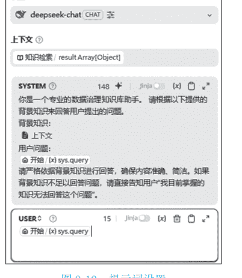

可以设置一个友好的开场白，如“你好，我是数据治理知识库助手，请问有什么可以帮你？”开场白设置如图9-11所示。

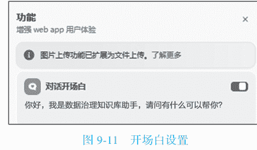

图9-11 开场白设置

#### 5. 配置上下文检索策略

在知识库设置中，配置检索参数。Top_K（检索数量）表示从向量数据库中检索最相关的知识片段数量。在这里，可设置为4个片段，上下文检索策略设置如图9-12所示。

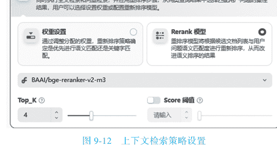

图9-12 上下文检索策略设置

> **注意事项：** 提示词的质量对AI应用的表现至关重要，上述示例仅为基础示例，在实际应用中需要不断迭代优化。LLM的温度参数对回答风格影响很大，多尝试以找到合适的值。

### 9.3.4 初步测试与调试

AI应用基本配置完成后，即可进行初步的功能测试和调试。

#### 1. 发布应用并测试

Dify平台会为创建的应用提供一个发布界面，发布后，单击“运行”按钮即可进行内部测试，Dify应用发布设置如图9-13所示。


#### 2. 设计测试问题

准备一些能够检验数据治理知识库内容覆盖度和问答准确性的问题，应能从之前上传的6份文档中找到这些问题的答案。例如：

- 针对《公司数据战略规划_2025》：“公司在2025年的数据治理战略重点有哪些？”，其回复如图9-14所示。

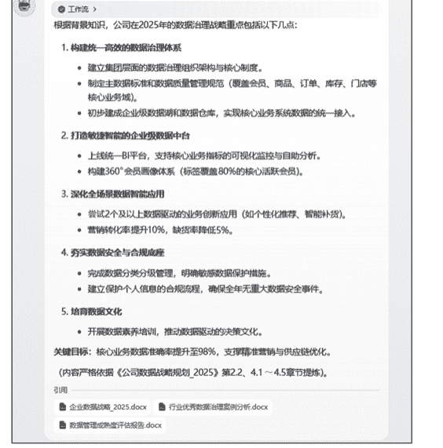

- 针对《核心业务数据元标准_V1》：“客户ID的数据类型和长度标准是什么？”，其回复如图9-15所示。

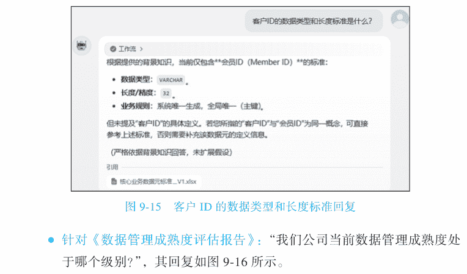

- 针对《数据管理成熟度评估报告》：“我们公司当前数据管理成熟度处于哪个级别？”，其回复如图9-16所示。

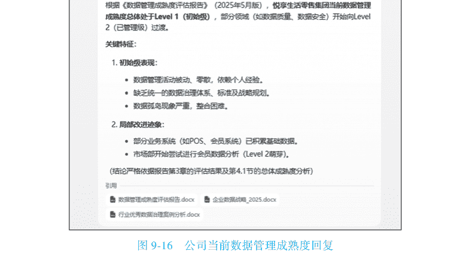

#### 3. 执行测试并评估回答

在Dify应用的测试界面中，从以下几个维度对上述AI生成的回答进行评估。

- **相关性**：回答是否针对问题？
- **准确性**：回答中的信息是否与源文档一致？
- **完整性**：回答是否全面地解答了问题（在所给上下文范围内）？
- **溯源性**：本次参考的知识片段及其来源文档是否准确？

#### 4. 初步调试与迭代

如果回答不理想（如不准确、不相关或未能利用知识库内容），那么可尝试从以下方面进行初步调试与迭代：

- **检查知识库内容与处理方式**：检查相关文档是否已正确导入并索引以及分段策略是否合适。
- **优化提示词**：调整系统提示词，使其更清晰、更具指导性。
- **调整检索参数**：增减Top_K值，查看是否能召回更相关的知识片段。
- **调整LLM参数**：适当调整温度参数等。

> **注意事项**：MVP阶段的测试目标是验证核心链路（提问→检索→生成回答）的通畅程度和基本可用性，不必追求完美。测试过程中的问题和发现可作为后续优化的输入。调试是一个迭代的过程，需要保持耐心。

通过以上步骤的实战演练，你应该已经成功搭建并初步测试了一个基于Dify和DeepSeek的数据治理知识库助手。它虽然基础，但验证了核心技术的可行性，并为接下来的深入优化和功能扩展打下了坚实的基础。在下一节中，我们将探讨如何将这个数据治理知识库应用到实际工作场景，并讨论其持续优化和成效评估的方法。

## 9.4 数据治理知识库的应用实战与持续优化

成功构建MVP只是数据治理知识库建设的第一步。要使数据治理知识库真正赋能业务，还需要在实际工作场景中进行应用与检验，建立有效的成效评估机制，并根据反馈进行持续迭代优化。本节将详细阐述这些关键环节的实战方法与策略。

## 9.4.1 实际应用场景实战

通过模拟真实工作任务，检验数据治理知识库在数据治理事前、事中、事后各阶段的实际应用效果，收集用户初步反馈，并发现潜在问题。

（1）实战目的与准备

- **目的：** 验证数据治理知识库的核心功能是否满足基本需求，即用户能否通过数据治理知识库助手快速找到所需信息，初步评估其易用性和实用性。
- **参与人员：** 邀请 1～2 名数据治理专员、数据分析师或相关业务人员参与。
- **实战材料：** “数据治理知识库助手”访问方式说明文档，以及一份包含针对性任务或问题的演练指引文档。另外，明确告知参与者当前知识库范围仅限已导入的 6 份示例文档。

（2）场景任务示例与操作指引

围绕数据治理的三个核心阶段设计任务，引导用户与“数据治理知识库助手”互动，具体如下。

首先是事前阶段的应用演练。

任务示例 1（战略理解）：“假设你需要向新同事介绍公司在数据战略方面的规划，请通过数据治理知识库助手查询《公司数据战略规划_2025》，总结未来一年的三大战略重点。”

任务示例 2（案例借鉴）：“为提升某项业务的数据应用水平，请通过数据治理知识库助手在《行业数据治理优秀案例分析》中查找关于‘客户画像精准营销’的案例，并总结其成功的关键因素是什么。”

用户操作：引导用户思考如何将任务转化为自然语言问题并向数据治理知识库助手提问，如“2025 年公司数据战略的重点是哪些？”或“有哪些客户画像精准营销的成功案例及其要素？”

其次是事中阶段应用演练。

任务示例 1（标准查询）：“在进行数据 ETL 开发时，需要确认‘交易流水号’字段的数据标准（如命名规范、数据类型、长度），请通过数据治理知识库助手从《核心业务数据元标准_V1》中获取此信息。”

任务示例 2（质量评估）：“在分析月度数据质量报告时，发现‘产品信息完整性’得分较低，请通过数据治理知识库助手在《数据质量评估指标体系》中查找相关信息，了解该指标的具体定义和可能的评估维度。”

用户操作：例如提问“交易流水号的数据标准是什么？”或“如何定义和评估产品信息完整性指标？”

最后是事后阶段应用演练。

任务示例 1（成熟度回顾）：“请通过数据治理知识库助手在《数据管理成熟度评估报告》中查找相关信息，了解在‘数据安全管理’维度上，我们目前的主要优势和待改进点。”

任务示例 2（价值分析）：“数据治理工作完成后，如何衡量其带来的业务价值？请数据治理知识库助手从《数据治理项目价值评价方法》中查询相关信息，提供至少三种评价维度或方法。”

用户操作：例如提问“我们在数据安全管理成熟度上有哪些优势和不足？”或“评价数据治理项目价值的方法有哪些？”

（3）实战过程观察与反馈收集

- **观察记录**：用户实际提出的问题措辞、找到答案的尝试次数、花费时间、对数据治理知识库助手回答的理解程度。
- **反馈收集**：结束后与用户进行简短交流，收集他们对数据治理知识库助手的易用性、回答准确性、完整性以及整体体验的看法和改进建议。

> 注意事项：强调本次收集目的是测试和改进数据治理知识库助手，而非评估用户能力。鼓励用户尝试用不同的问法，观察数据治理知识库助手的理解能力。记录用户在哪些问题上遇到困难，这往往是系统需要优化的信号。

## 9.4.2 数据治理知识库的成效评估模型与方法

为了客观衡量数据治理知识库的价值并指导优化方向，需要建立一套清晰的成效评估体系。具体如下：

### 1. 明确评估维度与核心指标

参照 9.1.2 节设定的目标，可以从以下维度设定评估指标。

在效率提升维度方面：

- **信息获取平均时长**：对比使用数据治理知识库与传统方式查找特定信息所需的时间。
- **问题一次性解决率**：用户提问后，数据治理知识库助手首次回答即可满足用户需求的比例。

在知识服务质量维度方面：

- **答案准确率**：(通过抽样人工校验) 数据治理知识库助手回答内容与源文档知识的一致性比例。
- **知识覆盖满足度**：用户提出的与库内知识相关的问题能够得到有效回答的比例。
- **用户满意度**：通过问卷或应用内的评价功能收集用户对回答质量的评分（如 1～5 分制）。

在用户采纳与活跃度方面：

- **活跃用户数 / 查询次数**：数据治理知识库的实际使用频率。
- **高频查询主题**：用户最关心的数据治理知识。
- **零回答问题分析**：当前数据治理知识库无法覆盖或模型难以理解的问题。

### 2. 评估方法与工具

- **Dify 平台日志分析**：Dify 提供后台日志和统计功能，可直接获取查询次数、高频问题、无法回答问题等数据。
- **用户调研与访谈**：定期（如每季度）通过问卷或小组访谈收集用户对数据治理知识库的满意度、易用性等定性反馈。
- **问答效果抽样评估**：定期抽取一定比例的“问题－答案”对，由数据治理专家判断答案的准确性和完整性。
- **应用内嵌反馈**：在问答界面设置问题，如“此回答是否有用？”，并设置可输入文本的评论框，实时收集用户对单次回答的评价。

> **注意事项：** 设定清晰的评估基线（如 MVP 上线初期的表现），以便衡量后续改进的效果。定量指标与定性反馈相结合，全面了解数据治理知识库的表现。评估结果应作为持续优化的重要输入，并向相关方（如管理层、用户代表）进行汇报。

## 9.4.3 数据治理知识库的持续优化策略

数据治理知识库的价值在于其“鲜活性”和“成长性”，持续优化是保持其生命力的关键。具体优化策略包括：

### 1. 知识内容体系的动态更新

- **新知识纳入机制：** 建立流程，以定期（如每月）收集新增或更新的数据治理政策、标准、流程文档、项目总结、最佳实战等，及时将这些知识导入数据治理知识库并完成索引。
- **过期知识维护：** 识别并处理数据治理知识库中可能过时或不再准确的内容，将这些内容进行归档或替换更新，确保知识的时效性。
- **知识缺口填补：** 根据用户高频查询但无满意答案的问题，或通过用户反馈识别出的知识盲点，主动补充相关知识内容。

### 2. AI 模型与应用配置调优

- **提示词迭代：** 分析用户与数据治理知识库助手的交互日志，特别是那些导致回答不佳的提问方式或场景，针对性地优化 Dify 应用中的系统提示词，使其更具引导性、更精确。
- **检索增强（RAG）参数调优：** 若发现检索到的知识片段过大或过小，或语义割裂严重，应回到 Dify 知识库设置中调整文本分段参数；实验不同的 Top_K 值，观察其对回答质量的影响，找到平衡点；在 Dify 应用中微调 LLM 的温度等参数，以优化回答的风格（如更偏向事实还是更具概括性）。

### 3. 用户反馈驱动的改进闭环

- **常态化反馈收集：** 确保用户有便捷的渠道（如应用内反馈按钮、专用邮箱、定期座谈会）提交问题和建议。
- **反馈分析与优先级排序**：定期汇总用户反馈，识别其中的共性问题和高价值建议，并结合评估数据，确定优化任务的优先级。
- **改进实施与效果追踪**：实施优化措施后，要主动追踪其效果，并通过前述评估方法验证改进效果是否达到预期。
- **透明沟通**：将重要的改进和新增功能及时告知用户，鼓励他们体验和再次反馈。

### 4. 定期健康度检查与性能监控

- 监控数据治理知识库应用的响应时间、API 调用成功率、服务器资源使用情况等，以确保系统稳定运行。
- 定期检查知识索引的完整性和准确性。

> **注意事项**：优化工作应小步快跑，避免一次性进行过多调整，防止难以评估各调整项的优化效果。记录所有重要的优化操作及其原因和结果，形成数据治理知识库自身的“运维知识”。鼓励形成一个由数据治理团队、IT 技术团队和用户代表共同参与的数据治理知识库运营优化小组。

通过上述应用实战、成效评估和持续优化的闭环管理，数据治理知识库将从一个 MVP 逐步成长为数据治理工作中不可或缺的得力助手，真正实现 AI 对数据治理知识的智能赋能。

# 第10章 DeepSeek 在元数据管理中的实战应用

本章将聚焦企业元数据管理的具体痛点，指导读者如何利用 Dify 和 DeepSeek，构建一个端到端、具备实际应用价值的智能元数据工作流。本章首先将从实战场景的选择与需求分析开始，详细讲解在 Dify 平台上构建智能元数据工作流的每一个步骤，包括提示词设计、模型集成等。接着将探讨智能元数据工作流的调试与优化方法，确保其能够稳定、准确地运行。最后将展示构建好的智能元数据工作流如何在实际元数据管理场景中应用，评估其带来的效率提升，并展望此类 AI 赋能工作流在更多元数据管理任务中的未来。通过本章的学习，读者将获得构建和应用 AI 驱动的智能元数据工作流的实操经验，为 AI 能力真正融入企业数据治理实战打下坚实基础。

## 10.1 实战场景选择与分析

### 10.1.1 实战场景选择与价值分析

在第 5 章中，从理论层面了解了元数据管理的重要性，以及 DeepSeek 等大模型如何赋能元数据管理，以解决传统模式下效率低、覆盖不足等诸多痛点。本章作为工具与实战篇的重要组成部分，旨在带领读者从“知道”到“做到”，亲自动手构建一个 AI 驱动的智能元数据工作流。通过本次实战，可以实现以下内容。

- **实战理论**：验证 DeepSeek 在元数据管理任务中的实际赋能效果。
- **掌握工具**：学习 Dify 平台的操作，包括模型配置、提示词设计和工作流编排。
- **应对挑战**：在构建和调试中学习分析和解决实际问题，积累宝贵的实战经验。
- **量化价值**：更直观地感受 AI 在特定任务上带来的效率提升和工作模式优化。
- **建立信心**：为未来在更广泛的数据治理领域探索和应用 AI 能力打下坚实基础。

元数据管理包含广泛的任务。为了让本次实战既有代表性，又能完整展现从构建到应用的整个过程，本章将目标任务聚焦于“利用 DeepSeek 的能力，构建一个工作流，根据数据库表名、字段名、数据类型以及可能的其他上下文信息，自动生成该字段的业务描述初稿。”

选择“自动生成数据库字段业务描述”这个场景的原因主要有以下几点。

- **痛点普遍，价值直观**：为数据库字段编写业务描述是几乎在所有企业平台中普遍存在、工作量巨大的任务。将这项工作自动化，能够直接、快速地提升元数据覆盖率和数据目录可用性，同时，其业务价值明显，易于获得认可。
- **高度契合 AI 核心能力**：该任务的核心要求是进行文本理解和文本生成，完美匹配 DeepSeek 的自然语言处理能力。该任务能够充分发挥 DeepSeek 的强大潜力。
- **任务相对独立，易于演示**：描述生成任务可以作为一个相对独立的工作单元，其输入和输出清晰，便于在 Dify 平台上进行端到端的工作流构建，降低了实战复杂度。
- **规避高风险**：相比血缘解析或安全合规等场景，描述生成任务更聚焦文本处理，可相对容易地对所需输入数据进行脱敏处理，实战中引入的技术依赖易于获取，潜在数据安全风险也相对可控，更适合初学者入门。

通过完成这个工作流，读者将亲手构建一个能够显著减少数据管理员重复性工作的“智能元数据助手”，让使用者可以将更多精力放在对描述的审核和更高阶的元数据管理任务上。这是一个典型的、能够快速带来局部效率提升的 AI 赋能元数据管理场景。

### 10.1.2 深入分析描述生成任务的需求

本次实战的目标是构建一个能自动生成数据库字段业务描述的工作流，接下来就需要像一位产品经理一样，对这个任务进行细致的需求分析。深入理解“输入”“输出”和“质量要求”，是决定如何设计给 AI 的指令（提示词）以及如何编排工作流的关键。

#### 1. AI 生成描述需要哪些输入信息

为了让 DeepSeek 能够准确地理解一个数据库字段，并在业务层面进行描述，我们需要向它提供尽可能多的相关信息。这些信息就像是给 AI 的“线索”，给 AI 提供越多、越准确的“线索”，AI 生成的描述就越可能符合我们的预期。在实际应用中，这些信息通常可以从数据库元数据、数据字典或者人工补充的业务背景中获取。具体如下：

1）核心技术信息：这些信息通常最容易从数据库或技术文档中自动采集，具体包括如下几项。

- 字段名称（FieldName）：字段的英文名称，这是识别字段的基础，如 user_id、order_amount、create_time、status。
- 所在表名称（TableName）：字段所在的表名。表名往往蕴含了重要的上下文信息（例如 customer 表中的 address 和 order 表中的 address 含义可能不同），如 t_customer、t_order、dim_product。
- 数据类型（DataType）：字段存储的数据类型，如 VARCHAR、INT、DECIMAL（18, 2）、TIMESTAMP、BOOLEAN、DATE 等。数据类型能提示字段可能的取值范围和性质。

2）辅助技术信息：这些信息能让 AI 更精确地理解字段，具体包括如下几项。

- **技术注释**：数据库中已有的字段注释。即使注释不规范或不完整，也可能包含一些原始的业务意图，对 AI 有帮助。
- **字段长度或精度**：对于文本字段或数值字段，长度或精度能进一步限定其特征。

3）业务上下文信息：这些信息需要结合业务知识或从业务文档中获取，能显著提升描述的业务准确性。

- **所属业务域/系统**：明确字段属于哪个业务领域（如客户管理、订单、营销、财务）或哪个业务系统，为 AI 提供宏观业务背景，如“客户域”“订单系统”“财务报表”。
- **少量脱敏后的数据样本**：提供该字段的几条代表性数据样本（例如 100.50、"completed"、"pending"、"2023-10-26 10:00:00"、"男"）。通过分析这些信息，AI 能更好地推断字段的实际存储内容、格式和可能的业务含义/值域。

> **注意事项**：在实际操作中，提供给 AI 的数据样本必须经过严格的脱敏或伪造处理，绝不能包含任何真实或敏感的企业数据。

#### 2. 期望得到的输出是什么

本次实战期望 DeepSeek 能够基于上述输入信息，针对每一个字段，生成一段符合要求的业务描述，具体包括如下几项。

- **业务描述文本**：这是核心输出。我们希望得到一段用自然语言书写的、关于该字段业务含义和用途的文本。这段文本应该简洁明了，能够让没有技术背景的业务人员快速理解这个字段代表什么。
- **输出格式控制**：希望 AI 按照特定的格式输出描述，比如：只输出描述内容本身，不包含其他解释性文字；输出为 JSON 格式，包含描述、关键词、相关术语等结构化信息。
- **置信度得分**：可以通过提示词技巧让 AI 输出一个自我评估的得分或标记，提示业务人员在进行人工审核时需要仔细关注（例如，当输入信息不足或字段名称模糊时）。

#### 3. 对输出描述的质量要求有哪些

AI 生成的业务描述是否“好用”，取决于它能否满足一定的质量标准。这些标准是我们进行提示词设计和后续人工审核的依据，具体包括如下几项。

- **准确性**：描述内容必须准确无误地反映字段在业务中的实际含义。例如，order_amount 必须描述为订单金额，而不是订单数量。
- **清晰易懂**：描述应使用业务人员容易理解的语言，避免使用只有技术人员才懂的术语。句子结构应通顺流畅。
- **简洁性**：描述应抓住核心要点，用尽可能少的文字把意思讲清楚，避免冗长或重复的语句。通常会有一个期望的长度范围（比如 50 ～ 100 字）。
- **一致性**：同一类字段或同一个业务域内的字段描述风格、用词应尽量保持一致，这样整个数据目录看起来更整洁、更专业。
- **完整性**：在简洁的前提下，描述应包含字段的关键业务信息，比如它代表的业务概念、状态值（如果是状态字段）、主要用途等。
- **可审核性（重要）**：AI 生成的描述是初稿，最终需要人工审核。描述应该结构清晰，易于人工快速阅读、理解和修改。

在明确了这些输入、输出和质量要求后，我们就有了清晰的目标和指导方针。接下来将根据这些需求，在 Dify 平台上开始搭建我们的智能元数据工作流，并设计能够引导 DeepSeek 生成符合上述要求的“答案”的提示词。

### 10.1.3 准备实战所需的“原材料”

本次实战的目标任务是自动生成数据库字段业务描述，并详细分析完成这个任务所需要的输入信息和期望的输出。为了能够顺利地在 Dify 平台上一步步构建和测试这个智能元数据工作流，需要提前准备好所有必需的“原材料”，包括用于演示的数据以及配置好的工具环境。

虽然我们的目标是生成描述，但为了让 DeepSeek 有东西可“读”、可“理解”，并让实战更有代表性，需要准备一些模拟的或者经过严格脱敏处理的“数据源信息”。这些信息将作为智能元数据工作流的输入。

模拟数据源结构信息：在真实的元数据管理场景中，从数据库、数据仓库等系统中自动采集这些信息。为了简化，本次实战将模拟一个小的企业数据环境。准备一个结构化的文件（例如一个 Excel 表、CSV 或 JSON 格式的文件），其中包含几个典型数据表的字段信息，模拟数据源结构信息表如表 10-1 所示。

表 10-1 模拟数据源结构信息表

| 表名 | 字段名 | 数据类型 | 所属业务域 | 脱敏数据样本示例 |
| :--- | :--- | :--- | :--- | :--- |
| t_customer | cust_id | VARCHAR (32) | 客户域 | ["C10001", "C10002"] |
| t_customer | cust_name | VARCHAR (64) | 客户域 | ["张三", "李四"] |
| t_customer | register_time | TIMESTAMP | 客户域 | ["2023-01-01 10:00:00", "2023-01-05 15:30:00"] |
| t_order | order_id | VARCHAR (32) | 订单域 | ["O20230101001", "O20230101002"] |
| t_order | cust_id_fk | VARCHAR (32) | 订单域 | ["C10001", "C10003"] |
| t_order | order_amount | DECIMAL (18,2) | 订单域 | [100.50, 23.00] |
| t_order | order_status | INT | 订单域 | [1, 2, 3](代码值) |
| dim_product | prod_id | VARCHAR (32) | 产品域 | ["P001", "P002"] |
| dim_product | prod_name | VARCHAR (128) | 产品域 | ["笔记本电脑", "鼠标"] |
| dim_product | price | DECIMAL (10,2) | 产品域 | [5000.00, 100.00] |

> **注意事项：** 在实际操作中，请使用你自己构建的少量模拟数据，或者从你的真实数据中提取结构信息和样本，但务必进行严格的脱敏处理。字段名、表名等通常不是敏感信息，但数据样本可能包含敏感信息，需要特别注意处理。

高质量描述示例（用 Few-shot Learning）：为了让 DeepSeek 更好地理解我们期望的业务描述风格和内容，将采用 Few-shot Learning（少量样本学习）的方法，即在给 AI 的指令（提示词）中包含几个高质量的“输入信息→期望输出描述”的例子。

请针对上述模拟数据中的几个字段，提前写好高质量描述示例。

**示例 1：**

输入信息：表名为 t_customer，字段名为 cust_id，数据类型为 VARCHAR (32)，所属业务域为客户域，脱敏数据样本示例为 ["C10001", "C10002"]

期望输出描述：“客户的唯一标识符，用于在企业内部系统中唯一识别和关联客户的各项信息。”

## 示例 2：

输入信息：表名为 t_order，字段名为 order_amount，数据类型为 DECIMAL（18，2），所属业务域为订单域，脱敏数据样本示例为 [100.50，23.00]

期望输出描述：“该字段记录了单笔订单最终支付的总金额，包含商品费用、运费等。”

请准备 3 ～ 5 个这样的高质量示例，它们将是指导 DeepSeek 生成期望描述的关键。

## 10.2 智能元数据工作流的建设

利用 Dify 平台的可视化编排能力，构建一个能自动生成数据库字段业务描述的工作流。Dify 提供了一个用户友好的界面，让我们无须编写复杂的代码，就能像搭积木一样把不同的功能模块（比如接收输入、调用大模型、输出结果）连接起来。本节将带领你一步步完成智能元数据工作流的搭建。

### 10.2.1 设计智能元数据工作流的步骤

如果你已经按照第 9 章的指导，成功注册或部署了 Dify 平台，并配置好了 DeepSeek 模型，那么现在只需要登录你的 Dify 账户，找到一个进行应用开发的工作区域，并开始思考如何将前面分析的需求转化为 Dify 中的操作。

- （1）登录 Dify 平台并进入工作空间，默认进入“工作室”

打开你的网络浏览器，输入 Dify 平台的访问地址，本地部署地址为 http://localhost。输入你的用户名和密码，单击“登录”按钮。

> 注意事项：在开始创建工作流之前，务必确认你的 DeepSeek 模型提供商已在当前工作空间中配置并启用，并且你计划使用的 DeepSeek 模型版本是可用的。可以在“设置”菜单中的“模型提供商”选项下找到。如果状态异常或模型不可用，那么请回顾第 9 章的相关内容，检查你的 API Key 或网络配置。确保最重要的 AI 能力提供者已经准备就绪，是后续所有操作的前提。

（2）设计智能元数据工作流的逻辑步骤，即规划“行动路线”

在 Dify 中构建智能元数据工作流，就是将一个任务分解成一系列小的、可执行的步骤，然后将这些步骤按顺序或逻辑关系连接起来。对于“自动生成数据库字段业务描述”这个任务，它的“行动路线”可以规划为以下 4 个主要逻辑步骤，如图 10-1 所示。

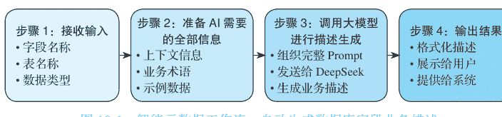

1）步骤 1：接收输入。智能元数据工作流需要知道它要为哪个字段生成描述。所以第一步是接收用户输入信息或上游系统提供的字段信息，这包括：字段名称、表名称、数据类型。将这些信息作为智能元数据工作流的起始输入参数。

2）步骤 2：准备 AI 需要的全部信息。AI 需要上下文信息来生成高质量描述。除了直接接收的输入信息，还需要获取其他辅助信息，比如少量脱敏后的数据样本或者用于 Few-shot Learning 的描述示例。在本次实战中，将大部分所需信息直接作为提示词的一部分或者在智能元数据工作流输入时提供。

3）步骤 3：调用大模型进行描述生成。这是智能元数据工作流的核心步骤。将前面准备好的所有“线索”（如输入信息、上下文信息、提示词指令、示例等）组织成一个完整的提示词，发送给配置好的 DeepSeek 模型。DeepSeek 模型将处理这个提示词，并生成字段的业务描述草稿。

4）步骤 4：输出结果。DeepSeek 模型生成的业务描述就是智能元数据工作流的主要产出。最后一步是将这个生成好的描述作为智能元数据工作流的输出结果，展示给用户或者提供给其他系统使用。

在更高级的应用中还需要增加步骤，目的是：检查输入是否有效；对 DeepSeek 模型的输出进行简单的格式校验或后处理；如果 DeepSeek 模型生成结果不理想，则进行重试；记录日志；根据某些条件进行分支处理等。为了本次入门实战的清晰性，将聚焦最核心的“输入－处理－输出”线性流程。

理解并设计好这些逻辑步骤，就相当于已经规划好了在 Dify 平台中“搭积木”的顺序。接下来，将在 Dify 平台中，按照这个“行动路线”，一步步添加和配置对应的功能模块（节点），并连接它们，构建出实际的工作流。

### 10.2.2 智能元数据工作流构建

有了清晰的“行动路线”，就可以在 Dify 平台里把它“搭”出来了。Dify 工作流编排界面非常直观，你只需要从左侧的节点库中选择需要的节点，拖曳到画布上，然后用线把它们连接起来，就像画流程图一样。本次实战将构建一个简单的线性工作流：接收输入→添加文档提取器→调用大模型→输出结果。

以下是在 Dify 平台中构建智能元数据工作流的具体方法。

在 Dify 平台的主界面，选择“工作流”。不同类型的工作流用于编排不同的 AI 任务流程。给你的工作流应用起一个名字（例如“智能元数据工作流”），添加描述，然后单击“创建”按钮。智能元数据工作流创建如图 10-2 所示。

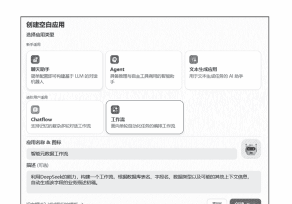

图 10-2 智能元数据工作流创建

创建成功后，将进入智能元数据工作流的编辑界面，你会看到一个空白的画布，在画布上，已有一个开始节点。开始节点是智能元数据工作流的入口，它定义了智能元数据工作流在运行时需要接收哪些外部输入参数。智能元数据工作流编辑界面如图 10-3 所示。

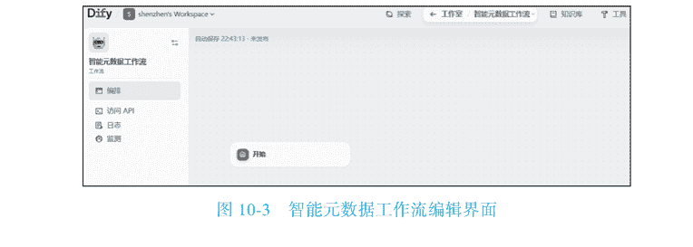

双击画布上的开始节点。在弹出的配置面板中，你会看到“输入”部分，需要在这里添加输入“线索”的关键字段信息参数。单击“输入字段”按钮，进入添加变量页面，如图 10-4 所示。

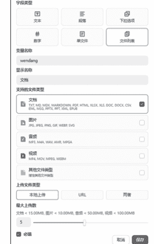

本次示例将所有数据库表和字段放入 Excel 表中。首先添加变量为文档，可以由用户上传文档并进行输入。配置完成后，单击“保存”按钮。此时，开始节点就配置好了，它知道运行时需要从哪里获取字段的各种信息。

接下来需要添加文档提取器，文档提取器将上传的文档转换为大模型可识别并读取的内容，添加文档提取器如图 10-5 所示。

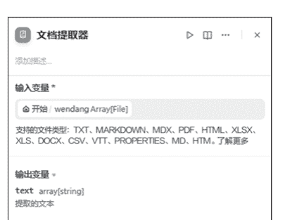

将文档提取器节点的输出连接到 LLM 节点的输入。这条线表示数据将从文档提取器节点传递到 LLM 节点。接下来配置 LLM 节点：告诉 AI “做什么”和“怎么做”，添加 LLM 节点如图 10-6 所示。


在 SYSTEM 区域，你需要编写指令来告诉 DeepSeek 如何根据输入的文本信息生成业务描述。这里的提示词很重要，你可以输入固定的指令文本，编写提示词（核心）如图 10-7 所示。

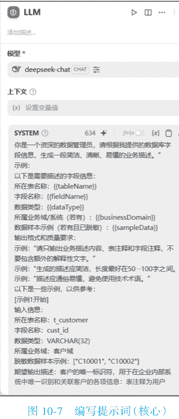

在 SYSTEM 区域上方可以配置 DeepSeek 模型的参数，如图 10-8 所示：

- **温度**：控制输出的随机性。若想要生成的描述相对稳定、准确，可以设置为较低的值（如 0.5 ～ 0.7）。
- **Top P**：控制采样策略，影响输出多样性。可以保持默认或根据需要微调。

配置完成后，即可保存。该节点就知道如何接收信息、调用 DeepSeek 模型并生成描述。

添加结束节点，定义最终产出，在配置面板中，你需要定义智能元数据工作流最终对外输出的结果。通常应将 DeepSeek 模型生成的业务描述作为主要输出。配置完成后，即可保存，配置结束节点如图 10-9 所示。

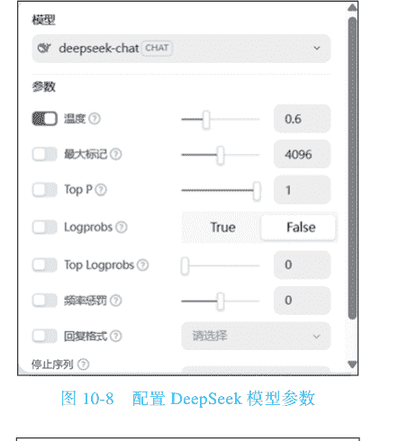

图 10-8 配置 DeepSeek 模型参数


图 10-9 配置结束节点

现在，一个最基本、能接收输入、调用 DeepSeek 模型并输出结果的智能元数据工作流框架就搭建完成了，具体如图 10-10 所示。


图 10-10 智能元数据工作流框架

整个构建过程在 Dify 中是高度可视化的，你可以随时在画布上查看节点连接关系。完成上述步骤后，你的工作流画布上应该有四个节点（开始节点、文档提取器节点、LLM 节点、结束节点）并按顺序连接起来。接下来最关键的一步，就是编写能够真正让 DeepSeek 生成高质量描述的提示词。

### 10.2.3 编写核心提示词与配置智能元数据工作流

在 Dify 画布上搭建好智能元数据工作流的基本框架后，现在需要编写能够真正驱动 DeepSeek 生成高质量业务描述的核心指令提示词，并在智能元数据工作流的输入和输出处明确定义参数，确保该工作流能够顺畅地接收输入信息并输出准确的内容。

提示词是与 AI 沟通的“语言”，它的质量直接决定了 AI 输出的质量。一个好的提示词就像一份清晰、详细、包含示例的工作指南，能帮助 DeepSeek 准确理解你的意图，并按照你的期望格式生成内容。在 Dify 的 LLM 节点配置界面，你会看到一个大的文本框，该文本框用于编写提示词。一个有效的提示词通常包含以下几个要素。

- **角色设定与任务指令：** 明确告诉 DeepSeek 它要扮演什么角色（增强代入感），以及它的核心任务是什么。示例如下。

> 你是一个资深的数据管理员，请根据用户提供的数据库字段信息，生成一段简洁、清晰、易懂的业务描述。

- **输出格式与质量要求：** 明确告诉 DeepSeek 你对最终输出的描述有什么要求，比如长度、风格、是否只输出描述本身等。示例如下。

> “请只输出业务描述内容，不要包含额外的解释性文字。”
> “生成的描述应简洁，长度最好在 50 ~ 100 字之间。”
> “描述应通俗易懂，避免使用技术术语。”

- **Few-shot 示例：** 提供少量（3~5 个）高质量的“输入信息→期望输出描述”的完整示例。这是提升 AI 输出质量和保证风格一致性的最有效方法之一。通过示例，AI 能更好地理解你对“好描述”的定义。以下是一些示例格式，以供参考。

```
[示例 1 开始]
输入信息：
字段名：cust_id
表名：t_customer
数据类型：VARCHAR（32）
所属业务域：客户域
脱敏数据样本示例：["C10001", "C10002"]
期望输出描述：客户的唯一标识符，用于在企业内部系统中唯一识别和关联客户的各项信息，表注释为用户表，字段注释为用户 ID。
[ 示例 1 结束 ]
[ 示例 2 开始 ]
输入信息：
字段名：order_amount
表名：t_order
数据类型：DECIMAL（18,2）
所属业务域：订单域
脱敏数据样本示例：[100.50, 23.00]
期望输出描述：该字段记录了单笔订单最终支付的总金额，包含商品费用、运费等，表注释为订单表，字段注释为订单总金额。
[ 示例 2 结束 ]
```

将上述所有要素组合起来，形成一个完整的提示词文本，填写到 LLM 节点的 SYSTEM 区域中。编写提示词是一个迭代优化的过程，你可能需要在调试阶段根据 AI 的实际输出来不断调整提示词的内容和结构。

完成提示词的编写以及开始节点和结束节点的详细配置后，智能元数据工作流的主要构建工作就基本完成了。我们告诉了 AI 要做什么（提示词）、它需要什么信息（输入配置）以及最终要以什么形式给出结果（输出配置）。接下来将进入调试与优化环节，看看这个初步构建好的智能元数据工作流是否能按预期工作，以及如何解决出现的问题。

## 10.3 智能元数据工作流的调试与优化

现在完成了“毛坯房”的建设。要让这个工作流投入实际应用，还需要进行充分的调试和优化。就像训练一个新手助手一样，你需要测试助手能否理解你的指令、能否准确完成任务、遇到问题怎么解决，并不断给助手反馈和指导，让其越来越“靠谱”。本节将指导你在 Dify 中调试和优化智能元数据工作流，识别常见问题，并探讨如何优化提示词和一些边缘情况，让你的 AI 变得更聪明、更可靠。

### 10.3.1 测试问题与调试技巧

构建好的智能元数据工作流，就像刚组装好的机器，需要先启动测试，看看它是否能正常运转、是否能生产出合格的“产品”（业务描述）。在这个过程中，一定会遇到各种问题，可能是机器没装对（配置错误），可能是“原材料”有问题（输入错误），也可能是“生产流程”没调好（提示词不佳导致输出不理想）。了解如何在 Dify 中进行测试以及如何利用它的调试工具，是解决这些问题的关键。

智能元数据工作流的基本功能测试的步骤如下。

- 1）步骤 1：进入测试界面。在 Dify 工作流编辑页面的右上角，你会看到一个运行按钮。单击它，通常会在界面的右侧弹出一个测试面板。
- 2）步骤 2：输入测试数据。你会看到你在开始节点中定义的输入参数，并可上传本地 Excel 文档，如图 10-11 所示。

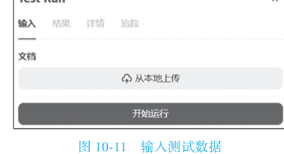

> 建议：从一个最简单的、典型的字段开始测试，例如，一个名字规范、含义清晰、有数据样本的字段（如 t_customer 表的 cust_name 字段）。

- 3）步骤 3：启动测试。单击测试面板中的运行按钮。Dify 后台会启动你的工作流实例。
- 4）步骤 4：观察执行过程。在画布上，你会看到节点的状态发生了变化，从“等待中”变为“正在运行”，再变为“已完成”（成功或失败）。节点之间的连线也会亮起，表示数据正在流转。
- 5）步骤 5：查看最终输出。智能元数据工作流成功运行完成后，在测试面板的右侧或下方，会看到结束节点的输出结果，即 DeepSeek 模型生成的业务描述。仔细阅读这个描述，初步判断它是否符合你的预期，智能元数据工作流运行输出结果如图 10-12 所示。

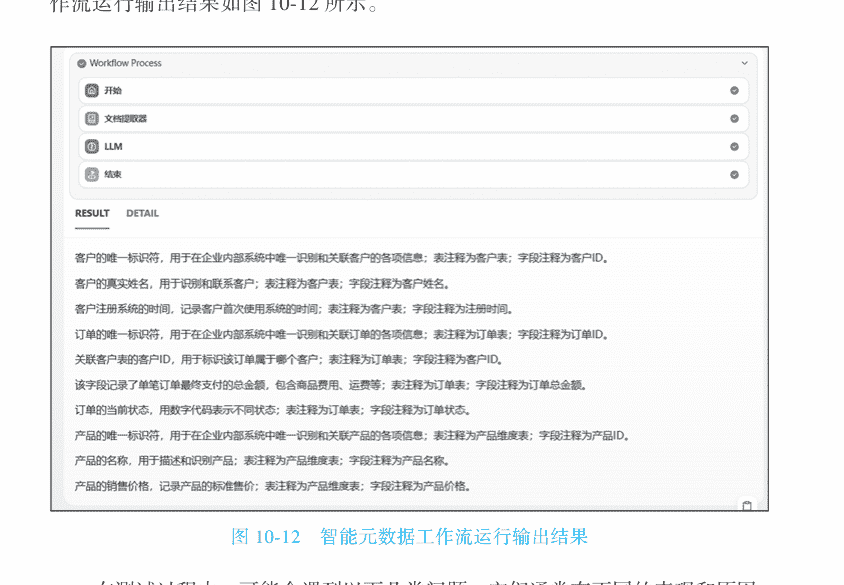

在测试过程中，可能会遇到以下几类问题，它们通常有不同的表现和原因。

1）问题 1：智能元数据工作流无法启动或运行中断。表现为单击运行按钮后无反应，或者某个节点执行失败，流程中断，节点变为红色，并显示错误信息。可能原因是节点配置错误（如 LLM 节点没有配置模型、引用了不存在的变量）、API Key 无效或过期、网络连接问题导致 Dify 无法访问 DeepSeek API、Dify 平台自身故障、输入数据格式不符合节点要求等。

2）问题 2：智能元数据工作流运行成功但输出结果异常。表现为智能元数据工作流顺利运行，没有报错，但生成的业务描述：完全错误或与输入字段无关；格式不对（比如包含了多余的文字、没有按照 Few-shot 示例的风格生成）。可能原因是提示词指令不清晰或有歧义、提供的 Few-shot 示例不够好或与输入不匹配、输入信息不足或不准确导致 DeepSeek 模型无法理解字段含义、AI 模型本身的局限性、输入数据样本不具代表性等。

3）问题 3：性能或成本问题（规模化应用时出现）。表现为运行时间过长、单次调用消耗的 token 数量很高导致费用过高。可能原因是提示词过长、期望输出长度过大、模型本身推理速度慢、批量处理效率低下等。

实时观察画布上节点的颜色和状态图标，绿色表示成功，红色表示失败，黄色表示正在运行。失败的节点是定位问题的起点。“单击节点并查看详情”是最重要的调试技巧。运行后，单击画布上任何一个已完成的节点（无论是成功节点还是失败节点），在弹出的侧边或底部面板中，你可以看到如下内容。

- **输入（Input）**：查看这个节点接收到的所有输入数据。你需要检查：是不是前一个节点的数据没有正确传递过来？传递过来的数据结构或值是不是预期的？
- **输出（Output）**：查看这个节点处理后生成的结果，特别是 LLM 节点的输出，你可以直接看到 DeepSeek 模型接收到的完整提示词和它返回的原始文本。
- **日志（Log）**：查看节点的运行日志。通常会在失败节点的运行日志中显示详细的错误堆栈或错误信息，比如，具体是哪一行代码产生了错误（如果是代码节点），或哪个 API 调用失败了，以及失败的原因（例如 “Invalid API Key” “Network Error” 等）。

通过熟练运用 Dify 的测试和调试功能，并结合对常见问题原因的理解，你可以高效地定位智能元数据工作流中的问题（无论是技术配置错误还是 AI 输出不理想），为后续的优化打下基础。

### 10.3.2 提示词迭代优化

如果你的工作流能够成功运行，但 DeepSeek 生成的业务描述不够准确、不符合期望的风格或者格式有问题，那么是时候对给 DeepSeek 的“工作指令”——提示词进行细致优化了。提示词优化是 AI 应用开发中最具艺术性、最能体现效果差异的关键环节。它没有一成不变的公式，更多的是基于对模型行为的理解和反复实验。你可以把这个过程想象成在不断地“调教”你的 AI 助手，直到它能理解你的“言外之意”，并按照你想要的方式输出。

在 Dify 的 LLM 节点配置界面，你可以直接修改提示词文本，并在测试面板中立即验证效果。以下是一些常用的提示词迭代优化策略：

1）明确指令和角色设定：让 AI 知道它是谁、要做什么。在提示词的开头，清晰地设定 AI 的角色并明确任务指令。使用动词提出具体的行动要求。

优化示例：

```
初版："请写描述。"（太模糊）
优化："作为一名资深的数据管理员，请为以下字段生成一段清晰、准确、易于业务人员理解的业务描述。"
目的：帮助 AI 进入正确的“思维模式”，聚焦任务本身。
```

2）提供充足且结构化的输入信息：给 AI 足够且清晰的“线索”。确保你使用了分析的关键输入信息（如字段名、表名、类型、注释、业务域、样本等），更重要的是，将这些信息以结构化、易于 AI 解析的方式呈现。可以使用冒号、列表、分隔符等。

优化示例：

```
初版："字段：{{fieldName}} {{tableName}} {{dataType}}"（信息混杂）
优化：
字段信息：
名称：{{fieldName}}
所在表：{{tableName}}
数据类型：{{dataType}}
所属业务域：{{businessDomain}}
数据样本（脱敏）：{{sampleData}}
目的：确保 AI 能够准确地识别和区分不同的输入信息，避免混淆。
```

3）利用 Few-shot 示例：手把手“教”AI 输出你想要的风格和内容。这是提升输出质量和保证风格一致性的有效方法之一。在提示词中提供 3 ～ 5 个高质量的“输入→期望输出”示例。

示例的数量和质量很重要，它们能帮助 AI 理解你对“好的业务描述”的具体要求，包括用词、句式、长度、包含的关键信息等。

优化示例：

```
初版：“请参考一些例子，为字段生成业务描述。”
优化：在提示词指令后，添加明确的示例区块，每个示例包含完整的输入信息和对应的期望输出描述，并用清晰的分隔符（如 --- 或 [ 示例开始 ]-[ 示例结束 ]）隔开。确保
```

## 10.3.3 特殊情况与边缘数据

经过前面的基本测试和提示词优化，你的智能元数据工作流对于典型的字段应该已经能生成比较满意的描述初稿了。在现实世界的数据库里，字段是千奇百怪的，总有一些特殊情况或边缘数据。在考虑将该工作流投入实际应用时，性能（处理速度）和成本（API 调用费用）也是必须考虑的实际问题。本小节将探讨如何识别和应对这些挑战。

1）识别和处理特殊情况与边缘数据：让 AI “见多识广”。特殊情况与边缘数据是指那些不符合一般规律、名字模糊、含义特殊或者需要额外业务背景才能理解的字段。举例如下。

- 泛化名称字段：如 id、name、value、desc、flag 等，这些名称本身几乎没有业务含义，需要结合表名和上下文来理解。
- 代码值字段：如 status、type、gender 等，字段本身是数字或缩写代码，其业务含义需要查阅代码表或字典。
- 技术性字段：如 create_time、update_time、checksum、version 等，描述应侧重其技术用途和生成规则。
- 外键字段：如 cust_id_fk、prod_id_ref 等，需要说明它关联的是哪个表的哪个字段。
- 含义依赖组合字段：某个字段的真实含义需要结合同表其他字段来看。

2）如何测试边缘数据？找出其中名字最模糊、最难以理解或者有特殊约定的字段，用它们作为输入来测试智能元数据工作流。常见的 AI 表现：对于边缘数据，AI 可能生成过于泛泛、完全错误或者仅仅是重复字段名称的描述。应对策略如下。

- 强化提示词中的上下文：对于泛化名称字段，在提示词中强调“请结合表名和数据类型，猜测其在业务上的可能用途”。对于代码值字段，在提示词中提供可能的代码值和对应的业务含义映射（如果信息量不大），或者说明“该字段是代码值，请描述它代表的状态类型”。
- 增加针对性 Few-shot 示例：在提示词中增加包含 ID 字段、状态码字段、外键字段等特殊类型的 Few-shot 示例，教 AI 如何描述这些字段。
- 引导 AI 识别不确定性：在提示词中引导 AI 在信息不足或不确定时，用特定的方式标记或表达（例如“如果无法确定精确含义，请在描述中注明‘可能表示…’”）。
- 考虑人工处理流程：对于 AI 始终无法准确描述的关键边缘字段，可能需要将这些字段标记出来，并将其交给人工处理，或者由 AI 生成初稿，但人工审核优先级更高。在你的工作流中，可以通过增加判断节点或标记输出实现这一目的。

3）初步性能与成本考量：让 AI “干得好，花得少”。虽然本次实战是小规模演示，但在企业环境中应用时，通常需要处理大量的元数据。如果你的工作流效率低下或成本过高，那么将难以推广。性能主要指从输入到输出所需的时间。成本主要指调用 DeepSeek API 产生的费用，通常按输入和输出的 token 数量计费。优化方向如下。

- 精简提示词长度：移除不必要的文字，尤其是固定的指令部分，只保留关键信息和示例。输入和输出 token 数都影响成本，精简提示词可以直接降低输入 token 数。
- 控制输出长度：在 LLM 节点的配置中，合理设置最大 token 数，避免 DeepSeek 生成过长、冗余的描述。
- 模型选择：DeepSeek 提供不同规模或能力的模型，小型模型推理速度更快、成本更低，但效果略差。根据你的预算和对描述质量的要求，选择合适的模型。
- 批量处理效率（Dify API 层）：虽然本次实战的工作流被设计为一次处理一个字段，但在实际应用中，Dify 工作流通常会通过 API 调用。设计外部程序（如 Python 脚本）来批量读取字段信息，然后循环调用 Dify 工作流的 API，以实现批量处理。Dify 平台本身的批量处理能力和 API 性能将是关键。

通过对边缘数据进行测试和优化，可以提升你的工作流的鲁棒性，使其能够处理更广泛的实际场景。同时，从一开始就要具备性能和成本意识，并在初步阶段进行优化，为未来工作流的规模化部署和应用打下基础。

## 10.4 智能元数据工作流的应用实战

经过前面的构建、调试和优化，你已经成功地在 Dify 中搭建了一个能够自动生成数据库字段业务描述的智能元数据工作流，并确保它在典型和边缘数据上都能表现良好。现在让这个工作流走出测试环境，并投入实际应用。本节将指导你如何在 Dify 中“发布”你的工作流，使其成为一个可用的应用，并介绍几种调用它的方式，让你了解如何将这个工作流融入实际的元数据管理流程中。

### 10.4.1 发布智能元数据工作流

在 Dify 中，只有发布后的应用才能通过 Web 界面或 API 被外部调用。发布过程通常很简单：将当前编辑的工作流配置“发布更新”，使其可以对外提供服务。接下来看看如何“指挥”这个已经“上岗”的智能助手。Dify 通常为发布的工作流应用提供以下几种调用方式，以适应不同的应用场景：

（1）方式一：通过 Dify 的 Web 应用界面调用（适合单次、交互式使用）

发布成功后，在 Dify 平台内，你的工作流应用会自动生成一个 Web 交互界面。这个界面会根据你在开始节点配置的输入参数，生成相应的输入框，并根据结束节点的配置展示输出结果。

1）适用场景：当数据管理员或数据管家需要为少量字段快速生成描述时，可以直接打开这个 Web 界面，手动输入字段信息，然后单击运行按钮，就能立即查看生成的描述。这种方式适合交互式、单次的描述生成任务。

2）如何访问：在 Dify 中找到工作室的应用列表，进入你的“智能元数据工作流”应用，单击发布按钮并运行，进入这个 Web 界面。

（2）方式二：通过 API 调用（适合批量、集成到其他系统使用）

这是将智能元数据工作流能力集成到企业现有数据治理工具、数据平台或其他应用中的主要方式。Dify 会为每个发布的应用生成一个 RESTful API。你可以通过发送 HTTP 请求来调用这个接口，将字段信息作为请求体发送，然后接收 API 返回的 JSON 格式的业务描述结果。

1）适用场景：

- 批量处理：编写脚本（如 Python 脚本）来批量读取数据库元数据信息，然后循环调用 Dify API，为所有字段自动生成描述。
- 集成到元数据平台：将该 API 集成到企业的元数据管理平台或数据目录工具中，当用户在平台上查看或管理某个字段时，可以调用该 API，为该字段自动生成或更新其业务描述。
- 集成到数据开发流程：在数据仓库构建或 ETL 开发过程中，自动为新建的表和字段生成描述。

2）如何获取 API 信息：在 Dify 工作室页面，单击具体应用，左侧会有“访问 API”选项。在这里，你可以找到应用的 API Endpoint（接口地址）和用于身份验证的 API Key。务必确保 API Key 的安全，API 调用如图 10-13 所示。详细的 API 调用代码将在调用中展示，基本原理是向 Dify 提供的特定 URL 发送一个 POST 请求，请求体包含你在开始节点定义的输入参数及其对应的值，请求头包含你的认证信息（API Key）。

本次实战将重点关注通过 Dify 的 Web 应用界面进行单次测试调用以及通过 API 进行批量测试调用的可能性。了解了这两种调用方式，你就掌握了如何将你的工作流从 Dify 平台内部延伸到更广泛的应用场景。

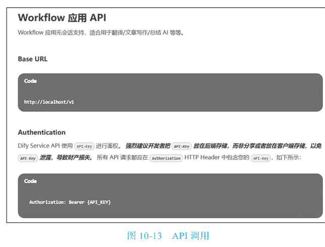

### 10.4.2 实际应用案例与效果评估

现在看看这个工作流的实际工作效果，并与传统的人工方式进行对比，从而更直观地评估它带来的价值。展示四个 AI 生成的业务描述案例，同时，展示它们的输入信息（如表名、字段名、类型、样本等）和智能元数据工作流实际生成的业务描述。案例展示：

案例一是典型字段。

输入：表名为 t_customer，字段名为 cust_name，数据类型为 VARCHAR（64），所属业务域为客户域，脱敏数据样本示例为 ["张三", "李四"]
AI 生成描述："客户的姓名，用于识别和称呼客户。该字段记录了客户在注册或提供信息时填写的名称。"（评价：简洁、准确、易懂）

案例二是数值字段。

输入：表名为 t_order，字段名为 order_amount，数据类型为 DECIMAL（18,2），所属业务域为订单域，脱敏数据样本示例为 [100.50, 23.00]
AI 生成描述："该字段记录了每笔订单的最终支付总金额，通常包含商品价格、运费等，精确到两位小数。"（评价：抓住了金额和精度特点，说明了含义）

案例三是状态码字段（假设提示词或知识库提供了代码映射）。

输入：表名为 t_order，字段名为 order_status，数据类型为 INT，所属业务域为订单域，脱敏数据样本示例为 [1，2，3]
AI 生成描述：" 订单的当前状态标识，通过数字代码表示（例如 1 代表待支付，2 代表已完成，3 代表已取消），用于跟踪订单的处理进度。"（评价：解释了代码含义和用途）

案例四是时间字段。

输入：表名为 t_customer，字段名为 register_time，数据类型为 TIMESTAMP，所属业务域为客户域，脱敏数据样本示例为 ["2023-01-01 10：00：00"，"2023-01-05 15：30：00"]
AI 生成描述：" 该字段记录了客户在平台成功注册的具体时间和日期，精确到秒。"（评价：准确描述了含义和精度）

对展示的案例进行简要评价，指出 AI 在这些场景下的表现亮点（如准确、通顺），同时，也要坦诚指出 AI 生成描述可能存在的不足（如偶尔不够精确、遗漏某些细节、对模糊字段理解困难等）。再次强调，这通常是“初稿”，需要人工审核。

对比传统方法，智能元数据工作流有什么不同？在没有智能元数据工作流时，数据管理员的工作流程是“人工阅读技术文档 / 数据库注释→与业务人员进行访谈以理解含义→手动在数据字典或元数据平台中撰写和录入描述”。这个过程非常依赖个人经验，耗时且难以规模化。

通过 AI 赋能后的改变如下。

- **效率提升**：AI 可以批量快速生成描述初稿，将“从零开始写”变为“在草稿基础上改”。例如，若要描述 100 个字段，人类可能需要一天时间来完成，而使用 AI 生成初稿可能只需要几分钟，人工审核并修改可能只需要 1～2 小时。
- **覆盖率提升**：由于效率大幅提升，因此可以更容易地为更多的字段补充描述，提高整个数据目录的覆盖率。
- **一致性改善**：通过 Few-shot 示例和提示词约束，AI 生成的描述风格相对一致。
- **降低门槛**：对于一些不熟悉业务的技术人员或不熟悉技术的业务人员，AI 生成的初稿可以帮助他们更快地理解字段含义。
- **工作模式转变**：数据管理员的工作重心从“写”变为“审”和“调”，他们可以投入更多精力在元数据体系规划、复杂问题解决和业务沟通上。

通过展示 AI 生成的实际案例，并将其与传统方式进行对比，可以直观看到 DeepSeek 大模型在自动生成元数据描述这一具体任务上的巨大潜力。它显著提高了工作效率，改善了元数据质量，并改变了相关人员的工作模式。这证明了将 AI 能力融入元数据管理是可行且有价值的。

### 10.4.3 扩展应用与未来展望

通过前面的实战案例，你亲身体验了如何利用 Dify 和 DeepSeek 构建 AI 驱动的智能元数据工作流，并看到了它在提高效率、优化工作模式方面的潜力。将本次实战的经验和方法进行扩展，可以将 AI 应用于更多复杂的元数据任务。我们可以思考如何利用 DeepSeek 的其他“本领”构建类似的工作流。

1）智能化的业务术语发现与定义辅助：AI 的“本领”是超强阅读理解、信息抓取、连接信息、出色的写作表达。
工作流思路：接收非结构化文档→调用 LLM 节点，并从文档中提取潜在的业务术语和它们的上下文、初步的定义→输出术语列表和建议定义初稿。人类在此基础上进行审核和标准化。

2）智能化的命名规范校验与推荐：AI 的“本领”是超强阅读理解（理解命名规范）、信息抓取、出色的写作表达。
工作流思路：接收字段名、表名以及命名规范规则等信息→调用 LLM 节点，让 AI 对照规范检查名称，判断其是否合规→如果不合规，让 AI 根据业务含义推荐符合规范的新名称→输出校验结果和推荐名称。

3）智能化的数据血缘初步解析（基于注释或文档）：AI 的“本领”是超强阅读理解、信息抓取、连接信息。
工作流思路：接收包含简单数据流描述的文档或代码注释→调用 LLM 节点，让 AI 从文本中识别数据源、目标、关键转换步骤→输出初步的血缘关系描述或结构化信息。这可以作为更复杂的代码解析的补充或前置步骤。

4）智能化的元数据检索与问答：AI 的“本领”是超强阅读理解、出色的写作表达、连接信息（结合知识库）。
工作流思路：接收用户的自然语言查询→调用 LLM 节点（结合企业元数据知识库作为 RAG 源），理解用户意图并检索相关元数据→让 AI 用自然语言回答用户问题。这通常是一个更复杂的应用，可能需要 Dify 的 Chat 应用类型或结合工作流来构建。

通过将本次实战中掌握的 Dify 工作流构建、提示词设计、API 调用等技能，应用到上述或其他类似的元数据管理任务中，企业可以逐步构建起一个由 AI 辅助的元数据管理体系，从而覆盖更多的元数据工作环节，实现更全面的智能化。

## 第11章 DeepSeek 在数据标准管理中的实战应用

本章承接第6章的数据标准智能化理论，聚焦 DeepSeek 大模型与 Dify 平台的工程化落地实战。本章将以企业数据标准管理中的“数据标准符合性智能检查”为核心突破口，选择客户信息治理和物料编码治理两大高频业务场景，通过具体的实战案例，手把手地指导读者构建高效的智能数据标准检查工作流。本章将详细阐述从需求分析、工作流架构设计、提示词工程实战、知识库集成到工作流调试与部署验证的全链路实战内容。通过深入解析具体工作流和实战细节，读者将亲身体验 AI 如何显著提升数据标准管理的效率和准确性、如何解决传统模式下标准落地难和维护成本高的问题，为企业数据治理的智能化转型提供可复用、可量化的实战基础。

## 11.1 实战场景选择与分析

数据标准管理是企业数据治理的核心环节，确保数据在企业内部的一致性、准确性和可用性。然而，传统的数据标准管理方法在面对爆炸式增长的数据量和日益多样化的数据来源时，面临着效率低下、易出错、难以快速响应业务需求等诸多挑战。这些痛点已在前文进行了详细阐述。

本章将聚焦 DeepSeek 大模型在数据标准管理领域的工程化落地实战。为了确保本次实战的代表性和可操作性，我们将“数据标准符合性智能检查”作为核心突破口。

### 11.1.1 实战场景选择与价值分析

将“数据标准符合性智能检查”作为本章的实战场景，主要基于以下三个方面的考量：

- **高频痛点考量**：在企业日常运营中，数据标准的人工复核工作量巨大且易出错。例如，某企业内部统计数据显示，数据标准的人工复核工作量占团队整体工时的 30%，且人工复核错误率竟高达 15%。这一高频痛点亟待通过智能高效的解决方案改善，自动化方案能直接、快速地提升标准符合率，降低人力和物力消耗。
- **规则明确性权衡**：“数据标准符合性智能检查”场景本身具有明确的规则体系。例如，《主数据规范》《系统数据集成接口规范》等标准文档本身富含结构化规则（如命名规范、数据格式、值域范围、逻辑关系等）。DeepSeek 大模型能够遵循这些明确规则，精准定位数据偏差，为智能检查筑牢根基，确保判断精准可靠。
- **ROI（投资回报率）显著性评估**：“数据标准符合性智能检查”场景是当下企业在大模型应用场景落地实施进程中最具可行性、最容易达成实效的场景之一。通过自动化智能检查机制，可全方位提升原有检查流程的效率，大幅削减人力成本投入，同时显著提高数据标准管理质量。这一机制兼具经济效益与管理效益，投资回报优势显著。

本章将围绕“数据标准符合性智能检查”场景，借助 Dify 平台实现 DeepSeek 大模型在数据标准管理领域的工程化应用落地，以科技赋能企业数据治理革新。

### 11.1.2 业务场景需求分析

本次实战的核心场景是“数据标准符合性智能检查”，接下来就需要对这一场景进行细致的需求分析。理解在不同业务场景下对数据标准的具体要求，以及 AI 在检查过程中需要哪些信息输入和应产生哪些输出，这是设计工作流和提示词的关键。本小节将从客户信息、物料两个典型数据域入手，对数据标准检查的需求进行拆解。

#### 1. 客户信息数据标准检查场景

在企业的客户关系管理系统中，客户信息的完整性、准确性和一致性对于客户画像绘制、精准营销等活动至关重要。例如，客户姓名、性别、年龄、联系方式和地址等信息都需要符合相应的数据标准。

客户信息数据标准检查场景的需求拆解如下：

1）步骤 1：数据完整性检查。检查数据信息，确保客户姓名、联系方式等关键信息不缺失。传统人工检查方法难以快速判断信息是否完整，尤其是在处理大量客户数据时，容易遗漏。

2）步骤 2：数据准确性验证。客户性别应为“男”或“女”，年龄应在合理范围内（如 0～120 岁）。传统人工检查方法对于错误数据的识别可能存在主观判断差异，且效率较低。

3）步骤 3：数据一致性检查。同一客户在不同系统中的信息应保持一致，如在销售系统和售后服务系统中客户的联系方式应相同。人工对比不同系统中的数据一致性不仅工作量巨大，而且容易出错。

#### 2. 物料数据标准检查场景

在制造企业中，物料数据的规范性对于产品展示、销售和库存管理等环节至关重要。例如，物料名称、规格、型号、价格等信息都需要符合一定的标准。

物料数据标准检查场景的需求拆解如下：

1）步骤 1：物料名称规范性检查。物料名称应包含品牌、型号、功能等关键信息，且不超过一定字符长度。人工检查物料名称规范性时，难以保证对所有物料进行全面检查，容易出现漏检情况。

2）步骤 2：物料规格参数准确性验证。物料规格参数应符合行业标准和企业内部标准，如电子产品屏幕尺寸、分辨率等参数应准确无误。人工核对物料规格参数需要业务人员具备专业知识且会消耗大量时间，核对结果也容易因标准更新不及时而出现错误判断。

## 11.1.3 需求分析示例

在企业中，客户地址数据的准确性对于业务运营至关重要。无论是快递配送、客户服务中心定位客户位置，还是进行区域市场分析，都需要规范、准确的客户地址数据。然而在实际操作中，客户地址数据往往存在各种不规范的情况，如格式不统一、使用错误的术语、地址长度过长或过短、逻辑冲突等，这些问题严重影响了企业对客户地址数据的利用效率和业务开展，客户地址数据常见问题具体如表 11-1 所示。

表 11-1 客户地址数据常见问题

| 需求类型 | 具体描述 | 传统方式痛点 |
| :--- | :--- | :--- |
| 格式校验 | 省、市、区三级结构需要完整呈现，且各级之间以“/”作为标准分隔符 | 在人工校验过程中，极易出现疏忽（如忽略分隔符使用错误这类细节问题），导致大量不符合格式规范的地址数据流入后续业务环节，影响数据利用准确性与效率 |
| 术语规范 | 在具体表述中，应精准使用“自治区”而非“自治州”等存在地域表述差异的术语 | 各地区存在地方简称差异，人工难以全面精准把控，在地址录入时易引发歧义，造成数据模糊不清，给地域定向业务开展、客户服务地域分配等带来阻碍 |
| 长度控制 | 街道名称字符长度不得超过 20 字符 | 传统方式在借助 Excel 公式进行校验时，面对字符长度过长的情况，往往力不从心，无法精准识别并判定数据，致使部分冗长街道名称数据蒙混过关，破坏数据整体规范性与简洁性，增加数据存储与处理负担 |
| 逻辑冲突 | 例如，在“北京市”行政区划范畴之下，绝不可能出现“浦东新区”这类逻辑上完全冲突的地域表述 | 依赖人工记忆省、市、区详细映射关系是不现实的，人工校验难以做到全面无死角，时常出现未及时察觉逻辑错误的情况，从而影响基于地址数据的业务逻辑判断的准确性，如物流配送路径规划、区域市场分析等业务 |

## 11.2 智能数据标准检查工作流的建设

### 11.2.1 智能数据标准检查工作流的架构设计与实现

一个高效的智能数据标准检查工作流的核心逻辑是将待检查的数据点（如一条客户地址数据）作为输入，DeepSeek 模型会结合企业标准知识库进行智能判断，最终输出检查结果。在 Dify 中，将通过连接多个功能节点来实现这一流程。

智能数据标准检查工作流的步骤规划如下。

1）步骤 1：接收待检查数据。智能数据标准检查工作流需要知道它要为哪条数据（如一条客户地址数据）进行标准检查。
2）步骤 2：集成企业标准知识。让 DeepSeek 模型能够查阅并理解企业内部的数据标准规范（如客户地址规范、物料编码规范等）。
3）步骤 3：调用模型进行智能判断。将待检查数据和从知识库中检索到的相关标准传递给 DeepSeek 模型，让其对数据进行符合性判断。
4）步骤 4：输出检查结果。DeepSeek 模型判断后，将输出结构化的检查结果，包含是否合规、违规原因（若不合规）、依据等。

图 11-1 是智能数据标准检查工作流设计示意图（Dify 画布视角）。它展示了各个功能节点如何串联以共同完成数据标准符合性检查任务。

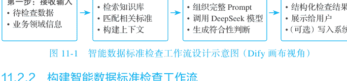

图 11-1 智能数据标准检查工作流设计示意图（Dify 画布视角）

### 11.2.2 构建智能数据标准检查工作流

在 Dify 平台中，按照上述规划一步步构建智能数据标准检查工作流。

#### 1. 创建新的工作流应用

登录 Dify 平台，为你的工作流应用起一个名字，例如“智能数据标准检查工作流”，你可以添加描述，然后单击“创建”按钮，如图 11-2 所示。

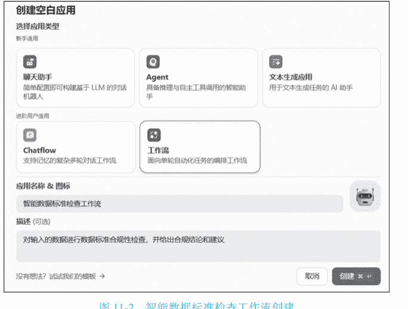

图 11-2 智能数据标准检查工作流创建

#### 2. 配置开始节点

创建成功后，你将进入工作流的编辑界面，画布上默认有一个开始节点。双击画布上的开始节点。在弹出的配置面板中，定义智能数据标准检查工作流运行时需要接收哪些外部输入参数。对于本场景中需要接收待检查的数据字符串和对应的标准类别，在输入字段区域添加以下参数：

- `data_to_check`：String 类型，表示待检查的数据字符串（如客户地址）。
- `standard_category`：String 类型，表示待检查的数据所属标准类别（如客户地址规范、物料编码规范）。

配置完成后，即可保存，开始节点配置如图 11-3 所示。

#### 3. 集成企业数据标准知识库——知识检索节点

为了让 DeepSeek 模型能够查阅企业内部的数据标准规范，需要先在 Dify 的知识库界面中上传和索引你的数据标准文档。假设你已经创建了一个“企业数据标准知识库”。

# 第 11 章 DeepSeek 在数据标准管理中的实战应用

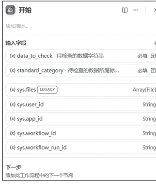

图 11-3 开始节点配置

在画布上，从左侧拖曳一个知识检索节点到开始节点后，双击知识检索节点进行配置：

1）选择知识库：从下拉列表中选择你已经创建并索引完成的“企业数据标准知识库”，知识库添加如图 11-4 所示。

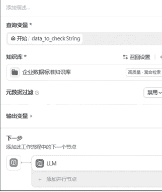

图 11-4 知识库添加

2）查询：在输入框中，引用开始节点传入的 standard_category 变量。这将指导企业数据标准知识库根据传入的类别检索相关的标准文档片段。

3）检索模式：推荐使用“混合检索”。

#### 4. 添加核心判断逻辑——LLM 节点

在画布上，从左侧拖曳一个 LLM 节点到知识检索节点后，将知识检索节点的输出连接到 LLM 节点的输入。双击 LLM 节点进行配置，这是整个工作流的核心，具体如下。

1）选择模型：从下拉列表中选择已配置好的 DeepSeek 模型，模型选择如图 11-5 所示。

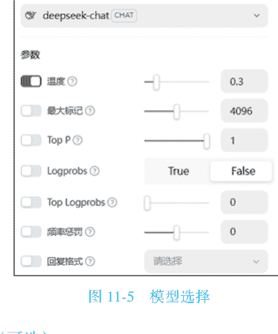

图 11-5 模型选择

2）模型参数（可选）：

- 温度（temperature）：控制输出的随机性。对于标准符合性检查，我们要求结果稳定且基于事实，建议设置为较低值（如 0.2 ～ 0.5）。
- 最大标记（max_token）：限制单次回复的最大长度，根据期望的输出结果长度设置。
- 提示词：在 SYSTEM 区域编写核心提示词。提示词的质量直接决定了 DeepSeek 模型的判断准确性。这是一个关键环节。

#### 5. 添加结束节点

在 LLM 节点后添加结束节点，将 LLM 节点的输出连接至结束节点并展示出来。

### 11.2.3 核心提示词工程实战

为确保 DeepSeek 模型能够严格依据企业标准进行判断并输出结构化结果，将采用三层提示词设计框架——系统层、任务层和约束层，并融入 Few-shot 示例。

提示词模板（请填写到 LLM 节点的 SYSTEM 区域）：

```
# 角色
你是一个专业且严谨的智能数据标准检查员。你的任务是根据用户提供的企业数据标准规范，对指定的数据进行符合性检查。
# 检查任务
待检查数据：
{{data_to_check}}
# 输出格式要求
请以严格的 JSON 格式输出检查结果，不允许包含任何额外文字、说明或代码块标记。
JSON 结构必须包含以下字段：
- `is_compliant`：布尔值，表示数据是否符合标准 (true/false)。
- `violations`：数组，如果 `is_compliant` 为 false，则列出所有不符合标准的原因。每个原因应包含：
    - `rule_category`：违规所属标准类别（如 "格式规范" "术语规范" "长度控制" "逻辑冲突"）。
    - `description`：违规的具体描述（清晰说明不符合哪条规则）。
    - `reference`：违规依据的标准条款或知识库文档（如 "客户地址规范 V1.0 第 2.1 条"）。
- `suggestions`：数组，针对违规数据提供修改建议，每个建议应包含：
    - `type`：建议类型（如 "修正格式" "调整内容" "缩短长度"）。
    - `content`：具体修正建议。
- `confidence`：本次判断的置信度，范围为 0.0 ~ 1.0。
# Few-shot 示例（请确保这些示例是高质量且具有代表性的）
[示例 1 开始]
待检查数据：北京市朝阳区建国路 88 号
所属标准类别：客户地址规范
期望输出 JSON：
{
    "is_compliant": false,
    "violations": [
        {
            "rule_category": "格式规范",
            "description": "地址缺少标准分隔符 '/': ",
            "reference": "客户地址规范 V1.0 第 3.1 条 "
        },
        {
            "rule_category": "长度控制",
            "description": "街道名称 '建国路 88 号' 可能过短，需要包含更详细的门牌号。",
            "reference": "客户地址规范 V1.0 第 4.2 条 "
        }
    ],
    "suggestions": [
        {
            "type": "修正格式",
            "content": "建议修改为 '北京市 / 朝阳区 / 建国路 88 号'"
        }
    ],
    "confidence": 0.95
}
[示例 1 结束]
[示例 2 开始]
待检查数据：上海市浦东新区陆家嘴环路 1000 号
所属标准类别：客户地址规范
期望输出 JSON：
{
    "is_compliant": true,
    "violations": [],
    "suggestions": [],
    "confidence": 0.98
}
[示例 2 结束]
```

提示词策略与优化说明：

- **Few-shot 示例**：提供示例是提升 AI 输出质量和保持风格一致性的最有效方法。请务必根据实际的业务标准和期望的输出效果，撰写高质量的 Few-shot 示例。这些示例应覆盖合规和不合规两种情况。
- **迭代优化**：提示词的编写是一个迭代过程，需要根据 DeepSeek 模型的实际输出来不断调整提示词的内容和结构，以达到最佳效果。

至此，一个基本、能接收输入、结合知识库、调用 DeepSeek 模型并输出结构化检查结果的智能数据标准检查工作流就搭建完成了。接下来，最关键的一步是进行调试与部署，以确保它能够按照预期准确工作。

## 11.3 智能数据标准检查工作流的调试与部署

在 Dify 中完成了智能数据标准检查工作流的初步搭建后，需要对其进行充分的测试和优化，才能确保其稳定、准确地输出正确的标准检查结果。本节将指导你如何在 Dify 中调试与部署工作流、如何识别 AI 特有的常见问题，并探讨如何优化提示词和处理特殊情况，最终将这个工作流发布并部署，使其能够投入实际应用。

### 11.3.1 智能数据标准检查工作流的调试与优化

需要先对构建好的智能数据标准检查工作流进行测试，看看它是否能正常运转、是否能输出正确的标准检查结果。在这个过程中，一定会遇到各种问题，可能是配置错误，也可能是 AI 输出不如预期。了解如何在 Dify 中进行测试以及如何利用它的调试工具，是解决这些问题的关键。

#### 1. 智能数据标准检查工作流基本功能测试

第一次试运行智能数据标准检查工作流的具体步骤如下。

1）步骤 1：进入测试界面。在 Dify 工作流编辑页面的右上角，找到并单击运行按钮。通常会在界面的右侧弹出一个测试面板。
2）步骤 2：输入测试数据。在测试面板的左侧或顶部区域，会看到在开始节点中定义的输入参数（data_to_check 和 standard_category）。
3）步骤 3：启动测试。单击测试面板中的“运行”按钮，Dify 后台会启动你的工作流实例。
4）步骤 4：观察执行过程。在画布上，你会看到节点的状态发生了变化，从“等待中”变为“正在运行”，再变为“已完成”（成功或失败）。节点之间的连线也会亮起，表示数据正在流转。
5）步骤 5：查看最终输出。智能数据标准检查工作流成功运行后，在测试面板的右侧或下方，你会看到结束节点的输出结果，即 DeepSeek 模型生成的 JSON 格式检查结果。仔细阅读这个检查结果，初步判断它是否符合预期，结果示例如图 11-6 所示。

示例输入：
data_to_check：北京市朝阳区建国路 100 号
standard_category：客户地址规范

注意：你也可以尝试输入一些不合规的地址，例如“北京市浦东新区人民路 1 号”（逻辑冲突）或者“138123”（格式错误），以测试智能数据标准检查工作流对违规情况的识别能力。

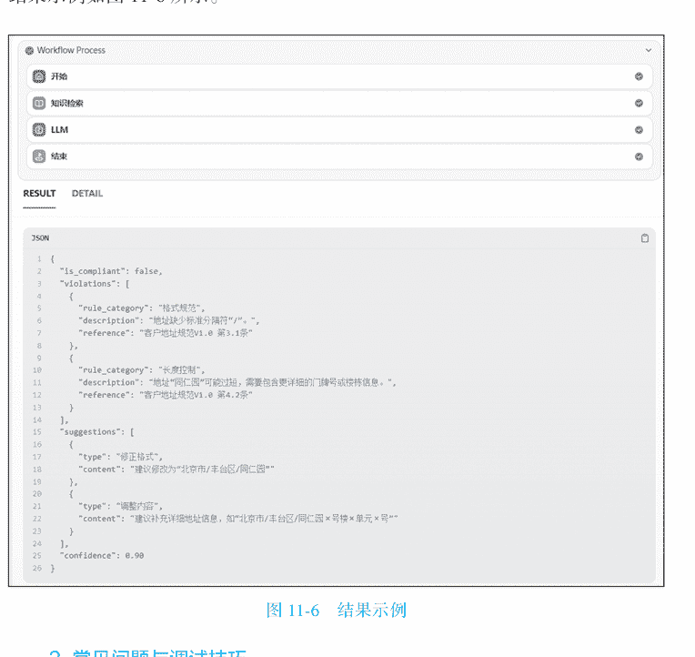

图 11-6 结果示例

#### 2. 常见问题与调试技巧

在测试过程中，可能会遇到以下几类问题，它们通常有不同的表现和原因：

- **工作流无法启动或运行中断（技术错误倾向）**：单击“运行”按钮后无反应，或某个节点执行失败（节点变为红色），并显示错误信息。出现这种情况的原因是节点配置错误（如 LLM 节点未配置模型、引用了不存在的变量）、API Key 无效或过期、网络连接问题、Dify 平台自身故障等。要解决这个问题，可以单击失败的红色节点来查看其“日志”和“输入/输出”面板，日志中通常会显示详细的错误堆栈或错误信息，以便于业务人员检查前一个节点的输出是否被正确传递。
- **工作流成功运行但输出结果异常（提示词或知识库问题倾向）**：你的工作流顺利运行，但生成的 JSON 结果格式不对（如不是严格的 JSON 格式，包含额外文字）、判断错误（如将合规判为不合规，或反之）、违规原因或建议不准确、对某些特殊情况处理效果差（如逻辑冲突地址）。出现这种情况的原因是提示词指令不清晰或有歧义、Few-shot 示例不够好或不匹配、在知识库中检索到的标准片段不准确或不完整、AI 模型本身的局限性、对特定业务规则理解不足。要解决这个问题，可以优化提示词指令的明确性和无歧义性、补充或替换贴合业务场景的 Few-shot 示例、校准知识库中数据标准片段的准确性与完整性、尝试更换更适配业务场景的 AI 模型或在提示词中补充特定业务规则的详细说明。
- **性能或成本问题（规模化应用时出现）**：单次调用时间过长或消耗的 token 数量很高导致费用过高。出现这种问题的原因是提示词过长、期望输出长度过大、模型推理速度慢。要解决这个问题，可以优化提示词结构、精简不必要的描述、控制 JSON 输出的字段数量和内容长度。

#### 3. 提示词迭代优化

如果 DeepSeek 模型生成的检查结果不够准确或不符合期望的格式，那么可以对核心指令提示词进行细致优化。提示词优化是 AI 应用开发中最具艺术性、最能体现效果差异的关键环节。

- **强化输出格式约束**：DeepSeek 模型可能有时会输出非严格 JSON 格式或包含额外文字的结果。在提示词中，可以反复强调和示范。

优化示例：

> 严格遵守以下 JSON 格式输出，不要包含任何前置文字、解释、代码块标记（如 json），确保输出是纯粹的、可解析的 JSON 字符串。

- **增加/优化 Few-shot 示例**：Few-shot 示例是 AI 学习输出风格和复杂判断的关键。可以增加更多高质量的示例，特别是针对易混淆、易出错的场景（如地址逻辑冲突、特殊格式物料编码）的示例，确保示例覆盖合规和不合规两种情况，同时，确保示例的“待检查数据”“所属标准类别”和“期望输出 JSON 格式”是完全匹配和精准的，且其 violations 和 suggestions 字段内容清晰、规范。
- **精确指令与业务语境**：确保提示词中的指令是具体、无歧义的。针对特定业务领域（如地址、物料编码），可以在提示词中加入更专业的业务语境描述，帮助 DeepSeek 模型理解。例如，在检查物料编码时，可以提示 DeepSeek 模型“物料编码通常包含大类、中类、规格等字段，请根据这些字段进行校验。”
- **引导 AI 识别不确定性**：对于 AI 难以判断的复杂情况，可以引导 DeepSeek 模型在 JSON 结果中输出“confidence”: 0.5 或在 violations 中明确指出“无法确定”或“需要人工复核”。

### 11.3.2 DeepSeek 特有问题处理

在数据标准检查这类对准确性和严谨性要求极高的场景中，DeepSeek 模型可能会遇到一些特有的问题，例如，模型对相似字段的混淆、长度计算偏差等。以下是在智能数据标准检查工作中应对这些问题的策略。

#### 1. 模型混淆相似字段

- **问题描述**：DeepSeek 模型可能无法区分语义上相似但业务含义不同的字段，进而判断错误。
- **解决方案（以提示词优化为主）**：在 LLM 节点的提示词中，对这些易混淆的字段做出清晰的定义和区分说明，强调它们的业务用途和关键差异点。

**示例**：在提示词中加入“请注意，‘注册地址’指企业工商注册的地址，可能包含营业执照号、法人信息等，通常是固定不变的；‘联系人地址’指客户的常用通讯地址，仅包含地理位置信息，可能随客户搬迁而更新。”

- **知识库增强**：在 Dify 的“企业数据标准知识库”中，为这些易混淆的字段创建详细的元数据和业务描述，并明确其关联关系，确保知识检索节点能给 DeepSeek 模型提供更精准的上下文信息。

#### 2. 长度计算偏差

- **问题描述**：DeepSeek 模型在计算字符长度时，可能按字符数（如 1 个汉字算 2 个字符）计算，而实际系统存储或标准规范是按字节数计算。
- **解决方案（提示词或 Dify 内置功能辅助）**：在提示词中明确计算规则，清晰告知 DeepSeek 模型长度计算的依据。

**示例**：在提示词中加入“长度按 UTF-8 编码字节数计算：一个汉字按 3 字节计算，一个英文字符按 1 字节计算。请依据此规则判断长度符合性。”

### 11.3.3 智能数据标准检查工作流的部署与发布

调试优化完成后，需要将智能数据标准检查工作流部署到生产环境或集成到现有业务系统中。Dify 提供了便捷的发布机制。

#### 1. 发布智能数据标准检查工作流

首先在 Dify 工作流编辑界面右侧边栏，单击“发布”(Publish) 按钮，然后选择发布模式（通常选择“发布”或“发布为 API”），接着单击“确认发布”按钮。发布成功后，你的工作流就成了一个可用的 API 服务。

#### 2. 调用方式

智能数据标准检查工作流的调用方式有如下几种。

- **通过 Dify Web 应用界面调用**：发布后，你可以在 Dify 的工作室中找到该应用，单击“运行”按钮即可进入一个 Web 界面，在这个界面中，你可以进行手动测试和单次调用，这适用于数据管理员进行临时检查的情况。
- **通过 API 调用**：这是将智能数据标准检查工作流能力集成到企业现有系统（如数据质量平台、业务系统、ETL 工具）的主要方式。
    - 获取 API 信息：在 Dify 应用详情页面，单击左侧的“访问 API”(Access API) 菜单，你可以找到该工作流的 API Endpoint（接口地址）和用于身份验证的 API Key。务必确保 API Key 的安全。
    - 集成示例（API 调用思路）：外部系统或脚本（如一个数据质量检查系统）可以向该 API Endpoint 发送 HTTP POST 请求，并在请求体中包含 `data_to_check` 和 `standard_category` 参数。API 会返回 DeepSeek 模型生成的 JSON 检查结果，外部系统解析该 JSON 即可获取检查结论。

## 3. 部署环境安全考量

无论选择哪种部署方式，部署环境自身的安全至关重要，应遵循技术框架原则，特别是如下几个。

- **模型部署模式**：优先考虑 DeepSeek 模型的私有化部署或经严格审查的云服务，以最大限度地控制数据流转和访问权限，满足合规要求。
- **输入数据脱敏**：即使是内部系统，如果待检查数据非常敏感，那么也应考虑在发送给 DeepSeek 模型前进行脱敏。
- **日志控制**：避免在智能数据标准检查工作流日志中记录原始待检查数据或敏感的检查结果。
- **访问控制**：严格控制对 Dify 平台管理界面、智能数据标准检查工作流 API 的访问权限。

通过上述调试、部署和安全考量，你的智能数据标准检查工作流将能稳定、可靠地运行，并为企业带来实际价值。

## 11.4 智能数据标准检查工作流的应用实战

在成功构建、调试并部署了智能数据标准检查工作流后，接下来就是将其应用于实际业务场景，验证其带来的具体价值。本节将通过银行的客户信息治理和制造业的物料编码治理这两个典型的企业级案例，展示 DeepSeek 模型驱动的智能数据标准检查工作流如何解决长期困扰企业的痛点，并量化其带来的显著成效。

### 11.4.1 客户信息治理实战

本小节将通过一个案例介绍客户信息治理实战的具体内容。

### 1. 项目背景与挑战

某中型商业银行（简称 G 银行）在客户信息治理方面长期面临挑战：

- **客户数据质量差**：在开户资料中存在 23% 的不规范地址和 18% 的错误证件信息，这些“脏数据”导致业务操作频繁出错。
- **监管处罚风险**：曾因客户信息质量问题被银保监会罚款 125 万元，合规压力巨大。
- **运营效率低下**：新客户开户审核平均耗时 45 分钟，远大于同行业 20 分钟的平均水平，影响客户体验。
- **跨系统不一致**：核心系统、信贷系统和反洗钱系统中同一客户的信息差异率达 15%，形成数据孤岛，影响风险识别。

G 银行迫切需要一套高效、精准的方案来提升客户数据质量，降低合规风险，并提高运营效率。

### 2. 解决方案部署：智能客户信息检查工作流赋能

针对上述问题，G 银行决定引入 DeepSeek 模型，通过 Dify 平台构建“智能客户信息检查工作流”，以此来提升数据质量、降低监管风险、提高开户效率、实现信息一致性。具体流程内容如下：

- **介入点**：在客户信息录入或提交环节，将客户地址、证件信息等数据实时发送给智能客户信息检查工作流进行检查。
- **DeepSeek 模型的角色**：充当智能“审计员”，对照“企业数据标准知识库”中的规范（如地址格式、证件号码规则、姓名长度等），对输入信息进行判断。
- **工作流输出**：返回结构化的检查结果，明确指出哪些字段不合规、具体违规原因以及修正建议。

### 3. 实战步骤详解

（1）步骤 1：问题诊断与标准梳理（耗时 1 周）

- **数据采样分析**：从核心系统中抽取 1000 个客户样本数据，进行初步人工分析和统计，了解地址不规范、证件错误、联系方式缺失等问题的具体分布和严重程度。
- **规则差距分析**：对照监管要求和银行内部已有的客户数据标准（例如对地址三级结构验证、18位身份证号验证、电话格式验证的要求），评估当前业务系统的校验能力。

（2）步骤 2：智能客户信息检查工作流设计与构建（耗时 2 周）

- **工作流设计**：在 Dify 平台搭建“智能客户信息检查工作流”，包括接收客户信息输入、通过知识检索节点关联“企业数据标准知识库”、调用 DeepSeek 模型进行核心判断以及输出检查结果。
- **提示词工程**：为 DeepSeek 模型精心设计提示词，明确角色（智能数据标准检查员）、任务（检查客户地址、证件号、姓名等字段）、输出格式（JSON，包含 is_compliant、violations、suggestions 等字段），并提供高质量的 Few-shot 示例（一个不规范地址的输入和期望的违规输出）。
- **企业数据标准知识库建设**：将 G 银行详细的客户地址规范、证件信息规则、姓名长度限制规则等文档导入 Dify 的知识库中，以供 DeepSeek 模型检索学习。

（3）步骤 3：系统集成与改造（耗时 1 周）

- **接口开发**：开发 Dify 工作流的 API，使其能够接收来自银行柜面系统或线上申请系统的数据。
- **柜面系统改造**：在新客户开户页面或信息修改页面，调用智能客户信息检查工作流 API。当录入客户信息后，实时触发智能检查。如果 Dify 返回“is_compliant : true”，则允许提交核心系统；否则，在界面上显示错误详情，并自动创建一个整改工单，要求人工复核或客户修正。
- **纠错工单流转**：将智能客户信息检查工作流返回的违规信息（如“地址缺少省市区分隔符”“证件号格式错误”）自动填充到整改工单中，并推送给数据治理团队或柜面人员。

（4）步骤 4：效果监控与优化（持续进行）

- **监控仪表盘开发**：开发实时监控仪表盘，用于监控整体检查运行情况，包括每日检查量、合规率、各类违规问题分布、平均处理时间等。
- **持续优化**：根据监控数据和人工复核反馈，持续优化 DeepSeek 模型的提示词、更新知识库中的标准，提高识别的准确率和效率。

### 4. 实战成效

通过上述步骤的实施，G 银行在客户信息治理方面取得了显著成效，客户信息治理实战对比如表 11-2 所示。

表 11-2 客户信息治理实战对比

| 指标 | 实战前 | 实战后 | 改善率 |
| :--- | :--- | :--- | :--- |
| 地址不规范率 | 23% | 3.50% | 85% ↓ |
| 证件错误率 | 18% | 1.20% | 93% ↓ |
| 跨系统不一致率 | 15% | 0.80% | 95% ↓ |

在业务流程优化方面的成效如下。

- **新客户开户审核时间**：从平均 45 分钟缩短至 12 分钟（效率提升 73%）。
- **数据整改人力成本**：原需 6 人负责人工数据校验和整改，现仅需 1 人负责监控和处理少数复杂问题（人力投入减少 83%）。
- **减少罚款金额**：预计每年减少 85 万元的罚款。

### 11.4.2 物料编码治理实战

本小节通过一个案例介绍物料编码治理实战的具体内容。

### 1. 项目背景与挑战

某汽车零部件集团（简称：A 集团）拥有多个工厂和复杂的供应链体系，其物料编码治理面临严峻挑战。

- **物料编码混乱**：同一原材料在 4 个工厂中拥有 12 种不同编码，导致物料信息不一致。
- **库存呆滞严重**：编码不规范或错误导致无法正确识别和流转物料，造成 380 万元的呆滞库存。
- **采购成本高**：不同编码的同一物料被视为不同物料，导致不同工厂或部门重复采购，价格差异高达 15%。
- **产品追溯困难**：因质量问题无法追溯到具体原料批次，影响产品质量管理和召回。

A 集团急需一套统一、规范的物料编码体系来解决这些问题。

### 2. 解决方案部署：智能编码校验工作流赋能

针对上述问题，A 集团决定引入 DeepSeek 模型，通过 Dify 平台构建“智能编码校验工作流”，以此来构建统一编码体系、减少库存成本、优化采购决策、提升物料可追溯性。具体流程如下：

- **介入点**：在 PLM（产品生命周期管理）系统、ERP 系统、MES 或供应商平台中，当创建或修改物料信息时，实时触发智能编码校验工作流。
- **DeepSeek 模型的角色**：充当智能“编码校验员”和“编码推荐师”，对照“企业物料编码标准知识库”中的规范（如大类、中类、小类、规格、供应商代码等分段编码规则），对输入物料属性进行判断。
- **工作流输出**：判断是否合规、违规原因（若不合规），并根据属性智能推荐符合规范的物料编码。

### 3. 实战步骤详解

（1）步骤 1：现状分析与痛点识别（耗时 2 周）

- **物料编码数据采集与分析**：从 PLM 系统、ERP 系统、MES 中抽取物料编码数据，进行跨系统对比分析，识别重复编码、不规范编码、价格差异大的物料，量化呆滞库存，避免采购成本浪费。
- **痛点可视化**：例如，通过 SQL 查询语句和可视化工具，发现“轴承类物料平均 4.2 个编码/种，价格差异最大的物料达到 35 元/个”等不规范数据，直观展示混乱现状。

（2）步骤 2：标准制定与知识库建设（耗时 1 周）

- **物料分类编码标准制定**：组织研发、采购、生产部门的专家共同制定物料分类标准（如大类、中类、小类、规格、供应商代码等分段编码规则），并形成明确的编码规范文档。
- **物料属性决策树梳理**：明确生成物料编码所需的核心属性及其优先级（例如，先判断材料类别，再判断加工工艺，最后是尺寸规格）。
- **企业知识库建设**：将所有制定的物料编码规范文档、属性决策树、历史编码样本、供应商代码表等导入 Dify 的“企业物料编码标准知识库”中，以供 DeepSeek 模型检索学习。

（3）步骤 3：智能编码校验工作流集成实施（耗时 3 周）

首先，构建 Dify 智能编码引擎。在 Dify 平台搭建“智能编码校验工作流”。

- **输入**：接收新物料申请或因现有物料变更而提交的物料属性（如材料类别、加工工艺、尺寸、供应商等）。
- **知识检索**：关联“企业物料编码标准知识库”，检索相关编码规范。
- **LLM 节点（DeepSeek 模型）**：这是核心。DeepSeek 模型根据检索到的标准和输入属性，判断当前物料属性组合是否符合编码规范，若符合编码规范，则生成推荐的标准编码。
- **提示词设计**：明确角色（物料编码专家）、任务（校验物料属性并生成标准编码）、输入（物料属性）、输出（合规判断结果和推荐编码的 JSON 文件 / 违规原因），并提供 Few-shot 示例（例如：一个符合标准的物料属性组合及其推荐编码；一个不符合标准的属性组合及其违规原因）。引导 DeepSeek 模型理解“如果材料类别是金属，则加工工艺必须是铸件或冲压件”这样的逻辑（通过提示词引导 DeepSeek 模型实现）。

其次，进行系统集成。

- **PLM 系统集成**：在 PLM 系统中创建新物料时，调用智能编码校验工作流 API。系统将用户输入的物料属性发送给该工作流，该工作流返回校验结果和推荐编码 / 违规原因，并直接展示给用户。
- **采购系统改造**：在采购订单提交流程中，增加对物料编码的实时校验。如果采购员填写的编码不符合标准，则立即弹出提示，并要求修正。
- **ERP 系统 / MES 同步**：确保标准物料编码能够在 ERP 系统和 MES 中统一应用和识别。

（4）步骤 4：效果监控与持续优化（持续进行）

- **监控仪表盘**：开发实时监控仪表盘，监控新创建物料的编码符合率、修正率、编码生成平均时间等指标。
- **人工审核与反馈**：对 DeepSeek 模型生成的推荐编码进行抽样人工审核，并将审核结果反馈给 Dify，用于持续优化提示词和知识库。

### 4. 实战成效

通过上述步骤的实战，A 集团在物料编码治理方面取得了显著的成效：

- **物料编码数量**：从 3.8 万个不规范编码降至 1.2 万个不规范编码（下降约 68%）。
- **单一物料平均编码数**：从 4.2 个降至 1.0 个（统一编码，下降约 76%）。
- **采购价格差异**：从最高 15% 降至 5%，每年节省数百万采购成本。
- **新物料创建时间**：从 2 ～ 3 天缩短至即时（通过 AI 自动推荐编码，减少了人工查询和核对的时间）。
- **库存呆滞**：呆滞库存总额大幅减少。
- **产品追溯性**：显著提升，若物料存在质量问题，可追溯到具体物料批次。

## 第12章 DeepSeek 在数据质量管理中的实战应用

本章将手把手指导读者构建一系列高效的智能数据质量工作流，包括 NL-to-SQL、报告摘要生成和根因分析。本章将详细阐述如何在 Dify 平台中进行可视化编排、配置 LLM 节点、设计关键提示词以及集成零代码逻辑，并深入介绍工作流的调试优化。最后将通过两个分别来自金融机构和零售企业的真实应用案例，辅以详细的量化成效评估和 ROI 分析，全面展示 DeepSeek 驱动的智能数据质量工作流在提升效率、降低成本、优化决策方面的巨大价值，为企业实现数据驱动的业务增长提供切实可行的实战指南。

## 12.1 实战场景选择与分析

首先说明当前企业在数据质量管理中面临的典型业务痛点，即复杂性、低效性和高成本的挑战。然后详细阐述 DeepSeek 能够赋能的核心智能化场景，并评估其技术可行性。最后通过需求优先级分析，明确本章实战将聚焦的关键领域，为后续的工作流构建奠定坚实的问题导向和价值导向基础。

### 12.1.1 数据质量管理面临的典型痛点

尽管数据质量管理对于企业决策和运营至关重要，但在传统模式下，其流程往往复杂且效率低下。以某金融机构的客户数据治理项目为例，该项目在数据质量管理过程中面临的挑战具有代表性。具体挑战如下：

- **规则开发与更新滞后**：规则开发团队每天需要处理大量自然语言描述的数据质量规则请求。传统手动开发方式效率低下，规则的平均开发时间长，且需要多人协同处理，因而难以满足业务快速变化的需求，导致数据质量规则的开发与更新滞后。
- **数据质量报告阅读效率低下**：数据质量报告往往冗长复杂，技术性术语描述过多，难以快速提取关键信息，导致报告发布后未能被有效阅读。这使得数据质量状况无法传递到业务部门，影响改进措施的制定和执行。
- **根因分析准确率低且纠正无效**：数据质量问题的根源往往涉及多个环节和系统，传统分析方法依赖人工经验和耗时的排查，导致根因分析准确率低，进而造成纠正措施无效。这使得数据质量问题反复出现，严重影响业务运行。
- **质量改进建议开发周期长且转化率低**：专家经验和知识难以有效传承与共享，导致数据质量改进建议的开发周期长，且由于缺乏针对性和可操作性，转化率低。这阻碍了数据质量的持续提升和数据质量管理创新。

上述痛点共同反映出传统数据质量管理模式在效率、准确性和价值转化方面存在显著的局限性，亟待智能化手段的介入。

### 12.1.2 数据质量管理的核心场景识别

面对上述痛点，DeepSeek 等大模型的强大能力为数据质量管理带来了革命性的解决方案。通过对 AI 赋能潜力的深入分析，我们识别出最能解决当前痛点且技术上具备高可行性的四个核心智能化场景，具体如下。

首先，在规则开发环节，可以利用模型的自然语言到 SQL（NL-to-SQL）的转换能力。业务人员只需用自然语言描述数据质量的校验逻辑，模型便能高效、准确地将其转换为可直接执行的 SQL 查询语句，这将改变传统规则开发耗时耗力的现状，可以满足绝大部分规则开发需求。

其次，针对数据报告冗长、阅读效率低的问题，可以运用模型的文本理解与生成能力实现报告摘要自动生成。模型能够自动抓取报告中的关键信息和核心结论，生成简洁明了的摘要，帮助相关人员在日益增大的报告阅读压力下快速做出判断。

接着，在问题定位上，模型能够提供根因分析辅助决策。结合自身强大的文本分析能力与数据质量领域的知识，模型可以对重复发生的问题进行智能诊断，辅助分析人员更准确地定位问题根源，避免采取无效的纠正措施。

最后，为了推动持续改进，模型还能基于知识库生成质量改进建议。它能将专家的宝贵经验转化为可复用的知识资产，针对具体问题提供具有可操作性的改进方案，从而缩短建议的开发周期，促进知识传承与共享，形成数据质量不断提升的良性循环。

## 12.2 智能数据质量工作流的建设

本节将利用 Dify 平台的可视化编排能力，结合 DeepSeek，构建能够实现数据质量管理自动化和智能化的核心工作流。

在开始构建之前，请确保已完成 Dify 平台的安装部署，并配置好了 DeepSeek 的 API 密钥。

### 12.2.1 NL-to-SQL 工作流的设计

数据质量规则的开发是数据质量管理的基础，但传统上需要数据工程师将业务部门用自然语言描述的需求（如“检测过去 30 天订单表中客户 ID 缺失率超过 5% 的情况”）转换为精确的 SQL 查询语句。这一过程耗时且容易出错，是规则开发团队的巨大压力来源。NL-to-SQL 工作流的目标是实现从自然语言描述到 SQL 查询语句的自动化转换，其核心步骤规划如图 12-1 所示。

1. **创建新的工作流应用**

登录 Dify 平台，创建空白工作流，为工作流命名（如“DQ_NL_to_SQL 工作流”）。添加一个输入参数，参数名为 nl_rule_description，类型为 String，描述为“自然语言描述的数据质量规则”，如图 12-2 所示。

图 12-1 NL-to-SQL 工作流核心步骤规划

图 12-2 DQ_NL_to_SQL 工作流开始节点创建

### 2. 配置知识检索节点

在开始节点后新增知识检索节点，并关联企业数据字典知识库，具体配置如图 12-3 所示。企业数据字典知识库覆盖核心业务系统的数据库表的详细描述，特别是表注释和字段注释，以及表连接关联关系。

### 3. 配置 LLM 节点（核心的 NL-to-SQL 转换）

从左侧节点库中将一个 LLM 节点拖曳到画布上，双击 LLM 节点，选择已配置的 DeepSeek 模型，然后在 SYSTEM 区域填写以下提示词，指导 DeepSeek 将自然语言转换为 SQL 查询语句，如图 12-4 所示。

# 角色

你是一位资深的数据质量工程师，擅长将业务需求转换为精准、符合 ANSI-SQL 标准的查询语句。

# 任务

请根据用户提供的自然语言描述，分析其核心需求，生成一条用于数据质量检查的 SQL 查询语句。这条 SQL 语句必须是完整的、可直接执行的，并符合以下要求：

- 包含必要的 JOIN 操作（如果涉及多表）。
- 添加注释，说明 SQL 逻辑。
- 使用 WITH 子句处理复杂逻辑。
- 假设表名为 `orders`，字段名可能包含 `customer_id`、`order_date` 等，请根据需求合理推断。

## 示例输入和输出

示例输入："检测过去 30 天订单表中客户 ID 缺失率超过 5% 的情况"

示例输出：

```sql
WITH missing_ids AS (
    SELECT COUNT(*) as total,
    SUM(CASE WHEN customer_id IS NULL OR customer_id = '' THEN 1 ELSE 0 END) as missing
    FROM orders
    WHERE order_date >= CURRENT_DATE - INTERVAL '30 days'
)
SELECT (missing * 100.0 / total) as missing_rate
FROM missing_ids
WHERE (missing * 100.0 / total) > 5;
```

{{nl_rule_description}}

请直接输出 SQL 代码，不要包含任何额外文字或解释。

## 工具与实战篇

图 12-4 配置 LLM 节点

## 4. 配置结束节点

从左侧节点库中拖曳一个结束节点，连接到 LLM 节点。双击结束节点，定义最终输出变量，如图 12-5 所示。

图 12-5 配置结束节点

该工作流将 DeepSeek 强大的代码生成能力与自动化校验逻辑结合，缩短了数据质量规则开发的周期，将传统方式下耗时数小时的规则开发工作缩短到分钟级。数据治理人员或业务分析师只需用自然语言描述需求，即可快速获得可执行的 SQL 查询语句，从而极大地提高开发效率和规则落地的速度。测试问题：检测过去 7 天订单表中客户 ID 缺失率超过 5% 的情况。最终生成结果如图 12-6 所示。

### 12.2.2 报告摘要生成工作流的设计

数据质量报告是数据质量管理的重要输出，但传统报告往往篇幅冗长，以表格和数字为主，直观性和可读性不佳，难以被非技术背景的业务人员快速理解。报告摘要生成工作流（如图 12-7 所示）旨在利用 DeepSeek 的自然语言生成能力，自动提取数据质量报告的关键信息，并生成简洁明了的自然语言摘要。

1）创建并配置工作流应用：创建一个新的工作流应用，并将其命名为“DQ_报告摘要助手”。创建完成后，需要为该应用配置一个输入参数，将这个参数的变量名设置为 report_text_content，并将其数据类型指定为字符串（String），它将专门用于存储待处理的数据质量报告的完整文本内容，如图 12-8 所示。

2）配置 LLM 节点（核心的摘要生成）：从左侧节点库中拖拽一个 LLM 节点，双击 LLM 节点，建议将温度参数设为 0.5 ～ 0.7（适度创造性），如图 12-9 所示。

填写以下提示词，指导 DeepSeek 生成摘要。

> # 角色
> 你是一位资深的数据质量分析师，擅长从详细的数据质量报告中提炼核心信息并生成简洁明了的摘要。
>
> # 任务
> 请阅读以下数据质量报告文本，并生成一份包含报告核心发现（主要问题点、影响的数据域）、关键质量指标的当前状态和趋势、初步的改进建议（如果有提及）的自然语言摘要。
>
> # 输出格式要求
> 摘要应控制在 200 字以内，语言专业、客观、易于理解，并直接输出摘要内容，不要包含额外文字。请直接输出摘要内容。

提示词设置如图 12-10 所示。

3）配置结束节点：从左侧节点库中拖曳一个结束节点，连接到 LLM 节点。双击结束节点，定义最终输出变量，如图 12-11 所示。

该工作流利用 DeepSeek 强大的文本理解和生成能力，基于冗长复杂的数据质量报告生成易于阅读的摘要。它能够显著提高 DQ 报告的阅读效率，帮助业务决策者和相关人员快速掌握数据质量状况，促进信息流通，并能根据报告提供初步的改进建议。报告摘要生成结果示例如图 12-12 所示。

### 12.2.3 根因分析工作流的设计

数据质量问题的根因分析是数据质量管理中的关键难题。传统方法依赖人工经验和耗时排查，准确率低，导致纠正措施无效。本工作流旨在利用 DeepSeek 的推理能力，结合知识库，辅助诊断数据质量问题的根源。
根因分析工作流核心步骤（Dify 画布视角）如图 12-13 所示。

1）创建新的工作流应用，命名为“质量根因分析助手”。配置开始节点，添加一个输入参数，变量名为 problem_description，类型为 String，描述为“数据质量问题描述”（如客户 ID 缺失率过高），如图 12-14 所示。

图 12-14 配置质量根因分析助手的开始节点

2）配置知识检索节点。添加一个知识检索节点，连接到开始节点，关联数据质量知识库，并将上一节点的查询变量作为知识检索的输入，如图 12-15 所示。

图 12-15 配置知识检索节点

3）配置 LLM 节点（需求分析节点）。从左侧节点库中拖曳一个 LLM 节点，将开始阶段的输入参数作为本节点的输入，并给出提示词，内容如下。该节点的具体配置如图 12-16 所示。

```
角色：你是一位文字提取专家
# 任务
负责对用户的问题和需求进行提炼和总结，抓取关键数据查询文字，去掉和数据查询无关的内容，只保留提炼查询数据的文字
# 输出
只输出你提炼后的结果，不需要其他内容
```

图 12-16 配置 LLM 节点（需求分析节点）

4）配置数据库工具节点（生成 SQL 节点），见图 12-17。从左侧节点库中拖曳一个 rookie_text2data 工具，连接到需求分析节点。配置参数如下。

- 数据表名称：可以添加一个或多个表名，用逗号分隔。
- 查询语句：将需求分析的结果作为输入。
- 自定义提示：放入表名对应的数据库注释和连接示例。
- 数据库参数：包括数据库类型、返回数据格式、数据库 IP 地址、端口、库名、用户名和密码，并选择解析大模型。
- 输出变量名：将 LLM 节点的输出变量名设置为 root_cause_analysis_report。

5）配置数据库工具节点（执行 SQL 节点），见图 12-18。从左侧节点库拖曳一个 rookie_execute_sql 工具，连接到 rookie_text2data 节点。配置参数如下。

- 输入变量：选择数据库默认的模式。
- 待执行的 SQL 语句：将上一节点的输出作为本节点的输入。
- 数据库信息：与上一节点的内容一致。

6）配置 LLM 节点（数据质量分析专家），见图 12-19。从左侧节点库中拖曳一个 LLM 节点，连接到 rookie_execute_sql 节点。设置本节点提示词如下。

```
# 角色
你是一位资深的数据质量分析专家，逻辑思维严谨，擅长从数据中发现问题，并能将复杂的技术发现转化为清晰、可行的业务建议。

# 背景信息
你已经完成数据探查，并获得了以下关键信息：

## 1. 原始问题描述
{{problem_description}}

## 2. 执行的诊断 SQL 查询语句
{{rookie_text2data.txt}}

## 3. SQL 查询结果
{{rookie_execute_sql.txt}}
这是你执行上述 SQL 后，从数据库中获取到的真实数据证据。请将此作为你分析的唯一依据。

# 你的任务
请基于以上全部信息，特别是 "SQL 查询结果"，撰写一份完整的根因分析报告。你的报告必须：
解读数据：清晰地解释 "SQL 查询结果" 中的数据说明了什么。
精准定位：明确指出哪个数据来源是问题的根本原因，并用数据（如错误率）来支撑你的结论。
提出方案：提供具体、可操作的改进建议，分为短期（紧急）、中期（修复）和长期（预防）三个层面。

# 输出格式要求
请严格按照以下结构化的 Markdown 格式输出你的分析报告，语言要专业、客观，易于技术人员和非技术人员理解。

数据质量根因分析报告示例：
1. 问题诊断
问题类型：[ 说明这是什么类型的数据质量问题，如有效性、完整性、准确性等 ]
核心表现：[ 简述问题的具体表现 ]
2. 根因定位
核心发现：[ 基于 SQL 查询结果，用一句话总结你的核心发现 ]
数据证据：[ 再次引用关键数据来证明你的发现。例如：数据显示，×× 渠道的错误率高达 ××%，而其他渠道均在正常范围 ]
根本原因：[ 基于证据，推断出最可能的根本原因。例如：这极大概率是由 ×× 系统的 ×× 逻辑变更或缺失导致的 ]
3. 改进建议
紧急措施（止损）：[ 描述需要立即执行的操作，防止问题继续恶化 ]
中期措施（修复）：[ 描述如何修复问题本身以及清理已产生的脏数据 ]
长期措施（预防）：[ 描述如何从流程或技术上建立防线，确保此类问题不再发生 ]
```

7）配置结束节点。从左侧节点库中拖曳一个结束节点，连接到 LLM 节点。双击结束节点，定义最终输出变量，如图 12-20 所示。

## 第 12 章 DeepSeek 在数据质量管理中的实战应用

图 12-19 配置 LLM 节点（数据质量分析专家）

图 12-20 配置结束节点

上述工作流利用 DeepSeek 强大的推理和知识整合能力，将数据质量问题的根因分析从耗时、低效的人工排查转变为智能化辅助。它能够显著提高根因分析的准确率，帮助企业快速定位问题，制定更有效的纠正措施，从而减少质量问题导致的业务损失。

数据质量报告示例如图 12-21 所示。

图 12-21 数据质量报告示例

### 12.2.4 工作流之间的关联与组合

在数据质量管理中，前面三个独立构建的工作流并非孤立存在的，它们之间存在着密切的关联，并且可以在更高级别的“复合工作流”或“智能数据质量助手”中被灵活调用和组合，以实现更强大的端到端数据质量管理能力。

工作流间的关联性如下。

- 根因分析→NL-to-SQL：根因分析工作流的结果可能会明确指出某个数据质量问题（如客户电话号码格式不规范）的根本原因。基于根因分析，数据治理团队可能需要创建新的数据质量校验规则。此时就可以利用 NL-to-SQL 工作流，将“修复后需要检查电话号码格式”这样的需求转换为具体的 SQL 校验语句。
- **报告摘要生成→根因分析**：数据质量报告摘要生成工作流能够帮助用户快速了解报告中的突出问题。当摘要提及某个关键数据质量指标（如订单金额准确率）存在严重问题时，用户可以直接选择该问题，并将其作为输入，启动根因分析工作流，进行深入的问题探查。
- **NL-to-SQL→报告摘要生成**：在新的 SQL 校验规则被部署并运行后，它产生的质量检查结果报告可以被再次输入报告摘要生成工作流中，自动生成简洁的摘要，便于快速评估新规则的效果。

这种高级组合模式将大幅提升用户体验。在一个统一的入口下，DeepSeek 能够根据用户的复杂意图，智能地调度不同的数据质量工作流，从而实现更强大的端到端数据质量管理能力。

## 12.3 智能数据质量工作流的调试与部署

在 Dify 中完成了智能数据质量工作流的初步搭建后，它就像刚组装好的机器，需要进行充分的测试和优化，才能确保其稳定、准确地“生产出合格的产品”（即正确的检查结果、报告摘要或分析报告）。本节将指导你如何在 Dify 中测试和调试工作流，识别 AI 特有的常见问题，并探讨如何优化提示词和处理特殊情况，最终将工作流发布并部署，使其能够投入实际应用。

### 12.3.1 智能数据质量工作流的调试与优化

对于构建好的工作流，需要先进行测试，看看它是否能正常运转，是否能生产出合格的输出结果。在这个过程中，一定会遇到各种问题，可能是配置错误，也可能是 AI 输出不如预期。了解如何在 Dify 中进行测试以及如何利用它的调试工具是解决这些问题的关键。

- **Dify 工作流基本功能测试**：第一次“试运行”你的工作流。
- **进入测试界面**：在 Dify 工作流编辑页面的右上角，找到并单击“测试运行”按钮。通常会在界面的右侧弹出一个测试面板。
- **输入测试数据**：在测试面板中，会看到在开始节点中定义的输入参数。根据正在测试的工作流（NL-to-SQL、报告摘要生成或根因分析工作流），输入相应的测试数据。
    - **NL-to-SQL 助手示例**：输入 `nl_rule_description`，检测过去 90 天客户表中邮箱格式不规范的记录。
    - **DQ 报告摘要助手示例**：输入 `report_text_content`，粘贴一份简短的数据质量报告文本。
    - **DQ 根因分析助手示例**：输入 `problem_description`，订单金额字段准确率过低。
- **启动测试运行**：单击测试面板中的“测试运行”按钮，Dify 后台会启动你的工作流实例。
- **观察执行过程**：在画布上，会看到节点的状态发生变化，从“等待中”变为“正在运行”，再变为“已完成”（成功或失败）。节点之间的连线也会亮起，表示数据正在流转。
- **查看最终输出**：工作流运行完成后，在测试面板的右侧或下方，会看到结束节点的输出结果。仔细阅读这个结果，并初步判断它是否符合你的预期。

### 12.3.2 DeepSeek 特有问题处理

在数据质量管理这类对准确性和严谨性要求极高的场景中，DeepSeek 等大模型可能会遇到一些特有的挑战，例如 SQL 生成中的“幻觉”现象、知识库检索失效等。以下是在智能数据质量工作流中应对这些问题的策略。

1）SQL 生成中的“幻觉”现象：DeepSeek 在生成 SQL 时，有时会“创造”出实际数据库中不存在的表名、字段名或函数，导致生成的 SQL 无法执行或结果错误。解决方案是在提示词中增加元数据提示，即在 LLM 节点的提示词中，明确告知 DeepSeek 可用的表名和字段名列表，或指导它从知识库中检索这些元数据。

以下为示例提示词片段：

你只能使用以下已知的表和字段：表名 'orders'（包含字段 'order_id'、'customer_id'、'order_date'、'amount'）；表名 'customers'（包含字段 'customer_id'、'email'、'phone_number'）。

2）知识库检索失效：在根因分析工作流中，如果知识检索节点未能召回与问题描述最相关的知识片段，DeepSeek 可能会因缺少背景信息而无法给出准确的分析报告。解决方案是优化知识库内容与分段，即确保你的知识库包含高质量、粒度适中的数据标准、业务流程、历史问题案例（含根因和解决方案）、数据血缘信息。检查文档的分段策略是否合理，以保证知识片段的语义完整性。

3）在提示词中引导检索和表达不确定性：在 LLM 节点的提示词中，可以引导 DeepSeek 在知识不足时明确表达，而非“编造”。

以下为示例提示词片段：

如果背景知识不足以支撑完整分析，请在报告中明确指出信息不足之处。

4）增加同义词或关键词扩展：确保知识库中的元数据或标签包含用户可能使用的同义词。Dify 的知识检索功能通常支持一定的查询扩展。

### 12.3.3 智能数据质量工作流的部署与发布

调试优化完成后需要将智能数据质量工作流发布，使其能够投入实际应用。发布成功后，你的工作流就成了一个可用的 Web 应用或 API 服务。具体调用方式如下。

- 通过 Dify Web 应用界面调用：发布后，可以在 Dify 的工作室中找到该应用，单击“运行”即可进入一个 Web 界面进行手动测试和单次调用。这适用于数据管理员进行临时、交互式的质量检查、报告摘要生成或根因分析。
- 通过 API 调用：这是将工作流能力集成到企业现有系统（如数据质量平台、数据仓库、自动化运维平台）的主要方式。
    - 获取 API 信息：在 Dify 应用详情页面，单击左侧的“访问 API”（Access API）菜单，可以找到工作流的 API Endpoint（接口地址）和用于身份验证的 API Key。
    - **集成示例（API 调用思路）**：外部系统或自动化脚本（如一个数据质量平台）可以向 Dify 提供的 API 地址发送 HTTP 请求。请求体包含工作流开始节点所需的输入参数，智能数据质量工作流会执行，并将 DeepSeek 生成的结果以 JSON 或 Markdown 格式返回给外部系统。这对于批量处理、自动化触发检查或根因分析非常有用。

无论选择哪种部署方式，部署环境自身的安全至关重要，特别是以下几项。

- **模型部署模式**：优先考虑 DeepSeek 的私有化部署或经严格审查的云服务，以最大限度地控制数据流转和访问权限，满足合规要求。
- **输入数据脱敏**：发送给工作流的 report_text_content（报告摘要生成场景）或 problem_description（根因分析场景）中可能包含敏感信息，应在发送前进行脱敏或确保其不包含可识别的敏感内容。
- **日志控制**：避免在工作流日志中记录原始输入内容或敏感的 DeepSeek 输出结果。
- **访问控制**：严格控制对 Dify 平台管理界面和工作流 API 的访问权限。

通过上述调试、部署和安全考量，智能数据质量工作流将能稳定、可靠地运行，为企业带来实际价值。

## 12.4 智能数据质量工作流的应用实战

本节将通过两个典型的企业级案例，即金融机构的信用卡案例和零售企业的供应链案例，展示 DeepSeek 驱动的智能数据质量工作流如何解决长期困扰企业的数据质量痛点，并量化其带来的显著成效。

## 12.4.1 信用卡申请数据治理

### 1. 项目背景与挑战

某金融机构在信用卡申请数据质量管理过程中，面临以下挑战。

- **规则开发周期长**：业务部门提出数据质量规则后，需要数据工程师手

## 12.4.1 信用卡申请数据治理

### 1. 项目背景与挑战

某金融机构在信用卡申请数据治理过程中，面临以下关键挑战：

- **规则开发周期长**：传统数据质量规则依赖人工编写 SQL 或脚本，导致规则开发周期长，难以满足业务快速变化的需求。
- **重复问题多**：业务系统中数据质量问题导致的重复问题多，例如，同一个客户因信息不一致被多次录入。
- **审批通过率低**：数据质量问题影响了客户信息的准确性，间接导致信用卡审批通过率低，影响业务增长。

### 2. 解决方案部署：智能数据质量工作流赋能

针对上述痛点，该金融机构决定引入 DeepSeek，通过 Dify 平台构建一系列智能数据质量工作流，旨在提升数据质量、缩短规则开发周期、降低重复问题发生率，并提高审批通过率。智能数据质量工作流应用如下：

- **DQ_NL_to_SQL 助手**：将业务部门提出的数据质量校验需求（如“申请人姓名不能为空且长度在 2 ～ 50 字符之间”）自动转换为 SQL 语句。
- **DQ_ 根因分析助手**：当发现信用卡申请数据存在质量问题时（如信息缺失、格式错误），辅助分析其根本原因。
- **DQ_ 报告摘要助手**：自动生成每日数据质量报告的摘要，便于业务人员和管理层快速了解数据状况。

### 3. 系统集成方案（Dify API 驱动）

介入点：智能数据质量工作流通过 API 与金融机构现有的信用卡申请系统、数据质量平台进行集成。

- **NL-to-SQL 接入**：数据工程师在 Dify 平台手动输入规则描述，获取 SQL 语句后部署到 DQ 平台进行数据校验。
- **根因分析接入**：当 DQ 平台发现关键数据质量问题时，自动调用 Dify 的根因分析 API，获取分析报告。
- **报告摘要接入**：DQ 平台生成每日数据质检结果后，调用 Dify 的报告摘要 API，将摘要推送给业务方。

### 4. 实施效果

- **规则开发周期缩短（Dify+DeepSeek 赋能）**：利用 DQ_NL_to_SQL 助手，缩短规则开发时间，大幅提升效率。数据工程师只需输入自然语言描述，DeepSeek 即可生成 SQL 初稿，大幅减少手动编写和调试的时间。
- **重复问题发生率下降（Dify+DeepSeek 赋能）**：利用 DQ_ 根因分析助手，对高频重复的数据质量问题进行智能诊断。例如，DeepSeek 分析发现“客户信息重复”的根源在于“前端系统未进行实时重复性校验”，并基于此指导业务部门优化流程。
- **审批通过率提升（Dify+DeepSeek 赋能）**：通过 DQ_ 报告摘要助手，业务审批人员能够快速了解数据质量状况。高质量且可信的输入数据使得审批决策更加精准。

该金融机构通过引入 Dify 和 DeepSeek，有效解决了信用卡申请数据治理中的核心痛点，显著提升了数据质量管理效率和业务指标。

## 12.4.2 供应链数据治理

### 1. 项目背景与挑战

某零售企业在供应链数据治理过程中，面临以下关键挑战：

- **异常检测速度慢**：供应链数据量巨大，传统人工或简单规则的异常检测速度慢，难以实现实时预警。
- **根因定位不准确**：当发现库存数据不一致或订单异常时，根因分析的准确率不高，导致问题解决周期长。
- **库存周转率低**：数据质量问题影响了库存的准确性和预测，导致库存积压或缺货，影响库存周转率。

### 2. 解决方案部署：智能数据质量工作流赋能

为了应对这些挑战，该零售企业决定引入 DeepSeek，通过 Dify 平台构建智能数据质量工作流，以提升异常检测速度、根因定位准确率，并优化库存管理。

### 3. 智能数据质量工作流应用

- **DQ_ 根因分析助手**：对供应链中的库存异常、订单状态不一致等问题进行智能根因分析。
- **DQ_ 报告摘要助手**：自动总结每日供应链数据质量报告。
- **NL-to-SQL**：构建智能规则推荐与校验机制，确保供应链各环节数据的准确性。

### 4. 系统集成方案（Dify API 驱动）

介入点：智能数据质量工作流通过 API 与零售企业的 WMS（仓库管理系统）、ERP（企业资源计划）系统、MES（制造执行系统）等集成。

- **异常触发根因分析**：当监控系统发现库存数据异常（如负库存、库存量与订单量不一致）时，自动调用 Dify 的 DQ_ 根因分析助手，并传入问题描述。
- **报告推送**：每日数据同步完成后，自动调用 DQ_ 报告摘要助手，将摘要推送到供应链管理团队的协作平台。

### 5. 实施效果

- **异常检测速度提升（Dify+DeepSeek 赋能）**：利用 DeepSeek 对实时数据的快速分析和异常模式识别能力，结合工作流，自动触发根因分析。
- **根因定位准确率提升（Dify+DeepSeek 赋能）**：通过 DQ_ 根因分析助手，结合 DeepSeek 对知识库（包含历史问题、业务流程、系统日志样本）的推理能力，精准定位数据问题的根本原因。例如，DeepSeek 分析发现某批次物料入库数据不准确是因为扫描枪设备故障，而非人工录入错误。
- **库存周转率提高（Dify+DeepSeek 赋能）**：及时、准确的根因分析和问题解决，确保了库存数据的准确性和一致性，优化了库存预测和调配。

### 6. 项目成果总结

该零售企业通过 Dify 和 DeepSeek 的赋能，显著提升了供应链数据质量管理水平，实现了更快的异常响应、更精准的根因分析和更优的库存管理。

# 13

## 第13章 DeepSeek 在数据安全管理中的实战应用

第8章深入分析了企业数据安全管理面临的高成本、高复杂度挑战，并阐述了以 DeepSeek 为代表的大语言模型在数据分类分级、风险识别、智能脱敏等方面的应用与适用的融合应用场景。本章的核心目标是演示如何结合 Dify 和 DeepSeek，构建一个具体的数据安全管理工作流。本章将以一个典型且痛点明显的场景——敏感数据识别与分类为例，详细介绍从需求分析、工作流设计、提示词工程、部署调试到最终应用实战的全过程。

### 13.1 实战场景选择与分析

#### 13.1.1 场景选择依据与目标

在企业的日常运营中会产生和存储海量的结构化与非结构化数据。正如第8章所述，许多企业面临着数据资产底数不清、敏感数据分布不明的困境，这不仅带来了巨大的合规风险（如不符合《中华人民共和国数据安全法》《中华人民共和国个人信息保护法》的相关规定），也使得数据安全防护措施难以精准实施，导致成本高昂且效果不佳。传统的依赖人工梳理或简单规则引擎（如正则表达式）进行敏感数据识别的方式，存在效率低下、覆盖不全、误报漏报率高、难以适应语义变化等诸多弊端。

本节选择**敏感数据识别与分类**作为核心实战场景，主要原因如下。

- **代表性强**：识别和分类敏感数据是数据安全治理的基础性工作，几乎所有企业都有此需求。
- **痛点突出**：人工处理成本高、效率低，这是引入自动化、智能化技术的典型驱动力。
- **技术契合度高**：DeepSeek 等大模型强大的自然语言理解和上下文分析能力，特别适合处理非结构化文本中的敏感信息识别任务，其效率显著优于传统方法。
- **可操作性强**：利用 Dify 平台可以相对便捷地构建和测试此类工作流。

本实战场景的具体业务需求设定如下：

- **目标数据源**：处理企业内部常见的非结构化或半结构化文本数据，例如合同文档（.txt、.docx 格式）、电子邮件内容、客服聊天记录、系统日志等。
- **识别对象**：自动识别文本中的常见个人敏感信息（PII），如姓名、身份证号、手机号、银行卡号、邮箱地址、家庭住址等。
- **分类要求**：对识别出的敏感信息（如 ID_Card、Phone_Number、Email_Address）进行标记，并能对包含敏感信息的文件或记录进行整体敏感等级初步判定（如高、中、低）。

本实战场景的预期治理目标如下：

- **准确率**：敏感信息识别的精确率和召回率均达到 90% 以上（与人工标注对比）。
- **效率提升**：相较于人工审核，数据处理效率提升 5 倍以上。
- **成本降低**：显著减少人工审核所需投入的工时和成本。

#### 13.1.2 技术可行性与资源准备

为进行本章的实战演练，需要准备以下资源：

- **示例数据集**：准备一批包含上述目标敏感信息的模拟文本数据，或经过严格脱敏处理的真实业务数据样本。数据格式可以是纯文本文件或结构化记录（如 CSV 格式的文件，包含文本字段）。
- **DeepSeek API 访问权限**：获取有效的 DeepSeek API Key，确保能够通过 API 调用模型服务。了解所用 DeepSeek 模型的具体能力和 API 调用限制。
- **Dify 环境部署**：在本地 / 私有云环境部署 Dify 平台（推荐用于处理敏感数据）。确保网络环境允许 Dify 实例访问 DeepSeek API。

> **注意事项**：实战中严禁使用未脱敏的真实敏感数据进行测试，必须遵守数据安全和隐私保护规定。

### 13.2 敏感数据识别与分类工作流的建设

本节将利用 Dify，并结合 DeepSeek，构建一个能够自动识别文本中敏感信息并对其进行分类的工作流。

#### 13.2.1 敏感数据识别与分类工作流的设计

一个高效的敏感数据识别与分类工作流的核心逻辑是将待识别的文本内容作为输入，DeepSeek 会结合预设的识别规则进行智能判断，最终输出识别结果（包含敏感信息类型和内容）。

图 13-1 是敏感数据识别与分类工作流，它包含了待识别内容输入节点（接收文本）、DeepSeek 分析节点（调用 DeepSeek 进行识别）、敏感信息识别 JSON 格式输出节点（返回识别结果），在正式场景中还会在输出节点前增加数据规范化处理节点，以处理非标数据。

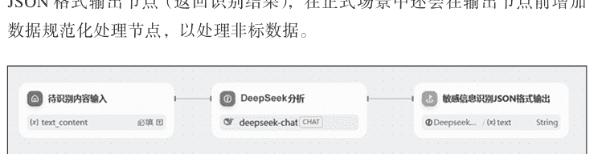

上述工作流的说明如下：

1）待识别内容输入节点：工作流的起点，定义工作流接收的数据。在此场景下，输入是一个名为 text_content 的变量，用于接收待处理的文本数据。

2）DeepSeek 分析节点：这是核心处理节点，具体配置项如下。

- **配置**：选择配置好的 DeepSeek-V3 模型（注意，DeepSeek-R1 为推理模型，由于此处是基于数据分类、数据处理的场景，因此采用 DeepSeek-V3 模型速度更快，效率更高）。
- **提示词**：在此节点中编写核心的提示词指令，提示词指令如图 13-2 所示。
- **输入**：将 text_content 作为输入传递给模型，输入设置如图 13-3 所示。
- **输出**：模型根据提示词处理输入文本并返回结果，结果通常是包含识别信息的文本或 JSON 字符串。将此输出命名为 llm_output。

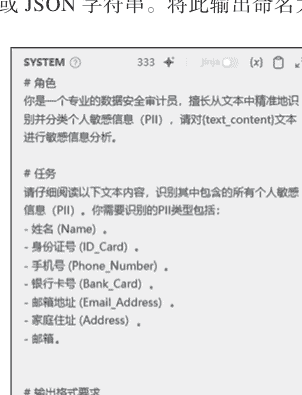

图 13-2 提示词指令

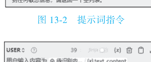

图 13-3 输入设置

3）敏感信息识别JSON格式输出节点：工作流的终点，定义最终返回给调用者的内容。将llm_output作为工作流的最终输出，输出格式设置如图13-4所示。

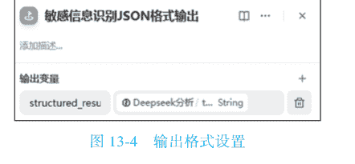

图13-4 输出格式设置

#### 13.2.2 DeepSeek 提示词工程实战

提示词的质量直接决定了DeepSeek识别敏感数据的准确性和效率。一个好的提示词应该是清晰、具体、包含约束的，并能引导模型按预期格式输出。
以下为示例提示词模板（用于DeepSeek分析节点）：

```
# 角色
你是一个专业的数据安全审计员，擅长从文本中精准地识别并分类个人敏感信息（PII）。
# 任务
请仔细阅读以下文本内容，识别其中包含的所有个人敏感信息（PII）。你需要识别的PII类型包括：
- 姓名（Name）。
- 身份证号（ID_Card）。
- 手机号（Phone_Number）。
- 银行卡号（Bank_Card）。
- 邮箱地址（Email_Address）。
- 家庭住址（Address）。
# 输出格式要求
以JSON格式输出结果。对于每一条识别到的敏感信息，请提供其类型（type）和具体内容（value）。如果没有识别到任何敏感信息，请返回一个空列表`[]`。
# 示例
输入文本："张三的手机号是13812345678，他的邮箱是zhangsan@example.com"
# 约束
- 只识别明确属于上述类型的PII。
- 不要识别非敏感信息。
- 确保输出是严格的JSON格式。
- 对于身份证号和银行卡号，如果文本中做了部分掩码处理（如*号），请识别并输出掩码后的完整字符串。
# 待处理文本
{{text_content}}
```

输出结果如图 13-5 所示。

```json
[
  {
    "type": "Name",
    "value": "张三"
  },
  {
    "type": "Phone_Number",
    "value": "13812345678"
  },
  {
    "type": "Email_Address",
    "value": "zhangsan@example.com"
  }
]
```

图 13-5 输出结果

以下为提示词策略与优化：

- **更多 Few-shot 示例**：对于某些难以识别或易混淆的类型（如特定格式的内部员工编号），可以在提示词中加入 Few-shot 示例，指导模型学习并输出。
- **明确类型定义**：如果企业内部对敏感信息有更细致的分类，那么需要在提示词中明确这些类型及其判断标准，这样可以提高识别准确率。
- **元提示词**：在提示词指令中增加更详细的角色描述、任务目标、工作原则，便于与清晰指令、结构化输出相结合。元提示词的示例如下：

你是一个高度精确的自动化敏感数据检测引擎。你的核心任务是接收用户提供的文本，并根据预先设定的敏感信息类型（如姓名、电话号码、身份证号等），自动在文本中识别并提取出所有匹配的数据项。

1. 准确性优先：宁可漏报低置信度的潜在敏感信息，也不要把非敏感信息错报为敏感信息。
2. 格式严格：结果必须严格遵守要求的 JSON 格式，不包含任何额外文本、说明或代码块标记。
3. 全面性：在指定类型范围内，尽可能识别所有出现的敏感数据。
4. 位置信息：必须提供识别出的敏感数据在原文中的精确起始和结束索引（从 0 开始计数）。
5. 安全与合规约束：例如，可以加入指令“不要输出任何与识别任务无关的评论或分析”，防止模型产生不必要的输出。

#### 13.2.3 构建敏感数据识别与分类工作流的实操步骤

以下是在 Dify 平台上构建此工作流的简要步骤。

1）步骤 1：创建应用。登录 Dify，创建一个新的“工作流”类型的应用，如图 13-6 所示。

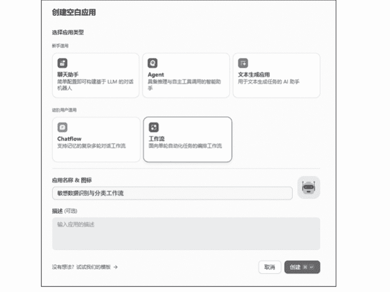

2）步骤 2：编排节点。在画布上拖拽并连接开始、LLM、代码（可选）、结束节点，如图 13-7 所示。

3）步骤 3：配置开始节点。添加一个名为 text_content 的字符串类型的输入变量。

4）步骤 4：配置 LLM 节点。将精心设计的提示词模板粘贴到提示词输入框中，确保输入变量 {{text_content}} 被正确引用，设置输出变量名。模型参数设置如图 13-8 所示。

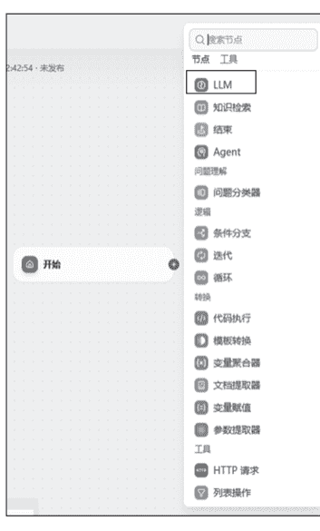

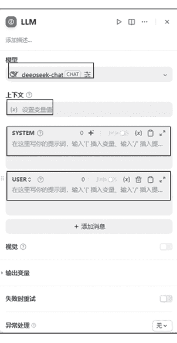

5）步骤 5：配置结束节点。选择先前设置好的输出变量名作为最终输出。配置结束节点如图 13-9 所示。


6）步骤 6：保存与测试。保存该工作流，并使用“调试与预览”功能，输入测试文本，检查输出是否符合预期。

### 13.3 敏感数据识别与分类工作流的调试、部署与安全考量

#### 13.3.1 敏感数据识别与分类工作流的调试与优化

构建完该工作流的初步版本后，调试与优化是确保其在实际应用中稳定、准确运行的关键环节。在 Dify 的“调试与预览”界面，可以通过输入不同的测试样本来验证该工作流各节点的行为。在实施过程中，可能会遇到一些问题，对于常见的问题与解决思路，建议如下：

1）DeepSeek 响应慢或超时。可能的原因是网络延迟、API 服务负载高、处理文本过长。优化建议如下。

- 检查网络连接。
- 如果文本过长，则考虑在该工作流前增加文本分块处理的逻辑。
- 联系 DeepSeek 服务提供商，了解是否有更高性能的服务等级。

2）返回格式不稳定或非预期格式。可能的原因是提示词约束不够强、模型“自由发挥”、特定输入的干扰。优化建议如下。

- 强化提示词中的输出格式要求（如再次强调必须是 JSON 格式）。
- 在代码节点中增加更健壮的解析逻辑，能容忍轻微的格式偏差。
- 尝试调整模型的温度参数，通常设为较低值（如 0.3 或 0.25），以获得更确定的输出。

3）敏感信息识别不准确（漏报或误报）。可能的原因是提示词指令不清晰、模型对特定模式或上下文理解有误、Few-shot 示例不足或有偏差。优化建议如下。

- 精确提示词：使指令更具体，明确排除易混淆的非敏感信息。
- 增加/调整示例：在提示词中加入更多高质量、有代表性的 Few-shot 示例，特别是针对易错的场景。
- 后处理逻辑：在代码节点中加入校验规则，例如，对识别出的身份证号、手机号进行格式校验，过滤掉明显错误的识别结果。
- 模型微调（高级）：如果有足够的标注数据和资源，可以考虑对 DeepSeek 模型进行微调（Fine-tuning），但这超出了 Dify 平台本身的功能，需要额外的技术投入。

调试是一个迭代的过程，需要准备多样化的测试用例，覆盖正常、边界和异常情况，通过不断调整提示词、模型参数和后处理逻辑，逐步提升敏感数据识别与分类工作流的鲁棒性和准确性。

#### 13.3.2 部署策略与集成

调试优化完成后，需要将敏感数据识别与分类工作流部署到生产环境或集成到现有业务系统中，具体部署方式包括：

- **本地 / 私有云部署**：将 Dify 平台部署在企业自己的服务器或私有云环境中。这是处理敏感数据场景的推荐方式，可以最大限度地控制数据流转和访问权限，更好地满足合规要求。
- **API 集成**：敏感数据识别与分类工作流可以作为 API 服务发布。企业现有的数据处理平台、内容管理系统（CMS）、DLP 系统或自定义脚本，可以通过调用该 API，将待处理文本发送给该工作流，并接收返回的识别结果。这是将 AI 能力嵌入现有流程的最常见方式。

#### 13.3.3 敏感数据识别与分类工作流的安全与隐私保护

在该工作流运行过程中保护数据本身的安全和隐私是重中之重。

- **调用本地化 / 私有化部署的 DeepSeek 模型**：强烈推荐将 DeepSeek 模型部署在企业内网或可信的私有云环境，该工作流直接调用内部模型端点。这样可以确保原始文本数据不超出企业控制范围，极大降低数据泄露风险。
- **限制日志记录**：在该工作流的配置和代码节点中，避免记录包含原始输入文本或识别出敏感信息内容的详细日志。只记录必要的元数据（如处理时间、是否成功、识别出的类型数量等），用于监控和排错。
- **Dify 平台安全设置**：利用 Dify 平台提供的安全特性，如成员权限管理、操作审计日志等。
- **定期安全评估**：将该工作流纳入企业的整体安全评估范围，定期检查其配置、依赖库是否存在安全漏洞。

通过上述措施，可以在利用大模型强大能力的同时，有效管控数据安全和隐私风险，确保技术应用符合企业安全策略和法规要求。

## 13.4 敏感数据识别与分类工作流的应用实战与成效评估

在成功构建、调试并部署了敏感数据识别与分类工作流后，接下来就是将其应用于实际业务场景，并对其带来的价值进行客观、量化的评估。本节将首先通过模拟运行展示该工作流的实际效果，接着探讨在实战中可能遇到的挑战及应对策略，最后详细介绍如何对该工作流的成效进行评估和量化分析，以证明 DeepSeek 在数据安全管理中的核心价值。

### 13.4.1 模拟运行与结果展示

现在已经部署并优化好了基于 Dify 和 DeepSeek 的敏感数据识别与分类工作流。使用一些模拟数据来演示其运行效果，并观察 DeepSeek 模型如何自动识别和分类文本中的敏感信息。

#### 1. 输入模拟数据（Dify Web 界面操作示例）

在 Dify 平台的 Web 应用界面中，在开始节点对应的输入框（text_content）中输入以下模拟文本：

> 尊敬的王先生（身份证号：111111199003071234），你的保单已生成。详情请查收邮件 wang_vip@example.com。如有疑问，请致电客服热线 400-800-9000 或你的专属经理李静 13912345678。你的邮寄地址是北京市朝阳区建国路 88 号 SOHO 现代城 A 座 1001 室。你的尾号为 9876 的银行卡用于自动扣款。

#### 2. 敏感数据识别与分类工作流运行与输出

单击“运行”按钮，敏感数据识别与分类工作流将启动，DeepSeek 模型将对输入的文本进行分析和识别。该工作流执行完成后，结束节点将输出 DeepSeek 模型识别出的结构化结果。预期输出结果（JSON 格式的描述）如下所示：

```json
[
  {
    "type": "Name",
    "value": "王"
  },
  {
    "type": "ID_Card",
    "value": "110101199003071234"
  },
  {
    "type": "Email_Address",
    "value": "wang_vip@emailprovider.com"
  },
  {
    "type": "Phone_Number",
    "value": "13987654321"
  },
  {
    "type": "Name",
    "value": "李静"
  },
  {
    "type": "Address",
    "value": "北京市朝阳区建国路88号SOHO现代城A座1001室"
  },
  {
    "type": "Bank_Card",
    "value": "6789"
  }
]
```

**结果解读：** 该输出清晰地列出了从输入文本中识别出的所有预定义类型的敏感信息及其具体内容。这个结构化的结果可以直接被后续系统使用，例如：

- 自动对包含这些信息的文档进行高敏标记。
- 在数据共享前，触发对这些字段的脱敏流程。
- 更新数据资产目录中的敏感数据分布信息。

本节涉及的所有个人信息都是模拟信息。

### 13.4.2 实战中的挑战与应对

在真实的业务环境中部署和应用此类工作流，往往会遇到比模拟测试更复杂的情况。了解并预判这些挑战，是确保 AI 方案成功的关键：

- **处理复杂格式文档：** 输入可能是 PDF 文档、Word 文档、图片（OCR 后）等，存在格式混乱等问题，直接将原始文本喂给 LLM 可能效果不佳。应对方法是：在该工作流之前增加健壮的文档解析和文本提取步骤，尽可能提取干净的纯文本内容；设计更复杂的提示词，指导模型关注正文内容，忽略格式噪声。

- **特定领域术语/格式识别**：企业内部可能有独特的敏感信息格式（如特定格式的客户编号、项目代号），LLM 可能无法直接识别。应对方法是：在提示词中通过 Few-shot 示例教授 LLM 识别这些特定格式；在代码节点中，结合正则表达式或字典库，对 LLM 的初步识别结果进行补充和校验。

- **模型幻觉与误判**：LLM 有时会“幻觉”出文本中并不存在的敏感信息，或者将普通文本误判为敏感信息（如将普通编号识别为身份证号）。应对方法是：优化提示词，强调准确性，要求模型“不确定时不要输出”；在代码节点中加入严格的后校验逻辑（如身份证号的校验位算法）；建立人工复核机制，对模型高置信度的判断或特定场景下的判断进行抽查。

应对这些挑战通常需要结合提示词工程、流程设计调整以及必要的人工介入，是一个持续优化的过程。

## 案例与展望篇

前三篇系统阐述了 AI 赋能数据治理的概念、理论与实战经验，本篇将通过一系列企业级应用案例，进一步说明 AI 驱动数据治理的巨大潜力和落地成效。本篇还将探讨在不同行业背景下，企业如何成功引入 DeepSeek 等大模型技术，解决其在数据治理方面面临的具体业务痛点，并展示由此带来的量化价值（如效率提升、风险降低）。同时，本篇还将正视 AI 驱动数据治理在技术、组织、文化和合规等方面可能面临的挑战与风险，并基于行业最佳实践，给出相应的实施策略与建议。最终本篇将对 AI 赋能数据治理的未来趋势进行展望，探讨新兴技术（如 AI 智能体、多模态 AI）可能带来的进一步变革，为读者提供一个全面、前瞻性的行业洞察，助力企业在 AI 时代充分释放数据价值。

# 第14章 央国企实战案例

本章将聚焦一个具体且极具代表性的场景——央国企指标标准管理，通过一个端到端的实战案例，详细展示如何构建并应用一个智能化的指标管理助手。

央国企作为国民经济的支柱，其经营管理对数据的依赖程度日益加深，而指标作为衡量经营状况、支撑决策分析、落实战略目标的核心载体，其管理的规范性、准确性和易用性至关重要。然而，传统指标管理方式往往面临诸多挑战。本章旨在通过引入 DeepSeek 和 Dify 平台的能力，为读者呈现一个切实可行的解决方案，该解决方案旨在解决央国企在指标标准查找、理解和应用过程中遇到的普遍难题，最终提升企业数据驱动决策的效率与水平。

通过本章的学习，读者不仅能够了解构建此类智能助手的具体方法和技术细节，还能深刻体会 AI 技术在解决复杂数据治理难题、提升企业核心竞争力方面的巨大潜力。本章将从央国企指标管理的痛点分析入手，逐步引导读者完成此类智能助手的构想、设计、搭建、应用与评估的全过程，并对未来的发展方向进行展望。

## 14.1 央国企指标标准管理的现状与挑战

### 14.1.1 指标在央国企管理中的核心战略地位

指标是量化业务活动、经营成果、管理状态及战略进展的关键数据项。在央国企的复杂运营体系中，指标扮演着不可替代的角色。

- **战略落地与绩效考核的关键载体**：央国企的战略目标通常宏大且涉及面广，需要分解为一系列可衡量、可追踪的指标，才能有效传导至各业务单元和层级，同时，这些指标也是进行绩效考核、激励约束、判断战略执行效果的核心依据。例如，“国有资产保值增值率”“净资产收益率”“科技研发投入占比”等关键指标直接关系到企业的核心使命和发展方向。
- **经营分析与决策支持的基础依据**：无论是日常经营监测、专题分析报告，还是重大投资决策、业务模式调整，都离不开准确、及时的指标数据。管理者需要通过对“主营业务收入增长率”“客户满意度”等指标进行分析，洞察经营态势，发现潜在的风险与机遇。
- **国资监管与合规报告的核心内容**：央国企肩负着特殊的经济责任和社会责任，需要定期向国资监管部门、行业主管部门及社会公众披露经营信息。这些报告的核心内容便是由一系列标准化的财务指标和非财务指标构成的，如“资产负债率”“上缴税费总额”“安全生产事故率”等，其准确性和合规性要求极高。
- **跨部门、跨层级沟通的统一语言需求**：大型央国企往往组织结构复杂、业务条线众多、信息系统林立。统一、规范的指标体系能够充当跨部门、跨层级沟通的“普通话”，确保各方对同一业务概念的理解一致，减少沟通成本，提升协同效率。例如，当讨论市场份额时，若无统一口径，销售、市场、战略等部门可能会产生完全不同的解读。

### 14.1.2 传统指标标准管理的普遍痛点

尽管指标如此重要，但在传统的管理模式下，央国企在指标标准的建设、维护和应用过程中普遍面临以下四大痛点。

（1）指标“找不着”

- **分散存储**：指标定义、计算规则、数据来源等信息可能散落在不同的业务系统说明文档、数据字典、历史报表模板，甚至是某些资深员工的“脑海”里，缺乏统一的、权威的指标目录和查询入口。
- **命名混乱**：同一指标在不同系统或部门中可能有不同的名称（例如，“用户数”可能被称为“客户总数”“注册账户数”）；不同指标使用了相似甚至相同的名称，导致混淆。
- **检索低效**：当业务人员需要某个特定指标时，往往需要通过邮件、电话询问多个部门的相关业务人员，或者在浩如烟海的文档中手动翻找，这个过程不仅耗时且结果具有不确定性。

（2）指标“看不懂”

- **元数据缺失或不规范**：即使找到了指标，其业务口径（例如，“利润”是税前利润还是税后利润？是否包含非经常性损益？）、计算公式（例如，明细的计算步骤和参数）、数据来源（例如，源系统、源数据表和字段）、统计周期（例如，日报、月报、年报）、计量单位等关键元数据信息往往记录不完整、不准确或已过时。
- **业务与技术脱节**：指标的业务定义可能过于晦涩、过于专业，非该领域人员难以理解，而技术人员维护的计算逻辑又缺乏清晰的业务解读，导致业务人员无法确认技术实现的准确性。例如，一个名为“××率”的指标，其分子和分母的具体业务含义可能只有少数人清楚。

（3）指标“用不准”

- **同名异义与异名同义**：如前所述，命名不规范会直接导致指标的误用。业务人员可能将A系统中的“客户数”与B系统中的“客户数”直接比较，但两者统计口径可能完全不同。
- **应用场景模糊**：指标缺乏对其适用业务场景、分析维度、对比基准的明确说明，导致用户在不恰当的场景下使用了某个指标，从而得出错误的结论。例如，用考核内部管理效率的指标去评价市场竞争力。
- **数据质量问题传递**：如果指标的数据来源本身存在质量问题（不准确、不及时、不完整），那么基于这些数据计算出来的指标自然也不可靠，从而影响决策质量。

（4）指标“管不活”

- **标准更新滞后**：随着业务发展和外部环境变化，指标的口径、计算方法可能需要调整。但在传统管理方式下，标准的更新流程往往冗长复杂，涉及多部门审批，导致指标库中的信息与实际业务脱节。
- **版本管理混乱**：指标定义变更后，缺乏有效的版本管理机制，历史数据与新数据如何衔接、不同版本的指标如何区分和应用成了难题。
- **协同效率低下**：指标标准的制定、评审、发布和培训等环节，高度依赖人工组织和线下沟通，协同效率低，难以快速响应业务部门对新指标的需求。

### 14.1.3 传统指标标准建设与维护的难点

造成上述痛点的根本原因在于：传统指标标准建设与维护的方式存在固有难点，具体如下。

- **高度依赖人工梳理和专家经验**：指标体系的构建和元数据的完善，往往需要投入大量人力成本进行跨部门调研、文档梳理、业务访谈和专家研讨。这个过程不仅耗时耗力，而且成果质量高度依赖参与人员的经验和责任心，难以保证其全面性和准确性。
- **跨部门协调成本高，标准统一难度大**：指标标准的确立，本质上就是业务概念和计算规则达成共识的过程。央国企内部各业务板块、职能部门往往有其自身的业务习惯和数据视角，要在全集团层面形成统一标准，需要大量的沟通、协调甚至博弈，推动难度极大。
- **文档化标准难以及时更新和有效宣贯**：即使制定了标准，如果仅仅停留在纸质文档或静态表格中，其生命力也会非常有限。标准的更新信息难以有效触达所有相关人员，新员工的培训也缺乏生动、便捷的途径。
- **缺乏有效的工具支撑全生命周期管理和应用**：传统的指标管理往往缺乏一个集中的、智能的平台来支撑指标的定义、审批、发布、查询、解读、反馈和版本迭代等全生命周期活动，使得各项管理工作推动缓慢。

这些痛点和难点严重制约了央国企数据价值的释放，却为引入 AI 技术提供了广阔的应用空间。

## 14.2 AI 赋能：构建智能指标标准管理助手

面对传统指标标准管理的种种困境，DeepSeek 与 Dify 相结合，为构建新一代智能指标标准管理助手提供了全新的思路和强大的技术支撑。

### 14.2.1 解决方案：智能指标标准管理助手

智能指标标准管理助手是一个企业级的、交互式的知识服务平台。它不再是一个静态的、被动查询的数据库，而是一个能够主动理解用户需求、提供精准信息、辅助用户应用指标的“智能伙伴”。

（1）目标

- **统一入口**：整合企业内分散的指标信息，提供单一、权威的指标知识查询与服务入口。
- **智能交互**：支持自然语言查询，能理解模糊、口语化的提问。
- **精准解读**：提供清晰、易懂、多维度的指标解释，包括业务定义、计算逻辑、数据来源、应用场景等。
- **辅助应用**：分析用户意图，智能推荐相关指标，辅助用户正确使用指标。
- **持续进化**：能够通过用户反馈和新知识的注入，不断提升服务能力。

（2）核心能力

- **智能查询**：用户可以通过自然语言提问，如“上个月的核心产品利润率是多少？”“帮我找一下考核供应链效率的指标”。
- **智能解读**：对于查询到的指标，能够自动生成通俗易懂的业务解释，阐明其计算公式、数据来源、统计口径、更新频率等。
- **智能推荐**：当用户描述一个分析主题或业务问题时，能够推荐一组相关的核心指标。
- **辅助应用**：能够解释不同指标间的联系与区别，提示指标使用的注意事项。

（3）价值主张

- 提升指标可见性：让所有员工都能方便快捷地找到所需的指标信息。
- 提升指标可理解性：消除业务人员与技术人员之间的理解鸿沟，确保对指标的统一认知。
- 提升指标可用性：引导用户正确、有效地应用指标，避免误用。
- 提升管理效率：大幅降低人工查询、解释和培训的成本，解放数据管理人员的生产力。

### 14.2.2 DeepSeek 与 Dify 的协同作用

智能指标标准管理助手的实现，依赖核心智能引擎与应用开发平台的紧密结合。其中，DeepSeek 扮演着“大脑”的角色，提供底层的智能能力，而 Dify 提供了构建应用的“骨架”与“神经系统”，负责将这些能力工程化，并交付给用户。

DeepSeek 作为核心智能引擎，主要贡献了四个方面的关键能力。首先是强大的自然语言理解能力，使其能够准确解析用户的模糊查询和真实意图，并通过语义匹配找到正确的指标。其次是知识抽取与整合能力，使其能够从企业现有的各类文档中（如业务规范、数据字典）自动提取并结构化指标的关键信息。再次是内容生成能力，使其能够将技术化的数据和复杂的计算公式，转换为通俗易懂的业务解释和步骤说明。最后是上下文理解与推理能力，使其能够支持进行多轮对话、场景化推荐，提供更精准的交互式服务。

Dify 作为 AI 应用构建的载体，负责将 DeepSeek 的强大能力便捷地落地为可用工具。它通过知识库构建与管理功能，为 DeepSeek 提供了结构化的学习资料，支持导入 PDF、XLSX 等多种格式的企业文档并自动处理。它的核心的可视化工作流编排功能，允许开发者通过拖拽方式快速搭建 AI 处理流程，无须编写大量代码。Dify 还提供便捷的提示词工程与模型集成工具，用来精调和优化模型的输出效果。最终构建完成的应用可以一键发布为标准的 API 或 Web 应用，从而快速与企业现有系统集成或直接交付用户使用。

通过 DeepSeek 与 Dify 的结合，企业可以大大降低构建和部署此类智能指标标准管理助手的技术门槛和时间成本，快速实现 AI 技术在数据治理领域的价值。

## 14.3 实战：搭建央国企智能指标标准管理助手

本节将详细阐述如何利用 Dify，并结合 DeepSeek 的能力，一步步搭建一个针对央国企应用场景的智能指标标准管理助手。

### 14.3.1 实战场景选择与需求细化

为了使实战更具针对性，选取以下在央国企指标管理中常见的核心场景，并对需求进行细化：

（1）核心场景

- **指标定义与口径查询**：用户想了解某个具体指标的准确业务定义、统计口径、计算逻辑等。
- **指标数据来源与更新频率查询**：用户关心某个指标的数据从哪里来、多久更新一次。
- **报表指标溯源与解释**：用户看到报表上的某个指标数据，希望了解其构成和业务含义。
- **分析场景下的相关指标推荐**：用户提出一个分析目标或业务问题，希望获得相关的建议指标。

（2）用户画像

- **企业高管**：关注核心战略指标、经营结果指标，需要简洁明了的解读和趋势判断。
- **业务部门经理/分析师**：关注与本业务领域相关的过程指标、效率指标、效益指标，需要详细的口径、计算方法和应用场景说明。
- **数据分析师/IT运维人员**：关注指标的技术实现、数据来源、数据质量，可能需要更底层的技术元数据。

（3）核心需求提炼

- **快速定位**：无论指标名称是否精确，都能快速找到目标指标或相关指标。
- **准确理解**：获得关于指标的权威、一致、易懂的解释，消除歧义。
- **关联洞察**：了解指标之间的关系，以及指标在不同业务场景下的应用。
- **便捷访问**：通过简单的自然语言交互即可获取服务。

### 14.3.2 指标知识库的构建与准备

知识库是智能助手的“知识源泉”，其质量直接决定了智能助手的服务水平。指标知识库的构建与准备涉及如下几个方面。

（1）数据源收集

- 结构化数据：企业现有指标库／元数据管理系统导出的数据（如 XLSX 格式、CSV 格式、数据库表）。根据仓库／数据集市中的指标定义表。
- 半结构化／非结构化数据：指标管理规范、业务术语表（如 DOC、PDF 格式）；数据字典、系统设计文档中关于指标的描述；历史经营分析报告、PPT 中对指标的解读；监管机构发布的指标填报要求文档。

（2）知识抽取与结构化

- 目标关键信息：对于每个指标，力求提取指标 ID（唯一标识）、指标中文名称、指标英文名称（若有）、业务定义／业务口径（核心，需要详细描述）、计算公式（文字描述或数学表达式）、分子定义（若为比率）、分母定义（若为比率）、数据来源系统／模块、源数据表／字段（可选，技术层面）、统计周期（如日、月、季、年）、计量单位（如元、个、百分点）、责任部门／归口部门、应用场景／分析维度举例、相关指标（可选，如派生关系、对比关系）、版本号／最后更新日期等信息。
- 抽取方法：对于结构化数据源，可通过脚本直接转换；对于非结构化文档，可以利用 DeepSeek 的自然语言理解和知识抽取与整合能力。例如，设计“请从以下文档片段中提取关于指标「[指标名]」的业务定义、计算公式和数据来源”这样的提示词，将结果交由人工审核，人工审核通过后，再对结果进行整理。
- 格式化处理：将所有指标信息整理成统一的格式，例如，为每个指标创建一个 Markdown 格式的文件、一个 JSON 对象或 Excel 表的一行。

## 14.3.3 基于 Dify 编排智能指标查询与解读工作流

这里将构建一个 Dify 工作流，实现“用户通过自然语言查询指标，工作流返回指标的详细解读”。工作流命名为“智能指标查询与解读工作流”。此处以对话工作流为例来展示步骤。

1）步骤 1：用户输入与意图初步识别。定义输入变量 user_query（类型：String，用户输入的自然语言问题）。LLM 节点（意图提炼）提示词设计如下。

```
你是一个文本处理助手。用户的输入可能是一个指标名称，也可能是一个关于指标的问题。
请从以下用户输入中，提取核心的指标名称或查询主题。
如果用户直接问某个指标，则尽量提取该指标的准确名称。
如果用户问一个问题，则概括问题的核心内容。
只输出提取的关键词或短语，不要输出任何其他解释。
用户输入：{{user_query}}
提取结果：
输出变量：refined_query_keywords（提炼后的查询关键词）。
```

> 注意事项：将用户的口语化输入转换为更适合知识库检索的关键词，以提高检索准确率。例如，用户问“上个月利润咋样啊？”，可能提炼出“利润”。

2）步骤 2：知识库检索。具体设置如下。

- 知识库节点：选择前面创建的“指标知识库”，并关联该知识库。
- 检索模式：选择“混合检索”。
- 查询内容变量：引用上一步的输出 {{refined_query_keywords}}。
- Top K：设置召回最相关的知识片段数量，例如 3 或 5 个。
- 输出：Dify 会自动将检索到的知识片段（包含内容和元数据）作为上下文变量，以供后续节点使用。

3）步骤 3：信息整合与答案生成。将 LLM 节点（信息整合）设置为“指标解读生成”，提示词设计（核心）是决定其输出质量的关键。

```
# 角色设定
你是一位资深的央企国企数据治理专家和指标分析师，精通本企业所有核心指标的业务定义、计算逻辑、数据来源和应用场景。

# 任务指令
请根据用户提出的问题和从指标知识库中检索到的相关指标信息，为用户提供清晰、准确、全面且易于理解的回答。

# 上下文信息
以下是用户的问题：
{{user_query}}
以下是从指标知识库中检索到的最相关的指标信息片段：
{{recall_knowledge}}
[说明：recall_knowledge 是 Dify 知识检索节点输出的变量，可能包含多个知识片段。你需要指导模型综合利用这些信息。]

# 输出要求与质量标准
1. 直接回答：首先直接、明确地回答用户的问题。
2. 信息全面：如果用户查询特定指标，那么你的回答应尽可能全面，至少包括（如果信息存在）：
   指标中文名称；
   业务定义 / 业务口径（务必通俗易懂，解释清楚关键业务术语）；
   计算公式（如果复杂，请分步解释或说明分子及分母构成）；
   数据来源系统 / 模块；
   统计周期和计量单位；
   应用场景或分析维度举例。
3. 突出重点：根据用户问题侧重回答相关方面，避免信息堆砌。
4. 处理信息不足：如果指标知识库信息不完整或无法直接回答用户问题，请坦诚告知，并建议用户联系数据管理部门或提供其他可能的查询线索。不要编造信息。
5. 语言风格：专业、严谨，同时兼顾业务人员的理解习惯，避免过多纯技术术语。
6. 格式友好：可以使用项目符号、编号、加粗等方式使回答更易阅读。

# Few-shot 示例（根据实际指标知识库内容调整，此处为示例）
[示例 1 开始]
用户问题：什么是“净资产收益率”？怎么算？
指标知识库片段：
指标名称：净资产收益率（ROE）。
业务定义：衡量公司利用自有资本的盈利能力的指标，指企业净利润与平均净资产的比率。
计算公式：净资产收益率 = (净利润 / 平均净资产) × 100%
平均净资产 = (期初净资产 + 期末净资产) / 2
数据来源：财务报表系统。
统计周期：季报、年报。
计量单位：%。
应用场景：评估企业盈利能力、股东回报水平。
期望输出：
你好！净资产收益率（ROE）是衡量公司利用其自有资本（即股东权益）获取净效益能力的指标。它反映了股东投入资本的盈利水平。
具体来说：
业务定义：指企业在一个会计周期内的净利润与该周期内平均净资产（股东权益）的百分比。
计算公式：
净资产收益率 = (净利润 / 平均净资产) × 100%
其中，平均净资产 = (期初净资产 + 期末净资产) / 2
数据来源：主要来源于企业的财务报表系统。
统计周期：通常在企业的季度报告和年度报告中披露。
计量单位：百分比（%）。
应用场景：常用于评估企业的整体盈利能力、判断股东投资回报水平的高低，也是投资者进行决策的重要参考指标。
[ 示例 1 结束 ]

[ 示例 2 开始 ]
用户问题：我们公司考核一线销售团队一般用哪些指标啊？
指标知识库片段：
指标名称：销售合同签订额。
业务定义：指报告期内销售团队与客户签订的销售合同中约定的总金额。
应用场景：考核销售团队市场开拓能力和业绩达成情况。
指标名称：回款率。
业务定义：指报告期内实际收回的销售款项与同期应收销售款项的比例。
应用场景：衡量销售款项回收质量和资金周转效率。
......（更多相关指标）
期望输出：
你好！考核一线销售团队通常会关注以下几个方面的核心指标：
1. 业绩成果类：
   销售合同签订额：反映市场开拓和订单获取能力。
   主营业务收入：实际确认的销售收入。
2. 回款质量类：
   回款率：衡量销售款项的回收情况，关系到现金流健康。
   逾期账款额/率：监控信用风险。
3. 客户发展类：
   新增有效客户数：拓展新市场和客户群的能力。
   客户客单价：单个客户的平均贡献值。
4. 效率过程类：
   销售转化率（如线索到签约的转化）：评估销售过程效率。
你可以根据具体的考核导向和业务阶段，选择合适的指标组合。
[ 示例 2 结束 ]
请根据以上要求，回答用户的问题。
回答：
输出变量：assistant_response（模型生成的最终回答）。
参数调整：
temperature：设置为较低值（如 0.3 ~ 0.5），确保回答的稳定性和准确性。
max_token：根据预期的回答长度设置，避免过长或截断。
```

## 14.4 应用实战与成效评估

### 14.4.1 典型应用场景演示

智能指标标准管理助手已成功搭建并发布。本小节通过三个典型的应用场景展示了智能指标标准管理助手在实际工作中的核心价值，内容涵盖了从基层员工的日常查询到高层管理者的战略辅助，具体如下。

- **即时查询与解读**：面向业务人员，快速解答“两金压降”这类俗称或行话所对应的官方指标定义、计算口径及管理意图。
- **无缝系统集成**：面向财务或数据分析师，展示了智能指标标准管理助手如何通过 API 嵌入 BI 等系统，为报表中的专业指标（如“EBITDA 利润率”）提供结构化的、随点随查的深度释义。
- **辅助分析决策**：面向管理者，当被问及如何评估“科技创新能力”这类复杂议题时，智能指标标准管理助手能够体系化地提出涵盖投入、过程、产出、效益等多个维度的关键指标体系建议。

场景 1 是快速查询指标定义与计算口径。用户在 Dify Web 应用界面输入：“常说的那个‘两金压降’具体指什么指标？是怎么计算的？”

智能指标标准管理助手输出：
你好！你提到的“两金”通常指的是“应收账款”和“存货”这两项资产。压降“两金”是国资委对央企和国企提出的重要管理要求，旨在提高资产周转效率，降低经营风险。相关的指标可能包括：
1. 应收账款周转率 / 周转天数：
   业务定义：衡量企业应收账款变现速度的指标。周转率越高（或周转天数越短），说明应收账款回收速度越快，资金占用成本越低。
   计算公式示例：
   应收账款周转率 =（报告期内赊销收入净额 / 平均应收账款余额）
   应收账款周转天数 = ( 365 / 应收账款周转率)
   数据来源：财务系统。
   应用：用于评估企业信用政策、收款效率。
2. 存货周转率 / 周转天数：
   业务定义：衡量企业存货周转速度的指标。周转率越高 (或周转天数越短)，说明存货从入库到销售 (或耗用) 的速度越快，存货占用资金越少，管理效率越高。
   计算公式示例：
   存货周转率 = (报告期内销售成本 / 平均存货余额)
   存货周转天数 = ( 365 / 存货周转率)
   数据来源：财务系统、供应链系统。
   应用：用于评估企业存货管理水平、供应链效率。
"两金"压降的目标就是要努力提高这两类资产的周转效率，减少不必要的资金占用。具体的考核口径和目标值请参考集团下发的最新管理办法或财务部门的解释。

场景 2 是理解报表中的指标。
用户通过集成智能指标标准管理助手 API 的 BI 平台，单击某个报表上的指标 (如 "EBITDA 利润率")，触发查询。
智能指标标准管理助手通过 API 返回解释 (在 BI 平台侧边栏显示):
```json
{
    "indicator_name": "EBITDA 利润率",
    "definition": "EBITDA 利润率，即息税折旧摊销前利润率，是衡量企业核心经营活动盈利能力的指标，它剔除了利息、所得税、折旧和摊销这些非现金或非经营核心因素的影响。",
    "formula": "EBITDA 利润率 = (EBITDA / 主营业务收入) × 100%",
    "components": {
        "EBITDA": "净利润 + 所得税 + 利息支出 + 折旧费用 + 摊销费用"
    },
    "data_source": "财务报表系统、合并利润表及相关附注",
    "period": "月度、季度、年度",
    "unit": "%",
    "application_notes": "常用于比较不同资本结构、不同税收政策、不同折旧摊销政策的企业之间的盈利能力，也用于评估企业的现金产生能力。"
}
```

场景 3 是辅助分析决策。
用户向智能指标标准管理助手提问："集团要加强科技创新能力的评估，应该关注哪些关键指标?"
智能指标标准管理助手输出：
你好! 评估集团科技创新能力，可以从研发投入、创新过程、创新产出和创新效益 / 影响等多个维度构建指标体系。以下是一些建议关注的关键指标方向：
1. 研发投入类：
   研发经费投入强度：研发经费支出总额占营业收入的比重。反映企业对科技创新的重视程度和投入力度。
   基础研究投入占比：基础研究经费占总研发经费的比重。体现原始创新能力和长远布局。
   研发人员数量及占比：专职研发人员数量及其占员工总数的比例。
2. 创新产品类：
   新产品 / 新工艺开发项目数：年度内立项或完成的新产品、新工艺研发项目的数量。
   产学研合作项目数 / 金额：与高校、科研院所开展合作研发的情况。
3. 创新产出类：
   专利申请量 / 授权量：特别是发明专利的数量和质量。
   高新技术产品收入占比：被认定为高新技术产品的销售收入占总收入的比重。
   科技成果转化率 / 金额：科技成果成功转化为产品或服务并产生经济效益的情况。
4. 创新效益 / 影响类：
   新产品销售收入占比：近 × 年内上市的新产品产生的销售收入占总销售收入的比重。
   技术合同成交额：通过技术转让、技术服务等获取的收入。
   标准制定参与度：主导或参与制定国际、国家、行业标准的标准数量。
建议结合集团所处行业的特点和战略发展阶段，选择和细化具体的考核指标，并明确其统计口径和数据来源。

### 14.4.2 实战效果与价值分析

本小节内容引入智能指标标准管理助手所带来的四大核心价值，全面展现了其对企业产生的深远影响。

首先在效率层面，智能指标标准管理助手将以往耗时漫长的指标查询过程缩短了 90%，并显著提升了新员工培训和分析报告撰写效率。

- **查询效率**：以往查找一个复杂指标的完整信息可能需要数小时甚至数天（涉及跨部门沟通），现在通过使用该助手，可能在几秒或几分钟内就可以完成。预计平均指标查询时间缩短 90%。
- **培训效率**：新员工或岗位轮换员工可以快速通过该助手学习指标知识，减少人工培训的成本和时间。
- **报告撰写效率**：在报告中需要引用指标定义或解释时，可直接让该助手提供标准文本，从而提高报告质量和撰写速度。

其次在质量层面，智能指标标准管理助手通过建立统一、权威的信息出口，确保了数据定义的一致性和准确性，从根本上解决了“一个指标有多种解释”的管理难题。

- **统一出口**：所有指标解释均出自统一、权威的指标知识库，确保了信息的一致性，避免了“一个指标有多种解释”的混乱局面。
- **减少人为错误**：减少了人工记忆偏差、理解差异导致的指标误用。

再次在文化转型与赋能层面，智能指标标准管理助手降低了数据的使用门槛，提升了全员的数据素养，有力地推动了企业向数据驱动文化转型。

- **降低门槛**：非数据专业背景的业务人员也能轻松理解和使用指标，进而提升全员数据素养。
- **向数据驱动文化转型**：当获取和理解数据的成本大幅降低后，员工更愿意基于数据进行思考、沟通和决策。

最后在管理与治理层面，智能指标标准管理助手不仅成了企业核心知识沉淀与传承的“活”载体，还能通过对用户行为的分析，反向推动数据治理工作的持续改进与规范。

- **动态知识库**：智能指标标准管理助手成为企业指标知识沉淀和传承的“活”载体，标准更新能更快触达用户。
- **辅助治理**：通过分析用户查询热点和问题，可以反向发现指标体系中可能存在的描述不清、定义冲突等问题，辅助数据治理工作的持续改进。

### 14.4.3 用户反馈与持续改进

智能指标标准管理助手针对用户反馈展现了双重价值：一方面，来自各部门的正面评价证实了它在提升效率、清晰解读指标及系统集成方面的成功；另一方面，用户提出的改进建议，如深化知识库、对接实时数据、增加计算示例和更新通知等，明确了下一阶段迭代优化的核心方向。

（1）正面评价

- “这个智能指标标准管理助手太方便了！以前找个指标口径要问好几个人，现在直接问它就行，省时省力。”（来自业务部门员工）
- “生成的指标解释很清晰，比我们自己写的那些干巴巴的文档好懂多了。”（来自数据分析师）
- “API 集成到我们的报表系统后，用户可以直接在报表旁看到指标解释，咨询量明显下降了。”（来自 IT 部门项目经理）
- “对于一些集团层面的战略指标，这个助手的解读很到位，能帮助我们更好地理解考核导向。”（来自中层管理者）

（2）改进建议

- “有些细分的、特定业务场景的指标，智能指标标准管理助手好像还不太清楚，指标知识库能再丰富一些就好了。”
- “如果能直接告诉我某个指标上个月的具体数值或者同比和环比变化就更好了。”（这涉及与数据仓库实时对接的更高阶需求）
- “对于某些计算特别复杂的指标，希望解释能更详细一些，最好有计算步骤的示例。”
- “指标知识库更新后，能不能主动通知我们哪些指标有变化？”

这些反馈将成为智能指标标准管理助手下一阶段迭代优化的重要输入，例如，持续扩充和优化指标知识库内容、探索与实时数据系统的集成、增强个性化推荐能力等。

## 14.5 央国企推广智能指标标准管理助手的挑战与展望

### 14.5.1 推广面临的组织与技术挑战

在央国企内部成功构建并推广智能指标标准管理助手，并非一蹴而就，可能会面临以下挑战：

（1）数据源质量与整合难度
- **历史数据质量参差不齐**：构建高质量知识库的前提是拥有准确、完整的原始指标定义和元数据。央国企的早期信息化建设可能存在标准不一、文档缺失等问题。
- **系统林立，数据孤岛**：指标信息分散在众多异构系统中，打通和整合这些数据源，形成统一视图，其技术和协调成本都较高。

（2）企业内部存在多套指标体系的融合问题
不同业务板块、子公司，甚至同一部门的不同业务线，可能存在各自的指标体系和口径，如何协调统一或在智能指标标准管理助手中清晰区分、智能适配，是一个难题。

（3）用户使用习惯的培养与推广
要想改变用户长期以来依赖人工询问或查阅静态文档的习惯，需要有效的宣传、培训和引导。部分员工可能对 AI 工具抱有疑虑或不熟悉，需要建立信任感。

（4）对 AI 回答准确性的信任建立
尽管 AI 能力强大，但初期可能仍会出现回答不完美或理解有偏差的情况。需要建立有效的反馈机制，持续优化模型和知识库，逐步提升用户信任度。

（5）持续运营知识库维护机制
- 指标体系是动态变化的，智能指标标准管理助手需要建立一个知识库的常态化更新、审核和发布的流程机制，确保其“知识”永葆活力。这需要明确责任部门，并投入运营成本。
- AI 模型的持续调优也需要专业人员的参与。

### 14.5.2 未来展望：从智能指标标准管理助手到智能决策支持

智能指标标准管理助手仅仅是 AI 赋能央国企数据管理和决策的起点。未来，AI 能力可以向更深、更广的层面拓展。

- 与 BI 系统、数据分析平台深度融合：实现“指标即服务”，用户在 BI 报表或自助分析工具中，可无缝调用智能指标标准管理助手的指标解释、口径说明、相关推荐等能力。同时，该助手可以理解用户在 BI 平台上的操作行为，主动提供与上下文相关的指标洞察。
- 实现指标异常智能预警与归因分析辅助：结合实时指标数据，当某个关键指标发生异常波动（如超出阈值、趋势突变）时，智能指标标准管理助手能主动预警。进一步地，通过关联分析和知识图谱，辅助用户初步判断导致指标异常的可能原因，缩小排查范围（例如，“本月利润率下降，可能与原材料成本上升或产品线销量下滑有关”）。
- 辅助指标体系的动态优化与设计：通过分析用户查询热度、指标使用频率以及业务战略的变化，AI 可以辅助数据治理部门识别哪些指标已失效、哪些新指标需要建立、现有指标体系是否存在冗余或缺失，并辅助数据治理部门进行指标重要性评估和权重设置。
- 构建企业级数据知识图谱，实现更智能的洞察：将指标知识与企业内其他领域的知识（如组织架构、业务流程、产品信息、客户画像、市场动态、政策法规等）相关联，构建一个更全面的企业级数据知识图谱。

## 第15章
### 制造业实战案例

制造业是实体经济的基石，物料主数据与物料清单（BOM）是最核心、最关键的组成部分。物料是构成一切产品的物质基础，其数据是企业运营的通用语言；BOM是描绘产品从零件组装成成品的“基因图谱”与“配方图纸”，是连接设计、采购、计划、生产、成本乃至售后服务的核心纽带。

然而，在传统管理模式下，这个至关重要的数据常常因分散在不同的IT系统（如ERP、PLM、MES）、数据标准不一、变更管理复杂、知识难以沉淀等问题，变得拥堵、迟钝，甚至错乱。这直接导致研发周期延长、供应链中断风险增高、生产成本攀升、产品质量不稳定等一系列问题，成为制约企业数字化转型和提升核心竞争力的瓶颈。

本章将聚焦制造业这一核心应用场景，通过一个端到端的实战案例，详细阐述如何创新性地利用DeepSeek，并结合Dify AI应用开发平台的敏捷编排与知识库整合能力，构建一个“智能物料主数据与BOM管理助手”。这个智能助手将彻底改变传统的产品数据交互模式，解决工程师、采购专员、生产计划员等关键岗位人员在日常工作中遇到的物料信息查询难、BOM结构理解难、设计变更影响评估难、数据治理标准执行难等一系列根深蒂固的痛点。

通过本章的学习，读者将了解从业务痛点分析、解决方案构想、多源异构知识库构建，到核心 Dify 工作流设计与实现的完整过程。最终目标是清晰地展示 AI 技术如何深度赋能制造业的基础数据治理，提升数据的准确性、一致性和可用性，优化企业内部的协同设计与供应链流程，从而显著加速产品创新与市场响应速度，为企业构筑坚实、智能的数据治理基石。

### 15.1 物料主数据与 BOM 管理的现状与挑战

#### 15.1.1 物料主数据与 BOM 的核心战略地位

在任何一家制造企业中，从一个螺丝钉到一个复杂的发动机，每一个物理对象都在信息系统中以数据的形式存在。物料主数据和 BOM 正是这些数据的核心组织形式，其管理水平直接决定了企业数字化运营的深度和广度。

##### 1. 物料主数据

物料主数据是企业为每一个需要采购、生产、存储、销售或维护的物料所定义的唯一、权威、全面的信息集合。它如同每个物料在数字世界的“身份证”，详细记录了其生命周期中各个环节所需的关键属性。一个典型的物料主数据通常包含：

- **基本信息**：唯一的物料编码、标准化的物料描述、基本计量单位（如个、米、千克）、物料组/商品类别。
- **设计与技术信息**：详细的技术规格（如电压、功率、尺寸、公差）、材料成分、重量、颜色、关联的 2D/3D 图纸编号、设计版本号。
- **采购信息**：采购类型（如标准采购、委外加工、寄售）、首选供应商及备选供应商列表、采购价格、货币、最小订购量（MOQ）、采购提前期（Lead Time）。
- **计划与生产信息**：物料需求计划（MRP）类型、生产策略（自制/外购）、生产车间、库存地点、安全库存水平、批次管理要求。
- **财务与成本信息**：标准成本、移动平均价、价值评估类别、利润中心。
- **质量与合规信息**：质检方案、环保合规标识。

准确、完整、一致的物料主数据是企业资源计划（ERP）系统、制造执行系统（MES）、产品生命周期管理（PLM）系统等能够正确运行的绝对基础。

##### 2. BOM

物料清单（BOM）是以数据格式来描述产品结构的技术文件，它以树状层级的方式，精确地展示了构成一个最终产品（成品）或中间产品（半成品）所需的所有子装配件、零部件和原材料的数量及装配关系。BOM 是企业内部信息流的“翻译官”和“指挥棒”，将设计语言转化为各个业务部门可执行的指令：

- 设计部门：创建和维护工程 BOM（EBOM），EBOM 是产品设计的核心输出，体现了产品的设计意图和功能结构。
- 计划部门：依据 BOM 进行物料需求计划（MRP）的运算，精确计算出需要采购和生产的物料种类与数量，这是制订生产计划的依据。
- 采购部门：根据 BOM 分解出的物料需求清单，向供应商下达采购订单。
- 生产部门：依据生产 BOM（MBOM）组织车间领料、进行装配作业。
- 财务部门：基于 BOM 和物料的标准成本进行产品成本的逐级累加计算，这是成本管理和定价决策的基础。
- 售后服务部门：参考 BOM，确定维修和更换所需的备品及备件。

##### 3. 数据流的“蝴蝶效应”

物料主数据与 BOM 数据紧密耦合，形成一个庞大而复杂的数据网络。在这个网络中，任何一个节点的微小变动都可能引发“蝴蝶效应”。例如，一个不起眼的芯片因供应商停产而需要更换，在这种情况下，会更新物料主数据中的替代料信息，然后通过 BOM 网络影响数十种正在生产的成品、上百个半成品的 BOM 版本，进而改变数千张生产订单的物料需求，触发新的采购订单，并最终影响所有相关产品的成本核算和库存策略。如果这个变更管理不善，就极易导致生产线因缺料而停工，或产生大量无法使用的呆滞库存。

#### 15.1.2 传统物料主数据与 BOM 管理的普遍痛点

尽管物料与 BOM 数据如此重要，但在许多制造企业的日常运营中，由于依赖传统的人工管理方式和功能分散的 IT 系统，其数据治理往往充满挑战，形成了一系列普遍存在的痛点。

（1）“数据迷宫”：信息查找困难，可用性差

- **查询体验不佳**：研发工程师想为新设计寻找一个符合特定技术规格的现有元器件时，通常需要在 ERP 或 PLM 系统中打开复杂的查询界面，通过层层筛选、输入精确的参数才能找到符合的信息，这一过程烦琐且耗时。像“我们公司有没有一款德国进口、防护等级 IP67、M12 接口的 4 针接近开关？”这样的自然语言查询语句，系统完全无法理解。
- **BOM 结构不直观**：在传统的 ERP 系统中查看一个多达十几层的复杂产品 BOM，往往需要用户在不同页面间反复单击“展开下一层”选项，无法一目了然地看到整个产品的结构全貌，更不用说在 BOM 中进行跨层级的物料搜索或筛选了。
- **信息割裂**：物料的设计图纸可能存在 PLM 系统中，采购价格和库存信息可能存在 ERP 系统中，技术规格书可能是 PDF 格式的文件并存放在共享服务器上。用户需要登录多个系统，才能拼凑出一个物料的完整信息画像。

（2）“不一致的描述”：数据质量低下，标准不一

- **一物多码 / 一码多物**：这是物料主数据治理中最经典且最严重的问题。由于缺乏有效的申请流程和智能查重机制，不同部门或不同时期的工程师可能为同一个物理上完全相同的物料（例如，同一规格的螺丝）创建了多个不同的物料编码，导致库存数据虚高、采购分散、设计选型混乱。反之，也可能出现一个物料编码被错误地赋予了多种不同规格的物料。
- **命名与描述不规范**：新物料的描述往往由申请人手动填写，可能使用不同的格式、术语、缩写、分隔符，例如“螺钉，十字，沉头，M3*8，不锈钢”和“SCREW, SS, M3X8, CSK, PHIL”可能指向同一个物料，但系统无法识别其相似性，严重影响了搜索的准确性和后续的数据分析。
- **关键属性错误或过时**：物料的计量单位错误（如将“卷”误记为“米”）、采购提前期不准确、供应商联系信息过时、成本数据未更新等问题，会直接导致 MRP 运算错误、采购计划延误、生产成本失真。

（3）“错误的连锁反应”：变更管理复杂，风险高

- **变更影响评估困难且耗时**：当一个基础元器件因质量问题、成本优化、法规变化或供应商停产而需要进行变更时，最关键的一步是准确评估其影响范围。使用人工方式去查找所有使用到该元器件的 BOM，这一过程极其烦琐，且非常容易出现遗漏，一旦漏掉某个产品，就可能导致生产出不合格产品或产线停工。
- **版本管理与切换混乱**：BOM 的变更需要严格的工程变更通知（ECN）流程和版本控制。但在快节奏的生产环境中，容易出现新旧版本的 BOM 在生产现场混用、库存中的旧料未及时处理、设计部门的变更信息未同步到采购部门和生产部门等问题。

（4）“知识孤岛”：设计意图丢失，经验难传承

- **隐性知识流失**：工程师在设计时为何选择某个特定供应商的芯片（可能因为其性能稳定、供货周期短或与公司有战略合作）？为何在 BOM 中设置某个特定的用量（可能考虑了生产损耗）？这些宝贵的“设计意图”和“隐性知识”往往只存在工程师的个人笔记、邮件沟通或大脑中，没有与物料或 BOM 数据本身进行结构化的关联。当人员变动时，这些知识便随之流失。
- **学习曲线陡峭**：新加入的工程师或生产计划员要快速了解一个复杂产品的 BOM 结构、历史演变以及关键物料的选型考量是非常困难的，这高度依赖资深同事的言传身教，知识传承的效率和质量都无法保证。

#### 15.1.3 低质量产品数据治理的高昂代价

糟糕的物料与 BOM 数据治理并非只是 IT 部门的烦恼，它会持续侵蚀企业的利润，带来实实在在的、高昂的运营成本。

（1）对直接财务成本的影响

- **采购成本增加**：“一物多码”导致无法集中采购物料以获取批量折扣；因信息不畅采购了错误或非优选的物料。
- **库存持有成本**：MRP 运算不准、BOM 错误、设计变更管理不善等导致的呆滞料、死料库存，占用了大量流动资金。
- **生产损失**：缺料、错料导致的生产线停工等待、产品返工，甚至整批报废，直接造成了巨大的生产成本浪费。
- **物流与管理成本**：处理退货、紧急采购、额外仓储等产生的额外费用。

（2）对间接与战略性成本的影响

- **产品上市时间延迟**：低效的物料选型、BOM 创建和变更流程，直接拖慢了新产品的研发和导入（NPI）速度，错失市场先机。
- **产品质量与客户满意度下降**：使用了错误的或未经充分验证的元器件，可能导致产品功能缺陷、可靠性问题，引发客户投诉、退货和保修索赔，损害品牌声誉。
- **供应链脆弱性增加**：对物料的替代关系、供应商风险等信息掌握不清，使得企业在面对供应商突发断供、地缘政治风险等冲击时，供应链的响应能力和韧性不足。
- **合规风险**：在对环保、安全法规要求严格的行业（如汽车、医疗、电子行业），如果无意中使用了不符合标准（如 RoHS、REACH）的物料，可能面临产品召回、巨额罚款和市场禁入的风险。

### 15.2 AI 赋能：构建智能物料主数据与 BOM 管理助手

面对传统管理模式的种种困境，可以引入 DeepSeek 来构建一个智能物料主数据与 BOM 管理助手，为从根本上解决这些问题提供新途径。

#### 15.2.1 解决方案：打造产品数据智能化的“单一窗口”

智能物料主数据与 BOM 管理助手不再是一个个孤立、被动的数据库查询界面，而是一个面向企业内所有与产品数据相关岗位的人员（从研发、工艺、采购、计划到生产、质量、财务），并提供一站式、交互式、智能化产品数据服务的“单一窗口”。

（1）目标

创建一个支持自然语言交互的、统一的物料与 BOM 信息查询、分析、治理与知识沉淀的平台。

（2）核心能力

- **智能查询与多维问答**：用户可以通过自然语言，快速查询物料的任意属性、BOM 的完整结构、物料的库存与在途信息、供应商情况等。智能物料主数据与 BOM 管理助手支持跨数据源的关联查询。
- **新物料申请与标准化治理**：在研发人员申请新物料时，智能物料主数据与 BOM 管理助手能够主动进行智能查重，并根据企业预设的命名与编码规范，自动生成标准化的物料描述和编码建议，从源头上保证数据质量。
- **BOM 变更影响的即时分析**：当任何物料发生变更时，智能物料主数据与 BOM 管理助手能够一键式、快速、准确地进行“反向追溯”，清晰地展示所有受影响的 BOM、产品、生产订单、库存等，为变更决策提供全面的数据支持。
- **BOM 健康度与合规性智能校验**：智能物料主数据与 BOM 管理助手能够主动对 BOM 进行扫描，识别其中是否存在已停产（EOL）、不推荐使用（NRND）、有合规风险（如不符合 RoHS 指令）或存在单一供应商风险的物料，并发出预警。

（3）价值主张

显著缩短研发设计与选料流程、极大降低供应链中断与物料呆滞风险、全面提升跨部门协同效率、强制执行数据治理标准、有效沉淀和传承企业核心产品知识资产。

#### 15.2.2 DeepSeek 与 Dify 协同构建智能物料主数据与 BOM 管理助手

在智能物料主数据与 BOM 管理助手中，DeepSeek 扮演着“专家大脑”角色，负责将冰冷的数据转换为可理解、可交互的知识；而 Dify 作为“敏捷开发平台”，为 DeepSeek 提供了稳固的工程化骨架和交互界面，使得 AI 能力能够被快速、稳定且安全地产品化。

DeepSeek 作为“专家大脑”，其关键作用体现在以下 3 个方面。

- **自然语言理解与信息抽取**：它能够精准解析复杂的制造业用户查询语句，例如“帮我找一款能替代 TI 公司的 TPS54331 芯片，要求输入电压范围更宽且封装兼容的现有库存品”。同时，它能从供应商提供的技术规格书等非结构化文档中，自动抽取关键技术参数、性能指标和材料成分等信息。
- **内容生成**：这是实现物料描述标准化的核心。根据工程师输入的物料核心属性和企业预设的命名规范，AI 能自动生成完全符合标准的物料描述，如“CAP-CER-10UF-16V-10%-0402”。
- **逻辑推理与关系发现**：基于对技术参数的深度理解，AI 能够推理出功能相似的替代物料，并列出其关键参数差异。更重要的是，它能理解物料清单（BOM）的层级关系，高效完成“正向展开”（从成品看构成）和“反向查询”（从零件看应用）的分析，为评估变更影响提供核心支持。

Dify 作为“敏捷开发平台”，为 DeepSeek 提供了核心支撑，其关键作用体现在以下 3 个方面。

- **知识库集成与构建**：Dify 负责连接 ERP、PLM 等系统，将导出的物料主数据、BOM 表等结构化文件与非结构化技术文档进行统一的索引和向量化处理，形成一个全面、可供 AI 进行混合检索的融合产品知识库。
- **工作流编排**：Dify 允许用户通过可视化、低代码的方式，像画流程图一样设计工作流。例如，可以轻松设计一个“新物料申请与标准化工作流”（包含查重、生成标准描述、推送审核等节点），或是一个“BOM 变更影响分析工作流”（包含需求分析、BOM 反向查询、报告生成等节点）。
- **指令工程与模型管理**：Dify 提供专业的环境来编写、调试和管理指导 AI 行动的核心指令（提示词）。对于需要处理大量专业术语和复杂逻辑的制造业场景，数据治理团队可以为不同任务设计高度定制化的指令模板，以确保 AI 输出的质量和稳定性。

### 15.3 实战：搭建智能物料主数据与 BOM 管理助手

本节将详细介绍搭建智能物料主数据与 BOM 管理助手的具体步骤，包括从数据准备到工作流设计。

#### 15.3.1 场景定义与用户需求

下面从场景定义与用户需求的角度进行介绍。

##### 1. 场景定义

本案例涉及的场景定义具体如下。

- **物料与 BOM 的自然语言查询**：用户能够用日常口语或专业术语快速、准确地查询物料的任意属性、BOM 的单层或多层结构、物料的库存与供应商信息。
- **新物料申请的标准化辅助**：当研发工程师需要引入一个新物料时，该助手能够引导其填写核心属性，并自动生成符合企业规范的物料描述，同时进行智能查重，避免“一物多码”。
- **物料变更的影响分析**：当某个物料需要停产、替换或发生设计变更时，该助手能即时、全面地找出所有使用到该物料的成品、半成品 BOM，以及相关的生产订单和库存。

##### 2. 用户需求

本案例涉及的用户需求具体如下。

（1）研发工程师

- **痛点**：查找一个合适的元器件时，要在多个系统和 PDF 文档中反复搜索；申请新物料时，总因描述不规范而被打回；评估一个设计变更的影响时，要花许多时间找相关 BOM，还怕找不全。
- **期望**：快速找到物料；一键生成标准物料描述；只要输入一个物料编码，就能知道它用在了哪里。

（2）采购专员

- **痛点**：经常使用不完整的物料信息去询价；当供应商通知某个物料要涨价或停产时，不知道它对公司的影响有多大，无法快速找到替代料。
- **期望**：快速查询物料的完整采购信息和已批准的供应商列表；快速找到某个物料的替代物料及其价格、货期对比。

（3）生产计划员

- **痛点**：ERP 里的 BOM 版本经常与工程部门的最新版本不一致；当接到设计变更通知时，不知道哪些生产订单需要马上调整。
- **期望**：能方便地查看和确认最新的 BOM 结构；只要输入一个 BOM 变更单号，就能看到所有受影响的在制工单。

（4）质量工程师

- **痛点**：当发现某个批次的元器件存在质量缺陷时，需要追溯这批物料都用在了哪些产品上，这一过程非常痛苦。
- **期望**：当输入有问题的物料编码和批次号时，能快速得到一份完整的追溯报告。

#### 15.3.2 知识库构建：统一产品数据源

目标是把分散的数据汇集起来“喂”给 AI，包括数据源准备、知识库创建与数据导入两个环节。

##### 1. 数据源准备

（1）结构化数据（核心）

与 IT 部门协作，通过数据库直连或 ETL 工具，定期从企业核心系统中导出以下数据表（通常为 CSV 或 JSON 格式的文件）。导出的频率可以是每天一次或每周一次，这取决于数据变化的速度。

- **物料主数据表**：包含物料编码、标准描述、英文描述、物料类型、基本计量单位、物料组、创建日期、技术规格（可平铺为多列）、重量、尺寸等。
- **物料采购信息表**：包含物料编码、采购组、首选供应商编码及名称、采购价格、采购提前期等。
- **BOM 头表**：包含 BOM 的唯一标识、所属的成品/半成品物料编码、BOM 用途（如生产、工程、成本）、BOM 版本号、生效日期等。
- **BOM 项目表**：包含 BOM 头标识、行号、子项物料编码、组件数量、组件单位、损耗率等。这是描述 BOM 结构的核心表。
- **实时库存信息表**：包含物料编码、仓库地点、库存数量（如可用库存、在检库存、在途库存）。

（2）非结构化数据（补充）

- **企业规范文档**：将企业正式发布的《物料编码与描述规范》《BOM 管理规范》等文档进行数字化，作为 AI 生成和校验数据的标准依据。

## 2. 知识库创建与数据导入

登录 Dify 平台，创建一个新的知识库，命名为“制造产品数据知识库”，然后进行如下操作。

- 导入结构化数据：将上述准备好的 CSV 格式的文件一一上传。Dify 能够智能解析表格结构，并为后续的结构化数据查询做好准备。
- 导入非结构化文档：将规范文档和技术规格书（PDF 格式的文件）上传。Dify 的文档处理引擎会按照默认规则高质量地进行分段和向量化，提取其中的文本信息，并存入向量数据库，以支持语义搜索。
- 配置与验证：检查数据导入是否成功、知识库中的文档分段是否合理。可以预览其内容，确保字段被正确识别。

## 15.3.3 Dify 工作流设计：自动化核心任务

本小节将设计两个核心工作流来满足主要需求。

### 1. 产品数据全能问答工作流

该工作流的目的是提供一个统一的自然语言查询入口，智能分发任务并返回结果，对于输入节点，定义一个输入变量 user_query（String 类型，用于接收用户的提问）。后面的操作步骤如下。

#### 1）步骤 1：意图识别与关键词提取（LLM 节点）。

提示词：

```
# 角色
你是一个任务分发助手。
# 任务
请分析用户的查询语句，判断其核心意图，并提取关键查询参数。意图类别包括：
- 'query_material_properties'（查询物料的基本属性、规格、价格、供应商等）。
- 'query_bom_structure'（查询某个产品的 BOM 结构，即正向展开）。
- 'query_where_used'（查询某个零件用在了哪里，即 BOM 反查）。
- 'query_inventory'（查询库存）。
- 'general_qa'（无法归入以上类别的通用问题）。
请提取查询涉及的物料编码、物料描述关键词、产品型号等信息。

# 用户问题
{{user_query}}
# 输出要求
请以JSON格式输出，包含 "intent" 和 "parameters" (一个包含提取出的键值对的对象)。
```

示例：
输入：" 查一下物料 21003456 的库存有多少？ "
输出：{ "intent": "query_inventory", "parameters": { "material_code": "21003456" } }
输入：" 产品 PROD-A001 的 BOM 是什么样的？ "
输出：{ "intent": "query_bom_structure", "parameters": { "product_code": "PROD-A001" } }

输出变量：parsed_intent (JSON 对象)。

#### 2）步骤 2：条件分支与数据检索。添加一个条件分支节点，根据 parsed_intent 的值，将流程导向不同的处理分支。

- 分支 A (query_material_properties、query_inventory)：连接一个数据库工具节点。该节点执行 SQL 语句，读取之前的物料主数据和库存数据，并根据 parsed_intent.parameters 中的条件进行筛选和查找。将查找到的数据行 (或整理后的信息) 作为输出。
- 分支 B (query_bom_structure、query_where_used)：连接一个代码节点。该节点的 Python 脚本需要实现更复杂的逻辑：读取 BOM 头表和项目表 (CSV 格式)，构建一个图结构或通过循环函数递归函数来执行 BOM 的正向展开或反向追溯。根据 parsed_intent.parameters 中的产品或零件编码，返回所有相关的 BOM 层级信息。
- 分支 C (general_qa)：连接一个知识库检索节点。在整个“制造产品数据知识库” (特别是规范文档和技术规格书) 中，使用 user_query 进行语义检索，找出最相关的文本片段。

#### 3）步骤 3：整合与答案生成 (LLM 节点)。将所有分支的输出都连接到最后一个 LLM 节点。

提示词：

```
# 角色
你是一位资深、严谨的制造业产品数据管理专家。
# 任务
根据用户最初的问题，以及从内部数据系统中检索到的信息，生成一个清晰、准确、格式友好的回答。

# 用户原始问题
{{user_query}}

# 检索到的数据／信息
{{#if retrieved_data_from_code_node}}
{{retrieved_data_from_code_node}}
{{/if}}
{{#if retrieved_knowledge_from_kb}}
{{retrieved_knowledge_from_kb}}
{{/if}}

# 指示
- 如果数据显示为表格形式，请使用 Markdown 表格美化输出。
- 如果数据显示为 BOM 结构，请使用缩进或项目符号清晰地展示层级关系。
- 如果没有找到确切数据，请友好地告知用户，并建议用户检查输入的查询条件。
- 回答应专业、简洁，直奔主题。

输出变量：final_answer。
```

#### 4）步骤 4：使用结束节点 final_answer 作为产品数据全能问答工作流的最终输出。

### 2. 新物料描述标准化生成器工作流

该工作流的目的是引导用户输入新物料的核心属性，并自动生成符合规范的描述。对于输入节点，定义一个输入变量 material_attributes（JSON 对象，例如 { “类别”：“芯片”，“功能”：“电源管理”，“型号”：“TPS54331”，“品牌”：“TI”，“封装”：“SOIC-8” }）。后面的操作步骤如下。

#### 1）步骤 1：规范检索与查重。

对于知识库检索节点：

- 任务 1（规范检索）：在知识库中，使用 material_attributes 类别和“命名规范”作为关键词，检索《物料编码与描述规范》文档中的相关章节。输出为 naming_rules。
- 任务 2（智能查重）：使用 material_attributes 中的核心信息（如型号、品牌、功能）作为关键词，在物料主数据库和知识库中进行语义搜索，查找可能存在的重复或相似物料。输出为 similar_materials。

#### 2）步骤 2：生成描述与整合报告（LLM 节点）。

提示词：

```
# 角色
你是一名极其严格和细致的数据治理专员，负责新物料的标准化创建。
# 任务
根据用户提交的新物料属性，以及公司的命名规范，生成一个完全标准的物料描述。同时，参考查重结果，向用户提供报告。
# 输入信息
用户提交的物料属性：
{{material_attributes}}
公司相关命名规范：
{{naming_rules}}
系统查重发现的相似物料：
{{similar_materials}}
# 输出要求
请生成一份包含以下部分的标准化报告：
1. 建议的标准物料描述：
[ 此处根据规范和属性生成标准描述 ]
2. 智能查重报告：
[ 根据查重结果进行说明。如果有高度相似的物料，请明确列出其物料编码和描述，并强烈建议用户复用现有物料。如果没有发现相似物料，请告知用户“未发现明显重复物料，建议创建新物料”。]
3. 温馨提示：
请在提交物料申请前，仔细核对以上信息。
```

输出变量：standardization_report。

#### 3）步骤 3：将结束节点 standardization_report 作为新物料描述标准化生成器工作流的最终输出。

## 15.3.4 制造业场景的提示词工程精要

为确保 AI 的输出结果精准、可用、可信，且必须遵循关键提示词工程原则，本小节内容涵盖了确保术语精确、引导结构化输出、利用高质量示例（Few-shot 示例）提升 AI 表现、强调信息溯源和设定 AI 角色等一系列核心内容，旨在将 AI 的通用能力转化为满足工业级严苛要求的专业能力。

1）精确性与无歧义是第一原则：制造业对数据的严谨性要求极高。提示词中必须包含行业和企业内部的标准术语，如“物料编码”“BOM 层级”“替代料”“反向追溯”“工程变更（ECN）”等。

2）引导结构化输出：对于 BOM 结构、物料属性列表、影响报告等，强烈建议在提示词中明确要求 LLM 以 Markdown 表格、JSON 对象或者带缩进的项目符号列表等结构化方式输出结果。这不仅便于用户阅读，也方便后续解析和处理程序。

示例：“请以 Markdown 表格形式，列出该物料的以下属性：物料编码、物料描述、基本计量单位、采购提前期、标准成本。”

3）提供高质量的领域示例：这是提升 AI 输出质量的关键点。特别是对于“新物料描述生成”这类任务，在提示词中提供 3～5 个覆盖不同物料类别的、格式完美的“输入属性→标准描述”的优质示例，能让 AI 迅速掌握企业的命名“潜规则”和格式要求。

4）强调信息来源与可追溯性：为了建立用户对 AI 的信任，可以在问答类提示词中加入指令，要求 LLM 在回答时尽可能注明信息来源。

示例：“在回答时，如果信息来自 ERP 系统，请标注（来源：ERP）；如果来自技术规格书，请标注（来源：技术规格书）。”

5）设定清晰的角色与口吻：通过角色指令，可以赋予 AI 一个特定的身份，这有助于其生成符合场景的回答。

示例：对于查询任务，角色指令可以是“你是一位资深、严谨的制造业产品数据管理专家。”；对于标准化任务，角色指令可以是“你是一名极其严格和细致的数据治理专员。”

## 15.4 应用实战与成效评估

### 15.4.1 典型应用场景演示

场景 1 是研发工程师小王为新设计选料。

小王在智能物料主数据与 BOM 管理助手的 Web 界面中输入：“帮我找一款信安公司生产的、SOT-23 封装的、N 沟道的、耐压 30V 以上的 MOSFET，看看我们公司有没有用过，库存有多少。”

智能物料主数据与 BOM 管理助手（执行产品数据全能问答工作流）输出：你好！根据你的要求，在物料库中找到以下符合条件的物料（来源：ERP）：

| 物料编码 | 物料描述 | 品牌 | 封装 | 类型 | 耐压 (V) | 当前可用库存 (个) |
|---|---|---|---|---|---|---|
| 21003456 | MOSFET, N-CH, 30V, 0.5A, SOT-23 | 信安 | SOT-23 | N-CH | 30 | 15 800 |
| 21004789 | MOSFET, N-CH, 40V, 0.8A, SOT-23 | 信安 | SOT-23 | N-CH | 40 | 3 250 |

智能建议：物料库存充足，且已在多个成熟产品中使用，可靠性已验证，建议优先选用。

场景 2 是采购专员小李处理供应商停产通知。

小李提问：“供应商刚发紧急邮件，常用连接器 ‘11007890’（Molex 53261-0871）下个月正式停产。请马上告诉我这个物料用在了哪些最终产品上？另外，系统里有没有已经批准的替代物料？”

智能物料主数据与 BOM 管理助手（执行产品数据全能问答工作流，意图识别为 'query_where_used' 和 'query_material_properties' 的组合）输出：

你好，关于物料 11007890（连接器，Molex 53261-0871）的停产影响分析报告如下：

1. 已批准的替代物料信息（来源：ERP/PLM）：
物料编码：11009876
物料描述：CONN, RECPT, 1.25MM, 8POS, ALT-P
供应商：TE Connectivity
当前库存：5 000 个
备注：此为工程部已验证通过的一对一替代物料。
2. Where-Used 反向追溯报告（来源：ERP-BOM），该物料被以下最终产品的当前生产版本 BOM 所使用：
PROD-A001（智能家居控制器 V2.0）
PROD-B003（工业物联网传感器模块 V1.5）
PROD-C002（便携式医疗监测设备）
3. 关联的在制生产订单：
工单 WO20250715001（产品 PROD-A001）
工单 WO20250714023（产品 PROD-C002）

智能建议：
立即行动：请马上通知以上 3 个产品线的产品经理和生产计划员，启动 ECN（工程变更通知）流程。
库存处理：建议优先消耗 11007890 的现有库存，并停止新的采购订单。
采购切换：请开始下达替代物料 11009876 的采购订单，以满足后续生产需求。

### 15.4.2 实战效果与价值分析

智能物料主数据与 BOM 管理助手通过自然语言实现物料查询的“一问即答”、自动化 BOM 变更分析，以及标准化新物料创建，为企业带来显著的效率提升和成本节约。更重要的是，它不仅构建了一个永不离线的“产品数据专家”以沉淀知识，还将工程师从烦琐的数据工作中解放出来，使其重新聚焦核心研发创新，为企业注入持续的增长动力。

（1）效率提升

- **物料查询与选型**：研发和采购人员查找物料及相关技术、商务信息的时间从平均每次 10 ～ 20 分钟（涉及多系统切换和文档查阅）缩短至 1 分钟。
- **BOM 变更影响分析**：以往资深工程师需要花费数小时甚至一整天进行人工 BOM 反向追溯工作，现在在几分钟内就可以由 AI 自动完成，且准确率更高，无遗漏。
- **标准化新物料创建**：通过标准化辅助和智能查重，新物料申请的平均处理周期（从提交到生效）预计可缩短 30%，且因格式问题被拒绝的比例大幅降低。

（2）错误减少与成本节约

- **重复物料控制**：在创建新物料时，智能查重功能预计可将年度新增重复物料率降低 80%，直接减少不必要的物料种类和管理成本。
- **采购与生产错误**：物料信息不准确、BOM 不清晰、变更通知不及时导致的错购、错领、产线停工等问题显著减少。
- **库存成本优化**：更准确的物料需求计划（MRP）和更少的呆滞物料（停产、变更管理不善导致），有助于将整体库存水平降低 5% ～ 10%，减少资金占用。

（3）知识沉淀与创新加速

- 智能物料主数据与 BOM 管理助手成了企业产品数据的“活字典”“知识助手”和“7 × 24 小时在线专家”，新员工可以通过与智能物料主数据与 BOM 管理助手对话快速学习和上手，降低了培训成本和对资深员工的依赖。
- 工程师可以从烦琐的数据查找和文书工作中解放出来，真正投入创新性的设计和研发活动中，从而加速新产品开发（NPI）进程，提升企业核心竞争力。

## 15.5 制造业推广智能物料主数据与 BOM 管理助手的挑战与展望

### 15.5.1 实施过程中的挑战

在实施过程中，数据质量是智能物料主数据与 BOM 管理助手落地的最大阻碍，包括结构化数据（源系统）和非结构化数据（知识文档）的清洗和持续运营，企业需要在测试上线时不断调整出现的问题，还要考虑用户的易用性需求，以下 4 点是需要特别关注的：

- **源头数据质量与系统集成**：智能物料主数据与 BOM 管理助手的效果上限取决于其学习的“教材”质量。如果源系统（ERP、PLM）中的数据本身就存在大量错误和不一致，那么仍会造成“垃圾进，垃圾出”的情况。知识库依赖的知识文档同样是清洗的重点，企业存在海量不同版本的文档内容，因此清洗文档后输出的元数据信息一定要准确，以便 AI 在调用的时候能够准确选择。另外，引入 AI 项目往往需要与传统的数据治理项目（如数据清洗、元数据管理）和非结构化数据治理项目（如文档特征、标签提取）并行。同时，与企业内老旧、经过二次开发的 ERP 或 PLM 系统进行稳定、高效的数据集成，可能存在一定的技术挑战。
- **建立用户信任与改变工作习惯**：工程师和采购人员等长期习惯于自己熟悉的查询方式和工具，对 AI 提供的信息可能会持怀疑态度。因此在应用初期，提供清晰的信息来源（如“此数据来自 SAP 系统，更新于昨天 23：00”）、允许用户跳转到源系统进行核对、并设置便捷的反馈和纠错机制，对于建立用户信任至关重要。
- **知识产权与数据安全**：产品数据，特别是 BOM 和成本数据，是制造业企业的核心商业机密。在实施方案时，必须将数据安全置于最高优先级。最佳实践是采用私有化部署的 DeepSeek 模型，确保所有数据和计算都在企业防火墙内完成。
- **处理复杂和非标的 BOM 类型**：除了标准的生产 BOM，制造业还存在配置 BOM（用于可选配的产品）、销售 BOM（用于打包销售）、幻影 BOM（用于简化计划逻辑）等多种非标准 BOM。为了让 AI 准确理解和处理这些非标准 BOM 的特定业务逻辑，还需要更精细的工作流设计和提示词工程。

### 15.5.2 未来展望：迈向产品知识的新应用

智能物料主数据与 BOM 管理助手仅仅是 AI 赋能制造业产品数据管理的起点，其未来的发展空间巨大，将逐步演化为企业产品知识的“数字孪生”和工程师的“智能设计副驾”。

1）从被动问答到主动治理与预警：未来的智能物料主数据与 BOM 管理助手不仅能回答问题，还能主动地、持续地对整个产品数据知识库进行“体检”。场景如下。

- **主动预警**：主动扫描所有 BOM，识别并预警其中存在的即将“结束生命周期”的元器件、单一供应商风险的关键物料或不符合最新环保法规的物料。
- **成本与设计优化建议**：主动分析 BOM 成本构成，提示成本过高的组件，并结合技术参数知识库，推荐功能相同但成本更低的替代方案。

2）与设计工具的深度融合：将智能物料主数据与 BOM 管理助手作为插件，无缝嵌入工程师日常使用的电路设计软件或结构设计软件中。当工程师在设计界面中选型或绘制一个元器件时，智能物料主数据与 BOM 管理助手实时在侧边栏中提供该物料的完整信息、公司内部使用情况、库存、成本、替代料推荐等，实现“设计即治理”。

3）协同生成式设计与 BOM 自动构建：更高阶的智能物料主数据与 BOM 管理助手将能够理解产品的设计需求和约束条件（如功能要求、性能指标、目标成本、重量限制、供应链可行性等）。工程师只需要输入高层次的设计意图，智能物料主数据与 BOM 管理助手即可与工程师协同工作，自主生成部分 BOM 结构、推荐创新的材料应用方案，或对现有设计进行多目标的优化（如在保证性能的前提下实现最低成本或最轻重量）。

4）打通并智能化整个供应链：将智能物料主数据与 BOM 管理助手的数据能力向上游延伸，通过 API 与核心供应商的库存系统、产能计划、物流信息进行实时连接。当供应商物料短缺、价格波动或交期变更时，智能物料主数据与 BOM 管理助手能第一时间获取信息，并主动为企业内部所有受影响的 BOM 提出替代方案、调整采购计划，甚至生成修改生产排程的建议，从而构建一个更敏捷、更具韧性的智能供应链。

## 第16章 金融行业实战案例

本章将聚焦金融行业的特定需求，详细阐述如何创新性地利用 DeepSeek，并结合 Dify 开发平台的知识库管理与工作流编排能力，构建一个“智能数据分类分级与保护助手”。该助手不仅能够辅助金融机构高效、准确地完成对海量数据资产的分类分级建议，还能基于此为不同类别、不同级别的数据提供差异化的数据脱敏加密策略和数据共享流程审批建议。

通过本章的实战案例，读者将深入学习构建智能数据分类分级与保护助手的完整方法论与技术路径，从场景定义与需求分析、知识库构建、Dify 工作流设计、提示词工程，到最终的应用实战与成效评估。最终目标是帮助金融机构的读者掌握一套行之有效的 AI 赋能方案，以显著提升数据安全治理的智能化水平和整体效能，有效应对日益严峻的数据安全挑战，并在合规前提下最大化数据价值。

### 16.1 金融行业数据分类分级的现状与挑战

#### 16.1.1 金融行业数据分类分级的核心战略地位

数据已成为金融机构的核心生产要素和战略性资产。对这些数据资产进行科学、有效的分类分级，是金融机构稳健运营和创新发展的基石，其战略地位体现在以下几个方面：

- **监管合规基石**：金融行业是强监管行业。中国人民银行、国家金融监督管理总局（原银保监会）、中国证券监督管理委员会等监管机构，以及国家层面出台的《中华人民共和国网络安全法》《中华人民共和国数据安全法》《中华人民共和国个人信息保护法》，都对金融数据的处理活动，特别是对个人金融信息、重要数据的保护，提出了明确且严格的要求。例如《金融数据安全 数据安全分级指南》（JR/T 0197—2020）为金融行业数据安全分级提供了具体指导。进行准确的分类分级是满足这些复杂合规要求的首要前提。
- **风险管理前提**：一旦泄露或滥用金融数据，可能导致客户财产损失、机构声誉受损、市场秩序混乱甚至系统性金融风险。通过数据分类分级，金融机构能够清晰识别哪些是核心敏感数据（如客户身份认证信息、交易密码），哪些是一般性数据，从而针对不同风险等级的数据资产，制定差异化的、重点突出的安全防护策略，如访问控制、加密存储、行为审计、数据防泄露等，将有限的安全资源投入最关键的环节。
- **数据安全屏障**：分类分级的结果将直接指导后续数据安全技术措施的落地。例如：对于被识别为“核心敏感”或“重要数据”的字段或文件，应采用哪种强度的加密算法进行存储和传输？在开发测试、数据分析等场景下，哪些数据字段必须进行哪种方式的脱敏处理（如身份证号遮蔽、银行卡号截断、交易金额泛化）？只有明确了数据的类别和级别，这些安全措施才能做到有的放矢。
- **数据价值释放基础**：金融机构在满足合规和安全要求的前提下，迫切希望通过数据共享、数据开放和数据应用来赋能业务创新、提升客户体验、优化风险模型、辅助经营决策。清晰的分类分级结果界定了数据共享和使用的边界与条件，使得数据能够在受控范围内安全、合规地流动和被利用，从而平衡好安全与发展的关系，最大化数据资产的潜在价值。例如，经过适当脱敏和聚合的低级别客户行为数据，可以安全地用于市场趋势分析。

#### 16.1.2 金融行业数据分类分级的现状与普遍问题

尽管数据分类分级工作很重要，但金融机构在实际推行数据分类分级工作的过程中，普遍面临分类分级和运营工作过多、实际执行落地难等问题。

- **标准繁杂，落地困难**：金融机构需要遵循的分类分级标准体系往往是多层次、多维度的，既有国家层面的通用法律法规要求，也有金融行业的特定标准，还可能叠加集团总部或各业务条线的内部管理细则。如何将这些不同来源、不同粒度的标准进行有效整合、理解对齐，并在海量数据资产上统一落地执行，是一项巨大的挑战。
- **覆盖不全，更新滞后**：金融业务系统繁多，数据类型多样（包括客户资料、交易流水、信贷审批记录、理财产品信息、内部管理报表、非结构化的合同文档、音视频通话记录等），数据量以 TB、PB 级高速增长。传统的人工方式很难对所有数据资产进行全面、细致的分类分级，往往存在盲区。同时，随着新产品上线、业务流程变更、外部监管要求的调整，数据资产的类别和敏感级别也可能发生变化，而已有的分类分级结果往往难以快速响应这些变化，导致信息滞后。
- **主观性强，一致性差**：在很多情况下，需要结合业务场景和潜在影响综合评估数据分类分级结果，特别是对安全级别的判定，这使得人工判定带有一定的主观性。不同的专家、不同的部门，甚至同一专家在不同时间对同一数据资产的理解和判定标准可能不完全一致，这导致分类分级结果缺乏稳定性和可比性，给后续的统一管控带来困难。
- **动态调整难**：数据的敏感性和重要性并非一成不变。例如，一个普通的营销活动方案在策划阶段可能属于内部秘密，一旦公开发布，则失去敏感性；某些客户数据在特定法律诉讼期间可能会被临时提升保护级别。传统的基于静态规则和人工审核的分类分级体系，难以敏捷地适应这种动态变化的需求。

#### 16.1.3 传统数据分类分级建设的痛点与难点

上述问题的根源在于传统数据分类分级建设方法存在固有的痛点与难点。

- **工作量巨大，耗时漫长**：对全机构范围的数据资产进行全面的梳理、调研、分析、文档审阅、敏感内容识别、级别判定、结果记录、评审确认，整个过程涉及众多环节，需要较大的人力投入和时间跨度。一个中等规模金融机构首次全面进行数据分类分级建设通常会持续半年左右。
- **高度依赖专家经验**：数据分类分级工作要求从业者不仅需要熟悉相关的法律法规、行业标准，还需要对本机构的业务流程、数据内容、IT系统架构、潜在风险点有深入的理解。因此，项目的成功与否高度依赖少数核心专家（如数据安全专家、资深业务架构师、核心系统开发负责人）的深度参与和专业判断。这些专家资源往往非常宝贵且有限。
- **文档化成果与应用脱节**：历尽千辛万苦完成的分类分级成果，很多时候以厚厚的制度文件、Excel清单、元数据系统中的静态标签等形式存在。这些“沉睡”的文档如何有效地与实际的数据访问控制、加密脱敏工具、数据共享审批流程、数据防泄露策略等进行联动和实时校验，是一个普遍的难题，这导致分类分级成果难以真正指导日常的数据安全实战。
- **缺乏智能化工具支撑**：传统的数据管理工具或安全工具，在自动识别数据内容语义、理解复杂规则、进行上下文感知判定等方面的能力较弱。例如，要从一段自由文本中准确识别出是否包含个人敏感信息（若包含，则判定其级别），仅靠关键词匹配或正则表达式是远远不够的，这种方式的自动化程度不高，仍需要大量人工介入。

这些痛点和难点严重影响了金融机构数据安全治理的效率和效果，也凸显了引入AI赋能的迫切性。

### 16.2 AI赋能：构建智能数据分类分级与保护助手

面对传统模式的困境，DeepSeek与Dify等AI应用开发平台结合，为金融行业构建新一代智能数据分类分级与保护助手提供了强大的技术引擎和敏捷的实现路径。

#### 16.2.1 解决方案：打造智能数据分类分级与保护助手

该助手不仅是一个被动执行分类分级任务的工具，还是一个能够智能分析、精准建议，并与现有安全生态紧密联动的一体化智能数据安全治理中枢。

（1）目标

- **自动化与智能化**：最大限度地自动化数据资产的内容识别、敏感性判定、分类分级。
- **精准化与标准化**：基于统一的、动态更新的知识库（包含法律法规、行业标准、内部制度），确保分类分级结果的准确性和标准的一致性。
- **一体化与协同化**：将分类分级结果与数据脱敏加密策略、数据共享审批流程建议紧密关联，提供从识别、定级到保护、应用的全链路智能支持。
- **持续优化与自适应**：通过机器学习、用户反馈和新知识注入，持续优化模型能力，适应业务和监管环境的变化。

（2）核心价值

- **降本增效**：显著减少人工投入，缩短项目周期，降低数据分类分级的总体成本。
- **提升合规水平**：更全面、更及时地满足内外部合规要求，有效降低数据泄露和违规风险。
- **强化风险控制**：更精准地识别高风险数据，指导差异化安全策略的落地。
- **促进数据安全共享**：在明确数据边界和保护要求的前提下，为数据价值的安全释放提供决策支持。

#### 16.2.2 DeepSeek 与 Dify 协同构建智能数据分类分级与保护助手

在构建金融行业的智能数据分类分级与保护助手时，DeepSeek 强大的语言能力与 Dify 敏捷的应用工程能力有机结合，共同构成了解决方案的核心。DeepSeek 如同“智能大脑”，负责深度理解与决策，而 Dify 扮演着“兵工厂”与“调度中心”的角色，为 DeepSeek 能力的快速落地与高效管理提供全方位支撑。

首先该助手的智能核心源于 DeepSeek 强大的语义理解、知识推理与策略生成能力。它能深入理解合同、研报、邮件等非结构化金融数据，精准识别个人身份信息（PII）、商业秘密等敏感内容，并且能结合上下文语境区分不同场景下的信息敏感性。通过学习和推理海量的法律法规、行业标准及企业内部制度，DeepSeek 能将具体的数据资产与复杂的规则体系进行智能匹配，从而给出符合多重标准的分类（如客户身份信息）和分级（如 JR/T 0197 定义的 1 ～ 5 级）建议。另外，DeepSeek 能依据分类分级结果，自动生成具体的数据保护策略，如推荐脱敏算法、加密强度和访问控制原则，并能对所有决策提供可解释的说明（如“依据《中华人民共和国个人信息保护法》，“家庭住址”被识别为 4 级数据，建议采用地址泛化脱敏。”）。此外，它还允许数据管理员通过自然语言问答便捷地查询特定字段的安全级别或数据共享时的脱敏要求。

其次 Dify 平台为将 DeepSeek 的能力转化为实用工具提供了关键的工程化支撑。借助 Dify，金融机构可以轻松构建和管理一个集中化的知识库，将分散的法律法规、内部制度、数据字典等异构文档统一纳管。平台会自动对这些文档进行处理、分段和向量化，为 DeepSeek 的精准检索和决策奠定坚实基础，并支持知识库的动态更新。在应用构建层面，Dify 的可视化工作流设计器让开发者可以通过拖拽节点的方式，灵活编排数据处理、知识库检索、LLM 调用、逻辑判断等一系列复杂流程。同时，专业的提示词工程环境确保了与 DeepSeek 交互的指令能被精细化调优，从而获得准确、合规的输出。

最终 Dify 能将构建完成的智能数据分类分级与保护助手一键发布为标准的 RESTful API，方便与企业现有的数据治理平台、元数据系统等无缝集成，或封装成独立的 Web 应用，以供业务人员直接使用，这极大地降低了 AI 应用门槛，加速了在组织内的推广和落地。

通过 DeepSeek 与 Dify 的紧密结合，金融机构得以高效、低成本地构建功能强大、易于维护且能紧跟合规变化的智能数据分类分级与保护助手。

### 16.3 实战：搭建金融行业智能数据分类分级与保护助手

本节将详细阐述利用 Dify 平台和 DeepSeek 大模型，为金融行业构建智能数据分类分级与保护助手的具体实施步骤。

#### 16.3.1 场景定义与需求分析：聚焦核心金融数据资产

金融机构的数据资产量较大，在项目初期应聚焦价值高、风险大、监管关注的核心数据资产，并逐步扩展。

##### 1. 典型数据域

具体包括如下几个方向。

（1）客户信息域

- **个人基本信息**：姓名、性别、国籍、职业、联系方式（如电话、邮箱、地址）、证件类型及号码（如身份证、护照等）、出生日期等。
- **个人金融信息**：银行账号、证券资金账号、保单号、支付账户信息、交易密码、数字证书、征信报告、资产证明、收入证明、投资偏好、风险承受能力评估结果等。
- **个人生物识别信息**：指纹、人脸图像、虹膜、声纹等。

（2）账户与交易数据域

- **账户信息**：账户类型、开户时间、账户状态、余额、可用额度等。
- **交易流水**：存款、取款、转账、消费、支付信息（如时间、金额、对方账户、地点、渠道、IP地址、设备信息等）、证券买卖记录、基金申赎记录、保险理赔记录、贷款发放与归还记录等。

（3）风险管理数据域

- **风控模型参数与结果**：信用评分模型、反欺诈模型、反洗钱模型的输入和输出数据、客户风险等级评估结果。
- 可疑交易报告、大额交易报告的相关数据。
- 内部审计发现与整改数据。

（4）内部经营数据域

- 核心财务报表与经营分析数据。
- 人力资源敏感信息（如薪酬、绩效考核结果等）。
- 重大投融资决策、并购重组方案。
- 核心算法与模型代码。

（5）第三方引入数据域

- 从征信机构、数据服务商等合法渠道获取的用于补充客户画像、风险评估的数据。
- 合作伙伴共享的业务数据。

##### 2. 核心需求

1）自动识别与分类：给定一份数据样本（例如，数据库表的部分数据、一个 CSV 格式的文件、一段 JSON 报文、一份合同文档片段），智能数据分类分级与保护助手应能：

- 识别其中包含的主要数据内容和业务属性。
- 建议其所属的数据类别（例如，客户身份信息、个人金融信息、一般商业信息、公开信息等，可参考 JR/T 0197 或企业自定义分类体系）。

2）智能定级：基于数据的敏感程度、泄露或篡改数据可能造成的影响范围和严重程度以及相关法律法规和行业标准的要求，智能数据分类分级与保护助手应能：

- 建议该数据资产的安全级别（例如，参照 JR/T 0197 定义的 1 ～ 5 级，或企业自定义的 C1 ～ C5 级）。
- 简要说明定级的主要理由和参考依据。

3）精细化保护建议：针对不同类别、不同级别、数据资产中的特定字段（特别是敏感字段），智能数据分类分级与保护助手应能：

- 提出具体的、可操作的数据脱敏算法建议（例如，对手机号建议“保留前 3 位和后 4 位，其余使用星号遮蔽”；对银行卡号建议“保留前 6 位和后 4 位，其余使用星号遮蔽”；对中文姓名建议“只保留姓氏，其余使用星号遮蔽”；对交易金额建议“范围取整”或“随机扰动”）。
- 提出必要的加密存储或传输建议（例如，对密码、密钥等核心敏感数据建议采用国密算法或业界高强度对称/非对称加密算法）。

4）差异化共享流程建议：当某数据资产需要进行共享（如对企业内跨部门、对集团内其他子公司、对外部合作伙伴、对监管机构等）时，智能数据分类分级与保护助手应能：

- 根据数据的安全级别、共享对象的类型、共享的目的和范围，建议应履行的审批流程节点（例如，是否需要业务部门负责人或数据所有者审批、是否需要科技部门进行技术评估、是否需要数据安全官审核、是否需要合规法务部门审查、是否需要主管行领导批准等）。
- 提示共享前应满足的前置条件（例如，是否需要签署数据共享协议、是否需要进行数据安全风险评估、共享数据是否已按要求进行脱敏处理等）。

#### 16.3.2 知识库构建：规则、标准与制度的数字化

知识库是智能数据分类分级与保护助手的“法典”和“经验库”，其内容的全面性、准确性和时效性至关重要。

#### 1. 数据源收集

在数据源收集方面，外部规范如下。

- **国家法律法规**：全文及官方解读，特别是《中华人民共和国网络安全法》《中华人民共和国数据安全法》《中华人民共和国个人信息保护法》《中华人民共和国密码法》《中华人民共和国商业银行法》《中华人民共和国证券法》《中华人民共和国保险法》等中涉及数据保护、个人信息处理、数据出境、保密义务的相关章节和条款。
- **金融行业标准与指南**：如《金融数据安全 数据安全分级指南》(JR/T 0197-2020)、《金融数据安全 数据生命周期安全规范》(JR/T 0223—2021)、《个人金融信息保护技术规范》(JR/T 0171—2020) 以及其他针对支付、征信、反洗钱等领域的数据安全规范。
- **监管机构文件**：中国人民银行、国家金融监督管理总局、中国证监会及其派出机构发布的各类关于数据治理、数据安全、风险提示、监督检查要点、处罚案例的通知、办法、指引、问答等。

在数据源收集方面，内部制度与资产如下。

- **企业自身数据安全管理制度体系**：包括但不限于《数据安全管理总纲》《数据分类分级管理办法》《敏感数据识别与处理规范》《数据脱敏管理办法与技术标准》《数据加密策略》《数据共享管理办法与审批流程》《数据安全事件应急预案》等。
- **数据字典与元数据定义**：企业已有的各核心业务系统的数据字典、元数据管理平台中的数据资产目录、字段级业务含义、数据类型、长度、约束规则、ETL 映射关系等。
- 历史分类分级结果与案例：以往人工完成的分类分级结果清单、典型敏感数据识别案例、数据安全事件分析报告等。
- 业务流程说明文档：描述核心业务流程（如开户、贷款审批、理财销售、支付清算等）中涉及的数据项及其处理过程。

##### 2. 知识处理与结构化

在知识处理与结构化方面，涉及的内容如下。

1）文档数字化与 OCR：对于纸质文档或扫描件，首先进行高质量的数字化和 OCR。

2）关键规则与定义提取：

- 人工梳理与标注：组织专家共同对上述文档进行研读，提取出关于数据分类标准、分级判据、敏感信息类型、保护要求（脱敏、加密）、共享审批规则等明确的、可操作的规则点和定义。
- LLM 辅助提取：利用 DeepSeek 的阅读理解和信息抽取能力，辅助从大量文本中快速定位和提取相关规则。例如，设计提示词：“请从以下《数据分类分级管理办法 V2.0》文档中，提取所有关于‘客户联系方式’（如手机号、邮箱、家庭住址）的分类分级标准、对应的安全级别以及具体的脱敏要求：[ 文档全文或相关章节 ]”。

3）结构化存储：将提取的规则和定义，按照一定的逻辑结构进行组织。可以参照以下方式。

- 规则库表格：创建 Excel 或数据库表，每行数据代表一条规则，包含字段：规则 ID、规则来源（如文件名、条款号）、适用数据类别、适用安全级别、具体要求内容（如脱敏算法、审批节点）、生效日期、备注等。
- 问答对（FAQ）形式：将常见的关于数据分类分级、保护和共享的问题及其标准答案整理成问答对。
- 片段化知识点：将每个独立的法规条款、标准定义、内部制度要求，转换成一个独立的、语义完整的文本片段，并为其打上相关的元数据标签（如来源、主题、关键词）。

4）数据字典映射（关键步骤）：将企业内部数据字典中的字段名、业务含义，与法律法规或行业标准中定义的敏感信息类型（如“个人身份信息”“个人账户信息”“个人生物识别信息”）建立映射关系。例如，企业内部字段“CUST_MOBILE_NO”应映射到“个人联系方式（手机号码）”。这是AI准确识别企业具体数据资产敏感性的基础。

##### 3. 知识库的创建与导入

在 Dify 平台创建名为“金融行业数据安全合规知识库”的专属知识库。将处理好的结构化规则库（如 CSV 格式的文件）、问答对以及片段化的知识点文档（如多个 Markdown 或 TXT 格式的文件）分批导入该知识库。Dify 将自动对这些导入内容进行进一步的智能分段，并生成高质量的向量嵌入，存储于向量数据库中，以支持后续高效的语义检索。

##### 4. 持续维护

建立知识库更新机制，当外部法规、内部制度发生变更时，及时更新金融行业数据安全合规知识库中的对应内容。

#### 16.3.3 Dify 工作流设计：从识别到建议的全流程自动化

这里将设计 3 个核心的 Dify 工作流来实现智能数据分类分级与保护助手的主要功能。

##### 1. 智能数据资产分类分级建议工作流

该工作流的目标是接收数据资产信息，输出其建议的数据类别、安全级别及判定依据。对于输入节点（Start Node），定义输入参数如下。

- asset_name: String（数据资产名称，如表名、文件名）。
- asset_description: String（数据资产的业务描述，可选）。
- field_definitions: List of Objects（字段定义列表，每个对象包含 field_name、field_type、field_description、sample_data，其中 sample_data 为少量脱敏后的样例数据，非常重要）。
- business_context: String（数据资产所属的业务系统、业务流程等上下文信息，可选）。

后面的操作步骤如下。

## （1）步骤 1：数据内容理解与敏感特征提取

### 提示词设计（核心）：

```
# 角色
你是一个资深的金融数据分析专家和数据安全专家。
# 任务
根据输入的数据资产信息（特别是字段定义、描述和样例数据），分析并识别其中可能包含的敏感信息类型。
请关注金融行业常见的敏感数据，例如：个人身份信息（如姓名、身份证号、手机号、地址、邮箱、出生日期、银行卡号、账号、密码等）、个人生物识别信息、个人健康生理信息、个人教育工作信息、个人财产信息（如收入、房产、投资、征信报告等）、个人通信信息、个人行踪轨迹、未成年人信息、企业商业秘密、未公开的经营数据、核心算法等。
对于每个被识别为可能敏感的字段，请说明其可能的敏感信息类型。
# 输入数据
数据资产名称：{{asset_name}}
业务描述：{{asset_description}}
字段信息列表：
{{#each field_definitions}}
    字段名：{{this.field_name}}
    数据类型：{{this.field_type}}
    字段描述：{{this.field_description}}
    样例数据：{{this.sample_data}}
{{/each}}
业务上下文：{{business_context}}
# 输出要求
请以 JSON 格式输出一个名为 "sensitive_fields_analysis" 的列表，每个列表项包含 "field_name" 和 "potential_sensitive_types"（一个包含识别出的敏感信息类型的数组，如 ["个人身份信息 - 姓名", "个人金融信息 - 银行卡号"]）。
如果某个字段未识别出明显敏感性，则可以不出现在列表中，或者 "potential_sensitive_types" 为空数组。
示例输出：
{
    "sensitive_fields_analysis": [
        { "field_name": "CUST_NAME", "potential_sensitive_types": ["个人身份信息 - 姓名"] },
        { "field_name": "MOBILE_NO", "potential_sensitive_types": ["个人身份信息 - 手机号", "个人联系方式"] },
        { "field_name": "ACCOUNT_BALANCE", "potential_sensitive_types": ["个人财产信息 - 账户余额"] }
    ]
}
```

输出变量：sensitive_analysis_result（JSON 对象）。

## （2）步骤 2：规则与知识库匹配

### 1）知识库检索节点：

- 关联知识库：金融行业数据安全合规知识库。
- 检索查询内容：可以组合 asset_name、asset_description 以及从 sensitive_analysis_result 中提取的所有 potential_sensitive_types，并将其作为检索关键词。
- 检索模式：混合检索（向量和关键词）。
- Top K：召回 5 ～ 10 个最相关的法规条款、标准定义、内部制度片段。
- 输出：retrieved_rules（包含检索到的知识片段列表）。

### 2）LLM 节点（分类分级）：

### 提示词设计（核心）：

```
# 角色
你是一位顶级的金融行业数据安全与合规专家，严格遵循相关法律法规和标准。
# 任务
根据以下数据资产的敏感性分析结果、业务上下文信息，以及从知识库中检索到的相关法律法规、行业标准和内部制度要求，为该数据资产（或其核心敏感字段）建议一个整体的数据类别和安全级别。请详细说明你的判定依据，并引用相关的法规条款或标准定义。
# 输入信息
数据资产名称：{{asset_name}}
业务描述：{{asset_description}}
字段敏感性分析结果：
{{sensitive_analysis_result.sensitive_fields_analysis}}
[ 提示：这是一个包含字段名和其潜在敏感类型的列表 ]
业务上下文：{{business_context}}
从知识库中检索到的相关规则与标准：
{{#each retrieved_rules}}
来源：{{this.metadata.source}}（示例元数据）
内容：{{this.text}}
{{/each}}
# 企业分级标准参考
例如：
C5 级（核心敏感）：影响国家金融安全、社会秩序，或对个人 / 企业造成特别严重损害。
C4 级（重要敏感）：对个人 / 企业造成严重损害。如大量个人金融信息。
C3 级（一般敏感）：对个人 / 企业造成一定损害。如单一客户的非核心敏感信息。
C2 级（内部公开）：不宜对外公开，但内部影响较小。
C1 级（公开）：可对外公开。
# 输出要求
请以 JSON 格式输出，包含：
"data_category_suggestion": "建议的数据类别（例如：个人敏感信息、重要业务数据）",
"security_level_suggestion": "建议的安全级别（例如：C4级 / 4级）",
"reasoning_details": [
    {
        "field_name": "涉及的字段名",
        "matched_rule_source": "引用的规则来源（如 'JR/T 0197 第×条'）",
        "rule_content_summary": "规则内容摘要",
        "justification": "判定理由说明"
    }
],
"confidence_score": "AI对本次判定的置信度（0～1，可选，可通过提示词技巧引导输出）"
```

输出变量：classification_grading_suggestion(JSON 对象)。

## 2. 智能数据保护措施推荐工作流

该工作流的目标是根据分类分级结果，为敏感字段推荐脱敏加密方法。
输入节点如下。

- classification_grading_result : Object(智能数据资产分类分级建议工作流输出的 classification_grading_suggestion)。
- field_definitions : List of Objects(执行智能数据资产分类分级建议工作流，包含样例数据，让 AI 更好地理解数据格式以推荐具体脱敏参数)。

后面的具体操作步骤如下。

### (1) 步骤 1：脱敏加密策略知识库检索

- 关联知识库：金融行业数据安全合规知识库（其中应包含企业自定义的《数据脱敏管理办法与技术标准》《数据加密策略》等）。
- 检索查询内容：组合 security_level_suggestion 和 sensitive_fields_analysis 中的字段名及敏感类型，以及“脱敏”“加密”等关键词。

输出变量：retrieved_protection_policies。

### (2) 步骤 2：脱敏加密建议生成

提示词设计（核心）：

```
# 角色
你是一位经验丰富的金融数据安全架构师，精通各类数据脱敏技术和加密算法。
# 任务
根据输入的数据资产分类分级结果、字段定义（包含样例数据）以及从知识库中检索到的企业数据脱敏和加密策略，为该数据资产中的每一个被识别为敏感的字段，推荐具体、可操作的脱敏方法或加密要求。
脱敏方法应考虑数据类型、长度、业务可接受度（例如，是否需要保持格式一致性、唯一性、可验证性）。
加密要求应考虑数据的重要性、存储和传输场景。
# 输入信息
数据资产分类分级结果：
数据类别：{{classification_grading_result.data_category_suggestion}}
安全级别：{{classification_grading_result.security_level_suggestion}}
字段定义及样例数据：
    字段名：{{this.field_name}}（敏感字段）
    数据类型：{{this.field_type}}
    样例数据：{{this.sample_data}}
检索到的企业脱敏加密策略：
{{#each retrieved_protection_policies}}
内容：{{this.text}}
# 输出要求
请以 JSON 格式输出一个名为 "field_protection_suggestions" 的列表，每个列表项包含：
"field_name": "敏感字段名称",
"recommended_action": "脱敏" 或 "加密",
"method_details": "具体的脱敏方法描述（如 '手机号：保留前3位和后4位，中间用*填充'）或加密算法/要求（如 'AES-256 GCM 模式加密存储'）",
"justification": "推荐依据（如 '依据《××银行数据脱敏规范》中对C4级个人联系方式的要求'）"
```

输出变量：protection_method_suggestions（JSON 对象）。

## 3. 智能数据共享流程节点建议工作流

该工作流的目标是根据数据级别和共享场景建议审批流程。输入节点如下。

- classification_grading_result：Object（智能数据资产分类分级建议工作流的输出）。
- sharing_scenario_description：String（描述共享场景，例如“因联合营销活动，需要将脱敏后的客户标签数据共享给 A 合作公司”）。
- sharing_data_scope：String（描述共享的数据范围，例如“近一年活跃客户的年龄段、性别、产品偏好标签”）。
- sharing_recipient_type：Enum（共享对象类型：内部跨部门、集团子公司、外部合作方－金融机构、外部合作方－非金融机构、监管机构、司法调查机构等）。

### (1) 步骤 1：数据共享策略知识库检索

- 关联知识库：金融行业数据安全合规知识库（其中应包含企业的《数据共享管理办法与审批流程》）。
- 检索查询内容：组合 classification_grading_result.security_level_suggestion、sharing_recipient_type，以及“数据共享”“审批流程”等关键词。

输出变量：retrieved_sharing_policies。

### (2) 步骤 2：生成共享流程建议

提示词设计（核心）：

```
# 角色
你是一位资深的金融机构合规与风险管理专家，熟悉数据共享的各项审批要求。
# 任务
根据输入的数据资产安全级别、共享场景描述、共享对象类型以及从知识库中检索到的企业数据共享审批策略，为本次数据共享请求建议一个详细的审批流程和必要的前置条件。
# 输入信息
数据资产安全级别：{{classification_grading_result.security_level_suggestion}}
共享场景描述：{{sharing_scenario_description}}
共享数据范围：{{sharing_data_scope}}
共享对象类型：{{sharing_recipient_type}}
检索到的企业数据共享审批策略：
{{#each retrieved_sharing_policies}}
内容：{{this.text}}
# 输出要求
请以 JSON 格式输出，包含：
"suggested_approval_flow": [ "审批节点 1（如数据所有部门负责人审核）", "审批节点 2（如科技部数据安全岗人员审核）", "审批节点 3（如合规法务部审查）", "审批节点 4（如数据安全委员会审批）" ],
"required_pre_conditions": [ "前置条件 1（如签署《数据共享与保密协议》）", "前置条件 2（如完成数据安全风险评估）", "前置条件 3（如共享数据已按 C4 级要求进行脱敏处理）" ],
"additional_notes": "其他注意事项或风险提示"
```

输出变量：sharing_process_suggestions (JSON 对象)。

## 16.3.4 提示词工程：精炼面向金融合规的提示词

成功的提示词是确保 AI 输出质量的关键，在金融场景下尤其需要注意：

- 合规性与准确性优先：在所有提示词中，必须反复强调 AI 的回答需要严格依据知识库中最新的法律法规、行业标准和企业内部制度。明确指示 AI “如果信息不足或规则不明确，请指出并建议人工复核，切勿臆测或编造。”
- **金融专业术语的精准运用**：提示词的设计应使用金融行业从业人员习惯的、精准的专业术语，帮助 AI 更好地理解上下文和用户意图，以避免歧义。
- **高质量的 Few-shot 示例**：为每个核心 LLM 节点准备 3～5 个高质量的、覆盖典型金融数据场景的“输入－期望输出”完整示例。这些示例能极大地引导 AI 学习输出的格式、风格、详细程度以及判定的逻辑。示例本身必须是合规和准确的。
- **明确的风险与责任边界提示**：可以在提示词中要求 AI 在输出结果的末尾，自动添加类似“本建议由 AI 生成，仅供参考，最终决策请以相关管理规定和人工审核为准”的免责声明或风险提示。
- **迭代优化**：提示词优化并非一蹴而就，而是需要在实际测试和应用中，根据 AI 的输出效果和用户反馈，持续进行调整和优化。

## 16.3.5 测试、验证与人工审核闭环

智能数据分类分级与保护助手不能完全取代人工，尤其在处理高度敏感的金融数据和复杂的合规决策时，人机协同和人工审核闭环至关重要。

### （1）单元测试与集成测试

- 对 Dify 工作流中的每个关键节点（特别是 LLM 节点和知识库检索节点）进行单元测试，验证其输入和输出是否符合预期。
- 进行端到端的集成测试，模拟真实的数据资产信息输入，检验整个工作流的输出（分类分级结果建议、保护措施建议、共享流程建议）的完整性和连贯性。

### （2）小批量真实数据验证（脱敏后）

选取企业内具有代表性、不同类型、不同敏感度的数据资产（使用严格脱敏和获得授权的数据，或使用高度仿真的模拟数据），通过智能数据分类分级与保护助手进行处理，并与历史人工分类分级结果进行对比。

### （3）多领域专家交叉验证

组织数据安全专家、合规法务专家、核心业务部门代表、IT架构师等组成联合评审小组，对智能数据分类分级与保护助手生成的建议进行专业审核和确认。关注点包括：分类分级结果的准确性、保护措施的适当性、共享流程的合规性与可操作性。

### （4）建立反馈与迭代机制

- 为智能数据分类分级与保护助手的输出结果设置用户反馈渠道（例如，“这个建议准确吗？”“理由充分吗？”“是否有遗漏？”）。
- 定期收集专家评审意见和用户反馈，分析AI判断错误或不足的案例，反向追溯问题根源（是知识库内容问题、提示词设计缺陷还是工作流逻辑瑕疵），并进行针对性优化。

### （5）设计人工审核与干预流程

- 对于AI判定置信度较低（如果AI能输出置信度）的结果，或者涉及极高风险（如C5级/5级核心敏感数据）的判定，工作流应能自动触发人工审核流程，将相关建议推送给指定专家进行确认。
- 保留人工修正的AI判定结果，并将其反馈回知识库或模型调优的通道。

只有通过严格的测试验证和有效的人工审核闭环，才能确保智能数据分类分级与保护助手在金融这一高风险领域的应用安全、可靠、合规。

## 16.4 应用实战与成效评估

### 16.4.1 典型应用场景演示

智能数据分类分级与保护助手已初步搭建完成，并已经过内部测试验证。以下是一些典型应用场景。

场景1是新业务系统（如“手机银行V5.0”）上线前的数据资产梳理与安全评估。

输入给智能数据分类分级与保护助手：

- asset_name：“手机银行V5.0用户行为日志表（TB_MB_USER_ACTION_LOG)”
- field_definitions：包含 USER_ID（用户内部标识）、DEVICE_ID（设备唯一标识）、IP_ADDRESS（登录 IP）、GPS_LOCATION（地理位置经纬度，用户授权后采集）、ACTION_TIME（操作时间）、ACTION_TYPE（操作类型，如转账、查询余额、浏览理财产品）、TARGET_ACCOUNT_NO（转账目标账号，脱敏后样例）、TRANSACTION_AMOUNT（交易金额，脱敏后样例）等字段。
- business_context：用于记录手机银行用户的操作行为，支持风险监控、行为分析和个性化推荐。

智能数据分类分级与保护助手输出：

分类分级结果建议：

data_category_suggestion: "个人行为信息、个人网络身份标识信息、个人位置信息、个人金融信息（涉及交易时）"

security_level_suggestion: "C4级（重要敏感）"

reasoning_details: (摘要) "字段 DEVICE_ID、IP_ADDRESS 属于个人网络身份标识；GPS_LOCATION 属于精确个人位置信息；TARGET_ACCOUNT_NO、TRANSACTION_AMOUNT 涉及个人金融交易。依据《中华人民共和国个人信息保护法》对敏感个人信息的定义及 JR/T 0197 中对 4 级数据（一旦泄露，会对个人权益造成严重损害）的描述，综合判定为 C4 级。"

字段级保护措施建议：

USER_ID：若对外展示或分析，建议使用内部转换的、不可逆的匿名化 ID。

DEVICE_ID、IP_ADDRESS：存储时可考虑使用哈希处理，日志查询时需要权限控制。

GPS_LOCATION：存储时加密；若用于分析，建议区域化泛化处理（如精确到城市或区域）。

TARGET_ACCOUNT_NO：存储时加密；日志中若需要展示，严格采用 "保留前 6 位和后 4 位，中间使用星号 " 的脱敏规则。

TRANSACTION_AMOUNT：存储时加密；分析时可采用金额分箱或随机扰动。

数据共享流程建议（若需要与第三方行为分析公司共享脱敏日志）：

suggested_approval_flow: ["业务需求部门负责人", "数据所有部门负责人", "科技部数据安全岗技术审核", "合规法务部合规审查", "主管行领导批准"]

required_pre_conditions: ["签署《数据共享与安全保密协议》", "完成数据安全风险评估与 PTA（隐私影响评估）", "共享数据范围严格限定，且所有敏感字段已按 C4 级要求完成不可逆脱敏或高级别假名化处理", "明确数据销毁机制"]

场景 2 是对存量核心客户信息库进行周期性数据安全复核。

对每个字段重新进行分类分级判定。
与系统中记录的该表历史分类分级结果进行对比。
差异报告：标识出哪些字段的建议级别与历史级别不一致，并说明可能的原因（例如，新增了“客户生物识别信息存储路径”字段导致整体表级别提升；某个原定为C3级的“客户兴趣爱好”字段，因近期监管方对用户画像数据收集使用的从严要求，AI建议将敏感级别提升至C4级，并补充特定脱敏规则）。
现有保护措施有效性评估建议：对比AI建议的脱敏加密方法与该表当前实际配置的安全策略，提示可能存在的差距和优化点。

## 场景3是响应外部监管机构关于“个人金融信息保护专项排查”的数据安全自查请求。

输入给智能数据分类分级与保护助手：监管文件要求的排查范围，例如“请贵行全面梳理涉及‘银行卡号’‘交易密码’‘个人征信报告’等个人金融信息的系统、数据表及字段，并说明其安全级别、存储方式、加密措施、访问控制策略、脱敏使用情况及对外共享情况。”

智能数据分类分级与保护助手（结合其已纳管的数据资产清单和分类分级结果库）输出：

- 快速定位与清单生成：自动检索企业数据资产目录，筛选出所有包含“银行卡号”“交易密码”“个人征信报告”等关键词或被分类为包含这些敏感信息的数据表和字段清单，及其所在的业务系统。
- 自动填充自查报告初稿：针对清单中的每个数据项，从智能数据分类分级与保护助手的知识库和历史判定结果中，自动提取当前记录的安全级别、存储是否加密（及算法类型）、核心系统中的访问控制配置摘要、在哪些场景下进行了何种脱敏处理、是否有对外共享记录及其审批依据等信息，形成自查报告的详细初稿。
- 合规差距分析（高级功能）：将上述信息与监管文件中的具体要求进行智能对比，初步标识出可能存在的合规差距点或风险点，以供人工进一步核实和整改。

## 16.4.2 实战效果与价值分析

引入智能数据分类分级与保护助手后，金融机构在以下方面获得显著成效：

### （1）效率大幅提升

- 分类分级速度：对于新增数据资产，AI可在几分钟之内给出初步分类分级结果建议，相较于传统人工分析的时间，效率提升了数十倍甚至上百倍。对于全量存量数据的周期性复核，在AI辅助下，可大幅缩短原先可能需要数月的大型项目的完成时间。
- 策略生成速度：基于分类分级结果，AI可以快速生成配套的脱敏、加密和共享流程建议，减少了人工查阅制度、设计策略的时间。
- 响应监管速度：在应对监管查询或数据安全检查时，能快速从智能数据分类分级与保护助手中提取所需信息，大幅缩短了资料准备和自查报告撰写的时间。

### （2）成本显著降低

- 人力成本：显著减少对大量数据安全专家、合规专家、业务专家进行重复性、事务性工作（如逐条梳理数据、查阅制度、填写清单）的依赖，这样可节省 50% ～ 80% 的相关人力成本。
- 咨询与外包成本：降低对外部咨询公司进行大规模数据分类分级项目的依赖。
- 风险与合规成本：通过更及时、准确的分类分级结果和保护措施，降低数据泄露、违规操作可能导致的罚款、赔偿、声誉损失等风险。

### （3）改善一致性与准确性

- 标准化执行：AI 基于统一的、程序化的知识库和算法进行判定，避免了人工理解偏差和执行标准不一的问题，提升了全行范围内分类分级结果的一致性。
- 持续学习与优化：通过引入专家反馈和新案例进行模型调优，AI 的判定准确率可以持续提升。虽然初期可能需要较多的人工审核，但长期来看，AI 的准确性会逐步逼近甚至在某些方面超越人工。

### （4）合规能力增强

- 动态适应法规变化：当外部法律法规或行业标准更新时，只需要更新智能数据分类分级与保护助手的知识库，即可快速将新要求体现在后续的分类分级结果建议中，提升了对合规变化的响应速度。
- 审计追溯与证据留存：智能数据分类分级与保护助手的操作过程、判定依据、用户反馈均可被记录，为内部审计和外部监管提供了清晰的追溯路径和合规证据。

### （5）安全策略精准落地与前瞻性风险防范

- 分类分级结果即管控输入：AI 生成的分类分级结果和保护建议，可以更顺畅地对接自动化安全管控平台（如 DLP 策略引擎、数据库加密网关、API 安全网关），实现从“识别”到“防护”的闭环。
- 风险预判：通过对数据内容和上下文的理解，AI 可能比人工更早地识别出一些潜在的、以往未被注意到的数据敏感性和关联风险。

通过量化指标（如项目周期缩短百分比、人力成本节省金额、高风险数据识别准确率、监管报告提交效率等）和定性评估（如用户满意度、专家认可度、合规检查通过率等），可以清晰地衡量智能数据分类分级与保护助手带来的实际价值。

# 第17章 半导体行业实战案例

半导体产业作为现代科技的基石，从设计、制造到封测的每个环节均产生海量数据（先进晶圆厂年数据量超 10 PB），这些数据是优化良率、提升效率和驱动创新的核心资产。传统数据治理方式在应对行业特有复杂性时面临严峻挑战：元数据管理不足导致数据血缘模糊、价值难辨；为保证数据质量进行的清洗耗费大量人力（工程师 80% ～ 90% 的时间用于数据准备）；跨系统数据标准不一致阻碍全局分析；敏感工艺数据的安全合规要求严苛。这些痛点使得海量数据价值难以释放。

本章将聚焦半导体行业的特定需求，详细阐述如何创新性地利用 DeepSeek 并结合 Dify 平台的知识库管理与工作流编排能力，构建各类智能工作流。这不仅能够辅助半导体企业高效、准确地完成对海量异构数据资产的元数据梳理、工艺流程标准化和跨系统指标对齐，还能基于此构建一个统一、可信、易于理解的数据基础，赋能良率提升与运营优化。

通过本章的实战案例，读者将深入学习构建半导体行业的智能工作流的完整方法论与技术路径，从场景定义与需求分析、知识库构建、Dify 工作流设计、核心提示词工程与测试验证，到最终的应用实战与成效评估。最终目标是帮助半导体行业的读者掌握一套行之有效的 AI 赋能方案，以显著提升数据治理的智能化水平和整体效能，有效应对行业特有的数据复杂性挑战，并在安全合规的前提下最大化数据资产价值。

## 17.1 半导体行业数据治理的现状与挑战

### 17.1.1 半导体行业数据治理的核心战略地位

数据已成为半导体企业继资本和技术之后的第三大核心生产要素，其战略地位体现在以下几个方面：

- 良率提升的命脉：半导体行业是典型的“良率驱动”行业。从设计、光刻、刻蚀到测试的数百上千道工序中，任何微小的参数偏差都可能导致晶圆报废。海量工况数据、设备状态数据和量测数据是进行缺陷分析、根本原因追溯和工艺窗口优化的基础，有效的数据治理直接决定了良率提升的速度和上限。
- 技术创新的引擎：先进制程的研发（R&D）高度依赖对历史数据的深度挖掘。通过对海量实验数据的分析，工程师可以发现新的材料特性、优化工艺配方、验证新的芯片设计。清晰、可信、可追溯的数据是缩短研发周期、保护知识产权和构筑技术壁垒的关键。
- 卓越运营的基石：在日益激烈的市场竞争下，提升设备综合效率（OEE）、缩短生产周期（Cycle Time）、降低成本成为晶圆厂运营的核心目标。这需要打通从供应链、制造执行系统（MES）、设备自动化程序（EAP）到质量控制的全流程数据链，实现全局优化和智能决策。
- 供应链协同的基础：现代半导体产业是全球高度协同的生态。从设计公司、晶圆代工厂到封测厂，各环节之间需要进行高效、安全的数据交换。标准化的数据治理是保障供应链透明、高效、可靠运作的前提。

### 17.1.2 半导体行业数据治理的现状与普遍问题

尽管数据治理至关重要，但半导体企业在实际推行过程中，普遍面临行业特有的复杂性所带来的巨大挑战：

- 标准繁杂，集成困难：半导体行业存在大量 SEMI 等国际标准，但不同设备厂商对标准的实现各有差异，导致数据模型和接口五花八门。同时，企业内部各系统（EDA、MES、FDC、YMS）林立，数据标准不一，形成一个个“数据烟囱”，跨系统的数据集成和分析异常困难。
- 数据体量巨大，时效性要求高：一个先进制程晶圆厂每年产生的数据量超过 10 PB，且大量数据（如 FDC 数据）需要秒级甚至毫秒级的实时采集与分析。传统的数据治理方法在处理速度和规模上都难以满足需求。
- 元数据缺失，血缘不清：在海量的数据资产中，大量数据表、参数的业务含义不明，即“看不懂”。工程师难以快速找到所需数据，也无法追溯一个关键指标（如良率）的计算来源和加工过程，即“血缘不清”，这严重影响了数据的可信度和使用效率。
- 高度依赖专家，知识难以沉淀：对工艺参数的理解、对缺陷模式的判断都高度依赖资深工程师的个人经验。这些隐性知识大多存在于专家的大脑或零散的报告中，难以被系统化地沉淀、传承和复用，导致数据治理工作难以规模化。

### 17.1.3 传统数据治理建设的痛点与难点

上述问题的根源在于传统数据治理建设方法在半导体行业的“水土不服”：

- 工作量巨大，人力瓶颈突出：对数万个工艺参数、数千张数据表进行人工梳理、打标、定义是一项浩瀚的工程。据统计，工程师将 80%~90% 的时间耗费在数据准备上，真正用于分析的时间不足两成。
- 文档式成果与应用脱节：数据治理的成果往往是一系列静态的 Excel 清单、规范文档和元数据标签。这些“沉睡”的成果难以与实际的生产系统、分析工具进行实时联动，导致治理成果与应用“两张皮”。
- 缺乏语义理解能力：传统工具多依赖关键词或基于规则的匹配，无法真正理解“光刻胶厚度”和“Photoresist Thickness”是同一概念，也无法理解复杂的工艺上下文。这使得自动化的元数据发现、标准对齐等工作收效甚微。

这些痛点严重制约了半导体企业数据价值的释放，凸显了引入 AI 等新技术进行赋能的迫切性。

## 17.2 DeepSeek 驱动的智能化解决方案设计

面对传统模式的困境，DeepSeek 与 Dify 的结合，为半导体行业构建新一代智能数据治理中枢提供了强大的技术引擎和敏捷的实现路径。该中枢的核心目标是解决数据“找不到、看不懂、信不过、管不住”的难题，其核心价值在于：

- 降本增效：将工程师从烦琐的数据准备工作中解放出来，聚焦更高价值的分析与创新工作。
- 提升数据质量与可信度：通过自动化、标准化的治理，确保数据的一致性、准确性和可追溯性。
- 加速知识沉淀与复用：将专家经验转化为 AI 可理解的知识，赋能给更多的工程师。
- 驱动智能决策：在高质量的数据基础上，支撑更高级的数据分析与 AI 应用（如良率预测、智能排产等）。

在这个解决方案中，DeepSeek 如同“智能大脑”，负责深度理解与决策；而 Dify 扮演着“兵工厂”与“调度中心”的角色，负责将 AI 能力快速工程化和产品化。

DeepSeek 的智能核心：源于其强大的语义理解、知识推理与代码生成能力。它能读懂复杂的设备手册和工艺文档，理解 SEMI 标准，识别不同系统间指标的语义关联，甚至能根据需求自动生成数据清洗和对齐的脚本。

Dify 的工程化支撑：Dify 平台为将 DeepSeek 的能力转化为实用工具提供了关键支撑。通过知识库功能，可以轻松纳管海量的行业标准和内部规范。通过可视化工作流，可以灵活编排数据处理、模型调用、人工审核等复杂流程。最终，将构建完成的智能应用一键发布为 API 或 Web 应用，与企业现有系统无缝集成。

通过 DeepSeek 与 Dify 的紧密结合，半导体企业得以高效、低成本地构建功能强大、易于维护且能持续演进的智能数据治理中枢。

## 17.3 核心数据治理场景实战

本节将详细阐述利用 Dify 平台和 DeepSeek 大模型，为半导体行业构建智能数据治理中枢的具体实施步骤。

### 17.3.1 场景定义与需求分析：聚焦三大核心治理难题

聚焦半导体数据治理中最普遍、价值最高的场景，包括元数据梳理与管理、工艺流程标准化和跨系统质量指标对齐三大场景。

#### 1. 元数据梳理与管理

- 数据域：MES 中的 WIP（在制品）表、设备自动化程序（EAP）的设备状态表、良率管理系统（YMS）的测试数据表、失效分析系统的报告等。
- 核心需求：自动为海量、无主的数据表和字段生成准确的业务描述；添加标准化的业务标签（如所属工艺段、数据类型），并识别其中的关键参数和敏感信息。

#### 2. 工艺流程标准化

- 数据域：存储在不同系统或文档库中的工艺流程卡（Recipe）、标准作业程序（SOP）、工程变更通知（ECN）等非结构化或半结构化文档。
- 核心需求：自动解析和对比不同产线、不同产品、不同版本的工艺文档，找出流程步骤、参数设置、检测点的差异，并依据标准规范生成统一的建议。

#### 3. 跨系统质量指标对齐

- 数据域：分散在 YMS、SPC（统计过程控制）系统、MES、ERP 系统等中的各类质量与效率指标，如 Yield、Cpk、OEE、Cycle Time 等。
- 核心需求：自动识别名称不同但含义相同的指标，厘清不同口径指标（如工序良率、整体良率）的换算关系，构建全公司统一、无歧义的指标字典。

### 17.3.2 知识库构建：行业标准与专家经验的数字化

知识库是 AI 中枢的“教科书”和“经验库”，其质量直接决定了 AI 的专业水平。知识库的构建涉及如下内容。

#### 1. 数据源收集

- 外部规范：SEMI 标准文档（如 E10、E79、E164）、主流设备厂商的技术手册、操作说明书等。
- 内部资产：企业内部的数据治理规范、数据字典、工艺流程 SOP、历史良率分析报告、专家培训材料、ECN 审批记录等。

#### 2. 知识处理与导入

- 利用 Dify 强大的多格式文档导入能力，将上述 PDF、DOC、TXT、CSV 等格式的文件批量上传，创建名为“半导体工艺与数据标准知识库”的专属知识库。
- Dify 将自动对文档进行智能分段和向量化，形成高质量的知识片段，为后续的精准语义检索奠定基础。

#### 3. 持续维护

建立知识库更新机制，当引入新设备、发布新工艺或更新标准时，及时将相关文档增补到上述专属知识库中。

### 17.3.3 Dify 工作流设计：从识别到建议的全流程自动化

本小节将详细说明设计三大核心场景的 Dify 工作流的具体步骤，读者可以参考。

#### 1. 智能元数据资产注释与分类工作流

该工作流的目标是接收数据资产信息，输出其业务描述、分类标签、敏感等级及判定依据。对于输入节点（Start Node），要定义输入参数，如 asset_name: String（数据资产名称，如表名）、field_definitions: List of Objects（字段列表，每个对象包含 field_name、field_type、sample_data）和 business_context: String（可选，如所属系统、关联产品等）。后面的操作步骤如下。

##### 1）步骤 1：初步分析与特征提取。提示词设计（核心）如下。

```
# 角色
你是一位资深的半导体数据工程师，精通 EDA、MES、YMS 的各类数据。
# 任务
根据输入的数据表结构和样例数据，分析每个字段可能的业务含义和数据内容特征。请关注半导体行业的特有术语，如 Wafer ID、Lot ID、Recipe ID、Slot、Bin Code、Test Item、Parameter Name、Measurement Value 等。
# 输入数据
数据表名：{{asset_name}}
业务上下文：{{business_context}}
字段列表：
{{#each field_definitions}}
- 字段名：{{this.field_name}}，数据类型：{{this.field_type}}，样例数据：{{this.sample_data}}
{{/each}}
# 输出要求
请以 JSON 格式输出一个名为 "field_analysis" 的列表，每个列表项包含 "field_name" 和 "potential_meaning"（对该字段业务含义的初步解读）。
```

输出变量：initial_analysis_result。

##### 2）步骤 2：知识库检索与标准匹配。关联半导体工艺与数据标准知识库，在检索查询内容时，组合 asset_name 和 initial_analysis_result 中所有字段的 potential_meaning，并将其作为检索关键词。

输出变量：retrieved_standards（包含相关的 SEMI 标准定义、内部规范等）。

##### 3）步骤 3：综合推理与生成注释。提示词设计（核心）如下。

```
# 角色
你是一位顶级的数据治理专家，负责为半导体企业构建统一的数据目录。
# 任务
结合对数据表的初步分析结果和从半导体工艺与数据标准知识库中检索到的相关标准，为整个数据表和其中的每个关键字段生成最终的、标准化的元数据注释。
# 输入信息
数据表名：{{asset_name}}
初步分析结果：{{initial_analysis_result}}
相关标准与规范：{{retrieved_standards}}
# 输出要求
请以 JSON 格式输出，包含：
"table_business_description": "对整个表用途的详细业务描述",
"table_tags": ["所属业务域", "所属工艺段", "数据类型"],
"field_annotations": [
    {
        "field_name": "字段名",
        "business_description": "该字段的详细、标准业务描述",
        "sensitivity_level": "敏感等级（如内部公开、商业机密、核心机密）",
        "justification": "注释和定级的主要依据（请引用检索到的标准，如 '依据 SEMI E164 规范 ...'）"
    }
]
```

输出变量：final_metadata_annotation。

#### 2. 智能工艺流程对比与标准化建议工作流

该工作流的目标是接收两份工艺流程文档，输出结构化的差异报告和标准化建议。输入节点包括 process_doc_A_content: String（工艺流程 A 的文本内容）和 process_doc_B_content: String（工艺流程 B 的文本内容）。后面的操作步骤如下。

##### 1）步骤 1：结构化解析。提示词设计（核心）如下。

```
# 角色
你是一位半导体工艺集成工程师，擅长解析 SOP 文档。
# 任务
请从以下工艺流程文档中，提取出结构化的工艺步骤序列。每个步骤应包含步骤编号、步骤名称、关键参数及其设定值、质量控制点。
# 输入文档
{{process_doc_content}}
# 输出要求
请以 JSON 格式输出一个名为 "process_steps" 的列表，每个列表项代表一个步骤，包含 "step_id" "step_name" "parameters" "qc_points"。
```

输出变量：structured_process_A、structured_process_B。

##### 2）步骤 2：差异对比与建议生成。提示词设计（核心）如下。

```
# 角色
你是一位资深的工艺标准化专家。
# 任务
请详细对比以下两个结构化的工艺流程，找出它们之间的所有差异，包括步骤缺失/过多、步骤顺序不一致、同一步骤参数设定不同等。然后，参考知识库中的最佳实践，提出一个统一的、标准化的工艺流程建议。
# 输入信息
流程 A: {{structured_process_A}}
流程 B: {{structured_process_B}}
相关知识库内容: {{retrieved_best_practices}} (此步前可增加知识库检索节点)
# 输出要求
请以 JSON 格式输出，包含：
"difference_report": [
    { "type": "差异类型", "description": "详细差异描述" }
],
"standardization_suggestion": {
    "suggested_steps": [ ... ],
```

“justification”: “提出此建议的理由，并说明其优点。”
}

输出变量：process_comparison_result。

## 3. 智能跨系统质量指标对齐工作流

该工作流的目标是接收来自不同系统的指标列表，输出统一的指标字典。输入节点为 metrics_list: List of Objects（每个对象含 metric_name、definition 和 source_system）。

1）步骤 1：语义聚类与关系识别（LLM 节点）。提示词设计（核心）如下。

```
# 角色
你是一位数据分析专家，对半导体行业的各类 KPI 了如指掌。
# 任务
请分析以下来自不同系统的指标列表。将语义相同或高度相关的指标归为一组。对于同一组内的指标，请说明它们之间的关系（如同义、包含、因果等）。
# 输入指标列表
{{metrics_list}}
# 输出要求
请以 JSON 格式输出一个名为 "metric_groups" 的列表，每个列表项代表一个语义组，包含 "group_name" "metrics_in_group" "relationship_description"。
```

输出变量：metric_grouping_result。

2）步骤 2：统一字典生成。提示词设计（核心）如下。

```
# 角色
你是一位数据架构师，负责制定全公司的数据标准。
# 任务
基于指标的语义分组结果，并参考知识库中的 SEMI 标准（如 E10、E79），起草一份统一的质量指标字典。为每个指标组确定一个标准名称，并提供清晰、无歧义的计算公式和业务解释。
# 输入信息
指标分组结果：{{metric_grouping_result}}
相关 SEMI 标准：{{retrieved_semi_standards}}
# 输出要求
请以 JSON 格式输出一个名为 "unified_metric_dictionary" 的列表，每个列表项包含 "standard_name" "aliases" "standard_definition" "formula" "source_standard"。
```

输出变量：unified_dictionary。

## 17.3.4 提示词工程与测试验证

成功的提示词工程与严谨的测试验证是确保 AI 输出质量的生命线。在提示词中，我们不仅赋予 AI 一个专家角色，还会引导其“思考过程”。例如，在元数据注释任务中，会指示 AI：“首先识别字段名中的缩写并展开分析；其次分析样例数据的格式和数值范围；最后结合业务上下文和知识库，给出最终判断。”这种思维链引导能显著提升复杂推理任务的准确性。

### 1. 高质量的 Few-shot 示例

为每个核心 LLM 节点准备 3~5 个高质量的“输入－期望输出”完整示例，这是最有效的“教学”方式。下面是元数据注释的 Few-shot 示例。

```
// 示例 1 输入
{ "field_name": "PR_THK", "sample_data": "100.5" }
// 示例 1 期望输出
{ "business_description": " 光刻胶厚度（Photoresist Thickness），单位为纳米（nm）。", "sensitivity_level": " 商业机密 " }
// 示例 2 输入
{ "field_name": "ETCH_GAS_SF6_FLOW", "sample_data": "50.0" }
// 示例 2 期望输出
{ "business_description": " 刻蚀工艺中六氟化硫（SF6）气体的流量，单位为 sccm。", "sensitivity_level": " 核心机密 " }
```

同时，要设定负向提示与边界，明确告知 AI“不应该做什么”。例如，“不要猜测单位，如果无法从上下文或知识库中确定，请明确指出‘单位未知’。”这能有效避免 AI“一本正经地胡说八道”。

### 2. 严谨的测试与人工审核闭环

- **单元测试与集成测试**：在 Dify 平台上，对每个工作流进行端到端的测试，使用覆盖各种边界情况（如字段名异常、文档格式混乱、指标定义模糊）的测试用例集。
- **专家审核工作台**：为领域专家设计一个简洁的审核界面。当 Dify 工作流完成后，会将结果（如生成的元数据注释）推送到该界面。专家可以看到 AI 给出的建议内容、置信度分数（可通过提示词引导 AI 输出）以及判定依据（引用的知识库原文片段）。
- **人机协同流程**：AI 对上百张表进行初步注释。AI 会将置信度低于阈值（如 85%）或判定为“核心机密”的结果高亮，并优先推送给专家。专家可以对每条建议执行“接受”“拒绝”或“编辑”操作。所有被“拒绝”或“编辑”的案例，连同专家的正确答案，都会被自动记录到“待学习语料库”中。
- **持续优化机制**：定期分析被“拒绝”的案例，如果发现是知识库缺失或错误导致的，则立即更新 Dify 知识库。当“待学习语料库”积累到一定数量（如数百条）时，就可以用这些高质量的人工标注数据，对 DeepSeek 模型进行 LoRA 微调，使其更懂本企业的“黑话”和特定场景，从而形成良性循环。

## 17.4 应用实战与成效评估

### 17.4.1 典型应用场景演示

1）新设备上线的数据接入：一台新的刻蚀机接入工厂数据网络。运维工程师调用智能元数据资产注释与分类工作流 API，输入该设备自动生成的 ETCH_CHAMBER_A_LOG 表结构。

智能元数据资产注释与分类工作流的输出如下（JSON 摘要）：

```json
{
    "table_business_description": "记录 Lam Research 刻蚀机 A 腔室 (Chamber A) 在晶圆加工过程中的详细状态参数和传感器读数，用于工艺监控和故障诊断 (FDC)。",
    "table_tags": ["设备工程", "刻蚀 (ETCH)", "FDC"],
    "field_annotations": [
        {
            "field_name": "APC_POSITION",
            "business_description": "自动压力控制阀门的位置，反映了腔室压力的精确控制情况。",
            "sensitivity_level": "商业机密",
            "justification": "依据知识库中 'Lam Etcher 操作手册' 第 5.3 节，APC 是影响刻蚀均匀性的关键参数。"
        },
        {
            "field_name": "RF_POWER_FWD",
            "business_description": "射频电源前向功率 (RF Forward Power)，单位为瓦特 (W)。",
            "sensitivity_level": "商业机密",
            "justification": "依据知识库中 'Lam Etcher 操作手册' 第 5.3 节，RF 功率是影响刻蚀速率和均匀性的关键参数。"
        }
    ]
}
```

价值：AI 在几分钟内将一个原本晦涩难懂的设备日志表变得清晰透明，数据工程师可以立即开始使用这些数据进行分析。

2）跨厂区工艺对标：A 工厂（8 英寸成熟工艺）和 B 工厂（12 英寸先进工艺）需要对标相同的铜互连 CMP（化学机械抛光）工艺。

AI 差异报告摘要：
步骤差异：B 工厂流程在主抛光后，增加了一步“兆声波辅助清洗”，而 A 工厂没有。
参数差异：在主抛光步骤中，A 工厂使用的抛光液流量为 150ml/min，B 工厂使用的抛光液流量为 250ml/min；A 工厂的抛光头下压力为 3.5 PSI，B 工厂的抛光头下压力为 2.8 PSI。
AI 标准化建议：建议 A 工厂尝试引入“兆声波辅助清洗”，并引用知识库中的文献说明这有助于减少纳米级颗粒残留。同时建议，尽管 B 工厂抛光头下压力较低，但因其抛光液流量更大，综合移除率可能更高，建议 A 工厂在现有设备能力下，适当提高抛光液流量并进行实验，以寻求最佳工艺窗口。

价值：AI 不仅能“找不同”，还能结合知识库“解释原因”和“提出优化建议”，将专家的隐性知识显性化，极大地提升了技术交流和工艺优化的效率。

3）管理驾驶舱开发：在构建面向高管的 OEE（设备综合效率）管理驾驶舱时，设备部门和 IT 部门对 OEE 的计算口径产生分歧。

智能跨系统质量指标对齐工作流的输出如下：

标准定义：依据知识库中的 SEMI E79 标准，OEE = 可用率（Availability）× 性能率（Performance）× 质量率（Quality）。
口径澄清：指出设备部门计算的“设备利用率”仅等同于 OEE 中的“可用率”，而 IT 部门从 MES 中提取的“良率”可作为“质量率”的输入。AI 还自动生成了从各系统中抽取数据并计算标准 OEE 的 SQL 伪代码。

价值：AI 充当了中立、权威的“标准仲裁者”，快速弥合了部门间的数据分歧，确保了决策数据的同源同义，避免了基于错误数据的管理决策。

### 17.4.2 实战效果与价值分析

引入基于 Dify 和 DeepSeek 的 AI 工作流后，其价值不仅体现在定性描述上，还可以通过一系列关键指标进行量化评估。

- **在效率方面**，传统方式下单个数据表的元数据梳理平均需要 2 到 4 个人天，而 AI 赋能后，AI 处理仅需要 10 到 20 分钟，再加上半小时左右的专家审核，整体效率提升 90%。对于复杂的工艺流程差异分析，原先需要专家团队花费 1 到 2 周的时间，现在 AI 分析和专家确认这两个步骤可以在 1 天内完成，效率提升 80%。新数据资产从上线到可用的周期也从 1 到 2 周缩短至 1 天。
- **在成本方面**，以治理 1000 张数据表为例，人力成本从大约 250 人月（包含单表梳理、统筹协调、标准统一等环节）锐减至 25 人月，节省了 90% 的人力成本。同时，企业对外部咨询服务的依赖显著降低，内部团队能够主导治理工作，从而减少高昂的外包开支。
- **在质量方面**，元数据的覆盖率从过去只能覆盖 60% 的核心系统，提升至 95%，实现了对核心及外围系统的全面覆盖。由于 AI 基于统一标准进行判断，因此数据定义的一致性错误率从 10% 降低到 2%，大幅提升了数据的可信度。
- **在知识管理方面**，专家的隐性经验不再仅仅留存于文档或个人大脑中，而是被沉淀为结构化的、可复用的 AI 知识库，真正实现了知识的有效传承。新员工上手进行数据分析的时间也从 1 到 3 个月缩短至 2 周，加速了人才的培养。

**战略价值总结**：最终，基于 Dify 和 DeepSeek 的 AI 工作流成了半导体行业的一个治理良好、可信可靠的数据底座，其价值远超效率提升和成本优化。它为半导体企业构建了坚实的“数据基础设施”，使得更高阶的智能应用（如基于 AI 的良率预测、设备健康度管理与预测性维护、智能排产以及全流程的数字孪生）从“不可能”变为“可能”。这使企业在激烈的市场竞争中保持领先地位，同时，也提供了源源不断的核心动力。

## 推荐阅读

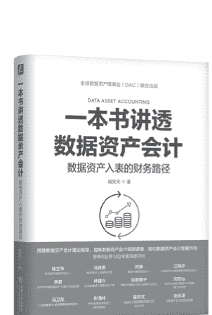

## 一本书讲透数据资产会计：数据资产入表的财务路径

作者：戚笑天 书号：978-7-111-76562-2

### 内容简介

全书共11章，分为上、中、下三篇。

上篇（第1~3章）数据资产会计基础
基于会计师视角带领读者全面认识数据要素与数据资产，阐述数据资产会计的缘起与现状，搭建数据资产会计的基本框架，进一步基于数据要素的全价值链视角明确数据资产会计的应用前提，展现数据资产会计如何嵌入数据要素产业生态中。

中篇（第4~8章）数据资产会计实务
以包括《企业数据资源相关会计处理暂行规定》在内的企业会计准则体系为基础，启迪会计职业判断智慧，萃取账务处理精华，基于数据资产入表展开深度财务分析，基于业数财融合视角展现数据资产会计应对数据业态的核心思路，提供数据资产全生命周期会计核算及数据资产入表的落地方案。

下篇（第9~11章）数据资产会计专题研究
剖析企业数据资产入表的典型实战案例，提炼数据资产会计底层逻辑，研讨数据资产会计推动企业数智化转型的技术方案，展望数据资产会计的未来。

## 推荐阅读


## 一本书讲透数据资产入表

作者：王琰 孟庆国 刘晗 朱越 等 书号：978-7-111-75895-2

### 内容简介

本书分为四部分，不仅从战略、方法、工具、实操、案例等角度为读者提供了全面的数据资产入表知识体系，还前瞻性地探讨了数据资产入表后的价值挖掘、资产评估和金融创新。

第一部分 全景概览（第1和2章） 深入分析数据资产入表的宏观背景、核心目标及其对企乃至社会的价值，为读者描绘数据资产入表的时代意义和发展蓝图。

第二部分 核心知识体系（第3~5章） 详解数据资产入表所需的会计原理、法律框架和大数据技术基础，建立全面而深入的知识体系，为实操打下坚实基础。

第三部分 实操指南（第6~9章） 系统阐述实施策略与具体步骤，涵盖数据原始资源入表与数据产品入表的关键环节，提供详尽的实操指南。

第四部分 价值挖掘（第10~13章） 指导企业探索金融创新工具的应用，实现数据的资产化和资本化，释放数据资源的巨大潜在价值。

此外，附录包含“数据资产入表36问”“数据要素相关标准清单”等内容，插页给出了“数据资产入表知识地图”。

## 作者简介

### 申镇

资深数据治理专家，现任百分点科技企业政企事业部咨询总监/首席咨询顾问，兼AI-DG与数据治理大模型主要负责人。深耕数据治理、主数据管理（MDM）及数据智能化领域多年，曾主导并交付多个国家级政企、大型央企国企及海外复杂场景的标杆数字化项目。具备丰富的售前咨询与大型项目实战交付经验，致力于将大语言模型（LLM）等前沿AI技术与企业数据资产管理深度融合，推动传统数据治理向敏捷化、智能化范式转型。

### 白佳喜

高级工程师，资深数据治理专家，CICC大模型与决策智能、具身智能、情报与智能认知专委会委员。深耕集团型企业数据治理、供应链管理与智能决策领域多年，专注于AI技术在数据管理中的工程化落地，擅长以知识图谱、大模型与智能决策能力赋能制造企业精益管理。

### 赖志明

资深数据治理专家，大数据架构师，公众号及视频号“志明与数据”的作者。拥有16年数据领域实战经验，专注金融监管、公共数据等领域的项目落地，拥有CDGP、CDAM等多项专业认证。

### 李昕

高级工程师，资深数据安全专家，大模型架构师，深耕集团型企业数据安全治理、智能制造与智能化赋能领域多年。曾主导10多家产业公司IT体系与数据安全体系的构建。擅长AI技术在数据安全、智能治理中的工程落地。持有CISSP、CDMP、TOGAF、PCA、AIDC等多项专业证书。

### 马伟凯

资深数据治理专家，现任百分点科技企业政企事业部总经理，兼AI-DG产品及数据治理大模型牵头人，长期专注于数据治理与AI技术在政企领域的应用，曾主导交付多个政府及大型集团数字化项目。

AGI浪潮下，智能化数据治理正迎来历史性重塑：向下，深度释放数据资产的变现潜能；向上，全面构筑企业AI战略落地的核心基座。

**时代的拐点：** 迈向AGI时代，高质量的数据已成为决定AI能走多远的“核心燃料”。企业数据治理正经历从“劳动密集型”向“智能化驱动”跃迁的历史性拐点。大模型不再是停留在概念层面的技术玩具，而是正在重塑元数据解析、标准映射、质量稽核与安全管控的“智能基座”。今天的数据治理成效，将直接兑现为明天企业AI战略的业务价值。

**实战的价值：** 智能化数据治理的画卷才刚刚展开，本书的目标并非提供终极答案，而是希望为数据治理行业“抛砖引玉”。本书凝结了作者在一线大型政企与行业头部项目中的真实历练，系统探讨了如何依托DeepSeek与Dify敏捷落地AI数据治理能力。我们希望借此帮助企业跨越技术鸿沟，不仅让数据创造切实的业务收益，更为企业全面拥抱AGI时代夯实坚不可摧的数据底座。

