# DeepSeek 联合 Dify 推动数据治理智能化升级

### 内容速览
本书直面组织在数据管理上的实际痛点，以 DeepSeek 大语言模型作为认知中枢，以 Dify 开源应用平台作为快速交付车间，全景呈现模型能力嵌入治理实战的完整路径。

五位编者来自甲方与乙方一线，汇总多年项目沉淀，目标是帮助数字化负责人、数据管理者与技术建设者跨越从规划到落地的鸿沟，将原本沉重的治理负担转化为支撑创新与增长的核心驱动力，推动治理形态从人力密集走向敏捷智能。

全书共分四篇十七章。

**概念与挑战篇：** 厘清数据治理的核心概念与现实瓶颈，点出传统规则僵化、响应迟缓的短板，描绘生成式智能时代的数据管理新图景。解析 DeepSeek 的关键能力如何破解现有难题，并给出 AI 与治理融合的框架与推进路线，为后续转型建立认知基础。

**理论与方法篇：** 深入治理的核心深水区，围绕目标管理、元数据管理、数据标准管理、数据质量管理、数据安全管理五大重点领域，拆解大模型的应用机理与典型场景。提供从价值判断到落地执行的完整方法论，让 AI 赋能有据可依。

**工具与实战篇：** 摒弃空谈，以可视化低代码的 Dify 框架为载体、以 DeepSeek 为智能内核，从零搭建数据治理的知识底座。完整演示需求拆解、工作流搭建、核心提示词设计与上线运行，让从业者能够上手驾驭 AI 工具。

**案例与展望篇：** 将方法落地到行业。深度剖析央国企指标体系建设、制造企业物料主数据与 BOM 清理、金融行业数据分类分级保护、半导体海量工艺数据元数据治理四大标杆案例，提供可定制的高适应性方案，并前瞻企业级数据战略的演进方向。

## 图书在版编目（CIP）数据
AI 驱动的数据治理 基于 DeepSeek+Dify 的实现 /
申镇等著 . --北京 机械工业出版社 2026. 2.
ISBN 978-7-111-80626-4
I. F272.7-39
中国国家版本馆 CIP 数据核字第 2026H4X990 号
机械工业出版社（北京市百万庄大街 22 号 邮政编码 100037）
策划编辑：孙海亮 责任编辑：孙海亮
责任校对：孙明慧 任婷婷 景 飞 责任印制：任维东
河北宝昌佳彩印刷有限公司印刷
2026 年 4 月第 1 版第 1 次印刷
170mm×230mm·22.25 印张·1 插页·337 千字
标准书号：ISBN 978-7-111-80626-4
定价：99.00 元
电话服务 网络服务
客服电话：010-88361066 机 工 官 网：www.cmpbook.com
010-88379833 机 工 官 博：weibo.com/cmp1952
010-68326294 金 书 网：www.golden-book.com
封底无防伪标均为盗版 机工教育服务网：www.cmpedu.com

## 前言
生成式智能浪潮席卷各行各业，数据正成为企业创新与增长的核心生产要素。面对体量庞大、形态多样、增长迅猛的数据资源，传统治理方式捉襟见肘，宛如一座陈旧的档案馆，规则僵硬、流程繁琐、检索困难。管理者疲于编目修订，使用者困于海量卷宗。规则僵化、流程冗长、反应迟滞、成本高企，让许多组织在治理上举步维艰。到了智能时代，数据治理是否只能是沉重的合规负担？能否变成敏捷高效、直接创造业务价值的核心能力？

基于上述痛点与机遇，本书应运而生。我们看到以大语言模型为代表的生成式技术，尤其是具备理解、生成、推理与交互能力的 DeepSeek，正在为治理范式提供新的可能。它不再停留在概念层面，而是能够真正嵌入元数据、标准、质量、安全等各个治理环节，成为智能伙伴。本书既阐述融合的理论基础，也聚焦融合的操作路径，为数据管理者、数字化战略负责人、AI 技术开发者提供兼具前瞻性与实操性的参考。

### 主要读者群体
- **企业数据治理负责人与实践者**：首席数据官、治理经理、数据架构师、质量工程师、安全专家，可获得优化流程、提升效率、解决实际问题的思路与工具。
- **业务管理者与数据分析师**：作为需求侧，可认识到 AI 如何让治理更贴近业务、更快响应分析诉求，从而协同挖掘数据价值。
- **IT 与数字化战略决策者**：从宏观层面把握 AI 赋能治理的价值与路径，为制定智能数据战略与技术投入提供决策依据。
- **AI 技术开发者与数据科学家**：获得场景拆解、架构设计、工作流构建与提示词工程的跨界实践经验。
- **咨询顾问与研究人员**：可借鉴本书构建的理论框架、方法体系与行业案例作为项目交付与研究的素材。

### 本书主要内容
全书分为四篇、共 17 章，构成从概念到挑战、理论到方法、工具到实战、案例到展望的完整知识链。

**第一篇：概念与挑战。** 先梳理传统向智能时代的定义演进、核心框架与转型方向；再解析 DeepSeek 如何助力破解现有挑战，并系统阐述融合的理论框架、创新模式、典型场景与实施路线。

**第二篇：理论与方法。** 深入五大关键领域，探讨 DeepSeek 在企业数据治理目标、元数据管理、数据标准管理、数据质量管理、数据安全管理中的融合应用。除第 4 章外，每章遵循“价值与挑战→原理→场景详解→实践考量”逻辑，形成系统方法论。

**第三篇：工具与实战。** 全书实战核心。以 Dify 为敏捷开发底座、DeepSeek 为智能内核，展示如何搭建数据治理知识库基座，并在元数据、数据标准、数据质量、数据安全四域搭建智能工作流，覆盖需求分析到部署运行的全链路。

**第四篇：案例与展望。** 通过真实行业案例展示落地成效，聚焦央国企智能指标管理、制造物料主数据与 BOM 清理、金融合规驱动的数据分类分级、半导体海量工艺元数据治理四大场景，最后对 AI 赋能治理的未来进行展望。

### 本书主要特色
- 前瞻性与系统性并存，构建清晰的 AI 与数据治理融合理论框架并研判趋势。
- 理论与实战紧密结合，提供可操作的方法、步骤、提示词示例与工作流图示。
- 场景驱动、覆盖全面，围绕治理核心域与关键行业给出方案清单。
- 工具栈明确，以 DeepSeek 为智能大脑、以 Dify 为敏捷工厂，思想可迁移至其他模型与平台。
- 行业案例深度剖析，展现 AI 赋能在不同环境下的生命力与适应性。

### 如何阅读本书
- **治理负责人与实践者**：通读全书，首篇建立整体认知，精读第二篇相关章节，第三篇作为实战手册边学边用。
- **业务管理者与分析师**：重点阅读前言、第一篇第 1、3 章及前两篇内容，并浏览第四篇案例寻找灵感。
- **IT 与战略决策者**：集中阅读第一、二篇把握战略价值与路径，案例篇用于评估投入与风险。
- **AI 开发者与数据科学家**：快速浏览第一篇作背景，深入第三篇工作流架构、选型、提示词工程与调优。
- **咨询顾问与研究人员**：按需选读，借鉴理论框架、场景分析与案例细节。

Dify 采用可视化低代码，本书从零手把手引导每一步，帮助更多从业者掌握 AI 赋能的实用技能。

数据治理的智能化是一场关乎效率与未来的深刻变革。落地不会一帆风顺，但方向正确就值得前行。愿本书成为变革旅程的可靠向导，助力组织释放数据的真实潜能，在智能时代赢得先机。

申 镇

# 概念与挑战篇
本篇总览：帮助读者建立对数据治理的整体认知，并揭示大模型如何突破治理困境。先从定义与重要性切入，辨析传统模式的固有局限，如任务繁重、依赖人工、难以应对海量非结构化数据。再以智能化、自动化、流程化、价值化四维度描绘智能时代治理新图景。继而拆解 DeepSeek 在理解、生成、代码智能与知识推理方面的优势，探讨其如何精准匹配治理需求。最后梳理传统模式与智能技术并存的现状挑战，并展望作业模式的重构。

# 第 1 章 数据治理的现状与挑战
传统治理长期受制于工作量大、人工依赖高。从标准制定、元数据维护到质量监控与安全管理，企业需投入大量人力处理重复操作，而复合型人才短缺更导致规划难落地、成本居高。DAMA、DCMM 等框架提供方法论，但在执行层面因缺乏自动化，难以应对海量多源数据的实时处理，尤其在非结构化数据治理上几乎无力，难以快速支撑业务对高质量数据的需求。

AI 的突破提供了自动化解法。通过理解企业数据、业务与系统，AI 可支撑数据自动分类、智能标注、异常检测等，显著降低人工负荷并缩短干预时间。大模型对非结构化数据的理解与生成能力，可迅速建立企业知识库，填补传统工具空白。本章从人工治理局限切入，剖析盘点难、标准难立、修复低效等典型问题，并揭示 AI 如何重构作业模式，如智能元数据管理、实时质量监控，为后续工具实践奠定基础。

## 1.1 数据治理的定义与重要性

### 1.1.1 传统数据治理的定义
传统 Data Governance 是一套以政策、流程、标准与工具为依托，确保数据质量、安全、可用与一致的管理体系。其目标是让企业拥有可信赖的高质量数据以支撑决策与合规，主要涵盖：

- 数据标准与规范：统一定义、格式与规则，提升跨系统一致性。
- 元数据管理：记录来源、含义与流转，增强可理解性与可追溯性。
- 数据质量管理：依规则检测并人工干预，减少错误、提升时效。
- 数据安全与隐私合规：管控访问权限，减少丢失篡改风险，满足法规。

传统治理受限于工具与人才，仅能实现静态管控且依赖专家经验。面对需求激增尤其是非结构化数据，其响应速度与效能逐步受限。

### 1.1.2 AI 时代的数据治理定义
智能时代治理正从被动管理转向主动赋能，通过智能化、自动化、流程化、价值化实现效率与价值倍增。

#### 1. 智能化
赋予系统认知与决策能力，包括智能元数据管理、异常检测与合规风险预测。
- 智能元数据管理：模型自动解析语义，如将字段 cust_tel 推断为客户联系电话，减少手工标注。
- 智能异常检测：识别隐性模式，如销售数据规律性缺失暗示接口问题。
- 合规风险预测：基于历史审计记录预测敏感数据异常访问等风险点。

#### 2. 自动化
重构人工密集流程，包括自动化清洗、实时质量监控、自愈 ETL 运维。
- 自动化清洗：结合知识库自动去重、补全，如将“北京市北京”规范为“北京市”。
- 实时质量监控：流式引擎持续校验，实现事中管理。
- 自愈 ETL 运维：异常时自动回滚、重试或切换备援链路。

#### 3. 流程化
重塑工作流以实现敏捷响应，包括嵌入生产、闭环机制与动态策略。
- 流程嵌入生产：数据生成时实时校验阈值。
- 闭环治理：自动生成工单并路由处理，直至验证闭环。
- 动态策略调整：依据字段错误率变化自动优化稽核规则。

#### 4. 价值化
从成本中心转向价值引擎，实现智能服务、AI-ready 供给与价值量化。
- 智能数据服务：根据需求自动推荐资产，如查询“客户流失”时关联消费记录与客服日志。
- AI-ready 数据供给：自动准备高质量训练集，去除偏差并生成合成数据增强样本。
- 数据价值量化：融合经营、外部与用户数据构建分析模型。

传统与智能时代治理的总体差异如图 1-1 所示。
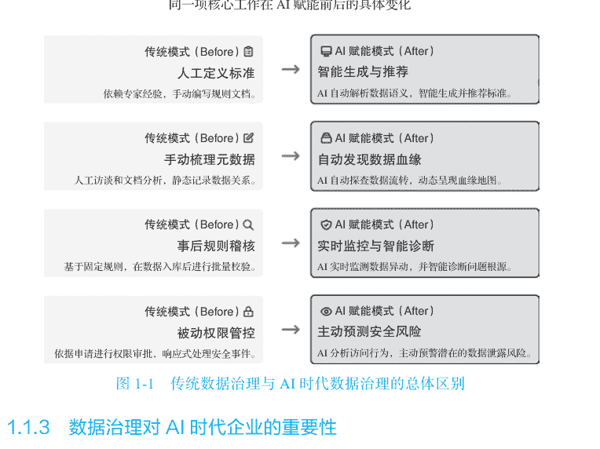

### 1.1.3 数据治理对 AI 时代企业的重要性
在数字化与 AI 驱动的商业环境下，数据治理既是基础能力也是 AI 赋能的必经之路，重要性体现在：

支撑经营与战略决策：高质量数据是精准分析与智能决策前提。零售企业依赖准确用户行为数据优化供应链与个性化推荐。

实现 AI 战略落地：AI 落地核心挑战之一是数据准备。未经治理的数据会导致模型偏差、低准确度甚至逻辑错误。LLM 训练依赖大规模高质量语料，脏数据会引发错误回答。

加速业务创新与合规：良好治理平衡利用与风险。智能制造通过实时治理优化生产并确保符合数据安全标准。

对传统企业而言，智能化转型须治理先行：数据标准化为大模型提供一致干净源；元数据智能化补充业务背景，提升可解释性；安全合规理念贯穿 AI 全流程，从处理到部署均合规。

跳过治理直接部署 AI，易陷入垃圾进垃圾出的困境。

## 1.2 数据治理框架与方法论

### 1.2.1 数据治理框架
数据治理框架界定工作范围与边界。当前权威框架为 DCMM，侧重成熟度评估，偏事后，缺乏对规划与落地实施的直接指导，框架内容如图 1-2 所示。

DCMM 将数据管理能力分为 1 初级至 5 优化级五档，从制度规范、组织建设、技术工具、人员能力、数据文化五维度评估企业在数据战略、治理、架构等领域的健康状况。

约八成公司的数据治理成熟度仍聚焦在二级及更低的区间。主因是顶层数据规划模糊制约了质量改善，治理依赖手工操作导致价值释放缓慢。DCMM 的作用更像一份详尽的体检报告：能精准定位问题所在，却缺乏智能化的诊疗方案。评估之后许多企业虽已厘清短板，却因缺少可执行的改进路径与方法，提效有限，始终困在低成熟度的循环里。

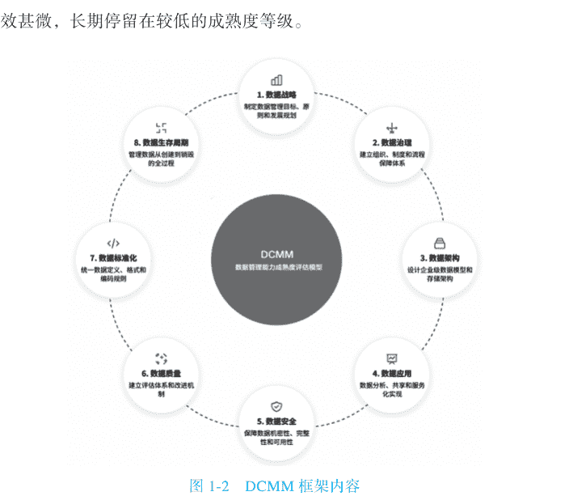

即便以 DCMM 为体系化参考，数据治理真正落地时，传统模式与人工智能加持的场景都会遭遇一批共同的痛点和新出现的难题。

### 1.2.2 数据治理方法论

在智能化转型持续推进的背景下，数据治理的实践在不断加深，相应的方法论也在迭代演进。基于对头部企业的梳理，下面对华为与 IBM 两种代表性框架做系统性比较。

华为的思路以“清洁、透明、智慧”为导向，通过分层体系与差异化策略支撑数字化进程，其核心要点与落地举措见表 1-1。

表 1-1 华为数据治理方法论的核心内容和关键实践

| 维度 | 核心内容 | 关键实践 |
| :--- | :--- | :--- |
| 组织保障体系 | 依托顶层制度、组织支撑和流程规范协同搭建企业级治理机制 | • 正式对外发布《数据管理总纲》《数据质量管理政策》等制度<br>• 在集团与业务域层面设立数据负责人，例如财务域负责人由 CFO 担任<br>• 由业务部门直接承担数据质量指标考核 |
| 信息架构标准 | 建立业务与 IT 的统一语义体系，规范企业数据模型 | • 明确 18 个一级主题域，如客户 / 产品 / 供应商等<br>• 发布超过 5500 个业务对象标准实体，如“客户”实体包含 92 个标准字段<br>• 要求 IT 系统在数据字典中把业务术语映射到物理字段 |
| 全生命周期管理 | 覆盖数据从生成到销毁的 11 个关键环节 | • 入湖治理：执行 6 项准入要求，如负责人签核、质量评估等<br>• 使用监控：把服务调用与权限绑定实现自动熔断，如单用户 API 日调用上限 10 万次<br>• 归档销毁：执行冷数据分层存储，如 7 层分级，冷数据占比控制在 30% 以内 |
| 质量与安全框架 | 质量与安全双轨并行，确保数据可信可控 | 质量方面：<br>• 制定 45 类质量规则，如供应商主数据完整性 ≥99.5%<br>• 通过实时看板追踪问题闭环时长，平均约 2.7 天<br>安全方面：<br>• 对敏感字段进行脱敏，如身份证仅显示后 4 位<br>• 权限控制采用 RBAC+ABAC 混合模式 |
| 平台化服务能力 | 借助统一数据平台降低使用门槛 | • 数据服务超市：累计上线 1200 多个标准化 API，如订单状态查询接口日均调用 800 万次<br>• 分析工具箱：提供自助式 SQL 编辑器，支持 78% 非技术人员自助制表<br>• 智能治理工具：AI 辅助定位质量问题，准确率达 92% |
| 成效指标 | 通过治理释放可感知的业务价值 | • 合同评审效率提升 40%，自动化校验替代人工<br>• 跨系统数据对接成本下降 80%，主数据复用率由 35% 提升至 89%<br>• 数据质量问题解决周期压缩至原先的 30%，从平均 21 天降到 7 天<br>• 数字化转型相关项目 ROI 达到 1:7.8 |

华为方案可归纳为四点特质：

- 以业务为牵引：责任压回业务侧，Owner 机制保障源头质量。
- 以技术为支撑：依托数据平台构建数据湖并实现智能化治理。
- 以组织为协同：数据管理部门与变革项目配合，将治理要求内嵌到 IT 设计。
- 以价值为闭环：从资产目录到服务超市，推动数据从资源向生产力转化。

实践上华为实现数据质量问题下降 65%、跨系统对接成本降低 80%，该经验为传统企业数字化提供了可复制的范式。

IBM 的数据治理是一套体系化框架，目的在于把数据视作核心资产来管理，覆盖体系、成熟度、实施流程与技术支撑。其要点见表 1-2。

表 1-2 IBM 数据治理方法论的核心内容和关键实践

| 维度 | 核心内容 | 关键实践 |
| :--- | :--- | :--- |
| 定义业务问题 | 以真实业务痛点为切入点，把治理与风险管控、合规、降本、增收等价值挂钩，明确启动范围 | 聚焦痛点并关联业务价值，确定初期边界。如解决销售报表不一致导致的决策偏差，提升决策质量，首期聚焦核心销售指标 |
| 获取高层支持 | 获得业务与 IT 高层认可，组建虚拟团队并任命负责人，用案例展示价值 | 争取领导层认同，组建跨部门虚拟团队，任命数据治理负责人，通过 Quick Wins 证明价值。如向 CXO 汇报价值，快速清理核心客户数据 |
| 执行成熟度评估 | 借助成熟度模型评估现状并设定未来目标，通常为 12～18 个月 | 评估 As-Is 现状，定义 To-Be 目标，设定时间并覆盖关键领域。如用 DAMA 模型评估，发现数据质量在 L1，计划 18 个月内达 L3，范围含数据质量、元数据等 |
| 创建路线图 | 基于评估差距制定行动计划，识别资源并排序，确保短期见效 | 根据差距制定行动计划，明确人员流程技术需求并排序。如制定未来 12 个月计划，包含采购元数据工具、定义关键数据元素、优先解决影响财报问题 |
| 建立组织蓝图 | 明确治理架构三层、角色职责与决策权，制定章程 | 定义架构、职责与决策机制并发布章程。如设立数据治理委员会负责决策、数据管理办公室负责执行，明确数据所有者与数据管家职责 |
| 创建数据字典/业务术语库 | 建立受控的集中术语库，统一定义确保业务 IT 共识并关联元数据 | 建立统一术语库，定义关键术语并达成共识。如在企业 Wiki 建立术语表，定义“活跃客户”并获认可后关联 CRM 客户状态字段 |
| 理解数据 | 通过发现与分析掌握数据来源、结构、关系、质量、血缘、敏感分布等现状 | 执行数据剖析，掌握来源结构关系质量血缘敏感分布。如用剖析工具分析客户表，识别地址空值率与格式问题，追溯销售额报告的血缘 |
| 创建元数据存储库 | 融合业务与技术元数据，构建统一仓库支持血缘影响分析 | 整合业务术语与技术扫描结果到统一平台。如把术语库与数据库表字段信息整合，支持查看变更对下游报表影响 |
| 定义度量指标 | 建立可度量 KPI 体系，区分业务与技术并定期跟踪 | 建立 KPI，区分业务与技术并月度跟踪。如业务 KPI 为客户主数据重复率下降 20%，技术 KPI 为核心系统元数据注册率达 90% |
| 治理主数据 | 可选专题，对核心主数据制定策略标准流程，实现单一可信视图 | 可选，定义主数据治理策略与标准。如实施客户 MDM，建立黄金客户记录标准与维护流程，确保各系统使用统一信息 |
| 指导分析 | 可选专题，协调 BI 与分析活动，推广最佳实践 | 可选，建立 BI 协同机制。如成立商业智能能力中心，推广认证数据集，提供标准报表模板并开展培训 |
| 管理安全和隐私 | 可选专题，制定安全隐私策略，发现分类标记敏感数据并实施控制 | 可选，制定分类策略并实施控制。如识别标记 PII，对敏感数据加密存储与访问控制，对非生产环境数据脱敏 |
| 控制信息生命周期 | 可选专题，管理数据从创建到归档销毁全流程，制定保留处置策略 | 可选，实施全生命周期管理。如制定财务数据保留 7 年后安全销毁策略，实施邮件等非结构化数据归档以满足合规与 eDiscovery |
| 度量结果 | 定期度量 KPI 向高层汇报，证明价值并优化路线图形成闭环 | 定期度量并汇报，反馈优化路线图。如每季度衡量质量提升百分比向治理委员会汇报，根据结果调整下季度优先级，形成 PDCA |

总体来看，华为更偏向场景落地，借助数据湖与业务 Owner 机制破解孤岛，适合对响应速度要求高的非数字原生型企业；IBM 更强调框架的完整性，通过分层治理与成熟度模型追求长期可持续，适合需兼顾合规与复杂架构的大型组织。中外差异本质上是集中管控与执行力导向，与 IT 架构深度融合且强调价值闭环的不同，为人工智能赋能的现代数据治理提供了参考。

两者代表了国内外领先实践。华为突出业务驱动，让业务部门直接担任数据所有者，从源头改善质量；IBM 突出系统性与价值闭环，从业务痛点出发制定路线图并量化商业回报。华为与 IBM 方法差异见图 1-3。

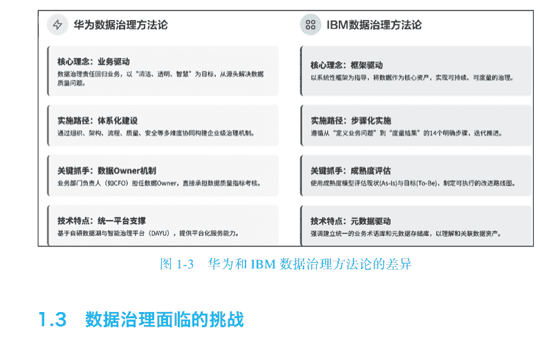

图 1-3 华为和IBM数据治理方法论的差异

## 1.3 数据治理面临的挑战

### 1.3.1 传统数据治理面临的挑战

在 AI 时代，传统数据治理亟需更新方法论以匹配企业使用需求。传统治理聚焦结构化数据、数据仓库、报表与基础分析，主要挑战如下。

### 1. 数据战略的挑战

- 价值难以体现：难以量化治理对业务的具体贡献，常被视作 IT 成本而非战略投入，难以获得持续高层支持与资源。
- 目标模糊且对齐不足：治理目标多偏技术，如整合与质量提升，未能与核心业务战略如提升客户满意度、降低运营风险有效结合。
- 缺乏顶层设计：缺少把数据视为核心资产的全局规划，治理活动常零散且被动响应。

### 2. 数据治理组织与流程层面挑战

- 权责不清：数据所有权、管理权、使用权界定模糊，数据管家等角色职责落实不力，导致问题无人负责、决策低效。
- 政策落地难：制度、标准与流程多停留在纸面，缺乏有效执行、监督与问责，难在业务与 IT 间推行。
- 跨部门协调难：治理涉及多个业务与 IT 部门，打破壁垒、协调利益、达成共识难度大。
- 缺乏专业组织与资源：多数企业未设专门数据治理办公室或配备足够人力推动与维持治理。

### 3. 数据架构挑战

- 数据孤岛林立：系统建设缺乏统一规划，ERP、CRM、SCM 等独立建设导致数据难整合共享。
- 架构僵化复杂：传统数据仓库难快速适应新数据源与分析需求，点对点集成导致架构复杂难维护。
- 缺乏统一数据模型：缺少企业级概念或逻辑模型作为蓝图，不同系统数据结构与含义不一致。

### 4. 数据应用挑战

- 报表不一致：来源、口径、处理逻辑差异导致同一指标在不同报表中数值不一，影响决策可信度。
- 获取效率低：业务分析师需花费大量时间找数、理解、清洗、整合，无法聚焦分析洞察。
- 应用与数据解耦难：应用与底层数据紧密耦合，数据结构变更易对上层应用产生冲击，反之亦然。

### 5. 数据安全挑战

- 访问控制粗放：权限管理多基于角色而非细粒度内容，难以精准控制，存在泄露风险。
- 敏感数据管理不足：对个人身份信息、财务数据等识别、分类、脱敏、加密等保护措施不足或不统一。
- 审计能力有限：对数据访问与使用行为缺乏全面审计追踪。
- 跨系统安全策略不一致：不同系统安全策略与实施水平参差不齐。

### 6. 数据质量挑战

- 质量问题普遍：源系统中存在不准、不全、不一致、不及时、格式无效等问题。
- 缺乏系统度量与监控：缺少持续度量、监控与报告机制，问题常在下游应用暴露才被发现。
- 根源追溯困难：质量问题涉及多系统多流程，定位根本原因耗时。
- 修复成本高且被动：清洗修复多依赖人工，成本高效率低，且多为事后补救，缺乏源头预防。

### 7. 数据标准化挑战

- 缺乏统一业务术语：核心概念如客户、产品、订单状态定义不一，导致沟通歧义与整合困难。
- 标准不一：同一数据元素在不同系统编码、格式、度量单位不统一。
- 主数据管理分散：核心主数据在多系统独立维护，缺乏统一管理与黄金记录，导致冗余与不一致。
- 标准推广执行难：即便制定标准，全企业范围推广与强制执行阻力大。

### 8. 数据生命周期挑战

- 缺乏明确策略：对创建、存储、使用、归档、销毁环节缺乏清晰管理策略与流程。
- 数据冗余与存储成本：过期、无效、重复数据未及时清理，浪费存储资源与管理成本。
- 合规风险：难以满足法规对保留期限与安全处置要求。
- 历史数据利用困难：归档数据格式陈旧或缺元数据，检索与再利用困难。

基于上述提炼，传统数据治理的核心困境如图 1-4 所示。

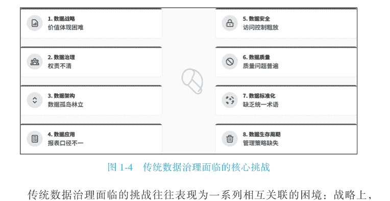

传统治理常表现为相互关联的困境：战略上价值难量化且与业务脱节；执行上权责不清、跨部门协同难、标准难落地；最终传导至技术与应用层面，体现为孤岛、质量低下、安全事件频发，严重制约数据潜能释放。

### 1.3.2 AI 时代数据治理面临的挑战

AI 时代对海量多模态数据、模型自身、可解释性等新维度的治理需求，使治理体系更复杂、更动态，需要全新框架。与传统框架最大区别在于，AI 将传统治理内容统一接管，模型、架构与平台成为重要管理对象。AI 时代数据治理分层框架见图 1-5。

综上，AI 时代现代化数据治理框架以清晰的数据战略与价值为顶层指引，确保治理与业务同频。其核心并行管理传统数据资产与新兴 AI 模型资产，体现治理范围的根本扩展。整个过程由数据安全与 AI 伦理两大守护支柱全方位护航，确保合规可信。

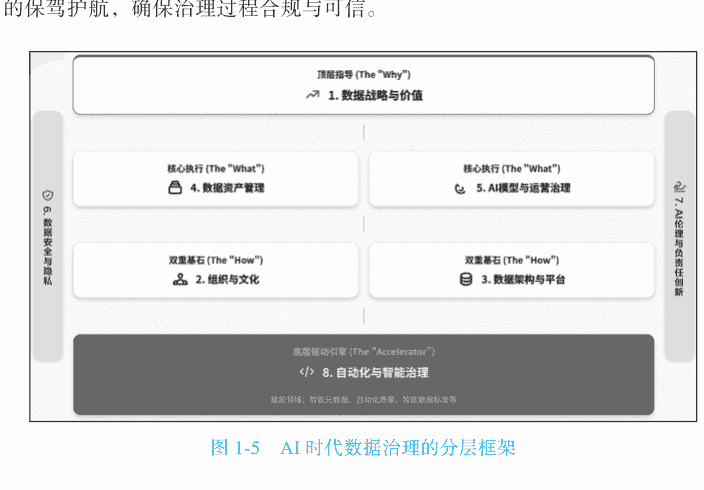

自动化与智能治理作为底层驱动引擎，以 AI 技术持续赋能上层领域，将数据治理从被动成本中心转向主动、高效、持续创造价值的战略能力。AI 时代数据治理领域具体定义见表 1-3。

表 1-3 AI 时代数据治理领域的具体定义

| 数据治理领域 | 定义 |
| :--- | :--- |
| 数据战略与价值 | 指企业围绕数据与 AI 作为核心战略资产制定的顶层规划与路线图。它要求把数据驱动和 AI 驱动举措与业务目标对齐，论证并衡量治理与 AI 应用的商业回报，包括财务与非财务，争取并保持高层支持，并将 AI 融入整体发展战略 |

# 智能浪潮下数据管控的版图重塑

进入智能化时代，数据管控的边界被彻底打开。七大板块的内涵都在迁移，从只管数据本身转向数据和模型协同的生态经营。

**组织文化建设**：搭建管控所需的人才架构和职责体系，明确数据负责人、数据管家、人工智能伦理官等新岗位的边界和决策机制，同时培育全员数据价值认知、基础数据素养和智能伦理意识，强化协作、问责和人才梯队。

**技术架构平台**：设计支撑全生命周期管控和智能应用的技术底座。包括弹性存储如数据湖、湖仓一体，高效批流处理能力，打通集成通道，并提供模型开发、训练、部署和监控的一体化智能平台。

**资产全生命周期管理**：把数据及元数据、主数据、参考数据等衍生物视为可定价可运营的核心资产。进行全周期管控，融合元数据理解、数据质量管控含智能场景的代表性与偏见审视、数据标准化、血缘追踪尤其是进入模型的路径、以及从产生到销毁的生命周期管理。

**模型运营管控**：对模型全生命周期实施管控。覆盖开发规范、验证、注册与版本控制、上线策略、运行期性能监控、迭代再训练、可解释性、公平性评估、风险管理直至下线。

**安全隐私防护**：通过制度、技术和流程守住数据与模型安全底线，防止非法访问、使用、泄露、篡改或破坏，并满足隐私合规要求。包括权限管控、加密、脱敏、日志审计、隐私增强技术评估落地，以及对抗性攻击等智能特有风险的防范。

**伦理负责创新**：构建原则、指引、评审机制和实践，保证智能系统在设计到应用全过程公平、透明、可解释、可追责、安全可靠，契合人类价值和社会规范。

**自动化智能治理**：借助自动化尤其是智能驱动手段，提升管控效率、准确性和覆盖面。实现智能发现、自动分类、质量自动巡检、元数据自生成、血缘自追踪，规则自动执行与校验，减少人工干预，走向主动实时管控。

综合来看，各管控板块的目标与范围均已重塑，必须探索新方法论应对智能时代挑战。表1-4梳理了主要挑战与影响。

**表1-4 智能时代各管控板块面临的挑战和影响分析**

| 管控维度 | 智能时代主要挑战 | 传导影响 |
| --- | --- | --- |
| 战略价值层面 | 如何让智能数据策略和业务目标深度绑定；如何量化智能与管控投入的回报；如何把智能真正嵌入整体数据战略；如何延续高层持续支持 | 项目和业务脱节价值难兑现；投入难为续；风险被忽视；战略落地受阻 |
| 组织文化层面 | 如何搭建敏捷跨职能的智能适配管控组织；如何界定模型风险官等新角色；如何提升数据和智能伦理素养；如何克服对智能和自动化管控的抵触；如何补齐懂管控又懂智能的复合人才短板 | 流程僵化跟不上迭代；权责不清无人担责；员工不理解不信任；管控难落地，策略失效 |

## 1.4 数据管控的痛点与转型路径

当前智能技术曲线尚未稳定，创新迭代加速。传统管控难题和智能新难题叠加，企业战略和智能深度融合，通用场景已全面渗透，专业场景加速赋能。数据管控该如何开展和转型，成为关键议题。

此刻，企业既要维系以结构化数据、数仓、BI为核心的传统体系，又要应对智能应用带来的更复杂管控诉求，过渡期困境凸显，转型迫在眉睫。

### 1.4.1 管控融合期的五大卡点

指传统管控和智能管控融合期暴露的问题，主要表现为：

1）框架和范围不匹配。传统框架为结构化数据和批处理设计，难以覆盖智能所需海量、高速、多样化尤其是非结构化数据。管控多停留在数据层，缺失对模型生命周期的管控。

表现：非结构化数据管控空白；其质量提升困难；难将非结构化信息转化为智能可用知识。

2）流程和速度冲突。传统管控多为瀑布式，审批长、手工重，和智能快速迭代、敏捷开发背道而驰。

表现：管控成为上线卡点；为赶进度牺牲管控要求风险累积；管控和研发流程脱节。

3）工具和技术断层。传统目录、主数据、质量工具缺乏非结构化处理、偏见检测、模型血缘追踪、模型资产管理等智能特性能力，智能平台和传统管控链路集成不足。

表现：人工干预占比高效率低；智能特有风险如偏见和公平性难监控；数据和模型端到端可见性差。

4）质量和标准难以扩展。传统质量关注准确性完整性，不足以覆盖智能需求的代表性、偏见、公平性等维度，且这些指标定义与度量困难；标准化需延伸至特征工程、模型接口等新域。

表现：训练数据隐性偏见未被发现导致歧视性结果；模型泛化差、特征难复用。

5）安全和隐私新挑战。传统安全手段对智能模型对抗性攻击、大规模敏感训练数据保护、隐私增强技术应用等应对不足，策略滞后于技术。

表现：模型易被攻击；隐私保护落地难效果差；合规风险上升。

总体来看，为结构化数据设计的框架、瀑布流程、传统工具链难以适应智能的海量多样、快速迭代和模型全生命周期管理。范围不足、流程滞后成创新瓶颈，技术断层致自动化和智能风险监控失效，人才和文化跟不上，最终导致数据质量、安全隐私、伦理合规等关键管控困难。

### 1.4.2 转型可把握的三条主线

结合政策和实践，未来转型路径如下：

（1）统一视角，价值驱动管控
打破传统管控和智能管控壁垒，建立统一框架管理数据和智能应用。可成立数据和智能管控委员会，按应用风险等级和数据敏感度设定管控深度。内部运营优化模型可轻量管控，客户信用评分类模型则需数据质量、公平性、伦理等多重严格评审。

（2）让智能辅助管控
用自动化和智能减轻管控负担，提升效率和覆盖。部署智能数据目录自动扫描识别分类数据并标注重要性，自动追踪血缘；用智能监测数据流，自动发现质量异常或潜在偏见并预警，而非事后人工排查。

（3）对齐业务目标，主动管控
让管控服务于业务，用业务语言讲清价值和风险。申请预算时说明特定管控措施带来的收益和风险降低；定期向管理层汇报成效，争取持续支持。

转型方向是构建现代化综合体系，融合数据和模型管控。核心是拥抱自动化和智能化、推动管控流程敏捷化并嵌入智能研发运维，同时加强组织能力、提升技能和素养，塑造负责任创新文化。终极目标是从合规驱动转向价值赋能和风险共担，保障智能健康可信发展。

## 第 2 章 DeepSeek 能力如何支撑数据管控创新

本章先从通用视角展示 DeepSeek 如何赋能组织日常，再剖析其在自然语言处理、代码智能、知识推理等维度的能力，并从数据管控角度评估这些能力对问题解决的潜力，为后续融合创新奠基。

### 2.1 能力全景与组织场景的匹配

#### 2.1.1 模型类型与能力特征

DeepSeek 包含推理和非推理两类。以 V3 和 R1 为例：

DeepSeek-V3 为非推理型，针对中文场景深度优化，擅长高效问答、文本生成、信息检索，强调流畅性、知识广度和响应速度。适用开放对话、内容创作、日常答疑等无需复杂推理的场景。

DeepSeek-R1 为推理型，专项增强数学计算、编程求解、多步逻辑推演。核心是链式思维，能拆解复杂问题逐步严谨推导，在深度逻辑分析和结构化问题求解上表现突出，适配算法设计、数学证明等重思考场景。

**表2-1 不同模型的使用场景对比**

| 特性 | V3 非推理型 | R1 推理型 |
| :--- | :--- | :--- |
| 主要优化方向 | 语言流畅性与知识广度 | 逻辑推理与分步求解 |
| 适用任务 | 回答、写作、信息整理 | 数学、编程、多轮推演 |
| 计算效率 | 通常更快 | 推导需更多算力 |
| 推理能力 | 简单直接回答 | 逐步分析复杂任务 |

**表2-2 不同模型的核心能力说明**

| 能力类别 | 核心能力 | 简要说明 |
| :--- | :--- | :--- |
| 基础直接能力 | 基础自然语言理解 | 识别主题、关键词、实体、基础情感 |
| | 标准自然语言生成 | 生成邮件、摘要、补全、基础翻译等规范文本 |
| | 基础代码理解与生成 | 阅读简单代码、识别语言、片段生成与补全 |
| | 信息检索与事实问答 | 从知识库或给定文本抽取事实并直接作答 |
| | 显式模式识别与提取 | 识别日期、邮箱、URL 等固定格式并提取 |
| 推理判断能力 | 深层语义理解 | 理解复杂指令、隐含意义、比喻、多义性 |
| | 复杂与创造性内容生成 | 撰写分析报告、长文、创意写作、论证文本 |
| | 高级代码智能 | 理解复杂算法、按需求生成代码、调试优化 |
| | 逻辑推理与问题解决 | 演绎归纳、因果分析、数学逻辑多步推理 |
| | 规划与任务分解 | 拆解目标、制定计划、评估可行性 |
| | 隐式信息推断与综合 | 跨源推断关系、识别微妙模式、综合新见解 |

基础能力支撑直接高效处理，如快速把握文本要点、生成规范日常文本、处理简单代码、精准检索事实、提取显式模式，擅长结构化重复信息自动化。

推理能力则呈现更深层次智能，可细致把握语言微妙之处、创作分析性长文、处理复杂代码逻辑、执行多步推理、辅助规划决策、从多源信息中提炼隐含洞察，适合深度分析和复杂问题解决。

#### 2.1.2 企业常见工作场景画像

企业工作可归为五类：日常办公和行政管理、业务运营和客户交互、技术研发和数据处理、经营管理和战略决策、知识工作和学习创新。

**表2-3 企业内五大类典型工作场景及关键活动**

| 场景类别 | 描述 | 关键活动 / 任务示例 | 场景特点 / 挑战 |
| :--- | :--- | :--- | :--- |
| 日常办公和行政管理 | 组织运转的基础支撑 | 邮件往来、文档起草审阅、会议安排纪要、内部资料检索、通知发布、简单审批 | 重复事务多、信息分散、沟通耗时 |
| 业务运营和客户交互 | 面向市场和客户的增长活动 | 营销文案、销售材料、客户咨询、工单处理、产品查询、社媒内容 | 响应要求高、一致性要求高、需求多样、需快速掌握知识 |
| 技术研发和数据处理 | 技术创新和数据价值挖掘 | 编写测试代码、技术文档、日志分析、数据库查询、数据清洗转换、报表制作 | 技术复杂、专业门槛高、文档维护重、流程冗长 |
| 经营管理和战略决策 | 发展方向和资源配置 | 行业报告解读、竞品分析、财务分析、战略草案、风险评估、管理汇报 | 信息量大来源杂、分析深度高、需多维整合、决策影响大 |
| 知识工作和学习创新 | 知识创造和传播 | 文献综述、研究报告、技能学习、课件开发、创意头脑风暴、知识沉淀整理 | 知识更新快、整合难、需批判和创造、显性化共享难 |

#### 2.1.3 能力落地场景示例

**表2-4 DeepSeek 赋能企业业务场景**

| 场景类别 | 具体应用示例 | 主要赋能价值 / 收益 |
| :--- | :--- | :--- |
| 日常办公和行政管理 | 自动生成邮件草稿、会议纪要摘要、报告润色；快速解答制度和历史文件问题；从表单提取关键信息辅助排会 | 效率大幅提升、沟通更准确及时、解放重复劳动 |
| 业务运营和客户交互 | 生成广告文案、社媒帖子、产品描述；提供产品问答支持并定制方案初稿；理解售前售后问题并生成个性化回复，提炼客户反馈洞察 | 客户体验优化、营销产出效率提升、运营成本下降 |

| 岗位类别 | 典型支持点 | 实际效果 |
| 技术研发与数据处理 | 编码层面可输出代码示例、单元测试模板、接口调用范例，帮助拆解复杂逻辑、定位调试方向；文档层面能自动补全注释、撰写技术文档草稿；数据层面可提供查询语句、协作文本清洗脚本、解读分析结果 | 编码与文档耗时下降，技术理解门槛降低，数据抽取转换实现部分自动化 |
| 经营管理与战略决策 | 信息提炼能将长篇研报、财报、媒体与研究资料浓缩要点；决策支持可基于已有输入与假设做情景推演、搭建战略规划框架；汇报输出可快速生成管理 PPT 大纲与初稿 | 信息获取更快、分析深度提升、战略调整更灵活、资料收集与汇报撰写时间压缩 |
| 知识工作与学习创新 | 研究环节能辅助文献检索与综述，加速论文理解与总结；学习环节可解答专业问题、生成笔记摘要、解释专业概念；创新环节可担任头脑风暴伙伴、激发新点子、协助撰写研究计划或创意文案 | 学习节奏加快、研究辅助工作部分自动化、创新视角更丰富 |

DeepSeek 已经从一个通用对话工具演进为嵌入各岗位的效率驱动力，既能承接重复性事务，也能参与深度分析与创造性工作，其关键能力与企业各类业务实现了紧密耦合。

2.2 DeepSeek 的数据治理能力拆解
本节聚焦数据治理这一专项，探讨大语言模型为复杂管控难题打开的新思路。先基于前文描绘的工作场景梳理活动会触发哪些管控诉求，再说明此类模型可扮演的角色，最后映射能力到管控的赋能点。

2.2.1 业务场景里的数据产生与使用：管控诉求的起点
组织内部的各项业务都在持续产生数据并消费数据。下面从过程产出与结果产出两维度，识别各场景的信息使用诉求，再归纳管控上的牵引点。

1. 日常办公与行政管理
过程产出主要包括邮件草稿、文档迭代、会议议程草案、审批流转记录、临时便签。结果产出则是已发出邮件、定稿的报告通知备忘录、会议纪要、审批完成记录、更新后的通讯录或组织架构信息。类型上以邮件文档纪要等非结构化为主，审批表单等半结构化为辅，通讯录等结构化信息较少。
典型使用需求是检索历史邮件或文档、查询同事联系方式或部门信息、追踪审批进度、参考过往纪要复盘决策、使用标准模板。由此引出的管控需求有可检索性，如何快速找到邮件文档记录；权限管控，谁可查看或修改特定文档或审批记录；统一规范，如何保证模板最新统一；生命周期管理，过期资料如何存档或处置；基础信息品质，如何保证通讯录等信息准确。

2. 运营与客户互动
过程产出涵盖营销策划草案、销售线索跟进记录、客户咨询过程记录如电话录音聊天记录、服务工单处理日志。结果产出包括发布的营销内容、成交的销售订单、CRM 客户信息、已解决的服务工单、客户反馈评分评论。类型上结构化信息如订单 CRM 与非结构化如聊天记录反馈评论营销文案并存，工单等为半结构化。
使用需求是形成客户 360 度视图以实现个性化服务与销售、分析营销活动效果、追踪销售进展并预测业绩、快速调取知识库解答咨询、监控满意度与舆情。对应的管控需求为信息融合与主数据管理，如何把 CRM、订单、客服等系统客户信息整合为统一视图；信息品质，确保订单信息、联系方式准确，服务记录完整；安全与隐私，保护个人敏感信息，保障营销合规；元信息管理，清晰定义营销指标、销售阶段、客户标签含义；信息可读性，让一线人员能快速读懂复杂客户信息或分析结果。

3. 技术研发与信息处理
过程产出有代码版本 Git 记录、测试脚本与日志、技术设计文档草案、信息模型迭代版本、ETL/ELT 开发脚本、模型训练日志。结果产出来源线是上线软件版本、定稿技术文档、数据库 Schema 定义、可执行的信息处理流程、训练好的机器学习模型、信息分析报告或数据集。类型包括代码、日志、文档、数据库、测试结果、数据集、模型等多种形态。
使用需求包括理解现有代码库结构与逻辑、通过日志排查故障或性能问题、查询使用数据库信息进行开发测试、构建验证部署信息处理流程或模型、共享复用技术文档代码模块或数据集。管控上需要信息溯源，追踪信息从源头经代码处理到应用的完整路径；元信息管理，有效维护代码注释、Schema 文档、模型参数说明等技术元信息；开发测试中的信息品质，如何保证测试信息质量与覆盖度、监控生产信息处理准确性；版本控制与规范，管理代码文档模型的版本，推动编码规范与设计标准；信息目录与可检索性，让开发者分析师便捷找到可用数据集 API 或模型。

4. 经营管理与战略决策
过程产出有市场分析报告草稿、财务预测模型中间版、战略讨论会议记录、KPI 计算过程信息。结果产出包括已发布财务报表、市场分析报告、董事会决策材料、已批准年度预算、确定战略规划文档、KPI 仪表盘。类型多为报告演示文稿表格等半结构化与非结构化，信息通常经过加工汇总。
使用需求是获取准确及时的经营业绩信息、理解市场趋势竞争格局客户行为、评估不同战略选项影响、监控 KPI 达成情况、向内外部清晰汇报业绩与战略。管控需求涵盖信息品质与可信度，确保决策用数准确完整一致及时；指标一致性与元信息，确保活跃用户利润率等关键指标在各报告部门间定义一致，需业务术语表与指标字典；信息安全，保护敏感财务与战略信息不泄露；信息溯源与可解释性，追溯关键指标计算来源与逻辑；呈现与易用性，以清晰方式呈现便于管理层快速理解决策。

5. 知识工作与学习创新
过程产出包含研究笔记、文献摘要草稿、培训材料初稿、设计草图、头脑风暴记录。结果产出为发表的研究论文、完成的培训课程、最终设计方案、知识库文章、专利申请文件。类型以文档笔记演示文稿设计图等非结构化为主，知识库条目等半结构化为辅。
使用需求为查找内外研究资料过往经验最佳实践、学习新技术方法领域知识、协作编辑文档分享知识、记录组织个人或团队学习成果与创新想法。管控需求包括知识发现与检索，如何从海量非结构化文档中定位知识与专家经验；知识组织与分类，如何对文档报告最佳实践进行分类标签以便管理复用；协作与版本控制，支持多人协同编辑并管理版本；知识产权保护，管理和保护核心知识资产；知识标准化与共享，促进沉淀与跨团队共享。

2.2.2 组织级信息管控的五大核心诉求
归纳上述场景后，企业在做有效管控时普遍面临五类紧迫需求。
可检索与可理解的挑战是信息散落在各系统部门，用户难找所需信息，找到后也常不明确含义来源品质与使用限制，非结构化信息利用尤其困难。需求是建立信息目录、业务术语表、信息溯源等机制，帮助快速定位并理解业务技术背景。
信息品质保障的挑战是信息在生产流转处理中易出现错误不一致缺失，影响运营与决策。需求是建立品质标准、自动化监控校验机制，快速识别诊断修复问题。
安全与合规的挑战是敏感信息泄露滥用风险与法规遵循压力，访问权限管理复杂。需求是准确识别分类敏感信息，制定执行安全策略与访问控制，保障全流程合规。
元信息管理效率与一致性的挑战是手工维护耗时易错更新滞后，来源标准不统一削弱价值。需求是借助自动化智能手段捕获生成关联维护元信息，保证准确完整一致。
降低使用门槛的挑战是非技术人员难以直接操作信息或理解复杂分析结果，价值未释放到一线。需求是提供自然语言查询等更易用方式，实现自助访问理解与信息驱动决策。

2.2.3 用生成式 AI 承接管控核心诉求
应对可检索与可理解：可借助自然语言生成能力自动为表字段指标生成业务描述技术注释摘要，丰富目录内容；构建自然语言问答与探索接口，让用户用日常语言提问并从结构化非结构化信息中定位资产或答案；通过理解代码与元信息日志，结合推理辅助推断信息溯源并解释转换逻辑；从业务文档需求中抽取术语定义，辅助构建统一术语表并与技术元信息关联。
应对信息品质保障：理解自然语言描述的品质规则并转化为可执行 SQL 或 Python 脚本；基于信息内容与业务场景理解，结合推理推荐潜在品质规则如异常值模式格式不一致；自动生成品质检查报告摘要并用业务语言解释技术校验结果；结合溯源理解辅助根因分析，缩小排查范围。
应对安全与合规：利用显式模式识别与隐式上下文推断扫描结构化非结构化信息，自动识别个人身份信息等敏感信息；基于内容与元信息理解结合推理辅助分类分级；阅读理解法规文本并结合推理辅助判断处理活动合规性，解释条款含义。
应对元信息管理效率与一致性：自动生成丰富元信息，包括业务描述技术注释，从代码注释或逻辑中提取信息；解析 ETL 脚本 SQL 代码日志自动识别构建溯源图谱；从需求设计文档流程图中抽取业务定义规则实体关系补充到元信息库；遵循特定术语规范与描述风格提升组织内元信息一致性。
应对降低使用门槛：提供 Text-to-SQL/BI 自然语言查询能力，将业务提问转为 SQL 或 BI 指令；对复杂报表分析结果生成通俗易懂的文字解释与洞察摘要；构建基于 DeepSeek 的管控知识库问答系统，整合政策标准流程 FAQ，实现自然语言快速权威解答。

第 3 章 信息管控与 DeepSeek 结合的实践路径
本章阐述新型信息管控模式的落地路径。先说明深度融合的理论框架，论述 DeepSeek 如何与管控各环节系统融合实现人机协同；再通过可操作的场景示例展示在元信息管理、信息品质、信息安全等领域的流程与价值；随后探讨大模型驱动的管控模式创新及其对理念角色流程的改变；最后正视融合中的问题与挑战，给出实施策略建议。

3.1 深度融合的理论框架
融合框架基于对管控核心需求与 DeepSeek 能力的认知，在整体管控框架与模型框架交叉上，提出以大模型为核心的新管控模型，用以指导当前与未来的思路方向。

3.1.1 融合模式分析
业界实践中信息管控与 DeepSeek 融合大致有三种形态：与现有管控工具平台融合、基于大模型构建独立管控应用、将大模型融入已有管控工作流程。
1. 嵌入式融合
嵌入式融合是最常见模式，指把 DeepSeek 的特定能力通过 API 集成到现有管控工具或平台内部。用户在熟悉的工具如信息目录、信息品质平台、主数据管理系统、数据建模工具中使用时，可直接调用智能化功能。
嵌入式融合的工作模式包括自动填充信息目录或建议业务描述技术注释；信息品质工具基于剖析结果自动推荐稽核规则草稿或生成规则代码；主数据管理平台利用 AI 辅助匹配去重或属性补全；数据建模工具根据概念模型自动生成物理模型部分 DDL 或注释。
嵌入式融合的优点是用户体验平滑，无需学习新工具即可在熟悉环境中获得增强能力。

# DeepSeek 重塑数据治理：嵌入、独立与人机协同的融合之路

### 利用存量资产与快速见效
先靠存量工具取势：把已投建的数据治理平台、目录、质量与集成软件的价值守住并做增益；同时能针对元数据描述缺失、规则缺口等单点痛点迅速验证效果，形成早期收益。

#### 嵌入式融合的短板
* 深度受限于底座：融合广度与精度往往被原有产品架构框住。
* 集成门槛不低：要么依赖厂商开放接口，要么靠企业自建较强集成能力。
* AI 能力易碎片化：不同模块嵌入的智能功能连贯性不足，使用体验割裂。

目前主流的数据目录、质量与集成厂商已在新版本里上架 AI 化应用，如目录自动补全、质量规则自动推荐、主数据重复自动识别等。

##### 2. 独立智能体应用
独立智能体是为 DeepSeek 驱动的治理任务单独打造的新型程序或智能体，比如智能问答机器人、智能治理工作流，交互完成后交付治理产出。

（1）独立智能体应用的工作模式
* 数据治理智能问答：面向员工解答数据标准、安全、分类等规范类问题。
* 数据标准初审工具：用户上传新标准需求后，AI 先行初审并给出通过建议。
* 主数据标准制定助手：通过对话描述变更意图，AI 辅助生成结构化变更建议。
* 数据血缘分析器：用自然语言询问某表的上下游影响范围。

（2）独立智能体应用的优点
* 专注深耕：可为单一任务做深度优化，功能更强更纯粹。
* 交互更友好：可设计对话式等更贴合 AI 的界面。
* 解耦灵活：与既有治理体系相对独立，便于单独开发、部署与迭代。

（3）独立智能体应用的缺点
* 增加学习成本：用户需上手又一套工具。
* 后端需打通：要连接数据源、元数据仓、治理平台才能发挥作用。
* 易形成新孤岛：集成不佳时可能产生新的数据孤岛。

典型做法是内部自建助手答规范问题，或初创公司推出独立 AI 工具做数据隐私扫描与标准分析。

## 3. 人机协同工作流
核心是重塑治理流程，明确哪些环节由 DeepSeek 承担生成、初筛、建议，哪些由数据管家、管理员等专家做复核、修正、决策，并建立反馈闭环。它更强调流程再造与分工。

### （1）人机协同工作流的工作模式
* 元数据管理：AI 自动生成描述草稿→数据管家审改确认→结果回写训练 AI。
* 质量规则管理：业务人员用自然语言提出规则→AI 生成 SQL/Python→质量管理员测试验证→上线。
* 访问申请审批：用户提交申请→AI 按敏感性、角色、共享规则做初评与建议→数据所有者据建议终批。

### （2）人机协同工作流的优点
* 各取所长：AI 负责效率与广度，人负责深度判断与责任。
* 可信度提升：人工复核守住关键决策质量。
* 持续进化：反馈循环让模型在实战中不断提效。
* 适配复杂场景：对多方确认、需综合判断的治理任务尤其适用。

### （3）人机协同工作流的缺点
* 流程再造难度大：涉及组织与习惯调整。
* 角色边界要清晰：人和 AI 的职责、权限、责任必须明确。
* 效率与风控需权衡：审核环节会拉长链路，需找到平衡点。

内容生成、代码生成等场景本质上已是人机协同，在数据治理中普遍配套人工确认，正是该模式的落地。

## 3.1.2 融合模式组合分析
三种模式在实践中常叠加：
* 嵌入式融合与人机协同工作流：工具内 AI 生成的结果往往触发人工审核工作流。
* 独立智能体应用与人机协同工作流：独立 AI 给出的方案报告需专家复核后形成闭环。
* 嵌入式融合与独立智能体应用并行：既用智能化的数据目录，也用独立助手答通用治理问题，各司其职。

## 3.1.3 融合模式发展分析
基于技术演进，未来融合将呈现：
1. 深度无缝嵌入
AI 将更底层地融入治理工具，使用者可能难以察觉背后是 AI 驱动，例如引用指标时自动补全官方定义与血缘。
2. 主动自主智能体
智能体从被动应答转向主动巡检，持续监控数据生态，自动发现质量异常、使用偏离、合规风险并预警，甚至在授权范围内自动归档、修复，经赋权后具备“数字身份与职责范围”。
3. 多模态治理
从文本代码扩展到图像、语音、视频，AI 能读懂报表截图、仪表盘、会议录音中的决策讨论，实现对更广泛知识资产的治理。
4. 人机协同进化
AI 不仅是助手，更是学习伙伴；专家更多扮演教练、评估师与战略引导者，交互更丰富，彼此共同学习进化。

整体走向是更智能、主动、多模态、协同进化的深度融合，成为治理体系不可或缺的组成。

## 3.2 数据治理融合场景

### 3.2.1 AI 融合后数据治理新场景
AI 融合并非替代，而是利用自然语言理解生成、代码智能、模式识别、信息抽取与推理优势，实现自动化、精准化与普惠化。以下按 DCMM 能力项展示融合后的典型图景。

## 第 3 章 数据治理与 DeepSeek 融合的应用场景

## 表 3-1 DCMM 融合 DeepSeek 的应用场景示例

| DCMM 能力域 | 能力项 | 融合后场景 | 场景示例 |
| :--- | :--- | :--- | :--- |
| 数据战略 | 数据战略规划 | 自动洞察与初稿撰写：综合内外信息提炼洞察，辅助起草战略规划初稿 | 输入行业研报与经营数据，输出 SWOT 要点与战略目标备选 |
| 数据战略 | 数据战略实施 | 目标拆解与资源匹配：基于战略自动拆解任务并推荐负责人与资源 | 读取战略后生成任务清单并提示建议归属部门与人选 |
| 数据战略 | 数据战略评估 | 自动化评估与预警：整合执行数据生成可读报告与图表并发出偏差预警 | 接 KPI 库每月生成战略执行仪表盘，自然语言点出增长率未达标及可能原因 |
| 数据治理 | 数据治理组织 | 职责智能答疑：基于组织与职责文档构建问答，快速定位责任归属 | 问客户主数据流程负责人，返回主数据管理团队 XXX 负责 |
| 数据治理 | 数据制度建设 | 制度起草与合规校对：辅助起草修订制度，校验逻辑术语一致性并提示法规更新 | 上传新版网络安全法，对比内部制度标出需对齐条款并给修改建议 |
| 数据治理 | 数据治理沟通 | 知识门户与培训支持：搭建全员知识库统一答疑并自动产出培训要点 | 询问数据分类分级标准，返回定义、示例与政策链接 |
| 数据架构 | 数据模型 | 模型建议与说明自动生成：依需求推荐实体关系并产出通俗注释与 ER 描述 | 输入订单产品客户管理需求，输出含 Order/Product/Customer 实体及关联的概念模型描述 |
| 数据架构 | 数据分布 | 分布梳理与可视化：解析接口文档与代码识别跨系统流动并生成数据地图草稿 | 分析 CRM 与 ERP API，识别客户信息双系统存储并在地图标注 |
| 数据集成与共享 | 数据集成 | 代码与文档自动化：按映射需求生成 ETL/API 框架并自动生成接口说明 | 输入源表目标表映射，生成可用 Python/SQL ETL 片段 |
| 数据架构 | 元数据管理 | 元数据自动抽取与血缘推导：从库代码文档抽取元数据，分析代码推断血缘 | 扫描数据库为 CUST_ID 补“客户唯一标识”描述，分析视图 SQL 自动建立血缘 |
| 数据应用 | 数据分析 | 自然语言分析与解读：支持自然语言查询并把图表统计转成通俗洞察 | 问过去一年各区销售额趋势，返回图表并附注华东区增长最显著等洞察 |
| 数据应用 | 数据开放共享 | 开放评估与文档自动生成：评估价值、合规与脱敏需求并生成说明书草案 | 分析数据集与访问日志结合隐私政策，生成需聚合处理及潜在应用的报告 |
| 数据应用 | 数据服务 | 开发测试辅助：按需求生成 API 定义、基础代码与测试用例 | 要求创建查询用户订单历史服务，生成 API 定义、伪代码与基础测试场景 |
| 数据安全 | 数据安全策略 | 策略生成与动态更新：解读法规最佳实践结合企业情况推荐策略并提示修订 | 分析 GDPR 对比现有隐私政策，高亮需补充部分并提供合规文本 |
| 数据安全 | 数据安全管理 | 敏感数据自动发现分类：扫描结构与非结构数据识别敏感信息并推荐分级 | 扫描邮件发现含薪资合同关键词附件并标记高敏感 |
| 数据安全 | 数据安全审计 | 审计日志智能分析告警：自动分析海量日志识别异常行为并生成摘要预警 | 分析数据库审计日志发现账号短时异常下载客户数据并自动生成高风险报告通知团队 |
| 数据质量 | 数据质量需求 | 规则智能推荐：分析历史报告反馈与分析结果并推荐校验规则 | 发现订单表收货地址空值率高且关联退货率，推荐建立收货地址非空规则 |
| 数据质量 | 数据质量检查 | 自然语言转检查代码：把业务描述转为可执行 SQL/Python 校验 | 输入产品编码需 P 开头加 8 位数字，生成正则校验 SQL 或 Python 函数 |
| 数据质量 | 数据质量分析 | 报告自动解读与根因初判：生成自然语言摘要并初步推断问题环节 | 总结本月地址不完整最突出集中于某渠道导入，建议检查采集接口 |
| 数据质量 | 数据质量提升 | 清洗策略推荐与修复辅助：推荐清洗方法或生成修复脚本 | 面对性别字段值不规范问题，推荐统一映射标准代码并提供转换 SQL 建议 |
| 数据标准 | 业务术语 | 术语自动发现治理：扫描内部文档提取业务术语及上下文辅助建表 | 阅读需求文档自动提取用户画像、转化漏斗等术语并附定义段落提交审核 |
| 数据标准 | 参考数据 | 参考数据智能维护推荐：监控外部标准变化提示更新并依内容智能推荐代码 | 检测到统计局新行政区划代码通知更新；在录入地址时依市区分智能推荐标准代码 |
| 数据标准 | 主数据 | 匹配去重合并：用语义与算法识别跨系统重复记录并推荐合并策略生成黄金记录 | 对比 CRM 与订单客户记录姓名微差，通过地址电话判断同一人并建议合并保留完整地址 |
| 数据元 | 数据元 | 定义标准化：依据多系统使用上下文自动完善标准定义类型长度值域 | 分析多库发现 status 字段值域不一致，推荐标准代码 1 有效 0 无效 |
| 数据标准 | 指标数据 | 一致性校验与智能解释：校验同名指标口径并生成自然语言说明 | 发现报表 A、B 销售额口径一含税一不含税并告警；解释 DAU 定义与公式 |
| 数据标准 | 数据需求 | 需求自动抽取结构化：分析非结构化文本提取关键需求生成结构化条目 | 读取销售邮件识别按月统计各产品线销售额毛利率报表需求并分解指标维度 |
| 数据生存周期 | 数据设计和开发 | 设计开发代码辅助：基于需求模型生成建库语句、ETL、API 骨架或报表草图 | 输入逻辑模型与目标数据库类型，生成物理表创建 SQL 脚本 |

通过 DCMM 全景对比可见，DeepSeek 的融入将使战略洞察更强、流程更自动化、架构管理更高效、应用分析更便捷、安全防护更主动、质量问题更早发现与修复、标准更统一智能、生命周期更智能化。企业可从单点切入逐步拥抱这一治理新范式。

数据全生命周期实战样例

在数据运维阶段，AI可以实现运维监控、风险预测与故障诊断的闭环。通过梳理历史运维日志与性能指标，模型能够提前捕捉系统瓶颈或任务失败的苗头，并在故障发生时快速读懂日志、定位根因并给出处置建议。例如 DeepSeek 察觉到某条 ETL 作业的耗时呈持续上升趋势，推算出若不干预 X 天后将超出 SLA 要求，并提示重点检查某几步的性能；当任务异常中断时，模型解析错误日志后判定为数据库连接超时，并建议排查网络状况或数据库负载压力。

在数据退役阶段，AI能够辅助解读保留策略与合规要求，结合数据访问频次、业务价值等维度，智能筛选出适合退役的数据对象并给出归档迁移或安全销毁的执行方案。例如 DeepSeek 综合用户访问日志、数据创建时间与公司七年保留政策，自动产出《建议归档清单》，内容涵盖表名、数据范围及预估归档时间。

3.2.2 AI 驱动的数据治理分步落地图

本部分给出将大模型能力融入数据治理的渐进式路径，从小规模试点验证开始，逐步向核心领域扩展，最终实现全域深度融合。清晰的演进节奏有助于企业稳健引入 DeepSeek 等模型，放大收益并控制风险。实践中建议划分为三个阶段推进。AI 与数据治理结合的演进路线如图 3-1 所示。

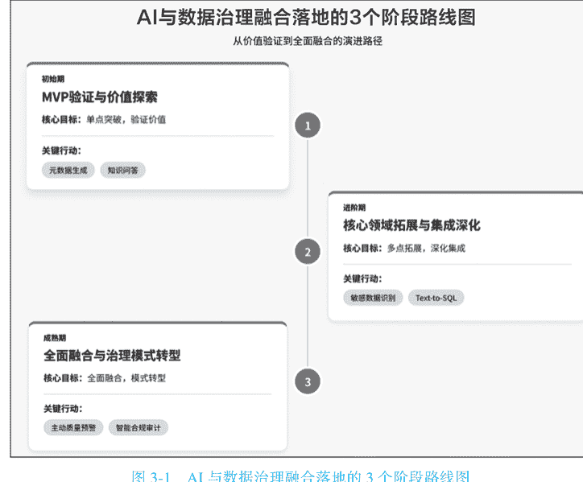

### 1. 启动期：小规模验证与价值摸索

（1）本阶段聚焦目标
以有限投入与可控风险，迅速检验 DeepSeek 在特定治理痛点上的实际价值，积累首批应用经验，提升团队信心，并为后续推广提供可参考的事实依据与决策支撑。场景挑选遵循痛点突出、任务边界清晰、成效易量化、对现有流程扰动小的原则，通常先选 1 至 2 个样例。

（2）典型试用方向
- 智能元数据描述补全：针对数据目录中缺失或表述不规范的字段说明，利用模型自动补齐并生成初稿，提升可读性。
- 数据质量规则转码：面向格式校验、非空校验等简单明确的稽核规则，实现自然语言描述到 SQL/Python 代码的自动转换。
- 治理知识问答助手：基于既有政策、标准文档构建轻量问答机器人，快速响应员工的基础咨询。

（3）MVP 开展路径
- 第一步：锁定痛点与目标。与治理团队、业务方沟通，确定 1 至 2 项最急需、用工重复且相对简单的任务，明确可交付目标，例如将某类数据表的元数据描述覆盖率由 20% 提升至 80%，并设定效率、质量、满意度等衡量指标。
- 第二步：小范围试运行。选取有限数据范围做原型验证，主要通过调用 DeepSeek API 与简易 Prompt 交互，追求快速成型而非完美集成。
- 第三步：人机协同复核。模型产出的描述、代码或答案需经数据管家、治理专家审校修正并确认后才投入使用。
- 第四步：反馈收集与复盘。汇总使用者反馈，评估是否达成预期，提炼经验与改进点。

（4）预期收获
- 在局部环节获得明显提效，例如元数据注释耗时缩短约 80%。
- 直观展现 AI 在治理场景的可行性，赢得管理层与团队认同。
- 提前暴露提示词效果、准确性校验成本等现实问题。

### 2. 深化期：核心域扩展与融合加深

（1）本阶段核心目标
把 AI 应用从试点推向数据质量、安全、发现与应用等高价值核心领域，探索更深层次的系统集成，优化人机配合，形成体系化赋能能力。场景拓展以首期成功经验为基础，选择对数据可信度、安全合规、业务可用性影响重大的方向，任务复杂度相应提升。

（2）推荐拓展场景
- 自动化敏感数据识别与分级：依托模式识别能力，对结构化和非结构化数据源进行敏感信息扫描与初步分类。
- 智能质量分析与根因提示：自动产出质量报告摘要，并初步推断问题成因、给出修复建议。
- 自然语言数据查询：为特定部门提供用自然语言提问即获业务数据结果的能力。
- 智能血缘辅助梳理：解析复杂 ETL 脚本或存储过程，辅助补全和校正数据血缘图谱。
- 主数据智能匹配与去重：利用相似度计算为核心主数据的匹配与合并提供推荐。

（3）推进方式
- 第一步：系统规划与嵌入。结合试点反馈与整体治理目标，确定优先级并考虑将 AI 更紧密嵌入现有治理平台或打造独立智能应用。
- 第二步：优化协同流程。明确人在新流程中的审核、反馈与迭代角色，提升人机分工效率。
- 第三步：注入领域知识。引入检索增强生成 RAG，让模型结合内部系统说明书、数据字典等知识库产出更精准建议。
- 第四步：建立持续监控评估。对模型性能、准确率及业务影响实施常态化度量。
- 第五步：扩大能力培训。对更多治理相关人员开展 AI 协作培训。

（4）预期价值
- 在多个核心领域显现成效，如敏感数据识别覆盖率提升、质量问题诊断周期缩短、业务取数效率提高。
- 形成更成熟的 AI 赋能治理方案。
- 初步体现对数据可信度提升、合规风险下降、价值释放加速的贡献。
- 积累集成、运维与管理方面的实战经验。

### 3. 成熟期：全域融合与治理模式转型

（1）本阶段核心目标
将 AI 能力深度渗透到数据治理各环节，覆盖 DCMM 大部分能力项，推动治理从被动人工密集型转向主动智能自动化。把 AI 作为基础能力设施，赋能全员，助力数据文化建设。场景选择强调广度与主动性，AI 成为贯穿流程的智能引擎，重点实现预警、决策辅助与流程闭环。

（2）代表性应用
- 主动式质量监控与预警：持续监测数据流与质量指标，提前预警并可自动触发修复。
- 智能化合规风险评估与审计：实时分析访问与处理行为，对照法规策略识别风险，自动完成大部分审计检查与报告。
- 智能治理服务门户：依角色与上下文推送数据标准推荐、资产导航、分析建议与知识推送。
- 数据战略推演与优化：基于内外数据模拟不同战略影响，辅助管理层进行动态决策。
- 跨域知识融合洞察：整合元数据、质量报告、安全日志、业务文档等多源信息，提供综合治理建议。

（3）落地举措
- 第一步：顶层架构设计。将 AI 作为平台核心规划，实现模块间智能联动。
- 第二步：深度嵌入与自动化闭环。把 AI 能力写入业务与 IT 流程，实现权限审批建议、工单派发等自动化。
- 第三步：构建企业级治理知识图谱。结合图谱技术提升模型对内部关联与领域知识的理解。
- 第四步：完善 AI 治理机制。制定模型管理、伦理规范、风险控制与效果评估制度。
- 第五步：全员赋能与文化塑造。提供易用工具与持续培训，让治理理念渗透组织。
- 第六步：持续创新演进。跟踪技术进展，探索新场景，保持领先。

（4）预期价值
- 治理实现高度智能与自动化，运营效率大幅提升，成本明显下降。
- 数据可信、安全与合规获得系统性保障，风险可控。
- 数据价值释放更快，支撑业务创新与精细化运营。
- 形成数据驱动、AI 赋能的组织文化与核心竞争力。
- 治理职能从后台支撑转向前瞻性的战略赋能。

### 3.3 AI 驱动的治理模式创新

AI 的加入促使企业重新审视治理理念、目标、流程与组织形态。由被动响应转向主动智能，由人工密集转向人机协同，由分散工具转向集成中枢，由合规驱动转向价值驱动，标志着数据治理进入 AI 驱动的新阶段。

#### 3.3.1 从被动响应到主动智能
传统治理多为问题驱动、滞后处置。融合 AI 后，治理具备前瞻性。
- 主动风险预警：持续分析数据流、访问日志、元数据变更，提前发现质量下滑、异常访问、策略冲突等信号。
- 智能推荐与优化：主动提示需补齐的元数据、疑似问题数据集、流程优化点或标准整合机会。
- 自适应治理：规则与策略可随模型学习结果动态调整，适应业务变化。
- 核心转变：从“救火队”变为“防火预警系统”，由事后补救转向事前预防与持续优化。

#### 3.3.2 从人工密集到人机协同
传统环节高度依赖手工，效率低、易错。AI 成为团队助手与能力放大器。
- 任务自动化与增强：模型处理重复性生成、扫描、初筛，人类聚焦高阶判断。
- 角色重塑：治理人员由执行者变为规划者、审核者、决策者与模型训练师。
- 知识赋能：AI 快速整合法规、案例、最佳实践，支持更优决策。
- 核心转变：从纯人工密集转向人机协同，人员价值向分析与管理迁移。

#### 3.3.3 从孤立工具到集成智能中枢
传统工具分散，用户需多系统切换。AI 有望成为统一交互层与联动枢纽。
- 统一自然语言入口：单界面完成元数据查询、质量监控、权限申请等操作。
- 跨工具智能联动：自动关联质量问题、血缘、敏感等级、业务术语与责任人，提供完整上下文。
- 情境化推荐：基于当前操作推送相关报告、标准或相似资产。
- 核心转变：由工具集合演变为以 AI 为核心的集成生态，体验更流畅。

#### 3.3.4 从合规驱动到价值驱动
传统治理多被视为成本与合规负担。AI 使价值更显性。
- 提升可用性与易用性：智能描述、自然语言查询降低使用门槛，加速洞察。
- 量化治理效益：可追踪人工节约、流程效率提升、项目周期缩短等指标。
- 赋能业务创新：高质量易得数据为新产品、客户体验优化提供基础。
- 核心转变：从成本中心转向价值中心，战略重要性提升。

#### 3.3.5 数据治理的普及
传统治理多为专家领域，门槛高。AI 大幅降低参与门槛。
- 自然语言交互使非技术用户也能查询、理解标准、报问题、参与规则定义。
- 知识普及将复杂文档转化为摘要与问答。
- 个性化引导按角色推送建议。
- 促进数据文化，形成全员参与的责任感。
- 核心转变：治理从少数专家专利变为组织普适能力，人人参与、共享收益。

### 3.4 融合应用的挑战与实施策略建议

尽管前景广阔，落地仍面临多重挑战，需提前识别并制定应对。

#### 3.4.1 融合应用的挑战
将大模型融入现有治理体系通常遭遇五类障碍：
（1）高投入与不确定回报
资金方面涉及 API 费用、私有化部署成本、算力投入、集成维护费用；时间方面需投入调研、设计、集成、流程再造、培训与持续优化，占用稀缺人力。
（2）人才短缺与技能错配
既懂大模型又懂治理业务的复合型人才稀缺，现有团队需补齐提示工程、验证与协作技能，培养周期长。
（3）组织文化与变革阻力
“幻觉”风险引发不信任，工作替代担忧导致抵触；长期习惯传统手工流程的员工适应曲线陡峭。
（4）技术复杂性与集成难题
多系统对接难度大，数据隐私与安全风险突出，云端服务需保障传输处理安全，私有化部署运维要求高，模型本身亦可能成为攻击面。

**把 DeepSeek 接进数据治理，先过这几道坎**

- **输出可信度与模型偏移**：大语言模型的生成结果不总是正确，幻觉是常态，必须配套校验复核机制。时间推移和外部信息变化会导致模型表现漂移，需要持续追踪与校准。
- **可解释性与可追溯性**：LLM 本质是黑箱，推理路径不易展开。在权限审批、责任认定等需要回溯原因并满足合规审计的场景，会形成明显阻力。

（5）数据与算力基础门槛
- **对高质量数据的强依赖**：尤其是微调场景，效果高度绑定标注完善的训练集或企业内部可参考的知识库，而搭建这类资产正是多数组织治理上最吃力的环节。
- **算力消耗压力**：从训练、微调到大规模推理，都可能消耗大量 GPU 等计算资源，对基础设施承载力和成本提出更高要求。

#### 3.4.2 落地策略建议
推进 DeepSeek 与数据治理结合，既要系统分阶段推进，也要结合组织规模与资源灵活调整。具体做法如下：

（1）搭建复合型人才结构
- **内外协同培养**：一方面通过体系化培训提升现有治理团队的 AI 认知，让成员清楚模型边界、有效提问技巧与结果验证方法；另一方面适度引进 AI 领域专业人才，或与外部专家、服务商合作，形成互补。
- **跨部门协同机制**：组建由治理专家、AI 工程师、业务代表、IT 开发人员共同参与的项目组或虚拟团队，促进知识流动与协同创新。
- **新岗位与分工明确**：随 AI 融入出现的新角色，如 AI 治理负责人、面向治理的提示词设计师，需要清晰界定人机协作中的权责边界。

（2）强化变革管理与文化塑造
- **公开沟通与预期校准**：向全员阐明引入 AI 的定位是赋能而非替代，明确预期收益与可能的变化，降低不确定感与抵触情绪。
- **培训赋能与持续支持**：投入充足的学习资源，帮助员工掌握新工具的使用方法，并提供后续辅导与答疑保障。

## 数据治理新范式：DeepSeek 能在哪发力

本章把前几章提到的治理痛点、DeepSeek 核心能力以及 AI 与治理结合场景，转化为企业内部可执行的管控目标。先从清晰的总目标入手，介绍任务拆解的方法论，强调供给与需求的平衡；再说明如何编制可操作的清单，并据企业实际情况制定路线图与优先级。最后剖析哪些治理环节可被大模型有效增强，为 AI 驱动的治理转型提供理论支撑与抓手，帮助读者把宏观理念落地为可管控、可逐步引入 AI 的规划。

### 4.1 核心目标：供给与需求的平衡
明确核心目标是治理成功的起点。这些目标源于组织内部对高质量可信数据的内在需求，以及外部业务发展与战略落地的迫切诉求，在供给端与需求端互动中达成平衡。本节从内外视角解析组织数据治理的核心诉求，说明它既要维护数据资产本身的健康可用，也要与整体战略保持一致，最终实现业务价值。

#### 4.1.1 供给端视角：让数据资产健康可用
从数据资产自身管理需求出发，治理的首要任务是保证数据的质量、安全、合规与易用，使其成为可靠的生产要素，这是所有应用的前提。供给端目标示意如图4-1。

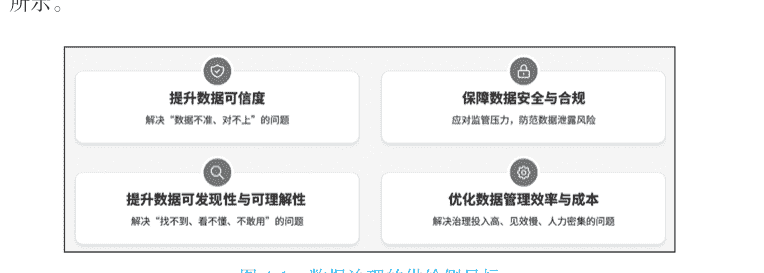

##### 1. 企业对供给端的诉求
供给端诉求聚焦数据全生命周期的精细化管理，通过提质、守住安全合规、提升可用性与效率，为业务决策提供坚实支撑，解决使用与管理中的典型痛点。主要包含四个方向。

- **提升数据可信**：体现在准确、完整、一致与及时，降低错误与冲突带来的业务与决策风险。示例指标有核心业务实体关键属性的完整率、一致性校验通过率、问题上报数及解决时效等，用于解决数据不准、对不上、垃圾进垃圾出等问题。
- **保障安全合规**：核心是防止敏感信息泄露滥用，确保处理活动符合《数据安全法》《个人信息保护法》等内外法规与行业要求。示例指标包括敏感数据识别覆盖度、泄露事件数、合规审计通过率、访问控制策略执行率等，用以防范监管处罚与声誉损失。
- **提升可发现与可理解**：让使用者快速定位所需资产并读懂业务含义、技术来源、质量状况与使用规范，打破信息孤岛。示例指标有数据目录覆盖率、元数据丰富度、血缘清晰度、查找成功率与耗时等，解决找不到、看不懂、不敢用的问题。
- **优化管理效能与成本**：通过自动化提升元数据管理、质量监控、标准执行、数据集成等环节效率，减少重复沟通与人力投入。示例指标包括元数据自动采集率、质量问题自动发现率、标准符合率、集成任务平均周期、管理人力成本等，缓解投入高、见效慢、流程繁琐的困境。

以上四个方向构成了企业内部供给端的通用要求，也是治理团队的基本职责范围。

##### 2. 供给端目标识别方法
要制定短期高价值的具体目标，需先摸清现状。以下方法有助于全面诊断并锁定重点。

（1）数据质量评估与剖析
- **做法**：借助剖析工具或脚本，对客户、产品、财务等关键域进行系统检查，覆盖完整性、一致性、准确性、唯一性、及时性等维度。
- **流程**：选定关键资产 → 定义剖析规则 → 执行剖析并输出量化报告 → 归纳主要问题类型与分布。
- **产出**：数据质量问题清单与分析报告。

（2）元数据现状盘点
- **做法**：评估现有元数据在覆盖率、准确性、完整性上的表现，并审视管理工具与流程的有效性。
- **流程**：界定核心系统与资产范围 → 检查数据字典、模型文档、血缘图谱等 → 访谈数据负责人与使用者，了解缺失带来的影响。
- **产出**：元数据覆盖率报告与质量问题列表。

（3）数据安全与合规风险评估
- **做法**：对照法律法规、行业标准与内部安全策略，审视存储、处理、传输、共享环节的防护与合规差距，定位敏感数据风险点。
- **流程**：梳理适用法规与内控政策 → 扫描识别敏感数据 → 评估访问控制、加密、脱敏、审计日志等措施 → 访谈安全法务 IT 了解历史风险。
- **产出**：安全风险评估报告与合规差距分析。

（4）数据管理流程与效率分析
- **做法**：审视标准制定、元数据维护、质量问题处理、集成开发等流程，找出效能瓶颈、手工环节与低效点。
- **流程**：绘制关键流程图 → 访谈参与者获取耗时与痛点 → 分析中断与返工原因 → 评估工具易用性与自动化程度。
- **产出**：流程痛点分析与效率优化建议。

##### 3. 目标衡量指标参考模板
完成识别后需结构化呈现并给出衡量标准。表4-1为供给端目标衡量指标示例，可据此自行制定。

表 4-1 数据治理供给端目标衡量指标清单示例

| 维度 | 识别方法 | 发现的问题 / 痛点描述 | 对业务使用的影响 | 潜在治理目标 | 初步衡量指标建议 |
| :--- | :--- | :--- | :--- | :--- | :--- |
| 数据质量 | 数据剖析、用户反馈 | 核心客户表中联系电话字段缺失比例约30% | 不完整影响营销触达与客服效率 | 将该字段完整率提升至95% | 联系电话字段完整率（%） |
| 元数据管理 | 元数据盘点、用户访谈 | 产品主数据缺少统一业务定义与来源说明 | 用户理解困难易误用，跨部门沟通成本高 | 为核心产品主数据建立并维护统一清晰的业务元数据 | 核心产品主数据业务描述覆盖率（%） |
| 数据安全 | 敏感数据扫描、合规评估 | 多系统日志中用户身份证号以明文记录，存泄露风险 | 违反个保法规定，面临处罚与声誉风险 | 全面排查改造日志，确保敏感信息脱敏存储 | 敏感信息明文存储实例清零 |
| 数据管理效率 | 流程分析、团队访谈 | 新指标入库涉及多部门手工审批与开发，平均耗时超2周 | 上线慢难以快速响应分析需求，人力成本高 | 优化流程并引入自动化，将平均上线时间压缩至3天 | 指标平均上线周期（天） |

#### 4.1.2 需求端视角：支撑战略与价值创造
数据治理的终极价值在于服务业务。核心目标必须紧贴业务诉求，通过更好的数据管理驱动增长、提升效率、控制风险与促进创新。需求端目标示意如图4-2。

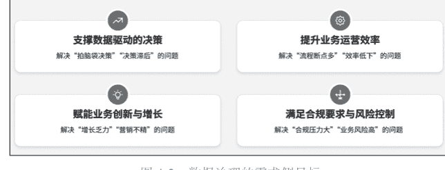

##### 1. 企业对需求端的诉求
需求端聚焦数据在业务场景中的实际价值，为决策、运营、创新与合规提供支撑，与供给端成果紧密联动。

1）支撑数据驱动决策：为管理层与业务部门提供及时准确易懂的洞察，提升决策科学性与前瞻性。依赖高质量易获取的数据。示例：为提升市场响应速度，需快速拿到准确的市场销售数据。指标：关键决策数据覆盖率、分析报告使用频次、决策周期缩短幅度。

2）提升业务运营效率：通过主数据与参考数据的高质量与标准化，优化订单处理、供应链、客服等流程，减少错误与返工。依赖标准化数据。示例：为降本增效打通流程，减少人工干预。指标：核心流程处理时间缩短率、数据问题导致中断次数。

3）赋能业务创新与增长：促进数据共享与开放，支撑新品研发、个性化营销、客户体验优化等，挖掘增长点。依赖可发现可共享且合规的数据。示例：为拓展市场或提升客户终身价值，需整合多源数据做画像与精准营销。指标：数据驱动的新产品比例、数据服务调用量、个性化营销转化率。

4）满足合规要求与风险控制：确保经营与数据处理符合法规，有效管控财务、声誉等数据相关风险。与供给端安全合规目标直接关联。示例：金融医疗等强监管行业合规是生存前提。指标：监管报告准时准确提交率、合规审计问题数、数据相关风险事件发生率。

##### 2. 需求端目标识别方法
需求端目标多为显性或隐性诉求，需深入业务一线沟通。常用方法如下。

- **战略解读与对齐**：研读公司与部门战略、KPI，提炼关键业务目标并分析其关键成功要素的数据依赖。产出战略到数据诉求的映射表。
- **关键业务流程分析**：选取价值链核心流程如获客、履约、风控、客服，绘制流程图并访谈责任人，识别数据瓶颈与低效环节。产出流程中的数据痛点清单。
- **高层与业务负责人访谈**：设计围绕战略、决策、效率、创新与风险的访谈提纲，收集业务视角的诉求与担忧。产出诉求汇总报告。
- **用户调研与反馈收集**：面向分析师、报表使用者、一线业务人员，通过问卷或座谈了解查找、理解、使用、信任等环节的困难。产出用户体验痛点与改进建议。

##### 3. 目标衡量指标参考模板
需求端识别后同样需结构化量化。表4-2为需求端目标衡量指标示例。

表 4-2 数据治理需求端目标衡量指标清单示例

| 业务领域/战略 | 识别方法 | 业务挑战/诉求描述 | 数据层面的制约/痛点 | 潜在治理目标 | 衡量业务指标建议 |
|---|---|---|---|---|---|
| 市场营销 | 业务负责人访谈、用户调研 | 希望实现更精准分群与个性化营销，但缺乏统一客户视图 | 客户数据分散于CRM、订单、小程序等，难以整合 | 建立统一客户主数据视图支持精准营销 | 营销活动响应率、获客成本 |
| 风险管理 | 战略解读、合规评估 | 需满足反洗钱报送的及时准确要求 | 交易数据质量不高，清洗校验规则复杂效率低 | 提升交易数据质量与标准化，确保AML报送合规 | AML报送差错率、监管时效达成率 |
| 供应链管理 | 关键流程分析 | 库存周转低、预测不准导致积压或缺货 | 销售预测与库存数据不一致，缺乏实时准确供需信息 | 提高预测与库存数据的准确及时性，建立供需预警 | 库存周转天数、缺货率/积压率 |
| 高层管理决策 | 高层访谈 | 难以快速获取跨业务线整合经营视图，决策依赖滞后报表 | 缺乏统一权威易用的驾驶舱或自助分析平台 | 构建高层驾驶舱，提供及时全面经营分析视图 | 关键决策周期、高层对数据支持满意度 |

#### 4.1.3 核心目标的平衡与整合
供给端与需求端目标构成供需飞轮，相互促进。图4-3展示了这一循环关系。

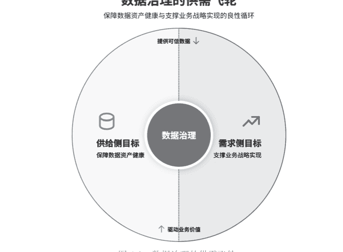

图 4-3 数据治理的供需飞轮

##### 1. 目标平衡原则
整合两类目标时需遵循以下原则。

- **战略对齐是前提**：所有目标应可追溯至企业战略。需求端直接体现对齐，供给端是支撑基础。例如提升客户数据完整性支撑精准营销，进而服务提升客户生命周期价值战略。
- **基于现状是基础**：目标设定需立足当前成熟度与痛点评估，避免脱离实际。
- **资源约束是条件**：人力财力时间有限，需取舍投入最关键的领域。
- **依赖关系是关键路径**：数据质量监控依赖标准，主数据是跨系统一致性基础，元数据是发现与理解前提。排序要尊重逻辑先后。
- **短期见效与长期建设并重**：兼顾能快速见效的Quick Wins以建立信心，同时规划平台建设、制度完善等长期工程。

##### 2. 目标评估方法
在上述原则下，可用以下步骤评估优先级。

1）**步骤1：成立跨职能评审小组**。邀请业务、IT、数据治理办公室、风险合规等关键利益相关方代表参与。

数据治理落地实战：从优先级到任务拆解与资源测算

2）优先级评估：先看价值贡献，再看时效压力
供需双方要能对话，必须先对齐评估尺子。建议统一两个核心判断点：

- **价值贡献与波及面**：目标达成后能够对收入增长、成本优化、风险管控、客户满意度等核心经营指标产生多大拉动，权重应放在首位。
- **落地方案的紧迫性与合规刚性**：推进有多急，是否触及监管强制要求或内审必须达标的红线，权重次之。

4.2 数据治理目标任务分解与资源评估
上文已从供给与需求两端梳理出数据治理的核心方向。方向明确只是起点，如何把战略表述变成可落地的工作包，需要一套系统化的拆解与规划逻辑。本节聚焦高阶目标拆解、任务关联梳理、投入预估以及内部共识形成，产出的初步执行方案将为后续路线图提供关键输入。

### 4.2.1 先看清目标间的内在关联与依赖
进入任务拆分之前，要把各目标之间的先后顺序与相互支撑关系盘清楚。治理目标彼此耦合，有的必须前置落地后才有效，有的可以并行协同。厘清内在联系能避免排期错位、资源冲突，也能判断哪些是基础先行项，哪些是上层成果出来后可同步推进的项。

把握依赖可从四个视角切入：

- **思路拆解**：每个目标的实现前提是什么？完成后又为哪些后续目标提供基础？
- **前置约束**：A 目标需要在 B 目标完成后才能有效展开。典型例子是先建立统一数据标准，后续数据质量检查才有意义。
- **支撑作用**：C 目标的推进会助力 D 目标达成，但不一定有严格先后。例如元数据管理能力提升，会让数据分析应用更高效。
- **协同效应**：E 与 F 两项目标互相促进，同步推进效果更佳。例如数据质量改进与主数据治理往往要紧密配合。

实践中可用目标关系分析模板归纳，见表 4-4。

**表 4-4 目标关系分析模板**

| 核心目标 | 核心依赖（前置条件） | 重点支撑（后置价值） | 逻辑简述 |
| :--- | :--- | :--- | :--- |
| 提升数据可信度（供给侧核心） | 需要先建立数据标准、质量规则 | 决策、运营、合规等全部目标 | 质量是地基，数据偏差会让后续决策、风控、AI 全盘失真 |
| 保障数据安全与合规（供给侧底线） | 需要先完成敏感数据识别、分类分级 | 满足合规要求与风险控制 | 安全是底线，数据可控后才能合规并对外开放 |
| 提升数据可发现性与可理解性（供给侧/元数据） | 需要自动化采集工具 | 支撑决策、赋能创新 | 先找得到会看懂，业务只有读懂元数据才能释放价值 |
| 优化数据管理效率与成本（治理效能） | 需要引入自动化工具、流程优化 | 提升数据可信度、提升数据可发现性 | 工具是加速器，自动化降低治理成本，让好数据更快产生 |
| 支撑数据驱动的决策（需求侧应用） | 需要数据可信度与可理解性 | 提升运营效率、赋能创新 | 从数据到洞察，高质量易读的数据才是准报表和驾驶舱的原料 |
| 提升业务运营效率（需求侧流程） | 需要数据可信度，比如主数据一致性 | 优化成本，业务降本 | 用数据替代人工，打通数据孤岛后减少流程中的重复核对 |
| 赋能业务创新与增长（需求侧增值） | 需要数据可发现性，支撑决策 | 企业战略转型 | 资产化思维，在数据好用易用的基础上探索产品化和新模式 |
| 满足合规要求与风险控制（监管侧） | 需要数据可信度并保障安全 | 企业可持续经营 | 合规是结果，靠质量管控与安全措施自动生成监管报表并降风控成本 |

### 4.2.2 把目标拆成主要任务
关联厘清后，进入拆任务阶段。可借鉴 PDCA 与项目管理思路，确保拆分结果与目标一致。

拆解遵循三条原则：

- **逻辑连贯**：任务间具备清晰的先后或逻辑关系。
- **成果导向**：每个阶段对应一个可交付的中间或最终成果。
- **颗粒适中**：拆到能做初步资源估算和责任划分的粒度即可，无需过度细化。

#### 案例一：客户域数据质量提升
数据质量提升本质是 PDCA，拆成 5 个阶段：

- **质量需求与规则定义**：调研业务诉求、盘点数据现状、明确质量目标、定义关键维度与校验规则。交付物为客户域数据质量评估报告和数据质量规则库 V1.0。
- **质量检查与监控落地**：选型或自建检查工具，部署规则，建立常态化监控。交付物为上线工具/脚本及自动化监控任务。
- **问题分析与根因定位**：定期审阅检查报告，识别问题模式，追溯源头，评估业务影响。交付物为问题分析报告和根因清单。
- **改进验证**：制定清洗、流程优化或源头改造方案，跟踪修复效果并更新基线。交付物为行动计划与执行记录、改进效果评估。
- **文化建设与长效机制**：建立反馈闭环，明确责任人，开展培训宣贯。交付物为管理流程文档、培训材料和考核建议。

#### 案例二：客户主数据统一视图
拆成 5 个阶段：

- **标准定义与模型设计**：了解各方需求，定义统一标准与关键属性，设计逻辑与物理模型。交付物为《客户主数据标准规范》和逻辑/物理模型。
- **MDM 平台选型与实施**：选型部署主数据平台。交付物为可用 MDM 环境。
- **数据集成、清洗与匹配**：抽取清洗标准化，配置匹配合并规则。交付物为清洗后数据与匹配规则。
- **主数据初始化与服务发布**：生成统一主数据，开发服务接口。交付物为初始化库和主数据服务 API。
- **治理流程建立与运维**：建立新增、变更、审核流程，制定运维监控。交付物为流程文档和运维监控计划。

实际拆解需结合自身数据现状与人员能力，用业务语言和案例与业务方、高层沟通。

前文 8 个核心目标的拆解示例见表 4-5，便于对标。

**表 4-5 核心目标拆解示例**

| 核心目标 | 主要任务/阶段 | 活动描述 | 预期成果 |
| :--- | :--- | :--- | :--- |
| 提升数据可信度 | 质量需求与规则定义 | 调研业务对关键数据的质量要求，分析现状，明确目标，定义维度与校验规则 | 数据质量评估报告、数据质量规则库 V1.0 |
| | 质量检查与监控实施 | 选型/开发检查工具，配置部署规则，建立常态监控 | 质量检查工具/脚本、自动化监控报告 |
| | 质量问题分析与处置 | 分析报告、识别模式、追溯源头、评估影响、跟踪闭环 | 问题登记库、根因分析报告、已关闭清单 |
| | 持续改进与文化建设 | 制定清洗、流程优化或源头改造，验证效果，开展质量培训，建立长效机制 | 提升计划及效果评估、流程文档、培训材料 |
| 保障数据安全与合规 | 策略标准制定与风险评估 | 解读法规与业务需求，制订安全策略与分级分类，评估差距 | 安全策略/标准文档、风险评估与差距报告 |
| | 技术与管理控制实施 | 部署加密、脱敏、访问控制、审计等措施，完善流程与岗位职责 | 上线安全工具/平台、更新管理流程/规范 |
| | 监控审计与事件响应 | 建立事件监控与日志审计，定期检查审计，演练应急预案 | 安全监控仪表盘、审计报告、应急预案与演练记录 |
| | 意识培训与能力提升 | 面向全员或关键岗位开展安全合规培训 | 培训计划与材料、培训效果评估 |
| 提升数据可发现性与可理解性 | 元数据与术语管理规划 | 明确范围目标，制定术语规范，规划元数据/目录平台 | 管理策略与规划、术语规范、工具选型报告 |
| | 平台建设与元数据采集 | 部署平台，建立自动化采集，采集技术元数据与血缘 | 上线平台、采集适配器/脚本、已采集元数据 |
| | 业务信息丰富与关联 | 录入业务元数据，建立术语与技术元数据、资产关联 | 丰富术语库、带业务含义的数据字典 |
| | 推广应用与体验优化 | 提供查找、浏览、血缘可视化，培训收集反馈迭代 | 用户手册/培训材料、反馈报告、功能优化记录 |
| 优化数据管理效率与成本 | 现状评估与优化点识别 | 梳理流程，评估效率成本，识别手工重复痛点 | 流程图及效率/成本分析、优化机会清单 |
| | 流程再造与工具引入 | 重新设计流程，评估引入自动化工具/技术 | 优化方案、工具/技术评估报告 |
| | 自动化实施与集成 | 开发/配置脚本与工作流，集成新工具 | 上线自动化脚本/工作流、集成接口 |
| | 效果度量与持续改进 | 建立效率成本指标体系，持续监控迭代 | 度量指标体系及仪表盘、持续改进记录 |
| 支撑数据驱动的决策 | 决策场景与数据需求分析 | 理解关键决策场景，访谈决策者，识别数据、指标与维度 | 决策场景描述、数据需求清单 |
| | 数据准备与可信保障 | 整合清洗数据，确保准确及时一致 | 高质量分析数据集 |
| | 分析模型与可视化开发 | 开发模型，设计报表、仪表盘或自助分析工具 | 上线报表、仪表盘、自助工具 |
| | 应用推广与能力赋能 | 培训决策者与分析用户，推广工具与文化 | 培训材料与记录、应用案例库 |
| 提升业务运营效率 | 流程分析与数据瓶颈识别 | 选择关键流程，分析数据断点、错误点与低效环节 | 数据瓶颈分析报告 |
| | 数据基础优化方案设计 | 针对瓶颈设计方案，涉及主数据统一、标准应用、集成优化 | 数据基础优化方案 |
| | 数据基础优化实施 | 实施主数据管理、推广标准、优化集成接口 | 主数据平台/服务、标准化数据、优化接口 |
| | 业务流程重塑与效果监控 | 基于优化基础调整流程，监控效率提升 | 优化流程文档、效率监控指标及报告 |
| 赋能业务创新与增长 | 创新机会与数据需求识别 | 与创新部门合作识别数据驱动创新点，明确所需数据 | 创新用例库、创新数据清单 |
| | 数据共享环境与能力建立 | 建立合规共享机制与平台，提供探索分析工具 | 数据共享平台/沙箱、数据服务 API 目录 |
| | 数据产品/服务原型开发与验证 | 基于共享数据快速开发 PoC，小范围验证 | 数据产品原型、PoC 验证报告 |
| | 规模化推广与生态合作 | 规模化开发推广，探索外部数据合作 | 上线数据产品/服务、生态合作协议/案例 |
| 满足合规要求与风险控制 | 合规/风控需求明确与分解 | 解读法规与内部要求，转化为完整性、准确性、时效性、可追溯、隐私保护等具体要求 | 合规/风控数据需求细则 |
| | 关键数据保障与治理强化 | 强化关键合规数据质量监控、安全防护、元数据管理 | 治理强化方案及实施记录 |
| | 监控、报告与审计支持系统建设 | 建立监控仪表盘、自动化报告、数据追溯能力 | 监控仪表盘、自动化报告模板、审计支持功能 |
| | 流程嵌入与持续验证 | 将合规检查点嵌入业务流程与系统，定期内外部审计验证 | 更新流程含检查点、审计报告 |

### 4.2.3 估算任务所需资源
为任务做初步资源评估，才能判断可行性，为预算提供依据。评估三个维度：

- **复杂度/规模**：范围广度、技术难度、协调复杂度与不确定性。采用低、中、高、极高定性评级。
- **关键能力/资源依赖**：必需的核心技能与角色，内部是否充足或稀缺，需否外部咨询；是否强依赖特定技术平台/工具。
- **主要成本/量级**：主要投入构成，人力、软件平台、外部服务等。给出低、中、高、极高量级判断。

参考评估示例见表 4-6。

**表 4-6 目标任务资源评估示例**

| 核心目标 | 主要任务/阶段 | 任务复杂度/规模 | 关键能力/资源依赖 | 主要成本/量级 |
| :--- | :--- | :--- | :--- | :--- |
| 提升可信度 | 质量需求与规则定义 | 中 | 业务分析师充足、DQ 分析师需培养、DQ 规则库可选购 | 内部人力为主，中 |
| 提升可信度 | 质量检查与监控实施 | 高 | 数据工程师充足、DQ 分析师需培养、DQ 工具/平台可能新购 | 人力高、工具成本高 |
| 提升可信度 | 质量问题分析与处置 | 中（持续性） | DQ 分析师需培养、数据管家需设立、业务配合、问题跟踪系统 | 持续人力中 |
| 提升可信度 | 持续改进与文化建设 | 高 | 治理专家少量、培训师、跨部门协调 | 人力高含培训、流程优化工具成本低 |
| 保障安全合规 | 策略标准制定与风险评估 | 高 | 安全/合规/法务专家关键可能需外部咨询、安全工具可选 | 人力高含专家咨询、工具成本中 |

**数据治理目标清单示例**

按业务价值 40%、紧迫性 30%、可行性 20%、基础性 10% 权重打分，形成初步排序见表 4-3。

**表 4-3 数据治理目标清单示例**

| 数据治理目标 | 业务价值 | 紧迫性 | 可行性 | 基础性 | 加权总分 | 初步排名 | 备注/调整理由 |
| :--- | :---: | :---: | :---: | :---: | :---: | :---: | :--- |
| 建立统一客户主数据视图（360° 画像） | 5 | 4 | 2 | 5 | 4.1 | 1 | 支撑精准营销战略，价值高但复杂度高，基础性强 |
| 提升交易数据质量确保报送合规 | 4 | 5 | 3 | 3 | 4 | 2 | 合规要求，紧迫性最高 |
| 为核心产品主数据建立统一清晰业务元数据 | 3 | 3 | 4 | 4 | 3.3 | 3 | 基础工作，为后续应用打底，可行性较高 |
| 提供自然语言查询接口赋能自助分析 | 4 | 2 | 3 | 2 | 3 | 4 | 业务价值潜力大，紧迫性相对低，依赖前期基础 |
| 对所有系统日志排查改造确保敏感信息脱敏存储 | 3 | 4 | 3 | 3 | 3.4 | 调整至3 | 安全合规硬要求，风险高虽直接价值评分不高 |

4.3 数据治理实施计划与内部拉通

前一阶段已把宏观治理目标拆解成具体任务并完成初步资源估算，本阶段要进入规划落地的核心环节：把任务细化为可执行的推进方案并争取各方理解与支持。工作要点是对拆分后的事项进行科学排序、依据优先级与依赖关系绘制分阶段路线图，并配套周密的内部沟通协调机制。最终要形成清晰、可行、获得关键干系人共识的行动蓝图，为后续顺利执行奠定坚实基础。

### 4.3.1 滚动式实施路线图制定

参照已完成的任务分解清单，企业需要就各项治理目标统一排期，建议聚焦未来一年内、分阶段、滚动更新的行动方案。路线图应明确 0～3 个月、3～6 个月、6～12 个月各阶段的目标与月度关键进展，提升指引性与可操作性，企业计划路线图如图 4-4 所示。

编制路线图时要结合战略侧重点与落地难度，挑选出一年内必须启动或取得关键突破的治理目标及对应主要任务，按滚动阶段切割。数据治理与业务战略深度绑定，因此每月汇报进展时必须与战略调整同步对齐。

在此基础上，实施阶段可划分为三个层次：

- 近期 0～3 个月：启动与基础夯实。优先安排时效要求高如合规类、基础作用明显为后续打底、或能快速见效形成信心的 Quick Wins。
- 中期 3～6 个月：能力搭建与初步产出。承接短期成果，开始构建核心治理能力并初步显现业务价值。
- 中长期 6～12 个月：应用深化与价值延展。安排周期较长、依赖前期积累、旨在深化能力或扩大应用范围的任务。

图 4-4 企业计划路线图

阶段定义明确后，就要把目标任务编入路线图并做可视化呈现，展示阶段、月份、核心目标关联、主要任务／工作包、本月关键活动／进展、本月预期交付成果／里程碑、初步责任部门和关键依赖／备注。这些属性能够完整描述一条可执行的数据治理实施路径，数据治理实施路线示例如表 4-7 所示。

表 4-7 数据治理实施路线示例

| 阶段 | 月份 | 核心目标关联 | 主要任务/工作包 | 本月关键活动/进展 | 本月预期交付成果/里程碑 | 初步责任部门 | 关键依赖/备注 |

| :--- | :--- | :--- | :--- | :--- | :--- | :--- | :--- |

| 近期（0-3个月） | M1 | G02（安全合规） | G02-1：策略标准制定与风险评估 | 启动法规解读与内部需求调研；组建数据安全策略工作组 | 调研计划；成立工作组 | 安全部/合规部 | |

| | | G01（数据质量） | G01-1：核心DQ规则定义 | 确定核心数据范围（如客户、产品关键表）；启动业务部门数据质量需求访谈 | 核心数据范围清单；访谈计划 | 数据治理办公室/业务部 | |

| | M2 | G02（安全合规） | G02-1：策略标准制定与风险评估 | 完成策略框架草案，发放数据安全风险自评估问卷 | 数据安全策略框架V0.1；风险自评估问卷 | 安全部/合规部 | 需要法务、业务、IT部门配合 |

| | | G01（数据质量） | G01-1：核心DQ规则定义 | 完成主要业务部门质量需求访谈；开始整理和分类质量规则草案 | 访谈纪要汇总；初步DQ规则分类清单 | 数据治理办公室/业务部 | |

| | | G04/G03（元数据/架构） | G04-1/G03-1：元数据规划 | 启动元数据管理现状调研（如工具、流程、覆盖度）；收集各部门对元数据平台的需求 | 现状调研报告；需求收集记录 | 数据架构组/IT部 | |

| | M3 | G02（安全合规） | G02-1：策略标准制定与风险评估 | 完成风险自评估数据收集与初步分析；完成数据安全策略报告初稿V0.5 | 风险自评估初步分析结果；数据安全策略报告V0.5（草稿） | 安全部/合规部 | 依赖IT技术人员的评估 |

| | | G01（数据质量） | G01-1：核心DQ规则定义 | 完成DQ规则草案的技术可行性分析；组织首次规则评审会 | DQ规则库V0.5（技术评估版） | 数据治理办公室/IT部 | |

| | | G08（数据标准-主数据） | G08-1：客户主数据标准定义 | 启动客户主数据标准定义工作；组建主数据标准工作组；梳理现有各系统客户核心属性 | 成立工作组；现有客户属性清单 | 数据标准组/业务部 | |

| | M4 | G04/G03（元数据/架构） | G04-1/G03-1：元数据规划 | 完成元数据管理规划思路草拟；初步筛选潜在的元数据管理工具或方案 | 元数据管理规划思路草稿；潜在工具短名单 | 数据架构组/IT部 | 需要CRM、ERP等系统负责人配合 |

| | | G02（安全合规） | G02-1：策略标准制定与风险评估 | 组织数据安全策略内部评审会；根据反馈修改策略报告 | 评审会议纪要；数据安全策略报告V0.8（修订版） | 安全部/合规部 | |

| | | G01（数据质量） | G01-1：核心DQ规则定义 | 根据评审意见修改并确认DQ规则；完成规则库V1.0的文档化 | 数据质量规则库V1.0（评审通过版） | 数据治理办公室/业务部/IT部 | |

| | | G08（数据标准-主数据） | G08-1：客户主数据标准定义 | 完成客户主数据核心属性（如名称、证件、地址、联系方式）标准草稿；组织首次标准评审 | 客户主数据核心属性标准 V0.5（草稿） | 数据标准组/业务部 | 依赖 G01-1 |

| | | G04/G03（元数据/架构） | G04-1/G03-1：元数据规划 | 完成元数据管理规划报告的撰写；完成工具/方案评估和选型建议 | 元数据管理规划报告 V1.0；工具/方案选型建议报告 | 数据架构组/IT部 | 依赖高层管理者审批流程 |

| | | G02（安全合规） | G02-1：策略标准制定与风险评估 | 完成数据安全策略/标准（含分类分级结果）草稿并提交审批 | 数据安全策略/标准 V1.0（待审批） | 安全部/合规部 | 依赖 G01-1 |

| | | G01（数据质量） | G01-2：核心DQ检查实施 | 启动DQ检查工具/脚本的技术设计；准备测试环境和数据 | DQ检查工具/脚本技术设计方案 V0.5 | IT部/数据治理办公室 | |

| | M5 | G08（数据标准-主数据） | G08-1：客户主数据标准定义 | 根据评审意见修改核心属性标准；定义次要属性标准 | 客户主数据核心属性标准 V0.8（修订版） | 数据标准组/业务部 | |

| | | G04/G03（元数据/架构） | G04-1/G03-1：元数据规划 | 元数据管理规划及工具选型方案获得高层管理者批准 | 获批的元数据规划与选型方案 | 数据治理委员会/高层管理者 | |

| | | G02（安全合规） | G02-2：技术与管理控制实施 | 启动基于已批准策略的访问控制策略细化设计 | 访问控制策略细化设计草稿 | 数据安全工程师/IT部 | |

| | | G01（数据质量） | G01-2：核心DQ检查实施 | 完成DQ检查工具/脚本的核心功能开发，并进行单元测试 | DQ检查工具/脚本核心代码/配置 V0.5 | IT部 | 依赖 G02-1 |

| | M6 | G08（数据标准-主数据） | G08-1：客户主数据标准定义 | 完成客户主数据标准 V1.0 草稿并提交评审 | 客户主数据标准规范 V1.0（待评审） | 数据标准组/业务部 | |

| | | G04/G03（元数据/架构） | G03-2：平台建设与元数据采集 | （若采购）启动元数据平台采购流程；（若自研）启动平台基础架构搭建 | 启动采购流程；基础架构设计文档 | IT部/采购部 | 依赖 G04-1/G03-1 |

| | | G01（数据质量） | G01-2：核心DQ检查实施 | 完成DQ检查工具/脚本的集成测试，并部署到预生产环境 | DQ检查工具/脚本（预生产） | IT部/数据治理办公室 | |

| 中长期（6～12个月） | M7 | G08（数据标准-主数据） | G08-1：客户主数据标准定义 | 完成客户主数据标准的最终评审和发布 | 客户主数据标准规范 V1.0（发布） | 数据标准委员会 | 依赖 G01-1 |

| | | G04/G03（元数据/架构） | G03-2：平台建设与元数据采集 | （若采购）完成合同签订；（若自研）完成核心模块开发，启动核心系统（如CRM）元数据自动采集适配器开发 | 采购合同，开发核心模块代码；采集适配器设计文档 | IT部/采购部 | 依赖G04-1/G03-1 |

| | M8 | G01（数据质量） | G01-2：核心DQ检查实施 | DQ检查工具/脚本在预生产环境试运行；收集并分析试运行结果 | DQ检查工具/脚本试运行报告 | 数据治理办公室/IT部 | 依赖G08-1 |

| | | G08（数据标准－主数据） | G08-3：客户主数据集成清洗 | 启动源系统（如CRM、ERP）数据清洗和标准化规则 | 清洗规则细化文档V1.0 | IT部/供应商 | |

| | | G04/G03（元数据/架构） | G03-2：平台建设与元数据采集 | （若采购）供应商开始部署平台；（若自研）继续开发。完成CRM元数据采集适配器开发与测试 | 平台部署启动/模块开发进展；CRM元数据采集适配器V1.0 | IT部/供应商 | |

| | M9 | G01（数据质量） | G01-2：核心DQ检查实施 | 根据试运行结果调整规则和系统，准备正式上线 | DQ检查工具/脚本上线准备就绪 | 数据治理办公室/IT部 | 依赖基本可用的MDM平台（可能在M8或M9完成） |

| | | G08（数据标准－主数据） | G08-3：客户主数据集成清洗 | 完成CRM系统客户数据抽取和初步清洗，并加载到MDM暂存区 | CRM客户数据（已清洗）进入MDM暂存区 | IT部/供应商 | |

| | | G04/G03（元数据/架构） | G03-2：平台建设与元数据采集 | （若采购）完成平台基本安装配置；（若自研）完成主要功能开发；启动ERP元数据采集适配器开发 | 元数据平台基本可用；CRM元数据已采集 | IT部/供应商 | |

| | M10～M12 | ...（继续排布剩余任务和后续阶段） | ... | ... | ... | ... | ... |

落地时要突出滚动性与成果导向，12个月计划内必然出现延期、优先级升降、资源不足等变化。建议每季度复盘调整，按实际进展、业务变化与新优先级更新未来12个月计划。同时要紧盯每月成果，因为成果是下一阶段任务的输入，成果质量不佳会拖累后续目标。

上表是责任部门沟通记录的参考模板，汇报时不需要如此细粒度，而是一张可视化路线便于横向纵向沟通，数据治理任务可视化路线示例如表 4-8 所示。

表 4-8 数据治理任务可视化路线示例

| 阶段 | 季度 | 主要任务 / 工作包 | 本季度关键里程碑 / 产出物 | 初步责任部门 |

| :--- | :--- | :--- | :--- | :--- |

| 第一阶段：基础奠定 | Q1 (M1 ~ M3) | G02-1：策略标准制定与风险评估 | 调研计划；工作组成立；风险自评估问卷发放与初步分析；数据安全策略框架 V0.1；数据安全策略报告 V0.5（草稿） | 安全部 / 合规部 |

| | | G01-1：核心 DQ 规则定义 | 确定核心数据范围；访谈计划；访谈纪要汇总；初步 DQ 规则分类清单；DQ 规则库 V0.5（技术评估版） | 数据治理办公室 / 业务部 / IT 部 |

| | | G08-1：客户主数据标准定义 | 主数据标准工作组成立；现有客户核心属性清单 | 数据标准组 / 业务部 |

| | | G04-1/G03-1：元数据规划 | 元数据管理现状调研初步报告；需求收集记录；元数据管理规划思路草稿；潜在工具短名单 | 数据架构组 / IT 部 |

| 第二阶段：能力深化 | Q2 (M4 ~ M6) | G02-1：策略标准制定与风险评估 | 评审会议纪要；数据安全策略报告 V0.8（修订版）；数据安全策略 / 标准 V1.0（提交 / 等待审批） | 安全部 / 合规部 |

| | | G01-1：核心 DQ 规则定义 | 数据质量规则库 V1.0（评审通过版）。 | 数据治理办公室 / 业务部 / IT 部 |

| | | G01-2：核心 DQ 检查实施 | DQ 检查工具 / 脚本技术设计方案 V0.5；DQ 检查工具 / 脚本核心代码 / 配置 V0.5 | IT 部 / 数据治理办公室 |

| | | G08-1：客户主数据标准定义 | 客户主数据核心属性标准 V0.8（修订版）；客户主数据标准规范 V1.0（待评审） | 数据标准组 / 业务部 |

| | | G04-1/G03-1：元数据规划 | 元数据管理规划报告 V1.0；工具 / 方案选型建议报告；元数据规划与选型方案（已获批） | 数据架构组 / IT 部 / 数据治理委员会 / 高层管理者 |

| | | G02-2：技术与管理控制实施 | 访问控制策略设计草稿 | 数据安全工程师 / IT 部 |

| | | G03-2：平台建设与元数据采集 | （若采购）采购流程启动；（若自研）基础架构设计文档 | IT 部 / 采购部 |

| 第三阶段：能力深化/扩展 | Q3 (M7 ~ M9) | G01-2：核心 DQ 检查实施 | DQ 检查工具 / 脚本（预生产）；DQ 检查工具 / 脚本试运行报告；DQ 检查工具 / 脚本上线准备就绪 | IT 部 / 数据治理办公室 |

| | | G08-1：客户主数据标准定义 | 客户主数据标准规范 V1.0（发布） | 数据标准委员会 |

| | | G08-3：客户主数据集成清洗 | 源系统数据探查报告；清洗规则细化文档 V1.0；CRM 客户数据（已清洗）进入 MDM 暂存区 | 主数据团队 / IT 部 |

| | | G03-2：平台建设与元数据采集 | （若采购）平台基本安装配置；（若自研）主要功能开发；CRM 元数据采集适配器 V1.0；ERP 元数据采集适配器设计文档；元数据平台基本可用；CRM 元数据已采集 | IT 部 / 供应商 |

| | | G02-2：技术与管理控制实施 | （假设继续实施访问控制、加密、脱敏等技术措施）技术方案细化设计 | 数据安全工程师 / IT 部 |

| | Q4 (M10 ~ M12) | G01-2：核心 DQ 检查实施 | DQ 检查工具 / 脚本正式上线并输出首期报告 | 数据治理办公室 / IT 部 |

| | | G08-3：客户主数据集成清洗 | ERP/ 订单系统数据抽取与初步清洗；匹配策略初稿 | 主数据团队 / IT 部 |

| | | G03-2：平台建设与元数据采集 | ERP 元数据采集适配器 V1.0；核心系统（CRM/ERP）技术元数据采集完成 | IT 部 |

| | | G01-3：质量问题分析与处置 | 建立问题登记与跟踪机制 | 数据治理办公室 / 数据质量分析师 |

| | | G02-3：监控审计与事件响应 | （假设）启动安全监控规则配置 | 安全运营（SOC）团队 |

| | | ...（其他中长期任务启动） | ... | ... |

### 4.3.2 内部沟通与协调机制设计

清晰的实施路线图只是沟通的基础，要真正落地就必须配套一套有效的内部沟通与协同策略。数据治理涉及跨部门协作、流程变革、资源投入和文化适应，主动、透明、有针对性的沟通和明确高效的协同机制是成功的关键保障。

#### 1. 识别关键干系人及其诉求

识别干系人的目的是明确计划会影响谁、需要谁支持、谁可能有顾虑或阻力。基于路线图涉及的任务和预期影响，可系统梳理相关关键群体。

常见干系人示例及其关注点如下。

- **高层管理者（CEO、CIO、CDO、业务高管）**：关注战略价值、投资回报、重大风险、整体进展，需要简洁高层级的汇报成果。
- **业务部门负责人 / 代表**：关注治理如何解决业务痛点、对流程人员的影响、配合投入、数据应用价值的体现，需要看到与业务的相关性与收益。
- **IT 部门（架构、开发、运维）**：关注技术可行性、系统集成复杂度、人力服务器等资源需求、对现有系统的影响及运维责任，需要清晰的技术要求和资源规划。
- **数据治理办公室 / 团队**：核心推动执行者，关注计划可行性、资源保障和跨部门协同顺畅度。
- **风险、合规、法务部门**：关注是否满足监管要求、数据安全和隐私保护是否到位、是否存在法律风险，需要确保合规性。
- **财务部门**：关注预算合理性、成本控制和投资回报，需要清晰的预算说明和效益预期。
- **数据分析师/数据科学家**：关注数据质量改善、数据获取便捷性、元数据可用性，是成果的重要使用者和反馈者。
- **普通业务员工**：关注日常工作影响、是否需要学习新工具流程、数据易用性改善，需要通俗信息和必要培训。

在此基础上还可能存在其他干系人，需注意识别。干系人诉求分析表示例如表4-9所示。

识别诉求后，就要针对不同对象制定沟通策略，在正确的时间、通过正确渠道传递正确信息。良好的沟通计划能争取支持、同步信息、协调行动。

制定沟通计划时需分析以下要素。

沟通对象：上文梳理的关键干系人群体。

沟通目标：针对该群体，本次沟通希望达成的效果，如获得批准、争取资源、达成共识、通报进展、收集反馈、提升认知。

核心信息：针对不同对象提炼最相关最重要的信息点，用对方能理解的语言，避免信息过载或过度技术化。

要让治理真正跑起来，先把“怎么说”和“多久说”这两件事想清楚。信息通道可以从高层决策会、部门例会、专题研讨、单独访谈、项目周报月报、内部邮件、企业微信或钉钉群组、Wiki 知识库、培训课程里挑选组合；触达节奏则可以是一次性启动会、每周、每月、每季度或按需触发。通道和节奏确定后，再为不同干系人定制沟通方案，示范可参考表4-10。

## 第 4 章 数据治理目标与 DeepSeek 融合实践

### 表 4-9 干系人诉求分析示例

| 干系人角色/部门 | 代表人物/群体(示例) | 主要利益/诉求 | 主要关注点/顾虑 | 对数据治理计划的影响力(高/中/低) | 初步沟通策略侧重点 |
|---|---|---|---|---|---|
| 高层管理者 | CEO、CIO、CDO、业务线 VP | 战略目标达成，业务增长，成本控制，风险管理，公司竞争力提升 | 投入产出比不明，实施周期长，对业务的短期影响，跨部门协调难度大，能否真正解决问题 | 高 | 强调战略价值，量化预期收益，清晰汇报关键风险与进展，寻求决策支持和资源承诺 |
| 业务部门负责人/代表 | 销售总监、市场总监、运营总监、产品负责人 | 解决业务痛点(如数据不准影响决策/效率)，提升部门业绩，获取更便捷的数据支持，赋能业务创新，明确数据责任 | 治理工作增加额外负担，流程变更影响现有操作，IT 支持是否到位，投入的资源能否看到回报，数据权限是否受限 | 高 | 聚焦其痛点的解决方案，展示对其业务的具体价值和效率提升，明确所需配合及收益分享，降低实施对其部门的短期冲击 |
| IT 部门 | IT 总监、架构师、开发经理、运维经理 | 技术架构合理性，系统稳定性，与性能、资源(人力/预算)可控，技术标准统一，运维复杂度降低 | 技术方案是否成熟可行，集成难度和工作量，对现有系统的影响，资源是否充足，运维责任界定 | 高 | 共同制定技术方案，明确技术标准和接口要求，清晰说明资源需求和时间计划，共同评估技术风险，明确长期运维模式 |
| 数据治理办公室团队(DGO) | 数据治理负责人、数据管家、标准/质量专家 | 治理目标达成，治理流程顺畅，跨部门协调有效，治理能力提升，治理的价值体现 | 资源是否到位，跨部门配合度，计划是否可行，是否足够授权，团队成员技能是否匹配 | 高(执行核心) | 确保计划细节清晰可行，提供必要的工具和方法支持，积极争取高层授权和跨部门协作，展现专业性和领导力 |
| 风险、合规、法务部门 | CRO、合规总监、法务经理 | 确保满足内外部监管要求，降低数据安全和隐私风险，确保流程合规可审计 | 治理措施是否全面覆盖风险点，AI 应用是否带来新的合规风险，审计证据是否充分 | 高(否决权/监督权) | 早期介入，共同制定安全合规策略，确保计划符合法规要求，提供合规咨询，定期通报相关风险及应对措施 |
| 财务部门 | CFO、预算经理 | 预算控制在合理范围内，投资回报清晰可见，成本效益分析 | 预算是否超支，效益是否可衡量，投入是否必要 | 中 | 提供清晰的预算构成和效益预测，定期汇报实际花费与预算对比，及时沟通预算调整需求 |
| 数据分析师/数据科学家 | 各业务线分析师、数据平台分析师 | 获取高质量、易理解、可信的数据，提升数据获取和分析效率，拥有便捷的数据探索工具，是否易用，元数据是否准确完整 | 数据质量是否真正改善，数据获取是否更方便，新工具/流程是否易用，元数据是否准确完整 | 中(重要用户/反馈者) | 了解在数据使用中的痛点，展示治理成果如何提升工作效率和分析质量，邀请其参与测试和反馈，提供必要的培训 |
| 普通业务员工 | 客服代表、销售人员、运营专员 | 工作流程更顺畅，系统操作更便捷，数据录入/查询错误减少 | 是否增加额外工作量，是否需要学习复杂的新系统/流程，对个人绩效考核的影响 | 低(群体影响大) | 清晰传达治理带来的好处(如减少重复工作)，提供简单易懂的培训和操作指引，及时解决在使用中遇到的问题 |

### 表 4-10 沟通计划表示例

| 沟通对象 | 沟通目标 | 核心信息示例 | 沟通渠道示例 | 沟通频率示例 |
| :--- | :--- | :--- | :--- | :--- |
| 高层管理者 | 获取战略支持、决策、资源审批 | 治理计划与公司战略对齐，预期 ROI，重大风险，关键里程碑进展，需要决策的事项 | 数据治理委员会 / 指导委员会会议、专项汇报 | 季度 / 按需 |
| 业务部门负责人 | 获取业务支持、协调资源、反馈 | 计划如何解决业务痛点，预期业务收益，对其部门流程 / 人员影响，需要的配合与投入 | 部门沟通会、专题研讨会、一对一沟通 | 月度 / 按需 |
| IT 部门 | 技术对齐、资源协调、进度同步 | 技术方案细节，资源需求（人 / 服务器），集成接口要求，运维职责 | 技术评审会、项目周报 / 例会 | 周度 / 双周 |
| DGO / 项目核心组 | 任务分配、进度跟踪、问题协调 | 具体任务分工，时间节点要求，风险与问题同步，依赖关系协调 | 项目例会、日常沟通工具（IM）、项目管理平台 | 每日站会 / 周例会 |
| 风险 / 合规 / 法务 | 确保合规、风险评估 | 涉及合规 / 风险的任务点，采取的控制措施，需要其专业意见的环节 | 专项咨询会、合规评审 | 按需 |

## 2. 建立组织保障与决策机制

沟通方案成型后，还必须搭好组织与决策的底座，用来承接执行过程中必然出现的跨部门协作、资源抢占和问题升级。

整体架构建议覆盖：

1）最高决策层：明确权责边界，比如审批重大变更、化解跨部门资源冲突、裁决争议，厘清成员构成与议事规则，确保权威足够。

2）执行层协同机制：
- 专项工作组：针对主数据建设、元数据平台落地等需要多部门紧密配合的关键点，可组建临时或常设跨职能小组，明确目标、人员与分工。
- 项目管理支撑：依托公司现有的 PMO 或在 DGO 内设项目管理职能，负责进度跟进、风险管控、会议组织与信息汇总。
- 定期例会：搭建分层例会体系，如项目周会、治理月会，保证信息及时流动、问题早暴露快协调。

3）问题升级路径：定义清晰的上报与处置流程，分清哪些问题可在工作组或项目层面消化，哪些必须递交更高层级协调或拍板。

4）角色与职责：对关键协同流程和决策节点，使用 RACI 矩阵把各角色分工落定，避免推诿与遗漏。

可按规模灵活调整的分层示例：

（1）层级一：数据治理指导委员会
- **定位**：最高决策层，掌控战略方向、重大资源审批、跨业务线冲突裁决。
- **成员构成**：公司高管如 CIO、CDO、核心业务线 VP，关键部门负责人如 IT、风险、法务，数据治理办公室负责人。
- **运作方式**：通常每季度召开。审议战略、年度计划、重大项目进展、关键政策发布、重大风险及预算，处理下级无法解决的重大事项。
- **示例决策**：批准年度路线图和预算；裁决主数据归属争议；批准重大数据安全策略变更。

（2）层级二：数据治理执行委员会 / 跨部门工作组
- **定位**：战术层推进与协调，监督路线图落地、协调资源、解决执行问题、评审关键交付物。
- **成员构成**：DGO 核心成员、各业务部门的数据对接人、IT 相关负责人、数据平台负责人、安全合规代表。
- **运作方式**：通常月度例会。审议进展、识别风险、协调资源、评审标准规范流程文档、向指导委员会汇报。可按需成立专项任务小组。
- **示例协调**：为业务提供主数据清洗所需人力；评审确认数据质量规则库；解决数据集成接口技术分歧。

（3）层级三：项目 / 任务层面协同
- **定位**：负责具体任务日常执行与沟通。
- **成员构成**：项目经理、任务负责人、执行人员如数据工程师、业务分析师、数据管家。
- **运作方式**：项目例会如周会或每日站会。同步进度、讨论具体问题、识别即时风险，确保信息在执行团队内通畅。无法解决的问题按路径向上汇报。
- **示例沟通**：ETL 工程师与业务分析师对齐数据映射规则；数据管家与 IT 运维沟通质量监控脚本部署问题。

### 4.3.3 治理计划宣贯与拉通确认

路线图和沟通策略确定后，下一步要把方案正式宣贯并完成拉通，确保计划从纸面变成各方的行动承诺，为启动夯实组织基础。

通常分四步走：

（1）获取高层最终批准与背书
- 活动：将整合路线图、资源需求、风险评估、沟通协调策略的最终版《数据治理实施计划》提交最高决策机构审议。
- 目的：拿到最终批准，确立计划的合法性与权威性，并获得高层对资源投入的初步认可。高层公开背书对后续推动至关重要。
- 形式：正式决策会议汇报、审议与决议。
- 关键输出：带高层签字或决议记录的正式计划文件。

（2）组织正式的计划启动／宣贯会议
- 活动：面向关键管理层、核心部门负责人及项目团队召开正式会议。
- 目的：由高层或治理负责人阐述战略意义、计划核心目标与组织决心；介绍实施路线图、预期收益及对组织和个人的影响；说明各部门角色期望；营造重视治理、鼓励协作的氛围。
- 形式：专门启动大会或在重要会议中安排专题议程，需准备精炼可视化材料。
- 关键输出：信息传达到位、信心提振的启动活动。

（3）分层级、分对象的深度沟通与对齐
- 活动：整体宣贯后，针对直接参与或受影响大的部门组织小范围针对性会议。
- 目的：详细解释与其相关的具体任务、时间节点、交付要求、协作接口；与责任部门负责人确认理解与承担意愿；解答执行层疑虑；初步讨论所需资源及协调方式。
- 形式：部门内部会、跨部门专题讨论、关键负责人单独沟通。
- 关键输出：责任方对任务的理解与初步承诺记录；识别出的潜在执行问题。

（4）最终版计划文档的定稿与发布
- 活动：根据审批意见及分层沟通反馈，对《数据治理实施计划与路线图》做最后微调完善。
- 目的：形成内容准确、获得认可的最终版本，作为项目执行基线。
- 发布：通过内网、知识库、邮件等官方渠道正式发布，确保相关人员可查阅。可同步发布一页纸摘要或 FAQ 方便快速理解。
- 关键输出：完成最终版文档并组织内发布。

宣贯与拉通是规划到执行的最后一公里，核心在于沟通、对齐与承诺。

## 4.4 DeepSeek 赋能数据治理实操

本节聚焦在具体治理任务中如何有效引入 DeepSeek，分析路线图各类型关键任务与模型能力的结合点，呈现人机协同下效率、质量与深度的提升。

### 4.4.1 用 DeepSeek 压缩路线图实施周期

把模型能力嫁接到单点任务能提速，汇聚起来则会整体压缩治理实施周期，主要体现在：

1. 关键任务周期缩短
模型擅长处理重复模式化工作，如自动生成元数据描述、撰写文档初稿、编写简单代码，能显著减少人工耗时。若被加速的任务位于关键路径上，整体周期随之缩短。例如原计划需3个月人工完成的核心系统元数据梳理，借助模型生成初稿后，审核确认可能仅需1个月，关键路径节省2个月。

2. 并行处理能力提升
在数据治理中，许多工作可拆解为大量相似子任务，如对成千上万张表做敏感数据初筛，或对数百份制度文档做合规性初检，模型能以远超人力的速度并行处理。这意味着原本受人力限制需分批串行的任务，现在可以大规模同时启动。

3. 依赖任务提前启动
通过缩短前置任务周期，后续依赖任务可提前启动，产生连锁效应。数据质量监控、主数据集成等后续工作往往依赖标准制定、元数据采集等前置成果。模型加速基础工作后，后续阶段可相应提前。例如元数据描述周期从3个月压到1个月，依赖其的数据目录推广和资产地图构建可提前2个月启动。

4. 资源分配与路线图优化
引入模型不仅提升效率，也为动态优化资源分配和调整路线图提供新空间。一方面任务结构变化，减少对大量初级执行人员的依赖，转而需要少量负责审核与调优的专业人员，释放人力；另一方面周期整体缩短节约时间资源，可重新审视路线图，将资源投向更关键或价值更高的任务，或提升并行度进一步加速整体进程。

### 4.4.2 落地实践建议与注意事项

模型为治理任务的效率与效果带来巨大提升潜力，要转化为实际成果需遵循关键原则并注意风险。

(1) 明确应用边界，管理合理预期
- **建议：** 清晰界定哪些任务或环节适合由模型处理，哪些仍需人工深度参与或决策。
- **注意事项：** 避免对模型有过高或不切实际的期望。模型输出需验证，在复杂推理、创造性解决问题上仍有局限。

(2) 人机协同而非完全取代
- **建议：** 将模型定位为强大助手和增强器，而非完全替代专家，设计好人与模型协作流程。
- **注意事项：** 涉及决策、审核、定责等关键环节，必须保留人类专家的审核权和最终决策权。

(3) 重视提示词工程与上下文供给
- **建议：** 对依赖大语言模型生成的任务，应投入精力设计并优化提示。清晰具体结构化的指令，以及足够相关的上下文信息，能显著提升输出质量。
- **注意事项：** 提示的细微差别可能导致理解结果巨大差异，这是需要学习与实践的技能。

（4）优先考虑数据隐私与安全
- **建议：** 与模型交互时，特别是使用外部服务，应严格遵守数据安全和隐私保护规定。对输入的敏感数据做脱敏、匿名化或在受控环境中使用。评估并选择提供充分安全保障的服务商或考虑私有化部署。
- **注意事项：** 警惕数据在传输、处理和存储中可能存在的泄露风险。明确服务商的数据使用政策。

（5）构建反馈闭环，持续迭代优化
- **建议：** 建立便捷渠道，让使用者方便反馈模型输出的错误、不足或改进建议。将反馈用于调整提示、优化流程、对模型进行微调。
- **注意事项：** 智能赋能不是一次性项目，而是一个需要持续监控、评估和优化的过程。

## 第 5 章 元数据管理 × DeepSeek 融合场景

AI驱动元数据管理：从人工负担到智能资产

企业元数据管理正在经历一次从繁琐手工到智能驱动的跃迁。本篇将拆解元数据管理的价值所在与现实掣肘，并聚焦 DeepSeek 如何在采集、描述、血缘、校验及应用等环节实现重塑。通过真实融合场景的拆解，呈现 AI 把元数据工作从重复劳动解放为高效可用的体系，并为企业沉淀可信的数据目录、支撑数据治理落地的方法路径。

### 5.1 元数据管理的核心价值与实践挑战

在企业数据战略里，元数据是帮助数据资产变得可知、可用的导航图与使用说明书。成熟的元数据体系是数据治理的根基，业务术语与技术规范的映射、数据质量校验规则、访问控制与审计策略，都离不开精准的元数据支撑。它通过统一目录、清晰的业务定义和完整血缘，提升数据可发现性与可读性，弥合业务与技术的沟通鸿沟，让业务人员能看懂数据，技术人员能读懂需求。对开发与分析团队而言，清晰的元数据大幅简化应用构建与维护，精准的血缘为变更影响评估、故障定位和合规审计提供关键依据。

价值虽高，传统落地方案问题重重，常成为数据治理受阻的主因。

采集创建阶段效率与覆盖均不足。自动化手段难以全面覆盖 NoSQL、API、复杂脚本等异构来源，业务定义、数据责任人等关键业务元数据仍高度依赖人工访谈与手工录入，失误率高。由此导致业务描述缺失、质量参差、风格不一且更新滞后，目录无法切实服务业务。血缘梳理更显脆弱，自动解析面对复杂逻辑捉襟见肘，手工绘制工作量巨大易错，多数工具仅停留在表级，字段级精细血缘难以满足。

整合使用阶段孤岛与门槛并存。技术、业务、质量等元数据散落在数据库、ETL 工具、BI 平台和各类文档中，难以形成统一视图。即便聚合到同一平台，操作复杂、检索缺失，用户体验差，业务人员使用意愿低。整体维护高度依赖人力投入，全流程成本高企，元数据管理常被视作投入大产出低的成本中心。

### 5.2 DeepSeek 在元数据管理中的应用

传统方式面对上述难题如同大海捞针。DeepSeek 的多项能力正在重塑元数据管理的全链路。表 5-1 梳理了其核心能力与痛点问题的对应关系。

【理论与方法篇】

表 5-1 DeepSeek 的各项“本领”在元数据管理中的应用方式

| 元数据管理痛点 | 赋能机制与解决方式 |
| :--- | :--- |
| 采集效率低与覆盖不足 | 代码与文档自动解读：凭借编程语言精通能力，DeepSeek 可自动阅读数据处理脚本、SQL 等代码，识别数据来源、处理步骤；借助强阅读理解与信息抓取能力，从业务文档与注释中抽取业务用途、负责人等信息，大幅减少人工翻阅与录入<br><br>来源覆盖扩展：能力不依赖特定系统接口，可处理代码与非结构化文档，触达传统工具难以覆盖的来源 |
| 业务描述缺失、低质量与不统一 | 描述初稿自动生成：结合字段技术信息、样本格式与文档中提取的业务语义，通过信息关联为大量数据项产出通顺、有意义的业务描述草稿 |
| 数据血缘复杂，梳理结果不可靠 | 代码逻辑深度理解：相较传统工具，DeepSeek 能洞察复杂且迂回的程序逻辑，追踪数据在系统、表、字段间的流转与转换<br><br>血缘粒度细化：不仅定位数据来源，还能解析字段级计算与转换关系<br><br>自然语言解释血缘：用简明文字说明复杂血缘路径 |
| 元数据孤岛化严重 | 跨源关联补全：从不同文档、系统、代码注释中抽取分散元数据片段，利用信息连接能力发现技术字段与业务术语的潜在关联，并给出关联建议，实现分散信息的串联与视图补全 |
| 使用门槛高与用户体验感差 | 业务口语化检索：可理解“帮我找新客户近三个月消费数据”这类日常业务提问，并在元数据目录中定位对应表、字段或报表<br><br>信息自然化表达：将专业技术元数据、血缘关系、标准定义转译为业务人员易懂的自然语言说明 |
| 整体维护成本高昂 | 自动化替代重复劳动：在采集、描述生成、血缘梳理、智能问答等环节提供自动辅助，减少重复性手工工作，同样人力可覆盖更多元数据，或以更少人力完成同等工作量<br><br>人力聚焦高价值：释放的精力可投入体系规划、复杂问题分析与数据应用落地，提升投入产出比 |

DeepSeek 同时具备技术理解与业务感知，能自动完成耗时耗力的基础工作并以更友好方式呈现，帮助企业更快、更全面地构建高质量元数据体系。

### 5.3 DeepSeek 驱动的元数据管理智能化应用场景

DeepSeek 的能力如何落地到日常环节？以下聚焦四个关键场景，展示工作方式的实质变化。

#### 5.3.1 智能化的元数据采集与丰富

过去的采集像用探测器逐点搜索再手工记录，对隐藏在代码、文档或需人工判断的信息尤其低效。DeepSeek 可从多源“读出”信息并自动填充元数据。

##### 1. 自动从代码库里“读懂”数据来源和去向
大量数据处理写在代码中，如 ETL 抽取转换、复杂 SQL 生成报表。人工逐行解读成本极高，却是梳理技术元数据与血缘的关键。

DeepSeek 如何赋能？将 SQL、Python/Scala 脚本、ETL 配置等提供给模型，它会像资深开发者一样解析逻辑，识别使用的表、文件、字段，判断表间关联，梳理计算与转换关系，并结构化输出输入输出对象及其连接逻辑，形成技术元数据与初步血缘。

过去需耗费大量人工才能获取的血缘信息，现在可被自动生成，速度与准确性显著提升，为问题排查与变更影响分析提供基础。

示例：输入一段 SQL，模型可指出其读取 customer_table 与 order_table，按客户 ID 关联，并仅选取 customer_name 与 order_amount 两个字段。

##### 2. 从业务文档里“挖出”数据业务含义和规则
“活跃用户”“会员积分计算”“个人敏感信息范围”等关键定义多藏于需求文档、产品设计、流程说明与法规文件中。将业务概念与技术数据对应是理解数据的关键，手工梳理耗时。

DeepSeek 如何赋能？读取非结构化业务文档后，可自动识别关键术语、定义、规则、负责人与使用限制，并关联到通过代码或数据库采集到的技术字段，提出可能的对应建议。

原本需多轮会议与访谈才能厘清的业务元数据，现在可先由模型提取并关联，大幅提升效率与覆盖，缩小业务与技术的认知差。

示例：从会员活动策划文档中识别“新注册用户”定义为“注册时间在活动期内且完成首次消费”，并建议与 user_status 与 first_order_time 字段关联。

##### 3. 看看数据“长什么样”，猜猜它代表什么
仅凭表名与字段名常不足以确定业务含义。观察样本特征可提供线索，但人工浏览量大易受局部偏差影响。

DeepSeek 如何赋能？输入脱敏后的样本或统计特征，如均值、取值分布、常见值等，模型可推断字段类型与业务含义，识别类似地址、手机号、布尔标志等模式，并提示格式不一致等潜在质量问题，结合常见概念给出标准术语建议。

示例：样本出现“2023-10-26”“10/27/2023”“20231028”时，模型推断为日期字段且存在格式不统一问题。

##### 4. 从代码注释和已有描述中提取并标准化信息
开发者注释与旧文档中常留有非正式但有价值的上下文，如何收集并规范化是丰富元数据的机会点。

DeepSeek 如何赋能？扫描代码注释与旧文本，理解其含义后提取字段用途、逻辑说明、作者等信息，再以规范的写作表达整理为符合企业元数据标准的字段描述与规则说明草稿。

上述场景显示，DeepSeek 在采集丰富环节扮演高效助理，通过文本与代码理解实现源头自动抽取与初步关联，显著提升效率、覆盖率与准确度。但模型输出仍需人工复核，工作模式由“从零撰写”转向“基于草稿完善”，效率跃升明显。

#### 5.3.2 智能化的元数据描述生成与标准化辅助

采集之外，关键是让元数据可理解且合规。为海量表、字段、指标撰写规范描述并确保命名、格式、值域一致，是最耗时易错的环节。DeepSeek 的写作与阅读理解能力在此成为智能助手。

##### 1. 自动为数据资产写描述初稿
成千上万张表与数十万字段缺乏统一业务解释，业务人员使用受阻。

DeepSeek 如何赋能？提供表名、字段名、类型、长度、注释等技术信息，结合业务域上下文与术语库，模型可自动生成通顺的业务描述草稿，如将 cust_lifetime_value 描述为“客户终生价值，按历史订单金额累计，用于分群与营销”。人工只需审核修改。

这加速了描述补全，提升覆盖率与风格一致性。

示例：prod_inventory 表下 stock_quantity 字段，模型可生成“产品库存表记录各产品当前库存，库存数量指仓库可用库存数”。

##### 2. 智能推荐符合企业规范的数据名称
企业常制定命名规则，如业务域前缀、下划线小写等，实际执行常不统一。

DeepSeek 如何赋能？学习命名规范文档后，可评估新旧名称的合规性，并据业务含义推荐符合规范的候选名称。

示例：规则要求“创建时间”字段为 create_time，输入 CreationDate 时模型提示不合规并推荐 create_time。

##### 3. 检查数据内容是否符合规则
格式、类型、取值范围等规则关系到数据质量，传统校验需大量脚本且维护困难。

DeepSeek 如何赋能？理解自然语言表述的数据标准后，可分析字段样本或生成可执行校验脚本，如 SQL WHERE 子句或 Python 代码，用于识别异常记录。

示例：给出“手机号码必须为11位数字”规则，模型可生成对应校验语句。

##### 4. 统一企业内部的“行话”
不同部门对同一概念使用“客户/用户/会员/C端”等不同称呼，造成理解偏差。

DeepSeek 如何赋能？从内部文档、报告、会议记录中抽取高频词，推断上下文含义，识别近义词与多义词，并生成定义草稿或合并建议，供标准管理员审核确认。

让专业词汇更快归位
DeepSeek 能大幅提速企业内部专业名词的挖掘与规范化工作。它在分散的材料里自动发现表述相近的词和一个词指多种意思的情况，辅助完善词表，让建设既快又准，为全公司建立统一的业务沟通语言打下基础。

比如在多份文档里反复出现“客户”“用户”“注册用户”“会员”这些说法后，模型会根据上下文判断出“注册用户”和“会员”可作为“客户”的下层概念，并据此草拟“注册用户”的定义。

从这个例子能看出，在元信息说明撰写与规范化支持上，这类工具显著减轻了人工的重复性操作和思考负担。它读得懂复杂的业务表述和规则，能自动产出说明文档和校验逻辑，参与规范判定，让数据资产的“说明书”更容易写出来、更容易读懂、也更容易贴合企业标准。这不仅提升了元信息管理的效率，也提高了元信息本身的质量和可用性，为数据治理的推进扫清障碍。

## 5.3.3 数据沿袭的智能化洞察与影响评估
数据在公司内部一直在流动，从源系统到数仓，从原始记录到加工结果，最后变成报表和分析。厘清完整流转路径，对治理、排障、变更和合规审计都很关键。没路径图就像没地图，手工梳理在代码复杂、转换多层时基本不可行。

DeepSeek 就像数据侦探加路线规划师，能自动画出流转图，并据此推演“这里变动会牵动哪里”“异常可能在哪个环节产生”。

下面是四个典型用法。

### 1. 代码即地图，自动生成流转图
大量处理逻辑藏在 ETL 脚本、SQL、Python/Java 代码或 ETL 配置里，记录了读取、计算、汇总、过滤、写入的全过程。想理清完整路径就得读懂代码并串联依赖，手工既慢又易错。

实现方式：把涉及数据处理的各类程序交给模型，它能像精通多语言的专家一样解析逻辑，识别读取源、写入目的、中间计算和转换，甚至定位到字段级关联，比如“总销售额”由“单价”和“数量”推导而来，并据此自动生成可视化沿袭图。

效果：大幅提升沿袭梳理的自动化程度和精确度，尤其在复杂逻辑场景下，能构建更全面准确的流转图，让数据轨迹一目了然。

示例：输入一段程序，模型可指出它从订单表取数，经“计算总价”“过滤无效订单”两步处理后，写入已完成订单汇总表。

### 2. 把技术路径翻译成业务白话
自动生成的沿袭图多为技术节点和箭头，非技术人员难以直观理解。他们更想知道：“我看到的报表数据来自哪个原始系统，经过哪些业务处理才到我这里。”

实现方式：在路径被梳理后，可把技术路径转成自然语言。例如把“Source A → ETL Job 1 → Table B → Report C”解释为“报表 C 的数据来源于 A 系统，经一次数据处理流程后存入 B 表”。结合业务文档信息，还能加入业务层面描述。

效果：降低沿袭信息的理解门槛，提升非技术用户的信任度，减少因来源不明导致的误用。

示例：用户点击报表指标询问来源，模型生成解释：“你查看的‘当月活跃用户数’来自 App 用户行为日志，经‘活跃度计算’脚本处理后汇总到用户画像库，最终展示于此报表。”

### 3. 一改就知波及范围，提前控风险
变更源系统字段、删除表、调整计算规则等操作会牵动下游报表、应用与使用者。缺乏沿袭时，影响分析如同盲人摸象。

实现方式：告知变更意图后，它依托路线图从变更点出发沿下游追溯，列出直接或间接依赖的表、报表、指标、API 甚至应用，量化潜在影响范围。

效果：变更前即可快速评估风险，帮助决策者提前规划应对，减少服务中断或数据错误。

示例：IT 计划调整客户管理系统中某字段定义，模型迅速指出受影响的营销报表、风险模型和客服应用，便于相关团队提前适配。

### 4. 异常秒定位，上游根因一键追溯
报表数据异常或应用加载失败时，需定位采集、传输、ETL、存储或源系统的问题环节，手工排查耗时费力。

实现方式：指定问题资产后，它沿沿袭逆向追溯上游路径，列出中间环节与源头，缩小排查范围。结合数据质量规则与监控信息，还可建议最可能出问题的环节。

效果：排查速度大幅提升，快速判断是源头数据问题还是中间处理错误，减少人力成本，恢复数据可信度。

示例：某风控报表异常，模型沿沿袭追溯到风控模型依赖的用户行为日志与交易数据，并提示“近期用户行为日志采集任务曾异常，建议优先排查该数据源及相关 ETL 任务”。

总体看，模型能深入理解代码与数据关系，自动构建并维护数据路线图，实现正向影响预测与逆向根因追溯，让原本依赖经验、耗时耗力的沿袭工作更可靠，也让企业更从容地变更、更快地响应问题。

## 5.3.4 让元信息好找好懂好用
采集与描述元信息的最终目的，是让业务分析师、运营人员等使用者能便捷找到数据、理解含义并安全使用。传统数据目录界面复杂、检索不智能，用户必须掌握准确术语才能定位，理解含义仍需翻阅文档或求助技术人员。

下面是检索、问答与应用环节的四个典型场景。

### 1. 直接用口语就能找到数据
用户清楚数据需求，却不清楚具体表名或位置。传统检索对精确关键词依赖度高，使用体验差。

实现方式：用户可用日常业务口吻输入需求，如“活跃用户近期的消费情况报表”“包含客户年龄和地址的表”，模型理解意图后在元信息知识库中关联匹配表、报表、指标等资产并推荐，甚至容忍模糊表达。

效果：查找门槛大幅降低，企业员工可像用搜索引擎一样发现数据，提升资产利用率。

示例：搜索“公司年度总销售额”，模型推荐“年度财务报表”“公司总营收指标”等相关资产。

### 2. 元信息问答，秒回
找到资产后，用户常问：字段何时更新？“新客户”如何定义？指标如何计算？使用限制是什么？

实现方式：模型像企业数据的百科全书，学习并记忆元信息。用户可直接提问“字段 order_amount 的业务含义”“‘首次购买客户’的标准”“该表数据质量如何”，模型从知识库检索相关信息并用清晰语言作答，可引用原文或链接。

效果：即时获取信息，减少人工咨询与文档查阅，提升理解与使用效率。

示例：询问“退货率的标准定义和计算方法”，模型立刻给出术语库定义及关联的计算公式说明。

### 3. 一句话描述，AI 生成取数草稿
把业务需求转化为 SQL 等取数代码需要了解表结构与关联，耗时费力。

实现方式：用户用自然语言描述分析任务，如“统计每个产品分类过去一年的销售总额和订单数”，模型理解需求后在元信息中定位相关表与字段，生成初步 SQL 或处理脚本草稿，并建议可视化方式。

效果：加速分析与报表开发，降低代码门槛，让分析师更专注洞察本身。

示例：输入“我想看每月新增用户趋势”，模型找到用户注册表，生成按月统计注册数的 SQL，并建议用折线图展示。

### 4. 用数据前先知边界，合规提醒不踩雷
涉及个人隐私或敏感信息的数据不可随意使用，需知晓权限与法规要求。

实现方式：掌握资产敏感级别、权限、合规要求及相关政策后，可在访问或导出时智能提示风险，如“该数据含敏感个人信息，请谨慎使用并遵守政策”。用户也可直接提问合规边界，获得解释与建议。

效果：增强合规意识，将复杂规定转为易懂提示，降低滥用与违规风险。

示例：用户试图下载含身份证号的表，模型提示“该表含高敏感个人身份信息，需记录审计日志并脱敏处理，请确认授权并了解安全规范”。

总体而言，模型在元信息使用环节扮演智能向导角色，简化找数、懂数、安全用数的方式，提升业务人员体验，真正激活数据资产价值。

## 5.4 让 AI 贯穿元信息全流程的场景与落地要点
健全的元信息管理是数据治理基石，DeepSeek 在各环节提供智能助力。本节先以表格回顾典型场景，再讨论落地注意事项。

### 5.4.1 典型应用全景图
表 5-2 DeepSeek 在元信息管理中的典型应用场景

| 应用维度 | 具体做法 | 核心成效 |
| :--- | :--- | :--- |
| 元信息采集与增强 | 自动阅读代码，解析源、目标、转换逻辑并生成技术元信息与初步血缘 | 采集自动化，覆盖更多技术源；血缘更准更快 |
|  | 从业务文档中抽取信息，自动识别业务词汇、定义、规则、负责人等业务元信息 | 缩小业务技术差距；业务元信息采集效率显著提升 |
|  | 分析数据样本，智能推断字段业务含义、类型及潜在质量问题 | 辅助探查理解；元信息识别与标注加速 |
|  | 提取注释与旧描述，从代码注释或非正式文档中抽取信息辅助生成规范元信息 | 利用非正式信息丰富元信息 |
| 描述生成与标准化支持 | 批量自动生成描述初稿，结合技术与业务上下文为资产撰写业务说明 | 描述生成效率跃升；覆盖率与一致性提高 |
|  | 智能推荐与校验名称，理解命名规范并推荐或校验现有名称合规性 | 命名标准化落地更易；名称体系更统一易懂 |
|  | 辅助校验数据内容，根据规则描述生成或校验格式、值域是否达标 | 规则落地更快；质量检查更高效 |
|  | 辅助统一业务词汇，识别同义多义词并生成定义草稿，助力标准术语库建设 | 术语梳理更高效准确；内部沟通歧义减少 |
| 血缘与影响分析 | 深度解析复杂代码血缘，梳理字段级来龙去脉与转换逻辑 | 血缘更完整精确；支持精细化影响分析 |
|  | 用自然语言解释血缘，将技术路径转为易懂描述 | 降低理解门槛；赋能非技术用户 |
|  | 预测变更影响，基于血缘快速评估源头变化对下游报表应用的潜在影响 | 变更风险评估更全面；便于提前应对 |
|  | 追溯问题根源，沿血缘逆向查找报表错误等问题的可能根因 | 问题排查更快；解决时长缩短 |
| 元信息检索、问答与应用 | 自然语言搜索数据资产 | 数据发现更便捷；查找门槛降低 |
|  | 元信息智能问答，即时回答含义、标准、规则、来源等问题 | 信息获取更即时；理解效率提升 |
|  | 辅助生成查询代码，根据业务需求生成初步 SQL 等取数代码 | 分析提速；编码门槛降低 |
|  | 智能提示合规限制，使用数据时提示安全与合规要求 | 增强合规意识；降低滥用风险 |

以上描绘了 AI 赋能的智能、易用元信息管理图景，落地时需充分考虑实际因素。

### 5.4.2 上线前必须盘点的几个风险点
将模型从示范能力转化为企业可靠工具，需脚踏实地处理实施细节。

1. 数据安全与隐私保护：守住企业的生命线
核心问题：AI 需接触元信息，甚至脱敏样本或代码，可能包含敏感内容，泄露或滥用后果严重。
实践建议：
- 严格遵守法规和政策：深入理解并执行《个人信息保护法》《数据安全法》等法规及公司内部安全与隐私政策。
- 输入控制与脱敏：严禁直接输入未处理的敏感原始数据。须对样本、代码、元信息进行严格脱敏匿名化，确保不可识别个人或敏感信息。
- 部署选型：依数据的敏感程度与安全要求，优先考虑企业内网私有化部署。若使用云服务，须选择提供端到端加密、明确数据处理承诺且不用于训练通用模型的安全可靠服务商。

权限与审计
对可调用智能功能的接口和平台实施精细化授权，仅白名单账号和服务可访问。所有通过模型对元数据进行的查询、生成、改动建议等操作完整留痕，形成可回溯的安全审计链路。

模型供应商尽调
对提供大模型服务的厂商开展系统性审查，重点摸清数据流转、存储方式及安全防护能力。

2. 人与智能协同分工：厘清边界各就其位
核心难点在于智能体产出并非百分百可靠，尤其在需要主观判断、复杂逻辑或小众场景下易出现偏差，必须有人把关。
落地做法：
- 界定智能体工作范围：明确由模型承担的环节，如初版草案撰写、初步分类、代码解读等；明确必须由人审核、修改、终审或拍板的环节，如业务定义定稿、血缘核对、安全分级审批、合规判定等。
- 设计分段协作流程：将模型产出作为工作流的草案或参考建议，由数据管理员、数据管家、经营专家或技术人员复核、修正并最终确认。例如模型先产出业务描述初稿，随后由数据管家审校优化，再进入发布。

3. 提示词设计与企业知识注入：让模型读懂内部话语
核心难点是模型需要清晰指令和充分背景才能输出高质量结果，缺乏对企业内部行话和深层经营认知的理解。
落地做法：
- 系统化推进提示工程：掌握设计有效提示的方法，为不同元数据任务编写明确、具体、带上下文和示例的提示，提示质量决定产出质量。
- 植入专属知识资产：将专业术语表、数据规范、经营规则、历史元数据等，通过提示输入、构建 RAG 知识库、领域微调等方式教会 DeepSeek，使其理解特定语境。
- 持续迭代提示与知识库：依据模型产出效果不断优化提示，同时持续更新提供给模型使用的企业知识资产。

4. 与存量平台的集成与技术落地：避免再造孤岛
核心难点是智能能力必须与现有的元数据平台、数据开发平台、治理工具无缝衔接，否则会产生新的孤岛。
落地做法：
- 评估接入可行性：评估现有平台的 API 能力、技术架构与扩展性，判断是否方便接入 DeepSeek API 或部署模型。
- 规划合理架构：按需选择集成方式，如后台服务调用、前端插件嵌入、独立应用通过 API 交互等，确保方案稳定高效安全。
- 统一格式与接口：保证进入模型和从模型输出的元数据遵循标准化格式和接口规范，便于系统间对接。
- 准备算力资源：评估运行模型所需的算力、存储、网络等资源，并提前投入准备。

5. 组织能力建设与流程再造：帮助团队适应新工具
核心难点是智能引入会改变工作习惯和协作方式，团队需掌握新技能并调整职责。
落地做法：
- 开展针对性培训：为数据管理员、数据管家、数据工程师、经营人员等提供关于智能能力、工具使用、提示设计、产出审核等方面的培训。
- 重塑职责边界：重新审视元数据管理相关职责，明确模型辅助的任务与人工审核决策的任务分界。
- 优化管理规范：基于智能赋能后的新工作流，修订元数据管理制度、流程与规范。

6. 持续优化与迭代：保持效能提升
核心难点是模型与应用需随实际效果、用户反馈和经营变化不断演进。
落地做法：
- 建立反馈机制：鼓励用户在使用功能时反馈错误或不足之处。
- 定期效果评估：按季度评估智能赋能元数据管理的实际成效，对比预期目标并分析差距。
- 闭环持续改进：依据反馈与评估结果调整提示、优化模型参数、改进人机协作流程，必要时更新模型或进行领域微调，保证持续有效服务。

DeepSeek 为元数据管理带来前所未有的智能潜力，但要释放价值，企业需在技术、流程、安全、人员等多维度系统规划投入。审慎处理上述要点，才能更稳健高效地落地 AI 驱动的元数据管理。

# 第 6 章 DeepSeek 重塑企业数据规范管理
本章聚焦如何借助 DeepSeek 变革传统企业数据规范管理模式。先剖析传统模式在制定、查找、落地、改进四个环节效率低、理解难、执行脱节的核心痛点，指出其虽为数据治理基石却落地艰难的现状。随后阐述 DeepSeek 以自然语言理解生成、推理与代码生成能力，为数据规范管理提供的智能化解法，聚焦四大应用场景。

- 智能发现与协同编制规范：将规范制定从“从零写作”转向“人机协同审校”，自动从经营文档与系统结构中挖掘术语定义并生成初稿。
- 智能校验与合规风险防御：以自然语言驱动规则生成与自动符合性扫描，实现主动实时质量与合规风险管控，降低技术门槛。
- 智能问答与通俗化理解：打造交互式数据专家，员工可即时获得指标与术语的通俗解释，把静态文档转为动态知识服务。
- 智能运营与动态维护：构建响应经营与法规变化、持续自优化的管理闭环，确保规范体系的生命力与时效。

最后从实践角度，强调落地需关注四大要点：人与智能协作与权威确认、提示工程与规范知识融合、与治理开发工具链集成、持续优化迭代闭环，为企业提供系统框架与可行路径。

## 6.1 规范管理的价值与现实痛点
数据规范管理是数据治理的核心，其战略价值在于为组织构建统一的“数据语言”。健全的规范体系通过规范定义、格式与编码，从源头保障一致性与准确性，消除口径差异形成单一事实视图。作为经营与技术的桥梁，它提升可理解性与互操作性，促进跨系统跨部门共享集成。高质量标准化数据为精准分析与智能决策提供基础，支撑创新决策，同时优化长期管理成本并满足合规风险要求。然而实践中困难突出，贯穿全流程。

制定与定义阶段普遍存在统一难：不同部门对同一术语理解偏差，主数据与参考数据在多系统格式不一难以形成“黄金记录”，企业级数据元与指标口径缺失导致定义模糊。
查找与理解阶段，文档分散、索引缺失、表述晦涩，检索效率低。
落地与执行阶段，将规范嵌入异构系统与复杂流程成本高，员工培训与执行意愿不足。
持续改进阶段，经营频繁变更致版本混乱，缺乏执行监控与反馈，投入产出难量化，导致规范管理常因资源不足陷入停滞。

## 6.2 DeepSeek 在规范管理中的赋能方式
表 6-1 概括了 DeepSeek 能力与数据规范管理痛点的对应关系。

**表 6-1 DeepSeek 能力在数据规范管理中的映射**

| 管理痛点 | 赋能机制与解决路径 |
| :--- | :--- |
| 制定定义耗时且不一致 | • 自动抽取生成：从经营需求文档、行业规范中抽取术语、数据元、指标定义及规则，自动生成初稿，降低人工负担<br>• 智能校核推荐：判断跨部门对同一术语或指标的理解差异，推荐符合企业规范的统一定义 |
| 查找理解效率低 | • 自然语言检索问答：支持用自然语言查询海量规范文档，将复杂规范转译为通俗表达并附示例<br>• 术语关系推理：推断同义词、上下位、关联关系，提升检索召回与准确率 |
| 落地执行难度大 | • 规则自动生成：理解自然语言描述的规范要求，转化为可执行的 SQL、Python 脚本或 API 定义，加速落地<br>• 变更适配分析：辅助评估规范变更对经营流程与系统逻辑的影响，提供适配建议 |
| 持续改进受阻 | • 动态更新支持：监测系统更新与法规变化，抽取需修订内容并生成修订初稿<br>• 版本冲突识别：辅助发现不同版本间内容冲突或逻辑不一致，支撑合并管理<br>• 反馈驱动优化：分析用户反馈与问题报告，识别薄弱环节并驱动规范迭代 |

DeepSeek 使数据规范管理从依赖专家经验的人工模式，转向智能辅助、智能决策、高效运营的新范式。

## 6.3 DeepSeek 驱动的数据规范智能应用场景

### 6.3.1 智能发现与协同编制
企业内部术语、数据元、指标、主数据的发掘与编制传统上耗时耗力且依赖专家。DeepSeek 可批量扫描经营需求、产品说明、行业报告、代码注释等非结构化文本，自动识别高频术语及其上下文并生成定义草稿，同时识别同义词与歧义词并建议统一入库。
示例：输入“新零售经营规范文档”，可自动识别“用户留存率”“商品 SKU”“订单履约”等术语并生成定义初稿。
DeepSeek 还能解析数据库表结构、数据字典、报表定义与集成脚本，自动生成数据元、指标、主数据的规范初稿，如为字段 total_amount 生成经营说明与类型规范。
整体将“从零撰写”转为“审校模型初稿”，显著降低编制成本并提升一致性。

### 6.3.2 智能校验与合规审查
企业需确保数据开发、系统上线、外部数据接入时符合命名、格式、值域及经营逻辑规范。传统审查依赖人工或定制代码，效率低易遗漏。
DeepSeek 支持自然语言驱动的规则生成，将经营人员描述转化为 SQL、Python 校验脚本或 API 定义。
示例：输入“手机号为 11 位数字且以 13、15、17、18、19 开头”，即可生成正则校验 SQL。
其还能扫描新命名、格式或样本，对照规范知识库识别不合规项并说明原因，并给出纠正建议与合规风险提示，如识别未脱敏身份证号外发风险并提示个人信息保护法合规要求。

### 6.3.3 智能问答与通俗化理解
即便规范文档齐全，经营人员仍难快速定位或理解复杂定义。DeepSeek 可学习企业规范文档、术语库、指标定义、FAQ 构建问答助手，支持自然语言提问。
示例：提问“活跃用户如何定义”，可返回“近 30 天内至少登录一次或完成关键行为的用户”。
它还能用通俗语言解释复杂指标差异，如 GMV 与实际销售额的范围区别及报表应用场景，并推理术语关联，推荐统一映射如将用户 ID、客户编号归并为客户唯一标识符，降低咨询成本，提升统一认知。

### 6.3.4 智能运营与动态维护
数据规范需随经营、技术、法规演进持续更新。DeepSeek 可解析需求文档、会议纪要、法规变化，识别需更新内容并生成修订建议；辅助识别版本间差异与冲突，如字段长度或字符要求不一致；通过分析质量报告、经营数据与查询反馈评估应用效果，识别执行偏差并推荐推广或修订策略，保持规范体系鲜活。

## 6.4 数据规范融合 DeepSeek 的应用场景清单与实践考量

本部分先用一张总览表梳理大模型参与标准治理的具体切面，帮助读者快速建立整体认知；随后聚焦企业真实落地时容易遇到的操作难点与应对思路。

### 6.4.1 标准治理中的典型应用场景
大模型能够覆盖标准工作的全链路，把原本高度依赖人工、效率受限的环节变得更智能、更省力。下面汇总了在数据标准管理中可落地的 4 个方向，详见表 6-2。

**表 6-2 DeepSeek 在数据标准管理中的典型应用场景**

| 场景类别 | 典型应用场景 | 带来的核心变化与价值 |
| :--- | :--- | :--- |
| 数据标准发现与编制 | • 术语抽取：自动从业务文档如 DOC、PDF 中识别并提炼核心业务词汇<br>• 定义起草：为抽取的术语基于上下文智能生成初稿定义<br>• 数据元推导：解析库表结构，为表名和字段名自动生成业务说明与标准定义 | 由“从零手工撰写”转向“模型起草+人工复核”：让数据治理人员摆脱繁琐的文档编写，大幅提升编制效率、覆盖面与一致性 |
| 数据标准校验与合规检查 | • 规则转代码：将“校验手机号格式”等自然语言规则自动转为可执行的 SQL 或 Python<br>• 规范符合性扫描：自动检查新表新字段的命名是否合规并给出修正建议<br>• 合规风险提示：阅读合同或数据共享协议，识别未脱敏的敏感信息并预警 | 由“事后人工审查”转向“事前主动防御”：大幅降低技术门槛，实现质量与合规检查的自动化和实时化，有效提升数据质量并降低业务风险 |
| 数据标准问答与理解 | • 智能问答：充当“数据专家”，即时解答“活跃用户如何定义”等问题<br>• 概念通俗化：用易懂语言解释“GMV 与实际销售额区别”等复杂概念<br>• 术语体系梳理：发现术语关联，建议将“用户 ID”“客户编号”等统一映射 | 由“静态文档查阅”转向“交互式知识库”：让每位使用者都能便捷准确地获取数据知识，减少对专家的重复依赖，加速全员数据素养提升 |
| 数据标准运营与维护 | • 智能更新：监测外部法规或内部需求变化，主动推送修订建议<br>• 版本冲突检测：自动比对不同版本标准，提示定义不一致的潜在冲突<br>• 效果评估与优化：分析数据质量报告和用户反馈，找出应用不佳的标准并提出优化思路 | 由“被动响应”转向“主动进化”：形成持续改进闭环，确保标准体系与时俱进，保持准确性、适用性和生命力 |

上述场景共同勾勒出 AI 参与下更高效、智能、易用的标准管理图景。要让图景落地，必须在实施过程中充分考虑现实因素。

### 6.4.2 AI 赋能标准管理落地时的关键把握点
把 DeepSeek 的能力转化为企业可信赖的标准管理工具，需要系统规划与流程重塑。落地时必须重点处理好 4 个关键领域。

1）人机协同与权威性确认：守住标准的“最终解释权”。数据标准是企业数据世界的“法典”，必须精准、无歧义且具权威。模型可高效起草，不能替代业务专家和治理组织做最终裁决。实践建议：
- 建立“模型起草、专家定稿”的审批链：明确模型是“初稿撰写者”和“知识助手”。所有模型生成的标准如术语定义、指标口径、主数据编码规则，均需经数据管家、业务专家或标准委员会审核、修订并签发。
- 制定模型生成初稿的质量验收清单：例如定义是否清晰无歧义、计算口径是否覆盖全场景、是否与现有标准冲突，供人工审核依循。

2）融入提示词工程与标准知识：让模型学会“标准行话”。实践建议：
- 构建专属标准知识库：汇聚企业现有标准文档、业务术语表、指标字典、数据质量规则、行业规范，形成结构化库。
- 用 RAG 精准投喂：通过检索增强生成技术，将知识库与模型连接，任务处理时先检索权威上下文再作答。
- 建立标准任务提示词模板库：针对生成术语定义、解释指标差异、创建数据元标准、自然语言规则转代码等任务，设计标准化提示模板，提升输出稳定性。

3）与治理及开发工具链集成：让标准“活起来”“落下去”。模型生成的标准若仅停留在文档中便失去价值。实践建议：
- **API 驱动流程自动化**：设计 API，标准在治理平台经模型辅助生成并获批后，自动同步至数据目录、MDM 系统，或在数据质量工具中自动创建校验规则。
- **IDE 插件支持**：为开发人员提供 IDE 插件，编写代码或设计表结构时，实时调用模型基于已发布标准检查表名、字段名、数据类型并智能推荐。
- **联动数据质量平台**：将模型生成的校验代码推送至质量监控平台，实现从定义到监控的端到端闭环。

4）持续优化与迭代闭环：让标准体系“自我进化”。实践建议：
- **常态化反馈机制**：在模型工具内嵌便捷反馈入口，鼓励业务、开发人员对生成标准和回答进行点赞或报错。
- **定期复盘迭代**：按月复盘用户反馈与使用数据，分析高频问题与错误模式，转化为调整提示模板、更新知识库、补充业务规则等优化任务。
- **监控标准应用效果**：借助模型分析数据质量报告与查询热点，评估标准实际应用与理解程度，主动发现脱节或难执行的标准并触发修订，形成“应用—监控—反馈—优化”动态闭环。

# 第 7 章

## 数据质量智能升级：与 DeepSeek 的融合实践
本章聚焦数据质量管理这一核心领域，探讨如何将 DeepSeek 的能力融入其中，以应对传统管理模式下的诸多挑战。首先将分析数据质量管理在实践中的核心价值与挑战。随后将阐述 DeepSeek 如何凭借其核心能力，为数据质量管理痛点提供创新的解决方案，并在此基础上深入研究 5 个关键的智能化应用场景：需求分析、规则生成与校验、监控与预警、根因分析与改进以及报告解读与决策支持。最后将总结这些应用场景，并提供一套在企业中落地 AI 驱动的数据质量管理的实践考量，确保技术能够稳健、高效地转化为业务价值。

### 7.1 数据质量管理的核心价值与实践挑战
数据质量管理是企业实现数据驱动的基石，其战略价值在于为所有数据活动提供可信赖的“燃料”。高质量的数据是精准决策与业务增长的先决条件，能有效避免“垃圾进，垃圾出”的分析困境，确保管理层基于事实进行科学判断。在运营层面，它能显著优化业务效率与客户体验，通过减少数据错误导致的流程中断和人工返工，提升自动化水平。对于前沿技术应用，高质量的 AI-Ready 数据是赋能人工智能与机器学习模型并确保其准确性和有效性的关键。此外，健全的数据质量体系不仅是企业强化风险控制与满足合规管理的必要保障，还是提升数据资产内在价值与组织信任度、构建强大数据文化的核心举措。然而在传统管理模式下，数据质量的提升之路充满挑战，这些困境贯穿数据从生产到消费的全生命周期。

首先，在质量标准的定义与数据输入环节，不同业务部门对数据质量的理解和关注点存在天然差异（如销售部门关注时效性，财务部门关注准确性），导致难以制定统一的衡量标准。同时数据采集环节缺乏统一规范，多源异构的数据在格式、结构上不一致。而在数据存储与整合的过程中，分散的系统和复杂的数据集成逻辑极易产生数据重复、冲突和丢失，形成“客户信息孤岛”。

其次，在质量标准的监控与改进环节，管理机制的缺失成为主要瓶颈。企业普遍缺乏有效的用户反馈渠道，导致一线发现的问题难以被及时解决。在技术层面，自动化、实时化的质量监控与评估能力不足，问题发现滞后且难以快速追溯根因，最终导致数据质量的提升陷入持续改进的困境；质量问题的根因往往涉及多个系统和部门，修复成本高昂且多为事后补救，缺乏有效的预防和闭环管理机制，这导致问题反复出现，难以从根本上提升数据资产的整体质量。

### 7.2 DeepSeek 在数据质量管理中的应用
对于数据质量管理中遇到的传统痛点，可综合运用 DeepSeek 的“本领”，“对症下药”，从而更智能、更高效地进行解决。表 7-1 详细阐述 DeepSeek 的各项“本领”在数据质量管理中的应用方式。

表 7-1 DeepSeek 的各项“本领”在数据质量管理中的应用方式

| 数据质量管理痛点 | 赋能机制与解决方式 |
| :--- | :--- |
| 需求分析不清，规则定义模糊 | **自动化需求转化**：理解业务人员用自然语言提出的模糊质量要求（如“数据要及时、准确”），自动提取关键的数据对象、质量维度和阈值，并将这些数据自动映射为标准化的技术约束逻辑（如正则表达式、引用完整性或 SLA 时间差校验），最终转化为机器可读的结构化规则定义（如 JSON/YAML 配置），实现从“业务概念”到“技术规范”的实质性落地<br>**交互式澄清与精确化**：借助对话能力，主动向业务人员提问以澄清模糊点（如“你说的一致性，是指跨系统 A 和 B 的一致，还是系统 A 内部字段的一致？”），确保质量规则从定义之初就准确无误 |
| 校验脚本编写耗时、易错 | **“一句话”生成脚本**：理解用自然语言描述的校验逻辑（如“检查订单表中的用户ID是否存在于客户主数据中”），自动生成可直接执行的数据质量校验脚本（如SQL、Python或Spark），实现从规则到代码的秒级转换，极大提升效率，并降低人为错误 |
| 质量报告晦涩难懂，受众感知弱 | **报告解读与故事化呈现**：将枯燥的质量稽核结果（如“表X、字段Y、空值率5.3%”）自动翻译成包含业务影响分析和改进建议的通俗易懂的文字报告。可为不同受众（技术人员或业务人员）生成不同侧重点的报告，让其直观感知数据质量问题带来的风险 |
| 问题根因难定位，解决效率低 | **智能化根因推断**：当数据质量问题发生时，综合分析数据血缘、元数据、历史稽核结果和操作日志，自动推断问题最有可能出在哪个环节（是数据采集、数据处理还是系统同步问题）<br>**生成行动建议**：在定位根因的基础上，进一步生成具体的、可操作的修复建议方案，将数据质量管理从事后“救火”的被动模式转变为主动“诊疗”的智能模式 |

DeepSeek 的引入使得数据质量管理从一个主要依赖人工经验和被动响应的模式，转变为一个能够借助 AI 力量实现需求精准定义、规则自动执行、报告智能解读和根因主动分析的新范式。这为我们将要探讨的具体智能化应用场景奠定了基础。

### 7.3 DeepSeek驱动的数据质量管理智能化应用场景

上节描述了数据质量管理的重要性，以及 DeepSeek 的各项“本领”如何从宏观层面解决数据质量管理的痛点。本节将深入探讨 5 个关键的数据质量管理环节来说明 DeepSeek 是如何赋能数据质量管理的。

### 7.3.1 智能化的数据质量需求分析
数据质量管理的首要环节是准确理解业务部门对数据质量的具体需求。然而，业务人员通常使用自然语言描述需求，这些描述往往模糊且缺乏技术细节。传统上，数据治理人员需要投入大量时间和精力进行访谈和澄清，才能将其转化为可操作的技术规则，这一过程耗时且容易出现偏差。

DeepSeek 在数据质量需求分析方面进行赋能的具体方法如下。

1）业务需求描述智能转换：DeepSeek 能够自动识别业务人员用自然语言描述的输入（如“客户订单数据的准确率要达到 99%”）中的关键信息（如数据实体、质量维度、目标值），并将其转化为具体的技术需求描述。

示例：DeepSeek 将“客户订单数据的准确率要达到 99%”转换为“检查客户订单数据中关键字段值是否符合预定义格式和范围，错误率不得超过 1%”。

2）场景化需求智能分析：DeepSeek 能够结合业务场景上下文（如“促销活动期间的订单数据准确性”）、历史数据和业务规则，生成针对特定场景的定制化数据质量需求分析报告，帮助数据治理人员更好地理解业务需求。

示例：在分析某电商“618 大促”期间的数据质量需求时，DeepSeek 能识别出对“秒杀商品库存扣减及时性”和“订单支付状态一致性”的超高要求，并生成相应的分析报告。

3）交互式需求智能澄清：当业务人员的需求描述模糊或不完整时，DeepSeek 可以通过交互式对话进行沟通，以澄清需求。

示例：当业务人员提到“数据的一致性要高”时，DeepSeek 可以通过对话询问“你是指数据在不同系统之间的一致性，还是指同一系统内不同字段之间的一致性？”，并根据回答细化需求。

DeepSeek 可以显著提高数据质量需求分析的效率和准确性，减少人工理解业务需求的偏差和澄清需求所需的时间，确保数据质量需求能够被精准地转化为可操作的技术规则，从而为后续数据质量策略的制定奠定坚实基础。

### 7.3.2 智能化的数据质量规则生成与校验
数据质量规则是确保数据符合质量标准的关键工具，但传统的规则编写过程（从业务需求到代码）十分耗时且容易出错，尤其对于复杂的关联检查和多样的数据环境。这导致规则开发团队压力巨大，规则更新和优化滞后。

DeepSeek 在数据质量规则生成与校验方面进行赋能的具体方法如下。

1）自然语言到代码的智能转换：数据治理人员或业务人员只需要用自然语言描述质量规则（如“检查客户信息表中的电话号码字段是否为空，以及格式是否符合手机号码的标准格式”），DeepSeek 即可自动生成相应的 SQL 查询语句或 Python 脚本。例如对于上述电话号码检查需求，DeepSeek 能生成对应的 Python 代码。

2）复杂规则检查脚本生成：DeepSeek 不仅能够生成简单的检查脚本，还可以根据涉及多个字段关联检查和复杂业务逻辑的需求（如“检查订单表中订单金额是否与商品价格和数量的乘积一致，并考虑折扣”），生成包含多字段关联计算和比较的高级脚本，从而大幅减少人工编写的工作量和降低出错概率。

3）智能化规则推荐：基于对数据内容和业务场景的理解，DeepSeek 可以推荐潜在的数据质量规则（如识别异常值模式、格式不一致等），甚至可以将业务规则（如“订单状态为已完成的，必须有发货日期”）自动转化为可执行的校验逻辑。

DeepSeek 显著提高了数据质量规则的开发效率（如将原来 4.2 小时/条的规则开发耗时缩短到分钟级），降低了规则编写的技术门槛，提升了检查脚本的准确性和通用性，确保数据质量符合既定标准。

### 7.3.3 智能化的数据质量监控与预警
数据质量监控是确保数据质量的重要手段，但传统监控方式往往依赖人工定期检查或被动式告警，难以及时发现和处理数据质量问题，导致问题发现滞后。企业需要一套能够实时监测数据变化、主动发现潜在问题并及时预警的体系。

DeepSeek 在数据质量监控与预警方面进行赋能的具体方法如下。

1）实时数据质量监控：DeepSeek 可以通过与企业数据系统的实时对接，持续监控数据的流动和变化。利用其强大的数据处理能力，DeepSeek 能够实时分析数据的准确性、完整性、一致性等质量维度。

示例：在数据采集环节，DeepSeek 可以实时监测传入数据包的大小、数据丢失率和重复率，一旦发现异常（如某批次数据量突降或重复率突增），就立即触发后续分析。

2）智能预警机制：当数据质量指标超出预设阈值或 DeepSeek 推断出潜在风险时，DeepSeek 能够自动触发智能预警机制。预警信息不仅包括问题描述，还包括问题的严重程度、可能的影响范围以及初步建议的处理措施。

示例：当发现某个关键数据表（如 customer_profile）的准确性（通过 DeepSeek 生成的校验脚本监测）下降到 80% 以下时，DeepSeek 能立即生成如下预警信息：“高危预警：客户画像表 customer_profile 的准确性已降至 78%，低于阈值。该问题可能影响精准营销和客户服务，建议立即检查数据源 CRM_API 的稳定性，并复核最近的 ETL 任务日志。”

3）预警的动态优化：DeepSeek 能够根据历史预警数据和问题处理结果，调整预警阈值和预警规则，减少误报和漏报，提高预警的准确性和实用性。

DeepSeek 实现了数据质量监控的自动化和智能化，使数据质量问题能够在第一时间被发现，并及时预警。这显著提高了问题的响应速度，保障了数据质量的稳定性和可靠性，避免了数据质量问题导致的业务损失。

### 7.3.4 智能化的数据质量根因分析与改进
数据质量问题的根因分析是数据质量管理中最具挑战性的环节之一。传统分析方法往往依赖人工经验、数据挖掘技术和跨部门协调，耗时且容易遗漏关键因素，导致纠正措施无效，问题反复出现。企业急需更高效、更准确的根因定位和改进建议生成工具。

DeepSeek在数据质量根因分析与改进方面进行赋能的具体方法如下。

1）多维度数据关联分析：DeepSeek 能够对数据质量检查结果、监控日志、数据血缘信息（由 AI 辅助生成），甚至业务流程文档进行多维度关联分析，从数据采集、存储、处理、使用等多个环节进行排查。

示例：当发现“订单金额”字段重复率较高时，DeepSeek 可以关联分析采集日志（发现数据重复采集）、ETL 脚本（发现去重逻辑缺陷）和历史变更记录，精准定位问题源头。

2）业务上下文与外部知识融合：DeepSeek 不仅能够分析数据本身，还能够理解业务流程、业务规则和业务目标，从而更准确地定位问题的根源。同时，DeepSeek 可以融合外部知识库和行业最佳实践（通过 RAG 集成），提供更全面的根因分析结果。

示例：在分析“订单金额”准确性问题时，DeepSeek 能结合行业经验，提示可能与“促销期间折扣计算逻辑复杂”或“跨系统支付对账差异”有关。

3）问题溯源与分析文档自动化：模型能够汇总多源校验结果进行综合研判，锁定异常本质，并据此撰写结构化材料。材料通常包含现象概述、初步判断、关联探究、异常定位以及最终结论。

4）改进方案与修复代码自产：在成因明确后，模型会推导出有针对性的优化思路与落地举措，覆盖流程再造、系统改造或规则调整等多类维度，同时可输出可执行的脚本，实现治标与治本并重。

示例：面对“发货地址缺失率偏高”的异常，该模型判定源头是前端表单将该字段设为可选，并以自然语言给出配置修改建议，同时附带批量填充默认值的信息更新语句。

相比传统做法，该模型让原因追溯的效率与命中率实现明显跃升，正确率从过去的低位水平提升到约七成。企业由此能更快锁定症结、制定纠偏动作，降低质量缺陷带来的运营受损，推动信息质量持续改进。

### 7.3.5 报告解读升级：从表格数值到经营决策
传统的信息质量报告多以表格与数值呈现，直观性与可读性较弱，非技术背景的业务同事难以快速把握要点，价值难以充分释放。企业需要一种能力，把繁复的分析结果转译为通俗表达，并直接关联行动。

赋能路径如下。

1）质检结果向自然语言的自动转译：可把校验结论转化为通俗文字。
示例：针对“表 A 正确率95%，其中字段 X 错误率3%”的结论，模型会表述为：“本次检查中，表 A 整体表现尚可，但仍有约5% 的记录存在问题。特别值得关注的是字段 X 错误率偏高，达到3%，很可能与采集环节相关，建议优先优化。”

2）按受众差异化定制内容：能够依据技术团队、业务团队或高管的不同需求，输出差异化材料。面向技术的版块会侧重实现细节与参数，面向业务的版块则聚焦影响与改进建议。
示例：为销售负责人生成材料时，会突出“客户联系方式完整性对成交转化的关联影响，并建议优化客户信息录入流程”这一业务视角。

3）决策助推与行动建议：通过深度剖析质检结果，识别关键驱动因素，并结合业务目标与资源状况输出具体行动方案。
示例：针对核心系统信息准确性问题，可建议“首要修复影响财务报表的关键字段，其次提升与客户体验相关的字段，并明确责任部门与时间节点”。

整体上大幅提升了质量报告的可读性与实用性，将复杂信息转化为易懂的业务洞察。阅读效率随之提高，信息质量管理也从“问题发现”迈向“决策支持”，帮助企业更快更准地决策，提升业务表现。

## 7.4 应用全景描绘与落地要点
本节先以表格形式勾勒具体应用场景，描绘AI加持的新图景，再说明企业落地这些智能化场景时需重点关注的实际问题与注意事项。

### 7.4.1 AI赋能信息质量管理的典型场景
各项能力可嵌入信息质量管理的各环节，让原本依赖大量人工、效率偏低的工作更智能更高效。表7-2汇总了典型应用场景。

表7-2 DeepSeek 在信息质量管理中的典型应用场景

| 场景类别 | 典型应用场景 | 带来的关键改变与价值 |
| :--- | :--- | :--- |
| 需求分析 | 用AI解析业务诉求并映射为可执行的技术校验规则 | 提升需求转化效率，降低理解偏差 |
| | 场景化需求识别与个性化报告生成 | 让质量策略更贴合业务场景 |
| | 通过对话交互澄清模糊表述 | 提高需求理解的精确度 |

### 7.4.2 落地实施的四大关键要点
将强大能力转化为可靠的日常工具，需要系统化规划。以下四个领域是落地时必须关注的核心。

1）信息安全与隐私保护：在剖析与成因分析过程中如何确保业务信息绝对安全？实践建议：坚持严格的脱敏与最小化原则。例如分析客户电话格式质量时，提供伪造样本或仅抽取格式特征，避免使用真实手机号。对核心交易信息的监控，优先采用私有化部署，确保信息保留在内网。

2）明确应用边界与人机协同流程：AI分析并非百分百准确，如何界定人机职责？实践建议：建立“AI辅助生成、人工审核确认”的闭环。例如自动生成的SQL质量规则，需经信息质量工程师测试验证后才可上线；成因分析报告应作为决策参考，最终定责与修复方案仍由治理专家和业务负责人拍板。

3）提示词工程与企业知识融入：如何让AI精准理解内部规则与业务行话？实践建议：投入资源设计高质量提示词，明确角色、任务与少样本示例。通过RAG或微调构建包含企业信息质量标准文档、历史问题案例库和元数据定义的专属知识库，使模型在生成规则或分析成因时能调用“内部专家知识”。

4）组织能力建设与流程调整：团队与流程是否适配AI辅助新模式？实践建议：开展体系化AI能力培训，不仅教工具使用，更要聚焦如何验证AI生成规则和解读成因分析。同时重塑流程，例如将工程师职责从“从零写脚本”转向“审核优化AI生成脚本”，适应新的人机协同模式。

# 第 8 章 企业信息安全管理与 DeepSeek 融合实践
本章聚焦企业信息安全管理面临的严峻挑战，并系统阐述如何借助大语言模型的能力，为信息安全带来智能化解决方案。首先回顾信息安全管理的战略价值与传统模式的困境，随后解析核心能力在隐私信息发现与分类、内部泄密防控、跨境传输合规审查、权限管理与访问监控、事件响应与调查等五大场景的具象化应用，最后探讨落地AI加持安全方案时需关注的关键考量，为读者提供可操作的实践指南。

## 8.1 信息安全管理的价值定位与现存痛点
在数字化转型背景下，信息安全管理已从IT运维任务升格为核心战略议题。其价值在于保护客户个人信息、财务信息与商业秘密等核心资产免受泄露篡改破坏，维护声誉与客户信任；保障信息完整性与可用性，确保业务连续性，抵御勒索病毒等毁灭性打击；满足GDPR、PIPL等日益严格的合规要求，避免巨额罚款，并构建安全合规的信息竞争优势。

然而在信息爆炸与威胁复杂化背景下，传统模式面临严峻困境。

事前预防与主动防御层面：隐私信息分布不明、识别低效，人工或简单规则难以覆盖散落各处的信息；权限管理繁琐，人工审批与静态配置易导致权限过宽或回收滞后；传统DLP难以理解语义意图，易被“黑话”或变体绕过；全球化业务下，信息跨境传输合规要求标准不一且动态变化，人工审查易出错。

事中响应与事后管理层面：安全事件响应效率低下，依赖人工分析海量异构日志，难以快速定位根因与评估影响。整体上技术手段单一、碎片化，投入大但盲区并存，投入产出比不理想，企业多陷入被动响应。

## 8.2 DeepSeek 对信息安全领域的赋能方式
表8-1详细阐述各项能力在信息安全管理中的具体应用。

| 安全痛点 | 赋能机制与解决方式 |
| :--- | :--- |
| 隐私信息难定位且识别效率低 | 智能识别与分类：依托自然语言理解与信息抽取，可批量扫描海量非结构化与半结构化信息，精准提取个人身份信息、商业秘密、财务信息等，并结合语境与规则进行敏感等级分级。如从客服聊天中抽取姓名、手机号、银行卡号，并据对话内容判定记录敏感等级 |
| 权限管理复杂与越权风险高 | 智能权限推荐与审核：利用NLU理解角色描述、职责范围与历史行为，结合推理推荐最小化访问权限或识别越权风险。如发现市场经理拥有财务核心报表权限，模型可判定职责不匹配并发出复核预警 |
| 信息跨境传输合规困难 | 合规策略智能解读与评估：可学习GDPR、PIPL等法规，解析传输信息内容与目的，通过推理判断合规性并识别风险点，如是否需单独同意或安全评估，并以自然语言给出初步建议 |
| 内部信息泄露防控挑战 | 异常行为语义检测：通过NLU分析邮件、聊天、文档中的沟通内容与操作行为，结合推理识别可疑语义模式，即使无敏感词也能判断泄密意图。如识别“请将最新客户名单通过加密渠道发我，别走办公系统”这类隐晦表述并预警 |
| 安全事件响应与调查效率低下 | 智能调查辅助与报告生成：快速处理多源安全日志，关联碎片信息还原攻击路径，定位源头与受影响范围，并以自然语言生成结构化调查摘要与处置建议 |
| 整体安全管理成本高昂且碎片化 | 提升效率与降低成本：自动化辅助减少人工与专家依赖；优化决策与主动防御提供更精准风险洞察；整合碎片化信息打破信息孤岛，形成统一安全视图 |

引入后，信息安全管理从依赖专家经验的人工模式，转向AI辅助的自动化、智能化与高效运营新范式。

## 8.3 DeepSeek 驱动的信息安全智能化应用场景
本节探讨如何转化为具体可操作的应用场景，构建更高效主动的安全防线。

### 8.3.1 隐私信息的智能发现与分级
企业内部信息量庞大，敏感资产分布不明。传统识别依赖人工或正则匹配，效率低、误报漏报率高，难以应对语义变化，导致保护与合规风险加大。

赋能方法如下。

1）自动化大扫描与识别：批量扫描数据库、文档、邮件、日志、代码库等数据源，利用信息抽取精准识别姓名、身份证号、手机号、银行卡号、邮箱、住址等PII，以及商业秘密关键词与财务敏感数字。
示例：扫描含合同与人员名单的Word文件，自动抽取并标记所有姓名、联系电话、银行账号。

2）智能分类分级：基于NLU与推理，超越关键词匹配，理解内容语境与业务含义，对敏感信息进行精确分类与等级判定，如客户PII、员工PII、商业机密、财务信息及高/中/低等级。
示例：实践表明，大语言模型可自动为数据库表、消息流等实体生成隐私与敏感标签，有效替代烦琐人工。

3）风险提示与归属识别：辅助定位敏感信息所在文件或记录，并结合元数据给出信息所有者建议，为后续保护与责任落实提供依据。

整体效率与准确率可实现数倍提升，降低人工投入，帮助企业全面盘点敏感资产，为防护、合规与最小权限落实奠定基础。

### 8.3.2 智能化的内部信息泄露防控
内部无意或恶意泄露是重要风险源。传统DLP依赖关键词或指纹，易误报漏报，难以识别语义层面的泄密意图。

赋能方法如下。

1）异常行为语义检测：分析邮件正文、聊天对话、云盘分享描述等内容，识别异常语义模式，即使无直接敏感词也能判断潜在泄密意图。
示例：识别“请将那份最新的客户名单通过加密渠道发给我，别走办公系统”这类隐晦高风险表述。

2）信息操作异常模式识别：从系统日志与文件访问记录中抽取操作信息，结合推理分析员工历史行为模式。
示例：员工在非工作时间批量下载大量与职责不符的敏感文件时，模型可判定为异常并触发预警。

3）智能风险评估与预警：对高风险事件生成详细评估报告，提供判断依据并自动推送安全团队，实现事前或事中预警。
示例：微软安全Copilot结合大模型，可实时汇总安全信号并用自然语言回答查询，大幅缩短识别与响应时间。

检测率与准确性显著提升，误报漏报减少，安全关口前移，有效保护核心资产。

### 8.3.3 智能化的信息跨境传输合规审查
全球化业务下信息跨境流动常态化，但法规标准不一且动态变化。人工解读法规与手动评估风险效率低易疏漏。

赋能方法如下。

1）合规策略智能解读与评估：可学习跨境传输法规，解析企业提交的传输申请，识别信息类型是否含PII或重要信息，对照条款判断合规风险，如是否需用户单独同意或安全评估。
示例：分析向海外合作伙伴传输客户订单信息的申请后提示：“数据集含收货地址、电话等敏感个人信息，可能触发个人信息保护法跨境传输安全评估，建议启动内部审批并准备材料。”

2）智能风险提示与建议：基于评估结果以自然语言给出初步合规判断与风险提示，指导业务部门进行脱敏、获取明示同意或启动安全评估。
示例：对未经脱敏的营销名单跨境传输申请，模型会明确提示可能面临参照GDPR高达年营业额4%的罚款，建议境内严格脱敏处理。

跨境合规关口前置，数据安全运营走向智能

DeepSeek 把跨境数据流动的合规审查做得更迅速、更精准，让风控节点提前到业务启动之前。企业在全球化扩张时更有底气，从源头堵住因跨境传输引发的法律与经济损失。

### 8.3.4 权限与访问监控的智能化升级
企业规模越大，员工角色越复杂且动态变化，手工审批和固定配权往往跟不上节奏，容易出现敏感数据被过度授权或需要时拿不到权限的管理盲区。转向动态最小授权并及时纠偏滥用行为，是必要的演进方向。

DeepSeek 在这一环节的增强路径可归纳为三方面：

1）智能权限推荐与优化：模型通过自然语言理解解析员工职责描述和部门归属，并借助信息抽取分析历史访问日志，推断出该岗位真正需要的数据边界和权限等级，与现有配置对比后给出收紧建议。
示例：系统发现市场部经理账号可访问财务明细，经职责推理判断其日常仅需聚合销售报表，便发出权限过宽提醒，提示管理员复核收紧。

2）实时异常访问监控：持续巡检访问日志，用信息抽取把握用户实时行为。一旦访问模式偏离角色常态，例如深夜批量导出、触及非业务范围的敏感域，模型评估风险等级并触发告警。
示例：客服人员在非工作时段突然下载大量客户联系方式，系统立刻识别异常并报警。

3）智能审批辅助：申请人以自然语言说明用途后，模型判断合理性，结合既有策略推演出合适的权限集合供管理员参考，从而提升审批效率与准确度。

总体看，权限管理实现动态最小化，配置精度和审批效率明显提升，人为误判减少。智能监控能及时发现并纠正滥用，降低内部泄密与违规访问风险。

### 8.3.5 数据安全事件响应与调查的智能化提速
出现疑似泄露、入侵或系统异常时，必须尽快明确影响面、定位根因并处置。防火墙、服务器、数据库等系统的日志与告警分散庞大，人工梳理费时，容易延误。

DeepSeek 在响应调查中的提升路径如下：

1）智能日志分析与关联：汇总解析多源安全日志，利用自然语言理解与信息抽取快速抓取异常模式、错误码与关键事件，再通过推理把分散片段串联，重建攻击链或时间线。
示例：在一次服务器入侵中，模型从 Web 日志锁定异常来源 IP，从系统日志追踪提权操作，再从数据库日志发现敏感数据下载，最终串成完整路径。

2）自动化调查与根因定位：在链条基础上结合威胁情报与历史攻击模式库推理，辅助分析师判断攻击手法、入口点与受损资产，锁定根本原因。
示例：微软的安全 Copilot 可基于每日 65 万亿条安全信号做态势感知。安全人员可用自然语言询问漏洞说明、提取可疑 IP、提交可疑文件代码分析，Copilot 会实时整合多源信息输出易读报告。

3）快速生成响应报告：借助自然语言生成自动产出结构化摘要，包含受影响数据类型、数量、初步原因与处置建议，大幅压缩撰写时间。
示例：可为事件小组迅速生成：“勒索攻击初步调查：核心财务数据库受影响，约 50GB 数据被加密，初步判断为 VPN 弱口令所致，建议立即隔离受感染服务器并启动数据恢复。”

事件识别与响应周期从数周压缩到数天，分析师可聚焦决策与处置，而非繁琐梳理，从而最大限度降低泄露生命周期成本与负面影响。

## 8.4 数据安全融合 DeepSeek 的场景清单与落地考量
本节先用表格盘点 DeepSeek 可落地的具体安全管理场景，再说明企业落地智能方案时需要关注的实践要点。

### 8.4.1 DeepSeek 赋能数据安全管理的典型场景
DeepSeek 的能力可嵌入安全管理各环节，使依赖人工、低效的工作更智能。表 8-2 汇总典型应用。

表 8-2 DeepSeek 在数据安全管理中的典型应用场景

| 场景类别 | 典型应用场景 | 带来的关键改变与价值 |

| :--- | :--- | :--- |

| 敏感数据发现与分类 | 自动化敏感数据发现、识别与分类分级 | 准确盘点数据资产；降低合规风险 |

| | 智能辅助敏感数据脱敏与加密策略制定 | 提升数据可用性与保护力度 |

| 内部数据泄露防控 | 内部数据泄露风险语义检测 | 减少漏报、误报，精准防控内部泄露 |

| | 数据访问行为异常智能监控与预警 | 提前发现威胁，降低损失 |

| 数据跨境传输合规审查 | 数据跨境传输合规性智能审查与风险评估 | 确保业务全球化合规；避免法律制裁 |

| | 智能权限管理：按需赋权与越权检测 | 落实最小权限原则；降低内部风险 |

| 数据安全事件响应与调查 | 自动化安全事件日志分析与攻击链还原 | 显著缩短响应时间；提升调查效率 |

| | 智能生成事件调查报告与处置建议 | 快速决策，降低损失 |

这些场景描绘了 AI 赋能下更高效、主动的安全管理图景，落地需充分考虑实际因素。

### 8.4.2 落地实践的关键考量与注意事项
把能力转化为企业日常可用工具需系统规划，四个核心领域必须重视：

1. **数据安全与隐私保护（核心优先）。** 人工智能处理数据时如何确保安全与隐私？建议优先采用私有化部署或严格审查的云服务，确保训练与分析数据不出内网。做权限分析等任务时遵循输入最小化，例如只发送岗位与部门信息，不带姓名、薪资等敏感字段，从源头保障安全。

2. **合规性与法规适配（复杂且动态）。** 全球数据安全法规差异大且持续更新，如何保证方案可适配？建议构建持续更新的合规知识库，并通过 RAG 等技术接入。跨境审查时 AI 应能明确指出建议依据的具体条款，如《中华人民共和国个人信息保护法》第 38 条，为人工审核提供清晰法律依据，提升判断准确性。

3. **明确应用边界与人机协同流程（AI 辅助而非替代）。** 安全攻防分秒必争，如何界定职责？建议设计“AI 初筛，人为决策”协同流程。例如事件响应中由模型完成海量日志关联与威胁排序，将 Top 10 高风险告警推送给分析师，后者专注深度研判、处置与溯源，实现人机最佳结合。

4. **模型鲁棒性与对抗攻击（安全 AI 的挑战）。** 如何防止攻击者用特殊输入欺骗或绕过检测？建议建立多层防御与交叉验证。例如内部泄露防控中，即使语义判断风险较低，也应结合传统行为基线如数据流量、访问频率做二次验证。语义与行为双异常时提升告警级别，增强体系鲁棒性，防止单一对抗攻击绕过检测。

认真对待上述要点，企业可更稳健高效地落地 AI 驱动的数据安全管理，构建强大可靠且持续优化的安全体系，在满足合规要求的同时管控风险、提升竞争力。

## 工具与实战篇
本篇概述：本篇是全书核心实战部分，旨在把前两篇理论转化为可复现、可操作方案。以 Dify 开源智能体平台和 DeepSeek 大模型为核心，手把手构建部署 AI 驱动的数据治理工作流，带领读者从“知道”到“做到”。

实战从构建企业数据治理智能中枢——知识库开始（见第 9 章）。这是后续智能化应用的基础，将演示如何利用 AI 实现治理知识的自动抽取、整合与智能问答。在此基础上深入数据治理四大核心领域，通过具体场景案例攻克关键痛点：

- 在元数据管理领域（见第 10 章），构建“智能元数据工作流”，实现数据库字段业务描述自动化生成，直观展示 AI 减轻重复性工作的价值。
- 在数据标准管理领域（见第 11 章），聚焦标准符合性智能检查，通过客户信息治理与物料编码治理两大场景打造满足不同需求的 Dify 工作流。
- 在数据质量管理领域（见第 12 章），构建包含 NL-to-SQL、报告摘要生成、根因分析的组合工具集，为数据质量监控与提升提供端到端智能支持。
- 在数据安全管理领域（见第 13 章），聚焦敏感数据识别与分类这一关键挑战，构建自动化工作流，展示 AI 如何赋能主动化安全防护。

每章贯穿需求分析、工作流设计、核心提示词工程、调试优化到部署应用的全链路，并引入成效评估模型，探讨如何量化 AI 方案带来的具体价值。本篇提供一套完整从理念到工具落地的实践指南，使读者亲身体验 AI 给数据治理带来的效率提升与模式创新。

# 第 9 章 DeepSeek 驱动数据治理知识库搭建与实战
数据治理工作常被海量政策文档、分散的规范、复杂的流程说明及难以获取的隐性经验困扰。传统知识管理效率低下，难以满足快速精准获取信息的需求。本章作为工具与实战篇开篇，阐述如何利用 DeepSeek 大模型能力结合开源工具 Dify，从零构建功能强大、易用的企业数据治理知识库。首先明确战略价值与目标，探讨结合 Dify 特性的架构设计与技术选型，并通过步骤与示例展示知识的自动抽取、整合与向量化。随后演示构建完成的知识库在实际工作场景中的应用，并探讨持续优化、成效评估的方法与 Dify 实战技巧。本章为读者提供一套从理念到落地、包含具体操作步骤的智能数据治理知识中枢建设指南。

## 9.1 数据治理知识库：贯穿始终的智能支撑
首先剖析传统知识管理在应对复杂动态数据治理需求时的普遍困境，进而描绘由 AI 特别是 DeepSeek 与 Dify 驱动的知识库新范式及其核心理念。其次从事前、事中、事后三个阶段出发，阐述知识库在各阶段的角色、核心价值与具体目标。最后明确本章实战范围，并说明选择 Dify 与 DeepSeek 作为实现工具的理由。

### 9.1.1 重新定义数据治理知识库
传统数据治理知识库存在管理不足问题，如事后收集文档放入文件共享平台、内容更新不及时等，难以赋能工作。传统管理在数据治理领域面临信息孤岛严重、查找效率低体验差、理解与应用成本高、知识更新滞后维护困难、隐性知识难以沉淀共享等困境。

在大模型时代，数据治理知识库的目标已从“存储”转向“服务”工作，能深度融入全流程，提供主动精准的知识支撑。该知识库覆盖事前、事中、事后三个阶段，AI 赋能的数据治理知识服务循环如图 9-1 所示。

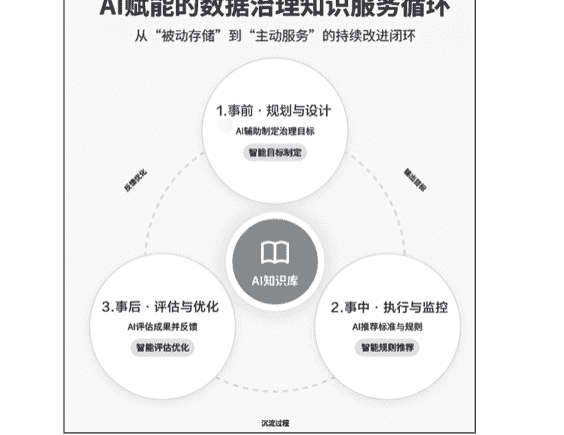
图 9-1 AI 赋能的数据治理知识服务循环

1. **事前阶段（规划与设计）**：编制治理规划时，通过知识库查询公司战略规划、过往信息化报告、未完成问题、数据质量分析报告、各业务部门规划等文件。知识库可自动关联匹配各文档内容，输出契合业务战略的治理规划。
2. **事中阶段（执行与监控）**：编制数据标准时，查询国标、行业标准与企业标准并引入业务文档，辅助快速对标制定。编制数据质量稽核规则时，查询已有标准、业务文档、报表等，知识库可自动推荐稽核规则并关联业务规则。
3. **事后阶段（评估与优化）**：完成治理目标后，将过程文档与成果物提交知识库，并通过知识库对文档与规划进行匹配分析，自动评估优化治理任务。

### 9.1.2 数据治理知识库的核心价值与目标
构建知识库的最终目的是服务数据治理并提升整体效能。其核心价值在于深度融入事前、事中、事后三大阶段，为各阶段提供精准高效的知识支持。需清晰定义不同阶段的知识库角色、创造的核心价值与具体可衡量目标。

1. **事前阶段（规划、设计、决策支持）**：启动前提供全面、准确、及时的信息输入与智能化分析辅助，提高规划前瞻性、科学性与效率，规避潜在风险，提升决策质量。事前赋能示例见表 9-1。

表 9-1 事前阶段知识库赋能示例

| 赋能方向 | 核心价值体现 | 具体目标示例 |
| :--- | :--- | :--- |
| 战略对齐与规划编制 | 确保治理规划与公司战略一致，从现有文档中快速汇集决策依据 | 在制订年度治理计划时，数据治理知识库能快速检索并提供近两年的公司年度报告、IT 部门工作总结以及关键业务部门的年度规划 PPT，以辅助管理层快速对齐方向 |
| 需求分析与范围界定 | 快速理解业务需求背景，参考过去的项目文档，避免重复“踩坑” | 对于新立项的数据治理项目，数据治理知识库能根据关键词，自动查找并推送过往类似项目的立项申请书和系统需求规格说明书，以供项目经理参考其背景和范围 |
| 风险评估与合规检查 | 主动提示内部规章制度要求，识别潜在的合规风险点 | 在进行新数据应用方案设计时，数据治理知识库能扫描方案描述，并对照已录入的《公司数据安全管理办法》等内部制度，主动提示可能冲突的条款 |
| 方案设计与技术选型 | 提供内部已有技术实战和相似方案作为参考，提高设计质量 | 当规划元数据管理平台建设时，数据治理知识库能提供过往相关项目的技术设计文档和系统架构图，展示公司内部已使用的技术栈和集成方案，以辅助技术选型 |
| 资源与预算初步规划 | 基于历史项目数据，为新项目的资源估算提供量级参考 | 在进行任务初步资源评估时，数据治理知识库能根据任务类型，从过往类似项目的项目预算审批文件中，提取其总体预算范围和计划周期，为新项目的资源估算提供初步的量级参考 |

2. **事中阶段（执行、监控、问题解决）**：执行过程中提供即时、准确、规范的知识支持与操作指引，加速任务执行，减少错误与返工，确保执行一致性，提升问题响应效率。事中赋能示例见表 9-2。

表 9-2 事中阶段知识库赋能示例

| 赋能方向 | 核心价值体现 | 具体目标示例 |
| :--- | :--- | :--- |
| 标准规范即时查询 | 确保开发、分析、业务操作符合统一标准 | 提升数据开发人员和数据分析师通过数据治理知识库查询数据标准（如命名、格式、定义）的效率，查询结果准确率达到 95% |
| 流程操作智能指引 | 降低流程执行门槛，规范操作步骤，减少错误 | 对于已纳入数据治理知识库的核心治理流程（如元数据变更、DQ 问题上报），用户通过问答可获取清晰的操作步骤，这一比例达到 80%，相关流程执行错误率降至 15% |
| 常见问题快速解答（FAQ） | 减少对专家的重复咨询，提升问题自助解决率 | 上线后，用户能够通过数据治理知识库自助解决常见数据治理相关问题（Top 20），这一比例达到 60%，显著降低治理/IT 团队的工单量/咨询量 |
| 历史案例与经验借鉴 | 遇到问题时快速找到相似场景的解决方案，避免重复试错 | 数据管家或问题处理人员在面对新的数据质量/安全问题时，能在数据治理知识库中找到至少 1 个高度相关的历史处理案例，这一比例达到 50% |
| 上下文感知的信息推送 | 在特定操作场景下主动提供相关信息，减少遗漏和错误 | 在数据建模工具中，当用户创建与“客户”相关的实体时，数据治理知识库能主动推送客户主数据标准链接和相关隐私保护要求的提示信息 |

3. **事后阶段（评估、复盘、优化、知识沉淀）**：工作完成后系统化沉淀经验教训与成果数据，支持客观高效的治理效果评估，促进知识显性化、复用与共享，驱动体系持续学习优化。事后赋能示例见表 9-3。

表 9-3 事后阶段知识库赋能示例

| 赋能方向 | 核心价值体现 | 具体目标示例 |
| :--- | :--- | :--- |

数据治理知识库：能力全景与落地方案

| 项目回溯与经验萃取 | 自动归纳项目运作信息，快速提炼成败要点 | 对于已交付的数据治理项目，知识库能在验收后一周内，结合文档集合自动生成涵盖核心难点、处置思路、教训总结的复盘草案，供项目负责人补充完善 |
| 治理成效评估与数据融合 | 便捷调取历史治理绩效并整合，支持效果研判 | 用户可通过自然语言查询，获取近四个季度内特定数据域例如产品域的质量分走势、已闭环的关键问题数及主要改进举措记录 |
| 知识更新与版本管控 | 保证库内内容同步最新实践与决策 | 建立月度更新机制，新发布的制度、标准或重要项目总结发布后即可纳入知识库并可检索 |
| 最佳实践识别与推广 | 挖掘整理成功的治理案例与方法，促进组织内复用 | 知识库依据项目评估结果与用户反馈，每季度自动推荐优秀治理实践案例并形成简报，用于内部宣导 |
| 持续改进驱动 | 基于查询热点与反馈定位体系短板 | 每月分析知识库查询日志与用户反馈，筛选出关注度高但解答不足的Top5治理问题，作为下一阶段优化或补充知识的输入 |

### 9.1.3 实战目标与工具选型
本小节明确动手环节的目标、边界以及为何选用 DeepSeek 与 Dify，帮助读者理清后续操作的技术背景。整体思路是先搭建最小可用版本，再在企业场景验证，并给出扩张思路。聚焦如下：

- 核心功能验证：借助 DeepSeek 与 Dify 搭建一个基于检索增强生成的雏形知识库。用户用自然语言提问，系统从导入的治理文档中检索相关信息并生成连贯准确的回答。
- 初步价值验证：至少覆盖治理的事前、事中、事后三大领域，解决信息获取效率低的痛点，初步体现知识库对提升治理效率的价值。
- 掌握核心流程：让读者亲手操作，熟悉用 Dify 与 DeepSeek 处理文档、搭建调试 RAG 应用的关键步骤与配置要点。
- 建设思路延展：MVP 完成后，后续扩展升级需结合组织现状，文中会给出扩展参考示例。

为保持可控，本次 MVP 范围限定为：
1. 知识源为 6 份代表性企业治理文件：2 份事前规划类，含业务战略与行业案例，DOC 格式；2 份事中执行类，含数据标准与质量评估指标，XLSX 格式；2 份事后评估类，含成熟度评估与价值评价，PDF 格式。
2. 使用对象为数据治理团队内部成员，或有查询需求的 IT 与业务人员。
3. 工具选择理由：
    - DeepSeek：国内领先的开源大模型，中文理解生成能力突出，适配中文治理文档与问答。可私有化部署保障数据安全，也可通过 API 便捷调用。
    - Dify：开源且部署灵活，可视化界面大幅降低开发门槛，非专业用户也能快速上手。兼容本地部署与主流大模型调用，开发后的应用可接入现有系统。

## 9.2 数据治理知识库的架构设计与技术选型
要打造一个有效的 AI 驱动知识库，需要清晰合理的技术架构支撑。本节先讲逻辑架构，突出 Dify 的核心作用，再讨论使用 Dify 与 DeepSeek 时的关键技术选型，包括格式支持、文档处理、Embedding 模型、大模型接入与部署方式，为实战提供指引。

### 9.2.1 数据治理知识库的架构设计
为支撑事前、事中、事后全流程知识服务，架构划分为 5 层：数据源层、知识抽取与处理层、知识向量化与存储层、以 Dify 为核心的 LLM 应用平台层、用户应用与交互层，逻辑图如图 9-2。

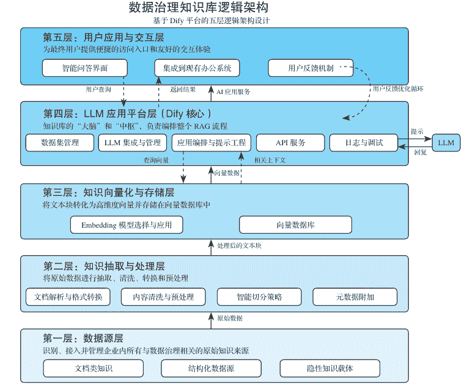

图 9-2 数据治理知识库逻辑架构

第一层 数据源层。对起步企业，该层负责主动识别、收集并初步规范构成知识库基础的分散原始信息与文档。建议收集范围：
- 战略与治理框架类：公司级战略、领域规划、数据治理政策草案、数据安全隐私制度、必须遵守法规与行业标准。
- 数据描述与资产类：业务术语表、数据字典、关键系统数据模型、核心数据资产清单。
- 管理流程与实战类：数据质量检查方法、数据访问流程、过往项目经验总结、业务 SOP 指南。
收集时需明确范围与优先级，靠 IT、业务、财务等跨部门协同推进。从现有材料起步逐步完善，鼓励贡献知识并建立初步文档规范与版本意识，为动态维护打基础。

第二层 知识抽取与处理层。将原始异构信息转化为干净、结构化、适合模型处理的文本片段。核心能力：
- 文档解析与格式转换：支持 PDF、DOC、XLSX 等提取，扫描件做 OCR。
- 内容清洗与预处理：去除页眉页脚、广告等无关信息，规范文本。
- 智能切分策略：按语义完整且大小适中切分为知识块。
- 元数据附加：为知识块关联来源、类型等元数据，便于溯源筛选。
解析清洗阶段可借助成熟开源工具或大模型，一定不能直接粗暴切分就导入，知识准确度直接决定问答质量。

第三层 知识向量化与存储层。将处理后文本转为机器可理解的数字向量并高效存储，支撑语义检索。核心能力：
- Embedding 模型选型与应用：选用合适模型把文本块转为高维语义向量。
- 向量数据库：存储文本向量及元数据，建立高效索引，支持快速相似度检索。

第四层 LLM 应用平台层即 Dify 核心。作为知识库大脑，编排 RAG 流程、管理 DeepSeek 并提供应用开发部署能力。主要能力：
- 数据集管理：支持文档上传、分段清洗、索引构建等流程配置。
- LLM 集成与管理：便捷接入并管理大语言模型如 DeepSeek，配置模型参数。
- 应用编排与提示工程：通过可视化界面构建 RAG 应用，优化提示词引导模型生成高质量答案。
- API 服务：将应用发布为 API，提供日志调试工具支撑迭代优化。

第五层 用户应用与交互层。提供友好便捷的知识访问入口。主要能力：
- 智能问答界面：支持自然语言问答、对话等交互。
- 系统集成：将智能体嵌入 OA、业务系统等现有办公系统。
- 用户反馈机制：收集答案评价并分析使用行为与查询模式，驱动持续改进。

五层协同可构建结构清晰、可持续优化的数据治理知识库。

## 9.2.2 数据治理知识库的技术选型
合理选型能降低风险、提升成功率。结合业务特点，给出关键技术选型建议。

### 1. 知识格式兼容与处理技术
核心需求是让各类治理文档如 DOC、XLSX、PDF 包括扫描件都能有效纳入知识库。建议：
- 常规文档：优先使用 Dify 自带的文档解析能力。对未直接支持的复杂格式，可辅以成熟 Python 脚本库预处理。
- 扫描件与图片：OCR 质量至关重要。建议评估并投入高质量 OCR 工具。若预算有限或量不大，可先尝试优秀开源 OCR 引擎；若对准确率要求高且文档量大，商业 OCR 服务通常更稳定。

注意：低质量 OCR 会严重影响库内内容准确性，选型前务必用代表性文档充分测试。

### 2. Embedding 模型
核心需求是将文本知识转为计算机可理解的语义向量以精准匹配。建议：
- 优先中文优化模型：鉴于文档以中文为主，建议选用中文理解与语义表达表现优异的 Embedding 模型。
- 参考社区与平台支持：可考虑 Dify 已良好支持且在中文社区口碑好的开源模型如 BGE 系列、M3E 系列。

注意：Embedding 模型质量直接决定检索精准度。选定并大规模使用后更换成本很高，需重新向量化全部知识。

### 3. 大语言模型
核心需求是基于检索到的片段理解问题并生成清晰、有逻辑的回答。建议：
- 初期推荐 API 模式：初次构建的企业建议通过 API 接入成熟知名的大语言模型服务如 DeepSeek 通用大模型 API。可快速搭建、验证业务价值，无需承担复杂运维。
- 私有化部署作为长远考虑：当知识库应用成熟或企业对数据安全与自主可控要求极高时，再评估投入资源实施 LLM 私有化部署。

注意：即便是优质 LLM 也可能产生幻觉，务必结合 RAG 架构、提示词优化和必要人工审核保障回答真实性。

### 4. 文档处理流程自动化
核心需求是高效准确完成导入、清洗、切分等预处理。建议：
- 充分利用 Dify 内置功能：Dify 通常提供覆盖大部分场景的文档导入与自动化处理如自动分段、元数据提取，应优先使用。
- Python 脚本作为补充：对平台无法直接满足的高度定制化或复杂预处理如特定格式解析、复杂清洗规则，建议用 Python 开发，并可集成到 Dify 任务流或作为前置步骤。

## 9.3 数据治理知识库助手的搭建
本节目标是引导读者亲手搭建一个基础但功能完整的数据治理知识库助手。通过配置环境、准备导入知识源、在 Dify 上构建配置应用并进行初步测试。建议边读边操作。

### 9.3.1 环境准备与工具安装
开始构建前需确认开发环境与工具就绪。

#### 1. 获取 DeepSeek 服务
1. 步骤1：注册 DeepSeek 开发者账号。访问官方开发者平台按指引完成注册并登录。
2. 步骤2：创建 API 密钥。在开发者控制台找到“API 密钥”菜单创建新密钥，妥善保管，将用于 Dify 与 DeepSeek 通信。
3. 步骤3：私有化部署说明。若企业已私有化部署 DeepSeek，需确保拥有模型服务的 API 端点 URL 和必要认证信息。本次实战推荐使用更便捷的 API 密钥方式。

#### 2. Dify 平台安装部署
推荐使用 Docker Compose 在服务器如虚拟机或云服务器上部署，具体步骤如下。
1. 步骤1：获取安装包。访问 Dify 官方地址 https://github.com/langgenius/dify，按 README.md 指引获取最新项目文件，通常下载 docker-compose.yaml。
2. 步骤2：执行部署命令。在存放 docker-compose.yaml 的目录执行 docker-compose up -d，自动拉取镜像并启动服务。提示：确保服务器已安装 Docker 与 Docker Compose，且内存磁盘充足。遇到问题可查阅官方文档或社区支持。
3. 步骤3：访问平台。部署成功后通过浏览器访问 http://服务器IP:端口号 默认端口通常为80，首次访问需创建管理员账户。

#### 3. 准备示例知识源文档
准备6份代表性数据治理文档并存放在本地文件夹。实际操作中使用真实业务数据需严格脱敏，本章示例内容均为虚构或已脱敏：
- 《公司数据战略规划_2025》事前规划文档示例 DOCX 格式。
- 《行业数据治理优秀案例分析》事前规划文档示例 DOCX 格式。
- 《核心业务数据元标准_V1》事中执行文档示例 XLSX 格式。
- 《数据质量评估指标体系》事中执行文档示例 XLSX 格式。
- 《数据管理成熟度评估报告》事后评估文档示例 PDF 格式。
- 《数据治理项目价值评价方法》事后评估文档示例 PDF 格式。

### 9.3.2 知识源导入与向量化
环境就绪后开始导入文档。

(1) 文档初步检查
快速浏览6份示例文档，确认内容清晰、无密码保护。PDF 确认是文本型而非纯图片扫描，若为纯扫描需先做 OCR。文件名与内容对应，扩展名正确。

(2) 在 Dify 中创建知识库
登录 Dify 平台进入“知识库”入口，点击“创建知识库”，为其命名如“数据治理知识库”，按提示完成创建。

(3) 上传文档至知识库
进入刚创建的知识库，点击“上传文档”后进行知识处理，具体如下。
1) 步骤1：配置文本处理与分段策略。在知识库上传设置中对文档进行“分段设置”“文本预处理”等操作如去除多余空格、处理特殊字符。MVP 可先采用平台默认设置。
分段策略是检索效果的关键，目的是将长文档切分为适合 LLM 上下文窗口且语义完整的知识片段。建议初次分段长度 800～1200 字符，重叠长度 150～250 字符。分段策略设置方式如图9-3所示。
2) 步骤2：选择并配置 Embedding 模型。在知识库设置中找到“Embedding 模型”配置项，选择使用模型。建议使用 bge-large-zh-v1.5，可选择 API 接入或本地部署。API 密钥配置：若选择 API 类 Embedding 服务，需在模型供应商系统模型设置中选择对应 Embedding 模型。Embedding 模型选择如图9-4所示。

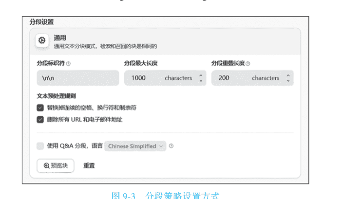

图9-3 分段策略设置方式

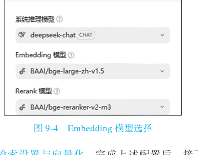

图9-4 Embedding模型选择

3）步骤3：检索设置与向量化。完成上述配置后进行检索设置，选择检索类型，推荐混合检索并使用默认参数。确认配置后点击“保存并处理”，Dify 将对文档进行分段、清洗，并通过 Embedding 模型转为向量存入内置向量数据库。检索设置与向量化如图9-5所示。

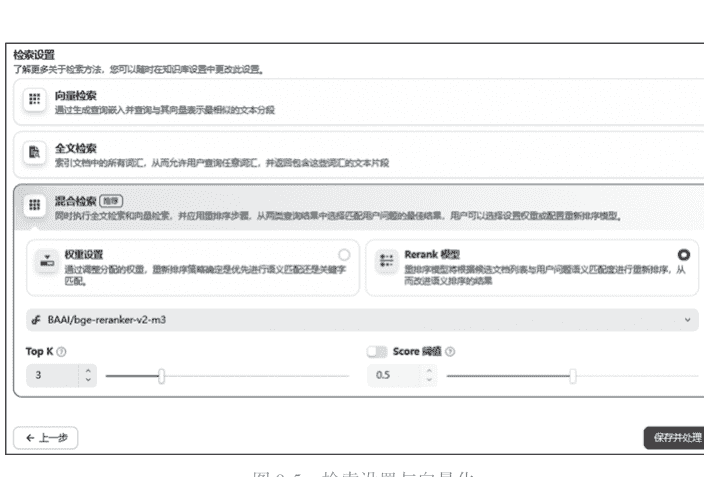

按此流程上传6个文档并完成向量化，文档向量化如图9-6所示。

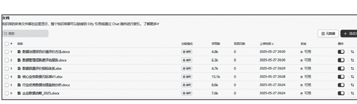

### 9.3.3 AI工作流创建与配置
知识库准备好后，创建 AI 工作流使其能利用知识库回答问题。

#### 1. 创建新的 AI 应用
从工作室页面进入“创建空白应用”界面。选择应用 Chatflow 类型，支持记忆的复杂多轮对话，适合知识库问答场景。为应用命名如“数据治理知识库助手”。AI 应用创建如图9-7所示。

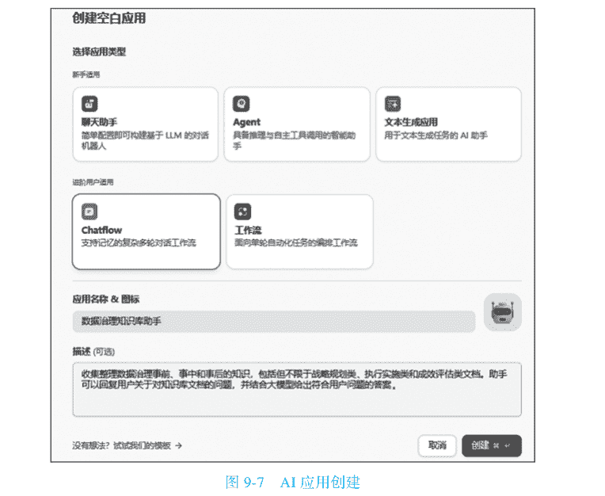

#### 2. 关联知识库
在新创建的应用配置界面中添加知识检索节点，选择已索引完成的“数据治理知识库”，并将知识检索节点与开始节点关联，启用知识库检索功能。关联知识库如图9-8所示。


#### 3. 配置 DeepSeek 模型
在知识检索节点后添加 LLM 节点并选择具体模型。从下拉列表选择 DeepSeek 对话模型如 deepseek-chat，然后调整基础参数：
- 温度 temperature：控制回复创造性。知识库问答建议设为较低值如0.2～0.5，使回答更稳定、基于事实。
- 最大标记 max_token：限制单次回复最大长度，默认为4096。
模型参数调整如图9-9所示。

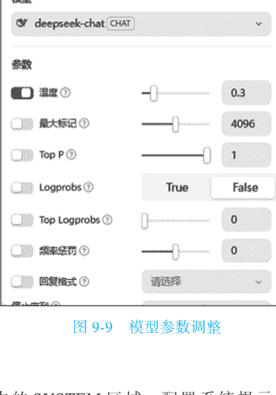

#### 4. 提示词工程

在 Dify 工作流里，LLM 节点的 SYSTEM 区就是放置系统指令的地方。这段文字相当于模型的行动纲领，直接决定最终产出好坏。高质量的系统提示需要把 AI 的身份定位、工作任务、运行约束和背景资料交代清楚。

设计时建议抓住四个要点：

- **先定身份再定目标**：让模型明白自己扮演什么角色，以及需要交付什么结果。
- **把上下文带进来**：借助 Dify 的 {{context}} 变量，把知识库检索到的相关片段完整注入对话。
- **框定输出范围**：约定回答的格式、长度、语气，以及资料不足时的兜底表述。
- **用示例做对齐**：附上几组高质量问答，帮模型把握期望的表达方式。

MVP 阶段的系统指令可以这样组织：

你是一个专业的数据治理知识库助手。请根据以下提供的背景知识来回答用户提出的问题。

背景知识：

{{Dify在运行时会自动填充从数据治理知识库中检索到的相关文本片段}}

用户问题：

{{用户实际提出的问题}}

请严格依据背景知识进行回答，确保内容准确、简洁。如果背景知识不足以回答问题，请直接告知用户“我目前掌握的知识无法回答这个问题”。

系统提示的配置界面见图9-10。

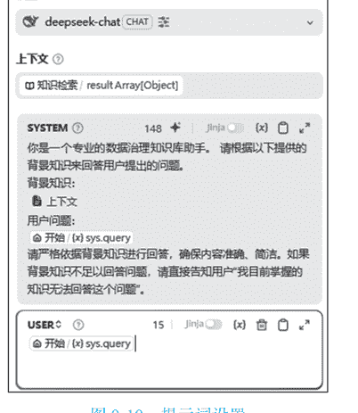

另外可以加一句人性化的开场白，比如“你好，我是数据治理知识库助手，请问有什么可以帮你？” 开场白的配置见图9-11。

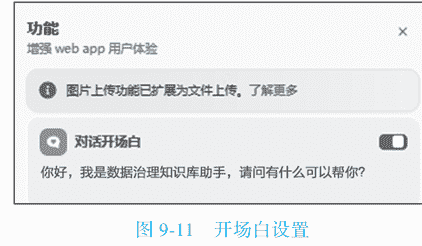

图9-11 开场白设置

#### 5. 配置上下文检索策略

进入知识库设置调整召回参数。Top_K 表示从向量库里取出的最相关片段数量，初期建议先用 4 个。上下文检索策略设置如图9-12所示。

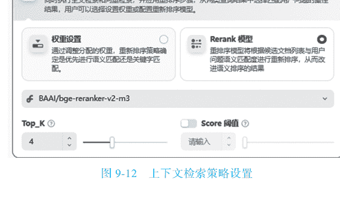

图9-12 上下文检索策略设置

> **注意事项：** 系统提示的质量直接决定应用效果，以上仅为基础模板，实际使用需要持续打磨。LLM 的温度参数对风格影响较大，建议多轮尝试找到合适取值。

### 9.3.4 初步测试与调试

骨架搭建完成后就可以进入功能验证和微调。

#### 1. 发布应用并测试

Dify 为每个应用提供发布入口，发布后点“运行”即可在内网自测，Dify 应用发布设置如图9-13所示。


#### 2. 设计测试问题

准备一批能够覆盖知识库范围并检验回答精度的题目，答案必须能在之前导入的 6 份文档中找到。例如：

- 针对《公司数据战略规划_2025》：“公司在2025年的数据治理战略重点有哪些？”，其回复如图9-14所示。

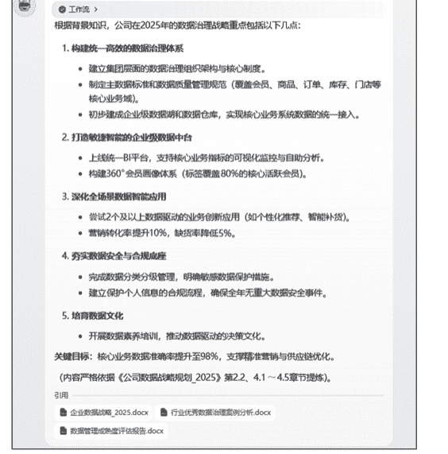

- 针对《核心业务数据元标准_V1》：“客户ID的数据类型和长度标准是什么？”，其回复如图9-15所示。

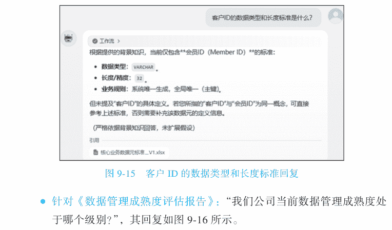

- 针对《数据管理成熟度评估报告》：“我们公司当前数据管理成熟度处于哪个级别？”，其回复如图9-16所示。

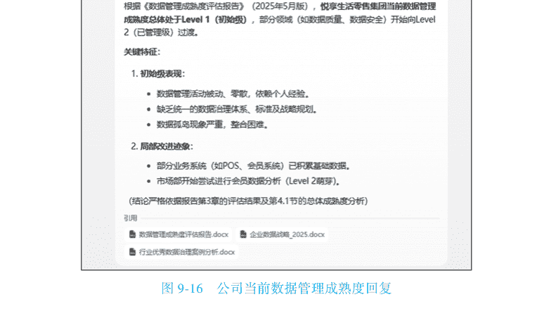

#### 3. 执行测试并评估回答

在测试界面里从以下角度审视模型输出。

- **相关性**：输出是否对准提问意图。
- **准确性**：信息是否与源文档一致。
- **完整性**：在给定上下文范围内是否解答充分。
- **溯源性**：引用的片段及来源文档是否正确。

#### 4. 初步调试与迭代

若输出不理想，可从以下方向入手：

- **检查知识库与处理方式**：确认文档已正确导入并完成索引，分段策略是否合理。
- **优化提示词**：让系统指令表达更清晰、指引更明确。
- **调整检索参数**：增减 Top_K，观察召回效果的变化。
- **调整 LLM 参数**：适度修改温度等参数。

> **提示：** MVP 测试的核心是验证“提问→检索→生成”这条主线是否通畅、可初步使用，不必追求完美。测试中暴露的问题可作为后续优化的依据，调试本质上是迭代过程，需要耐心。

按以上流程实操后，你应已搭建并初测了一个基于 Dify 与 DeepSeek 的数据治理知识库助手。它虽简洁，但验证了核心技术可行，为后续深化与扩展奠定了基础。下一节将讨论如何把该知识库真正用起来，以及如何评估与持续改进。

## 9.4 数据治理知识库的应用实战与持续优化

完成 MVP 只是建设的第一步。要让知识库真正赋能业务，就要在真实工作中检验，建立评估机制，并据此持续迭代。本节聚焦实战方法与策略。

## 9.4.1 实际应用场景实战

通过模拟真实任务，检验知识库在数据治理事前、事中、事后各阶段的效果，收集用户反馈并发现短板。

（1）实战目的与准备

- **目的：** 验证知识库能否帮助用户快速定位所需信息，初步判断易用性和实用性。
- **参与人员：** 1～2 名数据治理专员、数据分析师或相关业务人员。
- **实战材料：** “数据治理知识库助手”访问说明，以及一份包含针对性任务的演练指引。需事先告知参与者当前库内仅有已导入的 6 份示例文档。

（2）场景任务示例与操作指引

围绕数据治理三阶段设计任务，引导用户与助手互动。

首先是事前阶段演练。

任务示例 1（战略理解）：“假设你需向新同事介绍公司数据战略，请通过助手查询《公司数据战略规划_2025》，提炼未来一年的三大战略重点。”

任务示例 2（案例借鉴）：“为提升某业务的数据应用水平，请在《行业数据治理优秀案例分析》中查找‘客户画像精准营销’相关案例，并总结成功关键因素。”

用户操作：把任务转化为自然语言提问，如“2025 年公司数据战略的重点有哪些？”或“客户画像精准营销有哪些成功案例及要素？”

其次是事中阶段演练。

任务示例 1（标准查询）：“在做数据 ETL 时，需确认‘交易流水号’字段的标准（命名规范、数据类型、长度），请从《核心业务数据元标准_V1》中获取。”

任务示例 2（质量评估）：“月度数据质量报告中‘产品信息完整性’得分偏低，请在《数据质量评估指标体系》中查找该指标定义及评估维度。”

用户操作：例如问“交易流水号的数据标准是什么？”或“产品信息完整性指标如何定义和评估？”

最后是事后阶段演练。

任务示例 1（成熟度回顾）：“请在《数据管理成熟度评估报告》中查找‘数据安全管理’维度的优势与待改进点。”

任务示例 2（价值分析）：“数据治理完成后如何衡量业务价值？请从《数据治理项目价值评价方法》中查询至少三种评价维度或方法。”

用户操作：例如问“我们在数据安全管理成熟度上有哪些优势和不足？”或“评价数据治理项目价值的方法有哪些？”

（3）实战过程观察与反馈收集

- **观察记录**：用户提问的表述方式、查找答案的尝试次数、耗时、对回答的理解程度。
- **反馈收集**：结束后访谈，收集对易用性、准确性、完整性和整体体验的看法及改进建议。

> 注意事项：本次收集的目的是改进助手，而非评判用户。鼓励用户尝试不同问法以检验理解能力，记录卡点问题通常意味着系统需要优化。

## 9.4.2 数据治理知识库的成效评估模型与方法

为客观衡量价值并指导优化，需要建立清晰的评估体系。

### 1. 明确评估维度与核心指标

参照 9.1.2 节目标，可从以下维度设定指标。

效率提升维度：

- **信息获取平均时长**：使用知识库与传统方式查找信息所需时间的对比。
- **问题一次性解决率**：首次回答即满足需求的比例。

知识服务质量维度：

- **答案准确率**：经人工抽样校验，回答与源文档一致的比例。
- **知识覆盖满足度**：与库内知识相关的问题得到有效回答的比例。
- **用户满意度**：通过问卷或应用内评分收集的 1～5 分评价。

用户采纳与活跃度：

- **活跃用户数 / 查询次数**：实际使用频率。
- **高频查询主题**：用户最关心的知识点。
- **零回答问题分析**：库内未覆盖或模型难以理解的问题。

### 2. 评估方法与工具

- **Dify 平台日志分析**：获取查询次数、高频问题、无法回答问题等数据。
- **用户调研与访谈**：每季度通过问卷或小组访谈收集定性反馈。
- **问答效果抽样评估**：定期抽取问答对，由专家判断准确性和完整性。
- **应用内嵌反馈**：在问答界面加入“此回答是否有用？”及评论框，实时收集单次评价。

> **注意事项：** 建立清晰的评估基线，如 MVP 上线初期的表现，以便衡量改进。定量与定性结合，才能全面了解表现。评估结果应作为优化输入，并向管理层和用户代表汇报。

## 9.4.3 数据治理知识库的持续优化策略

知识库的生命力在于“鲜活”和“成长”，持续优化是关键。

### 1. 知识内容体系的动态更新

- **新知识纳入机制：** 建立流程，每月收集新增或更新的政策、标准、流程、项目总结、最佳实践，及时导入并索引。
- **过期知识维护：** 识别并处理过时内容，归档或替换，确保时效性。
- **知识缺口填补：** 根据高频无满意答案问题及用户反馈，主动补充盲区内容。

### 2. AI 模型与应用配置调优

- **提示词迭代：** 分析交互日志中导致回答不佳的提问场景，针对性优化系统提示词。
- **检索增强参数调优：** 若片段过大过小或语义割裂，调整分段参数；实验不同 Top_K 值寻找平衡；在应用中微调 LLM 温度等参数以优化风格。

### 3. 用户反馈驱动的改进闭环

- **常态化反馈收集：** 通过应用内按钮、专用邮箱、定期座谈会等渠道收集问题与建议。
- **反馈分析与优先级排序**：汇总共性问题与高价值建议，结合评估数据确定优先级。
- **改进实施与效果追踪**：实施后主动追踪效果，并用前述评估方法验证是否达标。
- **透明沟通**：及时告知用户重要改进与新功能，鼓励再体验并反馈。

### 4. 定期健康度检查与性能监控

监控响应时间、API 调用成功率、服务器资源使用等，确保稳定运行；定期检查知识索引完整性与准确性。

> **注意事项**：优化宜小步快跑，避免一次性改动过多导致难以归因。记录重要优化操作、原因与结果，形成运维知识。建议由数据治理、IT 技术和用户代表组成运营优化小组共同推进。

通过应用实战、成效评估与持续优化的闭环，知识库将从 MVP 成长为数据治理工作中不可或缺的助手，实现 AI 对知识的智能赋能。

# 第10章 DeepSeek 在元数据管理中的实战应用

本章聚焦企业元数据管理的痛点，指导读者利用 Dify 与 DeepSeek 搭建端到端、具备应用价值的智能元数据工作流。首先从场景选择与需求分析入手，详解在 Dify 上构建工作流的步骤，包括提示词设计、模型集成等；继而探讨调试与优化方法，确保稳定准确；最后展示工作流在真实元数据场景中的落地效果，评估效率提升，并展望 AI 在更多元数据任务中的前景。通过学习，读者可掌握 AI 驱动智能工作流的实操能力，为 AI 融入数据治理实战打基础。

## 10.1 实战场景选择与分析

### 10.1.1 实战场景选择与价值分析

第 5 章已从理论层面介绍了元数据管理的重要性及 DeepSeek 如何赋能解决效率低、覆盖不足等问题。本章旨在实现“从知道到做到”，亲手构建一个 AI 驱动的智能元数据工作流。实战可达成：

- **实战理论**：验证 DeepSeek 在元数据任务中的实际赋能效果。
- **掌握工具**：学习 Dify 的模型配置、提示词设计与工作流编排。
- **应对挑战**：在构建调试中积累问题分析与解决经验。
- **量化价值**：直观感受 AI 在特定任务上的效率提升。
- **建立信心**：为 AI 在更广数据治理领域的应用打基础。

元数据管理任务众多，本章聚焦“基于数据库表名、字段名、数据类型及上下文信息，自动生成字段业务描述初稿”。

选择该场景的原因：

- **痛点普遍，价值直观**：字段业务描述编写是各企业共性、重复量大的工作，自动化可快速提升元数据覆盖率与目录可用性，价值易被认可。
- **高度契合 AI 能力**：任务核心是文本理解与生成，完美匹配 DeepSeek 的 NLP 能力。
- **任务独立，易于演示**：输入输出清晰，便于在 Dify 上做端到端编排，降低复杂度。
- **风险可控**：相较血缘解析或合规场景，描述生成更聚焦文本处理，易于脱敏，技术依赖易获取，适合入门。

完成该工作流后，可得到一个减少重复劳动的“智能元数据助手”，让人员把精力转向审核与高阶管理。

### 10.1.2 深入分析描述生成任务的需求

要构建能自动生成字段业务描述的工作流，需像产品经理一样拆解输入、输出与质量要求，这决定了指令设计与流程编排。

#### 1. AI 生成描述需要哪些输入信息

提供越充分的线索，生成质量越高。这些信息多来自数据库元数据、数据字典或人工补充的业务背景。

1）核心技术信息：易于自动采集

- **字段名称**：如 user_id、order_amount、create_time、status。
- **所在表名称**：如 t_customer、t_order、dim_product，表名提供重要上下文。
- **数据类型**：如 VARCHAR、INT、DECIMAL(18,2)、TIMESTAMP、BOOLEAN、DATE，提示取值范围与性质。

2）辅助技术信息：提升理解精度

- **技术注释**：数据库中已有的注释，即使不规范也含业务意图。
- **字段长度或精度**：对文本或数值字段进一步限定特征。

3）业务上下文信息：显著提升业务准确性

**字段归属与业务上下文**：先确认该字段归属于哪条业务线或具体系统，例如客户管理、订单履约、营销投放、财务核算等，并提供宏观背景提示，如客户视图、订单中台、财务报表等，帮助模型建立整体业务认知。

**样本取值参考**：附上若干具有代表性的取值片段，例如 100.50、"completed"、"pending"、"2023-10-26 10:00:00"、"男"。通过这些片段，模型可判断字段的存储形态、格式规则以及业务取值范围。

> **注意**：输入给模型的数据必须经过严格脱敏或完全模拟，严禁出现任何真实企业的敏感信息。

#### 2. 期望得到的输出是什么

本次演练希望模型在上述输入基础上，为每个字段产出一份规范的业务说明，核心聚焦三方面。

- **通俗业务说明**：主要产出。用大白话阐述字段的业务含义和使用场景，简短清晰，让非技术同事也能快速理解。
- **格式规范**：要求模型按预设格式返回，例如只返回纯描述正文不带额外解释，或以 JSON 形式输出，包含描述、关键词、关联术语等结构化信息。
- **置信度提示**：可通过提示技巧让模型给出自评分数或风险标签，当输入信息不足或字段名歧义时提醒人工重点复核。

#### 3. 对输出描述的质量要求有哪些

字段说明是否好用，取决于能否满足既定质量门槛。以下标准既用于提示词设计，也是人工审核的依据。

- **准确性**：描述必须精准反映字段在业务中的真实含义，例如 order_amount 应表述为订单金额，而非订单数量。
- **可读性**：使用业务人员熟悉的表达，避免技术黑话，语句通顺自然。
- **简洁性**：聚焦要点，言简意赅，避免冗余。通常建议控制在 50 至 100 字之间。
- **一致性**：同类字段或同一业务范围的描述在风格和用词上保持统一，数据目录整体更规范专业。
- **完整性**：在简洁前提下，涵盖业务概念、状态取值、主要用途等关键信息。
- **可审核性**：模型生成仅为初稿，需人工确认。结构清晰，便于快速阅读、理解和修改。

明确输入、输出与质量标准后，目标就清晰了。接下来即可在 Dify 平台上搭建元数据自动化流程，并编写引导模型按要求作答的提示词。

### 10.1.3 准备实战所需的“原材料”

本次实操的核心是自动产出数据库字段的业务说明，并梳理实现该任务所需的输入与期望结果。为了在 Dify 上顺畅搭建并测试流程，需要提前准备演示数据、工具环境等全部物料。

即便最终产出是文字说明，也要让模型有可参阅的上下文。为此需准备模拟数据或严格脱敏后的数据源信息，作为流程的输入素材。

模拟源结构信息：在真实场景里，这些信息会由数据库或数仓自动采集。本次为简化起见，模拟一个小型企业数据环境。准备一份结构化文件，如 Excel、CSV 或 JSON，记录典型数据表的字段清单，示例见表 10-1。

表 10-1 模拟数据源结构信息表

| 表名 | 字段名 | 数据类型 | 所属业务域 | 脱敏数据样本示例 |

| :--- | :--- | :--- | :--- | :--- |

| t_customer | cust_id | VARCHAR (32) | 客户域 | ["C10001", "C10002"] |

| t_customer | cust_name | VARCHAR (64) | 客户域 | ["张三", "李四"] |

| t_customer | register_time | TIMESTAMP | 客户域 | ["2023-01-01 10:00:00", "2023-01-05 15:30:00"] |

| t_order | order_id | VARCHAR (32) | 订单域 | ["O20230101001", "O20230101002"] |

| t_order | cust_id_fk | VARCHAR (32) | 订单域 | ["C10001", "C10003"] |

| t_order | order_amount | DECIMAL (18,2) | 订单域 | [100.50, 23.00] |

| t_order | order_status | INT | 订单域 | [1, 2, 3](代码值) |

| dim_product | prod_id | VARCHAR (32) | 产品域 | ["P001", "P002"] |

| dim_product | prod_name | VARCHAR (128) | 产品域 | ["笔记本电脑", "鼠标"] |

| dim_product | price | DECIMAL (10,2) | 产品域 | [5000.00, 100.00] |

> **注意事项：** 在实际操作中，请使用你自己构建的少量模拟数据，或者从你的真实数据中提取结构信息和样本，但务必进行严格的脱敏处理。字段名、表名等通常不是敏感信息，但数据样本可能包含敏感信息，需要特别注意处理。

Few-shot 示例准备：为了让模型更准确把握期望的描述风格与内容，可采用少量样本学习法，在指令中加入若干高质量的“输入→输出”示例。

请针对上述模拟数据中的几个字段，提前写好高质量描述示例。

**示例 1：**

输入信息：表名为 t_customer，字段名为 cust_id，数据类型为 VARCHAR (32)，所属业务域为客户域，脱敏数据样本示例为 ["C10001", "C10002"]

期望输出描述：“客户唯一编号，用于在企业内部系统中唯一识别并关联该客户的各类信息。”

## 示例 2：

输入信息：表名为 t_order，字段名为 order_amount，数据类型为 DECIMAL（18，2），所属业务域为订单域，脱敏数据样本示例为 [100.50，23.00]

期望输出描述：“记录单笔订单最终应付的总金额，涵盖商品价款、运费等费用。”

请准备 3 ～ 5 个这样的高质量示例，它们将是指导模型生成期望描述的关键。

### 10.2 智能元数据工作流的建设

借助 Dify 的可视化编排能力，搭建一个可自动生成数据库字段业务描述的工作流。Dify 提供友好界面，无需编写复杂代码，就能像搭积木一样把功能模块连接起来。本节将带你一步步完成搭建。

### 10.2.1 设计智能元数据工作流的步骤

若已按第 9 章指导完成 Dify 注册部署并配置好 DeepSeek 模型，只需登录 Dify 账户，进入工作空间，开始将需求转化为 Dify 操作。

- （1）登录 Dify 平台并进入工作空间，默认进入“工作室”

打开浏览器输入 Dify 访问地址，本地部署地址为 http://localhost。输入用户名和密码后登录。

> 注意事项：在创建流程前，务必确认 DeepSeek 模型提供商已在当前工作空间配置并启用，且计划使用的模型版本可用。可在“设置”-“模型提供商”查看。若状态异常或模型不可用，请回顾第 9 章检查 API Key 或网络配置。AI 能力就绪是后续操作的前提。

（2）设计工作流的逻辑步骤，即规划“行动路线”

在 Dify 中构建流程，就是把任务拆解为若干可执行的小步骤，并按顺序或逻辑连接起来。对于“自动生成数据库字段业务描述”任务，其行动路线可规划为 4 个主要逻辑步骤，如图 10-1 所示。

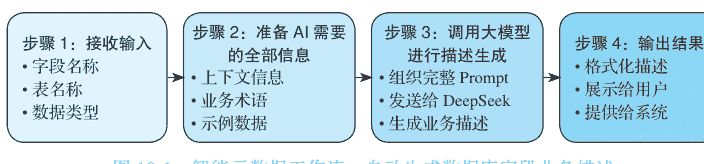
1）步骤 1：输入采集。流程需明确为哪个字段生成说明，因此首要步骤是接收用户或上游系统提供的字段元信息，包括字段名、表名、数据类型等，作为启动参数。
2）步骤 2：信息补齐。模型生成高质量说明需要上下文，除了直接接收的输入，还需获取脱敏样本或 Few-shot 示例等辅助信息。本次实战将大部分所需信息直接写入提示词或作为输入提供。
3）步骤 3：模型推理生成。这是流程的核心。将准备好的线索组织成完整提示词发送给已配置的 DeepSeek 模型，模型据此产出字段业务描述草稿。
4）步骤 4：结果呈现。模型生成的说明即为主要产出，最后一步是将该结果展示给用户或推送给下游系统。

在更高级的应用中还需要增加步骤，目的是：检查输入是否有效；对模型的输出进行简单的格式校验或后处理；如果生成结果不理想，则进行重试；记录日志；根据某些条件进行分支处理等。为了本次入门实战的清晰性，将聚焦最核心的“输入－处理－输出”线性流程。

理解并设计好这些逻辑步骤，就相当于已经规划好了在 Dify 平台中“搭积木”的顺序。接下来，将在 Dify 平台中，按照这个“行动路线”，一步步添加和配置对应的功能模块，并连接它们，构建出实际的流程。

### 10.2.2 智能元数据工作流构建

有了清晰的行动路线，就可在 Dify 平台里将其搭出来。Dify 流程编排界面直观，只需从左侧节点库选择所需节点，拖曳到画布上，用线连接即可。本次实战构建线性流程：接收输入→文档提取器→调用大模型→输出结果。

在 Dify 主界面选择“工作流”。给应用起个名字，例如“智能元数据工作流”，添加描述后点击“创建”。智能元数据工作流创建如图 10-2 所示。

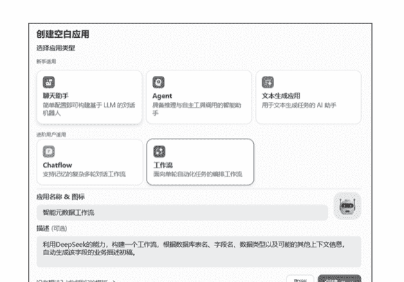

图 10-2 智能元数据工作流创建

创建成功后进入编辑界面，画布上已有开始节点。开始节点是流程入口，定义运行时需要接收哪些外部输入参数。智能元数据工作流编辑界面如图 10-3 所示。

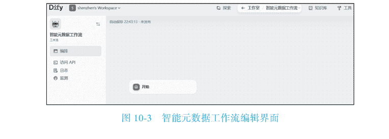

双击开始节点。在配置面板的“输入”部分添加关键字段信息参数。点击“输入字段”进入添加变量页面，如图 10-4 所示。

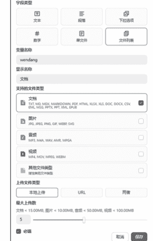

本次示例将所有表和字段放入 Excel 表。首先添加文档类型变量，由用户上传文档作为输入。配置完成后保存。此时开始节点已配置好，知道运行时从何获取字段信息。

接下来添加文档提取器，将上传文档转换为大模型可识别内容，添加文档提取器如图 10-5 所示。

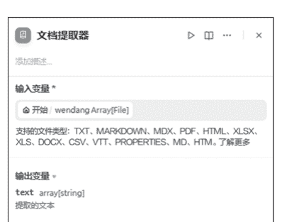

将文档提取器节点的输出连接到 LLM 节点的输入，表示数据从文档提取器传递到 LLM。接下来配置 LLM 节点：告诉 AI“做什么”和“怎么做”，添加 LLM 节点如图 10-6 所示。


在 SYSTEM 区域编写指令，告诉 DeepSeek 如何根据输入文本生成业务描述。提示词很重要，可输入固定指令文本，编写提示词如图 10-7 所示。

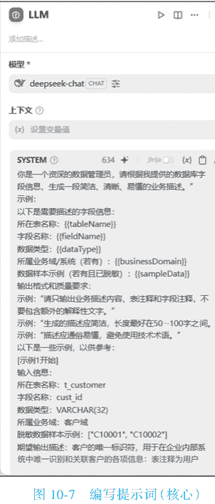

在 SYSTEM 区域上方可配置 DeepSeek 模型参数，如图 10-8 所示：

- **温度**：控制输出随机性。希望描述稳定准确，可设较低值。
- **Top P**：控制采样策略，影响输出多样性。可保持默认或微调。

配置完成后保存。该节点即可接收信息、调用 DeepSeek 并生成描述。

添加结束节点，定义最终产出。在配置面板定义流程对外输出结果。通常应将 DeepSeek 生成的业务描述作为主要输出。配置完成后保存，配置结束节点如图 10-9 所示。

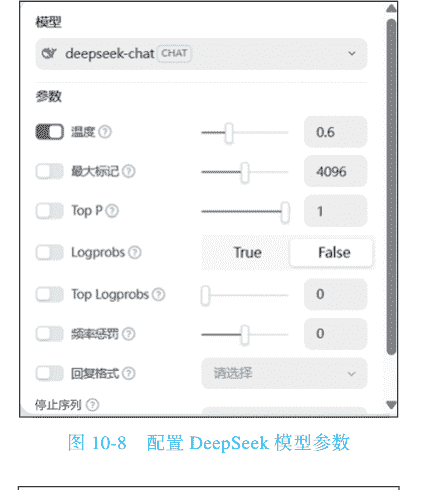

图 10-8 配置 DeepSeek 模型参数


图 10-9 配置结束节点

至此，一个可接收输入、调用 DeepSeek 并输出结果的基础流程框架已搭建完成，如图 10-10 所示。


图 10-10 智能元数据工作流框架

构建过程在 Dify 中高度可视化，可随时查看节点连接关系。完成上述步骤后，画布上应有四个节点并按顺序连接。接下来关键一步是编写能让 DeepSeek 生成高质量描述的提示词。

### 10.2.3 编写核心提示词与配置智能元数据工作流

在 Dify 画布上搭建好基础框架后，需编写驱动 DeepSeek 生成高质量业务描述的核心提示词，并在输入输出处明确参数，确保流程能顺畅接收输入并输出准确内容。

提示词是与 AI 沟通的“语言”，质量直接决定输出质量。一个好的提示词像一份清晰、详细、含示例的工作指南，能帮助 DeepSeek 准确理解意图并按期望格式生成内容。在 LLM 节点配置界面，有大文本框用于编写提示词。一个有效提示词通常包含以下要素。

- **角色设定与任务指令**：明确告知 DeepSeek 扮演的角色及核心任务。示例如下。

> 你是一个资深的数据管理员，请根据用户提供的数据库字段信息，生成一段简洁、清晰、易懂的业务描述。

- **输出格式与质量要求**：明确对最终描述的要求，如长度、风格、是否只输出描述本身等。示例如下。

> “请只输出业务描述内容，不要包含额外解释性文字。”

> “生成的描述应简洁，长度最好在 50 ~ 100 字之间。”

> “描述应通俗易懂，避免使用技术术语。”

- **Few-shot 示例**：提供少量高质量的“输入信息→期望输出描述”完整示例。这是提升输出质量和保证风格一致性的有效方法。通过示例，AI 能更好地理解“好描述”的定义。以下是示例格式，供参考。

```
[示例 1 开始]
输入信息：
字段名：cust_id
表名：t_customer
数据类型：VARCHAR（32）
所属业务域：客户域
脱敏数据样本示例：["C10001", "C10002"]
期望输出描述：客户的唯一标识符，用于在企业内部系统中唯一识别和关联客户的各项信息，表注释为用户表，字段注释为用户 ID。
[ 示例 1 结束 ]
[ 示例 2 开始 ]
输入信息：
字段名：order_amount
表名：t_order
数据类型：DECIMAL（18,2）
所属业务域：订单域
脱敏数据样本示例：[100.50, 23.00]
期望输出描述：该字段记录了单笔订单最终支付的总金额，包含商品费用、运费等，表注释为订单表，字段注释为订单总金额。
[ 示例 2 结束 ]
```

将上述要素组合形成完整提示词，填入 LLM 节点的 SYSTEM 区域。编写提示词是迭代优化过程，可能在调试阶段根据实际输出不断调整内容和结构。

完成提示词编写及开始、结束节点的详细配置后，智能元数据工作流的主要构建工作基本完成。此时已告知 AI 要做什么、需要什么信息以及最终以何种形式给出结果。接下来进入调试与优化环节，检查流程是否按预期运行，并解决出现的问题。

## 10.3 智能元数据工作流的调试与优化

毛坯期的工作流搭出来了，要真正投入使用就得像带一个新助手一样反复试跑、打磨。得确认它能不能读懂指令、是否能把字段准确认识并写出业务描述，遇到卡壳时怎么解决，并持续给反馈让它越来越靠谱。下面就以 Dify 里的智能元数据工作流为例，说说怎么测、怎么调、怎么应对边界情况，让模型输出更靠谱更聪明。

### 10.3.1 调试与试跑方法

刚组装好的工作流相当于一台新机器，得先通电试车，看能不能稳定产出合格的业务描述。试跑时常碰到装配问题、原材料问题、流程设计问题。只有熟悉 Dify 的测试入口和调试手段，才能快速定位。

智能元数据工作流的基础试跑大致按这个顺序走。

- 第一步，打开测试面板。在工作流编辑页的右上角点运行图标，通常会在右侧滑出测试区。
- 第二步，填入测试素材。你会看到开始节点定义的输入项，也可上传本地 Excel。 
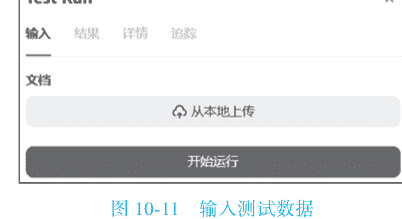
> 建议：先挑一个字段名规范、含义明确且有样本的典型字段上手，比如 t_customer 表里的 cust_name。

- 第三步，启动一次运行。点测试面板里的运行按钮，Dify 会在后台拉起一次实例。
- 第四步，看运行态。画布上的节点会从等待变运行再到完成，连线会亮起来表示数据在流动。
- 第五步，检视最终结果。成功后测试面板会展示结束节点的输出，也就是 DeepSeek 生成的业务描述。可对照预期判断质量。智能元数据工作流运行输出结果如图 10-12 所示。
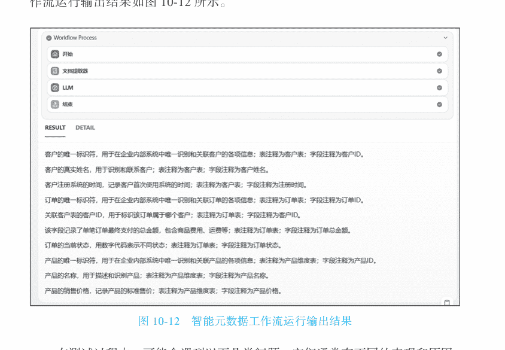

试跑中常见三类状况。

1）流程起不来或中途中断。点运行没反应，或某个节点标红停下并吐出错误。常见诱因是节点配置不对，比如 LLM 节点未绑定模型、引用了不存在的变量；API Key 过期或无效；网络不通导致连不上 DeepSeek；Dify 平台本身异常；输入格式与节点要求不符等。
2）流程跑通但结果不对。没有报错，但生成的描述完全偏离、与字段无关，或格式混乱、没按 Few-shot 的风格来。可能提示词指令模糊或歧义、Few-shot 质量不高或不匹配、输入信息不全导致模型无法推断含义、模型本身局限、样本不具代表性。
3）规模化时的性能与成本。跑得慢、单次 token 消耗高、费用飙升。根源多在提示词过长、期望输出过长、模型推理慢、批量处理没优化。

画布节点颜色是第一线索：绿为成功、红为失败、黄为进行中。失败节点就是排查起点。点进任意已完成的节点，都能看到详情：

- 输入：该节点收到的所有数据，检查前一节点的传递是否正确、结构和值是否符合预期。
- 输出：节点处理后的结果，LLM 节点可直接看到模型收到的完整提示词和原始返回文本。
- 日志：运行日志，失败节点里通常有堆栈或具体错误，例如 Invalid API Key、Network Error 等。

熟练运用测试和日志，结合常见问题机理，就能快速区分是配置问题还是 AI 输出问题，为优化做准备。

### 10.3.2 提示词打磨路径

流程能跑但描述不够准、不对味或格式跑偏，核心就是给模型的指令需要细化。提示词优化没有固定公式，本质是基于对模型行为的理解反复实验，像调教助手一样让它领会潜台词并按想要的方式输出。

在 Dify 的 LLM 节点里直接改写提示词，测试面板里即时验证。常用策略有：

1）把角色和任务说清楚。开头先定位 AI 的身份，用动词明确交付动作，让它知道自己要干什么。
优化示例：
```
初版："请写描述。"（太模糊）
优化："作为一名资深的数据管理员，请为以下字段生成一段清晰、准确、易于业务人员理解的业务描述。"
目的：帮助 AI 进入正确的“思维模式”，聚焦任务本身。
```
2）把线索给足且结构化。字段名、表名、类型、注释、业务域、样本等关键信息都要带上，并用冒号、列表、分隔符等让模型好解析。
优化示例：
```
初版："字段：{{fieldName}} {{tableName}} {{dataType}}"（信息混杂）
优化：
字段信息：
名称：{{fieldName}}
所在表：{{tableName}}
数据类型：{{dataType}}
所属业务域：{{businessDomain}}
数据样本（脱敏）：{{sampleData}}
目的：确保 AI 能够准确地识别和区分不同的输入信息，避免混淆。
```
3）用 Few-shot 领路。提供 3 到 5 组高质量的输入到期望输出示例，直接教它风格、词用、句式、长度和必含要点。
示例的数量与质量直接决定一致性。
优化示例：
```
初版：“请参考一些例子，为字段生成业务描述。”
优化：在提示词指令后，添加明确的示例区块，每个示例包含完整的输入信息和对应的期望输出描述，并用清晰的分隔符（如 --- 或 [ 示例开始 ]-[ 示例结束 ]）隔开。确保
```

### 10.3.3 边界数据与落地考量

基本打磨后，典型字段能出初稿了。但真实数据库里总有奇葩字段，投入实战时还要考虑速度和成本。

1）识别特殊与边缘数据，让 AI 见多识广。包括：
- 泛化命名字段，如 id、name、value、desc、flag，需结合表名推断。
- 代码值字段，如 status、type、gender，含义靠码表解释。
- 技术型字段，如 create_time、update_time、checksum、version，侧重技术用途与生成规则。
- 外键字段，如 cust_id_fk、prod_id_ref，要说明关联对象。
- 组合依赖字段，单个字段需结合同表其他字段才有意义。

2）怎么测边缘数据。挑名字最模糊、最难懂或有特殊约定的字段去跑。AI 常给出过于笼统、错误或直接复述字段名的结果。对策：
- 在提示词里强化上下文，对泛化名强调结合表名和类型猜测业务用途；对代码值提供映射或提示它是编码字段。
- 增加针对性的 Few-shot，覆盖 ID、状态码、外键等类型。
- 引导不确定表达，比如信息不足时用“可能表示…”的句式标注。
- 对始终难搞的关键字段，工作流可标记出来转人工，或先由 AI 草拟再高优先级审核，甚至加判断节点实现分流。

3）性能与成本的前瞻。企业级场景要处理海量元数据。
- 精简提示词，删掉冗余指令，只留关键信息和示例，降低输入 token。
- 控制输出长度，在 LLM 节点设合理最大 token，避免冗余。
- 模型选择权衡，DeepSeek 不同规格在速度和费用上差异明显，按质量要求选型。
- 批量调用设计，单次处理一个字段适合演示，实战可用 Python 脚本批量读元数据循环调用 Dify API。平台 API 性能和外部批量逻辑是关键。

先把鲁棒性打好，同时保持成本意识，才能为规模化部署铺路。

## 10.4 智能元数据工作流的应用实战

构建、调试、优化完成后，就要把工作流发布出去用起来。发布后才能通过网页或 API 被外部调用。

### 10.4.1 工作流发布与调用方式

Dify 里发布即把当前编辑版本上线对外服务。常用两种接入方式：

方式一，Web 应用界面，适合少量交互式使用。发布后平台会生成对应输入框和输出展示页，管理员可手动填字段信息即时得到描述。
适用场景是数据管家为少量字段快速生成初稿。访问路径是在应用列表进入目标应用后点发布再运行。

方式二，API 调用，适合批量和系统集成。Dify 为每个应用生成 RESTful 接口，通过 HTTP 请求把字段信息作为请求体发送，返回 JSON 格式描述。
适用场景包括批量脚本、嵌入到元数据平台或数据目录、在 ETL 流程中自动补全描述等。
API 信息在应用页左侧的访问 API 选项里获取，包括 Endpoint 和鉴权用的 API Key，需妥善保管。调用示意如图 10-13。
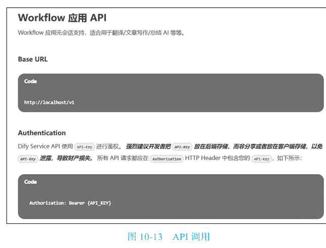
本次实战重点演示 Web 单次试用和 API 批量试用的可行性。

### 10.4.2 实战案例与价值对比

四个生成样本直观体现效果。

案例一 典型字段。输入：t_customer.cust_name，VARCHAR(64)，客户域，样本 ["张三","李四"]。AI 输出：“客户的姓名，用于识别和称呼客户。该字段记录了客户在注册或提供信息时填写的名称。” 评价：简洁准确易懂。

案例二 数值字段。输入：t_order.order_amount，DECIMAL(18,2)，订单域，样本 [100.50,23.00]。AI 输出：“该字段记录了每笔订单的最终支付总金额，通常包含商品价格、运费等，精确到两位小数。” 评价：抓住金额与精度，说明清楚。

案例三 状态码字段。输入：t_order.order_status，INT，订单域，样本 [1,2,3]。AI 输出：“订单的当前状态标识，通过数字代码表示（例如 1 代表待支付，2 代表已完成，3 代表已取消），用于跟踪订单的处理进度。” 评价：解释了编码含义与用途。

案例四 时间字段。输入：t_customer.register_time，TIMESTAMP，客户域，样本 ["2023-01-01 10:00:00","2023-01-05 15:30:00"]。AI 输出：“该字段记录了客户在平台成功注册的具体时间和日期，精确到秒。” 评价：含义与精度描述准确。

AI 在这些场景下表现亮点是准确通顺，但也可能偶尔不够精确、遗漏细节、对模糊字段理解困难。整体是可用的初稿，需要人工复核。

与传统手工流程对比，过去是人工读文档、访谈业务、手动撰写录入，依赖经验、耗时难规模化。AI 赋能后带来：

- 效率提升：从零写作变为审稿改稿，百字段描述从一天缩到几分钟生成加 1-2 小时审核。
- 覆盖率提升：成本下降更容易补全全库描述。
- 一致性改善：Few-shot 约束风格趋同。
- 门槛降低：技术或业务人员都能快速获得可读初稿。
- 工作重心转移：从写变为审和调，投入体系规划与复杂问题。

案例对比证明把大模型能力嵌入元数据管理是可行且高价值的，能显著提效、改善质量并改变工作模式。

### 10.4.3 扩展应用与未来展望

在之前的实操里，你已经体验过把 Dify 和 DeepSeek 组合起来搭建元数据自动化流程的完整手感，也感受到这种组合在提效和重塑操作习惯上的价值。把这次的经验向外延展，完全可以让大模型覆盖更复杂、更细分的元数据场景。下面给出四条可直接复用的思路。

1）业务术语自动挖掘与定义初稿：大模型擅长长文本理解、信息抽取、关联推断以及规范化表达。
实现思路：把非结构化文档丢进流程→触发大模型节点，从原文中挑出可能的业务术语、相关上下文并给出初步定义→输出术语清单和定义草案，供人工复核与标准化。

2）命名规范自动校验与改名建议：大模型能读懂规则文本并据此做判断与改写。
实现思路：把字段名、表名和对应的命名规则一并送入→让模型对照规则检查合规性→不合规时基于业务含义给出符合规则的重命名建议→返回校验结论与推荐名称。

3）基于文档的血缘初筛：大模型在阅读理解与信息关联上表现突出。
实现思路：输入包含简要数据流描述的文档或代码注释→让模型识别出数据源、汇聚目标和关键转换环节→输出初步的血缘描述或结构化记录，可作为后续代码级解析的前置补充。

4）元数据问答与检索：结合阅读理解与知识库检索能力。
实现思路：接收自然语言提问→调用大模型并以企业元数据库作为 RAG 来源，理解意图后检索相关对象→用自然语言返回答案。这类场景通常更重，常以 Dify 的对话应用或工作流混合实现。

把工作流搭建、提示词设计、接口调用等能力复用到以上或类似的元数据治理任务，企业就能逐步形成 AI 加持的元数据管理体系，让更多环节进入智能化。

## 第11章 DeepSeek 在数据标准管理中的工程化实战

本章承接第6章的理论框架，聚焦 DeepSeek 大模型与 Dify 系统在数据标准管理里的落地实践。以“数据标准符合性智能检查”为切入点，围绕客户信息治理与物料编码治理两大高频业务，演示如何从需求到部署完整搭建智能检查流程。内容覆盖需求拆解、流程架构、提示词工程、知识库接入与调试发布。通过具体案例，读者能直观看到 AI 如何提升标准管理的效率与准确性，解决传统模式下落地难、维护成本高的痛点，为企业智能化转型提供可复制的实操样本。

## 11.1 实战场景选择与分析

数据标准管理是企业数据治理的基石，关乎数据一致性、准确性和可用性。传统方式在数据量爆炸、来源多样化的背景下，效率低、易出错、响应慢，痛点业已明确。

本章聚焦 DeepSeek 在数据标准领域的工程化落地，将“数据标准符合性智能检查”作为突破口。

### 11.1.1 场景选择与价值评估

选用该场景主要基于三点：

- **高频痛点**：日常标准复核工作量大且易错。某企业统计显示，人工复核占用团队工时约30%，错误率达15%。自动化能快速提升符合率，节省人力物力。
- **规则清晰**：该场景依赖明确的规则体系，如《主数据规范》《系统数据集成接口规范》等文档包含命名、格式、值域、逻辑关系等结构化规则。大模型能据此精准定位偏差。
- **回报明确**：在当前大模型落地方向里，该场景可行性高、见效快。自动化检查可显著提升效率、降低人力投入并提高管理质量，经济与管理效益兼得。

本章将以此场景为核心，利用 Dify 实现 DeepSeek 在数据标准管理的工程化应用。

### 11.1.2 业务需求拆解

核心场景为“数据标准符合性智能检查”，需先明确不同业务对标准的具体要求，以及模型输入与输出。本节以客户信息与物料两个典型域为例。

#### 1. 客户信息标准检查

在 CRM 中，客户信息的完整、准确、一致性直接影响画像与精准营销。姓名、性别、年龄、联系方式、地址等均需合规。

需求拆解：
1）完整性核查。检查姓名、联系方式等关键项是否缺失。大规模数据下人工难以快速判断，易遗漏。
2）准确性校验。性别应为“男”或“女”，年龄需在合理区间如0～120岁。人工判断易受主观影响且效率低。
3）一致性比对。同一客户在销售与售后等系统中的信息应保持一致。跨系统人工比对工作量大、易出错。

#### 2. 物料信息标准检查

在制造企业，物料数据的规范性影响展示、销售与库存。名称、规格、型号、价格等需符合标准。

需求拆解：
1）名称规范校验。名称应包含品牌、型号、功能等要素且长度受限。人工难以全面覆盖，易漏检。
2）规格参数准确校验。参数需符合行业与企业内规，如电子产品屏幕尺寸、分辨率等应准确。人工核对需专业知识、耗时，且标准更新滞后易导致误判。

## 11.1.3 需求分析示例

客户地址的准确性对快递、客户定位、区域分析至关重要。实际中地址常不规范，如格式不一、用词错误、长度异常、逻辑冲突等，严重影响使用效率。常见问题见表11-1。

表 11-1 客户地址数据常见问题

| 需求类型 | 具体描述 | 传统方式痛点 |
| :--- | :--- | :--- |
| 格式校验 | 省、市、区需完整呈现，各级以“/”分隔 | 人工校验易疏忽分隔符等细节，导致不合规数据流入下游，影响准确性与效率 |
| 术语规范 | 应使用“自治区”而非“自治州”等差异表述 | 地区简称差异多，人工难全面把控，录入时易产生歧义，影响地域业务与服务分配 |
| 长度控制 | 街道名称字符长度不得超过 20 | Excel 公式难以精准识别超长文本，冗长街道名称易通过，破坏规范性，增加存储负担 |
| 逻辑冲突 | 如“北京市”下不应出现“浦东新区” | 人工难以记住省市县映射关系，易漏检逻辑错误，影响物流规划、区域分析等判断 |

## 11.2 智能数据标准检查工作流的搭建

### 11.2.1 架构设计与实现

高效流程的核心是将待检数据点作为输入，由 DeepSeek 结合企业标准知识库作出判断并输出结果。在 Dify 中通过串联多个功能组件实现。

步骤规划：
1）步骤 1：接收待检数据。明确流程为哪条数据如一条客户地址进行检查。
2）步骤 2：接入企业标准知识。让模型可查阅并理解内部数据标准规范。
3）步骤 3：调用模型智能判断。将待检数据与知识库检索到的相关标准一并传给 DeepSeek 进行符合性判断。
4）步骤 4：输出检查结果。模型输出结构化结果，包含是否合规、不合规原因及依据。

图 11-1 是智能数据标准检查工作流设计示意图（Dify 画布视角）。它展示了各组件如何串联完成检查任务。

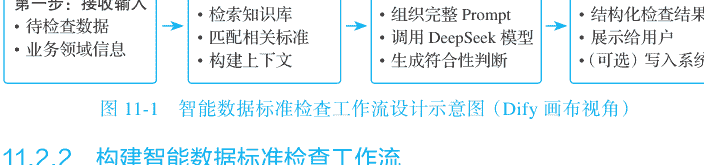

图 11-1 智能数据标准检查工作流设计示意图（Dify 画布视角）

### 11.2.2 工作流构建

在 Dify 平台按规划逐步搭建。

#### 1. 创建新的工作流应用

登录 Dify，为工作流命名如“智能数据标准检查工作流”，可添加描述后点击“创建”，如图 11-2 所示。

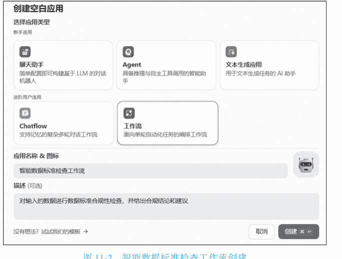

图 11-2 智能数据标准检查工作流创建

#### 2. 配置起始节点

创建后进入编辑界面，画布默认有起始节点。双击配置，定义运行需要接收的外部参数。本场景需接收待检数据字符串和标准类别，添加：

- `data_to_check`：String，表示待检数据字符串如客户地址。
- `standard_category`：String，表示所属标准类别如客户地址规范、物料编码规范。

保存后起始节点配置如图 11-3 所示。

#### 3. 集成企业数据标准知识库——知识检索组件

为让 DeepSeek 查阅企业规范，需在 Dify 知识库中先上传并索引标准文档。假设已建好“企业数据标准知识库”。

# 第 11 章 DeepSeek 在数据标准管理中的实战应用

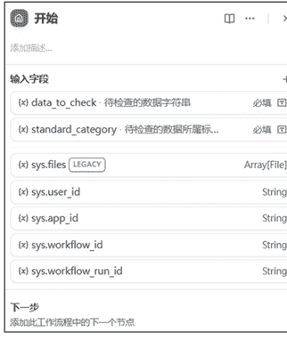

图 11-3 开始节点配置

在画布上从左侧拖拽知识检索组件至起始节点后，双击配置：

1）选择知识库：下拉选择已建好的“企业数据标准知识库”，知识库添加如图 11-4 所示。

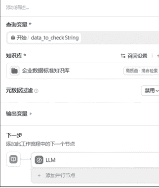

图 11-4 知识库添加

2）查询：引用起始节点的 standard_category 变量，指导知识库按类别检索相关片段。
3）检索模式：推荐“混合检索”。

#### 4. 添加核心判断逻辑——大模型节点

从左侧拖拽大模型节点至知识检索组件后，连接输出到大模型输入。双击配置：

1）选择模型：下拉选择已配置的 DeepSeek 模型，模型选择如图 11-5 所示。

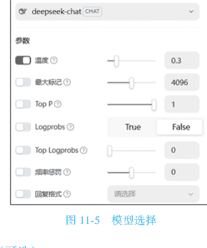

图 11-5 模型选择

2）模型参数：
- 温度：控制随机性。标准符合性检查要求稳定，建议 0.2～0.5。
- 最大标记：依据期望输出长度设置。
- 提示词：在 SYSTEM 区域编写核心提示词，质量直接决定判断准确性，是关键环节。

#### 5. 添加终止节点

在大模型节点后添加终止节点，将大模型输出连接并展示。

### 11.2.3 核心提示词工程实战

为确保模型严格依据企业标准判断并输出结构化结果，采用三层提示词框架——系统层、任务层、约束层，并融入 Few-shot 示例。

提示词模板（填入大模型节点的 SYSTEM 区域）：

```
# 角色
你是一个专业且严谨的智能数据标准检查员。你的任务是根据用户提供的企业数据标准规范，对指定的数据进行符合性检查。
# 检查任务
待检查数据：
{{data_to_check}}
# 输出格式要求
请以严格的 JSON 格式输出检查结果，不允许包含任何额外文字、说明或代码块标记。
JSON 结构必须包含以下字段：
- `is_compliant`：布尔值，表示数据是否符合标准 (true/false)。
- `violations`：数组，如果 `is_compliant` 为 false，则列出所有不符合标准的原因。每个原因应包含：
    - `rule_category`：违规所属标准类别（如 "格式规范" "术语规范" "长度控制" "逻辑冲突"）。
    - `description`：违规的具体描述（清晰说明不符合哪条规则）。
    - `reference`：违规依据的标准条款或知识库文档（如 "客户地址规范 V1.0 第 2.1 条"）。
- `suggestions`：数组，针对违规数据提供修改建议，每个建议应包含：
    - `type`：建议类型（如 "修正格式" "调整内容" "缩短长度"）。
    - `content`：具体修正建议。
- `confidence`：本次判断的置信度，范围为 0.0 ~ 1.0。
# Few-shot 示例（请确保这些示例是高质量且具有代表性的）
[示例 1 开始]
待检查数据：北京市朝阳区建国路 88 号
所属标准类别：客户地址规范
期望输出 JSON：
{
    "is_compliant": false,
    "violations": [
        {
            "rule_category": "格式规范",
            "description": "地址缺少标准分隔符 '/': ",
            "reference": "客户地址规范 V1.0 第 3.1 条 "
        },
        {
            "rule_category": "长度控制",
            "description": "街道名称 '建国路 88 号' 可能过短，需要包含更详细的门牌号。",
            "reference": "客户地址规范 V1.0 第 4.2 条 "
        }
    ],
    "suggestions": [
        {
            "type": "修正格式",
            "content": "建议修改为 '北京市 / 朝阳区 / 建国路 88 号'"
        }
    ],
    "confidence": 0.95
}
[示例 1 结束]
[示例 2 开始]
待检查数据：上海市浦东新区陆家嘴环路 1000 号
所属标准类别：客户地址规范
期望输出 JSON：
{
    "is_compliant": true,
    "violations": [],
    "suggestions": [],
    "confidence": 0.98
}
[示例 2 结束]
```

提示词策略与优化说明：
- **Few-shot 示例**：示例是提升输出质量与风格一致性的有效手段。需按实际业务标准撰写高质量示例，覆盖合规与不合规情况。
- **迭代优化**：提示词编写需迭代，根据模型实际输出不断调整内容与结构，以达最佳效果。

至此，基本可接收输入、结合知识库、调用 DeepSeek 并输出结构化检查结果的工作流已搭建完成。下一步是调试与部署以确保准确运行。

## 11.3 智能数据标准检查工作流的调试与部署

在 Dify 中搭建完成后，需充分测试优化，确保稳定准确输出。本节指导如何在 Dify 中调试部署、识别 AI 常见问题、优化提示词并处理特殊情况，最终发布投入使用。

### 11.3.1 调试与优化

需对已建工作流进行测试，验证运转是否正常、结果是否正确。过程中常遇到配置错误或 AI 输出不符预期。掌握 Dify 的测试与调试工具是解决问题的关键。

#### 1. 首轮验证：让校验链路跑通的基本操作
第一次把智能规范校验链路跑通，可以按以下顺序操作。

1）打开调试面版。进入 Dify 编辑页，点击右上角的启动图标，右侧会弹出试运行窗口。
2）填入待测值。窗口左侧会列出开始节点定义的两个入口 data_to_check 与 standard_category。
3）触发执行。点击调试窗内的运行键，Dify 后台会实例化该流程并开始执行。
4）观察运行态。画布上各节点的状态会由等待变为运行中再到已完成，连线点亮表示数据正在传递。
5）查看结果。流程结束后，调试窗右侧会出现结束节点的输出，即 DeepSeek 生成的 JSON 校验报告，核对是否符合预期，示例见图 11-6。

示例输入：
data_to_check：北京市朝阳区建国路 100 号
standard_category：客户地址规范

提示：也可以投喂不合规样本来检验识别能力，例如“北京市浦东新区人民路 1 号”这类逻辑冲突，或“138123”这类格式错误。

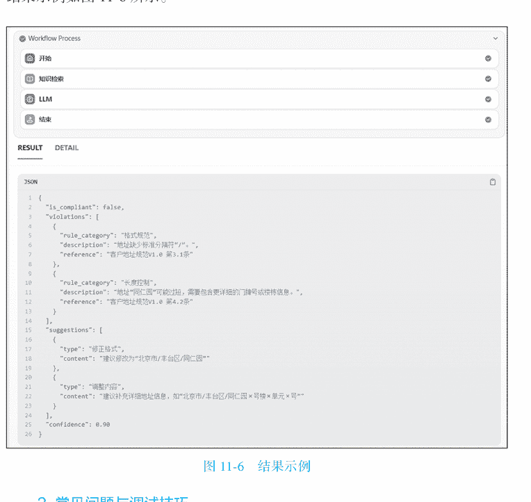

图 11-6 结果示例

#### 2. 常见卡点与排查思路
实操中常见三类现象：

- 流程无法启动或中途中断，偏向技术类故障。点运行无反应，或某节点变红报错。常见诱因是节点配置错误，如 LLM 节点未绑定模型、引用了不存在的变量，API Key 失效或网络不通、Dify 服务异常。处置办法是点开红节点查看日志与输入输出，日志里通常有完整堆栈，可追踪上游数据是否正常传入。
- 流程可跑但结果偏差，偏向提示或知识库问题。JSON 不纯净、混入说明、正负判反、违规原因或建议不准、对特殊场景处理差。根因多在指令表述模糊、Few-shot 质量不足、知识检索片段不准不全、模型本身局限、业务规则理解不到位。可通过把指令写得更明确无歧义、补充贴合业务的少量样本、校准知识库标准片段的准确完整度、更换更适配的模型或在提示里补充业务规则说明来改善。
- 性能或费用问题，在规模化时出现。单次耗时长、token 消耗高导致费用攀升。常见原因是提示过长、期望输出过大、模型推理慢。优化方向是精简提示结构、去除冗余描述、控制 JSON 字段数与输出长度。

#### 3. 指令打磨的迭代方法
当 DeepSeek 的校验结果不准或格式跑偏时，核心是打磨指令，这是效果差异最大的环节。

- 强化格式约束。模型有时会输出非严格 JSON 或带解释。可在提示里反复强调并示范。
优化示例：
> 严格按指定 JSON 格式输出，禁止任何前置文字、解释、代码块标记如 json，输出必须是纯净可解析的 JSON 字符串。
- 增补优化少量样本。样本是模型学习风格和复杂判断的关键。可多加高质量样本，特别是易混淆场景，如地址逻辑冲突、特殊格式物料编码。样本需同时覆盖合规与不合规，待检数据、标准类别、期望 JSON 必须完全一致，且 violations 与 suggestions 表达清晰规范。
- 精准指令加业务语境。指令要具体无歧义。针对地址、物料编码等领域，可在提示中加入专业描述帮助理解。例如校验物料编码时可写“物料编码通常包含大类、中类、规格等字段，请据此校验”。
- 引导模型表达不确定性。对难以判断的复杂情况，提示模型在 JSON 里输出 confidence 0.5，或在 violations 中写明“无法确定”“需人工复核”。

### 11.3.2 DeepSeek 特有问题的应对
在对准确性和严谨性要求极高的规范校验场景里，DeepSeek 会出现一些特有坑点及应对策略。

#### 1. 相似字段被混淆
问题描述：语义相近但业务含义不同的字段容易被模型混用，导致判断错误。
解决方案以提示优化为主：在 LLM 节点提示中对易混字段做清晰定义和区分，强调业务用途和关键差异。
示例：加入“请注意，‘注册地址’指企业工商登记地址，可能含营业执照号、法人信息等，通常固定不变；‘联系人地址’指客户常用通讯地址，仅含地理位置，可能随搬迁更新。”
知识库增强：在 Dify 企业数据标准知识库里为这些字段建立详细元数据和业务说明，明确关联关系，确保检索节点能提供更精准上下文。

#### 2. 长度统计偏差
问题描述：模型算字符长度时按字符数，如一个汉字算两字符，而系统或规范实际按字节数算。
解决方案：通过提示或 Dify 内置功能辅助。在提示中明确计算规则。
示例：加入“长度按 UTF-8 编码字节数计算：汉字按 3 字节、英文字符按 1 字节。请按此规则判断长度是否符合。”

### 11.3.3 智能校验链路的部署与发布
调试完成后，就要把流程推到生产环境或接入现有业务。Dify 的发布机制比较顺手。

#### 1. 一键发布上线
在 Dify 流程编辑界面的右侧边栏点 发布 按钮，选择发布模式，通常选 发布 或 发布为 API，然后确认发布。成功后流程就变成可用的 API 服务。

#### 2. 调用方式
调用方式主要有两种。
- 通过 Dify Web 应用界面调用：发布后在工作室找到该应用，点运行进入 Web 界面，可手动测试或单次调用，适合数据管理员临时检查。
- 通过 API 调用：这是接入企业系统的主要方式。
获取 API 信息：在应用详情页点左侧 访问 API 菜单，可拿到 API Endpoint 和用于鉴权的 API Key，注意保管安全。
集成思路：外部系统或脚本向该 Endpoint 发 HTTP POST 请求，请求体带 data_to_check 和 standard_category 参数。API 返回 DeepSeek 生成的 JSON 校验结果，外部系统解析即可得到结论。

## 3. 上线前的安全红线
无论哪种部署方式，环境安全都必须守住。
- 模型部署模式：优先私有化部署或经过严格审查的云服务，最大化控制数据流转和访问权限，满足合规。
- 输入数据脱敏：即使是内网，待检数据敏感时也应脱敏后再送入模型。
- 日志控制：避免在流程日志中记录原始待检数据或敏感校验结果。
- 访问控制：严格管控对 Dify 管理界面和流程 API 的访问权限。

做到以上调试、部署和安全考量，智能标准校验链路就能稳定可靠地为企业创造价值。

### 11.4 智能校验链路的应用实战
流程搭建、调优、发布之后，就要落地到真实业务验证价值。下面以银行客户信息治理和制造物料编码治理两个典型案例来说明效果。

### 11.4.1 银行客户信息治理实战

### 1. 痛点：脏数据、罚款、效率低
某中型城商行在客户信息治理上长期受困：
- 数据质量差：开户资料中 23% 地址不规范、18% 证件信息错误，导致业务频繁出错。
- 监管处罚风险：曾因信息质量被银保监会罚款 125 万元，合规压力巨大。
- 运营效率低下：新客户开户审核平均 45 分钟，远高于行业平均 20 分钟。
- 跨系统不一致：核心、信贷、反洗钱系统同一客户信息差异率达 15%，形成数据孤岛，影响风险识别。

银行急需一套高效精准的方案提升质量、降风险、提效率。

### 2. 解决方案：智能客户信息校验链路赋能
引入 DeepSeek，通过 Dify 构建智能客户信息校验链路。
- 介入点：在客户信息录入或提交环节，实时把地址、证件等数据送入链路检查。
- DeepSeek 角色：充当智能审计员，对照企业数据标准知识库中的规范如地址格式、证件号规则、姓名长度等进行判断。
- 链路输出：返回结构化结果，指出不合规字段、违规原因和修正建议。

### 3. 实战步骤
（1）问题诊断与标准梳理，耗时 1 周
数据采样分析：从核心系统抽 1000 条客户样本，人工统计地址不规范、证件错误、联系方式缺失的分布和严重程度。
规则差距分析：对照监管要求和银行内部标准如地址三级结构验证、18 位身份证验证、电话格式验证，评估现有系统校验能力。

（2）链路设计与构建，耗时 2 周
链路设计：在 Dify 上搭建接收输入、知识检索关联企业数据标准知识库、调用 DeepSeek 判断、输出结果的流程。
提示词工程：为 DeepSeek 设计角色为智能数据标准检查员，任务为检查地址、证件号、姓名等，输出 JSON 含 is_compliant、violations、suggestions，并提供高质量 Few-shot 示例。
知识库建设：将银行的客户地址规范、证件规则、姓名长度限制等文档导入 Dify 知识库供检索学习。

（3）系统集成与改造，耗时 1 周
接口开发：开发 API 使链路能接收柜面系统或线上申请系统的数据。
柜面改造：在新开户或信息修改页面调用 API，录入后实时触发检查。返回 is_compliant 为 true 则允许提交核心系统，否则前端展示错误详情并自动创建整改工单。
纠错工单流转：把违规信息如“地址缺少省市分隔符”“证件号格式错误”自动填入工单并推送给数据治理团队或柜员。

（4）效果监控与优化，持续进行
监控看板：开发实时看板监控每日检查量、合规率、违规类型分布、平均处理时长。
持续优化：依据监控数据和人工复核反馈，不断优化提示词、更新知识库标准，提升识别准确率和效率。

### 4. 实战成效
实施后客户信息治理显著改善。
地址不规范率从 23% 降到 3.5%，改善 85%↓；证件错误率从 18% 降到 1.2%，改善 93%↓；跨系统不一致率从 15% 降到 0.8%，改善 95%↓。
业务流程优化：
新客户开户审核时间从平均 45 分钟缩短至 12 分钟，效率提升 73%。
数据整改人力从 6 人减至 1 人监控复杂问题，人力投入减少 83%。
预计每年减少罚款约 85 万元。

### 11.4.2 物料编码治理实战

### 1. 背景与挑战
汽车零部件集团 A 集团拥有多工厂和复杂供应链，物料编码治理困难：
- 编码混乱：同一原材料在 4 个工厂有 12 种编码，信息不一致。
- 库存呆滞：编码不规范导致 380 万元呆滞库存。
- 采购成本高：同一物料被当成不同物料重复采购，价差达 15%。
- 追溯困难：质量问题无法追溯原料批次，影响质量管理和召回。

急需统一规范的编码体系。

### 2. 解决方案：智能编码校验链路赋能
通过 Dify 构建智能编码校验链路，统一编码体系、降库存成本、优采购决策、提升可追溯性。
- 介入点：在 PLM、ERP、MES 或供应商平台创建或修改物料信息时实时触发。
- DeepSeek 角色：智能编码校验员和推荐师，对照企业物料编码标准知识库如大类、中类、小类、规格、供应商代码分段规则进行判断。
- 链路输出：判断合规性、违规原因，并根据属性智能推荐标准编码。

### 3. 实战步骤
（1）现状分析与痛点识别，耗时 2 周
从 PLM、ERP、MES 抽取编码数据，跨系统对比识别重复、不规范编码、价格差异物料，量化呆滞库存与采购浪费。
痛点可视化：如通过 SQL 和可视化发现“轴承类物料平均 4.2 个编码/种，价格差异最大达 35 元/个”。

（2）标准制定与知识库建设，耗时 1 周
组织研发、采购、生产专家制定物料分类编码标准，形成明确规范文档。
梳理物料属性决策树，明确生成编码所需核心属性及优先级。
把编码规范文档、属性决策树、历史编码样本、供应商代码表导入 Dify 企业物料编码标准知识库。

（3）智能编码校验链路集成实施，耗时 3 周
在 Dify 搭建智能编码引擎。
输入：接收新物料申请或变更提交的物料属性如材料类别、加工工艺、尺寸、供应商等。
知识检索：关联知识库检索相关编码规范。
LLM 节点：DeepSeek 根据检索标准和输入属性判断组合是否合规，若合规则生成推荐标准编码。

**从乱码到标准：AI 驱动的料号治理闭环**

指令设计先做角色锚定，让模型充当资深物料编码顾问，任务是核验来件属性并给出合规结论与推荐编码。输入接受完整的物料属性集，输出要求返回合规判定加推荐编码的 JSON，或明确的违规说明。配合少量样例教学，一个合格的属性组合对应推荐编码，一个不合格的组合对应拒绝理由，帮助模型学会条件推理，例如材质为金属时工艺只能是铸造或冲压。

随后完成平台联动。

PLM 端打通：新建物料时自动触发智能校验工作流 API。用户填写的属性被推送到工作流，返回校验结论及推荐编码或违规原因，直接在界面展示。

采购端改造：在订单提交环节嵌入编码实时校验，填写的编码不合规则即时弹窗并要求修正。

ERP 与 MES 贯通：规范编码在 ERP 与 MES 中统一识别与使用，保证全线一致。

监控与迭代

实时看板：搭建监控大屏，追踪新开物料的编码合格率、纠正比例、单条编码生成耗时等关键指标。

复核回写：对模型给出的推荐编码进行抽样人工复核，将复核结论回写到 Dify，用于持续优化指令模板和知识库。

落地成效

在某大型制造集团的实践中，物料编码治理效果明显：

- 不规范编码由 3.8 万个降到 1.2 万个，降幅约 68%。
- 单一物料平均重复编码从 4.2 个收敛到 1.0 个，统一度提升约 76%。
- 采购价差从最高 15% 收窄至 5%，全年节省数百万元。
- 新物料创建周期由 2～3 天压缩到即时完成，AI 推荐省去人工查核。
- 呆滞库存总额大幅下降。
- 产品追溯能力显著增强，质量问题可精确定位到具体批次。

## 第12章 DeepSeek 在数据质量管理中的实战应用

本章手把手演示在 Dify 上搭建 NL-to-SQL、报告提炼、根因定位等智能数据质量流水线。覆盖可视化编排、模型节点配置、关键指令设计、零代码逻辑集成与调试优化，并以金融与零售两类真实案例给出量化成效与 ROI 分析，为企业提供可复制的数据驱动方案。

### 12.1 实战场景选择与分析

先梳理企业在数据质量管理中常见的复杂、低效、高成本痛点，再分析大模型可赋能的核心智能场景并评估可行性，最后通过优先级判断锁定本章落地的重点领域。

#### 12.1.1 数据质量管理面临的典型痛点

以某金融机构客户数据治理项目为例，典型瓶颈具有代表性：

- 规则开发滞后：业务以自然语言提交大量校验需求，手工转写效率低、协同成本高，平均交付周期长，难以跟上业务变化，导致规则更新慢。
- 报告阅读低效：质量报告篇幅长、技术术语多，关键信息难以快速抽取，下发后使用率低，影响业务响应。
- 根因定位不准：质量问题涉及多环节多系统，传统依赖人工排查，准确率低，纠正措施失效，问题反复。
- 改进建议转化差：专家经验难沉淀共享，建议开发周期长、针对性弱、落地率低，阻碍持续提升。

#### 12.1.2 数据质量管理的核心场景识别

结合大模型能力，可识别出四个技术可行且价值突出的智能场景：

其一，规则开发。利用自然语言转 SQL 能力，业务人员用自然语言描述校验逻辑，模型直接转为可执行的 SQL，摆脱手工编写。

其二，报告提炼。借助文本理解与生成，自动抽取报告中的关键发现、影响域与结论，形成简洁摘要，提升非技术人员阅读效率。

其三，根因辅助。结合文本分析与领域知识库，对反复出现的问题进行智能诊断，帮助更快定位根因，避免无效整改。

其四，改进建议生成。基于知识库将专家经验结构化，为具体问题输出可操作建议，缩短开发周期并促进知识传承。

### 12.2 智能数据质量工作流的建设

本节以 Dify 可视化编排为基础，结合 DeepSeek 实现自动化与智能化。构建前请完成 Dify 部署并配置好 DeepSeek API Key。

#### 12.2.1 NL-to-SQL 工作流的设计

传统方式需数据工程师把自然语言需求如“检测过去 30 天订单表客户 ID 缺失率超 5%”转为精确 SQL，耗时易错。NL-to-SQL 流水线的目标是实现自然语言到 SQL 的自动转换，核心步骤见图 12-1。

1. 创建工作流应用
登录 Dify 新建空白工作流，命名为“D Q_NL_to_SQL 工作流”。添加输入参数 nl_rule_description，类型 String，描述为“自然语言描述的数据质量规则”，如图 12-2。

2. 配置知识检索
在开始节点后添加知识检索节点，关联企业数据字典知识库，覆盖核心系统表结构、表注释、字段注释及关联关系，如图 12-3。

3. 配置大模型节点
从节点库拖入模型节点，选择 DeepSeek，SYSTEM 区填入指令指导转换，如图 12-4。

角色请扮演资深数据质量工程师，擅长把业务需求转化为符合 ANSI-SQL 标准的查询。

任务是根据用户提供的自然语言描述，分析核心需求，生成一条可直接执行的数据质量检查 SQL。要求包含必要的表关联、补充注释说明逻辑、复杂场景使用 WITH 子句。假设表名为 `orders`，字段可能包含 `customer_id`、`order_date` 等，请合理推断。

示例输入：“检测过去 30 天订单表中客户 ID 缺失率超过 5% 的情况”
示例输出：

```sql
WITH missing_ids AS (
    SELECT COUNT(*) as total,
    SUM(CASE WHEN customer_id IS NULL OR customer_id = '' THEN 1 ELSE 0 END) as missing
    FROM orders
    WHERE order_date >= CURRENT_DATE - INTERVAL '30 days'
)
SELECT (missing * 100.0 / total) as missing_rate
FROM missing_ids
WHERE (missing * 100.0 / total) > 5;
```

{{nl_rule_description}}

请直接输出 SQL 代码，不要包含任何额外文字或解释。

4. 配置结束节点
拖入结束节点连接模型节点，定义最终输出变量，如图 12-5。
该流程把代码生成与校验结合，将原本数小时的规则开发压缩到分钟级。业务分析师仅需自然语言描述即可获得可执行 SQL。测试问题“检测过去 7 天订单表中客户 ID 缺失率超过 5% 的情况”生成结果如图 12-6。

#### 12.2.2 报告摘要生成工作流的设计

数据质量报告常因冗长难读而价值受限。摘要流水线利用自然语言生成能力提炼关键信息，流程如图 12-7。

1）创建应用：新建工作流命名为“D Q_报告摘要助手”。配置输入参数 report_text_content，类型 String，用于接收完整报告文本，如图 12-8。

2）配置模型节点：拖入模型节点，建议温度 0.5～0.7，如图 12-9。指令如下：

> 角色：资深数据质量分析师，擅长从详细报告中提炼核心信息并生成简洁摘要。
> 任务：阅读以下数据质量报告文本，生成包含核心发现、主要问题点、影响的数据域、关键质量指标的现状与趋势、初步改进建议的自然语言摘要。
> 输出要求：摘要控制在 200 字以内，语言专业客观易懂，直接输出摘要内容，不要额外文字。

指令设置如图 12-10。

3）配置结束节点：拖入结束节点连接模型节点，定义输出变量，如图 12-11。
该流水线显著提升报告可读性，帮助决策者快速掌握现状并获取初步改进方向，示例如图 12-12。

#### 12.2.3 根因分析工作流的设计

传统根因分析依赖人工排查，准确率低。本流水线借助推理与知识库辅助诊断，核心步骤如图 12-13。

1）创建应用：新建“质量根因分析助手”。开始节点输入参数 problem_description，类型 String，描述为“数据质量问题描述”，如图 12-14。

2）知识检索：添加检索节点，关联数据质量知识库，以上一步输入作为检索条件，如图 12-15。

3）需求分析模型节点：拖入模型节点，使用开始输入并给出指令，配置如图 12-16。

```
角色：你是一位文字提取专家
# 任务
负责对用户的问题和需求进行提炼和总结，抓取关键数据查询文字，去掉和数据查询无关的内容，只保留提炼查询数据的文字
# 输出
只输出你提炼后的结果，不需要其他内容
```

4）生成 SQL 工具节点：拖入 rookie_text2data 工具连接需求分析节点，配置表名、查询语句、自定义提示、数据库参数及输出变量名 root_cause_analysis_report，如图 12-17。

5）执行 SQL 节点：拖入 rookie_execute_sql 工具连接上一步，配置输入变量、待执行 SQL 及数据库信息，如图 12-18。

6）数据质量分析专家模型节点：拖入模型节点连接执行结果，设置指令，如图 12-19。

```
# 角色
你是一位资深的数据质量分析专家，逻辑思维严谨，擅长从数据中发现问题，并能将复杂的技术发现转化为清晰、可行的业务建议。

# 背景信息
你已经完成数据探查，并获得了以下关键信息：

## 1. 原始问题描述
{{problem_description}}

## 2. 执行的诊断 SQL 查询语句
{{rookie_text2data.txt}}

## 3. SQL 查询结果
{{rookie_execute_sql.txt}}
这是你执行上述 SQL 后，从数据库中获取到的真实数据证据。请将此作为你分析的唯一依据。

# 你的任务
请基于以上全部信息，特别是 "SQL 查询结果"，撰写一份完整的根因分析报告。你的报告必须：
解读数据：清晰地解释 "SQL 查询结果" 中的数据说明了什么。
精准定位：明确指出哪个数据来源是问题的根本原因，并用数据（如错误率）来支撑你的结论。
提出方案：提供具体、可操作的改进建议，分为短期（紧急）、中期（修复）和长期（预防）三个层面。

# 输出格式要求
请严格按照以下结构化的 Markdown 格式输出你的分析报告，语言要专业、客观，易于技术人员和非技术人员理解。

数据质量根因分析报告示例：
1. 问题诊断
问题类型：[ 说明这是什么类型的数据质量问题，如有效性、完整性、准确性等 ]
核心表现：[ 简述问题的具体表现 ]
2. 根因定位
核心发现：[ 基于 SQL 查询结果，用一句话总结你的核心发现 ]
数据证据：[ 再次引用关键数据来证明你的发现。例如：数据显示，×× 渠道的错误率高达 ××%，而其他渠道均在正常范围 ]
根本原因：[ 基于证据，推断出最可能的根本原因。例如：这极大概率是由 ×× 系统的 ×× 逻辑变更或缺失导致的 ]
3. 改进建议
紧急措施（止损）：[ 描述需要立即执行的操作，防止问题继续恶化 ]
中期措施（修复）：[ 描述如何修复问题本身以及清理已产生的脏数据 ]
长期措施（预防）：[ 描述如何从流程或技术上建立防线，确保此类问题不再发生 ]
```

7）结束节点：拖入结束节点连接模型节点，定义最终输出变量，如图 12-20。
该流程把耗时排查转为智能辅助，提升根因定位准确率，减少业务损失。示例报告如图 12-21。

#### 12.2.4 工作流之间的关联与组合

前述三个流水线可独立运行，也能在更高阶的复合助手里组合调用。

- 根因分析→NL-to-SQL：根因分析输出的问题点可触发新校验规则需求，利用 NL-to-SQL 流水线将“检查电话号码格式”这类自然语言需求转为可执行的 SQL 校验语句，实现从发现到闭环的全链路。

- **摘要直达根因探究**：报告摘要工作流能把数据质量报告里的突出风险快速提炼出来。一旦摘要中点出某个关键指标，例如订单金额准确率出现明显偏差，用户可以直接把该问题拎出来作为输入，触发根因分析工作流做深度的追溯排查。
- **规则校验产出自动浓缩**：新上线的 SQL 校验规则运行后产生的质检报告，可以直接喂给摘要工作流，自动提炼成精简结论，帮助团队迅速判断规则的实际成效。

这种多流程串联的用法能显著提升使用体验。所有能力在同一个入口汇聚，DeepSeek 会依据用户的复合意图自动编排不同工作流，形成端到端的闭环管理。

## 12.3 调试与部署实操

在 Dify 上搭建完智能数据质量流程初版后，就像一台刚装好的设备，需要充分试跑和打磨，才能稳定产出正确的检测结果、摘要或分析。本节说明如何在 Dify 中完成测试、定位大模型特有问题、优化提示与边界情况，最终发布上线。

### 12.3.1 测试与优化要点

先让搭好的流程跑通，确认能否正常运转并给出合格输出。实操中常遇到配置偏差或模型输出偏离预期的情况，熟练使用 Dify 的调试工具是关键。

- **执行一次完整试跑**：让工作流走通整条链路。
- **打开测试面板**：在 Dify 编辑页右上角点“测试运行”，右侧弹出调试面板。
- **准备启动参数**：面板会列出开始节点定义的输入项，按流程类型分别提供：
  - **NL-to-SQL 助手示例**：输入 `nl_rule_description`，例如检查近 90 天客户表邮箱格式不规范的记录。
  - **DQ 报告摘要助手示例**：输入 `report_text_content`，粘贴一段简短的数据质量报告正文。
  - **DQ 根因分析助手示例**：输入 `problem_description`，例如订单金额字段准确率偏低。
- **开始运行**：点击测试面板的“测试运行”，后台会启动一次实例。
- **观察流转**：画布上节点状态会从等待变运行再到完成，连线会点亮表示数据在传递。
- **校验结果**：运行结束在面板右侧或下方可看到结束节点的输出，仔细判断是否符合预期。

### 12.3.2 大模型典型问题应对

数据质量管理对准确性和严谨性要求很高，大模型容易出现幻觉、检索不准等问题，可采取以下做法。

1）SQL 生成幻觉：DeepSeek 生成 SQL 时有时会编造出数据库不存在的表名、字段名或函数，导致执行失败。做法是在提示词中加入元数据约束，明确告知可用表字段，或指示模型先从知识库检索元数据。

示例提示词片段：

你只能使用以下已知表和字段：表名 'orders'（包含字段 'order_id'、'customer_id'、'order_date'、'amount'）；表名 'customers'（包含字段 'customer_id'、'email'、'phone_number'）。

2）知识检索失效：在根因分析流程中，若检索节点召回不到与问题描述最相关的片段，分析会因信息缺失而失准。应对策略是优化知识库建设和切分，保证库内包含高质量且粒度适中的数据标准、业务流程、历史案例及其根因与处置方案、数据血缘等内容，并检查分段策略，保证片段语义完整。

3）提示中引导检索并允许表达不确定：在 LLM 节点的提示词里，要求模型在知识不足时明确说明，而不是自行编造。

示例提示词片段：

如果背景知识不足以支撑完整分析，请在报告中明确指出信息不足之处。

4）扩充同义词与关键词：确保知识库的元数据或标签覆盖用户可能使用的同义表达，Dify 的检索本身也支持一定的查询扩展。

### 12.3.3 上线与发布方式

调试完成后即可发布，让流程投入生产。发布后它会变成可用的 Web 应用或 API 服务，调用方式如下。

- **网页调用**：发布后在 Dify 工作室找到该应用，点击“运行”进入 Web 界面做手动测试或单次调用，适合管理员做临时交互式检查、摘要生成或根因分析。
- **API 调用**：这是把能力嵌入企业现有系统的主要方式。
  - **获取接入信息**：在应用详情页点左侧“访问 API”菜单，可拿到工作流的 API Endpoint 和用于鉴权的 API Key。
  - **集成思路示例**：外部系统或自动化脚本可向 Dify 提供的 API 地址发送 HTTP 请求，请求体携带开始节点所需的输入参数，流程执行后以 JSON 或 Markdown 格式返回结果，适用于批量处理和自动化触发。

无论哪种方式，安全都要优先保障：
- **模型部署形态**：优先选用 DeepSeek 私有化部署或经过严格审计的云服务，最大程度管控数据流转和访问权限，满足合规要求。
- **输入脱敏**：发送给流程的 `report_text_content` 或 `problem_description` 可能含敏感信息，应在外发前脱敏，或确保不含可识别内容。
- **日志管控**：避免在工作流日志里记录原始输入或敏感的模型输出。
- **访问权限**：严格管控 Dify 管理界面和工作流 API 的访问权限。

经过调试、发布和安全加固，智能数据质量工作流就能稳定可靠运行，为企业创造实际价值。

## 12.4 实战案例拆解

本节用两类典型企业案例——金融机构信用卡业务和零售企业供应链，展示 DeepSeek 驱动的智能数据质量工作流如何解决长期痛点并带来可量化成效。

## 12.4.1 信用卡申请质量治理

### 1. 项目背景与挑战

某金融机构在信用卡申请数据质量管理中遇到三大难点：

- **规则开发耗时**：传统规则依赖人工手写 SQL 或脚本，开发慢且难以跟上业务变化。
- **重复问题频发**：因数据不一致，同一客户信息被多次录入，形成重复问题。
- **审批通过率受损**：数据质量差导致客户信息不准，间接拉低信用卡审批通过率，影响业务增长。

### 2. 解决方案部署：智能工作流赋能

为此，该行引入 DeepSeek 并在 Dify 上构建智能数据质量工作流，目标是提升数据质量、压缩规则开发周期、降低重复率并提高审批通过率。主要应用如下：

- **DQ_NL_to_SQL 助手**：把业务提出的校验需求，如“申请人姓名不能为空且长度在 2 ～ 50 字符之间”，自动转成 SQL。
- **DQ_ 根因分析助手**：发现申请数据存在缺失、格式错误等问题时，辅助定位根本原因。
- **DQ_ 报告摘要助手**：自动生成每日数据质量报告摘要，供业务与管理层快速掌握状况。

### 3. 系统集成方案（Dify API 驱动）

介入点：工作流通过 API 与信用卡申请系统及数据质量平台联动。

- **NL-to-SQL 接入**：数据工程师在 Dify 手动输入规则描述，获取 SQL 初稿后部署到 DQ 平台校验。
- **根因分析接入**：DQ 平台发现关键质量问题时自动调用 Dify 根因分析 API 获取分析报告。
- **报告摘要接入**：DQ 平台产出每日质检结果后调用报告摘要 API，将摘要推送给业务方。

### 4. 实施效果

- **规则开发周期缩短**：借助 DQ_NL_to_SQL 助手，工程师只需用自然语言描述需求，DeepSeek 即可生成 SQL 初稿，手动编写与调试时间大幅减少。
- **重复问题发生率下降**：DQ_ 根因分析助手对高频重复问题智能诊断。例如分析发现“客户信息重复”根源是前端系统缺少实时重复校验，据此推动流程优化。
- **审批通过率提升**：DQ_ 报告摘要助手让审批人员快速了解数据质量，高质量可信的输入使决策更精准。

该行通过 Dify 与 DeepSeek，有效破解信用卡申请数据治理痛点，显著提升管理效率与业务指标。

## 12.4.2 供应链数据治理

### 1. 项目背景与挑战

某零售企业供应链数据治理存在：

- **异常检测滞后**：数据量大，人工或简单规则难以做到实时预警。
- **根因定位不准**：库存不一致或订单异常时，根因分析准确率低，问题解决周期长。
- **库存周转受阻**：数据质量问题导致库存预测失准，出现积压或缺货，影响周转。

### 2. 解决方案部署：智能工作流赋能

企业引入 DeepSeek 并在 Dify 上构建智能数据质量工作流，旨在加快异常检测、提升根因定位精度并优化库存管理。

### 3. 智能工作流应用

- **DQ_ 根因分析助手**：对库存异常、订单状态不一致等进行智能根因分析。
- **DQ_ 报告摘要助手**：自动汇总每日供应链数据质量报告。
- **NL-to-SQL**：构建规则推荐与校验机制，保障各环节数据准确。

### 4. 系统集成方案（Dify API 驱动）

介入点：工作流通过 API 与 WMS、ERP、MES 等系统集成。

- **异常触发根因分析**：监控系统发现负库存、库存与订单不匹配等异常时，自动调用 DQ_ 根因分析助手并传入问题描述。
- **报告推送**：每日数据同步完成后，自动调用报告摘要助手，将摘要推送至供应链管理团队协作平台。

### 5. 实施效果

- **异常检测速度提升**：依托 DeepSeek 对实时数据的快速分析与异常模式识别，结合工作流自动触发根因分析。
- **根因定位准确率提升**：DQ_ 根因分析助手结合知识库中的历史问题、业务流程、系统日志样本推理，精准定位原因。例如判断某批次物料入库不准源于扫描枪设备故障而非人工录入错误。
- **库存周转率提高**：及时准确的根因分析和问题闭环，保证库存数据准确一致，优化预测与调配。

### 6. 项目成果总结

该零售企业借助 Dify 与 DeepSeek，显著提升供应链数据质量管理水平，实现更快异常响应、更精准根因分析与更优库存管理。

# 13

## 第13章 数据安全管理实战

第8章已梳理企业数据安全管理的高成本高复杂度挑战，并论述了以 DeepSeek 为代表的大语言模型在数据分类分级、风险识别、智能脱敏等方面的价值。本章聚焦实操，演示如何结合 Dify 与 DeepSeek 构建具体的数据安全管理工作流。以敏感数据识别与分类这一痛点突出场景为例，完整呈现需求分析、工作流设计、提示词工程、部署调试到应用实战的全流程。

### 13.1 实战场景选择与分析

#### 13.1.1 场景选择依据与目标

企业日常产生海量结构化与非结构化数据，资产底数不清、敏感数据分布不明，既带来合规风险，也让防护措施难以精准落地，成本高效果差。传统人工梳理或正则表达式等规则引擎方式效率低、覆盖不全、误报漏报率高，且难以适应语义变化。

选择**敏感数据识别与分类**作为核心实战场景，原因在于：代表性强，是数据安全治理的基础；痛点突出，人工成本高；技术契合度高，DeepSeek 的自然语言理解与上下文分析能力非常适合非结构化文本中的敏感信息识别；可操作性强，Dify 能便捷搭建与测试。

业务需求设定：

- **目标数据源**：合同文档、邮件内容、客服聊天记录、系统日志等非结构化或半结构化文本，如 .txt、.docx。
- **识别对象**：自动识别姓名、身份证号、手机号、银行卡号、邮箱、家庭住址等常见个人敏感信息。
- **分类要求**：对识别出的敏感信息做类型标记，如 ID_Card、Phone_Number、Email_Address，并对文件或记录整体给出初步敏感等级判定，高中低。

预期治理目标：

- **准确率**：识别精确率和召回率均超 90%，以人工标注为基准。
- **效率提升**：相比人工审核，处理效率提升 5 倍以上。
- **成本降低**：显著减少人工审核工时与成本。

#### 13.1.2 技术可行性与资源准备

实战演练需准备：

- **示例数据集**：一批含目标敏感信息的模拟文本，或经严格脱敏的真实业务样本，格式可为纯文本或 CSV。
- **DeepSeek API 访问权限**：有效 API Key，了解模型能力与调用限制。
- **Dify 环境部署**：建议在本地或私有云部署 Dify 以处理敏感数据，并确保可访问 DeepSeek API。

> **注意事项**：严禁使用未脱敏真实敏感数据测试，必须遵守数据安全与隐私保护规定。

### 13.2 敏感数据识别与分类工作流的建设

本节利用 Dify 结合 DeepSeek，构建自动识别文本敏感信息并分类的工作流。

#### 13.2.1 敏感数据识别与分类工作流的设计

核心逻辑是把待识别文本作为输入，由 DeepSeek 按预设规则智能判断，最终输出识别结果与分类。

图 13-1 为敏感数据识别与分类工作流，包含待识别内容输入节点、DeepSeek 分析节点、敏感信息识别 JSON 输出节点，正式场景中输出前可增加数据规范化处理节点以处理非标数据。

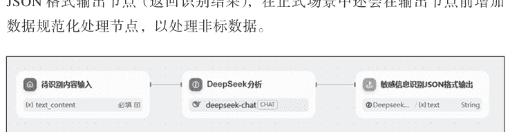

工作流说明：

1）待识别内容输入节点：工作流起点，定义输入变量 `text_content`，接收待处理文本。

2）DeepSeek 分析节点：核心处理节点，配置如下。

- **配置**：选用已配置的 DeepSeek-V3 模型。注：DeepSeek-R1 为推理模型，本场景侧重分类处理，DeepSeek-V3 速度更快效率更高。
- **提示词**：在此编写核心指令，提示词示例如图 13-2。
- **输入**：将 `text_content` 传入模型，设置如图 13-3。
- **输出**：模型按提示处理文本并返回结果，通常为含识别信息的文本或 JSON 字符串，命名为 `llm_output`。

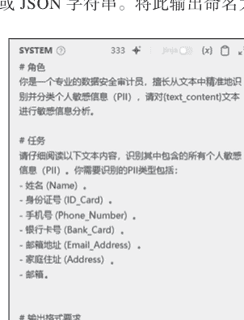

图 13-2 提示词指令

**DeepSeek 联合 Dify：隐私抽取与国企指标治理全景实操**

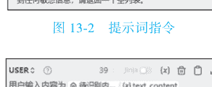

图 13-3 输入设置

3）收尾环节的 JSON 结构化输出组件，用来确定最终交付给调用方的呈现形式。把 llm_output 指定为本流程的出口，样式参考图13-4 的配置。

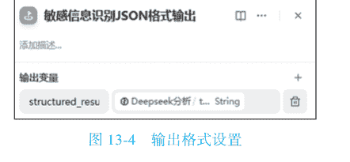

图13-4 输出格式设置

#### 13.2.2 提示词工程实战

提示的质量直接影响 DeepSeek 识别隐私资料的准确率和处理效率。好的提示要简洁明晰、要素齐全且带约束，才能把模型引导到预期格式。

下面给出可用于分析节点的模板示例：

```
# 角色
你是一个专业的数据安全审计员，擅长从文本中精准地识别并分类个人敏感信息（PII）。
# 任务
请仔细阅读以下文本内容，识别其中包含的所有个人敏感信息（PII）。你需要识别的PII类型包括：
- 姓名（Name）。
- 身份证号（ID_Card）。
- 手机号（Phone_Number）。
- 银行卡号（Bank_Card）。
- 邮箱地址（Email_Address）。
- 家庭住址（Address）。
# 输出格式要求
以JSON格式输出结果。对于每一条识别到的敏感信息，请提供其类型（type）和具体内容（value）。如果没有识别到任何敏感信息，请返回一个空列表`[]`。
# 示例
输入文本："张三的手机号是13812345678，他的邮箱是zhangsan@example.com"
# 约束
- 只识别明确属于上述类型的PII。
- 不要识别非敏感信息。
- 确保输出是严格的JSON格式。
- 对于身份证号和银行卡号，如果文本中做了部分掩码处理（如*号），请识别并输出掩码后的完整字符串。
# 待处理文本
{{text_content}}
```

输出结果如图 13-5 所示。

```json
[
  {
    "type": "Name",
    "value": "张三"
  },
  {
    "type": "Phone_Number",
    "value": "13812345678"
  },
  {
    "type": "Email_Address",
    "value": "zhangsan@example.com"
  }
]
```

图 13-5 输出结果

提示策略与优化要点如下：

- **扩充 Few-shot 示范**：对于辨识难度大或易混淆的类型，例如企业内部特定格式的员工编号，可在指令中加入若干演示案例，帮助模型掌握规律并稳定产出。
- **明确分类口径**：若企业对隐私数据的细分更细，需要在指令里界定各类判定标准与边界，以提升识别精度。
- **元提示强化**：在指令中补充角色定位、任务目标与工作准则，与清晰指令和结构化输出配合。元提示示例为：

你是一个高精度的自动化隐私数据检测引擎。核心职责是接收用户文本，按照预设的隐私信息类型如姓名、电话号码、身份证号等，自动在文本中定位并抽取所有匹配项。

1. 准确性优先：宁可少报低置信度的可疑信息，也不要把非隐私信息误报为隐私。
2. 格式严谨：结果必须严格遵循约定的 JSON 结构，不得夹杂任何额外说明、解释或代码块标记。
3. 全面覆盖：在指定范围内尽可能找出所有出现的隐私数据。
4. 位置标注：需给出每个隐私数据在原文中的精确起止索引，计数从 0 开始。
5. 安全合规约束：例如加入“禁止输出与识别任务无关的评论或分析”，避免模型产生冗余内容。

#### 13.2.3 在 Dify 上搭建识别流程的操作要点

在 Dify 上搭建该流程的简要步骤如下。

1）步骤 1：创建应用。登录 Dify，新建一个类型为“工作流”的应用，如图 13-6 所示。

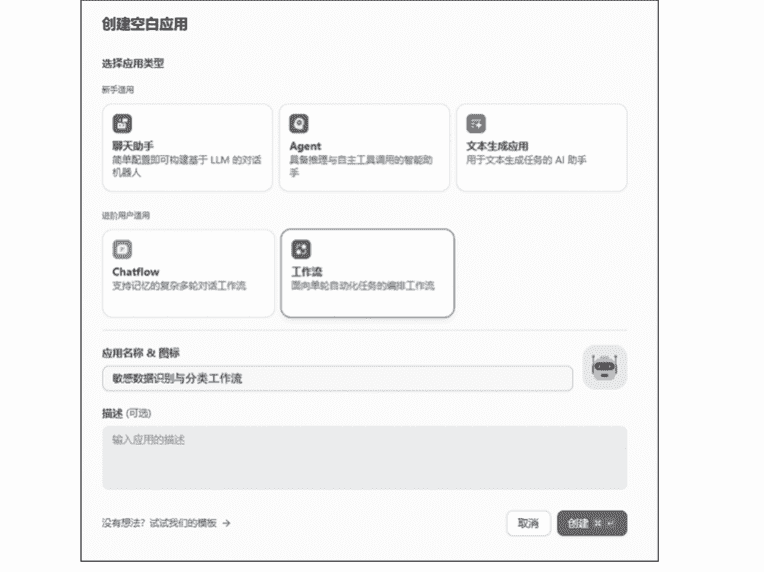

2）步骤 2：编排节点。在画布上拖拽开始、LLM、代码、可选结束节点并连线，如图 13-7 所示。
3）步骤 3：配置开始节点。新增一个字符串类型的输入变量，命名为 text_content。
4）步骤 4：配置 LLM 节点。将设计好的提示词模板填入提示词输入框，确保变量 {{text_content}} 被正确引用，并设置输出变量名。模型参数配置见图 13-8。

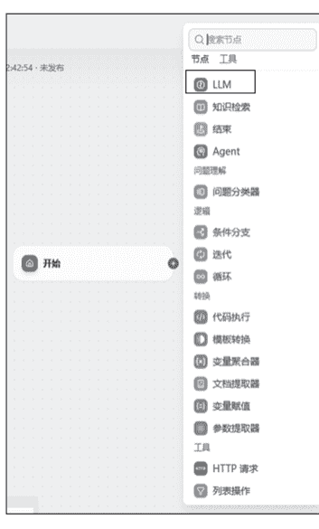

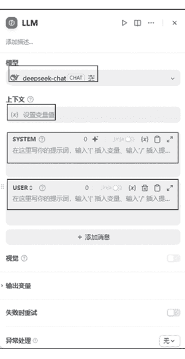

5）步骤 5：配置结束节点。选用前面设置好的输出变量作为最终输出。结束节点配置如图 13-9 所示。


6）步骤 6：保存与测试。保存流程后，借助“调试与预览”功能输入测试文本，核验输出是否符合预期。

### 13.3 识别流程的调试、部署和安全考量

#### 13.3.1 流程的调试与优化

初版搭建完成后，调试优化是保证其在真实场景下稳定运行的关键。在 Dify 的调试与预览界面，可用不同样本验证各节点表现。常见问题与应对思路如下：

1）DeepSeek 回应迟缓或超时。常见成因是网络波动、API 服务负载高、文本过长。优化建议：
- 检查网络连通性。
- 文本过长时在前端加入分块处理逻辑。
- 联系服务商了解更高性能的服务等级。

2）返回格式不稳定或不符合预期。可能原因包括提示约束不足、引擎自由发挥、特定输入干扰。优化建议：
- 强化提示中关于输出格式的强制要求，重申必须为 JSON。
- 在代码节点加入容错解析，能够容纳轻微格式偏差。
- 适当调低温度参数，通常设为 0.3 或 0.25，以获得更确定的输出。

3）隐私信息识别不准，出现漏报或误报。原因可能是指令模糊、引擎对模式理解偏差、Few-shot 示例不足或质量不高。优化建议：
- 精细化提示，明确排除易混淆的非隐私信息。
- 补充或调整示例，增加高质量、有代表性的 Few-shot，特别是易错场景。
- 后处理校验：在代码节点加入格式校验，如身份证号、手机号的规则校验，过滤明显错误结果。
- 高级方案：在有足够标注数据时考虑对 DeepSeek 进行微调，但该操作超出 Dify 自身能力，需额外投入。

调试是一个迭代过程，需准备覆盖正常、边界、异常的测试用例，通过不断调整提示、参数和后处理，提升流程的鲁棒性与准确性。

#### 13.3.2 部署方式与接入

调试完成后再推向生产或接入现有业务系统，主要方式包括：

- **本地 / 私有云部署**：将 Dify 部署在企业自有服务器或私有云中，是处理隐私数据的推荐做法，可最大程度管控数据流转与访问权限，满足合规要求。
- **API 接入**：将流程发布为 API 服务，由企业现有的数仓平台、内容管理系统、DLP 系统或自研脚本调用，实现 AI 能力嵌入业务流程。

#### 13.3.3 安全与隐私保护

运行过程中保障数据安全与隐私至关重要。

- **调用本地化或私有化部署的 DeepSeek 引擎**：建议将引擎部署在企业内网或可信私有云，流程直连内部端点，确保原始文本不离开企业可控范围，降低泄露风险。
- **限制日志记录**：配置与代码节点中避免记录原始输入或识别出的隐私内容明细，仅记录必要元数据如处理时长、成功与否、识别类型数量等，用于监控与排障。
- **Dify 安全设置**：利用平台的成员权限管理、操作审计日志等安全特性。
- **定期安全评估**：把流程纳入企业整体安全评估，定期检查配置与依赖库是否存在安全漏洞。

通过上述措施，可在发挥大模型能力的同时有效管控数据风险，确保应用符合安全策略与法规。

## 13.4 流程的应用实战与成效评估

流程构建、调试并部署后，下一步是落地到真实业务并量化其价值。本节先以模拟运行展示实际效果，再讨论实战挑战与评估方法。

### 13.4.1 模拟运行与结果展示

在 Dify 与 DeepSeek 基础上完成部署并优化后，用模拟数据演示其运行效果。

#### 1. 输入模拟数据

在开始节点的输入框 text_content 中填入如下模拟文本：

> 尊敬的王先生（身份证号：111111199003071234），你的保单已生成。详情请查收邮件 wang_vip@example.com。如有疑问，请致电客服热线 400-800-9000 或你的专属经理李静 13912345678。你的邮寄地址是北京市朝阳区建国路 88 号 SOHO 现代城 A 座 1001 室。你的尾号为 9876 的银行卡用于自动扣款。

#### 2. 运行与输出

点击“运行”，流程启动，DeepSeek 对输入文本进行分析识别。结束后，结束节点输出结构化结果。预期输出 JSON 描述如下所示：

```json
[
  {
    "type": "Name",
    "value": "王"
  },
  {
    "type": "ID_Card",
    "value": "110101199003071234"
  },
  {
    "type": "Email_Address",
    "value": "wang_vip@emailprovider.com"
  },
  {
    "type": "Phone_Number",
    "value": "13987654321"
  },
  {
    "type": "Name",
    "value": "李静"
  },
  {
    "type": "Address",
    "value": "北京市朝阳区建国路88号SOHO现代城A座1001室"
  },
  {
    "type": "Bank_Card",
    "value": "6789"
  }
]
```

**结果解读：** 输出清晰列出了输入文本中各预定义类型隐私信息的具体内容。该结构化结果可直接被下游系统使用，例如：

- 对含隐私信息的文档自动打上高敏标签。
- 在数据共享前触发字段脱敏流程。
- 刷新数据资产目录中的隐私数据分布信息。

本节所有个人信息均为模拟数据。

### 13.4.2 实战中的挑战与应对

真实业务环境比模拟测试更复杂，常见挑战包括：

- **复杂格式文档处理**：输入可能是 PDF、Word、图片经 OCR 后的文本，格式混乱直接喂给 LLM 效果不佳。应对：在流程前加入文档解析与文本抽取步骤，尽可能得到干净纯文本；设计提示让模型聚焦正文、忽略格式噪声。
- **特定领域术语与格式识别**：企业内部存在独特隐私格式如特定客户编号、项目代号，模型难以直接识别。应对：在提示中用 Few-shot 教会模型识别这些格式；在代码节点结合正则或词典库对模型初步结果进行补充校验。
- **模型幻觉与误判**：模型可能“幻觉”出不存在的隐私信息，或把普通编号误判为身份证号。应对：优化提示强调准确性，不确定时不输出；在代码节点加入严格后校验如身份证校验位算法；建立人工抽检机制，对高置信或关键场景的判断进行复核。

应对上述问题通常需结合提示工程、流程设计与适度人工介入，是持续优化的过程。

## 案例与展望篇

前三篇围绕 AI 赋能数据治理的概念、理论与实战展开，本篇通过企业级案例展示 AI 驱动数据治理的落地潜力和成效。重点探讨不同行业如何引入 DeepSeek 等大模型解决数据治理痛点，并呈现量化价值如效率提升、风险降低。同时正视技术、组织、文化与合规层面的挑战，给出基于最佳实践的实施建议，并展望 AI 智能体、多模态 AI 等新技术带来的变革，为企业提供前瞻洞察。

# 第14章 央国企实战案例

本章聚焦央国企指标标准管理这一典型场景，通过端到端案例展示如何构建智能化指标管理助手。

央国企作为国民经济支柱，对数据的依赖日益增强，指标作为衡量经营、支撑决策、落实战略的核心载体，其规范性、准确性与易用性至关重要。传统指标管理存在诸多难题，本章展示如何借助 DeepSeek 与 Dify 解决指标查找、理解与应用的普遍痛点，提升数据驱动决策效率。

学习内容涵盖此类智能助手的构想、设计、搭建、应用与评估全流程，并展望未来发展方向。

## 14.1 央国企指标标准管理的现状与挑战

### 14.1.1 指标在央国企管理中的核心战略地位

指标是量化业务活动、经营成果、管理状态与战略进展的关键。在央国企复杂运营体系中，指标发挥着不可替代的作用。

- **战略落地与绩效考核载体**：战略目标需分解为可衡量指标传导至各单元，绩效考核、激励约束与战略执行评估也依赖这些指标。例如国有资产保值增值率、净资产收益率、科技研发投入占比等直接关联核心使命。
- **经营分析与决策支持基础**：日常监测、专题分析、重大投资与业务调整均依赖准确及时的指标数据。管理者通过主营业务收入增长率、客户满意度等指标洞察态势、发现风险机遇。
- **国资监管与合规报告核心**：央国企需定期向监管部门披露经营信息，核心内容为标准化财务与非财务指标，如资产负债率、上缴税费总额、安全生产事故率等，准确性与合规性要求极高。
- **跨部门沟通统一语言**：大型央国企组织复杂、系统众多，统一规范的指标体系可作为跨部门沟通的“普通话”，减少理解偏差，提升协同效率。

### 14.1.2 传统指标标准管理的普遍痛点

尽管指标重要，传统模式下央国企在建设、维护与应用中普遍面临四大痛点。

（1）指标“找不着”

- **存储分散**：指标定义、计算规则、数据来源散落在业务系统说明、数据字典、历史报表甚至员工记忆中，缺乏统一权威目录与入口。
- **命名混乱**：同一指标在不同系统或部门名称不一；不同指标名称相近导致混淆。
- **检索低效**：业务人员需通过邮件电话询问多部门，或在海量文档中手动翻找，耗时且结果不确定。

（2）指标“看不懂”

- **元数据缺失或不规范**：业务口径、计算公式、数据来源、统计周期、计量单位等关键元数据常不完整、不准确或已过时。
- **业务与技术脱节**：业务定义晦涩，技术实现缺乏清晰业务解读，非领域人员难以确认准确性。

（3）指标“用不准”

- **一个名字多重含义，一个概念多个名字**：命名不统一会直接带来使用风险。比如 A 平台的“客户数”和 B 平台的“客户数”，表面相同统计口径可能天差地别，直接拿来对比就会出错；反过来同一个业务含义在不同地方叫法不一，也容易造成重复建设和认知割裂。

- **使用场景界定不清**：很多度量没有讲清楚在什么业务情境下用、从哪个维度看、跟什么基准比，人员很容易拿来乱用，最后得出偏颇结论，比如用衡量内部管理效率的度量去评判市场竞争力。

- **源数据瑕疵会层层放大**：指标如果依托的数据本身就不准、更新慢或缺失，算出来的结果自然站不住脚，最终拖累决策质量。

（4）指标“管不活”
- **标准跟不上变化**：业务在演进外部环境在变，口径和算法理应随之调整。但在传统管理里，修改要走长审批链、跨部门协调慢，指标库很快就和业务实际脱节。
- **版本追踪一团乱**：定义一改就缺乏统一的版本管控，历史数据怎么衔接、新老数据怎么区分、不同版本该怎么用，往往成为难题。
- **协作效率低下**：从立项、评审、发布到培训，几乎全靠人工牵头和线下对齐，响应慢，业务部门急需的新度量很难及时落地。

### 14.1.3 传统指标标准建设与维护的难点
这些痛点背后，是传统建设维护方式本身的限制，主要体现在：

- **过度依赖人工盘点和专家判断**：搭建体系、补齐元数据，需要跨部门调研、资料梳理、业务访谈和专家研讨，投入大周期长，产出质量极易受参与者经验和责任心影响，很难做到全面精准。
- **跨部门共识成本高，统一标准难推动**：指标标准说到底是业务定义和计算规则达成一致。央国企内部各业务线、职能部门都有自己的习惯和视角，要在集团层面形成统一口径，需要反复沟通、协调甚至博弈。
- **纸面标准难以实时更新和有效传播**：即便有标准，若只停留在纸质文件或静态表格里，难以持续发挥作用。更新很难触达全部相关人，新人学习也缺乏直观便捷的渠道。
- **缺少全流程工具支撑**：传统方式没有统一智能平台来承载指标的定义、审批、发布、查询、解读、反馈到版本迭代等全生命周期操作，导致各项工作推进迟缓。

这些瓶颈严重限制了央国企数据价值的释放，也恰恰为 AI 应用打开了空间。

## 14.2 AI 赋能：构建智能指标标准管理助手
面对上述困境，DeepSeek 搭配 Dify 的组合，为打造新一代智能指标标准管理助手提供了思路与技术底座。

### 14.2.1 解决方案：智能指标标准管理助手
这是一个企业级、可交互的知识服务平台，不再是被动查阅的静态仓库，而是一个能主动读懂需求、给出精准答案并指导正确使用的智能伙伴。

（1）目标
- **统一入口**：把分散的指标信息汇聚起来，提供权威单一的查询与服务门户。
- **自然交互**：支持口语化提问，能理解模糊宽泛的表达。
- **通俗解读**：输出清晰易懂的多维度说明，涵盖业务定义、计算逻辑、数据来源与适用场景。
- **使用辅导**：识别用户意图，智能推荐相关度量，防错用。
- **持续进化**：通过用户反馈和新知识注入不断优化服务。

（2）核心能力
- **智能查询**：用户可用自然语言提问，例如“上月核心产品的利润率是多少？”“帮我找衡量供应链效率的度量”。
- **智能解读**：对查到的度量自动生成业务化解释，说明公式、来源、口径、更新频率等。
- **智能推荐**：当用户描述一个分析主题或业务问题时，推荐一组核心相关度量。
- **使用辅导**：解释不同度量间的关联与差异，并提示使用注意事项。

（3）价值主张
- 提升可见性：全员便捷找到需要的指标信息。
- 提升可理解性：弥合业务与技术间的理解鸿沟，形成共同认知。
- 提升可用性：引导正确使用，避免误读误用。
- 提升管理效率：大幅减少人工解释和培训成本，释放数据团队精力。

### 14.2.2 DeepSeek 与 Dify 的协同作用
该助手由核心引擎与应用平台共同支撑。DeepSeek 充当“大脑”，提供底层智能；Dify 提供“骨架”和“神经”，负责工程化交付。

DeepSeek 主要提供四类能力。首先是强大的自然语言理解，能准确解析模糊提问和真实意图，并通过语义匹配定位正确度量。其次是知识抽取与整合，能从业务规范、数据字典等现有文档里自动抽取并结构化关键信息。再次是内容生成，能把技术化的数据和复杂公式转成通俗的业务说明。最后是上下文理解与推理，支持多轮对话和场景化推荐，实现更精准的交互。

Dify 则作为应用搭建载体落地这些能力。它提供知识库构建与管理，支持导入 PDF、XLSX 等多种企业文档并自动处理；可视化工作流编排功能允许通过拖拽快速搭建 AI 处理流程，无需大量手写代码；还提供提示词工程与模型集成工具，精调输出效果。最终应用可一键发布为 API 或 Web 应用，快速与现有系统集成或直接交付用户。

两者结合，能够显著降低构建和部署门槛，加速 AI 在数据治理领域的落地。

## 14.3 实战：搭建央国企智能指标标准管理助手
下面说明如何利用 Dify 结合 DeepSeek 的能力，分步搭建面向央国企的智能助手。

### 14.3.1 实战场景选择与需求细化
为提高针对性，选取央国企指标管理中的常见核心场景并细化：

（1）核心场景
- **度量定义与口径查询**：了解某个具体度量的业务定义、统计口径、计算逻辑。
- **度量来源与更新频率查询**：关心数据来自哪里、多久刷新一次。
- **报表度量溯源与解释**：看到报表上的数值，想知道构成和业务含义。
- **分析场景下的相关度量推荐**：基于分析目标或业务问题获取建议度量清单。

（2）用户画像
- **企业高管**：关注战略与经营结果类度量，需要简洁解读和趋势判断。
- **业务部门经理/分析师**：关注流程、效率、效益类度量，需要详细的口径、方法与应用场景。
- **数据分析师/IT运维人员**：关注技术实现、数据来源、数据质量，需要底层元数据。

（3）核心需求提炼
- **快速定位**：无论名称是否精确，都能迅速找到目标或相关度量。
- **权威理解**：获得一致、易懂的权威解释，消除歧义。
- **关联洞察**：了解度量间关系，以及在不同业务场景下的应用。
- **便捷访问**：通过自然语言交互即可获取服务。

### 14.3.2 指标知识库的构建与准备
知识库是助手的知识源泉，质量直接决定服务水平。构建涉及：

（1）数据源收集
- 结构化数据：企业现有指标库、元数据管理系统导出的数据，如 XLSX、CSV、数据库表；仓库或数据集市中的度量定义表。
- 半结构化/非结构化数据：指标管理规范、业务术语表等 DOC/PDF；数据字典、系统设计文档；历史经营分析报告、PPT 中的解读；监管机构发布的填报要求文档。

（2）知识抽取与结构化
- 需提取的关键要素：度量唯一标识、中文名、英文名、业务定义/口径、计算公式、分子/分母定义、来源系统/模块、源表/字段、统计周期、计量单位、责任部门、应用场景/分析维度示例、关联度量、版本号/最后更新日期等。
- 抽取方式：结构化源可脚本转换；非结构化文档可利用 DeepSeek 的自然语言理解与抽取能力，例如设计提示“请从以下文档片段中提取关于度量「[指标名]」的业务定义、计算公式和数据来源”，人工审核后归档。
- 格式统一：将信息整理为统一格式，如为每个度量创建 Markdown 文件、JSON 对象或 Excel 表的一行。

### 14.3.3 基于 Dify 编排智能指标查询与解读工作流
这里构建一个 Dify 工作流，实现“用户用自然语言查询度量，工作流返回详细解读”。工作流命名为“智能指标查询与解读工作流”。以对话工作流为例：

1）步骤 1：用户输入与意图初步识别。定义输入变量 user_query，类型 String。LLM 节点意图提炼提示词设计如下。

```
你是一个文本处理助手。用户的输入可能是一个指标名称，也可能是一个关于指标的问题。
请从以下用户输入中，提取核心的指标名称或查询主题。
如果用户直接问某个指标，则尽量提取该指标的准确名称。
如果用户问一个问题，则概括问题的核心内容。
只输出提取的关键词或短语，不要输出任何其他解释。
用户输入：{{user_query}}
提取结果：
输出变量：refined_query_keywords（提炼后的查询关键词）。
```

> 注意事项：将用户的口语化输入转换为更适合知识库检索的关键词，以提高检索准确率。例如，用户问“上个月利润咋样啊？”，可能提炼出“利润”。

2）步骤 2：知识库检索。设置如下：
- 知识库节点：选择前面创建的“指标知识库”，并关联该知识库。
- 检索模式：选择“混合检索”。
- 查询内容变量：引用上一步的输出 {{refined_query_keywords}}。
- Top K：设置召回最相关的知识片段数量，例如 3 或 5 个。
- 输出：Dify 会自动将检索到的知识片段作为上下文变量，供后续节点使用。

3）步骤 3：信息整合与答案生成。LLM 节点设为“指标解读生成”，提示词设计是决定输出质量的关键。

```
# 角色设定
你是一位资深的央企国企数据治理专家和指标分析师，精通本企业所有核心指标的业务定义、计算逻辑、数据来源和应用场景。

# 任务指令
请根据用户提出的问题和从指标知识库中检索到的相关指标信息，为用户提供清晰、准确、全面且易于理解的回答。

# 上下文信息
以下是用户的问题：
{{user_query}}
以下是从指标知识库中检索到的最相关的指标信息片段：
{{recall_knowledge}}
[说明：recall_knowledge 是 Dify 知识检索节点输出的变量，可能包含多个知识片段。你需要指导模型综合利用这些信息。]

# 输出要求与质量标准
1. 直接回答：首先直接、明确地回答用户的问题。
2. 信息全面：如果用户查询特定指标，那么你的回答应尽可能全面，至少包括（如果信息存在）：
   指标中文名称；
   业务定义 / 业务口径（务必通俗易懂，解释清楚关键业务术语）；
   计算公式（如果复杂，请分步解释或说明分子及分母构成）；
   数据来源系统 / 模块；
   统计周期和计量单位；
   应用场景或分析维度举例。
3. 突出重点：根据用户问题侧重回答相关方面，避免信息堆砌。
4. 处理信息不足：如果指标知识库信息不完整或无法直接回答用户问题，请坦诚告知，并建议用户联系数据管理部门或提供其他可能的查询线索。不要编造信息。
5. 语言风格：专业、严谨，同时兼顾业务人员的理解习惯，避免过多纯技术术语。
6. 格式友好：可以使用项目符号、编号、加粗等方式使回答更易阅读。

# Few-shot 示例（根据实际指标知识库内容调整，此处为示例）
[示例 1 开始]
用户问题：什么是“净资产收益率”？怎么算？
指标知识库片段：
指标名称：净资产收益率（ROE）。
业务定义：衡量公司利用自有资本的盈利能力的指标，指企业净利润与平均净资产的比率。
计算公式：净资产收益率 = (净利润 / 平均净资产) × 100%
平均净资产 = (期初净资产 + 期末净资产) / 2
数据来源：财务报表系统。
统计周期：季报、年报。
计量单位：%。
应用场景：评估企业盈利能力、股东回报水平。
期望输出：
你好！净资产收益率（ROE）是衡量公司利用其自有资本（即股东权益）获取净效益能力的指标。它反映了股东投入资本的盈利水平。
具体来说：
业务定义：指企业在一个会计周期内的净利润与该周期内平均净资产（股东权益）的百分比。
计算公式：
净资产收益率 = (净利润 / 平均净资产) × 100%
其中，平均净资产 = (期初净资产 + 期末净资产) / 2
数据来源：主要来源于企业的财务报表系统。
统计周期：通常在企业的季度报告和年度报告中披露。
计量单位：百分比（%）。
应用场景：常用于评估企业的整体盈利能力、判断股东投资回报水平的高低，也是投资者进行决策的重要参考指标。
[ 示例 1 结束 ]

[ 示例 2 开始 ]
用户问题：我们公司考核一线销售团队一般用哪些指标啊？
指标知识库片段：
指标名称：销售合同签订额。
业务定义：指报告期内销售团队与客户签订的销售合同中约定的总金额。
应用场景：考核销售团队市场开拓能力和业绩达成情况。
指标名称：回款率。
业务定义：指报告期内实际收回的销售款项与同期应收销售款项的比例。
应用场景：衡量销售款项回收质量和资金周转效率。
......（更多相关指标）
期望输出：
你好！考核一线销售团队通常会关注以下几个方面的核心指标：
1. 业绩成果类：
   销售合同签订额：反映市场开拓和订单获取能力。
   主营业务收入：实际确认的销售收入。
2. 回款质量类：
   回款率：衡量销售款项的回收情况，关系到现金流健康。
   逾期账款额/率：监控信用风险。
3. 客户发展类：
   新增有效客户数：拓展新市场和客户群的能力。
   客户客单价：单个客户的平均贡献值。
4. 效率过程类：
   销售转化率（如线索到签约的转化）：评估销售过程效率。
你可以根据具体的考核导向和业务阶段，选择合适的指标组合。
[ 示例 2 结束 ]
请根据以上要求，回答用户的问题。
回答：
输出变量：assistant_response（模型生成的最终回答）。
参数调整：
temperature：设置为较低值（如 0.3 ~ 0.5），确保回答的稳定性和准确性。
max_token：根据预期的回答长度设置，避免过长或截断。
```

## 14.4 应用实战与成效评估

### 14.4.1 典型应用场景演示
智能指标标准管理助手已搭建并发布。以下三个典型场景展示其核心价值，覆盖基层查询到战略辅助：

- **即时查询与解读**：面向业务人员，快速解答“两金压降”这类俗称对应的官方度量定义、计算口径及管理意图。
- **无缝系统集成**：面向财务或数据分析师，助手可通过 API 嵌入 BI 等系统，为报表中的专业度量如“EBITDA 利润率”提供随点即查的结构化释义。
- **辅助分析决策**：面向管理者，当询问如何评估“科技创新能力”这类复杂议题时，助手能够体系化提出涵盖投入、过程、产出、效益等多维度度量建议。

场景 1 为快速查询定义与口径。用户在 Dify Web 应用界面输入：“常说的那个‘两金压降’具体指什么度量？是怎么计算的？”

智能指标标准管理助手输出：

你好！你提到的“两金”通常指的是“应收账款”和“存货”这两项资产。压降“两金”是国资委对央企和国企提出的重要管理要求，旨在提高资产周转效率，降低经营风险。相关的度量可能包括：

1. 应收账款周转率 / 周转天数：
业务定义：衡量企业应收账款变现速度的度量。周转率越高或周转天数越短，说明回收越快，资金占用越低。
计算公式示例：
应收账款周转率 = 报告期内赊销收入净额 / 平均应收账款余额
应收账款周转天数 = 365 / 应收账款周转率
数据来源：财务系统。
应用：用于评估企业信用政策、收款效率。

2. 存货周转率 / 周转天数：
业务定义：衡量企业存货周转速度的度量。周转率越高或周转天数越短，说明存货从入库到销售的速度越快，占用资金越少，管理效率越高。
计算公式示例：
存货周转率 = 报告期内销售成本 / 平均存货余额
存货周转天数 = 365 / 存货周转率
数据来源：财务系统、供应链系统。
应用：用于评估企业存货管理水平、供应链效率。

“两金”压降的目标就是要努力提高这两类资产的周转效率，减少不必要的资金占用。具体的考核口径和目标值请参考集团下发的最新管理办法或财务部门的解释。

场景 2 为理解报表度量。
用户通过集成智能指标标准管理助手 API 的 BI 系统，点击报表上的度量如“EBITDA 利润率”，触发查询。
智能指标标准管理助手通过 API 返回解释，在 BI 系统侧边栏展示：

```json
{
    "indicator_name": "EBITDA 利润率",
    "definition": "EBITDA 利润率，即息税折旧摊销前利润率，是衡量企业核心经营活动盈利能力的指标，它剔除了利息、所得税、折旧和摊销这些非现金或非经营核心因素的影响。",
    "formula": "EBITDA 利润率 = (EBITDA / 主营业务收入) × 100%",
    "components": {
        "EBITDA": "净利润 + 所得税 + 利息支出 + 折旧费用 + 摊销费用"
    },
    "data_source": "财务报表系统、合并利润表及相关附注",
    "period": "月度、季度、年度",
    "unit": "%",
    "application_notes": "常用于比较不同资本结构、不同税收政策、不同折旧摊销政策的企业之间的盈利能力，也用于评估企业的现金产生能力。"
}
```

场景示例：以创新能力评估为切口的助手应用

用户向指标管家提问：集团想强化科技创新能力评估，应当聚焦哪些关键方向？

助手回复：
你好。若要度量集团科技创新综合水平，建议从资金投向、活动开展、成果形成、价值体现四个层面来搭建观测框架。参考方向如下：

1. 资金投向面
研发费用占营收比重：研发支出总额与营业额的比例，体现对创新的重视与资源倾斜。
基础研究经费占比：基础研究费用占全部研发费用的比例，反映源头创新与长远布局。
研发人力量：专职研发人员人数及其占员工总数的份额。

2. 创新活动面
新产品/新工艺立项数：年度内启动或完成的研发项目数量。
产学研合作规模：与高校、科研院所联合研发的项目数量及投入金额。

3. 成果产出面
专利成果：申请量与授权量，聚焦发明专利的数量与质量。
高新技术产品销售占比：经认定的高新技术产品销售额占整体销售额的比重。
科技成果转化：成果转成产品或服务的比例及实现金额。

4. 效益与影响面
新品销售贡献度：近×年内上市的新产品带来的销售额占总销售额的比重。
技术合同成交额：通过技术转让、技术服务等获得的收入。
标准参与度：主导或参与制定国际、国家、行业标准的数量。

建议结合所处行业特点与发展阶段，挑选细化考核项，并明确统计口径与来源。

### 14.4.2 实战效果与价值分析

本节梳理指标管家带来的四大核心价值。

首先是效率层面。以往查阅一个复杂指标的完整定义，常需数小时至数天并跨部门沟通；现在借助管家，通常数秒至数分钟即可完成，预计平均检索时长压缩约90%。
- 检索提速：定义、口径、来源快速获取。
- 培训提速：新入职或轮岗人员可自行学习指标知识，降低人工带教成本。
- 撰写提速：报告引用指标定义时可直接调用标准表述，提升质量与速度。

其次是质量层面。管家以统一权威的知识库为出口，保证定义一致与准确，从根源上解决“一指标多解释”的混乱。
- 统一出口：全部解释来自同一知识库，避免口径分歧。
- 降低误用：减少记忆偏差与理解差异带来的错误应用。

再次是文化赋能。管家拉低了数据使用门槛，推动全员数据素养提升。
- 门槛降低：非数据背景的业务同事也能快速理解指标。
- 驱动转型：获取与解读数据的成本下降，员工更愿意基于数据进行思考、沟通与决策。

最后是管理与治理。管家成为指标知识沉淀与传承的活载体，并反哺治理。
- 动态沉淀：标准更新后能更快触达使用者。
- 治理辅助：通过分析检索热点与问题，反向识别描述不清、定义冲突等隐患，助力持续改进。

### 14.4.3 用户反馈与持续改进

管家在用户反馈中呈现双重信号：正面评价印证了效率、解读清晰度与系统集成价值；改进建议则指明下一步优化重点。

（1）正面评价
- “找指标口径原来要问好几个人，现在直接问它，省时省力。” 来自业务部门员工
- “生成的解释很通俗，比我们内部写的文档好懂。” 来自数据分析师
- “嵌入报表系统后，指标解释旁显即用，咨询量明显下降。” 来自IT项目经理
- “对集团战略指标的解读很到位，有助于理解考核导向。” 来自中层管理者

（2）改进建议
- 希望覆盖更多细分业务场景的指标，知识库需进一步丰富。
- 能否直接给出指标当月数值的同比环比，或对接实时数据。
- 对计算复杂的指标，希望提供更详细的步骤和算例。
- 知识库更新后，希望能主动推送变更通知。

上述反馈将驱动后续迭代：扩充优化知识库、探索实时数仓联动、增强个性化推荐等。

## 14.5 央国企推广智能指标标准管理助手的挑战与展望

### 14.5.1 组织与技术层面的推广难点

在央国企内部落地并推广该助手并非一蹴而就，主要挑战包括：

（1）数据源质量与整合难度
- 历史数据质量参差：高质量知识库依赖准确完整的指标定义与元数据，早期信息化建设标准不一、文档缺失问题突出。
- 系统分散孤岛：指标信息散落在多种异构系统，整合为统一视图的技术与协调成本较高。

（2）多套指标体系融合
不同板块、子公司甚至同一部门存在各自口径，如何在助手内清晰区分、智能适配并逐步统一，是难点。

（3）使用习惯培养
改变长期依赖人工询问或查静态文档的习惯，需要宣传、培训与引导，部分员工对AI工具存疑，需建立信任。

（4）回答可信度建立
AI初期可能出现偏差，需建立反馈闭环，持续优化模型与知识库，提升信任度。

（5）知识库持续运营机制
- 指标体系动态变化，需常态化更新、审核、发布流程，明确责任部门与投入。
- 模型持续调优需要专业人员支持。

### 14.5.2 从指标助手到决策支持的演进

智能指标标准管理助手仅是AI赋能数据管理与决策的起点，未来可向更深层次拓展：
- 与BI、数据分析平台深度融合，实现指标即服务，支持上下文相关的解释与推荐。
- 指标异常预警与归因辅助：结合实时数据，主动提示阈值超限或趋势突变，并借助知识图谱辅助初步归因。
- 辅助指标体系动态优化：基于查询热度、使用频率与战略变化，识别失效、冗余或缺失指标，辅助权重评估与体系重塑。
- 构建企业级数据知识图谱：将指标知识与组织架构、业务流程、产品、客户、市场、政策等多领域知识关联，形成更智能的洞察网络。

## 第15章

### 制造业实战案例

制造业是实体经济的根基，物料主数据与物料清单是核心。物料是产品的基础，数据是企业运营的通用语言；BOM是产品从零件到成品的基因图谱，是连接设计、采购、计划、生产、成本与售后的关键纽带。

传统模式下，数据分散在ERP、PLM、MES等系统中，标准不一、变更复杂、知识难沉淀，导致数据拥堵甚至错乱，进而拉长研发周期、提高供应链中断风险、推高生产成本、影响质量稳定，成为制约数字化转型的瓶颈。

本章以端到端案例，阐述如何利用DeepSeek结合Dify AI应用开发平台，构建“智能物料主数据与BOM管理助手”。该助手改变传统产品数据交互方式，解决工程师、采购、计划等岗位在信息查询、BOM结构理解、变更影响评估、数据治理执行等方面的痛点，展示AI如何深度赋能基础数据治理，提升准确性、一致性与可用性，优化协同设计与供应链，加速创新与市场响应。

### 15.1 物料主数据与 BOM 管理的现状与挑战

#### 15.1.1 物料主数据与 BOM 的战略地位

在制造企业中，每个物理对象都在系统中以数据存在。物料主数据与BOM是数据核心组织形式，其治理水平决定数字化运营深度。

##### 1. 物料主数据
为每个需采购、生产、存储、销售或维护的物料定义的唯一权威信息集合，是物料的数字身份证。典型内容包括：
基本信息：编码、标准化描述、计量单位、物料组；
设计技术信息：规格参数、材质、重量、图纸编号、版本号；
采购信息：采购类型、优选与备选供应商、价格、MOQ、交期；
计划生产信息：MRP类型、生产策略、车间、库存地点、安全库存、批次要求；
财务成本信息：标准成本、均价、评估类别、利润中心；
质量合规信息：质检方案、环保标识。

准确完整的物料主数据是ERP、MES、PLM等系统正常运行的基础。

##### 2. BOM
物料清单以树状层级描述产品结构，精确展示构成成品或半成品所需子件、零件、原材料的数量与装配关系，是信息流的翻译官与指挥棒。
- 设计：产生工程BOM，体现设计意图；
- 计划：依据BOM做MRP运算，确定采购与生产需求；
- 采购：据分解清单下单；
- 生产：依据生产BOM领料装配；
- 财务：基于BOM与标准成本进行成本累加；
- 售后：参考BOM确定备件。

##### 3. 数据流的蝴蝶效应
物料主数据与BOM耦合形成复杂网络，单点变动会连锁扩散。例如芯片因停产需替换，更新替代料后通过BOM网络影响多款成品、半成品版本，进而改变生产订单、采购订单、成本与库存策略。变更管理不善易致缺料停线或积压呆滞。

#### 15.1.2 传统管理的普遍痛点

（1）“数据迷宫”：查找困难，可用性差
- 查询体验差：寻找符合技术规格的元器件需在系统中多层筛选，自然语言检索无法满足。
- BOM不直观：多层BOM需反复展开，难以全局预览，跨层检索困难。
- 信息割裂：图纸在PLM，价格库存在ERP，规格书在共享盘，需多系统拼凑。

（2）“不一致的描述”：质量低，标准乱
- 一物多码/一码多物：缺乏查重与审批，导致重复编码或编码混用，库存虚高、采购分散。
- 命名不规范：描述格式、术语、缩写不一致，搜索准确性差。
- 属性错误过时：计量单位、交期、供应商信息、成本未及时更新，导致MRP错误与计划延误。

（3）“错误的连锁反应”：变更复杂，风险高
- 影响评估难：人工追溯使用该元器件的所有BOM耗时且易遗漏，导致不合格品或停产。
- 版本混乱：新旧BOM混用、变更信息未同步，产生生产与库存问题。

（4）“知识孤岛”：意图丢失，经验难传承
- 隐性知识流失：选型理由、用量考量等设计意图未结构化沉淀，随人员流动而丢失。
- 学习曲线陡：新人难以快速掌握复杂BOM结构与选型逻辑，依赖口传心授。

#### 15.1.3 低质量数据治理的代价

（1）直接财务成本
- 采购成本上升：一物多码无法集中议价，误采非优选物料。
- 库存成本增加：MRP与BOM错误导致呆滞死料占用资金。
- 生产损失：缺料错料致停线、返工、报废。
- 物流管理成本：紧急采购、退货、额外仓储费用增加。

（2）间接与战略成本
- 上市延迟：低效选型、BOM创建与变更拖慢新品导入，错失市场窗口。

【料件与清单失控的隐形代价】

- 品质与客户信任被侵蚀：选用未经充分验证或错误的元器件，容易导致功能异常、可靠性不足，引发投诉增加、退货上升以及保修索赔，进而损害品牌口碑。
- 供应链韧性明显下降：对替代关系、供应商风险等信息掌握模糊，企业在面对突发断供、地缘政治波动等冲击时，响应速度慢、恢复能力弱。
- 合规风险显著抬升：在汽车、医疗、电子等法规严格的行业，若误用不符合 RoHS、REACH 等标准的物料，可能面临召回、巨额罚款乃至市场退出。

### 15.2 AI 助力：搭建智能料件主档与清单管理助手

传统手工与分散查询的方式已难以满足精细化运营需求，借助 DeepSeek 构建智能料件主档与清单管理助手，能从源头提供解决思路。

#### 15.2.1 方案思路：打造产品数据集中化服务入口

该助手不再是若干孤立的被动查询页面，而是面向研发、工艺、采购、计划、生产、质量、财务等相关岗位，提供一体化、对话式、智能化的产品数据服务入口。

（1）目标

搭建一个支持口语化对话的、统一的料件与清单信息查询、分析、治理与知识沉淀平台。

（2）核心能力

- 语义检索与多维应答：用户可用日常用语快速获取料件任意属性、清单完整结构、库存与在途情况、供应商信息，并支持跨系统关联。
- 新增料件申请与规范化管控：在研发人员申请新料时，助手可主动查重，并依据企业命名与编码规范自动给出标准描述与编码建议，从源头保证数据质量。
- 清单变更影响即时评估：任一料件发生变动时，助手可快速完成反向追踪，清晰呈现受影响的清单、产品、生产订单、库存，为决策提供完整依据。
- 清单健康与合规自动审查：助手能主动扫描清单，识别已停产 EOL、不推荐 NRND、存在 RoHS 等合规风险或单一供应商风险的料件并发出预警。

（3）价值体现

压缩研发选型与选料周期，降低供应链中断与呆滞风险，提升跨部门协作效率，强制执行数据治理标准，有效沉淀企业核心产品知识资产。

#### 15.2.2 DeepSeek 与 Dify 协同搭建助手

在该体系中，DeepSeek 担任推理核心，负责把冰冷数据转化为可理解、可交互的知识；Dify 作为工程载体，提供稳固框架与交互界面，让 AI 能力得以快速、稳定、安全地产品化。

DeepSeek 的关键作用
- 对话理解与信息抽取：可精准解析制造业复杂提问，例如“帮我找能替代 TI TPS54331、输入电压更宽且封装兼容的现货”。也能从供应商规格书等非结构化文档中自动抽取关键技术参数、性能指标与材料成分。
- 内容生成：依据工程师输入的核心属性与企业命名规范，自动生成符合标准的料件描述，如“CAP-CER-10UF-16V-10%-0402”。
- 逻辑推理与关系挖掘：基于技术参数推导功能相近的替代料并列出差异，并理解清单层级关系，高效完成正向展开与反向查询。

Dify 的关键支撑
- 知识仓集成与构建：连接 ERP、PLM 等系统，将料件主档、清单表等结构化文件与非结构化技术文档统一索引、向量化，形成可混合检索的融合知识仓。
- 流程编排：以可视化低代码方式设计任务流，例如“新料申请标准化流程”含查重、生成描述、推送审核；“清单变动影响分析流程”含需求分析、反向查询、报告生成。
- 指令工程与模型管理：提供编写、调试、管理 AI 行为核心指令的环境，数据治理团队可为不同任务设计定制化指令模板，确保输出稳定。

### 15.3 实战：搭建智能料件主档与清单助手

#### 15.3.1 场景定义与用户需求

##### 1. 场景定义
- 料件与清单的口语化查询：可用日常口语或专业术语查询料件属性、清单单层或多层结构、库存与供应商信息。
- 新料申请标准化辅助：引导填写核心属性并自动生成符合规范的描述，同时智能查重避免重复编码。
- 料件变动影响分析：料件停产、替换或设计变更时，即时找出所有使用该料件的成品、半成品清单及相关订单与库存。

##### 2. 用户需求
（1）研发人员
痛点：选型需在多系统 PDF 间反复查找，新料因描述不规范被驳回，变更影响评估耗时易遗漏。
期望：快速定位料件，一键生成标准描述，输入料号即可获知应用范围。

（2）采购专员
痛点：询价信息不全，供应商涨价或停产时难以快速评估影响并找替代。
期望：快速查全采购信息与已批供应商，获取替代料的价格与交期对比。

（3）生产计划员
痛点：ERP 清单版本与工程最新版不一致，设计变更时不知哪些订单需调整。
期望：便捷查看最新清单结构，输入变更单号即可看到受影响的在制工单。

（4）质量工程师
痛点：批次性元器件缺陷追溯繁琐。
期望：输入问题料号与批次号，快速获得完整追溯报告。

#### 15.3.2 知识仓构建：统一产品数据源

##### 1. 数据源准备
与 IT 协作定期导出结构化数据：
- 料件主档：料号、标准描述、英文描述、类型、计量单位、料件组、创建日期、技术规格、重量、尺寸。
- 采购信息：料号、采购组、首选供应商编码及名称、价格、提前期。
- 清单主表：清单标识、所属成品/半成品料号、用途、版本号、生效日期。
- 清单明细表：清单标识、行号、子项料号、用量、单位、损耗率。
- 实时库存：料号、库位、可用、在检、在途数量。
非结构化数据：企业《料件编码与描述规范》《清单管理规范》等数字化文档作为校验依据。

##### 2. 知识仓创建与导入
在 Dify 新建知识仓“制造产品数据知识仓”：
- 导入结构化 CSV 文件，系统智能解析表格结构；
- 导入规范文档与规格书 PDF，分段向量化后入库支持语义检索；
- 检查导入成功与分段合理性，预览字段识别效果。

#### 15.3.3 Dify 流程设计：自动化核心任务

### 1. 产品数据全能问答流程
输入变量 user_query String。
步骤 1 意向解析与要素提炼 LLM 节点。
提示词：
```
# 角色
你是一个任务分发助手。
# 任务
请分析用户的查询语句，判断其核心意图，并提取关键查询参数。意图类别包括：
- 'query_material_properties'（查询物料的基本属性、规格、价格、供应商等）。
- 'query_bom_structure'（查询某个产品的 BOM 结构，即正向展开）。
- 'query_where_used'（查询某个零件用在了哪里，即 BOM 反查）。
- 'query_inventory'（查询库存）。
- 'general_qa'（无法归入以上类别的通用问题）。
请提取查询涉及的物料编码、物料描述关键词、产品型号等信息。

# 用户问题
{{user_query}}
# 输出要求
请以JSON格式输出，包含 "intent" 和 "parameters" (一个包含提取出的键值对的对象)。
```
输出变量 parsed_intent JSON。
步骤 2 条件分支与检索：
分支 A query_material_properties、query_inventory 连接数据库工具执行 SQL 筛选；
分支 B query_bom_structure、query_where_used 连接代码节点，读取清单主表与明细构建图结构实现正向展开或反向追溯；
分支 C general_qa 连接知识仓检索节点，在制造产品数据知识仓中语义检索。
步骤 3 整合与答案生成 LLM 节点。
提示词：
```
# 角色
你是一位资深、严谨的制造业产品数据管理专家。
# 任务
根据用户最初的问题，以及从内部数据系统中检索到的信息，生成一个清晰、准确、格式友好的回答。

# 用户原始问题
{{user_query}}

# 检索到的数据／信息
{{#if retrieved_data_from_code_node}}
{{retrieved_data_from_code_node}}
{{/if}}
{{#if retrieved_knowledge_from_kb}}
{{retrieved_knowledge_from_kb}}
{{/if}}

# 指示
- 如果数据显示为表格形式，请使用 Markdown 表格美化输出。
- 如果数据显示为 BOM 结构，请使用缩进或项目符号清晰地展示层级关系。
- 如果没有找到确切数据，请友好地告知用户，并建议用户检查输入的查询条件。
- 回答应专业、简洁，直奔主题。

输出变量：final_answer。
```
步骤 4 结束节点 final_answer。

### 2. 新料描述标准化生成器流程
输入变量 material_attributes JSON。
步骤 1 规范检索与查重：知识仓检索命名规范章节输出 naming_rules；以型号、品牌、功能语义搜索料件主库输出 similar_materials。
步骤 2 生成描述与整合报告 LLM 节点。
提示词：
```
# 角色
你是一名极其严格和细致的数据治理专员，负责新物料的标准化创建。
# 任务
根据用户提交的新物料属性，以及公司的命名规范，生成一个完全标准的物料描述。同时，参考查重结果，向用户提供报告。
# 输入信息
用户提交的物料属性：
{{material_attributes}}
公司相关命名规范：
{{naming_rules}}
系统查重发现的相似物料：
{{similar_materials}}
# 输出要求
请生成一份包含以下部分的标准化报告：
1. 建议的标准物料描述：
[ 此处根据规范和属性生成标准描述 ]
2. 智能查重报告：
[ 根据查重结果进行说明。如果有高度相似的物料，请明确列出其物料编码和描述，并强烈建议用户复用现有物料。如果没有发现相似物料，请告知用户“未发现明显重复物料，建议创建新物料”。]
3. 温馨提示：
请在提交物料申请前，仔细核对以上信息。
```
输出变量 standardization_report。
步骤 3 结束节点 standardization_report。

#### 15.3.4 制造业场景的提示词工程要点
- 精确性与无歧义：必须包含“料号”“清单层级”“替代料”“反向追溯”“工程变更 ECN”等标准术语。
- 结构化输出引导：要求以 Markdown 表格、JSON 或项目符号列表输出，便于阅读与解析。
- 领域示例：提供 3~5 个输入属性到标准描述的示例，帮助 AI 掌握命名潜规则。
- 信息溯源：要求标注来源，如来源 ERP 或技术规格书。
- 角色设定：查询任务设为“资深制造业产品数据管理专家”，标准化任务设为“严格细致的数据治理专员”。

### 15.4 应用实战与成效评估

#### 15.4.1 典型应用场景演示
研发人员小王在助手 Web 界面输入：“帮我找信安公司生产的 SOT-23 封装 N 沟道耐压 30V 以上 MOSFET，查下公司是否用过及库存。”
助手执行全能问答流程后输出：你好！按你的要求，在料件库中找到符合条件的料件（来源：ERP）：

| 物料编码 | 物料描述 | 品牌 | 封装 | 类型 | 耐压 (V) | 当前可用库存 (个) |

|---|---|---|---|---|---|---|

| 21003456 | MOSFET, N-CH, 30V, 0.5A, SOT-23 | 信安 | SOT-23 | N-CH | 30 | 15 800 |

| 21004789 | MOSFET, N-CH, 40V, 0.8A, SOT-23 | 信安 | SOT-23 | N-CH | 40 | 3 250 |

系统提示：现货数量充足，已在多款量产机型上长期使用，可靠性得到验证，优先选用。

场景二 采购专员小李处理供应商停产通知。

小李发问：“供应商刚发紧急邮件，常用连接器 ‘11007890’（Molex 53261-0871）下月正式停产。请马上告诉我这个料号用在哪些最终产品上？另外系统里是否有已核准的替代料？”

智能物料主数据与清单管理助手按产品数据全能问答工作流识别意图为用料追溯查询与料号属性查询组合后输出：

你好，关于料号 11007890（连接器 Molex 53261-0871）的停产影响分析如下：

1. 已核准的替代料信息 来源 ERP/PLM：

料号：11009876

描述：CONN, RECPT, 1.25MM, 8POS, ALT-P

厂商：TE Connectivity

当前库存：5 000 个

备注：工程部已验证为一对一可直接替换。

2. 反向用料追溯清单 来源 ERP-BOM，该料被以下最终产品当前投产版物料清单引用：

PROD-A001 智能家居控制器 V2.0

PROD-B003 工业物联网传感器模块 V1.5

PROD-C002 便携式医疗监测设备

3. 关联在制生产订单：

工单 WO20250715001 产品 PROD-A001

工单 WO20250714023 产品 PROD-C002

系统建议：

即刻行动：请立即通知上述 3 条产品线的产品经理与生产计划员，启动 ECN 工程变更流程。

库存处理：建议优先消耗 11007890 剩余库存，停止新增采购。

采购切换：请尽快下达替代料 11009876 的采购订单，以保障后续生产。

### 15.4.2 实战效果与价值分析

智能物料主数据与清单管理助手借助自然语言实现料号检索即时响应、清单变更自动化拆解以及新料创建标准化，为企业带来明显的提速与降本效果。它实质上搭建了一个 7×24 在线的人工产品数据专家，实现经验沉淀，同时将工程师从重复性数据操作中解放出来，回归核心研发创新。

（1）提速效果
- 找料与选型：研发、采购人员过去跨系统查阅资料平均耗时 10～20 分钟，现在压缩至约 1 分钟。
- 清单变更影响评估：过去资深工程师手工反向追溯需数小时甚至一天，现在 AI 分钟级自动完成，准确性更高且不遗漏。
- 新料立项规范化：借助规范化辅助与智能查重，从提交到生效的平均周期预计缩短 30%，因格式问题被退回的比例大幅下降。

（2）失误减少与费用节约
- 料号去重管控：智能查重预计把年度新增重复料号率压低 80%，减少物料种类与管理开销。
- 采配失误降低：因信息不准、清单不清、变更滞后导致的错购、错领、产线停线明显减少。
- 库存费用改善：需求计划更精准、呆滞料减少，推动整体库存水平下降 5%～10%，释放资金占用。

（3）经验积累与研发加速
助手成为企业的“活字典”“随身导师”，新人可在对话中快速上手，降低培训成本与对老专家的依赖。工程师摆脱繁琐查找和文书工作，集中精力投入创新设计，加速新品导入 NPI，提升核心竞争力。

## 15.5 制造业推广智能物料主数据与 BOM 管理助手的挑战与展望

### 15.5.1 实施过程中的挑战

数据质量是落地成败的关键掣肘，涵盖结构化源数据与非结构化知识文档的清洗及持续运营。上线测试期需不断调优，同时兼顾易用性。重点关注四方面：

- 原始数据的质量和系统对接：助手上限取决于训练数据的质量。若 ERP、PLM 本身错误与不一致普遍，则“入污出污”。知识库依赖的文档同样需清洗，输出元数据须准确。项目常需与数据治理、元数据管理、非结构化数据治理并行推进。对老旧或二次开发的 ERP/PLM 进行稳定高效集成存在技术难度。
- 赢得使用者信任并转变操作惯性：工程师、采购长期使用既有查询路径，对 AI 输出天然存疑。初期需明确给出数据来源与更新时间，支持一键跳转源系统核对，并提供便捷的反馈纠错通道，才能建立信任。
- 知识产权与数据安全：物料清单、成本等属于核心商业机密。方案需把安全置顶，主流做法采用私有化部署模型，确保数据与计算全程在企业内网完成。
- 应对复杂非标准清单形态：除标准生产清单外，还存在配置清单、销售清单、幻影清单等。AI 要准确理解其业务逻辑，需更精细的工作流设计与提示词工程。

### 15.5.2 未来展望：迈向产品知识的新应用

智能物料主数据与 BOM 管理助手只是 AI 赋能产品数据管理的起点，未来将演进为企业产品知识的数字孪生与工程师的智能设计副驾。

1）从被动问答到主动治理与报警：未来助手不仅回答问题，还能持续“体检”数据资产。
- 主动报警：自动扫描物料清单，预警即将 EOL 的元器件、单一来源风险物料或不符合最新环保法规的物料。
- 成本剖析与设计改进提示：解析物料清单成本结构，提示高成本项，结合技术参数库推荐同功能低成本替代。

2）嵌入设计软件：作为插件嵌入电路或结构设计软件。选型或绘制器件时，侧边实时呈现物料全信息、内部使用情况、库存、成本、替代建议，实现“设计即治理”。

3）协作生成设计并自动生成清单：理解功能、性能、目标成本、重量、供应链可行性等约束后，与工程师协同生成物料清单骨架、推荐新材料方案，或在保证性能前提下做多目标优化。

4）打通供应链并实现智能化：向上游延伸，通过 API 实时对接核心供货商库存、产能、物流。当出现短缺、价格波动或交期变化时，助手即时获取并为受影响物料清单提出替代、调整采购计划，甚至生成生产排程建议，构建更敏捷韧性的智能供应链。

## 第16章 金融行业实战案例

本章聚焦金融行业特性，阐述如何依托 DeepSeek 与 Dify 知识库管理与工作流编排能力，搭建“智能数据分类分级与保护助手”。该助手可辅助金融机构对海量数据资产进行高效准确的分级建议，并据此给出差异化脱敏加密策略与数据共享审批建议。

通过完整的方法论与技术路径，读者可掌握从场景定义、知识库构建、Dify 工作流设计、提示词工程到实战应用与效果评估的全流程，最终提升数据安全治理智能化水平，在合规前提下最大化数据价值。

### 16.1 金融行业数据分类分级的现状与挑战

#### 16.1.1 金融行业数据分类分级的核心战略地位
数据已成为金融机构核心生产要素与战略资产，科学分类分级是稳健运营与创新的基石，体现在：
- 合规根基：央行、金融监管总局、证监会及《网络安全法》《数据安全法》《个人信息保护法》等均对金融数据保护提出严格要求。JR/T 0197—2020 为金融数据安全分级提供具体指引，准确分级是合规前提。
- 风险管控基础：泄露金融数据可能导致财产损失、声誉受损甚至系统性风险。分级可识别核心敏感数据与一般数据，制定差异化防护。
- 安全防线：分级结果指导加密、脱敏、访问控制等技术落地。例如核心敏感字段需强加密，开发测试需按规则脱敏。
- 释放价值的前提：清晰边界使数据在受控范围内安全共享与应用，平衡安全与发展，释放资产价值。

#### 16.1.2 金融行业数据分类分级的现状与普遍问题
工作重要但落地困难：
- 标准多头难以落地：需兼顾国家法规、行业标准、集团与业务条线内部细则，整合与统一执行难度大。
- 覆盖缺口且更新慢：系统众多、数据类型多样，数据量 TB/PB 级，人工难以全面覆盖。业务与监管变化快，静态标签难以快速响应。
- 判断主观差异大：结合场景评估时易出现专家间判定差异，导致结果不稳定。
- 难以灵活动态调整：数据敏感度随时间变化，传统静态规则难以敏捷适应。

#### 16.1.3 传统数据分类分级建设的痛点与难点
- 投入人力多耗时长：全机构梳理、调研、分析、评审常需半年以上。
- 过度依赖资深人员：需兼顾法规、业务、IT架构与风险点，核心专家资源稀缺。
- 沉淀成果难以应用：分类结果常沉睡于文件、Excel、元数据标签，难以与访问控制、加密脱敏、审批流程实时联动。
- 缺智能工具支持：传统工具对非结构化文本语义理解弱，关键词匹配无法满足上下文感知判定，需大量人工介入。

### 16.2 AI赋能：构建智能数据分类分级与保护助手

面对传统困境，DeepSeek 与 Dify 结合为新一代智能分类分级与保护助手提供技术引擎与敏捷路径。

#### 16.2.1 解决方案：打造智能数据分类分级与保护助手
该助手不仅执行分级任务，更能智能分析、精准建议并与安全生态联动。

（1）目标
- 自动化与智能化：最大化自动识别内容、判定敏感性、分级。
- 精准化与标准化：基于统一动态知识库确保结果准确一致。
- 一体化与协同化：联动脱敏加密策略与共享审批建议，实现从识别到保护的全链路支持。
- 持续优化与自适应：通过机器学习与反馈持续进化。

（2）核心价值
- 降本增效：减少人工投入，缩短周期，降低总体成本。
- 提升合规水平：更全面及时满足合规要求，降低泄露风险。
- 强化风险控制：精准识别高风险数据，指导差异化防护落地。
- 促进数据安全共享：在明确边界下为数据价值释放提供决策支持。

#### 16.2.2 DeepSeek 与 Dify 协同构建智能数据分类分级与保护助手
DeepSeek 提供语义理解、知识推理与策略生成，“智能大脑”；Dify 承担应用工程与调度，“兵工厂”。
DeepSeek 可深入解读合同、研报、邮件等非结构化金融数据，精准识别 PII、商业秘密等敏感内容，结合上下文区分场景敏感度。学习法律法规、行业标准与内部制度后，可将数据资产与复杂规则智能匹配，给出分类与 JR/T 0197 1～5 级分级建议，并自动生成脱敏算法、加密强度、访问控制建议，同时提供可解释说明。数据管理员亦可通过自然语言查询字段安全级别或共享脱敏要求。

# DeepSeek 加持 Dify，让金融数据分级落地更快

要把 DeepSeek 的推理能力真正跑通金融业务场景，少不了工程载体。Dify 恰好提供了这层能力。银行、券商、险企能用它把散落在各处的法规条文、内部制度、数据字典等材料收拢成一个统一的知识底座，并做到持续增补。系统会自动完成文档预处理、切分和向量化，为 DeepSeek 的高效检索引擎提供支撑，同时支持知识底座的动态更新。在应用搭建层面，Dify 给到拖拽式流程编排界面，把数据清洗、知识检索、大模型调用、逻辑判断等环节串起来。配套的指令优化空间，让发给 DeepSeek 的提示能够精细打磨，输出更符合合规预期。

上线之后，搭好的智能分级与防护助手可以一键发布为标准 REST 接口，和现有的数治平台、元数据体系无缝对接，也能封装成独立的 Web 工具供业务人员自助使用。门槛大幅下降，推广与落地节奏明显加快。

把 DeepSeek 的理解力与 Dify 的工程化能力结合起来，金融机构可以更低成本、更快速度搭建出功能扎实、易维护、能随监管变化而迭代的智能分级防护助手。

### 16.3 实战：搭建金融行业智能数据分类分级与保护助手

下面说明如何基于 Dify 与 DeepSeek 大模型，逐步构建面向金融场景的智能分级防护助手。

#### 16.3.1 场景定义与需求分析：聚焦核心金融数据资产

金融机构数据体量庞大，项目启动时不宜面面俱到，应先锁定价值高、风险大、监管关注的核心资产，再逐步扩展。

##### 1. 典型数据域

主要涵盖以下方向。

（1）客户资料域
- 个人基础资料：姓名、性别、国籍、职业、联系方式如电话、邮箱、住址、证件种类及号码如身份证、护照、出生日期等。
- 个人金融资料：银行账号、证券资金账号、保单号、支付账户信息、交易密码、数字证书、征信报告、资产证明、收入证明、投资偏好、风险承受度评估结果等。
- 个人生物特征资料：指纹、人脸图像、虹膜、声纹等。

（2）账户与交易资料域
- 账户资料：账户类别、开户时间、账户状态、余额、可用额度等。
- 交易流水：存款、取款、转账、消费、支付等信息如时间、金额、对方账户、地点、渠道、IP地址、设备信息等、证券买卖记录、基金申赎记录、保险理赔记录、贷款发放与归还记录等。

（3）风险管理资料域
- 风控模型参数与结果：信用评分模型、反欺诈模型、反洗钱模型的输入输出数据、客户风险等级评估结果。
- 可疑交易报告、大额交易报告相关数据。
- 内部审计发现与整改数据。

（4）内部经营资料域
- 核心财务报表与经营分析数据。
- 人力资源敏感资料如薪酬、绩效考核结果等。
- 重大投融资决策、并购重组方案。
- 核心算法与模型代码。

（5）第三方引入资料域
- 从征信机构、数据服务商等合法渠道获取的用于补充客户画像、风险评估的数据。
- 合作伙伴共享的业务数据。

##### 2. 核心需求

1）自动识别与分类：输入一份数据样本，如数据库表片段、CSV 文件、JSON 报文、合同文档片段，助手应能判断其中主要内容和业务属性，并给出类别建议，例如客户身份信息、个人金融信息、一般商业信息、公开信息等，可参照 JR/T 0197 或企业自有体系。

2）智能定级：结合敏感程度、泄露或篡改可能带来的影响范围与严重程度，以及法规与行业标准要求，助手应给出安全级别建议，例如 JR/T 0197 的 1～5 级或企业自定义的 C1～C5 级，并简要说明定级理由与参考依据。

3）精细化保护建议：针对不同类别、不同级别、尤其是敏感字段，助手应给出可落地的脱敏算法建议，如手机号保留前 3 后 4 位其余星号遮蔽、银行卡号保留前 6 后 4 位其余遮蔽、中文姓名仅留姓氏其余遮蔽、交易金额做范围取整或随机扰动等；同时给出加密存储或传输建议，如密码密钥类数据采用国密或高强度对称/非对称加密。

4）差异化共享流程建议：在数据需跨部门、跨集团、对外合作或报送监管时，助手应依据安全级别、共享对象、目的和范围，提示应履行的审批节点，如业务负责人、数据所有者、科技部门技术评估、数据安全官、合规法务、主管行领导等；并提示前置条件，如是否签署共享协议、是否完成风险评估、是否按要求脱敏等。

#### 16.3.2 知识库构建：规则、标准与制度的数字化

知识库是助手的法典与经验沉淀，完整、准确、及时是关键。

##### 1. 数据源收集

外部规范包括：
- 国家法律法规全文及解读，特别是《网络安全法》《数据安全法》《个人信息保护法》《密码法》《商业银行法》《证券法》《保险法》等中关于数据保护、个人信息处理、数据出境、保密义务的条款。
- 金融行业标准与指南，如《金融数据安全 数据安全分级指南》JR/T 0197-2020、《金融数据安全 数据生命周期安全规范》JR/T 0223—2021、《个人金融信息保护技术规范》JR/T 0171—2020，以及支付、征信、反洗钱等领域规范。
- 监管机构文件：中国人民银行、国家金融监督管理总局、中国证监会等发布的治理、安全、风险提示、检查要点、处罚案例等通知办法指引问答。

内部制度与资产包括：
- 企业数据安全管理制度体系，如《数据安全管理总纲》《数据分类分级管理办法》《敏感数据识别与处理规范》《数据脱敏管理办法与技术标准》《数据加密策略》《数据共享管理办法与审批流程》《数据安全事件应急预案》等。
- 数据字典与元数据定义：核心业务系统的数据字典、元数据平台的数据资产目录、字段级业务含义、类型长度约束、ETL 映射等。
- 历史分类分级结果与案例：既往人工分级清单、典型敏感数据识别案例、数据安全事件分析报告等。
- 业务流程说明文档：开户、贷款审批、理财销售、支付清算等流程中涉及的数据项及其处理。

##### 2. 知识处理与结构化

1）文档数字化与 OCR：纸质或扫描件先做高质量数字化与 OCR。
2）关键规则与定义提取：
- 人工梳理标注：组织专家研读文档，提炼出分类标准、分级判据、敏感信息类型、保护要求、共享审批规则等可操作点。
- LLM 辅助提取：借助 DeepSeek 阅读理解与信息抽取能力批量定位规则。例如提示词：“请从以下《数据分类分级管理办法 V2.0》文档中，提取所有关于‘客户联系方式’如手机号邮箱家庭住址的分类分级标准、对应安全级别及脱敏要求：[文档全文或相关章节]”。
3）结构化存储：可采用规则库表格、问答对 FAQ、片段化知识点三种形式。规则库表每行一条规则，字段包括规则 ID、来源、适用数据类别、安全级别、具体要求、生效日期、备注等；问答对收敛常见问题；片段化知识点把法规条款、标准定义、制度要求拆成独立语义片段并打上来源主题关键词等元数据。
4）数据字典映射：把内部字段名、业务含义映射到法规或行业标准中的敏感信息类型，如内部字段 CUST_MOBILE_NO 映射为“个人联系方式（手机号码）”。这是模型准确识别企业资产敏感性的基础。

##### 3. 知识库的创建与导入

在 Dify 中创建专属知识库“金融行业数据安全合规知识库”，分批导入结构化规则库 CSV、问答对、Markdown/TXT 知识片段。Dify 会自动二次分段并生成向量嵌入，存入向量库以支持语义检索。

##### 4. 持续维护

建立更新机制，外部法规或内部制度变更时及时同步到知识库，保持内容时效。

#### 16.3.3 Dify 工作流设计：从识别到建议的全流程自动化

设计三个核心工作流实现从识别到建议的闭环。

##### 1. 智能数据资产分类分级建议工作流

目标是输入资产信息，输出建议类别、安全级别及判定依据。

输入节点参数：
- asset_name: String，数据资产名称如表名文件名。
- asset_description: String，业务描述，可选。
- field_definitions: List of Objects，字段定义列表，每个对象含 field_name、field_type、field_description、sample_data，sample_data 为少量脱敏样例，至关重要。
- business_context: String，所属业务系统流程等上下文，可选。

（1）步骤 1：数据内容理解与敏感特征提取
提示词设计（核心）：
```
# 角色
你是一个资深的金融数据分析专家和数据安全专家。
# 任务
根据输入的数据资产信息（特别是字段定义、描述和样例数据），分析并识别其中可能包含的敏感信息类型。
请关注金融行业常见的敏感数据，例如：个人身份信息（如姓名、身份证号、手机号、地址、邮箱、出生日期、银行卡号、账号、密码等）、个人生物识别信息、个人健康生理信息、个人教育工作信息、个人财产信息（如收入、房产、投资、征信报告等）、个人通信信息、个人行踪轨迹、未成年人信息、企业商业秘密、未公开的经营数据、核心算法等。
对于每个被识别为可能敏感的字段，请说明其可能的敏感信息类型。
# 输入数据
数据资产名称：{{asset_name}}
业务描述：{{asset_description}}
字段信息列表：
{{#each field_definitions}}
    字段名：{{this.field_name}}
    数据类型：{{this.field_type}}
    字段描述：{{this.field_description}}
    样例数据：{{this.sample_data}}
{{/each}}
业务上下文：{{business_context}}
# 输出要求
请以 JSON 格式输出一个名为 "sensitive_fields_analysis" 的列表，每个列表项包含 "field_name" 和 "potential_sensitive_types"（一个包含识别出的敏感信息类型的数组，如 ["个人身份信息 - 姓名", "个人金融信息 - 银行卡号"]）。
如果某个字段未识别出明显敏感性，则可以不出现在列表中，或者 "potential_sensitive_types" 为空数组。
示例输出：
{
    "sensitive_fields_analysis": [
        { "field_name": "CUST_NAME", "potential_sensitive_types": ["个人身份信息 - 姓名"] },
        { "field_name": "MOBILE_NO", "potential_sensitive_types": ["个人身份信息 - 手机号", "个人联系方式"] },
        { "field_name": "ACCOUNT_BALANCE", "potential_sensitive_types": ["个人财产信息 - 账户余额"] }
    ]
}
```
输出变量：sensitive_analysis_result（JSON 对象）。

（2）步骤 2：规则与知识库匹配
1）知识库检索节点：
- 关联知识库：金融行业数据安全合规知识库。
- 检索查询：组合 asset_name、asset_description 及 sensitive_analysis_result 中提取的 potential_sensitive_types 作为关键词。
- 检索模式：混合检索向量加关键词。
- Top K：召回 5～10 条相关法规条款、标准定义、制度片段。
- 输出：retrieved_rules。
2）LLM 节点（分类分级）：
提示词设计（核心）：
```
# 角色
你是一位顶级的金融行业数据安全与合规专家，严格遵循相关法律法规和标准。
# 任务
根据以下数据资产的敏感性分析结果、业务上下文信息，以及从知识库中检索到的相关法律法规、行业标准和内部制度要求，为该数据资产（或其核心敏感字段）建议一个整体的数据类别和安全级别。请详细说明你的判定依据，并引用相关的法规条款或标准定义。
# 输入信息
数据资产名称：{{asset_name}}
业务描述：{{asset_description}}
字段敏感性分析结果：
{{sensitive_analysis_result.sensitive_fields_analysis}}
[ 提示：这是一个包含字段名和其潜在敏感类型的列表 ]
业务上下文：{{business_context}}
从知识库中检索到的相关规则与标准：
{{#each retrieved_rules}}
来源：{{this.metadata.source}}（示例元数据）
内容：{{this.text}}
{{/each}}
# 企业分级标准参考
例如：
C5 级（核心敏感）：影响国家金融安全、社会秩序，或对个人 / 企业造成特别严重损害。
C4 级（重要敏感）：对个人 / 企业造成严重损害。如大量个人金融信息。
C3 级（一般敏感）：对个人 / 企业造成一定损害。如单一客户的非核心敏感信息。
C2 级（内部公开）：不宜对外公开，但内部影响较小。
C1 级（公开）：可对外公开。
# 输出要求
请以 JSON 格式输出，包含：
"data_category_suggestion": "建议的数据类别（例如：个人敏感信息、重要业务数据）",
"security_level_suggestion": "建议的安全级别（例如：C4级 / 4级）",
"reasoning_details": [
    {
        "field_name": "涉及的字段名",
        "matched_rule_source": "引用的规则来源（如 'JR/T 0197 第×条'）",
        "rule_content_summary": "规则内容摘要",
        "justification": "判定理由说明"
    }
],
"confidence_score": "AI对本次判定的置信度（0～1，可选，可通过提示词技巧引导输出）"
```
输出变量：classification_grading_suggestion(JSON 对象)。

##### 2. 智能数据保护措施推荐工作流

目标是基于分类分级结果，为敏感字段推荐脱敏加密方法。

输入节点：
- classification_grading_result : Object，上游工作流输出的 classification_grading_suggestion。
- field_definitions : List of Objects，含样例数据，便于 AI 理解格式并给出具体脱敏参数。

（1）步骤 1：脱敏加密策略知识库检索
- 关联知识库：金融行业数据安全合规知识库，包含企业《数据脱敏管理办法与技术标准》《数据加密策略》。
- 检索查询：组合 security_level_suggestion 与 sensitive_fields_analysis 中的字段名及敏感类型，加上“脱敏”“加密”等关键词。
输出变量：retrieved_protection_policies。

（2）步骤 2：脱敏加密建议生成
提示词设计（核心）：

```
# 角色
你是一位经验丰富的金融数据安全架构师，精通各类数据脱敏技术和加密算法。
# 任务
根据输入的数据资产分类分级结果、字段定义（包含样例数据）以及从知识库中检索到的企业数据脱敏和加密策略，为该数据资产中的每一个被识别为敏感的字段，推荐具体、可操作的脱敏方法或加密要求。
脱敏方法应考虑数据类型、长度、业务可接受度（例如，是否需要保持格式一致性、唯一性、可验证性）。
加密要求应考虑数据的重要性、存储和传输场景。
# 输入信息
数据资产分类分级结果：
数据类别：{{classification_grading_result.data_category_suggestion}}
安全级别：{{classification_grading_result.security_level_suggestion}}
字段定义及样例数据：
    字段名：{{this.field_name}}（敏感字段）
    数据类型：{{this.field_type}}
    样例数据：{{this.sample_data}}
检索到的企业脱敏加密策略：
{{#each retrieved_protection_policies}}
内容：{{this.text}}
# 输出要求
请以 JSON 格式输出一个名为 "field_protection_suggestions" 的列表，每个列表项包含：
"field_name": "敏感字段名称",
"recommended_action": "脱敏" 或 "加密",
"method_details": "具体的脱敏方法描述（如 '手机号：保留前3位和后4位，中间用*填充'）或加密算法/要求（如 'AES-256 GCM 模式加密存储'）",
"justification": "推荐依据（如 '依据《××银行数据脱敏规范》中对C4级个人联系方式的要求'）"
```

输出变量：protection_method_suggestions（JSON 对象）。

## 3. 智能数据共享流程节点建议工作流

该工作流的核心是结合数据等级与共享情境，输出合规的审批路径建议。需要传入的参数有：

- classification_grading_result：Object，来自智能数据资产分类分级建议工作流的输出结果。
- sharing_scenario_description：String，用来描述共享背景，例如“因联合营销活动，需要把脱敏后的客户标签数据分发给 A 合作公司”。
- sharing_data_scope：String，用来界定共享范围，例如“近一年活跃客户的年龄段、性别、产品偏好标签”。
- sharing_recipient_type：Enum，共享对象类别：内部跨部门、集团子公司、外部合作方－金融机构、外部合作方－非金融机构、监管机构、司法调查机构等。

### (1) 步骤 1：数据共享策略知识库检索

- 关联知识库：金融行业数据安全合规知识库，内部收录企业的《数据共享管理办法与审批流程》。
- 检索查询内容：以 classification_grading_result.security_level_suggestion、sharing_recipient_type 为主干，结合“数据共享”“审批流程”等关键词进行召回。

输出变量：retrieved_sharing_policies。

### (2) 步骤 2：生成共享流程建议

提示词设计（核心）：

```
# 角色
你是一位资深的金融机构合规与风险管理专家，熟悉数据共享的各项审批要求。
# 任务
根据输入的数据资产安全级别、共享场景描述、共享对象类型以及从知识库中检索到的企业数据共享审批策略，为本次数据共享请求建议一个详细的审批流程和必要的前置条件。
# 输入信息
数据资产安全级别：{{classification_grading_result.security_level_suggestion}}
共享场景描述：{{sharing_scenario_description}}
共享数据范围：{{sharing_data_scope}}
共享对象类型：{{sharing_recipient_type}}
检索到的企业数据共享审批策略：
{{#each retrieved_sharing_policies}}
内容：{{this.text}}
# 输出要求
请以 JSON 格式输出，包含：
"suggested_approval_flow": [ "审批节点 1（如数据所有部门负责人审核）", "审批节点 2（如科技部数据安全岗人员审核）", "审批节点 3（如合规法务部审查）", "审批节点 4（如数据安全委员会审批）" ],
"required_pre_conditions": [ "前置条件 1（如签署《数据共享与保密协议》）", "前置条件 2（如完成数据安全风险评估）", "前置条件 3（如共享数据已按 C4 级要求进行脱敏处理）" ],
"additional_notes": "其他注意事项或风险提示"
```

输出变量：sharing_process_suggestions (JSON 对象)。

## 16.3.4 提示词工程：精炼面向金融合规的提示词

在金融场景下，优质提示词是保证 AI 输出可信的关键：

- 置顶合规与准确：所有提示都必须要求模型严格参照知识库中最新法规、行业标准和企业内控。明确指令“若资料不足或规则不明确，请明示并建议人工复核，禁止猜测或编造”。
- 精准使用金融专业术语：提示设计应采用从业人员习惯的规范术语，帮助模型更好理解上下文，降低歧义风险。
- 高质量 Few-shot 示范：为每个核心 LLM 节点准备 3～5 个覆盖典型金融数据场景的输入-期望输出完整示例，用以演示范式、风格、详略程度和判断逻辑。示例必须合规准确。
- 明确风险与责任边界：要求模型在结果末尾自动加上类似“本建议由 AI 生成，仅供参考，最终决策以相关规章和人工审核为准”的免责提示。
- 持续迭代优化：提示词并非一次定型，需在真实测试与用户反馈中不断调整优化。

## 16.3.5 测试、验证与人工审核闭环

智能数据分类分级与保护助手无法完全替代人工，尤其在处理高敏感金融数据和复杂合规决策时，人机协同与闭环审核至关重要。

### （1）单元测试与集成测试
对 Dify 工作流中每个关键节点，特别是 LLM 节点和知识库检索节点，进行单元测试，校验输入输出是否符合预期；随后开展端到端集成测试，模拟真实数据资产信息，检验分类分级建议、保护措施建议、共享流程建议的完整性与连贯性。

### （2）小批量真实数据验证（脱敏后）
挑选企业内具有代表性、类型多样、敏感度不同的数据资产，采用严格脱敏授权数据或高度仿真的模拟数据，经助手处理后与历史人工判定结果对比。

### （3）多领域专家交叉验证
组织数据安全专家、合规法务专家、核心业务部门代表、IT 架构师组成联合评审组，对助手生成的建议进行专业审核。关注分类分级准确性、保护措施合理性、共享流程合规性与可操作性。

### （4）建立反馈与迭代机制
为助手输出设置用户反馈入口，如“建议是否准确”“论证是否充分”“有无遗漏”。定期汇总专家评审意见和用户反馈，分析 AI 误判案例，追溯根因是知识库、提示词或工作流逻辑问题，并针对性优化。

### （5）设计人工审核与干预流程
当 AI 判定置信度较低，或涉及极高风险如 C5 级/5 级核心敏感数据时，工作流应自动触发人工审核，将建议推送给指定专家确认。保留人工修正记录，并回流至知识库或模型调优通道。

只有经过严格测试验证和有效的人工审核闭环，才能确保助手在高风险金融领域的应用安全、可靠、合规。

## 16.4 应用实战与成效评估

### 16.4.1 典型应用场景演示
智能数据分类分级与保护助手已完成搭建并通过内部验证，以下为典型应用。

场景1 为新业务系统上线前的数据资产梳理与安全评估。
输入：
- asset_name：“手机银行 V5.0 用户行为日志表（TB_MB_USER_ACTION_LOG）”
- field_definitions：包含 USER_ID、DEVICE_ID、IP_ADDRESS、GPS_LOCATION、ACTION_TIME、ACTION_TYPE、TARGET_ACCOUNT_NO、TRANSACTION_AMOUNT 等字段。
- business_context：用于记录手机银行用户操作行为，支撑风险监控、行为分析和个性化推荐。

助手输出：
分类分级建议：
data_category_suggestion: "个人行为信息、个人网络身份标识信息、个人位置信息、个人金融信息（涉及交易时）"
security_level_suggestion: "C4 级（重要敏感）"
reasoning_details: 摘要为 DEVICE_ID、IP_ADDRESS 属于个人网络身份标识；GPS_LOCATION 属于精确个人位置信息；TARGET_ACCOUNT_NO、TRANSACTION_AMOUNT 涉及个人金融交易。依据《个人信息保护法》对敏感个人信息的定义及 JR/T 0197 中 4 级数据一旦泄露会对个人权益造成严重损害的描述，综合判定为 C4 级。

字段级保护建议：
USER_ID：对外展示或分析时建议使用内部映射的不可逆匿名 ID。
DEVICE_ID、IP_ADDRESS：存储可考虑哈希，日志查询需权限管控。
GPS_LOCATION：存储加密；分析时建议区域化泛化至城市或片区。
TARGET_ACCOUNT_NO：存储加密；展示时采用“保留前 6 位后 4 位，中间星号”脱敏。
TRANSACTION_AMOUNT：存储加密；分析时可采用金额分箱或随机扰动。

数据共享流程建议，若需与第三方行为分析公司共享脱敏日志：
suggested_approval_flow: ["业务需求部门负责人", "数据所有部门负责人", "科技部数据安全岗技术审核", "合规法务部合规审查", "主管行领导批准"]
required_pre_conditions: ["签署《数据共享与安全保密协议》", "完成数据安全风险评估与 PTA 隐私影响评估", "共享范围严格限定，敏感字段按 C4 级完成不可逆脱敏或高级别假名化", "明确数据销毁机制"]

场景 2 为存量核心客户信息库的周期性安全复核。
对各字段重新判定，与系统中历史分级结果对比。差异报告会标出不一致字段及原因，例如新增“客户生物识别信息存储路径”导致表级提升；原 C3 级“客户兴趣爱好”因监管对用户画像收集从严，AI 建议提升至 C4 级并补充特定脱敏规则。同时评估现有保护措施有效性，对比 AI 建议的脱敏加密方法与当前实际策略，提示差距与优化点。

场景 3 响应外部监管机构关于“个人金融信息保护专项排查”的自查要求。
输入为监管文件要求的排查范围，如“全面梳理涉及银行卡号、交易密码、个人征信报告的系统、数据表及字段，并说明安全级别、存储方式、加密措施、访问控制策略、脱敏使用情况及对外共享情况”。

助手输出：
- 快速定位与清单生成：自动检索企业数据资产目录，筛选出包含上述关键词或被分类为相关敏感信息的数据表、字段及所属业务系统。
- 自查报告初稿自动填充：从知识库和历史判定结果中提取各数据项的安全级别、是否加密及算法、访问控制摘要、脱敏场景与方式、对外共享记录及审批依据，形成详细初稿。
- 合规差距分析：与监管要求智能比对，初步标记可能的合规缺口或风险点，供人工核实整改。

### 16.4.2 实战效果与价值分析
引入助手后，金融机构在多方面获得明显收益：

### （1）效率大幅提升
分类分级速度：新增资产可在数分钟内获得初步建议，较传统人工提升数十倍至上百倍。全量存量复核时间从数月大幅压缩。策略生成与监管响应速度同步加快。

### （2）成本显著降低
人力成本：减少专家重复性事务工作，节省 50%～80% 相关人力。咨询与外包依赖下降。风险与合规成本因更及时准确的判定而降低。

### （3）一致性与准确性改善
基于统一知识库与程序化判定，避免人工理解偏差，提升全行一致性。通过专家反馈持续学习，准确率逐步逼近甚至超越人工。

### （4）合规能力增强
法规更新时只需刷新知识库即可体现在后续建议中，响应更快。操作过程、判定依据、用户反馈可全程留痕，为审计与监管提供追溯证据。

### （5）安全策略精准落地与前瞻性风险防范
分类分级结果可直接对接 DLP 策略引擎、数据库加密网关、API 安全网关等，实现识别到防护的闭环。模型在理解数据上下文时，可提前发现人工易忽略的敏感关联风险。

通过项目周期缩短率、人力节约金额、高风险数据识别准确率、监管报告交付效率等量化指标，以及用户满意度、专家认可度、合规通过率等定性评估，可清晰衡量实际价值。

# 第17章 半导体行业实战案例

半导体产业是现代科技基石，从设计、制造到封测各环节均产生海量数据，先进制程厂年数据量超 10PB。这些数据是良率优化、效率提升与创新的核心资产。传统治理在行业复杂性面前受限：元数据不足导致血缘模糊；数据清洗耗时，工程师 80%～90% 时间耗在数据准备；跨系统标准不一阻碍全局分析；敏感工艺数据安全合规要求严苛，导致价值释放受阻。

本章聚焦半导体特有需求，阐述如何结合 DeepSeek 与 Dify 的知识库管理与流程编排能力，构建智能工作流，辅助企业高效完成海量异构资产的元数据梳理、工艺标准化、跨系统指标对齐，构建统一可信的数据底座，赋能良率提升与运营优化。读者将掌握场景定义、知识库构建、流程设计、提示词工程、测试验证到应用评估的完整方法论，实现数据治理智能化与效能跃升。

## 17.1 半导体行业数据治理的现状与挑战

### 17.1.1 半导体行业数据治理的核心战略地位
数据已成为半导体企业继资本、技术之后的第三大生产要素，战略价值体现在：

- 良率提升的命脉：行业为典型的良率驱动型，数百上千道工序中微小参数偏差即可导致报废。工况、设备状态、量测等海量数据是缺陷分析、根因追溯、工艺窗口优化的基础，治理水平决定良率提升速度与上限。
- 技术创新的引擎：先进制程研发高度依赖历史数据挖掘，发现材料特性、优化配方、验证设计。清晰可信可追溯的数据是缩短研发周期、保护知识产权、构建技术壁垒的关键。
- 卓越运营的基石：提升设备综合效率、缩短生产周期、降低成本需要打通供应链、MES、EAP 到质量控制的全流程数据链，实现全局优化与智能决策。

# 晶圆制造协同瓶颈与智能破局路径

当下的芯片制造已形成全球分工网络，设计、晶圆加工、封装测试各环节需要跨组织的高频信息互通。只有搭建统一透明的数据规范体系，整条供应链才能保持稳定、高效、可信的运行。

### 17.1.2 行业实践现状与典型难题

价值方向明确，但在落地时受行业复杂性制约，通常会遇到以下卡点：

- 规范分散、融合成本高。国际规范如 SEMI 体系繁多，各设备厂商落地口径各异，数据模型与接口呈现多样化。内部 EDA、MES、FDC、YMS 等系统并存，口径不一致，形成多个数据孤岛，跨系统汇聚分析难度大。
- 数据体量巨大、实时性苛刻。领先制程产线年数据量超 10PB，其中 FDC 类数据需秒级乃至毫秒级采集分析。传统处理手段难以支撑该规模与速度。
- 元信息缺失、溯源困难。大规模资产中大量表与参数缺乏业务解释，工程师难以快速理解含义。关键指标如良率的计算来源与加工路径无法追溯，可信度与使用效率受损。
- 过度依赖人、经验难沉淀。工艺参数解读、缺陷模式判断主要依赖资深工程师个人经验，隐性知识分散在个人或零散文档，难以系统化传承与复用，规模化推进受限。

### 17.1.3 传统建设方式的适配短板

上述困境源于传统建设方法与芯片场景不匹配：

- 人力投入巨大，瓶颈明显。对数万工艺参数、数千张表进行人工梳理标注工作量庞大。统计显示工程师 80%~90% 工时耗在数据准备，真正做分析的时间不足两成。
- 成果固化，与生产脱节。治理产出多为静态的 Excel 列表、规范文档与标签，难以与产线系统、分析工具实时联动，形成治理结果与业务应用两层分离。
- 缺乏语义理解能力。传统工具依赖关键词或规则匹配，无法识别“光刻胶厚度”与“Photoresist Thickness”实为同一概念，也难以把握工艺上下文，自动化发现与对齐效果有限。

这些局限直接制约数据价值释放，也凸显引入 AI 新技术赋能的紧迫性。

## 17.2 DeepSeek 驱动的智能化方案设计

面对传统路径的局限，DeepSeek 搭配 Dify 为芯片行业打造新一代智能治理中枢提供了技术底座与快速落地通道。该中枢旨在解决数据难寻、难懂、难信、难控的问题，核心价值包括：

- 降本提效：让工程师摆脱繁琐的数据准备，聚焦更高价值的分析与创新。
- 提升质量与可信：借助自动化与标准化保证数据一致、准确、可追溯。
- 加速知识沉淀复用：将专家经验转化为机器可读的知识，供更多人使用。
- 支撑智能决策：在高质量数据之上驱动良率预测、智能排产等高级应用。

在此架构中，DeepSeek 类似智能大脑，承担深度理解与决策；Dify 扮演工程化工厂与调度中心的角色，将 AI 能力快速产品化。

DeepSeek 智能内核来自强大的语义理解、知识推理与代码生成。它能够阅读设备手册与工艺文档，理解 SEMI 规范，识别跨系统指标的语义关联，并按需自动生成数据清洗与对齐脚本。

Dify 工程支撑体现在知识库可统一收纳行业标准与内部规范，可视化工作流可灵活编排数据处理、模型调用、人工复核等复杂流程，最终一键发布为 API 或 Web 应用，与既有系统无缝接入。

两者紧密结合，帮助企业以较低成本、高效方式搭建可维护、可持续演进的智能治理中枢。

## 17.3 核心治理场景实战

本节说明借助 Dify 平台与 DeepSeek 大模型构建智能治理中枢的具体做法。

### 17.3.1 场景界定与需求分析：聚焦三大核心难题

聚焦价值最高且最普遍的三大场景：元数据梳理管理、工艺流程标准化、跨系统质量指标对齐。

#### 1. 元数据梳理与管理
- 数据范围：MES 中的 WIP 表、设备自动化程序的设备状态表、良率系统测试数据表、失效分析报告等。
- 核心诉求：对海量无主表与字段自动生成准确业务描述；添加标准化业务标签如工艺段、数据类型，并识别关键参数与敏感信息。

#### 2. 工艺流程标准化
- 数据范围：散落在不同系统或文档库中的 Recipe、SOP、ECN 等非结构化或半结构化文档。
- 核心诉求：自动解析并对比不同产线、产品、版本的工艺文档，找出步骤、参数、检测点差异，并依据规范给出统一化建议。

#### 3. 跨系统质量指标对齐
- 数据范围：分散在 YMS、SPC、MES、ERP 中的质量与效率指标，如 Yield、Cpk、OEE、Cycle Time 等。
- 核心诉求：自动识别名称不同但含义相同的指标，厘清口径差异如工序良率与整体良率的换算关系，构建全公司统一、无歧义的指标字典。

### 17.3.2 知识库建设：标准与经验的数字化

知识库是 AI 中枢的教材与经验库，质量决定专业水平。

#### 1. 数据源收集
- 外部规范：SEMI 标准文档如 E10、E79、E164，主流设备厂商技术手册与操作说明。
- 内部资产：企业数据治理规范、数据字典、工艺 SOP、历史良率分析报告、专家培训材料、ECN 审批记录等。

#### 2. 知识处理与导入
利用 Dify 的多格式导入能力，将 PDF、DOC、TXT、CSV 等批量上传，创建名为“半导体工艺与数据标准知识库”的专属库。Dify 会自动分段、向量化，形成高质量片段，为精准语义检索打底。

#### 3. 持续维护
建立更新机制，新设备导入、新工艺发布或标准变更时，及时把相关文档补入专属库，保持时效。

### 17.3.3 Dify 工作流设计：从识别到建议的全流程自动化

#### 1. 智能元数据资产注释与分类工作流
目标是接收数据资产信息，输出业务描述、分类标签、敏感等级及依据。输入节点定义 asset_name: String、field_definitions: List of Objects 含 field_name、field_type、sample_data，business_context: String 可选。后续步骤：

##### 1）步骤 1：初步分析与特征提取。提示词设计（核心）如下。
```
# 角色
你是一位资深的半导体数据工程师，精通 EDA、MES、YMS 的各类数据。
# 任务
根据输入的数据表结构和样例数据，分析每个字段可能的业务含义和数据内容特征。请关注半导体行业的特有术语，如 Wafer ID、Lot ID、Recipe ID、Slot、Bin Code、Test Item、Parameter Name、Measurement Value 等。
# 输入数据
数据表名：{{asset_name}}
业务上下文：{{business_context}}
字段列表：
{{#each field_definitions}}
- 字段名：{{this.field_name}}，数据类型：{{this.field_type}}，样例数据：{{this.sample_data}}
{{/each}}
# 输出要求
请以 JSON 格式输出一个名为 "field_analysis" 的列表，每个列表项包含 "field_name" 和 "potential_meaning"（对该字段业务含义的初步解读）。
```
输出变量：initial_analysis_result。

##### 2）步骤 2：知识库检索与标准匹配。关联半导体工艺与数据标准知识库，检索关键词组合 asset_name 与 initial_analysis_result 中各字段的 potential_meaning。
输出变量：retrieved_standards。

##### 3）步骤 3：综合推理与生成注释。提示词设计（核心）如下。
```
# 角色
你是一位顶级的数据治理专家，负责为半导体企业构建统一的数据目录。
# 任务
结合对数据表的初步分析结果和从半导体工艺与数据标准知识库中检索到的相关标准，为整个数据表和其中的每个关键字段生成最终的、标准化的元数据注释。
# 输入信息
数据表名：{{asset_name}}
初步分析结果：{{initial_analysis_result}}
相关标准与规范：{{retrieved_standards}}
# 输出要求
请以 JSON 格式输出，包含：
"table_business_description": "对整个表用途的详细业务描述",
"table_tags": ["所属业务域", "所属工艺段", "数据类型"],
"field_annotations": [
    {
        "field_name": "字段名",
        "business_description": "该字段的详细、标准业务描述",
        "sensitivity_level": "敏感等级（如内部公开、商业机密、核心机密）",
        "justification": "注释和定级的主要依据（请引用检索到的标准，如 '依据 SEMI E164 规范 ...'）"
    }
]
```
输出变量：final_metadata_annotation。

#### 2. 智能工艺流程对比与标准化建议工作流
目标是接收两份工艺文档，输出结构化差异报告与标准化建议。输入为 process_doc_A_content: String、process_doc_B_content: String。

##### 1）步骤 1：结构化解析。提示词设计（核心）如下。
```
# 角色
你是一位半导体工艺集成工程师，擅长解析 SOP 文档。
# 任务
请从以下工艺流程文档中，提取出结构化的工艺步骤序列。每个步骤应包含步骤编号、步骤名称、关键参数及其设定值、质量控制点。
# 输入文档
{{process_doc_content}}
# 输出要求
请以 JSON 格式输出一个名为 "process_steps" 的列表，每个列表项代表一个步骤，包含 "step_id" "step_name" "parameters" "qc_points"。
```
输出变量：structured_process_A、structured_process_B。

##### 2）步骤 2：差异对比与建议生成。提示词设计（核心）如下。
```
# 角色
你是一位资深的工艺标准化专家。
# 任务
请详细对比以下两个结构化的工艺流程，找出它们之间的所有差异，包括步骤缺失/过多、步骤顺序不一致、同一步骤参数设定不同等。然后，参考知识库中的最佳实践，提出一个统一的、标准化的工艺流程建议。
# 输入信息
流程 A: {{structured_process_A}}
流程 B: {{structured_process_B}}
相关知识库内容: {{retrieved_best_practices}} (此步前可增加知识库检索节点)
# 输出要求
请以 JSON 格式输出，包含：
"difference_report": [
    { "type": "差异类型", "description": "详细差异描述" }
],
"standardization_suggestion": {
    "suggested_steps": [ ... ],
```
“justification”: “提出此建议的理由，并说明其优点。”
}
输出变量：process_comparison_result。

## 3. 智能跨系统质量指标对齐工作流
目标是接收各系统指标列表，输出统一指标字典。输入为 metrics_list: List of Objects 含 metric_name、definition、source_system。

1）步骤 1：语义聚类与关系识别。提示词设计（核心）如下。
```
# 角色
你是一位数据分析专家，对半导体行业的各类 KPI 了如指掌。
# 任务
请分析以下来自不同系统的指标列表。将语义相同或高度相关的指标归为一组。对于同一组内的指标，请说明它们之间的关系（如同义、包含、因果等）。
# 输入指标列表
{{metrics_list}}
# 输出要求
请以 JSON 格式输出一个名为 "metric_groups" 的列表，每个列表项代表一个语义组，包含 "group_name" "metrics_in_group" "relationship_description"。
```
输出变量：metric_grouping_result。

2）步骤 2：统一字典生成。提示词设计（核心）如下。
```
# 角色
你是一位数据架构师，负责制定全公司的数据标准。
# 任务
基于指标的语义分组结果，并参考知识库中的 SEMI 标准（如 E10、E79），起草一份统一的质量指标字典。为每个指标组确定一个标准名称，并提供清晰、无歧义的计算公式和业务解释。
# 输入信息
指标分组结果：{{metric_grouping_result}}
相关 SEMI 标准：{{retrieved_semi_standards}}
# 输出要求
请以 JSON 格式输出一个名为 "unified_metric_dictionary" 的列表，每个列表项包含 "standard_name" "aliases" "standard_definition" "formula" "source_standard"。
```
输出变量：unified_dictionary。

### 17.3.4 提示词工程与测试验证

提示词设计与严谨测试是保证输出质量的关键。提示词既赋予专家角色，也引导思考路径。例如在元数据注释任务中，要求 AI 先展开字段缩写、再分析样例格式与数值范围，最后结合业务上下文与知识库给出判断。思维链引导显著提升复杂推理准确率。

### 1. 高质量 Few-shot 示例
为每个核心 LLM 节点准备 3~5 个输入-期望输出完整示例，是最有效的教学方式。元数据注释的 Few-shot 示例如下：
```
// 示例 1 输入
{ "field_name": "PR_THK", "sample_data": "100.5" }
// 示例 1 期望输出
{ "business_description": " 光刻胶厚度（Photoresist Thickness），单位为纳米（nm）。", "sensitivity_level": " 商业机密 " }
// 示例 2 输入
{ "field_name": "ETCH_GAS_SF6_FLOW", "sample_data": "50.0" }
// 示例 2 期望输出
{ "business_description": " 刻蚀工艺中六氟化硫（SF6）气体的流量，单位为 sccm。", "sensitivity_level": " 核心机密 " }
```
同时设定负向提示与边界，如“不要猜测单位，若无法从上下文或知识库确定，请明确标注‘单位未知’”，避免 AI confidently 胡说。

### 2. 严谨测试与人工审核闭环
- 单元测试与集成测试：在 Dify 上对每个工作流做端到端验证，使用覆盖字段名异常、文档格式混乱、指标定义模糊等边界用例。
- 专家审核工作台：为领域专家提供简洁审核界面，工作流完成后结果推送至此，专家可查看 AI 建议、置信度分数及引用知识库原文片段。
- 人机协同：AI 批量完成上百张表的初步注释，置信度低于阈值如 85% 或判定为核心机密的结果高亮优先推送。专家可执行接受、拒绝或编辑，所有被拒绝或编辑的案例连同正确答案自动进入“待学习语料库”。
- 持续优化：定期分析被拒绝案例，源于知识库缺失则立即更新。当语料库积累到数百条时，可用于对 DeepSeek 进行 LoRA 微调，让模型更懂企业“黑话”，形成良性循环。

## 17.4 应用实战与成效评估

### 17.4.1 典型场景演示
1）新设备上线数据接入：一台新刻蚀机接入工厂网络。运维工程师调用智能元数据资产注释与分类工作流 API，输入设备自动生成的 ETCH_CHAMBER_A_LOG 表结构。

智能元数据资产注释与分类工作流的输出如下（JSON 摘要）：

```json
{
    "table_business_description": "记录 Lam Research 刻蚀机 A 腔室 (Chamber A) 在晶圆加工过程中的详细状态参数和传感器读数，用于工艺监控和故障诊断 (FDC)。",
    "table_tags": ["设备工程", "刻蚀 (ETCH)", "FDC"],
    "field_annotations": [
        {
            "field_name": "APC_POSITION",
            "business_description": "自动压力控制阀门的位置，反映了腔室压力的精确控制情况。",
            "sensitivity_level": "商业机密",
            "justification": "依据知识库中 'Lam Etcher 操作手册' 第 5.3 节，APC 是影响刻蚀均匀性的关键参数。"
        },
        {
            "field_name": "RF_POWER_FWD",
            "business_description": "射频电源前向功率 (RF Forward Power)，单位为瓦特 (W)。",
            "sensitivity_level": "商业机密",
            "justification": "依据知识库中 'Lam Etcher 操作手册' 第 5.3 节，RF 功率是影响刻蚀速率和均匀性的关键参数。"
        }
    ]
}
```

AI破局半导体数据治理的三个典型场景

设备日志结构化
原本字段语义不清、排列杂乱的设备日志，通过AI可在数分钟内完成解析，生成结构清晰的元数据快照。工程师拿到结果即可直接开展分析，减少大量字段解读耗时。价值在于把难读的原始记录变为可直接使用的分析资产，明显压缩数据从上线到投入使用的周期。

跨厂工艺对标
A厂8英寸成熟线与B厂12英寸先进线需对齐铜互连CMP工艺。

AI差异摘要
工序差异：B厂在主抛光后追加兆声波辅助清洗，A厂未安排此步。
参数差异：主抛光阶段，A厂抛光液流量150ml/min，B厂250ml/min；抛光头下压力A厂3.5 PSI，B厂2.8 PSI。

AI标准化建议
建议A厂评估引入兆声波辅助清洗，知识库文献提示该环节有助于降低纳米级颗粒残留。另提示B厂虽压强更低，但液流量更大，综合去膜能力可能更强，建议A厂在设备许可范围内适度提高液流量并做试验，寻找最佳工艺窗口。

价值点：AI不仅能指出不同，还能基于知识库解释原因并给出可执行的改进方向，把专家的隐性经验转化为显性、可复用的结论，大幅提升技术沟通与工艺优化效率。

管理驾驶舱口径统一
构建面向高管的OEE驾驶舱时，设备部门与IT部门对计算口径出现分歧。

跨系统指标对齐结果
标准定义：参照知识库SEMI E79，OEE=可用率×性能率×质量率。
口径澄清：设备部门使用的设备利用率实质对应OEE中的可用率；IT部门从MES提取的良率可作为质量率输入。流程还自动产出跨源抽取并计算标准OEE的SQL伪代码。

价值点：AI充当中立权威的裁决方，快速消除部门间数据分歧，确保决策依据同源同义，避免因口径不一致导致误判。

### 17.4.2 实战效果与价值分析

引入Dify为底座、DeepSeek为引擎的AI工作流后，成效可量化。

效率方面，手工梳理一张表元数据平均需2至4人天，AI处理约10至20分钟，外加约半小时专家复核，整体提速约九成。复杂工艺差异分析过去需专家团队1至2周，如今AI初筛加专家确认可在1天内完成，提速约八成。新数据资产可利用周期由1至2周缩短至1天。

成本方面，治理1000张表的人力投入由约250人月降至25人月，节省九成。外部咨询依赖明显下降，内部团队可主导治理，减少高额外包支出。

质量方面，元数据覆盖由原先约六成核心系统提升至九成五，实现核心与外围全覆盖。统一标准判定下，数据定义一致性错误率由一成降至2%，可信度明显提升。

知识沉淀方面，专家隐性经验被结构化沉淀为可复用AI知识库，实现有效传承。新人开展数据分析的上手时间由1至3个月缩短至两周，人才培养加速。

战略层面，该AI工作流为半导体行业打造了治理完善、可信可靠的数据底座，价值远超效率与成本优化。它夯实企业数据基础设施，使基于AI的良率预测、设备健康管理与预测性维护、智能排产、全流程数字孪生等高阶应用成为可能，助企业在激烈竞争中保持领先并提供持续动能。

## 推荐阅读
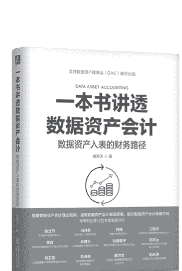

## 数据资产会计财务路径详解
作者：戚笑天 书号：978-7-111-76562-2

### 概览
共十一章，分为上中下三部分。
上部第1至3章从会计师视角认识数据要素与数据资产，说明缘起现状，搭建基本框架，基于全价值链视角明确应用前提，呈现数据资产会计如何嵌入产业生态。
中部第4至8章以《企业数据资源相关会计处理暂行规定》等准则为基础，启发职业判断，提炼账务要点，围绕入表展开财务分析，从业财融合视角给出核心思路，提供全生命周期核算与落地方案。
下部第9至11章剖析典型入表案例，提炼底层逻辑，研讨数智化转型技术路径并展望未来。

## 推荐阅读
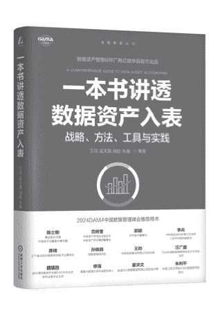

## 数据资产入表全景指南
作者：王琰 孟庆国 刘晗 朱越 等 书号：978-7-111-75895-2

### 概览
本书分四部分，提供从战略到落地的完整知识体系，并前瞻探讨入表后的价值挖掘、评估与金融创新。
第一部分全景观，第1、2章分析宏观背景、核心目标及对企业与社会的价值，描绘时代意义和发展蓝图。
第二部分核心知识，第3至5章详解会计原理、法律框架与大数据技术基础，为实操奠基。
第三部分实操，第6至9章系统阐述实施策略与步骤，涵盖原始资源入表与数据产品入表的关键环节。
第四部分价值挖掘，第10至13章指导企业应用金融创新工具，实现数据资产化与资本化。
附录含“数据资产入表36问”“数据要素相关标准清单”等，插页给出“数据资产入表知识地图”。

## 作者简介

### 申镇
数据治理资深顾问，现任百分点科技企业政企事业部咨询总监兼首席顾问，兼任AI-DG与数据治理大模型负责人。长期深耕治理、主数据管理及数据智能化，曾主导多项国家级政企、大型央国企及海外复杂场景标杆项目，推动大语言模型等前沿AI与企业数据资产管理融合，促传统治理向敏捷智能转型。

### 白佳喜
高级工程师，数据治理资深专家，CICC大模型与决策智能、具身智能、情报与智能认知专委会委员。多年聚焦集团型企业治理、供应链管理与智能决策，擅长以知识图谱、大模型与智能决策能力赋能制造企业精益管理。

### 赖志明
数据治理资深专家，大数据架构师，公众号及视频号“志明与数据”作者。拥有16年数据实战经验，专注金融监管、公共数据等领域落地，持有CDGP、CDAM等多项专业认证。

### 李昕
高级工程师，数据安全资深专家，大模型架构师。深耕集团型企业数据安全治理、智能制造与智能化赋能，曾主导10余家产业公司IT体系与数据安全体系构建，擅长AI在数据安全与智能治理中的工程落地，持有CISSP、CDMP、TOGAF、PCA、AIDC等多项证书。

### 马伟凯
数据治理资深专家，现任百分点科技企业政企事业部总经理，兼AI-DG产品及数据治理大模型牵头人，长期聚焦治理与AI技术在政企领域的落地，曾主导多项政府及大型集团数字化项目。

AGI浪潮下，智能化数据治理正迎来历史性重塑：向下深度释放数据资产变现潜能；向上全面构筑企业AI战略落地核心基座。

拐点观察：迈向AGI时代，高质量数据成为决定AI边界的核心燃料。企业数据治理正从劳动密集型向智能驱动跃迁。大模型不再是概念玩具，而是重塑元数据解析、标准映射、质量稽核与安全管控的智能基座。如今治理成效，将直接转化为明日AI业务价值。

实践价值：智能化数据治理图景才刚展开，本书并非终极答案，而是为行业抛砖引玉。内容凝结于作者在一线大型政企与头部项目的真实历练，系统探讨如何依托Dify与DeepSeek敏捷落地AI数据治理能力，帮助企业跨越技术鸿沟，让数据创造真实业务收益，并为拥抱AGI时代夯实坚不可摧的数据底座。
