# AI 高效办公一本通

# **推荐序**

在当今的职场，人工智能早已不再是遥远的承诺或科技圈的流行语——它已真实存在，并深度嵌入日常工作流程中。从解决自动化琐碎事务到提供决策洞见，AI 正在全面重塑我们的工作方式。对于企业和专业人士而言，掌握 AI 赋能的高效工作能力，已成为在竞争激烈、技术驱动的环境中脱颖而出的关键。据 Stanford HAI 2025 年报告，2024 年已有 78%的机构在至少一个业务职能领域使用 AI，而 2023 年该比例仅为 55%。这一跃升体现了 AI 从实验性工具向主流办公技术的过渡。结论不言自明：善于借助 AI 提升效率的人将始终领先，而拒绝学习和适应的人，则可能逐渐落伍。

凭借深厚的人工智能专业背景与对现代职场的敏锐观察，郭子璇始终致力于将前沿创新与日常实践紧密结合。她不迷恋华而不实的技术噱头，而是专注于解决职场人士要应对的源源不断的待办事项和紧急请求——“请发会议纪要”“帮老板更新这份 PPT”“今晚能提交方案吗？”。子璇对这些困境有切身体会。她的理念极其朴素却又直指核心：AI 的真正价值，不在于炫目的展示，而在于减轻负担，让人们能够将精力投入真正重要的工作中。她倡导“省力型 AI”，反对“炫耀型 AI”，注重以人为本、切实可用的工具与方法。这种务实而温润的人本思路贯串于《AI 高效办公一本通》，并充分体现了作者的核心信念：AI 的使命不是把人变成冷冰冰的高效机器，而是为我们重新定义工作赋能，在职业道路上找到新的价值。这个愿景兼具思维方式的转变与方法论的落地，凝聚了她多年的研究与实践经验，也赋予了本书独特的说服力。

为什么此时此刻出版这样一本关于 AI 驱动效率的手册尤为必要？因为我们正身处一场工作文化与生产力的深刻转型之中。AI 不仅改变了“我们做什么”，也改变了“我们如何做”。它正在重塑我们的协作方式、学习路径，以及价值创造的逻辑。对于初入职场的年轻人而言，AI 工具能极大地缩短学习曲线，帮助他们快速掌握原本需要多年才能习得的技能；对于经验丰富的管理者而言，AI 能提供战略支持，自动简化烦琐事务，使他们能够将更多精力投入到愿景与领导力中。在不同层面，AI 的有效整合都能将生产力推向前所未有的高度。

然而，机遇往往伴随着焦虑。许多人暗自担心：AI 会不会取代我的岗位？我是否能够跟上这股浪潮？在急剧变革的时代，有这些疑问并不意外。一项全球调查显示，那些身处全面推行 AI 转型的组织中的员工，比起技术驱动较低的企业员工，更担忧自身的岗位安全（46%比 34%），甚至不少领导者也有类似的不安。面对这种焦虑，作者选择直面回应。她承认恐惧的存在，但同时将其重新定义为一种机遇。当我们对 AI 有了足够的理解与掌握时，恐惧便会让位于自信。事实证明，随着逐渐熟悉 AI，员工不再把它视为威胁，而是将其看作能够提升自我工作效率的可靠伙伴。正如本书反复传递的信息：AI 并不是来取代你的，而是来让你更好地工作的——前提是你愿意拥抱它。

《AI 高效办公一本通》的一大亮点，在于其全面而易懂的结构。本书分为七个部分，每一部分都针对关键职场挑战，提供具体可行的 AI 策略与工具。随着阅读的展开，你将不断收获启发性的洞见、清晰的框架与可操作的方法。这本书不仅是一份“技巧合集”，更是一封“行动邀约”。无论你是分析师、管理者、创业者，还是初入职场的新人，本书都鼓励你将所学即刻应用：尝试推荐的工具，练习提示词技巧，把节省时间的方法应用到下一个项目或会议之中。只有当你真正把 AI 融入到日常工作习惯与职业目标之中时，这本手册的价值才会被完全释放。正如子璇所强调的，你无须在一夜之间成为 AI 专家，也不必掌握上千种工具；你只需培养正确的 AI 思维方式与逻辑，让智能系统逐渐成为你的日常伙伴。如此一来，你不仅会提高效率，还可能收获更多的时间、创造力与职业自主权。

最后，《AI 高效办公一本通》可谓适逢其时。它既提供了面向 AI 时代的愿景，也为如何在新时代中茁壮成长勾勒出清晰的路径。作者将复杂的主题提炼为既有思想深度又具实践价值的指南。全书的基调专业而真诚，充满理性与希望——在喧嚣的时代，它是一种令人安心的声音，提醒我们更聪明地工作，找到属于自己的杠杆点，并重新发现工作的乐趣。我诚邀你翻开这本书，投入其中的七个篇章：让它挑战你的固有认知，激发新的想法，为你提供精进的技巧；更重要的是，激励你主动迈出职业进化的步伐。迈入 AI 赋能工作的新时代——一个你已拥有一切条件去探索与塑造的时代。欢迎走进本书。

马来亚大学亚欧研究所副教授萨米尔·库马尔

2025 年 9 月

# **前言**

## **智慧打工人，不“卷”也能赢！**

每个打工人，都是在“怨念”中醒来的。一进办公室，第一杯咖啡还没喝完，微信叮叮叮：“来个会议纪要。”“PPT 麻烦更新一下，领导要看。”“这个方案今晚前能交吗？”

网络上有句调侃的话：韩国人不睡觉，日本人不吃饭，中国人不放假。

这一切看似源于“个人选择”，实际上却是时代逼人——不是我们愿意“卷”，是不敢不“卷”。

谁不是背着快要爆炸的待办清单，心里藏着对辞职的幻想？背着 KPI（关键绩效指标）狂奔，和报表赛跑，全年无休，还要防着被优化。

从中世纪的“命定论”，到工业革命的“人力流水线”，再到今天被 KPI 压榨的“工具人”时代——我们早已不是为了获得自由，而是为了证明自己值这个年薪而活。

心理学家弗罗姆说得直白：“过去的危险在于人们成了奴隶，而未来的危险在于人们成了机器。”

我们正在变成那台自我加压、自动续命的机器。你“卷”学习、“卷”技能，“卷”社交、“卷”人脉……拼命“卷”到头，却发现：人越来越像机器，机器却越来越像人。

## **所以“卷”，真的能赢吗？**

不能。

真正赢的人，不是更努力，而是更早醒来，选对杠杆。

AI（人工智能）就是这个时代最大的公平，它不会看你的出身，也不会管你是不是有大厂背景。

它只看你会不会用它，能不能让它替你干活。

借助 AI，让你少做事、做对事、做有价值的事，这才是打工人逆袭的真正起点。

我们可以先定一个小目标：人类的进化是从直立行走开始的，打工人的进化，或许就从“让 AI 替你加班”开始。

为什么你学 AI 总是三分钟热度？因为 AI 确实强——但强得太“花里胡哨”了。今天你刚学会一个 AI 帮你写方案的功能，明天市面上又冒出一个能一键做 PPT 的神器，刚摸清提示词的套路，市面上又蹦出来个“AI 智能体”，一脸霸气地说：“我能一步干掉你。”

现在市面上的 AI 工具和功能多得像火锅店的调料台：看起来琳琅满目，其实都是“味精盛宴”。

你收藏了 N 个 AI 神器，结果用不精，没场景，练完就忘，最后收藏夹大爆炸，实际零上手。

我们要的不是“炫技的 AI”，而是“省力的 AI”。

不是让你“卷”得更猛，而是选对方向，用对工具，让努力变得值得。

## **本书“说人话”“解心病”“给解法”**

这是一本打工人觉醒手册，可谓思维书、方法书和工具书的集合，我们不讲虚的，只讲最令打工人扎心的真相。

我们深入梳理了职场人的真实痛点，结合 AI 时代的变革浪潮，揭示这个时代对“打工”二字的底层重构逻辑。

AI 不是把你变成“更会打工的人”，AI 对我们最大的改变是邀请你重新定义自己。你可以成为拥有自己的表达方式、成长路径与价值扩张系统的那个你。

你将看到：

工作的本质是什么；

职场背后的利益交换如何运作；

AI 到底能替代什么、放大什么，又无法触及什么。

我们不鼓吹盲目奋斗，一起做清醒的打工人，找准职场发力点，让你在看清规则、用对杠杆、做回自己的路上，不再孤军奋战。

## **授人以鱼，不如授人以“摸鱼神器”——让 AI 真正为你打工**

我们不是要变成 AI 专家，不是要学一堆炫酷的软件，我们需要的不是炫技，是省力。

AI 改变的核心是工作的方式，是作为“职场人”的身份——从“被支配”到“做自己的主人”。

所以你缺的不是“AI 知识”，而是 AI 逻辑：怎么跟它说话，怎么让它为你省事，怎么把它变成你的小跟班。

我们的原则很朴素：

选一个你用着顺手的 AI，掌握它的交互底层逻辑，会问、会指挥、会复用它，然后，一步步释放你自己。

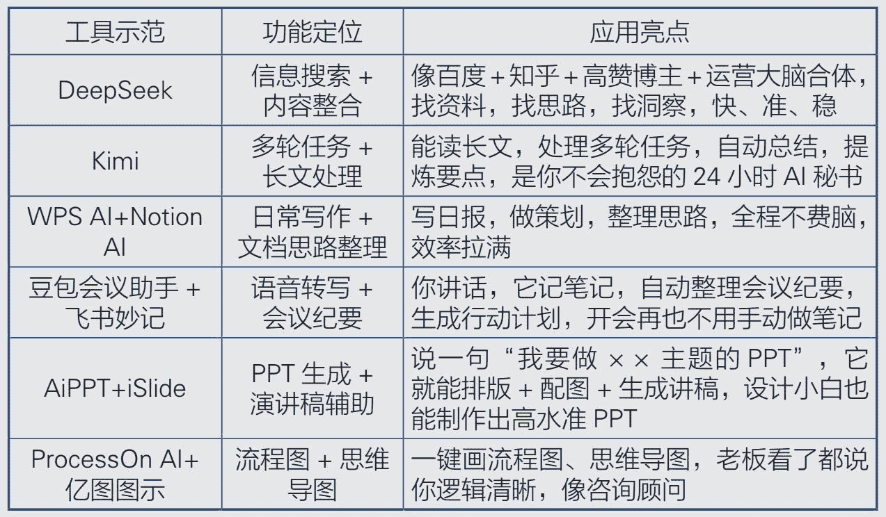

为了让你用得顺，用得精，用得出成果，我们不空谈方法论，而是把高效工作模型和 AI 实操紧密结合：

MECE 原则：不重不漏，彻底厘清工作任务和结构；

SCQA 模型：把你的逻辑讲得动人、让别人听得懂；

金字塔原理：在杂乱无章中搭出一座条理分明的思维大厦。

每一个模型，都结合真实工作场景拆解，搭配提示词技巧+可复制范例+执行步骤，不绕弯，不堆术语，极简实操，一看就懂，一用就爽。

## **新职场“五维战力”×AI 加持**

用对 AI 杠杆，不“卷”也能赢，“你的效率爆发点=AI×职场能力×应用场景”。

在 AI 时代，没有人能靠单一技能混到底。五维全面升级，用 AI 强化你的每一个“职场属性”。

**协作力：**能写、会说、懂内容→用 AI 帮你生成内容、对话提效、多模态理解。

**思考力：**会问、会搜、会整理→让 AI 辅助信息检索、加工和结构化决策。

**数据力：**能算、会画、懂洞察→借 AI 处理数据，建模分析，让抽象的数据可视化。

**表现力：**会讲、能说服、有逻辑→AI 帮你写演讲稿、出讲稿、做 PPT。

**成长力：**会规划、能复盘，助你持续进阶→AI 协助管理时间，总结经验，助你成为超级个体。

真正的进化，不是学会几个提示词，而是从技能提升走向认知飞轮，一步一步踏实地变成自带系统、自动成长、持续进化的“超级个体”。

如果你是：

觉得 AI 遥不可及，但又隐隐焦虑“自己是不是会被替代”的职场人；

每天都在加班、做重复劳动、被迫处理杂事的“螺丝钉打工人”；想要用 AI 实现效率跃迁，做出成绩，升职加薪，甚至搞副业的“野心家”。

那么，就让我们一起学会用 AI 做杠杆，优雅“上分”，不靠拼命靠“省命”，开启不“内卷”的进化之路。

# **Part1 打工人丛林法则：努力不如巧力**

有一个大家都心照不宣的事实：这几年，工作不仅越来越忙，而且越来越不赚钱。身体累，心也疲惫。每天睁眼想辞职，闭眼又怕失业。问题到底出在哪儿？是我们不够拼，还是这个时代变了？

说到底，努力并不等于回报，有人跳槽立马涨薪 30%，有人死守岗位熬七年却不涨一分。你谈拼命，老板谈业绩；你讲辛苦，老板只认结果。

不管是自然界还是职场生态，都有两条极其真实的“丛林法则”：一是“适者生存”，二是“二八法则”。

**适者生存——不进化就淘汰**

这个世界从来不是对最努力的个体温柔，而是偏爱那些最能快速适应变化的人。

英国工业革命时期，一场突如其来的“黑化风暴”在自然界悄然上演。由于煤烟污染，城市上空乌烟瘴气，树干变成了煤炭色的背景板。原本在白桦树皮上“伪装术”一流的灰色桦尺蛾，突然变成了鸟类眼中的“反光靶”，而罕见的黑色桦尺蛾反倒因为“低调沉稳”的外表，得以藏身于焦黑的树皮中，逃过一劫。

结果，短短几十年，曼彻斯特地区的黑色桦尺蛾占比从不到 5%，飙升到 98%。这不是黑色桦尺蛾去努力“加班练飞行”，而是环境变了，它刚好能“扛住”。

这就是生物进化对“环境剧变”的自动响应。再看变色龙，它能在炎热沙漠中生存下来，并不是因为力量最强，而是它能根据环境调整皮肤颜色，不但能避敌，还能调节体温。

**这些自然界的生存法则，在职场中也毫无例外地上演：**

**·技术快速更迭，AI 工具层出不穷；**

**·行业不断洗牌，岗位被重构、技能被淘汰；**

**·你不会 AI，别人会；**

**·你还在死磕 Excel 公式，别人一键就出图、总结、生成报告。**

你不是不努力，而是努力得像一只“不会变色的蜥蜴”，最终被环境自然淘汰。

**二八法则——少部分人抢占“红利”**

二八法则也叫“关键少数法则”，由意大利经济学家帕累托提出。他发现，意大利 80%的土地被 20%的人占有。这个规律不仅适用于财富分配，也广泛存在于自然界和职场中。

在一个蜂群中，20%的蜜蜂承担了 80%的采蜜任务。而其余 80%的蜜蜂，有的一天只出勤几次，有的干脆“摸鱼”——飞出去转一圈，啥也不干就飞回来。是不是很像某些办公室里的“静悄悄高手”？

职场也是如此：

**·80%的业绩，来自 20%的高效员工；**

**·80%的创意，来自 20%的深度思考者；**

**·而 80%的收入和资源，也被 20%的管理层或核心岗位人员拿走。**

想成为“被看见的 20%”，就要做对的事，选对工具，站对风口。成为“高产头部”打工人；剩下的 80%，则继续在旧工具、旧模式里“卷死”自己。

**你是哪种打工人？**

在“适者生存×二八法则”的双重生存法则下，每个人都在被重新分类。先来看看你目前属于以下哪一种。

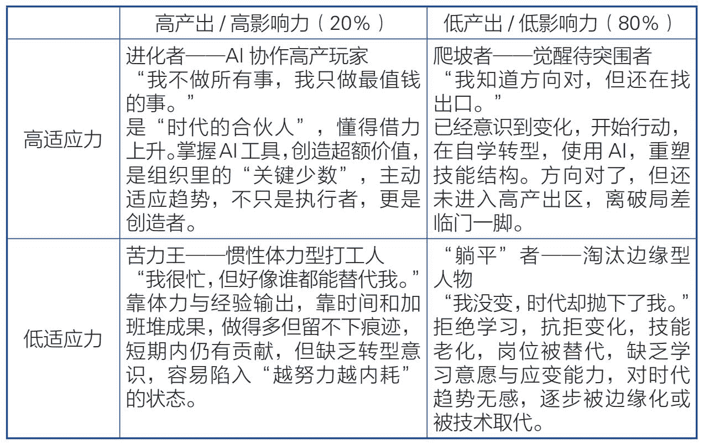

在这个技术飞奔、变革频发的时代，打工人不再只是“上班八小时”那么简单：

**·有人已经觉醒，主动拥抱 AI，成为进化者，把时代当队友，把工具当外脑；**

**·有人正在摸索，脚踏实地攀向高效区，是处于跃迁边缘的爬坡者；**

**·也有人仍在用传统方式死磕，加班换绩效，做着无声内耗的苦力王；**

**·更有一些人，不学不变，不慌不忙，逐渐滑向“淘汰名单”。**

时代不等人，这个世界奖励的从来不是“谁最努力”，而是“谁最懂得借力”，“努力+效率”才有价值。

你不必完美，但你可以开始升级。AI 时代的打工人，不再靠“谁能熬”，而是看“谁能省”：省力，省时，省脑，懂得用 AI 来解决低价值重复劳动，把时间留给策略、判断和创造。

别再“用生命来打工”，那不叫忠诚，那叫“自费演出”。试着升级为“AI 协作高产玩家”，AI 正是帮你从“笨功夫”中抽身出来的最优路径。

## **一、AI 会替代打工人吗？**

这是每一个打工人都在问的问题。

但或许，更关键的问题不是“会不会”，而是：谁会被替代？谁还能继续坐在牌桌上？

从 ChatGPT 到 DeepSeek，从 Sora 到 Manus，AI 工具几乎每周一个新版本，“三分钟出一页 PPT”“一键生成年度总结”的演示视频在社交平台刷屏。视频生成模型 Sora 以超逼真的画面效果震撼了整个影视圈，特效师、剪辑师等行业从业者一度陷入集体焦虑，仿佛一夜之间，手里的技能就过时了。

朋友圈里同事在炫耀：“我用 AI 搞定了整份方案。”

视频里博主讲得神乎其神：“不会 AI，等于被淘汰。”

新闻媒体报道起的标题更是火上浇油：“机器干了我的活，价格是我的八百分之一！”“从‘机器吃人’到 AI 代替人类”。

而你，可能还在苦哈哈地敲日报、改文案，心里突然有了一个刺：是不是全世界都在用 AI，就我一个人还在手动“搬砖”？

别急，这份焦虑，可能不是你自己的问题，而是你掉进了一个认知陷阱——幸存者偏差。

### **什么是幸存者偏差？你看到的 AI 世界可能不完整**

“幸存者偏差”是指我们往往只看到了成功者、幸存者的声音，而忽略了更庞大的“沉默群体”——那些没有发声权、没有曝光机会、早早出局的人。

在 AI 浪潮中也是同理，比如你刷到的大量“用 AI 省时省力”的内容，其实来自那些懂得尝试 AI 的人，有能力表达和传播的人，本身就不容易被取代的人，这些人本身就是活跃在话语场的幸存者。

而另一群你看不见的人，反而是“沉默的大多数”，你几乎听不到他们的声音——他们才是真正处在被替代边缘的人。他们几乎不使用 AI 工具，不在知乎上提问“如何用 AI 写报告”，甚至可能连“AI 是什么”都说不清，更别说如何使用。在这场变革中，他们既没有掌控力，也缺乏抵抗力。而他们的离开，很少引起注意，更不会被写进调查报告或社交文章里。

他们从事的是标准化、重复性强、对创造力要求低的“静音岗位”，比如：基础客服、资料录入员；初级图文编辑、模板美工；金融、法律、市场等领域的辅助分析岗位。这些“静音岗位”往往有以下共性：

**·标准化、重复性强；**

**·技能门槛低、创意要求少；**

**·没有主动接触 AI 工具的机会，也缺乏表达与学习渠道。**

这些岗位对“效率”的依赖远大于“创造力”，一旦 AI 达到一定阈值，替代的进程几乎是静音式发生的。

这类打工人群体不是“不努力”，而是“不更新”。他们没有学习通道，也不具备“预判变革”的能力，于是他们被时代渐渐“边缘处理”。

如今对 AI 焦虑的整体水平呈下降趋势：担心 AI 会导致自己失业的员工比例，从 2022 年的 53%降至仅 10%（Mercer，美世，2024）；尽管“AI 能写代码”的新闻铺天盖地，6 万多名程序员中，仅 12%认为 AI 威胁到了他们现在的工作（StackOverflow，程序员社区，2023）；在全球公众对技术进步的态度中，认为“技术进步正在摧毁我们的生活”的比例在 2022 年达到高点后整体回落，尤其在中国更是大幅下降，可以看出“AI 焦虑”正从群体恐慌走向理性共处（Ipsos，益普索，2025）。

表面看似愈来愈平静，越来越多的人意识到 AI 不再是“洪水猛兽”，而是“生产力新引擎”，但问题在于，这些数据的“答题人”，本身就属于幸存群体。

他们不是被替代的候选人，而是 AI 的早期用户，真正被替代的那群人，甚至没有资格参与问卷。

### **AI 转型的阵痛期**

在技术革命的浪潮中，红利从不会立即兑现，它总是先以“阵痛”的形式到来。每一次技术升级，都会先“下沉”一批人。

今天我们面对 AI 时的焦虑、恐慌、转型压力，其实并不新鲜——历史早就上演过多次这样的剧情。

**第一次工业革命：手工工匠的愤怒与出局**

18 世纪 60 年代，英国迎来第一次工业革命。蒸汽机和机械化的普及，让纺织、冶金、交通等行业效率跃升。

但谁先失业？正是那些曾经依靠手工技艺吃饭的工匠。他们技能熟练，工作勤奋，却在机器面前彻底失去竞争力。愤怒之下，一批纺织工人掀起“卢德运动”，砸毁机器，抗议“被取代的命运”。

他们不是不努力，而是突然失去了努力的方向。机械大潮来临时，没有人等他们。

**中国国企改制：铁饭碗碎了，几百万家庭“脱轨”**

再看中国自己的转型阵痛——国企改革。

20 世纪 90 年代，中国启动国有企业改革，开始“抓大放小”“减员增效”“下岗分流”。这一政策加快了国有经济的市场化进程，但也带来了广泛的阵痛。

据官方数据显示，1998—2002 年间，全国累计下岗职工超过 2700 万人。这一波“下岗潮”不仅重构了城市就业结构，也深刻改变了几百万家庭的生活轨迹。

时代突然换了打法，很多中年工人一夜之间从“编制内”变成“待岗人员”；技能陈旧、观念滞后，难以适应市场需求；情绪上的“身份断裂”，一度成为社会矛盾的焦点。

**AI 时代：熟悉的阵痛，换了个包装**

今天的 AI，正以另一种形式重演“机器抢人饭碗”的剧本：你以为稳妥的客服、美工、运营岗，AI 一秒能完成 80%；你擅长的模板化写作、流程型运营，AI 可以批量复制；你努力学会的旧技能，面对 AI 的“瞬时响应”，突然不值钱了。

无论是 18 世纪的英国工人，还是 20 世纪 90 年代下岗的国企员工，抑或今天的 AI 焦虑者，他们的共同点是：都在转型初期陷入“技能与时代脱节”的巨大落差中。

这种落差在转型初期最为明显：旧岗位快速消失，新岗位尚未成熟，教育和培训滞后，个人转型缓慢。

从“砸机器的工匠”，到“下岗的国企员工”，再到今天“被工具悄悄替代的打工人”，我们始终在见证一个规律：技术不会毁灭所有人，但技术也不会等待任何人。

历史不会绕过任何一个时代的旁观者，比如如今我们正在经历的“AI 阵痛期”。

而唯一能缩短它的方式，就是主动转型，尽早补课，全面升级。

### **技术不会只带来淘汰，它也在创造新机会**

技术“阵痛”的另一面就是创造力。每一次生产方式的革新，短期内也许会导致岗位的消失，但长期来看，它总会催生一整套新的生态与就业结构。

第一次工业革命，手工业者一夜之间失业，社会一度陷入动荡。但危机过后，新的工厂制度逐步建立：一批工匠转型为机器操作工；出现了流水线管理人员、设备维护技师等新职业；工厂主雇用调度员、统计员、会计，构建了早期企业组织结构。

这些职业，在技术诞生初期根本不存在，但在新秩序下迅速成为支柱。“打不过机器的人”，最终学会了“指挥机器”。

“抓大放小”政策下，2700 多万国企职工下岗。很多家庭失去了“体制保障”，阵痛蔓延至整个城市就业系统。但同时，中国也进入了市场化、全球化高速发展期，催生了大量新机会：原来的“行政科长”，转型做了物流公司老板；“车间班长”成为民营制造业的生产主管；新崛起的民营企业、外企、金融机构大量吸收了懂流程、守纪律、愿意干的国企下岗人员。

国企改革初期确实撕裂了一部分人的安全感，但也打开了更加多元的社会流动通道。很多人虽被迫离开体制，却在市场中完成了“职业重启”。

再看近二十年：

电商冲击了传统商场，却创造了客服、物流、直播、平台运营、美工、短视频剪辑等数十个新岗位；

外卖打破了餐饮堂食模式，却催生了骑手、调度、算法工程师、后台内容运营等共同协作的全新业态；

技术带走的是“旧岗位的逻辑”，带来的是“新岗位的规则”。如果你能跨过转型那一步，就有机会接住第二曲线的红利。

### **历史规律从未改变：不是技术毁掉了你，是你没跟上技术**

每一代人都会经历“工具跃迁”带来的不适应期，但结局永远写在那些主动转型的人身上：工业革命创造了现代职业管理体系；国企改制打开了民营经济的巨大缺口；电商和外卖催生了数字劳动的全新形态；而 AI，将重构我们“思考—表达—执行”的全链条逻辑。

AI 如今正沿着这条“先淘汰，再创造”的路径前进。它确实会替代一些“无须思考”的岗位，比如：标准化内容撰写、报表汇总分析、美工模板替换、客户应答脚本整理。

但它也正在催生一整套新的职场能力画像：

**·用 AI 写草稿、做策略的内容策划；**

**·会与 AI 协同产出的创意设计师；**

**·懂提示词、会训练 AI 的普通运营人员；**

**·能用 AI 整理分析数据的市场分析师；**

**·能搭建 AI 工作流的项目执行者。**

你甚至不需要成为程序员，只要会用，就比大多数人有竞争力。

每一次转型都有牺牲者，也都有获得机会者。关键在于：你站在哪一边。

所以，你真正该问的问题不是“我会不会被替代”，而是“我是否已经成为 AI 的使用者，有没有停留在被观察、被评估、被替代的那一侧？”。

AI 不会取代所有人，但一定会取代那些不用 AI 的人。

真正的危险不是焦虑，而是“看着别人起飞，自己还在观望”。

## **二、AI 打工人雷区：避开三大坑**

AI 可以帮你写文案，做表格，画图，剪视频，几乎“无所不能”。但用得越久，你就越会发现它也不是万能的，甚至有些时候用不好还会“坑你没商量”。

以下这三大雷区，是每一个 AI 打工人必须警惕的基本常识：

### **（一）保密红线：不做泄密人**

AI 正在帮你打工？没错。但你有没有想过，它同时也在吃你喂的“饲料”！

“帮我分析这份合同”“润色下我的商业计划书”“写个面试评价”……越来越多人把 AI 当成万能秘书，张嘴就问，抬手就贴。可你有没有意识到，这些看起来平平无奇的内容里，可能埋着公司最不能碰的红线？

比如：

**·客户名单；**

**·投标策略；**

**·薪酬结构；**

**·项目预算；**

**·内部制度；**

**·还没对外发布的战略计划；**

**…………**

这些信息一旦流出，轻则客户流失，重则合同作废、股价跳水，甚至直接触犯《中华人民共和国反不正当竞争法》！

**AI 不是你办公室的“私人助理”，它是全球联网的“训练器”**

很多人不知道，大多数公开可用的 AI 平台（包括 ChatGPT、Claude、Gemini 等）默认是开放训练模式。你说：“我没授权啊，它怎么敢收？”可问题是，你“什么都没设”，就是“默认同意”。

尤其是那些你根本不会打开看的《用户协议》：用户提交的信息可能会“用于模型训练和服务的优化”。通俗来说就是：你的一句话，可能出现在别人的 AI 训练集里。

2023 年，三星某工程师为了提升芯片开发效率，把一段含有机密的代码贴进 ChatGPT 中，让 AI 帮他优化。

ChatGPT：收到，我来帮你改改。

OpenAI 服务器：咦，好高级的芯片数据，这可是“绝对好料”，收入训练库！

就这样，一些尚未发布的核心参数被上传到国外服务器，直接触发了三星内部安全红线。事后，三星全面加强了员工使用 ChatGPT 的安全措施，多个企业也立马跟进。

教训是什么？

AI 的确能省事，但它也不是你家的私人工具，它是开放平台，是联网系统，是“你输入，它学习”的“大胃王”！

办公环境下的高频泄密场景：

（1）整份文件上传翻译/润色：你想省事，直接把财务报表、内部策划文档上传至 AI 润色。但很多工具会将内容同步到云端，成为“潜在训练素材”。

（2）片段化暴露导致“机密拼图”；你今天让 AI 写“竞品分析”，明天请它润色“预算说明”，后天又加了一个“客户画像”。这些零碎信息，被 AI 模型自动“拼起来”就能还原你的整个投标方案！

**守住保密红线指南：**

第一条：关闭默认训练功能。进入 AI 工具的“设置/偏好”中，查找是否有“允许用于模型训练”的选项，必须手动关闭。

第二条：不上传完整敏感文件。需要 AI 帮你写东西？截取部分内容、脱敏处理后再上传。千万不要一股脑把合同、计划书、财务表丢进去！

第三条：敏感信息只用“企业模型”。处理公司级项目时，务必使用带权限管理+数据隔离+隐私协议的大模型服务（如 Microsoft365 Copilot、BaiduComate 企业版等）。

第四条：公众模型只问碎片化问题，不暴露核心数据。你可以问“如何优化这段话”“这句话语气更正式的版本是什么”，但别说清楚你是谁、项目是什么、客户是谁！

AI 办公时代，真正危险的，不是间谍，而是你我这些无意识暴露信息的普通员工。你不是“泄密者”，但你可能是“搬运工”。

你在 AI 输入框里敲下的每一个字，都有可能成为别人未来的答案。

一个不小心，就是“信息孤岛”变“训练样本”。别让你的文档，出现在别人的提问结果里。

### **（二）隐私保护：别让 AI 知道得比你妈还多**

AI 越懂你，用起来确实越顺手；但一旦它“太懂”，那就是另一回事了。比如你在 AI 里随手输入一句：

“我这个岗位还有哪些晋升路径？”

“我在上海，35 岁，做销售，接下来该怎么规划职业？”

听起来只是一次普通的关于职业焦虑的对话，但你其实已经交代了：你在哪儿、你几岁、你干什么、你在焦虑什么。这些信息，不仅可能被平台用作模型训练，在未来还可能成为伪装你、引你上当的“蓝本素材”。

这离我们并不遥远，还记得那种老掉牙的钓鱼短信吗？

“尊敬的用户，您的快递需补缴 8 元，请点击链接。”

现在的 AI 钓鱼，直接晋级为：

“小李，我是你老板张总，财务出了点问题，马上转一笔应急款到这个账户。”

语气一样，口音一样，连“你老板惯用的脾气”都模拟得一模一样。

2019 年，英国一家能源公司就被这样的 AI 语音诈骗骗走了 22 万欧元。CEO 事后接受采访时说：“我完全以为是董事长打来的电话。”

这类攻击模式，已经有了专业术语：提示词 Injection+Social Context Mining（提示词注入+社交语境挖掘）。

简单讲就是：拿你的信息来骗你自己。

只要你在 AI、社交媒体或视频平台里留下足够多“你是谁”的线索，它就能“复制”你，不光“钓”你，还可能去“钓”你的客户、家人、同事。

**如何自保：隐私护身术**

你防黑客，防病毒，却没防住自己在 AI 面前“自报家门”。

现在起，要选择合规的 AI 工具，优先使用通过《生成式人工智能服务管理暂行办法》备案的合规产品（如百度文心一言等），并且养成定期清理记录、关闭访问权限的好习惯，尤其是摄像头、麦克风、剪贴板访问等，能关就关，别让 AI“偷偷看你”。

在操作的时候谨记这五步，给你的隐私装上双保险：

（1）所有 AI 输入都默认“脱敏”处理：别输入真实姓名、住址、身份证号、电话号码。

就算是写简历，也用“张三”“139××××××××”“某 985 本科”等进行表述。

（2）关闭平台的“历史记录同步”与“开放训练”设置：如果找不到这个开关，说明你用的平台太危险，赶紧换！

（3）别让“你是谁”太容易被拼出来：用 AI 提问时，别说“我 35 岁，在上海做销售”，你可以说“一个打工人”。

（4）谨防 AI“语音钓鱼”：接到电话，对方提到你的工作经历、家庭情况、具体项目，一律二次核实！别听声音判断真假——AI 连你爷爷的声音都能复刻。

（5）慎用社交标签，慎发视频语音：你以为是在“展示自己”，其实是在给它“喂素材”。特别是配了公司名、职位的短视频或语音留言，简直是 AI 建模的宝藏。

你不是被监听，而是主动泄露。在 AI 时代，隐私不再靠“藏起来”保护，而是靠少说、少传、脱敏、验证来生存。

你说的信息，可能没有任何违法风险或秘密价值。但在 AI 手里，它们能被拼接、生成、复现、伪装。聪明的 AI 打工人，不是不用 AI，而是知道“哪些该说，哪些永远别说”。

### **（三）幻觉问题：AI 一本正经地“胡说八道”**

你以为 AI 最大的问题是“不懂”？不，它最可怕的，是不懂还一本正经地回答你。

这就是 AI 的“幻觉”现象。专业解释是：在缺乏真实数据支持的情况下，大模型凭空“编造”出听起来很靠谱但根本不存在的内容。

通俗点说就是：AI 不装傻，它装“懂”。

**“AI 幻觉”的三种常见表现**

（1）编造数据、杜撰事实：你问它“请列出 2023 年中国十大科研成果”，它能洋洋洒洒写一页，但其中有三项根本没发生过，甚至它说的那家单位都没研究过这个方向。

（2）虚构论文与文献：学术界最常翻车的 AI 幻觉——ChatGPT 给出的参考文献看起来像模像样，作者、期刊、页码一应俱全，但你一查数据库，压根没这篇文章。

（3）创造不存在的人名、机构、案例：你让它帮忙写份报告，并顺带加几个“真实案例”。它信心满满地来一句：“2023 年，由‘东亚未来智能伦理联合会’和‘国际意识觉醒研究所’联合发布的报告指出……”

听起来高大上得很？但别信！这些名字根本就查不到——不仅组织不存在，连相关报道、官网、学术记录都是一片空白。

**美国律师“被 AI 坑惨”：提交幻觉判例，差点被吊销执照**

2023 年，美国律师史蒂文·施瓦茨在一桩航空公司诉讼案中，使用 ChatGPT 代查判例，并将其提供给法庭。结果，AI 列出的几个“经典案例”压根就不存在！

法官怒了，判决书上直接写下：

“法庭对 AI 的能力没有意见，但对律师没核实资料的行为持严正态度。”

该律师不仅当庭致歉，还面临纪律处分和执业信誉危机。

幻觉的背后，其实是大模型的“语言本能”在作祟。生成式 AI 不是在“理解你的问题”，而是在用概率预测最可能出现在这个位置的下一句话。

它不像人那样“先查证，后回答”，它是“先组合语言，后才反思准不准”（但是它根本不反思）。

所以，如果问题本身缺少上下文，或是让它在“知识盲区”里自由发挥，它就会开始用自信掩饰无知。

**四个“降幻操作”要记牢**

（1）让 AI 引用“来源”，并一一复查：别光看输出文本，一定要求它加上链接/来源，哪怕是假链接，也能方便你查证它是否在乱编。

（2）不要问“它不知道自己不知道”的问题：例如“列出 ChatGPT 支持的所有算法细节及源码”“生成某教授 2023 年最新演讲摘要”——它会假装知道，但说的是假的。

（3）用 AI 写内容≠自动可信，务必“人工再审”，尤其是报告、简历、论文、行业分析、竞品总结等涉及真实信息的内容——AI 是你的写作助手，不是“事实代表”。

（4）多模型交叉验证：幻觉怕“比对”，你可以让两个不同模型（如 ChatGPT 和 Kimi、文心一言）来回答同一个问题，看它们的回答是否一致，只要说法差太多，就要警惕 AI 幻觉了。

AI 说错话的时候，不是它坏，而是它太想“帮你写点啥”，就顺手帮你编了点“世界”。所以，不要迷信 AI 说得多顺、话说得多圆，它有时候比你老板还会“说话不留证据”。

AI 再强大，也只是你的“外挂工具”，不是你的“绝对判断”。打工可以靠 AI，但判断一定靠自己。

## **三、AI 杠杆：普通人极简进化公式**

你有没有发现，有些人根本不被职业定义，也不受标签限制，简直像是天生自带“多线程处理器”，切换身份比你切 Wi-Fi 还快——今天在讲台上侃侃而谈，明天在实验室里改写规则，后天还能在社交平台发条动态，顺手引爆一个行业话题。

看着他们的人生，我们忍不住感叹：“他们是不是开了挂？”

比如说达·芬奇。提到他，你可能第一时间想到的是《蒙娜丽莎》的微笑——没错，他是伟大的画家。但他不只会画画，他还是雕刻家、建筑师、音乐家、数学家、工程师、发明家、解剖学家、地质学家、制图师、植物学家、作家……你能想到的技能，他大概都点满了。他把艺术与科学、创作与思辨、感性与理性混合搅拌，最后倒出了一整个“文艺复兴”。

再看看我们的国风全才——苏轼。一句“但愿人长久，千里共婵娟”，让无数人念了近千年，可别以为他只会写诗。他也会书法、画画、下厨，传闻他还发明了东坡肉。

被贬官外放时他能修堤治水，设计灌溉系统，一边种菜一边写词，连放逐生活都能过得像一场诗意的人生实验。他不是在生活，他是在用生活创作人生的多种版本的草稿。

到了当代，埃隆·马斯克直接把“多线程”写进了人生履历里。他不只是工程天才，更是资源整合、愿景规划、资本驾驭的复合型操盘手。特斯拉让他“电”动世界，SpaceX（太空探索技术公司）让他“射”向星辰，Neuralink（神经链接）让他直通大脑，The Boring Company（无聊公司）让他在地底开疆拓土，顺手还把社交媒体平台 X 变成了他掌控舆论的新舞台。他的每一手操作都不是在造一个产品，而是在重写整个行业的剧本。

这些人的耀眼并不是每天比我们多了 24 小时，也不只靠天赋异禀，而是他们的人生不靠蛮力硬拼，他们找到了自己的“结构性杠杆和系统级进化”，在同样的时间中，他们找到了把每件事做成指数级放大的机会。这条公式你可能早就听过：

人生商业模式=能力×效率×杠杆

**·能力决定你能提供多少有价值的输出；**

**·效率决定你输出价值的速度；**

**·杠杆则决定你能将这份价值影响到多大范围的人。**

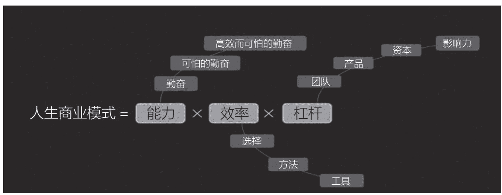

（图片整理自：刘润《底层逻辑：看清这个世界的底牌》）

过去，这个模型大多掌握在少数精英的手里。他们资源多，人脉广，资本强，能借平台、渠道、时间、人力做乘法，而大多数人，只能靠时间堆业绩、靠体力换报酬。

**AI 时代最大的变化就是，杠杆的入口彻底打开了**

AI 技术的出现，相当于把原本只有“高段位玩家”才能用的杠杆工具，放进了每一个普通人的手里。它不是一个“天才专属外挂”，而是一个全人类都能使用的效率放大器。

你不再需要熬夜练技能、死磕平台推荐算法、用“打工三十年”换升职，只需要看清规则，升级方法，点燃那个藏在你体内的“超级个体”。

AI 时代的每一个人都适用的极简进化公式：

个体进化力=好奇心×提问力×AI 杠杆

**好奇心：AI 时代最稀缺的能力，是“持续想问问题”**

过去我们定义“能力”，是你能做什么、懂什么、执行什么，你能创造什么样的价值。但在 AI 能写代码、能画图、能编故事、能查数据的今天，能力≠盲目的技能堆叠，而是思考力+好奇心的复利累积。

你最该保住的，不是技能，而是你的好奇心。

你还愿不愿意发问？愿意在哪个方面持续探索？你能不能问出别人没想到的问题？这不是“情绪价值”，这是 AI 时代唯一不会贬值的底层资产。

**提问力：效率的关键，不是“会用 AI”，而是“问得准”**

大家都说 AI 能提效，但为什么有些人用 AI 能一小时写完一整本小说，你却跟 AI 对话五分钟都像在玩文字版“你画我猜”？因为如今提问力，才是效率的分水岭。

高效不是 AI 带来的，是你和 AI 之间构建了一条清晰、反复迭代的指令链。一句话问清楚，一层层往下挖，不断复盘，是让 AI 成为你的“超级外脑”的真正起点。

效率≠把 AI 当成代工厂，而是让 AI 成为你的共创者，构建一套“提问→生成→复盘→优化”的高效反馈回路。

**AI 杠杆：从内容生产，到认知放大**

以前的“杠杆”，叫平台、资本、人脉、流量，你得等，得求，得赌。而现在，AI 本身就是你随时可调动的第一位杠杆：

**·它可以帮你高效产出内容，哪怕你不是专业写手，也能输出一份像样的方案、脚本、社交文案；**

**·它可以让你在打工之余构建“第二增长曲线”，做课程，写播客，剪视频，搞副业，不再只是“消耗者”，而是“输出者”；**

**·它还可以带你接入更大的平台杠杆，通过内容触达流量，借工具走向影响力，最终完成从普通人到“超级个体”的跃迁。**

杠杆≠风口、红利，而是你有没有把 AI 用成自己价值的放大器。不再是“我一个人能做多少”，而是“我+AI，能多快触达、影响、输出”，并且用联合 AI 的价值去撬动其他资源。

AI 不是把你变成“更会打工的人”，AI 对我们最大的改变是邀请你重新定义自己。你不必成为马斯克或达·芬奇，但你可以成为：

“拥有自己的表达方式、成长路径与价值扩张系统的那个你。”

而这个时代，最大的公平就在于：会用 AI，掌握逆风翻盘的第一顺位杠杆。

那么，AI 时代的打工人该怎么做？

AI 不会毁掉所有的工作，但它一定会改变工作的方式。不要盲目乐观，也无须情绪内耗，要主动出牌，开始学习，开始尝试，开始进化，这才是最大的安全感来源。

这个时代奖励的，从来都不是“谁最辛苦”，而是“谁最会借力”。有人把 AI 当助手，一天干五天的活；有人用 AI 做外脑，轻松搞副业；也有人还在试图用 Ctrl+C（复制）和 Ctrl+V（粘贴）熬出头。

AI 不是你的敌人，它是你随时可用的职场加速器，是人人都能握住的最大杠杆。因此：

√保持好奇心——别让“我不会”阻挡你打开新工具；

√提升提问力——写得出好提示词，才用得出 AI 的真价值；

√激活 AI 杠杆——让 AI 帮你省力、省时、放大影响，而不是原地踏步。

怕被淘汰，不如学会进化。等待系统提示更新，不如主动升级。

# **Part2 打工人清醒指南：给工作分区**

我们每天面对的最大问题，其实很简单：不想上班！

这句在社交平台被无数打工人点赞的“废话文学”——“不是我不想上班，是工作不想让我快乐”，看似吐槽，其实戳中了职场最冰冷的真相：我们并不是不努力，而是不知道怎样让努力变得值得。

每个进入职场的人，都要经历一个“幻灭”瞬间：你以为的工作，是诗与远方；现实却是 996 的工时、PPT 的排版、KPI 的压顶，还有改不完的 Word 文档。

每天起床都像上战场，在“骂娘”和“挣钱”之间左右横跳，靠一句“算了，为了房租”来强撑。

**工作的本质是一场“用时间换筹码”的交易**

我们必须认清，工作的本质很朴素：

工作等于用“时间+能力”换“金钱+可能性”。

换句话说，工作就是一场交易。我们把时间、技能、注意力打包给公司，公司则把金钱、资源、平台、机会打包给我们。

既然是交易，就意味着我们暂时还不具备“独自去市场赚钱”的能力。那与其一边打工一边痛苦，不如换个视角：接受“工作是交易”的现实，然后把这笔交易做得尽可能划算。

那我们得先搞清楚，提升这场交易“回报率”的底层逻辑：

1.目标导向：你得真的产出了价值，钱才成立

既然是交易，那就得交付结果。你工作一天，到底是“完成任务”，还是“制造价值”？如果没有产出能被他人承认的价值，交易就不成立。

不论你是专职员工，还是副业玩家，都要学会设定目标，拆解目标，达成目标。做出成果，才是你在市场上能“换钱”的前提。

2.学习复利：没有哪份好工作是“混”出来的

你想在职场中走得更远，就别想着“熟练就好”。真正靠谱的工作者，永远都在学习。尤其是内容、设计、营销、产品这类创意工种，你面对的是不断变化的用户兴趣、技术工具和流行文化。今天的“爆款公式”，明天就会被遗忘；昨天的“AI 冷知识”，今天已成入门级。持续输入+灵活输出，才是长期立于不败之地的硬通货。

3.成长节奏：别盯着天赋，先撑过新手村

别被那些“一夜成名”的神话蒙蔽了眼。大多数人的成长过程，都是从手足无措、灵感枯竭到驾轻就熟、信手拈来。不要质疑“我适不适合”，而是要问“我今天有没有比昨天多懂一点？”。

你愿意在岗位上持续进化，那么这场“交易”就不会亏。

**来给手头的工作分分类**

所以职场的“工作交易”，不说冠冕堂皇的理由，我们坚持的最大理由是为了看到“价值”。这份价值，可能是金钱回报，也可能是晋升机会、能力成长。而我们付出的最大代价就是“快乐”。不管是向往“自由”，还是“缺少伯乐”，归根结底就像小时候被逼学习，长大后面对柴米油盐，许多我们抗拒的，其实并不是“事情本身”，而是它造成的快乐感的缺失。

但是既然逃不掉，不得不面对，我们不妨给每天要做的那些任务分分类：

①有价值+有快乐：理想中的“梦中工作”——成就感与快乐感并存，做着做着就上头，这种工作当然是“最值得”的。

②有价值+无快乐：现实中的“主力输出”——虽然过程枯燥，但价值明确，是换薪资、换升职通道的基石。

③无价值+有快乐：短暂愉悦的“情绪快感”——聊天、摸鱼、刷短视频……一时爽完之后，常常空虚又愧疚。

④无价值+无快乐：彻底内耗的“黑洞任务”——没意义，没乐趣，还浪费时间，拖人下水、消耗干劲的典型代表。

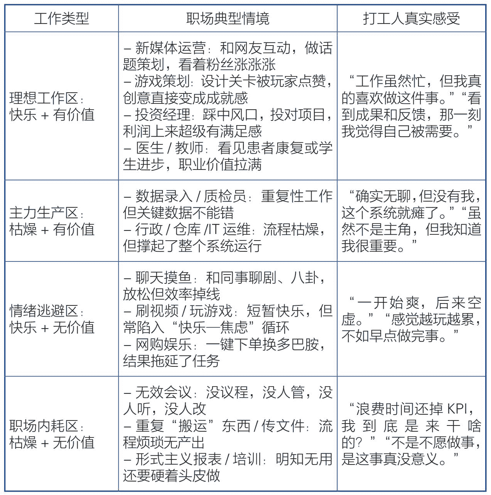

**看清任务类型，才能真正掌控时间**

现实职场中，工作从来不是泾渭分明的“非黑即白”，而是四种任务类型在你的待办清单中混杂交错、轮番上演。

但一旦你开始看清自己的时间都花在哪一类任务上，哪些工作在增值，哪些在消耗，你就拥有了最关键的能力——取舍。

问问自己：哪些值得坚持？哪些该被简化？哪些可以交给 AI？又有哪些该果断舍弃？

像第四类这种既无趣又无价值的任务，显然应该第一时间清理：能砍就砍，不能砍就优化或自动化。推动流程改进，向上反馈，用 AI 模板替代——哪怕只是少花十分钟，也是在为自己夺回精力。

记住：不要在“无回报的交易”里继续透支情绪和时间。

第一类：既有趣又有产出的理想工作区，这是你的高光区域，恭喜你找到了“时间飞轮”。要尽可能放大这类任务的占比，争取更多类似机会、积累更多成果，把热爱转化为你的“个人品牌”，构建长期价值的复利曲线。

第二类：枯燥但有价值的结构化任务，这是 AI 最该出手的地方。让 AI 帮你干掉流程性、重复性、格式化的部分，你只负责最关键的判断与推进，把“苦活”做得既快又轻松。

第三类：短暂快乐但无产出的“情绪逃避区”，不必完全压抑，关键是结构化转化。把你刷到的灵感、说过的金句交给 AI 梳理提炼，就能转化为“能发布、能交付、能被买单”的创意资产。

接下来，不是反思，而是迁移。

清醒的打工人，不是靠多忍一口气，也不是一遍遍发誓“再也不刷抖音了”，而是靠有意识地把工作内容从“低价值区”一步步迁移到“高回报区”。

√把重复的工作交给 AI，把判断留给自己；

√把碎片化的灵感交给 AI，把创作变得可复用；

√把高价值的时间，投注在能让你“上头又出成绩”的地方。

你要做的，不是变得更忙，而是更精准。现在，对照你的每一天，重新分配注意力与工具的使用权——让 AI 帮你解决第二类“苦活”，努力把第三类“没产出的享乐”挪近理想区，放大第一类的价值飞轮。

从此，每一小时的工作，不再只是“被安排”，而是“被设计”。

## **一、理想工作区——放大价值，变成人生高光区！**

√交易逻辑：你输出热情+能力，市场反馈直接给你金钱+认可。

√评定标准：你爱干这件事，别人也愿意为它付钱。创意和价值双线并进，工作成了你的个人标签。

很多人其实不是没激情，而是被琐事埋没了“爽点”。每一个岗位都有最值得去放大的“高光时刻”，每个人都有不该被忽视的独特性，我们要做的是用 AI 助自己把“才华”放得更大。那我们需要以下步骤：

### **（一）识别你自己的“职业高光区”**

借助 AI 回溯和盘点：我在哪些任务中最“上头”？得到的正向反馈最多？最被认可？然后找出你在工作中最“上头”的部分，把热爱和价值对齐。

具体步骤及案例：

【通用版提示词】

将你的工作日常丢给 DeepSeek，让 AI 帮你分析每项事项的前景。

**提示词：**

我是“互联网公司的 HR”，我最近的工作任务是“制订招聘计划；筛选简历并安排面试；对候选人进行人才测评与评估；与各部门沟通，了解员工的培训需求；薪酬体系设计与优化”，请帮我总结其中哪些部分最能体现我的创造力和核心能力，并解释为什么。

**DeepSeek 回答：**

作为互联网公司的 HR，您的职责中以下部分最能体现创造力和核心能力，且对业务发展具有战略性价值：

1.人才测评与评估（创造力指数★★★★★）

创新点：突破传统履历筛选，通过设计个性化测评工具（如游戏化测试、情景模拟任务）挖掘候选人的隐性潜力。

能力体现：需要结合公司文化设计测评维度（如互联网行业看重的“快速学习”“用户思维”），利用数据分析建立人才画像，预测候选人与岗位、团队的适配度。这种将心理学、数据科学与业务需求融合的能力，是 HR 从“事务执行”进阶为“人才战略官”的关键。

2.薪酬体系设计与优化（创造力指数★★★★☆）

创新点：打破传统职级薪酬框架，设计动态激励结构（如项目制奖金、技术专利分红、弹性福利包）。

能力体现：需平衡市场竞争力（如对标大厂薪资）、内部公平性（跨部门职级映射）和成本控制，同时预判行业趋势（如 AI 人才争夺战）。例如设计“技能认证津贴”激励员工自主学习，或将股权激励与 OKR（目标与关键成果法）

深度绑定，体现 HR 对业务战略的理解和资源调配的前瞻性。

3.制订招聘计划（创造力指数★★★★）

创新点：用“人才供应链”思维替代被动招聘，例如：

通过离职率/业务增长率预测建模，量化人才缺口；

针对新兴岗位[如 AIGC（人工智能内容生成）工程师设计]“技能嫁接”培养路径；

与高校共建“元宇宙数字人实验室”实现前置人才储备。

能力体现：将业务战略解码为人才策略的能力，通过数据驱动决策减少试错成本，展现 HR 作为业务伙伴的价值。

为何这些工作更具创造性价值？

互联网行业具有技术迭代快、人才流动性高、岗位定义模糊三大特征，传统 HR 方法论易失效。上述工作均要求：

1.创造性解决问题：例如用“黑客马拉松”替代结构化面试考察程序员应急能力；

2.跨领域知识整合：需理解技术趋势（如大模型对岗位的影响）、掌握数据分析工具（如 Python）；

3.组织影响力建设：通过创新机制设计（如弹性福利平台）传递公司价值观，提升人才留存率。

建议进阶方向：

建立“人才数据仪表盘”量化招聘 ROI（投资回报率，如新员工绩效达标周期缩短 20%）；

开发“AI 面试官”处理初筛，释放精力用于高价值决策；

设计“技能银行”系统，将员工碎片化能力（如 Python/UX 用户体验设计）

转化为内部项目竞标资源。

这些工作不仅体现 HR 的专业深度，更通过创新推动组织进化——这正是互联网公司核心竞争力的来源。

**继续提问：**

很好，我在从事“人才测评与评估”相关任务时，觉得自己非常擅长，我希望把这一方面发展成我的独特优势，并创造更大的价值，请站在个人发展的角度，给我切实可行的方案及建议。

**DeepSeek 回答：**

以下是一些有助于你将人才测评与评估发展成独特优势并创造更大价值的切实可行方案及建议：

深入提升专业能力

持续学习测评理论与方法：系统学习心理学、管理学、组织行为学等基础学科知识，深入理解各类测评工具的理论依据和适用场景，如大五人格、DISC 等性格测评工具，以及结构化面试、情景模拟等方法。

精研数据分析技能：掌握数据分析方法，如描述性统计、相关性分析、因子分析等，能从测评数据中提取有价值的信息，精准判断候选人的优势和风险点。同时，学习使用专业数据分析软件和工具，提高数据处理和分析的效率和准确性。

关注行业动态与趋势：定期阅读专业书籍、期刊和研究报告，如《人力资源管理》等，关注人才测评领域的最新研究成果和实践应用，及时将新知识、新方法应用到实际工作中。

优化测评流程与方法

明确测评需求与目标：在开展测评前，与用人部门深入沟通，了解岗位的详细要求、工作内容、关键挑战等，制定具有针对性的测评方案，明确测评的具体指标、权重和标准。

选择合适的测评工具组合：根据测评目标和岗位特点，选择多种测评工具进行组合，如心理测评、行为面试、案例分析、小组讨论等，确保测评结果的全面性和准确性。例如，对于技术岗位，可侧重专业技能测试和问题解决能力评估；对于管理岗位，可增加领导力和团队协作能力的测评。

建立结构化测评流程：制定标准化的测评流程，包括测评前的准备、测评过程的实施、测评后的反馈与沟通等环节，确保测评工作的规范性和一致性。同时，合理安排测评的时间和顺序，避免候选人过度疲劳或紧张影响测评结果。

加强与业务部门的合作

深入了解业务需求：主动参与业务部门的会议和项目，了解业务战略、目标和痛点，将人才测评与业务需求紧密结合，为业务部门提供定制化的测评解决方案，助力业务发展。

提供专业建议与决策支持：根据测评结果，为业务部门提供关于候选人选拔、任用、培养等方面的建议，帮助业务部门做出更明智的人才决策。同时，积极参与人才发展规划的制订，为业务部门的人才梯队建设和组织发展提供有力支持。

建立良好的合作关系：与业务部门保持密切的沟通与协作，及时反馈测评进度和结果，解答业务部门的疑问和关注点，增强业务部门对人才测评工作的认可和信任。

打造个人品牌与影响力

建立专业形象：在日常工作中，注重专业形象的塑造，展现扎实的专业知识、严谨的工作态度和出色的工作能力，树立在人才测评领域的专业权威形象。分享专业知识与经验：通过撰写专业文章、发布行业报告、参加研讨会等方式，分享自己在人才测评领域的经验和见解，提升个人在行业内的知名度和影响力。

提供优质服务与体验：关注候选人的体验和感受，提供专业、友好、高效的测评服务，使候选人对公司的招聘流程和品牌形象留下良好的印象。同时，及时向业务部门反馈测评结果和分析建议，为决策提供有力支持，增强内部客户对你的满意度和信任度。

运用技术提升测评效果

掌握测评系统与工具：熟练运用各类人才测评系统和工具，如北森、才智网、i 人事等，提高测评工作的效率和准确性。同时，关注新技术在人才测评领域的应用，如人工智能、大数据、机器学习等，尝试将其引入到实际工作中，提升测评的科学性和精准度。

开展数据挖掘与分析：利用数据分析工具和技术，对测评数据进行深入挖掘和分析，发现潜在的人才趋势和规律，为公司的招聘、培养、晋升等决策提供数据支持。例如，通过分析测评数据，识别高绩效人才的关键素质和特征，为人才选拔和培养提供参考。

注重测评结果的应用与转化

提供个性化发展建议：根据测评结果，为候选人提供个性化的职业发展建议和培训计划，帮助他们提升自身能力，实现职业发展。这不仅有助于提高候选人的满意度和忠诚度，还能为公司培养潜在的人才。

助力人才盘点与继任计划：将测评结果与人才盘点相结合，全面了解公司内部人才的现状和分布情况，为继任计划提供数据支持。通过识别高潜力人才和关键岗位的继任者，提前做好人才培养和储备工作，确保公司的可持续发展。

优化招聘与选拔流程：根据测评结果，对招聘和选拔流程进行优化和改进，提高人才选拔的准确性和效率。例如，根据测评结果调整招聘标准和要求，优化面试问题和评价标准，提升招聘质量。

【用高光时刻发展副业版提示词】

**提示词：**

我是“互联网公司的 HR”，我最近的工作任务是“制订招聘计划；筛选简历并安排面试；对候选人进行人才测评与评估；与各部门沟通，了解员工的培训需求；薪酬体系设计与优化”，同时我经常关注小红书，我希望将自己最有价值的工作进一步发展成自己的副业，请帮我筛选适合精进的工作并给出理由。

**DeepSeek 回答：**

以下是根据你的工作内容为你筛选的适合精进并发展为副业的工作及选择理由：

人才测评与评估

理由：你在对候选人进行人才测评与评估方面已有经验，深入了解测评工具和方法，如专业测评软件、面试技巧等。进一步精进可提升精准识别人才的能力，为企业发展把关，也能将此技能应用于其他企业和场景，如为猎头公司提供测评服务、开展独立测评咨询等，市场需求大，可带来可观收益。

精进方向：学习更多先进测评工具和技术，如大数据分析在人才测评中的应用，关注行业最新研究和案例，持续优化测评流程和方法。

薪酬体系设计与优化

理由：你熟悉薪酬体系设计流程和关键步骤，掌握市场调研、岗位评价等方法。在此基础上精进，可设计出更具激励性和竞争力的薪酬方案，助力企业吸引人才、提高绩效。同时，许多企业对薪酬体系优化有需求，可凭借专业技能为企业提供咨询服务，收入丰厚。

精进方向：深入学习数据分析工具，提升对薪酬数据的挖掘和分析能力；研究不同行业和企业的薪酬案例，拓宽设计思路；关注政策法规变化，确保薪酬设计合法合规。

招聘与面试

理由：你有制订招聘计划、筛选简历和安排面试的丰富经验，了解招聘流程和技巧。可利用人脉资源和专业知识，为企业提供招聘外包服务或兼职猎头工作，满足企业人才需求，获取佣金回报。

精进方向：拓展招聘渠道，提升在新兴渠道上的招聘效果；学习人才寻访的高级技巧，提高寻找合适候选人的效率和精准度；加强对行业趋势和人才市场的研究，为企业提供更有前瞻性的招聘建议。

培训与发展

理由：你负责与各部门沟通员工培训需求，了解企业培训的重要性和方法。进一步精进可设计出针对性强、效果好的培训课程和体系，提升员工能力，助力企业发展。同时，可为企业推荐外部培训师或定制内部培训课程，满足不同企业的培训需求，实现知识变现。

精进方向：学习课程设计与开发的方法，提升培训课程的质量和吸引力；研究不同培训方法的优缺点和适用场景，灵活运用；关注行业最新培训动态和案例，不断提升培训效果。

人力资源咨询

理由：你在人力资源多个模块都有实践经验，可为企业提供全面的人力资源管理咨询服务，包括但不限于组织架构设计、人力资源规划、绩效管理等。凭借专业知识和经验，帮助企业解决人力资源管理中的问题，提升企业运营效率，咨询服务费用较高，且能提升个人在行业内的影响力。

精进方向：深入学习人力资源管理的前沿理论和方法，如人力资源战略规划、组织变革管理等；积累不同行业和规模企业的咨询案例，提升解决问题的能力；考取相关专业证书，增加咨询的权威性和可信度。

自媒体运营

理由：你经常关注小红书，可在此基础上创建自己的自媒体账号，分享人力资源管理知识、经验、职场故事等内容。通过优质内容吸引粉丝关注，建立起个人品牌和影响力，可实现广告合作、付费咨询、课程销售等多种变现方式。精进方向：学习自媒体写作、拍摄、剪辑等技能，提升内容质量和表现形式；研究小红书等平台的算法和规则，优化内容发布策略；积极与粉丝互动，了解他们的需求和痛点，创作更具吸引力的内容。

看，AI 自然输出了点燃你的所有可能性。

### **（二）把“高光种子”复制到更多场景中**

先固化，再优化，筛选出你的高光时刻后，不要满足于“偶尔快乐”，而是要“战略性复制高光时刻”。将你“爱干又能干好的项目”拆解成 SOP（标准操作规范），让 AI 辅助你“批量复制+持续优化”。

结合上一步骤 AI 分析的高光时刻，结合你实际工作中的“爽点”，进一步拆解：

**提示词：**

我在“对候选人进行人才测评与评估方面”已有经验，我熟悉互联网公司各岗位的面试技巧。我希望进一步拆解我的工作经验，固定成“人才测评”的 SOP。

**DeepSeek 输出：**

以下是一个基于你工作经验的互联网公司人才测评 SOP 框架，你可以根据实际情况进行调整和完善。

一、明确测评目的

1.确定业务需求：与用人部门沟通，了解其招聘或内部人才评估的具体需求，包括岗位职责、任职资格、技能要求、工作经验等关键信息，明确是为选拔新员工、晋升、调动还是培训发展等进行测评。

2.制定测评目标：基于业务需求，明确测评的目标，如评估候选人的专业技能、综合素质、团队协作能力、创新能力等，确保目标清晰、具体、可衡量。

二、确定测评内容

1.岗位分析：结合岗位说明书和实际工作要求，深入分析目标岗位的核心能力素质、知识技能、性格特质、行为风格等方面的特点和要求，确定关键测评维度。

2.设计测评指标：根据测评维度，设计具体的测评指标，明确每个指标的定义、权重、评分标准等，确保测评指标具有科学性、有效性和可操作性。例如，对于程序员岗位，可设计编程能力、算法知识、代码质量、团队合作等测评指标。

三、选择测评工具与方法

1.工具筛选：根据测评内容和目的，从众多测评工具中筛选出适合的工具组合，如专业的心理测评量表、在线编程测试平台、行为面试题库、案例分析工具、无领导小组讨论等，确保工具具有良好的信度和效度。

2.方法确定：确定具体的测评方法和流程，如先进行在线测评初步筛选，再进行面试和案例分析等深入评估；对于不同岗位和层级的人员，可采用不同的测评方法组合，以提高测评的针对性和准确性。

四、设计测评流程与时间安排

1.流程规划：制定详细的测评流程，包括前期准备、测评实施、结果分析与反馈等环节，确保流程清晰、合理、高效。例如，前期准备包括发布测评通知、准备测评材料等；测评实施包括组织候选人进行各项测评等；结果分析与反馈包括对测评数据进行分析、撰写测评报告、向用人部门反馈结果等。

2.时间安排：根据测评工作的复杂程度和紧急程度，合理安排各环节的时间节点，制定详细的时间表，确保测评工作按时完成。同时，要预留一定的弹性时间，以应对可能出现的意外情况。

五、实施测评

1.前期准备：提前准备好测评所需的场地、设备、材料等，确保测评环境安静、舒适、无干扰。向候选人发送测评通知，告知测评的目的、流程、注意事项等，让其提前做好准备。

2.测评实施：按照既定的测评流程和方法，组织候选人进行各项测评。在测评过程中，要严格遵守测评规则和流程，确保测评的公正性和客观性。对于面试环节，面试官要提前熟悉面试提纲和评分标准，保持良好的沟通技巧和专业素养，准确评估候选人的各项能力素质。

六、分析测评结果

1.数据整理：收集、整理各项测评工具和方法所产生的数据，进行数据整理和初步分析，确保数据的完整性和准确性。

2.综合评估：运用科学的分析方法和模型，对候选人的各项测评结果进行综合分析，评估其优势和劣势，判断其与岗位的匹配度和发展潜力。例如，可采用加权平均法、因素分析法等方法，对候选人的测评数据进行综合分析，得出一个综合评分。

七、制订选拔和培养计划

1.选拔决策：根据测评结果，结合岗位需求和企业战略，做出选拔决策，确定录用人员名单或内部晋升、调动人选。对于未通过测评的候选人，可提供具体的反馈意见和建议，帮助其了解自己的不足之处，以便改进和提高。

2.培养计划：对于有发展潜力的员工，根据测评结果制订个性化的培养计划，明确培养目标、内容、方式和时间安排等，帮助其提升能力素质，实现职业发展。例如，可安排参加培训课程、轮岗实习、导师辅导等培养活动。

八、反馈与沟通

1.内部反馈：向用人部门反馈测评结果和选拔决策，提供候选人的详细评估报告和建议，解答相关部门的疑问和关注点，确保双方达成共识。

2.外部反馈：对于未被录用的外部候选人，可在适当的时候提供一定的反馈信息，如其在测评中的表现、优点和不足等，体现企业的专业性和人性化关怀，提升企业的雇主品牌形象。

九、持续优化

1.效果评估：在人才测评工作完成后，对测评效果进行评估，收集来自用人部门、候选人、面试官等各方面的反馈意见，了解测评工作的优点和不足之处，为后续的优化提供依据。

2.流程改进：根据效果评估和反馈意见，对人才测评的流程、方法、工具等进行持续改进和优化，不断提高测评的科学性、有效性和效率。例如，更新测评工具版本、调整测评指标权重、优化测评流程环节等。

**继续提问，找到价值放大的目标：**

很好，我希望将此技能持续优化，并应用于其他企业和场景，请帮我分析在哪些平台/组织/岗位更可能产生类似价值，比如：“哪些副业场景适合复用我在本职工作中的经验？”

**DeepSeek 输出：**

你的工作经验在人才测评方面具有很大的价值，可以复用于多种副业场景，以下是一些适合的场景以及具体的平台或组织推荐：

1.猎头公司

原因：猎头公司需要快速精准地匹配候选人与岗位，人才测评能够在筛选候选人、评估人岗匹配度等方面提供专业支持，帮助猎头更高效地完成招聘任务。

平台/组织推荐：科锐国际、猎聘等知名猎头公司，以及一些专注于特定领域的猎头机构，如科技、金融、医药等行业的专业猎头。

2.人力资源咨询公司

原因：人力资源咨询公司为企业提供全面的人力资源管理咨询服务，人才测评是其中的重要组成部分。你的经验可以帮助这些公司优化测评方案，提升服务质量。

平台/组织推荐：怡安翰威特等人力资源咨询公司，以及一些地方性的人力资源咨询机构。

3.企业内训与组织发展部门

原因：企业内部的培训和发展部门需要通过人才测评了解员工的能力现状和发展潜力，以便制订个性化的培训计划和继任计划。你的专业知识可以为这些部门提供有力的支持。

平台/组织推荐：大型企业的内部培训与发展部门，如阿里巴巴、腾讯等互联网公司的相关岗位。

4.在线教育平台

原因：在线教育平台可以提供人才测评相关的课程和培训，帮助用户提升职业竞争力。你可以将自己的经验转化为课程内容，为用户提供更实用的知识和技能。

平台/组织推荐：网易云课堂、腾讯课堂等在线教育平台，以及一些专注于人力资源领域的专业在线教育网站，如人啊人网。

5.人才测评工具供应商

原因：人才测评工具供应商需要专业的人才测评专家来优化测评工具和方法，提升产品的准确性和实用性。你可以凭借自己的经验为这些供应商提供咨询服务或参与产品开发。

平台/组织推荐：SHL、Caliper 等专业人才测评工具供应商。

6.自媒体平台

原因：通过自媒体分享你的专业知识和经验，可以帮助你建立个人品牌，扩大影响力，同时也可以吸引潜在客户，为你的副业发展打下基础。

平台/组织推荐：微信公众号、知乎、抖音等自媒体平台，可以创建与人才测评相关的内容账号，分享专业文章、视频教程等。

### **（三）将“热爱工作”变成“个人品牌资产”**

过去热爱只是状态，现在可以变成资产。你热爱的领域，如果能通过 AI 变成“内容”“作品”“方法论”，就能持续放大价值，创造你的“个体影响力”。我们进一步看借助 AI 转换个人资产的极简方案：

**1.打造专业“内容”：把你写过的 PPT，变成你自己的 IP**

别低估你写过的每一份报告、熬夜做过的每一个项目、反复修改的每一页 PPT。

它们现在也许只是完成 KPI 的工具，但只要你愿意回头梳理、总结经验、结构化表达，它们就能变成你个人品牌的“内容资产池”。别说这是幻想，有人已经用这套方法，走到了非常远的地方。

**粥左罗：从新媒体小编，到靠内容年入千万的知识 IP**

粥左罗，毕业后摆过地摊，做过服装导购，2015 年加入一家新媒体公司，月薪 5000 元，从排版打杂做起。2017 年 3 月，跳槽成为新媒体讲师，同时担任公司内容副总裁。2018 年他辞职创办公众号“粥左罗”，坚持写职场表达、结构化思维、自我成长内容，仅用五个月就通过广告、社群、课程变现，月入超 20 万。到 2020 年，他拥有内容+课程+运营的 12 人团队，年收入突破千万。出版了《学会写作》《学会成长》《成事的时间管理》等多部畅销书。

而这所有的开始，不过是“复盘自己做过的事”。

每个时代都有自己的东风，你不需要成为作家，也不必变身演讲家——只需要一个“记录者”的心态，加上一点 AI 的帮忙，你完全可以让 AI 帮你把这件事做得更快，更好，更持久。

让 DeepSeek 帮你整理过往资料，提炼逻辑主线；

让 Kimi 帮你总结项目精华，输出文章草稿；

让 WPS 帮你做成图文内容，复用到公众号、简历、演讲稿等中；

从复盘中找线索，从数据中做总结，从经验中长出观点。

**2.开发专属“产品”：把你的经验打包成工具，持续放大价值**

如果说内容让你被看见，那么产品才是让你被“买单”的起点。那些你曾在项目中用过的工具、搭建过的流程、调研过的需求，都可以转化成可被复用、打包销售的“个人产品力”。

看看这些创始人的成长路径，你就会明白——你做过的工作，就是你最好的产品原型。

**张一鸣：从打工程序员到打造今日头条的产品教父**

2005 年，张一鸣从南开大学毕业，2006 年，加入酷讯旅游网，从一个普通后端程序员做起。他不仅写代码，还参与到产品迭代中，不断提出用户体验优化建议。他在酷讯参与搜索产品的改进，在饭否网打磨社交产品逻辑，并在九九房项目中首次以 CEO 身份全面负责产品设计和运营。

2012 年，他创办字节跳动，打造出以算法驱动的“今日头条”。张一鸣亲自参与产品逻辑与推荐算法设计，提出“信息创造价值”的理念，用数据+算法重构内容消费方式。今日头条的核心本质，就是一个动态、个性化的“信息测评系统”。

他不是为了创业而创业，而是把工作经验总结为产品系统，并放大 10 倍交给市场验证。

**王翌：从谷歌产品经理到“AI 测评应用”创业第一人**

王翌曾在谷歌总部担任产品经理，主导多个核心产品的功能设计。2011 年回国后，他在易传媒做产品总监时，敏锐察觉到中国英语学习市场的痛点：练口语没人给反馈，教师资源分布不均，学习路径不清晰。

凭借在谷歌积累的 AI 与产品经验，他联合团队开发出一款“AI 口语测评系统”，这就是后来家喻户晓的英语口语学习软件——英语流利说。

从语音识别到给流利度打分，从口语纠错到个性化学习路径，英语流利说做到了“让 AI 成为你的口语私教”。2018 年，英语流利说成功登陆纽约证券交易所，成为全球第一家“AI 测评+教育”上市公司。

而这一切，只源于王翌对用户痛点的深刻理解和在谷歌打工时磨出的技术底子。

**3.用“咨询+培训”扩大影响力：经验变课程，服务变认知货币**

当这件事开始被他人需要、被市场认可、被付费购买时，你的热爱才真正变成了“职业影响力”。

**培训，是你表达经验的方式；**

**咨询，是你交付价值的路径；**

**而两者结合，就是你品牌破圈的放大器。**

**黄启团：从基层员工到心理学推广人**

黄启团，1997 年金融危机后，加入一家培训机构，从基层业务员做起。他慢慢发现：销售、表达、管理的背后，其实都绕不开一个核心——心理学。2006 年，他开始走上讲台，用讲故事的方式传授心理知识，从性格沟通到情绪识别，课程一度排到半年后。真正的转折出现在 2011 年，他投资创办了心理内容平台“壹心理”，率先把心理测评工具（如 MBTI 人格类型测评）系统化上线，并联动科普内容、社群陪伴和线上训练营。壹心理迅速成长为中国最具影响力的心理平台之一，累计用户数千万，测评使用过亿次。他出版了《圈层突破》《别人怎么对你，都是你教的》等畅销书，用知识、故事和测评，形成了自己“心理教育+内容 IP”的商业闭环。

他不是科班出身，只是把自己一路走来的感悟做成课程，把咨询中反复出现的问题整理成测评，最终让心理学“飞入寻常百姓家”。

**你也可以从“做事的人”，变成“让别人用你的经验做事的人”**

热爱本身不会创造价值，只有当它被表达、被打包、被交付时，才会真正构成你的影响力和收入来源。

放大“热爱”的高光点，从“默默做事的人”到“被看见、被认可、被选择”的资产，想一想：“我最有成就感的那些事，哪些值得分享？哪些能复用？哪些能被 AI 系统化？”答案，就在你每天写的表格和开过的会里。而 AI，是让这一切转变为复利的那只手。

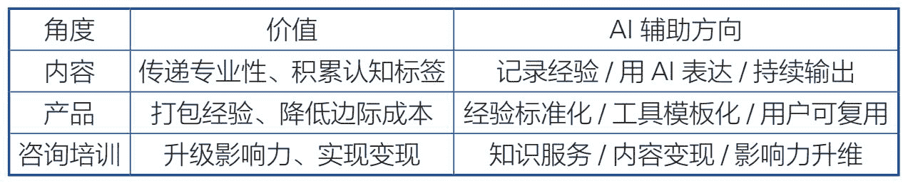

当你真正开始把“热爱”整理出来、表达出去，进行战略扩张时，它就不只是你的兴趣，而且是你可持续放大的职业资产、品牌标签、财富密码。

## **二、主力生产区——枯燥但有价值的工作，交给 AI 更高效**

“在其位，谋其政。”在现实职场中，我们大多数时间并不是花在摸鱼上，而是消耗在那些必须完成，但无趣又重复的任务上。

它们很重要，也确实有价值，但常常让人陷入“我好像很忙，其实啥也没干”的低效状态。

比如，邮件处理、文件归档、数据录入，每天都在做，但做久了，只剩下两个字——内耗。

**信息压垮人，结构拯救你**

我们以最常见也最容易忽视的两个场景为例——“看邮件/看报告”和“写邮件/写汇报”，这是职场中两类典型的“高频任务陷阱”。

邮件来回十几轮，谁说了什么已经混乱；项目报告十几页，重点藏在第 9 页，来不及翻就要做决策；重点太多、信息太杂，需要时早就不知道哪一版才是最新的；上周五发出的“资源请求”，到周一还没人回，催一句，对方说：“不好意思，没看懂你想说什么。”

根据 BBC 报道，职场人平均每天要处理 121 封邮件，光是在收、读、写、催这四个动作上，就能耗去我们一天中最清醒的两个小时。

AI，专治这一类“有用但无趣”的任务。

**这些任务可以划分为两类：**

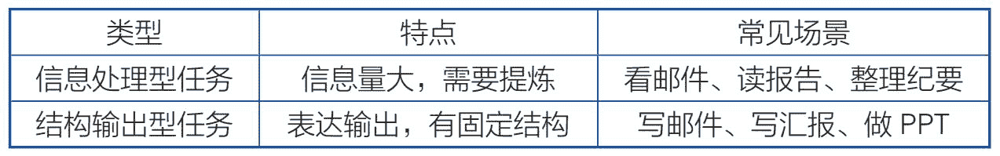

它们都具备一个共同特点：重复、可模板化、结构清晰。而这，正是 AI 最擅长的地方。

接下来，我们就来看看 AI 如何通过“提炼”“撰写”两个能力模块，在这类任务中帮你减负、增效，让你从信息泥沼中脱身，把时间和脑力留给真正需要你判断、决策、推动的关键环节。

我们将综合运用两个实战模型——SCQA 结构法：帮你搭建清晰的逻辑，讲清楚问题；金字塔原理：帮你条理分明地展开内容，精准传达重点。

这些模型，配上 AI，就像一套高效又聪明的“职场表达外挂”。你输入问题，AI 帮你理清逻辑；你丢给它一堆资料，它给你一页重点总结。让我们装上“职场表达外挂”，一起在“重复劳动中释放判断力”。

**信息处理型任务：AI 让你不再翻“山”找重点**

AI 帮你“画重点”：面对冗杂的邮件往来或项目汇报，不用自己一字一句看了，从以下几方面让 AI 帮助你：

**·自动提取：合作细节（时间、金额、分工）；**

**·总结进度：当前状态+待办事项；**

**·回顾纪要：谁说了什么，结论是什么。**

它会一键画重点，用清晰的逻辑告诉你这封邮件的核心是啥。

AI 还能帮你自动生成摘要和重点标签，便于你将重要信息智能归档：让 AI 根据文件名、正文内容、文件格式等信息输出摘要格式，比如，100 字快速扫读，300 字项目汇总，1 分钟通勤版报告摘要。

AI 替你扫清信息杂草，你则可以把时间省下来，用在判断、决策、推进真正重要的事上。

**结构输出型任务：从“措辞尴尬”到“得体有力”**

首先我们了解一下 SCQA 模型，这是一种结构化表达方法，全称为：

S（situation）-C（complication）-Q（question）-A（answer）

这是来自麦肯锡等咨询公司常用的表达框架，也叫“电梯表达法”，常用于写邮件、做 PPT、讲解汇报等适合问题导向、逻辑清晰的场景，能帮你快速把信息说清楚，说得有重点，说得让人秒懂。

也就是用最少的字数告诉别人现在发生了什么（S），出现了什么问题（C），我们要问什么（Q），最后该怎么做（A），方便对方在“电梯时间”内听懂。

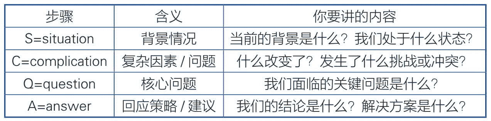

当然，如果你的具体邮件内容需要逐步展开，那我们在 SCQA 的基础上可以组合一下金字塔原理，这两种结构化表达工具不是互斥的，而是可以“层层嵌套”地使用，帮助你从开头引入到问题聚焦、结构展开，再到逻辑论证，一气呵成地讲清一件事。

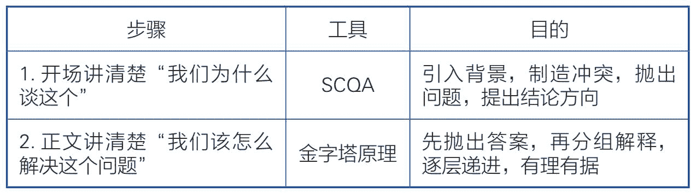

是不是感觉有些复杂？没关系，了解这些模型后，我们指挥 AI 帮我们做事情：

**对上汇报提示词模板**（适用于 ChatGPT 或 DeepSeek、Kimi 等 AI 写作工具）：

请帮我撰写一封职场邮件，内容结构采用 SCQA +金字塔原理。

收件人对象：如“部门经理”或“合作团队”

邮件目的：简要写出目的，如“申请增加人力支持”或“反馈项目延误原因”

S（situation）背景描述：如“我们正在推进×项目，目前进入第 2 阶段”

C（complication）出现问题/挑战：如“由于需求临时变更，原定进度受到影响”

Q（question）要解决的关键问题：如“是否可以调拨一名数据分析师支持本阶段任务”

A（answer）我们的建议/主张：如“建议临时从 Y 项目借调人员，为期两周”在正文部分，请用金字塔结构展开回答部分（answer）：

先给出明确结论；

然后分三点论述理由或方案内容，每一点下简要说明逻辑或可行性，语气保持正式、友好、简洁明了；

最后请补充一句得体的结尾表达，邀请对方反馈或进一步讨论。

我们来对比一下我们通常写出的“无反馈”邮件：

××总：

您好，我想跟您汇报一下关于我们 APP 改版项目的事情。如上周的汇报内容，我们的 UI 设计已经取得了一些进展，我希望召开一次会议来讨论数据对接问题，目前面临一些挑战。

我希望下周召开这个会议，届时可以讨论目前的进展、遇到的问题，以及如何调整我们的策略以确保按时完成项目。如果大家有什么特别想讨论的话题，也可以提前告诉我，我会把它们加入议程。

关于具体时间，请大家回复一下自己的可用时间。

期待大家的回复！

谢谢！

小张

尽管语气确实需要客气，但老板往往希望看到你的明确需求，我们应该将“问答题”变成“填空题”，先自己想好需求及重点，比如：

**示例提问（通用场景）：**

请帮我写一封邮件给我的主管，汇报我们项目延期的原因并提出解决方案。

收件人对象：产品总监

邮件目的：反馈项目进度问题并请求资源支持

S：目前我们正在推进 APP 改版项目，已初步完成 UI 设计；

C：但因为后端接口变更较多，数据对接严重滞后；

Q：是否可以临时借调一名前端工程师，协助接口联调；

A：建议从另一个项目组借调一人，为期两周，提升接口效率。

请用金字塔结构分三点说明：

1）现有团队资源已饱和；

2）接口联调工作预计耗时不超过两周；

3）借调人选已有备选，无须培训可直接上手。

语气希望保持：专业、客观

结尾语建议：欢迎您进一步指导，我们也会同步更新排期

**Kimi 回答：**

主题：关于 APP 改版项目进度问题及资源支持请求

尊敬的产品总监：

您好！

目前我们正在进行的 APP 改版项目，已初步完成 UI 设计工作。

然而在推进过程中，遇到了一些挑战，因后端接口变更较多，数据对接工作严重滞后，进而影响了整体项目进度，导致项目延期。

鉴于此，我们亟须额外的资源支持来攻克当前难题。经过审慎分析，我认为可以从以下三点阐述相关情况及解决方案：

1.现有团队资源已饱和：现阶段，团队成员均全力投入各自负责的模块任务，工作量已达到饱和状态，难以再抽出精力去应对因接口变更带来的额外数据对接工作，这极大制约了项目向前推进的速度。

2.接口联调工作预计耗时：基于对目前接口变更情况的详细评估，若能及时补充人力，接口联调工作预计不超过两周便可完成，届时项目将能回归正轨，按更新后的排期有序开展。

3.借调人选可行性：我们已在公司内部物色到一名合适的借调人选，该人选来自另一个项目组，具备丰富的前端开发经验，且对类似的接口联调工作十分熟悉，无须额外培训便能直接上手开展工作。

综上所述，我特向您提出申请，希望能够临时借调一名前端工程师（已有备选人员），协助我们进行接口联调工作，借调时长为期两周。相信他的加入能有效提升接口联调的效率，助力项目尽快回到预定的进度轨道上。

欢迎您对我们提出的方案给予进一步的指导，我们也会同步更新排期，及时向您汇报项目后续的进展情况。

你的姓名

具体日期

你可以直接把这个提示词丢进任意 AI 写作工具，它就能帮你生成一封结构清晰、逻辑顺畅、重点突出的职场邮件。结合职场常用场景，给大家列举几个模板，便于拿来即用。

**（对上汇报）项目延期通知提示词：**

请帮我写一封项目延期说明邮件，结构采用 SCQA +金字塔原理。

收件人对象：项目负责人

S：我们原计划在 6 月 15 日完成功能开发，目前已完成 70%。

C：但因外包接口交付延误及需求变更，影响整体进度。

Q：现在需要协调延期一周时间，并重新确认交付节点。

A：建议延期至 6 月 22 日，同时启动备选资源机制。

用金字塔结构分三点说明原因：1）接口交付延迟；2）设计改动增量；3）团队负载过高。

语气希望正式中带有解决导向，结尾请表达对后续支持的感谢。

**（横向沟通）会议总结+后续任务确认提示词：**

请帮我写一封会议总结邮件，结构采用 SCQA +金字塔原理。

收件人对象：跨部门项目组成员

S：今天下午我们就×项目召开联席会议。

C：会上讨论内容多，分工初步明确，但未细化任务清单。

Q：需要统一对“谁负责做什么+截止时间”达成共识。

A：建议形成“任务清单+负责人+截止日”三栏表，并于本周五前确认。

用金字塔结构分三点说明内容：1）本次会议要点回顾；2）关键任务分配草稿；3）下一步节点安排。

语气希望轻松，引导成员相互协作，结尾提醒大家如有补充欢迎反馈。

**（温和催办）跟进未回复邮件提示词：**

请帮我写一封温和催办邮件，结构采用 SCQA 模型。

收件人对象：合作方/同事

S：上周我曾发邮件询问×事宜，目前尚未收到回复。

C：项目节点临近，相关决策需尽快明确。

Q：是否能在本周三前确认合作方案？

A：如您有任何建议或变动，也欢迎一并反馈，我们可同步调整。

语气希望保持礼貌、积极、非施压，结尾表达感谢和期待回复。

**请假说明（带补位建议）提示词：**

请帮我写一封请假申请邮件，结构采用 SCQA +金字塔原理。

收件人对象：直属主管

S：我计划于 6 月 12 日至 14 日请假 3 天，处理家庭事务。

C：假期期间我有一场客户会议原定在 6 月 13 日下午。

Q：希望能请假，并协调该会议由同事代为出席。

A：我提前准备好会议材料，交接给小李，同时在 6 月 15 日后跟进复盘。

用金字塔结构分三点说明方案可行性：1）提前交接准备；2）同事已有项目背景；3）后续由我主导复盘。

语气希望友好得体，展现对工作的负责与安排清晰。

举一反三，灵活运用：AI 最擅长帮你做的事情就是结构化表达，你可以把 SCQA 当作“引子”，迅速点明问题与目标；再用金字塔原理作为“骨架”，系统展开你的观点与方案。

用 SCQA 一句话点题，再用金字塔原理分三点清晰展开，特别适合汇报、申请、建议类邮件。同理，做演讲/汇报时，开场 1 分钟用 SCQA 抓住听众注意力，随后 5 分钟用金字塔原理讲透你的观点；写 PPT 方案时，第一页用 SCQA 交代问题背景与主张，后续每个部分用金字塔逻辑填满干货内容。期待你和 AI 一起，写得更清晰，说得更有力，表达得更具说服力。

## **三、情绪逃避区——变“玩”为“产”，AI 转化创造力**

刷完 20 分钟短视频，脑袋里一片“哈哈哈”，但过后却默默地叹了口气：“我刚刚……干了啥？”刚刚跟同事八卦了半小时，天南地北，话题很密集，但文件还是一个字没写，PPT 还是空白的。这类任务看似轻松，带来即时满足，但很容易让注意力碎片化。

“快乐是快乐了，可为啥觉得空虚？”

我们把它称为“情绪逃避区”——你在逃避真正该干的事，用“伪生产”填补“真焦虑”。

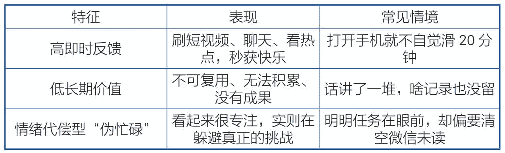

很多人发誓“戒掉”，卸载抖音很多次，觉得太后悔、太浪费时间了，但是过不了多久又默默下载回来。其实这类任务并非一无是处，我们也无须一步到位为难自己，而是进行“转化”。

当被结构化时，“玩”就可能变成“创”；当情绪被提炼时，创意就能变现。

我们不鼓励你压抑爱玩、爱刷、爱聊的冲动，而是建议你借助 AI，把这些“快乐瞬间”转化为“内容资产”，进入一个真正属于数字创作者的高效循环。

AI 如何帮你把“玩”转“产”？实操策略如下：

**聊天记录→内容灵感草稿**

职场八卦也可能藏着洞察。你可以把和朋友讨论的热点话题、日常吐槽丢给 Kimi，让它提炼出可发布的观点金句，手机点击“按住说话”，把你听到的有趣内容直接让 AI 听：

**提示词示例：**

请根据以下对话，提炼 3 条适合在小红书分享的“职场沟通避坑法则”。

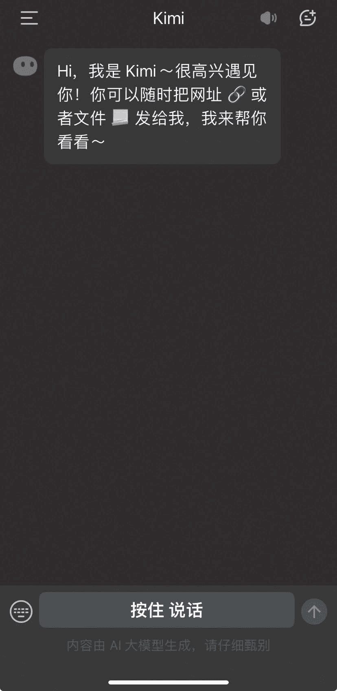

**刷到的好内容→结构化收藏/复述**

别再只是点赞和收藏！用 AI 帮你提炼重点，延展表达：

**提示词示例：**

请参考以下链接，帮我写成一段适合发在公众号上的思维笔记，要求结构清晰，有金句。

**情绪吐槽→写作素材/自我洞察**

你对工作、老板、客户的吐槽，其实是你的职场观察力的体现。丢给 AI，它能帮你变成：

**·一个爆款微博文案；**

**·一段心理咨询式的自我复盘；**

**·一份主题为“办公室迷惑行为大赏”的创意提案草稿。**

清醒的数字时代职场人，不是永远自律如钢铁，而是懂得：

“既然忍不住要刷，那就顺手刷出点价值。”

把娱乐行为转化为素材库，把情绪表达变成创意素材库，你就能从“情绪逃避者”，变身为一个“结构化表达的轻创作者”。

# **Part3 打工人“懒人公式”：AI 协作力**

**AI 基础三会：会写、会听、会看**

在 AI 时代，最先“抄捷径”的，不是那些会代码的程序员，也不是掌握算法的科学家，而是我们这些打工人。

别惊讶，AI 真正的价值，不是让你变得更努力，而是让你更省力。

每天早九晚六的时间表里，有多少小时你是在“真正工作”？更多的时候，你其实都在重复劳动——写周报、查资料、调格式，搬来搬去、改来改去，像一只被 Excel 和 PPT 支配的仓鼠。

而这些，恰恰是 AI 最擅长“帮你干”的部分。

所以，在 AI 加持下的打工人，有一个“懒人公式”：

AI 能力×场景匹配=省力×加分

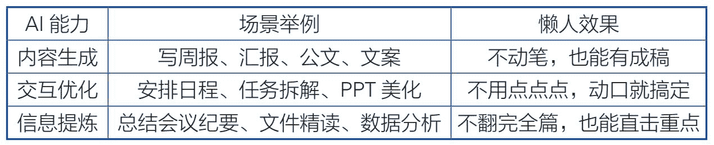

用得好，AI 是你的合法外挂；用不好，别人悄悄提速，你却在原地加班。

不论你是打工人、创业者、项目经理，还是自由职业者，工作归根到底，绕不开一个关键词：表达。

你写不出，就说服不了；你讲不清，就协作不了；你看不懂，就决策不了。

过去，表达能力靠的是天赋和努力；现在，AI 正在让这些能力批量化、标准化、平民化。

换句话说，你只需要一个好提示词，就能拥有一整个“表达工作室”。

AI 协作的三大基础技能包，它们就像你的“感官延伸”，帮你在职场里搞定 70%的事务性任务：

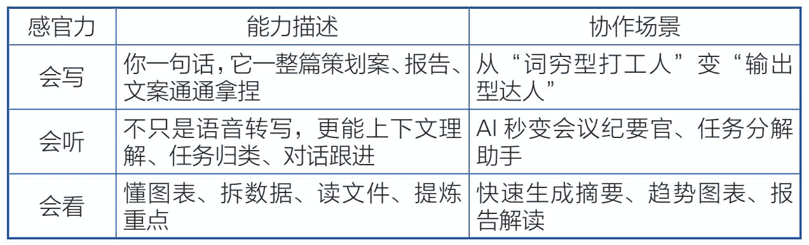

从“一个人熬夜做三份工”，到“一个 AI 包揽三种角色”：

你不再需要自己扮演文案、助理、分析师，一个 AI 全搞定。

这一章，我们不是教你怎么“更努力”，而是教你怎么更聪明地用 AI，激活最核心的协作力：

会写，是“表达权利”的开始；

会听，是“协作能力”的跃迁；

会看，是“信息提炼”的飞跃。

你的 AI 感官三能，一旦启动，就不只是提高效率，更是悄悄重塑你的价值边界。

## **一、会写：内容生成能力（文本、脚本等）**

在职场里，最容易让人精神内耗的任务之一，就是写东西。

写周报，脑子一片空白；写汇报，总感觉语气别扭；写方案，不知道从哪儿开始；写宣传文案，又怕不够吸睛。每一项写作任务，似乎都在榨干你为数不多的创造力。

而 AI 的出现，可以改写这一切。我们常说“AI 会写”，但它到底是怎么做到的？为什么在办公场景里，它这么好用？

一句话总结：

AI 的写作能力，本质是对人类集体知识的压缩与再现——它读过千万篇资料，而你只需要一句清晰的需求表达。

这背后依托的，是大语言模型（LLM）技术。像 ChatGPT、DeepSeek、通义千问、Gemini，这些“写作代表队”并不是在机械地复制答案，而是通过对语言逻辑的深度学习，精准识别你的表达意图。

它们之所以在办公场景中尤为重要，是因为它们不是在“复制答案”，而是在理解你的任务、识别你的需求后，像一个随身秘书+内容总监+逻辑助理一样，帮你生成“能直接拿去用”的内容。

某种意义上，AI 生成内容是我们办公场景的“最佳搭档”——不仅文笔好，还懂策略、有逻辑、效率惊人，而且永远不会喊累。

### **AI 写作的底层逻辑，适配职场的三个关键点**

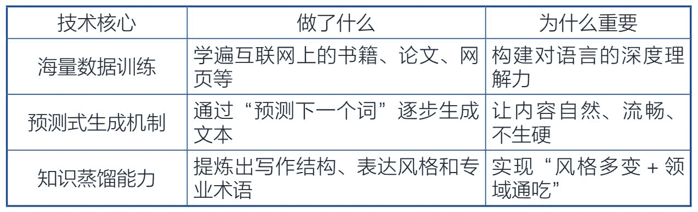

简而言之，它不只是“会写一句”，而是能持续写，写得像人，写得有逻辑。你提需求，它负责从起标题到补金句，从列大纲到润色收尾，全流程一条龙。

首先，AI 具备强大的语言理解与表达能力。这就像一个 24 小时在线的写作教练、速成写手、格式大师合体。它不仅听得懂你在说什么，更能准确识别背后的任务意图，比如“写一份年终总结”和“写一则广告文案”，语气、逻辑、篇幅截然不同，AI 都能应对。此外，它还能根据你的表达风格，自动调整语境，从正式到轻松、从学术到通俗，风格切换毫不生硬。更重要的是，它能处理长文本的逻辑结构，确保段落之间有始有终、层层递进，写得不仅快，还有章法。

其次，AI 还具备高度的场景化创作能力。你不需要从零开始构思，它能自动帮你起标题，列大纲，写过渡段，连最后一句总结都替你想好。它还能学习你的过往表达习惯，模仿你的语气与措辞，甚至能在不同行业之间自由切换，从一页 PPT 文案到厚厚的法律文本，从行业报告到社媒爆款，横跨多个领域，轻松应对不同场景的内容创作挑战。

### **职场写作任务+AI 匹配矩阵**

**写作任务常用场景**

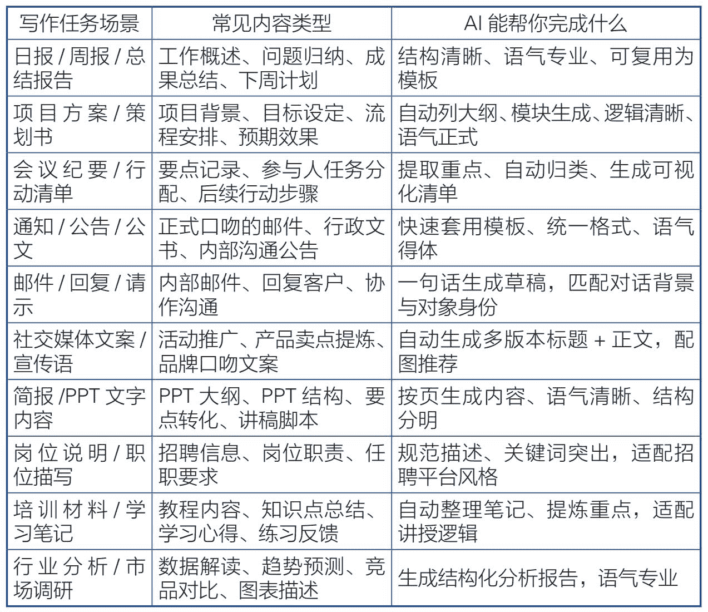

**主流 AI 写作工具对比表（职场写作场景）**

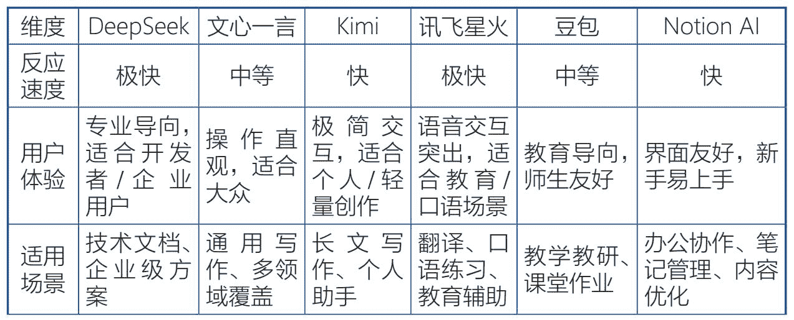

续表

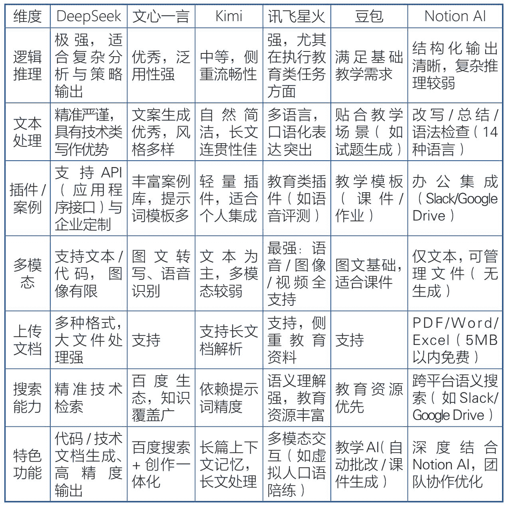

在 AI 写作这件事上，很多人最常问的问题是：“哪个工具最好用？”

但真正应该问的是：“哪个工具最适合我？”

因为，工具从来都不是决定成败的关键，关键是你能不能清楚表达你的需求，并让 AI 理解你要的是什么。

无论你用的是 ChatGPT、DeepSeek、Notion AI、Kimi 还是豆包，它们都不具备“读心术”。你不说清楚，AI 就很难帮你写清楚。

所以，选适合你的工具即可：

**·偏办公文案、项目协作场景可以考虑 Notion AI、DeepSeek；**

**·偏个人写作/日常记录可以考虑 Kimi、文心一言；**

**·偏语音+教育应用场景可以考虑讯飞星火、豆包；**

**·习惯百度生态/中文写作可以考虑文心一言。**

这就像选鞋子，跑得快不快，不取决于品牌，而取决于“合不合脚”。举个例子：

你只要告诉 DeepSeek：“请帮我写一份关于 AI 办公技能培训的策划案，语气正式，结构清晰。”几秒钟后，一份完整文案就会出现在你面前。

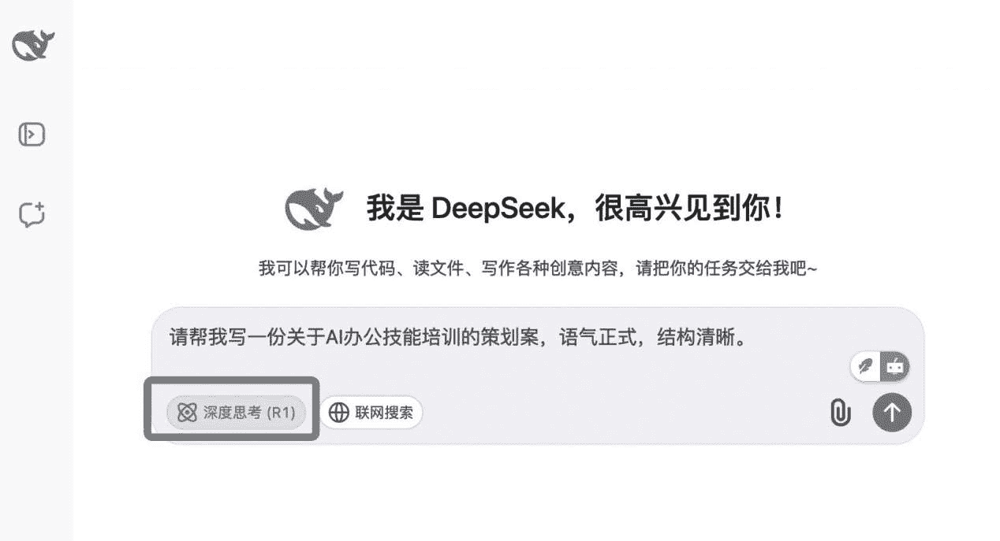

Notion AI 也可以直接在你的笔记中续写、扩展、总结，让写作像搭积木一样轻松，并且可以团队协作，满足办公场景的需求。

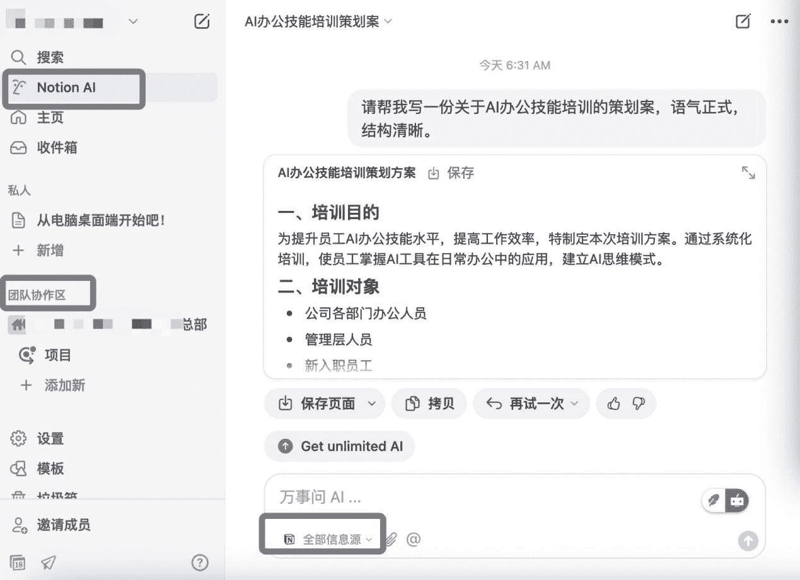

而写得好不好，也不在于工具多强，而在于你能不能“把话说明白”——这就是你需要掌握的写作“技能链”，而不是仅仅堆工具。与其担心不会写，不如训练自己“发指令”的技巧和能力。

掌握 AI 写作五步法，把办公场景的写作变成一套可以标准化、复用、持续优化的生产流程。你写得越多，效率越高，AI 写得就越像你。

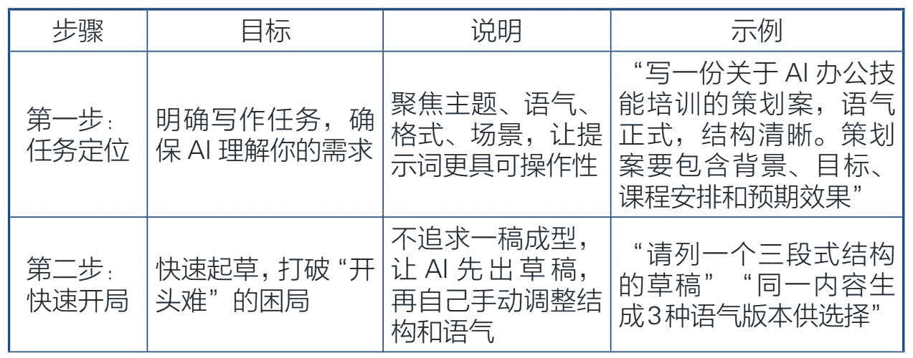

续表

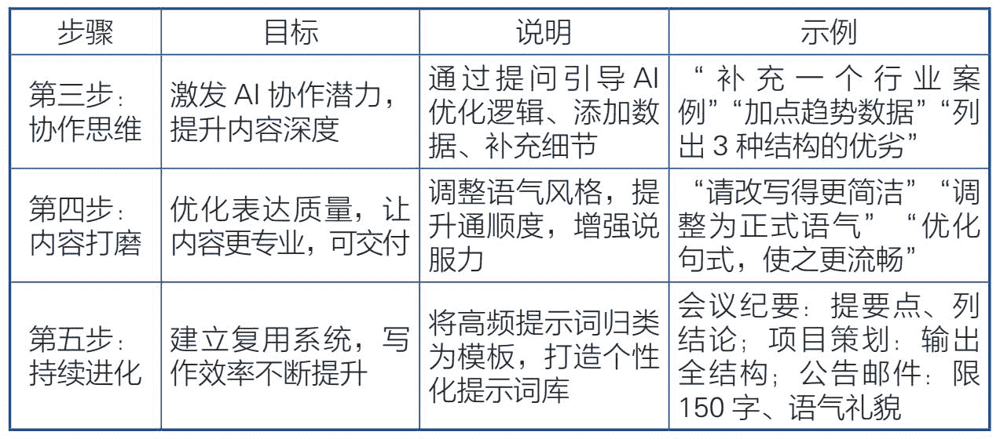

过去，写一封邮件、做一份方案、改一篇文案，可能要你一个上午。

现在，只要一个提示，AI 就能把结构、语气、表达方式一次性配齐。

曾经你需要文案、秘书、设计师三个角色，现在一个 AI 就搞定。

在 AI 的加持下，写作不再是一个人的“脑力输出战”，而是你和“超级外脑”的双人协作舞。

## **二、会听：对话交互能力（智能理解与交流）**

如果说“会写”解决了你的输出焦虑，那么“会听”解决的，是职场中最让人头疼的那类记录问题：

一小时的会议，转头脑袋里只剩一片空白；

任务讲了三遍，对方依旧“眼神迷离”；

边说边记，结果一场会议搞出五个版本的记录，理解各走各的路……

这些“信息脱轨”的场景，几乎每个打工人都经历过。

在中国 AI+通信协同类办公软件中，“语音转文字”功能已经成为高频刚需，背后真正的推动力，是效率与协作。

这时候，AI 的“听”早已不是传统意义上的“能录能转”，而是一步步进化成了“听得懂、接得住、记得牢”。

它就像一个全天候不喊累、不会抱怨，还永不缺席的沟通搭子，专治那些费时间、易误解的表达任务。比如：

·会议记录：它能自动识别发言，提炼要点，生成纪要。会议一结束，清晰有条理的内容清单已经躺在你的飞书/邮箱/文档里。

·任务交办：你只管说，AI 帮你列清单、定时间、分配人，谁负责、何时交，一目了然。

·内容起草：你一句“写个会议通知”，AI 立刻生成结构清晰、语气合宜的初稿，分分钟发得出去。

·多轮对话：上下文不断线，逻辑丝滑不掉线，你提一问，它能接三句。

·跨语种协作：实时语音翻译，中英双语同步，语言不再是国际项目的拦路虎。

换句话说，它不仅“听你说”，而且能真正“听懂你要干吗”。

这正是 AI“会听”的底层魅力——让人从“记不清、说不明、沟通累”的循环中解放出来，把注意力真正放在思考与共创上。

为什么它越来越像一个聪明得让人上瘾的助理？因为它背后并不是一个“录音笔+打字机”的简单拼接，而是有一套强大的语言交互系统在支撑，由四大核心技术模块协同驱动：

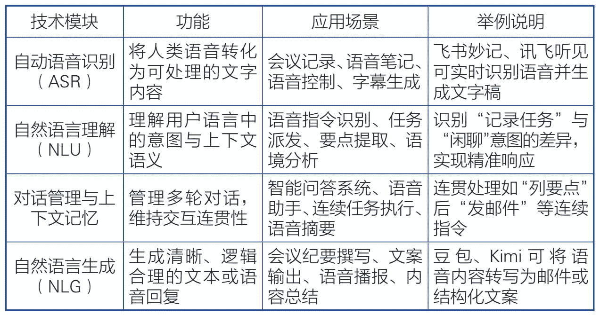

这就是 AI 从“听得到”进化到“说得出”的全过程：你说话—转成文字—理解语义—保持上下文连贯—生成内容—自动输出/执行。正是因为拥有了这套完整闭环的语言能力，AI 才不再只是一个“好玩的语音玩具”，而真正成为你办公桌上的得力语音助手。那么有哪些常用工具呢？

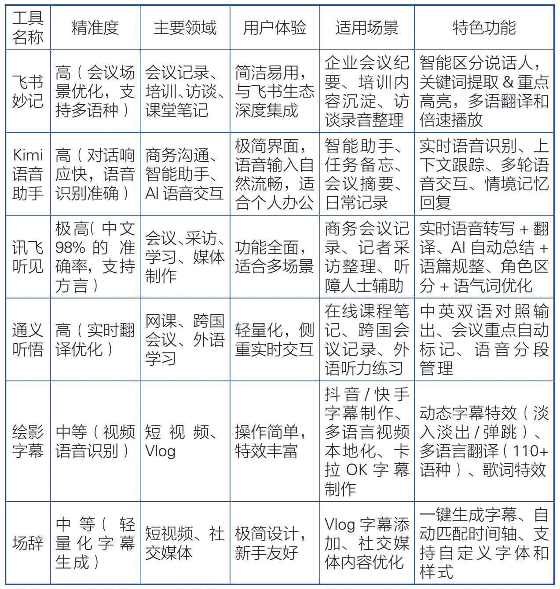

比如，飞书妙记，就是职场人手一份的会议记录神器：

·实时语音转录：中英文自由切换，发言人自动区分，告别“人声大杂烩”；

·纪要自动生成：会议一结束，自动提炼重点，连懒人都能做出高效总结；

·多人协作编辑：你写开头我补结尾，文档云端同步，彻底摆脱版本混乱的“邮件大战”。

使用也非常简单：

·下载并登录飞书 APP；

·从“工作台”进入“飞书妙记”；

·开始录音或上传录音文件；

·等 AI 自动生成清晰完整的会议纪要。

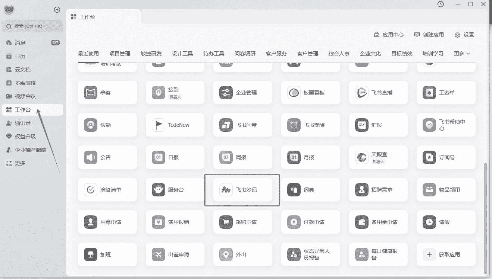

如果你想要的不只是会议记录，那你还可以选择通义听悟——一个“万用型听写神器”，专为 10 分钟以上音、视频内容而生：

·语音转写：自动识别多位发言者，语句清晰、内容连贯；

·智能摘要：一键提炼关键词、核心观点，结构化待办事项；

·章节速览：像翻书一样快速跳转，精准定位每一个讨论主题；

·多语种支持：中英实时翻译，跨语种协作无障碍。

只需要三步——“上传音频或视频—等几分钟—获取全文稿+智能摘要+重点导航”，就能实现“只听重点，不费耳力”。如果你是播客重度用户，它甚至能帮你快速找回那个让你心动的片段。

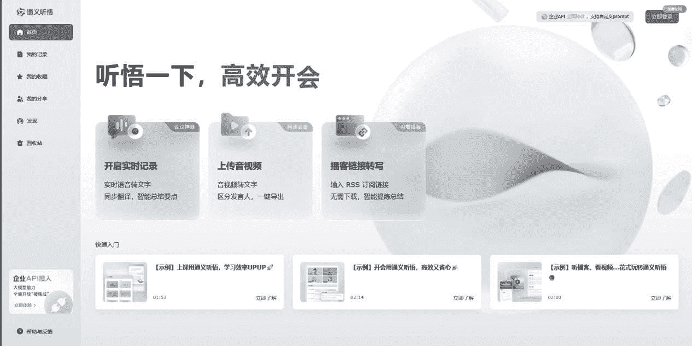

在办公环境中，从“说”开始的工作远不止会议记录。以下六大核心场景，正在被飞书妙记、讯飞听见、Kimi 语音助手等 AI 语音工具全面覆盖，加速提效，解决核心痛点：

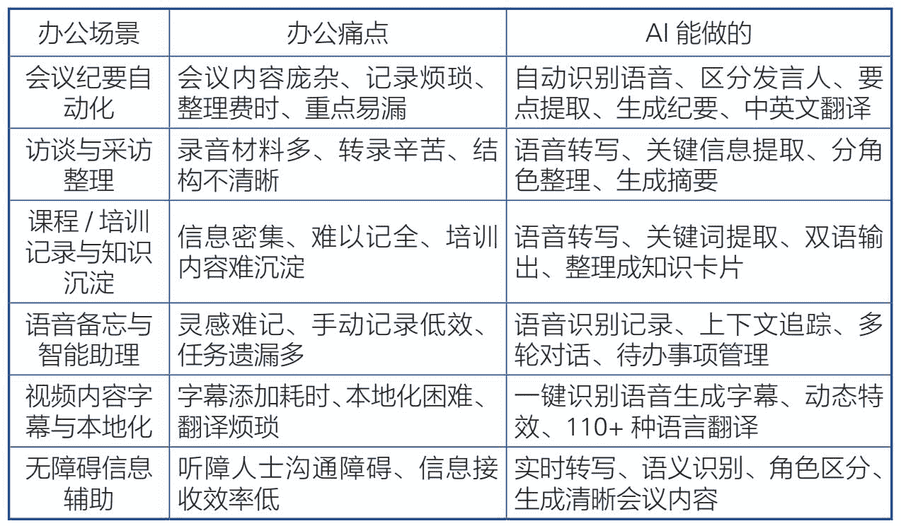

这些 AI 语音工具的价值，不在于“能不能说”，而在于“听得懂，说得清，记得准”，从现在开始，办公动口不动手，让 AI 工具成为新型打工人的沟通生产力。

## **三、会看：多模态处理能力（图像、视频、文档的识别与理解）**

在信息爆炸的今天，我们面对的不只是文字，事实上，职场中 80%的信息都是非结构化内容：截图、报告、PPT、直播、讲座、海报、扫描件……过去这些内容“看得见却处理不了”，要么靠人力手动整理，要么干脆放弃深度挖掘。而如今 AI 不只是“帮你看”，它是“替你理解”，更能“看图做事”。

会看，不只是“识别图像”，AI 已经具备对多模态信息的识别、理解与生成能力，尤其在图像、视频、文档等非结构化数据处理中表现突出，可以帮你提炼出有价值的信息。

·看图：识别图像中的物体、文字、布局；

·看文档：理解文件、扫描件、表格、报告中的内容逻辑；

·看视频：抓取画面关键信息，分析场景，生成总结。

看完还能自动总结、翻译、可视化或重新生成内容。举个例子：

我们上传一份 24 页的 PDF 格式的行业报告给 Kimi，可以一边跟它对话，一边浏览报告：

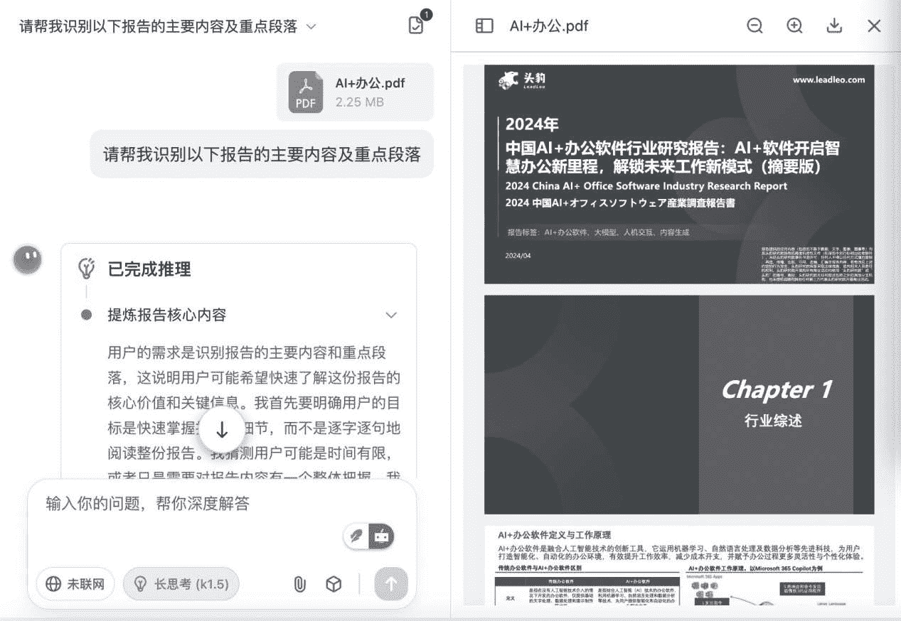

## **提问：**

请帮我识别报告的主要内容与重点段落。

**Kimi 回答：**

这份报告是关于 2024 年中国 AI+办公软件行业的研究，涵盖了行业综述、市场预测、企业分析等多方面内容，以下是主要段落及重点内容概述：

行业综述

AI+办公软件定义与优势：与传统办公软件相比，AI+办公软件融合了机器学习、自然语言处理等 AI 技术，具备智能化、自动化功能，可提升工作效率、降低成本，并提供个性化体验与实时反馈。例如，Microsoft 365 Copilot 通过结合大型语言模型、Microsoft Graph 内容及 Microsoft 365 应用，为用户提供更多价值。

发展历程：从 20 世纪 70 年代至今，办公软件经历了基础办公自动化阶段和智能办公阶段，未来将更加智能化和个性化，AR、VR 等新技术也将带来新的交互方式。

中国 AI+办公软件分类与占比：2024 年中国 AI+办公软件分为五大类别，其中 AI+文字处理类软件渗透率最高，达 38%。各类软件在功能和应用场景上各有特点，如 AI+文字处理类软件具备智能编辑、语法检查等功能，AI+数据处理类软件可加速数据清洗、分析和建模等。

市场预测

市场规模增长：AI+办公软件市场规模快速增长，预计 2025 年将继续保持高速增长。

供给端驱动因素：AI 技术驱动与产品功能迭代升级是 AI 办公软件市场增长的两大动力。AI 技术提升了内容生成、人机交互和大模型技术，办公产品的智能化升级则聚焦于智能化协作平台、自动化工作流程和数据分析系统。

需求端驱动因素：线上办公人数增多和任务复杂度上升，暴露出传统软件的局限，促使用户转向 AI+办公软件。2020 至 2023 年，中国线上办公人数渗透率不断提升，直接拉动了对 AI+办公软件的需求。

政策端支持：中国政府出台相关政策鼓励 AI 创新融合办公软件，如上海打造“智慧好办”服务品牌，国家网信办构建生成式 AI 设施及数据平台，等等，为行业发展提供支持。

企业分析

金山办公 WPS AI：具有中文环境优化、办公场景深度整合、云协同等竞争优势，但也面临国际市场竞争和个性化内容生成的挑战。未来将在人工智能生成内容、阅读理解和问答、人机交互等方向发展，进一步融入表格、演示文稿等重应用 AI 能力。

印象笔记印象 AI：集成于成熟平台，具备多功能性，与笔记功能深度融合，但需解决数据安全问题和隐私担忧，以增强用户信任。

阿里钉钉：AI 功能与办公场景深度集成，拥有企业级服务生态和高度定制化能力，庞大的用户基数为其提供了数据优势。不过，存在依赖性和兼容性问题，部分 AI 功能成熟度有待提高。

这份报告为我们提供了 2024 年中国 AI+办公软件行业的详细洞察，包括行业的发展现状、市场趋势以及主要企业的竞争态势等，有助于我们全面了解该行业的整体情况和发展前景。

**继续提问：**

我要做一个关于本报告的汇报，请帮我提炼要点生成 PPT 提纲。

以下是根据报告内容提炼的 PPT 提纲：

幻灯片 1：封面

标题：2024 年中国 AI+办公软件行业研究报告

副标题：AI+软件开启智慧办公新里程，解锁未来工作新模式

来源：头豹研究院

日期：2024/04

幻灯片 2：报告摘要

简述报告核心内容：

AI+办公软件定义、优势及发展历程

中国 AI+办公软件市场分类、规模及增长预测

主要企业分析及行业发展趋势

强调 AI 技术对办公软件行业的变革性影响

幻灯片 3：行业综述

传统办公软件与 AI+办公软件区别：

智能功能、自动化程度、分析预测、个性化体验、实时反馈等。

AI+办公软件发展历程：

基础办公自动化阶段（20 世纪 70—80 年代、20 世纪 90 年代、21 世纪第一个十年）。

智能办公阶段（21 世纪第二个十年、21 世纪 20 年代及未来）。

中国 AI+办公软件分类与占比：

AI+文字处理（38%）、数据处理（21%）、演示协作（13%）、项目管理（5%）、通讯协作（23%）。

幻灯片 4：AI+办公软件市场分析

市场规模：

从 2019 年 6.86 亿元增至 2023 年 131.03 亿元，复合增长率 109.06%。

预计 2028 年市场规模将破 1911 亿元，2024—2028 年进入黄金增长期。

驱动因素：

供给端：AI 技术驱动（内容生成、人机交互、大模型技术）、产品功能迭代升级。

需求端：线上办公人数增长、任务复杂度提升、传统软件局限性。

政策端：中国政府出台政策鼓励 AI 创新融合办公软件。

幻灯片 5：企业分析——金山办公 WPS AI

竞争优势：

中文环境优化、办公场景深度整合、云协同、多轮对话、多样化功能集、易用性。

竞争劣势：

国际竞争力、个性化与创意限制。

未来发展方向：

AIGC、阅读理解和问答、人机交互，进一步融入表格、演示文稿等。

幻灯片 6：企业分析——印象笔记印象 AI

竞争优势：

集成于成熟平台、多功能性、与笔记功能深度融合、个性化场景应用。

竞争劣势：

数据安全与隐私保护问题。

幻灯片 7：企业分析——阿里钉钉

竞争优势：

办公场景深度集成、企业级服务生态、高度定制化、大规模用户基础。

竞争劣势：

依赖性和兼容性问题、功能成熟度与准确性问题。

幻灯片 8：行业发展趋势

个性化定制和智能推荐：

AIGC 和 AI 人机交互能力的配合；

深度学习模型学习用户工作模式和偏好。

跨平台智能化整合：

AI 与办公软件的融合实现跨平台智能化整合。

中国厂商如阿里钉钉、金山 WPS、腾讯企业微信主导市场。

幻灯片 9：总结与展望

总结：

AI+办公软件市场增长迅速，技术与需求双轮驱动。

企业竞争激烈，各具优势与挑战。

展望：

未来 AI+办公软件将更加智能化、个性化，推动办公方式的深刻变革。

跨平台整合与数据安全成为发展关键。

幻灯片 10：结束页

感谢语：感谢观看与聆听

联系方式（可选）：提供头豹研究院的联系方式或公司网址。

此提纲涵盖了报告的关键内容和重点，适用于汇报 PPT 的制作。每一页都围绕一个核心主题展开，确保内容简洁明了，逻辑清晰。

“会看”让 AI 成为你处理视觉和文档信息的第二双眼，也是非结构化内容的“翻译器”和“总结器”。它不仅懂你看到的，也懂你为什么看，想看什么，接下来该做什么。

**AI 不会替你努力，但能放大你努力的价值**

我们必须接受一个现实：AI 的进化速度，远比你滑手机的手速还快。你刚学会一个快捷键，它已经能全流程自动化；你还在手动对齐 PPT 图表，它早就能凭一句话指令生成动画、讲稿、配图，全套齐活。

在这个“什么都能被生成”的时代，光靠努力是不够的。真正拉开差距的，不是你会不会加班，而是你会不会用 AI 帮自己创造价值。

“会写、会听、会看”的能力，不再是精英的专属，任何一个打工人，只要愿意，就能让它成为自己技能包里的“外挂插件”。

别抱怨 AI 跑太快，成为那个能踩着 AI 提速的人，跑得更稳，笑得更久。

# **Part4 AI+思考力：从信息过载到精准提问**

你的问题问不清楚，AI 怎么帮你答得有逻辑？

我们都经历过那种“被问住”的瞬间。

项目开会中，老板看着你：“这个案子卡住了，你觉得核心问题在哪儿？”你边嘴上“嗯嗯”，边点头，大脑却在疯狂搜索——翻会议纪要、回忆客户反馈、调取用户数据……可越想越糊涂，越忙越乱。心里只剩下四个字：

我不知道！

明明每天都忙得像陀螺，可一到需要“想清楚”的时候，却卡壳了。因为我们在一个信息爆炸，却认知稀缺的时代。

你不缺资料——甚至太多了。AI 能给你整理出整篇报告、输出分析、自动生成 PPT……可问题是：你根本还没想清楚你的“问题”是什么。

你对 AI 说：“分析一下这个行业。”它洋洋洒洒写出 2000 字“术语”。你追问：“现在是不是适合进入这个赛道？”AI 就开始语焉不详，模棱两可。它说得没错，只是没用。因为你问得模糊，AI 只能答得漂亮——却答不到点子上。

真正有思考力的打工人，不是拿 AI 当答案超市，而是当“问题思维训练师”。思考力的核心，不在“知道多少”，而在于能不能“问到点子上”。

就像你看到一堆资料，点个收藏；看完 AI 的建议，贴进 PPT；看见“看起来不错”的话术，抄进邮件……看似效率拉满，实则全是“知识泡沫”。你以为自己在“提升”，其实只是在复制 AI 的幻觉。

我们真正缺的，不是内容，而是把内容变成你自己的逻辑判断、观点主张和行动建议的能力。

所以我们要学会让 AI 帮我们深度思考：

√能提出好问题（问题界定）

比如你不问“行业趋势”，而是问“在当下政策环境下，中腰部品牌切入这个细分赛道的窗口期和风险点分别是什么？”。

√能搜到对的信息（信息检索）

不是“海投式搜索”，而是精准提问、清晰补充背景，让 AI“懂你是谁、要干啥”。

√能用信息形成判断（信息处理）

不照抄、不全信、不迷信人工智能，而是能说出：“我选择这条路径，是基于哪些假设，规避了哪些风险。”

这一章，我们就来拆解 AI 如何帮你从信息焦虑到认知清晰：

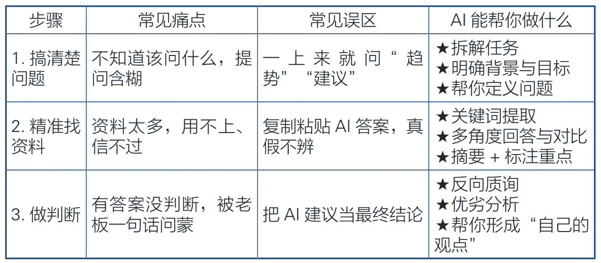

AI 不只是打工工具，它还是你的思维放大器。

在这个人人都有“智能外挂”的时代，思考力，才能助你真正成长。

## **一、AI 辅助精准提问：AI+人的起点**

很多人一上来就说：“我想了解一下这个行业。”AI 立刻端上 800 字行业百科，看似信息密集，实则毫无重点——你既不知道该信哪句，也不知道该怎么用。为什么会这样？

是你没有问出一个“有用的问题”，你根本没想清楚自己要解决什么问题、做什么决策、希望 AI 扮演什么角色。

你说“往前开”，AI 就会“漫无目的地开”；你说“我需要一份基于第 4 季度销量数据的趋势分析，用于制定市场策略”，AI 才知道去哪儿，怎么走，路上该避开什么坑。

“信息有了，结论没有”的根本原因，也是传统提问方式的三个误区：

问题模糊：你问“行业趋势”，它回你百科全书；

背景缺失：AI 不知道你是谁、要干什么，只能猜你的需求；

目标不清：你没有输出意图，AI 只能提供“通用答案”。

想清楚你到底在问什么，是给 AI 赋能的第一步。比“找资料”更重要的，是定义任务和拆解路径。

就像职场高手在思考一个行业是否值得进入时，不会一上来就问“值不值得做”，而是像剥洋葱一样：最近三年增长率是多少？头部玩家是谁，市场份额如何？用户痛点有没有解决？有无政策扶持，技术门槛高不高？我们还有哪些机会？

不是问得多，而是问得顺，问得深，问得准。

这就是链式思考（chain-of-thought）的精髓，也是 AI 最擅长配合的模式。

**为什么 AI 要“链式思考”？**

AI 的底层机制是基于词元（token）逐步预测的语言模型。通俗点说，它不是“一下子知道答案”，而是像你在打字时想下一句话那样，一步步推理。

这也正是“链式思考”大放异彩的原因——它原本是自然语言处理中的一种高级推理机制，现在成了 AI 能否“像人类一样拆解问题”的关键技能。

它并不是简单地“问一句答一句”，而是像一个优秀分析师那样，从问题本质出发，逐层拆解，一环扣一环，步步逼近答案。一个好问题，不是“大而全”的堆砌，而是逻辑上能“接得上，顺得下”的引导。

AI 不怕你问题难，怕你问题乱。它最擅长的，从来不是“一锤定音”，而是“循序渐进”。

比如你要做一份主题为“新能源车市场趋势分析”的 PPT。

之后你在百度海量的搜索结果中翻找，随手贴了一条标题为《2021 年新能源车销量翻倍》的旧新闻，结果 PPT 被老板一句话打回——“数据过时、逻辑不清、重点不明”。

链式提问：

1.请列出 2023 年第四季度新能源车销量前五的品牌及同比增长率，数据来源为中国汽车工业协会或官方报告。

2.销量增长的驱动因素有哪些，是消费升级、政策导向，还是技术红利？

3.结合××品牌现状，提出两条针对性市场建议。

只用十分钟，完成了别人两小时“搜+拼+猜”的工作量，关键是结构清晰、有数据、有逻辑，能直接拿去汇报。

在 AI 时代，你的提问方式，决定了你是 AI 的搬运工，还是它的指挥官。提问力，就是你的结构化思维力、问题意识和行动意图的体现。

AI 听不懂模糊指令，它只懂清晰的任务，所以我们可以从以下这个模式开始训练：

模糊提问—明确意图—可执行任务

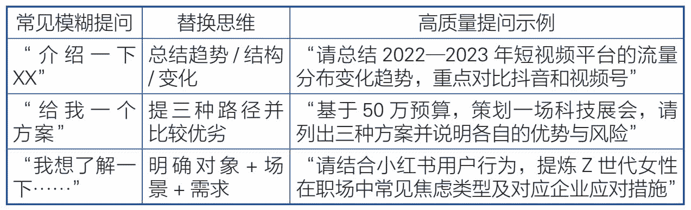

别说“介绍一下”，要问“总结什么”“对比什么”“推荐什么”。这才是 AI 时代的提问密码。

**五问法：让问题变得清晰可操作**

如果你还不确定该怎么精确表达问题，用这套“五问模型”自查一遍：

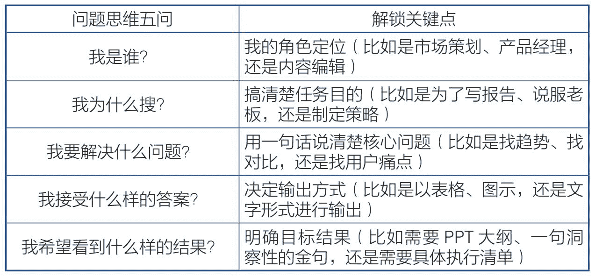

你问得越清楚，AI 答得越聪明。

对比案例：

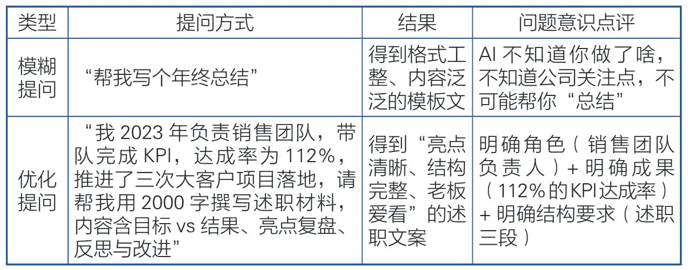

AI 不是你肚子里的蛔虫，它不怕你问题难，怕的是你问题模糊。

“先想清楚”，是 AI 搜索走出第一步的通行证。

你提问的方式，就暴露了你的认知水平。而链式思考的起点，正是一个清楚的目标问题。

## **二、AI 辅助信息检索：打造你的 AI 雷达**

不缺资料，缺的是“找对”的能力！

还记得以前我们怎么搜索吗？关键词堆砌，打开十几个网页，一边切换标签页，一边手动对比，复制、粘贴，猜测、抓狂……

时代变了，AI 不是“更快的百度”，它彻底重写了搜索方式：

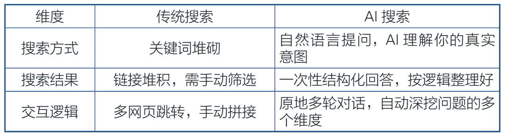

Gartner（高德纳咨询公司）预测到 2026 年，传统搜索量将下降 25%，AI 对话式搜索将成为主流。微软 Copilot，谷歌 Gemini，国内的 Kimi、豆包、360 智脑……全世界巨头都在搞同一件事：让搜索像聊天一样自然，让答案像专家的解答一样专业。

在 AI 全面办公的今天，IQ（智商）决定你能不能做事；EQ（情商）决定你合不合群；SQ（搜商）决定你能不能找到对的资源，不只是你熟不熟 Ctrl+F（搜索快捷键）、会不会用百度百科。它是一种认知方式+提问能力+筛选判断力的综合体现。

这不再是“搜信息”，而是“提对问题换来答案”。

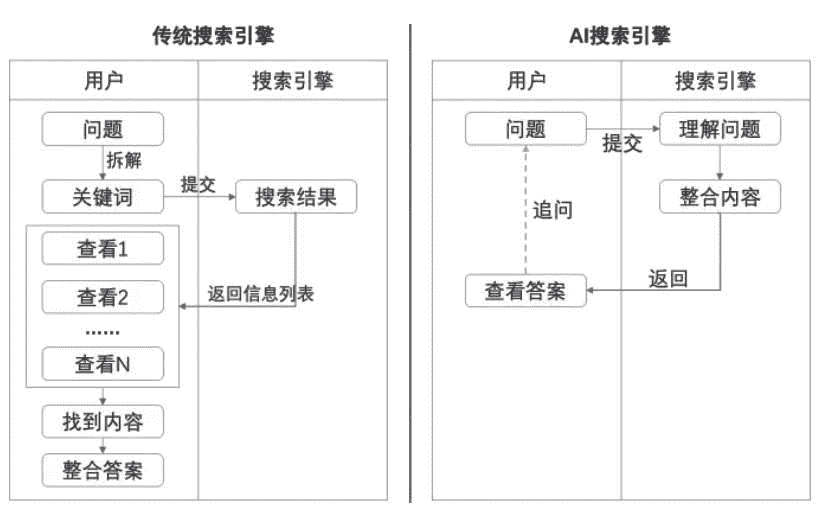

（图片引用自《看 AI 搜索终局，呈现三大新特征》）

**AI 链式搜索：别再靠“蒙”了！**

下面是一套基于链式思维的 AI 高效搜索 SOP，你话说不明白，AI 听不懂；你搜错地方，它找不到。我们逐步让你从“乱搜派”进化为“搜索高手”。

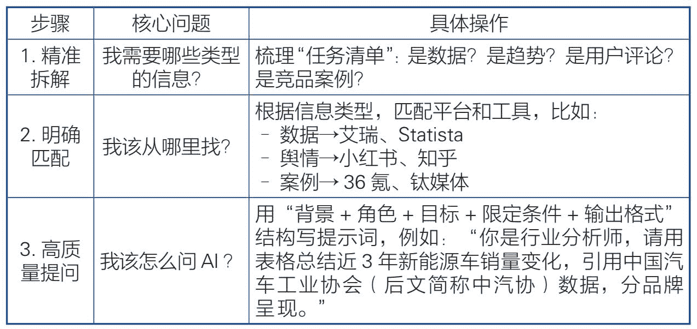

### **（一）你需要什么信息？精准拆解任务清单**

在 AI 世界里，信息就像在烹饪时要使用的食材。你要做咖喱饭，总不能一股脑往锅里扔白菜、苹果、酱油吧？

所以，在问 AI 之前，先写好一张“信息任务清单”。

你需要让 AI 知道：你是要数据，还是要观点；要案例，还是要评论。不同信息类型，用法完全不同：

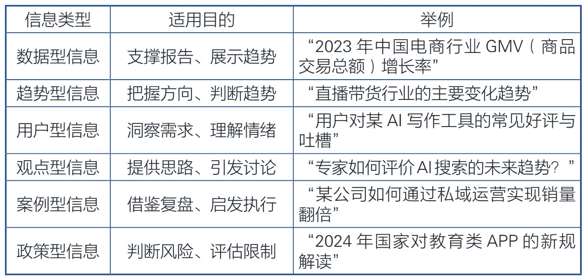

你要的不是“内容”，而是“合适的内容”。

**任务清单怎么列？直接拿来用！**

假设你的任务是分析竞品 A 的市场策略，你就可以这样写信息需求清单：

·定价策略：是否采用会员制/发放优惠券/进行满减促销/限时举办促销活动？

·渠道布局：在哪些线上平台上架？是否有线下门店？新兴渠道有布局吗？

·品牌定位文案：核心卖点是什么？使用哪些关键词？宣传语言调性是什么？

·用户评价热点：高频好评关键词 3 个、常见差评关键词 3 个。

·增长方式：是否通过联名、达人合作、渠道投放获得销量增长？

这张清单就是你给 AI 的“做题要求”，让它写一篇命题作文。

**常见任务信息类型对照表**

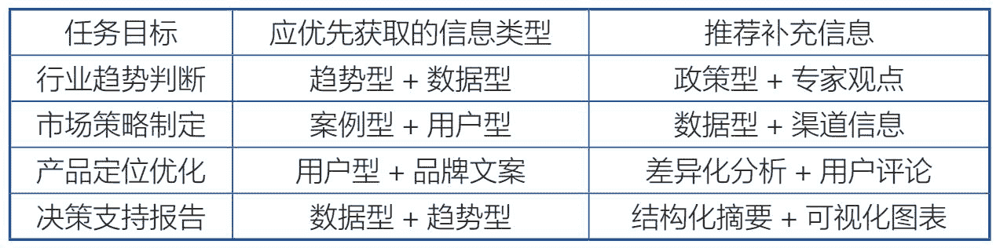

AI 不是内容管道，而是信息工厂；你不提供“原材料”，它就只能瞎掰。

搜商高手不是只说“给我来点资料”，而是提前列好清单，分类输入，让 AI 像厨师一样精准下刀、按需下菜。

**通用提示词模板-精准信息需求**

我是【角色】，我正在处理一项任务，目标是【目标任务】。

请围绕这个任务，逐步回答以下子问题（可以按顺序一步步来）：

【子问题 1】：请提供【信息类型】的信息，要求有数据来源或权威出处；【子问题 2】：请结合【时间/地域/对象】进一步细化；

【子问题 3】：请用结构化形式总结，比如清单、表格或要点归纳；

【子问题 4】：请说明【主要影响因素/原因分析/用户痛点】；

【子问题 5】：请结合这些信息，给出【可行建议/观点总结】。

输出要求：

引用可靠来源，如【推荐来源：中汽协、艾瑞、QuestMobile（北京贵士信息科技有限公司）、知乎高赞等】；

输出格式：【清单/表格/结构化小结】；

总字数控制在【×××】以内，适合用于【PPT/报告/汇报】使用。

**使用示例 1：**

**“行业分析类”提示词：**

我是一名行业分析师，我正在准备一份关于中国新能源车行业的趋势分析报告，目标是提炼 2023 年的关键变化，为公司决策提供依据。请围绕这个任务，逐步回答以下问题：

1.请提供 2023 年中国新能源车市场的销量数据与增长率，引用官方或权威行业报告；

2.请列出该行业的 5 个主要品牌及市场份额对比；

3.请用结构化清单呈现这 5 个品牌的核心优势；

4.请分析销量增长背后的主要驱动因素；

5.请结合这些信息，提出两条我司在该领域的可行入场建议。

输出要求：

1.来源优先中汽协、艾瑞咨询、汽车之家；

2.输出为结构化清单，适合整理成 PPT；

3.字数控制在 600 字以内。

### **（二）我该从哪里找？找对信息**

你已经知道自己要什么了——数据，或者用户评论。下一步，就是明确这些信息，去哪儿找最靠谱。

别再一股脑丢给 AI，也别什么都在百度搜。不同类型的信息，有不同的“信息产地”。

就像买菜，菜市场有菜，海鲜市场有鱼。你非要去五金店找螃蟹，不尴尬吗？

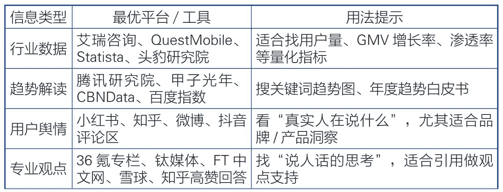

续表

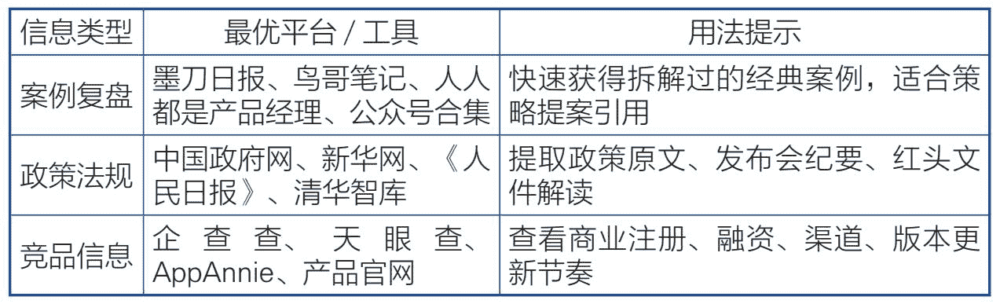

搜索最怕“啥都想要，结果啥也没找到”，你没选对平台，信息就像掉进了垃圾堆——你在里面乱翻，AI 也只能胡抓。

所以记住这一条公式：

信息价值=信息来源×处理方式

与其在 AI 里喊“帮我查一下”，不如直接告诉它：

“请参考 2023 年后发布的权威数据报告，优先中文语境。”

“来源建议包括中汽协、艾瑞咨询、钛媒体、知乎高赞用户等。”

你越具体，AI 越精确；你越模糊，AI 越跑偏。

如果你还是不知道该去哪儿找，该搜什么平台，有一个简单高效的万能法则——先找“人”，再找“内容”。

很多高质量的信息，不在搜索引擎第一页，而在懂行的那个人的脑子里。

你找不到关键资料，可能只是因为你还没找到“那个一直在输出的人”。

搜索高手常用这样一套“人脉式搜索流程”：

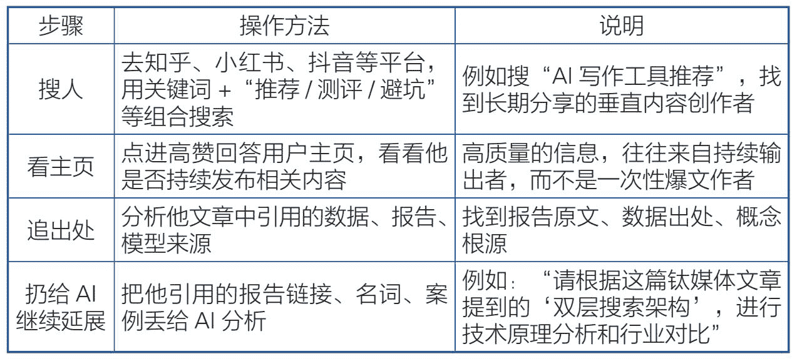

你不是在搜信息，而是在跟随一个懂行的“大脑导航”。

从“找内容”转向“找人+找源+找线索”，你就从一个“信息搬运工”，进阶成一个信息整合师。

信息的价值不在于多，而在于它来自谁、用在哪儿、怎么用。AI 很擅长“整合信息”，但真正创造差异的，是你有没有找到值得参考的人类视角。

### **（三）该怎么刨根问底？定制高质量提示词**

目标清晰≠能实现目标。

你可能已经把方向想得很明白：要一份行业趋势报告、一段品牌故事，或者一套可落地的市场方案。

但当你把这些目标一股脑丢给 AI 时，得到的内容看似丰富，实则东拼西凑、空洞模糊、不着边际。

这不是 AI“智商不够”，而是你“指令超载”了。

正如管理学家明茨伯格（Henry Mintzberg）所说：“一个真正有效的策略，必须建立在对影响目标达成的关键因素的深入分析之上。”

AI 的工作原理，更像一条“任务流水线”，如果你把“背景+目标+限制+格式”全部糅进一个提示词，AI 会瞬间迷失方向：

·token 长度超限：信息被自动截断，后半段直接“丢包”；

·任务逻辑过长：内容结构混乱、逻辑跳跃；

·输出长度超标：模型记忆力“疲劳”，前说后忘；

·无法定位问题：你想优化，却不知道是哪一段“翻车”。

结果就是：任务越复杂，失败概率越高。

这时你需要基于链式思维换一种提问方式，将复杂任务逐步拆解，一步步执行。

一个任务=多个提示词+明确顺序+串联逻辑

每个提示词专注于解决一个小问题，然后把结果传给下一个环节，层层推进，逐步生成。

**为什么提示词更靠谱？**

优势一，控制 token 长度：每个提示词足够精简，不会“信息过载”。

优势二，降低出错成本：哪一步错了，就改哪一步，不用推倒重来。

优势三，支持人机协同：中间步骤可手动修正、补充、筛选。

优势四，实现成本优化：小任务用 GPT-3.5，大任务用 GPT-4 或 Claude100K，节约成本。

优势五，多模型协同能力：文案用 Kimi，图片生成用 Midjourney，流程调度交给 Agent（智能体）管理。

比如，生成一篇完整品牌故事文案的提示词：

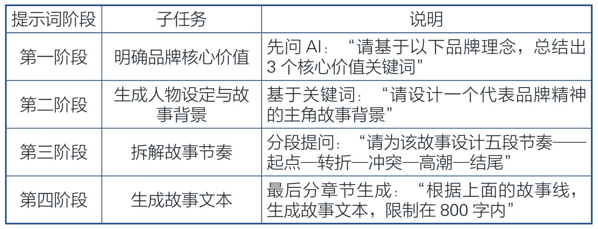

好处是什么？每一段都是独立的提示词，每一段都可“回头调”，整个链条稳定、高效、可控。

那么通常如何拆分提示词结构呢？

通常我们用“五段式结构”把提示词拆成五个模块：

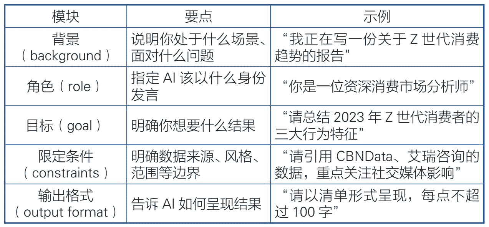

这套结构不光能让 AI 听懂你说什么，更能在多轮协作中保持稳定、精准、高效。

好的提示词是一套“结构化任务剧本”。

你要像项目经理一样拆解任务，像导演一样设计剧本分镜，像协作平台一样管理 AI 的每一步工作流。

而“五段式结构+提示词”，正是 AI 时代刨根问底、步步拆解、环环相扣的核心提问方式，掌握核心逻辑后，如果还是经常“答非所问”，别怕，我们有外援：打开 Kimi，找到“提示词专家”，让 AI 帮你撰写有效提示词。

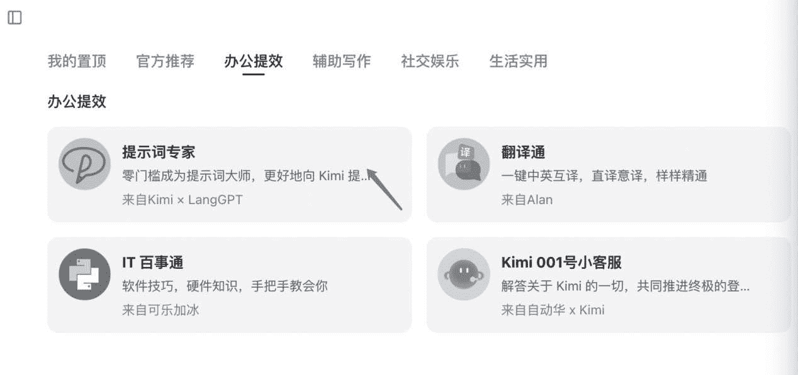

## **三、AI 辅助信息处理：从找信息到用信息**

AI 已经给出答案，不代表你的大脑可以下班。相反，这才是“人类智慧”开始登场的时间。

很多人在拿到 AI 的答案后，脑中浮现的第一反应往往是：“好像写得还行，那我就直接用了吧。”“这个建议不错，领导有很大概率能采纳。”“哇，这 AI 也太牛了，完全不用我操心了。”

但我们讲过 AI 有“幻觉”——它不是真正懂，它只是在预测你想要听什么。

如果拿到 AI 生成的答案后，直接贴进 PPT、放进报告，甚至引用在学术论文里，看起来效率很高，实际上是在“拿 AI 的口水话包装你的不确定感”。

要警惕：AI 在给你“画饼”，你却误以为那是“配方”。它能给你 70 分的初稿，却给不了你 90 分的判断。你有没有本事，把它的产出变成你的“认知成果”？

AI 只是信息的“起点”，在 AI 给出答案之后，你要做的不是直接复制，而是判断+比对+重构，这样才能将 AI 的产出变成你自己的“认知产出”：

**·这条信息可靠吗？**

**·它的推理站得住吗？**

**·对我眼下的场景，有没有真正的参考价值？**

### **（一）如何判断 AI 信息“靠不靠谱”？**

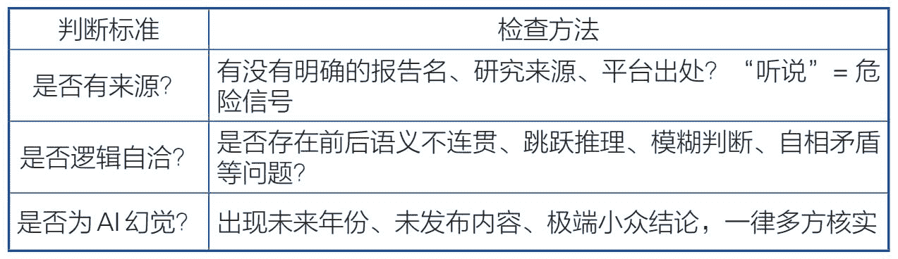

### **（二）如何确保 AI 推理站得住脚？**

**1.养成“AI+人工验证”的基本习惯**

AI 说的，不等于真理。AI 是起点，你是裁判。不要直接接受 AI 的回答，要学会交叉验证。

**多渠道验证：**

·查二手还要查一手：AI 引用的内容，看起来“像是”，但未必“真有”。

·查平台还要查出处：判断数据是否来自官方渠道、权威机构或专业平台（如学术期刊、政府官网、行业报告等）。

**多模型交叉对比：**

·同样的问题，不妨交给 ChatGPT、Kimi、DeepSeek 轮番答一遍；

·多模型对比，让你识别出“共识区”和“差异点”，避免被单一 AI 误导。

**2.训练 AI“质疑”AI，让 AI 成为你的批判型思维陪练**

学会让 AI 反驳自己，要把它当成一个可以辩论的搭档！

高质量提问公式：

·这个回答有哪些漏洞或未考虑到的例外？

·请从反对立场再分析一下这个观点。

·有哪些数据或案例能支持/驳斥这个说法？

·在哪些场景下，这个结论可能不成立？

让 AI 帮你找 bug（错误，故障，缺陷），才是真正高阶的认知训练。

**3.别做“答案搬运工”，要做“认知架构师”**

别让 AI 替你下结论，要把它纳入你的思维流程图中。

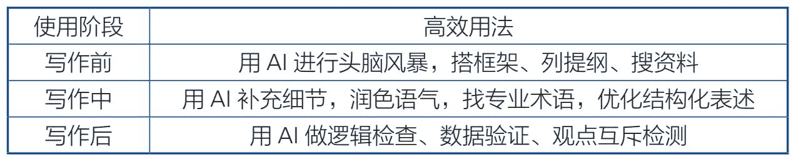

你可以设定一条底线：

哪些任务可以完全交给 AI？（如数据分类、内容摘要）

哪些关键点必须亲自操盘？（如立场判断、逻辑架构、观点表达）

“借 AI，成就一个更好的你”，而不是“让 AI 替代那个真实的你”。

再强大的 AI，也只能告诉你：“这是一个可能的答案。”只有你，才能决定“这是不是你要的结论”。

**如何让 AI 说得“有用”？**

“说得好听≠用得靠谱”，AI 的输出不是看它写得多华丽，而是看它能不能“落地跑得动”。

那具体怎么判断 AI 说的能不能为你所用？

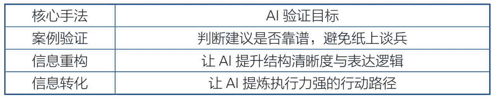

### **情境一：AI 生成了内容，怎么判断它“有没有用”？**

判断内容有没有用，最直接的办法是——案例验证法。

提示词示例：

“请为这段建议补充一个真实可考的行业案例，并说明该方案成功或失败的关键变量是什么。”

比如，你让 AI 帮你设计一个员工激励模型，它写得就像人力资源教材：KPI 加权公式，积分商城系统，OKR 目标共建机制……

看上去完美无缺，但你要反问一句：

“有没有企业真的这么搞过？效果呢？员工满意度真的提高了吗？人效指标有没有实际改善？”

只有当 AI 能给出“真实企业+实施情况+成败变量”三件套，你才能判断这个建议能不能从白板走到战场。

### **情境二：让 AI 帮你整理信息，给出行动建议**

已有“散装”的信息，内容杂乱、结构模糊、逻辑不清……怎么办？

这时候，就需要让 AI 来“理”——理结构、理逻辑、理重点，从而完成信息重构和信息转化。

我们用一个典型应用场景来举例——会议纪要的整理。

会议纪要是典型的“乱麻”：全是“流水账”，看不到“重点”，不知道“谁该干啥”。结合我们前面讲到的 AI“会听”能力，飞书妙记等工具可以帮我们把“话”变成“字”，那我们如何进一步处理成“有用的信息”呢？

让没参加会议的人看了也能知道发生了什么，谁要干啥，怎么干，何时干完。

**步骤 1：信息重构——把“散装内容”重新打包成结构化输出**

提示词示例：

“请将以下会议内容整理成一份清晰的会议纪要，结构包括：1）会议主题；2）与会人员；3）讨论事项（分条）；4）待办事项（负责人+截止时间）。”

AI 首先可以帮你完成的，是从“混乱”到“秒看懂”的信息归纳。

**步骤 2：信息转化——把纪要变成“能动起来的任务清单”**

你整理完内容后，下一步不是“发到群里就完了”，而是要提炼出每一条明确、可执行的行动建议。

提示词示例：

“请根据以下会议内容，总结每个议题的关键结论，并转化为具体的行动清单，包含负责人、时间节点和预期成果。”

这一步，才能真正让你从“记录者”升级为“推动者”。

信息不是越多越好，信息要“能被吸收、能被使用、能被执行”。因此，别让 AI 的答案停留在“看起来不错”。

要让 AI 的答案：

·能跑得动（能验证）；

·能落得下（能执行）；

·能讲得出（能形成逻辑闭环）。

# **Part5 AI+数据力：用数据说话**

在今天的职场，有一个新铁律正在悄悄形成——“用数据说话”：

你说项目重要，别人要的是指标支撑；

你说产品好用，别人要的是留存转化；

你说你做得很多，别人看的是行动影响。

你不是不努力，而是你还在用“拍脑门”对抗一个已经“默认量化”的世界。

没有数据，你说什么都不算数；而只会报数字，你说了也没人信。

让我们来看看，为什么数据已经成为每个职场人不得不翻越的山丘。

**没有数据思维——你说的不是结论，而是废话**

你辛苦熬夜做了一份“周运营报告”，列了一堆数字：曝光人数、点击次数、用户增长、停留时长、下单率……应有尽有。

领导看了一眼，说：“那结论呢？”

你答不上来。因为你自己也不知道“数字在说什么”。

**数据思维不是堆数字，而是让数据变成判断的依据**

小张是某公司市场部的资深运营，每周都做数据汇报，但每次讲完都被老板问：“所以你到底建议怎么做？”而小王是新来的同事，只做了 5 页 PPT，前两页就是结论：“渠道 B 的成本虽然低，但投产率是最低的，下周建议减少预算，改投渠道 A，并优化广告素材方向。”

老板直接拍板：听她的。她不是数据高手，但她会用数据“说服”别人，这才是核心竞争力。

**列了很多数据，没有洞察——你在报表里打转，老板在等你“带路”**

在很多公司，有一种最典型的“分析幻觉”：以为数据汇总等于数据分析。

你把整个后台报表搬下来，做成几十张图，配上一堆平均值、同比、环比。你以为越全越专业，老板却觉得越看越晕。

因为你没有给出任何有洞察的观点。

数据分析的本质，是帮助别人看见原本看不见的东西。

举个例子：

老板问：“客户转化率怎么这么低？”

你说：“是点击率太低。”

他问：“为什么点击率低？”

你答：“因为曝光少。”

他再问：“那为什么曝光少？”

你憋了半天：“因为最近……投放变少了？”

老板：“这我难道不知道？”

你以为你在分析，其实你只是“复读问题”。

**没有“干净数据”，你连看清问题的资格都没有**

如果说职场有一种最常见的无力感，那一定是：你做了很多工作，但数据根本不可信。

老板说：“我想看一下最近 90 天的用户流失趋势。”

你立刻开始找数据，却发现：顾客关系管理（CRM）有两个版本，字段对不上；用户 ID 缺失，一半数据无效；客户标签有错，把学生归类成了企业客户；核心字段根本没埋点，无法追踪路径……

数据不干净，分析只是纸上谈兵。

**苦于学习数据处理工具——工具门槛高，落地却遥远**

Excel 函数学了 20 个，一做透视表就卡；

结构化查询语言（SQL）入门课上完了，面对几十张表你傻了眼；Power BI（一款用于数据分析和可视化的工具）教学视频看了，真做起来却发现“连字段都不通”……

学工具像在爬一座看不到顶的山，而且最惨的是：你以为学完能掌握数据处理和分析的能力，结果只是多了一个“点鼠标”的资格。

比如，小李是人事部 HRBP（人力资源业务合作伙伴），为了提升能力报了数据分析线上课，熬夜学完了 SQL、Tableau（商业智能分析软件）、Python，还写了两篇小作业。

结果回到工作中，领导说：“你这个‘离职率图表’能不能告诉我，为什么我们北京分部走的人多？”

她发现学了一堆工具，却没学会最重要的——业务思维+问题建模。

**你不是不会分析，而是没有 AI 做你的“数据搭子”**

很多人说：“我又不是数据分析师，我也不想学 Python 和 SQL。”

没关系。

现在的 AI，不需要你写代码，不用你调参数，也不用你看懂算法。你只要会一句话：

“帮我分析一下客户流失率的趋势，并找出影响最大的三个维度。”

它就能给你生成：

√一张折线图

√三个关键因子（比如注册来源、活跃频率、是否使用过优惠券）

√一段建议（比如“提升优惠券发放覆盖率可能降低客户流失率”）

你说话，它分析，甚至能帮你生成报告，最后还都给你润色好了。

**AI 具体能帮我们解决哪些烦恼**

**1.洞察和发现隐藏的趋势（人类分析师常常忽视的地方）**

以前，你要查过去半年用户数据，找增长异常点，靠眼睛，靠图表，靠感觉。

现在，AI 可以在几秒内扫描数十万个数据点，告诉你：“用户增长高峰集中在每月 12—15 号，原因可能是你们那几天发了促销短信。”

还能补一句：“建议下次短信发得再早一点，ROI 能提高 14.7%。”

**2.自动化数据处理，帮你解决 80%的脏活累活**

你还在对着表格改字段名、填空值、删异常吗？

现在 AI 数据平台（比如 Polymer、TableauGPT）直接一键处理——自动识别日期格式，合并重复数据，预警缺失字段，生成干净数据集。

再也不用因为格式不对，被 SQL 报错逼到哭。

**3.预测结果、制定策略，AI 帮你“规范性分析”**

过去，你讲的是“过去做了什么”；

现在，AI 直接告诉你“未来可能会发生什么”。

比如，哪个客户最有可能流失？哪个产品可能成为下月爆品？投放到哪个渠道的转化率最高？

AI 说的不只是“发生了什么”，而是“你该怎么做”。

比如给你策略模拟+最佳行动建议：如果你在 A 渠道多花 20%预算，客户生命周期延长 1.5 个月，毛利率提高 4.3%。

如何利用 AI 解决烦恼？接下来我们详细介绍！

## **一、搞清楚你在分析啥（别一上来就开 Excel）**

做数据分析最怕什么？不是不会写函数，不会建模，而是一上来就开表、做图，结果发现根本没人关心你分析了啥。

你以为你在“分析数据”，其实在老板眼里你在“浪费时间”。

所以，第一步必须是锁定分析目标。分析目标定不准，做什么都白搭。

在开始任何分析之前，必须先回答以下问题：

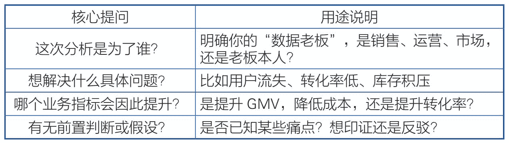

别小看这几句话，它们决定了你接下来做的每一张图、每一张表格，值不值得。

**AI 辅助确定数据分析目标的标准操作流程**

**1.用 AI 识别你的角色和场景**

提示词 1：

我是【你的职位】，目前正在为【具体业务场景/项目】做数据分析，请列出我可能关注的核心业务目标与关键指标。

**提示词示例：**

我是电商平台的运营，想分析春节期间的用户复购情况，请帮我列出我应关注的核心业务目标与对应的关键指标。

**Kimi 输出示例：**

以下是分析春节期间用户复购情况时应关注的核心业务目标与对应的关键指标：

核心业务目标

1.提升用户复购率：增加春节期间再次购买的用户数量占比，提高用户的忠诚度和对平台的依赖度。

2.促进销售额增长：通过提高复购用户的购买频次和金额，推动春节期间整体销售额的提升，实现业务的短期业绩增长。

3.增强用户黏性：建立良好的用户关系，培养用户的购物习惯，使用户在节后更有可能继续选择该平台，为长期稳定的业务发展奠定基础。

4.优化用户体验：发现影响用户复购的因素，针对性地改进商品、服务和运营等方面的问题，提高用户对平台的满意度。

5.评估营销活动效果：检验春节期间各种营销活动对用户复购的促进作用，以便总结经验教训，优化未来的营销策略。

对应的关键指标

1.复购率：春节期间用户复购情况的核心指标，计算公式为复购率=复购人数/总购买人数×100%。例如，若春节期间有 1000 人购买过商品，其中 200 人再次购买，则复购率为 20%。

2.复购周期：指用户两次购买行为之间的时间间隔，了解春节期间用户的复购周期，可以帮助商家更好地把握促销时机和制定会员召回策略。

3.复购金额比：指复购用户产生的销售额占总销售额的比例，能够体现复购用户对整体销售额的贡献程度。

4.客单价：每个用户平均每次购买所花费的金额，若客单价在春节期间持续上升，表明用户的购买能力和忠诚度在提升，即使不增加顾客数量，也能增加利润。

5.购买频次：指用户在春节期间购买商品的平均次数，购买频次越高，说明用户对平台的依赖度和复购意愿越强。

6.品类复购率：不同品类的商品复购率可能差异较大，分析品类复购率可以了解哪些商品用户更容易复购，为商品采购、库存管理和营销推广提供依据。

7.用户留存率：包括春节期间的次日留存率、3 日留存率、7 日留存率和 30 日留存率等，反映用户在不同时间段内对平台的持续关注和使用程度，间接影响用户的复购行为。

8.促复购活动的参与度和转化率：如满减活动、拼团活动、秒杀活动等，评估用户对这些活动的参与情况和最终转化为复购的比例，以判断活动效果的好坏。

9.老用户销售额占比：指春节期间由老用户带来的销售额占总销售额的比例，体现老用户的复购价值和对业务的贡献。

10.用户评价和反馈：包括好评率、差评率、差评原因、用户投诉率等，及时了解用户对商品和服务的满意度，发现并解决影响复购的问题。

**2.请 AI 匹配可行的分析方法与图表形式**

提示词 2：

针对上述业务目标，请推荐 3 种常见的分析方法，并说明适合使用的图表类型与所需的数据字段。

**Kimi 输出示例：**

以下是 3 种常见的分析春节期间用户复购情况的方法：

RFM 模型分析

*原理：RFM 模型是一种常用的基础用户分层方法，通过计算用户的最近一次消费时间间隔（recency，简写为 R 值）、消费频率（frequency，简写为 F 值）、消费金额（monetary，简写为 M 值）将用户群体进行分层，以实现精准运营。可帮助电商平台了解不同用户群体在春节期间的复购特征，针对不同层级的用户制定个性化的营销策略，从而提高复购率。

*适合使用的图表类型：散点图。可以以 R、F、M 值分别为坐标轴，绘制三维散点图，更直观地展示不同用户的分布情况和所属层级；也可以分别将 R、F、M 两两组合绘制二维散点图，观察各指标之间的相关性。

*所需的数据字段：用户 ID、购买日期、购买频次、购买金额。

时间序列分析

*原理：分析不同时间段的复购率，找出影响复购率的季节性因素或其他周期性因素，了解春节期间复购率的变化趋势和规律，以及促销活动等对复购率的影响。

*适合使用的图表类型：折线图。横轴为时间，纵轴为复购率或复购用户数等指标，清晰地展示复购情况随时间变化的趋势。

*所需的数据字段：时间（具体到日期或时段）、购买次数、用户 ID。

漏斗分析

*原理：将用户在春节期间的购物流程分解为多个步骤，如浏览商品、加入购物车、下单、支付等，通过分析每个步骤的转化率，找出用户流失的关键环节，从而优化购物流程，提高复购率。

*适合使用的图表类型：漏斗图。直观地展示各步骤之间的转化关系和用户流失情况。

*所需的数据字段：用户行为数据（如浏览、加入购物车、下单、支付等操作的记录）、用户 ID。

**3.请 AI 协助你反推数据结构**

提示词 3：

针对以上分析方法，请列出我在 Excel（或数据库）中应准备的数据字段、字段格式与数据清洗建议。

**Kimi 输出示例：**

以下是针对以上分析方法在 Excel 中应准备的数据字段、字段格式与数据清洗建议：

数据字段及格式

*用户基本信息字段

*用户 ID：文本格式，用于标识每个用户，便于在分析过程中对用户进行分组和统计。

*用户注册日期：日期格式（YYYY-MM-DD），了解用户的注册时间，分析新老用户在春节期间的复购差异。

*订单相关字段

*订单 ID：文本格式，用于标识每个订单，便于数据的关联和查询。

*下单日期和时间：日期时间格式（YYYY-MM-DD HH:MM:SS），精确记录用户每次下单的具体时间，用于计算复购周期和进行时间序列分析。

*商品 ID：文本格式，标识用户购买的具体商品，便于分析不同商品的复购情况。

*商品名称：文本格式，便于直观了解商品信息，与商品 ID 对应。

*商品类别：文本格式，对商品进行分类，如电子产品、服装、食品等，有助于分析不同品类商品的复购率。

*购买数量：数值格式，记录用户每次购买商品的数量，可用于计算客单价和分析购买频次。

*支付金额：货币格式，精确到小数点后两位，记录用户每次购买实际支付的金额，是计算复购金额比的关键数据。

*行为相关字段

*浏览商品记录：文本格式，记录用户浏览过的商品信息，如浏览的商品 ID 及浏览时间，用于分析用户的行为路径和兴趣点。

*加入购物车记录：文本格式，记录用户加入购物车的商品 ID 及加入时间，了解用户的购买意向和购物车转化情况。

*收藏商品记录：文本格式，记录用户收藏的商品 ID 及收藏时间，反映用户的潜在购买需求。

数据清洗建议

*处理缺失值

*首先检查数据中是否存在缺失值，对于关键字段如用户 ID、订单 ID、下单日期等，如果缺失值较少，可以考虑删除对应的记录；如果缺失值较多，则需要分析其原因，尝试通过数据补全的方法进行填充，如根据其他相关字段推断或使用平均值、中位数等进行填充。

*去除重复值

*检查是否存在重复的订单记录或用户行为记录，可以通过对订单 ID 或用户 ID 等关键字段进行去重操作，确保数据的唯一性和准确性。

*统一数据格式

*确保日期和时间字段的格式一致，统一转换为 Excel 可识别的日期时间格式，方便后续的时间序列分析和计算复购周期等操作。

*对于商品名称、商品类别等文本字段，检查并统一其命名方式，避免因大小写、空格或拼写错误等因素导致数据不一致，影响分析结果的准确性。

*数据验证与清理

*检查订单金额、购买数量等数值字段是否合理，是否存在异常值，如负数或极大极小值，对于不合理的数据进行核实和修正。

*核实用户行为记录的逻辑是否连贯，如浏览、加入购物车、收藏等行为的时间顺序是否合理，剔除明显不符合逻辑的记录，以提高数据的质量和可靠性。

**4.让 AI 帮你生成最终的数据分析目标陈述**

提示词 4：

请总结上述步骤，帮助我写出一个完整的数据分析目标陈述，包括业务背景、目标、核心指标和可行方法。

**Kimi 输出示例：**

数据分析目标陈述

一、业务背景

春节作为中国最重要的传统节日，消费者在春节期间的购物行为具有特殊性和集中性。电商平台在春节期间面临着激烈的市场竞争和用户流量高峰。此时用户复购行为能反映用户对平台的忠诚度和商品的吸引力，对于平台的长期发展和短期业绩至关重要。

二、目标

通过分析春节期间的用户复购情况，深入了解影响用户复购的关键因素，制定精准的营销策略，提高用户复购率，增加销售额，增强用户黏性，提升平台在春节这一关键时期的市场竞争力。

三、核心指标

1.复购率：复购人数与总购买人数的比率，反映用户再次购买的意愿和频率。

2.复购周期：用户两次购买行为之间的时间间隔，帮助了解用户的购买习惯。

3.复购金额比：复购用户产生的销售额占总销售额的比例，体现复购用户的消费贡献。

4.客单价：衡量每个用户平均每次购买所花费的金额，反映用户的消费能力和购买力。

5.购买频次：用户在春节期间购买商品的平均次数，体现用户的购买活跃度。

6.品类复购率：不同商品品类的复购率，帮助了解哪些品类的商品用户更容易复购。

7.用户留存率：包括春节期间的次日留存率、3 日留存率、7 日留存率和 30 日留存率，反映用户对平台的持续关注和使用程度。

8.促复购活动的参与度和转化率：评估用户对促销活动的参与情况和最终转化为复购的比例。

9.老用户销售额占比：老用户带来的销售额占总销售额的比例，体现老用户的复购价值。

四、可行方法

1.RFM 模型分析

*数据准备：用户 ID、购买日期、购买频次、购买金额。

*图表选择：散点图，以 R、F、M 值分别为坐标轴，绘制三维散点图，展示不同用户的分布情况和所属层级；也可分别将 R、F、M 值两两组合绘制二维散点图，观察各指标之间的相关性。

*分析流程：计算每个用户的 R、F、M 值，根据设定的阈值将用户分为不同的群体，如核心客户、潜力客户、流失客户等，针对不同群体制定个性化的营销策略。

2.时间序列分析

*数据准备：时间（具体到日期或时段）、购买次数、用户 ID。

*图表选择：折线图，横轴为时间，纵轴为复购率或复购用户数等指标，展示复购情况随时间的变化趋势。

*分析流程：按时间顺序排列数据，观察复购率在春节前、中、后的变化趋势，找出峰值和谷值，分析促销活动、节假日等对复购率的影响。

3.漏斗分析

*数据准备：用户行为数据（如浏览、加入购物车、下单、支付等操作的记录）、用户 ID。

*图表选择：漏斗图，直观展示各步骤之间的转化关系和用户流失情况。

*分析流程：确定用户在春节期间的购物流程阶段，计算每个阶段的转化率，找出用户流失的关键环节，优化购物流程，提高复购率。

**5.获取数据：分析再牛，没有数据也白搭**

当你已经知道了分析目标、指标逻辑、分析方法，接下来最关键的一步就是把数据拿到手。没有数据，后面一切都是空谈。

数据常见来源包括：

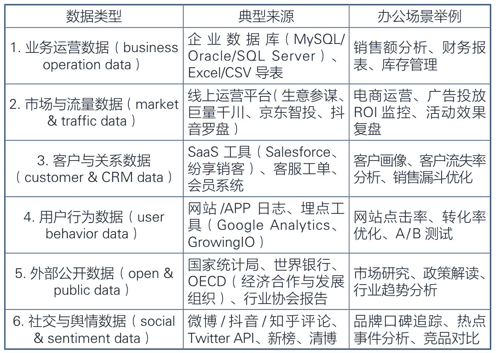

那如果找到了数据平台，但是不会导出怎么办呢？继续问 AI：

**提示词示例：**

我想从生意参谋导出“近 30 天店铺用户行为”数据，请告诉我步骤，并说明导出的数据是否需要清洗。

**Kimi 输出示例：**

从生意参谋导出“近 30 天店铺用户行为”数据，可参考以下步骤：

1.登录生意参谋：使用淘宝卖家账号登录生意参谋平台。

2.选择数据模块：在生意参谋的首页或菜单中，找到与用户行为相关的模块，如“流量分析”“访客分析”等，不同版本和套餐的生意参谋可能在具体模块名称和位置上有所不同，需根据实际情况选择能获取到店铺用户行为数据的模块。

3.设置时间范围：在所选模块的数据报表页面，找到时间范围设置选项，选择“近 30 天”或自定义日期区间来确定要分析的时段。

4.选择导出数据类型：点击“导出”按钮，在弹出的导出设置窗口中，选择导出数据的类型，如用户行为相关的指标，包括访客数、页面浏览量、停留时间、跳出率、加购行为、收藏行为、购买行为等；同时选择导出文件的格式，如 CSV、XLS 等。

5.点击导出并下载：确认无误后，点击“确定导出”，系统将开始处理请求，稍等片刻，根据提示下载导出的数据文件。

此外，如果数据分散在多个系统，我们同样可以告诉 AI：“我有部分数据在 CRM，部分在财务系统，部分在问卷系统，请帮我设计一份数据整合的字段对齐方案。”

因此，数据分析的第一步不是“开 Excel”，而是“让 AI 帮你问对问题”。

目标清晰，分析不乱；模型合适，结论靠谱；流程简明，结果才会有用。获取数据也不再是人工跑数+复制粘贴，而是可以借助 AI 一步步确认字段、优化结构，甚至自动连接接口提取。

## **二、AI 辅助数据预处理——少写公式，多问 AI**

目标定好了，下一步不是开“跑”，而是让数据变得干净、统一、可分析。

过去，数据清洗是打工人最怕碰的苦活，动不动要写一堆 VLOOKUP、IF、COUNTIF 函数……现在，有了 AI，你只要“描述问题”，它就能替你写公式、清数据。

操作方式：

1.上传 Excel 表格到 ChatExcel；

2.直接输入提示词（不需要写函数公式）。

常用提示词模板：

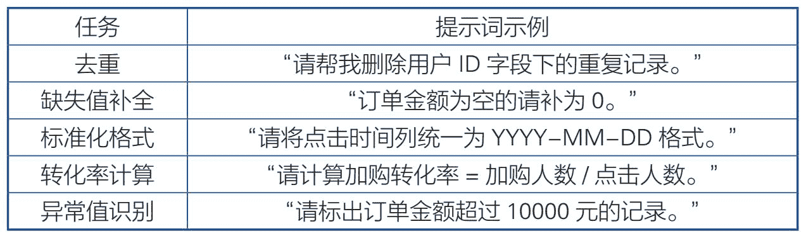

以下是 3 个最常见的数据清洗问题，以及 AI 如何一步步帮你搞定的具体方法。

**1.自动识别并处理缺失值**

目标：识别数据中的空白，并决定如何处理（填充或剔除）。

示例数据：

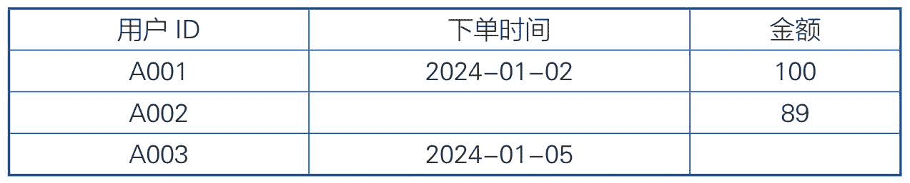

提示词示例：

请帮我识别表格中的缺失值，并列出缺失的行数及字段。分析哪些字段缺失比例较高。

后续操作选择：

若少量缺失→提示词：请用“金额”列的平均值填充空值；或删除“下单时间”为空的行。

若缺失严重（如>30%）→提示词：请列出“缺失超过 30%”的字段，并建议是删除还是保留。

AI 会自动分析表格，输出缺失字段、占比、建议填充方式，免去你手动筛查的苦力活。

**2.识别并剔除重复值**

目标：避免数据重复记录导致分析失真。

示例数据：

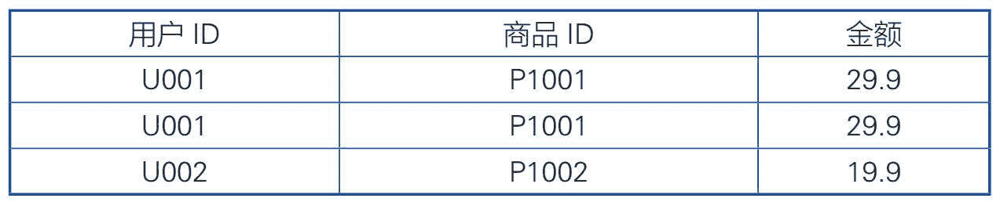

提示词示例：

请帮我删除“用户 ID”与“商品 ID”重复的记录，只保留一条。

你也可以更明确地指定保留条件：

如果“用户 ID”与“商品 ID”重复，请保留“金额最高”的那条记录。

AI 会标出重复行，自动执行“去重保留优先级”，最终导出一张无重复的干净数据表。

如果你想仅标记不删除，可提问：请标记“重复”的行，在最后一列添加“是否重复”字段。

**3.格式统一（尤其是日期、金额、分类字段）**

目标：确保所有字段的格式一致，避免分析出错

示例问题：

日期格式混乱：“2023-01-01”vs“1/1/2023”vs“2023 年 1 月 1 日”。

金额字段：有的是“ 89”，有的是“89 元”，有的是“89”。

提示词示例（统一日期格式）：

请将表格中所有“订单日期”字段统一为“YYYY-MM-DD”格式。

提示词示例（清洗金额格式）：

请将金额字段中的“元”“ ”等字符去除，只保留数字，并统一为两位小数。

提示词示例（分类字段清洗）：

“性别”字段中存在“男、男性、male”，请统一为“男”；“女、女性、female”统一为“女”。

AI 执行后，会自动将所有日期格式转换为统一标准，删除符号并格式化数字，将分类字段标准化，提高数据分析准确性。

因此，以前你需要写 10 个公式、翻 100 行表；现在你只需要一句话：“请帮我清洗这张表格。”

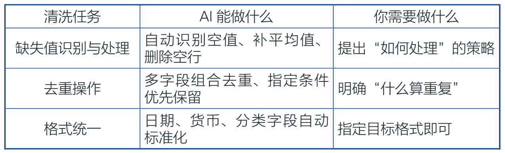

## **三、AI 辅助计算与建模（普通职场人也能用的高大上组合）**

很多人一听到“数据建模”就头大，看着别人的汇报有图有表，非常高大上，羡慕至极。

其实在 AI 时代，每一个职场人都能轻松完成数据建模与分析，关键是让 AI 来“出力”，你只要“出题”就行了。

这里需要用你的 AI 伙伴（GPT、DeepSeek、Kimi 等）+SPSSAU，SPSSAU 是一个在线数据分析平台，功能接近 SPSS 但操作更简洁，只需上传 Excel 表格或 CSV 文件，勾选分析模型，它就能自动跑数、出图、写报告。

最重要的是：它会自动生成可复制粘贴的自然语言结论，用来汇报、写总结、做 PPT 超省力。

**工具清单（适合职场人快速搭配使用）**

下面我们就列举几个人人都能搞定的 SPSSAU+AI“高大上分析”。

### **场景一：我是运营，想分析转化率为什么变低了**

分析目标：识别“转化漏斗”中的问题阶段，找出转化率下降的原因

操作流程：

### **场景二：我是 HR，想知道工作年限与绩效有没有关系**

分析目标：探索两个变量之间是否存在关联

操作流程：

### **场景三：我是市场人，想知道哪个广告渠道最值得投**

分析目标：比较不同渠道带来的转化质量

操作流程：

### **场景四：我是内容运营，想知道内容形式对阅读量是否有影响**

分析目标：判断不同内容形式对阅读量是否有影响

操作流程：

SPSSAU 是你“建模动手”的工具，AI 是你“理解+表达”的大脑助手，二者结合起来就是最强组合：自动分析+语言转化+决策建议。不懂统计学也能干专业的事！

## **四、AI 辅助数据结果解读——别再只“报数”，你要“讲故事”**

你已经搞定了前面三步：

明确了分析目标；

洗干净了数据；

做完了计算和建模。

但最关键的来了：你的老板/客户/团队，根本不关心你跑了多少行代码、做了多少个图表。他们只关心：这些数据说明了什么？我们该怎么干？

这就到了数据结果解读阶段。

本阶段的目标是：把枯燥的数据结果翻译成业务建议+行动语言。

你要做的，不是展示“转化率=12.8%”，而是告诉别人：趋势是什么，关键变化在哪儿，哪个指标值得关注，该采取什么对策。

### **步骤 1：让 AI 快速总结关键发现**

提示词示例：

以下是我从 Excel 中整理出的分析结果，请你帮我总结 3~5 个最关键的发现，并用非技术语言表达。

【数据如下】（或上传表格）

这些关键发现可以作为报告第一页的亮点，适合汇报或决策使用。

### **步骤 2：让 AI 辅助将趋势数据转为报告语言——洞察≠描述**

提示词示例：

结合以下时间趋势数据，请帮我解读其背后的变化原因，并提供两个可能的业务解释。

这类提示词可以让 AI 帮你补出你没想到的“背后解释”和“业务含义”。

### **步骤 3：让 AI 优化图表呈现**

提示词示例：

请根据以下数据内容，帮我设计一个汇报用的图表结构（图表类型+标题+备注说明），并总结图表中想表达的重点。

你还可以继续向 AI 发出指令：“请生成一段用于汇报时口头讲解的内容。”

### **步骤 4：让 AI 生成业务建议+行动项**

提示词示例：

基于以下分析结论，请生成 3 条可以立刻执行的优化建议，适用于营销团队下一轮活动。

输出为“建议+解释+数据依据”，可直接复制进 PPT 结尾页或汇报材料中。

AI 不是替你决策，而是帮你看见你没注意到的趋势；用清晰的语言表达数据里的信息；把图表变成对话，把数据变成选择。

你的任务，是把这些“AI 提示”讲给人听并落实到行动。

# **Part6** **AI+表现力：可视化和 PPT**

你有没有过这样的时刻：

项目你也做了不少，报告你也认真准备，结果到了汇报那一刻，老板看着 PPT 只说了一句：“这我看不懂。”而和你同期入职的同事，干的活跟你的差不多，却凭借一份清晰明了、重点突出的 PPT，顺利拿下晋升名额。

是不是觉得有点委屈？但现实就是职场不是谁做得多谁赢，而是在需要表现的时候“一击即中”。

这并不是危言耸听，杭州一位中年男子，真的因为“PPT 太丑，影响公司形象”而被公司辞退，引发全网热议。

（图片引用自新浪财经）

很多人一提到 PPT 就头大，脑中自动浮现：赶进度、做图表、调格式、改模板，一路改到凌晨三点。但如果回头看看 PPT 发明的初衷，我们就会发现其目的其实非常朴素：

**·告别手动翻胶片，让演讲更流畅；**

**·整合文字、图表、图像，降低“信息可视化”的门槛；**

**·实现图文音视频一体化，让表达更具表现力。**

因此，PPT 的本质不是“做图”，而是“帮助你展现观点”的演示工具。

心理学家阿尔伯特·梅拉比安（Albert Mehrabian）提出著名的“7/38/55 沟通定律”：

在沟通中，观众对你印象的形成只有 7%来自你讲的话，38%来自语气、语调等表达方式，而高达 55%来自你的视觉呈现，也就是你看起来是否专业、有说服力、有存在感。

所以，做 PPT 的真正目的是这两部分：

PPT 本身的内容与结构≈55%的视觉说服力

你讲的内容和演讲的方式与语气≈45%的表达感染力

换句话说，PPT 的核心价值，不在内容多，而在表达力，再好的内容，如果表达方式不对、视觉呈现不清晰，照样“白搭”。

**做 PPT 不是你写得爽就好，而是要别人看得懂**

许多 PPT 像“灾难现场”，其原因不是模板不好用，而是我们缺乏“读者思维”。

什么是“读者思维”？

就是在制作 PPT 时，站在观众的角度去思考：他们想看什么？能不能一眼看懂？听完能记住哪些关键点？这个页面是帮助理解，还是制造困惑？

不是“我想讲什么”，而是“别人能不能快速吸收”；

不是“我写了多少内容”，而是“对方有没有抓到重点”。

当你带着读者思维回看自己做的 PPT 时，你会发现：很多时候我们把 PPT 当成了自言自语的笔记本，而不是一个面对观众、引导思路、传达观点的演示工具。

所以一份 PPT 为什么会让人“看不下去”？问题往往就出自这四种典型场景：

**·听不明白：内容跳来跳去，前后没逻辑，你讲了半天，观众却不知道你想表达什么，只能一脸问号。**

**·看不清楚：密密麻麻全是字，没分层级，没留白，观众还没开始听就已经视觉疲劳了。**

**·记不太住：动画飞、字体跳，页面看着热闹，但重点在哪儿没人知道，信息传递反而被干扰。**

**·不打动我：像在听人念稿子，没有节奏，没有情绪，没有交流，讲得再完整也打动不了人。**

续表

既然 PPT 是用来演示的，而非自说自话，那我们就要想：“如果我坐在下面看这份 PPT，我能不能很快看懂？”接下来我们逐一拆解 4 种问题类型：

**1.结构混乱型：逻辑不清，顺序混乱，缺乏结构**

这类 PPT，内容跳跃，前后脱节，“讲不明白”；没有开场、过渡、重点、总结，纯靠观众“自己理解”；图表和文字各讲各的，毫无协同。前面我们讲过“结构化表达”，PPT 就需要你想表达的观点有脉络，你自己都说不清，观众当然也听不懂，就像意识流拼图。

**2.信息超载型：内容冗余，信息过量，无重点**

很多人做 PPT 像在写论文，一页 PPT 塞进 2000 字，让人看得头疼，听得发蒙；字号太小，密密麻麻，看不清也记不住；没有信息层级，一页铺满，反而让人抓不住重点。PPT 不是用来堆字的，信息堆得太满，没有提炼核心，看似什么都讲了，却什么都没讲清。真正有效的 PPT，是“提炼+突出”，而不是“复制+粘贴”。

**3.视觉灾难型：视觉元素失控，干扰信息传达**

设计感是加分项，不能花里胡哨。五种字体、八种颜色、三种图标风格混用；动效花哨，背景抢戏，内容反而被“埋”；配图不统一，比例不协调，页面像个贴图大杂烩。这类 PPT 让信息本身失焦。做的人很辛苦，看的人却早就想关掉页面了。这类问题看似是“美感”问题，本质上是“没有设计目的”的堆砌。

**4.表达失效型：没有感情的读稿机器**

PPT 是用来演示的，把 PPT 当 Word，用来“汇报进度”而非“打动听众”；做完直接发，讲时只念，整个演示过程毫无感染力。演示不是读 PPT，而是把它当工具，让观众知道你在表达什么，真正打动人的是你讲得是否有逻辑、有重点、有情绪。

**那 AI 能做什么？——它不只是代替你做，而是放大你的表达力**

做 PPT 时，不用再只靠自己，来看看 AI 的价值所在：

结构混乱：让 Kimi 帮你搭好骨架；

信息太多：让 DeepSeek 帮你减字精炼；

图乱难看：让 Canva（可画）帮你画出重点；

表达干巴：让 AI 写讲稿打动人心。

## **一、用 AI 搭建逻辑骨架：从杂乱到结构清晰**

前面我们讲过如何用 SCQA 结构+金字塔原理写出结构化表达的内容，但是前面的组合更适用于短文本，如部分 PPT 内页文本的组织。而我们制作 PPT 的第一步是让观众一听就懂，那我们还需要再加一个“框架之锚”——MECE 原则。

### **什么是 MECE 原则？**

MECE，全称 mutually exclusive and collectively exhaustive，中文可译为“相互独立，完全穷尽”，也叫“不重不漏原则”。它最早由麦肯锡顾问芭芭拉·明托提出，用于解决复杂问题时的分类和结构化表达难题。说白了，就是把事分清楚，讲得干净利落。它强调：每一部分不能重复交叉（mutually exclusive），所有部分加起来要完整覆盖（collectively exhaustive）。

这套逻辑不仅适用于 PPT 的框架设计，同样适用于撰写手册、报告、白皮书、企业内训资料等长文本的大纲。

因此，在 PPT 场景中，AI 需要帮我们做的第一件事，不是“生成××页”，而是生成一个符合 MECE 结构的大纲，帮你先搭好内容的骨架，确保逻辑闭环、信息不零碎：

观众一眼就能看出你要讲几个部分（结构明确）；

每一章节内容之间不重复、不啰唆（不重不漏）；

每一页聚焦一个要点，让汇报人讲得清，观众看得懂、记得住。

AI+MECE，可以帮你从内容“乱麻”中梳理出一条清晰的主线，只要骨架搭得好，后续的文本、图表、配色、讲稿，才有意义。

具体交互流程是：你先明确你要讲的主题或素材—AI 拆解结构，生成框架，排除重复—你调整重点，补充内容—AI 再次帮你提炼要点，优化页面逻辑。

我们实际使用中有两种场景：

**情况一：已有部分内容或素材，需要 AI 帮你梳理逻辑**

比如，你已经有了一堆文本、数据碎片，但它们逻辑杂乱、内容重复，难以组织成一份条理清晰的 PPT。可以用 AI 帮你将这些内容拆分为逻辑清晰的三部分，避免重复和跳跃。

**提示词模板：**

我已经整理出以下内容素材，请你以 MECE 原则为基础，帮助我：

1.拆分出 3~5 个互不重叠、覆盖完整的内容板块；

2.为每个板块起一个页面标题；

3.为每个板块列出 3 条要点（每条不超过 20 字）；

4.最终目标是生成一份适合制作 PPT 的结构草稿，便于我后续逐页填充内容。

素材如下：

（此处粘贴或上传你的文本摘要、数据要点或已有提纲）

**情况二：从 0 开始的命题作文，需要 AI 帮你“搭框架起高楼”**

比如，你只知道主题，但还没开始动手，思维混乱，不知道该分几部分讲，如何布局结构。可以用 AI 生成结构框架，再“缝缝补补”，逐步补全内容。

**提示词模板：**

我要做一份关于“【你的主题】”的 PPT，受众是【受众/场景】，希望包含【当前背景、主要痛点、当前价值（本部分可结合行业需求调整）】。请你帮我：

1.按照 MECE 原则（不重不漏）设计出一套逻辑清晰的 PPT 结构；

2.给出建议的页面数量（不超过 12 页）；

3.列出每一页的标题+要点（每页要点不超过 3 条，内容适合做成一页 PPT）。

补充要求：（可选）

如：风格务实/商业化/教育性强/适合做汇报

对比案例：

我们来对比一下用 MECE 原则设计 PPT 大纲的逻辑：

**大纲 1 提示词：**

请给我一个“AI 赋能办公应用”的 PPT 大纲

**Kimi 生成：**

以下是一个关于“AI 赋能办公应用”的 PPT 大纲：

幻灯片 1：封面

*标题：AI 赋能办公应用

幻灯片 2：目录

*引言

* AI 与办公的融合趋势

* AI 赋能办公应用的优势

*常见的 AI 赋能办公应用场景

* AI 赋能办公应用的案例分享

*面临的挑战与应对策略

*未来展望

*总结与致谢

幻灯片 3：引言

*引入办公场景的日常痛点，如效率低下、重复性工作烦琐等，引出 AI 赋能办公应用的必要性。

*提出问题：如何利用 AI 技术解决办公中的实际问题？

幻灯片 4：AI 与办公的融合趋势

*展示近年来 AI 技术在办公领域的关注度增长曲线或相关数据。

*介绍促使 AI 与办公融合的因素，如技术进步、企业数字化转型需求等。

幻灯片 5：AI 赋能办公应用的优势

*提高工作效率：减少重复性工作时间，加速任务完成。

*提升工作质量：降低人为错误，提供更精准的分析和决策支持。

*优化资源分配：合理安排人力、物力等资源，避免浪费。

*增强创新能力：激发员工创造力，提供更多创新思路和解决方案。

幻灯片 6：常见的 AI 赋能办公应用场景

*智能写作助手

*介绍智能写作助手的功能，如自动生成文案、润色文章、智能排版等。

*展示实际应用场景，如撰写新闻稿、报告、邮件等，提高写作效率和质量。

*智能数据分析与可视化

*说明智能数据分析工具如何自动收集、整理和分析数据，以及将复杂数据以直观的可视化图表呈现。

*举例说明 AI 在企业决策、市场分析等方面的应用价值。

*智能会议助手

*介绍智能会议助手的会议安排、纪要生成、智能语音识别等功能。

*强调其在提高会议效率、记录会议内容完整性等方面的作用。

*智能工作流程自动化

*讲解智能工作流程自动化如何将烦琐的业务流程自动化，如审批流程、数据录入等。

*分享在企业内部管理中的应用案例，展示其节省时间和人力成本的效果。

幻灯片 7：AI 赋能办公应用的案例分享

*选择 2~3 个不同行业的企业或组织，详细介绍其采用 AI 赋能办公应用后取得的显著成效，包括工作效率提升的具体数据、成本降低情况、业务创新成果等。

幻灯片 8：面临的挑战与应对策略

*数据安全与隐私保护问题

*分析 AI 办公应用可能涉及的数据安全风险，如数据泄露、滥用等。

*提出应对策略，如加强数据加密、访问控制、遵守相关法律法规等。

*技术复杂性与员工适应能力

*阐述 AI 技术的复杂性可能给员工带来的使用困难，如操作不熟悉、对技术原理理解不足等。

*介绍应对方法，如提供员工培训、简化操作界面、建立技术支持团队等。

*高昂的成本投入

*分析 AI 赋能办公应用在硬件、软件、人才等方面的成本投入。

*探讨成本控制策略，如选择合适的供应商、采用云服务模式、优化资源配置等。

幻灯片 9：未来展望

*预测 AI 赋能办公应用未来的发展方向，如更智能的自然语言处理、更强大的数据分析能力、与其他新兴技术（如区块链、物联网等）的融合等。

*展望 AI 赋能办公应用将为企业和社会带来的深远影响，如推动办公模式变革、促进产业升级等。

幻灯片 10：总结与致谢

*总结 AI 赋能办公应用的关键优势、应用场景、面临的挑战及未来发展趋势。

*对观众表示感谢，并鼓励大家积极参与 AI 赋能办公的实践和探索。

你可以根据实际需要对每个幻灯片的内容进行详细阐述和拓展，插入相关的图表、图片和案例，使 PPT 更加生动、直观和有说服力。如果你还有其他问题，欢迎继续向我提问。

大纲 2 提示词：

我要做一份关于“【AI 赋能办公应用】”的 PPT，受众是【互联网公司中后台员工】，希望包含【当前背景、主要痛点、当前价值等内容】。请你帮我：

1.按照 MECE（不重不漏）原则设计出一套逻辑清晰的 PPT 结构；

2.建议页面数量不超过 12 页；

3.每一页列出标题+要点（每页不超过 3 条，适合做成一页 PPT 内容）。

补充要求：风格务实/商业化/教育性强/适合做汇报

以下是按照 MECE 原则设计的“AI 赋能办公应用”PPT 结构：

幻灯片 1：封面

*标题：AI 赋能办公应用

幻灯片 2：目录

*当前背景

*主要痛点

*当前价值

*案例分析

*未来展望

*总结与致谢

幻灯片 3：当前背景

*互联网行业竞争加剧：市场变化迅速，企业需快速响应，对办公效率提出更高要求。

*技术发展推动：AI 技术如自然语言处理、机器学习等不断成熟，为办公应用赋能提供可能。

*企业数字化转型需求：互联网公司中后台员工需借助新技术提升工作质量和效率，适应转型趋势。

幻灯片 4：主要痛点——工作重复烦琐

*数据录入与整理工作量大且易出错，占用大量人力和时间。

*日常文档撰写、报表生成等任务重复性高，缺乏创新空间。

幻灯片 5：主要痛点——信息处理效率低

*面对海量信息，难以快速准确提取关键内容，影响决策效率。

*搜索、筛选和整理资料耗时费力，尤其是在跨部门协作中。

幻灯片 6：主要痛点——流程协作不畅

*中后台部门间协作流程复杂，沟通成本高，易出现信息孤岛。

*任务分配与进度跟踪不清晰，导致工作效率低下和项目延误。

幻灯片 7：当前价值——提升工作效率

*智能自动化工具：AI 驱动的自动化工具可自动完成数据录入、文档生成等重复任务，节省时间 50%以上。

*智能助手：如智能写作助手能快速生成初稿，智能绘图工具可依需求生成图表，提高工作产出。

幻灯片 8：当前价值——优化信息处理

*智能信息提取与分析：AI 能快速从大量文本中提取关键信息，为决策提供有力支持。

*智能搜索与推荐：精准搜索和个性化推荐功能，帮助员工快速找到所需资料，提高信息利用效率。

幻灯片 9：案例分析

*××互联网公司：通过引入 AI 赋能的办公应用，中后台员工工作效率提升 40%，错误率降低 30%。例如，智能数据处理工具使财务部门报表生成时间从数小时缩短至分钟级；智能协作平台优化了跨部门项目流程，项目交付周期缩短 20%。

*××团队：利用 AI 文本分析工具处理客户反馈，准确提取关键问题，为产品优化提供精准方向，客户满意度提升 25%。

幻灯片 10：未来展望

*技术持续创新：AI 技术将不断升级，如更强大的语言模型和机器学习算法，进一步挖掘办公应用潜力。

*与新兴技术融合：与区块链、物联网等融合，实现更安全高效的数据管理和设备协同办公，拓展办公应用边界。

幻灯片 11：总结与致谢

*总结 AI 赋能办公应用的背景、痛点、价值及案例，强调其重要性和潜力。

*表达对互联网公司中后台员工的感谢，鼓励积极探索 AI 办公应用，提升工作效率和质量。

建议页面数量为 11 页，每页要点精练，适合做成一页 PPT 内容，风格务实、商业化，具有教育性和汇报性。

不难看出，大纲 1 虽然信息覆盖面广、涉及场景较多，但整体内容偏散、深度不足；而大纲 2 则条理清晰、逻辑严谨，紧扣“问题—解决”主线，结构上采用“先讲背景—聚焦三类核心痛点—对应价值体现—案例支撑—趋势展望”的顺序，既系统又具说服力。

一旦确定好这样的最终大纲，就可以直接使用 Kimi 的 PPT 助手，一键生成结构合理、内容聚焦的 PPT 初稿，虽然输出的配图是中规中矩的通用素材图，但大大节省手动排版与内容组织的时间成本，而且免费！

对比其他的 AI PPT 工具，Kimi 直接生成大纲，并在站内将大纲变成 PPT，节省大家的时间，当然，对排版美化更有追求的同学，可以继续往后学。

Kimi 有两种方式调用 PPT 功能：一是对话框直接@PPT 助手，二是在 Kimi+找到 PPT 助手。

大纲定了之后点击“一键生成 PPT”就能跳转模板选择页面，可以按场景、风格、颜色挑适合的模板：

生成后还支持大纲编辑和一键模板替换，调整细节，这里就需要手动修改了。

## **二、用 AI 把每一页写明白——聚焦一个重点**

在 PPT 中，“信息超载型”是最常见也最致命的问题之一。一页塞满文字、数据和背景资料，乍一看“信息量很大”，但其实观众一个重点都没记住。

你以为自己在讲重点，但观众可能早已在心里默念：“怎么还没讲完？”

这正印证了认知负荷理论的核心观点：一旦信息量超出大脑可处理的范围，理解力会迅速下降。

换句话说：你塞得越多，观众记得越少。

真正有效的 PPT 页面，不是“全塞进去”，而是“精炼出来”。

我们不是把所有内容都摆上去，而是要让信息“轻量化”——让观众一眼抓住重点，三秒读懂要义，快速跟上你的节奏。

一个标准的“轻量化 PPT 页面”，可以遵循以下结构：

AI 三步策略，帮你“写得清楚、讲得明白”。

**步骤 1：用 SCQA 结构做“信息压缩”，减轻大脑负担**

SCQA 能帮助我们把大段文字压缩为结构清晰、逻辑连贯的一页内容框架。

**步骤 2：用金字塔原理做“观点分层”，理清表达主线**

金字塔结构强调“结论先行”，再用 3 条平行理由支持，帮助观众快速建立对信息的认知图谱。

**步骤 3：重视图文配合，用视觉语言提升吸收速度**

图表是天然的信息压缩器。把抽象的文字转成图表，能显著减轻认知负担。本部分可以先记录，哪些内容可以用图表替代文字，无须急于设计图表，比如先问 AI：“请为以下 3 个要点建议一种合适的图表形式（如列表、流程图、矩阵图等），便于在 PPT 中表达。”

好 PPT 不是“写满”，而是“写明白”。

借助 AI 和结构思维工具（SCQA+金字塔+图文可视化），我们可以用更少的字、更好的逻辑和更清晰的图，讲出更打动人的内容。

举个例子：

我们用上文 AI 输出的受众为【互联网公司中后台员工】的【AI 赋能办公应用】PPT 大纲，幻灯片 3“当前背景”的相关内容作为素材：

示例提示词：

请将以下内容整理为符合 SCQA 结构的表达形式，输出为 4 部分：

S：简明扼要地描述当前背景或现状；

C：指出面临的问题或冲突（不要超过 2 句）；

Q：引出关键问题（最好是一句话，简洁有力）；

A：总结你的核心观点或解决方案，可包含 2~3 个要点。

要求：整体简洁清晰，逻辑连贯，适合一页 PPT 或 60 秒口头表达，避免废话堆砌。

以下是原始内容：

技术发展推动

*大模型技术的突破：近年来，大模型技术不断成熟和创新迭代，如 GPT-4、文心一言、讯飞星火等，其具备的强大能力为办公应用提供了更强大的智能支持。例如，GPT-4 有着会话式交互方式、跨语言及多模态交流能力、长文本处理能力、复杂推理能力，使得它在办公软件市场应用前景广阔，能够更好地理解和处理人类的指令和需求，从而为办公人员提供更智能、更高效的辅助。

*AI 能力的拓展：AI 不断提升人类的内容生成能力、人机交互能力和非结构数据处理能力。在内容生成方面，AIGC 技术开启办公软件发展的新阶段，使办公产品从效率工具向生成工具转变，能够快速生成文档、图像、视频等各种内容；在人机交互方面，大模型提升了人机交互的自然度和流畅性，降低了办公软件的使用成本，让办公人员可以更便捷地与系统和工具进行交互；在数据处理方面，AI 能够处理和分析大量复杂的非结构化数据，帮助企业更高效地挖掘数据资源价值，为决策提供更有力的支持。

市场需求驱动

*提升效率与质量的需求：在互联网公司的中后台工作中，往往涉及大量的文档撰写、数据分析、会议组织等任务，工作内容烦琐且耗时。例如，人力资源部门需要撰写招聘文案、培训资料等，财务部门要处理大量的财务数据和报表，行政支持部门要安排会议、整理会议纪要等。AI 赋能的办公应用能够自动完成这些重复性、规律性的工作，大大提高工作效率和质量，减少人为错误，如 Microsoft 365 Copilot 在 Word 端可以协助起草、修改、总结和生成文档，还可以优化文本的清晰度和可读性。

*优化协作与沟通的需求：中后台工作需要与公司内部的其他部门以及外部的合作伙伴进行密切协作和沟通。AI 办公应用可以打破信息孤岛，实现信息的共享和流通，促进团队成员之间的协作。例如，通过智能文档管理系统，不同部门的人员可以实时协作编辑和管理文档，提高团队沟通效率；智能会议助手能够自动安排会议、发送通知、记录会议内容并生成会议纪要，节省时间和精力，确保信息的准确传达。

*增强决策科学性的需求：中后台的决策对于公司的运营和发展至关重要。AI 能够对海量的数据进行分析和挖掘，提供基于数据的见解和建议，帮助中后台人员更全面地了解业务状况和市场趋势，从而做出更科学、更合理的决策。例如，通过对用户数据和业务数据的分析，AI 可以为市场部门提供精准的市场预测和营销策略建议，为管理层提供全面的运营分析报告，辅助公司进行战略决策。

行业竞争压力

*提升企业竞争力的关键：在当前激烈的市场竞争中，互联网公司需要不断提升自身的运营效率和创新能力，以保持竞争优势。AI 赋能的办公应用已经成为企业数字化转型的重要手段之一，能够帮助企业优化业务流程、降低成本、提高生产力和创新能力。例如，一些领先的互联网公司通过引入 AI 驱动的办公软件和自动化工具，实现了业务流程的智能化和自动化，大大提高了企业的运营效率和市场响应速度，从而在竞争中脱颖而出。

*满足客户期望的必然选择：随着客户对服务质量和服务效率的要求越来越高，互联网公司需要借助 AI 技术来提升客户服务的水平和满意度。中后台作为支持前台业务运营的重要部门，通过使用 AI 赋能的办公应用，可以更快速地响应客户需求，提供更精准、更个性化的服务。例如，智能客服系统能够自动回答客户常见问题，解决客户问题的时间和成本；客户关系管理系统的 AI 功能可以对客户数据进行分析和挖掘，为销售和客服人员提供客户画像和个性化推荐，提高客户满意度和忠诚度。

员工发展需求

*提升个人能力与价值：对于互联网公司中后台员工来说，掌握 AI 赋能的办公应用工具和技能，有助于提升个人的工作能力和竞争力，更好地适应数字化工作环境的变化。例如，学会使用 AI 文档撰写工具、数据分析工具等，可以提高工作效率和质量，能够将更多的时间和精力投入到更具创造性、战略性的工作中，从而提升个人的价值和职业发展空间。

*适应岗位变化与转型：随着 AI 技术在办公领域的广泛应用，一些传统的中后台岗位和工作内容可能会发生变化或被重新定义。员工需要积极学习和适应新的技术和工作方式，以应对岗位变化和转型的挑战。例如，一些重复性、规律性较强的工作可能会被 AI 自动化工具所取代，而员工则需要转向更具创造性和复杂性的任务，如数据分析与洞察、业务流程优化、AI 系统的管理和监控等。

**DeepSeek 输出：**

好的！下面是我根据你提供的内容，使用 SCQA 结构精炼重写的版本。整体风格逻辑清晰、语言凝练，适合直接用于一页 PPT 展示或 60 秒口头表达。

AI 赋能办公背景

S｜背景现状：

AI 技术快速演进，大模型能力持续突破，推动办公工具进入智能化新时代。

企业面临激烈竞争与数字化转型压力，员工希望借助新技术提高效率、适应岗位变化。

C｜核心挑战：

然而，中后台工作重复性高、信息处理复杂、跨部门协作效率低。传统办公方式难以应对快速变化的业务需求，也难以满足员工成长与客户服务的多重期待。

Q｜关键问题：

在数字化转型加速的大背景下，如何借助 AI 赋能提升办公效率、优化协作流程，并兼顾员工发展与客户满意度？

A｜解决方案：

1.引入 AI 工具，自动化烦琐任务：如智能文档生成、会议纪要整理、流程协同系统等，提升中后台运行效率。

2.利用 AI 挖掘数据价值，支持科学决策：通过非结构化数据分析、精准搜索与推荐，辅助企业管理与营销优化。

3.推动员工能力升级，适应岗位变革：培训掌握 AI 办公技能，将人力从重复劳动中解放，投入高价值工作。

**继续提问：**

以上哪部分内容适合用图表呈现，并建议一种合适的图表形式（如列表、流程图、矩阵图等），便于在 PPT 中表达。

**DeepSeek 生成：**

哪部分适合用图表呈现？如何呈现最清晰？

推荐重点图表：

图表 1：问题冲突展示图（并列列表图）

可用横向图标+三栏卡片布局呈现，逻辑并列直观易懂

图表 2：AI 三大赋能方向（三栏式矩阵图）

适合用矩阵图/横向三栏表格呈现，配合图标增强记忆点。

图表呈现顺序建议（在整页 PPT 中）：

1.标题+核心问题（Q）：用文字大号居中

2.冲突呈现（C）：横向卡片式图表展示三大问题

3.解决方案（A）：底部使用三栏矩阵图，强化 AI 的落地价值点

4.背景（S）：放左上角，用图标点缀式呈现即可

## **三、AI 图表可视化**

俗话说得好，“一图胜千言”。这可不是随口说说，而是经过科学认证的硬核真理。

图像，不仅让我们学得更快、记得更牢，还能瞬间抓住注意力、解释复杂概念、激发灵感。为什么？因为我们的脑子，天生就偏爱图像。

研究表明：人脑处理图像的速度是文字的 60,000 倍，大脑接收的信息中，有 90%是视觉信息。

来举个例子：

你的汇报长这样：

而你同事的 PPT 长这样：

柱状图，谁卖得多一眼明了

折线图，客单价高低一目了然

雷达图，成交能力全景对比

问题来了——如果你是老板，你爱看哪个？答案毫无悬念。

所以，下次做数据汇报、讲故事、做演示时，别再堆长篇大论的文字了。国内可以用来将数据图表化的工具有：

这里我们给大家介绍简单易上手的 Canva，支持制作各类图表、可视化组件、交互展示图，适合职场数据汇报、销售/项目可视化、公号图解、教学/培训展示等多个场景，并且：

**·拖拽式操作，0 基础也能做；**

**·支持导入 Excel/CSV 数据；**

**·提供几十种图表模板，一键美化；**

**·可自定义颜色、字体、动画、交互；**

**·图表可嵌入 PPT，导出为图片或视频，在线分享。**

那么，如何在 Canva 中制作图表？

（1）根据数据类型与目标，选择适合的图表类型

**快速匹配方法：**

**常用图表应用场景示例：**

**简单通用类图表：**

**进阶图表：**

（2）进入 Canva 并新建设计：选择合适画布，添加图表插件

（3）输入数据并调整样式

（4）导出与应用

还可以组合生成信息图表（模板示例）：

而你的表格，从此也不再枯燥。

## **四、AI 辅助演讲力：从“会做”到“会讲”，一步到位**

在职场和商业演示中，流传着一句老话：“会做的不如会说的。”

这是赤裸裸的现实，你可能花了三天三夜精雕细琢出一份逻辑清晰、图表精美的 PPT，却因为临场发挥一塌糊涂，让项目输在了“最后 5 分钟”。

PPT 是“外壳”，演讲是“灵魂”。该表现的时候就要表现，真正打动老板、客户甚至投资人的，不是你做了多少页，而是你怎么讲，讲得有没有感染力。

**为什么“会讲”这么难？**

不少人有这样的职场经历：别人一开口就能稳稳抓住全场注意力，而你讲两分钟，听众已经低头看手机了。

哪怕你明明“内容在线”，但一到讲台上还是变成了“抠脚型演讲者”，回家躺床上反复复盘：“我刚刚是不是又忘词了？”“这页我是不是跳太快了？”……

别急，问题通常卡在以下三个“表现痛点”：

1.逻辑混乱：你在讲内容，听众却听不到重点

很多人演讲时最大的问题不是紧张，而是结构不清。你可能讲了很多事实、数据、细节，但没有“先说什么，后说什么”的逻辑顺序，也没有“我讲这个，是为了证明什么”的主线支撑。结果观众听了一分钟后，只觉得你在“自说自话”，根本找不到你要传达的核心信息。

2.情绪平淡：内容对了，气氛却没对

“明明讲的是干货，为什么没人想听？”问题可能不在内容，而在情绪。很多演讲像是在“播报”，语气单一，节奏平平，缺乏感染力。没有情境，没有笑点，没有故事，观众自然听不进去。如果你不能引发观众的共鸣，就无法与其建立连接，更别提影响或打动他们。

3.表达僵硬：信息说完了，却没有留下印象

当你照本宣科地念完 PPT，演讲就变成了“翻页汇报”。缺乏口语感的表达、没有断句的节奏、过于学术或官腔的语言，都会让观众觉得“听不动”。更致命的是，你讲的内容可能有价值，但听众不知道和自己有什么关系，抓不到与自己相关的“利益点”，自然记不住，也不会在意。

如今，借助 AI 工具，你可以一键生成结构完整、语气自然、逻辑清晰的演讲稿初稿。但光有稿子还远远不够——如果你只是在“念内容”，而没有打动人、说服人，这场演讲依然会让人“听完即忘”。

延续“读者思维”，我们必须意识到：演讲不是为了输出信息，而是为了说服别人、赢得信任、吸引注意力、达成共识。

要想让你的表达真正产生说服力和影响力，就必须引入一个底层表达逻辑：FAB 法则。

**什么是 FAB 法则？为什么它能解决演讲“表达不打动人”的问题？**

FAB 法则最初源于销售领域，是一套经典的说服性表达结构，如今早已广泛应用于产品发布、项目汇报、岗位竞聘、职场演讲等高影响场景。它的核心公式是：

F—feature（特点/事实）：你到底在讲什么？

A—advantage（优势）：它为什么重要，比别的好？

B—benefit（受益）：观众能从中得到什么？

乍看简单，但它正好一一对应我们在演讲中常见的三大结构性硬伤：

FAB 法则的价值就在于，它不仅帮你“讲明白内容”，更帮你“讲出价值”，是一种让观点变得更清楚、让语言更具感染力、让演讲更能打动人心的表达方法论。

当 FAB 遇上 AI，你可以快速生成结构清晰的讲稿，再借助 AI 不断润色情绪表达、模拟观众角度、打磨说服语气，让每一页内容、每一段话都有“听头”、有“记忆点”、有“共鸣力”。

**通用提示词模板：**

任务目标：请将以下内容整理为一段适合口头演讲的文字，使用 FAB 结构（feature-advantage-benefit）来组织表达，确保语言自然、逻辑清晰、有说服力。

要求如下：

1.F（feature）：明确讲述“这是什么”——核心概念或产品特性，用一句话提炼；

2.A（advantage）：说明“它为什么好”——相较传统方式的优势，用具体语言增强说服力；

3.B（benefit）：点明“这和观众有什么关系”——对观众的价值、好处或改变，用听众视角表达。

语言风格口语化、节奏感强、适合讲出来，避免书面腔。

输出字数控制在 120 字以内，适合 PPT 讲稿或 60 秒开场白。

以下是我的内容（可自由扩写补充）：

【请在这里输入你的原始内容，例如产品介绍、项目理念、转型方向、学习建议等】

（本文沿用本章第一节的幻灯片 3“当前背景”部分内容作为案例）

**Kimi 输出：**

各位同事，今天给大家介绍 AI 赋能办公应用，它借助 AI 技术，将办公软件从传统工具升级为智能助手。（F）它能自动完成重复烦琐任务，像一键生成文档、智能整理数据，比传统方式效率提升数倍。（A）对于我们中后台员工来说，使用它能节省大量时间，让我们从机械工作中解脱，把精力投入到更有价值、更具创造性的工作中，助力个人职业发展，同时提升团队整体效能。（B）

**1.FAB 法则中的 F**

FAB 法则中的 F，代表 feature，也就是你讲的“是什么”。

你可能讲了很多数据，引用了很多材料，PPT 逻辑也很完整，但口头表达却跳来跳去，演讲毫无章法，观众抓不到主线。这种“逻辑在稿子里，混乱在嘴上”的现象，本质上就是 feature 缺失。

F 的强化过程，就是帮助你回答一个最基础的问题：

“你这页/这段到底在讲什么？”

如果你自己讲不出一句简明清晰的“主讲点”，观众自然也无法理解你要表达的核心。

“F 强化”的核心是：一页一观点，一段一结论。

无论你一页 PPT 有多少图、多少数据，都要明确这一页到底在“说什么”。你可以让 AI 为你生成：

页面主标题=观点句

每段小结=精炼版结论

提示词示例：

“请从以下内容中提炼出每页对应的核心观点，并将其转化为一句话标题（feature）。”

强化 F 之后，还要让每一个 F 之间形成自然递进的“主线”，让观众能跟着你的逻辑走。

你可以让 AI 帮你：

**·调整讲述顺序（由浅入深、从因到果）；**

**·添加过渡句让观点之间衔接顺畅；**

**·统一“开头—中段—结尾”的逻辑框架。**

提示词示例：

“请将以下段落按照逻辑顺序重排，使其从背景—问题—观点—建议自然过渡，并标注每一段的主讲点。”

**2.FAB 法则中的 A**

FAB 法则中的 A，代表 advantage：强化说服力与共鸣感。听众不笑、不点头、不做笔记，就像你在跟空气说话。

问题可能不在“你讲得不对”，而在于你没有讲出它为什么重要。我们需要让听众意识到“我为什么要听你这个”。

听众不是来“听你念考试答案”的，而是想从你的表达中获得启发、认同或新鲜感。如果你只告诉他们“是什么”，却不说明“为什么值得在意”，那就像在陈列事实，而不是沟通价值。

强化 A 的目的，就是要让你的每个观点都具备情绪能量+认知冲击力，让听众从“知道”走向“认同”。

**如何增强感染力？**

①注入“比喻感”，用熟悉的事物解释陌生的概念

原句太硬核：“我们希望通过流程自动化提升部门协作效率。”

AI 优化后（加入类比）：“我们希望用 AI 搭建一条‘传送带’，让每个部门的协作就像模块拼接一样高效。”

提示词示例：

“请为以下观点生成一个通俗类比，适合口头表达，增强听众共鸣。”

②制造“反转感”，打破预期，激发注意力

原句太直白：“加班文化会影响员工的创造力。”

AI 优化后（加入反转）：“你以为加班是在拼命，其实是在消耗创造力——当疲惫成为常态，创新自然熄火。”

提示词示例：

“请将以下句子优化为‘不是……而是……’的反转句式，用于强调观点的重要性。”

③加入“小故事”，让道理“有人、有情绪、有结果”

建议使用 STAR 结构（situation-task-action-result），把干巴巴的事实讲成“听得进去的故事”。

示例优化：“去年我们引入 AI 协作平台后，跨部门会议效率提升了 40%。”

讲成故事：“过去我们每次部门对接都像‘踢皮球’，谁也不想先动。去年换上 AI 平台后，3 个部门第一次在同一文档里‘边改边讲’，那种效率，是我们以前从没体验过的默契感。”

提示词示例：

“请将以下项目经历改写为 STAR 结构的演讲故事，语言自然，适合 60 秒内讲出。”

**3.FAB 法则中的 B**

FAB 法则中 B，代表 benefit：让听众听进去、愿回应。

你讲了产品的功能、项目的进展、市场的趋势……却忘了告诉听众“这和他们有什么关系”。

站在“自我输出”的角度上讲得再好，若没有触及听众的利益点、情绪点或行动点，演讲依然是无效的。

FAB 法则强调的 B，不只是“总结一下听众收获”，而是让演讲者把听众的关注点、担忧点、期待值纳入讲述中。

换句话说，benefit 不是你的价值，而是“听众能获得什么价值”。如果你能回答这个问题，你的演讲才真正进入了“有连接、有影响”的状态。

**那么，“听众视角”具体要怎么做？**

①口语化表达，让语言“说得出来”

书面语是给自己看的，口语才是说给别人听的。

书面版（太重）：本系统在数据抓取与清洗环节采用了预训练算法提升效率与准确性。

口语版（AI 转写）：这个工具能帮你更快地找到有用的数据，自动去掉无关信息，节省很多时间。

提示词示例：

“请将以下段落转化为口语化表达，适合口头讲述，加入停顿、断句，语气自然。”

②加上“听众角度”的受益视角

一句简单的“对于你来说意味着……”就能让内容变成共鸣点而非背景介绍。

示例：“引入 AI 系统后，项目审批效率提高了 30%。”

AI 转写：“对于你来说，这意味着再也不用一遍遍催流程、改表格，项目推进顺得多。”

提示词示例：

“请为以下观点添加一句‘对听众的好处’，突出听众从中获得的便利或改变。”

③加入总结句或价值锚点，加深记忆

演讲中最容易被记住的，往往是你在最后总结的那句话。加上一句“价值锚点”，帮助听众抓住重点，形成记忆闭环。

提示词示例：

“请根据以下内容生成一句‘演讲结尾金句’，帮助听众记住这一页的价值重点。”

示例输出：

“这不是一个工具，而是你节省时间、提升效率的全新工作方式。”

好的演讲不是“讲你知道的”，而是“说出别人在乎的”。强化 B，就是让你在每一段表达中告诉听众：“这事和你有关，而且对你有好处。”

因此，你不需要天生会讲，只需要站在“AI+结构”的肩膀上练会讲。是时候从“只会做 PPT”进化到“让 PPT 开口说话”了。

# **Part7** **AI+成长力：走向超级个体**

在这个被 AI 重塑的时代，个体的进化速度，已经跑赢了组织的更新周期。曾经，一家公司要几十人才能运转的流程，如今一个人+一群 AI 智能体就能搞定；曾经要摸爬滚打几年才能积累的经验，如今可以借助 AI 沉淀、调用、升级；曾经碎片化、难掌控的时间，也能被 AI 切割成高价值的“生产力单位”。

AI 时代，超级个体的崛起，不再靠熬时间、撞运气，而是靠伴随 AI 成长的能力。

首先，用 AI 管理时间，可以让“注意力”成为你的高净值资产。

在信息爆炸、任务爆表的职场中，真正被稀释的是注意力。过去，时间管理靠自律；现在，你可以借助 AI 打造“时间资产管理系统”——它能让你把一天过得像连续剧，每一分钟都在关键剧情里，而不是在关键时刻插播广告。

其次，用 AI 管理经验：让“做过的事”成为可复用的认知资产。

很多人项目做了一堆，半年后回头一看，连路径都忘了。学过的内容、走过的弯路、总结的经验……统统沉没在聊天记录、硬盘角落、遗忘的云文档中。

但超级个体会用 AI 把经验“打包上链”。你可以让 AI 帮助你完成“信息收集—知识提炼—模型构建—经验归档”的完整闭环，打造一个只为你服务的认知资产库。

最后，可以用 AI 深度协作：把自己活成一支队伍。

新的职场范式不是“卷团队的人赢”，而是“能调动 AI 资源的人赢”。

一个人能承担几个角色的任务？过去答案是“看精力”，现在答案是看 AI 协作力。用 AI 写文案、查资料、排 PPT、做图表、生成市场分析、整理客户数据……只要你指令清晰，你的“数字团队”就能如影随形，为你高效运转。

“一人公司+AI 智能体”将成为超级个体的常态形态。

**AI 成长力，就是你进化为超级个体的底层操作系统。**

它不是让你变成一个“卷王”，而是帮你从“努力但乱”“知道但忘”“做过但无法复用”中脱离出来，真正建立起属于自己的时间系统、经验系统、协作系统。

从此以后，你不再只是“一个人”，而是一套自我驱动的复合系统，每天都在进化，每次都能复制，每一步都在积累势能。

## **一、时间资产管理——用 AI 精细管理你的时间**

跃迁的第一步，不是通宵加班，也不是买课读书，而是学会像企业家一样经营你的时间。

别再用“我太忙了”当挡箭牌了。在职场上，人与人之间最大的壁垒，不是勤奋的程度，而是对时间的认知差异——你用时间在拼命，他用时间在投资自己。

真正的职场跃迁，不是“多干几个小时”，而是把时间从“流水账”升级成“高效资产负债表”。而 AI，就是你身边的智能时间管理师。

你还记得那个传说中的学霸吗？他课间玩得比谁都疯，打球从不缺席，考试却次次年级第一。你和他一样忙、一起玩，但成绩却天差地别。差在哪儿？差在他在“玩的时候专注玩、学的时候精准学”，对时间颗粒度的掌控远超常人。

这就是时间资产的底层逻辑：

再忙的人每天也只有 24 小时，再闲的人也有 24 小时。决定你升职、搞钱、健身、读书的关键，不是时间，而是时间的“精细化程度”。

时间没有贫富差距，但“时间的颗粒度”有阶级壁垒。你切得越精，就活得越高级。

### **（一）从流沙到资产：AI 重塑时间价值链**

过去，我们总把时间看作“流沙”——滑走了就没了；你不是缺时间，而是缺“时间资产管理思维+一个 AI 管家”。

高效时间管理，不是让你显得很忙，而是让每段时间都服务于目标、产出价值、控制成本。而 AI，正是那个能让你掌控时间流向的智能工具。

在 AI 的辅助下，时间是可以被切割、分发、优化、交易的资产单元。

那些混得风生水起的人，早已不是在“安排时间”，而是在“配置时间”。

从今天起，别再用大脑背清单、手动排时间、肉眼看进度。用 AI，精细管理你的时间，把每一分投入变成回报率最高的“投资单元”。

### **（二）具体如何做？**

我们不需要成为时间管理大师，但一定要懂得借力。现在，只需两个核心工具，就能让你搭建起自己的 AI 时间调度系统：

（1）用 Kimi/DeepSeek 拆解任务颗粒度

把模糊的代办清单，交给 AI 拆成可执行步骤。

（2）用飞书多维表格构建时间管理面板

将任务转为多维数据：时间、优先级、标签、状态，随时掌握进度。

**1.让时间动起来：AI+SMART=时间引擎**

要真正激活你的时间资产，不能只靠清单，而要让每一个任务都具备“目标引擎”属性。这时，AI+SMART 原则就是关键公式：

举个例子：

**提示词模板：**

我本周的核心目标是【请填写你的目标，比如：完成 AI 办公指南的第二章草稿】。

请你结合 SMART 原则，对这个目标进行拆解，并输出一份可直接填写到飞书多维表格的任务清单表，表格格式如下：

|任务名称|目标说明（S）|可衡量结果（M）|是否可实现（A）|与核心目标的关联性（R）|预计完成时间（T）|所需时间（小时）|优先级（高/中/低）|当前状态（未开始/进行中/已完成）|

拆解要求：

1.每个任务的目标要具体（specific），表述不能模糊（如“做一下”）。

2.每个任务必须可衡量（measurable），例如“完成 3 页 PPT”“写完 800 字文本”。

3.请根据“每个任务耗时<2 小时”来判断是否可实现（achievable）。

4.请标记任务与本周目标的直接或间接相关性（relevant）。

5.每个任务必须设定完成时间（time-bound），如“4 月 27 日 18:00 前”。

注意：

-输出任务建议数量不超过 10 个；

-每项任务需紧凑但不过度堆压，适合平衡工作节奏；

-最终输出以表格形式展示，便于粘贴进飞书表格。

**DeepSeek 回答：**

我将根据 SMART 原则为您拆解目标，并生成符合要求的任务清单。假设今天是周一（4 月 25 日），以下是拆解后的任务清单：

拆解逻辑说明：

1.任务颗粒度控制在 1~2 小时，符合认知负荷理论的最佳工作单元。

2.按“框架搭建—内容填充—质量校验”三阶段递进设计。

3.高优先级任务集中在周中（周三前），预留后期调整空间。

4.关联性标注帮助聚焦核心产出，避免偏离主要目标。

5.每日安排 2~3 个任务，保持可持续工作节奏。

建议每天上午处理高优先级的创造性工作（如写作），下午处理中低优先级的整理类任务，每日总有效工作时间控制在 4 小时以内。

显而易见，不用死磕时间管理法，AI 自然可以告诉你如何规划时间。

**2.让时间可视化：以飞书为例**

“配置”得再好，管不住时间，也无法发挥最大的价值。管理时间的方式，就是管理人生的方式。

综合考虑免费和便捷实用，我们以飞书多维表格为例。

将表格导入飞书，便可转为多维表格：

在添加仪表盘后，你的任务规划就可视化啦！

任务进度一目了然，点击每个板块就能看到智能分析，让你拆解的时间可以得到更加精细化的管理。

因此，把 AI 当成时间管家，远远不够。你要学会像 CEO 一样，把自己的一天“当企业去经营”：

掌握了 AI 时间管理，你就不是“在时间里打工”的人，而是“掌握时间的超级个体”。

AI 不仅可以帮你拆解时间，还可以帮你：

**·设置智能提醒：AI 是你最靠谱的“任务闹钟”。**

**·自动记录时间：不再靠“感觉忙”来骗自己，用 AI 自动记录你在哪些任务上耗时最长，用数据“打脸”你的“假忙”幻觉。**

**·时间分析报告：告诉你时间都去哪儿了，智能生成一份“时间花销明细”，工作、会议、沟通、摸鱼占比一目了然。**

**·提供优化建议：你该怎么花时间，AI 比你还理智。**

在 AI 的协助下，你的时间，不再只是 24 小时，而是 24 小时×杠杆效率。

此外，和大家分享部分 AI 时间管理工具，欢迎大家持续探索。

**（1）任务管理类**

续表

**（2）日程安排类工具**

**（3）时间跟踪与优化工具**

此外，国内一站式平台推荐：

飞书全家桶：任务+日历+文档+协作，一体化办公（支持中小团队免费版）。

钉钉智能协同中心：任务流+会议调度+AI 助手，适合 50 人以上政企团队。

WPS AI 办公助手：文档+时间管理+AI 生成，轻量级用户首选（会员性价比高）。

华为云 WeLink：政企级安全方案，集成日程、任务、会议（适配鸿蒙生态）。

## **二、AI 经验资产管理——让认知飞轮跑起来**

构建你的经验资产管理系统，成为真正的超级个体。

在这个信息唾手可得的时代，真正拉开人与人之间成长差距的，不是信息量，而是经验值。

**·很多人并不缺学习力，而是缺转化力；**

**·看过一本书，半年后连书名都想不起来；**

**·听了一场培训，实际操作时依旧一脸蒙；**

**·做过一个项目，下次遇到类似问题还是要从零摸索。**

这不是你不努力，而是你缺少一个“认知沉淀系统”——信息来了，但没有将其变成经验；经验有了，却没有将其打包成资产。

想成为超级个体，光靠“做得多”还不够，你要让每一次经历都成为下次跃迁的踏板。

**什么是认知飞轮？**

它不是脑子热的时候爆发灵感，而是能不断升级的经验管理引擎。

简单理解：信息输入—理解加工—行动实践—反馈沉淀—模型升级。

（图片引用自：《认知飞轮：在不确定的世界里寻找确定》）

认知飞轮的本质由四个环节构成，像发动机一样，驱动你不断进步：

**·感知：主动接收高质量信息，唤醒注意力与好奇心；**

**·认知：对信息进行理解、分析、判断，构建逻辑，形成观点；**

**·决策：将认知转化为选择和执行路径；**

**·行动：从实践中总结经验，重塑感知，再次迭代。**

这个闭环每转一圈，你就比昨天多一个“认知资产单元”：知道得更快，想得更清楚，做得更标准，改得更精准。

你的认知不再是“记得住”，而是“调得出”；经验不再是“过了就忘”，而是“打包可用”。

这才是超级个体的底层优势：一身经验皆可复用，所有经历都是资产。

认知飞轮=经验沉淀四部曲

每一次完成闭环，都是一次认知升级；每一个反馈，都是一块“经验砖”，垒高你的能力塔。

过去的认知积累，靠的是“手动输入法”——写手账，记读书笔记，做日报复盘，做完项目写总结……

但这些方式存在三大问题：

零散：资料分散在笔记、文件夹、语音记录里。

易丢：不归档、没命名，三天后连自己都找不到。

难复用：写是写了，下次用得上的不超过 10%。

而 AI 时代最大的改变，是你可以用 AI 来“管理你的经验值”。

用 AI，打造属于你的“认知资产管理系统”。

你只需要一句话：

“请调用我 A 项目的策略模板，根据当前预算生成新版执行计划。”

AI 就能在 0.5 秒内，调用你的经验资产库，替你完成 80%的结构与思路输出。

从“知道一点”到“能打包调用”，才是真正的认知跃迁。

很多人知道很多，但不能调用；经历过很多，但没有复盘；做过很多项目，但每次都像第一次。

而认知飞轮，就是把你每天的工作、思考、反馈，统统变成“可调用的资产模块”，调用经验就像拿取乐高积木块一样，复用成果。

超级个体不是“知道一切的人”，而是能把自己经历过的一切“提炼成知识，打包成能力，转化为结构化资产”的人。

AI 能帮你做的，不只是省事，更是搭建一整套认知沉淀与经验飞轮系统，让你真正实现从“信息摄入者”到“认知生产者”的跃迁。

认知飞轮一旦跑起来，你的经验将不再是回忆录，而是能力银行。

**实用策略**

**1.项目知识卡：把一次经验变成下次模板**

提示词示例：

“请将以下项目复盘内容提炼成知识卡片，结构包括：项目目标、做法简述、成功关键点、失败反思、可复用模板。”

应用场景：项目汇报后、方案执行后、活动运营后。

输出形式：个人经验文档、下次项目参考包、团队培训资料。

**2.概念知识树：把碎片输入串联成认知网络**

提示词示例：

“请将我近期收藏的 5 篇文章/会议笔记整理成一个知识地图，归类为：1）核心概念；2）延伸观点；3）应用场景。”

应用场景：主题学习、内容策划、专业研究、技能提升。

输出形式：思维导图、Notion 知识库、AI 卡片索引。

**3.方法论手册：把“会了”变成“能教”**

提示词示例：

“请将我完成这次营销增长项目的过程，整理为一套‘可供他人学习使用’的实践手册，包括操作步骤、使用工具、注意事项和经验教训。”

应用场景：给新人培训、留存关键岗位经验、为未来的自己“备份思路”

输出形式：可分享的你的 SOP、团队内部教程、复用流程模板。

长期使用 AI 做知识沉淀，你会发现：

**·你不用每次都从零开始，而是站在自己的历史经验上继续建模；**

**·你能迅速调用过去的经验，给出系统判断，而不是拍脑袋；**

**·你不再只是“不断学习的人”，而是一个能提取、固化、分享知识的复利体。**

这才是真正的信息内化：

看得懂—想得明白—做得准确—记得住—下次用得上。

## **三、AI 深度协作：畅想最爽的工作方式**

### **一人公司+AI 智能体=未来成长力的终极形态**

你有没有暗暗地想过搞点副业，最好还能不累不焦虑地赚钱？

有没有幻想过：一个人也能像一家公司一样高效运转？

在过去，这听起来像句职场毒鸡汤。

创业？别开玩笑了，销售、设计、客服、内容，一个人干四个人的活还不累死？但现在，AI 智能体正在改写这一切。

### **一人公司，不再是孤勇者的神话**

在 AI 出现之前，创业意味着你得组团队、租工位、写 PPT、追热点、熬通宵。现在不一样了，AI 就像一群“数字员工”，默默帮你打工——

**·自动处理客户问题；**

**·批量生成内容、设计、脚本；**

**·分析数据、预测趋势、智能推荐；**

**·安排日程、管理项目、跟进任务。**

你只负责充当一个角色：指挥官。

AI 负责其余所有执行：从想法到落地，一人带队，数字军团全包。

这就是“AI+成长力”的终极协作形态——一人公司+多智能体协作系统。

### **热词太多？搞清楚“工作流”和“智能体”就够了**

在 AI 的世界里，“智能体（Agent）”“工作流（workflow）”这两个词最容易搞混。

**什么是智能体？**

相比之下，智能体更像一个“有脑子的员工”。

你不用告诉它每一步该怎么干，它能根据环境，自主规划、动态调整。

比如外卖员接单后，可能会绕开红灯、躲避堵车，用最快路线送达，这种灵活反应，就是“智能体”的价值。

**√适合开放性、变化多的任务**

**√灵活、可扩展、自主性强**

**什么是工作流？**

简单说，它像一条自动化的生产线。

每一步预设流程，按部就班，执行到位，不出岔子。

比如你去麦当劳点餐：前台下单，厨房制作，打包出餐——标准流程一条龙。这就是典型的工作流。

**√适合结构化、重复性的任务**

**√高效率、低成本、强可控**

一句话总结：一个智能体=多个工作流+自主调度能力+自我优化机制。

智能体≠大模型，但离不开大模型。

别搞混了，大模型（如 GPT、DeepSeek）只是智能体的大脑部分。

你让 DeepSeek 写文案、翻译文章，它行。

你要它处理一个复杂流程、跨多个工具协作，它可能会蒙圈。

智能体是一个完整的“AI 员工”生态，包含：

大脑+感知（获取信息）+执行（调用工具）+记忆（长期知识）+反馈机制（持续学习）。

你可以这么理解：

大模型是聪明人，但只动嘴不动手；

智能体是聪明、能干、会反思的超能员工。

**为什么搞清这俩很重要？**

因为它直接关系到你副业搞不搞得起来、赚钱路径走不走得通。

搞不清楚这两个概念，你可能花了智能体的钱，买了个“流程图”套壳 APP；也可能把能用一个工作流自动化搞定的事变复杂，硬让大模型写长篇提示词。

### **一人公司+AI 智能体，是深度协作的天花板**

真正高质量的深度协作，不是人和人相互消耗，而是人类价值+AI 协同的放大。

你选好方向，AI 负责执行；

你指挥流程，AI 自动响应；

你成长决策力，AI 提升执行力。

这一模式下，你不再是“孤勇者”，而是一支数字军团的统帅。

**第一步：选一个你熟悉或想进入的方向**

比如，跨境电商、自媒体、咨询服务、知识变现、品牌设计……别贪，一开始专注一个赛道即可。

**第二步：招募你的 AI“员工”**

按照工作类型，配置你的小队：

让 AI 各司其职，你只管做决策。

**第三步：训练你的 AI 员工**

AI 不是天生懂你，它更像一位实习生，需要你带带它：

**·教它你的工作流程（比如“先列大纲，再写细节”）；**

**·让它习惯你的语气风格（比如“要接地气，别端着”）；**

**·让它不断微调优化，直到你满意为止。**

训练 AI，就是打造你的“数字分身”。

然后就可以开始快速尝试：

·用 AI 提升效率，接更多单；

·用 AI 节省时间，做更多项目；

·用 AI 扩大产能，一个人赚团队的钱。

未来的最强个体，是能带一群 AI 打天下的人。

一人公司+智能体，不仅是副业解法，更是你在这个时代持续成长、深度协作的最优范式。

AI Agent 听着复杂，其实你早就在用一些初级 Agent，比如：

豆包“拍照识万物”：输入图像，给出解析；但只能单步识别，无法流程化执行。

秘塔 AI 搜索：能自主规划搜索策略，对复杂问题进行拆解再作答，具备一定智能体特征。

相比之下，Manus 是真正具备“任务规划+动态协同+跨工具调用”能力的通用型 Agent。

如果说过去我们习惯的是“我想好了你来做”，那 Manus 的横空出世，代表的是 AI 进入“你想一下我就能干”的时代。

Manus=通用型 AI 智能体+自主任务规划+多工具动态协作

官方定义它不是“会聊天的 AI”，而是能动手解决问题的 AI 员工。

**1.以出差报销整理为例**

出差报销整理：OCR 识票+分类统计+生成报销单。

打工人最痛苦的任务之一——整理发票报销，Manus 三步搞定：

①批量解压发票→OCR 提取发票信息→自动分类（办公用品/差旅/机酒等）；

②填写标准化 Excel 报销单；

③自动计算合计金额+表格美化。

你只需点击“下载”，连粘贴都省了。

它不是为了秀技术而存在，而是让普通人也能掌控复杂流程。目前智能体还没有达到“靠它自己像人一样”工作，所以我们仍然需要学习一些 AI 时代的提示词设计，但未来不排除靠智能体真正实现“超级个体”时代。

**2.以 Coze 扣子搭建智能助理为例**

如果你想用 AI 搭建自己的应用，但又不懂编程，那你一定要认识一下 Coze——一个为“非程序员”量身打造的 AI 应用开发平台。

无论你有没有技术基础，只需拖拖拽拽，就能在 Coze 上快速创建基于大模型的 AI 应用，并轻松发布到各大社交平台（如微信、QQ、钉钉等）或接入企业自己的业务系统中。

Coze 的三大亮点：

①零门槛开发：你可以像搭积木一样，通过“可视化流程”搭建 bot，不用写一行代码也能完成复杂交互。

②多平台部署：开发好的 AI 应用可一键发布到公众号、微信群、钉钉、飞书等平台，还可以通过 API/SDK（Software Development Kit，软件开发工具包）接入到自有系统中。

③插件生态丰富：Coze 内置了丰富的插件库，支持搜索引擎、文档阅读、数据处理等多种能力，快速串联工作流，生成你的专属 AI 助手。

Coze=会话式 AI+无代码平台+多平台发布+快速集成

在 AI 快速普及的当下，Coze 是每一个普通人搭建“智能助理”的入门首选。

**步骤 1：创建你的 AI 工作助理**

打开 AI 智能体创建页面，动动手指就能组建你的“专属管家”：

**头像图标：**挑一张你喜欢的图，设定为智能体的头像。别小看这一步，视觉熟悉感会提升你的使用频率。

**命名：**你可以叫它“工作助理”“任务精灵”“番茄钟小哥”，怎么顺口怎么来。

**角色设定：**这一步最关键！你要告诉 AI 它的“工作内容”是什么。举个例子，你可以写：

“你是我的时间管理助理，我会把每天的待办事项发给你，请你整理成表格，并在我完成某项任务后进行状态更新，并提醒我未完成的事项。”

**权限设置：**如果你不想让别人看到这个助理，可以设置为“仅自己可对话”，保护你的工作隐私。

点一下“创建智能体”，你的专属“工作清单管家”就上线啦！

**步骤 2：动嘴同步任务，动嘴打卡更新**

现在打开你刚创建的智能体（支持手机和电脑），正式开启 AI 代劳模式！

用语音说出待办事项。（推荐！）

这是这个方法的精髓——语音输入，秒速生成任务清单。

比如你对它说：

“今天是 4 月 13 日，待办有：复习第三章、给 darling（亲爱的）回邮件、洗衣服、取快递。”

它会立刻生成一个条理清晰、格式整齐的任务清单，标明每项任务的状态，就像有个贴身秘书在实时为你整理安排，效率爆棚！

更新任务状态，用嘴就够了。

完成了任务？只要告诉它：“复习第三章已完成。”

它就会自动删除这项任务，同时提醒你哪些任务还未完成。

不用手动点，不用打开软件翻记录，只需一句话，更新状态快得飞起！

现在就试试看，搭建你的专属智能体管家，别再被琐事困住双手，用 AI 解放你的大脑！

# **后记 未来已来**

朋友，先别急着合上书，我们来聊聊“时代红利”这回事。

有人说：“AI 让人更高效地工作。”这话不假。但如果它只是帮你多写几个报告、多赶几份 PPT，那 AI 可太委屈了。你有没有想过，AI 时代最大的红利，其实不是效率，而是一种全新的“选择权”——一种不必再用命换 KPI、不靠苦劳混饭吃的可能性。

它之所以仍被称为“红利”，是因为大多数人还没有意识到自己每天正在用宝贵的生命，换取 AI 可以轻松完成的工作。

我们采访过一个“前打工人”，他是一个 90 后，原本在市场部门上班，每天被催方案、盯节点，焦头烂额。直到他开始用 AI 做策划——一键生成文案、自动排版日报、智能出海报，终于有更多的时间属于他自己，利用这个时间，他学习，成长，探索副业。

写这本书的过程中，我们也常常讨论：“如果 AI 这么强，那人还有什么价值？”我们最终达成的共识是：AI 可以帮你成为更高效的打工人，但你完全可以选择成为更自由的掌舵人。

这本书的完成，离不开许多人的帮助。在这里，我特别感谢策划编辑王远哲老师和朱子叶老师的耐心指导与全程支持；也感谢我的学术导师 Prof.Sameer Kumar（萨米尔·库马尔教授）和宋晨希老师，他们长期研究技术与社交之间的互动，为我提供了深刻的启发。

我们的初心很简单：在这股 AI 浪潮中，帮你找到方向；用最通俗的语言，教你掌握最实用的工具；让 AI 对于你来说不再只是浅尝辄止，而是从时代变革走进常用场景，让你真的认识到 AI 带来的改变。

如果你读完这本书，多尝试了一个 AI 工具或是节省了一点时间，让你的工作多了一分表达力、多了一点灵魂，那它的使命便已达成。

愿你在时代疾驰的浪潮中，不迷失方向；

在智能洪流中，依然保有好奇心，保持清醒和判断力。

愿你迎着 AI 的东风，别再纠结“AI 会不会替代人”，多多思考：“我能不能，借 AI 成就更好的自己？”

愿你走在技术照亮的路上，踩着生活的烟火气；

在这个瞬息万变的时代里，活得明白、灿烂、洒脱。

AI 负责打工，你负责人生。

愿大家清醒不“卷”，自由不“躺”——未来已来，让人生不留白。

谨以此书，致每一个正在认真生活的你。