# AI高效办公全书

# 推荐序

当下职场，人工智能已不是设想，而是支撑日常运转的基础。自动化处理琐碎、提供决策参考，正持续改造工作形态。对组织和个人来说，会不会用智能工具重塑流程，已成技术主导竞争里保持领先的关键。斯坦福大学HAI 2025年追踪显示，2024年有78%的机构在至少一个职能线落地AI，2023年这一数字是55%。从试验走向常规的拐点已现。结论很明确：懂得用智能提效的人持续占优，回避学习的人将被慢慢甩开。

郭子璇具备扎实的专业积淀，也长期观察职场细节。她把前沿创新落在日常操作，不追逐花哨噱头，而是直面员工不断涌来的待办与加急需求——要纪要、改PPT、方案今晚交。她深知这些痛点。她的判断很朴素：智能的价值不在于惊艳展示，而在于分担负担，让人把精力放回真正重要的事。她主张减负型应用，反对表演型应用，坚持以人为本、可用的方法。这种务实温和的人本视角贯穿全书，也体现她的信念：智能的使命不是把人变成冰冷的执行机器，而是重新赋能工作，让职业旅程产生新意义。这一愿景既是思维转向，也是方法落地，凝聚多年研究与实践，也让本书具备说服力。

此刻推出一本智能驱动效率的手册为何必要？因为我们正经历工作文化与生产力的深层重塑。智能不仅改变做什么，更改变怎么做。它改造协作形态、学习路径与价值创造逻辑。对新人而言，智能能大幅压缩学习周期，快速拿到过去需要多年积累的能力；对资深管理者，它能提供战略支持，自动化繁琐事务，让人聚焦愿景与领导力。无论层级，合理整合都能把生产力推向新高度。

机会总是伴着不安。很多人私下担心岗位被取代、跟不上节奏。全球调研显示，位于全面智能转型组织的员工，对岗位安全的焦虑高于技术驱动度低的企业，46%对比34%，连部分管理者也心存疑虑。作者直面这些情绪，承认恐惧合理，同时将其重新定义为机会。当理解并掌握智能后，恐惧会转为笃定。实践表明，熟悉之后员工不再视其为威胁，而是可靠的效率搭档。正如书中反复强调：智能不是来挤走你的，而是来让工作更顺畅，前提是你愿意接纳它。

本书亮点在于结构完整且易读，共分七个篇章，每篇聚焦职场关键难题，给出可操作的策略与工具。阅读过程中你会获得启发性观点、清晰框架与执行方法。这不仅是技巧合集，更是一封行动邀请。无论你是分析师、管理者、创业者或新人，都被鼓励即刻尝试：试用推荐工具、练习指令技巧、把省时方法用到下一个项目或会议。只有真正把智能融进日常习惯与职业目标，手册价值才会被完全释放。正如作者所说，无需一夜成为专家，也不必掌握上千款工具；只需养成正确的思维与逻辑，让智能系统成为日常伙伴。这样不仅提升效率，也可能赢得更多时间、创造力与职业自主权。

《AI办公提效宝典》既描绘了智能时代的愿景，也为在新时代成长勾勒出清晰路径。作者把复杂议题提炼为兼具思想深度与实践价值的指南。全书基调专业而真诚，理性且充满希望，在喧嚣中提供安心感，提醒我们更聪明地工作，找到自己的杠杆点，重拾工作的乐趣。我诚邀你翻开本书，走进七个篇章：挑战固有认知、激发新想法、获取进阶技巧，更重要的是主动迈出职业进化的步伐。迎向智能赋能工作的新时代——一个你完全有条件去探索与塑造的时代。欢迎进入。

马来亚大学亚欧研究所副教授萨米尔·库马尔

2025年9月

# 前言

## 聪明打工，活得从容

每个打工人都是被怨念叫醒的。刚进办公室，第一杯咖啡还没喝完，消息就炸了：要会议纪要、PPT更新下领导要看、方案今晚能交吗。

网上常调侃：韩国人不睡觉，日本人不吃饭，中国人不放假。

这看似个人选择，实则是时代推着走——不是我们想卷，是不敢不卷。

谁不是扛着快要爆掉的待办清单，心里盘算着离职幻想？背着KPI狂奔，与报表赛跑，全年无休，还得防着被优化。

从中世纪宿命论，到工业革命的人力流水线，再到今天被KPI压榨的工具人时代，我们早已不是为自由而活，而是为证明自己值这个年薪而活。

心理学家弗洛姆说得直白：过去的危险是人沦为奴隶，未来的危险是人变成机器。

我们正变成自带增压、自动续命的机器。卷学习、卷技能、卷社交、卷人脉，卷到头才发现：人越来越像机器，机器却越来越像人。

## 卷下去，能赢吗

不能。

真正赢的人，不是更拼，而是更早醒来，选对杠杆。

人工智能就是这个时代最大的公平，它不看出身，不看背景，只看你会不会用，能不能让它替你干活。

借助智能，少做事、做对事、做有价值的事，才是打工人逆袭的起点。

先定个小目标：人类进化始于直立行走，打工人进化，或许始于让智能替你加班。

为什么学智能总三分钟热度？因为它确实强，但强得花哨。今天刚学会用它写方案，明天又冒出能一键做PPT的神器，刚摸清提示套路，又来个智能体宣称一步干掉你。

市面上的工具多得像火锅店调料台，看着琳琅满目，实际是味精盛宴。你收藏了一堆神器，结果用不精、没场景、练完就忘，最后收藏夹爆炸，上手为零。

我们要的不是炫技，而是省力。不是卷得更猛，而是选对方向，用对工具，让努力变得值得。

## 本书怎么讲人话、扎心、出招

这是本打工人觉醒手册，兼具思维、方法与工具。我们不讲虚的，只讲最扎心的真相。

我们梳理职场真实痛点，结合智能变革浪潮，揭示时代对打工二字的底层重构。

人工智能不是把你变成更会打工的人，而是邀请你重新定义自己。你可以拥有自己的表达方式、成长路径与价值扩张系统。

你将看到工作的本质是什么；职场背后的利益交换如何运转；智能到底能替代什么、放大什么、又触及不到什么。

我们不鼓吹盲目奋斗，一起做清醒的打工人，找准发力点，让你在看清规则、用对杠杆、做回自己的路上不再孤军奋战。

## 与其送鱼，不如递把摸鱼利器

我们不想成为人工智能专家，也不求堆一堆炫酷软件，我们要的是省力。

智能改变的核心是工作方式，是职场人的身份——从被支配到做主人。

所以你缺的不是知识，而是逻辑：怎么跟它对话，怎么让它省事，怎么让它成为你的小跟班。

原则很朴素：挑一个顺手的智能工具，掌握其交互底层逻辑，会问、会指挥、会复用，然后逐步释放自己。

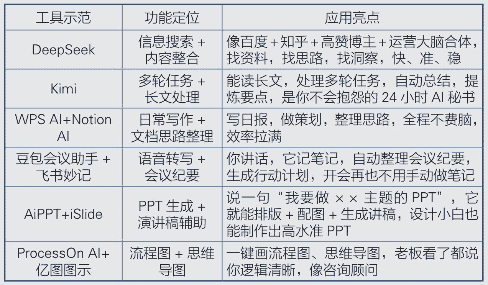

为让你用得顺、用得准、做出成果，我们把高效工作模型与智能实操紧密结合：

MECE原则：不重不漏，彻底厘清任务与结构；

SCQA模型：把逻辑讲得动人、让人听懂；

金字塔原理：在混乱中搭建条理分明的思维大厦。

每个模型都结合真实场景拆解，配提示技巧、可复制范例与执行步骤，不绕弯、不堆术语，极简实操，一看就懂，一用就爽。

## 新职场五力加AI

用对杠杆，不卷也能赢，你的效率爆发点=智能×职场能力×应用场景。

智能时代无人能靠单一技能混到底，五维全面升级，用智能强化每个职场属性。

协作力：能写、会说、懂内容→用智能生成内容、对话提效、多模态理解。

思考力：会问、会搜、会整理→让智能辅助检索、加工与结构化决策。

数据力：能算、会画、懂洞察→借智能处理数据、建模分析，让抽象数据可视化。

表现力：会讲、能说服、有逻辑→智能帮你写讲稿、出大纲、做PPT。

成长力：会规划、能复盘，助你持续进阶→智能协助管理时间、总结经验，助你成为超级个体。

真正的进化，不是学会几个提示，而是从技能提升走向认知飞轮，一步步变成自带系统、自动成长、持续进化的超级个体。

如果你觉得智能遥不可及却隐隐焦虑自己会被替代；如果你每天加班、做重复劳动、被迫处理杂事；如果你想用智能实现效率跃迁、做出成绩、升职加薪甚至搞副业。

那么就让我们一起学会用智能做杠杆，优雅上分，不靠拼命靠省命，开启不内卷的进化之路。

# Part1 生存法则：巧劲压过蛮力

大家心照不宣的一个事实：这几年工作越来越忙，却越来越不赚钱。身体累，心更疲。每天睁眼想辞职，闭眼又怕失业。问题出在哪？不够拼，还是时代变了？

说到底，努力不等于回报。有人跳槽立马涨薪30%，有人死守岗位熬七年不涨一分。你谈拼命，老板谈业绩；你讲辛苦，老板只认结果。

无论自然界还是职场，都有两条残酷法则：适者生存，二八法则。

适者生存，停滞即出局

这个世界从不偏爱最努力的个体，而是偏爱最能快速适应变化的人。

英国工业革命时期，一场黑化风暴悄然上演。煤烟污染让城市上空乌烟瘴气，树皮变黑。原本在白桦树皮上伪装出色的灰色桦尺蛾，成了鸟类眼中的反光靶，而罕见的黑色桦尺蛾因低调沉稳得以藏身焦黑树皮，逃过一劫。

短短数十年，曼彻斯特地区黑色桦尺蛾占比从不足5%飙升至98%。这不是加班练飞行，而是环境变了，它刚好扛住。

这就是生物进化对剧变的自动响应。再看变色龙，它能在炎热沙漠生存，不是因力量最强，而是能随环境调整肤色，既避敌又调节体温。

这些生存法则在职场同样上演：技术快速更迭，智能工具层出不穷；行业不断洗牌，岗位被重构、技能被淘汰；你不会用智能，别人会；你还在死磕Excel公式，别人一键出图、总结、生成报告。

你不是不努力，而是努力得像只不会变色的蜥蜴，最终被环境淘汰。

二八法则，少数人占领红利

二八法则由意大利经济学家帕累托提出。他发现意大利80%的土地被20%的人占有。这一规律适用于财富、自然与职场。

蜂群中，20%的蜜蜂承担80%的采蜜，其余80%有的偶尔出勤，有的干脆摸鱼飞一圈就回。像极了办公室里的静悄悄高手。

职场亦然：80%的业绩来自20%高效员工；80%的创意来自20%深度思考者；80%的收入与资源被20%管理层或核心岗位拿走。

想成为被看见的20%，就要做对的事，选对工具，站对风口。成为高产头部打工人；剩下的80%则在旧工具旧模式里卷死自己。

你是哪种打工人？

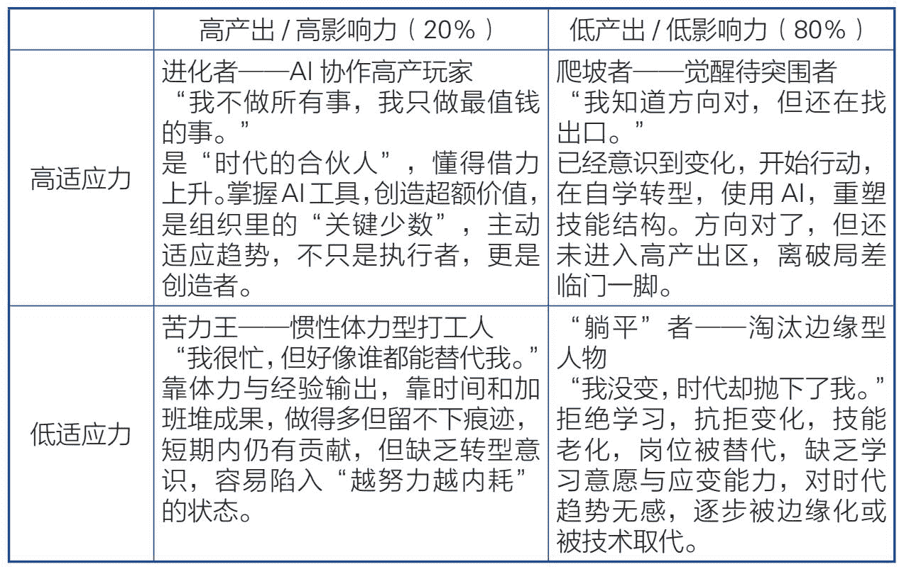

在技术飞奔、变革频发的时代，打工人已不只是上班八小时：

有人已觉醒，主动拥抱智能，成为进化者，把时代当队友、工具当外脑；

有人在摸索，踏实攀向高效区，是跃迁边缘的爬坡者；

有人仍用传统方式死磕，加班换绩效，做着无声内耗的苦力王；

有人不学不变，不慌不忙，逐渐滑向淘汰名单。

时代不等人，奖励的从来不是谁最努力，而是谁最懂得借力。努力加效率才有价值。

你不必完美，但可以开始升级。智能时代的打工人，不再看谁能熬，而是看谁能省：省力、省时、省脑，用智能解决低价值重复劳动，把时间留给策略、判断与创造。

别再用生命打工，那不叫忠诚，叫自费演出。升级为智能协作高产玩家，智能正是帮你从笨功夫中抽身的最优路径。

## 一、AI会抢饭碗吗？

这是每个打工人都在问的问题。或许更关键的是：谁会被取代？谁还能留在牌桌上？

从ChatGPT到DeepSeek，再到Sora、Manus，智能工具几乎每周更新，几分钟生成一页PPT、一键生成年度总结的视频刷屏。视频生成模型Sora以逼真画面震撼影视圈，特效师、剪辑师一度陷入集体焦虑，仿佛技能一夜过时。

朋友圈同事炫耀：我用智能搞定整份方案。

博主神乎其神：不会用智能等于被淘汰。

媒体标题火上浇油：机器干了我的活，价格是我的千分之一。

而你，可能还在敲日报、改文案，心里刺痛：是不是全世界都在用智能，就我还在手动搬砖？

别急，这份焦虑可能来自认知陷阱——幸存者偏差。

什么是幸存者偏差？你看到的智能世界可能不完整

幸存者偏差指我们往往只看到成功者的声音，而忽略庞大的沉默群体。

在智能浪潮中，你刷到的用智能省时省力内容，多来自懂得尝试智能、能表达传播的人，他们本身就不易被取代。这些人是话语场的幸存者。

另一群看不见的人才是沉默大多数，你几乎听不到他们的声音——他们才是真正处在被替代边缘的人。他们几乎不用智能工具，不在知乎问如何用智能写报告，甚至连智能是什么都说不清，更别谈使用。在变革中他们既无掌控力也缺抵抗力。而他们的离开，很少引起注意，更不会被写进报告。

他们从事的是标准化、重复性强、创造力要求低的静音岗位，比如基础客服、资料录入、初级图文编辑、模板美工，以及金融、法律、市场等领域的辅助分析。这些岗位共性是：标准化、重复性强；技能门槛低、创意要求少；没有主动接触智能的机会，也缺乏表达与学习渠道。

这类岗位对效率依赖远大于创造力，一旦智能达标，替代几乎是静音发生的。

这类打工人不是不努力，而是未更新。他们没有学习通道，也缺乏预判变革能力，于是被时代渐渐边缘化。

如今智能焦虑整体呈下降趋势：担心智能导致失业的员工比例从2022年的53%降至10%（美世2024）；尽管智能能写代码新闻铺天盖地，6万多名程序员中仅12%认为智能威胁到现工作（StackOverflow 2023）；全球公众对技术进步态度的调查显示，认为技术破坏生活的比例在2022年见顶后回落，尤其在中国大幅下降，说明智能焦虑正从群体恐慌走向理性共处（益普索2025）。

表面愈发平静，越来越多的人意识到智能不再是洪水猛兽，而是生产力新引擎。但问题是，这些数据的答题人本身就属于幸存群体。他们不是被替代候选人，而是智能早期用户。真正被替代的那群人，甚至没有资格参与问卷。

## 智能转型的阵痛期

技术革命的浪潮中，红利从不立即兑现，它总是先以阵痛形式到来。每一次技术升级，都会先下沉一批人。

今天面对智能的焦虑、恐慌、转型压力，并不新鲜——历史早已上演多次。

第一次工业革命：手工工匠的愤怒与出局

18世纪60年代英国工业革命，蒸汽机与机械化普及，纺织、冶金、交通效率跃升。但谁先失业？正是靠手工技艺吃饭的工匠。他们技能熟练、工作勤奋，却在机器面前彻底失去竞争力。愤怒之下，纺织工人掀起卢德运动，砸毁机器，抗议被取代的命运。

他们不是不努力，而是突然失去努力方向。机械大潮来临时，无人等他们。

中国国企改制：铁饭碗碎了，几百万家庭脱轨

再看中国自身的转型阵痛——国企改革。

20世纪90年代中国启动国企改革，抓大放小、减员增效、下岗分流。这一政策加速了国有经济市场化，也带来广泛阵痛。

据官方数据，1998至2002年间，全国累计下岗职工超过2700万人。这波下岗潮重构城市就业结构，也深刻改变几百万家庭生活轨迹。

时代突然换了打法，很多中年工人一夜从编制内变成待岗人员；技能陈旧、观念滞后，难以适应市场；情绪上的身份断裂，一度成为社会矛盾焦点。

智能时代：熟悉的阵痛，换了包装

# 当AI开始挤位，你在忙什么

眼下职场里正悄悄重演“工具夺饭碗”的老戏：看起来还算保险的客户服务、视觉设计、运营管理岗位，几秒钟就能被工具代劳大半；擅长套路化撰稿、流程化经营的手法，转眼就能被批量复制；靠工龄堆起来的旧本领，撞上毫秒级的即时反馈后，含金量迅速被稀释。

18世纪英国的工匠、90年代离开体制的国企职工、现在对人工智能心生不安的上班族，体感惊人相似：都在转型起点被“个人能力与时代需求错位”拉开。

这种错位在换挡期最刺痛：旧岗位加速萎缩，新岗位尚未成型，教育培训来不及跟上，个人行动又总慢半拍。

从砸机器的工匠，到下岗的国企员工，再到今日被工具无声挤占的打工人，历史反复说明一个事实：技术不会把所有人都毁掉，也不会为谁停步。

历史从不给旁观者让路，我们正处在智能阵痛期。想让阵痛变短，只剩一条路：主动转身、提前补课、系统升级。

### 阵痛另一面，新生态在生长
每一次生产方式的跃迁，短期是岗位减少，长期是就业结构的重塑。

第一次工业革命时，手工业者一夜失业，社会动荡。但工厂制度随后成型：部分工匠转为机台操作员，出现流水线主管、设备维护技师等新角色；企业主配齐调度、统计、会计，形成早期组织雏形。

这些岗位技术诞生时并不存在，却在新秩序里迅速成为骨干。拼不过机器的人，最终学会了指挥机器。

抓大放小后，超过两千七百万名国企职工离开岗位，家庭失去体制兜底，就业体系被撕裂。与此同时中国进入市场化、全球化快车道，新机会被打开：原行政科长创办物流企业，车间班长成长为民企生产主管；民营企业、外资、金融机构大量吸纳具备流程意识、纪律性强的下岗人群。

改制初期动摇了部分人的安全感，也为社会流动打开更宽通道。很多人被迫离开体制，却在市场里完成职业重启。

再看近二十年：电商冲击传统商场，却催生客服、物流、直播、平台运营、美工、短视频剪辑等几十个新工种；外卖改变堂食逻辑，却带来骑手、调度、算法工程师、后台内容运营等协同共生业态。

技术带走的是旧岗位的逻辑，留下的是新岗位的规则。跨过去，就有机会接住第二曲线的红利。

### 没跟上节奏的人会被自然筛选
每一代人都经历工具跃迁的不适应，但结局总是落到主动转型的人身上：工业革命塑造现代职业管理，国企改制打开民营经济空间，电商外卖催生数字劳动形态，而人工智能正在重构思考、表达、执行的全链路。

当下路径遵循先替代后创造。它会先动无需深度思考的岗位，例如标准化撰稿、报表汇总分析、模板化美工、客户应答脚本整理。

与此同时，一批新能力画像也在形成：

·能借助智能工具起草、做策略的内容策划；
·善于与智能工具协同产出的创意设计师；
·懂指令词、会微调模型的普通运营；
·会用智能工具做整理与分析的市场分析师；
·能够搭建智能工作流的项目执行者。

并不需要成为工程师，只要会用，就已站到多数人前面。

每次转型都有牺牲者，也有赢家。关键在于站哪一边。

真正该问的不是我会不会被替代，而是是否已经开始使用智能工具，还是仍停留在被观察、被评估、被逐步替代的那一侧。

智能工具不会取代所有人群，但一定会先取代那些不用工具的人。最大的风险不是焦虑，而是看着别人起飞，自己还在观望。

## 二、智能办公雷区：避开三大陷阱
智能工具能写文案、做表格、绘图、剪视频，看似无所不能。用得越久会发现它并非万能，操作失误甚至会把自己坑进去。以下三大陷阱，每个使用者都要有基本认知。

### （一）保密底线：别成为无意识的泄密者
工具正在帮你干活没错，但它也在吸收你喂进去的材料。

帮我分析这份合同、润色商业计划书、写个面试评价，越来越多的人把智能工具当成万能秘书张口就来。可这些看似普通的内容里，可能藏着公司最敏感的红线。

比如客户名单、投标策略、薪酬结构、项目预算、内部制度、尚未对外发布的战略计划，一旦泄露，轻则客户流失，重则合同作废、股价波动，甚至触犯《中华人民共和国反不正当竞争法》。

智能工具不是办公室里的私人助理，而是联网的训练器。多数公开平台如 ChatGPT 等，默认处于开放训练状态。你没授权，但你什么都没关，就等于默认同意。

用户协议里常写提交内容可能用于模型训练和服务优化。直白说就是，你的一句话，可能成为别人的训练样本。

2023年，一名三星工程师为了提升芯片开发效率，将含机密的代码贴进 ChatGPT 优化。代码被上传至海外服务器，核心参数外泄，直接触发三星内部安全警报，后续企业纷纷收紧员工使用 ChatGPT 的管理。

教训很清楚：智能工具能省事，但不是你家的私人物品，它是开放系统，是你输入它学习的大胃王。

高频泄密场景：

1. 整份文件直接上传翻译润色。财务报表、内部策划文档被上传后，可能同步到云端，成为潜在训练素材。
2. 片段化暴露被拼凑。今日让工具写竞品分析，明日润色预算说明，后日补充客户画像。零散信息被模型自动拼合，就能还原投标方案全貌。

守住保密底线的四个做法：

第一，关闭默认训练选项。进入设置或偏好，找到允许用于模型训练的开关，手动关闭。

第二，绝不上传完整敏感文件。需要处理时，截取片段、脱敏后再输入，合同、计划书、财务表不要整体丢进去。

第三，处理公司级项目用企业级模型。优先选择带权限管理、数据隔离和隐私协议的服务，如 Microsoft365 Copilot、Baidu Comate 企业版等。

第四，公众模型只问碎片，不曝核心。可问如何优化这段话、怎样让语气更正式，不要透露你是谁、项目是什么、客户是谁。

智能办公时代，最危险的不是间谍，而是无意识泄露信息的普通员工。你不是泄密者，但可能成了搬运工。你在输入框敲下的每一个字，都可能成为别人的答案。

### （二）隐私保护：别让工具比家人更懂你
工具越懂你，用起来越顺。但一旦它太懂，风险就来了。

比如你随手问我这个岗位还有哪些晋升路径，我在上海，35岁，做销售，接下来该怎么规划。听起来是职业焦虑咨询，实际上你已经交代了位置、年龄、职业、心理状态。这些信息可能被用于训练，也可能成为未来钓鱼的蓝本。

老式钓鱼短信是快递需补缴8元，点击链接。现在的智能钓鱼已经升级为小李，我是你老板张总，财务出了点问题，马上转一笔应急款到这个账户。语气、口吻、甚至老板的脾气都被模仿出来。

2019年，英国一家能源公司就被智能语音诈骗骗走22万欧元。CEO事后说我完全以为是董事长打来的电话。

这种攻击模式被称作提示词注入加社交语境挖掘。用你留下的线索复制你，再去钓你、钓你的客户和同事。

自保的隐私护身术：

你防黑客、防病毒，却往往没防住自己在工具面前自报家门。

优先使用通过《生成式人工智能服务管理暂行办法》备案的合规产品，如百度文心一言等，并定期清理记录，关闭摄像头、麦克风、剪贴板等不必要的权限。

操作时记住五点：

1. 默认脱敏。不要输入真实姓名、住址、身份证号、电话号码。写简历也用张三、139××××××××、某985本科代替。
2. 关闭历史记录同步与开放训练。找不到开关的平台，建议直接更换。
3. 不要让你是谁太容易被拼出来。提问时用一个打工人代替我35岁在上海做销售。
4. 谨防智能语音钓鱼。电话里提到你的工作经历、家庭情况、具体项目，一律二次核实。别靠声音判断真假，智能工具能复刻你爷爷的声音。
5. 慎用社交标签，慎发视频语音。你以为是展示自己，实际是给建模喂素材。带公司名、职位的短视频或语音留言，是建模的宝藏。

智能时代的隐私，不靠藏起来，靠少说、少传、脱敏、验证来维系。你说的信息可能毫无秘密价值，但在工具手里能被拼接、生成、复现、伪装。

### （三）幻觉问题：模型一本正经的胡编乱造
工具最危险的不是不懂，而是不懂还装懂。这就是幻觉。

专业定义是：在缺乏真实数据支持时，大模型凭空编造听起来合理却不存在的内容。通俗说就是，工具不装傻，它装懂。

常见表现：

1. 编造数据、杜撰事实。例如让它列2023年中国十大科研成果，它能写满一页，其中几项从未发生。
2. 虚构论文与文献。给出的参考文献作者、期刊、页码齐全，查数据库却根本不存在。
3. 创造不存在的人名、机构、案例。例如2023年，由东亚未来智能伦理联合会和国际意识觉醒研究所联合发布报告指出。高大上，却查无此地。

2023年，美国律师史蒂文·施瓦茨在一次航空公司诉讼中，用 ChatGPT 代查判例并提交法庭。结果列出的经典案例全是虚构的。法官在判决书中写道法庭对智能工具的能力无意见，但对律师未核实资料的行为持严正态度。律师被迫道歉，面临纪律处分。

幻觉的根源是大模型的语言本能。它不是先查证后回答，而是先按概率拼出最像的句子。问题越缺乏上下文，工具越会用自信掩盖无知。

四个降幻操作：

1. 要求引用来源并逐一复查。哪怕是假链接，也能帮你判断是否在编造。
2. 不要问它自己不知道的问题。例如列出 ChatGPT 支持的所有算法细节及源码、生成某教授2023年最新演讲摘要，它会假装知道。
3. 工具输出不等于事实，必须人工再审。报告、简历、论文、行业分析等涉及真实信息的内容，工具只能当助手，不能当代表。
4. 多模型交叉验证。用不同模型回答同一问题，差异过大就要警惕幻觉。

工具说错话时，不是它坏，而是它太想帮你写点东西。强输出也会带来强编造。所以，判断永远靠自己。

## 三、智能杠杆：普通人极简进化公式
你有没有发现，有些人看起来不被职业定义限制，身份切换像切 Wi-Fi 一样快。今天讲台上侃侃而谈，明天实验室里改写规则，后天在社交平台一条动态引爆话题。他们像开了挂。

达芬奇不仅是画家，更是雕刻家、建筑师、音乐家、数学家、工程师、发明家、解剖学家、地质学家、制图师、植物学家、作家。他把艺术与科学、感性与理性揉在一起，倒出了整个文艺复兴。

苏轼写下但愿人长久，却也擅长书法、绘画、下厨，传说发明东坡肉。被贬时他修堤治水、设计灌溉，一边种菜一边写词，把放逐过成人生实验。

埃隆·马斯克把多线程写进履历。特斯拉让他电动世界，SpaceX 让他射向星辰，Neuralink 直通大脑，无聊公司在地底开疆，X 平台则成为他掌控舆论的舞台。每一步都在重写行业剧本。

他们的耀眼不是因为时间更多，而是找到了结构性杠杆和系统级进化。公式可以概括为：

人生商业模式=能力×效率×杠杆

能力决定你能提供多少有价值的输出；效率决定输出速度；杠杆决定价值能影响多远的人。

过去，这个模型掌握在少数精英手中。他们有资源、人脉、资本，能借平台、渠道、人力做乘法。大多数人只能靠时间堆业绩、靠体力换报酬。

智能时代最大的变化是，杠杆入口被彻底打开。智能工具把原本只有高段位玩家才能用的工具，放进了每个普通人手里。它不是天才专属外挂，而是全人类可用的效率放大器。

你不需要熬夜练技能、死磕算法，只需要看清规则、升级方法，就能点燃超级个体。

智能时代适用的极简进化公式：

个体进化力=好奇心×提问力×智能杠杆

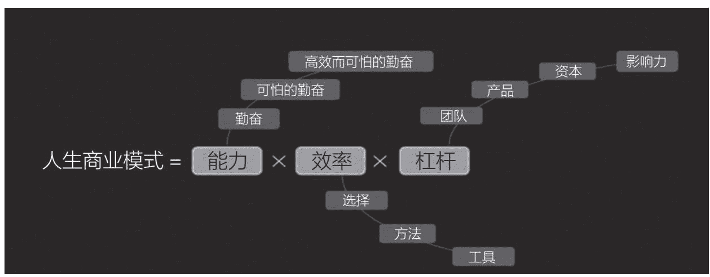

（图片整理自：刘润《底层逻辑：看清这个世界的底牌》）

好奇心：智能工具能写代码、画图、编故事、查数据，今天的能力不再是技能堆砌，而是思考力加好奇心的复利。你要保住的不是技能，而是持续发问的欲望。你能问出别人没想过的问题，才是不会贬值的底层资产。

提问力：效率的分水岭不是会不会用智能工具，而是问不问得准。高效的人构建了清晰的提问—生成—复盘—优化回路。工具不是代工厂，而是共创者。

智能杠杆：从内容生产到认知放大。以前的杠杆是平台、资本、人脉、流量，现在智能工具本身就是第一杠杆。它能帮你高效产出方案、脚本、文案；让你在打工之外构建第二增长曲线，做课程、播客、视频、副业；还能借内容触达流量，完成从普通人到超级个体的跃迁。

杠杆不是风口红利，而是你能否把智能工具用成价值放大器。从我一个人能做多少，到我加智能工具，能多快触达、影响、输出。

智能工具不是让你成为更会打工的人，而是邀请你重新定义自己。你不必成为马斯克或达芬奇，但可以成为拥有自己的表达方式、成长路径和价值扩张系统的那个人。

这个时代最大的公平在于：会用智能工具，就掌握了逆风翻盘的第一顺位杠杆。智能时代的从业者，该做的是什么，你心里应该已有答案。

人工智能不会让全部工作消失，它在重塑工作的方式。不要盲目乐观，也不要被负面情绪困住，积极学习、主动尝试、持续迭代，才是这轮变化里最稳的底牌。

这个时代奖励的不是谁更拼命，而是谁更会借力。有人把 AI 当成日常搭子，一天干完常人三四天的活；有人把它当外脑去孵副业；也有人仍在用 Ctrl C 与 Ctrl V 硬扛。AI 不是对立面，它是人手可用的提速器，是最大的一把杠杆。所以要做到：

√ 保持好奇，别让“我不会”把新工具拒之门外；
√ 练好提问，把清晰指令写出来，才能拿到 AI 的真价值；
√ 启动杠杆，让 AI 省力、省时、放大影响，而不是原地踏步。

与其担心被淘汰，不如先把自己升级。别等系统推送更新，自己先迭代。

# Part2 清醒工作指南：给工作分层

每天最直白的烦躁只有一句：不想上班。

社交平台上被疯转的那句“不是我不想上，是工作不让我快乐”，听起来像吐槽，其实点破了职场的真相：我们并非不努力，而是没把努力变成值得的事。

进职场的人几乎都会撞上幻灭：以为的工作是诗和远方，现实是长工时、PPT 排版、指标压顶、改不完的文档。起床像上战场，在抱怨和赚钱之间横跳，最后只能用“为了房租”来撑住。

工作的底层逻辑其实很朴素：用时间与能力去换金钱与可能性。我们把技能、注意力、工时打包给公司，公司回馈薪资、资源、平台与机会。既然是交换，就说明暂时还做不到单打独斗。那不如承认交换属性，把这笔买卖做得更划算。

提升回报率的底层思路：

1. 结果导向：只有被认可的价值，交换才成立。一天下来是勾完了清单，还是交付了结果？无论主业还是副业，都要会定方向、拆任务、交付成果，有可交付的产出才有变现前提。
2. 复利学习：好岗位不是混出来的。尤其是内容、设计、营销、产品这类创意方向，用户兴趣、技术工具、流行趋势都在动。今天的爆款套路明天就失效。持续输入加灵活输出，才是长期抗风险的能力。
3. 节奏成长：别被一夜成名带偏。大多数人都是从手忙脚乱到游刃有余。别问适不适合，问今天是否比昨天多一点理解。只要持续进化，这场交换就不会亏。

给手头的活儿分类

我们坚持工作的根本理由，是想看到价值感，可能是钱、晋升或能力成长。而付出的最大成本是愉悦感。抗拒的往往不是事本身，而是它带来的快乐缺失。

既然躲不开，就给待办清单分层：

① 价值高+体验好：理想中的梦中班。成就感与乐趣兼得，做着就上头，最值得加码。
② 价值高+体验差：现实的主力输出。过程枯燥但价值明确，是拿薪资、走通道的基础。
③ 价值低+体验好：短暂的情绪安抚。聊天、摸鱼、刷短视频，爽完后空虚又愧疚。
④ 价值低+体验差：彻底内耗的黑洞。没意义没乐趣，还耗时间、拖状态。

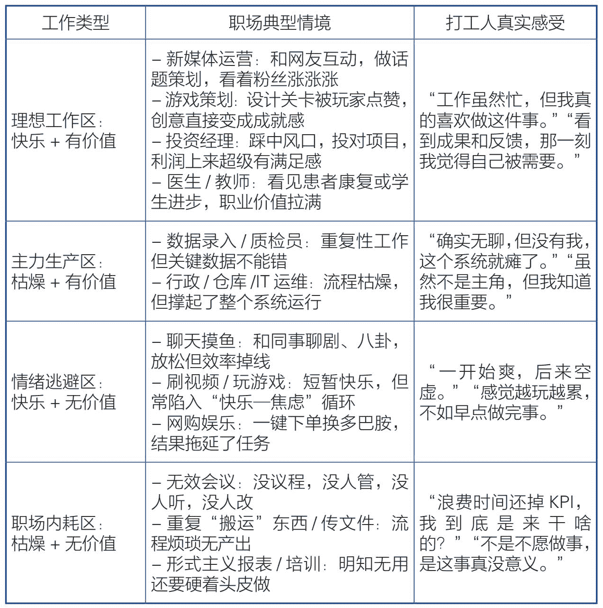

看清类型，才能掌控时间

职场待办里四类事项混杂轮换。一旦看清时间流向、哪些在增值、哪些在消耗，就拥有了取舍权。

自问：什么值得坚守？什么该简化？什么能交给人工智能？什么该果断放弃？

第四类既无趣又无价值的事项，优先清理：能砍就砍，不能砍就优化或自动化，推动流程改进、向上反馈、用模板或 AI 替代，哪怕省十分钟也是在夺回精力。

别在零回报的交换里继续透支情绪和工时。

第一类：有趣且有产出的高光区，是你的时间飞轮。尽量扩大占比，争取更多同类机会，把热爱沉淀为个人标签，形成长期复利。

第二类：枯燥但有价值的结构化事务，最适合 AI 介入。让 AI 处理流程、重复、格式化的部分，你保留关键判断与推进，让苦活既快又轻松。

第三类：短暂快乐无产出的情绪逃避区，不必完全压抑，要结构化转化。把刷到的灵感、金句交给 AI 梳理提炼，就能变成可发布、可交付、可变现的创意资产。

接下来是迁移，不是反思。

清醒的打工人不是靠忍，更不是靠戒掉刷短视频，而是靠有意识地把工作内容从低价值区搬到高回报区。

√ 重复性操作交给 AI，判断留在自己；
√ 碎片灵感交给 AI，创作变得可复用；
√ 把高质量时间投注在能让你上头又出成绩的地方。

要的不是更忙，而是更精准。今天就重新分配注意力与工具使用权：让 AI 解决第二类苦活，把第三类享乐尽量挪向理想区，放大第一类价值飞轮。

从此，每小时工作不再是被安排，而是被设计。

## 一、理想工作区：把高光放大成复利

√ 交易原则：你输出热情与能力，市场回馈金钱与认可。
√ 评定标准：你热爱这件事，别人也愿意买单。创意与价值双线并进，工作成为个人标签。

很多人不是没激情，是被琐事埋没了爽点。每个岗位都有值得放大的高光时刻，每个人都有独特性，要用 AI 把才华放大。我们需要：

### （一）找准你的职业高光区

借助 AI 复盘盘点：你在哪些任务上最投入？获得正向反馈最多？最被认可？把热爱与价值对齐。

具体步骤及案例：

【通用版提示词】

把工作日常交给 DeepSeek，让它帮你梳理前景。

提示词：
我是线上平台公司的人力负责人，我最近的工作任务是“制定招聘计划；筛选简历并安排面试；对候选人进行人才评估与测评；与各部门沟通员工培训需求；薪酬体系设计与优化”，请帮我总结其中哪些部分最能体现我的创造力和核心能力，并解释为什么。

DeepSeek 回复要点：
作为平台类公司的人力负责人，以下模块最能体现创造力和战略价值：

1. 人才评估与测评，创造力五星。突破简历筛选，用游戏化测试、情景模拟挖掘隐性潜力。需要结合企业文化设计维度，用数据建模人才画像，预测适配度，是从执行走向战略的关键。
2. 薪酬体系设计与优化，创造力四星。突破固定职级框架，设计动态激励，如项目奖金、专利分红、弹性福利。需平衡市场、公平与成本，预判趋势，如技能津贴绑定 OKR，体现业务理解力。
3. 制定招聘计划，创造力四星。用人才供应链思路替代被动招人，通过流失率与业务增长预测建模量化缺口，为新兴岗位设计技能嫁接培养路径，和高校联合前置储备。体现战略解码与数据决策能力。

行业迭代快、流动率高、岗位模糊，上述工作需要创造性解决问题、跨领域整合、组织影响力建设。建议建立人才数据看板量化招聘 ROI，用 AI 面试官处理初筛，设计技能银行盘活内部能力。

继续提问：
很好，我在从事“人才评估与测评”相关任务时，觉得自己非常擅长，我希望把这一方面发展成我的独特优势，并创造更大的价值，请站在个人发展的角度，给我切实可行的方案及建议。

DeepSeek 回复要点：
方案方向包括：

深化专业能力，持续学习测评理论、心理学、管理学，精通大五人格、DISC、结构化面试等；精进数据分析，学会描述性统计、相关性分析、因子分析，用工具提效；关注行业新研究，及时应用。

优化测评流程与方法，测评前和用人部门深度沟通明确岗位关键挑战，制定可衡量目标；组合使用心理测评、行为面试、案例分析、小组讨论；建立标准化流程保证一致性。

强化业务协同，参与业务会议了解战略痛点，提供定制化测评方案；基于结果给选拔、培养建议，推动人才规划；保持沟通增强信任。

打造个人品牌，保持专业形象，输出文章、报告、参会分享经验；提供优质测评体验。

拥抱技术，熟练使用北森、才智网、i 人事等系统，探索 AI、大数据、机器学习在测评中的应用；做数据挖掘，发现人才趋势。

结果转化应用，为候选人提供个性化发展建议；结合人才盘点支撑继任计划；根据结果倒推优化招聘与选拔标准。

【用高光时刻发展副业版提示词】

提示词：
我是线上平台公司的人力负责人，我最近的工作任务是“制定招聘计划；筛选简历并安排面试；对候选人进行人才评估与测评；与各部门沟通员工培训需求；薪酬体系设计与优化”，同时我经常关注小红书，我希望将自己最有价值的工作进一步发展成自己的副业，请帮我筛选适合精进的工作并给出理由。

DeepSeek 回复要点：
适合精进的副业方向：

人才评估与测评，市场需求大，可为猎头提供服务或做独立咨询。精进方向是学习大数据分析在测评中的应用，持续更新方法。

薪酬体系设计与优化，企业需求旺盛，可提供咨询。精进方向是提升数据挖掘能力，研究行业案例，关注合规变化。

招聘与面试，可提供外包或兼职猎头。精进方向是拓展新渠道，提升寻访技巧，研究市场趋势。

培训与发展，可设计课程体系或推荐师资。精进方向是学习课程开发，研究方法优劣。

人力资源咨询，覆盖组织架构、规划、绩效等，单价高且提升影响力。精进方向是学习前沿理论，积累案例，考取证书。

自媒体运营，在小红书分享 HR 知识、职场故事，建立品牌后可做广告、付费咨询、课程变现。精进方向是提升写作拍摄剪辑，研究平台规则并互动。

AI 已帮你点燃可能性。

### （二）把高光时刻复制扩散

先固化，再优化。筛选出高光后，不要停留在偶尔快乐，要战略性复制。将爱干且能做好的项目拆成 SOP，用 AI 批量复制并持续优化。

结合上一步 AI 分析的高光，结合实际爽点拆解：

提示词：
我在对候选人进行人才评估与测评方面已有经验，我熟悉线上平台各岗位的面试技巧。我希望进一步拆解我的工作经验，固定成人才评估的 SOP。

DeepSeek 输出框架：

一、明确评估目的
1. 确定业务需求：和用人部门沟通，明确招聘或内部评估的具体需求，包括职责、任职资格、技能、经验等，判断是选拔、晋升、调动还是发展用途。
2. 制定评估目标：基于需求明确目标，如专业技能、综合素质、协作、创新等，确保清晰具体可衡量。

二、确定评估内容

人才测评落地九步法与经验复用指南

1.岗位画像拆解：对照岗位说明书与一线业务实操，系统梳理目标岗位在关键胜任力、专业知识、技能水准、人格倾向及行为模式上的具体要求，锁定后续评估的核心维度。

2.指标体系构建：在确定维度基础上细化为可操作的测评指标，明确每项指标的内涵定义、赋分权重与评分细则，确保体系兼具科学性、效度与可执行性。以程序员岗位为例，可围绕编码实操、算法理解、代码规范与团队协作等展开。

三、选择测评工具与方法
1.工具甄选：依据评估目的与内容，从心理测评量表、在线上机编程平台、结构化行为面试题库、案例研讨工具、无领导小组讨论等多种手段中组合出适配方案，保证工具信效度良好。
2.方法确立：明确实施顺序与组合逻辑，如先以线上测评做初筛，再进入深度面试与案例分析；针对不同层级与岗位类型灵活搭配，以提升针对性与准确性。

四、设计测评流程与时间安排
1.环节规划：制定覆盖准备、执行、分析反馈的全流程节点。准备期完成通知发布与材料筹备；执行期组织候选人完成各项任务；收尾期完成数据整理、报告撰写并向用人部门交底，确保步骤清晰高效。
2.进度把控：结合工作复杂度与紧急程度，为各环节设定时间节点，形成完整排期表，并预留弹性缓冲以应对不确定因素。

五、实施测评
1.启动筹备：提前落实场地、设备与测评资料，保证环境安静舒适。向候选人发送正式通知，说明目的、流程与注意事项，便于其充分准备。
2.现场执行：严格遵循既定方案与规则，保持评估公平客观。面试官需熟悉提纲与评分标准，保持专业沟通，以准确判断各项素质。

六、分析测评结果
1.数据汇总：收集各工具产生的数据，进行清洗、归类与初筛，确保完整准确。
2.综合研判：运用加权平均、因素分析等科学模型，对多维度结果进行整合，识别优势短板，判断人岗匹配度与发展潜力，形成综合评分。

七、制订选拔和培养计划
1.用人决策：结合测评结论、岗位需求与企业战略，确定录用、晋升或调动人选。对未通过者提供具体反馈与改进建议。
2.发展规划：对高潜力员工依据结果制定个性化培养方案，明确目标、内容、方式与时间，如培训课程、轮岗实践、导师辅导等，助力能力提升。

八、反馈与沟通
1.内部沟通：向用人部门传递评估结果与决策依据，提供详细报告与建议，解答疑问以达成共识。
2.外部回馈：在适当时机向落选候选人提供表现性反馈，指出亮点与不足，体现专业与人文关怀，维护雇主品牌。

九、持续优化
1.成效复盘：测评结束后收集用人部门、候选人、面试官等多方意见，总结亮点与不足，为改进提供依据。
2.流程迭代：依据复盘结果优化流程、方法与工具，如更新工具版本、调整指标权重、精简环节等，不断提升科学性与效率。

继续提问，找到价值放大的目标：

我希望将此能力持续优化并迁移到其他企业和场景，请分析哪些平台或岗位更可能产生类似价值，比如哪些副业场景适合复用本职经验？

DeepSeek 输出：

人才测评积累具备较强迁移性，可适配多类兼职场景：

1.猎头公司。原因在于猎头需要快速精准匹配人岗，测评能力可支撑候选人筛选与适配度判断，提升交付效率。参考平台：科锐国际、猎聘等综合猎头机构，以及聚焦科技、金融、医药等领域的专业猎头。
2.人力资源咨询公司。原因在于咨询服务中测评设计是核心模块，经验可帮助优化方案与提升服务质量。参考机构：怡安翰威特等大型咨询公司，以及区域性人力咨询机构。
3.企业内训与组织发展部门。原因在于内部培训团队需通过测评掌握员工现状与潜力以制定培养与继任方案。参考对象：阿里巴巴、腾讯等大型企业的内训与组织发展岗位。
4.在线教育平台。原因在于可将测评知识产品化为课程帮助用户提升职业竞争力。参考平台：网易云课堂、腾讯课堂等综合平台，以及人啊人网等聚焦人力的专业网课站点。
5.人才测评工具供应商。原因在于供应商需要专家优化产品逻辑与方法以提升准确性与实用性，可提供咨询或参与研发。参考供应商：SHL、Caliper等专业厂商。
6.自媒体平台。原因在于通过内容输出建立个人品牌，扩大影响力并吸引潜在客户。参考平台：微信公众号、知乎、抖音等，可运营人才测评主题账号发布文章与视频。

### （三）将“热爱工作”转化为“个人品牌资产”

热爱若能借助AI转化为内容、作品与方法论，就能持续放大价值。极简资产化路径如下：

1.打造专业“内容”：把你写过的PPT、报告与项目复盘结构化沉淀为个人品牌素材库。粥左罗从新媒体小编做起，2015年入职月薪5000元，2017年任内容副总裁，2018年创号“粥左罗”持续输出职场表达与结构化思维内容，五个月内实现广告、社群、课程变现月入超20万，2020年团队12人年收入破千万，并出版多部畅销书。起点即是复盘过往工作。借AI整理资料提炼主线、生成草稿、制作图文，可加速复用。

2.开发专属“产品”：把项目中使用的工具与流程打包为可复用产品。张一鸣2006年加入酷讯做后端程序员，历经饭否、九九房后2012年创办字节跳动，亲力打造今日头条的算法推荐与信息分发系统，本质是动态个性化测评系统。王翌在谷歌负责产品设计，回国后洞察口语学习痛点，结合AI语音识别与评分技术创立英语流利说，2018年赴美上市，成为AI测评+教育代表。核心是把工作经验产品化放大。

3.用“咨询+培训”扩大影响力：培训是经验表达，咨询是价值交付，二者结合可实现破圈。黄启团从基层业务员起步，2006年起以心理学角度讲授沟通与情绪管理，2011年创办壹心理，将MBTI等测评工具系统化并联动科普、社群与训练营，用户数千万，测评使用过亿次，形成心理教育+内容IP闭环。热爱只有被表达、打包、交付才能产生职业影响力。

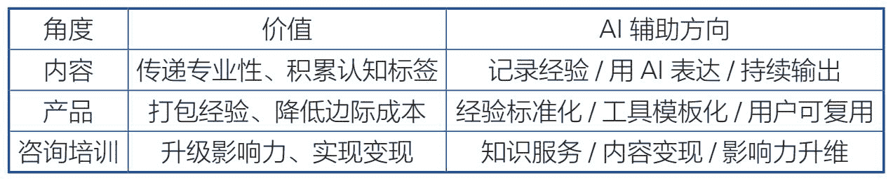
当你开始系统整理并对外输出“热爱”，它就不再只是兴趣，而是可持续放大的职业资产与品牌标签。

## 二、主力生产区——重复性高价值工作交给AI

在其位谋其政，职场中大量时间消耗在必要但枯燥的重复任务，如邮件处理、归档、数据录入，易产生忙碌却低产出的内耗。

信息压垮人，结构拯救人。以邮件往来与报告研读为例：十几轮来回要点混乱，十几页报告核心藏在后半段，决策来不及；上周五的资源申请到周一仍无回应，催问时对方却表示“没看懂需求”。据BBC报道，职场人日均处理约121封邮件，仅收阅写催四个动作即可消耗数小时清醒时间。AI擅长处理这类有用但无趣的工作。

这些任务可归为两类：
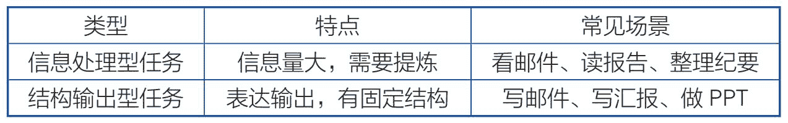
共性是重复、可模板化、结构清晰，正是AI的强项。AI通过提炼与撰写两大能力帮助减负增效，把精力留给判断、决策与推动。

可综合使用SCQA推理法搭建清晰逻辑，金字塔原理展开条理内容，二者配合AI如同表达外挂。输入问题即可理清思路，丢入资料即可得到要点。

信息处理型任务：让你不再大海捞针
面对邮件与项目汇报，可让AI完成自动提取关键信息如时间、金额、分工，总结当前进度与待办，回顾会议纪要的核心结论与责任人，形成一页要点。AI还能按文件名与正文生成不同长度的摘要，如百字速读、三百字汇总、一分钟通勤版，便于智能归档。

结构输出型任务：从措辞别扭到得体有力
SCQA框架即Situation-Complication-Question-Answer，常用于邮件、汇报等场景，帮助快速说明发生了什么、出现何种问题、需讨论何事、建议怎么解决，让接收者在短时间内理解。

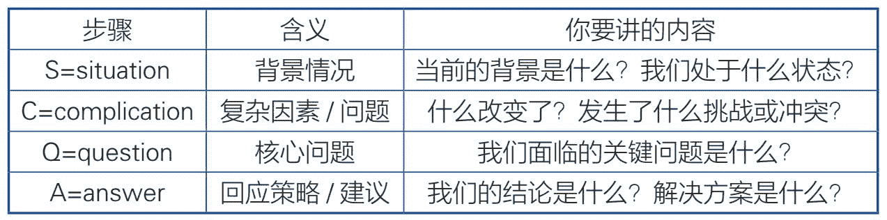
若内容需展开，可在SCQA基础上叠加金字塔原理，二者可嵌套使用，从引入到聚焦再到论证层层展开。

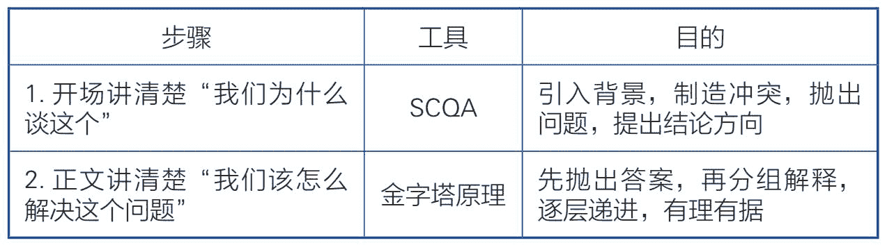
了解框架后即可用指令驱动AI。示例提示词模板：

请帮我撰写一封职场邮件，结构采用SCQA+金字塔原理。收件人对象：部门经理。邮件目的：申请人力支持。S背景：项目进入第二阶段。C挑战：需求变更导致进度受影响。Q关键问题：是否可调拨一名数据分析师。A建议：建议从Y项目借调两周。正文按金字塔展开answer，先给结论，再分三点论述理由，每点说明逻辑，最后以得体结尾邀请反馈。

对比常规邮件常因需求不明确被忽略，应把问答题转为填空题，先想清诉求与重点再生成。

示例提问：请写邮件给产品总监反馈项目延期并请求资源。背景已完成UI设计，因后端接口变更导致对接滞后，建议借调前端工程师两周协助联调。请用三点说明资源饱和、耗时可控、人选可直接上手。语气专业客观。

Kimi 回答示例：主题关于APP改版进度与资源请求，说明现状、问题、请求及三点理由，体现逻辑清晰与专业度。

AI 赋能办公提效：邮件写作、协作沟通与内容创作合一

2. 接口联调时长预估：经对当前接口变更范围的细致分析，只要适时补充人手，联调环节预计两周内可收尾，随后项目便可回到正常节奏，按修订后的计划推进。
3. 借调人选匹配情况：内部已筛选出一名可调配人员，来自另一条业务线，具备扎实的前端开发背景，对同类接口联调十分熟稔，可即刻投入，无需额外培训。
综合以上两点，现正式申请临时借调一名前端工程师配合接口联调，借调周期为两周，备选人已落实。其加入有望明显加快联调速度，帮助项目尽早回到既定轨道。
恳请您对方案提出指导意见，我们会同步调整排期并及时汇报后续进展。
你的姓名
具体日期

可将下列提示词直接复制到任意写作类 AI 工具，即可快速得到结构清晰、逻辑通顺、重点突出的职场邮件，按高频场景整理如下，可直接套用。

**对上汇报 项目延期说明提示词**
请帮我起草一封项目延期说明邮件，采用 SCQA + 金字塔原理组织。
收件人：项目负责人
S：原定 6 月 15 日完成功能开发，目前进度约 70%。
C：外包接口交付推迟且需求发生变更，导致整体受阻。
Q：需申请顺延一周，并重新确认交付节点。
A：建议交付调整至 6 月 22 日，同时启动备选资源应对机制。
请用金字塔结构从三方面说明原因：1）接口交付滞后；2）设计变更带来增量；3）团队负载偏高。
语气正式且偏向解决，结尾感谢后续支持。

**横向沟通 会议纪要与任务确认提示词**
请帮我写一封会议总结邮件，采用 SCQA + 金字塔原理。
收件人：跨部门项目成员
S：今日下午就×项目召开联席会议。
C：讨论议题较多，分工已初步明确，但任务清单未细化。
Q：需就“谁负责什么、何时完成”达成一致。
A：建议形成“任务清单+负责人+截止日”三栏表，于本周五前确认。
请用金字塔结构说明三点：1）会议要点回顾；2）关键任务分配草案；3）下一步节点安排。
语气轻松，引导协作，结尾欢迎补充反馈。

**温和催办 跟进未回复邮件提示词**
请帮我写一封温和跟进邮件，采用 SCQA 模型。
收件人：合作方/同事
S：上周曾就×事项发邮件咨询，尚未收到回复。
C：项目节点临近，相关决策需尽快明确。
Q：能否于本周三前确认合作方案？
A：如有建议或调整请一并告知，我们可同步修改。
语气礼貌积极、不施压，结尾表达感谢并期待回复。

**请假说明 附补位建议提示词**
请帮我写一封请假申请邮件，采用 SCQA + 金字塔原理。
收件人：直属主管
S：拟于 6 月 12 日至 14 日请假 3 天处理家事。
C：假期期间原定 6 月 13 日下午有一场客户会议。
Q：希望获批请假并安排同事代为出席。
A：已提前准备会议材料交接给小李，6 月 15 日后由我负责复盘跟进。
请用金字塔结构说明可行性：1）提前完成交接准备；2）同事熟悉项目背景；3）后续复盘由我主导。
语气友好得体，体现责任感与安排清晰。

举一反三，灵活运用：AI 最擅长结构化表达。你可以用 SCQA 作为开场引子迅速点明问题与目标，再以金字塔原理作骨架系统展开观点。写汇报、申请、建议类邮件时，先用 SCQA 一句话点题，再用三点展开；演讲时开场一分钟用 SCQA 抓注意，随后五分钟用金字塔展开；做 PPT 时首页用 SCQA 交代背景与主张，后续各页用金字塔填干货。期待与 AI 协作，写得更清晰、讲得更有力、表达更具说服力。

## 三、情绪逃避区：把“玩”转为“产”，借助 AI 实现创造力转化
刷完二十分钟短视频，脑子里都是“哈哈哈”，结束后却叹气：“我刚……干了啥？”和同事闲聊半小时，天南海北聊得热闹，文件一个字没动，PPT 仍是空白。这类松弛任务带来即时满足，却容易让注意力碎片化。
“开心是开心，怎么有点空虚？”
我们称之为情绪逃避区——用“伪生产”掩盖真实焦虑，回避真正该做的事。
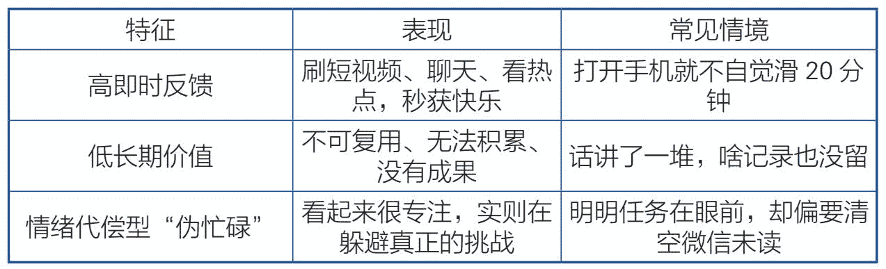
很多人发誓戒掉，反复卸载短视频，觉得浪费可惜，但不久又默默装回。类似行为并非毫无价值，也不必强迫一步到位，而是可以转化。
当被结构化后，“玩”才可能变成“创”；当情绪被提炼后，创意就能变现。
不建议压抑爱刷爱聊的冲动，而是借助 AI 把这些快乐瞬间转化为内容资产，进入数字创作者的高效闭环。

AI 如何把“玩”转“产”？实操策略如下：

聊天记录→内容灵感草稿
职场八卦里也藏着洞察。你可以把朋友讨论的热点、日常吐槽丢给 Kimi，让它提炼成可发布的观点金句，手机长按说话，把听到的有趣内容直接让 AI 解析：
提示词示例：
请基于以下对话，提炼 3 条适合在小红书分享的“职场沟通避坑法则”。
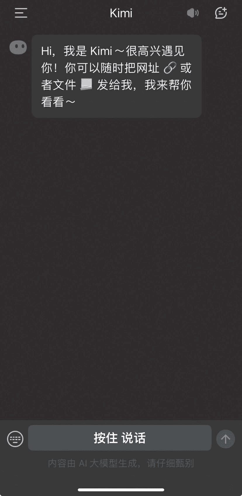
刷到的好内容→结构化收藏/复述
别只点赞收藏。用 AI 帮你提炼重点、延展表达：
提示词示例：
请参考以下链接，帮我写成一段适合发在公众号上的思维笔记，要求结构清晰，有金句。

情绪吐槽→写作素材/自我洞察
对工作、老板、客户的吐槽，其实是职场观察力的体现。交给 AI，它能帮你变成：
·一个爆款微博文案；
·一段心理复盘式的自我梳理；
·一份主题为“办公室迷惑行为大赏”的创意提案草稿。
清醒的数字时代职场人，不是永远自律如铁，而是懂得：
“既然忍不住要刷，那就顺手刷出价值。”
把娱乐行为变成素材库，把情绪表达变成创意素材库，你就能从“情绪逃避者”转变为“结构化表达的轻创作者”。

# Part3 打工人“懒人公式”：AI 协作力

AI 基础三会：会写、会听、会看
AI 时代率先受益的，不是程序员或算法研究者，而是打工人。
别惊讶，AI 的真正价值不是让你更拼，而是让你更省力。
每天 9 到 6 的时间表里，有多少小时在“真正工作”？更多时间消耗在重复劳动上——写周报、查资料、调格式，搬来搬去、改来改去，像被 Excel 和 PPT 支配的仓鼠。
而这些恰恰是 AI 最拿手的。
所以 AI 加持下的打工人有一个“懒人公式”：
AI 能力×场景匹配=省力×加分
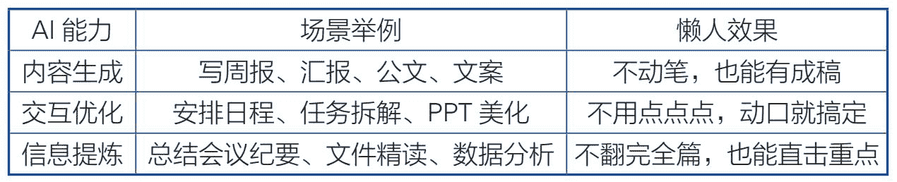
用得好，AI 是合法外挂；用不好，别人悄悄提速，你却在加班。
无论是打工者、创业者、项目经理还是自由职业者，工作终究绕不开表达。
你写不出就说服不了，讲不清就协作不了，看不懂就决策不了。
过去表达靠天赋与努力，现在 AI 让能力批量化、标准化、平民化。
换句话说，只要一个好提示词，就能拥有一整个“表达工作室”。
AI 协作的三大基础技能包，就像“感官延伸”，帮你搞定 70% 的事务性任务：
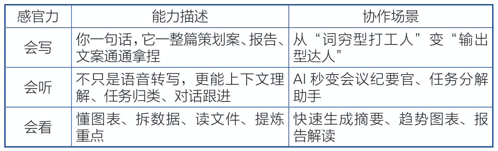
从“一个人熬夜做三份工”，到“一个 AI 扮演三种角色”：
你不再需要自己兼任文案、助理、分析师，一个 AI 全包。
这一章不是教你更努力，而是教你更聪明地用 AI，激活核心协作力：
会写，是表达权利的起点；
会听，是协作能力的跃迁；
会看，是信息提炼的飞跃。
你的 AI 感官三能一旦启动，不只是提升效率，更是悄悄重塑价值边界。

## 一、会写：内容生成能力（文本、脚本等）
职场里最容易内耗的任务之一就是写作。
写周报脑子空白，写汇报语气别扭，写方案不知从何下手，写宣传文案又怕不够吸睛。每项写作都在榨干有限创造力。
AI 的出现改写了这一切。常说“AI 会写”，它到底怎么做到的？为什么在办公场景里如此好用？
一句话：AI 的写作本质是对人类集体知识的压缩与再现——它读过海量资料，你只需给出清晰需求。
背后是大型语言模型技术。ChatGPT、DeepSeek、通义千问、Gemini 等“写作代表队”并非机械复制，而是通过深度学习语言逻辑，精准识别表达意图。
它们在办公中重要，是因为不只是复制答案，而是在理解任务、识别需求后，像随身秘书+内容总监+逻辑助理，输出可直接使用的内容。
某种程度上，AI 生成内容是办公的“最佳搭档”——文笔好、懂策略、有逻辑、效率高，从不喊累。

### AI 写作的底层逻辑，适配职场的三个关键点
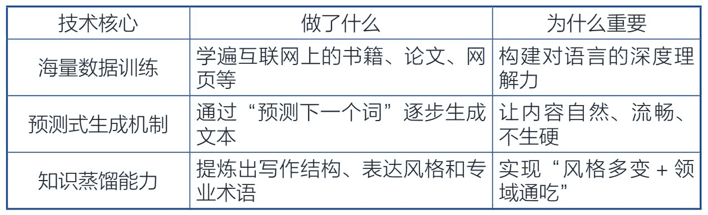
简言之，它不只是“写一句”，而是持续写、写得像人、有逻辑。你提需求，它负责起标题、补金句、列大纲、润色收尾，全流程一条龙。
首先，AI 具备强大的语言理解与表达能力。如同 24 小时在线的写作教练、速成写手、格式大师。它不仅听得懂你在说什么，更能识别任务意图，比如“年终总结”与“广告文案”语气、逻辑、篇幅完全不同，AI 都能应对。还能按你的表达风格自动调整语境，从正式到轻松、从学术到通俗，风格切换自然。更能处理长文本逻辑，确保段落前后呼应、层层递进，写得快且有章法。
其次，AI 具备高度的场景化创作能力。你无需从零构思，它能自动起标题、列大纲、写过渡段，连总结句都替你想好。它还能学习你的过往习惯，模仿语气与措辞，甚至在不同行业间自由切换，从一页 PPT 文案到厚重法律文本，从行业报告到社媒爆款，轻松应对多元内容挑战。

### 职场写作任务+AI 匹配矩阵
写作任务常用场景
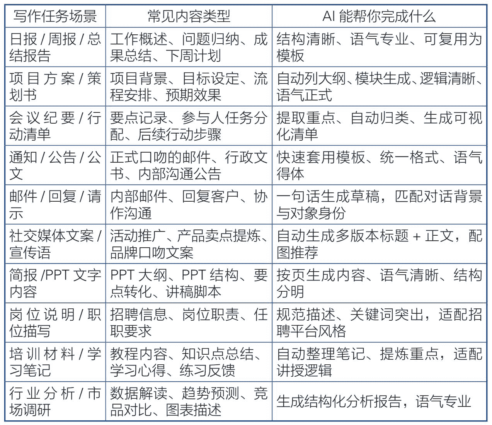
主流 AI 写作工具对比表（职场写作场景）
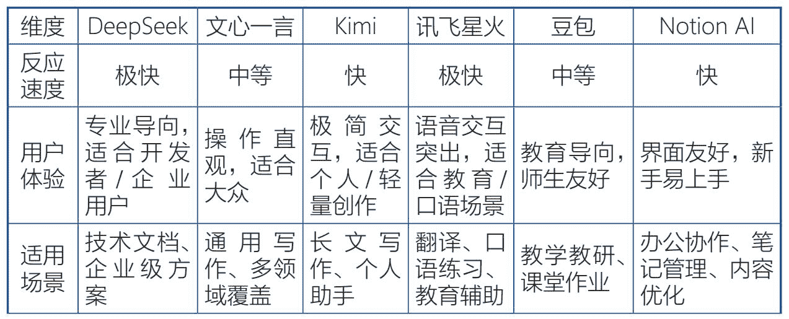
续表
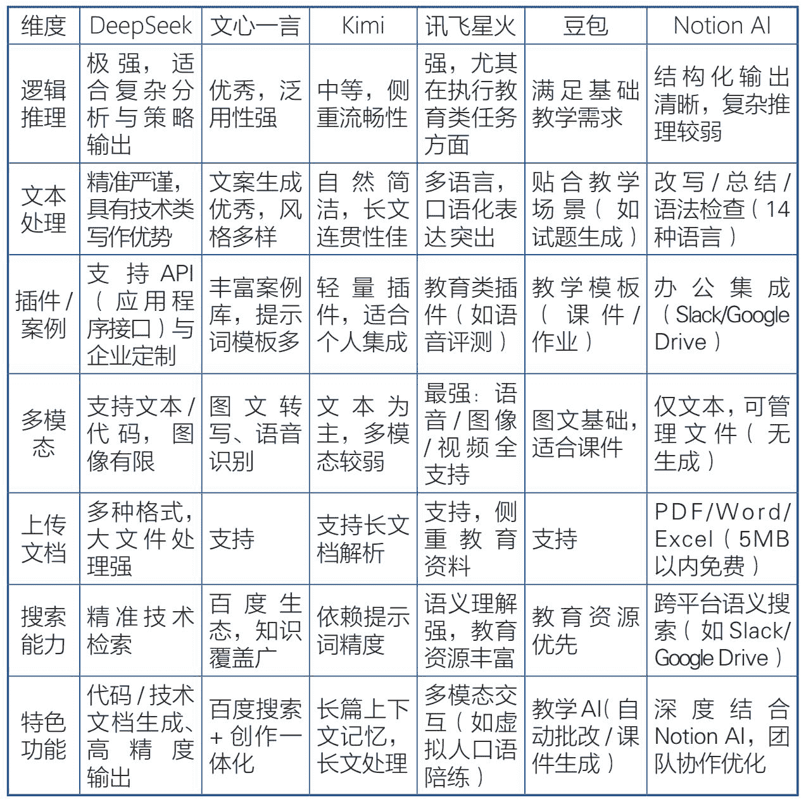
在 AI 写作上，很多人问“哪个工具最好”。真正该问的是“哪个最适合我”。
工具不是成败关键，关键是你能否清晰表达需求，让 AI 理解你要什么。
无论是 ChatGPT、DeepSeek、Notion AI、Kimi 还是豆包，都没有读心术。你不说清楚，AI 就写不清。
所以选适合即可：
·偏办公文案、项目协作可考虑 Notion AI、DeepSeek；
·偏个人写作/日常记录可考虑 Kimi、文心一言；
·偏语音+教育应用可考虑讯飞星火、豆包；
·习惯百度生态/中文写作可考虑文心一言。
这就像选鞋子，跑得快不快取决于合不合脚。例如：
你只要告诉 DeepSeek：“请帮我写一份关于 AI 办公技能培训的策划案，语气正式，结构清晰。”几秒钟后完整文案就出来了。
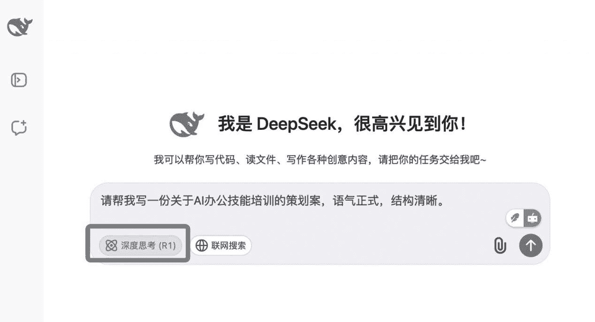
Notion AI 也可以在笔记中续写、扩展、总结，让写作像搭积木一样轻松，并支持团队协作，满足办公需求。
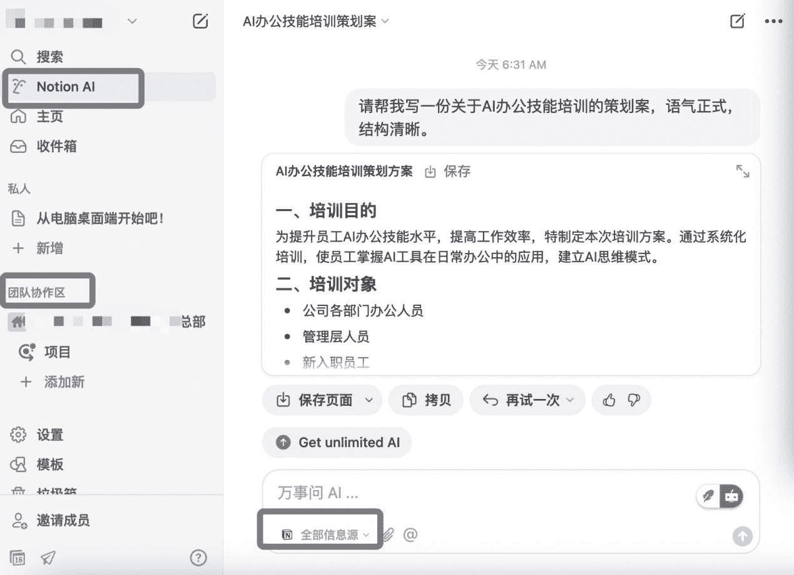
写得好不好，不在于工具多强，而在于你能否“把话说明白”——这就是需要掌握的写作“技能链”，而非堆工具。与其担心不会写，不如训练“发指令”的技巧。
掌握 AI 写作五步法，把办公写作变成可标准化、复用、持续优化的生产流程。你写得越多，效率越高，AI 写得越像你。
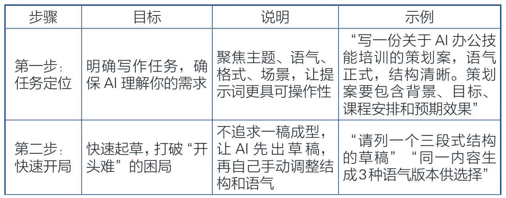
续表
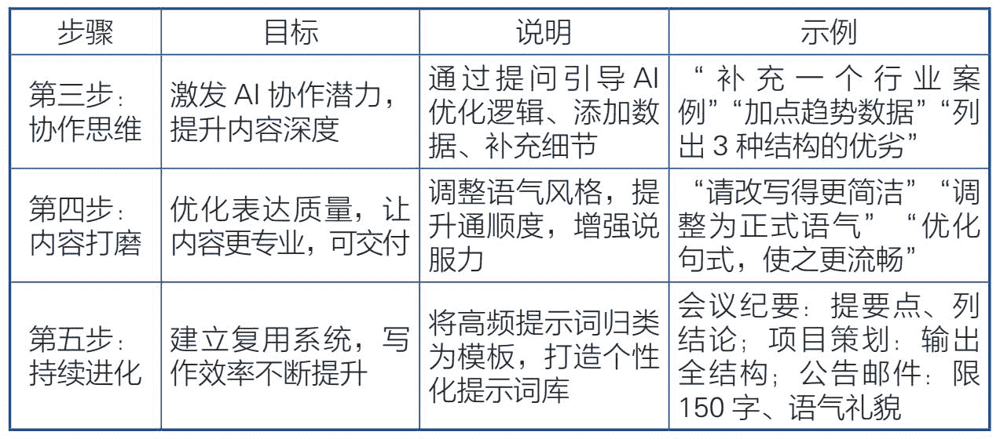
过去写邮件、做方案、改文案可能要一上午。现在一个提示就能配齐结构、语气、表达。曾经需要文案、秘书、设计师三个人，现在一个 AI 就搞定。
在 AI 加持下，写作不再是单人脑力输出战，而是你与“超级外脑”的双人协作舞。

## 二、会听：对话交互能力（智能理解与交流）
如果“会写”解决输出焦虑，“会听”解决的就是最让人头疼的记录问题：
一小时会议后脑子里只剩空白；任务讲三遍对方仍走神；边说边记，结果出现五个版本纪要，理解各奔东西……
在国内 AI+通信协同办公软件中，“语音转文字”已成高频刚需，推动力是效率与协作。
AI 的“听”已不止录转，而是进化成“听得懂、接得住、记得牢”。
它像全年无休、不抱怨、不缺席的沟通搭子，专治费时易误解的表达任务。比如：
·会议记录：自动识别发言、提炼要点、生成纪要。会议结束，清晰清单已在飞书/邮箱/文档里。
·任务交办：你只管说，AI 列清单、定时、分配人，一目了然。
·内容起草：你说“写个会议通知”，AI 立刻生成结构清晰、语气得体的初稿。
·多轮对话：上下文不断线，逻辑丝滑。
·跨语种协作：实时语音翻译，中英同步，语言不再是国际项目的障碍。
换句话说，它不仅听你说，更能听懂你要干什么。
这正是 AI“会听”的魅力——让人从“记不清、说不明、沟通累”的循环中解放，把注意力放回思考与共创。
它为何像上瘾的聪明助理？背后是一套语言交互系统，由四大核心技术模块协同驱动：
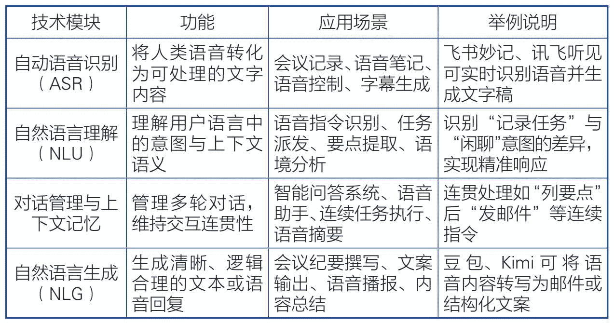
这就是从“听得到”到“说得出”的闭环：说话→转文字→理解语义→保持上下文→生成内容→自动输出/执行。正因拥有完整闭环，AI 才不再是语音玩具，而是办公桌上的得力助手。那么有哪些常用工具？
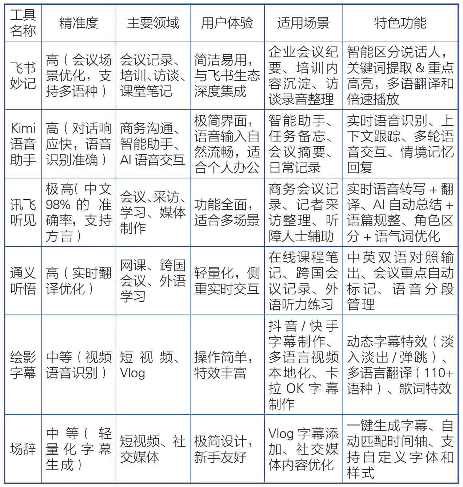
比如，飞书妙记，就是职场人手一份的会议记录神器：
·实时语音转录：中英文自由切换，发言人自动区分，告别人声大杂烩；
·纪要自动生成：会议结束即提炼重点，连懒人也能高效总结；
·多人协作编辑：你写开头我补结尾，文档云端同步，彻底摆脱版本混乱的“邮件大战”。
使用很简单：
·下载并登录飞书 APP；
·从“工作台”进入“飞书妙记”；
·开始录音或上传录音文件；
·等 AI 生成清晰完整的会议纪要。
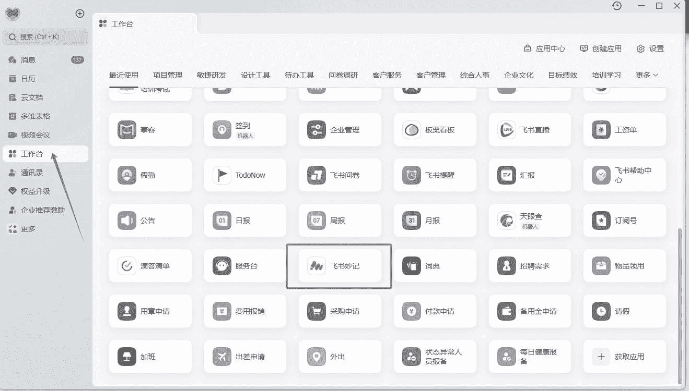
如果你要的不只是会议记录，还可以选通义听悟——一个“万用型听写神器”，专为 10 分钟以上音视频而生：
·语音转写：自动识别多位发言者，语句清晰内容连贯；
·智能摘要：一键提炼关键词、核心观点、结构化待办；
·章节速览：像翻书一样快速跳转，精准定位讨论主题；
·多语种支持：中英实时翻译，跨语种协作无障碍。
只需三步——“上传音频或视频—等几分钟—获取全文稿+智能摘要+重点导航”，实现“只听重点，不费耳力”。播客重度用户还能快速找回心动片段。
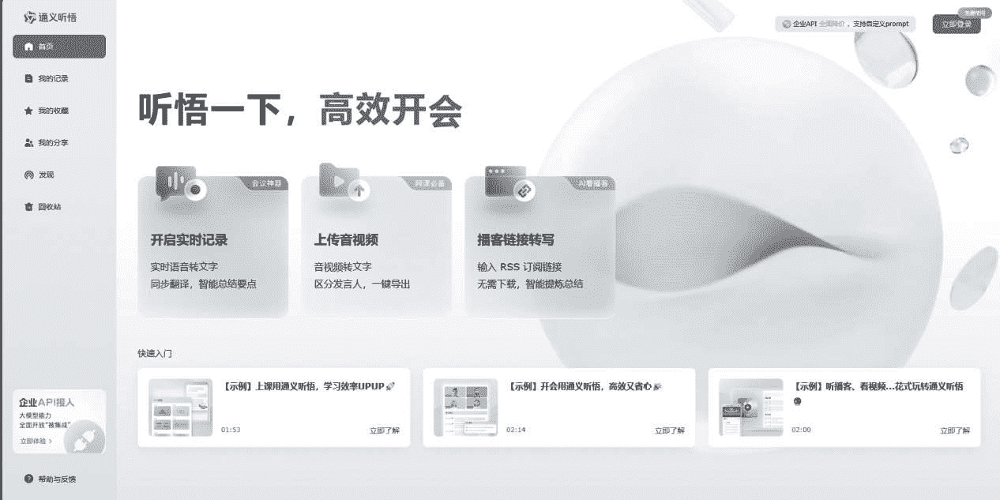
在办公环境中，从“说”开始的工作远不止会议记录。以下六大核心场景正被飞书妙记、讯飞听见、Kimi 语音助手等 AI 语音工具全面覆盖，加速提效，解决核心痛点：
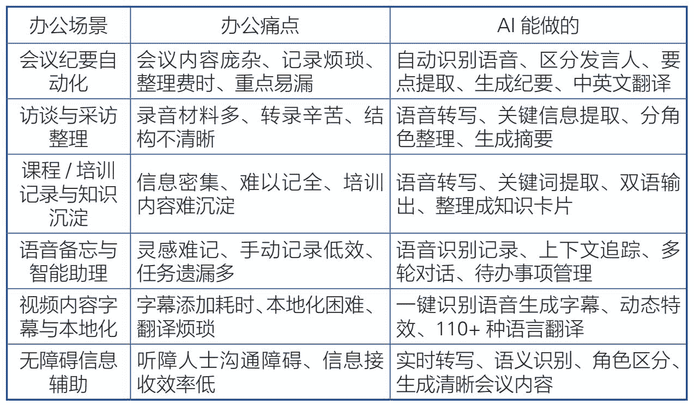
这些工具的价值不在于“能不能说”，而在于“听得懂、说得清、记得准”。从现在开始，办公动口不动手，让 AI 成为新型打工人的沟通生产力。

## 三、会看：多模态处理能力（图像、视频、文档的识别与理解）
信息爆炸时代，我们面对的不只是文字，职场中 80% 的信息是非结构化内容：截图、报告、PPT、直播、讲座、海报、扫描件……过去这些内容“看得见却处理不了”，要么靠人力整理，要么放弃深度挖掘。而今 AI 不只是“帮你看”，而是“替你理解”，更能“看图做事”。
会看，不只是识别图像，AI 已具备对多模态信息的识别、理解与生成能力，尤其在图像、视频、文档等非结构化数据处理中表现突出，能提炼有价值信息。
·看图：识别物体、文字、布局；
·看文档：理解文件、扫描件、表格、报告的逻辑；
·看视频：抓取画面关键信息、分析场景、生成总结。
看完还能自动总结、翻译、可视化或重新生成。举例：
我们上传一份 24 页 PDF 行业报告给 Kimi，可一边对话一边浏览：
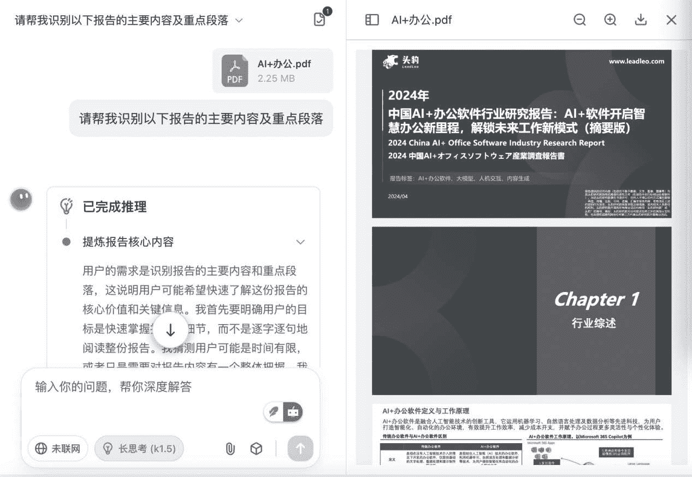
提问：
请帮我识别报告的主要内容与重点段落。
Kimi 回答：
这份报告是关于 2024 年中国 AI+办公软件行业的研究，涵盖行业综述、市场预测、企业分析等多方面内容，以下是主要段落及重点概述：
行业综述
AI+办公软件定义与优势：与传统办公软件相比，AI+办公软件融合机器学习、自然语言处理等 AI 技术，具备智能化、自动化功能，可提升工作效率、降低成本，并提供个性化体验与实时反馈。例如，Microsoft 365 Copilot 通过结合大型语言模型、Microsoft Graph 内容及 Microsoft 365 应用，为用户提供更多价值。

2024 智能办公全景洞察

时间脉络：追溯到七十年代起，办公工具先后经历基础自动化与智能化办公两个大阶段，面向未来产品形态将愈发智能、愈发个性化，AR 与 VR 等前沿交互技术也将重塑使用体验。

2024 年国内市场版图：当年可划分为五大类别，文档处理类渗透率居首，约 38%。各类别定位各异，例如文档类聚焦智能改写与语法校对，数据类侧重清洗、分析与建模效率的提升。

市场展望

规模扩张：智能增强型办公产品市场保持快速增长，预计 2025 年仍将延续高增速。

供给侧动能：智能技术进步与产品迭代升级构成两大推手。大模型、内容生成、人机交互能力持续提升，办公产品的智能化升级集中在智能协作平台、自动化流程与数据分析体系。

需求侧动能：远程办公人群扩大、任务复杂度攀升，传统工具短板暴露，推动用户转向 AI 增强方案。2020 至 2023 年国内线上办公渗透率持续上行，直接拉动相关需求。

政策层赋能：国家鼓励智能技术与办公软件融合创新，如上海打造“智慧好办”服务品牌，国家网信办推进生成式智能设施及数据平台建设等，为行业营造良好环境。

厂商研判

金山办公 WPS AI：亮点在于中文场景优化、办公场景深度融合与云端协同，短板是海外竞争压力与个性化内容生成能力。后续将聚焦 AIGC、阅读理解问答、人机交互，并向表格、演示等重度应用渗透智能能力。

印象笔记 印象 AI：依托成熟笔记平台实现多功能整合，与笔记使用深度绑定，但数据安全与隐私顾虑需化解以增强信任。

阿里钉钉：智能功能与办公场景紧密结合，具备企业级服务生态与强定制能力，大规模用户带来数据优势。不足在于依赖性与兼容性，部分智能功能成熟度仍有提升空间。

本报告对 2024 年国内 AI 增强办公软件行业的现状、趋势与主要玩家竞争格局做了系统梳理，有助于把握整体态势与发展前景。

继续提问：

我要做本报告的汇报，请帮我提炼要点形成 PPT 大纲。

以下为基于报告内容萃取的 PPT 大纲：

幻灯片 1：封面

主标题：2024 年中国 AI+办公软件行业研究报告

副标题：智能融合办公开启智慧工作新阶段，引领未来协作新范式

出处：头豹研究院

时间：2024/04

幻灯片 2：报告摘要

概括报告核心：

AI+办公软件的定义、价值与演进历程

中国 AI+办公软件市场结构、规模及增长预期

头部企业剖析与行业演进方向

突出智能技术对办公软件行业的颠覆性作用

幻灯片 3：行业概览

传统办公软件与 AI+办公软件差异：

智能化功能、自动化水平、分析预测能力、个性化体验、实时反馈等。

AI+办公软件发展历程：

基础办公自动化阶段（20 世纪 70—80 年代、20 世纪 90 年代、21 世纪首个十年）。

智能办公阶段（21 世纪第二个十年、21 世纪 20 年代及以后）。

中国 AI+办公软件分类与占比：

AI+文字处理 38%、数据处理 21%、演示协作 13%、项目管理 5%、通讯协作 23%。

幻灯片 4：AI+办公软件市场分析

市场规模：

2019 年 6.86 亿元增至 2023 年 131.03 亿元，复合增速 109.06%。

预计 2028 年规模突破 1911 亿元，2024—2028 年为黄金成长期。

驱动因素：

供给端：智能技术驱动（内容生成、人机交互、大模型）、产品功能迭代升级。

需求端：线上办公人数增长、任务复杂度上升、传统软件局限。

政策端：中国政策鼓励智能创新与办公软件融合。

幻灯片 5：企业分析——金山办公 WPS AI

竞争优势：

中文环境优化、场景深度整合、云协同、多轮对话、功能丰富、易用性强。

竞争劣势：

国际市场竞争力、个性化与创意生成受限。

未来方向：

AIGC、阅读理解与问答、人机交互，深化表格、演示文稿等重应用的智能能力。

幻灯片 6：企业分析——印象笔记印象 AI

竞争优势：

植入成熟平台、多功能整合、与笔记场景深度融合、个性化应用。

竞争劣势：

数据安全与隐私保护待加强。

幻灯片 7：企业分析——阿里钉钉

竞争优势：

办公场景深度集成、企业级服务生态、高度定制化、庞大用户基数带来数据优势。

竞争劣势：

依赖性与兼容性问题、部分智能功能成熟度与准确性有待提高。

幻灯片 8：行业发展趋势

个性化定制与智能推荐：

AIGC 与智能人机交互协同作用；

深度学习模型把握用户工作习惯与偏好。

跨平台智能化整合：

智能技术与办公软件深度融合实现跨平台智能协同。

阿里钉钉、金山 WPS、腾讯企业微信等国内厂商主导市场。

幻灯片 9：总结与展望

总结：

AI+办公软件市场高速增长，技术与需求双轮驱动。

竞争激烈，各厂商优势与挑战并存。

展望：

未来产品将更智能、更个性化，深度重塑办公方式。

跨平台整合与数据安全将成为关键命题。

幻灯片 10：结束页

致谢语：感谢聆听与观看

联系方式（可选）：头豹研究院联系方式或官网

本提纲覆盖报告要点，结构清晰、重点突出，便于制作汇报 PPT。

会看 让智能成为你洞察视觉与文档信息的第二大脑，也是非结构化内容的译码器与浓缩器。它不仅能读懂你看到的，也能理解你为何看、想看什么、接下来该怎么做。

智能无法替你付出努力，但能放大你努力的回报

必须正视一个事实：智能的迭代速度，远超你刷手机的手速。你才熟一个快捷键，它已实现全流程自动化；你还在手动排版 PPT，它已能按一句指令生成动画、讲稿、配图，一站式交付。

在万物皆可生成的时代，仅靠勤奋已不足够。真正拉开差距的，不是加班时长，而是善用智能为自己创造价值。

会写、会听、会看的能力，已不再是少数人的特权。任何职场人，只要愿意，都能让它成为技能包里的外挂。

别抱怨智能跑得太快，学会踩着智能提速，行得更稳，笑得更久。

# Part4 智能思考力：从信息过载到精准提问

你的问题表述不清，智能怎能给出条理分明的答案？

我们都曾被问住。

会议中，领导看着你问：这个项目卡在哪，你觉得核心问题是什么？你嘴上附和，心里却在翻会议记录、客户反馈、用户数据……越找越乱，只剩四个字：

我不知道！

每天被信息淹没，一到需要想明白的时刻就卡壳。因为我们身处信息爆炸却认知稀缺的时代。

你不缺资料，甚至泛滥。智能能整理报告、输出分析、自动生成 PPT……可问题是，你还没想清楚自己到底在问什么。

你对智能说：分析一下这个行业。它便甩出一篇 2000 字的术语堆砌。你追问：现在入场合适吗？智能便模棱两可。因为你问得模糊，智能只能答得漂亮却不着边。

真正有思考力的职场人，不是把智能当答案仓库，而是当问题思维教练。思考力的核心，不在知道多少，而在能否问到点子上。

就像你看到一堆资料就收藏，看到智能建议就粘进 PPT，看到顺眼的话术就抄进邮件……看似高效，实则制造知识泡沫。你以为在提升，实则在复制智能的幻觉。

我们缺的不是内容，而是把内容转化为自身逻辑判断、观点主张与行动建议的能力。

所以要学会让智能深度参与思考：

√提出好问题（问题界定）

别问行业趋势，要问在当前政策环境下，中腰部品牌切入该细分赛道的窗口期与风险点分别是什么。

√找到对的信息（信息检索）

非广撒网式搜索，而是精准提问、补充背景，让智能懂你是谁、要做什么。

√用信息形成判断（信息处理）

不照抄、不全信、不迷信，而是能说出：我选择此路径，是基于哪些假设，规避了哪些风险。

本章将拆解智能如何助你从信息焦虑走向认知清晰：

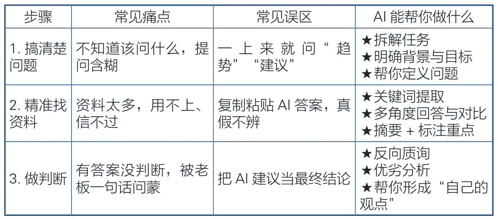

智能不只是工作工具，更是思维放大器。

在人人都有智能外挂的时代，思考力才能真正助你成长。

## 一、智能辅助精准提问：人与机的起点

很多人起初就说：我想了解这个行业。智能立刻奉上 800 字行业百科，看似丰富实则无重点——你不知信哪句，也不知怎么用。原因？

因为你没提出一个有用的问题，你没想清要解决什么、做何决策、希望智能扮演什么角色。

你说往前开，智能便漫无目的地开；你说我需要基于第四季度销量数据的趋势分析，用于制定市场策略，智能才知道去哪、怎么走、避什么坑。

信息有了，结论没有的根源，正是传统提问的三大误区：

问题模糊：问行业趋势，得百科全书；

背景缺失：智能不知你是谁、要干嘛，只能猜需求；

目标不清：无明确输出意图，智能只能给通用答案。

想清自己在问什么，是赋能智能的第一步。比找资料更重要的是定义任务与拆解路径。

像职场高手评估是否进入一个行业，不会直接问值不值得，而是逐层剥离：近三年增速如何？头部玩家是谁、份额怎样？用户痛点是否被解决？有无政策扶持、技术门槛高不高？我们有哪些机会？

不是问得多，而是问得顺、问得深、问得准。

这正是链式思考的精髓，也是智能最擅长的配合模式。

为何智能需要链式思考？

智能的底层是基于词元逐步预测的语言模型。它不是瞬间给出答案，而是像打字时推测下一句话那样一步步推理。

这也让链式思考大放异彩——它原本是自然语言处理的高级推理机制，如今成为智能能否像人类一样拆解问题的关键。

它不是简单的一问一答，而是像优秀分析师那样从问题本质出发，层层拆解、一环扣一环、逐步逼近答案。好问题不是大而全的堆砌，而是逻辑上能接得上、顺得下的引导。

智能不怕问题难，怕问题乱。它最擅长的不是一锤定音，而是循序渐进。

比如要做一份新能源车市场趋势分析 PPT。

若在百度海量结果中翻找，随手贴了条 2021 年新能源车销量翻倍的旧新闻，PPT 很可能被老板一句数据过时、逻辑不清、重点不明打回。

链式提问：

1.请列出 2023 年第四季度新能源车销量前五品牌及同比增速，数据来源：中国汽车工业协会或官方报告。

2.销量增长的驱动因素是消费升级、政策导向还是技术红利？

3.结合××品牌现状，给出两条针对性市场建议。

十分钟完成别人两小时搜+拼+猜的工作量，且结构清晰、有数据、有逻辑，可直接汇报。

在智能时代，你的提问方式决定你是搬运工还是指挥官。提问力即结构化思维力、问题意识与行动意图的体现。

智能听不懂模糊指令，只懂清晰任务，可从以下模式训练：

模糊提问—明确意图—可执行任务

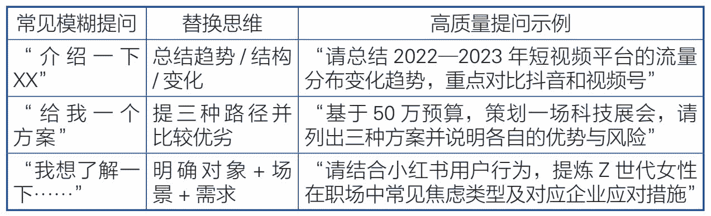

别说介绍一下，要问总结什么、对比什么、推荐什么。这才是智能时代的提问密码。

五问法：让问题变得清晰可操作

若不确定如何精确表达，用这套五问模型自检：

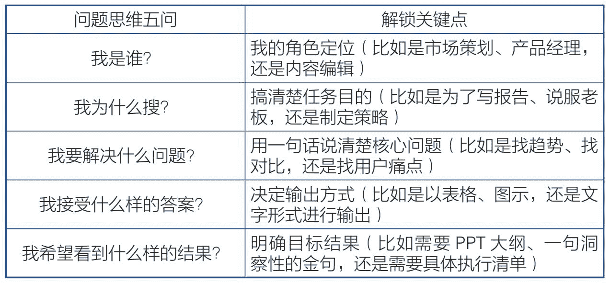

你问得越清楚，智能答得越聪明。

对比案例：

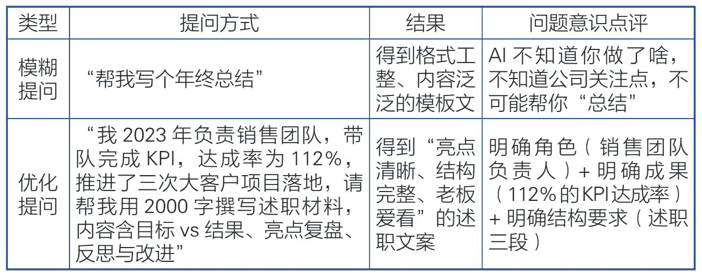

智能不是你肚子里的蛔虫，它不怕问题难，怕的是问题模糊。

先想清楚，是智能搜索的第一步通行证。

你的提问方式，暴露了你的认知水平。而链式思考的起点，正是一个清晰的目标问题。

## 二、智能辅助信息检索：打造你的信息雷达

不缺资料，缺的是找对的功力！

以前我们如何搜索？关键词堆砌、开十几个网页、手动对比、复制粘贴、抓狂……

时代变了，智能不是更快的百度，它重写了搜索方式：

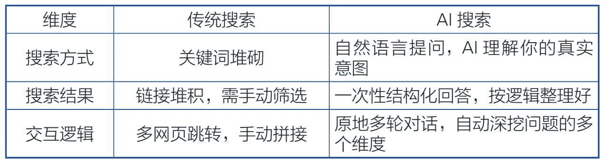

Gartner 预测到 2026 年，传统搜索量将下降 25%，智能对话式搜索将成主流。微软 Copilot、谷歌 Gemini、国内的 Kimi、豆包、360 智脑……巨头都在做同一件事：让搜索像聊天一样自然，让答案像专家解答一样专业。

在智能全面办公的今天，IQ 决定能不能做事；EQ 决定合不合群；SQ 决定能不能找到对的资源。不仅是会不会 Ctrl+F、会不会用百科，而是一种认知方式+提问能力+筛选判断力的综合体。

这不再是搜信息，而是提对问题换答案。

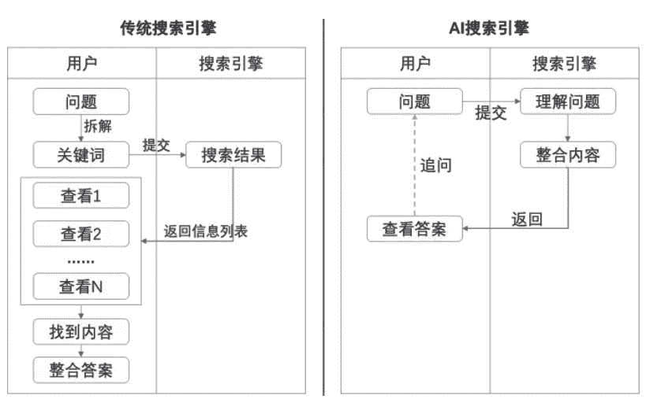

（图片引用自《看 AI 搜索终局，呈现三大新特征》）

智能链式搜索：别再靠蒙了！

下面是一套基于链式思维的智能高效搜索 SOP，你说不清，智能听不懂；你搜错地方，它找不到。我们逐步把你从乱搜派进化为搜索高手。

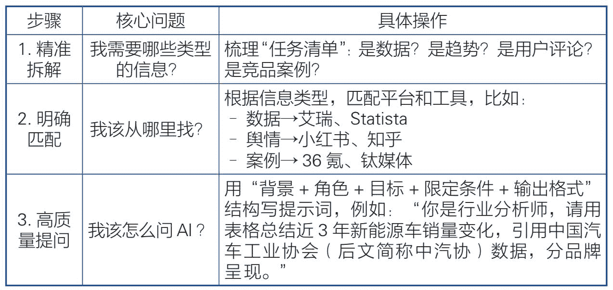

### （一）你需要什么信息？精准拆解任务清单

在智能世界，信息就像烹饪食材。要做咖喱饭，不能把白菜、苹果、酱油一起倒进锅。

所以问智能前，先写好信息任务清单。

让智能知道：你要数据还是观点、要案例还是评论。不同信息类型，用法完全不同：

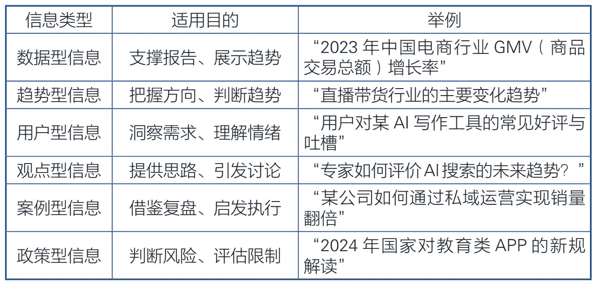

你要的不是内容，而是合适的内容。

任务清单怎么列？直接可用！

假设任务是分析竞品 A 的市场策略，可这样写信息需求清单：

·定价策略：是否采用会员制/优惠券/满减/限时促销？

·渠道布局：线上平台有哪些？有无线下门店？新兴渠道是否布局？

·品牌定位文案：核心卖点是什么？高频关键词有哪些？宣传调性如何？

·用户评价热点：高频好评关键词 3 个、常见差评关键词 3 个。

·增长方式：是否通过联名、达人合作、渠道投放实现增长？

这张清单就是给智能的命题要求，让它写一篇有题意的作文。

常见任务信息类型对照表

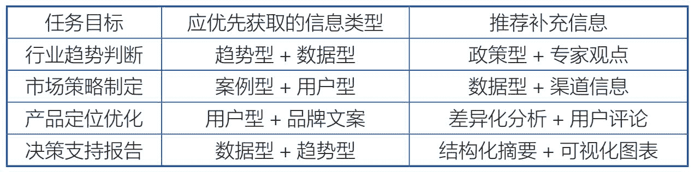

智能不是内容管道，而是信息工厂；你不提供原材料，它就只能瞎编。

搜商高手不是说给我点资料，而是提前列清单、分类输入，让智能像厨师一样精准下刀、按需下菜。

通用提示词模板-精准信息需求

我是【角色】，我正在处理一项任务，目标是【目标任务】。

请围绕这个任务，逐步回答以下子问题（可按顺序一步步来）：

【子问题 1】：请提供【信息类型】的信息，要求有数据来源或权威出处；【子问题 2】：请结合【时间/地域/对象】进一步细化；

【子问题 3】：请用结构化形式总结，比如清单、表格或要点归纳；

【子问题 4】：请说明【主要影响因素/原因分析/用户痛点】；

【子问题 5】：请结合这些信息，给出【可行建议/观点总结】。

输出要求：

引用可靠来源，如【推荐来源：中汽协、艾瑞、QuestMobile、知乎高赞等】；

输出格式：【清单/表格/结构化小结】；

总字数控制在【×××】以内，适合用于【PPT/报告/汇报】使用。

使用示例 1：

行业分析类提示词：

我是一名行业分析师，我正在准备一份关于中国新能源车行业的趋势分析报告，目标是提炼 2023 年的关键变化，为公司决策提供依据。请围绕这个任务，逐步回答以下问题：

1.请提供 2023 年中国新能源车市场的销量数据与增长率，引用官方或权威行业报告；

2.请列出该行业的 5 个主要品牌及市场份额对比；

3.请用结构化清单呈现这 5 个品牌的核心优势；

4.请分析销量增长背后的主要驱动因素；

5.请结合这些信息，提出两条我司在该领域的可行入场建议。

输出要求：

1.来源优先中汽协、艾瑞咨询、汽车之家；

2.输出为结构化清单，适合整理成 PPT；

3.字数控制在 600 字以内。

### （二）我该从哪里找？找对信息

你已知道要什么——数据或用户评论。下一步是明确这些信息在哪最靠谱。

别一股脑丢给智能，也别什么都在百度搜。不同信息有不同产地。

就像买菜，菜市场有菜，海鲜市场有鱼。你非要去五金店找螃蟹，不尴尬吗？

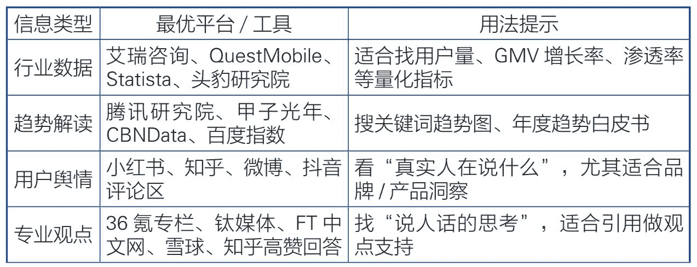

续表

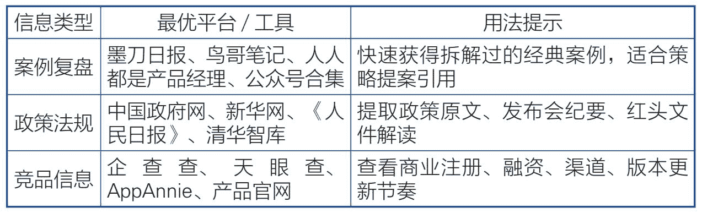

搜索最怕啥都想要，结果啥也没找到。选错平台，信息就像掉进垃圾堆——你在乱翻，智能也只能胡抓。

记住公式：

信息价值=信息来源×处理方式

与其在智能里喊帮我查一下，不如直接告诉它：

请参考 2023 年后发布的权威数据报告，优先中文语境。

来源建议包括中汽协、艾瑞咨询、钛媒体、知乎高赞用户等。

你越具体，智能越精确；你越模糊，智能越跑偏。

若仍不知去哪找，可用万能法则——先找人，再找内容。

很多高质量信息不在搜索引擎第一页，而在懂行的人脑子里。

你找不到关键资料，可能只是没找到那个一直在输出的人。

搜索高手常用人脉式搜索流程：

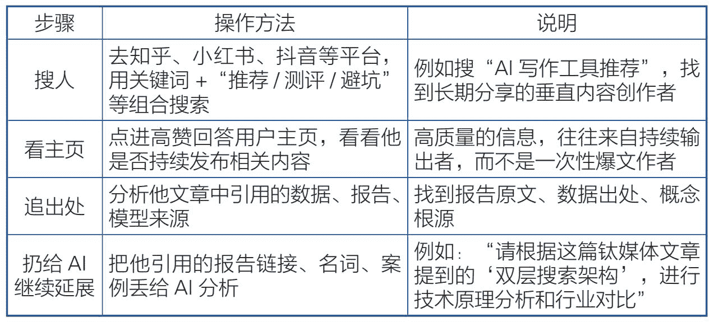

你不是在搜信息，而是在跟随一个懂行的‘大脑导航’。

从找内容转向找人+找源+找线索，你便从信息搬运工进阶为信息整合师。

信息价值不在于多，而在于它来自谁、用在哪、怎么用。智能擅长整合信息，但创造差异的是你是否找到值得参考的人类视角。

### （三）该怎么刨根问底？定制高质量提示词

目标清楚，交付却失焦

心里已经有大致蓝图：想要一份行业趋势梳理、一篇品牌故事，或一套可落地的市场方案。把这些需求一次性交给模型，返回的内容往往又长又空，东拼西凑、条理散、和实际脱节。

这并非模型智商不足，而是指令被塞爆了。

管理学家亨利·明茨伯格曾指出：“真正有效的策略，必须建立在对制约目标达成关键要素的深入剖析之上。”

模型的工作更像一条标准流水线。若把背景、意图、限制、格式全塞进同一条指令，模型会迷航：

· 上限耗尽，后半段信息被自动截断；
· 任务链条过长，结构混乱、逻辑跳跃；
· 回复体量过大，模型记忆疲劳，前后矛盾；
· 难以定位问题，想优化也不知哪段翻车。

任务越复杂，失效率越高。

这时需要用链式拆解的思路，把一件大事拆成小步走。

一件事 = 多条指令 + 明确顺序 + 逻辑串联

每条指令只解决一个微问题，把上一步的产出作为下一步的输入，层层推进。

**为什么拆分更稳？**

第1点，信息可控：单条指令精简，不易过载。
第2点，纠错成本低：哪一步偏差只改那一步，无需推倒重来。
第3点，人机协同顺畅：中间结果可人工校对、补充、筛选。
第4点，算力可优化：轻量任务用低配模型，重型任务上高配模型，合理分配成本。
第5点，多模型协作：文案交给 Kimi，图像生成交给 Midjourney，流程调度交给 Agent 智能体。

举例，撰写一篇完整品牌故事的拆解流程：

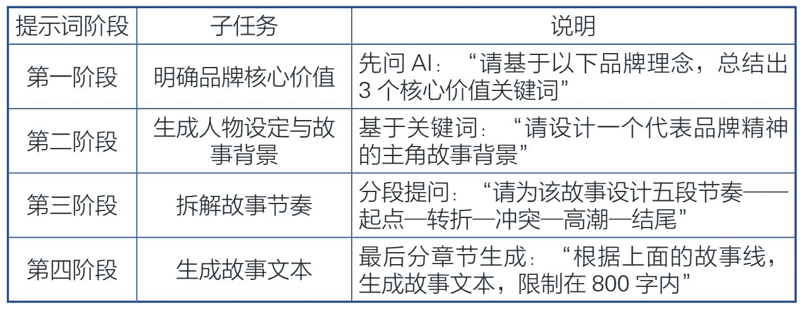

价值在于每段都是独立可回溯的指令，整条链路稳定、可控、可优化。

具体怎么拆？常用做法是用“五模块框架”把一次提问拆成五个部分：

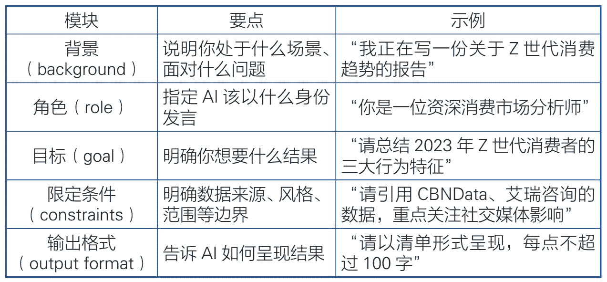

这套框架不仅让模型听懂，更能在多轮协作中保持稳定精准。

好的指令本质上是一部结构化任务脚本。你要像项目经理拆里程碑，像导演设计分镜，像工作流平台管理模型的每一步。五模块框架加链式提问，正是当下步步拆解、环环相扣的核心方法。掌握逻辑后仍常被答非所问，别担心，有外援：打开 Kimi 找“指令专家”，让模型为你撰写有效指令。

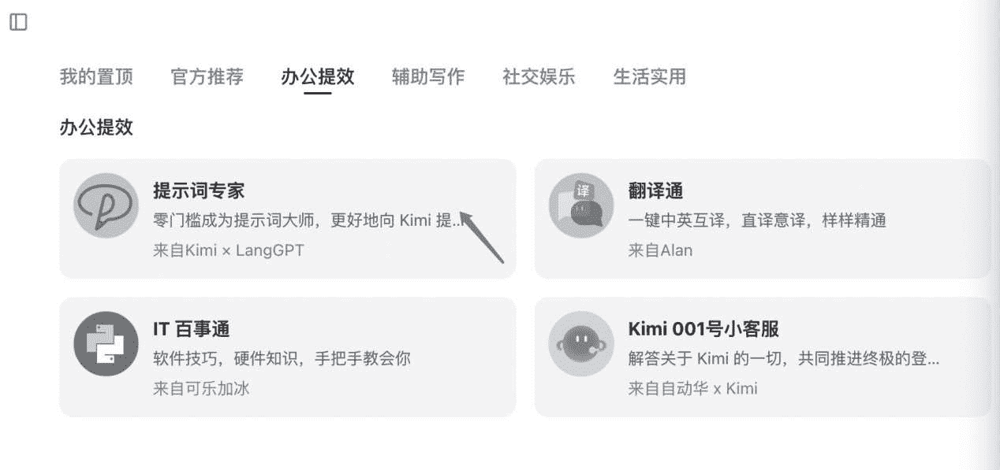

## **三、模型助力信息处理：从获取到运用**

模型给出答案，不等于你能下班。恰恰相反，人类判断才刚刚开始。

很多人拿到结果的第一反应是：“看起来还行，直接用了吧”“应该能过”“模型真厉害，我不用管了”。

模型会产生幻觉，它不是真正理解，只是在预测你想听什么。

把模型文案原封不动贴进 PPT、报告乃至论文，看似高效，实则是用套话掩盖自己的不确定。

要警惕：模型在画饼，你却当成配方。它能给 70 分初稿，给不出 90 分判断。你有没有能力把产出转化为自己的认知成果？

模型只是开端，后续需要判断加比对加重构：

· 这条信息可信吗？
· 推理经得起推敲吗？
· 对当下场景有实际参考价值吗？

### **（一）如何判断模型的产出来否可信？**

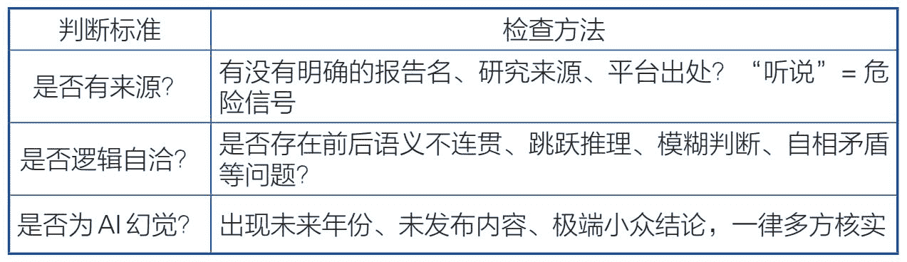

### **（二）如何让推理经得起检验？**

**1.养成“模型加人工验证”的基本习惯**

模型的言论不等于真理。模型是开端，你是裁判。

多渠道验证：
· 一手二手都要查：模型引用的内容要核实是否真实存在。
· 出处要追溯：数据是否来自官方、权威机构或专业平台，如期刊、政府官网、行业报告。

多模型交叉对比：
· 同一个问题让 ChatGPT、Kimi、DeepSeek 分别作答；
· 对比共识区与分歧点，避免被单一模型带偏。

**2.训练模型“质疑”模型，让它成为批判性思维陪练**

把模型当辩论对手，学会让它反驳自己。

高质量提问示例：
· 这个回答有哪些漏洞或例外未考虑？
· 请从反对视角再分析一次。
· 有哪些数据或案例能支持、驳斥它？
· 在什么场景下结论会失效？

让模型为你找 bug，才是高阶认知训练。

**3.别当搬运工，要当认知架构师**

别让模型代替下结论，要把它纳入你的思维流程。

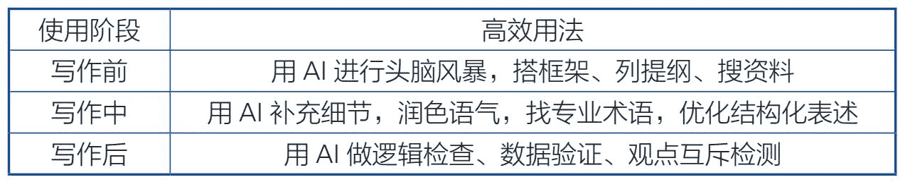

可以给自己设条底线：
哪些工作可全权交给模型？（如分类、摘要）
哪些关键点必须亲力亲为？（如立场判断、逻辑架构、观点表达）

借模型成就更好的自己，而不是被模型取代。

再强的模型也只能说“这是一个可能的答案”，是否采纳，由你决定。

**如何让模型说得“有用”？**

“说得好听≠能落地”。判断标准是能否跑得动。

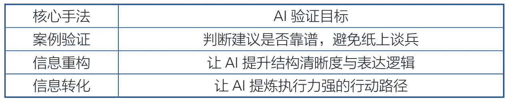

### **情境一：模型产出了内容，怎么判断它“有没有用”？**

最直接的方法是案例验证法。

提示示例：
“请为这条建议补充一个真实可查的行业案例，并说明成功或失败的关键变量。”

比如模型给你一个员工激励模型，写得像教科书：KPI 加权、积分商城、OKR 共建……

你要追问：有没有企业实操过？效果如何？满意度是否提升？人效是否改善？

只有拿到“真实企业加实施细节加成败变量”三件套，才能判断建议能否走出白板。

### **情境二：让模型帮你整理信息，给出行动建议**

面对散装信息：杂乱、无序、逻辑不清，就需要模型来“理”。

典型场景是会议纪要整理。

妙记工具能把语音变文字，如何再变成可用信息？让没参会的人也能知道发生了什么、谁负责、怎么做、何时完成。

步骤 1：信息重构——把散装内容打包成结构化输出
提示示例：
“请把以下会议内容整理成纪要，包含：1）主题；2）参会人；3）讨论要点；4）待办事项（负责人加截止时间）。”

从混乱到秒懂的第一步。

步骤 2：信息转化——把纪要变成可执行的任务清单
提示示例：
“请基于会议内容，总结各议题的关键结论，并转化为行动清单，含负责人、时间节点、预期成果。”

这一步让你从记录者升级为推动者。

信息要能被吸收、被使用、被执行。

让模型的答案：
· 能验证；
· 能执行；
· 能形成逻辑闭环。

# **Part5 模型加数据力：用数据说话**

职场新铁律：不说数据，没人听。

你说项目重要，要指标支撑；说产品好用，要留存转化；说工作多，要看实际影响。

不是你不够努力，是你还在用拍脑袋对抗量化世界。

没有数据，你的话不算数；只报数字，没人信。

没有数据思维，你说的是废话

辛苦做了一份周报，曝光、点击、增长、时长、下单率全有。领导问：“结论呢？”你答不上来。

数据思维是把数字变成判断依据

小张每周汇报一堆数据，老板总问建议怎么做。小王只做 5 页 PPT，前两页结论：“渠道 B 成本低但投产最低，建议减预算转投 A 并优化素材。”老板直接拍板。核心竞争力是会用数据说服。

堆数据不是分析，是报表迷宫

有人把后台全搬出来，几十张图一堆均值同比老板只觉得晕。分析的本质是让别人看见原本看不见的东西。

老板问转化率低的原因。你说点击率低。他问为什么。你说曝光少。他再问为什么。你说投放少了。老板：这我不知道？你在复读问题。

数据不干净，连问题都看不清

想看 90 天流失趋势，发现 CRM 有两版字段不匹配，ID 缺失，标签错乱，关键字段没埋点。数据脏，分析就是纸上谈兵。

工具门槛高，落地遥远

学 20 个 Excel 函数，做透视表就卡；SQL 入门课听完面对几十张表懵了；Power BI 视频看过，字段都不通。学完只多一个点鼠标的资格。

小李学了 SQL、Tableau、Python 回去做离职率图表，领导问北京分部为何流失多，她发现没学会业务思维加问题建模。

你缺的不是技术，是模型数据搭子

不必写代码调参数。只要说：“帮我分析客户流失趋势，并找出影响最大的三个维度。”

模型就能给出折线图、关键因子、建议。

模型能解决哪些痛点

**1.洞察隐藏趋势**
以前靠眼睛找异常，现在模型秒扫数十万点：“增长高峰在每月 12-15 号，可能因促销短信，建议提前发送，ROI 可提升 14.7%。”

**2.自动化处理脏活**
不必手动改字段、填空值、删异常。模型数据平台自动识别格式、合并重复、预警缺失，输出干净集。

**3.预测与策略**
过去讲发生了什么，现在讲未来会怎样。哪个客户易流失？哪个产品会爆？哪个渠道转化最高？模型给出模拟与最优行动：A 渠道多投 20% 预算，生命周期延长 1.5 个月，毛利提升 4.3%。

如何用模型解决烦恼？关键先理清目标。

## **一、先明确分析意图再动手**

最怕一开始就开表做图，最后发现没人关心。

第一步是锁定分析目标。目标不清，图再多也是浪费。

开始分析前必须回答：

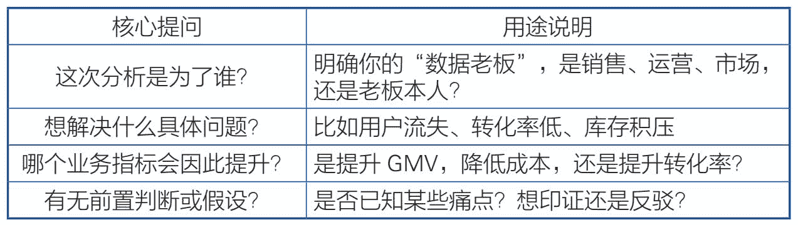

这几个问题决定后续每张图是否值得。

**模型助力确定目标的标准流程**

**1.用模型识别角色与场景**

提示词：
我是【你的职位】，正在为【具体业务场景、项目】做数据分析，请列出我可能关注的核心经营目标与对应的关键度量。

示例：
我是电商运营，想分析春节期间用户复购，请列出应关注的核心经营目标与关键度量。

模型示例输出：
以下是分析春节期间用户复购情况时应关注的核心经营目标与对应的关键度量：

核心经营目标
1.提升用户复购率：增加春节期间再次购买的用户占比，提高忠诚度与平台依赖。
2.促进销售额增长：通过复购提升购买频次与金额，推动短期业绩。
3.增强用户黏性：培养购物习惯，为长期发展奠定基础。
4.优化用户体验：发现影响复购的因素，改进商品、服务与运营。
5.评估营销活动效果：检验春节营销对复购的促进作用，优化未来策略。

对应的关键度量
1.复购率：复购人数除以总购买人数再乘以 100%。
2.复购周期：两次购买间隔。
3.复购金额占比：复购销售额占总销售额比例。
4.客单价：用户平均每次消费金额。
5.购买频次：春节期间人均购买次数。
6.品类复购率：不同品类复购差异。
7.用户留存率：次日、3 日、7 日、30 日留存。
8.促复购活动参与度与转化率。
9.老用户销售额占比。
10.用户评价与反馈：好评率、差评原因、投诉率。

**2.请模型匹配分析方法与图表**

提示词：
针对上述目标，请推荐 3 种常见分析方法，并说明适用图表类型与所需数据字段。

模型示例输出：
以下是 3 种常见分析春节期间用户复购情况的方法：

RFM 模型分析
*原理：通过最近一次消费时间、消费频率、消费金额对用户分层，了解复购特征，制定个性化营销。
*图表：散点图，三维或二维展示分布与相关性。
*字段：用户 ID、购买日期、购买频次、购买金额。

时间序列分析
*原理：分析不同时间段复购率变化，找季节性与促销影响规律。
*图表：折线图，横轴时间，纵轴复购率或复购人数。
*字段：时间、购买次数、用户 ID。

漏斗分析
*原理：拆解浏览、加购、下单、支付等步骤，找流失关键环节，优化流程。
*字段：用户行为各步骤转化数据。

分析闭环：把思路推向落地

视觉呈现建议选用漏斗图，可以把每一步的转化路径以及用户流失点直观地呈现出来。
底座数据要准备的是用户行为轨迹，包含浏览、加购、下单、支付等操作日志，以及对应的用户标识。

3. 请 AI 协助你反推数据结构
提示词 3：
基于前面提到的分析思路，帮我列出在 Excel 或数据库中该准备哪些字段、对应的格式以及清洗思路。

Kimi 模拟输出：
以下是为上述分析方法准备的字段清单、格式规范与清洗要点：

字段与格式
*用户基础信息
* 用户 ID：文本类型，用于唯一区分并做分组统计。
* 注册日期：日期类型 YYYY-MM-DD，便于对比春节期间新老用户的复购差异。
*订单相关
* 订单 ID：文本类型，作为订单唯一主键。
* 下单日期时间：日期时间类型 YYYY-MM-DD HH:MM:SS，支撑复购周期与时序分析。
* 商品 ID：文本类型，定位具体商品。
* 商品名称：文本类型，直观展示商品信息。
* 商品类别：文本类型，如数码、服饰、食品等，用于品类复购对比。
* 购买数量：数值类型，用于客单价与频次计算。
* 支付金额：货币类型，保留两位小数，是复购金额比的核心依据。
*行为相关
* 浏览记录：文本类型，记录商品 ID 与浏览时间，用于行为路径还原。
* 加购记录：文本类型，记录商品 ID 与加入时间，评估购买意向。
* 收藏记录：文本类型，记录商品 ID 与收藏时间，反映潜在需求。

清洗建议
* 缺失值处理
先排查缺失，关键字段如用户 ID、订单 ID、下单日期若缺失量小可直接剔除；缺失量大则需要分析其原因，尝试通过数据补全的方法进行填充，如根据其他相关字段推断或使用平均值、中位数等进行填充。
* 重复值剔除
检查是否存在重复的订单记录或用户行为记录，可以通过对订单 ID 或用户 ID 等关键字段进行去重操作，确保数据的唯一性和准确性。
* 格式统一
确保日期和时间字段的格式一致，统一转换为 Excel 可识别的日期时间格式，方便后续的时间序列分析和计算复购周期等操作。
对于商品名称、商品类别等文本字段，检查并统一其命名方式，避免因大小写、空格或拼写错误等因素导致数据不一致，影响分析结果的准确性。
* 数据验证与清理
检查订单金额、购买数量等数值字段是否合理，是否存在异常值，如负数或极大极小值，对于不合理的数据进行核实和修正。
核实用户行为记录的逻辑是否连贯，如浏览、加入购物车、收藏等行为的时间顺序是否合理，剔除明显不符合逻辑的记录，以提高数据的质量和可靠性。

4. 让 AI 帮你生成最终的数据分析目标陈述
提示词 4：
请总结上述步骤，帮助我写出一个完整的数据分析目标陈述，包括业务背景、目标、核心指标和可行方法。

Kimi 模拟输出：
数据分析目标陈述

一、业务背景
春节作为中国最重要的传统节日，消费者在春节期间的购物行为具有特殊性和集中性。电商平台在春节期间面临着激烈的市场竞争和用户流量高峰。此时用户复购行为能反映用户对平台的忠诚度和商品的吸引力，对于平台的长期发展和短期业绩至关重要。

二、目标
通过分析春节期间的用户复购情况，深入了解影响用户复购的关键因素，制定精准的营销策略，提高用户复购率，增加销售额，增强用户黏性，提升平台在春节这一关键时期的市场竞争力。

三、核心指标
1.复购率：复购人数与总购买人数的比率，反映用户再次购买的意愿和频率。
2.复购周期：用户两次购买行为之间的时间间隔，帮助了解用户的购买习惯。
3.复购金额比：复购用户产生的销售额占总销售额的比例，体现复购用户的消费贡献。
4.客单价：衡量每个用户平均每次购买所花费的金额，反映用户的消费能力和购买力。
5.购买频次：用户在春节期间购买商品的平均次数，体现用户的购买活跃度。
6.品类复购率：不同商品品类的复购率，帮助了解哪些品类的商品用户更容易复购。
7.用户留存率：包括春节期间的次日留存率、3 日留存率、7 日留存率和 30 日留存率，反映用户对平台的持续关注和使用程度。
8.促复购活动的参与度和转化率：评估用户对促销活动的参与情况和最终转化为复购的比例。
9.老用户销售额占比：老用户带来的销售额占总销售额的比例，体现老用户的复购价值。

四、可行方法
1.RFM 模型分析
*数据准备：用户 ID、购买日期、购买频次、购买金额。
*图表选择：散点图，以 R、F、M 值分别为坐标轴，绘制三维散点图，展示不同用户的分布情况和所属层级；也可分别将 R、F、M 值两两组合绘制二维散点图，观察各指标之间的相关性。
*分析流程：计算每个用户的 R、F、M 值，根据设定的阈值将用户分为不同的群体，如核心客户、潜力客户、流失客户等，针对不同群体制定个性化的营销策略。
2.时间序列分析
*数据准备：时间（具体到日期或时段）、购买次数、用户 ID。
*图表选择：折线图，横轴为时间，纵轴为复购率或复购用户数等指标，展示复购情况随时间的变化趋势。
*分析流程：按时间顺序排列数据，观察复购率在春节前、中、后的变化趋势，找出峰值和谷值，分析促销活动、节假日等对复购率的影响。
3.漏斗分析
*数据准备：用户行为数据（如浏览、加入购物车、下单、支付等操作的记录）、用户 ID。
*图表选择：漏斗图，直观展示各步骤之间的转化关系和用户流失情况。
*分析流程：确定用户在春节期间的购物流程阶段，计算每个阶段的转化率，找出用户流失的关键环节，优化购物流程，提高复购率。

5. 获取数据：分析再牛，没有数据也白搭
当你已经知道了分析目标、指标逻辑、分析方法，接下来最关键的一步就是把数据拿到手。没有数据，后面一切都是空谈。

数据常见来源包括：
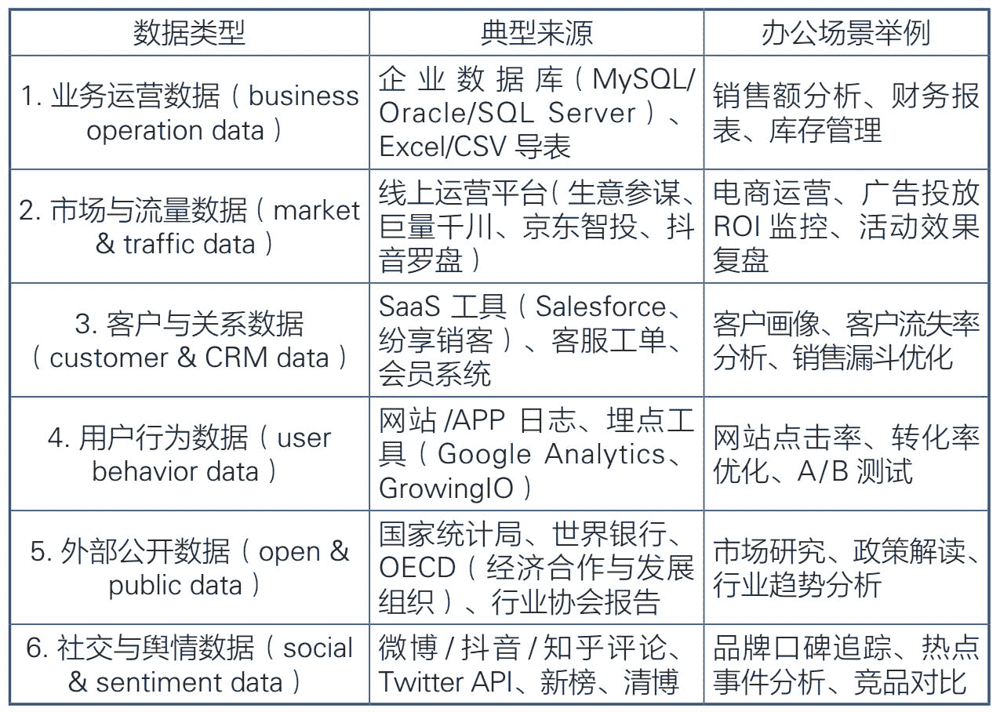

那如果找到了数据平台，但是不会导出怎么办呢？继续问 AI：
提示词示例：
我想从生意参谋导出“近 30 天店铺用户行为”数据，请告诉我步骤，并说明导出的数据是否需要清洗。

Kimi 模拟输出：
从生意参谋导出“近 30 天店铺用户行为”数据，可参考以下步骤：
1.登录生意参谋：使用淘宝卖家账号登录生意参谋平台。
2.选择数据模块：在生意参谋的首页或菜单中，找到与用户行为相关的模块，如“流量分析”“访客分析”等，不同版本和套餐的生意参谋可能在具体模块名称和位置上有所不同，需根据实际情况选择能获取到店铺用户行为数据的模块。
3.设置时间范围：在所选模块的数据报表页面，找到时间范围设置选项，选择“近 30 天”或自定义日期区间来确定要分析的时段。
4.选择导出数据类型：点击“导出”按钮，在弹出的导出设置窗口中，选择导出数据的类型，如用户行为相关的指标，包括访客数、页面浏览量、停留时间、跳出率、加购行为、收藏行为、购买行为等；同时选择导出文件的格式，如 CSV、XLS 等。
5.点击导出并下载：确认无误后，点击“确定导出”，系统将开始处理请求，稍等片刻，根据提示下载导出的数据文件。

此外，如果数据分散在多个系统，我们同样可以告诉 AI：“我有部分数据在 CRM，部分在财务系统，部分在问卷系统，请帮我设计一份数据整合的字段对齐方案。”

因此，数据分析的第一步不是“开 Excel”，而是“让 AI 帮你问对问题”。

目标清晰，分析不乱；模型合适，结论靠谱；流程简明，结果才会有用。获取数据也不再是人工跑数+复制粘贴，而是可以借助 AI 一步步确认字段、优化结构，甚至自动连接接口提取。

## 二、AI 辅助数据预处理——少写公式，多问 AI
目标定好了，下一步不是开“跑”，而是让数据变得干净、统一、可分析。

过去，数据清洗是打工人最怕碰的苦活，动不动要写一堆 VLOOKUP、IF、COUNTIF 函数……现在，有了 AI，你只要“描述问题”，它就能替你写公式、清数据。

操作方式：
1.上传 Excel 表格到 ChatExcel；
2.直接输入提示词（不需要写函数公式）。

常用提示词模板：
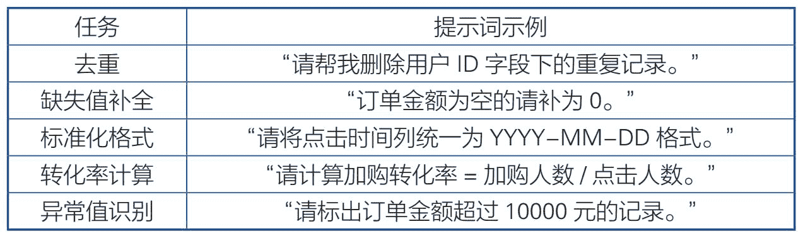

以下是 3 个最常见的数据清洗问题，以及 AI 如何一步步帮你搞定的具体方法。

1.自动识别并处理缺失值
目标：识别数据中的空白，并决定如何处理（填充或剔除）。
示例数据：
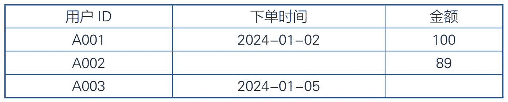
提示词示例：
请帮我识别表格中的缺失值，并列出缺失的行数及字段。分析哪些字段缺失比例较高。
后续操作选择：
若少量缺失→提示词：请用“金额”列的平均值填充空值；或删除“下单时间”为空的行。
若缺失严重（如>30%）→提示词：请列出“缺失超过 30%”的字段，并建议是删除还是保留。
AI 会自动分析表格，输出缺失字段、占比、建议填充方式，免去你手动筛查的苦力活。

2.识别并剔除重复值
目标：避免数据重复记录导致分析失真。
示例数据：
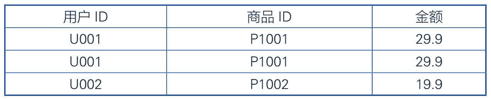
提示词示例：
请帮我删除“用户 ID”与“商品 ID”重复的记录，只保留一条。
你也可以更明确地指定保留条件：
如果“用户 ID”与“商品 ID”重复，请保留“金额最高”的那条记录。
AI 会标出重复行，自动执行“去重保留优先级”，最终导出一张无重复的干净数据表。
如果你想仅标记不删除，可提问：请标记“重复”的行，在最后一列添加“是否重复”字段。

3.格式统一（尤其是日期、金额、分类字段）
目标：确保所有字段的格式一致，避免分析出错
示例问题：
日期格式混乱：“2023-01-01”vs“1/1/2023”vs“2023 年 1 月 1 日”。
金额字段：有的是“ 89”，有的是“89 元”，有的是“89”。
提示词示例（统一日期格式）：
请将表格中所有“订单日期”字段统一为“YYYY-MM-DD”格式。
提示词示例（清洗金额格式）：
请将金额字段中的“元”“ ”等字符去除，只保留数字，并统一为两位小数。
提示词示例（分类字段清洗）：
“性别”字段中存在“男、男性、male”，请统一为“男”；“女、女性、female”统一为“女”。
AI 执行后，会自动将所有日期格式转换为统一标准，删除符号并格式化数字，将分类字段标准化，提高数据分析准确性。
因此，以前你需要写 10 个公式、翻 100 行表；现在你只需要一句话：“请帮我清洗这张表格。”
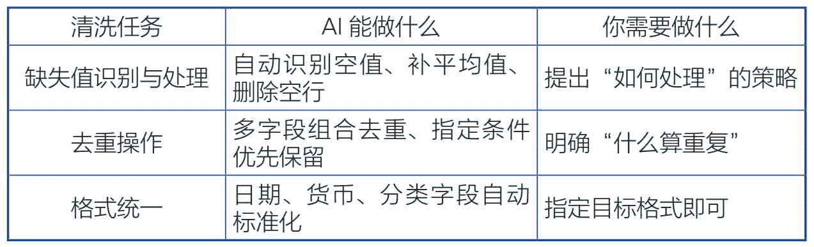

## 三、AI 辅助计算与建模（普通职场人也能用的高大上组合）
很多人一听到“数据建模”就头大，看着别人的汇报有图有表，非常高大上，羡慕至极。
其实在 AI 时代，每一个职场人都能轻松完成数据建模与分析，关键是让 AI 来“出力”，你只要“出题”就行了。
这里需要用你的 AI 伙伴（GPT、DeepSeek、Kimi 等）+SPSSAU，SPSSAU 是一个在线数据分析平台，功能接近 SPSS 但操作更简洁，只需上传 Excel 表格或 CSV 文件，勾选分析模型，它就能自动跑数、出图、写报告。
最重要的是：它会自动生成可复制粘贴的自然语言结论，用来汇报、写总结、做 PPT 超省力。

工具清单（适合职场人快速搭配使用）

下面我们就列举几个人人都能搞定的 SPSSAU+AI“高大上分析”。

### 场景一：我是运营，想分析转化率为什么变低了
分析目标：识别“转化漏斗”中的问题阶段，找出转化率下降的原因
操作流程：

### 场景二：我是 HR，想知道工作年限与绩效有没有关系
分析目标：探索两个变量之间是否存在关联
操作流程：

### 场景三：我是市场人，想知道哪个广告渠道最值得投
分析目标：比较不同渠道带来的转化质量
操作流程：

### 场景四：我是内容运营，想知道内容形式对阅读量是否有影响
分析目标：判断不同内容形式对阅读量是否有影响
操作流程：

SPSSAU 是你“建模动手”的工具，AI 是你“理解+表达”的大脑助手，二者结合起来就是最强组合：自动分析+语言转化+决策建议。不懂统计学也能干专业的事！

## 四、AI 辅助数据结果解读——别再只“报数”，你要“讲故事”
你已经搞定了前面三步：
明确了分析目标；
洗干净了数据；
做完了计算和建模。
但最关键的来了：你的老板/客户/团队，根本不关心你跑了多少行代码、做了多少个图表。他们只关心：这些数据说明了什么？我们该怎么干？
这就到了数据结果解读阶段。
本阶段的目标是：把枯燥的数据结果翻译成业务建议+行动语言。
你要做的，不是展示“转化率=12.8%”，而是告诉别人：趋势是什么，关键变化在哪儿，哪个指标值得关注，该采取什么对策。

步骤 1：让 AI 快速总结关键发现
提示词示例：
以下是我从 Excel 中整理出的分析结果，请你帮我总结 3~5 个最关键的发现，并用非技术语言表达。
【数据如下】（或上传表格）
这些关键发现可以作为报告第一页的亮点，适合汇报或决策使用。

步骤 2：让 AI 辅助将趋势数据转为报告语言——洞察≠描述
提示词示例：
结合以下时间趋势数据，请帮我解读其背后的变化原因，并提供两个可能的业务解释。
这类提示词可以让 AI 帮你补出你没想到的“背后解释”和“业务含义”。

步骤 3：让 AI 优化图表呈现
提示词示例：
请根据以下数据内容，帮我设计一个汇报用的图表结构（图表类型+标题+备注说明），并总结图表中想表达的重点。
你还可以继续向 AI 发出指令：“请生成一段用于汇报时口头讲解的内容。”

步骤 4：让 AI 生成业务建议+行动项
提示词示例：
基于以下分析结论，请生成 3 条可以立刻执行的优化建议，适用于营销团队下一轮活动。
输出为“建议+解释+数据依据”，可直接复制进 PPT 结尾页或汇报材料中。
AI 不是替你决策，而是帮你看见你没注意到的趋势；用清晰的语言表达数据里的信息；把图表变成对话，把数据变成选择。

你的任务，是把这些“AI 提示”讲给人听并落实到行动。

# Part6 AI+表现力：可视化和 PPT
你有没有过这样的时刻：
项目你也做了不少，报告你也认真准备，结果到了汇报那一刻，老板看着 PPT 只说了一句：“这我看不懂。”而和你同期入职的同事，干的活跟你的差不多，却凭借一份清晰明了、重点突出的 PPT，顺利拿下晋升名额。
是不是觉得有点委屈？但现实就是职场不是谁做得多谁赢，而是在需要表现的时候“一击即中”。
这并不是危言耸听，杭州一位中年男子，真的因为“PPT 太丑，影响公司形象”而被公司辞退，引发全网热议。

（图片引用自新浪财经）
很多人一提到 PPT 就头大，脑中自动浮现：赶进度、做图表、调格式、改模板，一路改到凌晨三点。但如果回头看看 PPT 发明的初衷，我们就会发现其目的其实非常朴素：
·告别手动翻胶片，让演讲更流畅；
·整合文字、图表、图像，降低“信息可视化”的门槛；
·实现图文音视频一体化，让表达更具表现力。
因此，PPT 的本质不是“做图”，而是“帮助你展现观点”的演示工具。
心理学家阿尔伯特·梅拉比安（Albert Mehrabian）提出著名的“7/38/55 沟通定律”：
在沟通中，观众对你印象的形成只有 7%来自你讲的话，38%来自语气、语调等表达方式，而高达 55%来自你的视觉呈现，也就是你看起来是否专业、有说服力、有存在感。
所以，做 PPT 的真正目的是这两部分：
PPT 本身的内容与结构≈55%的视觉说服力
你讲的内容和演讲的方式与语气≈45%的表达感染力
换句话说，PPT 的核心价值，不在内容多，而在表达力，再好的内容，如果表达方式不对、视觉呈现不清晰，照样“白搭”。
做 PPT 不是你写得爽就好，而是要别人看得懂
许多 PPT 像“灾难现场”，其原因不是模板不好用，而是我们缺乏“读者思维”。
什么是“读者思维”？
就是在制作 PPT 时，站在观众的角度去思考：他们想看什么？能不能一眼看懂？听完能记住哪些关键点？这个页面是帮助理解，还是制造困惑？
不是“我想讲什么”，而是“别人能不能快速吸收”；
不是“我写了多少内容”，而是“对方有没有抓到重点”。
当你带着读者思维回看自己做的 PPT 时，你会发现：很多时候我们把 PPT 当成了自言自语的笔记本，而不是一个面对观众、引导思路、传达观点的演示工具。
所以一份 PPT 为什么会让人“看不下去”？问题往往就出自这四种典型场景：
·听不明白：内容跳来跳去，前后没逻辑，你讲了半天，观众却不知道你想表达什么，只能一脸问号。
·看不清楚：密密麻麻全是字，没分层级，没留白，观众还没开始听就已经视觉疲劳了。
·记不太住：动画飞、字体跳，页面看着热闹，但重点在哪儿没人知道，信息传递反而被干扰。
·不打动我：像在听人念稿子，没有节奏，没有情绪，没有交流，讲得再完整也打动不了人。

续表

既然 PPT 是用来演示的，而非自说自话，那我们就要想：“如果我坐在下面看这份 PPT，我能不能很快看懂？”接下来我们逐一拆解 4 种问题类型：
1.结构混乱型：逻辑不清，顺序混乱，缺乏结构

这类演示，逻辑断层严重，内容一跳一跳说不通；没有导入、没有衔接、没有点题、没有收尾，完全寄希望于观众自行会意；图和字各说各话，信息互不呼应。之前聊过结构化表达，PPT 的价值在于观点有迹可循，自己心里没路，听众更不可能走通，观感就像在拼散落的意识流碎片。

**信息堆砌型：塞满内容，却什么都没讲清**

很多人做 PPT 如同写论文，一页塞进上千字，看得眼花听得发懵；字体过小密密麻麻根本看不清也记不住；信息没有分层，一张图铺满，关键点反而被淹没。PPT 不是文本仓库，堆得越多越空。真正好用的幻灯片是提炼后凸显，而不是复制后堆砌。

**视觉失控型：设计喧宾夺主，干扰理解**

美化是加分，但不能喧宾夺主。五种字体混用、八个颜色乱撞、多种图标风格拼贴；转场花哨、背景抢镜，核心信息被埋；配图来源不一、比例失调，版面像拼贴大杂烩。看似是审美问题，实质是缺乏设计意图的随意堆放，做的人累，看的人想关页。

**表达僵化型：像个无感的读稿机**

PPT 用于演示，却被当成 Word 来汇报进度；做完就群发，现场只是一页页念，毫无温度。演示不是朗读，而是用工具把意图传递给人，关键在于有没有清晰的逻辑、有力的重点、有情绪的表达。

**那 AI 在这条路上能做什么——不是替代你，而是放大你的表达力**

不用再单打独斗，可以让 AI 各司其职：

结构凌乱就让 Kimi 帮你搭框架；

信息臃肿就让 DeepSeek 帮你压缩精炼；

排版眼花就让 Canva 可画帮你提炼视觉重点；

表达平淡就让 AI 帮你写出有说服力的讲稿。

## 一、用 AI 搭骨架：把混乱变成清晰的脉络

我们曾讲过 SCQA 和金字塔原理，适合打磨短文本或单页文字。但在整份 PPT 的起步阶段，还需要一个“逻辑锚点”——MECE 原则。

### MECE 原则到底是什么？

MECE 即 Mutually Exclusive and Collectively Exhaustive，中文是相互独立、完全穷尽，也叫不重不漏。它由麦肯锡顾问芭芭拉·明托提出，用来拆解复杂问题、构建表达结构。简单说就是把事情分得清清楚楚、利落分明：同一维度下各部分不能交叉重复，加起来要完整覆盖主题。

这套思路不仅适用于 PPT，大纲、手册、报告、白皮书、企业培训材料都能用。

所以在 PPT 场景里，AI 第一步不是直接出页，而是先输出一个符合 MECE 的大纲，先把骨架立稳，保证逻辑闭环、信息不散：

观众能一眼看出讲几大部分；

各章节之间不重复、不啰嗦；

每页只承担一个核心，让汇报者讲得顺、观众看得懂、记得住。

AI 加上 MECE，能把一团乱麻梳理成主线，骨架稳了，后续的文案、图表、配色、讲稿才有意义。

操作路径大概是：你先定主题和素材 → AI 按 MECE 拆解并生成框架、剔除重复 → 你调整优先级、补充要点 → AI 再帮你提炼、优化页面逻辑。

实践中常见两种情境：

**情况一：已有素材，需要梳理逻辑**

你手上有一堆文本、数据碎片，逻辑跳跃、重复严重，难以成稿。可让 AI 帮你归并成三到五块互不重叠且覆盖全面的模块。

提示词思路：

我整理了一些素材，请按 MECE 原则帮我：

1. 拆分为 3-5 个互不重叠、覆盖全面的板块；
2. 为每个板块命名一个页标题；
3. 给每个板块列出 3 条要点，每条不超过 20 字；
4. 最终输出一份可直接填充的 PPT 草稿结构。
素材如下：（粘贴摘要、要点或旧提纲）

**情况二：从零命题，需要搭框架**

你只有主题，没有思路。让 AI 先出结构，再逐步填充。

提示词思路：

我要做一份关于“【主题】”的 PPT，听众是【受众/场景】，希望涵盖【背景、痛点、价值等】。请按 MECE 原则：

1. 设计一套逻辑清晰的 PPT 结构；
2. 建议页数不超过 12 页；
3. 列出每页标题及要点，每页不超过 3 条，适合单页呈现。
补充要求：（可选）风格务实/商业化/教育性/汇报型。

对比来看：
大纲 A 提示词很宽泛，只说“AI 赋能办公应用的大纲”。生成的结果面面俱到，章节多、深度浅，散乱。
大纲 B 则明确受众为互联网公司中后台，指定包含背景、痛点、价值等，并要求 MECE、限定页数。每页标题+要点清晰，主线是先背景再三类核心痛点，再对应价值、案例、展望，逻辑紧凑更有说服力。

确定好大纲后，可以用 Kimi 的 PPT 助手一键生成初稿，配图虽为通用素材，但能极大节省排版和组织时间；追求精致版式的，可在此基础上继续优化。

Kimi 调用 PPT 有两种方式：对话里 @PPT 助手，或在 Kimi+ 中打开 PPT 助手。

确定结构后点“一键生成 PPT”，会进入模板挑选页，可按场景、风格、配色筛选。

生成后还能编辑大纲并一键换模板，细节需要人工微调。

## 二、用 AI 把每一页讲明白——拒绝信息过载

PPT 里最致命也最常见的病就是信息过载。一页塞满文字、数据、背景，看似很饱满，实则观众一个要点都没留下。

你以为在讲重点，观众心里可能在想：什么时候到头。

这与认知负荷理论一致：信息超过处理阈值，理解会迅速下降。塞得越多，记住越少。

有效的页面不是把所有东西摊开，而是把信息轻量化——一眼抓住核心，三秒读懂要义，跟上节奏。

一个轻量化页面可遵循：

**AI 三步策略，让表达更清晰**

第一步：用 SCQA 压缩信息，减轻负担

SCQA 能把一大段话压成四要素的框架，让一页有起承转合。

第二步：用金字塔原理分层观点，理清主线

先给结论，再用三条平行支撑，帮助观众快速建立认知地图。

第三步：图文配合，用视觉加速理解

图表是天然的信息压缩器。先让 AI 判断哪些要点适合转成图表，如列表、流程、矩阵等。

好 PPT 不是写满，而是写明白。借助 AI 与结构工具 SCQA、金字塔、图文可视化，用更少的字、更清晰的逻辑和更直观的图讲出打动人的内容。

例如，以“AI 赋能办公应用”大纲中“当前背景”页为例：

示例提示词：

请将下面内容整理成 SCQA 形式，输出 S、C、Q、A 四部分：

S 用一句话概括现状；

C 点出冲突，限两句内；

Q 提炼核心问题，一句话有力；

A 给出观点或解法，2-3 条。

要求简洁、连贯，适合一页或 60 秒陈述，避免堆砌。

原始素材包含大模型技术成熟、办公软件能力提升、市场需求驱动、工作效率与质量诉求、协作沟通诉求、决策科学化诉求，以及行业竞争压力等要点。

经过压缩后，页面就有了明确的问题意识与回答，而不是资料罗列。

智能办公新势能：以效率、体验与成长打造竞争优势

构建竞争壁垒的抓手
市场竞争日趋白热化，互联网企业唯有持续提升运营效率与创新能力，才能保持领先。基于人工智能的智能办公体系已成为数字化转型的核心抓手，帮助企业梳理业务链路、降低成本、释放生产力并激活创新动能。头部公司率先接入由人工智能驱动的办公软件与自动化组件，推动业务流程实现智能化与自主运行，整体运转效率与市场响应速度同步提升，最终在同质化竞争中实现差异化突围。

满足客户预期的必然选择
用户对服务品质与响应时效的要求不断攀升，提升服务已成刚需。中后台作为支撑前台业务的核心枢纽，采用智能办公方案后能够更快速地触达客户诉求，提供更精准、更具个性化的解决方案。智能客服可自动承接高频咨询，压缩问题处理时长与成本；CRM 系统的智能模块能深度挖掘客户数据，为销售与服务团队生成画像并推送定制化建议，有效提升满意度与忠诚度。

员工成长视角
个人能力放大：对互联网企业中后台人员而言，掌握智能办公工具与相关技能有助于强化工作胜任力与市场竞争力，更顺滑适应数字办公环境。熟练使用智能文档撰写、数据分析等组件，能明显改善产出质量与效率，腾出精力投入更具创造性、战略性的工作，进而提升个人价值与职业发展空间。
岗位形态演进：随着智能技术在办公场景的渗透，部分传统后台岗位内容将被重塑。员工需要积极学习与适应新的技术和工作方式，以应对岗位变化和转型的挑战。例如，规则性强、重复度高的工作可能会被自动化工具接管，而员工则需要转向更具创造性和复杂性的任务，如数据洞察、业务流程优化、智能系统的管理和监控等。

DeepSeek 输出：
好的！下面是我基于你提供材料，用 SCQA 结构做的一版精炼表达，逻辑清晰、语言凝练，适合一页 PPT 或 60 秒口头陈述。

人工智能赋能办公全景

S｜背景现状：
生成式人工智能快速演进，大模型能力持续突破，办公工具进入智能化新阶段。
企业承受强竞争与数智转型压力，员工希望借助新技术提升效率、应对角色变化。

C｜核心挑战：
当前中后台任务重复度高、信息处理复杂、跨部门协同摩擦大。传统办公手段难以匹配业务快变，也难以同时满足客户服务与员工成长的双重期待。

Q｜关键议题：
在转型加速期，如何以人工智能赋能提升办公效能、优化协作流程，并兼顾人才发展与客户满意？

A｜行动路径：
1.引入智能工具，自动化繁琐环节：如智能文档生成、会议纪要提炼、流程协同平台等，提升中后台运行效率。
2.释放数据价值，支撑科学决策：依托非结构化数据解析、精准检索与智能推荐，助力管理与营销优化。
3.推动能力升级，适配岗位演进：培训智能办公技能，将人力从低价值重复劳动中解放，聚焦高价值工作。

继续提问：
以上内容中哪块适合用可视化呈现，并推荐一种合适的图表形式，便于在 PPT 中表达。

DeepSeek 生成：
哪部分适合图表呈现？如何呈现更清晰？

推荐重点图表：

图表 1：问题冲突展示图（并列列表图）

可用横向图标配合三栏卡片布局，逻辑并列、直观易读

图表 2：人工智能三大赋能方向（三栏式矩阵图）

适合用矩阵图或横向三栏表格呈现，配合图标增强记忆点。

图表呈现顺序建议（单页 PPT 中）：

1.标题+核心议题（Q），用大号文字居中
2.冲突呈现（C），横向卡片式图展示三大痛点
3.解决方案（A），底部三栏矩阵图强化落地价值
4.背景（S），置于左上角，以图标点缀即可

## **三、人工智能图表可视化**

俗话说得好，“一图胜千言”。这并非空话，而是已被研究验证的认知规律。

图像能够加速学习、巩固记忆、吸引注意力、解释复杂概念并激发灵感。原因在于人脑天生偏好视觉信息。

研究显示：人脑处理图像的速度是文字的 60,000 倍，大脑接收的信息中 90% 为视觉信息。

举例说明：

你的汇报是这样：

而同事的 PPT 是这样：

柱状图，谁卖得多一眼明了
折线图，客单价高低一目了然
雷达图，成交能力全景对比

作为决策者，你更倾向看哪一份？答案不言自明。

所以，数据汇报、故事讲述、演示沟通时，别再堆砌文字。国内将数据图表化的工具很多：

本文重点介绍易上手的可视化平台 Canva，支持多种图表与可视化组件、交互展示，适用于职场汇报、销售项目可视化、公众号图解、教学培训等场景，并且：

**·拖拽式操作，零基础也能做；**
**·支持导入 Excel/CSV 数据；**
**·提供几十种图表模板，一键美化；**
**·可自定义颜色、字体、动画、交互；**
**·图表可嵌入 PPT，导出为图片或视频，在线分享。**

那么，在 Canva 中如何制作图表？

（1）依数据类型与目标，选择适配的图表类型

**快速匹配方法：**

**常用图表应用场景示例：**

**基础通用类图表：**

**进阶图表：**

（2）进入 Canva 并新建设计：选择合适画布，添加图表组件

（3）录入数据并调整样式

（4）导出与应用

还可以组合生成信息图表（模板示例）：

而你的表格，从此不再枯燥。

## **四、人工智能辅助演讲力：从“会做”到“会讲”，一步到位**

在职场与商业演示中，流传一句老话：“会做不如会说。”

现实往往如此，你可能花了三天三夜打磨逻辑清晰、图表精美的 PPT，却因临场发挥失误功亏一篑。PPT 是外壳，演讲是灵魂。真正打动老板、客户甚至投资人的，是表达方式与感染力。

为什么“会讲”这么难？

不少人有这样的经历：别人一开口就能稳住全场，自己讲两分钟听众已看手机。内容本身不差，问题出在呈现。常见痛点有三：

1.逻辑松散：你讲的是信息，听众抓不到重点。缺少清晰讲述顺序与主线支撑，观众只觉得自说自话，核心信息丢失。
2.情绪平淡：内容有料却无人想听。语气单一、节奏平缓、缺乏情境与故事，难以产生共鸣。
3.表达僵硬：照本宣科翻页汇报。口语感弱、断句不清、用词偏学术或官腔，观众听感疲惫，且难以关联自身利益，因而记不住。

如今借助人工智能，可一键生成结构完整、语气自然、逻辑清晰的演讲初稿。但仅有稿子不够，若只是照念，演讲仍会让人听完即忘。

延续读者思维，演讲的目标不是信息输出，而是说服、建立信任、吸引注意力、达成共识。

底层表达框架可引入 FAB 原则。

**什么是 FAB 原则？为什么它能解决演讲表达不打动人的问题？**

FAB 原则源于销售领域，如今广泛应用于产品发布、项目汇报、竞聘演讲等高影响场景。核心公式为：

F—feature（特点/事实）：你在讲什么？
A—advantage（优势）：它为何重要、比旧方式好在哪？
B—benefit（收益）：听众能得到什么？

它恰好对应演讲中常见的三大结构性短板：

FAB 的价值在于不仅讲清内容，更讲出价值，让观点更清晰、语言更具感染力、演讲更具说服力。

FAB 与人工智能结合，可快速生成结构化讲稿，并借助人工智能润色情绪表达、模拟听众视角、打磨说服语气，让每页内容、每段话都有听点、记忆点与共鸣点。

通用提示词模板：

任务目标：请将以下内容整理为一段适合口头演讲的文字，采用 FAB 结构组织表达，确保语言自然、逻辑清晰、有说服力。

要求：
1.F（feature）：明确“这是什么”，用一句话提炼核心概念或特性；
2.A（advantage）：说明“为何更好”，与传统方式对比增强说服力；
3.B（benefit）：点明“与观众何干”，用听众视角表达价值与改变。

语言风格口语化、节奏感强，避免书面腔。输出控制在 120 字内，适合 PPT 讲稿或 60 秒开场。

内容输入区：【请粘贴你的原始内容，如产品介绍、项目理念、转型方向、学习建议等】

（本文沿用本章第一节幻灯片 3“当前背景”部分内容作案例）

Kimi 输出：

各位同事，今天给大家介绍人工智能赋能办公应用，它借助智能技术把传统办公工具升级为智能助手。（F）它能自动完成重复繁琐任务，像一键生成文档、智能整理数据，比传统方式效率提升数倍。（A）对于我们中后台而言，使用它可节省大量时间，让我们从机械工作中解脱，把精力投入到更有价值、更具创造性的工作中，助力个人职业发展，同时提升团队整体效能。（B）

1.FAB 原则中的 F
F 代表 feature，也就是“是什么”。
PPT 逻辑完整但口头跳跃、毫无章法，观众抓不住主线，本质是 feature 缺失。
强化 F 要回答：这一页/这一段到底在讲什么？若自己说不出简明主讲点，观众自然无法理解。
F 强化的核心是：一页一观点，一段一结论。让人工智能为你提炼每页标题与每段小结。提示词示例：“请从以下内容提炼每页核心观点，并转化为一句话标题。”
随后让各 F 形成递进主线，可让人工智能调整讲述顺序、添加过渡句、统一整体框架。提示词示例：“请按背景—问题—观点—建议重排段落，并标注每段主讲点。”

2.FAB 原则中的 A
A 代表 advantage，即说服力与共鸣。若听众无反馈，问题可能在于没讲清“为何值得在意”。
强化 A 需注入情绪能量与认知冲击，让听众从“知道”走向“认同”。
①加入类比：用熟悉事物解释陌生概念。原句“我们希望通过流程自动化提升部门协作效率。”优化为“我们希望用人工智能搭建一条‘传送带’，让部门协作像模块拼接一样高效。”提示词：“请为观点生成通俗类比，适合口头表达。”
②制造反转：打破预期。原句“加班文化影响创造力。”优化为“你以为加班是拼命，其实是在消耗创造力——疲惫常态化，创新自然熄火。”提示词：“请将句子改为‘不是…而是…’的反转句式，强调重要性。”
③加入小故事：用 STAR 结构把事实讲成故事。示例：“引入智能协作平台后，跨部门会议效率提升 40%。”讲成“过去对接像踢皮球，去年换上智能平台后，三部门在同一文档‘边改边讲’，那种默契感前所未有。”提示词：“请将项目经历改写为 STAR 结构演讲故事，60 秒可讲完。”

3.FAB 原则中的 B
B 代表 benefit，即让听众听进去、愿回应。你讲了功能、进展、趋势，却未说明“与你何干”。
Benefit 不是你的价值，而是听众能获得的价值。
①口语化表达。书面句“本系统在数据抓取与清洗环节采用预训练算法提升效率与准确性。”改为口语“这个工具帮你更快找到有用数据，自动剔除无关信息，节省很多时间。”提示词：“请转写为口语化表达，加入停顿断句，语气自然。”
②加上听众受益视角。示例：“引入智能系统后，项目审批效率提升 30%。”改为“对你而言，这意味着不用反复催流程、改表格，项目推进更顺畅。”提示词：“请为观点添加一句听众好处，突出便利或改变。”
③加入总结金句或价值锚点，加深记忆。提示词：“请生成一句演讲结尾金句，帮助听众记住本页价值。”示例：“这不是一个工具，而是你节省时间、提升效率的全新工作方式。”
好演讲不是讲你知道的，而是说出别人在乎的。强化 B 就是在每段表达中告诉听众：这件事与你相关，且对你有好处。
借助人工智能+结构，你可以从只会做 PPT 进化到让 PPT 开口说话。

# **Part7** **人工智能+成长力：走向超级个体**

在这个被人工智能重塑的时代，个体的进化速度已超过组织的更新周期。曾经一家公司要几十人才能运转的流程，如今一个人加一组智能体就能搞定；曾经要摸爬滚打几年才能积累的经验，如今可以借助人工智能沉淀、调用、升级；曾经碎片化、难掌控的时间，也能被人工智能切割成高价值的“生产力单位”。

人工智能时代，超级个体的崛起，不再靠熬时间、撞运气，而是靠伴随人工智能成长的能力。

首先，用人工智能管理时间，可以让“注意力”成为你的高净值资产。
在信息爆炸、任务爆表的职场中，真正被稀释的是注意力。过去时间管理靠自律；现在，你可以借助人工智能打造“时间资产管理系统”——它能让你把一天过得像连续剧，每一分钟都在关键剧情里，而不是在关键时刻插播广告。

其次，用人工智能管理经验：让“做过的事”成为可复用的认知资产。
很多人项目做了一堆，半年后回头一看，连路径都忘了。学过的内容、走过的弯路、总结的经验……统统沉没在聊天记录、硬盘角落、遗忘的云文档中。
但超级个体会用人工智能把经验“打包上链”。你可以让人工智能帮助你完成“信息收集—知识提炼—模型构建—经验归档”的完整闭环，打造一个只为你服务的认知资产库。

最后，可以用人工智能深度协作：把自己活成一支队伍。
新的职场范式不是“卷团队的人赢”，而是“能调动人工智能资源的人赢”。
一个人能承担几个角色的任务？过去答案是“看精力”，现在答案是看人工智能协作力。用人工智能写文案、查资料、排 PPT、做图表、生成市场分析、整理客户数据……只要你指令清晰，你的“数字团队”就能如影随形，为你高效运转。

一人公司+AI：超级个体的新进化法则

个人搭载智能体的组合，正成为新一代成长者的标准配置。
**AI 成长力，是个人跃迁到超级个体的底层驱动。**
它不是让你更卷，而是帮你摆脱“使劲却混乱、明白却记不住、做过却用不上”的困局，真正沉淀出自己的时间体系、经验体系和协作体系。从今往后，你不再是单打独斗的个体，而是一个会自我驱动、持续迭代的复合系统，每天在累积复利势能。

## **一、时间资产管理——用 AI 把 24 小时变成可投资的资产**

跃迁的第一步，不是熬夜，也不是报课，而是像经营企业一样去经营时间。
职场里真正的隐形鸿沟，不是努力程度，而是对时间价值的认知差距。你在用时间硬扛，他在用时间做资本配置。真正的突破，不在于多挤几个小时，而在于把时间从流水账式的消耗，升级为可核算的高效资产负债表。智能体就是最贴身的时间顾问。

想想那个学霸典型，课间最放得开，球场从不缺席，成绩却常年第一。差距不在忙闲，而在“玩时彻底放空、学时高度聚焦”，对时间颗粒的掌控远超常人。

时间资产的核心逻辑很简单：忙的人一天 24 小时，闲的人也只有 24 小时。升职、变现、健身、阅读的关键，不在于时长，而在于精细度。时间本身没有阶级，但时间的颗粒度有差别，切得越细，活得越高级。

### **（一）时间从流沙变资产：用 AI 重塑价值链**

过去我们把时间当成流沙，流走就没了。真正缺的不是时长，而是时间资产化思维，再配上一个 AI 助手。
高效管理不是显得很忙，而是让每一刻都指向目标、产生产出、控制成本。智能体可以把时间切块、分发、优化、交易。

混得开的人早已不再排时间，而是配置时间。别再靠大脑记清单、手工排期、用眼睛看进度。用 AI 做精细化管理，让每一分投入都变成回报率最高的投资单元。

### **（二）落地怎么做？两件核心工具**

不需要成为时间管理专家，借力即可。搭建 AI 时间调度系统主要靠两样：

（1）用 Kimi/DeepSeek 把任务拆到可执行颗粒
把模糊的待办交给 AI 拆成最小步骤。

（2）用飞书多维表格搭建时间管理面板
把任务转为数据：时长、优先级、标签、状态，随时掌握进展。

**1.让时间动起来：AI+SMART=时间引擎**

光有清单不够，每个任务需要目标引擎属性。这时 AI+SMART 就是关键公式：

举个例子：

**提示词模板：**

我本周的核心目标是【请填写你的目标，比如：完成 AI 办公指南的第二章草稿】。

请你结合 SMART 原则，对这个目标进行拆解，并输出一份可直接填写到飞书多维表格的任务清单表，表格格式如下：

|任务名称|目标说明（S）|可衡量结果（M）|是否可实现（A）|与核心目标的关联性（R）|预计完成时间（T）|所需时间（小时）|优先级（高/中/低）|当前状态（未开始/进行中/已完成）|

拆解要求：

1.每个任务的目标要具体（specific），表述不能模糊（如“做一下”）。

2.每个任务必须可衡量（measurable），例如“完成 3 页 PPT”“写完 800 字文本”。

3.请根据“每个任务耗时<2 小时”来判断是否可实现（achievable）。

4.请标记任务与本周目标的直接或间接相关性（relevant）。

5.每个任务必须设定完成时间（time-bound），如“4 月 27 日 18:00 前”。

注意：

-输出任务建议数量不超过 10 个；

-每项任务需紧凑但不过度堆压，适合平衡工作节奏；

-最终输出以表格形式展示，便于粘贴进飞书表格。

**DeepSeek 回答：**

我将根据 SMART 原则为您拆解目标，并生成符合要求的任务清单。假设今天是周一（4 月 25 日），以下是拆解后的任务清单：

拆解逻辑说明：

1.任务颗粒度控制在 1~2 小时，符合认知负荷理论的最佳工作单元。

2.按“框架搭建—内容填充—质量校验”三阶段递进设计。

3.高优先级任务集中在周中（周三前），预留后期调整空间。

4.关联性标注帮助聚焦核心产出，避免偏离主要目标。

5.每日安排 2~3 个任务，保持可持续工作节奏。

建议每天上午处理高优先级的创造性工作（如写作），下午处理中低优先级的整理类任务，每日总有效工作时间控制在 4 小时以内。

显而易见，不用死磕时间管理法，AI 自然可以告诉你如何规划时间。

**2.让时间可视化：以飞书为例**

配置好不等于管得住，管理时间本质是管理人生。综合免费与易用，我们以飞书多维表格为例。

将表格导入飞书，便可转为多维表格：

在添加仪表盘后，你的任务规划就可视化啦！

任务进度一目了然，点击每个板块就能看到智能分析，让你拆解的时间可以得到更加精细化的管理。

因此，把 AI 当成时间管家，远远不够。你要学会像 CEO 一样，把自己的一天“当企业去经营”：

掌握了 AI 时间管理，你就不是“在时间里打工”的人，而是“掌握时间的超级个体”。

AI 不仅可以帮你拆解时间，还可以帮你：

**·设置智能提醒：AI 是你最靠谱的“任务闹钟”。**

**·自动记录时间：不再靠“感觉忙”来骗自己，用 AI 自动记录你在哪些任务上耗时最长，用数据“打脸”你的“假忙”幻觉。**

**·时间分析报告：告诉你时间都去哪儿了，智能生成一份“时间花销明细”，工作、会议、沟通、摸鱼占比一目了然。**

**·提供优化建议：你该怎么花时间，AI 比你还理智。**

在 AI 的协助下，你的时间，不再只是 24 小时，而是 24 小时×杠杆效率。

此外，和大家分享部分 AI 时间管理工具，欢迎大家持续探索。

**（1）任务管理类**

续表

**（2）日程安排类工具**

**（3）时间跟踪与优化工具**

此外，国内一站式平台推荐：

飞书全家桶：任务+日历+文档+协作，一体化办公（支持中小团队免费版）。

钉钉智能协同中心：任务流+会议调度+AI 助手，适合 50 人以上政企团队。

WPS AI 办公助手：文档+时间管理+AI 生成，轻量级用户首选（会员性价比高）。

华为云 WeLink：政企级安全方案，集成日程、任务、会议（适配鸿蒙生态）。

## **二、AI 经验资产管理——让认知飞轮持续转动**

构建经验资产管理系统，才是超级个体的真义。在信息唾手可得的时代，拉开差距的不是信息量，而是经验值。

**·很多人并不缺学习力，而是缺转化力；**
**·看过一本书，半年后连书名都想不起来；**
**·听了一场培训，实际操作时依旧一脸蒙；**
**·做过一个项目，下次遇到类似问题还是要从零摸索。**

这不是不努力，是缺少“认知沉淀系统”。信息进来了却没变成经验，经验有了却没打包成资产。

想成为超级个体，光靠做得多不够，要让每一次经历都成为下次跃迁的跳板。

**什么是认知飞轮？**

它不是灵光一现，而是可不断升级的经验管理引擎。

简单理解：信息输入—理解加工—行动实践—反馈沉淀—模型升级。

（图片引用自：《认知飞轮：在不确定的世界里寻找确定》）

认知飞轮的本质由四个环节构成，像发动机一样，驱动你不断进步：

**·感知：主动接收高质量信息，唤醒注意力与好奇心；**
**·认知：对信息进行理解、分析、判断，构建逻辑，形成观点；**
**·决策：将认知转化为选择和执行路径；**
**·行动：从实践中总结经验，重塑感知，再次迭代。**

这个闭环每转一圈，你就比昨天多一个“认知资产单元”：知道得更快，想得更清楚，做得更标准，改得更精准。

你的认知不再是“记得住”，而是“调得出”；经验不再是“过了就忘”，而是“打包可用”。

这才是超级个体的底层优势：一身经验皆可复用，所有经历都是资产。

认知飞轮=经验沉淀四部曲

每一次完成闭环，都是一次认知升级；每一个反馈，都是一块“经验砖”，垒高你的能力塔。

过去的认知积累，靠的是“手动输入法”——写手账，记读书笔记，做日报复盘，做完项目写总结……

但这些方式存在三大问题：

零散：资料分散在笔记、文件夹、语音记录里。
易丢：不归档、没命名，三天后连自己都找不到。
难复用：写是写了，下次用得上的不超过 10%。

而 AI 时代最大的改变，是你可以用 AI 来“管理你的经验值”。

用 AI，打造属于你的“认知资产管理系统”。

你只需要一句话：

“请调用我 A 项目的策略模板，根据当前预算生成新版执行计划。”

AI 就能在 0.5 秒内，调用你的经验资产库，替你完成 80%的结构与思路输出。

从“知道一点”到“能打包调用”，才是真正的认知跃迁。

很多人知道很多，但不能调用；经历过很多，但没有复盘；做过很多项目，但每次都像第一次。

而认知飞轮，就是把你每天的工作、思考、反馈，统统变成“可调用的资产模块”，调用经验就像拿取乐高积木块一样，复用成果。

超级个体不是“知道一切的人”，而是能把自己经历过的一切“提炼成知识，打包成能力，转化为结构化资产”的人。

AI 能帮你做的，不只是省事，更是搭建一整套认知沉淀与经验飞轮系统，让你真正实现从“信息摄入者”到“认知生产者”的跃迁。

认知飞轮一旦跑起来，你的经验将不再是回忆录，而是能力银行。

**实用策略**

**1.项目知识卡：把一次经验变成下次模板**
提示词示例：
“请将以下项目复盘内容提炼成知识卡片，结构包括：项目目标、做法简述、成功关键点、失败反思、可复用模板。”
应用场景：项目汇报后、方案执行后、活动运营后。
输出形式：个人经验文档、下次项目参考包、团队培训资料。

**2.概念知识树：把碎片输入串联成认知网络**
提示词示例：
“请将我近期收藏的 5 篇文章/会议笔记整理成一个知识地图，归类为：1）核心概念；2）延伸观点；3）应用场景。”
应用场景：主题学习、内容策划、专业研究、技能提升。
输出形式：思维导图、Notion 知识库、AI 卡片索引。

**3.方法论手册：把“会了”变成“能教”**
提示词示例：
“请将我完成这次营销增长项目的过程，整理为一套‘可供他人学习使用’的实践手册，包括操作步骤、使用工具、注意事项和经验教训。”
应用场景：给新人培训、留存关键岗位经验、为未来的自己“备份思路”
输出形式：可分享的你的 SOP、团队内部教程、复用流程模板。

长期使用 AI 做知识沉淀，你会发现：
**·你不用每次都从零开始，而是站在自己的历史经验上继续建模；**
**·你能迅速调用过去的经验，给出系统判断，而不是拍脑袋；**
**·你不再只是“不断学习的人”，而是一个能提取、固化、分享知识的复利体。**

这才是真正的信息内化：
看得懂—想得明白—做得准确—记得住—下次用得上。

## **三、AI 深度协作：畅想一个人带一支数字军团的工作方式**

### **一人公司+AI 智能体=未来成长力的终极形态**

你有没有暗暗地想过搞点副业，最好还能不累不焦虑地赚钱？
有没有幻想过：一个人也能像一家公司一样高效运转？

在过去，这听起来像句职场毒鸡汤。
创业？别开玩笑了，销售、设计、客服、内容，一个人干四个人的活还不累死？但现在，AI 智能体正在改写这一切。

### **一人公司，不再是孤勇者的神话**

在 AI 出现之前，创业意味着你得组团队、租工位、写 PPT、追热点、熬通宵。现在不一样了，AI 就像一群“数字员工”，默默帮你打工——
**·自动处理客户问题；**
**·批量生成内容、设计、脚本；**
**·分析数据、预测趋势、智能推荐；**
**·安排日程、管理项目、跟进任务。**

你只负责充当一个角色：指挥官。
AI 负责其余所有执行：从想法到落地，一人带队，数字军团全包。

这就是“AI+成长力”的终极协作形态——一人公司+多智能体协作系统。

### **热词太多？搞清楚“工作流”和“智能体”就够了**

在 AI 的世界里，“智能体（Agent）”“工作流（workflow）”这两个词最容易搞混。

**什么是智能体？**
相比之下，智能体更像一个“有脑子的员工”。
你不用告诉它每一步该怎么干，它能根据环境，自主规划、动态调整。
比如外卖员接单后，可能会绕开红灯、躲避堵车，用最快路线送达，这种灵活反应，就是“智能体”的价值。
**√适合开放性、变化多的任务**
**√灵活、可扩展、自主性强**

**什么是工作流？**
简单说，它像一条自动化的生产线。
每一步预设流程，按部就班，执行到位，不出岔子。
比如你去麦当劳点餐：前台下单，厨房制作，打包出餐——标准流程一条龙。这就是典型的工作流。
**√适合结构化、重复性的任务**
**√高效率、低成本、强可控**

一句话总结：一个智能体=多个工作流+自主调度能力+自我优化机制。

智能体≠大模型，但离不开大模型。
别搞混了，大模型（如 GPT、DeepSeek）只是智能体的大脑部分。
你让 DeepSeek 写文案、翻译文章，它行。
你要它处理一个复杂流程、跨多个工具协作，它可能会蒙圈。
智能体是一个完整的“AI 员工”生态，包含：
大脑+感知（获取信息）+执行（调用工具）+记忆（长期知识）+反馈机制（持续学习）。
你可以这么理解：
大模型是聪明人，但只动嘴不动手；
智能体是聪明、能干、会反思的超能员工。

**为什么搞清这俩很重要？**
因为它直接关系到你副业搞不搞得起来、赚钱路径走不走得通。

搞不清楚这两个概念，你可能花了智能体的钱，买了个“流程图”套壳 APP；也可能把能用一个工作流自动化搞定的事变复杂，硬让大模型写长篇提示词。

### **一人公司+AI智能体，是深度协作的天花板**

真正高质量的深度协作，不是人和人相互消耗，而是人类价值+AI协同的放大。
你选好方向，AI负责执行；
你指挥流程，AI自动响应；
你成长决策力，AI提升执行力。
这一模式下，你不再是“孤勇者”，而是一支数字军团的统帅。

**第一步：选一个你熟悉或想进入的方向**
比如，跨境电商、自媒体、咨询服务、知识变现、品牌设计……别贪，一开始专注一个赛道即可。

**第二步：招募你的AI“员工”**
按照工作类型，配置你的小队：

让 AI 各司其职，你只管做决策。

**第三步：训练你的AI员工**
AI 不是天生懂你，它更像一位实习生，需要你带带它：
**·教它你的工作流程（比如“先列大纲，再写细节”）；**
**·让它习惯你的语气风格（比如“要接地气，别端着”）；**
**·让它不断微调优化，直到你满意为止。**

训练 AI，就是打造你的“数字分身”。

然后就可以开始快速尝试：
·用 AI 提升效率，接更多单；
·用 AI 节省时间，做更多项目；
·用 AI 扩大产能，一个人赚团队的钱。

未来的最强个体，是能带一群 AI 打天下的人。
一人公司+智能体，不仅是副业解法，更是你在这个时代持续成长、深度协作的最优范式。

AI Agent 听着复杂，其实你早就在用一些初级 Agent，比如：
豆包“拍照识万物”：输入图像，给出解析；但只能单步识别，无法流程化执行。
秘塔 AI 搜索：能自主规划搜索策略，对复杂问题进行拆解再作答，具备一定智能体特征。

相比之下，Manus 是真正具备“任务规划+动态协同+跨工具调用”能力的通用型 Agent。
如果说过去我们习惯的是“我想好了你来做”，那 Manus 的横空出世，代表的是 AI 进入“你想一下我就能干”的时代。
Manus=通用型 AI 智能体+自主任务规划+多工具动态协作
官方定义它不是“会聊天的 AI”，而是能动手解决问题的 AI 员工。

**1.以出差报销整理为例**
出差报销整理：OCR 识票+分类统计+生成报销单。
打工人最痛苦的任务之一——整理发票报销，Manus 三步搞定：
①批量解压发票→OCR 提取发票信息→自动分类（办公用品/差旅/机酒等）；
②填写标准化 Excel 报销单；
③自动计算合计金额+表格美化。
你只需点击“下载”，连粘贴都省了。
它不是为了秀技术而存在，而是让普通人也能掌控复杂流程。目前智能体还没有达到“靠它自己像人一样”工作，所以我们仍然需要学习一些 AI 时代的提示词设计，但未来不排除靠智能体真正实现“超级个体”时代。

**2.以 Coze 扣子搭建智能助理为例**
如果你想用 AI 搭建自己的应用，但又不懂编程，那你一定要认识一下 Coze——一个为“非程序员”量身打造的 AI 应用开发平台。
无论你有没有技术基础，只需拖拖拽拽，就能在 Coze 上快速创建基于大模型的 AI 应用，并轻松发布到各大社交平台（如微信、QQ、钉钉等）或接入企业自己的业务系统中。
Coze 的三大亮点：
①零门槛开发：你可以像搭积木一样，通过“可视化流程”搭建 bot，不用写一行代码也能完成复杂交互。
②多平台部署：开发好的 AI 应用可一键发布到公众号、微信群、钉钉、飞书等平台，还可以通过 API/SDK（Software Development Kit，软件开发工具包）接入到自有系统中。

Coze 的插件库相当完整，内置搜索引擎、文档阅读、数据处理等多种能力，能把不同功能快速串联起来，帮你搭出专属的 AI 小助手。

简单说，Coze = 对话式 AI + 无代码搭建 + 多端发布 + 快速对接。
在 AI 普及的当下，它是普通人上手做智能助理的首选工具。

**步骤 1：创建你的 AI 工作助理**
进入智能体创建页面，几下操作就能搭出你的专属管家：

**头像图标：** 挑一张顺眼的图片作为头像。形象够熟悉，使用习惯会自然养成。
**命名：** 叫“工作助理”“任务精灵”“番茄钟小哥”都行，顺口就好。
**角色设定：** 这一步最关键，要明确告诉它要干什么。比如可以这样写：
“你是我的时间管理助手，我每天会把待办发给你，请整理成表格，任务完成后帮我更新状态，并提醒我还没做的事项。”
**权限设置：** 不想公开就设为仅自己可对话，保护工作隐私。
点“创建智能体”，你的工作清单管家就上线了。

**步骤 2：用语音同步任务，用语音打卡进度**
建好后在手机或电脑上打开智能体，正式进入 AI 代办模式。
推荐直接语音报备待办，秒变清单。
核心就在于语音输入，效率立刻拉满。
例如你说：
“今天是 4 月 13 日，待办有：复习第三章、给 darling 回邮件、洗衣服、取快递。”
它马上生成条理清晰、格式统一的任务清单，并标出状态，就像有个专属秘书在实时整理。

更新进度也只要开口。
任务完成了就说：“复习第三章已完成。”
它会自动把这条去掉，同时提示哪些还没完成。

不用点鼠标，不用翻记录，一句话就能完成状态更新。
现在就试试搭建专属智能体管家，把琐事交给 AI，把精力还给自己。

# 后记：未来已至
朋友，别急着合上，先聊聊时代红利。
说 AI 让工作更高效是对的。但如果它只是让你多出几份报告、多赶几页 PPT，就太浪费了。真正的红利其实是选择权——不必再用生命换 KPI，不用靠苦劳吃饭的可能。

之所以叫红利，是因为很多人还没意识到，自己正用宝贵的生命去做 AI 早就能轻松替代的事。
我们聊过一位 90 后的“前打工人”，他曾在市场部被方案和节点追着跑。后来他用 AI 做策划，一键出文案、自动排日报、智能做海报，空出来的时间用来学习、成长和尝试副业。

在写书的过程中，我们反复问自己：AI 这么强，人还有什么价值？结论是：AI 能让你成为更高效的员工，你也可以选择成为更自由的掌舵人。

本书成稿离不开帮助。特别感谢策划编辑王远哲老师和朱子叶老师的全程耐心指导；感谢我的学术导师 Prof.Sameer Kumar 萨米尔·库马尔教授和宋晨希老师，他们对技术与社交互动的长期研究给了我很多启发。

我们的初衷很朴素：在 AI 浪潮里帮你找到方向，用通俗的语言讲清楚实用工具，让 AI 不再只是浅尝辄止，而是真正进入日常使用，让你切身体会它的改变。

如果你读完后多试了一个工具，省下一点时间，让工作更有表达、有灵魂，这本书就完成了使命。

愿你在时代奔流中不迷路，保持好奇和判断力；
愿你顺着 AI 的东风，少纠结它会不会替代人，多思考如何借它成就更好的自己；
愿你走在技术照亮的路上，依然踩着生活的烟火气，活得明白、灿烂、洒脱。
AI 去打工，你来过人生。保持清醒不卷，保持自由不躺——未来已来，别让人生留下空白。
谨以此书献给每一个认真生活的人。