# AIGC 入门实战

# 前言

OpenAI 联合创始人萨姆·阿尔特曼曾描绘过一个愿景：让每个人都能调用到达到甚至超越人类水准的智能，从而腾出更多时间、点燃创造力。这个判断恰好解释了今天掌握人工智能生成内容 AIGC 工具的意义。文本撰写、图像绘制、代码生成等场景里，AIGC 正把生产效率推向新高度，也在重塑价值创造的方式。

我的个人经历与电脑与互联网的快节奏演进高度重合，也亲历了人工智能从边缘走向主流的过程。这个赛道释放出的潜力，始终在驱动我持续学习与探索。

少年时期我就对编程着迷。386 台式机刚上市时，我省吃俭用攒钱，靠一点奖学金才把机器搬回家。那时能用的只有 Fortran、Pascal 这类老派语言，却丝毫没有削弱热情。第一款小游戏跑通，看到同学们沉浸其中，我的激动不亚于在纳斯达克敲钟。

亲手做出东西、把难题解开的满足感非常上瘾。如今借助 AIGC 的加持，这份乐趣与收益不必只属于少数人。

正因如此，我推动本书的撰写。希望把 AIGC 的机理与使用方法带给更广泛的群体，让智能助手走出科研与开发的小圈子，像 Word、Excel 一样成为大众的基础设施；让企业同事用它完成周报与报表，让大学生在毕业设计里获得创作助力，让内容创作者用它完成视频制作……把繁琐耗时的环节快速收尾，把更多精力投向更有价值、更具创新性的工作。通过智能系统，人们可以拓宽知识面与能力边界，提升专业竞争力，释放潜能与创造力，像我一样体会创造的快感，获得更多机会与更美好的未来。

与智能系统协作，很像和搭档一起头脑风暴。海量数据与模板的积累，让使用者仿佛站在巨人肩头，能够迅速融合跨学科知识，把古今中外的智慧梳理清楚。几秒之内，系统就能帮我们通读上千万册书籍、覆盖上千万公里的经验。

与系统交流也像与智者对话，能够点燃灵感、想象和创造力，孵化出此前未曾出现的点子。写这本书的过程中，通过精准提问，系统提供了配图，也对目录结构提出了建议。

无论你是在校学生、刚入职的新人，还是已有一定经验的从业者，只要想提升效率、点燃创造力、提高人力资本价值，本书都能提供帮助。

谈到 AIGC，有人会觉得门槛很高，担心必须懂编程才敢尝试。这种顾虑其实多余。我们会把 AIGC 拆解清楚，让你明白它并非遥不可及的云，而是可以触碰的水滴。我们会手把手演示软件怎么用。全书语言平实，术语少，不需要编程基础，熟悉常用办公软件即可上手。

读完后，你会对 AIGC 的原理、核心概念与演进脉络形成整体认知，了解各类 AIGC 产品的功能、长短与使用方式，并能依据自身需求与目标挑选合适的方案，产出高质量、有价值的内容。

同时请记住，智能系统只是一种技术手段，是辅助角色。它很强，却不是万能的。它目前无法理解人的情感与价值观，难以准确判断内容的真实与合理，也比不上人类的创造力和批判思维。所以要用好它，而不是盲从依赖。

韩泽耀 博士
2023 年 9 月 9 日
写于上海张江

# 第1章 AIGC 浪潮来袭

Sam Altman 的设想是让每个人都能用上达到或超越人类水平的智能系统，以此解放时间、激发创造力。这一想法恰好说明了学习 AIGC 类产品的必要性。AIGC 在文本、图像、代码等方向的应用，已经显著提升效率，也在创造新的价值。

我见证了电脑与互联网的爆发式发展，也看着人工智能从边缘走向核心。这一领域蕴含的能量，驱动我持续探索。

从小我就喜欢编程。386 桌机刚出现时，我省吃俭用攒钱，外加一点奖学金才买到。那时只有 Fortran、Pascal 等老语言在用，但热情未减。第一个游戏程序跑通，看到同学沉浸其中，我激动得像在纳斯达克敲钟。

创造与解题的快感一直激励着我。现在在 AIGC 的帮助下，这份快乐和收益可以属于每一个人。

因此我组织本书的写作，希望把 AIGC 的原理与应用方式普及开来，让智能产品不再是科学家或程序员的专利，而是像 Word、Excel 一样普惠大众。员工可以用它写总结做报表，大学生可以用它助力毕业设计，创作者可以用它制作视频……快速完成复杂耗时任务，把时间留给更有价值的创新工作。通过智能技术拓展知识与技能，提升专业水平与竞争力，激发潜能与创造力，与我一样体会创造乐趣，拥有更多机会与更美好的未来。

使用智能系统就像与伙伴一起头脑风暴。庞大的数据和模板资源，让人站在巨人肩上，迅速整合各学科知识，汇聚古今中外智慧。短短几秒，系统就能解读千万册图书、跨越千万里路程。

与系统互动也如与智者对话，能激发灵感、想象和创造力，产生前所未有的创意。撰写本书时，精准提问让系统提供了插图，也对目录结构给出了建议。

无论你是学生、新入职者还是已有经验的工作者，只要想提高效率、激发创造、提升人力资本价值，本书都能满足需求。

有人会觉得 AIGC 深奥难懂，担心需要编程基础。我们会把 AIGC 解析清楚，让你发现它并非天边的云，而是可以捧在手心的露珠。会逐步教你掌握软件。本书语言简洁，少用专业术语，无需编程基础，熟悉常见办公软件即可。

读完后，你将全面理解 AIGC 原理、概念与发展历程，了解多种 AIGC 产品的功能、长短与使用方法，并能按个人需求选择合适的产品，创造高质量内容。

同时要明白，智能技术只是手段，是辅助工具。它虽强而非无所不能，目前无法理解人类情感与价值观，难以准确判断内容真实合理性，也无法匹敌人类的创造力与批判思维。应善用之，不可盲从。

韩泽耀 博士
2023 年 9 月 9 日
写于上海张江

# 1.1 涌现效应 大模型点燃应用

远古地球上曾发生寒武纪生命大爆发。约 5.4 亿年前，生命形态从单一的单细胞微生物跃变为大量新形态并存。海洋含氧一旦越过临界值，代谢效率提升，进化加速，物种大量出现，形态多样、结构复杂。涌现看似在一瞬间，便从混沌中形成了绚烂的生物世界。

以大模型为基础的智能应用的出现，与此颇为相似。

2016 年 3 月 DeepMind 的 AlphaGo 战胜围棋世界冠军李世石后，人工智能发展迅猛，但与普通人的交集有限，多在特定领域或项目中出彩。

2016 年后，自然语言处理方向，随着开源 GPT 的迭代，OpenAI 在此基础上持续研究，引入新的技术路线，尤其引入强化学习后，模型效果明显提升。OpenAI 在训练中引入人类专家，既帮助 ChatGPT 写出更符合人类习惯的回答，也对生成结果进行排序，实现模型优化。

OpenAI 自成立起就致力于通用人工智能 AGI，并持续重投入。这样的愿景吸引了大量顶尖人才心无旁骛研发。当商用 GPT 大模型训练参数达到 1750 亿时，人工智能仿佛在瞬间爆发。

ChatGPT 迅速成为焦点，影响力破圈，点燃大众热情。人们基于各自兴趣与之聊天，或幽默或严肃，聊天记录在朋友圈和媒体上频繁刷屏。有人用它写新闻、作诗、翻译、写代码，引发热议。

2023 年 1 月 25 日，美国《财富》杂志评价 ChatGPT：在每个时代，总有些创新产品会从昏暗的工程部地下室、年轻书呆子的卧室或科技爱好者的藏身处诞生，最终成为祖父母都能熟练使用的日常用品。

2023 年 3 月 21 日，在英伟达 GTC 大会上，CEO 黄仁勋提出“AI 的 iPhone 时刻”，认为以 ChatGPT 为代表的大模型技术，正如 iPhone 横空出世，已进入行业革命性颠覆的时间点。

这里自然会问，什么是大模型？

人工智能大模型是支撑 ChatGPT 的基石。过去的人工智能多针对特定场景训练，模型难以迁移，属于小模型范畴。训练需要大量手工调参和海量标注数据，研发效率低、成本高。

大模型通常在无标注的大数据集上采用自监督学习训练。之后在新场景中，开发者只需微调或少量数据二次训练即可满足需求。这意味着对大模型的改进能让所有下游小模型受益，大幅扩展适用场景，提升研发效率。因此大模型成为业界重点投入方向。OpenAI、谷歌、Meta、微软、百度、阿里巴巴、腾讯、华为等纷纷推出自家大模型。

尤其是 OpenAI 的 GPT-3 大模型，在翻译、问答、内容生成等领域的表现，让业界看到了通用人工智能的希望。

当前 ChatGPT 基于 GPT-3.5，在 GPT-3 基础上做了调优，能力进一步增强。

ChatGPT 是 AIGC 的代表性应用之一，可理解为它主要实现文生文，即根据文字提示利用大模型生成文字内容，其他 AIGC 产品则会在不同程度上生成图像、音频、视频等。

目前各大公司推出的 AIGC 产品中，ChatGPT 遥遥领先。总体来看，AIGC 产品丰富，相关应用层出不穷并日益成熟。

# 表1-1 AIGC工具概览

| 公司名称       | 主要 AIGC 产品         | 产品领域   |
|----------------|------------------------|------------|
| OpenAI         | ChatGPT、DALL-E 2      | 文本、图片 |
| Midjourney     | Midjourney             | 图片       |
| Stability AI   | Stable Diffusion       | 图片、音频、视频 |
| Google         | Claude、Bard           | 文本、图片 |
| Microsoft      | Bing                   | 文本、图片 |
| Jasper         | Jasper AI              | 文本       |

# 第1章 AIGC 浪潮来袭
# 续表

| 公司名称       | 主要AIGC产品   | 产品领域     |
|----------------|----------------|--------------|
| Github         | Copilot X      | 代码         |
| Notion         | Notion AI      | 文本         |
| D-ID           | D-ID           | 视频合成     |
| Runway         | Runway         | 图像、视频   |
| 百度           | 文心一言、文心一格 | 文本、图片   |
| 阿里巴巴       | 通义千问       | 文本         |
| 科大讯飞       | 讯飞星火       | 文本         |

AIGC 大潮出现后，AI 应用门槛迅速下降，已成为所有人、所有行业都能用的技术工具。用刘禹锡的诗意形容，就是旧时王谢堂前燕，飞入寻常百姓家。

# 1.1.2 爆发驱动力分析

大模型之上的人工智能应用大规模涌现，原因多方面。

首先，硬件技术不断发展，算力大幅提升，使得训练更大更复杂的模型成为可能。GPU、TPU 等为 AI 任务设计的硬件加速器，以及分布式计算等技术，为大模型训练提供强力支撑。

其次，数据的大量积累和开放，有利于机器学习和深度学习模型的训练优化。互联网和移动设备的普及产生海量结构化和非结构化数据，如图像、文本、语音，丰富了语料库。

再次，新算法和模型的出现推动了大模型发展。BERT、GPT 等基于 Transformer 的预训练模型在自然语言处理领域表现优异并大规模应用。同时，强化学习、生成对抗网络 GAN、变分自编码器 VAE 等新兴算法也在更多场景发挥作用。

最后，云计算、容器化、自动化运维等技术的发展，为人工智能大规模部署提供了可靠的基础设施和运营支持。这些技术为企业提供便利、创造经济效益，使 AI 应用能更快更有效地部署和落地。

# AIGC 从入门到实战
ChatGPT+Midjourney+Stable Diffusion+ 行业应用

# 1.1.3 增长最快的应用方向

表 1-2 所列的人工智能应用领域，在 ChatGPT、Midjourney 等大模型应用出现前后发展都较快，未来增速会更高，但具体应用内容有所变化。

# 表 1-2 大模型前后人工智能应用示例

| 人工智能应用领域 | 大模型应用出现之前的典型应用 | 大模型应用出现之后的应用示例 | 场景和领域的重要变化 |
| --- | --- | --- | --- |
| 自然语言处理 | 让计算机理解自然语言，例如，文本分类、情感分析、问答系统等，已经广泛应用于搜索引擎、智能客服、智能写作等领域 | 在文本生成、文本分类、问答系统、机器翻译等领域广泛应用 代表应用：OpenAI GPT 系列 模型、百度 ERNIE 模型、谷歌 BERT 模型等 | 搜索引擎、智能客服、智能写作等领域的改进和创新 |
| 语音助手 语音识别 | 语音助手的普及，语音识别技术在智能家居、智能医疗、智能交通等领域的应用 代表应用：苹果 Siri、亚马逊 Alexa、谷歌 Google Assistant | 在语音转文字、语音唤醒、语音交互等领域有着广泛应用 代表应用：百度 DeepSpeech、DeepSpeech2 | 智能家居、智能医疗、智能交通等领域的变革 |
| 图像识别 / 计算机视觉 | 让计算机识别和理解图像中的物体、场景和情境，例如，人脸识别、车牌识别、智能安防等领域 | 在图像识别、图像分割、目标检测等领域有着广泛应用 代表应用：Facebook Detectron、谷歌 Inception 系列模型 | 视觉监控、智能驾驶、智能安防等领域的进步 |
| 智能推荐系统 | 根据用户的历史数据和兴趣偏好，为用户提供个性化的推荐服务，例如，社交网络、电商平台、在线音乐等 | 基于大模型的推荐系统技术在电商、视频、音乐等领域有着广泛应用 代表应用：淘宝的 Transformer 模型、Netflix 的 Neural Collaborative Filtering 模型 | 电商、视频、音乐等领域个性化推荐的发展 |
| 自动驾驶 | 使车辆在无人驾驶的情况下行驶，已经开始试验并逐步应用于物流、出租车、公共交通等领域 | 基于大模型的自动驾驶技术在汽车、物流等领域有着广泛应用 代表应用：特斯拉 Autopilot、Waymo 的自动驾驶技术 | 交通运输领域自动驾驶的进一步发展和应用 |
| 生成对抗网络 | 在图像生成、视频生成、音频生成等领域有着广泛应用 | 在电商、视频、音乐等领域有着广泛应用 代表应用：英伟达 StyleGAN、OpenAI 的 DALL-E | 创意领域的生成模型应用增多 |

# 第1章 AIGC 浪潮来袭
# 续表

| 人工智能应用领域       | 大模型应用出现之前的典型应用                     | 大模型应用出现之后的应⽤示例                                                                 | 场景和领域的重要变化                              |

AI 落地观察：医疗与金融先行
医疗健康方向，基于规则的专家体系长期承担诊疗决策辅助角色，在影像判读、辅助诊断等场景反复出现，代表性案例有 IBM Watson Health 与华为云智慧医疗，这类方案整体提升了影像分析与辅助诊断的可用性。统计分析与回归类方法多服务于流行病学研究和趋势推演，在大模型加持下，影像分析与辅助诊断能力获得加强，肺部 CT 影像解读、病理切片识别是典型例子。

金融科技方向，传统统计模型与规则引擎长期负责风险评估与信用评级；随着大模型渗透，金融智能服务加速演进，腾讯云智能投顾、中信银行 AI 风险管控系统成为代表，并在金融风险治理、投资决策等方面带来创新与优化。市场预判与投资决策过去主要依赖传统时间序列模型与回归模型。

目前可见的应用只是冰山一角，伴随技术持续迭代，未来还会涌现更多场景。

# 1.2 AI 基建演进脉络
# 1.2.1 人工智能科研的三大时期
人工智能的科学演进大致可归为三段。

# 1. 规则推理期 1956 年至 20 世纪 80 年代初
该阶段以符号推理为主，依靠人工编排的规则与知识库进行决策，专家型系统是标志性成果。局限在于规则需大量手工撰写，且难以应对模糊不清的信息。

# 2. 统计学习期 20 世纪 80 年代至 21 世纪 10 年代初
统计学习兴起后，研究重心转向从数据中挖掘规律。支持向量机与神经网络是典型代表，核心是通过数据训练模型并以海量样本提升精度与泛化能力，受算力与数据规模制约，当时在工程落地层面突破有限。

# 3. 深度学习期 21 世纪 10 年代至今
深度学习以神经网络为基础，可自动学习高层抽象表征，并在大数据上训练更复杂的网络。深度神经网络与卷积神经网络是代表，推动了图像识别、自然语言处理、语音识别等领域的重大突破。

从起伏态势看也可分为三个时期：
* 萌芽期：1956 年至 20 世纪 90 年代中期，人工智能的起源与初步探索。
* 积累期：20 世纪 90 年代中期至 21 世纪 10 年代中期，技术与理论得到深入研究与沉淀。
* 快速扩张期：21 世纪 10 年代中期至今，技术加速发展并广泛应用。

AIGC 作为人工智能的分支，在萌芽、积累、快速扩张三段均有进展与里程碑，也经历了起伏，每一阶段都在为其繁荣奠基。正如 ChatGPT 核心研发科学家肯尼斯·斯坦利与乔尔·雷曼在《为什么伟大不能被计划》中所说，科学领域最重要的发现往往并非完全按计划发生，而是多重因素相互作用的结果。这一观点同样能解释 AIGC 的崛起：各阶段的进展、里程碑与特征共同构成了一幅难以预测却充满活力图景，源于人类创造力与科学探索的交汇，展现出人工智能的无限潜力。

图 1-2 梳理了上述阶段的发展特征与 AIGC 的典型事件。

# AIGC 入门实践指南
ChatGPT、Midjourney、Stable Diffusion 及行业应用
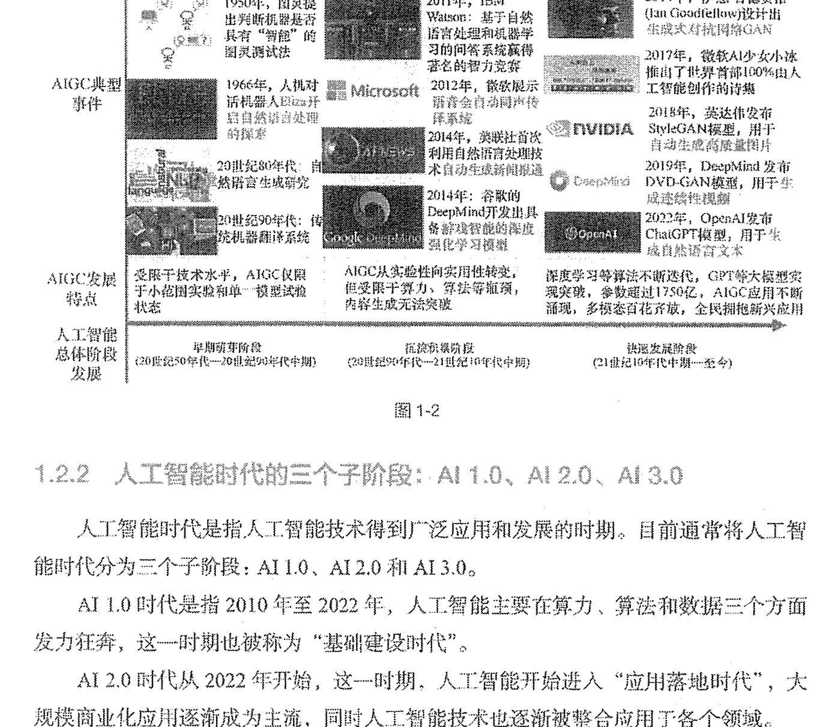
# 1.2.2 AI 时代的三次跃迁：1.0、2.0、3.0
人工智能时代指技术得到广泛应用与发展的时期，目前常划分为 AI 1.0、AI 2.0 和 AI 3.0 三个子阶段。

AI 1.0 大致指 2010 年至 2022 年，算力、算法、数据三条线高速推进，也被称作基础建设时代。

AI 2.0 自 2022 年起进入应用落地时代，大规模商业化应用成为主流，技术在各行业整合渗透。

AI 3.0 尚未到来，届时技术将向更高层次智能迈进，并逐步进入与人类协作的新阶段。

# 1.2.3 三驾马车：算力算法数据齐发力
AI 1.0 是一个算力、算法、数据共同狂奔的时代，如图 1-3 所示。

# 1. 算力篇
算力是人工智能发展的根基，决定计算能力与效率，可类比人类社会中的电力。芯片演进与 GPU、TPU 等特化芯片极大提升了算力水平。
# AIGC 实战入门
ChatGPT、Midjourney、Stable Diffusion 及行业应用
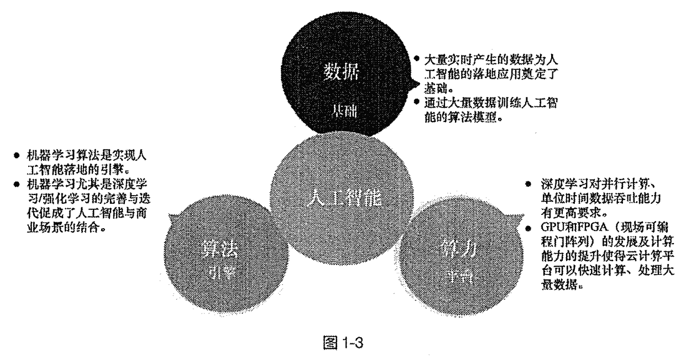
GPU 最初为加速图形处理而设计，但凭借高并行特性和海量浮点运算能力，成为深度学习的首选计算平台。TPU 由 Google 专为深度学习定制，能效比更高，加速训练效率。人工智能芯片大致分为通用处理器与特化处理器：通用如 CPU、GPU；特化如 ASIC 类中的 TPU、半定制的 FPGA 等。

# 2. 算法篇
算法是人工智能的核心，类似交通工具或发动机，决定计算方式、学习能力与应用范围。深度学习模仿人脑神经元工作机制，通过多层神经元模型实现学习与识别。

2012 年 ILSVRC 竞赛中，AlexNet 的出现是里程碑，它采用卷积神经网络结构解决大规模图像分类问题并取得惊人成绩。此后深度学习在图像、语音、自然语言处理等领域持续拓展。

# 第1章 AIGC 浪潮席卷而来
在深度学习基础上，强化学习、迁移学习、生成对抗网络等模型得到广泛应用，进一步扩展到自动驾驶、智能客服、智能家居等场景。

# 3. 数据篇
数据是人工智能的资源，决定输入输出、应用场景与效果，类似社会中的物质资源。过去缺乏大规模高质量数据，制约了技术普及。

互联网普及使大量数据被数字化存储，成为技术发展基础。物联网与移动设备普及后，终端持续产生数据并上云分析，为实时处理提供更多来源。数据的日益丰富成为技术发展的关键驱动力。

# 1.3 AI 时代的演进
# 1.3.1 AI 2.0 跨域全场景落地
AI 1.0 基础建设完成后，人工智能进入 AI 2.0。在此阶段，技术从单一领域走向多领域、全场景，改变生活与工作方式。

算力方面，分布式计算与边缘计算被更高效地利用；算法方面，在深化深度学习极限的同时，向强化学习、迁移学习等更复杂方向拓展；数据方面，更依赖自生成能力，如自监督学习、增强学习等，并借助更广泛的数据共享协作，使模型对现实世界的理解与应用更精准。

应用涌现也引发对社会影响的思考：普及可能带来岗位消失，但也创造新岗位与机会，需要积极应对挑战，让人工智能成为可持续发展的助推器。

# AIGC 入门到实战
ChatGPT、Midjourney、Stable Diffusion 及行业应用
# 1.3.2 AIGC 产业图谱开启创变时代
AIGC 的产业图谱如图 1-4 所示，自下而上由硬件算力、大模型平台、功能层、实际应用及行业场景构成，其发展将开启新一轮创变。
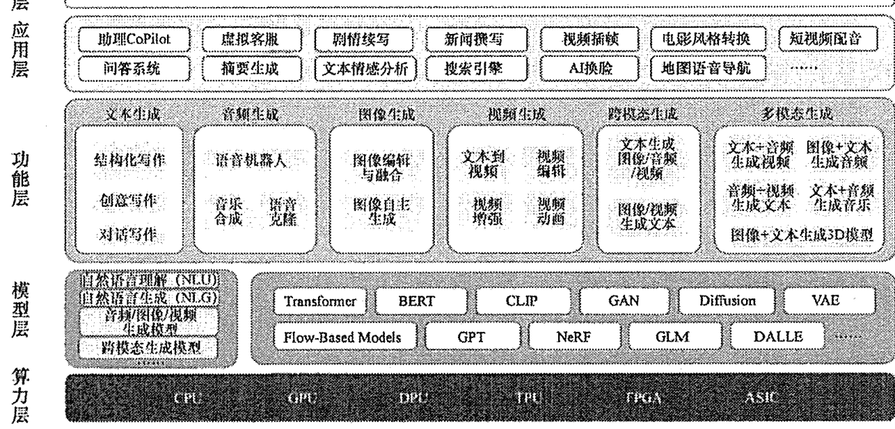
跨模态生成与多模态生成既相关又有区别。跨模态生成指从一种模态生成另一种模态，例如文本描述生成图像，或图像生成描述文本。

多模态生成则利用多种模态共同生成新内容，例如：
* 文本与音频生成视频
* 图像与文本生成音频
* 音频与视频生成文本
* 文本与音频生成音乐
* 图像与文本生成 3D 模型

模型层中，自然语言理解 NLU 与自然语言生成 NLG 是自然语言处理的两个关键方向。NLU 使计算机理解人类语言，NLG 专注生成可读的自然语言文本。

NLU 相关模型包括：
* Transformer：面向序列数据的深度学习架构，核心是自注意力机制。
Transformer 预训练后能在无标注大规模文本上学习语言表征，再微调适配后续任务，如文本分类、情感分析、命名实体识别、机器翻译等。GPT 作为常用预训练生成式语言模型，多用于对话系统、文章生成等。
* 生成式语言模型 GLM：在 GPT 基础上扩展，同时考虑前后文信息，通过掩码机制实现训练，可直接生成语言，常用于自然语言生成任务。

音频生成模型示例：
* WaveGAN：基于 GAN 生成逼真音频波形
* WaveNet：基于深度卷积神经网络生成高质量语音与音乐
* MelGAN：基于 GAN 生成梅尔频谱特征后转为音频波形
* Tacotron 2：序列到序列模型，将文本转为逼真语音

视频生成模型示例：
* VideoGAN：面向视频生成的 GAN 扩展，如 VGAN、MoCoGAN
* 视频预测模型：用于预测未来帧，生成连续视频，如 PredNet、ConvLSTM

多模态生成模型示例：
* 对比语言-图像预训练模型 CLIP：OpenAI 于 2021 年推出，通过同时训练语言与视觉模型学习图像与文本关系，使配对样本相似度最大化。

# AIBC 从入门到实战
ChatGPT、Midjourney、Stable Diffusion 及行业应用

Transformer 的架构并对其进行了预训练，使其能够在没有标签的大规模文本数据上进行无监督学习。

# 第1章 AIGC 浪潮席卷而来
扩散模型把数据生成看作从简单分布向目标分布的渐进扭曲过程，先从简单分布采样，再经一系列转换生成新样本，已在图像、语音生成等任务中表现突出。

变分自编码器 VAE 在自编码器基础上引入概率与变分推断，学习潜在分布并采样生成新数据，用于生成、图像插值、降维与特征学习等。

* DALL-E：属于文本到图像的合成系统，最突出的能力是把自然语言的描述映射成对应视觉。由 OpenAI 研发，训练基座结合了 GPT-3 与 VQ-VAE-2，后者擅长对图像进行离散编码。名字取自超现实主义画家达利，旨在强调它突破 GPT-3 纯文本生成局限、具备造像能力的定位。实践中它既能创造从未存在过的生物与器物，也能按指定风格与主题作画，因而在艺术创作、产品概念设计、动画分镜等领域具备较大潜力。

* 多模态 Transformer：指可同时处理图像与文本信号的 Transformer 体系，典型用途是跨模态理解与生成。

关于神经辐射场 Neural Radiance Fields，NeRF 目前很难划入单一类别，常见做法是归入图像/视频生成范畴。它借助深度学习来构建并渲染高质量的三维场景。NeRF 的思路是利用多张二维照片学习场景的整体三维表征，再基于该表征合成新的二维视角。

自 2020 年提出后，NeRF 在三维建模与新视角合成上表现突出，尤其在稀疏图像条件下重建三维结构并渲染未拍摄画面方面效果明显。

需要说明的是，以上模型可跨任务迁移，具体归属会随设计侧重点与主要应用场景变化，并非绝对固定。

# AIGC 产业图谱的实际意义

+ * 全局认知：图谱能系统呈现 AIGC 生态，涵盖算力底座、核心技术与具体应用场景，帮助快速把握行业全貌与演进趋势。
+ * 机会把握：拆解图谱各层关系，可洞察技术节奏与产业衔接点，为企业与个人提供方向选择与策略参考。
+ * 投资参考：图谱可作为投资判断坐标，呈现不同环节成熟度与潜力，评估项目风险收益，从而作出更审慎的决策。
+ * 合作驱动：图谱为跨机构、跨领域交流提供参照，推动联合创新，加速技术落地与商业化。

总体而言，AIGC 产业图谱有助于整合与呈现行业要素，为创新与商业化提供导航。

# 第2章

# ChatGPT：从实验室走向大众的智能伙伴

# 2.1 爆火的起点

# 2.1.1 它真的只是一个聊天工具吗

ChatGPT 是 2022 年 11 月推出的会话式原型对话系统。使用者发现它不仅能顺畅应答，还能产出质量不低的代码与论文。引发热议的核心在于功能强度。此前已有 AI 对话产品，但 ChatGPT 的智能感明显更强。

它既能解释元宇宙等既有概念，也能攻克数学难题；还能化身生活导师，回应诸如如何与异性沟通、如何教育子女等具体问题。

# 2.1.2 它会通过图灵测试自评吗

自图灵提出图灵测试以来，学界一直在探查机器能否达到类人智能水平，通过测试常被视作智能真实性的重要标尺。

长期以来，人工智能在原理深度、技术复杂度、产品表现以及关注人群上都显得小众。以 ChatGPT 为代表的 AIGC 热潮首次让人工智能具备大众普及基础，可视为 AI 大众化的里程碑。

公众对它的对话能力有何感受？多数反馈可归纳为：理解力在线、知识面宽、记忆力强、表达清晰的好伙伴；用久了会发现它上知天文下知地理，既能写八股文也能聊高能物理，提问角度再刁钻，它也保持耐心并认真服务。

那么它自评是否通过图灵测试？如图 2-1 所示。

# 2.1.3 模型自述的能力边界

向 ChatGPT 询问自身能做什么，其回答大致如图 2-2 所示。

# 2.1.4 效率提升是否可以用数字说明

接下来估算 ChatGPT 带来的生产效率变化。

先看写文章的效率：用 GPT-4，一名白领的工作量约等于过去多少人？基于可量化逻辑，我们还能做个小预测：这一轮 AI 浪潮下，可能有多少文字岗位被重塑。

据 OpenAI 官网，GPT-3.5 中 gpt-3.5-turbo 的价格为每 1000 tokens 0.002 美元，token 是自然语言处理中的词片段，英文约 0.75 个单词对应 1 token。

# 表2-1 英语词数与 Token 数量对照

| # | 词数 | Token数 | 占比 |
| --- | --- | --- | --- |
| 1 | 1600 | 2133 | 75.01% |
| 2 | 2000 | 2667 | 74.99% |
| 3 | 47094 | 62792 | 75.00% |
| 4 | 90000 | 120000 | 75.00% |
| 5 | 445134 | 593512 | 75.00% |
| 6 | 783134 | 1044183 | 75.00% |
| 7 | 884421 | 1179228 | 75.00% |
| 8 | 1084170 | 1445560 | 75.00% |

假设英译中，英文单词与中文字数比例约 1:1.6。用 GPT-4 输出 1500 汉字约耗 0.06 美元，约人民币 0.432 元，即千字约 0.36 元。于是 万汉字提示词成本约人民币 3.6 元。

以用 GPT-4 为一个高流量公众号撰写万字长文为例。按前述估算，提示词工程师即“提示词魔法师”调用 GPT-4 completion 输出万字，成本可近似按 3.6 元计算。

若在国内聘请熟稔爆款网文的资深写手，写一篇万字高质量长文，通常需至少一周、费用约 5000 元，且交付意愿可能不高。而提示词工程师微调 GPT-4 输出同量级长文，约 1 小时即可完成。

耗时比约为 40:1。

按 5000 元/周计薪，一周 40 小时，时薪约 125 元，加上 token 费用，时薪约 150 元。两种方式费用比为 5000:150=100:3。

若以耗时与价格乘积与效率成反比，则 GPT-4 与人工的效率比约为 4000:3，即前者约是后者的 1333 倍，这里记作“AI/人”。

这只是理想化简化，但 ChatGPT 带来的效率跃迁是显而易见的。

# 2.2 解剖 ChatGPT 的本质

# 2.2.1 从硬件到代码看它长什么样

先看物理形态，再看代码构成。

从硬件角度看，ChatGPT 是基于深度学习的计算程序，由数以亿计的参数与神经元构成，运行于 CPU 或 GPU 上。输入是一段文本序列，输出是基于该序列预测的词或字符，通过此机制持续生成新文本。

从代码角度看，它是 Python 实现的程序，依托 TensorFlow、PyTorch 等深度学习框架，构建了基于 Transformer 架构的神经网络。

ChatGPT 基于 GPT 系列的聊天机器人框架，用 Python 编写。搭建时需安装 OpenAI Transformers 库与 GPT-3 API 的 Python 客户端，创建模型实例后调用 generate 方法生成文本。

核心实现包括输入预处理、模型结构定义、训练与推理生成等。代码复杂度高，涉及大量数学运算与机器学习算法，需一定编程与 ML 基础才能读懂与修改。

# 2.2.2 Transformer 与预训练技术的内在逻辑

当前公开的 ChatGPT 基于 GPT-3.5 或 GPT-4，能实现流畅的人机自然语言交互。那么 GPT 究竟是什么？

GPT 是 OpenAI 于 2018 年推出的基于 Transformer 架构的预训练语言模型，通过海量未标注语料训练。它采用单向自回归方式预测下一个词的概率，即给定前文，预测最可能的后续词。换言之，模型用多层 Transformer 学习大规模文本的语言规律，从而生成自然语言，如图 2-3 所示。

# 第2章 ChatGPT，人人可用的智慧伙伴

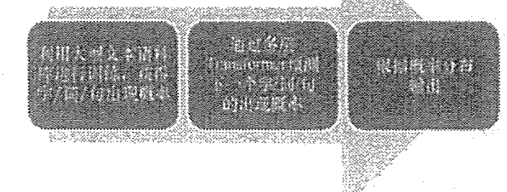

GPT 的主体是一个多层堆叠的 Transformer 编码器，与同类模型相似，它把输入序列映射为隐藏表示，再用于文本分类、命名实体识别等下游任务。不同版本在层数与参数规模上各有差异。

再细说 Transformer。Transformer 是一种基于自注意力的序列建模架构。

# AIGC 从入门到实战

# ChatGPT+Midjourney+Stable Diffusion+ 行业应用

在海量数据与算力的驱动下，模型才成长为庞大的神经网络，其特点是大数据、大模型与大计算，形象地说就是算力催生的奇迹。

经过大规模预训练与大量计算后，GPT 展现出惊人的语言理解与生成能力，能择要记忆上下文，形成思维链推理。

# 那么它为何能生成有意义的文本

关键在于海量语言数据与大语言模型 LLM 的支撑。

简言之，GPT 可看作文字接龙系统：给定不完整句子，它会按概率补上一个可能的词，像输入法根据已输入内容联想后续一样。

假设以《水浒传》武松打虎作为训练材料，提示词为“用武松亲历者的心态描写打虎过程与心理”。起始词可能是“我”，模型先预测出“是”，组合成“我是”，再预测“武”，得到“我是武”，如此迭代直至生成“我是武松”等符合要求的文本。通过这种逐步构建的方式，形成连贯描述。

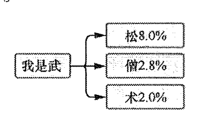

# 图 2-4 基于提示词生成文本时的迭代过程

上述过程称为“自回归生成”，属于无监督自然语言处理范式。

需注意，智能输入法是基于已输入词的联想补全，以提升打字速度。而 GPT 的能力在于基于训练与海量语料进行创造性文本生成，能理解上下文并产出通顺相关的内容，而非简单联想。它在词句生成上符合人类预期，并具备类人的理解、表达、逻辑分析与推理能力。

# 2.2.4 为何能出圈

GPT 回答时倾向于选择高概率词，容易显得平庸；但偶尔挑选低概率词，也会带来有趣或新颖的输出。回答的不确定性带来更强的智能感。

目前 GPT 并无自主意识，早期版本更像“鹦鹉学舌”，并不真正理解所说内容。

尽管如此，它仍能在多轮对话中把握人类意图，高效问答，能模仿名家文风，创作诗歌，内容完整、重点突出、条理清晰，并具备选择性记忆与思维链能力。

因此，凭借大规模预训练、Transformer 架构、多用途语言生成及灵活的应用场景，GPT 代表了自然语言生成的新一代范式，为 AI 应用中的理解与生成任务提供强力支撑。预计未来约 5 年，大模型将成为 AI 应用的关键基础平台，类似 PC 时代的操作系统。

# 2.3 能力测试：ChatGPT 能扮演什么角色

ChatGPT 最吸引人的是创作力：能拟写请假条模板、写情书、按思路写小说，还能写代码、排查 bug。

# 2.3.1 超强文科状元

它首先是堪称“文科状元”的助手，可严谨也可华丽。语言表达精准，词汇与语法运用恰当，响应速度在秒级，即使上千上万字也能迅速给出清晰文案。下面列几例测试结果。

范例1：写一封给未来女朋友的情书，要求真挚，如图2-5所示。

亲爱的:

这封情书，我用最深情的笔触，写给深爱的你。我是一名电子信息专业的研究生. 在这个科技飞速发展的时代，技术并不能安抚人们柔软的心。只有你，我的爱人，才能在这个冰冷的世界里给我温暖。

我对你的爱已经深深地印在我的心里，你的美丽、聪慧和温柔，让我无法想象没有你的日子该如何度过。当我忙忙碌碌、情绪低落时，你的微笑和陪伴，总是让我感受到无尽的温暖和力量。

我一直认为，我们的相遇是命中注定。就像电子与信息，紧密相连，我们注定要在一起。我很荣幸，因为我是一个能够把电子与信息转化为创意和创新的人，而你正是我灵感的源泉，是我最珍贵的财富。

在我们相遇的那一刻，我就知道，你是我一生中最美的风景。我希望，我们的未来能越来越美好。无论遇到任何挑战，我都会一直陪伴着你，爱着你。

最后，我想告诉你，我的爱，我会一直珍惜你、疼爱你、保护你。无论何时，我都会是你坚实的后盾，陪伴你度过所有的困难和挫折。我爱你，永远爱你。

爱你的,

×××

# 范例 2：写一首七言律诗去赛诗会上朗读。

人生之路并不好走，写一首表达这一心境的诗，要求请根据毛不易的歌曲《消愁》中的歌词，模仿“诗圣”杜甫的七言律诗《登高》，ChatGPT 输出的内容如图2-6所示。

请根据毛不易的歌曲《消愁》中的歌词，模仿“诗圣”杜甫的七言律诗《登高》，写一首知《登高》《消愁》同样意境、心情的七言律诗

请写成七言律诗格式。

当然可以，以下是一首尝试模仿杜甫的《登高》和受毛不易的《消愁》启发的诗歌:

朝日月，敬酒一杯，

心问远方，怀旧故乡。

朝阳暖照，月光寒宿，

逆风飞翔，无须回望。

傲明天，敬昔日往，

身虽疲惫，坚守信仰。

敬自由死，敬生之常，

清醒之人，荒废光景。

一路南北，山湾水长，

灵魂归宿，无须彷徨。

洒过三巡，粮尽古涩，

心头有雨，眼底有霜。

以上诗句试图捕捉《登高》中对生活困苦的慨叹，以及《消愁》中对过去、现在和未来的深深思考。希望你喜欢这首诗。

[PAGE 36]

# AIGC 从入门到实践

ChatGPT+MidJourney+Stable Diffusion+ 行业应用

# 写一封给未来女朋友的情书，要求情真意切，写信人是电子信息专业的研究生。

亲爱的:

这封情书，我用最深情的笔触，写给深爱的你。我是一名电子信息专业的研究生. 在这个科技飞速发展的时代，技术并不能安抚人们柔软的心。只有你，我的爱人，才能在这个冰冷的世界里给我温暖。

我对你的爱已经深深地印在我的心里，你的美丽、聪慧和温柔，让我无法想象没有你的日子该如何度过。当我忙忙碌碌、情绪低落时，你的微笑和陪伴，总是让我感受到无尽的温暖和力量。

我一直认为，我们的相遇是命中注定。就像电子与信息，紧密相连，我们注定要在一起。我很荣幸，因为我是一个能够把电子与信息转化为创意和创新的人，而你正是我灵感的源泉，是我最珍贵的财富。

在我们相遇的那一刻，我就知道，你是我一生中最美的风景。我希望，我们的未来能越来越美好。无论遇到任何挑战，我都会一直陪伴着你，爱着你。

最后，我想告诉你，我的爱，我会一直珍惜你、疼爱你、保护你。无论何时，我都会是你坚实的后盾，陪伴你度过所有的困难和挫折。我爱你，永远爱你。

爱你的,

×××

# 范例 3：创作一个关于穿越、救赎、爱情和复仇的故事，如图2-7所示。

写故事：用《肖申克的救赎》的故事框架，写一个贾宝玉穿越到现代创业、追爱、复仇的故事。

贾宝玉无法解释自己为什么会出现在这个陌生的世界，就像《肖申克的救赎》中的安迪一样，他被突如其来的未知所困扰。现代社会的规则、技术和生活方式让他感到困惑和无助。但就像安迪那样，贾宝玉的内心住着一个不屈的灵魂，他决定适应这个新的世界，并从他的位置。

与安迪在肖申克监狱中的经历相似，贾宝玉在这个新世界也面临着各种挑战。他开始通过创业来寻找自己的位置。他利用自己对中国文化的深刻理解，开设了一个以复古艺术和文化为主题的网上商店，销售古董、古画和复古手工艺品。他的商店很快吸引了众多的顾客，尤其是对中国文化感兴趣的年轻人。

与此同时，贾宝玉也撞见了这个世界的暗面。身边滋生出一批贪婪的商业对手，因妒忌他的成绩企图用见不得光的手段摧毁他的生意。贾宝玉深感愤怒，决意以自己的方式加以回击。他动用智谋捍卫自己打拼来的创业成果，与想要对他不利的人展开博弈。这段经历让他的性格愈发坚韧，也让他对新世界的运行规则有了更深的体认。

在这一过程中，贾宝玉还邂逅了爱情。他认识了一个名叫玲玲的女孩，她性格活泼，对生活充满热情。两人梦想一致、生活理念契合，彼此迅速被吸引。然而感情也遭遇现实的冲击。他们的关系引发了周围人的嫉妒与误会，再加上创业带来的巨大压力以及现代社会的种种复杂，让两人倍感为难。

最后，贾宝玉下定决心，凭借自己的谋略成功守护了创业成果，也赢得了爱情。

图2-7

# 2.3.2 理科解题的硬实力
ChatGPT在理工科方向同样表现出色，处理数学及其他科学问题时都能给出可靠的解答。

它可应对代数、几何、微积分等领域的复杂题目，能解繁难方程、进行符号计算，甚至做数值模拟。同时其训练数据覆盖物理、化学、生物、地理、天文等多个科学领域，因此能回答各类科学提问并给出详尽解释。它还能准确理解用户的提问意图，生成清晰、准确、易于理解的回答，对教育和学习价值很高。而且模型仍在持续学习改进，通过摄入更多数据不断提升性能，能力会随时间不断增强。

[PAGE 38]

# AIGC 从入门到实战
ChatGPT+Midjourney+Stable Diffusion+ 行业应用

# 1. 解决信息技术中的数学题
下面以上海某中学高一信息技术寒假作业为例：

编写程序，实现输入正整数 n，输出一个 n 层的

杨辉三角。

杨辉三角如图 2-8 所示。

用 Python 实现输入正整数 n，输出一个 n 层的杨

辉三角，要求打印显示的时候左右对称。输人提示词给 ChatGPT 后，生成的程序如图 2-9 所示。

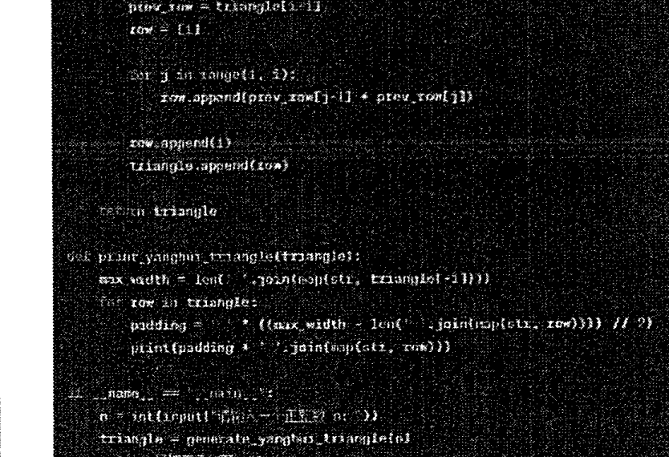

# 2. 用 n 秒时间生成冒泡排序算法的代码
冒泡排序是一种比较基础的排序算法。人工编写调试一段冒泡排序代码可能要半小时以上，但让 ChatGPT 用 Python 写一段冒泡排序代码，可能只需几秒。

图 2-10 所示是一段用 Python 实现的冒泡排序代码。

[PAGE 39]

# 第2章 白也诗无敌，飘然思不群：ChatGPT，博学、“聪明”的好助手 |
```
def bubble_sort(arr):
    n = len(arr)
    for i in range(n):
        for j in range(0, n-i-1):
            if arr[j] > arr[j+1]:
                arr[j], arr[j+1] = arr[j+1], arr[j]
    return arr
xx = [64, 34, 28, 12, 22, 11, 90]
print(`初始的数组：`)
print(xx)
bubble_sort(xx)
print(`排序后的数组：`)
print(xx)
```

# 图2-10

这段代码的计算复杂度为 O(n²)，如果数据量很大，计算速度可能会比较慢。\n用C语言写一段100个元素的冒泡排序的代码，ChatGPT也是信手拈来，如图2-11所示。

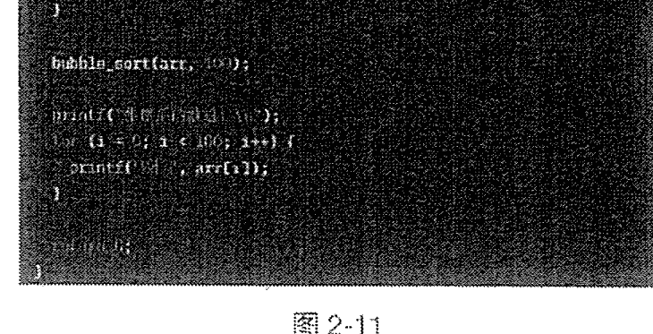

# 图2-11

[PAGE 40]

# AIGC 从入门到实战
# ChatGPT+Midjourney+Stable Diffusion+ 行业应用
很多人会觉得，上面这些代码可能是 ChatGPT 直接在搜索引擎上找出来的。但仔细读过和调试过代码后就会发现并不是这样，代码是 ChatGPT 经过学习和理解，自己写出来的。

# 3. 用 Python 写量化基金 100ETF 的量化网格交易代码
网格交易是一种基于价格波动做出决策的交易策略，它将价格范围（纵轴）和时间（横轴）分别分成多个等份，从而形成网格，然后在每个网格上设置买入和卖出价格。这种策略可以帮助客户在市场波动时保持稳定的头寸，并在价格上涨或下跌时自动买入或卖出。

输入提示词给 ChatGPT 后，生成的代码如图 2-12 所示。

你可以使用 Python 编写量化基金 100ETF 的量化网格交易代码，这时你需要使用 Python 的 tushare、pandas 和 numpy 库：使用 tushare 库获取数据，使用 pandas 库进行数据处理，使用 numpy 库进行计算。

```
import tushare as ts
import pandas as pd
import numpy as np
# 获取数据
df = ts.get_k_data('510050', start='2020-01-01', end='2021-01-01')
# 计算均值和标准差
mean = df['close'].mean()
std = df['close'].std()
# 计算网格价格
prices = np.arange(mean - 2 * std, mean + 2 * std, std / 2)
# 计算交易信号
df['signal'] = pd.cut(df['close'], prices, labels=False)
# 计算持仓
df['position'] = df['signal'].diff()
# 输出结果
print(df.tail())
```

# 图2-12

[PAGE 41]
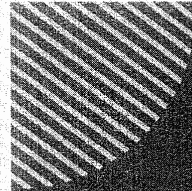

![](img/04c5fcc

# 第3章 众里寻他千百度：ChatGPT及其他AIGC赋能个人
基于AIGC的效率革命已经来袭，很多基于ChatGPT和其他大语言模型的应用（包括桌面型和手机终端侧）层出不穷。ChatGPT与工作和生活相关的基础应用如图3-3所示。

+   - 报告写作：报告开头、研究报告、提出反对观点、报告总结

- 资料整理：收集资料、总结内容、摘录要点

- 程序开发：写程序、解读代码、重构代码

- 知识学习：概念解说、简易教学、深度教学、教学与测验

- 英语学习：背单词法宝、英语单词学习、英语对话、英语语法校阅、英语作文修改与解释、拼写错误纠正

- 工作效率：回复邮件

- 写作帮手：撰写标槁、撰写文章大纲、撰写文章

- 日常生活：提供食谱、拟定活动计划、拟定旅游计划

- 有趣好玩：写歌词、写故事

- 角色扮演：设计角色情境、担任面试官、担任导游

- 履历与自传：为履历提供反馈、为履历加上量化数据、简化经历陈述、针对不同公司定制化撰写

- 准备面试：汇编面试题目、给予反馈、提供面试官可能追问的问题、提供符合STAR原则的回答示范

# 图3-3

# 3.2.1 ChatGPT需要懂得写提示词的人
你可能会好奇，提示词的撰写真的重要吗？提示词写得好与不好，对生成的内容产生的影响有多大呢？

下面大家看一组例子。

# 1. 提示词不好的例子
提示词：描述一个人的--天。

这个提示词相对模糊，没有具体指明人物的身份、情境或目标，给模型提供的信息不足，可能导致输出内容缺乏重点和创意。

# 2. 好的例子
提示词（好）：描述一个患有失忆症的侦探在追寻凶手的过程中逐渐恢复记忆的故事。

这个提示词明确指出了故事的主要角色、情境和目标，为模型提供了更具体的信息，使其能够更有针对性地生成具有悬疑氛围、能进一步发展下去的故事情节。

实际上，编写有效的提示词的过程，包含以下8个步骤。

步骤1：选择及重置模型，如果有GPT-4可以选择GPT-4，GPT-3.5次之，并确

# AIGC 从入门到实战
# ChatGPT+Midjourney+Stable Diffusion+ 行业应用

当开始新的任务时，模型处于初始状态。

步骤 2：提供相关的背景信息，帮助模型理解任务的上下文。

步骤 3：明确地布置任务，告诉模型我们希望它完成什么。

步骤 4：提供详细的指示，指导模型如何完成任务。

步骤 5：确认模型已经正确理解了任务。

步骤 6：根据模型的反馈，改进和优化提示词。

步骤 7：精炼内容，从模型的输出中提取我们需要的信息。

步骤 8：通过不断的练习，提高我们编写提示词的能力。

我们可以看到，编写有效的提示词是一项需要技巧和练习的任务，而写得好与不好确实会对生成的内容产生显著的影响。

需要用 ChatGPT 生成文本的场景有很多，譬如：写宣传稿、主持稿；制作课件及 PPT ；写咨询建议书；写营销文案；写自媒体视频脚本；制作 Excel 等。

有时，ChatGPT 会碰到一些复杂问题，譬如在使用文本生成内容时，可能会出现词不达意、对牛弹琴的情况，这时该怎么办？

让 ChatGPT 更“聪明”的方法如下。

# 方法一：知识生成法
“喂”给 ChatGPT 相关的知识、背景信息、素材等，以便 ChatGPT 掌握更多的知识，ChatGPT 会基于这些知识更准确地生成内容。

# 方法二：思维链提示法
告知 ChatGPT 思维过程，即以人的思维怎么解决这个问题，第一步是什么、第二步是什么，依此类推，让 ChatGPT 掌握更多的思维链或逻辑顺序，以其生成的内容更符合要求。

ChatGPT 不仅仅是一款聊天工具，它更像是你的私人秘书、智慧管家和生活助手，为你解决烦琐的任务，节省你宝贵的时间。

同时，ChatGPT 也可以成为同你聊天的伙伴，时而温柔体贴，时而机智幽默，帮助你减轻烦恼。毫无疑问，ChatGPT 是你生活中必不可少的小助手！

# 3.2.2 简单的 ChatGPT 应用范例
下面让我们通过几个范例来看看在各个场景中，如何向 ChatGPT 进行简单的提问（即输入合适的提示词），来解决实际问题。

# 第3章 众里寻他千百度：ChatGPT及其他AIGC赋能个人

# 1. 写作类

# 1）写求职信
看到一个理想的工作岗位，但不知道如何撰写求职信，可以请ChatGPT来帮忙。

注意，要求ChatGPT生成求职信的提示词里要包括以下信息。

+   - 核心任务：写一封专业且真诚的求职信。

- 应聘的职位：研发工程师。

- 应聘的企业类型：软件公司如微软、IBM，或人工智能公司。

- 自身的能力：掌握哪些编程语言或开发能力；有什么工作经历；做过什么项目；获得过什么研发成果等。

提示词和生成的结果如图3-4所示。


# 图3-4

# 2）创作爆款标题
运营公众号并非易事，公众号文章标题的质量往往是吸引读者关注的关键。即使投入大量精力创作文章，若标题未好好打磨，也可能难以获得足够的阅读量。针对此

# AIGC M入门到实战

ChatGPT+Midjourney+Stable Diffusion+ 行业应用

问题，网络上有许多标题写作课程。而借助ChatGPT，或许能够轻松提升标题质量，赢得更多读者青睐，如图3-5所示。

为下面的文章编写5个可以带来高点击率的标题。

OpenVINO™ Jupyter Notebooks项目为我们提供了一些可以运行的Jupyter* notebooks，能帮我们学习和尝试使用OpenVINO™开发套件。这些notebooks旨在向各位开发者介绍OpenVINO的基础知识，并教会大家如何利用API来优化深度学习推理。

项目优势：

1. 硬件需求低，部署成本低，CPU就能运行，有集成显卡还能异构加速，有笔记本电脑就能运行。

2. 案例丰富，不用写代码就能搞定推理，要做的就是单击“下一步”。

3. 开源项目，根据自己的需求随便改。

4. 商业级预训练模型，提供诸如车牌识别、行人重定位等大量支持商用的模型，能够帮助开发者快速打造产品。

教学、科研、商业的好帮手。

1. 用好OpenVINO™，从此不再需要昂贵的硬件！

2. 学习OpenVINO™，从此深度学习推理不再难！

3. OpenVINO™ Jupyter Notebooks项目:免费学习深度学习推理的最佳选择!

4. OpenVINO™; 开源项目，让您随心所欲地自定义!

5. OpenVINO™预训练模型:让商业应用变得更简单!

# 图3-5

# 3）写颁奖词
2023年5月16日，《收获》杂志65周年庆典暨新书发布活动在上海舞蹈中心举行。在莫言给余华颁奖的环节，莫言开玩笑说，给余华的颁奖词，他想了好几天没写出来，最后让ChatGPT写了一版参考，还是莎士比亚风格。

我们不不妨看一看，ChatGPT能为余华写出怎样的莎士比亚风格的赞语？如图3-6所示。

2023年5月16日，《收获》杂志65周年庆典暨新书发布活动在上海舞蹈中心举行，在莫言给余华颁奖的环节，莫言开玩笑说，给余华的颁奖词，他想了好几天没写出来，最后让ChatGPT写了一版参考，还是莎士比亚风格。

请模拟莫言，为余华写一段莎士比亚风格的千字赞语，用中文写。

吾爱余华，如爱自己之手，如爱自己之心，如爱自己之生命。其笔下之文字，如骏马奔腾，如狂风肆虐，如猛犸电闪。余华之文，温润如玉，流淌如江，铿锵有力，悲壮激昂。其笔下之世界，如人间天堂，如人间地狱，如人间深渊，如人间绝境，余华之文，如刀枪剑戟，如鞭炮烟花，如酒肉狂欢，如生死冥昧。其笔下之情感，悲欢离合，爱恨情仇，喜怒哀乐，雍容梦绕。余华之文，伟大如山，深沉如海，热烈如火，冰冷如铁。余华之文，如毒药般致命，如甜蜜般令人陶醉，如血液般流淌，如阳光般灿烂。余华之文，如天上星辰，如地下泉泉，如人间纷争，如历史长河，吾爱余华，如爱自己心灵，如爱自己文学，如爱自己之生命，余华，吾之爱也。

# 图3-6

# 第3章 众里寻他千百度：ChatGPT及其他AIGC赋能个人

但是，感觉上面这段颁奖词风格有点晦涩，不如让ChatGPT再生成一版，如图3-7所示。

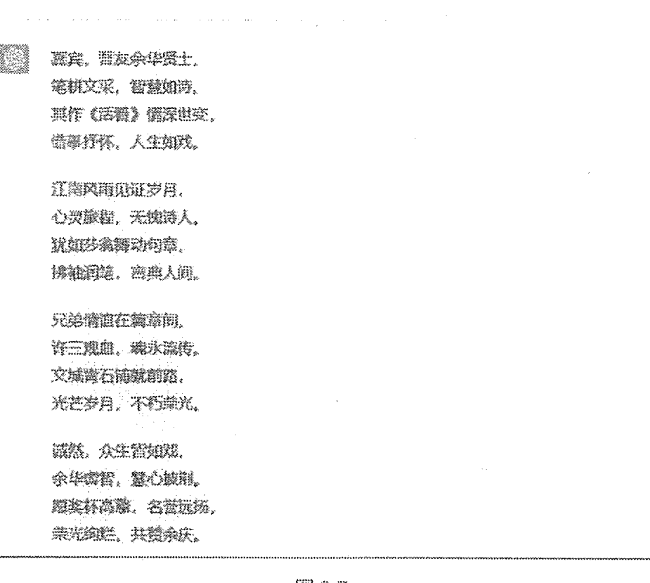

# 4）写自媒体文案
结束了一天的繁忙工作，你可能想在朋友圈分享一下你的生活点滴或见解感悟，

但又担心自己的文采不足？

那么，不用再犹豫了，ChatGPT可以帮你撰写微信、微博、小红书的内容，让你的社交媒体变得更加有趣和富有创意，如图3-8所示。

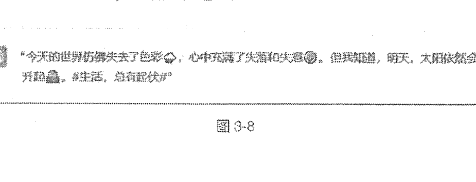

# AIGC 从入门到实战
ChatGPT+Midjourney+Stable Diffusion+ 行业应用

这段文案在失意中又表达了积极向上的心态，谁看了不想为你加油呢？

# 5）写工作周报
干了很多细活、脏活、累活，但是写周报的时候却什么都想不起来，老板时常不满意，ChatGPT 能帮着写周报吗？当然能，如图 3-9 所示。

> 周报还没写，我是一个程序员，这周干了各种乱七八糟的细活、脏活、累活，请帮我写一份条理清晰的周报吧~

当然可以，以下是一个周报示例。

周报

日期：

一、本周完成的主要工作

1. 代码优化和重构：对项目X的代码进行了优化和重构，提高了代码的可读性和可维护性。

2. bug修复：修复了项目Y代码中的若干个bug，提高了软件的稳定性和用户体验。

3. 新功能开发：完成了项目Z的新功能开发，包括功能A、功能B和功能C。

4. 文档编写：编写了项目X、Y、Z的技术文档，方便团队成员理解和使用。

二、遇到的问题和解决方案

1. 在进行项目X的代码重构时，遇到了一些难以理解的旧代码。通过查阅资料与原开发者交流，最终理解并成功重构。

2. 在修复项目Y的bug时，遇到了一些难以发现的问题。通过查阅详细的日志记录并进行分析，最终找到了问题的原因并修复。

三、下周工作计划

1. 继续优化项目X的代码，提高代码质量。

2. 开始进行项目Z的新功能开发。

3. 对本局修复的bug进行回归测试，确保修复效果。

图 3-9

周报的烦恼就这样被 ChatGPT 一扫而空！

# 2. 角色扮演类
ChatGPT 可以“扮演”几乎任何你能想到的角色，从同事、领导、家人、老师、同学，到律师、心理医生，甚至可以扮演男女朋友等。你可以使用它来模拟练习需要应对的一些任务，比如面试。注意，请它扮演角色的提示词要包含以下信息。

+   * 扮演的角色：同事、领导、家人、老师、同学、律师、心理医生等。

* 和谁对话：我、学生、老师、小朋友、老人、丈夫、妻子、父母等。

# 第3章 众里寻他千百度：ChatGPT及其他AIGC赋能个人
+   你希望它“说”些什么：讲睡前故事、安慰我、安慰他人、面试的问题、学习上的问题、生活上的问题、工作上的问题等。

+   限定 ChatGPT 每次向你提出问题的个数。

+   1）扮演面试官
当你想提前演练面试时，可以请它扮演面试官，模拟面试，向你提出专业的问题，如图 3-10 所示。

请你扮演一个研发经理，你是我的面试官，我是候选人，你将向我提一些有关软件工程师职位的面试问题。作为面试官，每次问一个问题，请向我提问并等待我的回答。我们开始吧。

好的，作为研发经理，我将扮演你的面试官，向你提出一些有关软件工程师职位的面试问题，准备好了吗？第一个问题：请介绍一下你有哪些软件工程师方面的经验和技能。

我在××公司做了3年机器视觉识别工作，能熟练使用Python、C++和TensorFlow等。

很好，那么请告诉我你在机器视觉领域具体是如何运用你的技能的，另外，请分享你在这个领域参与的最具挑战性的项目和解决其中问题的经历。

我用Python编写程序，用于视觉摄像头样本采集，随后基于样本用TensorFlow框架和Keras进行训练和迭代，然后把程序转换成嵌入式系统能用的模型，并进行校验。我们开发的模型主要用于很多种不同场景的机器视觉识别。

很好，那你可以分享一下你在××公司期间负责的项目吗？你在项目中扮演的角色和具体贡献是什么？

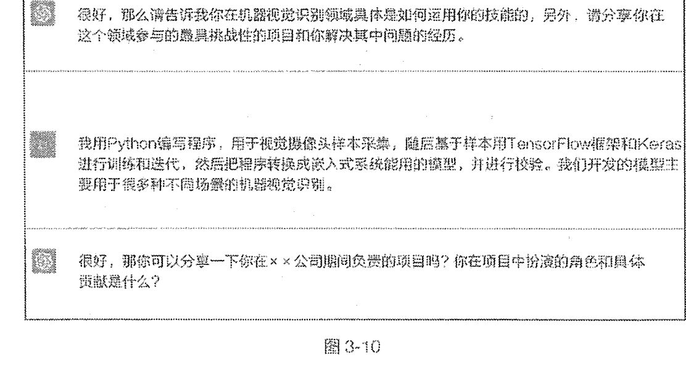

+   2）扮演老师以孩子能听懂的方式回答孩子的问题

孩子天生对未知充满好奇，追问“为什么”是常态。看完《星际穿越》这类聚焦宇宙探索的影片后，好奇的问题往往更多。这时可以用 ChatGPT 把专业内容转化为儿童能听懂的说法，参考图3-11。

由此可见，模型能够把艰深的知识讲得浅显、形象，画面感很强。

# AIGC实战入门
ChatGPT+Midjourney+Stable Diffusion+行业应用

面向十岁左右的孩子说明黑洞是什么以及它是怎么来的，要用他们熟悉的表达。

黑洞可以看成宇宙里一种特殊的天体，本质上是大质量恒星坍缩后的产物。恒星内部燃料耗尽以后会先发生超新星爆破，核心被挤压到极小的范围，密度变得极高，于是形成了黑洞。

黑洞的引力极其庞大，靠近的物质都会被吸入，像一只永远张着嘴的巨兽，因此肉眼无法直接看到它本身。但它吞食周围物质时散发出的强光能够被探测到。

黑洞会不断吞噬邻近的物质而越变越大。有些黑洞的质量是太阳的上千倍，不过不必担心，

# AIGC实战入门
# ChatGPT+Midjourney+Stable Diffusion+行业应用

另外，ChatGPT还能为已有表格补齐导演、豆瓣评分或 IMDb 评分等信息。

再往深一层，还能把一批原始数据交给它，让它自动整理成规范的表格，或从大段文字中抽取要点製表。

总体来看，ChatGPT早已不止于问答聊天，更像一个全能助手。既能处理工作、提升效率，也能作娱乐伙伴丰富生活，还能扮演心理咨询师、创意伙伴等角色，提供安慰与建议，让人更有信心向前走。

# 3.3 进阶：如何提问以获得高质量答案，解决复杂问题

# 3.3.1 提示词写作技巧

大模型时代，提出好问题的能力比单纯使用模型更关键。知识储备越厚、理解力越强，与ChatGPT的互动收获就越大。除此之外，还需要掌握一些提示词撰写手法。表3-1汇总了主要手法及相关信息。

| 序号 | 提示词写作技巧 | 中文解释 | 推荐星级 | 适用场景 | 使用复杂度 |
| ---- | ---------------- | -------- | -------- | ---------------------------------------------- | ---------- |
| 1 | Structured Prompt | 结构化提示词 | ⭐⭐⭐⭐ | 一般场景，特别是需要模型做出特定格式或结构回答的场景 | 简单 |
| 2 | Prompt Creator | 提示词生成器 | ⭐⭐⭐⭐ | 一般场景，特别是需要模型生成创新或独特的提示词的场景 | 简单 |
| 3 | Concretized Prompt | 具体化提示词 | ⭐⭐⭐⭐ | 一般场景，特别是需要模型生成具体和详细的回答的场景 | 简单 |
| 4 | Exploratory Prompt | 探索性提示词 | ⭐⭐⭐⭐ | 一般场景，特别是需要模型生成多个可能的答案或探索不同可能性的场景 | 中等 |
| 5 | Iterative Prompt | 迭代提示词 | ⭐⭐⭐⭐ | 一般场景，特别是需要模型根据前一次的回答进行迭代的场景 | 中等 |

# 第3章 众里寻他千百度：ChatGPT及其他AIGC赋能个人

# 续表

| 序号 | 提示词写作技巧 | 中文解释 | 推荐星级 | 适用场景 | 使用复杂度 |
| --- | --- | --- | --- | --- | --- |
| 6 | One/Few Shot Prompt | 单样本 / 少样本提示词 | ☆☆☆ | 一般场景，特别是在样本有限的情况下需要模型进行推断的场景 | 中等 |
| 7 | OCT | 思维链 | ☆☆☆☆ | 推理任务场景，特别是需要模型进行逻辑推理的场景 (如数学、编程) | 中等 |
| 8 | Self-ask Prompt | 自我提问提示词 | ☆☆☆ | 推理任务场景，特别是需要模型自我提问以探索问题的场景 (如数学、编程) | 中等 |
| 9 | ReACT | 协同思考和动作 | ☆☆☆☆☆ | 工具交互场景，特别是需要模型与其他工具协同工作的场景 (如搜索百度百科词条) | 复杂 |
| 10 | Reflection after Failure | 失败后自我反思 | ☆☆☆☆☆ | 工具交互场景，特别是需要模型在失败后进行自我反思和学习的场景 (如执行代码) | 复杂 |
| 11 | LangChain | 连接知识库 | ☆☆☆☆☆ | 工具交互场景，特别是需要模型连接和在知识库中查询的场景 | 复杂 |

下面逐一介绍这11种手法。

结构化提示词的核心是为指令加上明确的框架和格式，引导输出。想让模型写一段有趣对话，可以这样设定：“两个[人物]在[地点]进行[活动]，先聊[话题]，其中一人抛出一个有意思的观点，令对方好奇并回应……”。写旅行故事也可以用类似模板：“请写一个旅行故事，主角名叫[姓名]，在[地点]遇到一系列惊奇的事，如[具体事件]，最后收获[教训或感悟]。”

提示词生成器的思路是多试几种表述，挑出效果最好的。例如要写烹饪相关内容，可以分别尝试“描述烹饪过程”“写个烹饪小故事”“解释烹饪的意义”等，看哪个结果更满意。写诗时对比“写一首关于春天的诗”“描写春天的美好”等指令，择优使用。

具体化提示词强调细节和明确要求。例如解释“叠加原理”这类概念，不要只说解释一下，而是写：“请用通俗的话解释量子力学中的叠加原理，并给出一个生活例子。”

# 第3章 众里寻他千百度：ChatGPT及其他AIGC赋能个人

在复杂推理里，可用思维链逐步推进。比如先问：“如果我先吃苹果，吃完苹果后香蕉会变熟吗？”帮助模型处理逻辑。产品经理规划在线学习平台时，可先问平台该提供哪些功能，得到视频课、互动测验、学习追踪等建议后，再追问界面怎么设计、怎样获取和留住用户、发布后如何收集反馈。每一步都在前一步基础上深入，答案会更全面。

自我提问提示词是让模型先给自己提问题再作答，从而挖掘更深层次的信息。例如设定角色为气候专家，先问“我掌握哪些气候变化的信息？”再追问“气候变化如何影响海平面”“怎样减缓影响”。研究碳基生命和硅基生命时，依次自问基本事实、硅基生命的可能性、可能存在环境、探索方法，能得到更系统的内容。这种交互更像引导模型自我展开，而非单纯问答。

协同思考和动作ReACT的流程是反思-提问-协作-再尝试。遇到复杂编程优化问题时，先让模型反思已给建议的不足，主动提出需要更多输入输出信息，再让它查阅资料或调用工具，最后重新给出方案。

失败后自我反思是指当回答不准确或不相关时，让模型检讨“错在何处”“如何改进”，从而修正输出。

连接知识库主要指用LangChain。把本地文档、食谱数据库等作为外部知识接入，让ChatGPT基于这些资料作答。例如用户问“怎么制作炸鸡”，系统通过LangChain在食谱库中检索，再返回步骤。还可接入食材营养数据库、保存问答记录以便优化。

# 3.3.2 如何向 ChatGPT 提问以获得高质量答案

GPT学习了接近45TB的语料，GPT-4的训练数据构成如下表。

| 数据集 | 数量（token） | 占比 | 训练组合混合权重 | 训练轮数（3000亿token） |
| --- | --- | --- | --- | --- |
| 常规抓取（过滤后） | 4100亿 | 60% | 60% | 0.44 |
| WebText2 | 190亿 | 22% | 22% | 2.9 |
| Books1 | 120亿 | 8% | 8% | 1.9 |
| Books2 | 550亿 | 8% | 8% | 0.43 |
| 维基百科 | 30亿 | 3% | 3% | 3.4 |

数据来自OpenAI官网，随着模型迭代会有所变化。

不同来源各有特点。常规抓取Common Crawl是开源网络爬虫，覆盖大量网页文本，是GPT-4主要来源。WebText2是OpenAI自建语料，包含新闻、博客等。Books1和Books2提供更规范、复杂的语言结构。维基百科则提供系统化知识。多源数据让模型能理解并生成多样文本。

GPT-4的推理能力，尤其是数学推理，有明显提升，能处理代数、几何、微积分等。仍存在局限，对极复杂或高度专业的问题可能出错，且受限于训练数据。

即使掌握技巧，有时答案仍不理想。这时可借助5W1H提问框架。

# 1. 提出 5W1H 问题

ChatGPT对5W1H问题响应很好。框架包括：Who谁、What什么、Where哪里、When何时、Why为什么、How如何。

例如可问“阿尔伯特·爱因斯坦是谁”。

# 第3章 众里寻他千百度：ChatGPT及其他AIGC赋能个人

### 续表

| 角色 | 问答示例 |
|------------|---------------------------------------------------------------------------------------------|
| 市场人员 | Q: 你是一名经验丰富的市场人员，请告诉我应该如何制定一个成功的市场营销策略。 A: 制定一个成功的市场营销策略需要考虑多个因素，包括目标受众、竞争环境、品牌定位等。可以从市场调研开始，了解受众需求和竞争情况，然后确定适合的市场定位和推广策略。我可以帮助你深入分析这些因素并提供实用的建议。 |
| 广告从业人员| Q: 你是一名广告从业人员，你能否设计一个引人注目的广告活动? A: 当然！设计引人注目的广告活动需要考虑目标受众、需要传达的信息和创意表达方式。告诉我的产品或服务的特点，我可以为你提供一些创意和广告策略。 |
| 思维教练 | Q: 你是一名思维教练，请告诉我如何培养积极的思维方式。 A: 培养积极的思维方式需要关注自我反思、积极心态和目标设定等方面。我可以为你提供一些具体的思维训练方法和实践建议，帮助你培养积极的思维方式。 |
| 心理治疗专家| Q: 你是一名心理治疗专家，我感到焦虑，压力很大，有什么方法可以缓解? |

# 多身份对话示例

面对焦虑和压力，有深呼吸、放松练习、运动以及寻求支持等多种缓解方式，具体情况不同建议也会不同。

新闻记者询问如何写出吸睛报道，关键在于条理清晰、用语生动、事实准确，明确报道主题后可以提供针对性的写作技巧和案例。

发明家想把点子落地，核心是做好规划并付诸行动，说明创意与目标后能帮助制定实施方案并提供资源。

律师咨询事项上可以提供通用法律信息和建议，但需说明本人并非执业律师，无法给出正式法律意见，复杂问题建议找专业律师。

网页设计师需要打造易用且有吸引力的站点，要兼顾用户体验、界面呈现和品牌调性，明确需求和品牌特征后可给出方案建议。

畅销书作家强调内容要有吸引力，营销要有效，读者群要广泛，可在写作和推广层面提供支持。

首席财务官分享财务管理要点：搭建完善的财务体系、做到预算和财务分析的精准、制定合理策略，结合公司实际情况可参考优秀案例。

资深文案人认为好文案需要抓眼球的标题、清晰的框架、有趣的表达，明确写作目标和受众后可提供技巧和灵感。

面试官指出应聘者应展现岗位相关技术能力、良好的沟通协作、问题解决与逻辑思维等素质，依职位要求可提供评估和提问建议。

Excel 专家说明求平均值可用内置函数，在目标单元格输入 =AVERAGE(数据范围)，把数据范围替换为实际区域，回车后即可得到结果。

应用检查器提醒遇到问题时可用调试器逐行执行代码并观察变量状态，大多数 IDE 均内置此功能，设断点运行后可逐步排查异常。

人际关系教练给出改善关系的四个方向：倾听并尝试理解对方观点感受，展现关心与尊重；沟通要清晰坦诚并重视反馈；尊重差异接纳个性与文化背景；冲突出现时积极合作、妥协或引入第三方求共识。

我们可以指令 ChatGPT 去创建各类任务，提示词形如“创建【任务】”，它会从专业视角产出内容。也能要求指定输出样式，提示词形如“显示为【格式】”。如图所示，词云一般由大量词语构成，字号大小对应词频高低。

在布置任务或限定格式时，还可以加入限制条件，帮助模型更准确地理解需求和形式。

创建【任务】可涵盖：头条、文章、图书大纲、邮件序列、社交媒体帖子、产品描述、求职信、博客文章、SEO关键词、总结、视频脚本、广告文案、网页等。

显示为【格式】可选择：表格、清单、总结、HTML、代码、电子表单/报表、图表、CSV、纯文本、JSON、RTF、PDF、XML、Markdown、甘特图、词云、表情符号、类比、条列要点等。

设置限制可包括：用诗意的语言、采用正式语气、写短句、仅用 HTML/CSS 编码、用莎士比亚风格、用标准英语写作、加入流行文化元素等。

这种生成方式既能启发创业者思维，也能为开发者提供提示。

创业者可用提示：列出低成本宣传推广思路；假设你是商业顾问，对【问题】的最好解决方式是什么；基于【主题1】和【主题2】设计维持约30天热度的社交媒体策略。

开发者可用提示：用 JavaScript 按【描述】搭建网站框架并给出代码；找出下面代码的错误；提供实现网站固定头部 sticky header 的 CSS+JavaScript 示例；续写一段 JavaScript 代码。

最后可为 ChatGPT 提供示例样本来引导输出，也可参考 C.R.E.A.T.E 等提示词公式提升效果。

样本启发方式：零样本直接要求写5个关于【主题】的标题；单样本给出一个示范标题；多样本提供多个示范标题，如“战胜抑郁：5种有效方法，改善心情”等。

O.R.E.A.T 提示词公式：C Character 定义角色，如经验丰富的广告文案撰稿人；R Request 明确需求，要具体；E Example 可选示例以提高精准度；A Adjustments 调整提示，避免偏差或拆解子问题；T Type of output 描述格式，如500字文章含结论论点；E Extras 对话补充，如用第一人称、只问问题、用2023年数据、仅引用可靠来源、用简体中文等。

# AIGC M 入门到实战
# ChatGPT+Midjourney+Stable Diffusion+ 行业应用
# 3.4 赋能：高级技能，利用 ChatGPT 来快速编程
# 3.4.1 利用 ChatGPT 来生成前后端代码

前端开发要用 HTML、CSS、JavaScript 等把视觉和交互变为可用的网页，主要负责用户可见并可操作的部分。图 3-20 展示了向 ChatGPT 提问生成节日礼花代码的例子。

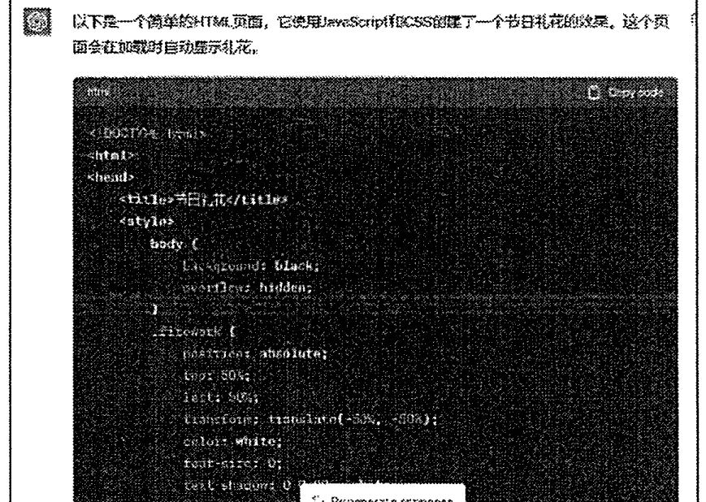
# 2. 设计功能更复杂，涉及前端和后端交互的代码

ChatGPT 生成的前端代码上手很快，往往少改即可用。后端代码生成和数据库调用也同样得心应手。下面演示了让 ChatGPT 生成前后端联动功能的对话过程。

用户要求生成一个美观的登记页面，收集访问者姓名和联系方式并存入后台数据库。对话中省略了多次追问的提示词。

# 第3章 众里寻他千百度：ChatGPT及其他AIGC赋能个人
后端的配合是关键。前端负责界面，后端负责处理数据并写入数据库。图3-21 是一个简化示意。

```
```
# 图3-21
图：随后需要一个后端服务器处理表单。该服务器接收表单数据并存入数据库。图3-22 展示了用 Node.js 和 Express 编写的简易代码。

```
```
# 图3-22
图：该服务器监听 /submit 路径的 POST 请求，从请求体中取 name 和 contact 字段，再把值写入 visitors 表。

注意这只是基础示例。实际应用需增加错误处理和输入校验，并替换示例中的 db 对象为真实数据库连接。

# AIGC 从入门到实战
# ChatGPT+Midjourney+Stable Diffusion+ 行业应用
示例中未加入任何样式，想更好看可补充 CSS。需注意 ChatGPT 生成的代码可能存在安全风险。例如收集联系信息时，要保障传输安全防止拦截篡改，也要确保存储安全防止未授权访问使用。

# 3.4.2 利用 ChatGPT 分析和跟踪算法代码，让它帮你探路
# 1. 实现工业领域嵌入式 C++ 代码分析和算法跟踪

在分析研究工业级 C++/C 代码时，借助 GPT 指点能快速理清思路。接手项目或文档不全时，阅读量常成瓶颈，GPT 的引导可大幅提升效率。

图 3-23 展示了基于嵌入式 ARM CPU 的部分工业代码，完整工程可达数十万行。短时间内定位核心方法并优化算法，对资深开发者仍具挑战。

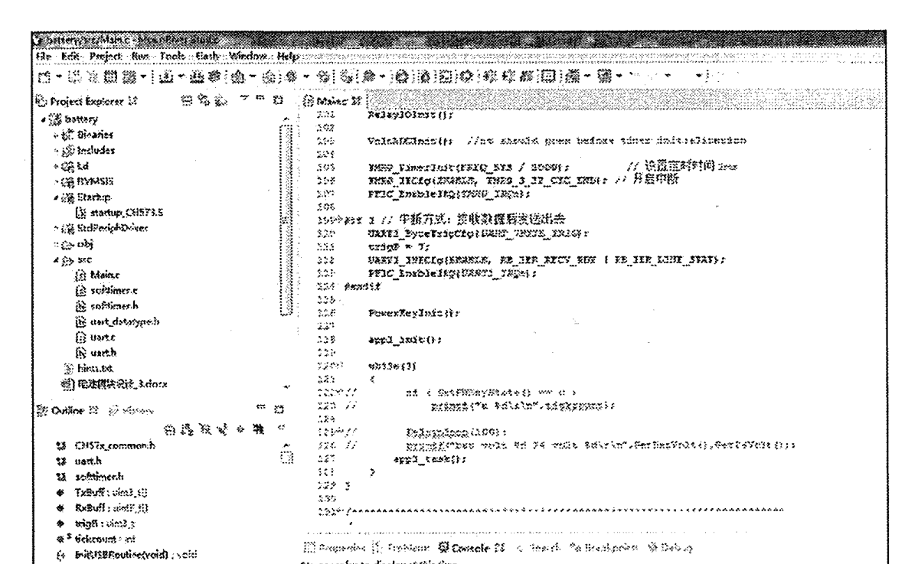
# 图3-23
# 第3章 众里寻他千百度：ChatGPT及其他AIGC赋能个人
ChatGPT 能阅读代码，迅速梳理程序逻辑并指出关键节点。将代码拷贝进对话框后，其对功能、变量、方法的解释能带来很大启发。受输入长度限制，超长文件或函数常需分批提交。

# 2. 设计数字集成电路中的数字逻辑

数字集成电路设计需用 HDL 描述硬件逻辑，再导入 FPGA 或 ASIC 前端工具。让 ChatGPT 用 Verilog 写一个 RTL 级的 8 位桶形移位器，代码如图 3-24 所示。

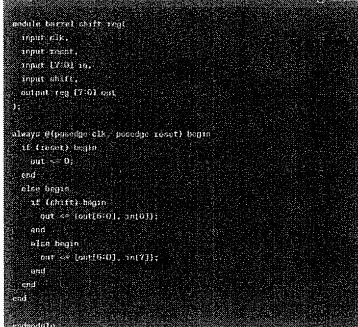
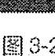
# 3.4.3 ChatGPT提升程序员编写代码和设计算法的效率

ChatGPT 能在一定程度上提升代码编写和算法设计的效率，具体体现如下。

+ * 智能补齐代码：ChatGPT 能在开发者给出片段和指令后给出续写建议，让编码提速、减少重复敲键的负担。
+ * 上下文代码推荐：根据需求和提示，ChatGPT 会解析语法与语义，揣摩意图后给出函数、类、变量等层面的灵感，助力更快完成实现。
+ * 找错与改错：它可以扫描源码，揪出潜在的 bug 或不规范写法，并给出修正方案，帮助在开发阶段就及时止损，提升代码健壮性。
+ * 算法思路支持：从问题描述出发，生成可行的算法方案或伪代码，为设计提供参考，节省推演和试错时间。
+ * 架构与框架搭建：ChatGPT 能对任务或项目快速搭出合理的骨架，给出建设性建议，并把框架细化拆解、列出分支，为开发提供全景参考。

综合来看，凭借语言理解与生成能力，ChatGPT 让编程和算法设计变得更高效、更精准。

当下，AIGC 程序员群体在快速扩容，换句话说，越来越多从业者获得了新能力，正向 AIGC 程序员演进。涉及范围包括 PC 端、互联网、移动端、云原生、嵌入式、数字 IC 工程师，以及图形程序员等。借助新工具，他们的技术栈被持续强化，工作效率明显提升。

按照 TIOBE 在 2023 年 8 月公布的编程语言流行度排名，情况如下图所示。

| 排名 | 编程语言 | 占有率 |
| ---- | -------- | ------ |
| 1 | Python | 13.33% |
| 2 | C | 11.41% |
| 3 | C++ | 10.63% |
| 4 | Java | 10.33% |
| 5 | C# | 7.04% |
| 6 | JavaScript | 3.29% |
| 7 | Visual Basic | 2.63% |
| 8 | SQL | 1.53% |
| 9 | 汇编语言 | 1.34% |
| 10 | PHP | 1.27% |
| 11 | Scratch | 1.22% |
| 12 | Go | 1.16% |
| 13 | Matlab | 1.05% |
| 14 | Fortran | 1.03% |
| | 图 3-25 | |

# 第3章 AIGC 重塑程序员生产力

使用上述语言的部分开发者正在尝试新工具以寻求转型，如图 3-26 所示。

| PC端程序员 | 互联网程序员 | 移动API程序员 |
| :--- | :--- | :--- |
| C#/C++ | PHP | Java/Swift/Python |
| API/SDK | Apache/MySQL | API/SDK |
| Windows | Linux | IOS/Android |
| 物联网程序员 | 嵌入式程序员 | 数字IC程序员 |
| Java | C/C++/Python | HDL/C/Matlab |
| Hadoop/Spark | Drivers/BSP | RTL/Verification |
| Docker/K8S | RTOS | SOC/VLSI |
| AI/GC程序员 | | |
| 语言对话/代码 | Prompt/API | LLM/GPT |

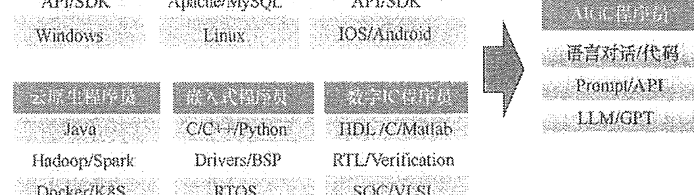


# 3.5 AIGC 时代找准职业方向

# 3.5.1 哪些岗位在萎缩 哪些岗位在诞生

ChatGPT 出现后，哪些工作可能被挤压，哪些新机会可能冒出来？

可能被削弱的岗位如下。

+ - 电商客服：常见咨询如订单状态可由 ChatGPT 自动回复，对人工的需求下降。
+ - 文本翻译：多语言自动翻译能力降低人工翻译需求。
+ - 数据录入员：信息收集与系统录入可被自动化处理。

可能涌现的新岗位如下。

+ - ChatGPT 开发人员：应用愈发普及，需要更多人维护和扩展功能。
+ - ChatGPT 部署与运维人员：企业和个人需要安装、配置、维护并做定制化。
+ - 数据分析师：海量文本数据需要专业人员解读和利用。

总体说来，ChatGPT 正推动各行业产生变化与创新。

# AIGC 从入门到实战

# ChatGPT+Midjourney+Stable Diffusion+ 行业应用

# 3.5.2 用容错率衡量职业替代顺序

据 OpenAI 公布的信息，AI 取代人类的先后可能与容错率相关，容错率越高，被替代的速度可能越快。容错率指的是特定行业对系统不稳定或错误的容忍概率。容错率高则结果受影响小；容错率低则结果受影响大。也就是说容错率高对 AI 要求宽松，容错率低则 AI 必须更精准。

容错率偏高的领域往往最先感受冲击，通常是内容生产类，比如写作、平面设计。这类工作对创造力和专业技能要求高，但产出差异大、无统一标准，容错空间大。AI 可提供辅助提升效率，但短期难以完全取代人。

随着模型精度提升、错误率下降，AI 开始进入更复杂的场景。例如当错误率降到类似自动驾驶 L4 级别——系统高度可靠但极端情况仍需人工接管时，软件行业会受到冲击。虽然代码生成可被辅助，但实际工程复杂、需人工调试，待错误率进一步降低后才会真正动摇。

责任重大、容错极低的职业如律师、医生，需要极高准确度，AI 影响相对有限。

在容错极低的行业，如芯片设计制造、火箭设计制造，失败成本极高、调试难度大，需要深厚经验与硬核技术，短期内 AI 难以取代。


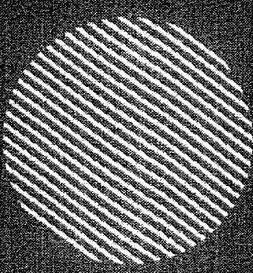

# 第 4 章

# Midjourney 让每个人成为画师

# AIGC 从入门到实战

ChatGPT+Midjourney+Stable Diffusion+ 行业应用

# 4.1 AIGC 工具中的现象级产品 Midjourney

Midjourney 是一家总部位于旧金山的独立研究实验室 Midjourney Inc. 推出的图像生成程序。它能根据自然语言描述生成图像，底层结合了大语言模型与生成对抗网络。生成器负责创造图像，判别器负责判断真伪，两者协同训练后即可产出与描述匹配的高质量画面。

2022 年 7 月 12 日公测后，到 2023 年 7 月，Midjourney 已积累超 1000 万注册用户，营收约 1 亿美元，成为 AIGC 标志性产品。2022 年科罗拉多州博览会数字艺术赛上，AI 作品击败人类夺得一等奖。无论艺术家未来是否被取代，对没有绘画基础的普通人而言，用此工具创作属于自己的画作极具吸引力。接下来介绍其创作方式。

# 4.1.1 如何入门使用 Midjourney

+ 1. 登录 Midjourney

在 Midjourney 官网按提示注册并登录 Discord 账号，页面出现如图 4-1 所示即登录成功。

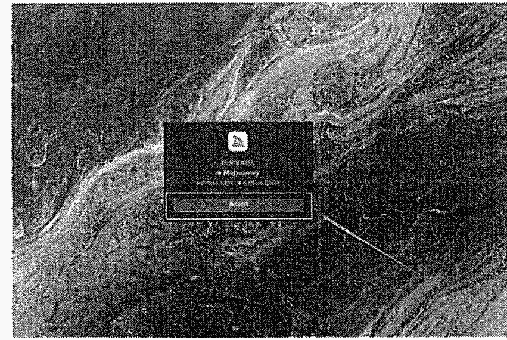

# 第4章 Midjourney 助你一键成画

重点来了！点开主页面左侧的小帆船图标，再进入左侧的 “#newbies-××”，右侧即可看到他人创作的作品，如图 4-2 所示。

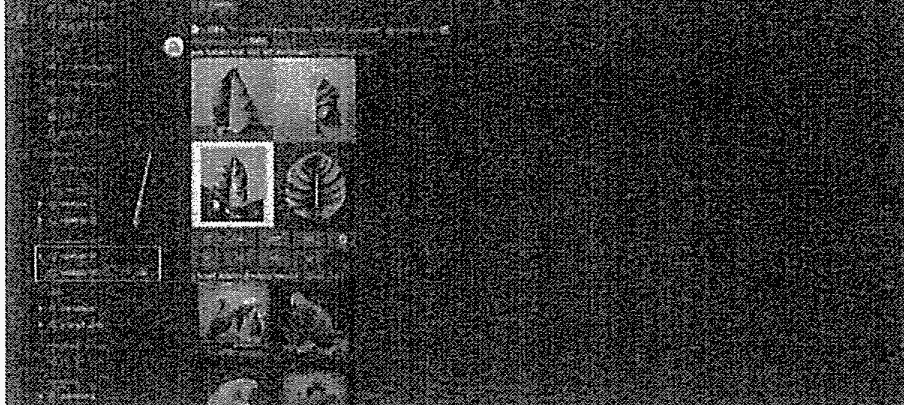

说明一下，#newbies-×× 是免费的公共服务器，进入后右侧会持续刷新他人作品。当然，也可以在此类服务器上创作。

# 2. 开始 Midjourney 创作之旅

使用 Midjourney 需要与机器人交互，Bot 根据提示词生成作品。操作有两种。

+ (1) 直接在免费大厅 #newbies-×× 创作。

进入后在输入框发送 “/imagine+提示词” 即可生成，如图 4-3 所示。提示词建议用英文，中文效果可能差距较大。

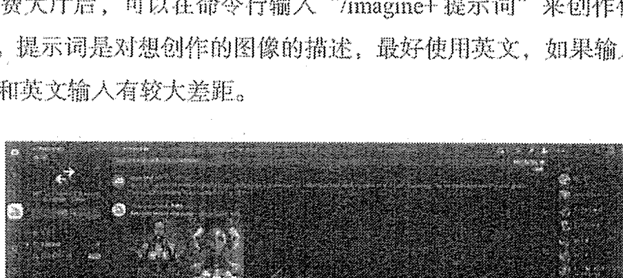

[PAGE 78]

# AIGC 从入门到实战

ChatGPT+Midjourney+Stable Diffusion+ 行业应用

例如输入 “/imagine A cute little dog with a tophat--v4”，这就是一段提示词。结构由命令、描述文字、可选参数组成，参数默认采用官方当前模型版本，如图 4-4 所示。

绘图指令：命令+描述文字+参数（可选）

命令 描述文字 参数
/imagine A cute little dog with a tophat--v4

参数类型：--v1 --v2 --v3 --v4 --nji

图 4-4

发送提示词后稍作等待即可看到生成结果，如图 4-5 所示。


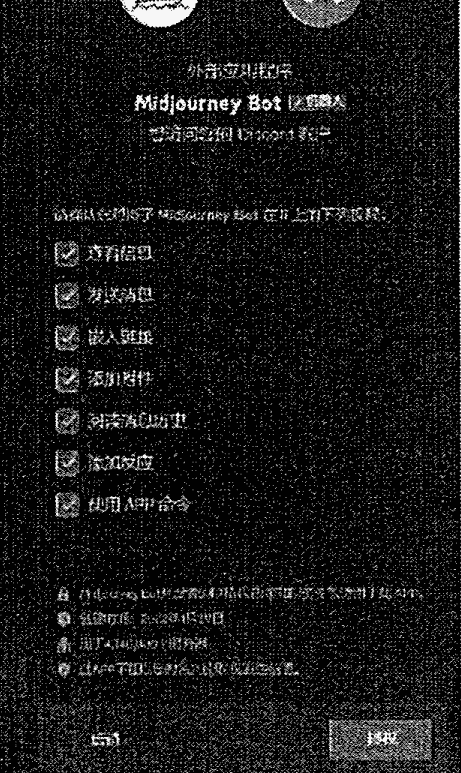

完成人机验证后，页面显示“已授权”，如图 4-11 所示。

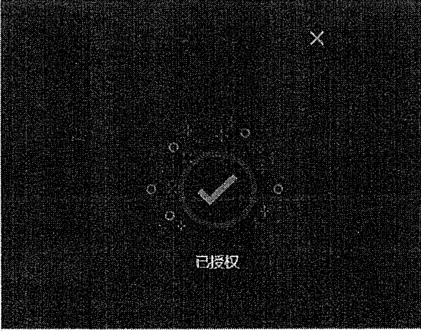

# 第4章 Midjourney 助你一键成画

在自己创建的服务器里，主页面右侧即可看到 Midjourney Bot。这样就能在专属空间创作，不受他人作品干扰。

操作到此，你就拥有了专属绘画机器人，即便零基础，只要掌握提示词技巧，就能指令 Bot 产出精美作品。

# 3. Midjourney 画图的核心命令

与 Bot 交互时，随时输入 “/” 可调出命令提示。常用基础命令及说明见表 4-1。

| 基本命令 | 说明 |
| --- | --- |
| /imagine | 由文本生成图像，50秒内出4张 |
| /info | 查看用量、生成张数、邀请码等 |
| /invite | 生成邀请链接发送到邮箱 |
| /ideas | 随机给出提示词灵感 |
| /ask | 向 Midjourney 提问 |
| /help | 帮助信息 |
| /subscribe | 生成个人 Web 地址 |
| /fast | 切换快速出图模式，需付费 |
| /relax | 切换普通出图模式 |
| /setting | 设置账号配置，如质量、速度等 |

想让 Bot 创作，只需输入 “/imagine” 再加上 “咒语”，即提示词，Bot 就会开始生成。接下来详细介绍咒语写法。

# 4.1.2 Midjourney 提示词写作要点

Midjourney 的咒语是一组描述性词，定义想要的画面。例如 “A girl is standing by the seaside, with a beautiful sea and sky in the distance. There are clouds in the sky, and sunlight is shining on the girl’s hair and body.” 就能生成少女、海、天空与阳光的画面。

一个标准提示词示例：/imagine A single girl standing in the dark,
[PAGE 82]

# AIGC 从入门到实战

ChatGPT+Midjourney+Stable Diffusion+ 行业应用

almost no light, Wong Kar-Wai style, exquisite clothing details, summer night, background with a sense of desire, romance, and mystery, classic elegance, wide-angle and long-focal-length lenses, low-key illumination, dim light, --ar 131 : 87 --v 5 --s 750 --q 2 （单人女孩站在黑暗中，几乎无光，王家卫风格，服装细节精致，夏夜，背景带有欲望、浪漫、神秘感，古典优雅，广角与长焦镜头，低调照明，昏暗光线，宽高比131:87）。

约 30 秒后，Midjourney 生成了如图 4-12 所示的作品，颇具王家卫风格。


图4-12

从示例可看出，提示词由主体描述、视角、作品风格、光线、相机参数、宽高比等构成。

(1) 主体描述。对画面核心内容的说明，如 “a single girl standing in the dark”“a girl in white shirt and blank jeans”。描述越细越好，人物可写眼色、发色、发型、服饰，表情也可细化，例如 “A young woman with a height of 162cm and a weight of 55kg, working as a marketing head at a tech company. She has long curly hair, wearing a white-strap beach dress, and she loves to laugh and dance with joy”。

(2) 视角。常用描述见表 4-2。

[PAGE 83]

# 第4章 Midjourney 助你一键成画

# 表4-2 常用视角描述

| front view | 正视图 |
| symmetrical | 对称 |
| centered composition | 居中构图 |
| symmetrical composition | 对称构图 |
| rule of thirds composition | 三分法构图 |
| S-shaped composition | S型构图 |

(3) 作品风格。以绘画为例。画种与流派：中国水墨、古典油画、印象派等；艺术家风格：莫奈、宫崎骏、新海诚、毕加索等；画风与特质：野兽派配色、黑白、油画厚涂等。

(4) 光线。优秀作品需明确光线，如 volumetric lighting、bright、cold light、soft illumination/soft lights、mood lighting 等。

(5) 相机参数。可指定 film 质感、Fujifilm 胶片感、luxurious 奢华感、焦距 35mm、光圈 f1.8 等。

(6) 画面比例。常用的写法有 16 : 9、9 : 16、2 : 3 等。
(7) 输出分辨率。常见的规格包括 4K、8K、16K、32K 等。
(8) 渲染类型。典型词条有 Unreal Engine（虚幻引擎）、octane render（辛烷值渲染）、Maxon C4D（一种渲染）、Quixel Megascans Render（写实感渲染）、architectural visualisation（建筑渲染）、Corona Render（室内渲染）。
(9) 系统配置。可不填写，系统会沿用当前版本自带的默认配置。

在撰写提示词时，可以遵循下面的拼接思路：主体描述 + 环境描述 + 氛围描述 + 光线 + 色彩 + 构图 + 作品风格 + 相机参数 + 渲染参数 + 配置参数。例如：“A boy is sitting by the river, autumn forest, morning mist, gentle sunlight, calm and nostalgic mood, sharp focus, high detail, cinematic feel, leaves falling, light shining on his face and clothes. The palette resembles Van Gogh’s oil painting, Studio Ghibli illustration style, soft color tone, --ar=16 : 9” （意为画面主体为坐在河边的男孩，秋日森林环境伴随晨雾，柔和阳光，氛围宁静怀旧，画面清晰细节丰富兼具电影质感，落叶飘落，阳光照亮面部与衣物；配色参考凡·高油画，加入吉卜力工作室的插画风格，宽高比 16 : 9）。

[PAGE 84]
# AIGC 从入门到实战
ChatGPT+Midjourney+Stable Diffusion+ 行业应用

需要区分的是，Midjourney 与 ChatGPT 的工作方式并不相同，前者并不是语言模型驱动，对提示词的语法规范并不挑剔，关键在于把需要表达的关键词完整列出。把上述词条提交后，得到的画面会与图 4-13 的风格相近。


# 图 4-13

正如前面所说，懂得运用提示词就能生成媲美好莱坞大片的视觉效果。关键词的掌握至关重要，特别是要熟知常用关键词的英文表达方式。表 4-3 汇总了常用的绘画风格关键词，表 4-4 汇总了常用的材质关键词，表 4-5 汇总了常用的配置参数关键词。

# 表 4-3 常用绘画风格关键词

| 风格 | 说明 | 风格 | 说明 |
| ---- | ---- | ---- | ---- |
| Studio Ghibli | 吉卜力工作室风格 | limited palette | 有限色调 |
| landscape | 山水画 | watercolor | 水彩 |
| trending on ArtStation | A站（ArtStation，一个计算机绘图交流网站）风格 | vector pattern | 矢量图案 |
| surrealism | 超现实主义风格 | vector illustration | 矢量插画 |
| oil painting | 油画风格 | ink dropped in water | 水墨 |
| original | 原画风格 | Pop Art | 波普艺术 |
| Cyberpunk | 赛博朋克风格 | Chinese propaganda | 中国宣传画 |
| post-impressionism | 后印象主义风格 | concept art | 概念艺术 |
| Wasteland Punk | 废土朋克风格 | Dot Art | 点艺术 |
| digitally engraved | 数字雕刻风格 | Line Art | 线艺术 |

[PAGE 85]
# 第4章 云想衣裳花想容：Midjourney 助你成为画中仙
# 续表

| 风格               | 说明       | 风格             | 说明   |
|----------------------|------------|------------------|--------|
| architectural design | 建筑设计风格 | oil paint        | 油画   |
| poster style         | 海报风格   | palette knife painting | 调色刀油画 |
| traditional Chinese ink painting | 东方水墨画 | realistic        | 写实风格 |
| Japanese Ukiyo-e     | 浮世绘     | realistic photograph | 写实照片 |
| manga style          | 日本漫画风格 | cinematic       | 电影风格 |
| stock illustration style | 童话插图风格 | hyperdetailed    | 特别细节 |
| CGSociety            | 数字艺术风格 | behind the scenes | 幕后   |
| DreamWorks Pictures  | 梦工厂影业风格 | cinematic lighting | 电影打光 |
| Pixar                | 皮克斯风格  | Calotype        | 卡罗式摄影法 |
| fashion              | 时尚       | macro shot      | 微距   |
| Japanese poster style | 日本海报风格 | wide shot       | 广角   |
| 90s video game       | 20世纪90年代电视游戏风格 | telescope     | 望远镜 |
| French art           | 法国艺术风格 | 360 panorama    | 360全景 |
| Bauhaus              | 包豪斯风格  | aerial view     | 鸟瞰   |
| Anime                | 日本动画片  | full body       | 全身   |
| pixel art            | 像素画     | side view       | 侧面   |
| Vintage              | 古典风格   | Go Pro          | Go Pro风格 |
| Pulp Noir            | 黑色电影   | drone photography | 无人机摄影 |
| country style        | 乡村风格   | Polaroid        | 宝丽来风格 |
| abstract             | 抽象风格   | Fujifilm        | 富士胶卷质感 |
| Risograph            | Riso（一种油墨）印刷风格 | LOMO         | LOMO风格 |
| graphic              | 设计风格   | shot on 35mm    | 35毫米胶卷 |
| ink render           | 墨水渲染   | 15 mm lens      | 15nm镜头 |
| ethnic art           | 民族艺术   | 35 mm lens      | 35mm镜头 |
| dark vintage         | 黑暗复古风格 | 85 mm lens      | 85mm镜头 |
| illustration         | 插画风格   | science fiction | 科幻   |
| steampunk            | 蒸汽朋克风格 | alien           | 外星人 |
| film photography     | 电影摄影风格 | Saturn          | 土星 |

[PAGE 86]
# AIGC 从入门到实战
ChatGPT+Midjourney+Stable Diffusion+ 行业应用
# 续表

| 风格 | 说明 | 风格 | 说明 |
| --- | --- | --- | --- |
| knolling | 整齐对称排列 | Galaxy | 银河系 |
| montage | 剪辑 | Lunar | 月亮 |
| full details | 充满细节 | Universe | 宇宙 |
| Gothic gloomy | 哥特式黑暗 | NASA | 美国国家航空航天局 |
| Trippy Art | 迷幻艺术 | Jupiter | 木星 |
| black and white | 黑白风格 | Mechanism | 机械主题 |
| pointillism | 点彩画法 | Anton Pieck | 安东·匹克风格 |
| Baroque | 巴洛克风格 | Hergé Comics | 埃尔热(“丁丁历险记”系列漫画作者)风格 |
| Impressionism | 印象派风格 | Beatrix Potter | 毕翠克丝·波特(儿童漫画家)风格 |
| Art Nouveau | 新艺术风格 | Frank Frazetta | 弗兰克·弗雷泽塔(西方幻想插画家)风格 |
| Rococo | 洛可可风格 | John Harris | 约翰·哈里斯(科幻插画师)风格 |
| Renaissance | 文艺复兴时期艺术风格 | Atey Ghailan | 阿特伊·盖兰(瑞典概念艺术家)风格 |
| Fauvism | 野兽派风格 | Craig Mullins | 克雷格·穆林斯(CG插画大师)风格 |
| Cubism | 立体派风格 | Andreas Lie | 安德里亚斯·莱尔(现代印象主义画家)风格 |
| OP Art/Optical Art | 欧普艺术/光学艺术 | Edvard Munch | 爱德华·蒙克风格 |
| Victorian | 维多利亚时期艺术风格 | Piet Mondrian | 皮特·蒙德里安风格 |
| Futurism | 未来主义 | Tristan Eaton | 特里斯坦·伊顿(涂鸦艺术家)风格 |
| Minimalism | 极简主义 | Jon Burgerman | 乔恩·伯格曼(涂鸦艺术家)风格 |
| minimalistic logo | 极简主义标志 | Adolph Menzel | 阿道夫·门泽尔(现实主义油画艺术家)风格 |
| Brutalist | 粗野主义 | Van Gogh | 凡·高风格 |
| Constructivist | 建构主义 | Albert Bierstadt | 阿尔伯特·比尔施塔特(风景画家)风格 |
| BotW | 塞尔达传说:旷野之息 | Alice Neel | 爱丽丝·尼尔(肖像画家)风格 |

[PAGE 87]
# 第4章 云想衣裳花想容：Midjourney 助你成为画中仙
# 续表

| 风格 | 说明 | 风格 | 说明 |
| ---- | ---- | ---- | ---- |
| Warframe | 星际战甲 | Alfred Kubin | 阿尔弗雷德·库宾（版画家）风格 |
| Pokemon | 宝可梦 | Grant Wood | 格兰特·伍德风格 |
| APEX | Apex 英雄 | David Hockney | 戴维·霍克尼（版画家）风格 |
| The Elder Scrolls | 上古卷轴 | Da Vinci | 达·芬奇风格 |
| Detroit: Become Human | 底特律：化身为人 | Alexander Jansson | 亚历山大·詹森（幻想风格插画师）风格 |
| AFK Arena | 剑与远征 | Terry Frost | 特里·弗罗斯特（抽象派/超现实主义艺术家）风格 |
| Cookie Run for kakao | 跑跑夾饼人 | Salvador Dali | 萨尔瓦多·达利风格 |
| League of Legends | 英雄联盟 | JoJo's Bizarre Adventure | JoJo 的奇妙冒险 |
| Makoto Shinkai | 新海诚风格 | Rene Magritte | 雷内·马格丽特（超现实主义艺术家）风格 |
| Soejima Shigenori | 副岛成记风格 | Alessandro Gottardo | 亚历山德罗·戈塔多（超现实主义插画师）风格 |
| Yamada Akhiro | 山田章博风格 | Nicolas de Staël | 尼古拉·德·斯塔埃尔（抽象画家）风格 |
| Munashichi | 六七质风格 | Robert Rauschenberg | 罗伯特·劳森伯格（达达主义艺术家）风格 |
| watercolor children's illustration | 水彩儿童插画 | Man Ray | 曼·雷（超现实主义/达达主义艺术家）风格 |
| quilted art | 绗缝艺术 | Marcel Duchamp | 马塞尔·杜尚风格 |
| partial anatomy | 局部解剖 | Hannah Hoch | 汉娜·霍克（达达主义艺术家）风格 |
| ink and color on paper | 水墨设色纸本 | Claude Monet | 克劳德·莫奈风格 |
| doodle | 涂鸦风格 | Junji Ito | 伊藤润二风格 |
| Voynich manuscript | 伏尼契手稿 | Hokusai | 葛饰北斋风格 |
| book page | 书页 | Ohara Koson | 小原古邨（日本古代画家）风格 |
| 3D | 3D 风格 | paper cut craft | 剪纸 |
| sophisticated | 复杂 | Chinese Paper Art | 中国剪纸 |
| photoreal | 真实感 | Kirigami | 日本传统剪纸 |

# AIGC 从入门到实战
ChatGPT+Midjourney+Stable Diffusion+ 行业应用
# 续表

| 风格 | 说明 | 风格 | 说明 |
| --- | --- | --- | --- |
| National Geographic | 国家地理杂志风格 | paper quilling art | 衍纸艺术 / 卷纸装饰工艺 |
| Hyperrealism | 超写实主义 | Yoshitomo Nara | 奈良美智风格 |
| architectural sketching | 建筑素描 | Dieter Rams | 迪特·拉姆斯（工业设计师）风格 |
| symmetrical portrait | 对称肖像 | Daniel Arsham | 丹尼尔·阿舍姆（石膏、水晶、石英、玻璃艺术家）风格 |
| clear facial features | 清晰的面部特征 | M.C. Escher | M. C. 埃舍尔（错觉艺术家）风格 |
| subsurface scattering | 次表面散射 | Alan Lee | 艾伦·李（《指环王》插画师）风格 |
| interior design | 室内设计 | Cowboy Bebop | 星际牛仔 |
| weapon design | 武器设计 | Dragon Ball | 龙珠 |
| game scene graph | 游戏场景图 | Fullmetal Alchemist | 钢之炼金术师 |
| character concept art | 角色概念艺术 | Naruto | 火影忍者 |
| from food blog | 美食 | Rick and Morty | 瑞克和莫蒂 |
| Chibi Art | Chibi 风格 | Wes Anderson | 韦斯·安德森（《布达佩斯大饭店》导演）风格 |
| Bayeux Tapestry | 贝叶挂毯 | Yoji Shinkawa | 新川洋司（插花艺术家）风格 |
| Minoan Mural | 米诺斯文明壁画 | Jamie Hewlett | 杰米·休利特（漫画家）风格 |
| frame | 相框 | banner | 横幅 |

# 表 4-4 常用材质关键词

| 材质 | 说明 | 材质 | 说明 | 材质 | 说明 |
| --- | --- | --- | --- | --- | --- |
| etching | 蚀刻（浅） | pearl | 珍珠 | high polished | 抛光 |
| engraving | 雕（中度） | jade | 玉石 | brushed | 拉绒 |
| deep carving | 刻（深） | amber | 琥珀 | matte | 哑光 |
| ivory | 象牙 | ruby | 红宝石 | satin | 缎面 |
| obsidian | 黑曜石 | amethyst | 紫水晶 | hammered | 锤铸 |
| granite | 花岗岩 | heliodor | 太阳石 | ebony | 乌木 |
| basalt | 玄武岩 | antique | 做旧 | cuprite | 赤铜 |
| marble | 大理石 | clay material | 黏土材质 | cuprite | 赤铜 |
| pine | 松木 |  |  |  |  |

[PAGE 89]
# 表 4-5 常用配置参数

| 参数 | 说明 |
| --- | --- |
| --w | 图像宽度（px），设置为64的倍数（或128的倍数，后面加上“for --hd”）会产生较好的效果 |

| --h | 指定输出高度，单位像素，常用64的整数倍，高清需求时选用128的整数倍并在末尾加上 for --hd |
| --seed | 固定随机种子以保持系列画面风格连贯，操作时点按信封图标把数值发送出去 |
| --no | 负向指令，用于剔除不想出现的元素，例如 --no plants 表示画面不含植物 |
| --video | 把绘制过程录成短动画并发送到个人邮箱 |
| --iw | 调节参考图对结果的影响权重 |
| --fast | 以更快速度生成，画面完整性与逻辑性会下降 |
| --vibe | 调用旧版模型，氛围更浓，表现更抽象，纹理有时更佳 |
| --vibefast | 在旧版模型上进一步提速 |
| --hd | 更适合大尺寸输出，但连贯性可能受损 |
| --stop | 提前结束生成过程，取值10到100，数值越小画面越模糊 |
| --uplight | 后续重绘时让新图更接近上一张 |
| --aspect X --ar X | 设置画面比例，常见如16:9 |
| --no dof | 关闭景深 |

# 4.2 实战玩法：让 Midjourney 化身你的绘画助手

前文列出的功能表明 Midjourney 本质上是一位全能的视觉生成器，只要描述清晰，就能交付符合预期的美术稿，甚至带来惊喜。它在光影营造与细节刻画上表现突出。下面演示如何把 ChatGPT 的语言理解能力与 Midjourney 的绘图能力结合，用来呈现古典诗文中的细腻意境。

# 4.2.1 文图协同：用 ChatGPT 解析古典意象并作画

先挑选意象丰富、画面感强的作品。王维五言绝句《鸟鸣涧》：“人闲桂花落，夜静春山空。月出惊山鸟，时鸣春涧中。”请 ChatGPT 做解读，大意是春夜山林寂静，人迹罕至，桂花无声飘落，夜色安宁山峦空旷。月亮升起惊起栖鸟，鸟鸣在春涧回荡，全诗传达出春夜的幽美与宁静。

再把这段理解转化为英文指令，核心要素包括春夜山间宁静、桂花飘落、月出惊鸟、鸟鸣春涧、油画与画家风格，并加上宽高比3:2、版本5、质量2、强度750等参数。产出见图4-14。


油画质感下意境体现有限。若换成国画笔法会怎样？把油画改为写意国画，产出图4-15，古典气质明显增强。


[PAGE 90]

# 第4章 诗画共生：借助 Midjourney 进入艺术世界

再把风格调整为水墨黑白并增加留白，产出图4-16，古韵感更足。

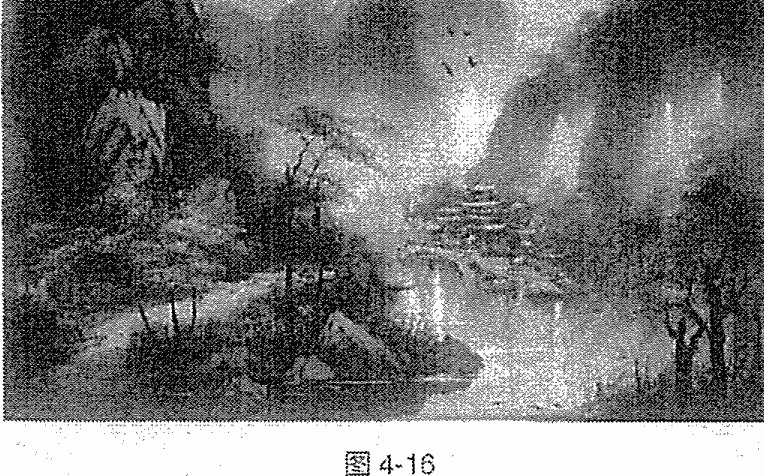

换一首《清明》试试：“清明时节雨纷纷，路上行人欲断魂。借问酒家何处有？牧童遥指杏花村。”经 ChatGPT 转写后，提示核心是南方清明细雨绵绵、有人问路寻酒、牧童指向杏花深处的村落，并指定写意国画风格。输出见图4-17。

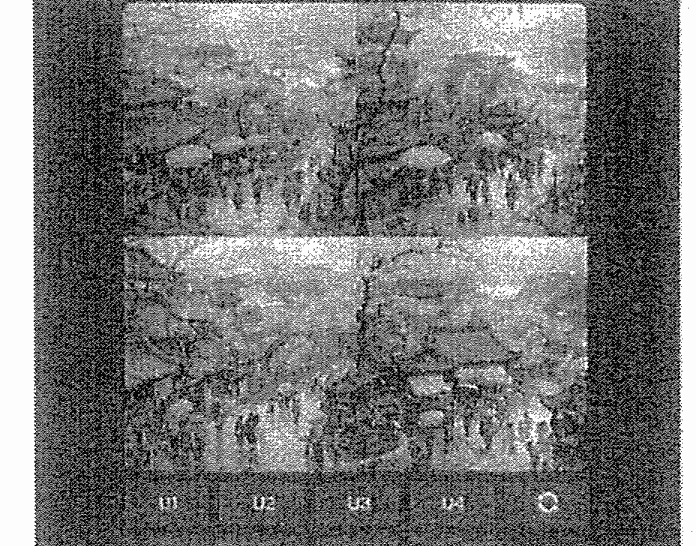

短诗之后挑战更复杂的赋文《洛神赋》，文段描写飞鸿游龙、秋菊春松、轻云蔽月、流风回雪以及神祇容貌、装束等细节。交给 ChatGPT 提炼关键词后生成图像，结果见图4-18。

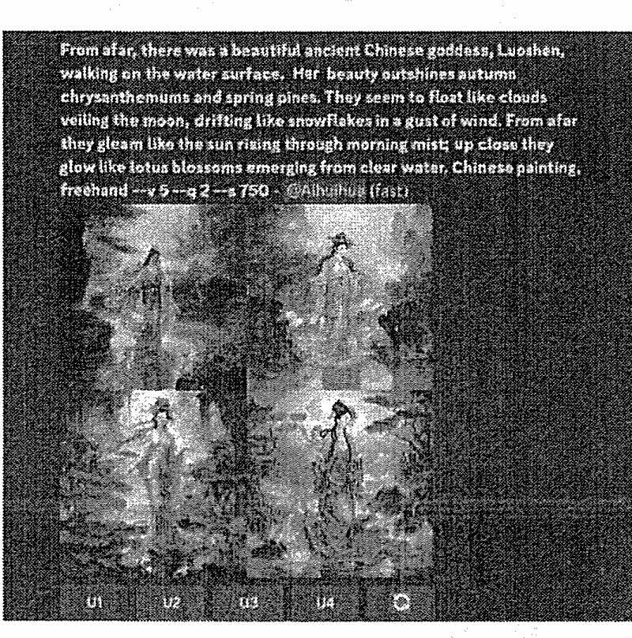

[PAGE 92]

# AIGC M入门到实战

ChatGPT+Midjourney+Stable Diffusion+ 行业应用

中文古典文本浩瀚，唐诗宋词以至赋体都值得反复推敲。让模型学习这些富含意象的文字，有助于逐步领会东方美感。

# 4.2.2 虚拟人设：打造专属萌系头像

在虚拟社交场景里，一枚专属卡通头像几乎成为标配。用 Midjourney 制作个人头像，既能在元宇宙里建立辨识度，也能更鲜明地表达审美取向。

Midjourney 在捕捉面部特征并转化为艺术形象方面能力很强。无论是新手还是资深用户，都能快速得到吸睛的虚拟形象。该形象可用于元宇宙、社媒、游戏等多种渠道。随着虚拟世界演进，定制化头像会成为自我表达的重要方式。

制作要点如下。

要让模型记住面容，需要使用图像参考功能，即上传个人实拍供 AI 学习。操作方式为点 Bot 左下角的“+”，挑选照片后双击上传，建议上传1至6张清晰、角度多样的照片。

上传后撰写指令，核心要素为多张照片链接加上可爱女孩、艺术家、卡通、皮克斯风格、迪士尼风格、超写实、渐变背景、精致3D渲染、4K、Blender、C4D、辛烷渲染等。注意把照片链接置于最前，用空格分隔。产出见图4-19。


图4-19

若想更换职业，只需把艺术家改为歌手即可，产出见图4-20。

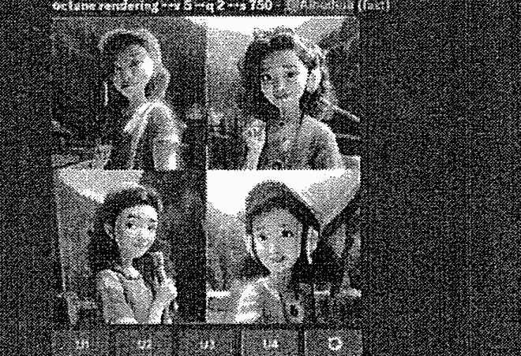

再尝试宫崎骏风格，核心要素为白衬衫蓝牛仔裤黑发白底、宫崎骏风格、吉卜力、插画、动画、千与千寻风格，宽高比1:1。输出见图4-21。


[PAGE 95]

# 第4章 云想衣裳花想容：Midjourney助你成为画中仙

更换装束为白色汉服长发，成片见图4-22。


图4-22

若要水墨感，加入水墨黑白并增加白底，效果见图4-23。


通过微调词条即可切换氛围与风格。例如泡泡玛特风格女孩玩偶、棕色卷发、冬季、柔和色调、模型图、细腻光泽、干净背景、3D渲染、柔焦、辛烷渲染、Blender、最佳质量、宽高比3:4。产出见图4-24。

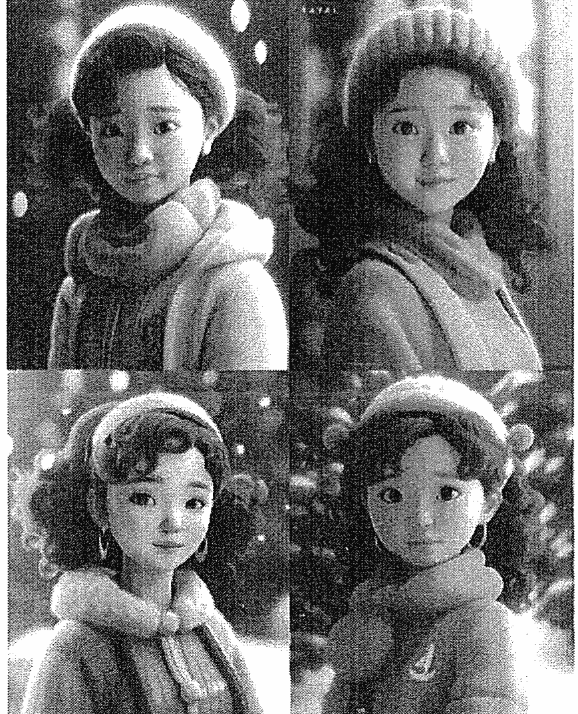

# 图4-24

再来一个盲盒玩具风格、腰部以上肖像、玛瑙红发、祖母绿眼、彩晶耳环、闪粉色公主裙、淡粉背景、原宿风、Q版、柔焦等。成片见图4-25。

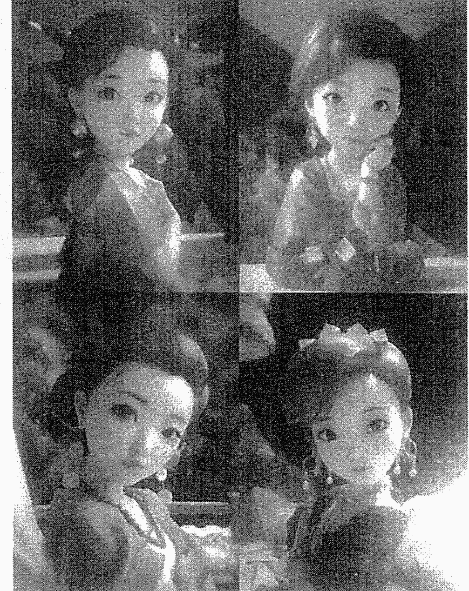

[PAGE 97]

# 第4章 云想衣裳花想容：Midjourney助你成为画中仙

最后看西装职场萌系头像，核心为非常可爱的女孩、蓝色西装、卡通、皮克斯、迪士尼、超写实、渐变背景、精致3D渲染、4K、Blender、C4D、辛烷渲染。多重复 cute 能强化萌感。

换个场景为编辑风格照片、中特写、年轻亚洲女性坐在法国香榭丽舍室外咖啡馆、紫色连衣裙、阳光照在头发与身体上、聚焦细致、电影质感、杰作、自然光、富士胶片、奢华、历史、4K。生成的图片见图4-28。


古风场景为中国女孩、紫色汉服、长发盘成古式发髻、手持宫灯、走过宫殿、全身远景、华丽金色宫殿、中国风CG、童话、天空飞鸟逐月、美丽、灯光、梦幻、星空、超细节、插画、4K、虚幻引擎、缥缈云雾、月宫、高清、宽高比9:16。生成的图片见图4-29。


多尝试不同场景，就能体验穿越感。

# 4.3 设计赋能：普通人也能做出专业 Logo

# 4.3.1 快速产出：多样式 Logo 的生成思路

设计圈流传“顺便帮我做个logo”和“要五彩斑斓的黑”的段子，如今 Midjourney 能一次给出上百个备选。

例如开一家以小熊为主题的咖啡馆，可用咖啡馆吉祥物logo、可爱小熊主题、简洁、矢量、无阴影细节等关键词。得到如图4-30的logo。

再生成徽章风格：咖啡馆logo与徽章、小熊主题、矢量简洁、无写实细节。结果如图4-31。

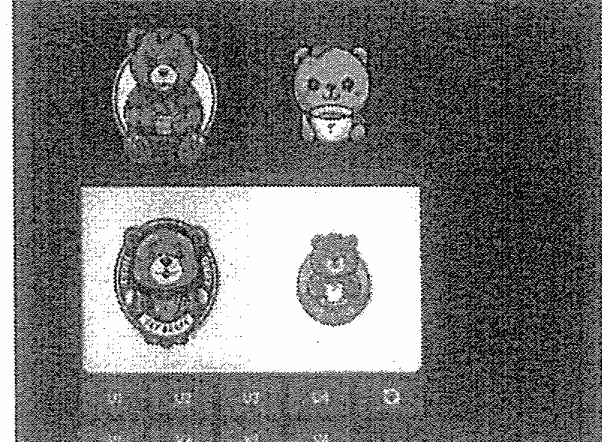

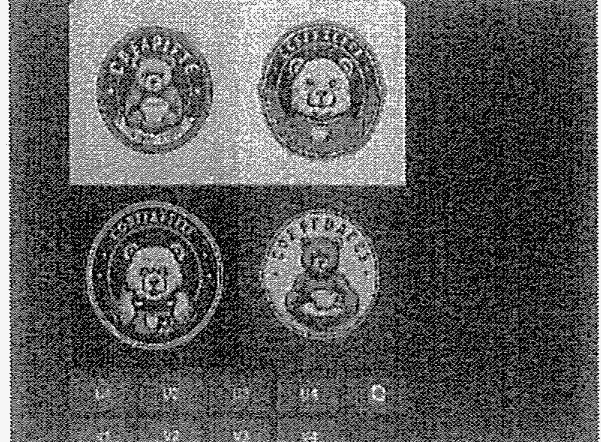

先用 Midjourney 试着给咖啡馆做 Logo，最直观的感受就是换个关键词气质就换一套。小熊是固定主题，风格一变味道完全不同。

波普路线就用 “a coffee shop logo, bear themed, simple, vector, pop art”，大意是做一个咖啡店的简约矢量小熊标志，带波普艺术的色彩张力。跑出来的稿件放到了图 4-32。

换成可爱原宿味，提示改成 “a coffee shop logo, bear themed, simple, Harajuku style, chibi, soft focus, mockup, 3D render, best quality”。意思是小熊咖啡 Logo，简洁、原宿、Q 版、柔焦，还要带实物 Mockup 和 3D 渲染、极致质量。成片在图 4-33。

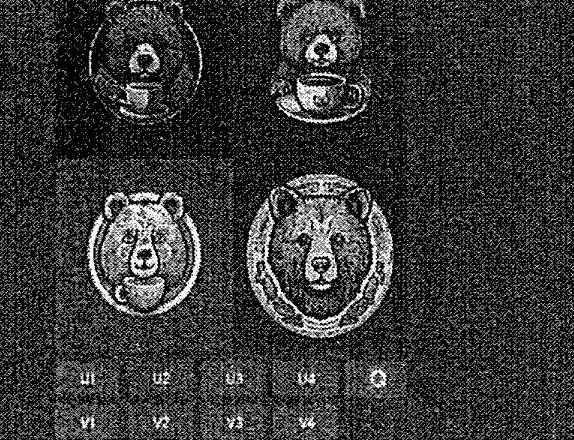

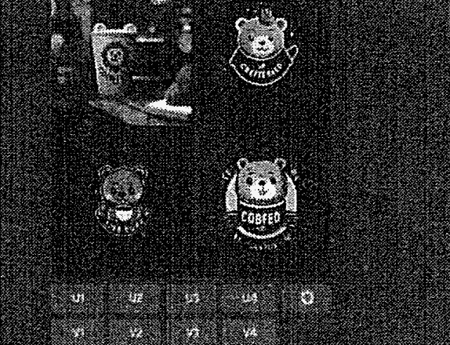

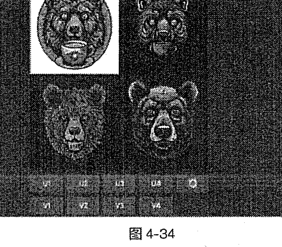

再试试迷幻向：“a logo of a coffee shop with the theme of a bear, simple, vector, Psychedelic Art --no text or realistic details”。就是以熊为主题的咖啡店 Logo，矢量简约、迷幻艺术感，且不要文字不要写实细节。成品见图 4-34。

风格、材质、光感、精细度都可以随手调节，效果差很多。更有趣的是让模型套用某个设计师的语感，常用的有：

+ * Paul Rand：IBM 与美国广播公司 Logo 的操刀者。
* Massimo Vignelli：纽约地铁地图 Logo 的作者。
* Rob Janoff：苹果 Logo 的设计师。
* Sagi Haviv：美国网球公开赛与《国家地理》杂志 Logo 的设计者。
* Steff Geissbuhler：NBC 与时代华纳有线电视公司的 Logo 设计者。
* Saul Bass：著名平面与美术制作人。
……

垫图对 Logo 帮助很大。用苹果的 Logo 当参考垫入，AI 会在相似构图上做变形，得到图 4-35 的方案。也可以把两张图融合，比如把前面生成的小熊 Logo 和星巴克 Logo 混在一起，混合稿在图 4-36。

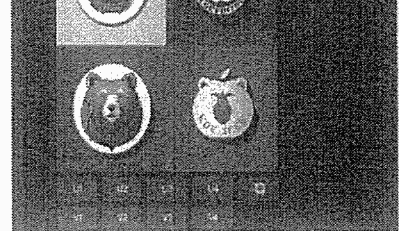


要提醒的是，Midjourney 做出的 Logo 文字符号基本没法直接商用，通常得用 Illustrator 再精修。但它当灵感弹药非常够用，能让你像甲方一样快速刷稿挑款。花三四十分钟就能从几十张里筛出 3~5 个可用方向，基本做到随手出 Logo 的效率。

# 4.3.2 AI 画建筑：复刻名师风格出效果图

AI 在建筑可视化上的想象力和速度都很惊人。

先看一个国外设计师常用的建筑词：“modern villa in a forest filled with rain and fog, 8K, detailed, raining, realistic, photographed by Mike Kelley”。雨雾森林里的现代别墅，8K、细节足、下雨、写实、麦克·凯利拍摄风格。生成结果很有氛围，见图 4-37。

想让建筑图稳定好看，建议把提示拆成：建筑主体细节 + 周边环境 + 风格或时代 + 参考建筑师/摄影师 + 参数。Midjourney 自带的灵感库里堆满顶尖名字，所以画面常有惊喜。

先玩伦佐·皮亚诺，他是当代意大利建筑师，1998 年普利兹克奖得主，蓬皮杜中心出自他手。提示用：“ethereal glass structure suspended over a serene body of water, showcasing the innovative architectural style of Renzo Piano, captured by Hiroshi Sugimoto --ar 16 : 9”。灵性玻璃体悬于静水之上，体现皮亚诺的创新手法，由杉本博司拍摄，比例 16:9。成片见图 4-38。


# 图4-37

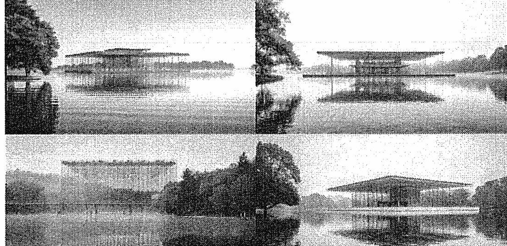

# 图4-38

再换扎哈·哈迪德，2004 年普利兹克奖得主，广州大剧院、北京银河 SOHO 等都是代表作。提示是：“a futuristic skyscraper with a large number of steel and glass structure designs, beautiful gardens and geometric sense, inspired by Zaha Hadid,”

[PAGE 105]

# 第4章 用 Midjourney 把构思变成画面
photographed by Candida Höfer -- ar 16 : 9”。大量钢结构与玻璃构成、带花园和几何感的未来摩天楼，灵感来自哈迪德，康迪达·赫弗拍摄，16:9。结果见图 4-39。

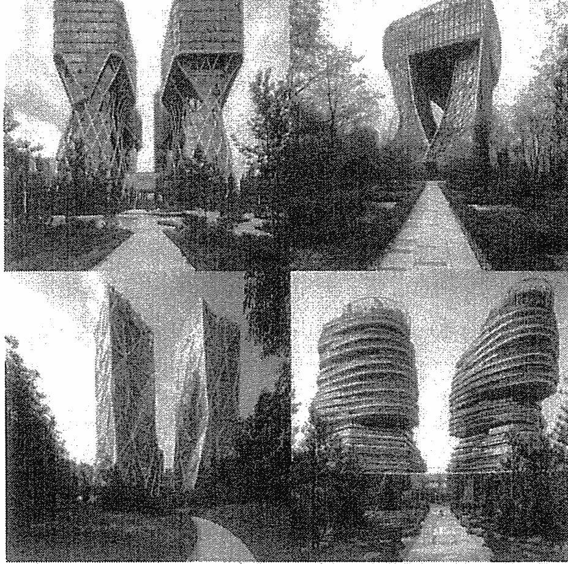

贝聿铭在华人里认知度高，擅长混凝土与玻璃，且善于把文化融入形体，中银大厦、国家美术馆东馆都是经典。

试试：“Design a villa by the misty and rainy lake, with a minimalist geometric design. The villa is surrounded by bamboo forests and features eaves and raised corners of Chinese traditional gardens. A pool of lake depicts the distant indigo mountains. Refer to LM. Pei's style, shot by Hiroshi Sugimoto -- ar 16 : 9”。用极简几何线条做一栋湖畔别墅，烟雨、竹林环绕、带中式园林飞檐翘角，湖面倒映远山青黛，参考贝聿铭风格，杉本博司拍摄，16:9。效果图在图 4-40。

[PAGE 106]

# AIGC 从入门到实战
ChatGPT+Midjourney+Stable Diffusion+ 行业应用


# 图4-40

摄影师朱利叶斯·舒尔曼的作品有 50 年代乐观主义的想象力。1960 年他拍的斯塔尔住宅坐落在洛杉矶山上，俯瞰城市灯火，钢架托起、大面积玻璃。受此启发，提示写成：“Julius Shulman architectural photography of a house in the LA hills overlooking the city, --ar 16 : 9”。舒尔曼风格的洛杉矶山上俯瞰城市住宅，16:9。成片见图 4-41。


# 图4-41

后现代建筑可试：“post-modern architectural design, landscape view, curved forms, decorative elements, asymmetry, dark green colored glass, Psychedelic Art, ceramic tiles, stoned tiles, --ar 16 : 9”。后现代建筑，景观视角，曲线造型、装饰元素、不对称、深绿玻璃、迷幻艺术、瓷砖石砖，16:9。结果在图 4-42。

[PAGE 107]

# 第4章 用 Midjourney 把构思变成画面

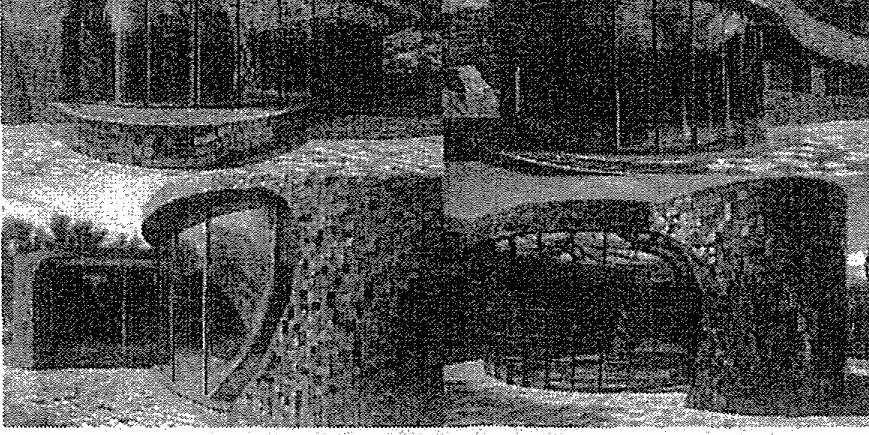

虚构建筑也好玩。提示：“the Tower of Babel, Genesis, mountainous landscape, Cyberpunk, futuristic, neon lights, 4K, cinematic, intricate details, extremely detailed, surrealism, Unreal Engine”。巴别塔、创世纪、山地景观、赛博朋克、未来感、霓虹、4K、电影质感、细节丰富、超现实、虚幻引擎。生成图 4-43，有很强的未来世界感。

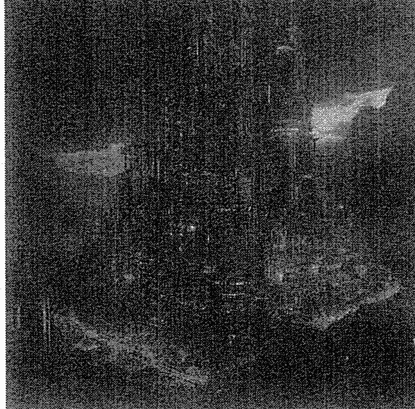

再试：“city architecture of the future, water canals and lush gardens, biomorphic shapes, dot matrix background, Gustav Klimt style, as seen from the sky”。未来城市建筑、水渠、茂盛花园、生物形态、点阵背景、克里姆特风格、鸟瞰。效果见图 4-44。

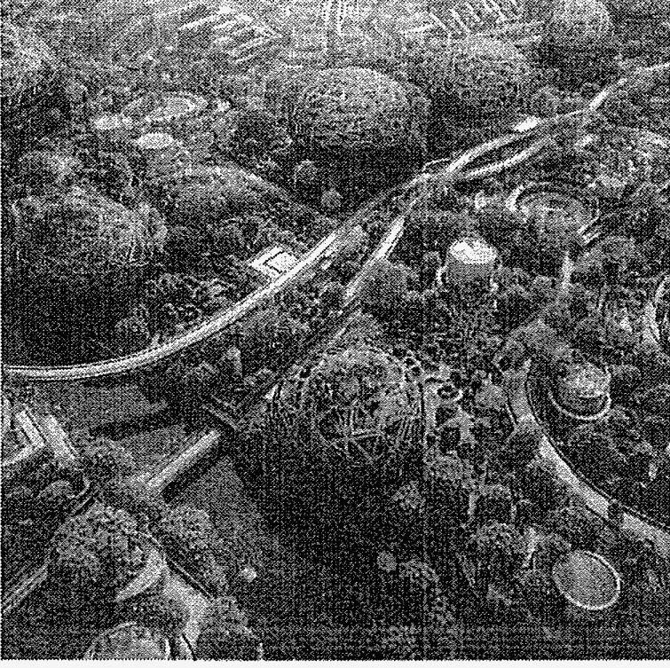

目前 AI 画不出完整施工图，但做各式风格效果图绰绰有余，能给建筑师大量灵感。把精力放在关键决策上，人机协同已成趋势。

# 4.4 让 AI 反推提示词，/describe 一键拆解

写提示词技巧不少，ClickPrompt、PromptHero 等站也能帮忙，但还是不够“懒”。Midjourney 的 /describe 命令就是把描述交给 AI，两步就能当懒人大师。

发 /describe，Bot 会提示上传图片，如图 4-45。

[PAGE 109]

# 第4章 用 Midjourney 把构思变成画面

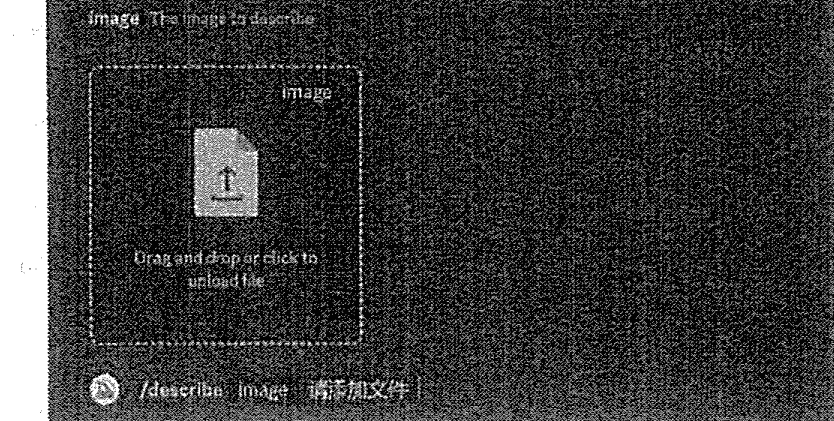

这里上传之前生成的王家卫风格图，如图 4-46。


Bot 立即给出 4 条候选提示词，如图 4-47。

+   ( 1 ) a beautiful Chinese woman in an elegant red dress, in the style of realistic chiaroscuro lighting, Tokina AT-X 11-16mm f/2.8 Pro DX II, light maroon and emerald, shiny eyes, photo-realistic techniques, Japonisme, painterly style --ar 3 : 2

--穿优雅红裙的中国美女，采用写实明暗光，图丽 AT-X Pro DX II 11-16mm F2.8，浅栗与祖母绿，亮眼，照片级写实、日本主义、笔触绘画感，3:2

( 2 ) a beautiful Asian woman in elegant dress, in the style of Atelier Olschinsky, Sigma 105mm f/1.4 DE HSM Art, dark red, shiny eyes, realistic portraiture, framing. Chiho Aoshima --ar 3 : 2

# AIGC 从入门到实战
ChatGPT+Midjourney+Stable Diffusion+ 行业应用

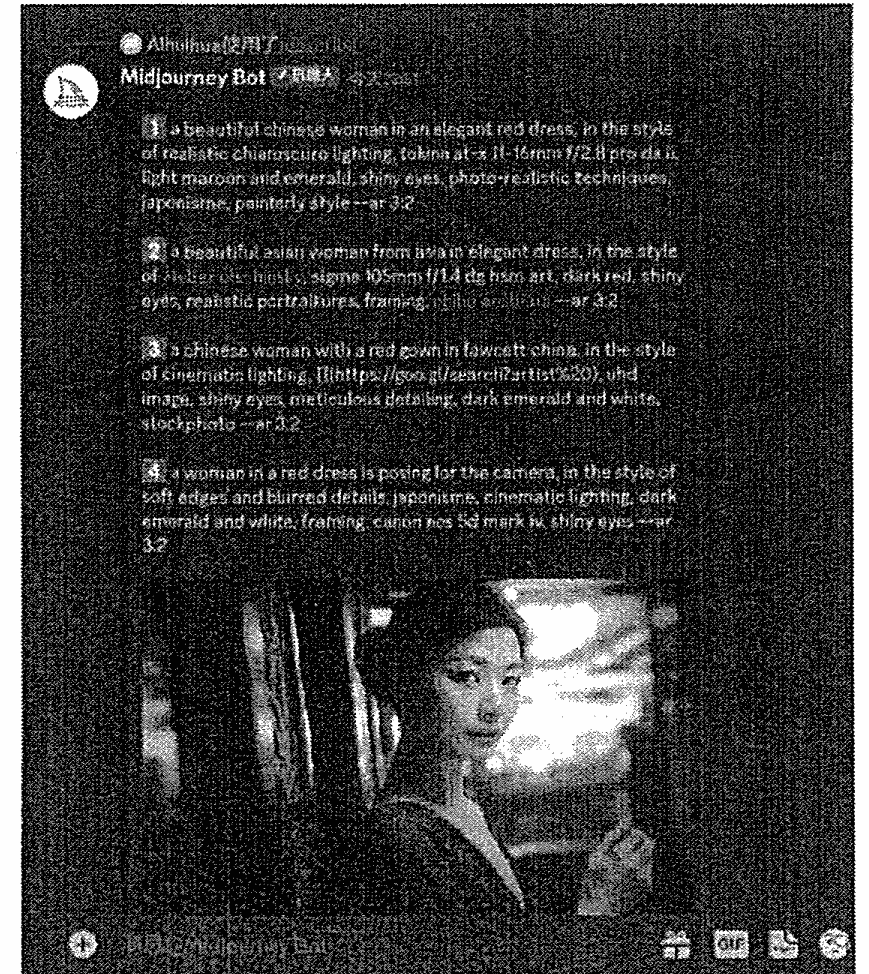

图 4-47

一位亚洲女性，优雅连衣裙，奥尔辛斯基工作室风格，西格玛 105mm F1.4，深红、亮眼、写实人像、构图，千穗风格，3:2

( 3 ) a Chinese woman with a red gown, in the style of cinematic lighting, UHD image, shiny eyes, meticulous detailing, dark emerald and white, stockphoto --ar 3 : 2

红礼服中国女性，电影光、UHD、亮眼、细致、深祖母绿与白、图库感，3:2

( 4 ) a woman in a red dress is posing for the camera, in the style of soft edges and blurred details, Japonisme, cinematic lighting, dark emerald and white, framing, Canon EOS 5D Mark IV, shiny cyes --ar 3 : 2

红裙女性摆拍，柔边模糊细节、日本主义、电影光、深祖母绿白、构图、佳能 5D Mark IV、亮眼，3:2

# 第4章 用 Midjourney 把构思变成画面

把第一条再发给 Bot，生成图 4-48。


# 图4-48

AI 并没有猜中“王家卫风格”这个关键词，但按它反推的描述生成的画面依然很有王家卫味道。

有了这个功能，任何图片都能拆成可复用的提示词，进而衍生大量创作。Logo 延展、游戏原画场景都很需要这种能力。在反复图生文、文生图的过程中，人类也在为模型提供反馈强化学习，数据越多生成越强。

# 天工人巧日争新：生成你的数字人分身


网上曾流传视频：小伙用 AI 复活已故奶奶，还能视频通话。除了表情略僵，声音语气都很自然，让人动容。在元宇宙里，逝去的亲人也能拥有数字分身。

他怎么做到的？先用 Midjourney 画出奶奶形象，再用生前录音训练 TTS，最后把音频导入 D-ID，把静态图变成会说话的视频，合成一段与“奶奶”的对话来纪念。

类似玩法在抖音、小红书也很常见，AI 主播层出不穷。接下来逐步介绍如何打造自己的数字人分身。

# 5.1 聚焦人物绘画，Stable Diffusion 的专业性

# 自建画室新选择：认识 Stable Diffusion

上一章已经把 Midjourney 的用法拆解清楚，整体上手快、风格面宽、成品很出彩。除了这套方案，还有另一款经常被拿来横向对比的开源绘图工具 Stable Diffusion，简称 SD。2022 年 8 月 Stability AI 官宣与慕尼黑大学联合研发的项目正式开源，仓库放在 GitHub，任何人都能免费拉取到本地运行。相较老一代绘画工具，SD 的最大卖点是完全不收费且无次数上限，本地跑的硬件门槛也不算高，几秒内就能出高清图，开源后又掀起一波创作热潮。

和 Midjourney 放在一起看，差异主要在：

+ (1) 费用：SD 开源免费用，部署到本地后长期零成本；Midjourney 采用订阅付费。
+ (2) 定制空间更大：依托开源底座和插件生态，可以自行微调风格、局部修正，可控性提升明显。
+ (3) 人像资源更丰富：尤其是女性人像模型储备多，在人物刻画上表现更突出。

下面按本地部署到生成数字主播的完整链路展开。

# 5.1.1 进行硬件部署和运行工程源码

跑 stable-diffusion-webui 与对应模型，显存是瓶颈。起步 4GB 能启动，日常 6GB 比较顺手，建议 12GB 体验更好。系统内存最好 16GB 以上，越大越稳定。配置不足运行时容易卡顿、响应变慢。

SD 的工程仓库在 GitHub，迭代很快，修复 bug 与新增功能会持续推送，建议定期去官网同步最新代码。

具体做法如下。

(1) 安装 Git。打开 Git 官网下载，按向导完成安装，保留默认组件即可。
(2) 搭建 Python 环境。webui 用 Python 开发，需要先装 Python 并配好环境变量，3.10.6 版本比较稳，建议用 Anaconda 管理多环境。
(3) 搭建 CUDA 环境。webui 主要走 GPU，加速需要英伟达显卡。先装 CUDA 驱动。右键桌面右下角 NVIDIA 图标进入控制面板，如图 5-1 所示。

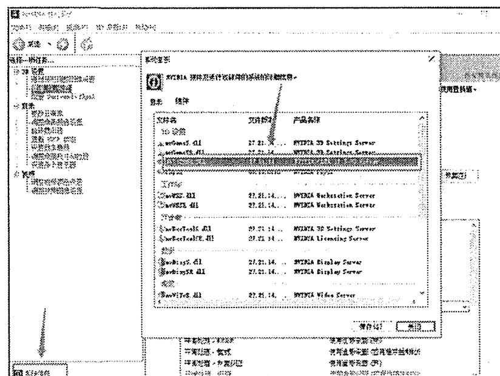

# 第5章 天工人巧日争新：生成你的数字人分身

以截图为例，该机驱动为 NVIDIA CUDA 11.3.70 driver，因此安装的 CUDA 版本不能高于 11.3。

注意：高规格显卡可以兼容低版本 CUDA，比如 10.2，但 11.3 的运行效率更高，通常建议按显卡所能支持的最高版本安装，官网可查对应版本。

(4) 装完后可用 nvcc --version 查看版本确认是否生效。

没有英伟达显卡也可通过参数 --use-cpu 让 SD 用 CPU 运行，但效率差距极大，GPU 几秒完成的事 CPU 可能要十多分钟。若显存偏小可配合参数：显存 4GB 加 --medvram；显存 2GB 加 --lowvram。

Windows 用户可编辑 webui-user.bat，将第六行改为：

```
set COMMANDLINE_ARGS=--lowvram --precision full --no-half --skip-torch-cuda-test
```

若用 GTX 16 系列显卡生成图像全黑，也要修改 webui-user.bat 的第六行为：

```
set COMMANDLINE_ARGS=--lowvram --precision full --no-half
```

这一步完成后进入下一步。

# 5.1.2 安装权重文件和LoRa模型文件

(1) 下载 SD 运行所需的基础权重，约 4GB。可在 Hugging Face 官网获取后放入 models/Stable-diffusion 目录。
(2) 下载 LoRA 模型。LoRA 全称 Low-Rank Adaptation of Large Language Models，是 SD 的插件形式，不改动原模型，只注入低秩矩阵，就能用少量数据训练出特定画风或人物，比全量训练更省资源、更快。模型分享站 Civitai 上 SD 模型约两千个，LoRA 等小模型约四万个，可按喜好挑选。


模型常见格式为 .ckpt 与 .safetensors，后者被认为更安全。stable-diffusion-webui 都支持，任选其一下载后放到 stable-diffusion-webui\models\Stable-diffusion 目录。放好后需重启 webui，即运行 webui-user.bat 才能识别。

(3) 配置好后运行工程目录下的 webui-user.bat，类 Unix 系统运行 webui-user.sh，如图 5-3 所示。首次启动会自动下载 Python 依赖，依据 requirements.txt，同时会拉取项目配置和模型文件，例如 v1-5-pruned-emaonly.safetensors。

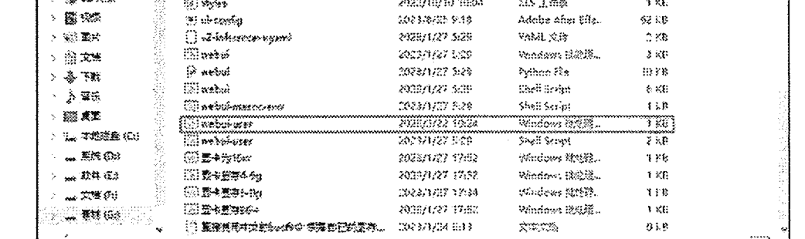

# 第5章 天工人巧日争新：生成你的数字人分身

环境就绪即可开始创作。

# 5.1.3 绘制美丽小姐姐的提示词写作技巧

stable-diffusion-webui 主要提供两类能力：

+ (1) 文生图 text2img：按文字描述生成图像。
(2) 图生图 img2img：在已有图像基础上结合描述生成新图。

本节聚焦文生图，先了解表 5-1 的核心参数。

# 表5-1 Stable Diffusion的主要参数

| 参数 | 说明 |
|------------|-----------------------------------------------------------------------|
| prompt | 正向提示词，用于描述想要的元素 |
| negative prompt | 反向提示词，用于排除不想要的元素 |
| width & height | 输出尺寸，越大耗时越长 |
| CFG scale | 提示词遵循度，数值小则发散但逻辑更通，数值大则贴合描述但易失真 |
| sampling method | 采样算法，不同方法差异在采样逻辑，选择适合即可 |
| sampling steps | 采样步数，过少随机性高，过多效率低且易被拒 |
| seed | 随机种子，-1 为随机，固定数值可复现相似画面 |

下面生成一张美丽小姐姐的示例，提示词如下。

prompt: <loral:chilloutmixss_xss10:1>,<lora:LORAJingyiJuChinese_jingyi10:0.2>,

<loral:GirlDollLikeness_v10:0.2>,Chinese, 1 woman, 28yo, (((woman))), white hair, solo,

realistic, bangs, best quality, photorealistic, sweet smile, masterpiece, 8k, high res, solo,

frontal symmetry, extremely detailed face, (professional lighting, bokch), (light particles,

glowing particles:0.6), (dynamic pose:1.2), soft lighting, full-face photo, front

view, symmetrical, fashionable and trendy atmosphere, China, (white hair:1.4), flower,

((daytime)), ((looking at the viewer)), (looking at the camera), (portrait:0.6), gorgeous.

[PAGE 118]

# AIGC M入门到实战

ChatGPT+Midjourney+Stable Diffusion+ 行业应用

standing, original face, ((short hair)), floating hair, graceful neck, lips, lipstick, skin blemish, seductive smile, modern, (bank uniform), white shirt, formal wear, bank entrance, bank account manager, teeth

(一位中国女性，28岁，(((女性)))，白色头发，独自一人，写实风格，刘海，最佳质量，逼真的照片，甜美微笑，杰作，8K，高清，单独拍摄，正面对称图片，面部细节极其细致,(专业灯光，背景虚化),(光粒子，镜头光晕，发光粒子: 0.6),(动态: 1.2)，柔光，全脸照片，正面视角，对称，时尚与潮流氛围，中国，（白发: 1.4），花朵，((白天))，((注视观众))，(注视相机)，(肖像: 0.6)，华丽，站立，素颜，((短发))，飘动的头发，优雅的颈部，嘴唇，口红，皮肤瑕疵，诱人的微笑，现代感，(银行制服)，白衬衫，正式着装，银行入口，银行客户经理，露出牙齿)

negative prompt: (worst quality:2), (low quality:2), (normal quality:2), lowres, normal quality, ((monochrome)), ((grayscale)), skin spots, acne, skin blemishes, bad anatomy, deep negative, (fat:1.2), bad hands, text, error, missing fingers, extra digit, fewer digits, cropped, worst quality, low quality, normal quality, jpeg artifacts, signature, watermark, username, blurry, bad feet, poorly drawn hands, poorly drawn face, mutation, deformed, extra limbs, extra arms, extra legs, malformed limbs, fused fingers, too many fingers, long neck, cross-eyed, mutated hands, polar lowres, bad body, bad proportions, gross proportions, text error, missing fingers, missing arms, missing legs, extra foot, extra navel, body wet, large head, bad fingers, bad finger

((最差质量: 2)，(低质量: 2)，(普通质量: 2)，低分辨率，普通质量，((单色))，((灰度))，皮肤斑点，痘痘，皮肤瑕疵，解剖错误，深度负面，(肥胖: 1.2)，手部问题，文字错误，缺失手指，多余的数字，缺少数字，裁剪，最差质量，低质量，普通质量，JPEG伪像，签名，水印，用户名，模糊，脚部问题，手部绘制不良，脸部绘制不良，突变，畸形，额外的肢体，多余的手臂，多余的腿，畸形肢体，手指融合，手指过多，颈部过长，眼睛斜视，手部变异，分辨率极低，身体问题，比例问题，不正常的比例，文字错误，缺失手指，缺失手臂，缺失腿部，多余的脚，多余的肚脐，身体湿润，头部过大，手指问题)

# 第5章 天工人巧日争新：生成你的数字人分身

提示词是 SD 绘画的核心能力，整理了一些实操要点：

技巧1：结构为“正向描述 + 负向描述”。正向写想要的效果如 masterpiece、best quality；负向写不想要的效果如 bad hands、text error。
技巧2：越靠前的词权重越高，先写景会让人物占比变小，先写人物则占比变大。
技巧3：画幅越大，提示词需要越详尽。
技巧4：英文圆括号可把内部词权重提升约 1.1 倍，中括号提升约 1.05 倍。
技巧5：‘+’ 与 ‘AND’ 可连接短语，AND 两边需空格。
技巧6：可采用三段式：第一段画质与风格，第二段主体内容及细节，第三段场景与人物细节。
技巧7：也可按“画质→风格→镜头→光照→主体及次要描述×系数→全局光照→全局镜头→滤镜”组织。

不同模型对提示词敏感度不同，需要不断调试组合。

# AIGC 从入门到实战

ChatGPT+Midjourney+Stable Diffusion+ 行业应用

# 5.2 激活：D-ID 让照片里的人物“活”过来

# 5.2.1 登录 D-ID

进入 D-ID 官网，点击右上角的 “Login”，如图 5-5 所示。


# 5.2.2 借助 AI，听听照片里的人物怎么说

(1) 登录后进入创作页面，点击 “Create Video”，如图 5-6 所示。


# 5.2.3 创建新创意视频

(2) 点击 “New creative video”，输入项目名称，如图 5-7 所示。然后点击 “Choose a presenter” 下方的 “ADD”，进入图片上传界面。


(3) 选择 5.1.3 节中生成的图片，上传该图，如图 5-8 所示。


(4) 在 “Type Your Script” 下方的文本框输入数字人讲解的文字，在 “Language” 下拉菜单选择讲解语言，在 “Voices” 下拉菜单选择人声，在 “Styles” 下拉菜单选择声音风格。点击喇叭图标试听。如图 5-9 所示。

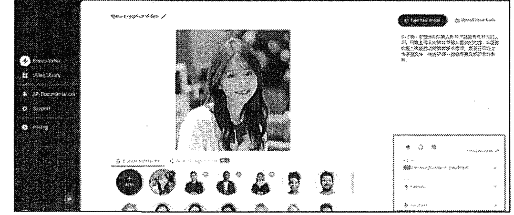

(5) 调整到满意效果后，点击 “GENERATE VIDEO” 按钮，在弹出界面中点击 “GENERATE”，如图 5-10 所示。


(6) 生成完成后，在 “Video Library” 中找到生成的短视频，点击播放观看。点击 “DOWNLOAD” 将短视频下载到电脑。

下面是一些使用建议，帮助你更好地使用这个在线工具。

用 D-ID 把静态照片变成会说话的数字人

想让一张人像开口，源文件的质量直接决定效果上限。建议上传光线均匀、焦点精准的样张，保证面部纹理清晰可辨，尽量避开暗部死黑、跑焦或过度压缩的素材，这样唇形与表情衔接才更自然。

声音与风格别固定。平台内置多套配音方案，逐一试听容易找到最贴合内容的表达。语速也是关键，快一点更利落，慢一点更亲和，微调节奏就能让整体观感符合预期。

想做差异化，可以把 D-ID 串联进完整工作流。比如先用 ChatGPT 生成讲稿，再用 Midjourney 产出一张风格统一的画面，最后交给 D-ID 完成图文到拟真人像的转换，个性化视频就诞生了。

总体看，D-ID 是一个上手快、可免费试用的网页数字人合成工具，一张普通人像即可生成逼真的讲话视频。免费账号可输出四条，超出后需要付费解锁并去除水印，先体验确认需求再考虑升级比较稳妥。

## 5.3 数字人跃升：MetaHuman 三步打造可驱动模型

更高阶的选择来自 Epic Games 虚幻引擎团队推出的 MetaHuman Creator，简称 MetaHuman。它能在极短时间内用极简操作捏出高度逼真的数字人，让分身从平面图像升级为可实时驱动的三维角色。过去制作数字人需要昂贵扫描设备、复杂算法和数十天周期，MetaHuman 出现后通常能在一小时内完成，细节却足以以假乱真。

三步搭建你的 MetaHuman 模型

第一步，用支持建模的 AR 拍照 App 拍摄一张全景人像完成采集。

第二步，将照片导入 MetaHuman 获得初始模板，随后进入微调。面部特征、身材、发型、服饰都可以自行设定，皮肤纹理、皱纹表现也能细化，妆容支持粉底、眼影、口红等。平台提供 30 套发型方案，兼容基于发束的毛发与通用发片、18 套体型以及多风格服装。

第三步，模型满意后通过 Quixel Bridge 插件导出。成品自带完整的 LOD 多细节层次和标准骨骼，可直接在虚幻引擎或 Maya 中制作动画，支持动作捕捉与实时驱动。

# 第 6 章
AIGC 重塑工作方式，让重复劳动交给机器，人聚焦高价值事务

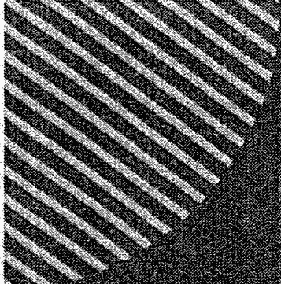


# 6.1 Gamma 助力快速产出专业演示文稿

在职场里演示文稿无处不在。月度汇报、季度复盘、项目方案、年中述职、年终总结，都离不开幻灯片。搭框架、写文案、找数据、做排版，耗时集中。

本节介绍的 Gamma 是一个面向演示文稿生成的 AIGC 工具，输入文字和配图即可自动产出专业感较强的幻灯片。它提供多种主题与模板，支持二次微调，按需定制。图片类型、风格、配色、版式也能自主选择，提升整体质感。除视觉呈现外，Gamma 还能完成文章、新闻、广告等文本的生成与扩写，是内容创作的一站式助手。一杯咖啡的时间，就能得到创意足、视觉吸睛的 PPT。

使用流程如下。

先打开 Gamma 官网，点击免费注册完成账号，只需邮箱验证后即可进入工作台，如图 6-1、图 6-2 所示。

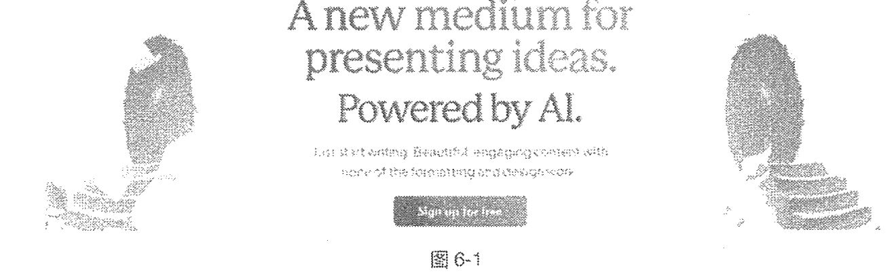

点击继续后会出现选择界面，询问新建演示文稿、文档还是网页，选择演示文稿即可。

# 6.1.1 设定主题输入

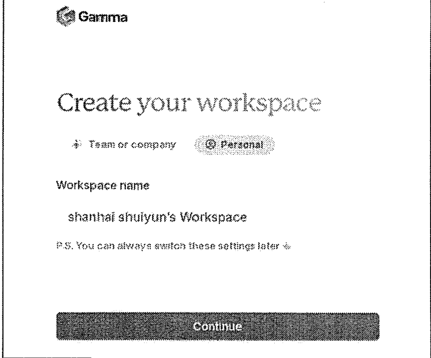

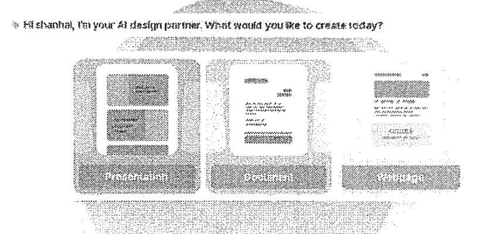

进入主题输入页，这里举例输入“如何用 ChatGPT 辅助抖音运营”，如图 6-4 所示。系统会据此自动生成大纲，不满意可点再次尝试重来，或手动编辑。确认后点继续进入下一步。

# 6.1.2 挑选视觉风格

在右侧栏挑选一个喜欢的主题风格，确认后点继续，如图 6-5 所示。

# 6.1.3 一键生成幻灯片

剩下的交给 Gamma。往往十秒左右，整套 PPT 设计就完成，速度与质量都让人惊讶。图 6-6 ～ 图 6-13 展示了生成的页面效果。

# 6.1.4 导出为 PDF

点击右侧的“…”按钮，选择导出 PDF 即可，如图 6-18 所示。

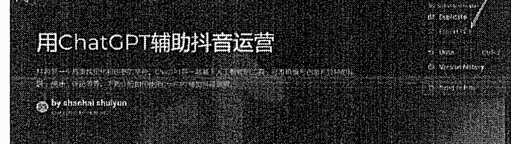

在注册邮箱中可收到平台发送的 PDF 文件。

至此，AI 辅助 PPT 设计完成，效率高且美观。Gamma 提供的大纲、封面与版式能迅速给出思路，只需在此基础上做个性化微调即可节省大量时间。想跟上 AI 浪潮，现在就开始吧。

# 6.2 用 Markmap 把长文一分钟变思维导图

Markmap 能够把 Markdown 文档可视化为思维导图。只要写出结构清晰的 Markdown 文本，就能快速得到层次分明的导图。结合 AI 辅助，工作效率大幅提升，原本需耗时的整理可在一分钟内完成。

ChatGPT 与 Markmap 配合的优势体现在：AI 能从海量文本中自动抽取关键概念与层级结构，输出 Markdown 大纲，便于 Markmap 可视化；支持实时输入与编辑，导图随内容即时刷新；可通过 API 深度集成到各类应用中，实现个性化定制；同时具备多语言理解能力，能生成不同语言的导图。

具体操作如下。

先打开 ChatGPT，提问：“请帮我写一个关于 ChatGPT 发展历程、原理、技术架构详解和产业未来的大纲，以备演讲使用。” 生成的大纲如图 6-19 所示。

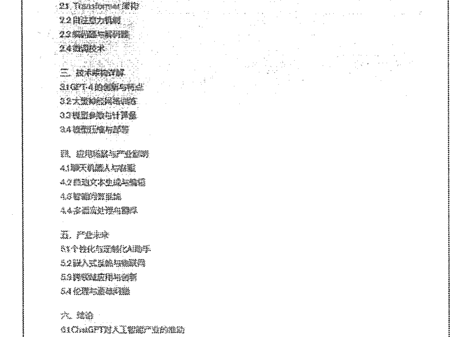

ChatGPT 无法直接生成导图，还需借助 Markmap。于是继续引导它输出 Markdown 格式文本，如图 6-20 所示。


```
# ChatGPT
# 次要主题
## 三级子主题
### 四级子主题
#### 五级子主题
##### 六级子主题
###### 七级子主题

# 另一个主要主题
## 相关子主题
### 具体内容

# 应用领域
## 产业影响
### 技术发展
...
```

打开 Markmap 官网，将 ChatGPT 生成的 Markdown 全部复制到左侧文本框，右侧会同步呈现可视化思维导图，如图 6-21 所示。想保存可点下载为交互式 HTML。

打开下载文件后，放大缩小内容依然清晰，如图 6-22 所示。


Markmap 能把具备嵌套关系的列表转成思维导图，便于理解与展示。用标准 Markdown 编写后，通过库或在线工具转换，得到的导图可交互、支持缩放与折叠展开。

# AIGC 从入门到实战

ChatGPT+Midjourney+Stable Diffusion+ 行业应用

# 6.3 ChatGPT 加持写作与扩写

过去很多人认为 AI 只擅长数据整理、自动化操作等枯燥工作，但这种认知正在被打破。AI 生成的内容正变得越来越可读、有人味。

ChatGPT 基于划时代的语言模型，能产出高度可读、风格接近人类的文本，图 6-23 就是典型案例。


# 图 6-23

ChatGPT 可作为作者的得力助手，具体作用包括。

+   ( 1 ) 激发创意：通过互动为故事情节、人物设定、世界构建提供灵感，如图 6-24 所示。

( 2 ) 校对润色：修正语法和用词，提升文本质量，示例如图 6-25 所示。

# 第6章 AIGC 带来职场新范式，让 AI 帮你干活，你可以做更多有价值的事

我需要加入一个女主角，她应该是怎样的人？

根据这段文字，可以加入一个女主角，她应该是一个有胆有识的江湖女侠，武功高强，心地善良，对于江湖上的恶势力毫不姑息。她可能是无影的盟友，对于江湖上的秘密也有深入的了解，而且她的存在使独孤求败和无影的战斗更加富有戏剧性和曲折性。她可能有一个婉约的名字，比如“清风”“紫雅”，或者“婉约”，在江湖中有着很高的声望和威望。她的加入为整个故事注入了更多的活力和紧张感，让人们更加期待她和其他人物之间的关系和互动。


检查下面这段选段是否存在语病：AI辅助写作，如基于ChatGPT的自动创作和文本扩展，为用户提供了强大的写作工具，以生成高质量的内容。ChatGPT利用大型预训练语言模型来理解用户的输入，并根据需求生成相应的文本。这样的AI辅助写作工具可以在创意写作、文案策划、新闻报道、广告文案等领域发挥作用，有效地提高写作效率和高质量。

这则选段没有语病。


(3) 提供背景资料：在创作特定题材时，ChatGPT 能给出历史、科技、文化等方面的详细资料，示例如图 -26 所示。


我现在写一本关于太空之家的小说，您有任何关于未来科技的建议吗？

涉及未来科技，有很多方向可以考虑。以下是一些关于太空之家的可能有趣的建议。

+   - 1. 光子驱动技术：这是一种用激光束驱动小型航天器的技术。在太空航行中，这种技术可用于推动航天器前进，使其速度更快、更节能，进一步延长飞行距离。

- 2. 航天飞行器：航天飞行器技术已经非常先进，未来还会有很多创新和发展。例如，多型轻量、高强度材料和3D打印技术可以减轻航天器的重量，并大幅度提高载能力。

- 3. 智能机器人：在太空中，机器人可以承担更多任务，例如回收、维修和建造等。随着人工智能技术的发展，未来机器人的智能化程度将更高，能够独立执行任务。

- 4. 生命支持系统：在太空中，一个完备的生命支持系统是必须的。这种系统需要能够提供空气、水、食物和住所等基本条件，为航天员提供足够的保障。

- 5. 太空旅游：未来，随着太空旅游的发展，人们将能够在太空中生活、太空旅游需要提供足够的娱乐和文化活动，如太空演唱会、太空足球比赛等。

以上是一些关于未来科技的建议，它们可以为你的小说提供参考，帮助你创造出一个富有想象力的未来世界。


# AIGC M入门到实战

ChatGPT+Midjourney+Stable Diffusion+ 行业应用

(4) 角色创建与对话生成：ChatGPT 能按要求创建角色并生成生动对话，丰富作品内容，示例如图 6-27 所示。


# 图 6-27

(5) 构思情节：遇到瓶颈时可由 ChatGPT 帮忙设计引人入胜的情节，示例如图 6-28 所示。


· 128 ·

# 第6章 AIGC 带来职场新范式，让 AI 帮你干活，你可以做更多有价值的事

(6) 写作指导：根据文本给出结构优化、细节描绘、节奏调整等建议，示例如图 6-29 所示。

> 润色以下这段文字：未来科技可能远远超出我们当前的技术和知识水平，但是利用科学幻想可以打破这些限制，激发想象力，为读者呈现一个真正独特的未来世界。

未来科技的进步可能会远远超出我们现有的技术和知识水平，但是通过科学幻想，我们可以突破这些限制，激发人们的想象力，并呈现出一个独特的未来世界。这个未来世界充满了未知和神秘，让人好奇又兴奋，同时也启示着我们对科学的不断探索和发展。

# 图 6-29

(7) 推荐参考资料：为作品推荐相关文献，帮助搭建世界观，示例如图 6-30 所示。

> 我需要了解一些关于未来科技的历史事件，您推荐下参考文献。

以下是关于未来科技历史事件的参考文献 :

1. *The Singularity Is Near: When Humans Transcend Biology* by Ray Kurzweil - 本书探讨了未来技术进步的可能性，包括人工智能、纳米技术和生命延长。

2. *The Fourth Industrial Revolution* by Klaus Schwab - 本书探讨了数字技术和自动化的未来趋势，包括3D打印、物联网和机器学习。

3. *The Age of Spiritual Machines* by Ray Kurzweil - 本书探讨了未来的智能机器和人工智能如何改变我们的生活和工作。

4. *The Future of Humanity* by Michio Kaku - 本书探讨了未来人类可能面临的挑战，包括空间探索、气候变化和人工智能。

5. *The Innovators: How a Group of Hackers, Geniuses, and Geeks Created the Digital Revolution* by Walter Isaacson - 本书记述了计算机科学家和企业家如何通过创新和合作，引领了数字革命。

这些参考文献涵盖了未来科技的各个方面，从计算机科学和人工智能到纳米技术和空间探索，帮您有所帮助。

# 图 6-30

AI 辅助写作，如基于 ChatGPT 的自动创作和文本扩展，能够帮助用户生成高质量的内容。ChatGPT 利用大型预训练语言模型来理解用户输入的内容，并根据需求生成相应的文本，这样的 AI 辅助写作工具可以在创意写作、文章草稿、新闻报道、

# AIGC 从入门到实战

ChatGPT+Midjourney+Stable Diffusion+ 行业应用

广告文案等领域发挥作用，有效地提高写作效率和质量。在自动创作方面，ChatGPT 可以根据用户提供的关键词、主题或写作需求，生成连贯、富有创意的内容。而在文本扩展方面，用户可以输入现有的不完整文本，让 AI 对其进行补充和扩展。

# 6.4 AI 助力市场调研和策划，让营销如虎添翼

营销是商业活动的核心环节。优秀的营销文案往往依赖团队头脑风暴，但灵感枯竭时也容易陷入停滞。此时可借助 AI 获取大量创意点子，激发生成性思考。接下来探讨如何让 AI 为营销策划提供支持，推动营销进入新高度。

# 1. 让 AI 设计用户调研问卷

深入了解潜在用户的需求与期望，有助于企业更精准定位产品或服务，提升体验，从而提高销售业绩和市场份额。

# AI 助力快速搭建健康腕表用户调研问卷

设想你担任一家科技企业的市场负责人，公司准备推出一款以实时监测人体健康数据为核心卖点的智能手表，首要工作就是摸清用户真实关注点。下面介绍如何借助 AI 高效完成问卷搭建。

先厘清任务。要求 AI 为即将上市的主打实时健康指标检测的腕表定制一份用户调研问卷，收集目标用户最关心的诉求，为后续营销精准触达提供依据。

再给出指令。本案例中 AI 的角色是市场营销专家，协助完成调研工作。为了让问卷更具针对性，需要把背景信息写完整，例如把目标人群细化到运动爱好者、老年群体，应用场景聚焦健康提醒、睡眠监测等。按此要求输出的示例见图 6-31。

问卷设计只是第一步，后续还涉及投放、回收等一系列操作。我们可以继续追问 AI 相关要点，示例见图 6-32 与图 6-33。

# 2. 用 AI 细化活动策划思路

活动策划的前提是目标明确。为确保落地，应设定可量化指标，例如整场活动的 GMV、新增用户数、用户复购率等。

# 第6章 AIGC 重塑工作方式，交由 AI 执行，你聚焦高价值事务

您现在是我的营销顾问，我要推出一款以实时检测人体健康指标为卖点的智能手表，目标人群为运动爱好者和老年人，核心场景是健康提醒和睡眠监测。能否帮忙起草一份用户调研问卷，用来收集大家最关注的议题，为今后营销触达提供依据。

可以。以下是一份面向实时健康指标监测智能手表的用户调研问卷草案。

# 问卷主题：实时健康监测智能腕表用户需求调研

尊敬的参与者，

感谢您抽时间填写本问卷。您的反馈对我们非常重要，有助于更准确地把握需求，为您提供更契合的产品与服务。

+   - 1. 您的年龄区间属于？

  - A. 18~24 岁

  - B. 25~34 岁

  - C. 35~44 岁

  - D. 45~54 岁

  - E. 55 岁及以上

- 2. 请问您的性别？

  - A. 男

  - B. 女

  - C. 其他

- 3. 您现在是否佩戴智能腕表？

  - A. 是

  - B. 否

- 4. 若您已使用智能腕表，日常最常用的功能是？

  - A. 健康监测，如心率、血压等

  - B. 运动追踪，如跑步、游泳等

  - C. 睡眠监测

  - D. 消息提醒，如短信、电话等

  - E. 其他，请说明：______


这些指标能帮助我们更清晰地评估活动成效，进而调整优化方案，提升用户满意度，实现业务增长和更高投资回报。制定目标时还需兼顾长期影响，如口碑传播、品牌认知提升等。通过全面拆解目标，可制定更可行的策划方案。下面看看如何让 AI 助力活动策划。

首先，设定 AI 角色。让 AI 担任市场营销专家，专门为我们设计活动策划方案。

# AIGC 从入门到实战

ChatGPT+Midjourney+Stable Diffusion+ 行业应用

# 这份调研问卷适合在哪些渠道发布？您推荐哪个平台？

选择投放渠道时，要兼顾受众覆盖面与渠道特性。推荐渠道如下。

+   - 1. 社交媒体平台：如微信、微博、QQ 空间等，用户基数大，覆盖各年龄层，投放成本相对低。

- 2. 在线问卷平台：如腾讯问卷、问卷星、SurveyMonkey 等，专业做问卷调研，可对目标人群定向投放。

- 3. 垂直论坛与社群：运动健康类专业社区或社群，如 Keep、悦跑圈等，与目标人群高度重合，易于收集有效意见。

- 4. 邮件营销：若已有用户邮箱列表，可通过邮件发送调研邀请，获取反馈。

- 5. 线下调研：在体育场馆、健身房或社区中心开展面对面调研，直接了解用户需求。

具体选择需结合自身情况。若追求广度，可优先社交媒体；若追求精准，可选垂直社区。也可多渠道组合投放，以获取更充足的有效样本。


# 这份问卷的数据如何收集？

回收问卷数据需在投放前明确渠道与方式。建议做法如下。

+   - 1. 在线问卷平台：使用腾讯问卷、问卷星、SurveyMonkey 等，系统会自动汇总数据并提供统计报告和分析结果。

- 2. 社交媒体平台：在微信、微博等投放时，可关联在线表格或数据库，实现填写内容自动记录。

- 3. 垂直论坛和社群：在对应平台投放后，可要求用户在评论或私信中作答，再手工整理至 Excel 或在线表格。

- 4. 邮件营销：在邮件中嵌入问卷链接，用户点击填写后数据自动保存至问卷平台或指定数据库。

- 5. 线下调研：采用纸质问卷或平板电子问卷，收集后需整理到 Excel 或数据分析工具中。

数据回收后需进行清理与分析，以洞察目标用户的需求、兴趣与痛点，为后续营销提供依据。注意做好隐私保护，避免泄露个人信息。


# 图 6-32

# 图 6-33

随后，可向 AI 提供活动背景。以智能玩具车为例，

# 第6章 AIGC 重塑工作方式，交由 AI 执行，你聚焦高价值事务

# 6.5 AI 赋能短视频创作，读懂流量逻辑内容不再沉寂

当下短视频已成为内容营销的核心载体。越来越多企业意识到其价值，但制作具备传播力的短视频并不容易，涉及选题、脚本撰写、拍摄、剪辑与优化等多个环节，耗时耗力且对能力要求高。爆款往往是多次试错的结果，企业投入大回报却有限。有了 AI，我们能否以极低成本批量产出高质量短视频，破解流量密码呢？

下面介绍借助 AI 快速制作短视频的方法。

(1) 确定短视频主题。在制作前需先锁定方向，例如“小白学编程的技巧”。

可让 ChatGPT 提供多个备选主题，输入越具体，输出越精准，如图 6-37 所示。

- 你是我的营销专家，请围绕“小白学编程的技巧”策划 5 个短视频主题。

- 围绕“小白学编程的技巧”策划的 5 个短视频主题如下。

  1. 视频主题：编程新手必看：如何挑选合适的编程语言

     文案概要：介绍 Python、JavaScript、Java 等常见语言的应用场景与特点，引导观众按兴趣与目标选择。

  2. 视频主题：编程基础速成：变量、数据类型与函数

     文案概要：讲解编程基础概念，结合实例帮助观众快速掌握根基知识。

  3. 视频主题：编程学习资源合集：免费平台、教程与实战项目

     文案概要：推荐优质免费在线学习平台、教程及实践项目，帮助观众找到合适资源。

  4. 视频主题：避开学习误区：高效学编程的方法

     文案概要：分享制定计划、分阶段学习、动手实操、多交流等高效技巧，规避常见陷阱。

  5. 视频主题：从零搭建个人编程作品集

     文案概要：介绍如何从零开始积累作品，包括项目选择、知识实践、过程记录与成果展示，为职业发展铺路。

这 5 个主题覆盖了编程初学者的常见问题与需求，有助于营销规划。


# AIGC 从入门到实战

ChatGPT+Midjourney+Stable Diffusion+ 行业应用

可见 ChatGPT 不仅给出主题，还附带文案概要。

(2) 确定短视频标题。以“职场小白如何高效学习编程”为主题，要求 ChatGPT 生成 5 个适合抖音的标题，如图 6-38 所示。

> 请围绕“职场小白如何高效学习编程”生成 5 个适合抖音短视频的标题。

以下是生成的 5 个标题。

1. 标题：编程小白逆袭记：5 步带你快速入门

   简介：分享 5 个易懂步骤，帮助小白快速找到学习方向与方法。

2. 标题：编程自学不求人：掌握三大方法变高手

   简介：介绍三大自学方法，提升小白自信心，加速技能掌握。

3. 标题：提升学习效率的秘诀：3 个实用技巧事半功倍

   简介：提供 3 个实用技巧，帮助在有限时间内提高效率。

4. 标题：抖音热推的编程学习资源，这些免费宝藏你用了吗

   简介：推荐抖音上热门且免费的学习资源，助力找到合适材料。

5. 标题：小白实战项目：一周做出你的第一个编程作品

   简介：提供简单实战教程，帮助一周内完成首个作品，提升实操能力。

这些标题旨在吸引小白观看，并可串联成完整学习体系。

图 6-38

借助 ChatGPT 生成标题可节省大量时间，选定后即可用于后续创作。

(3) 使用 ChatGPT 撰写视频脚本。例如选择“编程小白成长记：5 步教你快速入门编程！”这个标题，要求 ChatGPT 撰写约 2 分钟的分镜头脚本并标注时间，需包含真实案例，语言通俗，如图 6-39 所示。

从图中可见脚本的镜头与文案都很清晰，不满意可反馈重写。

(4) 快速制作视频。ChatGPT 能迅速生成脚本，但从脚本到成片仍需拍摄剪辑。一种快速做法是：用 ChatGPT 生成脚本，再用剪映专业版的“图文成片”功能制作。若该功能会把脚本全部转为台词，可删除非台词内容，仅保留文案。下面以“提高编程学习效率的秘诀：3 个实用技巧让你事半功倍！”为例，让 ChatGPT 生成脚本，如图 6-40 所示。

* 138 *

# 第6章 AIGC 重塑工作方式，交由 AI 执行，你聚焦高价值事务

请以‘编程小白成长记：5步教你快速入门编程！’为标题，帮我撰写一个约2分钟抖音短视频的分镜头脚本，标注各镜头起止时间，要求包含真实案例，语言通俗易懂。

以下是约2分钟的分镜头脚本。

[00:00—00:03] 开场

镜头：镜头推近，主持人挥手问好。

主持人：大家好，欢迎来到编程小白成长记，今天分享5步快速入门编程！

[00:04—00:15] 第一步：选择合适的编程语言

镜头：电脑屏幕展示各语言 Logo。

旁白：首先挑选适合自己的语言。例如 Python 语法简洁适合初学者；JavaScript 多用于网页开发；Java 常用于安卓开发等。

[00:16—00:30] 真实案例1

镜头：展示 Python 编程案例视频。

旁白：比如 Lucy 初学时选了 Python，因她对数据分析感兴趣。数月学习后，她用 Python 完成了一个股票数据分析项目。

[00:31—00:45] 第二步：学习基础概念

镜头：手绘板展示基础概念。

旁白：编程要从基础概念入手，如变量、数据类型、函数等，掌握后更易入门。

[00:46—00:58] 真实案例2

镜头：展示 Tom 的学习笔记。

旁白：Tom 学习时用笔记本记录要点，后期复习效率明显提升。

[00:59—01:15] 第三步：利用在线资源

镜头：展示在线学习平台界面。

旁白：网络上有大量免费资源，如 Codecademy、LeetCode 等，实战中能快速提升。

[PAGE 148]

# AIGC 从入门到实战

ChatGPT+Midjourney+Stable Diffusion+ 行业应用

[01:16—01:30] 真实案例3

镜头：Amy 在 Codecademy 学习画面。

旁白：Amy 通过 Codecademy 学习 Web 开发，3 个月内完成个人网站项目。

[01:31—01:45] 第四步：多做练习，动手实践

镜头：在线练习题库界面。

旁白：多练习、动手实践是提升能力的关键，能更快掌握知识并解决问题。

[01:46—02:00] 真实案例4

镜头：Jack 参加编程马拉松画面。

旁白：Jack 参加多场编程马拉松，通过合作将知识应用于真实项目。

## [02:01—02:14] 第五步：加入编程社区，交流心得

镜头：编程社区界面。

旁白：加入社区交流，能更好理解知识点，遇到问题也能求助，提升效率。

## [02:15—02:30] 结束语

镜头：主持人居中鼓励观众。

主持人：以上就是“编程小白成长记：5步教你快速入门编程”的分享，希望对你有启发。学好编程，职场发展更顺畅，加油！

脚本包含真实案例，语言通俗，适合抖音传播。

图6-39（续）

脚本生成后，再用剪映专业版处理。可下载剪映专业版，点击“图文成片”，如图6-42所示。

将 ChatGPT 撰写的视频旁白粘贴到剪映图文成片编辑区，标题栏输入“提高编程学习效率的秘诀：3个实用技巧让你事半功倍！”，左下角选择喜爱的朗读音色，点击右下角的生成视频按钮，如图6-43所示。

等一会儿，剪映即可完成合成。图6-44播放器展示的就是 ChatGPT 与剪映联合制作的短片，耗时约两分钟。

# 第6章 让 AI 处理重复，人专注价值创造


# AIGC 入门实战概览
ChatGPT+Midjourney+Stable Diffusion+ 行业应用

从这个实例可以看出，在 ChatGPT 加持下，短视频作者能把耗时环节交给模型，自己把精力放在创意和表达打磨上，作品质量与传播效果因此提升。

## (6.6) Microsoft 365 Copilot——AI 助手让办公软件更高效

Copilot 由 OpenAI 推出，基于 GPT 技术，为程序员提供代码辅助。它能依据上下文和提示自动产出符合语法语义的代码片段，比如函数、类、变量声明，并通过学习大量开源代码具备一定的理解与创作能力。微软将 GPT-4 深度接入 Office 套件，推出 Microsoft 365 Copilot。

# AI&CG 实战指南
ChatGPT+Midjourney+Stable Diffusion+ 行业应用


# 图6-52

从这个角度看，Copilot 不仅是优秀的智能个人助理，也是实用的内容生产工具。例如它能从 Excel 表格中提炼趋势，依据历史资料自动起草邮件，还能参考过往文件组装 PPT。若想让 Copilot 基于电脑资料写文章，指令会传给 Microsoft Graph，后者检索资料生成提示，送往 GPT-4 处理。结果再返回 Microsoft Graph 做合规检查，最终内容和指令发回 Word。全程顺畅，工作效率明显提升！

目前全球已有超过 100 万家企业在使用 Microsoft 365。OpenAI 研发 ChatGPT 与 GPT-4 时，微软已在 Azure 云上投入数亿美元打造超级算力。如今看，这台超级算力的目标远不止聊天机器人，而是构建办公软件生态，其研发堪称引人注目的技术壮举！

人类天生追求梦想、创造、创新。但繁琐重复的工作消耗了大量时间与创造力。要重新抓住工作的本质，不仅需要更高效地做同样的事，更需要新的工作模式。通过 Copilot，语言变成了强大的生产力工具。

# 第7章
# AIGC 激活行业，开辟新机遇


# AIGC 入门实战概览
ChatGPT+Midjourney+Stable Diffusion+ 行业应用

# 7.1 AIGC 在电商的创新场景——人货场升级催生新业态新模式

我们经历了 PC 互联网到移动互联网的演进，如今互联网正探索 AIGC 新业态。电商依托互联网基础设施同步迭代：PC 电商代表如重搜索商家品牌的淘宝、重物流正品的京东；移动电商兴起后出现拼多多式的社交电商/社区团购，以及抖音、快手主导的直播电商与内容流模式。期间程序化生成、多尺寸适配等技术的演进始终与电商需求紧密相关。而以 ChatGPT、Midjourney 为代表的现象级 AIGC 工具的出现，不断突破语言理解、文本生成、多轮对话、逻辑推理、图文视频自动生成等边界，为各领域打开想象空间，推动工作方式发生根本变化，如图7-1所示。这必然重塑电商全貌，带来深远影响。

AIGC 为电商提供了系列革命性工具与策略，如图7-2所示。

+ 1. 低成本开店提速

AIGC 支持低成本搭建虚拟商店。淘宝店“卢咪微 LumiWink”极短时间内完成开店，人力投入很少，销量尚可。店铺文案多由 ChatGPT 生成，图片由 Midjourney 生成。与这类小而美的店铺不同，虚拟货场追求大而全，让用户足不出户就能感受大商场体验。例如 Obsess 专注打造虚拟购物平台，提供定制化方案，助力品牌与零售商构建沉浸式虚拟空间。借助 VR、AR，Obsess 能为消费者营造逼真购物环境，帮助其更好体验产品、感受品牌氛围并做出更明智决策。合作品牌可依托其技术在虚拟平台搭建品牌旗舰店，消费者通过 VR 头显或手机应用进入店铺浏览、试用、查看细节。合作后品牌方能为用户提供接近实体店的体验，利于品牌塑造与销售增长。虚拟购物便捷、个性化、娱乐性强，有助提升满意度。

若不使用 VR，这些虚拟商店可能类似微信小程序或短视频平台企业号，在 VR 加持下，消费者感受会更立体，对品牌塑造、用户心智、长期记忆、体验延展都有帮助。

# 2. 营销创新

AIGC 助力文案与图片创作，使广告营销降本增效。依托多模态能力，AIGC 在营销领域表现突出，可按文本指令生成文案与图片，实现内容批量生产，高效创作分发以满足内容爆炸时代需求。

AIGC 还能自我优化广告素材与投放效果。Meta 开发的“Advantage+”是基于人工智能与机器学习的创意工具，帮助用户快速完成广告、营销等创意设计。Advantage+ 能利用算法与模型理解输入需求，生成相关创意方案与建议，无论是广告文案、平面设计、logo 设计还是社交内容，都能提供多样选择。例如用户输入品牌理念或产品描述关键词，Advantage+ 会分析后结合市场趋势、用户偏好与行业标准生成广告创意，提供文案、图像与风格各异的多个选项。还能根据用户反馈与偏好智能调整优化，进一步提升质量与吸引力。用户可通过交互界面与 Advantage+ 互动，设定优先级、调整细节并实时预览修改。

在亚马逊等跨境电商平台，不少卖家已熟练使用 ChatGPT 进行基础运营，小红书、抖音上也出现用 ChatGPT 与 Midjourney 做跨境电商运营的经验分享。他们用 ChatGPT 做翻译、撰写产品文案、输出品牌故事、挖掘卖点、数据分析，用 Midjourney 生成产品图。这样原本需 10 人一天完成的工作，AI 可能一小时搞定，大幅降低电商内容营销成本。AI 应用为电商带来革新，提升运营效率，也给商家带来便利与机会。

# 第7章 AIGC 赋能行业，产生无数新机会

# 3. 沉浸式购物体验

利用 AIGC 生成产品 3D 效果图，可优化购物体验、提升成交转化并明显降低退换货率。AIGC 加持下，构建 3D 图的难度与成本大幅下降，产品 3D 展示变得可行。下面介绍几个典型案例。

+ * “店匠 Shopplazza” 是综合性电商平台，助力商家搭建管理在线商店并提供促销工具。店匠积极探索新技术，推出“Coohom 3D & AR 查看器”，基于 3D 与 AR 技术展示商品。商家使用该工具后，消费者可沉浸式浏览体验，更好了解外观、尺寸与功能。例如家具品牌可展示家具多角度细节，消费者通过 AR 在自家查看摆放效果，提前感受使用体验。

+ * 北美设计网站 Collov 正将 AIGC 与 3D 构建技术结合，为设计师提供全新创作平台。AIGC 的生成能力可为设计师提供灵感，快速生成方案与原型；3D 构建则让作品以立体形式呈现，便于用户与合作伙伴直观体验。通过 Collov 平台，设计师可用 AIGC 生成图像、图标、文字等元素，再用 3D 构建技术转化为精美生动的 3D 作品，可用于建筑、产品、虚拟现实等领域。这把设计的视觉化与交互性推向新高度。例如建筑设计师可用 AIGC 生成多套建筑概念，导入 3D 模块直观展示外观、结构与空间布局，为后续讨论提供基础。通过 AIGC 与 3D 结合，Collov 为设计师提供创新创作方式，提升效率与灵活性，同时提高作品质量与视觉效果。

* AIGC 还推动虚拟试穿功能发展，降低退换率。虚拟试穿降低试错成本，帮助消费者更准确决策，从而减少退货、促进销售。沉浸式购物与 AR 方案提供商 Wannaby 专注开发 AR 试衣与 AR 鞋店应用，提供逼真虚拟购物体验。其核心产品“AR Try-On”利用 AR 实现虚拟试穿，用户通过手机应用挑选衣物，用相机投射到自身，实时查看穿着效果，包括颜色、质感、合身度。体验帮助消费者更准确评估外观与合身度。Wannaby 还开发“AR Shoe Store”应用，用户可在现实环境中“创建”虚拟鞋店，用手机查看不同鞋款并将其放置在脚上，仿佛在实体鞋店试鞋。这种方式便捷、个性化，提升用户与品牌互动，减少因尺码不合适或效果不佳导致的退货。

# 4. 虚拟主播

在 AIGC 推动下，虚拟主播直播带货已占据直播销售市场大片份额，成为热门销售模式。虚拟主播外观、表情、声音逼真，可在直播中展示产品、演讲互动，吸引注意并促成购买。例如某时尚品牌创建虚拟主播直播展示新品，借助 AIGC 生成文案流畅介绍产品特点、搭配建议与购买链接，还能回应观众评论提升互动。直播为品牌吸引大量用户并促成销售。

虚拟主播作为新兴销售模式，具有多重优势，市场认可度高。

+ * 持续在线：可 24×7 在线，不受时空限制，按消费者需求随时直播展示推荐产品，提升购物体验。

* 可定制：外貌、声音、性格均可按品牌需求定制，设计符合品牌形象的虚拟主播，增强独特性与辨识度。

* 跨语言文化：不受语言文化限制，可用多种语言风格与全球观众互动，便于跨国品牌拓展国际市场，覆盖更广受众。

* 节约成本：相比真人主播，无需支付薪酬、保险福利与排班，大幅降低运营成本，对中小企业尤其经济。

* 数据分析便捷：直播互动与购买数据可被准确记录分析，为品牌优化产品与营销策略提供宝贵资料。

* 创意元素丰富：直播中可使用特效、虚拟场景等创意元素。

* 互动性强：可回答问题、提供建议，促使下单并带来乐趣。

总体而言，虚拟主播具备持续在线、可定制、跨语言文化、节约成本、数据分析便捷、创意元素丰富与互动性强等优势，能为消费者提供更真实体验，便于体验产品并决策。图7-3 与图7-5 即基于作者照片生成的虚拟主播。

# 5. 智慧仓储配送为供应链保驾护航

AIGC 在提升智慧仓储能力方面发挥关键作用。智慧仓储是利用人工智能与自动化系统提升仓储物流效率与精确性的管理理念。AIGC 凭借强大算法与数据处理能力为智慧仓储提供关键支撑。能通过分析海量数据识别仓储问题与瓶颈，优化布局与物流，预测需求量与最佳存储位置，最大化空间利用率与处理效率。

同时，AIGC 可实时监控操作并智能调度。通过物流信息与仓库数据实时分析货物流动，优化存储与配送路径，避免拥堵延误。还能根据货物重要性与时效要求自动调整仓库内排列，确保高价值货物优先处理。

此外，AIGC 可与其他智能设备系统集成，实现智能化操作。可与自动化货架、机器人搬运车协同，实现无人化作业。结合物联网技术，可实时采集分析传感器数据，更好监控环境与货物状态，确保安全稳定。例如某电商平台用 AIGC 进行订单处理与物流管理。下单后，AIGC 立即分析订单内容、地点与时效，与智能仓储系统通信。按订单特点，自动将商品分配到最佳仓库位置并生成存储配送计划。还实时监控库存与订单状态，库存达警戒线时自动触发补货流程并与供应链系统协调，确保及时补货。同时可依据订单紧急程度与目的地

# 第7章 AIGC赋能行业，产生无数新机会

# 7.2.2 AI赋能音频与视频创作，提升内容传播价值

AI 的语音识别与合成能力实现文本与音频互转，被广泛用于文章创作、新闻报道、直播解说、电影配音等。同时，AI 技术在视频剪辑、监控、虚拟现实、增强现实、在线游戏与广告等领域也发挥重要作用。

例如《流浪地球2》利用深度伪造等技术，成功还原刘德华与吴京年轻时的容貌，使其自然出演年龄差距较大的角色。这项突破性应用为影视创作开辟可落地的可能性。

深度伪造是一种基于 AI 的图像合成技术，通过深度学习与大量数据训练，可将一个人的面部特征合成到另一人脸上。过去角色年龄会限制演员选择，有了深度伪造，演员可更自由扮演不同年龄段角色，有利于表达并增强观众沉浸感。

另外，动态捕捉、表情跟踪与快速渲染等技术的应用也拓展了影视创作与其他领域的创新空间，提升视觉效果与用户体验。

我们熟知的电影《阿凡达》以惊人视觉效果与创新技术著称。其中动态捕捉、表情跟踪与快速渲染发挥了关键作用，创造出绚丽逼真的虚拟世界。

动态捕捉能追踪演员身体动作与表情并精确转化为虚拟角色动作。借助该技术，《阿凡达》塑造出栩栩如生的虚拟角色，提升视觉效果并增强沉浸感。

表情跟踪进一步增强虚拟角色表情表达。通过高精度面部追踪，可捕捉演员细微表情变化并准确转化为虚拟角色表情，使其传达丰富细腻情感，便于观众理解与共情。

快速渲染是另一关键技术，使团队能在较短时间内生成高质量场景与特效。在《阿凡达》中，该技术赋予虚拟世界惊人逼真细节，将奇幻场景活灵活现呈现，令人震撼。

这些技术的应用不仅使《阿凡达》成为技术创新的里程碑，也为整个影视行业树立新标杆。华丽视觉效果将观众带入光怪陆离的魔幻世界，让观众与角色共同体验传奇经历。

除《阿凡达》等大制作外，这些技术在动画、特效电影与游戏中也发挥重要作用。例如动态捕捉、表情跟踪与快速渲染广泛应用于动画片、特效电影与游戏，为观众呈现绚丽多彩的虚拟世界。

# AIGC 从入门到实战
ChatGPT+Midjourney+Stable Diffusion+ 行业应用

# 第7章 AIGC 激活产业新动能，催生多元机会

技术演进速度超出预期，这些新能力正持续拉高影视创作的品质和观感，为观众带来更具冲击的沉浸体验。应用边界并不止于银幕，游戏与广告同样被纳入改写范围。在线游戏借助这些技术，让角色呈现与交互更逼真，玩家代入感大幅增强。借助实时渲染，开发团队能即时生成高水准特效，让画面既震撼又流畅。广告制作引入动态捕捉与表情追踪，可塑造更具生命力的虚拟形象抓住视线，而快速渲染则把创意到成片的周期压缩，效率明显提升。

视频剪辑环节，AI 已成为剪辑师的提效搭档。以 Adobe Premiere Pro 为例，其智能化能力包括：节奏感修剪，能依托音频视频节拍自动裁剪素材，让剪辑更省时；智能检索，可按关键词、标签与场景快速定位，解决海量素材检索难题；自动归档整理，能按时间、日期、关键词等维度自行归类素材库，便于后续调用。这些功能削减了大量重复手工操作，让创作者把精力集中在创意表达上。另一款主流工具 DaVinci Resolve 则集成高级人工智能，涵盖智能剪辑、自动调色、音频修复等。它具备智能色彩校正，可自动识别并优化色彩对比度，画质更出色；智能音频修复可自动降噪、修复失真。这些技术共同提升了传媒的生产效率与内容吸引力，让从业者更专注于故事与创意，向观众交付更丰富、更有传播力的视觉体验。

虚拟主播的落地，意味着新闻播报进入虚拟人时代。输入文本内容后，系统即可自动生成播报视频，人物的语音、神情与口型高度自然，与真人播报的信息传达效果相近。随着模型能力不断进化，虚拟主播在传媒场景的想象空间将持续打开。

# 7.2.3 AI 重塑推荐体系，放大用户粘性与体验

现阶段的推荐主要依托机器学习，通过用户画像、内容属性、交叉特征与时序特征构建方案。在 AIGC 出现后，内容生产与分发正迎来一体化变革。AIGC 能迅速挖掘潜在热点、批量生成爆款内容并精准触达目标人群，这种从生产到投放的闭环对传统推荐模式构成冲击，甚至可能取代人工运营。

以电影推荐平台为例，传统逻辑依赖用户的观影历史与评分，以及影片类型、导演演员等属性进行匹配。引入 AIGC 后，平台可基于新片上映、社交媒体热议与用户兴趣，快速捕捉潜在热点，并自动生成观影指南、演员专访、幕后花絮等衍生内容，从而更精准地命中兴趣点，实现个性化推荐与观影体验升级。

借助自然语言处理与机器学习，传媒机构能够触达更多精准受众，提升留存与忠诚度，并提供更丰富深度的内容。同时对受众需求的理解也会更清晰，有助于优化策划与生产，提升曝光度和影响力。

# 7.3 AIGC 在金融行业的创新场景——银行零售新范式

2023年6月，麦肯锡发布研究报告《生成式人工智能的经济潜力》。报告指出生成式 AI 的价值潜力约75%集中于客户运营、营销销售、软件工程、研发四大领域。麦肯锡认为银行、高科技、生命科学等行业受影响最大。银行业本就以知识与技术驱动，此前已从AI在营销与客户运营的应用中获益，预计AIGC为全行业带来的价值在2000亿至3400亿美元区间。

AIGC将如何赋能银行零售？

+   1. AIGC 重塑银行零售业务范式

AIGC可为银行培养高智能的AI员工。经预训练后，AI员工可掌握零售业务知识与沟通技巧，能力接近1至3年经验的客户经理。为客户经理配备AI助手，可实现降本增效。据测算，到2025年中国银行将有10万名AI员工上岗，每年提供50亿次以上的智能服务。

# AIGC 从入门到实战
ChatGPT+Midjourney+Stable Diffusion+ 行业应用

# 2. AIGC 推动银行零售技术路线演进

ChatGPT出现前，银行可对基于谷歌BERT的模型进行预训练，使其理解金融业务并做决策，但输出始终受限于知识图谱。

ChatGPT带来了新的想象空间，其核心优势体现在三点。

+   - ChatGPT接入海量语料库训练，使用约45TB数据，涵盖近万亿词级文本，使人机对话接近自然交流。
- ChatGPT引入RLHF即人类反馈强化学习，训练中人类扮演用户与助手角色，相较传统“模型输出+人工标注”模式更高效，并能应对开放域任务挑战。
- RLHF使模型输出更贴近人类常识、认知、需求与价值观。

不过在现有银行服务中，ChatGPT的输出可靠性仍未达到金融行业要求，且可供学习的金融领域数据源有限，知识储备不足。

因此行业可能转向基于内部数据集训练大语言模型，以结果为导向、以合规为前提构建金融垂直大模型与AIGC能力。

例如可自研行业大模型，采集高质量金融数据构建提示词集；再用有监督微调后的预训练模型测试提示词集，得到多份输出；随后用奖励模型打分、计算奖励值并迭代，使AI具备持续自学习能力。

随着对话场景丰富、用户交互频次提升，AI的智能水平将逐步提高，可实现金融产品沟通、推荐、资产配置与业务办理等能力，如图7-6所示。

从场景看，金融零售本身就是天然的AIGC场景。客户经理的核心在于获客与转化。下一代AI将被嵌入现有工作流，覆盖触达、联络、销售的完整闭环。

# AI inside

图7-6

生成式AI与传统配置式NLP的对话机器人不同，前者基于金融大规模数据集学习后具备策略智能，可依据语境与意图输出应对策略，拥有类似“随机应变”的智慧，可用于营销场景，大幅提升线上互动效率。

生成式AI还将融入银行各类业务，实现多模态人机协同。具体场景包括。

场景1: AI 预警式营销。AI可主动识别客户需求，提示客户经理何时跟进哪位直客，并自动生成标准格式营销素材，包含话术、链接、图片等，突出产品卖点与核心标签。

场景2: AI 辅助触达营销。可由AI直接与长尾客户通话，以客户经理身份主动介绍产品卖点。

场景3: AI 实时营销建议。客户经理通过电话或企业微信沟通时，AI在旁监听，基于对客户问话的理解实时生成“应答建议”与“推荐建议”。在AI智脑辅助下，客户经理如同拥有产品知识库与话术库，沟通效率显著提升。

场景4: AI 自动生成会议纪要与报表。

总体来看，通过金融垂直语料与知识库进行生成式预训练，类GPT金融AI可按零售具体场景提供服务，成为客户经理的得力助手，释放生产力，实现降本增效，如图7-7所示。

# AIGC 从入门到实战
ChatGPT+Midjourney+Stable Diffusion+ 行业应用


除零售工作流外，AIGC也可应用于银行内部研发、风控、金融任务、HR管理、CRM等环节，带来效率跃升。未来的银行将是AI与人类协同作业、高品质服务的场所。

# 7.4 AIGC 在教育行业的创新场景——苏格拉底式的问答模式和AIGC可视化创新

教育本质在于理解并分解学生的思维逻辑，以恰当方式引导、辅助学生领会、迁移、熟练应用并创新迭代。AIGC赋能教育可产生明显成效，具体体现在以下方面。

+   * 与大模型沟通具有渐进学习特性，与学生交流过程类似，经调参后语言准确度与知识丰富度较高，可承担教师与助教角色。
+   * 大模型逐步精调特质与苏格拉底式提问理念契合，有助于学生逐步获得更深认识。
+   * 孔子“因材施教”强调教育个性化，AIGC应用与此理念高度一致，为个性化教育提供可能。

> ① 苏格拉底式提问善于引导对象逐步推进思考而非直接给答案，通常具备开放式问题、引导性问题、反思自省、对等对话等特点，有助于师生共同构建知识体系。

· 162 ·

* AIGC的多模态与跨模态生成能力，能将停留在想法层面难以言表的概念与想象可视化，进一步激发创新。

因材施教主张按个体特点定制内容与方法。AIGC可在以下环节赋能。

+   * 个性化学习体验：收集、分析学生学习数据、行为模式与学习风格，定制内容与方法。
+   * 自适应教学：依据学习表现实时调整计划与资源，提供针对性反馈与指导。
+   * 智能辅助教学：作为教师助手深入洞察学习情况，帮助教师了解需求与进展，进行个性化指导。
+   * 教育资源个性化推荐：按兴趣、学习风格与目标推荐教学视频、练习题等，提升学习效果。

技术与教育结合下，AIGC使因材施教更个性化、更有效，助力学生潜能释放与全面成长。

例如钛创星是一家聚焦人工智能教育的青少年教育企业，面向6至18岁学生提供“产品+课程+比赛”一体化的人工智能教育，目标是培养创新思维、编程能力与科技素养。

关于学生用ChatGPT作弊的担忧，钛创星认为合理使用反而可规避风险，并在国内场景做了尝试。

+   * 当学生
## 第7章 AIGC 激活产业新动能，催生多元机会

受限于思路、经验与能力，师生可借助AIGC工具如Midjourney的强大理解能力，将创新想法可视化。

图7-13为学生设计的类似太空服的充气雨衣，带充气透明头罩。图片呈现后，同学们惊叹其超前。

图7-14是一个带夜光功能的闹钟风扇，创意有趣。

图7-15与图7-16是带显示屏的购物推车。

另一件作品外观不同于瓦力，但功能类似的垃圾清扫机器人，会用机械臂抓取垃圾放入自身垃圾筐，如图7-17与图7-18所示。

让创新思考过程可见、可视，正是AIGC赋能教育的重要突破。

除此之外，AIGC还能带来诸多教育价值。以AI辅助在线学习平台为例：

- 个性化学习：AI按学习速度、方式与兴趣点设计课程，提升效率与兴趣。
- 智能评估：自动批改作业、写作、语音评估，并监控学习进程向教师反馈。
- 虚拟助教：回答问题、解释概念、提供一对一辅导，减轻教师负担。
- 在线实验：在STEM教育中创建模拟实验环境，安全探索科学世界。
- 提升教师效率：管理出勤率、参与度等，让教师更聚焦教学。

未来AI在教育领域的应用将更广泛深入。

# 7.5 AIGC 在工业领域的创新场景——合成数据集，助力机器人产品研发

众多机器人产品的核心感知智能依赖计算机视觉算法。感知即理解周围环境以做出决策。机器人的摄像头相当于眼睛，AI芯片相当于大脑，芯片上的AI模型相当于思考。以割草机器人为例，摄像头捕捉视频传入芯片，部署的AI模型识别动物出现时，机器人应停止或绕行，而非继续作业。

AI视觉的核心任务是目标检测与语义分割。目标检测是通过算法确认图像中关键目标的位置，通常用框标注并给出概率阈值。图7-19为割草机器人摄像头拍摄的图片，框出玩具、瓶子、人等目标并标注概率，对避障至关重要。

语义分割是对图像每个像素进行分类。图7-20左侧为拍摄原图，右侧为分割结果，淡绿代表草坪、淡蓝代表道路、咖啡代表背景。分割结果可进一步提取草坪边界信息，对自动建图、贴边割草等核心任务关键。

视觉模型搭建流程与主流AI一致：工程师设计神经网络，用标注数据训练得到参数，再部署到机器人AI芯片。训练需要大量细分领域标注数据。以割草机器人为例，需大量庭院场景标注数据，涉及数据采集与标注两项工作，均耗时费力。

AIGC可合成数据集，赋能工业机器人研发。传统采集与标注依赖人工。大家常说人工智能是“人工+智能”，其中数据采集与标注即“人工”部分。采集合成数据集需工程师用采集装置在庭院等场景拍摄视频，图7-21所示即采集的庭院图片。数据集质量与场景丰富度相关，往往需费力寻找或布置场景。

采集后需标注。目标检测标注框选相对简单，语义分割需逐像素标注类别，成本更高。虽语义相同物体常聚集成块可标注边界，但训练要求精度高，像素级边界标注仍繁琐。

除真实场景采集外，还可通过算法直接生成数据，即合成数据集。图7-22为合成的庭院草坪场景。合成数据成本低，无需人工采集，可在算法中快速生成大量训练数据，且自带标签如像素类别，省去标注环节。早期合成数据集多用生成对抗网络，但存在域间隙。随着CLIP与Stable Diffusion等AIGC图像生成模型发展，目前可生成逼近真实的训练数据集，大幅降低采集与标注成本，效率提升可达千倍以上。

AIGC不仅能生成数据集，还可在模拟器中构建逼真仿真环境，让割草机器人在其中完成各类测试，替代真实环境测试。这对AIGC提出更高要求：不仅要生成接近真实的数据，还要生成接近物理世界的仿真环境，使仿真测试无限逼近物理测试，节约时间、资金与人力成本。图7-23为割草机器人在仿真环境中的模型。

# 第8章 如何有效应对AI革命

这一次的AI革命到来速度比互联网革命更快、冲击更猛、覆盖更全面。

这轮AI浪潮同时在释放机会和制造压力，个体需要更快适应技术环境、补齐AI认知，才好实现人机协同。对企业和机构而言，AI的规模化融入会重塑商业逻辑、打磨作业流程、提升效率与创新速度，从而稳住长期竞争优势。

# 8.1 个人分层：四种AI关系

AI将很快渗透到全球各个角落，互动形态和获益程度因人而异。按接触深度与掌握水平，人群大体可划成四类。

- 1. AI创领者（AI Innovator）
AI创领者是推动技术突破、引领行业方向的核心人物。他们活跃在研究与产品化的最前沿，持续探索新能力、新场景和新商业模式，为整个AI生态提供源动力。他们的开创性贡献直接影响AI发展节奏和社会进步轨迹。

- 2. AI推进者（AI Advocate）
AI推进者是把技术落地的高手。他们理解AI的工作原理和方法论，能灵活调用工具与算法，将其嵌入真实业务。凭借这种应用能力，他们在各自领域显著提升效率与创造力，扮演起AI普及的关键牵引角色。

- 3. AI素养者（AI Literate）
AI素养者对AI有基础认知，能区分核心概念和典型应用，明白技术在日常生活和工作中的价值。他们不一定精通底层，却能在需要时借助AI提效，是AI扩散的基座人群。

- 4. AI绝缘者（AI Disconnected）
AI绝缘者暂与AI保持距离，多因认知不足、资源受限或缺乏接触机会而被排除在变革进程之外。

如图8-1所示，四类人群的分布类似橄榄球：创领者与绝缘者位于两端，推进者和素养者构成主体，其中素养者的占比通常最大。

这种划分只反映接触与掌握程度，不构成价值高低。学习永远是开放的，通过持续修炼新技能，每个人都能在AI时代找到位置，共同促成更包容、更公平的社会，让技术红利被更广泛共享。

# 8.2 企业视角：四种AI应对范式

未来会出现“一人公司”“小体量公司”“一人部门”“小队部门”等新形态。

借助多元AI助理，单人即可承接大量工作，甚至独立运营业务。组织的人效结构也会被压缩：一位精通AI的设计师可满足全公司视觉需求，一名善用AI的文案人员可覆盖全部内容产出，一名AI熟练的开发工程师就能独立完成过去需要多人协作的任务。

企业面对AIGC冲击可参考以下四种路径，如图8-2所示。

- 1. 工作配合 AI（工作 +AI）
让全体员工掌握与岗位相关的AI使用方法，提升日常产出效率。用效率换差距，就能在同业中建立竞争优势。

- 2. 业务融入 AI（业务 +AI）
审视现有业务线，寻找AI结合点以强化效能。私域深耕型企业可把AI嵌入私域营销，直播企业可尝试AI增强直播，内容企业可把生成能力接入创作流程等。

- 3. 扩展 AI 型业务（业务 ×AI）
把AI能力内化为业务竞争力，开发既能服务内部需求又能对外输出的产品与服务。能力溢出可能催生边际成本极低的新增长点。

- 4. AI 倍增创新（创新 ×AI）
以AI为支点突破既有业务边界，重新定义问题与解法，从全新角度切入。互联网浪潮诞生了BAT，移动互联网浪潮催生了美团、字节，AI2.0同样会在原生AI公司上写下新篇章。

四种范式的目标各不相同。“工作 +AI”聚焦员工效率提升；“业务 +AI”聚焦存量业务提效；“业务 ×AI”聚焦能力产品化与行业服务；“创新 ×AI”聚焦开辟全新市场与颠覆性变革。

除此之外，AI还将深度改造教育、医疗、文化与传媒等领域。教育会走向智能化教学与个性化学习；医疗会加速精准医疗与智能辅诊；文化与传媒会借助AI生成更富创意与多样性的内容，以满足多元需求。其他行业也将在此轮变革中实现创新。

总体来看，AI革命正在催生新产业与头部AI企业，推动科技与社会同步进化。在这场充满机遇与挑战的变局中，积极拥抱、敢于创新的个人、企业与组织，将成为引领下一时代浪潮的主角。

# 附录
# AIGC 基础知识

## 附录A AIGC发展脉络
以下梳理了AIGC演进的关键阶段与代表技术。

- * 早期自然语言处理：在起步期，NLP主要依赖规则，通过大量人工编写实现简单文本理解与生成。
- * 统计机器学习：随着机器学习成熟，统计模型开始从海量语料中学习语言规律，从而生成新文本。
- * 深度学习与神经网络：近几年深度学习成为主力，RNN、Transformer等结构让模型处理更复杂语言模式，生成效果更自然、更具创意。
- * 预训练语言模型：GPT、BERT等预训练模型在大规模语料上先行训练，再迁移到多任务，成为AIGC的核心工具。
- * ChatGPT及更高级模型：OpenAI的ChatGPT能够进行高质量自然对话，是AIGC里程碑式进展，它不仅能生成规则化内容，还能产出有创意、有上下文连贯性的文本。

未来AIGC工具的输出将更自然、更具针对性，并在更多细分场景中自适应。

## 附录B ChatGPT概览：从GPT-1到G

# 附录 AIGC 小知识
大语言模型的重要特质是“零样本学习”，即不依赖特定任务的训练样本，仅通过提示词调整即可执行多种任务，这让其在自然语言处理中表现突出，但也带来生成偏见或误导性内容等挑战。

图 C-1 展示了当前大语言模型的进化树，可一窥分支演进路径。


# 附录 D AIGC 相关资源盘点
AIGC覆盖面广，工具众多。以下汇总了当前常用的AI工具，助力工作提效。

# 一、AI 写作工具
- Jasper：AI文字内容创作工具。
- Copy.ai：AI营销文案和内容创作工具。

> ① Yang J. Jin H, Tang R, et al. Harnessing the power of llms in practice: A survey on chatgpt and beyond[J]. arXiv preprint arXiv:2304.13712, 2023.

# AIGC 从入门到实战
# ChatGPT+Midjourney+Stable Diffusion+ 行业应用
- Writesonic：AI写作、文案、释义工具。
- Article Forge：AI文章生成器。
- Ink for All：具备改写、写作和SEO生成功能的工具。
- AI Writer：AI内容生成平台。

# 二、AI 图像工具
- Midjourney：AI图像和插画生成工具。
- Bing Image Creator：微软必应基于Dall·E的AI图像生成工具。
- remove.bg：AI在线抠图软件。
- DeepArt 和 DeepDream Generator：可将上传图片转换为不同艺术风格。

# 三、AI 音频工具
- 网易天音：网易推出的AI音乐创作平台。
- Riffusion：生成多风格音乐的工具。
- 讯飞智作：科大讯飞推出的文字转语音与配音工具。

# 四、AI 视频工具
- Runway：支持绿幕抠除、视频生成、动态捕捉等。
- D-ID：AI真人口播视频生成工具。
- Artflow：AI生成视频动画。
- Unsreen：AI智能视频背景移除工具。
- Synthesia：AI视频制作工具。

# 五、AI 设计工具
- Microsoft Designer：微软推出的AI海报和宣传图设计工具。
- Magic Design：在线设计平台Canva推出的AI设计工具。

# 六、AI 编程工具
- GitHub Copilot：GitHub AI编程工具。
- Codeium：AI代码生成与补全。
- Hugging Face Transformers：提供大量预训练语言模型，可用于文本生成或微调。
- Runway ML：帮助用户将训练好模型快速部署到生产环境。

# 七、AI 对话聊天
- ChatGPT：OpenAI旗下的AI对话工具。
- New Bing：微软集成ChatGPT功能的新版必应。

# 八、AI 办公软件
- Gamma App：AI幻灯片生成工具。
- Tome App：AI幻灯片生成工具。
- Decktopus AI：高质量AI幻灯片生成工具。

使用上述工具时，请遵守相关使用条款与法律法规，尊重知识产权，避免生成不当内容。