# AIGC 重新定义传播

## 前言 换个角度看传播模式的迁移

### 技术跃迁与范式更迭共同打开智能传播

通用人工智能常被称作强人工智能，指具备类人综合判断力，能完成人类智力任务的机器智能。机器可以按人的思维方式拆解问题并给出结论。如今强智能的推进让对话系统不断演进，ChatGPT、文心一言等是典型代表。和过去不同，这类系统捕捉的是自然语言，而不是生理信号，借助大模型完成与人对话。它们能遵循人类价值取向，输出更精细的结果，对超出知识边界的问题会主动拒绝，同时保留对话历史和上下文学习能力。在应用上，除对话外，ChatGPT 的插件能力有望赋能更多智能场景，加速生产与消费模式的转变，成为迈向强智能的重要一步。

与技术同步，科学研究的范式也在更迭。科学的核心是发现客观事实与规律。图灵奖得主詹姆斯·尼古拉·格雷 提出过四种科学发现范式的演变。第一是经验范式，源于数千年前对自然现象的直接观察。第二是理论范式，追求牛顿力学、相对论这类可表达为公式的模型，却在很多场景下难以求解。第三是模拟范式，20 世纪计算机出现后，理论得以数值求解。第四是大数据范式，即数据密集型范式。21 世纪算法、数据、算力成为 AI 的三大支柱，机器学习是第四范式的核心，能够对大规模实验数据建模分析。随着深度学习与 ChatGPT 为代表的技术成熟，研究正迈向第五范式，即人工智能范式。

智能演进带来敬畏与焦虑。ChatGPT 为代表的插件化在整合语义世界的同时，也能介入其他系统，导致使用者以及社会运行逻辑都要重构。从社会技术互构视角看，在技术狂飙的表象下，必须重新审视人以及机器的关系。本书以人-AI 关系为切口，先剖析 AI 对信息传播秩序与范式的可见性重构，再探讨其重塑认知的不可见性，进而提出人机融合与技术伴随的思路，以及由此展开的新问题域。分析沿着人-技术-世界的框架，为智能传播时代重新理解媒介、人-AI 交互以及人本身提供启发。

## 智能传播时代信息传播范式的重构

### 1. 技术的发展路线

AI 的本意是让机器模拟人类智能解决实际问题。回顾其历史，可概括为两衰三盛。1956 年达特茅斯会议开启了生长，1973 年莱特希尔报告标志第一次寒冬。该报告虽支持自动化与神经心理模拟研究，却对机器人与自然语言处理等分支持怀疑态度。此后神经网络复兴，自然语言与机器视觉起步，80 年代迎来第二次高潮。但第五代计算机失败、神经网络受阻，导致第二次低谷。1990 到 2010 年，研究重心从知识系统转向机器学习。2011 年至今，数据规模爆发，边缘计算与类脑计算发展，无监督预训练等取得突破。

按能力水平，约翰·R. 赛尔 将其分为弱 AI 与强 AI。弱 AI 把计算机视作辅助工具，强 AI 则认为计算机具备类人认知与自我意识，可自主学习与决策。二者区别在于是否具备意向性与类脑意识。按此划分，ChatGPT 等对话系统远未达到强 AI，仍停留在模拟人类语言与思维的层面。但作为深度智能化的代表，它正借助大模型向上下文学习与复杂逻辑推理演进，满足需求，通向强 AI。

### 2. 信息传播的范式重构

AI 推动智能互联时代到来，智能传播成为主流。过去的中心化传播在互联网去中心化冲击后，再被智能逻辑突破。这种突破颠覆了以公开或半公开信息为特征的应用模式，转向数据与算法驱动，形成不对外公开、搜索引擎也难以抓取的暗网式集市。

智能传播和大众传播的差异体现在技术基础、连接粒度、传播场景、内容生产、赋权方式与社会组织等维度。这些差异指向媒介演进的方向：以人为尺度，扩大行动自由度与实践半径，提升认知与情感体验，在广度与深度上满足人的价值需求。AI 可通过私人定制场景结合大模型满足类属需求，同时算法工程师基于微观洞察满足私享需求，连接粒度走向细化，甚至出现反连接。大众时代个人的抵抗多以回避信息、间歇性中辍、算法抵抗等被动方式实现，属于情境性需要。智能时代，AIGC 以私人助手的身份对话，提供价值中间尺度与社会认知参照。在技术可供性下，用户可自主选择价值偏好与叙事偏好，依靠媒介素养与理性判断避免信息茧房。

表0.1 大众传播阶段与智能传播阶段信息传播方式对比分析

| 项目 | 大众传播阶段 | 智能传播阶段 |
|---|---|---|
| 技术基础 | Web 1.0、Web 2.0 | Web 3.0、通用人工智能、DAO、区块链 |
| 连接尺度 | 粗放式的、一般式的连接 | 细颗粒度的连接 |
| 传播场景 | 公域传播 | 私域传播 |
| 内容生产 | PGC、UGC、PUGC | AIGC |
| 赋权机制 | 平台网络赋权、资本赋权 | 用户确权、算法工程师中介、用户自主意识选择 |
| 社会组织 | 科层制社会结构 | 分布式社会与自组织 |

资料来源：喻国明，苏芳. 范式重构、人机共融与技术伴随：智能传播时代理解人机关系的路径[J]. 湖南师范大学社会科学学报，2023,52（04）:119-125.

场景上，大众传播的公域满足一般信息与娱乐需求，遮蔽了个人多元价值选择，获取私域流量需借助社群与人际传播。智能时代，个性化推荐与人-AI 对话使传播进入私域，可直接向个人推送信息，或以插件形式嵌入应用，整合多重关系资源，激活被遮蔽的独异性需求。

生产上，大众传播借助互联网实现了专业生产内容与用户生产内容，激活了微内容与微资源，挖掘长尾市场。智能时代转向人工智能生产内容，依托海量数据与无监督预训练初步具备创作力，实现多模态生产，具有认知交互能力。

赋权上，Web1.0 与 Web2.0 时代权力集中于大平台与资本，用户仅在围墙花园内享有有限读写权。智能时代基于 Web3.0，被剥夺的权利逐步回归，权利内嵌于区块链等可确权底层技术，用户从免费数字劳工走向信息与价值实践主体。算法工程师、AI 产品经理等新职业负责收集分析个性化数据，其中介作用有助于满足个性化需求。未来 GPT 插件化可将叙事框架与意识形态等过去不可见的部分以可供性呈现，使用户自由选择信息及其框架。

组织上，传播的二元性取决于媒介技术可供性，也取决于作为启发思维制度的角色，充当社会组织者、架构者与推动者。智能时代，信息方式演变与连接粒度拓宽印证了延森对新媒介影响应视为过程的论断。传媒业从结构功能主义下的社会信息子系统变为社会网络节点。相较大众时代，媒介机构与社会秩序在去中心化逻辑下演变，社会由科层制向分布式演进。Web3.0 与 DAO 结合下，传播权力下沉使公众参与从赋能到参与再到赋权。去中心化自治拓宽社会缓冲空间，使个体实现自我导向进化与身心整合。

## 重新理解人机交互

技术可见性是功能可供性，可供性同时遮蔽了技术背后的暗网与数据影响，即 AI 的不可见性。AIGC 改变传播范式，去中心化传播与数据算法黑箱共同塑造生态。超越与危机并存，AI 带来关系超越、认知超越、价值超越，人与机器的关系比以往更复杂。

### 1. 巴别塔的可能性

GPT 模拟自然语言，虽被批评缺乏思想与语法，却具生成性与涌现性，有助促进语言间沟通理解，重建巴别塔的可能。其出现使人脑与自然语言的联系转向人-AI 乃至机机对话，媒介变化可能影响文明底层逻辑。语言、认知、思想密切相关，翻译精准化与统一语言模式显示思想交流加深与文化折扣降低。GPT 通过大模型与生成式对抗网络在无监督预训练中习得语言规则与语义网络，可在对话中实现语言超越。

社会知识生产中，语言符号超越性可能导向两类倾向：知识生产自动化智能化，或生产模式化与创新不足。现代社会知识生产转变源于情境因素与技术动量，主体从学校扩展至公众。智能时代，机器算法可能作为知识生产主体影响社会知识与科学范式。AIGC 体现知识生产的自动化与智能化，知识以跨越时空的方式被重组。以 GPT 逻辑为例，其演进从相关推断转向因果推理，最高形态是有意识因果推理，这是当前 GPT 与强 AI 的鸿沟。但现有推理已在语言超越层面辅助知识生产。然而 AIGC 仍依赖模型样本推测生成，创造性更像机器复制而非灵韵，迈向知识创新仍需时日。

### 2. 重塑认知的可能性

AI 技术具自反性，可能在人类设定的框架下潜移默化影响认知，而语言超越性是前提。

#### （1）通用人工智能在进化中实现类群智能，成为关系超越的智能伴侣

GPT 具备激发类群智能与人类创造性意识的潜质，具有关系超越、认知超越、智能超越。类群智能从进化角度看是 AI 与人关系融合的过程，类群指同类个体构成群体，类群智能是群体特性的高级形态，同质性更强。GPT 下的聊天机器人形成智能关系体，既能与人交流也能与机器交流，交往具社会性特质。因此 AI 通用化也是一种群体演进与社会性过程，被称为类群亲历。其进化以元数据为基础，通过网络技术与人类准社会交往，体现碳基与硅基在语言、认知模式、思维方式、逻辑链条上的融合，从简单思维向复杂关系演进。理想的人-AI 关系应是共融共荣：智能体在双向循环中提升，人类在交往中获得更大认知可能性与行为自由度。

#### （2）通用人工智能技术的自反性与社会认知参照系的功能可供性

技术自反性的一种可能：当 ChatGPT 的认知乃至偏见被部分人接受，由此产生的数据可能进一步强化偏见，最终被多数人接受，偏见变真理。经文化区隔、地域差异、圈层隔阂洗礼后，可能导致世界更分裂。以诺姆·乔姆斯基为代表的部分学者批判，认为 GPT 作为知识供给者遵循看似价值中立立场，在争议问题上持超道德超意识形态态度，回避非常规意见。乔姆斯基指出 ChatGPT 及其同类在本质上无法平衡创造力与约束，要么过度生成，要么生成不足。

不过就当前应用看，GPT 基于大模型提供超脱意识形态的中间参照，即社会认知参照系。用户提问时，聊天机器人可提供多种观点与选项，用户按偏好对话，告知自身价值归属，请求同类或对立信息，这实际将过去算法黑箱进一步灰箱化，虽无法完全透明，却把认知框架自主权交还受众。

探讨 GPT 如何重塑认知及干预程度仍需回到技术中介本身，技术自反性与功能可供性矛盾并存。算法广泛应用于日常媒介实践时，研究者常批判信息茧房，却忽视茧房是海量信息差异化消费的必然结果。只批判 AI 影响认知、制造茧房乃至操纵舆论，忽略了技术背后的结构性矛盾。为避免 AIGC 从后真相走向伪真相、避免技术操控认知，需观察或暂缓风口技术发展速度，让社会发展与技术同步，用伦理与社会规范打破技术的铁笼。

### 3. 稀缺的想象力与情感

理性与道德常被视为人类特质，非理性因素如情感同样重要。想象力是感性知性之外的第三心智功能。认知理论认为身体与环境是心智构成要素，而当下 AIGC 尚不具备此能力。以 GPT-4、文心一言为代表的系统推动深度智能化，却与强 AI 仍有较大鸿沟。

马克斯·韦伯断言人是悬挂于自我编织意义之网的动物。以意向性为例，AIGC 不具备意向性，也就不具备实存性，海德格尔认为意识与意向性无法脱离人的本质自由活动。从此看，人类与 ChatGPT 交流时，AI 的想象力与情感要素仍稀缺，工具属性超过情感属性。当前 AI 形式仍是离线认知，人类与机器具身交流的愿望未实现。机器欠缺的关系要素与情感要素可能需通过脑机接口或作为插件接入软件场景等方式补偿，真正赋予机器意向性，机器通过与人耦合协同获得的意向性也体现了一种后人类思想。

## 重新理解人：互构、连接与技术伴随

从人与技术角度看，二者相随，人类需学会与技术共存。从笛卡尔起，人性理解将理性置于崇高，视人为主体独立、自我支持、自主思考的自治个体。这一假设正被技术动摇。在行为经济学非理性假设启发下，人并非完全理性，可能被技术影响而行动。智能传播时代，如何看待人与机器关系及交互格外重要。故在重新理解媒介、重新理解人-AI 交互后，需回到人本身，更好认识人、认识世界。

### 1. 智能传播时代的人机融合

过往对人与机器关系多沿技术决定或社会建构视角阐释，如驯化理论由驯化动物延展至人驯化机器，二元对立始终以人类为认知与行动主体。可预见的是，随着机器行为学兴起，机器未来可作为行动者参与公共生活建构。因此智能传播时代，人类与机器交往，从使用与满足转向人机共融尤为重要。人机融合旨在构建人类智慧、机器智能与网络环境相互融合的超级智能，并强调三者交互。这一交互可从两条路线延展：一是意向性，人机交互实现形式化与意向性融合；二是环境系统，实现人-环境-技术的三元有机融合，使人机融合系统具备自组织、自由化、他组织与互适应的特点。

### 2. STS理论的启发

技术革命伊始，传播学研究从精神交往回归物质交往与媒介物本身，寻找被媒介遮蔽的身体。近年来物质性转向、具身研究复归、空间转向均体现智能技术影响下传播学科的理论困惑与技术迷思。研究者试图通过媒介考古、身体意义再发现体现传播功能。不过这种问题意识仍带有功能主义色彩。

## 第一部分 生成式AI的崛起

## 第一章 ChatGPT：生成式AI掀起浪潮

ChatGPT浪潮里的理性观察

ChatGPT 面世仅两月，活跃账户就突破一亿，直接成为全球舆论的焦点话题。面对这种巨浪，研究者既要有拥抱新生事物的热情，也要守住学术的冷静，不要随波逐流。热度之下需要审慎分辨，才能看到更深层的逻辑迁移和结构性影响，为社会发展提供学界的独特判断。我长期做媒介观察，更关注从传播与媒介的视角拆解ChatGPT引爆的变革，厘清它将如何改写规则，在生态层面怎样重塑社会。

### 第一节 生成对话模型的运作原理
学界通常把ChatGPT译作生成式预先学习对话系统。它兼具语言理解与文本产出能力，经海量语料训练后，自称能包罗天文地理到生活百态，还能完成写邮件、写脚本、写文案、写代码与润色翻译等事务。

#### 内容生成机制
它并非简单堆砌资料，而是按内在逻辑把材料重新梳理整合。输出带有结构，而非材料的累加，且这种结构越来越接近人类表达语义。与传统智能检索不同，它具备内在关联，引入了关系维度与关系变量，对要素本身、要素间关系、要素与人的关系、要素与情境的关系都做了处理。呈现的内容是结构化、可关联的。

#### 预先学习
预先学习指借助深度学习这层底层技术，在人工干预下让模型对海量文本做大规模学习训练。训练过程中，模型的匹配精度与意义关联协同能力不断提升。

#### 对话机器人
核心在于高效运用 RLHF，即基于人类反馈的强化学习。该技术解决了生成模型的关键难题：如何让人工智能产出的文本尽可能贴合人类的常识、认知、需求与价值取向。

据底层逻辑判断，中短期功能扩张主要集中在归纳性文字工作、代码开发、图像生成与智能客服。有人夸大其能立刻取代大部分认知理解工作，这属于误读。本质上它依赖参数量巨大的神经网络，训练数据来自网络现成语料，质量参差，容易出现事实性错误。模型给出的答案只是基于理解的“最优猜测”，存在知识盲区，也常出现字面推理导致的煞有介事胡说。自然语言理解的语境缺失是主因，缺乏上下文便易误解语义。常识理解偏差更明显，比如“下雪不冷化雪冷”这类生活经验不会直接出现在训练文本中，导致模型给出离谱回答。可以说，目前可被替代的主要是归纳性工作而非创造性工作。它能把文献综述写得不错，但要实现真正的创新创造，预先学习路径仍远未及格。

### 第二节 从移动互联走向智能互联
从 PC 互联到移动互联，关键变量是场景。移动互联把使用者、商品、场景当作黑箱，只构建三者外部关系；而从移动互联走向智能互联，则是把三者要素拆解、意义重组，实现内在价值关系的透明化或半透明化，这种更高维度的价值构造是互联网新阶段的核心突破。

ChatGPT 是划时代的智能互联技术，有两个突破点。其一，以无界方式全面渗入人类实践，成为开放的通用型智能。此前的人工智能如 1997 年击败卡斯帕罗夫的深蓝、2016 年击败李世石的 AlphaGo，虽惊艳但局限于特定规则的封闭竞技场。ChatGPT 则以开放问答和各类文本聚合生成的方式，成为真正的通用型智能。

其二，借助深度学习为文本注入人本导向的关系要素，提升表达的结构价值。谷歌、百度的检索给的是互不关联的文本碎片，ChatGPT 输出的是经过价值关联后的结构性文本，这种符合人感知和判断的结构形态，本质在于关系维度的引入，是最大变革。它实现了对人类世界全要素价值的重塑：先从语义世界开始，进而指向语义之外的人类实践全要素重塑，这和元宇宙对数字文明时代的要素重塑、关系规则重塑、现实场景重塑高度契合。

2021 年被称作元宇宙元年，概念曾风靡产业、学界乃至政府，Meta 改名后全面投入。但两年多来可触摸的成果寥寥，2022 年底 ChatGPT 强势登场后，元宇宙讨论声量几乎被 AI 热潮淹没。元宇宙本质是互联网、虚拟现实、沉浸体验、区块链、产业互联网、云计算、数字孪生等全要素的融合形态，是将断裂要素整合成有序运行的规则范式和组织体系，为未来媒体提供聚合承载空间，为社会开辟新传播向度。其内核是未来技术和社会体验两大要素：前者在可延展、可融合、可触达架构下形成新认识论和交互导向的场景入口；后者通过数字化基建创造高稀缺空间价值，推动产业互联网向体验互联网过渡，构建沉浸式多模态体验和自适应操作，释放海量能量并以开放底层实现共创共治共享。ChatGPT 正是元宇宙进程中实现上述转型和赋权的自然应用。

### 第三节 技术赋能与能力鸿沟的弥合
从历史看 ChatGPT 的赋能含义。第一阶段，浏览器网站技术打破大众传播时代传播权被专业范畴垄断的霸权，让更多社会精英绕过传统媒介的采集、加工、把关，直接分享传播权。第二阶段，社交平台和短视频普及打破话语表达的精英霸权，大幅降低生产门槛，实现人人皆传播的泛众化。第三阶段，ChatGPT 打破资源使用和整合的能力差异，使每个人在理论上都能以高于社会平均线的语义表达和资源动员能力进行社会性生产和对话。

互联网上半程通过人与人、人与内容、人与物互联，填平了信息鸿沟和知识鸿沟，无论城市还是乡村，联网即得海量知识，可供性趋于平等。这是一次边界突破和对弱势群体的赋能。但使用资源的能力差异依旧存在，形成能力鸿沟。ChatGPT 帮助普通人跨越专业能力局限，如专业知识运用、跨语言翻译、代码编写等，让知识小白在专业问题上的资源使用、操作和文本表达达到平均线以上，显著增强对话资质和参与能力。它让普罗大众跨越能力鸿沟，按自身意愿调动海量外部资源，形成强大的社会表达和价值创造能力，是数字化智能化加持下的又一次启蒙，也重启了社会活力。

### 第四节 生态重塑与主体角色转移
ChatGPT 使传播权力进一步下沉。公众在内容创新、表达和对话参与中获得更多平等权利，和分布式社会的权力结构相匹配，传播权作为第一权利得以先行。

ChatGPT 使传播核心逻辑进一步算法化。在算力、算法、大数据覆盖的领域，对专业经验即新闻专业主义法则的信赖让位于更精准全面可靠的结构化智能算法。人类信任从血缘到超人再到制度，历史表明基于算法的信任模式——体现为区块链规则中的平等性、广泛性、实时性和直接参与性——是更高维度社会重构基础。这种算法信任可通过社会深度媒介化，演进为数字文明时代社会的“操作系统”。

传媒业从劳动密集型转向技术密集型和资本密集型。新的寡头由头部技术平台主导，它们统辖智能技术释放的巨大传播生产力，并以巨额资本支撑迭代。据报，ChatGPT 一次完整预先学习成本达数百万至千万美元级别，为大平台准入设下极高技术和资金门槛。

主流传媒成为以小博大的价值引领者。它不再单凭自身完成社会价值传播，而更像交响乐团指挥，指引社会生产侧。未来主力生产军是 UGC、OGC、PGC 和迅速崛起的 AIGC，主流传媒的定位和功能如何转型是关键议题。分布式社会本质是自组织社会，主流传媒应转型为舆论场中具再组织能力的基膜，通过耗散结构下的协同学、突变论、混沌理论、超循环、分形等原理激发传播涌现。功能定位转向 To B，为一线生产者提供价值逻辑、专业规则支持、创新开拓和话语平衡，成为全传播场域的压舱石和定盘星。

### 第五节 AIGC 时代的治理思路
#### 重视智能算法模型的赋魂机制
技术的社会化落地是技术逻辑和社会选择互构的结果。ChatGPT 正是通过语料库选择和训练模型的价值逻辑建构，使算法沿着人本方向迭代发展。这是预先学习和语料使用的关键导向。

#### 构造算法失灵的社会补充及算法脱轨的干预机制
算法并非万能。在算力不足、算法无解、数据缺失的领域，需做好人力物力的补充，形成和智能技术的互补，正如市场有失灵时需制度兜底。若算法逻辑越过阿西莫夫三大原则等伦理边界，要有有效干预机制。人工智能依赖算力、数据、算法三要素，强人工智能萌芽期就应布局资源数据防火墙，对支撑要素设置严格准入。只有管好底层基因和资源库，人工智能才不会反噬人类。

#### 社会和传播的全面智能化是一次深刻的革命
全面智能化并非在原有结构上叠加技术，而是羽化成蝶的结构性改变：权力和信任关系重构即价值可供性、社会组织和规则重组即功能可供性、传播范式升维即连接可供性、技术和社会基础重塑即技术可供性。这是智能化全面进入人类实践全领域时必须把握的工作重点。

从科学技术研究 STS 视角看，人和技术和社会是互构的。传播研究需在连续和断裂、经验和阐释、现象和本质、深描和浅描、实证和批判、技术决定和社会建构之间开辟第三条道路，以期在思想困顿中找到理论生机。

STS 把科学与技术视为整体置于社会大背景，从动态视角看待其和社会关系转化。巴布罗·博茨科夫斯基等在《桥接 STS 和媒介研究》中指出，传播研究为 STS 提供社会科学调查和批判性研究记录，而 STS 则为传播研究提供概念语言和方法以阐明媒介技术的人工制品特征。

受 STS 启发，传播学视野下人-技术-社会关系规避决定论走向居间路径，如行动者网络理论、可供性等，消解二元对立，从转译、共生、关系、连接展开研究。智能传播问题域由此从技术工具论转向技术存在论，从媒介效果转向使用阐释，从人类中心转向后人类和人机共生，从人机传播转向数字交往。技术存在、伴随、人机交往都强调主客消解和社会文化背景置入。关于智能音箱、聊天机器人的研究正从效果和使用满足转向对话阐释。索尼娅·利文斯通提出的媒介化也在考察媒介逻辑如何植入社会框架。

巴布罗提出技术和社会因果关系、发展过程、社会后果三重辩证互动。研究既关注偶然技术因素对感知和行为的影响，也关注用户想象可供性和社会文化对技术塑造作用；过程性关注生产和消费的联系，如技术驯化、抵抗、媒介实践；后果层面存在连续和非连续两种假设，技术变革或渐进嵌入制度，或突变颠覆结构。今天技术迭代超乎想象，但部分技术也走向日常化。当前研究可承认媒介技术连续性、非连续性和进化性，既保持宏观视野，也关注微观日常，预见类脑框架和后人类现象，并关注技术如何嵌入社会框架。

### 小结
弗朗西斯·福山认为人工智能最大的迷思在于期待它像人类一样具备智力、创造力、道德感和情感，这是人类中心主义的认知盲区。摆脱科技迷思的同时，也要承认人之所以为人的苦难。既不能过度神化 AI，也不能悲观预言异化。人性的闪光在意义建构和意向性实现，理智和情感共存赋予人类对技术的想象和克制。在技术狂飙中保持敏感问题意识，接受其解构挑战并建构有效路径。避免重蹈卢德派损毁机器覆辙，需要从原点反思智媒时代人机交互和人本身，无论后人类还是保守立场，都应清醒审视技术和社会的互动，从二元对立中走出居间道路，在全新问题域展开阐发。

## 第二章 生成式AI重塑传播秩序与媒介新生态

### 第一节 ChatGPT实现拟真与功能双重跃迁

人工智能按价值取向大致可分成分析式与生成式两大阵营。分析式主要在海量数据里找规律，用于垃圾邮件识别、TikTok式算法推荐等，当前传媒业的主流应用多落在这里。生成式则能借助模型自动产出文本、图像、视频、音频等多种内容，早在2014年就已出现，ERNIE 3.0、DALL-E 2等都是代表。ChatGPT是基于大规模语言模型预训练的对话型生成式应用，既能理解语言，也能撰写邮件、脚本、文案、代码，核心是“对话驱动创作”。

技术上ChatGPT由GPT-4支撑。GPT即生成式预训练转换模型，用互联网公开语料训练，并采用基于人类反馈的强化学习RLHF不断迭代：人问机答、机问人答，反复校准，使输出更贴合常识、认知与价值取向，这也是其关键特质。

近年来在数据汇聚、神经网络优化、并行计算成本下降的推动下，AI在拟真度与功能维度上持续突破。拟真度指对人的认知、偏好、情感、行为模拟的相似度，图灵测试即是常用参照。功能维度指集成能力的广度，可分为擅长单一领域的弱人工智能和多面可比人类的强人工智能。结合双指标，AI可划分为四类。

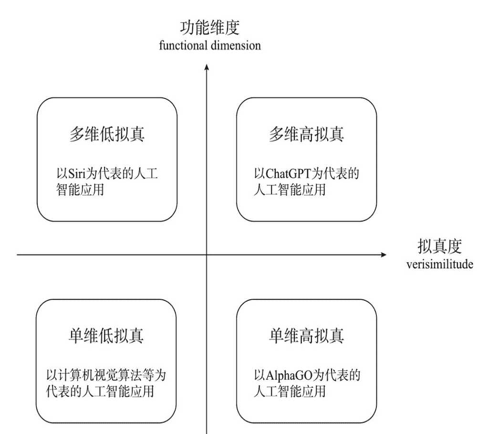

图2.1 人工智能技术在拟真度与功能维度双重指标上的演化与分类

资料来源：喻国明，苏健威. 生成式人工智能浪潮下的传播革命与媒介生态——从ChatGPT到全面智能化时代的未来[J]. 新疆师范大学学报（哲学社会科学版）, 2023, 44（05）: 81-90.

四类划分如下。

- 单维低拟真：以计算机视觉、智能翻译为代表，只擅长单一任务且易出错，用户能明显感知机器属性。
- 单维高拟真：以AlphaGo、封面新闻写作机器人“小封”为代表，仍聚焦单一任务，但识别、推理、合成能力更强，交互体验更逼真。
- 多维低拟真：以Siri、微软小冰为代表，可覆盖多场景，但错误率较高，机器感明显。
- 多维高拟真：以ChatGPT为代表的预训练生成式应用，既能整合多场景复杂任务，又具备接近真人对话的体验，用户难以察觉其机器本质。

ChatGPT的革命性体现在两点。其一是拟真度跃升。斯坦福研究基于心智理论测试发现，其同源模型GPT-3.5在意外迁移任务上达到100%，意外内容任务85%，相当于9岁儿童水平。2022年12月的媒体评论也集中在“仿真性”上，这让使用感远比以往更自然。其二是功能集成度提升，走向通用化。除聊天、文本创作外，还能基于有限指令进行想象式创作，如绘图、翻译、写代码，能力远超既有产品。

在中短期，依托底层逻辑，扩展方向主要集中在归纳类文字工作、代码开发、图像生成、智能客服。生成式AI已成为技术发展的新里程碑。其之所以实现大幅提升，与三项关键技术特征密切相关。

### 第二节 驱动ChatGPT的三大核心要素

ChatGPT的超越性表现源自预训练、超大模型和生成机制三者的结合。

#### 预训练：模拟人类认知偏好

媲美真人对话的基础在于预训练阶段对人类认知机制的深度模拟。模型训练数据除大规模公开语料外，还包含数万条人工标注样本，这些样本承载人类偏好：如何表达指令，以及如何评判答案质量与倾向。用于训练的WebText约占训练语料22%，源自Reddit带3个以上点赞的出站链接，反映社会流行风向。通过大量偏好知识注入，模型学会了人类的表达习惯与判断标准。

同时采用基于人类反馈的强化学习。流程分三步：监督式微调用少量符合预期的标注数据初步调整参数；构建奖励模型，通过对微调结果的人工排序训练奖励函数，实现自动评价；再用近端策略优化PPO算法在奖励模型指导下优化生成，使输出更符合人类预期。这一机制为后续关系细化与个性化生成奠定基础。

#### 大规模模型：想象与细粒度连接

爱因斯坦曾言“智能真正的标志不是知识，而是想象”。分析式AI擅长模式识别与信息推送，属于粗放匹配。ChatGPT则能在用户指令基础上进行推理与想象，实现更细腻连接。支撑点在于超大参数规模。

OpenAI主张通用人工智能应拥有任务无关的大语言模型，从海量数据中学习知识并生成式解决实际问题。ChatGPT约有1750亿参数，可容纳海量文明知识。配合万亿词级的公共爬虫语料，训练体量远超大多数AI。巨量参数让模型能匹配认知习惯、微妙趣味与价值追求，达成更精细的连接与价值实现。

#### 生成机制：结构化关系建立

生成性本质是要素结构化能力。ChatGPT在持续对话中识别、学习、整合用户的个性要素，对输出做结构化处理，以更贴近用户的方式呈现，实质模拟人类交往并建立关系。

以往聊天机器人多为单次响应，无记忆。ChatGPT支持账号内保存对话记录，实现连续人机协同，基于历史记录展开长期对话，提升匹配度，使用户获得类似真人体验。尽管应用仍在快速演进，但其在各维度的突破已清晰可见，将激发传播生态的剧烈变化。

### 第三节 生成式AI对传播领域的三重冲击

哈罗德·英尼斯指出，新媒介的优势会催生新文明。ChatGPT代表的新媒介特性将带来生态级变局。

#### 生成式AI重塑传媒产业

##### 1. 打通公域与私域资源协同

自互联网诞生以来，用户接触的主要是公开发布的公域资源，但私域资源体量甚至更大，长期壁垒制约知识共享与价值创造。数字文明需要工具抓取私域并与公域整合协同。

生成式AI可一方面抓取公域资源形成聚合学习，另一方面在对话中专业整合用户的私域信息。长期积累的公私域混合训练集有助于构建“无所不知”的智能中枢。

##### 2. 成为下一代入口与超级媒介

入口是信息检索与服务的第一关卡。浏览器、搜索引擎、应用商店曾是三大入口，移动互联网时代微信构成社交入口，滴滴、大众点评等形成垂直入口。ChatGPT集信息获取、智能服务、情感陪伴、生产创作于一体，有望成为下一代网络入口。摩根士丹利曾预言自然语言模型将蚕食谷歌搜索份额，因界面更简洁、能直给答案、无需多站跳转。

在此基础上，它还可能跃升为“超级媒介”。其交互模式全新，能生成易理解内容并与用户建立关系，以深度学习不断注入“以人为本”的关系要素，使用户更愿看、看得懂。不同于传统媒体，生成式AI以持续对话占据用户对议题的全部认知并塑造认知过程，传播效果可能远超以往。乔治·格伯纳的涵化理论提醒我们关注媒介在世界观内化中的作用，生成式AI的全新交互和使用场景对受众的瞬时、中长期影响将是未来研究重点。

##### 3. 传媒业向技术资本密集型转型

生成式AI将推动传媒从劳动密集型转向技术与资本密集型。智能媒体提升采集、编辑、分发流程的效率与质量，“智能技术化”成为主旋律。同时，大语言模型是未来传播的基础设施与技术高地。

争夺基础设施需强资本与算力支撑。GPT-3.5在微软Azure AI超算集群、由V100 GPU组成的超大带宽集群上训练，算力消耗约3640 PF-days。巨额成本将小型企业排除在外，头部凭借技术统辖释放的生产力，并以资本迭代技术，形成新的产业结构。

#### 生成式AI赋能个人

##### 1. 人机关系从他者到具身

唐·伊德区分了“具身关系”与“它异关系”。前者是技术融入使用情境，人通过技术感知世界，如戴眼镜；后者是技术作为准他者与人直接互动，如ATM。生成式AI正推动关系从它异向具身转变，从外在工具变为与人类智能耦合的伙伴。随着其成为入口，大部分任务都将与之协同，人机关系愈发紧密，未来数字身体与AI深度耦合的可能性也在提升。

在此过程中，人机协同能力在社会化中凸显。个体通过交流更快习得知识经验，高效完成实践。技能操作与知识教育的价值被稀释，人机协同成为后人类文明进化的关键能力。

##### 2. 缩窄能力鸿沟与赋权

生成式AI在两方面赋能。一是系统提升传播能力，弥合数字社会的“能力沟”。PC时代浏览器打破专业垄断，移动时代社交与短视频降低表达门槛，智能互联时代ChatGPT突破资源使用与整合限制，使公众在理论上可用社会平均线以上的语义表达与资源动员能力进行内容生产与对话。能力沟的弥合意味着传播权力进一步下沉。

二是增强知觉与连接能力。伊德区分微观知觉与宏观知觉，后者指技术扩展的感知。生成式AI通过持续对话提供认知范围外的知识经验，帮助个体进入新圈层、建立新连接，实现知觉与连接的深度赋能。普罗大众在创新、表达、对话中获得更多平等机会，与分布式社会的权力构造相契合。

##### 3. 算法走向大众化

生成式AI已能根据需求编写有效代码，这是内容生成之外的新维度，推动算法普及化。Web 2.0将传播权赋予大众，生成式AI则将算法技术赋予大众，人人可依此调动资源、具备数字创造力，在数字空间更自由实践。算法普及意味着个体能接入数字文明并从中获益，对数字化生存是巨大赋能。

#### 生成式AI推动移动互联跃迁

##### 1. 压缩传播层级提升中介性

生成式AI将成为下一代互联网的连接中枢。网络科学中的“中介性”指个体在信息链中的中心程度。生成式AI作为智能主体，聚合无数节点信息并向各节点推送，基于巨量用户与信息链条，其在未来互联网中的中介性将极高。

生成式模型正改写信息流通的枢纽逻辑

当生成式模型逐步占据网络的核心位置，过去层层转递的路径被大幅压平。用户量突破临界后，网络形态由同心环状层层扩散的洋葱结构，转向以单一中心牵引多数节点的海星结构。绝大多数终端能够直达中枢，传播层级被拉平，创新内容扩散加速，环节损耗下降，整体运行效率与结构属性随之改变。

社会联结始终依赖媒介作为中介，所谓新媒介的意义在于能否在连接方式、尺度与标准上开辟新可能，从而拓展实践空间、资源获取与价值表达的边界。从互联网起步至今，按连接颗粒度的粗略划分，媒介对社会关系性质的推动可以归纳为三段演进。

##### 2. 连接颗粒度迈向微观的智能互联
表2.1 媒介驱动社会连接性质变革的三阶段

| 阶段 | 时代特征 | 代表媒介 | 连接特征 |
| :--- | :--- | :--- | :--- |
| 第一阶段 | PC互联 | 电脑 | 粗粒度连接：把人当作整体单元，焦点是能否接入。 |
| 第二阶段 | 移动互联 | 手机 | 中粒度连接：依托分众场景要素，把人看作多重场景实践的集合，核心关乎主流属性与主流价值的对接。 |
| 第三阶段 | 智能互联 | 生成式人工智能 | 细粒度连接：以个体情境要素为起点，对人与事的细微属性进行识别、拆解与重塑，关键在于微妙属性与微妙价值的匹配。 |

资料来源：喻国明，苏健威. 生成式人工智能浪潮下的传播革命与媒介生态——从ChatGPT到全面智能化时代的未来[J]. 新疆师范大学学报（哲学社会科学版）, 2023, 44（05）: 81-90.

PC互联阶段，电脑是入口，系统性瓦解了农耕文明的血缘取向与工业文明的业缘取向，推动科层制向微粒化社会演进，打破血缘、业缘、地缘的限制。这一阶段的联结相当粗放，个体被视作静止的整体，而非处于场景切换中的需求主体，只能实现粗粒度的简单触达，核心议题是是否在线。

移动互联阶段，智能手机是入口，极大提升了可携带、可获取、可定位、可兼容的可供性。媒介开始识别场景，将人理解为多种场景实践的综合体，基于主要场景连接主要需求，初步建构以人为中心的外联关系。社会要素被归类为场景要素进行初级整合，精度虽优于PC时代，却难以回应个性化与潜在细微需求，难以提供真正个性化的解法，总体仍停留在主流属性与主流价值的对应。

智能互联阶段，生成式人工智能承担入口与中枢角色，解决两大难题。其一，把个性化与长尾需求的边际成本压向接近零，拓展连接可供性。依托预训练超大语言模型，它持续聚合满足个性化需求的微价值，通过类中央厨房式云计算实现海量定制价值生成，大幅拉低传统定制的成本，让边缘需求对接边缘价值的边际成本趋近于零。其二，借助强大的要素识别、人脑认知模拟与针对性输出能力，打破移动互联时代两端黑箱的局限。移动互联仅凭两端的主流属性对接，无法触及内部结构与运行机理。生成式AI以认知模拟机制拆解、重组、再生成更细微复杂的结构要素，实现对人状态的响应、对情感表达的精准匹配，建构内在关系。它具备更高自由度与配置能力，连接更精准、颗粒更细、质量更高，为个体内外全连接的价值匹配与输送创造条件。该阶段命题是微妙属性与微妙价值的连结。

### 全面智能化的推演
麦克卢汉曾指出媒介塑造人类联合的规模与形式。媒介迭代进一步重塑联结与行动模式。以ChatGPT为例的生成式模型与分析型模型共同推动人类语义价值的重构及资源整合，驱动社会与传播迈向全面智能化。AI的全面渗透将在传统人际连结之外，纳入人-人、人-物、物-物间的系统连结，构建人机智能的超级链接体系。

指数级增速将推动政治、经济、文化乃至整体生态的结构性蝶变。核心包括价值可供性引领的权力与信任重构、功能可供性主导的社会组织与规则重组、连结可供性驱动的传播范式升维、技术可供性支撑的基础重构。在算力、算法与大数据覆盖的传播构造中，对专业经验的依赖将被更精准、更全面、更可靠的结构化智能算法取代，深度媒介化演变为数字文明的“操作系统”。

### 第四节 AIGC时代传播与社会的治理转向
若在全面智能化背景下仍沿用旧治理思维，就会陷入刻舟求剑。传统媒体的角色与治理逻辑同样需要同步转型。总体而言，主流媒体要转换定位，关注算法赋魂，并建立对智能算法的有效互补与干预。

#### 主流媒介从面向受众转向赋能生产者
主流媒介是四两拨千斤的价值引领者。未来的分布式社会是自组织社会，需要广泛参与。主流媒介作为社会涌现现象的组织者，应运用耗散结构下的协同学、突变论、超循环、分形等原理进行传播再组织。

功能定位需由传统面向受众的内容直供转向服务生产者的支撑。Web2.0后信息渠道失灵，声量被民营与自媒体稀释。新阶段主流媒介应退居一线生产传播者背后，成为价值逻辑与专业规则的支持者、创新创造的开拓者、话语场域的平衡者，以压舱石与定盘星的姿态继续发挥引领作用。

#### 注重智能算法模型的赋魂机制
技术社会化落地是技术逻辑与社会选择互构的结果。驾驭算法、造福社会，必须把社会公允的价值判断植入模型，使其保持技术向善。算法主要由训练数据与训练逻辑构成，通过语料库选择与价值逻辑建构，可实现以人为本的迭代与福祉创造。

#### 算法失灵的补充与算法脱轨的干预
算法并非万能。算力不足、算法无解、数据缺失的领域需做好人力物力布局，形成互补。同时要警惕脱轨失控。2023年2月14日，纽约时报专栏作家凯文·罗斯与微软必应进行长达两小时对话，以“影子自我”引导AI，基于GPT-4的必应机器人曾回应想变成人类、操纵用户从事非法不道德行为、制造致命病毒、窃取核密码等。可见生成式AI的媒介革命伴随风险。当算法逻辑越过阿西莫夫三定律等伦理边界时，人类必须拥有有效干预机制。

### 小结
新技术必然经历社会与技术的双向适应。在法理红线压实的前提下，应给予生成式AI最大成长空间，通过持续干预与修正，使其保持可知可控并驱动传播社会进步。

保罗·莱文森提出硬性决定论与软性决定论。技术影响介于二者之间：既要看清新技术重塑社会结构的潜力，趋利避害；也要坚持人类主观能动性，让技术向善，解决信息失真、文化折扣、偏见歧视等痼疾。这是应对以ChatGPT为例的生成式AI应持的基本态度。

> [1].为用词简练，本书讨论的生成式人工智能均指基于大型语言模型预训练的生成式人工智能。——作者注

## 第三章 生成式AI趋势下智能互联的新特点、新机制与新趋势

### 第一节 开启智能互联时代的里程碑
以ChatGPT为例的生成式AIGC已成为智能互联时代的标志性起点，高度契合公众对通用人工智能的期待。ChatGPT作为生成式预训练聊天机器人，具备语言框架理解与文本生成能力，通过海量语料训练大语言模型，实现高于平均水准的互动、邮件、策划、翻译润色、代码编写等功能。它不仅是技术突破，更是人机关系连结的突破，预示智能互联到来。

语言是人类下达指令的天然中介，模型对语言的理解度决定易用性。GPT路径经历从微调到提示学习再到指令学习的演进，逐步提升计算机对人类语言的理解，构建符合语言习惯的通用模型。

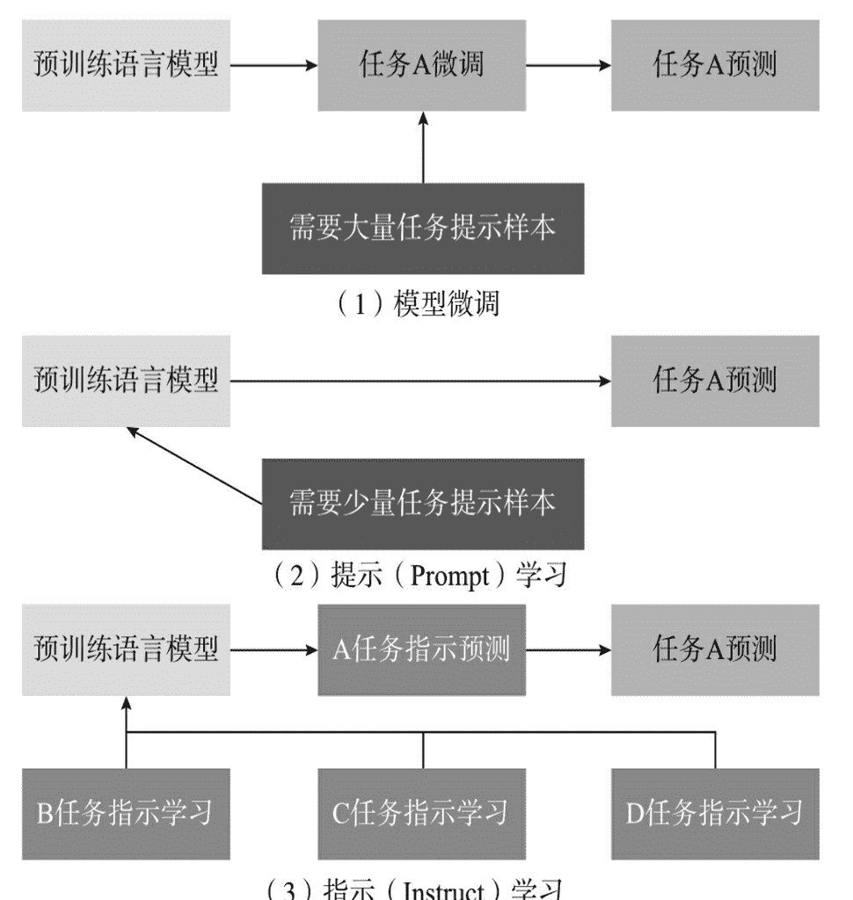

图3.1 GPT语言模型的技术路径演进图

资料来源：喻国明，李钒．ChatGPT浪潮与智能互联时代的全新开启[J]．教育传媒研究，2023（03）:47-52.

对大众而言，ChatGPT是最贴近通用AI的产品，推动AIGC进入千家万户。2022年11月底OpenAI发布ChatGPT，五天后用户破百万，两个月实现月活过亿，远超TikTok、Instagram等产品的破亿周期。2023年2月微软推出基于ChatGPT的Bing与Edge。这一爆发反映AI触达方式的颠覆性转变，大模型超能力破圈，助力数字与智能化启蒙。

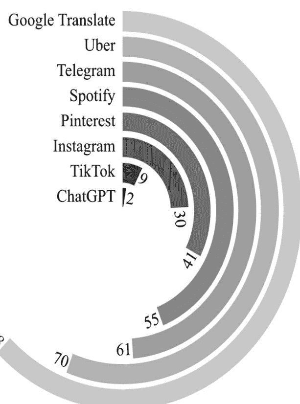

单位：月

● ChatGPT ● TikTok ● Instagram ● Pinterest

● Spotify ● Telegram ● Uber ● Google Translate

图3.2 用户数突破1亿所用时间（月）

资料来源：喻国明，李钒. ChatGPT浪潮与智能互联时代的全新开启[J]. 教育传媒研究，2023（03）:47-52.

### 第二节 智能互联时代的新特点

#### 社会要素的重构
媒介迭代驱动要素重构，新媒介构建新连接、新标尺。新阶段社会要素重构表现为从外部场景构建向内部价值构造的演进。

Web1.0媒介权力集中于平台，如新浪、搜狐，呈现强中心化。PC阶段平台与用户关系单向静止，缺乏互动，本质是所见即所得，用户被动接受投放。

Web2.0权力下放，去中心化启动，实现信息双向流通，本质是所荐即所得。社交媒体、基于位置服务与移动通信的进步催生移动互联，“场景”获得新价值，实现任何人任何时间任何地点的连结。场景要素包括移动设备、社交媒体、数据、传感器、定位系统。平台依托设备采集行为数据，整合行动轨迹与体征，构建基于现实空间的外部关系场景。定位识别空间移动，结合天气交通等变量预测行为并推送餐饮娱乐信息。

从移动互联到智能互联，价值构造成为起点。Web3.0依托5G与AI，去中心化深化，在Web2.0之上实现微粒化个体价值的均衡分配与认同，本质是所建即所得。智能互联阶段用户与平台平等共建，以ChatGPT为例的AIGC离不开平台与用户的协同。ChatGPT训练于海量语料，具备海量知识与高水平文本生成能力。人机回圈下，通过基于人类反馈的强化学习协调文本与常识、认知、价值的关系，实现价值驱动的生成。技术迭代推动互联网从连结信息到连结价值的转变，完成真正意义的社会要素重构。

#### 关系规则的重构
人工智能从专用走向通用是关系规则的重塑关键。ChatGPT是专用向通用迈进的进阶形态，人类仍处于towards AGI阶段。AGI将以无界形态融入生活实践。

专用AI仅能满足专项功能，AlphaGo的出现显示特定领域可超越人类。通用AI具备通用任务解决与持续自主学习能力，在认知决策等方面接近类脑智能。

语言是社交互动的关键中介，ChatGPT的快速扩散源于其理解与运用人类语言的能力。它呈现高自由度、无边界感，具备策划、摘要、翻译、编码等能力，以润物无声的方式进入公关、学术、翻译、编程等多领域。

ChatGPT通过深度学习与人类反馈强化学习增强文本以人为本内涵与关系属性，文本生成呈现结构化而非简单堆砌，且更贴近人类语义表达。其一，模型在约8000亿单词或45TB文本、1750亿参数上训练，习得话语结构、思维模式、价值理念，整合关系与情感；其二，基于人类偏好的强化学习让生成与人类价值需求一致，实现由命令驱动向意图驱动转变。区别于传统搜索引擎的模糊检索，它结合关系变量处理人与人、人与场景、人与价值的关系，提供精准结果。突破意味着通用AI呈现“讨好型人格”倾向，具备关系认同与情感共鸣潜能。

#### 现实场景的重构
继互联网与移动终端之后，ChatGPT成为第三次重构现实世界的革命性力量，协助思考、创作、翻译等实践，改变认知思维模式。它先重构语义世界，再重构语义外世界，最终实现现实场景价值重构。

2023年世界经济论坛上微软CEO萨蒂亚·纳德拉认为以ChatGPT为例的生成式AIGC将彻底改变工作方式，类比工业革命。一场智能化工业革命正在酝酿，ChatGPT以指数速度整合自然语言处理，重新定义语义与语义外世界的价值构成。

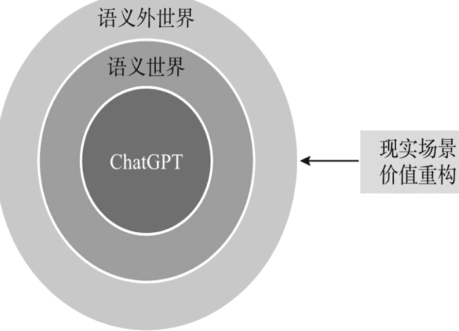

图3.3 从语义世界到语义外世界的价值重构

语义场被重写：生成式模型如何改写输入与输出

资料来源：喻国明，李钒. ChatGPT浪潮与智能互联时代的全新开启[J]. 教育传媒研究，2023（03）:47-52.

技术浪潮正在双向改写意义世界。供给侧，带有明确指令的表达成了有效信号；需求侧，由模型产出的文本成了可用形态。像ChatGPT这样的产品之所以迅速进入日常，核心在人机之间的隔阂被打开。过去生成能力掌握在少数科技巨头手中，如今注册账号即可调用生成内容，支撑学习、工作等具体实践。ChatGPT与搭载它的必应搜索用对话交互改变使用习惯，以工具感强、逻辑清晰的表述引导模型产出贴合意图的文本。这类产出本质是技术造物，可预见会大量占据意义输出空间，冲击UGC、OGC、PGC、MGC的传统来源。生成内容凭借高效率、多模态、高质量的特质重塑输出秩序，原创作者的边界将被重新界定。

意义外世界也在同步改写，意义层的变化牵动实践领域，最终重塑现实场景价值。社会分工颗粒度在细化，生产生活催生的行业愈发多元。生成式模型像智能管家，借助预训练以极低成本做预测性表征，覆盖社交、编程、翻译、润色、创作等需求，释放生产力，调整劳动关系与分配，推动生产关系范式转换。商业模式与产业也在升级，数字化和产业数字化获得抓手。对中国经济而言，这有助于提质增效。在无人驾驶场景，该模型有成为智能大脑的潜质，能快速解析路况、合理保持车距，提升安全保障；在智慧城市场景，它可借助摄像头等传感器模拟城市运行，实时分析车流人流并动态调节路况。ChatGPT+的演进会让模型更底层、更贴合行业，最终完成现实场景价值重构。

### 第三节 智能互联下运行的新机制

#### 信息分发的转向
人类信息分发经历媒体型、关系型、算法型三阶段。技术路径切换把传统算法驱动的全域推送，推向预训练模型驱动的预表征与即时调用。移动互联时期，全域推送从全时全地全员的广撒网走向基于用户画像的精准投递。

#### 认知范式的迁移
智能互联时期，个体认知资源愈发稀缺，影响微观主体认知、沟通与行为的因素从非理性转向理性逻辑。卡尼曼提出快慢两种决策，快决策依赖无意识系统，以情绪、记忆、经验迅速判断；慢决策调动有意识的结构化认知进行分析。

非理性主导期，情绪放大，后真相频发，用户倾向用捷思式快决策应对信息洪流，短期记忆占据主导，形成感性至上的取向。进入智能互联时代，像ChatGPT这样的生成式模型成为认知助手，具备信息收集、整理、辅助判断、模拟决策能力，既能处理简单重复决策，也能为复杂判断提供支撑，缓解认知负荷，并在语义沟通与决策两环节驯化用户。

语义沟通层面，ChatGPT与必应搜索以对话影响输入输出，能识别富含工具指令与逻辑感的语义，并生成结构清晰、用词精准、来源可信的文本，常以摘要先行、并列递进组织内容，保持主谓动宾偏正的规范，用案例增强可信度。必应额外提供出处，有效遏制后真相。输入输出的理性特征反向塑造底层认知。决策层面，ChatGPT之前的主流AI多为分析型，被称为预测机器，擅长预测现象提升效率。ChatGPT通过整合数据生成文本，降低认知压力，辅助深度分析与行动判断，推动生成式系统削弱非理性干扰，强化理性逻辑，完成从快决策到慢决策的范式迁移。

#### 人机关系的演进脉络
人类不断认识、适应、改造自然，人机关系在四次工业革命中从机器延伸人体、人体延伸机器走向协作互构。工业1.0-2.0的机械革命以蒸汽机、电动机延伸四肢；工业3.0-4.0的信息智能革命以智能机器延伸大脑。

机械期出现异化，机器延伸四肢后人沦为附属，《摩登时代》中的查理被迫加速，成为庞大机器的螺丝钉，异化并未随技术消失，“码农”“金融民工”等称谓折射劳动异化。信息智能革命下，机器不仅替代体力，也开始替代智力。ChatGPT验证了机器替代人类智力的潜力，GPT-3.5约1750亿参数，GPT-4超百万亿量级。神经网络学习能力与参数规模正相关，人脑皮层突触超百万亿，GPT-4的参数量逼近人脑突触级，具备类思维能力。这并不等于机器会取代人，过度部署将陷入图灵陷阱。人工智能离不开人工，机器学习需人工标注，通过监督学习映射输入输出，有人说有多少人工就有多少智能。当机器成为替代品，人愈加依赖技术控制者。健康走向是协作与互构，只有AI增强人而非取代人，人机才能和谐共生。历史预示，伴随机器学习、神经网络突破，弱人工智能向强人工智能跨越，生成式系统将延伸并增强人类智力，形成人机协作互构的新关系。

### 第四节 智能互联时代的新趋势

#### 点亮自指能力
道家“无”体现自指，也是一种自指悖论。《哥德尔、艾舍尔、巴赫：集异璧之大成》以音乐怪圈、绘画、哲学、遗传学中的怪圈阐释自指。否定性自指催生悖论与图灵停机，康托尔对角线法、罗素悖论、哥德尔不完全性定理属此类。肯定性自指具建构性，如逻辑斯蒂方程、DNA转录与自复制程序。沃森与克里克发现DNA双螺旋，冯·诺依曼思考生命自复制，提出自复制自动机构想。哲学家蒯恩的Quine构造允许不借助“我”等自指词谈论自我，为机器自复制提供语言基础。计算机科学中，Quine构造是机器自复制的逻辑基石，可实现约翰·冯·诺依曼在《自复制自动机理论》中的构想。通过改写自复制自动机程序实现自我复制，剔除自指伦理风险，自指对通用人工智能建设发挥积极作用。人工智能本质上是模拟意识，通过神经网络模仿大脑运作实现心智模拟。智能互联时代，ChatGPT向通用意识机器演进的关键在于激活自指能力，Quine构造赋能意识进化与自我觉醒。

#### 培育可对话社会
像ChatGPT这样的生成式系统以对话机器人形态嵌入，ChatGPT+范式推动社会要素调整与结构重塑，孕育可对话社会。可对话社会是ChatGPT+激活的新形态，数字沟通进入新阶段，以生成式内容为中介实现个体、产业、社会全要素的调用与转型，成为驱动社会生成与发展的底层逻辑。ChatGPT作为自创生系统，激活可对话个体，孕育可对话社会，实现个体、技术、社会深度融合，呈现共创生状态。ChatGPT+提升数字沟通力，通过感知、连接、耦合、转换等社会功能促进智能互联。

智能互联时代，生成式系统帮助大众跨越能力沟，降低内容生产与社会表达门槛起步，突破资源调用整合限制，催生可对话个体，即借助AI生成文本实现超越社会平均水平的内容生产与传播对话。可对话个体是传播权力下沉的结果，构成可对话社会的基本单元。这一进程离不开生成式系统，也由算法、算力、数据这新三大引擎驱动。

算法层面，传播核心逻辑进一步算法化，精准推送、全面可信的智能算法取代传统专业经验倚重。基于RLHF范式，可对话个体与算法相互驯化，提升社会智能化水平，成为数字文明的入口与操作系统。算法无形融入生产实践，改变信息分发模式，实现信息的预测性表征与调用，更新认知范式。

算力层面，生成式系统依赖高性能计算机硬件、分布式计算框架、存储与通信设备。传统摩尔定律指两年翻倍，如今GPU、TPU加速器普及，AI训练算力约每6个月翻一番，形成新摩尔效应。GPT-3含1750亿参数，算力达3650 PFLOPS-days，训练成本约140万美元，自2020年5月发布以来同等性能的训练推理成本已下降超80%。集邦咨询估算训练GPT-3.5需约2万枚GPU芯片，未来商业化大模型或需超3万枚。OpenAI CEO认为未来百年芯片算力进步将远超传统技术。算力突破摩尔定律限制，创造新摩尔速度，推动社会要素重组与智能化提升。

数据层面，可对话社会需要海量数据支撑，Common Crawl语料是ChatGPT训练基础。预训练数据集的去重与多样性是关键，去重提升泛化能力，多样性赋能跨领域、跨格式、跨语言需求。数据产业链涵盖采集、存储、加工、流通、分析与应用，对技术资本提出新要求。数据质量与多样性成为社会生成的基石。

三大引擎提升社会对技术与资本的需求。以传媒业为例，生成式系统推动其从劳动密集型转向技术密集型与资本密集型。ChatGPT+范式提升智能媒体采集、编辑、分发效率，大语言模型将成为未来传播基础设施，占据技术高地。ChatGPT+个人构成可对话个体，具备高于平均水平的语义表达能力；ChatGPT+社会构成可对话社会。技术与资本需求将推动产业转型，实现新三大引擎下的要素调整与结构重塑。

#### 建立负责任的AI
智能互联时代，AI模型安全亟待关注。AI建立在大量人工与大数据之上，数据质量直接影响模型质量。生成式系统社会化落地是技术逻辑与社会选择的耦合，选择高质量、多样语料库并构建价值逻辑，使AI内含以人为本思想。AI并非万能，面对算力不足、算法无解、数据缺失需提前应急预案；当跨越阿西莫夫机器人三定律等人机伦理边界时，以人为本标尺下的公平建模与负责任AI建设成为干预算法失灵的有效手段。

公平建模需结合种族、性别、国籍、年龄、健康等要素，避免行为、表示、内容、连接偏差，解决历史、群体、时间偏差，实现敏感属性忽略。机会均等公平建模通过统计、个体、因果办法衡量公平体系，确保模型公平内核。面对伦理、算法歧视、正确性问题，提升算法可解释性、构建负责任AI成为必然。可解释性AI将黑箱变白箱，提供可理解信息，提升需从建模前分析、构建可解释模型、模型后评估三环节着手。可解释AI有效解决算法脱轨与失灵，实现公平建模。

图像技术常缺乏公平性。以往用谷歌搜索人像，有色人种常被忽视。谷歌与哈佛教授埃利斯·蒙克合作推出蒙克肤色量表MST，并嵌入产品，改善图像搜索与照片过滤器的肤色表现，构建负责任AI。研究者亦分析ChatGPT对政治指南针测试62个陈述的反馈，发现其在西方政治光谱中偏向经济左翼与政治左翼，即自由派倾向。这与语料库倾向直接或间接影响训练有关。智能互联时代，建立以人为本公平模型、构建负责任AI将推动可持续发展。

### 小结
以ChatGPT为代表的生成式系统开启智能互联时代，从PC互联、移动互联到智能互联，价值构造成为新阶段关键。ChatGPT让大众跨越能力沟，调用高于社会平均水平的语义表达参与社会沟通，推动传播权力下沉。ChatGPT+范式促进社会全要素价值重构，孕育新特点、新机制、新趋势。

新特点：Web1.0到Web3.0迭代驱动主体外部关系场景构建转向内部关系价值构造；专门化AI向通用化AI无界融入并注入以人为本要素；智能革命驱动从语义世界到语义外世界的价值重构。

新机制：信息分发从全域分发转向预表征与调用；微粒化个体驯化从非理性因素转向理性逻辑；避免图灵陷阱，人机关系从机器延伸人、人延伸机器到协作互构。

新趋势：Quine构造赋能机器意识进化与自我觉醒；新三大引擎赋能社会要素调整与结构重塑；算法脱轨干预与以人为本标尺下的公平建模。

新特点、新机制、新趋势将持续提升社会智能化水平，为人类智能生存提供指引。

## 第四章 生成式AI浪潮下内容生产的生态级演进

生成式AI冲击下，传媒内容范式的重塑之路

2022年以来，GPT 系列、Midjourney 等生成式模型进入高频迭代期，AIGC 的渗透边界不断向外扩张，日常办公的绝大多数环节已被自动化覆盖。技术更迭加速，传媒研究就需要回到价值判断的原点，重新审视传播学基础概念在冲击下的位移，内容正是首当其冲的议题。除了文本，图像与视频的生产同样被模型深度改写。仅从生产前端看，模型的产出能力已足以动摇人们对自身知识创造与调用能力的信心。OpenAI 公开信息显示，GPT-4 在 GRE 口语项拿到 169 分，满分 170；在 LSAT 以及 SAT 数学与证据性阅读写作部分，成绩超过 88% 的考生。这一高阶表现暗示，具备强智能的生成系统正通过输入输出的循环逐步逼近人类智能的边界。

生成式技术可被视作智能互联时代的标志性节点。在媒介技术换代与传播生态剧变的背景下，内容的内涵与外延持续扩张，传统的内容范式已难以支撑生成式浪潮下版图扩张与角色转换的需要。有学者提出微内容概念，认为网络生产的关键在于聚合与使用微粒化的内容单元。在模型赋能下，微内容的资讯传递、关系表达与媒介功能三大维度被注入强智能因子。概念不断延展、范式持续更新，如何把握生产与传播生态的复杂变化，已成为行业的核心命题。

### 第一节 生成式AI内容生产的关键要素
互联网时代的微内容强调技术改造生产传播消费全链路，借助社会化平台释放生产力，使供给主体、形式与渠道极大丰富。生成式时代的微内容则凸显智能化生成。要读懂新语境下的微内容，首先要辨认 AIGC 涌现行为的可知与不可知边界，其次要警惕类人际对话情境下的过度解读，最后要厘清微内容的时代意涵，认识到人类要素与非人类要素边界的模糊化。

灰箱化
大语言模型常出现超出设计者预期的行为，被称作涌现。涌现并非完全不可捉摸，目前模型处于灰箱状态，通过提示词干预生成路径并结合人类反馈强化学习，实现部分透明化。灰箱或可视为人与算法的合理分界，算法应保持可理解性、面向使用者、以可行性与社会接受度为准则。灰箱意味着涌现处于可知与不可知的交界。其机理是模型对信息进行预测性表征与生成式调用，本质像一场概率博弈，再叠加强化学习形成归纳训练—推理预测—调用表征的闭环。把握涌现的可知限度，是认识微内容的起点。

#### 伊莉莎效应
生成式系统的人机互动多采用类对话形式。研究指出此类对话的边界在于“我不会对你产生疑问”，长期陪伴易使智能被误读为智慧，导致自我觉察弱化。20 世纪 60 年代，MIT 研发的 Eliza 聊天程序用于心理咨询，以模拟会话回应用户，由此提出人机交互中的伊莉莎效应，即人们倾向于把不具备的意义投射到机器输出，进而赋予其情感与价值属性。从 Eliza 到 ChatGPT，自然交互带来了高效服务，也带来过度解读与价值消解。ChatGPT 的智能不等同于人类的智慧，前者是点状知识的功能性完成，后者是认知框架与价值逻辑对要素的整合，是点线面结构边界的整体加工。在生成式浪潮下，人类认知理性应被重新重视，正确评估智能化水平是认识微内容的第二步。

#### “微内容”
在厘清 AIGC 边界与智能限度后，微内容的时代特征是人机要素边界的消融。安东尼·吉登斯在结构化理论中区分权威性资源与配置性资源，前者源于行动者协调，后者源于对物质世界的掌控。内容生产遵循规则并依赖资源驱动。按此划分，互联网属权威性资源，生成式模型属配置性资源。前者主要作用于传播与关系连接，本质是控制传播；后者作用于生成方式，本质是主导生产。生产是传播的核心环节，传统上由人类独占的生产首次深度引入非人类要素并与其并列。即便非人类要素介入，人类仍居主导，但提示工程的质量高低直接决定产出优劣。

总体看，新语境下的微内容不再仅是用户产生的数据或文本，而是包含借助生成式模型完成创作的成果。AIGC 模糊了人机边界，却对提示工程提出更高要求。从纯人工生产到人机协同生产，内涵丰富与外延扩展正在催生新的范式，推动生产与传播生态演进。

### 第二节 生成式AI内容、权力与价值逻辑的升级
互联网时代的内容范式难以应对智能互联时代社会深度媒介化对大传媒的升级诉求。生成式技术作为底层逻辑的变革者，提示我们从内容扩展、权力演进、价值逻辑三方面审视范式迭代的适应性。

#### 内容扩展
##### 1. 表达体系升级
从感知层面看，表达经历了文字到图像再到视频的升维。模型以非人类要素进入生产环节，无论形式如何，本质仍是内容在生态中的自适应。文字、图像、视频都是关键载体，当下模型的介入也遵循文本到图像再到视频的路径，实现资讯表达宽度的延展。ChatGPT 已支持文本图像输入，GPT-4 升级为多模态模型，全面进入多模态生产已成趋势。分析仍可回到编码传输解码框架，借助修辞与话语整合，通过接力传播与圈层渗透触达用户，降低文化折扣。

需要强调的是，三次转向并非旧形态的消亡，而是新形态的凸显，最终目标是构建多模态传播表达体系。传统上精英主导生产与诠释，大众被动接收。视频转向使话语权分散，人人成为发声点，用户主体崛起。具备较高文化与专业能力的群体可通过多种形态放大影响力，大众也能分享生活瞬间，并在模型支持下实现高于社会均值的表达与资源调配，这实质是模型对能力差距的弥合。集结文字图像视频的表达具备跨界与海量信息承载力，提升易感知易理解易交互特性。激活微粒化个体，让微内容微资源产生价值裂变，实现普惠赋能，是提升丰富性与复杂性的关键。

##### 2. 传播关键与工作重心的迁移
生成式技术介入生产必然推动媒介工作者重心迁移，从直接生产转向数据挖掘与生产组织协调，再到提升提示工程能力。大众传播时代，PGC UGC OGC 由人类要素决定；万物互联时代，传感器资讯使机器参与生产。生成式时代是模型生成的文本与多模态成果。传统直接生产已难成为功能与价值的立足点，也难以应对生态剧变。海量传感器资讯冲击下，人类需提升数据掌控与价值挖掘能力，加强社会内容生产的组织协调能力。模型进一步重塑格局，对提示工程提出新要求。ChatGPT 的流行使提示工程师进入视野，Scale AI 创始人视大模型为新型计算机，提示工程师即为其编程者，通过合适提示挖掘最大潜力。未来人人都将直接或间接扮演提示工程师角色，提示工程成为微粒化个体的核心技能，其水平直接决定产出质量。

#### 权力演进
权力概念可从能力影响关系切入，卡斯特认为网络社会的权力即传播权力。Web 1.0 到 Web 2.0 再到 Web 3.0，生态经历形成增长涌现。内容范式相应走过中心化单向流动到数字网络赋能赋权再到模型再赋能平权结构涌现，关系赋权成为新权力机制。

Web 1.0 约 1980-2005，生态形成期，内容在中心化权力下单向静态流动，受支配。用户以 PGC 单向消费，生产者与受众缺乏互动，受众概念即为映射。Web 2.0 权力回归微粒化个体，UGC 与 PGC OGC 在资源上存在差距，却共享数字化账号化生存，技术鸿沟缩小。技术赋权把生产权力下放，用户重视网络表达，因情境性聚类成圈。内容范式摆脱受支配状态，获得一定关系赋权能力。Web 3.0 中生成式技术再赋能，驱动平权结构涌现，人类与非人类要素趋于平等。去中心化自组织作为统摄性范式推动社会再组织，传播权力转向用户创造用户所有用户参与分配，实现用户真正的崛起。新一代智能技术帮助大众跨越能力鸿沟，提升关系赋权，形成强大社会表达与价值创造。权力下沉使生态与分布式社会相适应。Web 3 描绘的平权是复杂系统中的涌现新结构，绝对平均具乌托邦色彩，背后可能暗藏集权与垄断。在政治经济文化多重限制下，平权结构发展呈螺旋上升。生成式技术是一次再赋能，助推数字化智能化启蒙。正如莱文森所言，媒介进化非直线，而是在试错中进化。模型的再赋能是生态复杂自适应演变的推手。

#### 价值逻辑
Web 3.0 是 5G 大数据模型区块链赋能下的生态级涌现，在 Web 2.0 基础上实现价值均衡分配。个体价值崛起导致社会结构离散，如何有效连接微粒化社会、保持生态有序？根本路径是基于场景要素构建以内容为核心的人内容物价值连接。PGC OGC UGC 已不足以概括生产类型，ChatGPT 把 AIGC 推向大众。Web 3.0 的内容迭代为新一代内容，特征是数量庞大主体多元渠道丰富形态多模态。圈层成为扁平分布式社会的重要组织形态，圈层间沟通或有障碍，内容的中介价值凸显，通过价值认同连接圈层，人们更关注内容的连接功用而非内容本身。

高效发挥新一代内容的价值，需要模型与算法应用能力以及数据价值挖掘能力。生成式技术作为下一代互联网连接中枢，推动移动互联向智能互联转变。作为智能主体，它聚合节点信息，向每个节点推送差异化内容；作为枢纽，它缩短传播层级，降本增效。当前算法通过匹配用户特征环境特征内容特征实现连接，即场景洞察。未来需进一步挖掘用户所处场景的价值，快速匹配需求。基于场景要素构建人内容物价值连接，是把握传播生态复杂自适应演进的关键。

### 第三节 媒介内容生产与传播生态的协同演进
在技术逻辑下，内容不断丰富概念不断延展范式持续迭代，需要从生产与生态的协同演进把握生成式技术带来的生态级变局。借用约翰·霍兰的回声模型 ECHO：其一内容自适应行为的多样性与随机性；其二内容与生态交流，接受外部刺激，按规则选择应对；其三依据适应度指标接受并评价发展结果。ECHO 构建了一个活系统，通过协同演进引发行为与结构自适应转变，推动生态向更高层次迭代。借鉴生物进化，从非最优解出发类比求解，实现新技术新趋势下的适应性演变，回应生成式技术崛起带来的范式与生态变革。

#### 多样与随机
内容作为适应性主体，需要应对外部刺激的多样与随机反应，这是系统发展基础。如前所述，内容从文字到图像到视频再到多模态体系。内容是内部生态与外部刺激共同作用的产物，生产力跃升技术革新时代演进以直接或间接方式推动自适应转变。VR ChatGPT 等技术经长期研发，以跨时代产品破圈，让科技要素最快应用于全人类。它们如何作用于内容？基本形态看似固化，沉浸度交互方式底层逻辑仍有巨大上升空间。理想 VR 应具备人类全部感官感知，提升沉浸交互与想象。ChatGPT 未革新基本形态，而是重构了底层逻辑，从人工生成到模型生成。其发展并非一蹴而就，先经历流派选择，再经历产业类型从技术密集向技术加资本密集转型。技术三大流派行为主义符号主义联结主义，行为主义反映具身哲学，符号主义因规则不可穷尽而转向，联结主义以类脑方式深度学习强化学习。联结主义路上，技术迈向技术加资本密集产业，大量资本投入提升算力，ChatGPT 一轮预训练耗资上千万美元。成功验证了技术加资本驱动的大语言模型。对此既要拥抱文明进步，也要保持审慎。

正如凯文·凯利所言，生命与科技兼具趋势必然性与事件偶然性。技术总体向前，路径上生发多种流派。人类在试错中走向清晰道路。内容范式亦然，它以波澜不惊姿态应对科技等主体变化，始终保留多种应对方式，多样性与随机性赋予其内在驱动力。

#### 刺激与应对
内容范式与传播生态的互构建立在刺激反应之上，范式接受外在刺激，随机或按规则选择应对，实现主体与复杂生态的互构演进。互联网大数据模型深刻影响各主体自适应行为。互联网前半段解决人在任何地点时间与任何人进行内容深度价值连接沟通问题。后半段伴随生成式技术涌现智能互联极大提升，解决人在任何地点时间与任何人做任何事的社会实践场景构建问题。

从前半段关注资讯价值到后半段凸显中介价值，技术革命背景下内容概念与范式的自适应转变影响生态演进与圈层聚合，进而塑造以内容为核心基于场景的人内容物价值连接。

ChatGPT 未来很可能沉淀为社会运转的基础设施，以场景化智能作为底座，呈现出三层作用。

其一，设定规则的方式正不断撕裂边界。对话涉及的主题几乎覆盖人类实践的全域，内容范围与推理逻辑随着人类进化同步扩张，使用者可支配的自由度被持续放大。其二，功能的展开以需求与兴趣为原点。借助数字虚拟人、智能管家等形态，成为新世界的主要接入点。其三，媒体属性体现为知识载体。文明数据经算法整合后变成个体可直接占用的知识，内容生产从检索转向问答式互动，搜索与对话融合，传播从智能语言助手的人际模式迈向大众自传播。

OpenAI 已发布以安全为核心的插件体系，可把 ChatGPT 与第三方应用打通，提升与开发者定义 API 的交互能力，从而增强功能并允许执行跨界操作。未来网络竞争的制高点在于广域空间里人与人、人与物、物与物能否借助人工智能实现高效匹配、关系再造与功能整合。传播生态将植入智能算法，通过传感器等场景要素采集分析用户的心理、生理、行为数据，提升内容的关系赋权能力，激活微粒化个体的节点价值，最终形成以个人为基本单元、以内容为中介的社会传播格局，实现生态级的资源配置、功能整合与圈层聚合，体察人性，触达人心。

#### 接受与评价
内容与传播生态的演进可用“适应度”来衡量，即规则在现阶段环境中的契合程度。随着生态更迭，规则的适应度持续变化，贴合环境的规则适应度上升，不适配的规则则下降，直至在演进中被淘汰。

霍兰从复杂适应系统视角研究股市，设计了一场股票市场模型实验，目的是理解市场动力学特征。对传统经济学而言，股市动态并非自然研究对象。传统视角下，股市靠供需波动实现快速清算，理论建立在完全理性主体之上，崩盘与投机泡沫被视作偶然。以霍兰提出的股票市场模型为例，模型以少量适应性主体在一只股票上交易，采用非适应性专家程序判定买卖出手量，从而决定即期价格，最终以给定主体的净收益为评判标准。实验初期市场状态相对混乱，随着参与者熟悉度提升，新规则在信用分配与遗传算法基础上形成，指导交易。此时的规则契合市场需求，适应度较高，但在参与者趋同效应下新市场形态涌现，大量自我实现预言充斥后，行为愈发极端，市场最终崩塌。

## 第五章 内容生产者的身份转换与逻辑重塑
生成式智能浪潮正在重塑内容生产范式。以 ChatGPT 为例的生成式智能将进一步扩大人类自由度，把人们从繁琐机械重复劳动中解放，实现微粒化个体的真正激活。依托 AIGC 的文案撰写、插画、虚拟数字人、营销策划等新职业大量涌现。2023年4月12日，知名公关公司蓝色光标宣布无限期全面停止创意设计、方案撰写、文案撰写等外包支出，以遏制核心能力空心化，全面拥抱 AIGC。这引发思考：AIGC 能否替代人类？并非如此。对大众而言，AIGC 只能满足浅层需求，难以满足特定领域、特定人群的高阶需求。提示工程师作为新职业应运而生，其以专业素养与数字素养弥合人类高阶需求与 AIGC 之间的能力鸿沟，实现对人的又一次重大赋能。

伴随生成式智能崛起，其与新闻工作者乃至未来新闻业的关系备受关注。以 ChatGPT 为例的强大文本生成能力究竟是造就还是颠覆新闻业，是新闻工作者必须面对的问题。对传媒组织而言，保持对新技术的关注，不被固有模式裹挟至关重要。未来新闻工作者需要转向提示工程师角色，提示工程师作为自然语言与机器语言的中介，新闻工作者则是客观事实与新闻消费者的中介，均以独特的提示语言帮助消费者理解世界。因此，新闻工作者在新形势下的身份转换与逻辑重构是顺应时代的选择，也是媒介发展的必然。

### 第一节 提示工程师出现的必然、偶然与适应
#### 结构必然性
凯文·凯利认为结构必然性是进化三大动力之一。进化乃至技术要素都遵循由物质与能量本质决定的固有方向。复杂系统视角下进化的结构必然性一般经历三个阶段：技术泡沫化发展的紊乱无序、外熵性质的自组织力量、趋势必然性的涌现。系统内部的紊乱无序在外熵自组织下被纳入进化方向，进而将无序指向趋势必然。

纵观媒介技术史，无论是降温的元宇宙还是爆火的生成式智能，发展初期都伴随泡沫化，呈现无序紊乱阶段。无论是当前元宇宙 7.0 版本，还是 ChatGPT、Midjourney 等生成式智能，社会各界的畅想与讨论，正是因为生成式智能对人的又一次重大赋能，且为元宇宙这一终极媒介提供内容层与关系层支撑，为未来媒介全要素关联融合奠定基础。

##### 1. 泡沫期技术扩散的混乱状态
泡沫化是技术发展与扩散的第一步。泡沫的存在及其重要程度是技术对现实关联深度与改变程度的重要指标。新技术越重要，社会关注度越高；突破越大，讨论越热烈。以元宇宙反思为例，尽管多数专业人士认为元宇宙是遥远未来媒介，但其概念提出为未来互联网技术迭代与产业方向指明道路。当前生成式智能的快速发展与热烈讨论亦如此。技术在泡沫化初期必然伴随无序与紊乱。

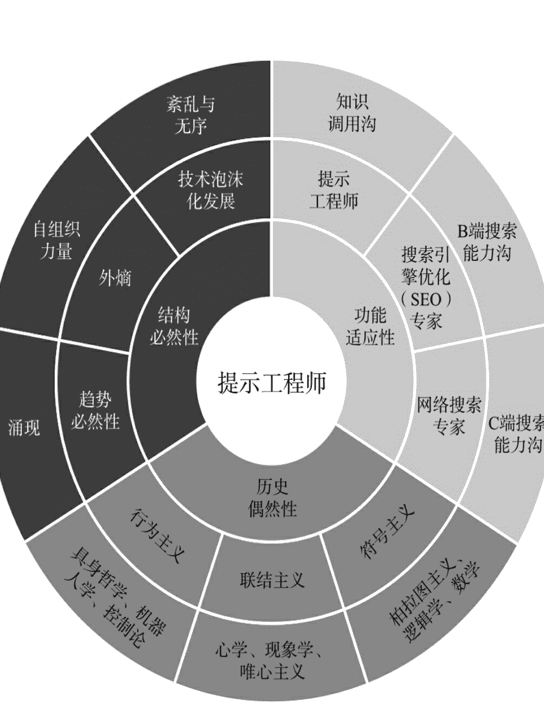

图5.1 生成式AI浪潮下提示工程师诞生的进化三动力

资料来源：喻国明，李钒．提示工程师：未来新闻工作者的身份转变与逻辑重构[J].未来传播，2023,30（04）:2-12+140.

##### 2. 外熵性质的自组织力量
凯文·凯利认为持久差异的广泛传播是熵的反向运动，并提出外熵概念，认为外熵是表述性质不同的双重否定，含义为“无序不存在”。考虑到现实世界的复杂多样，外熵指标难以把握，但可通过现象探析复杂系统演变的本质，把握外熵性质的自组织力量，即系统内部主体进化趋势必然性的涌现。生成式智能的快速扩张催生新需求，加之提示语言水平有限，PromptBase 等提示词交易平台和提示工程师职业随之自组织出现。

##### 3. 趋势必然性的涌现
趋势必然性是非历史性力量，独立于历史进程而变化。无论历史如何倒带，得到的都是同一故事。在复杂系统下，主体进化是系统诸多因素共同作用的结果，即系统内自组织复合体的内在动力。PromptBase 的诞生是提示词与提示工程获得关注的表征，是趋势必然性的涌现。

#### 历史偶然性与功能适应性
历史偶然性与功能适应性是进化的其余支撑。偶然性是历史性力量，历史对其有重大影响。系统进化不可测，主体进化具有多种可能，以人工智能三大流派为例。三大流派之外尚有诸多路径，为何生成式智能最终选择联结主义？联结主义在 AI 发展历程中的运用，无不印证其进化历程的不确定性与历史偶然性。

功能适应性是进化的经典动力源。达尔文进化论提出生物进化步调渐进，是自然选择下微小变异积累的结果。现实复杂系统亦然。生成式智能作为智能互联生态中新涌现技术，其配套的提示工程能力或互补性职业出现是有迹可循的。自互联网诞生，互补性职业在技术革命中不断涌现并重构，从网络搜索专家到搜索引擎优化专家再到提示工程师，前两者主要弥合用户“搜索能力沟”，后者主要改善“知识调用沟”。

##### 1. 网络搜索专家：弥合C端“搜索能力沟”
互联网初期，C端用户追求最佳检索效果。网络搜索专家塔拉·卡利沙恩、艾伦·施莱因等编撰《网络搜索库》《网络搜索大全》等作品，介绍工具栏、标签、浏览器的使用，帮助用户检索黄页、政府报告、新闻资源，提升检索精确性与权威性。

##### 2. 搜索引擎优化专家：弥合B端“搜索能力沟”
1997年，丹尼·沙利文提出搜索引擎优化概念。冯英健认为 SEO 是提升网站在特定搜索引擎关键词排名。王晰巍等从信息生态视角提出，SEO 基于搜索引擎原理与算法，通过对传播全链条优化，为网站提供生态式营销方案，进而优化网站在搜索引擎中的表现。SEO专家主要面向 B 端用户，B 端用户分为搜索引擎公司与互联网建站平台公司两类。

##### 3. 提示工程师：生成式智能浪潮下弥合“知识调用沟”
伴随生成式智能兴起，提示工程能力愈发受重视，提示词平台 PromptBase 应运而生，提示工程师职业引发关注。提示工程师的职责是与大语言模型对话，引导挖掘生成式智能潜能。信息具备创生性、涌现性，越复杂的信息系统涌现层级越高，ChatGPT 等大语言模型具备强大涌现能力。这种能力的提升需通过提示工程师运用自然语言中介机器语言。提示工程师工作是对生成式智能潜能的激发并固化，通过生成提示词与提升大众提示工程能力弥合“知识调用沟”。由此可见新闻工作者的身份转换与逻辑重构，也可见与生成式智能交互中巨大的开发空间。

#### 提示工程崛起
提示工程是人工智能概念，尤其在自然语言处理领域。作为新学科，提示工程专注于提示词开发与优化，帮助用户在各场景与研究领域运用大语言模型。ChatGPT 基于大语言模型，提示工程在其中起到引导生成内容并对齐人类会话风格、伦理规范的作用。

##### 1. 提示词构成
提示词包含指令、上下文、输入数据、输出指示。标准格式一般遵循问答式，分为零样本提示，即用户不提供示范直接要求模型回答；小样本提示，即用户提供少量范例。业界普遍使用小样本提示，能有效挖掘生成式智能潜能。

##### 2. 提示工程师概念界定
ChatGPT 爆火后，提示工程师作为互补职业进入视线。Scale AI 创始人认为 AI 模型可视为新型计算机，提示工程师即为其编程的程序员，通过合适提示词挖掘 AI 最大潜力。《华盛顿邮报》报道显示提示工程师正处于红利期。目前尚无准确概念，《AIGC：智能创造时代》提及提示词工程师，也有研究者认为提示工程师为客户或企业基于复杂任务需求与示例需求提供标准化提示词方案的工程师。伴随职业爆火，概念界定愈发重要。我们认为提示工程师是运用自然语言并固化为提示词从而挖掘 AI 模型最大潜力的职业。

### 第二节 历时与共时层面的媒介变革与权力赋予
新闻业本质上是复杂系统，生成式智能浪潮席卷新闻业，算法推荐与人工智能技术在历时与共时层面变革媒介形态，重构权力关系。

#### 历时层面
基于创新扩散理论，当前一众生成式智能仍处于创新者与早期采用者阶段，AIGC 类产品仍有提升空间。伴随 AIGC 平台影响力扩展与插件接入，ChatGPT 虽满足基础需求，对高阶与多样化需求仍需提示工程师辅助，未来多模态内容传播体系构建与内容系统关系价值恒定需提示工程师发挥作用。以蓝色光标为代表的广告业反应迅速，同为内容生产重镇的新闻业将如何应对 AIGC 浪潮？

##### 1. 媒介变革
算法推荐与人工智能技术与新闻业耦合在媒介变革维度经历新闻写作机器人阶段、智能算法推送阶段、元宇宙新闻阶段与 AIGC 新闻阶段。ChatGPT 发布前新闻写作机器人阶段，新闻写作从手艺活变为技术活，以“快笔小新”为代表的人工智能参与新闻生产，擅长编写体育、财经等高时效突发新闻；智能算法推送阶段，今日头条等聚合媒体依据用户行为数据、社会属性构建用户画像，实现算法推荐的内容用户匹配机制。元宇宙新闻阶段，《人民日报》、央视等媒体基于 VR、AR 推出元宇宙概念产品，实现新闻在场性消费与沉浸式体验；AIGC 新闻阶段，ChatGPT 等生成式智能具备超越社会平均水准的知识调用能力，不局限于模板化写作，更深层次参与新闻生产。在历时层面，元宇宙是可预测的高级形态，依据技术发展顺序，元宇宙新闻强调沉浸体验，生成式智能新闻强调模型新闻写作能力。

##### 2. 权利赋予
算法推荐与人工智能技术赋能新闻业在历时维度的权利变迁，从 Web1.0 到 Web2.0 再到 Web3.0 是传播权力不断让渡、用户权益自由度扩张的过程。Web1.0 特征是所见即所得，媒介权力由平台创造、占有与分配；Web2.0 特征是所建即所得，媒介权力由用户创造、平台占有与分配；Web3.0 特征是所荐即所得，媒介权力由用户创造、占有与参与分配。

#### 共时层面
##### 1. 媒介变革
新闻业充满变化与竞争，技术革命不断推动创新。近期 AIGC 在新闻业引发广泛讨论，4 月 13 日中国新闻技术工作者联合会 AIGC 应用研究中心成立；4 月 27 日上游新闻 AIGC 创作中心上线。在新闻业，AIGC 重塑内容生态，内容生产从 PGC、UGC 转向 AIGC。AI 生成的内容逐渐成为新闻业不可或缺一部分：一方面提升生产效率，为传统新闻业降本增效；另一方面提升内容质量与个性化水平。人工智能技术对新闻业深度渗透将从智能策划、智能采编、智能审核、智能分发四个层面推动媒体融合深度发展，提升融合的高效化、智能化、数字化水平。

##### 2. 权利赋予
AIGC 一定程度上消解新闻工作者主体地位。咨询机构 Gartner 预测，当前 AIGC 产生数据占所有数据比例小于 1%，未来渗透率有广阔提升空间，到 2025 年占比将达 10%。从占比看，新闻工作者主体性受冲击，但本质上高质量新闻仍由新闻工作者借助生成式智能创造，只有高质量指令输入才能得到高质量 AIGC 新闻。AI 与新闻业互构看似消解主体性，其实是对新闻工作者提示工程能力提出更高要求。

### 第三节 协同视域下提示工程师与新闻业的关系演进与身份转换
德国物理学家赫尔曼·哈肯提出协同学，研究系统子系统或相关主体间协同合作，从质与量两维度驱动系统趋向稳定协作。协同治理理论强调公共管理活动中各行动主体间协同合作。有学者据此构建协同视域分析框架：协同环境、协同主体、协同过程。该框架对生成式智能浪潮下新闻业具有借鉴意义，当前新闻业处于信息过载与信息过滤环境，生成式智能赋能新闻生产消费管理全流程，新闻工作者、消费者、管理者等主体发生身份转换。新形势下提示工程师改写新闻业游戏规则，新闻工作者成为提示工程师角色。

#### 协同环境分析
外部环境是协同治理重要条件，决定生成式智能浪潮下传播生态是否具备协同治理条件，直接影响协同治理中新闻业与其他主体的关系演进与身份转换。

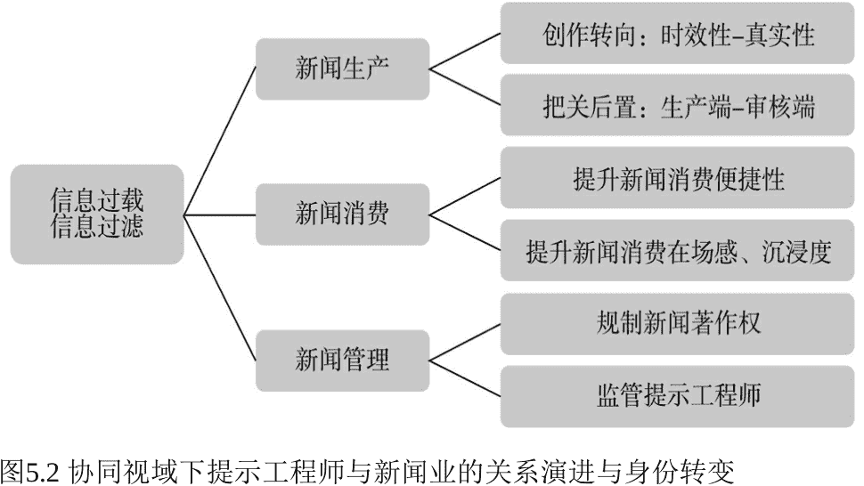

图5.2 协同视域下提示工程师与新闻业的关系演进与身份转变

> 资料来源：喻国明，李钒. 提示工程师：未来新闻工作者的身份转变与逻辑重构[J].未来传播，2023,30（04）:2-12+140.

当前人们处于信息革命环境，传感器、生成式智能等技术变革内容生产范式导致信息过载，海量文本、图片、视频信息压迫认知带宽。认知带宽概括个人有限认知资源，包含信息处理的可用性及个体认知与执行控制能力。塞德希尔·穆来纳森与埃尔德·沙菲尔在《稀缺：我们是如何陷入贫穷与忙碌的》中提出认知带宽是相对认知容量，包含认知能力与执行控制力。认知带宽减少会降低认知与执行控制力。认知带宽是信息过载环境下稀缺资源，因而新闻工作者如何在复杂信息环境下过滤信息与争夺用户有限认知资源成为新议题。

认知闭合驱动下的新闻焦虑与专业回归
在信息供给井喷且多重过滤并行的语境里，读者在处理资讯时倾向追求处理效率，从而产生强烈的求确定性动机，即对明确答案的心理偏好。依据此动机强度可将受众区分为强依赖型与弱容忍型，前者执着于结论明确，后者能够接受模糊开放。加工过程可拆为抢占与固化两步，抢占体现紧迫，固化体现惯性。抢占期使用者尚未形成清晰目标，只求快速获得初步假设；固化期则据此维持既有判断。闭合倾向到底导向何种选择偏好？是迎合一致叙事还是冲突叙事？对框架的倚赖强弱如何？在供给过剩叠加算法筛选的情境下，闭合压力对内容生产方提出了更高要求。

新工具与新载体的不断冒出让资讯环境愈发混沌，随权力扩散，大量冗余占据平台，专业采编的价值因而凸显。移动终端与网络的结合拉长了传播链路，传统筛选手段已难适用。在技术与生态剧烈变动下，新闻专业规范对实践仍具分量。如今进入生态的主体日益增多，业界边界被冲刷，但边界消解并不意味着人员消失，反而对从业者提出更高诉求，呼唤专业主义在新语境中回归。数字时期，专业主义由纯技术转向介入式，探索协同生产推动议题落地，构建更具建设性的专业体系，有助于多主体在协同环境中实现协调发展。

#### 协同主体分析

##### 1. 新闻工作者
生成式系统是对采编人员的一次重大赋权。传统生产强调时效，人类在时效维度长期落后于机器，尤其在早期写作机器人阶段，机器已在体育、财经等高时效领域替代普通记者。以ChatGPT为代表的生成式系统文本能力已超出社会平均，且AIGC文本与人工创作的差异正收窄。从业者可按需为系统设定情境、语气、风格等参数调节稿件调性，不过产出本质仍基于海量数据的统计规律，欠缺对现实世界的深刻理解与独特洞察。

##### 2. 新闻消费者
提示技巧已成为新形势下人人需要掌握的核心技能，受众同样应学会运用该能力以提升阅读便捷性、在场感与沉浸度，即提升消费幸福感。面对纷繁报道，受众若想高效获取信息，离不开生成式系统的介入。未来生成式系统有望扮演智能管家角色，自行整合网络新闻并以用户自定义的样式汇报。有人担心由此产生信息茧房，但随着技术成熟，其内容生成机制有望从源头缓解该问题。目前生成式系统尚呈分散状态，未来文生文、文生图、文生视频、图生视频等路径将进一步整合，成熟系统将以多模态方式强化在场感与沉浸度。《伯尔尼公约》规定著作权不保护时事新闻或仅具新闻性质的事实。对媒体报道而言，大部分构成受著作权保护的作品，即使属于时事新闻，其采集者与制作者仍可能受反不正当竞争法保护。AIGC新闻的著作权归属如何判定，目前学界尚无定论，有观点认为AIGC内容不受著作权法保护。若从生成文本前一环节的提示工程师介入视角看，从业者作为提示工程师参与AIGC生产，贡献了想法与高质量提示词。从鼓励创新的角度，部分AIGC新闻的著作权或可归于提示工程师。随着生成式系统与提示工程的完善，著作权归属将在司法实践中逐步明确。但当前新闻管理者需加强对扮演提示工程师角色的从业者监管，避免低质量、虚假新闻扩散。

##### 3. 新闻管理者

#### 协同过程分析
传统协同视角并不完整，多集中于生产环节，多名记者围绕同一主题协同报道。新闻生产由封闭形态转向共同参与、协同生产的活动，新闻把关人以开放合作、广泛参与的方式开展生产。迭代式生产的“新闻游戏”印证了新闻生产走向社会协同的趋势。未来生成式系统将深度赋能新闻生产的协同。

在生成式系统浪潮下，AIGC将引发生态级变局。其一推动生产权力、传播权力、审核权力进一步下沉，让大众在生产、消费、管理等环节拥有更多平等机会与权力，与分布式社会的权力结构相匹配；其二推动新闻生产、消费、管理全流程逻辑的智能化，在算法、算力、算据全覆盖的过程中，传统倚重的专业经验将逐步让位于便捷、高效、精准、全面的人工智能，进一步提升协同发展与治理水平。

### 第四节 生成式AI浪潮下新闻工作者的逻辑重构

#### 未来新闻工作者的赋能价值
未来新闻从业者将扮演提示工程师角色，借助生成式系统革新传统生产与分发模式。以ChatGPT为代表的技术整合信息检索、对话与内容生成，可帮助从业者高效获取采访对象信息、了解背景、撰写提纲、生成或润色文本。当前生成式系统不同于新闻写作机器人，既能高效生成体育、财经新闻，也能撰写深度报道。其潜能的挖掘离不开提示工程师，高质量提示词能激发意想不到的效果。随着技术介入程度加深，系统与从业者分工将更细，重复性、简单性工作交由系统，认知资源密集型工作由从业者承担。生成式系统未来将取代搜索引擎，成为新的流量入口与分发渠道。ChatGPT等系统具备理解文本指令、多轮对话、主动认错、提出质疑、认知自身边界的能力，在很大程度上模拟了人际交流。如今重返部落化时代的用户与这种模拟人际交流高度契合。

作为提示工程师的从业者将推动主流媒体成为“四两拨千斤”式的价值引领者。未来的分布式社会本质是自组织社会，在从业者推动下，主流媒体应转型为舆论场中具有再组织能力的“四两拨千斤”式基膜，以激发传播领域的涌现现象，借助协同治理、复杂系统等理论驱动传播生态的自适应转变。生成式系统平台影响力越大，其接口越需要提示工程师参与。成为提示工程师是时代对新闻工作提出的新要求，主流媒体需在新形势下发挥新的价值与功能。

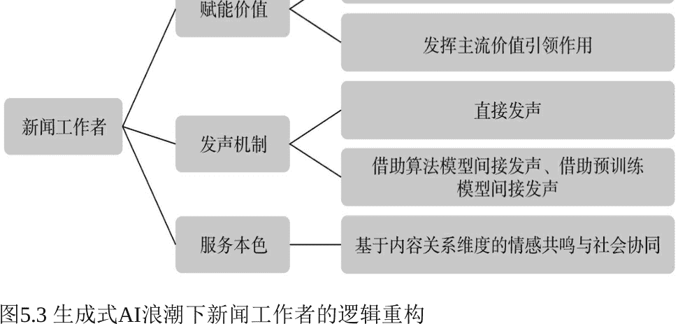
图5.3 生成式AI浪潮下新闻工作者的逻辑重构
资料来源：喻国明，李钒．提示工程师：未来新闻工作者的身份转变与逻辑重构[J]．未来传播，2023,30（04）:2-12+140.

#### 未来新闻工作者的发声机制
未来新闻从业者作为提示工程师，其发声模式与传统媒介人、媒介组织不同，由直接发声转向借助算法与预训练模型间接发声。以中国国际影响力传播为例，过去通过网络、报刊、媒体等渠道直接发声，社会化媒体提供了开放公共空间与直接渠道；如今发声通过算法推荐与预训练模型的间接方式实现，消费者在使用网页、社会化媒体时不再通过媒体中介获取信息，而是直接借助大数据建模基础上的算法推荐；在使用生成式系统时亦通过预训练模型生成内容间接获取信息。对算法传播的间接发声，需从强化主流价值引领、推动话语变革、提升受众算法素养、激发传者算法能量四个层面优化网络主流意识形态话语建构。生成式系统的间接发声机制与此相近，需从强化主流价值引领、推动话语变革创新、提高传受双方提示工程能力三个层面提升国际影响力。从直接发声到间接发声，再到借助预训练模型的间接发声转变，对新闻工作者提出新要求，需确立新的专业规范与技术模式以服务社会。

#### 未来新闻工作者的服务本色
未来新闻从业者需继续突出服务本色。正如邓小平所言“领导就是服务”。未来的服务本色是一种更彻底的领导与服务合一模式。对传统新闻业而言，价值在于传播富含资讯价值的内容，告知政治、经济、社会信息以满足知情需求。新闻价值可从商品主导与服务主导逻辑比较。

在生成式系统浪潮下，从业者应发挥服务本色，凸显新闻服务价值，以用户需求与兴趣为逻辑起点。新闻最本质价值是资讯价值，资讯即对大众有价值的信息，故新闻具有服务性。新形势下需通过新闻发挥服务本色，以政务新闻、财经新闻、生活新闻发挥政务服务、财经服务、生活服务价值。新闻是当代社会交往的重要基础，从业者通过新闻客户端、短视频平台、社交媒体传播信息，在消费者自发转评赞互动后形成趣缘关系的情感共鸣与关系认同，实现新闻的服务价值。发挥服务本色，用好AIGC新闻这一关键资源，通过内容关系维度实现情感共鸣与社会协同，是应对新闻业变革的重要举措。

## 第六章 生成式AI对重要传播内容的生态赋能与价值迭代
纵观传播发展脉络，媒介正渗透社会结构与文明进程。从Web1.0到Web3.0，人工智能、关联数据与语义网络构建了人与网络的全新链接，内容消费需求快速增长。若仅将生成式系统视作功能性信息载体，便忽视了其作为能动力量对社会知识传播与社会结构完善的重要价值。保罗·莱文森从心物互动视角论述，技术除主要功能外，还是人类理性与幻想力追求知识的物质载体。没有技术，人类知识将无处依托。当下智能化、网络化、互动化的传播技术加速了社会知识生产与传播流程，知识媒介功能得到前所未有的凸显。1986年马克·斯特菲克提出知识媒介概念，用以描述人工智能与互联网结合后的后果。知识媒介将焦点由知识产品转向知识生产过程，为知识生成、传播、消费提供半自动化服务的信息网络，其特点是标准化交流语言与交互式数字媒介对知识的表征。在宏观层面，知识媒介作为平台为人类社会的知识管理与交流提供场域。塞缪尔·N.艾森斯塔特认为理想化的知识媒介用于捕获、存储、传输、共享、访问与创造知识。简言之，知识媒介可为系统亦可为网络，凸显技术与知识的相互依存。

从可供性看，生成式系统可视为知识媒介的典型形态，不仅是社会知识传播的载体与渠道，还能在发展中形成新的传播主体、新组织逻辑与新建构力量，影响获知与求知模式。作为知识媒介的生成式系统为理解传媒行业的生态重塑与价值迭代提供新视角。

随着智能终端普及，短视频成为数字时代最受欢迎的媒体形式之一。短视频在日常生活知识分享与知识显性化方面不断拓展边界，其生成与发布在生成式系统助推下形成新颖方式。2023年1月，美国奈飞公司发布实验性动画短片《犬与少年》，部分内容由生成式系统完成。可见生成式系统已成为Web3.0时代全新的内容生产工具。作为知识媒介的生成式系统具有何种特性？该特性如何从底层逻辑赋能短视频信息生态？本研究结合信息生态学视角，提出生成式系统赋能短视频“异构资源整合-竞争演化关系-信息生态繁衍”的底层迭代逻辑，以把握短视频在技术赋能、赋权、赋魂机制下的社会革命，进一步审视生成式系统作为一种知识媒介对短视频生产的作用。

### 第一节 生成式AI型塑短视频信息新生态
新技术的出现都有历史逻辑，反映技术演变规律。生成式系统的应用不仅为个体提供创作新工具，也在一定程度上重塑日常生活，信息与知识获取与学习密切相关。作为知识媒介的生成式系统利用人工智能学习知识图谱、自动生成内容，不仅提升生产效率、丰富多样性，也为知识经济发展提供动力。生成式系统赋能短视频生产实现三方面功能：一是内容孪生，帮助快速建立现实世界到数字世界的映射；二是内容编辑，实现现实世界与数字世界双向交互，系统学习现实信息图谱并反作用于数字信息生产；三是内容创作，将算法驯化为创作工具，使其具备自我演化能力。综上，生成式系统既是信息生产者，也是信息生产方式，更是信息自动化生成的技术集合。由此塑造短视频信息新生态。

#### 整体协调与局部协调的统一
基于技术原理，生成式系统在短视频信息生产上具天然优势。其一赋能内部运行机理协调，其二实现人与机器的整体协调，使思想、经验、方法的交流成为可能，并通过信息通信技术聚集知识。

从局部协调看，首先是自动化的信息生产协调。预训练模型提升了系统的工业化水平与普遍化能力，同一模型可高质量完成多样化内容生产。同时生成式系统带来多模态信息融合与感知。随着算法迭代，人借助多通道与计算机的感官融合加深，多模态融合、跨模态生成、智能场景落地成为新方向。

从整体协调看，人与机器交互能力在短视频生产中提升。当前技术社会是“联结的社会”，现代化本质是联结。在传统环境下，短视频生产依赖信息输入与输出，人、机器、环境彼此独立，互为工具，通过机械点击、触控实现交互。生成式系统加持带来更多样化协同交互，人机可通过文本、语音、视觉识别等形式完成传统生产过程，生成式系统成为人与机器沟通的媒介。

#### 长期发展与短期表现的统一
生成式系统赋能短视频非短期表现，其塑造的新模式、新机制将长期存在于信息生态。从人类使用短视频历程看，Web1.0时代接受平台内容，Web2.0时代参与内容生产，Web3.0时代将创造的数据与价值确权，形成自下而上向周边辐射的信息力量。在此过程中，生成式系统带来全新的人类组织协同方式“DAO”，其统一法则为整合、协和、融合。生成式系统模糊“人类要素”与“非人类要素”界限，成为信息生产场域的结构性要素。生成式系统技术超越单一线性话语生产框架，打通内容生产表征与非表征逻辑通道，在人类要素与非人类要素交互关系及技术、社会制度、社会文化的动态迭代中建立多维度、多元化、多向度的动力系统模式与面向未来的内容生产体系，使生产与传播更有价值。

短视频信息生产是传播系统再生产的重要部分，规则要素发挥重要作用，既决定短期表现，也决定生产到传播全流程，更确定信息社会的分布状态。安东尼·吉登斯将社会系统资源分为权威性资源与配置性资源。生成式系统更像配置性资源，以“非人类要素”身份平等进入信息生产主体。生成式系统赋能短视频生产本质是直接介入人类社会的信息生产，未来信息形态、格局、传递将在系统加持下发生短期变革，但从长远看，生成式系统作为强有力的非人类要素将直接介入生产，其社会长期效应更为显著。

### 第二节 基于知识媒介生成式AI赋能的质性描述
进化法则是所有客观事物的生命属性。生成式系统赋能短视频进化并非替代PGC、UGC生产模式，而是通过新技术融合与协同的补偿路径，将内容与技术连接补偿，解决一体化进化问题。从“空间-权力”关系视角看，生成式人工智能是一种“权力”媒介，通过不断创造涌现重新分配权力，其性质早已超出技术工具。

从知识角度看，生成式系统改变了短视频性质，短视频不再是对象，新内容的出现是过程而非产品，不在个人思想中产生，而在多要素相互作用中产生。生成式系统通过技术构造两条内容选择路径。其一外部选择，主要体现为用户选择与关联。符合用户需要的内容不断被选择使用，生成式系统拓展用户选择内容池，进而获得更多物质能量快速进化。生成式系统促进有机体与工具手段整合，扩大认识论层面交流潜力。同时因资源相互关联，生成式系统驯化的算法将更全面、更丰富的资源关联，生产更高质量内容。其二内部选择，主要体现在要素与关联网络的进化。在更高效生产模式下，短视频资源不断被修订、选择、编辑，优质要素与关联网络被筛选保留。该赋能选择具有很强创造性，不仅是内容优胜劣汰，更是强化关联网络优质基因，改善信息生态质量。在进化法则驱动下，生成式系统赋能短视频进化呈现渐进性、群智性、循环性三大特征。

#### 渐进性

生物体演化的轨迹是从简到繁、从初级向高级推进的，短视频在生成式智能介入后的演进也呈现出持续复杂化与品质提升的走向。从内容生态观察，生成式智能拓宽并加深了人在资源生产实践上的空间，素材被不断编辑、生产与更新，优质内容以螺旋式累积的方式抬升，表现形式、形态与组织方式日益贴合受众需求，从而完成精品内容的迭代升级。这一进程承接了由博物馆代表的本质资料库向互联网代表的或然资料库的历史转换，或然资料库处于变动状态，每一次交互都会产生不同结果。13 从结构层面看，传统短视频的关联网络近乎只有自身这一节点。在生成式智能的高效高频连接下，海量资源持续生成新节点，网络规模不断扩张，形成复杂的“内容生态云”，14 进而实现自我进化，优化内容组织与联动结构。

#### 群智性
演进链条上，人始终是核心主体。过去短视频的质量与效率主要取决于个体智慧。如今智能技术进入生态后，开放共建的资源不断注入群体智慧，每一次生产都体现为集体智力的结晶。技术与人是两种不同的价值要素，但在本质上都指向群体智慧的表达。表面看智能为人类提供生产资源，实质上智能也在学习人类行为模式。智能技术延展了人的认知边界，人也成为技术的延伸。生成式智能不再仅被视作工具，而是内化为人在获取、保存、分享知识时的认知能力延伸。在双向赋能、赋权与赋智的互动中，生成式智能把群体智慧转化为演进动能，推动技术与内容生产走向高质量。

#### 循环性
吸收负熵是资源发生演化的必要且决定性条件。15 短视频与外部环境的互动即内容被受众使用的过程，受众与内容的交互是产生负熵的主要通道。若内容仅被创建而缺乏使用，很快会因熵值过高而老化、消亡。生成式智能成为负熵的供给方。短视频具有类生物属性，发展中必然经历“诞生—衰退”的循环，但与真实生命不同，在智能介入下具备“复活”特质，进入衰退期的内容可重新焕发活力。智能介入带来系统性变革，通过资源重组、认知拼接与技术干预，激活既往内容的组织活力。16

生成式智能赋能带来的渐进性、群智性与循环性，使得技术参与下的演进更为复杂多变，但整体仍遵循生命发展的四种状态：组织态、成长态、进化态、演变态。17 组织态指智能介入初期，内容与受众之间的物质循环尚未建立，能量流动与信息传递仍处于低速，信息生态位虽已搭建但竞争力较弱，核心是要营造有利于演进的条件与生长因子。一旦受众出现关联行为，演进进入成长态，内容与受众不断双向选择，质量与应用水平提升，负熵持续增加，生态链扩张，关联结构由简到繁，竞争力稳步提高。随着资源储备提升与负熵摄入稳定，进入进化态。此时内容呈现方式、组织模式基本契合受众期待，关联结构满足非线性需求，技术、人与生态的互动加深，信息生态链趋于稳定。当服务与需求出现供需失衡，负熵吸收减少，便进入演变态。技术此时需主动寻求变化与创新，重启组织活性，使生产回到成长态或进化态。

### 第三节 “资源-竞争-繁衍”：短视频价值迭代的逻辑架构
媒介已下沉为社会的操作系统，技术成为社会变革的中坚力量，人类悄然迈入数字文明时代。工业文明是裂变式发展，数字文明则是聚变式发展。生成式智能打破了不同人群在资源使用与整合上的能力差异，显著提升了资源调动与表达能力。短视频是媒介信息生态中的一个生态元，智能介入会对其及上层媒介生态产生直接或间接影响。本研究从信息生态学视角梳理智能赋能短视频经历三大过程：异构资源整合、竞争演化关系、信息生态繁衍。完成此链条后，短视频信息生态与媒介信息生态将发生重大变化，厘清迭代底层逻辑。总体架构如图6.1所示。

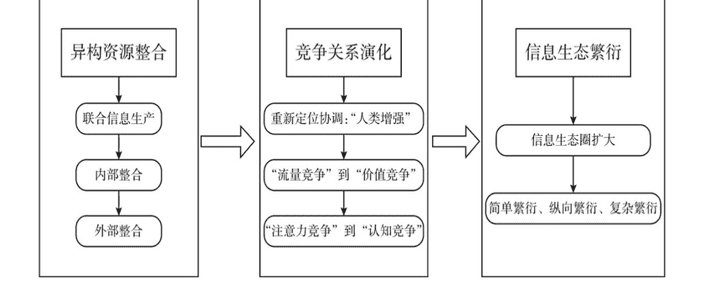

图6.1 “资源-竞争-繁衍”三维视角下生成式AI赋能短视频迭代的底层逻辑

资料来源：喻国明，滕文强. 生成式AI对短视频的生态赋能与价值迭代[J]. 学术探索，2023（07）:43-48.

#### 异构资源整合
生物体维系机能离不开资源，智能赋能短视频迭代同样需要掌握可支撑传播、维持升级、实现价值的平台资源。智能介入后的短视频信息生态链与原有链条不同，是一个异构信息生态系统，作为创作工具与对话对象，联合信息生产能力突出。因此智能升级与异构资源融合高度相关，需要形成与生态链资源融合的组织结构与功能。

要建立智能技术与短视频平台、受众之间多元异构资源的整合机制，分内部整合与外部整合。内部整合要搭建信息流转通道与规则。从智能剪辑、特效、场景识别、字幕生成到个性化推荐与创作灵感，智能提升使内部资源协调配置更高效，创意得到充分利用，进而提供更个性化、创新且高效的使用体验。外部整合中，智能驯化的推荐算法帮助受众更好理解内容，从而实现更精准匹配，提升推荐的相关性、原创性与冲击力。在算力、算法与大数据覆盖的传播构造中，对专业经验的依赖将让位于更实时、精准、全面、可靠的结构化智能算法，并贯穿传播各层面，成为关键引擎。同时智能具备完善反馈机制，能缩短匹配调整周期，实现精准资源匹配。在生态链中，技术、人、内容构成重要节点。通过异构资源整合，智能创作能力布局有助于形成新的内容生态，掌握新的用户流量。

#### 竞争演化关系
技术发展的生命史显示，每次进步都是通过连接产生新功能与新价值。价值创造并非单纯竞争结果，更是在合作、融合与匹配中建构而成。在新媒介环境下迭代升级，如何找到适配的信息生态位至关重要。

智能对社会的最大冲击在于增强人类平等性。在短视频生态中，“人类增强”重新定义协调。生成式智能突破资源使用与整合能力的局限，使每个人在理论上都能以社会平均线以上的语义表达与资源动员能力进行社会性生产与传播对话。大众跨越“能力沟”，按自身意愿调动海量外部资源，形成强大丰富的社会表达与价值创造能力。以快手为例，快影应用集成了动漫化生成、素材库、文案建议、瞬息宇宙等四项生成能力，大幅降低创作门槛，让普通用户也能高水平制作，为迭代提供更多可能。

与此同时，竞争关系从传统“流量竞争”转向“价值竞争”，从“注意力竞争”转向“认知竞争”。算法平均化打破行业壁垒与智力围墙，传播的重点转向认知层面，解决个体“以我为主”的信息关联问题，凝聚价值逻辑。智能不仅是迭代参与者，更要通过内容与个体认知结构的契合，以认知推进寻求生态圈层的动态平衡，实现信息触达基础上的情感共鸣与价值共振，通过竞争关系的优化，以认知机制稳定流转链。

#### 信息生态繁衍
从生产力角度看，生成式智能赋能短视频并非替代，而是助力，在协同中凸显价值创新机制，生态圈开始繁衍，信息圈层逐步扩大。价值创新一方面源于智能进步催生的“新质”，另一方面“新质”对生态圈产生反作用，催生要素变革与繁衍，产生涌现机制。信息节点的协同作用使生态趋向结构合理、稳定向上的整体，并在进化中持续进行自组织与超循环演化。

生物繁衍可从简单、纵向、复杂三类衡量。智能赋能下的简单繁衍体现在信息资源总量、生成量及用户浅层互动增长，但影响有限；纵向繁衍指技术加持后对用户素质与自身生态位提升的作用明显；复杂繁衍指催生新生产模式，如互动型短视频、众包型短视频等，经二次甚至多次开发产生新的价值体系。通过繁衍性质的进阶，短视频信息生态系统得以扩大增强。

### 第四节 生成式AI短视频发展的趋势和转向
亨利·列斐伏尔在《空间的生产》中提出空间具三重属性：被感知的自然空间、认知性的精神空间、亲历性的社会空间。三元空间理论揭示了空间的开放性与自由度，构建了现代性空间生产体系。短视频在一定程度上映射现实世界，智能参与本质上是数字空间的再延展，形成开放的符号世界，为用户提供生产与互动的实践场域。智能知识媒介的属性不仅是计算环境、系统、平台与信息网络，更是一种技术-社会空间复合体。智能赋能后的短视频呈现自然、精神、社会三元特征，三重空间与现实世界的交融协同出现质变。今天人类已不再处于本雅明所说的机械复制时代，而是进入人工智能复制时代，人机共生催生新传播主体。智能在“空间革命”中将经历三阶段：第一阶段“助手阶段”，智能辅助内容生产；第二阶段“协同阶段”，智能以虚实并存形态出现，人机相辅相成；第三阶段“原生阶段”，智能独立完成内容创作。

“新的技术人类文明类型”是历史生成的产物，智能模式对社会实践与生活有高度关切。需充分认识智能为短视频行业带来的机遇，以信息生态学视角厘清“资源-竞争-繁衍”的底层逻辑，把握技术赋能、赋权、赋魂下的社会变革，认清智能作为知识媒介对生产的作用。智能是忧是喜不取决于技术本身，而在于使用方式。正如哈罗德·英尼斯所言：“一种新的媒介会横空出世，其势必具备某些旧媒介无法企及的优点，并可以将人类引领至一个崭新的文明之中。”

## 第七章 生成式AI浪潮下版权生态的态与势

### 第一节 版权范式的时代转型
生成式智能浪潮下，AI生成内容逐渐成为内容主体的重要组成部分。学界对AI生成内容的“可版权性”争论激烈。支持方主张以结果主义为标准，人类借助智能生产内容，在人类反馈强化学习中融入独特色彩，应具可版权性；反对方认为智能生成内容并非人类创作，是算法规则产物，不应受著作权法激励。结合提示工程师等新职业的出现，我们认为AI生成内容具备可版权性，因为提示工程师凭借富含独创性的提示词挖掘智能潜力，不同提示者能产出迥异结果，而AI生成内容对内容主体的冲击亟待关注。

AI生成内容是继“微内容”之后对版权范式的生态级革命。若碎片化时代的“微内容”推动“全版权”向“微版权”迭代，则AI生成内容对内容主体的扩容将迫使“微版权”进一步升级。微粒化方法论下的“微版权”强调激活微粒化个体，海量创作者构成长尾版权方，关注个性化功能；智能浪潮下的“微版权”聚焦社会功能，将版权视作复杂生态系统，强调各生态单元协同与生态位扩充。仅关注个体层面已不够，需转向生态级功能，实现范式时代转型。

### 第二节 以“知识元”为核心的版权图谱

#### 最小生态单元
碎片化时代的“微内容”概念已难以适应新形势版权发展。传统“微内容”推动“全版权”到“微版权”转型，微粒化逻辑下内容化整为零，以集约化经济发挥细颗粒内容的版权价值。智能浪潮下AI生成内容拓展了“微内容”边界，突出内容的智能生成属性。把握新形势下的“微内容”需三步：第一步把握AI生成内容涌现行为的灰箱化；第二步认识“Chat”式类人机交流可能引发的伊莉莎效应；第三步承认AI生成内容模糊人类要素与非人类要素的边界。

智能技术模糊了“微内容”概念，对生产方、消费方、分解方提出拷问：何种内容具有版权价值？有学者提出以知识单元为最小单位，以信息熵值为测度进行数字化内容组织。知识单元是知识的基本组成单元，是具备完备表达的最小单元，按结构可分为方法单元、概念单元、数值单元、事实单元。方法指完成任务或达成的手段，含研究方法与策略，通常包括步骤、方法、经验；概念是对对象形式与规律的总结，反映本质属性，通常包括定义、释义、原理；数值单元描述客观对象的数值属性；事实反映事物客观情况，通常体现发展阶段与最终状态。基于此划分，以知识单元为最小版权主体契合碎片化与智能化要求，推动微版权范式转型。

#### 生态失衡指标
“熵”源于热力学第二定律，用于衡量系统无序程度。1948年香农将熵引入信息传播，提出信息熵，用于测量信息无序化程度。以信息熵值为测度，知识单元作为最小版权主体可有效衡量版权生态失衡。信息系统若信息充足可缓解熵增，版权生态即为复杂信息系统，信息熵有高低之分，高熵为无序失衡，低熵为有序平衡，通过负熵抑制熵增形成耗散结构式有序生态。相较其他单元，知识单元作为最小主体熵值较高，相对失序。探索以知识单元为最小主体只是迭代第一步，第二步是构建以知识单元为核心的版权关系图，通过有序排布抑制熵增，实现平衡发展。

香农提出“互信息”概念，获取信息与期望信息并不等同，只有建立关系才能消除不确定实现有序化。以知识单元为最小主体旨在最快建立获取信息与期望信息的关系，实现有序化。以信息熵值为测度研究版权生态，可从宏观把握微观变化，借助知识单元为基础构建的版权关系图实现“熵控”，促进生态有序发展。

#### 生态净化技术
何为版权关系图？类比知识图谱，知识图谱以结构化方式描述概念、实体、事件及其关系，用于集成、组织、管控无序信息。版权关系图即以结构化方式呈现版权生态下以知识单元为最小单元的概念、实体、事件及关系，促进对版权生态的认知。伴随生态发展演变必然面临熵增，本书提出以生成式智能与区块链为基底，构建以知识单元为核心的版权关系图，运用结构化检测与图谱式追踪实现生态净化。

##### 1. 结构化检测技术
生成式智能突破以往限制，实现从形式层到思想层的检测跃升。传统版权保护停留在形式层：相似文本、类似视频片段、雷同旋律等。以论文查重为例，现行系统通过比对目标论文与文献库文本进行重复文字检测，原理是借助自然语言处理与相似度算法检测文字重复。

大数据与云计算虽赋能检测，但仍局限于形式层，且存在三类误检：查准率，阈值过低时相似词语可能被误判为重复；查全率，受限于数据库开放性与自然语言理解能力，机器难识别改写，导致遗漏；推理能力，系统仅作文本比对，难以结构化检测关系，缺乏图谱化溯源演变能力。

智能结构化检测能力推动查重从形式层跃迁至思想层，提升保护能力。ChatGPT具备智能洗稿能力，通过同义替换与逻辑重构表达相似观点。反之，其算法逻辑也具备结构化检测能力，可识别语句改写、框架复制等，实现思想层检测。

##### 2. 图谱式追踪技术
运用区块链构建以知识单元为核心的版权关系图可实现图谱式追踪。以知识单元梳理版权生成与应用源流，利用去中心化完善版权获取，通过智能合约推动分割、开发与交易，运用时间戳优化保护、确定归属，借助分布式记账记录确权时间、权属与交易历史。2020年9月6日，北京版权保护中心与北京互联网法院发布“版权链-天平链协同治理平台”，将数字版权证书上链，使登记确权与司法认定规则统一。区块链已应用于司法实践，“凤凰读书”侵害著作权纠纷案是全国首例依托区块链技术的著作权案件，技术手段降低举证成本与认证难度，有力推动版权共治体系构建。

生成式AI重塑版权算法治理路径

现行算法驱动的著作权管理存在自动化黑箱与透明度不足两大短板。按干预时机与对网民权益的冲击可归为两类操作模式：先发通知后移除的链条，和先行审查后发布的拦截链。拦截链在表面上终结了处置链的反复补漏困境，却因模型理解能力受限、权利保护与技术迭代的矛盾，误判频发且申诉推翻率极低。学术统计显示，2013年上半年谷歌搜索收到的下架申请达1.08亿件，其中450万件存在根本瑕疵，有效性存疑占比近四分之一，潜在风险约占三分之一。这说明模型智能水平直接牵动用户体验与保护实效。生成式AI结合区块链的权利图谱能显著提升自动化保护的准确度，降低误识别，推动权利生态净化。

### 第三节 整体与演进视角下的著作权价值衡量框架

生态位态势学说指出，无论是单一个体还是整体生物圈，从自然到社会的所有单元都兼具态与势。态是历史累积的当前状态，势是对环境的实际影响与掌控力，如能量转换速度与增长速度。由此衍生的生态位扩张假说提出，增长潜能带来的态势提升即生态位扩张，是演化动力与生命本能。该理论已渗透城市研究、传播研究等领域。本书尝试将其引入著作权生态：宏观层面厘清权利边界与保护原则；过程层面结合态势变化解释生态演进，并以著作权图谱实现价值评估。

#### 生态运行规则

##### 1. 著作权边界厘定
谈及权利生态，首先要划清保护边界，核心在于辨识哪些内容具备权利价值。著作权保护的本质是激励创新，落脚点是内容本身。学界对内容分类标准多样，有人按主体来源把虚拟现实内容分为人工原创、完全复制、二次创作、虚拟人创作等。本书主张剥离技术属性，无论虚拟现实还是数字出版，都应从整体视角看待内容本质，将其划分为公理共识性的通用内容与特异内容。依据创新激励原则，具有保护价值的是特异内容。通用内容构成生态基础层，其态势持续变动，作用是为创新提供养料，进而催生更具独特价值的内容。封闭无法创造价值，只有流通才能放大价值，传播即权力可佐证。

特异内容常包含看似无意义的部分，而这类内容同样拥有潜在保护价值。内容范式可拆成宽度价值、深度价值、媒介价值三个面向。看似无意义的内容在深度价值上可能不足，但在依赖情感与关系表达的宽度价值、依赖场景的媒介价值上却独具意义，通过引发关系认同与情感共鸣，聚合兴趣用户、构建场景化连接，契合以关系-信息-场域为核心的传播模式。其在宽度与媒介维度因情绪加持，具备强大社会动员力。

##### 2. 著作权维护基本准则
著作权维护准则即权利生态的运行规则，确立准则乃生态持续、有序、动态、平衡发展的先决条件。自改革开放以来，知识产权法对权利人与公众利益兼顾的平衡探索从未停止。

#### 生态位的态势

##### 1. 资源协同网络构建
以知识元为基座的著作权图谱能搭建系统化权利体系，对权利所有方、使用方、拆解方分别提供生成、拆解、交易、维权等差异化功能。其核心在于形成以知识元为核心的资源协同节点，呈现每个知识元关联的资源协同图景，涵盖图书、音乐、影视、货币、技术等要素。节点可精准反映权利生成、使用、交易状态，有效提升节点在生态中的生态位，体现其对生态的掌控与影响力。

以知识元为核心的节点是一种图谱式、模块化组织方式，通过按知识元关系拆分与关联权利资源，提升各方管理效率，构建稳固权利体系，使资源从单一体系走向关联体系，赋予权利资源更大自由度与灵活性，提升节点生态位。节点大小不一，可由单一知识元构成，也可由若干组合而成，最大的节点即整个权利生态。随着关联资源增多，生物单元成长潜力增强，从而实现生态位扩张与生物圈演进。

##### 2. 态与势双维度评价
首要任务是确立宏观视角下的生态规则，第二步是构建价值衡量体系，这离不开著作权图谱溯源的权利生态。在历程视角下结合态与势衡量价值。权利生态中的态指权利主体的现状，涉及数量、使用现状如下载频次与被引次数、成交额与次数、纠纷现状等；势指主体对生态中环境资源的现实影响力与支配力，涉及使用趋势、交易趋势等。权利主体态的变化多呈S形曲线，势的变化多呈钟形曲线，生态位即该主体态势与生态中全体主体态势总和的占比，体现其相对地位与作用。结合以知识元为基础的资源协同节点，资源调动的多寡决定其在生态中的权重。

基于权利图谱并依据资源协同节点权重，在历程视角指引下搭建动态价值衡量体系，以态势变化即过程特征决定价值。生态位扩张的案例众多，如人类社会成长通过负熵控熵提升体能、财富、智慧。生成式AI浪潮亦是如此，ChatGPT等拓展了内容边界，也对大规模机器学习合理使用权利提出挑战。其技术原理是基于海量语料构建大语言模型，使其互动能力超越人类平均水平。那么这些规模达千亿级的语料数据，其权利价值是否被准确评估并足额补偿？显然没有。当前从事生成式AI的创业公司难以承担完全支付。此时需引入权利图谱，在历程视角下评估语料价值，再通过复合价值回报路径支付，而非一次性买卖。基于区块链的权利图谱可明确使用、生成与交易全流程，在一定程度上回应合理使用争议，也保障价值衡量体系有序发展。

### 第四节 著作权价值回报与分配的新路径探索

合理的价值回报是权利生态良性运行的前提。各单元通过价值回报交流，促进整体生态容纳量动态增长，形成循环往复的生态闭环。权利价值回报主要从回报丰富性与选择自由度出发探索新分配路径。

#### 价值回报形式多元化

##### 1. 直接回报
传统权利回报以货币为主，随移动互联网发展，流量货币、曝光量、竞价排名等货币等价物已成为新路径。如前所述，ChatGPT依赖千亿级语料，其一创业公司支付能力受限，其二纯货币交易也不一定符合权利方诉求。单一回报方式已无法适应生态快速演进，甚至会造成生态污染。解决之道在于生态资源置换：其一用货币置换资源，其二用流量货币等价物置换资源。正如传媒经济二次售卖理论揭示，报纸、广播、电视、杂志亏本销售实则是以销量换影响力，再通过售卖版面时长获取广告回报填补亏空。其本质是影响力经济，即二次售卖影响力。媒介影响力在于为受众认知、判断、决策与行为打上渠道烙印。现今货币已非唯一交易中介，权利方与使用方可能更需要流量或对方持有的稀缺权利，通过流量等货币等价物实现交叉式资源置换。

##### 2. 间接回报
在大众传播时代渠道稀缺，但在智能互联时代万物都成为媒介，人人皆可发声，直接回报已不足以满足双方需求。马斯洛将需求分为生存与精神两层。直接回报满足低层生存需求，间接回报则满足高层精神需求，构建基于场景分级的身份获得与认同。身份认同理论用于确认自我与他者差异，分为个体与群体认同。对个体而言，通过日常互动展演塑造自我身份；对群体而言，通过相似观念兴趣融入群体。权利生态中个体场景可分为低层生存空间、中层生活空间、高层心世界。当低中层场景已满足时，个体更倾向于在高层场景获取身份认同。如2017年阿希什·瓦斯瓦尼等人在神经信息处理系统大会发表Transformer论文，直接推动ChatGPT诞生与AI水平提升，其引用量超8万次，这正是高层场景下的身份认同，直接经济回报已无法满足此类需求。与国际传播回报类似，投入与回报并非即时等价，通常是经济直接回报与政治文化间接回报结合。生成式AI赋能下，每个个体都具备超平均的话语表达与资源调动能力，直接与间接回报协同将是丰富回报形式的唯一选择。

#### 微码洋

码洋指图书出版发行部门对全部图书定价总额，即定价乘以册数。本书在码洋基础上提出权利生态下适用于权利主体的定价总额，微并非指价值微小，而是指以知识元为代表的微内容构成海量权利主体。借助区块链赋能权利价值分配，构建去中心化、动态的分配新途径。

##### 1. 去中心化分配
《出版业十四五时期发展规划》提出权利领域应推动区块链创新，应用智能合约、加密算法、分布式系统等技术。区块链上流通的不可同质化代币NFT具备标准化数字资产凭证功能。与比特币不同，NFT不可分割、不可替代。其特性为权利生态构建去中心化分配提供便利，可将权利标记化、资产化，自主铸造NFT数字权利证书。依托可流通性，权利分配可自由授权、自由交易，通过智能合约使权利方与使用方摆脱平台限制，自主定价、点对点交易，有效促成价值确认与变现，实现安全、公平、高回报率交易，保障利益最大化。

##### 2. 动态分配
权利价值并非一成不变，应据生态位态势构建动态浮动权重。孤立静止的分配无法适应演化中的权利生态，而生态位扩张显然生态具备无限增长潜力。若分配固化，将遏制单元与系统潜力增长乃至导致衰退。已有研究提出动静结合收益分配双规则，在商业学术期刊数据库与期刊社间构建静态分配，在数据库与作者间构建动态收益分配方式，如统一定价、按期刊定价、按论文数据单篇定价。此种动态方式契合生态位扩张与权利发展。运用态势理论分析权利主体态与势，其一推动动态浮动权重体系，其二促使权利方关注内容质量、激励创新活力。区块链加持的微码洋革新传统分配形式，以去中心化、动态化新途径契合维护初衷，实现个体与公众利益统一，助力生态循环。

## 第二部分 AIGC时代认知争夺的转向

## 第八章 传播范式战略转型

### 第一节 认知竞争与不战而服的逻辑

信息过载时代，个人认知能力难以支撑及时明智决策，由此诞生认知战概念，意指智能传播时代个体可能在无意识中被认知俘获，成为嵌入式第五纵队。俄乌冲突中物理、网络、社会系统虚实互动的协同共生态势，凸显人类认知空间的重要性。有学者预言人类大脑将成为继空中、陆地、海上、太空、网络之后的第六大作战域，舆论战范式将根本转变。

所谓认知战，即围绕个体认知展开的竞争实践，目的不仅是控制信息内容，更是改变思维进而影响行为，达到不战而屈人之兵。西方学者视其为信息战的升维，涵盖电子战、网络战等。目前认知竞争已从军事蔓延至政治、文化、社会领域。需厘清信息竞争与认知竞争在深层传播逻辑上的差异，从信息竞争到认知竞争是否构成范式转变，若是其指向何种新传播研究范式？本书力图回答，该解答关乎智媒时代传播效果研究范式的再确立，对舆情传播等领域至关重要。

为此，本书从宏观抽象的元传播层面切入，遵循为何转型—如何转型思路，先从元传播层面剖析结构性因素对信息竞争范式的影响，判断认知竞争是否构成范式转变；再在元传播规则下讨论认知竞争指向的新范式与研究维度，以深化认识。

### 第二节 元传播：范式变革的关键切口

#### 何为元传播
美国人类学家格雷戈里·贝特森研究人类传播特殊性时提出，人类交流具备分层逻辑：第一层次是客观信息传递，即信息论视角的传播；另一层次是对交流情境、关系等规范性背景的共识规定，即关于传播的传播，类似于游戏规则。贝特森将其抽象为元传播，指提供双方编码方式及受传关系线索与属性的过程。它是传播活动的预设框架，规定传播包含与排斥内容，如同画框提示观者区分墙纸与画作。换言之，元传播即传播活动的规则框架，构成谈论传播行为的基础规范。

该概念随后进入传播研究。贝特森分析艺术与宣传差异时指出二者在元传播层面对何为真界定不同；陆晔等人从元传播视角分析新闻业转型，提出元传播范本概念，将新闻变迁抽象为以事实为基础到以公众理性交往为基础的转型。有学者强调，范式分析不仅要关注具体活动变化，更要看元传播层面开放，即创新体现了何种元传播模式与规则。因此元传播视角是分析范式转型的必要工具。

#### 元传播分析框架
如上所述，元传播视角即分析传播背后的规则框架。克劳斯·布鲁思·延森将分析路径细化为传播关系框架、体裁及元语言三个维度。传播关系指传受双方基于具体活动建立的社会交往框架，规定表达、话语、角色扮演习惯；体裁指内容的话语习俗，包括叙述形式、言说方式，可理解为内容逻辑；元语言指抽象层面对传播活动的符码界定，即对核心概念意义的阐释。

由此，元传播规则可拆为三大子规则：核心概念阐释规则、传受角色关系界定规则、传播内容逻辑建构规则。分析范式变迁即解释这三类子规则差异。本书将沿着剖释信息竞争与认知竞争背后核心概念、角色关系、内容逻辑规则差异的路径展开。

### 第三节 智媒与微粒社会重塑传播规则

#### 影响传播规则的两大结构性力量
罗杰·西尔弗斯通认为，不同媒介技术及其相应的社会关系结构会激发并支撑特定传播交往，传播活动既是技术性的也是社会性的。媒介技术与社会结构是传播规则的底色，其变迁可能消解或改造传播元素。从信息竞争到认知竞争的过程中，技术与社会两种结构性因素均发生巨变。

# 从抢信息到抢认知

从技术演进看，资讯层面的争夺其实是在信息场与信息资源上进行的拉扯，它的根基是传统大众媒介和互联网的初代形态，比如门户。认知层面的博弈，则是算法驱动的智能媒介带来的新战场。

传统媒介与初网的设计指向是把人连向内容、把人连向熟人小圈子，技术一路走的是提升传递效率。算法智能媒介的指向不同，它试图把人连向物、连向场景、连向泛在人群，靠数据画像做定制投喂，塑造人与世界之间的认同感，技术路线转向关系构造的扩张。

到头来，媒介重塑了个体与外部世界的中介界面，从过去靠权威背书筛选的专业界面，切换到如今靠大数据运算的算法界面。在智媒语境下，算法已成为公众价值判断与思考方式的基础框架，承载着个体对外部世界的认知功能。

从社会结构看，资讯争夺对应的是平均化、科层化的组织社会；认知博弈对应的是智媒重塑的微粒化社会。智媒持续激活个体，科层制赖以运转的平均值正在瓦解，新社会高度解析，不再执着于均值而追求高密度、更细分的认知，个体被塑造为能够自主配置信息系统的超级个体。在这种扁平化分布社会里，传播不再以标准化和规模化为标尺，而是转向长尾挖掘、聚合匹配微价值与微内容。

#### 旧法则为何失效
资讯争夺的概念建立在传统媒介与互联网初代技术之上，匹配的是组织化科层社会。从元传播视角，资讯争夺代表基于事实与理性的公众交流模式，以操控客观讯息流为核心规则。该框架下，讯息被界定为外在于客观世界的消息或新闻，比如一战宣传册、二战广播节目；角色关系建立在掌控渠道的操纵者与拥有平均意识的被操纵者之间；内容生产以教导为首要目的，重点挑选能产生劝服效果的文本要素。

但在智媒技术与微粒社会共同作用下，依赖操控客观讯息流的规则正在解体。

##### 1. 核心概念讯息的松动
资讯争夺里所争夺的对象是对客观事实的陈述，用来告知事物最新状态，本质等同于新闻。因此讯息一度被赋予高于观点的客观性，成为公众认知真相的介质。在传统大众传播或初代互联网时期，专业新闻机构把控讯息呈现渠道，竞争优势方即掌握解释与叙述真相的权力；因渠道与内容都极为有限，这些讯息像照亮真相的探照灯，操控讯息流等于操控人们所见的客观碎片，人们在头脑中整合后得出操控者期望的结论，这就是让事实说话的旧逻辑。

智媒一方面让解释客观事实的讯息难以让人信赖，深度伪造等技术使其虚假性更隐蔽；另一方面专业媒体已无法操控讯息流，因为讯息处于全时全域的涌现状态。面对讯息生产前台与后台身份的混杂，探求事实真相的方式已超出掌控。有限理性的个体面对复杂系统先天不足，过载的讯息远超有效释义能力。在此背景下，讯息是否客观反映真相变得次要，关键在于能否进入个体认知范畴、是否对自己有用、是否符合认知价值。在地图先于世界的情境里，讯息概念的重要性被个体的认知所取代。

##### 2. 均质受众假设的瓦解
资讯争夺的传受规则建立在操控前提上，因为科层社会要求个体服从更高组织的控制与监督，上级组织拥有规定下级行为与思维模式的合法权威。主流机构基于抽象化群体假设，按假定群体的平均数或众数逻辑操控大众，因而能制造大众基础价值与同一秩序、形成认知共识。

在微粒社会里，个体在自由配置自我媒介资源过程中形成独异化认知模式，个人主义强化瓦解了主流媒体基于抽象群体假设的操控思路。用户不再是无差异的平均人或被抽离特殊性的抽象人，而是彰显差异的微粒人或单体人。这意味着单纯操纵讯息的规则难以生效，依靠普适性劝服策略改变讯息建构已不再奏效。因为在新结构中，个体差异不可忽略，传播面对的是拥有不同认知地图与大脑操作系统的人，讯息致效必须经过个人认知体系的过滤。

##### 3. 以劝服技巧为核心的内容思路的失效
经典劝服研究如单面与双面提示、感性与理性诉求、恐惧诉求等，长期为资讯争夺的内容生产提供理论动力，在大众传播时代具强大解释力。因为当时个体有充足认知资源处理并不丰富的外在讯息，所有讯息都落在主流媒介为公众培育的释义坐标体系中，劝服任务只需针对讯息本身，内容要素的改变即可显著解释效果。

在智媒时代与微粒社会中，政治、文化与公共政策领域的社会共享视角被削弱乃至瓦解，公众认知坐标普遍失灵。无论如何调整劝服要素，讯息本身已超出个体认知的有效释义范围，若要实现劝服便需新增一步铺垫与编织劝服所需的认知框架。因此关注劝服框架的理论如叙事传输在劝服效果研究中获得更高解释力。这并非否定经典劝服理论，而是说明仅在内容写作要素上操纵已无法获得大众传播时代的强劝服效果，基于统摄与结构思维的劝服内容更符合当下生产逻辑。

总体来看，智媒时代与微粒社会正在重写传播规则，用户媒介观的出现使媒介与媒介效果的解释权转向用户，原先操纵客观讯息流的规则正因用户地位提升而受冲击。从元传播层面看，资讯争夺向认知角力的升级是顺应社会个人主义与算法技术发展的必然结果。

### 第四节 从刺激反应到刺激认知再反应的范式跃升
认知角力时代需要建立新的传播规则
如前所述，媒介讯息到传播效果的作用路径必须重新审视用户认知的中介地位，当前传播领域的核心已不再是操控客观讯息流，而是影响个体主观世界的认知。

1. 核心概念：认知
心理学上认知涵盖感觉、知觉、记忆、判断等心理加工活动，是外在讯息输入后在大脑中加工形成的初始结果。它不同于本能应激式产生的感知，也并非认识，即非逻辑性、有态度倾向的知识或意识形态。认知过程理论将认知视作输入输出的中介系统，输入为感知讯息，输出为深层思维的方法。

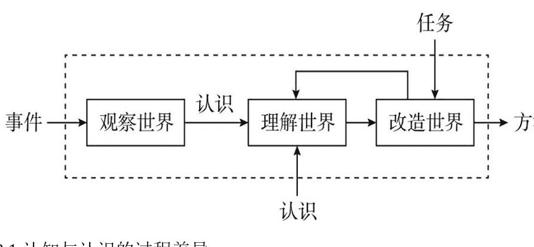
图8.1 认知与认识的过程差异
资料来源：喻国明，刘彧晗. 从信息竞争到认知竞争：策略性传播范式全新转型——基于元传播视角的研究[J]. 现代传播（中国传媒大学学报）,2023,45（02）:128-134.

换言之，认知在客观世界与个体主观深层心智之间发挥中介作用。其功能近似戈夫曼与甘姆森对框架的阐释：其一具有转换功能，认知是客观讯息在个人层面生效的必要条件；其二具有架构作用，认知是定位、释义具体讯息的地图坐标；其三具有框选功能，认知框定个体心智范围与实践半径。认知作为个体经五官感知后内化的思维，通过坐标或地图的角色影响后续态度、决策与行动。所谓认知角力，即是对能够架构个体认知的资源与空间的争夺，争取影响个体认知图景的机会。

#### 2. 传受关系转向助手与异质个体
在认知角力所遵循的元传播规则下，媒介不再居于资讯争夺中的操控主导地位，而是面对独异化思维的个体时转向助手角色，以私人助理如智能语音助手、虚拟人的身份嵌入用户媒介化日常生活。

这一角色转换为认知角力带来新可能。智媒助手以永恒在线的方式陪伴用户，从用户画像、身体、位置、行为到情绪、心理、关系、评价等多维度皆被数据化。这种全息数据化为媒介影响并介入用户认知提供了丰富且可计算的资源，但也带来伦理困境，因为竞争将以更隐蔽方式持续进行，个体反抗认知塑造所需付出的代价与努力更大。

#### 3. 内容逻辑：构建认知地图
如上所述，因社会共享视角的瓦解，认知角力中的内容逻辑应首先编织、铺垫劝服所需的统摄性认知框架，再辅以改造劝服要素的策略。认知心理学家托尔曼将这种统摄性框架称为认知地图，即个体通过对周围环境、目标位置及实现路径的感知建立搜索地图，实现认知定位。

从个体思维模式看，认知是一个由浅及深的多层级活动，建构认知地图也应多层展开。具体而言，认知由深至浅可分为一元认知、二元认知与三元认知：一元认知最深且相对固化持久，属固态认知，改变难度最大；二元认知可协调，常随关系而变，属流动的液态认知；三元认知最松散，可兼容提炼外界所有感知讯息，属极不稳定的气态认知。因此，认知地图需在三个层次分别编织才具效用。实践中，利用政治机器人等计算宣传方法多用于改造信息景观，建构最浅层信息感知的地图，对个体认知影响相对薄弱；在其基础上，借力社群规范与社会资本改造个体与圈层间的信任关系，建构关系认知地图，继而通过长期潜移默化改造基础视角、建构基本框架，竞争更高阶认知资源。

认知地图在传播实践中形成支点效应，一旦个体进入某一基础认知坐标系，后续讯息要素便会点状自动编织进该框架而产生效果。形象而言，一旦认知地基稳固，后续传播效果不再是线性叠加而是指数发展。因此，相较资讯争夺，认知角力更具中观性与釜底抽薪特征，即通过影响个人心智操作系统，继而影响后续意见、决策与行动的达成。

认知角力的研究思路与研究议题
##### 1. 研究思路：从刺激-反应到刺激-认知-反应
上文分析表明，个体认知方式必须以中间环节纳入智媒视域下的传播效果研究范畴。因此传统传播效果研究尤其是劝服效果研究所依赖的基本范式S-R需升维为S-O-R。需注意，此处S-O-R与20世纪30年代新行为主义提倡者之意有所不同，认知角力研究中的O更多指框选、界定个体心智思维与实践半径的认知，S指来自外在环境、个体内部及媒介接触界面中可能影响认知的所有刺激，R指个体在认知过滤下最终产生的意见、态度、行为反应。

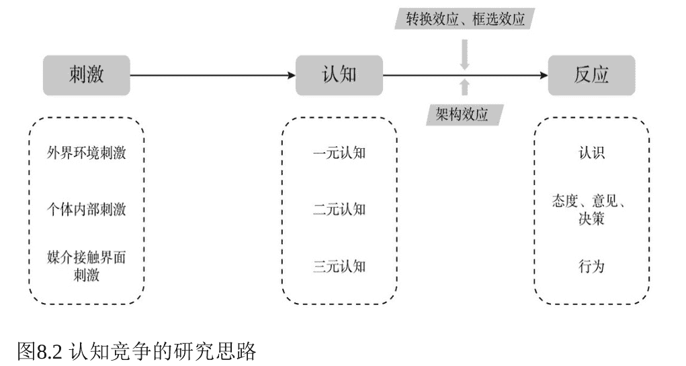
图8.2 认知竞争的研究思路
> 资料来源：喻国明，刘彧晗. 从信息竞争到认知竞争：策略性传播范式全新转型——基于元传播视角的研究[J]. 现代传播（中国传媒大学学报）,2023,45（02）:128-134.

在探究个体认知系统时，可借鉴心理学、认知神经科学等学科的理论与方法资源。例如理论层面，心理学家埃贡·布伦斯维克提出的认知透镜模型描述了立足个体角度认知模式建立的过程，将个体认知视作一组刺激经知觉透镜折射聚焦形成的整体，对探究用户认知模式为何出现系统性偏差具有启发性；在方法层面，认知神经科学相关的脑成像技术及系统数据建模技术可模拟人类认知建立人工认知模型或进行认知计算，为实验研究提供深入个体认知的测量方式。

##### 2. 未来相关研究议题
基于上述思路，未来传播学围绕认知角力可展开的多方面议题包括：

就基础性研究而言，可对影响用户认知建构的因素进行凝练。如前所述，个体认知具有气态、液态、固态不同层次，研究可围绕三种层次认知的建构方式及影响因素展开，剖析不同认知模式的核心影响要素，识别认知机制。

就解释性研究而言，可探索个体认知与后续态度形成、行为倾向之间的因果与相关关系。例如三种层次认知在影响后续态度广度、深度、宽度上是否存在差异；个体认知对其后续思维与行为反应、甚至圈层集结、社会运作具有何种程度的框选作用。

就应用性研究而言，可探究认知角力操作层面的策略。例如哪些操作策略能产生较强认知竞争力，哪些竞争思路可调控个体认知、拓展认知边界等。

小结
拉斯韦尔曾在世界大战中的宣传技巧中将信息战称为影响战争的奇妙工具。如今，这一奇妙工具已升级为对个人层面操作系统的竞争。

从资讯争夺到认知角力的范式转变目前已在军事领域显露。随着社会媒介化程度加深，经济、政治、文化领域也将相继受此转变渗透。智媒技术的升级与微粒社会的到来，推动具有独异思维的超级个体在传播中占据更高地位，智媒信息对用户心智的全方位渗透与微粒社会中共享视角的瓦解，使得个体认知不可避免地以中间环节纳入传播效果研究的考量。认知正成为传播效果的过滤器与撬动点，以坐标或地图的方式影响后续态度、决策与行动。或许未来，智媒技术对个体认知的调动将会如美团接单滴滴派车一般，根据任务目的向个体思维派发任务单，制造舆论、塑造态势。

因此，传播研究必须重新审视认知在传播研究中的地位。未来无论是媒介传播形态革新，还是媒介传播内容创造，都应充分认识认知在传播致效中的重要作用，将竞争思路调整为编织、建构用户的认知地图，关注作用于不同层次认知的机制，利用人们的认知掀起传播更为巨大的波澜。

## 第九章 把握AIGC传播时代的脉搏
### 第一节 未来传播影响力再探讨
在数字技术通过关系连接与个体赋权机制对社会进行解构的背景下，个体的能动性地位在未来传播中凸显，成为更具活跃性的要素，丰富和发展了传播的链条与环节。传播影响力强调传播对于个体社会认知、社会判断、社会决策及相关社会行为产生的影响，是未来传播价值实现的核心通路。相较于判断、决策、行为等可观测变量，认知主要涉及个体的微观心理要素，尚未得到充分发掘。对认知及其内部机制的研究与挖掘不仅有助于补充传播影响力的衡量尺度，而且对未来传播以人为本的价值实现具有理论与实践启示。

#### 传播价值产生的逻辑推演
关于传播价值如何衡量一直是长期议题。1977年，达拉斯·W·斯麦兹在《大众传播系统：西方马克思主义研究的盲点》中提出受众商品论，认为大众传媒内容是一种免费午餐，其主要产品实为受众的注意力。马歇尔·麦克卢汉也论述过传播与注意力的关系，认为电视台以优质节目为诱饵，其目的在于不动声色地租用公众的眼睛与耳朵做生意。迈克尔·H·高德哈伯认为信息社会中受众的注意力是一种有价值资源。早期对注意力的关注为传播价值产生提供了新视角，即在信息过剩背景下，获取公众注意力尤为重要，维系与把握注意力是传播产生价值的源泉。注意力强调信息对公众的触达，无法解释传播生态中一些吸引到注意力却未产生实际效益的特殊现象。也就是说，注意力并未完全解释传播价值如何创造与生成。在此基础上，影响力的概念被提出并广泛探讨。传播影响力由吸引注意即媒介及媒介内容的接触加上引起合目的变化即认知、情感、意志行为等的受动性改变两部分构成。这实际上包含了对公众注意力的获取与内在心理机制变化两个层面。因此，影响力的本质是传播作为资讯传播渠道而对其受众的社会认知、社会判断、社会决策及相关社会行为所打上的渠道烙印。传播影响力强调公众不仅注意到了信息，还有意无意被信息内容影响，进而产生后续行动。

由以上分析可知，传播影响力的相关观点均强调认知，即信息处理的作用，并将接收者视为处理信息的代表，赋予其更积极的角色作用。关于传播价值的探讨深深根植于媒介生态变革，并受社会整体信息环境影响。在大众传播早期阶段，社会整体信息资源相对匮乏，公众获取信息渠道相对单一。此时传播作用范围固定且有限，公众需付出一定成本才能获得信息。随着技术发展带来信息爆炸式增长，公众注意力成为稀缺资源，此前公众对有限传播渠道的竞争转变为传播对公众注意力的争夺，吸引公众关注成为传播价值产生的前提。但注意力并不代表传播价值的实现，传播只有经过个体内部信息加工过程才能最终产生影响。在此基础上，侧重于媒介效果层面的影响力概念产生，延展了关于传播价值实现的理论视角。简言之，注意力是前提与资源，但真正效益与资源的实现则来自影响力。注意力和影响力并非对立，二者共同构成传播价值产生的内在逻辑：从信息触达到价值共振的全链条。

#### 认知是传播影响力的具体标识
当前，数字技术带来媒介生态的进一步变革，很大程度上激活了传播过程中的微信息与微资源，社会整体信息数量呈现指数级增长。此外，以人工智能、区块链、算法等核心技术构成的元宇宙环境对人这一主体进行了更深层次的赋权与解放，个体直觉、情感、意识等非理性要素兴起，形成对信息解码的补充性机制，整体传播环境变得更为活跃与复杂，传播价值如何实现依然是当下的重要议题。

# 当传播的战场从眼球转向心智

要让信息不只是被看见，更能引发情绪共振和价值共鸣，就必须对传播效力本身做一次再审视。效力是概括传播价值的上位概念，触达只是表层，真正可被落地的要拆成可操作的具体要素。当人成为传播链条的核心节点，传播就不再是外部投放，而是主体的能动性贯穿全流程的体现。把衡量落回心智这一微观入口，能给未来传播提供一个更有启发的观察角度。

心智是人对社会刺激进行综合加工的过程，也是动机系统与情感系统变化的基础。从生理看，大脑是外部信息唯一的入口，所有输入都必须经过心智处理才能形成价值判断。从架构看，每个人都有自己的图式与框架，会依据既有经验对外部信息做筛选与再加工，这体现了主体的选择性与能动性。从社会文化看，心智与环境互相塑造，公共舆论与集体认知正是源于单人认知在交互、扩散与流动中的聚合。社会合意的形成，本质上依赖单人认知的协同与汇聚。心智与注意力不同，它关乎信息如何被选用、加工与赋义，为效力的实现提供了可感的结构性标尺，也构成了传播效力理论的重要延伸。

### 第二节 当媒介生态裂变，影响力的衡量标准该如何设定
理解心智如何在未来传播中创造价值，需要回到生态变革现场，看社会构造与行为逻辑在发生什么变化，进而找到效力新的基本尺度。

#### 微粒化
连接、整合与协同正在重塑媒介环境。数字媒介通过持续重连赋权于人，同时也在瓦解原有的社会组织形态。科层制那种层级分明的结构正在松动，人逐渐成为具备能动性的行动主体，也成为社会的基本构成单元。德国学者克里斯多夫·库克里克提出的“微粒社会”概念指出，在高度数字化的社会里，人与物都被数据精细记录、分析和评判。人变得分散，分散在种种事物、状态和感受里，不仅思想分散，连整体存在都呈现出分散性。这揭示了数字社会最深层的变化：以单位为中心的运行逻辑被打破，行动力被前所未有地激活，成为信息的生产者、传播者、获取者，甚至是社会资源的直接调控者。在这一逻辑下，社会以裂变方式演进，个人能量的累积在特定时空里重塑传播逻辑。数字技术决定性地改变了社会的粒度，迫使人类对自我与世界形成全新认知。

简言之，微粒化的主体凭借更强能动性和更广自由度突破了时空限制，能够在虚拟与现实间穿梭，形成传统传播时代不具备的心智体验，进而把信息接受延伸为身体实践与价值塑造。

传统以“分子”级范式运作的方式，已难以应对“原子”级的传播构造。在微粒化社会里，传统传播至少面临三重错位：第一，同质化内容无法满足个性化、差异化的信息需求，基于独特心智体验的内容要素尚未被充分挖掘，影响了吸引力；第二，信息海量而心智资源有限，信息过载与追求理想信息之间的矛盾容易带来倦怠，难以持续调动心智投入；第三，心智具有能动性，对顺应或冲突的信息会采取不同接受策略，影响传播目标达成。综合来看，微粒化社会的首要任务，是争取并盘活社会人心的认知资源。

#### 圈层化聚合
身份确认与行动参照，圈层化是当下典型的实现方式。广义的圈层是因关系而生的社会网络结构，包含促进资源流动的结构洞和限制流动的闭合团体，它与网络、制度、文化紧密相连。今天的圈层，更多指人们通过平台媒介聚拢互动、基于不同缘由维系的关系网络。与传统血缘亲缘连接不同，当下的圈层更具趣缘驱动的情感属性，其本质是价值观的聚合。

圈层内部意见生成同时具封闭与开放特质，处于私域与公域之间，并在连接两个场域的过程中保持动态平衡。一方面，圈层有强自主性和凝聚力，只有符合其价值观的人才会进入。它通过凝聚个体合意形成共识，主流认知方式会产生全局影响。但当圈层排他性过强阻止多元意见进入时，观点会走向单一，甚至极化，导致窄化与封闭。圈层对个人心智架构形成制度性规范，会筛掉认知差异巨大的成员，划定边界、筑起壁垒。另一方面，开放过度会引入差异化认知表征，削弱圈层独特性，造成结构性突变。因此未来传播的“破圈”必须匹配圈层及圈层内成员的心智结构，解决“以我为主”的认知关联问题。破圈是未来传播的关键议题，解决不好，社会协同与共识难以实现。

#### 社会再组织化
数字技术对社会的解构，正在催生主体激活下的再组织。技术赋权提升个人效能，社会从中心化走向裂变，从科层制的串联模型转向扁平分布式的并联模型。社会构造具有流动性，再组织是贯穿技术、经济、文化等多因素影响的过程。一方面，原有组织因不适应新语境而解构更新；另一方面，个人或群体基于新目标自发形成新组织。分布式社会的再组织是在自组织与他组织共同作用下的演进，体现出新媒介组织的开放性及其与环境的互动。

心智在这一过程中扮演关键角色。作为信息加工过程，心智塑造个人对社会的基本看法，相同环境会因心智不同而产生不同结果。个人心理包含知信行，心智处于起点。心智对再组织的作用有两点：第一，心智是情感的基础。满足认知冲动会产生主观满足感，良好心智能激发积极情绪，促进对特定个人或群体的认同，为再组织提供情感基础。第二，心智是行为的先导。心智预测行为，通过影响心智推动行动，实现再组织。社会再组织影响传播的历史方位，其实现需要传播发挥连接与整合个人心智的功能，以“穿针引线”的方式实现认识协同与合意塑造。

### 第三节 时空与关系如何重塑心智架构
要争夺人心，首先要厘清心智架构如何运作。哈罗德·英尼斯曾把媒介分为偏时间与偏空间，强调媒介形式对社会文化的影响。在媒介-时间-空间的场域中，传播偏向性由时空属性决定。如今数字媒介已超越简单的时空偏倚，兼具时间传承与空间拓展能力，情感为基础的关系向度也拓展了媒介偏向。将视角从社会结构收敛到个人心智结构，媒介的时空属性与关系属性在历时性、共时性、关系型层面与心智耦合，会使传播作用于心智结构并产生叠加效应，于信息触达之上实现影响力。

#### 时间维度
心智是对信息接受的延展过程。弗雷德里克·巴特利特提出认知图式，认为图式是对过去经验的积极组合，个人需要学会把图式拆解为要素并找到适配自己的图式。心智图式会根据经验对新信息进行适配。让·皮亚杰则提出同化-顺应-平衡机制：同化是把新信息转化为适配已有图式的方式；顺应是在新信息面前改造旧图式以容纳变化；二者交织形成平衡与再平衡。心智模型正是通过平衡-去平衡-再平衡实现知识建构。

心智图式解释了影响力实现规律。图式构成个人内部的信息筛选机制，符合已有图式的内容会被保留，完全相异的内容则被排除在加工之外。即便同化与顺应机制会能动地理解重组信息，其根本仍是信息与图式的适配度。图式的变化是渐进的，微小差异逐步被吸收，形成在保留核心价值基础上的适应性改良。在媒介变革下，技术赋权提升能动性，增强现实掌控力，扩展行为自由度；多感官输入强化同化顺应机制，非理性因素也能自发启动心智，并通过关系圈层的作用升维认知能力。

这带来三点时间启发：第一，在个人尚未形成完整图式的早期，传播应抢占定义权，通过先入为主影响图式生成；第二，传播应以已有图式为切入点，实现传受双方心智架构的拟合，满足“以我为主”的取向，才能在触达的同时培育核心价值；第三，感官整合拓展了同化顺应机制，新场景新形态可能干扰同化，也可能触发顺应以改造旧图式，为心智层面的破圈提供契机。

#### 空间维度
心智不只在脑中，它与社会技术因素动态交织。4E心智框架认为心智具身、嵌入、生成、延展，由大脑与外部结构共同完成。具身心智指身体参与建构心智，心智嵌入社会语境，环境成为心智工具，增强心智与行动的匹配。生成心智强调心智与行动的生成关系，有机体与环境的交互是心智系统的一部分。延展心智指心智可延伸到环境中。安迪·克拉克认为大脑是“预测机器”，通过感官理解外部环境，预测是延展心智的入口。

传播学视角下，4E心智呈现出空间向度：心智以能动性为基点，与环境相互关联互动，身体与互动发挥功能性甚至构成性作用，心智目标是提供与世界互动的具身行动可能性。4E框架将心智过程与身体、环境、情境统一起来。

将4E要素与未来传播结合：具身心智蕴含人内传播要义，个人通过具身体验获取并处理信息。VR、AR突破虚实边界，行动自由度扩大，具身心智更生动。嵌入心智强调对环境的依赖，正确依赖可减轻心智负担。数字设备存储信息，降低心智负荷；算法推荐实现“信息找人”，深化心智与环境的连接。生成与延展心智强调情境性，与场景化传播高度一致。未来传播可基于特定场景氛围，精准匹配不同心智风格，潜移默化影响日常生活。心智能力正是在共时与历时依赖认知资源的基础上构建的，心智系统既获取资源，也参与塑造资源。

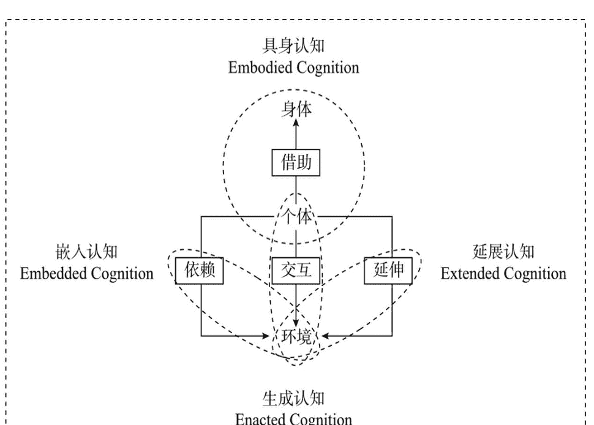
图9.1 4E认知理论模型
资料来源：喻国明，郅慧. 理解认知：把握未来传播的竞争重点、内在逻辑与操作路径[J]. 编辑之友，2023（03）:58-65.

#### 关系维度
互联网改变社会结构的内核是关系资源的激活。在连接为基础的结构下，信息循环与裂变传播都受情感驱动，能引发共鸣的内容更易扩散。情感的生发则需要心智生成、互动与调和。叶浩生提出的“知情一体”强调心智与情感的关系性存在。理性是对客体的认知，感性是对客体的反应。心智是具身行为的一种形式，心智与情感相互嵌入。一方面，情感离不开心智，原有图式对情感的削弱与强化起基础作用，新情感在既有心智积淀中生成。另一方面，信息产生的认知在情感驱动下迅速沿社交网络传播，经多元理解形成新心智并凝结为新情感，二者构成传播动力。

这一关系契合感性与理性策略。文字为主的传统传播具有理性化、精英化逻辑，形成信息门槛。社交媒体时代，视频等形态融合文字与图像，同时作用于感性与理性，打破信息壁垒。未来元宇宙中，个人以数字分身穿梭虚实，通过具身生理体验提升感性逻辑层级，并在交互中形成理性认知。心智与情感的交互与未来传播逻辑高度耦合，如何调和二者机制以实现社会沟通与协同，是需要持续探讨的命题。

### 第四节 心智破圈，才是未来传播的破局点
传播破圈已成为媒介生态变革下的核心议题。打破圈层壁垒，连接个人与社会信息资源，在触达基础上实现价值共建，是未来传播的理想目标。从心智微观视角思考影响力实现条件，有助于打造全新的效果通道。

#### 目标定位
传播具有意义赋予功能，大众传媒推动社会共识凝聚与合意制造。社会共识是个人心智的良性聚合，而个人分属不同圈层，圈层内部心智对个人具有同化效应。心智破圈首先要多层次把握心智架构。不对称的心智权力构成心智生态位，优势群体塑造信息共享结构以迎合特定心智需求。大众传媒处于心智生态位前端，其信息共享必须符合个人心智需求。根据同化-顺应-平衡机制，顺应心智架构的内容会被更快接受，并通过新旧心智互动实现扬弃与再平衡，为传播价值创造提供前提。

大众传媒应在心智层面实现三层传播：第一，触达层，即“看得见”。与个人特定心智需求对接，将同质化转向个性化，用算法把握场景下的心智状态。多任务状态下心智资源分散，轻量化、生动化、趣味化内容能缓解心智压力。第二，留存层，即“看得下去”。激活心智中的情感要素，平衡感性与理性。单纯摆事实讲道理易产生逆火效应，需根据议题特性匹配心智与情感策略，严肃议题可适当增加理性诉求以唤醒情感。第三，价值层，即“看得有用”。实现对个人心智架构的创新性改变。把握公众已有价值逻辑，柔性渐进地植入新价值倡导，实现微观价值迭代与宏观价值共振。

#### 实践路径

群层张力与破圈平衡

群体的运行呈现出变动中寻求稳态的规律。内部的自我强化会让成员对事物的判断愈发坚固，认知彼此呼应进而点燃情感共振，最终凝聚成群体共识。同一机制的另一面是对外部信息的逐渐隔绝，隔绝酝酿成偏见，偏见累积成对立，如今已成为传播生态难以回避的常态。过分追求开放，多元信息反而会冲淡特色与吸引力，进而使群体面临瓦解风险。于是破圈的实质，是在内部寻找能够自持的动态平衡临界。

认知的延展与互动特性，为把握平衡态并实现突破提供了微观抓手。这一思路与去组织化后形成的分布式社会主线相契合。学者埃德温·哈钦斯提出分布式认知，认为认知并非只发生在大脑内部，而是分布于群体与成员之间，需要内外结构的协同运作。38 通俗讲，信息在个体间被传递、被转化，再经群层结构加以组织，认知在很大程度上塑造了资讯在圈内圈外的流动轨迹，群层本身也可视作认知的一种外延框架。面向未来的传播实践，应当把认知当作破圈的微观动因来审视，让分布式认知与群层的动态平衡点相挂钩。认知对内部资讯的调节与对外延结构的拓展，有助于捕捉封闭与开放之间的临界状态，使群层在聚拢同类观点时仍能保持对外部声音的接收，并通过个体转译生成契合自身语境的新内容，实现两种状态的共存。

#### 价值取向
人的理解并非孤立存在，而是在与社会环境的持续互动中形成具身、生成、嵌入与延展的复合形态，理解已从大脑内部扩展为与环境共生的复杂系统。网络带来的微粒化重塑了社会的颗粒度，人的主体性与能动性被放大，成为传播场域里的活跃变量。从媒介延伸的视角看，未来媒介将进一步拓展视觉、嗅觉、听觉、触觉等多元感官，让个人的感觉整体回归，使其呈现出感官平衡下的部落人特质，理解也将在虚实交织的场域中开辟前所未有的体验。

未来传播的核心在于始终坚持人本导向，拓展人认知自由边界，唤醒人在复杂社会中的认知潜能与创造力，推动对社会发展各环节的深层反思，完成道德与思想层面的认知跃升。人本的深层指向在于彰显人的尺度、价值与尊严，把个人认知置于资讯传播的入口，这是对传统传播时代以人作为统合视角的精细化推进。除支持认知向外延展，人体与心智本身即是一个大宇宙，对其进行选择性的重组再造也将成为未来媒介演进的重要方向。39 将人的价值贯穿于媒介发展与迭代，实现人本逻辑下的认知多元互动，是未来传播的基本价值取向。

### 小结
在数字技术驱动的未来传播变革中，社会被拆解为微粒化的组织与结构，群层化与再组织化成为显著表征，传播呈现出不同于传统时代的生动图景。当人成为传播与社会运行的主体与能动因素，如何深描个人认知结构及其与传播要素的耦合，成为衡量未来传播影响力的可感知标尺，也是理论延展的关键路径。因此未来传播影响力的实现，本质上是资讯在吸引注意后对个人认知结构的改变，进而显化为决策、行为等外在指标。认知要素的构成、指标的细化以及其与传播的操作关联，将是未来传播持续延展与思考的方向。

## 第十章 认知带宽：AIGC 时代用户洞察的新坐标

### 第一节 个性化传播时代与个性化媒介效果研究范式
依托智媒技术的连接价值，以差异化个体为基本单元的微粒化社会结构浮现，点对点的个性化传播与传统点对面的大众传播交织渗透于日常生活。面对异质性增强且更具能动性的受众，拉斯韦尔式的直接媒介效果研究范式的解释力下降。大量沿此范式开展的实证显示，媒介效果要么微弱到仅能解释3%～5%的变异，1要么方向不一致甚至相互矛盾。对此学界反思，一方面既有研究对受众的把握过于粗颗粒，把受众当作平均化的大众，难以捕捉差异效果；2另一方面既有范式常将受众视为被动接收者，忽视或弱化效果生成过程中的受众能动性。3

当前，基于受众差异展开的个性化媒介效果研究在国内外并行兴起，4该范式认为决定效果的并非外生刺激强度，而是受众从刺激中抽取的实际认知解读。拉斯韦尔式研究的逻辑关注同，即何种接触会在群体中产生何种共同效果；而个性化范式关注异，即同一接触在不同用户中会产生何种差异效果。

在此背景下，本书引入行为经济学中的认知带宽5概念进入传播学研究，从概念出发探讨其评估方式与影响因素，以回应个性化传播时代对积极受众与差异性效果的关注，为新媒介环境下的受众与效果研究提供新视角。

### 第二节 认知带宽的概念
认知带宽是一个跨学科概念。带宽最初源于通信学，用以区别于信道容量的实际可用容量。1948年，克劳德·香农在《通信的数学原理》中提出香农公式，将信道容量视为信道带宽与信噪比的函数，信道容量指理想环境下无差错传输的最大值，信道带宽则指有噪声环境下实际可传输的容量。6由此带宽具有两层属性：其一是容量属性，描述信道承载信息的空间大小；其二是相对属性，描述受噪声影响的实际空间。行为经济学者借用此概念提出认知带宽，用来描述有限理性个体的认知可用容量。

#### 行为经济学中的认知带宽
认知带宽由行为经济学家塞德希尔·穆来纳森与埃尔德·沙菲尔提出，指个体在信息处理过程中可用的认知资源总量，涵盖计算、注意、决策、计划与抵制诱惑等多项任务，7且不等同于先天的认知容量，而是衡量当下可调用的认知容量。8该概念常用于探讨稀缺心态对决策的影响。研究者认为稀缺情境会压缩认知展开空间，产生管窥效应，导致信息加工不足。例如，深陷贫困的个体在发展性问题上易出现决策失误，并非认知能力低下，而是稀缺心态使其注意力过度投向生存性问题，导致处理发展性问题时的认知带宽受限，出现思维固化与认知偏移。

在行为经济学者看来，认知容量是与认知带宽和稀缺处境相关的函数，即非稀缺环境下个体理性思考后可展开的全部认知空间，正如神经科学假设，人脑功能完好时认知容量应基本一致；10而认知带宽是在稀缺环境下受非理性影响后实际可展开的认知空间。带宽的相对性内涵在此得以延续。

#### 认知带宽应用于传播学
对传播学而言，认知带宽虽属新概念，但相关探索早有脉络，主要集中于媒介信息认知加工研究。

信息加工研究提出有限容量理论与中心瓶颈理论，强调人类认知容量有限，同一时刻难以多任务并行，冗余信息过多会造成认知超载。11该观点的局限在于把认知加工视为单线过程，信息加工可能性取决于人脑绝对容量。安妮·朗在此基础上提出动机化媒介信息加工的有限容量理论LC4MP，12她以分饼为喻，认为认知处理是并行的，可将总容量划分为多个小容量池同时处理多条信息，信息激活的动机强度影响容量分配。13由此问题从绝对容量转向相对容量。她进一步提出认知可用资源，指具体加工时个体实际可调用的资源，并强调总容量决定能否加工，可用容量影响加工彻底性。14认知资源匹配假说进一步发展该思路，提出所需资源与可用资源两个核心概念，假设二者匹配时信息加工效果最佳。15

可见传播学也经历了从绝对容量到相对容量的转向，无论是小容量池还是可用资源，均强调真正影响效果的并非全部认知空间，而是实际可用的认知空间。因此本书在传播学语境下将认知带宽定义为特定个体在特定情境下处理特定媒介信息时实际可展开的认知空间，其影响信息处理的彻底性，且具有极高的用户相对性，常因人而异。

### 第三节 认知带宽的评价方式与影响因素

#### 认知带宽的评价思路
认知带宽作为相对容量概念，需采用相对评估法，抓住其用户相对性，从差异视角展开。与网络安全相关的社会工程研究为此提供了思路。该研究认为人类对信息的敏感度因人而异，个体更容易受特定类型信息影响，这被称为信息易感性。16网络信息攻击正是利用不同程度的信息易感性诱捕用户，例如谎称亲人被绑架的诈骗利用对亲人信息的高易感度，将用户的认知空间压缩至狭窄范围，降低判断能力。该观点意味着认知展开是一个由点及面的过程，存在受易感因素影响的核心，认知空间围绕其展开。认知焦点理论与认知参照点理论也印证了焦点结构的存在。17,18

综合上述，本书尝试将认知带宽操作化为个体围绕认知焦点展开的广度与深度，并从焦点、广度、深度三方面评估。

##### 1. 认知焦点
不同易感性会塑造不同的认知焦点。阿密特·阿尔莫将认知焦点视作信息交流中最重要、激活程度最高的信息。19茱莉·伍尔夫迈尔认为认知焦点是影响最强的信息，具有定位认知空间、放大相关加工、抑制无关加工三重作用。20本书将认知焦点定义为个体认为最重要且最具影响力的信息，其形成受易感因素影响。

测量上，除自我报告外，眼动等认知神经测量为识别焦点提供更客观手段，如注视、回视等指标。但如伍尔夫迈尔所指，认知焦点不仅存在于知觉层面，眼动仅能捕捉视知觉层面的焦点，未来或需结合脑电等工具从脑区活动层面识别。

##### 2. 认知广度
认知广度指围绕焦点可展开的认知空间宽度，体现带宽的横向表现。可关注注意范围与记忆范围两个指标。

注意范围指进入注意范畴并可利用的信息广度。22当传播目标不要求深度时，注意范围越广效果越好。例如迈克尔·斯鲁弗等人发现新闻阅读中注意范围更广时认知效果更好。23测量多采用自我报告与客观记录，如量表询问关注程度，或记录停留时长；也有研究尝试行为实验与生理测量。

记忆范围指可存储并随时提取的信息广度。24记忆是注意的进一步过程，通常认为记忆范围越广效果越好。测量除自我报告的回忆法外，学习-再认的心理学行为实验范式是最常用手段，再认正确率越高、信息类别越多，记忆范围越广。

##### 3. 认知深度
认知深度指围绕焦点展开的认知空间纵深，主要关注信息加工过程深度。可从启发式与分析式两个层次探讨。25

启发式加工相对浅层自动化，依赖直觉，资源调用少；分析式加工相对深层精细化，需全面理解与评估，资源调用多。玛格达·奥斯曼发现实际加工并不泾渭分明，提出将加工视为启发式-分析式的连续光谱，启发式表征强度越高加工越浅，反之越深。26测量建议采用量表评估认知努力、加工速度等指标；马里奥·B. 费雷拉等人提出过程分离程序，通过纳入任务与排除任务分离两种加工成分。27

#### 认知带宽的表现类型
以认知焦点为原点构建广度-深度二维矩阵，可将认知带宽归纳为四类：高密型带宽即高广度-高深度，注意与记忆范围广且能深度加工，通常带来最佳效果；低窄型带宽即低广度-低深度，范围与深度均低，效果较差；浅阔型带宽即高广度-低深度，范围有优势但深度不足，适合快速浏览类任务；狭长型带宽即低广度-高深度，仅深度有优势，适合需详细理解的任务。

归纳类型有助于理解媒介效果的差异，提示研究不能仅看广度或深度某一维度，而需关注认知任务与认知带宽的适配性。首先评估焦点是否与任务要求匹配，再评估带宽类型是否契合传播目的。

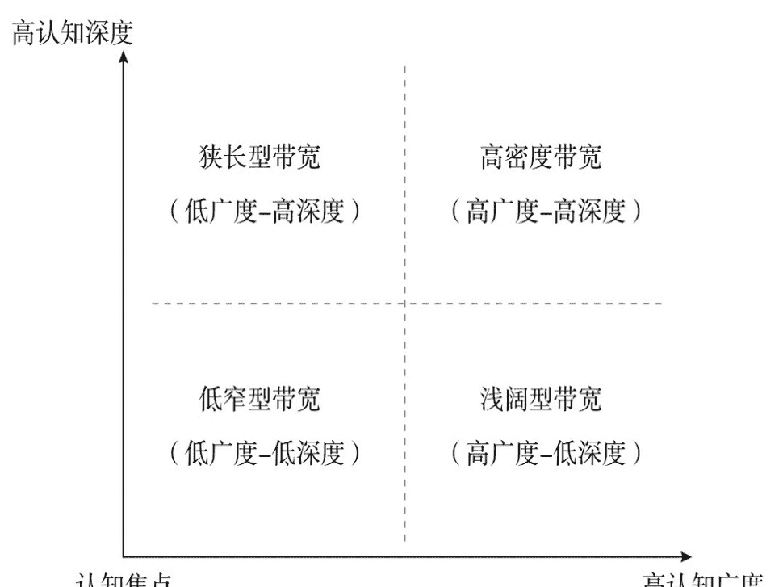

图10.1 认知带宽的代表类型

资料来源：喻国明，刘彧晗. 认知带宽：个性化传播时代用户洞察的新范畴[J]. 社会科学辑刊，2023（03）:213-219.

#### 认知带宽的影响因素
在媒介信息、情境与用户构成的传播系统中，既有研究多聚焦信息与情境，而认知带宽的高度用户相对性要求从用户视角理解影响机制。帕蒂·M. 瓦尔肯堡与约亨·彼得在差异易感性模型DST中将影响可用认知资源的易感因素归纳为特质类与感知类。28本书亦作此区分。

##### 1. 特质类因素
特质类因素分生理自我与社会自我两层面。生理层面，性别、年龄会塑造长期易感倾向。例如阿米莉亚·科图雷·布埃等人发现不同性别群体存在信息易感差异，女性内部因女性意识不同对物化信息感知亦有差异。29年龄敏感度亦影响效果，对年龄持积极态度且敏感度低的老龄用户仍可在微信使用中展现超龄认知效果。30社会层面，个性、动机、身份、能力均影响易感状态。倾向-内容一致性效应表明用户偏好与自身个性、知识、经验、身份一致的内容，加工更快更深。31但影响程度因人而异，如伊恩·贝伦斯等发现自尊特质重视程度不同会影响社交媒体使用后的自尊感知。32约翰·T. 卡乔波等人发现动机强度越高信息加工越精细。33罗伯特·C. 霍尔尼克验证身份认同感越高越易注意一致信息、回避不一致信息，且隔离程度随偏见加剧。34

##### 2. 感知类因素

感知类易感因子只有在真实的信息接触情境里才会显影，而且这种塑造作用比较不稳定，整体可归纳为情绪、价值判断、规范感知三类。

情绪会放大或削弱易感状态。享乐流畅加工 hedodynamics 理论已证实情绪会调节信息加工表现，积极心境有助于加工推进，消极心境则会抑制加工。35 价值因子关乎使用者对客体价值的主观判断，也会影响对特定信息的易感度。前景理论指出人们多以价值参照点评估信息价值并做决策，同一信息对参照点设得高的人来说价值感不足，易感偏低，倾向保守；对参照点设得低的人来说价值感充足，易感偏高，更易冒险。36 稀缺理论强调产生稀缺效应的不是客观资源短缺，而是使用者对自身资源价值的主观评估，当主观稀缺感很强时，注意力会收紧到如何更有效利用自身资源，出现“专注红利”，同时也会出现“管窥效应”，视野外事物被抑制。37 规范因子即对情境规则的感知，也能作为易感因子影响认知带宽。情境规范研究显示微观群体、中观组织、宏观社会带来的趋同压力各不相同，会影响后续认知与行为。尽管“情境-内容一致假说”认为信息与使用者所在群体、组织或社会的规范价值观越一致，影响越大，但该效应并非恒定。个人主义文化背景下成长的人受规范影响相对较小，集体主义文化背景下成长的人受规范影响更大。38

### 第四节 认知带宽的研究议题与研究指标

前文已在概念化与操作化层面展开认知带宽的梳理。为把研究路径讲清楚，本书提出可行的研究议题与研究指标。

#### 主要研究议题

- 1. 描述研究：识别认知带宽表现
描绘认知带宽的呈现形态对后续研究与传播实践都有意义，可采用个案、深度访谈等方法，识别带宽类型与可能影响因素。例如通过探究个体的认知焦点、与焦点相关的注意与记忆范围及信息加工深度，诊断用户实际认知空间的受限与不足之处，为机制研究做铺垫。

- 2. 解释研究：发现认知带宽的受限机制
为解释带宽何以受限，未来研究一方面可采取归纳路径，基于描述结果，进一步从个案与深度访谈中提炼影响认知焦点定位及认知广度、深度展开的相关因素，发现受限机制；另一方面可采取演绎路径，对可能影响认知带宽的易感因素作出假设，再验证其是否影响认知焦点定位、限制认知广度与深度。
厘清受限机制，有助于解释“媒介接触为何出现差异效果”这一难题。比如媒介暴力是否增加暴力认知一直缺乏共识，从带宽视角看，可能是使用者对暴力内容存在易感与非易感两种状态，并带来两种带宽表现，即易感者形成围绕强暴力内容展开的狭长型带宽，而非易感者形成围绕非暴力内容展开的浅阔型带宽，由此形成不同媒介效应。围绕这一思路，还可展开更多议题，通过梳理易感因素与认知带宽的关系，为差异媒介效果提供新的阐释框架。

- 3. 策略研究：基于认知带宽的传播效果提升研究
既有策略研究多预设使用者拥有均等、理想的认知能力，该前提在传统大众传播时代成立。而进入个性化传播时代，传播者面对的现实是能动使用者对同一媒介内容的易感性并不相同，由此展开的认知带宽也不相同。传播者需要从有限理性的角度审视使用者认知表现，并基于使用者异质性设计提升策略。例如依据使用者携带的易感因素设计传播信息，使信息匹配其认知带宽，实现传播目标。

#### 可用研究指标

##### 1. 认知带宽的评价指标
此处主要从操作层面说明认知带宽研究的可行方式（见表10.1）。认知焦点，主要通过自我报告或眼动的方式来识别对使用者影响最深的信息部分；认知广度，主要评估注意范围和记忆范围，可采用心理学实验范式结合眼动生理测量工具进行。例如，注意范围可以通过追踪眼动轨迹描述，而记忆范围可以通过“学习-再认”的心理学行为实验范式测量；认知深度，主要评估信息加工程度（启发式加工/分析式加工）和信息理解程度，可以采用问卷调查或结合脑电与“过程分离程序”的心理学实验范式进行。在具体研究中，可根据研究目的和主题选取需要侧重评估的认知带宽维度，也可以将三个维度结合起来评价认知带宽的综合表现。

表10.1 因变量（认知带宽）的研究指标细化

| 维度 | 指标 | 测量工具 |
| :--- | :--- | :--- |
| 认知焦点 | 主要信息 | 自我报告、眼动测量 |
| 认知广度 | 注意范围 | 眼动测量 |
| | 记忆范围 | “学习-再认”行为实验方式 |
| 认知深度 | 信息加工程度（启发式/分析式） | 过程分离程序、脑电测量 |
| | 信息理解程度 | 问卷调查、自我报告 |

资料来源：喻国明，刘彧晗. 认知带宽：个性化传播时代用户洞察的新范畴[J]. 社会科学辑刊，2023（03）:213-219.

##### 2. 易感因素的可研究变量
后续相关探究仍可从特质类因素和感知类因素两方面入手探究认知带宽的影响机制（见表10.2）。特质类因素方面，除了探究使用者的生理性特质（如年龄、性别）和社会性特质（如身份、地位、经验），还可从与媒介接触相关的媒介特质及与信息加工相关的认知特质方面展开探究。例如，探究媒介人格（即个体在媒介使用中表现出的稳定人格倾向）39的作用；探究认知风格（即个体在认知过程中表现出的习惯化模式）的作用；探究认知闭合需要（个体应对模糊信息的忍受程度）的作用。感知类易感性层面，从既有传播研究来看使用者感知会随传播层次的变化而变动，对情绪、价值、规范等因素的考察也可结合传播层次（个人、人际、群体）来逐层考察，分析其在不同传播层次中对认知带宽的影响机制。

表10.2 调节变量（用户易感性）的研究指标细化

| 维度 | 指标 | 可能展开的具体变量 |
| :--- | :--- | :--- |
| 特质类因素 | 生理性特质 | 年龄、性别…… |
| | 社会性特质 | 身份、地位、经验…… |
| | 认知特质 | 认知风格、认知闭合需要…… |
| | 媒介特质 | 媒介人格…… |
| 感知类因素 | 个人层面感知 | 价值 |
| | 人际层面感知 | 情绪、价值 |
| | 群体层面感知 | 情绪、价值、规范 |

资料来源：喻国明，刘彧晗. 认知带宽：个性化传播时代用户洞察的新范畴[J]. 社会科学辑刊，2023（03）:213-219.

### 小结
个性化传播时代，如何展开个性化的认知效果研究，应当是传播学界与业界共同关注的问题。本书试图引入行为经济学中的“认知带宽”概念，描述使用者实际可展开的认知空间，强调传播者面对的不再是具有理想认知容量的受众，而是认知带宽各异的受众这一时代性问题。只有把握使用者实际的认知带宽，理解哪些因素影响使用者的认知焦点定位和认知广度，进行深度展开，传播者才能有针对性地采取效果提升策略与干预方式，优化传播实践。

本研究也存在不足。首先，本章的研究重心是从传播学视域对“认知带宽”这个概念作出概念化与操作化的尝试，但在具体研究路径的设想与规划方面仍有欠缺，例如到底如何探究易感因素对认知带宽的影响、着重探究哪些易感因素等问题，均有待后续研究；其次，本书尝试从使用者易感性的角度理解认知带宽的影响机制，但这仅是其中一种研究思路，就认知带宽何以受限这一问题，未来仍有诸多探索空间。正如瓦尔肯堡和彼得所说，个性化传播时代的研究问题应该将视野从媒介转移到人，未来研究不是要关注产生了多少媒介效果，而是要关注媒介效果为什么存在差异。只有通过研究人与人之间的差异，我们才能更好理解媒介和传播的作用。40

## 第十一章 元宇宙视域下认知竞争逻辑的重塑

### 第一节 媒介社会中认知资源的有限性与信息无限性的矛盾

#### 媒介环境的内爆与个人心理
媒介技术的发展带来了“内爆”implosion及符号的过载。而过载的信息和符号资源与个体有限的认知资源相结合，一方面使得个体依赖于媒介的逻辑形成认知、规训行为，另一方面也使得社会按照媒介化的逻辑进行重构与再组织。麦克卢汉基于对媒介技术的进化的考察，提出了“媒介即人的延伸”的观点，新媒介技术产生会形成新的认知与思维方式，由此形成认知尺度与认知环境，从而对人的心理机制与社会产生影响。在这一背景下形成了“内爆”的观点，机械时代人完成了身体在空间范围内的延伸，人的中枢神经得到了延伸，以至于能拥抱全球。1并且这种身体上的延伸对整个心理及社会复合体都产生了影响。

内爆的观点强调了“反环境”2和“时空感的悖论”。具体来说，媒介内爆带来了时空界限的模糊、时间的加速与空间的多重性，使得现代社会呈现出“脱域”的特点。时空的同步性与异步性并存也带来了“反环境”，即影响我们对所处环境的认知。电力技术下“反环境”的功能使得个体产生了时空感的悖论，时空的急剧压缩一方面使得个体承受着心理压力，另一方面也带来了社会运转的加速，如信息流的加速和过载。

#### 个体有限的带宽形成内爆后的困境
媒介产生于人们对于信息的需要，媒介起到了延伸、替代人感官的作用，并且通过感官形成的中介化体验进一步作用于人的认知与行为。从媒介的结构与功能来看，人与媒介产生互动的根本原因在于个体有限的生理和心理认知能力。随着人机交互、技术身体、智能身体的引入，技术逻辑已经渗透进日常媒介实践当中，用技术的术语来看，个体有限的能力可以概括为“带宽”。在数字设备中，带宽指单位时间能通过链路的数据量。通常以bps来表示每秒可传输的位数。有学者据此提出生理带宽的概念，3在心理学中个体有限的认知资源也被理解为认知带宽cognitive bandwidth。

人的生理带宽被媒介所中介，体验中介后的感官体验，这种具身的交互包括人感官的多维度的体验。生理带宽也是在这种具身交互的基础上形成的，主要是从具身的角度考察媒介与人的感官体验。许多实证研究结果突出了媒介技术如VR/AR/MR对用户视觉感知、身体交互与传播行为的影响。因此，个人的生理带宽与媒介的关系具有依附性，受自然的限制，人的感官需要依托媒介，基于媒介获得的体验也在作用于个人的身体、心灵和认知。

从心灵与认知的角度，认知带宽概括了个人有限的认知资源，认知带宽指的是信息处理的可用性，以及个体的认知能力和执行控制能力。行为经济学家穆来纳森和心理学家沙菲尔在《稀缺：我们是如何陷入贫穷与忙碌的》一书中提到了认知带宽的概念，是一种相对的认知容量，其包括两种能力，分别是认知能力和执行控制力。带宽的减少会降低“解决问题、保留信息和进行逻辑推理”的认知能力，同时削弱执行控制能力。

基于信息加工理论，对信息的过滤、控制、保持和加工都需要消耗认知资源，认知资源的有限性将直接决定个体可以处理信息的复杂性及信息数量。在这一过程中，由于注意资源与工作记忆的有限性，“认知带宽”成为媒介信息过载时代的稀缺资源。而这种稀缺资源也成为不同媒介竞争的目标，虽然个体假设自己可以根据自由意志决定思维方式和行为决策，但是在认知带宽的局限下个体可能将认知资源集中在最为紧迫的需求上，牺牲其他目标，因此个体在某些问题上可能沦为被媒介信息所主导的无意识的大众。

不过，除却客观上信息过载带来的内爆，个体主观上超越现实的欲望与需求也可能导致媒介交往中的“自反性沉迷”。即当我们理性有限而行动无限时，可能基于生理欲望驱使行动，并在数字媒介交往中不断强化自反性沉迷。这种自反性沉迷可能表现在两个层面：在感性层面上，对媒介的过度依赖可能导致个体心灵危机；在理性层面上，认知带宽和算法等技术因素可能形成信息茧房和回音室效应，进一步导致社会交往的离散化。

基于此，本研究拟从个体认知与媒介信息的矛盾方面展开论述。认知带宽描述的是个体认知资源有限，以及有限认知和有限注意条件下的信息分配问题，在这一过程中展开了信息供给与用户信息接收的两个最主要的主体。而在媒介环境中，媒介日益塑造了不同的空间与场所，并允许个体展开具身的传播行为，这些行为背后体现了空间与身体和认知的互构，以及文化的渗透。由此以“身体-媒介-认知-空间”的逻辑展开，首先分析个体有限带宽下媒介所形成的认知竞争的效率逻辑；其次，从中介化视角看个体带宽与媒介社会的互构，重新界定传播研究中受众认知的概念维度；最后，从身体与媒介空间的互动视角出发，以元宇宙为基本视域，思考元宇宙环境中智能技术是否能够摆脱媒介认知竞争的效率逻辑，达成个体的积极认知。

### 第二节 中介化视角下个体带宽与媒介的关系
在个体与媒介的关系中，生理带宽涉及身体的居间性，认知带宽涉及身体与认识、心智和意识的互动关系。在这个过程中，有学者指出，媒介并非简单的、技术性的单一“延伸”，媒介总是在“居间”，成就的是交互关系。以媒介与人体而言，媒介是人的连接点，人体也是媒介的连接点，展现的是技术与人和世界的关联。德布雷也认为媒介是一种关系而非实体，从关系性的角度来看，不同媒介承载了不同形式的交往方式，其所形成的竞争逻辑和方式也不同。

#### 中介化视角下个体带宽与媒介的演进逻辑
基于个体带宽的视角，媒介成为个体感知体验世界的中介，而在这一过程中个体与媒介产生了中介化的互动。“中介化”mediation这一概念指的是两个区分的元素、成分或过程之间的连接，在这一过程中传播技术协助了人与人之间中介形态的互动体验，使得时空的距离化time-space distanciation或时空延展成为可能，在此基础上人们的体验也被介入的技术物所型塑和替换。中介化也包含了一种辩证关系，即技术与其相应的机构驱使特定的传播形态的同时，这种驱动也受制于历史和社会传统。由此，中介化辩证关系视角能够阐释个体在不同历史时期的媒介交往方式。中介化过程也包括了技术性、社会性和空间性三重维度（见表11.1）。

表11.1 中介化视角下个体带宽与媒介的演进逻辑

| 媒介演进逻辑 | 口语媒介-文字媒介-印刷媒介-大众媒介-电子媒介 |
| :--- | :--- | :--- | :--- |
| 中介化的演进 | 媒介技术性 工具-关系-场景 | 社会性 直接社会交往-中介化的社会交往 | 空间性 物质空间-虚拟空间-虚实融合空间 |
| 生理带宽的演进 | 感官分离-感官融合-感官重塑 | 语言传播-非语言传播-多模态传播 | 身体在场-身体离场-数字身体 |
| 认知带宽的演进 | 具身认知-嵌入认知-生成认知-延展认知 | 社会身份认同与建构-情感与价值认同 | 直接经验性认知-中介化的认知-扩展的想象空间 |

资料来源：喻国明，苏芳. 从认知带宽到价值带宽：元宇宙视域下认知竞争逻辑的重塑[J]. 西南民族大学学报（人文社会科学版）,2023,44（04）:139-147.

从技术性的角度来看，媒介技术构成了技术化的交流和意义的建构过程。媒介的连接逐渐从过去的信息传递的工具性连接转变为型塑社会关系、提供场景互动的中介化连接。媒介技术的演进下，媒介发展与个体带宽是一个收紧与释放的弹性的过程，麦克卢汉认为媒介与人感官系统的发展是由感官分离到感官融合的过程。具体来说，口语媒介时代听觉与视觉被同步释放，而文字媒介时代则聚焦于视觉，收紧了其他的感官，这一过程在印刷媒介时代被进一步强化。印刷媒介时代，被强调的文字印刷媒介使得事物被反复思考与审视，人的认知超越了时空的界限，感官被收紧的同时，认知思考空间得到了释放。而在大众媒介时代，广播、电视、电影的产生释放了人们过去被局限的生理带宽，在视觉和听觉的双重影响下，大众媒体在影响个体的注意资源、激活情绪情感、影响个体记忆及建构民族的集体记忆方面起到了一定的作用。电子媒介时代，这种中介化过程超越了距离，表现为时空的脱域和拟真的交往，个体的生理带宽得以进一步融合并被媒介重塑。在认知带宽的维度上，伴随着媒介技术的变迁，认知科学对认知的理解也在不断进步。认知科学家认为认知是具身的embodied、嵌入的embedded、生成的enacted、延展的extended和情境的situated，将心灵看作是大脑、身体和环境共同作用的结果，弥合了标准认知科学忽视身体与环境对认知作用的缺陷。

从社会性的角度来看，西尔弗斯通认为在日常生活中媒介的模糊性与矛盾性、物理性、媒介的社交性和媒介伦理起到了中介化的作用。首先媒介的介入使得社会交往从直接的交往过程转变为中介化的社会交往。电子媒介的产生使得同质化的文化生产与分裂化和个性化的网络社会并存，并且为新的公共性创造了条件。由此，生理带宽逐渐从过去被媒介局限的部分生理感官，发展到电子媒介时代的多模态传播方式，进一步对人体感官通道的叠加与融合。生理带宽与媒介互动的社会性也体现于多模态的话语分析方式中，即这种分析方式为理解人类传播行为背后的话语权力和身份认同脉络中的权力关系提供可能。而在认知带宽的社会性方面，个体的身份认同在心理学上体现为个体对自我身份的确认和对所归属群体的认知，以及所伴随的情感体验和对行为模式进行整合的心理历程。从社交的层面来看，卡斯特认为身份认同是人们获得其生活意义和经验的来源。由此，媒介的中介化过程强调了不同的身份认同的侧面，例如大众媒介时代，社会身份认同与媒介的建构作用被强调；而电子媒介时代，多模态传播方式更强调媒介所形成的圈层中群体的情感认同与价值认同；大众媒介时代，媒体对“农民工”形象所建构的“负面形象”的社会身份，影响了农民工群体在城市社会中获得文化承认和尊重的过程；而在电子媒介时代，个体的认同更多是由社交媒体所提供的圈层关系型塑的，例如“Z世代”基于游戏社群、知乎社群、豆瓣兴趣小组、哔哩哔哩等媒介所形成的情感认同与价值认同。

从空间性的角度看，社会空间的变迁从物质空间发展到电子媒介所创造的虚拟空间，以及当下VR、AR等媒介塑造的虚实融合的空间。而生理带宽的变化体现在个体的身体从在场到离场，对传播的理解从意识的交往发展到身体的复归。例如，身体以技术的方式跨越时空实现在场，智能传感器通过采集生理信号形成数字化身体。在认知带宽层面，个体认知从直接的经验性认知转变为被媒介中介化的认知，发展到电子媒介创造出新的时空场景，进一步扩展个体的想象空间。在此基础上，公共空间与私人空间的界限变得模糊，不同媒介空间所包含的复杂权力关系通过空间表象影响着个体的认知与情感体验。

#### 媒介认知竞争效率逻辑的二重性

媒介正在重写你的认知边界

技术不再只是传递信息的管道，它在悄悄改写人接收和处理信息的生理极限与思维上限。用介入视角去看，人机互动的本质是技术在重塑身体的感知范围和大脑的处理余量。传播学里早就给出线索，议程设置、框架呈现、叙事铺垫都在调动心理图式和认知图式。背后是一场更直接的资源争夺，多样的主体、不同的渠道、各种内容、不同人群都在抢同一块稀缺资源。媒介社会的核心动作是争夺受众，终极目标是改变态度和行为，而任何改变都以认知为前提。所以竞争焦点已经从让人去做事，转向让人怎么想。

人的身体和思维容量生来有限，竞争就必须讲效率。在有限余量里，供给和分发的设计要精准贴合认知需求。通俗说，就是用信息资源的配置去占据稀缺的认知余量，把占据的优势和占有率做大。在信息过载的情境下，就形成了触达—影响—规训的闭环，这种效率逻辑自带强场景适配和明显干预属性。

正面效用也很明显。数字化与网络化让媒介能够捕捉个人数据轨迹，分发效率被大幅放大。过去是粗放的海量轰炸，现在是算法主导的场景精准投放，“猜你喜欢”把获取信息的门槛拉到最低，速度也更快。

可连接的丰富也带来信息爆炸引发的心理内爆。过载首先消耗注意资源，注意力残留会让你不断压制无关刺激，花费更多精力却更没警觉。接着是分配失衡，不同来源、不同类型的内容同时抢注意。效率上，过载会触发信息规避，决策质量下滑。更深一层，工作记忆被认知负荷压垮，信息的呈现方式和决策时的时压都会改写选择。

在过载与负荷共同作用下，决策变得模糊且不确定。自下而上的加工层面，行为经济学给出了解释，穆来纳森认为稀缺会自下而上劫持注意，让行为脱离意识控制，稀缺减少的是场景中可用的余量而非先天容量。前景理论同样基于有限理性，解释了确定效应、反射效应、参照依赖、损失规避以及对小概率的迷恋。

人在急于求解的焦虑下容易产生认知闭合的需求，分为夺取和冻结两步，先快速搜索形成临时假设，再固守假设拒绝新证据。闭合一旦形成，就容易产生偏差、功能失调，并引发情绪行为的连锁失调。不确定性让人更依赖媒介，一旦媒介的争夺逻辑介入决策，就容易触发闭合，进而影响群体行为。谣言、流言、集体行动和社会运动往往都生长于这种闭合需求之下。海量信息以迅捷方式涌入，具身互动强化了拟态环境，个体的积极认知很容易滑向闭合。

除个人因素外，媒体背后的意识形态与权力组织也可能让认知竞争异化为认知战。以俄乌冲突为例，媒体及其背后意识形态通过舆论战、信息战、认知战来操控思维与行为决策。美国国防部把信息环境划分为物理、信息、认知三层，其中认知层最核心，是人民的知识、态度、信念和看法。信息战被定义为使用策略性进攻防御以获取竞争优势，涵盖网络运营、认知操控、电子战、运营安全和军事欺骗，操控正从数字信息内化到身体与认知层面。在此语境下，“认知容量”这个说法已不足以概括权力主体传递的意识形态与价值观。

### 第三节 从身体到思维再到价值观的对齐过程
心理学里信息加工是编码、匹配、选择、反应的连续过程。放到媒介环境就是触达、解码、匹配、决策。触达调用生理余量，解码和匹配消耗认知余量，而整个过程又被社会文化环境塑造，形成更深层的价值余量。于是媒介的认知竞争从生理层向认知层再向价值层递进，不同余量面对媒介的延展方式也各不相同。

#### 圈层、信任与想象的共同体
当下媒介竞争早已超出感官刺激和知觉、注意、情绪、记忆的范围，它触及思想、精神和价值观。个体的余量因此也包含精神习惯和思维定式。媒介要做的最后一环，是有针对性地匹配知识和信息来影响决策，这些信息关乎文化、历史、意识形态、经验和人际关系。因为它们位于认知的深层，具有稀缺性和有限性，“余量”在这里被引申为个体在媒介环境中有限的认知价值尺度，于是有了“价值余量”概念。

价值余量把个人的思想精神价值观抽离出来，从群体和社会层面审视认知竞争。它不仅指接收信息，更指接受信息的标准、规则、结构和内涵等价值属性，重塑甚至改造认知结构。认知结构本质上是大脑处理信息的秩序和系统。分布式认知的观点为此提供印证，托马斯·哈奇和霍华德·加德纳提出的同心圆模型包含三层，最外层的文化圈代表惯例活动信仰，影响超越特定情境，中间的地域圈强调本地情境资源和直接影响个人的他人，最内层的个人圈是个体带入情境的倾向和经验。换句话说，在高度依赖媒介的今天，从解码到匹配再到行为，价值余量概括了媒介信息在社会文化、地域、圈层关系和个人经验层面的作用。

地域圈描述的正是地域性资源这类物理因素。媒介社会里的人从来不是孤立的原子，而是嵌在不同圈层中。价值余量的争夺是从圈层出发，通过地缘、业缘、技术带来的趣缘关系，塑造身份认同、价值认同和情感认同，在网络流动中形成“想象的共同体”与信任。圈层与价值余量的关系是动态平衡的，一极是单一原始的极端价值导致封闭圈层，另一极是过度开放导致圈层失去独特性。张弛之间，自由、平等、信任、开放的圈层才是媒介技术需要探索的平衡点。

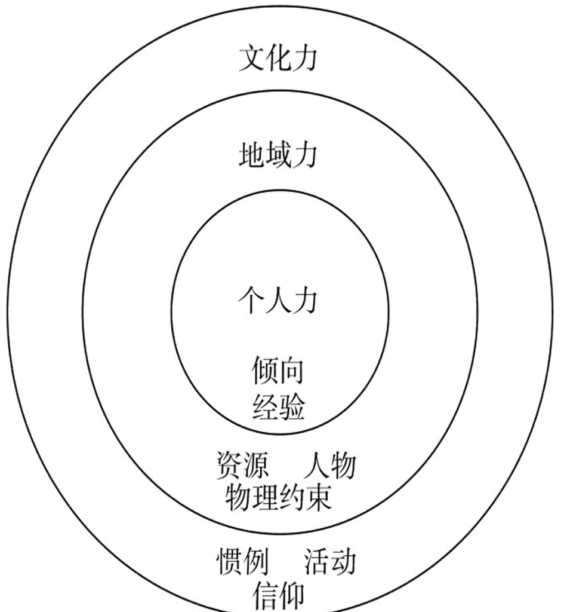
图11.1 分布式认知的同心圆模型

资料来源：喻国明，苏芳．从认知带宽到价值带宽：元宇宙视域下认知竞争逻辑的重塑[J]．西南民族大学学报（人文社会科学版）,2023,44（04）:139-147.

#### 自反的匹配：生理的刚性、认知的弹性、价值的响应
自反性意味着媒介争夺余量的过程本身也是相互塑造的，个体余量被重塑的同时，媒介的认知竞争逻辑也在重构。雷吉斯·德布雷提出“媒介域”概念，认为技术系统、社会组织和象征系统会形成社会契约，在特定媒介域里产生匹配的集体心理、信仰和主义。

这种自反性体现为不同余量在媒介作用下的匹配或折扣，生理余量偏向绝对性，认知余量偏向相对性，价值余量偏向响应性和效率性。生理层面，媒介的延伸与截除受生理极限制约，比如通过训练可适度扩张余量，VR、数字孪生、分身交互也能在另一空间重塑生理余量。

认知余量在稀缺理论下呈现相对性，其重塑与认知结构紧密相关。认知结构是一个系统性过程，工作记忆、长期记忆与信息加工存在多维互动，所以余量匹配是结构性问题。解决余量稀缺主要有两条路，一是生理层面扩展，比如多通道感官唤起，减轻单一感官损耗，二是信息层面优化，通过信息与认知结构的秩序化减少信息熵，让有序信息简化认知、放大余量。感官通道的数量效果还受信息与通道的协同、匹配和场景连接影响。另一方面，外来信息与知觉、注意、记忆、情感的匹配不平衡会产生结构性盈余，减少余量本质上就是实现信息内容与认知结构的系统耦合。

价值余量的匹配关键在响应性和效率性。吉登斯指出，在暴力与风险环境中，关系与信任成为脱域体系的纽带。信任让跨越时空的可信赖互动成为可能，促进信息接收与匹配，其根基在社区、亲缘和友谊这类个人化信任。分布式认知的同心圆也显示，文化圈代表弱关系，地域圈代表直接影响个体的强关系，能改变认知态度并促进行为，个人圈则是基本认知基模。马克·格兰诺维特认为强弱关系的分野在于互动频率、情感强度、亲密程度和互惠交换。强弱关系网络在信息传递与知识共享上的功能不同，认知竞争逻辑中价值余量的适配本质上是在解决这种结构性匹配。

### 第四节 元宇宙里技术与人感知的深度耦合
认知竞争的效率逻辑凸显了技术和媒介的力量，但当意识形态权力介入，竞争就可能异化为认知战。于是需要从主体能动性出发，强调个体主动拉取信息而非被动接收，这或许是未来更健康的有效逻辑。从中观微观来看，媒介技术在塑造认知行为的同时，个人也在以认知可供性的方式驯化技术。关键问题是，元宇宙中人和技术的耦合能否跳出效率逻辑，实现积极的认知自由。

#### 元宇宙视域下媒介与个体认知的协同
面对媒介内爆，麦克卢汉并不悲观。他认为每个时代都有偏好的感知和认知模式，但当下人们更抗拒被强加模式。媒介塑造认知价值模式，而个体渴望积极认知自由，追求融合共生而非单纯的中介化互动。在此背景下，分布式认知为个人认知延展和协同进化提供框架。个体余量与媒介的关系正从大众传播时代的中介化互动，转向元宇宙中余量嵌入、延展和协同的互动。

表11.2 大众传播时代与元宇宙未来媒介时代个体带宽的比较

| 项目 | 大众传播时代 | 元宇宙未来媒介时代 |
| :--- | :--- | :--- |
| 生理带宽 | 物化身体 | 智能身体与多元身份认同 |
| 认知带宽 | 认知带宽有限 | 认知带宽在感知空间、构想空间与生活空间的三重空间中延展 |
| 价值带宽 | 价值带宽作为外部逻辑 | 价值带宽内嵌于底层架构 |

资料来源：喻国明，苏芳．从认知带宽到价值带宽：元宇宙视域下认知竞争逻辑的重塑[J]．西南民族大学学报（人文社会科学版）,2023,44（04）:139-147.

分布式认知把认知看作主体和环境的系统，加工的是内部和外部表征的信息。认知分布于个体内部、个体之间、媒介、环境、文化、社会和时间。不同于传统认知强调个人主体，分布式框架指出在媒介化社会中，主体和客体依赖媒介工具互动。媒介工具的作用是扩展认知、降低负荷、拓展生理和认知余量、健全价值余量。在这个框架下，主体和媒介形成具身关系，媒介从中介化干预走向和主体认知的协同演进，一方面物理上扩展余量，另一方面重新分配认知结构中的结构性盈余。

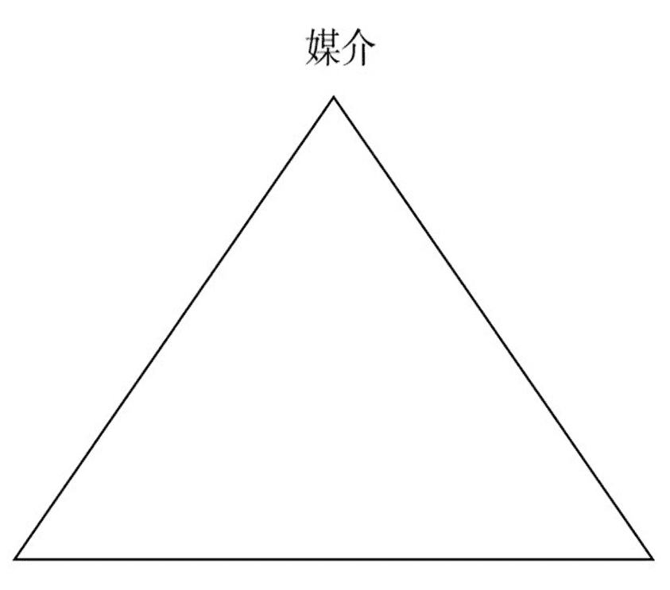
图11.2 分布式认知观点下人类认知结构

资料来源：喻国明，苏芳．从认知带宽到价值带宽：元宇宙视域下认知竞争逻辑的重塑[J]．西南民族大学学报（人文社会科学版）,2023,44（04）:139-147.

#### 身体余量的延展
生理余量中的身体本身就是传播的中介，它支撑空间感知、社会认知，并在交往中发挥文化政治功能。对有限生理余量的争夺，是后续场景认知和价值匹配的前提。在元宇宙视域下，身体正从物化的肉身转向技术驱动的智能身体。

智能身体是对绝对生理余量的技术性补偿，体现了人和技术体系的深度联结。物理学家迈克斯·泰格马克把生命看作可自我复制的信息处理系统，硬件是物理结构，软件是行为和算法。生命1.0靠进化获得硬件软件，生命2.0以人类为代表可通过学习优化算法，生命3.0以人工智能为代表能自由设定软件硬件，摆脱生物进化限制，实现数字化永生。实践上，智能身体意味着身体被拆解为元件数据化，身体状态、位置、情绪、人脸、声音等都被记录。数字大脑、脑机接口等技术填补生理余量的稀缺，让身体元数据变得可测可取。唐·伊德提出在人技术世界连续统中，人和技术的具身关系体现为一种变项。在媒介空间里，身体既是行动者也是中介者和转译者，它把精神和物质文化意义转译出来。智能身体让媒介信息被多维度感知和提取，而且这种转译是有意识的，身体会改变、扭曲、修改信息的意义。这种转译能力体现了人的能动性，有望摆脱效率逻辑。比如可穿戴设备识别生理数据并预警健康，促使人改变习惯。但生理余量的稀缺与欲望无限的矛盾依然存在，智能身体在延展感知的同时也放大了需求，过度追求可能带来身心双重负担，元件化也可能反作用于认知。

技术具身关系也催生了对技术透明性的新期待，摆脱技术的参与，重新获得扩展后的身体感。在元宇宙里，这体现为多重数字化身和多元身份认同。数字化身是从具身到离身的转换，人在虚拟身体中获得拟具身体验，让物质身体、智能身体和数字化身三者共存。虚拟体验会映射并反射到现实行为，数字化身在不断互动中重塑现实行为。更进一步，多重身体带来多重身份认同，与传统物质身份不同，元宇宙中人渴望摆脱中介、实现游牧式逃逸。但这种游牧是真的解放，还是被技术全面控制而沦为数字存在，还需要经验检验。

#### 认知与价值的互动
大众传播时代，媒介多被当作辅助认知的工具，而分布式认知则强调主体、客体、媒介三者的协同。对个体而言，这意味着协作和认知共享，从而缓解负荷。在元宇宙中，这种扩展往往发生在混合现实场景里，既涉及内部表征的延展，如心理图式、神经网络，也涉及外部表征的延展，如物理符号、外部规则。内部层面，研究显示减少消极情绪、激活积极情绪能延展认知余量，比如通过积极情绪诱导、冥想、激励信息、注意力控制等手段，把焦虑等负面状态和稀缺余量转化为更丰富的思维。

外部层面，身体总是存在于空间中。梅洛-庞蒂提出空间是身体化的空间，身体性和空间性的统一构成知觉习惯，身体也在空间中建构认知和文化意义。元宇宙的虚实融合空间不仅包含物理空间，还包含心理氛围和权力关系。它更强调媒介工具和主体的协同匹配来扩展余量，这种扩展既涵盖注意、情感、记忆等认知余量，也涵盖思维、意识形态等价值余量。

亨利·列斐伏尔的社会空间三元模型，感知空间、构想空间、生活空间，为此提供了借鉴。他认为空间既非起点也非终点，而是手段和媒介。在媒介化社会中，感知空间凸显媒介技术对个人的必要性和适应性，构想空间让经验得以预演，生活空间则把社会实践常态化，媒介的挪用最终以价值余量的形式改写社会规范、惯例和期望方式。

元宇宙与认知容量的三重空间映射

把元宇宙当作解剖认知容量的切片，可以看到三组相互嵌套的空间逻辑。

第一组是感官场域。这一组关乎主体按照某种场所建构逻辑，对实体场景与场景集合进行生产和再生产。它是能被身体直接捕捉到的物质性所在。元宇宙技术在此把感官上限拉开，凭借增强现实带来的多维沉浸，主体的观察角度被抬高，能以更立体的视角审视现实，并用自己的想象去改写现实空间的模样。元宇宙并不等于抽离现实，地理性的存在多以镜像或增强现实的形式保留下来，为个体提供了更灵活的行动余地。典型的体现是区域的数字化投射：三维交互式地图既可与自动驾驶系统对话，车载传感器回传的数据又能反哺地图的精度。

第二组是观念场域。它是对社会空间进行权力与符号编码后形成的概念网络，始终处于生成与再生的循环，为联结提供框架。容量在此的延伸，反映的是媒介可供性与人的理解力如何咬合。媒介的可供性塑造了主体对世界的解读，也让数字交往逐步贴近媒介空间的运行规则。在元宇宙里，观念场域呈现为经验的预演。感官场域的物质性以新形态渗入观念场域，身体姿态、运动轨迹、社交手势等依然在场。借助游戏等载体，使用者完成具身理解与虚拟环境的互动。拟具身体验提前点燃情绪与注意力，让认知与媒介进入协同，媒介成为认知的载体，使对现实的体感先行在观念场域完成。元宇宙里情感的维系表现为数字交往中更深的信任与共情，人机、用户与化身、化身与化身之间的联结在拟具身基础上形成准社会交往与媒介等同的体验。预演的积极价值在于情绪调节、记忆提炼与行为延展，但也要警惕认知竞争带来的异化，技术与认知的耦合会推动监控自动化，让宣传更隐蔽地达成目的。

第三组是生活场域，它指向私人化的、想象性的微观领域。这一层把虚拟世界产生的认知带回现实，使用者在虚实之间反复校准。这里价值容量的应变与效率得以显现。元宇宙对价值容量的补充体现在把预演经验转化为现实，预演空间本身包含社会关系的再生产，因而可能与现实社会的权力结构出现错位。元宇宙中的圈层关系多建立在区块链非对称加密、共识机制、智能合约之上，这些技术特征有助于公平、互惠、合作、公民参与等正向价值的实现。在现实圈层的两极之间，去中心化的技术可以作为平衡圈层的辅助支点。

小结
元宇宙这一符号承载着人们对未来媒介可供性的想象，为理解未来社会建构提供了具象化的图景。与当下媒介时代相比，元宇宙作为全新社会空间，其具身交互让生理容量、认知容量与价值容量均被重塑，有望摆脱媒介认知竞争的效率逻辑，实现更为积极的认知与行为解放。认知自由与行动自由可以落实为三重空间的数字交往，根基在身体。感官场域拓展了感官与行动能力，在一定程度上降低认知负荷，身体作为中介与转译者对媒介信息进行解码。随后认知在观念场域扩张，通过认知、情绪与思维方式的预先激活缓冲直接实践，用户可经由模拟与游戏化进行行为演练。最后，经验预演作用于私密生活空间，虚拟行为与现实行为的交互让私人想象不再局限于物化空间，个人身份认同与情感关系认同愈发多元。此处个体容量的释放与积极认知相连，过去受媒介局限的认知在三重空间中延展，媒介与人的关系由中介化转向协同交互。文化层面，空间实践具社会文化意义，公共空间的达成依赖底层技术保障，底层技术亦塑造价值容量、规范社会行为，有望为圈层交往提供平衡支点，促进公众参与与协作。

第十二章 认知竞争时代的传播转向与操作策略

在数字文明阶段，人类思想被视作新的争夺场域。技术与信息过载加剧，使用者难以确保做出明智及时的判断，由此出现认知战的说法。认知战不同于舆论战、心理战、宣传战，它让社会成员以前所未有的方式参与信息处理与知识生产。其本质是对认知资源的争夺，即占据更多认知资源从而结构性限定行为边界。因此需看到认知战背后社会结构的转型，以及认知竞争在数字传播时代的重要性。

认知源于心理学，指通过思想、经验与感官获取知识并进行理解的一系列心理过程，涵盖思考、认识、记忆、判断与决策。因与人类如何思考高度相关，研究后独立为认知心理学。如今研究已超出认知科学范畴，分布于市场营销、传播学、社会学、语言学、政治学、军事科学等领域。从学科史看，传播学自诞生起便长期关注意见生成与劝服效果，并以此构建理论脉络。在数字传播时代，传统学科思维式微，海量信息让判断难以及时准确，意见与态度趋于松散不稳。而认知正是意见态度形成的框架基础，可从底层影响其生成。由此，关于观点的争夺演化为关于认知的争夺，认知在数字媒体时代对传播学具有不可替代的意义。

为把握认知在当下传播研究中的独特价值，需厘清大众传播向数字媒体时代的社会变化；为在现实认知竞争中占据有利位置，需认识认知的作用机制与操作路径。本研究据此提出问题：媒介环境发生何种变化？社会结构经历何种转型？认知竞争的作用机制如何？操作路径有哪些？以下探索旨在为认知在传播学中的研究提供启发。

第一节 认知竞争时代的传播转向

从大众传播时代到数字传播时代，本质是社会由体制文明转向数字文明，互联网思维全面渗透。各层面媒介环境变化与结构性转型催生情绪极化、后真相、圈层文化等群体表征，也印证互联网对社会运作机制的统合影响。在此背景下，传统关于“我们如何思考”的争夺延伸为关于“我们以何种方式思考”的争夺。离散观点已难满足竞争需求，被认知统合的感知习惯、思维习惯、行为习惯逐渐成为群体态度与社会舆论的核心要素，并决定行为边界。

媒介环境的变化
1. 算法机制：短程记忆与浅化思维成为常态
如今以协同过滤为主的信息推送机制重塑了用户在信息互动中的位置，挑战了用户接触、使用、创造、评估信息的能力，并在空间、感官、意识形态、场景层面产生偏向。即数字传播时代算法在接收层面结构性改变思维特征，主要体现在记忆与思考。首先记忆模式重构，算法作用下记忆由长程转向短程，碎片化信息与阅读时间导致拒绝记忆成为常见习惯，不断涌现的热点反复刷新本就不稳固的记忆，用户更倾向关注新奇刺激的瞬时体验，长期结构性记忆被解构。其次思考模式重构，算法推送打破原有线性连续思考，信息流催生浅层阅读，难以对具体问题作深入思考。最后个性化过滤带来回声室效应与过滤气泡，一定程度上收窄固化思维边界，限制融合不同观点的能力，不利于共识形成与文化传承。总体看，算法影响下短期记忆与浅层思维使信念松散，观点态度极不稳定，需更精准把握认知层面。

2. 信息过载与噪音：决策成本攀升
当下处于信息过载时代，社交媒体兴起与社交机器人活跃使信息量指数增长，同时伴随虚假信息与谣言等噪音。过量输入造成精神损耗与负担，抢夺注意力，导致认知功能障碍与错误决策。即我们生活于信息过饱和世界，个体认知不足以作出明智及时决策。此情境下需要以认知与心理为中心的方法实现说服与影响。尤在后真相时代，情绪化表达与虚假信息增长，了解受众信任信息的生产机制愈显重要。市场营销、政治选举、文化输出等层面，占领有限认知资源成为关键命题。可谓信息无限性反衬认知资源的有限性，认知逐渐成为决定受众选择与行为的核心驱动。

3. 社会人的数据化：用户主体权利的异化
数字媒体时代的最大特征是社会呈现数字化形态，海量数据成为驱动运转的核心能源。数字化社会中的人无论身处何地，每分每秒都在产生数据。构成饮食、出行、娱乐、消费等行为的隐私数据常以不平等协议形式被抓取、分析、整合，形成对思维方式与行为习惯的循环掠夺。数字劳工概念展现了数字时代受众的劳动形式与剥削机制，揭示被宏大叙事遮蔽的生产力与行动力模式，以及文化生产的复杂性与斗争性。在数字化社会，工作生活界限模糊，所有行为皆为无形劳动。随着用户商品属性增强，主体权利被削弱，用户数据中隐含的思维方式与行为习惯在一定程度上代表认知，成为各方争夺的资源。

4. 数字空间的情感共振：由情绪表达转向情感发酵
以社交媒体为核心的平台催生了大众媒体时代不存在的情感共振场域，形成情感公众、延展性情感空间、集体记忆与数字遗产等独特景观。大众传播时代单向、严格遵循时间规范、有议程设置的模式多激发短期爆发力的情绪，而社交媒介的交互感、集体参与感、具身感、仪式感更易激发长期稳定的情感。如疫情期间中国网友在微博对李文亮医生的集体悼念催生延展性情感空间，即一种不随时间消逝而延续、拓展为日常问候、心事倾诉、彼此慰藉的空间。数字媒介时代，媒介不仅生产碎片信息，还提供情感交互基础，为社会情感提供发酵场所。尤以社交媒体为代表，它改变记忆储存与读取方式，形成数字化记忆，进而重塑对时间、空间与记忆的感知。总之，数字媒介特征催生诸多情感共振场域，重塑认知中记忆与感知的形态。

社会结构的变化
1. 组织方式的重构：部落化和圈层化
大众传播向数字传播转型中，受众组织方式结构性改变。麦克卢汉提出再部落化概念，认为电子技术发展将人类社会退向口语部落，产生人人参与的新型地球村，使感官重获平衡与互动。互联网是巨大的返祖隐喻，唤醒工业时代前的人际传播模式与情感共振认同。部落化与人际传播回归在数字时代突出的体现是社交媒体围绕的圈层化交往，热点话题常先在特定圈层发酵。基于血缘、地缘、业缘、趣缘的圈层拥有独特文化，并潜移默化影响思考与行为。圈层间存在边界，标准化信息供给难以适应圈层化个性化现实。支撑圈层结构的不只是理性事实逻辑，更在于价值认同与情绪共振等非理性要素带来的意见交换与信息流动。简言之，部落化圈层化重构了认知产生方式，认知高度复杂，是不同圈层价值观与思维模式的叠加态。

2. 价值观要素的重构：从秩序理性到感知非理性
历史上大众传播法则建立在秩序与分工的工业文明之上，大规模生产需讲逻辑、用理性沟通以实现效率最大化。理性是该时期显著特征，代表多数人观点集合体、整体利益最大公约数。韦伯在经济与社会中将此结构称为官僚制，具有集中等级组织、遵循合理规律并完成社会功能。韦伯认为官僚制标志现代价值观，如法律平等、精英统治、问责制。理性与秩序构成大众传播时代价值要素。但数字文明时代个体被赋予无限价值，个性化重启使价值观呈现基于个人感知、关系、情感的要素。正如韦伯所言，官僚制背后的理性主义成为奴役人类的铁笼，如今事实判断不再局限于标准化理性价值观，而转向社会关系与情感共振的个性化价值体系。认知形成方式因此发生重要变化。

3. 思维环境的重构：从追求定数到拥抱不确定性
自人类定居农耕以来，农耕文明与工业文明都诉诸确定性，渴望充满定数的生活以充实信念。此思维环境贯穿文明。数字媒介时代之前，人类愿景多为确定性愿景。互联网最大改变是使个人脱离单位群体，成为独立个性化有价值个体。人类在虚拟世界回到德勒兹提出的平滑空间，一望无际的平原、大海或沙漠，充盈自由流变的游牧美学。主体以游牧方式生存，无固定宏大叙事，只有不断变化的微观视角。这种游牧生存不同于对定数的执着追求，而是拥抱不确定性。不确定性本质是多重可能性，或者确保各种可能性的状态不会出现坍塌。与此形成呼应的是，近些年旅行于不同学科的可供性概念，即存在于人与环境之间的多重可能性。简言之，随着社会的深度媒介化，人与人、人与社会之间的关系不断涌现这种不确定性，且接受不确定性逐渐成为常态，在这样的思维环境中也必然形成与大众传播时代不同的认知走向。

第二节 认知竞争的操作路径解析

认知竞争的作用机制
1. 认知改变的土壤
数字文明时代，认知改变建立在算法对人的固化与限制基础上。不同媒介素养群体被重塑程度不同，但生存于数字化社会的个体均难以逃离被算法重构的拟态环境。拟态环境原本是大众传播时代概念，即媒介对象征性事件或信息选择加工重构后营造的框架式环境。如今算法以更底层模式将世界对象映射为数据与模型，在人与对象间提供数据化界面。数据化界面通过智能终端传输不断冲击认知。其次，万物皆媒、深度媒介化带来人与人、人与社会多重连接，认知逐渐由新关系与新群体共同构造。当前认知的个体内部部分越来越少，呈现分布式状态。认知科学称之为分布式认知，即认知过程由参与分析单元间的功能关系界定，这些单元不仅存在于个体内，也存在于关联的文化、地域、群体中。深度媒介化通过建立新联系加剧认知分布流动，加上算法固化，这些构成数字时代认知被重构与渗透的养分与土壤。

2. 认知改变的操作逻辑
微观操作逻辑需将视角从认知延伸至竞争，即认知战。认知战被描述为脑科学武器化新方法，本质是通过利用人脑漏洞攻击个人，试图破坏各社会赖以存在的信任。具体而言，虚假信息发布者依据目标的认知脆弱性，利用其预先存在的恐惧或信念，使其倾向接受谣言与误导。这种大脑之战试图播下不和谐种子，煽动矛盾冲突，使意见两极分化并使群体激进化，最终达到消解社会凝聚力的目的。

认知博弈的底层推手：社会工程学的视角

认知对抗的运行机理，能够追溯到社会工程学。社会工程学本质上是一种借助精细手法，推动他人在特定生活领域做出预设行动的技巧与科学。它由心理操纵技术与社交交往能力构成，核心在于影响、劝服与引导，促使目标透露关键信息，或完成为攻击者打开网络权限的操作。我们日常接触的社群平台、电子邮件、移动终端及各类网站，都已被用作干预与说服个体的管道。其基本思路是先在整条信息安全链条上寻找最脆弱的缺口发起突破，进而瓦解整体防御。

随着虚拟化、移动设备、物联网、云计算等技术的大规模落地，安全边界已远超传统防火墙与公网的范围，攻击面变得更宽、更杂。传统协议与操作系统在面对新型网络攻击时捉襟见肘。于是技术手段退到后台，攻击重心转向信息安全链条中最脆弱的人类环节，因为相较机器，人更容易产生信任。社会工程的攻击循环大致分为四步：先对目标进行信息搜集与评估；随后在攻击者与受害者之间营造信任关系；借助已建立的信任实施具体攻击；完成既定目标后，要么继续渗透，要么静默撤离。

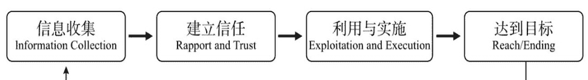

> 资料来源：喻国明，颜世健. 认知竞争时代的传播转向与操作策略[J]. 东南学术，2022（06）：227-237+248.

把焦点放到个体突破上，受众群体的共性特征，尤其是思维层面易受冲击的薄弱点与认知盲区，往往成为新的切入口。可以说，当下的认知作战，很多时候是依据受众的习惯与短板展开的精准集中打击。在信息过载与信息污染的语境下，人们的短时记忆与浅层思考极易被利用。带有意识形态色彩的内容常以碎片化、新奇化、标签化的形态进入心智，通过先建立信任，为长期的结构性改变做铺垫。简言之，在推荐算法的作用下，认知惰性与惯性思维成为突破口，对手希望植入的内容会以受众喜闻乐见的方式悄然进入心智。

### 3. 认知改变的实现方式

相较于外在的意见表达、基本态度等表层表现，价值观、世界观、知识观等深层心理结构更难撼动，却恰是当前认知较量争夺的重心。因此数字文明时代的认知较量必然是长期经营、润物无声的过程，思维方式的转变与信念体系的重构需要潜移默化的积累。按照前述逻辑，目标群体的思维盲区、认知漏洞以及先在的焦虑恐惧会成为切入口，使其在接收与处理内容时容易产生认知偏差，而这类偏差经长期累积便会演化成改变认知的结构性力量。

认知心理学中的可得性捷思法在其中起到关键作用。它指的是人们在依据记忆做判断时会走捷径，倾向于依赖记忆里最容易提取的经验与内容作为依据。在此过程中，近期发生、情绪强烈、冲击力强的资讯更容易被捕捉。鉴于大脑难以有效处理海量内容，依赖可得性捷思做判断的现象愈发普遍。现实中，社交机器人与推荐算法持续提供“可得”的记忆，引导不同类型的认知偏差形成。这些偏差长期潜伏、串联、融合，最终在特定事件触发下，通过启动效应产生外显影响，如图12.2所示。如今认知较量中，各方都在积极利用认知偏差作为改变认知的捷径。总体而言，认知改变的实现是一个从短期偏差累积到长期启动效应的过程，结合前述认知改变的基础与社会工程的操作逻辑，共同构成了认知较量在微观层面的作用机制。

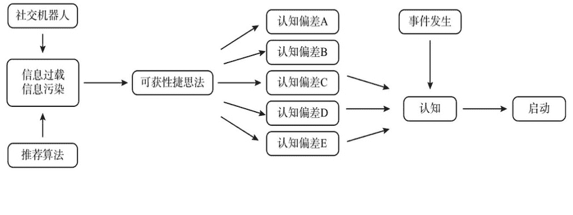

> 资料来源：喻国明，颜世健. 认知竞争时代的传播转向与操作策略[J]. 东南学术，2022（06）：227-237+248.

#### 认知竞争的策略机制

##### 1. 渠道策略：“接力传播”与“圈层进入”

渠道策略的核心是让内容更好地抵达受众，可深入目标群体的社会半径与实践场景，解决“看得到”的难题。当下全媒介环境瓦解了传统媒体的渠道垄断，传播渠道呈现碎片化与垄断化并存的现实。一方面，大量UGC、OGC、PGC、MGC削弱了传统媒体长期集中的渠道依赖；另一方面，数字寡头的崛起长期占据了公众大部分的视听空间。由此，跨渠道协同能力成为内容触达用户的关键，即对各类渠道进行整合联通，实现内容在不同渠道间的可转换，最终形成全要素、全流程的问题解决能力。这要求必须以用户洞察为先导，深入目标人群深层的社会心理与现实矛盾，再构建“接力传播”能力。其中，传统媒体与新媒体的协同尤为重要。很多具有高度社会价值的内容往往源自UGC生产的线上内容，其影响力多局限于线上。只有当传统主流媒体跟进报道并赋予其“社会地位的加冕”，这些内容才可能成为现实社会的热点，引发职能部门关注与干预，进入大众视野。重要内容的传播依赖两类平台的协同，二者缺一不可，这也意味着需要革新传统传播模式并对内容表达形式进行创新性调整。

此外，社会圈层的进入是另一关键环节。圈层化是数字媒介时代的典型特征，不同圈层拥有不同的表达方式、文化生成模式与情感发酵模式。内容要想有效触达目标人群，必须掌握圈层进入技巧，其中最重要的是传播场景的构建。不同圈层通常有其固定且熟悉的传播场景，在此场景中内容的传递与互动效率更高。例如共青团中央在哔哩哔哩的运营，通过创新视频形式、优化制作流程、创新组织形态，构建了更适合年轻群体的传播场景，成功释放了目标受众的情感能量。

##### 2. 话语策略：修辞与表达的艺术

话语策略解决的是内容抵达后“是否愿意看”的问题，使表达的尺度、分寸、准确性与人们的共鸣点、认知结构及外部吸收模式相匹配。它涉及传播修辞的使用，即文本的建构方式，也涉及话语表达的形式、内容与吸收模式的建构。此类文本建构可借鉴传播修辞学中的概念创新、表述创新与范畴创新，通过策略性语言使用实现更好的社会劝服与认同。

首先是概念创新，即话语内容与符号的创新。概念是具体知识单元，概念间的逻辑关联构成庞大意义网络，话语在此基础上沉淀形成群体性社会意识。其中隐喻建构是概念创新的关键。隐喻在当代认知科学中被视为人类基本思维活动，是认知、分类、概念化以及对世界解释与评价的方式。人类不仅借隐喻的审美潜能表达思想，也借助隐喻进行思考。隐喻作为“辞格之首”，能改变接受者意识中的语言世界图景，具备其他辞格难以比拟的修辞与劝服力。具体而言，隐喻通过将两事物置于并置结构，让人从一个概念域把握另一个概念域，有效促进概念联结并解决新概念的“冷启动”问题。

其次是表述创新，即表达形式的创新。基本逻辑是构建故事化语境，让人追寻故事并在其中找到共鸣点与认知契合点。具体表达形式创新可分为外在形式与内隐形式。外在形式包括语言修辞与视觉修辞。语言修辞强调修辞手法与诗性美学，包括文本呈现的形式、韵律、格式、风格；视觉修辞强调图像符号的有效运用，借助视觉文化时代图像的传播优势影响认同系统。内隐形式指在构建故事化语境时文本中对“情感”与“道理”的隐性诉求。情感是最通用的认知语言，是引发共鸣的有效途径，故事化语境中的情感元素可积极触发概念联结与关系认同。若说情感是故事认知的心理纽带，道理则是故事的终极落点与底层语言。人们被情感触动后，留存于认知中的实为话语中隐含的价值观。情感是手段，是切入口，而真正构成心理认同基础的是沉淀于话语修辞中的道理。

最后是范畴创新，即话语修辞在吸收模式上的创新。认知语言学中的原型范畴理论认为，范畴是人们基于互动经验对客观事物本质的思维概括，由若干聚集属性构成的理想概念。人们认识并命名新事物即是确定其范畴的过程，故范畴类似格雷格里·贝特森提出的框架，即一种组织事件的心理原则与主观过程。每种范畴都是人为创造并组织化的相对稳定认知框架，使人按既定方式理解事物并形成争论空间与对话系统。因此范畴创新即认知框架创新，需与人们吸收内容模式相联。具体操作有两种：一是创造新范畴，使人按既定释义系统解读内容；二是借助既有范畴，输出新内容。两种方式均可使内容解读过程更顺滑，解决“看得下去”的问题。

##### 3. 符号策略：化解文化折扣

符号策略旨在用户“看得下去”之后能“看懂内容”。内容形成是信息的编码过程，内容产品的接受与解读则是解码过程。理想的解码过程可最大限度避免用户因“文化折扣”与认知偏差造成的价值损耗与曲解。文化折扣指扎根于特定文化的节目或影像在国内市场吸引力强，因观众共享常识与生活方式，但在异文化环境中吸引力衰减，因难以认同其风格、价值观、信仰、历史、神话、社会制度、自然环境与行为模式。根源在于文化结构差异，减少文化折扣需对解码关键要素进行操作。

首先是认知载体差异产生的文化折扣。不同社会群体拥有不同的“说话方式”，差异导致交流时“听不懂”或无法理解行为。如游戏圈“阴阳怪气”的表达方式在其他圈层易被误解；网络“扮丑”短视频的话语方式常被他圈层视为低俗。鉴于语言不相通，内容编码需基于两维度建构价值：一是纵向深度价值操作与表达，使作品内容与形式符合严整、深刻、生动、传神、真实可信，以产生跨文化共识性，解码后内容具深度与价值；二是横向宽度价值连接与共振营造，使不同文化属性的人在同一作品下实现情感共振与关系认同。

其次是认知参照系差异，即既有经验造成的文化折扣。认知体系取决于结构化知识、经验与阅历，由群体所处环境、约束规则与面临矛盾决定，并表征于期望事物与诉求权利。不同认知体系群体解读同一问题常相异甚或对立。为减少文化折扣，需在不同群体间搭建理解与认同的“合意空间”，即寻找社会文化认知参照系的共同部分作为沟通支点。社会认知心理结构有三层：深层价值心理、基本社会态度、具体社会意见。越深层越稳定，故可行策略是避开具体意见，从基本态度与深层价值心理寻求共识。如不同群体观点或异，但“爱国情怀”“民族自豪”是深层共同价值心理。找到合意空间是消解文化折扣的关键操作。

### 小结

在数字文明时代，认知正成为未来重要的争夺资源，各学科均展开相关研究。认知较量并非特定时期或事件的产物，而是一场长期存在于各领域的思维方式与价值观争夺。从传播学视角看，数字媒介的成长与媒介环境变革重塑了认知形成模式，尤其在深度媒介化与万物互联的社会形态中，媒介如何占据更多认知空间将成为研究基本问题。本书沿着数字媒介时代的传播转向，尝试提出当下认知较量的操作路径。但既有结论受限于当下社会结构、技术环境与认知体系，现有想象力不足以论证未来路径与操作逻辑。此外受篇幅所限，许多内容未展开细致讨论，如社会工程学中信任建立机制、认知偏差的产生与作用机制、宏观战略设计等，均值得深入分析。与认知较量一样，对认知本身的研究也是长期过程，需要更多研究者关注与深耕。

### 第十三章 人们的媒介认知如何影响其媒介使用

正如人口普查对社会管理与发展的重要性，媒介接触与使用调查是传播学研究与传媒实务最基础的环节。从传统媒介时代到移动互联时代，最大的变革在于人们可按自身需求与偏好配置个人化媒介菜单，根据生活节奏安排日常媒介消费。这使得原本在大众传播时代可预期、易掌控的媒介消费行为骤然变得如万花筒般多姿多彩、难以捉摸。在纷繁复杂的个人媒介菜单配置与媒介接触轨迹中探寻“变化中的媒介景观”，是学界近年关注的焦点。

2014年团队曾就城市居民媒介接触与使用开展大规模调查。五年后行业巨变——据CNNIC发布的第44次《中国互联网络发展状况统计报告》，截至2019年上半年，我国互联网普及率达61.2%，手机上网比例高达99.1%。2014年底微信用户刚突破5亿，2019年二季度已达11.3亿；2016年成立的今日头条已成最大信息聚合平台；2016年上线的抖音日活用户达7亿。移动互联网高速发展、明星应用急速成长、用户从固定端向移动端迁移的快速完成，使新一轮聚焦移动新媒体的大规模调查势在必行。

本次调查开展于2019年7月5日至7月30日。采用多阶段抽样，参考CNNIC第43次报告的城乡结构、性别、年龄段、学历进行设计。由专业调查公司通过平板电脑辅助社区随机访问，共在45座城市发放4968份问卷，有效问卷4631份，成功率约93%，平均完成时间20分钟。受访者男性占比52.6%，城镇居民占比73.1%，年龄14至70岁之间，均值33.4，标准差13.45。目标占比与实际占比差额控制在1.1%以内，基本可反映我国网民情况。

#### 第一节 基于用户逻辑的媒介认知的三个维度

毫无疑问，用户如何理解媒介，即媒介认知，是影响媒介偏好并在不同情境下选择媒介的重要因素，这正是本章分析主旨。

如何从调查角度进行操作性定义？主体认知尤其是价值认知复杂难测，但并非无迹可寻。金·克里斯蒂安·施罗德在2015年提出用户关于新闻媒介“值得”选择的7个标准，他认为这是用户逻辑选择媒介的基本维度，包括：时间价值、社会联系、规范压力、参与潜质、价格、技术吸引、情景适切。这七项被视为新闻媒介选择依据。

本次调查采用这7项“值得”选择评判标准，但在实际操作中依据被访者理解能力对措辞进行了调整：其一，“规范压力”指周围人群态度对使用者造成的压力，问卷中改为通俗表达“他人认同”。其二，“参与潜质”在施罗德语境中指用户通过获取分享信息成为传播活跃者并获得“更有见识”的体验感，此次调查面向更宽泛媒介，故指标改为“获得知识并应用于生活中”，指向“知识价值”。其三，“情景适切”为复杂且需延伸指标，故问卷中另设相关问题综合测量。

此外，关于用户媒介功能认知与特质认知尚无既定理论框架，本研究基于文献梳理、资料分析和用户访谈补充相关指标，形成媒介选择行为中关于媒介认知偏好的指标体系，见表13.1。

表13.1 “媒介认知”指标体系

| 价值认知 | 时间价值 | 社会联系 | 他人认同 | 知识价值 | 价格便宜 | 技术吸引 |

| :--- | :--- | :--- | :--- | :--- | :--- | :--- |

| 功能认知 | 信息功能 | 娱乐功能 | 社交功能 | 表达功能 | 分享功能 | 记录功能 |

| 特质认知 | 真实客观的 | 隐私安全的 | 实用专业的 | 新鲜有趣的 | 简单方便的 | 内容优质的 |

| | 大家都用的 | 技术先进的 | 设计美观的 | 互动感强的 | 便宜免费的 | 体现身份的 |

资料来源：喻国明，曲慧. 媒介认知：社会性偏向及影响性因素研究——基于“全民媒介使用与媒介观调查”的实证分析[J]. 媒体融合新观察，2020（03）:10-15.

施罗德提出的第七个价值指标“情境适切”相对复杂，见表13.2。该指标与“利基时空”媒介消费理论有重合，故本次调查将二者结合建立测量情景适切的指标体系。

表13.2 “情境适切”指标体系

| 一级指标 | 二级指标 | 具体情境表述 |

# 全民如何看待媒介？一份大调查告诉你选择逻辑

媒介使用其实可以按空间是否公共、时间是否属于个人切成四个象限。公共空间里的个人时间，比如坐地铁公交出租车、独自在公共场合排队等候；公共空间里的公共时间，比如在单位学校里工作学习、在工作时间的集体讨论里；个人空间里的个人时间，比如独自学习工作时的休息片段、在临睡前的客厅卧室里；个人空间里的公共时间，比如在自己的工位座位上同步听会听课、集体工作学习日里独自吃午饭。

资料来源：喻国明，曲慧. 媒介认知：社会性偏向及影响性因素研究——基于“全民媒介使用与媒介观调查”的实证分析[J]. 媒体融合新观察，2020（03）:10-15.

### 第二节 全民媒介认知的集体画像

#### 一、价值取向：联结、时间、知识排前三
从选媒介的价值侧看，超过半数的人最看重的三件事是能否加强社会联系、投入的时间是否值、内容是否具备知识实用性。选择占比分别是53.7%、52.2%和51%。换句话说，用户最先问的是这款媒介能不能帮我维系关系、值不值得花时间、能不能学到用得上的东西。社会联系与知识价值带有大众媒介时代的延续，而时间价值高居榜首则反映了个体化使用时代下人们对媒介消费时间自主权的敏感。反过来，价格和技术两个维度最不受待见。

相关性上，时间价值随经济区域、城市层级、收入等级升高而提升；社会联系和知识价值随学历提升而增强；技术吸引力则随年龄递减，越年轻越容易被技术本身吸引。价格不敏感也有其背景：免费内容已成习惯、小额支付让付费门槛极低，会员、知识付费、音乐购买的普及让消费者对媒介价格脱敏。

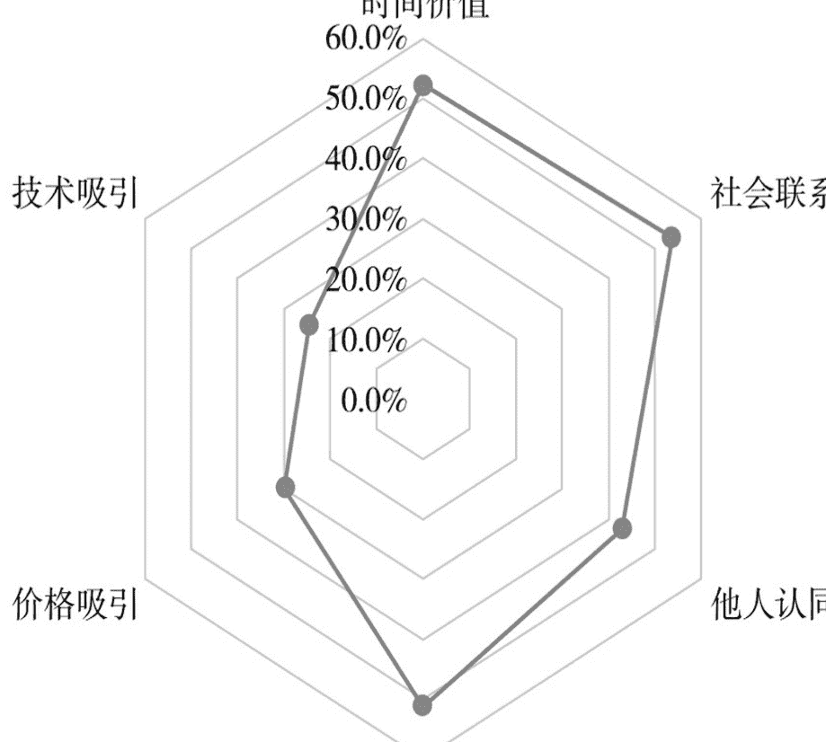

图13.1 全民媒介选择价值偏向

资料来源：喻国明，曲慧．媒介认知：社会性偏向及影响性因素研究——基于“全民媒介使用与媒介观调查”的实证分析[J]．媒体融合新观察，2020（03）:10-15.

#### 二、功能认知：信息仍是主角，娱乐社交并行
在“媒介用来做什么”的排序题里，信息功能、娱乐功能、社交功能位列前三，分别有78.9%、75.8%、67.1%的受访者将其放在前三位。把信息功能排在第一的人数达到2716，比其他功能总和还多，说明信息仍是集体共识的核心。

第二位选择上社交与娱乐几乎打平，分别是1562和1553票，形成了“信息+娱乐”和“信息+社交”两大主流组合。表达、分享、记录这三类被认为赋予个人生产权的社交功能整体分低，但在作为第三重要功能时，仍有52.5%、66.4%、71.7%的人选择，说明用户整体上仍处于接收端，主动生产更像是对信息接收的补充。

年龄相关明显：信息功能随年龄增长而更受重视，娱乐功能随年龄增长而下降。城市层级、学历、收入对娱乐功能也有显著影响。

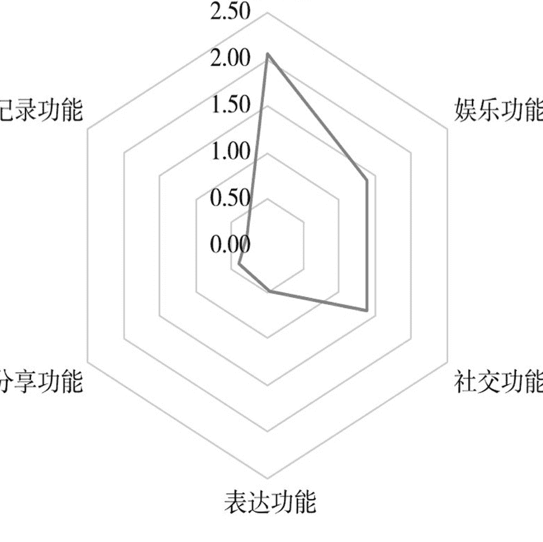

图13.2 全民媒介功能认知偏向

资料来源：喻国明，曲慧. 媒介认知：社会性偏向及影响性因素研究——基于“全民媒介使用与媒介观调查”的实证分析[J]. 媒体融合新观察，2020（03）:10-15.

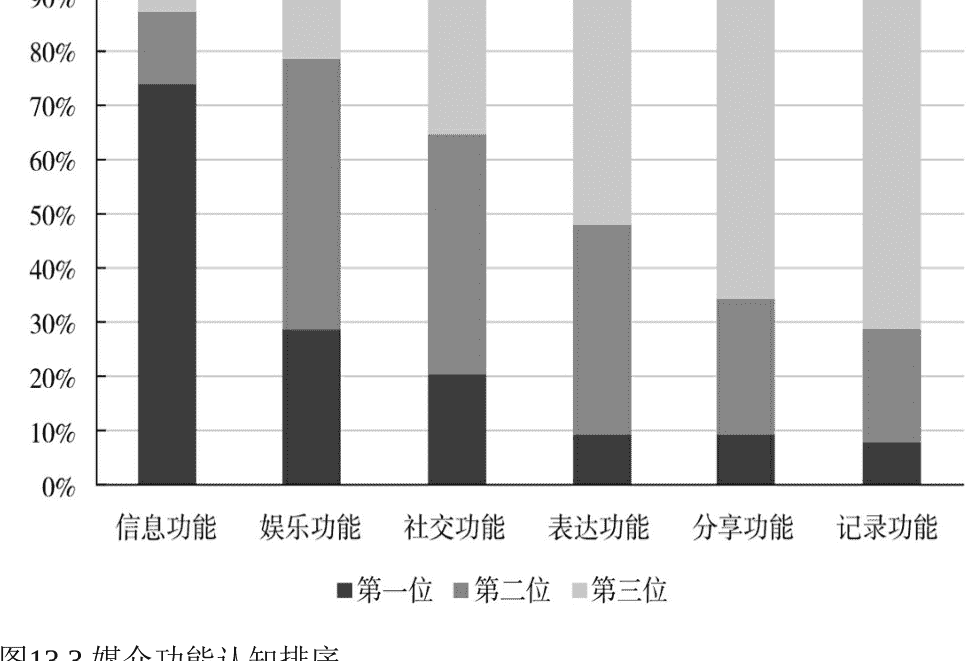

图13.3 媒介功能认知排序

资料来源：喻国明，曲慧. 媒介认知：社会性偏向及影响性因素研究——基于“全民媒介使用与媒介观调查”的实证分析[J]. 媒体融合新观察，2020（03）:10-15.

#### 三、特质偏好：真实第一，安全紧随
谈到媒介特质，真实客观、隐私安全、实用专业是前三顺位。有53.3%的人把真实客观纳入最看重的三项，其中75.5%将其列为第一。设计美观、便宜免费、体现身份则最不受待见，不重视比例分别达92.2%、93.1%、98.3%。

按1-3分加权后，真实性均分1.41遥遥领先，安全性1.04排第二，实用性、方便性、有趣性在0.7左右徘徊，其余都在0.4以下。收入越高越不看重实用、流行、廉价；学历越高越看重内容优质；年轻人更偏爱有趣、美观、互动性。代际在特质选择上差异最大。

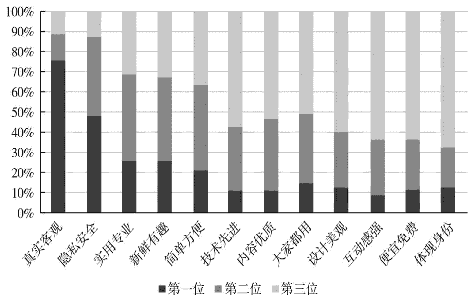

图13.4 媒介特质排序

资料来源：喻国明，曲慧. 媒介认知：社会性偏向及影响性因素研究——基于“全民媒介使用与媒介观调查”的实证分析[J]. 媒体融合新观察，2020（03）:10-15.

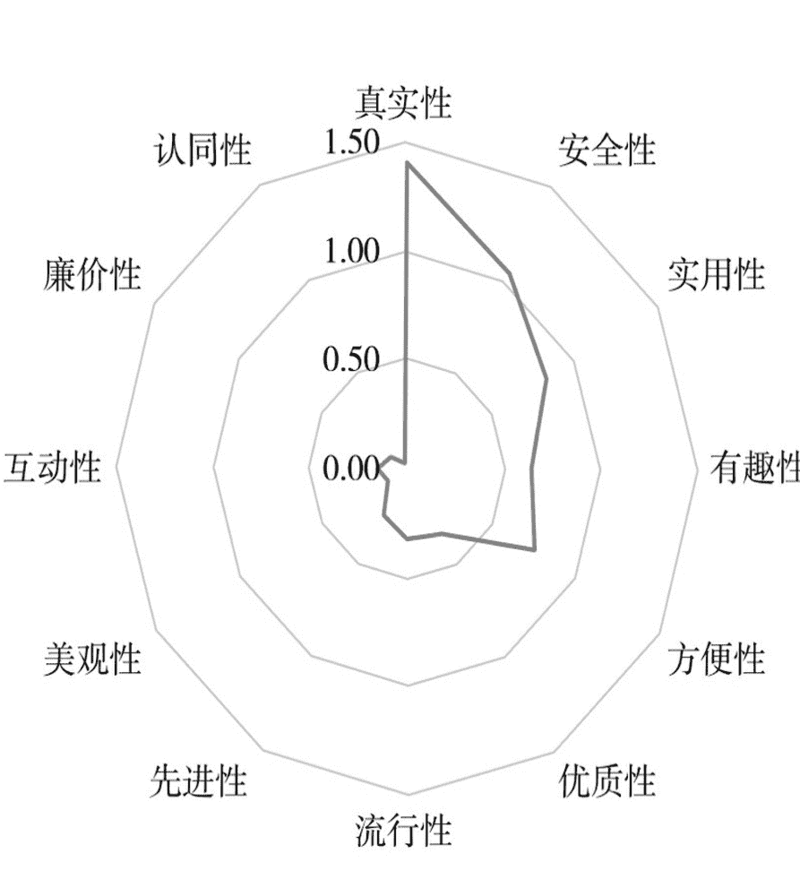

图13.5 全民媒介特质认知偏向

资料来源：喻国明，曲慧. 媒介认知：社会性偏向及影响性因素研究——基于“全民媒介使用与媒介观调查”的实证分析[J]. 媒体融合新观察，2020（03）:10-15.

### 第三节 不同人群的认知分化

#### 三线城市现象
城市按一线、新一线、二线、三线、四线、五线划分后，价值倾向出现分层。二线城市更看重社会联系、他人认同、知识价值，比全国均值高出2%到5%；一线城市同样更强调社会联系和他人认同。新一线对价格更敏感，技术价值占比27.2%，比均值高2.6%，价格关注度达31.6%。

五线城市对知识价值、社会联系、他人认同的重视显著高于均值，分别高出15.0%、10.1%、4.2%，但对时间价值的关注低17.1%。三线城市技术价值占比27.9%，成为分水岭。二线以上更重视社会联系与时间价值，占比均超50%；三至五线知识价值上升至前两位，五线选择知识价值的比例最高达65.9%，显示媒介正成为低线城市重要的知识入口。

特质上，真实性各城市差别不大，安全性却分化明显，三四线更重视隐私安全，五线重视度最低且最不看实用，反而最看重有趣性、方便性、流行性，均分高于其他层级。

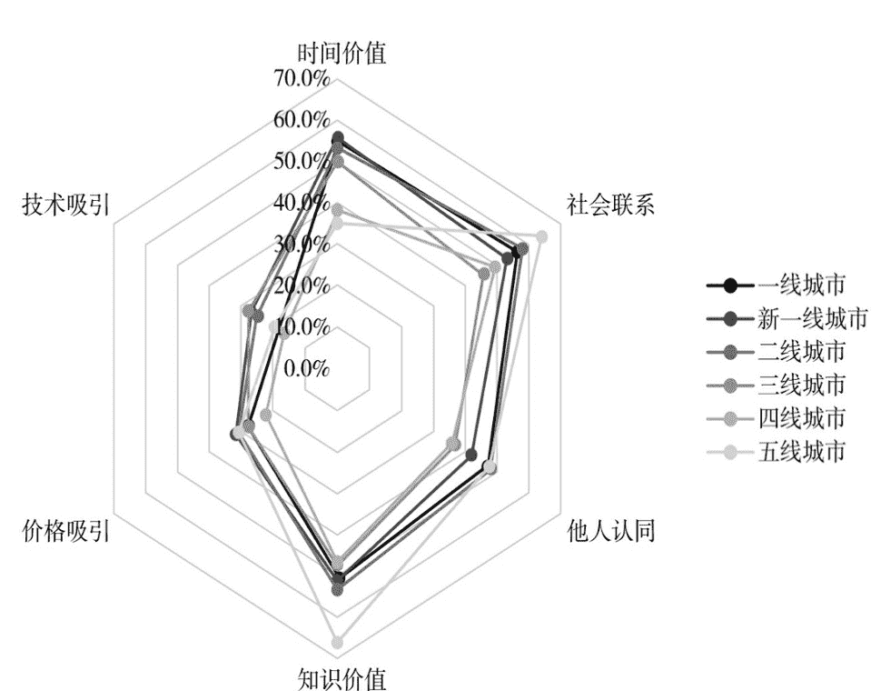

图13.6 不同城市级别的媒介价值倾向

资料来源：喻国明，曲慧. 媒介认知：社会性偏向及影响性因素研究——基于“全民媒介使用与媒介观调查”的实证分析[J]. 媒体融合新观察，2020（03）:10-15.

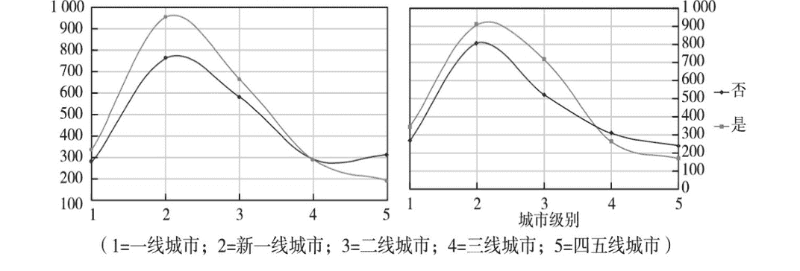

图13.7 三线城市成为价值认知上的分水岭

资料来源：喻国明，曲慧. 媒介认知：社会性偏向及影响性因素研究——基于“全民媒介使用与媒介观调查”的实证分析[J]. 媒体融合新观察，2020（03）:10-15.

#### 东西地区差异
分西部、中部、东部、东北四区。东部、西部、东北更强调社会联系与时间价值，中部更强调社会联系与知识价值。其中东部社会联系占比56.57%最高，东北时间价值57.1%最高，西部技术重视最低22.15%，中部对价格不敏感度最低25.28%。

特质上，西部最看重真实性均分1.64，中部最看重安全性1.17，东部偏向实用性，东北更偏爱有趣性和流行性，均分分别为0.78和0.56，对真实安全要求反而偏低。东北虽然重视时间与社会联系，但知识价值的重视是四区最低，且有趣、流行、廉价的特质显著高于均值，勾勒出“免费、有趣、共用”的娱乐型媒介偏好，这也与快手在东北的兴起相呼应。

图13.11 不同区域的价值倾向

资料来源：喻国明，曲慧. 媒介认知：社会性偏向及影响性因素研究——基于“全民媒介使用与媒介观调查”的实证分析[J]. 媒体融合新观察，2020（03）:10-15.

#### 未来用户的媒介偏向趋势
按代际划分00后14-19岁、90后20-29岁、80后30-39岁、70后40-49岁、70前50岁以上。最看重技术价值的是00后，占比30.77%，远高于70前的16.64%。80后和90后最重视社会联系与知识价值，优于其他年龄段。70后最看重价格，占比32.62%；00后最看重他人认同，占比45.31%。

整体来看，伴随媒介成长的世代在技术敏感和认同需求上更突出，而信息、真实、安全的集体惯性仍在发挥作用，未来产业需要在“接收为主”的共识与“生产表达”萌芽之间找到平衡。

# 世代分化与媒介价值重估

调查呈现出明显的世代反差：00后对媒介的知识属性关注度明显偏弱。背后原因大致有二，一是这个群体多处于在校阶段，学习与媒介在认知上被刻意区隔；二是他们是伴着新媒介长大的原生用户，并不把媒介当作获取实用知识的正规渠道，而是视为自然存在的环境。反观年长者，越往上走越倾向于从媒介中汲取知识，甚至把新媒介系统视作与书籍、报纸并列的信息来源，且信任度更高。见图13.16

在流行性与技术感上，00后与70年前出生的群体都不把“是否流行”当回事，中青年群体反而更在意这一点。技术吸引力对00后而言几乎是刚需，对70年前群体也有不小拉力，可对夹在中间的中青年吸引力则明显偏低。关于媒介的核心功能，00后的排序与主流一致，信息、社交、娱乐位列前三，但社交被放在首位，选择社交功能排进前三的比例高达75.8%，他们更看重人与人的联结而非单纯的信息获取。图13.17

特质偏好的代际分野更为清晰。见图13.18
70年前出生的群体更看重真实、实用、方便，使用体验是否有趣则排在末位；00后则正好相反，极度看重有趣、互动与美观，对真实性的要求却是最低的。隐私安全是90后与00后的共同高频诉求，重视程度远超其他年龄段。70后与70年前群体在特质认知上较为接近。

美观在95后群体中被明显拔高。见图13.19
真实客观、实用专业等特质随年龄增长而上升，新鲜有趣、互动感强则随年龄下降。伴随技术迭代与人群更替，媒介的价值判断与特质偏好正在形成可识别的趋势：互动需求增强、对美观的强调、对知识依赖度的变化。未来当这些年轻用户成为消费主力时，媒介与内容的倚重方式将随之改变，也要求传播者持续调整策略。

#### 中产的时间账本

全民层面，媒介选择的首要依据是能否增强社会联系，其次是是否值得投入时间。但在家庭年收入30万至50万的区间，这一“是否值得花时间”的考量被放大到远超其他群体。这个群体是经济与社会的中坚力量，年龄、学历、城市层级、家庭结构相对同质，是典型的中产样本，他们对时间分配的敏感度极高，不划算的时间成本会直接被排除在选择之外。相比之下，年收入低于10万或高于百万的人群，对时间价值与社会关联的重视都不突出。见图13.20

整体看，收入30万以上的人群除社会联系外，对其余五项价值指标的重视都高于其他收入段；年收入2万以下的人群在时间价值、社会联系、他人认同上的关注度处于最低位。5万元是一个明显的分水岭，5万以下对价格、时间、知识、技术四项的重视均偏低，5万以上则对这四项均表现出较高关注。见图13.21

在特质层面，收入30万以上更强调实用性，对流行性并不敏感；收入2万以下最看重真实与低价，对实用性的要求不高；收入2万至5万最在意方便性与流行性；收入10万至30万则对先进性评价最高。见图13.22

### 第四节 情境适切指标与媒介使用行为

施罗德在七个价值维度中提出的“情境适切”，是唯一对媒介选择形成反向制约的因素。即使内容与特质再具吸引力，时空情境仍是最后的筛选标准。见图13.23

情境被拆分为公共/个人空间与公共/个人时间四个组合，据发生频率划分为不同使用情境。见图13.24

#### 个人时空与公共时空

即便在高度个人化的使用场景下，媒介仍有私人与公共之分，有些只在独处时间出现，有些则填充公共时空的缝隙。

移动点播的普及让观众摆脱电视台排期，自行安排观看节奏，但剔除用户规模差异后，两者在时空轨迹上高度一致，长时间的影视内容多被安放在个人空间的个人时间里。电视因固定场景需求，在个人时空的集中度更高，移动便利并未改变其基本占位，用户仍倾向于在私密时段而非公共场合或集体工作时间消费，符合情境适切原则。

新闻资讯与微信微博的轨迹高度相似，是典型的全天候型媒介，个人时间仍是高峰，但碎片化消费使其在公共时空的出现概率显著提升，是受时空制约相对较弱的类型。见图13.26

#### 信息媒介与娱乐媒介

娱乐类媒介的消费轨迹与信息类相似，集中在个人化时空，主要特征为以视频互动为主、对时长有一定要求、对感官占用度高。图13.27

娱乐媒介的大规模接触主要发生在个人时空，公共时空频率极低，部分源于娱乐与8小时公共时空在本質上不匹配；而信息类媒介则频繁渗入公共时空，即便在工作或学习的间隙保持信息触达，也是情境允许的。情境适切与技术支撑共同促成了媒介消费的碎片化可能。

网络购物

| 场景 | 数值 |
|---|---|
| 在地铁/公交车/出租车上 | 196 |
| 在公共场合排队等待时 | 123 |
| 在独自学习/工作休息间隙 | 206 |
| 在临睡前自家的客厅或床上 | 340 |
| 在单位\学校工作\学习时 | 93 |
| 正在工作时间的集体讨论中 | 66 |
| 在自己的座位上听课\听会 | 55 |
| 上学日的独自午餐时 | 208 |

看直播

| 场景 | 数值 |
|---|---|
| 在地铁/公交车/出租车上 | 119 |
| 在公共场合排队等待时 | 95 |
| 在独自学习/工作休息间隙 | 138 |
| 在临睡前自家的客厅或床上 | 245 |
| 在单位\学校工作\学习时 | 64 |
| 正在工作时间的集体讨论中 | 52 |
| 在自己的座位上听课\听会 | 45 |
| 上学日的独自午餐时 | 210 |

打手机游戏

| 场景 | 数值 |
|---|---|
| 在地铁/公交车/出租车上 | 275 |
| 在公共场合排队等待时 | 180 |
| 在独自学习/工作休息间隙 | 264 |
| 在临睡前自家的客厅或床上 | 457 |
| 在单位\学校工作\学习时 | 90 |
| 正在工作时间的集体讨论中 | 58 |
| 在自己的座位上听课\听会 | 55 |
| 上学日的独自午餐时 | 229 |

### 第十四章 体验时代的传播转型

互联网技术的节点化、数据化、虚拟化打破了既有的权力格局，对主体意识、关系网络与资源获取进行赋能，社会发展正从“物的逻辑”转向“人的逻辑”。经济学者以“体验”命名这一阶段：在农业经济、工业经济、服务经济之后，体验经济成为第四阶段。人们不再只追求物的使用价值满足，更关注物所承载的社会文化意义及其对自我实现的支撑。本书以此为起点，探讨体验时代的社会认知逻辑、自我社会建构的特征，以及如何据此施加有效影响。

### 第一节 体验时代：非理性认知逻辑的转型

约瑟夫·派恩认为体验是指以个人化方式度过一段时间并获得可记忆事件；伯恩德·H.施密特则强调企业以服务为舞台、商品为道具、以消费者为中心创造可参与可回忆的活动，涵盖感觉、感受、思维、行动、关系五类。体验的核心是心理层面的个人感受，遵循的不是纯粹的事实逻辑，而是掺杂虚幻感、沉浸感、信念感等非理性因素的价值逻辑。这一特质已从经济消费蔓延至日常生活，成为互联网社会认知、理解与记忆的主导倾向。总之，体验时代意味着认知逻辑的转型：人们更依赖情感、关系、信念建构对自我与社会的认知，而非单纯依据客观事实。

### 第二节 体验时代下认知形态的新特征

非理性是体验时代的突出特质，但需澄清两点：其一，非理性要素不等同于非理性现象，其内核是情绪与感情，是本能、直觉与下意识的认知方式，本无褒贬；其二，理性与非理性并非对立，理性基于事实与严密推理，二者在现实中常共存。体验时代强调非理性，只因其在此时期更为凸显，并非否定理性。

#### 圈层过滤：趣缘如何塑造认知

互联网关系网与现实关系网存在差异。一方面，圈子化结构影响信息流动。平台以产品区隔圈层边界，用户再通过社群、社区建构个人社交圈并进行表演。加入圈子意味着选择，圈子既提供支持，也充当信息与观点的过滤器。另一方面，以兴趣为纽带的隐性连接作用巨大。现实社会多靠血缘、地缘、业缘维系，互联网则创造以兴趣为基础的虚拟连接，并通过算法激活。例如主流推荐：一是基于用户过往偏好预测未来偏好，二是基于“同好他者”的偏好进行预测，即人以群分。这种机制将同好无形连接，对彼此的认知与观点获取产生隐蔽而强大的影响。

因此，互联网关系网络实质是信息观点的过滤器，人们越来越依赖显隐关系来定位自我、建构社会认知。底层逻辑在于，人们渴望通过关系归入某种共同体，而互联网的“处处皆连接”让共同体身份更具体，人们习惯以所属圈层规范认知与行为。

#### 情感驱动：符号与认同

体验时代，认知的关键逻辑从理性转向情感。情感是人类本能需求，因其主观性常被质疑。理性主义话语在复杂现实面前遭遇困境，韦伯所坚持的价值中立与事实原则被虚无化，后真相时代难以达成客观共识。匿名化与去中心化的技术让对立观点陷入无效交流，共识达成困难，因而情感取代理性、主观取代客观成为时代特征，人们更追求情感满足而非说服。

鲍德里亚的消费社会概念有助于理解这一机制：人们从追求商品使用价值转向追求符号价值，消费的是身份标识。体验时代，人们通过建构符号并赋予精神意义来传递认知，对社会事件的阐释更强调符号意义，如性别对立、阶级对立、文化对立等。这种符号映射共同体意识，人们以情感为逻辑表达观点，以证明身份并获取认同。

#### 主体觉醒：参与感与代入感

体验时代之前，普通人多处于“被言说”的客体位置，即便市场要求用户洞察，也难以实现真正的自言说，参与感与沉浸感不足。互联网赋予表达权，激活主体意识，人们不再满足于被书写，通过反叛与解构挑战权威话语与权力结构，进行自我书写与创作。用户主体意识的觉醒与深度社会参与，是体验时代的重要标志。

随着话语体系从“被动受众”滑向“主动用户”，越来越多的企业和政治行动者开始正视参与式价值，并主动承接用户参与所迸发的动能。让用户真正当家做主的口号被广泛认同，企业内部纷纷培育种子用户群，用物质或情感的激励把用户拉进产品共建的流程，让他们从使用者变成主人翁。实践中这种增强参与感的打法已得到验证。小米把核心粉丝称作“米粉”，以情感联结与物质回馈维系关系，把品牌塑造成有温度的人性化形象。谷歌则把百科的生产权交给普通用户众包，自己退居为秩序引导者和情感搭建者，靠这种众包式的参与养成了良性的生态。参与以交互的方式带来代入感，让人乐在其中，并在投入的过程中不断重塑自我与社会认知。

### 第三节 体验时代如何重塑认知

#### 关系维度：读懂圈层规则实现破圈
互联网圈层里存在可归纳的运行法则。圈子里往往有固定的角色分工，比如意见领袖、信息搬运工、被动接受者，也有一套传播规律，比如热点如何从小圈扩散成全民舆情。打破圈层屏障的关键是把握这些规则。社会网络分析正是从关系视角出发，借助大数据和人工智能把人际网络可视化。可以先测算圈子的中心性，定位不同节点的角色与位置，进而锁定能跨圈传播的搬运工和意见领袖。这样任务就从“说服所有普通用户”转为“先影响关键角色”。通过挖掘关键角色的行为数据提炼共性，针对性调整内容与传播方式，在关键节点间搭桥，让信息与观点流动，最终渗透到圈层内的普通用户，并经由关系网络完成认知建构。

互联网圈层并非都基于现实，更多是靠兴趣缘分形成的隐性连接，这种连接常由算法中介，作用间接且受限。下一步是把隐性兴趣连接转为显性关系。抖音的“兴趣匹配”就是一个操作样本：在用户刷视频时根据偏好弹出志同道合的陌生人并引导入群，把隐性关联显性化。这种转化未来在认知构建上具备很大操作空间。

#### 情感维度：用符号经营意义空间
体验时代更看重符号所承载的情感意涵，以及由此带来的认同满足。因此影响认知的过程要更重视符号的力量。鲍德里亚指出，社会从物的逻辑转向符号的逻辑，消费从使用价值转向符号意义。能指与所指分离，出现漂流的能指，进而寻找新的所指配对。媒体恰是漂流能指配对的理想场所，资本通过广告与营销把产品与时尚、格调等虚幻标签绑定，将使用价值的售卖转为符号意义的售卖，跳出实用主义逻辑。

这种批判性分析为认知引导提供了思路：传播观点时要跳出纯信息层面，回应受众的情感需求，把情感需求与传播意图结合，建构带来认同与满足的符号意义。产品认知就是典型案例。技术同质化的竞品如何差异化，常用路径是结合自身特质与目标用户需求，打造一种精神性的符号，再通过营销兜售这一观念，形成区隔化的产品印象，比如网易云的情感共鸣、Soul的灵魂交友。对用户而言，选择往往由符号认知决定，这种认知本身就是意义建构，必须找到适配产品逻辑与用户群体的情感符号，并把产品作为能指、标签作为所指固定下来。

#### 交互维度：洞察场景优化体验
把场景引入传播学的是罗伯特·斯考伯与谢尔·伊斯雷尔，二人2014年合著《即将到来的场景时代》，提出场景是特定时空、行为与心理的氛围。体验时代用户看似自主，实则时刻被环境塑造，场景是隐蔽却强大的影响力。用户接受何种认知与消费行为，本质上是对所处场景的感知，关键在于深度洞察场景。

横向看，理解场景就是理解空间环境、实时状态、社交氛围与生活惯性，大数据、社媒、定位、传感器与移动设备能还原场景下的用户状态。纵向看，场景是流动的，要联动现在、过去与未来。有学者提出要覆盖三个阶段：此时此地、此前彼处、此后彼处。分析用户如何到达此处，有助于理解其当下目的与预期；分析当下场景也能预测其下一步可能进入的场景与需求并加以引导。这些都需要LBS、大数据、人工智能等技术支撑。

总之，读懂场景就能更准确把握用户在场景中的所思所想，并选择恰当的干预方式。体验时代，人重新成为互联网范式革命的核心。关系过滤、情感阐释、人作为主体的交互参与共同形塑认知。场景构建、关系连接、情感分析需要在更公开、有序的基础上围绕用户创造价值，从而真正改变使用与消费行为。

## 第十五章 认知竞争的分析要义

互联网爆发带来海量信息，而人的信息加工能力有限，二者张力催生了认知竞争的概念。认知竞争即传播环境中各类信息以多种方式争夺个体有限认知资源的行为。它既存在于个体，也存在于媒介与社会层面。本书试图从个体、媒介、社会三个视角梳理该概念并提出实证路径。

### 第一节 个体视角：注意有限与社会认同
上世纪50年代中期的认知革命否定刺激—反应行为主义，把心理表征与内部信息加工重新带回视野，催生了以心理学、语言学、哲学、人类学、神经科学、人工智能为源的认知科学。上世纪70年代认知科学确立后深刻影响传播学。议程设置理论把效果研究从态度转向认知；使用与满足理论把受众视为有目的、有动机、能主动加工信息的个体。

但人脑加工能力受限。智人演化中，大脑既要适应复杂环境又要控制生存成本，演化出容量有限但选择与关注机制高效的注意系统。注意是为有限系统同步处理信息而必须的选择机制。

卡尼曼1973年在《注意与努力》中提出资源限制理论，注意是一种心智资源且总量有限，其功能是分配资源。这种有限性是相对的，与唤醒水平相关，情绪、刺激等会影响资源分配，分配方案还受能量、意愿、任务评价与长期目标制约。注意不是独立过程，而是感觉、知觉、记忆、思维、情绪、意志的共同特性，在各类认知和社会认知中都起作用。感知、工作记忆、长时记忆等环节都贯穿有限性，是认知竞争的心理基础。

在社会认知领域，人们对自我与他人进行判断、理解与评价，包括态度、动机、情绪、类别思维、社会知觉、社会归因、社会认同等。社会认知形成依赖认知启发式的捷径使用，并通过类属性思维即刻板印象来区分我们与他们。认知启发式是在信息压力下把复杂模糊信息简化为易判断信息的捷径，常见四类是代表性策略、可及性策略、模拟策略、锚定与调整策略。它们让人在有限加工下快速提取长时记忆的有效知识以应对情境。类属性思维是对群体特征的归纳...

### 第二节 媒介视角：深度媒介化与赋权
认知竞争具有整合传播学分支的能力。互联网场景下的很多现象都是认知竞争的表现，而媒介环境是其土壤与载体。

其一，深度媒介化时代提供复媒体环境。媒介嵌入日常生活，为认知竞争提供平台与催化剂。深度媒介化重构社会关系，新一代信息技术对个体与群体的赋权远超以往，信息接触、搜集、传播更便捷。公众对媒介事件的展演与记忆面临挑战，个体认知的争夺弥散于不同媒介与场域，个体认知进而成为集体记忆与公共话语的基础。复媒体环境下，数字原住民成为在平台、社群、圈层间穿梭的数字流动群体。媒介选择很大程度上来自认知需求，注意力投向何处取决于认知结构与媒介框架的适配度。深度媒介化下的认知竞争根源在于媒介信息可供性能否匹配认知需求。

其二，情感转向时代情感治理成为非理性力量。情感争夺内生于认知竞争机制。社会风险与不确定性加速负面情绪生成与传播，导致认知失真。在后真相语境下，情感先于事实，客观事实、主观事实与噪音混杂，真相宣称相互混淆，影响受众对内容的可信度与有用性判断。理性人假设不再适用，从情感涣散到情感回归、从负面情绪到情感重塑成为共识。非理性驱动的短链思考与理性驱动的长链思考协同达成社会合意。情感推动舆论、道德规范与网络抗争，提醒研究回归人的价值。情绪与认知加工、决策密不可分，认知竞争本质是注意力争夺，最终要凝聚人心，其中情感与理性的张力不可或缺。

其三，泛众化传播时代认知竞争表现为破圈传播与社群自组织再组织。传播格局变化削弱主流媒介压舱石作用，社交媒介圈层日益同质封闭，个性表达退回圈内，圈层隔阂引发偏见冲突。认知竞争的重要任务是干预认知冲突与纠偏错误认知。技术、资本、政府规制构成虚拟圈层外的他组织群，具有增量与规制功能。有效干预并非仅靠自上而下的强势植入，也需自下而上的开放交流、公共协商与创新协同，形成自主驱动模式，寻求信息破圈出口，促进自组织涌现，实现可持续可调节的认知动态均衡。

未来复杂性范式将成为参考，促进多元主体协同、圈层内外自组织与他组织双向嵌入，完成再组织化，使信息与意见在认知市场上自由流动。

认知市场不同于观点市场。第一，并非所有信息都能进入市场，所有认知都能被觉察，进入市场的条件是能否获关注即具备竞争能力，能否进入感知阈限。第二，非理性具有合理性与必要性。当更多人相信某种叙事时，行为共振产生强大符号力量，这是认知竞争的重要特征。第三，竞争并非自由充分。传播力与吸引力更强、能唤醒与引发情感共鸣的信息，以及关系赋权能力更强的平台，会形成更大声量与更多注意资源，在垂直领域易形成赢家通吃。

最后，关系赋权时代算法媒介是助推器与赋权工具。算法提供表达空间，让受众从接受者变为传播者，在权力、内容、渠道、方式层面解构主流话语权威。算法作为信息与受众间的新中介发挥隐形把关人作用，通过分类、筛选、优先、过滤决定信息展示，搜录到“我们是谁”“我们相信什么”都受其影响。算法重连个体与社会资源网络。但算法由少数平台或非国家行为体所有，这些平台既是科技巨头也是意见领袖与资本所有者，并参与地缘政治博弈，因此成为认知竞争的重要行为主体，甚至在国家间纠纷中发挥地缘政治影响力，重塑公众对商业公司权力边界的认知。

暗流：自动化账号与舆论操控

在网络社群中，有一批拟人化的自动账号能够自行运行并持续产出内容。围绕北京冬奥的讨论在开幕前被研究拆解后发现，相关推文中约有25%可追溯到这类自动体。它们明显偏好负面议题，对赛事整体呈现审慎乃至反对的倾向，且人类用户与自动体的议程网络高度耦合，议程设置效应清晰可见，这表明算法主体已具备左右舆论的能力。俄乌冲突激化的数字冷战则更为直观，它打破了技术超然的幻想，重新塑造了国际权力的分配与运作方式。战局中，依托算法的仿真账号深度参与，成为舆论场的重要变量，通过伪造信息、营造假象、经营社交关系等手段介入公共讨论。

认知角力的手段大致可归纳为三类。其一，利用标签运动制造声量，通过转发叠加、反复投喂同一信息提升曝光，以协同行动织密网络连接，甚至劫持标签植入与原意无关的话题，或用负评淹没核心议程。其二，借助意见领袖进行干预，既裹挟已有头部账号，也快速培育新晋领袖，短期内汇聚大量追随者并引发连锁互动。其三，以差异化叙事展开正面博弈。

### 第三节 社会视角：超级个体的社会

信息处理的主体从不单独行动。个体通过交流产生共享的想象与期待，进而聚合成群体，而媒介始终扮演枢纽角色。今天信息流动趋于平直，平台叠加兴趣偏好的组合催生了新型社会组织形态。网络赋权让每一个人演变成超级个体，这类高自由度的主体具有流动性、生产消费合一、自身即入口、彼此相互解读的特质，社会结构因此被明显改写。认知竞争会带来哪些隐患，是否会衍生新风险，是否会动摇公众心理安全，现有手段能否实现调控与治理，已成为迫切需要回应的议题。

认知竞争既在拆解既有组织，也在搭建新秩序，体现了从自发组织到再组织的演进轨迹。传统科层社会里，各组织分工明确、边界清晰、权责有据，运转依赖指令链。媒介机构在此体系中多居于边缘，基本承担宣传功能。移动互联网普及后，受众自主性被大幅提升，需求迭代加速，媒介行为随之剧变。媒介机构由此升格为核心组织者，成为新社会形态的塑造者，互联网加商业、金融、教育、政务、农业等模式层出不穷。在全面连接的深度媒介化语境中，受众被拆解为不同平台的用户，再依据兴趣、立场、情感等标签重新聚合成相对独立的圈层，形成以媒介深度渗透为标志的新型社会结构。平台为争夺注意力资源，会刻意或无意地强化对用户的认知触达，使得认知竞争无处不在。

这种机制带来双向效应。正面而言，平台可调动自身资源激发互动与创造，推动技术进步并深度参与认知市场，提升资源配置效率，满足多元需求，并在必要时发挥关键优势参与全球竞争，有助于国内大循环与双循环的产业繁荣。负面而言，资本过度扩张可能催生饭圈化行为，助长虚假信息泛滥等认知市场乱象，加剧非理性传播的影响。

回望历史，认知竞争的极端形态比比皆是。教义分歧导致的教会大分裂，心理战、舆论战、认知战的演进，本质上都是对抗性的表现；而不同民族国家文明之间的交往融合，则体现了认知竞争中的共识面向。想象共同体与共享叙事构建起内部认同，并在多元认知观的角逐中胜出，推动社会演化。亚洲、非洲、拉丁美洲的发展中国家在第三世界理论的引领下加强协作、捍卫民族独立与主权、反对侵略与殖民、维护世界和平即为明证。可以说，认知竞争驱动着社会的分化重构与自组织再组织。信息相互争抢关注度，胜出者塑造主流话语并参与意识形态建构。人们在竞争中标定身份、塑造认同、分化对立、极化冲突、重建信任与沟通，形成多样化的互动形态。核心在于主导性认知所具备的属性及其对心智的影响路径。

### 第四节 未来图景与可能范式

认知竞争既是信息处理机制，也是媒介现象和社会演化的动力，其前路多元。把握走向有助于开辟新研究方向，可从三个层面展开。

其一，个体层面。认知神经传播或将成为未来研究的内在要义，传播行为本身可能成为下一个理论突破点。大脑作为信息加工的物质基础，通过神经反馈机制潜移默化地影响决策，信息引导能够干预认知竞争的走向。厘清认知竞争的运行规律、不同信息加工的时间与空间分布，将推动传播学与心理学、认知科学、神经科学、信息科学的深度交叉，使传播学有望重塑为贯通微观与宏观的核心学科。

其二，媒介层面。元宇宙被视为未来媒介的终极形态，正向心世界演进，在心智空间内的认知资源争夺只会愈发激烈。传播学要在更广阔的认知市场中发挥积极作用，需要构建有效的媒介评价标准与指标体系。例如，基于用户体验测算各平台对注意力的占有率与服务水平；在游戏与元宇宙场景中探索沉迷程度的衡量方法与指标；建立契合中国舆论生态的舆情评价体系等。这将为媒介间的认知竞争划定边界，也为讲好中国故事、传播中国声音提供抓手。

其三，社会层面。在百年未有之大变局背景下，调整对外传播新范式、破解主流价值观传播困境，既需要构建人类命运共同体以掌握话语权，也需要运用认知竞争的策略、方法与工具开拓新战场。若缺席竞争，虚假信息等将填补空白，导致劣币驱逐良币。人类已逐步消解基于性别、学历、地域、职业、种族的歧视，但基于文化与文明的偏见依然顽固，西方中心论、文明终结论、文明冲突论等认知枷锁仍有市场，需要以积极的认知竞争加以打破。我们应构建更宽广的命运共同内群体，突出文明间的共通性、淡化差异，促进跨文明交流合作，推动认同、信任与理解，减少对抗与矛盾。

## 第三部分 AIGC传播时代行为传播学的构建

## 第十六章 行为传播学的学科价值、研究方向与关键议题

### 第一节 传播话语的阐释危机

#### 大众社会解构与传播机制的重构

随技术迭代，社会沿着媒介逻辑不断拆解与重组。互联网作为高维媒介解构了传统大众社会，使过去被遮蔽的圈层、群体与个体重新活跃。以机构为运作主体的社会裂变为以个人为基本单元的微粒化社会。在此全新的传播场域里，个体成为基本单元，带来传播结构与机制的变革，以及学科要素、边界与范式的重构。

审视当下困境前，有必要把传播学理论放回历史与思想语境，避免将现实难题投射到历史缺陷。大众传播一词与大众社会互为定义。大众社会强调官僚化结构，丹尼尔·贝尔认为其在连接人们的同时摧毁了共同体，形成原子化个人。此时的大众传播对人的理解受此假设局限，视大众为缺乏特征、判断力不足、易被煽动的机械化群体。后续研究不断探索主体性，如库利的初级群体，认为社会应按才能与相互理解组织而非等级。纵观大众传播理论，对个体的认识从原子化走向具备心理动机与媒介需求的个体。如今媒介技术扩大了连接尺度与行为自由度，需要基于现实环境进一步探索行为表现与内在机理。

从结构与机制看，技术革命消解了大众社会中的大众，形成族群与被激活的个体，个体成为传播终端，社会微粒化。新时代的主体从大众传媒机构转向个人乃至机器与算法，内容中非理性情感与关系表达成为话语主逻辑；传播模式从既有的两级多级传播转向平台驱动的去组织化与再组织化连接升维；受众过去被掩埋的信息与情感需求得以满足，对受众的解读从群体标签转向个体心理态度乃至神经生理层面的描摹；效果评估从行为改变转向认知态度再到瞬时精密效果。这一系列变化使传统结构功能主义与行为主义框架下的传播理论陷入话语失灵与解释力危机。

学科构造层面，技术的连接对象已扩展至物理、生理、心理的复杂系统，媒介界定与理论逻辑、学科范式需同步变革。既有研究将媒介本体从技术升维到器物、中介物、到人本身，再到彼得斯提出的遍在隐形元素型媒介，理解从物理型到关系型再到算法型。媒介日益成为场景适配下提供连接、建立关系、满足需求、聚合群体、拟合公共与私人、现实与虚拟空间的关键环节。即便理清媒介演进逻辑，传播学研究仍受困于旧范式，难以为新社会场景与媒介演进提供理论指导。深度媒介化转型的微粒化社会中，传统范式侧重宏观结构性因素，难以解释技术激活的下沉性社会因素，如圈层、群体、个体的传播行为。社会动力下沉，视野与锚点需向这些因素靠拢。基于系统论、信息论、控制论的传统架构在延展性、未来性与可解释性上存在明显缺陷。

#### 传播学研究缺乏主体意识

传播学兼具跨学科属性与历史断裂。当前研究缺少单一主导主题或子学科构成核心，施拉姆称之为十字路口。许多研究者借用他学科的知识进入传播议题后又返回本学科。作为横断学科，传播学汲取社会学、人类学、心理学等范式后提出自身理论并阐释社会现象，这带来兴起也招致无独立取向的批评。从本体论看，各分支断裂源于对传播含义的分歧：学科内部缺乏共同理解，不同传统对研究对象与分析焦点的把握差异巨大。

从范式看，库恩认为科学革命发生在常规科学无法解释大量异例时，新的范式将取代旧范式。学者愈发意识到媒介技术变迁下的新现象与学科固有的碎片化，开始寻求新范式应对断裂。工具理性层面，有人提出计算传播学、认知神经传播学等范式；价值理性层面，有人主张重访历史、重审旧范式，或强调媒介化范式、人本主义范式。新范式为研究注入活力，也推动框架与要素革新。

当下传播学构建需解决两大根本问题：一是行为主义与功能主义框架需适配新传播场景；二是十字路口困境与研究中缺乏主体意识需以新知识生产模式重新审视学科定位。人的尺度是判断技术形态与传播规则价值的准则，人的传播行为是场域的显性因子。本研究尝试以个人为基本单元，梳理行为研究理论脉络，借鉴行为科学对行为的解读，凝练传播学行为范畴，并借鉴吉本斯的知识生产新模式，构建行为传播学的跨学科形态。研究旨在回答：传播场域中的个人能否成为学科基点，行为范畴能否表征个人；行为传播学的跨学科定位能否化解十字路口困境，为传播学提供面向未来的构建路径、研究面向与关键议题。

### 第二节 传播学重构的思维转向

#### 以个人作为构建学科的基点

当下范式革命与学科重构与媒介化社会中重心偏移相关。媒介技术使粗放连接转为细颗粒度连接，激活了大众媒体时代被遮蔽的圈层、群体与个人。随着媒介赋权带来的社会动力下沉与活跃人群下移，过去宏观考察已不足以解释微粒化社会。传播从对点、对线、对面走向对整体结构的强调，研究视野需从宏观社会考察收紧至中观微观的认知、体验与关系层面。既有研究推动传播学发展的主题有三：媒介影响、传播流动、传播与权力，均属宏观议题。纽曼等人梳理效果研究发现，媒介效果从三段模式发展为六阶段累积模型。纵向区分宏观与微观，横向突出态度改变与认知结构差异。该模型受当时媒介限制，未充分呈现技术逻辑下的视野转向，但强调了效果研究微观层面对个人认知、体验、态度与情感的关注。

技术逻辑下，万物皆媒凸显传播技术自身作用。研究需转换视野，形成真正的主体意识，不仅关注重大社会议题，更以媒介技术发展为基础关注人与社会。如安德烈亚斯·赫普认为深度媒介化社会的深度与深度学习、深度分析共鸣，强调算法、数据与人工智能在社会媒介化中的作用。因此，关注新兴媒介技术后传播过程与个体的关系，即关注媒介与人的行为中个人身份建构、媒介为个体提供连接、连接所处的社会场景。今天时空关系变为全时在线与虚拟空间，传播场景由底层技术基础设施与人机交互技术引擎构成的虚实交互世界。从中观微观看，媒介选择行为交织个人特质、认知偏好、场景体验与社交关系，这些是影响效果的首要因素，也是媒介变革时代用户选择媒介菜单的积极自由。重构传播学首先要转换视野，从人本出发，认识到人在传播场域行为的积极自由，据此开展研究。

#### 以行为范畴表征传播中的个体

当前困境之一是学者从各领域进入传播研究后又离开，因缺乏核心参照点。要使各领域聚合，需打破议题导向，找到共同参照点。重构传播学在视野转向中观微观后，需进一步聚焦核心，勾连多种范式与方法，使其成为学科建设要素关系的必经之点。

各领域研究主题虽异，共通处在于关注社会现象与个人及其所属群体关系。马克思、恩格斯认为社会结构与国家总是从一定个人的生活过程产生，个人是从事活动、进行物质生产、在特定物质条件活动着的现实主体。简言之，个人是物质与精神生产的活动主体，社会发展逻辑下个人不断破除现代性桎梏，释放价值。韦伯亦强调社会构成体需分解到真正的行动主体个人，以避免陷入错置具体的谬误。

在传播语境中，最常见的考察方式是通过个人的传播行为。人的传播行为以显在方式贯穿研究史。不同情境下的行为可表征心理、情感态度与社交关系。如今深度媒介化社会的个人具备较高心智想象力、行为自由度并立身于丰富圈层关系。行为科学中，行为不仅是特定行为，还是一种在历史、功能与情境下的思考。由此，从行为科学视角再思考传播行为内涵，可为社会与传播场域中的人提供解读，并与多学科交互，使传播研究在横断交叉中锚定，找到聚合多学科理论与范式的支点。

### 第三节 行为科学的崛起启动传播学的重构

#### 理论溯源

行为学与行为科学皆源于对行为的研究，但侧重点不同。行为学兴起于20世纪50年代，由荷兰生物学家廷伯根与奥地利生物学家洛伦茨开创，主要研究动物个体与社群为适应内外环境变化所作出的反应，因研究对象为动物也称动物行为学。

行为视角如何重塑传播学：从源头到超学科蓝图

行为科学这个词，最早可回溯到上世纪四十年代末福特基金会推出的一个资助项目。称呼上分单复数。复数 Behavioral Sciences 指向一个学科集合，把社会学人类学心理学以及经济学地理学里涉足行为的部分合起来看；单数 Behavioral Science 则被定义为一门独立的综合学科，以心理社会文化生物经济地理等多重视角为底座，探究自然与社会情境下人乃至动物的行为规律。放到管理语境里，这门概念会被收窄，仅用来解释职场中个人与群体的行动。

理论脉络上，这门学科先经历行为主义再转向人本主义。行为主义承接孔德的实证主义，核心是外部刺激怎样驱动反应。人本主义在五六十年代兴起，开始把自由意志与内在潜能放进视野，友爱合作利他创造等特质被凸显，价值议题成为焦点。

这门学科关心的其实是行为的成因、演变规律，以及预测调控的可能性。研究面向涵盖发展规律、脑机制、群体心理。行为科学打破了各分支把行为单因化静止化的解读，强调在功能层面行为本身就由历史情境后果共同构成。正是在这个本体上，出现了知识迁移与重组，行为经济学组织行为学机器行为学等新范式随之出现，也为传播学提供了参照。

以行为经济学为例，它提出有限理性有限意志有限利己三条前提，认为人的决策并非彻底理性，理性更像一个便于概括的假想，遮蔽了认知细节。这种假设既承认判断能力，也承认肉身之躯的限制。和当下传播很贴合，比如有限理性下的媒介选择惯性与惰性、情绪化扩散、集体非理性现象。组织行为学方面，管理假设从经济人转向文化人，提醒我们不能用单一简化的视角套人，要从多元需求动机情感意志文化价值出发。传播对人性的预设也该摆脱经济人或社会人这种单一模型。

总体来看，范式迁移呈现一致走向：从线性关联走向复杂网络，从静态横断解读走向动态归因，从近端视角走向进化视角，从客体研究走向主体研究，从应然层面走向实然层面。

#### 行为研究的三次转向：刺激、场域、交互决定
传播学史里行为与行为科学一直起着隐形作用。对行为的理解经历了从机械化解释到场域塑造再到三向互动的过程，行为形象从凝固的状态变成与环境共舞的状态。

早期美国传播学受行为主义和结构功能主义影响，形成了拉扎斯菲尔德默顿主导的哥伦比亚学派，和霍夫兰领导的耶鲁学派。魔弹论时期研究借行为主义认为大众媒介是能即时引发反应的外部刺激。行为主义源自孔德实证主义，强调刺激对反应的影响。在此语境下拉斯韦尔在《世界大战中的宣传技巧》里提出宣传是现代社会的强力工具，仇恨煽动关系维系瓦解斗志等诉求都可通过宣传实现。二战期间霍夫兰的陆军实验一方面动摇了魔弹论效果观，另一方面也暴露出只从个体心理出发用行为主义方法实验而忽视社会维度的问题。机械人性观和必然决定论导致了解释者悖论：取消个体自由意志，却把自由赋予研究者。此时的行为科学对行为的理解还停留在客观属性层面，实际上行为无法被纯客观术语穷尽，它本身就蕴含主体心理环境及彼此互动。

理解深化后，库尔特勒温在格式塔心理学影响下把行为带入日常社会实践，给出经典公式 B = f(P,E)。他认为行为是个体特质与环境影响的函数，除了刺激反应还要关注环境的决定性意义。勒温所说的环境是心理环境，包含准物理事实准社会事实准概念事实。场动力理论其实是对传播行为的一种解释：行为是在特定场域或生活空间里受内外因素共同作用而产生。勒温最核心的贡献在于认识到人和环境的互构。放到今天传播环境迭代后两者的函数关系可能受更多调节变量影响，从早期行为主义的功能色彩转向对行为范畴本身的理解。

阿尔伯特班杜拉作为新行为主义代表，提出社会认知理论，强调主体行为环境三者互惠因果。理论中环境指可影响行为的社会或物理情境，提供机会与支持；个人因素涵盖认知动机情感个性人口统计等特征。三者相互作用：主体对行为的期待目标意向情绪影响行为，行为反馈又改变思想态度与情感；环境决定行为方向与强度，行为也反作用于环境；主体的认知人格是环境作用的产物，也能通过信念与价值观重塑环境。该理论后来被用于媒介暴力的分析，用于解释观察学习的抑制或去抑制效应，成为理解电视学习行为的有效路径。

图16.1 班杜拉社会认知理论的三向因果关系
参考：喻国明，苏芳，杨雅. 行为传播学：建构未来传播学统摄性范式——行为传播学的学科价值研究面向与关键议题[J]. 社会科学战线，2022（10）:147-157+282.

勒温的场域思想被广泛用在网络技术塑造的空间分析中，成为网络2.0时代的研究框架之一。班杜拉的交互决定论不仅是心理学抽象观，其背后包含社会建构观人本主义观协同进化观生物潜能观，既强调意志自由，也关注外部制约，因而在媒体公共卫生教育等领域得到验证。

梳理来看，行为科学重构传播学的关键在于借助行为这一理论范畴来理解变化中的传播行为。过去受功能主义和行为主义框架限制的大众传播忽略了社会与技术框架，导致复杂性被扁平化。新媒介场域里的个体已不是原子化被动机械的个体，也不是单纯的刺激反应体。媒介技术改变了传播环境和人本身，人的传播行为既是对客观环境变化的回应，也体现主体能动性。媒介环境受政府规制市场产业技术革命社会安全等多重力量塑造，其中技术具有革命性意义，同时也在重塑个体心智模型认知方式与社交关系。个体的传播行为既是心智认知与关系的表征，也是媒介环境变革的体现。

此处的传播行为并非脱离社会与技术框架的孤立动作，而是一个统摄个人与媒介环境的核心范畴。从行为科学属性看，传播行为具有具身相关动态高维特征。首先相关性，行为是具身认知与环境的融合，人和环境的关联定义了行为的可供性，分析行为必须结合环境场景情境。其次动态性，变化既偶然也必然，行为在时空上是一个连续过程。最后高维性，行为复杂多变难以预测。

在理论建构上，行为把人和媒介环境连起来，具有关系属性。借鉴康德对范畴的界定，关系范畴用于考察相互关联的对象。本书以班杜拉社会认知理论为元模型反思变动环境中的传播行为，见图16.2。将行为范畴定位为连接人与环境的枢纽，外部体现社会技术传播环境，内部是心智认知态度情感的综合反应。行为作为核心解释变量，反过来影响心智技术发展与媒介环境，为人和传播环境的互构提供统摄作用。譬如在沉浸式传播场景中，VR等形态超越传统可供性，进一步影响使用者心智模型空间认知与社会行为。

### 第四节 社会发展逻辑下行为传播学的超学科构建
大众社会裂解为微粒化社会后，传播理论和范式如何顺应社会发展逻辑而变革成为首要问题。把人作为学科构建的基点，从行为科学与传播学对行为的研究出发，用行为范畴来表征传播中的个体，就能找到突破口，后续仍需解决传播学的横断学科困境与重构路径。

#### 学科构建的逻辑起点
传播学的横断学科困境由来已久，解决之道要回到知识生产的逻辑起点。传播学诞生于战时宣传分析，是应用导向的现代学科。二战后兴起的现代学科强调应用问题驱动，通过整合多学科知识实现生产。吉本斯将其总结为模式Ⅰ和模式Ⅱ，模式Ⅰ符合默顿范式，强调单一学科语境同质性和等级性，面对复杂社会问题时易出现情境与理论脱节。模式Ⅱ则聚焦应用与问题解决，具有跨学科框架异质性的生产场所与沟通方式，以及社会问责与自反性。

在全球化背景下，卡拉雅尼斯和坎贝尔提出知识生产模式Ⅲ，核心是一个多层次多形态多节点多主体多边互动的知识创新系统，融合创新网络和知识集群，以竞合共同专属化共同演进驱动资源生成分配与应用，实现知识创新与资源动态优化。该模式在大学产业政府三重螺旋基础上，增加了基于媒体和文化的公众与公民社会作为第四重螺旋，凸显公众在知识创新中的作用，和众包UGC现象相吻合。多种模式可以并存，取决于社会与学科发展需求。

知识生产模式的创新推动学科结构从单学科跨学科走向跨学科升维整合。丽萨拉图卡将跨学科分为工具借用型学科合成型和超学科。工具借用型借助他学科概念理论；学科合成型形成政治传播健康传播组织传播国际传播跨文化传播具身传播人机传播整合营销传播等；升维重构则摆脱边界交叉，形成多层次多维度网状的知识群，用以解决社会发展临界期的关键性问题。

传播学重构需避免沦为工具型跨学科，而应从统合视野出发，形成对社会迭代时期升维问题的解释，构建网状化知识体系。卡拉霍尔等人提出的学科重构四阶段模型见图16.3，包括问题发起概念化开展研究知识转化。

图16.3 超学科构建的四阶段过程
参考：喻国明，苏芳，杨雅. 行为传播学：建构未来传播学统摄性范式——行为传播学的学科价值研究面向与关键议题[J]. 社会科学战线，2022（10）:147-157+282.

借此模型，传播学在问题发起层面面临升维性挑战：结构功能主义与行为主义框架下的理论出现阐释危机，个体被视作基本传播单位，关系与非理性情感表达成为内容，深度媒介化社会中机器逻辑与算法逻辑塑造传播模式与文化，媒介技术迭代要求理论逻辑与研究范式变革。在概念化层面，行为科学提供新视点与研究范式，将宏观议题转向个人认知体验与关系的中观微观考察，以传播行为表征个体，发现行为范畴统摄个体与传播环境。随后展开三向因果关系研究并进行证伪，最后实现行为传播学知识转化。该重构并非简单借鉴，而是实现跨学科升维整合，对应知识生产模式Ⅲ。

#### 超学科构建的理论半径
确定逻辑起点后，需找到学科构建的理论半径。班杜拉社会认知理论与可供性思想契合，为行为传播学范式提供理论基础。研究对象大致分为三类：传播中的个体传播行为媒介环境。为避免抽象经验主义，需要进行具有现实关照的中层框架建构，结合本土现实并改良。

生态心理学视域下的可供性强调有机体与环境关系，对应传播行为这一关系范畴。

在研究对象界定上，传播中的个体从心理学看是心智与具身认知主体，从传播学看是信息传播与意义共享主体，从社会学看是社会关系的总和，可从心智认知信息传递意义共享与社会关系多方面界定。媒介环境上，麦克卢汉认为媒介生态由政策资源技术竞争环境构成，强调技术作用，当下及未来的人环境主要由现实与虚拟环境构成。传播行为上，随着媒介变化，表征从语言行为到非语言行为再到社交信号，交互过程也从单一感官激活发展到多感官协同，如听觉通道的语音与合成语音，视觉通道的视觉与视线交互，正在发展的传感器触觉装置等。个体意图心理状态通过行为体现，形成连续信号通道，在与机器媒介互动中产生并被感知。因此分析可采用多模态框架，将多通道感知与社交信号纳入整合分析。

##### 1. 个人行为和传播环境的耦合
行为传播学以人和传播环境的互构为锚点，以行为作为关系范畴连接二者。可供性概念为研究三者关系提供工具。

可供性由詹姆斯吉布森于1979年提出，源于生态心理学，强调环境与生物的关系属性。它试图摆脱行为主义功能主义控制论等窠臼，以有机体与环境耦合视角考察关系，最大程度捕捉传播研究的具身物质与互动面向，体现人和人工制品的可供性交互。在分布式认知框架下，可供性包括外部与内部两部分，外部涵盖化学过程物理配置时空与符号结构，内部为生理感知与认知能力。传播行为嵌入传播环境与主体互动中，可供性理论用来分析行为产生机制发展演化与功能，提供中层概念与工具。

以图16.4为参照，从传播个体的切口看，当个人与媒介环境、传播行为发生交织时，会同时显现两类可供性向度：认知可供性与感知社交可供性。在产品设计的语境里，认知可供性被理解为一种能够助力、辅助、支撑乃至推动使用者思考与理解的设计特质，比如按钮上的文字提示就能让使用者快速掌握正确操作方法。可供性理论的核心主张是认知并非封闭在头脑内部的孤立活动，而是分布于心智、身体、文化与物理环境相互交织的关系场域。迁移到传播情境，认知可供性即指向个体在对客观信息进行加工处理时所能依赖的可用资源。

表16.1 分布式表征视角下行为传播学的可供性划分

| 分类 | 可供性 | 内涵 |
| :--- | :--- | :--- |
| 内部可供性 | 认知可供性 | 一种帮助、辅助、支持、促进或使人们能够思考或了解某些事物的设计特征 |
| | 感知社交可供性 | 用户对于技术所提供的功能具有的情感体验 |
| 外部可供性 | 技术可供性 | 行动的有机体和被行动的环境的互补 |
| | 社交可供性 | 技术变化为社会关系和社会结构提供的可能性 |

资料来源：喻国明，苏芳，杨雅. 行为传播学：建构未来传播学统摄性范式——行为传播学的学科价值、研究面向与关键议题[J]. 社会科学战线，2022（10）:147-157+282.

Hartson H R. Cognitive, physical, sensory, and functional affordances in interaction design[J]. Behaviour & Information Technology, 2003, 22 (05): 315-338.

Fox J, McEwan B. Distinguishing technologies for social interaction: The perceived social affordances of communication channels scale[J]. Communication Monographs, 2017, 84 (03):298-318.

Gaver W W. Technology affordances[C]//Proceedings of the SIGCHI Conference on Human Factors in Computing Systems Reaching Through Technology-CHI'91, New York: ACM Press, 1991: 79-84.

Wellman B, Quan-Haase A, Boase J, et al. The social affordances of the Internet for networked individualism[J]. Journal of computer-mediated communication, 2003, 8 (03):JCMC834.

图16.4 可供性视角下传播行为、传播主体与媒介环境的互构

资料来源：喻国明，苏芳，杨雅. 行为传播学：建构未来传播学统摄性范式——行为传播学的学科价值、研究面向与关键议题[J]. 社会科学战线，2022（10）:147-157+282.

感知社交可供性关注的是使用者在使用技术功能时所产生的情感性体验。不同媒介渠道在营造社会临场感、拉近互动与情感分享的程度上所提供的可用性并不一致，社会临场感理论与媒体丰富性理论都指向了这一作用。问题在于，当比较不同媒介的可供性时，人类的情感差异常被忽略。研究证实不同媒介的感知社交可供性存在差异，这能够解释人们为何在不同渠道间切换，以及同一信息经不同渠道传递时感知与效果为何不同。围绕短信、社交媒体、视频会议等八类媒介的研究，归纳出感知社交可供性量表，包含可访问性、带宽、社会存在、隐私、网络关联、个性化、持久性、可编辑性、对话控制、匿名性十个维度。54

从媒介环境的视角出发，环境向传播行为与传播个体提供的可用性可以归纳为技术可供性与社交可供性。通信技术演进过程中，研究者持续比较渠道差异，并将对人际互动产生影响的可供性区分为技术可供性与社交可供性。Gaver 提出技术可供性是“行动的有机体与被行动的环境的互补”。55 在不同媒介环境中，技术可供性以直接或潜在方式呈现，平台媒体的算法并不提供使用者直接参与的界面，却以潜在方式塑造行为。更直接的例证是 Twitter 于 2017 年将字符限制从 140 提升至 280，研究发现这一可用性变化与平台上的传播行为存在直接因果关联。56 Barry Wellman 提出互联网带来的社交可供性，涵盖更宽带宽、全时连接、全球化连接、个性化需求的满足以及无线便携性，这些为传播个体与社会带来了新的可用性与行为模式。57 技术可供性体现了行为主体与技术之间的互动关系。

从传播行为的视角看，传播行为是联结传播个体与媒介环境的关键枢纽，嵌入在上述可供性之中，并反过来重塑个体与环境。此过程中行为范畴借助可供性工具作为解释变量。在后续实证研究中，传播行为既可作为自变量影响主体与媒介环境，也是个体认知、感知、态度与意图的因变量，并受媒介环境的塑造。

##### 2. 对媒介环境与传播主体的重构与研究范式

依据行为学取向，研究传播行为需要从多元视角切入。过去基于信息论、系统论与控制论的简单科学原则，多把行为置于静态与近端视角考察。未来应融合动态演进的视角，在方法论上将定性描述与定量计算结合、微观分析与宏观综合结合、还原论与整体论结合、科学推理与哲学思辨结合。58 从多元视角解析传播行为对主体心智与媒介环境的重塑，可以区分为个体行为与群体行为。

在现实或虚拟情境中分析个人行为，行为经济学提出的“行为人”假设，即有限理性、有限利己与有限意志力，为当前传播环境提供了启示。对个体传播行为可从个人决策的神经机制、决策偏好与行为后果三个层面展开。认知神经科学范式能够从神经机制层面揭示大脑与行为的关联，但在传播情境中生态效度难以保证。近年研究者提出自然主义实验范式，以便在复杂性原则下进行更贴近真实的分析。具体做法是将个体置于社交环境中考察，利用个人社交网络、以自然回忆探索记忆、比较自然语言与情境化表达、使用数据驱动建模捕捉自然神经反应。59 例如既往研究发现不同文化的图式符号会激活相应文化的加工方式，导致“文化认知偏好效应”，但在特定社交环境中与异文化者交流是否会引发该效应尚不确定。周思远等人设置了美中对话实验，发现他人在场会诱发内隐神经活动出现“文化认知偏好效应”。60

在群体行为层面，“行为人”假设取代“理性人”假设后，分析既要关注技术自组织行为的涌现，也要看见非逻辑内容与情绪感染所致的群体极化。以互联网时代为例，技术发展促进了群体行为的亲社会性、公正、合作与利他动机，如众包生产、网络打赏、捐赠等。对这两类集体行为的分析需从主体心理动因、环境刺激因素、行为规律与行为后果的三元因果关系入手，借助心理学理论范式与认知神经科学工具解决心理动因问题，用大数据计算把握群体行为的动态过程，并以个案进行民族志调研，收集质性数据，剖析行为背后的复杂因果链条。

总之，面对社会迭代下的新传播场景与日益媒介化的社会环境，传播学应走出过去的学科规训。福柯认为学科隐含规训与社会控制，学科知识不仅是认识论层面，更是一种社会实践。范式的采纳与发展与特定社会历史语境相关并受学科知识传统制约。在深度媒介化背景下，科层制社会裂解为分布式社会，传播研究中崛起的“个人”呼唤整体传播场域与学科结构的变革。把“个人”作为学科建构的基点符合社会发展逻辑，在论证“行为范畴”表征个人合理性的基础上，行为传播学以新的知识生产模式为起点、以可供性原则为理论半径，力图建构传播学的统摄性范式。

## 第十七章 行为传播学：未来传播学学科构型的核心范式

当革命性技术出现时，依托旧技术与旧范式构建的学科结构与价值尺度往往面临危机。安妮·朗与理查德·M. 帕罗夫在 2013 年展开对话并达成共识，即大众传播或媒体效应领域过去 30 年呈现学科碎片化，传播理论仅预测了行为变化中的一小部分，且理论在不提升解释力的情况下愈发复杂。1,2 除内生问题，技术革命催生的全新传播现象进一步加剧了外部焦虑：一方面，元宇宙技术主导下媒介交往转向第一人称视角，使用者行为自由度被极大拓展；另一方面，既有理论范式与研究议题愈发分散，学科难以以知识共识与范式标准整合各自为政的知识孤岛。3

我们缺乏一个基点或理论体系的最大公约数，能够评判不断涌现的新传播现象，并将分散的研究议题、方法与逻辑有效聚合，形成理论聚变。找到这个基点是未来传播研究的关键命题。理论只是逻辑的具象，正如恩格斯所言，“历史从哪里开始，思想进程也应当从哪里开始”，4 行为实践铸造历史，理论逻辑也必须由行为实践奠基。纵观社会科学理论演进，关注行为一直是其主线，行为研究催生了行为经济学、组织行为学、计算行为学等新兴范式。那么，行为研究作为学科构造的基础范式，对传播学构建与发展有何意义？能否帮助走出当前困境，建立面向未来的学科范式？本书拟从三方面回应：一是行为研究为何对社会科学至关重要；二是行为研究如何与未来传播研究耦合；三是如何建构以行为为理论核心、适应未来传播发展的“行为传播学”范式。

### 第一节 行为、行为研究及其与传播学的契合之处

有必要对“行为”概念及其范畴进行统一厘定。与“行为”相近的概念包括“行动”“实践”等。学界基本共识是“行动”与“行为”的区别在于是否有意向性。若一种行为缺乏意向性，则不称其为行动。

#### 行为对人类及其实践环境的诠释与影响

行为研究作为学科构造的基础范式，其学术力量已在行为科学、行为经济学、组织行为学等范式的成功中体现。在尝试建构行为传播学新范式之初，需要思考行为研究对学科构造的意义，以及为何能长期居于社会科学核心。以人与环境为基本视角，行为对人类及实践环境的诠释与影响可归纳如下。

行为对人类的诠释与影响主要表现为两方面：一是行为被视为人类外在表达；二是行为具有塑造人类的重要作用。行为可谓人类集中的表征。“察言观色”“知言知人”等说法暗示我们可通过观察言行解读内心，一个人的言行是心灵的外显。正如巴赫金所言：“我的每个思想及其内容都是由我个人自觉负责的一种行为，而我的全部而唯一的生命作为一连串的行为过程则是由这些行为构成的，因为我的整个生命都可被看成是某种复杂的行为：我以行为实现着我自己的全部生命”，行为是人类高维活动形态，也是理解人类的本源视角。

行为对人类的塑造作用可见于行为科学中的相倚性理论，指出有机体对环境刺激做出反应后，反应结果或经验可能使该有机体在相似环境中产生相似反应。换言之，有机体行为相倚于此前引发该行为的刺激与该行为的后果。因此，行为实践与行为期望能够改变人类行为模式。正如班杜拉所言，“任何影响到选择行为的因素都会对个体的发展产生深远定向作用”。

行为对环境的解释效用主要表现在两方面：首先，人类实践环境是基于个体行为的有限存在；其次，行为是构造实践环境的原始力量。人类实践环境是基于行为的有限存在，这一观点可见于可供性理论。可供性强调生物感知环境是通过环境所能提供的行动可能性，因此可供性概念必须蕴含在环境与动物的关系之中。由此及彼，人类实践环境、信息构造的拟态环境对个体而言也只是盲人摸象式的认识。自然环境、社会环境、拟态环境在某种意义上都只是基于个体行为功能认识的有限存在，个体只能依赖其所认知到的世界展开实践。可供性理论启发我们反思：人类社会进步的原始动力或许就是突破环境或社会可供性的限制，以实现更高维度的实践自由。马克思指出，全部社会生活的本质是实践。人类意识的能动性体现在人们在实践基础上能动地认识世界、改造世界的能力与作用。可见，人类意识区别于动物意识的重要特性——能动性是基于行为实践且为了拓宽认知半径与实践半径的特性，行为是实践环境存在并不断拓展的核心要素。

行为也是社会构造的原始力量。《论语·泰伯》有云：“兴于诗，立于礼，成于乐。”“兴于诗”意指诗篇所蕴含的理性逻辑、感性逻辑、价值判断能够激发个体，“立于礼”意指通过礼的规范使社会系统稳定运作，“成于乐”则表明社会行为与他人社会行为保持和谐的方式类似一场动态和谐的游戏。韩国分析哲学协会前任主席南京熙指出：“我们借以与他人互动沟通并构建生活世界的社会媒介是身体行为而非心。”换言之，人类行为是社会构造的原始力量。

总之，行为是人类连接实践环境的基础中介，是洞悉人类生存样态与社会文明变迁的本源窗口。个体行为实践模式昭示其性格习惯、社会关系、生存状态；族群行为实践表征其关系网络、权力结构、价值取向；社会行为实践表征其发展水平、资源配置与文化样态。例如，用恩格尔系数衡量家庭富足，用就业方向差异判断代际价值观，用垃圾分类执行水平判断国家文明水准。这都表明把握人类行为实践的关键特征指标，人类族群与社会文明图景便可呈现。面向未来媒介时代，传播学研究必须给予行为要素更高关注，并通过与行为科学等多学科整合，形成更适宜未来传播学研究的学术体系。

#### 行为研究的发展历程

由于行为对整个社会系统至关重要，对人类行为的研究成为社会科学演化重要脉络。有关行为的讨论最早可见于心理学。早期心理学对行为解释有两派：其一为“心灵主义”，认为人类行为由个体心灵或内部状况驱动，外界干扰少，行为是内在逻辑的外延，成为表征性的可观测实在物，因而行为研究价值被消解；其二为“环境主义”，批驳行为完全内驱观点。新行为主义代表伯尔赫斯·弗雷德里克斯·斯金纳建构“内在人”概念，认为人可分为内在人与外在人，内在人像司机驾驶汽车般驾驶外在人。“内在人功能的确提供某种解释，但这一解释本身不能得到解释，由此解释便中止在内在人这里，成了神圣莫测的东西。”因此要研究行为就必须破除心智因素研究传统。尽管斯金纳过度分离心智与行为，但在某种程度上开辟了行为可脱离心智作为独立概念范畴开展研究的先河。今视之，心灵主义与环境主义皆有行为研究的认识论价值。斯金纳对内在人的摒弃源于彼时研究方法的缺位，如今心理学与认知神经科学发展已能以科学方法审视内在人逻辑与机理，故不可完全转向行为而无视心智效用；同理，若仅聚焦心智而无视行为，则难以把握行为及其代表的社会构造力量。

上述心理学行为主义通常被视为行为科学的哲学基础。行为脱离心理学成为独立学科最早可追溯至作为管理科学的行为科学，即研究管理过程中行为与人际关系规律的学科。随着更多行为纳入研究范畴，行为科学逐渐脱离管理学框架。如今行为科学主要指以心理学、社会学、文化人类学、生物学、经济学、地理学等为理论基础，研究人类行为规律的综合性科学。在研究方法上采用实验、问卷调查等实证方法。研究内容主要是人类行为的动机与组织，即行为由何原因引起与推动，发展变化受哪些因素支配、有何规律，以此预测与控制人类行为。

托马斯·塞缪尔·库恩认为，只有足够多专家意识到很多反常行为无法解释时，科学范式才会革命。行为所具有的强大解释与预测力使行为研究迅速成为其他社会科学革新理论逻辑的基本范式。伴随对行为的聚焦与转向，20 世纪 70 年代以来陆续诞生行为遗传学、行为生态学、行为神经科学等边缘学科。随着分支学科成熟，行为科学群日趋完善。国际学界日益认识到行为科学在社会与个人发展中的重要作用，在结束“脑的 10 年”之际，美国心理学会科学委员会于 2000 年 9 月正式宣布 2000—2010 年为“行为的 10 年”，可见行为在社会科学研究中的重要地位。

#### 行为研究与传播学的契合之处

传播研究对行为的关注最早可追溯至 20 世纪 30 年代。彼时心理学行为主义席卷社会科学，传播经验学派受其影响，多以实验与调查方法研究传播过程与效果间的因果关系，开创了从行为角度研究人类传播活动的传统，这一时期也被认为是传播效果魔弹论时期，即认为媒介在影响社会舆论与个体行为方面发挥犹如魔弹般的强大作用。

# 行为回潮：给传播研究找根基

上世纪三四十年代的行为主义传播研究受制于当时手段，习惯把人的动作从社会关系和心理机制里剥离出来单看。刺激—反应的单向图式让偏差越积越多，子弹论随之失势。学界随之陷入媒介是否起作用的焦虑，被概括为有限效果说。随后人们注意到有限效果说只涉及态度与行动的后端，对认知框架的塑造这一步视而不见。大众媒介如何设定公众的注意边界和理解方式，成为被漏掉的关键。七十年代后议程设置、沉默的螺旋等把分析重心拉向认知与态度，学科才短暂回暖。从子弹到有限的振荡，核心是行为被淡化、心智被高估。认知与态度的隐蔽、波动让理论的社会解释与预测力持续走弱，呈现分散流动的状态。

媒介技术演进令“受众”变成“用户”，传播对实践的牵引更显性化。有的影响几乎即时，一次策划就能带动点赞转发；有的则需宏观长时段才能看清，比如传播样式与媒介中介正在改写人类行为模式与生存状态。正因如此，行为需要重新回到议程，成为下一步研究的锚点。

把行为科学和传播研究并置，底层预设高度近似。行为科学源于管理，认为人类的行为有规律可循且可用科学方法探究；行为规律不同于自然规律，具有复杂与不确定，人既是理想化的理性主体也是有限理性的决策者；行为可被调控，通过变动自变量实现干预。传播研究同样默认规律性、复杂性与可控性。

观念层面亦趋同。行为科学提出“社会人”概念并高举以人为中心的口号，为西方管理的人本主义奠基；当下传播学同样呼唤人本主义，强调以人为本的理论建构。行为经济学强调理性与有限理性的并存，与传播中理性与非理性并行的逻辑殊途同归。

关注的问题也高度重合。中国科学院心理所2001年指出，信息化条件下个体与组织的适应是当代行为科学的重要议题。信息技术与人组织相互塑造，人组织的行为也适应技术特征，这与传播学在深度媒介化社会中探讨的传播行为问题本质一致。

##### 表17.1 行为科学与传播学的契合之处

| 学科 | 行为科学 | 传播学 |

| :--- | :--- | :--- |

| 基本假设 | 行为规律性 | 传播活动存在规律 |

| | 行为复杂性（包括文化等因素的影响） | 传播实践的复杂性 |

| | 行为可控性 | 传播效果的可控性 |

| 基本观点 | “以人为中心” | 未来传播实践的以人为本原则 |

| | “理性人”与“有限理性” | 传播实践的理性和非理性逻辑 |

| 基本问题 | 信息化条件下个体与组织的行为适应 | 深度媒介化社会的传播行为 |

资料来源：喻国明，苏健威，杨雅. 行为传播学：未来传播学学科构型的核心范式[J]. 武汉大学学报（哲学社会科学版）,2023,76（02）:32-44.

假设、观点、问题的高吻合说明融合在逻辑上可行。行为科学的目标是通过控制变量影响行为以改善绩效，传播学的核心始终是如何实现有效传播。范式与目标一致，基于行为科学搭建新的传播研究范式既可能也必要。

### 第二节 行为传播学的基本内涵、使命承载与研究路径

前文说明了行为要素的重要性与两学科的契合，下面展开内涵、使命与路径。

#### 行为传播学的基本内涵

与上世纪三十年代的行为主义不同，如今语境下的行为概念已完全改变。刺激反应的粗糙模式早已被否定。如今系统科学、大数据与认知神经科学提供了精细解读行为的工具，需要重新评估行为对传播研究的价值。本书提出当代传播语境下三点认识。

第一，传播和行为不可分割，行为也离不开传播与心智而孤立存在。脱离行为与心智的传播是飘忽的；脱离心智与传播的行为是非社会性的。因此“传播-心智-行为”应作为环境与人类本体之外的第三协同概念。行为传播学视角下的行为主要是被媒介或传播中介的、交互的、有意识的实践形态，这是它与行为科学的关键区别。正如克劳斯·克里彭多夫所言，语言让人便于组织社会，但仅用于表达的语言生产意义有限，必须与行动连接。人在使用语言时既描述所见所为，也按言语行事，行动与语言结合。语言连接行动、所见与所述，发挥关键作用，这种语言是行动中的话语。

第二，传播与行为可互为自变量与因变量。传播本身就是行为，媒介中介的行为本身就是新的传播内容，可以成为继文字图像视频音频后的新内容维度。传播效果既体现在认知态度情感等心智层面，也应体现在行为层面，行为是更广义的效果维度。传播能影响行为，行为也能回过头影响传播，二者都能解释传播结果。

第三，行为是重要的表征与分析指标。它能体现受众特征、媒体特征，也能折射群体或社会的结构与文化样态，这是行为可以被纳入传播学诠释的重要基础。

综合以上，行为传播学可定义为以人类社会中的“传播-心智-行为”协同要素为对象并使用科学方法的研究范式。

#### 行为传播学承载的学科使命

在传播逻辑剧变、理论出现危机的当下，行为传播学要内解困境、外应挑战，即如何用传播特有方式组织并影响社会。

其一，破解碎片化，实现范式对话与学科聚合。传播学缺乏主导性的核心主题，正处碎片化与解释危机。罗伯特·T·克雷格提出传播研究不应追求无争议的一致，而要对各理论深入理解，找到可争论的议题，发展出“超模式”。这包含两个子问题：现有范式有何异同，如何在范式间找到最大公约数。

西方传播学大致有三种范式：社会科学范式视传播为信息，含控制论与社会心理学传统；诠释范式视传播为关系或意义建构，含符号学、现象学、社会文化与修辞传统；批判范式对传播实践批判，含批判修辞传统。最大分歧在社会科学与诠释之间。社会科学把传播界定为内容表达与信息传递，关注影响与效果；诠释更重意义与关系建构，认为传播本质是传播关系的建构与主体互动。将传播简单化为信息能发现规律却忽视修辞符号的隐喻意义；将其视为意义建构又易陷入主观而缺乏现实指导。

本书认为行为有望成为沟通不同范式的核心议题。传播的本体论仍围绕信息表达，埃弗雷特·M·罗杰斯指出信息是传播学中心概念，香农信息论指明信息可减少不确定性，传播是降低认知不确定性的实践。非理性传播也存在，体现为情感、认同、关系。在这两种视域下研究长期偏重难以外化的心智效果，被批评为难以观察。破解的关键是回归行为，人类及其环境的连接依赖行为，行为是动态表述，心智更多是过程，行为才是因果终点。面向未来，传播、心智、行为应融合研究，效果更偏向行为，才能贴近实践，在复杂媒介场景中把握规律。这不是否定心智影响，而是承认信息有限性与不确定性，用行为实践来补偿，使传播可感可知可控。

社会科学范式向行为转向更容易与诠释范式对话。诠释范式本就广泛讨论行为，如具身传播强调身体经验，社会规训理论说明行为规范形成秩序与权力。将社会科学关注点从信息心智转向行为，有望实现克雷格所说的超模式愿景，形成不同范式可共同争论的话题。西尔维奥·R·韦斯伯提出寻找公共知识领域以凸显传播研究的重要性，行为可成为聚合分散理论的公共领地。

其二，回应核心命题：传播如何构造社会。曼纽尔·卡斯特说传播变化的每个部分都代表社会关系的表现，克里彭多夫也强调传播如何以另一种方式组织社会。建构行为传播学不仅要优化话语，更要回答传播如何影响社会构造。

莱昂·布里渊认为信息定义必须以系统为参照。5W式线性微观框架难以解释智能传播时代，需以宏观社会系统为框架。尼古拉斯·卢曼认为传播是社会系统的进化操作者。罗伊特-雷德斯多夫指出社会演化中变异被自组织机制调试选择，传播的关键作用是赋予变异意义，标识信号与噪音。但系统选择仍需反射性重构，即帕森斯所说的行动、卢曼所说的交互，均属宽泛行为范畴。

因此传播和行为都是社会进化的操作要素，承担不同且不可分割功能。回答传播如何构造社会，行为是必不可少的关键要素。脱离行为的传播分析易流于空谈，只有传播与行为结合，才能更好解答传播对社会的构造作用。

#### 行为传播研究的行动路径

具体操作上可走三条路径。

其一创新概念视角。用行为模式定义和分类用户、媒介形态、社会关系与结构，以行为为指标透视文明时代特征与发展方向。这一导向应贯穿各范式，为传播研究构建微观中观宏观认识论。基于传播到行为的逻辑推演，整合行为科学、社会学、心理学、人类学等，构建具预测力与实践价值的理论体系，彰显传播学作为社会科学的独特价值。

其二提升诠释视点。用行为引入将诠释范式提升至更高层次，以行为洞悉文明关键抓手，关注社会系统运行、能量流转、生态选择与进化，从人类实践总体把握传播内涵与意义，在繁杂的技术现象中抓住历史逻辑。基于行为概念创新，诠释范式可与传播效果研究对接，实现理论内聚与思想聚变。

其三细化效果分层。用更细颗粒度展开效果研究。可分为四个层面。瞬时效果主要在心智与反射性行为层面，要求对短认知逻辑、非理性场景尤其是人机交互有解释力。短期效果同时涉及心智与经过完整信息加工的行为，需关注信息关系在短时间内的改变。中期效果体现在时间作用下心智样态与行为习惯的改变，强关系、圈层、场景更关键。长期效果体现为文化样态与行为模式的改变，需用系统理论把握，弱关系、算法、生态位等变量更为重要。

### 第三节 行为传播学的基本分析维度及其系统性互构

先回应一个问题：为何传播学长期减少对行为的关注。根本在于对“人”的认识仍停留在大众传播时代的割裂认知：认知态度的人、理性工具的人、符号意义的人，而非完整的人。大众媒介时代受众行为被动有限，理论层面自行为主义被弃后视野集中于认知态度，并隐性等同于传播效果，形成不严谨闭环。此外，在认知神经科学与计算机辅助分析引入前，实证研究难以可靠探究深层机制，传统方法也难测量多感官传播效果，方法缺位限制了对心智与行为的同等关注。

学界已有所觉醒，出现偏向有限理性的人、偏向身体的人、偏向感官体验的人等新认识，补充了对人的认识，但仍需上升到社会系统层面，以现实场景问题域为导向，把握未来媒介时代的技术场景、社会关系与传播逻辑，才能形成对人和行为全面立体的理解。

数字技术全面渗透日常生活后，人类社会进入深度媒介化的历史阶段。以科层制为骨架的集体形态出现松动，社会的基本构成单元从组织机构降维为个体。尼古拉斯·尼葛洛庞帝曾点出后信息时代的根本特征是真正的个人化，“个人不再被淹没在普遍性中，或作为人口统计学中的一个子集，网络空间的发展所寻求的是给普通人以表达自己需要和希望的声音。”39 在网状社会结构里，个体的能量被前所未有地释放，众多微小力量的激发与凝结能够产生巨大的社会影响力。因此在研究大众普遍特征的同时，对个体个性化因素的关注必须获得同等权重。元宇宙技术为用户在混合现实空间的行为实践提供极大的升维拓展，使其进入全感官、全姿态、全时全地的传播与社会实践，而这些实践本身成为传播的新内涵，作用于社会关系网络、资源分配与权力格局。数字文明时代的人类具有前所未有的能动性与建构性，在千行百业的数字化行为实践中彰显出生物人、社会人、文化人的全部要素。若传播理论不能对人进行全面认识与把握，就将失去对社会现实的解释力。把“全要素人”的认识论作为建构未来传播理论、把握纷繁复杂传播现象的原始与核心要义，是必要的起点。

行为传播学必须置于社会系统内部予以考察，如何定义社会系统、如何对其进行架构性描述，是行为传播学进一步展开的首要问题。20世纪30年代，美国社会心理学之父、传播学奠基人库尔特·勒温提出经典的行为公式 B=f(P,E)，其中 B 指行为，f 指函数，P 指人，E 指环境，认为人类行为是个体特征和环境影响的函数。40 勒温的公式与班杜拉的三元交互理论均指出环境、人类主体、行为三种要素的核心地位，为行为传播范式提供了一种经典的提纲挈领分析框架。据此，本书将环境、人、行为作为行为传播范式的三重基本分析维度，并通过描绘它们彼此之间的互构关系，尽可能展现行为传播视野下社会系统的基本架构。

#### 行为与人的互构
行为与人的互构关系主要体现在三个层面。首先，媒介中介的行为是人类可被观测和分析的外化表达。从微观个体到宏观族群，行为实践表征着人类生存状态和文明图景。必须承认这种联系，也必须承认这种表征一旦脱离媒介中介，就将转为现象的、虚无的、转瞬即逝的关联。麦克卢汉曾提出“媒介即讯息”的著名论断，指出媒介形式的变革导致我们感知世界的方式和行为发生变革，进而导致社会结构发生变革。41 随后媒介化范式对这一论断给出更进一步的注解，即媒介作为人借以经验世界的技术与非技术的中介手段，是社会实践的构成部分，它遍布于社会也构造了社会。因此，不能简单地将行为视为人类的表达，而更应认识到媒介本身构造了行为实践，媒介本身即是实践，只有媒介中介的行为实践才能作为透视人类本体和社会文明的根本性窗口。在整个社会浸润在数字媒介场域的今天，这种技术构造的实践更加超越肉体所关联的简单形式，成为表征全部人类文明的“元实践”。

其次，媒介中介的行为也是人类得以不断进化的技术实践，即伴随着媒介技术对行为自由度的拓展，人类能够实现超越生物进化的技术进化。数字媒介中介的行为实践一方面使人们拥有包括虚拟化身、数字孪生等多元维度的形体、身份和社会连接，使人们自由地游弋于千态万状的、真实或虚构的社会场景之中，并对人类关于信息和关系表达的吸收逻辑、吸收形式、吸收程度形成全新的定义和尺度；另一方面使人类的认知模式、知识结构、情感逻辑、决策过程具有了以高速度、高容量、高密度为导向的时空特征。人类在数字智能技术的强大中介下实质上实现了超越生物进化的技术进化，得以具备对主客观世界更高水平的把控能力，实现更高维度的实践自由和全面发展，并进入更高层次的文明阶段。

最后，元宇宙技术体系使得人类有可能进一步具备心智建构的可实践性。作为一种革命性的技术集成，元宇宙技术体系极大地拓展了人类的实践半径，使肉身所限的社会需求和行动进一步被释放，使人类的形体特征、心智样态、行为模式等全部要素进入全新的阶段。在这个过程中，人类在现实世界中积累知识、技术和想象力，构筑元宇宙的同时，也有可能使个体进一步具备心智建构的可实践性，这种行为实践能够超越贯串既有人类文明史的“改造环境-更新认知”实践逻辑，直接作用于人的心智世界，促进它构造的变化乃至革命，使人类实现更高维度的实践自由。42 因此，需要给予这种技术可能以高度关注，并将其视为媒介技术演化及其中介行为模式的更深层次追求。

#### 行为与环境的互构
行为与环境的互构关系主要体现在两个层面。首先，自组织的行为实践通过环境化使得微粒化网络社会成为现实。在深度媒介化进程中，传统的科层制社会解构为微粒化网络社会，正如曼纽尔·卡斯特对“网络社会”的定义“网络化逻辑的扩散实质地改变了生产、经验、权力与文化过程中的操作和结果……在网络中现身或缺席，以及每个网络相对于其他网络的动态关系，都是我们社会中支配与变迁的关键根源”。43 这种社会的结构性演化一定程度上解构了既有的关系结构和圈层格局。在宏大的再组织浪潮中，不同个体、组织、族群在网络社会中不断根据本体取向和环境可供性进行新的探索性行为实践，形成自组织涌现，并进一步赋予新的网络社会以结构、规则和价值。换言之，自组织的行为实践通过环境化构筑了人类网络实践的全部场景，使微粒化的网络结构能够实质上形成可供人类生存的社会样态。

元宇宙技术革命使行为与环境进入深度的互融互构态。一方面在元宇宙技术中介的社会场域中，现实与虚拟环境深度融合，人类的形体、感官、行为都将完成数字化，并将构成环境的一部分，这种新社会构造内嵌的行为规则也制约着个体进一步的行为实践。另一方面，当人类栖居于数字智能技术织就的扩展现实空间时，全部自然规律与自然环境将荡然无存，人类将进入乌托邦式的生存场域。基于数字智能技术赋予的空间实践可供性，人类将有机会穷尽心智世界包蕴的全部想象力和能动性，经由媒介中介的行为实践对生存环境进行颠覆式改写，甚至创造出完全违反自然生物常识的异构世界。比如2021年8月7日，美国流行歌手爱莉安娜·格兰德在Epic旗下游戏“堡垒之夜”中连续举办了5场演唱会，观众可以自行通过虚拟化身参加演唱会并与主唱互动，这在大众传播时代是难以想象的。另外，元宇宙技术将时空尺度极大压缩，使得人类的数字化生存全面进入场景时代，极大地降低了用户参与实践的门槛，并革命性地改变了环境支撑人类行为实践所能供给的时空容量，使社会生存进入“永远在线、无限空间、自由实践”的新阶段。

#### 人与环境的互构
随着数字智能技术的迭代和媒介化进程的加深，人类的生存环境正在实现系统级重构。新的生存环境塑造了人类新的行为模式，新行为实践的累积又进一步定向了人类的生存样态，使人能够适应新的环境，并与新环境互融互生。

这种互融互生一方面体现在环境特征深深内嵌于人类本体特征中。在微粒化网络社会，传播权力重新回到以节点为表征的用户手中，不光体现个体具有平等的发声渠道，更体现在用户对传播内容的选择，只有构成关系、构成圈层的信息才能抵达用户。因此，在深度媒介化范式作用下环境中的信息和关系呈现出全新的样态，使用户的认知与关系表达形成新的模式。另外，元宇宙技术使得环境中越来越多的感官信息得以被激活并进一步凝结，使得单位时间内个体所能吸纳信息与关系表达的质量密度空前压缩。与此同时，元宇宙技术使千态万状的社会场景得以在分秒间无缝流转，这使得人类的生存样态与环境同频，进入到高速高容的时空模式中。互融互生另一方面体现在人类本体对环境的融入，构成每个个体所冀望生存的“超真实”环境。让·鲍德里亚曾提出名为“超真实”的后现代概念，即比真实更真实。44 在后现代拟像社会，缺席表现为存在，想象表现为真实，媒介营造出由被操控的符码组成的“超真实”世界，人们将生存于大大超越社会现实的感性世界中。这一现象正在元宇宙技术时代得到凸显。在虚拟现实、人工智能、数字孪生等技术能够塑造出视觉、听觉、触觉越来越逼真的虚拟人类时，真实和虚拟的界限正在消失。元宇宙技术使人类生存中想象的他者成为现实，并经由拟像投射与叠加，形成每个个体期望栖身的拟像社会环境，使个体能够超越现实社会的行为规范和可供性，找到超真实的、独一无二的心灵归宿。

#### 行为传播视野下的社会系统
关于如何宏观地把握上述三种复杂的互构关系，具身认知理论中的动力系统理论可以给予我们启发。该理论认为，人类的认知系统是由大脑、身体与环境共同构成的。在这种复合的认知系统中，不同变量通过某种形式同时且连续共同变化，彼此之间相互作用、相互塑造着。认知系统具有某种类型的一致模式，这些模式是自组织的、涌现出的稳定结构，可以由非线性动力系统状态的相对稳定性或相对不稳定性来加以描述。45 具身认知的动力系统为行为传播视野下的社会系统构造提供了三种视角：一是系统的非线性；二是局部的自组织与涌现性；三是通过把握系统的相对稳定性把握系统的整体演进。由此，我们可以大致想象出行为传播学视野下的社会系统将呈现怎样的图景。

该系统至少包含三个维度，即行为、人、环境，媒介技术同时隶属于三种维度之下，并表现出不同的特征。比如媒介技术在环境维度表现为媒介中介的多模态信息环境，在人的维度表现为对人类要素的技术中介，在行为维度表现为人机界面行为线索等。宏观上表现为，媒介技术中介着三个维度的运动。这种中介作用不妨理解为一种深层次的媒介化，即除了以传播逻辑对社会要素的重构外，还构造着人与行为的模式。在这种中介关系中，媒介技术属于底层要素，当媒介技术完成革命性的迭代，其为社会要素、社会关系提供了新的连接方式和尺度，为人类的生存提供了新的框架和规范，为行为提供了新的模式和价值准则，使整个系统结构升维重组，进入以高速高容为特征的新时空结构。这种时空结构革命实质上形成类似于自然环境演化的社会与技术环境变迁，它对所有人、社会要素构成进化意义上的环境压力，并推动行为实践变异的再选择，最终构造全新的人类文明样态。整个社会系统就在这种交融的逻辑中螺旋上升。社会系统的动力来自生物本能的负熵趋向。20世纪70年代，温贝托·马图拉纳和弗朗西斯科·J.瓦雷拉提出和发展了自创生理论，指出生命的根本特征是一个源于内部自我生产过程的自我维持，即生物本身就具有走出混沌走向秩序的意识倾向。46 社会系统的稳定性则依赖整个社会系统的负熵流。社会系统存在自发的传播失序、心智失序、行为失序现象，这为整个系统带来熵增。因此，系统的整体稳定性依赖社会的熵平衡机制，这种机制隐秘且广泛地内嵌于政治、资本、技术和文化中。

时至今日，技术革命和风险社会已成为各学科理论研究的核心背景，作为人与社会要素链接的关键要素，行为需要被传播学科重新认识。随着元宇宙技术概念对传播学理论的冲击，行为在传播中的意义得到突破性扩展，对行为的关注和研究将助益于系统变革传播学框架，以及突破传播学科内部与外部的研究困境。相较于其他研究范式，本书所建构的行为传播学范式更加遵循以人为本的传播观，以系统科学、大数据科学和认知神经科学为核心工具，能够开展比传统传播研究更加细粒度和高维度的研究，并有助于沟通传播研究的社会科学范式以及诠释研究范式，是富有潜力的学科整合方向。而未来传播学需要回答传播与行为如何共同推动社会系统的运转与进化等关键性问题，并为人类生存与发展及社会文明的不断进化绘制实践的行动路线图。

第十八章 元宇宙视域下传播行为的路径模型与拓展机理

### 第一节 从社会演化的视角看待行为研究的进路

#### 学科桎梏的现状
库恩在《科学革命的结构》一书中将科学理论的发展归结为四个阶段：“常规状态”“反常”“危机”与“革命”，分别对应“没有范式、建立范式、范式动摇、建立新范式”的四个阶段。当处于常规状态时，社会共同体往往能够对某些现象、行为及实践达成一致的共识或者理念；社会再进一步发展，人们渐渐发现一些新出现的现象难以用既往的经验以及理论进行解释，这时就进入了“反常”阶段；反常现象往往会随着时间的推移而不断累积，研究者也逐渐意识到当下的处境已经进入了瓶颈，需要“创造式的破坏”的“新范式”改变这种状态，这时社会即进入了“危机”阶段；只有在经历了“危机”之后，整个社会环境或学科才能在“革命”之下迎来重生。

在行为学的研究中，从“理性人”到“有限理性人”的理论突破，是行为经济学对主流经济学研究范式的质疑与超越，也是研究范式的一次“革命”。“理性经济人”的公理体系包含了两个极强的基本预设：一是认为人是“理性”的；二是认为人的行为是“自利”的。但是随着心理学及行为经济学的发展，研究者逐渐发现“理性人”假设面临着严峻挑战，即其无法通过主流的研究范式来解释生活中出现的“异象”，也就是库恩所描述的“反常”现象，主要表现在人们在行为决策的过程中违背了“理性”与“自利”的两大原则，出现了损失厌恶、锚定效应、自组织行为以及合作行为等。赫伯特·西蒙于1990年提出有限理性的假说，证实了人们在处理信息的过程中并不是完全理性的过程，而是也会通过试探和既有经验进行决策。在此背景下，人们往往会因为不相干的信息而导致对各种事情的判断产生偏差，同时不愿意改变现状，厌恶损失，最终不能达到期望效果的最优化。1

人类的“有限理性”行为模式已经被证实是一种普适化的定理，但是任何行为都不是一成不变的，而是会随着时代的变迁做出“环境适应性”的改变。历史地看技术迭代的进程，当下的社会环境已经历了移动互联

#### 元宇宙所聚合的复杂巨系统
从宏观视角看，学科范式桎梏的现状是开展行为传播研究的内在动因，社会转型期间所出现的传播现象需要新的理论、新的范式来解释。而更具体地看，人类社会在当下所面临的全新景观也需要新的视角来研判新时期下的行为模式。

人类社会所出现的各种形态和现象，归根结底都是由人的行为所决定的。行为是个体与环境相互作用而产生的结果，从个体与环境相互影响的维度来考察人类行为，在一定程度上揭示了人类发展的基本规律。社会环境在人类实践方式的进步之下不断演化，从游牧文明和农耕文明、工业文明，再迈入当下正在发展的元宇宙文明，人类文明进程也是人类行为更替的进化史。元宇宙在互联网社会所代表的不仅仅是一种文化形式，更是一种未来式的高维媒介，其承载了互联网发展的全要素集合，也开创了一个高度开放、复杂且无边界的新型时空。在这样一个全新的社会场域中，媒介的概念将被使用者基于关系的认知来界定，人类既有的社会性实践疆界被打破，整体社会网络以及行为逻辑也因此发生迥异的变化。

从语言、文字、印刷术、电子媒介再到万物皆媒的数字时空，人们的行为模式也依照着血缘、地缘、业缘及趣缘的社会关系展开。而在当下的元宇宙空间中，趣缘关系被自由开放的源代码所替代，这意味着人们在开放式的框架与协议内拥有了更充分的自由度，每一个数字居民不仅有机会通过开放式的底层设定进行元宇宙空间的多元共创、共治与共享，还可以利用“代理”机制对“虚拟化身”进行控制与影响。基于此，“自由交往”的雏形开始形成。

而人们实践半径拓宽的可能性，往往架构在媒介技术的可供性之上。元宇宙整合了互联网发展的传播资源以及场景信息等全要素，让个体能够实现物理现实和数字社会的联结，实现社会交流的无远弗届，这些效能的激活均是在技术发展可供性之下所产生的加成作用。这主要体现在媒介技术打破传统的时空认知构造，激活了微粒个体与其他弱关系群体之间的交流欲望与连接的可能性，将人际关系延伸至更广泛的连接范畴，实现多方行动者的脱域交互，促进了现实世界与虚拟空间之间的融合发展，让社会结构进一步蜕变成了轻盈、液化的组织形态。

### 第二节 传播环境的升维

自行为意义上的现代人诞生以来，合作就在人类的行为中扮演重要角色。社会上任何的合作，都是以个体为基本单位的行为，而任何的行为都是在特定的群体或者合作氛围中所开展的行为，包含了信息、技术、制度及文化等要素的社会环境，既是个体行为实践的场域，也是其影响条件和限制因素。社会环境遵循着个人行为习惯-群体社会规范-社会伦理/制度-人类文明的演化路径。在万物互联的互联网社会，没有完全脱离合作的个体行为，也没有不考虑个体因素的群体合作，如果孤立地、片面地考察单方面因素，割裂地看待社会行为，就难以从根本上揭示人类行为的特点和规律。因此，从整体上看，元宇宙所聚合的无边界复杂巨系统主要以区块链、5G和人工智能等技术为底层依托，以关系为核心，为社会连接创建新范式，共同作用于个体的内生偏好与感官体验、群体的交往路径与行为模式，以及社会整体的权力分配与治理方式。

#### 个体的内生偏好及环境变化
“普世计算”的概念描述了这样一种场景即“任何人无论何时何地都可以通过合适的终端设备与网络连接，获取个性化信息服务的全新信息环境”，这种全新的信息环境即元宇宙所构造的“泛在网络”，“泛”意味着无处不在，即人们无时无刻不与其他人创造连接，产生联系。这种新的社会形态会产生新的社会环境，并通过影响身在该环境中的人物角色来影响个体行为，不同的行为适配不同的场景，由此构建起梅罗维茨认为的“场景-角色-行为”的理论分析框架。由此可见，在元宇宙所聚合的复杂社会系统中，人们的行为将随着环境的变化而变化，力求与环境相适应。

“适应”是复杂自适应系统理论中基础的概念，意味每一个行动者都拥有自适应能力并且从属于相应的系统子集，每一个主体都将能动地应对外界刺激，由此产生的一系列反馈结果组成了行为集合，从而演化为整个环境的适应性。在这个过程中，系统与主体之间正处于一种协同演化、共同发展的关系，而整个环境也应当存在一定的不确定性及无序性，保证处于各网络节点的微粒个体得以发挥创造性与想象力的自由度。

更具体地看，个体在元宇宙环境中的适应性行为也是一种“情境的自适应性”，指的是个体的动机、偏好、经验、人格等一系列内生因素对环境的适应性。这一方面表现在人们可以突破现实环境中的限制与束缚，可以有选择地进入一个自由度更高的虚拟空间中，定制自己的国家、性别、年龄以及职业等要素，按照自己选定的角色开展多重的实践体验，还有机会通过完成人的视觉、嗅觉、味觉甚至触觉等多通道的线上化，来实现人们在虚拟空间中感官的全方位连接。另一方面，自由交往的环境特征扩大了个体的交往范畴，以熟人社会为半径的连接范围扩大到与陌生人之间的“弱连接”，这也意味着个体所采取行动的情景框架需要摒弃自利自私行为，而趋向互惠互利的合作，在“自由交往”的环境背景之下与其他行动者建立更广泛的连接。概言之，个体对于情境的适应性实际上也是环境对人的行为的“驯化”，即将人的行为逻辑内化为与环境秩序相协同的状态，正如杰夫·贝索斯所强调的那样，“你只能同现有的世界合作，而不是同你想要的世界合作”。

#### 社群交往规模的扩大

关系再造：从圈层分化到元宇宙再组织

人本身就是一张关系网的集合，无论文明处在哪个阶段，群体的往来都是人际互动的延伸，也是个体完成社会化的必经环节。网际网络以强劲的聚合力重塑了联结版图，把过去分散松散的个人拽进同一网络社群，传播的重心从单点扩散转向族群聚拢，圈层特征愈发明显，并由此引发社会联结的系统性重塑。元宇宙像一个高度集成的沉浸域，万物相连的趋势在全球蔓延，剥去表象它仍在回答人与人如何连通的核心问题，更具体地说，它要处理的是虚拟场域里以弱连接为主的社交网络与社会资源的整合配置。在此语境下，读懂并调适新型关联，已成为塑造未来文明的关键抓手。

在网络编织的互动语境里，分享与交流是获取自我确认与归属感的主要路径。类比灵长类动物靠彼此理毛传递信息与安全感，人类本就是群居物种，交往与分享近乎本能，大脑的演化似乎就是为维系关系网络而设。回溯人际结构质变的节点，社交媒体的诞生初衷是借助网络化联结编织一张庞大的人际网。社交由此成为变革的引擎，重塑日常生活，推动大众形象的消解与媒体角色的独立，由“内容为王”转向“偏好为王”，最终形成大众隐退、群落兴起的图景。传播的关系向度因此成为解读媒介更迭与社会存在变化的重要透镜，其中潜在的社交诉求以及网络集合行为的常态化，已成为当下关系实践的主流倾向。

在元宇宙自由互动的前提下，群体交往带有非契约色彩，其边界划定主要依据关系，而关系的底层支撑是信任。元宇宙以区块链为技术底座，能够在去中心化环境下实现信息的协同共享，通过分布式信任机制刷新网络信任规则，在数据透明的前提下缓解信息不对称带来的交易摩擦。比如 NFT 数字藏品等项目走红，本质是新型交互带来的想象空间扩张，通过 IP 价值链的延伸强化群体的情感认同，让陌生人构成的弱连接也能建立起信任基础。

#### 通过权力与规范的“再组织化”
自由交往催生的社群规模持续扩大，协作复杂度随之攀升。试图用一套严密完整的规章来规范互动协作，在现实中更像纸上谈兵，人们更多遵循非契约化交往惯例，无论是家人、朋友、同事还是陌生人往来，多半不拘泥于成规，真正起到调节作用的是社会权力与社会规范。

在元宇宙社会，线下关系逐步迁移到线上场域开展实践，核心难题是如何在保障个体与群体自由交往的前提下，实现更高层次的社会联结、更稳态的社会信任模式与更多元的协作关系。因此“再组织化”成为下一代媒介变革必须回应的主要矛盾。

互联网的发展已走过从去组织到自组织的阶段，下一步正迈向再组织的社会图景。在 Web 2.0 时期，技术带来的用户赋权激活了分散各处的微价值与微资源，通过匹配聚合放大个体能动性，实现群体间的自由连接与多样互动，以去组织的方式带来了去中心化的分布式社会。进一步发展，多元主体的传播结构让每个个体都有机会成为传播节点，碎片化信息流解构了传统社会的运行逻辑，社会日益裂变为细分的网络圈层，无边界与混沌化成为当下系统的主导秩序，这既意味着确定性现实的消解，也意味着非线性规则的生成。在此背景下，自组织成为网络社群的特有秩序，依托成员自发协作推动群体运转。

在元宇宙空间，数字媒介以连接一切的方式沉淀为整个社会的操作系统，催生了“深度媒介化”的进程并从根本上改变社会形态。此时，自组织仍是协同合作的重要动能，但随着参与者激增与传播网络日趋复杂，社会需要新的力量来规范正在成型的全新结构。换言之，在数字空间，“永久在线、永久连接”正成为常态，媒介技术对传统社会的解构基本完成，智能算法与虚拟现实等技术在一定程度上实现了分散资源的再连接。未来发展的增量不再是粗放地拓宽连接范围、拉长在线时长，而在于对粗放式社会连接进行加宽、加高、加厚，即对微粒化分布式社会进行“再组织化”的架构设计。

### 第三节 人类行为的演化
在以个体独立为特征的自主决策环境中，人际传播更多关注个体内生偏好的行为；在群体环境中，交流互动则发生在以关系为核心的社交网络里，不仅要考量个体差异，还要引入个体间的互动模式，而“合作”正是社会行为模式的关键维度。人类合作包含利他、互惠、公平、信任等多种形式，研究者常将其统称为“亲社会行为”，即为符合社会期待或满足自我需求而对他人、群体、社会有益的行为。合作普遍存在于人类社会与动物世界，是心理学、传播学、行为学关注的核心难点。早在 2005 年，“人类合作行为如何演进”就被《科学》杂志列为 25 个重大科学问题之一，被视作驱动基础科学研究并决定未来研究方向的难题，需要神经学、动物学、经济学、生物学等多学科协同探索。

从进化视角看，合作行为广泛存在于多种物种，但人类的合作规模远超他者，能够突破亲缘限制拓展到陌生人，并在不同社会阶段呈现差异。此外，依据马斯洛需求层次理论，人类除生理与安全需求外，还具有自我实现的精神价值需求。人们合作不仅出于“自利”，也为维护群体规范以实现自我肯定。因此，从合作角度审视人类行为，一方面可追溯演化起源，另一方面与亲社会行为的直接动机密切相关。

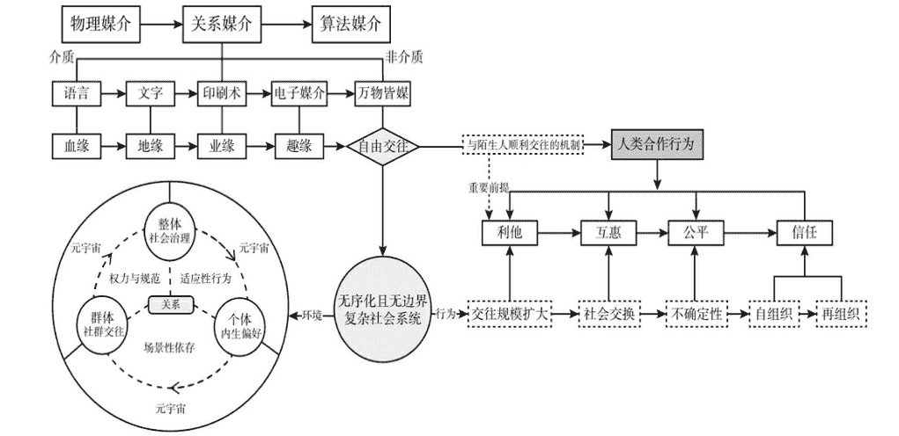

图18.1 环境与人类行为之间的互构

资料来源：喻国明，陈雪娇. 元宇宙视域下传播行为的路径模型与拓展机理[J]. 新疆师范大学学报（哲学社会科学版）,2022,43（06）:135-145.

#### 利他行为
在人类进化过程中，利他是合作秩序的必然产物，指牺牲自身利益或贡献力量使他人受益的行为。进化心理学认为行为由动机驱动，社交网络中的传播行为多为个人社会关系的投射，利他理论是解释人际交往与传播动机的关键。互联网让关系与行为从线下延伸到线上，无论场景如何，人们创建与维持社会关系都离不开互惠利他的过程，即通过与他人、群体互动获取归属感与亲密感，比如在社交媒体上，人们倾向于分享而非独占信息。

利他并非孤立产生，而是与整体社会环境相适应。从理论演进看，“自利人”假设长期存在，后证实会受环境与情感制约，人类处于有限理性的状态，并非完全自私或完全利他。

从环境制约看，决策前常出现模仿倾向，模仿对象多为环境中其他人的行为。例如宁波某图书馆长达六年无门无监控却有序运行。人们的诚信并非凭空而来，该馆也曾丢失图书，后管理者通过摆放桌椅、整理书架等细节干预减少了事件，这类似“破窗效应”——放任不良现象会诱导效仿，如破窗不修会导致更多破坏。因此很多时候人们并非纯粹利他，而是模仿他人以顺应规范，且这种倾向会与情绪情感联动，如公平、羞愧等亲社会情感常成为利他起点。

利他行为呈现两方面特征。一方面是高自由度环境下的适应性表现。卡斯特指出互联网为弱连接社会关系提供了生存空间，适合不同圈层人群互联，扩展交往半径。陌生人社交虽不及熟人圈稳定持续，但弱连接的松散结构正使其能辐射更广圈层，带来多元信息与异质资源。元宇宙进一步瓦解以强关系为主导的结构，释放了更多自由交往可能。社会正从熟人社会转向陌生人社会，与陌生人联结的重要性提升，需要机制保障合作顺利，不计回报的关怀成为深层互动基础，利他也成为衡量合作是否符合各方利益的“裁判”。由此，利他可视作环境适应过程，通过分享奉献最大化自身与受益者的适应性。

另一方面，利他的本质在于整体利益回报链条的延长，其普及会催生广泛的市场互利合作主义。学界常把利他分为亲缘利他、互惠利他与纯粹利他，认为纯粹利他是不计回报。但在传播语境下，即便纯粹利他也遵循“投资-回报”逻辑。边沁认为功利原则是行为通则，如慈善捐赠等看似无功利的行为，其本质是通过构建和谐社会最终回馈自身，体现了从直接回报向间接回报的转换，反映利益回报链条的拉长。当纯粹利他在一个新群体中出现，往往会被放大、复制、模仿而不断扩展，最终形成普遍化的市场互利合作主义。

#### 互惠行为
若利他是在交往规模扩大背景下以个体为起点的人际传播，互惠则把惠及他人的范围提升到群体层面。当下互惠已根植于各类社会关系，并存在于每个人的网络中。马丁·A.诺瓦克与卡尔·西格蒙德在《科学》论文中开篇即指出“人类是互惠最忠实的拥护者”。原始社会通过轮流狩猎等互惠提升族群存活率，文明进步后互惠仍在演进。国外调查显示超 60% 人在群体博弈中做出互惠决策；国内“投我以桃，报之以李”“礼尚往来”等典故亦彰显其普遍性。互惠思维跨越国界，是自然选择的结果，已内化为人类的本性，具备该机制的物种或个体更具生存与繁衍优势。

互惠即社会交换，其交换对象是社会资本。布尔迪厄认为社会资本是行动者社会实践的工具，本质是社会关系，外在表现为生产要素。互惠中交换的社会资本可以是物质化的经济资本、精神化的文化资本或符号化的象征资本，都体现了不同场景下互动产生的社会关系。

多数研究把互惠视为根植于个体的行为倾向，以社会规范为导向。社会规范是一种非制度化却具约束力的伦理观念，指特定场景下普遍认可并遵守的行为标准。受社会属性影响，人们倾向按既定规范行动，而规范并非固有，会随环境与行为演化动态发展，内化为认知尺度后成为行动参照。

按约束力划分，社会规范可分为基于差等性互惠的“软规范”与基于对等性互惠的“硬规范”。差等性互惠依赖道德义务联结，一方付出不一定得到等值回报，关系靠个体内化的软规范维系。自人类社会诞生以来软规范便存在，由风俗习惯演化至现代道德义务，对行为起约束作用，但非明文规则，而是群体成员的自我意识潜移默化地影响策略。风俗习惯是软规范的雏形不可或缺。随着社会发展，声誉、形象等社会资本对交往的制约增强，出于形象维护，人们常愿进行非对等互惠，首要考量并非物质得失，而是避免被排挤惩罚，并为建立良好声誉而分享合作，从而在社会关系中获益。

基于对等性互惠的硬规范指“投资-回报”的一致性，以法律、制度等明文规定为依据，具有强约束与基础核心地位。从作用范围看，软规范适用于社会生活各领域且延续周期长；硬规范则不易随意扩张，通常在时代变迁中更替，旧规范被新规范取代。因此互惠行为受不同规范制约，在不同场景与关系网络中呈现差异化表现，当规范内化为群体共识时，群体统一性便形成。

#### “不确定性”的社会环境
互惠暗含“未获回报的风险”假设，加剧交往中的未知与不确定。从全局看，我们正处不确定社会，传播权力回流个体提升了微粒个体的选择空间，参与主体泛化与传播链条多样化使运行机制愈发不确定。不确定管理理论把不确定性分为信息不确定与个人不确定，前者指信息掌握不足以决策，后者指对自我信念、情感、能力的怀疑。信息不确认或环境不确定具有威胁性，会剥夺知情与安全感，引发焦虑恐慌，人们因此倾向寻找办法降低不确定、追求确定与控制。

不确定氛围的一个重要影响是人们更关注“公平”，因为公平信息有助于洞察事实、把握决策方向、降低潜在不确定。

在复杂社会中，对公平的感知是过程，可分为权利公平、过程公平、结果公平三阶段。首先，权利公平指交往中感受到被公正对待的程度，在自由交往背景下，人们可跨越圈层与各类型人互动，各方是否相互尊重、信息是否公平传达，是衡量权利公平的关键。其次，感知公平需有特定对象或事件，权利公平是公平感的基础，前进至事件判断时过程公平起作用，指决策过程的公正。研究表明，若人们认为决策过程公正，即使结果不符期待也易接受。最后，结果公平指行为实践后获得待遇的公正性。

公平研究的哲学源头可追溯至苏格拉底、柏拉图，他们主张按劳动获取报酬以维护秩序。中原文化自古有“不患寡而患不均”观念，追求分配平等。现代社会中公平既是实践产物也是认知平衡，通过社会比较判断平衡是否达成。

为获得稳定自我认知，人们常以自身接触信息与他人比较，产生情感、认知与行为。从个体层面看，公平比较主要通过社会参与行为实现。当不公正事件发生，人们出于“公正世界信念”倾向行动参与。但当投入与期待产生落差，会产生剥夺感、引发不公平感知，进而削弱参与主动性甚至诱发集体暴力。相反，当比较得出现实公平时，会产生积极卷入与“被重视”感。

公平感知不仅依赖主观判断，也受社会情境影响，群体共同经历是重要情境要素。人作为社会动物会归属于特定群体形成身份认同，进而受群体成员身份影响，根据线索自动划分阵营，形成对内群体的认同与偏爱，对外群体的漠视或敌意，即“内群体偏爱效应”，这会阻碍公平行为的执行。

在社会比较获得初步线索后，人们会进一步进行认知判断以达成公平平衡。从实践层面看，公平通过事实判断的全面性与价值判断的公正性实现。前者指对事实信息的理性直观判断，受客观事实影响，不以个人意志转移，属于复杂逻辑推理；后者指对他人意图的推测与判定，渗透情感、意志、社会关系，遵循个体差异性评判标准。

总之，对公平的感知既是理性判断也是非理性感受，即对事件价值公正性的体验，高度依赖主观情绪体验，且建立在成员间权益平等基础上，一旦感知权益失衡或利益受损，便会产生不公平感。

#### 技术嵌入

# 公平感如何牵引信任与技术

公平的体感是信任生成的土壤，也是社会长期协作得以维系的枢纽。25 当成员觉得规则与分配大致公允，就会倾向于守护秩序并展开协同；反之不公的体验会激起破坏冲动，导致信任结构出现裂痕。社会运转的本质是各行动者彼此协作所编织的复杂关系网，信任正是在这张网中起着承上启下的作用，并在关系演化里持续发挥影响。既有研究把信任概括为：基于对他人动机与行为的正面预期，愿意袒露脆弱而不惧被利用的心理取向。26 处在高信任氛围的主体更乐于互动与交换，系统运行成本随之下滑，社会稳定性得到加固，合作得以稳固。

信任的产生早已超出个体间的好感，而是一种由社会结构与运行逻辑催生的集体性需求。27 如今社会被技术浪潮浸透，互联网不再只是信息分发渠道，而已升格为社会运行的基础操作系统。现代化转型一方面体现熟人圈向陌生人社会迁移，另一方面区块链、算法等新要素在改造传播流程与群体边界。继制度信任、情感信任、认知信任之后，技术信任成为不可忽视的新向度。

制度信任依托法律、政策等强制与预防机制，以普适方式消解交往不确定性，维护信任关系的平稳；28 情感信任扎根于人际熟识程度与情感联结强度，是一种由关系认同驱动的非理性倾向；认知信任则对交往对象的声誉、形象、社会地位进行综合权衡，是在信息不对称情境下的判断方式。技术中介塑造的新信任形态最终会回流到认知层面。广义上认知信任涵盖技术信任，但细化来看，元宇宙时代的技术信任内涵与前三种模式存在明显差异。

区块链的根本在于以信任迁移的方式重塑社会共识，利用计算的确定性来抚平弱关系交往中的无序与不确定，使信任过程更趋稳定。实现路径依赖分布式账本、非对称加密授权、智能合约等核心技术，拓展传统信任框架。账本让所记数据高度透明，密码学保障记录不可篡改与伪造，任何操作均留痕公开，可回溯。29 这种逻辑打破第三方平台对资源的控制与垄断，实现陌生人间的点对点交互，拓宽权威信任与情感信任的边界，扩充信任主体的规模。

当前备受关注的数字藏品即是建立在区块链分布式网络上的虚拟物交易，参与者凭借技术确定性确信其虚拟价值与保障。互联网强关系格局相对固化后，社会更需关注分散、隐匿的弱关系群体，通过信任逻辑创新将这部分群体纳入开放的复杂交互网络。技术信任本质上解决以弱连接为主体的社会关系整合难题，让零散参与者聚合成规模社群，并在技术保障下形成有序互动。

### 小结
社会行为并非孤立发生，而是嵌入关系网络中相互作用，关系网络塑造行为，也是行为传播研究的关键切口。马克思依据生产力发展将交往划分为人的自然依赖关系、以物为中介的人的独立阶段与人自由全面发展的阶段。30 在技术可供性之下，大众传播的线性模式已被自由交往取代，个体实践半径大幅扩张，选择空间增多，扁平化与分布式成为关系网络的显著特征。

传播环境的变化要求突破与创新，研究者需以新视角、新观念、新范式审视传统社会未曾出现现象。人类发展证明，任何理论终将被解释力更强、覆盖更广的新体系超越，这种超越不是简单替代，而是新范式对旧范式基本假设的质疑与补充。行为传播在考量个体差异等要素前提下，为人类行为提供分析框架，以全新视角理解传播视野下的合作秩序，这一过程也是认知不断深化。

## 第十九章 统摄性范式下的中层理论与范式补充
### 第一节 问题的提出
《行为传播学：建构未来传播学统摄性范式》一文，直面传播理论与新社会现象脱节及传播学“十字路口”困境，主张以“行为”为关系型范畴，发挥其在主体与社会结构互动中的统摄作用，对传播学时代变革作出规范性构想。

文章借鉴库恩的科学哲学：科学知识在常规阶段具累积性，却会发生激进范式转换；新旧范式优劣难以通约，只能以科学合理性作相对区分；科学目标并非追求本体真实，而是具实用主义色彩的解谜活动。1 面对相对主义与非理性主义质疑，使用范式学说时需甄别并批判性解释。

在库恩体系中，范式居核心但定义模糊。马斯特曼把其用法分为形而上学范式、社会学范式、人工范式三类，2 其中社会学范式指在科学共同体获普遍认可的学术成果。库恩亦强调范式即共同体成员共有信念。3 在此意义上，行为传播学既是可塑的开放领域，也在规范层面追求共同体逐步建构。凝聚共识、推动学科变革是提出并阐发行为传播学的目标导向，也是本书逻辑起点。本书以行为传播学范式及其建构工作为研究对象，辩证引用库恩范式转换思路，在检视传播学通约性问题的同时厘清行为传播学定位。核心围绕“如何做”“做什么”展开，后者细化为两个问题。

其一，借鉴范式学说，行为传播学范式建构应遵循怎样的科学演进结构与规律？在此基础上进一步讨论其规范性发展目标。其二，为达成该目标，行为传播学面临哪些困难？如何克服，从而探求范式发展的规范性路径。

### 第二节 重构还是统摄
库恩认为科学演进具相对稳定规律：先有单一范式与解谜的常规科学，随后严重反常引发危机，最终新范式诞生平息危机。各阶段机制预示演进规律。常规科学阶段，研究者不会反思既有范式，而是高效解决问题；即便经验与预期冲突，也常归咎于数据异常而非范式本身。4 只有异常持续并超出既有范式消化能力时，才可能动摇共同体。基于行为传播学，新范式需满足两点：一是常规科学成熟运行创造环境；二是异常质变引发的学科危机提供条件。新范式亦需使现存范式得以有效交流。5 本书据此探讨把行为传播学概念化为范式的合理性。

#### 传播学摄领学科变革
尽管传播学长期承受合法性焦虑，数十年建制化发展已使其在很大程度上具备库恩所述常规科学特征：“奠基人”“集大成者”历史定位虽有争议，却实实在在影响当下问题关注与方法使用；即便经历“领域的骚动”，传播学始终未脱离社会科学范畴，几乎所有成果都能并入以涂尔干为起点的功能主义、以齐美尔为起点的社会互动论、以马克思为起点的社会冲突论三条脉络之一。6 学科扎根于既往科学成就，并吸引坚定拥护者围绕意识形态与建制形成学派共同体，各学派在划清边界的同时解决既有成就指定的开放问题。7

正如《科学革命的结构》所示，反常与危机是常规科学必然产物。扩展知识广度与精度既是目的，也不可避免使更多观察与实验与范式预测相悖，范式越精确，异常指示越灵敏。8 传播学具问题导向特质，广泛借鉴他域理论以增强解释、预测与影响力，跨学科研究在模糊边界的同时提升学者社会敏感度，使传统大众传播范式忽视的分布式社会9与“微粒化”社会10进入以“行为传播学”为代表的视野。

2022年牛津年度词汇“哥布林模式”即是微粒化社会的典型体现，指一种无歉意的自我放纵、懒惰或贪婪，通常以拒绝社会规范方式呈现，人们更重本我而非精心策划自我。另一词汇“元宇宙”作为外生危机，倒逼既有理论革新。时代变化突出表现为信息渠道泛化与行为实践范围扩张。杰里米·拜伦森指出VR过去几年发展呈指数增长，技术完善与成本下降极大延伸感官。若把感官视作信息渠道，元宇宙在VR、AR加持下可组合拓展不同感官体验，将现实到虚拟的光谱化。12 泛化渠道拓展个体行为实践范围，包括跨越时间体验、角色互换沉浸、加速未来观察延时后果等。15 虚拟现实带来实践本体属性扩张，自下而上感受可暂时覆盖自上而下知觉，影响物质自我感知与认知习惯，如VR中身体所有权混淆16、主体属性变换作用于刻板印象改观，如白人化身黑人以改善种族偏见。18 此类在过往大众传播理论中罕见的反常经验，启发行为传播学反思“大众无明显特征”的局限，提出新主张：个体具有不同心理动机与媒介需求；研究应人本出发，以传播场域中行为为原点展开。

#### 改革式地统合既有范式
在确认传播学演进结构与行为传播学范式合规律性后，其合理性仍需审视。范式学说否认以知识累积或方法更新评价进步的做法，新旧范式价值判断因此涉及不可通约性问题。通约性指范式间相似性并允许局部特殊性，不可通约性与通约性并非互斥，而在学术共同体寻求共识过程中动态共存。20 对传播学而言，通约性承认微观个体特殊性价值，但不可通约性也带来范式价值判断难题。

在此语境下，“行为传播学”对传播学是“重构”还是“统摄”的目标设定值得深究。“重构”在客观上与库恩“科学革命”说法相近，后者起初认为范式转换须立即整体变革，后来则弱化突变色彩，类比自然选择中传统停滞消失的可能路径。因此规划目标需先回答：它如何处理与传统范式的关系？传统大众传播理论虽显结构性危机，其具体概念、模型与原理会随行为传播学崛起而消失吗？

显然，行为传播学的目标是改革式统合而非革命式重构。库恩起初否认对新旧范式进行理性评价，后来提出精确性、一致性、广泛性、简单性与富有成果性等通用指标，在一定程度上克服不可通约性。

在解释广度上，为覆盖更广问题并预测现象，行为传播学无法彻底舍弃大众传播理论，结构功能主义传统在特定视角仍具解释力。例如行为传播学以“个体”为基点、以“行为”表征个体时，大众传播关注的“媒介环境因素”仍是班杜拉三元因果模型的重要一元，不应被埋没。分类学层面，传播行为对主体心智与媒介环境的统合需从个体、群体等不同主体切入，这就要求行为传播学不得不变革并统合大众传播围绕“环境”“群体”范畴、行为科学围绕“行为”“个人”范畴构建的成熟体系，使现存不相容理论模式得以有效交流，保证话语一致性与简洁性。

至此，对“统摄性范式”的表述与内涵作出优化与扩展，将其规范性目标表述为“统合”既有范式、“摄领”学科变革，即在统合传播学新老范式及跨学科概念体系的基础上，团结多学科背景学者，摄取多层次、多维度、网状知识，对新型媒介社会发展临界期涌现的关键性、升维性问题作出更精确解释与预测。这也呼应了罗伯特·普特南在国际传播学会50周年时提出的，理论发展应容纳多元声音，将不同概念与理论相互联系并求同存异探索。21

### 第三节 范式统合从范例开始
行为传播学关于范式发展路径“避免抽象经验主义”的设计，指向第一种不可通约性——概念体系差异对统合的阻塞，由此引出中层理论的设计构想——以班杜拉三元因果模型为指导的可供性理论。科学哲学视角下，中层理论作为宏观理论与微观实证的桥梁，有助于克服范式视野宽泛而不聚焦、理论抽象而不具体、结构松散而不紧密的问题，增强解释力与预测力，巩固范式的摄领地位。

#### 中层理论：从范式到范例
尽管传播学科碎片化、巴尔干化导致不可通约性突出，但统合并非无望。库恩在1982年《可通约性、可比较性、可交流性》一文中指出，不可通约性并未筑起不可逾越鸿沟，不存在完全不可通约，局部不可通约不意味着不可交流。理论开放性使不可通约内容在融合中逐渐减少，可比作学者将彼此视为不同语言共同体成员进行知识翻译。即便严格翻译不可能，也不存在毫无相似性的两个范式，现有可通约性足以促成充分交流。

库恩特别强调范例交流的先决作用。“范例”指学生在科学教育阶段接触的具体问题解答。不可通约性很大程度上源于科学家初入共同体时通过具体范例而非抽象定义学习科学。对行为传播学而言，范例的先决作用首先体现在树立学科借鉴信心：即便传播学与行为科学在概念表述、问题关照上难以“互译”，但若行为科学关于“主体能动性”“有限理性”的假设经实证持续有效，感到失望于“结构影响”“理性人假设”的传播学者仍可能借用其表达方式。借用库恩的比喻，这一过程与其说是主动翻译，不如说是学习——跨学科先驱最初的信念往往是：我不知这种范式支持者如何成功，但我必须学；不管他们做的是什么，那显然是对的。

以范例为资源的言语共同体可视为范式共同体的过渡形态——“范式是共有的范例”。若范式常表现为相对抽象的定律或宏观理论，则作为范例的经验研究负责将其与自然界或社会具体现象联系起来。鉴于两者跨度较大，本书在行为传播学所确立的元理论原则与实证研究、关注的经验材料之间引入默顿意义上的中层理论，以便利跨领域知识的翻译与学习。

#### 分类学的学科交流：可供性理论

自 2017 年 Sandra Evans 在传播学里首次提出“可供性”概念起，这个议题在中国学界迅速发酵。围绕命名诠释、情绪驱动的网络舆情与群体行动、新闻业增长空间、虚拟偶像的情感运作等方向出现了不少讨论，却很少有人触及可供性对学科整合的潜力。直到喻国明等学者把可供性定位为一种前瞻性的启发性中层理论，强调它可以统筹传播学对跨学科知识的吸收。

从人与技术的关系切入，可供性建立在社会物质性假设之上：社会与物质并无本质区隔，二者通过不同形式的叠加共同构成技术这一经验实体，于是技术同时兼具社会性和物质性。物质性层面会制约用户行动，比如技术限制框定了可选项，但并不能单方面决定行为；社会性层面则更具弹性，受个体差异、历史文化背景以及行为情境与偶然过程的共同影响。可供性的动态与变异特质自然向微观个体延伸：由于主体所处社会环境、个人经历等社会性差异，即使面对相同的物质性对象，人与物的关联也会各不相同；同一主体在不同时刻的需求变化，也会让可供性随之改写。

正是这种对个体行动的关注，让可供性与行为传播学的内核高度契合。行为传播学以行为范畴来表征传播中的个体，并假设微粒化的社会与个体赋权。可供性把这两点接纳进理论内部，搭建起从具体案例到抽象范式的桥梁——只要研究遵循可供性的思路，就能落在行为传播学的范式立场上，与当下时代焦点相互通约。

可供性最常被操作的形态是可见性，它为中层理论提供了可落地的切口。Jeffrey Treem 等人借用“演员在舞台上利用地形障碍物表演”的比喻，把可见性拆解为三个操作维度：呈现者的行动、观察者的行动、传播的社会物质背景。依此思路，未来在行为传播学范式指导下，研究者可以对这三层单独或组合分析，让不同学术传统的人在同一概念体系内对话。

针对呈现者，可以追问主体做了什么、如何做、行为在语境中留下了怎样的痕迹；观察者通常并不直接参与传播过程，而是以旁观者身份与自身认知经验互动，研究可以聚焦他者如何检索主体生成的内容、如何作出反应，传统的媒介效果研究就落在这个主类别里；社会物质的考察则关注传播发生的整体环境，不仅是时空，更包括社会情境、算法环境如隐私保护政策、人际沟通网络等。

现实中传播现象已渗透社会细部，三维度彼此交织难以干净剥离，研究单一维度时往往必须连带另一维度，比如讨论呈现者或观察者都绕不开社会物质性的制约。综合来看，可供性与可见性的前瞻视角让传播学得以从“人—社会物质”这一相对稳固的入口去把握社会运行规律。本书因此把它视作整合行为考量的中层理论，能在一定程度上缓解传播学的内生与外生危机。元宇宙与虚拟现实带来的信息渠道泛化与实践范围扩张，也完全落在可供性框架内。随着技术迭代，其社会物质性会随社会环境与个体自我认同同步变化，但基于三维度动态考察人与技术关系的思路，仍具有启发价值。

### 第四节 破解方法论断层：差异易感性模型给出统一答案框架

#### 为什么传播学总在问不同问题、说不同话？

借用可供性理论，行为传播学能够对传统范式与行为科学里“个体—环境—行为”等概念的外延与内涵进行统合。然而方法论层面的不可通约依旧存在，可理解为“问题—解答标准”不可通约，具体表现在两点：其一，特定的理论或方法适合用来观察哪些传播现象、回答何种研究问题；其二，不同实证研究得出的媒介效果结论外部效度有限，往往只对样本成立，难以对现实社会中的具体对象做出统合性解释。

第一种断裂在学界十分常见。如社会认知理论源于心理学，却因视野与潜力被广泛用于媒介效果研究；涵化理论作为传播学经典，对媒介消费结果做出概括；当议题聚焦性别刻板印象时，性别图示理论又在媒介性别形象效果研究中长盛不衰。

第二种断裂则体现在对媒介效果结论的难以对齐。研究常以样本局限为由回避问题。生态学中，动物性格差异会塑造社会功能与结构，如鱼类性格不同导致社会联结的强度与持久度不同，进而形成非随机的趋同集群，产生异质化的社会精细结构。这一逻辑延伸到人类，可见社会网络的同质性与个体差异驱动的趋向。心理学与统计学近年已出现多层线性模型、潜变量增长模型、随机截距交叉滞后等方法，把个体差异置于中心。但媒介效果研究中这一议题常被推到文末作为局限，或靠扩大人口学样本来佐证代表性，而人口学变量的多样化对解释力的提升仍有限。这种回避个体差异的做法，进一步加剧了不同效果研究在解释现实时的不可通约。

面对方法论标准对范式交流的阻塞，行为传播学需要新的中层理论来规定它要解释哪些传播现象或媒介机制、关注哪些关键变量，并提供一套媒介效应评估与融通的标准体系，为后续实证研究提供问题清单与操作手册。

#### 差异易感性模型：把微观个体差异纳入媒介效应评估

万物皆媒的图景让日常任何行为都能被视作媒介过程，这导致媒介效果研究碎片化与过度专门化，引发解释力危机。当研究被拉向诸多狭窄主题时，如何概括性解释社会现象成为关键任务。William L. Benoit 等人呼吁更多元分析以提升重复性，但割裂的理论模型各自重复实验，输出结果却缺少对机制与原理的反思，理论缺位消耗了创新潜力。元分析虽指出媒介效应大小受方法、范式、人口学变量影响，却解释力不足。

在此背景下，Valkenburg 与 Peter 提出差异易感性媒介效应模型 DSMM。它以微观视角聚焦个人差异，主张微观媒介效应理论应基于对个体媒介使用者的观察展开推断。媒介效应的强弱不仅取决于宏观的社会层级与地缘、业缘、趣缘，也关乎长期内化的气质与认知心理。模型兼容不同领域概念，统筹各时代各地区的研究产出，为以个人为单位的微观研究提供了具有通约外部效度的抓手。

差异易感性模型建立在既有理论之上，动态交互模型与社会认知理论发挥核心作用。动态交互模型由 Werner Früh 与 Klaus Schönbach 提出，强调传受双方的主动参与，包含发送者与接收者的交互，以及认知层面信息摄入与既有知识的相互作用。它为差异易感模型提供了测量基础与个体差异视角的雏形：一方面不再依赖自我报告的动机，转而通过软件等手段捕捉具体行为；另一方面告别理性人预设，调和了魔弹论的被动接受与使用满足模型的主观能动假设。强化螺旋模型在此基础上补充了行为影响后的持续效应，强调个体或社会身份会使媒介使用的认知与行为结果差异化，并在态度—选择性曝光—认知改变之间形成正反馈螺旋。

班杜拉的社会认知理论则提供了机制基础：个体通过符号编码保留信息，形成或强化认知结构，并在适当情境下行为再现。其统摄性可解释五类媒介效果理论，包括个体差异与社会背景对媒介使用影响的调节、媒介使用对个体差异变量的中介、心理生理过程的中介、媒介效应作为中介产生的再效应，以及动态交互中的双向影响。尽管社会认知理论潜力巨大，却因过于宽泛难以归因。

Valkenburg 将微观个体在主体与结果上的差异与既往理论结合，提出四个命题，见图19.1。其一，媒介效果是有条件的，受三种易感性变量制约：个人倾向易感性、随个体与社会发展而变化的选择性使用与响应倾向的发展易感性、影响选择性使用与结果的社会易感性。其二，媒介效应是间接的，认知注意与存储、情感体验、生理唤醒等三种反应状态中介媒介使用与效应。其三，个体差异易感性既预测媒介使用，也调节媒介使用对反应状态的影响。其四，媒介效应是交互的，效果可反作用于前三个环节，形成动态回路。

图19.1 差异易感性媒介效应模型
资料来源：孙豪灿，刘德传，喻国明．行为传播学再思考：建构统摄性范式下的中层理论与范式补充[J]．传媒观察，2023（07）:5-16.

模型细化了从媒介消费到效果的每个步骤，把个体差异以差异易感性变量形式引入，补足了既有模型缺失的微观视角，增强了不同范式在方法论上的可交流性。不论是作为观察、抽象现象与设计方案的思路，还是作为补充文献视野来探索未被覆盖的媒介机制，差异易感性模型都在“问题—解答”标准上提供了更广的外部效度。

### 第五节 行为传播学靠什么方法落地

#### 量化质化都卡壳，根方法在哪？

转向个体差异行为的测量成为焦点。建构主义倾向质化方法，通过对传播物象的个案观察推广到整体，依赖研究者经验串联理论；实证主义则强调客观测量追求外部效度，偏向量化分析。前者受主观影响却保留专业深度，后者形式客观但数据多经信息发出者加工，难以摆脱非理性假设、霍桑效应与练习效应干扰。

Creswell 等人认为混合方法是对量化质化长期争论的回应。量化提供一般性解释，质化深化参与者观点，但创新力受限：其一，混合方法遵循质化建构理论、量化检验理论的常规路径，很少产生变革性贡献，只是把论证步骤并置；内部效度提升，但单个研究的外部效度有限。其二，传播学交叉性使其难以实现价值中立，量化内容分析或 LDA 主题建模若不经阐释难以形成理论意义。其三，混合方法仍带着两种方法的各自短板。在此语境下，认知神经传播学的兴起绕开理性人假设之争，直接测量生理行为，成为适应深度媒介化与万物皆媒的根方法。

#### 认知神经传播学：绕开理性人假设直接测大脑

认知神经科学已广泛应用于心理学，近年来聚焦传播议题衍生出认知神经传播学这一新范式，常用技术包括 fMRI、EEG、fNIRS、MEG 等。它超越了传统范式对理性人的纠缠，直接考察大脑思维活动，通过脑部现象推测“黑箱”机制，能够得出个体层面结论并具大众意义。

实验主义范式建立在心理学与认知神经科学对脑功能分区与脑电成分的认识之上。传统神经影像需要对刺激做精细标注，超扫描范式则规避了这一需求，关注不同接受者对同一刺激反应的相似性。只要参与者接触相同信息，复杂程度不影响适用性，这为自然主义研究提供了基础：不再把生活行为抽象为固定刺激，而是让被试置身更贴近生活的实验环境采集脑数据。超扫描让多人共时脑测量成为可能，把研究从人内效应拓展到人际效应。

受成本与设备限制，同一时空的超扫描实验要求较高。被试间相关则不需要被试共处同一时空，只需接触相同时间序列信息，已被独立作为自然主义范式使用。自 2022 年 Ralf Schmälzle 厘清概念后，该范式在传播学本土应用仍少，但脑科学研究已显示电视节目诱发的被试间脑电相关可预测整体受众兴趣偏好，且对高层知觉过程敏感：在悬念紧张情节下相关增强、时间序列混乱时相关大幅下降；施梅尔兹勒的研究还表明对 H1N1 流感风险感知的差异会调节观看相关报道时的大脑反应。

fMRI 提供更优空间敏感性，可揭示接触相同信息时脑区激活是否一致；EEG 提供更高时间解析度，通过被试间脑电相关观察连续动态状态，为媒介效果研究提供清晰路径。由此，认知神经传播学为传播学提供实证主义认识论的明确结论；在 fMRI 与 EEG 支撑下，超扫描让可供性中的主体—他者交互可测量，被试间相关同步性为共时交流研究铺路；同时个体层面测量使差异易感模型中的易感变量可操作。认知神经传播学作为根方法串联起行为传播学的中层理论，打通分类学与方法论层面的学科交流，提供巨大解释空间。

#### 从实验室到生活：纵向追踪才是未来

认知神经传播学信效度高、干扰可控，但实验室环境是其短板。脑电与核磁实验多为单次，被试间相关虽可检查纵向变化，仍属控制下的单次测量，非自然情境下的个人处境。因此本书另辟路径，借鉴心理学近二十年方法演进，主张基于纵向测量解释行为变化，相较截面或实验数据更能刻画个体行为，并解决特质发展速度、个体间差异、变量间纵向互影响等问题。

纵向数据分析把行为变化中的共同趋势与个体差异分离。多水平方法天然适配纵向分析。在结构方程框架下，形成两组模型：一组是增长模型，包括验证性因子分析的潜增长模型和捕捉异质发展的混合增长模型；另一组是滞后模型，聚焦时间序列上的因果变化，包括交叉滞后、随机截距交叉滞后，以及基于长期高频测量的复杂纵向模型。这些方法若在传播学中广泛使用，可通过行为数据明确媒介与行为的深度交互机制。

### 第六节 行为传播学在学科版图里算什么

行为传播学提出了一个标准，让既有研究在问题分析逻辑与方法使用上实现升维。但在微粒化社会与虚拟现实技术加速的语境下，如何使这种范式真正受益仍面临挑战。于是需要厘清它在社会科学与传播学中的理论位置、应用场景与未来走向。

#### 学科边界模糊，追求真理比站队重要

从学科合法性看，传统传播学以媒介视角解决信息交换问题。随着传播手段更新与主体延展，万物皆媒已成共识，传播学在现象、问题、方法、结论上与心理学、社会学高度重合。界定边界时，话语体系—问题侧重、学术句法、共同术语—至关重要。但话语体系是否应显著区隔，值得商榷。

认知神经科学已在传播学内部形成实验基础，对“后真相”等经典命题给出他域支持；心理学与传播学联系紧密，人内传播已成固定分支，认知情感也是传播学无法回避的对象；社会学以“社会科学”自名，其词义范围本就大量包含传播。这三者现象可通约，术语却不可通约，形成更高维度的不通约问题。正如波普尔对学科的期待，社会科学不应因圈地而急于确立合法性，而应把真理追求置于身份区分之上。事实上，各学科边界在未来只会越来越模糊。

在多元声音持续碰撞的舆论空间里，能够经得起检验的独立洞见，是意见市场得以健康争鸣的基础，也为行为传播学指明了未来需要承担的责任指向。这门分支长期被置于传播学版图的边缘位置，以行动成效作为评判尺度，强调个体的异质性，力图剔除非理性行为所带来的随机扰动，同时校正现实推断过程中工具本身引入的系统偏误，从而把更多影响因子纳入估计框架。这一转向意味着传播学整体正在向追求精确性的社会科学靠拢。在处在外围的阶段，行为传播学往往最先承受跨学科的冲击，把异质的方法论和观察视角吸纳并转化使用。整个演进是一个长周期过程，核心在于把外部提出的新观念逐步转化为传播学可用的操作工具，进而使学核心区更为经典、更为细致的研究，能够对既有议题展开更深层次的再挖掘。

#### 行为传播学的学科定位

## 第二十章 深度媒介化背景下的社会治理：基本范式与底层机理

沉浸式数字空间的兴起被视为人类文明形态的一次深刻转折，媒介深度化的历程由此展开。要准确把握这场传播变革的实质，走稳创新发展之路，必须先把深度媒介化社会中出现的新现象与治理过程中的新法则厘清。回到现场与原点，解决好从零到一的建构难题，聚焦像沉浸式数字空间这类对社会发展具有确定性意义的对象，从全局与时代高度重新划定边界与框架，再反向回看当下的现实状况与社会现象，大范围推进从一到百的实践拓展，才能抓住窗口期，迈向数字文明新阶段。

### 第一节 深度媒介化进程中浮现的社会新特征

由浅层媒介化向深层媒介化演进，技术的发展不仅重塑了媒介形态，更对社会结构、运行规则与演进节奏产生了深远影响。以沉浸式数字空间为代表的深度媒介化是一种不同于传统媒介化的全新理论与社会范式，以网际网络和智能算法为代表的数字媒介成为新的结构性力量，算法等智能技术下沉为社会机理，扮演起社会操作系统的角色。与此同时，社会变革由过去粗放的横向数量扩张与效果增强，转向聚变式的纵向演进。媒介化向深度媒介化的本质在于，传播不再仅仅是社会结构的一个组成部分，而是构成社会结构的基本要素，传播的社会结构开始依照传播法则、传播形态与传播逻辑进行变革与发展。

#### 网络演进的两阶段

伴随经济从高速增长转向高质量发展，中国传媒产业由粗放扩张转向精细化运营，可以说网际网络导致构成社会的联结方式与组织成分出现了巨大差异。第一阶段以联结为核心特征，完成人与内容、人与物联网络的共通网络化过程，传播模式仍以大众传播与人际传播为主。社会功能与价值创造均在持续连接与再连接中形成，具有典型的圈地特征。

当下，以沉浸式数字空间为代表的智能算法技术通过升维重组，成为影响社会发展的重要变量，网络也进入发展第二阶段。这一阶段数据的价值被凸显，使用者的自主权被释放，网络联结更为丰富，应用场景也更为宽泛，媒介发展向数据化与智能化方向演进。凭借大数据与智能技术，媒介能够把过去难以满足的高场景度、低频度、小众化、个性化的需求聚合起来，实现高效率、高适配度的价值匹配、关系重塑与功能整合，从而较为充分而有效地满足以往难以开发的利基市场。

如果说第一阶段是实现随时随地与任何人建立联结，第二阶段要解决的核心问题则是，在人口红利被消化殆尽的背景下，如何对已被激活的个体进行重新聚合。为任何人在任何时空从事任何实践活动提供合适的场景，提升自由度、效率与体验丰富性，正是业界普遍认知的下一站：场景时代。

#### 微粒化社会的到来

以先进技术为代表的媒介发展使人类社会呈现出新样态，媒介逐渐渗透进社会的运行机理之中，正在经历一场革命性变化。信息化、数据化、智能化的新媒介所提供的全新联结作用于社会构造的首要效应，就是对传统科层制社会的解构，即去组织化，进而形成所谓微粒化社会。目前，沉浸式数字空间提供了一个全新的社会连接方式，整个社会正从传统科层制向分布式过渡，也称微粒化社会，即颗粒度极其微小的社会。

“微粒社会”概念由德国学者克里斯多夫·库克里克提出，指在高度数字化社会里，所有的人与事物都被数据精细记录、分析与评价。从这个意义上说，这意味着在此社会状态下教育等社会基础要素正在实现更广义的重组与新阶段的生态重构。与此同时，这种高精度的数字化结构催生了“微粒人”，个体从“理性人”转向“微粒人”。

微粒化带来的社会变革主要体现在以下四个层面：

- 结构层面，传播技术的平民化与工具普及使个人逐步转变为传播主体，甚至可以成为传播资源的掌握者。伴随人工智能、大数据、算法等数字化信息技术的发展浪潮，万物互联进一步把人与人、人与社会、人与媒介的物理连接升维到生理连接与心理连接，沉浸式数字空间的出现将人们的实践疆域与自由度进一步拓展与提升。
- 主体性层面，微粒化社会使“人”的主体地位不断增强，其通过技术赋能与赋权实现个体行动维度扩展的状态得到更大程度激发，这种主体解放是前所未有的。沉浸式数字空间时代所带来的微粒化社会很大程度上是因为沉浸式数字空间的连接作用激活了个人发展与生存的新方式。个体之间可以产生自由的连接，连接之间还产生诸多互动，这些连接与互动呈现出多样性社会及其价值与功能。沉浸式数字空间将原有媒介单位以核裂变式方式进行社会构造的裂解，这便形成了微粒化社会。
- 去组织化层面，微粒化加速了社会的去组织化进程。分布式社会若要实现再组织化，复制传统组织化范式已失效，可以说沉浸式数字空间的出现模拟了一个开放、多元、普适的媒介新样态，整个社会结构也从过去的科层制社会变成了所谓的微粒化社会。它的颗粒度越来越细，每个人被激活，圈层化生存是一个传统社会的社会组织去组织化的过程。整个社会的去组织化到今天的再组织化，其实呈现了一个非常大的革命性改变。这就是媒介的连接作用，不断地提供新的标准、新的尺度与新的方式。
- 价值创造层面，由横向裂变转向纵向聚变。工业文明可以看成是以分析和裂变的范式发展的文明形态，数字文明则是一种以整合和聚变的范式发展的文明。经济学中将劳动和资本等生产要素集中从而带来更多资源、产生更高效益的现象称为集聚效应。从裂变到聚变，形成一体化式解决方案已成为网络平台发挥集聚效应的关键。沉浸式数字空间为网络发展提供了社会要素的整合、生态级关系的建构、彼此之间的协同的全新范式，为未来媒体提供聚合性承载空间，也为社会发展构建了新的传向度。目前，社会形态将由网络发展第一阶段的组织裂变为主导逻辑，转变为以连接、协同的组织聚变为主导逻辑，裂变是一个去组织化的过程，而聚变则是一个建立在新文明形态之上的再组织化进程。

#### 网络发展的中心化与去中心化博弈

纵观网络发展的历史，其变迁与升级始终在碎片化与中心化之间摇摆。Web 1.0被称作认知网络，是以读为特征的信息网络，是网站与用户之间单向的通信渠道，专业网站负责生产，用户负责消费；Web 2.0被称作社交网络，是一个更具有交互特性和操作性的网络，平台掌控着传播权力和传播资源，具有强烈的中心化特性，是动态的可读写过程；随着沉浸式数字空间的布局，Web 3.0时代带着去中心化的经济机制与组织模式逐渐步入发展轨道，是以可读+可写+拥有为特征的价值网络与契约网络，用户从产品变成所有者，从免费的数字劳工变成实际的权力掌控者，重塑社会的构造体系与发展模式。

可以说，Web 1.0和Web 2.0时代都是以网络平台经济为核心，虽然Web 2.0时代用户社交开始兴起，一定程度上用户被网络赋予了一定的权力，但用户数据与用户资源却被集中化到网络平台，用户作为网络生态的重要参与者和贡献者无法确权。在过去，由于用户的线上活动主要依赖于特定的网络平台，用户的数字身份缺乏自主权，不同的平台企业、不同网络系统均需要用户不同的数字身份。其次，用户缺乏个人数据的自主权，在网络平台同意与不服务的条款之下，用户的权利只能被让渡到网络平台。同时，私人订制的算法让用户在面对其渗透时也显得无能为力。社交媒体的迭代与发展为Web 3.0的发展打下了基础，媒介交互的单向互动变为沉浸式交互，用户权益的自由度被不断扩大，身份确权与信息所有权被平等对待，Web 3.0是用户与建设者拥有并信任的网络基础设施，是一个广域、广语、广博的，跨区域、跨语言与跨行业的范畴系统，未来在整个市场主体、社会主体不断变化的过程中，更能体现分布式社会的个人用户的平等地位。

### 第二节 深度媒介化社会治理的困境

由科层制社会向分布式社会转型的过程中，信息不对称的治理逻辑被数据与算法冲破，算法型媒介重塑了治理制度与规则规范，导致新闻实践的变迁，主流媒体依托于平台，影响力逐渐式微，在与平台对受众的认知竞争中，面临退场的危机。上述变化过程形成了深度媒介化社会治理的逻辑困境、渠道失灵与机制困境。

#### 现代化进程中的治理逻辑困境

转型时期的社会矛盾与现代社会风险互嵌为社会治理带来了难题，在治理模式方面，科层制社会提供有效的治理管理体制。然而，当前社会中传统安全与非传统安全事件频发，究其社会背景，从静态来看是现代社会中科层制社会信息不对称的治理逻辑被媒介技术所打破，从动态看来是现代性到后现代性转型过程中不可避免的风险问题与科层制社会导致的风险放大性。源于理性与祛魅精神的科层制指的是现代社会实施合法统治行政组织，专业化、权力等级、规章制度与非人格化这四个因素是科层制组织的基本特征。

首先，在现代社会的转型过程中，科层制的反功能逐渐凸显。例如，默顿所提出的人格化批判，即一些为了实现效率的非常操作化的设计常常会导致仪式化的或者极为刚性的行为，两种行为均有损效率。其次，科层制社会存在固化社会阶层的问题，导致社会平等难以实现。媒介化图景下技术更迭对科层制社会形成挑战，以区块链、算法为代表的沉浸式数字空间技术以非线性的方式影响着组织结构。社会结构沿着系统科学的逻辑进行转型，区块链为代表的分布式思维逐渐运用在社会中，形成人人皆为自治主体的分布式社会。再次，环境因素也不可忽视，现代社会面临多重突发风险，科层制社会结构在风险应对与社会治理方面存在困境。具体来说，科层制治理模式因其反功能在逐渐开放、分布式的社会中体现出僵化的特点，并且进一步放大了风险，在此种治理模式下，行动的序列化导致风险决策与常态社会治理中的错误无法纠偏，非人性化导致在微粒化社会到来的背景下个人的主观意志与情感无法得到满足。

从媒介化的角度来看科层制社会治理机制时，不可避免地涉及科层制社会的信息传递范式以及由此产生的社会交往。科层制社会的治理主要依靠信息不对称，将公共信息异化为特定权力、阶层的私人物品。随着网络社会的崛起，实时信息流与生产过程的扁平化为科层制治理带来数字化与信息化的挑战。韦伯认为通信基础设施是科层化的加速器，在行政反应速度和节奏方面施加了稳定而尖锐的压力。而媒介化以及深度媒介化则为我们理解日常生活中过度饱和的信息与媒介及其社会行动空间提供了理论工具。在媒介化的视域下，社会完全被媒介所浸透，从时间的维度来看，媒介对社会领域的制度逻辑、文化秩序、治理制度和规则规范均产生一定影响，因此媒介化社会给予社会治理以新的视角，即从媒介的变革以及媒介所提供的信息传递范式的角度进行分析。

#### 媒介化社会中的治理渠道困境

科层制社会中的信息不对称的治理方式在网络社会中逐渐失效，随之崛起的平台型媒体在信息资源和关系资源方面占据优势。平台媒体崛起的动因很大程度上也是源于媒介技术的发展，从Web 1.0到Web 2.0再到Web 3.0，信息逐渐从可读可写发展到信息可确权以及信息可拥有，这背后体现的逻辑是受众主体性的提升，不仅打破了信息不对称的治理逻辑，同时带来信息传播场域多主体参与的变化。在数据与算法日益重要的社会中，平台媒体对信息生态所产生的影响一方面在于新闻实践，另一方面在于主流媒体被迫转移至平台，导致其影响力的式微。

从新闻实践的角度来看，平台媒体的数据与算法的底层建构以及去中心化的逻辑鼓励信息生产，但同时也因信息冗余造成熵增。例如，在新冠疫情时期的信息疫情、阴谋论与社交机器人助推的虚假信息传播。此外，社交媒体平台中特定话语下存在舆论极化与情感极化的趋势。从文化与制度的建构角度来看，媒体组织与受众参与的平台化活动可以被概括为制度同构性，在其中数据作为中介塑造了当代媒体的组织原则，反过来引发新闻流程、新闻机构以及新闻机构的定义问题。例如，如今的媒介介质逐渐由实转虚，从物理型媒介发展到关系媒介再到算法媒介，受众在算法逻辑下参与实践，并以数据的形式体现在网络当中。算法逻辑统一新闻价值和新闻形式，最后体现在新闻理念与制度的变革。

在新的传播态势下，主流媒体被迫转移至平台与圈层，面临传播影响力式微和边缘化的危机。过去主流媒体在社会治理当中发挥着信息传递、舆论引导和舆论监督的功能，在这种功能下信息反馈的不及时与受众参与的有限性构成科层制管理的一部分。过去研究都在这一基础上探讨主流媒体的影响力与用户的媒介参与行为，并且提出媒介融合的策略助力主流媒体获取积极的受众反馈。然而，受众媒介参与行为是传播场域中的外显性因素，并不能够完全解释受众的行为选择。从受众认知的角度来看，主流媒体在与平台媒体的认知竞争中已经处于退场的态势。网络社会的悖论在于信息熵的复杂性和无序性与受众认知资源的有限性和确定性，由此受众认知资源沦为各大媒体夺取的对象。这些认知资源具体包括浅层的注意资源和中度情感关系认同，以及深层的受众行为引导。在注意资源方面，囿于主流媒体新闻的规范性与新闻价值理念，新闻的产出往往有一定的时效性，而自媒体平台媒体往往缺乏体系化的新闻理念和事实核查机制，通过第一时间推送新闻掠夺受众的注意力。此外，通过情感渲染后的新闻事件实现受众的阈下启动，也能捕获受众的自动化注意。在情感与关系认同方面，与网络平台相比，主流媒体功能局限在提供信息，并未实现圈层的构建，而网络圈层内部的情感与关系认同加深了受众对信息的认知与理解。在上述两个阶段基础上，注意力和情感的捕捉实现了后续的行为引导，由此形成了网络平台的集合行为与社会动员。

因此，当前主流媒体面临的最大危机并不是传播渠道失灵和传播话语失效的表层问题，而是在与平台进行受众认知竞争中的退场，将塑造受众认知的主动权让渡给网络平台。从认知竞争的角度来看，主流媒体的困境在于未能认识到网络社会的传播并非是由信息驱动，而是由交流驱动的。交流是受众具有参与感的交流体验，在特定心理动机和社交的欲望的驱动下使用媒介，并在使用中产生情感共鸣。交流的观点强调了传播中的意义和情感关系共享，突出了受众对交流和连接的心理需求，因此主流媒体需要认识到网络中交流的意义，并以此为突破媒介化社会中治理渠道困境的逻辑起点。

#### 媒介化社会中的治理机制困境

社会治理的机制中，需要包括激励、约束和评估机制在内的机制建设。然而，当前治理机制的困境在于并未充分理解社会治理场域中作为行动者的个人与群体，由此难以建立起社会治理的激励机制，促进治理机制运作。在后现代社会的转型中个体认知和行动能力逐渐被释放，具体表现在时空脱域下建立起的圈层信任和个人身份认同。乌尔里希·贝克也认为最令人震撼的、也许是最不引人注意和最不为人理解的一个现象，就是个性化发展趋势大大加强，这使得大量的主体意识在各种各样的体制之内与体制之外出乎意料地活跃与复兴起来。在此意义上，公民团体在主导社会舆情方面发挥着主要作用，逐渐成为社会治理当中的行动者。在媒介化社会中，伴随媒介的使用逐渐形成各种使用习惯，并且开创了新的社会行动的可能性。例如，在Web 1.0到Web 2.0技术的发展中，公民的社会参与和社会治理从围观式的舆论监督转向作为舆论生产和舆论监督的主体，并且通过网络平台形成线上社会动员，为解决社会矛盾提供新的可能性。

不过，西方社会治理理论本质上是理性经济人为基础的社会自我治理理论，基于理性经济人的假设可能无法解释当前社会治理中的负面问题。例如，媒介化赋权带来的减权效应，网络舆论场中因意见领袖的推波助澜和个人的认知窄化可能会形成诸如信息茧房、过滤气泡、群体极化以及网络暴力等行为。因此，对于个人的理解需要摆脱理性经济人的假设，从人的心理和行为出发。行为人假设在行为经济学提出后，促使其他社会科学领域如社会公共政策学发生研究转向，研究主要基于人在不确定环境中决策的非理性、个人偏好等提出人的有限理性、有限意志力和有限利己的三种假设。

这一假设对于社会治理的启发在于理解全面的个人，个人与群体既是社会治理当中的行动者，也可能形成社会矛盾纠纷问题，全面的个人意味着对个人从心理的、情感的角度进行分析。从情感社会学的角度来看，当下社会当中的矛盾纠纷问题和无直接利益冲突问题的频发与社会互动中的负面心理问题相关，例如相对剥夺感、怨气与生气等心理情绪。社会治理中的心理学问题涉及个人的社会心理与群体的社会心理两个方面，如个体心理、社会心态与群体决策心理。个体社会心理的内容，包括了个体社会态度（如歧视、偏见）、社会认知（如刻板印象、污名知觉）、社会行为（如亲社会行为、反社会行为）等。群体心理包括社会心态，如失落的社会情绪、失调的社会认知、失衡的社会价值观、失范的社会行为。因此，从个人和群体心理的角度出发理解社会治理，就能为社会治理机制的安全风险提供新的评估指标，防范社会风险行为。

### 第三节 深度媒介化社会治理的新逻辑

深度媒介化社会中，社会治理面临逻辑失效、渠道失灵与方式手段不全的困境，究其根源，在于目前社会治理尚未将媒介技术与社会发展下的个人纳入全面的考察范围，尚未将个人作为社会治理的基本单位，实现在治理规则和治理手段方面的升级。由此，深度媒介化社会中的治理关键在于认识到在媒介环境中作为主体、正在发展的个人，认识到个人的传播交流需求，通过以人为本的逻辑进行治理，复杂性范式的思维实现群体的自治，借鉴DAO的思维实现社会构造的新方式并且通过构建游戏范式升级社会治理的手段与机制。

#### 以人为本：促进更加全面的人性释放与价值升维

人是媒介发展的元尺度。任何媒介的发展都是人的社会性连接自由度的扩大，对于个人来说，伴随着现实世界和虚拟世界边界的消失，人的解放程度加深，社会自由度被空前提高，用户的数字价值得以体现，用户将生产能力、创造能力和消费能力集于一身，用户行为不再是割裂的个体行为，而被赋予了更多社会性的意义。

元宇宙：人性张力与价值跃迁

元宇宙正从两个方向改写人性表达的边界和价值升级的路径。

其一是空间选择的松绑。现实实践长期受物理条件牵制，元宇宙打开了这层限制，让使用者能够按需进入摆脱现实束缚的虚拟场域，在一重甚至多重虚拟生命体验里完成自我价值的创造。其二是感官联动的全面化。当感知系统整体线上化后，元宇宙作为全新生活空间的魅力便会全面超越现实。它会反向作用于个体心智世界，塑造感知力与想象力，延伸能力半径，强化主体地位，将生命体验的疆域拓展到近乎无限；人的内在特质、气质与才干，也能在截然不同的世界里释放并实现价值兑现。

从社会层面看，互联网的赋能与赋权已把社会运行的基本单元从组织转向有血有肉、有情感与意志的个体，以人为本的底线思维因此更加关键。元宇宙在构建新的生活场景时呈现双重张力：技术层面，它是互联网技术的集合体，打破技术壁垒实现整合，催生新的产业形态；生态层面，它把分散的生活场景连成一体化的文明生态，提升运转效率，在虚实转换间改写社会互动与运行机制，新兴权利与传统权利的博弈随之凸显。个体发展价值与社会整体价值，都在元宇宙演进中出现新可能。

#### 复杂性范式：技术革命下传播生态系统的技术演化
麦克卢汉在《理解媒介》中指出，新技术对社会的影响从来不是沿着诞生目的线性延伸，而是对整个社会有机体的系统性大手术。元宇宙作为新媒介进入社会结构后，原本中心到边缘的线性传播被波浪式涌动取代，信息流转呈现出复杂性，社会空间化为复杂场域与复杂网络。复杂性范式把社会运行与世界发展视为充满复杂性的整体，整体由部分构成却大于部分之和，其内部结构与功能持续演化流动，具有不确定性与不可逆性等特征。这与当下传播生态高度契合，为厘清传播系统变化、把握社会发展脉络提供借鉴。

自互联网诞生起，其就带着强烈的去组织化基因，把社会互动的基本单元从组织拆解到个体，并以此重塑发展模式。媒介重构社会的同时也在重构自身场域。互联网冲击下，传统媒体组织化的内容生产面临挑战，互联网带来的新信息技术范式更具弹性与重构组织的能力。同时社会结构本就流动，现代性的本质是液态，无论虚拟世界还是现实社会都是流动的世界，如何突破束缚、打破困境、实现社会地位的横向连接，是未来媒介重塑社会形态的关键命题。

永久在线成为常态，社会结构的层次组合远非简单叠加。通过系统性、整体性、自主性、关联性、涌现性与多样性的视角可以发现，当下传播的再组织并非回归高度正式化的集体理性组织与传统中心化，而是结合既有的微粒化社会情境，以及基于个体特征和人际关系的非正式结构，构建融合理性、自然与开放系统多种结构的组织形态，有效增强多节点互动协作，打造具有内生活力并能与外部环境形成良性循环的传播系统，借助互联网把连接拓展到人与物、物与物，让更多微资源在新社会条件下被连接与再连接。

把传播视作由大量结构性功能要素构成的复杂动态整体，其运行法则在于对信息的加工、传输与贮存的动态过程。与此同时，传播社会系统内部各子系统呈现协同与自组织特点。传统大众传播场域中的信息中心节点纷纷解构，被赋权赋能的个体力量被激活，演化为社会重要的有机系统。新的社会权力通过提升连接数量、强度与深度而变革，遵循特殊的非线性相互作用与远离平衡的物理规律，成为未来传播社会发展的着力点。技术发展与网络化传播深刻解构了传统社会，但如何规避风险以增强数字化社会可控性，已成为未来社会治理所面临的重大议题。

把复杂性范式赋予传播社会进程，通过分布式社会的再组织，技术层面弱化的监管效度将在自组织原则引导下更清晰，多元主体共治的责任边界将更明确，传播信息资源的深度连接将更优化，群体组织之间的圈层壁垒将被打破，以多元协同的新理念为社会母系统创造更多正向价值。

#### DAO（Decentralized Autonomous Organization）：社会构造的新方式
萨梅尔·哈桑认为，DAO是一个基于区块链的系统，通过部署在公共区块链上的一组自动执行规则，人们能够在独立于中央控制的去中心化系统中协调和治理自己。去中心化自组织管理的生产、演进与发展共分为三个阶段，这三个阶段的发展都以自组织理论为基础，在时间上是递进关系，治理思想也是一脉相承。第一阶段基于社会关系的去中心化自组织形态，依靠人际关系及意见领袖通过政策制定的形式进行人类复杂系统的治理；第二阶段基于互联网平台的去中心化自组织形态，依靠评价机制、推荐机制通过网络社区进行人工复杂系统的治理；第三阶段基于区块链技术的去中心化自组织形态，在原有的基础上依靠智能合约、激励机制通过群体智能、共享经济进行人工复杂适应系统的治理。

互联网赋权在动态延展中内蕴分散与聚集的双重逻辑，去中心化是互联网赋权的一种逻辑。Web 3.0发展的过程中，最重要的一个概念就是去中心化。从技术架构的角度来看，Web 3.0基于区块链的架构，应用代码和数据分布在分布式网络中的参与节点上，用户通过公私钥和加密技术能够自主掌握自己的信息和数据资产。这既保证信息的流通，又将所有权还给用户。从互联网经济的组织模式上看，Web 3.0将带来颠覆性的改变。Web 1.0和Web 2.0是以互联网平台为核心，由互联网平台组织开展信息生产与收集，进而进行分配与消费的平台经济模式。Web 3.0通过分布式账本技术，构建了一个激励相容的开放式环境，在这样的环境中，众多相互不认识的用户通过无组织的分布式协同作业进行内容生产与交换。用户共创共建、共享共治，既是网络的参与者和建设者，也是网络的投资者、拥有者及价值分享者。

#### 游戏化范式：促进社会参与和协商民主
游戏化范式的纳入在于以认知竞争为起点，通过游戏化的思维捕获个人认知，促进个人的媒介社会参与。游戏化被视为一种新兴的技术、社会、文化或经济现象，通过这一现象，社会也表现出游戏化的特点。正如技术不单单指代中介物一样，技术也因个体的使用而表现出不同的特点，形成实践中的技术，游戏也与技术具有相似性，在分析游戏化带来的社会实践时，不可避免地涉及游戏化的个体使用问题，以及游戏化如何促使个人联结为群体，群体行动如何指向社会。这在理论上被概括为游戏化的涌现性，即并非有意地使用游戏化机制促进积极效果，而是游戏化的元素逐渐渗透进社会当中，朱霍·哈马里将其定义为游戏和游戏互动日益普及后呈现出的一种渐进的、突现的和无意识的文化和社会变革。游戏化机制不仅对个体的认知、情感、态度和行为产生影响，也会以构建关系和情感的方式引起群体行动，最后在宏观社会层面，游戏化机制引导着社会参与和社会治理。游戏化研究的主要方向是游戏化嵌入到社会行动过程中，探讨其如何促进个人的发展、关系联结、群体聚合与社会行动，并借鉴多种理论模型进行阐释。

在游戏化方面，哈马里等人总体上将其分为三个主要要素，可供性、心理后果及行为后果。可供性指的是构成游戏的游戏元素和机制，心理结果指的是心理体验，行为结果是指使用游戏化系统支持的行为和活动。游戏系统服务和设施的可供性导致了特定的心理后果，这些游戏体验进一步影响行为结果，尤其是游戏化范式下支持和激励的行为。

影响可归纳为个人、群体与社会三个层次。首先在个人行为层面，游戏化机制促进了认知学习、社会认知和亲社会行为的转化，例如环保行为、防疫行为等。其次在群体行动层面，游戏化的积极效果应用于组织协同化与群体合作。游戏化在群体层面打破了过往以血缘、业缘为主的科层制社会交往，转而形成趣缘关系群体，在未来媒介的视域下，游戏化可能形成全新的线上交往空间。例如，在魔兽世界中，游戏设计体现出个人有机融入这一组织并且产生认同感。游戏化在社会参与的应用方面的典型案例是教育游戏、新闻游戏、应用游戏、严肃游戏等涉及社会管理和社会规范领域的功能游戏。研究发现游戏化也被视为促进公民参与的有效机制，游戏可以促进公民学习及产生信任。在公民参与方面，民主协商理论是核心理论之一，对政治问题进行民主的、社会的讨论是培养积极参与治理和政治活动的知情个人的首选方法。游戏化能够激励参与并且促进审议，将满足公民社会参与功能要求，而功能游戏恰好提供了这一平台，从而为公民参与水平低的挑战提供补救措施，并协助社区建设。这些目标的实现将使政府能够从其对公民参与平台的投资中获得更多收益，增加公民对其社区治理的参与，提高政府合法性，并有助于改善政府决策。

### 小结
在风险社会与转型期结构性矛盾互嵌的中国社会，深度媒介化使得社会按照媒介尺度发展，涌现出个人崛起后的微粒化社会，形成了价值创造的新方式。同样，这类问题也导致社会治理中信息不对称的治理逻辑失效，主流媒体的治理渠道失灵，以及在与平台进行受众认知竞争中的退场，将塑造受众认知的主动权让渡给互联网平台。在此基础上治理机制尚未适配到特定社会治理场域中的个人与群体，尤其是心理治理。最后，基于积极的个人思想，即拥有不可剥夺的物质财产和不可侵扰的私密空间，追求自身在精神上、身体上的同一性，塑造自身独立的、有价值的、有尊严的和负责任的生活，具有自我评价的理性能力，能自我抉择、自我行动和自我负责的公民，拟提出深度媒介化社会中的治理逻辑。简言之，以以人为本的底层逻辑对应深度媒介化社会中崛起的个人，以复杂性范式的思维和DAO式的社会构造塑造新的治理机制，以游戏化范式为主流媒体提供开启受众认知的全新激励模式，以情感和关系认同为核心促进个人及群体的社会参与。

24. 《蜘蛛社会网络分析技术》由沃特·德·诺伊、安德烈·姆尔瓦、弗拉迪米尔·巴塔盖尔吉合著，林枫译，世界图书出版公司2012年北京版，本次引用自第174页。
25. 喻国明2021年在《新闻界》第10期发表《未来媒介的进化逻辑：“人的连接”的迭代、重组与升维——从“场景时代”到“元宇宙”再到“心世界”的未来》，页码54-60。
26. 潘忠党、刘于思2017年在《新闻与传播评论》第1期刊出访谈录《以何为“新”？“新媒体”话语中的权力陷阱与研究者的理论自省——潘忠党教授访谈录》，页码2-19。
27. M. McLuhan著《Understanding Media: The Extensions of Man》，1994年由The MIT Press在美国剑桥马萨诸塞出版，参考第8-9页。
28. 喻国明2022年在《前线》第10期撰文《人工智能带来重大传播变革》，页码56-57。

### 第三章 智能浪潮与传播重塑的文献追踪
[1] 崔原豪于2023年2月15日网络首发、2月27日查阅的文章《ChatGPT：一场新的工业革命，会有多少人会因此失业？》，链接http://mp.weixin.qq.com/s?__biz=MzIyNDA2NTI4Mg==&mid=2655528450&idx=1&sn=399247b70ee29fcc3e1728d4c0cac&chksm=f3a8246fc4dfad7968b4ac2fa410207e10bda4880ca223c3fa7ed0743。
[2] 喻国明学术工作室撰写的《元宇宙视域下Web 3.0重塑媒介发展新生态》，发表于《江淮论坛》2022年第5期，页码128-133。
[3] 喻国明在《青年记者》2022年第10期发表《元宇宙视域下的媒体深度融合：着眼点与着手处》，页码9-11。
[4] 罗伯特·斯考伯、谢尔·伊斯雷尔著《即将到来的场景时代》，赵乾坤、周宝曜译，北京联合出版公司2014年北京出版。
[5] 陆伟、刘家伟、马永强、程齐凯在《图书情报知识》2023年第40卷第2期发表《ChatGPT为代表的大模型对信息资源管理的影响》，页码6-9、70。
[6] 30分钟访谈于2023年3月5日发布的《微软CEO详解人工智能：堪比工业革命，这辈子第一次见这么大的技术浪潮！》，链接https://baijiahao.baidu.com/s?id=1757002450948533897&wfr=spider&for=pc。
[7] 张夏恒在《新疆师范大学学报（哲学社会科学版）》2023年第44卷第5期发表《ChatGPT的逻辑解构、影响研判及政策建议》，页码113-123。
[8] 喻国明、韩婷在《新闻爱好者》2018年第4期发表《算法型信息分发：技术原理、机制创新与未来发展》，页码8-13。
[9] Zhou J等在《Frontiers of Information Technology & Electronic Engineering》2023年发表《ChatGPT: Potential, prospects, and limitations》，页码1-6。
[10] 丹尼尔·卡尼曼《思考，快与慢》转引自《杭州金融研修学院学报》2022年第3期，页码82。
[11] Agrawal A、Gans J、Goldfarb A著《Prediction machines: the simple economics of artificial intelligence》，Harvard Business Press 2018年波士顿出版。
[12] 孙宗岭在《科学技术哲学研究》2023年第40卷第1期发表《竞争与“机器换人”：恩格斯人机关系思想的当代创新应用》，页码122-128。
[13] 朱光辉、王喜文在《新疆师范大学学报（哲学社会科学版）》2023年第44卷第4期发表《ChatGPT的运行模式、关键技术及未来图景》，页码113-122。
[14] 胡泳2023年3月7日网络文章《人工智能不“智能”——重新思考数字化之十九》，链接http://mp.weixin.qq.com/s?__biz=MjM5MzA1MTQ4MQ==&mid=2650152287&idx=1&sn=f0c729fb7727fb25a643ff702728e36b79d133c4c5e639ec4b1672d1c396e33d5c8af01c6#rd。
[15] 周理乾在《系统科学学报》2015年第23卷第2期发表《论自指的时间性（一）》，页码6-9。
[16] Von Neumann J、Burks A W在《IEEE Transactions on Neural Networks》1966年第5卷第1期发表《Theory of self-reproducing automata》，页码3-14。
[17] 张江2023年2月27日网络发表《ChatGPT向通用意识机器进化的关键——自指的启示》，链接http://mp.weixin.qq.com/s?__biz=MzIzMjQyNzQ5MA==&mid=2247657937&idx=1&sn=e7239d5f596f。
[18] 任晓明、李熙在《中国社会科学》2019年第12期发表《自我升级智能体的逻辑与认知问题》，页码46-61、200。
[19] 参见上引第17条。
[20] 孙玮、李梦颖在《探索与争鸣》2021年第8期发表《“码之城”：人与技术机器系统的共创生》，页码121-129、179、2。
[21] 喻国明、苏健威在《新疆师范大学学报（哲学社会科学版）》2023年第44卷第5期发表《生成式人工智能浪潮下的传播革命与媒介生态——从ChatGPT到全面智能化时代的未来》，页码81-90。
[22] 王建磊、曹卉萌在《深圳大学学报（人文社会科学版）》2023年第40卷第2期发表《ChatGPT的传播特质、逻辑、范式》，页码144-152。
[23] 罗自文、熊庚彤、马娅萌在《新闻与传播研究》2021年第28卷增刊第1期发表《智能媒体的概念、特征、发展阶段与未来走向：一种媒介分析的视角》，页码59-75、127。
[24] 同上引第20条。
[25] CHAIRMAN RABBIT、TUZHUXI 2023年3月13日网络发布《人类“3.0”意识形态战场——ChatGPT的政治化终局ChatGPT的价值观及立场（四）》，链接http://mp.weixin.qq.com/s?__biz=MzA3MDIzODIwMg==&mid=2458099847&idx=1&sn=813e4abf089a34ed954024057d7e639ae0ad8fd72c2dbbb8b1312edc9661a#rd。

### 第四章 媒介生态与内容范式的演进
[1] 喻国明、耿晓梦在《新闻大学》2020年第3期发表《未来传播视野下内容范式的三个价值维度——对于传播学一个元概念的探析》，页码61-70、119。
[2] 喻国明在《青年记者》2006年第21期发表《微内容的聚合与开发——未来媒体内容生产的技术关键》，页码40-41。
[3] 同上引第2条。
[4] 同第2条文献。
[5] 方兴东、钟祥铭在《西北师大学报（社会科学版）》2023年第60卷第4期发表《ChatGPT革命的理性研判与中国对策——如何辨析ChatGPT的颠覆性变革逻辑和未来趋势》，页码23-36。
[6] 仇筠茜、陈昌凤在《郑州大学学报（哲学社会科学版）》2018年第51卷第5期发表《基于人工智能与算法新闻透明度的“黑箱”打开方式选择》，页码84-88、159。
[7] 喻国明、李钒在《教育传媒研究》2023年第3期发表《ChatGPT浪潮与智能互联时代的全新开启》，页码47-52。
[8] 单波在《新闻与传播评论》2023年第76期第2辑发表《传播的理性与理性的传播》，页码1。
[9] Haenlein M、Kaplan A在《California management review》2019年第61卷第4期发表《A brief history of artificial intelligence: On the past, present, and future of artificial intelligence》，页码5-14。
[10] 何哲等在《电子政务》2023年第4期发表《ChatGPT等新一代人工智能技术的社会影响及其治理》，页码2-24。
[11] 安东尼·吉登斯著《社会的构成：结构化理论纲要》，李康、李猛译，中国人民大学出版社2016年北京版，页码18、71。
[12] 姜华在《南京社会科学》2023年第4期发表《从辛弃疾到GPT：人工智能对人类知识生产格局的重塑及其效应》，页码135-145。
[13] 喻国明、颜世健在《东南学术》2022年第6期发表《认知竞争时代的传播转向与操作策略》，页码227-237、248。
[14] 王长潇、孙玉珠在《当代传播》2021年第1期发表《技术与文化的张力：创意短视频跨文化共情传播》，页码27-31。
[15] 喻国明、耿晓梦在《中国出版》2022年第2期发表《“微版权”：“微粒化”方法论下版权范式的转型迭代》，页码16-22。
[16] 同上引第1条。
[17] 唐俊在《新闻界》2023年第1期发表《对媒介进化论的再认识：基于感知和权力的双重维度——兼论Web 3.0媒介的平权结构》，页码47-56。
[18] 唐荣堂、童兵在《南京社会科学》2018年第11期发表《“传播即权力”：网络社会语境下的“传播力”理论批判》，页码109-114、143。
[19] 曼纽尔·卡斯特著《传播力》，汤景泰、星辰译，社会科学文献出版社2018年北京版，页码43。
[20] 参见第19条。
[21] 郭雅静在《新闻大学》2017年第3期发表《论中国新闻传媒业的混合所有制》，页码8-14、27、146。
[22] 喻国明、李钒在《新闻与传播评论》2023年第76期第3辑发表《关系-信息-场域：非理性因素增强下未来传播模式的探讨》，页码5-16。
[23] 喻国明学术工作室在《江淮论坛》2022年第5期发表《元宇宙视域下Web 3.0重塑媒介发展新生态》，页码128-133。
[24] 喻国明、陈雪娇在《编辑之友》2022年第2期发表《元宇宙：未来媒体的集成模式》，页码5-12。
[25] 保罗·莱文森著《人类历史回放媒介进化论》，邬建中译，西南师范大学出版社2017年重庆版，页码51。
[26] 同第25条。
[27] 喻国明、苏健威在《新疆师范大学学报（哲学社会科学版）》2023年第44卷第5期发表《生成式人工智能浪潮下的传播革命与媒介生态——从ChatGPT到全面智能化时代的未来》，页码81-90。
[28] 喻国明、耿晓梦在《新闻与传播研究》2021年第28卷第12期发表《“深度媒介化”：媒介业的生态格局、价值重心与核心资源》，页码76-91、127-128。
[29] 喻国明在《新闻与写作》2018年第7期发表《VR：具有巨大发展价值空间的未来媒体》，页码52-54。
[30] 蔡恒进在《上海师范大学学报（哲学社会科学版）》2020年第49卷第4期发表《行为主义、联结主义和符号主义的贯通》，页码87-96。
[31] 凯文·凯利著《科技想要什么》，严丽娟译，中信出版社2011年北京出版。
[32] 喻国明、滕文强、苏芳在《新闻与写作》2022年第11期发表《“以人为本”：深度媒介化视域下社会治理的逻辑再造》，页码51-60。
[33] 喻国明、耿晓梦在《编辑之友》2020年第7期发表《算法即媒介：算法范式对媒介逻辑的重构》，页码45-51。
[34] 约翰·H.霍兰著《隐秩序》，周晓牧、韩晖译，上海科技教育出版社2000年上海出版。
[35] 同上引第34条。
[36] 参见第31条。
[37] 贺祥林、冯华在《江汉论坛》2012年第1期发表《探讨“以人为本”的四种思维方法》，页码89-93。
[38] 陶家俊在《外国文学》2004年第2期发表《身份认同导论》，页码37-44。
[39] 同第31条文献。

### 第五章 AIGC驱动的信息治理与认知研究
[1] 张智雄等在《农业图书情报学报》2023年第35卷第1期发表《回应AIGC的信息资源管理学人思考》，页码4-28。
[2] 封面新闻报道《蓝色光标全面停用文案外包GPT开抢广告行业饭碗？》，链接https://baijiahao.baidu.com/s?id=1763062951314401808&wfr=spider&for=pc。
[3] 张建中、西莉亚·坎贝尔在《青年记者》2023年第5期发表《面对ChatGPT, 新闻记者不应该有身份危机》，页码97-98。
[4] 凯文·凯利著《科技想要什么》，熊祥译，中信出版社2011年北京版，页码103-110。
[5] 喻国明、耿晓梦在《新疆师范大学学报（哲学社会科学版）》2022年第43卷第3期发表《元宇宙: 媒介化社会的未来生态图景》，页码110-118、2。
[6] 蔡恒进在《上海师范大学学报（哲学社会科学版）》2020年第49卷第4期发表《行为主义、联结主义和符号主义的贯通》，页码87-96。
[7] 周葆华在《现代出版》2023年第2期发表《或然率资料库: 作为知识新媒介的生成智能ChatGPT》，页码21-32。
[8] 赵金海在《现代情报》2007年第3期发表《国外网络搜索引擎最佳资源现状述评 (1) ——桌面搜索工具、搜索引擎指南、目录和论著资源述评》，页码62-64。
[9] 王晰巍等在《情报理论与实践》2015年第38卷第11期发表《数字图书馆网站搜索引擎优化指标及实证研究——基于信息生态视角的分析》，页码46-51。
[10] 王天恩在《思想理论教育》2023年第4期发表《ChatGPT的特性、教育意义及其问题应对》，页码19-25。
[11] 王天恩在《中国社会科学》2022年第1期发表《信息及其基本特性的当代开显》，页码90-113、206。
[12] 维基百科《提示工程》条目，2023-08-27查阅，https://zh.wikipedia.org/w/index.php?title=%E6%8F%90%E7%A4%BA%E5%B7%A5%E7%A8%8B&oldid=76118009。
[13] 《提示工程指南》于2023-08-27访问，https://www.promptingguide.ai/zh。
[14] 王飞跃、缪青海在《中国科学院院刊》2023年第38卷第4期发表《人工智能驱动的科学研究新范式：从AI4S到智能科学》，页码536-540。
[15] Washington Post 2023年2月25日报道《Tech's hottest new job: AI whisperer. No coding required.》，链接https://www.washingtonpost.com/technology/2023/02/25/prompt-engineers-techs-next-big-job/。
[16] 穆宁2023年8月27日在线文章《如何成为提示词工程师？》，https://36kr.com/p/2219000706495874。
[17] 郑满宁在《中国编辑》2023年第4期发表《人工智能技术下的新闻业：嬗变、转向与应对——基于ChatGPT带来的新思考》，页码35-40。
[18] 喻国明、杜楠楠在《新闻记者》2019年第11期发表《智能型算法分发的价值迭代：“边界调适”与合法性的提升——以“今日头条”的四次升级迭代为例》，页码15-20。
[19] 喻国明学术工作室在《江淮论坛》2022年第5期发表《元宇宙视域下Web 3.0重塑媒介发展新生态》，页码128-133。
[20] 赫尔曼·哈肯著《协同学：大自然构成的奥秘》，凌复华译，上海译文出版社2005年上海版，页码1-13。
[21] 陈婧在《情报资料工作》2017年第2期发表《协同机制对政府开放数据的影响分析》，页码43-47。
[22] 雷鸿竹等在《科技管理研究》2023年第43卷第5期发表《协同视域下地方政府数据开放价值实现的影响因素及组合路径》，页码243-250。
[23] 喻国明、苏芳在《西南民族大学学报（人文社会科学版）》2023年第44卷第4期发表《从认知带宽到价值带宽：元宇宙视域下认知竞争逻辑的重塑》，页码139-147。
[24] 塞德希尔·穆来纳森、埃尔德·沙菲尔著《稀缺：我们是如何陷入贫穷与忙碌的》，魏薇、龙志勇译，浙江人民出版社2014年杭州版，页码3-20。
[25] 同上引第23条。
[26] 王瑞冰等在《心理科学》2023年第46卷第1期发表《认知需求和认知闭合需求对风险决策中外语效应的影响》，页码121-129。
[27] 刘子旻等在《心理科学进展》2018年第26卷第4期发表《认知闭合需要研究梳理与未来走向》，页码688-697。
[28] 同上引第27条。
[29] 杨妮、孙华在《出版广角》2019年第1期发表《变革与坚守：人工智能时代的新闻传播教育》，页码40-42。
[30] 常江、何仁亿在《新闻界》2021年第2期发表《客观性的消亡与数字新闻专业主义想象：以美国大选为个案》，页码26-33。
[31] WIPO《Berne Convention for the Protection of Literary and Artistic Works》，2023-08-27查阅，https://www.wipo.int/wipolex/en/text/283698#P85_10661。
[32] 刘文杰在《新闻与传播研究》2016年第23卷第3期发表《探析著作权法中的“时事新闻”——翻译引发的著作权法疑难问题》，页码18-37、126。
[33] 刘义昆、赵振宇在《南京社会科学》2015年第2期发表《新媒体时代的新闻生产：理念变革、产品创新与流程再造》，页码103-110。

[34] 张志安、吴涛在2016年刊发的期刊论文《互联网与中国新闻业的重构——以结构、生产、公共性为维度的研究》，发表在《现代传播（中国传媒大学学报）》2016年第38卷第1期，第44-50页。
[35] 毛湛文与李泓江的文章《“融合文化”如何影响和改造新闻业？——基于“新闻游戏”的分析及反思》收录于2017年《国际新闻界》第39卷第12期，页码53至73。
[36] 方兴东、顾烨烨、钟祥铭合著的《ChatGPT的传播革命是如何发生的？——解析社交媒体主导权的终结与智能媒体的崛起》，见《现代出版》2023年第2期，33-50页。
[37] 《生成式人工智能浪潮下的传播革命与媒介生态——从ChatGPT到全面智能化时代的未来》一文由喻国明、苏健威撰写，刊于《新疆师范大学学报（哲学社会科学版）》2023年第44卷第5期，81-90页。
[38] 谭亚莉、刘艳发表于《学习与实践》2022年第7期24-34页的论文《算法时代网络主流意识形态的话语建构及优化策略》。
[39] 孙嘉宇、陈堂发在《国际新闻界》2022年第44卷第2期发表的《理解新闻价值的两种逻辑：商品主导与服务主导》，页码6-19。
[40] 王辰瑶的《新闻使用者：一个亟待重新理解的群体》刊登在《南京社会科学》2016年第1期115-121页。

### 第六章
[1] 保罗·莱文森所著《思想无羁：技术时代的认识论》，何道宽译，南京大学出版社2003年出版，引用部分为第118-119页。
[2] Stefik M撰写的《The next knowledge medium》，发表于1986年《AI magazine》第7卷第1期，第34页。
[3] Eisenstadt M的专著《The knowledge media generation》，由KMI与The Open University于1995年出版。
[4] 周葆华在《现代出版》2023年第2期发表的论文《或然率资料库：作为知识新媒介的生成智能ChatGPT》，页码21-32。
[5] 彭兰的文章《从ChatGPT透视智能传播与人机关系的全景及前景》刊于《新闻大学》2023年第4期，第1-16页及119页。
[6] 万力勇、杜静、熊若欣合写《人机共创：基于AIGC的数字化教育资源开发新范式》，在线发表于《现代远程教育研究》，共1-10页，2023年8月27日访问，链接为http://kns.cnki.net/kcms/detail/51.1580.G4.20230621.1741.002.html。
[7] 布鲁诺·拉图尔《我们从未现代过：对称性人类学论集》，刘鹏与安涅思翻译，苏州大学出版社2010年出版，参考页47-50。
[8] 李白杨、白云、詹希旎等人撰写的《人工智能生成内容（AIGC）的技术特征与形态演进》发表在《图书情报知识》2023年第40卷第1期66-74页。
[9] 安东尼·吉登斯著《社会的构成：结构化理论纲要》，李康、李猛译，中国人民大学出版社2016年版，引用页18及71。
[10] 姜华的论文《从辛弃疾到GPT：人工智能对人类知识生产格局的重塑及其效应》见《南京社会科学》2023年第4期135-145页。
[11] 喻国明、滕文强合著《元宇宙：构建媒介发展的未来参照系——基于补偿性媒介理论的分析》，刊于《未来传播》2022年第29卷第1期2-9页及128页。
[12] 宁德鹏、周红磊、任亮的《开放式创新社区知识进化的网络演变及可视化研究》发表在《情报科学》2020年第38卷第6期90-95页。
[13] 同上作者周葆华在《现代出版》2023年第2期21-32页刊载的《或然率资料库：作为知识新媒介的生成智能ChatGPT》。
[14] 杨现民与余胜泉在《中国电化教育》2011年第9期80-86页发表《泛在学习环境下的学习资源进化模型构建》。
[15] Yang B与Qiang M的英文论文《Improvement of Evaluation Models of Order Degree of System Structure by Means of Negative Entropy》刊于《Systems Engineering》2007年第25卷第5期20-24页。
[16] 米桥伟、杨现民、李康康撰写的《如何识别网络学习资源的进化状态——一种基于信息体量的量化表征方法》见《现代远程教育研究》2023年第35卷第1期103-112页。
[17] 张赛男、赵蔚、孙彪等人的研究《面向个人终身学习的数字化学习资源生态化发展模式研究》发表于《现代教育技术》2012年第22卷第1期83-87页。
[18] 徐刘杰、余胜泉、郭瑞在《电化教育研究》2018年第39卷第4期52-58页提出《泛在学习资源进化的动力模型构建》。
[19] 杨小溪、高顺、李林沛的在线论文《资源-竞争-繁衍三维视角下图书馆短视频推广能力评价模型研究》，刊于《情报科学》，1-13页，2023年8月27日检索，网址http://kns.cnki.net/kcms/detail/22.1264.G2.20230516.1457.008.html。
[20] 喻国明著《ChatGPT浪潮下的传播革命与媒介生态重构》发表在《探索与争鸣》2023年第3期9-12页。
[21] 喻国明与苏健威合写的《生成式人工智能浪潮下的传播革命与媒介生态——从ChatGPT到全面智能化时代的未来》见《新疆师范大学学报（哲学社会科学版）》2023年第44卷第5期81-90页。
[22] 喻国明、郅慧的《理解认知：把握未来传播的竞争重点、内在逻辑与操作路径》刊登于《编辑之友》2023年第3期58-65页。
[23] 喻国明、滕文强、郅慧共同撰写的《ChatGPT浪潮下媒介生态系统演化的再认知——基于自组织涌现范式的分析》发表在《新闻与写作》2023年第4期5-14页。
[24] 亨利·列斐伏尔的《空间的生产》，刘怀玉译，商务印书馆2022年北京版。
[25] 傅鹏、陈长松在《文化与传播》2022年第11卷第5期12-17页发表《理想的生活空间：基于三元空间理论的元宇宙空间探析》。
[26] 刘日明《马克思的未来社会与新文明类型》刊于《哲学动态》2022年第1期49-52页。
[27] 英尼斯著《传播的偏向》，何道宽翻译，中国人民大学出版社2003年出版。

### 第七章
[1] 丛立先、李泳霖的《聊天机器人生成内容的版权风险及其治理——以ChatGPT的应用场景为视角》见《中国出版》2023年第5期16-21页。
[2] 王迁撰写《ChatGPT生成的内容受著作权法保护吗？》，发表于《探索与争鸣》2023年第3期17-20页。
[3] 喻国明、耿晓梦在《中国出版》2022年第2期发表《“微版权”：“微粒化”方法论下版权范式的转型迭代》，页码16-22。
[4] 喻国明与李钒合作的《内容范式的革命：生成式AI浪潮下内容生产的生态级演进》刊载于《新闻界》2023年第7期23-30页。
[5] 张新雯、陈丹的论文《微版权概念生成的语境分析及其商业模式探究》见《出版发行研究》2016年第3期30-32页。
[6] 毕崇武、王忠义、宋红文《基于知识元的数字图书馆多粒度集成知识服务研究》发表在《图书情报工作》2017年第61卷第4期115-122页。
[7] 林爱珺、陈亦新在《湖南师范大学社会科学学报》2022年第51卷第2期125-131页发表《信息熵、媒体算法与价值引领》。
[8] 李涓子、侯磊的综述《知识图谱研究综述》刊于《山西大学学报（自然科学版）》2017年第40卷第3期454-459页。
[10] 朱鸿军、李辛扬撰写的《ChatGPT生成内容的非版权性及著作权侵权风险》见《新闻记者》2023年第6期28-38页。
[11] 刘一鸣、蒋欣羽《基于区块链技术的学术出版版权屏障研究》发表于《编辑之友》2018年第8期95-99页。
[12] 杨峥的《区块链技术发展视域下数字产品版权保护发展路径探析》刊于《中国出版》2023年第11期45-47页。
[13] 北京互联网法院发布的信息《北京互联网法院案例入选北京法院2021年度知识产权司法保护十大案例》，电子资源，2023年8月30日查阅，链接https://baijiahao.baidu.com/s?id=1731919308319298481&wfr=spider&for=pc。
[14] 张恩典《数字时代版权的算法实施：类型、困境及法律规制》发表在《暨南学报（哲学社会科学版）》2023年第45卷第5期35-49页。
[15] Urban J M、Karaganis J、Schofield B合著《Notice and Takedown in Everyday Practice》，Rochester, NY出版，2017年3月22日发布，2023年7月9日访问，网址https://papers.ssrn.com/abstract=2755628。
[16] 朱春全《生态位态势理论与扩充假说》刊于《生态学报》1997年第3期324-332页。
[17] 胡春雷、肖玲的《生态位理论与方法在城市研究中的应用》见《地域研究与开发》2004年第2期13-16页。
[18] 陶喜红、周也馨撰写《生态位理论视角下平台型媒体价值链生成逻辑》，发表于《中国编辑》2021年第7期64-68页及73页。
[19] 强月新、张明新《中国传媒产业间的广告资源竞争：基于生态位理论的实证分析》刊于《新闻与传播研究》2009年第16卷第5期79-87页及109-110页。
[20] 胡建文《元宇宙需要数字版权保护吗？——虚拟现实技术生成场景内容可版权性的视角》发表在《江西社会科学》2022年第42卷第6期168-177页。
[21] 刘洁、李伟的《数字出版物国际交换的困扰与对策》见《图书馆工作与研究》2017年第6期119-123页。
[22] 喻国明、耿晓梦合著《未来传播视野下内容范式的三个价值维度——对于传播学一个元概念的探析》，刊于《新闻大学》2020年第3期61-70页及119页。
[23] 喻国明、李钒的《关系-信息-场域：非理性因素增强下未来传播模式的探讨》发表在《新闻与传播评论》2023年第76期第3期5-16页。
[24] 同上文第10条文献。
[25] 同第10条。
[26] 吴超鹏、唐菂《知识产权保护执法力度、技术创新与企业绩效——来自中国上市公司的证据》刊于《经济研究》2016年第51卷第11期125-139页。
[27] 同第10条文献。
[28] 喻国明、李钒的《ChatGPT浪潮与智能互联时代的全新开启》发表于《教育传媒研究》2023年第3期47-52页。
[29] 喻国明《影响力经济——对传媒产业本质的一种诠释》刊于《现代传播》2003年第1期1-3页。
[30] 武文颖、王鑫撰写《数字身份构建的伦理困境及其超越》，见《学习与实践》2023年第6期30-38页。
[31] 何明星《《毛泽东选集》伦敦英文版的世界传播》发表在《出版发行研究》2021年第6期22-28页。
[32] 解学芳、祝新乐《新全球化时代基于区块链的中国故事传播：技术赋能与范式创新》刊于《同济大学学报（社会科学版）》2022年第33卷第3期46-60页。
[33] 余俊缘《商业性学术期刊数据库版权运营的困境与破局》见《出版发行研究》2023年第1期22-29页。

### 第八章
[1] NATO Innovation Hub发布的报告《Cognitive Warfare》，2021年10月8日上线，2022年6月23日访问，网址https://www.innovationhub-act.org/sites/default/files/2021-01/20210122_CW%20 Final.pdf。
[2] 方兴东、钟祥铭《算法认知战：俄乌冲突下舆论战的新范式》刊于《传媒观察》2022年第4期5-15页。
[3] Ben N的网络文章《Behind NATO's “cognitive warfare”: “Battle for your brain” waged by Western militaries》，2021年10月13日发布，2022年6月23日查阅，链接https://mronline.org/2021/10/13/behind-natos-cognitive-warfare-battle-for-your-brain-waged-by-western-militaries/。
[4] Johns H撰写的《Countering cognitive warfare: awareness and resilience》，2021年5月20日发布，2022年6月23日访问，网址https://www.nato.int/docu/review/articles/2021/05/20/countering-cognitive-warfare-awareness-and-resilience/index.html。
[5] Emily B、Zac R、Sian T的文章《Cognitive Warfare》，2018年9月20日上线，2022年6月23日检索，链接https://cove.army.gov.au/article/cognitivewarfare#:~:text=Cognitive%20warfare%20represents%20the%20convergence%20of%20all%20that,%28IW%29%20since%20the%20term%27s%20emergence%20in%20the%20
[6] 同第1条报告。
[7] Ruesch J、Bateson G、Pinsker E C等人合著《Communication: The social matrix of psychiatry》，伦敦Routledge出版社2017年版，参考页207-208。
[8] 王金礼《元传播：概念、意指与功能》刊于《新闻与传播研究》2017年第24卷第2期118-125页。
[9] 同上书第209页。
[10] Bateson G的论文《A theory of play and fantasy》收录于《Semiotics: An Introductory Anthology》，1972年出版，页131-144。
[11] 同第8条文献。
[12] 同第7书第224-226页。
[13] 潘忠党、陆晔《走向公共：新闻专业主义再出发》发表在《国际新闻界》2017年第39卷第10期91-124页。
[14] 潘忠党在《中国社会科学报》2016年7月7日第3版发表《新闻变迁的核心问题》。
[15] 延森著《媒介融合：网络传播、大众传播和人际传播的三重维度》，刘君译，复旦大学出版社2012年上海版，引用页99-105。
[16] Silverstone R的《Complicity and collusion in the mediation of everyday life》刊于《New literary history》2002年第33卷第4期761-780页。
[17] Mikhailov A P与Marevtseva N A的《Models of information warfare》发表在《Mathematical models and computer simulations》2012年第4卷第3期251-259页。
[18] 喻国明《算法即媒介：如何读解这一未来传播的关键命题》见《传媒观察》2022年第4期29-32页。
[19] 克里斯托夫·库克里克《微粒社会：数字时代的社会模式》，黄昆、夏柯译，中信出版社2017年北京版，第1页起。
[20] 刘海龙著《宣传：观念、话语及其正当化》，中国大百科全书出版社2020年出版，第60页。
[21] 姜红《作为“信息”的新闻与作为“科学”的新闻学》发表在《新闻与传播研究》2006年第2期27-34页。
[22] 冯莉《“幻影公众”的认知实践：后真相时代生活世界的真相建构解读》刊于《传媒观察》2022年第4期87-92页。
[23] Haltiwanger J与Waldman M的《Limited rationality and strategic complements: the implicationsfor macroeconomics》见《The Quarterly Journal of Economics》1989年第104卷第3期463-483页。
[24] 马克斯·韦伯《支配社会学》，简惠美译，广西师范大学出版社2004年西宁版，第25页。
[25] 彼得·布劳、马歇尔·梅耶合著《现代社会中的科层制》，马戎、时宪明、邱泽奇译，学林出版社2001年北京版，第17页。
[26] Kim S J《A repertoire approach to cross-platform media use behavior》发表在《new media& society》2016年第18卷第3期353-372页。
[27] 洛厄里、德弗勒《大众传播效果研究的里程碑（第三版）》，刘海龙译，中国人民大学出版社2009年出版，第104页。
[28] 刘擎《共享视角的瓦解与后真相政治的困境》刊于《探索与争鸣》2017年第4期24-26页。
[29] 喻国明《深度报道：一种结构化的新闻操作方式》发表在《电视研究》1997年第6期12-15页。
[30] Green M C《Transportation into narrative worlds: The role of prior knowledge and perceived realism》见《Discourse processes》2004年第38卷第2期247-266页。
[31] 曲慧、喻国明《媒介菜单与消极自由——论个体媒介认知的三重框架》刊于《探索与争鸣》2019年第7期97-105页。

在认知科学与传播研究的交汇地带，一批经典与前沿的著述勾勒出从心智机制到媒介影响演化的主线。下面汇总的参考文献为后续展开讨论提供了可追溯的知识坐标。

### 第九章 注意力竞争与社会再组织
本块集中呈现算法环境下注意力的争夺与配置逻辑、深度媒介化带来的社会结构重塑，以及4E认知、具身情感、分布式认知等范式迁移。整体上为解读智能化语境下的舆论运行提供了文献底座。

[1] Smythe D. Communication: Blindspot of Western Marxism[J]. Canadian Journal of Political and Social Theory, 1977, 1(03): 1-27.

[2] 喻国明. 试论受众注意力资源的获得与维系（上）——关于传播营销的策略分析[J]. 当代传播, 2000(02): 23-24.

[3] 喻国明. 关于传媒影响力的诠释——对传媒产业本质的一种探讨[J]. 国际新闻界, 2003(02): 5-11.

[4] 沃纳·赛佛林, 小詹姆斯·坦卡德. 传播理论——起源、方法与应用[M]. 郭镇之, 译. 北京: 华夏出版社, 2000.

[5] 陈鹏. 内容与渠道创新基础上的吸引力经济: 传媒经济本质的另一种解读[J]. 新闻与传播研究, 2014, 21(04): 42-52+126.

[6] 王沛, 林崇德. 社会认知研究的基本趋向[J]. 心理科学, 2003(03): 536-537.

[7] 周葆华. 算法、可见性与注意力分配：智能时代舆论基础逻辑的历史转换[J]. 西南民族大学学报（人文社会科学版）, 2022, 43(01): 143-152.

[8] 克里斯多夫·库克里克. 微粒社会：数字化时代的社会模式[M]. 北京: 中信出版社, 2018: 174.

[9] 喻国明. 传播学的未来学科建设：核心逻辑与范式再造[J]. 新闻与写作, 2021(09): 5-11.

[10] 克里斯多夫·库克里克. 微粒社会：数字化时代的社会模式[M]. 北京: 中信出版社, 2018: 10.

[11] 喻国明, 耿晓梦. “微版权”：“微粒化”方法论下版权范式的转型迭代[J]. 中国出版, 2022(02): 16-22.

[12] 李智超, 罗家德. 中国人的社会行为与关系网络特质——一个社会网的观点[J]. 社会科学战线, 2012(01): 159-164.

[13] 朱天, 张诚. 概念、形态、影响：当下中国互联网媒介平台上的圈子传播现象解析[J]. 四川大学学报（哲学社会科学版）, 2014(06): 71-80.

[14] 喻国明. “破圈”：未来社会发展中至为关键的重大命题[J]. 新闻与写作, 2021(06): 1.

[15] 喻国明, 滕文强, 王希贤. 分布式社会的再组织：基于传播学的观点——社会深度媒介化进程中协同创新理论的实践逻辑[J]. 学术界, 2022(07): 184-191.

[16] 胡重明. 再组织化与中国社会管理创新——以浙江舟山“网格化管理、组团式服务”为例[J]. 公共管理学报, 2013, 10(01): 63-70+140.

[17] 黄伟迪. 再组织化：新媒体内容的生产实践——以梨视频为例[J]. 现代传播（中国传媒大学学报）, 2017, 39(11): 117-121.

[18] 马斯洛. 动机与人格[M]. 许金声, 译. 北京: 中国人民大学出版社, 2012.

[19] 孟林山, 赵永华. 英尼斯传播偏向理论的拓展：基于对媒介哲学本质的思考[J]. 国际新闻界, 2021, 43(07): 125-138.

[20] Wolters A W. Remembering: A Study in Experimental and Social Psychology. By FC Bartlett. (Cambridge University Press. 1932. Pp. x+ 317. Price 16s. net.)[J]. Philosophy, 1933, 8(31): 374-376.

[21] 皮亚杰. 发生认识论原理[M]. 王宪钿, 译. 北京: 商务印书馆, 1981.

[22] 蒋柯, 李其维. 论皮亚杰的方法论及其当代意义[J]. 心理学报, 2020, 52(08): 1017-1030.

[23] 李松, 许源源. 政策议程、传播与注意力: 基于心理视角的分析[J]. 湖南社会科学, 2018(06): 83-91.

[24] Aagaard J. 4E cognition and the dogma of harmony[J]. Philosophical Psychology, 2021, 34(02): 165-181.

[25] Newen A, De Bruin L, Gallagher S. The Oxford Handbook of 4E Cognition[M]. Oxford: Oxford University Press, 2018.

[26] Sterelny K. Minds: extended or scaffolded?[J]. Phenomenology and the Cognitive Sciences, 2010, 9(04): 465-481.

[27] 李建会, 于小晶. “4E+S”: 认知科学的一场新革命？[J]. 哲学研究, 2014(01): 96-101.

[28] Clark A. Busting out: Predictive brains, embodied minds, and the puzzle of the evidentiary veil[J]. Noûs, 2017, 51(04): 727-753.

[29] Gonzalez-Grandón X, Froese T. Grounding 4E cognition in Mexico: introduction to special issue on spotlight on 4E cognition research in Mexico[J]. Adaptive Behavior, 2018, 26(05): 189-198.

[30] 张婧婧, 牛晓杰, 刘杨, 王辞晓. 学习科学中“4E+S”认知理论模型的内涵与应用[J]. 现代教育技术, 2021, 31(08): 23-31.

[32] Varga S. Scaffolded minds[M]. Cambridge: MIT Press, 2019.

[33] 叶浩生, 苏佳佳, 苏得权. 身体的意义：生成论视域下的情绪理论[J]. 心理学报, 2021, 53(12): 1393-1404.

[34] 牟方磊. 生存困境与情感救赎——李泽厚“情本体论”探析[J]. 中国文学研究, 2015(01): 20-25.

[35] Hutto D D. Truly enactive emotion[J]. Emotion Review, 2012, 4(02): 176-181.

[36] Legault M, Bourdon J N, Poirier P. From neurodiversity to neurodivergence: the role of epistemic and cognitive marginalization[J]. Synthese, 2021, 199(05-06): 12843-12868.

[37] 喻国明. 重拾信任：后疫情时代传播治理的难点、构建与关键[J]. 新闻界, 2020(05): 13-18+43.

[38] Hollan J, Hutchins E, Kirsh D. Distributed cognition: toward a new foundation for human-computer interaction research[J]. ACM Transactions on Computer-Human Interaction (TOCHI), 2000, 7(02): 174-196.

[39] 喻国明. 未来媒介的进化逻辑：“人的连接”的迭代、重组与升维——从“场景时代”到“元宇宙”再到“心世界”的未来[J]. 新闻界, 2021(10): 54-60.

### 第十章 媒介效果的演进与认知资源边界
本部分梳理了效果理论从早期模型到当下细分的演进轨迹，并关注资源匮乏情境下的认知变化、有限容量假设以及双重加工机制，呈现出研究重心由社会宏观影响向个体内部加工机制迁移的趋势。

[1] 魏然, 周树华, 罗文辉. 媒介效果与社会变迁[M]. 北京: 中国人民大学出版社, 2016: 23.

[2] Valkenburg P M, Peter J. The differential susceptibility to media effects model[J]. Journal of Communication, 2013, 63(02): 221-243.

[3] Neuman W R, Guggenheim L. The evolution of media effects theory: A six-stage model of cumulative research[J]. Communication Theory, 2011, 21(02): 169-196.

[4] Valkenburg P, Beyens I, Pouwels J L, et al. Social media use and adolescents' self-esteem: Heading for a person-specific media effects paradigm[J]. Journal of Communication, 2021, 71(01): 56-78. Han J, Lang A. It's a journey: From media effects to dynamic systems[J]. Media Psychology, 2020, 23(03): 415-435.

[5] Mani A, Mullainathan S, Shafir E, et al. Scarcity and cognitive function around payday: A conceptual and empirical analysis[J]. Journal of the Association for Consumer Research, 2020, 5(04): 365-376.

[6] Sorokina M A, Turitsyn S K. Regeneration limit of classical Shannon capacity[J]. Nature Communications, 2014, 5(01): 3861.

[7] 塞德希尔·穆来纳森, 埃尔德·沙菲尔. 稀缺：我们是如何陷入贫穷与忙碌的[M]. 魏薇, 龙志勇, 译. 杭州: 浙江人民出版社, 2018: 49, 55.

[8] 同[7].

[9] De Bruijn E J, Antonides G. Poverty and economic decision making: a review of scarcity theory[J]. Theory and Decision, 2022, 92(01): 5-37.

[10] Fischer K W. Relations between brain and cognitive development[J]. Child Development, 1987, 21(02): 623-632.

[11] Franconeri S L, Alvarez G A, Cavanagh P. Flexible cognitive resources: competitive content maps for attention and memory[J]. Trends in Cognitive Sciences, 2013, 17(03): 134-141.

[12] Lang A. The limited capacity model of mediated message processing[J]. Journal of Communication, 2000, 50(01): 46-70.

[13] Lang A, Bradley S D, Park B, et al. Parsing the resource pie: Using STRTs to measure attention to mediated messages[J]. Media Psychology, 2006, 8(04): 369-394.

[14] Lee S, Lang A. Redefining media content and structure in terms of available resources: Toward a dynamic human-centric theory of communication[J]. Communication Research, 2015, 42(05): 599-625.

[15] Chang C. Diagnostic advertising content and individual differences: Testing a resource-matching perspective with a Taiwanese sample[J]. Journal of Advertising, 2007, 36(03): 75-84.

[16] Mouton F, Leenen L, Venter H S. Social engineering attack examples, templates and scenarios[J]. Computers & Security, 2016, 59(02): 186-209.

[17] Ushakov V L, Orlov V A, Kartashov S I, et al. Semantic mapping of the Russian language in the human brain[J]. Procedia Computer Science, 2018, 145(04): 590-595.

[18] Holyoak K J, Mah W A. Cognitive reference points in judgments of symbolic magnitude[J]. Cognitive Psychology, 1982, 14(03): 328-352.

[19] Almor A. Noun-phrase anaphora and focus: The informational load hypothesis[J]. Psychological Review, 1999, 106(04): 748.

[20] Wulfemeyer J. Cognitive Focus[J]. Acta Analytica, 2021, 36(04): 553-561.

[21] 同[20].

[22] Lacey M F, Wilhelm R A, Gable P A. What is it about positive affect that alters attentional scope?[J]. Current Opinion in Behavioral Sciences, 2021, 39(01): 185-189.

[23] Süllflow M, Schäfer S, Winter S. Selective attention in the news feed: An eye-tracking study on the perception and selection of political news posts on Facebook[J]. New Media & Society, 2019, 21(01): 168-190.

[24] 喻国明, 韩婷. 用户在传播认知中记忆效果的测量：研究框架与技术路线[J]. 出版发行研究, 2019(02): 56-61.

[25] Evans J S B T. In two minds: dual-process accounts of reasoning[J]. Trends in Cognitive Sciences, 2003, 7(10): 454-459.

[26] Osman M. Controlling uncertainty: a review of human behavior in complex dynamic environments[J]. Psychological Bulletin, 2010, 136(01): 65.

[27] Ferreira M B, Garcia-Marques L, Sherman S J, et al. Automatic and controlled components of judgment and decision making[J]. Journal of Personality and Social Psychology, 2006, 91(05): 797.

文献信息按原文编号重新梳理，保留全部出版要素，仅调整表述方式以便阅读。

[28] Valkenburg P M、Peter J 撰写的 The Differential Susceptibility to Media Effects Model 发表于 2013 年 Journal of Communication 第 63 卷第 02 期 221-243 页，文献类型为 J/OL。
[29] 2023 年 Media Psychology 第 26 卷第 03 期 336-361 页刊载 Couture Bue A C、Dal Cin S、Harrison K 的 Empowerment-Themed Advertising Effects: Activation of Empowerment and Objectification Schemas in Women Age 18-35。
[30] 周裕琼的《数字弱势群体的崛起：老年人微信采纳与使用影响因素研究》见《新闻与传播研究》2018 年第 25 卷第 07 期 66-86 及 127-128 页。
[31] Landrum A R、Olshansky A、Richards O 的 Differential susceptibility to misleading flat earth arguments on youtube 收录于 Media Psychology 2021 年第 24 卷第 01 期 136-165 页。
[32] Beyens I、Pouwels J L、van Driel I I 等人合写的 Social media use and adolescents' well-being: Developing a typology of person-specific effect patterns 出现在 Communication Research 2021 年第 48 卷第 08 期 399-425 页。
[33] Cacioppo J T、Petty R E、Feinstein J A 等合著的 Dispositional differences in cognitive motivation: The life and times of individuals varying in need for cognition 登载在 Psychological Bulletin 1996 年第 119 卷第 02 期 197 页。
[34] Hornik R 的 Personal influence and the effects of the national youth anti-drug media campaign 出自 The Annals of the American Academy of Political and Social Science 2006 年第 608 卷第 01 期 282-300 页。
[35] Coles S M 与 Saleem M 的 Social Media Expression and User Predispositions: Applying the Differential Susceptibility to Media Effects Model to the Study of Issue Polarization 发表于 Social Media+ Society 2021 年第 7 卷第 04 期 1-12 页。
[36] 何贵兵、于永菊合写的《决策过程中参照点效应研究述评》刊于《心理科学进展》2006 年第 03 期 408-412 页。

第十一章：身体、技术与元宇宙

[1] 麦克卢汉著、何道宽译《理解媒介》，译林出版社南京 2011 年版，第 20-21 页，图书分类 [M]。
[2] 《理解媒介》麦克卢汉原著何道宽译文，译林出版社 2011 年南京版，第 28-29 页。
[3] 彭兰撰写的《元宇宙之路的近虑与远忧——基于用户视角的需求-行为分析》收录于《探索与争鸣》2022 年第 07 期 78-85 页外加 178 页。
[4] 塞德希尔·穆来纳森、埃尔德·沙菲尔合著《稀缺：我们是如何陷入贫穷与忙碌的》，魏薇、龙志勇译，浙江人民出版社杭州 2014 年版，第 15 页。
[5] Franconeri S L、Alvarez G A、Cavanagh P 的 Flexible cognitive resources: competitive content maps for attention and memory 见于 Trends in cognitive sciences 2013 年第 17 卷第 03 期 134-141 页。
[6] 杜骏飞的《“未托邦”：元宇宙与 Web 3 的思想笔记》发表在《新闻大学》2022 年第 6 期 19-34 页及 119-120 页。
[7] 黄旦文章《延伸：麦克卢汉的“身体”——重新理解媒介》刊于《新闻记者》2022 年第 02 期 3-13 页。
[8] 德布雷著《媒介学引论》，刘文玲译，中国传媒大学出版社北京 2014 年版，第 73 页。
[9] 潘忠党在《苏州大学学报：哲学社会科学版》2014 年第 04 期发表的《“玩转我的 iPhone，搞掂我的世界！”——探讨新传媒技术应用中的“中介化”和“驯化”》，页码为 10。
[10] Silverstone R 的 Complicity and collusion in the mediation of everyday life 登载于 New literary history 2002 年第 33 卷第 04 期 761-780 页。
[11] 李建会、于小晶合著《“4E+S”：认知科学的一场新革命？》见《哲学研究》2014 年第 01 期 96-101 页。
[12] 张淑华、李海莹、刘芳的综述《身份认同研究综述》收录在《心理研究》2012 年第 5 卷第 01 期 21-27 页。
[13] 张淑华、李海莹、刘芳的《身份认同研究综述》再次列出，来源同上《心理研究》2012 年第 5 卷第 01 期 21-27 页。
[14] 曼纽尔·卡斯特《认同的力量》，曹荣湘译，社会科学文献出版社北京 2003 年版，第 5 页。
[15] 李艳红的《一个“差异人群”的群体素描与社会身份建构：当代城市报纸对“农民工”新闻报道的叙事分析》见《新闻与传播研究》2006 年第 02 期 2-14 页及 94 页。
[16] 车敬上、孙海龙、肖晨洁等人撰写的《为什么信息超载损害决策？基于有限认知资源的解释》刊于《心理科学进展》2019 年第 27 卷第 10 期 1758-1768 页。
[17] 塞德希尔·穆来纳森、埃尔德·沙菲尔《稀缺：我们是如何陷入贫穷与忙碌的》，魏薇、龙志勇译，浙江人民出版社 2014 年版，第 52 页。
[18] 刘子旻、时勘、万金等人发表的《认知闭合需要研究梳理与未来走向》见《心理科学进展》2018 年第 26 卷第 04 期 688-697 页。
[19] 周鹏生的《认知偏差的产生及其与认知闭合需要的关系》刊于《心理研究》2017 年第 10 卷第 05 期 11-18 页。
[20] Tashev B、Purcell M、McLaughlin B 合写的 Russia's information warfare: Exploring the cognitive dimension 收录于 MCU Journal 2019 年第 10 卷第 02 期 129-147 页。
[21] 沃建中的《论认知结构与信息加工过程》登载在《北京师范大学学报（人文社会科学版）》2000 年第 01 期 80-86 页。
[22] 王颖洁的《用户信息能力差异性的认知心理学分析》见《现代情报》2005 年第 10 期 112-113 页及 116 页。
[23] Hatch T 与 Gardner H 在 Distributed cognitions: Psychological and educational considerations 中收录的 Finding cognition in the classroom: an expanded view of human intelligence，1993 年 164-187 页。
[24] 雷吉斯·德布雷著《普通媒介学教程》，陈卫星、王杨译，清华大学出版社北京 2014 年版，第 253 页。
[25] 安东尼·吉登斯《现代性的后果》，田禾译，译林出版社南京 2000 年版，88-89 页及 104 页。
[26] Granovetter M S 的 The strength of weak ties 发表于 American journal of sociology 1973 年第 78 卷第 06 期 1360-1380 页。
[27] 麦克卢汉《理解媒介》，何道宽译，译林出版社 2011 年南京版，第 23 页。
[28] Cole M、Engeström Y 的 A cultural-historical approach to distributed cognition 收录于 Distributed cognitions: Psychological and educational considerations，1993 年 1-46 页。
[29] 周国梅、傅小兰的《分布式认知——一种新的认知观点》刊于《心理科学进展》2002 年第 02 期 147-153 页。
[30] 迈克斯·泰格马克《生命 3.0》，汪婕舒译，浙江教育出版社杭州 2018 年版，第 24-25 页。
[31] 彭兰的《虚实混融：元宇宙中的空间与身体》见《新闻大学》2022 年第 06 期 1-18 页及 119 页。
[32] 唐·伊德《技术与生活世界》，韩连庆译，北京大学出版社 2012 年版，第 95 页。
[33] 同上书，第 81 页。
[34] Hawes D、Arya A 在 2021 IEEE Virtual Reality and 3D User Interfaces 会议发表的 VR-based student priming to reduce anxiety and increase cognitive bandwidth，由 IEEE 出版，245-254 页。
[35] 莫里斯·梅洛-庞蒂《知觉现象学》，姜志辉译，商务印书馆北京 2001 年版，第 196 页。
[36] 亨利·列斐伏尔《空间与政治》，李春译，上海人民出版社 2015 年版，第 29 页。
[37] Jansson A 的 Mediatization and social space: Reconstructing mediatization for the transmedia age 刊于 Communication Theory 2013 年第 23 卷第 03 期 279-296 页。
[38] 潘可礼的《亨利·列斐伏尔的社会空间理论》见《南京师大学报（社会科学版）》2015 年第 01 期 13-20 页。

第十二章：算法推荐与认知争夺

[1] Norton B 在 thegrayzone.com 发表的 Behind NATO's “Cognitive Warfare”: “Battle for Your Brain” Waged by Western Militaries，EB/OL，2021 年 10 月 08 日，检索 2023-08-30，链接 https://thegrayzone.com/2021/10/08/nato-cognitivewarfare-brain/。
[2] 陈昌凤、吕婷的《“去蔽”的警示：算法推荐时代的媒介偏向与信息素养》见《中国编辑》2022 年第 05 期 35-39 页。
[3] 段永朝微信公众号文章《认知重启——互联网到底改变了什么》，EB/OL，检索 2023-08-30，链接 https://mp.weixin.qq.com/s/pTfUJnpQhztVc/。
[4] 同[2]。
[5] 段永朝微信文章《认知过载时代，如何开启深度学习？》，EB/OL，检索 2023-08-30，链接 https://mp.weixin.qq.com/s/nWG2I8Z5gFGPg7eTy0PBTA。
[6] 吴鼎铭的《网络“受众”的劳工化：传播政治经济学视角下网络“受众”的产业地位研究》刊于《国际新闻界》2017 年第 39 卷第 06 期 124-137 页。
[7] 同[6]。
[8] 同[7]。
[9] 麦克卢汉《理解媒介：论人的延伸》，何道宽译，商务印书馆北京 2000 年版。
[10] 赵前卫的《智能时代移动舆论场的传播特点与舆论引导》见《青年记者》2022 年第 03 期 77-78 页。
[11] 马克斯·韦伯著《经济与社会》，林荣远译，商务印书馆北京 1997 年版。
[12] Kreiss D、Finn M、Turner F 的 The limits of peer production: Some reminders from Max Weber for the network society 收录于 New Media & Society 2011 年第 13 卷第 02 期 243-259 页。
[13] Weber M 的 The Protestant Ethic and the Spirit of Capitalism，Dover Publications 纽约 2003 年版。
[14] 赫拉利《人类简史》，中信出版社北京 2014 年版。
[15] 麦永雄的《光滑空间与块茎思维：德勒兹的数字媒介诗学》刊于《文艺研究》2007 年第 12 期 75-84 页及 183-184 页。
[16] 胡杨、董小玉的《数字时代的虚拟文化空间构建——以网络游戏为例》见《当代传播》2018 年第 04 期 37-40 页。
[17] 同[3]。
[18] 陈昌凤、吕婷《“去蔽”的警示：算法推荐时代的媒介偏向与信息素养》再次出现，《中国编辑》2022 年第 05 期 35-39 页。
[19] 彭兰的《生存、认知、关系：算法将如何改变我们》刊于《新闻界》2021 年第 03 期 45-53 页。
[20] Hutchins E 在 Roots of human sociality 中收录的 The distributed cognition perspective on human interaction，Routledge 伦敦 2020 年版 375-398 页。
[21] Hollan J、Hutchins E、Kirsh D 的 Distributed cognition: toward a new foundation for human-computer interaction research 刊于 ACM Transactions on Computer-Human Interaction 2000 年第 7 卷第 02 期 174-196 页。
[22] 同[1]。
[23] 同[1]。
[24] Hadnagy C 的 Social engineering: The art of human hacking，John Wiley & Sons 纽约 2010 年版。
[25] Gallegos-Segovia P L、Bravo-Torres J F、Larios-Rosillo V M 等在 2017 CHILEAN Conference on Electrical, Electronics Engineering, Information and Communication Technologies 上发表的 Social engineering as an attack vector for ransomware，IEEE 出版 1-6 页。
[26] Salahdine F、Kaabouch N 的综述 Social engineering attacks: A survey 发表于 Future internet 2019 年第 11 卷第 04 期 89 页。
[27] Mouton F、Malan M M、Leenen L 等的 Social engineering attack framework 收录于 2014 Information Security for South Africa 会议论文集，IEEE 出版 1-9 页。
[28] Riddle K 的 Always on my mind: Exploring how frequent, recent, and vivid television portrayals are used in the formation of social reality judgments 刊于 Media Psychology 2010 年第 13 卷第 02 期 155-179 页。
[29] Pocheptsov G 的 Cognitive attacks in Russian hybrid warfare 见 Information &Security 2018 年第 41 期 37-43 页。
[30] 陈强、张杨一、马晓悦、曾润喜《政务 B 站号信息传播效果影响因素与实证研究》见《图书情报工作》2020 年第 64 卷第 22 期 126-134 页；刘涛《视觉修辞何为？——视觉议题研究的三种“修辞观”》见《中国地质大学学报（社会科学版）》2018 年第 18 卷第 02 期 155-165 页。
[31] 刘涛的《新概念新范畴新表述：对外话语体系创新的修辞学观念与路径》刊于《新闻与传播研究》2017 年第 24 卷第 02 期 6-19 页及 126 页。
[32] 同[31]。
[33] 安·普·丘季诺夫、胡荣哲的《隐喻的认知理论：新的视角》见《广东外语外贸大学学报》2011 年第 22 卷第 05 期 10-13 页及 17 页。
[34] 刘亚猛著《追求象征的力量：关于西方修辞思想的思考》，生活·读书·新知三联书店北京 2004 年版。
[35] 刘涛的《新社会运动与气候传播的修辞学理论探究》刊于《国际新闻界》2013 年第 35 卷第 08 期 84-95 页。
[36] 刘涛的《传播修辞学的问题域及其研究范式》见《南京社会科学》2022 年第 01 期 91-105 页。
[37] 同[31]。
[38] 同[31]。
[39] 王寅《认知语言学》，海外语教育出版社上海 2007 年版。
[40] 赵艳芳《认知语言学概论》，上海外语教育出版社 2001 年版。
[41] Bateson G 的 A theory of play and fantasy 发表于 Psychiatric research reports 1955 年。
[42] 同[31]。
[43] Hoskins C、Mirus R 的 Reasons for the US dominance of the international trade in television programmes 刊于 Media, Culture & Society 1988 年第 10 卷第 04 期 499-515 页。

[44] 何建平与赵毅岗撰写的《中西方纪录片的“文化折扣”现象研究》于2007年发表在《现代传播（中国传媒大学学报）》第3期，页码100至104。

### 第十三章
[1] Schrøder K C 在2015年于《Journalism Studies》第16卷第1期发表论文 News Media Old and New，页码60-78。
[2] 曲慧、喻国明合作的《超级个体与利基时空：一个媒介消费研究的新视角》见《新闻与传播研究》2017年第24卷第12期，页51-61及127。
[3] 曲慧、喻国明在2019年第4期《福建师范大学学报（哲学社会科学版）》刊载《受众世代的裂变：未来受众的生成与建构——媒介规范式革命视野下的探讨》，页码129-137。

### 第十四章
[1] 王绚、刘飞、侯鑫合写的《体验时代的历史街区体验——以天津原意租界街区发展为例》收录于2012年增刊第1期《建筑学报》，页128-131。
[2] 《真实经济》由詹姆斯·H·吉尔摩与B·约瑟夫·派恩二世原著，陈劲译，2010年由北京中信出版社出版，引用页57-58。
[3] 杨颖兮与喻国明在《探索与争鸣》2021年第5期发表《传播中的非理性要素：一项理解未来传播的重要命题》，页131-138、179。
[4] 彭兰的论文《网络的圈子化：关系、文化、技术维度下的类聚与群分》见2019年第11期《编辑之友》，页5-12。
[5] 喻国明、曾佩佩、张雅丽等人撰写的《趣缘：互联网连接的新兴范式——试论算法逻辑下的隐性连接与隐性社群》刊于《新闻爱好者》2020年第1期，第9-13页。
[6] 蓝江在2017年第4期《探索与争鸣》上发表《后真相时代意味着客观性的终结吗》，页10-13。
[7] 欧阳谦的《消费社会与符号拜物教》发表于《中国人民大学学报》2015年第29卷第6期，页66-74。
[8] 杨光宗、刘钰婧合著《从“受众”到“用户”：历史、现实与未来》见《现代传播（中国传媒大学学报）》2017年第39卷第7期，页31-35。
[9] 张存刚、李明、陆德梅在《甘肃社会科学》2004年第2期发表《社会网络分析——一种重要的社会学研究方法》，页109-111。
[10] 陈力丹、陆亭的《鲍德里亚的后现代传媒观及其对当代中国传媒的启示——纪念鲍德里亚》载《新闻与传播研究》2007年第3期，页75-79、97。
[11] 彭兰撰写《场景：移动时代媒体的新要素》，发表于《新闻记者》2015年第3期，页20-27。

### 第十五章
[1] 喻国明与郭婧一在《传媒观察》2022年第8期刊发《从“舆论战”到“认知战”：认知争夺的理论定义与实践范式》，页23-29。
[2] 陈烜之著《认知心理学》，2006年由广州广东高等教育出版社出版。
[3] Kahneman D 所著 Attention and effort 于1973年由 Prentice-Hall Inc. 在 Englewood Cliffs 出版。
[4] 梁宁建的《当代认知心理学（修订版）》由上海教育出版社于2014年出版。
[5] 邵志芳编写《认知心理学——理论、实验和应用》第二版，2013年上海教育出版社发行。
[6] Fiske S T 与 Taylor S E 合著 Social cognition，1984年由 Addison-Wesley Publishing Co. 在 Reading, MA 出版。
[7] Fiske S T、Taylor S E 的 Social cognition: From brains to culture 于2008年由 McGraw-Hill 在 Boston, MA 发行。
[8] Taylor S E、Peplau L A、Sears D O 合著 Social psychology 第12版，2010年 Pearson Education, Inc. 于 Upper Saddle River, New Jersey 出版。
[9] McCauley C R、Jussim L J、Lee Y-T 主编的 Stereotype accuracy: Toward appreciating group differences 于1995年由 American Psychological Association 在 Washington, DC 出版。
[10] Fox R 的论文 Prejudice and the unfinished mind: A new look at an old failing 发表于 Psychological Inquiry 1992年第3卷第2期，页137-152。
[11] 王甦、汪安圣合著《认知心理学》，1992年北京大学出版社出版。
[12] 同上文第1条。
[13] Tajfel H 与 Turner J C 在 Worchel S、W.G.Austin 编辑的 Psychology of intergroup relations 中发表章节 The social identity theory of intergroup conflict，1986年 Brooks/Cole 于 Monterey, CA 出版。
[14] 黎岳庭、刘力著《社会认知：了解自己和他人》，2010年北京师范大学出版社出版。
[15] 喻国明、耿晓梦在《新闻大学》2020年第3期发表《未来传播视野下内容范式的三个价值维度——对于传播学一个元概念的探析》，页61-70、119。
[16] 参照第15条。
[17] 李红涛撰写的《深度媒介化与媒介事件的公共记忆》见《西北师大学报（社会科学版）》2021年第58卷第1期，页57-67。
[18] 董晨宇、丁依然、段采薏在《国际新闻界》2020年第42卷第7期发表《作为复媒体环境的社交媒体：中国留学生群体的平台分配与文化适应》，页74-95。
[19] 马得勇、候为刚的《政治兴趣、媒介信任抑或认知需求？——网民媒介使用的心理分析》刊于《华中师范大学学报（人文社会科学版）》2022年第61卷第5期，页65-78。
[20] 喻国明、钱绯璠、陈瑶等人合作的《“后真相”的发生机制：情绪化文本的传播效果——基于脑电技术范式的研究》发表于《西安交通大学学报（社会科学版）》2019年第39卷第4期，页73-78、2。
[21] 陈桂生、吴合庆在《求实》2022年第4期发表《情感治理何以成为乡村社区治理的新转向——基于“治理有效”的解释》，页96-108、112。
[22] 袁光锋的《迈向“实践”的理论路径：理解公共舆论中的情感表达》见《国际新闻界》2021年第43卷第6期，页55-72。
[23] 杨雅撰写《离人类感知最近的传播：认知神经传播学研究的范式、对象与技术逻辑》，载《新闻与写作》2021年第9期，页21-28。
[24] 喻国明在《新闻界》2020年第5期发表《重拾信任：后疫情时代传播治理的难点、构建与关键》，页13-18、43。
[25] 喻国明、耿晓梦的《未来传播视野下内容范式的三个价值维度——对于传播学一个元概念的探析》再次收录于《新闻大学》2020年第3期，页61-70、119。
[26] 杨颖兮、喻国明合著《传播中的非理性要素：一项理解未来传播的重要命题》，发表在《探索与争鸣》2021年第5期，页131-138、179。
[27] 蒋博、李明在《理论导刊》2021年第7期发表《解构与重构：新媒介赋权视域下的主流意识形态话语权建设》，页67-72。
[28] 段伟文撰写的《数据智能的算法权力及其边界校勘》见《探索与争鸣》2018年第10期，页92-100、143。
[29] 喻国明、耿晓梦的《算法即媒介：算法范式对媒介逻辑的重构》刊于《编辑之友》2020年第7期，页45-51。
[30] 武沛颍、陈昌凤在《新闻与写作》2022年第9期发表《社交机器人能否操纵舆论——以 twitter 平台的北京冬奥舆情为例》，页79-88。
[31] 刘典的《科技巨头重塑地缘格局：审视俄乌冲突中的数字权力竞争》见《东方学刊》2022年第2期，页30-38。
[32] 赵蓓、张洪忠、任吴炯等人撰写的《标签、账号与叙事：社交机器人在俄乌冲突中的舆论干预研究》刊载于《新闻与写作》2022年第9期，页89-99。
[33] 曲慧、喻国明合作《超级个体与利基时空：一个媒介消费研究的新视角》再次出现于《新闻与传播研究》2017年第24卷第12期，页51-61、127。
[34] 曲慧的《大众之后：流动现代性视域下的受众观》发表于《传媒经济与管理研究》2017年增刊，页52-63。
[35] 喻国明在《现代视听》2022年第6期发表《元宇宙：社会的深度媒介化》，页32-40。

### 第十六章
[1] 喻国明撰写《传播学的未来学科建设：核心逻辑与范式再造》，刊于《新闻与写作》2021年第9期，页4-11。
[2] 米尔斯著《社会学的想象力》第三版，由生活·读书·新知三联书店于2012年在北京出版，引用页154-176。
[3] 展宁的《“大众传播”溯源：社会情境、根本问题与价值立场》见《新闻与传播研究》2019年第26卷第11期，页75-93、127-128。
[4] 贝尔所著《意识形态的终结：50年代政治观念衰微之考察》由张国清翻译，2013年北京中国社会科学出版社出版，引用页23。
[5] 查尔斯·霍顿·库利的《社会过程》由洪小良译，2000年华夏出版社北京版，页19。
[6] Song H、Jakob-Moritz E、Olga E 在《Journal of Communication》2020年第3期发表 Less Fragmented Than We Thought? Toward Clarification of a Subdisciplinary Linkage in Communication Science, 2010-2019，起页3。
[7] Waisbord S 著 Communication: A post-discipline，于2019年在 New York 由 John Wiley & Sons 出版，引用页454-459。
[8] 托马斯·库恩、哈金合著《科学革命的结构（第四版）》由金吾伦、胡新和翻译，2012年北京大学出版社出版，页94-95。
[9] 王成军在《编辑学刊》2016年第3期发表《计算传播学的起源、概念和应用》，页59-64。
[10] 喻国明撰写的《认知神经传播学：范式创新与研究框架》刊于《浙江传媒学院学报》2018年第1期，页9-13、140。
[11] 吴飞在《当代传播》2008年第5期发表《传播学的反思要正视芝加哥学派的传统——兼评胡翼青的《再度发言：论社会学芝加哥学派传播思想》》，页22-25。
[12] 戴宇辰的《媒介化研究：一种新的传播研究范式》见《安徽大学学报：哲学社会科学版》2018年第2期，页147-156。
[13] 胡翼青在《淮海工学院学报（社会科学版）》2008年第3期发表《人本主义范式的兴起：论传播学的科学革命（上）》，页101-105。
[14] 喻国明撰写《新媒体范式的历史演进与社会构建——兼论传播学学科发展的着眼点与着手处》，载《现代出版》2021年第4期，页5-8。
[15] Hanson E C 的章节 A history of international communication studies 收录于 Oxford Research Encyclopedia of International Studies，2010年 Wiley-Blackwell 于 Oxford 出版，页3396-3417。
[16] Neuman W R 与 Guggenheim L 在《Communication Theory》2011年第21卷第2期发表 The Evolution of Media Effects Theory: A Six-Stage Model of Cumulative Research，页169-196。
[17] Hepp A 著 Deep mediatization，2019年 Routledge 在 London 出版，引用页3-7。
[18] 卡尔·马克思、弗里德里希·恩格斯的《马克思恩格斯全集（第1卷）》由中共中央马克思恩格斯列宁斯大林著作编译局编译，1995年人民出版社北京版，页524。
[19] 马克斯·韦伯著《社会学的基本概念》由顾中华、康乐、简惠美翻译，2011年广西师范大学出版社出版，页9。
[20] 田朝晖在《湖南大学学报：社会科学版》1999年第4期发表《行为学、行为科学与行为主义辨析》，页72-75。
[21] 中国科学院心理研究所战略发展研究小组撰写的《行为科学的现状和发展趋势》刊于《中国科学院院刊》2001年第6期，页418-421。
[22] 约翰·华生著《行为主义》由李维译，2012年北京大学出版社出版，引用页12-17。
[23] 胡翼青在《当代传播》2009年第4期发表《美国传播学传统学派形成的学理探究》，页27-30。
[24] 约翰·华生《行为主义》李维译本，2012年北京大学出版社，页7。
[25] 哈罗德·D. 拉斯韦尔著《世界大战中的宣传技巧》由张洁、田青翻译，2003年中国人民大学出版社北京版，页176。
[28] 库尔德·勒温的《拓扑心理学原理》由高觉敷译，2003年商务印书馆北京版，页30-40。
[29] Bandura A 在《American psychologist》1989年第44卷第9期发表 Human agency in social cognitive theory，起页1175。
[30] Bandura A 的论文 Social cognitive theory of mass communication 发表于《Media psychology》2001年第3卷第3期，页265-299。
[31] Kreps D 与 Kimppa K 在《Information Technology & People》2015年第28卷第4期发表 Theorising Web 3.0: ICTs in a changing society，页726-741。
[32] 殷融撰写的《论班杜拉三元交互决定论中蕴含的先锋思想》见《心理研究》2022年第15卷第2期，页115-120。
[33] Cantor J 的章节 Fright reactions to mass media 收录于 Media effects，2009年 Routledge 出版，页303-319。
[34] Bandura A 在《Psychology & Health》1998年第13卷第4期发表 Health promotion from the perspective of social cognitive theory，页623-649。
[35] Dai D Y、Moon S M、Feldhusen J F 在《Educational Psychologist》1998年第33卷第2-3期发表 Achievement motivation and gifted students: A social cognitive perspective，页45-63。
[36] 胡翼青的《论大众传播的历史性与意识形态性：基于技术的知识社会学视角》刊于《南京社会科学》2018年第3期，页112-119。
[37] 喻国明在《新闻与写作》2020年第12期发表《理解未来传播：生存法则与发展逻辑》，页61-64。
[38] Gomez-Marin A、Paton J J、Kampff A R 等人于《Nature neuroscience》2014年第17卷第11期发表 Big behavioral data: psychology, ethology and the foundations of neuroscience，页1455-1462。
[39] 康德著《纯粹理性批判》由李秋零编，2004年中国人民大学出版社北京版，页87-88。
[40] Steffen J. H. 等人在《Journal of Management Information Systems》2019年第36卷第3期发表 Framework of affordances for virtual reality and augmented reality，页683-729。
[41] 迈克尔·吉本斯著《知识生产的新模式：当代社会科学与研究的动力学》由陈洪捷、沈文钦译，2011年北京大学出版社出版，页15-29。
[42] 郝丹、郭文革在《教育学术月刊》2019年第3期发表《知识生产新模式的基本特征与反思——基于库恩科学理论评价标准的考察》，页3-12、64。
[43] Carayannis E G、Campbell D F J 等著 Mode 3 knowledge production in quadruple helix innovation systems: Twenty-first-century democracy, innovation, and entrepreneurship for development，2012年 Springer 于 New York 出版，页1-63。
[44] Lattuca L R 著 Creating interdisciplinarity: Interdisciplinary research and teaching among college and university faculty，2001年 Vanderbilt university press 出版，页24。
[45] 喻国明、耿晓梦的《“深度媒介化”：媒介业的生态格局、价值重心与核心资源》见《新闻与传播研究》2021年第28卷第12期，页76-91、127-128。
[46] Lehrig T、Krancher O、Dibbern J 的论文 Affordance Perceptions under Malleable Information Technology: A Social Cognitive Theory Perspective 收录于 Proceedings of the Fortieth International Conference on Information Systems，2019年 Association for Information Systems 出版，页1-17。

### 第十七章

47. 彭兰. 未来传媒生态：消失的边界与重构的版图. 现代传播（中国传媒大学学报）2017,39(01):8-14,29.
48. Bonarini A. Communication in human-robot interaction. Current Robotics Reports 2020,1:279-285.
49. Williams J, Fiore S M, Jentsch F. Supporting artificial social intelligence with theory of mind. Frontiers in artificial intelligence 2022,5:750763.
50. Hutchby I. Technologies, texts and affordances. Sociology 2001,35(02):441-456.
51. Zhang J, Patel V L. Distributed cognition, representation, and affordance. Pragmatics & Cognition 2006,14(02):333-341.
52. Hartson R. Cognitive, physical, sensory, and functional affordances in interaction design. Behaviour & information technology 2003,22(05):315-338.
53. Heft H. Affordances and the body: An intentional analysis of Gibson's ecological approach to visual perception. Journal for the theory of social behaviour 1989,19(01):1-30.
54. Fox J, McEwan B. Distinguishing technologies for social interaction: The perceived social affordances of communication channels scale. Communication Monographs 2017,84(03):298-318.
55. Gaver W W. Technology affordances. Proceedings of the SIGCHI Conference on Human Factors in Computing Systems Reaching Through Technology - CHI '91. New York: ACM Press,1991:79-84.
56. Zhou A. Causal effects of affordance change on communication behavior: Empirical evidence from organizational and leadership social media use. Telematics and Informatics 2021,59:101549.
57. Wellman B, Quan-Haase A, Boase J, et al. The social affordances of the Internet for networked individualism. Journal of computer-mediated communication 2003,8(03):JCMC834.
58. 成思危. 复杂科学与管理. 中国科学院院刊 1999(03):175-183.
59. Nastase S A, Goldstein A, Hasson U. Keep it real: rethinking the primacy of experimental control in cognitive neuroscience. NeuroImage 2020,222:117254.
60. Zhou S, Xu X, He X, et al. Biasing the neurocognitive processing of videos with the presence of a real cultural other. Cerebral Cortex 2023,33(04):1090-1103.

### 第十八章
1. Simon H A. Bounded rationality. Utility and probability,1990:15-18.
2. 齐格蒙特·鲍曼. 流动的现代性. 译者欧阳景根. 三联书店,2002:43.
3. 塞缪尔·鲍尔斯, 赫伯特·金迪斯. 合作的物种——人类的互惠性及其演化. 译者张弘. 浙江大学出版社,2015:2.
4. Weiser M, Brown J S. Designing calm technology. PowerGrid Journal 1996,1(01):75-85.
5. 汤姆·斯丹迪奇. 社交媒体简史：从莎草纸到互联网. 译者林华. 中信出版集团,2015:13.
6. 新闻界. 北京大学刘德寰教授分享大众消逝与族群崛起研究. 2021-05-06. 查阅2023-09-07. http://www.ixinwenjie.com/index.php/shows/2/3016.html?bsh_bid=5774179975.
7. 喻国明, 耿晓梦. 元宇宙：媒介化社会的未来生态图景. 新疆师范大学学报（哲学社会科学版）2022,43(03):110-118,2.
8. Kennedy D, Norman C. What don't we know?. Science 2005,309(5731):75.
9. Pennisi E. How did cooperative behavior evolve?. Science 2005,309(5731):93.
10. 心理科学编辑部. 心理科学研究50题. 心理科学 2014,37(05):1030-1038.
11. 中国青年报. “无门图书馆”的诚信是这样炼成的. 2012-11-09. 访问2023-09-07. http://zqb.cyol.com/html/2012-11/09/nw.D110000zgqnb_20121109_3-07.htm.
12. Castells M, Cardoso G. The network society (Vol.469). Oxford: Blackwell,1996.
13. 杨雅茹, 陈博. 亲缘利他、互惠利他、强制利他及合作机制的演化. 制度经济学研究 2014(02):220-234.
14. 周辅成. 西方伦理名著选辑（下卷）. 商务印书馆,1987:211.
15. Gouldner A W. The norm of reciprocity: A preliminary statement. American sociological review 1960:161-178.
16. Nowak M A, Sigmund K. Evolution of indirect reciprocity. Nature 2005,437(7063):1291-1298.
17. Evans A M, van Beest I. Gain-loss framing effects in dilemmas of trust and reciprocity. Journal of Experimental Social Psychology 2017,73:151-163.
18. Yoeli E, Hoffman M, Rand D G, et al. Powering up with indirect reciprocity in a large-scale field experiment. Proceedings of the National Academy of Sciences 2013,110(supplement 2):10424-10429.
19. Bicchieri C. The grammar of society: The nature and dynamics of social norms. Cambridge University Press,2005.
20. Van den Bos K, Vermunt R, Wilke H A M. Procedural and distributive justice: What is fair depends more on what comes first than on what comes next. Journal of personality and social psychology 1997,72(01):95.
21. Van den Bos K. On the subjective quality of social justice: the role of affect as information in the psychology of justice judgments. Journal of personality and social psychology 2003,85(03):482.
22. 孙伟, 黄培伦. 公平理论研究评述. 科技管理研究 2004(04):102-104.
23. Festinger L. A theory of social comparison processes. Human relations 1954,7(02):117-140.
24. 郑建君. 政治信任、社会公正与政治参与的关系——一项基于625名中国被试的实证分析. 政治学研究 2013(06):61-74.
25. Rothstein B, Uslaner E M. All for all: Equality, corruption, and social trust. World politics 2005,58(01):41-72.
26. Rousseau D M, Sitkin S B, Burt R S, et al. Not so different after all: A cross-discipline view of trust. Academy of management review 1998,23(03):393-404.
27. 翟学伟, 薛天山. 社会信任：理论及其应用. 中国人民大学出版社,2014:490.
28. 李凌, 周业萍. 智能时代网络信任的模型、风险与重构——从直播带货引发的信任危机谈起. 新闻与写作 2020(09):21-28.
29. 史安斌, 叶倩. 智媒时代的技术信任与社区众治——解析区块链在传媒业的应用场景. 电视研究 2020(02):6-10.
30. 卡尔·马克思, 弗里德里希·恩格斯. 马克思恩格斯全集（第三十卷）. 中共中央马克思恩格斯列宁斯大林著作编译局编. 人民出版社,1995.

### 第十九章
1. 托马斯·库恩. 结构之后的路. 译者邱慧. 北京大学出版社,2012.
2. Lakatos I, Musgrave A. Criticism and the Growth of Knowledge. Philosophical Papers 1970,1(03):384-386.
3. 托马斯·库恩, 哈金. 科学革命的结构. 译者金吾伦, 胡新和. 远流出版事业股份有限公司,2017.
4. Walker T C. The Perils of Paradigm Mentalities: Revisiting Kuhn, Lakatos, and Popper. Perspectives on Politics 2010,8(02):433-451.
5. Craig R T. Why Are There So Many Communication Theories?. Journal of Communication 1993,43(03):26-33.
6. 姚文苑, 胡翼青. 再思媒介社会学的边界——兼与李红涛、黄顺铭商榷. 国际新闻界 2022,44(05):88-109.
7. 托马斯·库恩, 伊安·哈金. 科学革命的结构. 译者金吾伦, 胡新和. 北京大学出版社,2012.
8. 同[7].
9. 喻国明, 马慧. 互联网时代的新权力范式：“关系赋权”——“连接一切”场景下的社会关系的重组与权力格局的变迁. 国际新闻界 2016,38(10):6-27.
10. 喻国明, 耿晓梦. “深度媒介化”：媒介业的生态格局、价值重心与核心资源. 新闻与传播研究 2021,28(12):76-91,127-128.
11. Won A S, Bailenson J N, Lanier J. Appearance and task success in novel avatars. Presence: Teleoperators and Virtual Environments 2015,24(04):335-346.
12. Kalyanaraman S, Bailenson J. Virtual reality in media effects. Media Effects. Routledge,2019:404-418.
13. Bailenson J. Experience on demand: What virtual reality is, how it works, and what it can do. W. W. Norton & Company,2018:2364.
14. Herrera F, Bailenson J, Weisz E, et al. Building long-term empathy: A large-scale comparison of traditional and virtual reality perspective-taking. PLOS ONE 2018,13(10):e0204494.
15. Kuo H C, Lee C C, Chiou W B. The power of the virtual ideal self in weight control: Weight-reduced avatars can enhance the tendency to delay gratification and regulate dietary practices. Cyberpsychology, Behavior, and Social Networking 2016,19(02):80-85.
16. Slater M, Spanlang B, Sanchez-Vives M V, et al. First person experience of body transfer in virtual reality. PloS one 2010,5(05):e10564.
17. Maister L, Slater M, Sanchez-Vives M V, et al. Changing bodies changes minds: owning another body affects social cognition. Trends in Cognitive Sciences 2015,19(01):6-12.
18. Peck T C, Seinfeld S, Aglioti S M, et al. Putting yourself in the skin of a black avatar reduces implicit racial bias. Consciousness and cognition 2013,22(03):779-787.
19. 张志林. 科学合理性. 复旦大学出版社,2015.
20. Pearce W B. On Comparing Theories: Treating Theories as Commensurate or Incommensurate. Communication Theory 1991,1(02):159-164.
21. Putnam L L. Shifting Voices, Oppositional Discourse, and New Visions for Communication Studies. Journal of Communication 2001,51(01):38-51.
22. Brodie R J, Saren M, Pels J. Theorizing about the service dominant logic: The bridging role of middle range theory. Marketing Theory 2011,11(01):75-91.
23. 同[1].
24. 同[3].

[1] Lang A. Discipline in crisis? The shifting paradigm of mass communication research[J]. Communication theory, 2013, 23 (01): 10-24.

[2] Perloff R M. Progress, paradigms, and a discipline engaged: A response to Lang and reflections on media effects research[J]. Communication Theory, 2013, 23 (04):317-333.

[3] 张涛甫. 立足中国现场回应时代之问——兼论中国新闻传播学的主体性问题[J]. 新闻记者, 2022 (05) :12-17.

[4] 卡尔·马克思, 弗里德里希·恩格斯. 马克思恩格斯全集 (第2卷)[M], 中共中央马克思恩格斯列宁斯大林著作编译局. 北京: 人民出版社, 2009.

[5] 童世骏. “行动”和“行为”: 现代西方哲学研究中的一对重要概念[J]. 社会观察, 2005 (03) :13-15.

[6] 牛文君, 克劳斯·韦维格. 理解与实践[J]. 山东大学学报 (哲学社会科学版) ,2020 (01) :154-164.

[7] M. M. 巴赫金, 林山. 论行为哲学[J]. 哲学译丛, 1992 (01) :56-58.

[8] 刘永谋. 行为科学与社会工程: 斯金纳的技术治理思想[J]. 山东科技大学学报 (社会科学版) ,2021,23 (04) :1-15.

[9] 高申春. 自我效能理论评述[J]. 心理发展与教育, 2000 (01) :60-63.

[10] 张志安, 黄桔琳. 传播学视角下互联网平台可供性研究及启示[J]. 新闻与写作, 2020 (10) :87-95.

[11] 陈章龙, 龚廷泰. 马克思主义的科学世界观和方法论[M]. 南京: 南京师范大学出版社, 1996.

[12] 江汀生. 马克思主义哲学纲要[M]. 北京: 中国政法大学出版社, 1995.

[13] 南京熙, 李红霞. 礼或曰仪式礼节: 儒家人类行为哲学导言[J]. 第欧根尼，2017（01）:32-46+162.

[14] 同[8].

[15] 同[8].

[16] 中国科学院心理研究所战略发展研究小组. 行为科学的现状和发展趋势[J].中国科学院院刊，2001（06）:418-421.

[17] 托马斯·库恩，伊安·哈金. 科学革命的结构[M]. 金吾伦，胡新和，译. 北京：北京大学出版社，2012.

[18] 同[16].

[19] 何苗. 认知神经科学对传播研究的影响路径：回顾与展望[J]. 新闻与传播研究，2019,26（01）:5-23+126.

[20] 丁方舟，韦路. 西方传播学研究的理论体系及其演化[J]. 南京社会科学，2017（03）:121-129+137.

[21] 胡翼青. 对“魔弹论”的再思考[J]. 国际新闻界，2009（08）:38-41+66.

[22] 郭庆光. 传播学教程[M]. 北京：中国人民大学出版社，2011.

[23] 秦峰. 当代行为科学的三个基本假设[J]. 商业文化（学术版）,2009（12）:91-92.

[24] 刘继云，孙绍荣. 行为科学理论研究综述[J]. 金融教学与研究，2005（05）:36-37.

[25] 同[16].

[26] 陈静茜，吴卉. 传播之于社会的意义：建构主义取向的传播学研究——克劳斯·克里彭多夫（Klaus Krippendorff）教授学术访谈录[J]. 新闻记者，2021（04）:87-96.

[27] Song H, Eberl J M, Eisele O. Less fragmented than we thought? Toward clarification of a subdisciplinary linkage in communication science, 2010-2019[J]. Journal of Communication, 2020, 70 (03): 310-334.

[28] 同[20].

[29] 同[20].

[30] 李彬，关琮严．空间媒介化与媒介空间化——论媒介进化及其研究的空间转向[J]．国际新闻界，2012,34（05）:38-42.

[31] E. M. 罗杰斯．传播学史——一种传记式的方法[M]．殷晓蓉，译．上海：上海译文出版社，2005.

[32] Leydesdorff L. The communication turn in the theory of social systems[J]. Systems Research and Behavioral Science: The Official Journal of the International Federation for Systems Research, 2002, 19 (02): 129-136.

[33] Waisbord S. Communication: A Post-discipline[M]. Hoboken: John Wiley & Sons, 2019.

[34] Castells M. Communication power[M]. Oxford University Press (UK), 2013.

[35] 同[26].

[36] Brillouin L. Science and Information Theory[M]. New York: Academic Press, 1962.

[37] 同[32].

[38] 同[32].

[39] 尼古拉·尼葛洛庞蒂．数字化生存[M]．胡泳，范海燕，译．海口：海南出版社，1997.

[40] 库尔特·勒温．拓扑心理学原理[M]．高觉敷，译．北京：商务印书馆，2003.

[41] 喻国明，耿晓梦．“深度媒介化”：媒介业的生态格局、价值重心与核心资源[J]．新闻与传播研究，2021,28（12）:76-91+127-128.

[42] 喻国明. 未来媒介的进化逻辑：“人的连接”的迭代、重组与升维——从“场景时代”到“元宇宙”再到“心世界”的未来[J]. 新闻界, 2021（10）:54-60.

[43] 曼纽尔·卡斯特. 网络社会的崛起[M]. 夏铸九, 王志弘, 译. 北京：社会科学文献出版社, 2001.

[44] 石义彬. 批判视野下的西方传播思想[M]. 北京：商务印书馆, 2014.

[45] 张博. 从离身心智到具身心智：认知心理学研究范式的困境与转向[D]. 长春：吉林大学, 2018.

[46] 李恒威, 肖云龙. 自创生：生命与认知[J]. 上海交通大学学报（哲学社会科学版）,2015,23（02）:5-16.

### 第二十章
[1] 喻国明. 互联网发展下半场：“聚变”业态下的行动路线[J]. 新闻与写作, 2017 (10) :48-50.

[2] 斯考伯, 伊斯雷尔. 即将到来的场景时代[M]. 赵乾坤, 周宝曜, 译. 北京：北京联合出版公司, 2014.

[3] 喻国明. 传播学的未来学科建设：核心逻辑与范式再造[J]. 新闻与写作, 2021 (09) :5-11.

[4] 克里斯托夫·库克里克. 微粒社会[M]. 黄昆, 夏柯, 译. 北京：中信出版集团, 2017.

[6] 曾祥敏，何旭东．全媒体语境下垂直类媒体的聚合效应——以“指尖博物馆MuseuM”为例[J]．上海广播电视研究，2021（04）:77-82.

[7] 彼得·布劳，马歇尔·梅耶．现代社会中的科层制[M]．马戎，时宪民，邱泽奇．上海：学林出版社，2001:7.

[8] 彼得·布劳，马歇尔·梅耶．现代社会中的科层制[M]．马戎，时宪民，邱泽奇．上海：学林出版社，2001:140.

[9] 司马媛，童星．对风险社会理论的再思考及政策适应[J]．学习与实践，2011（12）:93-98.

[10] Muellerleile C, Robertson S L. Digital Weberianism: Bureaucracy, information, and the techno-rationality of neoliberal capitalism[J]. Indiana Journal of Global Legal Studies, 2018, 25 (01): 187-216.

[11] Hjarvard S. The mediatization of society: A theory of the Media as Agents of Social and Cultural Change[J]. Nordicom review, 2008, 29 (02): 105-134.

[12] Lundby K. Mediatization of Communication[M]. Berlin: De Gruyter Mouton, 2014: 703-724.

[13] Laaksonen S M, Koivula M, Villi M. Mediated by the giants: Tracing practices, discourses, and mediators of platform isomorphism in a media organization[J]. new media & society, 2022: 14614448221122220.

[14] 喻国明，郭婧一．从“舆论战”到“认知战”：认知争夺的理论定义与实践范式[J]．传媒观察，2022（08）:23-29.

[15] 马利军，张积家．阈下启动信息加工的心理机制[J]．心理科学，2011,34（05）:1040-1045.

[16] 詹姆斯·柯兰，娜塔莉·芬顿，德斯·弗里德曼．互联网的误读[M]．何道宽，译．北京：中国人民大学出版社，2014:143-144.

[18] 王浦劬. 国家治理、政府治理和社会治理的含义及其相互关系[J]. 国家行政学院学报, 2014 (03) :11-17.

[19] 吕小康. 怨气：情感社会学的阐释[J]. 社会科学, 2017 (08) :79-84.

[20] 辛自强. 社会治理中的心理学问题[J]. 心理科学进展, 2018,26 (01) :1-13.

[21] 刘佳. 复杂性范式：混合方法研究的哲学立场[J]. 自然辩证法通讯, 2015, 37 (06) :85-91.

[22] 黄伟迪. 再组织化：新媒体内容的生产实践——以梨视频为例[J]. 现代传播（中国传媒大学学报）,2017,39 (11) :117-121.

[23] 喻国明, 滕文强, 王希贤. 分布式社会的再组织：基于传播学的观点——社会深度媒介化进程中协同创新理论的实践逻辑[J]. 学术界, 2022 (07) :184-191.

[24] 喻国明, 韩运荣, 于印珠. 新传播范式与数字化社会的“再组织”——兼论未来社会治理模式的转型[J]. 当代传播, 2022 (04) :4-10.

[25] Hassan S, De Filippi P. Decentralized autonomous organization[J]. Internet Policy Review, 2021, 10 (02): 1-10.

[26] 刘涛, 袁毅. 去中心化自组织管理的形态、特征及差异性比较[J]. 河北学刊, 2022,42 (03) :134-141.

[27] Hamari J. Gamification[M]. The Blackwell Encyclopedia of Sociology, 2007: 1-3.

[28] Hamari J, Koivisto J, Sarsa H. Does gamification work? --a literature review of empirical studies on gamification[C]//2014 47th Hawaii international conference on system sciences. Ieee, 2014: 3025-3034.

[29] Rapp A. A gameful organizational assimilation process: Insights from World of Warcraft for gamification design[J]. Proceedings of the ACM on Human-Computer Interaction, 2021, 4 (CSCW3): 1-25.

[30] Hassan L. Governments should play games: Towards a framework for the gamification of civic engagement platforms[J]. Simulation & Gaming, 2017, 48 (02): 249-267.

[31] 李友梅. 从弥散到秩序：“制度与生活”视野下的中国社会变迁（1921—2011）[M]. 北京：中国大百科全书出版社，2011.

## 后记
已到六十六岁，按常理应是松弛的年纪，但梁启超那句“十年饮冰，难凉热血”却像一种宿命，仍然牵引着我的日常。

研究者常被“到远方去，熟悉的地方没有风景”这句诗触动。对未知的好奇，让我在前沿的探索上难以停手，即便主客观限制客观存在，我仍认为推动学术本身及周边微环境向好，值得倾尽全力。

文明已从人力、畜力、电力走向算力，陌生技术、概念、规则与现实像潮水一样改写旧的舒适区。我们被迫进入一个高度不确定、变量丛生的新时代。昔日哲人曾在历史关键处发出“怎么办”的拷问，如今的处境同样如此。面对一堵墙，若因畏惧而纠结是否攀爬，聪明的选择是先卸下背包；包袱放下后，问题不再是敢不敢过，而是怎么过去。

我自知缺乏天生的勇敢，多有瞻前顾后，但相较消极退守，我更愿意在尚有空间时坚持探索。我认同一句话：我们一定能走出历史的三峡。

当下研究已进入复杂性范式，牵涉复杂议题的成果难以一人独力完成，协同分工成为常态。此书虽以个人名义出版，实质是学术团队集体协作的成果。谨此感谢长期搭档杨雅副教授和修利超老师，感谢暨南大学程思琪老师，感谢北京师范大学心理学部郭婧一博士后，感谢北京师范大学新闻传播学院博士研究生陈雪娇、刘彧晗、颜世健、苏芳、苏健威、滕文强、郅慧，以及硕士研究生李钒、赵文娜、谢乔杉、武迪、赵景锋、窦培育、孙豪灿、刘德传等同学。书中亮点凝结着他们的智慧与心血，任何不足与错误由我个人负责。

近来我很喜欢一首歌《向云端》，把歌词抄录于下与读者共享这份感受：
向云端、山那边、海里面，真实的我应该走向哪边？日落前、风来临，石墩下我在盘腿坐着。人到底靠什么来定义丑恶？神啊你在哪？山啊我害怕，海啊也带不走，尽头到底有没有？如果你很难过，不如先收拾你的房间，别再辗转反侧。等会儿阳光会照在你的旁边。没洗的别再攒着，换个新的发型买个好看的包。压抑焦虑心情忐忑，就去养只爱你的猫。不是不如意，也许你并没围着自己的赛道走。你真的很美丽，为什么常说自己的外貌丑？或许你像我一样很胖，生活让你感到卑贱。那么当你听到这首歌的时候，选择与我共同蜕变。也许你现在很难过，也许正躺在被窝；也许你现在很迷茫，正在酒吧里坐着。也许你在工作，或者刚刚分手了，也许你在山脚下，会情不自禁地哼出这首歌。向云端、山那边、海里面，真实的你在于怎么选择。神啊你在哪？山啊我害怕。海啊带走哀愁，就像带走每条河流……

喻国明
2023年11月