# AIGC 微课实战指南：从入门到应用

# 内容简介
本书面向零基础读者，层层递进地梳理 AIGC 的核心理念与实操方法。

全书划分为八章，依次涉及人工智能与 AIGC 总体认知、借助 AIGC 完成应用文写作、以 AIGC 重塑办公流程、依托 AIGC 进行图像处理、在数字音频编辑中发挥 AIGC 作用、利用 AIGC 驱动短视频创作、借助 AIGC 开展新媒体运营、以及结合 AIGC 实现代码编写与调试等主题。理论阐述中穿插“动手练”和“拓展应用”两类实践单元，所选案例紧贴当下热点，操作性强，讲解细致，可即学即用。

整体编排紧凑、覆盖面广、语言平实，适合作为高校人工智能基础课程的教材，也可作为普通读者自学 AIGC 的参考读物。

# 本书案例效果预览
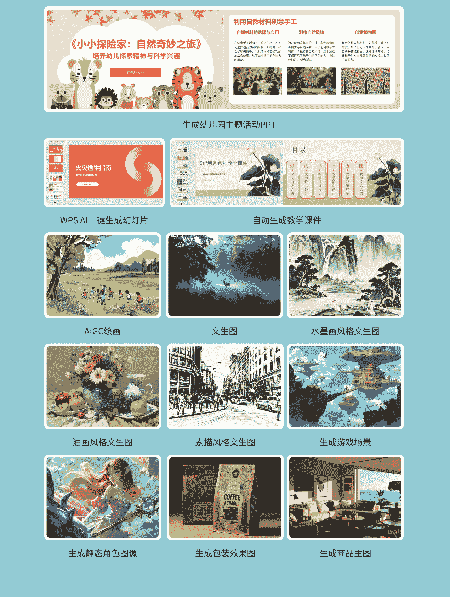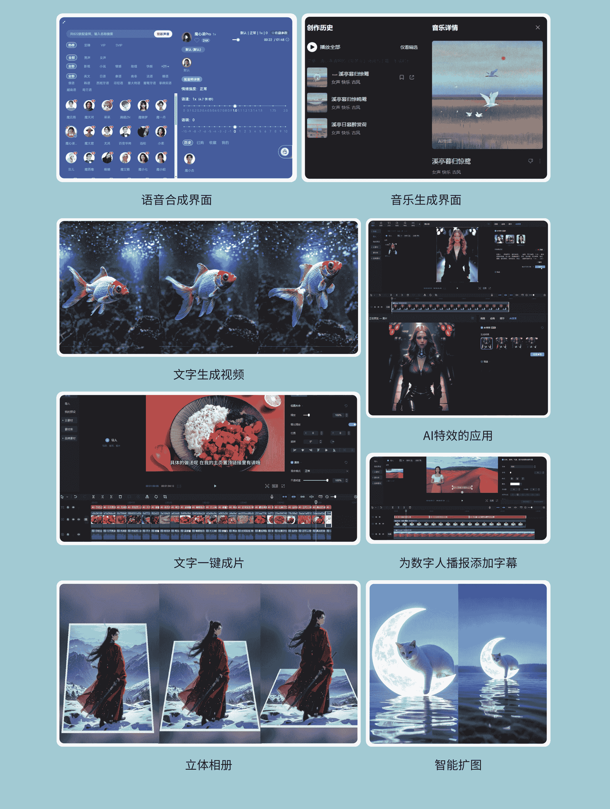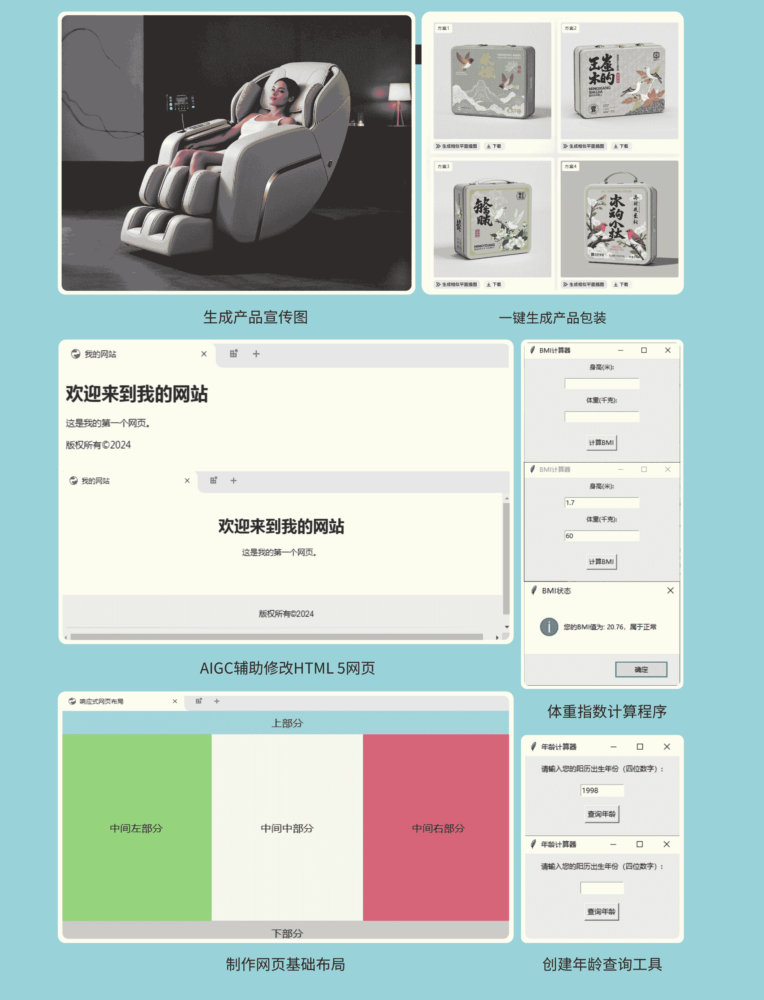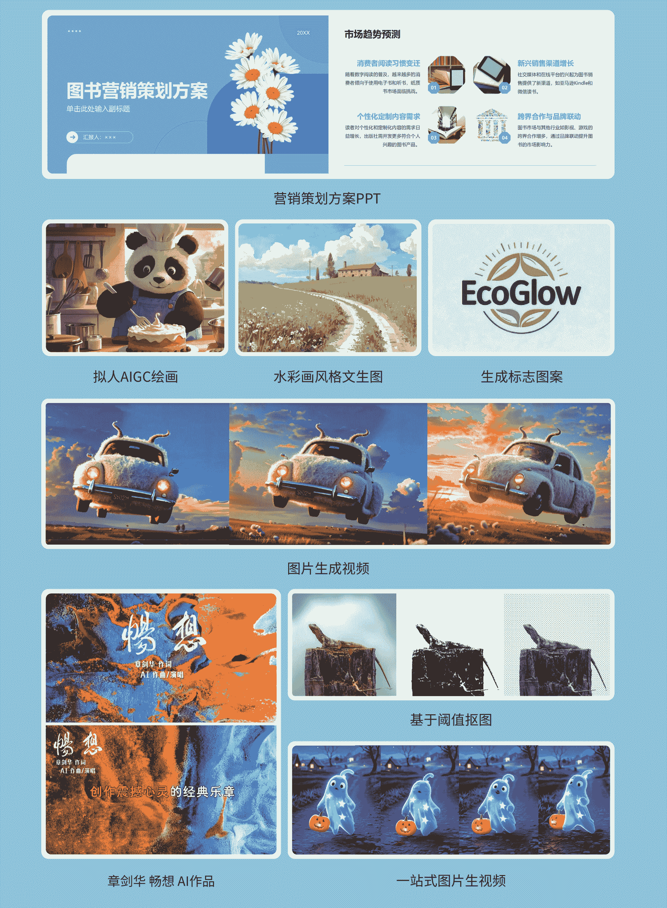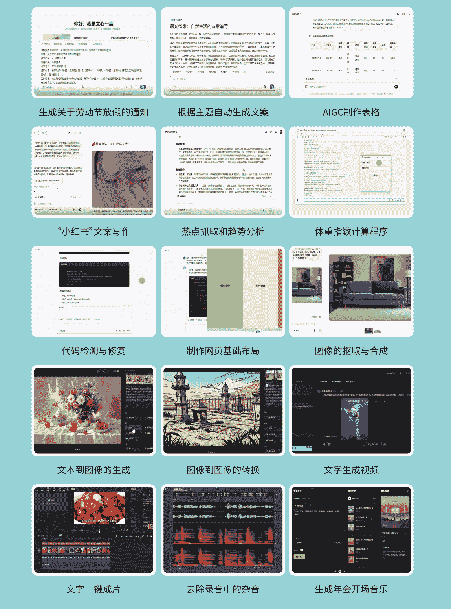

# 人工智能赋能教育改革
——清华电脑学堂 AIGC 系列图书编委会

**主  任：**钱志新

**副主任：**孙 刚 蔡振康

**专家委员：**（按首字笔画排序，排名不分先后）

孔若楠 王国胜 邢家发 李彩敏 李永昌

李 阳 杨雷华 板俊荣 房 伟 周 瑾

周 卫 周 毅 郑 静 高翼飞 栾大成

聂 静 徐绕山 徐 伟 徐建峰 袁金敏

袁晓黎 袁 潇 黄春风 蔡茂林 薛军伟

# 推荐序
在文明演进的长河里，创新如星光闪烁，人工智能则像从科技云层中升起的新星，以独特光芒为人类拓展新路径。

人类赋予人工智能以智慧，人工智能回馈人类更多可能性。它读懂需求、陪伴生活，在疲惫时提供慰藉，在迷茫时给出指引，在需要时及时响应，为生产和生活带来全新形态。

当前，人工智能的应用边界不断扩大，已深度渗透到日常生活各处。从医疗领域的精准判断，到交通系统的智能调度；从智能家居的便捷体验，到教育场景的个性化学习；从辅助翻译写作，到辅助作曲绘画，人工智能在诸多领域展现出强劲能力，意义深远：一方面大幅提升生产效率，让原本需耗费大量人力时间的工作瞬间完成；另一方面拓展人类认知边界，挑战传统创造力观念，化解许多曾被视为无解的难题。

人工智能正以独特魅力重塑世界。

毫无疑问，人工智能对人类历史具有划时代价值！毫无疑问，一个全新的伟大时代已经开启！

面对人工智能，有人将其视作意想不到的助力与机遇，有人担忧就业与伦理困境，有人积极尝试以获取新机会，也有人感到迷茫不知所措。

为帮助公众正确认识、学习与应用人工智能，魏砚雨、孙峰峰两位人工智能专家及时组织编写本书，从基础概念逐步讲解 AIGC 的原理与使用方法，旨在为读者搭建一个全面系统了解 AIGC 的窗口，帮助大家在人工智能驱动的新时代找到定位。本书具备以下鲜明特征。

一是表达通俗易懂。针对理论关切与实践问题作深入浅出解读，结构紧凑层次清晰，内容丰富循序渐进，解析简明好懂。

二是注重动手实践。在理论与技术讲解中穿插“动手练”和“拓展应用”。案例紧跟热门应用，可操作性强，讲解详细，即学即用。

三是面向初学人群。本书既可作为各院校人工智能基础课教材，也可作为广大读者学习实践的参考书，有助于打破技术专业壁垒。AIGC 能帮助每个人在学习、工作与生活中实现更高效、更美好的可能。

总体而言，本书对学习者与使用者而言是一场及时雨，也是一本实用手册，可助大家快速入门并规范应用。当然，入门靠引路，精进靠个人，关键仍需多学多思多练，才能真正用好人工智能，使其成为学习、工作与生活的好伙伴。

需要指出的是，人工智能目前仍处于成长早期，发展走向难以预判。当下认知与应用仍十分初步。让我们紧跟人工智能时代，热情拥抱，从容应对，不断学习深化认知，勇于实践，努力攀登新高峰。

江苏省文联主席

# 前言
人工智能技术正以惊人速度重塑生活方式，而 AIGC 无疑是这场变革的核心引擎。从文案撰写到智能办公，从图像生成到视频合成，从自动配乐到数字人播报，再到代码编写与新媒体运营，其身影无处不在，已成为现代生活与工作不可或缺的助力。

AIGC 的出现让传统内容创作变得更高效、更灵活、更智能。它既能基于提示生成完整文章，也能把简短文本描述转化为惊艳的艺术作品，甚至能据文本生成音视频内容。然而，随着应用场景日益广泛，市场上仍缺乏一部既全面又专业的生成式人工智能应用教材，难以满足教学培训需求。因此编写一本内容适中、实用性强、兼顾理论与实践的生成式人工智能通识教材已十分紧迫，以便师生快速入门并适应人机协同的教学培训模式，进一步推动 AIGC 普及与应用。本书即在这一背景下诞生，旨在帮助读者迅速掌握 AIGC 基础知识与实用技能，为未来创新提供坚实起点。

作为一项充满潜能的技术，AIGC 不只是专家的工具，更是人人可用的创新利器。其真正价值在于赋能个体，让每个人都有机会成为创新者。无论是初次接触的新手，还是希望深挖应用的进阶者，本书都将成为可信赖的伙伴。

## 本书亮点
本书为读者提供全面系统了解 AIGC 的视角，帮助大家在人工智能驱动的新时代找到定位。期望通过本书打破专业技术壁垒，让 AIGC 助力人人实现工作与生活中更高效、更美好的可能。

**· 理论+实操，实用性强。**针对疑难知识点配设实操案例，读者可在实践中出发，学以致用。

**· 结构合理，全程图解。**全书采用图解方式，直观呈现每一步具体操作。

**· 拓展应用，温故知新。**第 2～8 章末均设“拓展应用”板块，对本章内容再练习，形成“学习—思考—实践”闭环，可举一反三解决类似问题。

## 内容概览
全书共 8 章，全面覆盖 AIGC 基础知识与应用场景，具体见表 1。

**表 1**

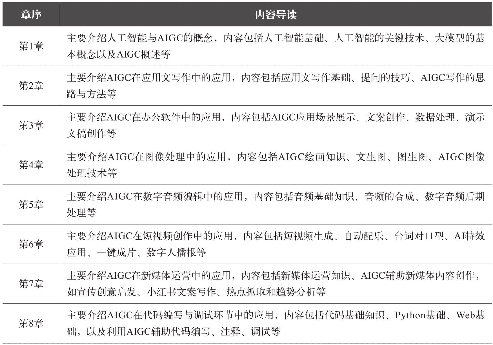

值得注意的是，AIGC 技术只能作为提升效率的工具，具体创作核心仍在于人类的主观思想与意识，过度依赖不可取。

本书编写得到江苏省人工智能学会、南京林业大学、南京航空航天大学、南京师范大学、正德职业技术学院、南京工程学院、南京信息职业技术学院、南京理工大学、南京传媒学院、南京邮电大学、北京航空航天大学、江苏省如皋中等专业学校等院校十余位教师指导，也得到南京投石智能系统有限公司、中核华纬工程设计研究有限公司等企业科技人员的支持与帮助，在此一并致谢。感谢书中所用 AIGC 工具的开发者与运营者，他们为推动我国人工智能发展、提升国民生成式人工智能素养与应用能力提供了宝贵支持。希望本书能点燃你对人工智能的热情，并在学习与工作中带来切实帮助。

**附赠资源**

**教学课件**

**配套视频**

**技术支持**

**教学支持**

**第一章** **人工智能与 AIGC 基础**
人工智能是当下最受关注的话题之一，正以前所未有的速度改变生活与工作方式。从语音助手到自动驾驶，从医疗诊断到内容生成，人工智能在各行各业释放巨大潜力。本章将对人工智能概念及相关技术做简要介绍。

**1.1** **认识人工智能**
人工智能作为当代技术变革的重要推手，正在深刻改变社会方方面面。然而人工智能究竟是什么、包含哪些内容，很多人并不清楚。本节围绕概念、发展历程、分类及研究方法展开介绍。

**1.1.1** **什么是人工智能**
人工智能是计算机科学的一个分支，目标是模拟与扩展人类智能，让机器能够像人一样思考、学习与决策。它不仅能完成复杂逻辑任务，还力求赋予机器感知、推理、规划和语言理解等能力。

当使用语音助手如 Siri 或小爱同学查询天气时，人工智能会通过语音识别把问题转为文本，再结合大数据与预测模型快速生成答案。这一过程中既识别了语音，又理解了意图并给出精准回应，展现了人类智能的部分特征，图 1-1 所示为智能音箱示意。

图 1-1

本质上，人工智能是一种试图模仿甚至超越人类智慧的技术。它可帮助解决问题、提供建议，甚至撰写文章、作曲或绘画。如今已广泛应用于生活各方面，让生活更便捷高效。

**1.1.2** **人工智能的发展历程**
人工智能发展大致可分为四个阶段，各有特点与里程碑。

**1．萌芽阶段：20 世纪 40—50 年代**
科学家麦卡洛克与皮茨提出神经网络的数学模型，开创了用数学与逻辑模拟大脑的可能。计算机科学家艾伦·图灵提出“图灵测试”，用来评估机器是否具备智能。若对话者无法分辨对方是人还是机器，则视为通过。这一阶段多为理论探索，应用有限，却奠定了坚实基础。

**2．起步阶段：20 世纪 50—70 年代**
1956 年达特茅斯会议上人工智能名称首次正式提出，标志该领域诞生。研究者开发了诸多“专家系统”，依靠预设规则解决问题。例如 MYCIN 医学诊断系统可帮助医生判断感染类型并推荐药物。人工智能在游戏中也初露锋芒，如 IBM 开发的 AI 程序击败业余棋手，当时被视为重大成就。这一阶段研究由理论走向实践，但多依赖手工规则，遇到复杂问题时力不从心，也引发了对未来的质疑。

**3．低谷与复兴阶段：20 世纪 70—末期**
70—80 年代为低谷期，硬件性能不足，模型效果与期望差距较大。80—90 年代末期迎来复兴，反向传播算法的提出让神经网络训练更高效，机器学习能力得以提升。进步虽有限，却为深度学习爆发积累了关键技术。

**4．爆发阶段：21 世纪—至今**
深度学习技术崛起。Hinton 团队以深度神经网络在 ImageNet 竞赛中取得惊人成绩，图像识别能力超越人类。大语言模型如 ChatGPT 与生成式 AI 如 Midjourney 出现，AI 能写作、绘画、编程并参与创作。这一阶段得益于算力跃升与互联网带来的海量数据，人工智能迎来高光时刻。

**1.1.3** **人工智能的分类**
不同类型人工智能擅长领域各异。

**1．按智能水平分类**
大致可分为轻人工智能 ANI、强人工智能 AGI 与超人工智能 ASI。

· 轻人工智能是当前常见类型，指只擅长特定任务的 AI，如语音助手、导航软件等。它们能理解语音指令，但无法跨领域解决问题。

· 强人工智能指能像人类一样思考学习，可跨领域解决不同问题，能自由学习、理解与解决各类难题。目前仍在研究阶段。

· 超人工智能指能力全面超越人类的 AI，可能在学习速度、知识储备与创造力上远超人类，目前仅停留在设想阶段。

**2．按功能分类**
可分为感知型、决策型与生成型。

· 感知型擅长从图像、声音、文字等数据中提取信息，作用类似人类的眼耳，通过数据作出识别与反应。如人脸识别、语音识别、图像识别等。

· 决策型能在感知信息基础上进行分析与决策，帮助人类在复杂环境中做出更明智选择。如自动驾驶、股市预测、医疗 AI 等。

· 生成型可通过大量深度学习、模仿与训练创造全新内容，让机器从被动工具变为创意助手。如 ChatGPT、Midjourney、音乐 AI 等。

**3．按实现方式分类**
可分为基于规则、基于机器学习与基于深度学习。

· 基于规则需人类提前编写规则，按固定逻辑运行。如棋类 AI 将所有走法列出后逐步计算最优解。

· 基于机器学习通过学习数据发现规律，不依赖人工设定规则，能处理复杂问题。如推荐算法与语音识别。

· 基于深度学习是机器学习的进阶，通过“神经网络”模拟人脑工作方式，可处理更复杂任务，如图像识别。

**1.1.4** **人工智能的三大流派**
当前人工智能研究主要包括符号主义、连接主义与行为主义三种思路。

**1．符号主义**
认为智能可通过逻辑推理与符号操作实现。研究方法基于人类逻辑思维，使用明确规则与知识库进行计算，具体表现为：

**·** **专家系统：**输入专家知识与规则，解决特定领域问题，如医疗诊断系统。

**·** **搜索算法：**在所有可能选项中寻找最优解，如迷宫问题或下棋 AI。

该流派逻辑清晰，适用于规则明确的任务，但在复杂、不确定或动态环境中表现受限。

**2．连接主义**
认为智能源于类人脑神经网络的连接与学习。通过模拟神经元与突触，让机器从数据中自主学习优化，具体表现为：

**·** **人工神经网络：**多层神经元进行学习与预测，是深度学习基础。

**·** **深度学习：**利用复杂多层神经网络处理图像、语音与自然语言等复杂任务，如人脸识别、自动驾驶。

该流派学习能力强，擅长海量数据与复杂模式识别，但过程不透明，需大量数据与算力。

**3．行为主义**
认为智能源于与环境的交互，通过试错与反馈不断优化行为。AI 可在与环境的“对话”中学会最佳决策，具体表现为：

**·** **强化学习：**AI 通过奖励惩罚机制学习最优行为。

**·** **机器人控制：**机器人通过与环境互动完成任务，如学习行走或抓取物体。

该流派可处理动态不确定环境，适合复杂连续决策问题，但训练耗时，需大量试验与算力。

三大流派各有侧重，互为补充。研究常结合多种优势以解决更复杂的现实问题。

**1.2** **人工智能的关键技术**
人工智能在各领域发挥作用，离不开背后关键技术。简单说，这些技术是人工智能的“大脑”与“工具箱”，使其能够“学习”“理解”“推理”与“行动”。

**1.2.1** **机器学习**
机器学习是人工智能核心技术之一，也是目前应用最广、发展最成熟的领域。简单说，它是让计算机通过数据“自学成才” 的方法，无需人类编写具体规则。它通过分析大量数据自动寻找规律，用这些规律完成预测、分类或生成新内容。

**1．机器学习的方式**
主要有监督学习、无监督学习与强化学习三种，各有用途与场景。

1）监督学习
使用“有标签”数据训练模型。数据中每条输入都有明确输出标签，通过学习输入与输出映射关系，对新数据进行预测。

例如，输入大量标注图片告诉模型哪些是“猫”、哪些是“狗”，训练后即可快速识别新图片中的动物。常用于图像分类、疾病诊断、金融风控等场景。

2）无监督学习
使用“无标签”数据训练。模型需自行发现数据隐藏结构或规律，通常用于聚类与降维。

例如，一堆未标注图片，模型可依据颜色、形状等特征将其分为动物、风景等类别。常用于用户行为分析与异常检测。

3）强化学习
通过“奖惩机制”让模型逐步学会最佳策略。类似游戏中不断试错，通过与环境交互学习何种操作带来奖励并规避错误。

例如 AlphaGo 通过强化学习击败人类围棋高手，不断模拟对局学习获胜策略。常用于自动驾驶、游戏 AI、资源分配等场景。

**2．机器学习的关键技术**
机器学习实现离不开以下核心技术。

1）数据预处理

从数据到大模型：AI 运作全景拆解

机器学习要跑起来，数据就是动力源。真实采集到的记录往往很乱，需要先做清洗、统一量纲、提炼关键特征这些前置工作，模型才能学得快学得准。以医疗为例，体检表里常有未填写的检验值需要补齐，体重用公斤、身高用厘米这类单位不一致的字段，也要映射到同一区间才能公平比较。

2）模型训练
搭建模型是整个流程的关键环节，业界常用的做法大致可分成三类。
**·** **线性回归：** 捕捉变量间的线性趋势，主要用于数值型预测。
**·** **决策树：** 按“如果…那么…”的规则把样本逐步划分到不同类别。
**·** **神经网络：** 借鉴人脑连接方式，对复杂非线性任务的处理能力更强。

3）模型评估
训练结束后要用独立的测试集检验泛化表现。常用评判维度有正确率、召回率、F1 综合指标等。比如做垃圾邮件过滤，核心就是看它识别垃圾邮件的能力强弱。

1.2.2 自然语言处理
自然语言处理的任务是让计算机读懂、写出、分析人类的日常语言。简单说，就是让机器能听懂口语、读懂文字，并用人类方式交流。

1．常见语言模型
语言模型的核心是教会机器如何理解和产出文字。它靠海量文本学习词语之间的关联和语境含义。
**·** **统计语言模型：** 以概率统计为基础，估算某个词出现的可能性，典型代表是 N 元语法。
**·** **深度学习语言模型：** 对长距离语境的把握更强，常见有 LSTM、Transformer。
**·** **预训练语言模型：** 先在大规模语料上习得通用的语言知识，再迁移到具体任务，如 BERT、GPT 家族等。

2．自然语言处理技术
这些技术已融入日常生活，典型场景包括：
**·** **文本分类：** 把内容归到事先定义好的类别，如垃圾邮件判定、新闻话题归类。
**·** **情感分析：** 通过表达方式推断作者的情绪倾向，分正面、中性、负面。电商商品评论分析、社交舆情监测即属此类。
**·** **机器翻译：** 实现跨语言转换，如 Google Translate、微信翻译、实时语音同传设备。
**·** **语音识别与生成：** 语音转文字，或文字转语音。如语音助手 Siri、小度、自动字幕、智能导航播报。
**·** **自动问答：** 让机器直接回答用户提出的问题，如搜索引擎的智能问答、客服机器人。
**·** **信息抽取：** 从非结构化文本中提炼有用信息，如新闻摘要生成、金融数据抽取、知识图谱构建。
**·** **文本生成：** 根据输入生成合乎逻辑和语法的文本内容，如写作辅助、代码生成、对话生成。

3．自然语言处理流程
整体链路可概括为：文本预处理→语言表征→特征提取→模型训练→模型预测→模型评估→应用部署。
**·** **文本预处理：** 把原始文字整理成机器可处理的干净数据。
**·** **语言表征：** 将文字映射为数字向量，并保留语义与对话来往信息。
**·** **特征提取：** 从文本里挑出对任务最有用的信息点。
**·** **模型训练：** 利用处理好的数据和合适算法，让机器学会如何理解与生成语言。
**·** **模型预测：** 用训练好的模型对新文本进行推断或生成。
**·** **模型评估：** 检查性能是否达标并据此优化。
**·** **应用部署：** 把模型放到聊天机器人、翻译系统等真实场景。

1.2.3 计算机视觉
计算机视觉让机器通过“看”来理解图像和视频。人类靠眼睛，机器靠摄像头采集数字图像，再从中提取信息。

1．数字图像基础
图像由像素点构成，每个像素的亮度、颜色或距离等属性以数字表示。常见类型有灰度图像、彩色图像、RGBD 图像、红外、紫外、X 光等图像。
**·** **灰度图像：** 每个像素仅用一个亮度值，通常 1 字节，0 表示最暗黑色，255 表示最亮白色，其间为中间亮度。
**·** **彩色图像：** 采用 RGB 色彩标准，通过红、绿、蓝三通道叠加产生颜色。每个像素由三个 1 字节分别表示 R、G、B，几乎覆盖人眼可感知的颜色，是应用最广的色彩体系。
**·** **RGBD 图像：** 3D 深度相机同时采集彩色和深度信息。即 RGB 再加 Depth。设备能实时输出高分辨率、低时延的深度和彩色视频流，生成 3D 图像，用于目标识别、动作捕捉、场景感知等。每个像素除 RGB 外还带一个深度值，表示到相机的距离，单位常为毫米，至少用 2 字节存储，反映物体的三维形貌。该信息不受环境光影响，在体感游戏、自动驾驶、机器人导航等领域价值很大。
**·** **红外、紫外、X 光等图像：** 来自超出人眼可见光波段的成像设备，在医疗、军事、工业等领域用于缺陷检测、目标检测、机器人导航等。

2．基于计算机视觉的生物特征识别
通过捕捉和分析人体生物特征实现身份认证或行为分析，如人脸、指纹、虹膜、步态、静脉等。
**·** **面部识别：** 用摄像头采集人脸，分析眼睛、鼻子、嘴巴的相对位置和面部纹理来辨认身份，用于身份验证、安防监控、智能门禁。
**·** **指纹识别：** 利用指纹脊线和谷线的纹路特征。先采集指纹图像再提取独特特征点，用于手机解锁、银行系统、政务管理。
**·** **虹膜识别：** 虹膜位于瞳孔与巩膜之间，纹理独一无二。通过高精度相机采集图像分析纹理，准确度高且终身稳定，多用于高安全场景和智能设备。
**·** **步态识别：** 分析行走姿态和动作模式识别身份，远距离场景优势明显，用于远距离监控、医疗、公共交通。
**·** **静脉识别：** 利用手掌或手指血管分布的独特性，需红外成像配合计算机视觉分析匹配，多用于银行支付、医疗、门禁。

3．深度学习在计算机视觉的应用
深度学习可视为计算机视觉的加速器。传统方法需人工设计规则，深度学习模拟神经网络自动提取复杂特征，大幅提升理解能力。
**·** **图像分类：** 把图片分到预设类别。传统方法靠人工边缘检测、纹理分析，效果有限；深度学习自动学习颜色、形状、纹理、背景等高级特征，分类显著提升。
**·** **目标检测：** 在图或视频中定位并识别物体，深度学习能捕捉形状、纹理、空间关系，检测更准。
**·** **图像分割：** 在检测基础上做像素级精分，把物体从背景中完整剥离。传统方法边界粗糙，深度学习可精确分割。
**·** **图像生成：** 借助生成对抗网络等技术合成逼真图片。
**·** **视频分析：** 处理连续帧，不仅读懂单帧内容，还能分析帧间变化，提取动态信息。

1.2.4 智能语音
智能语音让机器“听得懂、说得出”，实现人与机器的自然语音交互。

1．语音识别
把人类语音信号转为文字。先用麦克风采集，再分析频率、音调等特征提取信息，借助深度学习语音模型转为文字。常见用途有语音输入、语音助手、翻译软件。
**·** **语音输入：** 如手机语音输入法，说话即可生成短信。
**·** **语音助手：** 如苹果 Siri、百度 小度，通过识别理解指令。
**·** **翻译软件：** 出国时可实时把口语转成外语。

2．语音合成
把文字转成自然流畅的语音。机器先解析语法和句式，再用合成模型生成声波并模仿语调节奏。常用于智能客服、导航、语音阅读器。
**·** **智能客服：** 电话里听到的流畅语音多为合成。
**·** **导航系统：** 高德、百度地图的语音指路。
**·** **语音阅读器：** 把电子书、网页内容朗读出来。

1.2.5 知识图谱
知识图谱是一种组织和展示信息的结构，可想象成巨型思维导图，按逻辑把海量信息串联，帮助机器理解世界。如搜索“苹果”时区分水果还是公司。

1．知识图谱的表示
知识图谱用节点和边表示，节点是事物或概念，边是两者关系。通用表达是三元组。
· （实体 1，关系，实体 2）三元组：例如（爱因斯坦，提出了，相对论），其中“爱因斯坦”是实体 1，“提出了”是关系，“相对论”则是实体 2，示意图如图 1-2 所示。

图 1-2
· （实体，属性，属性值）三元组：例如（江苏省，地级市，13 个），其中“江苏省”为实体，“地级市”为属性，“13 个”为属性值，示意图如图 1-3 所示。

图 1-3
图形化展示能直观呈现知识关联。

2．知识图谱的结构
逻辑上分为数据层与模式层。
· 数据层主要由若干事实构成，知识以事实为单位保存。若用三元组表达，可选用图数据库存储。
· 模式层建在数据层之上，是核心，常借助本体库管理。本体是结构化知识库的概念模板，本体库能让知识层次更清晰、冗余更少。

用于获取知识的资源可分为结构化、半结构化和非结构化三类。
· 结构化数据：定义与表示都比较完善，如 DBpedia、Freebase 等领域数据库。
· 半结构化数据：部分结构化、部分松散。知识表述不一定统一，信息框、列表、表格等仍具备一定结构，典型为百科网站及各类产品参数页。
· 非结构化数据：无固定规范的自由形式，如自然语言文本、音频、视频。

3．知识图谱的典型应用
**·** **搜索引擎：** 谷歌、百度用知识图谱呈现结构化结果。如搜“泰坦尼克号”会直接给出上映时间、导演、主演等，而非只有链接列表。
**·** **智能问答：** 语音助手如 Siri、小度、小爱借助知识图谱回答“爱因斯坦是谁？”、“猫和狗有什么区别？”等复杂问题。
**·** **推荐系统：** 视频平台据用户偏好推荐影视，购物平台据购买记录推荐商品。
**·** **医学领域：** 整理疾病、症状、药物关系，辅助诊断，如从症状推测可能疾病并给出治疗建议。
**·** **教育和科研：** 梳理学科知识点，学生可把握框架，科研人员可挖掘新关联。

1.3 大模型的基本概念
人工智能大模型是超大规模、通用性强的深度学习模型，具备较强智能，能够解决复杂任务。

1.3.1 大模型的定义
大模型通常含有亿级、百亿级甚至千亿级以上参数，并以海量数据训练。可用于语言理解、图像生成、推荐等。例如 ChatGPT 这类对话模型就是典型代表，如图 1-4 所示。
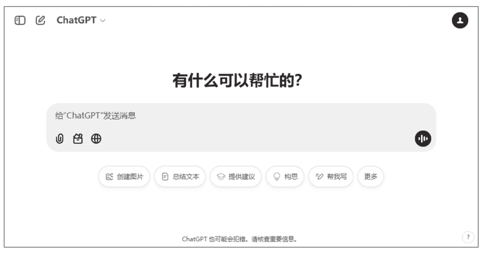
图 1-4

1.3.2 大模型的特点
**·** **参数体量庞大：** 参数可类比大脑神经连接，普通模型仅数百万，大模型动辄亿级到千亿级。
**·** **数据规模庞大：** 需文本、图像、视频等海量数据支撑，丰富性提升通用性和效率。
**·** **通用能力强：** 训练后可在多领域发挥，无需为每个任务单独设计。
**·** **迁移学习能力强：** 在一个任务学到的知识可迁移到另一任务，节省时间和成本。
**·** **计算需求高：** 训练与推理需高性能 GPU 集群、云计算等，成本高昂。
**·** **泛化能力强：** 能从已知数据学习，并在未知数据上表现良好，生成高质量答案。

1.3.3 大模型的分类
**·** **自然语言处理模型：** 处理和生成人类语言文本，擅长语义理解与生成。代表有 GPT 系列、BERT。
**·** **计算机视觉模型：** 专注图像、视频视觉数据，识别、分类、生成视觉信息。代表有 Vision Transformer、YOLO，用于人脸识别、自动驾驶、医学影像分析。
**·** **多模态模型：** 同时处理多种数据类型，打破单一模态限制。代表有 DALL·E、CLIP，用于文生图、语音转文字、视频分析。
**·** **推荐系统模型：** 基于用户行为和兴趣做个性化推荐。代表有 DeepFM、Transformer4Rec，应用于电商、流媒体、社交平台。
**·** **专用领域模型：** 面向特定行业任务设计，专业性强。代表有 AlphaFold、MedPaLM，用于蛋白质结构预测、医学问答等。

1.3.4 国内主流大模型
国内已有不少优秀模型，如文心一言、智谱清言。它们更贴合本土语言习惯和使用场景。

1．文心一言
如图 1-5 所示，文心一言是百度推出的一款基于人工智能技术的自然语言处理工具，能高效理解处理文本，提升语言任务性能，是多模态、跨领域、知识增强方向的代表产品。

图 1-5
· 支持文本生成、对话问答、知识问答、内容创作等。
· 采用知识增强技术，将大语言模型与知识图谱结合，输出更精准。

2．智谱清言
如图 1-6 所示，智谱清言由智谱 研发组织开发，是基于 GLM 架构的中英双语对话模型，目标提供高效通用的“模型即服务”范式。对中文问答对话做了深度优化，可生成文本、翻译、创作不同风格内容并回答各类问题。
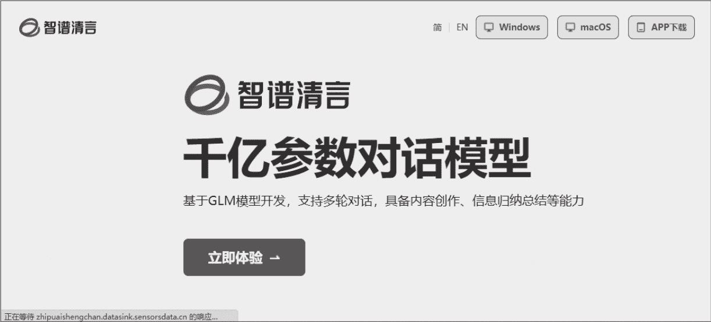
图 1-6
· 支持连续多轮自然对话，能依据对话历史理解并作答。
· 知识库庞大，覆盖科学到生活常识。
· 可生成新闻报道、小说、诗歌、代码等多种文本。
· 支持个性化定制，打造专属 AI 助手。

· 拥有深层的推演与决断能力，可助力用户有效解决实际难题。

**3．讯飞星火**

图 1-7 呈现了科大讯飞推出的一款新一代认知智能大模型——讯飞星火。该模型可与使用者开展自然流畅的交流，在对话中覆盖内容创作、语义理解、知识问答与推理推演等多种服务。

图 1-7

就语音交互而言，讯飞星火相对突出，能带来更准确自然的体验。其特色如下。

· 按住语音输入键即可将口述实时转写为文字后发出，适合提示词输入频繁的情形。
· 提供文本听读，点按播放即可收听模型语音回复，同时可切换不同声线以匹配个人偏好。
· 具备多模态识别，其中包括数学公式识别；面对数学类题目时可从图片中提取题干并给出标准答案。
· 内置生活、职场、营销、写作等多元场景助手，输入“@”即可唤起，可用于制作 PPT 提纲、撰写文案、汇总周报、虚构故事等。
· 支持开放域问答，逻辑与数学能力持续增强，并可进行连贯的多轮对话。

**4．通义千问**

通义千问是阿里巴巴发布的一款先进智能问答系统，知识覆盖面广、响应迅速且具备持续学习能力。其检索能力强，可在海量资料中快速定位相关信息，如图 1-8 所示。其主要特征如下。

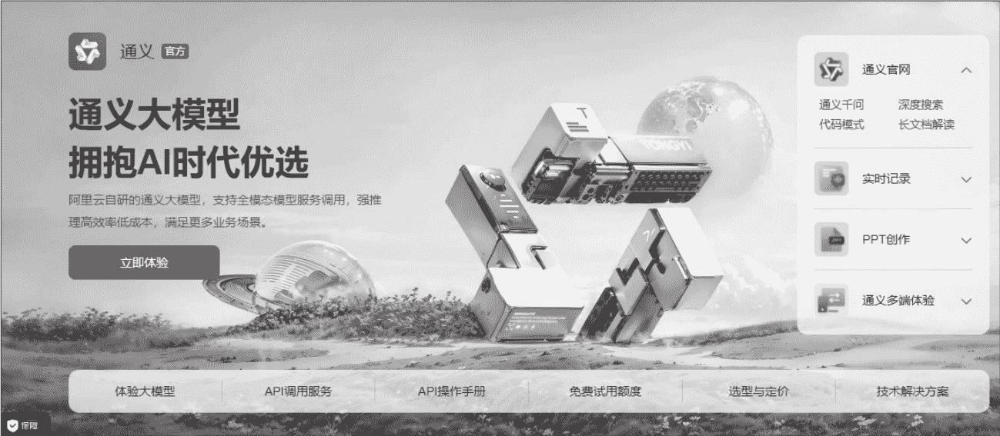

图 1-8

· 配备规模化的知识库，范围涉及生活、科技、文化、历史、体育等，输出结果准确且会动态刷新以保持时效。
· 兼顾单轮问答、连续多轮问答及相似问题检索等模式，能把握对话上下文，保持交流连贯，适应不同使用场景。
· 可理解并生成多语种内容，支持跨语言的信息交换与获取。

除上述四款之外，市场上还存在豆包、即梦 AI、腾讯元宝、Kimi、秘塔等实用系统，各有侧重。Kimi 的通用表现与文心一言相近，可应对广泛的语言处理任务；豆包、秘塔及腾讯元宝则在特定行业知识、隐私保护、游戏智能等细分方向各具优势。这些产品体现了国内人工智能的快速演进与应用的多元化，且均在持续迭代，以期提供更智能、更全面的服务。

**1.4 AIGC 概述**

AIGC 的英文全称是 Artificial Intelligence Generated Content，指借助人工智能手段自动产出各类内容的理念与应用。它能产出文字、图像、音频、视频乃至程序代码，是人工智能发展的重要方向。本节将对 AIGC 相关内容进行梳理。

**1.4.1 认识 AIGC**

AIGC 在 PGC 与 UGC 之后出现，是由人工智能系统自主或辅助完成内容生产的新型方式。它依赖深度学习范式，如自然语言处理、生成式对抗网络、Transformer 等核心技术。

AIGC 与人工智能虽紧密关联但定位有别。人工智能提供底层支撑，AIGC 则在此基础上实现内容生产的落地。两者差异见表 1-1。

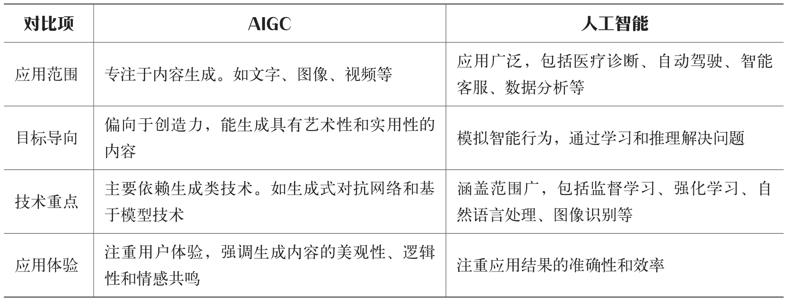

表 1-1

AIGC 相关技术重塑了传统办公形态，提升了工作效率，也为创造性任务打开了新空间。其特征如下。

· 批量自动化产出：可在短时间内大量生成文字、图像、音轨、视频等素材，使创作者集中精力于创意与策略，具体实现由系统承担。
· 创造力：既能模仿人类创作风格，也能基于海量数据提炼规律与趋势，产出具独创性的成果。
· 表现力强：依托先进算法与模型，将抽象概念转化为具体的文字、图像、音视频形式，均能以高质量呈现。
· 可迭代进化：持续吸收用户反馈与训练数据，不断优化生成机制与模型，从而提高产出质量与精确度。

**1.4.2 AIGC 的发展**

AIGC 从 20 世纪 50 年代萌芽，到实验性应用，再到实用化，已进入快速增长阶段。随着科技进步与场景拓展，AIGC 将在更多领域发挥作用，深刻改变工作与生活方式，发展历程见图 1-9。

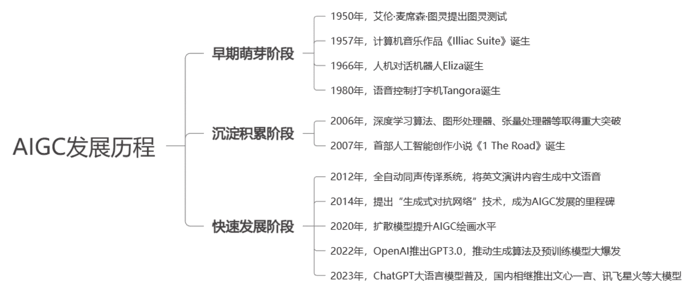

图 1-9

**1.4.3 AIGC 的应用方向**

AIGC 在诸多行业展现出强劲的应用潜力与实际价值，既提升效率与生产力，也推动创新。

**1．内容创作与媒体**
· 新闻与文章撰写：可自动生成新闻稿、博客文章、社交媒体内容，提升新闻机构与内容创作者的生产效率。
· 广告创意：自动产出广告文案、海报、视频脚本等，满足多样化营销需求。
· 视频内容生成：基于 AI 的自动化创作，可生成短视频、广告视频，甚至通过文字或图像生成完整视频，如 DeepFake 技术。
· 虚拟主播与播报员：利用 AIGC 生成虚拟人物进行新闻播报、直播，提升灵活性与互动性。

**2．图像与设计**
· 图像生成与编辑：借助生成式对抗网络等深度学习技术，可生成高质量图像、插画、艺术作品，满足设计与艺术需求。
· 自动化设计：按需自动生成网页设计、标志设计、包装设计等，减少人工工作量。
· 图像增强与修复：对低分辨率图像进行高清化，或修复受损照片，应用于图像重建与优化。

**3．教育培训**
· 个性化学习：依据学习进度与兴趣，定制教材、练习题、解题步骤，提升教学效果。
· 虚拟教师与教学助手：可创建智能虚拟教师提供个性化辅导、答疑，或协助教师进行作业批改与评估。
· 自动化考试与评估：自动生成考试题目并评估学生答案，减轻教师负担。

**4．游戏与娱乐**
· 游戏内容创作：自动生成剧情、关卡设计、角色设定，提升开发效率与创意空间。
· 虚拟角色与 NPC 生成：自动生成对话、行为模式与情节，丰富游戏互动性。
· 音效与音乐创作：可生成背景音乐、音效与游戏音频，增强沉浸感。

**5．商业与营销**
· 产品推荐与个性化营销：分析用户行为，生成个性化广告与推荐内容，提升点击率与转化率。
· 市场分析报告：基于数据生成市场分析报告、趋势预测等，为决策提供支持。
· 社交媒体管理与内容优化：生成社交媒体帖子、图文内容，优化发布策略，提升品牌影响力。

**第二章 AIGC 助力应用文写作**

AIGC 以高效便捷的特点，为应用文写作带来全新方式。从商业计划书到求职简历，从公文通知到活动策划，AIGC 既能快速生成符合场景的文本，也能依据用户输入智能调整，大幅提升写作效率与质量。本章结合人机交互与写作方法，介绍 AIGC 在应用文写作领域的应用。

**2.1 应用文写作的基础**

在工作学习中应用文使用频繁，任何类型都要求写作者具备清晰逻辑与写作技巧。本节对应用文基本写作方法进行介绍。

**2.1.1 应用文的种类和特点**

应用文实用性强、功能明确，常用于表达具体事务性内容。根据内容、目的、性质、特点、使用范围与格式的不同，可分为多种文类。

· 公文：政府、企事业单位处理公务的重要文书，包括决定、通告、议案、通知、请示、意见、报告等。具有规范性与权威性，格式严谨、语言精炼、条理清晰。
· 事务性应用文：国家机关、社会团体、企事业单位处理内外事务时使用，包括计划、总结、会议记录、简报、调查报告等。内容具体、条理清晰、语言简明扼要，强调实用性与可操作性。
· 宣传性应用文：用于宣传、报道、鼓动、介绍，包括新闻稿、广播稿、演讲稿、解说词等。强调感染力与说服力。
· 日常应用文：单位与个人日常生活中使用的文书，包括一般书信、感谢信、邀请函、请假条等。具有普遍性与灵活性，语言得体、情感真挚。
· 经济应用文：企事业单位处理经济事务时使用的文书，包括经济合同、协议书、财务报告、招标书、投标书、市场预测报告等。专业性与实用性强，语言逻辑严密、数据翔实、条理清晰。
· 学术应用文：用于表达学术研究成果，包括实验报告、学术论文、毕业论文等。专业性与逻辑性强，内容科学严谨、结构规范清晰。
· 礼仪应用文：带有礼仪色彩的应用文，包括欢迎词、请柬、聘书、贺信、贺词等。注重形式感与情感表达，语言优雅、情感真挚。
· 法律应用文：法律事务中使用的文书，包括起诉书、辩护词、申诉状等。内容严谨、语言规范、术语精准、条理清晰，并具有法律效力。

**2.1.2 应用文写作的基本要求**

进行应用文写作时需遵循一定规范，以确保信息清晰有效传达。

**1．有明确目的**
写作须围绕目的展开。每种应用文都有特定功能，如通知用于传达信息，求职信用于展示个人能力并争取机会。作者应明确使用场景与目的，确保内容紧扣主题，避免模糊或偏离削弱实用性与可读性。

**2．结构清晰，逻辑严密**
清晰结构是核心。应用文通常采用开头、主体、结尾结构，开头交代背景与目的，主体详细说明事务内容或执行流程，结尾总结并提出期望或建议。良好的段落组织有助于读者快速抓住重点。

撰写学术报告类文体时，除结构清晰外，内容逻辑必须严谨，注意论据充分、推理合理，并按重要性安排先后顺序，以提高说服力与可信度。

**3．语言简洁，注意语境**
应用文注重语言实用性，避免冗长复杂表达。语言应简洁明了，用词精准。语气需根据目标对象与语境调整，如向上级汇报语气正式，强调数据与事实；面向客户的宣传文案则更具吸引力与互动性。

**4．内容完整，格式规范**
完整性是基本要求，内容应覆盖相关信息，不得遗漏关键细节。不同类型应用文有固定格式要求，遵守规范是写作重要环节。如公文需按规定版式编写，包括标题、主送机关、正文、落款等；求职信需包含称呼、正文、署名等。正确格式体现严谨态度，提升可读性与专业形象。

**5．注意文化与礼仪**
跨文化交流时需兼顾不同文化背景的礼仪规范。如商务邮件在不同文化中对称呼、语气、措辞要求不同。尊重文化差异、符合礼仪规范，能增加接受度与影响力。

**2.1.3 AIGC 的写作优势**

与传统写作相比，借助 AIGC 技术可大幅提升写作效率与效果。主要优势如下：

**1．快速生成完整文档**
依托强大的算法与模型训练，AIGC 可在短时间内根据需求生成完整应用文。通过输入提示词或提供背景信息，即可获得初稿。如撰写会议记录时，输入会议主题与主要议题，AIGC 即可自动生成条理清晰的记录，相比手工撰写大幅缩短时间。

**2．即时修改内容和语言风格**
AIGC 具有高度灵活性，可根据需求即时调整结构或语言风格。如求职信可针对不同公司与岗位快速修改重点内容，并调整语气以适应语境。通过更改提示词可重新生成版本，满足个性化与多样化需求。

**3．提供多种表达方式**
经过海量语料训练，AIGC 可提供多种表达方式与写作参考。无论是正式商业报告，还是轻松幽默的宣传文案，均能按风格要求生成，丰富选择空间，提高文章质量。

**4．启发写作灵感**
许多人写作时面临难以起笔的困境，尤其在需要创造性表达的应用文场景。AIGC 通过生成初步内容提供框架与灵感。如撰写商业策划书时，不仅提供结构清晰的内容框架，还可补充行业数据、市场分析、实施方案建议，帮助快速切入主题，提升创意效率。

**2.1.4 AIGC 的写作流程**

合理安排写作流程可获得更贴合需求的文章，流程见图 2-1。

图 2-1

1）提供明确的提示词。写作前需清晰界定需求与目标，提供主题、背景、内容框架等信息。如撰写求职信时，应说明目标岗位、个人优势、求职动机。提示越具体，生成内容越贴近需求。
2）审核生成的文章。AIGC 生成内容未必完全准确，用户必须全面审查，确保准确性。如撰写商业计划书时，需核对市场数据是否真实、逻辑是否合理，避免偏差；同时检查语言表达是否符合目标读者期待。
3）人机协作优化文章。人机协作是关键环节。AIGC 生成内容通常为初稿，用户应在此基础上融入个人思想与个性化表达，并对语言风格、细节补充、格式规范等进行精细化改进，以满足实际需求。

需注意，AIGC 仅为辅助工具，具体仍以作者主观意识为主，避免过度依赖导致丧失真实情感与个性表达。

**2.2 与 AIGC 进行高效交互的技巧**

高效交互的关键在于提示词的输入与优化。提示词是用户与 AI 交流的核心手段，优质提示词可提升生成内容的准确性、相关性与质量。

**2.2.1 什么是提示词**

提示词是用户与 AIGC 互动的核心工具。通过输入提示词，可向 AIGC 表达任务需求并定义期望输出内容与风格。提示词如同指令或问题，直接影响生成结果的方向、质量与表现形式。

提示词可以是简单问题、详细任务描述或指令组合，具体取决于需求。

简单的提示词：在撰写求职信时需要注意哪些方面？
详细的提示词：请为计算机专业应届毕业生撰写一封求职信。申请 AI 工程师职位，需突出团队协作能力与研究项目成果。

提示词按任务复杂性与目标可分为：
· 开放式提示词：提供广泛方向让 AI 自由发挥，如“描述未来城市生活的画面”，适合创意性内容。
· 封闭式提示词：指向明确任务目标，如“列出绿色能源的五大优势”，适合信息性与结构性强的需求。
· 分步提示词：将复杂任务分解为多个步骤，如撰写策划书可分为“生成背景分析”“制定实施方案”“撰写结论部分”等。
· 情景化提示词：通过设定场景帮助 AI 更准确生成内容，如“假设你是一家机械公司的人事主管，请为一名即将毕业的机械设计专业学生撰写求职信”。

**2.2.2 提示词的设计原则**

优质提示词使生成内容更贴合实际需求，建议遵循以下原则。

**1．清晰明确**
提示词必须明确表达需求，避免模糊或冗长。如“写一篇文章”过于宽泛，改为“撰写一篇面向高中生的关于绿色环保重要性的宣传文章”更为有效。

**2．提供文章背景信息**
提供目标受众、写作目的、风格要求等足够细节，有助于 AIGC 更好理解提示词并生成符合情景的内容。如要求撰写商业提案时，可补充“目标客户为中小企业，重点突出产品性价比与实用性”。

**3．避免提示词有歧义**
提示词应易于理解，避免使用歧义表达，如“这种说法不太好”“内容不要太长”。应明确限定，如“请介绍 AIGC 技术对绘画领域的影响，300 字以内”。

**4．复杂问题分步完成**
面对相对复杂的问题，直接提问可能得到不够全面或条理不清的回答。此时需将任务分解为多个小提示词分步完成。如需一份完整创业计划书，直接输入“请撰写一份创业计划书”可能过于笼统。可分解为“生成市场调研报告”“描述产品优势”“制定详细财务计划”等分步提问，输出会更精准。

**2.2.3 提示词优化方法**

有了初始提示词后，生成内容可能不会完全符合预期，需要对提示词进行优化以提升质量。

**1．逐步完善**

讓 AI 寫得更准的實用提示法

先讓模型跑一次初稿，再根據差距反覆修正，是提升結果最直接的做法。生成後先對照需求檢查缺口，把時間、地點、要素、語氣等具體要求補進去，提示詞就越來越貼合。舉例來看，

初次指令：寫一封公司年會的邀請函。
模型往往只給出框架，缺少會期、場地、流程等關鍵資訊。

優化後的指令：請撰寫一封公司年會邀請函，要明確寫出舉辦時間為 2025 年 1 月 15 日，地點在公司總部禮堂，議程包含頒獎儀式、互動遊戲、晚宴三部分，整體語氣正式且熱情。

2．精煉提示詞
提示詞過於冗長容易讓模型抓不住重點，把修飾語刪掉只留核心要素，任務指令會更清晰。舉例來看，

原始指令：為年輕人寫一篇關於時間管理的勵志文章，內容要有吸引力，並且舉具體例子，文章不要太長。
精簡後指令：為年輕人撰寫一篇約 800 字以內的時間管理勵志文，需包含具體案例。

精簡後需求更明確，輸出也更符合預期。

3．加入示例引導
給模型一個參考範本，能幫助它更快理解結構和語風。直接在提示中附上樣例，生成的文本會更接近想要的格式。舉例來看，

原始指令：寫一份員工獎勵的通告。
得到的文本空泛，缺乏具體內容。

優化後指令：請參照以下樣例寫一份員工獎勵通告。樣例：公司決定對銷售部員工李×進行表彰，原因為其在 2024 年度業績突破 100 萬元，獎勵方式為現金 30000 元，特此公告。

有了樣例，模型會模仿語言風格和排版，輸出結構清晰、語氣正式。

4．分步式輸入
複雜任務拆成多個子任務逐段生成，再整合，能避免邏輯混亂或遺漏要點。按邏輯順序分別產出後再合併。

舉例：撰寫商業計劃書
提示 1：撰寫市場分析部分，需涵蓋目標市場、市場規模與競爭態勢。
提示 2：撰寫財務預測部分，需包含收入預測、成本分析與盈利能力。
提示 3：撰寫執行方案部分，需列出具體實施步驟。

分段產出後再整合，就能得到完整、條理清晰的計劃書。

實操演練 生成一篇園林解說詞
以蘇州園林解說詞為例，用分步輸入法示範。

確定任務目標並拆解內容結構。蘇州園林解說通常包含：
· 總述：建造背景與整體特徵。
· 具體特色：代表性園林及其獨特設計。
· 文化價值：歷史、藝術與傳承意義。

依據拆解的結構輸入提示，生成總述部分。
提示：寫一段蘇州園林的概述，要涵蓋建造背景與整體特點，語言生動適合現場解說。

生成內容節選：
歡迎來到蘇州，這裡的古典園林令人驚艷。其源頭可追溯至春秋時期吳國建造的台榭宮殿，為後世園林奠基。隨著蘇州成為文化重鎮，園林藝術逐漸繁榮。
整體上，蘇州園林強調自然美與人文美的融合，不是簡單模仿自然，而是營造人與自然相融的審美體驗。步入其中，猶如翻開山水畫卷，山水建築植物渾然一體。
山水是亮點，山多為人工塑造，層次豐富；水以河道池塘呈現，靈動流轉。小徑旁清流潺潺、瀑布輕鳴，彷彿置身世外。
建築古樸典雅，與環境和諧共生，既有觀賞價值也兼顧實用，無論休憩觀賞或生活起居皆宜。

輸入具體特色的提示，生成該部分。
提示：詳細介紹蘇州園林中代表性的拙政園與留園，描寫其獨特設計與佈局，適用於旅遊解說。

生成內容節選：
今天重點介紹兩座名園：拙政園與留園。
拙政園被譽為江南園林之首，明正德年間由太守王獻臣創建，總面積約 4.1 公頃，分東中西三區，中部最為經典。園內水系縱橫，池面開闊，點綴亭台樓閣與假山小橋，寧靜致遠。假山高低錯落，步步有驚喜。建築簡潔典雅，代表作拙政閣坐落池中，結構對稱高雅，是全園焦點。
留園為中國四大名園之一，位於閶門外下塘，分中東西北四區，各具韻味。中部以山池為主，東部以建築庭院為主，西部清幽雅致，北部有竹籬小屋的田園風情。

輸入文化價值的提示，生成該部分。
提示：說明蘇州園林的文化價值，涵蓋歷史、藝術與文化傳承層面的意義，適合解說場景。

生成內容節選：
蘇州園林既是自然與建築的典範，也是承載深厚歷史與藝術的寶藏。
從歷史看，其發展可追溯至春秋戰國，經歷唐宋元明清不斷演進，每座園林都是一部活歷史，記錄政治經濟與文人審美變化。拙政園、留園等見證了江南繁榮與士大夫對自然美的追求。
藝術上被稱作立體山水畫、無聲詩篇。運用借景對景分景等手法，造就雖由人作宛自天開的效果。石、木、建築皆經精心選配，追求天人合一。園中的書法、繪畫、雕刻更展現傳統文化精髓。
在傳承上，園林承載園林、建築、詩詞、書畫等多重文化形態，是物質與非物質遺產的重要載體。碑刻、楹聯蘊含豐富內涵，對弘揚優秀傳統文化意義重大。

整合優化
提示：將上述總述、具體特色、文化價值按邏輯順序整合成一段連貫解說詞並潤色。

生成內容：
歡迎大家，今天我們一起走進跨越千年的蘇州園林，這裡融匯歷史底蘊、藝術成就與文化傳承。
自春秋以來，蘇州園林如明珠鑲嵌江南，歷經各朝演進。拙政園與留園堪稱巔峰，拙政園以寧靜水景、錯落假山、典雅建築營造出宛自天開的境界，留園則以宏大規模與精巧佈局詮釋咫尺乾坤，每處景致都充滿驚喜。
藝術上，園林被譽為立體山水畫、無聲詩篇，將山水畫技法融入設計，借景對景分景讓自然與人工完美融合，追求天人合一。書法繪畫雕刻交相輝映，營造濃厚藝術氛圍。
更珍貴的是，園林是物質與非物質文化遺產的載體，承載園林建築詩詞書畫等多種文化形態，是中華文明的重要組成，也是中外文化交流的橋樑。

2.3 AIGC 應用文寫作方法
本節以常見應用文體為例，介紹文心一言輔助寫作流程。

2.3.1 通知與公告
通知與公告是機關單位傳遞資訊、公布事項的常用文件。

1．通知
通知是用於傳達資訊、告知事項的行文方式，具有多樣性、時效性、受文對象明確性三大特徵。
· 多樣性：可傳達指示、佈置工作、發布規章、批轉文件、人事任免等。
· 時效性：內容需及時送達受文者。
· 受文對象明確性：有明確的發文對象，多為下行文件。

使用流程：
1）明確內容與目標人群，確定事件、時間、地點等關鍵資訊。
2）整理基礎資訊成條目輸入模型。
3）選用模板或輸入提示詞，例如：請幫我寫一份關於×××的通知，內容如下。標題、時間地點參與人員、具體要求與注意事項、落款。
4）生成初稿後核對標題段落是否清晰、語氣是否合適、是否補充聯絡方式或附件。
5）編輯並匯出文件。

實操練習 生成勞動節放假通知

在文心一言輸入：
請依提供的資訊，使用正式規範語氣生成勞動節放假安排通知。
標題：關於 2025 年勞動節放假安排的通知。
發文機關：××學院辦公室。
主送機關：全校師生。
成文日期：2025 年 4 月 21 日。
通知內容：放假 5 月 1 日星期四至 5 月 5 日星期一共 5 天。5 月 5 日課程工作調整至 4 月 27 日星期日。
工作要求：①放假期間安排專人值班，4 月 29 日 18:00 前將值班表發至行政老師信箱；②做好安全教育；③自覺廉潔自律。

生成內容經修改後形成正式通知，包含放假時間、課程調整、工作要求與落款。

2．公告
公告是用於向公眾公布政策法令、重要事項的文件，多透過媒體發布，具有公開性、告知性、權威性。
· 公開性：內容向社會公開。
· 告知性：目的在讓公眾知悉並執行。
· 權威性：多由國家高層機關發布。

撰寫流程與通知相似，需明確公告性質、受眾、關鍵資訊，輸入提示詞後生成並優化。

實操練習 生成國家 5A 級旅遊景區公告
提示：請依提供資訊生成公告。
標題：文化和旅遊部關於確定 19 家旅遊景區為國家 5A 級旅遊景區的公告。
發文機關：文化和旅遊部。
成文日期：2025 年××月××日。
主要內容：經各省區市推薦，正式確定以下 19 家景區為國家 5A 級，名單略。
格式要求：語言簡明扼要，語氣正式規範。

生成後可優化調整並排版。

2.3.2 計劃與總結
計劃與總結屬事務性應用文，格式相對靈活。

1．計劃
計劃是對未來一段時間工作活動的預想與安排，具有針對性、目標性、可行性、預見性。
· 針對性：依據實際情況制定。
· 目標性：明確目標、任務與資源方法。
· 可行性：經論證後制定。
· 預見性：行動前的事前規劃。

撰寫流程：
1）確定計劃目標與類型，如年度工作計劃、活動實施計劃等。
2）整理關鍵資訊作為提示詞輸入，包含計劃名稱、目標重點、實施步驟、資源需求、預期成果等。
例如：請生成一份年度工作計劃，內容包括：①計劃名稱；②目標與重點；③實施步驟；④資源需求；⑤預期成果。

（三）先写初稿再精进打磨
先让模型给出雏形，再针对用词、逻辑和结构进行调整，使成稿更贴合需求。

实操演练：起草校园放风筝节方案

打开文心一言，按下面指引输入。

请根据以下材料，生成一篇校园放风筝节策划文章。

（1）缘起：活跃在校氛围，助推身心调养，提升协作意识。
（2）目标：
· 拉近师生交流，促进合作。
· 传承传统工艺，感受制作与放飞的乐趣。
· 强化创新思维与动手实践能力。
（3）举办时间：2025 年 4 月 11 日，星期五。
（4）参与范围：全体教职员工与在校生。
（5）举办地点：××体育场。
（6）活动内容：
· 风筝创意制作赛：自备材料，现场完成。
· 放飞竞技赛：比拼高度与飞行稳定性。
（7）经费预算：预计支出××××元，用于奖品与场地布置。
（8）宣传渠道：校园广播、海报张贴、官微推送等。
（9）复盘总结：召开总结会，评估成效并征集意见，为下次改进提供参考。

模型输出如下。

学校放风筝节策划方案

一、缘起
为充实师生校园生活，助力身心健康，增强协同精神，学校计划举办一场别具特色的放风筝节。以风筝这一传统载体搭建展示与互动平台，让大家在轻松氛围中增进情谊、共同成长。

二、策划要点
加强师生间沟通协作，提升团队配合力。
弘扬传统文化，让师生亲身体验制作与放飞的乐趣，感受传统魅力。
培养创新意识与动手能力，激发对制作类科技的兴趣。

三、举办时间
2025 年 4 月 11 日，星期五。

四、参与范围
全校师生。

五、举办场地
在××体育场开展，场地开阔，利于制作与放飞。

六、活动内容
1．风筝创意制作赛
· 要求：参赛者自带材料，现场完成设计与制作。
· 评审：评委依据创意、艺术性与完成度打分。
2．放飞竞技赛
· 要求：参赛者放飞自制风筝。
· 规则：按规定时长内的高度和飞行时长确定名次。

七、经费预算
本次项目预计花费××××元，主要用于奖品采购、场地布置及其他相关开支。资金使用将严格管控，确保顺利进行。

八、宣传推广
为扩大覆盖面，将通过校园广播、海报、微信公众号等多渠道宣传，号召各班积极动员，营造浓厚氛围。

九、复盘总结
项目结束后召开总结会：
· 全面评估项目效果，包括参与人数与反响。
· 收集师生意见建议，为下一次改进提供依据。

十、预期成效
通过放风筝节，师生可共享制作与放飞的乐趣，增强互动，感受中华传统文化魅力，推动校园文化建设。

××学院学生会
2025 年××月××日

若对结果不满意，可继续优化指令。例如：

请对上文进行扩写，具体要求：
· 加入“放飞梦想，共绘蓝天”主题。
· 在活动内容中补充奖励设置细节。
· 对经费预算和宣传推广两部分进行细化说明。

二、总结
总结是对一段时间工作、学习或思想情况进行归纳与回顾，以指导今后实践的文体。总结具有回顾性与理论性两大特征。

· 回顾性：对已完成的工作进行回顾，提炼经验。
· 理论性：从具体实践中提炼规律与教训，提升认识，指导后续工作。

借助 AIGC 撰写计划类文章的流程如下。

（1）明确撰写目标，确定总结框架。
（2）梳理素材，输入关键提示词，并明确语气、逻辑等要求。
例如，请基于以下提纲，生成一份季度工作总结，内容包含：
① 工作概览：列出本季度主要工作与项目，完成情况及成效。
② 问题不足：列出主要问题或未完成事项，并说明原因。
③ 改进方向：针对问题提出具体改进建议，简要说明下季度重点与目标。
（3）生成初稿并完善润色。

实操演练：生成 2024 年度销售部工作总结

打开文心一言，输入大纲提示词。

请依据以下提纲，生成一份 2024 年度销售部工作总结。信息如下：
1．引言
2．业绩回顾
· 销售额与目标达成
· 客户拓展与维护
· 市场占有率
3．工作亮点
· 团队协作与培训
· 销售策略创新
· 售后服务优化
4．存在问题与不足
· 市场敏锐度有待提高
· 销售渠道拓展不足
· 团队内部沟通需加强
5．未来展望
· 设定更高目标
· 加强团队建设
· 深化市场研究
6．结语

生成结果如下。

2024 年度销售部工作总结

引言
随着 2024 年落幕，回望全年，销售部在公司战略指引下经历了挑战与机遇并存。以下总结部门表现，提炼经验，查找不足，为来年提供参考。

业绩回顾
本年度成绩亮眼。销售额同比增长 20%，圆满达成年初目标。客户工作方面，既巩固老客户关系，又开拓多项新市场，新增客户数同比增 30%。市场占有率提升 5 个百分点，行业领先地位进一步稳固。

工作亮点
团队协作与培训上，加强内部沟通，定期召开会议分享信息，组织多次专业培训，提升整体素质。销售策略上，勇于创新，灵活调整应对市场变化。售后服务优化成效明显，客户满意度大幅提升。

存在问题与不足
市场敏锐度仍需提升，以便更快捕捉机会。销售渠道拓展不足，制约业务增长。团队内部沟通仍需加强，确保信息畅通。

未来展望
来年将设定更高销售目标，加强团队建设，提升凝聚力与执行力。深化市场研究，精准把握趋势，为公司持续发展贡献力量。

结语
2024 年是挑战与收获并存的一年。部门将总结经验，固优补短，为公司发展贡献力量。

用户可对结果进行调整，例如：请将“工作亮点”按大纲要点分段扩写，全文控制在 800 字内。

扩写示例：

工作亮点
团队协作与培训
本年度团队协作显著进步。强化内部沟通机制，定期开展例会，共享市场信息与销售策略，确保成员及时掌握动态。重视职业成长，开展销售技巧、市场分析、客户关系管理等多场培训，有效提升整体水平，增强凝聚力与效率。

销售策略创新
面对激烈竞争，部门持续创新策略。深入调研需求，分析客户行为，灵活调整产品组合与价格。积极运用大数据分析、社交媒体营销等数字化工具，精准定位目标客户，提升转化率，增强品牌影响力。

售后服务优化
售后是提升满意度与忠诚度的关键。本年度加大投入，优化服务流程，缩短响应时效。建立客户反馈机制，及时收集处理意见，持续改进产品与服务。开展多次回访，了解使用体验，增强互动粘性，为口碑传播与业务拓展创造条件。

2.3.3 新闻稿与演讲稿
新闻稿与演讲稿同属宣传类应用文，具有强政治性、时效性与针对性。

1．新闻稿
新闻稿用于向媒体、公众或特定受众传递最新信息、事件或公告，常用于企业活动、产品发布等，借助媒体扩大传播，达成宣传目的。新闻稿具备时效性、客观性、简洁性、引导性四特点。

· 时效性：报道近期发生或即将发生的事件，吸引关注。
· 客观性：保持公正，避免主观臆断，确保真实可信。
· 简洁性：语言简明，避免冗长，便于读者快速把握要点。
· 引导性：在传递信息同时引导读者看法或行动。

借助 AIGC 撰写新闻稿流程：
（1）明确目的与受众，如宣传活动、发布新品等。
（2）规划关键词，整理背景并注明风格。
例如，请根据以下背景，以正式简洁语气生成新闻稿。背景：①事件名称；②时间地点；③主要人物；④核心内容；⑤成果与亮点。
（3）获取初稿并完善润色。

实操演练：生成××市绿色科技博览会开幕新闻稿

请根据以下背景，以简洁正式的语气生成新闻稿。
事件名称：2025 年××市绿色科技博览会开幕式。
时间：2025 年 4 月 15 日。
地点：××市国际会展中心。
主要人物：××市市长、科技行业领军人物及 500 家参展企业代表。
事件内容：
①主题为“科技引领绿色未来”。
②展出约 2000 件最新绿色科技产品，举办 20 场专业论坛。
③开幕式发布《××市绿色科技发展白皮书（2025 版）》。
成果：2000 余名观众参观，签约绿色科技合作意向 50 余份，50 多家媒体现场报道。

生成结果如下。

标题：2025 年××市绿色科技博览会正式开幕
日期：2025 年 4 月 15 日
地点：××市国际会展中心

正文：
2025 年 4 月 15 日，以“科技引领绿色未来”为主题的 2025 年××市绿色科技博览会在××市国际会展中心开幕。××市市长、科技行业领军人物及 500 家参展企业代表共同出席。

博览会展出约 2000 件绿色科技新品，涵盖环保材料、清洁能源、绿色交通等，展现可持续发展潜力。期间举办 20 场专业论坛，专家就创新与应用展开深入交流。

开幕式上，××市市长发布《××市绿色科技发展白皮书（2025 版）》，总结近年成果并展望发展方向。

据统计，博览会吸引 2000 余名观众，现场签约绿色科技合作意向 50 余份。同时有 50 多家国内外媒体现场报道，扩大社会影响。此次活动彰显××市在绿色科技领域的领先地位，为全国乃至全球绿色发展贡献力量。

2．演讲稿
演讲稿用于重要会议或公众场合发表讲话，是演讲依据。特点为针对性、可讲性、鼓动性、临场性、口语性。

· 针对性：针对听众关切发表观点。
· 可讲性：内容上口好听，便于表达与接受。
· 鼓动性：富有感染力，激发情绪。
· 临场性：可根据听众反馈即时调整。
· 口语性：讲究口语化，朗朗上口。

借助 AIGC 撰写演讲稿流程：
（1）明确目的、受众分析、场景与时长。
（2）整理关键词与文风。
例如，请根据信息生成演讲稿。①演讲主题；②核心观点与结构：开场、主体一二三点、结尾；③素材应用；④风格设定。
（3）输出并优化整合，检查受众契合度、说服力、案例真实性。

实操演练：生成绿色科技发展创新演讲稿

请依据以下信息生成演讲稿，结构为开场、主体、结尾，语气正式且富有感染力。
（1）主题：绿色发展，共创未来。
（2）场合：科技论坛开幕式。
（3）时长：5 分钟。
（4）目标：传递绿色发展重要性；鼓励科技与企业携手创新；受众为科技企业代表、环保专家、媒体记者。
（5）开场素材：全球变暖数据；新能源车降低碳排放案例。
（6）核心观点：绿色发展是全球共识；科技创新是关键驱动；合作共赢是实现路径。
（7）结尾目标：呼吁行动，共建可持续未来。

生成结果如下。

绿色发展，共创未来
各位来宾，大家好！
欢迎参加绿色科技论坛。今天我们讨论关乎未来的绿色发展议题。数据显示 2024 年全球平均气温再创新高，气候变化不容回避。但希望同在：某新能源企业电动车一年内减少二氧化碳排放 50 万吨，彰显科技力量。

绿色发展是全球共识，已成为各国共同语言。我们既是参与者，也是受益者。

科技创新是绿色发展的关键驱动力。没有新能源技术，难以摆脱化石依赖；没有智能环保设备，绿色城市无从谈起。科技让改变成为可能。

合作共赢是实现目标的唯一道路。绿色发展需要科技突破，更需各界携手。企业应担责，科技界应持续创新，每个人都应贡献力量。

让我们行动起来，用智慧和努力描绘绿色未来蓝图。今天的选择，成就明天的希望。谢谢大家！

内容生成后可继续优化，如要求丰富结尾，可输入：请将结尾改写为展望并鼓舞人心的表述。

优化后结尾示例：
让我们一起行动，以绿色为笔，以科技为墨，共同描绘可持续发展的美好未来。今天的选择，可以成就明日的希望。

拓展应用：AIGC 辅助制作感谢信

感谢信是向帮助过自己的集体或个人表达谢意的书信，具有感谢与表扬双重意义。常见于礼仪场合。特点为真实性、针对性、表扬性。

· 真实性：从事实出发，如实叙述。
· 针对性：对象明确，目标清晰。
· 表扬性：既表达感谢，也起到激励作用。

使用流程：
（1）明确背景与需求，包括对象、原因、语气。
（2）输入提示词并注明风格。
例如，请根据内容生成感谢信，语气正式真挚。包含：①感谢对象信息；②事件背景；③具体帮助；④情感表达；⑤未来展望。
（3）生成初稿并调整优化。

示例：为感谢某科技公司赞助校园科技创新大赛而致信。

请依据以下信息撰写感谢信，语气正式、真挚，适合商业合作伙伴。
①感谢对象：程总，××科技公司 CEO。
②事件时间地点：2025 年 5 月 20 日，××大学体育馆。
③事件背景：感谢对学校“校园科技创新大赛”提供技术设备、技术人员支持，并赞助价值×万元奖品。
④核心内容：

致谢函：感谢贵司助力校园科技创新大赛圆满举办

程总您好！

谨代表××科技学院向您及××科技公司致以诚挚谢意。2025年5月20日，“校园科技创新大赛”在××大学体育馆顺利收官。贵公司在硬件支持、现场技术团队配置与奖品提供方面的慷慨配合，为赛事高效运行奠定了坚实基础，也给全校师生留下深刻印象。

特别感谢贵司调配的前沿设备与专业技术人员。正是这些资源保障了各环节的有序推进，让参赛者得以近距离接触前沿科技，激发创新思维与实践热情。价值×万元的奖品赞助，更成为激励学子敢于探索、持续突破的重要动力，赢得一致好评。

本次大赛的成功，是产教融合的生动体现，也是理论与实践结合的积极探索。赛事吸引200余支队伍参与，学科覆盖广泛，促进了跨专业交流协作，显著提升了校园创新氛围，反响热烈，影响已超出校园，受到社会各界关注。

我们深知，贵司的支持不仅助力了本次活动，更体现了对教育事业的担当与对人才培养、科技创新的高度重视。基于共同理念，我们对未来合作充满期待。相信通过深化校企联动，双方可在人才培育、技术研发与项目孵化等方面实现更紧密的协同，共同推动创新发展与社会进步融合。

再次感谢程总及××科技公司，期待未来携手共进，共创佳绩。如有后续合作意向，可随时联系沟通。

祝××科技公司在您的带领下蒸蒸日上，再创佳绩！

此致
敬礼

××科技学院
2025年5月25日

第三章 生成式AI推动办公效率升级

生成式AI在办公场景中的价值，主要集中在提速降本、内容多样化与创新驱动上，能够为企业和个人带来更便捷高效的工作体验。本章围绕文案撰写、数据处理与演示文稿制作等典型用途展开说明。

3.1 生成式AI在办公中的主要落地方向
伴随智能技术持续成熟，生成式AI的应用范围不断拓展。在办公层面，核心覆盖文档撰写、表格分析、演示文稿自动生成、日常事务自动化等多个维度。

3.1.1 智能文本创建与润色
依托大模型驱动的写作助手，能够为用户提供灵感，并快速完成各类文章、报告、会议安排、通稿等内容的自动生成与修改，从而提升效率与质量。以下为不同场景下生成式AI产出文案的示例。

【场景 1】生成活动策划书
提示词：请以“醇香迎新春，共酌团圆情”为活动主题，撰写一份春节白酒促销活动策划方案。
生成内容如下。
春节白酒促销活动策划方案的核心要点包含背景与目标、主题设定、时间安排、活动措施、宣传方案、预算规划及效果评估。方案提出预热、正式及复盘三阶段，活动措施涵盖早鸟折扣、满额赠品、线上晒照互动与猜灯谜、线下品鉴会与打卡、会员双倍积分等。宣传依托社交媒体直播、KOL体验分享及线下广告投放，会员渠道增设短信邮件提醒。整体强调以团圆文化为情感连接，驱动销售与品牌认知双提升。

【场景 2】生成新员工实习报告
提示词：你是“蓝天科技有限公司”市场部的实习生，现需要写一份实习报告，内容需涵盖实习期间的具体工作内容、学习到的市场营销技能、遇到的挑战与解决策略，以及这段经历对个人成长和未来职业规划的影响。
生成内容如下。
蓝天科技有限公司市场部实习报告
报告围绕实习背景、具体工作、技能收获、挑战应对、职业影响及总结展开。实习涉及市场调研协助、营销活动策划参与、社交媒体执行与竞品分析。技能方面掌握问卷设计与数据分析、基于调研的策略制定、SEO/SEM/内容营销及社媒运营方法，以及跨部门沟通与谈判技巧。总结强调理论与实践结合对职业成长的促进作用。

【场景 3】生成产品发布新闻稿
提示词：你是广播电台的一名记者，现有一家名为“萤火科技”的公司，推出了一款人工智能化妆机器人，请你帮助他们写一篇产品发布新闻稿，语气正式且规范。
生成内容如下。
萤火科技发布人工智能化妆机器人，推动美妆行业变革
新闻稿介绍该公司在××市举办发布会推出AI化妆机器人，融合深度学习、自然语言处理与3D建模技术，可依据肤色与流行趋势智能推荐妆容，手术级驱动精度达0.02微米。CEO表示产品旨在提供个性化美妆体验。发布会邀请顶级化妆师参与调校，收录200余款明星妆容并提供实时视频教程。现场体验获得积极评价，公司后续将深耕AI并寻求与美妆品牌合作。

3.1.2 表格数据处理
在数据处理与分析领域，生成式AI能够高效处理海量表格，自动完成提取、清洗、转换，并借助算法模型挖掘规律，为决策提供支撑。

【场景 1】报表生成 Excel 报表
生成式AI可辅助员工自动生成财务、销售等报表，降低人工错误、提升效率。
输入提示词：
2025/3/10，贝贝婴乐坊，婴宝磨牙棒，订单数量 30，¥11.50，¥345.00
2025/3/10，乐乐家母婴生活馆，海洋鱼仔饼干，订单数量 30，¥9.50，¥285.00
3/10，佳园母婴坊，嘉宝儿童手作糖果，订单数量 80，¥18.50，¥1,480.00
3 月 11 日，乐乐家母婴生活馆，嘉宝儿童手作糖果，订单数量 60，¥18.50，¥1,110.00
3 月 11 日，佳园母婴坊，婴儿小米米粉，订单数量 20，¥10.20，¥204.00
3 月 12 日，千禧源母婴店，婴宝磨牙棒，订单数量 45，¥11.50，¥517.50
……
对这些内容进行整理，制作成表格，表格最左侧添加一个“序号”列，从 1 开始编号，日期统一成“年/月/日”的格式，提供 Excel 文件的下载链接。
生成结果后，单击下载链接即可打开表格，如图 3-1、图 3-2 所示。
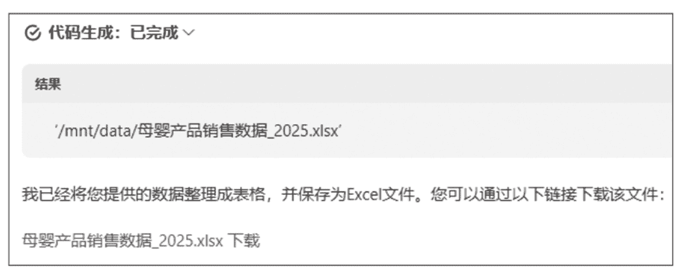
图 3-1
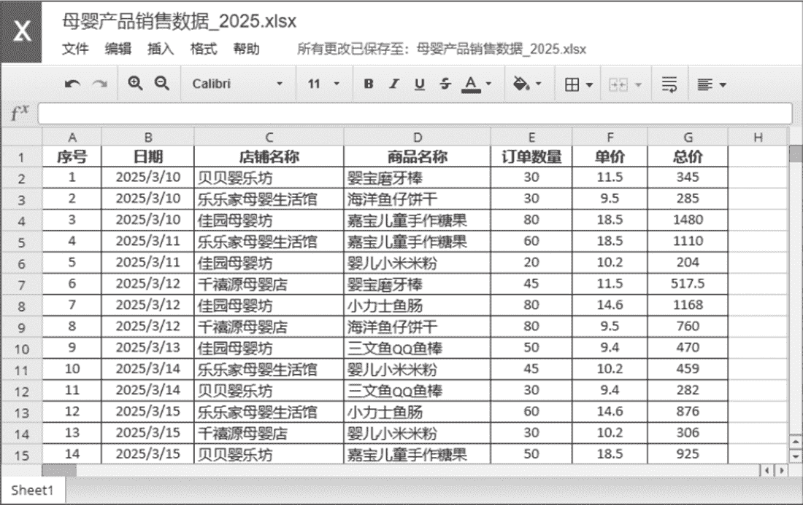
图 3-2

【场景 2】智能数据分析
生成式AI可结合 Excel 实现筛选、分类、统计等智能分析，提升效率与准确性。
延续前面的对话，继续输入提示词：按“店铺名称”进行分类，对“总价”进行汇总。
内容生成如图 3-3 所示。
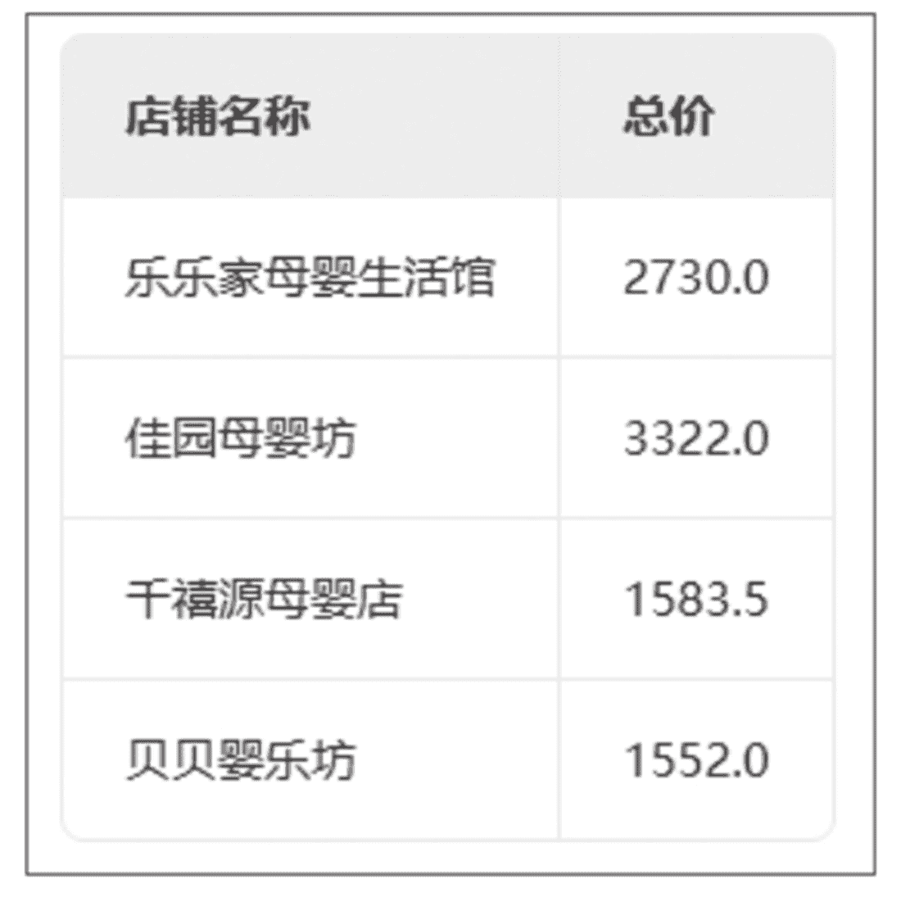
图 3-3

【场景 3】图表生成
生成式AI能根据数据自动生成图表，帮助用户直观理解数据，节省时间并提升专业度。
输入提示词：
店铺　目标　实际销量
1 号店　74　80
2 号店　56　60
3 号店　55　60
4 号店　111　100
5 号店　45　40
6 号店　66　50
为以上数据生成图表，内容生成如图 3-4 所示。
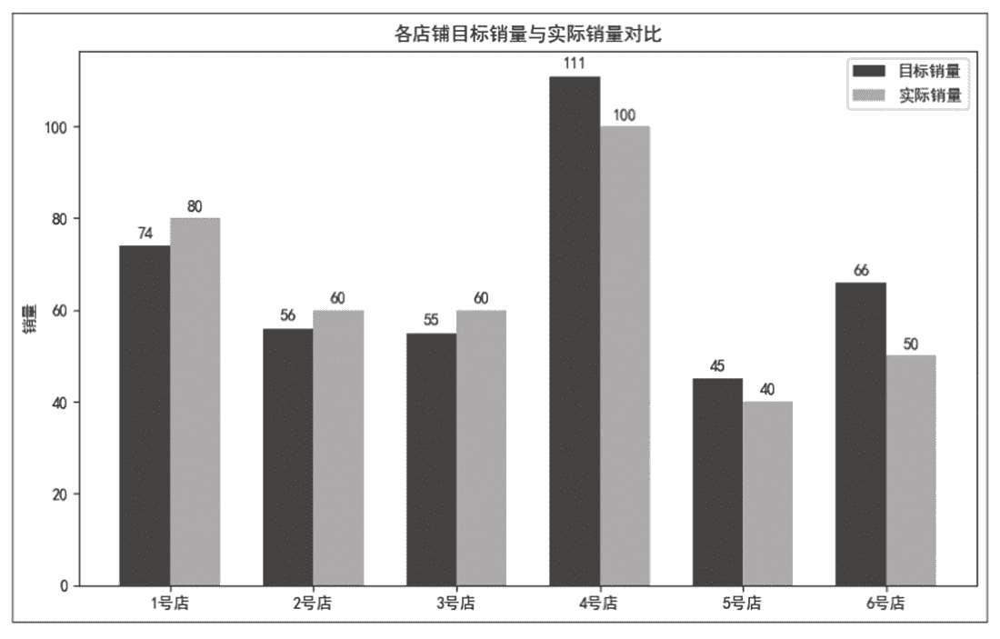
图 3-4

3.1.3 智能 PPT 演示文稿
伴随深度学习与自然语言处理进步，生成式AI不仅能生成自然流畅文本，还可自动产出图像视频，为 PPT 创作提供丰富视觉素材。

【场景 1】生成幼儿园主题活动 PPT
输入提示词：请以《小小探险家：自然奇妙之旅》为主题，生成一份关于培养幼儿探险精神的 PPT 文档。
内容生成效果如图 3-5 所示（节选）。
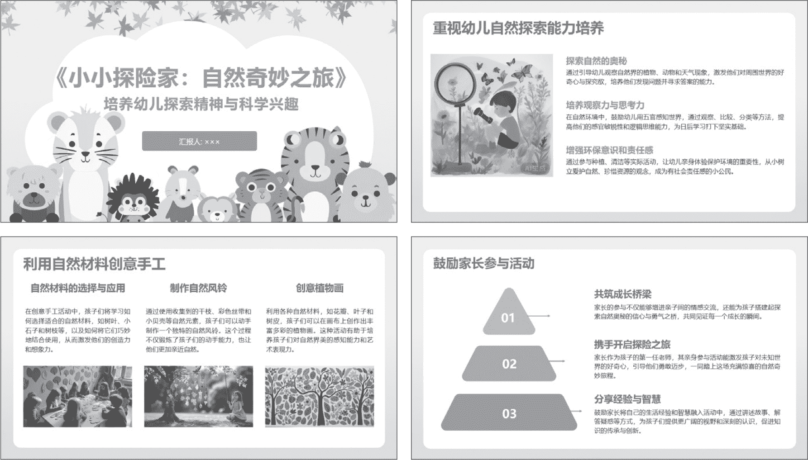
图 3-5

【场景 2】生成行业分析报告 PPT
输入提示词：请根据提供的大纲内容，生成一份关于无人驾驶汽车行业报告的 PPT 文档。
内容生成效果如图 3-6 所示（节选）。
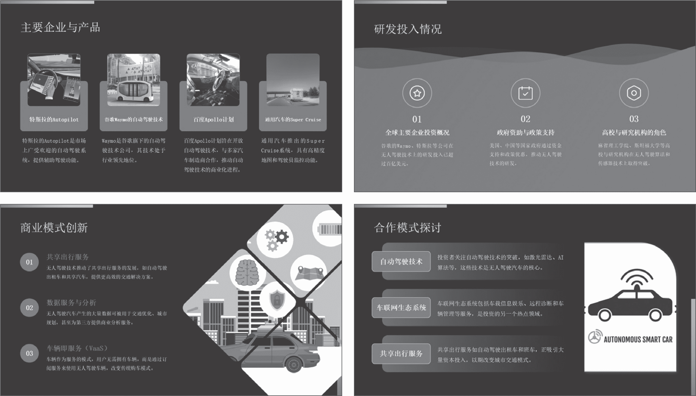
图 3-6

【场景 3】营销策划方案 PPT
输入提示词：生成图书营销策划方案。
生成的 PPT 部分页面效果如图 3-7 所示。
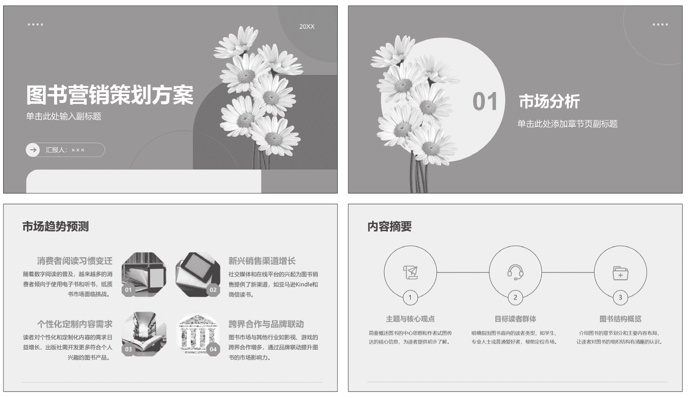
图 3-7

3.2 生成式AI为文案创作注入新动能
生成式AI在文案创作中表现突出，可快速产出大量素材，满足多元主题需求，并通过学习与算法把握市场趋势和用户偏好，输出个性化高质量内容。

3.2.1 生成式AI文案创作要点
使用生成式AI撰写文案时，提示设计需注意明确具体性、背景信息提供、分隔符与结构化表达、开放式与引导式提示结合、输出要求指定以及避免引导性假设等要点。

1. 明确性与具体性
提示应尽量明确具体，避免宽泛模糊。清晰的需求描述有助于模型精准理解意图并产出符合预期的结果。
例如，提示“写一篇关于旅游的文案”过于宽泛。可改为“写一篇面向年轻情侣的泰国普吉岛旅游推广文案，突出海滩风光与浪漫氛围”。

2. 提供背景信息
上下文对理解至关重要。提示应提供足够背景，帮助模型理解撰写场景、目标受众、市场定位等。
若文案用于社交媒体推广，可输入提示词：
请撰写一篇适合在微博上发布的关于新产品的推广文案，目标受众为年轻女性，要求突出产品的时尚元素和性价比。

**3．借助分界符号与结构化表达提升指令清晰度**

面对复杂任务时，用引号、括号、小标题等符号把输入拆成若干区块，能让任务各部分的边界更清楚，也减少理解上的歧义。结构化的写法同样有助于大模型更准确地把握需求。

例如：**请为一款新品撰写介绍文案，按下面要点展开：**

**（1）产品总览，简要说明核心功能与主要特性。**

**（2）差异化优势，重点对照竞品凸显自身价值。**

**（3）典型场景，列举几类常见使用情境体现实际效果。**

**（4）购买信息，附上购买链接、价格区间及优惠活动。**

**4．开放式提问配合适度引导**

鼓励模型进行细致分析与创作，而不是只给出简单的肯定或否定。同时可以提供适度的引导信息。

例如：**请先梳理市场上同类产品的文案特点，结合我们产品的定位，撰写一篇具备差异化竞争力的推广稿。可从功能、设计、用户体验等角度切入，突出核心优势。**

**5．提前约定输出规格**

在提示中主动限定篇幅、格式与语调，生成结果会更贴合预期。

例如：**请输出约500字的产品介绍，语言简洁易懂，风格轻松活泼，适合吸引年轻用户。**

**6．规避倾向性提问与主观预设**

提示词应避免带有倾向性的信息或未经证实的假设，以保证输出更客观。

例如：**你认为我们的产品比竞品更好吗？请写篇推广稿来论证。**

这种问法带有引导，容易得到片面内容。可改为：

**请中立地对比我方产品与竞品的异同与长处，并在此基础上撰写客观公正的推广文案。**

**3.2.2 根据主题自动生成文案**

依托强大的自然语言理解能力，AIGC 能快速产出条理清晰、信息充实的文章，并可按个性化需求调整，提供多种文体与格式选择。内置的自动校对与优化机制保障了质量，在多场景下均可应用。当前表现突出的工具主要有 ChatGPT、文心一言、讯飞星火、智谱清言等。

下面以“讯飞星火”生成品牌故事为例。

**步骤01 进入官网开启对话。** 访问“讯飞星火”官网，在首页点按“开始对话”按钮，如图3-8所示。

图3-8

**步骤02 提交提示词。** 进入对话界面后，在输入框里填入指令，随后点击“发送”按钮 ，如图3-9所示。等待片刻，系统即可生成品牌故事文案。

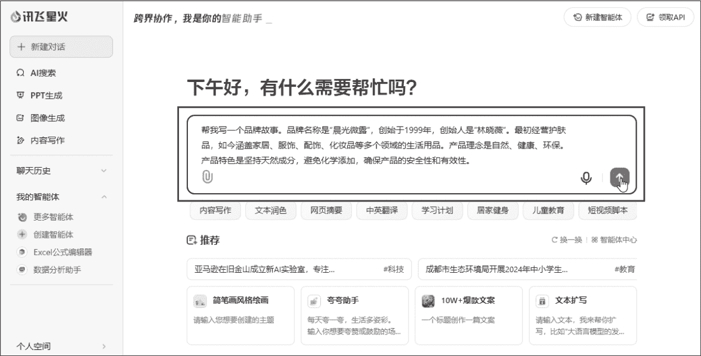

图3-9

本例提示词为：**请创作一个品牌故事。品牌名“晨光微露”，创立于1999年，创始人林晓薇。起初专注护肤，后扩展至家居、服饰、配饰、化妆品等生活品类。品牌主张自然、健康、环保，坚持天然原料，拒绝化学添加，确保安全有效。**

生成内容如下。

**标题：晨光微露——自然之光，生活之选**

**第一章 晨曦的启示**

1999年春，第一缕阳光穿过薄雾拂过林晓薇面颊，她感受到久违的清新与活力。那一刻，她仿佛听见大自然在低语，谈论纯净与和谐。对生活品质有极致追求的她，决心把这份晨间感悟付诸实践。

她创立了“晨光微露”，以自然、健康、环保为核心理念。当时行业普遍使用化学成分，林晓薇坚持选用天然原料，拒绝一切化学添加，相信只有最纯净的原料才能带来真实之美。

品牌诞生并不顺利，林晓薇遭遇诸多质疑与挑战。凭借对美好生活的执着与持续努力，她逐步赢得消费者信任。晨光微露的第一瓶面霜正是在这种信念下诞生，它滋养肌肤，也抚慰心灵。

时光流转，晨光微露成为家喻户晓的名字，它不仅是一个品牌，更是一种生活态度的象征。林晓薇明白，这只是起点，她的人生旅程如清晨第一缕阳光，温暖而充满希望。

**第二章 绿意盎然的征程**

品牌站稳脚跟后，林晓薇开始思考如何把纯净理念延伸到更多生活领域……

**第三章 风雨兼程的成长**

随着品牌持续壮大，林晓薇面临的考验愈发严峻。市场竞争激烈，部分对手甚至采取不正当手段阻碍发展……

**第四章 绽放的晨光**

经风雨砥砺后，晨光微露如破晓之花迎来绽放。林晓薇携团队不断创新，推出系列新品……

林晓薇站在办公室眺望远方，心潮起伏。她明白一切成绩得益于团队努力与用户信任。晨光微露的故事仍在继续，她正引领品牌迈向更辉煌的明天。

**3.2.3 文案的续写与润色**

自然语言处理技术可基于用户提供的初稿或主题进行延伸拓展。续写功能适用于小说创作、影视解说、新闻撰写等场景，能在已有情节上提供新视角与新分支，帮助创作者突破瓶颈。

**1．文案续写**

下面以“讯飞星火”演示续写。在对话模式下上传文档并输入“续写内容”，随后发送，如图3-10所示。

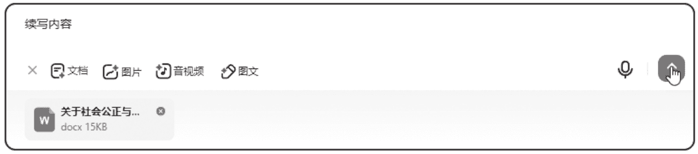

图3-10

原文开头如下。

**在这个纷繁的社会舞台上，每个细微波动都承载着无数个体的命运与梦想。而当前最具共鸣、引发广泛讨论的话题之一，“社会公正与贫富差距”，无疑占据重要位置。这不仅是经济学概念，更深植于日常生活，触及每个人的不平等现实。**

**当我们看见因资源分配不均而挣扎于生计边缘的人们，听到因教育机会受限而难以翻身的孩子们的呼声，感受到因社会地位差异而遭受歧视排斥群体的无助与愤怒时，我们不得不承认：社会公正与贫富差距，已不再是遥远的抽象概念，而是每个人都需面对并解决的紧迫议题。**

**接下来，我将从多个角度剖析这一现象，探讨其根源、影响及可能的解决路径。让我们共同深入这个充满挑战与希望的话题，用理性的光芒照亮前路，追寻更加公正平等的社会理想。**

续写内容生成如下。

探讨社会公正与贫富差距时，需深入其根源。经济全球化、技术演进与政策取向共同作用，导致资源分配失衡。一方面，全球化带来前所未有的经济增长与财富积累，却也加剧了国家与地区间的贫富分化；另一方面，技术进步虽提升生产效率，却因技能门槛排斥部分人群，使其难以分享发展红利。

这种不平等不仅体现在经济层面，更深刻影响社会结构与心态。贫富差距扩大可能导致阶层固化，低收入群体难以靠教育与社会流动改变命运，这不仅扼杀个人梦想，也削弱社会活力与创新力。

应对挑战需采取多维策略。首先，政府应发挥主导作用，通过公平税收、社会保障与公共服务、反贫困计划等保障基本需求与机会平等。其次，教育是打破阶层固化的关键，应确保人人享有优质教育资源，尤其关照弱势群体。再者，促进就业市场公平竞争，打击腐败与权力寻租，也是维护社会公正的必要举措。

同时，社会各界也应积极参与。企业可通过创造就业、实施包容性增长战略贡献力量。非政府组织与民间团体可监督政策、为边缘群体发声，推动社会公正。

最终，实现社会公正与缩小贫富差距是长期艰巨任务，需政府、企业与公民共同努力。通过持续改革与创新，可逐步构建更公平、更具包容性的社会，让每个人都有机会追求梦想，共同创造更美好未来。

**2．文本润色**

“讯飞星火”提供内容协作、文本润色、网页摘要、中英互译等提问模型，用户可从模板中挑选提示词。

**步骤01 执行“文本润色”命令。** 在输入框中粘贴内容，点击旁边的“文本润色”按钮，如图3-11所示。

**步骤02 设置润色要求。** 在展开菜单中选择所需的内容类型、风格与修辞手法，点击“发送”按钮 ，如图3-12所示。

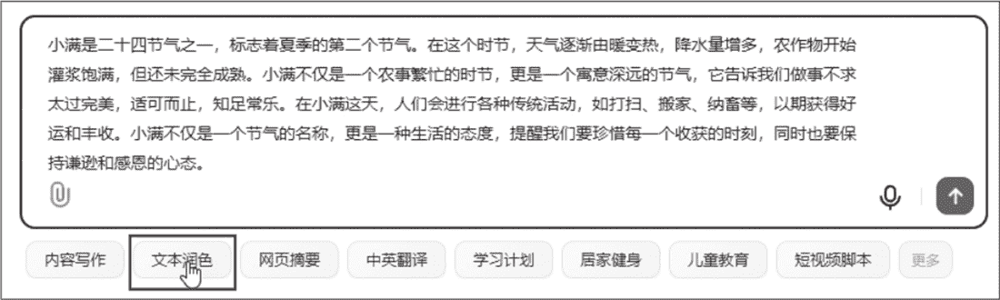

图3-11

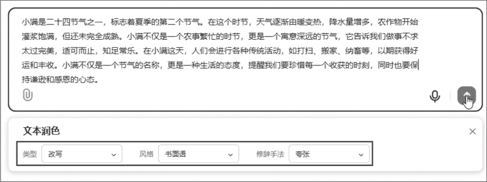

图3-12

**步骤03 完成文本润色。** 系统会根据所选项目自动生成提问词并返回润色结果，如图3-13所示。

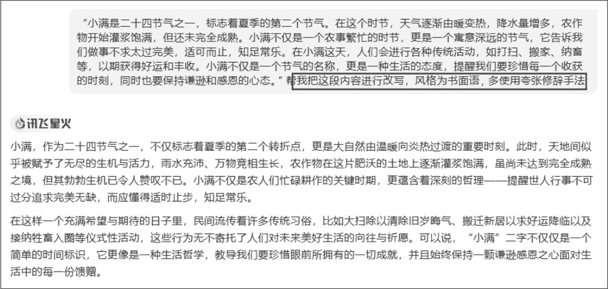

图3-13

**3.2.4 讯飞星火文档翻译**

“讯飞星火”的“中英翻译”功能依托语言处理能力，实现中文与英文的高效准确互译，适用于日常交流、商务沟通、学术往来等场景。

打开“讯飞星火”官网，将待译英文复制到输入框，点击“中英翻译”按钮，设定“目标语言”为“简体中文”，再提交内容。系统随即返回译文，如图3-14所示。

图3-14

**3.2.5 文档阅读掌握核心要点**

通过 WPS AI 的“文档阅读”功能，可快速提取长文档的核心信息，显著提升处理效率。下面对产品渠道开发策略方案进行提炼。

**步骤01 执行“文档阅读”命令。** 在 WPS Office 中打开文档，点击功能区 WPS AI 按钮打开侧栏，再点击“文档阅读”按钮，如图3-15所示。

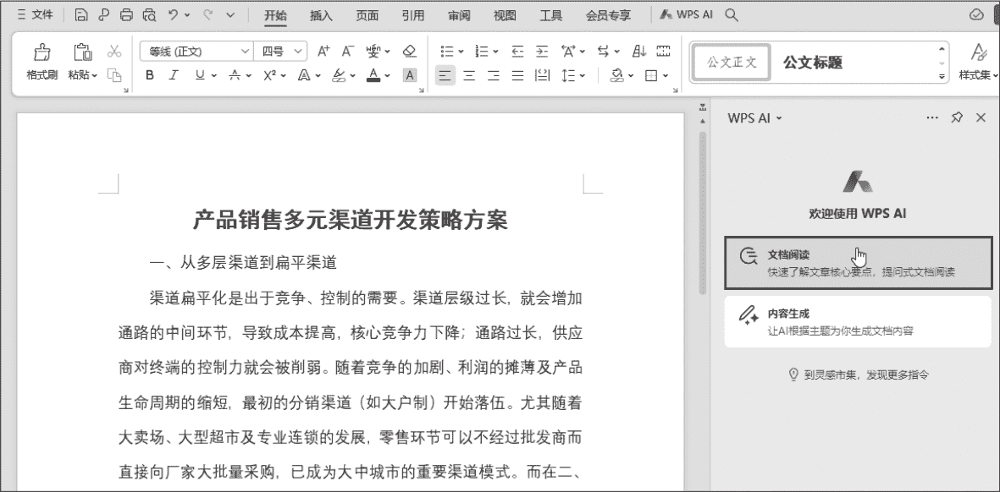

图3-15

**步骤02 选择系统推荐问题。** 进入“文档阅读”界面，点击“总结文档内容”按钮，系统即对文档进行概括并给出回复，如图3-16所示。

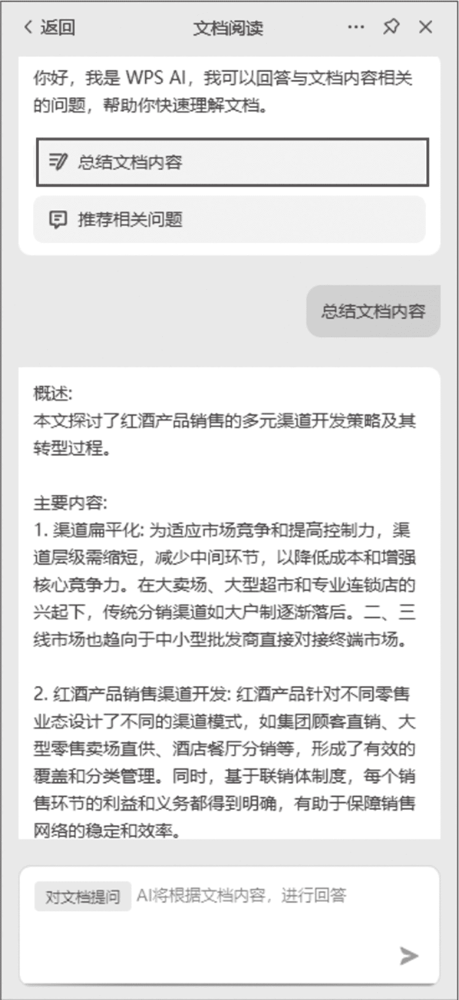

图3-16

**步骤03 连续提问。** 用户可在输入框中继续输入问题并发送，对文档进行深入追问，如图3-17所示。

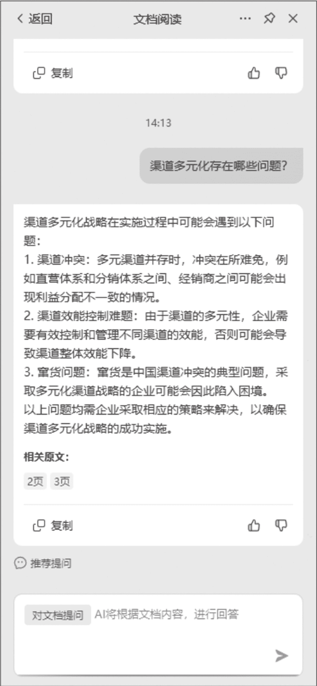

图3-17

**动手练习 使用“文心一言”撰写故事大纲**

下面用“文心一言”撰写一部科幻类型的小说大纲。打开“文心一言”官网，在对话模式下输入以下提示词。

**我想写一部科幻小说，主要讲述500年后地球资源枯竭，人类前往太空寻找宜居星球，主角是11人小队。请提供一个故事大纲。**

生成内容如下。

**科幻小说故事大纲：《星际迁徙：希望之舟》**

**背景设定：**

时间：公元2525年，地球资源濒临枯竭，环境恶化不可逆，人类面临生存危机。

科技水平：人类科技飞跃，掌握超光速航行、生态穹顶、基因优化与人工智能融合等先进技术。

社会结构：地球政府联合成立“星际探索联盟”，旨在寻找并殖民外星世界以延续文明。

**主要人物：**

小队共11人。

（1）队长杰克：前宇航员，经验丰富，冷静果断，是团队核心。

（2）首席科学家莉娅：生态学家兼物理学家，负责评估目标星球环境适应性。

（3）工程师汤姆：机械与电子工程专家，负责飞船维护与航行技术。

（4）医生艾米：医疗与生物专家，擅长急救与基因疗法。

（5）历史学家萨姆：记录人类文明，研究外星文化，确保文化传承。

（6）安全官凯尔：前特种兵，负责安全，精通自卫与战术规划。

（7）通讯官玛丽：信息技术专家，负责对外联络及星际网络构建。

（8）心理顾问露西：心理学家，维护队员心理健康，缓解长期太空旅行的孤独与压力。

（9）生态工程师哈里：设计并建设可持续生态系统，改造新环境。

（10）儿童教育专家索菲亚：负责教育小队中唯一儿童，设计外星环境下的教育体系。

（11）机械助手阿尔法：高度智能AI，辅助任务，具备自学与决策能力。

**故事大纲：**

第一阶段：启程与挑战

起因：地球政府选定银河系边缘类地行星“诺瓦提斯”作为首选移民目标。小队乘坐先进星际飞船“希望号”启航。

旅途考验：途经小行星带、未知能量场等自然障碍，考验飞船性能与团队协作。阿尔法多次提出关键解决方案，成为不可或缺伙伴。

内部冲突：长期封闭导致情绪波动与信任危机，露西通过心理干预与团队建设化解矛盾。

第二阶段：诺瓦提斯的探索与适应

初次接触：抵达后发现星球表面存在未知生物迹象，莉娅带队进行初步生态评估。

生态穹顶建设：基于环境数据，哈里设计并建造首个生态穹顶，作为临时栖息地。

生物交流与冲突：小队遭遇诺瓦提斯原住民智慧生物，初因误解冲突，后经萨姆文化交流与艾米生物识别技术，双方逐步建立和平共处基础。

第三阶段：文明重建与融合

资源开发与利用：汤姆与哈里合作，利用星球特有资源开发新型能源与建筑材料，为长期生存奠基。

社会结构构建：杰克带领团队讨论制定新世界社会规则，强调公平、可持续发展与原住民和谐共存。

教育与传承：索菲亚启动外星环境教育体系，结合地球文明与诺瓦提斯文化，培养跨文化交流的下一代。

第四阶段：希望之光

科技突破：莉娅团队在诺瓦提斯发现新元素，推动人类科技再次飞跃，为星际旅行与生态改造提供可能。

和平协议：小队与原住民签订和平协议，共同保护星球生态，开启两文明共同发展新篇章。

回归与展望：诺瓦提斯成为人类第二家园，部分队员选择留下，部分返回地球分享经验，激励更多人类探索宇宙寻找生命奇迹。

**结语：**

《星际迁徙：希望之舟》不仅是生存与挑战的科幻冒险，更是对人类勇气、智慧、团结与希望的礼赞。在宇宙舞台上，人类以渺小之躯书写不朽篇章。

**3.3 AIGC 数据处理新时代**

当前主流AIGC工具具备数据处理与分析能力，可高效处理海量数据、自动识别并修正异常值，并快速生成可视化图表与报告。该技术不仅提升分析效率，也让非技术用户能便捷进行数据分析。

**3.3.1 AIGC 制作表格**

“智谱清言”的数据分析功能在自然语言理解、数据处理、分析方法、代码生成与执行、定制扩展及实时反馈优化等方面表现突出。下面通过其“数据分析”功能制作表格。

**步骤01 发送内容。** 打开“智谱清言”官网，选择“数据分析”智能体，将待制表数据复制到输入框，并输入“制作成表格，计算销售金额”，随后发送，如图3-18所示。

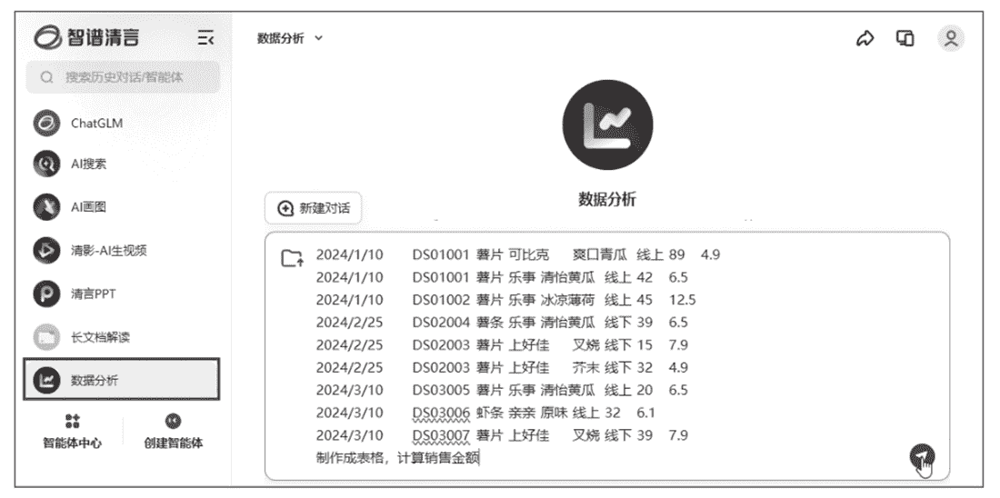

图3-18

**步骤02 返回分析结果。** 系统自动生成代码并将数据整理为表格，如图3-19所示。

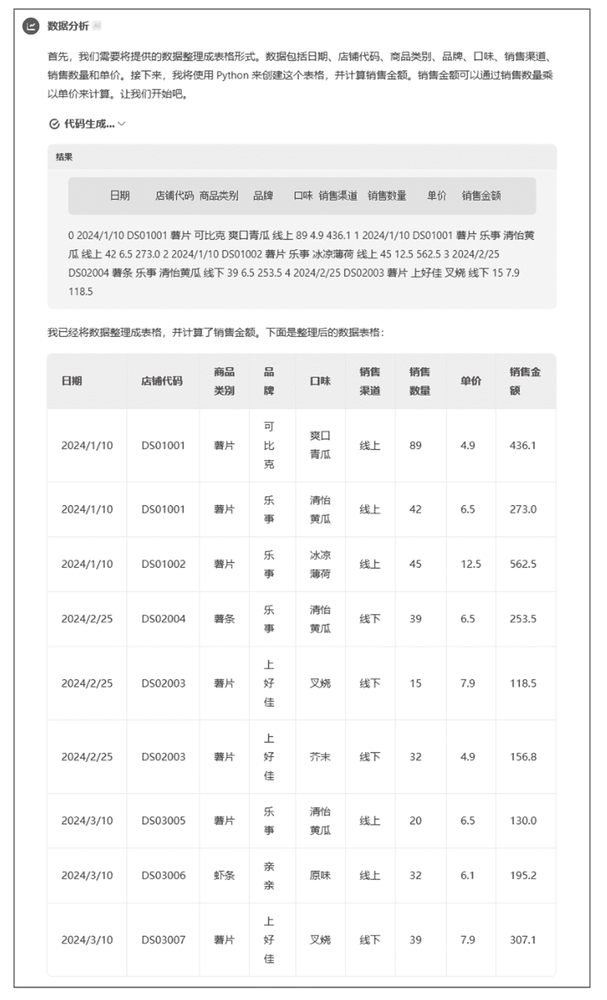

图3-19

**步骤03 生成下载链接。** 如需获取电子表格，可继续发送“请生成表格的下载链接”。系统随即提供下载链接，点击即可下载，如图3-20所示。

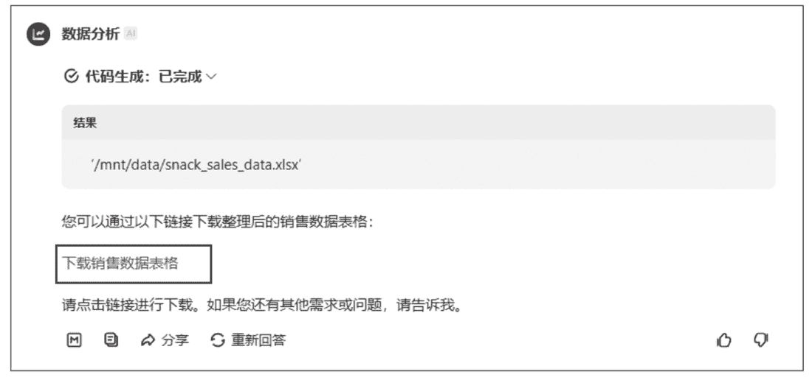

图3-20

**3.3.2 分析 Excel 表格数据**

“智谱清言”不仅支持Excel文件上传，还能对上传文件进行深入数据分析并给出结果。下面以水果销售数据为例说明。

打开“智谱清言”官网，选择“数据分析”智能体。在输入框中导入“水果销售数据”Excel工作簿，并输入具体分析要求，最后发送，如图3-21所示。

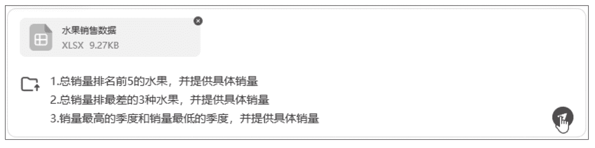

图3-21

返回的数据分析结果如下。

（1）总销量排名前5的水果及销量：

草莓：972

香蕉：938

桃子：937

橙子：881

葡萄：808

（2）总销量排名最差的3种水果及销量：

芒果：480

苹果：544

火龙果：573

（3）销量最高季度为第3季度，销量4399。销量最低季度为第1季度，销量1902。

**3.3.3 大数据抓取**

用户可利用“智谱清言”的深度数据挖掘能力，从海量数据中提取有价值信息与洞见。数据挖掘可遵循以下步骤与策略。

**· 确定问题域：** 明确数据挖掘领域、主题或具体问题，如市场分析、用户行为、产品优化等。

**· 设定目标：** 具体设定挖掘目标，如识别潜在趋势、预测未来表现、发现用户偏好等。

例如，用户希望深入了解2025年汽车制造行业整体情况。为获取准确全面的大数据支持，可向“智谱清言”提问。

**请帮我整理2025年汽车行业数据，需整理项目如下。**

**（1）国内外汽车市场整体销量数据，包括国内销量、出口销量及同比增长率。**

**（2）汽车市场细分情况，包括轿车、SUV、MPV、新能源汽车等车型销量占比及增长率。**

**（3）新能源汽车的销量、渗透率及同比增长率，涵盖纯电动与插电式混合动力。**

**（4）汽车制造行业整体利润率、成本结构及主要成本项占比。**

**（5）分析2025年汽车制造行业市场竞争格局，包括主要品牌市场份额、销量排名及增长情况。**

生成内容如下。

**2025车市快览：量稳步抬升，结构加速换挡**

**1. 规模与出海**
2025年国内乘用车市场总盘子预计在3100万辆左右，同比微增约3%。海外扩张持续推进，2024年9月中国车企合计占据全球市场约36%的份额。

**2. 细分走势**
新能源赛道拉动最强。2023年新能源车销售830.4万辆，同比增长36.7%；2024年提升至1150万辆，同比增长20%。电动化与智能化已成为产品竞争的主线。

**3. 渗透节奏**
受新能源放量牵引，整体结构持续上移，2025年渗透率有望进一步抬高。

**4. 盈利与成本**
行业收入面仍在扩张，但激烈竞争挤压利润。2025年已有品牌因盈利承压而退出中国市场。

**5. 竞争版图**
自主阵营在技术迭代与智能化落地方面进步明显，市场份额与品牌认知同步增强。国际品牌与自主新势力之间产品吸引力的差距快速缩小，竞争已进入白热化阶段。

### 3.3.4 生成可视化图表

智谱清言在完成数据解读的同时，还能按需输出饼图、柱状图等可视化图形，让结论更直观。

沿用3.3.2节的对话，输入以下提示词：

**为各季度水果总销量生成一张饼图。**

生成结果如图3-22所示。

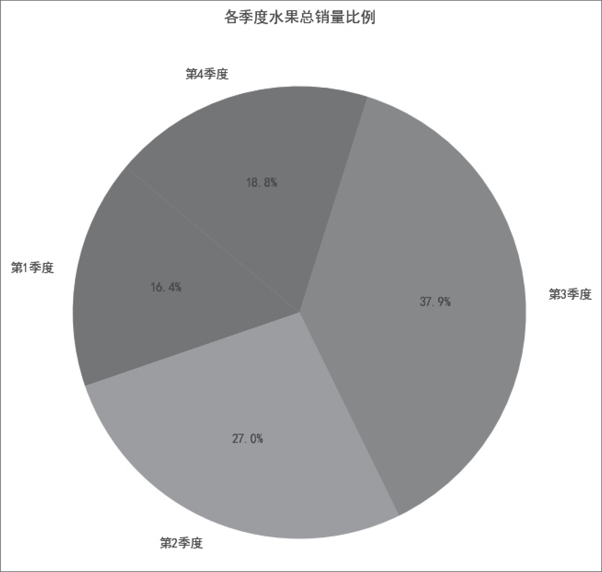

图3-22

### 3.3.5 WPS AI数据计算与分析

WPS AI依托智能算法与机器学习，为办公提供自动化助手。自动生成文本、智能编写公式、数据分析等能力都能提升效率。

**1．智能公式助手**
通过“AI写公式”指令，可依据自然语言描述快速得到准确公式并附带说明。以下以表格中的“出生日期”计算周岁年龄为例。

步骤01 启动指令。打开WPS表格，选中目标单元格输入等号后，单元格侧会弹出控件，点击进入交互，如图3-23所示。

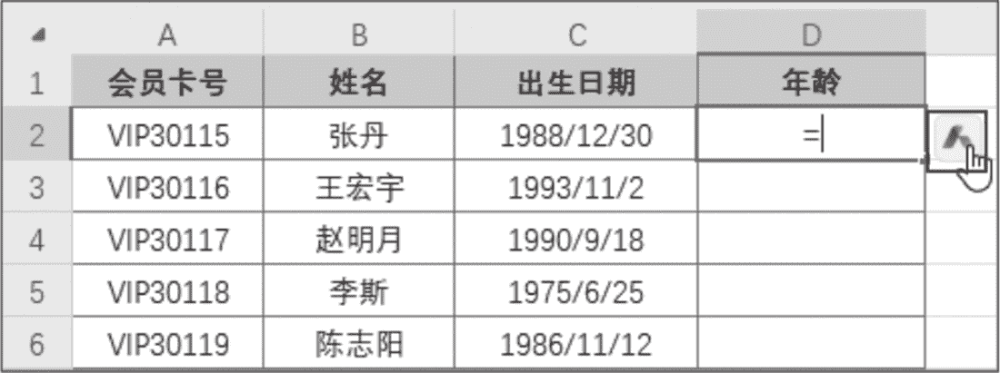

图3-23

步骤02 输入描述。随后出现浮层窗口，在输入框内填写“C列为出生日期，计算周岁年龄”，点击，如图3-24所示。

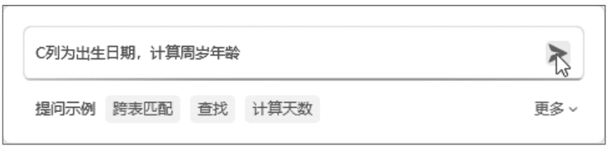

图3-24

步骤03 获取结果。浮层会自动给出公式，点击“对公式的解释”可查看公式含义、函数说明与参数说明；确认后点“完成”完成录入，如图3-25所示。

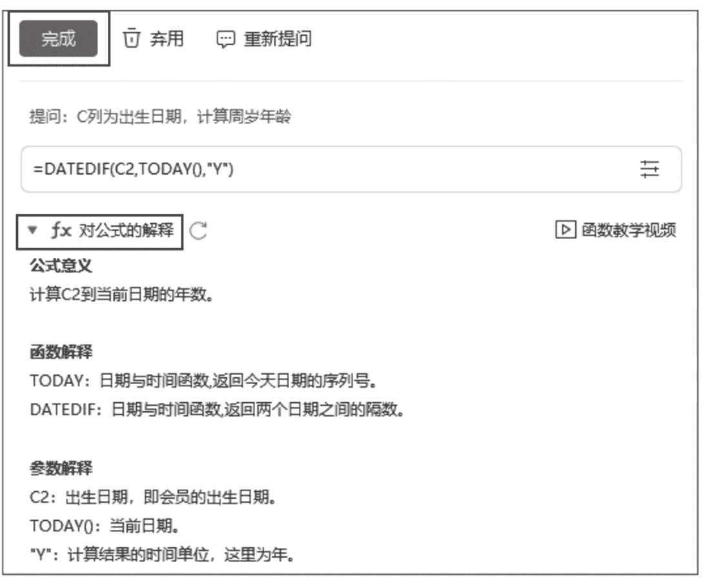

图3-25

步骤04 向下填充。最后可对公式进行填充，批量得出其他出生日期对应的年龄，如图3-26所示。

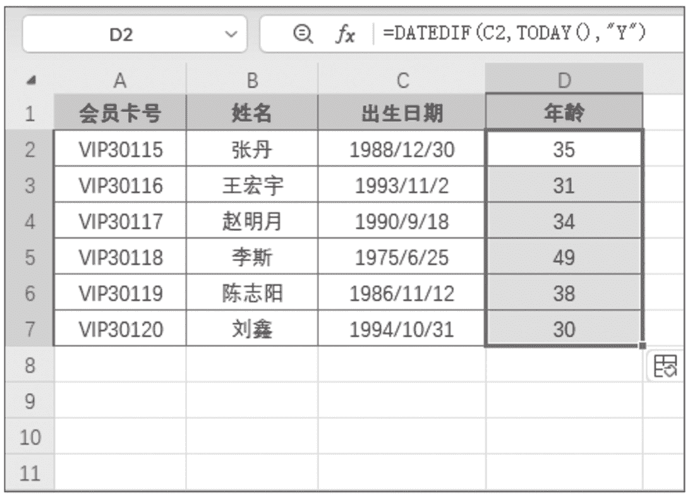

图3-26

**2．自动突出关键数据**
“AI条件格式”能对表格数据自动做格式处理，提升可读性。示例为“突出库存数量最低的3个单元格”。

步骤01 调用指令。打开WPS表格，功能区点WPS AI打开侧边栏，再点“AI条件格式”，如图3-27所示。

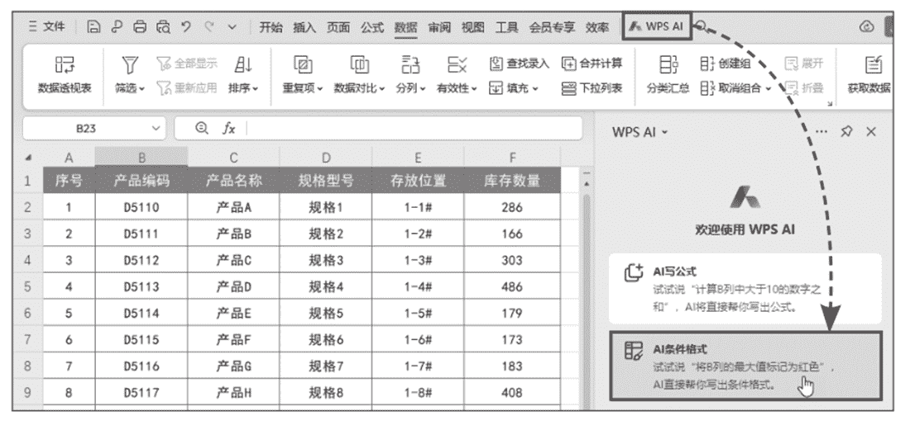

图3-27

步骤02 输入描述。表格内弹出“AI条件格式”窗口，在文本框描述需求后点发送，如图3-28所示。

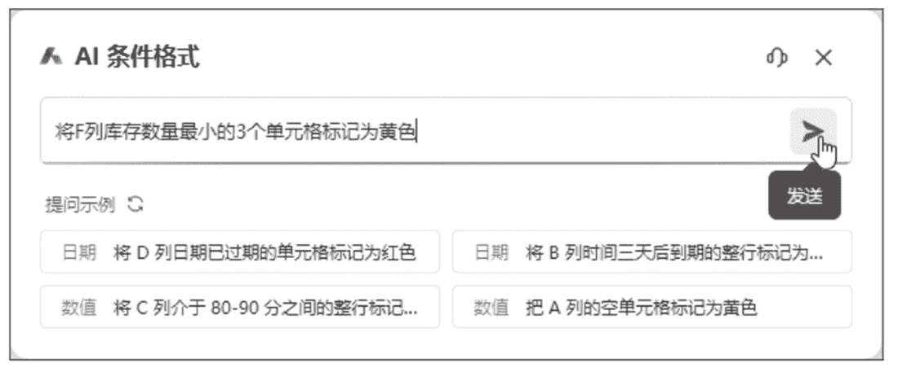

图3-28

步骤03 确认规则。工具会分析数据并在窗口显示引用区域及格式规则，可按需修改默认样式后点“完成”，如图3-29所示。

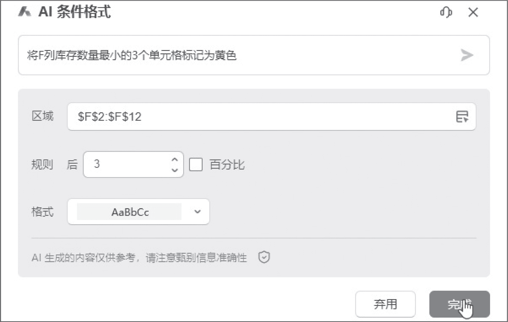

图3-29

步骤04 应用效果。符合条件的数据单元格会即时被填成黄色，如图3-30所示。

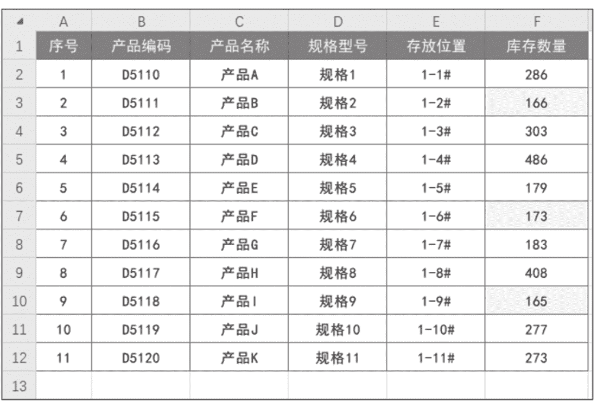

图3-30

**扫码看彩图**

**动手练习 提问式生成公式**
以下使用智谱清言“数据分析”智能体生成公式。案例原始数据如图3-31所示。

步骤01 导入并提问。打开智谱清言官网，选择“数据分析”智能体，先导入Excel文件，随后输入公式生成要求，如图3-32所示。

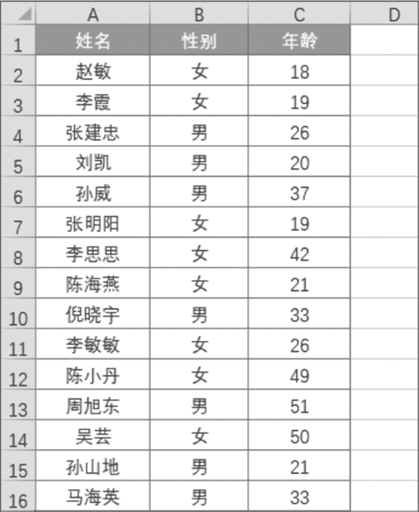

图3-31

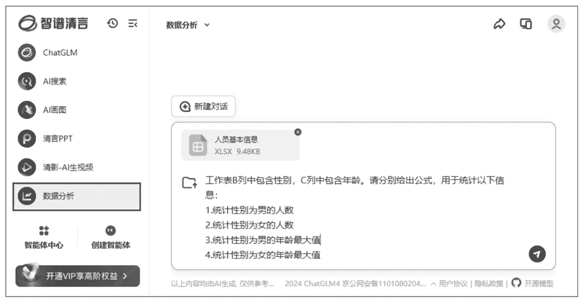

图3-32

步骤02 返回结果。发送后系统会给出多条匹配公式，每条下方均有详细释义，如图3-33所示。

步骤03 应用到表格。将公式复制到Excel即可得到计算结果，如图3-34所示。

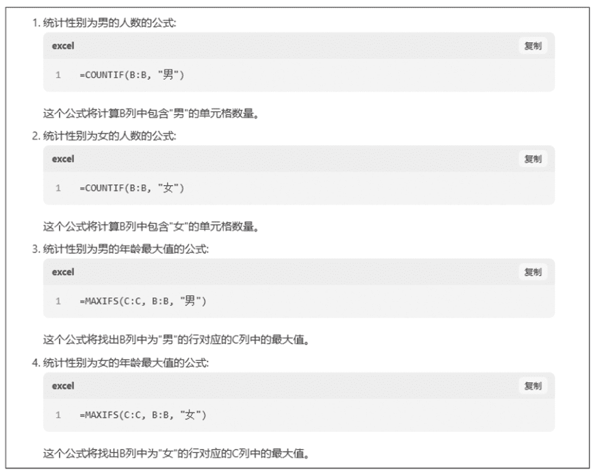

图3-33

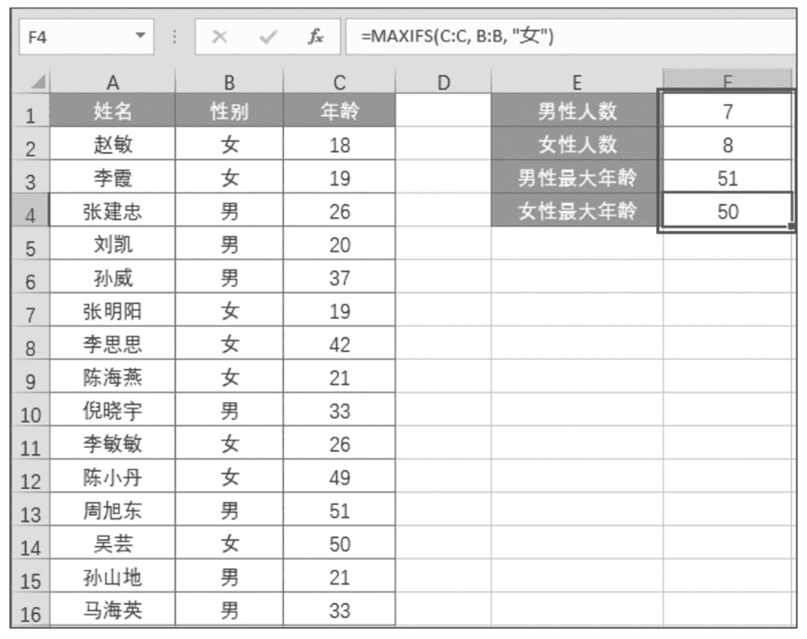

图3-34

### 3.4 AIGC革新PPT制作
AIGC工具可依据主题或关键词自动生成PPT大纲与适配模板，支持文档导入与智能转换，能将长文快速转为结构化演示并自动配图，保证相关性与版权安全。

#### 3.4.1 主题驱动生成PPT大纲
内容生成类工具能根据用户提供的主题自动生成演示稿，版式、图表、图片等元素均可自动填充，大幅降低制作成本。下面以讯飞星火为例。

步骤01 选模板输主题。打开讯飞星火官网，左侧导航选“PPT生成”，进入对话模式，输入主题并在“PPT模板”区挑选模板，随后输入提示词，如图3-35所示。

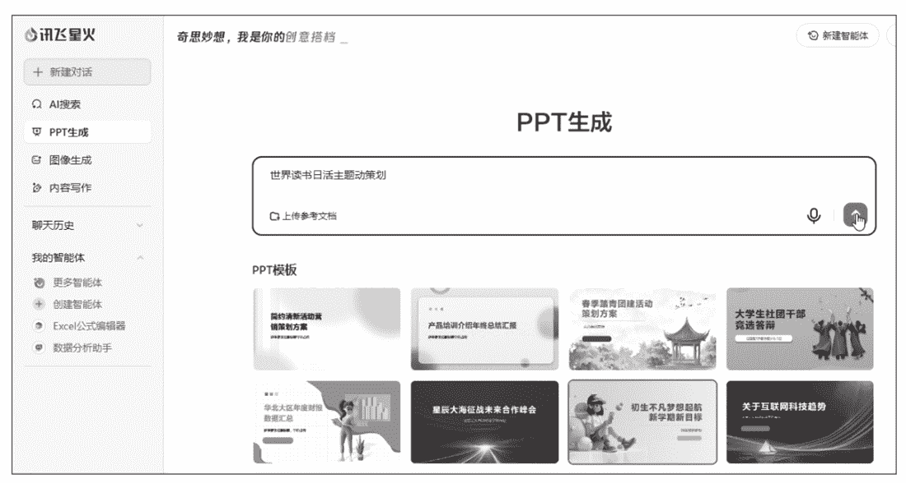

图3-35

步骤02 生成大纲。系统自动生成大纲，内容如下。

**主标题：世界读书日活动策划**

**副标题：让阅读成为习惯，让知识改变未来**

活动背景与意义

· 世界读书日起源与发展

· 读书日的重要性

· 活动目标与预期效果

活动主题设定

· 主题名称及创意来源

· 主题与读书日契合点

· 主题文化内涵与价值导向

活动内容安排

· 开幕式与主题演讲

· 阅读推广活动

· 读者互动环节

宣传与推广策略

· 多渠道宣传方案

· 社交媒体运营与互动

· 合作伙伴及赞助商邀请

活动资源与预算

· 场地与设施安排

· 嘉宾与讲师邀请费用

· 宣传与物料制作成本

活动评估与反馈

· 活动效果评估方法

· 参与者反馈收集方式

· 总结经验与改进方向

步骤03 生成演示。点击大纲下方“一键生成PPT”即可得到网页版演示稿，可通过右侧窗格编辑，最后点右上角“下载”导出，如图3-36所示。

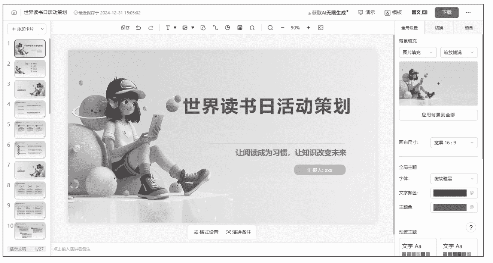

图3-36

#### 3.4.2 WPS AI一键生成幻灯片
WPS AI支持一键生成演示文稿。输入主题或上传文档即可自动产出含大纲与完整内容的PPT，大幅提升效率与质量。

步骤01 启动智能创作。启动WPS Office，首页点“新建”，选“演示”，在“新建演示文稿”页点“智能创作”按钮，如图3-37所示。

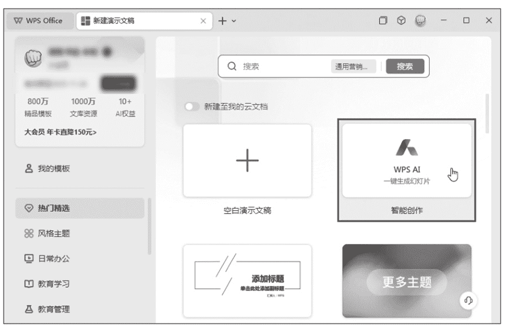

图3-37

步骤02 输入主题。系统新建演示文稿并弹出WPS AI窗口，输入主题“火灾逃生指南”，点“生成大纲”按钮，如图3-38所示。

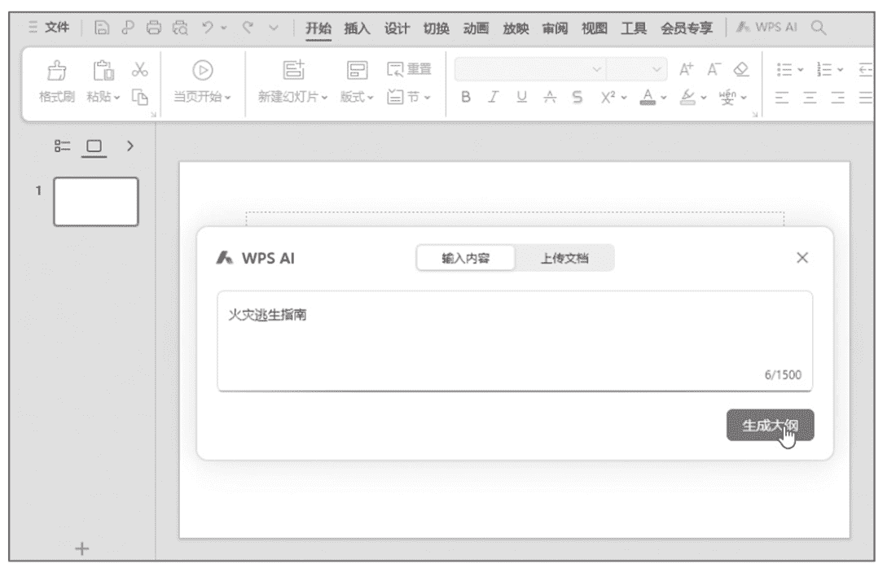

图3-38

步骤03 生成大纲。WPS AI自动生成大纲，可通过窗口右上角的“收起正文”/“展开正文”查看详情结构，确认后点“生成幻灯片”按钮。

步骤04 选模板创建。随后弹出大量幻灯片模板，在右侧挑选合适模板，点“创建幻灯片”按钮，如图3-41所示。

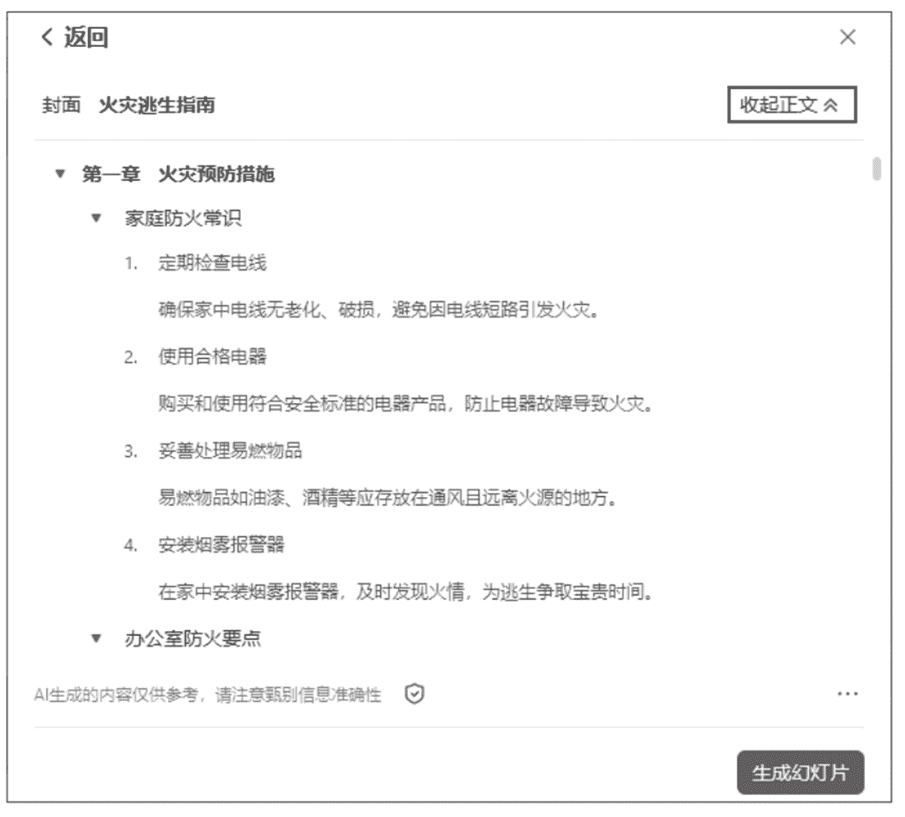

图3-39

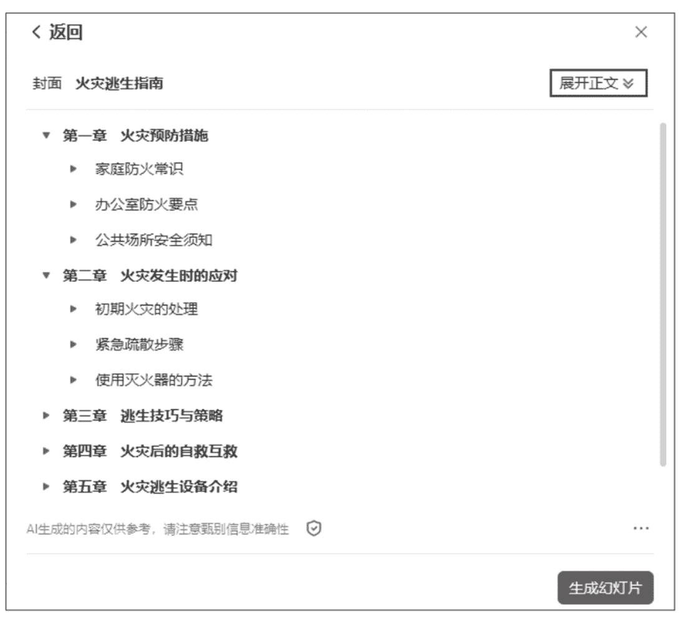

图3-40

步骤05 生成演示。WPS AI依据模板与大纲自动生成完整演示文稿，如图3-42所示。

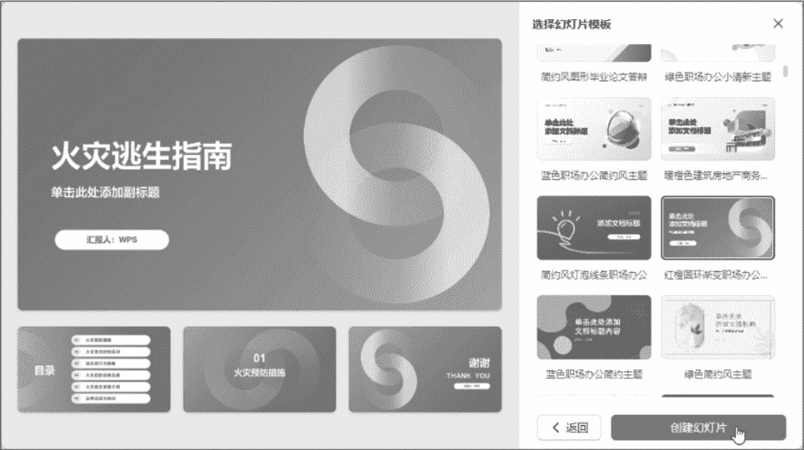

图3-41

图3-42

步骤06 预览页面。浏览可见，WPS AI不仅自动排版美化，还会依据文字自动匹配配图，如图3-43所示。

图3-43

**动手练习 自动生成教学课件**
下面用WPS AI自动生成教学课件PPT。

步骤01 输入主题。打开任意WPS演示文稿，功能区点WPS AI按钮打开侧边栏，输入“《荷塘月色》教学课件”提示词，点“生成大纲”按钮，如图3-44所示。

图3-44

步骤02 生成大纲。系统生成对应主题的PPT大纲，点“生成幻灯片”按钮，如图3-45所示。

图3-45

步骤03 选择模板创建。挑选合适的幻灯片模板，点“创建幻灯片”按钮，如图3-46所示。

图3-46

步骤04 生成演示。WPS AI自动生成《荷塘月色》教学课件，如图3-47所示。

图3-47

步骤05 查看效果。预览幻灯片，部分页面效果如图3-48所示。

图3-48

**续图3-48**

## 拓展应用：AIGC辅助撰写工作总结
下面用“文心一言”依据日常工作任务自动生成月度工作总结。

提示词内容如下。

**请帮我撰写一份1000字左右的月度工作总结，我的具体工作内容如下。**

**（1）每日更新公司微博、微信公众号、抖音等平台内容，确保信息的时效性和吸引力。**

**（2）监控社交媒体的互动情况，回复用户留言，提升用户满意度和参与度。**

**（3）每周进行社交媒体数据分析，评估内容效果，调整发布策略。**

**（4）每月策划并执行两次邮件营销活动，包括促销通知、新品发布等。**

**（5）每周收集行业资讯，分析竞争对手动态，为市场策略提供数据支持。**

生成内容如下。

月度工作总结报告

**一、引言**

随着数字化营销时代的到来，社交媒体与电子邮件营销已成为企业连接消费者、传递品牌价值的重要渠道。本月，作为公司数字营销团队的一员，我专注于提升社交媒体平台的活跃度与互动性，同时优化邮件营销策略，以期在激烈的市场竞争中脱颖而出。以下是对本月工作的详细总结与反思。

**二、社交媒体运营**

内容更新与维护

本月，我坚持每日更新公司微博、微信公众号及抖音等平台的内容，确保信息的时效性与吸引力。通过紧跟时事热点，结合公司产品特性，创作了一系列富有创意的图文、视频内容，有效提升了品牌曝光度。特别是在抖音平台，通过短视频挑战赛、产品使用教程等形式，成功吸引了大量年轻用户的关注与参与，单月视频播放量较前一月增长了30%。

互动管理
……

总之，本月的工作经历让我深刻认识到，数字营销是一场没有硝烟的战争，唯有不断创新与优化，才能在竞争中保持领先。我将以更加饱满的热情和专业的态度，迎接下一个月的挑战。

**第四章 AIGC辅助图像处理**
人工智能技术迅猛发展，AIGC已成为绘画与图像处理领域的重要驱动力。它重塑创作方式与思维模式，为用户带来更丰富个性化的艺术体验与图像处理效果。在此过程中用户操作至关重要，用户既是创作参与者，也是将技术潜力转化为独特艺术表达的引导者。通过灵活使用AIGC工具，用户可在创作中实现自我表达并探索无限可能。

### 4.1 AIGC绘画入门
AIGC绘画依托人工智能技术兴起的新型绘画方式。它利用深度学习、计算机视觉等技术，通过算法与数据生成具有艺术美感与独特风格的作品。

#### 4.1.1 何为AIGC绘画
AIGC绘画即人工智能生成内容绘画，是一种基于人工智能与计算机技术的新型艺术形式。用户可在特定软件或平台中输入指令、参数或数据，如风格、色彩、形状等，由人工智能算法自动创作。算法依据输入信息生成富有美感与创意的绘画作品，图4-1、图4-2分别展示不同风格的图像。

图4-1

图4-2

#### 4.1.2 AIGC绘画与传统绘画的差异
AIGC绘画与传统绘画在创作流程与作品特性上存在显著区别，如表4-1所示。

**表4-1**

#### 4.1.3 AIGC绘画基本流程
AIGC绘画流程包括需求分析、工具平台选择、描述与参数设置、图像生成与筛选、后期调整与优化五个关键环节，共同构成完整创作链路。

**1. 需求分析**
创作起点是明确绘画目的、主题、风格与受众等要素。需考虑表达信息与预期受众反应，并确定色彩、构图、氛围等具体细节，为后续创作奠定基础。

**2. 工具与平台选择**
明确需求后需挑选合适的AIGC平台，主要考量算法质量、生成速度、用户反馈与操作便捷性，选择既能输出高质量作品又易用的平台。

**3. 输入描述与参数设置**
在平台上输入详细的绘画描述或提示词，涵盖主题、风格、色彩、构图等信息；参数涉及分辨率、细节程度、风格强度等。准确描述与合理参数有助于提升生成质量。

**4. 图像生成与筛选**
提交后平台依据描述与参数开始生成作品，涉及算法处理与图像渲染等步骤。生成后通常展示多张候选图供创作者挑选评估，选出最符合预期的作品。

**5. 后期调整与优化**
对筛选出的作品进行后期修饰，如色彩调整、构图修改、细节增添等，提升作品质量，使其更贴合预期。

### 4.2 文生图与图生图
在AIGC绘画领域，文生图与图生图是两项核心技术，均基于人工智能算法实现图像生成或转换。

#### 4.2.1 从文本到图像的生成

文生图即文本到图像生成，指通过文字描述生成图像的技术。用户输入场景、人物或物体描述，AIGC算法据此生成匹配图像。该技术借助深度学习将文本信息转化为视觉图像，广泛应用于艺术创作、广告设计、游戏开发等领域。

# 文生图提示词，让 AI 画得更懂你

在 AIGC 绘画里，文生图的效果好坏很大程度上取决于指令词怎么写。下面是一套实用的写法思路，帮助你把想法更准确地传达到模型。

**1．锁定主题**
先把想画的核心对象或场景定下来，是起步的关键。比方说想做“森林”这个题材，就不要只写一个词，而是展开成“清晨雾气缭绕的林带，阳光从树冠间透下来”。主题越清晰，模型捕捉意图的偏差就越小，最终成图也更贴合预期，如图 4-3 所示。

图 4-3

**2．丰富细节**
细节是提升画面质感的抓手。颜色、形态、尺度、情绪都尽量写进去。比如“湛蓝的天空下几朵松软的白云慢悠悠漂着，树叶缝隙里漏下的光斑洒在地面，绿叶泛着淡金色”。信息越具体，AI 复现场景的精准度和生动感就越强，如图 4-4 所示，视觉体验也更饱满。

图 4-4

**3．动静取舍**
写词时要判断主体是动还是静。动感的描述能带出活力，例如“随风摇摆的彩色气球”，效果可参考图 4-5。静止的描述则营造安宁，例如“湖面静静映出远山的轮廓”，效果可参考图 4-6。动与静的选择直接决定画面张力和情绪走向。

图 4-5

图 4-6

**4．时空氛围**
时间点和天气会显著改变氛围。可以写“清晨第一缕光照进林间小径”，会呈现清新宁静的感觉，如图 4-7 所示；也可以写“暴风雨席卷的海岸线”，就会带出激烈动荡的情绪，如图 4-8 所示。时空要素既是背景设定，也是情绪触发器。

图 4-7

图 4-8

**5．创意抽象**
想让画面更有辨识度，就用想象力打开边界。诸如“梦里漂浮的彩虹岛屿”，就跳出了现实框架，把观者带进奇幻空间，画面自带遐想和韵味，如图 4-9 所示。再如“星河倾泻的静谧湖畔”，具象与抽象交织，既有宇宙的辽阔感，又有湖面微妙的情绪，如图 4-10 所示。

图 4-9

图 4-10

**6．多词融合**
把多个描述要素拼在一起，能表达更复杂的场景。例如“阳光明媚的午后，一位身着传统汉服的少女立在古老石桥上，桥下水流潺潺，垂柳随风轻摆，远处青山起伏，天空点缀着几朵雪白云朵”。环境、人物、时间感兼备，整体呈现宁静和谐又不失生机，如图 4-11、图 4-12 所示，不同风格呈现差异明显。

图 4-11

图 4-12

**7．规避模糊**
写词时要避开空泛形容词，比如“美丽”“好看”，它们很难被模型稳定理解，容易导致结果跑偏。用具体描述替代，例如“身穿白连衣裙的女孩在花丛中微笑”，准确度会大幅提升，效果如图 4-13 所示。

图 4-13

**动手练 生成不同风格的绘画作品**

**【练习 1】水墨画**

**步骤01 输入提示词。** 要求生成一幅传统水墨山水，画面包含巍峨山峰、潺潺溪流与水边栖息的几只白鹭，整体以黑白为主辅以淡灰，体现中国水墨的韵味。

**步骤02 生成创意图像。** 输入完成后点“立即生成”，系统会依据描述自动产出，效果如图 4-14 所示。

图 4-14

**步骤03 查看效果。** 点击任意结果即可放大查看细节，如图 4-15 所示。

图 4-15

**【练习 2】水彩画**

**步骤01 输入提示词。** 生成一幅宁静乡村水彩，有绿油油的田野、野花点缀的小路和一座老农舍，天空飘着白云，色调柔和，传递恬静自然之美。

**步骤02 生成创意图像。** 点击“立即生成”后系统产出，如图 4-16 所示。

图 4-16

**步骤03 查看效果。** 点开单张查看细节，如图 4-17 所示。

图 4-17

**【练习 3】油画**

**步骤01 输入提示词。** 生成静物油画，中央是一束色彩丰富的鲜花，旁边搭配水果与瓷器，要求花瓣、叶片、果实都细腻可辨，色彩浓烈有质感，背景用柔和暖色营造温馨宁静氛围。

**步骤02 生成创意图像。** 点击“立即生成”，效果如图 4-18 所示。

图 4-18

**步骤03 查看效果。** 点击查看细节，如图 4-19 所示。

图 4-19

**【练习 4】素描**

**步骤01 输入提示词。** 生成城市街景素描，包含高楼、行人群、街边小店，要表现行人表情、车辆轮廓与路边树木，黑白线条风格，呈现城市活力节奏。

**步骤02 生成创意图像。** 点击“立即生成”，效果如图 4-20 所示。

图 4-20

**步骤03 查看效果。** 点击查看细节，如图 4-21 所示。

图 4-21

**4.2.2 图像到图像的转换**

图生图即输入一张图生成另一张图的技术，在计算机视觉与深度学习里已广泛用于图像转换、风格迁移与修复。其核心是利用生成对抗网络与条件生成模型实现图像间的映射。

使用时通常上传源图或提供一段详细文字参考。图片清晰度要足够，文字描述要精确，才能保证输出质量。平台一般提供分辨率、风格、色彩、细节等参数，新手要多熟悉这些调节项，根据工具特性反复尝试微调，才能得到既惊艳又贴合创意的成果。

典型应用场景包括：

· 风格迁移：将油画、素描等风格套用到照片或线稿上，帮助艺术家快速试感。
· 图像修复：对受损或低质图像填补缺失、修复区域，还原完整画面。
· 图像增强：提升对比、亮度、饱和度，或把低分辨率升为高分辨率。
· 个性化创作：以参考图为基础，结合文字描述生成专属风格的产出。

**动手练 图像转换为插画**

**【练习 5】真人照片转手绘插画**

**步骤01 导入参考图像。** 在即梦 AI 的“AI 作图”界面点“导入参考图”上传，设置参考图参数，如图 4-22 所示。

图 4-22

**步骤02 输入提示词。** 将原图转为手绘插画风格，保留人物特征与表情，增加夸张线条与鲜明色彩，形成个性鲜明的艺术作品。

**步骤03 生成创意图像。** 点击“立即生成”后自动产出，如图 4-23 所示。

图 4-23

**步骤04 查看效果。** 点击查看细节，如图 4-24 所示。

图 4-24

**【练习 6】草图优化**

**步骤01 导入参考图像。** 在即梦 AI“AI 作图”界面导入草图并设置参数，如图 4-25 所示。

图 4-25

**步骤02 输入提示词。** 以草图为基础生成细节丰富的建筑群，保留基本形体与轮廓，为建筑表面添加材质，调节亮度对比增强立体感，细致描绘草丛小树，从远景到近景逐步上色，注意过渡与协调，补充远山与天空云朵营造纵深。

**步骤03 生成创意图像。** 点击“立即生成”，效果如图 4-26 所示。

图 4-26

**步骤04 查看效果。** 点击查看细节，如图 4-27 所示。

图 4-27

**【练习 7】风景照片转换为油画效果**

**步骤01 导入参考图像。** 在豆包“图像生成”界面点“参考图”上传，如图 4-28 所示。

**步骤02 设置图像风格。** 点“风格”选择“油画”，如图 4-29 所示。

图 4-28

图 4-29

**步骤03 输入提示词。** 要求呈现油画质感，突出笔触、色彩层叠与光影变化，重点处理树木、天空、水面过渡，使整体和谐生动。

**步骤04 生成创意图像。** 输入后点击“发送”按钮  ，系统自动生成，如图 4-30 所示。

图 4-30

**步骤05 查看效果。** 点击查看细节，如图 4-31 所示。

图 4-31

**【练习 8】名画风格迁移**

**步骤01 导入参考图像。** 在豆包“图像生成”界面上传参考图，如图 4-32 所示。

图 4-32

**步骤02 输入提示词。** 将原图转为莫奈印象派风格风景画，使用鲜艳色彩增强冲击力，呈现快速斑斓的笔触，捕捉瞬间光影变化。

**步骤03 生成创意图像。** 点击“发送”按钮  后自动产出，如图 4-33 所示。

图 4-33

**步骤04 查看效果。** 点击查看细节，如图 4-34 所示。

图 4-34

**4.2.3 AIGC 双生艺术实践**

本次实践以“莲花”为主题，结合文生图与图生图探索 AI 在艺术创作中的可能性。

**1．灵感来源**
莲花自古象征清雅，文人墨客多有吟咏。选取以下诗句作为创作灵感：
· 中通外直，不蔓不枝，香远益清，亭亭净植（周敦颐《爱莲说》）。
· 接天莲叶无穷碧，映日荷花别样红（杨万里《晓出净慈寺送林子方》）。
· 江南可采莲，莲叶何田田，鱼戏莲叶间（汉乐府《江南》）。
· 小荷才露尖尖角，早有蜻蜓立上头（杨万里《小池》）。
· 惟有绿荷红菡萏，卷舒开合任天真（李商隐《赠荷花》）。

**2．文图交融**
文生图阶段把古诗名句输入绘画工具，通过自然语言理解生成契合意境的荷花图像。
图生图阶段以文生图结果为基础，进行风格迁移，分别转绘为金农风格与莫奈风格。
· 金农风格：清代“扬州八怪”代表，书法入画，线条流畅墨色浓淡，呈现水墨清雅。
· 莫奈风格：法国印象派，柔和光影与细腻色彩，突出自然之美与诗意氛围。

**3．体验流程**
以触摸屏操作配合墙面投影打造沉浸体验，实际场景如图 4-35 所示。

图 4-35

**步骤01 开始体验。** 点击触摸屏“开始体验”，进入古诗选择页，投影同步显示首页画面，如图 4-36 所示。

图 4-36

√知识链接该步骤使用 Windows 10 一体机，Intel i5 处理器，8GB DDR4 内存与 256GB 固态硬盘。投影为 5500 流明，0.496∶1 投射比，70～180 寸聚焦。

**步骤02 选择古诗。** 点击“古诗”进入提示词页，投影同步展示，如图 4-37 所示。

图 4-37

**步骤03 文图生成。** 选择一条古诗进入提示词页，点击“文生图”进入生成页，再点“图生图”即可得到金农与莫奈两种风格效果，如图 4-38 所示。

图 4-38

√知识链接操作涉及的软件包括：
· SD（Stable Diffusion）：基于扩散模型的先进 AI 图像生成技术，可高效产出高质量多样化图像。

· ComfyUI：专为 Stable Diffusion 设计的可视化节点平台，创作者可通过串联各式节点搭建复杂的图像生成管线。
· ChatGPT：凭借自然语言描述或指令，能够辅助完成图像的生成工作。
· Microsoft Visual Studio Community：免费且功能齐全的集成开发环境，为程序员提供从编写到调试的全流程支持，覆盖各类规模的软件项目。

**4.3 AIGC 图像处理技术**

在 AIGC 体系里，图像处理是关键支柱。依托先进算法与模型，它能实现主体分离与重组、画质修复与提升、黑白影像上色以及快速模板生成等能力。

**4.3.1 图像的抠取与合成**

抠取的核心目标是从原图精确分离出所需主体或区域。常见思路如下。

**1．手动抠图**

最传统直接的做法。借助 Photoshop 等软件的套索、魔术棒等工具，人工描摹轮廓将主体从底图剥离，如图 4-39、图 4-40 所示。精度可控，但流程繁琐，对操作经验要求较高。

图 4-39

图 4-40

**2．半自动抠图**

结合人工与辅助工具的折中方案，例如磁性套索、魔术橡皮等，可根据色彩纹理自动追踪边缘，加快效率，如图 4-41、图 4-42 所示。实际使用仍需人工校正与微调，以保证完整度与准确性。

图 4-41

图 4-42

**3．基于阈值抠图**

属于基础图像运算，适合前景与背景差异明显的素材。根据像素亮度或色彩强度将画面二值化，超过设定阈值的像素归为前景通常显示为白，低于阈值的归为背景通常显示为黑，如图 4-43～图 4-45 所示。

图 4-43

图 4-44

图 4-45

**4．自动抠图**

利用机器学习或深度学习模型自动识别并分离目标，如图 4-46、图 4-47 所示。模型基于色彩、纹理、形状等特征训练，可批量高效处理，大幅减少人工介入。

图 4-46

图 4-47

图像合成是将抠取的主体与另一张底图无缝融合，形成新画面。主要环节如下。

· 背景挑选：依据主体内容与整体设计需求，选定合适的底图营造氛围。
· 比例与角度调整：对主体进行缩放与旋转，使其与新底图在尺寸与角度上匹配，呈现自然感。
· 色调统一：调节亮度、对比度、饱和度等，使主体色彩与背景更协调。
· 边缘过渡：通过羽化、透明度调整等，让主体边缘与背景融合自然。
· 光影塑造：在合成时考虑光源方向与强度，为主体添加合适光影，增强立体与真实感。
· 特效叠加：按需加入滤镜、纹理、文字等元素，丰富画面表现力。
· 细节打磨：检查合成结果的局部，进行必要修饰，使整体更逼真。

动手实操 沙发抠离与场景重组

**【练习 9】抠取沙发**
步骤01 导入素材。打开豆包 AI，点击智能抠除入口，如图 4-48 所示。

图 4-48
步骤02 选择文件。如图 4-49 所示，在弹出的打开对话框中挑选待处理的图片，确认后完成导入。

图 4-49
步骤03 去除背景。点击抠出主体按钮，系统开始处理，结果如图 4-50 所示。

图 4-50

**【练习 10】合成场景**

步骤01 进入智能编辑。在右侧界面点击智能编辑按钮，如图 4-51 所示。

图 4-51
步骤02 填写提示词。将沙发置入现代简约家居氛围。背景墙挂有几幅艺术感强的抽象画作，沙发旁立着一座高挑书架，层架摆放着各类书籍与装饰物。书架木质纹理与沙发底部呼应，增添自然质朴气息。沙发前铺一条浅色地毯，一盏柔和落地灯置于一侧，为空间带来温馨浪漫感。
步骤03 生成创意图。填写完毕后点击发送按钮 。系统依据描述与参考图自动合成，效果如图 4-52 所示。

图 4-52

**4.3.2 修复提升图像质量**

AIGC 修复是通过人工智能对图像进行检测、分析和处理，以恢复或增强视觉效果。常见应用包括：

**1．超分辨率重建**
借助深度学习将低分辨率画面放大，同时保留细节与清晰度。例如设计师需把低分辨率图标放大用于海报时，该技术可实现无损放大，如图 4-53、图 4-54 所示。

图 4-53

图 4-54

**2．去噪处理**
算法可识别并消除传感器、传输或压缩带来的噪点。例如网页图片因压缩出现模糊或噪点时，去噪技术可让画面更干净平滑，如图 4-55、图 4-56 所示。

图 4-55

图 4-56

**3．色彩校正与增强**
通过调整色平衡、亮度、对比度等参数改善整体观感。例如电商商品图因拍摄环境偏差导致色彩不准，经校正后更真实更具吸引力，提升点击与转化，如图 4-57、图 4-58 所示。

**4．破损图像修复**
算法可定位划痕、污渍、缺失等破损区域，并依据整体结构与色彩分布智能填充。例如古老画作或照片因岁月受损，传统修复耗时费力，而算法修复可精准补全，如图 4-59、图 4-60 所示。

图 4-57

图 4-58

图 4-59

图 4-60

**5．图像锐化**
通过强化边缘与细节，让画面更清晰锐利。例如摄影作品因镜头或拍摄条件显得模糊，锐化后轮廓更突出，画面更有冲击力，如图 4-61、图 4-62 所示。

图 4-61

图 4-62

动手实操 图像修复与提升

**【练习 11】水印清除**

步骤01 导入图片。在佐糖 ¹中，点击 AI 图片去水印入口，进入如图 4-63 所示的界面。点击上传图片，在打开对话框中挑选素材，确认后完成导入。

图 4-63
步骤02 涂抹印记。进入操作界面，用笔刷工具涂抹画面右下角的水印区域，如图 4-64 所示。

图 4-64
步骤03 启动清除。点击开始去除按钮，系统处理后效果如图 4-65 所示。

图 4-65

**【练习 12】一键增强清晰度**

步骤01 导入素材。在佐糖中点击照片变清晰入口，进入如图 4-66 所示界面。点击上传图片，选择素材后完成导入。

图 4-66
步骤02 查看结果。导入后系统自动处理，耗时取决于画面大小与平台负载，完成后可与原图对比，如图 4-67 所示。

图 4-67
步骤03 进阶编辑与保存。点击编辑更多按钮，可用还原笔刷和消除笔刷微调，调整完成后保存下载，效果如图 4-68 所示。

图 4-68

**4.3.3 为黑白图像上色**

AICG 上色主要依托深度学习。模型在海量图像上训练后，能够学习色彩规律，再把学到的颜色信息映射到黑白图上完成智能填色，如图 4-69、图 4-70 所示。

图 4-69

图 4-70

该技术在多个领域有广阔前景。
· 历史影像修复：为黑白历史照片注入色彩，直观感受历史氛围。
· 艺术创作：为黑白画稿生成多种色彩风格，应用于电影、动画的色彩设计。
· 个性化定制：用户上传个人黑白照片实现上色，具有纪念与实用价值。
· 教育与科研：辅助学者分析黑白图像的颜色信息，提供研究支持。

动手实操 为不同图像上色

**【练习 13】人物照片上色**

步骤01 导入素材。在佐糖中点击黑白照片上色入口，进入如图 4-71 所示界面。点击上传图片，选择素材后完成导入。

图 4-71
步骤02 查看结果。导入后系统开始处理，完成后可与原图对比，如图 4-72 所示。

图 4-72
步骤03 保存文件。点击下载图片按钮保存上色后的结果，效果如图 4-73 所示。

图 4-73

**【练习 14】风景照片上色**
步骤01 导入参考图。在即梦 AI ²的 AI 作图界面中点击文本框里的导入参考图按钮上传图片。上传后在参考图对话框设置参数，如图 4-74 所示。

图 4-74
步骤02 填写提示词。请为该黑白风景照进行上色。山顶积雪呈现银白，山体覆盖翠绿植被，树木颜色深浅不一，天空与云层采用淡蓝与白的组合。
步骤03 生成效果图。点击立即生成按钮，系统依据描述与参考图完成上色，结果如图 4-75 所示。

图 4-75
步骤04 查看细节。点击任意生成图片可查看细节，如图 4-76 所示。

图 4-76

**4.4 AIGC 在设计行业中的应用**

AIGC 正持续拓展设计行业边界，其创造力与效率为行业带来变革。以下为典型应用场景。

**4.4.1 娱乐与媒体**

在娱乐与媒体领域，AIGC 基于深度学习与生成对抗网络，可自动生成文本、图像、音频、视频等内容，提升效率并丰富互动体验。角色与场景生成尤为突出。

**1．角色**
AIGC 可依据用户输入或预设参数创造外观独特、性格鲜明的角色，广泛用于游戏、动画、虚拟偶像等。通过深度学习与动作捕捉，可生成静态角色图（图 4-77）与流畅动画（图 4-78），并根据情境智能调整，增强真实感与互动性。还能捕捉人类情感特征融入设计，使角色情感更丰富。

图 4-77

图 4-78

**2．场景**
AIGC 能生成多种风格的虚拟场景。电影制作中可按剧本与导演要求自动生成未来都市、奇幻世界等逼真场景，如图 4-79 所示，降低拍摄成本并提供视觉冲击。游戏开发中可生成细节丰富、高度真实的游戏世界，如图 4-80 所示。

图 4-79

图 4-80

**4.4.2 广告与设计**

AIGC 在广告与设计中提升效率、拓展创意并降低成本。通过自动化与智能化，可快速生成视觉元素与完整画面，为设计师提供丰富素材。以标志设计和包装设计为例，应用体现在：

**1．标志**
AIGC 可依据品牌理念、文化特色等信息，自动生成多风格企业标志方案，具有创意与独特性，能满足品牌传播需求。设计师只需输入提示词或设计意图，系统即可批量输出个性化图案，节省草图与迭代时间，如图 4-81、图 4-82 所示。这些图案辨识度高、美感强，能精准传达品牌核心价值。

图 4-81

图 4-82

**2. 包装焕新**

在包装设计环节，AIGC 可以在很短的时间内批量产出多套草案供设计师筛选微调，明显压缩了从概念到定稿的周期。同时它还能依据不同人群或单个用户喜好做一对一定制，满足当下对差异化体验的强烈需求，提升用户的认同感与对品牌的长期好感。风格复刻是其强项，能模仿现代简约、复古怀旧、手绘艺术等多种美术语言，为外包装提供丰富的视觉选择，如图 4-83 所示。依托深度学习能力，系统可以自创新颖的色彩搭配与图案方案，让包装拥有更强的视觉冲击力，如图 4-84 所示。

图 4-83

图 4-84

**4.4.3 电商零售破局**

AIGC 正从商品展示到人像应用全流程重塑电商与零售的玩法，带来持续的创新动能。

**1. 商品呈现升级**

借助 AIGC，商品主图可实现自动化合成。以家居品类为例，AI 能生成富有氛围感的背景，让产品更吸睛，同时大幅降低实拍成本，如图 4-85、图 4-86 所示。技术还能搭建虚拟试衣间或沉浸式陈列空间，消费者通过 AR/VR 就能远程“试用”，既优化了交互体验，也让产品理解更直观。

AIGC 同样能制作更富创意和吸引力的详情页，提升展示质感。系统还能基于购物轨迹与浏览记录输出专属推荐，既拉高转化，也改善整体购物感受。

图 4-85

图 4-86

**2. 虚拟模特多元化**

AIGC 可生成体型、肤色、发色和面部特征各不相同的虚拟人像，帮助服装品牌在多元形象下呈现穿着效果，有助于塑造品牌包容性，触达更广人群。如图 4-87 所示。这样的定制化展示提升了消费者的参与感，也能有效促进购买决策。

图 4-87

**AIGC 水墨十二生肖实战**

本练习以水墨拟人化创作切入，为十二生肖赋予鲜明人格形象，用以传承弘扬中华文化。每个生肖都配备独立性格、故事背景与艺术表达，可用于文化传播、艺术展览、商品开发等场景。

**步骤01 主题锁定。** 确定方向后，利用生成式AI生成相关设计方案。打开“智谱清言”，输入提示词：十二生肖角色图像的文字描述，水墨风格。

**步骤02 灵感萃取。** “智谱清言”据此给出以下方案。

以下是十二生肖角色的水墨风格文字描述，突出每位角色的独特性与文化意蕴。

（1）鼠。设定为娇小灵动的青年，面容机敏眼神聪慧。头顶一对精致鼠耳耳尖微翘，身着淡墨长袍袍上饰细腻水墨纹样，手捧古籍，彰显求知欲与智慧追求。

（2）牛。设定为高大魁梧的农夫，面容刚毅眉宇坚定。头顶粗壮牛角象征力量与勤勉，身穿朴素水墨农装衣物带泥土痕迹，手握锄头，体现辛勤耕作精神。

（3）虎。设定为英姿飒爽的武士，自信微笑。头顶威猛虎耳墨色长发飘逸，身着水墨华丽长袍袍绘虎纹，手持长剑，彰显勇敢与正义气概。

（4）兔。设定为温柔可爱的少女，面庞柔和眼神灵动。头顶长长兔耳轻微颤动，身穿水墨花裙裙摆如水波荡漾，手捧鲜花，象征温柔与梦想。

（5）龙。设定为气宇轩昂的青年，面容俊朗身姿修长。头顶飘逸龙角衣袍绘龙纹流露神秘感，身着水墨长袍手握长杖，展现智慧与领导气质。

（6）蛇。设定为温婉仕女，头顶一对长长兔耳轻轻耸动，身着绣花罗裙手持团扇，象征温柔与优雅。

（7）马。设定为阳光帅气的骑士，笑容灿烂身材健壮。头顶一撮飘逸马鬃身穿水墨风格骑士装衣物点缀淡墨迹手握马鞭，流露出对自由与冒险的热爱。

（8）羊。设定为温文尔雅女子甜美微笑气质优雅。头顶柔软羊角身穿水墨长裙裙上绘细腻花卉手捧画笔，寓意对艺术的热爱与追求。

（9）猴。设定为活泼灵动的青年调皮笑容身手灵活。头顶灵动猴耳身穿水墨休闲装衣上墨迹活泼手执小鼓传递欢乐与笑声。

（10）鸡。设定为精神饱满少女自信微笑身材匀称。头戴鲜艳鸡冠身穿水墨现代装衣物带明亮墨色手拿时钟象征珍惜时间与热爱生活。

（11）狗。设定为忠诚友善青年温暖微笑身材结实。头顶竖起狗耳身穿水墨休闲装衣物暖墨色手抱小狗象征友善与守护精神。

（12）猪。设定为憨态可掬青年笑容灿烂身形丰盈。头顶小巧猪耳身穿宽松水墨衣衣上暖色水墨图案手捧美食体现对生活的热爱与享受。

总结

十二个角色以水墨手法呈现各具个性与文化意蕴融合传统与现代元素，使拟人化形象与生肖特征紧密契合。设计兼具艺术感又传递出中华文化的深厚底蕴。

**步骤03 创图落地。** 打开豆包 AI ^(³)，进入“图像生成”界面，输入鼠的提示词，点击“立即生成”按钮，效果如图 4-88 所示

图 4-88

**步骤04 图像存档。** 选取目标图像并保存，效果如图 4-89 所示。

图 4-89

**步骤05 批量产出。** 输入其余生肖的提示词生成后保存，最终十二生肖成图效果如图 4-90 所示。

图 4-90

**第五章 AIGC 重塑音频编辑**

随着生成式AI的快速演进音频创作正迎来前所未有的变革。AI能够便捷生成语音背景音效乃至复杂音乐片段不仅大幅缩短制作时长也拓展了创作边界。需要强调的是使用者主观介入至关重要。创作者既要掌握AI工具的操作技巧也要深度参与创作将个人创意与技术融合以产出更高品质的音频作品。本章介绍AI在音频编辑领域的应用并结合Audition软件提升整体音质。

**5.1 音频入门认知**

声音是自然界信息传递的媒介也是人类表达情感与思想的重要载体。它以独特方式融入日常生活成为不可或缺的存在。

**5.1.1 声音与波形解析**

声音源于物体振动。当物体受外力作用发生周期性振动时带动周围介质如空气水或固体产生连续波动形成声波。声波抵达耳部引起鼓膜振动经神经信号传至大脑人便感知到声音。

波形是描绘声音振动规律的图形呈现声音随时间变化的形态。波形图横轴为时间纵轴为振动幅度。通过波形可分析频率振幅周期波长相位等特性如图 5-1 所示。

图 5-1

**· 横轴：** 时间轴通常以 s 或 ms 为单位。
**· 纵轴：** 振动幅度即声音强度或响度。振幅越大越响越小越弱。
**· 频率：** 单位时间内波形重复次数单位 Hz。频率决定音高高频听感尖锐低频听感低沉。频率越高波峰波谷越密集。
**· 振幅：** 振动物体偏离横轴最大距离反映声波能量大小。振幅大声音响振幅小声音弱。
**· 周期：** 完成一次完整振动所需时间。频率越高周期越短频率越低周期越长。
**· 波长：** 一个周期内传播距离单位 m。波长与频率成反比频率高波长短频率低波长长。
**· 相位：** 表示周期内波形位置以度计共 360°。0° 为起点90° 为高点180° 回归零点270° 为低点360° 再回零点。

多条声波传播时会发生叠加形成“叠音”。相位不同叠加效果也不同。

**1. 同相叠加**

两声波波峰波谷完全重合时为同相叠加振幅增大声音更响亮如图 5-2 所示。

图 5-2

**2. 反相叠加**

两声波波峰波谷完全相反时为反相叠加波峰波谷相互抵消声音减弱甚至静音如图 5-3 所示。

图 5-3

**3. 混合叠加**

不同频率不同振幅的声波叠加后形成混合声波包含人声音乐噪声等多种成分如图 5-4 所示。

图 5-4

**5.1.2 模拟与数字音频对比**

音频可分为模拟与数字两类。

模拟音频将连续变化的声波信号转换为可记录或传输的电信号电信号连续变化波形与原始声波相似。早期录音广播多采用模拟方式。例如磁带录音机通过磁头把模拟信号记录在磁带上播放时磁头再把信号还原为声波经扬声器输出如图 5-5 所示。

图 5-5

模拟音频特征如下。

**· 连续性：** 信号连续能表现声音连贯变化。
**· 波形：** 波形与原始声波相近保留细节与动态范围。
**· 噪声：** 易受干扰和噪声影响音质可能下降。

随着数字技术普及模拟音频逐步被数字音频取代。数字音频把模拟信号转换为数字代码序列代表不同时刻的强度。数字音频在处理存储和传输上更高效便捷但模拟音频在音质和情感表达上仍具独特魅力。

数字音频特征如下。

**· 离散性：** 信号离散由一系列数值表示。
**· 采样率：** 以固定时间间隔采样波形常见 44 100Hz 即 CD 音质48 000Hz 为专业音频。
**· 比特深度：** 决定每个样本精度常见 16 位24 位。

模拟与数字各有优劣。模拟以自然音质受爱好者青睐数字以便捷稳定占据主流。表 5-1 为两者特性对比。

**表 5-1**

**5.1.3 常见音频格式盘点**

音频格式丰富各有用途优缺点与适用场景。

**1. 有损压缩格式**

有损格式如 MP3、AAC、WMA、OGG压缩时丢弃部分信息以减小体积适合日常收听。

**· MP3 格式：** 主流格式音质与体积平衡好广泛用于音乐下载与流媒体。
**· AAC 格式：** 更高级格式同等码率下音质优于 MP3常用作流媒体和数字广播。
**· WMA 格式：** 微软开发的有损格式音质与 MP3 相当适用于 Windows 系统。

**2. 无损保存格式**

无损格式如 WAV、FLAC、ALAC、AIFF压缩不丢信息音质高但文件较大。

**· WAV 格式：** 音质极高保留全部细节适用于专业制作录音与编辑。
**· FLAC 格式：** 开源无损压缩在保留音质同时减小体积适合高保真存储。
**· ALAC 格式：** 苹果开发与 FLAC 类似在 iTunes、iPhone、iPad 等设备兼容性好压缩效率略低比特率随内容复杂度变化适用不同质量需求。
**· AIFF 格式：** 苹果开发类似 WAV 音质高适用于专业音频制作。

**3. 其他类型**

除上述外还有 M4A、BWF、DSD 等。

**· M4A 格式：** 基于 AAC 编码的 MPEG-4 文件常用于苹果生态低码率下仍有高质音效优于 MP3。
**· BWF 格式：** 扩展 WAV 格式支持丰富元数据如艺术家专辑曲目名封面等适合广播和专业制作便于管理。
**· DSD 格式：** 高解析度音频格式高频与动态范围表现突出优于标准 CD 适合发烧友。文件体积大传输不便兼容性低需特定硬件软件播放。

**5.1.4 声道布局形式**

声道制式决定音频在空间中的分布影响空间感清晰度和沉浸感。常见制式有单声道立体声环绕立体声。

**1. 单声道**

单声道用一个声道传输多个扬声器播放内容相同空间感弱文件小适合语音录音和播客。

**2. 立体声**

立体声用左右两个独立声道传输可模拟声源方位提供空间感与方向感。音乐和电影制作中能更好呈现层次与细节但文件较大录制处理需复杂设备保证声道同步与质量。

**3. 环绕立体声**

环绕声使用多个声道在空间不同位置播放创造环绕效果增强方向感纵深感临场感与空间感。常见配置为 5.1 声道和 7.1 声道。

**· 5.1 声道：** 含左前右前中置左后右后及低音炮常用于家庭影院电影电视和游戏。
**· 7.1 声道：** 在 5.1 基础上增加左环绕和右环绕声道常用于高端家庭影院高端游戏和电影音轨。

**动手练 将 M4A 格式转换为 MP3 格式**

若音频格式无法播放可用“格式工厂”转换。

**步骤01 打开“格式工厂”。** 启动软件进入转换界面如图 5-6 所示。

**步骤02 添加音频文件。** 将需转换文件拖入界面如图 5-7 所示。

图 5-6

图 5-7

**步骤03 设置转换格式及保存路径。** 在设置窗口选择输出格式和路径如图 5-8 所示。

图 5-8

**步骤04 设置输出配置。** 点击“配置”按钮在“音频设置”窗口调整输出质量默认高质量。点击“确定”关闭窗口如图 5-9 所示。

图 5-9

**步骤05 完成转换。** 设置后点击“确定→开始”启动转换稍等即可完成如图 5-10 所示。

图 5-10

**5.2 音频创作中应用 AIGC 工具**

在创作流程中生成式AI可作为辅助手段提升效率并提供灵感。以下介绍几款常用 AI 音频工具供参考。

**5.2.1 语音合成**

语音合成利用计算机技术把文本转为自然语音。用于有声书播客等场景可把书籍文章转为音频提升碎片时间利用。

常用工具包括魔音工坊讯飞智作剪映 TTSMAKER 等。以魔音工坊为例介绍文字转配音操作。

登录魔音工坊官网选择“软件配音”进入配音界面输入所需文字如图 5-11 所示。

图 5-11

将光标置于文字起点点击工具栏“24K 高清音质”按钮即可试听选中内容如图 5-12 所示。试听时正被朗读内容以蓝色高亮多音字拼音也会显示。

配音与 AI 音乐创作实操全景

图 5-12

通过顶部工具栏可以对合成语音的发音、语速、静音段、背景音效与配乐等参数进行微调，如图 5-13 所示。先在正文中框选需要处理的文字，再点按对应控制键即可生效。

图 5-13

**· 多音字：** 内置多音字辨识工具，点一下就能为所选的多音字指定正确读音，省去中文多音字带来的尴尬。
**· 重音：** 给选中片段提升音强或音调，突出强调重点，让表达更有力度。
**· 数字符号：** 当默认读法不符合语境时，可手动修改数字的朗读方式，适配不同场景需求。
**· 连读：** 解决英文词汇或专有名词被生硬拆分的毛病，滑选后开启连读，输出更自然流畅。
**· 别名：** 不改动原文的前提下，让特定词用别的文字发音合成，常用在通假字、多音字、敏感词或方言上。例如把 YYDS 设置为“永远的神”。
**· 音标：** 对英文发音不满意时，可滑选并指定音标，实时纠正读法。
**· 局部变速：** 针对某句单独调节语速，实现快慢有致，增强节奏感。
**· 多人配音：** 支持多角色配音，可为不同人物指定不同音色，或用同一音色的不同情绪风格，提升互动性。
**· 局部变音：** 选择指定句子进行声线转换，做出“移花接木”的趣味效果。
**· 停顿调节：** 在任意位置手动插入停顿，精细控制韵律，让语气更抑扬顿挫。
**· 插入静音：** 在成品中加入静音片段，满足特定设计或情绪留白。
**· 符号静音：** 用特定符号标记需要静音的部分，标注更快捷。
**· 段落静音：** 一键把整段文字静音处理，符合配音要求。
**· 解说模式：** 预设的解说风格，模拟专业解说员的口吻与语调，适合讲解类内容。
**· 音效：** 内置丰富音效库，可按需叠加环境音或特效，增强表现力。
**· 配乐：** 为音频加上背景音乐，提升整体氛围。
**· 音量：** 根据播放环境自由调节输出音量大小。
**· 批量替换：** 快速替换文本中的指定词或内容，提升制作效率。
**· 查看拼音：** 显示文本的拼音标注，便于核对多音字与发音。
**· 敏感词：** 内置敏感词过滤，可自动替换或删除不当词汇，避免违规内容。
**· 评论：** 提供对配音作品的评论与反馈入口，有助于后续优化。此功能更偏向软件内的用户互动，而非配音制作时的处理工具。

另外还能更换声线。点开界面右侧声音选项的展开键即可打开声音选择窗口，如图 5-14 所示。

图 5-14

在声音窗口里可以按需挑选音色、音色类型与语种，同时还能调节语速与语调。

全部设置完毕后，点“配音”即可生成最终音频，点“下载音频”选择格式，再点“确定”完成导出，如图 5-15 所示。

图 5-15

5.2.2 AI 音乐快速创作

借助 AIGC，音乐人能在短时间内获得旋律、和声与节奏灵感，完成整曲编排。目前国内可选的 AI 音乐工具不少，如豆包、天工 AI、海绵音乐等，这里以海绵音乐为例说明基本操作。

海绵音乐出自字节跳动，操作简便、功能完备，提供多样化个性化创作体验。涵盖 R&B、嘻哈、电子、国风等多种风格，在中文歌曲上弱化电音比例，提升吐字清晰度与演唱连贯性，成品更自然动听。图 5-16 为主界面。当前版本完全免费。

图 5-16

登录官网后在主界面点“创作”，进入“定制音乐”页面，提供“灵感创作”和“自定义创作”两种路径，如图 5-17 所示。

图 5-17

**· 灵感创作：** 输入一句话或音乐主题，系统自动据此生成曲目，本质是主题驱动创作。
**· 自定义创作：** 基于用户提供的歌词，或一键生成的歌词，结合指定曲风、情绪与音色进行定制。

以“自定义创作”为例，在“输入灵感”框中填写创作提示词，如图 5-18 所示。点“生成音乐”后片刻即可得到三段候选音频，如图 5-19 所示。

图 5-18

图 5-19

点播放键试听。在“音乐详情”窗口点“编辑”，即可修改当前歌词，如图 5-20 所示。

点音频右侧的“分享”按钮 ，可扫码用微信试听，也能直接分享出去。

图 5-20

图 5-21

动手练 生成年会开场音乐

下面演示如何用海绵音乐制作年会开场曲。

步骤01 设置纯音乐模式。登录官网，点“创作”进入“定制音乐”界面，在“灵感创作”页签点“纯音乐”按钮，如图 5-22 所示。
步骤02 输入提示词。在文本框中填入与开场相关的描述，如图 5-23 所示。

图 5-22

图 5-23

步骤03 生成并试听。点“生成音乐”即可得到三段结果，直接播放挑选满意的，如图 5-24 所示。

图 5-24

步骤04 下载保存。选定曲目后点“分享”按钮 ，再点“下载视频”即可把音乐保存在本地，如图 5-25 所示。

图 5-25

5.2.3 MV 歌曲生成要点

MV 歌曲即音乐视频，通过画面呈现歌曲情绪、故事或主题，实现听觉视觉双重体验。

1．MV 的常见种类

MV 类型丰富，常见有表演型、叙事型、概念型、混合型、动画型等。

（1）表演型。以歌手或乐队的演唱、舞蹈、演奏为核心，通常在舞台、棚内、户外或特设场景拍摄。
（2）叙事型。用完整故事情节承载歌曲主题，角色与剧情发展与歌词呼应，像一部微电影。
（3）概念型。用抽象视觉、意向与艺术手法营造氛围，可采用超现实、象征或实验风格，与歌词关联度不一定高，如图 5-26、图 5-27 所示。

图 5-26

图 5-27

扫码看视频

（4）混合型。将叙事、表演与概念元素融合，画面层次更丰富、吸引力更强，是当下主流做法。
（5）动画型。以手绘、3D、定格等动画形式呈现，适合奇幻、科幻或强风格化表达。

2．使用 AIGC 生成 MV 歌曲

AIGC 制作 MV 大致分三阶段：音乐创作、视频制作、后期整合优化。

（1）音乐创作阶段。
**· 歌词生成：** 输入关键词、情绪或主题，自动生成并优化歌词。
**· 旋律与编曲：** 用 AI 工具如天工 AI、网易天音等生成伴奏，可调和弦、节奏等参数。
**· 人声合成：** 选择虚拟歌手音色如初音未来，调整音高与情感。

（2）视频制作阶段。
**· 视频素材生成：** 用图像或动画 AI 生成场景、角色。
**· 视频剪辑与处理：** 动画或叙事类需剪辑；概念类静态图则需优化处理。

（3）后期整合与优化阶段。
用 Premiere 或剪映等将音频与视频合并，统一色调、加特效与转场，并生成同步歌词字幕。

图 5-28 展示了一位爱好者创作的《简单就好》MV。歌词由作者自写，演唱为 AI 生成，表达淡泊从容的处世态度。

图 5-28

扫码看视频

该作借助 AIGC 辅助，流程如下：先用网易天音等音乐生成工具依歌词生成完整歌曲并微调；再用即梦 AI、豆包等图像工具生成意向图；最后用剪映合成音频与图片，并借助字幕功能生成歌词字幕，完成 MV。

5.3 结合 Audition 完成后期处理

音频后期是提升成品质感的关键。Adobe Audition 集成了 AI 功能，可实现降噪、修复、音效处理与智能提取，大幅提升效率。图 5-29 为软件界面。

图 5-29

5.3.1 Audition 核心功能速览

**1．多轨编辑**
同时处理多条音频，把背景乐、配音、音效分别放在不同轨道，通过拖放排列并单独加效果、静音或独奏。

功能特点：
**· 实时音频混合：** 混音时即时预览效果，保证平衡与层次。
**· 自动化控制：** 精确调节音量渐变、声像移动等参数，适配动态场景。
**· 多格式兼容性：** 支持多种音频导入，也可直接在时间线上编辑视频音频。

应用场景：
· 播客中整合访谈与背景乐。
· 为影视、广告、短视频做复杂混音。
· 音乐创作中叠加多种乐器轨道。

**2．单轨编辑**
面向单条音频的精细处理，修正细节。

功能特点：
**· 精准剪辑工具：** 以波形图为依据，样本级剪切、复制、淡入淡出、调音高与速度。
**· 调音功能：** 调整音高、均衡音量，修正失衡。
**· 时间伸缩与音高调整：** 不损失音质改变播放速度或音高。

应用场景：
· 修剪语音中的重复或错误。
· 调整广播或播客的节奏语调。
· 让音乐素材适配视频或舞台需求。

**3．音频修复与降噪**
通过频谱显示定位噪声源，清理背景噪、口水音、嘶嘶声等，并修复爆音或脉冲噪声。

功能特点：
**· 频谱显示与选择：** 将音频转为频率图像，绘画式精准选区。
**· 降噪：** 提取噪声样本后应用于全轨。
**· 自动修复算法：** AI 自动检测失真、失衡等问题并修复。

应用场景：
· 改善采访、会议的差环境录音。
· 修复老电影或旧音乐资料。
· 提升视频音轨清晰度与专业感。

**4．实时音效应用**
内置均衡器、压缩器、混响、延迟等高质量效果器，可直接加载调节。

功能特点：
**· 实时预览：** 编辑时即刻听到变化。
**· 音效链：** 单轨或多轨叠加多个效果，实现复杂声音设计。
**· 参数调整：** 自定义细节以满足特定需求。

应用场景：
· 为配音加混响营造空间感。
· 用均衡器突出人声频率。
· 调整音乐情绪以匹配画面。

5.3.2 降噪实操技巧

录音难免混入噪声，Audition 提供多种降噪手段。

**1．利用噪声修复工具**
软件提供框选、套索、画笔、污点修复等工具，可在频谱图中描摹噪声区并删除。

图 5-30

**· 框选工具** **：** 矩形框选噪声区，按 Delete 删除，如图 5-31 所示。
**· 套索选择工具** **：** 自由形状框选噪声区，按 Delete 删除，如图 5-32 所示。

图 5-31

图 5-32

**· 画笔选择工具** **：** 像绘画一样精细选区，比传统框选更灵活，如图 5-33 所示。
**· 污点修复画笔工具** **：** 按住鼠标拖动选区，松开即清理噪声，如图 5-34 所示。

图 5-33

图 5-34

**2．自动降噪分析**
捕捉噪声样本与建立声音模型是自动降噪的两大步骤，二者配合可保音质。

**· 捕捉噪声样本：** 选择一段代表性背景噪声，系统分析其频率与波形特征，后续用于降噪。操作路径为菜单栏“效果”|“降噪/恢复”|“捕捉噪声样本”，如图 5-35 所示。
**· 了解声音模型：** 分析所选噪声生成模型，指导降噪过程减少对目标音频的干扰。操作路径为“效果”|“降噪/恢复”|“了解声音模型”，如图 5-36 所示。

图 5-35

图 5-36

**3．利用各类降噪效果器**
Audition 内置降噪、声音移除、频谱修复、噪声抑制器等，可针对性清理不同噪声。

**· 降噪（处理）：** 自动识别磁带嘶声、麦克风背景声、电线嗡鸣等，保留原声自然度。
**· 声音移除：** 分析电话铃、无线电干扰等噪声，生成模型后从整段音频中移除。
**· 咔哒声/爆音消除器：** 去除麦克风爆音、轻微嘶声与噼啪声。
**· 降低嘶声（处理）：** 减少因磁带老化、麦克风或环境导致的嘶嘶声，保持音质完整。
**· 自适应降噪：** 根据噪声变化动态调整参数，对采访、户外等复杂环境录音尤为有效。

**Audition 音频润色与 AIGC 播客实操笔记**

· 智能剔除咔嗒爆音：能自动搜出并清理录音中出现的咔嗒、爆裂等杂音，这类异响往往来自设备缺陷、现场干扰或操作失误。
· 相位自动校准：解决录制或传输时产生的相位偏差。偏差会导致混音回放出现抵消、发闷或失真。
· 嗡鸣压制：针对录音里常见的低频嗡声，尤其在电子设备拾音时更明显，会严重拉低清晰度。识别后会用滤波、相位抵消等手段进行削弱。
· 混响衰减：用来削弱录音中的残响。反射严重的空间会让声音显得空旷，混响过强会掩盖细节。处理后层次更分明，解析力提升。

5.3.3 调整音频均衡与混响
均衡用来调节各频段的电平以改善听感，混响则可以给声源增加饱满度与空间感。下面做简要说明。

1．调整音频均衡
Audition 提供了图形均衡与参数均衡两种方案。图形均衡靠预设的频段快速拉动增益，常见的规格有10段、20段、30段。段数越少越好上手，段数越多精度越高但操作也越繁琐。
打开菜单中的 效果 | 滤波与均衡，选择对应的图形均衡即可调出设置面板。图 5-37 为10段面板。

图 5-37

图 5-38

参数均衡可以对特定频率做精细的控制。进入 效果 | 滤波与均衡 | 参数均衡器 打开面板，如图 5-38。调节中心频率、增益、带宽等参数就能实现提升、衰减、带通或限幅。

2．添加混响音效
混响类插件能够模拟封闭空间的反射与衰减，为素材赋予空间感与声学氛围。Audition 内置卷积混响、完全混响、标准混响、室内混响、环绕声混响五种。经由 效果 | 混响 选择类型打开对应面板。图 5-39 为标准混响面板。

图 5-39

预设库里有“房间临场感”“打击乐教室”“扩音器”“沉闷的卡拉 OK 酒吧”等，可直接套用。也可自行调整衰减时间、预延迟、干湿比等获得个性化效果。

· 卷积混响：属于高级空间模拟，通过特定声学环境的反射特性为音频注入真实空间感。影视后期常用它来模拟室内对话、户外场景等，加载合适的脉冲响应 IR 文件即可营造逼真氛围，如图 5-40 所示。

图 5-40

· 完全混响：通过模拟密闭空间内多次反射来增强空间感并改善音色，可营造特殊效果。系统预设有音乐厅、体育馆、剧院、教堂等声场，如图 5-41 所示。

· 室内混响：专门模拟房间、大厅等室内环境的反射与衰减，能塑造不同氛围与情绪，如图 5-42 所示。

图 5-41

图 5-42

· 环绕声混响：模拟多声源多扬声器空间里的声波传播，让声场更立体饱满，避免听感扁平，如图 5-43 所示。应用场景涵盖音乐制作、影视后期、直播录音等。

图 5-43

实操：人声录音去杂音

录制人声时常带入环境杂音，严重时会影响可用性。可借助 Audition 进行降噪。

步骤01 打开文件。启动 Audition，点 文件 | 打开 载入“录音”素材，如图 5-44 所示。
步骤02 框选噪音段落。用鼠标中键上滚放大波形，将播放头移到开头，按空格键试听并圈选噪音部分，如图 5-45 所示。
步骤03 调用降噪功能。菜单栏选择 效果 | 降噪/恢复 | 降噪（处理），如图 5-46 所示。

图 5-44

图 5-45

图 5-46

步骤04 调节降噪参数。在 效果-降噪 面板中点按“捕捉噪声样本”，再点“选择完整文件”全选音频。点按“播放”按钮  预听，同时微调“降噪”与“降噪幅度”，如图 5-47 所示。

图 5-47

扫码看彩图

步骤05 应用降噪效果。参数满意后点“应用”写入音频，按空格键试听处理结果，如图 5-48 所示。

步骤06 打开频谱视图。若仍残留杂音，可手动修补。工具栏点“显示频谱频率显示器”打开频谱，如图 5-49 所示。

图 5-48

图 5-49

步骤07 手动清除。点按“污点修复画笔工具”按钮 ，在频谱中涂抹需要清除的噪音区，如图 5-50 所示。

图 5-50

实操：营造室内播放听力场景
为听力题音频添加教室播放氛围。

步骤01 添加混响。打开“听力题”音频文件，菜单栏选择 效果 | 混响 | 卷积混响，打开效果-卷积混响面板，将“脉冲”设为“教室”，如图 5-51 所示。
步骤02 应用混响。点“播放”按钮  试听效果，点“应用”按钮写入效果。
步骤03 添加参数均衡。选择 效果 | 滤波与均衡 | 参数均衡器，打开效果-参数均衡器面板，如图 5-52 所示。

图 5-51

图 5-52

步骤04 调整相关参数。点“播放”按钮 ，在试听过程中调整频率与增益值，如图 5-53 所示。
步骤05 应用并导出。调整完成后点“应用”按钮。菜单栏选择 文件 | 导出 | 文件，打开导出文件对话框，设置文件名及保存参数，点“确定”按钮导出文件，如图 5-54 所示。

图 5-53

图 5-54

拓展应用：制作情感类播客音频
以下结合剪映、海绵音乐与 Audition 完成一段情感播客的制作。

步骤01 生成广播稿。使用“文心一言”生成广播稿。输入提示词。

以分享情感小故事为主题，生成一篇广播稿。字数在 400 字以内。

生成内容如下。节目以《心灵驿站》开场，讲述一对大学相识的恋人因工作与距离暂时分开，靠日常短信和视频维系，最终在三年后冬日重逢求婚的故事，整体基调温暖治愈。

步骤02 添加文本框。打开剪映电脑版，进入创作界面。工具栏选择“文本”，点“默认文本”按钮添加文本框，如图 5-55 所示。

图 5-55

步骤03 粘贴广播稿。在右侧“文本”选项卡输入框中将生成的广播稿粘贴入内，如图 5-56 所示。

图 5-56

步骤04 试听朗读音色。点“朗读”选项卡，选择合适的音色试听，如图 5-57 所示。
步骤05 转换音频。点“开始朗读”按钮，片刻后文本转为语音，如图 5-58 所示。

图 5-57

图 5-58

步骤06 导出音频。点“导出”按钮，打开导出面板，设置标题及导出路径，取消“视频导出”，勾选“音频导出”，点“导出”按钮完成导出，如图 5-59 所示。
步骤07 输入灵感词。打开海绵音乐网站，选择“创作”进入定制音乐界面。启动“纯音乐”按钮，并在“灵感创作”模式中输入提示词。

以钢琴曲为主，生成一段轻柔、舒缓、安静的背景音乐。

步骤08 生成音频并下载。点“生成音乐”按钮，稍等片刻即可生成三段音频，可点“播放”试听。选择合适的音频，点“分享”按钮并点“下载视频”按钮下载，如图 5-60 所示。

图 5-59

图 5-60

步骤09 提取音频。生成的是视频文件，可提取其中的音频单独保存。可使用“格式工厂”软件快速提取。打开“格式工厂”，将视频拖至转换界面，选择转换类型，点“确定→开始”进行提取，如图 5-61 所示。
步骤10 设置多轨模式。打开 Audition，菜单栏选择 文件 | 新建 | 多轨会话，打开“新建多轨会话”面板，设置会话名称、文件位置，点“确定”进入多轨编辑界面，如图 5-62 所示。

图 5-61

图 5-62

步骤11 指定位置。将背景音乐与播客语音分别置于两个音轨。选择背景音乐文件，将其移至 0:10.849 位置，如图 5-63 所示。

图 5-63

步骤12 添加渐入效果。选择背景音乐轨道中的“渐入”控件 ，向右拖至合适位置为音乐添加渐入，如图 5-64 所示。

图 5-64

步骤13 降低音量。在背景音乐轨道左侧控制面板中调低音量，如图 5-65 所示。

图 5-65

步骤14 添加参数均衡效果。选择播客语音文件，为其添加“参数均衡器”效果器，参数暂保持默认，关闭面板。按空格键播放语音，同时在轨道左侧控制面板中点参数均衡器右侧三角按钮 ，选择“编辑效果”，如图 5-66 所示。

图 5-66

步骤15 调整参数。再次打开“组合效果-参数均衡器”面板，根据播放声音调整参数，如图 5-67 所示。

图 5-67

步骤16 导出音频。设置后关闭面板。菜单栏选择 文件 | 导出 | 多轨混音 | 整个会话，打开“导出多轨混音”面板设置文件名、导出位置及格式，点“确定”完成合成操作，如图 5-68 所示。

图 5-68

第六章 AIGC 引领短视频创作
短视频制作中，AIGC 技术正逐步渗透到剧本编写、智能剪辑、视觉生成以及配音配乐等环节。灵活运用 AIGC 工具，将个人创意与人工智能结合，可创作出更丰富多样且更具吸引力的视频内容。本章对 AIGC 在短视频创作中的具体应用进行介绍。

6.1 “即梦 AI”的短视频生成功能
“即梦 AI”是一款 AIGC 创作软件，支持通过输入自然语言及图片生成高质量图像及视频。用户只需输入简单提示词即可生成精彩图片或视频，还可对现有图片进行创意改造，自定义保留人物或主体形象特征，实现背景替换、风格联想等操作。

6.1.1 文本生成视频

“文本生视频”能根据用户提供的文字指令和各种参数，生成高质量视频。只需输入一段描述文字，再选择模型和视频比例，等待数秒即可生成视频。

步骤01 执行视频生成操作。登录“即梦 AI”官网，首页点左侧导航栏中的“视频生成”按钮，或页面顶部“AI 视频”区域的“视频生成”按钮，如图 6-1 所示。

图 6-1

步骤02 输入提示词并设置参数。进入“视频生成”页面。左侧“视频生成”选项卡中选择“文本生视频”。在文本框中输入提示词，并选择视频模型及视频比例，点“生成视频”按钮，如图 6-2 所示。

图 6-2

步骤03 生成视频。稍作等待即可生成视频，将光标移至视频区域可浏览视频，如图 6-3 所示。

图 6-3

步骤04 预览视频。点视频右下角的 按钮可全屏播放视频。文字生成视频效果如图 6-4 所示。

图 6-4

6.1.2 图片生成视频
“即梦 AI”允许用户上传图片，生成高质量动态视频。生成视频效果连贯、自然。下面介绍具体操作方法。

步骤01 执行上传图片操作。在“即梦 AI”的“视频生成”选项卡中点“图片生视频”按钮，切换至图片生视频模式，点“上传图片”按钮，如图 6-5 所示。

图 6-5

步骤02 设置参数并执行生成视频命令。从打开的对话框中导入需要使用的图片。导入成功后，选择“视频模型”，点“生成视频”按钮，如图 6-6 所示。

图 6-6

步骤03 生成视频。稍作等待后系统即可根据上传的图片生成视频，如图 6-7 所示。

图 6-7

**步骤04 大屏试看。** 按下  即可拉开全屏观看，播出画面如第 6-8 图所示。

图 6-8

**6.1.3 输出优化**

若初次产出不理想，可对素材再加工或让系统重新制作。

**步骤01 进入编辑。** 把光标停在已产出的片段上方，下方会弹出工具栏。左下角的  能触发二次制作， 则用于限定汽车行驶路线，具体见第 6-9 图。

图 6-9

**步骤02 撰写提示。** 左侧面板会自动切换至图转视频模式，在文字区键入“汽车从高空平稳降落到地面”，随后按下制作按钮，如第 6-10 图。

图 6-10

**步骤03 再次合成。** 平台重新渲染一段新素材，呈现效果参见第 6-11 图。

图 6-11

**6.1.4 自动配乐**

“AI 配乐”可为成品匹配背景声，省去手动搜曲与剪辑，提升专业质感。

**步骤01 启动配乐功能。** 在视频生成完毕后，按视频右下角的“AI 配乐” ，见第 6-12 图。

图 6-12

**步骤02 选择配乐方式。** 左侧会展开配乐面板，内含“随画面配乐”与“自定义 AI 配乐”两项，此处沿用默认的“随画面配乐”，随后按“生成 AI 配乐”，见第 6-13 图。

图 6-13

**步骤03 试听曲目。** 系统依据当前画面自动给出三首候选音乐，画面下方出现“配乐 1”“配乐 2”“配乐 3”三个可点选项，可逐一试听，如第 6-14 图。

图 6-14

**6.1.5 台词驱动口型**

仅需上传人物图或视频并提供配音文字，便能自动合成口型同步片段。系统能精准捕捉嘴部动作，成品口型与声音高度契合，观感自然。

**步骤01 进入口型模式。** 登录即梦 AI 后打开视频生成页，按下“对口型”入口，如第 6-15 图。

图 6-15

**步骤02 导入角色素材。** 按“导入角色图片/视频”，在弹出的列表里选“从本地上传”，如第 6-16 图。随后在文件对话框里挑选目标图片，送入角色区。

图 6-16

**步骤03 填入朗读内容并选音色。** 在“文本朗读”输入框里写入需要播报的句子，再按“朗读音色”。平台提供多款音色，依角色特点挑选即可，如第 6-17 图。

图 6-17

**步骤04 调整参数并制作。** 可自行调节语速与输出品质，结合角色图、输入文本及设定参数完成合成，如第 6-18 图。

图 6-18

**步骤05 检视效果。** 查看基于图片合成的口型视频，如第 6-19 图。

图 6-19

**动手试 一站式图转片**

先用即梦 AI 依据描述词制作图片，再把图片转为动态片段。

**步骤01 开启创作。** 登录即梦 AI 官网，在首页绘画区按“图片生成”，如第 6-20 图。

图 6-20

**步骤02 文生图。** 进入图片生成页，在提示框输入“一只超可爱的小幽灵，一只手拎着一个发光的南瓜，走在土路上，背景是夜间的村庄，美丽的星空。” 将精细度调至 10，比例选 2∶3，按“立即生成”，如第 6-21 图。

图 6-21

**步骤03 查看产出。** 系统一次性给出四张图，如第 6-22 图。可点选放大查看细节。

图 6-22

**步骤04 启动图转视频。** 挑选满意的一张，在放大图的右侧面板按“生成视频”，如第 6-23 图。

图 6-23

**步骤05 确认制作。** 切换到视频生成页，再次按“生成视频”，如第 6-24 图。

图 6-24

**步骤06 试看成品。** 选定图片自动转为动态片段，预览效果见第 6-25 图。

图 6-25

**6.2 可灵 AI 的短视频制作**

可灵 AI 具备强视觉生成能力，集成视频、图像、虚拟试穿等多种功能，可广泛用于艺术创作、教学、动画游戏等领域。下面聚焦其“AI 视频”功能。

**6.2.1 创意文字生视频**

“文生视频”可把一段文字描述转化为生动画面。支持标准与高质两档生成模式，并可挑选多种画幅。

**步骤01 进入创作。** 登录可灵 AI 官网，在首页选择“AI 视频”，如第 6-26 图。

图 6-26

**步骤02 填写创意描述。** 打开创作界面，切换到“文生视频”标签，在创意描述框输入提示词，如第 6-27 图。

**步骤03 调整参数。** 随后设定生成模式、时长、画幅，并在“不希望呈现的内容”框写入排除词，按“立即生成”，如第 6-28 图。

**步骤04 等待产出。** 生成结果以缩略形式展示在右侧，双击可在中间放大，如第 6-29 图。

图 6-27

图 6-28

图 6-29

**步骤05 全屏观看。** 按  拉开全屏观看，效果如第 6-30 图。

图 6-30

**6.2.2 首帧图像生成视频**

大模型可依据上传图片与提示词合成一段视频，大幅降低专业视频制作门槛。

**步骤01 导入首帧。** 在可灵 AI 首页选“AI 视频”，进入创作页默认打开“图生视频”，把熊猫吃竹子的图片拖入“点击/拖曳/粘贴”区，如第 6-31、6-32 图。

**步骤02 调参。** 设定生成模式、时长等，按“立即生成”开始处理，如第 6-33 图。

图 6-31

图 6-32

图 6-33

**注意事项 “创意想象力”与“创意相关性”说明**

若想得到更具视觉冲击与新意的内容，可适当调高“创意想象力”；若希望成品既有创新又高度贴合原始素材，则提升“创意相关性”。

**步骤03 检视。** 生成的片段里熊猫咀嚼竹子的动作自然流畅，全屏查看效果如第 6-34 图。

图 6-34

**6.2.3 图片加描述生成视频**

图生视频时可额外补充描述词，说明想要的动态。

**步骤01 导入素材。** 把“灵蛇”图片拖入“图生视频”标签的图片区，如第 6-35 图。

图 6-35

**步骤02 补充描述。** 在“图片创意描述”框输入“头部左右慢慢晃动，蛇身自然蠕动”，如第 6-36 图。

图 6-36

**步骤03 设置并生成。** 调好各项参数后按“立即生成”，如第 6-37 图。

图 6-37

**步骤04 查看效果。** 加入文字描述后生成的片段效果如第 6-38 图。

图 6-38

**动手试 快速复刻同款**

可灵 AI 提供“一键同款”服务，可对喜爱的创意素材进行快速复制。

**步骤01 选模板。** 打开可灵 AI，在首页或创意图页能看到大量 AI 模板。将光标移至感兴趣模板上方，左下角会出现“一键同款”入口，按下即可，如第 6-39 图。

图 6-39

**步骤02 生成。** 切换至“AI 视频”页，可修改创意描述与参数后按“立即生成”，如第 6-40 图。

**步骤03 查看结果。** 等待后会得到同款视频，以缩略图形式显示在左侧，点选可放大至中间，如第 6-41 图。

图 6-40

图 6-41

**6.3 AI 剪辑玩法**

剪映内置绘画、视频生成、特效、数字人播报等多种 AI 工具，操作简便即可产出专业水准作品。

**6.3.1 AI 特效使用**

可根据描述词与画面风格对素材进行智能化处理，生成风格化效果。

**步骤01 开始。** 启动剪映专业版，在首页按“开始创作”，如第 6-42 图。

图 6-42

**步骤02 应用特效。** 进入创作界面，把素材拖入时间线视频轨道并选中。打开“AI 效果”面板，勾选“AI 特效”，选定风格后在风格描述框输入提示词，按“生成”，如第 6-43 图。

图 6-43

**步骤03 调整效果图。** 处理完成后生成四张效果图。若不满意，可点任意一张上方的按钮打开“调整”面板，拖动“强度”滑块调节后按“重新生成”，如第 6-44 图。

图 6-44

**步骤04 应用。** 系统再次生成四张图，挑选满意后按“应用效果”即可，如第 6-45 图。

图 6-45

**6.3.2 常用玩法**

“AI 效果”面板提供多种模板，可为静态图添加运镜、生成写真、改变表情、风格化、人像变脸等。

**1．视频丝滑变速**

可让片段播放速度在平滑过渡中实现快慢变化，增强动态感。

启动剪映专业版，进入创作界面，把视频拖入轨道并选中。打开“AI 效果”面板，勾选“玩法”，选择“视频玩法”分类，再选“丝滑变速”，如第 6-46 图。

图 6-46

**2．智能扩图**

利用深度学习分析色彩、纹理、形状等特征进行放大，保持风格与细节。

在“玩法”组打开“AI 绘画”分类，选择“智能扩图”即可对选中图片进行扩图，如第 6-47 图。

图 6-47

扩图前后对比见第 6-48、6-49 图。

图 6-48

图 6-49

**3．立体相册**

可将人像从背景中分离，生成动态立体相册效果。导入素材后，在“AI 效果”面板玩法组选择“分割”分类，按“立体相册”，如第 6-50 图。

图 6-50

背景与人像自动分离并向后倾倒，效果如第 6-51 图。

图 6-51

**4．一键换表情**

在“AI 效果”面板玩法组选择“表情”分类，包含梨涡笑、难过、酒窝笑、微笑四种，选一种即可为头像应用，如第 6-52 图。

图 6-52

原始人像及应用难过、酒窝笑的效果分别见第 6-53～6-55 图。

图 6-53

图 6-54

图 6-55

**6.3.3 文案一键成片**

“文字成片”能智能解析用户输入的文案，自动匹配相关图片、视频与音频，快速生成符合需求的视频。

**步骤01 进入功能。** 启动剪映专业版，在首页按“文字成片”，如第 6-56 图。

图 6-56

**步骤02 设定主题。** 在弹出窗口选择“美食推荐”，输入美食名“红烧肉”，话题填“传统吃法、红烧肉盖浇饭”，时长选“1 分钟左右”，按“生成文案”，如第 6-57 图。

图 6-57

**步骤03 选文案与配音。** 右侧自动生成三份文案，点底部翻页箭头可查看全部。选定文案后按右下角“声音角色”按钮选音色，再按“生成视频”，下拉选“智能匹配素材”，如第 6-58 图。

图 6-58

**步骤04 完成。** 系统自动生成视频并打开创作界面，时间线中可见所用素材，可进一步编辑，如第 6-59 图。

图 6-59

**6.3.4 虚拟主播一键出镜**

只要输入一段简短的文案，就能得到会摆表情、会做动作还能开口说话的虚拟形象，让短视频创作变得更有趣、更具互动感。

**步骤01 准备素材。** 启动剪映 Pro，在首页面点“开始创作”进入工作区，把需要使用的视频拖到时间线轨道中，参考图 6-60。

图 6-60

**步骤02 插入默认字幕条。** 将时间轴游标停在轨道开头，左侧素材库打开“文本”面板，点击“默认文本”上方  按钮，在时间线里生成一条文本素材，参考图 6-61。

**步骤03 填入口播稿。** 选中该文本条，在右侧功能区“文本”面板中输入要播报的文字内容，参考图 6-62。

**步骤04 关联虚拟形象。** 保持文本被选中，切换到功能区“数字人”面板，从库中挑选声音与外形合适的形象，点击“添加数字人”按钮，参考图 6-63。

图 6-61

图 6-62

图 6-63

**步骤05 等待合成。** 系统会自动解析文案并生成口型与动作，稍等片刻虚拟人物就会出现在画面里，参考图 6-64。

图 6-64

**步骤06 清理临时字幕。** 在时间线中选中刚才的文本条，通过工具栏的“删除”将其移除，参考图 6-65。

图 6-65

**步骤07 调整大小与位置。** 在预览窗选中虚拟人物，拖拽四角的圆点可缩放，鼠标悬停在主体上拖动即可放到视频的合适位置，参考图 6-66。

图 6-66

**步骤08 检查最终效果。** 最后播放整段视频，确认播报节奏与画面是否理想，参考图 6-67。

图 6-67

**动手实操 给虚拟主播配自动字幕**

字幕能提升信息的清晰度与可读性，也能让观看体验更丰富，有助于传播效果。下面在剪映里借助虚拟主播的语音轨自动生成文字。

**步骤01 获取语音字幕。** 加入虚拟形象后时间线会出现对应素材，右键点击该素材，从弹出的快捷菜单里选择“识别字幕/歌词”，见图 6-68。

图 6-68

**步骤02 自动生成。** 视频中会快速出现文字条，且文字出现时间会与语音自动对齐，无需手动校准，见图 6-69。

图 6-69

**步骤03 试看同步效果。** 播放整段内容，检查文字与配音是否一致，见图 6-70。

图 6-70

**延伸玩法：清影-AI 视频生成**

智谱清言除问答、对话、创作、文档解读、数据分析、代码编写、AI 绘画外，还提供 AI 视频生成能力，这里聚焦视频生成的使用方式，供读者体验。

打开智谱清言官网，左侧导航选择“清影-AI 视频生成”，进入创作工作台，见图 6-71。

图 6-71

清影目前支持“文生视频”和“图片生视频”两种创作模式。右侧可以切换模式，输入提示词、上传参考图并调节参数后，点击“生成视频”即可出片，见图 6-72、图 6-73。

图 6-72

图 6-73

**第七章 生成式 AI 重塑社媒运营**

生成式 AI 在社媒运营里可以快速产出内容、实现个性化推荐、优化图文视频编辑、多语种创作、提供精准的数据洞察与高效审核。借助这些能力，运营效率提升、成本下降，用户体验与粘性同步增强，为社媒带来新机遇。本章介绍生成式 AI 在社媒运营中的具体落地。

**7.1 社媒运营概览**

当下社媒运营的重要性与日俱增，它改变了传统的信息传递路径，也提供了与目标受众高效沟通互动的新渠道。

**7.1.1 社媒运营是什么 有哪些特征**

社媒运营是通过微博、微信、抖音、知乎等数字平台进行内容策划、发布、推广、评估等全流程工作，目标是提升品牌认知、吸引受众、提高活跃度，最终达成商业目标。其主要特征包括数字化、互动性、多元化、个性化和时效性。

· **数字化：** 完全依托互联网技术，通过数据分析与行为洞察，更精准把握需求，制定个性化策略，实现精准营销。

· **互动性：** 受众可通过点赞、评论、转发等形式参与互动。强互动让运营者及时捕捉需求与反馈，持续优化策略，提升满意度。

· **多元化：** 平台内容形式涵盖图文、视频、音频等，运营者可结合平台特性与需求选择合适形式，提升传播效果。

· **个性化：** 借助数据分析，可为不同人群推送定制化内容与营销方案，提高粘性与转化。

· **时效性：** 社媒内容更新速度快，需快速响应热点与市场变化，及时调整方向，保持与市场的同步。

**7.1.2 工作内容与价值体现**

运营内容与价值相互促进，具体如下。

**1．运营主要工作内容**

涵盖内容制作与发布、平台管理与维护、受众互动与关系维护、数据分析与优化、品牌推广与产品营销、活动策划与执行。

· **内容制作与发布：** 涉及图文视频音频，需保证吸引力与品牌调性一致，并紧跟热点、受众需求及竞品动向。

· **平台管理与维护：** 负责公众号、微博、抖音等账号的日常更新、留言回复与数据监控，确保正常运行与良好体验。

· **受众互动与关系维护：** 实时与受众交流，了解需求反馈，建立并维系关系，通过活动提升参与度与活跃度。

· **数据分析与优化：** 分析阅读量、点赞量、分享量、转化率等指标，评估效果并据此调整策略，提升质量与传播力。

· **品牌推广与产品营销：** 制定执行推广方案，提升品牌影响力、受众活跃度与产品销量，强化知名度与美誉度。

· **活动策划与执行：** 策划线上活动、互动游戏、抽奖等，确保形式新颖有趣，并评估执行效果。

**2．运营核心价值**

在品牌塑造、受众互动、数据洞察、市场拓展、危机管理、成本控制等方面价值明显。

· **品牌塑造与传播：** 通过高质量内容与持续更新，企业可直接触达受众，提升品牌形象，借助平台影响力快速扩散品牌信息。

· **增强互动与忠诚度：** 积极回复留言、参与讨论、组织线上活动，能提升参与感与归属感，巩固关系，培养忠实粉丝。

· **数据洞察与分析：** 收集分析用户数据可深入理解行为、兴趣与需求，优化内容策略，精准匹配受众，提升运营成效。

· **市场拓展与多元化销售：** 社媒打破地域限制，帮助触达更广潜在人群，开展直播带货、短视频营销等，实现渠道多元化与业绩增长。

· **危机管理与公关响应：** 危机时可迅速通过平台发布声明、澄清事实、回应关切，引导舆论，降低负面影响，维护企业形象。

· **成本控制与运营优化：** 相较传统媒体，社媒成本更低，合理利用工具可低成本实现推广与销售；自动化与智能化应用还能提升效率，降低人力成本。

**7.2 生成式 AI 推动运营升级**

随着人工智能持续发展，内容创作者能借助更多工具产出高质量、个性化内容，更好满足受众需求。

**7.2.1 内容生产与编辑场景**

生成式 AI 在内容创作方面的典型应用有：

**1．写作助手与内容生成**

多数生成式工具可快速产出文章初稿。如百度的“文心一言”、腾讯新闻的“小冰”等，能根据需求生成新闻稿、文章、社媒帖子，并提供优化建议。通过大数据分析热门话题、吸睛标题与易读格式，创作者可据此调整策略，提升传播力。

**2．图片与视频编辑**

图像视频类 AI 工具可自动生成个性化视觉内容。例如 AI 视频剪辑软件能自动识别关键场景并剪出精华片段；图像编辑工具如稿定设计、图怪兽、创客贴、图帮主等可自动优化光线、色彩与构图，提升制作效率。

**3．内容复刻与改写**

针对平台上爆款内容，AI 可进行复刻改写。如 iThinkScene 专注于小红书爆文检索、解析、复刻与一键发布，全流程自动化，大幅提升效率。

**4．语音识别与字幕生成**

视频流行推动语音识别需求增长。AI 能将视频语音自动转成字幕，提升可访问性，也更易获得推荐与曝光。

**7.2.2 生成式 AI 在社媒运营中的应用**

人工智能结合数据分析，可通过行为分析、内容效果评估、广告投放优化、智能推荐、数据可视化与报告生成等，为运营提供技术支撑与决策依据。

**1．行为分析与个性化推送**

AI 推荐算法是内容分发核心。通过分析阅读习惯、点击与互动数据，精准将内容推送给感兴趣受众，提升体验与曝光。Netflix 通过观看历史与搜索记录实现个性化推荐，今日头条的智能推荐也基于历史行为与兴趣偏好推送新闻。

**2．社交媒体分析与监测**

实时监测话题、情绪、互动数据，有助于了解受众需求与偏好，及时发现趋势并制定营销策略，同时掌握竞品动向。如 Instagram、微博利用 AI 大数据模型实时监测点赞、评论、分享等指标，识别热门内容与创作者并增加曝光，对表现不佳内容提供发布时间或质量优化建议。

**3．广告投放优化**

Meta 广告平台利用 AI 实时监测投放效果，根据点击、观看、转化等行为自动调整策略，实现更高效精准触达，提升曝光与转化。

**4．客户关系管理与互动**

智能聊天机器人可 24 小时为客户提供支持，根据历史行为与兴趣提供个性化推荐与服务，增强互动与粘性，促进销售与口碑。淘宝、京东等电商平台均已应用。

**5．数据可视化与报告生成**

AI 可将分析结果以图表、柱状图等直观形式呈现，帮助企业更好理解受众行为与市场趋势，为决策提供支持。

**6．预测与决策支持**

机器学习算法可深度挖掘运营数据，预测市场趋势与受众行为，为制定科学营销策略提供依据。

**7.2.3 常用生成式工具推荐**

以下工具覆盖文案、视觉、视频、音频、数据分析等环节，可帮助运营者更高效精准地执行创作与营销。

**1．文案创作类**

· **ChatGPT：** OpenAI 推出的对话机器人，基于 GPT-4 可完成总结、分类、问答等任务，用于撰写文案、分析报告、营销策略并提供创意建议。

· **文心一言：** 百度研发的知识语言模型，支持对话互动、问答与创作辅助，便于获取信息与灵感。

· **秘塔写作猫：** 智能写作助手，提供纠错、语法检查、润色、翻译等功能，助力快速撰写汇报、笔记、日志等文本。

· **简单 AI：** 搜狐旗下创作助手，涵盖 AI 绘画、文生图、图生图、文案、头像、素材、设计等，可一键生成美图与爆款文章。

**2．视觉设计类**

· **MidJourney：** 基于扩散模型的图像生成工具，按文字描述自动出图，适用于游戏、广告、艺术创作灵感激发。

· **文心一格：** 百度 AI 绘画生成器，支持多种画幅与风格，按描述生成画作，应用于游戏、广告、艺术等场景。

· **Palette：** 字节跳动 AI 绘画软件，提供色彩搭配建议与个性化滤镜效果，助力视觉设计与艺术创作。

· **即梦 AI：** 字节跳动一站式创作平台，支持自然语言与图片输入生成高质量图像视频，提供智能画布、AI 视频生成、故事创作等功能。

**3．视频编辑类**

· **一帧秒创：** 基于 AI 的视频创作平台，按文本或语音快速生成视频，适用于短视频、营销、教育、影视制作。

· **快剪辑：** 面向自媒体与中小企业的剪辑软件，提供丰富工具与特效，快速制作高质量视频。

· **来画：** 拖拽式动画制作平台，借助 AI 快速创建创意动画，适用于设计、营销、教育等领域。

**4．音频处理类**

· **配音鸭：** AI 配音软件，支持文字转语音、多音色、情绪调节，适用于视频、广告、有声书等配音需求。

**5．数据分析与优化类**

· **千瓜：** 提供选题挖掘、热门笔记分析、热词排行等数据服务，助力内容策略规划。

· **SheetAI.app：** 将文本转为 Google 表格公式，用于生成程序化 SEO 内容与个性化邮件，优化营销效果。

· **言秘书 AI 助手：** 融合文心 4 与 GPT-4，支持文案脚本撰写、日程安排、录音转文字，提供全方位创作与管理支持。

**动手练习 用生成式 AI 一键写商业活动策划书**

生成式 AI 可按个性化需求生成定制化活动方案，提升参与度与满意度。下面用“文心一言”撰写商业活动策划书。

输入提示词：

**智启未来·家更温馨 智能家居展销会策划参考**

围绕“智启未来，家更温馨”的主线，对本届智能家居终端展会做整体梳理如下。

**智能家居设备展销会活动策划书**

**一、活动目标**
（1）品牌曝光：扩散智能家居品牌的知名度与口碑，提升专业形象。
（2）场景呈现：集中展示智能家居设备的核心功能与典型使用场景。
（3）沉浸体验：让观众亲手操作，增强对智能产品的兴趣与购买意愿。
（4）认知普及：推广智能家居知识，引导受众接受智慧生活方式。
（5）转化促进：借助线下展期实现直接销售或后续订单转化。

**二、活动主题**
“智启未来，家更温馨——智能家居设备展销盛会”

**三、活动时间与地点**
时间：建议落在周末或节假日，展期安排1至2天。
地点：××科技馆，人流集中且交通方便。

**四、活动内容**
1．开幕环节
特邀行业专家与品牌代言人登台致辞，解读智能家居发展动向并点明本次展会的意义。
配合一段简短震撼的光影秀或科技表演，营造未来感氛围。

2．智能家居展示区
客厅区：展出智能灯光、智能音响、智能电视墙、智能窗帘等，演示语音或手机App一键切换场景。
卧室区：展出智能床、睡眠监测设备、智能空调等，突出安稳舒适的睡眠体验。
厨房区：展出智能冰箱、智能烤箱、智能烟灶联动等，呈现智慧厨房的便捷操作。
安防监控区：展出智能门锁、监控摄像头、烟雾报警器等，强调家庭安全的重要性。
能源管理区：展出智能电表、智能插座等，传递节能减排的智慧生活理念。

3．互动体验区
VR体验区：借助VR技术，让消费者身临其境感受智能家居带来的生活改变。
DIY定制区：提供个性化智能家居方案咨询，协助消费者按需定制专属系统。
游戏竞赛区：设置智能家居知识问答、快速操作挑战等互动游戏，提升趣味与参与度。
……

**五、宣传推广**
……
**六、活动执行与监控**
……
**七、后期跟进**
……
**八、预期成果与风险控制**
……

**7.3 新媒体内容创作技能**

在新媒体内容生产中，AIGC 主要发挥快速搭框架、撰写正文、提供灵感，并依托大数据洞察热门话题与趋势，帮助创作者高效产出契合受众兴趣的高质量内容。

**7.3.1 宣传创意启发**

创意启发在于激活思维，产生新颖独特的观点与想法。对新媒体运营而言，创意启发尤为关键。它能帮助运营人员跳出常规框架，打造差异化内容，吸引注意、提升互动与粘性，进而放大品牌影响力，推动产品销售。因此持续探索创意方向与呈现形式，对运营成效至关重要。

向AIGC提问时，可用简洁表述说明身份与需求，为目标内容设定方向。

输入提示词：
**作为一名新媒体运营工作人员，我正在寻找一个与护肤品相关的、既能引起用户兴趣又能体现我们产品优势的话题或观点，你有什么建议吗？**

生成内容如下。
针对需求，建议可考虑以下话题与观点：
话题：“肌肤年龄的秘密：如何科学抗老，保持肌肤年轻态？”
观点：在科技进步与护肤意识提升的背景下，科学抗老已成为众多品牌的核心竞争力。我们的产品凭借独特成分组合与技术创新，可深入肌底对抗岁月痕迹，焕发年轻光采。同时主张科学护肤，鼓励用户依据肤质与需求选品，在科学呵护下维持年轻态。
该话题既能激发用户对科学护肤与抗老的兴趣，又能凸显产品优势，提升品牌形象，并引导深入了解促进转化。希望对你有帮助！

**7.3.2 “小红书”文案写作**

“豆包”是字节跳动推出的一款大模型，知识面广，可进行对话、写作辅助、英语学习等，为用户提供答疑、灵感激发与创作辅助等服务，下面以“豆包”生成小红书风格护肤品推广文案为例。

**步骤**01** 执行“帮我写作”操作。**通过浏览器搜索“豆包”进入官网首页，点击“帮我写作”按钮，如图 7-1 所示。

图 7-1
**步骤**02** 选择文案风格。**进入后找到“小红书”模块并点击，文本框自动加载适用于小红书的模板，如图 7-2 所示。

图 7-2
**步骤**03** 完善提示词。**在文本框中输入主题并补充提示词，此处加入“秋季皮肤面临的挑战”“秋季护肤的关键步骤”“不同肤质的秋季护肤要点”三个关键词后点击“发送”，如图 7-3 所示。

图 7-3
**步骤**04** 返回结果。**系统解析提示词后输出符合小红书风格的文案，如图 7-4 所示。

图 7-4

**7.3.3 热点抓取和趋势分析**

利用“豆包”的“AI 搜索”功能可实时抓取多源资讯并进行分析，预测未来走向。下面以护肤品热门话题、事件与趋势为例。
**步骤**01** 启动 AI 搜索模式。**登录“豆包”首页，点击“AI 搜索”按钮，如图 7-5 所示。

图 7-5
**步骤**02** 发送提示词。**在打开页面输入提示词后点击“发送”，如图 7-6 所示。

图 7-6
**步骤**03** 返回结果。**系统基于输入内容检索最新网络信息，进行分析、提炼并以文字形式回复，如图 7-7 所示。

图 7-7

**7.3.4 生成产品宣传图**
“豆包”的图像生成能力很强，仅需文字描述或上传图片即可生成或编辑人像、风景、创意设计等，并支持抠图、调色、换背景、风格转换等操作。下面以生成全自动按摩椅宣传图为例。
**步骤**01** 输入提示词。**登录“豆包”官网，在对话模式输入产品描述词后点击“发送”，如图 7-8 所示。

图 7-8
**步骤**02** 生成效果图。**系统即时生成四张效果图，点击可查看大图，如图 7-9 所示。

图 7-9
**步骤**03** 执行“扩图”命令。**挑选满意图片，将光标移至上方，点击下方出现的“扩图”图标，如图 7-10 所示。

图 7-10
**步骤**04** 更改图片比例。**进入扩图模式后，图片放大显示，上方提供比例选项，此处选“4∶3”，点击“按新尺寸生成图片”，如图 7-11 所示。

图 7-11
**步骤**05** 执行“区域重绘”命令。**系统按选定比例自动扩图，点击图片上方“区域重绘”按钮，如图 7-12 所示。

图 7-12
**步骤**06** 切换至区域重绘模式。**光标变为白色圆圈，拖动顶部滑块可调笔触大小，如图 7-13 所示。
**步骤**07** 涂抹需要重绘的区域。**拖动鼠标对需重绘部位进行涂抹，如图 7-14 所示。
**步骤**08** 发送重绘提示词。**松开鼠标后上方出现对话框，输入重绘提示词并发送，如图 7-15 所示。
**步骤**09** 完成图片重绘。**系统对涂抹区域重绘，效果如图 7-16 所示。右键图片选择“下载原图”即可保存。

图 7-13

图 7-14

图 7-15

图 7-16

**动手练 使用“AI 小方”一键生成产品包装**
“AI 小方”专注包装设计领域 AIGC，可满足平面设计、包装设计、灵感生成等需求，支持一键生成方案并在线预览。下面以对话模式生成产品包装为例。
**步骤**01** 发送提示词。**通过浏览器搜索“AI 小方”登录官网，在对话框输入提示词后点击“发送”，如图 7-17 所示。

图 7-17
**步骤**02** 读取并回复信息。**系统分析关键词并返回需补充的条件，如图 7-18 所示。

图 7-18
**步骤**03** 补全包装生成信息。**按系统提示补充包装信息后发送，如图 7-19 所示。

图 7-19
**步骤**04** 生成包装设计图。**等待片刻后自动生成四张包装设计图，如图 7-20 所示。

图 7-20

**拓展应用：撰写产品推广文案**
产品推广文案在新媒体运营中既是信息载体，也是连接产品与消费者的桥梁。通过文字清晰传达产品特点、优势、使用场景及用户获益，帮助消费者理解核心价值，提升购买意愿。

具备文本生成能力的AIGC均可撰写宣传文案。国内常见免费模型有“文心一言”“讯飞星火”“智谱清言”等，可通过对话模式发送撰写指令。

例如输入提示词：
**帮我写一篇“摩卡壶”产品推广文案，用于微博宣传。产品特点：便捷操作、快速萃取，咖啡口感浓郁，有多种风格样式。文案风格：亲切、幽默。语言简洁明了，突出产品特点。**
生成内容如图 7-21 所示。

图 7-21

**第八章 AIGC 助力代码编写与调试**

代码是由程序员编写、计算机可直接识别并执行的指令集合。通过代码可向计算机下达指令完成特定任务。借助AIGC，代码编写与调试变得更轻松高效。本章以Python与HTML5代码生成与调试为例，介绍AIGC的助力方式。

**8.1 代码基础知识**

代码是用编程语言编写的指令序列，使计算机执行特定任务实现功能。本节介绍基础知识。

**8.1.1 认识代码**
代码是程序员在开发工具中用编程语言撰写的源文件，需遵循语言规则。通过代码可将复杂逻辑与算法转化为机器可理解形式，实现特定功能。下面是一个简单的Python示例。

运行效果如图 8-1、图 8-2 所示。

图 8-1

图 8-2

**8.1.2 什么是编程语言**
编程语言是人工设计的用于编写计算机程序的语言，提供明确规则与语法结构，使开发者以机器可理解方式发出指令，执行任务、处理数据或解决问题。常用语言包括Python、C、C++、Java、JavaScript等，简述如下。

**1．Python**
Python 发布于1991年，以简洁语法、强功能与丰富库著称。强调可读性与简洁性，用较少代码实现复杂功能。支持面向对象、函数式、命令式多种范式，跨平台与动态类型使其在数据科学、人工智能、Web开发与自动化脚本中广泛使用。强大的社区与第三方库使其在原型开发与大规模应用中表现优异。

**2．C**
C是一种结构化语言，以高效、快速、可移植著称。语法简洁、运算能力强，适用于系统软件、嵌入式编程与网络协议实现。代码可预测性与可控性高，开发者可精细控制执行流程与资源使用。

**3．C++**
C++在C基础上扩展，保留高效与灵活性的同时加入面向对象特性如封装、继承、多态，支持大型软件开发与维护，提升可复用性与可扩展性。同时支持泛型与函数式编程，增强表达力。

**4．Java**
Java由Sun于1995年推出，现由Oracle维护。设计目标是简洁易用且跨平台。程序在JVM上运行，可在不同操作系统无缝运行。庞大社区与丰富类库为开发者提供便利。

**5．JavaScript**
JavaScript是一种高级、面向对象解释性语言，主要用于网页动态交互。作为Web开发核心技术，可实现表单验证、动画、动态内容更新等，并与HTML5、CSS3紧密配合构建互动响应式应用。具有动态弱类型特点，支持运行时修改变量、对象、函数及自动类型转换，并提供回调、Promise、async/await等异步编程机制，构建复杂响应迅速的Web应用。

不同语言实现“Hello, World!”输出的示例见表 8-1 所示。
**表 8-1**

**8.1.3 代码的组成要素**
代码由语法、数据、函数/方法等要素构成，共同保障程序平稳运行。

**1．语法(Syntax)**
**· 关键字(Keyword)：**语言预定义保留字，具有特定功能，如控制结构if、for与数据类型int、float等。
**· 标识符(Identifier)：**程序员自定义名称，用于标识变量、函数、类等，需遵循命名规则。
**· 操作符(Operator)：**执行运算的符号，如算术+、-，比较==、!=，逻辑&&、||等。
**· 分隔符(Separator)：**分隔代码结构的符号，如括号、分号、逗号等。

**2．数据(Data)**
**· 变量(Variable)：**存储数据的容器，支持不同数据类型。
**· 常量(Constant)：**程序运行期间不变的值，常用于配置与固定参数。
**· 数据类型(Data Type)：**定义数据性质与操作，包括基本类型如整型、字符型与复合类型如数组、对象等。

**3．控制结构(Control Structure)**
**· 顺序结构：**代码自上而下依次执行。
**· 选择结构：**依据条件判断选择执行路径，如if、else、switch等。
**· 循环结构：**重复执行代码块直至满足终止条件，如for、while等。

**4．函数/方法(Function/Method)**
**· 定义：**将特定功能封装为独立代码块，促进复用。
**· 参数：**可接受输入以增强灵活性。
**· 返回值：**可向调用方返回结果。

**5．类与对象**
**· 类(Class)：**定义对象的属性与方法，是创建对象的模板。
**· 对象(Object)：**类的实例，具有特定状态与行为。
**· 封装(Encapsulation)：**将数据与操作封装，隐藏内部状态仅暴露必要接口，增强安全性。
**· 继承(Inheritance)：**支持代码复用，子类可继承父类属性与方法。

多态能力：统一接口，各显神通

多态让不同类型的类能够通过同一个对外接口进行协作，从而让系统更灵活、更易于扩展。

6．注释写法

单行注释主要用来给当前行代码做简短说明，一般以 // 开头。
多行注释适合解释一段代码块，使用 /* ... */ 包裹。
文档注释的作用是为类、方法及参数生成说明文档，通常遵循固定格式。

提醒：不同语言采用的注释标记并不完全相同。

7．异常处理机制

异常指的是程序运行过程中出现的错误或非正常状态。
捕获是通过特定语法结构把异常拦下并进行处理，以保证程序稳定运行。
抛出是在异常发生时把问题向上层调用方或统一处理机制传递。

8．模块与包管理

模块是把相关代码归拢成独立的逻辑单元，便于管理和复用。
包则是用来组织类和接口的命名空间，避免名字冲突，让整体结构更清晰。

8.1.4 代码的分类
依据不同的标准与目的，代码可以划分为多种类型，下面做简要梳理。

1．按功能划分
系统代码直接与操作系统、硬件打交道，负责资源管理与基础服务，典型如内核、设备驱动、系统级工具，是硬件与软件协同的关键。
应用程序代码面向最终用户，满足特定需求，如桌面程序、移动客户端。
库和框架代码为开发提速。库是一组现成代码，处理数学计算、文件读写等常见任务；框架则规定了应用的结构、组件协作方式和事件处理规范。
脚本代码侧重自动化与数据处理，多以解释执行为主，如 Python 脚本、Bash 脚本。

2．按执行方式划分
解释型代码在运行时逐行解释，无需预编译，例如 Python、JavaScript。
编译型代码先编译成机器码再生成可执行文件，例如 C、C++。
混合型代码兼顾两者，部分预编译部分解释执行，例如 Java、C#。

3．按编程范式划分
面向对象代码以对象和类为核心，强调封装，如 Java、C++、Python 等。
面向过程代码以过程、函数为中心，强调执行顺序，如 C、汇编。
函数式代码以函数和数学表达式为基础，强调不可变性、纯函数、高阶函数与组合，如 Haskell、Scala。
响应式代码围绕数据流与变化传播展开，强调异步流与事件驱动，如 React.js、Vue.js。

4．按使用领域划分
前端代码构建用户界面，在浏览器中运行，如 HTML、CSS、JavaScript。
后端代码处理业务逻辑与数据存储，通常部署在服务器端，如 Java、PHP、Ruby。
嵌入式代码专用于嵌入式系统，往往使用 C、C++ 编写。

5．按数据处理方式划分
同步代码按顺序执行，当前一步未完成时下一步不会开始。
异步代码在等待 I/O 等操作时可继续执行其他任务。
以上分类并非互斥，同一个项目往往同时属于多个类别。

8.1.5 代码的调试与维护
调试与维护直接决定软件的质量、稳定性和可持续演进。

1．代码调试
调试指借助工具和方法定位并修复错误，确保程序按预期运行。常用手段包括：
逐步调试与条件断点。借助调试器逐行运行，观察变量与执行路径，通过断点、单步、跳过函数等操作精确定位。条件断点只在特定条件满足时触发，减少无效停顿。该功能常见于 Visual Studio、Eclipse、PyCharm 等 IDE。
打印调试与日志调试。通过插入输出语句查看变量与运行状态，或用日志记录关键信息。打印法上手快但大量输出会降低可读性与性能；日志更适合生产环境追踪，常用库有 log4j、Python logging 等。
单元测试与静态分析。单元测试编写自动化用例验证功能，修改后快速发现回归问题，常用框架有 JUnit、pytest、NUnit。静态分析不运行代码即可扫描潜在风险，提升早期质量，代表工具包括 SonarQube、ESLint、Pylint。
性能分析。用于发现瓶颈并给出耗时与资源占用数据，常用工具有 gprof、VisualVM、cProfile，帮助制定优化方案。

随着 AIGC 发展，深度学习与自然语言处理在调试中作用愈发明显：
自动化错误检测融合静态与动态分析，能揪出语法错误、类型不匹配、未使用变量，以及运行时数组越界、空指针引用等。
智能建议与代码补全根据上下文推荐变量名、函数名及代码片段，并实时检查拼写与语法错误。
错误定位与调试辅助解析错误日志与堆栈，精确定位出错行并给出针对性建议。
自动生成测试用例依据逻辑生成单元测试与集成测试，提升覆盖率与效率。
代码重构与优化建议识别重复与复杂逻辑，提出重构方案，并分析执行效率给出性能改进意见。

2．代码维护
维护指对已交付代码进行修改、优化与更新，保证运行与功能演进。常见做法有：
代码注释和文档：清晰注释与友好文档提升协作效率。
命名规范：统一且有意义的命名提升可读性，如驼峰或下划线风格。
模块化设计：将代码拆分为功能单一的模块或函数，提升可读、可维护与可复用。
版本控制：使用 Git 等系统管理变更历史，便于协作、回溯与追溯。
单元测试：维护时运行测试可防止改动破坏现有功能。
重构：定期清理重复、抽取公共函数、优化算法，提升质量与效率。
代码审查：同事互审发现隐患，共享知识。
错误处理：合理使用返回值、异常、日志等提高稳定性。
性能优化：借助分析工具定位瓶颈并改进响应速度与资源使用。
持续集成与持续部署：自动化流程减少人工失误，加快交付。

借助 AIGC，开发者可获得上下文代码补全、潜在缺陷检测、质量改进建议、自动文档生成与关键信息提取，从而提高维护效率与代码库一致性。

动手练 代码检测与修复

实例位置：本书实例/第八章/动手练/代码检测与修复
本案例演示 AIGC 工具在调试维护中的应用，具体流程如下。
步骤01 如图 8-3 所示，在 AIGC 工具如“文心一言”中输入以下描述：
请对以下代码进行检测，并修复发现的问题：
def calculate_discount(price, discount_rate):
    return price * discount_rate

图 8-3

步骤02 点击发送等待回答，结果如图 8-4 所示。
至此，代码检测与修复操作完成。

图 8-4

8.2 Python 基础
Python 是当下较为流行的编程语言，语法简洁接近自然语言，上手门槛低。

8.2.1 Python 简介
Python 由吉多·范罗苏姆于 1989 年构思，1991 年首次发布，后由开源社区持续维护。它是解释型、面向对象的高级语言，具备高效数据结构与简洁语法。
主要特点如下：
简单易学：语法直观，结构清晰，便于聚焦逻辑而非细节。
解释型语言：源代码无需显式编译，解释器先转字节码再执行，支持快速迭代与即时反馈。
动态类型：变量类型在运行时确定，无需声明，语法更简洁，适合原型开发。
丰富的生态：标准库覆盖文件、网络、解析等基础功能；第三方库如 NumPy、Pandas、Django、Flask 极大扩展能力。
跨平台兼容：可在 Windows、macOS、Linux 上运行，便于迁移与部署。
面向对象：支持类与对象，有助于代码复用与模块化，适合大型项目。

8.2.2 Python 开发环境搭建
搭建环境是编程起点，需安装解释器并选择编辑器或 IDE。

1．安装 Python 解释器
访问 Python 官网下载对应操作系统的安装包，如图 8-5 所示。运行安装向导完成安装。

图 8-5
安装完成后按 Win+R 打开运行，输入 cmd 启动命令提示符，输入 python 回车验证。若出现版本信息则安装成功，例如显示 Python 3.13.1、构建标签、编译器信息 MSC v.1942 64 bit (AMD64) 以及运行平台 win32。

图 8-6

2．选择并安装 IDE 或文本编辑器
IDE 集成编辑、调试、版本控制、项目管理等功能，可提升效率。以 Jupyter Notebook 为例：
在命令提示符中执行 pip3 install Jupyter 安装，完成后输入 jupyter notebook 启动，浏览器自动打开界面。点击右上角 New 选择 Python 3 (ipykernel) 新建文件，即可编写并运行代码。

图 8-7

8.2.3 Python 编程基础
Python 基础涵盖语法、数据结构、控制结构、函数、模块与文件操作等核心知识。

1．Python 基本语法
变量和标识符：变量用于存储数据，命名需满足：只能含字母、数字、下划线，且首字符不能为数字；不可使用保留字；区分大小写。
数据类型：内置类型包括数字 int/float/complex、字符串 str、布尔 bool、列表 list、元组 tuple、集合 set、字典 dict 等。
字符串操作：字符串可用单引号、双引号或三引号定义，常用操作为拼接与格式化。

2．数据结构

Python 在数据存储与处理上提供了几类常用的内置容器，其中最核心的便是列表、元组、字典和集合。

**· 列表：** 保持元素插入顺序且允许修改的容器，可以混用不同类型的数据，支持切片取值以及列表推导式构建。

**· 元组：** 元素顺序固定且不可更改的容器，多用于存放无需变动的常量数据，正因其不可变特性，元组能够被用作字典的键。

**· 字典：** 以键值对形式组织的映射结构，键的排列无序，特别适合关联式存储，同样支持字典推导式快速生成。

**· 集合：** 元素唯一且无序的容器，常用于去重场景，并内置交集、并集、差集等集合运算。

**3．控制结构**

控制结构负责决定程序执行的走向，Python 主要包含顺序、分支和循环三种，能够组合出复杂的逻辑。

**· 顺序结构：** 程序最基础的执行方式，按代码书写顺序逐行推进，不涉及判断或重复，前一句执行完毕后立即进入后一句。

**· 分支控制结构：** 根据条件真假选择不同分支。Python 通过 if、elif、else 完成分支判断，if 用来检测条件是否成立，elif 在前一条件不成立时继续判断，else 兜底处理所有条件皆不成立的情况。

**· 循环结构：** 用于反复执行同一段代码直至条件结束，Python 常用 for 循环遍历可迭代对象如列表、字符串、range 等，while 循环则在条件保持为真时持续运行。

**4．函数**

函数是实现功能封装与复用的关键手段。借助 def 关键字即可定义函数，并可设定默认参数、可变参数和关键字参数，使输入更灵活。函数可返回结果，支持文档字符串说明功能，配合高阶函数与闭包还能构建更复杂的逻辑。

**5．模块**

模块是 Python 代码组织的基本单元，通常以 .py 文件保存，内部可包含函数、类与变量。通过 import 引入他处模块即可复用代码，每个模块拥有独立命名空间，避免名称冲突，提升可维护性。Python 自带丰富标准库，同时也允许开发者自行创建模块与包，以满足特定需求，让项目结构更清晰、开发效率更高。

**6．文件操作**

Python 的文件交互非常简洁，核心入口是 open()，可指定读、写或追加等模式。读取常用 read()、readline()、readlines()，写入常用 write()、writelines()，操作完毕后务必调用 close() 释放资源。

**8.2.4 AIGC 辅助代码编写**

借助 AIGC 工具，编码工作变得高效。例如用“文心一言”生成冒泡排序的 Python 实现，可在其中输入如下指令：

请用 Python 编写一个冒泡排序程序，内含一个函数，接收列表参数并返回排序后的列表，要求代码易读且附带注释。

“文心一言”返回的解答如下。

下面给出一个可运行的冒泡排序示例，包含名为 bubble_sort 的函数，接收列表输入并输出有序列表，代码中已加入必要注释以提升可读性。

该实现要点如下：

（1）bubble_sort 接收参数 arr。

（2）采用双层循环完成排序：

· 外层控制总轮数。

· 内层逐轮比较相邻元素并交换。

（3）当前元素大于后一个元素时两者交换位置。

（4）最终返回排好序的列表。

（5）在 __main__ 区域演示函数调用并打印结果。

读者可直接运行验证冒泡排序是否正确。

借助 Jupyter Notebook 的运行效果如图 8-8 所示。

图 8-8

**8.2.5 AIGC 辅助注释代码**

针对 8.2.4 节生成的代码，可再用 AIGC 工具补全注释，便于协作与后期维护。在“文心一言”中输入：

为上述 Python 代码添加注释

得到的回复如下。

以下是对原代码补充注释后的版本，注释解释了各代码块的意图：

在此版本中，注释说明了函数目的、循环作用以及交换逻辑的含义，有助于理解冒泡排序的运行原理，尤其对初学者友好。

**8.2.6 AIGC 辅助调试代码**

AIGC 结合静态与动态分析能力，能精准定位错误与潜在风险。以以下代码为例：

在 Jupyter Notebook 中运行会报错，如图 8-9 所示。

图 8-9

可将代码复制到“文心一言”并输入：

请帮助我调试以下 Python 代码：

运行这段代码时出现错误，请指出问题并给出修复建议，谢谢！

“文心一言”给出的分析如下。

报错的根源是对列表 numbers_list 中的字符串 '3' 执行平方运算。Python 不允许直接对字符串做数值运算，这会触发 TypeError。

错误提示类似：

TypeError: unsupported operand type(s) for ** or pow(): 'int' and 'str'

修复思路是保证参与运算的元素均为数值。若列表里存在数字字符串，可在计算前先转为整数。修正后的代码为：

修正后程序能正常执行，输出：

平方和: 55

原因 1² + 2² + 3² + 4² + 5² = 1 + 4 + 9 + 16 + 25 = 55。

注意：若字符串无法转为整数，例如包含非数字字符，代码会抛出 ValueError，实际使用时建议增加异常处理。

调试后的代码在 Jupyter Notebook 中的运行效果如图 8-10 所示。

图 8-10

修改数值后再次运行，效果如图 8-11 所示。

图 8-11

**动手练 体重指数计算程序**

**案例素材：本书实例/第八章/动手练/体重指数计算程序**

本案例以 BMI 计算程序的生成为例，展示 AIGC 辅助 Python 开发的流程。具体步骤如下。

**步骤**01 如图 8-12 所示，在“文心一言”等 AIGC 工具中输入如下描述：

请帮我写一个计算体重指数 BMI 的 Python 程序，要求如下：

（1）构建独立的图形用户界面。

（2）允许用户输入身高（米）和体重（千克）。

（3）根据输入计算 BMI。

（4）依据 BMI 给出提示：

· BMI<18.5 显示“偏瘦”。

· 18.5≤BMI<24.9 显示“正常”。

· BMI≥25 显示“偏胖”。

（5）界面简洁易用。

代码需清晰易懂并附注释。

图 8-12

**步骤**02 点击发送后，得到如下回复。

实现该需求可选用 Python 的 tkinter 库搭建 GUI。以下是一个完整程序，包含简单界面，用户输入身高体重后可计算 BMI 并显示对应提示。

该函数负责读取用户输入的身高体重，计算 BMI 并根据数值给出相应提示。

创建身高与体重的标签及输入框，并放置到主窗口。

添加计算按钮，置于主窗口，点击时触发 calculate_bmi 函数。

新增标签用于展示 BMI 结果，放置在主窗口合适位置。

启动 Tkinter 主循环，保持窗口显示并响应操作。

此程序界面友好，用户输入数据后点击按钮即可得到 BMI 值及健康提示。

**步骤**03 复制代码，新建 Jupyter Notebook 文件并粘贴。

**步骤**04 单击 按钮运行，效果如图 8-13 所示。

图 8-13

至此，体重指数计算程序设计完成。

**8.3 Web 基础**

互联网已深度融入日常生活，而 Web 正是支撑这一生态的核心平台。随着技术演进，Web 应用的功能与复杂度持续提升。

**8.3.1 Web 简介**

Web，即万维网，由英国计算机科学家蒂姆·伯纳斯-李于 1989 年提出、1991 年正式发布。它借助超文本链接把各类信息资源串联，并以多媒体形式丰富呈现，实现全球信息互联共享。

现代 Web 应用由前端技术 HTML、CSS、JavaScript 与后端技术 HTTP/HTTPS、数据库等共同构成，各自职责如下。

**· 超文本标记语言（HTML）：** 网页结构的基础标记语言，通过标签定义内容骨架，结合 CSS 与 JavaScript 实现丰富效果与交互。

**· 层叠样式表（CSS）：** 用于描述页面样式的语言，实现内容与表现分离，提升可维护性与复用性，可控制颜色、字体、布局及响应式表现。

**· JavaScript：** 主流多范式脚本语言，增强网页动态与交互能力，实现实时用户响应。

**· 超文本传输协议（HTTP/HTTPS）：** HTTP 负责 Web 数据传输，HTTPS 通过 SSL/TLS 加密保障安全，二者定义了浏览器与服务器间的数据交换格式。

**· 统一资源定位符（URL）：** 互联网资源的地址标识，由协议、域名、路径及查询参数组成，用于定位资源。

**· 应用程序编程接口（API）：** 定义软件组件间交互规则的规范，常用于调用 Web 服务、数据库等，简化开发。

**· 数据库：** 用于持久化存储、管理和检索数据的系统，支持结构化数据处理。

**8.3.2 认识 HTML 5**

HTML 5 是在 HTML 4.01 基础上制定的第五次重大更新，不仅用于内容展示，还新增大量特性，使 Web 成为更成熟的平台。视频、音频、图像、动画及设备交互均得到标准化，显著提升用户体验。

HTML 5 之前，浏览器兼容性问题突出，各实现差异大，开发者需额外处理兼容。HTML 原基于 SGML，语法复杂导致浏览器难以统一解析，规范与实现脱节也推动了 HTML 5 的诞生。

HTML 5 强调浏览器间一致性，要求实现遵循统一标准，减少差异并提升互操作性。同时引入语义化结构元素，标签名即表达含义，有助于开发者组织页面结构，也提升搜索引擎理解与索引效率。

**8.3.3 HTML 5 的基础语法与结构**

HTML 5 是当代 Web 开发的基石，本节介绍其基本语法与结构。

**1．HTML 基本文档结构**

HTML 5 文档结构规范，大多数标签成对出现，如 <html></html>、<head></head>、<body></body>，用于包裹内容形成逻辑单元。部分标签为自闭合，如 、 、<input/>，无需结束标签。

标准文档通常由以下部分构成：

各标签含义如下。

**· <!DOCTYPE html>：** 声明文档类型为 HTML 5。

**· <html>：** 文档根元素，包含全部页面内容。

**· <head>：** 存放元数据，如字符集、标题、样式表链接、脚本等。

**· <meta charset="UTF-8">：** 指定字符编码为 UTF-8。

**· <title>：** 定义网页标题，显示于浏览器标签栏。

**· <body>：** 承载页面主体内容，如文本、图像、视频等。

注意事项 HTML 标签不区分大小写，但为保持可读性通常使用小写。

**2．常用标签**

HTML 5 常用标签汇总见表 8-2。

**表 8-2**

**8.3.4 AIGC 辅助编写 HTML 5 网页**

使用 AIGC 工具可快速生成 HTML 5 代码。例如让“文心一言”生成基础网页框架，输入如下指令：

生成一个基础的 HTML 5 页面框架，包含 <!DOCTYPE html>、<html>、<head> 和 <body>。标题设为“我的网站”，并配置字符集与视口。在页面中加入主标题 <h1> 欢迎来到我的网站 和段落 
 这是我的第一个网页。底部加入页脚 内容为“版权所有©2024”。

“文心一言”返回如下：

以下为符合要求的 HTML 5 基础框架：

**解释**

（1）<!DOCTYPE html>：声明 HTML 5 文档类型。

（2）<html lang="zh-CN">：根元素，lang 属性指定简体中文。

（3）<head>：头部元数据区。

· <meta charset="UTF-8">：设置 UTF-8 编码。

· <meta name="viewport" content="width=device-width, initial-scale=1.0">：配置视口适配移动设备。

· <title>我的网站</title>：浏览器标签页标题。

（4）<body>：主体内容区。

· <h1>欢迎来到我的网站</h1>：一级标题。

· 
这是我的第一个网页。
：段落文本。

· <footer>版权所有©2024</footer>：页脚版权信息。

将刚刚生成的网页文件命名为 .html 格式，借助浏览器直接打开即可看到搭建的效果。习惯使用 Dreamweaver 的读者，也可以把代码放进去执行，保存之后按下 F12 在内置浏览器中检视，呈现的样子与图 8-14 一致。

图 8-14

**8.3.5 AIGC 辅助修改 HTML5 网页**

8.3.4 节得到的基础代码完全可以交给 AIGC 工具来做二次优化，让页面视觉更出色。打开“文心一言”后，可以这样提出需求：

把上面这段代码调整为页面整体居中显示，页脚固定在浏览器窗口底部正中，并随窗口尺寸自适应变化。

模型返回的修改思路是：通过 CSS 完成居中与底部吸附以及响应式效果。下面给出一个改进后的 HTML5 页面骨架，里面已经加入了对应的样式：

**解释**

**CSS 样式：**

**· body：**采用 flex 布局，方向设为 column 让内容垂直排列。justify-content: center 实现除页脚外内容块的垂直居中，text-align: center 负责水平居中。min-height: 100vh 保证主体高度不小于视口高度。

**· main：**flex: 1 让主内容区占据页脚之上剩余空间。padding 与 max-width 提升可读性与自适应，margin: auto 使主区水平居中。

**· footer：**position: sticky 配合 bottom: 0 可让页脚在滚动时停留在底部。width: 100% 与 text-align: center 保证内容水平居中，background-color 与 padding 仅作美化。

**· footer::after（可选）：**在页脚下方加一点阴影提升层次感，使用渐变背景做出由左向右的柔和阴影。

**HTML 结构：**

· 主要内容统一放在 <main> 标签内，便于统一控制样式与布局。
· 页脚保留在 <footer> 标签中。

需要留意的是，借助 position: sticky 实现的页脚在内容足够多时会被推到页面底部，而非始终钉死在视口底部。若要让页脚无论内容多少都固定在视口底部，就需要去掉 flex 布局和 justify-content 相关的设置，并为 body 与 footer 采用别的布局方案，不过这可能会导致内容不再垂直居中，除非使用更复杂的 Grid 或额外 JavaScript 配合。

把这版代码同样在 Dreamweaver 中运行，保存后按 F12 在浏览器里查看，最终呈现参考图 8-15。

图 8-15

**动手练 制作网页基础布局** 

**案例素材：本书实例/第八章/动手练/制作网页基础布局**

本练习以搭建网页基础布局为切入点，演示 AIGC 在 HTML5 中的实际用法。具体流程如下。

**步骤**01 如图 8-16 所示，在“文心一言”等 AIGC 工具中输入如下提示词：

生成一个基础的 HTML5 网页结构，上中下三块。中间区块再细分为左中右三栏，全部区块的高度和宽度都要随浏览器窗口自适应。配色采用协调色系：顶部浅蓝、中间左浅绿、中间中浅黄、中间右浅橙、底部浅灰。

图 8-16

**步骤**02 发送请求后等待模型回复，示例返回如下。

下面给出一个符合要求的 HTML5 基础布局，包含上下中三部分，中间再分左中右三栏，所有区块均可响应式伸缩并使用指定配色。

**解释**

**HTML 结构：**

· 用 
 搭建容器与各区块。
· “.container”为整体外壳，内含 “.header”“ .middle”“ .footer”。
· “.middle” 下再包含 “.left”“ .center”“ .right” 三个子区块。

**CSS 样式：**

**· body、html：**margin 与 padding 设为 0 去除默认空白。
**· .container：**flex 布局，方向 column 让子元素垂直排列。
**· .header 与 .footer：**分别设置背景色，通过 flex 控制高度，这里占容器高度的 10%。
**· .middle：**flex 布局，方向 row 让子元素水平排列。
**· .middle .left、.middle .center、.middle .right：**设置不同背景色，并使用 flex: 1 使三栏等分父容器宽度。
**· .flex-item：**通用类，用于文字居中并设定字号与颜色。

该方案能很好地适应不同尺寸窗口，各区块颜色也会按设定显示。

**步骤**03 把代码片段复制到 Dreamweaver 中，示意如图 8-17。

图 8-17

**步骤**04 保存文件后按 F12 预览，效果如图 8-18 所示。

图 8-18

至此，网页基础布局制作完毕。

## **拓展应用：创建年龄查询工具** 

**案例素材：**本书实例/第八章/拓展应用/年龄查询工具

本扩展案例以年龄查询小工具的开发为例，说明 AIGC 在编写与调试代码时的作用。操作步骤如下。

**步骤**01 在“文心一言”等 AIGC 工具中输入如下需求描述：

我需要一个基于 tkinter 的 Python 小程序，打开一个独立图形窗口。窗口需要包含：提示用户输入阳历出生年份的标签、输入年份的文本框、触发查询的按钮、展示结果的标签。功能要求是：用户输入出生年份并点击查询后，程序用 datetime 库获取当年年份，计算与输入年份的差值作为年龄并显示。错误处理要覆盖非数字输入或未来年份等非法情况并给出明确提示。代码要求提供完整脚本，包含必要的库导入、函数定义、组件创建与布局、事件处理，结构清晰易懂。无需生肖查询，只需年龄计算，界面简洁易用。

**步骤**02 发送后等待回复，示例内容如下。

下面是一份满足需求的完整 Python 脚本，使用 tkinter 搭建独立 GUI，完成年龄查询与展示。脚本包含导入、函数、界面搭建与事件处理。

**代码说明**

**库导入：**

**· import tkinter as tk：**导入 tkinter 用于构建图形界面。
**· from tkinter import messagebox：**导入 messagebox 用于弹出错误提示。
**· from datetime import datetime：**导入 datetime 以获取当前年份。

**函数定义：**

**· calculate_age()：**负责计算并展示年龄。先尝试把输入转为整数，再获取当前年份计算差值并更新结果标签。若输入无效如非数字或未来年份，则弹出错误提示。

**GUI 组件创建与布局：**

**· root：**主窗口。
**· prompt_label：**提示用户输入出生年份的标签。
**· entry：**供用户填写出生年份的文本框。
**· query_button：**点击后调用 calculate_age 的按钮。
**· result_label：**显示计算结果的标签。

**事件处理：**

· 将 calculate_age 绑定到 query_button 的 command 属性，实现点击触发。

**运行主循环：**

· root.mainloop() 启动 Tkinter 事件循环，保持窗口常驻并响应交互。

**使用说明：**

· 运行脚本后在文本框输入出生年份。
· 点击“查询年龄”按钮。
· 程序会计算并展示当前年龄，非法输入会弹出错误信息。

这段代码提供了一个简单易用的年龄计算器，结构清晰。

**步骤**03 在对话中继续提出优化需求：

运行后发现对部分输入处理不理想。比如输入非四位数的年份或非数字字符时，错误提示不够具体，仍是笼统的“无效输入”。另外输入未来年份时希望提示更友好。我尝试修改 calculate_age 里的异常处理但效果不佳，使用的是 Python 3.x，Tkinter 为默认最新版。请审视代码并给出改进建议，重点在输入校验。

**步骤**04 模型给出的改进版本如下。

确实需要对 calculate_age 的异常处理做精细化。下面是优化后的实现：

**改进点说明**

**1．更明确的错误提示**

· 输入未来年份时，错误信息会同时给出当前年份和用户输入年份。
· 年份不在合理四位数范围内时（简化验证 1000 <= birth_year <= 9999），会提示年份不合理。

**2．异常处理**

仍使用 try-except 捕获 ValueError，但在提示上更加具体。

**3．用户提示**

在提示标签中补充“（四位数字）”，引导用户输入规范年份。

这里的年份校验是简化版，并非严格的历史历法表示。公历格里高利历实际始于 1582 年，此前为儒略历。对大多数场景该简化验证已足够。若需更严格校验，可考虑历史细节或使用专业的日期处理库。若需支持公元前年份，也应进一步调整逻辑。

**步骤**05 在系统命令行输入 jupyter notebook 启动 Jupyter Notebook，保持命令行运行并自动打开浏览器，界面如图 8-19 所示。

图 8-19

**步骤**06 在 Jupyter Notebook 右上角点 New，选择 Python 3（ipykernel）新建文件，将上述 Python 代码粘贴进去，点击“查询年龄”按钮运行，效果如图 8-20。

图 8-20

到此，年龄查询工具制作完成。

* * *

1. 1. 一款智能图像处理软件。↩︎
2. 1. 一款智能图像处理软件。↩︎
3. 1. 一款 AIGC 工具。↩︎
4. 1. HTML 5 的代码是可以直接在 Dreamweaver 中运行的，读者在学习这部分内容时，可以简单了解一下有关 Dreamweaver 的基础操作。↩︎