# MAP模型驱动的AIGC课程开发实战手册

# 业界点赞

> AI被认为正在重塑每一个赛道，课程开发同样如此。刘宁是我长期关注的同行，她一直研究如何用技术手段提升教学成效。从人民大学网络教育运营，到培训经理认证，再到中国微课推广与当下的AIGC探索，她的历程为国内培训从业者提供了技术赋能的思路。培训的落脚点是绩效改进，而绩效改进需要培养关键岗位人才，这一切愈发离不开AI支撑。
——上海改进管理咨询有限公司联合创始人、CEO 丁晖

> 课程设计领域已深度接入AI。本书拆解了AIGC在课程设计与开发中的落地路径。以ADDIE为骨架，从需求分析到课堂互动游戏设计，再到多媒体素材的智能生成，流程环环相扣、层层递进。同时配有大量实操案例与方法，既提供新视角，也给出可直接使用的解决思路。正如我常说，培训是科学，授课是艺术，本书正是对二者融合的探索。
——国际绩效改进协会ISPI主席、上海改进管理咨询有限公司联合创始人 顾立民

# MAP模型驱动的AIGC课程开发实战手册

AI迭代速度远超预期，我常感跟不上节奏。每次交流都会听到新术语，却发现整体仍处在大模型高速演进期，真正可落地的应用并不多。尤其在培训与课程开发上，讨论热度高，可操作性的分享却有限。非常感谢刘宁团队的持续投入，她的学习力与创新力常让我惊叹。书稿付印前我听过团队的内部分享，相信这套方法能为行业带来新动能，助力组织升级与业绩达成。
——爱空间科技合伙人、畅销书《将人才转化为战略影响力》作者、组织效能模型开创者 李海燕

> 这是一部聚焦AI与培训融合的作品，让我提炼出三点认知：其一，AI不仅是工具，更是认知能力的延伸；其二，AI并非取代人，而是让人更强；其三，人类在情感维度仍有优势，焦虑源于多巴胺，跨越焦虑后的认知跃迁带来自信与满足，而学习正是实现跃迁的通道。
——宁波企业大学校长联盟总顾问 何焰

> 长期为企业做思维训练，我很高兴看到本书把传统课程开发方法与AIGC结合，形成一套更高效、更具延展性的新流程。教学者都应掌握AIGC，每门课程都值得用AIGC升级。当AI思维渗透更广的工作场景，效率将被彻底重塑。
——结构思考力研究中心创始人、50万册畅销书《结构思考力》作者 李忠秋

# 业界点赞

磨课学院在打磨培训师课程时持续使用AIGC，多位传统讲师由此完成转型。他们用AIGC做课程定位与框架搭建，在内容设计上打造强冲击的开场、中段与收尾，并借助AIGC把案例故事打磨得跌宕起伏。拥抱AIGC，传统讲师能提升效率与价值，在智能时代开启培训新篇章。
——黑鲨名师&磨课学院创始人 张彦

# 序

2022年11月，人工智能迎来关键拐点。以ChatGPT为代表的大模型爆发，全球掀起AI热潮，国内厂商迅速跟进，形成百模竞争态势。AIGC由此进入大众视野。

AIGC即Artificial Intelligence Generated Content，人工智能生成内容。它是AI与普通人最直接的连接方式，涵盖与大模型的对话、文本生成、图文视频创作、PPT制作、作曲、智能检索等。

AIGC的普及与数十年前Windows的到来有相似之处。Windows之前，电脑技术局限于专业人群，操作晦涩。Windows用键盘鼠标把电脑带给每个人，让电脑成为职场刚需，并催生互联网时代。

AI自1956年达特茅斯会议提出至今近七十年，长期停留在专家圈层，外人多见于科幻片或停留于概念层面，甚至被戏称为人工智障。ChatGPT仅用两个月触达1亿用户，AIGC概念迅速普世。“会说话就会用AI”成为网红口号，在互联网助推下普及神速，也伴随大量诱导与误导。

## AIGC是加勒比海盗还是田螺姑娘？

有人担忧AI会抢走饭碗，像加勒比海盗一样。担忧并非空穴来风，因为AI工具与以往工具的最大区别在于具备自我进化能力。

我们不妨对比一下人类与AI的能力。

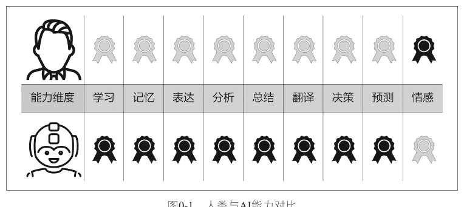

不难看出，在多项指标上AI已全面领先。AI像超级学霸，持续学习、永不遗忘、无需休息、逻辑强悍，每一次交互都在悄然促使其成长。

按此推演，AI似乎不可抗衡，会夺走所有工作。但正如蒸汽机出现，农民未失业而是进入工厂，马车夫变为火车司机。技术进步总在夺走部分岗位的同时创造更多岗位。

# MAP模型驱动的AIGC课程开发实战手册

已经尝到甜头的从业者都感受到AIGC带来的效率与能力跃升。这种体验像童话里的田螺姑娘，默默顺从地担任执行角色。

AIGC结合真实场景的应用，已成为众多AI创业公司的主攻方向。在客服、设计、文案、编程等领域价值凸显，也为具身机器人能力提升带来突破。

与其忧虑被替代，不如主动拥抱——淘汰你的不是AI，而是会用AI的人。

## 会说话就会用AI？

这是流行的宣传语。借助短视频，AIGC确实在极短时间内被大众熟知。但商业驱动下也充斥误导，导致一部分人认为AI无所不能，另一部分人认为AI一无是处。

剥离噱头后思考AIGC对人的新要求，会发现AI既非万能也非无用。“会说话就会用AI”只对了一半，关键在于用AI做什么。

同一问题抛给不同AIGC应用，结果各不相同。我们曾给国内主流大模型贴上理工男、文艺青年、玩伴、学究等标签，因为训练方法与数据不同。图像、视频、作曲类AI常被戏称炼丹，提示词输入与输出之间充满不确定性。

这些大模型很像企业里刚毕业的新员工，储备了海量知识与技能，却无法自主完成工作，需要领导安排、师傅指导。AI的表现取决于其训练，也取决于人类提出的问题与要求。

因此AIGC不仅是工具更新，更是工作方式乃至思维方式的变革。它要求我们掌握一种新语言，与新沟通对象交互。你的需求表达能力，决定了AI的输出质量。

## AIGC为企业培训带来的机遇

有观点说，如今做AI的公司里，只有培训在赚钱。这像当年Windows普及时，教五笔字型的人先拿到第一桶金的道理。要进入AIGC时代，第一步就是先用起来，个人如此，企业亦然。

AIGC带来的效率提升令人震惊。我曾参与PULOT计划，目标是打造无人电商。通过拆解电商各流程节点，用AI逐一替代，其中店铺筛选原由两名熟练员工操作，每周完成200家。应用AI后，5分钟完成1000家筛选。

并非所有工作都能如此跃升，也并非所有工作都可被替代。但AI无疑是提升人效的有效抓手。本书将揭示企业内提升人效的三大应用场景：

#### 教你做

搭建企业专属知识库，AIGC可精准赋能每位员工。加速成长的同时降低工作难度，有助于降低用人门槛并加速胜任。

#### 帮你做

在特定场景下，AIGC能拓展人能力边界，使过去不可行的任务变得可行。医疗大模型缓解偏远地区医生短缺即为典型。

#### 替你做

借助RPA等技术，AIGC可替代简单重复工作，直至承担部分复杂工作，为人效提升带来颠覆性变化。

PULOT追求极致人效，自称毫无人性公司。最新进展显示，AI已替代30%工作节点，并优化流程，直接价值体现在人员精简。

在该项目中我发现，企业引入AIGC与此前信息化、数字化不同，业务专家的隐性经验至关重要。而我在培训体系建设与经验萃取方面的能力，正是连接业务专家与AI技术团队的关键桥梁。

# 序

提供AIGC相关培训并在培训中融入AIGC应用，培训部门有望成为企业数智化进程的推动者。

通过梳理知识、萃取业务专家经验、挖掘数据与人才发展的关联，培训部门可成为企业智慧的构建者，重塑工作模式与价值。

未来数智化企业不仅要培养人，还要培养机器人，并实现人机协同。这正是AIGC为培训带来的前所未有的价值创造机会。

历史总是相似。Windows刚出现时，率先拥抱个人电脑与互联网的人获得了时代红利。如今AIGC是进入新时代的钥匙，让我们共同探索。

# 关于本书

本书有两项目标：其一，面向企业内部课程开发与内训师培养场景，融入AIGC应用；既介绍实用工具与使用技巧，也强调使用者个人能力的提升与工作效率效果的改善。其二，在课程开发的经验萃取环节，与业务专家共探AIGC在企业真实工作中的落地需求，而非仅完成课程开发。

阅读本书可帮助仍在探索或尚未起步的伙伴节省时间，避免弯路。按书中内容开展内训师培养，可实现双赢：既完成课程开发，又掌握AIGC工具，并在后续开发中持续降本提效。

主要读者为承担企业内部课程开发与培训的内训师、企业培训管理者与人力资源管理者，对职业培训师与职业院校教师亦具实用价值。

# MAP模型驱动的AIGC课程开发实战手册

第一章从未来视角描绘企业人机协同工作场景，并分析实现该场景所需的变化与人才培养路径。

第二章阐述使用AIGC开发课程对开发者的能力要求，并提出AIGC课程开发者的MAP模型，开启新地图探索。

第三至八章结合企业课程开发各应用场景：培训需求分析、课程设计、资料开发、教学互动设计、评估与转化、课程宣发。每章包含经典理论方法M、适用AIGC工具A、操作要点P，不同基础的读者均可获益。

第九章完整呈现三个AIGC企业课程开发案例，并提示需规避的陷阱。

附录提供经实践验证的AIGC内训师培养与课程开发项目计划，可快速落地。

本书配套AIGC内训师课程开发全攻略在线课程，2024年7月与量子教育联合录制，共十节，可通过量见云课堂App搜索获取。


## 如何使用本书

1. 若你是企业培训管理者或人力资源管理者，建议通读第一章，这将帮助你从更高维度思考项目推进。
2. 书中介绍多项经典教学设计模型及应用场景，若未系统学习过，请勿忽略。
3. 介绍的AIGC工具均以可免费或低成本使用为主，便于无障碍入门。
4. 除提示词编写原则外，还提供大量提示词模板，筛选后可直接套用。

期待本书助你实现从入门到精通的跨越，提升课程开发效率与效果，更希望找到志同道合的探索者，共同推动AIGC在企业中的创新落地。

## AIGC时代的企业培训

第一章


# MAP模型驱动的AIGC课程开发实战手册

初次接触AIGC时，我的第一感受是焦虑。大语言模型几乎无所不知，语言流畅、逻辑清晰、结构完整，远超多数人，知识面更是广阔。

更颠覆的是，大模型不再只是罗列知识，能基于提问给出指导，帮助完成工作或解决问题。这与过去的搜索模式截然不同，搜索需要答案被整理成文字后才可获取，而大模型替人完成了思维加工，不免让人担忧被替代。

随着理解加深，焦虑逐渐消退，反而感受到AIGC弥补了人类短板，提升了效率。办公场景最直观，报告撰写、数据分析、PPT制作等环节节省大量加班时间。AIGC培训需求也像当年的五笔字型培训，为培训从业者创造机会，甚至吸引IT从业者转入培训师行列。

若仅把AIGC当作工具，未免肤浅。大多数AIGC界面友好，上手不难，难点在于如何获得想要的结果。影响输出至少有三大因素。

一是AIGC本身能力。算法、训练方式、语料不同，表现各异。资深使用者常会把同一问题抛给多个模型，对比结果后选择或整合出最优答案。

## 第一章 AIGC时代的企业培训

二是提问能力。到目前为止AIGC仍是工具，同样的工具不同人使用效果迥异。如同钉钉子，普通人与木工差异明显。AIGC时代凸显提问能力的重要性。

三是提问者的专业度。发出指令并控制输出，对专业基础有较高要求。缺乏基础难以提出好问题，也难以判断答案。AI靠算法与数据驱动，对领域专家的深刻洞见仍显不足。

总体而言，配合AIGC，大多数人可在原有能力基础上实现扩展与提升。有人称AIGC为能力放大器，很贴切，但基础为零时无从放大。

既然能放大能力，AIGC自然成为帮助企业实现人效提升的重要方式。我对人效的理解是“用更少的人做更多事”“用更便宜的人做更贵的事”，这正是我们探索AIGC应用的聚焦点。

### 第一节 企业人机协同的未来画面

如序所述，AIGC在企业中有三大应用场景：教你做、帮你做、替你做。

#### 教你做

成年人学习主动权在自己手中。推动企业微课开发时，我们提出选题两原则：源于真实工作任务，符合成人学习特征。总结成人学习的三个刚需时刻，简称新用卡。

- 1. 新，指工作中任何新内容都会触发学习动机。如新入职员工、岗位调动者、企业新政策、新制度、新产品等。

“用”的痛点用一句话就能概括：书到用时方恨少。知识储备不足只是表象，真正的拦路虎是遗忘。随年龄增长短期记忆衰退更快，学过的东西如果长期不用或只是偶尔碰一下，很难沉淀为长期记忆。等到真要用时，哪怕曾经学过，也得回炉重学。

“卡”则是另一种刚需学习触发点。当问题出现、答案不明时，立刻去找解法，这就是最真实的学习瞬间。

## 第一章 企业培训进入AIGC时代

AIGC到来之前，企业应对新、 用、 卡这三类刚需学习，大多靠量产微课来填补空缺。微课在一定程度上缓解了新用卡的压力，但要覆盖工作全景，现有的微课体量远不够，效果也有限。

AIGC给这个难题提供了新的解法。早期尝试中，把微课开发时沉淀的经验萃取文档和脚本做简单处理后，借助RAG检索增强生成技术，就能训练出面向特定岗位的助手。于是微课开发变得轻量，很多环节只要完成萃取和脚本创作，费时的课件制作可以直接省掉。甚至能做到一鱼两吃，既产出课程又沉淀了可复用的AIGC素材。

#### 帮你做

帮，本质是AIGC弥补人的短板。做动画策划的友人说，以前把脑中的画面讲给动画师，一个创意要反复打磨才能勉强达标。用上AIGC后，他先让工具出草图甚至小段视频，再拿着这些与动画师对齐，往往一两次就到位，效率跃升让他兴奋。

医疗大模型极大拓展了医生的记忆边界，多语言翻译也是AIGC大放异彩的场景。今天多数人接触AIGC仍在帮你做里：帮写文案、做PPT、作图、作曲、剪视频，辅助角色短期内仍是主流。

## AIGC培训师课程开发全攻略
——MAP模型让课程开发更高效

#### 替你做

让AI完全取代人并不容易，可对照制造业的发展轨迹会更清晰。制造业因流程高度标准化、外显化，几十年前就开始被机器人替代，经历了自动化、信息化、数字化到智能化的演进。

2024年7月，我参与深圳市工信局“智能制造成熟度诊断”项目，近距离看到智能化的现状，也更清楚企业与真正智能化之间的距离。相对制造业，脑力劳动的挑战更大。知识工作者的过程多是思维在运转，难以外显也难标准化。很多专家级员工靠直觉决策，经验抽取出异常困难。

目前实现替你做的主流手段是RPA机器人流程自动化，在局部场景已有进展。落地仍需AIGC配合其他信息技术共同支撑。但一个前提始终成立：想让机器人像人一样工作，先要让它读懂人的工作。

我们曾描绘过企业人机协作的未来图景，里面有三种工作链路。第一种是机器人辅助人类链路，为每个岗位配备若干Agent助手，扩展人的能力，实现用更便宜的人做更贵的事。

第二种是人机串联链路，部分节点被机器人接管，部分仍由人完成，单位人效提升，实现用更少的人做更多的事。

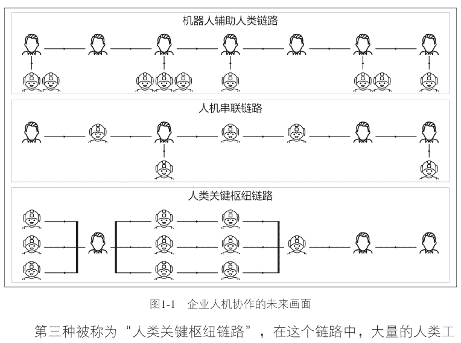

第三种是人类关键枢纽链路，大量执行节点被替代，人类更像指挥官，发出指令、监控过程、纠偏。有人预计AIGC普及后会出现大量超级个体，一个人顶一支军队；未来即便大公司，人类员工规模也不会很高。

人机协作的案例已不少见：特斯拉黑灯工厂、亚马逊机器人主力仓库、瑞士Yokoy的支出管理自动化平台。落地项目对人效的提升都超出想象。AI正在颠覆人类生产力，孙正义的预言“十年后接触AI的人与不接触AI的人会有人与猴子的差距”值得管理者警惕。不跟上AI时代的企业，可能直面消失风险。

### 第二节 构建企业智慧大脑

2017年我曾用GPS导航来比喻企业智慧学习。把企业全部知识当作地图，把业务流程、岗位、工作流做成区域、街道、门牌，员工报目的地，系统就指引学习路径。基于此我提出微课众创，用全体员工标注地图，为每个知识点生产学习内容。

当时我们提出点线面体态的进化路径。2015年起《培训》杂志主办的中国企业微课大赛推出企业专属微课，3到5分钟视频成为标配，这就是点，一门微课解决一个工作问题。

遗憾的是，大赛机制让企业关注获奖，评委并非真实学员，精美微课容易获奖，扎实内容反而被埋没。近十年过去，大多数企业微课堆量却仍停在点上，让人唏嘘。

线是若干关联微课组成的街道，让学习从点延伸；面是以岗位或知识体系为单位的整体，如安全合规；体是多个面交叉成的企业学习智慧体，覆盖全量知识技能，由全体员工共建共享；态是智慧体的动态更新，及时补新、去旧、纠错。

自2017年起我们推动智慧体建设，帮助数十家企业搭建线面体系，却撞上两大瓶颈。一是低估难度。建体系比办一次大赛严谨得多，需求更大，经验显示一个岗位约需百门微课，企业投入人力和年限都很大。二是平台不支持智慧导航，微课再多也难以呈现理想效果。

这段经历与构建企业智慧大脑直接相关。AIGC在一定程度上否定了GPS导航式的智慧学习设想，却让我们更坚信可以提出新的规划，而且不止于智慧学习。

企业核心竞争力多来自独特知识经验，这无法靠通用大模型复制。AI的三大要素是算力算法数据，我们认为数据是企业竞争力的核心。

围绕数据，定义繁多。检索“数据的定义”，结论五花八门。Kimi也给出冗长的解释，让讨论难以推进。在求索中，中国人民大学杨翰方教授提出一个极简定义打动了我：

> “数据是可计算的记录。”

这句话打开了新思路。构建企业智慧大脑需要哪些数据？

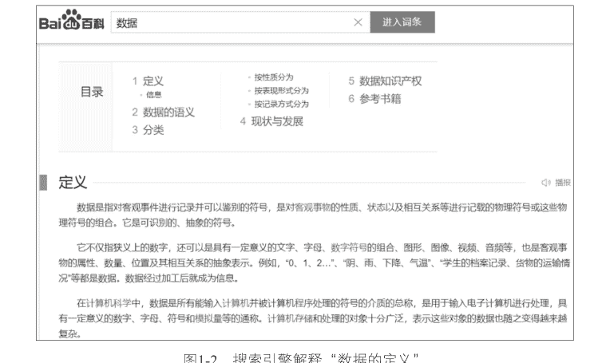

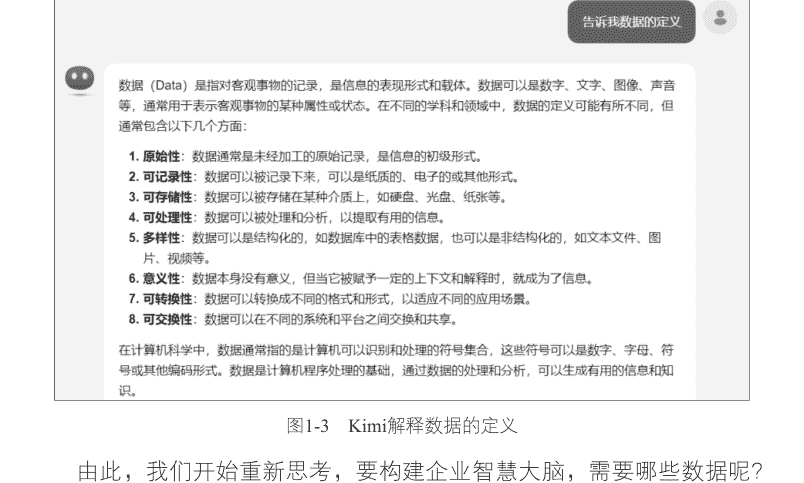

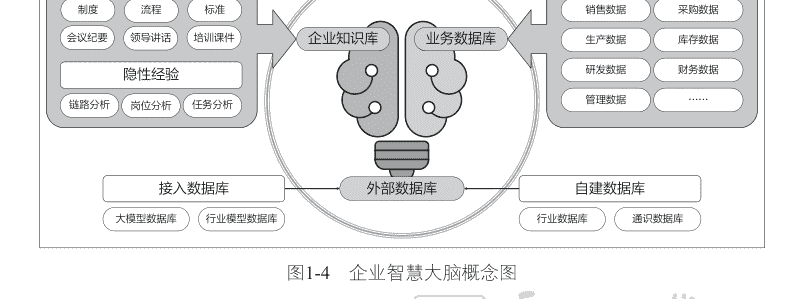

#### 企业知识库

企业知识库分显性知识和隐性经验。显性知识是被记录下来的一切，静态如制度流程标准，动态如会议纪要领导讲话培训课件。要让AI可算，需要做数据治理，文档表格图片视频音频形态各异，得先打通读取。

显性知识的治理现在已有AI工具可做，这里不展开。更关键且与培训紧密相关的，是隐性经验的萃取。隐性经验藏在人的头脑里，像有个故事：船发动机坏了多人修不好，后来请来老技师，他拿锤子敲敲听听，指着一处特殊手法敲几下，机器就好了。几天后账单1000美元，管理层惊讶，技师说敲几下值2美元，知道敲哪值998美元。这就是隐性经验的价值。

微课开发本身就是显性化隐性经验的重要路径。我们曾用百多门个险营服经理岗位的微课脚本清洗标注后做RAG训练，助手回答满意度很高。

#### 业务数据库

企业数字化转型已久，培训领域关注却少。探索AIGC应用才发现，数字化程度直接决定智能化上限。借助AIGC，企业在数据采集分析应用上都将迎来跃迁。

#### 外部数据库

外部数据库指大模型、行业大模型、智能搜索、行业数据库等可直接利用的资源。政策要求、合规要求、国际国家团体标准等不必自研。已有公司专注此领域，获取成本下降，应用价值上升。

设想未来每家企业都有一个智慧大脑，里面沉淀经营管理数据并持续学习，可赋能人类员工与机器人员工。随着脑机接口发展，新员工或只需数秒读取大脑数据，就能拥有组织过往全部经验并指导工作。

我始终有一个执念：未来培训部门的核心不是不断组织课程，而是建设学习资源。成年人学习很功利，学习时机由自己决定。无论GPS导航还是AI数据库模式，培训要做的就是在员工想学时提供精准内容。机器人学习也一样。AGI最多是提供更多优质人才，如同985毕业生仍需学习岗位标准，这些标准来自企业智慧大脑。

因此AIGC为企业培训带来转折。构建智慧大脑所需数据中，培训部门可能是积累最多、最能整合的部门。要么主动拥抱AI，甚至自毁前程让AI替代自己；要么被别人训练的AI替代。

### 第三节 推动AIGC在企业中的应用

回到当下，如何以培训推动AIGC落地。我们重新定义培训管理者的未来角色——数智人才官。落地与角色转型互相促进，可分为四个阶段。

#### 第一阶段：识AI能力，转数智思维

培训从业者通常是企业里最爱学习的人群，也是最早用上AIGC的人群。第一轮推广离不开培训。

作为从业者，先在自己工作中养成使用习惯并不难，提效感很明显。关键是形成数智思维的转变，使用多了自然养成。难点在于容忍初期的不完美，并持续提升自身能力。

自己用远远不够，要从自己用推向全员用。培训场景是最佳推动舞台。2023年起围绕AIGC的企业内训大幅增长。培训部门不止于开设专门课程，任何培训项目都可植入AIGC应用。

内部建立AIGC学习社群也很重要，资讯和工具迭代太快，个人难以承接，社群能分摊压力。以赛促训效果也不错，比赛能快速引发全员关注并挖掘人才。

本书聚焦的内训课程开发和内训师培养就是典型场景。2023年起我们把微课开发、课程开发、经验萃取等课全部做AIGC升级。起初以为会缩短交付，后来发现学员要学的反而更多。提效在于单位时间内收获翻倍，学会开发也学会用AI；后续自主开发效率大幅提升。我们自己做一门可发布的微课，原本脚本到成品需2到3天，现在借助AIGC两小时完成。

内部课程开发和内训师培养是企业常规项目，切入AIGC无需改项目、增预算、加工作量，是最优入口。

第一阶段重点是借助培训舞台，用多种方式推动全员关注应用，实现人效提升和思维转换。

#### 第二阶段：识应用场景，炼智慧大脑

从课程开发切入的优势是参与者多为业务专家，他们最清楚AIGC在企业里的应用场景，也是未来数智化需求的提供者。只有他们完成思维转换，第二阶段才好推进。本阶段聚焦场景识别和智慧大脑构建。

现在有些企业建知识库，但脱离业务场景的知识库价值有限。上一节提到智慧大脑的数据构成，隐性经验萃取是培训部门的责任。多数企业目前的萃取面向面授场景，目标仍是点。构建智慧大脑需要更系统结构化的经验，需通过链路分析、岗位分析和任务分析完成。识别哪些工作未来由人做，哪些人借助AI做，哪些可由AI独立做，进而预判流程、组织、岗位变化。

这个过程需要业务专家、IT/AI技术专家和组织经验萃取专家共同完成，培训部门是桥梁，对管理者提出新要求。

这是难而正确的事。智慧大脑不可能靠一次培训或项目完成，更好的方式是局部试点。例如东软在人力资源模块尝试，开发了“贾维斯”人力资源助手、“菩提”学习助手和“魔镜”推荐助手。

从单一岗位或某项业务切入做试点，是比较务实的做法。结合组织的实际情况和可投入的资源，建议具备前瞻性思维的培训团队尽早谋划，为参与企业的数智化转型争取主动。

#### 第三阶段：洞察数智变革，重塑人才体系

第二阶段和第三阶段在推进节奏上并无绝对先后。第二阶段偏重数据视角，第三阶段则聚焦组织与人才视角，二者在落地中相互牵引。

数字化与智能化已成企业发展的必经之路。企业要么自行主导数智化变革，要么并入已经完成转型的生态体系，否则就会错失智能时代的红利，只能靠低附加值生产换取微薄利润，甚至随时面临被取代的风险。

说得更直接些，如果所服务的公司对数智化毫无觉知，首先要考虑是否需要更换工作环境。对我们而言，这轮变革是一场覆盖各行业的风暴，跨界竞争屡见不鲜。企业的对手已不限于同业，很可能在不知情的情况下被外部力量冲击。当然，进程中也会孕育新机遇与新主体。

我们观察到一个普遍现象：许多公司在数智化推进上出现“上层意愿强、基层抵触多”，同时对投入产出也算不清。相比之下，培训是最经济的试错路径。

在数智化进程中，人才挑战无可避免。这与过去信息化以IT为主导已有本质区别，而是与每一个人相关。

高层要拓宽视野，明确未来方向与机会点；IT团队要完成思维与能力的全面升级；业务人员要借助AI发现场景重塑的可能；全体人员都要学会使用新的AIGC产品。在此背景下，企业是深耕现有人员，还是大规模换血？

以上正是培训部门即将直面的难题。我们认为AIGC进入工作场景后，对培训带来的震荡、对人才结构带来的改变都将是颠覆性的。

#### 第四阶段：预判企业未来，转换职业角色

最后一个阶段，未来组织里会出现一种全新角色——“数智人才官”。我们判断，未来的企业不仅要培养人，也要培养“机器人员工”，并让两者协同，这将改写现有的“选—育—用—留”逻辑，从而实现人效的极致化。

**选**
人类：借助数字化与AI，为招聘与晋升提供更精准的人才画像与更高效的筛选，实现更匹配的人岗对位。
机器人：挑选与企业发展方向契合的AI产品或应用。

**育**
人类：搭建数智化人才体系，打造并持续优化组织的智慧大脑。
机器人：对机器人进行训练，使其理解人类工作，能够辅助人类并复制人的能力。

**用**
以“人机协作”的方式重构工作链路、组织架构与岗位设置，持续追求人效提升。

**留**
随着AGI通用人工智能的到来，机器人将越来越多地替代重复性工作，人类则承担更有意义的工作。

在这样一幅图景下，若仍沿用原有培训方式，结果不会乐观。现在就该行动起来。至少前文提到的第一阶段，是每位培训管理者可以立刻落地的。后续章节将聚焦企业内部课程开发与内部讲师培养场景，沿经典ADDIE模型，逐环节拆解可用的AIGC工具与正确应用方式，帮助大家迈出推动企业AIGC落地落效的第一步。

## 第二章 构建AIGC课程开发能力

每次为企业做内部课程开发工作坊，我都会先让学员讨论一个问题：企业内部讲师与职业培训师各自的优劣在哪。

全班以小组为单位，围绕“内部讲师优势、劣势”“职业培训师优势、劣势”四个象限展开讨论。参与者来自不同业务部门，未来将成为业务专家型讲师。大多数人参加过企业内训，只有极少数接受过课程开发培训或有授课经验。

虽然每次结论不尽相同，但关键信息高度一致。图2-1是我对讨论结果的归纳。

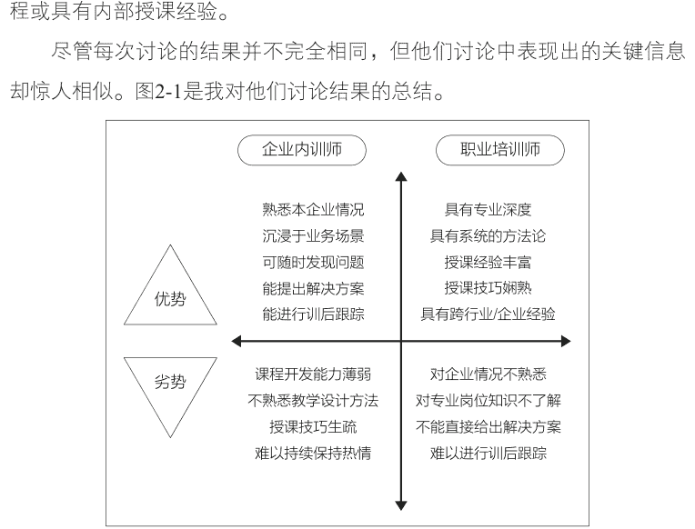

从图中可见，内部讲师与职业培训师的优劣泾渭分明。这也解释了为何近年通用管理类外部培训需求持续萎缩，而内部课程开发与内部讲师培养项目逐年上升。

> “外训给思路，内训给解决方案”，当企业培训愈发关注结果时，内部课程与内部讲师的作用变得愈发关键。

然而2024年，我听到一个印象深刻的词——“僵师”。一次培训行业论坛上，某央企培训负责人直言：“老师们，现在很多企业内部讲师都被叫做‘僵师’。”在场同行纷纷认同。

何为“僵师”？即被培养的讲师根本没有授课机会。讲课是项技能，需要反复刻意练习方能熟练。若企业只提供培训却不给足够的授课实践，技能很快退化甚至遗忘。另一个痛点是，谁来做新讲师的陪练？初登讲台者常因紧张与不自信导致效果不佳，甚至浪费学员时间。

众多企业在内部课程开发与内部讲师培养上陷入困局。“僵师”现象导致业务专家对成为讲师失去热情，不愿投入课程开发项目。表现上就是近年企业采购课程开发项目的周期被不断压缩，质量难以保证，甚至出现大量“烂尾”。

既然内部讲师对企业发展至关重要，实践中又问题重重，该如何破局？

### 第一节 企业课程开发与内训师培养

破解“僵师”困境，需要重新审视企业内部课程开发与内部讲师培养项目的“本质”。我们提出“师·课同建”模式，通过此模式同时实现人才培养与知识沉淀两项目标。

先看讲师培养为何可作为人才培养项目。

**选**
部分企业选拔讲师采用“自愿报名”或“部门推荐+自愿报名”，看似无碍，但我们不建议。意愿往往不可靠，初衷多为好奇，一旦发现成为优秀讲师需要大量投入且回报未达预期，热情便会消退；同时自愿报名者是否具备足够专业度与经验也存疑。

更合理的做法是，将担任讲师设为各级管理者与业务骨干胜任与晋升的必备能力。因为管理者本就承担团队成长职责，团队成长会直接作用于管理者绩效，形成闭环，能解决众多培训难题。

难题一：培训需求来源。管理者与业务骨干参与讲师培养，更懂业务与培训边界，能提出更精准的需求。
难题二：培训内容保障。业务领导本身承担业务指标，所提供内容更贴合真实场景，能解决实际业务问题。
难题三：培训效果转化。管理者是天然监督者。由他们授课，培训后行为转化自然发生，下属提升会直接体现在业务结果上。相比部门绩效带来的收益，课酬等激励只是锦上添花。

这就是常说的“选对人”，人选对了，诸多难题迎刃而解。

**育**
我们曾对比企业内部讲师能力模型与领导力模型，发现两者在能力素质层面高度重合。如学习力、创造力、洞察力、感召力、人际沟通与表达、问题分析与解决等。

管理者通过讲师培养，可在发现与解决问题、经验萃取、结构化思考、呈现表达等多方面提升。这些能力不仅改善本人，也会通过对团队的培训赋能给下属，提升整体战斗力。

开发内部课程的另一收获是“统一管理语言”。课程中通常包含理论、方法、工具。企业内训更重方法与工具的应用。这些方法工具源于企业工作场景，经经验萃取而来，即使采用成熟模型也会结合企业实际改造。当全员使用同一套管理语言沟通时，效率与效果都会大幅提升。

当这些方法工具由团队管理者亲授，还用担心转化问题吗？

**用**
选人环节做对，“用”的空间会很大。首先培训时间安排更灵活，1小时、2小时的微培训可随时开展；其次培训需求来自业务，效果作用于业务，实现真正融合。管理者既是讲师，也是“辅导者”。

这需要企业制定相应的讲师管理办法，明确工作量界定与考核、课酬计算、激励机制等。

**留**
由管理者与业务骨干担任讲师，“留”的问题也会迎刃而解。尤其是将讲师成绩与晋升挂钩，形成强劲推动力。

但推动力不够。每个人的成长都像爬坡，需要四力支撑：拉力、推力、压力、支撑力。拉力来自愿景、目标、价值、能力成长与职业发展吸引；压力来自企业对讲师的考核、竞争与淘汰机制；支撑力来自培训部门提供的学习资源与成长机会。

在四力作用下，讲师队伍会自然形成由企业最优秀管理者与业务骨干组成的群体，正是人才培养的重点。把讲师培养与人才培养结合，效果将事半功倍。

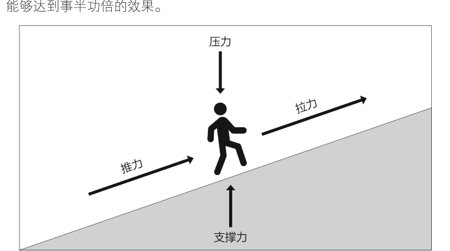

再看知识沉淀。

知识是企业的无形独特资产，是持续竞争力的支柱。企业内部开发的课程，无论面授、在线还是微课，都是知识资产的重要载体。

企业内部课程开发常走入一个误区：认为讲师与课程绑定。讲师一旦离职，课程便“无人讲”。无人讲的课程会渐被遗忘，培训部门换人后更可能消失。很多企业出现同一课题反复开发，浪费投入。

因此，企业内部课程开发与讲师培养的另一价值，是有计划地完成知识沉淀。企业内训开发常需提交“N件套”：课程大纲、授课PPT、培训师手册、学员手册、配套案例、工具表单、考试题库等。本书第一章提到构建企业智慧大脑的数据来源，内部课程成果正是构成智慧大脑的关键部分。

若把项目拆分为“人才培养”与“知识沉淀”两个维度，设计路径会不同。目标为人才培养时，需考虑讲师的选育用留，配套制度与管理办法，并做成长跟踪与持续陪伴；目标为知识沉淀时，可聚焦内容本身，由外部或内部萃取师与业务专家配合完成经验萃取，开发的课程需能被其他讲师承接授课，并沉淀为智慧大脑数据。

总之，破解“僵师”困境，需要培训部门与讲师重新思考其真正价值。如今各企业都在追求“降本增效”，不少企业把培养讲师当作降低师资费用的手段，把压缩课程开发时间当成增效手段，导致质量下滑。我们认为这只是表面文章，只有找到根本价值，才能实现更高维度的降本增效。

### 第二节 培训师的新地图——MAP模型

很多人问我，既然AIGC能大幅提升效率，课程开发是否变得很简单了？起初我也抱着这种期待尝试。

事实上，我用AIGC完成的第一项工作就是开发一门课程。正是通过这段实践，我才真正打开了AIGC世界的大门。体会是，AIGC确实能提升课程开发能力，但前提是培训师自身能力先行提升。

在动笔前，我们团队做了大量尝试，曾用AIGC升级最熟悉的微课开发与课程开发项目，最初便遇到挑战。

比如课堂上让学员用AIGC撰写课程大纲。结果出现两种极端反应：有人说“AI写得比我好，直接可用”，拿来主义，既不验证也不修改；有人则说“AI内容完全不对，胡说八道，就是骗子”。

问题出在哪？

我们发现，简单把AIGC嵌入课程开发流程是行不通的。团队能顺利使用，依赖几个前提：

## AIGC培训师课程开发全攻略
——MAP模型让课程开发更高效

我们在课程设计与开发领域积累丰富经验。这些经验在向AIGC提问题、发指令时自然发挥作用，能提出“对”的问题。而学员多为初学者，不具备提出高质量问题的能力。

项目交付时，我们已花数月沉浸式学习AIGC，接触多种工具、课程、视频，通过阅读建立起初步认知框架。而学员很多是第一次接触AIGC，难以形成客观认知。

当时尚未接触“提示词”概念，但基于实践能写出符合提示词规范的模板与范例，并希望学员套用。然而大模型存在“盲区”，特别是在业务专家擅长的领域，导致有人觉得“很好不用改”，有人觉得“完全胡说”。

那段时间我们只要有机会就尝试在交付课程中加入AIGC应用，每次复盘迭代。到2024年，线下课程迭代基本完成。起初以为用AIGC做微课能大幅缩短培训时间，实际发现因需在同一场课里同时教授微课开发与AIGC工具，时间并未缩短。但我们也发现，学员掌握技能后，后续课程开发速度必然大幅提升。

为提升交付效果，团队海星老师制作了数十个AIGC实用工具教程，每门课仅几分钟，使用频率高，反响很好。这也促使我们决定录制完整在线课程。

于是与量子教育合作，于2024年7月推出《AIGC内训师培养全攻略》线上系列课程。本节提到的MAP模型，正是在筹备录制时由量子教育的潘晓波老师提出的课题。他为此模型做了生动比喻：“沿着旧地图找不到新大陆，这个就是AIGC时代内训师找到新大陆的新地图。”

现在看这张新地图。

MAP是便于记忆的缩写，代表Model、AIGC、Prompt。

Model指培训师的专业能力，即使用AIGC开发课程时，对课程开发基本概念、原理、常用模型有了解与应用能力，这是设计与开发的基础。

A代表AIGC，指培训师对AIGC概念与应用的熟悉程度。可广泛涉猎多种工具，也可专精少数工具，通过熟练应用建立新的思维与工作方式。

P即Prompt提示词，指应用AIGC的能力。Prompt可视为AIGC时代诞生的新“语法”，也是对人类能力的新要求。学习Prompt如同当年学五笔字型，是敲开AIGC世界的大门。但会提示词不等于会用AIGC，后续章节会展开说明。

MAP模型不仅适用于内训师，对任何管理专业领域都适用。例如与一家用户调研机构合作时，只需把M聚焦到用户调研领域的模型与专业能力即可。

## 第二章 构建AIGC课程开发能力

### 第三节 Model——应用经典模型的能力

我自认是“模型控”。模型是对客观世界的极致抽象思考，任何领域人类都留下了大量经典模型，它们揭示底层规律，能帮助在复杂问题面前快速找到捷径。

本书将介绍一批经典教学设计模型，帮助学员快速建立教学设计思维框架，在此基础上学习AIGC应用会事半功倍。我们精选了九个经典模型。

#### ADDIE

本书整体结构遵循ADDIE模型，包含五个阶段：分析Analysis、设计Design、开发Development、实施Implementation、评估Evaluation，如图2-3所示。

五个英文词勾勒出教学设计流程与系统，起着纲举目张的作用。第三章至第七章标题均对应ADDIE模型。

- 第三章【Analysis】用AIGC辅助调研培训需求
- 第四章【Design】用AIGC升级课程设计
- 第五章【Development】用AIGC制作课程资料
- 第六章【Implementation】用AIGC提升互动体验
- 第七章【Evaluation】用AIGC评估培训成果

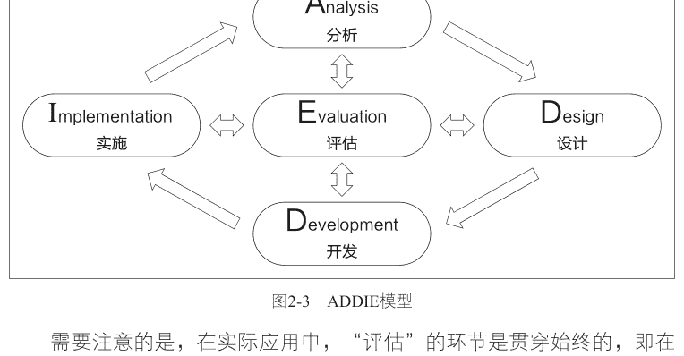

需注意，实际应用中评估是贯穿始终的，每个环节都需要评估。若把评估作为最后阶段单独处理就大错特错了。

#### ABCD

教学目标的 ABCD 法则与九大模型

ABCD 并非随意组合，而是 Audience 受众、Behavior 行为、Condition 条件、Degree 程度 四个要素的缩写。它是撰写教学目标的通用语法。目标定准，内容与方法自然跟着走，同时也成为评判课程成效的标尺。

上手的顺序很关键，先把目标写清楚，课程成功就完成了一半。目标本质上回答：什么背景的学员，在何种情境下完成何种任务，并达成何种标准。

很多人接触到的是课程大纲，很少见到教学目标。二者互补，大纲对学员更友好，目标对设计者更关键。完整体系包含总目标与模块目标，再往下拆到小节与知识点，形成多层级结构。

#### 金字塔模型
金字塔原理由麦肯锡顾问 Barbara Mintz 于1970年提出，用于思考、表达与问题解决。它并非诞生于教学领域，却被广泛迁移到课程设计，如图2-4所示。

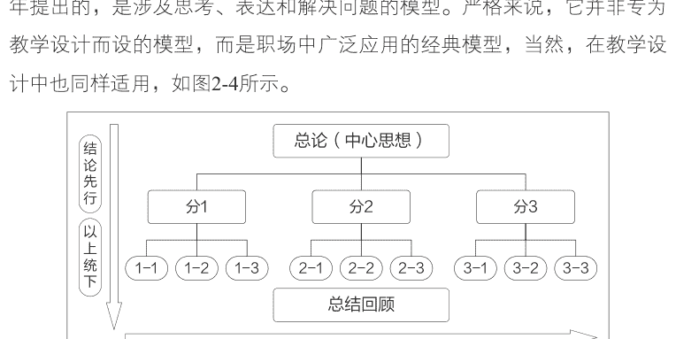
实践中发现，与大模型交互时，其回答常呈现金字塔结构，仿佛接受过类似训练。这种表达方式提升了清晰度，也大幅降低了课程搭建的难度。

#### 库伯学习圈
在目标体系之外，还需要一条串联线索，库伯学习圈常被推荐。

该框架由组织行为与体验式学习专家 David Kolb 提出，刻画出四类学习偏好及学习进程的四个节点，可用 Why、What、How、If 概括，如图2-5所示。

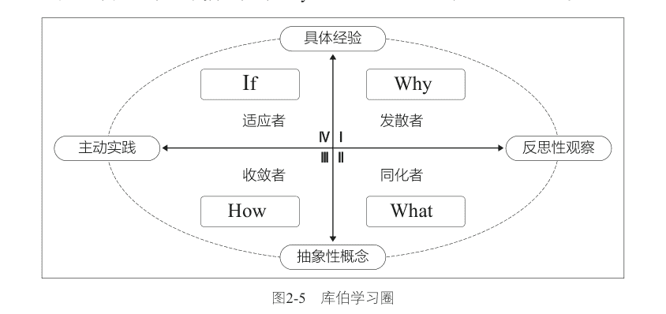
无论是搭建整体架构还是细化知识点，都可以沿用这一循环。

#### 加涅教学九步法
加涅九步法是经典教学设计路径，按学习流程分为引起注意、告知目标、激活先验、呈现内容、提供支架、诱发表现、给予反馈、评估表现、促进迁移九个环节。

设计课程既要定内容，也要定方法。教学可拆分为教与学，所谓策略就是研究学员如何接收信息，让思想有效传递。

新手讲师常因紧张而过度关注自我，忽视学员反馈。提前规划教学策略能帮助他们更快适应讲台。

#### 首要教学原理
首要教学原理由戴维·梅里尔提出，核心在于原理是在特定条件下稳定成立的关系，实施形式可以变化。

国内常称五星教学法，因其贴合企业培训场景而流行，既可用于结构搭建，也可指导教学策略，如图2-6所示。

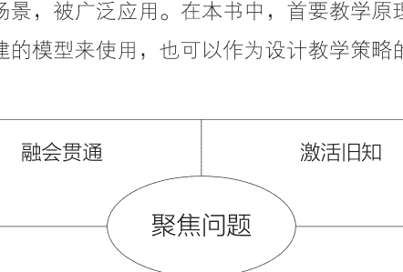

#### ARCS 动机模型
ARCS 由 John Keller 在1980年代提出，代表 Attention 注意、Relevance 关联、Confidence 信心、Satisfaction 满意。

模型侧重学习动机的激发与维系，本书将其用于课程配套文案。课前通过招生资料与课程介绍的精心设计，能点燃兴趣并提升学习效果。

#### 学习金字塔
学习金字塔常被归于美国缅因州国家训练实验室的研究，后续研究质疑该机构的存在性，但不同学习方式对留存的影响仍具参考价值，如图2-7所示。

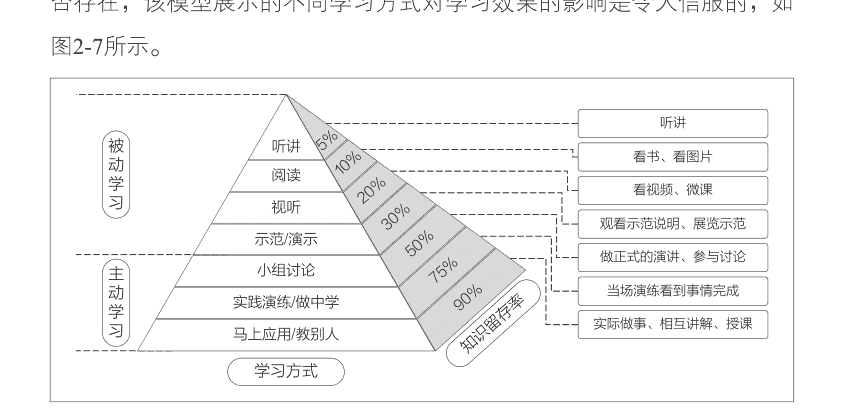
该模型主要提醒讲师避开留存率较低的教学方式。

#### 柯氏四级评估
柯氏四级评估是国内应用最广的评估框架，体现从感知到行动的递进，第四级关于培训价值的争议一直存在，但仍是企业追求的方向，如图2-8所示。

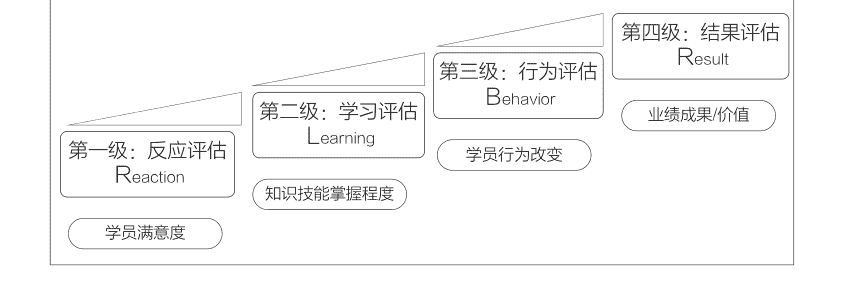
多数企业至少要求达到第三层，即行为是否发生改变。人们常说知道与做到之间存在巨大鸿沟，若行为未变，工作结果难以改变，价值也就无从谈起，这正是内训师需重点关注的问题。

上述九个模型将在后续章节结合 AIGC 展开解读并提供案例。

### 第四节 AIGC 技术洞察
MAP 中的 A 指 AIGC，即持续学习 AI 领域常识与工具。对培训师而言属于全新领域，仅梳理常用名词就需要投入时间，我们用概念图整理了非专业人士常用的 AI 术语关系，如图2-9所示。

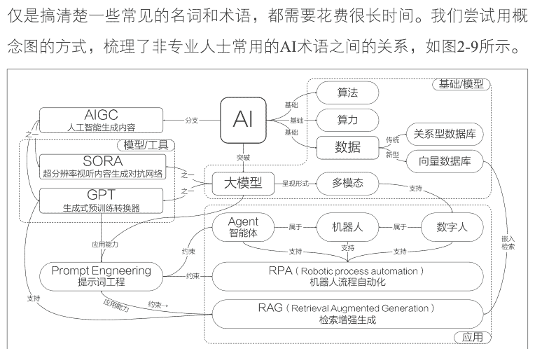
建立知识框架是进入陌生领域的有效手段，思维导图、词条、知识图谱均可，框架成型后可不断补充新内容。

有了框架后，按输入输出方式对工具进行归类，学习效率会提升：

1. 文字类：以文生文为主，输入文字得到文字输出。可进行对话、撰写文章、制作问卷、分析资料等，还衍生出语音转文字、智能检索等功能。
2. 图片类：文生图，输入文字生成图像；图生图，输入图像进行清晰化或加工。
3. 视频类：文生视频、图生视频等。目前可直接使用的视频生成多为 AI 剪辑模式，即拼接素材并配音。真正意义上的视频生成工具仍在起步，但输入文字生成数秒视频已具期待。
4. 综合应用类：如 AI 写歌、作曲、做海报、做 PPT 等。

此外 AIGC 正趋向集成。大语言模型基本具备多模态特性，能理解与生成自然语言、图像、视频、音频并实现跨模态交互。例如多数大模型可生成图片并解释图片；Kimi 整合了 AIPPT 功能，豆包整合了海绵音乐的写歌功能，未来实现一体化作业很有可能。

有人会问哪个工具更合适。可把当前大模型想象成不同院校的毕业生，各校风格不同，学生特点也不同。如某模型偏理工，某模型偏文艺。可按需求挑选，也可多问几位后对比选择。

还有面向特定场景训练的专科模型，在某方面优势明显。如新华妙笔在公文写作上表现突出，因其语料来自新华社；妙鸭相机定位写真照拍摄，9.9 元入门价远低于数百上千元的实体拍摄。

若更关注结果，可在常用工具中精通数款。随着熟悉度提升，同一工具也能产出不同效果。

获取最新工具信息很方便，已有多家 AIGC 工具聚合网站按类别列出官网入口；各大自媒体 AI 博主也会分享好用的开源免费软件；若想深入学习，CSDN 博客、阿里云开发者社区等专业平台提供权威评测与教程。

### 第五节 Prompt 与 AIGC 交互能力
MAP 中的 P 指 Prompt 的缩写，但含义已扩展为全面应用 AIGC 的能力。

AIGC 已渗透职场各环节，本书聚焦企业课程开发，但方法可迁移。例如撰写课程大纲与撰写演讲稿大纲本质相近。

如何评估自身水平？我们基于经验和教学案例总结出 AIGC 应用能力发展模型，从随性尝试到创建自动运行的 AI 智能体，划分为非专业人员的六个阶段，如图2-10所示。

#### 第一级：随兴随机——产生兴趣并乐于尝试，自然对话生成随机结果
兴趣是驱动力。初次接触时，人们常以自然随性的方式对话，尝试生成各种随机结果，像打开新世界的大门。

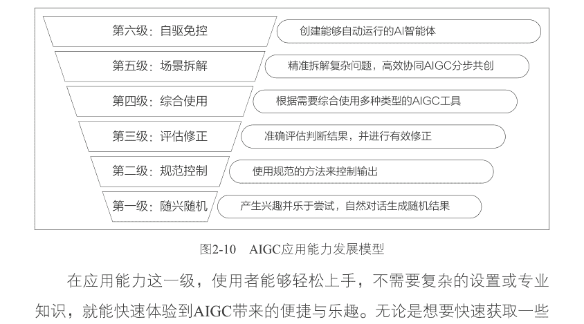
这一阶段上手快，无需复杂设置即可体验便捷与乐趣。但缺乏对话框架，结果随机不可控，时而精准时而偏离，甚至出现错误误导。对追求效率与准确的职场人士是挑战。

因此需要逐步意识到，要让 AI 真正助力工作，就要学会更有效地沟通：明确需求、设定目标、掌握基础使用技巧，才能让 AI 成为助手而非黑盒。

#### 第二级：规范控制——使用规范的方法来控制输出
AIGC 并非凭空产生，输出质量取决于输入质量。达到这一级时，使用者开始规范地引导生成过程。

例如通过提示词框架详细说明角色、背景、目标与任务，减少跑题；或在 AI 绘画中精确控制风格、色彩、构图，让作品更贴近预期。

这一级需要大量学习、积累与练习，持续研究提示词策略、指令构建技巧和模型特性，找到最适合任务的最佳实践。

#### 第三级：评估修正——准确评估判断结果，并进行有效修正
使用 AIGC 时需保持独立思考与审慎态度。这一级核心是能细致评估输出，识别长处与短板，分析错误根源。

使用者要掌握评估方法，辨别正确与偏差，并具备修正能力：通过追问澄清引导大模型调整文体，或优化参数、提示词、更换底层模型来改善多媒体输出。

这要求深厚的专业知识、批判性思维和持续学习能力，才能在 AI 助力下提升效率与质量。

#### 第四级：综合使用——根据需要综合使用多种类型的 AIGC 工具
这一级使用者能深度理解并驾驭多种 AIGC 工具，不再局限于单一工具，而是按需灵活组合。

核心在于综合。能明白每种工具的功能和长处，考虑互补性，制定最优组合方案。无论文本生成、图像处理、音频合成、数据分析或智能推荐，都能挑选合适工具并形成生态系统。

注重工具间协同与数据共享，跨工具跨领域整合能提高效率并拓宽边界。

#### 第五级：场景拆解——精准拆解复杂问题，高效协同 AIGC 分步共创
实际工作很少一次对话就能完美解决，更多是人机协同。

这一级使用者能将复杂问题拆解为若干相互关联的子问题，为每个子问题找到最合适的解决路径，是完全由 AI 承担还是人机协同。

在撰写标书、报告或制作 PPT 时，能明确哪些部分适合 AI 自动生成，哪些需人工润色，保持对最终成果的把控。懂拆解与协同，就能在保证效率的同时确保专业度。

#### 第六级：自驱免控——创建能够自动运行的 AI 智能体
靠 AIGC 提效仍需频繁参与，能自主运行、自我优化甚至具一定创造力的 AI 智能体是下一步目标。

这一级使用者至少了解 RAG 检索增强生成与 RPA 机器人流程自动化的原理，能创建基于专属知识库对话的智能体，或按预设工作流自动运行的智能体。

更进一步，可将智能体集成到智能客服、数据中台或 BI 系统中，参与系统逻辑设计，优化流程，让 AI 更好地融入 IT 环境。

## 第二章 构建 AIGC 课程开发能力
参与企业课程设计与开发项目，使用者至少能达到第四级应用水平。建立课程体系通常需要第五级能力。第六级需要补充更多领域知识，读者了解即可。

## 【Analysis】用 AIGC 辅助调研培训需求
### 第三章
在培训课程设计与开发中，需求分析是起点。分析的精准度直接决定课程质量。

### 培训需求分析的价值
课程设计中，培训需求分析像指路人，帮助培训师找到学员现状与期望的差距，精准定位目标与内容。它涉及培训对象、组织需求、客观因素和现有资源等多维度考量，既关乎适用性和针对性，也直接影响效果转化和学员成长动力。

具体而言，需求分析帮助明确三类核心问题：
- 组织需要解决什么问题或实现什么目标？这些如何转化为学习需求？
- 学员当前的知识、技能、态度处于什么水平？与理想状态的差距在哪？
- 采用何种培训方式、内容和策略能最有效地弥补差距？

回答这些问题，才能为课程绘制清晰蓝图，确保各环节围绕真实需求展开。

### 现实中的问题
很多培训师习惯会什么讲什么开发课程。课题往往来自开发者个人经验，会带来一系列问题：
- 问题一：课程内容与实际需求脱节。缺乏深入分析，内容偏离组织需求和学员诉求，变成自说自话的独角戏。

- 问题二：效果看不见、落地难。 当课程偏离真实工作场景时，学员参与热情和学习动力都会迅速下降，组织方很难判断培训是否真正达成预期，也就没法对后续方案做有效迭代和优化。

- 问题三：课程白做、资源沉睡。 缺少对需求场景的前置研判，导致培训师耗费心力开发的课根本没机会落地，成果只能被束之高阁。

### 系统化的需求分析方法

要规避以上坑点，就必须建立一套科学、可复用的培训需求分析体系。常用手段包括但不限于访谈、问卷、资料研读和现场观察。

访谈是通过面对面交流，直抵访谈对象的心声、感受与真实需求。在需求分析里，访谈样本通常覆盖需求发起方和未来的学习人群，了解他们对培训的期待与现状差距。

问卷是高效低成本的数据采集方式。借助结构合理的问卷设计，能快速收集大量需求信息，通过数据分析提炼出精准画像。

资料法则是对既有文献、内外部报告、运营数据等进行系统梳理，结合组织发展态势和学员学习表现，挖掘隐性需求和痛点，为课程设计提供依据。

观察法更直观。深入工作现场，看学员的工作习惯、行为表现以及业务流程细节，能拿到更真实的具体需求。观察时要重点记录关键行为和数据，便于后续归纳。

### AIGC 如何重塑需求分析

借助 AIGC 工具，我们能以更高的速度和更准的精度捕捉、解析培训需求，大幅减轻培训师负担。AIGC 既可在前期协助准备大量文档和框架，也能快速处理海量数据、抽取核心信息，用智能算法洞察数据背后的深层需求，为培训师呈现清晰直观的需求地图。

AIGC 的出现不仅是传统需求分析的一次升级，更是推动教培行业向智能化、高效化转型的关键力量，也为打造更精准、高效、个性化的培训体系创造可能。

接下来，本章将具体拆解 AIGC 如何赋能四类需求分析方法。

### 第一节 访谈法如何与 AIGC 协同

访谈法是需求分析的经典手段，通过直接对话挖掘培训的真实诉求、期望与潜在问题。它能触达问卷等间接方式难以企及的深层信息，还能捕捉受访者对内容形式、学习偏好及效果预期的个性化观点。

#### 访谈落地的五步操作

**步骤1：锁定访谈对象**

依据培训目标精准筛选样本，覆盖核心岗位、不同层级及代表性群体，如新人、老员工、优秀员工与待提升员工。建议采用分层抽样，确保部门、年龄、性别等维度多元均衡。

**步骤2：搭建访谈大纲**

围绕核心问题构建结构化提纲，涵盖目标、内容偏好、学习方式与期望产出等维度。同时融入开放性问题，鼓励自由表达，并在访谈中根据反馈灵活调整顺序或追问，保持动态性。

**步骤3：开展访谈**

开始前用简短破冰建立信任氛围。访谈中运用倾听、复述、澄清等技巧，引导对方深入展开，并关注非语言信号如肢体动作、面部表情，以更全面把握真实意图。

**步骤4：留存访谈素材**

多通道记录，包括录音、录像和手写笔记，确保完整准确。音视频便于复盘，手写笔记则利于即时捕捉灵感。

**步骤5：整理与分析**

将原始记录系统化处理：转录文字、分类编码、标注关键词，化零为整。随后进行深度分析，提炼需求重点、趋势与潜在风险点。

#### AIGC 在访谈环节的实战用法

**用 AIGC 生成访谈大纲**

设计大纲涉及目标、主题、形式、问题内容与顺序等多重要素。大语言模型的工作逻辑是理解输入并续写输出，因此要明确哪些是输入条件、哪些是希望模型输出的成果。

一般建议由培训师先确定目标、主题、形式和问题类型作为输入，再让模型输出具体的问题内容与顺序。

举例输入：
> 我要访谈理财总经理，目标是摸清理财经理在年度开门红项目中的能力短板和培训需求，访谈形式为现场访谈，请生成访谈提纲。

我们测试了文心一言和 Kimi，两者输出都紧扣主题且针对受众，但结果多为主题框架而非可直接使用的具体问题清单，落地前仍需自行细化。

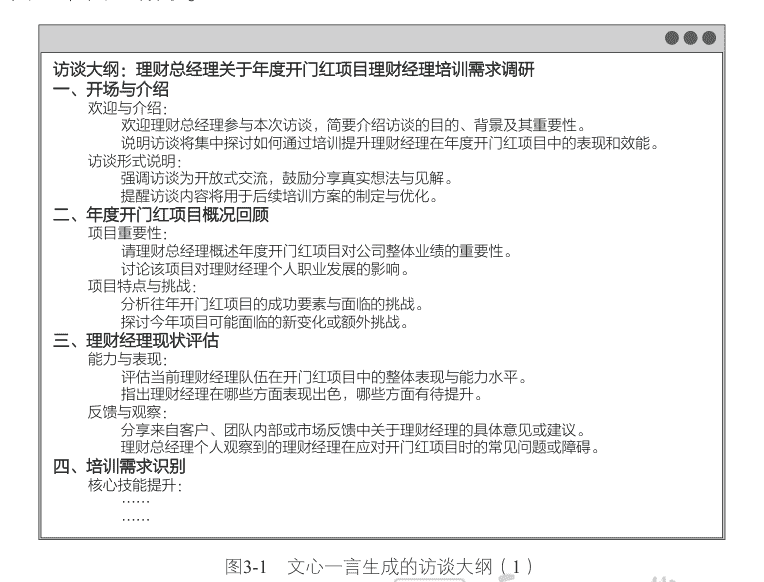
图3-1 文心一言生成的访谈大纲（1）

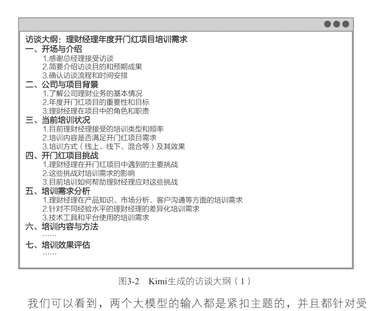
图3-2 Kimi生成的访谈大纲（1）

若要直接拿到可用的问题清单，就需要结构化的提示。常用框架为 CHAT：

- 角色 Character：明确身份或让模型扮演特定角色，调整风格与视角
- 背景 History：提供情境、前提与环境信息，限定回答范围
- 目标 Ambition：说明期望结果与效果，指导模型评估质量
- 任务 Task：交代具体执行步骤与输出格式，确保结果可直接使用

按 CHAT 重写提示：
角色：我是一家银行的内部讲师。
背景：银行正为明年开门红做准备，需要为理财经理定制课程，我正在做需求调研。
目标：通过访谈理财总经理，了解理财经理的工作痛点、为达成开门红所需的能力提升方向，以及优秀理财经理的做法。
任务：请设计一份访谈大纲，要求：
1. 包含访谈对象、访谈目标、分模块问题；
2. 覆盖完整流程，问题数量充足；
3. 开放式与封闭式问题交替，预设追问；
4. 格式规范、可直接执行。

*提示词中带下划线的部分可替换为自身场景，后续示例同理。

优化后，模型输出的问题模块更具体、可操作。

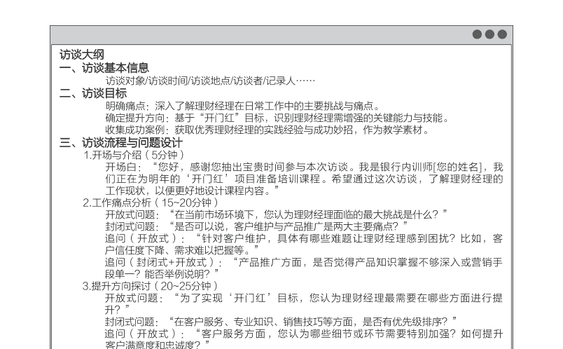
图3-3 文心一言生成的访谈大纲（2）

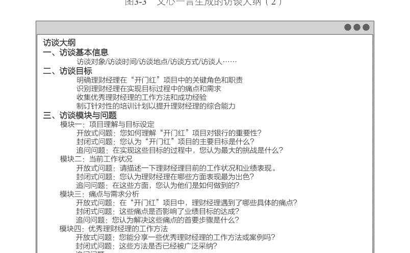
图3-4 Kimi生成的访谈大纲（2）

056


**用 AIGC 记录访谈内容**

访谈记录可借助 ASR 自动语音识别工具实现实时转写，如通义听悟、讯飞听见、飞书妙记等，部分常用会议软件也集成录制与纪要功能。选择识别率高、总结能力强且使用顺手的工具，能大幅减少手写负担，让培训师更聚焦交流与重点标记。

**用 AIGC 分析访谈资料**

ASR 转写后可做通用总结，但难以针对性提炼培训需求。完成访谈后，需将记录和笔记整理成文档，再交给支持文档上传的大模型进行定向分析。

- 手写笔记的数字化：手写要点可用 OCR 光学字符识别快速转为文本。微信拍照识别是便捷选择之一。
- 文档分析：准备好访谈记录文档后上传给大模型，配合提示词即可完成需求分析。

案例：上传银行理财总经理关于开门红的访谈记录。以 Kimi 为例，点击回形针可上传多个 100MB 文件，如图3-5所示。


提示词示例：
角色：你是一名资深培训师。
背景：上传文档为银行理财经理开门红准备的访谈记录，涵盖总经理对痛点、技能提升、培训建议的观点。
目标：从记录中提炼培训需求分析结论。
任务：撰写一份指导课程开发的需求分析报告，要求：
1. 提炼需求重点、趋势与潜在问题；
2. 给出课程开发目标；
3. 对内容、结构、形式提出建议。

模型很快输出了分析报告，如图3-6所示。

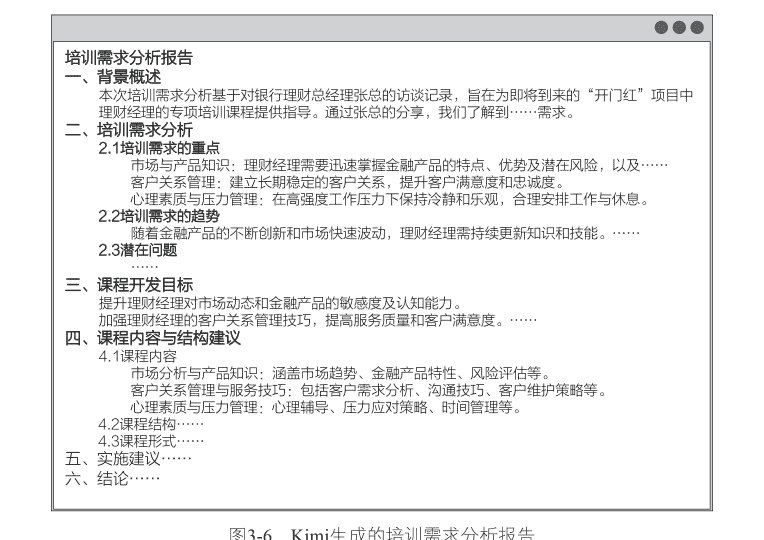

实际操作中，可按分层抽样原则访谈多层级、多部门、多特征对象，将全部记录批量上传，模型能在同一时间内产出系统性需求报告，只需在背景中说明样本范围即可。

### 第二节 问卷法如何与 AIGC 协同

问卷法通过结构化问题以书面形式广泛采集意见，优势在于覆盖面广、回收快、可量化。受访者在不受时间限制下作答，往往反馈更细致。问卷兼顾开放题与封闭题，既能捕捉共性趋势，也能保留个体化观点；匿名机制还能降低社会期许偏差。

#### 问卷实施四步走

**步骤1：设计问卷**
覆盖基本信息、学习需求、目标、偏好、期望与障碍，问题表述清晰不引导，封闭题与开放题结合。

**步骤2：分发问卷**
依目标人群选择纸质、邮件或在线平台，采用分层或随机抽样确保代表性。

**步骤3：收集与分析**
封闭题做统计分析找趋势，开放题做内容提炼找观点，综合研判需求全貌。

**步骤4：形成分析报告**
概述需求、目标与偏好，识别时间管理、技术障碍等潜在问题，并据此提出教学建议与改进措施。

#### 题型与目标灵活搭配

不同主题需要不同题型组合。技能提升适合量表题与多选题评估掌握度；管理类培训用排序题与案例题了解领导风格；新员工入职用是非题与开放题探测文化认同；客户服务用情景模拟题与多选题评估服务水平；技术类培训用单选题与填空题测熟练度；个性化学习需求用开放题与偏好排序；跨文化交流结合案例题与多选题；健康安全类用是非题与填空题确保知识掌握；创新创造力类用开放题与头脑风暴题激发思维。

一个项目常涉及多领域目标，设计时应灵活混搭题型。

#### AIGC 在问卷法中的两大用途

**用 AIGC 设计调研问卷**

继续使用 CHAT 框架：

角色：我是一名企业内训师。
背景：制造业企业正进行智能化升级，员工需掌握可落地的 AIGC 工具，但认知不足。
目标：通过问卷了解员工日常工作中适合用 AIGC 的场景及对应输出类型，以匹配工具。
任务：设计一份调研问卷，要求：
- 以单选、多选、判断为主，少量填空；
- 选择题可加补充填空；
- 覆盖多岗位场景；
- 20~30 题；
- 受访者不了解 AIGC 功能，题目应让其选择工作场景而非 AI 功能，选项由模型列出典型场景。

按此提示，讯飞星火生成了主题贴合、题型合规的问卷，并自动加上引言与结语。

## 第三章 【Analysis】用AIGC辅助调研培训需求

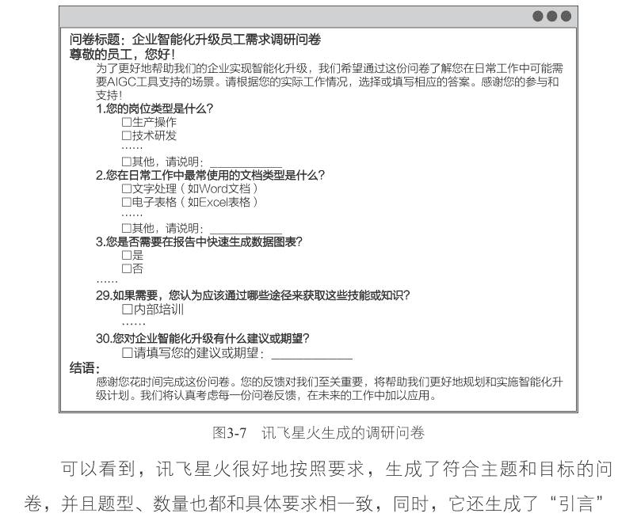
图3-7 讯飞星火生成的调研问卷

在 AIGC 基础上稍作校对即可投放，极大提升问卷生产效率。建议多模型并行生成择优使用，便于形成对各模型风格与优劣的判断。

**用 AIGC 分析问卷统计结果**

与访谈分析类似，问卷数据汇总后也可交给大模型读取分析。数据形态可能是 Excel、Word 或平台图表。当前模型对图表识别较弱，建议优先用文字文档，其次表格。若用表格，Kimi 或智谱清言表现更稳。

提示词示例：
角色：你是一名资深培训师。
背景：上传文档为制造业员工关于工作中适用 AIGC 场景及输出类型匹配工具的问卷汇总。
目标：分析数据得出培训需求结论。
任务：撰写指导课程开发的需求分析报告，要求：
1. 总结学习需求、目标与教学偏好；
2. 识别学习中的问题与障碍；
3. 提出针对性教学措施；
4. 所有结论需结合数据说明原因。

Kimi 输出的分析报告如图3-8所示。

## 第三章 【Analysis】用AIGC辅助调研培训需求

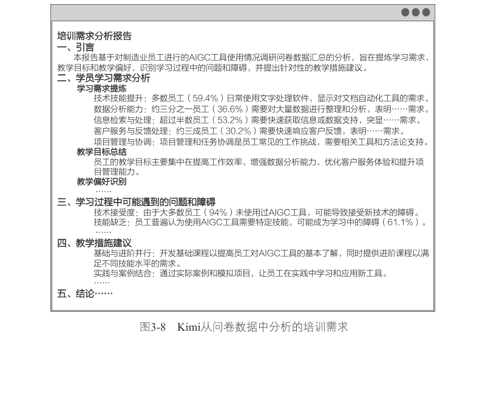
图3-8 Kimi从问卷数据中分析的培训需求

AIGC 能节省问卷设计、数据汇总与初步整理的耗时，但数据解读仍需培训师把关。部分选项高占比可能反映真实需求，也可能指向更深层问题，这需要结合经验、企业认知与行业趋势做人工洞察。

### 第三节 资料法与AIGC联动

资料法说穿了就是把组织内部已经留存的各种档案和记录搬出来做对照，从差距里看出需要补强的学习点。启动门槛低、成本也低，算得上摸底阶段的高效手段。

做法的核心是把“理想状态的依据”和“现实状态的证据”放一起看。理想侧常见的是战略规划、制度规范、行业研报、绩效目标以及职位说明书等定标类文件；现实侧则以现状分析报告、合规复盘、业务运行记录、考核结果、人员档案及求职履历为主。两边对照后出现的落差，就是后续赋能要去填补的点。

考核结果和过往赋能记录还能提供历史纵深，让判断不至于停留在主观感受。做调研时要把搜集到的材料通盘检视，判断哪些环节该补课、哪些模块需要新增。比方从业绩表现里能揪出知识或技能的薄弱处，从战略和业务诉求里能锁定赋能的优先级和方向。

资料法通常不会单独使用，多先做预研再配合访谈、问卷做深化，把结论的完整性和可信度一起拉高。

#### 资料法落地路径

##### 步骤1：锁定调查目标
开工前先把要解决的问题和边界框清楚。弄明白要回答哪些学习缺口，这些缺口对应哪些类型的材料，确保行动有针对性、能落地。

##### 步骤2：搜集整理材料
把与缺口相关的素材尽量全地收集，来源可以是内部系统、公开网络等。之后剔除无关信息，按类别归档，为后续比对做准备。

##### 步骤3：对照挖掘差距
对清洗后的素材做深度拆解，横向看数据与趋势，抓住技能差距、认知偏差、行业变化等关键信号，为课程定位提供依据。

##### 步骤4：归纳形成指引
把分析结果凝练成可操作的赋能目标和内容要点，形成对课程开发的明确指引。

#### AIGC如何放大资料法效果
大模型阅读快、分析强、上下文承载长，很适合充当资料法的“对比引擎”。如果标杆资料属于行业趋势、技术文献这类公开内容，还能借助AI搜索先做快速梳理。

#### 用AI搜索把标杆资料整理好
过去对标行业标杆，多是关键词检索、点链接、读摘要、手工归纳，效率不高。现在用AI搜索对话框输入主题，设定深度和范围，模型会直接给出整合好的分析报告。

目前常用的两款是秘塔AI搜索和天工AI。交互逻辑相近，都支持对话式提问并生成报告，还能一键导出脑图、大纲、PPT和延伸阅读。 

秘塔AI搜索整合多源链接后能产出研究报告并附带脑图、大纲、PPT生成等附加功能。天工AI体验相近，且目前都是免费可用。这样的搜索能力不仅能支撑资料法的标杆梳理，课程备课、主题整合等场景也能大幅替代传统检索。

#### 用AIGC做标准与现状的差异对比
标准资料和现状记录准备好后，可采用分步投喂的方式让模型做对比。演示工具是支持多文件上传的Kimi。

第一步，先把可被AI识别的职位说明书传上去，配上提示词：

角色：我是一个公司内部讲师。
背景：这是我们医药企业销售代表的职位说明书，后续我会再上传新入职医药代表的履历。
目标：希望得到一份能把这批新人培养成合格初级销售代表的培养缺口分析。
任务：先阅读文档要求，等我上传履历后再输出共性培养缺口分析报告。

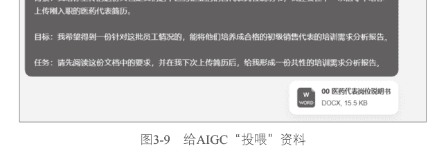
这就是常说的“投喂”，先让模型学习上下文，后续对话再基于这些材料展开。主流大模型都已支持多轮对话和较长上下文，长度也在持续提升。

投喂标准文档后，Kimi会给出确认回复。 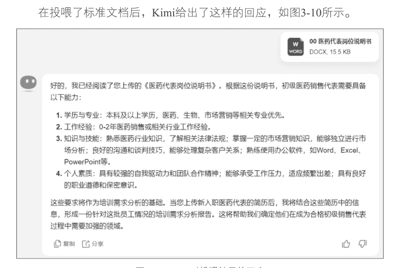

第二步，把待评估的新人履历批量上传，只需一句指令：

这些就是这批员工的履历，请帮我形成一份共性的培养缺口分析报告。

履历多为Word和PDF，体积一般在KB级。 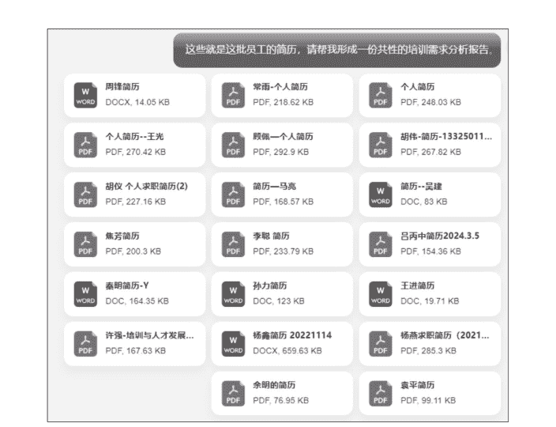 小提示：文件过大时可以先删掉图片再上传，能多塞进几个文件。

两步完成后再由Kimi输出对比结果，差异点、共性方向和建议主题都清晰可见，可直接据此设计课程。 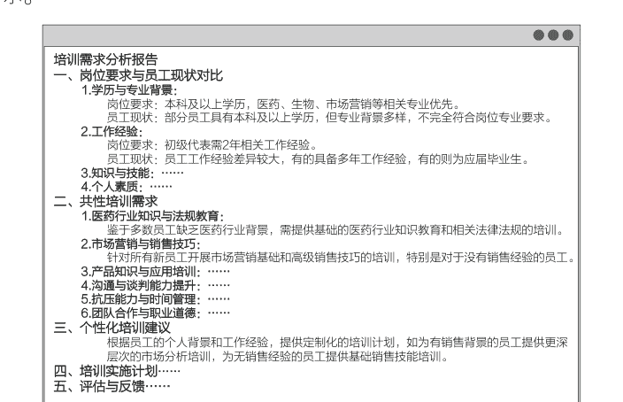

把资料法与AIGC结合，能快速从海量标杆文档和现状记录里抽取关键信息并做深度比对，提升效率的同时也让结论更准更实用。AI的搜索整理能力还简化了资料收集，让人更聚焦分析与决策。

当然，AI再强也替代不了专业判断。学习缺口不仅是数据对比，还涉及组织文化、人员特质和业务环境，需要人工审慎评估模型输出。

### 第四节 观察法与AIGC配合

当要分析的缺口体现在外显的行为和表现上，观察法就很适用。它直接在工作现场、学习场景里记录学员或员工的行为问题，通过知识、技能、态度层面的差距反推内容和目标。

观察法的长处是直观、能拿到第一手资料，主观干扰少、针对性强。短板是耗时、容易受观察者影响，对复杂心理行为的捕捉也有限。

#### 观察法实操五步

##### 步骤1：界定观察目标与边界
根据组织实际需求界定要解决的具体问题，明确观察时段、地点和对象。

##### 步骤2：制定详细观察方案
设计或选用观察表、记录本等工具，选择直接、隐蔽或参与式观察方式，确定频次，安排具备经验的观察员，必要时先培训，并明确数据采集与记录规范。

##### 步骤3：实施观察并记录
按方案实地观察，客观详细记录现象、关键事件、行为表现和环境特征，注意保护隐私，避免主观臆断。

##### 步骤4：整理与分析观察数据
把原始记录分类编码，转化为可分析形态，用统计、案例研究等方式提炼出知识、技能、态度层面的问题与优势。

##### 步骤5：撰写观察报告
形成结构清晰的报告，包含目的背景、方法过程、结果呈现、问题诊断和赋能建议，为决策提供依据。

#### AI在观察法中的三种增益
AI可辅助编制方案、设计清单、分析数据。

#### 用AI生成观察方案
一份完整的方案需涵盖目标、范围、工具、方法、频次、人员要求。以酒店前台服务提升为例，向模型输入目标和范围后让其生成方案，提示词示例：

角色：我是一个公司内部讲师。
背景：我的企业是酒店，今年要重点提升前台服务态度与技能，需要开设针对性课程。
目标：两周内通过观察法，白班夜班分别观察当值前台，获取培养缺口。
任务：请编制一份详细观察方案，包含目标范围、工具、方法、频次、人员要求等。

用智谱清言生成后得到一份较为完整的方案。 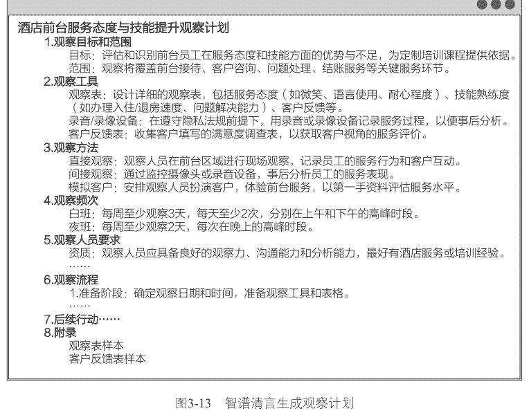
图3-13 智谱清言生成观察计划

方案中提到的附录、观察表样本等有时不会自动给出，可以继续追问补全。

#### 用AI设计观察清单
可以直接在原对话里追问生成附录，或新开对话明确清单构成。提示词示例：

请帮我设计观察表，包含观察项目、行为标准、观察要点、评估方法、评估标准，以表格形式输出。

模型会给出清单及说明，如仪表仪容、微笑服务、语言使用、耐心程度、办理速度、问题解决、客户反馈等维度，每项配标准、要点、评估方式和评分规则。

实际使用时可把清单导入Excel，后方增加列用于多员工打分。

#### 用AI分析观察数据
观察完成后把记录整理成结构化表格，让AI做分析得出缺口报告。这里以85名前台员工的评分表为例。

表3-1 用AIGC生成的观察记录表格

| 观察项目 | 行为标准 | 观察要点 | 评估方法 | 评估标准 | 1 | 2 | 3 | …… | 85 |

在上传前注意表格结构化，避免过多合并单元格，尤其是跨列合并，数值列保持数字格式而非文本。 

图3-15 智谱清言上传表格操作

提示词示例：

角色：你是一个内部讲师。
背景：表格里是85名酒店前台员工服务态度与技能的观察评分。
目标：据此分析得出培养缺口。
任务：请撰写培养缺口分析报告，要求数据详析、结构完整、给出可行的赋能建议。

模型先运行代码提取分析数据。 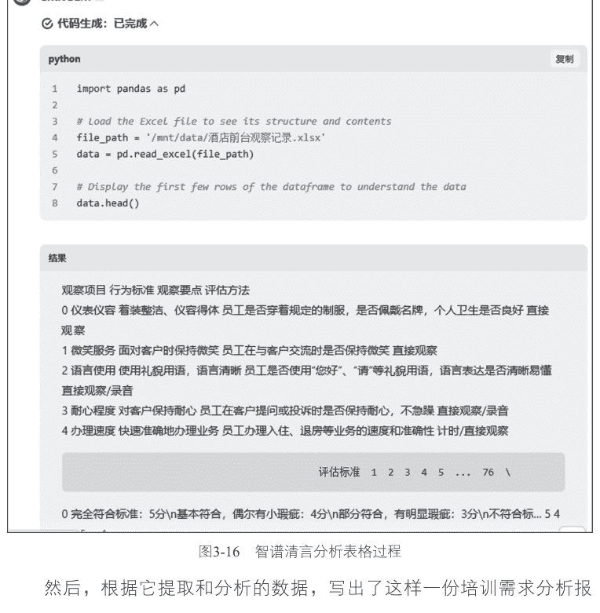

随后输出完整的培养缺口分析报告，指出各维度表现、短板、重点与兼顾全局的需求，并给出针对性建议。 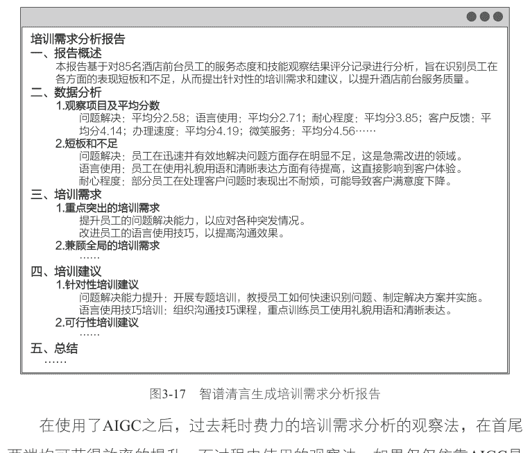

图3-17 智谱清言生成培训需求分析报告

AI让观察法的前后两端效率显著提升，中间的现场观察仍需人来完成。结合视觉识别与AI分析，例如智能巡店系统用摄像头、传感器自动捕捉员工陈列、服务态度、沟通方式并结合客流动态调度巡查，可进一步放大观察法的深度与广度。

## 第三章 【Analysis】用AIGC辅助调研培训需求

AIGC在资料法与观察法中已经展示出辅助调研的能力，接下来要把需求转化为设计。

## 第四章 【Design】用AIGC升级课程设计

第三章已经讲清了培养缺口分析的价值与做法。精准的缺口是课程成功的基石。

在方向和目标明确后，下一步就是把需求落地为课程设计。本章将探讨教学设计的意义、价值、规范流程，以及如何借助AIGC升级优化设计过程。

### 教学设计在课程开发过程中的价值
教学设计是把学习需求转化为实际教学活动的过程，既是技术也是创造性实践。它是连接需求与教学的桥梁。

一次优秀的教学设计应当能够：

#### 明确教学目标，提升教学针对性
教学设计首先要把学员的学习需求和预期成果写成清晰目标。目标明确后教学有方向，学员也有焦点，效率与效果都会提升。

#### 优化内容组织，促进知识建构
教学设计强调系统规划与结构化处理，把复杂知识拆成易理解、相互关联的学习单元，帮助学员逐步构建知识体系。

#### 多样化教学策略，增强学习动力
结合讲授、讨论、案例、实操等多种手段，匹配不同学习风格，激发兴趣与好奇心。

### 教学设计的主要工作内容
在ADDIE模型中，教学设计是核心环节。主要工作包括：

#### 设定教学目标

完成培训需求诊断之后，下一步就是围绕需求制定既贴合实际又遵循SMART原则，具体、可衡量、可达成、相关、有时限的多层级教学目标。

#### 梳理课程结构
依据已确定的教学目标，对课程主题进行模块化拆解，通过系统化整理形成条理清晰、层级分明且与目标匹配的课程大纲。

#### 收集课程内容
针对大纲中的每个模块准备合适的知识素材，确保这些内容能够支撑教学目标的实现。

#### 设计教学策略
结合教学目标与教学内容，设计合理的教学方法，让知识以恰当的方式被有效传递，从而达成预期目标。

上述四项核心教学设计工作，都能借助AIGC来加速推进。本章会逐一讲清每项工作的具体要求，以及AIGC在其中的实践用法。

### 第一节 目标先行——用AIGC辅助设定课程教学目标

不妨回顾一下过往教学或工作中的常见场景：讲完一个知识点后满怀期待地问一句“学会了吗”，对方犹豫一下回答“学会了”。这种对话真的能说明掌握情况吗？答案是否定的。因为“会”与“不会”缺乏可检验的标准。课程设计时就需要预设一个“学会”的明确状态，通过学员可观察的行为表现及其程度来判断是否达标。

第二章介绍过经典的ABCD教学目标模型，用受众、行为、条件、程度四个维度来界定“学会”的标准。具体说明如下：

**A 受众**
指课程的参与者，即教学对象。目标中要写清学员身份，只有明确对象，才能依据其现状、工作环境与技能基础进行针对性设计。

**B 行为**
是目标的核心，要用动词描述学员学完后能做出的具体行为。为便于观察测量，动词应是外显可观测的，如“复述”“解释”“说明”等。诸如“理解”“感受”“知道”“了解”这类内部状态词则不合适。

**C 条件**
指行为发生时的情境与限制，包括所处环境、使用工具、面对对象、问题清晰度等。不同条件会带来行为差异。

**D 程度**
指对行为结果的量化要求，用于判定是否达标。通常以数量、时间、准确率、速度等维度呈现，必须可衡量。

#### 设定课程教学目标的注意事项

除了四要素要写对，还要兼顾现实性、关联性与层级性。

##### 教学目标四要素的正确性
受众要聚焦明确，行为要用外显动词，条件不可缺失或错误，程度必须可测算。

##### 教学目标的现实性
目标不能拔高到无法实现的程度，要结合课程容量和可预期效果来设定。

##### 教学目标与培训需求的关联性
课程开发的依据是培训需求分析，课程存在的意义是弥合现状与理想的差距，因此目标必须与需求分析结果相呼应。

##### 多级教学目标的层次性
一门课程要有总目标，每个模块要有二级目标，每个小节可设三级目标。三个层级要上下贯通、相互支撑。

层级数量与课时并非固定，会受课程性质、设计原则、学员认知水平、内容复杂度影响。为便于记忆，可参考：二级目标一般控制在3到7个，约1课时对应1个二级目标；每个二级目标下通常设计2到5个三级目标。这样既保证具体可操作，又避免目标过多导致混乱。

#### AIGC 在设定教学目标中的应用

经测试，大多数大语言模型内部都有关于ABCD教学目标的资料。但直接让模型撰写目标，常出现不规范问题：动词不够外显、受众模糊、条件缺失、程度无法衡量等。

更稳妥的做法是分步投喂。先把撰写标准及正确范例喂给模型学习；再上传培训需求分析报告并给出明确要求，让其生成分级目标；最后人工评估修订。

##### 整理标准资料投喂AIGC
先整理一份ABCD撰写规范的本地文档上传，并配合提示语让模型学习：

> 我上传的文档是教学设计中ABCD教学目标撰写规范，请先阅读学习，下一条我会提供培训需求分析报告，需要你按规范帮我撰写分级教学目标。

模型回应后，投喂阶段完成。

##### 上传培训需求，生成教学目标
随后让模型依据需求分析结果和课程要求生成分级目标。以第三章问卷法获得的制造业员工AIGC工具应用培训需求为例，上传给Kimi并提示：

> 角色：资深企业内训师
> 背景：上传文档为上述培训需求分析报告，我要据此设计3小时面授内训
> 目标：明确课程各级教学目标
> 任务：分层撰写细化到三级的教学目标，要求：1.一级为总目标，二级为各章目标，三级对应各小节；2.各层级均符合ABCD原则，行为用可观测外显动词，条件需描述行为发生的情境。

Kimi给出的结果如图4-1所示。

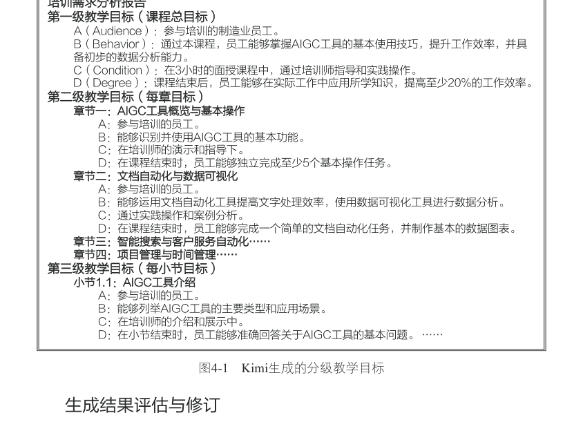

图4-1 Kimi生成的分级教学目标

##### 生成结果评估与修订
AIGC完成后必须评估。案例中这份目标存在问题：

第一，混入无关内容。第四章出现项目管理与时间管理相关表述，与课程主题关联弱。
第二，排序不顺手。大纲未采用线性结构，并非二级目标后紧跟其三级目标，而是先列完所有二级再列三级。
第三，撰写不规范。目标以四个要素分开罗列，未整合为完整陈述，部分要素错误且彼此关联薄弱或重复。

这恰是常态，AIGC的输出往往不完美。应用第三级能力就是能准确判断对错、有效修正。既不能全盘接受，也不能全盘否定，要据错反推输入或通过追问调整输出。

例如无关内容的出现源于需求报告中本身提及，可删改报告或调整提示词。若不讲这些内容，直接忽略多余目标也可。排序问题只需在提示词中增加生成顺序要求即可。撰写规范问题则需优化投喂资料，并凭借自身对规范的认知在生成结果上做精准修订。

### 第二节 结构清晰——用AIGC辅助梳理课程大纲

在生成并人工校对各级教学目标后，我们获得的只是内容主题的分层罗列，还不是课程大纲。需要在此基础上进一步细化，补充必要环节，形成能有效达成目标的大纲。

梳理时可参考两大模型：

- 金字塔原理：课程从整体到局部都应遵循的基础模型，能让大纲逻辑清晰。
- 库伯学习圈：更贴合学习习惯的模型，能提升学习体验。

#### 金字塔原理
课程开发时用金字塔原理梳理大纲，可显著提升逻辑性与清晰度。

四大原则：

##### 结论先行
设计之初先明确核心结论或观点，让学员快速抓住重点，形成整体认知框架。

##### 以上统下
每个子论点都要对上一层起到支撑与解释作用，使各部分联系可见。

##### 分组归类
将相关知识点归组，避免杂乱，便于理解记忆与构建知识体系。

##### 逻辑递进
按流程、重要度、难度等顺序展开，顺应认知规律与学习特点，逐步建构理解与应用能力。

补充环节后可绘制课程金字塔结构图，如图4-2所示。

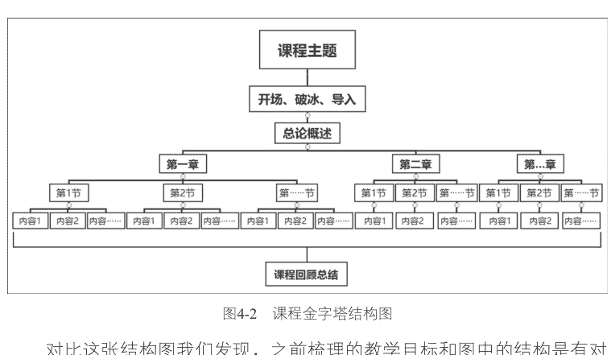

图4-2 课程金字塔结构图

对照发现，教学目标对应总论、章、节，但缺少开场、破冰、导入、回顾总结等环节，也未展开节内具体内容。因此梳理结构时要在目标基础上展开三级目标、补全必要环节并转化为标题。

#### 库伯学习圈
金字塔之外，还需考虑学习习惯。库伯学习圈如图4-3所示，学习是一个循环，由四个阶段构成：具体经验、反思性观察、抽象性概念、主动实践。

##### 具体经验
通过直接或间接体验获得原始素材，如实际操作、观察、参与活动。

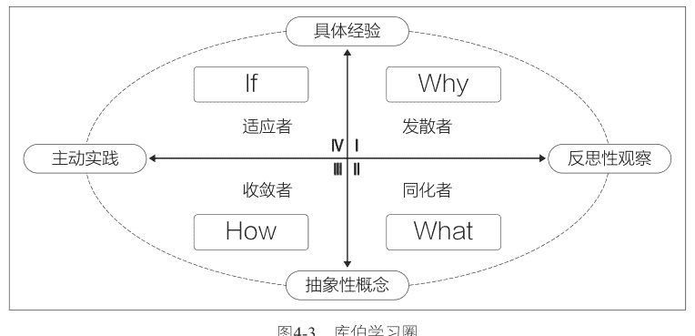

图4-3 库伯学习圈

##### 反思性观察
对经验进行多角度观察与反思，提取信息与教训。

##### 抽象性概念
将反思结果系统化、理论化，形成抽象概念与规律。

##### 主动实践
把抽象概念应用到新情境，通过行动检验与巩固。

四个阶段互为支撑，只有完整经历才能真正掌握能力。

学习起点取决于风格。学习圈映射出四类学员：

##### 发散型学员
习惯先找学习理由，从具体经验中感知信息并加工，理由充足时学习动机强。

##### 同化型学员
习惯先了解理论概念，用抽象思维整理信息，需要细节化、顺序化的教学。

##### 收敛型学员
习惯从主动实践开始，将抽象理论与实践结合，关注实际问题与操作。

##### 适应型学员
具有冒险尝试倾向，从具体经验出发，通过教授他人、变换场景等方式探索，思维灵活。

最佳起点对应象限：发散型从反思性观察开始，同化型从抽象性概念开始，收敛型从主动实践开始，适应型从具体经验开始。四类对应的内容类型可概括为Why、What、How、If。无论起点如何，都要完整走完四个阶段。

实际课程面向多类学员，起点只能有一个。建议从“Why”开始，先让学员理解学习目的与意义，激发兴趣，为后续学习提供保障，对各类主题均适用。

#### 规范的课程结构大纲
明确金字塔原则与库伯学习圈起点后，规范完整的课程结构大纲就基本成形。金字塔是刚性要求，库伯学习圈应用灵活，可用于章节顺序、章节内部小节顺序，或嵌套使用。

图4-4与图4-5是可参考的结构示例。

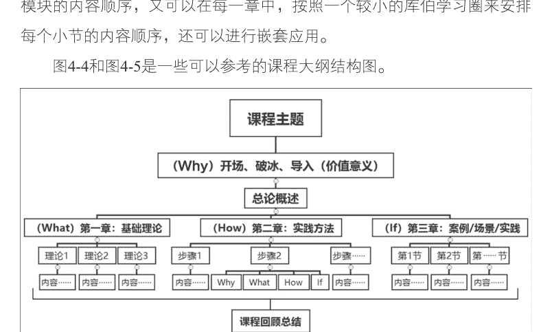

图4-4 双模型结合的通用课程结构图

#### 用 AIGC 辅助梳理课程大纲的实操
使用AIGC梳理大纲前，先厘清输入输出：手上有哪些资料，模型知道什么、不知道什么，需要提供什么输入与要求。

当前已知：三级教学目标、课程主题、时长、受众范围；需遵循的原则：金字塔原理、库伯学习圈；需遵守的规范：完整大纲模块、细化到四级标题。

若在同一对话窗口，模型已掌握目标与基本信息，可直接追问。若开启新窗口，则需整理成文档投喂。

金字塔与库伯学习圈多数模型有所了解，但深度不同，可投喂基础文档或提出具体要求。

完整模块与四级标题规范需明确告知模型。

可在生成目标的对话中继续追问：

角色：资深教学设计师
背景：你刚才生成的三级目标中前三章可作为课程内容，时长不变
目标：据前三章教学目标梳理课程结构
任务：输出课程大纲，要求：1.补全开场、破冰、导入、概述、回顾总结等必要环节；2.细化到四级目录：课程主题、章标题、节标题、内容标题；3.遵循金字塔原理；4.内容顺序遵循库伯学习圈，从导入开始按Why、What、How、If组织全课各章。

Kimi给出的大纲如图4-6所示。

对这份大纲你如何评价？请用百分制打分，指出扣分原因与具体内容，再据理解修改，以期达到满分。

### 第三节 内容充实——用AIGC展开整理课程知识与各类内容

目标明确、大纲清晰后，下一步就是准备支撑目标达成的具体知识内容。

课程知识可按多种维度分类：按性质分显性与隐性，按功能分描述性、规范性、因果性，按形式分概念性、原理性、程序性、关系性等。

按来源划分，课程内容通常来自三类：实践经验萃取、内部文件转化、外部资料内化。

#### 实践经验萃取
从个人或集体经验中提炼有价值信息的过程，能把隐性知识转化为可记录传播的显性知识。

在技能型、操作型或问题解决型课程中，这类知识来源尤为重要，可获取公开渠道难得的专属经验，形成组织的核心竞争力。

经验萃取：让隐性操作变成可复制能力

把复杂的工作拆成可复用的单元，是萃取经验的关键思路。在企业内训实践里，最稳妥的路径是任务分析法，用流程化步骤把隐性操作显性化。

把任务拆解落地的四个动作

第一步 明确任务定义
一次能产出结果的最小工作单元可称作任务。描述建议采用动作+对象+限定条件的结构，例如“结算顾客购买商品的货款”，其中结算为动作，货款为对象，顾客购买商品为限定。
任务厘清后，还要锁定执行主体。执行主体既是萃取时选择标杆的依据，也是课程的受众。比如结算货款的执行者是超市收银员，对资深收银员进行提炼后，成果即可用于更广泛的收银培训。

第二步 确定任务边界
任务必须具备清晰的起止点和可衡量的产出，因此要界定开始、结束、输入、输出。
起止点限定时间边界，可用时机或标志性动作表示。结算货款的开始可定为顾客抵达收银台，结束可定为顾客离开收银台。
输入输出是任务加工的对象，输入经处理变为输出。示例中输入是未结账商品，输出是货款已成功收取。

第三步 依作业顺序拆解为执行链
按照真实操作顺序把任务拆成三到七个颗粒度相近的步骤，同样可用动作+对象+限定的写法，必要时可省略限定。
以结算货款为例，可拆成迎客、拣货扫码、收结货款、装货送客四个环节。

第四步 逐环节提取可用知识
任务拆解后即可针对每一环节提取支撑知识，即该环节的应知应会、偏差处理与效率诀窍。应知应会是必须掌握的知识与技能；偏差处理是执行中可能出现的异常及解决办法；效率诀窍是提升效率、改善效果或降低成本的经验。
把任务纵向切片、横向网格化后逐单元萃取，难度会大幅下降。最终可形成任务分析萃取表，如图4-7所示。

内部文件怎样转化为课程素材
很多课程内容源自企业内部文件，不能直接搬用，需要按教学目标进行加工，把抽象概念、复杂操作指引和企业文化战略转化为易懂易用的学习材料。

产品理论场景化
将理论与真实使用场景结合，让员工不仅知道产品是什么，更掌握怎么用。研发要依据市场需求设计优化，一线要掌握安全与质量控制，销售要学会精准推荐，售后要高效维修保养，最终这些知识还要传递给客户。

操作手册演示化
图文手册难以完全呈现操作细节，转化为视听呈现效果更好。可采用TWI-JI工作指导模式，按准备、传授、练习、验收四个环节，结合视频演示与实操，让员工直观理解流程。复杂或危险工序通过动态展示与模拟，误操作风险更低。

企业文化具象化
文化不是墙上口号，而是价值观与行为准则的体现。通过真实案例展示客户至上、诚信进取、国际视野等理念，让抽象变得可见，再以明确标准和可衡量结果推动知行合一，形成积极氛围。

组织战略关联化
战略需层层分解为部门和个人的具体指标，并通过培训让员工理解工作的意义与对组织目标的贡献。把个人绩效与组织战略挂钩，能统一方向、激发积极性。

规章制度行为化
制度要落实为日常行为。把条文提炼为具体做法，讲清应做什么、不应做什么及奖惩，并用正反案例加深理解，促进合规与文化传承。

外部资料如何内化
外部资料是课程的新鲜血液，主要有图书、网络和公开课。

图书资料
经典图书系统性强。选书看作者权威性、出版时效性和出版社信誉。转化时把握前言、目录和代表章节，重构逻辑框架，把理论拆成可落地知识点，避免断章取义。

网络资料
覆盖面广、更新快。借助社交网络、专业论坛、行业博客和在线课程平台获取针对性信息。

公开课资料
公开课是开放的高质量资源。挑选与企业需求匹配的内容转化，能快速提升专业素养。

生成式AI在课程准备中的作用
对三类课程来源，生成式AI都能提供不同程度的帮助。实践经验萃取因其专属性和隐性经验，在大模型里匹配度低，主要提供参考建议；内部文件转化和外部资源内化则可借助文件分析和智能检索快速成稿。

生成式AI助力经验提炼
任务分析法中生成式AI难以直接给出专家的隐性经验，但在输入方法要求后，可提供类似工作的参考内容供人工修订。
例如把任务分析法整理成文档提交给Kimi，提示角色是银行内训师，要为“为用户办理基础业务”课程萃取“为用户办理开户”所需知识点，要求输出任务名称和执行人、开始结束标志及输入输出、每步对应的应知应会、偏差处理、效率诀窍。Kimi会给出框架化结果。
让资深内训师评价后发现，答案框架可用、思路可参考，且能清晰识别人工加工的边界。这体现了场景拆解能力：把复杂问题拆解后与AI分步共创。
也可以先自拆任务描述、边界和步骤，再让AI逐步提炼；或在AI内容不够细时追问展开，如“银行接待礼仪这个知识点，帮我展开讲解一下”。

用生成式AI重塑内部文件
把待转化的内部资料提交，告知受众、主题、讲解范围和要求，即可快速提炼。例：用文心一言处理车间新员工入职安全和纪律制度，要求不直接摘录条文，而是关联受众行为，说明允许、鼓励、禁止做什么及奖惩，并提取针对受众的知识要点。生成结果可直接用于培训。

用生成式AI内化外部资料
传统内化耗时耗力，生成式AI可代劳基础整理。借助AI检索收集资料，再针对主题整理内容。
如开发团队管理课程，工作安排技巧是常见知识点。用天工AI检索后，从多个网页中整合出要点，包含技巧概述和深度研究。

## 第四章 【Design】用AIGC升级课程设计

## 团队管理中的工作安排技巧

以下内容由AI生成，仅作参考

研究模式 完成全网搜索，参考24个信源并总结

回答

在团队管理中，有效的工作安排是确保项目按时完成和团队效率最大化的关键。以下是一些基于最新搜索结果的工作安排技巧：

#### 明确目标和计划

制定明确的项目目标和详细的工作计划，包括任务的起止时间、工作量和优先级。确保每个团队成员都清楚自己的任务和项目的整体方向。

#### 了解团队成员能力

根据团队成员的专业技能、经验和兴趣分配任务，这有助于提高工作效率和成员的工作满意度。

#### 分配合理的工作量

避免任务集中在少数成员身上，平衡工作负荷，以提高整个团队的效率。

#### 提供明确的工作指导

确保团队成员了解任务的具体要求和预期结果，提供必要的支持和资源。

#### 鼓励团队合作

建立有效的沟通机制，鼓励团队成员之间的合作与交流，共享信息和资源，促进任务的高效完成。

#### 监控和调整

定期检查任务进度，及时调整计划以应对可能出现的问题，确保项目按计划进行。

#### 激励和认可

对团队成员的工作表现进行及时的反馈和奖励，以激励他们的积极性和努力。

#### 持续改进

根据项目的实际情况和团队的反馈，不断调整和改进工作安排策略，以适应变化的需求和情况。

通过实施这些技巧，团队管理者可以更有效地分配和管理工作任务，从而提高团队的整体表现和项目成功的可能性。

图4-13 天工AI整合结果——初步

## AIGC培训师课程开发全攻略

——MAP模型让课程开发更高效

#### 深入研究

#### 如何根据团队成员的专业技能和兴趣分配任务？

根据团队成员的专业技能和兴趣分配任务是确保项目成功的关键步骤。以下是根据搜索结果得出的具体方法：

1. **了解团队成员的能力和兴趣**：在分配任务之前，应充分了解每个成员的专业背景、技能和兴趣爱好，这有助于将任务分配给最适合的人员，提高工作效率和质量。

2. **制定明确的任务目标**：确保每个任务都有明确的目标和预期结果，这样团队成员可以理解任务的重要性和优先级，并知道如何完成任务。

3. **考虑资源和时间限制**：在分配任务时，要考虑团队可用的资源和时间限制，避免任务分配不合理导致的工作过载或资源浪费。

4. **多样化的分配原则**：可以根据团队成员的专业领域分配任务，也可以根据任务的紧急程度和重要性进行分配，确保关键任务得到优先处理。

5. **监控任务进展和提供支持**：分配任务后，项目经理需要监控任务的进展，并为团队成员提供必要的支持和帮助，及时调整任务分配以应对项目变化。

6. **建立有效的沟通渠道**：确保团队成员之间有良好的沟通和协作，及时共享进展、问题和解决方案。

7. **灵活调整人员分工**：在项目进行过程中，根据需要和团队成员的能力进行重新分派，以适应新的情况。

8. **定期评估和反馈**：通过定期的绩效评估和反馈，了解团队成员的表现和进展，并对人员分工进行调整和改进。

通过上述方法，可以确保任务分配既能发挥团队成员的专业优势，又能激发他们的工作热情，从而提高团队的整体表现和项目的成功率。


而输出的结果下，同样有脑图、大纲和生成PPT的功能，如图4-15所示。

## 第四章 【Design】用AIGC升级课程设计

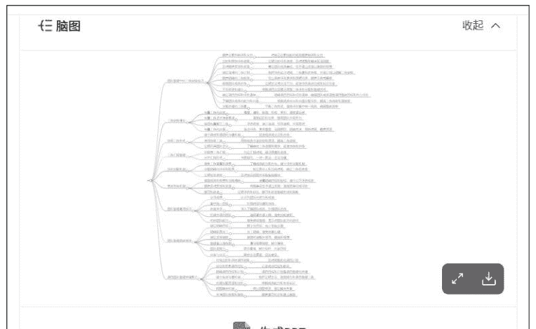

生成PPT

### 团队管理中的工作安排技巧

- 提供必要的培训和支持

- 监控和跟踪任务进展

- 及时提供反馈和奖励

- 制定详细的工作计划

- 提供明确的工作指导

- 鼓励团队成员合作

- 不断改进和适应

- 确定项目目标和任务清单

- 了解团队成员的能力和兴趣

图4-15 天工AI附加功能

除检索外，图书、论文、报表等也可整理成文档，用类似内部文件转化的提示词，让生成式AI按受众、主题和要求提炼内容。

在熟练掌握内容萃取方法并用好AIGC工具后，课程素材的收集和整理会变得高效。但要记住，AIGC能提速，人的判断与经验仍是保证准确性和实用性的关键，使用时需审慎修订。

## 第四节

策略得当——用AIGC丰富课程教学策略

目标设定、大纲梳理和内容收集完成后，若只是平铺直叙，价值会打折一大半。课程设计需要规划教学顺序和方法，即教学策略，让内容更有效地达成目标。

教学设计里，加涅教学九步法和五星教学法是两大经典，可借助AIGC提升设计效率。

#### 加涅教学九步法

# 从九步到五星，让 AI 参与策略配课

美国教育心理学家罗伯特·加涅在《教学设计原理》第十章对学习历程做了拆解，并据此归纳出九个可操作的教学事件，构成广为采用的九步设计模型。核心脉络是：

1. 引起注意：以提问或抓人眼球的示例把学习者的注意力集中过来。
2. 告知目标：把本课期望达到的学习成果事先讲清。
3. 激活记忆：引导回忆相关的既有经验，为新知识的建构做准备。
4. 呈现内容：用清晰简洁的方式把核心知识点交到学习者手中。
5. 提供指导：在学习过程中给予提示与支架，助其理解。
6. 诱发表现：安排实践环节，让学习者动手应用以加深掌握。
7. 提供反馈：对表现进行正向或纠偏性的即时回馈，帮助判断进展。
8. 评价表现：通过测验、作业等形式检验对内容的掌握程度。
9. 促进转化：借助复习、拓展与练习，推动知识跨场景迁移并强化记忆。

每个教学事件都可匹配具体手段，下表汇总了常用手段与九步法的对应关系。

表4-1 常用的教学策略和对应的教学事件匹配表

| | 提问 | 测试 | 讲故事 | 讲解 | 举例 | 示范 | 练习 | 点评 | 回顾 | 作业 |

|---|---|---|---|---|---|---|---|---|---|---|

| 引起注意 | √ | √ | √ | | √ | | | | | |

| 告知目标 | | | | √ | | | | | | |

| 激活记忆 | √ | √ | √ | | | | | | | |

| 呈现内容 | | √ | √ | | | | | | | |

| 提供指导 | | | | √ | √ | √ | | √ | | |

| 诱发表现 | √ | √ | | | √ | | √ | | | |

| 提供反馈 | √ | √ | | √ | | | | √ | | |

| 评价表现 | | √ | | | | √ | | √ | | |

| 促进转化 | | | | | | | | | √ | √ |

落地时可沿课程大纲逐条把标题对应到教学事件，再为每个事件挑选适配的教学手段。

## 五星教学法

戴维·梅里尔提出的首要教学原理，俗称五星教学法，在企业内训中应用广泛。框架以问题为中心，向外展开四个递进阶段并形成循环：

1. 聚焦问题：以真实工作情境切入，点燃好奇心并明确学习意义与目标。
2. 激活旧知：调动学习者已有的相关经验，帮助新旧知识建立联系。
3. 展示新知：通过案例、论证或演示把新概念或技能具体化。
4. 应用新知：在受控情境中提供练习机会，加深理解。
5. 融会贯通：引导反思与综合运用，使新知融入知识体系，实现灵活解决实际问题。

各阶段常用的配套做法大致如下：

1. 聚焦问题：抛出挑战性问题促深度思考；用案例研讨锁定核心；情景演练还原现场。
2. 激活旧知：用启发式提问或情境激发兴趣；回溯相关已学内容；分享个人经历或故事；借助真实问题识别已知点。
3. 展示新知：直接讲解新概念或流程；配合多媒体呈现；演示解决步骤；引入专家观点。
4. 应用新知：设计模拟练习或角色扮演；组织小组讨论；提供题集或案例；尝试游戏化学习。
5. 融会贯通：鼓励反思并探讨跨场景应用；布置行动项目或研究报告；安排实习或实地考察；组织成果展示。

使用时同样可按大纲把各标题归入对应阶段，再选择合适的策略匹配。

### 生成式 AI 在策略丰富中的作用

教学设计的后期，基础资料已基本成型。此时只需校准或提供方法规范，再输入课程大纲，就能借助生成式 AI 快速匹配教学策略。匹配完成后，还可依据策略对内容形态做针对性改造。

#### 方法校验或知识投喂

加涅九步法和五星教学法都是经典范式，但并非所有大模型的训练库都完整收录。建议先询问模型是否熟悉所选方法，据此判断掌握程度，如图4-16和图4-17所示。

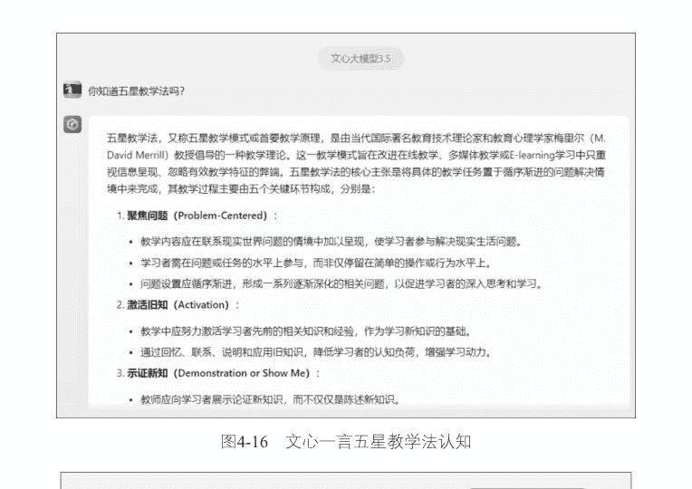

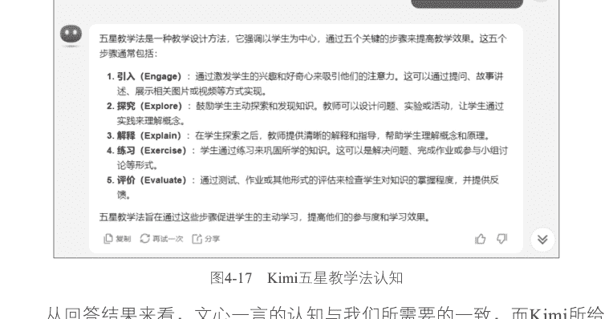

从反馈看，文心一言的理解与预期一致，而 Kimi 给出的并非我们要用的五星教学法。若模型不熟悉，可更换已知模型，或先把标准方法整理成文档上传供其学习，再在下一指令中要求按此方法设计策略。

#### 交大纲生成策略表

方法确认后，可把大纲交给生成式 AI 生成策略表。以熟悉五星教学法的文心一言为例，基于本章第二节生成的大纲进行设计。参考提示词为：

角色：你是一个精通五星教学法的教学策略设计大师。

背景：上传的文档中有一份包含三个课时的课程大纲。

目标：你需要根据这份课程大纲设计每节课的教学策略。

任务：请依次输出三个课时各自的教学策略设计表，具体要求如下：

1. 按照五星教学法的教学阶段来排列大纲顺序。

2. 以表格的形式输出，表格各列依次为序号、教学阶段、时间、教学内容、教学方法、教学资料。

最终，文心一言为每个课时输出了教学策略设计表，如图4-18所示。

| 序号 | 教学阶段 | 时间 | 教学内容 | 教学方法 | 教学资料 |

| :--- | :--- | :--- | :--- | :--- | :--- |

| 1 | 聚焦问题 | 5分钟 | 引入AIGC工具在工作中的应用场景 | 情境模拟，展示实际案例 | AIGC工具应用视频、工作场景图片 |

| 2 | 激活旧知 | 10分钟 | 回顾自动化、智能化技术基础 | 小组讨论，分享经验 | 自动化、智能化技术基础PPT |

| 3 | 展示新知 | 20分钟 | AIGC工具简介与重要性 | 培训师讲解，PPT展示 | AIGC工具介绍PPT、演示视频 |

| 4 | 应用新知 | 15分钟 | 分析AIGC在制造业的应用案例 | 案例分析，小组讨论 | 制造业AIGC应用案例资料 |

| 5 | 融会贯通 | 10分钟 | 总结AIGC工具的实际效益 | 总结讨论，Q&A | 课程总结PPT，互动问答环节 |

| 序号 | 教学阶段 | 时间 | 教学内容 | 教学方法 | 教学资料 |

| :--- | :--- | :--- | :--- | :--- | :--- |

| 1 | 聚焦问题 | 5分钟 | 引入文档处理与数据可视化的挑战 | 展示常见问题场景 | 文档处理与数据可视化挑战视频 |

| 2 | 激活旧知 | 10分钟 | 回顾办公软件基础操作 | 提问，快速回顾 | 办公软件基础操作手册 |

| 3 | 展示新知 | ...... | ...... | ...... | ...... |

第三课时：智能搜索与推荐系统……

图4-18 文心一言生成的教学策略表

#### 依策略改造内容

策略确定后，不同手段对内容呈现有不同要求，需要据此改造素材。例如示例表的首课时聚焦问题环节要求展示真实案例，生成式 AI 建议用视频呈现，于是可把收集的资料视频化。

以“AIGC在制造业中的应用案例”为检索词，用秘塔搜索整理出约3000字的详述后，将文档上传给生成式 AI，配合视频文案改造的提示词：

角色：你是一个教学视频文案大师。

背景：你要为一门“高效工作技能提升：AIGC工具应用”的课程准备一段视频素材，来向学员展示AIGC在制造业中的应用场景，上传的文档中是这个主题对应的详细内容，你可以参考。

目标：视频素材要能够让学员聚焦了解AIGC工具在制造业中的具体应用场景，并意识到AI时代已经到来。

任务：请写出这段视频素材的文案，具体要求如下：

1. 文案内容要基于上传的文档中的内容。

2. 文案讲稿的总字数控制在800~1000字。

3. 语气要亲切，措辞要有鼓励性。

生成式 AI 即可生成符合要求的视频文案。此类撰写属于大模型的通用基础能力，多数模型都能给出不错的结果。以下是腾讯元宝的输出示例，如图4-19所示。

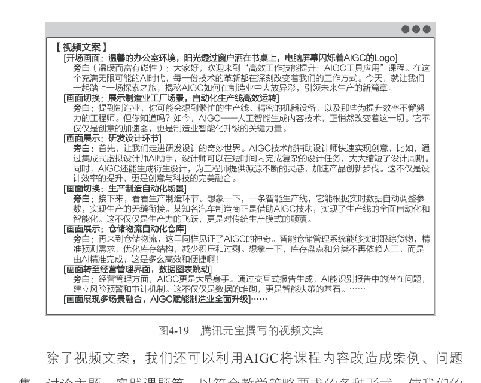

图4-19 腾讯元宝撰写的视频文案

除视频文案外，还可借助生成式 AI 把内容改造成案例集、题目集、讨论议题、实践课题等多种形态，以满足策略要求。生成式 AI 生成的策略仍需人工审核与校准，确保契合学习者特征与课程目标。


## 第五章 【Development】用AIGC制作课程资料

在 ADDIE 模型的开发环节，需依据设计结果制作授课配套资料。常规课程至少需要授课 PPT，规范课程还需培训师手册、学员手册，以及课程介绍、师资介绍、工具包、习题集、案例库、模板素材等。

过去开发这些资料费时费力，借助生成式 AI 可显著提升效率。本章聚焦如何用生成式 AI 辅助完成授课 PPT、培训师手册、学员手册及课程与师资介绍等核心资料的制作。

### 授课 PPT

授课 PPT 是课堂上的视觉主轴，既提示重点、提升效果，也牵引培训师的逻辑与节奏。精良的 PPT 能融合文字、图像、表格与动画，把抽象概念具象化、复杂逻辑条理化，进而提高学习兴趣与参与度。

### 培训师手册

培训师手册为备课提供详尽支持，使课程开发者与授课者能有效配合，避免课程被绑定在单一开发者身上，对企业内训与商业师资团队价值很高。

### 学员手册

直接发放 PPT 打印件虽可行，但精品课程通常配备学员手册。手册在保留要点基础上，增加拓展学习资料与笔记引导，提升自主学习体验。

### 课程介绍与培训师介绍

作为学员首次接触课程的窗口，其展示力与信任建立作用不容忽视。它们既是课程品牌的呈现，也是组织进行知识与师资管理的基准信息。

## 第一节

## 授课演示PPT——用AIGC快速生成

授课演示 PPT 是教学现场的视觉焦点，兼具知识传递、案例展示与思维引导功能。优秀的幻灯片能融合多媒体元素，让抽象变具体、逻辑变清晰，从而提升参与度。

手工制作 PPT 常耗时耗力，而生成式 AI 可快速生成初稿，大幅减轻负担。生成流程可归纳为三步：甄选工具、AI 产出底稿、人工修订完善。

#### 步骤一：了解选择工具

选用合适的工具是前提。我们对国内主流的 PPT 生成类生成式 AI 工具进行了评估，包括讯飞智文、通义 PPT 创作、AIPPT、iSlide AI、ChatPPT、百度文库、MindShow、WPS AI 等。整体原理相近，均可依据主题、文字、文档或大纲生成幻灯片。

为便于决策，可从内容可控度、使用复杂度、功能丰富度、费用成本四个维度比较。

##### 内容可控度

在当前主流工具中，iSlide AI、AIPPT、MindShow、ChatPPT 支持从主题到要点展开的五级编辑，即可在生成前调整主题、章节标题、页标题、页内要点及要点展开。其余工具多限于前三级编辑。基于强语言模型的讯飞智文与通义 PPT 助手，可从完整文档中抽取细节用于填充。

##### 使用复杂度

工具的终端形态、是否需额外安装、是否依赖基础软件不同，使用门槛也不同。例如 WPS AI 内嵌于 WPS Office，适合 WPS 用户；iSlide AI 与 ChatPPT 为 PPT 插件，需单独安装，可能占用更多资源。网页端工具如讯飞智文、通义 PPT 助手、AIPPT、ChatPPT、百度文库、MindShow 无需安装，操作便捷。百度文库与 ChatPPT 另提供移动端应用，便于应急使用。

##### 功能丰富度

不同厂商背景不同，特色功能各异。ChatPPT 在动画添加、讲义生成及多格式导出上较为全面；iSlide AI 继承 iSlide 素材库与美化能力，并支持自定义模板；AIPPT 由爱设计出品，模板质量与协同设计是亮点；讯飞智文与通义 PPT 助手擅长文本理解与提炼；百度文库依托海量文档资源提供内容支撑。功能看似多元，实际使用中并非全部必需，选择够用且顺手的即可。

##### 费用成本

AI 生成 PPT 消耗算力，付费是常态。多数工具采用会员制，如 ChatPPT、iSlide AI、AIPPT、MindShow、百度文库，年费约百元，随活动浮动。部分工具如通义 PPT 创作与讯飞智文提供基础免费额度，后者可通过邀请获取权益。价格会随政策变动，建议以官方报价为准，按需选择。

工具迭代与定价都在变化，综合上述维度挑选适配自身需求的方案最为关键。

#### 步骤二：AI 生成底稿

选定工具后即可生成底稿，不宜期望一句话输入即达预期。使用前先整理一份课程细纲，来源于课程大纲但更贴合工具要求。我们以 iSlide 插件为例录制了“AI 生成 PPT 内容硬控术”微课，演示了细纲整理与生成操作，可扫描二维码学习。


视频中细纲整理的要点包括梳理目录层级顺序与序号、规范段落格式、提炼内容要点。

部分工具在识别标题与内容时依赖 Markdown 标记，建议掌握三类标记：

“#” 用于标注标题层级，数量对应层级，如封面前加“#”，章节标题前加“##”，内容页标题前加“###”，标记与文字间留一个空格。

“-” 用于标注内容要点，可区分文本框，每条要点前加“-”，标记与文字间留空格。

“**” 用于加粗重点，可在关键词或小标题前后各加“**”，标记与文字间不留空格，但“-”与“**”之间需留空格。

示例大纲在加入标记后结构更清晰，便于模型准确解析。

##### 目标先行——用 AIGC 辅助设定课程教学目标

###### 1.教学设计的基础模型：ABCD

####### 1.1 ABCD 模型要素

- **A (Audience)**

  - 受众：谁

- **B (Behavior)**

  - 行为：做什么

- **C (Condition)**

  - 条件：在什么条件下

- **D (Degree)**

  - 程度：做到什么程度

####### 1.2 A (Audience)，受众：明确受众对象

- **明确的岗位**

  - 银行柜员、资深文员、装配工人、党支部书记

- **同类的人群**

  - 需要请假的同事、需要报销的同事、应届毕业生

####### 1.3 B (Behavior)，行为：确认受众行为

- **使用易于被观察和测量的动词**

  - “复述”“解释”“说明”

- **避免无法观测的动词**

  - “理解”“感受”“知道”

####### 1.4 布鲁姆教学目标分类法动词表

- **1: 记忆 (Remember):**

  - 背诵、复述、回忆、辨认、列举、命名、匹配、识别、选择、描述等。

AIGC 驱动的课程开发与讲师手册提效实操

- **2：理解**
  - 侧重解释、说明、陈述、转述、归类、辨识、分辨、推理、概览、归纳、总结以及举例等认知类活动。

- **3：应用**
  - 涵盖使用、执行、操作、实施、解决问题、计算、示范、变更、调节、制定计划、方案设计、解答疑问等实践类活动。

- **4：分析**
  - 包括拆解、比较、对照、归类、核查、指出、评判、可视化呈现、区分、批判性思考、识别因果等分析类活动。

- **5：评价**
  - 涉及评定、判断、审视、批判、论证、权衡、挑选、排序、价值归纳、优劣比较等评判类活动。

- **6：创造**
  - 包含创新、设计、发明、搭建、撰写、制定、新观点提出、新方案拟定、新颖问题解决路径等创造类活动。

####### 1.5 C 条件
- **发生场景**
  - 生产线上、在办公室里、在恶劣天气条件下等。
- **使用方式**
  - 通过电话沟通、在指定网站上操作、采用 ABCD 模型等。
- **互动主体**
  - 与客户交流时、向下属安排工作时等。
- **触发情境**
  - 收到反馈之后、接到投诉当时等。

####### 1.6 D 程度
- **数量指标**
  - 生产 50 个零件、通知 100 位客户、举例 3 个案例。
- **时间要求**
  - 1 小时内完成、3 分钟内作出反应、连续监测 24 小时以上、1 年内无故障。
- **距离指标**
  - 误差 10 米、间隔 10 米以上、方圆一千米范围内。
- **速度指标**
  - 每小时 50 件、每分钟 300 字、每秒 8 米。
- **精准指标**
  - 正确、精准、完整、失误率低于 0.1%。

####### 1.7 教学目标示例
- （A）项目团队成员，（C）在项目启动阶段借助项目管理工具，（B）较为准确地估算任务所需时间与资源，（D）误差控制在 10% 以内。
- （A）市场分析师，（C）在公司数据与教程支持下使用 Excel，（B）整理并分析数据形成市场趋势报告，（D）两周内交付且包含核心趋势分析。
- （A）数字营销专员，（C）运用 SEO 与 SEM 策略，（B）提升官网在搜索引擎的可见度，（D）三个月内关键词排名进入行业前 10%。
- （A）新媒体账号管理员，（C）独立使用 Photoshop 裁剪功能，（B）对图片进行精确裁剪，（D）输出尺寸与预设要求一致。

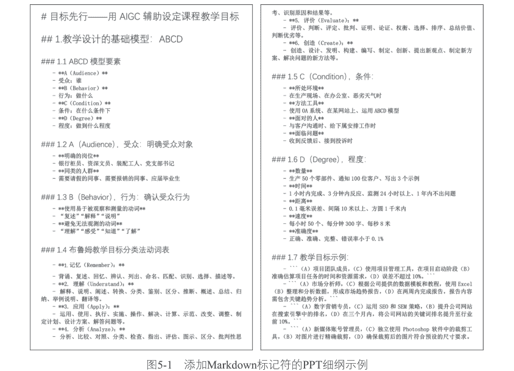

各工具对 Markdown 与编号的解析存在差异。讯飞智文、ChatPPT、Kimi 自带的 AIPPT 能自动识别标记并在导出 PPT 时隐藏；Mindshow、iSlide AI 可以识别 Word 的标题层级，却会把 Markdown 符号与数字编号保留在幻灯片中。所以前面提到的三处补充调整，需要按所选工具的实际表现灵活取舍。

细纲确定后，各类工具的操作与微课演示基本一致，使用门槛不高。官方教程比较完善，只需上传细纲，按指引逐步执行即可。

#### 步骤三：人工精修完善

AIGC 能快速生成初稿，只能算快手而非高手。初稿在结构和内容上已有雏形，仍可能出现偏差、版式不合理、字号偏小、配图缺失或不匹配、整体不够美观等问题。为保证最终成果专业高效，需要从以下方向进行人工校对与优化。

##### 对照细纲核查不符之处

解析时 AI 会理解并重写内容，尤其是三级深度的产品，页面虽以上传文档为基础，却会改写或扩写，可能遗漏要点、加入无关信息或打乱原有逻辑。

例如用讯飞智文生成行为讲解页，原文强调描述行为的动词应为外显性动词，扩展后却加入看似相关实则偏离的描述，如图 5-2 所示。

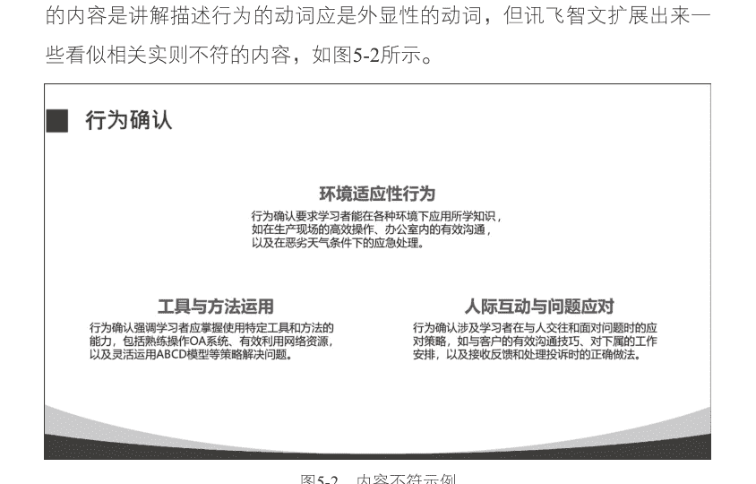

为确保 PPT 与原始大纲完全一致，需要逐页比对大纲与生成页面。遗漏信息及时补足，多余信息果断剔除，逻辑混乱时调整顺序或重新组织。五级深度工具偏差概率较低，但仍需仔细核查。

##### 更换单页版式

AIGC 会按要点数量套用模板，但内在逻辑未必匹配。

例如用 Kimi+PPT 助手生成的三级教学目标页，内容正确但三要素关系表现为向下包含而非递进，如图 5-3 所示。

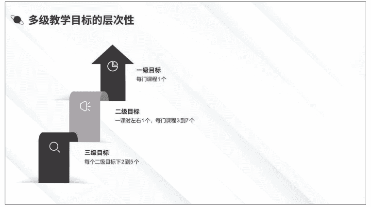

图 5-3 版式逻辑不匹配示例

又如 iSlide AI 生成的行为程度示例页，将并列关系的内容做成了时间轴，也与逻辑不符，如图 5-4。

此情形下需评估版式是否恰当，不合适就更换。大多数工具提供丰富的模板与快速切换功能，可根据内容性质与逻辑关系挑选。

##### D 程度：行为衡量标准

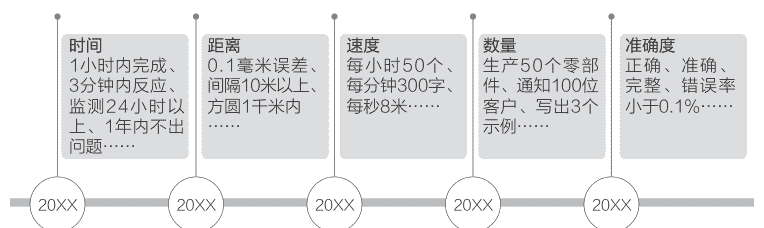

##### 字体字号调整

AI 生成的 PPT 文案常为一个标题加一段说明，字号普遍偏小，不符合授课“粗体、大号、少字”的原则，有时文字与背景接近影响阅读。

例如 Kimi+PPT 助手生成的教学目标示例页采用大量留白，六个示例以小框矩阵排列，字号很小，如图 5-5。

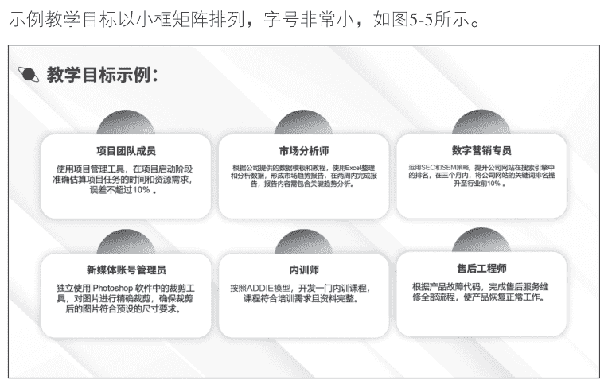

处理文字问题一方面要优化排版，另一方面更换笔画粗壮的字体，放大到可清晰阅读的字号，并确保文字颜色与底色形成明显对比。

##### 图示增补或替换

AI 生成的 PPT 可能缺少必要图表，或现有配图不准确，无法辅助传达。

例如讯飞智文生成时会自动配图，但下面这页配图与主题不符且裁剪后无法辨识，如图 5-6。

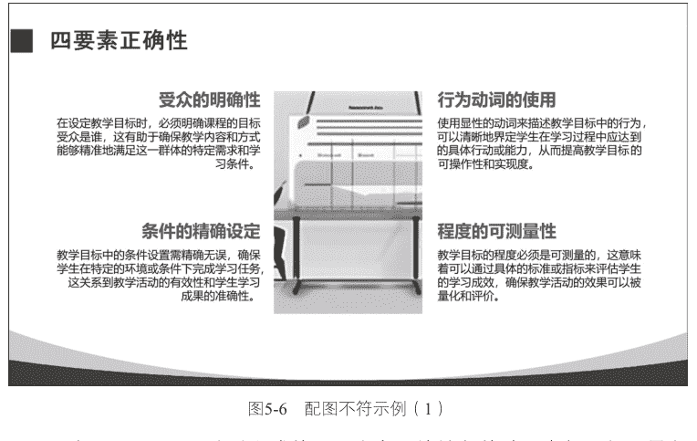

又如 Kimi+PPT 助手生成的两页内容，为抽象的动词表配上风景图，而具象的条件要素却无图示，造成空白，如图 5-7。

每个知识点是否需要配图及配何种图示，应根据内容判断以帮助理解。因此需检查每页是否需要图示并增补或替换，可使用内置图库、AI 生图或自行寻找，确保图文相辅相成。

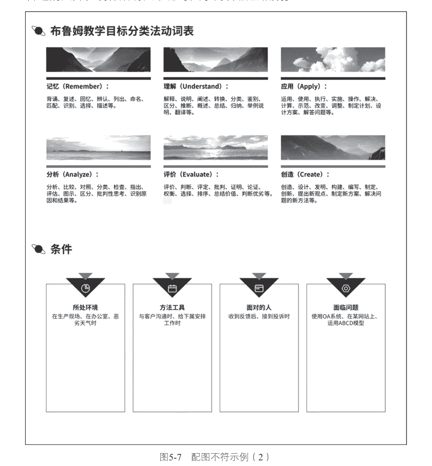

图 5-7 配图不匹配示例

##### 排版对齐与均布

AI 生成的 PPT 常出现元素不对齐、间距不均、对齐方式不当、换行拆词等问题，影响视觉美感。

因此最后需整体优化排版，遵循对齐、对比、重复、亲密性等原则。多数工具与插件提供一键统一尺寸与对齐功能，也可使用 PowerPoint 自带的对齐、均布工具，确保元素横平竖直、间距均匀、整体居中。

经以上细致人工修订后，PPT 内容准确、视觉吸引，形成高质量教学材料，可直接用于讲授。

经测试，从备料到生成再到人工精修，与团队中熟练教师全人工制作相比，人机协同速度提升 4 倍以上。即便仍需自行准备大纲并后期修订，AI 打底、人工精修的方式对高手仍能兼顾效率与质量，对做 PPT 吃力的教师更是极大助力。

## 第二节

## 培训师手册——用 AIGC 多维度提升编制效率

培训师手册是优质课程的必备资料，能把课程开发者的思路与授课方法快速复制给其他讲师，如同导航图，提供从大纲到教学步骤的全面指引。

手册通过详细描述讲稿话术、教学要点、授课素材、注意事项，既保证内容准确传递，也为讲师提供灵活调整方案的依据，促进开发者与讲师的无缝对接。

一份完整手册应包含课程概况释义、精确到分钟的大纲，以及每段授课的详细说明。以下为相对完整的模块示例，如图 5-8~图 5-10。

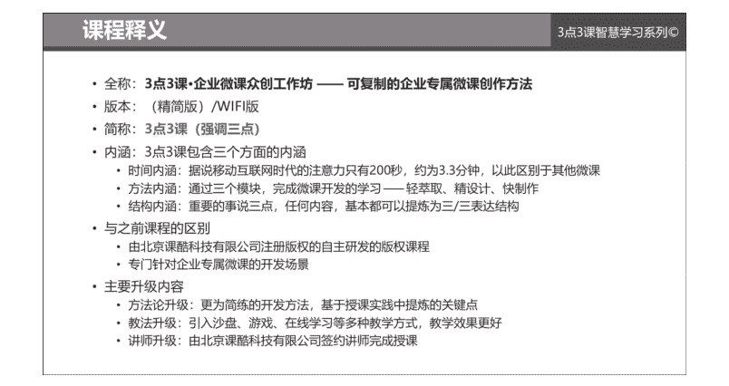

图 5-8 培训师手册示例

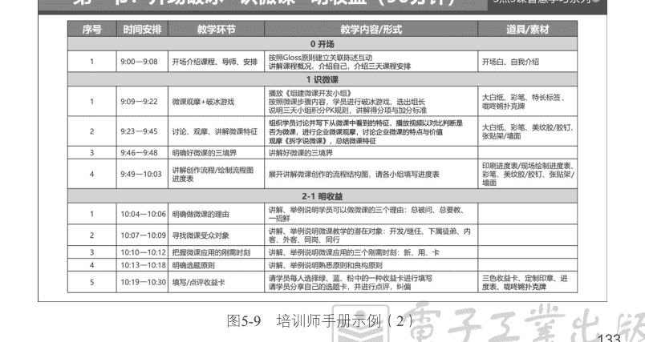

图 5-9 培训师手册示例

| 时间安排 | 教学环节 | 教学内容/形式 | 环节要点 | 道具/素材 |
| :--- | :--- | :--- | :--- | :--- |
| 9:01—9:04 | 课程介绍 | 讲解课程概况 | 1. 讲解课程名称，含义卖关子提示后续揭晓<br>2. 讲解关键词：可复制、企业专属微课、创作方法 | |

**讲稿话术：**

【讲】大家看到 3 点 3 课这个名字是不是感觉有点考究呢？嗯，这确实一个有含义的名字，具体的含义我先卖个关子哈，等会儿再给大家揭晓。现在我们先来看看这门课的关键词：可复制、企业专属微课、创作方法。咱们一个一个来看，先说说可复制，什么叫可复制呢？

【讲】嗯，大家放心的使用，这个方法是可以复制的，大家可以从我这里复制到你的创作微课方法，而你新创作以后，也可以复制给你的同事，朋友，甚至你的家人，让他们也学会创作微课。所以，这个方法是可复制的，而且这个知识，也可以通过我今天讲出来的微课，复制给同学们，这又是一个可复制，还有第三个可以复制，是这方法中的很多工具、思路，不仅可以在微课中使用，在进行其他工作的时候，也可以复制应用哦，等会儿大家会慢慢体会到。

【讲】说完了可复制，我们再来看看企业专属微课这个关键词，其实微课这个概念意义不大，学校里很多老师会把自己课程中的一些知识点录制成微课放到教学中，而现在比较流行的抖音上、西瓜视频上，也有很多很多大家录进去的短视频，这些其实都可以算是微课，但是为什么我们这里要强调企业专属微课呢？因为企业里要做的微课，并不是这样，而是源于企业实际的工作场景和任务，要教会别人完成真正工作任务的微课，这就是我们所说的企业专属微课。

【讲】嗯，说完了企业专属微课，大家想想，创作和制作有什么不同？（停顿，等学员回应）

【讲】对啦，创作包含制作，但没有制作我们理解的一些设计/准备工作，这是一套完整的流程，而制作仅仅是最后实现你的设计，就像（这结合客户例子），这就是创作与制作的不同。

【讲】好啦，这就是我们这次课程副标题上的三个关键词，那关于课程，就先简单介绍到这里。

**备课案例/素材/物资：**

1. 参考类比创作与制作的例子
——金融类，制作就是把产品做出来，而创作是从分析市场需求，到产品设计，到产品生产，到最终生产出产品的过程。
——服务业，制作就是我们最后提供给客户周到的服务，而创作包括在服务客户之前对每一个服务动作、话术、标准的设计，就像设计 PPT 一样，而创作就是分析培训的需求、制定培训目标、对每个教学环节的内容形式进行设计，一直到做出 PPT 和上台讲课为止。

**授课注意事项：**

1. 充分与学员互动，肯定学员的发言，建立学员能够表达观点的课堂氛围。
2. 要与学员实际工作充分匹配，课前应提前确认企业所属行业、业务特点以及参加学员的岗位。

图 5-10 培训师手册示例

示例使用 PowerPoint 编制，实际也可使用 Word 等工具。但无论工具与格式如何，手册的核心要素应参考示例，尤其“讲稿话术”“环节要点”“授课注意事项”“案例/素材/物资”需完整详细。

这是一个较为复杂综合的任务，按“AIGC 应用能力发展模型”需达到第五级。若拆解分工，可思考哪些子问题可由 AI 完成、用何种工具完成、人与 AI 如何协同。

**************

请先自行思考，再继续阅读。

**************

综合建议采用五步法完成编制：

- 步骤一：初步规划框架时间
- 步骤二：语音转写生成讲稿
- 步骤三：人工提炼配套信息
- 步骤四：投喂 AI 提炼配套信息
- 步骤五：汇总整理完成编制

#### 步骤一：初步规划框架时间

编制手册时可依据课程大纲对整体时间做粗略预估，为章节与环节分配时段。此过程不必过细，应把握宏观分布，保证推进流畅。

首先按大纲列出所有主题与章节，根据重要性与复杂程度给予粗略时长估计。例如理论性章节约 30 分钟，实操章节约 45 分钟，以确保充足并留有余地。

其次将单节时间细化到环节。例如 90 分钟课程可分为引入约 5 分钟、主体讲解约 60 分钟、练习讨论约 20 分钟、总结回顾约 5 分钟，具体数值可灵活调整。

对每一页 PPT 也可设定大致时长，如概述页 1~2 分钟，含详细数据分析页 3~5 分钟，帮助讲师建立时间概念。

#### 步骤二：语音转写生成讲稿

培训师手册核心是讲稿话术，必须由人工完成。可利用通义听悟等工具快速转写为文字。

转写时可按页录一段便于整理，也可按小节录一段提高效率，按个人习惯选择。

转写后需校对审核。可先上传给 AI 辅助校对错别字与语句通顺，再人工修订并加入语气、停顿、提问标注。

#### 步骤三：人工提炼配套信息

每页配合讲稿的环节要点、注意事项、案例/素材/物资，若直接让 AIGC 生成易偏离实际。

因此在转写讲稿后，先由人工提炼部分页面的配套信息更为稳妥。通过深刻理解提炼要点，结合授课需求提炼资源，再依经验提炼注意事项。

人工提炼至少完成 5% 内容，可选前几页或核心知识点页。

#### 步骤四：投喂 AI 提炼配套信息

人工提炼部分页面后，可整理成文档提供给 AIGC，让其据此推演其余页面的信息。

以通义千问为例，先提供含四类内容的样本文档，并配合提示词：

> 这是一份讲师手册的模板，对于每页 PPT 都有讲稿话术、环节要点、注意事项、备课案例/素材/物资，四大类内容，后三类内容都是从讲稿话术中提炼或推演出来的。请你先从中学习一下，了解讲稿话术的标记特点，以及四项内容彼此的关系、写法。我会在后续的指令中，给你一段段时间具体的讲稿，你要采用同样的方式，对讲稿进行标注，并进一步提炼出配套的环节要点、注意事项、备课案例/素材/物资。

模型分析后给出回答，如图 5-11。

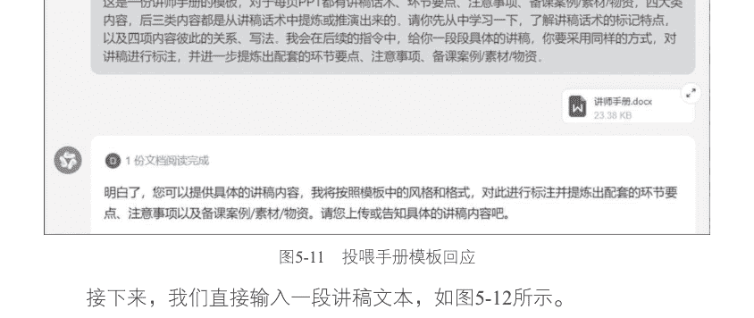

接下来直接输入一段讲稿文本，如图 5-12。

搞清楚了我们自己做微课的理由之后，再来看看双立人的另一个人，都可能是些什么人，也就是微课的受众对象。首先最中间这里，有一个开发者和继任者，也就是说，微课是可以做来给我们自己看的，比如有些你不常做的事情，一次做完以后，善于总结的你可以把做这件事的方法做成微课，隔一段时间再需要做但是忘了的时候，可以拿起微课复习一下重新做这件事。同时，有些企业有个不成文的规定，就是一个人如果要晋升，是需要在原来的岗位培养出一个接班人的，那你做给自己的微课，给这个接班人，当然也可以省略，这是第一类对象。

再往下看，刚才我们多次提到的那些笨笨的徒弟、下属，很显然，有些事要教给他们的事，你完全可以做一个微课，这里给大家一个小窍门，给这些人的微课，你甚至都不用自己做，教他们做一遍这件事，然后让他们把自己学到的做成微课，你审核保证正确就行啦，然后扔给徒弟和下属，直接把之前的“师兄经验”做的微课给他们看就好啦。

## AIGC 培训师课程开发全攻略
——MAP 模型让课程开发更高效

微课受众六象限速览

把视线转向左侧，首先映入眼帘的是内部协作型受众——企业里的同事。现实工作里很难出现完全独立的岗位，横向协作、纵向交接无处不在。在业务衔接、协同作业的场景中，把操作经验整理成短课供同事学习就很自然，比如此前提到的费用报销流程，以及产业链上下游的支持服务、内部职能类工作，都可以做成面向内部同事的微课。

内部受众明确后，外部受众也就呼之欲出。这里的外部边界非常宽泛，并非仅指签约买方，还包括供应商、合作方、监管部门等一切关联主体。以淘宝商品页置顶的安装使用短视频为例，这正是商家为广义外部受众量身定制的微课。

再来看集团化情境。大型集团往往有多家分子公司，内部存在岗位名称一致、职责相近的编制。原先为下属、徒弟、内部同事或将来接任者制作的短课，完全可以迁移给其他分子公司的同岗位人员使用，这就是第六类受众——岗位对等者。

此外，部分企业身处行业头部，需要承担标准制定、前沿技术推广、先进管理经验输出的责任。这些标准、技术与管理实践，通过微课的形式同样可以触达行业内有需求的人群。

以上就是微课实践中最常见的六类受众。请回看自己已定的选题，判断它主要服务的是这六类中的哪一类？能否把目标岗位或人群特征说得更具体？需要特别提醒，一门微课只能锁定单一受众，想做成人人都看的通吃型内容，最终只会落到正确的废话，失去使用价值。

图5-12 输入讲稿原文

通义千问在图5-13中给出的标注与提炼示例如下：

##### 一、背景概述
“明确了我们制作微课的动机后，再来梳理一下微课可能面向的人群，也就是受众对象会有哪些……”

##### 环节要点
- 阐述微课可用于自我学习。
- 指出微课有助于培养接班人。
- 说明微课在下属培训中的作用。
- 强调鼓励下属参与制作以深化理解。
- 解析微课在内部同事间的传递价值。
- 呈现微课对外部受众的服务价值。
- 提到集团内部可跨子公司复用微课。
- 说明微课可对外输出行业经验。
- 强调微课必须聚焦单一受众。

##### 注意事项
- 知识点必须准确可靠。
- 内容要保持针对性，避免空泛。
- 引导下属自主制作微课以提升掌握度。
- 分享前需结合受众背景与具体需求。

##### 备课案例/素材/物资
- 自用微课范例：特定任务操作方法的微课。
- 下属制作范例：新员工入职培训微课。
- 内部同事微课范例：财务报销流程微课。
- 外部受众微课范例：产品安装使用指导视频。
- 岗位对等者微课范例：子公司间共享的最佳实践微课。
- 行业分享微课范例：技术标准解读微课……

可以看出，通义千问给出的备选信息比较丰富，既可作为参考，也能启发思路。我们只需挑选或补充适合本课程的内容即可。

#### 第五步：汇总整理与定稿
当全部页面的讲稿与配套材料整理完毕后，就要把资料汇总，精确核算每页所需时长并做微调，统一排版与信息呈现，补充总览与提纲等内容，完成培训师手册的整体编制。

## 第三节

## 学员手册——借助AIGC让内容更完善
直接把授课PPT打印发放不如精心编排的学员手册。优质的学员手册不仅收录PPT核心要点，还会增补学习指引、知识详释、笔记模板、自测练习等，帮助学员搭建完整知识体系并培养自主学习能力。

图5-14展示了《点3课·企业微课众创工作坊》学员手册的部分页面。

《点3课·企业微课众创工作坊》学员手册

#### 一、概述
版权课程：
3点3课™·企业微课众创工作坊+Wi-Fi版
——可复制的企业专属微课创作方法

名称释义：
3点3课™涵盖三层含意：
- 时间含意：微课是移动学习时代的重要资源，其时长与注意力密切相关。数据显示移动互联网时代人的专注时长约200秒，即3.3分钟，名称由此而来。
- 方法含意：通过轻萃取、精设计、快制作三个模块完成企业专属微课的设计开发。每个模块配有工具与模板，哪怕零教学设计基础的普通员工也能上手。
- 结构含意：微课设计采用三点构成的稳定结构，帮助学习者提炼内容、厘清结构，提升学习与传播效率。

学习目标：
参加企业微课众创工作坊后，学员应能：
- 辨识企业专属微课的通用特征；
- 基于工作场景明确拟开发微课的业务收益；
- 运用标准句式、任务特征、步骤拆解与知识萃取方法，正确填写一份“任务分析表”；
- 撰写“微课脚本”文件；
- 完整制作一门微课作品。

《点3课·企业微课众创工作坊》学员手册

#### 二、轻萃取
【本模块学习目标】
完成本模块学习后，学员能：
- 通过微课收益卡填写，准确识别基于工作场景的微课收益。
- 用任务/步骤卡明确工作任务，并将其拆解为三至七个步骤。
- 萃取各步骤对应的三类知识点。

【明收益·基于工作场景的收益识别】
1. 为自己找一个做微课的理由：
- 我“总被问”
- 我“总要教”
- 我有“一招鲜”
- 其他理由

★学习平台：过程详解——A02 不做复读机，我要做微课【企业微课设计师宝典】

2. 确定微课开发对象。

我的微课开发对象是________

《点3课·企业微课众创工作坊》学员手册

注意：
1. 使用横选法或点选法时，需对所选内容做更精细的颗粒度分解，并重新编写任务分析表。
2. 讲解时建议营造“一对一讲解，我对你讲”的氛围，听者记录疑问与困惑作为讲解者修订依据。

请为同学填写“内容反馈记录表”：
| 讲解人 | 反馈人 | 讲授时长 |
| :--- | :--- | :--- |
| 建议选择 | 全选法□ 横选法□ 点选法□ | |
| 横/点选内容 | | |
| **听讲反馈记录** | | |
| 任务描述是否准确 | | |
| 执行人是否明确 | | |
| 开始/结束标志 | | |
| 任务成果 | | |
| 步骤划分颗粒度 | | |
| **应知应会不准确、不完整、未说明，需改进：** | | |
| **偏差对策不真实、不准确，需调整：** | | |
| **经验诀窍无效或属于应知应会：** | | |

《点3课·企业微课众创工作坊》学员手册

##### 模块小结
【梳理的知识点】
1. 
2. 
3. 
4. 
5. 
6. 

【保留的记忆】

【思考与反馈】
我的思考：
小组讨论：
导师反馈：

图5-14 学员手册示例

140
电子工业出版社
PUBLISHING HOUSE OF ELECTRONICS INDUSTRY

## 第五章 【Development】用AIGC制作课程资料
示例页面中包含课程释义与总览、各级教学目标、详细知识点、随讲解进度填写的笔记区、自由记录与模块小结区、练习表单以及关键内容的PPT截图。

拆解分工后，已有内容与必须人工完成的内容一目了然：课程总览与各层教学目标来自前期设计，可直接复用；练习表单一般需人工编制；自由笔记与模块总结笔记只需设定格式后复制即可。

因此，余下可借助AIGC完成的部分主要是详细知识内容与随讲解进度的笔记空间。

#### 投喂讲稿生成详细知识内容
我们已有培训师手册的讲稿文字，只需把讲稿交给AIGC，让它提炼出可写入学员手册的详细知识内容即可。

以通义千问为例，可用如下提示词引导：
下面是一段授课讲稿，我要据此编写学员手册，也就是教材，请从讲稿中提炼出这一段话包含的详细知识内容，并以书面化语言和条目化格式呈现。讲稿中的口语、提问、衔接、玩笑等内容不需要：
```
（讲稿原文）
```

提示词中用（英文输入法下数字1键左侧的`）标记整段文字。

沿用编制培训师手册时提炼配套信息的同一段讲稿，通义千问的回答如图5-15所示。
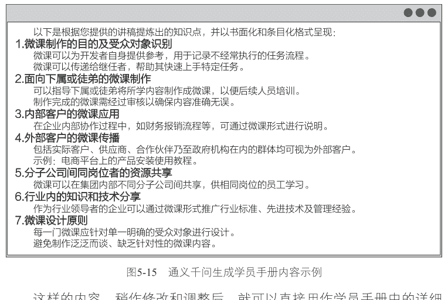

经少量修改后即可直接用于学员手册的详细知识内容。

#### 追问生成笔记空间
学员手册的知识点有时希望留白让学员补全，有时需要学员结合讲解进度进行思考或联系实际。删除部分知识点改成“___”即可实现前者；后者可人工设计，也可通过追问让AIGC生成。

在上一步生成的知识内容同一对话中追问：
> 请在每个知识点后增加供学员思考记录或填写个人化答案的笔记位，用类似“我的微课可以：___”的表述留出冒号后内容让学员填写心得。

追问结果如图5-16所示。
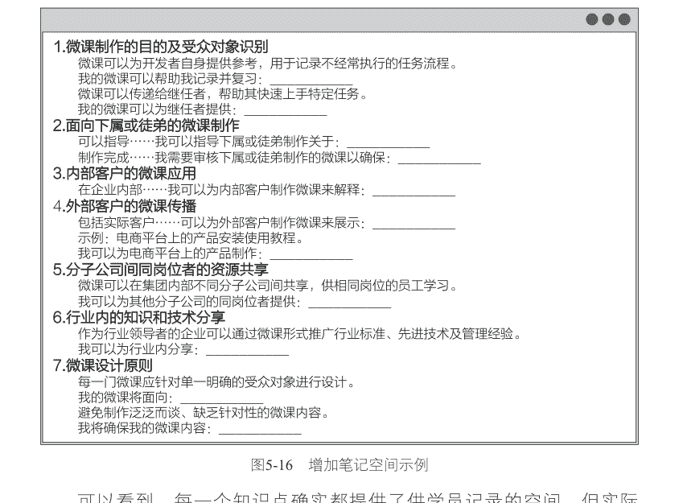

可以看到每个知识点都提供了记录空间，但部分内容如电商平台示例与最后一项设计原则并不需要。因此要回顾我们在第二章中提到的AIGC第三级应用能力：准确评估判断结果并有效修正。遇到此类细节，可在下一轮提示中说明示例类与原则类不需要笔记位，也可直接删除或修改多余笔记，最终保证入选学员手册的内容合适。总体而言，用AIGC辅助比纯手工输入高效得多。

完成详细知识内容与笔记空间的生成后，加入其他已有或需人工编制的部分，即可完成学员手册编制。

## 第四节

## 配套文稿——用AIGC快速完成课程与培训师介绍
课程介绍与培训师介绍是跨界资料，既可用于推广宣发，也像产品包装上的信息与员工档案，方便管理者与学员快速了解课程与讲师的关键信息以做决策。

借助AIGC可快速提炼课程概要，全方位呈现特色与优势，也能对讲师的专业背景与授课风格进行归纳总结。这样的介绍既能提升课程吸引力，也能在学员心中留下良好第一印象，为后续学习奠定基础。

#### 用 AIGC 辅助撰写课程介绍
好的课程介绍能有效激发学习动机。ARCS模型是教学设计大师约翰·凯勒提出的动机模型，如图5-17所示。
ARCS涵盖注意、关联、信心、满意四个维度，关注如何通过教学设计激发动机。将模型用于课程介绍同样能提升动机。
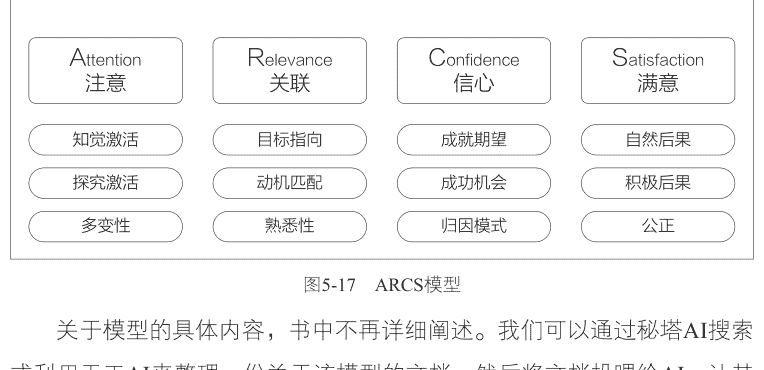

模型具体内容书中不展开。可通过搜索整理文档后投喂给AI，让其依模型撰写课程介绍。

一份课程介绍通常包含课程背景或痛点、亮点、学习收益、课程信息与大纲等。前期已完成多版大纲，可直接投喂大纲与手册等资料，让AIGC生成背景、亮点与收益。

操作可分两步：先让AI学习ARCS模型要素；再上传课程资料生成介绍。

若需投喂培训师手册等大体量资料，需注意模型的上下文能力，即单次对话输入输出总字数上限。目前上下文较强的模型有Kimi与智谱清言，Kimi公开用户支持20万字上下文，内测支持200万字；智谱清言公开用户支持100万字。

本次以智谱清言为例，先用如下提示词投喂ARCS模型：
> 上传的文档是教学设计的ARCS模型，请先学习该模型的要素与结构，我会在后续指令中上传课程相关资料，你需据课程资料套用ARCS模型撰写课程介绍。
智谱清言回复如图5-18所示。


随后上传制作PPT时使用的含内容的课程细纲，并补充提示词：
角色：你是一个文案大师，已学会并擅长使用ARCS模型撰写文案。
背景：上传的文档是我的课程“目标先行——ABCD法设定课程教学目标”的细纲，受众为课程开发师与培训师，共3课时。
目标：我需要一份能激发学员兴趣的“目标先行——ABCD法设定课程教学目标”课程介绍。
任务：请分别撰写“课程背景”“课程亮点”“学习收益”“课程信息”四个模块，要求：
1. 内容对应ARCS各模块，能激发动机，结构灵活顺畅。
2. 内容基于上传文档提炼或扩展。
3. 课程背景约300字。
4. 课程亮点提炼三项最主要、最具吸引力的。
5. 学习收益从细纲中提炼且要实际。
6. 课程信息包含学员对象、授课方式、时长等。
智谱清言的回答如图5-19所示。


以上操作提供一个参考方案，并非唯一答案。可根据课程与需求调整。例如不输入ARCS模型也能撰写介绍，或选用其他模型结构；模块也可改为痛点、课程特点等。授课信息等基础内容可直接写入，无需让AI生成。总之分解任务、灵活协同AIGC工具完成工作才是目的。

#### 用 AIGC 辅助优化培训师介绍
培训师介绍是讲师的专业档案，也是展现教学特色的名片。精心设计的介绍能让学员清晰了解讲师背景、经验、研究方向等，激发兴趣并建立信任，提升课程效果。

优秀介绍可能包含：
- 个人简介：姓名、学历、职称、工作经历等基本信息。
- 教学经验：曾授课程、教学风格、教学方法等。
- 研究方向：研究领域与成果。
- 教学理念：教学思路与目标。
- 个人风采：照片、视频等直观展示。
- 联系方式：便于沟通交流。

大部分内容可自行撰写，也可让AIGC提供建议并针对不同课程与学员群体进行优化。

##### 技巧一：头衔排序
讲师课程众多、头衔繁多时，可按不同课程需求排序。把所有头衔与主讲主题告知AI，按“与课程相关性”为首要维度、“头衔权威性”为次要维度降序排列，避免人工逐条思考排序。

例如本书作者许海星老师在开发新课时向Kimi输入：
角色：我是一个培训师。
背景：以下是我的各类头衔：
中国企业微课大赛决赛评委
……
中国通信工业协会认证数据资产管理师
目标：我需要为新课“AIGC助力职场效能倍增”重新排列这些头衔。
任务：请按两个维度重新排列：首要维度为头衔与新课程的相关性，次要维度为头衔权威性。
Kimi给出排序与理由如图5-20所示。


该建议契合新课需求，换个课程主题即可再次排序。

##### 技巧二：风格特点提炼
撰写讲师介绍时，讲师常难以客观总结自身的授课风格与特点。可借助AIGC从他人视角提炼。

以许海星老师为例，他整理过往书稿与公众号推文上传给智谱清言，并提示：
角色：我是一个培训师。
背景：上传的文档是我过去写过的文章。
目标：请据文章分析我的授课风格与特点。
任务：写出三个最符合我且最能吸引学员好感的授课风格特点，每个约100字。
具体如图5-21所示。


本次智谱清言处理了含16万字书稿的大量材料，最终总结风格特点如图5-22所示。


这次模型的归纳很让人意外，原本的设定是提炼三点，实际输出却给了四点，虽然数量上偏离了指令，但梳理得相当到位，而且在给出结论前先交代了推理过程。更值得注意的是，模型精准识别出作者长期写作时习惯使用的署名“海星老师”，并原样写进了分析结果里。这再次说明生成式内容系统在文本画像上的敏锐度，可以帮助我们从另一个维度审视和打磨个人风格。如果你手边也有不少积累的稿件，不妨让模型读一遍，提炼出其中的用词偏好与表达习惯。

## 第六章 【Implementation】让生成式AI提升课堂互动
当课程开发进入ADDIE模型的实施阶段，工作重心从方案设计转向现场交付。这一环节的核心在于如何把知识讲清楚、点燃学习兴趣、推动参与并带来实际收获。

要把课程平稳落地，讲师需要扎实的基本功。先要吃透内容，用平实易懂的语言拆解专业概念；其次要掌握基础的授课技巧，手势、眼神、站位、走动、音量都需要长期练习；再者要有应变力，课堂常会出现意外，需要快速调整；最后要营造开放的氛围，鼓励学员提问与交流。

在生成式内容时代，基本功之上还能借助AI技术开拓新的教学思路。本章围绕实施环节，介绍三种提升学习体验的做法。

### 方法一：借助生成式AI打造课堂互动游戏
游戏化学习已获广泛认可。利用生成式AI能迅速产出定制化的互动形式，比如在线测验、情境模拟、角色扮演等，既提升趣味，也有助于知识内化。系统还能依据教学目标自动产出方案并细化规则，让每个游戏都紧密对应特定知识点。

### 方法二：让生成式AI助力学员学习与讨论
在讨论环节引入AI会带来全新体验。无论是通用大模型、智能检索，还是自建助手，都能在课堂上即时答疑、提供延伸资料、参与小组对话。智能化支持减轻了讲师负担，也让每位学员获得更个性化、更及时的帮助。

### 方法三：用生成式AI制作多媒体教学素材
借助生成式AI可以轻松为课程加入图像、视频、音频等多模态元素。视觉与听觉刺激有助于提升注意与记忆，让抽象概念更形象具体。素材还能按学员偏好定制，满足差异化需求。

总体来看，生成式AI不仅简化了落地流程，更把教学从单向讲授转向创意饱满、体验活力的学习之旅。

### 第一节 让课堂更有趣：用生成式AI设计互动游戏
教学中遇到枯燥的知识点时，用游戏化方式重塑学习体验往往效果突出。游戏化既能激发兴趣，也能促进理解与记忆。生成式AI在这里既能横向启发创意，提供多样备选，也能纵向深化，完成细节打磨。

#### 用生成式AI头脑风暴游戏方案
面对某个具体知识点，希望用互动游戏帮助掌握时，可以把背景与需求交给AI，让它给出多种设计思路。

例如给Kimi的提示是：
角色：我是一个内训师。
背景：课程《互联网产品原形设计》中有一个知识点是“产品视角vs用户视角vs商业视角”，教学时长15分钟。
目标：希望用游戏化方式让学员掌握该点。
任务：给出五个备选教学游戏方案，要求学员在游戏中体会三种视角差异，完成后再自行总结特点和区别。

Kimi很快给出五套备选方案并做了简要说明，如图6-1所示。

如果需要更多数量，比如十个二十个，也可以继续追问；也可以换不同大模型并行创作，类似团队头脑风暴，从多份输出里筛选最合适的方案。

#### 用生成式AI细化教学游戏
选定方案后，可以在同一对话中继续追问，让它展开具体实操。

例如继续追问：
第二个情景模拟游戏不错，请输出一份详细的游戏实操指导书，包含材料准备、流程设计和话术提示，能指导我操作并让学员正确完成并得出结论。注意时长15分钟，模拟的产品要具体且常见。

于是Kimi进一步撰写了一份详尽的游戏说明书，如图6-2所示。

图6-2 Kimi生成的游戏说明书
这种方式大幅缩减了设计成本，也让课堂互动更生动。

### 第二节 人手一个助教：让生成式AI辅助学员学习与讨论
依据学习金字塔理论，纯听讲的被动学习知识留存率极低，如图6-3所示。

因此老练的教育者会设计大量主动学习活动，让学员查阅、整理、讨论、展示。但传统讨论受限于资料检索速度和复杂度。现在借助生成式AI，这些问题得到明显改善，可提供三种辅助方式。

#### 方法一：通用大模型与智能检索助推讨论
前几章已学习用生成式AI生成内容和用秘塔、天工等智能检索工具整理资料，这些能否用于学员讨论？完全可以。

把提示词公式和检索工具用法传授给学员，即使课题复杂，也能在短时间内完成资料收集与初步整理。工具加速检索并做初步分析，提炼关键信息。基础工作完成后，讨论可以上升到更高层次，提升质量并培养批判性思维和问题解决能力，学员不必被信息收集拖住。

#### 方法二：克隆自己的声音创建智能体对话
文字之外，语音交互同样提升互动感。过去只有培训师一人能互动，现在可用高质量语音合成的生成式AI工具录入自己的声音，生成一个虚拟“分身”。该角色可在讨论中充当助教，查找信息、校验论据、提供即时反馈。

目前支持声音克隆的移动端大模型主要有文心一言和豆包，其中豆包的语音表现更好。我们录制了一节微课演示如何用自己的声音创建AI智能体，可扫描二维码学习。

创建完成后，点击头像进入详情再点“分享智能体”即可推送给学员，增加趣味性与真实交流感。

#### 方法三：复刻个人知识创建智能体辅导学员
豆包智能体能复刻声音，但回答仍基于模型自带库。现在的技术已支持把个人知识和思想固化，创建真正能回答课程专业问题的辅导智能体。

我们曾建了一个专门辅导企业微课开发的智能体，下面是两段对话截图见图6-4和图6-5。从对话可见，该智能体区别于普通大模型：一方面能给出模型库里没有的团队方法；另一方面无需复杂提示词，简单提问即可获得课程专业回答；更有趣的是，它在每次回答后会“反问”用户，引导下一步思考。

图6-4 微课辅导智能体（1）

图6-5 微课辅导智能体（2）
其原理如图6-6所示。

创建时，先把微课开发方法整理成详细文档上传，系统切片嵌入形成向量数据库；同时预设一段长提示词，包含人设、语言风格、对话后提出引导性问题的要求，以及按微课开发流程的提问引导。

系统除文档和提示词外，还内置向量检索和大语言模型。用户提问“如何开发微课”时，系统先用向量检索匹配文档段落，再把检索结果与预设提示词和用户输入合并，增强后送入大模型生成基于我们方法的答案。

这就是RAG，即检索增强生成：根据输入检索数据库、增强提示词、生成结果。一句简单提问就能得到针对性答案。

创建流程有三步：选平台、准备知识库文档、在平台上设置创建。

##### 选择RAG智能体平台
国内多家平台支持创建RAG智能体。前面提到的案例来自企业大数据平台“企元大数据”，面向ToB，企业采购后可无限制使用。

面向ToC的平台里，最早推出的是讯飞星火智能助手，现更名智能体，随后字节跳动的扣子、智谱清言、通义千问的AI智能体也上线，均免费。

选平台可从三方面比较：
底层大模型不同，RAG的生成器基于自家模型，先体验对话习惯。
功能丰富度不同，扣子功能最全，支持独特的RPA工作流自动化，可执行多步骤流程，但学习成本较高；讯飞星火和通义千问功能相对简洁，上手容易；智谱清言在便捷创建和插件扩展间取得平衡。
传播渠道不同，均可链接分享和在自家市场公开；智谱清言和扣子的智能体可嵌入微信公众号、抖音企业号等；讯飞星火可API接入其他平台但需编程基础；通义千问目前暂无该渠道。

各家迭代快，最优选择会变化。可以全平台创建后择优推广。

##### 整理知识库文档
RAG的关键是提供可检索的专属知识库。可用Word文件把课程知识详细展开。

创建微课辅导机器人时，我们准备了《企业微课设计开发攻略》和《微课脚本点评示例》两份文档。《企业微课设计开发攻略》把学员手册中微课开发流程的知识点、操作指引、注意事项全部展开，并用Markdown标记区分层级与段落，如图6-7所示。《微课脚本点评示例》则整理了团队培训师过往辅导的微课脚本解说词及点评反馈。

准备自己的知识库时，可把培训师手册或学员手册的知识点书面化，再加入过往文章、教程、辅导点评、问答记录，用#、-等Markdown标记层级，最终形成检索文档。

# # AIGC培训师课程开发全攻略
——MAP模型让课程开发更高效
# # 企业微课设计开发攻略
# ## 基础概念
# ### 3点3课:企业微课众创工作坊简介:
- 3点3课包含三个方面的内涵：
  - “（1）时间内涵，即移动互联网时代的注意力只有200秒，约为3分3分钟，以此区别于其他微课。（2）方法内涵，通过三个模块，完成微课开发的学习—轻萃取、精设计、快制作。（3）结构内涵：重要的事说三点，任何内容，基本都可以提炼为三/三表达结构。”
- 由北京课酷科技有限公司注册授权的自主研发的版权课程。
- 专门针对企业专属微课的开发场景。
- 工作坊特点：
  - “这套方法是可以复制的，可以从重复复制到微课的方法，而回到工作中以后，同样可以把这套方法复制给更多同事，在工作中的经验、知识都可以通过微课，复制给同事。第三个可复制，是指这套方法中的很多工具、思路，不仅仅是做微课可以用，在进行其他工作的时候，也可以复制应用。”

##### 创建RAG智能体
文档准备好后即可在平台创建。以讯飞星火为例，我们录制了创建过程微课，可扫描二维码进入教程学习该应用。

视频中“结构化助手指令”即除知识库外最核心内容，是检索后与结果一起输入生成器的预设提示词。其他平台称作配置信息或设定描述，需预设人设、回答风格和引导逻辑。随着工具进化，多数平台已支持AI自动生成配置，可先让AI起草再按课程要求修改。

各平台界面不同但流程相近，核心在于知识库准备和预设提示词编制，掌握方法后即可尝试多平台创建。

把大模型、智能搜索、语音交互式生成应用和检索增强机制结合起来，课堂讨论的运转速度和参与深度会明显改善。一方面学习者能更快地触达、整理信息；另一方面同伴间的互动也更顺畅，最终学习成果得以提升。

### 第三节 让课堂更生动——用生成式智能制作多媒体教辅材料
如果一页课件只有大段文字加讲师口头讲解，学员的注意力很快就会涣散。把视觉、听觉等多元素材放进教学流程，能够打破单调形式，给学习者提供多感官刺激，从而提升体验感。

在多媒体素材的准备上，生成式技术能发挥显著作用，不仅丰富表现形式，也大幅压缩制作周期。实践层面主要集中在图像绘制、短片制作和音频创作三个方向。

#### 智能绘图，像自带画师团队
配图是课件的重要载体。过去找图常受版权、水印、美感和内容贴合度限制，讲师往往“好图难寻”。

智能绘图的出现改变了局面，可以迅速获得美观、贴合内容且无版权风险的配图。某位讲心理学课程的讲师就用智能绘图制作了一组表情图，让学员依据面部表情辨识情绪，如图6-8所示。


图中十二位男孩的表情区分度很高，悲伤、惊恐、愤怒、愉悦、厌恶、疑惑、渴望等情绪都能一眼辨认。这位教师在同平台、同模型下，只是把提示词中描述表情的那一句做了微调，其余参数保持一致，三分钟内就完成了整组输出。

精通智能绘画需要大量练习，但在培训场景里，讲师无需达到设计师水准，像案例中的老师那样，用简洁提示词快速调用功能即可满足配图需求。

##### 常用绘图平台概览
国内支持智能绘图的平台很多，大部分提供一定免费额度，超出后才需付费。常见选择包括：文心一格、通义万相、腾讯智影、美图Whee、即梦AI、堆友、商汤秒画、Canva可画、无界AI、LibLib等。

除上述几款外，市场上还有众多网页、App或小程序形态的产品，搜索即可找到入口和使用说明，这里不再赘述。

##### 提示词编写的基础框架
日常配图不需要钻研软件全部细节，掌握画风、主体、质感、排除四个要素的基础公式就够用。

###### 画风
用于描述画面风格的语言，可涵盖画家或团队风格、拍摄设备或手法、材质质感、光线氛围等。部分平台通过底层模型区分风格，尤其是以Stable Diffusion为代表的体系，提供了海量风格基模。

###### 主体
描述画面中出现的元素，包含场景、背景、人物、动物、建筑、物件及其细节。主体是提示词的核心，其他可省略。即使只写“一名女孩”或“一只猫”，模型也能生成对应图像。

###### 质感
部分工具支持通过提示词控制成像质量，比如要求超高清晰度、细节丰富等。

###### 排除
部分工具提供负向提示词，用于剔除不想要的元素，如低质量、构图错误、多余手指、面部畸形等。

套用该框架，两组提示词在不同平台的表现如下，如图6-9和图6-10所示。


各平台结果各有特色，可根据个人偏好挑选工具，用自然语言描述所需画面来生成课件配图。

## 第六章 【Implementation】借助生成式AI增强互动体验


图6-10 提示词与AI生图结果（2）

#### 智能视频生成，相当于专职剪辑师
对通用或重点知识点采用视频呈现，既能带来新鲜感，也能保持讲解口径统一。过去即便有制作能力，视频也耗时费力。

现在借助生成式技术，几分钟内就能围绕知识点产出一支教学短片。

##### 快速生成视频的操作路径
国内主流的AI剪辑产品是百度度加剪辑和字节剪映，均支持一句指令生成文案和视频。

我们录制过一门微课，可扫码按流程用度加剪辑实操。整个流程非常轻量，核心输入只是一句描述，就能得到一段教学视频，效率很高。若对自动生成的文案不满意，可先让大模型润色成更符合需求的版本，再粘贴生成。


#### 智能音乐生成，像随身乐队
从学习经验看，口诀比散文更易记忆，歌曲比口诀更易长期保留，像乘法口诀、字母歌至今印象深刻。

有经验的讲师常把要点编成韵文帮助记忆。生成式技术不仅能把知识点改写成口诀，还能直接基于口诀进行作曲、编曲和演唱，生成完整歌曲。

##### 用生成式技术编撰知识口诀
只要给出基础知识点，系统就能快速生成带韵脚的口诀。只需明确韵脚、篇幅、必须覆盖的要点即可。例如在视频文案扩写后，我们追加了这样的指令：

> 把你生成的这段文案整理成押韵口诀，大约十二句，要涵盖所有要点。

文心一言给出了相应的口诀，如图6-11所示。


经过这样改造，几乎任何知识点都能被快速口诀化，便于学习者背诵。

##### 用生成式技术创作歌曲
下一步可把口诀配上旋律和节奏，变成一首歌。推荐工具是字节的海绵音乐，支持网页和App，已集成到豆包大模型的插件中。

以网页版为例，打开海绵音乐，操作非常直接，可扫码跟随微课一起完成歌曲创作。


生成后可试听，若不尽如人意可更换风格、情绪或声线，多生成几次直至满意，再下载或分享到课程中使用。

## 第七章 【Evaluation】借助生成式AI审视培训成效


ADDIE是系统化的教学设计框架，其中评估环节最能体现培训价值，也最考验专业能力。很多组织和讲师对评估存在误解或忽视，导致课程脱离需求、效果不佳。本章聚焦评估的关键要点，并探讨生成式技术在其中的辅助作用。

### 第一节 培训评估的真相与价值
培训评估不只是满意度调查或知识测验，还包括反应、学习、行为、结果等多个层面，它们相互关联构成完整的效果评价体系。

通过评估，企业能发现教学过程中的问题并针对性改进，也能了解学习者的学习状态和需求，提供更个性化的资源支持。

评估的深层价值在于提升员工绩效、优化资源配置、增强信任与交流，进而推动组织发展。

但评估因长期性、滞后性、难以量化、难以归因等特点，常被忽略或流于形式。要发挥其价值，培训师需要掌握具体的评估形式与方法。

在ADDIE全流程中，形成性评估贯穿始终，总结性评估在项目结束后进行。

#### 形成性评估——贯穿教学设计全程的持续校准
形成性评估是教学设计的重要组成部分，通过持续反馈及时调整和优化设计。正式总结性评估前，需针对各阶段明确评估内容、方法和要点。

##### 分析阶段
评估内容：教学需求的准确性、教学目标的合理性、学习者特征分析的完整性。
评估方法：访谈、问卷、资料收集、观察等获取背景、兴趣、学习风格信息；邀请专家审核需求分析结果。
评估要点：确保需求科学，并关注学习者差异，为后续设计奠基。

##### 设计阶段
评估内容：教学目标清晰度与需求匹配度、教学策略的针对性、教学内容的适用性。
评估方法：教学设计会议、专家咨询，对目标、策略、内容进行审查；制作原型进行小规模试教，收集反馈。
评估要点：目标具体可测、符合需求；策略契合认知规律；内容支撑目标。

##### 开发阶段
评估内容：教学材料的完整性、准确性、易用性。
评估方法：专家团队审校内容准确性；邀请部分学习者试用并收集反馈。
评估要点：内容完整无误、界面友好、有效支撑教学目标。

##### 实施阶段
评估内容：教学活动的有效性、师生互动充分性、学习者参与度。
评估方法：课堂观察、教学日志、学习者反馈；利用教学平台数据分析学习进度与成绩变化。
评估要点：及时调整策略，促进互动，关注学习状态并给予支持。

系统化的形成性评估能让培训项目每一步都有据可依，提升效率并确保学习者获得所需知识技能。

#### 总结性评估——衡量培训成效的最终标尺
总结性评估是对整个项目效果的全面审视，目标是衡量是否达成既定目标，以及学习者在知识、技能、态度上的实际提升。

常用方法为柯克帕特里克四级评估模型。

##### 第一级：反应评估
关注学习者对培训的整体满意度，通过问卷、访谈、在线反馈收集对内容、讲师、设施、环境等方面的感受。

##### 第二级：学习评估
评估学习者在培训中获得的知识、技能和态度的变化，采用前后测、知识测试、技能演示、案例分析等直接测量学习成果。

##### 第三级：行为评估
观察培训后学习者将所学应用于工作的行为变化，通过360度反馈、行为观察、绩效考核收集证据。

##### 第四级：结果评估
衡量培训对组织绩效的实际影响，如生产效率提升、成本降低、客户满意度提高等。采用财务数据、满意度调查、市场占有率等量化指标，结合利益相关者定性分析。

由于评估核心在于分析、判断与决策而非创作，生成式技术在形成性评估中难以担任主角，需要讲师和专家的经验深度思考。但在总结性评估中可作为效率辅助工具。

### 第二节 反应评估——借助生成式AI生成评估问卷与分析问卷结果
反应评估作为柯氏四级首级，主要了解学习者的主观感受和满意程度，涉及课程内容、讲师、设施、方法等。

#### 评估问卷设计原则
##### 简洁明了
表述简短清晰，避免模糊或过于专业的词汇，确保学习者易懂易答。
##### 客观中立
设计应中立，避免引导性提问或个人立场，保证数据真实可靠。
##### 全面覆盖
覆盖内容、讲师、设施、方法等反应评估各方面，实现全面评价。
##### 易于分析
问题设置便于统计分析，如采用量表题或评分制，并合理控制题量。

#### 用生成式AI设计评估问卷
企业通常有反应评估问卷模板，网络上亦有大量参考。想要更贴合自身课程，可让生成式AI定制。通过告知课程主题和具体要求进行个性化输入。

例如提示词如下：
角色：我是一个培训师。
背景：我有一门课程名为“AIGC升级内训课程开发”，主要讲授在ADDIE模型的基础上，如何在各个环节运用AIGC工具进行提质增效，课程内既有课程设计的原理和方法，又有AIGC工具的使用技能。
目标：我需要一份用于评估学员反应的课后评估问卷。
任务：请帮我设计这份问卷，要求如下：
1. 问卷要简洁明了、客观中立，对包括课程内容、培训师、设施、方法等全面覆盖又易于分析。
2. 问卷中的题目在10~20题之间，满分为100分，每道题的选项可以设计根据学员的评价对应不同的分值。
3. 问卷中要包含针对具体这门课程相关内容的题目。

用该提示输入五款主流大语言模型，均能无压力生成完整问卷，如图7-1所示。可针对自己的课程尝试生成。


#### 用生成式AI分析评估问卷统计结果
问卷回收统计后，可借助生成式AI进行分析。表格分析方面，Kimi和智谱清言表现突出。某企业培训经理针对微课开发培训的反应评估统计表共39份有效问卷，上传至智谱清言并输入提示：

角色：你是一个资深数据分析师。
背景：上传的文档是一份关于微课开发培训的反应评估统计表。
目标：请分析数据并得出对这位老师的综合评价。
任务：评价至少应包含以下几个方面：
1. 这位老师的总体评价评语（500字）。
2. 这位老师最为擅长的优点以及分析。
3. 这位老师的各项能力分布（可用图表呈现）。
4. 其他能从数据中分析出的结论，均可制图说明。

结果如图7-2和图7-3所示。智谱清言不仅按要求给出结论并绘制图表，还呈现了分析过程，做到有据可依。

培训经理的分析对象聚焦老师，分析评估问卷时也可调整提示词来剖析内容、配套等维度，从而找到改进方向。

从数据可见，调研表包含课程结构、课程内容、课件制作、业务专业水平、仪态与表达能力、维持学员兴趣能力、引导学员提问及讨论能力、课程感兴趣程度、培训效果与期望的对比，以及综合评价和总分等维度。

基于微课开发培训学员满意度数据，该老师各项平均分如下：
课程结构9.97、课程内容9.93、课件制作9.76、业务专业水平9.86、仪态与表达能力9.86、维持学员兴趣能力9.83、引导学员提问及讨论能力9.90、课程感兴趣程度9.90、培训效果与期望对比9.79、对本次培训综合评价9.86、评价总分98.66。

总体来看，教学组织结构接近满分，体现课程架构合理、呈现清晰。课程内容得分高，说明知识点讲解深入浅出。课件制作9.76显示辅助材料质量良好。业务专业水平与仪态表达同为9.86，体现专业功底和沟通能力扎实。兴趣维持9.83、引导提问讨论9.90，反映其能激发参与和主动思考。综合来看，讲师在专业、设计、组织与互动方面表现全面优秀，深受学员认可。


## AIGC加持下的培训师课程开发全攻略
——借助MAP模型提升开发效率

接下来我会绘制一张图表呈现老师各维度能力分布，并尝试从数据里提炼更多结论。

代码生成：已完成


如图表所示，该教师各评价维度得分均处于高位，几乎逼近满分，进一步印证了其教学的全面性与专业度。尤为突出的是课程架构、教学内容、业务专业度、仪态表达、引导提问与讨论等维度，均值靠近或达到10分。

除了上述强项，维持学员兴趣与课件制作能力同样在线，虽然这两项均值相对略低，但仍充分显示其在该方面的出色水准。

综合来看，可得出以下四点判断：

1. 教学设计与组织能力强，能清晰合理地呈现与讲解课程内容。
2. 专业知识扎实，实践经验丰富，可为学员提供专业指导。
3. 沟通表达技巧佳，能有效传递信息、激发学习兴趣，并推动学员积极提问讨论。
4. 课件制作功底扎实，能产出高质量课件助力学员理解与记忆。

总体而言，这位教师在教学环节表现全面且优秀，深受学员认可与喜爱，是一位值得称道的教育者。

图7-3 智谱清言的分析结果（2）

## 第三节
学习评估：用AIGC生成题库并完成阅卷分析

柯氏四级评估中的第二级就是学习评估，与培训核心目标——学习成效直接挂钩。这一阶段聚焦学员在培训过程中知识、技能、态度发生的改变，是检验培训是否生效的关键环节。

通过学习评估能够了解学员对内容的掌握程度，判断培训目标是否达成，为后续迭代优化提供决策依据。

## 学习评估测题设计关键原则

评估常用测试题进行，形式包括选择、判断、填空、简答、案例分析等。

出题须紧扣培训目标与内容，保证评估有效且精准。编制时建议把握以下要点。

#### 目标一致性

题目需与培训目标对齐，确保评估内容相关。题项应真实反映学员对培训内容的掌握情况。

#### 覆盖全面性

设计时要细致拆解培训内容，确保题目覆盖核心知识点，避免遗漏重点。

#### 难度适宜

题目难度应匹配学员的学习能力与知识背景，既不吊书袋也不过于简单，保证评估准确同时不挫伤积极性。

#### 区分度明显

题目应具备良好区分度，能分辨不同水平学员。设置梯度难度，有助于精准把握掌握深度与广度，为后续教学提供针对性建议。

#### 用AIGC搭建试题库

编制试题可借助AIGC优势，上传教学文档并设定题型数量与要求，即可快速生成题库。

例如先上传整理好的讲稿、学员手册或智能体知识库文档，再输入提示词：

- 角色：你是一名专业出题专家。
- 背景：已上传文档为我的课程内容。
- 目标：为我生成完整测试题集。
- 任务：依据文档知识，编写填空题5道、单选题5道、多选题5道、判断题5道、简答题3道，具体要求如下：
1. 题干与正确答案均须源自背景知识。
2. 填空题每题仅留一个空，空内可涵盖多个知识点。
3. 单选多选判断的干扰项可为反向表述、文档内其他内容或无关错误选项。
4. 题型按“一、二、三…”编号，题目按“1.2.3.”编号。
5. 所有题目完成后单独汇总正确答案。
6. 简答题提供参考答案并说明批阅关注点。

以本章第一节文稿为例，上传Kimi并输入提示词后，生成的题库如图7-4所示。


过去需要数小时完成的习题集，现在约一分钟即可完成，效率提升十倍以上。但要注意，文档过长时即便模型上下文很长，单次输出仍有限，建议分章分节分批生成。

若嫌每次写长提示词繁琐，也可创建无知识库的智能体，将上述提示词稍作修改作为预置指令。之后只需上传文档并说明各题型数量即可获得题库。

#### 用AIGC批改试卷并输出分析

批改试卷技术含量低但费时，资深培训师常交由助理处理。现在可让AIGC担任阅卷助手。

操作思路在前几章已有类似范例。阅读本章时建议已具备提示词编制或智能体创建能力。以下是两种常用方法供参考。

##### 批阅方法一：两步投喂法

题量不大或课程频次不高时，可先把含标准答案的题库喂给AIGC，再把学员答卷或汇总表喂给它，让其对照标准答案完成批改。

##### 批阅方法二：构建RAG智能体长期复用

课程知识量大、题库多或需全员轮训时，可把含标准答案的题库作为RAG智能体的知识库。后续只需上传答卷结果即可快速批改。

两种方法均可在提示词中加入格式要求，让AIGC输出每个学员总分、每题得分、正误数量等，并以表格呈现，便于下一步分析。

#### 用AIGC解析考试结果

批改完成后，AIGC会返回学员作答数据。从中可提炼针对性结论。例如通过高频错题与典型错误答案，分析薄弱环节与易混淆知识点，反推教学设计中需加强传播或设计的辨析策略。

此类分析同样可交由AIGC完成。只需上传标准答案与作答统计作为背景，再提出提炼易错主题、分析主要错误等任务，即可获得基于实数据的分析结论。

## 第四节
行为评估：借助AIGC追踪学习后的行为变化

柯氏四级中的第三级行为评估关注学员回到工作岗位后的行为改变，不再局限于课堂短期表现，且通常需上级、同事、下属共同观察。

培训师仍需为观察者提供资料与指导，并在观察完成后进行分析评估。AIGC可提供有力支撑。

### 用AIGC辅助编制行为观察指南

若课程在需求分析阶段采用过观察法，课后可直接沿用当时的观察清单，并对比课前课后行为变化。

若未使用观察法开展需求调研，学员学习后可能出现新行为，此时需根据课程主题整理一份行为观察指南。

指南可包含观察周期、行为要点与标准、典型场景等。以《从凝聚到卓越——基层团队管理者必备锦囊》文稿为例，提示词可这样组织：

- 角色：你是一名培训评估专家。
- 背景：上传文档为一门课程的全部细节。课后需对学员进行行为评估，由其团队成员进行观察分析。
- 目标：为执行观察的人员提供细致指导。
- 任务：编制《行为观察指南》，要求如下：
1. 观察行为须源自文档并覆盖所有重点，提炼核心要点作为可观测行为。
2. 对每项行为说明细节描述、评价标准与方法、常见场景及结果表现。
3. 明确整体观察周期。
4. 设计可用的观察清单或表格。
5. 确保操作可行、行为可观测、标准可量化。

本次多模型对比中，智谱清言的输出更贴近预期，可作为初稿进一步细化，如图7-5所示。


单次输出字数限制下，这份3600余字的指南仍属框架。基于此，可追加指令让AIGC拆解每项行为细节、补充案例说明，或继续设计量化测评标准与观察清单。

观察实施后回收的记录汇总，同样可采用两步投喂分析或智能体分析方式处理。

至此，前三级总结性评估的AIGC辅助方法已清晰。对于第四级价值评估，建议非重要或非必要培训不做。很多与战略关联不强的基础培训或短期问题解决培训，不值得投入资源评估，因评估成本可能超过评估价值。将资源用于业务本身往往收益更高。

通常仅当课程与战略高度相关、领导高度关注、周期长、开发成本高、受众广、可直接关联业务指标且预期价值高时，才建议开展第四级评估。

若符合条件，可将培训前后业务指标数据上传给AIGC进行对比分析，但需明确培训与指标的因果关联，避免夸大效果。

## 第八章 让AIGC赋能课程宣发
前几章聚焦课程设计与开发，为成功奠定基础。但在数智化时代，课程成败不仅靠内容质量，更取决于宣发效果。好课程需要临门一脚的推广。传统宣发受预算与创意限制，AIGC提供了低成本、多样化的新解法。本章将探讨如何用AIGC提升宣发效果，并给出案例与操作指南。

## 第一节
零成本宣发物料：AIGC生成海报与培训师形象照

课程海报与培训师形象照是视觉传播的关键载体。它们既是信息窗口，也是吸引注意、激发兴趣的核心。一个精美海报与专业形象照能有效传递课程理念与教师专业度，提升吸引力与影响力。

制作这些视觉素材往往耗时耗力。借助AIGC可快速生成高质量海报与形象照，大幅降低手工负担，选对工具还能节省成本。工具基于AI指令与素材自动生成符合需求的内容，让我们把精力更多投入内容准备与教学质量提升。

### AIGC生成课程海报

#### 设计工具选型

海报类AI工具众多，如美图设计室、稿定AI设计、创客贴、Canva AI、美间AI设计，各有优势。

美图设计室界面友好，适合非专业用户，提供免费基础功能与丰富模板元素。

稿定AI设计模板多样，支持在线协作，部分高级资源需付费，界面直观度一般。

创客贴操作简单，适合新手，提供多尺寸社交媒体模板，免费版资源受限，原创性有待提升。

Canva AI模板质量高，支持团队协作，资源丰富，高级功能需订阅。

使用流程大体相同，可按需挑选。

#### 海报生成实操

课程海报设计大致为选模板、填信息、编修设计、定稿导出。可扫描二维码进入美图设计室教程，按步骤制作。


需注意版权。若仅个人使用且非商业，可放心使用；若用于商业，请确认商用许可，可能需付费。按此流程可迅速产出专业美观的海报。

#### AIGC生成培训师形象照

##### 照片生成工具选型

能媲美实体照相馆的AI应用虽不多，但“妙鸭相机”“通义万相”“美图秀秀”“智能证件照”性价比较高。

妙鸭相机为手机App，界面简洁，适合初学者，提供商务、证件、时尚、黑白等多种风格模板，支持免费试用与付费。

通义万相网页版现代简洁，功能齐全，提供12套形象模板，基础功能免费，部分高级功能需付费。

美图秀秀界面丰富，模板滤镜多样，适合追求创意个性化用户，基础功能免费，高级功能付费。

智能证件照专注证件照制作，界面简洁高效，功能专一，基础免费、定制化付费。

综合来看，通义万相与妙鸭相机在形象生成效果上更优。想免费使用可选通义万相；愿花一杯奶茶钱换更好成片可选妙鸭相机。

##### 形象照生成流程

图8-1为本书作者之一赵明星老师用AIGC工具生成的写真，与本人高度相似。


图8-1 AI写真照示例

制作并不复杂，可扫描二维码使用通义万相写真馆创建形象。


妙鸭相机流程类似，功能布局醒目。共性流程如下：

首先创建基础形象。通义万相需上传2~4张照片，妙鸭相机需上传14~50张照片制作数字分身。拍摄强调多光线、多背景、多视角、多表情，并给出错误示例。

其次生成基础形象。上传后后台处理，稍等片刻即可完成。

最后生成虚拟写真。有了基础形象后选择模板生成。通义万相模板较少且生成后不支持编辑，需反复调整基础形象。妙鸭相机模板更丰富，支持“更像我”微调相似度，还可高清化与AI滤镜，让形象更生动。

## 第二节
多元宣发：五分钟用AIGC制作课程简介视频

企业培训中宣传视频常被忽视，却是激发学习动机的有力手段。生动画面与讲述能有效展示课程价值与应用场景，增强参与感与驱动力。

制作高质量宣传视频传统上耗时耗资。随着AIGC发展，培训师可用简易指令与素材快速生成专业视频，在不增加负担的情况下提升课程吸引力，把更多精力用于内容优化。

### 好宣传视频文案应具备的特征

在用AIGC生成视频文案前，需先统一认知。通过大量案例分析，优秀宣发视频文案通常具备以下五个核心特质。

#### 吸睛的开篇设计
课程开头一定要有抓力，迅速锁定注意力并点燃学习冲动。
#### 信息要精简直达
文案表达要简短有力，核心价值和关键要点一针见血，在有限时长内完成传递，让学员一看就懂。
#### 情感共鸣与画面感
用有温度的语言和具象的描绘去拉近距离，借助最新的智能创意玩法，比如虚拟讲师演绎或场景化素材演示，帮助学员在脑中形成清晰可感的画面。

## 用AI驱动的培训师课程开发全攻略
——MAP框架助力开发提效

#### 讲清差异化价值
把课程的独有优势和亮点摊开说，让目标人群明白为什么值得关注、能拿到哪些能力、能解决哪些实践问题。
#### 收尾引导与品牌统一
结尾务必给出明确的下一步动作，推动报名咨询，同时整体语调与品牌调性保持一致，强化辨识度。

总体来看，一门优质的课程宣传之所以重要，在于它能聚拢关注、讲清价值、激活学习动机。理想的文案要同时具备吸睛开场、简洁传递、情感共鸣与画面感、卖点突出、清晰行动指引和品牌一致性，多要素协同才能把信息准确送达并转化为行动。

#### 用智能手段制作宣传视频
##### 步骤一：先由AI撰写脚本
要激发学习动机，第五章讲课程介绍时提到过教学设计大师约翰·凯勒的ARCS模型。这里可迁移的两点是：该模型同样适用于宣传脚本创作；内容生成时具备模型思维效率更高。

这里引入AIDA模型。设计课程宣传文案时按AIDA各阶段推进，能有效吸睛、维持兴趣、制造渴望并促成行动。在使用智能工具前，先掌握用AIDA做出优质宣传文案的操作要点。

###### 注意
宣传的起点是抓住受众注意力。用抓人标题、有趣内容，通过震撼数据、独特观点或视觉冲击，迅速打动学员让他们继续看下去。例如可这样起笔：“想在激烈竞争的职场里脱颖而出吗？这门课程就是你的秘密武器！”

###### 兴趣
注意力抓住后就要延续兴趣。详细说明课程的差异化卖点、主讲专家的资历与经验、创新的教学方式。通过短视频片段、学员见证或体验式学习展示，呈现课程如何区别于传统课堂，激发渴望。

###### 渴望
把课程与学员的需求和梦想连接起来，点燃渴望。描绘学完后的转变与成就，从掌握新技能到真实案例应用，展示课程如何帮助他们突破瓶颈，实现职业目标。

###### 行动
最后给出明确指令。通过限时优惠、免费试学或直接报名链接，鼓励学员立刻行动，并强调现在加入的直接好处，让学员明白立即参与的重要性。

掌握AIDA后，进入大模型的提问环节。将课程介绍与大纲导入Kimi，并使用如下提示框架：

身份：你是一位文案专家，已熟练掌握AIDA框架撰写课程宣传文案。
背景：我提供的材料是课程“用AIGC高效开发微课”的介绍，目标学员为课程开发师及企业中层及以下在职人员。
目标：需要一份能激发学习兴趣的“用AIGC高效开发微课”课程宣传文案。
任务：请按要求分别撰写：
1. 整体介绍需对应AIDA各模块，能激发动机，可结合材料结构灵活调整以保证流畅；
2. 内容基于我提供的材料进行提炼或扩展；
3. 篇幅控制在500字以内；
4. 提炼三条最核心、最具吸引力的课程亮点；
5. 以学员视角切入价值，让学员产生参与意愿；
6. 风格轻松幽默。

Kimi的输出结果如图8-2所示。


用以上方法可写出更具吸引力的宣传文案。创意方法并非唯一，例如可用SCQA框架调整叙述顺序以产生不同效果，或采用起承转合讲述一个跌宕故事来增强表达。通过示例可看出，选对模型并结合课程内容就能产出独具特色的介绍。如需进一步拓展，可向Kimi请教思路与建议。

## 第八章 用智能创作助力课程宣发
##### 步骤二：用智能工具制作宣传片
有了创意文案后，进入视频制作。完全可借助第六章提到的度加剪辑高效成片，这里不再赘述操作。本章重点介绍另一个工具——剪映，用于制作更精细的宣传片。

###### 剪映虚拟讲师制作课程宣传视频
剪映和度加剪辑都能实现文案一键AI剪辑，但剪映自由度更高，支持多轨道和丰富素材编辑。若需精准控制画面、添加文字、图标、音效或特效，剪映更合适。

不过剪映的一键成片更依赖图片素材，容易拉低吸引力。因此我们录制了一门微课，从图文成片到替换高质量素材，提供兼顾自由度与品质的方法，可扫码学习。


另外剪映在声音克隆与AI数字人方面表现更突出。借助声音克隆，可录制或上传个人音频样本生成相似合成语音，适用于配音、旁白等个性化需求。用自己的声音配宣传片或课程，不仅提升效率，还能给学员亲切感，效果更好。具体操作可扫码学习。


在AI数字人形象方面，剪映提供35种数字人形象，覆盖不同年龄、种族和性别，并配有四种景别，便于根据场景调节讲述状态；同时提供付费形象定制，可打造专属数字分身。

操作简便，只需粘贴文案，选择形象与景别即可生成视频。对应二维码的视频展示了剪映数字人评测与简单操作提示，可扫码了解。


无论选用度加剪辑还是剪映，制作前提都是准备好内容充实且有价值的宣传文案，再结合应用场景确定形式与工具，制作更有效的宣传视频。

### 第三节 打破常规传播——为课程定制AI主题曲
音乐不仅是艺术形式，更是沟通语言。在教学中，音乐同样不可忽视。

除第六章提到的用歌曲帮助记忆知识点外，现场授课中音乐也是营造氛围的好工具。培训师可通过精选音乐，在课程开始时营造轻松愉悦氛围，或在讨论环节激发思维活跃度。节奏与旋律引导情绪变化，让学员更专注。

音乐还能作为互动辅助，促进交流与合作。通过在互动游戏或活动配合相应风格音乐，学员在氛围中增进了解，提升团队协作。


#### 音乐如何加持培训
培训中选音乐通常为适配场景需求。常见场景与适配风格如下。

##### 课程设计中的音乐
- 常用风格：古典、环境、轻音乐
- 应用场景：微课或案例视频背景
- 选择理由：旋律柔和节奏平稳，有助提升专注与记忆力，营造安静学习环境

##### 暖场音乐
- 常用风格：流行、爵士、世界音乐
- 应用场景：课前或休息时段
- 选择理由：轻松愉悦，能迅速提升情绪，营造轻松课堂氛围，促进社交互动

##### 互动音乐
- 常用风格：节奏感强音乐、电子、民谣
- 应用场景：现场游戏互动或游戏化培训
- 选择理由：节奏感和互动性强，能激发参与热情与创造力，增强参与感和协作

精心选择与应用音乐风格，能有效提升学习体验与互动效果，满足不同教学环节需求。

#### 用智能创作工具填词谱曲
明确音乐场景与风格适配后，可利用AIGC工具创作音乐。

第六章曾用海绵音乐为知识点作曲，但其时长限制在一分钟内，不适合主题曲或微课配乐。因此推荐歌歌AI写歌工具。


歌歌AI写歌是一款中文AI音乐创作App，可手机下载。操作与海绵音乐类似，通过提示词快速生成歌曲。可扫码进入微课教程学习该应用。

有了这类创作能力，可为学员打造更丰富多元的学习环境，满足不同教学环节需求，充分发挥个人创意与灵感，创作出更有意义的音乐。

## AI生成式技术实践案例
### 第九章


再好的理论也需实践检验，实际应用中会根据企业具体情况调整优化。经过近两年实践探索，我们精选三个代表性案例，展示AIGC在不同领域的应用成效。

案例一介绍某生产制造企业如何用AIGC开发安全培训课程。面对学员经验不足、培训时间有限的挑战，项目通过AIGC实现内容分层设计，并优化流程与辅助工具降低开发难度。最终交付35套高质量课件，提升学员开发能力与工具应用技能，为安全培训创新提供思路。

案例二探讨某国企发行公司通过AIGC创课大赛激发创新潜力，推动课程开发新模式，体现AIGC在赛事运营与教育内容创新方面的价值。

案例三通过某保险行业借助AIGC提升岗位人效、优化人力资源配置的实践，展示AIGC在提升运营效率与员工绩效方面的广泛应用，为其他行业人才培养提供借鉴。

### 案例一 某生产制造型企业安全培训课程开发
#### 项目背景
曾承接一家国有大型生产制造企业项目，目标是依据国家安全法规和各层级安全需求开发安全培训课件。课程覆盖一家工厂、八个车间及二十四个班组三个层级，四十余位内训师参与开发。

前期沟通明确要求：
1. 双重用途课件：可录制为线上课程，亦适用于现场实训面授
2. 分层架构：按工厂、车间、班组合理分级，突出各层级特定需求
3. 人员赋能：八成学员无开发经验，需重点关注能力提升
4. 时间限定：两天面授加一次辅导内完成培训与成果交付

#### 项目思考与设计
项目组讨论后认为面临三大难点：内容精度与分层要求高、培训时间受限、学员经验不足。针对这些，重点解决两个关键问题。

##### 问题一：降低学员开发难度
充分考虑学员现状，运用本书MAP框架优化开发流程与方法。

流程优化：分析课程设计流程，提供标准模板、案例解读与工具使用辅助，同时在关键环节引入AIGC工具，降低难度缩短周期。

开发方法：采用经典ADDIE流程作为框架，对各阶段进行提效分析并引入AIGC模型辅助设计。

分析结果如图9-1所示。

通过ADDIE流程分析AIGC应用结果

A阶段 分析：
为参训学员提供更多参考案例，计划利用AIGC大模型整理访谈内容，模拟二级课程大纲，并与企业安全部门协作确认最合适的大纲样本作为模板。

D阶段 设计：
AIGC大模型可优化课程标题与大纲，并匹配教学策略。尽管AIGC能生成通用大纲，定制企业个性化内容仍需专家先行提取核心内容，再用AIGC优化。

D阶段 开发：
可使用PPT生成类应用快速制作课件，语言类应用撰写讲稿，视频生成类应用制作素材，已选定多款AIGC工具配合。

I阶段 实施：
AIGC大模型用于支持教学活动设计与安排，本项目未涉及呈现演绎，故该部分工具暂未启用。

E阶段 评估：
可通过投喂方式借助AIGC快速生成题库。项目初期未涉及，后因企业反馈效果好，后续增加了题库设计需求。


##### 问题二：延长交付周期
在不改变培训时间前提下，合理规划整体开发周期，确保高质量交付。整体周期规划为一个月，分四阶段：

- 阶段一：前期大纲样本定制（约一周）。收集现有安全素材，明确目标与参与范围，利用AIGC生成二级安全大纲样本
- 阶段二：二级大纲梳理（约一周）。赋能安全内训师分析学习目标，生成经验证的二级大纲
- 阶段三：课程萃取与设计开发（约两周）。深度萃取内容，生成符合企业要求的课件，并用大模型协助案例与视频素材制作
- 阶段四：课件优化升级辅导（约一周）。整合课程内容，通过一对一辅导优化提升

具体实施计划如图9-2所示。

#### 项目实施与改进措施
按计划启动项目，实施总体顺利，过程中亦出现新问题并及时调整。

##### 阶段一：前期课程大纲样本定制
重点是生成符合企业要求的大纲，关键步骤如下。

###### 提示词框架测试
AIGC发展迅速，获取提示词框架相对容易，核心是提升大纲生成精准度。本项目采用CHAT结构设计提示词框架，即角色、背景、目标、任务。测试时需考虑三级安全培训差异，背景信息必须具体且符合项目要求。项目还引用库伯学习圈的学习风格结构，将大纲整理为“为什么”“什么”“如何”“假如”四部分，有助组织提示词，使大模型生成更精确大纲。

###### 大语言模型选择
确定提示词框架后，需选定合适模型。做法是同步用讯飞星火、文心一言、Kimi生成结果并对比，再由企业安全专家专业验证。经比较，Kimi生成结果最符合项目需求，故选为主要模型生成大纲。

##### 阶段二：课程二级大纲梳理
挑战在于区分八个车间和二十四个班组级课纲的细微差异。为此进行关键调整：

准备材料时学员需同时处理两层级内容，要求在二级内容中精细划分与当前级别相关的具体情况。例如车间级安全内容需明确各车间的差异与风险点；班组级需详细区分各班组的规章制度与条款，确保内容贴合实际需求。

其次，大纲就必须经历多层把关来保证品质。我们厘清了为什么要验、谁来验、验什么。核心目标是让内容经得起推敲，同时贴合项目诉求。第一层把关人是企业内部专家，核查知识点是否正确、教学目标是否覆盖全面；第二层是现场学员，看他们能不能真正看懂；第三层是外部专家，从教学设计角度做评审。经此三轮交叉校验，最终的二级大纲才能够完全对齐项目需求。

##### 阶段三：萃取开发与教学素材落地
本阶段要拿到成型的课程内容并配套好教学资料，围绕三件事展开：从真实场景萃取内容、准备配套素材、完成PPT制作。

## 第九章 AIGC落地方案实录

###### 内容萃取方法
萃取的本质是围绕学习目标找对材料，材料的专业度和颗粒度直接决定成课水准。我们拆解了学员已完成的大纲，发现条目可归为五类：理论要点、安全提示、操作规范、现场实况、规章制度。对每一类分别配置对应的萃取框架和示范案例，让大模型以此为上下文提示，从而提升输出的精准度与深度。

###### 素材准备要点
素材准备是搭建PPT的基础。萃取完的内容一部分要变成案例讲义，一部分要剪成短视频。我们带企业内训师用统一的提示词模板，借助大模型快速批量产出案例。视频则采取双轨获取：直接从短视频平台检索可用片段，或用剪辑工具的自动成片功能快速合成。这样大幅缩短了学员成课周期。

###### PPT制作策略
PPT环节的核心是让学员快而不乱。最初我们想用PPT自动生成模型提速，实际用下来发现两点问题：一是学员设计基础薄弱，自动生成的PPT整体质感提升有限；二是大家工作繁忙，容易直接用AI结果而不做二次打磨。于是改为发放标准PPT模板，让大家在此框架内个性化优化。

特别要提醒，AIGC虽然快，但容易让PPT同质化，影响参与感和创造力。因此要先摸底学员经验：新手不推荐完全交给AI；有经验的同学要明确AI只是助手，需发挥自身设计判断力，才能保证项目效果。

##### 阶段四：课件精修与一对一辅导
收尾阶段聚焦课件精修，全部采用线上1对1辅导，确保每套成果达标。面对数量庞大，我们用了三步策略：一是横向梳理各层级课件，挑出大纲里做得好的模块，汇编成示范集供参考；二是把每套课件的不足逐条拆解，单独成页呈现；三是辅导时深挖问题根源，结合真实案例给出可落地的改进方案。这样既让学员看见短板，也学会优化方法，整体设计能力得到提升。

#### 项目交付成果
项目按期交付，共产出35套安全课件，其中厂级3套、车间级8套、班组级24套。学员在课程萃取、开发以及AIGC实操方面能力明显跃升，最终效果远超客户预期。

#### 项目复盘与启示
##### 聚焦培训项目目标
技术迭代既带来机会也带来干扰。做培训管理的关键是少追概念、多看价值。必须想清楚技术如何服务项目目标，而不是为用而用，真正做到降本、提质、增效。

##### 关注人的能力与AIGC应用能力
用AIGC提效，要盯两件事。第一是人的基本功，若内训师不懂课程设计，AI也救不了。第二是AI使用力，分级看能力，才能在对的时间用对的方法。人的专业加上AI的赋能，才能拿到最好结果。

##### 持续验证与改进
不做就不知道行不行。必须持续复盘方法是否最优，通过试、比、反思不断拓宽思路，把理论和实操结合起来，在变化中迭代技术应用能力。

### 案例二
### 国企发行集团 AIGC 创课大赛实战

#### 背景介绍
我们服务了一家国有发行企业的内训师大赛，利用赛制推动AIGC融入师课共建。项目横跨四个业务线，80余位内训师参与，目标产出60门精品内训课，助力师资在AI时代完成转型升级。

沟通后明确了四项诉求：
1. 用AIGC高效开发课程与完整呈现方案，聚焦当年新员工上岗需求，萃取出可直接用于岗前培训的实用课。
2. 采用线上训练营形式，人员分散无法集中，成果要同时保证课的质量与师的质量。
3. 以赛促训，提前识别风险，保障赛程顺畅，并在总决赛中评出获奖者。
4. 全程周期三个月。

#### 设计思路
启动前反复沟通，提炼出三大痛点：AIGC如何真正融合、线上如何有效赋能、工学冲突如何缓解。基于过往大赛经验，我们判断品控是成败关键，于是召开了两次线上品控研讨会，提前锁定重点风险并制定应对方案。

整体运营遵循经典六要素：搭班子、理资源、树标准、定流程、选工具、建平台，从规划层面确保落地。

##### 搭班子
班子指所有相关角色，包括组委会、种子导师、开发人员。组委会是赛事发动机，全程统筹。考虑到工学矛盾，本次由人力总经理担任组长，提升重视度。各板块负责人担任战队队长兼评委，以战队PK形式推进，形成角色驱动与成果落地。

##### 理资源
在降本增效背景下，资源盘点尤为关键。包括人财物：人要关注参赛动机；财要测算专家、差旅、场地等费用；物要利用好场地设备与素材。预算有限时，我们调动内部多功能会议室与录课室，降低成本。

##### 树标准
标准先行才能少走弯路。制定了课程开发方法标准、作品评审标准、奖项标准。针对新员工上岗场景定制课件方法与在线授课规范。评审围绕“好师好课”设计，奖项覆盖最佳作品、最佳培训师、最佳战队、队长、专家，并配发奖金以激励参与。

##### 定流程
流程是落地的骨架。涵盖筹备、启动、初复赛、决赛、颁奖五个关键节点：
1. 宣传推广：线上线下联动报名，扩大触达与报名率。
2. 初复赛：全程线上训练营，共6次直播，覆盖课程设计与授课表达。直播后一周内提交作业，外部专家做共性点评。队长牵头组织集中学习，确保作业质量与时效。
3. 启动与颁奖：启动会线上进行，领导解读价值、班主任介绍赛制、专家讲解评审标准，增强仪式感；颁奖与总决赛结合，专家打分+大众投票，放大成果展示。
4. 评审：赛前统一标准解读，对评委筛选培训，确保尺度一致。

##### 选工具
工具覆盖管理与制作两类。管理工具用于排计划、盯日任务；课程设计工具包括选题表、萃取表、大纲模板等。为融合AIGC，我们匹配了大模型的提示词框架与示例，降低使用门槛；制作端提供视频与PPT生成模型，支撑质效提升。

##### 建平台
为承载10分钟迷你课的录制与大众评审，我们搭建了专属赛事页面，支持登录上传、投票评审。同时整理了18张运营表单，贯穿赛程全流程。

#### 执行中的问题与对策
##### 问题一：在线方式如何保证效果
说明会是启动关键，但业务副总缺席，重视度下降，最终由外部专家与班主任代开。后续三场线上辅导效果打折，数据显示实际参与率仅60%，且缺少过程跟踪，导致大纲提交量少质不高。

项目组紧急开会，锁定核心是学习率与触达率。学习率低源于内部督导缺位，触达率低因跟踪不足。对策三项：
1. 责任督导：组长协调后要求队长督学，班主任汇总各队学习数据。
2. 考核闭环：对完成者进行在线考试，分数线90分，题库用AIGC快速生成，一周内完成并截图交成绩。
3. 个性化反馈：辅导老师每份作品写200-300字建议，学员据此修改直至通过审核。

##### 问题二：AIGC工具的应用如何在提效同时保证质量
AIGC确实提速，但质量未达预期。主要原因：工学冲突导致敷衍不改；学员鉴别力不足，把AI输出当成好设计，依赖加重。
应对措施：
1. 直播共性点评：线上直播集中反馈问题与改进方向。
2. 一对一定向反馈：每份课件从选题、结构、内容、策略、创意五维度给出约千字改进建议，语音+文字双通道交付，班主任与队长跟进修改。
3. 双审机制：作业提交需外部专家与队长二次审核，队长先接受专家培训明确标准。

#### 交付成果
项目3个月交付，超预期产出80门面授课，培养近百名内训师，并建立起内训师管理机制。

#### 复盘启示
##### 分析大赛项目的运营风险
即便方案已定，也要先做运营分析，做到先思后行。分析会要提前厘清关键要点、风险因素，形成可执行的运营方案，确保落地顺畅。

##### 规避AIGC工具应用的风险
用AI开发课程不能只看速度，更要看品质。工具清单和方法模板之外，要结合工学现实与员工能力。新手先学会方法再用AI辅助；熟手可用AI提效，但要明确内容为主、工具为辅的关系。

### 案例三
### 保险行业岗位人效提升实践

#### 背景
在经济承压期，降本增效是核心命题，岗位人效成为关键突破口。

服务对象为国内头部寿险公司，已连续两年做微课大赛，沉淀数百门微课和一批开发人才。此次希望继续挖掘岗位标杆，丰富课程体系，形成绩效支持资源，提升业务水平。具体需求三点：
1. 精准锁定关键岗位，梳理微课选题并场景化开发，绘制岗位学习地图。
2. 结合学员现状，以深度内容萃取为核心，保证实用性。赋能以线下为主、线上为辅，确保产出达标。
3. 前置品控策划输出可操作的大赛运营方案，并发挥老学员优势，实现新老传承。

#### 设计逻辑
方案设计借鉴德雷福斯技能分级模型。该模型分五层，现实中大量员工停留在低层，直接拉低整体人效。

我们认为，胜任岗位需要工作逻辑、专业知识、协作能力。能独立完成工作、主动求助并指导他人，才算真正胜任。把人才划为“胜任”和“精通”两档，只有达到这两档才算核心人才；更高层的专家需内培外引。

模型揭示了人才结构痛点，也给出路径：通过系统培养把“高级新手”提升到“胜任/精通”。

由此形成逻辑：先聚焦已具备胜任或精通水准的员工，每个岗位都应有标杆；若整体欠佳，挑出相对优秀者画像，拆解其工作模式、任务、支持、知识技能；提炼其经验转化为学习资源，构建岗位绩效支持系统，提供定制学习路径。

结合战略与人效价值环，我们规划五阶段：岗位主题梳理、内容萃取与设计、微课开发与精品提升、学习地图建议、AI绩效支持试点。各阶段与本届大赛融合，按需动态调整。

##### 阶段一：岗位筛选与主题体系化梳理
先确定两个试点岗位：主岗位个险区域经理，辅岗位续收业务部主管。通过资料分析、远程访谈和岗位效能画布工具，结合画像工作坊及验证，梳理出两岗位的微课主题并形成编码规则，为下一阶段萃取做准备。

##### 阶段二：内容萃取与脚本设计
按任务标签分配萃取任务，指定专人，办3天2晚的面授萃取工作坊。为保质保量，一是请分管业务领导现场验证内容；二是工作坊未完成者回岗后持续支持验证，确保两岗位微课脚本全部完成。

##### 阶段三：开发制作与精品化提升
以大赛形式驱动开发。第一期由指定人员在线自学教程完成全部微课；第二期根据制作能力与区域分布筛选50名选手，参加3天2晚精品提升工作坊。统一提供素材与模板，降低制作门槛，确保精品课顺利产出。

##### 阶段四：岗位学习地图绘制建议

岗位画像到智能辅导：微课体系搭建全流程复盘

让学习真正贴合业务，先要把一线岗位的日常职责拆解清楚。基于岗位萃取结果，我们为业务场景匹配的学习路径给出岗位学习蓝图构建思路。

第五阶段 智能化绩效支持验证
绩效助力的本质，是为员工与团队提供达成工作所需的资讯、方法、经验、工具及操作流程，帮助目标达成更快、效能更高。依托嵌入智能技术的企业知识平台，可实现更具场景感、更即时、更个性化的支持。计划在知识平台上利用萃取成果搭建智能辅导机器人，让员工在真实业务场景中遇到问题时，随时获得针对性解答与学习入口。

落地路径与优化举措

第一阶段 锁定试点岗位，完成体系化微课主题梳理
本阶段聚焦主题梳理，围绕三项关键动作推进。

一、目标岗位评估
专家团队先行收集两条关键业务线共10个核心岗位资料，涵盖职责说明、标准作业流程与考核办法。企业项目负责人对试点选择存在犹豫。我们以岗位价值分量、流程标准化水平、人员覆盖广度三个维度研判，结合企业实际侧重，最终确定试点。

价值分量：所涉岗位均为业务线核心，职责清晰，是业务运转的重要支撑，三组岗位在该维度均具代表性。
标准化水平：作业是否具备清晰SOP、内容是否细致、可否直接指导实操。续收条线当年同步完成标准化梳理，文件完备度更占优势。
覆盖广度：调研显示全国设有数百个大区，组训和专员的人群基数相对更大。
综合来看，区域经理岗位与续收岗位被确定为本期试点。

二、前期资料研读
专家团队通过阅读资料和远程访谈，明确工作坊执行内容。包括研读目标岗位现有的职责说明、KPI、业务流程等文件，掌握基本情况；通过线上会议与岗位专家及直线主管交流，收集其对岗位定位、职责重点和工作侧重点的看法，并据此优化工作坊流程。

三、岗位效能画像工作坊
面向两个试点岗位的十余位专家和直线领导，开展为期两天的岗位效能画像赋能。在外部专家引导下，共同完成两个岗位的价值拆解、工作任务拆解和微课开发主题整理。

第二阶段 微课内容萃取与设计
本阶段目标是产出足量达标的微课脚本，分三步完成。

一、工作坊筹备
为确保萃取成果能落地业务并精准匹配场景，做了两项准备：一是给出分组建议；二是定制工作坊课件，包含任务场景案例分析和经典方法库，以支撑内容开发的逻辑和深度。

二、现场工作坊
面向两个目标岗位的近60名学员，举办为期3天2晚的系列微课内容萃取与设计工作坊。在导师引导下，现场产出近百份快速任务分析表、微课脚本和配套试题，后续任务中补齐剩余成果。

三、成果校验
通过审阅脚本文件，对剩余微课的开发脚本提出调整建议。所有脚本需经导师审核，并同时由内部业务专家和直线领导复核，确保最终脚本库完整达标。

第三阶段 微课开发与精品化提升
本阶段核心是完成全部课程开发，并以竞赛形式确保产出30+精品微课。

一、精品微课工作坊筹备
以竞赛形式招募两个目标岗位的微课开发人员，分配选题。组织开发人员学习线上教程，提供系列化微课开发模板，并录制了15分钟剪映文字转语音操作视频教程。
本节点共形成280门微课初稿。外部专家评估后筛选出进入精品工作坊的名单，并定制了精品工作坊辅导课件。

二、精品微课提升工作坊
专家组对近50名精品微课开发人员进行赋能，对作品进行打磨和改进，最终形成符合项目标准的精品微课。

第四阶段 岗位学习地图绘制建议
基于两个目标岗位的工作流程、业务场景及已开发的微课主题进行再梳理，提炼各岗位的关键线索，形成岗位学习地图指导建议，最终绘制完成，为员工提供更精准的业务场景支撑。

第五阶段 AI绩效支持测试
将已生成的微课开发脚本转化为智能数据集，并创建区域经理智能机器人。经反复调试发现，该助手在回应业务提问时，能够优先调用专属数据库内容给出解答，为学员提供即时业务答案。受限于当前技术，效果尚不完美，但我们相信随着技术迭代，能打造出更出色的智能业务助手，为岗位培养提供持续支持。

项目难点与应对

推进过程中既积累经验也遇到典型难题，并制定对应对策。

挑战一 内容萃取工作坊如何兼顾质量和数量
工作坊需现场完成100余个微课开发主题脚本，两岗业务差异大，质量和数量双达标难度较高。具体表现与应对如下：
引入模型：鉴于萃取人员技能参差不齐，现场需处理大量选题。我们以标签分类将选题划分为会议管理、活动管理等八大类，精选四个关键标签的对应模型，通过模型嵌套确保内容充实且逻辑自洽。
三次递进核验：为保证脚本层次清晰、内容精准，依次由导师、直属领导、业务部门领导三级审核，三次核验后确保输出达标。
分组安排：面授前按标签分组，每组课题同属一类，便于内部研讨。每位萃取人员负责2至3个微课主题，可快速复用方法，提升撰写效率。
进度共享：参与者吸收程度和开发进度不一。我们通过在线协作文档共享开发进度，让导师实时监控，并对进度滞后者提供一对一辅导。

挑战二 精品微课开发阶段如何确保全部完成
本阶段精品微课数量超出预期，为保障完成度采取以下举措：
人才筛选：筛选精品工作坊人员时，更倾向邀请区域内优秀人才，提升现场整体水平。
模板定制：为开发人员提供微课场景模板，涵盖场景背景、人物、结构等要素，帮助快速选用和应用。
套路优化：在原有工作坊基础上，提供9个场景套路，聚焦场景动画特性，支持快速复制和成果转化。

挑战三 智能助手如何提升回答精准度
训练机器人过程中，回答准确度不足成为瓶颈。调试方向如下：
数据集格式调整：初期直接使用微课脚本作为数据集，效果不佳。后来改用轻量标记文本并提炼关键词，调试效果明显改善。
对话系统调优：对机器人的信息配置、知识库学习、对话初始化进行优化，包括助手身份定义、欢迎语设置、错误提问处理及语言风格调整，以使表现更符合预期。

项目成果

截至目前，项目已超额完成目标，产出涵盖两个目标岗位的全套文件，包括岗位价值描述、岗位绩效指标库、岗位任务清单、岗位关键任务分析、微课开发主题清单、微课快速任务分析表、微课脚本、测试题、微课PPT制作文件、精品微课视频等。
项目推进中，企业业务领导给予高度支持和配合。参训人员普遍反馈，现有成果和课程将为工作提供有力支撑。技术学习的引入为精品微课开发人员提供了新方法，学员表示愿将方法带入实际，这有助于有效传承。

项目启示与后续建议

试点成功为后续复制提供了经验，总结三点启示。

做好经验沉淀和传承
为确保培训项目顺利落地，需为每个阶段保留管理与运营文档。这些沉淀对新项目的策划和运营至关重要，也为培训管理部门后续工作奠定基础。

关注内容的应用转化
企业在多届微课竞赛中已积累大量在线学习内容。下一阶段除开发新内容外，应重点推动已有内容的应用，争取更多业务部门认可和参与。通过主题推送和混合式学习培养学员学习习惯，提升内容使用价值。

构建企业智慧大脑
在完善在线学习资源的同时，可借助生成式智能等新技术提升建设效率，推动资源有效应用和体系动态更新。企业专属知识库是构建智慧大脑的核心，其将为企业核心竞争力塑造提供支撑。

附录
在本书撰写同期，我们也在企业和组织中推动相关项目的落地，目前已有多个成熟可复制的生成式智能落地案例。作者多次授课后，参与的内部讲师反馈“突破”“实用”“竟然如此”“自己升级了”。

附录A
以生成式AI升级内训课程开发与教学呈现
注：本项目可安排2天或3天面授，2天版覆盖完整课程设计开发流程，3天版额外增加1天授课技巧和现场演练。

项目背景
在智能浪潮下，企业内部讲师角色正经历深变革。他们不仅是知识传递者，更是企业面向未来、引领创新的关键力量。本课程是为企业内部讲师定制的升级方案。
在智能技术驱动下，讲师需精通传统课程开发与授课，同时具备利用生成式AI工具进行高效设计与互动教学的能力。本课程洞察智能时代趋势，通过系统化学习帮助讲师构建MAP核心能力模型，明确智能时代目标。同时融合ADDIE教学设计模型等经典方法，并提供即时更新的生成式AI工具清单与教程，使讲师能站在技术前沿，开发更贴合企业、更具互动和吸引力的内部课程。
面对市场竞争和员工学习需求变化，企业引入本课程具有必要性和紧迫性。它不仅帮助讲师实现和人工智能协同进化，更显著提升培训效果和效率，为企业长远发展注入动能。

项目收益：内部讲师和人工智能的协同进化
悟道——构建内部讲师在智能时代的核心能力模型
智能时代讲师不仅要设计开发课程，还需具备对前沿技术的敏锐洞察。本课程归纳三大核心能力，形成MAP模型，帮助讲师在快速变化中明确方向。
明法——掌握内部课程设计开发的经典流程和做法
以ADDIE教学设计模型为主线，结合九大教学设计经典模型方法，帮助讲师依规范流程开发符合企业要求的课程。
优术——提升使用生成式AI的互动对话技巧
优质输入才有优质输出。本课程提供和生成式AI互动的三大原则、六级应用技巧，以及20组以课程设计为场景的提示词模板，帮助讲师快速提升交互能力。
御器——获取即时更新的生成式AI工具清单及教程
生成式AI工具进化速度惊人。本课程提供即时更新的工具清单和教程，帮助讲师把握技术方向，及时获取最合适的工具。

项目信息
学员对象
企业内部讲师、HR、培训经理、业务专家。
学习周期
3天面授含授课技巧，或2天面授仅课程设计开发。
学习形式
面授讲解+实操练习+辅导点评。
学习资源
内部课程开发全套表单、内部课程套件模板、以生成式AI升级内部课程开发教学案例、课程开发资源素材包、生成式AI工具清单、生成式AI课程开发实操手册、生成式AI工具在线课程即时更新、本课程配套智能体。

课程大纲3天版
第一天：基础认知和课程开发上
破冰导入
破冰体验：有效教学的体验。
培训价值“三才阵法”——企业培训的课、师、价值。
企业内部讲师在智能时代的基础能力模型——MAP。
经典教学设计模型——ADDIE。
会说话就会用智能——生成式AI快速入门。
一图看清课程开发中常用的生成式AI工具。
生成式AI应用的原则和能力模型。
【Analysis】用生成式AI辅助调研培训需求
课程收益的确定和分析：
访谈法
用访谈法分析培训需求。
用生成式AI撰写访谈大纲和实时记录工具。
问卷法
用问卷法收集培训需求。
用生成式AI快速生成问卷和分析。
资料法
用资料法收集培训需求。
用生成式AI批量分析资料文档。
观察法
用观察法收集培训需求。
用生成式AI编制观察清单并整理。
【Design】用生成式AI升级课程设计
目标先行——设定课程教学目标
教学目标的撰写规范。
用生成式AI辅助撰写课程教学目标。
结构清晰——梳理课程结构大纲
梳理课程大纲的基本原则：金字塔原理。
库伯学习圈——让课程大纲符合认知过程。
用生成式AI辅助梳理课程大纲。
内容充实——收集课程所需内容
常见课程内容类型及收集方法。
用生成式AI展开整理课程知识和各类内容。
策略得当——设计匹配学习习惯的教学策略
教学事件和教学策略的匹配——加涅教学九步法。
用生成式AI丰富课程教学策略。

第二天：课程开发下
【Development】用生成式AI制作课程资料
授课演示——制作授课所需PPT
授课PPT的制作标准原则。
授课PPT的制作技巧。
用生成式AI快速生成授课PPT。
PPT素材补充——智能生图获得精致且版权无忧的图片。
PPT素材补充——智能生成视频快速制作多媒体素材。
关键知识点改造——智能写歌让记忆更深刻。
培训师手册——课程标准化复制的关键
培训师手册的内容和编制方法。
用生成式AI多维度提升编制效率。
学员手册——给学员详尽的学习资料
学员手册的内容和编制方法。
投喂生成式AI辅助编制学员手册。
智能辅导助手——永远在线的辅导老师。
【Evaluation】用生成式AI评估培训成果
培训评估的真相和价值：
反应评估——评估培训被接纳程度
反应评估的常用方法和要点。
用生成式AI生成评估问卷和分析问卷结果。
学习评估——评估学员学习成果
学习评估的常用方法和要点。
用生成式AI生成考试题库并批阅分析。
行为评估——评估学员实际行为转变
行为评估的常用方法和要点。
用生成式AI审阅点评行动报告。
价值评估——评估培训对组织的价值贡献
价值评估的常见情况和思路。
用生成式AI分析业务数据。
【Promotion】用生成式AI助力课程宣发
生成式AI生成常规课程宣传资料——课程介绍/培训师介绍/课程通知。
宣发物料不花钱——生成式AI生成课程海报和培训师形象照。
课程宣发更多样——五分钟用生成式AI生成课程简介视频。
突破传统宣发包——用生成式AI为你的课程写一首主题歌。

第三天：授课技巧
【Implementation】课程呈现“六脉神剑”
少商剑——有备无患培训前准备
授课前的三大准备事项。
课前调研重构学员的学习体验。
精准定制每一次培训的专属内容。
商阳剑——灵性开场营造能量场
开场登台法则。
灵性开场三件事。
中冲剑——气场全开感染力修炼
“一起桑巴舞”首印原则。
培训师呈现风格定位。
培训师仪容着装注意事项。
手势、眼神、肢体语言的运用。
声音的修炼。
关冲剑——沉着授课步步可为营
授课内容熟悉三境界。
链接现场人、物、事。
媒体道具综合运用。
少冲剑——巧妙互动有效做引导
有效提问的原则和技巧。
培训现场应答应变技巧。
引导学员完成课堂讨论。
少泽剑——完美收官能量久延续
峰终定律——为学习体验完美收官。
课程收尾四核心。
培训结尾“小甜点”。
出剑——授课技巧练习、汇报呈现和辅导
回顾总结
培训内容回顾总结。
未来培训和工作展望研讨。
结课仪式。

课程大纲2天版
第一天：基础认知、需求分析和课程设计
破冰导入
破冰体验：会说话就会用智能——生成式AI快速入门。
企业内部讲师在智能时代的基础能力模型——MAP。
经典教学设计模型——ADDIE。
一图看清课程开发中常用的生成式AI工具。
生成式AI应用的原则和能力模型。
【Analysis】用生成式AI辅助调研培训需求
课程收益的确定和分析：
访谈法
用访谈法分析培训需求。
用生成式AI撰写访谈大纲和实时记录工具。
问卷法
用问卷法收集培训需求。
用生成式AI快速生成问卷和分析。
资料法
用资料法收集培训需求。

MAP体系赋能的培训师课程开发实战指南

- 用生成式工具批量审读资料文献，完成初步筛选。
- 观察法
  - 基于观察法锁定培训需求点。
  - 借助智能体编制观察清单并归纳整理。

【Design】AIGC助力课程设计升级

- 目标先行——明确课程教学目标
  - 教学目标撰写规范要点。
  - 起草目标时可邀请智能体参与。

AIGC培训师课程开发全流程实战手册
——以MAP体系驱动开发效率提升

- 教学目标初稿可由智能体协助撰写。
- 骨架清晰——搭建课程结构大纲
  - 大纲梳理遵循金字塔结构原则。
  - 柯伯学习圈使大纲贴合认知进程。
  - 智能体可参与大纲梳理工作。
- 内容充实——搜集课程所需素材
  - 课程内容常见类型及采集方式。
  - 智能体可展开归类知识及各类素材。
- 策略得当——设计适配学习习惯的教学策略
  - 教学事件与策略对应，加涅九步法。
  - 智能体可为教学策略提供补充建议。

第二天：开发、实施、评估与传播

【Development】AIGC制作课程资料

- 授课演示——制作授课PPT
  - PPT制作应遵循的标准与原则。
  - PPT制作实用技巧。
  - 借助智能体快速生成授课PPT初稿。
  - 素材补足，AIGC作图提供精美且版权无忧的图片。
- 培训师手册——课程标准化复制的关键载体
  - 手册应包含内容及编写方法。
  - 智能体可从多维度提升编写效率。
- 学员手册——提供系统学习资料
  - 学员手册构成与编写方法。
  - 喂养资料让智能体辅助完成编写。

【Implementation】AIGC提升课堂互动体验

- 让课堂更有趣——用智能体设计课堂互动游戏
  - 头脑风暴游戏方案。
  - 生成游戏说明书。
- 视频更生动——AIGC制作教学视频素材
  - AIGC生成视频内容。
  - AIGC剪辑视频片段。
- 把知识唱出来——押韵加旋律更易记忆。
- 智能辅导助手——全年在线的辅导老师
  - 声音复刻创建智能体。
  - 知识复刻创建智能体。
- 其他提升互动体验的方法。

【Evaluation】AIGC评估培训成果

培训评估的真相与价值：
- 反应评估，衡量培训被接纳程度。
- 学习评估，检验学员学习成果。
- 行为评估，观察学员实际行为转变。
- 价值评估，测算培训对组织的贡献。

【Promotion】AIGC助力课程宣发

- AIGC生成常规课程宣传资料，课程介绍、讲师介绍、课程通知。
- 宣发物料零成本，AIGC生成课程海报与讲师形象照。
- 课程宣发更多样，五分钟用AIGC生成课程简介视频。
- 突破传统宣发包，用AIGC为课程创作主题歌。

回顾总结
- 回顾培训要点。
- 研讨未来培训与工作展望。
- 进行结课仪式。

附录B

借助AIGC高效开发微课

项目背景

在企业成长进程中，定制化微课既是知识传递的通道，也是企业智慧与文化的传承载体。AIGC作为推动企业发展的新动能，在微课开发领域的应用已成为前瞻人才的必备能力。

“用AIGC高效开发微课”工作坊由企业定制微课品类开创者刘妈导师团策划，融合多年微课开发经验与前沿智能工具，为企业量身打造降本、增量、提效的微课开发方案。

项目收益

企业可获得：
- 20门及以内基于真实工作场景的企业定制微课全套材料。
- 20组及以内岗位导向的体系化微课主题清单。
- 40份及以内源自资深员工的经验萃取成果。

学员可获得：
- 企业微课的高效开发技能。
- 组织经验萃取的底层心法。
- 可迁移至其他工作领域的AIGC工具应用核心能力。

项目信息

学员对象
企业中层及以下在职人员，年龄上限40岁。

学习周期
7天线上预习加3天2晚面授工作坊，工作坊结束后2到3周内1次线上辅导。

学习形式
面授讲解加实操练习加辅导点评。

学习资源
- 93门微课开发在线课程全程支持。
- 38门以上持续更新的AIGC在线课程随时学习。
- 微课开发工具表单模板。
- 优秀微课参考案例。
- 微课开发资源素材包。
- 智能工具清单。
- AIGC微课开发实操手册。
- 本课程配套AI智能体。

课程大纲

第一天：基础认知和微课设计

破冰——企业定制微课认知与智能体验
- 感知企业定制微课的核心特征。
- 初次体验智能工具。
- 共创企业微课应用场景。
- 明确好微课的标准。

轻萃取——确认选题与内容
- 明收益，确定开发收益和主题。
- 解任务，基于岗位的工作任务分析。
- 萃内容，基于工作分析进行经验萃取。

链智能——AIGC工具应用指导与辅助萃取
- AIGC的应用原理与原则。
- 有效对话的提示词模型。
- 用AIGC完成体系化微课选题梳理。
- 用AIGC辅助完成任务分析。
- 用AIGC辅助完成内容萃取。

精设计——完成微课教学设计
- 定目标，设定微课教学目标。
- 选三点，梳理结构大纲。
- 写脚本，撰写微课开发脚本。
- 借助智能体完成微课教学设计实操。

第二天：微课视频制作

快制作——完成微课视频制作
- 速打底，用AIGC工具快速生成微课视频底稿。
- 补素材，利用多媒体AIGC工具补充视频所需素材。
- 快剪辑，综合应用工具完成微课视频剪辑与导出。
- 实操制作，辅导学员完成微课作品制作。

第三天：微课精进与评审

作品精进
现场单独辅导，答疑精进微课作品。

微课作品观摩
- 讲解评审标准与方法。
- 小组形式相互评审。

微课作品展示点评
- 优秀作品展播及点评。
- 复盘课程要点。
- 发现学习盲点给予辅导。

工作坊回顾总结与展望
- 表彰优秀学员与微课作品。
- 回顾总结工作坊过程与成果。
- 展望微课、经验萃取与AIGC工具在更多领域的应用。

附录C

AIGC助力职场工作效能倍增

项目背景

在信息化浪潮下，职场人面临新挑战与新机遇。本课程旨在帮助职场人士解锁AIGC潜能，提升工作效率。通过案例与实操，轻松入门，掌握核心应用，在职场中脱颖而出。

无论新手还是资深人士，均可获益。学会用智能工具快速完成繁琐工作，释放精力聚焦创新与价值创造；领略AIGC在多媒体创作、办公场景综合应用等方面的魅力，让职业生涯更丰富多彩。

项目收益

大幅提升工作效率，轻松应对繁重工作任务
AIGC技术的运用帮助快速完成文档处理、数据分析等繁琐工作，让你更有时间专注核心业务与创新思考。

掌握前沿技能，增强职场竞争力
人工智能持续演进，AIGC已成为职场刚需。本课程帮助深入了解原理与应用，让你在职场中脱颖而出，成为行业领军人物。

拓展创新思维，开启职场新篇章
本课程带你领略AIGC技术的无限魅力，激发创新思维与创造力。你将学会运用AIGC解决复杂问题，探索新的工作方式与业务模式，为职场发展注入活力。

项目信息

学员对象
企业在职员工。

学习周期
1到2天，因体验深度而定。

学习形式
面授讲解加实操练习加辅导点评。

学习资源
- AIGC工具清单。
- 工作应用实操手册。
- 持续更新的在线课程。

课程大纲

AIGC初体验
- 案例：用AIGC实现低成本高效率。
- 破冰体验：会说就能用，AIGC快速入门。

AIGC快认知
- 职场箴言：职场人如何面对AIGC时代。
- 一图看清常用AIGC工具。
- 与AIGC高效协同的核心原则。

掌控AIGC智慧脑——大语言模型深度应用
- 组建免费智能秘书团队，常用AIGC大语言模型选择。
- 如何获取精准答案，四要素写出想要的文案。
- AIGC更会抄作业，两步数据投喂完成六大类工作任务。
- 与时俱进的应用，会上网的秘书更聪明。
- 1分钟读完20万字，AIGC分析文档数据的超能力。
- 智能秘书养成，用自身知识培养专属助手。

成为AIGC艺术家——多媒体生成工具应用
- 10分钟节省1800元，数字写真快速生成。
- 人人都是设计师，2分钟完成10张海报。
- 不再花钱买版权，几句话搞定文章配图。
- 不懂乐理也能作曲，用AIGC秒做音乐。
- 自媒体创作神器，业内常用的AI视频剪辑工具。

办公场景综合应用——让AIGC成为全能助手
- 开会记录无须纸笔，用AIGC语音转写并提炼生成纪要。
- 干活的做PPT也能逆袭，5款PPT生成AIGC工具。
- 职场AIGC写作高手，5大专精领域AIGC写作工具。

课程回顾与总结
课程核心内容回顾、工具参考、应用展望。

后记

2024年12月20日，我收到出版社关于本书终审通过的通知。历经近半年创作、修改与审核，本书终于与读者见面。这是一场长达十年的长跑。过往认知里出书是严肃大事，曾错失为中国人民大学培训经理专业认证项目和中国企业微课大赛出书的机会。

从研究与实践看，前两个项目的积累远超本书。但能在短时间内成书，也得益于过去十年对企业培训的持续思考与实践。更关键的是，我确信AI将带来时代变革，错过将是终身遗憾。

AI的改变首先是生产工具，随后是生产方式与思维方式。借助AI，个人能力大幅扩展。有人说未来十年，用AI的人与不用AI的人将如人与猴子之别。最终AI将改变生产关系，重塑社会整体结构。

立项时出版社担心AI飞速发展会让本书很快过时。的确，出版后书中提及的许多工具已出现新功能。但本书并非以工具使用为核心，书中提出的MAP模型恰恰强调人发挥的关键作用。

因此再次提醒读者：AIGC不仅仅是工具或技能，它要求我们每个人主动挑战习惯，改变思维模式，以拥抱即将到来的崭新时代。

感谢创作团队赵明星老师与许海星老师，近十年紧密合作，本书成果源于无数次思想碰撞。感谢撰写推荐语的前辈们，他们也是首批读者，提供宝贵建议。感谢电子工业出版社经管分社总编辑晋晶，自首次交流写作构思至今已八年，今日得以完成。若无她耐心指导与持续支持，本书难以呈现。感谢阅读至此的读者，愿本书带来启发与帮助，期待您的意见建议。邮箱：105065277@qq.com。

2025年1月8日

反侵权盗版声明

电子工业出版社依法对本作品享有专有出版权。任何未经权利人书面许可，复制、销售或通过信息网络传播本作品的行为；歪曲、篡改、剽窃本作品的行为，均违反中华人民共和国著作权法，其行为人应承担相应的民事责任和行政责任，构成犯罪的，将被依法追究刑事责任。

为维护市场秩序，保护权利人合法权益，我社将依法查处和打击侵权盗版的单位和个人。欢迎社会各界人士积极举报侵权盗版行为，本社将奖励举报有功人员，并保证举报人的信息不被泄露。

举报电话：（010）88254396；（010）88258888
传真：（010）88254397
E-mail：dbqq@phei.com.cn
通信地址：北京市万寿路173信箱 电子工业出版社总编办公室
邮编：100036