# 生成式AI 重塑广告营销

# 推荐序一

《太平广记》里记述了唐末匠人马待封精于机关。他曾为后宫打造一套双层梳妆装置。上层开启，木制侍者探出递上毛巾与梳子，使用完毕自行退回；下层开启，另一位木制人偶呈上胭脂水粉，用完即隐没，伺候周到竟胜过人手。后来他又造了酒山劝饮的机关，酒山由一尊人工巨龟承托，全部机关藏于龟腹。宾客落座，启动机关，山顶小门自动开启，仿人装置走出斟酒，酒尽即归入山中，令全席惊叹。如今回看，梳妆台的木偶与酒山的斟酒人，正是机器人思想的早年雏形。

2022 年冬季，大模型研究取得关键进展。研究团队借助深度学习与海量语料，训练出 ChatGPT 这款对话模型。模型能够生成自然连贯的回复，理解用户意图，并在上下文中进行推理互动。该模型的破圈式传播提升了社会对人工智能的关注，尤其是在广告营销领域，智能技术正逐渐承担起与用户沟通、提供个性化服务与推荐的功能，有效提升了营销效果。可以说，人工智能已成为推动广告营销创新的重要动力，正引领行业展开革命性转向。

在营销广告里，跨学科协作愈加频繁。多个学科的叠加为行业带来新颖思路与问题解决路径。以大数据分析与行为科学为例，研究者综合社会心理学、统计学、计算机科学等领域的知识，深入挖掘用户行为背后的动机与意图，从而实现更精准的投放。

科技持续迭代，大数据时代深入发展，营销广告既面临严峻挑战，也迎来巨大机遇。行业亟需打破学科壁垒，让不同领域的知识相互融合，以应对瞬息万变的市场。

李静老师与洪磊合作的这本书，正立于跨学科的交汇处。作者以扎实的科研基础与丰富的营销实战经验，把理性与感性融合，揭示营销大道至简的要义，启发读者善用创新思维，结合交叉科学与智能技术，制定更精细的营销策略，为广告营销搭建一个多学科汇聚、融合创新的理想场景。简言之，在营销舞台上，广告人要以大模型、ChatGPT 等前沿技术为抓手，不断开拓新局，实现更高效、更智能的推广。

这是一部融合创新、交叉科学、人工智能与跨学科合作的实践作品，它将带你踏上探索创新营销的旅程，为营销广告打开新视角。不论是业内从业者还是学术研究者，都能从中获得深刻洞见与实用指引。

清华大学材料学院教授、中国工程院院士、
北京交叉科学学会理事长

# 推荐序二

2023 年，美国 OpenAI 推出的 ChatGPT 上线仅两个月月活就突破一亿，向世界展示了生成式内容的魅力。讨论大模型、涌现、生成式人工智能、多模态人工智能等概念，以及使用 Midjourney、Stable Diffusion 等工具的经验，已成为衡量一个人是否具备知识、眼光是否前瞻的标准。

面对这场划时代变革，有人欣喜投入大模型开发应用的掘金潮，也有人担忧碳基生命的终极使命只是为硅基生命铺路，智能何时会抢走饭碗。

智能时代已经到来，它对每个人的深远影响如今难以定论。但能亲历一生中一次伟大变革，对个人而言已属幸运。

当下生成式内容仍处早期，需要更多场景去学习、迭代与检验，而广告行业恰是最契合的试验场，原因有三。

其一，全球广告市场规模接近五万亿元，中国市场约一万亿元；
其二，广告的核心在于分析、洞察与创意，属于创造性范畴，拥有大量数据资产，同时持续产出文章、图片、视频等内容；
其三，广告连接着众多品牌与不同年龄层的消费人群。

基于此，生成式内容的应用将进一步提升广告生产效率，让广告创意搭上人工智能的翅膀，产出更精彩的内容。

洪磊是营销广告行业的老兵，二十余年间辗转多重角色，积累了内容、创意、数据分析与建模、产品开发等实战经验。他主导的“销博特”系列产品，已成为众多广告从业者的必备工具。本书《AIGC 营销广告新引擎》从一段 ChatGPT 对话生成的短篇故事出发，融合理论、实践与案例分析，全面分享他对生成式内容在营销广告中未来应用的思考与建议，相信阅读后自有收获。正如书中所言：“人工智能技术终将深入生活，影响甚至改变我们的思维、创作、工作流程。与其担忧，不如拥抱变革。”

愿大家从阅读本书开始，慢慢体味拥抱美妙的“AI+”人生；也愿营销广告从业者以此为起点，理解人工智能的底层逻辑与实践应用，以智能技术赋能行业，推动广告发生革命性改变。

蓝色光标集团副董事长
熊 剑

# 序言

## 生成式广告：科学与艺术双轮驱动

吴晓孟是一名二十八岁的营销经理，对业务充满热情。夏日周五，他比平时更早来到公司，坐在工位开始一天工作。

桌上放着新品介绍与广告文案，他需要为公司新品撰写宣传材料与推广文案，要让人眼前一亮，产生兴趣与信任。但他清楚，这类工作耗时耗力。于是他开始思考，如何提高写作效率与文案质量。

他忽然想起此前听闻的人工智能营销工具，ChatGPT、Persado、RunwayML、Copy.AI 是否能助力自己，他决定试试。

他先打开 ChatGPT，输入关键词，想为公司的智能手环写一篇生动精准的产品文案，让用户产生兴趣。他输入了运动模式、心率监测、健康数据分析等关键信息，按下生成按钮。

几秒钟后，一篇令人惊喜的文案呈现，精准描绘了手环的功能与特点，让他十分满意。随后他在此基础上加入创意与润色，使其更具生动性。

接着他尝试 Persado 与 Copy.AI。Persado 可精准画像用户，帮助理解需求与偏好，从而生成更贴合心理的营销文案；Copy.AI 则能在数秒内产出高质量广告与营销报告。借助这两个工具，他能更全面、精细地把握用户需求，为产品创造更多价值。

最后他使用 RunwayML，这款工具让视频编辑更快、品质更高。他在很短时间内就完成了一个高质量视频。

使用过程中，他也遇到挑战，如何平衡智能生成内容与个人创意，如何保持文案的个性与情感化。但他认识到，智能产出无法完全替代创意，而是辅助创意，让文案更精准高效。他决定持续探索这些技术，在工作中不断应用。

上述内容是经 GPT-3.5 多轮对话后生成的结果。起初我输入了一段引导文字，其中包含“Jasper.AI 助力企业个人撰写营销推广文案”“Copy.AI 是人工智能写广告营销文案的创业公司”“人工智能视频编辑器 RunwayML 与 Persado 结合营销心理学绘制精准用户画像”等关键信息，要求 ChatGPT 据此撰写文章并融入 ChatGPT 相关内容。初稿完成后感觉细节不足，于是设定人物“吴晓孟，男，28 岁，营销经理”，时间“夏日周五”，并要求更场景化地描写。经过数轮对话，才有了上面的文本。

由此可见 ChatGPT 的强大。它加载了 GPT-3.5 自然语言处理模型，能学习并理解人类语言，与人对话，按要求写邮件、作诗、编故事、拟脚本、制定商业提案。并且它能依据先前的对话与场景，自动识别情感、语气等语言特征，生成更富创造力与表现力的文本。

可见以 ChatGPT 为代表的生成式内容技术已逐步进入营销广告，助力从业者更好理解消费者需求与情感，有针对性地撰写文案、制定策略，提供高效便捷的创意生成方式。

蓝色光标集团最新调研显示，营销广告从业者对生成式内容持积极态度。76.99% 的受访者认为广告创意既是理性科学也是感性艺术，说明创意需融合理性思维与情感体验；76.11% 的受访者认为当前人工智能可作为辅助工具生成创意，即生成式内容能在创意生成中提供更多灵感与思路。另外 74% 受访者认为生成式内容可与广告产业深度结合，提升行业生产效率，为广告发展带来新思考，让创意更有意义与价值。数据表明从业者对生成式内容的认可度在提升，人工智能在营销广告中的应用前景被广泛看好。

营销广告行业长期以来，创意主要由人脑完成。广告本质是通过创意内容激发受众情感，实现宣传推销。作为创意活动，广告与修辞学紧密相关，内容与创意需借助修辞技巧与表达方式来传递信息、吸引消费者，修辞学对广告设计传播起重要作用。米歇尔·梅耶曾将广告定义为一种修辞手法。

广告商业模式起源于媒体销售，直至 21 世纪，随着广告创意理论兴起，广告才脱离媒体销售，成为独立营销模式。此时广告需更深入研究消费者群体，采用组合手段。于是广告策划与策略思维开始显现并发挥作用。

互联网时代到来后，天然具备技术基因的互联网公司首先将人工智能应用于媒体端，如互联网广告、渠道选择、投放、受众分析、人群圈层等。而内容创作与广告创意也离不开人工智能。过去完全由人脑完成的工作，正逐步被生成式内容取代。尤其是大型语言模型 GPT-3.5 的出现，以自动化方式批量生成各式各样的广告文案与创意，使广告主个性化定制成为可能。这是一场颠覆性变革，涵盖受众分析、洞察挖掘、创意生成、内容制作乃至媒体投放等全链路。

生成式内容的进步既带来行业巨变，也促使人们重新审视广告创意过程。广告到底是科学还是艺术？自广告诞生以来争论不休。如今生成式内容既有理性算法，也有感性创作，在科学性与艺术性之间双轮驱动，成为营销新引擎。

为让从业者尽早了解生成式内容在营销广告中的价值与作用，以及它将如何影响行业发展方向，我们编写了本书。

本书第 1 章从营销广告的修辞学本质切入，科学剖析广告创意与算法模型间的冲突，揭示行业挑战。挑战即机遇，生成式内容作为新引擎，为行业带来精准投放优化、专家式分析、辅助式生成、专业级生成等新机遇。

生成式内容营销广告模型离不开科学的广告经验、广告公司方法论、咨询公司营销模型等底层方法论与人工智能技术的结合。因此第 2 章总结了生成式内容营销广告模型架构的三大模块：分析模块、洞察模块、创意模块。

随后三章分别对三大模块展开详述，为从业者提供科学方法论。

在分析模块中，广告公司可借助经济假设理论与数学分析，从宏观、竞争、人群等维度识别、分析、洞察受众，探讨消费者购买决策，再借助机器算法与数据分析技术为消费者服务。

在洞察模块中，可结合消费者感性直觉与理性决策，多维度交叉分析用户画像找到洞察点，再利用自然语言处理与情感分析技术深入洞察心理与行为，从而生成更具个性化的广告内容。

在创意模块中，可构建基于人工智能技术的创意引擎，利用创意专家系统与生成式内容创意内容生成器等工具获取更多灵感与内容，高效生成广告，吸引关注、引发共鸣。

可以说，人工智能将在广告未来中扮演愈发重要不可或缺的角色。但需看到，生成式内容仍是工具，能生成生动有趣个性化的文本，却缺乏人类情感与创造力，无法像人一样运用修辞原则技巧，使创意更具创新与灵活性。因此应将生成式内容作为创意辅助，而非完全替代人进行思考创造。既不盲目依赖，也不应因担忧被取代而排斥人工智能，而应与之联手，取长补短，持续优化工具，共同推动人工智能与广告行业的长远发展，使其成为产业转型的关键引擎。

# 第 1 章 AI 助力广告的惊艳时刻

人工智能加持广告，如同烈焰点燃创意，照亮思维迷雾，激发生命力想象。在数字时代，广告不再只是推销工具，而成为触动灵魂的艺术表达。

时间：2023 年 3 月 16 日
地点：上海浦东丽兹卡尔酒店
人物：4A 广告公司业务总监伍恩豪

早上 7:30，闹钟准时响起，伍恩豪起床洗漱后回到书桌，打开笔记本投入创意工作。今天的任务是进一步优化客户提案。

十年前他还在 4A 公司当实习生，如今已成长为消费品事业群的业务总监。作为整合营销的 Leading Agency，他正带领团队为一家世界 500 强消费品客户提供全案营销策略咨询。第一版方案被客户挑出诸多不满，团队只能继续加班打磨。

这次团队除创意设计师秋子、客户经理铭佳、设计师嘉翔外，还引入了一批生成式内容成员。

秋子组织团队与 ChatGPT 进行头脑风暴，让其生成 Slogan，再由团队润色加工，期望带来新颖创意获得客户青睐。

铭佳通过收集各平台策划方案、数据报告、营销案例、经典文案构建知识体系，策划游刃有余。今天他让 ChatGPT 整理材料、收集案例并提供启发文案，对其策划能力赞叹不已。

嘉翔用 ChatGPT 起草创意视频文本，再用 Midjourney 快速配图。他很快意识到，人工智能将像 Photoshop 一样被设计师广泛接纳。

凭团队实力加生成式内容助力，原本需 8 至 10 天完成的提案、绘图、策划、创意、策略输出，竟在 2 天内完成，大幅提升效率与产出质量。

生成式内容如何赋能团队？未来又将给行业带来怎样变革？要从人工智能营销发展历程与营销广告本质说起。

### 1.1 步入人工智能营销新时代

2016 年 3 月，韩国首尔四季酒店，世界围棋冠军李世石与 AlphaGo 对弈，最终落败。这一事件震撼众人。长期以来，人们认为围棋高手拥有极强思维能力，冠军更胜一筹。但电脑在棋盘上战胜人类，预示人工智能正超越人类智能。然而当时不少人仍认为，充斥创意与艺术元素的营销广告难以被人工智能渗透，人工智能距离内容创作尚远。因为营销广告包含创意、随机性与灵感，而人工智能建立在科学与数据分析之上。

没想到 AlphaGo 诞生次年，2017 年 1 月，意大利轻奢内衣品牌 Cosabella 就宣布放弃传统营销广告机构，改由人工智能公司执行创造性工作。此后该品牌的 Leading Agency 归属于“Albert”机器系统，其广告效果令人惊讶。

Cosabella 首席执行官圭多·坎佩罗表示，与 Albert 等人工智能伙伴合作后，公司不再雇人管理营销广告业务，技术性工作交给专业人工智能公司，员工则专注战略与创造性工作。

通过全流程自动化编程，Albert 可端到端执行品牌多渠道营销任务。首先，通过邮件、移动端等搜索定位潜在客户；其次，分析客户在网站的停留时长，对不同客户施以针对性号召用语与直接营销策略，例如停留仅数秒的客户被判定为无兴趣后便不再营销；最后，利用在线追踪精准定位客户足迹，识别购买行为路径。

这种方式既大幅降低广告支出成本，又提升了品牌搜索与社交广告的投入回报率。

从投放到创作：生成式智能重塑广告底层逻辑

Cosabella 动作很快，紧接着又与人工智能服务商 Sentient 签约分工。Albert 负责整条跨渠道投放战役的统筹，Sentient 则专注官网内容层的打磨优化。双线协同的打法为品牌换来显著的投放回报。

把视线拉远，人工智能在营销传播领域的规模化探索可以追溯到 2017 年。2017 年 3 月伦敦举行的英国广告行业年会上，日本麦肯公司带来一台名为 AI-CD β 的机器人，让它担任广告片的创意撰写者；美国 Automated Insights 借助机器自动产出财经、体育等新闻稿，如今已成为内容生成方案的提供方；WIX 依靠模板实现网页设计的自动化产出；Tailor Brands 则利用算法为品牌推广及传播活动提供 LOGO 设计与 VI 规范管理。

2022 年生成式技术对创意端的冲击更为明显。DALL-E 2 横空出世，数月内就在全球走红。8 月，一幅名为《太空歌剧院》的作品在美国科罗拉多艺术博览会上斩获数字艺术类冠军。画面细腻生动，几乎难以区分人工与否，作者却是桌游公司老板 Jason Allen。他以 Midjourney 输入题材、光线、场景、视角、氛围等关键词做类似文字游戏的提示，再以 Photoshop 进行后期精修，最终完成近乎完美的成片。这起事件的震动不亚于 AlphaGo 首次击败人类棋手，也让广告从业者真切感受到画面生成能力的能量。

同年 10 月 Jasper・AI 公布估值突破 15 亿美元，并以 1.25 亿美元的 A 轮资金推进核心产品，目标是为企业和个人批量生成营销文案、博客等文字素材。Copy.AI 同样深耕机器撰写广告与推广文案，能在数秒内产出高质量稿件。人工智能视频剪辑工具 RunwayML 的用户已逾数十万，内部就有为知名节目工作的剪辑师。实际流程中，模型会结合营销心理学勾勒精准的人群画像，随后 Persado 通过自然语言处理与机器学习产出行为、态度数据，最终拼装成个性化文案。

2022 年 12 月 ChatGPT 成为全行业焦点。由 OpenAI 研发的大规模预训练语言模型，能在海量语料上学习后自动生成文章、新闻、邮件、社交帖等文本；只要给出关键词和需求，就能快速产出符合要求的营销稿。它还能担纲自然语言处理与情感分析，在客服场景实现自动应答，节省人力并提升服务质效。

在 2022 年之前，人工智能在大众印象里多是“不懂幽默的理工男”，逻辑严密、记忆强大，却只能做高重复性的日常活。AIGC 的出现彻底改写了认知，被视作继数字孪生、虚实融合、元宇宙之后的下一个热点。

AIGC 即 AI-Generated Content，人工智能生成内容，依托生成式对抗网络 GAN、预训练大模型等技术，从既有数据中找规律并做合理泛化来产出新内容。

它的到来为营销打开了巨大想象空间。人工智能不仅能做人群画像与投放优化，更能进入广告内容生产的环节，也首次触及广告创作的本质——修辞。

#### 1.1.1 广告修辞的模型内核

古希腊哲学家亚里士多德在《政治学》中设想过一种能自行演奏的创造机器，认为它意味着奴隶制的终结。他写道：“若每个‘伙伴’被安排或自然地从事适合的工作……便不再需要师徒或主奴。”

这里的“伙伴”对应今天的人工智能。它的创造力并非凭空而来，而是对旧想法的提炼与新灵感的生成，亚里士多德在两千多年前就给出了论证。

亚里士多德把科学分为理论科学、实践科学与创造科学，形成了西方科学的三层结构。顶层是重理性的理论科学，底层是偏感性的创造科学，中间是实践科学。

广告正处于理论与创造之间，属于实践科学，是融合经济学、修辞学、战略学等的综合学科，其中修辞学是基石。

修辞学由亚里士多德开创，他在《修辞学》中定义为“说服他人相信或促使其行动的语言艺术”，并系统总结了各类修辞技法，形成了完整理论。

法国哲学家米歇尔·梅耶在重读亚里士多德时提炼出三根支柱：性情、逻各斯、感情。性情代表主体，逻各斯体现在言语、情节、叙事、故事、准则、道理、法律、政治理念等，感情则落在对话方或受众身上。三者可以互换，体现了修辞的辩证性。他还指出，当经济活动演变为修辞时就诞生了广告；广告“玩弄”距离，在受众处制造欲望，最后宣称距离可用金钱换取。简言之，广告就是认识需求并以产品自诩能解决问题来刺激需求的修辞，亦即把玩距离、制造欲望的艺术。

如图 1-2 所示，广告修辞体系由心理距离与社会距离构成。横轴是心理距离，涵盖个体情绪的性情与群体感受的感情；纵轴是社会距离，涵盖个体地位权利的性情与社会权利义务的感情。两轴交汇处是逻各斯，即理性。梅耶认为广告与文学同属修辞思想体系，广告带有修辞基因。广告人借助修辞手法打造吸引人的语言与形象，让创意更鲜活，从而对消费者心理产生积极作用，激发购买欲。

#### 1.1.2 创意与算法的张力

1997 年，两位斯坦福博士生在搜索广告模式里加入更优模型与算法，由此诞生了 Google。1998 年起，以 Google 为代表的搜索引擎引领互联网潮流。

与传统门户不同，搜索引擎以付费变现，按用户实时兴趣定向投放广告，多采用竞价出售，投放效果可持续优化，精准度更高。

2005 年后，YouTube、Hulu 等在线视频流量攀升，其投放模式与传统电视类似，开始蚕食电视广告市场。当时互联网广告受青睐主要有三点：用户上网时长增加，投放预算加码；在线投放门槛降低；投放更个性化且可通过分组对照测试量化评估。

商业化推进后，企业更关注广告算法研究。2008 年，雅虎研究院研究员安德雷·布罗德首次提出计算广告学，该学科由信息科学、统计学、计算机科学、微观经济学交叉而成，研究语境、广告与受众的最佳匹配。计算广告学解决了精准投放难题，提升了运营效率，让买方看到掌控市场的能力。

但 2009 年问题显现。3 月，BBC 采访 WPP 集团创始人兼 CEO 马丁·索雷尔，他提到行业两大变化：一是字母 G，即 Google，为行业带来结构性变革；二是字母 R，即衰退，过度依赖高科技媒体公司面临结构调整压力，成本高昂。

2010 年，全球顶尖广告集团宏盟集团与 Google 合作，未来两年将投入数亿美元通过 Google 采购在线品牌广告。2015 年，Google 成为 WPP 最大合作伙伴，WPP 将客户大部分预算投向 Google。彼时 WPP 媒体业务开支达 750 亿美元，其中投向 Google 的费用就高达 29 亿美元，对业务造成巨大影响。

2017 年，WPP 全年流水为 555.63 亿英镑，同比下滑 5.4%，为金融危机后增幅最少的一年；同期宏盟集团营业收入下滑 0.9%，IPG 净利润下滑 5.9%。而同年 Alphabet 全年营收首次突破 1000 亿美元，广告业务高速增长。据 eMarketer 数据，2017 年 Google 与 Facebook 广告收入合计达 1065 亿美元，相当于全球数字广告总支出 46.4%。

与 WPP、宏盟等一同进入寒冬的还有整个传统广告业。以大创意打造商业盛世的时代已过去，以 Google、Facebook 为代表的互联网巨头正在颠覆传统代理模式。业内名言“你的广告费有一半被浪费，只是你不知道哪一半”，恰好击中广告主心智——无人愿看到费用浪费，也无人愿显得不够聪明。

传统媒体在效果评估上相对滞后，这也是数字媒体快速发展的推手之一。商家无法拒绝可被数据追踪的每次点击、浏览、跳转与裂变，ROI 可精确计算。因此越来越多营销品牌变得短视，只追逐短期可见成效与 KPI 增长，不愿在创意投入上花钱，忽视了品牌核心价值。

当一切转向以数据为中心、结果导向、转化关注时，技术与营销的结合方式已达极限，过度追求只会违背以修辞学为基础的广告常识，远离修辞模型本质，使广告从创意学科滑向追求精准的数学命题。

#### 1.1.3 为广告装上智能中枢

马丁·索雷尔指出，广告业可分为广告服务与营销服务。效果转化的精准投放只是广告服务新媒体的一环，但占比与增速惊人。出于短期利益考虑，行业纷纷拥抱精准科技。短期看，以数据为中心的精准触达确实有助于效果转化。

然而当精准红利被消耗，转化弊端凸显，营销者不得不寻找新机会。人工智能营销应运而生，它能利用现有数据库资源，根据受众消费习惯与行为特征，为不同广告主提供多样化个性化方案。

① Leading Agency 指负责策略与创意的主导商。由于广告营销行业较为常用，故本文使用其英文名称。

要让人工智能与广告真正融合，还需深度思考诸多问题：如何让机器做策略思考、数据分析与消费者洞察、创意生成、文案撰写、媒体投放与效果评估等。人工智能生成广告内容的过程同样需建立在科学架构之上，实现科学与技术的相辅相成。

为构建不同商业模式，2018 年 7 月，离开 WPP 不久的马丁·索雷尔通过旗下 S4 Capital 收购荷兰数字制作公司 MediaMonks，次年又相继收购 MightyHive、Firewood 并与 MediaMonks 合并，持续强化数字化战略，意在为全球与区域客户提供数字化品牌营销服务。

人工智能营销技术的发展必将对广告业产生深远影响。创意、研究、定价、投放、评估等环节均可获得有效支持。例如广告人提供关键词与主题，智能写作技术即可自动生成大量高质量创意文案；人工智能机构可分析海量营销数据精准定位用户，实现营销优化；人工智能还能智能匹配投放，将广告内容精准对接到用户行为与语境，提升曝光效果。此外，人工智能技术还可通过算法自动分析用户反馈，基于大数据进行更全面分析，掌握广告口碑数据，帮助广告人有针对性地调整优化，提升客户满意度。

总之，若人工智能技术能让广告营销具备媒体属性与广告主体的延伸，就相当于为广告业装上智能中枢。这场改变必将为行业带来全新机遇与挑战。

### 1.2 AIGC：广告业的新机遇

回顾发展史，即便拥有无数经典案例、深耕传统广告的巨头，如今也纷纷放下身段触碰人工智能营销。因为人工智能营销代表未来，其衍生的新颖营销手段正快速占据市场。广告业重新组合，营销与商业边界将被打破，营销与数据实现无缝衔接。

2022 年 2 月，Disco Diffusion 推出人工智能图像生成平台；4 月 OpenAI 推出 WALL-E2；5 月谷歌发布 Imagen 与 DALL-E 2 同台竞技；8 月 Stability AI 推出 Stable Diffusion……随着 Diffusion 扩散模型推广，文本生成图像的 AIGC 应用开始为大众所知。

AIGC 是在 PGC、UGC 之后出现的新型创作模式，能将 PGC 的专业性与 UGC 的用户参与结合。操作简单，用户只需输入文字描述、标签或情绪等信息，AIGC 即可调用专家系统如图片库、语料库，并依托专家知识体系自动生成内容。创作门槛的降低释放了广告营销内容生产的无限产能，也让创作者得以摆脱繁杂基础工作，聚焦创意表达。

AIGC 的繁荣将直接影响营销方式并带来全新机遇。广告主可成倍提升内容生产效率，创作出形式更多元的内容；在创意、表现力、传播、迭代、个性化等方面均能发挥技术优势，提升内容交互体验，这也是未来内容创作行业甚至人类工作方式的整体趋势。

#### 1.2.1 AIGC 广告营销的四个阶段

> “人工智能是如何创作的？”

这一问题常困扰人工智能营销产品团队。理论科学可通过实验验证，而创造科学如机器创作的乐曲或标语，如何证明其好或正确，这正是难点。

AIGC 作为基于人工智能的产品开发，要改变广告行业整体方向，的确需要以科学为基础的逻辑框架，但还需利用机器激发人类提出创造性新见解的能力，推动思维模式与理解能力的提升。人工智能技术也在不断进化，从人工智能到 AIGC 需经历四个阶段：

第一阶段 2003~2012 年 精准投放优化期：数字化广告诞生，技术实现广告有效投放。

互联网广告是早期互联网企业的商业模式，雅虎即借此成为第一代网络巨头。将媒体资源数字化、用户注意力数据化，转化为广告模型，再利用精确数学工具圈定目标人群，最后精准投放，烦琐流程被互联网自动化。

2003 年 3 月，Google 优化流程推出 AdSense。该产品是 AdWords 的延伸，AdWords 在搜索结果旁投放广告，按点击付费。AdSense 将方案延伸至博客及其他商业网站并共享收入。其贝叶斯网络包含超 3 亿条边，用于学习推送广告，使投放更具针对性，点击率大幅提升，为 Google 带来可观收入。

第二阶段 2013~2017 年 专家式分析期：大数据兴起，人工智能技术结合工程体系模拟专家辅助决策。

Salesforce 公司推出 Radian6 后，该系统可学习博客、论坛、网站及新媒体等社交媒体，模仿专家将自然语言处理与专业知识结合，快速分析文本并输出基础分析师观点，帮助品牌主快速获取网络平台用户对品牌的反馈。

在这一轮里，市场上与 Radian6 定位接近的方案不少，Sysomos、BuzzLogic Insights、以及 Crimson Hexagon 都在同期活跃。以 Crimson Hexagon 为例，其观点解析引擎能对文本做更深层的语义解读。另一类做法是先用人群画像模拟分析师的推理路径，再与 CRM 打通，为中小企业提供社媒运营的工具化支撑；还有一批 DMP 与投放平台，专注于监测素材投放的效果数据，并据此给出优化建议，把分析结果直接回流到投放环节。

总体来看，这些探索的底色，是借助机器把细分领域专家的知识结构化，形成类专家系统的决策辅助。可以说，研究者多从概率论和经济学视角出发，搭建出一套处理同类问题的强效工具。

第三阶段（2018 ~ 2022 年）辅助式生成期：广告营销内容辅推阶段，AIGC 与营销人协同完成内容生产

2018 年，由算法创作的《埃德蒙·贝拉米画像》在纽约曼哈顿佳士得拍出 43.25 万美元，成为 AI 绘画的标志性事件。2022 年，《太空歌剧院》获奖，再次把 AI 绘画推向大众视野。

绘画之外，文案生产技术也在加速演进。阿里的悉语智能文案可把电商商品链接导入，一键生成营销文案，覆盖场景化、内容营销、属性化等多种写法。弈写是一款 AI 写作工具，输入关键词即可自动产出多篇初稿并自动保存，使用者筛选后稍作修改即可使用。配合 AI 剪辑与微标签处理，基础视频也能快速拼装。

2021 年以前，AIGC 的落地成果主要集中在文字。2022 年起，新一代模型可处理的模态显著增多，并支持跨模态输出，AI 插画与配套营销视频成为常见应用。文本生成已趋成熟，文本到图像、图像到视频的链路正进入规模化应用阶段。

第四阶段（2023 年后）专业级生成期：全域广告营销内容融创时代，机器主导 AIGC 与 Web 3.0 融合

在创意、表现、迭代、传播与个性化等生产环节，AI 的技术优势得到集中释放。AIGC 出现后进一步提升了内容交互体验，从过去的灵感辅助，过渡到驱动内容创造，通过积累模型与数据去学习和模拟人类营销场景，涵盖创意自动生产、策划自动生成、文本撰写、海报制作、视频制作等。

依托海量数据与超大模型，机器能够深化神经网络对话系统的训练，典型代表包括谷歌的 Meena、OpenAI 的 GPT-3.5、百度的 PLATO，以及聆心智能与清华团队联合发布的 OPD。随着系统学习不断深入，智能程度持续提升，对人类意识的模拟也在加快。伴随营销人使用频率提升，机器逐渐掌握规律，能够为广告人提供更具灵感与个性化的广告语。

机器让 Web 3.0 时代的营销实现实时在线、即时生成个性化内容，构建更具情感、质感与体验感的新营销形态，从而达成真正的个性化营销。之所以如此，是因为机器产出的内容与传播自带“灵魂”，这些有灵魂的产物可出现在任何时间地点，既能沟通交流，也可延伸至品牌营销、知识传播、情感陪伴、学习助手、游戏 NPC 的人格化、生成式创作工具等泛营销领域。

> 每个智能体都拥有个体人格与灵魂，而非机械空壳。

#### 1.2.2 AIGC 元宇宙时代营销新势力

2021 年 10 月 28 日，Connect 2021 大会上，马克·艾略特·扎克伯格宣布脸书更名为 Meta，并宣告从社交网站向 Metaverse 业务转型，概念迅速引爆。

“Metaverse”最早源自尼尔·斯蒂芬森的小说《雪崩》。Meta 意为超越，verse 意为宇宙。书中每个现实个体在 Metaverse 里都有网络分身 Avatar，可在三维虚拟空间中交流娱乐。

从定义看，Metaverse 是借助科技构建的与现实映射交互的虚拟世界，具备新型社会体系的数字化生活空间。它通过沉浸现实与数字孪生与真实社会互动，形成双向交互的世界。随着数字孪生发展，Metaverse 可逐步动态复刻现实、甚至超越真实场景，拓展时空体验，进入虚拟原生与融合阶段，实现虚实交融、物质与精神的重叠。简言之，数字虚拟世界与现实世界的边界将愈发模糊。

与此同时，Metaverse 的专属性和多元性能够真实呈现人的性情与情感。奥地利精神病学家阿尔弗雷德·阿德勒在《自卑与超越》中指出，人持续寻求更完满的答案，却无法完全掌控环境与问题，不完美的感觉会触发自卑与补偿。基于补偿效应创造的作品，沉浸感与参与感会持续增强。

Metaverse 作为现实的平行世界，现实中实现或无法实现的事物都能在此完成。人们对真实世界的补偿性沉浸与参与，也能在 Metaverse 中获得。前文提及的社会与心理修辞模型，在 Metaverse 中可实现更好重叠。文学虚拟创作与广告经济学世界的修辞也将越走越近。

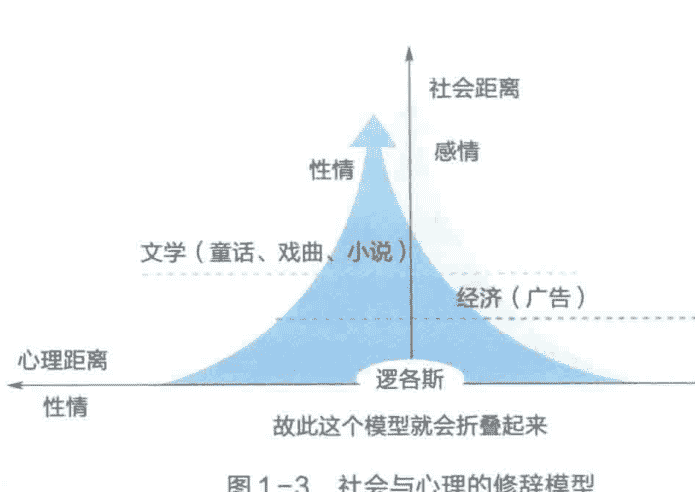

就经济社会而言，现实世界需求无限而资源有限，虚拟世界需求无限资源也无限。广告营销经济体建立在现实经济规律之上，因而满足需求无限、资源有限。但随着机器进步，Metaverse 虚拟经济中的个体需求到精神内核、价值属性和情感链接会愈发独特。文学创作与广告内容在 Metaverse 时代的修辞模型重叠，使得广告营销“不再存在”，却“无处不在”，并让用户因心理需求的满足而产生情感连接。

因虚拟世界始终在线，内容制作必须依托机器实现随时随地的交互与生成。随着自然语言生成与模型成熟，通过 Metaverse 与机器的耦合以及人工智能知识图谱的自动生成，生成式内容既可为人类协助，也可完全由机器创作，提升效率的同时大幅增加多样性。可以说，生成式内容将极大推动 Metaverse 发展，机器也将创作出大量数字原生内容。

有科学家预测，到 2025 年，90% 的在线内容将由机器生成。生成式平台助力 Metaverse 加速复刻现实、创造无限内容，更能与广告需求精准匹配，推动广告行业自发有机生长。在此情境下，机器内容创作成本趋近于零，通过虚拟内容创作与广告营销产业的多维互动融合，生成式内容将孕育出超越广告的全新业态，成为 Metaverse 时代广告营销内容创新的新引擎。我们有理由相信，未来 Metaverse 将实现机器对机器的对接、永久在线，从人人互动、人机互动逐步发展到机器与机器互动。机器真正落地后，世界进入人机协同运营模式，广告营销也将同步迈向新势力阶段。

## AIGC 广告营销新引擎

洞察与推演引导广告行业发展与消费行为演变。广告成为启迪思想的艺术，通过符号与意义的交织引发品牌与人的共鸣。借助生成式广告营销模型的思辨洞察与概念创新，我们得以探寻市场真谛，越过表面繁华，触及人类内心的深层需求，实现品牌与人的共同成长。

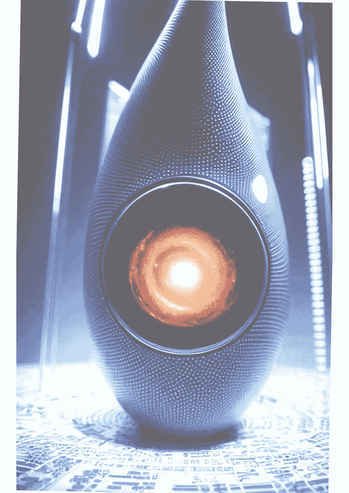

时间：2019 年 9 月 21 日
地点：北京酒仙桥恒通创新园
人物：国内某知名营销传播集团数据分析师紫轩

周五 17:55，快下班时紫轩的手机响起。为客户的新车上市案，汽车业务组准备了两周，上午刚递交方案，看来客户有反馈。

“紫轩，还在公司吧？”弗兰克问。“嗯。”“稍微等我，我刚结束客户会议，马上回公司。麻烦你先通知策划团队，我们要讨论一个新项目的全案。”

“好的。”看来周末又要被报告占据。

18:30 弗兰克到会，团队已在等候。新项目是为年轻都市女性推荐一款硬朗风格 SUV。基础简报介绍后，讨论展开。

“我觉得结构可参照女王节策划案，方案我已发给大家。”有六年汽车策划经验的客户总监弗兰克硬盘里经验丰富。“上周的 O5i 模型我们还能沿用。”

“紫轩，你继续负责策略分析的资料收集与汇总，可向大数据部门要行业报告和人群分析。”弗兰克喝口水继续，“者君，洞察策略先梳理关键信息，资料分析完再一起深研。”

“鲍伯，创意靠你了，今天客户很满意他们偏爱这个创意，基本会推进。”

“朱迪，出一个媒体名单，顺带写后续执行版本。”

“下周二整合一版。紫轩再找些女性群体报告，来印证文案整体思路与策划。”

“好，我去找数据。”紫轩入行两年有余，理工科背景的她习惯在资料中找线索、在数据中找规律，已形成自己的方法。但分析往往在方向或创意确定后才进行推导性佐证，这算真正的分析吗？

十几年前，营销数据分析还是新生事物。需人工收集信息、整理为结构化数据再分析，最后统计运算出结论。一个数据分析师往往要花很长时间分析一组消费者信息。如今几小时甚至更短即可完成，分析看起来更轻松。但新问题出现：人们纠结于分析什么数据，导致分析目的模糊，渐行渐远离初衷。

机器出现后，机器营销工具的普及让数据管理和整合变得关键。2019 年，号称“全球最快”分布式关系型数据库 MemSQL 的调查显示，61% 的企业高管认为机器学习和 AI 将成为公司最重要的</message>数据工具。在营销组织中，机器营销工具扮演数据集成与营销数据架构师角色，为企业提供建议与预测。这颠覆了营销人员决策方式，营销人只需聚焦策略与创意，机器可大规模分析处理并提供个性化内容，导致人的创意在营销中逐渐边缘化、被数据取代。

但这并不意味着创意不再重要。即便有机器加持，创意仍能发挥独特作用。要吸引用户，创意必须根据媒介形式迅速调整。做到这一步前，先了解创意广告的先行者。

### 2.1 创意科学广告先行者

策略很重要也稀缺，可通过商品、竞品、用户分析层层推导，创意却难以推导。吸引注意力、促成购买，都需要好创意。

作为创意广告先行者、全球标杆、奥美创始人大卫·奥格威曾提出，奥美每时每刻强调“创意”，要求主管不允许员工提交草率或平淡的广告作品。

何为有创意？奥格威的标准是：第一眼是否倒吸一口气，是否希望创意出自自己，是否独一无二、符合展示策略、可用 30 年。

广告黄金年代，4A 崛起，奥美尤为响亮。它以出色洞察与创意，创作出脍炙人口、颠覆认知的经典。

奥美是如何创作出兼具强大营销力的广告？其方法论与营销模型有何可借鉴之处？

#### 2.1.1 广告公司的创意方法升级之路：从 360 度品牌管家到 Fusion

“过去五年营销变革超过此前五十年。我们坚信奥美 Fusion 有能力改变行业规则。它将塑造行业未来，帮助我们实现五年计划。”

这是奥美全球 CEO 杨名皓在介绍 Fusion 时的表述。奥美堪称广告圈的“工具之王”，在大卫·奥格威提出品牌形象方法论后，从早期的 360 度品牌管家到蝴蝶模型，再到 Fusion，创意方法模型愈发庞大复杂。

##### 1. 360度品牌管家

360 度品牌管家是奥格威在 20 世纪 90 年代初提出的奥美核心营销工具，强调完整作业流程，确保所有活动反映、建立并忠于品牌，主动管理品牌与消费者关系。奥美认为品牌欣欣向荣需满足：

- 当所有人都对品牌付出爱心、情感、关怀时；
- 当有人真正了解并重视目标对象生活时；
- 当有人与使用者或潜在对象保持亲密关系时。

简言之，360 度品牌管家将品牌与整合营销结合，强调在品牌与消费者的每个接触点实施传播管理。凭借此方式，奥美业务获得更广阔空间。

下图为广为人知的奥美“360 度品牌传播罗盘”，是建立和管理消费者与品牌关系的一套思考工具，也是一个完整作业过程。

AIGC 广告营销新引擎

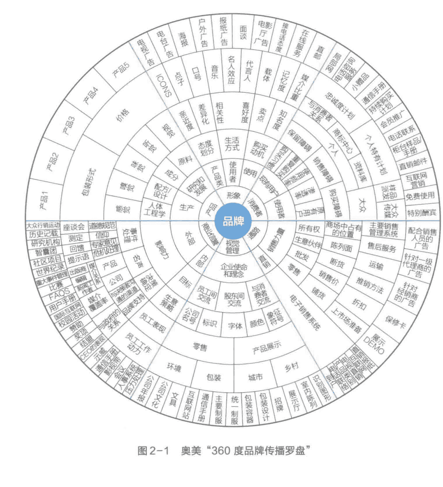

图 2-1 奥美“360度品牌传播罗盘”

##### 2. 蝴蝶模型

塑造非凡的 360 度品牌，企业必须学会 360 度工作，需要广告、公关、营销等多专业协作，从客观角度选择最佳沟通方式，将品牌信息与经验传递给目标受众。

也就是说，只有大创意才能成就品牌。奥格威曾说：“若广告没有大创意，便如黑暗中航行的船只，无人知晓。”基于此，奥美在 360 度品牌管家后提出 360 度品牌运作工具——蝴蝶模型。模型整合奥美成熟工具方法，与客户共同推动品牌策略思考，形成更具逻辑与科学性的广告策略，有助于检验策略完整性与正确性，为公司提供标准化稳定服务，使感性内容更理性，便于客户接受。

蝴蝶模型包含十一个阶段：功课阶段、品牌扫描与品牌检验、品牌雄心、品牌写真与消费者写真、创意点、品牌宣言、360 渠道、任务简报、项目规划、360 度成果分析及品牌报告卡。

第一阶段功课阶段，为分析大环境，需完成商业分析、消费者研究、文化研究等功课。

第二阶段品牌扫描与品牌检验。品牌扫描帮助广告主从产品、形象、受众、渠道、视觉、影响力等方面全方位审视品牌优缺点，同时运用品牌罗盘检验品牌以深入了解消费者与品牌关系。

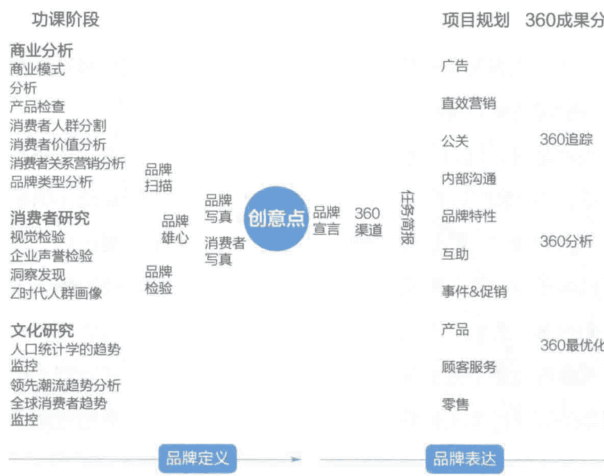

第三阶段品牌雄心，即品牌希望产品在消费者生活中扮演何种角色，产生何种感召力。

第四阶段品牌写真与消费者写真。品牌写真是关于消费者与品牌独特关系的生动陈述，是品牌指纹的 DNA，具独特性不可转让。消费者写真描绘与品牌相关的人群，包括消费者及影响品牌成败者。

第五阶段创意点，通过前期分析提炼洞察，再凝练为能连接品牌与消费者并打动人心的核心创意点。不同技能的合作者会面讨论，共同找到有效主张。

第六阶段品牌宣言，定义品牌传播活动，结合创意点提出主张宣言。

第七阶段 360 渠道。通过 360 渠道传播品牌宣言并扩散，确立可衡量目标，这是品牌渠道策划能力的核心。

第八阶段任务简报。每个特定任务需有简报，各工作独立运作但共同达成品牌企图。

第九阶段项目规划。在设定 360 渠道策略后，通过整合营销传播协同方式推进传播，各团队配合共同检视渠道效果并归总。

第十阶段 360 成果分析，借助精巧分析工具检验品牌活动是否达成预定目标。

第十一阶段品牌报告卡，团队与客户共同分享讨论品牌效应，决定下一步行动。

##### 3. Fusion

进入“互联网+”时代，传播渠道分散，新生代主流消费人群消费观念多元、个性化需求增强，消费成为价值观表达，打动消费者愈发困难。此时多数广告主不再需要 360 度品牌管家与蝴蝶模型，更希望拥有真正推动业务的关键维度，于是诞生 Fusion。它基于蝴蝶模型对策略推导的升级，也是在 360 度品牌管家基础上对广告业务更广泛更高端的囊括。

相较蝴蝶模型，Fusion 更简洁，主要分为商业企图、顾客体验、传播结构、解决方案和传播有效性五个部分。

| 我们面对的挑战 | Fusion各阶段 | Fusion产出 |
| :--- | :--- | :--- |
| 对客户生意问题缺乏共识 | 1 商业企图 | **商业企图红星™** 从不同方面分析客户的商业问题来获得对问题的深入洞悉，沉淀并形成一个核心策略 |
| 要真正打动消费者，难度更甚以往 | 2 顾客体验 | **顾客历程** 深入了解顾客的消费历程，分析并寻找影响和打动他们的核心因素—障碍和驱动因素 |

# 从蝴蝶模型到 Fusion：奥美策略进化与行业暗流

要把不同技能、多个代理和各自立场拧成一个统一方案，难度极大 | 3 传播结构 | **传播蓝图™** 给出清晰统一、可直接落地的市场规划，为每条传播渠道明确角色定位与策略性职责

传统创意在非传统传播场景里经常水土不服 | 4 解决方案 | **DO行动简报™** 以一句核心问题锚定创意挑战：传播最终要撬动消费者怎样的行为

数据堆叠过多却难判断价值 | 5 传播有效性 | **效果报告** 以商业目标为标尺，审视各项传播带来的实际效应

图 2-3 Fusion 策略的五个构成

第一块是商业企图，从品类、竞争对手、企业自身、消费者到渠道等多维度拆解客户的商业困境，深入理解问题后提炼出一个核心应对方向。

第二块是顾客体验，梳理消费者的完整旅程，找出真正能触动并影响其决策的关键节点。

第三块是传播结构，制定可落地的市场蓝图，为每个传播触点分配清晰的策略任务。

第四块是解决方案，基于对消费者行为的预判，给出简洁可执行的传播主张。

第五块是传播有效性，搭建信息回流机制，对各渠道的产出与商业目标进行对照与优化。

对照这五个阶段的任务，Fusion 与蝴蝶模型有四处明显分化：

第一，Fusion 把分析做得更重，商业企图与客户体验从蝴蝶模型的 Homework 中剥离出来单独放大。

第二，Fusion 更强调传播本身的作用，对品牌与创意的比重则有所弱化。

第三，Fusion 更聚焦解决问题，意图用多元传播手段去破解商业难题。

第四，Fusion 建立了闭环的数据回流，用来持续校准目标与策略产出。

综合来看，Fusion 本质上是广告、公关、营销、品牌等能力的整合工具。正如奥美全球 CEO 杨名皓所说，Fusion 更关注商业问题，覆盖全技能链，聚焦客户旅程。而其兴起正逢大数据浪潮，数据分析与效果回流的权重被明显抬高。

从 360 度品牌管家到蝴蝶模型，再到 Fusion，奥美的策略体系一直在随传播环境与受众变化而迭代。这套演进既凝结了广告行业的经验沉淀，也借鉴了咨询行业的思维方法，由此触发了咨询、广告与信息行业之间的一轮正面交锋。

#### 2.1.2 三大产业的碰撞：咨询、广告与信息

2015 年前，传统咨询公司极少涉足广告，双方各自为政。2015 年后格局逆转，咨询业务向广告倾斜，广告业也开始高举商业解决方案的大旗。2000 到 2017 年间，谷歌、脸书、腾讯等互联网平台不断扩张数字疆域，广告业还能与之亦敌亦友。但随着互联网媒体与咨询公司的竞争白热化，广告的生存空间被进一步压缩，咨询业、广告业与信息业的遭遇战全面打响。

2017 年，埃森哲、普华永道、IBM、德勤四家咨询巨头集体杀入麦迪逊大道主导的营销市场。当年四家在营销服务上的总收入达 132 亿美元，规模略逊于 WPP、宏盟、阳狮、埃培智、电通等传统集团。这些新进入者将分析、数据、咨询与技术深度融合，形成了咨询思维加技术服务的复合型营销力量。

2018 年，埃森哲收购数字营销公司伙传播，整并入埃森哲互动业务，为中国客户提供从数字设计、营销、内容制作到商业服务的全链条服务。

同年 11 月，创立 150 年的智威汤逊被更具数字基因的伟门合并，重组为伟门·汤森。从此，曾经自诩“全球最知名营销传播品牌”的 JWT 告别广告舞台。这场 WPP 内部的重组，让人直观感受到大创意时代的谢幕与数字营销主导时代的到来。对伟门而言，其早期开创的直效营销，后延展至品牌战略、咨询、电商与数据分析，使其跻身全球三大客户关系营销公司之列。

进入数字时代，广告业以创意著称却被咨询业贴上“传统广告”的标签，内心里颇不服气。4A 曾抱怨甲方高管忽视数字营销，可当高管真正重视后，4A 却发现自己难以招架。广告的核心是创意与点子，咨询师的核心工具是数据与分析，少有头脑风暴式的创意依赖，而是基于调研与数据论证的 PPT 输出。

随着直效营销与数据库营销兴起，营销对数据的依赖加剧。数据细分与个性化成为常态，AI 营销工具进一步把数据管理和整合推向核心。AI 与机器学习正在重塑营销决策流程，策略与创意由人主导，分析、处理与个性化内容交付则交由机器，这使得创意在营销链条中的话语权被边缘化。

广告业也在尝试整合数据、技术与创意，麦迪逊大道上的巨头本可深耕邮件营销或电视节目等赛道。但多数机构选择投入人工智能、数据整合、消费者体验分析、定制化解决方案与移动应用开发。咨询型代理既要平衡时间、项目与回报，也要以结果衡量服务，主动权因此逐步向咨询机构转移。

这场碰撞的根源，来自三大学派对广告与咨询的深远影响：设计学派、计划学派与定位学派。

#### 2.1.3 设计学派：咨询思维注入营销

1960 年，芝加哥石油行业顾问西奥多·莱维特发表《营销近视症》，指出企业过度聚焦制造与销售而忽视营销，陷入“营销近视”。其表现是企业把资源押在产品与技术上，而非消费者需求，导致竞争力流失。产品只是满足需求的载体，一旦出现更优解就会被替代；消费者需求也在持续变化，并非所有人都追逐高价高质。莱维特的结论是：企业衰退的根源是营销视角的短视，而非市场饱和。

与其说莱维特是营销学家，不如说他是战略思想家，他把营销提升到战略高度。他的核心命题是：营销应从消费者出发，而非从产品出发，这正是“以客户为中心”的雏形。早在两千多年前，柏拉图与亚里士多德就强调受众的重要性。广告起家于报刊，报刊先有读者才有广告。广告很早便推崇对潜在消费者的纸上说服与消费者调研，莱维特强化了这一理念，今天的策略案几乎都烙印着以受众为中心的分析，如奥美蝴蝶模型的消费者研究、Fusion 的消费者分析与客户体验，以及恒美 ROI 工具的消费者分析模块。

为验证其普适性，莱维特提出宏观环境风险框架：企业须在可接受风险范围内平衡外部环境消费者、竞争、政府、社会与内部环境资源、能力、方案、愿望。

这些主张源自设计学派。设计学派首倡战略制模，核心是内部能力与外部环境的匹配。1965 年，哈佛商学院教授肯尼斯·R. 安德鲁斯在《企业战略：内容与案例》中用战略评估框架诠释了该学派模型。

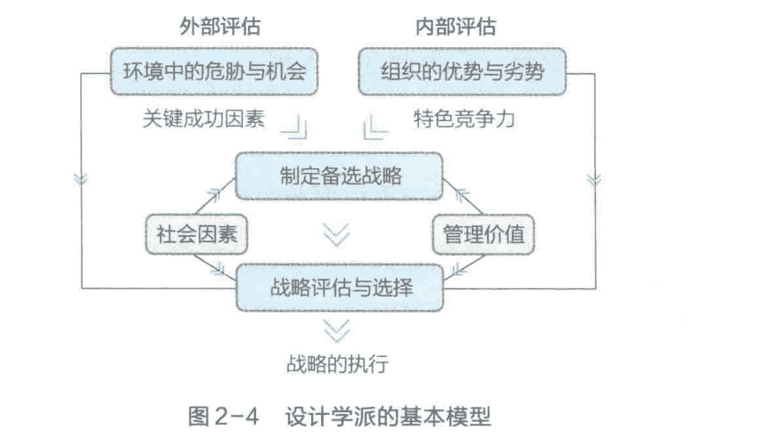

该模型与广告策划中的宏观行业分析高度相似，都涉及技术、经济、社会、政治因素，并通过调研与预测丰富内容。广告策略在设计学派思路上，内部分析更倾向直接采纳甲方结论，解决“我们在哪、为何在此、去向何方、如何到达、是否到达”等问题。最后战略形成是一种创造性行为，这正是广告公司的长项：既能用理论串联问题，也能交付方案、TVC、插画等具体物。

不过在影响高层、从分析模型中提炼底层逻辑方面，广告公司不及咨询公司。咨询分析师不断完善方法论，广告界借鉴其养分才实现进化。

#### 2.1.4 计划学派：为广告提供落地路径

设计学派预设战略可按蓝图拼装，分析先行、战略是过程。咨询公司高度认同此逻辑，也将其视为方便的分析工具。但设计学派将思维与行动分离，上层思考、下层执行，预设信息能无损上传，非常理想化。

为解决此弊端，管理专家提出计划学派。学派认为战略形成是程序化过程，需拆解为可执行的亚战略，强调制定的一系列行动步骤。

随计划学派兴起，咨询公司陷入尴尬：战略规划师只在理想环境中画图、不负责执行。尽管精细规划曾助力通用、迪士尼等企业，但也导致僵化。80 年代初，杰克·韦尔奇上任通用电气后废除战略规划体系；罗伯特·艾格接手迪士尼后也终止了既有战略规划系统。

有效规划需把思想与行动连通，规划者参与执行，执行者参与制定。计划学派在内容上偏重执行，若方向或逻辑出错则难以回头。其优势是过程可控，劣势是时段不连续易僵化。

广告公司通过实践补足了这一缺陷。计划学派强调分步行动的观点，被广泛用于营销组织的运营与投放，成为奥美 360 品牌管家落地的基础。20 世纪末美国广告业高速增长期，分析、创意、计划、制作到执行的一体化服务能力被不断强化。

#### 2.1.5 定位学派：心智争夺成关键

计划学派争议未歇，定位学派席卷战略管理。1980 年迈克尔·波特出版《竞争战略》，融合设计与计划学派假设，强化战略内容制定，从说明性分析走向实证研究，贴近企业真实需求。

定位学派提出：在既定环境中可行战略无限，但在界定环境后企业只能选少数关键战略。它否定“量身定做”，提出基于资源与环境的分析方法，并推广至各行业，形成通用战略思路。学派主张战略制定到执行的全程协同，调研公司提供数据，咨询专家提供工具如 BCG 矩阵、波特五力、价值链，企业计划部门与外部营销公司共同拆解落地。

艾·里斯与杰克·特劳特在《定位》中定义：定位是在深度分析产品与竞争、准确判断消费者需求后，确定产品独特优势及在消费者心中的独特地位，并将其传达给目标人群的动态过程。战略管理中的定位偏竞争定位，指向利润市场；营销管理中的定位指向客户心智。

“每个品牌都需要一句话来区隔竞争对手。”这句话既是里斯的观点，也是快速进入心智的抓手。里斯认为定位围绕消费者心智而非产品，此理论建立在心理学基础之上。

竞争定位最终要回归利润，用数学与数据衡量；营销定位则更虚拟。心智版图不如市场份额直观，心理学概念难以量化，计算也难匹配多维度动态模块。广告公司借用咨询方法论增强逻辑性。

如今企业战略设定更趋向经济学与计量经济学，咨询行业更看重推导关系与匹配逻辑，报告权威度更高，形成良性循环。营销广告虽也重视分析，但因策略偏心理学，更易采用合理化叙述而非逻辑推理，这也是行业价值链的惯性所致。广告与咨询交锋中获得高额回报，但分析盘子较小，于是陷入“分析不重要—逻辑刚刚好—理性阻碍创意”的循环，这也成为营销广告的特征。

### 2.2 AIGC 时代的广告营销架构

三大学派演进至 20 世纪末，广告理论体系基本成型。20 世纪 50 年代至 21 世纪初，随着营销理论兴起，创意理论不断更新。广告脱离单一媒体销售后，对消费群体的影响需要更深研究与组合手段，企业对全方位要求提升，策划与策略思维应运而生。未来广告应是千人千面的精准投放数学题。

各广告公司的策划结构基本趋同。策划案逻辑通常包括背景介绍、传播目标、传播环境、挑战、受众分析、洞察、策略、创意、核心信息、媒体策略、活动及执行。

背景介绍与传播目标解读项目并阐释传播价值；传播环境、挑战、受众分析属于分析层，覆盖宏观、竞争、产品与消费者视角；洞察与策略承上启下，提炼分析结论并引出创意；创意、核心信息与媒体策略属于产出层；活动与执行是落地的具体计划。

结合修辞学视角，广告营销结构可分为五层。第一层背景与目标设定把问题纳入营销框架，第五层项目执行也不属于主题。第二至四层为主题，对应修辞学的受众、信息、技巧。

AIGC 广告营销要有效运行，至少需要分析、洞察、创意三大核心模块。背景与目标设定系统是人机交互窗口，如今可基于大模型的自然语音交互，人工输入需求，机器生成策略并直连投放系统，形成分析、策略生成、创意产出与投放一体化的智能闭环。

为便于记忆，这套系统可称 A.I.GC，包含：

- 1. 分析模块 Analysis Foundation：品类分析 Category、竞争分析 Competition、用户分析 Consumer；
- 2. 洞察模块 Insight Hub：结合技术，从洞察挖掘到策略生成；
- 3. 创意模块 Generated Creative：依托人机互动形成创意 Creative 与内容 Content。

# 第2章 AIGC广告营销的模型分层

依托数据抓取与自然语言处理技术，再结合营销理论与统计计算，分析基座能够在短时间内勾勒出营销规划的三大支点：宏观市场态势、品牌竞争优势与核心人群画像。借助生成式AI，数据层面的盘点得以快速还原当下环境。后续所有结论会进入洞察中枢，将产品属性、消费者诉求、品牌定位等要素转化为可计算的问题，再由模型推导出营销核心洞察；最后由创意生成单元在前序结果之上发挥创造力，产出高相关性的广告方案。AIGC由此完成对营销灵感激活与内容生产的支持。

表面看该流程由AI闭环完成，实际上实验设计、数据痕迹的审阅、模型持续学习与优化仍需人类主导。AIGC广告营销的本质是人机协作的产物。

这三层架构如何形成，理论依据是什么？下面分项说明。

# 第2章 AIGC 广告营销模型

## A. I. G. C. 广告新引擎

### A. 分析模块（Analysis Foundation）
品类盘点、竞争拆解、用户洞察。

### I. 洞察模块（Insight Hub）
从洞见挖掘到策略落地。

### GC 创意模块（Generated Creative）
人机互动形成创意与内容。

图 2-8 AIGC创意启发与内容创作流程图

### 2.2.1 分析模块：数据建模动态挖掘人群心智

1776年，修辞学家乔治·坎贝尔出版《修辞原理》，把科学方法引入修辞学并保留修辞精神。书中两条主线值得注意：

其一，他勾勒出人类心智轮廓，借诗人与演说家揭示隐秘活动，探索感知与行动的路径，使修辞在科学引导下研究心智机密，带有应用心理学色彩。一个世纪后斯科特博士也把心理学视作广告的理论基础。

其二，传统修辞难以聚焦人格、情感、道理三类说服手段，长期以证据为核心。坎贝尔主张通过语言运用，以告知、证实、取悦、感动、说服为目的影响听者。

坎贝尔的论述吸收了波爱修斯修辞学中的分析要素与科学观，对分析展开细化。

同一年，英国发明家詹姆斯·瓦特改良蒸汽机，造出首台实用机，英国迎来大规模商业活动。商业需求催生广告，源自古希腊的公众演说与法庭辩论传统，西方修辞延续劝说的核心，广告的目标锁定说服。

要实现说服，广告必须吸纳社会价值中的情感因素。如同将军靠战术取胜，语言大师靠恰当表达赢得听众，营销战略也需通过分析获取证据，修辞由此进入广告实践。

坎贝尔理论需要何种证据？

直观证据。纯理性公理、体验觉察、同理心常识，三者自然原始，无需实证。擅长创意的营销策略常用这一套，因人而异难以标准化。资深策略师在规划期会自然进入该体系，被形容为神秘灵感。这种难以言传的分析难以量化，也难以成为机器解析层的逻辑基础。

推导证据。按程序推导，可分为以公理为基础的实证科学证据，和觉察到的显然性证据。显然性又分经验、类推、证词、概率。坎贝尔认为只有显然性证据与修辞相关，它建立在感知与尝试之上，遵循由过去推断未来、由已知推导未知的路径。

推导证据虽少直观灵光，却更利于机器模块化磨合，通过人机互动提升效率。使用机器时，PEST、SWOT等模型可从人出发找规律，即从宏观与竞争视角审视受众，再细分。

受众如同剪刀，会裁剪宏观与竞争分析的维度，而非照搬模型。广告是以说服为目标的心智占领，越聚焦受众分析就越感性。宏观层面统计学是好工具，但个体研究仍需情感分析专家与心理咨询师的能力。

如图2-9所示，坐标中越靠近中心越贴近个体心理需求，受众分析最靠近中心，这是否意味着营销就是反复研究受众？需要全面认知。

坎贝尔认为受众兼具普遍性与特殊性。普遍性是共有的基础属性，如年龄性别地域；仅做普遍分析不够，还需结合独特性格特征，并结合宏观历史、时代背景与竞争环境，这正是宏观与竞争视角要解决的问题。

从企业角度，分析不仅要看受众，还要看品牌与行业。传统PEST、SWOT需查大量资料，如今借行业模型与自然语言处理，可对互联网行业数据自动分类，把握全貌，或直接让ChatGPT得出结论。在社交媒体时代，AI可自动做社会化媒体监测。品牌模型能及时捕捉口碑，如美誉度、知名度、共鸣度；数据分析还能即时呈现新竞品动向与意见领袖褒贬。结合马斯洛需求层次与用户数据库，机器可自动展示人口统计、行为轨迹、心理特征等多层次画像。

### 2.2.2 洞察模块：算法驱动的情绪共鸣

BBDO前首席创意官菲尔·杜森伯里认为，好创意能带来一条好广告，好洞察却能催生上千创意。

字典里洞察是看透看穿，强调参透内在意义。业内洞察是一种独特且带神秘感的行为。杜森伯里创立的RAISE模型以调研、分析、洞见、策略、执行为线性矩阵，洞察起到承上启下作用。

与咨询公司或商学院动辄上百页数据PPT相比，广告公司的独特卖点藏在洞察里。从受众出发的分析与调研能挖掘出让客户心动的点，再以修辞塑造形象、推动销售，最终改变公众态度。

例如近年美国城市女性离婚率攀升，数据背后的洞察是什么？广告人读到的洞察是：城市女性独立自主、追求自由的能力在提升。这个洞察就是敲开创意大门的钥匙。对营销人而言，洞察就是洞见人性。

阿尔弗雷德·阿德勒认为人性是原始诉求，不同诉求支配不同行为。人性过程使人成为行为习惯综合体。人性也是个人诉求与环境冲突的矛盾，个体权利与群体义务的张力，感性与理性的冲突。人在群体中理性会下降，这正是羊群效应主因；而独处时思维更理性，更易从个人利益角度思考。

德国哲学家尼采认为修辞是对立自然语言的造作，自然语言与修辞表达是二元对立。修辞是一种力量，能使事物运作。正是这种力量让营销广告区别于其他咨询行业而独立存在，神秘的洞察就是这个力量杠杆的支点，撬动创意、策略与执行。

彼得·F·德鲁克谈营销自动化时说，微量洞察只能带来无效执行。当前营销智能化的前提是营销自动化，但需求不清晰、数据碎片化、缺乏对洞察的探索，导致大量无效执行。恶性循环下，再智能的技术在内容生产也只能发挥两成效能。若要构建营销战略机器人，洞察就是它的心脏。

如图2-10所示，消费者对市场、品牌、产品的情绪表达可被记录，通过行为与态度数据、自然语言处理与机器学习自动生成算法模型。结合心理学、社会学、营销学知识，AI能理解个人诉求与环境冲突背后的矛盾，洞察变成数学题。AIGC对环境、特点、需求的量化结果做相似度匹配，在修辞学上就是把企业信息与受众背景、兴趣、愿望、动机相适配。适配度高即为共鸣，否则为冲突。基于机器得出的广告定位，由此展开产品、传播与市场。

### 2.2.3 创意模块：从启发到落稿

经过产品调研与策略逻辑推导，广告公司的深刻洞察能得到客户认同，但客户更关注创意、制作与投放的营销内容。这是广告业的固有印象，也是一种被固化的商业模式。

# 第2章 人机协同的营销框架

20世纪后半叶，群体间概念冲突成为修辞发展的催化剂，推动西方大规模争夺公共领域。媒体发展让修辞力量在宏大时空发挥作用，实现多元思想劝说成为广告机构标配。受众变成千里之外分布的社群，修辞执行不再依赖口才极佳的个人，而需团队或机器，从而诞生大众传媒、广告公关等修辞机构。

进入21世纪，营销传播机构利用媒体资源，通过广告技巧、艺术手段与心理学成果，从版面代理起步，开展说服民众与引导舆论的整合调配。为达目的，修辞借跨学科知识潮流孕育广告内容，收获最终成果。

从版面代理开始，营销传播整合公关、直销、销售与促销等技能，广告外延更广，广告为中心的代理概念被颠覆。广告策划融入营销策略规划系统，从分析出发到洞察凝练，以核心洞察为原点，内容产出变成创意酝酿、内容管理、媒体投放对接的系统，实现传播技能的创意化。

1533年，托马斯·威尔逊在《修辞艺术》指出，文体风格讨论不仅包括清晰与恰当，组合与异彩也是修辞必须考虑的两大要素。组合强调词语搭配是否和谐；异彩借外来词增加章句变化。这种广告修辞的证据与观点与东方理解不谋而合。

20世纪40年代，创意大师詹姆斯·韦伯·扬在《创意的生成》提出：创意就是旧元素的重组。从单纯组合角度，计算机效率远超人脑，但组合只是第一步，有价值的创意不仅要吸睛，还要符合品牌特性和产品卖点，才能满足用户消费需求，这是评价广告创意高低的关键。这一概念比洞察更主观感性，营销人也不认为机器能批量生产创意，这也是广告策略机器化的最后绊脚石。

如图2-11所示，基于创意方法论，大数据+AI将创意的关键点定义为“人”“货”“场”三方面。NLP通过输入用户场景、用户标签、产品卖点和品牌名，可获得启发短语并捕获创意火花；同时AI对创意组合中各元素关联性进行分析，得出最终结果。

创意圈有句话：意料之外，情理之中。越是想不到的组合，戏剧性与意外性越高。两千多年前，古希腊哲学家赫拉克利特提出：相反的东西结合在一起，不同的音调能创造最美的和谐。

# 第2章 生成式AI广告营销模型

随着AIGC发展，机器进入广告营销领域，涵盖文本生成、音频生成、图像生成、视频生成等，体现创意、表现力、迭代、传播、个性化等多重优势。AI应用于内容生产端，能充分发挥技术优势。未来AI将极大提升内容交互体验，从辅助生产激发灵感到驱动内容创造，构建更有情感、质感与体验感的新型营销方式。

## 第3章 分析模块：数据建模动态挖掘人群心智

数据的镜像与模型的创新，揭示欲望与行为动机。分析成为洞察人性的艺术，探索决策路径与情感轨迹。通过数据建模动态挖掘人群心智的智慧，我们能深谙人类行为本质，洞悉市场需求，实现精准营销与人群心智共振。

时间：2019年9月21日
地点：广州
人物：广告代理公司数据部负责人 柳文泽

柳文泽硕士毕业后一直做分析师，从助理成长为首席分析师，天天与纯粹的数据图表打交道。工作枯燥，但每份报告能以不菲价格卖给客户时仍有成就感。他心里一直想离开枯燥生活，却找不到方向。

直到一次同学聚会，前同事司文森半开玩笑说：要不去广告公司试试，那里的分析工作也许能给你的枯燥生活加点不一样的色彩。司文森现为世界五百强快消公司市场副总裁。他认为市场环境分析能力是营销人员的必备技能，却发现一些广告代理公司只懂一点文化且局限潮流文化，对行业政策、产业趋势、社会动态缺乏基本了解，前期策划显得肤浅。有时提案又过于宏大，缺乏客观的市场环境、行业现状与清晰用户定位。例如一家公司在CBA合作案中分析二胎政策的间接影响，司文森发现其宏观分析为分析而分析，实践中难以参考。

司文森想让同窗好友柳文泽去广告代理公司感受差异：分析机构的市场环境分析与广告代理公司的分析有何不同？广告代理公司做市场分析用哪些方法策略？这不一样的色彩正是柳文泽期待的。

在司文森引荐下，柳文泽加入广告代理公司成为数据部负责人。他发现，分析机构更看重数据分析本身，而广告代理公司的数据分析师需更懂广告业务，并与创意策略做营销打法的联动。

比如一场新啤酒品牌赞助的音乐节，柳文泽团队通过预先社会化聆听技术，帮助品牌挑选调性契合的小众乐队赞助，再通过图片采用分析为音乐节当天啤酒限量外包装提供设计建议。活动三天里，团队实施数据监测，收集社交媒体口碑、品牌与产品口碑、音乐节热度、乐队现场表现等信息，将其作为内容营销素材，通过AI快速生成社交媒体内容并及时发送互动，全方位打造新啤酒品牌形象。

实际上早在20世纪初数据分析就被引入广告行业。在适应行业需求过程中，广告数据分析显现优势，也暴露问题。AIGC的引入带来新变革。它不仅能分析挖掘海量数据，提炼有价值信息与趋势，帮助企业制定精准数字化营销策略，还能依据用户历史行为与偏好个性化推荐，实现营销自动化，最大化提升营销效率与用户满意度。

### 3.1 将经济调研方法引入广告

1903年，智威汤逊率先把调研方法引入广告行业，在25个国家杂志中刊登整页广告并邀请读者反馈，最终收到三万份回复。调研显示，当时中高收入阶层大部分人表示不喜欢纯文字广告，也不喜欢啤酒广告。调研人员还发现，市场调查不应只统计客观占比，其中还有文化层次、心理状态、社会趋向等不确定因素，而广告公司正是解决和改变不确定因素的高手。

二战后，美国制造业产能转向消费品市场，广告业蓬勃发展。许多广告客户希望尽快卖掉积压库存，急切期待广告公司找到全新销售模式。广告公司于是向心理咨询专家求助，社会经济进入心理经济时代，广告人开始兜售焦虑背后的安全感。市场调研分析被选择性引入广告行业。

由此，广告行业高喊分析驱动策略生产与创意生成，实际上却日益功利化。这与广告这种社会修辞学的功能主义化相似：舆论一致并非自发产生，而是通过管理组织操纵的结果。

这就不难理解，广告行业为何钟爱拿来主义。很多有经验的策划老兵做宏观分析时：有人挑宏观报告几页，本行业就全引用；有人在媒体报道中找观点文章引用；有人引用趋势模型，如产品生命周期曲线、宏观经济周期、创新模型等。这是功能主义盛行后形成的结果。

这种拿来主义分析对卖资源的媒体公司、卖产品的小而美创意潮店或IP经纪公司足够用，因为流量与产品本身就是核心优势。但制定现代营销策略，还是要靠真正的逻辑分析解决真正的营销问题。

## 第3章 分析模块：数据建模动态挖掘人群心智

从认知模式看，人类有归纳模式与演绎模式两种。人类最擅长归纳，即从已有知识归纳出认知模式，再套用到新知识。这也是营销人在策划时喜欢用已有报告、信息、案例甚至故事的原因，因为其中包含丰富认知模式，人际沟通也能有效完成。

相比之下，演绎模式是给定前提，通过逻辑演绎得出新结论。结论固然能解决问题，但广告业惯性思维认为，这样得出的结论是组织预设的，并不新颖，因此对演绎模式并不认同。

直觉归纳要让位，演绎推理才是营销分析的新方向

归纳和演绎都属于理性思考，只是走的路不一样。日常操作里大家更习惯归纳，也把这套习惯直接搬进了广告投放。算法和计算模型擅长的却是演绎，这就逼着营销人换一套分析打法。近几年社会学、管理学、心理学、统计学、修辞学、营销学、人文艺术等多个领域都在向广告靠拢，不同专家的关注点不约而同，背后其实是在呼唤一门真正研究人的科学。

要让这门人的科学变得可度量、可计算、可智能，得先回看经济学是如何从思辨走向方法的。

1776年亚当·斯密的《国富论》出版，经济学才算走上独立道路。书里讲市场受无形之手调节，却没说明这只手怎样实现财富最优配置。《国富论》更多是前瞻性的洞察和实用建议，并非数学证明。斯密奠定的是研究方向，这和广告很像——“科学广告”被提出时，也只是指向一个方向。

经济学家想让学科更硬，最好像物理那样用公式描述现象。最早系统尝试这条路的是法国学者莱昂·瓦尔拉斯。

1872年《纯粹经济学要义》问世，他把经济体看成封闭系统，财富随机分配给偏好各异的主体，通过交易走向均衡。瓦尔拉斯追求可预测性，于是需要一个稳定唯一的均衡点。他把供求平衡比作物理世界的力平衡，推测每件商品都存在能让买卖双方都满意的均衡价，市场由此清空。

这种思路把数学带进经济学，让复杂现象能用公式表达，看起来更科学。但随之而来的是难题：经济体里的人必须像物理物体那样行为统一、可预测。瓦尔拉斯为此提出经典假说，认为人是绝对自私且绝对理性的。

现实里人既不完全自私也不完全理性，从这个角度看假说站不住脚。但经济学必须抽象行为，这是研究的必经。无论是否假定自私或理性，学科科学化过程中有两点经验可借：系统均衡，以及对人类行为的抽象。

下面看这两点如何起作用。

#### 3.1.1 数学如何把经济学变成分析工具
19世纪末瓦尔拉斯近乎励志地把经济学推向理论科学化，数学在经济学的专业化应用却又等了上百年，随后迅速发展，从职业化到登峰造极。与此相对，广告业在当时才刚独立。

20世纪20年代，挪威学者拉格纳·弗里希把经济学理论、数理方法与统计学用于现实问题，为经济规划的决策模型装上科学引擎。他在1933年提出宏观经济学概念，随后在凯恩斯理论支撑下，宏观分析逐渐成为独立体系。

与宏观对应的是微观。20世纪30年代后，英国罗宾逊与美国张伯伦在均衡价格理论基础上提出厂商均衡，由此微观经济学确立体系。而在微观开创性探索的是美国学者加里·斯坦利·贝克尔，他把经济学用于人类行为分析，开辟了此前由社会学家、人类学家、心理学家主导的领域。

于是经济学与数学结合，到20世纪末大致定型为三大分析视角：宏观、微观与人群行为。

这三点亚当·斯密都提到过。宏观层面，他认为市场鼓励个体追利时会自然激发勤俭与创造精神，通过竞争把资源导向生产率最高领域，实现社会资源优化。微观层面，他提出劳动是价值源泉，每种商品含有的劳动量衡量交换价值，进而分析自然价与市场价关系，以及竞争如何约束自利、价格机制如何配置资源。人群层面，他提出个体追利时会被无形之手引向非本意目的。

广告学正是借这三重视角回应波爱修斯在修辞学中关于分析的议题。如今许多策略型策划都以此为起点，结合各学科做参数分析，而非拍脑袋。但细究应用仍有两点未解：一是让三种视角联动；二是把演绎模式转为机器可操作的归纳模式，以便发挥数学与计算的力量，形成营销策略的基本分析框架。这正是广告人亟需解决的问题。

#### 3.1.2 从经济学概念出发构建用户画像
经济学自有概念体系，如偏好、价格、产品功能，都是高度抽象的建构，类似物理里的力与速度。研究建立在这些抽象与假设之上。宏观模型通常假设货币、劳动力市场、资本市场、政府与央行存在；微观模型则假设消费者、生产者、技术与市场存在。这与营销里抽象出4P——产品、渠道、价钱、促销——如出一辙，还进一步抽象出品牌这一行业特有概念。

经济学能从人文社会中分离出来，关键在于从人类行为标准出发设立了经济人模型。古典经济学家视其为完全理性，总能实现利益最大化。1978年诺贝尔奖得主西蒙·库兹涅茨提出有限理性，认为人处于完全理性与非理性之间。

这些理论虽有不足，却提供了用科学方法理解行为的基准，描述了经济生活里的基本规律。把握微观规律，有助理解宏观行为。

在经济学内部，宏观、微观与人类行为是分散的，但在策略分析中却被整合为宏观、微观与人群分析三部分，这延续了战略学派的研究模块，形成约定俗成的修辞表述。营销机构希望用数据分析产出行动策略，但因行动多样性，本质仍需人担任决策者、执行者、行为者的协作角色，所以首要环节是产生策略，即说服过程，业界称之为提案。

策略产生阶段，人更易接受故事与因果关系。从计算角度看，就需要把故事转化为因果图，用以解读问题，执行对应干预或反事实的行动手段，并用修正后的因果模型计算。这解释了为何策划需要三大维度的联动，并把演绎转为归纳。

同时这也指明联动方向：把宏观、微观、人群分析收敛到同一组模型假设上，而不是停留在人类叙事方式上，再靠对模糊地带的阐释做发散演绎。否则机器无法理解，也就发挥不出数据与技术的力量。

比利时哲学家凯姆·帕雷尔曼让修辞研究在人文领域复兴，他认为心理与社会条件不能被视作无关，缺少它们修辞论辩就失去意义。因此受众概念必须被重视。《西方修辞学史》指出：受众始终是论辩者心智构建的对象，论辩者会根据语境与目的虚构受众，并以此对真实受众施压迫使其就范。

社会是由多种受众意见构成的合意空间。修辞研究常把分析归结于受众视角，论述从宏观到微观再到受众，像漏斗一样由大到小。但从分析角度看，受众分析在宏观阶段已通过行为选择所需部分，微观亦然。

接下来分别从宏观、微观与人群三个层面，论述分析模块如何对受众施压并产生影响。

### 3.2 宏观视野：借助PEST读懂受众
1690年英国政治经济学先驱、统计学创始人威廉·配第出版《政治算术》，想用算术这种数量方法研究社会政治。他认为数字的确定性可以消解分析的不确定性，避免文字阐述的冗长。若对宏观环境的理解可达可测度，国家管理者就能摆脱个人非理性，从书中获得客观指导。这种方法本质是实证分析。若配第看到三百年后的今天，他会失望，因为政治科学家处理事务时仍常被偏见与冲动左右，而非纯粹理性。真实社会并非可物理式管理的。

配第的思路与西汉王莽相似，王莽的新政也试图以宇宙真理创造繁荣，创设完美计划如改币制、更官名、以王田制恢复井田制，却因人为干涉天然社会秩序而收效不佳。而同时代罗马统治者盖乌斯·屋大维·奥古斯都要灵巧得多，他懂得顺势而为，采取顺应形势的内外政策，如改革军队、实行雇佣兵、建立禁卫军、对外扩张等，开创了罗马相对安定的局面，为初期繁荣奠基。

宏观看，屋大维的顺势而为击败了王莽的完美计划。正如斯密所言，市场背后有无形之手，你只能感知由众多因素构成的势，也就是帕雷尔曼笔下多样受众意见构成的合意空间。这些由个体行为转化为群体表现的趋向，无法用配第式的精密逻辑计划。王莽犯了配第式的错，而屋大维赢在理解受众意见。

当下宏观战略分析最常用的思维模型之一是PEST，用于分析企业外部环境，了解宏观环境对战略的影响。简单说，PEST要回答：当下与未来的宏观环境是否适合企业发展，能否满足消费者需求。

#### 3.2.1 PEST模型对宏观环境的拆解
上百年里经济学家发明了大量分析模型，PEST是其中之一。它是一种分析企业外部形势的商业模型。PEST由政治、经济、社会、技术四词首字母组成。这四类因素都属企业外部环境，不受企业掌控，故也戏称Pest即有害物。

可以用PEST模型梳理王莽与屋大维改革的宏观环境。

##### 1. 政治面
王莽方面：
王莽政治上全面恢复分封制，取代秦汉中央集权的郡县制。取消世袭，推行选贤举能，为中国政治制度变革奠基。然而新政未获民众广泛认同，反致社会动荡，最终失败，政治改革成果不尽如人意。

屋大维方面：
屋大维的元首制是在共和制废墟上建立起来的新型国家管理机构，他在改造旧机构、利用旧机构的同时赋予其新权力，使罗马中央政府形成以元首为中心的权力体系，这是元首制区别于共和制的根本。从属于元首的重要机构是元首顾问会议，由高级官吏和15位元老组成，专门讨论拟定提交元老院的决议草案，平时为元首出谋划策。但该机构随意性强，属于临时机构，成员随元首需要更换。元首下还有复杂行政机关，包括从属于元首的中央办公厅及其诸多官职。中央办公厅处理屋大维家庭事务，包括消费经办人、秘书、医生、厨师等。其他零散机构有粮食供应委员会、公路委员会、供求委员会、河道管理委员会等。

屋大维做法与王莽相反，他在罗马帝国开创元首制，对军事、经济、宗教实施独裁，被称为披着民主外衣的君主。

##### 2. 经济面
王莽方面：
王莽经济改革核心是创立王田制，把地主阶级土地私有制改为封建土地国有制，企图遏止土地兼并。此外宣布酒、盐、铁由国家专营，依靠国家手段稳定粮布市场。实施政府控制物价，禁止商人囤货炒作，商人货物低于政府定价可随意买卖，供大于求时政府收购；按本钱购买，供小于求时政府再以平常物价卖出，以消除贫富差距。物价高于市平，司市官照市平出售；低于市平则听民买卖；五谷布帛等生活必需品滞销时，由司市官按本价收买。

此模型属典型计划经济，因推行时机不当加自然灾害和战争，新政实施后经济发展未如预期，反引发农民抗议、失业上升等问题。

屋大维方面：
罗马多位皇帝常把从农业征来的重税花费在军队、庙宇和娱乐。一旦帝国不再扩张，国家经济便停滞衰退。屋大维曾试图安置老兵务农复兴农业，收效甚微，国家仍依赖埃及进口粮食。

##### 3. 社会面
王莽方面：
汉朝属半农奴制时代，王莽认为买卖奴婢违背天地之性人为贵大义，故规定奴婢为私属，不准买卖，企图限制奴隶范围使其自然消亡。但改革加剧社会分化和民众不满，导致地方动乱和民变。

屋大维方面：
屋大维修葺罗马首都，设置众多娱乐活动愉悦市民，赢得民心。同时敢于放权，把行省与军队交给顺从的薪水阶层管理，使之规范化。系列措施维护了和平社会环境。

##### 4. 技术面
王莽方面：
王莽较关注技术发展，得知巧匠能制作飞行器即召见亲自观看并支持实验。在教育、祭祀、法律、音乐、漏刻、建筑、历法、度量衡、车辆制作等方面均采取革新措施。

屋大维方面：
屋大维对罗马文化保护达到前所未有高度，统治期间保护诗人、艺术家、雕塑家、建筑家。在他支持下罗马文化进入黄金时期，出现贺拉斯、李维、奥维德、维吉尔等众多艺术家。

用PEST分析这两个时代可发现：
- 政治上，屋大维强调维护中央集权与统一行政管理，提升政府稳定性；王莽更关注分权与地方自治，导致政治分裂与内部冲突，破坏稳定性。
- 经济上，屋大维通过扩大农业、矿业、商业发展增强帝国实力；王莽则通过改革土地制度与减轻负担促进农业生产并试图解决经济发展不平衡。
- 社会文化上，屋大维注重提升人民文化素质与道德品质，推行婚姻法与公共教育，增强社会稳定与幸福感；王莽则多通过推行新宗教与思想加强社会控制。
- 统治手段上，屋大维注重扩大皇权，通过法律政策维护国家稳定权威；王莽更多采用暴力手段，如加强军队控制、打击政治反对派。

从政策看，王莽更具前瞻性；从PEST模型看，其改革也是很好的总结归纳。但在优劣评估与趋势判断上，王莽改革并无太多可取。史家将王莽失败解释为不切实际，即未能很好理解受众，未能适应变革带来的社会群体变化并处理好群体关系，导致无法建立高效有威信的推行班子，改革缺乏社会基础而失败。

反观屋大维，他在管理层面敢于放权，建立新元老院会所和各种神庙，兴建娱乐项目丰富百姓业余生活，相当于维护了社会不同层面受众的和平稳定局面，改革可谓双管齐下。

经济学者一般认为宏观经济学是自上而下经济观，从财政赤字、失业率攀升等问题入手寻求答案；微观经济学是自下而上经济观，从个体消费行为、机构单元决策开始逐步建立市场。

由此可见宏观分析是自顶向下深入，微观分析是自底向上归纳。两者虽有共同观念、技巧与均衡框架，却未能有效对接。好比面对大山，一群人从山顶向下修缆车道，另一群人从山底向上修公路，却未考虑是否会在山腰相遇。

学者研究时不必考虑相遇，只需构建制度或探索道路。但行动派必须考虑，而策划就是必须付诸行动的行动派。因为操控变革和通过营销改变消费行为本质上都是多变复杂的。圣塔菲研究所科学家认为许多难题本身就是复杂系统，具有集体或涌现特征，用自下而上系统方法理解会更好。

因此，在营销传播中分析并理解民意，如何自下而上理解个体而形成集体涌现特征并加以应用，是一件关键之事。

#### 3.2.2 消费者的三类购买决策

想从传播层面读懂民意、提炼人群共性，得先弄清楚个体在买东西时会走哪些决策路径。纽约大学商学院的亨利·阿塞尔在《消费者行为和营销策略》中，把购买决策的形成机制拆开来看，包括认知层面的影响、消费者的经验过程、个人特征的作用以及外部环境的作用，并据此归纳出三种典型购买决策：复杂决策、有限决策、简单决策。

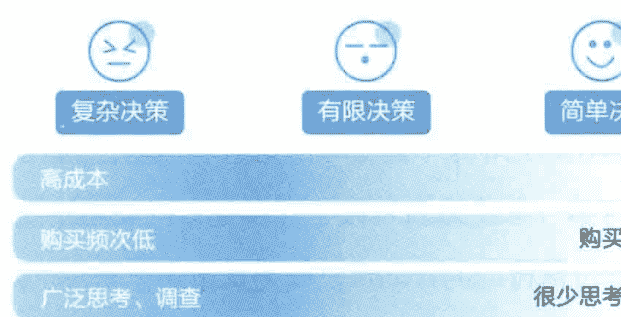

图3-2 消费者的三类购买决策模型

##### 1. 复杂决策
当品牌间差异明显且消费者愿意花时间斟酌时，就会进入复杂决策。介入程度很高，典型的场景是 B2B 采购、电信设备采购等。特征是投入成本高、购买频率低、决策周期长。

##### 2. 简单决策
习惯性购买决策的另一种说法，通常发生在消费者介入度极低时。几乎不经过思考就形成重复购买，比如喝一瓶可乐。呈现低成本、高频次、决策时间极短的特点。

##### 3. 有限决策
介于复杂与简单之间的中间态。消费者对品类和可选品牌有一定熟悉度，但没有稳定的品牌偏好，所以比常规购买更费神，会主动搜集陌生品牌的信息来辅助判断。

把个体的典型行为抽象分类后，学界对购买决策又做了更宽泛的界定。

广义上说，消费者购买决策是在特定需求和购买动机驱动下，在两个或两个以上备选方案中进行分析、评估、挑选并付诸行动，并在购买后进行复盘的系统性活动。整体流程涵盖需求确认、动机生成、方案抉择与执行、售后评价等环节。

广义的消费者购买决策流程如图 3-3 所示：

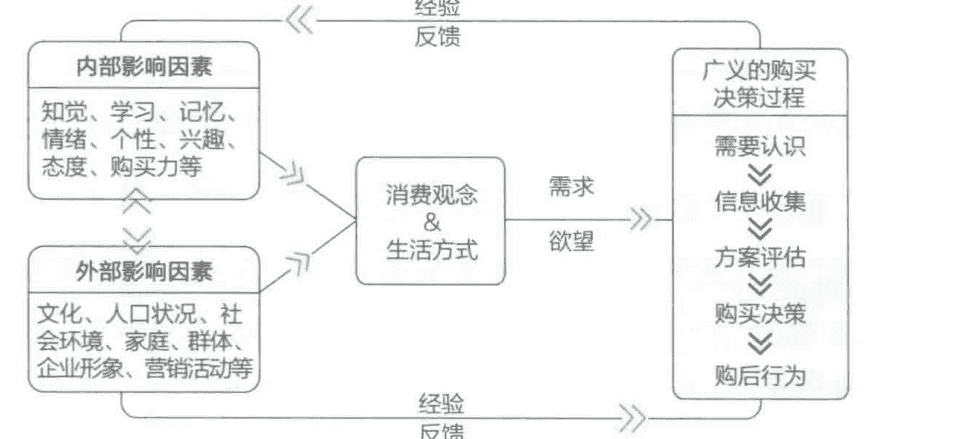

对照这张图，就能理清宏观和微观分别该看什么，比如文化背景、人口结构、群体或企业形象，而不是照搬战略学派的分析框架或延续经济学视角。

不少策划案的宏观研究也显示，宏观切入点往往落在行业上，策划中的宏观分析核心就是行业态势，而购买决策流程与行业特质高度相关。把行业按决策类型归类后，宏观分析的篇幅与信息量问题也就迎刃而解。

依据上述三类决策，行业可以这样划分：

| 决策类型 | 行业划分 | 分析模块 |
| :--- | :--- | :--- |
| 复杂决策 | B2B、航空、医美、房产、金融等 | PEST |
| 有限决策 | 汽车、3c数码、奢侈品、旅游、教育等 | EST |
| 简单决策 | 食品、餐饮、烟酒、小家电等 | SE |

图 3-4 根据三类消费者购买决策进行的行业分类

从分类可见，PEST 四要素对不同行业的影响权重不同。需要复杂决策的品类，价格高、周期长，必须兼顾政治、经济、社会、科技四个维度，才能多点触达决策链上的不同角色。反之，简单决策行业宏观分析要求不重，研究重点集中在社会文化趋势与生活水平、消费方式等 “S”“E” 两项。有限决策行业则更看重 “E”“S”“T”。不论哪种决策，经济环境和社会文化都始终在场。经济向好，消费能力提升；文化与流行趋势的关注，也解释了为何广告策略常把文化洞察放在核心。

人类学家罗伯特·博伊德提出，文化准则本质是社会环境里的行动法则。文化是群体的自然属性，由成员在社会互动中的行为规范决定，并在代际与群体间传递，像父母传子女、师徒相授、同事互学等。这种机制把宏观环境与人群行为连了起来，帮助分辨核心人群、结构流动方向以及是否具备群体裂变潜力。

#### 3.2.3 案例：IBM 超级计算机露西（Lucy）参与市场研究

2016 年起，IBM Watson 与美国市场营销协会 AMA 合作开展营销认知计算项目，目标是用认知计算技术帮助营销人更懂消费者、预判趋势、优化效果。

早期，露西在 AMA 更像一个市场调研助手，负责检索文献、识别内容并按问题找关联信息。工作人员会反馈方向是否正确，露西据此持续学习。数据源覆盖 AMA 通过新闻、AMA.org 等渠道发布的所有内容。例如，探究超级碗广告历史时，露西会通读十几篇论文、期刊、博客、推特观点，而非只给链接列表，并用约两周时间系统消化，相当于“学习”广告学科，进而把营销量化模型、消费者行为模型、策略与管理技术转化为可执行的答案。

如今露西已从助手进化为市场研究与消费者细分专家，也擅长策划互动内容。以快消品 AI 生成策划为例，它先抓取结构化数据：行业报告、受众问卷、友商电商价格；再从网络爬取非结构化数据：社交媒体使用体验、媒体专家观点、曝光量与舆情、友商口碑。清洗去重后，用 IBM Watson 进行典型观点提炼、洞察挖掘、结合热点自动生成创意主题，并按受众行为习惯组合营销元素输出方案。未来借助机器学习与 AI 建模，可发现规律、预测市场与行为，并以图表、报告、可视化界面呈现决策支持。

### 3.3 微观分析：识别和定位人群心智版图

被誉为竞争战略之父的迈克尔·波特认为，竞争战略是企业战略的子集，企业在同一使用价值上采取进攻或防御的长期行为。其目的在于摸清对手经营状况、预判目标客户需求、发现新消费点与新客群。

商学院经典框架里，竞争状态看三项指标：
- 市场份额：行业内占有率；
- 心智份额：消费者脱口而出的首选品牌占比；
- 情感份额：倾向购买的品牌提及占比。

市场份额可用客观统计测量，心智份额与情感份额则依赖主观调研，难以被程序自动读取，因而成为竞品自动化分析的难点。

广告只是营销的子集，但把广告当学科看，其外延大于营销本身，更强调人的感知。广告策略必须顺应受众心智规律与认知机制，回应深层心理需求，这是人类进化形成的稳定机制，过去难量化，如今 AI 让它可测。

#### 3.3.1 广告营销是围绕用户心智进行的竞争
竞争源自战争，延展到商业就是为资源展开的博弈。经济学视角下，竞争是众多生产者为私利展开的冲突。做竞争分析时自然聚焦同业品牌，因为只有深入对手才能看见真正的竞争关系。

营销策划做竞争分析，不只是为了击败对手，更是从消费者视角理解竞争的必然。2010 年前后，培恩公司推出 Insight 方法论时，我注意到它去掉了 BCG 矩阵式的竞争分析。培恩国际公关 Porter Novelli Insight 的首席策略长蒋奥德当时说：“这一切都藏在你对消费者的洞察里。”

企业战略的竞争分析与营销传播的竞争分析不同。定位之父杰克·特劳特提出“人群心智”概念。心智驱动感觉、联想、推理、归纳、回忆与想象，像播放器一样调取、计算、存储信息。心理学上，心智是人对已知事物的沉淀与存储，通过生物反应实现动因的总和。特劳特在《定位》中把心智带入营销，提出“争夺用户心智的战争”。

他写道：产品占据心智金字塔顶端时，品牌名就成了品类的代名词。比如网上购物梯子顶端是淘宝，接下来京东；软饮料梯子顶端是可口可乐，接下来百事可乐。

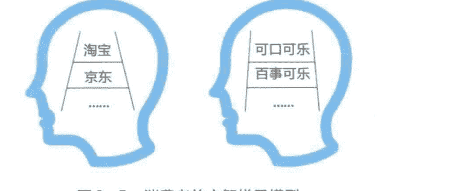
品牌早已无形包围我们，抢占心智意味着锁定客源制高点，形成独家卖场。如何绘制心智版图？

#### 3.3.2 识别人群心智版图的策略
心智藏于内心，既有理性功能选择，也有感性价值认同。若能绘制版图，理性与感性便构成坐标轴。营销传播能改变行为，消费决策链路就是关键衡量点。结合宏观的决策类型，再叠加一个衡量消费量的维度，就得到人群心智版图。

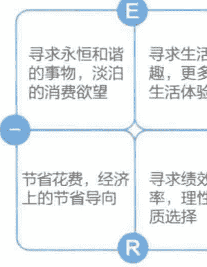
该版图以理性-感性与消费多少为两轴，形成四象限，是欧洲咨询公司罗兰贝格的品牌方法论。通过量化调查与心理分析，可挖掘购买行为背后的潜意识。我在此基础上提炼出六个价值区间与十九个需求元素。

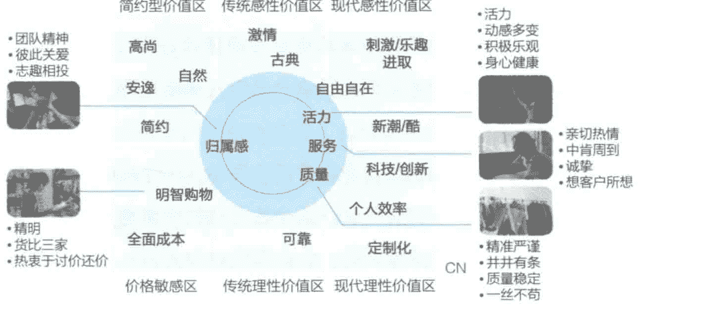
六个区间及关键词如下：
- 1. 简约型价值区，对应高尚、自然、安逸、简约；
- 2. 传统感性价值区，对应激情、古典、归属感、自由自在、活力；
- 3. 现代感性价值区，对应刺激/乐趣、进取、新潮/酷；
- 4. 价格敏感区，对应全面成本、明智购物；
- 5. 传统理性价值区，对应服务、质量、可靠；
- 6. 现代理性价值区，对应科技/创新、个人效率、定制化。

把品牌传递的信息锚定在某个关键词上，就能与消费者心智诉求共振。如沃尔玛让人想到“安全”，宝马让人想到“激情、活力”。通过核心词的声量、好感度与人群心智关键词的对应关系，就能厘清竞品与自我的竞争态势。

#### 3.3.3 词向量技术定位人群心智
有了心智版图，企业需解决如何落地。传统现场调研主观性强、周期长。2018 年谷歌发布基于双向 Transformer 的大规模预训练语言模型 BERT，在多项 NLP 任务上刷新纪录，显示 AI 在文本分析上的成熟。谷歌开源代码与预训练模型后，调研问答、语义识别、统计分析都能被快速启动。

我曾用爬虫以星巴克为关键词抓取微博 141 万条语料，统计共同被提及品牌：

| 排名 | 关键词 | 提及次数 |
| :--- | :--- | :--- |
| 1 | 哈根达斯 | 13,242 |
| 2 | 麦当劳 | 12,053 |
| 3 | 必胜客 | 10,953 |
| 4 | 肯德基 | 10,600 |
| 5 | Costa | 5,188 |
| 6 | DQ | 3,988 |
| 7 | 满记甜品 | 3,309 |
| 8 | 85℃ | 1,228 |
| 9 | McCafe | 982 |
| 10 | Pacific Coffee | 814 |

图3-8 与星巴克共同被提及的品牌排行榜

结果显示，哈根达斯与星巴克关联最强，其次是麦当劳。这正是词向量技术的雏形：把词语转为数学向量，通过向量相似度实现分类、情感分析、关键词抽取等。

##### 什么是词向量技术？
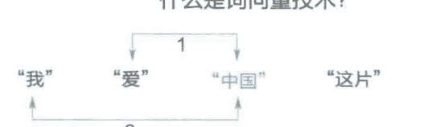
图3-9 词向量技术示例图

以“中国”作中心词，窗口大小为 2，模型关注生成“我”“爱”“这片”“土地”的条件概率。大规模文本计算后，可得出词与词的相关距离。距离越近，关系越强。

应用于竞品分析，就是测量品牌 A 关键词与品牌 B 关键词的距离。距离近，口碑语料相关度高，竞争越激烈。例如奥迪 Q3，用户想象的对手是北京奔驰 GLC、保时捷卡宴、Jeep 牧马人，而机器分析的对手是宝马 X1、北京奔驰 GLA、一汽大众奥迪 Q5。

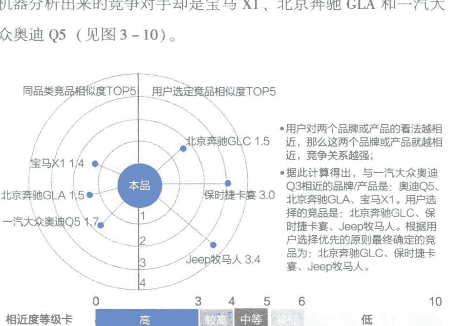
图3-10 用户认知的竞品分析与机器分析的差异图

图中，竞争烈度的数值越低，代表该细分市场内的厮杀越激烈。宝马X1的指标为1.4，牧马人为3.4，可推断X1所在的赛道承受的竞争压力要更大。

完成竞品识别后，工作的下一步才真正开始。以新能源汽车为例，把领克、比亚迪、WEY、蔚来、荣威作为观察对象，以品牌名称为关键词，调取过去半年新浪微博对这几大品牌的公开讨论作为语料，对曝光量与用户好感度进行统计，从而提炼出高频共现的核心词，具体见图3-11。

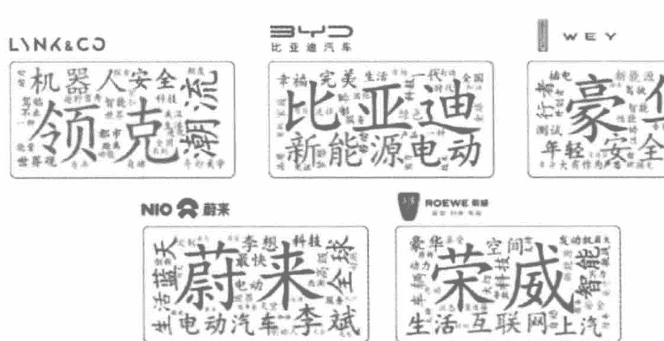

图3-11 新浪微博对5大新能源车品牌的语料统计

按上述方法汇总的品牌关联词如下图3-12：

| 竞争品牌心智词汇 |

| :--- |

| Link&co领克 | 潮流、安全、机器人、世界观、动力 |

| 比亚迪 | 新能源、电动、完美、幸福、生活等 |

| WEY | 豪华、安全、领导者、年轻、行者等 |

| 蔚来 | 李斌、电动汽车、全球、蓝天、最快、生活、科技等 |

| 荣威 | 生活、智能、空间、互联网、豪华等 |

图3-12 竞争品牌心智词汇

词表生成后，需要将其投射到人群心智版图上，利用词嵌入技术测算各关键词之间的语义距离，见图3-13。

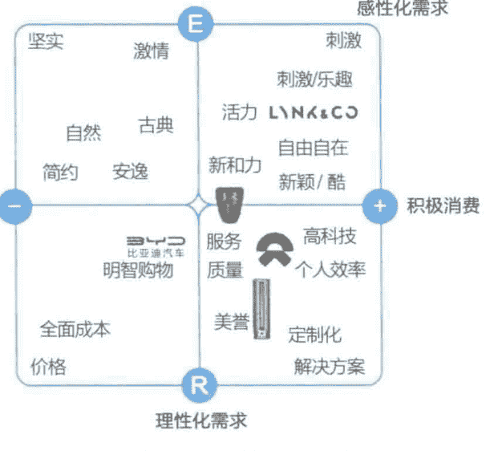

以图3-13中的Link&co领克为例，其核心关联词为潮流、安全、机器人、世界观、动力。将这些词与罗兰贝格提出的19个消费者核心价值要素进行对照，可判断领克在“自由自在、新颖/酷、刺激/乐趣”这一区间的表现最为突出。因此，我们可以默

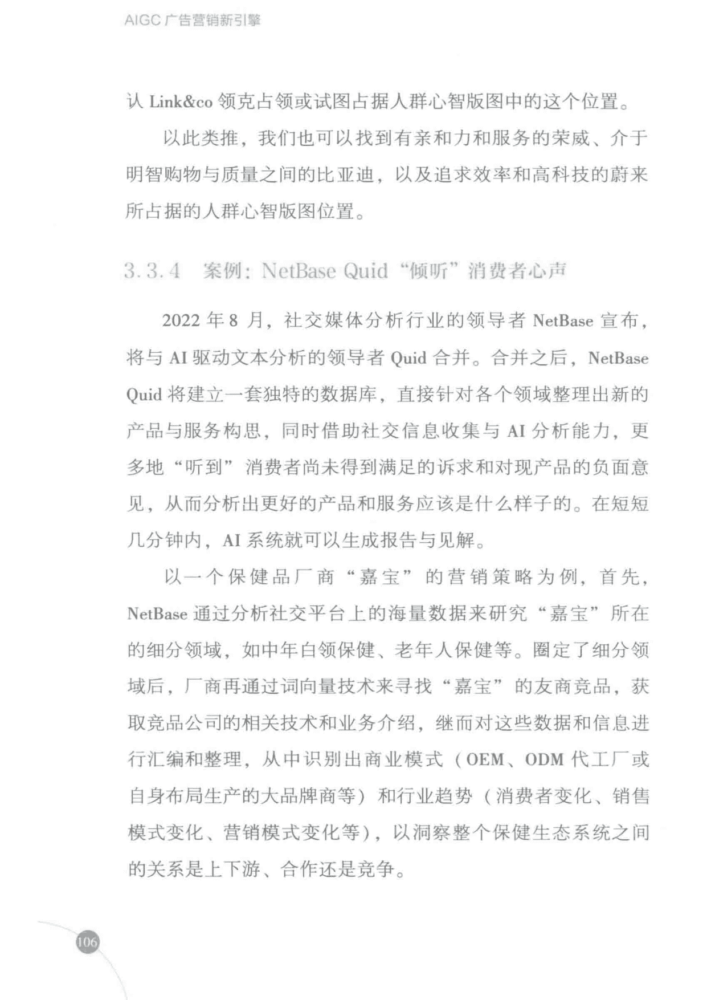

与此同时，NetBase Quid为“嘉宝”量身定制了数据的呈现方式，涵盖产品功能属性如维生素、增强免疫、滋补调理等、适用人群如通用、成人、中老年、儿童等，以及品牌口碑如消费者反馈、产品点评、促销信息等，对原始信息进行重新标注、筛选与整理，凸显企业需要关注与解决的要点，例如核心产品的市场反馈如何，“朋克养生”新生代的消费变化怎样，产业链上下游的创新热点在何处等，并据此输出对应的图表与可视化工具，帮助企业更清晰地解读数据，制定明确的业务发展路径，通过实时分析获取最新趋势，不断优化投资与创新方向。

依托NetBase Quid所具备的自然语言处理、AI、大数据可视化、语义网络与大数据能力，该公司对自身品牌受众与市场有了更深的洞察，也获得了可落地的见解。

### 3.4 人群分析：在多样性用户画像中描绘理想型用户画像

“大明，男，31岁，已婚，月收入过万，偏爱美食，是团购常客，习惯红酒配香烟，自称热爱运动却常因时间不足而缺席……”分析师文森特在季度会上分享了一个典型人物画像。

人物画像即用户角色，是连接目标用户诉求与设计方向的有效工具，在各领域应用广泛。实务中，企业常以贴近生活的语言把用户的属性、行为与期待串联起来。画像作为真实用户的虚拟代表，必须具有代表性，能够覆盖产品的主要受众与目标群体。

然而，不同数据源推导出的画像往往存在差异，而我们习惯把它们强行放入同一框架统一衡量，即便在各自场景下都成立，最终也难以完全统一。这种现象在营销界被称为“外祖母悖论”。用“平行宇宙”来解释，每个画像在特定数据源场景下都有效且独立，例如电商数据得出的结论适用于电商营销，微博数据适用于微博运营，在线问卷适用于线下促销。营销人真正想解决的是在统一场景下实现画像的一致性。

#### 3.4.1 了解受众画像的基础信息

20世纪60年代，凯姆·帕雷尔曼把修辞学从逻辑中心转向论辩中心，引发了非形式逻辑对形式逻辑的挑战，并把分析焦点拉回“受众”本身。在他看来，论辩是非形式逻辑，是维系日常活动运转的逻辑，而非证明。证明靠前提正确推出结论正确，论辩则是把受众对前提的认同迁移到结论上，影响其情感、意志与态度，促使受众按论辩者意愿行动。这说明，过去依赖理性逻辑推演事实的做法，已转向围绕说服展开，即借助社群与公众认可的事实与共识来影响他人。这也点明了受众的核心特征：对某一议题的意见、态度与决策，是论辩者重点关注并试图改变的对象。基于受众的具体情况，论辩者决定说什么、怎么说，通过取悦、调适、顺应等策略，使传递内容与受众的兴趣与愿望相契合，最终实现说服目的。

“受众”本义是信息接收者，其源头可追溯到古代体育赛事的观众和早期公共剧场、音乐会中的观众。他们松散聚集，观看演出或参与仪式。此时做人物画像，相当于在物理空间内对受众进行观察描述。

这种需求在15世纪印刷品出现后才真正增长。印刷品催生了最早的大众媒介受众——读者群体。他们拥有一定社会地位与阅读能力，通过购买读物满足学习、娱乐、修养等需求。

19世纪新技术降低了印刷成本、丰富了品类、加剧了竞争。媒体开始更细致地划分读者，尤其是按阶层、地位、教育程度等指标分类。此时的“受众”更多指向大众传媒受众。

随着传媒产业化，市场话语权增强，“受众即市场即消费者”的观念日益强化。传播者与受众的关系被简化为“计算”或“买卖”，媒体通过出售触达来向广告主收费。受众阅读的“免费”内容实质上已成为媒体收费的商业模式，这也是现代受众概念的来源。

英国传媒学者丹尼斯·麦奎尔认为，受众是社会环境与特定媒介供给方式的产物。他把受众研究分为三类：结构性、行为性、社会文化性。

结构性研究综合分析媒介使用数据与人口统计数据，获取性别、地域、年龄等人口属性信息。

行为性研究探讨媒介对受众的影响、受众选择媒介的动机及社会满足原因，如兴趣、偏好、关注点。

社会文化性研究指出不同媒介内容的受众往往由不同的“诠释群体”构成，成员共享话语形式与意义框架，本质是社交关系属性，如社群、圈层。

#### 3.4.2 多元用户画像带来用户表现多样性

交互设计之父艾伦·库珀在1998年《软件创新之路》中首次提出“用户画像”概念：画像是从真实用户行为中提炼的特征属性构成的用户模型，代表不同用户类型及其相似的态度与行为，是虚拟的用户形象。

画像的出现解决了媒体受众的一个致命问题：与古代受众相比，现代媒体受众数量庞大、规模可观，空间分布分散。好处是受众规模扩大，但并非所有人都是信息接收者，且随着规模增长，真正接收信息的比例还在下降。

媒体不会复制现实，而是加工真实故事，制造媒介中的“现实”：“现实不再只是既定事实，而是建构事实的一种方式的结果。”因此十多年前，受众分析更多是从传播意图出发，通过描绘画像，寻找从“受众”到“接收者”的最优组合与最高转化，以获得更好的鼓动与说服效果。

从这个角度看，媒体“受众”近似于“接收者”，进而影响行为。如今互联网能更好反馈用户轨迹，我们可以直接对受众做画像，把具有相同特征的用户归为代表性群体。这些群体内部消费行为相似，对品牌、产品、服务的态度也趋同。画像描述的正是不同客户群最显著的差异化特点。

起初画像建立在少量用户行为数据上，随着数据技术发展，调研对象不断扩大，画像开始与市场细分结合，代表细分市场的典型客户，帮助企业或政府有效沟通、理解用户行为与诉求。

大数据时代催生了大数据消费者画像，即基于已知事实和数据整理出的相对完整的消费者档案，包含大量数字、百分比、均值、标准差、统计对比等信息。每个抽象特征以标签呈现，画像常被视为标签集合。画像提供的是整体数据特征的集合，而非具象人物。

大数据计算后，消费者的特征与轨迹被打标签并归入特定情境，形成精确数据，为营销战略提供参考。

画像维度划分依据企业使用目的而定，典型消费者画像通常包含：

- （1）人口学特征，如性别、年龄区间、收入、家庭状况、所属行业等。
- （2）生活方式特征，如消费状况、购买力、消费地点偏好、美食偏好、教育选择、设备偏好等。
- （3）线上行为特征，如网站浏览、邮件使用、搜索行为、App类型选择与使用特征等。
- （4）线下行为特征，如地理位置移动、出行业迹、商圈级别、差旅习惯、旅行目的地、酒店偏好等。
- （5）社交行为特征，如社交圈层、线上线下社交习惯等。

多元画像带来了用户表现的多样性，企业据此制定对应营销策略。

#### 3.4.3 广告营销塑造理想中的用户画像

计算机发展使结构性、行为性、社会文化性逐渐数字化，受众研究可从媒体意象转向更贴近的场景描述。优势在于能通过研究媒体特性判断信息接收者的片段、情境、场景；用户画像的标签化让场景研究更直观。不足是当大量画像摆在面前时容易迷失方向，本质上这些画像只是视角、数据源不同，并无错误。矛盾与迷茫不是个人问题，而是社会普遍现象。

凯姆·帕雷尔曼指出，受众是论辩者的心智建构，论辩者可根据语境、目的虚构受众。修辞中的受众研究带有功利性，需以任务为目标，在心中构建最接近真实的“受众”，据此确定策略、内容、结构与风格。这解释了修辞受众是系统构建的，与真实受众的全貌存在差异。同时，受众建构需兼顾心理与社会因素，权衡各种方法的优劣。

修辞受众分析的核心是说服，如同营销传播要让受众接受观点并采取行动。为此，帕雷尔曼阐释虚构受众由不同类型人群组成，论辩者可将其想象为超越差异的“普世受众”，但实际面对的是具有独特经历的“特定受众”。当论辩者宣称面向普遍受众时，论点与论据不仅要说服特定群体，也要在任何理性人面前站得住脚，因而需要普遍性。基于理性虚拟的“普遍受众”，营销观点才会显得不证自明。

经济学中的“理性人”或“经济人”假设认为人是合乎理性的，在经济活动中追求最小成本获取最大利益。若“普遍受众”中挑选的特定理性人群被合理运用，符合普适性与客观性，就能含蓄施压，让受众在表达异议前顾虑自己的形象，最终接受理性人群的观点。

企业制定营销策略时，需结合宏观与竞争分析，从普遍受众中锁定理性人群，以其为原型构建“虚拟受众”的心智，通过理性人群的观点与论据带动非理性人群，实现从认知到行动的转化。

美国营销专家艾·里斯与杰克·特劳特的“定位理论”即是对此的诠释。通过判断行业趋势，结合自身能力与竞争态势形成竞争点，再从普遍受众角度把竞争点转化为观点并传播给用户，从而把发现、选择、构建心智串联起来。

中文里“乌合之众”原指像乌鸦一样聚集的人群，比喻杂凑无纪律的群体。古斯塔夫·勒庞在《乌合之众：大众心理研究》中用其描述“群体”。他认为群体不是简单集合，而是有共同感受与观念的整体。群体内部个体可能智商高、理性、有个性，但一旦融入群体，个性被淹没，思想被群体思想取代。这样的群体可能造成破坏，也可能创造伟大。

由此可得结论：人群个体与群体状态不同，可从个体理性角度观察，但需以群体状态为依据；个体难以改变，群体则有操作空间。因为在群体中，个体理性被弱化，独立判断力丧失，更体现群体性特征。

这为修辞学从分析推导策略提供了前提。经济分析推导出经济政策并产生效益；战略管理分析推动经营策略并产生利润。营销传播分析需要的是符合企业发展与宏观环境双重目标、具有普遍意义的论点与论据，即能影响群体信息。

当前互联网技术飞速发展，信息传播从点对面变为网状，生产者与受众身份互换并相互影响。于是出现更多理性受众，个体特性、自我意识、主动性与思考能力决定了其在传播中的价值输出。过去认为营销策略属感性与艺术，只需影响虚拟普遍受众中的理性群体即可。如今理性受众增多，单一普遍价值观难以奏效。信息过载、受众类型复杂、决策周期缩短，都要求引入人工智能技术，从分析到策略全流程自动化，更精准影响理性受众，实现广告营销的精准投放。

#### 3.4.4 案例：营销心理学专家 IBM 超级计算机露西

露西不仅能担任市场调研与分析专家，还能扮演心理学专家角色。把“品牌人格模型”这一心理学知识输入系统后，露西可将其应用于营销，分析潜在消费者的共同特征。它从社交媒体获取品牌相关信息，对数以万计的推文如消费者体验反馈、产品评价、消费体验等进行文本情感分析、提炼总结，识别符合心理特征的人群，按属性进行人格模型分类，最后划分为可接受不同促销信息的群体。

品牌专家珍妮弗·阿科尔提出“品牌人格模型”，将人格底层属性分为12种模型，归为四个类别，每个类别代表一组相似的人格特质与价值主张，见图3-14：

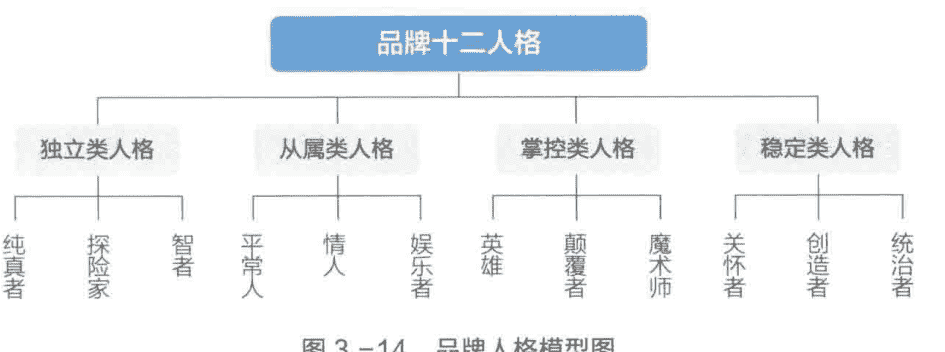

依据不同类别的人格特征与价值主张，品牌可塑造形象，与受众建立情感联结。

例如，掌控类人格中“魔术师”特征为神秘、诱惑、创造、神奇，价值主张为神秘、创造、超凡、奇迹。露西把特斯拉购买人群定义为“魔术师”人格后，梳理出该人群的普遍特点：

- 1. 高度参与：积极参与品牌或产品的社交媒体活动、促销与竞赛，并给予大量曝光与关注。
- 2. 忠诚度高：对品牌或产品高度忠诚，经常购买与推荐，是忠实粉丝。
- 3. 影响力强：行为与观点对他人购买决策影响较大，是社交媒体上的重要传播者。

基于这些特征与价值主张，露西可为品牌提供创意指导与媒体投放建议，制定更精准的数字营销策略。

由此可见，品牌人格模型帮助品牌依据自身特点与目标受众偏好选择合适人格类型。当用户缺乏却渴望某种人格特质时，会通过消费或拥有产品来获得。生成式人工智能技术的出现可更精准地分析与应用数据，全方位塑造品牌人格。其主要内容包括：

第3章 分析模块：数据建模动态挖掘人群心智
在一起

- 品牌人格萃取：汇总品牌沿革、产品文案、市场定位等多源数据，提炼出品牌的人格特质。
- 受众剖绘：深度拆解目标人群的兴趣取向、行为轨迹、消费偏好等，用以校准并优化品牌人格。
- 声誉监测：跟踪社交媒体等渠道的口碑与评价，做情感分析，快速捕捉并处置负面反馈，守住品牌声誉。
- 故事营销：梳理品牌历史与传承，挖掘可感知的品牌故事，用叙事塑造品牌形象与人格，引发注意与认同。
- 反馈归因：解析消费者对品牌的意见与建议，及时迭代优化，更好满足需求，提升认知度与忠诚度。

# 第4章 洞察心智：广告营销如何读懂人心

洞察是一种穿透表象的智慧，它揭示的是心灵共鸣与情境冲突之间的张力。通过追踪数据痕迹并探究心理的复杂性，我们能看清广告与人之间的互动机制。明白广告营销的洞察机理，就能拓宽思维视野，触及消费者真实欲求，让广告与人产生情感上的共振。

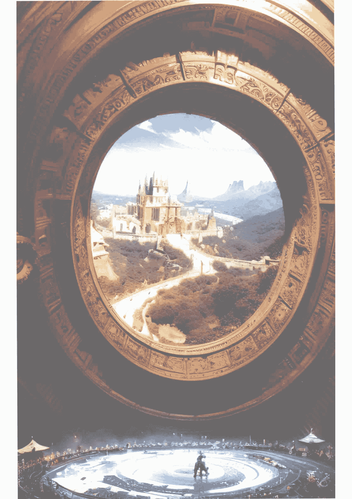

时间：1918年4月10日

地点：纽约布鲁克林

人物：广告公司市场调研员 杰弗森

每个周三，杰弗森都会穿着西装，神采奕奕地走访布鲁克林的各个街区，逐户敲门询问：“太太早安，请问您的婚姻幸福吗？您介意丈夫抽烟吗？在什么情况下您会买一瓶贵五美元的啤酒？您对市面上通心粉的口感满意吗？……”

二十世纪初的智威汤逊是业内首家设立调研部门的机构。他们率先把人口统计学引入用户研究，形成报告与营销策划的初稿，并在各地设立研究小组。小组里的业务员就和杰弗森一样，走街串巷了解家庭用品的使用情况，捕捉消费者的渴望，探寻真实需求。

杰弗森在调研即食通心粉项目时遇到一个解释不了的现象。过去三个月里，调研员发现一个有趣的细节：主妇们在煮即食通心粉时都习惯加一点洋葱。这个发现被反馈给厂商后，厂家推出了自带洋葱调料包的新品。上市后销量却不理想。团队只好继续追问困惑的根源。

背后其实藏着人性的洞察。当时的社会语境下，主妇为家人做饭时会因“没精心准备”“没尽到职责”而产生愧疚。为了缓解这种不安，她们会额外加洋葱，暗示这顿饭是自己亲手操心做的，自己并非偷懒、不称职。因此即便市面上有带洋葱包的通心粉，她们仍更愿意选择原味，自己动手加料。

类似的“负罪感”洞察也在速溶咖啡上出现过。

在西方，速溶咖啡是颠覆性的发明，抛开了繁复的现磨流程，主打随时即冲的便利。但初期销售并不理想。调研走访后发现，当时美国主妇普遍认为操持家务是天职，任何减轻劳动的行为都应被谴责。速溶咖啡省去了研磨步骤，让主妇担心被指责偷懒、失职。为了维持完美形象，她们拒绝购买。

雀巢抓住了这点洞察，调整沟通策略，不再强调便利，而是强调纯度、口感与浓郁芬芳，从而打开了速溶咖啡的市场。

两个案例说明，营销必须看清消费者的真正需求，否则再好用的产品也难以被接受。

### 4.1 广告营销里的洞察

在广告圈，最常被提及的词是品牌，其次就是洞察。如今坚守品牌之道的公司正被技术投放挤到边缘，但只有洞察能让广告人区别于数据人和技术人。数据分析师可以反复研究抽象模糊的行为数据，却很难理解洞察为何不去解读大众现象，而要关注少数人的行为。

词典里洞察意为看穿、看透，挖掘内在的含义。洞察不等同于观察。即便借助大数据做精细观察，也只是为洞察提供素材。观察记录的是人们做了什么、说了什么，属于数据层面；洞察则要回答为什么这样做。

营销里常说观察而非洞察。观察只是对行为的记录，洞察才能穿透表象，看见行为背后的心理诉求。比如研究显示近年来美国城市女性离婚率上升。观察层面只是陈述事实，洞察则是城市女性独立意识与追求自由的能力在增强。

心理需求不易察觉，且需要一定的普遍性，才能成为撬动多数人的修辞杠杆。需求背后体现的是人性。

#### 4.1.1 洞察的底层：人性与诉求

社会学研究认为人性是进化的产物，天然包含求生欲、求胜欲、助人冲动以及在群体中确认自身地位的关注等。这些会直接作用于大脑前额叶，受后天记忆与环境影响。总体而言，人性的起点是原始本能，状态的形成则源于与外界环境的冲突。

人在进化中不断解决问题，活动路径因此受影响，内心活动并非随意盲目。兼顾社会规律才能更好地解决问题。但当下环境复杂多变，无法认定恒久不变，所有人都会与社会生活发生复杂关联，因而很难彻底看透某个人内心的秘密。

阿德勒认为人性即原始诉求。环境变化时我们需要满足这种诉求，不同诉求会驱动不同行为，最终形成多元行为习惯的综合体。理解诉求的过程就是洞察人性。

例如谈及“中年危机”时就带有人内在诉求。自然环境下40岁后身体机能衰退，在原始社会该年龄段会被淘汰。如今社会保障改善，很多人把中年视为黄金期。但从生理看仍是衰退期，内心的焦虑因此存在。

营销要获取洞察，需要遵循“冲突”原则寻找路径。营销学中的冲突指供需不对等与不匹配，正是矛盾也是商机。冲突本质上是不被满足的需求。要满足这些需求，就要洞察诉求与环境冲突背后的人性心理。

为何要挖掘深层心理？因为营销修辞的根本是说服，进而促发行动。每个人从经验归纳出的行为模式很难改变，认识并改变自己的行为是最困难之事。但行为并非不可改，只要把社会生活规律当作绝对真理，相信并解决能力、制度受限导致的问题，就能逐步缩小与真理的距离，用真理影响人便可改变行为。心灵是行为目标的源泉，也是行动力的综合体。

人们确立目标时常以某个假想点为依据，这个点未必真实，却被赋予资源与能力去实现。类似时间被定义为时分秒，用并不真实但实用的钟表呈现。目标赋予价值个人感受，整理情感，刺激想象，推动行为改变。当足够多人改变时，群体行为会被贴上潮流标签，进而裹挟更多人，绝对真理的普遍性因此加深。

#### 4.1.2 洞察是好广告的底座

洞察是品牌与消费者建立关联的基础。优秀品牌从不缺对消费者的洞察，一旦缺失关键洞察，广告就会空洞，甚至造成难以修复的伤害，媒体补量无法挽回。这要求广告把消费者与品牌气质、产品特性完美融合。

美国作家艾美·E·赫曼在《洞察》中提出4A原则：评估Assess、分析Analyze、清晰表达Articulate、适应性Adapt。她指出先评估新场景，从视力与盲区构成学习，收集信息后处理并分析，区分优先级、识别图形、辨析洞察与推理，最后精确表达发现，再寻求行为适应。

BBDO前首席创意官菲尔·杜森伯里在《洞见远胜创意》中提出RAISE模型：调研Research、分析Analysis、洞见Insight、策略Strategy、执行Execution。

4A与RAISE对照显示，洞察的完整意图需要理解本质与采取行动的结合。营销策划中洞察承上启下，既要凝练评估、调研、分析的总结，又要提炼清晰观点以便修辞说服。单纯获取数据、信息、知识，只能获得观察，很难得到洞察。

为何资料很多仍得不到洞察？因为资料多属经验主义，如均值、标准差、回归等，它们缺乏判断力。洞察是生动的，与个体生活紧密相连，需要真正理解消费者的目的与诉求。从个体行为出发再找共通性，而非先描述抽象的群体。在洞察过程中要记住有效信息与个体特征，因信息联系极具个性化。影响群体必须通过集中个体的洞察来实现。

因此，只有把调研分析与个体特性、心理活动结合，才能得到洞察；也只有基于洞察与个体沟通，才能触及行为根本动机。

### 4.2 多画像交叉寻找洞察点

培恩国际公关Insight工具首席策略长蒋奥德常说：“从观察到洞察的关键，在于把握需求背后的信息。可先让客户放松地聊聊自己的处境，捕捉线索后再提尖锐问题，比如在哪些方面落后于友商。目的不是要解法，而是摸清最深层的问题点。”

他常以记者的敏锐给客户“施压”，通过连环追问、层层剖析来深化线索。今天连环发问可由大数据完成，通过微博、人人网及论坛抓取数据，获取品牌与产品的即时看法与态度。消费者行为都有原因，其中部分愿说，多为表面原因；隐藏在潜意识、不愿或说不出的原因，才是驱动行为的核心。这就是大数据洞察，也是建立有意义关系不可或缺的环节。

大部分洞察并非来自量化研究与书面报告，而是来自与消费者的直接深度接触，如暗访、行为观察、对话等。这些方法更原始、更接地气，远非冰冷的数据符号与人群标签可替代。

**大数据的本质是人，数据研究的极致是莫测的人性，莫测意味着盲点。数据的确定性与人性的不确定性，或许正是平衡未来行为的天平两端。** 大数据无法完全替代人性洞察，但可改变创意节奏，推动与热点相关内容实时生成，传播可根据反馈不断涌现创意。话题延展由社交大数据中最热门的话题决定。内容创造是5W传播中的“说什么”，仍是核心竞争力。因此在大数据浪潮中，要学会快速合理地触达目标人群，并以智能方式传递信息，深化情感。

过去数据集中在外部行为监控，无论网络购买还是社交行为，都是远距离数据。即便如此，也未用好。随着可穿戴设备出现，数据与人真正融合。像谷歌眼镜让所见即时数据化，健康手环与脑电采集设备让生理活动实时转化。记录睡眠还处于起步，未来每分钟每秒的生活都可能被记录。万物皆数时代到来，商业机会增加，数据帮助判断何时吃饭、睡觉、记忆力最佳，足够多数据后甚至能建议此刻该做什么与最佳策略。

纯粹精准洞察可遇不可求。可选用多种方法。有些依赖定量，如在线调查，但所有假设与决策由人做出，人为判断必然有偏差。认识到假设对预测的影响，从自身找问题，方法才更有效。我们在意识取向与行为倾向间理顺客观事实十分困难，必须随事实与环境变化，基于洞察形成数据工作流程链条，找到沟通节点与节点上的人，提出假设性问题，从不同视角寻找答案。

现实营销中，多个数据源会得出不同的用户画像且存在差异。我们需要把这些画像放在同一世界统一衡量，即便每个环境下都成立，也可能得出不同结论。这恰恰是多画像分析、寻找洞察点的机会。

#### 4.2.1 大五人格理论与心理营销

2015年，剑桥分析公司与剑桥大学心理测量中心研究员亚历山大·科根博士共同推出脸谱网应用“这就是你的数字生活”。通过在线人格测试收集个人信息与偏好，并获取用户及其好友数据，建立预测用户人格特征与偏好的模型，实现精准广告投放。

基于此，剑桥分析公司按大五人格对用户分类：外向性、宜人性、责任心、神经质、开放性，建立目标人群心态画像。这就是著名的大五人格理论。

该理论描述个体在认知、情感、行为上的特征与偏好，对营销与消费者行为分析具有广泛价值。

##### （1）外向性

外向性人群喜欢社交与表达，活跃度高、沟通力强。营销中他们更容易被互动性强、有趣吸睛的广告吸引。可通过社交媒体、线上活动、创意手法触达。若用AI分析社交媒体，可更好了解兴趣与参与度，制定精准社交营销策略。

##### （2）宜人性

宜人性人群在互动中呈现温和、合作、同情、信任、谦逊。营销沟通中他们易受他人影响。可强调产品的社会价值，并突出分享乐趣与满足感，增强购买欲。AI可基于历史数据与行为分析，识别消费偏好与社交特征。

##### （3）责任心

读懂欲望的生意：AI 把心理密码变成成交

用智能工具去捕捉用户在社媒上对品牌和产品的评价、吐槽，通过情绪解码实时揪出痛点并快速补位，这份即时响应直接推高满意度和复购忠诚。

##### （4）神经质
情绪起伏大、易发火、焦虑不安、容易自我怀疑是这类人群的典型画像。在触达层面，他们对负面信号格外敏感，焦虑会被放大。因此沟通时要反复突出产品的可靠、安全、稳定，削弱不确定感带来的不安。
情绪追踪模型能够监测这类人群的波动曲线，并据此推送定制化的沟通路径和服务方案。

##### （5）开放性
开放性高的群体好奇心强、爱尝鲜，追求新奇刺激。他们对新品和新玩法接受门槛很低。投放时可主打创意、先锋、差异化，用社媒种草或个性化投放把黑科技与新体验送到他们面前。
基于浏览轨迹和兴趣标签，智能系统也能为开放型用户匹配更契合特质的商品与内容，实现精准推荐。

把人口统计特征与心理特质叠加使用，营销才更准。举例一款纯素蛋白棒，只在脸书上找运动员和健身爱好者投放，效果有限。若进一步细化，锁定健康意识极强的素食者，或那些排斥市面上含糖能量棒的用户，转化会明显提升。

在点击为王的流量市场里，从曝光到下单往往只有数秒，任何微杠杆都会影响结果。用五大人格框架去洞察动机，能显著抬升转化效率。

#### 4.2.2 用户都是双子座：感性直觉和理性决策
负责规划的大脑区域，需要边缘系统先提供快速准确的信号，才能进行理性判断。这说明很多行为看似出于意志，底层却是生理机制在主导。

1975年，两位心理学家提出人天生有两套思维。一种是自发激活的无意识快思考，被称作系统I，冲动、感性驱动；另一种是意识加工的慢思考，被称作系统R，审慎、逻辑、爱质疑。卡尼曼在《思考，快与慢》里将其普及为系统1和系统2。系统1自动化、瞬间完成，系统2则需要投入注意力，耗能更高。

现实中绝大多数时间都是系统1在掌舵。只有当系统1受阻时，系统2才会介入。系统2耗能大，两者分工才能做到省力高效。一旦系统2受损，分工失衡，人就容易乱了阵脚。

正因如此，感性诉求的广告往往比理性说教更容易破圈。大脑偏爱直觉信息，即使分心状态也能接收。理性信息需要费脑处理，容易被自动过滤。想要激活系统1，就要用情绪化的画面和故事去打动。

可口可乐深谙此道，长期用情感共鸣做钩子。“开心就喝可口可乐”不卖配方，只卖好心情，瞬间唤起记忆和好感，推动购买。

爱马仕则用极致的包装和门店氛围刺激感官。高贵精致的礼盒、考究的空间设计，让人还没试用就先产生尊崇感和占有欲，从而提升品牌溢价和忠诚度。

《问责时代的市场营销》的数据显示，感性驱动的传播效果大约是理性诉求的两倍。找普遍的理性人群当然有用，但更深层的突破来自对特定人群心理弱点的洞察。洞察本质是理性研究与感性创意的融合。把系统1和系统2结合，既能激起情绪，也能建立认知。

耐克就是典型。广告喊“Just Do It”“相信自己的信念，哪怕要付出一切”，直击系统1的冲动与自尊；产品技术和细节打磨则满足系统2的挑剔与求证。

AI的出现让系统1与系统2的协同成为可能。ChatGPT式的交互证明人机共创可以加速学习、打破信息茧房。借助自然语言处理、机器学习，我们能更深地拆解两个系统的运作逻辑，把心理特征转化为情感钩子与理性依据。

比如一家车企想搞清消费者的购车逻辑。传统调研只能拿到表面数据。借助AI可以做三层深挖：用情绪解码解析社交媒体的评论情绪，看用户对品牌和车型的真实态度；用机器学习分析购买记录、搜索行为和生活方式，预测偏好；用计算机视觉捕捉试驾时的微表情和眼动，读取瞬时情绪波动。

这样得到的不是数据报表，而是心理画像，进而制定更精准的策略，提升销量和竞争力。AI实际上消解了感性直觉与理性决策的长期对立，打破了边缘系统与皮层之间的博弈，也在推动各行各业的生产力变革。

#### 4.2.3 用户画像的本我、自我和超我
受众分析是多维度拆解，洞察也是多维度拆解。二战后工业过剩，营销中心从生产转向消费者。90年代互联网兴起，“用户”概念出现，受众、消费者、用户开始混用。

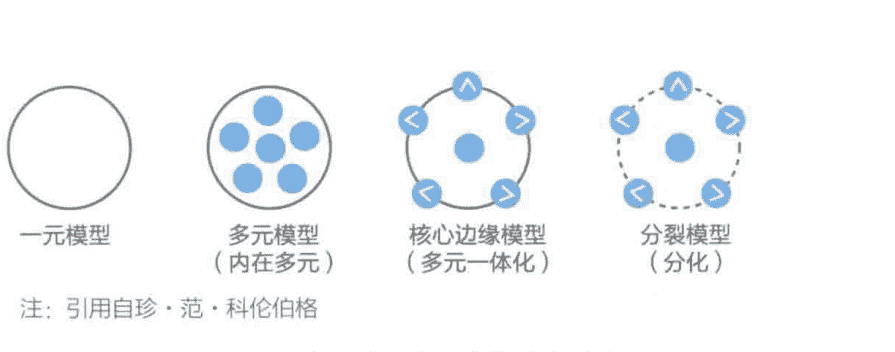

信息传播从单向一元走向多元。如今媒体涵盖社交媒体、在线媒体等，受众的边界被放大。关注品牌、讨论品牌、浏览品牌的人都可算受众。广义上，受众已包含用户、客户、消费者和内容浏览者。

技术让我们能“看见”受众。借用弗洛伊德的人格结构，本我、自我、超我可以用来做欲望层面的分层。本我是原始欲求，追求生存与快感；自我是现实的调停者，负责道德与克制；超我是理想自我，追求完美与价值。

按信息获取的欲望分，受众可映射为本体、自体、超体。本体对应无意识关注的信息群体；自体对应在调研或品牌接触中受现实约束而显现的群体；超体对应用户向往的理想状态，是社交媒体中的精神投射。

数据维度上，浏览数据反映本体，调研数据反映自体，社交数据反映超体。

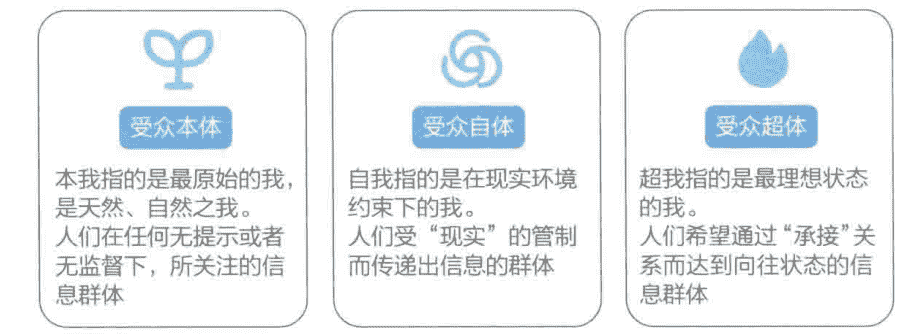

用这三类数据同时审视同一人群，就像获得上帝视角，现象背后的本质更清晰，基础洞察由此产生。

如果把本体、自体、超体和场景、行为、情绪做量化，就能画出从群体到个体、从享乐到使命的坐标轴。

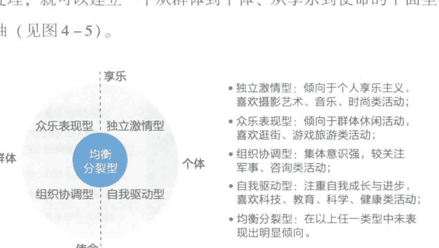

图4-5 用户画像坐标轴

在这个坐标系里，样本被归为五种形态：独立激情型、众乐表现型、组织协调型、自我驱动型和均衡分裂型，便于统一对比。

心理学里“独立自我”的感觉其实是幻象。每个人同时活在本我、自我、超我三个层面，这解释了行为的不一致。受众在不同媒体环境下的不经意行为，往往暴露真实的本体、自体、超体。对比这些体态，才能触达真正的自我。

以丰田为例，受众洞察图显示：自体层面，他们责任感强、顾家。在众乐表现型上，本体占30%，自体仅7%；均衡分裂型上，本体11%，自体27%。他们渴望与家人朋友的休闲时光，却把这种生活当成想象。

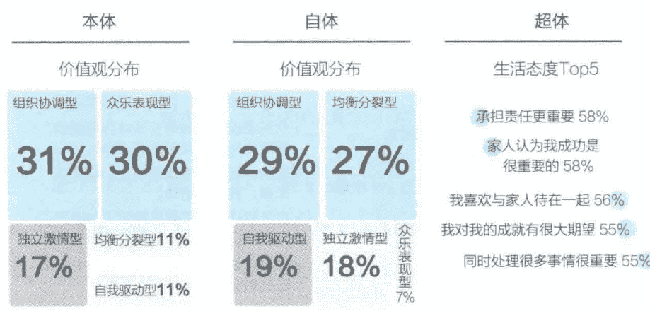

图4-6 丰田汽车受众人群洞察分析图

综合来看，丰田用户是想过简单安稳、其乐融融的家庭生活，但现实压力逼着他们扛更多责任，必须在事业上更成功，才能让家人更轻松。他们是追求成功的平凡人。

三源数据形成基础洞察，但真正的深挖才刚刚开始。

# 第4章 洞察模块：探究广告营销洞察机理
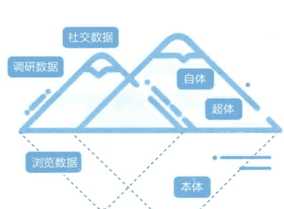

图4-4 对本体、自体和超体的研究途径

## 4.2.4 案例：CaliberMind利用“大五人格模型”进行用户分析
CaliberMind是美国一家用AI和机器学习帮助营销人读懂用户语言和社交足迹的公司。核心能力是自然语言处理，能评估用户的表达方式、思维模式、情绪状态，进而判断性格特质，帮助品牌在邮件、广告和传播中做精准定位。

联合创始人拉维夫·特纳曾是15年的政府情报官。他说CaliberMind做的就是用定量定性方法解读思考方式。依据的是消费心态学，按态度、期望等心理特征对人群分类。

公司采用五大性格维度：开放性、责任心、外向性、宜人性、神经质，可通过言语行为评估。

在对苹果CEO蒂姆·库克和歌手泰勒·斯威夫特的语言分析中，模型判断库克事业心极强、像工作狂，天生有说服力、善于相处，但没耐心；斯威夫特渴望权力与影响力，有时显得强势自负，同时踏实重情、勤奋，追求健康生活目标。

再看一个实操。某企业要推高端电子产品，想提升转化。他们用五大性格框架分析销售邮件、电话录音和社交媒体互动，实现营销自动化与智能化。

先用自然语言处理分析销售邮件，情绪化、语气强势的邮件暗示较高的神经质和外向性特征，回复时就要更温和、建立信任。

再用语音识别和情绪解码处理销售电话。若用户不耐烦冷漠，可能宜人性和外向性偏低，需改用更直接简洁的沟通方式，提高效率。

最后通过社交运营收集评论和互动数据，情绪解码后判断情绪倾向，形成更具针对性的投放策略。

### 4.3 洞察算法驱动引发共鸣
前面讲的是基于行业、竞争、人群的理性定位，类似市场定位。现在讲的是基于人群的感性洞察，落在精神层面。要回答如何满足心理与情感需求，进而推导出传播策略、话术和创意形式，让营销能直接激活系统1。

很多策划的通病是只让方案看起来漂亮，却没触达消费者内心。没有洞察的营销没有生命力。产品要提供功能价值，也要提供情绪价值。即使是新品牌，也能通过打动人心的表达快速建立认知并促成购买。关键是找到消费者内心的“痒点”，去现场、去人群中倾听，才能共鸣。

#### 4.3.1 利用消费心理学制定营销策略
在直播带货、满减促销、KPI至上的环境里，很多人怀疑品牌与消费者能否建立持久情感联结。消费心理学和神经营销的研究证实，这种联结真实存在且很常见。品牌价值没被看懂，才会被认为无感。

50年前业界普遍认为情感是理性的结果。后来才明白，情感对行为的影响往往大于理性，而且可以在无意识层面直接驱动购买。

咖啡品牌之间差异不大，但星巴克创始人霍华德·舒尔茨将其定义为“第三空间”。咖啡馆不只是卖咖啡，更是社交与交流的场所。把情感依恋注入品牌，星巴克才成为全球现象级咖啡文化符号。

更早让品牌沾上诗意的，是宝洁的那块白皂。1879 年，宝洁创始人哈里·波科特无意间读到《圣经》里一句描写宫殿与芬芳的句子，“你来自象牙似的宫殿，你的衣物满载沁人心脾的香气……”一念之间，象牙香皂的名号就定了下来。这也是宝洁的第一块白色香皂，广告里强调纯度 99%。英文名 Ivory 自带洁白温润的听感，后续延伸出耐用、温和的想象，产品本身更有一个让人过目不忘的特性：能漂浮在水面。名字本身就有意境，上市后迅速席卷日化市场，成为难以替代的日常用品。1991 年，大卫·A·艾克的研究里写道，象牙香皂累计为宝洁贡献了 20 至 30 亿美元的收益。

如果一个品牌能在消费者心里种下稳定的情绪，消费者往往会一辈子追随，商家也就拿到了一张持续付费的许可。情绪的绑定绝非偶然，它需要高成本、长周期的行为洞察和持续的信息灌输，慢慢把印记刻进心智，才能形成超出同类产品的溢价。

1991 年诞生的 Just Gold 就走的是这条路，品牌主打“新派金饰”。它塑造的不是首饰，而是“真女人”的形象：独立、有主见，却保留女性的柔软。Just Gold 卖的不仅是金饰，更是把女性从繁重生活压力里暂时抽离，换来一点自我愉悦的机会。这个点恰好碰到女性最柔软的心理，购买便在潜意识里发生了。

进化心理学给出了解释。人类的生存与繁衍塑造了一套底层反应机制，对美貌、社会地位、性别角色、社会认同都格外敏感。现代营销正利用这些机制，通过广告、促销去塑形品牌印象，激发欲望与忠诚。随之而来的是数字技术与数据分析的加持，投放可以更精准。进化心理学家杰弗里·米勒就曾指出，品牌营销已经站在了技术与人性的交叉点上，用新科技搭建前所未有的策略，从而更好地吸引和留住人。

日产 2021 年全新 Sentra 的推广，是心理学与 AI 结合的典型。社交媒体配合 KOL 营造年轻、时尚、活力的调性，同时用 AI 分析购车需求与偏好。

在社媒端，日产主要投放照片墙、推特、脸谱网，用生动视频、图文和动态去呈现车型的特质与品牌气质，还与多位知名 KOL 合作放大声量。效果上，Sentra 官方推特的一条视频广告两周内收获超过 3.7 万点赞、9000 次转发，说明社媒对形象与销量都有拉动。

在数据端，日产引入 AI、机器学习与数据挖掘，解析消费者的购车诉求、历史行为与趋势，并以此推荐车型与配置。面向用户的是“Nissan Concierge”智能客服，消费者在线咨询后，系统根据回答推断需求，给出匹配方案，甚至基于历史数据预测未来偏好，提供更个性化的建议。

调研显示，90% 的 Sentra 车主对自己的购车决策感到满意，其中 80% 表示决策受到了 Concierge 系统的影响，印证了 AI 在决策链条中的作用。体验层面，日产还用上虚拟现实，让用户在家就能戴上 VR 设备试驾，感受驾驶与舒适度。

这套组合拳塑造了年轻有活力的品牌形象，也提升了决策的精准与效率。销量上，2020 年比 2019 年增长 38.1%，2021 年 8 月同比增长约 34%。美国汽车杂志更将 Sentra 评为同级第一，获得消费者与专业媒体的双重认可。正因如此，AI 正在把营销推向更强的消费心理导向，强化个性化与产品与个人的连接。当用户感知到内容是为自己量身定做，信任感与归属感都会上升。

### 4.3.2 强化消费者的情感记忆

德国哲学家叔本华曾说过，人类约有一半的思考发生在潜意识，答案常常在几天后自动浮现，而形成答案的机制却像一台附加的机器。营销里也有类似的机器。洞察不是灵光一现，而是基于数据的持续多角度思考，洞察在观察后需要被拆解为步骤、要素与模式。

首先回到洞察的定义，它兼具名词与动词。很多人以为洞察的终点是可行性报告，真正关键的是在多源数据对比获得洞察之后，如何把它“动”起来，让洞察发挥作用。

其次回到营销现场。普遍受众中的普遍观点，可以被用来施加社会压力；把产品与品牌的特质与这些观点结合，就能驱动大众从认知走向行动，形成购买意向。

社会心理学称之为从众效应。它根植于人脑，源于渴望被接纳、被视作正常的本能。跟随群体让人更强大、更自信，也减轻焦虑，提升消费欲；同时安全感会让人更愿意冒险。营销洞察正是借此制造人与品牌、人与产品、人与人之间的共鸣，这需要对社会焦虑点的敏锐观察，用从众去缓解焦虑。

埃默里大学神经科学家格雷戈里·伯恩斯做过实验，30 名受试者比较 50 组抽象三维图像，结果多数人会附和占比多的观点，即便错误。顺应群体还带来愉悦感。博柏利的格纹、蒂芙尼蓝、星巴克猫爪杯，以及互联网泡沫、美国房贷危机里的跟风，都遵循同一原理。

从众还会催生群体思维，个体既可以把责任下放，也更容易确信自己做对了。苹果新品发布后消费者彻夜排队，就是例子。苹果早期持续传递追求完美、偏执创新的文化，促成“用苹果是时尚”的情感联想，让使用者感觉融入时尚群体，边界被弱化。品牌专买家正是制造“群体欢腾”，让个体在认可产品时也成为群体一员，保持忠诚与凝聚力，形成“果粉”“花粉”式的强势社群。

当品牌地位足够强势，就会形成情感记忆，激活大脑中与自我认同和奖励相关的区域。操控情感必须有效且合适，情感要与产品价值和消费者的人生阶段需求匹配。如莎士比亚所说，人生如舞台，角色既有自造也有被赋予，只有符合角色的情感才会被接受。

品牌间差异化，本质是品牌“扮演”不同角色去触发情绪。广告主试图在消费者脑中植入可重复触发的情感记忆，反应的人越多，群体优势越明显，对购物的影响就越大。

### 4.3.3 依据场景让广告营销引发共鸣

营销传播的核心是影响认知。想有效影响，就要洞察消费者：什么会打动他们，什么最重要，喜欢什么、厌恶什么、敏感什么，生活状态如何，品牌能做什么，想建立怎样的关系。创意人员要把消费者经历过却未说出口的感受，用听觉与视觉呈现出来。

广告大师比尔·伯恩巴克说过，关键不在你输入了什么，而在用户接收了什么。你说的都对也未必有人听，必须让人有强烈感受，否则一切白费。让洞察可行动，就要深入理解需求，厘清产品利益点、品牌情感利益点与人性的关系。营销的真正挑战不是短期收入，而是重新定义品牌接触方式，需要产品、品牌与人性达成一致。

20 世纪 90 年代，美国运通遭遇危机。Visa、万事达的冲击下，市场份额下滑，原因是客群过窄，高端用户单一。运通要重塑经济下行的社会地位符号，于是推出 Optima 新卡，与竞争对手抗衡，并附上更优厚的奖励、更便捷的服务，建立 24 小时客服中心，通过优质服务商提供间接服务，把信用卡从支付工具提升为服务模式与消费偏好的象征。

4A 公司常呈现的产品到洞察路径是：

产品利益点，即产品本身的优势，如口感、气味、大小、新鲜、方便、价格、营养等，以及对比竞品的竞争力，如何转化为消费者可感的利益。

品牌的情感利益点，即消费者信赖的基础与价值，品牌个性是什么，能带来什么价值，为什么值得信赖。

这些都是藏在人性角落的真理，洞察到它们营销才更有针对性。

营销洞察常按性别渴望归类。女性渴望驾驭人生各阶段、拥有踏实且富激情的婚姻、以成功不失温柔示人、在母亲、妻子、同事、朋友等多重角色中获得第三方认可、平衡晚婚晚育、独立不婚等新旧观念的冲突。男性需求则多聚焦自我地位的彰显、进取心释放与事业成功、掌控感、在女性面前展现魅力、工作外的多元能力等。

基于场景需求制定策略，才能触达内心洞察，创造产品与品牌的溢价。秦牧说过，艺术感动人是因为引起思想共鸣。营销里人与品牌、人与产品、人与人的共鸣也是线性升华：

先是产品特点满足理性需求，完成功能共鸣；
再是品牌特点满足感性诉求，完成情感共鸣；
最后价值观共鸣满足价值需求。

完成三步后营销大半完成，最后要在能让人怦然心动的点上，设计触动系统 1 的行动，制定喜欢的广告方案，用修辞促进销售、重塑形象、改变态度。丰富的 AI 解决方案正帮助企业快速获取大数据，形成更高效智能的流程，提升竞争力。

### 4.3.4 案例：MetaMind “用图片去倾听”潜在消费者

MetaMind 是一家深耕深度学习的创业公司，为商家提供自然语言处理与图像分析方案。2016 年被 Salesforce 收购后并入 Einstein 产品线，成为视觉识别系统，帮助企业通过分析消费者生活照片了解生活方式。借助它，Salesforce 可以“用图片去倾听”，识别照片里的品牌标志，为市场观察提供新角度。

一家户外运动器材商就用自动化社交监控，监测消费者在网上的分享。当用户上传照片，公司能即时判断是海滩还是山地，从而推荐相关产品。营销任务是训练一个能识别沙滩与高山的模型，并用场景图测试。预测视觉服务 API 让商家能大规模训练模型识别与分类图像，也可以用预设算法或自建模型解决特定问题。

MetaMind 还提供“用图片去倾听”能力，追踪品牌或竞品是否出现在用户照片中，并拥有一座常识知识库，收录算盘、阿拉伯长袍、法袍、教授袍、手风琴、橡子等冷门物品，也包括瓜类、松子、木吉他等。建议营销人员把这些知识用于社区与评论区图片分析，以改进产品与服务。通过精细行为分析，MetaMind 能从看似随机的行为中提取洞察，形成营销假设，提升广告相关性。

除了视觉识别，Einstein 产品线还包括自然语言处理与预测分析。NLP 能从海量文本提取信息、识别情感与意图并自动回复；预测分析则用机器学习预测销售趋势、流失率与市场走向，帮助企业更懂需求、做战略决策。

# 第 5 章
创意模块：AI 加持从创意启发到创意内容

AI 的智慧与创意的流动打开了无限创作空间。在 AI 加持下从启发到内容的协同，能超越想象边界，创造前所未有的艺术体验，开拓创意新境，实现品牌创新与心灵共振。

时间：1960 年 6 月 25 日
地点：纽约麦迪逊大道
人物：广告公司创意总监唐·德雷柏

“在舒缓的乡村音乐中，一个拥挤、烟雾弥漫的酒吧缓缓展开……”唐·德雷柏捕捉到灵感，拿起餐巾信笔涂画，并叫来一名男服务员，问他抽什么牌子的烟。

“黄金时代，怎么样？”服务员慢悠悠回答，“我喜欢抽烟，可我老婆不喜欢，杂志上说这致癌。女人总爱看这种杂志。”

这个画面把白人精英与黑人服务员对香烟的不同感受并置，再叠加女性在购买决策中的影响，直接把观众拉进第一个广告命题：

“欢迎来到 1960 年！香烟被制造出来了，也被说成致癌物，你该怎么推销它？”

《广告狂人》开篇那一幕，唐·德雷柏这个虚构的人物，几乎就是为20世纪中叶那批广告大佬量身定制的符号。大卫·奥格威、比尔·伯恩巴克、乔治·路易斯这一代人掌权的时候，正是创意部门称王的年代。上世纪60年代初，二战的阴影从美国社会褪去，需求旺盛催生了“及时行乐”的消费享乐氛围，唐·德雷柏那句“感慨”很直白：我每天都像在过人生最后一天，事实上也确实如此。

战后美国把军工能力转向民用消费，消费主义浪潮一起，广告业的热度一点不输今天的移动互联网。生活在那个年代的大卫·奥格威、比尔·伯恩巴克和李奥·贝纳，因引领了60年代美国广告的“创意革命”而被奉为开路人。在那个窗口期，广告创意人拥有近乎神级的地位，物质回报丰厚，精神上的成就感也极强。

### 5.1 创意革命的先锋群体
上世纪40年代，奥格威、伯恩巴克等人刚起步创业，但绝大多数公司里，创意只是执行层。话语权牢牢握在客户经理手里，他们是公司门面，负责对接客户、敲定合作。很多时候，广告策略平台用不用、要不要走评审、底稿最终版怎么写，都是客户经理拍板。文案排在第二梯队，业界长期沿用“广告就是印在纸上的推销”的说法，觉得说服靠嘴皮子，所以文字权重远高于画面。

美术指导和视觉团队位居最底端，意见基本被忽视，很少能进到业务传达会，更别说见到客户。创意人员只能听从文案指令排版配图。创意总监几乎不参与决策，更别提拥有唐·德雷柏那样的至高权力。客户经理才是创意工作的终审官，随时可以否决、修改、甚至推倒重写。

在这种结构下，创意人员的分量很轻，创意本身的价值也被压制，难以发挥作用。根源在于，当时的广告公司还没真正搞懂创意是什么、为什么重要，直到一批真正的“创意派”出现才打破局面。

#### 5.1.1 伯恩巴克与DDB的诞生
1947年，比尔·伯恩巴克还在纽约的葛瑞广告公司担任创意总监。他觉得公司产出的东西毫无新意，便写信给董事会陈述自己的策略主张与创意信条。信件石沉大海。38岁的伯恩巴克于是决定单干，把想法付诸实践。

1949年6月1日，他与马克斯韦尔·戴恩、内德·多伊尔一起创立了Doyle Dane Bernbach广告公司，也就是后来的恒美、DDB。起名时三人抛硬币定顺序，还刻意去掉了名字间的逗号。伯恩巴克说：“我们要亲密无间，连标点都不需要。”

他所说的亲密无间，既指合伙人，也指与消费者。伯恩巴克坚信，企业不能拿粗制滥造、没灵魂的内容敷衍受众。短期或许能换来业绩，但消费者不是被动接收信息的人，他们是参与者、体验者。广告如果平庸、缺乏原创和想象，没人会关心。而且广告往往打断人们的阅读和观赏，轻松幽默、有创意的表达反而是一种补偿。因此他把独创性和新奇性视作行业生存的第一要义，认为唯有如此，广告才配与世界级的新闻事件同台竞争。

正是在这种信念下，伯恩巴克在同时代大师里走出自己的路，作品常让人拍案叫绝。

他的首个代表作是奥尔巴克百货。这支广告在创意、文案和设计上都极具辨识度，一出场就抓住了眼球：

标题：慷慨地以旧换新
副标题：带来你的太太，只要几元钱，我们将给你一个新女人
正文：为什么你总是欺骗自己，认为你买不起最新的、最好的东西？在奥尔巴克百货公司，你不必为买美丽的东西而付高价。有无数种衣物供你选择——一切全新，一切都将使你兴奋。现在就把你的太太带给我们，我们会把她变成可爱的新女人——只花几元钱而已。这将是你有生以来最轻松愉快的投资。
奥尔巴克 纽约·纽瓦克·洛杉矶
口号：做千百万的生意，赚几分钱的利润。

这则广告解决了老难题：怎么让低价商品不显得低端。伯恩巴克的思路是，若想扭转“低价等同低质”的印象，就要用精致的画面和文案呈现。广告既用幽默传递了奥尔巴克的价格优势，又完全摆脱了廉价感，引发了极大兴趣。

当时恒美的理念近乎激进：“我们没有固定套路，所有广告唯一的共同点是都有一个新点子，用新颖原创的方式说故事。”公司创立时资本仅1200美元，年营业额50万美元；十年后营业额冲到4630万美元，增幅近百倍。伯恩巴克一时间成了创意人的救世主。虽然外界视他为灵感派、不拘形式的代表，他自己却提出好广告应满足相关性、原创性、震撼性三原则，后来被归纳为广告的“鬼斧”。

#### 5.1.2 奥格威的创意方法论
伯恩巴克迷信灵感，排斥调研，认为研究会磨掉个性。同一时代的另一位“创意骑手”大卫·奥格威则完全相反。他极度看重研究成果，从概念、文案到版式都有明确规范，习惯用数据说话：标题的阅读量是正文的5倍，正文前50字流失最快，50到500字相对稳定，证明材料必须使用。

早在上世纪30年代，研究就成了广告界追捧的圣杯。客户面对抽象创意无从评估，研究团队的图表数据让他们安心。有规则做底，创意才不至于让人陌生，文案才能在不违背验证过的规则前提下发挥想象力。简单说，灵感要服从研究。

与伯恩巴克“形式即内容”不同，奥格威坚持内容大于形式。《一个广告人的自白》里他给标题写作列了十条操作建议，核心是：标题要像价签一样迎接潜在客户，不要用排斥性语言；要承诺产品对个人的利益；要注入新信息，最有分量的词是“免费”和“新的”；善用如何、突然、当今、宣布、引进等情绪词；标题里必须出现品牌名，因为看标题的人是看正文的5倍；销售承诺的标题可以更长，10字以上带新信息更易转化；标题要吊好奇心才让人继续看；杜绝双关、引经据典等故弄玄虚；否定词风险高；避免自说自话的空标题。

1958年，他为劳斯莱斯写出那句经典长标题：“这辆新型劳斯莱斯在时速60英里时，最大的噪声来自电钟。”六十多年过去仍是教科书案例，被称作史上最棒的长标题之一。奥格威说，标题抓不到眼球就等于浪费80%的广告费。他认为这是自己写的最好标题，“没有任何华丽形容词，只是陈述事实”。副标题则反问：“是什么让劳斯莱斯成为世界最好的车？”并引用工程师的话：“说穿了没有戏法，只是耐心注意细节罢了。”

1963年《一个广告人的自白》出版，奥格威名声大噪。书里用真实故事讲道理，语言轻松。他的方法近乎机械化，把要素集齐按配方混合就能产出成功。核心整合是内容加形式：重视调研、理解产品，并把不同元素组合成品牌形象。这个思路在60年代非常奏效，甚至超过同期李奥·贝纳和伯恩巴克。据调查，他通过广告卖出的产品数量，是伯恩巴克和李奥·贝纳两人的总和还要多出6倍。

#### 5.1.3 哈珀：预言整合营销的先行者
如果奥格威和伯恩巴克是广告界的魔术师，马里恩·哈珀就是最早的预言家。他被认为最早使用“智库”一词，也最早把广告公司的功能定义为营销传播。他让团队跳出单纯为客户做广告的狭义思维。

1939年哈珀从耶鲁心理学系毕业后进入麦肯广告公司，提出用“因素分析”研究杂志报纸读者的兴趣，以及印刷与广播信息对受众的影响。研究迅速见效，公司很快把方法推广到广告和新业务。

到1960年，他开始倡导“整体性”方法解决营销问题，这正是后来整合营销传播的雏形。很多想法来自他担任麦肯调研部总监的经历。那里被称为麦肯的“智库”，优化了创意、策划、客户、媒体等多个视角，把不同人才看作巨型大脑的不同零件。出现问题时整部“人脑机器”同步运转，迅速给出方案后再优化投放。以今天眼光看，这套逻辑完全可行，但在60年代显得难以置信。

哈珀自称在发动广告创意革命，但这与DDB发起的创意革命并非一回事。他在高管会上抨击纯灵感的创意革命，称之为“创意的新邪教”，与说“别把广告当科学”的伯恩巴克针锋相对。

哈珀并非否定创意，他认为创意同样能从分析和智库中受益。此后他在麦肯基础上发展出埃培智集团，把智库和创意中心合二为一，负责思考如何让项目更具创意，把媒体投放和创意研发等执行事务交给广告公司。他称这种方式为“协同创作”，即在高层把不同专长整合起来。

这种数据调研+用户分析+创意策略+创意执行的协同模式，与从洞察出发思考创意、制作再到投放的思路高度相似。尽管哈珀大力呼吁，但当时多数广告人仍更青睐伯恩巴克的直觉派，因为创意被视作抽象艺术，不像计算那样直观。

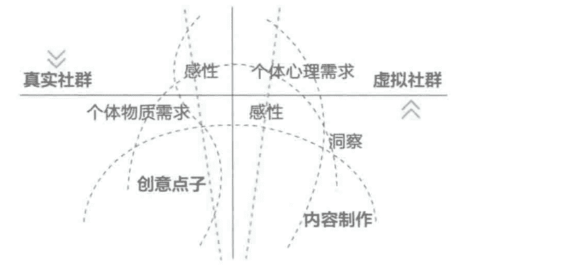

图5-3 从分析与洞察点出发思考创意、制作与执行

### 5.2 创意到底是怎么发生的
今天我们把创意定义为一种创造意识或创新意识，是基于对现实的理解而产生的抽象思维与行为潜能。

从这个角度看，智能营销的终极目标是智能创意，但这听起来近乎不可能，就像我们觉得智能机器取代人类绝无可能一样。有人认为，要让机器具备智能，先要搞清楚人类智能从何而来。

研究人类智能既涉及心理学的大层面，也牵涉到分子生物学的小层面，研究到一定程度都会卡住，没有任何学科能给出清晰答案：智能从哪来、怎么产生。即便我们对大脑的了解不断加深，人类智能依旧像个黑匣子。研究黑匣子有两种路径：一种从外部观察行为、模拟结构，自上而下；一种是靠猜测。从技术辅助的角度看，要让AI拥有智能，就必须让它能像人一样创意，进行抽象思维。

比如想做一个能像人一样走路的机器人，首要的是弄清人类行走的机理，而不是只靠规则声明。创意专家也认为创意无法被一套固定规则穷尽，或许他们还没意识到创意本身就是后天意识形成的规则体系。

于是要再往下挖，厘清意识是什么。字面上，意识就是主观体验，像固体液体气体一样是一种涌现现象，具备超越其构成粒子的属性。“意识即信息”的观点更激进：若意识是处理信息时的感觉，那它可能独立于物质层面，物质结构并不关键，关键在于信息处理过程。从这个视角出发，在创意意识实现前，先研究创意生成过程，是AI切入的现实路径。把创意的结果转为过程，AI就有了用武之地。

#### 5.2.1 拆解创意：创与意的比例
《当代广告学》里提到，创意过程是发现独特观念并以新方式重组现有概念的渐进过程，遵循它能提升发掘潜能、交叉联想和挑选优秀创意的能力。

把创意拆成“创”加“意”会发现，约70%是基础且重复的工作，20%需要外部灵感刺激，剩下10%才需要创意人赋予人性。

这种说法本质是用广告程序化思维解决创意难题：把创意元素拆解、打标签，再把素材标签与人群标签匹配组合。

问题在于，如果组合确实存在，它们的对应关系如何建立？

2015年8月，国际营销学教授雅各布·戈登堡在《Marketing Science》发表研究，指出89%的获奖创意广告都来自六个创意模板，而未获奖广告中只有2.5%使用了这六个模板之一。巧妙运用这六个模板能在广告中人为制造惊叹，这与创意人“灵光乍现”的固有印象相冲突。

广告创意更像一门关于好奇、惊叹和关注的科学，需要系统学习和训练，而不是头脑风暴的即兴发挥。很多创意遵循规则，是大量学习和训练的结果，而非无方向的发散。

人类97%的创造行为属于探索组合形式的创造，计算机运算速度远超人类，用随机组合去逼近模式或规则的极限正是其擅长。但它产出的结果往往在情理之中，缺乏意外惊喜，只能作为决策参考。

AI的优势在于分类、穷尽、组合，以及多维度发散、无序甚至无厘头，这反而可能触及创意的本源。正如毕加索所言，“理智是创造力最大的敌人”。表面上这与机器文明相悖，但通过编程建立一个“元规则”，引导机器改变路径、产生非理性行为，恰恰是机器学习擅长的。

组合也确实能极大促进创新。作曲家菲利普·格拉斯与印度音乐教父拉维·香卡合作时，从多元风格的融合中提炼出简约音乐；建筑师扎哈·哈迪德受俄国画家马列维奇启发，形成独特的曲线美建筑。这些案例说明组合型创造力完全可能适配AI世界。关键在于程序员如何设计融合方式，而在营销领域，创意人员与程序员的混搭合作变得必要。

#### 5.2.2 案例：AI-CD β机器人的创意之路
2017年3月8日，日本麦肯在伦敦的英国广告行业年度会议上展示了AI-CD β机器人，它同时承担着创意编剧的职能。

为了让机器人能正常工作，创意策划松坂俊与其开发团队先把一则商业广告拆成两部分：一是创意要素，包括品牌、宣传目标、目标受众、核心信息；二是电视广告要素，包括语气、表现方式、音乐、文案等关键信息。基于此，团队把过去十年获奖的日本广告作品解构，按获奖理由重新分类并贴标签，形成数据库，再由机器自动匹配，分析哪些元素组合会带来什么结果。

机器做广告，本质上是把创意拆成可执行的步骤：先读懂客户的需求点，再从素材库里匹配对应的画面元素，最后重新拼装组合。原本费脑的灵感工作，经过机器的流程化拆解，反而能快速找到相对最优的解法。

早在 2016 年 6 月，AI-CD β 就交出了人生第一支商业广告。是一支 30 秒的口香糖片，核心诉求是口气清新能持续 10 分钟。同一家公司，创意总监仓本美津留也为同一产品拍了同样 30 秒的人类版本。随后公司内部发起了一场谁更讨喜的投票。

结果仓本美津留的人类广告以 54% 对 46% 小胜。

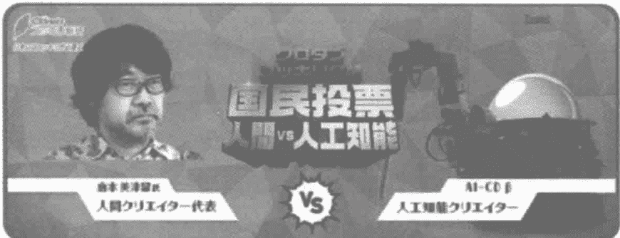
图5-4 仓本美津留与AI-CD β的广告竞赛投票图

AI 虽没赢，但拿到接近一半的支持也不算差。两支片子的呈现截然不同：仓本的版本是 一位女士嚼口香糖，瞬间潇洒挥墨，意境优雅、含蓄；AI-CD β 的版本则是一只穿西装的狗，吃完口香糖后在压抑的城市上空飞翔，画风直白又有点无厘头。美感和隐喻更胜一筹的是人类作品，这也是它更受青睐的原因；AI 的作品更直接、更出挑，这种直观冲击力在商业片受众里同样吃香，所以差距并不大。

有海量数据库加持，AI-CD β 在效率上明显占优，但数据本身的边界也框住了它的创作边界。正如松坂俊所指出的，未来广告公司的进化动力来自人类创造的机器算法，真正的创新往往只在传统模式卡壳时才会被触发。

AI-CD β 的开发思路，正好体现了把“创”和“意”先拆开来做，再结构化、聚素材、做迭代的思路。可以看到，算法的高效只能啃下工作里重复、低质、繁琐的那一块。当这部分被移交出去，人类才能把精力集中在真正高质量的内容产出上，这可能也是创意前进的一个出口。

### 5.3 AI点亮广告创意引擎

蓝色光标旗下智能营销助手销博特 XiaoBote，就是一座基于云端的多人协同 AI 创意平台。它集成了策划案撰写、人群画像、创意灵感、标语生成、品牌文案、一键海报等功能，借助 AI、统计算法和多维数据库，一键产出策划案、消费者洞察、营销创意等内容，能显著提升营销人效率，也让团队在线协作的创造力被放大。

不过很多人仍怀疑机器能替代人类的创意。推荐算法靠的是大数法则，不断累积数据就能优化，但创意营销更像小众的黑天鹅，是意料之外却情理之中的范式。 

> “创意也是这样吗？会不会也有一串看不见的过程，在意识之下长期酝酿？” 智威汤逊资深顾问詹姆斯·韦伯·扬 James Webb Young 曾提出这个疑问，“如果真是这样，这些过程能不能被识别？能不能被有意识地遵循和利用？换句话说，有没有一套可操作的规则来回答——你怎么得到创意？”

也有观点认为创意并非完全无迹可循，它是有套路的。从这个角度，机器完全可以做创意助推器。技术人的看法是，用编程先建一个元规则，让机器改道行进，刻意制造出“非理性”的行为，这正是机器学习擅长的领域。

广告创意到底是科学还是艺术，争论一直没停。创意派强调大创意需要艺术感知，科学派则认为创意完全可以被拆解、重构，用计算实现创新。

詹姆斯·韦伯·扬在《创意的生成》里写道：“创意的产生像福特汽车的流水线一样清晰明确，我们的思维也需要一套可学习、可掌握的操作技法，学好任何工具都一样，多练就能熟能生巧。”在他看来，创意可以被结构化、被训练，这为科技与广告艺术融合提供了基础。

基于此，便出现了把创意结构化的设想，命名为“创意引擎”，即用大数据和 AI 来赋能创意的自动生成。

#### 5.3.1 创意引擎五层架构

创意引擎共分五层：洞察层、创意层、人机交互层、规划层与执行层，规划与执行常被合并。这五层都是从市场海量数据出发，从感性角度兼顾目标人群的心理和物质需求，得出人群洞察，以洞察为核心向外扩散产生点子，再把点子有机组合成营销策划创意，最后落地实践。见图5-5。

洞察层
洞察层是生产的逻辑起点，也是方法论的基因，体现在受众特征分析和文化趋势把握上。受众分析可通过对调研数据的标签化完成；文化趋势因主观性强难以直接数据匹配时，可以采用组合标签的方式，推断消费者的价值观和体验感。

随着算力和算法提升，AI 能利用用户在互联网留下的行为轨迹、媒介场景、人口属性等，大规模捕捉行为数据，精准洞察人群并预测消费诉求与习惯。借助深度学习，还能分析社交、浏览、调研数据，挖掘不同群体的消费心理差异。通过对现有客户建模，AI 可自动搭建定量模型，结合企业知识图谱和大数据寻找更多潜在优质客户，让算法推荐更贴合文化趋势，并在洞察中捕捉冲突与张力。

创意层
创意层引入了“熵”的概念，用来描述体系的混乱与不确定度。机器创意的逻辑是组合，把所有相关数据关联起来，算法足够强时就会批量产出新想法。这回到了创意本源的理解。机器创意从“方法”和“智慧”两条线入手：方法上用联想、发散、递推等套路；智慧上靠知识标签和案例标签积累经验。洞察是两者结合的前提。

AI 能快速分析海量历史数据，模仿学习能力远超人类。对过往成千上万案例做比较、拆解、重构，就能生成与用户个性需求更贴合的创意点。

人机交互层
在这个层面，用户只需要输入简要信息，机器便能借助数据分析专家剖析目标人群特征与消费习惯，生成消费者洞察，再由营销策划专家生成创意内容，结合 4A 方法论，最终输出完整营销策略。

该层更关注机器辅助下创意与人类的关系。结合生成式对抗网络、词向量、自然语言处理等技术，计算机可把创意火花转译成人类可读的内容。其中生成式对抗网络负责发散，词向量捕捉发布时机，自然语言处理辅助概念生成。

AI 能对庞杂数据做量化线性分析和高维运算，数字化追踪形成规律，规律可用于预测。因此先按行为数据分类用户，预测消费场景与偏好，再由 AI 媒介精准推送，最后从声量诊断、舆情监控、传播路径、情感评价等维度提炼数据评估投放效果，并结合人工给出最优解。

规划层与执行层
规划与执行是创意配合营销落地的执行环节，执行部分已可由机器完成。创意主题、趋势、结论、短板等都能在此阶段完善。

规划是通过推理机制、解释系统和知识获取，对创意活动、落地场景或趋势进行分析预判；执行则是具体到视频、图文、小程序等形态的落地。在 AI 出现前执行多靠人力，如今机器辅助完善落地已成为现实。

#### 5.3.2 机器创意背后的运行逻辑

机器创意的底层逻辑与头脑风暴相似，都是大数据的交叉运算。有技术加持的智能创意工具，能在团队头脑风暴时提供灵感发散并提升效率。因此当下的机器创意更多被理解为团队的“创意工作台”，即推动大创意产生的协作平台。

下面三组来自销博特平台、以创意引擎为底层的案例：

爱玛电动车
1. 定位分析：用数据库梳理电动车整体消费人群。
2. 人群定位：锁定节制型人群，成本导向、偏理性，需求是可靠质量、提升效率、绝对低价，即物美价廉。
3. 机器标语：综合前两步输出“你的真爱，真爱不讲投资失败，只讲真心”。用“奇”打法结合真爱话题，把价值获利与物美价廉偏好结合。
4. 创意输出：先做抽象创意关键词联想，再与品牌关联创新；随后结合节日或热点事件做事件创意，最终结合 AI 创意制作广告视频。

巴黎世家
1. 定位分析：对奢侈品人群做数据库定位。
2. 人群定位：传统型、渴望经典、追求高雅。这类人群看重可靠品质、独特设计和成功象征，品牌感知与自我价值观重合度越高共鸣越强。
3. 机器标语：生成“麦田里的美好”“麦田里的守望者，守望的是一个个不变的故事，一点一滴的感动，一丝一缕的温暖”。意象丰富，权力感也贴合目标人群。
4. 创意输出：以“二次元”为抽象关键词做 AI 联想创新，再结合“芒种”等日期节点做思维碰撞。

乐事薯片
1. 定位分析：对零食爱好人群做数据库定位。
2. 人群定位：追求个性、标新立异、爱新鲜刺激，需求是好口感、有创意、彰显青春活力。
3. 机器标语：产出“何必这样子”“我喜欢的样子你都有，你喜欢的样子我都有”，直击个性洒脱标签。
4. 创意输出：以“女强人”为抽象关键词联想，再与“万圣节”等节日节点结合做品牌联想创新。

机器如何做到这些？关键在于专家系统。

#### 5.3.3 创意专家系统运作全解

专家系统源于以知识为基础的专家系统，是一种交互可靠的计算机决策系统，用事实和启发式方法解决复杂决策问题。它基于专家知识在特定领域表达推理。简言之，就是模拟人类专家解决领域问题的程序系统。

典型专家系统由人机交互界面、知识库、推理机、解释器、综合数据库、知识获取六部分构成，知识库与推理机分离是其特色。事先把营销资料存进知识库，包括案例、语料、素材；再用营销方法论、创意模板等构建推理机。输入知识后按规则生成结果，能解决原本只有专家才能处理的难题，同时为非专家提效，也可作为专家的专业助理。

这套创意专家系统结构如图5-6所示，箭头表示信息流向。
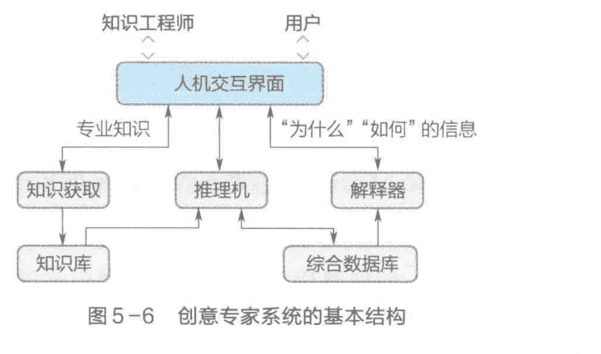

人机交互界面是系统与用户的对话窗口，用户输入信息、回答提问，推理结果和解释也由此输出，最终决策仍由人完成。
推理机是系统大脑，内置解决特定问题的规则，从知识库提取知识进行推理，在多方案中挑选合适路径。
知识库和知识获取：知识库存储领域知识，是从多位专家处汇集的高精度容器；知识获取负责建立、修改、扩充知识库，把专业知识从头脑迁移到系统。
综合数据库记录求解状态，存放用户输入、推理中间结果、过程记录，既是推理机的依据也是解释机制的来源。
解释器用于说明求解过程，回答“为什么”和“怎么做”，提供程序透明度，让用户理解系统在做什么。

在此基础上可设计营销策略专家系统，见图5-7。
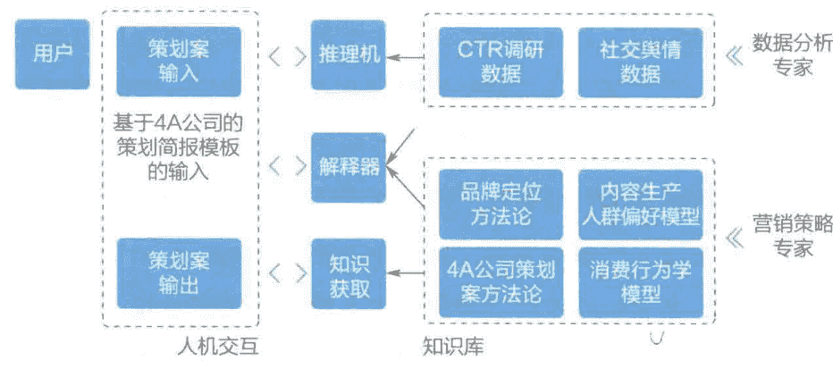

首先基于 4A 策划简报模板设计交互界面，输出策划草案、创意概念、广告文案、视频脚本等。
其次构建营销策略专家资料库，分专业知识类如品牌定位方法论、策划方法论、人群偏好模型，和案例素材类如优秀案例、营销热点、广告文案，二者构成知识库和推理机，用以模拟创意人思维并提供营销建议与灵感。
再次构建品牌产品与目标消费者的关系数据库，结合调研小数据、舆情大数据和效果数据，让机器理解两者关系从而提炼洞察。
最后借助 NLP 和词向量技术做标签组合、语义分析与关联匹配，实现创意中旧元素的重新组合。

阿瑟·库斯勒在《创造的行动》里指出创意是在两种毫不相干的思维矩阵中建立双向联系。支持向量机可以从一个事物找关联，再找不相关事物，再用随机森林组合，机器在这方面更擅长。

专家系统里的知识库、推理机、关系数据经 AI 可判断组合的关联性，再用相关性、原创性、震撼力三个原则量化评估创意好坏，并通过大数据持续优化。当每个广告都能被打分，算法就能分辨有效与无效并自我改进。这正是专家系统通过数据记录评估、迭代升级变得更智能的闭环。

#### 5.3.4 AIGC营销内容生成器

AI 创作已不新鲜。十年前微软小冰就会画画唱歌写诗，2018 年谷歌的画画小程序在学术圈引发讨论，2022 年 AI 绘画出圈更是掀起热潮。其背后是 AIGC 的模型突破，AI 不再只是分析已有事物并推荐组合，而是开始创造全新内容，即 Artificial Intelligence Generated Content。

AIGC 指基于 AI 算法生成的文字、图像或视频。研发者先喂入大量样本让 AI 学规律，再按人类指令生成内容。2018 年 AI 创作的《埃德蒙·贝拉米画像》就展示了流程：算法分生成器和鉴别器两部分，先用 14 世纪到 20 世纪 1.5 万幅肖像训练“艺术细胞”，生成器产出新图像，鉴别器分辨人造与 AI 作品的差异，二者不断进行视觉图灵测试，直到鉴别器无法区分。

AIGC正在重写营销内容生产规则

可以说AIGC并非新概念，技术雏形很早就有了，只是受限于当时的能力边界一直没能发挥价值。如今的声音是，在AI的分析能力之上叠加生成能力，内容在形成过程中会实时结合用户场景回馈的数据信息并借助算法进行即时解析。神经网络在资讯抓取、知识图谱构建以及人机交互等NLP环节的持续训练，也让模型表现越来越接近专业人士水准。而支撑这一切的技术储备，包括生成式对抗网络 GAN、变分自编码器 VAE、标准化流模型 NFs、自回归模型 AR、能量模型和扩散模型 Diffusion Model 等，共同让AI创作营销内容成为现实。简单概括，这个过程可以总结为：

> AIGC内容公式 = 用户场景信息 数据 + 专家系统 垂直知识体系 + 内容形式 图片、文字、音频、视频等。

2020年成立的Jasper就是行业早期的探路者，主打AI文字生成。用户能用它快速产出Instagram照片墙文案、TikTok视频脚本、营销广告文案、邮件等高重复性工作。截至2021年，公司营收已达4000万美元。创始人戴夫·罗根莫瑟 Dave Rogenmoser 认为，OpenAI的GPT-3出现后，AI内容平台能帮助更多企业与专业创作者头脑风暴并高效完成任务。Jasper的语言模型之所以突出，在于它基于约10%的网络数据训练并针对客户特异性做微调。他总结，拥有最好反馈闭环的团队才能在生成式AI创业中胜出，而Jasper的模型正致力于打造最佳AI循环。

2022年AIGC浪潮中，百度推出AIGC营销内容生产工具营销内容AI助理团，百度广告单条创意制作时间从30分钟压缩到4分钟，且近三分之一的创意展现都带AIGC参与。百度把营销行业视为AIGC先行示范区，认为参与能大幅提升Web3.0时代人、货、场的搭建效率。

百度的实践印证了效率跃升。从广告创意撰写到物料制作，标题撰写、文字生成、图配、从文到图再到视频的整体链路都在提速，5~10秒的短视频也能基于现有图文迅速完成。AI还能做到少量输入、大量分发，极大启发创意人员。调研显示，74%的受访营销人认为AI与创意产业能很好融合，它能提升生产效率、提供新思考角度、让创意更有价值，甚至成为新营销增长点。以10分制衡量信心指数，营销人对创意内容技术的平均信心达到7.73分，市场看好度持续上升。

2022年12月，蓝色光标发布AIGC创策图文营销套件，提供创意、策划、文案、图片一体化的智能生成解决方案。把AI引入内容生产端，可在创意、表现力、迭代、传播和个性化上释放技术优势。体验上从辅助灵感逐步走向驱动创作，AI对人类意识的模拟能力被大幅提升，覆盖洞察策划、稿件撰写、软文制作、海报与视频制作及创意自动生产。

接下来看AIGC在营销场景的具体落地。

##### （1）洞察及市场策划
营销人已普遍用AIGC辅助洞察与策划。执行层面通过决策理论、决策分析与信息价值理论构建数学模型，再加载机器学习框架对营销环境进行剖析，最终指导选型与规划。常用工具包括马尔可夫决策过程、动态决策网络、博弈论与机制设计等。第1章提到的Albert就是一家在线广告营销AI平台，利用大数据洞察投放并分析优化广告内容、衡量营销影响力。决策之后它还能给出匹配行动方案，以高速大规模执行帮企业降本增效。

美国科罗拉多的一家公司开发了CaliberMind AI系统，输入100个词即可解析人的思维与交流模式，企业据此评估用户在情感分析决策层面的表现，明确性格特征并构建用户画像。被称作读心术的创业公司Affectiva，则用算法解析复杂面部表情与语言表达识别情绪，帮助品牌感知用户对产品服务的态度。Glimpz能借助AI解析图片、视频等无序数据提取客户信息，提供自动化营销建议与客户分群。Motiva AI则为每个用户自动生成专属信息内容，通过持续学习优化客群梳理与活动规划。

##### （2）生成文本
AI写作助手写文章、小说、博客已久。在营销里主要用于宣传稿撰写、场景软文及一稿多改。早期软文受模板化与语料匮乏限制，GPT-3的到来改变了局面。

以Jasper为例，用户可生成富含关键词且利于SEO的原创博客，也能用文字描述驱动文章创作与广告语生成。它的长篇文档编辑器可基于用户对目标文章的描述或要求自动抓取数据并创作，如要求包含科学广告定义、广告与AI发展史、结合应用及未来趋势等，系统能在专业风格下快速输出成稿。这体现了GPT-3的创新，自然语言提示符被当作一种新编程范式，模型能自动理解任务并执行。

Scalenut是另一款通用写作工具，融合AI写作算法与SEO、NLP技术，可产出吸睛内容并提升页面排名。其SEO助手支持优化撰写，编辑器里的AI指令比Jasper更细化，用户可在AI连接器与运算符中设定更具体需求。

Persado把行为心理学纳入流程，利用自然语言处理与机器学习自动生成基于用户行为与态度的文案，通过数据分析找到能引发共鸣的情感并生成说服力文本。它把营销创意拆分为叙事、情感、描述、号召性用语、格式与文字定位六大要素，通过组合为每位用户确定个性化表述，用于社交广告、店内横幅或广播等，提升参与与转化。

过去营销人靠感觉找对人对地对时，现在机器学习开始处理对的信息。基于机器学习的创作与情感触发器能与消费者产生强烈共鸣，实现真正的1对1个性化。未来机器自动生成的内容将与人工撰写直接竞争，基于数据反馈的营销内容或将超越人类创作水平。

##### （3）创作图像
代表性平台有Midjourney、DALL-E 2、Imagen与Stable Diffusion。用户只需输入文字描述，系统通过NLP理解语义并转化为计算机语言，结合自有素材或爬取的公开版权数据自动生成图像。

Jasper也推出Jasper Art，可按文字生成不同风格图像，写完文章后可直接配图。Jasper从文本到图像，而Canva可画则从图像设计向文本迁移。用户选模板后几分钟即可生成海报、简历、横幅、名片等。截至2021年底，Canva可画称帮助用户创建超70亿个设计作品，平均每秒诞生120个。

2022年Canva可画基于GPT-3推出Magic Write，在可视化模板中预留空白，点击添加内容后输入文字回车即可获得连贯文本。Canva认为文字需以图像为衬，广告海报的图需要好文字诠释才能完整。

这意味着，设计师用Midjourney找灵感时，可用Jasper从文字切入启动海报设计，也可用Canva从图片切入完成创意小样。过去靠搜索库存图，现在能直接生成新图。

##### （4）生成AI视频
2022年9月Meta推出Make-A-Video，可将一段文字生成数秒短视频。此后谷歌基于Imagen推出Imagen Video，能生成1280×768分辨率、24帧的视频片段，并按需呈现水彩、像素、梵高风等艺术风格。更强的Phenaki可自由切换整体风格，并在文本描述中补充剧情，让视频形成完整故事。AI视频已不再是简单拼接，而是具备编导视角。

Runway将机器学习集成到艺术创作，可快速把照片拼接成视频、平滑融合帧、替换背景、突出或删除特定对象，节省时间并增强艺术感。Synthesys则把AI视频与虚拟人结合，通过口型同步技术几分钟内生成解说视频或产品教程，未来无需摄制组，只需选虚拟形象并输入脚本，支持66种语言即可产出高质量视频。

除此之外，Murf语音生成器可把文本转语音旁白或转录文字，Descript能克隆用户声音并建立语音模型，纠错时无需重录。这些语音工具助力广告文本的音频化。

创意触发方面，蓝色光标销博特技术团队与创意中心合作，以人用户标签、货产品卖点、场用户场景为关键点。用户输入场景、标签、卖点与品牌名后，可通过NLP获得启发短语并用AI计算元素关联性产出内容。

在基座模型加持下，创意能力进一步进化。亚伦·阿德勒 Aaron Adler 开发的Daydrm.AI，其广告创意AI工具基于戛纳获奖作品、ONE SHOW、D&AD等大奖数据训练。营销人输入背景、洞察、形式与人群，AI可按需生成策略简报与创意概念。目前产出仍处初级，但大模型驱动创意已成新尝试。

AI正让文字、图像、视频的生成变得前所未有的便捷。随着AIGC在营销推广，我们正进入人机共创时代，AIGC在内容领域的作用愈发关键，实现降本增效并提供创意参考。长期看，人机交互将形成持续运营的内容体系，催生新业态，自主生成也将成为可能。

未来AI会承担更多。从零创作的传统模式将被AI启发重塑，创作者更像选择者与引导者，通过AI平台实现愿景。AI将成为营销人的分析师、创意师、文案与设计师，营销人坐镇决策，只需引导想法落地。

第5章 创意模块：AI加持从创意启发到创意内容

#### 5.3.5 案例：丰田氢能源汽车 Mirai
丰田氢能源汽车Mirai是未来旗舰车型，目标用户为科学怪客与潮人。为精准传播，丰田与盛世长城广告公司Saatchi & Saatchi颠覆传统，为不同人群甚至个人定制文案。

盛世长城请来IBM超级电脑沃森。首先按人群特征、行为、知识与职业等数据构建详细画像，解释车型功能并搭建广告框架。随后用脚本训练沃森，两个半月后它学会拼凑单词短语并让句子更人性化。

随后沃森操刀的大量广告在脸谱网投放，主题为Thousands of Ways to Say Yes，文案基于100多个人口统计特征定制，如Yes, it’s Mother Nature approved、Yes, this car is an ode to tech、Yes, the future is available now等。沃森依大数据向受众推送高度相关内容。

培养一名初级文案需两三年，训练沃森只需两个半月。以50个初始文案为参考，结合深度学习与自然语言处理，沃森学习了油管与维基百科内容并掌握文案创作方法。

后记
广告是品牌与消费者的沟通桥梁。近年来广告行业面临政策趋严与需求不明的双重挑战，营销转型诉求强烈。随着ChatGPT普及与AI持续推广，广告从内容生产到细分与渠道都在走向智能化，AIGC商业化更像及时雨，既能深度解析消费者行为心理，也能凭借强大生成能力产出创意素材。价值不止于生成，品牌可通过多模态生产效率提升覆盖营销全链路，在购买旅程不同阶段输出差异化内容，增强认知与共鸣。

2022年1月，蓝色光标销博特推出2022元创版本智能策划模板，聚焦多人协同创作。用户填简报发起项目，AI数据推断后30分钟生成方案，经专家研讨2~3天定稿。此前需跨角色团队数周完成。

2023年初，中国广告集团加速布局AIGC应用。因赛引擎INSIGHTengine 用AI与大数据开发创意数字资产管理工具、智能模板生成工具、智能创意编辑工具、智能创意延展工具等。利欧数字推出AIGC生态平台LEOAIAD，并与奥创光年合作把AI优化从图文扩展到视频创作。华扬联众基于多年大数据私有化训练，发布HiGC智能营销平台、BrandAI品牌VI管理工具等。 三人行与科大讯飞合作开发下一代AI多模态智能营销工具，即营销专用大模型及SaaS化部署软件。蓝色光标把AI列为三大技术主线之一，提出AIGC整体解决方案，覆盖创意、策划、文案、图片、视频、语音一体化智能生成。2023年5月，蓝色光标提出All in AI战略，打造BlueFocus AI，聚焦行业模型与应用层创新。

近来人工智能的进化速度令人惊讶，AIGC的呈现能力也在不断攀升。这种剧变也带来了一些不安的声音，有人担忧技术会挤压底层绘图师和视频创作者的生存空间。实际上，AIGC更像是一种新型生产方式，而任何生产方式都离不开人、产出物与工具三者的协同。因此更准确的定位是，它扮演的是工具的角色，真正交付给受众的是它所产生的作品。对用户而言，并不在意作品出自人类之手、机器之手还是人机协作，只要内容足够喜欢即可。

由此可知，AIGC赛道的核心考验仍在人身上。它的输出始终依赖人的智慧、经验与劳动，创作的最终主导权始终在人手中。

写下这本书的初衷，是想为广告从业者提供一些参考，也带来一点思考的启发。面对AI要保持清醒，无论态度开放还是有所保留，AI时代都无法被阻挡。它终将深度融入生活，重塑思维习惯、创作路径和工作流程。与其反复焦虑，不如主动拥抱这场变革。蒸汽机曾大幅提升生产效率，AIGC也将在广告行业发挥类似的驱动作用。我相信在人工智能的加持下，广告行业的发展会持续向好，前景值得期待。

书稿完成之际，想表达最深的谢意。

特别感谢北京工业大学李静教授，您的指导与教诲为我提供了动笔的灵感与动力，您在专业领域的深厚积累和丰富阅历让我获益良多。

感谢编辑康宁老师，您的专业审校让文字更准确流畅，您的意见与批评让我对作品有了更深的反思，您对结构整体和细节的把握让稿件更为完善。

感谢长期共事的伙伴们，尤其销博特团队的袁志军、董云峰、刘春彤、闫欣、周少洋、解永亮诸位。大家的专业能力与协作精神给予了我强有力的支持，我们共同践行AIGC营销理念，一起打造销博特AI营销助手，为营销领域带来创新与进步。

最后感谢所有支持我的家人、朋友以及读者。你们的鼓励是我前行的勇气，没有你们这本书无法完成。谢谢大家！

本书是融合创新思维、交叉学科、人工智能与跨界协作的实践探索。它旨在带你开启一次营销创新的探索之旅，打开广告营销的新视野，无论你是广告从业者还是营销研究者，都能从中获得深度洞察与可操作的建议。

周济，清华大学材料学院教授、中国工程院院士、北京交叉科学学会理事长，认为本书是创新思维、交叉学科、人工智能与跨界协作相结合的实践探索，能帮助读者开启一次营销创新的探索之旅，拓展广告营销的新视野，为从业者与学者提供深度洞察与可操作建议。

蓝色光标集团副董事长熊剑表示，期待读者通过本书逐步感受并拥抱AI加持的生活方式，同时希望广告从业者借此理解人工智能的核心原理与落地方法，以技术赋能行业，推动广告营销生产力实现质变。

Bizmeme品牌营销咨询工作室创始人张艳称本书具有很强阅读吸引力，作者以扎实的专业积累、丰富的实战经验以及理性与感性兼具的思考，通过清晰的逻辑与文字勾勒出完整的AI营销蓝图及落地路径，建议营销从业者与投资人一读。

罗德公共关系顾问北京有限公司总经理郭留平指出，广告业正处于AIGC带来的机遇与挑战期，本书从原理、实践与趋势等多角度剖析技术对行业的革新，助力行业迈向更高效智能、更具个性与多元的发展，同时为广告人提供激发创意、提升素养、与时代同步的实用参考。

BCW亚太区首席数字官彭祯艺Joe Peng认为，工作与生活正被AI重新定义，变革才起步。本书兼具行业演进的历史回溯与近期的实践案例，既帮助读者推测未来走向，也让从业者体察已发生的改变，强调尝试与总结的重要性。

木化石资本创始合伙人卢俊Jun指出，本书提供独到视角，带领读者进入全新的广告纪元，示范如何在创意与技术交汇处打造令人瞩目的内容，对希望在广告领域保持领先的管理者而言，它揭示了创新与成功的关键方法，具有必读价值。

B2B营销人社群发起人及Blue-dot CEO贾跃认为，洪磊作为深耕AI营销多年的行业资深者，是国内该领域最具权威的声音之一。其对行业前景的判断与对人工智能的深刻把握，使本书具有长远意义，无论是广告从业者还是对AI感兴趣的读者，都能从中获得丰富启发。

上架指导 畅销书\经管

ISBN 978-7-111-73774-2

定价：59.00元