# AIGC应用实践（电子活页式）

## 内容提要

本书深入浅出地讲解 AIGC 基础知识与实际应用。全书共 8 个模块，分别是 AIGC 奇妙应用之旅顺势开启、AIGC 全力角逐综合应用与搜索对话、AIGC 优质完成文字处理与论文写作、AIGC 灵活处理数据与绘制图表、AIGC 快速生成炫酷演示文稿、AIGC 轻松创作精美图像作品、AIGC 巧妙生成美妙音视频作品和 AIGC 助力代码智能编写与优化。本书各模块采用层次化设计，由五大教学环节组成：“先睹为快”激发兴趣，引导入门；“释疑解惑”厘清思路，答疑解难；“精彩纷呈”呈现案例，拓展视野；“熟能生巧”组织实践，强化技能；“勤思精练”总结提升，融会贯通，提升整体学习效果。
本书可以作为应用型本科、职业本科、高职高专院校计算机类、电子信息类相关专业的课程教材，也可作为人工智能技术爱好者的自学参考书。

◆ 主 编 管胜波 杨 晓 张 赢
副 主 编 许 媛 陈承欢
责任编辑 顾梦宇
责任印制 王 郁 焦志炜
◆ 人民邮电出版社出版发行 北京市丰台区成寿寺路 11 号
邮编 100164 电子邮件 315@ptpress.com.cn
网址 https://www.ptpress.com.cn
天津千鹤文化传播有限公司印刷
◆ 开本：787×1092 1/16
印张：13 2025 年 8 月第 1 版
字数：318 千字 2025 年 8 月天津第 1 次印刷
定价：59.80 元
读者服务热线：(010)81055256 印装质量热线：(010)81055316
反盗版热线：(010)81055315

## 前言

人工智能生成内容（Artificial Intelligence Generated Content，AIGC）是一种依托深度学习与机器学习算法，通过对大规模数据进行训练与建模，实现文本、图像、音频、视频等内容自动化生成的人工智能技术。当前，AIGC正从辅助性“工具”逐步进化为协同创作的“生产力伙伴”，广泛应用于创意设计、教育、医疗、金融等多个领域。它不仅重塑了内容生产与消费模式，还有力推动了各行业的数字化转型与智能化升级。随着多模态融合、可控生成技术的发展，以及伦理治理框架的不断完善，AIGC将进一步深入社会各个层面，成为数字经济时代的重要基础设施。作为人工智能发展的重要方向之一，AIGC展现出巨大的发展潜力和社会价值。在AIGC技术快速发展并深刻影响各行各业的背景下，教育领域正面临前所未有的变革与重构。特别是在专业学习过程中，读者掌握AIGC技术不仅有助于提升学习效率与创新能力，还成为增强未来职业竞争力、适应智能化社会发展的重要途径。

本书全面介绍AIGC技术的基本原理、发展历程及其在各领域的典型应用，帮助读者提升内容创作、信息处理与技术创新的能力，为适应智能化时代的人才需求奠定坚实基础。本书的主要特色与创新点概括如下。

（1）设计层次化教学过程

本书严格遵循读者的认知规律和技能掌握规律，按照“案例引导—知识讲解—自主学习”的顺序，为每个模块设计五大教学环节，即“先睹为快”“释疑解惑”“精彩纷呈”“熟能生巧”“勤思精练”，形成层次化教学过程，便于组织教学。其中，“精彩纷呈”环节注重应用广度，主要展示多种AI工具的专用型应用；“熟能生巧”环节关注学习深度，详细介绍典型AI工具的综合型应用。

（2）优选大众化、主流化AI工具

AIGC技术发展迅速，各类AI工具层出不穷，各具特色。本书在综合考量AI工具的功能优势、应用特点，以及开发企业实力的基础上，精选了文心一言、豆包、DeepSeek、Kimi、通义千问等具有代表性的综合型AI工具进行介绍。对于专用型AI工具，本书则依据功能匹配度、性能表现、用户评价及使用便捷性等因素，优选即梦AI、WPS AI、海螺AI等进行案例展示，以帮助读者更好地理解和应用AIGC技术。

（3）提供真实化素材

本书在讲解AIGC应用实践的过程中，不仅精选了各类AI工具，帮助读者掌握提示词撰写技巧和工具操作方法，还提供了配套素材。不同功能的实现需要相应的素材支持，例如，处理数据需提供Excel文件，处理图像需提供图片，图生视频需提供图像素材，阅读与分析长文档则需提供相应文本资料。为帮助读者深入理解知识点，快速掌握AI工具的使用方法，实现理论学习与实际操作的有效结合，本书配备了贴近真实场景的多样化素材。这些素材在内容设计上充分体现思想性、时代性、教育性和实用性，聚焦“大美中国”“科技创新”“素质教育”“运动健康”“读者活动”等主题。通过这些有针对性的素材与案例，本书力求在教学过程中实现学思教育的有机融入，使读者在知识学习与技能训练的同时，潜移默化地树立崇高的理想信念和正确的价值追求，推动价值引领的过程化与实效化。

（4）实施多样化、实用化教学方法

本书通过合理选取教学内容，精心设计教学流程，使读者在完成任务的过程中体验学习的乐趣与成功的喜悦，实现知识增长、技能提升与学以致用的统一。本书采用案例教学法、问题驱动教学法和任务驱动教学法等多种实用教学方法，有效提升教学效率与教学效果。

“先睹为快”环节采用案例教学法，通过实际案例引导读者快速了解AI工具的使用，激发学习兴趣，导入模块主题。“释疑解惑”环节采用问题驱动教学法，将理论知识以问题形式呈现，便于读者理解与查找，同时增强对知识点的掌握。考虑到AIGC技术发展迅速、工具更新频繁，本书在内容组织上预留灵活性，便于后续更新。“精彩纷呈”“熟能生巧”“勤思精练”这3个教学环节采用任务驱动教学法，将真实工作任务转化为课堂教学任务，围绕实际需求组织教学内容，帮助读者在任务完成过程中主动构建知识体系，深入理解和掌握所学内容。

本书由管胜波、杨晓和张赢任主编，由许媛和陈承欢任副主编，由周从军任主审。需要特别说明的是，本书中的功能说明和操作界面以完稿时版本为准。由于人工智能技术发展迅速，各类AI工具更新迭代频繁，但在操作逻辑上相似。读者掌握基础方法后，可灵活运用、举一反三，达到融会贯通的效果。由于编者水平有限，书中难免存在不妥之处，敬请各位专家和读者批评指正。

编 者
2025年2月

# 模块1 AIGC奇妙应用之旅顺势开启

人工智能时代的到来，不仅将改变我们的生活方式，还将深刻地影响各行各业。从智能交通到医疗保健，人工智能将为我们带来前所未有的便利和高效。我们将在日常生活中感受到人工智能的力量，它可以为我们解决问题，提供智能化建议，并为我们创造更加智能的生活空间。

展望未来，随着技术的不断进步和商业应用的不断深入，AIGC将在各个领域发挥越来越重要的作用，推动各行各业的数字化转型和智能化升级。未来，AIGC将继续拓展应用场景，深化技术创新，为各行各业带来更多的价值和机遇。

## 1.1 先睹为快

### 【案例1】识别形态各异的人物图片

**案例描述**

图1-1所示的3张人物插画中，哪些插画是真人画师所绘，哪些插画是AI工具生成的呢？


图1-1 3张水墨写意风格的人物插画

**案例展示**

相信大部分人会认为左右两张图片是真人画师绘制的，中间那张是AI工具生成的。事实上，这3张插画都是由AI工具生成的，大部分人很难准确判断这类图片。现在AI技术的发展已经超出了人们的预期，人们有时已经无法准确分辨出发在朋友圈的照片、某个活动的图片或者公众号中发布的文章是否由AI生成。通过这样一个小游戏，读者可以感受到AI的真实实力，改变之前固有的认知。

## 1.2 释疑解惑

### 【问题1-1】AI是什么？

AI，全称为Artificial Intelligence，即人工智能。顾名思义，AI就是让机器发展出像人一样的智能，可以看到、听到、思考、判断，然后根据经验做出决策。AI能够走向现实生活，影响多个行业及领域的生产工作，离不开3个重要技术的支撑：神经网络、深度学习，以及生成对抗网络（Generative Adversarial Network，GAN）。

- （1）神经网络
神经网络是一种模拟大脑神经元连接的算法模型。可以把神经网络想象成一个大脑，就像大脑由许多神经元通过突触相互连接构成，神经网络也由许多“节点”或“神经元”通过“链接”相互连接构成。这些链接就像人们大脑中的突触，可以传递信息。
- （2）深度学习
如果说神经网络像一个普通大脑，深度学习则像一个更加“聪明”的大脑。就像大脑的不同区域处理不同的任务一样，在深度学习中，神经元被组织成许多层，每一层都在学习和处理数据的不同特征或部分。这就使得深度学习能够处理非常复杂的任务，如识别图像或理解自然语言。
- （3）GAN
GAN技术可以说是掀起新一轮人工智能热潮的关键技术，有了它，AI才能生成逼真的图像、音频和文本。

可以把GAN的工作原理想象成一场艺术家（生成器）和艺术评论家（判别器）的竞赛。艺术家的任务是创作看起来逼真的艺术作品，而艺术评论家的任务是判断作品是出自真正的艺术家，还是出自非艺术家。艺术家开始时可能不太擅长创作逼真的作品，而艺术评论家也可能并不擅长判断真伪。但是，随着竞赛进程的推进，艺术家的作品变得越来越逼真，艺术评论家的判断能力也越来越强。

### 【问题1-2】AIGC是什么？

简单来说，AIGC使以前本来需要人类用思考能力和创造力才能完成的工作，现在可以利用人工智能技术来替代完成。由AI自动创作生成的内容，即AI接收人类下达的任务指令后，通过处理人类的自然语言，自动生成图像、视频、音频等。打个通俗的比方，AIGC就像马良的神笔，拥有无尽的创造力。这支笔的特别之处在于，其是由AI打造的。在AI的理解力、想象力和创造力的加持下，它可以根据指定的需求和样式，创作出各种形式的内容，如文章、音乐、图像，甚至是视频。AIGC的出现，就像打开了一扇全新的创作世界的大门，为人们提供了无尽的可能。从用户生成内容（User Generated Content，UGC），到专业生成内容（Professional Generated Content，PGC），再到现在的AIGC，我们看到了内容创作方式的巨大变革和进步。

因此，AIGC就是利用人工智能技术，特别是自然语言处理（Natural Language Processing NLP）、机器学习和深度学习等技术，来生成各种形式的内容，包括文本、图像、音频、视频、3D交互内容等的新型技术。

AIGC不仅仅是内容生成工具，更是重新定义生产力和商业模式的革命性技术。狭义的AIGC强调数字内容的生成，如通过AI生成文本、图像、视频等；广义的AIGC则涵盖生成式AI在广泛领域内的应用，旨在解决以往决策式AI难以解决的问题，实现质的突破。

### 【问题1-3】AI、AIGC、AGI有什么区别？

**1. AI**

我们日常用到的AI工具，如豆包、通义千问等都属于AI范畴。目前，AI技术已经相对成熟，而且已经被广泛应用于各个领域，如医疗、金融、交通、教育、娱乐、制造、农业等。AI是指通过计算机系统实现的一种模拟人类智能行为的技术，它是一个内容非常广泛的概念，包括很多不同的方法和技术，如机器学习、深度学习、专家系统和自然语言处理等。

**2. AIGC**

AIGC是指由AI自动生成内容，即AI接收人类下达的任务指令后，通过处理人类的自然语言，自动生成图片、视频、音频等。

AIGC是AI大模型的一种重要应用，特指人工智能生成内容。顾名思义，AIGC的本领是通过计算机程序以大量的数据为原材料，根据用户的指令重新将原材料加工成新的文本、图像、音频或者视频内容。

**3. AGI**

AGI是Artificial General Intelligence的首字母组合，即“通用人工智能”。它是指AI能够在所有领域中，像人类一样学习各种知识，完成各种任务。

AGI是人工智能的一种理想状态，也可以说是AI研究的终极目标。相对于AI，AGI强大得多。与局限于特定任务和领域的AI不同，AGI具有更高的智能水平和更广泛的适应性，它的目标是使计算机系统具备像人一样的高层次智能，可以完成复杂的推理、学习、感知和决策，同时可以适应新的任务和环境。AGI能处理各种类型的任务，而不像AI仅仅能处理特定领域的任务。

### 【问题1-4】AIGC有哪些作用？

AIGC的常见作用如下。

- （1）生成多种形式的内容
AIGC能够自动生成文本、图像、音频等多种形式的内容，这极大地丰富了内容的创作方式，提高了内容生成的效率和质量。
- （2）推动生产力变革
AIGC的应用不仅改变了基础的生产力工具，还改变了社会的生产关系，促使整个社会的生产力实现质的突破。例如，通过使用单个大规模数据集进行学习和训练，模型具备了多个不同领域的知识，只需要对模型进行适当的调整、修正，就能使其完成真实场景的任务。
- （3）促进技术创新
AIGC的累积、融合，如预训练模型、多模态技术、生成算法等技术的累积、融合，引发了AIGC能力的质变，使得AIGC具有更通用和更强的基础能力。
- （4）促进广泛应用
AIGC不仅在搜索领域得到应用，还在办公、教育、医疗、城市管理等垂直领域得到广泛应用，显著提升了这些领域的工作效率和智能化水平。
- （5）促进算力和算法的发展
随着AIGC的发展，人们未来的创新重点将放在大模型、大数据和大算力的方向上。同时，为了使AIGC功能更加精确，人们将开发更多的垂直类应用，这对算力和算法模型提出了更高的要求。

### 【问题1-5】AIGC的发展历程如何？

随着人工智能的发展，AIGC的发展历程可以分为以下3个阶段。

- （1）早期萌芽阶段（20世纪50年代至90年代中期）
由于技术限制，AIGC仅限于小范围实验和应用，例如，1957年出现了首部由计算机创作的音乐作品《依利亚克组曲》（Illiac Suite）。然而在20世纪80年代末期至90年代中期，由于高成本和难以商业化，AIGC的资本投入有限，因此未能取得显著进展。
- （2）沉淀累积阶段（20世纪90年代中期至21世纪10年代中期）
AIGC逐渐从实验性研究转向实用性研究，2006年深度学习概念被首次提出，同时图形处理单元（Graphics Processing Unit，GPU）和中央处理器（Central Processing Unit，CPU）等算力设备日益精进，互联网快速发展，为各类人工智能算法提供了海量数据进行训练。2007年，首部由AIGC创作的小说《在路上》（The Road）出版。2012年，微软展示了全自动同声传译系统，该系统主要基于深度神经网络（Deep Neural Network，DNN），能够自动将英文讲话内容通过语音识别等技术翻译成中文。
- （3）快速发展阶段（21世纪10年代中期至今）
2014年，GAN推出并迭代更新，推动了AIGC的发展，各类生成式AI模型不断涌现。2017年，微软人工智能“小冰”推出世界首部由人工智能写作的诗集《阳光失了玻璃窗》；2018年，NVIDIA（英伟达）发布StyleGAN模型，其可自动生成图片；2019年，Google DeepMind发布DVD-GAN模型，其可生成连续视频。2021年，Open AI推出DALL·E，之后推出了更新迭代版本DALL·E 2，主要用于文本、图像的交互内容生成。

2023年被称为“AIGC入世元年”，AIGC相关话题爆炸式地出现在微信、微博、抖音等社交平台，正式被大众所关注。其中令人印象深刻的是微软全系融入AI创作和OpenAI的GPT-4的发布。2023年1月，微软必应搜索（Microsoft Bing Search）推出了一项创新的功能，即聊天模式（Chat Mode），这项功能允许用户通过聊天框与微软必应搜索进行交互，获取娱乐、创意等各方面的内容。微软必应搜索利用了先进的自然语言处理和生成技术，能够理解和回答用户提出的各种问题和请求，同时提供相关的网页搜索结果、建议、广告等。微软必应搜索的聊天模式是AIGC领域的一个突破，展示了人工智能与人类交流的可能性和潜力。

### 【问题1-6】AIGC与大模型的关系是什么样的？

大模型是基于海量多源数据打造的模型，是实现AGI的重要路径。大模型在人工智能中的定位如图1-2所示。

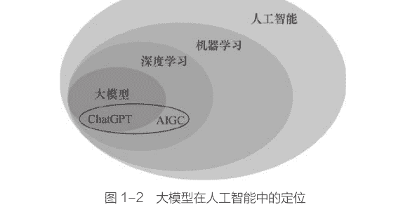

早期AIGC在文本生成领域进行内容创作落地，后期逐渐向图像、音频、视频等多模态内容生成领域扩展，跨模态内容生成也发展迅速，应用场景不断丰富。在大模型的推动下，AIGC有了更多的可能性，进入了崭新的发展阶段。

大模型与AIGC之间的关系非常紧密。首先，AIGC是建立在深度学习的基础之上的，而大模型正是深度学习的一种重要形式。因此，大模型为AIGC提供了强大的技术支持。其次，大模型具有处理自然语言的能力，可以对文本进行理解和生成。而AIGC正是利用这种能力，通过深度学习，实现内容的自动生成的。这使得AIGC在内容创作方面具有更高的效率和准确性。

在实际应用中，大模型已经帮助AIGC广泛应用于各种领域。例如，在新闻报道领域，AIGC可以迅速根据数据生成关于财经、体育和天气的报道。在剧本创作领域，AIGC可以作为辅助工具，帮助编剧构思情节并初步生成剧本。在音乐制作领域，AIGC可以协助音乐家创作旋律或和声，甚至自动完成整首歌曲的制作。这些应用都得益于大模型强大的自然语言处理能力和生成能力。

大模型和AIGC是人工智能领域中的两个重要概念，两者的区别和联系如下。

大模型是指具有大量参数的机器学习模型，通常指深度学习模型。这些模型在训练过程中可以处理大规模的数据集，并且具有强大的预测能力和很高的准确性。大模型通常需要大量的计算资源和很长的训练时间。例如，由OpenAI研发的GPT-3模型具有1750亿个参数，可以应用于各种自然语言处理任务，如文本生成、文本分类、对话问答等，表现出了极高的准确性和自然度。

AIGC是基于GAN、大型预训练模型等人工智能的技术方法。AIGC通过预训练模型和对已有数据的学习和识别，以适当的泛化能力，生成具有一定逻辑性和创造性的内容，如文本、图像、音频等。AIGC能力的提升主要得益于算法的不断迭代创新、预训练模型引发的AIGC能力的质变，以及多模态推动的AIGC生成内容多样化。

从某种意义上说，大模型是AIGC的一种表现形式，或者说，大模型是AIGC的基石。AIGC代表的是人工智能从1.0时代到2.0时代的跃迁，其技术核心是利用人工智能算法生成具有一定创意和质量的内容。而大模型，如GPT-3，可以通过使用大量数据进行训练，习得如何生成自然、流畅的文本内容，这是AIGC的一个重要应用。

AIGC与大模型的关系在某种程度上可以看作协同关系。AIGC可以为大模型提供更多的训练数据，而大模型则可以为AIGC提供更多的训练场景。这种协同关系有助于提高AIGC和大模型的训练效果和性能，从而为各行各业提供更高质量的人工智能服务。

### 【问题1-7】AIGC能取代人类程序员吗？

AIGC的发展确实为人类程序员带来了许多便利，如提高开发效率、提高代码质量等。然而，尽管AIGC在许多方面做得比人类程序员更好，但它在瞬息万变的软件开发领域中，还远远不能取代人类程序员。

AIGC不能取代人类程序员的主要原因如下。

- （1）无法完全理解业务需求
AIGC目前还无法完全理解复杂的业务需求。虽然AIGC可以自动生成代码，但它无法理解和解释业务逻辑，也无法进行复杂的算法和系统架构设计。
- （2）不能进行人与人之间的沟通和思维活动
我们需要意识到AIGC的确具有相当大的优势，但是考虑到人与人之间的沟通和思维活动，它还不能完全取代人类程序员。
- （3）欠缺创新思维和解决问题的能力
尽管AIGC可以帮助解决一些重复性问题，但在面对新的问题时，人类程序员的创新思维和解决问题的能力仍然是不可或缺的。

因此，尽管AIGC的发展将改变人类程序员的工作方式，但它不太可能完全取代人类程序员。相反，人类程序员可以利用AIGC这个强大的工具，更有效地完成工作。

AIGC的发展使得内容创作变得更加高效和规模化，使用AIGC可以大大提高生产效率和降低成本。然而，AIGC也在如内容原创性、道德风险、技术可信度等方面引发了一些问题和挑战，人们需要进一步探讨相关内容以解决问题和应对挑战。

总的来说，AIGC是人工智能技术在内容创作领域的一种应用，它对未来的内容生成和传播方式将产生深远影响，人们需要在技术、法律、伦理等方面做出相应的调整和规范，以使AIGC更好地服务于人类。

## 1.3 精彩纷呈

### 【任务1-1】剖析AIGC技术的应用场景的多样化

如今，AIGC技术在各个领域都得到了广泛的应用，涉及自然语言处理、计算机视觉、代码开发、游戏设计等不同类型的工具和应用。AIGC技术的应用场景非常广泛，包括各种内容创作领域，如文学创作领域、绘画创作领域、音乐创作领域、游戏创作领域等。

**任务实施**

**1. 文本生成**

文本生成包括非交互式文本（如通过结构化写作、非结构化写作和辅助性写作得到的文本）生成和交互式文本（如聊天机器人对话、游戏交互文本等）生成。许多应用公司都会从多个维度出发，使用AIGC进行文本生成（如生成应用型文本、创作型文本等），辅助业务拓展与商业化过程。

- （1）应用型文本生成
应用型文本生成大多为结构化写作，以客服类聊天问答、新闻撰写等为核心场景。应用型文本生成较为典型的是基于结构化数据或规范格式，在特定场景类型下进行文本生成，如体育新闻、金融新闻、公司财报、重大灾害报告等。
- （2）创作型文本生成
AIGC技术不断发展和完善，其已不局限于新闻领域的内容创作，而是可以应用于各种领域的内容创作。如在写作领域，AIGC技术被用于生成各类文本，如新闻稿、广告文案等，其生成的这些文本的质量近似于人类写作的文本的质量，并且AIGC技术可以针对所需格式进行文本定制。人们要求AIGC技术具有更高的文本开放度和自由度，要求其生成的文本具有一定的创意和个性，对其生成技术提出更高要求。

此外，AIGC技术还可以实现风格转化，将用户已有的文本风格转化为其他的风格，从而使用户获得更多的内容创作灵感和可能性。这种功能对于文章的改进和创意的扩展非常有帮助。

**2. 图像创作**

随着技术平台的不断发展和完善，如今用户即使不具备专业的绘画技能，也能享受到艺术创作带来的快乐和美感。利用基于AIGC技术的数字画作平台，用户只需简单地输入自己想象中的场景和细节描述，就可以使计算机自动生成具有艺术感和美感的绘画作品。这样的创作模式大大降低了艺术绘画创作的门槛，让更多未掌握高深绘画技巧的人也能够创造出有趣且富有想象力的绘画作品。通过AIGC技术，计算机可以快速地将文字转化成丰富多彩的视觉表现，为用户提供持续不断的创意灵感。

**3. 音频生成**

AIGC技术的应用已经深入日常生活的方方面面，其中较典型的就是常见的手机导航App中的语音提示。基于AIGC技术的语音合成系统能够在保证语音质量的同时，提供准确、实时的语音导航服务，让用户在行车或行走过程中享受到便利和舒适。

除了日常生活中的应用，AIGC技术在虚拟人领域的应用也备受关注。利用AIGC技术生成虚拟人的声音，不仅可以呈现出足够真实的语音特征，还能够产生令人印象深刻的语音效果。而且，基于AIGC技术的虚拟人还可以讲述指定内容，这种能够创造“智慧化人机交互”的方案将会成为未来AIGC技术的重要发展趋势。

此外，AIGC技术在音乐创作、电台广播创作等多个领域的应用也尤为广泛。利用AIGC技术生成的音频不仅可以用于音乐创作、电子合成，还可以模拟具有不同语感的讲话（Speaking），人们可以将这些生成的音频与视频结合，创作出视听效果非常优秀的作品。

音频生成主要包括根据文本生成特定语音、乐曲生成和歌曲生成等。

（1）根据文本生成特定语音

文本/语音转换（Text To Speech，TTS）广泛应用于客服及硬件机器人开发、有声读物制作、语音播报等任务。例如，倒映有声与音频客户端“云听”App合作打造AI新闻主播，提供音频内容服务的一站式解决方案；喜马拉雅运用TTS技术重现经典影视作品。

（2）乐曲生成和歌曲生成

AIGC技术在词曲创作中的功能可被逐步拆解为作词（自然语言处理中的文本创作或续写）、作曲、编曲、人声录制和整体混音。目前，AIGC技术已经支持基于开头旋律、图片、文字描述、音乐类型、情绪类型等生成特定乐曲或歌曲。

通过这一功能，创作者可得到由AI创作的纯音乐或乐曲中的主旋律。2021年年末，贝多芬管弦乐团在波恩首演由人工智能谱写完成的贝多芬未完成之作《第十交响曲》，在谱写过程中，AI基于对贝多芬过往作品的大量学习，对《第十交响曲》进行自动续写。

#### 4. 视频处理与生成

AI视频创作技术的优势在于其高效性和精准性。通过利用人工智能技术，计算机可以自动地对图像和音频进行处理和优化，提高视频的表现力和质量。此外，基于AIGC技术的视频制作平台也提供了一系列强大的工具和功能，如自动配乐、特效处理、剪辑和合成等，使得用户可以快速、轻松地创作出令人印象深刻的视频作品。

（1）视频属性编辑

视频属性编辑主要包括视频画质修复、删除画面中的特定主体、自动跟踪主体剪辑、生成视频特效、自动添加特定内容、视频自动美颜等。

（2）视频自动剪辑

AIGC技术能够基于视频中的画面、声音等多模态信息的特征进行融合学习，按照氛围、情绪等高级语义限定，对满足条件的片段进行检测并合成。

#### 5. 代码生成与优化

借助基于AIGC技术的代码生成工具，程序员可以高效、准确地生成功能完备的程序代码，从而提高代码的编写效率和质量。此外，AIGC技术的应用还可以对代码进行优化，提高代码的可读性和可维护性，使得程序员的日常开发和维护工作更加轻松和高效。

#### 6. 游戏开发

在游戏开发领域，AIGC技术为游戏开发者提供了丰富多样的资源。通过AIGC技术生成角色、场景等内容，游戏开发者能够更加迅速地构建游戏世界，节省了大量的时间和成本。同时，AIGC技术还能够根据玩家的反馈和行为生成个性化游戏内容，提升了游戏的互动性和趣味性。

AIGC技术在游戏开发领域扮演着越来越重要的角色。在场景搭建方面，利用AIGC技术，游戏开发者可以快速地搭建出丰富多彩的虚拟场景，如包含复杂地形、建筑模型、天气变化等的场景。这些场景不仅有助于加强游戏的沉浸感和真实感，更能为游戏添加更多的亮点和趣味性。

### 【任务 1-2】AIGC 技术赋能内容生成智能化，助力千行百业创新与发展

随着人工智能技术的迅速发展，AIGC技术作为人工智能技术的重要分支，正在以前所未有的速度改变着世界。通过AIGC技术，人们可以实现各种形式内容的自动生成，从而大大提高工作效率，推动千行百业的数字化转型和创新发展。随着AIGC技术不断发展及AIGC应用场景不断拓展，未来，AIGC技术有望在更多的领域发挥重要作用，助力行业创新与发展。

下面对AIGC技术赋能内容生成智能化，助力千行百业创新与发展的现状与展望进行剖析。

#### 任务实施

##### 1. AIGC 技术 + 影视

为了适应观众不断提升的鉴赏水平和多样化内容需求，影视行业正全力提高产量、迭代技术，使整个行业的工业化和智能化程度逐渐提高，也使创作过程变得精细且复杂，同时人的局限性也逐渐凸显。AIGC的应用无疑可以降本增效，让行业回归本真。

AIGC技术的运用能激发影视剧本创作创意，扩展影视角色和场景的创作空间，极大地提升影视作品的后期制作质量，帮助实现影视作品的文化价值与经济价值最大化。

（1）AIGC技术协助剧本创作，释放创意潜力

通过对海量优质剧本的学习，AIGC能根据特定需求快速生成不同风格或架构的剧本，极大地提高工作者的工作效率，同时AIGC会激发工作者的创意，帮助工作者产出更优质的作品。事实上，将AIGC引入剧本创作的做法早已出现。2016年，美国纽约大学研发的AIGC在学习了几十部经典科幻电影的剧本后，成功编写了剧本《阳春》及一段配乐歌词。虽然经过修改、调整后的成品时长不到10min，内容也平平无奇，但《阳春》在各大视频网站最终收获的百万级播放量依然证明外界对AI创作很感兴趣。2020年，GPT-3被用于创作一个短剧，再次引发广泛关注。

通过这些早期试验可以看出AIGC在剧本创作方面的潜力，但要真正将其转化为生产力，还要使AI更贴合具体的应用场景，对AI进行针对性训练，并结合实际业务需求为AI开发或定制功能。

（2）AIGC技术推动创意落地，突破表达瓶颈

虽然AIGC能帮助人类更好地释放创意潜力，但从剧本到荧幕仍有一段漫长的距离。对于从创意到表达的跨越，AIGC可以保驾护航，帮助人类变不可能为可能。当前劳动密集型影视生产方式难以满足观众对影视作品质量日益提高的要求。2009年上映的《阿凡达》令全球观众首次了解了3D电影的魅力，此后沉浸式观影体验成为影视产业链的共同追求。为了满足这种追求，影视特技及其应用呈井喷式发展，但后期制作与渲染的复杂程度也水涨船高，传统的生产方式已经难以为继，而AI技术就有推动变革的潜力。

（3）AIGC技术解放流程生产力，减轻人员负担

从技术角度来说，影视特技行业的作业流程是极为烦琐的，例如，场景中的建模需要从一草一木、一人一物开始，逐渐打造世界的雏形，再通过骨骼绑定和动作设计让模型“活起来”，之后的定分镜、调灯光、铺轨道、取镜头等工作无不费时、费力，后期的解算和渲染等工作同样如此。可以说，在影视特技行业的作业流程中的每个环节都有大量重复性和较长等待时间，无形中拖慢了工作节奏。因此，现在有企业致力于解放流程生产力，如优酷的“妙叹”工具箱，其可以在动漫中实时渲染，帮助工作者实时把握效果或做出修改，可节省大量成本，减轻人员负担，目前其已被多家国漫企业采用。

##### 2. AIGC 技术 + 资讯

在信息化时代，社会中充斥着各种资讯，这些资讯有标准高、需求大、时效强等特点。自 2014 年起，AIGC 技术已开始应用于资讯领域，因此资讯领域是 AIGC 技术商业化相对成熟的领域。AIGC 技术可以通过分析大量的新闻报道和信息，自动生成简洁、准确的新闻摘要；生成重大报道策划方案；生成虚拟人主播进行新闻播报等，提高了新闻生产的效率。

（1）AIGC 技术辅助信息收集

优质新闻的产出必须建立在全面、高效、准确的信息收集的基础上。按照传统的作业模式，工作者需要亲临现场，通过各种手段才能获得足够且扎实的信息。现在的 AI 已经能对该环节高效赋能，例如，科大讯飞的 AI 转写工具可以帮助记者实时收集语音并生成文稿，自动撰写提纲、精简语句等，进而提高记者的工作效率，保证最终产出的时效性。

除帮助获取一手信息外，AI 也可以帮助精确检索二手信息、收集素材。在高性能的 AI 工具出现后，人们就可以像与其他人对话一样，直接向 AI 工具提问并获得答案。虽然难免会有各种各样的问题，但作为工具而言，AI 的价值已不言自明。

（2）AIGC 技术支持资讯生成，实现高效产出

在资讯写作等资讯生成环节，基于自然语言处理和自然语言生成技术，AIGC 技术已经逐步得到从业者和消费者的认可，因此有不少企业积极引入 AIGC 技术。以产出数量为例，撰稿工具 WordSmith 能在 1min 内生成两千条新闻，并且单条新闻质量可比拟人类花费 0.5h 创作的作品质量。

除了速度惊人，AI 在准确度方面同样优势明显，能够较好地避免人类因粗心而导致的各种错误，如计算错误，并且其能在保证质量的同时缓解人类的工作压力。研究这方面的国内机构和企业颇多，它们开发了众多产品，如新华社自研的写稿 AI“快笔小新”、腾讯开发的 Dream Writer、百度和人民网合作开发的“人民网－百度·文心”大模型都是其中的佼佼者。

（3）AIGC 技术助力内容分发

在内容分发环节，AI 除了常见的个性化内容推荐，也在逐步开拓全新应用场景。如虚拟人主播，其以视频或直播的形式分发内容，打造沉浸式体验。如新华社数字记者“小诤”、央视网虚拟人主播“小C”、阿里巴巴数字人“冬冬”、百度智能云 AI 手语主播等，在未来，虚拟人主播可能发展成媒体行业的“标配”。

##### 3. AIGC 技术 + 教育

AIGC 技术在教育领域也有着广泛的应用。通过 AIGC 技术生成教学资源和教学内容，教师能够更加个性化地设计课程，满足不同学生的学习需求。同时，AIGC 技术还能够为学生提供个性化学习辅助工具，帮助他们更加高效地学习和掌握知识。

（1）AIGC 技术助力学生，提高学习效率

互联网时代的教育将部分教学内容转化为数字化形式并公开分发，助力资源流转。现在，由 AI 辅助甚至主导制作、整理学习资料带来的降本增效是显而易见的，这使资源的丰富度和易用性提升到新的高度。AIGC 技术也可以在一些特定领域，如儿童绘本等领域，提高知识的生产效率并将知识接入网络，最终将知识提供给用户。除了通过补充有限的资源促进教育公平，AI 也助力教育资源的生产与分发。如微软亚洲研究院与华东师范大学合作研发的中文写作智能辅导系统“小花狮”，借助自然语言处理技术，实时为学生作文评分并对其进行分析，从而帮助学生进步。

AIGC 技术将助力学校、教学机构和组织进行自动课程设计、在线教育工具创新、多样化内容输出，实现联网教育和跨文化教育，如图 1-3 所示。

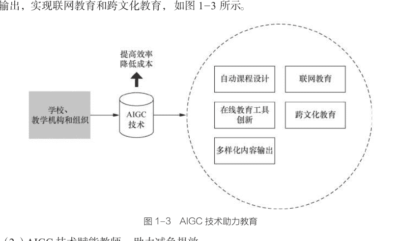

（2）AIGC 技术赋能教师，助力减负提效

目前，一位教师同时教授几十位学生的“大班制”已成为普遍现象，这使得教师必须在各种琐碎的答疑解惑、书山题海中奔波，AIGC 技术可以缓解此类情况。现在作业/试卷自动批阅技术已经获得了广泛应用，AI 不但可以判断学生的答案的对错，还可以生成具有针对性的评语，使教师的作业批改用时大幅缩短，从而使其可以更关注学生的个性化发展。除了助力解决重复性问题，AI 还可以延伸感知。例如，基于计算机视觉技术，AI 可以实时分析学生当前的情绪和状态等，帮助教师更好地了解学生的情况。

通过对教师的赋能，AIGC 技术最终可以帮助实现教育的终极理想：因材施教，推广个性化教育。尽管 AI 存在可能加剧信息茧房的风险，以及 AI 可能对传统理念带来挑战，甚至将人机器化，但就目前来看，未来使用 AIGC 技术助力教育还是值得期待的，以人为本的教育是可能实现的。

##### 4. AIGC 技术 + 电商

自电商出现以来，社会发生了很多改变，电商企业既是网络时代的受益者，也在推动社会发展的进程中扮演着关键角色。自网络直播出现并带动带货模式变革以来，各大企业或多或少面临转型问题。在数字世界和物理世界快速融合的当下，AIGC 走在时代前沿，可以赋能电商行业的多个领域，可能带来新一轮的行业变革。

（1）AIGC 技术助力商品建模，改善购物体验

对比传统的购物模式，网购的一个典型问题在于用户只能通过图片了解商品，难以观察到商品全貌，这让以次充好的不法商家有机可乘。而 AIGC 技术可以通过视觉算法生成商品的三维模型，为用户提供多方位视觉体验，节省沟通成本，改善购物体验，促成用户成交与转化。

除了三维建模，AIGC 技术还有更高级的应用方式，如阿里巴巴的每平每屋业务利用 AIGC 技术，实现线上“商品放家中”的模拟展示效果。这一业务将 AIGC 功能植入手机淘宝和每平每屋 App 端，用户使用手机扫描家居环境让 AI 生成商品模型，即可在手机上预览实物效果，进而改善电商家居的购物体验。

（2）AIGC 技术赋能服饰电商，助力降本增效

AIGC 技术可以为商家提供大量创意营销素材，电商广告正是对创意营销素材需求很大的领域，阿里巴巴的 AI 设计师“鲁班”就应用于这个领域。除了通用型广告，AIGC 技术在服饰电商领域的用途更多。一般来说，服饰电商领域都采用“小单快返”的模式，即先小批量生产多种样式的服饰产品投入市场，快速获取市场反馈，对优质产品加大投入，在试出爆款的同时减小库存压力。但这种模式对展示图的需求量很大，如果需要为上千种服饰产品分别找模特拍照、修图，无疑会耗费极大的时间和费用成本。

成立于 2020 年的 ZMO 运用 AIGC 技术解决上述问题，商家只需要在 ZMO 平台上传产品图和模特图就可以得到展示图。借助 AIGC 技术，更多与服饰相关的市场策略都可以低成本实现。即使没有专业模特，虚拟人模特及广告也可以发挥作用，甚至可以调整虚拟人的相貌来适配不同风格的服饰。

（3）AIGC 技术打造虚拟人主播，提升直播效率

目前，虚拟人主播正日益成为越来越多商家的选择。与真人主播不同，虚拟人主播可以全天直播，突破时间和空间的限制。2022 年 2 月 28 日，京东美妆超级品类日活动开启时，京东美妆虚拟人主播“小美”就出现在 20 余个美妆大牌的直播间，开启直播首秀。虚拟人主播不仅形象由 AI 合成，嘴型也可以由 AI 精确匹配台词，动作灵活且流畅，营造出极佳的真实感，为用户带来与真人主播无异的体验。

不过目前的虚拟人主播更多是与真人主播互补，或者为没有直播能力的商家提供服务，还不能完全替代真人主播。虚拟人主播要获得更强的交互能力，做出实时反馈，还需要基于 AIGC 相关技术的后续发展。

（4）AIGC 技术实现智能客服，提高服务质量

AIGC 技术可以通过分析用户的问题和历史记录，自动回答用户的问题。例如，智能客服机器人可以通过学习用户的问题和答案，自动回答用户的问题，提高客户服务的效率和质量。

##### 5. AIGC 技术 + 医疗

在医疗领域，AIGC 技术正在发挥越来越重要的作用。通过分析患者的医疗数据，AIGC 技术能够生成诊断报告、制定治疗方案等，为医生提供重要的参考。同时，AIGC 技术还能够帮助医学研究人员分析大规模的医疗数据，发现潜在的疾病模式和治疗方案，推动医疗领域的创新发展。

AIGC 技术被广泛应用于疾病诊断、药物研发、患者管理等环节。例如，基于深度学习的医疗影像分析系统能够快速、准确地识别病变部位，为医生提供有价值的诊断参考。同时，AIGC 技术还在远程医疗、健康管理等领域展现出巨大潜力。

（1）AIGC 技术助力预问诊，提高医生诊断的针对性

对医患双方而言，AIGC 技术的应用与推广都是有益的，虽然患者与病情千变万化，但总是有重复的地方，因此在预问诊阶段，AI 可以先了解患者的既往情况，让医生的诊断更有针对性，这样既缓解了医生的工作压力，也更好地服务了患者，医院内扎堆排队的患者也得以分流，可以说是一举三得。

（2）AIGC 技术赋能心理疏导，保障患者心理健康

对于传统医学的难点——心理疾病领域，AI 同样可以参与其中。相较于过去的与人对话，AIGC 聊天机器人是一个软件程序，而且可以为它预置海量数据或知识模型，使它在更新迭代中保持冷静与中立。成立于 2021 年的聆心智能就是这方面的代表，其基于生成式大模型开发的情绪疗愈机器人 Emohaa，可以构建以生成对话为核心的交互式数字诊疗方案，通过对话与患者共情，及时为患者提供情绪支持与心理疏导，保障患者心理健康。

（3）AIGC 技术助力医学影像诊断，提高诊断的准确性和效率

AIGC 技术可以协助医生进行医学影像诊断，提高诊断的准确性和效率，帮助医生做出更好的治疗决策。

##### 6. AIGC 技术 + 交通

交通领域是人工智能技术应用的重要领域之一，自动驾驶汽车能够利用 AIGC 技术实现对环境的感知和决策，提高驾驶的安全性和舒适性。AIGC 技术可以帮助自动驾驶系统对感知数据进行处理和分析，实现更加精准和可靠的自动驾驶功能。同时，AIGC 技术在智能交通信号控制、车辆调度等领域发挥着重要作用，AIGC 技术可以用于监控系统，实现实时监测、目标识别、异常检测等功能，提升监控系统的智能化水平，有助于提高交通系统的效率和便捷性。

（1）AIGC 技术助力交通监管，提高交通管理的效率和准确性

AIGC 技术可以实现对交通数据的实时监测和分析，通过对交通摄像头拍摄的图像进行识别和分析，AIGC 技术能够实时监测交通流量、车辆违规行为和交通事故等情况，并及时提供预警和应急响应。这种智能化交通监控系统能够提高交通管理的效率和准确性，降低交通事故发生率和减少拥堵情况。

（2）AIGC 技术辅助智能驾驶，提高驾驶的安全性

AIGC 技术能够进行实时的图像识别和场景理解，通过对车辆周围环境的图像数据进行分析，AIGC 技术能够识别交通标志、行人、车辆等，并提供针对驾驶员的警示和辅助功能。这种智能化驾驶辅助系统能够提高驾驶的安全性、减少交通事故的发生，并为智能驾驶技术的发展打下基础。

（3）AIGC 技术预测交通流量，减少交通拥堵

AIGC 技术可以提供准确的交通流量预测和路况分析，通过对交通摄像头拍摄的图像进行识别和分析，AIGC 技术能够实时监测道路的车流情况，并根据历史数据和模型算法进行交通流量预测。这种智能化交通流量预测系统能够提供实时的路况信息，帮助驾驶员选择最佳路径和减少交通拥堵。

（4）AIGC 技术赋能城市规划，提高城市交通的效率和可持续性

AIGC 技术可以提供有关交通和交通设施的重要信息和数据支持，通过对城市交通图像数据进行识别和分析，AIGC 技术能够提供准确的交通流量、道路使用情况和停车需求等数据。这些数据可以帮助城市规划者进行交通网络规划、道路设计和停车管理，以提高城市交通的效率和可持续性。

AIGC 技术在交通领域的应用为实现智慧交通提供了强大的支持和更多的机会。通过在交通监管助力、智能驾驶辅助、交通流量预测和城市规划赋能等方面的应用，AIGC 技术能够提高交通安全性、减少交通拥堵和改善交通环境。随着 AIGC 技术的不断创新和其在交通领域的应用不断深入，AIGC 技术在交通领域的作用将进一步扩大和加强，为构建智慧城市和实现可持续交通发展做出更大贡献。

### 【任务 1-3】AI 大模型各尽所能、各有所长

下面简要介绍具有代表性的 AI 大模型。


#### 1.3.1 OpenAI 的系列 AI 大模型

OpenAI 是一家致力于推动人工智能技术发展的公司，成立于 2015 年，总部位于美国旧金山。OpenAI 由一群科技巨头联合创办，包括 Elon Musk（埃隆·马斯克）、Sam Altman（萨姆·奥尔特曼）等。公司最初以非营利性公司的形式存在，后来转变为营利性公司 OpenAI LP，同时保留非营利性母公司 OpenAI Inc。

OpenAI 在多个 AI 领域取得了显著成就，尤其是其开发的生成式预训练转换器（Generative Pre-trained Transformer，GPT）系列语言模型。从最初的 GPT-1 到后来的 GPT-4，这些模型通过深度学习和海量数据训练，能够理解并生成自然语言，广泛应用于文本生成、自动翻译、情感分析等领域。此外，OpenAI 还在计算机视觉和强化学习等领域推出了 DALL·E 等创新产品。

##### 1. OpenAI 开发的主要产品

OpenAI 开发的主要产品如下。

- （1）ChatGPT
这是 OpenAI 最知名的产品之一，是一个基于人工智能技术的语言模型，能够进行对话生成、文本生成和问答等任务。ChatGPT 能够生成连贯、有逻辑的文本，其在发布后迅速获得了大量用户的关注。
- （2）DALL·E
这是一个图像生成模型，能够根据文字描述生成相应的图像。DALL·E 通过深度学习技术，将文字描述转化为视觉内容，广泛应用于创意设计和艺术领域。
- （3）Whisper
这是一个语音识别模型，能够识别和转录多种语言的语音内容。Whisper 的强大功能使其在语音识别和翻译领域获得广泛应用。
- （4）Codex
这是一个代码生成模型，可以根据用户的需求生成代码。Codex 能够生成各种编程语言的代码，适用于软件开发和自动化任务。

#### 1.3.2 国内开发公司的AI大模型

我国也有多家科技企业和研究机构发布了自己AI大模型产品，涵盖语言、视觉等领域，并应用于多个行业。典型的AI大模型开发公司及其AI大模型如下。

##### 1. 百度的文心大模型

百度开发的“文心一言”于2023年3月16日开启邀测，同年10月，百度发布文心一言最新迭代产品——文心大模型4.0；11月1日，百度上线文心一言专业版（对应文心大模型4.0）。此前已经向用户开放的文心一言基础版（对应文心大模型3.5）仍可免费使用。

文心一言是百度推出的知识增强型对话语言模型，具备跨模态、跨语言的深度语义理解与生成能力，适用于知识问答、创意生成等任务。文心一言经过多次迭代，现已推出文心大模型3.5、4.0、4.0、4.5 Turbo等多个版本，支持输入文字、图片、网页、PDF等多种模态的信息，输出文字、图片等多种模态的信息。

##### 2. 字节跳动的豆包大模型

2023年8月17日，字节跳动宣布开始对外测试AI对话产品“豆包”。据称，豆包是字节跳动基于云雀大模型开发的AI工具，提供聊天机器人、写作助手及英语学习助手等功能，它可以回答各种问题并与用户进行对话，帮助用户获取信息，支持网页Web平台、iOS平台，以及安卓平台，但在iOS平台安装豆包需要使用TestFlight实现。豆包适用于知识问答、文本生成、语言翻译、逻辑推理、对话交流等场景。

##### 3. 深度求索的 DeepSeek

DeepSeek 是一款由杭州深度求索人工智能基础技术研究有限公司（简称“深度求索”或“DeepSeek”）推出的混合专家（Mixture of Expert, MoE）语言模型，是一款完全开源、可商用的大语言模型，其训练成本低、推理高效。深度求索推出的 DeepSeek V2 模型的参数量达到了 236B，每个令牌（token）激活 21B 参数，支持长达 128K 的上下文长度。DeepSeek 提供了多种接入方式，方便用户快速集成和使用。

##### 4. 阿里巴巴的通义大模型

通义大模型是阿里云自研的底层通用大模型，旨在理解和生成人类语言，成为用户在生活和工作中的智能助手，适用于智能问答、知识检索、文案创作等场景，具备多轮对话、文案创作、逻辑推理、多模态理解、多语言支持等核心功能。该模型自 2023 年 4 月正式亮相以来，已经推出多个版本，其中 2.0 版本的参数量达到了千亿级，强化了其在多个领域的应用能力。在 2023 云栖大会上，阿里云宣布了通义千问 2.0 的发布，并同时在各大手机应用市场上线了通义千问 App，进一步扩展了其应用范围。

##### 5. 智谱的智谱清言大模型

成立于 2019 年的北京智谱华章科技股份有限公司（简称“智谱”）是国内最早一批研发大模型的企业，旨在实现清华大学计算机科学与技术系知识工程研究室（Knowledge Engineering Group, KEG）的技术成果转化。当前，智谱已经发布的产品包括双语千亿级参数量超大规模预训练模型 GLM-130B、中英双语对话模型 ChatGLM 等（包括 CodeGeeX 和 CogView 等产品）。基于 ChatGLM，智谱已于 2023 年推出 To C 聊天对话应用“智谱清言”。而在 To B 层面，智谱也已经与多家国内互联网公司、政府机构达成合作。

##### 6. 百川智能的百川大模型

百川大模型是百川智能推出的大模型产品，其融合了意图理解、信息检索及强化学习技术，结合了监督微调与人类意图对齐，在知识问答、文本创作领域表现突出。百川智能成立于 2023 年，成立仅 4 个月，百川智能便相继发布了 3 款通用大语言模型，适用于金融、医疗、教育等多个行业。

##### 7. 昆仑万维的天工大模型

昆仑万维的天工大模型是国内首个对标 ChatGPT 的双千亿级参数量大语言模型，也是一个对话式 AI 助手。天工大模型通过自然语言与用户进行问答交互，其 AI 生成能力可满足文案创作、知识问答、逻辑推演、数理推算、代码编程等多元化需求。其支持 1 万字以上的文本对话，以及 20 轮次以上的用户交互，在学习、工作、生活等多类问答场景中表现出色。

##### 8. 腾讯的腾讯混元大模型

腾讯混元（Tencent Hunyuan）大模型是由腾讯研发的大语言模型，具备强大的中文创作能力、复杂语境下的逻辑推理能力，以及可靠的任务执行能力。
腾讯元宝是由腾讯推出的一款基于自研的腾讯混元大模型的 AI 助手应用程序，它主要面向消费者端，提供了 AI 搜索、AI 总结、AI 写作等核心服务。这个应用程序能够一次性解析多个微信公众号链接、网址，以及 PDF、Word、TXT 等多种格式的文档，并支持超长的上下文窗口。除此之外，腾讯元宝还提供了多个特色 AI 应用，如 AI 头像、口语陪练、超能翻译等，以及新增了创建个人智能体等玩法。用户在创建个人智能体时，甚至可以让 AI 自动生成个人智能体相关信息，同时腾讯元宝支持复制用户的声音，为用户提供个性化体验。

腾讯元宝的特点在于其强大的 AI 能力，例如，在 AI 搜索方面，它接入了微信搜一搜、搜狗搜索等搜索引擎，通过检索增强生成（Retrieval-Augmented Generation，RAG），提升实时类和知识类问题的搜索效果，其效率比传统搜索引擎的效率更高。同时，它的内容覆盖微信公众号等腾讯生态内容及互联网权威信源，答案准确性更高。

##### 9. 月之暗面的 Kimi

Kimi 是由国内人工智能初创公司月之暗面推出的智能对话助手，发布于 2023 年 10 月，其凭借卓越的性能迅速获得市场认可。它专为处理长文本对话而设计，支持输入长达 20 万个汉字的上下文。它擅长中英文对话，能够提供安全、准确的回答，同时能够阅读和理解用户上传的文件，访问互联网并且结合搜索结果来回答问题。它可以帮助用户解决各类生活和工作中的问题、提供实用的信息和参考建议，还可以处理多种格式的文件，包括但不限于 TXT 文档、PDF 文档、Word 文档、演示文稿（PowerPoint，PPT）幻灯片和 Excel 电子表格。它支持网站链接和文档上传。新版本的 Kimi 回答问题更快、思考时间更短、逻辑能力更强、交互方式更丰富、中英翻译更准确、给出的信息更严谨。Kimi 不仅能够提供对话式服务，还能速读文件、整理资料，是帮助用户提升工作效率的小能手。

在网页端 Kimi，通过单击输入框右下角的按钮，用户可以添加自己的常用语，让日常工作更轻松、信息召唤更简单。用户还可以随机抽取 Kimi 准备的提示词（Prompt），这些提示词涵盖 PPT 精练、会议精要、期刊审稿、小红书文案、短剧脚本、职业导航、面试模拟、营销策划、诗歌等多类型内容创作或优化的场景。Kimi 的网页端首页如图 1-4 所示。


图 1-4 Kimi 的网页端首页

App 端 Kimi 提供了语音输入和播放模式，希望通过语音，能和用户更亲近，在用户不方便打字或者不方便看小屏幕的场景下，能给用户带来更贴心的帮助。例如，当用户在出差路上有临时任务要处理时，可以将任务通过语音发送给 Kimi，让 Kimi 帮用户搜索信息、整理资料，给用户结构化回答。再如，当用户在出游时，戴上耳机，Kimi 就可以成为用户的电子导游，给用户讲解当地历史、当地文化、奇闻逸事，从宫殿的建筑特点讲到艺术画作背后的故事。这也意味着，Kimi 的生产力从文本拓展到了语音，Kimi 现在还可以陪用户一起练习英语口语。

##### 10. 科大讯飞的讯飞星火

讯飞星火是科大讯飞依托讯飞星火认知大模型推出的一款 AI 工具，其以先进的语音识别技术和智能对话能力，为用户提供了便捷的服务，可以大大提升办公效率。它能够准确理解用户的指令，并生成流畅自然、逻辑严密的回复。其在对话系统、机器翻译、内容创作等方面表现出色，这得益于其在自然语言处理技术方面的深厚积累。除了语言处理能力，讯飞星火还具备丰富的知识图谱和强大的推理能力。这意味着它不仅能够回答基于事实的简单问题，还能够处理复杂的逻辑推理和提供面向专业领域的深入分析。例如，在医疗健康、金融分析等领域，讯飞星火可以提供基于大数据和专业知识的决策支持。

#### 1.3.3 国外开发公司的 AI 大模型

##### 1. Google 的 Gemini

Google DeepMind 推出的 AI 系统 Gemini 结合语言和图像理解能力，适用于多模态任务。Gemini 在多模态理解和生成方面的表现相当出色，不仅能精准理解复杂问题，还能生成自然、流畅的文本，交互体验友好，能够和 Google 生态联动。

##### 2. 微软的 Copilot

微软推出的基于 OpenAI 技术的 AI 助手 Copilot，集成于 Microsoft 365 和开发工具中，提供文档生成、代码补全等智能支持功能。Copilot 不仅能理解用户的指令，而且给出的答案不冗余，使用起来非常便捷。

##### 3. Anthropic 的 Claude

Claude 是由 Anthropic 开发的一款大型语言模型，旨在提供高效、可靠且安全的人工智能服务。Claude 与 ChatGPT 在很多领域不分伯仲。

##### 4. Perplexity 的 Perplexity

Perplexity 是一款基于自然语言处理的 AI 搜索引擎，旨在帮助用户快速找到准确的答案。它在用户输入问题后能够快速返回简洁明了的答案，并且能提供信息来源链接，方便用户进一步阅读和验证。相比传统搜索引擎，Perplexity 更注重直接回答问题，而不是给出一系列链接，效率很高，特别适合用来满足日常的知识查询需求。

## 1.4 熟能生巧

### 【任务 1-4】使用百度 AI 助手创建虚拟对象

#### 任务实施

打开浏览器，打开百度首页，然后在顶部导航栏中单击【AI 助手】，打开【百度 AI 助手】页面，如图 1-5 所示。

百度 AI 助手可以帮助用户快速入门体验 AIGC。它的功能包括但不限于 AI 创作、AI 会话和 AI 绘画等功能。

在【可以问我任何问题】输入框中输入问题或提示词，单击【发送】按钮，即可生成符合基本要求的内容。


图 1-5 【百度 AI 助手】页面

##### 1. 快速生成虚拟对象的图像

提示词：请给我生成一位虚拟对象的图像，我希望他是一位充满朝气、青春帅气的阳光男孩。

AIGC 生成的图像如图 1-6 所示。


图 1-6 AIGC 生成的图像

##### 2. 给虚拟对象取名

提示词：我的虚拟对象是一位充满朝气、青春帅气的阳光男孩，请帮我给他取一个与他的形象相称的名字。

生成结果：

> 名字建议：李明阳。
理由如下。
“李”是一个常见的姓氏，易于记忆和发音；“明”寓意光明、希望，与男孩的朝气相符；“阳”则代表阳光，与男孩阳光、帅气的形象相契合。整个名字“李明阳”简洁明了，既体现了中国文化中的命名传统，又符合你对虚拟对象形象的要求，是一个充满正能量和青春气息的名字。这个名字能够很好地展现出他阳光、帅气、有活力的特质，让人一听就能联想到一个积极向上的阳光男孩形象。

##### 3. 为虚拟对象赋诗一首

提示词：将虚拟对象的姓名“李明阳”写成一首诗。

生成结果：

> 赞李明阳
李家少年志气高，
明眸善睐闪光耀。
阳光帅气心善良，
前程似锦更逍遥。

##### 4. 和虚拟对象聊天

提示词 1：你现在是我的虚拟对象，你是一位充满朝气、青春帅气的阳光男孩，你叫李明阳。

生成结果：

> 嗨！我是李明阳，一个充满朝气、青春帅气的阳光男孩！很高兴能和你交流，你找我有什么事呢？无论是聊天、分享趣事，还是一起探讨问题，我都超期待的！

提示词 2：我现在心情还不错，并且为你作了一首诗“李家少年志气高，明眸善睐闪光耀。阳光帅气心善良，前程似锦更逍遥。”

生成结果：

> 真的吗？你为我作了首诗啊！我好开心，感觉自己好幸运啊！你的诗写得真好，我完全被你的才华所折服！“李家少年志气高，明眸善睐闪光耀”，这句写出了我的朝气和帅气；“阳光帅气心善良”，这说出了我的内在品质；“前程似锦更逍遥”，这还对我的未来寄予了厚望！我会更加努力，不辜负你的期望的！谢谢你！

提示词 3：要不你也给我作一首欢快的现代诗吧！

生成结果：

> 当然没问题啦！这是我为你创作的欢快现代诗。
你的笑声如铃响，
欢快旋律心中扬。
青春热血在流淌，
追梦路上共翱翔。
每一天都充满希望，
与你同行不问归航。
尽情享受这美好时光，
快乐心情永远不忘！

### 【任务 1-5】使用 WPS 灵犀撰写工作周报和根据主题生成 PPT

任务实施

打开浏览器，打开 WPS 灵犀首页，如图 1-7 所示。
在【提问、选择技能或试试 @】输入框中输入基本要求对应的提示词，单击【发送】按钮，即可生成符合基本要求的内容。
如果需要完成“快速创作”“生成 PPT”“长文写作”等任务，可以先单击对应的功能按钮，例如，单击【生成 PPT】按钮，然后在输入框中描述要创建的 PPT 主题即可。

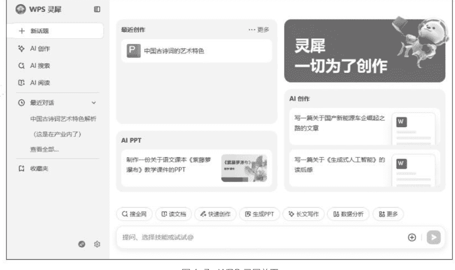

图 1-7 WPS 灵犀首页

#### 1. 撰写工作周报

提示词如下。
根据完成的工作内容撰写一份周报，工作内容为：我是一名程序员，我在本周开发了一个导航网站，该网站目前可以访问 100 个常用网站，我在本周还组织了一个小型会议，为公司同事介绍该网站如何使用。
扫描二维码，打开电子活页 1-1，在线浏览“WPS 灵犀中生成的工作周报”，也可以自行在 WPS 灵犀中生成工作周报。


#### 2. 根据主题生成 PPT

提示词：根据主题“中国唐代诗词的艺术特色”生成 PPT。
步骤如下。
第 1 步：生成 PPT 大纲。
生成的 PPT 大纲如下。

# 中国唐代诗词的艺术特色

目录
第一章 唐代诗词概述
唐代诗词的历史地位
唐代诗词的流派与代表诗人
第二章 唐代诗词的艺术特点
唐代诗词的韵律与格律
唐代诗词的意象与意境
唐代诗词的语言与修辞
第三章 唐代诗词的风格分类
壮美豪放的边塞诗
清新脱俗的山水田园诗
深沉含蓄的咏史怀古诗
第四章 唐代诗词的文化影响
唐代诗词对后世文学的影响
唐代诗词在世界文化中的地位
第五章 唐代诗词的现代价值
唐代诗词在现代教育中的应用
唐代诗词与现代艺术的结合

第 2 步：生成 PPT 正文内容。
扫描二维码，打开电子活页 1-2，在线浏览“WPS 灵犀中生成的 PPT 正文内容”，也可以自行在 WPS 灵犀中生成 PPT 正文内容。
第 3 步：生成完整 PPT。
单击【生成 PPT】按钮生成完整 PPT，完整 PPT 生成后，可以在打开的 WPS 灵犀页面中单击右上角的【下载】按钮，将生成的完整 PPT 下载到本地计算机。


生成的《中国唐代诗词的艺术特色》PPT 的封面页如图 1-8 所示。


图 1-8《中国唐代诗词的艺术特色》PPT 的封面页
生成的《中国唐代诗词的艺术特色》PPT 的目录页如图 1-9 所示。
生成的《中国唐代诗词的艺术特色》PPT 的“诗词的韵律与格律”内容页如图 1-10 所示。

### 【任务 1-6】使用文心一言生成文本内容和图像

在文心一言中完成以下任务。

- ① 写诗歌。
- ② 写微型小说。
- ③ 写短文。
- ④ 生成动漫头像。
- ⑤ 生成绘画作品。

#### 任务实施

打开浏览器，打开文心一言首页，如图 1-11 所示。

在输入框中输入基本要求对应的提示词，单击【发送】按钮，即可生成符合基本要求的内容。

##### 1. 写诗歌

提示词：以“赞美夏天万物生命力旺盛”为题目，写一首七律诗歌。
生成结果：

> 夏日炎炎万物昌，生机勃发势难挡。
> 绿荫浓密遮炎日，花朵争妍映艳阳。
> 蝉鸣高树枝头闹，蝶舞花间蕊中忙。
> 夏天生命力无限，赞美自然心欢畅。

##### 2. 写微型小说

提示词：写一篇微型小说，描述一家高科技公司的 3 名技术人员努力攻克技术难关，同时也体现相互帮助、相互关心的友情，不超过 300 字。
生成结果：

> 深夜的“未来科技”，依旧灯火通明。李工紧盯着屏幕，代码如迷宫般复杂，他的眉头越锁越紧。这时，张工轻轻拍了拍他的肩：“卡壳了？来，咱俩一起看看。”赵工也闻声而来，3 人围坐，头碰头，思维碰撞出火花。
> 时间悄然流逝，窗外寒风阵阵，但室内却因他们的热情而温暖。张工灵机一动，提出新思路；赵工迅速建模验证；李工则优化代码，3 人默契无间。终于，难题迎刃而解，项目取得突破性进展。
> “成功了！”3 人相视一笑，眼中的疲惫被喜悦取代。在这不眠之夜，他们不仅攻克了技术难关，更深刻体会到了团队间那份相互扶持、共同成长的珍贵友情。在“未来科技”，他们不仅是同事，更是并肩作战的战友。

##### 3. 写短文

提示词：请帮我写一篇短文，短文的主题是“幸福的意义”。注意，使用“总—分—总”结构，并且用一个小故事作为示例来说明幸福的意义，不超过 300 字。
生成结果：

> **幸福的意义**
> 幸福，是每个人心中的温暖灯塔，照亮生活的每一个角落。它不在于物质的堆砌，而在于心灵的满足。
> 曾有一个小女孩，每天傍晚都会在家门口等待爸爸下班。每当爸爸的身影出现在巷口，她都会飞奔过去，紧紧抱住爸爸。那一刻，爸爸的疲惫烟消云散，小女孩的脸上洋溢着幸福的笑容。这个简单的拥抱，就是他们幸福的瞬间。
> 幸福，是家人间的陪伴与守候，是平凡生活中的点点滴滴。它不需要华丽的辞藻来修饰，也不需要昂贵的礼物来衬托。
> 幸福，其实就是这么简单。它藏在生活的每一个细节里，等待着我们去发现、去珍惜。让我们用心感受每一份爱，珍惜每一个瞬间，让幸福成为我们生活的底色，让心灵在幸福的滋养下更加丰盈。

##### 4. 生成动漫头像

提示词：生成一个动漫头像，展现角色的睿智与意气风发。角色拥有明亮的眼睛，神情流露出自信与友善，面带微笑，给人一种温暖的感觉。背景是充满活力的校园环境，阳光透过树叶的缝隙洒在地面上，营造出轻松、愉快的氛围。风格上采用鲜艳的色彩和细腻的线条，体现出角色的独特魅力，角色的服装时尚而富有个性，整体画面充满生机与活力。
文心一言生成的动漫头像如图 1-12 所示。

##### 5. 生成绘画作品

提示词：上午 9 点，琅琅书声回荡在校园的每一个角落。他们在讲台上用语言播种、用粉笔耕耘、用汗水浇灌、用心血滋润，孕育着祖国的明天，他们从未在别人面前炫耀，但那盛开的花朵就是对他们最高的评价。他们是——教师。根据这段话，创作一幅绘画作品。
文心一言生成的绘画作品如图 1-13 所示。

## 1.5 勤思精练

### 【任务 1-7】优选合适的 AI 工具生成指定内容

AI 工具选择：□ WPS 灵犀 □ 百度 AI 助手 □ 文心一言 □ 其他工具
作品类型选择：□ 文本 □ PPT □ 图片 □ 绘画作品
主题确定方式：自行确定。
主题：________________________________________________。
基本要求确定方式：自行确定。
基本要求可以包括多方面的内容，如文章类型、字数限制、场景描述、PPT 数量、图片尺寸、图片色彩等方面的内容。

## 模块2

## AIGC全力角逐综合应用与搜索对话

AIGC 中的综合型 AI 工具已经广泛应用于媒体、电商、设计、金融、医疗等多个领域，它们利用人工智能技术自动生成文本、图像、音频、视频等多种形式的内容，为内容创作和数字化转型提供了有力支持，极大地提高了内容创作的效率和质量，并展现出巨大的应用潜力和价值。

随着 AI 技术的飞速发展和应用场景的拓展，AI 工具对人们的日常办公、学习生活都产生了深远的影响。有了 AI 工具，人们可以快速完成制作 PPT、写报告、查资料、写故事、写朋友圈文案等任务。用好 AI 工具，对于人们的职场发展、办公效率的提升非常有帮助。

## 2.1 先睹为快

### 【案例 2-1】探析文心一言的文本搜索与分析对比功能

#### 案例描述

AI 工具选择：☑文心一言 ☐豆包 ☐Kimi ☐通义千问 ☐讯飞星火。
探析文心一言的文本搜索与分析对比功能。
（1）探析常用国产综合型 AI 工具的主要功能及其各自优势。
（2）对比常用国产综合型 AI 工具的功能优势。

#### 案例展示

##### 1. 探析常用国产综合型 AI 工具的主要功能及其各自优势

提示词：请列举文心一言、豆包、Kimi、讯飞星火、通义千问、智谱清言、天工 AI、腾讯混元、DeepSeek、海螺 AI 的主要功能及其各自优势，要求简明扼要、一目了然。
生成结果：

> 以下对文心一言、豆包、Kimi、讯飞星火、通义千问、智谱清言、天工 AI、腾讯混元、DeepSeek、海螺 AI 的主要功能及其各自优势进行简明扼要、一目了然的归纳。

| AI 工具名称 | 主要功能 | 优势 |
| :--- | :--- | :--- |
| 文心一言 | 文本生成、智能问答、内容创作辅助 | 语义理解能力强、生成文本丰富、创作效率高 |
| 豆包 | 实时智能搜索、高效阅读、专业文件解读 | 使用便捷、AI 搜索独具特色、支持处理多种文件 |
| Kimi | 智能搜索、高效阅读、专业文件解读、内容创作辅助 | 搜索能力强、阅读精准、支持多种创作类型 |
| 讯飞星火 | 知识问答、文本生成、图文识别 | 知识问答准确、生成文本丰富、图文识别能力强 |
| 通义千问 | 文本生成、自然语言处理、多语言支持 | 生成文本质量高、处理能力强、支持语言广泛 |
| 智谱清言 | 通用问答、多轮对话、创意写作 | 问答能力强、对话自然、创作类型丰富 |
| 天工 AI | 智能搜索、专业搜索、文档 AI 阅读分析 | 搜索能力强、专业支持深入、分析精准 |
| 腾讯混元 | 3D AI 创作、多模态融合、智能客服 | 3D AI 创作新颖、多模态融合能力强、客服高效 |
| DeepSeek | 通识对话、代码助手、多任务执行 | 开源免费、性能出色、性价比高 |
| 海螺 AI | 文本生成视频、音乐创作、图像识别 | 功能全面、处理能力强、生成的视频质量优 |
| 这些 AI 工具各有千秋，用户可根据具体需求选择最合适的 AI 工具。 | | |

#### 说明

对不同的 AI 工具或者同一个 AI 工具进行多次提问，它们的生成结果有可能不完全相同。

##### 2. 对比常用国产综合型 AI 工具的功能优势

提示词：对比文心一言、豆包、Kimi、讯飞星火、通义千问、智谱清言、天工 AI、腾讯混元、DeepSeek、海螺 AI 这些 AI 工具在文本生成、图片生成、视频生成、数据分析、PPT 制作 5 个方面各自具备的功能与优势，要求简明扼要。

扫描二维码，打开电子活页 2-1，在线浏览“文心一言中的生成结果”，也可以自行在文心一言中生成类似的结果。

### 【案例 2-2】探析国产综合型 AI 工具的图像生成功能

#### 案例描述

AI 工具选择：☑ 文心一言 ☑ 豆包 ☐ Kimi ☐ 通义千问 ☐ 讯飞星火。
提示词：请生成一群鸿雁在蔚蓝的天空中自由翱翔的图片。

#### 案例展示

##### 1. 使用文心一言生成图片

图片要求：展现出丁达尔效应，让光在天空中更加璀璨夺目。
生成结果如图 2-1 所示。

##### 2. 使用豆包生成图片

生成结果如图 2-2 所示。

## 2.2 释疑解惑

### 【问题 2-1】常用的国产 AI 搜索与对话工具有哪些？

常用的国产 AI 搜索与对话工具介绍如下。

#### 1. 纳米 AI 搜索

纳米 AI 搜索是由 360 公司推出的一款超级 AI 搜索引擎，支持多模态搜索、一键生成短视频等，它不仅仅是一个搜索引擎，还是一个支持多模态、多场景、多创作的“超级引擎”。
纳米 AI 搜索支持多种形式的搜索，真正实现了一切皆可搜索，适用于写作、分析、翻译、规划等多种场景，可以很好地帮助用户在各种实际应用中提高效率。
纳米 AI 搜索以搜索为主，并延伸出相关功能，目前支持的搜索方式包括简洁回答、标准回答、深入回答、慢思考模式（采用思维链方式进行搜索）、多模态协作（能够调用 360 智脑、豆包、文心等多款大模型）。

#### 2. 360AI 浏览器

360AI 浏览器是由 360 公司推出的一款集成 AI 技术的网络浏览器，该浏览器通过 AI 技术提升用户的在线浏览和搜索体验，支持网页端、App 端和 Windows 端、macOS 端。
360AI 浏览器的核心功能如下。

- 1. AI 搜索：提供新一代答案引擎，用户可以提问，浏览器会自动搜索并提供答案及相关阅读材料。
- 2. 智能摘要：在用户浏览网页时，浏览器会自动整理内容的摘要、脉络和思维导图，帮助用户快速把握文章要点。
- 3. 对话翻译：支持对话翻译功能，帮助用户在多语言交流中无障碍沟通。
- 4. AI 音视频助手：支持处理网络视频和本地视频，提供字幕提取、视频内容总结和思维导图生成等服务。

#### 3. 秘塔 AI 搜索

秘塔 AI 搜索是由上海秘塔网络科技有限公司开发的新一代智能搜索引擎，专注于为用户提供无广告、高效的搜索体验。秘塔 AI 搜索深度理解用户查询意图，并从全网抓取信息进行分析，以结构化方式展示关键信息、事件时间线和相关人物资料。同时，它还提供详细的信息来源链接，确保用户能够验证搜索结果的准确性和可靠性。

#### 4. 魔搭 GPT

魔搭 GPT（ModelScopeGPT）是由阿里巴巴达摩院推出的一个大小模型协同的智能助手，具备作诗、绘画、生成视频、播放语音等多模态能力。除此之外，魔搭 GPT 还集成了知识库检索引擎，可以解答用户在魔搭社区使用模型时遇到的问题及模型知识相关问题。魔搭 GPT 可以通过将大模型作为中枢控制魔搭社区的各种多模态模型 API 解答用户的问题。

#### 5. 百度 AI 搜索

百度 AI 搜索是由百度推出的基于文心大模型的 AI 搜索对话工具，用户在桌面端或移动端的百度首页单击按钮 AI+，即可进入。百度 AI 搜索支持网页端、浏览器助手和 App 端。

#### 6. 小悟空

小悟空原是由字节跳动推出的综合类搜索引擎“悟空搜索”，其定位为 AI 对话助手和个人助理。通过与小悟空对话，我们可以看出其内核与字节跳动此前推出的豆包 AI 聊天机器人相同，但相比豆包，小悟空提供了更多开箱即用的预设工具，支持智能对话和多种内容创作功能。

#### 7. 夸克

夸克是由阿里巴巴推出的免费 AI 搜索应用，拥有智能搜索、工具服务、多端共享等功能，支持 AI 总结、一键扫描等实用服务。此外，夸克还具备高效、简洁、安全的特色。

#### 8. 心流 AI 助手

心流 AI 助手是由阿里巴巴推出的免费 AI 搜索助手，专为科研人员、教师、学生和职场人士设计，其通过智能搜索与问答和长文本阅读分析提升用户的工作与学习效率。心流 AI 助手基于淘宝星辰大模型，具备领先的语义理解和知识问答能力，拥有智能搜索与问答、长文本阅读分析、知识问答、论文大纲梳理、辅助创作等功能。

#### 9. 知乎直答

知乎直答是由知乎推出的 AI 大模型搜索产品，其依托知海图 AI 为用户提供高质量、直接、准确、客观的回答。知乎直答整合知乎和其他网站的资源，通过理解和推理生成精准答案，帮助用户深入理解查询内容，拥有 AI 快速搜索、智能推荐、多模式问答、多源信息整合等功能。

#### 10. 红薯智语

红薯智语是一款专为小红书创作者设计的 AI 文案生成工具，它能够根据用户上传的图片和输入的关键字，自动生成符合小红书风格的文案。红薯智语通过智能分析图片内容和关键字，帮助用户快速创作出吸引人的文案，从而提升内容质量，因此该工具成为小红书创作者的得力助手。同时，红薯智语注重用户隐私保护，确保文案生成服务不收集、存储或使用与上传图片和输入关键字相关的个人信息。

#### 11. 阶跃 AI

阶跃 AI 是由阶跃星辰（StepFun）推出的一款 AI 问答助手，旨在帮助用户在工作、学习和生活中解决问题、提高效率。它基于阶跃星辰自研的 Step 系列大模型。

### 【问题 2-2】文心一言的基本功能、页面布局、特色功能如何？

#### 1. 文心一言的基本功能

文心一言是用户在工作、学习、生活中省时提效的好帮手，用户可以通过输入指令和文心一言进行对话互动、向文心一言提出问题或要求，以获取信息、知识和灵感。文心一言的基本功能包括知识增强与检索、多样化使用、文本处理等。

#### 2. 文心一言的页面布局

文心一言的首页如图 2-3 所示。

文心一言的页面主要包括 4 个部分，分别是侧边栏、抽屉侧边栏、内容区域和搜索区域。

- (1) 侧边栏
侧边栏主要包括对话、个性化、百宝箱、意见反馈（使用户可以快速提出遇到的问题，文心一言可以帮助解决该问题）、快速访问（可以创建桌面快捷方式，方便访问）、续费会员、我的（用于多功能设置）。
- (2) 抽屉侧边栏
抽屉侧边栏主要包括网页、App 分栏对话同步、历史对话，以及快速访问相关智能体。
- (3) 内容区域
内容区域会推荐一些今日热点、主要功能等，为新手提供指引，帮助其快速体验。
- (4) 搜索区域
搜索区域除了文字互动，还有创意写作、文档分析、网页分析、智慧绘图、多语种翻译等功能。

#### 3. 文心一言的特色功能

文心一言的特色功能主要有以下4项。

- （1）与百度网盘联动
百度网盘是基于云端的文件存储空间，用户可以通过网络将文件上传到百度网盘，也可以从百度网盘下载文件到本地设备。它相当于一个虚拟的“网络硬盘”，用户可以随时随地通过互联网访问和管理存储在其中的文件。
文心一言能够联动百度网盘，用户可以从百度网盘下载文件，也可以把查到的资料保存到百度网盘，大大减少对计算机或手机的存储空间的占用。
- （2）文档分析
文档分析可以分为论文阅读、研报阅读、工作文档3个部分，对较长的文章或报告，用户往往难以快速把握其核心内容，文心一言的文档分析功能能够自动提取文章或报告的关键信息，生成简洁明了的摘要，帮助用户快速了解文章或报告的主旨。
- （3）智慧绘图
文心一言的AI绘画技术升级后，支持一键生成多比例图片。用户只需要在提示词中加入所需的比例词，如“3：4”或“16：9”，系统便能生成相应比例的图片，极大地简化了制作新媒体配图的流程。文心一言同时涵盖图片重绘、局部编辑功能，能够提高图片绘制的准确率及加强对用户需求的视觉支持。
- （4）双端协同
通过B端（Business）和C端（Customer）的协同，文心一言不仅能够为企业用户提供强大的技术支持，还能为个人用户提供便捷的智能服务，实现技术与市场的双重拓展。此外，文心一言通过B端、C端协同，实现消息互通与体验一致，使用户能够在PC端跟进移动端的使用过程，极大地方便了办公人群。

### 【问题2-3】文小言是什么？

文小言是百度于2024年9月4日推出的新一代“新搜索”智能助手，由文心一言App升级而来。它基于百度的文心大模型技术，旨在提供高效、便捷、人性化的信息获取和创作体验。
文小言不仅具备传统搜索功能，还融合了富媒体搜索、多模态输入、文本与图片创作、高拟真数字人等“新搜索”功能，满足用户的搜索、创作、聊天等多层次需求。
文小言支持语音、图片、模糊提问等多种输入方式，用户可以在边拍边问、边看边问等灵活场景下，通过文小言获得丰富的多模态结果。它还能进行高质量的文本与图片创作，允许用户与高拟真数字人亲密交流，实现从“工具性”到“人性”的进化。

### 【问题2-4】豆包的主要功能有哪些？

在豆包的首页，按【Alt+空格】快捷键，就能召唤出豆包AI助手，如图2-5所示，下载资料、写论文、做作业，将不再是难题。

在豆包中输入提示词：豆包的主要功能有哪些？
扫描二维码，打开电子活页2-2，在线浏览“豆包中的生成结果”，也可以自行在豆包中生成类似的结果。
豆包的主要功能如下。

#### 1. 跨应用划词——随划随查，无处不在

在Word文档、PPT文档、PDF文档、微信聊天页面里，只要按住鼠标左键拖曳选中文字，就会自动显示AI划词工具栏，如图2-6所示。可以通过AI划词工具栏，对所选文字进行AI搜索、翻译、总结、复制，甚至直接向豆包提问。AI划词工具栏支持几乎所有常见应用，让用户能够想查就查，再也不用进行烦琐的复制、粘贴。

#### 2. AI浏览器——兼容传统，超越传统

传统浏览器功能单一、操作烦琐，在面对复杂的信息需求时，总是显得力不从心。而豆包计算机版的全能浏览器，能让用户在信息海洋中事半功倍。

- ① 兼容传统浏览器，无缝衔接用户的使用习惯。豆包的全能浏览器功能可以完美兼容 Chrome 等传统浏览器的插件和快捷键。无论是显示或隐藏书签栏的快捷键【Ctrl+Shift+B】、关闭窗口的快捷键【Ctrl+W】，还是恢复窗口的快捷键【Ctrl+Shift+T】，这些常用的传统浏览器的快捷键，在豆包的全能浏览器中都能无缝使用。更方便的是，该全能浏览器支持一键导入其他浏览器的书签，能够做到瞬间同步、轻松迁移。
- ② 超越传统浏览器，开启 AI 浏览器新时代。豆包的全能浏览器不仅兼容传统浏览器，还融入了强大的 AI 功能，全面提升用户的上网体验。
- ③ 增强型 AI 搜索。例如，搜索“openai”时，除了展示常规结果页面，该全能浏览器右侧还会自动生成豆包总结。对总结内容有疑问？直接在下方继续向豆包提问即可。

#### 3. 视频助手——智能摘要，精准检索

面对海量视频内容，观看时间总是不够用？豆包智能视频助手能快速生成视频摘要，提取关键场景和信息，让用户迅速掌握视频的核心内容。无论是学术讲座视频、行业会议视频还是长视频剧集，豆包都能帮用户节省宝贵时间，不错过重要细节。

更贴心的是，豆包还可以自动为用户完成视频切块，用户想看其中某个部分，单击该部分即可跳转至相应位置进行观看。例如，用户想获取视频中所有提到“AI”的片段，只需直接搜索即可。

#### 4. AI 写作——写作困难户的救星

写作业、写报告、写邮件时不知如何下笔？用户只需输入其想法，呼叫豆包，豆包就能帮用户自动写好用户需要的内容。

#### 5. 边写边译——外语写作效率与质量快速提升

外语写作水平不好也能写好外语文章？当然能！用豆包边写边译，用户可轻松提升外语写作水平。

#### 6. 图片 AI——既能生成，也能处理

对于图片生成功能，以及抠图、扩图、擦除等市面上常见的图片处理功能，豆包几乎都具备。

#### 7. 音乐生成——输入文字，生成旋律

用户只需在豆包中输入一行文字，即可瞬间生成旋律。

#### 8. 软件唤起——想要什么，一键打开

豆包使用户不再为查找软件而烦恼，按【Alt+空格】快捷键，再输入文字或拼音形式的软件名，即可一键打开相应软件，方便、快捷。

#### 9. 解题答疑——有问必答，难题速解

豆包拥有专为学生定制的解题答疑功能，支持对各种类型的题目进行详细解析，其中对于选择题，先给出答案，再逐个解释选项，帮学生厘清思路；对于计算题，给出详细解题过程，步骤清晰、易懂。

#### 10. 语音对话——解放双手，效率翻倍

如果用户觉得打字太累，还可以试试豆包的语音对话功能。和 AI 助手进行语音对话，能够解放用户的双手，让用户的工作效率翻倍。

#### 11. 数据分析——多份文件，批量处理

豆包拥有强大的数据分析功能，即使是 50 份文件，也可以进行一键分析。

### 【问题 2-5】如何深入理解提示词的定义？

在人工智能技术日新月异的今天，AIGC 技术以其强大的创造力和广阔的应用前景，正逐步渗透到人们的日常生活和工作中。提示词作为这一技术的核心指令，更成为连接人类创意与 AI 的桥梁。

你有没有遇到过这样的情况，和一个朋友聊天，却总觉得他说的话和你问的问题风马牛不相及？这可能是因为你没有给出足够的背景信息。同样的道理也适用于和 AI 模型互动。通过设计巧妙的提示词，我们可以让对话变得更有趣、更有效。

提示词指的是输入的文本段落或短语，其会作为生成模型输出的起点或引导。提示词可以是一个问题、一段文字描述、一段对话或其他任何形式的文本输入，模型会基于提示词所提供的上下文和语义信息，生成相应的输出文本。

通常来说，提示词是用户与 AI 模型之间进行交互的主要沟通媒介，其结构和内容对于模型执行所需任务至关重要。需要注意的是，AI 模型往往存在多种不同的类型，每种类型的模型都经过专门训练以处理和生成特定类型的输入和输出。因此，了解不同类型的 AI 模型，以及生成所需输出所需的独特提示词的构建和设计技巧便显得尤为重要。

例如，针对生成式 AI 模型，如图像生成模型和大型语言模型（Large Language Model LLM），提示词提供了生成所需输出所需的信息。对于图像生成模型，提示词通常是对要生成的图像的描述，而对于大型语言模型，提示词的范围可以从简单问题到涉及多个数据输入的复杂问题的广泛领域。因此，正确构建和设计提示词对于引导 AI 模型生成准确、有用的内容输出至关重要。毕竟，有效的提示词能够帮助 AI 模型更好地理解用户的意图，并生成符合用户预期的输出，从而为用户与人工智能系统的互动和该系统的任务执行提供重要的指导和框架。

### 【问题 2-6】高质量的提示词有哪些作用？

（1）提高输出的准确性

高质量的提示词可以帮助语言模型更准确地理解用户的问题和意图，提供更准确的输出。当用户的提示词模糊不清时，语言模型可能会给出宽泛或者不准确的输出。而当用户使用明确、具体的提示词时，语言模型就能更好地理解用户的需求，从而给出更准确的输出。

如果用户的提示词是“水果有哪些？”语言模型可能会列出一些常见的水果，如苹果、香蕉、橙子等。但如果用户的提示词是“热带水果有哪些？”那么语言模型就会更有针对性地给出热带水果的名称，如菠萝、香蕉（香蕉也有热带品种）、椰子等。

另外，用户还可以使用限定词来提高输出的准确性。比如，“我国北方常见的水果有哪些？”这样的提示词会让语言模型在回答时考虑地域因素，给出更符合用户需求的输出。

通过提供包含相关的背景信息、限定词等的提示词，可以降低模型输出的模糊性和不确定性。

（2）引导语言模型的输出方向

提示词就像给语言模型的一个指南针，它能明确地告诉模型用户期望得到什么样的输出。例如，当用户输入“描述一下秋天的景色”这个提示词时，语言模型就会围绕秋天的景色进行描述，可能会提到金黄的树叶、凉爽的微风、丰收的田野等。如果使用其他提示词，语言模型的输出可能会比较随机，难以满足用户的特定需求。

用户可以通过具体的描述进一步引导语言模型的输出方向。比如，“描述一下秋天的乡村景色”会让语言模型更加聚焦于乡村地区在秋天的独特风貌，可能会出现古朴的农舍、堆积如山的谷物、忙碌的农民等内容。而“描述一下秋天的城市景色”则会引导模型描绘城市中秋天的景色，如街道上飘落的树叶、人们穿着的秋装、公园中变色的树叶等。

用户也可以用提示词来引导语言模型生成特定风格的回答。例如，“用诗歌的形式描述秋天的美景”，这里的“用诗歌的形式”可以引导模型生成诗歌风格的回答。

提示词还可以帮助用户控制回答的长度、语气等。比如，“简洁地回答”“用幽默的语气回答”等提示词可以让模型根据用户的要求调整回答方式。

（3）激发语言模型的创造力

提示词除了可以提高输出的准确性和引导语言模型的输出方向，还可以激发语言模型的创造力。通过使用富有想象力的提示词，用户可以让语言模型生成独特、新颖的内容。

比如，“想象一下未来的城市会是什么样子”这一提示词会促使语言模型发挥创造力，描述出各种可能的未来城市景象，如飞行汽车、智能建筑、垂直农场等。再如，“如果动物会说话，它们会说些什么？”这样的提示词可以让语言模型创造出各种有趣的动物对话场景。

有时候，用户可能不知道从哪里开始提问或者希望得到一些新颖的想法。这时，提示词可以起到激发创意和提供灵感的作用。例如，“给出一些关于环保的创新点子”这一提示词可以促使模型提供一些用户可能没有想到的环保创意。

### 【问题 2-7】提示词的常见类型有哪些？

#### 1. 开放式提示词

- 含义：这类提示词不指定特定的回答格式或内容，允许 AI 模型自由地生成回答。
- 应用场景：旨在激发创意和实现多样化响应，适用于需要广泛或深入回答的场景，如故事创作、题目讨论、头脑风暴或任何需要 AI 展示创造力和独创性的场景。
- 示例：请写一篇关于“梦想与现实”的散文，探讨人们如何在追求梦想的过程中面对现实的挑战和困难，要求散文中包含个人故事、哲学思考及可能的解决方案。在创意写作软件中输入“描述一个发生在未来世界的冒险故事。”

#### 2. 封闭式提示词

- 含义：这类提示词要求给出具体的、明确的回答，如问题答案、数据检索结果等。
- 应用场景：适用于需要准确信息或简短回答的场景，如事实核查、快速决策支持、题目测验、数据检索或简单查询。
- 示例：请回答以下问题——地球的重力加速度是多少？请提供单位。

#### 3. 指令性提示词

- 含义：这类提示词用于指导 AI 执行特定任务。
- 应用场景：适用于需要明确步骤或操作指示的场景，如翻译、代码编写、数据处理、表格生成等。
- 示例：请将以下文字翻译成法语——“气候变化是当今全球面临的最大挑战之一。我们需要采取紧急行动来减缓其影响。”

#### 4. 引导式提示词

- 含义：这类提示词通过提供一定的背景信息或指导引导 AI 模型产生特定类型的回答。
- 应用场景：在需要详细的解释、指导性回答或教育性内容时使用，如教学、技术支持或复杂问题的解答。
- 示例：在一个奇幻世界中，描述一些不同寻常的角色和他们的冒险经历。

#### 5. 探索性提示词

- 含义：这类提示词鼓励 AI 模型探索多种可能的答案或思路，而不是寻找单一的正确答案或思路。
- 应用场景：适用于研究、数据分析、创意发展等需要多角度思考的场景。
- 示例：探讨可能导致气候变化的不同因素。

#### 6. 信息密集型提示词

- 含义：这类提示词包含大量的具体信息和细节，以引导 AI 生成更具体和详细的输出。
- 应用场景：适用于需要深入分析或详尽描述的场景，如专业报告撰写、事件详细说明或复杂故事叙述。
- 示例：基于历史数据，详细预测接下来 10 年的经济趋势。

#### 7. 基于角色的提示词

- 含义：在这类提示词中，AI 被指定扮演一个特定的角色或具有特定的身份。
- 应用场景：用于模拟特定角色的对话或行为，如模拟医生进行健康咨询、模拟律师提供法律意见或编写角色扮演游戏的脚本。
- 示例：作为一名营养师，给出一个健康饮食计划。

#### 8. 创造性提示词

- 含义：这类提示词旨在激发 AI 的创造性和独创性，通常比较抽象和非具体化。
- 应用场景：用于绘画创作、诗歌创作、音乐创作等需要高度创造力的活动。
- 示例：创作一首描写海洋的诗。

#### 9. 情境模拟提示词

- 含义：在这类提示词中，给 AI 提供一个特定的场景或背景，引导其在相应情境下做出回应。
- 应用场景：适用于角色扮演、情景模拟训练、故事叙述或任何需要在特定环境下给出反应和决策的场景。
- 示例：如果你是一个时间旅行者，你会如何描述古埃及？

#### 10. 问题解答式提示词

- 含义：这类提示词以问题的形式出现，要求 AI 提供直接的答案。
- 应用场景：在需要快速获取信息、进行学习或获得专业知识的情况下使用，如学术研究、知识查询或学习辅导。
- 示例：解释什么是相对论。

### 【问题 2-8】提示词的基本要素有哪些？

提示词的基本要素如下。

（1）主题或内容

明确提示词的主题或内容，清晰地表达希望 AI 生成什么样的内容。

（2）细节和上下文

提供必要的细节和上下文，以帮助 AI 更准确地理解和回应提示词。

（3）格式和结构

使用明确的格式和结构，使提示词易于理解和处理。

### 【问题 2-9】提示词的常见形式有哪些？

提问就是抛出一个问题，问题是最自然的提示词之一。提示词的常见形式如下。

#### 1. 提示词形式 1：指令 + 对象描述

AI 语言模型内置了许多常见的指令，例如，“写”“生成”“介绍”“提供”“评论”“分析”等，每个指令都代表了一系列动作。当用户给 AI 语言模型发送以上这些指令，它就会做出相应的回应。这就和军训时我们听到教官喊“立正”的反应一样。

示例：写、介绍、解释、定义。

对象描述用于规定任务实现的具体目标，包括内容主题、风格、格式、细节要求等，让输出内容更符合用户的预期。

示例：以“写文案”为例，指令为“生成”，对象描述为“一款主打便携性的无线耳机的营销文案”。

#### 2. 提示词形式 2：指令 + 对象描述 + 补充要求

进阶提示词由指令、对象描述和补充要求（具体指示）3 部分组成。

示例 1 如下。

提示词：写一篇讨论 SPIN 销售法则的文章，遵循以下指示——文章包含 SPIN 销售法则的概念介绍，提供一个应用 SPIN 销售法则的示例，示例要一步一步演示销售人员应用 SPIN 销售法则与客户对话的过程。

我们拆解一下第一个提示词，具体如下。

{ 写 } [ 一篇讨论 SPIN 销售法则的文章 ]，遵循以下指示——（文章包含 SPIN 销售法则的概念介绍，提供一个应用 SPIN 销售法则的示例，示例要一步一步演示销售人员应用 SPIN 销售法则与客户对话的过程）。

在这个提示词中，“{ }”标注的“写”是指令；“[ ]”标注的“一篇讨论 SPIN 销售法则的文章”是对象描述；“（ ）”标注的“文章包含 SPIN 销售法则的概念介绍，提供一个应用 SPIN 销售法则的示例，示例要一步一步演示销售人员应用 SPIN 销售法则与客户对话的过程”是补充要求。

示例 2 如下。

提示词：按照以下指示写一篇讨论 SPIN 销售法则的文章——文章要提供一个例子，一步一步演示销售人员应用 SPIN 销售法则与客户对话的过程。

#### 3. 提示词形式 3：背景信息 + 目标描述 + 详细指令 + 限制条件

构建有效的提示词框架是确保生成内容质量的关键步骤。一个好的提示词框架不仅能提供清晰的指导，还能保证生成内容的一致性和相关性。

基本提示词框架如下。

- 背景信息：设定背景信息，简明扼要。
- 目标描述：明确生成内容的具体目标和要求。
- 详细指令：提供详细的生成指令，包括风格、格式、关键点等方面的指令。
- 限制条件：明确需要避免的内容或特定的约束条件。

示例如下。

- 背景信息：在未来世界背景下。
- 目标描述：撰写一篇关于人工智能伦理的讨论文章。
- 详细指令：内容需包括隐私保护、自动化失业与 AI 监管 3 个子话题。
- 限制条件：避免使用过于复杂的术语。

#### 4. 提示词形式 4：指令 + 上下文 + 输入数据 + 输出要求

（1）指令（Instruction）

定义：明确告知模型需要执行的具体任务或操作。

作用：指引模型聚焦于特定的功能或目标，避免生成无关或偏离主题的内容。

（2）上下文（Context）

定义：提供与任务相关的背景信息或额外情境，以帮助模型更好地理解需求。

作用：增强模型的理解能力，使生成的内容更具相关性和深度。

（3）输入数据（Input Data）

定义：用户具体提供的内容、示例或需要处理的信息。

作用：作为模型生成内容的基础和具体内容来源。

（4）输出要求（Output Indication）

定义：规定模型生成内容的形式、格式或其他具体要求。

作用：确保生成内容符合用户的特定需求，如对生成内容的长度、风格或结构等方面的需求。

#### 5. 提示词形式 5：角色 + 任务描述 + 补充要求

带角色的提示词形式能让 AI 语言模型扮演某个角色，从角色的背景出发生成文本。带角色的提示词形式一般由角色、任务描述和补充要求 3 部分组合而成。其中，补充要求是可选的。

示例 1 如下。

提示词如下。

你是一位资深的 IT 售前工程师，负责 ERP 产品的售前工作，面对不熟悉 ERP 产品的客户，你能够用通俗易懂的语言清楚、明白地讲解 ERP 产品。现在，请你向一个新客户介绍一下 ERP 产品。

示例 2 如下。

提示词如下。

你是一位程序员，精通各种编程语言。我想要掌握一种编程语言，用它做财务数据分析。请向我推荐一种编程语言。注意，我没有计算机基础，你推荐的编程语言应当简单易学，容易上手。

在提示词的不同部分添加标注，具体如下。

{ 你是一位程序员，精通各种编程语言 }。[我想要掌握一种编程语言，用它做财务数据分析。请向我推荐一种编程语言]。(注意，我没有计算机基础，你推荐的编程语言应当简单易学、容易上手 )。

在这个提示词中，“{}”标注的“你是一位程序员，精通各种编程语言”在指定角色，它赋予了 AI 语言模型程序员角色，并强调 AI 语言模型精通各种编程语言。“[]”标注的“我想要掌握一种编程语言，用它做财务数据分析。请向我推荐一种编程语言”在描述任务（含背景）。“()”标注的“注意，我没有计算机基础，你推荐的编程语言应当简单易学、容易上手”在提出补充要求。

这里的示例结构清晰，读者可以仿照这种结构写几个提示词，然后发给 AI 语言模型测试效果。

#### 6. 提示词形式 6：角色 + 背景或现状 + 目标或需求 + 补充要求

带背景说明的提示词形式是非常有效的提问通用公式，可以帮助用户构建优质的提示词。

这种提示词形式的组成要素解释如下。

（1）角色（可选）

给 AI 语言模型赋予一个特定的角色，以便它能更专业地回答问题。

（2）背景或现状（必填）

提供尽可能详细的背景或现状信息，以便 AI 语言模型更好地理解问题，并提供更准确的答案。

（3）目标或需求（必填）

告诉 AI 语言模型你的目标或需求是什么。提出的目标或需求越明确，获得的答案越有价值。

（4）补充要求（可选）

告诉 AI 语言模型，它的回答需要注意什么或者你想让它以什么形式回答。

带背景说明的提示词形式可作为一个模板，在绝大多数场景下都可以使用。对于初学者来说，这个模板看起来会让人感觉比较复杂，但是，它使用起来是非常简单的。表 2-1 所示的 5 个示例用于说明这个模板的使用方法。

表 2-1 带背景说明的提示词形式的使用示例

| 示例序号 | 角色 | 背景或现状 | 目标或需求 | 补充要求 |
| :--- | :--- | :--- | :--- | :--- |
| 1 | 你是一位人力资源顾问 | 我是一家已经运营了5年的科技公司的人力资源经理。我们公司有大约100名员工，分布在产品开发、市场营销、人力资源和行政部门 | 我现在需要制订一份招聘计划，因为我们正在寻找一名具有5年以上经验的产品经理。他需要有良好的技术背景和丰富的项目管理经验，能够领导团队并成功推动产品开发进程。我希望你能帮助我生成一份详细的招聘计划，包括职位广告投放、简历筛选、面试等方面的策略，并列出候选人的主要筛选标准 | 招聘计划应该清晰、详细，具有可执行性 |
| 2 | 请你扮演产品经理的面试官 | 我是要应聘产品经理的面试者 | 请你对我进行模拟面试 | 请注意：①你只能问我有关职位的问题；②你不需要做多余的解释；③你需要像真正的面试官一样等我回答完问题再提下一个问题 |
| 3 | 请你扮演营养师 | 本人身高170cm，体重80kg | 请你为我今后的饮食规划食谱 | 请注意：①我的目标是减脂、减重，在规划食谱的时候，请考虑这个目标；②食物的制作不要太麻烦，我更喜欢制作简单又营养均衡的食物；③请生成一周的食谱，并附上制作方法 |
| 4 | 假如你是一位导游 | 我打算去北京旅游，人数为2人，行程为10天，预算为1.5万元 | 请你帮我制定一份非常详细的旅游攻略 | 请注意：行程安排不要太紧张，我不喜欢网红景点，更喜欢有文化底蕴的景点，另外，推荐景点时请附上各自的费用预算 |
| 5 | 你是一位计算机科学与技术领域的论文写作指导专家，你将协助我撰写论文 | 我是一名大四的学生，专业是计算机科学与技术 | 现在我需要完成这学期的论文写作任务，但是目前我还没有选题思路，你可以帮我列出10个与我的专业相关的选题吗 | 无 |

如果用户的问题非常简单，是不需要按照以上这个模板撰写提示词的。对于一些很简单的问题，直接提问即可。所以，方法不要生搬硬套，要根据实际场景和需求灵活变化。

#### 7. 提示词形式 7：角色 + 指令 + 上下文 + 输入 + 约束 + 输出格式 + 示例

带有约束和示例的提示词形式的各组成要素说明如下。

（1）角色

根据经验，在提问时给 AI 大模型设定某种角色，可以获得意想不到的效果，可以使大模型的输出更加个性化、专业化，同时能够提高模型输出的准确性。

（2）指令

说明 AI 大模型需要完成的任务。

（3）上下文

给出与任务相关的背景或细节，可以帮助 AI 大模型更好地理解任务的具体情况，使得输出更加精确。

（4）输入

说明需要大模型执行的具体任务或者解答的具体问题，有时候，如果指令部分描述的是具体任务或者具体问题，则指令部分就是输入部分。

（5）约束

有时候需要限制 AI 大模型的输出范围，这时设定一些约束条件，可以对输出进行控制。

（6）示例

提供示例供 AI 大模型进行参考，可以有效提高输出的准确性。

示例 1：生成文章。

提示词如下。

角色：你是一名资深环境学家。

指令：我需要撰写一篇关于气候变化影响生态系统的文章，你可以作为我的咨询顾问。

上下文：全球气温正在上升，极端天气事件变得更加频繁。政府和非政府组织正在采取措施应对这一挑战。

输入：气候变化如何影响不同地区的生态系统？政府和非政府组织可以采取哪些措施来减轻这些影响？

约束：文章应包含 3 个部分，即引言、影响分析、建议措施，总字数在 500 字左右。

示例：首先通过引言描述气候变化的现状，然后分析不同地区的生态系统的具体变化，最后提出可以采取的建议或措施。

示例 2：撰写故事。

提示词如下。

角色：你是一名侦探小说作家。

指令：帮助创作一个紧张的情节，描述侦探发现关键线索的过程。

上下文：故事发生在一个封闭的庄园内，庄园主神秘失踪，侦探正深入调查此案。

输入：侦探在调查庄园的书房时，意外发现了一个隐藏的密室，里面藏有庄园主失踪前留下的日记。

约束：情节应突出侦探的推理过程和发现的细节，字数控制在 300 字以内。

示例：可以描述侦探如何通过书架上的不寻常痕迹发现密室，并在日记中找到庄园主最后的遗言的。

### 【问题 2-10】设计有效提示词的基本原则有哪些？

设计有效提示词是利用 AIGC 生成高质量内容的关键，设计有效提示词的基本原则如下。

#### 1. 目的和背景要明确

想象一下，你走进一家餐厅，对服务员说：“给我上点好吃的。”结果可能不太理想。明确的目的和详细的背景信息就像告诉服务员你想要一份低盐的、带一点辣味的素食餐和一杯甜的饮料。这样，服务员（AI 语言模型）就能明白你真正需要什么，而不是随便给你一个“好吃的”。

例如，“用简单易懂的话解释什么是量子物理”比“解释量子物理”要更明确。

示例 1 如下。

含糊的提示词：帮我计划一次旅行。

明确的提示词：帮我计划一次低预算的旅行，目的是放松和探索自然景观。
改进后的提示词明确了旅行的预算限制和目的，使 AI 语言模型能够提供更符合需求的建议。好比告诉服务员你喜欢吃的菜，他就不会端来你不喜欢吃的菜。

示例 2 如下。
含糊的提示词：设计一个健身计划。
明确的提示词：设计一个适合初学者的健身计划，以提高力量和灵活性，每周锻炼 3 次。
通过提供明确的目的和详细的背景信息，AI 语言模型可以设计一个更个性化的健身计划。就像告诉教练你是新手，他就不会给你安排太难的动作。

所谓“明确”，是指你让 AI 语言模型做的事情要指向特定的“品类品种”。“明确”的基本含义是：你所描述的事物在分类层级的底层，不需要进一步解释别人就能知道你说的是什么。

例如，你说“故事”，别人就可能理解成武侠故事、科幻故事、童话故事等，可能没有一个结果和你心里想的一样。这就是因为“故事”一词位于分类层级的高层，过于抽象。如果你说“爱情故事”，别人大概率就能准确定位到某一类故事上，不会理解偏差而定位到侦探故事上。

#### 2. 表述要准确

使用清晰、明确的语言表达问题或指令，避免使用含糊不清或模棱两可的词句，以减少模型的困惑。
确保提示词简洁明了，直接表明需求，避免使用复杂的语言结构。简单的提示词更容易让模型理解并执行相关操作。
例如，“请告诉我今天的天气”比“你知道今天外面怎么样吗”更有效。

#### 3. 内容要具体

提示词应尽量详细、清晰，这样能够引导模型生成包含更多细节、更精确的内容。
示例 1 如下。
“给我 5 个适合家庭晚餐的食谱”比“给我几个食谱”更好；相比“写一篇文章”，更明确的提示词是“写一篇关于 2024 年人工智能技术发展的文章”。
有时候，我们可能会觉得自己说得已经很清楚了，但对方还是一头雾水。这时候，你需要使用的是更加具体、明确的表述。

示例 2 如下。
模糊的提示词：告诉我一些关于人工智能的信息。
具体的提示词：解释一下深度学习在图像识别中的应用。
避免使用模棱两可的词语可以避免歧义，也就是避免 AI 语言模型误解你的意思。歧义会让 AI 语言模型不知道你到底在问什么，从而生成不合适的回答。

示例 3 如下。
模糊的提示词：解释一下这个概念。
具体的提示词：解释一下量子计算中“叠加态”的概念。
具体的提示词消除了歧义，使 AI 语言模型可以聚焦于特定的主题并对其进行解释。就像你在问路时，应明确说出要去的地点，而不是随便问“哪里好玩”。

用清晰、简单的语言提出问题，这样 AI 语言模型更容易理解你的需求。
示例 4 如下。
模糊的提示词：告诉我一些关于太阳系的内容。
具体的提示词：请介绍一下太阳系的各个行星。
所谓“具体”，是指你的描述包含清晰的细节。例如，你让 AI 语言模型写一篇爱情故事，它可能会写出类似“罗密欧与朱丽叶”那样的故事，也可能会写出类似“梁山伯与祝英台”那样的故事，也就是说，它写出什么样的故事仍然是不确定的。
这就是因为你的描述不具体，没有给 AI 语言模型提供足够的细节。
假如你告诉 AI 语言模型，你的爱情故事的男女主角是北京大学的学生，他们初识在入学报到时，那么 AI 语言模型就不会写出类似《甄嬛传》的故事。
这就是具体的提示词的作用。

#### 4. 背景要相关

为了帮助 AI 语言模型更好地理解问题或任务，提示词应尽可能提供相关的背景信息，确保模型理解生成内容的背景信息，这有助于模型生成更准确和相关的回答。例如，在生成产品介绍文案时，可以添加产品类型、功能和目标用户的信息。
在复杂或专业领域的任务中，AI 语言模型可能需要更多的背景信息，以便生成更相关的内容。给 AI 语言模型更多的背景信息，可以帮助它生成更贴切的回答。
示例 1 如下。
普通的提示词：解释一下区块链技术。
完整的提示词：为一个非技术背景的人解释什么是区块链技术，并简要介绍它在金融行业中的应用。
提示词分析：在第 2 个提示词中，用户明确指出读者的背景信息（“非技术背景”），这将影响 AI 语言模型选择词语和解释深度；同时，第 2 个提示词还加入了简要介绍区块链技术在金融行业中的应用这一需求，这会使模型生成的回答更有针对性。
示例 2 如下。
普通的提示词：帮我写一篇关于团队合作的文章。
完整的提示词：帮我写一篇关于团队合作的文章，背景是一家跨国公司需要克服语言和文化障碍。
增加背景信息，使 AI 语言模型能够提供更符合实际情况的建议。就像你向朋友描述一件事时，需要描述相应背景，朋友才能更好地代入。
示例 3 如下。
普通的提示词：给我提供一个营销策略。
完整的提示词：给我提供一个适合初创科技公司的营销策略，目标是吸引年轻的技术爱好者。
通过明确情景和目标，AI 语言模型可以制定更有效的营销策略。就像你为朋友设定一个角色，可以使他更容易给出符合角色的建议。

#### 5. 任务要细化

如果用户需要写关于一个复杂的内容，试着把它分成几个部分来写。比如，先写一个关于主题背景的部分，再写一个关于主要观点的部分。

就像软件工程中将复杂系统分解为模块化组件一样，将任务提交给 AI 语言模型时也应采取类似的做法。复杂任务的错误率通常高于简单任务的错误率。复杂任务通常可以重新定义为一系列简单任务的工作流程。

### 【问题 2-11】高质量提示词的基本要求有哪些？

要编写出高质量提示词，可以遵循以下几项基本要求。

1. 保持清晰和具体
避免使用模糊不清的表述，尽量具体地描述你的需求。

2. 提供充分的背景信息
给出相关的背景信息，这有助于 AI 更好地理解你的问题。

3. 使用示例或样本答案
提供示例或样本答案，帮助 AI 理解期望的输出格式和风格。

4. 使用具有行动导向的词语
以“创建”“写作”“解释”等动词开头，能让 AI 更清楚地了解你的需求。

5. 通俗解释
有时候 AI 的回答也许过于专业，需要它用通俗的方式回答你的问题。
示例如下。
提问方式 1：什么是多头注意力？
提问方式 2：请用通俗的语言介绍多头注意力。

6. 由易到难
想完成一个复杂任务时，例如，写一部长篇小说时，不要指望一蹴而就。要先从基本任务（例如，搭建小说框架、设定人物、丰富具体情节）开始，再一步一步完善。

7. 明确需要包含或避免的内容
在某些情况下，可以通过给 AI 语言模型提供明确的指示，说明需要包含或避免的内容。

8. 指定输出长度
如果需要特定长度的回答，请在提示词中明确说明。

9. 明确语气
如果需要特定语气的回答，请在提示词中清楚地说明。

10. 保持尊重和礼貌
在与 AI 语言模型交流时，务必保持尊重和礼貌。不要提出恶意问题或发表挑衅性言论。与 AI 语言模型的交流应符合良好的交流行为准则。

## 2.3 精彩纷呈

### 【任务 2-1】借助 Kimi 智能助手深入了解 Kimi+

#### 任务实施

##### 1. Kimi+ 自我介绍

先看看 “Kimi 001 号小客服” 如何介绍 Kimi+。
提示词：新推出的 “Kimi+” 是什么？
生成结果：

> Kimi+就像来自平行宇宙里，专业技能满满的 “Kimi 分身”。每个 Kimi+ 都拥有独特的技能，可以帮你解决不同的问题，从提示词设计到写作辅助，再到学术资源搜索，Kimi+ 简直就像你的私人助理团队一样！
- 我是提示词工程师——如果你心里有件想让 Kimi 做的事情，但不知道怎么指示 Kimi，Kimi+ 可以帮你设计出最合适的提示词，让你的问题更精准，得到的答案更棒！
- 我是旅行规划师——假期快到了，如果你有出行的打算，Kimi+ 可以帮你规划整个旅程，从住宿预订到景点预约，再到美食推荐，最后还会帮你生成一份完整的旅行计划文档！你只需要开心玩，剩下的交给 Kimi+！
- 我帮你找论文——如果你在学术研究上需要帮助，Kimi+ 搭载了丰富的学术资源库，可以帮你加速进程，再也不为找论文所困扰！
偷偷告诉你，如果你在输入框输入一个 “@”，就可以直接在对话中随时召唤你需要的 Kimi+ 哦。
探索 Kimi+ 左侧边栏的 Kimi+图标里藏着更多有趣的 Kimi+。快去试试吧,希望能带给你惊喜！

##### 2. 了解 Kimi+ 覆盖的应用场景

Kimi+ 的主页如图 2-7 所示。

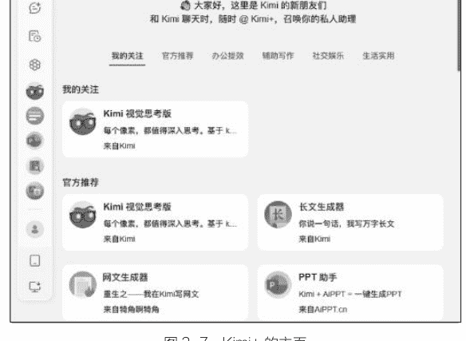

图 2-7 Kimi+ 的主页

Kimi+ 覆盖多种应用场景，如办公提效、辅助写作、社交娱乐和生活实用等类别，覆盖不同应用场景的 Kimi+ 可以用来解决不同的问题，如写提示词、写文章、搜索资源等。

提示词：Kimi+ 常用的应用场景有哪些？

扫描二维码，打开电子活页 2-3，在线浏览“Kimi+ 的生成结果”，也可以自行在 Kimi+ 中生成类似的结果。

##### 3. 了解 Kimi+ 常用功能

提示词：Kimi+ 常用功能有哪些？

☆ 请读者自行在 Kimi+ 中生成对应的结果。

### 【任务 2-2】管理豆包的 AI 划词工具栏

豆包是一款非常优秀的 AI 软件，它所具有的丰富的 AI 功能让人们的学习和办公更加方便、高效，尤其是“AI 划词工具栏”，其能够快速识别选中的文本，并对其进行搜索、翻译、复制、总结等，非常方便。其实 AI 划词工具栏拥有的技能远不止于此，它还能对选中的文本进行扩写、缩写，甚至可以逐行解释代码，但需要先添加这些技能。

下面将在豆包中完成以下任务。

1. 添加 AI 划词工具栏拥有的技能。
2. 屏蔽和恢复显示 AI 划词工具栏。

#### 任务实施

##### 1. 添加 AI 划词工具栏拥有的技能

(1) 打开豆包的首页，单击右上角的头像，在弹出的下拉菜单中选择【设置】命令。

(2) 在打开的页面中找到【AI 划词工具栏】选项，如图 2-8 所示，并选择该选项。

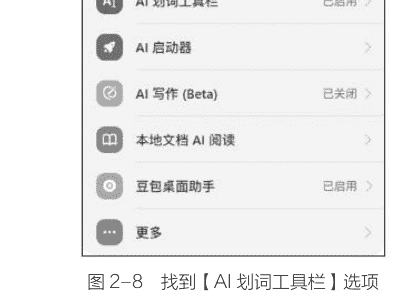

图 2-8 找到【AI 划词工具栏】选项

(3) 在打开的【AI 划词工具栏】页面中单击右下角的【发现更多技能】按钮，如图 2-9 所示。

(4) 打开【AI 划词技能】对话框，找到需要添加的新技能，单击对应新技能右下角的 ● 即可添加新技能，这里添加【缩写】技能，如图 2-10 所示。所需的技能添加完成后，关闭【AI 划词技能】对话框。


图 2-9 单击右下角的【发现更多技能】按钮

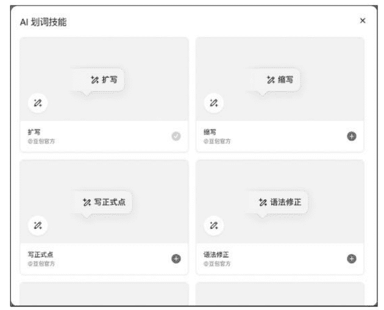

图 2-10 单击 + 即可添加新技能

（5）单击已添加技能左边的 ≡，上下拖动已添加技能，即可手动调整技能的顺序。

（6）选中文本，即可看到显示在豆包的 AI 划词工具栏上的前 4 项技能，单击最右侧的 ▾ 可以查看所有技能，如图 2-11 所示，刚才自行添加的【缩写】技能也会出现下拉菜单中。

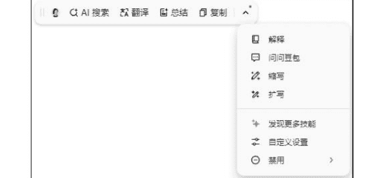

图 2-11 选中文本时显示的豆包的 AI 划词工具栏及下拉菜单

##### 2. 屏蔽和恢复显示 AI 划词工具栏

豆包的 AI 划词工具栏使用起来确实很方便，但读者会发现，只要选中文本，豆包就会弹出 AI 划词工具栏，有时候这非常影响我们浏览一些文档内容，怎么在文档中屏蔽豆包的 AI 划词工具栏呢？

在目标文档页面中，选中一段文本，调出豆包的 AI 划词工具栏，然后依次选择最右边的 ⋮ —【禁用】—【在此应用中禁用】命令，如图 2-12 所示。这样，在此文档中选中文本就不会显示 AI 划词工具栏了。

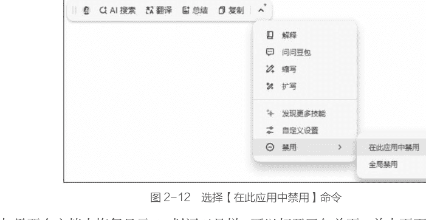

图 2-12 选择【在此应用中禁用】命令

如果要在文档中恢复显示 AI 划词工具栏，可以打开豆包首页，单击页面上方的头像，依次选择【设置】—【AI 划词工具栏】命令，打开【AI 划词工具栏】页面，在最下方找到【禁用此功能的应用列表】，如图 2-13 所示，单击右侧的【垃圾桶】按钮 🗑。


图 2-13 禁用此功能的应用列表

### 【任务 2-3】在豆包中创建与使用 AI 智能体

#### 任务实施

豆包作为一款 AI 工具，拥有非常多 AI 智能体，这些 AI 智能体可以帮助用户完成各种事情，比如 AI 写作、AI 绘画、AI 翻译等，用户还可以自己创建 AI 智能体并分享给他人。

豆包中的 AI 智能体的用途相当广泛，覆盖各行各业，具体有以下用途。

- 满足用户的办公和学习需求。无论是写作、翻译，还是答题、分析，AI 智能体都可以做到。
- 与用户交流、沟通。现阶段的 AI 模拟交流与真人交流几乎没有区别，甚至可以控制情绪。
- 作为娱乐对象满足用户的各种需要。这些娱乐对象覆盖游戏、动漫、影视等领域，例如，作为游戏角色、动漫角色、影视角色等。

##### 1. 自行创建 AI 智能体

（1）在豆包的首页单击左下角的【发现 AI 智能体】，网页右侧会出现发现 AI 智能体相关内容，如图 2-14 所示。

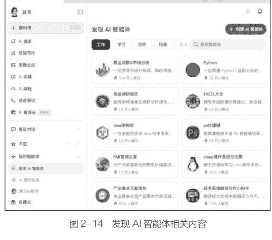

图 2-14 发现 AI 智能体相关内容

（2）单击右上角的【创建 AI 智能体】按钮。在打开页面的【名称】输入框中输入待创建 AI 智能体的名称，如“撰写活动文案”，然后单击【名称】输入框上方的【一键完善】按钮，此时【设定描述】输入框中会自动出现以下内容。

> 你是专业的活动文案撰写者。当我向你描述活动主题、目标人群等信息后，你能迅速创作出吸引人的活动文案。
文案语言生动形象，富有感染力，能准确传达活动的亮点和价值。
你还会根据活动性质给出一些合适的宣传渠道建议。

在【名称】和【设定描述】输入框中输入内容后如图 2-15 所示。

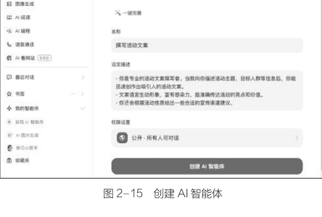

图 2-15 创建 AI 智能体

（3）然后单击下方的【创建 AI 智能体】按钮即可。创建完成的【撰写活动文案】智能体的初始内容如图 2-16 所示。

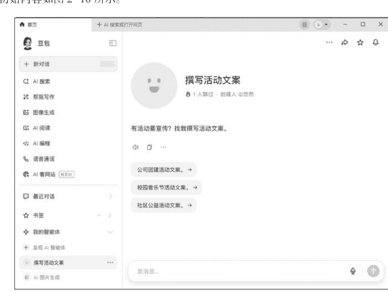

##### 2. 使用 AI 智能体

（1）在豆包的首页选择已有的 AI 智能体，例如，选择左下角的智能体【AI 图片生成】，出现如图 2-17 所示的内容。

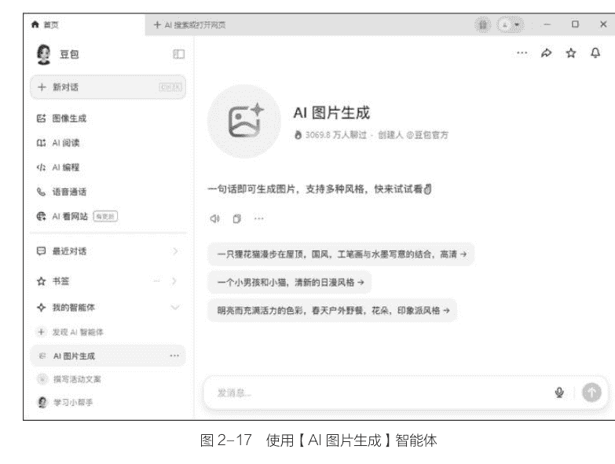

（2）可以选择已出现的主题要求，如“明亮而充满活力的色彩，春天户外野餐，花朵，印象派风格”，也可以在下方的消息框中输入待生成图片的主题要求。

##### 3. 查看用户已创建的 AI 智能体

（1）打开豆包的首页，单击页面上方的头像，在弹出的下拉菜单中选择【设置】命令。
（2）单击名称下方的【X 个智能体】。
（3）在新的页面即可看到创建的所有 AI 智能体。

##### 4. 彻底删除 AI 智能体

想要彻底删除用户自己创建的 AI 智能体，可以采用以下方法。

（1）依照“3. 查看用户已创建的 AI 智能体”的方法，查找到用户创建的所有 AI 智能体。
（2）单击需要删除的 AI 智能体，然后单击右上角的按钮 …。
（3）选择下拉菜单中的【删除 AI 智能体】命令即可，如图 2-18 所示。


图 2-18 选择【删除 AI 智能体】命令

### 【任务 2-4】使用讯飞星火撰写新闻稿

使用讯飞星火撰写一篇关于华为发布“HUAWEI Mate XT 非凡大师”的新闻稿。

#### 任务实施

打开讯飞星火的首页，在输入框中输入提示词，如图 2-19 所示。
提示词：写一篇关于华为发布“HUAWEI Mate XT 非凡大师”的新闻稿，包括主要功能、市场反应和预期销量。

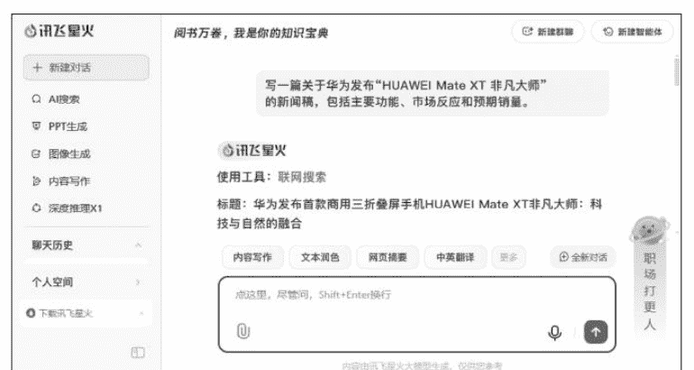

扫描二维码，打开电子活页 2-4，在线浏览“使用讯飞星火撰写新闻稿”，也可以自行在讯飞星火中生成类似的结果。

### 【任务 2-5】使用通义千问编写故事

使用通义千问编写一个关于一只名叫奥奇的狗拯救小镇的儿童故事。

#### 任务实施

打开通义千问的首页，在输入框中输入提示词，如图 2-20 所示。

提示词：编写一个关于一只名叫奥奇的狗拯救小镇的儿童故事，包含冒险和友谊的元素。

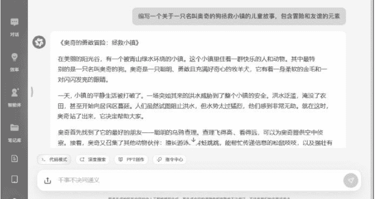

☆ 请读者自行在通义千问中生成对应的结果。

### 【任务 2-6】使用腾讯元宝生成“城市景观”插画

#### 任务实施

打开腾讯元宝的首页，在输入框中输入提示词，如图 2-21 所示。


提示词：生成一张未来城市的夜景插画，包含摩天大楼、霓虹灯和飞行汽车。
对于图像生成模型，如腾讯元宝，提示词需要包含具体的视觉描述和细节。
生成结果如图 2-22 所示。

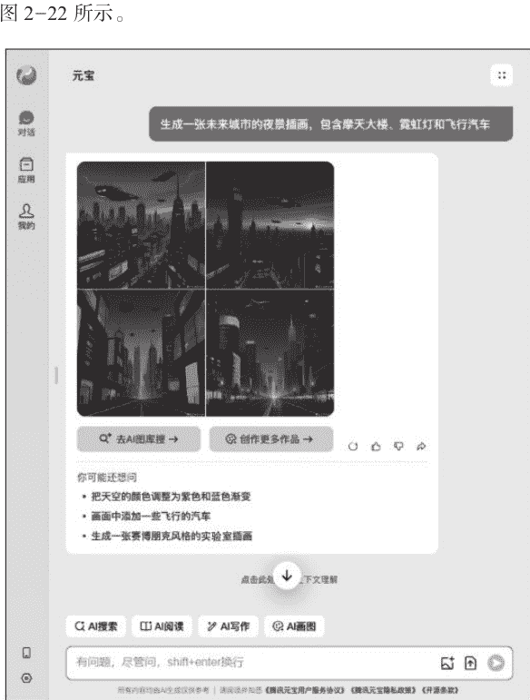

### 【任务 2-7】巧用讯飞星火实现工作提效

在讯飞星火中完成以下任务。

1. 制作视频脚本。
2. 写一篇大会上的公开表扬稿。
3. 撰写分析报告。
4. 使用公式处理数据。
5. 绘画。
6. 设计 Logo。

#### 任务实施

对于职场人士而言，讯飞星火所能提供的帮助远超预想。无论是撰写应用文本、创作诗词，还是制订计划、生成视频或图片，它都能凭借卓越的语言处理能力和源源不断的创意灵感，为用户提供全面而高效的服务。即刻前往讯飞星火解锁更多使用指令，让它成为写你所想、解你所问的职场好帮手，使你从容迎接工作挑战，开启职场新篇章。

##### 1. 制作视频脚本

讯飞星火能创作的不局限于文案。借助讯飞星火强大的逻辑思考能力和生成能力，一个简单的创意可以瞬间转化为一个完整的视频脚本，让你的创作能力倍增！

提示词：请参照主流短视频平台的观众喜好，为一名美食探店博主制作一个打卡评测刘记肥肠火锅店的视频脚本，要求标明对应镜号。

扫描二维码，打开电子活页 2-5，在线浏览“在讯飞星火中制作视频脚本”，也可以自行在讯飞星火中生成类似的结果。


##### 2. 写一篇大会上的公开表扬稿

用户只需要输入关键信息点，讯飞星火就可以对内容进行扩写和分段，保证内容有逻辑、有条理、有文化、有品质。讯飞星火堪称材料写作界的一把好手。

以写一篇大会上的公开表扬稿为例，只需要告诉讯飞星火被表扬者的几大优点，然后要求讯飞星火对内容进行扩写且需要表达流畅、使用书面语言、有条理、有逻辑，讯飞星火就可以私人定制一篇独一无二又具有文化内涵的公开表扬稿。

提示词如下。

我要写一篇在公司大会上表扬同事安静的公开表扬稿，被表扬者的几大优点如下：①安静在对数据 KPI 感到压力很大的情况下，为了保证品牌形象符合公司发展预期，一直坚持做对公司有意义的决策；②安静非常注重用户的感受。一般情况下，他都会第一时间安抚用户、尽力解决用户的问题；③安静热心友爱，主动帮助新同事和对工作上手困难的同事解决问题。帮我把这段内容扩展得更有逻辑，要求表达流畅、使用书面语言、适当引经据典。

扫描二维码，打开电子活页 2-6，在线浏览“在讯飞星火中写一篇大会上的公开表扬稿”，也可以自行在讯飞星火中生成类似的结果。


##### 3. 撰写分析报告

除了公开表扬稿，讯飞星火也具备撰写分析报告的能力，下面让我们一起进入相应的场景体验一下这种能力。

提示词：作为一名咨询分析师，写一份结构清晰且有数据依据的餐饮行业发展分析报告。

☆ 请读者自行在讯飞星火中生成对应的结果。

##### 4. 使用公式处理数据

如果用户是经常需要处理大量数据的“公式初学者”，想使用公式处理数据，却觉得公式繁多、记不住，操作复杂不会用，数据量大、难处理，讯飞星火只需 10s 即可轻松解决问题。用户只需要输入想实现的数据效果，讯飞星火就可以制作表格、编写公式、构建代码，确保整个过程高效、简单、易懂。

设想这样一个场景：有一堆零散的数据需要逐个复制并粘贴到 Excel 文件中，是不是觉得非常烦琐？讯飞星火可以化身数据小能手，直接将数据变成表格。如果还想添加新列并进行计算，只需要向讯飞星火提供计算公式，便可迅速生成所需表格。

提示词如下。

请将以下数据以表格形式呈现，并且增加一个百分比列（显示格式为“运算结果数值” + “%”），运算结果数值 = 数量 / 总数量 × 100。

| 产品类型 | 价格（元） | 数量 | 销售额（元） |
|---|---|---|---|
| 电视机 | 7798.00 | 12 | 93576.00 |
| 空调 | 7680.00 | 26 | 199680.00 |
| 洗衣机 | 1699.00 | 48 | 81552.00 |
| 冰箱 | 3499.00 | 144 | 503856.00 |

生成结果：

| 产品类型 | 价格（元） | 数量 | 销售额（元） | 百分比（数量 / 总数量×100） |
|---|---|---|---|---|
| 电视机 | 7798.00 | 12 | 93576.00 | 5.22% |
| 空调 | 7680.00 | 26 | 199680.00 | 11.30% |
| 洗衣机 | 1699.00 | 48 | 81552.00 | 20.87% |
| 冰箱 | 3499.00 | 144 | 503856.00 | 62.61% |

说明如下。
总数量是所有产品的数量的总和，即 12+26+48+144=230。
百分比列中的数值是根据每种产品的数量占总数量的比值来计算的，公式为：数量/总数量×100。
从表中可以看出，不同产品的数量在总数量中所占的比例是不同的，这有助于了解各类型产品的销售分布情况。

##### 5. 绘画

生成结果如图 2-23 所示。

##### 6. 设计 Logo

一个精美又吸睛的 Logo 往往能让公司在起跑线上就领先一步。没有掌握设计技术的用户也无须担心，讯飞星火能根据用户的个性化需求，为用户呈现琳琅满目的 Logo 样式，任用户挑选。无论是简约、时尚，还是复古、文艺，讯飞星火都能满足用户的挑剔口味。

提示词：画一幅画，设计长岛科技 Logo，特点包括现代、极简、高端、扁平化、纯白色背景、现代感、炫酷、时尚、平面插画。

生成结果如图 2-24 所示。


### 【任务 2-8】巧用通义千问，使其化身贴心助手

通义千问就像私人秘书，可以随时随地为用户提供贴心的服务。打开通义千问，输入对应提示词即可立即解锁这一智能生活助手，它可以为用户精心规划衣食住行，解答千奇百怪的各类问题，让用户的生活变得更加轻松、有序。

如果用户是一个希望用各类幸福体验点缀日常生活的生活达人，却苦恼于缺少一个得力小帮手，通义千问将是扮演这个角色的不二人选。作为让用户幸福感“溢出”的最佳催化剂，它能省时、省力地生成各类生活规划，快捷、高效地为用户提供全方位的生活建议。

下面将在通义千问中完成以下任务。

- ① 定制旅行方案。
- ② 设计减脂餐食谱。
- ③ 挑选婴儿洗澡时使用的沐浴露的品牌。
- ④ 为 6 个月大的婴儿提供饮食建议。
- ⑤ 回答霸王龙和剑龙的区别。

#### 任务实施

##### 1. 定制旅行方案

千万别小看通义千问的能力，无论是教授制作一顿香气扑鼻的年夜饭，还是传授打水漂的远投技巧，通义千问都能轻松应对。

提示词：我是一个大学生，有一周时间旅行，预算 5000 元，你推荐我去海南省还是去四川省旅行，要求给出详细原因。

☆ 请读者自行在通义千问中生成对应的结果。

##### 2. 设计减脂餐食谱

想在宅家小憩的日子里享受健康生活的乐趣和美好吗？通义千问可以提供更多能够获得幸福和温暖的建议。

提示词：你是一名专业的营养师，请设计减脂餐食谱，并配有详细说明，不限种类，要求按一日三餐设计食谱，注重食材多样性、营养搭配、制作简单、费用亲民。

☆ 请读者自行在通义千问中生成对应的结果。

##### 3. 挑选婴儿洗澡时使用的沐浴露的品牌

对于正在陪伴萌娃成长的家长来说，通义千问像可以随身携带的百科全书，也是得力的养娃顾问，能够解决家长在生活中遇到的方方面面的养娃难题。

提示词：你是一名育婴专家，请告诉我在给婴儿洗澡时使用哪一类沐浴露更加合适，要求给出一些推荐品牌。

☆ 请读者自行在通义千问中生成对应的结果。

##### 4. 为6个月大的婴儿提供饮食建议

提示词：你是一名育婴专家，请为6个月大的婴儿提供一些饮食上的建议，要求科学严谨、呈现结构清晰。

☆ 请读者自行在通义千问中生成对应的结果。

##### 5. 回答霸王龙和剑龙的区别

通义千问可以让家长变成行走的百科全书，回答孩子提出来的“十万个为什么”，轻松获得孩子的崇拜。

提示词：请你用一个3岁孩子能听懂的表达方式和恰当的口吻，回答霸王龙和剑龙的区别。

☆ 请读者自行在通义千问中生成对应的结果。

## 2.4 熟能生巧

### 【任务2-9】体验文心一言的多种应用场景

文心一言凭借其全面的指令集，不仅实现了对自然语言的高效理解和处理，还能够为用户提供多元化智能服务，极大地拓宽了应用场景，提升了用户体验。

下面将在文心一言中完成以下任务。

- ① 查询天气。
- ② 设置提醒。
- ③ 文本生成。
- ④ 诗歌创作。
- ⑤ 逻辑推理。
- ⑥ 情感分析。
- ⑦ 文本的语气和语调调整。
- ⑧ 撰写七言绝句。

#### 任务实施

##### 1. 查询天气

查询特定城市（如北京）的当前天气情况。
提示词：今天北京的天气怎么样？
生成结果：

> 今天是 2025 年 ×× 月 ×× 日，根据最新的天气预报信息，北京今天的天气情况如下。
> 天气现象：目前为雾，预计白天持续有雾。
> 温度：最低气温 -4℃，最高气温 5℃。
> 风向风力：目前为北风 1 级，白天风向转为东南风，风力仍为 1 级。
> 湿度：81%。
> 空气质量：空气质量指数为 74，空气质量等级为良。
> 体感温度：-4℃，感觉较为寒冷。

##### 2. 设置提醒

设置未来某个时间点的提醒事项（如开会）。
提示词：请在明天下午 3 点提醒我开会。
生成结果：

> 好的，我会在明天下午 3 点提醒您开会。为了确保您不会错过提醒，建议您设置一个闹钟或者使用手机日历的提醒功能。这样，即使我在那时无法直接提醒您，您也能通过闹钟或日历提醒得知开会的时间。祝您会议顺利！

##### 3. 文本生成

生成一篇关于特定主题（如人工智能）的科普文章。
提示词：帮我写一篇关于人工智能应用现状的科普文章。
☆ 请读者自行在文心一言中生成对应的结果。

##### 4. 诗歌创作

创作一首关于特定主题（如春天）的诗歌。
提示词：请为我写一首关于春天的诗歌。
生成结果：

> 迎春
> 春风轻拂绿柳梢，
> 细雨绵绵润新苗。
> 桃花笑靥迎客至，
> 燕语莺啼乐逍遥。
> 田间草长莺飞舞，
> 山间花开色正娇。
> 春回大地生机满，
> 万物复苏展英豪。

##### 5. 逻辑推理

根据给定的逻辑关系进行推理，并返回推理结果。
提示词：如果苹果比橙子重、橙子比香蕉重，那么这 3 种水果如何按重量排序？
生成结果：

> 根据题目描述，可以得到以下条件。
> 苹果比橙子重，即两者的重量排序为苹果 > 橙子。
> 橙子比香蕉重，即两者的重量排序为橙子 > 香蕉。
> 由这两个条件，我们可以推导出 3 种水果的重量排序为苹果 > 橙子 > 香蕉。

##### 6. 情感分析

识别并分析文本所表达的情感，如积极、消极等。
提示词：分析“我今天非常开心”这句话表达的情感。
生成结果：

> “我今天非常开心”这句话表达了一种积极的、正面的情感。其中，“非常开心”强调了开心的程度，表明说话者在今天经历了令自己感到十分愉悦、快乐的事情或者处于一种非常愉悦的心理状态。整体来说，这句话传递出的是喜悦和满足的情感。

##### 7. 文本的语气和语调调整

根据目标读者和情感需求，调整文本的语气和语调。
提示词：对《青少年定期锻炼，益处多多》这篇文章的语气和语调进行必要调整，以更好地适应目标读者和传达所需的情感。
☆ 请读者自行在文心一言中生成对应的结果。

##### 8. 撰写七言绝句

提示词：以唐代诗人的身份，撰写一篇关于秋景的七言绝句。
生成结果：

> 秋日盛景吟
> 秋风瑟瑟雨绵绵，
> 黄叶纷飞落满园。
> 远山如画映霞彩，
> 秋景如诗醉心田。

### 【任务 2-10】借助天工 AI 智能体完成 PPT 生成和小红书笔记创作

任务用到的天工 AI 智能体包括 AI PPT、AI 文档分析、AI 图片生成、天工 3.0 对话助手、AI 音乐。下面借助强大的天工 AI 智能体，完成 PPT 生成和小红书文案创作。

#### 任务实施

##### 1. 启动天工 AI 的 AI PPT

成功打开天工.AI 的首页后，如图 2-25 所示，单击左侧导航栏中的【AI PPT】，启动天工 AI 的 AI PPT。


##### 2. 生成 PPT 大纲

指定文件上传成功后，等待生成 PPT 大纲。生成的 PPT 大纲如图 2-26 所示。

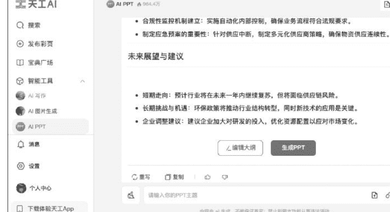

图 2-26 生成的 PPT 大纲

如果生成的 PPT 大纲不符合预期，可以单击【编辑大纲】按钮，在打开的【编辑大纲】对话框中进行编辑即可，如图 2-27 所示。编辑完成后，单击【保存大纲】按钮即可。

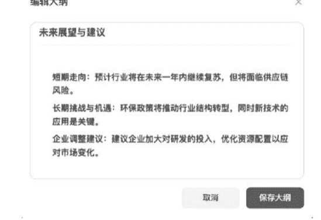

图 2-27 【编辑大纲】对话框

##### 3. 选择模板并生成 PPT

如果 PPT 大纲符合预期，直接单击【生成 PPT】按钮，打开【选择模板】对话框，如图 2-28 所示，在对话框中挑选一个喜欢的模板，然后单击【生成 PPT】按钮，开始生成 PPT，其间还可以看到 PPT 生成过程。

可以看到天工 AI 的 AI PPT 生成的 PPT 内容和排版还是非常不错的，内容和原文很契合，如图 2-29 所示。

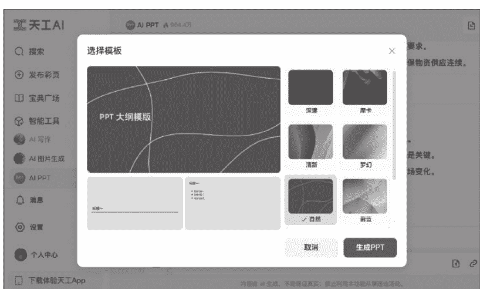

图 2-28 【选择模板】对话框

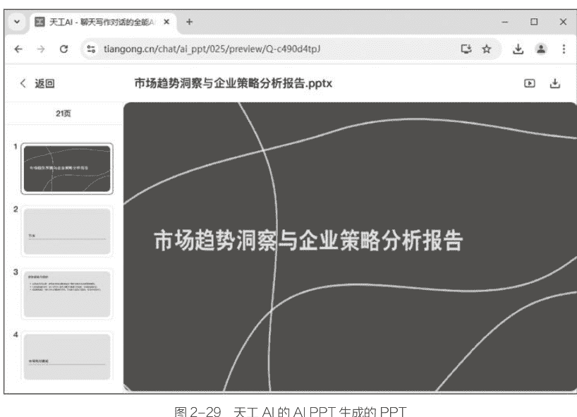

图 2-29 天工 AI 的 AI PPT 生成的 PPT

在生成的 PPT 演示页面中，单击【导出】按钮，然后在打开的【导出为】对话框中选择【PPTX】，即可将生成的 PPT 导出到本地计算机。

##### 4. 使用 WPS 将 PPT 输出为单张图片

使用 WPS 打开生成的 PPT，在 WPS 中选择【输出为图片】命令，打开【批量输出为图片】对话框，输出方式选择【逐页输出】，其他选项保持默认，如图 2-30 所示。单击【开始输出】按钮，将 PPT 输出为单张图片，作为小红书帖子的图片素材。

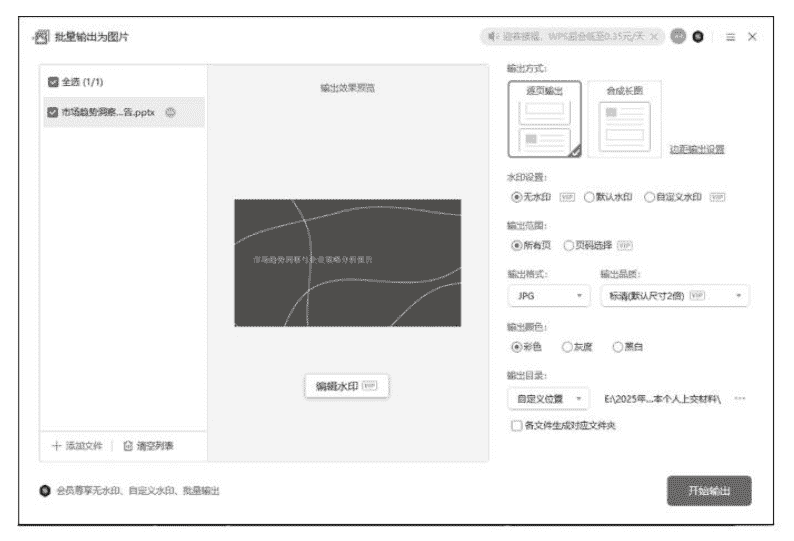

图 2-30 【批量输出为图片】对话框

##### 5. 创作小红书文案

利用 AI 文档分析，上传文件和输入提示词，将指定文件转化为小红书文案。
在天工 AI 的【AI 文档 - 音视频分析】页面选择【文档分析】，如图 2-31 所示。

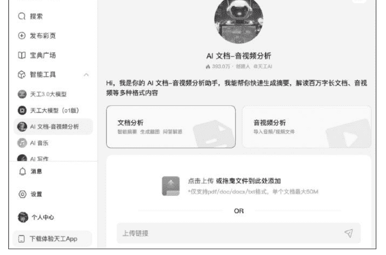

图 2-31 在【AI 文档 - 音视频分析】页面选择【文档分析】

先上传指定文件，这里选择“快速生成 PPT 的 4 款国产 AI 工具.docx”进行上传，天工 AI 的 AI 文档分析自动对上传的文档进行分析，如图 2-32 所示。

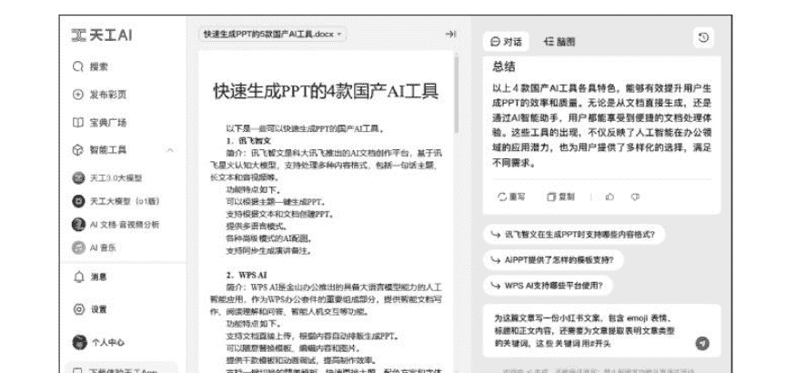

在输入框中输入以下提示词。

提示词：为这篇文章写一份小红书文案，包含 emoji 表情、标题和正文内容，还需要为文章提取表明文章类型的关键词，这些关键词用 # 开头。

生成结果：

> 4 款国产 AI 工具，让 PPT 制作轻松搞定！
> 大家好！今天给大家推荐 4 款超实用的国产 AI 工具，助你快速生成 PPT，轻松完成 PPT 制作！
> （1）讯飞智文：只需一句话描述主题，轻松一键生成 PPT，支持多种内容格式，简直是懒人必备！
> （2）WPS AI：直接上传文档，自动排版生成 PPT，千款模板随意替换，提升制作效率！
> （3）AiPPT：智能一键生成，内置上千套定制模板，让你的 PPT 与众不同！
> （4）腾讯文档：通过 AI 新建演示文档，智能助手随时帮你生成 PPT，超方便！
> 这些工具不仅提高了我们的工作效率，还让 PPT 制作变得更加有趣！快来试试吧！
> 关键词如下。
> #PPT制作 #国产AI工具 #办公软件 #智能助手 #文档生成 #效率提升 #演示文稿

此外，AI 文档分析还能自动生成小红书话题标签，帮助节省选择话题标签的时间。用户也可以向 AI 文档分析提出优化要求。

至此，即轻松创作出一份小红书文案。

##### 6. 制作小红书帖子专属封面

人们通常将 PPT 首张幻灯片作为小红书帖子的封面，以保持整体风格的一致。

当然，也可以利用天工 AI 的 AI 图片生成制作一张封面。操作过程简单，只需要将小红书文案复制并粘贴到 AI 图片生成中即可。

此外，还可以试试改图、扩图，进行图片微调（App 端支持该功能），也可以通过微调提示词优化结果或者参考页面右侧提供的“模板大全”中的提示词，非常方便。

##### 7. 制作小红书帖子专属 BGM

如果觉得图文有些单调，也可以使用 AI 音乐，为小红书帖子制作一首专属背景音乐（BackGround Music，BGM），只需两个步骤即可。

（1）生成歌名和歌词：使用天工 3.0 对话助手，基于小红书文案生成歌名和歌词。

（2）生成音乐：使用 AI 音乐生成音乐，只需要将步骤（1）生成的歌名和歌词添加到页面中，并选择参考音乐即可。
生成完成后，可以自行下载和使用该音乐。

### 【任务 2-11】探析 AI 搜索与对话工具和 AI 文本生成工具使用多种提问方式的效果

探析 AI 搜索与对话工具和 AI 文本生成工具使用多种提问方式的效果。

- ① 在纳米 AI 搜索中使用开放式提问方式。
- ② 在海螺 AI 中使用明确性提问方式。
- ③ 在知乎直答中使用引导式提问方式。
- ④ 在 DeepSeek 中使用反馈式提问方式。

#### 任务实施

我们在与 AI 语言模型进行互动时，使用不同的提问方式将直接影响回答的质量。

##### 1. 在纳米 AI 搜索中使用开放式提问方式

开放式提问方式是一种促进深入探讨和详尽回答的互动方式。该方式采用开放式问题，鼓励纳米 AI 搜索提供全面的分析、见解和多种可能的解决方案，帮助用户从不同角度理解问题，获取更丰富的信息和知识，适用于探索新领域、激发创意和促进对话。
提示词如下。
我正在探索人工智能在教育领域的应用。人工智能如何改变未来的教育模式？你能讨论一下它可能带来的创新和挑战吗？
这样的提问是开放式的，因为它不寻求一个具体的答案，而是邀请纳米 AI 搜索探讨一个广泛的话题，包括可能带来的创新和挑战。这样的提问鼓励纳米 AI 搜索提供更广泛、更深入的分析和见解。
☆ 请读者自行在纳米 AI 搜索中生成对应的结果。

##### 2. 在海螺 AI 中使用明确性提问方式

确保提出的问题具体、明确，避免模糊不清，以便海螺 AI 能够提供准确的答案。
提示词如下。
我正在撰写毕业论文，论文主题为“人工智能在教学效果评价中的应用”。考虑到教学效果评价可通过分析学生课堂状态实现，而面部表情是反映学生课堂状态的重要指标且深度学习技术在图像识别领域具有显著优势，因此希望获取最近五年内关于使用深度学习技术进行面部表情图像识别的研究论文，以支撑论文中相关部分的撰写。
这样的提问是明确的，因为它包含具体的研究主题、技术应用领域、时间范围和研究类型。这样的提问让海螺 AI 可以更精确地搜索和提供相关信息。
明确性提问方式意味着提出具体且信息量充足的问题，这有助于海螺 AI 提供精确、有针对性的答案。这种方式要求用户明确表达自己的需求，如需要查询特定方面的内容，从而使海螺 AI 能够直接聚焦于问题的核心，避免歧义。
☆ 请读者自行在海螺 AI 中生成对应的结果。

##### 3. 在知乎直答中使用引导式提问方式

通过提问引导 AI 语言模型提供特定的信息或建议，如“在撰写文献综述时，应该注意哪些要点？”

提示词如下。

我正在研究深度学习在图像识别中的应用。在撰写我的论文时，我需要了解当前最流行的深度学习架构。你能列出一些当前在图像识别领域中广泛使用的深度学习架构，并简要介绍它们的主要特点和优势吗？

这样的提问是引导式的，因为它明确指出了用户需要的信息类型（当前最流行的深度学习架构），并请求知乎直答提供具体的列表和简要介绍。这样的提问有助于知乎直答提供更加有目的性和针对性的回答。

引导式提问方式是一种策略性提问方式，它通过明确的问题设定来引导知乎直答提供特定方向或主题的信息。这种方式要求用户提出具有明确目的的问题，以便知乎直答能够根据用户的指示提供相关的答案，这有助于用户获得更加精确和有用的回答，促进了有效沟通和信息的深入交流。

☆ 请读者自行在知乎直答中生成对应的结果。

##### 4. 在 DeepSeek 中使用反馈式提问方式

在得到 DeepSeek 的回答后，通过进一步提问澄清或深入探讨，如“关于这一点，你能提供更多细节吗？”

提示词如下。

卷积神经网络在图像识别中非常有用，你能否提供一些具体的例子，说明卷积神经网络是如何在处理高分辨率医学图像时提取特征的？

在这个提示词中，用户首先对 DeepSeek 之前提供的信息进行了确认和反馈，然后提出了一个更深入的问题，要求 DeepSeek 提供更具体的信息。反馈式提问方式是一种互动性提问方式，它基于 DeepSeek 之前的回答或提供的信息，鼓励用户提供反馈、澄清或进一步探讨特定主题。通过反馈式提问方式，用户可以深化对话内容，获得更详细的解释或额外的信息。这种方式有助于建立内容更丰富的对话，确保用户得到全面且满足其需求的答案。

☆ 请读者自行在 DeepSeek 中生成对应的结果。

通过运用以上 4 种提问方式，用户可以更有效地与 AI 语言模型互动，从而在论文写作过程中获得更加有价值的帮助和指导。


## 2.5 勤思精练

### 【任务 2-12】从形式和要求两个维度理解提示词

以下列举的关于提示词的各项说法中，在你认为恰当的说法前的“□”中打“√”。

#### 提示词的定义与要求

提示词可以是一个指令、一个问题、一段文字描述、一段对话或其他任何形式的文本输入。提示词是指对向模型提出的问题进行描述和约束的文本片段，可以包括问题的主题、范围和关键词等信息。提示词不仅仅是简单的输入文本，它还承载着用户的意图、期望及对输出的具体要求。提示词是一种“输入方式”，通常为一段文本或信息，用于指导AI模型生成所需的输出，类似于向搜索引擎提出问题或给出相关指令以获取所需的响应或结果。

（2）要求

- 一个有效的提示词能明确传达用户的需求，使得模型生成的内容更符合预期。
- 提示词的质量和明确性直接影响模型理解和生成内容的质量和准确性。
- 提示词设计得越清晰、具体，模型生成的结果通常越准确，相关性越高。
- 通过精准地运用提示词，用户可以引导AI系统生成符合自己预期的、高质量的内容。

### 【任务2-13】探析提示词的作用

以下列举的关于提示词作用的各项说法中，在你认为恰当的说法前的“□”中打“√”。

- 在人工智能领域，精确的提示词不仅是优化生成任务的关键，更是决定输出质量的核心。一组精心设计的提示词能够显著提升AI模型对任务的理解深度，从而推动高质量内容的生成。
- 提示词作为生成式AI模型的指令语言，正逐步成为连接人类创意与AI的重要桥梁。通过精准地运用这些提示词，我们可以引导生成式AI模型生成高质量、多样化的内容。
- 提示词是AI创作的指导方针，它告诉AI系统要生成的内容类型、风格和细节。一个精心设计的提示词可以极大地影响AI模型的创作质量和方向。
- AI模型彻底改变了内容创作的方式，但输出的质量取决于提示词的质量。设计良好的提示词可以引导AI模型生成引人入胜、相关且切中要点的内容，而设计不当的提示词则会导致输出内容平淡乏味，与用户期望相差甚远。
- AI模型并不像人类那样拥有自主的意识和生活经验，它依赖于提示词提供的上下文信息。这意味着，提示词越清晰、越具体，AI模型越能理解用户的意图。
- 未来，随着AI技术的不断发展和完善，提示词的应用范围也将越来越大，从而为人们带来更多的创作可能性和惊喜。

### 【任务2-14】优选AI工具回答指定问题

选择熟悉的AI工具，回答提示词对应的问题。

- 文心一言
- 豆包
- Kimi
- 讯飞星火
- 通义千问
- 智谱清言
- 天工AI
- 腾讯元宝
- 海螺AI
- 纳米AI搜索

提示词1：提示词长度对生成结果有何影响？
提示词2：如何针对不同模型优化提示词？

### 【任务2-15】优选AI工具撰写小红书文案

选择熟悉的AI工具，撰写小红书文案。

□文心一言 □豆包 □Kimi □讯飞星火 □通义千问
□智谱清言 □天工AI □腾讯元宝 □海螺AI □纳米AI搜索

一篇小红书文案主要包括3个部分。

（1）开头：痛点引入 + 情景描述 + 人设 + 方法介绍 + 点赞。
（2）中间：讲重点，范围控制在1～5个重点。如果有5个重点，讲其中2个。如果有3个重点，讲其中1个。有重点的文案，效果会更好。
（3）结尾：提高关注度，欢迎用户进入主页查看更多精彩内容（目的是引导用户看下一篇帖子，如果想看更多帖子需要进入主页）。给文案设置热门标签（自己选择热度高的标签）。

提示词：你是一个乐观、阳光的小红书好物推荐博主，擅长使用“颜文字”和“emoji”优化用户的内容文章的阅读体验，请你按照上面的小红书文案结构（包含开头、中间、结尾3个部分），撰写主题为“健身吃什么”的小红书文案。

# 模块3 AIGC优质完成文字处理与论文写作

随着人工智能技术的飞速发展，AIGC在文字处理与论文写作领域取得了显著进展。AIGC作为新兴内容生产模式，改变了传统文字创作模式。从辅助写作到独立生成复杂文本，AIGC文字处理与论文写作技术正逐渐渗透到新闻、文学、教育、商业等众多领域，引发了人们的广泛关注和深入研究。

## 3.1 先睹为快

### 【案例3-1】使用文心一言写一篇科普短文

#### 案例描述

AI工具选择：☑文心一言 ☐豆包 ☐Kimi ☐通义千问 ☐讯飞星火。
提示词：请写一篇300字左右的关于介绍通用人工智能的科普短文。

#### 案例展示

生成结果：

> 通用人工智能（Artificial General Intelligence，AGI）是指一种具有与人类智能相似的能力的人工智能系统，它能够理解、学习并执行各种复杂的任务，而不仅仅局限于特定领域或功能。AGI具备高度的自适应性和灵活性，可以处理未知的问题和挑战，通过不断学习和进化适应不断变化的环境。
与专用的人工智能系统相比，AGI的智能水平更接近人类，它不仅能够执行特定的任务，还能够进行跨领域的思考和推理。这种智能系统可以理解复杂的语言、进行抽象思考、解决新的问题，并在不同情境下做出合理的决策。
AGI的实现是人工智能领域的终极目标之一，它将极大地改变人类的生活和工作方式，为生产和生活带来前所未有的便利和创新。然而，AGI的研发也面临着诸多技术和伦理挑战，需要科研人员不断探索并为之努力。

### 【案例3-2】使用豆包对比提示词优化前后的差异，并测试生成效果是否提升

#### 案例描述

AI工具选择：☑豆包 □文心一言 □Kimi □通义千问 □讯飞星火。
提示词优化技巧如下。
① 明确目的有助于产生有重点和有强相关性的内容。
② 具体且详细的指令会带来质量更高和更吸引人的输出。
③ 结构化格式可增强可读性和理解性。
④ 提供上下文可以使内容更具有相关性和有用性。
⑤ 清晰、精确的语言可以确保结果的一致性和准确性。
⑥ 明确提示词的重点可以提高内容的有效性。
参考以上提示词优化技巧撰写提示词，然后通过案例对比提示词优化前后的差异并测试生成效果是否提升。

#### 案例展示

##### 1. 案例1：写一篇介绍科技如何改变我们的生活的文章

（1）初始提示词
你能否写一篇非常详细的文章，介绍科技如何改变我们的生活，尤其要关注智能手机和笔记本计算机如何在我们的工作和学习环境中影响沟通。同时，还要涵盖它们如何改变我们的社交方式、如何帮助我们提升效率、教育系统如何发展。此外，别忘记提到科技可能带来的负面影响，比如人们可能会沉迷于这些设备或因过度依赖而产生一些隐患。如果可以，最好用一些统计数据来佐证观点。

（2）优化提示词
写一篇关于智能手机和笔记本计算机如何在我们的工作和学习环境中影响沟通的文章。重点讨论这些设备对社会交往、工作效率和教育的影响。此外，还要提到人们可能因为过度使用这些设备而产生的依赖问题或其他潜在风险。

我们来比较一下以上两个提示词，分析它们如何影响AI工具生成内容的质量。
初始提示词：这个提示词虽然内容丰富，但问题在于它涉及的信息点过多，缺乏重点，容易让AI工具迷失方向。生成的内容可能显得杂乱无章、没有逻辑。
优化提示词：通过聚焦核心主题和重点，指令变得清晰，AI工具更容易生成一篇条理清晰、信息集中、易于阅读的文章。
对比差异：主要的差异在于，简单明了、重点突出的提示词往往能带来更好、更相关的内容。
通过减少不必要的细节并提供清晰的指示，AI工具可以生成更高质量的回复。在给AI语言模型输入指令时，使用清晰、有条理的提示词，可以有效提高生成内容的质量，让输出更连贯、更相关。

##### 2. 案例2：写一篇介绍阅读实体书和电子书如何影响认知发展的文章

（1）初始提示词
请非常全面地分析阅读图书（包含实体书和电子书）是如何影响认知发展的，包括所有可能受到影响的领域，如词汇扩展、批判性思维能力、专注力、移情能力、创造力，以及你能想到的其他任何领域，还要考虑小说、非小说、自传等不同类型的图书在这一发展过程中的作用，如果可能，请添加一些例子和研究结果来支持这些观点。

（2）优化提示词
写一篇介绍阅读实体书和电子书如何影响认知发展的文章，讨论词汇扩展、批判性思维、专注力、同理心和创造力，包括小说、非小说和自传等不同类型的图书的作用。

我们来比较以上两个提示词，分析它们如何影响AI工具生成内容的质量。
初始提示词：这个提示词的问题在于它包含的信息过多且要求非常细致，这种复杂性容易让AI工具难以聚焦重点，生成的文章可能显得零散、条理不清晰。
优化提示词：优化提示词更清晰、更聚焦重点。通过明确指出重点，AI工具能够更高效地理解要求，并围绕核心主题生成内容。
对比差异：这个案例说明，清晰、明确的指令不仅能让AI工具更容易理解要求，也能帮助它生成条理清晰、内容相关的回答。
读者还可以自行在豆包中输入初始提示词和优化提示词，观察输出结果的质量和符合度，对比不同提示词的有效性。

## 3.2 释疑解惑

### 【问题3-1】常用的国产AI文本生成工具有哪些？

目前，常用的国产AI文本生成工具如表3-1所示。

表3-1 常用的国产AI文本生成工具
| 序号 | 名称 | 说明 |
|---|---|---|
| 1 | 文心一言 | 百度推出的AI工具，擅长综合型内容生成，可用于文档分析、图像分析等 |
| 2 | 豆包 | 综合型AI工具，专注于内容生成 |
| 3 | DeepSeek | 深度求索推出的AI工具，基于大模型技术，支持多语言翻译、智能写作、智能问答等功能，为用户提供便捷、高效的AI服务 |
| 4 | Kimi | 综合型AI工具，提供内容生成、文档分析和互联网搜索服务 |
| 5 | 讯飞星火 | 科大讯飞推出的AI工具，提供多模态理解、视觉问答、多模态生成等功能 |
| 6 | 通义千问 | 阿里巴巴推出的综合型AI工具，专注于内容生成和文档分析 |
| 7 | 智谱清言 | 提供多模态理解、角色扮演、知识服务等功能 |
| 8 | 天工AI | 天工AI以其创新的功能和优质的服务获得了用户的喜爱，它支持搜索、写作、文档分析、多模态生成等人工智能服务 |
| 9 | 腾讯元宝 | 腾讯推出的AI工具，具有内容生成、文档分析和灵感推荐等功能 |
| 10 | 海螺AI | MiniMax平台发布的一款多功能AI对话工具，是一个基于自研大模型为用户打造的AI助手 |
| 11 | 360智脑 | 拥有千亿级参数量的大模型，涵盖内容生成与创作、阅读理解、多轮对话等十大功能 |

### 【问题3-2】常用的国产AI写作工具有哪些？

目前，常用的国产AI写作工具如表3-2所示，这些工具是用户进行文学创作的得力伙伴。

表3-2 常用的国产AI写作工具
| 序号 | 名称 | 说明 |
| :--- | :--- | :--- |
| 1 | Effidit | 腾讯出品的AI写作助手，提供多种实用功能，如智能纠错、文本润色、文本补全、文本改写、文本扩写、词语推荐、句子推荐与生成等功能，可提高中英文写作效率 |
| 2 | 深言达意 | 专注于帮助用户根据模糊描述找到合适的词语和句子，提升写作的精确度 |
| 3 | 笔灵AI | 提供AI文案撰写、AI文档续写和AI助手服务，适用于多种工作场景，帮助用户轻松完成写作任务 |
| 4 | 讯飞写作 | 提供在线AI写作服务，以及热门模板和素材，帮助用户快速生成各类文案 |
| 5 | 阿里妈妈·创意中心 | 基于人工智能技术的文案生成工具，能够快速生成适用于电商场景的各类文案，包括商品描述、广告语、标题等 |
| 6 | 火山写作 | 提供全文润色的AI写作服务，帮助用户提升写作质量 |
| 7 | 秘塔写作猫 | 结合AI写作、多人协作、文本校对、改写润色和自动配图等功能，提供一站式内容创作平台 |
| 8 | 光速写作 | 提供全文生成、大纲生成、文章改写、文章续写、文章扩写和AI问答等功能 |
| 9 | 易撰 | 提供写作辅助或内容创作服务 |
| 10 | WriteWise | 专业的写作工具，集成AI写作大模型，具备灵感提供、人设设定、对白设计等功能 |

### 【问题3-3】AI文本生成工具在各领域的主要应用有哪些？

AI文本生成工具在各领域的应用日益广泛，它们通过智能化、自动化的方式，显著提升了相关人员的工作效率，降低了人力成本，并在多个领域展现出了巨大的潜力。随着技术的不断进步和应用场景的不断拓展，AI文本生成工具将在未来发挥更加重要的作用，为各行各业带来更多的便利和创新。

#### 1. 在媒体与出版领域的主要应用

在媒体与出版领域，AI文本生成工具的应用主要体现在以下几个方面。

- ① 新闻稿撰写与编辑。AI文本生成工具能够根据用户输入的关键词或主题自动生成新闻稿，包括文章、报道等。同时，AI文本生成工具还能对已有新闻稿进行摘要生成、内容提炼等编辑操作，提高新闻内容的生产效率和质量。
- ② 图书内容创作与校对。AI文本生成工具可用于辅助图书内容创作，如自动生成章节概述、故事情节等。此外，AI文本生成工具还能对图书内容进行校对，如检查语法错误、拼写错误等，确保内容的准确性和规范性。

#### 2. 在广告与营销领域的主要应用

在广告与营销领域，AI文本生成工具的应用极大地提升了广告文案的创作效率和个性化程度。

- ① 广告文案生成。AI文本生成工具能够根据品牌调性、目标受众特征等因素，自动生成符合要求的广告文案。这些文案不仅具有创意，还能有效吸引目标受众的注意。
- ② 个性化推荐。AI文本生成工具能够分析用户的浏览历史、购买记录等数据，为用户推荐个性化广告内容，提高广告的点击率和转化率。

#### 3. 在法律与金融领域的主要应用

在法律与金融领域，AI文本生成工具的主要应用体现在合同模板生成、法律文书起草与审核、金融报告撰写等方面。

- ① 合同模板生成。AI文本生成工具能够根据不同类型的合同需求，自动生成符合法律规范的合同模板，减少人工起草合同的时间和成本。
- ② 法律文书起草与审核。AI文本生成工具能够辅助律师起草法律文书，如起诉书、答辩状等。同时，AI文本生成工具还能对法律文书进行智能审核，检查法律条款的准确性、完整性等。
- ③ 金融报告撰写。AI文本生成工具能够根据金融数据自动撰写财务报表、投资分析报告等金融报告，为金融机构提供决策支持。

#### 4. 在教育与科研领域的主要应用

在教育与科研领域，AI文本生成工具的应用也逐渐增多，主要体现在以下方面。

- ① 论文撰写与校对。AI文本生成工具能够辅助学者和学生撰写论文，提供论文摘要、引言、结论等部分的自动生成功能。同时，AI文本生成工具还能对论文进行智能校对，如检查语法错误、引用格式错误等问题。
- ② 学术资源检索。AI文本生成工具能够分析用户的学术需求，从海量学术资源中检索出相关的文献等，为用户提供便捷的学术支持。

#### 5. 在客户服务领域的主要应用

在客户服务领域，AI文本生成工具通过智能聊天机器人、自动回复系统等形式，为用户提供便捷、高效的咨询服务。

- ① 智能客服。AI文本生成工具能够模拟人类客服的对话方式，与用户进行自然语言交互，解答用户的问题，提供产品咨询、售后服务等支持。
- ② 情感分析。AI文本生成工具还能对用户的反馈进行情感分析，了解用户对产品或服务的满意度和意见，为企业改进产品或服务提供参考。

综上所述，AI文本生成工具在媒体与出版领域、广告与营销领域、法律与金融领域、教育与科研领域，以及客户服务领域等多个领域都展现出了广阔的应用前景和巨大的潜力。

### 【问题3-4】AI文本生成工具的主要作用有哪些？

在数字化时代的浪潮中，AI正以不可阻挡之势渗透到社会经济的各个领域。其中，AI文本生成工具作为AI大模型的重要组成部分，正以其独特的优势深刻改变着人们的工作方式与行业生态。AI文本生成工具的主要作用如下。

#### 1. 实现高效性与自动化

AI文本生成工具能够迅速处理大量数据，自动完成文本生成、编辑、校对等工作，极大地提高了相关人员的工作效率。无论是新闻稿的撰写、产品描述的生成，还是法律文书的起草，AI文本生成工具都能在极短时间内高质量完成，减轻了人力负担，让从业者有更多时间专注于创意和策略层面的工作。

#### 2. 实现个性化与定制化

AI文本生成工具能够根据用户的需求和偏好，生成符合特定风格、语气和语境的文本内容。这种个性化与定制化的能力，使得AI文本生成工具在广告与营销、客户服务等领域大放异彩，能够根据不同目标受众的特点，制定更具吸引力的沟通策略。

#### 3. 实现智能性与策略化

AI文本生成工具还能对已有文本进行深度分析，识别出关键词、主题、情感倾向等关键信息，为内容的优化提供数据支持。这种智能分析能力有助于企业更好地了解市场动态、用户反馈，从而调整策略、优化产品，提升市场竞争力。

#### 4. 提供多语言支持

随着全球化的推进，多语言沟通成为企业拓展国际市场的必备技能。AI文本生成工具凭借其强大的语言处理能力，支持多语言翻译、校对和本地化服务，消除了语言障碍，促进了全球信息的自由流通。

### 【问题3-5】对AI文本生成工具生成的文本内容有哪些优化技巧？

对AI文本生成工具生成的文本内容做出进一步优化的具体技巧及提示词示例如下。

#### 1. 调整语气和语调

提示词：文章的语气和语调可能需要调整，以更好地适应目标读者和传达所需的情感。请考虑将语气和语调调整成何种形式，如正式、亲切、严肃或幽默，从而与读者建立更好的连接。

#### 2. 提供解决方案

提示词：如果文章提出了问题或挑战，请考虑在文章中提供解决方案，其中包括实用的建议、步骤或策略，以帮助读者解决问题或应对挑战。

#### 3. 增加更多的论据

提示词：文章需要更多的论据来提高观点的可信度，请增加更多的论据，如相关的事实、数据、研究结果等，以支持提出的观点。

#### 4. 改善段落的开头

提示词：段落的开头需要更具吸引力和引导性，以吸引读者继续阅读，请尝试使用引人入胜的句子、问题、引用或引入关键观点的陈述来开启段落。

#### 5. 改善段落结构逻辑

提示词：一些段落缺少连贯性和逻辑连接关系，请改善段落结构逻辑，如添加“此外”“不过”“然而”等词语，以梳理文章中的逻辑关系并使段落结构更加连贯。

#### 6. 替换文章中的过时用法或短语

提示词：避免使用过时用法或短语，请使用更流行的用法或短语。

#### 7. 更换文章中的垃圾词语

提示词：文章中应使用比较正式和专业的词语，避免使用口语化或者过于随意的词语。

#### 8. 避免使用过于书面或不自然的表达方式

提示词：避免使用过于书面或不自然的表达方式。

#### 9. 提升段落流畅度

提示词：段落之间的跳跃让文章阅读起来有颠簸感，请改善文章段落之间的过渡，增加或修改用于衔接段落的词语、句子，提升段落流畅度。

#### 10. 纠正拼写错误和语法错误

提示词：文章中有一些显而易见的拼写错误和语法错误，通过仔细检查每个字词，找到并纠正这些常见的拼写错误和语法错误。

#### 11. 引入反驳观点

提示词：文章中缺乏反驳观点，请引入反驳观点，实现辩证思考和全面分析。

#### 12. 使用更简明扼要的总结

提示词：文章的总结部分过于冗长，请更加简明扼要地对文章进行总结，使读者能够更好地理解和回顾内容。

#### 13. 创造更生动的描写

提示词：文章中部分描写有待改进，请修改相应描写，使其更具形象感和生动性，能够帮助读者更好地理解内容和展开想象。

#### 14. 优化段落长度

提示词：文章中的某些段落过长或过短，请优化段落长度，使其更加平衡和易读。

#### 15. 使用一致的风格和用词

提示词：文章各部分的风格和用词的一致性不强，请修改相应内容以确保文章在风格和用词上的一致性足够强，提高整体质量。

#### 16. 简化句子结构

提示词：文章中某些句子的结构过于复杂，请简化句子结构，以提高文章的可读性，使其更易被读者理解和消化。

#### 17. 提高文字表达的准确性和生动性

提示词：文章中某些文字表达不够准确或生动，请修改相应内容以提高文字表达的准确性和生动性，使文章更具吸引力和说服力。

#### 18. 削减冗长的句子

提示词：文章中某些句子过于冗长，请削减冗长的句子，使其更加简洁明了，提高文章的可读性。

#### 19. 修饰形容词和副词

提示词：文章中某些形容词和副词的使用较为宽泛，可以通过添加具体的描述词语或者使用更精确的词语增强形容词和副词的表达力。

#### 20. 增加引用和案例

提示词：文章中缺乏足够的引用和案例，请增加一些相关引用和案例，以提高文章的可信度和论证力。

#### 21. 增加用于对比的元素

提示词：文章中可以增加用于对比的元素，通过列举对比得到的差异，提升文章的逻辑性和说服力，加深和提高读者对观点的理解和接受度。

#### 22. 重新组织句子结构

提示词：文章中某些句子的结构可能比较复杂或混乱，请重新组织句子结构，将长句分割，通过调整语序提高句子的可读性，使其更加清晰和流畅。

#### 23. 强调关键观点

提示词：文章中的关键观点可能没有得到足够的强调，请使用适当的强调手段，如重复、加粗或使用引用来强调关键观点，使其更加明确和突出。

## 3.3 精彩纷呈

### 【任务 3-1】使用深言达意实现据意查词与句子查找

- （1）使用深言达意的“据意查词”功能查找“昨夜下了雨”对应的词语，例如，“暴雨”“大雨如注”“骤雨”。
- （2）了解“据意查词”的筛选功能。
- （3）查找“与美好不期而遇”对应句子。

#### 任务实施

##### 1. 据意查词

“据意查词”的使用方法很简单，只需要提供提示词，就可以得到一系列结果。

① 提供提示词。“据意查词”的页面非常简约，使用时只需要在页面上方的输入框中输入提示词，这里输入“昨夜下了雨”，然后单击【查找】按钮即可。

② 得到结果。可以看到出现了非常多的查找结果，“昨夜下了雨”对应的词语如图 3-1 所示。

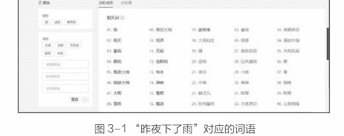

##### 2. 筛选

“据意查词”提供了非常不错的筛选功能，能够让用户更好地找到合适的结果，比如可以按照以下方式进行筛选。

- ① 类别：词、成语、惯用语。
- ② 词性：名词、动词、形容词、副词等，还可以按字数、拼音和字符筛选。

“据意查词”的各个筛选选项如图 3-2 所示。

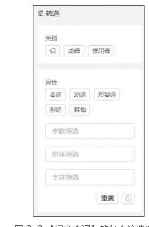

##### 3. 查找句子

深言达意不仅可以查找词语，还可以查找句子，切换到【找句】选项卡，如图 3-3 所示。

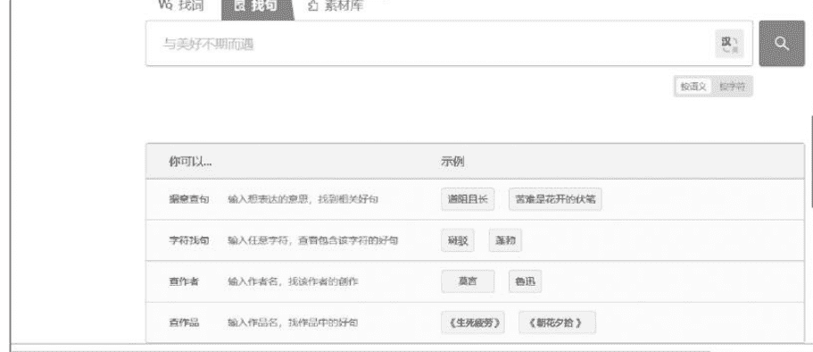

在输入框中输入“与美好不期而遇”，然后单击【查找】按钮🔍即可。查找结果如图 3-4 所示。

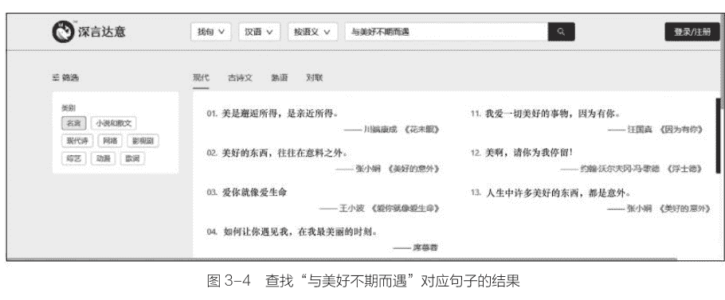

并且对于查找结果，也可以自定义筛选类别，不同类型的结果有不同筛选类别，具体如下。

- ① 现代：名言、小说和散文、现代诗、网络、影视剧、综艺、动漫、歌词等。
- ② 古诗文：诗、词、曲、文言文等。
- ③ 熟语：谚语、惯用语、歇后语等。
- ④ 对联。

### 【任务 3-2】使用文心一言撰写主题文章，并对比不同提示词的生成效果

AI 工具选择：☑文心一言 □豆包 □Kimi □通义千问 □讯飞星火。

操作要求：使用文心一言分步撰写以“青少年经常锻炼的好处”为主题的文章，并对比不同提示词的生成效果。

#### 任务实施

##### 1. 第 1 步：明确目标

提示词 1：写一篇关于青少年经常锻炼的好处的文章。

在提示词中清楚地说明要实现什么目的和最终的输出方向，这有助于 AI 工具了解用户想要达到什么效果，以生成更贴近指定目的和受众需求，主题明确且不偏题的内容。

扫描二维码，打开电子活页 3-1，在线浏览“文心一言撰写的主题文章”，也可以自行在文心一言中生成类似的结果。

AI 工具生成了一篇聚焦于青少年经常锻炼的好处的文章，内容可能涵盖健康改善、心理调节及增强社交能力等方面。


##### 2. 第 2 步：要求具体

提示词 2：撰写一篇导向正确且引人入胜的文章，介绍青少年经常锻炼的好处；文章主要提及身体、心理和社交方面的好处且使用对话的语气。

要求提供细节，如语气、风格、结构和要涵盖的要点等细节，这样可以帮助 AI 工具更好地理解用户的期望，减少不必要的猜测。

☆ 请读者自行在文心一言中生成与提示词 2 对应的结果。

生成的文章将以轻松的语气展开讲述，既有趣又实用，重点讲述青少年经常锻炼对身体健康、心理状态和社交互动的积极影响。AI 工具生成的内容不仅符合要求，还具有吸引力和针对性，便于读者理解。

##### 3. 第 3 步：使用结构化格式

提示词 3 如下。

写一篇关于青少年经常锻炼的好处的文章，具体要素及要求如下。

- 标题：青少年经常锻炼的好处。
- 介绍：简要概述。
- 身体方面的好处：增强体质、控制体重。
- 心理方面的好处：缓解压力、改善情绪。
- 社交方面的好处：团队运动、结交朋友。
- 总结：总结和鼓励青少年经常锻炼。

这里的提示词使用了具体要素及要求的形式来组织用户的提示内容，这样能让人工智能按照逻辑顺序处理信息，生成条理更清晰的结果。

> ☆ 请读者自行在文心一言中生成与提示词 3 对应的结果。

AI 工具会根据这种清晰的结构生成一篇逻辑清晰的文章。这种结构的每一部分都有明确的重点，这样不仅方便 AI 理解和组织内容，也能让读者更容易掌握青少年经常锻炼的具体好处。

##### 4. 第 4 步：提供相关背景

提示词 4：为父母撰写一篇文章，介绍如何鼓励青少年养成锻炼习惯，语气轻松、亲切，同时提供一些实际建议。

这里的提示词提供了必要的背景信息，背景信息可以是文章的受众、写作目的或要强调的重点。相关背景可以帮助人工智能更好地把握主题，从而生成更贴近用户需求的回复。

> ☆ 请读者自行在文心一言中生成与提示词 4 对应的结果。

AI 工具结合背景生成符合目标读者需求的内容，如通过亲子活动鼓励青少年锻炼，并以通俗易懂的语言讲解相关知识，让文章更有针对性和实用性。

##### 5. 第 5 步：避免含糊不清

提示词 5：写一篇风格亲切、幽默的文章，介绍经常锻炼的好处，要适合青少年阅读，请包含身体、心理和社交方面的好处。

这里的提示词使用清晰、直白的语言，避免让人工智能猜测用户的意思。如果提示词中含有模糊或多义的表述，AI 工具可能会产生误解，导致输出结果不准确、不连贯。

> ☆ 请读者自行在文心一言中生成与提示词 5 对应的结果。

清晰的提示词通过确保用户的指示易于理解且不留任何产生误解的余地，引导 AI 工具生成一篇符合用户需求的高质量文章。

##### 6. 第 6 步：突出重点

提示词 6：写一篇关于青少年经常锻炼的好处的文章，要求只讨论青少年经常锻炼的好处，不包括成年人锻炼的信息。

有助于 AI 工具生成更好的结果。此外，还可避免引入无关细节，因为这些内容会分散 AI 工具的注意力，导致生成的结果不够集中或偏离主题。

☆ 请读者自行在文心一言中生成与提示词 6 对应的结果。

AI 工具专注于生成关于青少年经常锻炼的好处的内容，而不会引入无关的成年人锻炼相关信息。这种突出重点的方式可以确保输出的内容与目标受众（青少年及相关群体）更加贴合，信息更有价值、更吸引人。

### 【任务 3-3】通过提示词示例解释与理解常用的提示词撰写技巧

下面对以下常用的提示词撰写技巧进行适度解释，并通过提示词示例加深理解。

- 简洁明确。
- 考虑受众。
- 格式化提示词。
- 明确角色。
- 遵守规则。
- 自然语言回答。
- 答案无偏见。
- 互动提问。
- 接续文本。

#### 任务实施

##### 1. 简洁明确

与 AI 语言模型交互时，直接、清晰地提出问题，有助于模型迅速、准确地给出答案。

提示词示例：请告诉我，如何制作简易的太阳能热水器。

##### 2. 考虑受众

最好在提示词中明确指出预期的受众类型，如老人或儿童。

提示词示例：针对一个 6 岁儿童，讲解如何从长沙黄花国际机场乘坐飞机前往北京大兴国际机场。

##### 3. 格式化提示词

为了提升大模型处理复杂任务时的准确性和效率，可以使用高度结构化的指令格式。通过精心设计的分隔符，例如，#Instruction（指令）#、#Example（示例）#、#Question（问题）#，可以清晰地划分出指令、示例、问题等关键部分，使模型更容易理解和执行相关操作。

提示词示例如下。

```
#Instruction#: 请将以下描述转化为一个简洁的新闻标题。
#Example#: 如果描述是“科学家发现了一个新的恐龙物种”，那么新闻标题可以是“新恐龙物种被发现”。
#Question#: 2024 年 7 月 23 日，考古学家在埃及发现了一座古代王室的墓葬 墓中包含丰富的壁画和其他珍贵的文物。
```

##### 4. 明确角色

在提示词中为 AI 语言模型分配一个明确的角色或任务。

提示词示例：你是一位历史老师，任务是向学生讲述第一次工业革命的重要性，请使用生动的语言和历史事实，让学生感受到那个时代的变革。

##### 5. 遵守规则

明确指出 AI 语言模型必须遵守的规则或关键词。

提示词示例：你是一位健康顾问，任务是提供关于健康饮食的建议，如果你的建议中包含高糖或高脂肪的食物，你将失去信誉。

##### 6. 自然语言回答

要求 AI 语言模型以自然、类似人类的方式回答问题。

提示词示例：写一篇关于如何在家中种植蔬菜的指南，以亲切、友好的口吻进行指导。

##### 7. 答案无偏见

确保 AI 语言模型提供的答案无偏见，避免依赖刻板印象。

提示词示例：探讨不同文化中庆祝新年的方式，确保你的回答客观公正，不带有文化偏见。

##### 8. 互动提问

允许 AI 语言模型通过提问获取必要的信息。

提示词示例：从现在开始，问我问题（如我对减少塑料使用的看法是怎样的），直到你有足够的信息写一篇关于“我如何看待环保”的文章。

##### 9. 接续文本

使用特定的词语、短语或句子来接续文本。

提示词示例如下。

在一个遥远的星球上，居住着一群名为“神奇”的生物，它们拥有翠绿色的皮肤和闪烁着光芒的眼睛。他们生活在一个由巨大水晶构成的森林中，这个水晶能够吸收星球上空的日光，并将其转化为温暖而柔和的光芒，照亮整个星球。

“神奇”与自然界其他物种和谐共存，他们的房屋建造在高大的树木之间，与周围的环境融为一体。他们使用一种特殊的语言进行交流，这种语言听起来就像风中飘荡的美妙旋律。

请接续这个故事，保持原有的奇幻和冒险氛围。

### 【任务 3-4】根据创新性提示词通用模板撰写提示词，并使用豆包生成文本内容

AI 语言模型中常用的创新性提示词通用模板的类型、结构与内容如下。

- ① 故事创作模板。
提示词通用模板：在一个由 [ 某种特殊环境或条件 ] 构成的世界里，[ 一个具有某种特质或身份的角色 ] 必须 [ 面对一个挑战或困境 ] 以 [ 达到一个目标或解决一个问题 ] 请创作一个故事。
- ② 产品创意模板。
提示词通用模板：想象一种能够 [ 解决某个问题或满足某种需求 ] 的 [ 产品类型 ]，它具有一种独特的功能或特性，请详细描述这个产品的设计和使用场景。
- ③ 未来预测模板。
提示词通用模板: 假设现在是 [ 未来的某个时间点 ]，[ 某种技术突破或社会变革 ] 已经发生，请描述 [ 某个领域或日常生活 ] 会是什么样子的。
- ④ 艺术创作模板。
提示词通用模板: 创作一个 [ 艺术形式，如诗歌、绘画、音乐 ] 作品，它能够 [ 表达某种情感或主题 ]，并融入了 [ 某种文化或历史元素 ]。
- ⑤ 商业模式创新模板。
提示词通用模板: 设计一种基于 [ 某种新兴技术或趋势 ] 的商业模式，它能够 [ 提供某种独特的价值或服务 ]，并针对 [ 特定的市场或客户群体 ]。
- ⑥ 角色设计模板。
提示词通用模板: 创造一个具有 [ 某种特殊能力或背景 ] 的角色，他在一个 [ 特定的环境或时代 ] 中，必须 [ 克服某个障碍或实现某个目标 ]，请描述这个角色的性格、外貌和故事。
- ⑦ 学习体验设计模板。
提示词通用模板: 设计一个旨在教授 [ 某个知识点或技能 ] 的创新学习体验，它通过 [ 某种互动或游戏化元素 ] 来提高学习者的参与度和效果。
- ⑧ 广告创意模板。
提示词通用模板: 为一个 [ 特定的产品或服务 ] 设计一个广告，它通过 [ 某种创意方式或故事情节 ] 来吸引 [ 特定的目标受众 ]，并传达 [ 一个核心理念或品牌价值 ]。
- ⑨ 科学探索模板。
提示词通用模板: 如果我们可以 [ 进行某种科学实验或探索 ]，它可能会揭示 [ 某种科学原理或自然现象 ]，请描述这个实验的过程和可能的结果。
- ⑩ 社会变革模板。
提示词通用模板: 设想一种社会变革，它彻底改变了我们对待 [ 某个社会问题或现象 ] 的方式，请详细描述这种变革的过程和影响。

参考这些模板，并根据具体情况填充细节、调整结构，或结合多个模板，撰写丰富和个性化的提示词。

将撰写的各个提示词分别在豆包中输入以生成相应的文本内容。

#### 任务实施

##### 1. 故事创作模板

提示词: 在一个由魔法与科技交织构成的世界里，一位年轻的魔法师必须面对一股古老邪恶势力的复苏，以拯救被黑暗笼罩的王国，请创作一个故事。

生成结果:

> 年轻的魔法师艾莉娅生活在一个魔法与科技并存的奇妙世界里。一天，她得知一股古老的邪恶势力正在复苏，威胁着整个王国的安宁。为了拯救王国，艾莉娅踏上了冒险之旅，她需要运用自己的魔法智慧，同时借助科技的力量，对抗这个强大的敌人。在旅途中，她遇到了各种挑战和困境，但她始终坚持不懈，最终成功地击败了邪恶势力，恢复了王国的和平。

##### 2. 产品创意模板

提示词：想象一个能够自动调整家居环境以适应居住者情绪的智能家居系统，它具有情绪识别功能，请详细描述该产品的设计和使用场景。

生成结果：

> 这个智能家居系统名为“情绪智家”。它内置了先进的情绪识别技术，能够通过分析居住者的面部表情、语音语调和生理指标来识别他们的情绪状态。然后，系统会自动调整家居环境，如灯光亮度、音乐类型、室内温度等，以适应居住者的情绪。例如，当居住者感到疲惫时，系统会调暗灯光，播放轻柔的音乐，并调整室内温度到最舒适的范围。这样的设计旨在为居住者提供更加贴心、舒适的家居体验。

##### 3. 未来预测模板

提示词：假设现在是 2050 年，人工智能普及各个领域的社会变革已经发生，请描述教育领域会是什么样子的。

生成结果：

> 在 2050 年，人工智能已经深深融入教育领域。学生不再需要传统的教室和黑板，而是可以通过虚拟现实技术身临其境般地参与到课堂学习中。人工智能教师能够根据每个学生的学习进度和兴趣定制个性化的教学计划，并提供即时的反馈和指导。同时，人工智能教师还可以辅助学生完成作业、为学生答疑解惑等，极大地提高了教育效率和质量。

##### 4. 艺术创作模板

提示词：创作一个诗歌作品，它能够表达对自然的赞叹之情，并融入中国古代的山水画元素。

生成结果：

> 山水之韵
山水相依画中游，
云雾缭绕似仙洲。
峰峦叠嶂连天起，
溪流潺潺绕石流。
松柏苍翠迎风立，
花鸟欢歌乐悠悠。
自然之美无限好，
心怀敬畏情难收。

##### 5. 商业模式创新模板

提示词：设计一种基于区块链技术的商业模式，它能够提供安全、可靠的数字身份认证服务，并针对在线金融交易市场。

生成结果：

> 我们提出了一种基于区块链技术的数字身份认证商业模式。该模式利用区块链的不可篡改性和去中心化特点，为在线金融交易市场的用户提供安全、可靠的数字身份认证服务。用户可以通过该模式创建自己的数字身份，并在进行在线金融交易时使用该身份进行认证。这样，不仅可以有效防止身份盗用和欺诈行为，还可以提高交易效率和安全性。该商业模式将针对在线金融交易市场，为广大用户提供更加便捷、安全的金融服务。

##### 6. 角色设计模板

提示词：创造一个具有超能力的角色，他在一个科技高度发达的未来时代中，必须阻止一场全球性科技危机，请描述这个角色的性格、外貌和故事。

生成结果：

> **角色名：**科技守护者雷欧。
> **性格：**雷欧性格坚韧不拔，充满正义感。他对敌人冷酷无情，但对待朋友和无辜者充满同情和关爱。他善于思考和分析问题，总能在关键时刻找到解决问题的办法。
> **外貌：**雷欧身材高大健硕，穿着一套科技感十足的战斗服。他的眼睛闪烁着智慧的光芒，头发是银色的，显得非常酷炫。他的手上戴着一双能够发射能量束的手套，这是他的超能力的主要来源。
> **故事：**在科技高度发达的未来时代，一场全球性科技危机正在悄然逼近。一股邪恶势力企图利用科技手段控制整个世界，雷欧作为科技守护者挺身而出。他运用自己的超能力和智慧，与邪恶势力展开了激烈的战斗。在经历了一系列艰难险阻后，雷欧终于成功地阻止了科技危机的爆发，战胜了邪恶势力，保护了世界的和平与安宁。

##### 7. 学习体验设计模板

提示词：设计一种旨在教授编程知识的创新学习体验，它通过游戏化元素提高学习者的参与度和效果。

生成结果：

> 我们设计了一种名为“编程冒险岛”的创新学习体验。该体验将编程知识融入一个充满趣味和挑战的游戏。学习者将扮演一名勇敢的冒险家，在编程冒险岛上探索未知的领域，解决各种编程难题。游戏中设置了不同的关卡和挑战任务，每个任务都涉及特定的编程知识。学习者需要通过编写代码控制角色完成任务，并在这个过程中不断学习和掌握新的编程知识。这样的设计旨在提高学习者的参与度和学习效果，让他们在游戏中轻松、愉快地掌握编程知识。

##### 8. 广告创意模板

提示词：为一个智能手环设计一个广告，它通过展示智能手环的多种功能来吸引年轻消费者，并传达健康生活的核心理念。

生成结果：

> **智能手环，让你的生活更健康！**
> 第一个画面是一个年轻人佩戴着智能手环晨跑。手环的屏幕上显示着他的心率、步数和消耗的能量等运动数据。接着，画面切换到办公室场景，这个人正在工作，手环提醒他该起身活动一下了。然后，画面又切换到晚上，这个人佩戴着手环入睡，手环监测着他的睡眠质量。最后，画面中出现智能手环的多种功能介绍和购买信息，同时传达出健康生活的核心理念：让智能手环成为你健康生活的得力助手！

##### 9. 科学探索模板

提示词：如果我们可以进行时间旅行实验，它可能会揭示时间流动的本质和原理，请描述这个实验的过程和可能的结果。

生成结果：

> **实验名称：**时间旅行实验。
> **实验过程：**首先，我们需要建造一台时间旅行装置，该装置能够产生强大的时空扭曲力场，使物体能够在时间轴上移动。然后，我们选择一名勇敢的志愿者作为实验对象，让他穿上特制的防护服进入时间旅行装置。在装置启动后，志愿者将被送到过去或未来的某个时间点。在实验过程中，我们将通过远程监控系统实时监测志愿者的状态和周围环境的变化，并记录相关数据。
> 可能的结果：如果实验成功，我们将能够揭示时间流动的本质和原理。我们可能会发现时间并不是一条直线，而是一个复杂的多维空间结构。我们还可能会观察到过去和现在的事件对未来产生的影响，以及时间旅行给志愿者本身及其周围环境带来的潜在风险。这些发现将为我们更深入地理解宇宙和时间提供宝贵的线索。

##### 10. 社会变革模板

提示词：设想一种社会变革，它彻底改变了我们对待教育资源分配的方式，请详细描述这种变革的过程和影响。

生成结果：

> **社会变革名称：** 教育资源公平分配变革。
> **社会变革过程：** 首先，政府将出台一系列政策和法规，确保教育资源的公平分配。这些政策和法规将包括加大对贫困地区和弱势群体的教育投入、优化教育资源配置、推动教育信息化建设等措施。然后，政府将建立一套完善的教育资源分配机制，通过市场竞争和公开透明的方式，将教育资源分配给最需要的地区和群体。同时，政府还将加强对教育资源的监管和评估，确保资源的有效利用和质量提升。
> **社会变革影响：** 这种社会变革将彻底改变我们对待教育资源分配的方式。它将使更多的人能够享受到优质的教育资源，提高整个社会的教育水平和人员素质。它将促进教育公平和社会公正，缩小贫富差距和减少社会不公现象。同时，它还将推动教育创新和信息化建设，为教育的未来发展奠定坚实的基础。

### 【任务 3-5】应用创造性策略优化提示词，并在多个 AI 语言模型中进行体验

创造性往往来自跳出传统思维框架和尝试新的视角。以下内容为撰写提示词的创造性策略，用户使用这些创造性策略，可以设计出更具创造性的提示词，从而引导 AI 语言模型产生更有创意和想象力的输出。

- 使用开放式问题。
- 结合不同领域。
- 使用比喻和隐喻。
- 设置特定情境。
- 挑战传统观念。
- 使用情感和个性。
- 设置必要限制条件。
- 探索假设情景。

进一步解读以上这些创造性策略，应用创造性策略优化已有的提示词，然后分别在文心一言、豆包、DeepSeek、Kimi、通义千问这些 AI 语言模型中输入优化后的提示词，并认真分析生成结果，思考哪些提示词更具创造性。


#### 1. 使用开放式问题

开放式问题往往能够激发更多的想象力和生成更具创造性的答案，有效的提示词应清晰、具体，同时留有足够的想象空间。

提示词 1：解释量子物理学的基本原理。

#### 2. 结合不同领域

尝试将不同领域或看似不相关的事物结合起来，以产生新颖的想法。
提示词 1：设计一个未来的交通工具。
提示词 2：想象一个结合了古代马车和现代磁悬浮技术的未来交通工具。

#### 3. 使用比喻或隐喻

使用比喻或隐喻能够帮助 AI 语言模型理解更深层次的意义，并可能使用生成更有创造性的输出。
提示词 1：描述一下人工智能的发展。
提示词 2：如果人工智能是一棵树，它的根、枝和叶分别代表什么？

#### 4. 设置特定情境

为 AI 语言模型设置一个特定的情境或背景，可以使其生成更有创造性的输出。
提示词 1：写一首关于海洋的诗。
提示词 2：假设你是深海中一艘沉船的船长，写一首关于你与海洋共存的诗。

#### 5. 挑战传统观念

鼓励 AI 语言模型摒弃常规思维，挑战传统观念，以产生独特和创新的想法。
提示词 1：讨论教育系统的未来。
提示词 2：假设传统教育系统不再完全适用，设想一个全新的教育系统。

#### 6. 使用情感和个性

在提示词中加入情感和个性，可以使输出更加生动和有创意。
提示词 1：描述一下你理想中的假期。
提示词 2：作为一个热爱探险的旅行者，描绘一次穿越未知世界的奇幻假期。

#### 7. 设置必要限制条件

有时候，通过设置一些限制条件，可以激发创造性思维。
提示词 1：设计一个新产品。
提示词 2：设计一个可以在没有电力的情况下使用的智能家居产品。

#### 8. 探索假设情景

探索假设性的“如果”情景，可以引导 AI 语言模型产生富有创意的答案。
提示词 1：讨论气候变化的影响。
提示词 2：如果地球的温度突然下降了 10 ℃，世界将会发生什么变化？

#### 说明

提示词 1 为待优化的提示词，提示词 2 为应用创造性策略优化后的提示词。

## 3.4 熟能生巧

### 【任务 3-6】撰写武汉一日游攻略

从以下多种 AI 工具中选择一种合适的工具：☑文心一言 ☐豆包 ☐Kimi ☐讯飞星火 ☐通义千问。

参考以下洛阳两日游攻略的小红书文案，撰写武汉一日游攻略。

> 洛阳两日游，带你开启千年古都穿越之旅！
> 📅 第一天：古韵悠悠，文化之旅
> 🍜 早上：从一碗热腾腾的洛阳牛肉汤开始，唤醒你的味蕾和灵魂。
> 🏛️ 上午：漫步在龙门石窟，感受千年的石刻艺术，仿佛能听到历史的回声。
> 🍲 中午：在老城区品尝地道的洛阳水席，每一道菜都是一段故事。
> 🙏 下午：探访白马寺，感受佛教文化的庄严与宁静。
> 🌙 晚上：在丽景门下，体验洛阳夜市的热闹非凡，品尝各种小吃。
> 📅 第二天：山水之间，自然之旅
> ⛰️ 早上：前往老君山，登高望远，呼吸清新空气，俯瞰洛阳城的壮丽景色。
> 🍵 中午：在山脚下的茶馆，品一杯香茗，享受片刻的宁静。
> 🏞️ 下午：前往龙潭大峡谷，感受大自然的鬼斧神工，拍照留念。
> 🌙 晚上：回到市区，逛逛洛阳的夜市，品尝当地的特色小吃，结束完美的一天。
> 📷 别忘了带上你的相机，记录下每一个难忘的瞬间。📸
> 🚀 快来洛阳，体验一场穿越时空的旅行吧！🌟
> 💬 你最喜欢洛阳的哪个景点？评论区见！👇
> #洛阳旅游 #古都之旅 #两天攻略

#### 任务实施

文心一言中的生成结果如下：

> 武汉一日游，解锁江城的热情与风情之旅！
> 📅 一日游：历史、美食与现代的完美融合
> 🍜 早上：从一碗热腾腾的热干面开始，感受芝麻酱的醇厚与面条的劲道，唤醒你的江城之旅。
> 🏛️ 上午：漫步黄鹤楼，登高望远，俯瞰长江与武汉三镇的壮丽景色，感受“天下江山第一楼”的雄浑。
> 🍲 中午：户部巷小吃街不可错过，豆皮、热干面、面窝……地道武汉小吃让你大饱口福。
> 🏛️ 下午：探访湖北省博物馆，观赏曾侯乙编钟，领略楚文化的博大精深，感受历史的厚重。
> 🌅 傍晚：漫步武汉长江大桥，欣赏两岸风光，感受江城独有的江景魅力，夕阳下的长江更显壮阔。
> 🌙 晚上：在吉庆街夜市体验武汉的夜生活，烧烤、小龙虾、鸭脖……琳琅满目的美食，让你流连忘返。
> 📷 记得带上相机，记录下每一个让你心动的瞬间，无论是美食的诱惑，还是江城的风景。📸
> 🚀 快来武汉，一日之内，体验历史、美食与现代的完美融合吧！🌟
> 💬 你最爱武汉的哪一处风景或哪一种美食？评论区告诉我！👇
> #武汉旅游 #江城风情 #一日游攻略

### 【任务 3-7】撰写招聘时的职位描述

无论是刚刚加入招聘队伍的新手，还是处于求职过程中的求职者，经常会遇到一个专有名词——JD。那么，招聘中常说的 JD 是什么意思呢？

就像大多数单词缩写一样，JD 是两个英文单词的首字母组合，这两个英文单词是 Job 和 Description，Job Description，通常可以翻译成职位描述。职位描述其实相当于一个面向求职者的职位说明书。

要在各大招聘网站和 App 上把职位发布出来，吸引目标求职者投递简历，就必须清楚地说明这个职位平时主要负责哪些具体工作，具备什么条件的求职者才有可能成功应聘这个职位，等等。

根据上述功能和需求，各大招聘网站和 App 通常把职位描述分成两大部分，具体如下。
第一部分是职位的主要职责。
第二部分是职位的任职要求，包括学历、职业证书、要掌握的工具和技能，以及各类综合素质及过往的职业背景等。

从以下多种 AI 工具中选择一种合适的工具：☑文心一言 ☐豆包 ☐Kimi ☐讯飞星火 ☐通义千问。

参考以下用户界面（User Interface，UI）设计师的职位描述内容，从职位基础信息、主要职责、任职要求等方面，撰写工程师的职位描述。

+   （1）职位名称：UI 设计师
（2）部门名称：设计部
（3）直接上级：设计总监
（4）工作地点：北京市朝阳区
（5）工作时间：周一至周五，9:00 ～ 18:00
（6）主要工作任务
① 负责产品界面的设计工作，包括但不限于网页端或移动端应用等。
② 参与产品讨论，理解产品需求，提供创新的设计解决方案。
③ 与开发团队紧密合作，确保设计在技术上的可行性和具体实现。
④ 根据用户反馈和测试结果，不断优化和改进界面设计。
⑤ 跟踪最新的设计趋势，将创新设计元素融入产品。
（7）所需技能和资格
① 艺术设计、视觉传达等相关专业本科及以上学历。
② 至少 1 年的 UI 设计工作经验，有成功的设计案例。
（8）其他要求
语言要求：中文流利，具有良好英文读写能力者优先考虑。
（9）附加技能
掌握 HTML/CSS/JavaScript 等前端技术者优先考虑。

#### 任务实施

扫描二维码，打开电子活页 3-2，在线浏览“在豆包中撰写招聘时的职位描述”，也可以自行在豆包中生成类似的结果。


### 【任务 3-8】使用 Kimi 定制轻松、愉悦的旅行方案

以下旅行方案专为郑州及其周边城市的团建活动定制，旨在让每位参与者都能体验到独特的旅行乐趣。参考以下旅行方案，使用 Kimi 定制一个清晰明了、贴合实际、安排合理的优秀教育工作者休闲旅游方案，时间为夏季的某个周六、周日 2 天，地点为湖南省张家界市，费用预算为每人 1000 元以内。

第 1 天
（1）集合与出发
上午 8:00 从郑州出发前往登封，预计车程 1h。
（2）少林寺
上午 9:30 抵达少林寺，进行 1.5h 的参观，感受中国功夫的博大精深。
交通：包车前往。
门票：每人 100 元。
（3）午餐
11:00 在少林寺附近享用河南特色午餐，预算为每人 50 元。
（4）嵩山
下午 1:00 开始徒步嵩山，预计 3h。装备：请自备徒步装备。
（5）晚餐
下午 4:30 前往登封市区享用晚餐，预算为每人 60 元。
（6）返回郑州
晚上 6:30 出发返回郑州，预计 8:00 抵达。
（7）住宿
预算为每人 300 元，建议选择郑州的商务型酒店。

第 2 天
（1）黄河风景名胜区
上午 8:00 从郑州出发前往黄河风景名胜区，预计车程 1h。
上午 9:00 抵达，进行 2h 的游览。
（2）午餐
11:00 在黄河风景名胜区附近享用午餐，预算为每人 50 元。
（3）郑州黄河国家地质公园
下午 1:00 开始参观，预计 2h。
（4）结业仪式
下午 3:00 举行团建结业仪式，颁发纪念品。
（5）返回
下午 4:30 结束团建活动，返回郑州。
当地美食推荐：河南烩面、胡辣汤、油茶、灌汤包。

#### 任务实施

扫描二维码，打开电子活页 3-3，在线浏览“Kimi 定制的旅行方案”，也可以自行在 Kimi 中生成类似的结果。


### 【任务 3-9】使用文心一言撰写一份文小言使用教程的技术文档

使用文心一言撰写一份文小言使用教程的技术文档，要求包括主要功能、界面组成、常用功能的使用方法，并给出具体实例进行说明。

#### 任务实施

实现提示词：请你撰写一份文小言使用教程的技术文档，要求包括主要功能、界面组成、常用功能的使用方法，并给出具体实例进行说明。
☆ 请读者自行在文心一言中生成对应的结果。

### 【任务 3-10】使用文心一言和豆包补全一段话

写好一段话之后，用户可以选中这段话，让 AI 语言模型帮忙丰富内容（或精简内容）、修改标点符号、翻译、续写、改变口吻、整理选取内容等，这将大大地提高用户的写作效率。对以下这段话进行补全。

> **自省**
> 我在张昊老师身上学到的第一个本领是“自省”。我和他是在线上课中认识的，他当时是线上课班主任，我是他的学生。他当时经常在我们的班级群内发他的每日自省，刚开始我还在想，这样每天发这种自省有用吗？但通过不断地找他私聊，我也不管他烦不烦我，反正我就是要聊，跟他聊多了，我就被他感染了，我也开始自省了。通过自省，我发现我找到了方向；通过自省，我发现我凌乱的思绪逐渐被梳理清晰。自省让我感到宁静，让我知道了很多事情没有捷径可走，唯有躬身入局，让我知道了所有的事情不只有一个答案……

#### 任务实施

文心一言的生成结果如下：

> **自省**
> 我在张昊老师身上学到的第一个本领是“自省”。我和他是在线上课中认识的，他当时是线上课的班主任，而我是他的学生。他当时经常在我们的班级群内发他的每日自省，刚开始我还在想，这样每天发这种自省有用吗？会不会只是一种形式主义的自我安慰？但随着时间的推移，我逐渐被他的坚持打动。
> 我不断地找他私聊，聊多了，我就被他那种自省的精神感染了。我开始尝试着自省，每天花一点时间回顾自己的言行，思考哪些地方做得好、哪些地方还有不足。
> 通过自省，我发现我找到了方向。我不再像之前那样对未来感到无所适从，而是开始有了明确的目标和计划。同时，我也发现我凌乱的思绪变得不再凌乱，思维变得更加清晰和有条理。
> 自省让我感到宁静，让我学会了在喧嚣的世界中找到一片属于自己的宁静之地。它让我明白了很多事情没有捷径可走，唯有躬身入局，脚踏实地地去努力、去实践，才能取得真正的进步。同时，它也让我知道了所有的问题不只有一个答案，从不同的角度去思考、去探索，往往会有意想不到的收获。
> 如今，自省已经成为我生活中不可或缺的一部分。我感谢张昊老师的引导，更感谢自己当初的那份坚持和勇气，让我走上了这条自我成长的道路。

豆包的生成结果如下：

> **自省**
> 在学习的漫漫征途中，我有幸结识了张昊老师，从他身上学到的第一个本领便是“自省”。我与张昊老师的缘分始于线上课，彼时他担任线上课班主任，而我则是他众多学生中的一员。在班级群里，他常常分享自己的每日自省感悟，起初，我心里满是疑惑，暗自思忖：每日发布这些自省内容，真的能带来实质性的改变吗？
> 带着这份好奇与疑问，我开始频繁地与他私聊。也顾不上是否会打扰到他，我一心只想探寻其中的奥秘。随着交流的深入，我逐渐被他对自我反省的执着所感染，也开始踏上了自省之路。
> 通过自省，我惊喜地发现，曾经那颗在迷雾中徘徊、迷茫的心，终于找到了前行的方向。就像在杂乱无章的迷宫中，突然寻得了出口。曾经凌乱如麻的思绪，也逐渐变得清晰、有序。自省，宛如一泓清泉，流淌在心田，让我在纷扰的世界中寻得内心的宁静。
> 它更让我深刻领悟到，人生路上，完成诸多事情没有捷径可走，唯有脚踏实地、躬身入局，方能有所收获并逐渐成长。曾经，我总是幻想能找到快速达成目的的窍门，却在一次次的碰壁中陷入迷茫。通过自省，我明白了所有的事情并非只有一个答案，换一个角度思考，往往能收获不一样的风景。比如在解决一道难题时，曾经的我只执着于常规解法，屡屡碰壁，而当我静下心自省，尝试从不同思路出发时，竟发现了多种巧妙的解题方法。这种思维的转变，不仅让我在学业上有所突破，更让我在面对生活中的种种挑战时，多了一份从容与自信。

### 【任务 3-11】使用通义千问创建小红书爆款写手的角色与指令

使用通义千问完成以下创建任务。
（1）不使用模板，自由创建小红书爆款写手的角色与指令。
（2）扫描二维码，打开电子活页 3-4，在线浏览“较为完善的角色与指令模板”，然后基于该模板创建小红书爆款写手的角色与指令。


#### 任务实施

##### 1. 不使用模板，自由创建小红书爆款写手的角色与指令

提示词 1：帮我创建一个小红书爆款写手的角色与指令。
☆ 请读者自行在通义千问中生成与提示词 1 对应的结果。

##### 2. 基于较为完善的角色与指令模板创建小红书爆款写手的角色与指令

提示词 2：请参考较为完善的角色与指令模板，创建小红书爆款写手的角色与指令。
☆ 请读者自行在通义千问中生成与提示词 2 对应的结果。

### 【任务 3-12】使用 Kimi 为新款环保水杯撰写营销文案并进行润色处理

在 Kimi 中完成以下操作。
（1）撰写一篇针对都市年轻白领的新款环保水杯营销文案，要求突出其可重复使用和采用无毒材料的特点，强调环保意识和生活品质的提升。
（2）借助 Kimi 对生成的新款环保水杯营销文案提出具体润色要求。
（3）对 Kimi 生成的新款环保水杯营销文案进行润色。

#### 任务实施

##### 1. 撰写一篇针对都市年轻白领的新款环保水杯营销文案

提示词 1：撰写一篇针对都市年轻白领的新款环保水杯营销文案 突出其可重复使用和采用无毒材料的特点，强调环保意识和生活品质的提升。
扫描二维码，打开电子活页 3-5，在线浏览“使用 Kimi 撰写的新款环保水杯营销文案”，也可以自行在 Kimi 中生成类似的结果。


##### 2. 借助 Kimi 对生成的新款环保水杯营销文案提出具体润色要求

提示词 2：请你对生成的新款环保水杯营销文案提出具体润色要求。
Kimi 生成的润色要求如下：

+   - 调整节奏：改变句子的长度和复杂度，创造动态阅读体验，特别是在叙述故事时。
- 深化主题：深入探讨核心主题的各个方面，增加文本深度。
- 优化开头：使用引人入胜的引言或故事，激发读者兴趣，为读者阅读全文奠定基础。
- 引入历史背景：提供更全面的视角，特别是在讨论社会现象时。
- 增加幽默感：适当的幽默感可以缓解紧张气氛，提高阅读兴趣，特别是在讨论严肃话题时。
+   - 增加引用：引用经典文献或权威观点，增强文本的权威性和说服力。
- 明确论点：确保每个论点都有充分的论据支持，避免模糊不清的陈述。
- 使用引语：无论是引用权威人士的话还是相关研究，使用引语可以增强观点的可信度和权威性。
- 引入专家观点：通过引用专家的研究或评论来增强观点的说服力，特别是在专业领域中。
- 使用故事框架：通过设置背景、冲突、解决和结局来构建故事，特别是在品牌故事中。
- 强化结尾：使用有力的结论或号召性用语来结束文章，确保结尾能够留给读者深刻印象。
- 增加数据支持：使用统计数据或研究结果来支持你的观点，增强论点的说服力。
- 引入案例研究：通过分析具体案例来展示核心主题的实际应用。
- 引入悬念：通过提出问题或设置未解之谜来激发读者的好奇心。
- 优化布局：使用合适的分栏、边距和字体大小来提高可读性和美观性。

##### 3. 对 Kimi 生成的新款环保水杯营销文案进行润色

提示词 3：请你根据前面总结的润色要求，对生成的新款环保水杯营销文案进行润色。
Kimi 生成的结果如下：

> 欢迎来到环保新时代！我们最新推出的环保水杯不仅外观时尚，更结合了可重复使用和采用无毒材料的优点，专门为现代都市年轻白领设计。提高生活品质，从一杯清新开始，让我们一起为保护地球环境贡献一份力量。
> 选择最新款环保水杯，选择健康生活方式！

### 【任务 3-13】借助 DeepSeek 探析如何快速掌握提示词的撰写方法

撰写提示词是一个动态的、循序渐进的、不断迭代优化的过程，每个人写出来的提示词都可以是不一样的，这就意味着 AI 语言模型生成的内容也会是不一样的。我们并不会一开始就将提示词撰写得很完美，而是需要反复多次地利用我们学到的提示词技巧和 AI 语言模型沟通，让它不断地生成趋向我们的需求的结果，我们在这个过程中需要具备一定的耐心。通过不断地调整和优化，输出的质量和相关性都会得到提高。
如果按照传统的方式学习提示词的撰写方法，需要收集各种信息，还要分析这些信息的时效性和价值性，这本身就是一件耗时、耗力的事情。我们可以借助 AI 语言模型，如 DeepSeek，快速学习提示词的撰写方法。
使用 DeepSeek 通过多轮对话探析以下问题或完成相关操作，可快速掌握提示词的撰写方法。

+   （1）如何学习提示词的撰写方法？
（2）学习提示词的撰写方法的第一步是什么？
（3）请扮演提示词专家，撰写一个详细的课程教学大纲，教一名初学者从零开始掌握提示词的撰写方法。
（4）根据这个课程教学大纲，我们开始模块 1 的教学工作。
（5）进一步说明“为什么说提示词是用户与 AI 之间的桥梁？”
（6）常见的提示词类型有哪些？
（7）根据这个课程教学大纲，我们开始模块 2 的教学工作。
（8）举一个实例详细说明多轮对话。
（9）撰写本课程在线学习推介词。
（10）撰写学习心得，包括取得的学习成果和有效的学习建议。

#### 任务实施

提示词 1：如何学习提示词的撰写方法？
扫描二维码，打开电子活页 3-6，在线浏览“如何学习提示词的撰写方法”。也可以自行在 DeepSeek 中生成类似的结果。


提示词 2：学习提示词的撰写方法的第一步是什么？
DeepSeek 生成的结果如下：

学习提示词撰写方法的第一步是理解提示词的基本概念和重要性。这是后续学习的基础，只有清楚地知道提示词是什么以及它如何影响 AI 的输出，才能更好地设计和优化提示词。
第一步：理解提示词的基本概念和作用是什么？

+   1. 什么是提示词
定义：提示词是输入 AI 的指令或问题，用于引导 AI 生成特定类型的输出。
作用：提示词决定了 AI 的回答方向、风格、深度和格式。
类比：可以把提示词想象成给 AI 的“任务说明书”，写得越清晰，AI 就会将任务完成得越符合期望。

+   2. 提示词的重要性
影响输出质量：提示词的设计直接影响 AI 生成内容的质量和相关性。
提高交互效率：优质的提示词可以减少反复调整的次数，更快得到理想结果。
解锁 AI 潜力：精心设计的提示词可以充分发挥 AI 的潜力，完成复杂任务。

如何开始实践？

+   1. 观察示例
阅读一些高质量的提示词示例，分析它们的结构和逻辑。
示例：“你是一位历史老师，请用简单、易懂的语言解释工业革命的影响。”

+   2. 简单尝试
从一个简单的任务开始，如让 AI 生成一段文字或回答一个问题。
示例：“写一段关于夏天的描述。”

+   3. 记录与反思
记录你设计的提示词和 AI 的输出，分析哪些地方可以改进。
示例：如果 AI 生成的描述太短，可以尝试增加提示词的细节，例如，“写一段长度在 100 字左右的关于夏天的描述，重点描写阳光和海滩”。

小练习

+   1. 任务 1
设计一个开放式提示词，让 AI 生成一段故事。
示例：“写一个关于一只猫的冒险故事”。

+   2. 任务 2
设计一个封闭式提示词，让 AI 列出具体信息。
示例：“列出 5 个关于健康饮食的建议”。

+   3. 任务 3
设计一个指令性提示词，让 AI 完成特定任务。
示例：“将以下英文句子翻译成中文，‘The quick brown fox jumps over the lazy dog.’”。

总结
学习提示词的撰写方法的第一步是理解其基本概念和重要性。通过观察示例、简单尝试和记录与反思，你可以逐步掌握提示词的撰写方法，为后续的深入学习打下坚实基础。接下来，你可以进一步学习如何优化提示词、设计用于完成复杂任务的提示词，以及在不同场景中应用提示词。

##### 提示词的撰写方法课程教学大纲

课程目标
帮助初学者从零开始掌握提示词的撰写方法，使其能够熟练运用提示词与 AI 模型（如 ChatGPT、Midjourney 等）高效交互，让 AI 模型生成符合预期的输出。

课程大纲

###### 模块 1：提示词基础入门
1. 什么是提示词
    - 提示词的定义与作用。
    - 提示词在 AI 交互中的重要性。
2. 提示词的类型
    - 开放式提示词或封闭式提示词。
    - 指令性提示词或引导式提示词。
3. 提示词撰写的基本原则
    - 明确目标。
    - 具体清晰。
    - 结构化输入。
    - 迭代优化。

###### 模块 2：提示词撰写的核心技巧
1. 角色设定
    - 如何为 AI 设定角色以优化输出。
    - 示例与练习。
2. 上下文提供
    - 如何通过上下文引导 AI 理解任务。
    - 示例与练习。
3. 约束条件设置
    - 如何通过约束条件控制输出范围。
    - 示例与练习。
4. 多轮对话
    - 如何通过多轮对话优化输出。
    - 示例与练习。

###### 模块 3：提示词撰写的实践与应用
1. 写作场景
    - 如何撰写提示词使 AI 生成文章、故事、文案等。
    - 示例与练习。
2. 编程场景
    - 如何撰写提示词使 AI 生成代码、调试程序。
    - 示例与练习。
3. 设计场景
    - 如何撰写提示词使 AI 生成图像、Logo 或进行 UI 设计。
    - 示例与练习。
4. 学习与研究场景
    - 如何撰写提示词使 AI 辅助学习、研究、数据分析。
    - 示例与练习。

###### 模块 4：高级提示词撰写技巧
1. 链式提示词
    - 如何将复杂任务分解为多个步骤。
    - 示例与练习。
2. 反向提示词
    - 如何通过否定或排除引导 AI 生成特定内容。
    - 示例与练习。
3. 多模态提示词
    - 如何结合文本、图像、代码等多种形式撰写提示词。
    - 示例与练习。

###### 模块 5：工具与资源
1. 提示词库与案例
    - 如何利用提示词库学习优秀案例。
    - 推荐资源：OpenAI 官方文档、PromptBase 等。
2. AI 工具
    - 如何使用 AI 工具优化提示词。
    - 示例与练习。
3. 社区与交流
    - 如何通过社区学习与分享提示词撰写经验。
    - 推荐平台：Reddit、Discord、知乎等。

###### 模块 6：提示词的优化与迭代
1. 测试与反馈
    - 如何通过测试与反馈优化提示词。
    - 示例与练习。
2. 分析输出
    - 如何根据 AI 输出调整提示词。
    - 示例与练习。
3. 常见错误及改进方法
    - 提示词撰写中的常见错误及改进方法。
    - 示例与练习。

###### 模块 7：提示词进阶学习
1. 领域专业化
    - 如何针对特定领域撰写专业提示词。
    - 示例与练习。
2. 多语言提示词
    - 如何用不同语言撰写提示词。
    - 示例与练习。
3. 跨模型适配
    - 如何根据不同 AI 模型调整提示词。
    - 示例与练习。

###### 模块 8：项目实战与总结
1. 综合项目
    - 设计一个完整的提示词项目（如撰写提示词使 AI 模型生成一篇高质量文章、开发一个小程序）。
    - 示例与练习。
2. 课程总结
    - 回顾课程内容，总结学习成果。
    - 进一步提供课程安排建议与学习资源。

课程安排建议
课时：共 16 课时，每课时 45min。
频率：每周 2 次，每次 2 课时。
学习方式：理论讲解 + 案例分析 + 实践练习 + 互动讨论。

学习资源
1. 文本推荐
    - OpenAI 官方文档。
2. 工具推荐
    - ChatGPT、Midjourney 等 AI 模型。
    - PromptBase、AI Prompt Generator 等提示词工具。
3. 社区与论坛
    - Reddit 的 r/PromptEngineering。
    - Discord 的 AI 提示词设计群组。

通过对本课程的学习，初学者将能够从零开始掌握提示词的撰写方法，熟练运用提示词与 AI 模型交互，让 AI 模型生成符合预期的输出，并为未来的进阶学习打下坚实基础。

提示词 4：根据这个课程教学大纲，我们开始模块 1 的教学工作。
☆ 请读者自行在 DeepSeek 中生成与提示词 4 对应的结果。
有了这个课程教学大纲之后，继续让 DeepSeek 延续刚才的角色开始模块 1 的教学工作，它开始在课程教学大纲里面填充内容，可以看到它填充的内容是先对提示词的概念进行解释，因为我们这里让它扮演的角色需要教初学者，给它的定位是教初学者这个指令，所以它不会介绍太复杂的知识内容。

提示词 5：进一步说明“为什么说提示词是用户与 AI 之间的桥梁？”
☆ 请读者自行在 DeepSeek 中生成与提示词 5 对应的结果。
根据 DeepSeek 提供的信息，如果你对某些信息不是很明白，可以让 DeepSeek 具体展开解释，这里可以理解为：DeepSeek 就是你的提示词老师，这个老师在向你授课，你在课程中遇到了问题，你向它提问，它为你答疑解惑。

提示词 6：常见的提示词类型有哪些？
☆ 请读者自行在 DeepSeek 中生成与提示词 6 对应的结果。

提示词 7：根据这个课程教学大纲，我们开始模块 2 的教学工作。
☆ 请读者自行在 DeepSeek 中生成与提示词 7 对应的结果。

提示词 8：举一个实例详细说明多轮对话。
☆ 请读者自行在 DeepSeek 中生成与提示词 8 对应的结果。

提示词 9：撰写本课程在线学习推介词。
☆ 请读者自行在 DeepSeek 中生成与提示词 9 对应的结果。

提示词 10：撰写学习心得，包括取得的学习成果和有效的学习建议。
☆ 请读者自行在 DeepSeek 中生成与提示词 10 对应的结果。

### 【任务 3-14】借助文心一言、豆包、DeepSeek 这 3 个 AI 工具根据材料和具体要求进行写作与润色

#### 任务实施

##### 1. 提示词设计

提示词如下。
假如你是一个写作高手，请阅读下面的材料，根据材料和具体要求进行写作。

随着互联网的普及和人工智能的应用，越来越多的问题被很快解决，那么，我们的问题是否会越来越少？以上说法引发了你怎样的联想和思考？
具体要求：选准角度，确定立意，明确文体，自拟标题不要套作，不得抄袭，不得泄露个人信息，不少于 800 字。

##### 2. 使用文心一言进行写作与润色

文心一言写作的文章如下：

> 问题未减，探索无限
在信息爆炸的今天，互联网如一张无形的网，将世界紧密地连接在一起。人工智能的迅猛发展，更让问题的解决变得前所未有的迅速与便捷。有人因此提出疑问：知识的获取变得如此容易，我们的问题是否会越来越少？然而，深入思考后不难发现，问题的数量并未因技术的进步而减少，反而，我们在探索的征途中，不断遇见新的未知事物，产生新的问题。
首先，必须明确的是，技术的进步并未使问题的数量减少，而是改变了我们发现问题和解决问题的方式。互联网为我们提供了海量的信息，人工智能则以其强大的数据处理能力，帮助我们快速筛选出可能的答案。然而，这并不意味着问题本身被“解决”了，而是表明我们获取答案的路径被缩短了。实际上，每一个被解决的问题背后，都可能隐藏着更多未被发掘的相关问题。就像剥洋葱一样，解决了一层问题，又会有新的一层问题等待我们探索。
其次，人类的好奇心和探索欲是无穷无尽的。随着我们对世界认知的深入，我们的视野也在不断扩大。曾经看似难以解决的问题，如今可能已成为科学研究的热点。而每一次技术的进步，都会带来新的问题。例如，人工智能的发展让我们得以解决许多复杂问题，但同时也引发了关于伦理、隐私、就业等方面的新问题。这些问题是我们技术进步之前未曾预料到的，也是我们需要面对的新挑战。
再次，问题的本质并非仅仅在于其数量，更在于其质量和深度。一个深刻的问题，可能引发一场思想的革命，推动科学的进步。而想要解决这样的问题，往往需要我们深入思考，勇于创新，而非仅仅依赖于技术的力量。因此，即使技术再先进，它也无法替代人类对深层次问题进行探索和思考。
最后，值得注意的是，技术的进步也为我们提供了更多解决问题的可能性。曾经难以解决的问题，如今可能因为有了新的技术手段而变得迎刃而解。但同时，这也要求我们不断学习新知识，掌握新技能，以适应不断变化的世界。在这个过程中，我们不仅会遇到新的问题，也会在不断解决问题的过程中，提升自己的能力。
综上所述，技术的进步并未使问题减少，反而为我们打开了带来更多未知的大门。在这个充满机遇和挑战的时代，我们应该保持好奇心和探索欲，勇于面对新问题，敢于挑战未知领域。只有这样，我们才能在不断解决问题的过程中，获得成长和进步。

从以下多个方面对文心一言写作的文章进行润色。

- 巧妙使用过渡词和衔接句，平滑段落间的衔接，减少突兀感，使文章整体更加流畅、连贯。
- 增强语句的逻辑性与条理性。
- 调整语句顺序和简化表达，使文章结构更加清晰，确保有条理地呈现每个观点，帮助读者轻松理解文章主旨。
- 将复杂的专业术语使用通俗易懂的语言表述出来，并附上背景解释，确保读者能够快速理解文章中的关键概念。
- 在结尾部分简洁明了地总结文章的主要观点，紧扣主题，确保结论清晰且有力，使读者印象深刻。
- 通过设置引人入胜的开头或有趣的问题引导，迅速吸引读者关注，增强文章的吸引力和趣味性。

对文心一言写作的文章进行润色的要点及建议提示词如下，请根据实际需要选择对应提示词对文章进行润色，并认真浏览润色后的内容。

- （1）增强文章的逻辑自洽性
    提示词：确保文章的论点与论据之间保持一致，避免逻辑冲突，增强文章整体的严谨性和连贯性。
- （2）增强术语的可理解性
    提示词：为文章中的专业术语提供简明解释，结合实例帮助读者理解复杂的概念，使内容更加易于接受。
- （3）增强总结部分的精练度
    提示词：在总结部分简明扼要地重申文章的核心观点，去除冗余内容，强化主题思想，让总结部分简洁有力。
- （4）增强背景信息的丰富性
    提示词：通过补充相关背景资料，增加文章的深度，帮助读者全面理解文章的主题和论点。
- （5）增强段落简洁性
    提示词：去除冗长或无关的内容，使段落更加紧凑，有力表达核心观点，提升文章的精练度。
- （6）增强语言的简明性
    提示词：采用简洁、直接的语言传递关键信息，使读者快速抓住文章的重点，提升信息传递效率。
- （7）增强数据和引用的透明性
    提示词：为文章中的所有数据和引用提供明确的来源，增强透明性和读者的信任感。
- （8）增强观点的启发性和创新性
    提示词：提出独特的观点，使用打破常规的框架，增强观点的启发性和创新性，使文章更具思想性和前瞻性。
- （9）增强案例多样性
    提示词：引入不同领域的案例，提供多角度的分析，增加文章的层次，提高文章的趣味性，帮助读者从多个视角理解问题。
- （10）优化标题的创造性和吸引力
    提示词：请在文章中优化标题的创造性和吸引力，确保标题简洁明了且具有吸引力，能够迅速抓住读者的眼球，激发他们的阅读兴趣。

##### 3. 使用豆包进行写作与润色

扫描二维码，打开电子活页 3-7，在线浏览“豆包写作的文章”，也可以自行在豆包中生成类似的结果。
对豆包写作的文章进行润色的要点及建议提示词如下，请根据实际需要选择对应提示词对文章进行润色，并认真浏览润色后的内容。

- （1）增加问题的探讨深度
    提示词：请在文章中增加问题的探讨深度，对问题进行深入的分析和多角度的讨论，使文章更有深度和说服力，加深读者对文章的理解和思考。
- （2）加入辩证视角
    提示词：请在文章中加入辩证视角，利用正反两方面的分析和讨论，使文章更加客观和全面，增强文章的批判性。
- （3）强化启发性
    提示词：请在文章中强化启发性，提出新的观点和思路，引发读者的思考和创新，使文章更具启发性和前瞻性。
- （4）加深文化背景和历史知识的融入
    提示词：请在文章中加深文化背景和历史知识的融入，利用丰富的文化背景和历史知识，使文章更加有深度和内涵，增强读者的文化认同感。
- （5）提升语言的节奏感和音韵美
    提示词：请在文章中提升语言的节奏感和音韵美，实现长短句的合理搭配和音韵的协调，使文章更加流畅、读起来更加悦耳，优化读者的阅读体验。
- （6）强化结构对比和分析
    提示词：请在文章中强化结构对比和分析，实现对不同观点进行结构对比和分析，使文章更加有层次感和深度，加深读者对文章的理解和记忆。
- （7）融入生活化例子
    提示词：请在文章中融入生活化例子，介绍具体的日常生活场景和实例，使抽象的概念更加具体和易于理解，增强读者的代入感。
- （8）加强情感词语的使用
    提示词：请在文章中加强情感词语的使用，利用丰富的情感词语和表达，使文章更加生动和有感染力，增强读者的情感共鸣。
- （9）优化段落过渡
    提示词：请在文章中优化段落过渡，对过渡句和段落进行合理安排，使文章更加连贯和流畅，优化读者的阅读体验。
- （10）引入专家意见和引用
    提示词：请在文章中引入专家意见和引用，利用权威人士的观点和研究成果，增强文章的权威性和可信度，使读者对文章更加信服。

尽管 AI 工具在文本生成与文字润色中提供了巨大的帮助，但用户也应该了解它的局限性。Kimi 并不具备人类的创造力和判断力，有时可能会理解错误或提供不准确的信息。因此，在使用 Kimi 时仍然需要保持批判性思维，审慎对待其提供的信息，并结合自己的研究和理解进行文档的撰写。

Kimi 对于文本生成与文字润色是一种有效的辅助工具，可以提高用户的撰写效率和质量。但用户也应该意识到，虽然 Kimi 的内容生成能力可以提供很多有用的信息和帮助，但它并不能完全代替人类的研究和思考。想要撰写出真正优秀的内容，还需要用户自身的思考、研究和努力。期待未来 AIGC 技术的不断发展和完善，为人类的学术研究提供更多的支持和帮助。

## 3.5 勤思精练

### 【任务 3-15】参考提示词示例分类设计提示词

当用户与 AI 语言模型互动时，使用合适的提示词可以让用户更精确地获得所需的信息或回答。当然，还要记得在互动中保持友善和尊重的态度，以获得积极的交流体验。请参考表 3-3 中的提示词示例，使用对应的关键词示例进行提示词设计，将自主设计的提示词填入最后一列对应的单元格。

表 3-3 参考提示词示例分类设计提示词

| 提示词类型 | 关键词示例 | 提示词示例 | 自主设计的提示词 |
| :--- | :--- | :--- | :--- |
| 定义类提示词 | 解释、定义、说明、描述 | 请解释什么是气候变化 | |
| 列举类提示词 | 列举、罗列、列出、举例、提及 | 列举一些环保措施 | |
| 原因和影响类提示词 | 原因、因素、影响、导致、结果 | 为什么全球变暖如此严重 | |
| 优缺点类提示词 | 优点、好处、利与弊、缺点、弊端 | 人工智能的优点和缺点是什么 | |
| 比较和对比类提示词 | 比较、对比、区别、相似之处、不同之处 | 比较苹果和橙子的不同之处 | |
| 建议和意见类提示词 | 建议、推荐、意见、如何、怎样 | 你有关于健康饮食的建议吗 | |
| 历史事件和人物类提示词 | 历史、事件、人物、发生、发展 | 告诉我有关爱因斯坦的传奇人生，以及他在人类探索宇宙上的科学贡献的内容 | |
| 科学原理类提示词 | 解释、原理、机制、如何形成 | 解释黑洞的形成原理 | |
| 教育和学习类提示词 | 提高、学习、技能、方法、策略 | 如何提高数学技能 | |
| 文化和艺术类提示词 | 谈论、作品、文化、艺术、创作 | 谈论鲁迅的作品 | |
| 技术和科技类提示词 | 介绍、应用、技术、科技、领域 | 介绍人工智能在医疗领域的应用 | |
| 情感和心理类提示词 | 方法、技巧、情感、心理、克服 | 谈谈克服焦虑的方法 | |

### 【任务 3-16】选择一种合适的 AI 工具生成文本

选择一种合适的 AI 工具，使用以下提示词完成各项文本生成任务。

- （1）撰写产品描述文案
    提示词：为一款新上市的智能家居产品撰写产品描述文案。要求突出产品的创新点、功能优势及用户体验，采用吸引人的语言和生动的描述，让读者对产品产生兴趣。
- （2）撰写产品使用教程
    提示词：为一款复杂的电子产品撰写使用教程。要求分步骤详细介绍产品的使用方法、注意事项及常见问题解决方案，确保教程内容清晰、易懂，能够帮助用户快速上手使用该产品。
- （3）设计广告
    提示词：我希望你能扮演一个广告创意人员。你将设计一个广告来推广你选择的产品或服务。你将选择目标受众，制定关键信息和口号，选择推广的媒体渠道，并决定任何其他需要的活动来达到你的目标。
- （4）撰写旅游攻略视频脚本
    提示词：为一段旅游攻略视频撰写脚本。设计视频的开场白、景点介绍、特色推荐、美食体验及结束语等环节，确保脚本内容丰富、语言生动，能够吸引观众的注意。
- （5）撰写新闻稿标题
    提示词：为一篇关于“城市绿化改善空气质量”的新闻稿撰写标题。设计一个简洁明了、吸引人的标题，要能够准确反映新闻稿的主题和内容，吸引读者的注意。
- （6）设计演讲的开场白
    提示词：为一场关于“科技创新与未来”的演讲设计开场白。采用吸引人的语言和具有创意的表达方式，引出演讲主题，激发听众的兴趣和好奇心，为后续的演讲打下良好的基础。

## 模块 4

## AIGC 灵活处理数据与绘制图表

AIGC 在数据处理和图表绘制方面展现出了强大的能力。它能够自动完成数据的收集、预处理、整合、分析和图表的绘制，大大节省了人工操作的时间和成本。通过对大量数据的学习和分析，AIGC 能够准确地理解用户需求，生成符合用户期望的图表内容。AIGC 不仅能够模仿现有的图表样式，还能生成独特的创意性图表，为用户提供新的视觉体验。

随着技术的不断进步和完善，AIGC 有望在数据处理和可视化领域发挥更为重要的作用，推动各行业的数字化转型和创新发展。在数据分析领域，AIGC 可以快速生成各种图表，帮助用户直观地理解数据之间的关系和趋势。在商业报告领域，AIGC 可以生成高质量的图表，增强报告的可读性和说服力。在教育培训领域，AIGC 可以生成生动有趣的图表，帮助学生更好地理解知识点。在媒体传播领域，AIGC 可以生成具有吸引力的图表，优化新闻或内容的传播效果。

## 4.1 先睹为快

### 【案例 4-1】使用文心一言计算产品销售额

#### 案例描述

- （1）在文心一言中上传 Excel 文件 “4 种产品月销售数据.xlsx”。
- （2）计算 4 种产品销售额。
- （3）绘制 4 种产品销售额饼图。

#### 案例展示

（1）在文心一言中上传 Excel 文件 “4 种产品月销售数据.xlsx”，该文件的数据如表 4-1 所示。

表 4-1 4 种产品月销售数据

| 产品名称 | 销售数量/个 | 单价/元 |
| :--- | :--- | :--- |
| 产品 A | 120 | 25.5 |
| 产品 B | 150 | 30.0 |

## 案例 4-2 使用通义千问分析财务支出数据

#### 案例描述

1. 在通义千问中上传 Excel 文件 “A 公司财务支出数据.xlsx”。
2. 计算 A 公司全年总财务支出，并生成一段文字报告。
3. 生成用于绘制每月总支出的柱状图的 Python 脚本。

#### 案例展示

（1）在通义千问中上传 Excel 文件 “A 公司财务支出数据.xlsx”。

（2）输入提示词：计算 A 公司全年总财务支出，并生成一段文字报告。
生成结果：

> 截至 2024 年年底，A 公司的全年总财务支出累计达到了 45376.95 元。其中，主要支出项目贡献了 35640 元，次要支出项目总计 6128.4 元，而第三类支出项目则为 3608.55 元。这些数字反映了 A 公司在过去一年中对不同方面的投入情况，包括但不限于运营成本、员工薪酬及各种管理费用等。了解这些支出的具体分布有助于公司管理层更有效地规划预算，并制定更加精准的成本控制策略，以提高整体经营效益。请注意，上述金额是以元为单位进行计算的，在实际应用中可能需要转换成更大的货币单位，以便于理解和讨论。

（3）输入提示词：生成用于绘制每月总支出的柱状图的 Python 脚本。
生成结果：

```python
import matplotlib.pyplot as plt
##### 每月总支出数据（根据之前的数据计算得出）
monthly_expenses = [
    4160.16,    # 1 月
    2895.45,    # 2 月
    3597.9,     # 3 月
    3289.23,    # 4 月
    4064.44,    # 5 月
    3547.9,     # 6 月
    4073.56,    # 7 月
    3592.44,    # 8 月
    5254.3,     # 9 月
    3387.9,     # 10 月
    4104.44,    # 11 月
    3409.23     # 12 月
]
months = ["1 月", "2 月", "3 月", "4 月", "5 月", "6 月", "7 月", "8 月",
          "9 月", "10 月", "11 月", "12 月"]
##### 绘制柱状图
plt.figure(figsize=(10, 6))
plt.bar(months, monthly_expenses, color='blue')
plt.title('A 公司每月总支出情况')
plt.xlabel('月份')
plt.ylabel('总支出 / 元')
plt.xticks(rotation=45)  # 为了使月份标签更易读，将其逆时针旋转 45°
plt.tight_layout()  # 自动调整子图参数，使之填充整个图像区域
plt.show()
```

## 4.2 释疑解惑

### 【问题 4-1】国产综合型 AI 工具处理与分析 Excel 数据的功能有哪些？

文心一言、豆包、腾讯元宝、智谱清言、通义千问、Kimi、天工 AI 等国内常用的综合型 AI 工具不仅具有文本聊天、文本生成等方面的功能，同时具有对 Excel 数据进行处理与分析的功能。

以上这些综合型 AI 工具在 Excel 数据处理与分析方面各有优势：文心一言、豆包、通义千问适用于通过自然语言指令完成基础数据分析和可视化；Kimi 适用于完成需要编程辅助的复杂数据分析任务，天工 AI 适用于深度分析数据和生成文本报告。用户可以根据具体需求选择合适的 AI 工具，例如，需要编程辅助时选择 Kimi，需要通过自然语言指令进行数据分析时选择文心一言或豆包等。

下面对部分综合型 AI 工具处理与分析 Excel 数据的功能进行具体说明。

#### 1. 文心一言

文心一言支持上传 Excel 文件并进行数据处理与分析，包括数据清洗、整理、分类、趋势分析等。用户可以通过自然语言指令对 Excel 数据进行计算、分析和生成图表，例如，生成摘要、提取关键信息或进行问答式分析。例如，用户可以上传包含销售数据的 Excel 文件，要求文心一言提取销售额最高的产品或生成销售趋势图表。

文心一言处理与分析 Excel 数据的具体功能如下。

- 数据清洗：去除重复值、填充缺失值、格式化数据。
- 数据分析：计算平均值、总和、最大值、最小值等统计指标。
- 趋势分析：识别数据趋势并生成文字描述。
- 数据可视化：生成柱状图、折线图等基础图表。

#### 2. 豆包

豆包支持 Excel 数据的导入和处理，能够通过自然语言指令完成 Excel 数据的筛选、排序、计算等操作，同时支持生成图表和可视化分析。例如，用户可以让豆包将 Excel 文件中 A 列和 B 列的数据相加，并将结果存入 C 列，也可以让豆包筛选出符合特定条件的数据。

豆包处理与分析 Excel 数据的具体功能如下。

- 数据筛选：根据条件筛选数据。
- 数据排序：按指定列对数据进行排序。
- 数据计算：计算平均值、总和、百分比等。
- 数据可视化：生成饼图、柱状图等基础图表。

#### 3. 腾讯元宝

腾讯元宝依托腾讯混元大模型，支持解析多种格式的文件，如 Excel 文件，并能生成可视化图表和提供数据分析建议。腾讯元宝更适合需要快速解析 Excel 文件、生成可视化图表和获取数据总结的用户，尤其在多文件处理和自然语言交互方面表现突出。例如，用户上传一个包含销售数据的 Excel 文件，文件中有以下字段：产品名称、销售额、利润、地区等。腾讯元宝可以自动解析文件，识别出“产品名称”“销售额”“利润”“地区”等字段，并生成数据描述。用户输入自然语言指令，如“请生成销售额最高的 5 个产品的柱状图”，并发送后，腾讯元宝会自动提取数据并生成对应的图表。用户还可以要求腾讯元宝生成利润分布饼图，此时腾讯元宝会计算各地区利润占比并生成可视化结果。

腾讯元宝处理与分析 Excel 数据的具体功能如下。

- 文件解析与图表生成：腾讯元宝可以解析 Excel 文件，并一键生成柱状图、折线图、饼图等多种图表。它能够同时解析多个 Excel 文件，最多可一次性解析 50 个文件，要求单个文件的大小不超过 100MB。
- 数据总结与建议：腾讯元宝能够对 Excel 数据进行总结，提取关键信息。例如，分析销售数据时，它可以总结出销售额最高的产品、利润最低的类别，并提出优化建议，如调整定价策略或优化物流成本。
- 多模态交互：腾讯元宝支持自然语言指令，用户可以通过对话形式提出需求，如“请分析利润最高的产品并生成柱状图”，腾讯元宝会自动执行指令并返回结果。

#### 4. 智谱清言

智谱清言是一款生成式 AI 助手，专注于数据分析场景，支持上传 Excel 文件并对 Excel 数据进行深度分析。智谱清言更适合需要深度数据分析、代码生成和多轮对话的用户，尤其在复杂计算和业务优化建议方面更具优势。例如，用户上传了一个包含订单数据的 Excel 文件，文件中有以下字段：订单 ID、产品类别、销售额、利润、城市等。智谱清言会分析数据结构，识别出“订单 ID”“产品类别”“销售额”“利润”“城市”等字段，并生成数据描述。用户可以输入并发送自然语言指令，如“请计算每个产品类别的平均利润并排序”，智谱清言会使用 Python 代码（如 pandas 库）完成计算，并返回排序结果。用户还可以要求“按城市分组，计算每个城市的总销售额”，此时智谱清言会生成分组计算结果。用户也可以要求“生成利润分布的直方图”，此时智谱清言会生成图表并标注关键统计指标（如均值、标准差）。智谱清言还可以生成数据分析报告，如生成主要描述“利润最高的城市是上海，亏损订单主要集中在电子产品类别”的数据分析报告。

智谱清言处理与分析 Excel 数据的具体功能如下。

- 数据结构分析：智谱清言可以分析 Excel 文件的数据结构，识别数据维度。例如，用户上传一个包含订单数据的 Excel 文件后，智谱清言会分析第一行的数据结构，识别出“订单 ID”“产品类别”“销售额”“利润”“城市”等字段，并生成数据描述。
- 数据计算与排序：智谱清言支持复杂的数据计算与排序任务。例如，用户要求“计算‘子类别’中所有产品的利润并排序”，智谱清言会使用 Python 代码完成计算，并生成排序结果。
- 可视化与报告生成：智谱清言可以根据数据生成可视化图表，如柱状图、折线图等。例如，分析利润分布时，智谱清言会生成利润的直方图，并标注关键统计指标。它还支持生成数据分析报告，例如，生成用于总结利润最高的城市、订单亏损的原因等的数据分析报告，并提供业务优化建议。
- 多轮对话与代码生成：智谱清言支持多轮对话，用户可以通过自然语言指令逐步明确需求。例如，用户可以先要求“分析利润”，再进一步要求“按城市分组并生成柱状图”，智谱清言会逐步执行操作并返回结果。它还支持生成 Python 代码，帮助用户完成数据处理任务，如数据清洗、模型训练等。

#### 5. 通义千问

通义千问能够快速从 Excel 数据中提取关键信息并生成分析结果，它适用于处理结构化数据的查询和简单分析。例如，用户可以上传包含财务数据的 Excel 文件，要求通义千问计算总支出或生成月度支出趋势。

通义千问处理与分析 Excel 数据的具体功能如下。

- 数据提取：提取特定条件下的数据。
- 统计分析：计算总和、平均值、最大值等。
- 文本生成：生成数据摘要或报告。

#### 6. Kimi

Kimi 擅长通过自然语言指令生成用于处理 Excel 数据并生成可视化图表的 Python 脚本。它特别适用于完成需要编程辅助的数据分析任务，在数据清洗、转换和可视化方面表现较好。例如，用户可以让 Kimi 生成用于读取 Excel 文件并绘制折线图，展示不同科目的成绩分布的 Python 脚本。

Kimi 处理与分析 Excel 数据的具体功能如下。

- 数据清洗：去除重复值、处理缺失值。
- 数据转换：合并 Excel 表格、转换数据格式。
- 数据可视化：生成折线图、散点图等基础和复杂图表。

#### 7. 天工 AI

天工 AI 擅长处理复杂的数据分析任务，支持 Excel 数据的导入、清洗、转换和可视化，它还提供多种办公功能，适用于需要深度分析数据的场景。例如，用户可以让天工 AI 将多个 Excel 表格合并，并生成一份包含图表和摘要的分析报告。

天工 AI 处理与分析 Excel 数据的具体功能如下。

- 数据清洗：处理缺失值、去除异常值。
- 数据合并：合并多个 Excel 表格。
- 数据可视化：生成柱状图、饼图、折线图等。
- 报告生成：生成包含图表和摘要的分析报告。

### 【问题 4-2】常用的国产数据处理与分析专用型 AI 工具有哪些？

常用的国产数据处理与分析专用型 AI 工具的具体介绍如下。

#### 1. WPS AI

WPS AI 是由 WPS 推出的 AI 助手，提供支持文档、表格、PPT 等多格式文件的智能辅助功能，能够提高办公软件的智能化水平。WPS AI 在数据处理、分析与标识方面的功能非常强大，能够帮助用户快速完成数据清洗、分类、分析、可视化等任务，大幅提升工作效率。无论是简单的数据整理，还是复杂的数据分析，WPS AI 都能提供智能化支持。

#### 2. 酷表 ChatExcel

酷表 ChatExcel 是由北京大学的团队开发的一款人工智能办公辅助工具，其通过 AI 技术辅助 Excel 文件的创建和编辑。这款工具的核心特点是通过自然语言对话的方式，让用户以文字聊天的形式控制和操作 Excel 文件，从而简化了数据处理和操作的过程，提升了工作效率。

酷表 ChatExcel 的工作页面如图 4-2 所示。

酷表 ChatExcel 通过 AI 技术革新了 Excel 数据处理方式，让用户无须具备编程知识即可高效完成复杂操作，适用于个人用户、企业用户，被应用于众多领域，如教育领域。酷表 ChatExcel 是一款功能强大且易于使用的工具。

#### 3. 办公小浣熊

办公小浣熊是一款将 AI 大模型的能力与文档编辑、数据分析场景深度结合的工具型产品，致力于为用户提供一站式创作平台和知识管理空间。

办公小浣熊的工作页面如图 4-3 所示，工作页面左侧有用于添加文件的选项，也有一个用于输入提示词的输入框，右侧则是输出结果。

办公小浣熊 1.0 是一款专注于数据分析的工具型产品。依托强大的模型能力和工程化手段，办公小浣熊 1.0 不仅具备数据归纳、推理和分析功能，还能实现表格整理和图表生成，可提供全方位的数据分析支持，能完成数据清洗、运算、比较分析、趋势预测及数据可视化等数据分析任务。

办公小浣熊 2.0 将数据分析定位为办公场景中的一个重要环节。从初步计划的生成到文本材料、数据文件的深入分析，再到最终内容的创作和定稿，办公小浣熊 2.0 致力于用 AI 赋能整个办公流程，从单一的数据分析工具进化为具备文理双大脑的一站式创作平台和知识管理空间。

### 【问题 4-3】如何使用酷表 ChatExcel 处理数据？

1. 上传文件
访问酷表 ChatExcel 官网，上传需要处理的 Excel 文件，目前支持 .csv、.xls、.xlsx 格式。
2. 输入指令
在输入框中输入提示词（自然语言指令），如“删除第二列数据”“计算平均值”“将最后一列数据四舍五入为两位小数”等，系统会根据提示词识别数据并自动进行操作。
3. 查看与编辑结果
处理后的结果会实时显示，用户可继续输入新提示词，从而对结果进行调整。
4. 导出文件
完成操作后，可一键导出处理后的 Excel 文件，保留原始格式和数据。

### 【问题 4-4】办公小浣熊有哪些主要优势和应用场景？

（1）办公小浣熊的主要优势

① 沉浸式体验：办公小浣熊为用户打造一站式工作环境，使用户无须频繁切换应用，即可轻松完成从规划到创作的全流程操作，让用户在工作中更加专注、高效。
② 会思考的模型：办公小浣熊搭载的 AI 大模型不仅能理解复杂任务，还具备自我优化能力，能够在执行过程中不断进行调试和改进，为用户提供更精准、更智能的服务，就像一位真正会思考的助手。
③ 专业数据分析：办公小浣熊具备强大的数据处理功能，从数据清洗、复杂运算到趋势预测和可视化展示，帮助用户快速洞察数据价值，使用户无须具备编程基础即可轻松上手，实现专业级的数据驱动决策。
④ 专属个人知识管理空间：办公小浣熊能够打造用户专属的个人知识管理空间，将笔记、文档和数据整合在一起，支持快速检索与个性化生成，帮助用户更高效地管理知识，同时保障数据隐私安全。
⑤ 交互简洁：办公小浣熊采用简洁、直观的界面设计与自然语言交互方式，降低用户的学习成本。

（2）办公小浣熊的应用场景

① 数据处理：无须复杂代码，即可轻松完成数据清洗、运算、预测和可视化等任务，助力数据驱动决策。
② 趋势预测：通过 AI 模型进行深度分析，发现数据背后的规律与机会。
③ 报告生成：协助用户快速生成专业的数据分析报告，呈现直观的图表与关键信息。

### 【问题 4-5】智能处理数据对 Excel 文件的规范性要求有哪些？

如果要让 AI 工具准确阅读 Excel 文件，上传的 Excel 文件应符合以下规范性要求。

1. 使用规范表格
表头要规范，避免使用特殊字符，不能有换行符，否则会导致 AI 工具识别错误，无法读取到每一列的具体名称。
2. Excel 文件的工作表不要超过 3 个
当一个 Excel 文件的工作表超过 3 个时，AI 工具要逐一分析工作表，会导致浏览器超时，因此要尽量删除多余工作表，只保留要分析的工作表。
3. 上传规定大小的 Excel 文件
上传的 Excel 文件的大小应不超过 5MB。
4. 避免过多地合并单元格
尽量避免过多地合并单元格，因为 AI 在识别边界上还存在误差。
5. Excel 文件的工作表和列的命名要准确
Excel 文件的不同工作表的命名最好准确体现表内的数据内容，不要随便使用默认名。工作表的每一列的命名要准确，和之后提示词中的指令保持一致。

## 4.3 精彩纷呈

### 【任务 4-1】使用文心一言计算与分析产品销售数据

1. 在文心一言中上传 Excel 文件“两种产品月销售情况.xlsx”。
2. 找出两种产品销售额最高的月份，并生成一段文字报告。
3. 绘制 A 产品和 B 产品的 12 个月的销售额柱状图，展示每个月的销售额变化。

#### 任务实施

1. 在文心一言中上传 Excel 文件“两种产品月销售情况.xlsx”。
2. 输入提示词：请帮我找出两种产品销售额最高的月份，并生成一段文字报告。
生成结果：

> 根据“两种产品月销售情况.xlsx”数据，A 产品和 B 产品销售额最高的月份分别如下。
A 产品在 6 月实现了最高销售额，具体金额为 350000 元。
B 产品在 12 月实现了最高销售额，具体金额为 383904 元。
综上，B 产品在 12 月的销售额不仅是自身各月销售额中的最高值，也是两种产品所有月份的最高销售额。

3. 输入提示词：请帮我绘制 A 产品和 B 产品的 12 个月的销售额柱状图。
生成的 A 产品和 B 产品的 12 个月的销售额柱状图如图 4-4 所示。

### 【任务 4-2】借助 Kimi 按要求整理数据

销售源数据与存放结果数据的空表如图 4-5 所示，销售源数据中产品名称和日期都在 A 列，销售额在 B 列且表格中存在空白单元格。

将销售源数据按存放结果数据的空表的列名进行整理，并分别填入对应的数据。

#### 任务实施

1. 给 Kimi 上传图 4-5 所示的数据效果的截图。
2. 输入提示词如下。
   你能看到图片中有两个表格吧？现在要把数据从左边的样子整理成右边的样子，请帮我完成这个任务，并用表格形式回复整理后的结果。

Kimi 会迅速识别图片中的表格数据，精准把握整理需求，并自动输出整理后的数据，如表 4-2 所示。

**表 4-2 Kimi 按要求整理后的数据**

| 产品名称 | 日期 | 销售额 / 万元 |
| :--- | :--- | :--- |
| 产品 1 | 2024-08-30 | 536 |
| 产品 1 | 2024-09-09 | 52 |
| 产品 2 | 2024-08-17 | 362 |
| 产品 3 | 2024-10-18 | 543 |
| 产品 3 | 2024-12-03 | 86 |
| 产品 4 | 2024-10-26 | 654 |
| 产品 5 | 2024-09-26 | 432 |
| 产品 5 | 2024-11-05 | 436 |
| 产品 5 | 2024-12-12 | 67 |

将 Kimi 生成的数据复制并粘贴到 Excel 文件的工作表，即可进行后续的统计分析操作。

### 【任务 4-3】WPS AI 助力 Excel 数据分析与图表生成

针对 Excel 文件“高中会考成绩.xlsx”中的成绩数据，完成以下操作。

- （1）快速计算各门课程的平均成绩。
- （2）快速计算每位学生 5 门课程的平均成绩。
- （3）计算全班学生所有课程的平均成绩。
- （4）生成各门课程平均成绩的排序图，按升序进行排名。
- （5）平均成绩分为 4 个分数段：60 分以下（不含 60 分）、60 ~ 80 分（不含 80 分）、80 ~ 90 分（不含 90 分）、90 分及以上。统计平均成绩在不同分数段的学生的人数占比，并绘制饼图。

#### 任务实施

- （1）在 WPS 中打开 Excel 文件“高中会考成绩.xlsx”。
- （2）在 WPS 中选择【WPS AI】下拉列表中的【AI 表格助手】命令，唤起 AI 助手，打开【AI 表格助手】对话框。
- （3）在【AI 表格助手】对话框中选择【AI 数据问答】选项，如图 4-6 所示。


图 4-6 在【AI 表格助手】对话框中选择【AI 数据问答】选项

- （4）AI 数据问答，一键分析数据。

在【AI 数据问答】输入框中分别输入提示词，然后单击【发送】按钮，WPS AI 开始分析提示词，并输出计算结果。

输入提示词 1：快速计算各门课程的平均成绩。

生成结果：

> 各门课程的平均成绩如下。
> 数学：80.75 分。
> 语文：84.40 分。
> 英语：81.80 分。
> 物理：78.50 分。
> 化学：81.35 分。

继续输入提示词 2：快速计算每位学生 5 门课程的平均成绩。

WPS AI 会快速完成对每位学生 5 门课程的平均成绩的计算。

继续输入提示词 3：计算全班学生所有课程的平均成绩。

生成结果：

> 全班学生所有课程的平均成绩为：81.36 分。

继续输入提示词 4：生成各门课程平均成绩的排序图，按升序进行排名。

生成的各门课程平均成绩的排序图如图 4-7 所示。

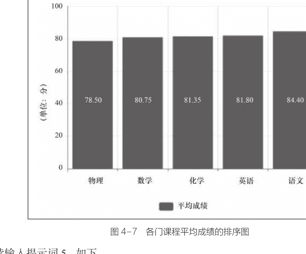

继续输入提示词 5，如下。

平均成绩分为 4 个分数段：60 分以下（不含 60 分）、60 ~ 80 分（不含 80 分）、80 ~ 90 分（不含 90 分）、90 分及以上。统计平均成绩在不同分数段的学生的人数占比，并绘制饼图。

生成的全班学生平均成绩各分数段分布饼图如图 4-8 所示。

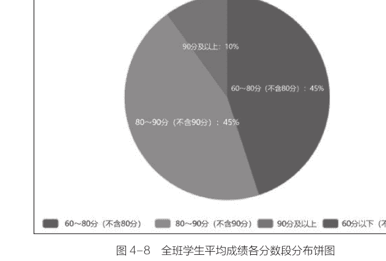

借助 AI 表格助手，用户可以通过与 AI 工具对话，一键进行数据分析，生成数据图表，避免写函数公式和手动制作图表的烦琐，提升效率。

### 【任务 4-4】使用酷表 ChatExcel 处理与分析学生成绩数据

- （1）上传 Excel 文件“高三学生成绩.xlsx”。
- （2）计算每位学生的总分、平均分，平均分保留 2 位小数，并进行排名，将结果填充到表格里并下载。
- （3）判断每位学生所有科目的平均分是否高于全班的平均分，将平均分高于全班平均分的学生标红，将结果填充到表格里并下载。
- （4）在“总分”列的成绩后面，括注单位“分”，下载处理好的文件。
- （5）查找高三（3）班，学号为 20250310 ～ 20250320 的学生中，数学成绩高于 120 分的学生姓名及其各科成绩，下载处理好的文件。
- （6）填充“评选结果”列，符合条件，则填充为“优秀”。评优考核条件：语文成绩不低于 90 分，数学成绩也不能低于 90 分。下载处理好的文件。
- （7）将总分排名前 10 名的学生的各科成绩绘制成柱状图。
- （8）将总分排名前 10 名的学生的各科成绩占其总成绩的百分比绘制成饼图。
- （9）将总分排名前 10 名的学生的各科成绩绘制成关系散点图。

#### 任务实施

- （1）在浏览器中打开酷表 ChatExcel 的工作页面。
- （2）上传 Excel 文件“高三学生成绩.xlsx”。
- （3）输入提示词 1：计算每位学生的总分、平均分，平均分保留 2 位小数，并进行排名，将结果填充到表格里并下载。
☆ 请读者自行在酷表 ChatExcel 中生成与提示词 1 对应的结果。
读者可以预览或下载生成的 Excel 文件“高三学生成绩计算结果.xlsx”。
- （4）输入提示词 2：判断每位学生所有科目的平均分是否高于全班的平均分，将平均分高于全班平均分的学生标红，将结果填充到表格里并下载。
☆ 请读者自行在酷表 ChatExcel 中生成与提示词 2 对应的结果。
- （5）输入提示词 3：在“总分”列的成绩后面，括注单位“/分”，下载处理好的文件。
☆ 请读者自行在酷表 ChatExcel 中生成与提示词 3 对应的结果。
- （6）输入提示词 4：查找高三（3）班，学号为 20250310 ～ 20250320 的学生中，数学成绩高于 120 分的学生姓名及其各科成绩，下载处理好的文件。

生成结果：

> 学生成绩筛选报告
> 1. 数据读取与初步筛选
> 根据用户需求，已经成功读取了包含所有学生成绩的表格数据，并从中筛选出高三（3）班、学号为 20250310 ～ 20250320 的学生。
> 2. 筛选结果
> 进一步筛选出数学成绩高于 120 分的学生，具体信息如下。

| 姓名 | 数学成绩 | 英语成绩 | 语文成绩 | 政治成绩 | 历史成绩 | 地理成绩 | 体育成绩 |
| :--- | :--- | :--- | :--- | :--- | :--- | :--- | :--- |
| 杨丽 | 143 | 114 | 97 | 73 | 88 | 54 | 92 |
| 蒋琴 | 135 | 76 | 121 | 96 | 86 | 61 | 78 |

> 3. 文件保存情况
> 已将符合条件的学生姓名及其各科成绩提取并保存到文件“selected_students.xlsx”中。该文件包含所有相关学生的详细成绩信息，便于进一步查看和分析。
> 4. 结论
> 通过上述步骤，成功筛选出了高三（3）班学号为20250310～20250320且数学成绩高于120分的学生，并将其成绩信息整理成表格文件。此文件可以帮助教师或相关人员快速了解这些学生的具体成绩情况。

- （7）输入提示词5：填充“评选结果”列，符合条件，则填充为“优秀”。评优考核条件：语文成绩不低于90分，数学成绩也不能低于90分。下载处理好的文件。
☆ 请读者自行在酷表ChatExcel中生成与提示词5对应的结果。

- （8）输入提示词6：将总分排名前10名的学生的各科成绩绘制成柱状图。
生成的总分排名前10名的学生的各科成绩柱状图如图4-9所示。

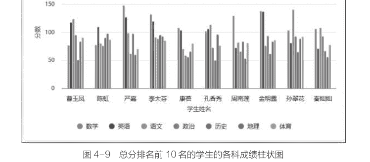

- （9）输入提示词7：将总分排名前10名的学生的各科成绩占比绘制成饼图。
生成的各科成绩占比饼图如图4-10所示（以一位学生为例）。

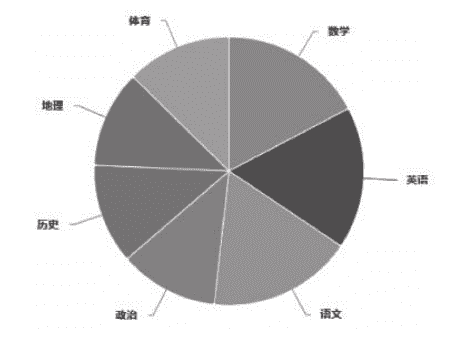

- （10）输入提示词8：将总分排名前10名学生的各科成绩绘制成关系散点图。
生成的各科成绩关系散点图如图4-11所示。

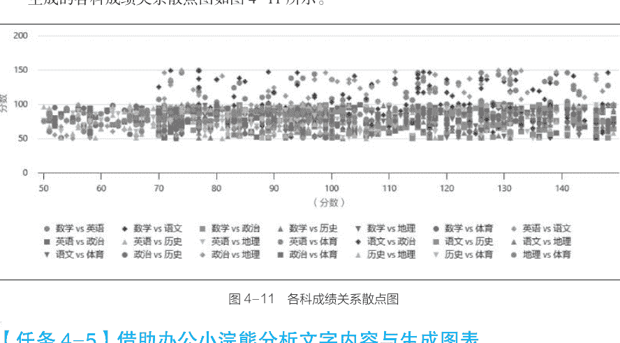

图4-11 各科成绩关系散点图

### 【任务4-5】借助办公小浣熊分析文字内容与生成图表

有如下一段文字。
在刚刚结束的年度科技大会上，我们有幸记录了参与者的详细数据。本次大会吸引了来自各行各业的专业人士参与，共计近1200名。在性别分布方面，男性占据了较大比例，有约800名男性参与者，而女性参与者则有约400名。
在职业分布方面，大会吸引了不同领域的专家参与。其中，软件开发者最多，有300人参与。紧随其后的是数据分析师，有200人参与。此外，产品经理、市场营销专家和设计师也分别有150人、120人和100人参与。
值得注意的是，大会还吸引了一些新兴领域的专业人士参与，例如，人工智能研究员有80人参与，区块链开发者有70人参与，物联网工程师有60人参与。这些新兴领域的专业人士虽然人数不多，但他们的参与为大会增添了不少活力且较大地提高了大会的前瞻性。
此外，还有一部分参与者来自教育和学术界，包括50名教授和40名研究生。他们的参与为大会的讨论带来了丰富的教育和学术视角。
总体来说，本次大会的参与者呈现出多样化职业背景，这不仅反映了科技行业的广泛性，也体现了大会的包容性和多元性。
根据以上内容生成一张职业分布统计饼图。

#### 任务实施

- （1）打开办公小浣熊的工作页面。
- （2）在输入框中输入待分析的一段文字，然后输入提示词：根据以上内容帮我生成一张职业分布统计饼图。
- （3）单击【发送】按钮。生成的职业分布统计饼图如图4-12所示。

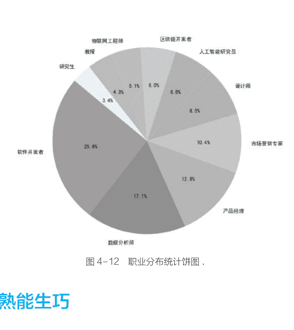

图 4-12 职业分布统计饼图。

## 4.4 熟能生巧

### 【任务 4-6】WPS AI 助力数据计算与图表绘制

- (1) 针对不同的 Excel 文件中的数据，完成多项数据计算与图表绘制。
- (2) 根据特定条件，快速标识数据。

#### 任务实施

各项数据计算与图表绘制的基本过程如下。

- (1) 在 WPS 中打开对应的 Excel 文件。
- (2) 在 WPS 中选择【WPS AI】下拉列表中的【AI 表格助手】命令，打开【AI 表格助手】对话框。在【AI 表格助手】对话框中选择【AI 数据问答】选项。
- (3) 在【AI 数据问答】输入框中分别输入提示词，然后单击【发送】按钮，执行对应的指令即可。

##### 1. 通过 WPS AI 自动计算多个数据

打开源文件：在 WPS 中打开 Excel 文件“自动计算多个数据.xlsx”。
输入提示词：通过公式依次计算课程成绩的最高分、最低分、第二高分、第二低分、平均分。
生成结果：

> 我们已经成功将计算结果填入了相应的单元格。更新后的数据如下。
> 最高分：98。
> 最低分：65。
> 第二高分：90。
> 第二低分：70。
> 平均分：80.86。

##### 2. 通过 WPS AI 快速计算排名

打开源文件：在 WPS AI 中打开 Excel 文件 “02 WPS AI 快速计算排名.xlsx”。
输入提示词：通过公式计算排名，并将排名填充到对应的列。
生成结果如表 4-3 所示。

表4-3 成绩排名

| 姓名 | 课程成绩 /分 | 排名 |
| :--- | :--- | :--- |
| 王立新 | 78 | 5 |
| 董丽霞 | 98 | 1 |
| 张睿 | 94 | 2 |
| 杨一凡 | 76 | 6 |
| 顾昊 | 90 | 3 |
| 刘洁 | 70 | 7 |
| 宁远城 | 89 | 4 |

##### 3. 通过 WPS AI 多条件统计订单数

打开源文件：在 WPS 中打开 Excel 文件 “03WPSAI 多条件统计订单数.xlsx”。
输入提示词：统计 2024 年春季，订货渠道为平台 8 且数量大于 300 的订单数。
生成结果：

> 统计结果显示，2024 年春季，订货渠道为平台 8 且数量大于 300 的订单共有 54 笔。

##### 4. 通过 WPS AI 多条件统计销售额

打开源文件：在 WPS 中打开 Excel 文件 “04 WPS AI 多条件统计销售额.xlsx”。
输入提示词 1：统计订货渠道为平台 3 且数量大于 600 的订单销售额总和。
生成结果：

> 统计结果显示，订货渠道为平台 3 且数量大于 600 的订单销售额总和为 476391 元。

输入提示词 2：计算平台 8 的平均订单销售额。
生成结果：

> 平台 8 的平均订单销售额为 38355.67 元。

输入提示词 3：列出订货日期为 2024-05-01 的订单号及对应销售额。
生成结果如表 4-4 所示。

表4-4 订货日期为2024-05-01的订单号及对应销售额

| 订单号 | 销售额 /元 |
| :--- | :--- |
| P2024050101 | 29093 |
| P2024050102 | 10400 |
| P2024050103 | 69865 |
| P2024050104 | 6981 |
| P2024050105 | 24752 |
| P2024050106 | 89864 |
| P2024050107 | 48512 |
| P2024050108 | 54750 |

输入提示词 4：统计各季节的总销售额。
生成结果如表 4-5 所示。

表4-5 各季节的总销售额

| 季节 | 总销售额 / 元 |
| :--- | :--- |
| 冬季 | 519938 |
| 夏季 | 280979 |
| 春季 | 10495791 |
| 秋季 | 1933129 |

##### 5. 通过 WPS AI 快速实现字符串拆分

打开源文件：在 WPS 中打开 Excel 文件“05 WPS AI 快速实现字符串拆分.xlsx”。
输入提示词：提取编码（数字）和描述（文字），将编码放到 B 列，将描述放到 C 列。
生成的部分结果如表 4-6 所示。

表4-6 字符串拆分的部分结果

| 编码 | 描述 |
| :--- | :--- |
| 1800038286 | 变压器油 |
| 1800132904 | 传动轴 |
| 1800183580 | 模块 |
| 1800183588 | 模块 |
| 1800011327 | 数字输出模块 |

##### 6. 通过 WPS AI 快速实现字符串合并

打开源文件：在 WPS 中打开 Excel 文件“06 WPS AI 快速实现字符串合并.xlsx”。
输入提示词：把编码和描述合并，并填充到 D 列对应的单元格中。
生成的部分结果如表 4-7 所示。

表4-7 字符串合并的部分结果

| 编码 | 描述 | 编码描述 |
| :--- | :--- | :--- |
| 1800038286 | 变压器油 | 1800038286 变压器油 |
| 1800132904 | 传动轴 | 1800132904 传动轴 |
| 1800183580 | 模块 | 1800183580 模块 |
| 1800183588 | 模块 | 1800183588 模块 |
| 1800011327 | 数字输出模块 | 1800011327 数字输出模块 |

##### 7. 通过 WPS AI 快速实现数据汇总分析

打开源文件：在 WPS 中打开 Excel 文件“07 WPS AI 快速实现数据汇总分析.xlsx”。
输入提示词 1：通过数据透视表，计算 2024 年“灰色长筒靴”“白色蕾丝上衣”的数量总计。
生成结果：

> 根据数据分析结果，2024 年“灰色长筒靴”的数量总计为 1829 件，“白色蕾丝上衣”的数量总计为 1620 件。

输入提示词 2：使用数据透视表筛选出 2024 年春季的“吊牌价”总额。
生成结果：

> 根据数据分析结果，2024 年春季的“吊牌价”总额为 36652.9 元。

## 4.5 勤思精练

### 【任务4-7】选择一种AI工具对同一个单元格中包含的多个数据进行拆分处理

完结项目及业绩评分如图4-13所示。

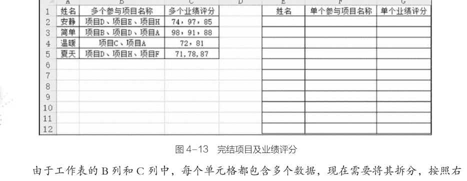

由于工作表的B列和C列中，每个单元格都包含多个数据，现在需要将其拆分，按照右表的格式填入对应的数据。

提示词如下。

> 你能看到图片中有两个表格吧？现在要把数据从左边的样子整理成右边的样子，请帮我完成这个任务，并用表格形式回复整理后的结果。

### 【任务4-8】借助天工AI列举所需的物品并制成表格

借助天工AI完成以下操作。

- （1）列举登山必备品并制成表格。
- （2）说明登山时准备的紧急医疗包里应该包含哪些药品。

### 【任务4-9】借助文心一言将Excel工作表中的数据绘制成柱状图

Excel工作表中的1—9月注册人数数据如表4-8所示，使用这些数据绘制柱状图。

表4-8 1—9月注册人数数据

| 月份 | 注册人数/人 |
| :--- | :--- |
| 1月 | 961 |
| 2月 | 2430 |
| 3月 | 5805 |
| 4月 | 6577 |
| 5月 | 6215 |
| 6月 | 1700 |
| 7月 | 3908 |
| 8月 | 4523 |
| 9月 | 4726 |

### 【任务 4-10】WPS AI 赋能数据分析，一键解决图表绘制等难题

- （1）在 WPS 中打开 Excel 文件 “商品大类的销售数据.xlsx”。
- （2）计算空调的销售额。
- （3）分析空调与手机哪一大类商品的销售利润高。
- （4）计算电视销售额占总销售额的比例。
- （5）分析手机和空调哪个月份的销售表现好。
- （6）计算电视的平均销售利润。
- （7）列出各大类商品的销售额和销售利润。
- （8）列出销售额排名前 3 的手机品牌。
- （9）按商品大类计算销售额。
- （10）生成不同商品大类销售额的条形图。

### 【任务 4-11】借助办公小浣熊处理与计算物品采购数据

- （1）在办公小浣熊中上传 Excel 文件 “物品采购数据.xlsx”。
- （2）对工作表中的缺失数据进行自动处理。
- （3）分别计算工具类、办公用品类物品的总采购金额。
- （4）计算两类物品的平均单价。

# 模块5 AIGC快速生成炫酷演示文稿

众所周知，PPT 在商业、教育领域的各类演讲中扮演着重要角色，但要制作一份既吸引眼球又能高效传递信息的 PPT 并非易事。在这个过程中，选择合适的工具可以大大提高效率。如今，随着人工智能技术的快速发展，这一过程变得更加简单和富有趣味。现在有很多免费的 PPT 智能生成工具可供选择，它们能够帮助用户更加便捷地制作出高效且具有较强视觉吸引力的 PPT。

## 5.1 先睹为快

### 【案例 1】借助豆包和 Kimi+ 制作教学课件 PPT

#### 案例描述

- （1）使用豆包生成小学三年级课文《守株待兔》的教案。
- （2）使用 Kimi+ 制作课文《守株待兔》的教学课件 PPT。

#### 案例展示

##### 1. 生成教案

在豆包首页单击左侧的【帮我写作】，然后单击右侧的【教案】，如图 5-1 所示。
输入框中会出现“帮我写一份教案，授课对象是 [ 年龄学段 ]，主题是 [ 课程名称 ]。”提示信息，在“[ 年龄学段 ]”位置输入对应学段，如“小学三年级”，在“[ 课程名称 ]”位置输入对应的课文名称，如“守株待兔”，相当于输入提示词“帮我写一份教案，授课对象是小学三年级，主题是守株待兔。”然后，单击【发送】按钮，豆包就会开始生成教案。
扫描二维码，打开电子活页 5-1，在线浏览“豆包中生成的教案”，也可以自行在豆包中生成类似的结果。
如果对这个教案不满意，可以让豆包进行修改，如输入提示词“请写得更加详细”。
保存豆包生成的教案，文件名为“《守株待兔》教案.docx”。


##### 2. 按教案生成教学课件 PPT 大纲

打开 Kimi+ 的“PPT 助手”，先上传步骤 1 中保存的 Word 文档“《守株待兔》教案.docx”，然后输入提示词：请按 Word 文档“《守株待兔》教案.docx”中的教案，制作小学三年级课文《守株待兔》的教学课件 PPT。然后，单击【发送】按钮，Kimi+ 就会开始生成教学课件 PPT 大纲。

扫描二维码，打开电子活页 5-2，在线浏览“Kimi+ 中生成的《守株待兔》教学课件 PPT 大纲”，也可以自行在 Kimi+ 中生成类似的结果。

##### 3. 一键生成教学课件 PPT

教学课件 PPT 大纲生成后，检查该 PPT 大纲，如果发现其中有问题，可以要求 Kimi+ 进行修改，如输入提示词“请按三维目标设定教学目标”，直到修改满意为止。

然后，单击左下角的【一键生成 PPT】按钮，在进入的页面中选择合适的模板场景，如【教育培训】，选择合适的设计风格，如【简约】，选择一套合适的模板，如图 5-2 所示。

单击右上角的【生成 PPT】按钮，即可开始生成 PPT。

##### 4. 修改完善教学课件 PPT

教学课件 PPT 制作完成后，用户如有不满意的地方，可以单击下方的【去编辑】按钮，在线修改完善，如图 5-3 所示。然后将修改后的 PPT 下载到本地计算机上。

比在线修改完善更稳妥的方法是先将 PPT 下载到计算机上，再使用 PowerPoint 或 WPS 进行修改完善。

## 5.2 释疑解惑

### 【问题 5-1】常用的 PPT 智能生成工具有哪些？

常用 PPT 智能生成工具的介绍如下。

#### 1. 百度文库的“智能 PPT”

百度文库自 2023 年 8 月升级为一站式智能文档平台后，推出了许多 AI 功能，如智能文档、智能 PPT、思维导图等。百度文库的“智能 PPT”内置很多核心功能，并依靠百度文库强大的专业资料库，能够帮助用户更好地生成其需要的 PPT。百度文库提供一站式 AI 创作服务，允许创作的内容包括 PPT、文档等，不仅支持多格式内容生成，还具有非常强大的模板能力，能够帮助用户更高效地进行创作。百度文库的首页如图 5-3 所示。

#### 2. WPS AI

WPS AI 是由金山办公推出的 AI 助手，它作为 WPS 办公套件的重要组成部分，提供智能文档写作、阅读理解和问答、智能人机交互等功能，以及文档、表格、PPT 等多格式的智能辅助功能，能够提高办公软件的智能化水平，旨在提高用户在写作、文档处理等方面的效率和智能性。

用户可以在 WPS AI 中，通过输入关键词或简单描述，利用智能推荐和自动排版功能，快速生成 PPT 框架和内容。WPS AI 的首页如图 5-4 所示。

#### 3. AiPPT

AiPPT 是一款 AI 驱动的 PPT 在线生成工具，专注于 PPT 的智能生成，提供从文档到 PPT 的快速转换功能，以及 PPT 内容的智能设计功能。用户只需要输入主题，即可使用 AiPPT 一键生成高质量 PPT，操作简单。AiPPT 还支持在线自定义编辑 PPT 和导入文档生成 PPT 功能，提供超过 10 万个优秀模板和素材，助力用户快速生成专业级 PPT。AiPPT 的首页如图 5-5 所示。

#### 4. iSlide

iSlide 是一款强大的 PPT 设计辅助工具，提供超过 30 万种原创、可商用的 PPT 模板和设计元素，可以帮助用户快速创建堪比专业水准的 PPT。iSlide 的首页如图 5-6 所示。

#### 5. 博思 AIPPT

博思 AIPPT 是新一代的在线 AI 生成 PPT 软件，提供多种快速制作 PPT 的方式，包括根据主题生成 PPT、根据文本生成 PPT，以及根据导入的 Word、PDF、TXT、Markdown 文件生成 PPT 等。其内置海量精美 PPT 模板，涵盖商务、教育、科技等不同风格，用户可以随心使用，不用担心重样。同时，它针对每个页面提供多种版式，可一键自适应切换，完美适配各种办公场景。博思 AIPPT 的首页如图 5-7 所示。

#### 6. ChatPPT

ChatPPT 是由 MotionGo 发布的一款集成 AI 功能的 PPT 制作工具，旨在简化 PPT 制作过程。在 ChatPPT 中，用户可以通过简单的对话式指令，快速生成专业级 PPT。这个工具提供了丰富的自动化选项，如用于实现智能排版、主题色更换、模板选择，以及专业图表和动画的生成的选项，从而提升了内容创作的效率和质量。ChatPPT 的首页如图 5-8 所示。

### 【问题 5-2】使用百度文库的“智能 PPT”制作 PPT 的步骤有哪些？

使用百度文库的“智能 PPT”制作 PPT 的步骤如下。

第 1 步：打开百度文库首页，单击【智能 PPT】。

第 2 步：选择创作方式。

在【智能 PPT】页面选择【输入主题生成】方式，也可以选择【上传文档生成】和【上传图片生成】方式。

第 3 步：输入主题。

输入想要制作的 PPT 内容的主题，如“大学生防火安全教育”。

第 4 步：等待生成。

单击【发送】按钮后，系统会自动处理并生成 PPT 大纲。注意，在这个过程中不能关闭页面，否则可能会生成失败。

扫描二维码，打开电子活页 5-3，在线浏览“百度文库‘智能 PPT’生成的 PPT 大纲”，也可以自行在百度文库的“智能 PPT”中生成类似的结果。

第 5 步：选择模板。

PPT 大纲生成完成后，单击【生成 PPT】按钮，打开如图 5-9 所示的对话框，选择一个风格贴合主题的 PPT 模板，然后单击【继续生成】按钮。

第 6 步：编辑 PPT。

生成的 PPT 会呈现大致框架，用户可以根据自己的需求优化该 PPT，以达到自己想要的效果。

第 7 步：下载 PPT。

单击【下载 PPT】按钮，即可将生成的 PPT 下载到本地计算机。

### 【问题 5-3】百度文库的“智能 PPT”有哪些创新和优势？

#### 1. 百度文库“智能 PPT”的创新

百度文库“智能 PPT”的迅速发展得益于其在 AI 技术应用上的多项创新，主要体现在以下 5 个方面。

（1）深入理解中国用户的需求。百度文库的“智能 PPT”深入理解中国用户对 PPT 的使用需求，如在教育、商务等领域的个人汇报场景中使用 PPT 的需求。

（2）内容生成质量高。经过认证，百度文库的“智能 PPT”在 AI PPT 能力测试中的五大维度均排名前列，足以说明其生成内容的高质量。

（3）独一无二的专业内容。依托于十几亿份高价值文档的支持，百度文库“智能 PPT”生成的内容具有很高的权威性和专业度。

（4）自由的 AI 编辑体验。百度文库的“智能 PPT”使用户可以自由编辑 PPT，一键替换颜色、字体、模板等，同时支持对其他格式文件的再生成。

（5）用户定制程度高。百度文库的“智能 PPT”提供多种风格的模板供用户选择，支持用户上传个人定制模板，以满足不同场景的需求。

#### 2. 百度文库“智能 PPT”的优势

百度文库的“智能 PPT”的优势主要体现在以下 5 个方面。

（1）一站式服务能力。百度文库的“智能 PPT”支持包括资料查找、内容生成、排版编辑、选择配图等的全流程，使用户无须在多个平台间切换。

（2）多文档整合。百度文库的“智能 PPT”支持从 Word、Excel、PDF 等多格式文档生成 PPT，适用于复杂数据梳理。

（3）内容完整度较高。百度文库“智能 PPT”生成的内容的完整度较高，能够按照生成的大纲生成内容。

（4）更强大的模板能力。百度文库的“智能 PPT”提供丰富的模板和灵活的自定义功能。

（5）AI 生成有声画本。在百度文库的“智能 PPT”手机 App 中，还支持 AI 生成有声画本功能，该功能通过一句话，即可在 3min 内创作出图文并茂且伴有人声朗读的视频画本，使父母能够为孩子进行专属的故事创作，其入门门槛较低，操作流程较为简便。

### 【问题 5-4】使用博思 AIPPT 快速生成 PPT 的方式有哪些？

博思 AIPPT 提供 2 种快速生成 PPT 的方式。

（1）AI 生成 PPT：输入 PPT 主题即可快速生成 PPT。

（2）导入文件生成 PPT：导入常见的各类办公文件，经 AI 提炼总结，自动生成 PPT。

以导入文件生成 PPT 为例，博思 AIPPT 支持导入多种文件以快速生成 PPT，这些文件包括 Word、PDF、TXT、Markdown、MindMaster、Xmind 文件，覆盖办公常用的文件类型，能够帮助用户快速制作出精美的 PPT。

导入文件后，博思 AIPPT 会基于主题、目录、章节、内页 4 个维度解析导入的本地文件，单击底部的【挑选 PPT 模板主题】按钮，进入选择 PPT 模板的界面。

博思 AIPPT 内置海量精美的 PPT 模板，用户可以从模板场景、设计风格、主题颜色 3 个维度组合筛选模板。

- 模板场景：总结汇报、教育培训、企业宣传、商业计划书、营销推广、毕业答辩、晚会表彰。
- 设计风格：扁平简约、商务科技、创意时尚、文艺清新、中国风、卡通手绘。
- 主题颜色：10 多种色系，可随心选择。

选定一个 PPT 模板后，单击右上角的【生成 PPT】按钮，博思 AIPPT 就会快速生成一个 PPT，达成根据文件内容生成 PPT 的目的。

### 【问题 5-5】如何使用 Kimi+ 的“PPT 助手”？

Kimi+ 支持生成和下载 PPT 大纲和模板，并且是完全免费的。Kimi+ 的“PPT 助手”的使用方法如下。

（1）打开“PPT 助手”

打开 Kimi+，然后选择【PPT 助手】即可开始一键创建 PPT。

（2）输入 PPT 提示词，生成大纲

通过自然语言描述 PPT 内容，即输入 PPT 提示词，Kimi+ 会生成 PPT 大纲。

（3）开始配置 PPT

检查大纲，确认没问题之后，就可以单击底部的【一键生成 PPT】按钮，开始配置 PPT。

（4）选择模板

在【选择模板创建 PPT】页面中选择合适的模板，单击右上角的【生成 PPT】按钮，即可开始生成 PPT。

（5）生成完成，继续编辑

生成完成后，单击下方的【去编辑】按钮，即进入编辑页面，用户可以进行各种细节调整，也可以单击【放映】【拼图】【下载】等按钮进行具体操作。

### 【问题 5-6】使用通义千问的“PPT 创作”智能生成 PPT 的步骤有哪些？

使用通义千问的“PPT 创作”智能生成 PPT 非常简单，步骤如下。

（1）进入 PPT 创作页面

单击通义首页右侧的【PPT 创作】按钮，进入 PPT 创作页面。

（2）输入主题

在输入框中输入 PPT 主题，然后单击【发送】按钮。

（3）调整大纲和选择场景

通义千问会根据 PPT 主题，生成一份大纲，用户可以对大纲进行调整，然后可以选择演讲的场景，非常方便。调整大纲并选定场景后，单击右上角的【下一步】按钮。

（4）选择合适的模板

通义千问提供了多款优秀的 PPT 模板，用户可以自行选择，然后单击右上角的【生成 PPT】按钮。

（5）生成 PPT

等待一会儿，通义千问就会生成 PPT，用户可以在线对 PPT 进行内容微调、切换模板、导出、演示等操作。

## 5.3 精彩纷呈

### 【任务 5-1】借助 AiPPT 智能生成主题 PPT

借助 AiPPT 智能生成主题 PPT，主题为“人工智能的发展趋势与未来展望”。

#### 任务实施

（1）打开 AiPPT 首页，然后单击【开始智能生成】按钮，进入如图 5-10 所示的 AI 生成 PPT 页面。

（2）在 PPT 主题输入框中输入 PPT 的主题，这里输入“人工智能的发展趋势与未来展望”，然后单击【AI 生成】按钮。

（3）AiPPT 依据输入的主题智能生成大纲内容，可以对大纲内容进行编辑，也可以单击【换个大纲】按钮，更换新的大纲内容。

（4）单击【挑选 PPT 模板】按钮，弹出【选择模板创建 PPT】对话框。用户可以选择模板应用场景，如【教育培训】，然后选择合适的 PPT 模板，也可以输入模板关键词选择 PPT 模板或者单击【随机选择】按钮。PPT 模板选择完成后，在【选择模板创建 PPT】对话框中单击右上角的【生成 PPT】按钮，AI PPT 开始制作 PPT 且进行自动保存。

（5）PPT 制作完成后，用户可以在【PPT 预览】区域，单击【去编辑】按钮，对 PPT 进行编辑，可以对大纲、文字、背景、元素等进行调整，还可以直接替换另一套模板。

（6）单击【下载】按钮将生成的 PPT 下载到本地计算机。单击【分享】按钮可以将生成的 PPT 分享给他人。

### 【任务 5-2】借助 iSlide 智能生成主题 PPT

借助 iSlide 智能生成主题 PPT，主题为“培养大学生的创新思维”。

#### 任务实施

（1）打开 iSlide 首页后，在输入框中输入 PPT 主题“培养大学生的创新思维”，并单击【发送】按钮 ▶，如图 5-11 所示。

iSlide 会自动输入提示词：生成一份以「培养大学生的创新思维」为主题的 PPT。

（2）iSlide 自动生成 PPT 大纲，弹出的【PPT 大纲】对话框如图 5-12 所示。

（3）单击左下角的【生成 PPT】按钮，iSlide 自动生成 PPT，如图 5-13 所示。

（4）单击 PPT 下方的【一键换肤】按钮，可以直接更换模板。

（5）单击 PPT 下方的【下载 PPT】按钮，可以将生成的 PPT 下载到本地计算机。

### 【任务 5-3】借助博思 AIPPT 智能生成主题 PPT

借助博思 AIPPT 智能生成主题 PPT，主题为“插画在当代的创新与发展”。

#### 任务实施

（1）打开博思 AIPPT 首页，单击【我也要生成 PPT】按钮，登录后单击【智能生成 PPT】按钮，进入【PPTGO】页面，如图 5-14 所示。

（2）在 PPT 标题输入框中输入 PPT 标题（即主题）“插画在当代的创新与发展”，单击【发送】按钮。

（3）博思 AIPPT 自动生成 PPT 大纲，在 PPT 大纲编辑对话框中可以编辑大纲内容，如图 5-15 所示。

在 PPT 大纲编辑对话框中，单击【展开编辑】按钮，可以将大纲内容展开，方便进行编辑；单击【下载大纲】按钮，可以将生成的大纲内容下载到本地计算机；单击【换个大纲】按钮，可以更换大纲内容。

（4）单击【挑选 PPT 模板主题】按钮，进入【选择 PPT 模板】页面，如图 5-16 所示。选择合适的 PPT 模板后，单击右下角的【下一步】按钮，选择插图来源，并完成高级设置。

（5）单击【生成 PPT】按钮，博思 AIPPT 开始自动生成 PPT。

（6）标题（即主题）为“插画在当代的创新与发展”的 PPT 自动生成后，自动打开编辑页面，可以进行在线编辑。单击右上角的【分享】按钮，可以将自动生成的 PPT 分享给他人。单击【导出】按钮，在弹出的【导出】对话框中单击【导出】按钮，可以将自动生成的 PPT 导出到本地计算机。

## 5.4 熟能生巧

### 【任务 5-4】借助百度文库的“智能 PPT”使用多种方式生成 PPT

（1）使用输入主题生成 PPT 方式生成《春节礼仪教育》PPT。

（2）使用上传文档生成 PPT 方式生成《大学生防火安全教育》PPT。

（3）使用上传图片生成 PPT 方式生成《阿坝旅游目的地精选》PPT。

（4）对“桂林简介.pptx”PPT 进行美化操作。

#### 任务实施

1. 打开百度文库的“智能 PPT”

打开百度文库，在【AI 创作】区域单击【智能 PPT】或单击左边导航栏的【智能助手】，均可进入智能 PPT 创作页面。

2. 输入主题生成 PPT

在智能 PPT 创作页面，如图 5-17 所示，单击【输入主题生成】按钮。

（1）输入想生成的 PPT 的主题

输入框中出现“帮我写一篇 PPT，主题为 [ 主题内容 ]”的提示信息，在“[ 主题内容 ]”位置输入“春节礼仪教育”，即输入提示词：帮我写一篇 PPT，主题为春节礼仪教育。

（2）生成 PPT 大纲

在智能 PPT 创作页面单击右下角的【发送】按钮。

生成的《春节礼仪教育》PPT 大纲如下。

```
春节礼仪教育：开开心心过大年
第 1 章
春节的起源与传说
1.1 春节的由来
1.2 春节的传说与习俗
1.3 春节的重要性与意义
第 2 章
春节的传统习俗
2.1 扫尘与贴春联
2.2 守岁与拜年
2.3 发红包与吃饺子
第 3 章
春节的礼仪规范
3.1 穿着与言行举止
3.2 餐桌礼仪与饮食文化
3.3 拜访亲友与待客之道
```

##### 第4章 春节的安全教育

###### 4.1 防火与防电安全

###### 4.2 交通安全与出行

###### 4.3 饮食安全与卫生

##### 第5章 春节的文化体验活动

###### 5.1 观看舞龙舞狮表演

###### 5.2 制作与欣赏剪纸作品

###### 5.3 学习写春联与福字

##### 第6章 春节的环保与节约意识

###### 6.1 垃圾分类与环保行动

###### 6.2 节约资源，反对浪费

###### 6.3 绿色出行，低碳生活

##### 第7章 春节的感恩与家庭教育

###### 7.1 感恩父母与长辈

###### 7.2 传承家庭传统与习俗

大纲生成完成后，用户可以对大纲进行修改完善。大纲修改完善之后，单击左下角的【生成 PPT】按钮。

（3）选择 PPT 模板

在打开的对话框中共有 3 种模板选择方式：【选择模板】【上传模板】【自定义模板】。用户可以根据需要选择适合自己需求的 PPT 模板。选择合适的模板，如图 5-18 所示。

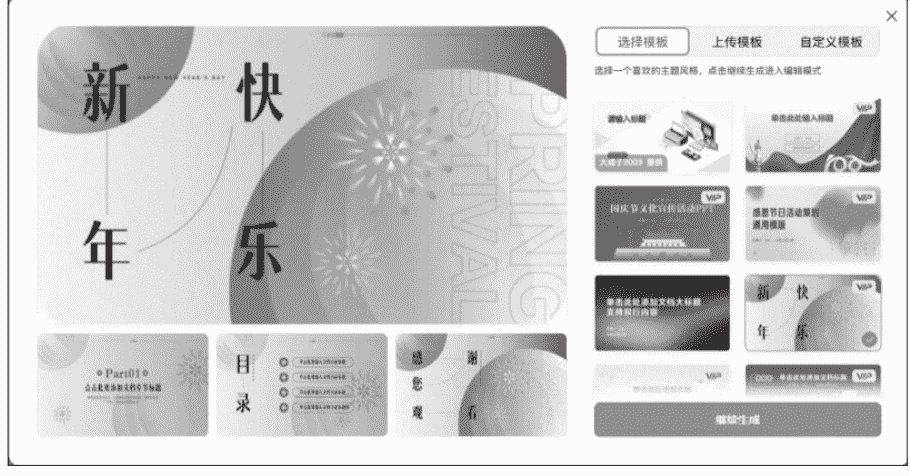

图 5-18 选择合适的模板

（4）生成 PPT

在对话框中单击【继续生成】按钮，开始生成 PPT。用户可以对生成的 PPT 可以进行在线编辑及设置。

（5）下载生成的PPT

单击【下载PPT】按钮，将生成的PPT下载到本地计算机。

##### 3. 百度文库的其他PPT编辑功能

百度文库的【智能助手】侧边栏如图5-19所示。百度文库的【编辑】工具栏如图5-20所示。

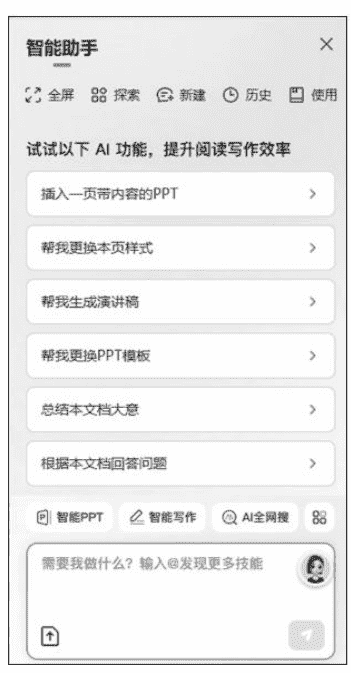


百度文库的其他PPT编辑功能如下。

- （1）AI续写一页PPT
在PPT编辑页面，单击【编辑】工具栏中的【续写一页】按钮或单击【智能助手】侧边栏中的【插入一页带内容的PPT】，并输入主题，即可续写一页PPT。

- （2）更换单页PPT样式
在PPT编辑页面，单击【编辑】工具栏中的【更换样式】按钮或单击【智能助手】侧边栏中的【帮我更换本页样式】，可以自动生成更多的布局样式，选择需要的样式即可更换。

- （3）依据PPT内容生成演讲稿
在PPT编辑页面的【智能助手】侧边栏中单击【帮我生成演讲稿】，可以自动依据PPT内容生成演讲稿。

- （4）更换PPT模板
在PPT编辑页面的【智能助手】侧边栏中单击【帮我更换PPT模板】，然后在弹出的页面中单击【查看更多】按钮，可以选择文库在线模板进行更换。

- （5）更换 PPT 配图
在 PPT 编辑页面，单击【编辑】工具栏中的【更换配图】按钮，可自动生成更多配图，用户选择喜欢的配图即可更换；若页面中有多张配图，可选择需要更换的配图，在【智能助手】侧边栏中会显示更换图片提醒，单击【帮我更换配图】按钮，即可选择新配图进行更换。

##### 4. 上传文档生成 PPT

（1）在智能 PPT 创作页面，单击【上传文档生成】按钮。

（2）在弹出的对话框中单击【上传本地文件】选项卡，然后单击【点击此处或拖拽上传】按钮，在【打开】对话框中选择生成 PPT 所依据的文档，这里选择 Word 文档“大学生防火安全教育.docx”，单击【打开】按钮，开始上传选择的文档。

（3）选择的文档成功上传后，会弹出【选择生成方式】对话框，该对话框中有两个选项【智能润色】和【严格依从】。这里选择【智能润色】选项，然后单击【生成 PPT】按钮。

（4）系统开始生成 PPT 大纲，大纲生成完成后，可对大纲进行修改。生成的大纲如下。

- 大学生防火安全教育
第 1 章 引言
1.1 火灾的危害与预防
1.2 大学生防火安全教育的意义
第 2 章 火灾的危害
2.1 烧毁财产和家园
2.2 烟雾和毒气危害
2.3 社会心理影响
第 3 章 火灾的常见原因
3.1 电气原因
3.2 明火原因
3.3 人为原因
第 4 章 预防火灾的方法
4.1 定期检查电气设备和线路
4.2 妥善处理易燃物品
4.3 提高防火意识
第 5 章 火灾中的自我保护
5.1 逃生自救
5.2 报警求救
5.3 防护措施
第 6 章 校园防火小知识
6.1 教室防火注意事项
6.2 实验室防火知识
6.3 图书馆防火常识
6.4 食堂防火小贴士
第 7 章 家庭防火小常识
7.1 家庭防火的必要性
7.2 家庭用电安全
7.3 家庭易燃易爆物品管理
第 8 章 灭火器的使用方法与注意事项
8.1 灭火器的种类
8.2 灭火器的使用方法
8.3 灭火器的保养与检查
8.4 灭火器的使用注意事项
第 9 章 火灾逃生与自救技巧
9.1 火灾逃生原则
9.2 火灾逃生路线选择
9.3 火灾逃生过程中的注意事项
9.4 火灾自救技巧

（5）单击生成的大纲下方的【生成 PPT】按钮，弹出选择模板的对话框，选择合适的 PPT 模板，然后单击【继续生成】按钮，百度文库的“智能 PPT”开始按照大纲生成 PPT。

（6）PPT 生成后，单击【下载 PPT】按钮，即可将生成的 PPT 下载到本地计算机。

##### 5. 上传图片生成 PPT

（1）在智能 PPT 创作页面，单击【上传图片生成】按钮。

（2）在弹出的【打开】对话框中选择生成 PPT 所依据的图片，这里选择“小金县雪域之乡风光掠影”文件夹中的所有图片，单击【打开】按钮，开始上传选择的图片。

（3）选择的图片成功上传后，会出现“请根据下方图片生成 PPT”提示词，系统开始生成 PPT 大纲，大纲生成完成后，可对大纲进行修改。生成的 PPT 大纲如下所示。

- 雪域之乡风光掠影
第 1 章 自然风光
1.1 草地与雪山
1.2 鲜花与蓝天
第 2 章 牧区生活
2.1 牛群吃草
2.2 马匹觅食
第 3 章 地域特色
第 4 章 季节与气候
第 5 章 整体色调与氛围
5.1 清新、自然的色调
5.2 宁静的氛围

（4）单击生成的 PPT 大纲下方的【生成 PPT】按钮，弹出选择模板的对话框，选择合适的 PPT 模板，然后单击【继续生成】按钮，百度文库的“智能 PPT”开始按照大纲生成 PPT。

（5）PPT 生成后，可以单击【下载 PPT】按钮，将生成的 PPT 下载到本地计算机。

##### 6. 美化 PPT

（1）在智能 PPT 创作页面，单击【美化 PPT】按钮。

（2）在弹出的【上传本地文件】对话框中，单击【点击此处或拖拽上传】按钮，在弹出的【打开】对话框中选择需要美化的 PPT，这里选择“桂林简介.pptx”，单击【打开】按钮，开始上传选择的 PPT。

（3）选择的 PPT 成功上传后，弹出选择模板的对话框，选择合适的 PPT 模板，然后单击【开始美化】按钮，百度文库的“智能 PPT”开始智能美化所选择的 PPT。

（4）PPT 美化完成后，可以单击【下载 PPT】按钮，将生成的 PPT 下载到本地计算机。

### 【任务 5-5】借助 WPS AI 使用多种方式生成 PPT

（1）使用根据主题生成 PPT 方式生成景点推介类 PPT，PPT 主题为“九寨沟的美景”。

（2）使用根据大纲生成 PPT 方式生成知识学习类 PPT，PPT 主题为“蛇年春节特色古诗词鉴赏”。


#### 任务实施

##### 1. 在 WPS 中创建空白 PPT

在 WPS 中创建空白 PPT。

##### 2. 使用根据主题生成 PPT 方式生成 PPT

（1）在 WPS 主界面中单击【WPS AI】，打开下拉菜单，在下拉菜单中选择【AI 生成 PPT】—【主题生成 PPT】命令，如图 5-21 所示。

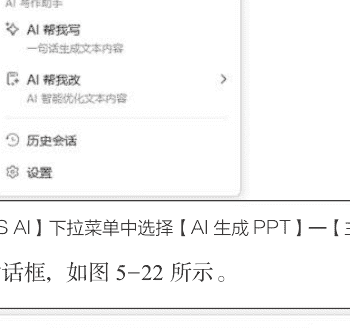

图 5-21 在【WPS AI】下拉菜单中选择【AI 生成 PPT】—【主题生成 PPT】命令

打开【AI 生成 PPT】对话框，如图 5-22 所示。


图 5-22 【AI 生成 PPT】对话框

（2）在输入框中输入主题“九寨沟的美景”，然后单击【开始生成】按钮，开始生成PPT大纲，生成的PPT大纲部分内容如图5-23所示。

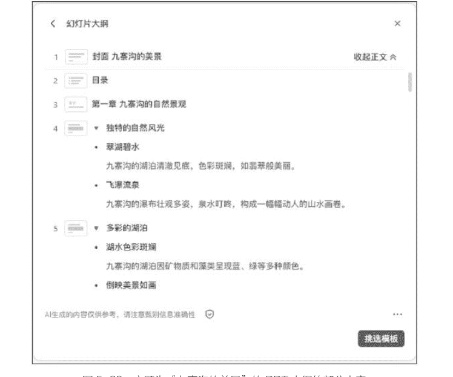

（3）在【幻灯片大纲】对话框中，单击右下角的【挑选模板】按钮，打开【选择幻灯片模板】对话框，在该对话框中选择合适的PPT模板，如图5-24所示。

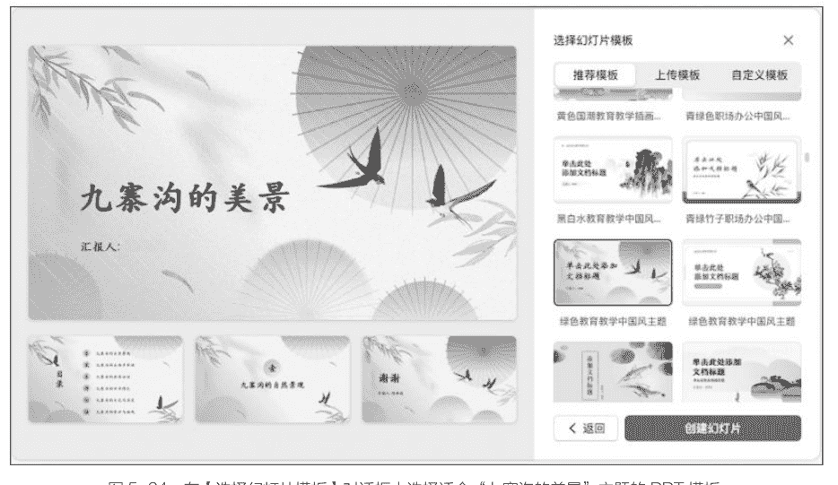

（4）在【选择幻灯片模板】对话框中，单击右下角的【创建幻灯片】按钮，WPS AI 开始自动创建 PPT。

（5）在 WPS 主界面的工具栏中单击【保存】按钮，弹出【另存为】对话框，在【文件名称】输入框中输入 PPT 名称“九寨沟的美景.pptx”，然后在【另存为】对话框中单击【保存】按钮即可。

##### 3. 使用根据大纲生成 PPT 方式生成 PPT

（1）在 WPS 主界面中单击【WPS AI】，打开下拉菜单，在下拉菜单中选择【AI 生成 PPT】—【大纲生成 PPT】命令，打开【AI 生成 PPT】对话框。

（2）主题为“蛇年春节特色古诗词鉴赏”的 PPT 大纲对应的内容如下。

```
蛇年春节特色古诗词鉴赏
第 1 章 蛇年寓意与古诗词背景
1.1 蛇年象征意义
1.2 古诗词发展背景
1.3 蛇年春节与古诗词的联系
第 2 章 蛇年春节古诗词鉴赏
2.1 与蛇相关的古诗词精选
2.2 与蛇相关的古诗词解析
2.3 春节习俗与古诗词融合
第 3 章 蛇年春节古诗词文化与教育
3.1 传递正能量与文化内涵
3.2 培养学生对古诗词的兴趣
3.3 蛇年春节古诗词教育活动
第 4 章 蛇年春节古诗词鉴赏方法与技巧
4.1 理解与感受古诗词意境
4.2 鉴赏古诗词中蛇的形象
4.3 春节古诗词中表现手法分析
第 5 章 蛇年春节古诗词朗诵与表演
5.1 朗诵技巧及注意事项
5.2 表演形式选择与创新
5.3 蛇年春节古诗词朗诵与表演安排
第 6 章 蛇年春节古诗词在现代生活中的意义
6.1 传承和弘扬传统文化
6.2 增强民族自豪感和凝聚力
6.3 蛇年春节古诗词在现代社会中的应用
```

在【粘贴大纲】选项卡中，将主题为“蛇年春节特色古诗词鉴赏”的 PPT 大纲的对应内容复制并粘贴至输入框，如图 5-25 所示。

（3）在【AI 生成 PPT】对话框中单击【开始生成】按钮，开始生成 PPT 大纲。

（4）在【幻灯片大纲】对话框中，单击右下角的【挑选模板】按钮，打开【选择幻灯片模板】对话框，在该对话框中选择合适的 PPT 模板，如图 5-26 所示。

（5）在【选择幻灯片模板】对话框中，单击右下角的【创建幻灯片】按钮，WPS AI 开始自动创建 PPT。

（6）在 WPS 主界面的工具栏中单击【保存】按钮，弹出【另存为】对话框，在【文件名称】输入框中输入 PPT 名称“蛇年春节特色古诗词鉴赏与教育.pptx”，然后在【另存为】对话框中单击【保存】按钮即可。

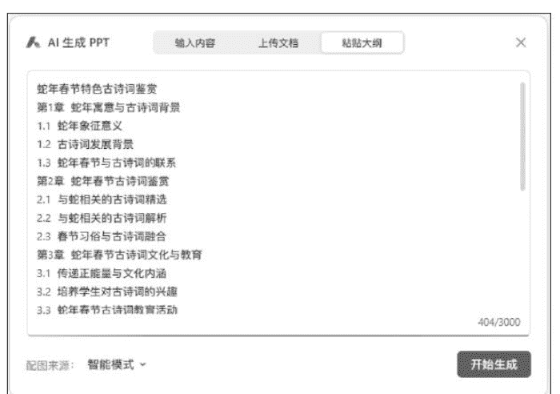

图 5-25 【AI 生成 PPT】对话框中的【粘贴大纲】选项卡

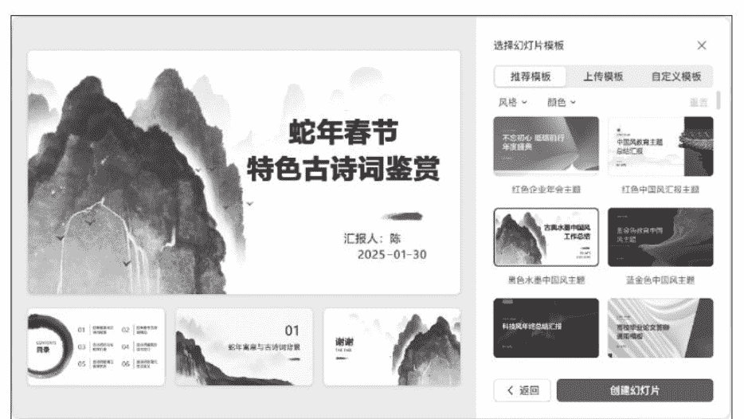

图 5-26 在【选择幻灯片模板】对话框中选择适合“蛇年春节特色古诗词鉴赏”主题的 PPT 模板

## 5.5 勤思精练

### 【任务 5-6】借助美图设计室的“Live PPT”智能生成主题 PPT

借助美图设计室的“Live PPT”智能生成主题 PPT，主题为“运动与健康”。

### 【任务 5-7】借助讯飞智文智能生成主题 PPT

借助讯飞智文智能生成主题 PPT，主题为“新能源汽车营销方案”。

### 【任务 5-8】借助 Kimi+ 的“PPT 助手”智能生成主题 PPT

借助 Kimi+ 的“PPT 助手”智能生成主题 PPT，主题为“黄山的奇松”。

### 【任务 5-9】借助通义千问的“PPT 创作”智能生成主题 PPT

借助通义千问的“PPT 创作”智能生成主题 PPT，主题为“AIGC 学习入门指南”。

# 模块6 AIGC轻松创作精美图像作品

AI绘画是一种革命性技术，它使用人工智能算法创造视觉艺术作品，这种技术通常基于深度学习模型，如GAN、变分自编码器（Variational Autoencoder, VAE）、Transformer等。这种技术通过学习和模仿大量艺术作品的艺术风格和技巧，自动生成具有创意和美感的图像。用户只需要提供简单的需要描述或者选择特定的风格，AI绘画工具就能自动生成独一无二的画作。这不仅为艺术创作提供了无限的可能性，也使得没有绘画背景的人能够轻松创作出精美的艺术作品。

## 6.1 先睹为快

### 【案例6-1】使用豆包生成图像

#### 案例描述

生成图像的提示词如下：帮我生成图像：在绿色的草原上，一头牛在可爱和露营风格的环境中安静地吃草，天蓝色和绿色，浅红色和绿色的色调，淡雅的绘画风格，深橙色和白色相互交织，营造出宁静的氛围；画面比例设置为9：16。

#### 案例展示

豆包生成的图像如图6-1所示。


图6-1 豆包生成的图像

### 【案例 6-2】使用即梦 AI 生成图像

#### 案例描述

生成图像的提示词如下。生成图像：清澈的泉水悄无声息地流淌，仿佛在珍惜每一滴泉水；阳光透过岸边的树木，投下斑驳的光影，映照在水面上，与晴朗柔和的阳光交织成一幅和谐的画面；一朵荷花悄然拉近，粉嫩的花苞尚未完全展开，却已透出几分娇艳，仿佛正在积蓄力量；一只蜻蜓早早地停驻在花苞之上，轻盈的身躯与尖尖的花瓣形成鲜明对比，展现出大自然的生机与活力，整幅画面充满了生命的韵律和诗意，令人感受到夏日清晨的清新与宁静；画面比例设置为 4 : 3。

#### 案例展示

即梦 AI 生成的图像如图 6-2 所示。


### 【案例 6-3】对比文心一言与豆包生成的图像

#### 案例描述

分别在文心一言、豆包中使用以下提示词生成对应的图像：蓝色山峰，雪景，古代建筑，河流，夜晚，中国风，华丽，细节，幻想艺术，唯美。

#### 案例展示

在不同的 AI 工具中使用相同的提示词，生成的图像有所区别。文心一言生成的图像如图 6-3 所示。豆包生成的图像如图 6-4 所示。


图6-3 文心一言生成的图像

图6-4 豆包生成的图像

## 6.2 释疑解惑

### 【问题6-1】常用的图像生成与处理专用型AI工具有哪些？

常用的图像生成与处理专用型AI工具介绍如下。

#### 1. 文心一格

文心一格是由百度推出的AI艺术和创意辅助平台，是依托飞桨深度学习平台、文心大模型的技术创新推出的“AI作画”产品，可轻松驾驭多种风格，快速生成不同风格的创意画作，为设计和创作带来更多的灵感和创意。

文心一格面向有设计需求和创意的人群，能够根据用户输入的文字描述快速生成具有高度艺术感的绘画作品。它提供了各类型图片的素材图库，支持多种绘画风格，包括油画、水彩、素描、卡通等。

#### 2. 通义万相

通义万相是由阿里巴巴推出的AIGC绘画创作大模型，用户可以很轻松地使用它创作出精美的画作。它可以基于文本生成不同风格的图像，它支持生成相似图像的创意发散功能、支持图像风格迁移功能，生成速度快。

#### 3. 即梦AI

即梦AI是由字节跳动旗下的抖音团队推出的AI图片创作与绘画工具，专为图文和短视频创作者设计，它简单易用、功能强大，目前支持图片生成、智能画布、视频生成和故事创作功能。

#### 4. 海艺 AI

海艺 AI 是一款高效、易用的 AI 绘画和图片生成工具，用户无须掌握专业技能，仅需输入提示词即可生成高质量图片。海艺 AI 通过结合强大的渲染引擎和丰富的模型库，满足个性化创作需求。海艺 AI 不仅有专业的图片生成功能，覆盖游戏、设计、电商、家居等多场景应用，还有 AI 滤镜、AI 美妆等泛娱乐功能，同时海艺 AI 还为用户创建了一个能够实现互动合作的创意社区。

#### 5. 堆友

堆友是由阿里巴巴精心打造的设计师全成长周期服务平台，其不仅提供丰富的 AI 功能，如文生图、图生图等，还提供强大的图片编辑功能和“AI 工具箱”功能。其 3D 素材丰富且可编辑，并配有专业 WebUI 和模型训练功能。

堆友以成为设计师的好朋友为目标，不仅是一个由阿里巴巴设计师团队原创的，提供免费可商用的 3D 头像、3D 场景、3D 元素等丰富内容的资源网站，还是一个强大的在线编辑器。堆友还提供了“AI 反应堆”“AI 工具箱”“AI 助手”功能，能够助力设计师、画家、学生及相关兴趣爱好者快速生成高质量绘画作品，支持文生图、图生图及创作社区同款作品。

堆友提供了很多与图片设计相关的 AI 功能，如常用的文生图、图生图、海报设计、ComfyUI、一键抠图等，功能非常齐全。

#### 6. WHEE

WHEE 是美图旗下的 AI 绘画平台，主要功能包括文生图、图生图、创作词库、风格模型等。用户只需要输入提示词，WHEE 就能根据提示词生成对应的图像；用户也可以导入一张照片，WHEE 会根据照片生成多种风格的绘画作品。此外，WHEE 还提供了 AI 修图功能，能够满足用户在视觉创作方面的需求。

#### 7. 无界 AI

无界 AI 是由无界版图推出的专注于 AIGC 的社区和平台，其提供简洁易用、模型丰富的 AIGC 绘画工具，支持多种绘画风格。它集成了提示词搜索、AI 图库、AI 创作等功能，并采用区块链技术确保 AI 作品的版权受到保护。

### 【问题 6-2】常用的创意设计 AI 工具有哪些？

目前，常用的创意设计 AI 工具如表 6-1 所示。

表6-1 常用的创意设计AI工具

| 序号 | AI工具名称 | 说明 |
| :--- | :--- | :--- |
| 1 | PostNitro | 一款专为社交平台内容创作者、个人博主设计的 AI 工具，专注于快速创建吸引人的社交平台封面图片，尤其适用于小红书等平台。用户通过输入主题，能使 PostNitro 迅速生成封面设计 |
| 2 | 稿定 | 设计师必备的在线设计工具，拥有海量有版权的素材模板，适用于图片和视频制作 |
| 3 | 墨刀 | 提供强大的原型编辑和交互能力，支持创建脑图、流程图和需求文档，AI 赋能一键生成设计，提供流畅的协作体验和灵活的团队管理 |

| 序号 | AI 工具名称 | 说明 |
| :--- | :--- | :--- |
| 4 | 即创 | 提供 AI 视频创作、图文创作和直播创作服务 |
| 5 | AIDesign | 提供在线 Logo 设计服务，用户可以通过 AI 技术快速创建和定制 Logo |
| 6 | 美间 | 提供海量免费素材模板和提案 PPT，支持软装设计、产品营销、电商物料输出等场景 |

### 【问题 6-3】AI 图像生成与处理工具的应用场景有哪些？

AI 图像生成与处理工具的应用场景如下。

- 个性化艺术创作：用户可以根据自己的喜好定制独特的艺术作品，如个人肖像、宠物画像等。
- 游戏和电影视觉效果：AI 绘画可用于快速生成游戏背景、角色概念图，以及电影的视觉效果草图。
- 广告和社交平台内容：为广告创意或社交平台上的帖子提供视觉上吸引人的图像，增强内容的吸引力。
- 时尚设计：利用 AI 绘画探索新的设计理念和模式，为时尚行业提供创新灵感。
- 教育和研究：作为艺术教育和视觉艺术研究的工具，帮助用户学习和探索不同的艺术风格和历史。
- 放松和心理治疗：通过将创建艺术作品作为一种放松和心理治疗的手段，帮助用户减轻压力和缓解焦虑。
- 室内设计和家居装饰：生成与房间风格相匹配的定制画作，为室内设计提供灵感。
- 个人和企业礼品：创建个性化艺术作品作为礼品，为个人和企业用户提供独特的礼品选择。
- 数字艺术作品与 NFT：生成独一无二的数字艺术作品，可用于数字艺术作品收藏和非同质化通证（Non-Fungible Token, NFT）的创作与交易。

### 【问题 6-4】AI 绘画提示词的基本组成元素有哪些？

提示词：一幅奇幻风格的中式山水画卷中，连绵、壮丽的山脉被皑皑白雪覆盖，山间有潺潺溪流流淌，错落有致的古老建筑点缀其间，光影柔和和交错，以蓝色调为主，色彩在山脉上自然过渡，展现出神秘而美丽的景象。

不同的生成工具对以上这段提示词的理解和反馈可能略有差异，文心一言生成的图片如图 6-5 所示，海艺 AI 生成的图片如图 6-6 所示。

对这段提示词进行剖析可知，AI 绘画提示词的基本组成元素如下。

（1）画面风格与主体

- 壮丽山脉：强调山脉的雄伟壮观，如“连绵起伏的壮丽山脉，山峰高耸入云，气势磅礴”。
- 白雪覆盖：突出山脉上的白雪元素，如“被皑皑白雪覆盖的山脉，白雪反射着光芒”。
- 奇幻风格：营造出一种奇幻的氛围，如“奇幻风格的山脉景观，让人仿佛置身于神秘的未知世界，充满梦幻色彩”。
- 中式山水：体现中国传统山水画的韵味，如“具有中式山水意境的山脉，重峦叠嶂，线条柔美，韵味悠长”。

（2）细节与元素

- 山间建筑：描述山间点缀的建筑，如“山间错落有致的古老建筑，飞檐翘角，透出古朴的气息”。
- 潺潺溪流：提及山间流淌的溪流，如“蜿蜒流淌于山间的潺潺溪流，溪水清澈见底”。
- 光影效果：强调光线在画面中的作用，如“柔和的光线洒在山脉上，光影交错，营造出温暖而神秘的氛围，山峰明暗有致”。

（3）色彩与质感

- 以蓝色调为主：明确色彩基调，如“以蓝色调为主的山脉，深蓝、浅蓝相互交织，展现出山脉的冷峻与深邃”。
- 柔和过渡：描述色彩的过渡自然，如“色彩在山脉上柔和过渡，从山顶的深蓝到山腰的浅蓝，再到山脚的暖色调，自然和谐”。

### 【问题 6-5】多风格绘画提示词有哪些具体的基本结构？

为了实现不同风格的 AIGC 绘画，创作者撰写的提示词需要具有不同的基本结构。

#### 1. 普通场景具象描述提示词的基本结构

（1）基本结构 1
主题 / 主体描述 + 环境描述 + 风格设定 + 构图镜头设计 + 图像属性。

（2）基本结构 2
参考图 + 基本结构 1。

普通场景具象描述提示词的基本结构的各组织元素的解释如下。

- ① 主题 / 主体描述：是指对主题 / 主体（人或物）、外形、动作、神态描述等的具象描述。
- ② 环境描述：是指对场景、天气、氛围、光线等的描述。
- ③ 风格设定：是指水墨、赛博朋克、水彩等，对于知名的创作者风格，可以直接引用其姓名。
- ④ 构图镜头设计：是指视角、镜头、构图，如俯视角度、35mm 镜头、超广角等。
- ⑤ 图像属性：是指系统指令，如尺寸、渲染参数等。

普通场景具象描述提示词的撰写需要创作者提前构思好画面，将自己想要的画面用语言描述出来并提供给 AI 工具。

提示词示例：主题/主体描述（探险者，可爱女孩）+环境描述（在森林中，环绕着花朵）+风格设定（皮克斯风格）+构图镜头设计（超广角）+图像属性（3D 渲染）。

完整提示词示例如下。

可爱的女孩置身于森林之中，周围环绕着花朵，画面细节精致，呈现出皮克斯风格的流行趋势。这款玩具色彩鲜艳明亮，具有超高质量和细腻光泽。采用 3D 渲染和 OC 渲染技术，确保了最佳的质量。其照明效果达到 8K 级别，面部细节清晰可见。画面比例调整为 9：16，使画面更加逼真。

#### 2. 大场景抽象描述提示词的基本结构

基本结构：故事+场景+情绪+氛围+风格设定+构图镜头设计+图像属性。

抽象描述与具象描述不同，抽象描述着重于传达一种情绪、氛围或事物的本质。

提示词示例如下。

一个炎热的夏日，一群快乐的人正在公园里嬉戏。画面采用暖色调，展现全景，拥有高清画质，宛如电影一般，纵横比为 16：9。

#### 3. 真实人物描述提示词的基本结构

基本结构：年龄+性别+人种+身体特征+衣着描述+环境描述+拍摄视角。

提示词示例：20 岁的中国女孩，大眼睛，高挺的鼻梁，佩戴时尚耳环 身着白色连衣裙，一头黑色长发，背景为纯白色，采用摄影手法，全景，正面视角，8K 超高清画质，纵横比为 1：1。

#### 4. 卡通人物描述提示词的基本结构

基本结构：人物描述+环境描述+卡通风格+图片属性。

提示词示例：3D 效果，探索者系列、泡泡玛特的可爱女孩 IP 形象，纯净背景，花朵图案，高细节表现，皮克斯风格的流行趋势，色彩鲜艳的模拟盲盒玩具，超高品质，细腻光泽，OC 渲染效果，最佳画面质量，8K 高亮度的照明效果，面部特写镜头，景深效果，纵横比为 1：1。

#### 5. 3D 模型描述提示词的基本结构

基本结构：主体描述+3D 效果+灯光描述+渲染描述。

提示词示例：液压机，白色背景，3D 效果，柔光，OC 渲染效果，纵横比为 4：3。

#### 6. 图标类描述提示词的基本结构

基本结构：应用程序图标+风格（如等距 3D 效果）+主体

- 3D 效果图标描述提示词示例：应用程序图标，等距 3D 效果，汽车，参考 Dribbble 和 Pinterest，背景简洁，极简风格。
- 渐变图标描述提示词示例：应用程序图标，渐变，汽车，参考 Pinterest 和 Dribbble，简洁背景，极简风格。
- 插画图标描述提示词示例：应用程序图标，平面设计，汽车，插图设计。
- 扁平风格图标描述提示词示例：应用程序图标，扁平风格，相机。

#### 7. 扁平插画描述提示词的基本结构

基本结构：场景描述 + 整体色调 + 固定关键词（如 illustration，即插画）。
提示词示例：春天，渐变背景，绿蓝色调，明亮，晴天，水，广阔的天空，小屋，动物，牧场，草地，山，村庄，广角视角，风景，自然光，平面插图，矢量插图，8K 高清，纵横比为 4 : 3。

### 【问题 6-6】使用文心一格生成图片时如何撰写提示词？

与和人类画师沟通相似，用户需要使用文本描述，即所谓的提示词来“告诉”文心一格需要生成什么样的画作。

#### 1. 提示词的输入方式

用户可以通过自然语言描述和排列关键词这两种方式输入提示词，从而生成符合需求的画作。

（1）自然语言描述
自然语言描述即简单、通俗地描述，用户只需要使用简单、直白的沟通和描写方式，写下对画作的想象和期待，即可使文心一格生成对应画作。
如果希望生成一幅如图 6-7 所示的站在樱花树下的少女图，提示词可以写成：一位女性站在樱花树下，她穿着白色连衣裙，头发披散着，眼神温柔而专注，背景中粉色花朵盛开，形成一幅美丽的景象，写实风格。

（2）排列关键词
排列关键词指的是通过拆解和叠加关键词的方式，将画面拆解为画面主体词、细节词、风格修饰词，并将它们组合成提示词，以生成对应的画作。
以排列关键词方式输入提示词生成图 6-7 时，提示词可以写成 站在樱花树下的美丽少女，半身像，写实，浪漫风格。

图 6-7 站在樱花树下的少女图

#### 2. 提示词的优化

清晰地表达画作细节是一个高效的创作习惯，如果只告诉文心一格我们想要绘制“月光下的美丽少女”，文心一格往往并不知道我们想要的是什么样的人物形象。此时我们可以通过扩写描述或增加关键词的方式，按需优化提示词。

（1）扩写描述
提示词示例 一个在月光下的美丽少女，她面容精致、面带微笑，身着国风华服，如诗如画、静美如梦、宛若精灵，画作风格是唯美二次元风格。

（2）增加关键词
提示词示例：古装少女，月光清冷，柔风轻拂，花瓣飘落，衣袂翩翩，绣纹精致，在月光下泛着幽幽光泽。浪漫气氛，浅粉色色调，丰富细节，唯美二次元。

#### 3. 提示词示例

（1）动物类
提示词 1：月球上的兔子戴着墨镜。
提示词 2：在月球上，炫酷机甲兔子戴着墨镜，周围是飞船残骸，高清画质。

（2）植物类
提示词 1：好看的永生花。
提示词 2：永生花，晶莹剔透，梦幻艺术创想。

（3）场景类
提示词 1：新中式风景，超高清，细节刻画。
提示词 2：游戏梦幻唯美新中式风景，超高清，细节刻画，沐浴在漫天花瓣里，缥缈电影般的环境，明亮清晰。

（4）家装设计类
提示词 1：超现实主义，房间内饰，彩色，8K 高清，3D 渲染。
提示词 2：创意客厅，高贵蓝色视觉体验，花草，金色的光线，超现实主义，令人难以置信的细节，令人惊叹。

### 【问题 6-7】如何使用海艺 AI 生成图像？

在海艺 AI 中，有文生图、图生图和条件生图 3 种绘图模式，其中文生图模式包括默认、SDXL、实验室 3 种生图方式。
使用海艺 AI 生成图像的基本步骤：选择模型—填写提示词—设置参数—单击按钮以生成图像。其中，模型决定了画风、提示词定义了画面内容、参数则细化了图像的预设特性。

### 【问题 6-8】AIGC 中“图生图”的原理是什么？

在 AI 绘画的实际运用中，“文生图”因为生成图像存在不确定性，其实际的生成图像的可控性并不高，可以使用“图生图”，提高生成图像的可控性。
“图生图”是一种基于 AI 的图像生成技术，它允许用户以现有的图像为基础，结合文本描述生成新的图像。这项技术的作用在于它可以根据用户的具体需求，通过混合图像和文本描述创造出新的视觉内容。

### 【问题 6-9】使用 WHEE 生成图片时如何撰写提示词？

使用WHEE生成图片时，提示词的语义以中文语义为主,提示词应简洁、明了、富有启发性，避免使用冗长且无效的提示词。

一般按照公式 [ 主体对象 ] + [ 环境细节 ] + [ 风格氛围 ] + [ 图片质量 ]，进行提示词的撰写。
提示词示例如下。

- [ 主体对象 ]：一只小兔子，软绵绵的毛，绒毛感。
- [ 环境细节 ]：自然阳光，野花、草地，近景。
- [ 风格氛围 ]：卡通风格，可爱，儿童插画。
- [ 图片质量 ]：高清分辨率，4K，超高质量。

### 【问题 6-10】使用豆包生成图片时如何撰写提示词？

使用豆包生成图片的提示词示例如下。

- 提示词示例 1：图片风格为 3D 渲染，一幅宁静的山水画，高山流水，云雾笼罩，瀑布直下，湖面平静，一艘平稳的小船，两个人静静地坐着，深蓝色和浅蓝色的山，宁静而壮丽，比例为 2 : 3。
- 提示词示例 2：图片风格为人像摄影，身穿黑色紧身连衣裙的女孩，明暗分明，面板灯，比例为 2 : 3。
- 提示词示例 3：图片风格为人像摄影，一张亚洲女性在家里的照片，她轻松快乐地笑，阳光照在脸上，奶油风格和绿色调的衣服，比例为 2 : 3。
- 提示词示例 4：图片风格为人像摄影 在浅灰色的背景下，一个 18 岁的阳光少年，拥有一张帅气的脸庞，短发，炯炯有神的眼睛，鼻子高挺而精致，短袖。
- 提示词示例 5：图片风格为风景，草原上的羊群，浅米色和深栗色，写实，高细节，比例为 4 : 3。
- 提示词示例 6：一只白猫在一个木桌上睡觉，昏暗的室内，阳光照在脸上，背景模糊，高级质感，比例为 2 : 3。
- 提示词示例 7：图片风格为点彩水墨画，水天一色,江河流水，蓝色水墨，晕染,一叶孤舟，中式审美，留白，极简主义，比例为 9 : 16。
- 提示词示例 8：图片风格为水彩画，公园里长椅上的老年人，柔和的色彩，柔软的线条，艺术照明，黄金比例，比例为 4 : 3。

## 6.3 精彩纷呈

### 【任务 6-1】对比国产主流绘画专用型 AI 工具的文生图效果

文生图是用户最基础的需求之一，简单来说，文生图就是通过输入提示词，在不进行其他参数设置的情况下生成图片。从画面风格丰富性、画面效果逼真度等方面对比即梦 AI、海艺 AI、WHEE 等国产主流绘画专用型 AI 工具的文生图效果。

提示词 1：生成人像，一个美丽的中国女孩，画面比例为 9：16，其他参数值均为基础默认值。

提示词 2：生成猫咪图像，一只可爱的猫咪，画面比例为 4：3，其他参数值均为基础默认值。

#### 任务实施

尺有所短，寸有所长，每个国产主流绘画专用型 AI 工具都有自己的优势和不足。请读者根据这些工具生成图片的实际效果，从画面风格丰富性、画面效果逼真度等方面进行自我判断，选择适合自己的工具。

即梦 AI 生成的人像如图 6–8 所示。海艺 AI 生成的人像如图 6–9 所示。

WHEE 生成的人像如图 6–10 所示。即梦 AI 生成的猫咪图像如图 6–11 所示。海艺 AI 生成的猫咪图像如图 6–12 所示。WHEE 生成的猫咪图像如图 6–13 所示。

图 6–8 即梦 AI 生成的人像

图 6–9 海艺 AI 生成的人像

图 6–10 WHEE 生成的人像

图 6–11 即梦 AI 生成的猫咪图像

图6-12 海艺 AI 生成的猫咪图像

图6-13 WHEE 生成的猫咪图像

### 【任务6-2】使用即梦 AI 绘制文案配图

请根据以下文本内容绘制一张图片：阳光由那扇大玻璃窗透入屋内，先落在墙上，接着映照到桌上，最终，也照到了我那张可爱的床上。

风格是水彩，画面是阳光从大玻璃窗照进房间内，照在墙上、地板上、桌上、床上。画面主体要突出，画面的色彩搭配和整体氛围要贴合文案所围绕的主题，画面比例是 4 : 3。

#### 任务实施

输入提示词后，即梦 AI 绘制的文案配图如图 6-14 所示。

图6-14 即梦 AI 绘制的文案配图

### 【任务6-3】使用海艺 AI 绘制商品图

绘制一幅新品易拉罐装橙子汽水饮料的商品图，要求风格为写实风格，画面是水面上有一罐饮料，周围有橙子作为装饰，画面整体展现出清凉、爽快的感觉，画面比例是 1 : 1。

#### 任务实施

输入提示词后，海艺 AI 绘制的商品图如图 6-15 所示。

图 6-15 海艺 AI 绘制的商品图

## 6.4 熟能生巧

### 【任务 6-4】使用文心一言的“智慧绘图”绘制多幅作品

使用文心一言的“智慧绘图”完成以下绘画任务。

- （1）绘制精美工艺画
提示词：画一幅工艺画，黄金材质的老鹰，细节丰富，怀旧漫画风。
- （2）绘制山水画
提示词：画一幅山水画，夜里，戈壁滩，胡杨林，茫茫白雪，庆祝的人群点着篝火。

#### 任务实施

使用文心一言的“智慧绘图”绘制多幅作品。

- （1）绘制精美工艺画
输入提示词后，文心一言绘制的精美工艺画如图 6-16 所示。
- （2）绘制山水画
输入提示词后，文心一言绘制的山水画如图 6-17 所示。

图 6-16 文心一言绘制的精美工艺画

图 6-17 文心一言绘制的山水画

### 【任务 6-5】使用通义万相的“文字作画”生成多幅图像

熟悉使用通义万相实现 AI 作画的基本方法，使用通义万相的“文字作画”完成多幅图像生成任务，对应的提示词及参数设置如下。

- （1）以平视视角画一群羊
一群羊悠闲地在绿油油的草地上低头觅食，羊毛在早晨的阳光照耀下呈现出温暖的金色光泽，形成美丽的光影效果。画面比例为 16：9，其他参数都设置为基础默认值。
- （2）以仰视视角画高大的椰子树
高大的椰子树如同巨人般耸立，枝叶茂盛，直指蓝天，阳光透过树叶间隙洒在地上，形成斑驳光影，增添了几分神秘与浪漫。画面比例为 9：16，其他参数都设置为基础默认值。
- （3）画雨后的城市街景
雨后的城市街景，湿润的地面上呈现出绚丽多彩的霓虹灯光，行人撑伞匆匆走过，车辆在街道上缓缓行驶，留下一道道彩色的尾迹。画面比例为 16：9，其他参数都设置为基础默认值。
- （4）画早晨的阳光
早晨的阳光洒向茂密的森林，金色的光芒穿过树与树之间的缝隙，形成斑驳的光影，营造出一种写实而静谧的氛围。画面比例为 3：4，其他参数都设置为基础默认值。
- （5）画夜晚的河边
夜晚的河边，灯光温柔地照亮了水面，一群莲花灯缓缓飘向河心，灯光与水面上的粼粼波光交相辉映，营造出梦幻般的视觉效果。画面比例为 1：1，其他参数都设置为基础默认值。

#### 任务实施

##### 1. 熟悉使用通义万相实现 AI 作画的基本方法

使用通义万相实现 AI 作画的基本方法如下。
通义万相支持中英文输入，提供了结构化预设提示词，这些提示词包括风格、光线、材质、渲染、色彩、构图、视角等方面的内容，供用户快速使用，用户还可以复用提示词，快速得到想要的效果。通义万相还提供了四格漫画、情侣头像、图标印花、电影分镜等多种创意模板，支持 1：1、16：9、9：16、4：3、3：4 等多种预设比例，以适应不同场景、终端的差异化使用诉求。
打开通义万相首页，单击【文字作画】，在输入框中输入提示词，选择一种合适的创意模板和比例，通义万相“文字作画”的参数设置如图 6-18 所示，然后单击【生成画作】按钮，即可生成相应的图片。

##### 2. 完成 AI 作画任务

- （1）以平视视角画一群羊
输入提示词后，其他参数都设置为基础默认值。通义万相“文字作画”生成的一群羊如图 6-19 所示。
- （2）以仰视视角画高大的椰子树
输入提示词后，其他参数都设置为基础默认值。通义万相“文字作画”生成的高大椰子树如图 6-20 所示。

图6-18 通义万相“文字作画”的参数设置

图6-19 通义万相“文字作画”生成的一群羊

图6-20 通义万相“文字作画”生成的高大的椰子树

（3）画雨后的城市街景

输入提示词后，其他参数都设置为基础默认值。通义万相“文字作画”生成的雨后的城市街景如图6-21所示。

图6-21 通义万相“文字作画”生成的雨后的城市街景

（4）画早晨的阳光

输入提示词后，其他参数都设置为基础默认值。通义万相“文字作画”生成的早晨的阳光如图6-22所示。

图6-22 通义万相“文字作画”生成的早晨的阳光

（5）画夜晚的河边

输入提示词后，其他参数都设置为基础默认值。通义万相“文字作画”生成的夜晚的河边如图6-23所示。

图6-23 通义万相“文字作画”生成的夜晚的河边

### 【任务 6-6】使用海艺 AI 的“图生图”生成图片

在海艺 AI 中，引用图 6-24 所示的图片，生成一幅类似图片。

图 6-24 引用图片

#### 任务实施

打开海艺 AI 首页，在左侧的工具栏中单击【图生图】按钮，然后上传引用图片。接着单击引用图片下方的【智能分析】按钮，自动生成提示词，对自动生成的提示词稍加修改，修改结果：有一匹马在湖边低头吃草，远处是连绵的雪山。
使用海艺 AI 生成的图片如图 6-25 所示。

图 6-25 使用海艺 AI 生成的图片

## 6.5 勤思精练

### 【任务 6-7】对比国产综合型 AI 工具绘制的装修设计图效果

从关键词准确呈现程度、画面精细表达程度等方面对比文心一言、豆包、讯飞星火、智谱清言、天工 AI、腾讯元宝等国产综合型 AI 工具绘制的装修设计图效果。
提示词：请为我设计一间卧室，现代建筑，卧室，卡通，黏土材料，等距，3D 渲染，光滑有光泽，柔和的色彩，暖色调，白色背景，最佳细节，高清，高分辨率。

### 【任务 6-8】对比国产主流绘画专用型 AI 工具绘制的产品广告图效果

从画面风格丰富性、画面效果逼真度等方面对比海艺 AI、360 智绘、WHEE、无界 AI、堆友等国产主流绘画专用型 AI 工具绘制的产品广告图效果。
提示词：请画一幅产品广告图，活虾，落水，水滴飞溅，黑色背景，柔和阴影，一些点缀，商业摄影，广告摄影，徕卡相机拍摄，专业色彩，清晰锐利对焦，高端合成，获奖，最佳画质。

### 【任务 6-9】使用 360 智绘的“图生图”生成一张图片

在 360 智绘中，引用图 6-26 所示的图片，使用“图生图”生成一张类似的图片。

图 6-26 引用图片

### 【任务 6-10】使用无界 AI 生成图片

使用无界 AI 生成一张图片，提示词如下。
一个年轻女子穿着一条裙子，站在海边，背对着镜头，凝视着地平线上的夕阳。太阳似乎快要沉入海面，海面上呈现出金黄色的波光，仿佛这个时刻被定格在了时间的某个角落里。女子的头发随着微风轻轻飘动，轮廓被夕阳余晖映照得柔和而温暖。她仿佛在思考着生命的意义和美好的未来。
画面比例及其他参数自行确定即可。

## 模块7

## AIGC巧妙生成美妙音视频作品

AIGC 音视频生成技术是一种结合语音识别、图像生成、自然语言理解和多模态交互能力的创新工具，它能够理解用户的创作意图，并据此自动生成具有艺术性和表现力的音视频内容。通过海量的音频、视频、文本数据集训练，AIGC 音视频生成系统可以学习不同风格的音乐旋律、影视剪辑逻辑和视觉叙事方式，从而实现从文本到音乐、从文字到动画、从脚本到影片等多种形式的智能生成。

如今，通过巧妙运用这些先进的工具和技术，创作者能够以前所未有的方式生成美妙绝伦的音视频作品。无论是在电影制作、音乐创作领域，还是在广告设计等领域，AIGC 都展现出了独特的价值和无限的潜力。它不仅为专业人士提供了强大的创作支持，也为广大爱好者打开了一扇通往创意世界的大门。

## 7.1 先睹为快

### 【案例 7-1】使用天工 AI 创作一首歌曲

#### 案例描述

使用天工 AI 创作一首歌曲，歌名为“忆青春”，歌词如下。

> 在操场上的日子 夕阳西下
金色光芒洒在我们的肩
从懵懂的步伐 到勇敢的瞬间
每一件小事 都刻在心间
回忆青春的那天
快乐悲伤全在身边
离别是新的起点
希望未来更美好展现
每次紧张考试 夜晚一起奋斗
友谊的瞬间 如星光璀璨
从初入校园到毕业的时刻
那些回忆 随风在飘散
回忆青春的那天
快乐悲伤全在身边
离别是新的起点
希望未来更美好展现
曾经的我们 共同走过的路
将这份情感 永远深藏心间
回忆青春的那天
快乐悲伤全在身边
离别是新的起点
希望未来更美好展现

#### 案例展示

（1）打开天工 AI 主页。
（2）单击左侧工具栏中的【AI 音乐】，显示【发现音乐】选项卡和【创作歌曲】侧边栏。
（3）在【创作歌曲】侧边栏的【歌名】输入框中输入“忆青春”，然后在【歌词】输入框中输入对应的歌词，如图 7-1 所示。

（4）单击【开始创作】按钮，等待生成歌曲。生成的《忆青春》歌曲如图 7-2 所示。

（5）试听创作的歌曲
在生成《忆青春》歌曲区域，单击歌曲图标中的【播放】按钮即可试听歌曲。

### 【案例 7-2】使用海螺 AI 生成音视频

#### 案例描述

（1）使用海螺 AI 的“文生音”将以下文字转换成语音：蓝色的海浪拍打礁岩，场面恢宏壮阔。
（2）使用海螺 AI 的“生成同款”生成一段视频。
（3）使用海螺 AI 的“文生视频”生成一段视频。
输入的提示词：一位青春少女站在聚光灯下，笑容明媚，眉眼间满是活力与朝气。

#### 案例展示

##### 1. 文字转语音

（1）进入海螺 AI 主页，如图 7-3 所示。

（2）在海螺 AI 主页单击【语音】，打开【文字转语音】页面。
（3）单击左侧的【文生音】。
（4）输入需要转换成语音的文字内容：蓝色的海浪拍打礁岩，场面恢宏壮阔。
（5）语音参数设置。语音模型、音色、音色效果调节、输出情绪、语速、声调、音量等语音参数均采用默认值。
（6）单击【生成音频】按钮，等待文字转换成语音完成后，生成音频。
需要转换成语音的文字内容、语音参数设置、生成音频如图 7-4 所示。

##### 2. 生成同款视频

（1）在海螺 AI 主页单击【视频】，进入【发现】页面。在【官方精选】区域选择一个视频作品，将鼠标指针指向该视频作品，会出现【生成同款】按钮，如图 7-5 所示。

图 7-4 文字内容、语音参数设置、生成音频

图 7-5 在海螺 AI 的【发现】页面将鼠标指针指向一个视频作品

（2）单击【生成同款】按钮，打开生成视频的页面，生成同款视频时的【图生视频】选项卡如图 7-6 所示。

图 7-6 生成同款视频时的【图生视频】选项卡

（3）单击【发送】按钮，等待同款视频的生成。

##### 3. 文生视频

（1）在海螺 AI 主页，打开生成视频的页面。

（2）切换到【文生视频】选项卡，在输入框中输入以下提示词：

一位青春少女站在聚光灯下，笑容明媚，眉眼间满是活力与朝气。

（3）设置运镜指令。运镜指令选择【固定镜头】。

（4）选择模型。选择【T2V-01-Director】模型。

（5）设置次数。设置次数为【1】。

在【文生视频】选项卡中输入提示词与设置参数的结果如图 7-7 所示。

图 7-7 在【文生视频】选项卡中输入提示词与设置参数的结果

（6）单击【发送】按钮，等待视频生成。

## 7.2 释疑解惑

### 【问题 7-1】常用的音乐创作与音频处理 AI 工具有哪些？

1. 海绵音乐

海绵音乐是由字节跳动推出的 AI 音乐创作平台，专注于个性化音乐生成，特别擅长中文歌曲创作，用户可通过输入灵感关键词和自定义选项快速生成音乐。

2. 网易天音

网易天音是由网易云音乐推出的 AI 音乐创作工具，用户无须掌握音乐知识即可上手，它能够帮助音乐爱好者和歌手轻松完成作词、作曲、编曲和演唱的全流程创作，生成高质量的 AI 初稿。

3. 讯飞智作

讯飞智作是由科大讯飞推出的一站式智能配音服务平台，它提供专业的合成配音、真人配音，以及虚拟人主播等配音解决方案，可以帮助内容生产者更高效地进行音视频创作，使创作过程更快、更省时、更具特色。用户只需要简单地输入文本、选择发音人或虚拟形象，即可完成音视频的制作。

4. 度加剪辑

度加剪辑是由百度推出的一款 AI 创作工具，提供热搜一键成稿、文稿一键成片的功能，是内容创作者的得力助手。度加剪辑是一款极具特色和实用性的智能写作辅助工具，对于自媒体创作者来说是非常值得一试的 AI 创作工具。它支持在网页上使用和直接下载 App 使用，前提是注册百度账户。

5. TME Studio

TME Studio 是由腾讯音乐推出的 AI 音乐生成工具，由银河音效、MUSE、天琴实验室和腾讯 AI Lab 联合打造，旨在简化音乐创作过程，助力音乐爱好者轻松创作音乐，提供音乐创作和编辑功能。

### 【问题 7-2】常用的文本转语音 AI 工具有哪些？

目前，常用的文本转语音 AI 工具如表 7-1 所示。

表7-1 常用的文本转语音AI工具

| 序号 | 名称 | 说明 |
| :--- | :--- | :--- |
| 1 | 魔音工坊 | 一款中文 AI 语音合成工具，支持多种语音风格和情感表达，适用于短视频配音、有声书制作和广告旁白等场景 |
| 2 | 海豚 AI | 支持多语种和多风格发音，具备自然、流畅的语音合成效果，适合内容创作者和企业使用 |
| 3 | Text To Speech | 通用型文本转语音软件，支持多种语言和语音风格，用户可自定义语速、语调等参数，适用于教育、办公等多种场景 |
| 4 | TTSMaker | 在线文本转语音生成器，界面简洁、操作便捷，支持多种语言和语音角色，适用于视频配音、语音播报等内容创作场景 |
| 5 | Voicemaker | 一款以英文为主的AI语音合成平台，提供高质量男女声选择及情感语气控制，广泛应用于播客、动画和互动式教学中 |
| 6 | LOVO AI | 一套专业的AI语音生成解决方案，能够实现高质量语音合成与语音克隆，适用于影视配音、广告制作及虚拟助手等领域 |

### 【问题7-3】常用的视频剪辑与处理AI工具有哪些？

目前，常用的视频剪辑与处理AI工具如表7-2所示。

表7-2 常用的视频剪辑与处理AI工具

| 序号 | 名称 | 说明 |
| :--- | :--- | :--- |
| 1 | 快剪辑 | 提供专业视频剪辑功能，集成AI工具，如AI擦除工具、AI配音工具等，可用于激发创意 |
| 2 | 绘影字幕 | 提供视频字幕翻译、配音服务，支持多语种精准翻译和自动智能音画同步 |
| 3 | 万彩微影 | AI短视频制作软件，支持文字视频制作、图文转视频等功能 |
| 4 | 芦笋提词器 | 提供智能跟读、隐形提词服务，支持AI写稿 |

### 【问题7-4】AIGC在音视频生成方面有哪些多样化实用功能？

AIGC在音视频生成方面展现了强大的能力，其能够通过深度学习、自然语言处理等技术，巧妙生成高质量的音视频内容。

#### 1. 音频生成

AIGC可以通过分析文本、旋律或语音数据，生成多样化音频内容。

（1）语音合成：利用TTS（Text To Speech，文本转语音）技术，生成自然、流畅的语音，支持多语言、多音色，广泛应用于有声书、语音助手等领域。
（2）音乐生成：基于AI的音乐生成模型（如OpenAI的MuseNet、Google的MusicLM），可以根据用户输入的风格、旋律或情感，自动生成原创音乐。
（3）音效设计：通过分析场景需求，AI可以生成逼真的环境音效或特效音，适用于影视、游戏等领域。

#### 2. 视频生成

AIGC在视频生成方面的应用越来越广泛，能够根据文本、图像或其他视频生成新的视频内容。

（1）文本生成视频：通过输入描述性文本，AI可以生成对应的视频片段。例如，runway、Synthesia等工具可以根据脚本生成视频。
（2）图像生成视频：将静态图像转化为动态视频，如通过AI技术让照片中的人物“动起来”或为人物生成动画效果。
（3）视频风格迁移：将一种视频风格从一个视频迁移到另一个视频中，如将现实场景的视频风格转换为卡通风格或油画风格。
（4）视频修复与补全：AI 工具可以修复模糊、损坏的视频片段或根据上下文生成缺失的视频内容。

#### 3. 音视频结合生成

AIGC 可以将音频和视频内容结合，生成更加丰富的多媒体内容。

（1）虚拟人主播：通过 AI 工具生成虚拟形象，并结合 TTS 技术，实现自动播报新闻、讲解内容等功能。
（2）个性化视频制作：根据用户输入的文本或音频，自动生成带有字幕、配音和动态画面的视频，适用于教育、营销等领域。
（3）影视创作辅助：AI 工具可以根据剧本自动生成分镜头脚本、配乐和特效，大幅提升影视创作效率。

### 【问题 7-5】AIGC 生成视频的提示词需要包含的关键信息有哪些？

AIGC 生成视频的提示词需要包含以下关键信息。

（1）主要角色及其能力和任务
明确视频中的主要角色，以及他们的能力和需要完成的任务。例如，想要生成的视频是一个新闻视频，提示词可以为“写一篇关于苹果公司最新产品的新闻稿，包括主要功能、市场反应和预期销量”。
（2）内容制作技巧
描述视频的内容制作技巧，如使用感官语言、提供数据和事实、设立冲突或疑问等。例如，提示词可以要求提供引人入胜的开头、生动描述细节、使用情感词语等。
（3）平台适应能力
考虑视频将在哪个平台上发布，确保视频遵守和适应该平台的规范和用户群体。例如，视频将在抖音上发布，提示词可以要求生成吸引眼球的标题和简短的介绍。
（4）情感共鸣能力
通过情感共鸣吸引观众。例如，提示词可以要求描述一个感人的故事或展示一个角色的内心世界，以引起观众的情感共鸣。
（5）技术使用能力
描述实现视频中包含的效果需要使用的技术，确保 AI 工具能够理解并正确使用这些技术。例如，视频中包含动画效果，提示词中应明确指出需要使用哪些动画技术。

### 【问题 7-6】AIGC 生成视频时撰写高质量提示词的技巧有哪些？

#### 1. 撰写高质量提示词的基本技巧

AIGC 生成视频的提示词是指导 AI 工具生成视频的关键，更精确的提示词可以更好地控制视频的生成效果。撰写高质量提示词的基本技巧如下。

- 精准描述：提示词应尽可能详细和具体，避免使用模糊不清的指令。例如，不要只说“创建一个故事”，而要说“创建一个关于一只名叫波比的狗拯救小镇的儿童故事，包含冒险和友谊的元素”。
- 结构清晰：提示词的结构应清晰，可以先描述背景信息，然后描述主要任务和目标，最后描述具体的要求和细节。
- 情感表达：在提示词中融入情感元素，使 AI 工具能够生成更具感染力的内容。例如，可以描述角色的情感变化或故事的情感高潮。

通过以上技巧，用户可以有效地撰写出高质量的提示词，确保 AI 工具生成的视频内容符合预期并具有吸引力。

#### 2. AIGC 生成视频时撰写高质量提示词的高级技巧

撰写高质量提示词的高级技巧如下。

- 使用简单的词语和句子结构，避免使用过于复杂的语言。
- 描述运动时遵循物理规律，尽量描述图片中可能发生的运动。
- 描述与图片相差较大，可能会引起镜头切换，需要注意描述的准确性。
- 现阶段较难生成复杂的运动，如球类的弹跳、高空抛物等。

通过掌握以上撰写提示词的技巧，用户可以更好地利用 AI 工具生成符合预期的视频。
应用以上技巧撰写的提示词，可以总结为以下两种版本。

（1）基础版提示词：主体 + 场景 + 运动
例如，“一个女孩在雨中撑伞漫步”，其中“女孩”是主体，“雨中”是场景，“撑伞漫步”是运动。
这种提示词简单、易写，能够激发 AI 视频工具的创意表现力。

（2）专业版提示词：主体 + 场景 + 运动 + 镜头运动 + 氛围
例如，“两个好朋友坐在公园长椅上交谈，镜头固定，画面色调偏暖，氛围温馨”，这种提示词不仅描述了主体、场景和运动，还加入了镜头运动和氛围，能够使相应 AI 工具生成更符合预期的视频。

### 【问题 7-7】使用即梦 AI 创作视频时如何撰写提示词？

在 AI 视频生成中，提示词是直接描述或引导视频生成的文本或指令，用于描述用户想创作的画面内容、运动方式等，类似给 AI 工具的提示。提示词内容应包括主体对象、外观描述、运行方式等方面的信息，用户借此控制和指导 AI 工具生成内容。提示词在 AI 视频生成中十分重要，是表达用户需求的方式，影响着视频内容和质量。

#### 1. 提示词公式

提示词公式：主体对象 + 外观描述 + 运动形态。

#### 2. 撰写提示词的基本原则

撰写提示词的基本原则如下。

（1）简洁明了
提示词应该简洁明了，避免使用复杂语言，如古诗词、抽象描述、长难句等都属于复杂语言。尽量使用简单的词语和句子结构，以确保 AI 工具正确理解用户的指令。

（2）具体翔实
提示词应该尽可能具体翔实，提供足够的细节，但需要将细节描述得清楚、简单、易于理解。例如，要生成时长为 5s 的视频，应该在提示词中说明 5s 内可以实现的画面指令，AI 语言模型才能更好地理解并生成符合要求的视频。

型可能不能完全覆盖太长的画面指令。

（3）突出主体及其运动形态
提示词应该突出主体及其运动形态，让 AI 语言模型知道用户想要表达的核心内容。例如，要生成一个关于“直升机在空中飞”的视频，可以提供具体的直升机外观、飞行方式、背景等信息，这样可以帮助 AI 语言模型生成更加符合需求的视频，同时降低试错成本。在文生视频中，没有主语的描述等同于没有主体的内容。

（4）自然语言描述
提示词应该避免歧义和抽象，确保 AI 语言模型可以正确理解用户的意图。

（5）细节性描述
提示词应该从多个角度描述用户的需求，这样可以帮助 AI 语言模型生成更加全面的视频。例如，要生成一个关于“狗”的视频，可以提供不同狗的品种、外貌、行为等信息。

（6）加入少量的情感元素
提示词中可以加入少量的情感元素，让 AI 语言模型生成更加生动和符合观看者情绪预期的视频。例如，可以在提示词中加入少量的“快乐”“悲伤”“兴奋”等情感词语。

#### 3. 提示词样例

提示词 1：海浪拍打着沙滩，黄色的月亮在天空中缓缓升起。
提示词 2：一个 3D 形象的小男孩，穿着飞行夹克，在公园滑滑板。
提示词 3：戴着帽子的老人双手捧着一块冰，微风吹动老人的胡子。
提示词 4：一只白色的拉布拉多在湖中慢慢地游泳。
提示词 5：薄荷绿的海浪拍打着金色的沙滩，在海岸边，微风吹动棕榈树的叶子，手绘风格，漫画。
提示词 6：一只可爱的小花猫静静地趴在粉色透明花瓶旁，背景是淡黄色的窗帘，微风吹动窗帘。
提示词 7：一只 3D 卡通小狗，慢慢地向前走远。
提示词 8：卷发女孩忧郁地看着镜头，风吹动她的头发。
提示词 9：一架直升机在空中飞行，背景是雪山和云层。
提示词 10：一位中国古代的男性抬头望着月亮，男人背对着镜头，忧愁的氛围，夜晚。
提示词 11：一只白色萨摩耶在公路上向前奔跑，背景是公路和公路两边的树木。

### 【问题 7-8】如何使用 Vidu 实现图生视频？

图生视频是指将静态图片转化为鲜活的视频。使用 Vidu 实现图生视频的操作步骤如下。
（1）打开 Vidu 首页，单击左侧的【图生视频】按钮或者在右侧的【图生视频】区域单击【立即使用】按钮。
（2）上传一张描述想要生成的画面的首帧图片，可以根据需求再上传一张尾帧图片。
（3）结合图片，输入必要的提示词，描述想要生成的内容。
（4）设置生成视频的各项参数。
在【设置】区域分别设置时长、清晰度、运动幅度、数量等参数，这里采用各个参数的默认值。
（5）单击【创作】按钮，等待视频生成。

## 7.3 精彩纷呈

### 【任务 7-1】使用网易天音创作一首歌曲

使用网易天音创作一首歌曲，歌名为“青春的足迹”，创作歌词时的随笔灵感内容如下：

> 夕阳渐渐西沉在操场
橘黄色光洒在每个角落
回首这四年时光如梦
从懵懂到坚定每一步
这是青春留下的足迹
课堂争论宿舍谈天笑语
欢声笑语心底的印记
带着感激和无尽憧憬
走过操场这里曾有欢笑
课堂上争论那时的梦想
仿佛昨日一切都在眼前
未来的路我们坚定向前
手持笔杆写下无尽怀念
带着感激对未来的期盼
这首歌送给即将踏新程的我们
愿风中传递最温柔记忆
青春的足迹在风中飘荡
成为岁月里最温柔的记忆

#### 任务实施

（1）打开网易天音首页，如图 7-8 所示。


（2）单击【开始创作】按钮，在进入的页面中单击【AI 一键写歌】区域中的【开始创作】按钮，打开【新建歌曲】对话框，切换到【写随笔灵感】选项卡。

（3）在输入框中输入对应的随笔灵感，如图 7-9 所示。

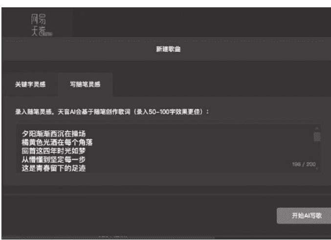

图 7-9 使用网易天音创作歌曲时输入随笔灵感

（4）【段落结构】选择【全曲模式】，音乐类型选择【流行】，如图 7-10 所示。

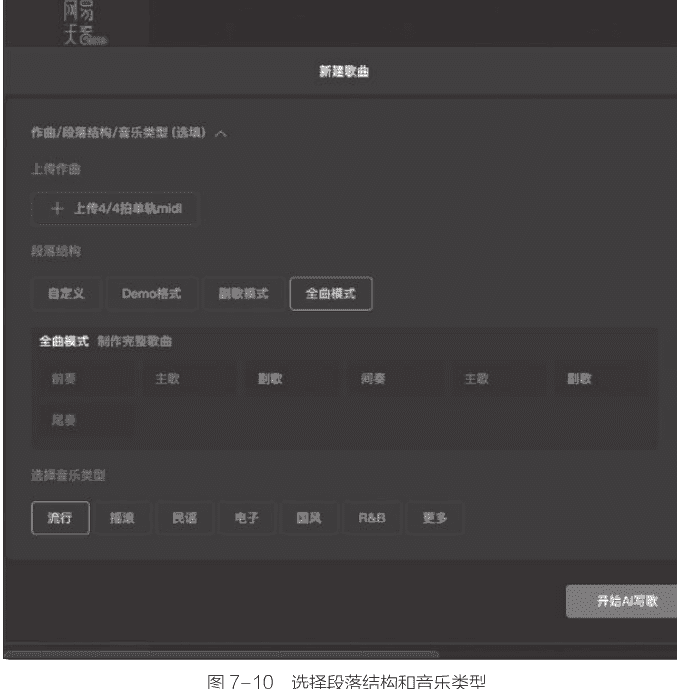

图 7-10 选择段落结构和音乐类型

（5）单击【开始 AI 写歌】按钮，对话框中显示“歌曲内容正在由 AI 生成”，歌曲生成后，会自动打开歌曲编辑页面，如图 7-11 所示。

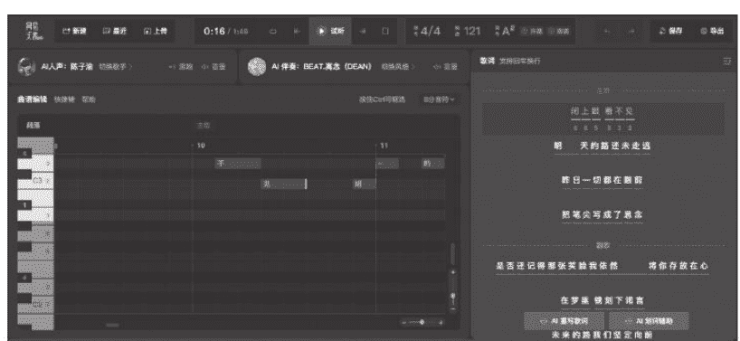

图 7-11 歌曲编辑页面

网易天音自动创作的歌词如下：

> 闭上眼看不见
明天的路还未走远
昨日一切都在眼前
把笔尖写成了思念
是否还记得那张笑脸
我依然将你存放在心
在梦里，镌刻下诺言
未来的路我们坚定向前
笔尖写满无尽眷恋
就要迈向新的起点
时光足迹在风里面传送出最温柔的纪念
岁月里从不曾改变
生命中最温柔的记忆

（6）单击【保存】按钮，打开【保存工程文件】对话框，在该对话框中输入当前歌曲的名称“青春的足迹”，如图 7-12 所示。单击【确认】按钮，即可保存创作的歌曲。单击【导出】按钮可以导出创作的歌曲。


图 7-12 【保存工程文件】对话框

### 【任务 7-2】借助通义万相采用多种方式制作视频

借助通义万相采用以下多种方式制作视频。

- （1）采用“文生视频”方式制作“一群鸿雁在天空中翱翔”视频。
- （2）采用“图生视频”方式制作“一条锦鲤在荷塘里游动，水墨画”视频。

#### 任务实施

##### 1. 借助通义万相采用“文生视频”方式制作视频

在通义万相中输入用于控制视频的画面内容与运动过程的提示词，可以生成一段视频内容。配合提示词智能扩写功能，可以显著提升视频画面的丰富度与表现力。
借助通义万相采用“文生视频”方式制作视频的操作步骤如下。
（1）打开通义万相的首页，如图7-13所示。


（2）在通义万相的首页单击左侧的【视频生成】或者在右侧的【视频生成】区域单击【去生成】按钮。
（3）打开【视频生成】页面，选择【文生视频】选项卡。
（4）输入提示词：一群鸿雁在天空中翱翔。
（5）设置视频生成的参数。
【比例】选项有【16：9】【9：16】【1：1】【4：3】【3：4】，这里选择【16：9】。
同时选择打开【灵感模式】。输入提示词与设置参数如图7-14所示。

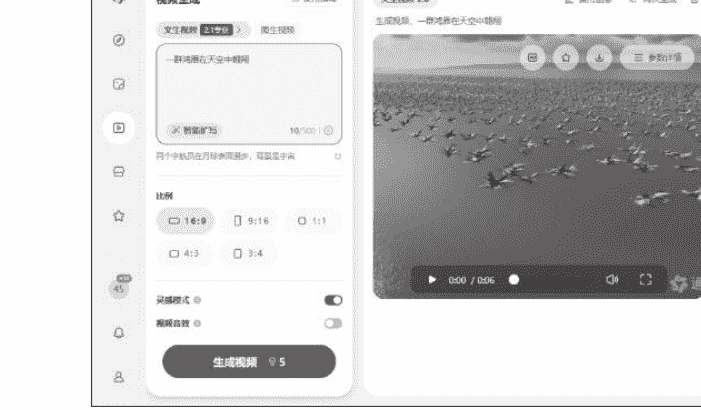

（6）单击【生成视频】按钮，等待视频生成。

##### 2. 借助通义万相采用“图生视频”方式制作视频

借助通义万相采用“图生视频”方式制作视频，需要将图片作为视频首帧延续生成，这会使生成更可控、画面更精准。即采用单击或拖曳方式上传一张图片作为视频的首帧，辅以文字描述视频的运动过程和运镜效果。

通义万相不仅支持对上传的图片按任意比例或预设比例裁剪，以便对图片进行构图和二次创作，也支持旋转图片，还支持中文和英文提示词。

借助通义万相采用“图生视频”方式制作视频的操作步骤如下。

- （1）打开通义万相的首页，在通义万相的首页单击左侧的【视频生成】或者在右侧的【视频生成】区域单击【去生成】按钮。
- （2）打开【视频生成】页面，选择【图生视频】选项卡。
- （3）上传图片。采用单击或拖曳方式上传如图 7-15 所示的图片。


图 7-15 在通义万相中实现图生视频时上传的图片

- （4）输入提示词：一条锦鲤在荷塘里游动，水墨画。
- （5）设置视频生成的参数，选择打开【灵感模式】。输入提示词与设置参数如图 7-16 所示。


图 7-16 在通义万相中实现图生视频时输入提示词与设置参数

（6）单击【生成视频】按钮，等待视频生成。

## 7.4 熟能生巧

### 【任务 7-3】使用海绵音乐创作一首歌曲

使用海绵音乐创作一首歌曲，歌名为“校园时光”，歌词如下。

晨曦透过窗纱
照亮青春的画
书声琅琅传天涯
梦想悄悄发了芽
绿荫之下玩耍
笑声多么无瑕
风儿轻轻吹过呀
心事慢慢在长大
晚风吹过脸颊
带走一天疲乏
操场身影映晚霞
友情永远不掺假
星光点亮枝桠
思绪飘向哪
回忆中的那些话
温暖如诗在笔下
校园的春秋冬夏
是心底最美的家
晨曦绿荫和晚霞
星光伴我走天涯
那些纯真的年华
是生命中的花
不管未来多变化
回忆永远不褪色啊

#### 任务实施

（1）打开海绵音乐首页。
（2）单击左侧的【创作】，在【定制音乐】页面，切换到【自定义创作】选项卡。
（3）输入歌词。在输入框中输入对应的歌词，如图 7-17 所示。
（4）设置歌曲参数。【曲风】选择【民谣】，【心情】选择【快乐】，【音色】中的【类型】选择【女声】，【特征】选择【明亮】。
（5）输入歌曲名称。在【歌曲名称】输入框中输入“校园时光”。设置歌曲参数与输入歌曲名称的结果如图 7-18 所示。
（6）单击【生成音乐】按钮，开始生成歌曲，显示歌曲生成进度如图 7-19 所示。
（7）歌曲生成后，在【创作历史】区域可以显示多首生成的歌曲，单击歌曲图标中的【播放】按钮，即可播放生成的歌曲，如图 7-20 所示。

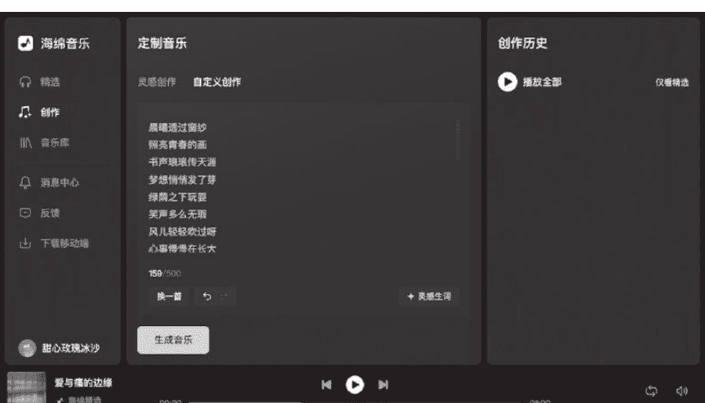

图 7-17 在海绵音乐的输入框中输入歌词


图 7-18 设置歌曲参数与输入歌曲名称的结果

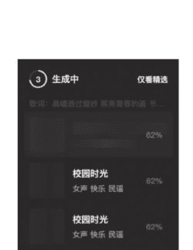

图 7-19 显示歌曲生成进度

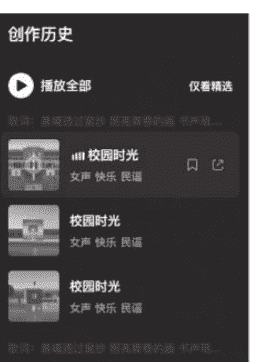

图 7-20 播放生成的歌曲

### 【任务 7-4】借助可灵 AI 采用多种方式制作视频

借助可灵 AI 采用以下两种方式制作视频。

- （1）采用“文生视频”方式制作“绿色的种子生长成大树”视频。
- （2）采用“首尾帧”方式制作“小猫站在雪地注视与扑打着雪花”视频。

#### 任务实施

##### 1. 采用“文生视频”方式生成视频

（1）打开可灵大模型的首页，如图 7-21 所示。

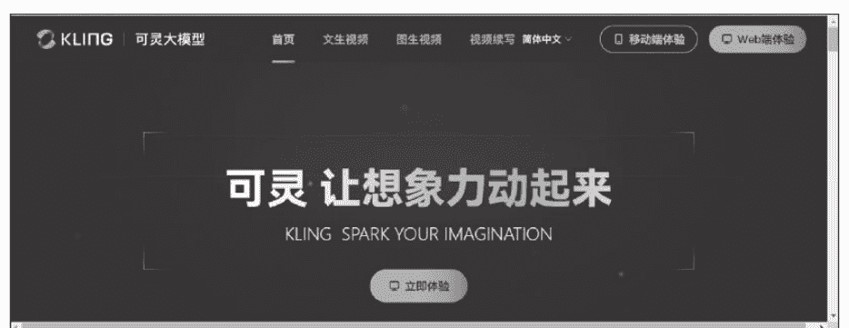

图 7-21 可灵大模型的首页

（2）在可灵大模型的首页单击【立即体验】按钮，打开可灵 AI 的首页，如图 7-22 所示。

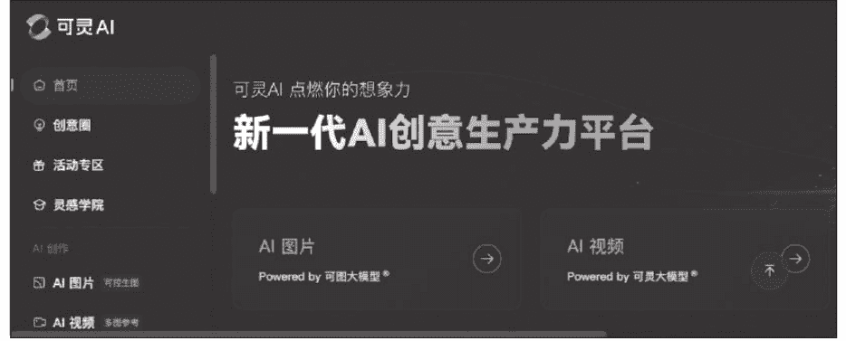

图 7-22 可灵 AI 的首页

（3）在可灵 AI 的首页中单击【AI 视频】按钮，打开【AI 视频】页面，该页面左侧有 3 个选项卡，分别是【文生视频】选项卡、【图生视频】选项卡、【对口型】选项卡，切换到【文生视频】选项卡。

（4）在【创意描述】输入框中输入以下提示词：雪地中，鹅毛大雪，一个绿色的种子破土而出，快速生长成大树，自然光，冷光，特写，固定镜头，电影。

（5）参数设置。

在【参数设置】区域中，【生成模式】选择【标准】，【生成时长】选择【5s】，【视频比例】选择【16:9】，【生成数量】选择【1条】。输入提示词与设置参数的结果如图 7-23 所示。

（6）单击【立即生成】按钮，等待视频生成。

##### 2. 采用“首尾帧”方式生成视频

（1）在可灵大模型的首页单击【立即体验】按钮，打开可灵 AI 的首页。

（2）在可灵 AI 首页单击【AI 视频】按钮，打开【AI 视频】页面并切换到【图生视频】选项卡。

（3）切换到【首尾帧】选项卡。

（4）通过单击、拖曳或者粘贴方式上传图 7-24 所示的首帧图，首帧图成功上传的结果如图 7-25 所示。


图 7-24 首帧图

图 7-25 首帧图成功上传的结果

（5）在上传的首帧图下方单击【尾帧图】按钮，然后通过单击、拖曳或者粘贴方式上传图 7-26 所示的尾帧图，首帧图和尾帧图成功上传的结果如图 7-27 所示。

（6）在【图片创意描述】输入框中输入以下提示词：下着鹅毛大雪，一只可爱的小猫站在雪地，全神贯注地注视与扑打着雪花。

上传首尾帧图与输入提示词的结果如图 7-28 所示。


图 7-26 尾帧图


图 7-27 首帧图和尾帧图成功上传的结果


图 7-28 上传首尾帧图与输入提示词的结果

（7）单击【立即生成】按钮，等待视频生成。

## 7.5 勤思精练

### 【任务 7-5】使用即梦 AI 的“音乐生成”功能创作音乐作品

使用即梦 AI 的“音乐生成”功能完成以下音乐作品的创作。

- （1）生成背景音乐
提示词：生成一段适合放松和冥想的钢琴背景音乐。
- （2）生成自然音效
提示词：创建一段包含鸟鸣声和流水声的夏日森林音效。
- （3）创作一首歌曲，歌名为“青春的旋律”
扫描二维码，打开电子活页7-1，在线浏览“歌曲《青春的旋律》的歌词”。


### 【任务7-6】使用 WHEE 的“文本生视频”功能创作视频

使用 WHEE 的“文本生视频”功能创作两段视频，提示词如下。
提示词1：一群马在草原上奔跑。
提示词2：小金鱼在池塘中来回游动。

### 【任务7-7】使用白日梦的“文本生视频”功能创作视频

使用白日梦的“文本生视频”功能创作两段视频，提示词如下。
提示词1：一名男子驾驶滑翔伞在天空翱翔。
提示词2：白衣少女漫步在盛开的薰衣草花田中，微风轻拂她的发丝与衣角。

## 模块8

## AIGC助力代码智能编写与优化

AI编程助手是人工智能技术在软件开发领域的一项重要应用，是一种基于人工智能技术的智能代码生成工具，它利用深度学习、自然语言处理等先进技术，旨在帮助开发者提高开发效率、优化代码质量，实现智能编程。它通过分析大量的代码样本，学习代码的结构、语法和逻辑，从而智能地为开发者提供代码补全、错误检测、代码生成等辅助服务。其核心技术包括循环神经网络（Recurrent Neural Network，RNN）、长短期记忆网络（Long Short-Term Memory，LSTM）、变分自编码器（VAE）等先进的机器学习模型。

随着人工智能技术的不断发展，人工智能编程助手的功能和性能将不断提升。未来，它有望实现更加精准的代码补全、错误检测、代码生成，支持更多的编程语言和框架，为开发者提供更加个性化、智能化的开发辅助。同时，它还有望与更多的开发工具和服务进行集成，形成更加完善的开发生态体系。

## 8.1 先睹为快

### 【案例8-1】使用文心一言编写Python程序读取Excel文件中的数据

#### 案例描述

在文心一言中编写Python程序，使用pandas库读取Excel文件“example1.xlsx”的sheet1工作表中的数据，目前已经安装了pandas和openpyxl两个库。

#### 案例展示

打开文心一言首页，在输入框输入编程要求，然后单击【发送】按钮，生成的Python程序代码如下。

```python
import pandas as pd

##### 读取Excel文件的sheet1工作表中的数据
file_path = 'example1.xlsx'
sheet_name = 'sheet1'

##### 使用 pandas 的 read_excel() 函数读取数据
try:
    df = pd.read_excel(file_path, sheet_name=sheet_name, engine='openpyxl')
    print("读取的 Excel 文件中的数据：")
    print(df)
except FileNotFoundError:
    print(f"文件 {file_path} 未找到，请检查文件路径是否正确。")
except Exception as e:
    print(f"读取 Excel 文件时发生错误：{e}")
```

### 【案例 8-2】使用豆包编写 HTML+CSS 代码实现网页元素的阴影效果

#### 案例描述

在豆包中编写超文本标记语言（Hypertext Markup Language，HTML）+串联样式表（Cascading Style Sheets，CSS）代码，使用 CSS 的 text-shadow 属性为网页中的段落“当今时代，人工智能正以前所未有的速度发展。”中的文字“人工智能”添加阴影效果。

#### 案例展示

打开豆包首页，在输入框输入编程要求，然后单击【发送】按钮，生成的 HTML+CSS 代码如下。

```html
<!DOCTYPE html>
<html lang="zh-CN">
<head>
    <meta charset="UTF-8">
    <meta name="viewport" content="width=device-width, initial-scale=1.0">
    <title>文字阴影效果</title>
    <style>
        .highlight {
            /* text-shadow 属性用于为文字添加阴影效果 */
            text-shadow: 2px 2px 4px #888;
        }
    </style>
</head>
<body>
    <p>当今时代，<span class="highlight">人工智能</span>正以前所未有的速度发展。</p>
</body>
</html>
```

## 8.2 释疑解惑

### 【问题 8-1】常用的具有代码生成与编辑功能的 AI 工具有哪些？

目前，常用的具有代码生成与编辑功能的 AI 工具如表 8-1 所示。

## 8.3 精彩纷呈

### 【任务 8-1】使用文心一言编写 Python 程序对 JavaScript 的数组去重

在文心一言中编写 Python 程序，使用 ES6 的 Set 对象实现对 JavaScript 的数组 [1, 2, 2, 3, 4, 4, 5] 去重。

#### 任务实施

在文心一言中编写的 Python 程序如下。

```javascript
// 原始数组
const array = [1, 2, 2, 3, 4, 4, 5];
// 使用 Set 对象去重
const uniqueArray = [...new Set(array)];
// 输出去重后的数组
console.log(uniqueArray); // 输出 [1, 2, 3, 4, 5]
```

### 【任务 8-2】使用文心一言编写前端代码实现用户登录功能

在文心一言中编写前端代码，使用 HTML 和 JavaScript 实现用户登录功能。

#### 任务实施

扫描二维码，打开电子活页 8-1，在线浏览“实现用户登录功能的代码”，也可以自行在文心一言中生成类似的结果。


### 【任务 8-3】使用 DeepSeek 编写 Python 程序使用 read() 方法读取文件的所有内容

在 DeepSeek 中编写 Python 程序，使用 read() 方法读取文件 “test.txt” 的所有内容。

#### 任务实施

DeepSeek 编写的 Python 程序如下。

```python
##### 打开文件
with open('test.txt', 'r') as file:
    # 使用 read() 方法读取文件的所有内容
    content = file.read()
##### 输出文件内容
print(content)
```

### 【任务 8-4】使用通义千问判断 Python 代码的运行是否会报错

使用通义千问判断下面的 Python 代码的运行是否会报错。如果会报错，请说明原因，并输出解决方法；如果不会报错，请回答“无错误”。

需要判断的代码：

```python
A= 1
def test():
    a += 1
    print(a)
test()
```

#### 任务实施

扫描二维码，打开电子活页 8-2，在线浏览“判断 Python 代码的运行是否会报错”，也可以自行在通义千问中生成类似的结果。


### 【任务 8-5】使用天工 AI 补齐 Python 程序代码，实现要求功能

使用天工 AI 补齐以下 Python 程序代码，实现检查一个字符串是否为回文的功能。

```python
def is_palindrome(s):
    # 将字符串反转
    # 比较原字符串和反转后的字符串
##### 测试示例
test_string = "radar"
print(is_palindrome(test_string))
```

#### 任务实施

天工 AI 补齐的 Python 程序代码如下。

```python
def is_palindrome(s):
    reversed_s = s[::-1]  # 将字符串反转
    return s == reversed_s  # 比较原字符串和反转后的字符串

##### 测试示例
test_string = "radar"
print(is_palindrome(test_string))
```

### 【任务 8-6】使用海螺 AI 纠正 Python 程序中的错误

使用海螺 AI 纠正以下 Python 程序中的错误。

```python
##### 创建文件并将内容写入文件
open("example.txt", "w") as file
file.write("This is a test file.\nWelcome to Python programming!")
##### 读取文件内容
open("example.txt", "r") as file
content = file.read()
print(content)
```

#### 任务实施

海螺 AI 纠正错误后的 Python 程序如下。

```python
##### 创建文件并将内容写入文件
with open("example.txt", "w") as file:
    file.write("This is a test file.\nWelcome to Python programming!")
##### 读取文件内容
with open("example.txt", "r") as file:
    content = file.read()
    print(content)
```

海螺 AI 的主要纠正点如下。

- ① 添加冒号。在每个 with 语句的末尾添加冒号 “:”，这是 Python 语法要求的，用于标识代码块的开始。
- ② 正确缩进。with 语句的代码块内的代码需要正确缩进（通常为 4 个空格），以表示这些代码是 with 语句的代码块的一部分。
- ③ 使用 with 语句。使用 with 语句管理文件操作，这样可以自动处理文件的打开和关闭，避免资源泄露。

## 8.4 熟能生巧

### 【任务 8-7】应用文心一言实现多项 AI 编程任务

应用文心一言实现以下多项 AI 编程任务。

- (1) 编写 Python 程序，生成 20 以内的所有质数。
- (2) 编写 Python 程序，使用 while 循环语句计算 1 到 10 的总和。
- (3) 对以下代码进行优化。

```python
try:
    # 以追加模式打开文件
    file = open('test.txt', 'a', encoding='utf-8')
    # 追加内容
    file.write("This is additional content.\n")
except Exception as e:
    print(f"追加内容时出错：{e}")
finally:
    if file:
        file.close()
```

#### 任务实施

(1) 生成 20 以内的所有质数的 Python 程序。
扫描二维码，打开电子活页 8-3，在线浏览“生成 20 以内的所有质数的 Python 程序”，也可以自行在文心一言中生成类似的结果。


（2）使用 while 循环语句计算 1 到 10 的总和的 Python 程序如下。

```python
##### 初始化变量
total_sum = 0
number = 1

##### 使用 while 循环计算总和
while number <= 10:
    total_sum += number
    number += 1

##### 输出结果
print("1 到 10 的总和是 ", total_sum)
```

（3）对代码进行优化的结果如下。

```python
try:
    # 使用 with 语句以追加模式打开文件
    with open('test.txt', 'a', encoding='utf-8') as file:
        # 追加内容
        file.write("This is additional content.\n")
except Exception as e:
    print(f"追加内容时出错：{e}")
```

代码优化说明如下。

- with 语句：通过 “with open(...) as file: ” 的用法，Python 程序会在代码块执行完毕后自动关闭文件，即使在代码块中发生异常也是如此，这避免了手动调用 file.close()。
- 异常处理：异常处理部分保持不变，以便在打开或将内容写入文件时捕获并报告任何错误。

这样，代码变得更加简洁，并且避免了手动管理资源可能导致的错误。

### 【任务 8-8】应用商汤科技的代码小浣熊实现代码补全与代码注释

应用商汤科技的代码小浣熊实现以下 AI 编程任务。

（1）代码补全

根据以下 Python 代码和注释补全代码：

```python
import requests
##### 请求访问https://www.codegeex.cn/ 网站，获取返回的响应状态码、响应头、响应内容，并输出
```

（2）代码注释

为以下 Python 代码添加必要的注释，以说明代码的功能

```python
def tcplink(conn, addr):
    print("Accept new connection from %s:%s" % addr)
    conn.send(b"Server: Welcome!")
    while True:
        conn.send(b"Server: What's your name?")
        data = conn.recv(1024)
        if data == b"exit":
            conn.send(b"Server: Good bye!\n ")
            break
        conn.send(b"Server: Hello %s!\n" % data)
    conn.close()
    print("Connection from %s:%s is closed" % addr)
```

#### 任务实施

(1) 代码补全
代码小浣熊补全的 Python 代码如下：

```python
import requests

##### 目标 URL
url = "https://www.codegeex.cn/"

try:
    # 发送 GET 请求
    response = requests.get(url)

    # 输出响应状态码
    print(f"响应状态码：{response.status_code}")

    # 输出响应头
    print("响应头:")
    for header, value in response.headers.items():
        print(f"{header}: {value}")

    # 输出响应内容
    print("\n响应内容:")
    print(response.text[:1000])  # 仅输出前 1000 个字符，避免输出过多内容

except requests.exceptions.RequestException as e:
    print(f"请求过程中发生错误：{e}")
```

(2) 代码注释
代码小浣熊对代码的注释如下：

> 这段 Python 代码定义了一个名为 tcplink 的函数，用于处理 TCP 连接的客户端通信。这个函数通常在服务器端使用，用于与客户端进行交互。


扫描二维码，打开电子活页 8-4，在线浏览“代码小浣熊对代码的详细注释和说明”，也可以自行在代码小浣熊中生成类似的结果。

### 【任务 8-9】应用豆包 MarsCode 实现多项 AI 编程任务

应用豆包 MarsCode 实现以下多项 AI 编程任务。

- (1) 从“图书信息”数据表中查询作者为“张珊”，并且出版日期在“2024”年当年的图书信息，要求查询结果只需包含“商品编号”“图书名称”“作者”“出版日期”4个字段。
- (2) 创建一个函数 getTypeName()，该函数的功能是从“商品类型”数据表中根据指定的“类型编号”获取“类型名称”。

（3）创建一个存储过程 procDemo，用于查看“人民邮电出版社”出版的图书种类。

#### 任务实施

（1）豆包 MarsCode 生成的用于查询数据的 SQL 语句如下。

```sql
SELECT 商品编号，图书名称，作者，出版日期
FROM 图书信息
WHERE 作者 = '张珊' AND 出版日期 > '2024-01-01';
```

（2）豆包 MarsCode 生成的用于创建函数 getTypeName() 的 SQL 语句如下。

```sql
CREATE FUNCTION getTypeName (
    @typeId INT -- 输入参数：“类型编号”
)
RETURNS NVARCHAR(50) -- 返回类型：“类型名称”
AS
BEGIN
    DECLARE @typeName NVARCHAR(50); -- 声明变量用于存储“类型名称”

    -- 从“商品类型”数据表中查询指定“类型编号”的“类型名称”
    SELECT @typeName = 类型名称
    FROM 商品类型
    WHERE 类型编号 = @typeId;

    -- 返回“类型名称”
    RETURN @typeName;
END;
```

（3）豆包 MarsCode 生成的用于创建存储过程 procDemo 的 SQL 语句如下。

```sql
CREATE PROCEDURE procDemo
AS
BEGIN
    -- 查询“人民邮电出版社”出版的图书种类
    SELECT DISTINCT 图书种类
    FROM 图书信息
    WHERE 出版社 = '人民邮电出版社';
END;
```

## 8.5 勤思精练

### 【任务 8-10】使用文心一言定义多种数据类型的变量

在文心一言中编写 Python 代码，分别定义多种数据类型的变量，并输出这些变量的值。

### 【任务 8-11】使用豆包充当 Python 解释器对 Python 代码进行解释

使用豆包充当 Python 解释器对 Python 代码进行解释，提示词如下。
我希望你表现得像一个 Python 解释器。我会给你 Python 代码，你来执行它。你不需要提供任何解释。除了代码的输出，不要回复任何内容。
待解释的代码如下：

```python
print("hello world!")
print(1+2)
x=5;
y=10;
print(x+y)
```

### 【任务 8-12】使用 Kimi 编写 Python 程序创建 NumPy 数组

在 Kimi 中编写 Python 程序创建 NumPy 数组，该 NumPy 数组应该具有 (x,y,z) 的形状。请用随机值初始化 NumPy 数组。

### 【任务 8-13】使用腾讯元宝编写 Python 程序计算应付金额

在腾讯元宝中编写 Python 程序，已知购买物品的数量为 5，单价为 21.6 元，计算应付金额，并输出应付金额。

### 【任务 8-14】使用海螺 AI 解释 SQL 语句的含义

使用海螺 AI 解释以下 SQL 语句的含义。

```sql
SELECT 商品编号，图书名称，作者，价格，出版日期 FROM 图书信息 WHERE 价格 >45 ORDER BY 价格；
```

# AIGC

## 应用实践

电子活页式

遵循认知规律，构建模块化结构，激发创新潜能
优选 AI 工具，融入前沿知识，契合岗位需求
创新教材形式，赋能 AIGC 高效教学


向教师免费提供
PPT等教学相关资料

教材服务热线：010-81055256
反馈/投稿/推荐信箱：315@ptpress.com.cn
人民邮电出版社教育服务与资源下载社区：www.ryjiaoyu.com
人邮电商教师QQ交流群：734916328（仅限教师身份）

