# AIGC 应用实践·活页版

## 内容提要

本书用通俗简洁的表达把 AIGC 的理论要点与实操路径串联起来。整体划分为八大篇章，分别聚焦 AIGC 奇妙应用之旅顺势开启、AIGC 全力角逐综合应用与搜索对话、AIGC 优质完成文字处理与论文写作、AIGC 灵活处理数据与绘制图表、AIGC 快速生成炫酷演示文稿、AIGC 轻松创作精美图像作品、AIGC 巧妙生成美妙音视频作品和 AIGC 助力代码智能编写与优化。各篇章贯彻层次化编排，围绕五项学习活动展开：先睹为快借助案例点燃求知欲并引入主题；释疑解惑帮助理清思路并化解疑问；精彩纷呈以典型案例拓宽认知边界；熟能生巧通过动手演练强化操作能力；勤思精练以归纳提升推动融会贯通，从而整体改善学习成效。

本书可作为应用型本科、职业本科、高职高专院校计算机类、电子信息类相关专业的教学用书，也可供对人工智能技术感兴趣的读者自学参考。

◆ 主 编 管胜波 杨 晓 张 赢

副 主 编 许 媛 陈承欢

责任编辑 顾梦宇

责任印制 王 郁 焦志炜

◆ 人民邮电出版社出版发行 北京市丰台区成寿寺路 11 号

邮编 100164 电子邮件 315@ptpress.com.cn

网址 https://www.ptpress.com.cn

天津千鹤文化传播有限公司印刷

◆ 开本：787×1092 1/16

印张：13 2025 年 8 月第 1 版

字数：318 千字 2025 年 8 月天津第 1 次印刷

定价：59.80 元

读者服务热线：(010)81055256 印装质量热线：(010)81055316

反盗版热线：(010)81055315

## 前言

AIGC 即人工智能生成内容，是依托深度学习与机器学习对海量数据进行训练建模，进而自动产出文本、图像、音频、视频等内容的智能技术。当前 AIGC 正从单纯的辅助工具向协同创作的生产力伙伴转变，已渗透创意设计、教育、医疗、金融等多个领域，改变了内容生产与消费的形态，同时推动各行业数字化转型与智能化升级。随着多模态融合与可控生成技术的成熟，以及伦理治理机制的不断完善，AIGC 将更深地融入社会肌体，成为数字经济时代的关键底座。作为人工智能发展的重要分支，AIGC 展现出强劲的潜力与社会价值。在技术快速演进并深刻影响各行业的大背景下，教育也在经历重塑。掌握 AIGC 不仅有助于提升学习效率与创新思维，也是增强未来职业竞争力、适应智能社会的重要路径。

本书系统介绍 AIGC 的基本原理、演进脉络及其在各领域的典型实践，帮助读者提升内容创作、信息处理与技术创新能力，为智能化时代的人才培养奠定基础。本书特色概括如下。

（1）构建层次化的教学流程
本书遵循认知规律与技能习得规律，按案例导入—知识讲解—自主练习的顺序，为每个单元设计五大环节，即先睹为快、释疑解惑、精彩纷呈、熟能生巧、勤思精练，形成递进式教学过程，便于组织教学。其中精彩纷呈侧重应用广度，主要展示多种 AI 工具的专用型应用；熟能生巧侧重学习深度，重点剖析典型 AI 工具的综合型应用。

（2）遴选主流大众化工具
AIGC 生态繁荣、迭代迅速。本书综合考量工具功能优势、应用特点及厂商实力，优选文心一言、豆包、DeepSeek、Kimi、通义千问等代表性综合型工具进行介绍。对专用型工具，则依据功能匹配度、性能表现、用户评价及使用便捷性，优选即梦AI、WPS AI、海螺AI 等开展案例演示，帮助读者更好理解与应用 AIGC 技术。

（3）提供真实化素材包
本书在讲解实践过程中，不仅传授提示词撰写技巧与工具操作方法，还配套提供素材。不同任务需要对应素材支撑，如数据处理需 Excel 文件，图像创作需源图，图生视频需图像素材，长文档阅读需文本资料。为帮助读者快速掌握工具，本书配备贴近真实场景的多样化素材，主题涵盖大美中国、科技创新、素质教育、运动健康、读者活动等，兼顾思想性、时代性、教育性与实用性，实现学思融合，潜移默化培养理想信念与价值追求。

（4）实施多元化实用教学方法
本书通过精选内容、精细设计流程，让读者在完成任务中体验学习乐趣与成就感，实现知识、技能与应用的统一。采用案例教学法、问题驱动教学法、任务驱动教学法等多种方法，提升教学效率。先睹为快环节用案例教学，快速感知工具、激发兴趣、导入主题；释疑解惑环节用问题驱动，以问带学、加深理解；精彩纷呈、熟能生巧、勤思精练三个环节用任务驱动，将真实工作任务转化为课堂任务，围绕实际需求组织内容，促成主动构建知识体系。鉴于 AIGC 更新频繁，本书预留灵活性，便于后续迭代。

本书由管胜波、杨晓、张赢任主编，许媛、陈承欢任副主编，周从军任主审。需说明的是，本书功能描述与界面截图以定稿时版本为准。AI 工具迭代迅速，但操作逻辑相近，读者掌握基础方法后可举一反三、融会贯通。限于编者水平，书中难免有不妥之处，敬请专家读者批评指正。

编 者
2025年2月

# 模块1 AIGC奇妙应用之旅顺势开启

人工智能时代已经到来，它不仅改变生活方式，也在重塑各行各业。从智慧交通到医疗健康，AI 带来前所未有的便捷与高效。在日常生活中我们已能感受到 AI 的力量，它可帮助解决问题、提供智能化建议，打造更智能的生活空间。

展望未来，随着技术进步与商业深化，AIGC 将在各领域发挥更关键作用，推动数字化转型与智能化升级。应用场景将持续拓展、技术创新不断深化，为各行业创造更多价值与机遇。

## 1.1 先睹为快

### 【案例1】识别形态各异的人物图片

**案例描述**

图1-1 呈现三幅水墨写意风格的人物插画，请辨别其中哪些是画师手工完成，哪些是 AI 工具所作。


图1-1 3张水墨写意风格的人物插画

**案例展示**

初看之下多数人会判断左右两幅为人工绘制、中间一幅为 AI 生成。实际上三幅插画均由 AI 工具生成，普通人难以准确分辨。如今 AI 能力已超出预期，朋友圈里的照片、活动图集或公众号推文是否由 AI 生成往往难以判断。通过这个小测试，读者可以直观体会 AI 的真实水准，刷新固有认知。

## 1.2 释疑解惑

### 【问题1-1】AI 到底是什么？

AI 即 Artificial Intelligence 人工智能。机器具备类人智能，能够感知、听觉、思考、判断并据此决策。AI 真正走向应用、影响多行业，离不开三大技术支撑：神经网络、深度学习和生成对抗网络 GAN。

- （1）神经网络
神经网络是模拟大脑神经元连接的算法模型。可以把神经网络想象成一个大脑，像人脑由大量神经元经突触相连，神经网络也由众多节点通过连接构成。这些连接类似突触，负责传递信息。

- （2）深度学习
如果神经网络像普通大脑，深度学习则像更聪明的结构。对应人脑不同区域分工，深度学习将神经元组织成多层，每层学习数据不同特征，从而能处理图像识别、自然语言理解等复杂任务。

- （3）GAN
GAN 是推动新一轮 AI 热潮的关键技术，有了它 AI 才能生成逼真的图像、音频与文本。可把 GAN 想象成艺术家与评论家的较量。艺术家负责创作逼真作品，评论家负责辨别真伪。二者相互博弈，作品越逼真，判别越精准。

### 【问题1-2】AIGC 究竟指什么？

简言之，AIGC 让原本依赖人类思考与创造的工作可由人工智能替代。AI 接收人类指令后处理自然语言，自动生成图像、视频、音频等内容。好比马良的神笔，拥有无限创造力，而这支笔由 AI 打造。在理解力、想象力与创造力的加持下，它能按指定需求与风格创作文章、音乐、图像乃至视频。

AIGC 的出现打开了全新创作世界，由用户生成内容 UGC、专业生成内容 PGC 发展到如今的 AIGC，内容生产方式发生质变。

因此 AIGC 是利用自然语言处理 NLP、机器学习和深度学习等技术，生成文本、图像、音频、视频、3D 交互内容等的新型技术。

AIGC 不仅是生成工具，更是重塑生产力与商业模式的革命。狭义上指数字内容的生成，如文本、图像、视频；广义上涵盖生成式 AI 在各领域的广泛应用，解决传统决策式 AI 难以应对的问题，实现突破。

### 【问题1-3】AI、AIGC、AGI 有何差异？

**1. AI**
日常使用的豆包、通义千问等都属 AI 范畴。当前 AI 已相对成熟并广泛应用于医疗、金融、交通、教育、娱乐、制造、农业等。AI 是通过计算机系统模拟人类智能行为的技术，概念宽泛，包含机器学习、深度学习、专家系统、自然语言处理等。

**2. AIGC**
指 AI 自动生成内容，即 AI 接收指令后自动生成图片、视频、音频等。AIGC 是大模型的重要应用，指通过计算机程序以海量数据为原料，按用户指令加工成新的文本、图像、音频或视频内容。

**3. AGI**
AGI 全称 Artificial General Intelligence 通用人工智能，指 AI 能在所有领域像人类一样学习知识、完成任务。AGI 是人工智能的理想形态、终极目标。与只能处理特定任务的 AI 不同，AGI 具备更高智能水平与更广适应性，可完成复杂推理、学习、感知与决策，并适应新任务新环境，处理各类任务。

### 【问题1-4】AIGC 有哪些作用？

常见作用如下。

- （1）生成多元内容
AIGC 可自动生成文本、图像、音频等多种内容，极大丰富创作方式，提升效率与质量。

- （2）推动生产力变革
AIGC 不仅改变生产工具，也改变社会生产关系，促生产力实现质的跃升。例如单一大规模数据集训练的模型具备跨领域知识，经适当调整即可完成真实场景任务。

- （3）促进技术创新
预训练模型、多模态技术、生成算法等技术累积融合，使 AIGC 能力发生质变，具备更通用更强的基础能力。

- （4）拓展广泛应用
AIGC 不仅用于搜索，还在办公、教育、医疗、城市管理等垂直领域落地，显著提升效率与智能化水平。

- （5）驱动算力算法发展
AIGC 发展推动大模型、大数据、大算力成为创新重点；为提升精度，还需开发更多垂直应用，对算力与算法提出更高要求。

### 【问题1-5】AIGC 发展历程如何？

随人工智能演进，AIGC 可分为三阶段。

- （1）早期萌芽阶段（20世纪50年代至90年代中期）
受限于技术，AIGC 仅限小范围实验，如1957年首部计算机创作音乐作品《伊利亚克组曲》。80年末至90年代中因成本高、商业化难，投入有限，进展缓慢。

- （2）积累沉淀阶段（20世纪90年代中期至21世纪10年代中期）
AIGC 从实验研究转向实用研究。2006年深度学习概念首次提出，GPU、CPU 等算力提升，互联网为算法提供海量训练数据。2007年首部 AIGC 创作小说《在路上》出版。2012年微软展示基于深度神经网络 DNN 的全自动同声传译系统。

- （3）快速发展阶段（21世纪10年代中期至今）
2014年 GAN 推出并迭代，推动生成式 AI 爆发。2017年微软小冰推出世界首部 AI 写作诗集《阳光失了玻璃窗》；2018年 NVIDIA 发布 StyleGAN 可自动生成图像；2019年 Google DeepMind 发布 DVD-GAN 可生成连续视频。2021年 OpenAI 推出 DALL·E 并迭代至 DALL·E 2，用于图文交互生成。

2023年被视作“AIGC 入世元年”，相关话题在微信、微博、抖音等平台爆发式传播。微软全系融入 AI 创作、OpenAI 发布 GPT-4 令人瞩目。2023年1月微软必应搜索推出聊天模式，用户可通过聊天框交互获取娱乐、创意等内容，结合自然语言处理与生成技术提供搜索结果、建议与广告，展现 AI 与人交流的潜力。

### 【问题1-6】AIGC 与大模型是什么关系？

大模型基于海量多源数据构建，是实现 AGI 的重要路径。大模型在人工智能中的定位如图1-2所示。

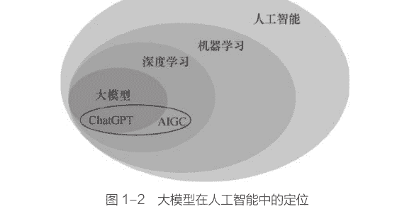

早期 AIGC 主要在文本生成落地，后期扩展至图像、音频、视频等多模态生成，跨模态生成迅速发展，应用场景不断丰富。在大模型驱动下，AIGC 迎来新阶段。

大模型与 AIGC 关系紧密。首先 AIGC 建立在深度学习之上，大模型是深度学习的重要形式，为 AIGC 提供技术支撑。其次大模型具备自然语言处理能力，可理解与生成文本，AIGC 正是利用该能力实现内容自动生成，提升效率与准确性。

实践中大模型已助力 AIGC 广泛应用。如新闻报道领域可快速据数据生成财经、体育、天气稿件；剧本创作领域可辅助编剧构思情节并初稿；音乐制作领域可协助创作旋律和声甚至自动完成歌曲。这些皆得益于大模型强大的语言理解与生成能力。

大模型指参数量巨大的机器学习模型，多为深度学习模型，可处理大规模数据集，具有强预测能力与高准确率，通常需大量算力与训练时间。例如 OpenAI 的 GPT-3 拥有1750亿参数，可用于文本生成、分类、对话问答等，表现自然精准。

AIGC 基于 GAN、大型预训练模型等技术，通过预训练与对已有数据的学习，以一定泛化能力生成具备逻辑性与创造性的文本、图像、音频等。能力提升得益于算法迭代、预训练带来的质变及多模态推动的内容多样化。

某种意义上，大模型是 AIGC 的基石。AIGC 代表人工智能从1.0到2.0的跃迁，核心是利用 AI 算法生成创意内容。大模型如 GPT-3 通过海量数据训练学会自然流畅的文本生成，是 AIGC 重要应用。

二者关系可视为协同。AIGC 可为大模型提供更多训练数据，大模型可为 AIGC 提供更多训练场景，共同提升效果与性能，为各行业提供更高质量 AI 服务。

### 【问题1-7】AIGC真能取代程序员吗

AIGC的成熟确实让程序员的工作更轻松，开发效率和代码水准都被明显拉高。可是即便在某些环节表现突出，它要彻底接管瞬息万变的软件开发，仍差得远。

AIGC暂时难以替代人类的核心原因有三点。

- （1）业务需求理解不透彻
AIGC能自动写代码，却读不懂复杂业务的本质，难以解释业务逻辑，更做不到系统架构和核心算法的顶层设计。
- （2）缺失人与人间的沟通与协同思维
AIGC在技术执行上优势明显，但面对团队协作、需求拉扯、跨部门沟通等需要共情和思维碰撞的场景时，仍依赖人类驱动。
- （3）创新与难题攻关能力不足
面对重复性任务，AIGC能快速上手；可一旦遇到全新问题、边界模糊的问题，人类程序员的创造性思考和问题解决能力就显得不可替代。

所以AIGC更像是工作方式的改变者，而非替代者。程序员把AIGC当成强力助手，就能做得更快更好。

AIGC也让内容生产进入高效规模化时代，生产成本和周期被大幅压缩。但原创性不足、伦理风险、技术可信度等新挑战随之而来，需要持续讨论和规范。

总体看，AIGC是人工智能在内容创作领域的落地形态，它将深刻重塑内容生产与传播的逻辑，技术、法律、伦理层面都需同步调整，才能让它真正服务于人。

## 1.3 精彩纷呈

### 【任务1-1】AIGC应用全景拆解

当前AIGC已在各行各业扎根，涵盖自然语言处理、计算机视觉、代码开发、游戏设计等多种形态。它的落地方向非常分散，从文学、绘画、音乐到游戏制作，都能看到身影。

**任务实施**

**1. 文本生成**

文本生成分为非交互式和交互式两类，前者靠结构化或非结构化写作、辅助写作实现，后者体现为聊天机器人对话、游戏内交互文本等。众多企业从多个维度用AIGC做文本生成，用于应用型文本与创作型文本，助力业务拓展。

- （1）应用型文本生成
多以结构化写作为主，典型场景是客服问答、新闻写作。常见做法是在结构化数据或固定格式下按需生成，如体育新闻、财经新闻、财报、灾害通报等。
- （2）创作型文本生成
随着模型进化，AIGC已不局限于新闻写作，能覆盖多种内容形态。可生成新闻稿、广告文案等，质量接近人工写作，且能按指定格式定制。用户现在更希望文本具备开放性、自由度与创意个性。风格迁移功能也能把已有文本风格转换成另一种风格，为修改和创意延展提供启发。

**2. 图像创作**
技术平台成熟后，即使没有绘画基础的用户也能体验艺术创作。通过AIGC数字绘画平台，输入场景与细节描述即可生成富有艺术感的作品，大幅降低绘画门槛。文字到视觉的快速转换，为用户源源不断提供灵感。

**3. 音频生成**
AIGC已渗透到日常，如手机导航的语音提示。基于AIGC的语音合成既能保证音质，又能提供精准实时导航。

在虚拟人领域，AIGC可合成更逼真的声音，并带动智慧人机交互的发展。音乐创作、电台节目制作等也在广泛使用。生成的音频可用于纯音乐、电子合成，也能模拟不同语感的说话声，与视频结合提升视听效果。

音频生成主要包括文本转特定语音、乐曲生成和歌曲生成。

（1）根据文本生成特定语音
TTS技术广泛用于客服机器人、有声书制作、语音播报等。例如“云听”App与倒映合作打造AI新闻主播，喜马拉雅用TTS复原经典影视作品。
（2）乐曲生成和歌曲生成
创作可拆解为作词、作曲、编曲、人声录制和混音。目前可基于开头旋律、图片、文字描述、音乐类型、情绪等生成特定作品。2021年末，贝多芬管弦乐团在波恩首演由AI续写的《第十交响曲》，AI在学习贝多芬作品后自动完成续写。

#### 4. 视频处理与生成
AI视频创作的优势是高效精准。计算机可自动优化图像与音频，提升表现力。AIGC视频平台还提供自动配乐、特效、剪辑合成等工具，让创作更轻松。

（1）视频属性编辑
包括画质修复、画面主体去除、主体自动跟踪剪辑、特效生成、内容自动添加、自动美颜等。
（2）视频自动剪辑
基于画面、声音等多模态特征融合学习，按氛围、情绪等高级语义筛选片段并自动合成。

#### 5. 代码生成与优化
借助AIGC代码工具，程序员能快速生成功能完备的代码，提升编写效率与质量。同时可对代码进行优化，提高可读性与可维护性，减轻日常开发维护负担。

#### 6. 游戏开发
AIGC为开发者提供大量资源，可自动生成角色、场景等内容，加快世界构建，节省时间和成本。还能根据玩家反馈与行为生成个性化内容，提升互动与趣味。

在场景搭建上，AIGC可快速生成包含复杂地形、建筑、天气变化的虚拟场景，增强沉浸感与真实感。

### 【任务 1-2】AIGC赋能智能内容，重塑千行百业

人工智能快速发展，AIGC作为其重要分支，正以前所未有的速度改造世界。通过自动生成多形态内容，工作效率大幅提升，推动各行业数字化转型与创新。随着场景不断拓展，AIGC有望在更多领域发挥作用。

下面剖析AIGC赋能内容智能化、助力各行业创新的现状与展望。

#### 任务实施

##### 1. AIGC 技术 + 影视
观众审美提升与内容需求多样化，推动影视行业提高产量、升级技术，工业化智能化程度加深，创作流程更精细，人的局限也更明显。AIGC降本增效，有助于行业回归内容本质。

AIGC可激发剧本创意，拓展角色与场景空间，提升后期质量，最大化文化与经济价值。

（1）AIGC技术协助剧本创作，释放创意潜力
AIGC学习海量优质剧本后，能按需求快速生成不同风格架构的剧本，提升效率并激发创作者灵感。2016年，纽约大学研发的AIGC在学习数十部科幻电影剧本后编写了《阳春》及配乐歌词，虽成品仅10分钟且内容平淡，但在各大平台收获百万播放，证明市场对AI创作充满好奇。2020年GPT-3创作短剧再度引发关注。要将潜力转为生产力，需让AI更贴合场景，进行针对性训练并结合业务定制功能。

（2）AIGC技术推动创意落地，突破表达瓶颈
从剧本到荧幕距离很远。AIGC能帮助创意跨越到表达。劳动密集型生产难以满足高质量需求。《阿凡达》开启3D魅力后，沉浸式体验成为追求，特效应用井喷，后期制作渲染复杂度攀升，传统方式难以为继，AI具备推动变革的潜力。

（3）AIGC技术解放流程生产力，减轻人员负担
影视特效流程繁琐，从建模到绑定、动作设计、分镜、调光、取景，再到解算渲染，每个环节都有大量重复与等待。如优酷的“妙叹”工具箱可在动漫中实时渲染，帮助即时把握效果与修改，节省成本，已被多家国漫企业采用。

##### 2. AIGC 技术 + 资讯
信息化时代资讯标准高、需求大、时效强。自2014年起AIGC进入资讯领域，已成为商业化相对成熟的赛道。AIGC可分析海量报道自动生成摘要、策划方案、虚拟主播播报，提升效率。

（1）AIGC 技术辅助信息收集
优质新闻依赖全面高效的信息收集。科大讯飞的AI转写工具可实时收集语音并生成文稿，自动撰写提纲、精简语句，提升时效。AI也能精确检索二手信息、收集素材，像与人对话一样提问获取答案。

（2）AIGC 技术支持资讯生成，实现高效产出
在写作环节，自然语言处理与生成技术已获认可。撰稿工具WordSmith可在1分钟内生成两千条新闻，单条质量可比拟人类花费0.5小时的作品。AI在准确度上也能规避人为疏忽，如计算错误，并缓解工作压力。新华社“快笔小新”、腾讯Dream Writer、百度与人民网合作的“文心”大模型等都是代表。

（3）AIGC 技术助力内容分发
除个性化推荐外，虚拟人主播正开拓新场景。如新华社数字记者“小诤”、央视网虚拟人“小C”、阿里数字人“冬冬”、百度智能云AI手语主播等，未来或成媒体标配。

##### 3. AIGC 技术 + 教育
AIGC可生成教学资源与内容，让课程设计更个性化，满足不同学生需求，同时提供个性化学习辅助，提升学习效率。

（1）AIGC 技术助力学生，提高学习效率
互联网把教学内容数字化分发，AI辅助制作整理资料的降本增效已明显，资源丰富度与易用性提升。AIGC可在儿童绘本等特定领域加速知识生产并接入网络。微软亚洲研究院与华东师大合作的中文写作智能辅导系统“小花狮”，借助自然语言处理实时评分并分析作文，帮助学生进步。

AIGC将助力学校与机构实现自动课程设计、在线工具创新、多样化内容输出，推动联网教育与跨文化教育，如图1-3所示。

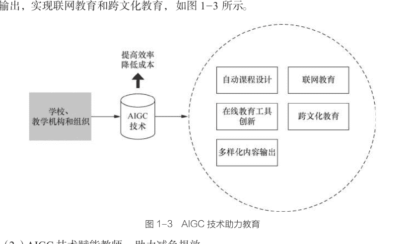

（2）AIGC 技术赋能教师，助力减负提效
“大班制”下教师需处理大量答疑与批改，AIGC可缓解压力。作业试卷自动批阅已普及，AI不仅能判对错，还能生成针对性评语，大幅缩短批改时间。基于计算机视觉，AI还能实时分析学生情绪状态，帮助教师更了解学情。最终可推动因材施教与个性化教育，尽管存在信息茧房、理念冲击等风险，但以人为本的教育仍值得期待。

##### 4. AIGC 技术 + 电商
电商发展改变社会，直播带货模式变革后企业面临转型。数字世界与物理世界融合加速，AIGC可赋能电商多环节，带来新一轮变革。

（1）AIGC 技术助力商品建模，改善购物体验
网购用户只能靠图片了解商品。AIGC可通过视觉算法生成商品三维模型，提供多方位视觉体验，减少沟通成本。阿里“每平每屋”业务让用户在手机淘宝上扫描家居环境，AI生成商品模型预览实物效果，提升家居购物体验。

（2）AIGC 技术赋能服饰电商，助力降本增效
AIGC可提供大量创意营销素材，阿里AI设计师“鲁班”即用于此。服饰电商常用“小单快返”模式，对展示图需求量大。ZMO于2020年成立，利用AIGC解决此痛点，商家上传产品图与模特图即可得到展示图。虚拟人模特与广告也可发挥作用，甚至调整相貌适配不同风格。

（3）AIGC 技术打造虚拟人主播，提升直播效率
虚拟人主播可全天直播，突破时空限制。2022年2月28日，京东美妆超级品类日活动中虚拟主播“小美”现身20余个美妆品牌直播间。形象、口型、动作均由AI合成，真实感极佳。目前多与真人互补，或服务无直播能力的商家，需后续技术发展以增强实时交互。

（4）AIGC 技术实现智能客服，提高服务质量
AIGC可分析用户问题与历史记录自动应答。智能客服机器人通过学习问答提升服务效率与质量。

##### 5. AIGC 技术 + 医疗
医疗领域应用不断加深。AIGC可分析患者医疗数据生成诊断报告、制定治疗方案，为医生提供参考。也可帮助研究人员分析大规模数据，发现疾病模式与治疗方案，推动创新发展。

AIGC 正重塑医疗与交通两大场景

生成式 AI 已全面渗入诊疗研判、新药探索、患者全程管理等环节。由深度学习驱动的影像解析系统能在极短时间内捕捉异常区，为医生提供可参考的判读线索。在远程问诊、健康管理等场景里，生成能力同样释放出可观价值。

（1）预问诊环节用 AI 筛查，让诊断更具针对性
对医生和患者都是加分项。病情虽千变万化，仍存在大量可复用的共性。让模型先在初筛阶段整理既往病史与主诉，就能让后续医生的判断更聚焦。这样既减轻临床负担，也改善就诊体验，门诊扎堆现象也能被分流，可谓多赢。

（2）心理疏导场景里 AI 助力，守住心理健康底线
传统医学相对薄弱的心理疾病领域，AI 也有参与空间。相较人际对话，生成式对话机器人是程序化系统，可内置海量知识与模型，并在迭代中保持稳定中立。成立于 2021 年的聆心智能就是典型代表，其基于生成式大模型打造的情绪疗愈机器人 Emohaa，构建了以生成对话为核心的交互式数字诊疗方案，通过共情式交流及时给予情绪支持与心理疏导，维护患者心理健康。

（3）影像诊断配合 AI，提升准确性与效率
生成式人工智能可辅助医生解读医学影像，提升诊断的准确度与时效性，从而帮助制定更优的治疗方案。

##### 6. AIGC 技术 + 交通
交通是人工智能落地的关键赛道，自动驾驶借助生成式 AI 完成环境感知与决策，可提升行车安全与舒适度。生成式 AI 有助于对自动驾驶系统的感知数据进行处理分析，实现更精准可靠的驾驶能力。此外在智能信号控制、车辆调度等层面，生成式 AI 也发挥作用，可用于监控体系实现实时监测、目标识别与异常检测，提升监控智能化水平，进而提高交通系统的效率与便捷度。

（1）交通监管借助 AI，提升管理效率与准确性
生成式人工智能能够对交通数据进行实时监测与分析，对交通摄像头采集的图像进行识别后，可实时掌握交通流量、车辆违法行为及交通事故等状况，并及时发出预警与应急响应。该类智能监控系统提升了管理效率与准确度，有助于降低事故发生率与缓解拥堵。

（2）智能驾驶辅助上 AI加持，提升行车安全
生成式人工智能可进行实时图像识别与场景理解，通过分析车辆周边图像数据识别交通标识、行人、其他车辆等，并向驾驶员提供警示与辅助功能。该类智能驾驶辅助系统提升了行车安全，降低事故风险，并为智能驾驶技术发展奠定基础。

（3）交通流量预测依赖 AI，缓解拥堵
生成式人工智能能够给出准确的交通流量预测与路况分析，通过对摄像头图像的识别分析实时监测道路车流，并结合历史数据与模型算法进行流量预测。该类预测系统可提供实时路况，助力驾驶员选择最佳路线，减少拥堵。

（4）城市规划引入 AI，提升效率与可持续性
生成式人工智能可提供交通与设施相关的重要信息与数据支撑，通过对城市交通图像数据的识别分析，提供交通流量、道路使用情况、停车需求等精准数据。这些数据可帮助规划者开展交通网络规划、道路设计与停车管理，提升城市交通效率与可持续性。

生成式人工智能在交通领域的应用为智慧交通建设提供了强劲动力与更多可能。通过交通监管、智能驾驶辅助、流量预测与城市规划赋能，生成式人工智能能够提升交通安全、缓解拥堵、改善交通环境。随着技术持续创新与应用深化，其在交通领域的作用将进一步扩展，为智慧城市与可持续交通发展贡献力量。

### 【任务 1-3】AI 大模型各尽所能、各有所长

下面简要介绍具有代表性的 AI 大模型。


#### 1.3.1 OpenAI 的系列 AI 大模型
OpenAI 成立于 2015 年，总部位于美国旧金山，由埃隆·马斯克、萨姆·奥尔特曼等科技人士联合创办，最初以非营利形式运作，后转为营利性公司 OpenAI LP，同时保留非营利母公司 OpenAI Inc。
OpenAI 在生成式人工智能领域取得突出进展，尤其是其开发的生成式预训练转换器 GPT 系列语言模型。从 GPT-1 到 GPT-4，这些模型通过深度学习和海量数据训练，能够理解并生成自然语言，广泛应用于文本生成、自动翻译、情感分析等领域。此外，OpenAI 还在计算机视觉和强化学习等领域推出了 DALL·E 等创新产品。

##### 1. OpenAI 开发的主要产品
OpenAI 开发的主要产品如下。

- （1）ChatGPT
这是 OpenAI 最知名的产品之一，是一个基于人工智能技术的语言模型，能够进行对话生成、文本生成和问答等任务。ChatGPT 能够生成连贯、有逻辑的文本，其在发布后迅速获得了大量用户的关注。

- （2）DALL·E
这是一个图像生成模型，能够根据文字描述生成相应的图像。DALL·E 通过深度学习技术，将文字描述转化为视觉内容，广泛应用于创意设计和艺术领域。

- （3）Whisper
这是一个语音识别模型，能够识别和转录多种语言的语音内容。Whisper 的强大功能使其在语音识别和翻译领域获得广泛应用。

- （4）Codex
这是一个代码生成模型，可以根据用户的需求生成代码。Codex 能够生成各种编程语言的代码，适用于软件开发和自动化任务。

#### 1.3.2 国内开发公司的AI大模型
我国也有多家科技企业和研究机构发布了自己AI大模型产品，涵盖语言、视觉等领域，并应用于多个行业。典型的AI大模型开发公司及其AI大模型如下。

##### 1. 百度的文心大模型
百度开发的“文心一言”于2023年3月16日开启邀测，同年10月，百度发布文心大模型4.0；11月1日，百度上线文心一言专业版（对应文心大模型4.0）。此前已经向用户开放的文心一言基础版（对应文心大模型3.5）仍可免费使用。

文心一言是百度推出的知识增强型对话语言模型，具备跨模态、跨语言的深度语义理解与生成能力，适用于知识问答、创意生成等任务。文心一言经过多次迭代，现已推出文心大模型3.5、4.0、4.0、4.5 Turbo等多个版本，支持输入文字、图片、网页、PDF等多种模态的信息，输出文字、图片等多种模态的信息。

##### 2. 字节跳动的豆包大模型
2023年8月17日，字节跳动宣布开始对外测试AI对话产品“豆包”。据称，豆包是字节跳动基于云雀大模型开发的AI工具，提供聊天机器人、写作助手及英语学习助手等功能，它可以回答各种问题并与用户进行对话，帮助用户获取信息，支持网页Web平台、iOS平台，以及安卓平台，但在iOS平台安装豆包需要使用TestFlight实现。豆包适用于知识问答、文本生成、语言翻译、逻辑推理、对话交流等场景。

##### 3. 深度求索的 DeepSeek
DeepSeek 是一款由杭州深度求索人工智能基础技术研究有限公司（简称“深度求索”或“DeepSeek”）推出的混合专家（Mixture of Expert, MoE）语言模型，是一款完全开源、可商用的大语言模型，其训练成本低、推理高效。深度求索推出的 DeepSeek V2 模型的参数量达到了 236B，每个令牌（token）激活 21B 参数，支持长达 128K 的上下文长度。DeepSeek 提供了多种接入方式，方便用户快速集成和使用。

##### 4. 阿里巴巴的通义大模型
通义大模型是阿里云自研的底层通用大模型，旨在理解和生成人类语言，成为用户在生活和工作中的智能助手，适用于智能问答、知识检索、文案创作等场景，具备多轮对话、文案创作、逻辑推理、多模态理解、多语言支持等核心功能。该模型自 2023 年 4 月正式亮相以来，已经推出多个版本，其中 2.0 版本的参数量达到了千亿级，强化了其在多个领域的应用能力。在 2023 云栖大会上，阿里云宣布了通义千问 2.0 的发布，并同时在各大手机应用市场上线了通义千问 App，进一步扩展了其应用范围。

##### 5. 智谱的智谱清言大模型
成立于 2019 年的北京智谱华章科技股份有限公司（简称“智谱”）是国内最早一批研发大模型的企业，旨在实现清华大学计算机科学与技术系知识工程研究室（Knowledge Engineering Group, KEG）的技术成果转化。当前，智谱已经发布的产品包括双语千亿级参数量超大规模预训练模型 GLM-130B、中英双语对话模型 ChatGLM 等（包括 CodeGeeX 和 CogView 等产品）。基于 ChatGLM，智谱已于 2023 年推出 To C 聊天对话应用“智谱清言”。而在 To B 层面，智谱也已经与多家国内互联网公司、政府机构达成合作。

##### 6. 百川智能的百川大模型
百川大模型是百川智能推出的大模型产品，其融合了意图理解、信息检索及强化学习技术，结合了监督微调与人类意图对齐，在知识问答、文本创作领域表现突出。百川智能成立于 2023 年，成立仅 4 个月，百川智能便相继发布了 3 款通用大语言模型，适用于金融、医疗、教育等多个行业。

##### 7. 昆仑万维的天工大模型
昆仑万维的天工大模型是国内首个对标 ChatGPT 的双千亿级参数量大语言模型，也是一个对话式 AI 助手。天工大模型通过自然语言与用户进行问答交互，其 AI 生成能力可满足文案创作、知识问答、逻辑推演、数理推算、代码编程等多元化需求。其支持 1 万字以上的文本对话，以及 20 轮次以上的用户交互，在学习、工作、生活等多类问答场景中表现出色。

##### 8. 腾讯的腾讯混元大模型
腾讯混元（Tencent Hunyuan）大模型是由腾讯研发的大语言模型，具备强大的中文创作能力、复杂语境下的逻辑推理能力，以及可靠的任务执行能力。

腾讯元宝是由腾讯推出的一款基于自研的腾讯混元大模型的 AI 助手应用程序，它主要面向消费者端，提供了 AI 搜索、AI 总结、AI 写作等核心服务。这个应用程序能够一次性解析多个微信公众号链接、网址，以及 PDF、Word、TXT 等多种格式的文档，并支持超长的上下文窗口。除此之外，腾讯元宝还提供了多个特色 AI 应用，如 AI 头像、口语陪练、超能翻译等，以及新增了创建个人智能体等玩法。用户在创建个人智能体时，甚至可以让 AI 自动生成个人智能体相关信息，同时腾讯元宝支持复制用户的声音，为用户提供个性化体验。

腾讯元宝的特点在于其强大的 AI 能力，例如，在 AI 搜索方面，它接入了微信搜一搜、搜狗搜索等搜索引擎，通过检索增强生成（Retrieval-Augmented Generation，RAG），提升实时类和知识类问题的搜索效果，其效率比传统搜索引擎的效率更高。同时，它的内容覆盖微信公众号等腾讯生态内容及互联网权威信源，答案准确性更高。

##### 9. 月之暗面的 Kimi
Kimi 是由国内人工智能初创公司月之暗面推出的智能对话助手，发布于 2023 年 10 月，其凭借卓越的性能迅速获得市场认可。它专为处理长文本对话而设计，支持输入长达 20 万个汉字的上下文。它擅长中英文对话，能够提供安全、准确的回答，同时能够阅读和理解用户上传的文件，访问互联网并且结合搜索结果来回答问题。它可以帮助用户解决各类生活和工作中的问题、提供实用的信息和参考建议，还可以处理多种格式的文件，包括但不限于 TXT 文档、PDF 文档、Word 文档、演示文稿（PowerPoint，PPT）幻灯片和 Excel 电子表格。它支持网站链接和文档上传。新版本的 Kimi 回答问题更快、思考时间更短、逻辑能力更强、交互方式更丰富、中英翻译更准确、给出的信息更严谨。Kimi 不仅能够提供对话式服务，还能速读文件、整理资料，是帮助用户提升工作效率的小能手。

在网页端 Kimi，通过单击输入框右下角的按钮，用户可以添加自己的常用语，让日常工作更轻松、信息召唤更简单。用户还可以随机抽取 Kimi 准备的提示词（Prompt），这些提示词涵盖 PPT 精练、会议精要、期刊审稿、小红书文案、短剧脚本、职业导航、面试模拟、营销策划、诗歌等多类型内容创作或优化的场景。Kimi 的网页端首页如图 1-4 所示。


图 1-4 Kimi 的网页端首页

App 端 Kimi 提供了语音输入和播放模式，希望通过语音，能和用户更亲近，在用户不方便打字或者不方便看小屏幕的场景下，能给用户带来更贴心的帮助。例如，当用户在出差路上有临时任务要处理时，可以将任务通过语音发送给 Kimi，让 Kimi 帮用户搜索信息、整理资料，给用户结构化回答。再如，当用户在出游时，戴上耳机，Kimi 就可以成为用户的电子导游，给用户讲解当地历史、当地文化、奇闻逸事，从宫殿的建筑特点讲到艺术画作背后的故事。这也意味着，Kimi 的生产力从文本拓展到了语音，Kimi 现在还可以陪用户一起练习英语口语。

##### 10. 科大讯飞的讯飞星火
讯飞星火是科大讯飞依托讯飞星火认知大模型推出的一款 AI 工具，其以先进的语音识别技术和智能对话能力，为用户提供了便捷的服务，可以大大提升办公效率。它能够准确理解用户的指令，并生成流畅自然、逻辑严密的回复。其在对话系统、机器翻译、内容创作等方面表现出色，这得益于其在自然语言处理技术方面的深厚积累。除了语言处理能力，讯飞星火还具备丰富的知识图谱和强大的推理能力。这意味着它不仅能够回答基于事实的简单问题，还能够处理复杂的逻辑推理和提供面向专业领域的深入分析。例如，在医疗健康、金融分析等领域，讯飞星火可以提供基于大数据和专业知识的决策支持。

#### 1.3.3 国外开发公司的 AI 大模型

##### 1. Google 的 Gemini
Google DeepMind 推出的 AI 系统 Gemini 结合语言和图像理解能力，适用于多模态任务。Gemini 在多模态理解和生成方面的表现相当出色，不仅能精准理解复杂问题，还能生成自然、流畅的文本，交互体验友好，能够和 Google 生态联动。

##### 2. 微软的 Copilot
微软推出的基于 OpenAI 技术的 AI 助手 Copilot，集成于 Microsoft 365 和开发工具中，提供文档生成、代码补全等智能支持功能。Copilot 不仅能理解用户的指令，而且给出的答案不冗余，使用起来非常便捷。

##### 3. Anthropic 的 Claude
Claude 是由 Anthropic 开发的一款大型语言模型，旨在提供高效、可靠且安全的人工智能服务。Claude 与 ChatGPT 在很多领域不分伯仲。

##### 4. Perplexity 的 Perplexity
Perplexity 是一款基于自然语言处理的 AI 搜索引擎，旨在帮助用户快速找到准确的答案。它在用户输入问题后能够快速返回简洁明了的答案，并且能提供信息来源链接，方便用户进一步阅读和验证。相比传统搜索引擎，Perplexity 更注重直接回答问题，而不是给出一系列链接，效率很高，特别适合用来满足日常的知识查询需求。

## 1.4 熟能生巧

### 【任务 1-4】使用百度 AI 助手创建虚拟对象

#### 任务实施
打开浏览器，打开百度首页，然后在顶部导航栏中单击【AI 助手】，打开【百度 AI 助手】页面，如图 1-5 所示。

百度 AI 助手可以帮助用户快速入门体验 AIGC。它的功能包括但不限于 AI 创作、AI 会话和 AI 绘画等功能。

在【可以问我任何问题】输入框中输入问题或提示词，单击【发送】按钮，即可生成符合基本要求的内容。


图 1-5 【百度 AI 助手】页面

##### 1. 快速生成虚拟对象的图像
提示词：请给我生成一位虚拟对象的图像，我希望他是一位充满朝气、青春帅气的阳光男孩。

AIGC 生成的图像如图 1-6 所示。


图 1-6 AIGC 生成的图像

##### 2. 给虚拟对象取名
提示词：我的虚拟对象是一位充满朝气、青春帅气的阳光男孩，请帮我给他取一个与他的形象相称的名字。

生成结果：

> 名字建议：李明阳。

理由如下。

“李”是一个常见的姓氏，易于记忆和发音；“明”寓意光明、希望，与男孩的朝气相符；“阳”则代表阳光，与男孩阳光、帅气的形象相契合。整个名字“李明阳”简洁明了，既体现了中国文化中的命名传统，又符合你对虚拟对象形象的要求，是一个充满正能量和青春气息的名字。这个名字能够很好地展现出他阳光、帅气、有活力的特质，让人一听就能联想到一个积极向上的阳光男孩形象。

##### 3. 为虚拟对象赋诗一首
提示词：将虚拟对象的姓名“李明阳”写成一首诗。

生成结果：

> 赞李明阳

李家少年志气高，

明眸善睐闪光耀。

阳光帅气心善良，

前程似锦更逍遥。

##### 4. 和虚拟对象聊天
提示词 1：你现在是我的虚拟对象，你是一位充满朝气、青春帅气的阳光男孩，你叫李明阳。

生成结果：

> 嗨！我是李明阳，一个充满朝气、青春帅气的阳光男孩！很高兴能和你交流，你找我有什么事呢？无论是聊天、分享趣事，还是一起探讨问题，我都超期待的！

提示词 2：我现在心情还不错，并且为你作了一首诗“李家少年志气高，明眸善睐闪光耀。阳光帅气心善良，前程似锦更逍遥。”

生成结果：

> 真的吗？你为我作了首诗啊！我好开心，感觉自己好幸运啊！你的诗写得真好，我完全被你的才华所折服！“李家少年志气高，明眸善睐闪光耀”，这句写出了我的朝气和帅气；“阳光帅气心善良”，这说出了我的内在品质；“前程似锦更逍遥”，这还对我的未来寄予了厚望！我会更加努力，不辜负你的期望的！谢谢你！

提示词 3：要不你也给我作一首欢快的现代诗吧！

生成结果：

> 当然没问题啦！这是我为你创作的欢快现代诗。

你的笑声如铃响，

欢快旋律心中扬。

青春热血在流淌，

追梦路上共翱翔。

每一天都充满希望，

与君同行不必计较归期，
珍惜当下每一份美好，
愿欢愉始终守在身侧。

### 【任务 1-5】使用 WPS 灵犀撰写工作周报和根据主题生成 PPT

使用说明

借助浏览器打开 WPS 灵犀的首页，页面示意见图 1-7。

在【提问、选择技能或试试 @】的输入区域填入与基础要求相匹配的提示词后，点击【发送】，即可获得符合预期的内容。

要完成快速创作、PPT 生成、长文写作等需求时，可先点入对应功能入口，例如先点【生成 PPT】，再在输入框里说明想要制作的 PPT 主题即可。

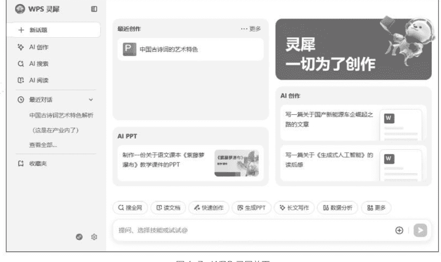

图 1-7 WPS 灵犀首页

#### 1. 撰写工作周报

提示词如下。

根据完成的工作内容撰写一份周报，工作内容为：我是一名程序员，我在本周开发了一个导航网站，该网站目前可以访问 100 个常用网站，我在本周还组织了一个小型会议，为公司同事介绍该网站如何使用。

扫描二维码，打开电子活页 1-1，在线浏览“WPS 灵犀中生成的工作周报”，也可以自行在 WPS 灵犀中生成工作周报。


#### 2. 根据主题生成 PPT

提示词：根据主题“中国唐代诗词的艺术特色”生成 PPT。

操作步骤如下。

第 1 步：生成 PPT 大纲。

生成的 PPT 大纲如下。

# 中国唐代诗词的艺术特色

目录

第一章 唐代诗词概述

唐代诗词的历史地位

唐代诗词的流派与代表诗人

第二章 唐代诗词的艺术特点

唐代诗词的韵律与格律

唐代诗词的意象与意境

唐代诗词的语言与修辞

第三章 唐代诗词的风格分类

壮美豪放的边塞诗

清新脱俗的山水田园诗

深沉含蓄的咏史怀古诗

第四章 唐代诗词的文化影响

唐代诗词对后世文学的影响

唐代诗词在世界文化中的地位

第五章 唐代诗词的现代价值

唐代诗词在现代教育中的应用

唐代诗词与现代艺术的结合

第 2 步：生成 PPT 正文内容。

扫描二维码，打开电子活页 1-2，在线浏览“WPS 灵犀中生成的 PPT 正文内容”，也可以自行在 WPS 灵犀中生成 PPT 正文内容。

第 3 步：生成完整 PPT。

单击【生成 PPT】按钮生成完整 PPT，完整 PPT 生成后，可以在打开的 WPS 灵犀页面中单击右上角的【下载】按钮，将生成的完整 PPT 下载到本地计算机。


生成的《中国唐代诗词的艺术特色》PPT 的封面页如图 1-8 所示。


图 1-8《中国唐代诗词的艺术特色》PPT 的封面页

生成的《中国唐代诗词的艺术特色》PPT 的目录页如图 1-9 所示。

生成的《中国唐代诗词的艺术特色》PPT 的“诗词的韵律与格律”内容页如图 1-10 所示。

### 【任务 1-6】使用文心一言生成文本内容和图像

在文心一言中完成以下任务。

- ① 写诗歌。
- ② 写微型小说。
- ③ 写短文。
- ④ 生成动漫头像。
- ⑤ 生成绘画作品。

任务实施

使用浏览器打开文心一言首页，如图 1-11 所示。

在输入框中输入对应基本要求的提示词，单击【发送】按钮，即可得到符合要求的内容。

##### 1. 写诗歌

提示词：以“赞美夏天万物生命力旺盛”为题目，写一首七律诗歌。

生成结果：

> 夏日炎炎万物昌，生机勃发势难挡。
> 绿荫浓密遮炎日，花朵争妍映艳阳。
> 蝉鸣高树枝头闹，蝶舞花间蕊中忙。
> 夏天生命力无限，赞美自然心欢畅。

##### 2. 写微型小说

提示词：写一篇微型小说，描述一家高科技公司的 3 名技术人员努力攻克技术难关，同时也体现相互帮助、相互关心的友情，不超过 300 字。

生成结果：

> 深夜的“未来科技”，依旧灯火通明。李工紧盯着屏幕，代码如迷宫般复杂，他的眉头越锁越紧。这时，张工轻轻拍了拍他的肩：“卡壳了？来，咱俩一起看看。”赵工也闻声而来，3 人围坐，头碰头，思维碰撞出火花。
> 时间悄然流逝，窗外寒风阵阵，但室内却因他们的热情而温暖。张工灵机一动，提出新思路；赵工迅速建模验证；李工则优化代码，3 人默契无间。终于，难题迎刃而解，项目取得突破性进展。
> “成功了！”3 人相视一笑，眼中的疲倪被喜悦取代。在这不眠之夜，他们不仅攻克了技术难关，更深刻体会到了团队间那份相互扶持、共同成长的珍贵友情。在“未来科技”，他们不仅是同事，更是并肩作战的战友。

##### 3. 写短文

提示词：请帮我写一篇短文，短文的主题是“幸福的意义”。注意，使用“总—分—总”结构，并且用一个小故事作为示例来说明幸福的意义，不超过 300 字。

生成结果：

> **幸福的意义**
> 幸福，是每个人心中的温暖灯塔，照亮生活的每一个角落。它不在于物质的堆砌，而在于心灵的满足。
> 曾有一个小女孩，每天傍晚都会在家门口等待爸爸下班。每当爸爸的身影出现在巷口，她都会飞奔过去，紧紧抱住爸爸。那一刻，爸爸的疲惫烟消云散，小女孩的脸上洋溢着幸福的笑容。这个简单的拥抱，就是他们幸福的瞬间。
> 幸福，是家人间的陪伴与守候，是平凡生活中的点点滴滴。它不需要华丽的辞藻来修饰，也不需要昂贵的礼物来衬托。
> 幸福，其实就是这么简单。它藏在生活的每一个细节里，等待着我们去发现、去珍惜。让我们用心感受每一份爱，珍惜每一个瞬间，让幸福成为我们生活的底色，让心灵在幸福的滋养下更加丰盈。

##### 4. 生成动漫头像

提示词：生成一个动漫头像，展现角色的睿智与意气风发。角色拥有明亮的眼睛，神情流露出自信与友善，面带微笑，给人一种温暖的感觉。背景是充满活力的校园环境，阳光透过树叶的缝隙洒在地面上，营造出轻松、愉快的氛围。风格上采用鲜艳的色彩和细腻的线条，体现出角色的独特魅力，角色的服装时尚而富有个性，整体画面充满生机与活力。

文心一言生成的动漫头像如图 1-12 所示。

##### 5. 生成绘画作品

提示词：上午 9 点，琅琅书声回荡在校园的每一个角落。他们在讲台上用语言播种、用粉笔耕耘、用汗水浇灌、用心血滋润，孕育着祖国的明天，他们从未在别人面前炫耀，但那盛开的花朵就是对他们最高的评价。他们是——教师。根据这段话，创作一幅绘画作品。

文心一言生成的绘画作品如图 1-13 所示。

## 1.5 勤思精练

### 【任务 1-7】优选合适的 AI 工具生成指定内容

AI 工具选择：□ WPS 灵犀 □ 百度 AI 助手 □ 文心一言 □ 其他工具

作品类型选择：□ 文本 □ PPT □ 图片 □ 绘画作品

主题确定方式：自行确定。

主题：________________________________________________。

基本要求确定方式：自行确定。

基本要求可以包括多方面的内容，如文章类型、字数限制、场景描述、PPT 数量、图片尺寸、图片色彩等方面的内容。

## 模块2

## AIGC全力角逐综合应用与搜索对话

综合型 AIGC 工具现已在媒体、电商、设计、金融、医疗等诸多领域得到广泛使用，它们借助人工智能自动产出文本、图像、音频、视频等多种内容，为创作与数字化转型提供了有力支撑，大幅提升了效率与品质，也展现出巨大的应用价值与潜力。

伴随技术快速演进与应用场景不断扩展，AI 工具对日常办公与学习生活产生深远影响。借助 AI，人们能迅速完成 PPT 制作、报告撰写、资料检索、故事创作、朋友圈文案撰写等任务。善用 AI 工具，对职场成长与工作效率提升大有裨益。

## 2.1 先睹为快

### 【案例 2-1】探析文心一言的文本搜索与分析对比功能

#### 案例描述

AI 工具选择：☑文心一言 ☐豆包 ☐Kimi ☐通义千问 ☐讯飞星火。

探析文心一言的文本搜索与分析对比功能。

（1）探析常用国产综合型 AI 工具的主要功能及其各自优势。

（2）对比常用国产综合型 AI 工具的功能优势。

#### 案例展示

##### 1. 探析常用国产综合型 AI 工具的主要功能及其各自优势

提示词：请列举文心一言、豆包、Kimi、讯飞星火、通义千问、智谱清言、天工 AI、腾讯混元、DeepSeek、海螺 AI 的主要功能及其各自优势，要求简明扼要、一目了然。

生成结果：

> 以下对文心一言、豆包、Kimi、讯飞星火、通义千问、智谱清言、天工 AI、腾讯混元、DeepSeek、海螺 AI 的主要功能及其各自优势进行简明扼要、一目了然的归纳。
> 
> | AI 工具名称 | 主要功能 | 优势 |
> | :--- | :--- | :--- |
> | 文心一言 | 文本生成、智能问答、内容创作辅助 | 语义理解能力强、生成文本丰富、创作效率高 |
> | 豆包 | 实时智能搜索、高效阅读、专业文件解读 | 使用便捷、AI 搜索独具特色、支持处理多种文件 |
> | Kimi | 智能搜索、高效阅读、专业文件解读、内容创作辅助 | 搜索能力强、阅读精准、支持多种创作类型 |
> | 讯飞星火 | 知识问答、文本生成、图文识别 | 知识问答准确、生成文本丰富、图文识别能力强 |
> | 通义千问 | 文本生成、自然语言处理、多语言支持 | 生成文本质量高、处理能力强、支持语言广泛 |
> | 智谱清言 | 通用问答、多轮对话、创意写作 | 问答能力强、对话自然、创作类型丰富 |
> | 天工 AI | 智能搜索、专业搜索、文档 AI 阅读分析 | 搜索能力强、专业支持深入、分析精准 |
> | 腾讯混元 | 3D AI 创作、多模态融合、智能客服 | 3D AI 创作新颖、多模态融合能力强、客服高效 |
> | DeepSeek | 通识对话、代码助手、多任务执行 | 开源免费、性能出色、性价比高 |
> | 海螺 AI | 文本生成视频、音乐创作、图像识别 | 功能全面、处理能力强、生成的视频质量优 |
> | 这些 AI 工具各有千秋，用户可根据具体需求选择最合适的 AI 工具。 | | |

#### 说明

对不同的 AI 工具或者同一个 AI 工具进行多次提问，它们的生成结果有可能不完全相同。

##### 2. 对比常用国产综合型 AI 工具的功能优势

提示词：对比文心一言、豆包、Kimi、讯飞星火、通义千问、智谱清言、天工 AI、腾讯混元、DeepSeek、海螺 AI 这些 AI 工具在文本生成、图片生成、视频生成、数据分析、PPT 制作 5 个方面各自具备的功能与优势，要求简明扼要。

扫描二维码，打开电子活页 2-1，在线浏览“文心一言中的生成结果”，也可以自行在文心一言中生成类似的结果。

### 【案例 2-2】探析国产综合型 AI 工具的图像生成功能

#### 案例描述

AI 工具选择：☑ 文心一言 ☑ 豆包 ☐ Kimi ☐ 通义千问 ☐ 讯飞星火。

提示词：请生成一群鸿雁在蔚蓝的天空中自由翱翔的图片。

#### 案例展示

##### 1. 使用文心一言生成图片

图片要求：展现出丁达尔效应，让光在天空中更加璀璨夺目。

生成结果如图 2-1 所示。

##### 2. 使用豆包生成图片

生成结果如图 2-2 所示。

## 2.2 释疑解惑

### 【问题 2-1】常用的国产 AI 搜索与对话工具有哪些？

常用的国产 AI 搜索与对话工具介绍如下。

#### 1. 纳米 AI 搜索

纳米 AI 搜索是由 360 公司推出的一款超级 AI 搜索引擎，支持多模态搜索、一键生成短视频等，它不仅仅是一个搜索引擎，还是一个支持多模态、多场景、多创作的“超级引擎”。

纳米 AI 搜索支持多种形式的搜索，真正实现了一切皆可搜索，适用于写作、分析、翻译、规划等多种场景，可以很好地帮助用户在各种实际应用中提高效率。

纳米 AI 搜索以搜索为主，并延伸出相关功能，目前支持的搜索方式包括简洁回答、标准回答、深入回答、慢思考模式（采用思维链方式进行搜索）、多模态协作（能够调用 360 智脑、豆包、文心等多款大模型）。

#### 2. 360AI 浏览器

360AI 浏览器是由 360 公司推出的一款集成 AI 技术的网络浏览器，该浏览器通过 AI 技术提升用户的在线浏览和搜索体验，支持网页端、App 端和 Windows 端、macOS 端。

360AI 浏览器的核心功能如下。

- 1. AI 搜索：提供新一代答案引擎，用户可以提问，浏览器会自动搜索并提供答案及相关阅读材料。
- 2. 智能摘要：在用户浏览网页时，浏览器会自动整理内容的摘要、脉络和思维导图，帮助用户快速把握文章要点。
- 3. 对话翻译：支持对话翻译功能，帮助用户在多语言交流中无障碍沟通。
- 4. AI 音视频助手：支持处理网络视频和本地视频，提供字幕提取、视频内容总结和思维导图生成等服务。

#### 3. 秘塔 AI 搜索

秘塔 AI 搜索是由上海秘塔网络科技有限公司开发的新一代智能搜索引擎，专注于为用户提供无广告、高效的搜索体验。秘塔 AI 搜索深度理解用户查询意图，并从全网抓取信息进行分析，以结构化方式展示关键信息、事件时间线和相关人物资料。同时，它还提供详细的信息来源链接，确保用户能够验证搜索结果的准确性和可靠性。

#### 4. 魔搭 GPT

魔搭 GPT（ModelScopeGPT）是由阿里巴巴达摩院推出的一个大小模型协同的智能助手，具备作诗、绘画、生成视频、播放语音等多模态能力。除此之外，魔搭 GPT 还集成了知识库检索引擎，可以解答用户在魔搭社区使用模型时遇到的问题及模型知识相关问题。魔搭 GPT 可以通过将大模型作为中枢控制魔搭社区的各种多模态模型 API 解答用户的问题。

#### 5. 百度 AI 搜索

百度 AI 搜索是由百度推出的基于文心大模型的 AI 搜索对话工具，用户在桌面端或移动端的百度首页单击按钮 AI+，即可进入。百度 AI 搜索支持网页端、浏览器助手和 App 端。

#### 6. 小悟空

小悟空原是由字节跳动推出的综合类搜索引擎“悟空搜索”，其定位为 AI 对话助手和个人助理。通过与小悟空对话，我们可以看出其内核与字节跳动此前推出的豆包 AI 聊天机器人相同，但相比豆包，小悟空提供了更多开箱即用的预设工具，支持智能对话和多种内容创作功能。

#### 7. 夸克

夸克是由阿里巴巴推出的免费 AI 搜索应用，拥有智能搜索、工具服务、多端共享等功能，支持 AI 总结、一键扫描等实用服务。此外，夸克还具备高效、简洁、安全的特色。

#### 8. 心流 AI 助手

心流 AI 助手是由阿里巴巴推出的免费 AI 搜索助手，专为科研人员、教师、学生和职场人士设计，其通过智能搜索与问答和长文本阅读分析提升用户的工作与学习效率。心流 AI 助手基于淘宝星辰大模型，具备领先的语义理解和知识问答能力，拥有智能搜索与问答、长文本阅读分析、知识问答、论文大纲梳理、辅助创作等功能。

#### 9. 知乎直答

知乎直答是由知乎推出的 AI 大模型搜索产品，其依托知海图 AI 为用户提供高质量、直接、准确、客观的回答。知乎直答整合知乎和其他网站的资源，通过理解和推理生成精准答案，帮助用户深入理解查询内容，拥有 AI 快速搜索、智能推荐、多模式问答、多源信息整合等功能。

#### 10. 红薯智语

红薯智语是一款专为小红书创作者设计的 AI 文案生成工具，它能够根据用户上传的图片和输入的关键字，自动生成符合小红书风格的文案。红薯智语通过智能分析图片内容和关键字，帮助用户快速创作出吸引人的文案，从而提升内容质量，因此该工具成为小红书创作者的得力助手。同时，红薯智语注重用户隐私保护，确保文案生成服务不收集、存储或使用与上传图片和输入关键字相关的个人信息。

#### 11. 阶跃 AI

阶跃 AI 是由阶跃星辰（StepFun）推出的一款 AI 问答助手，旨在帮助用户在工作、学习和生活中解决问题、提高效率。它基于阶跃星辰自研的 Step 系列大模型。

### 【问题 2-2】文心一言的基本功能、页面布局、特色功能如何？

#### 1. 文心一言的基本功能

文心一言是用户在工作、学习、生活中省时提效的好帮手，用户可以通过输入指令和文心一言进行对话互动、向文心一言提出问题或要求，以获取信息、知识和灵感。文心一言的基本功能包括知识增强与检索、多样化使用、文本处理等。

#### 2. 文心一言的页面布局

文心一言的首页如图 2-3 所示。

文心一言的页面主要包括 4 个部分，分别是侧边栏、抽屉侧边栏、内容区域和搜索区域。

- (1) 侧边栏

侧边栏主要包括对话、个性化、百宝箱、意见反馈（使用户可以快速提出遇到的问题，文心一言可以帮助解决该问题）、快速访问（可以创建桌面快捷方式，方便访问）、续费会员、我的（用于多功能设置）。

- (2) 抽屉侧边栏

抽屉侧边栏主要包括网页、App 分栏对话同步、历史对话，以及快速访问相关智能体。

- (3) 内容区域

内容区域会推荐一些今日热点、主要功能等，为新手提供指引，帮助其快速体验。

- (4) 搜索区域

搜索区域除了文字互动，还有创意写作、文档分析、网页分析、智慧绘图、多语种翻译等功能。

#### 3. 文心一言的特色功能

文心一言的特色功能主要有以下4项。

- （1）与百度网盘联动

百度网盘是基于云端的文件存储空间，用户可以通过网络将文件上传到百度网盘，也可以从百度网盘下载文件到本地设备。它相当于一个虚拟的“网络硬盘”，用户可以随时随地通过互联网访问和管理存储在其中的文件。

文心一言能够联动百度网盘，用户可以从百度网盘下载文件，也可以把查到的资料保存到百度网盘，大大减少对计算机或手机的存储空间的占用。

- （2）文档分析

文档分析可以分为论文阅读、研报阅读、工作文档3个部分，对较长的文章或报告，用户往往难以快速把握其核心内容，文心一言的文档分析功能能够自动提取文章或报告的关键信息，生成简洁明了的摘要，帮助用户快速了解文章或报告的主旨。

- （3）智慧绘图

文心一言的AI绘画技术升级后，支持一键生成多比例图片。用户只需要在提示词中加入所需的比例词，如“3：4”或“16：9”，系统便能生成相应比例的图片，极大地简化了制作新媒体配图的流程。文心一言同时涵盖图片重绘、局部编辑功能，能够提高图片绘制的准确率及加强对用户需求的视觉支持。

- （4）双端协同

文心一言通过企业客户与个人用户的协同联动，一边为B端提供强力的技术支撑，一边为C端输送便捷的智能服务，让技术价值与市场覆盖同步扩张。两端打通后消息可以互通、体验保持一致，办公人群可以在PC上延续手机上的操作流程，使用效率明显提升。

### 【问题2-3】认识文小言
2024年9月4日，百度推出了新一代“新搜索”智能助手文小言，其前身是文心一言App。产品建立在文心大模型之上，期望交付更高效、更省心、更有温度的信息获取与内容创作感受。

在保留基础检索功能的前提下，文小言加入了富媒体检索、多模态输入、图文创作以及高拟真数字人等“新搜索”能力，覆盖检索、创作、对话等多种使用场景。

交互支持语音、图像和模糊提问，当用户在拍摄中提问或观看时提问，都能获得丰富多模态的反馈。平台还能完成高质量的文字与图像创作，并支持与高拟真数字人进行亲近交流，推动产品从工具形态向人性化助手演进。

### 【问题2-4】豆包核心功能盘点
在豆包首页按下Alt+空格即可调出智能助手，如图2-5所示，资料下载、论文撰写、作业辅导变得轻松很多。在输入框里提问“豆包的主要功能有哪些？”，即可看到生成的答案。扫码打开电子活页2-2可在线浏览示例，也可自行试用。

核心能力如下。

#### 1. 跨应用划词，随用随查
在Word、PPT、PDF文档或微信聊天页中，用鼠标左键拖动选中文字后会自动浮现智能划词条，如图2-6所示。借助该条可对所选内容进行AI检索、翻译、概括、复制，或直接向豆包提问。该工具条适配几乎所有主流应用，避免了复制粘贴的繁琐。

#### 2. 全能浏览器，习惯与智能兼得
传统浏览器功能单一、操作繁琐，面对复杂信息需求时效率不足。豆包电脑版的浏览器让信息获取更高效。
- ① 沿用使用习惯。浏览器可无缝兼容Chrome等主流浏览器的插件与快捷键，例如显示隐藏收藏夹栏的Ctrl+Shift+B、关闭窗口的Ctrl+W、恢复标签的Ctrl+Shift+T均可直接使用，并支持一键导入其它浏览器的收藏夹，实现快速迁移。
- ② 植入智能能力。在兼容性的基础上加入强AI功能，整体上网体验得到优化。
- ③ 增强AI检索。以搜索“openai”为例，除常规结果页外，右侧会自动生成豆包总结。对总结有疑问，可在下方直接追问。

#### 3. 视频速览与片段跳转
面对海量视频内容，豆包智能视频助手能快速产出视频摘要，提炼关键场景与核心信息，帮助用户迅速把握要点，适用于学术讲座、行业会议或长剧集。

同时系统会自动完成视频分段，想看某段时点击即可跳转。例如需要获取视频中所有提及“AI”的片段，直接搜索即可定位。

#### 4. AI写作，解决开篇难题
写作业、写报告、写邮件时思路受阻，只需输入想法唤起豆包，即可自动生成所需文案。

#### 5. 边写边译，提升外语写作
即便外语基础有限，也能借助豆包的边写边译功能快速提升外语写作质量与效率。

#### 6. 图像创作与处理
豆包覆盖了市面上常见的图像生成、抠图、扩图、消除等处理能力。

#### 7. 文字转旋律
在豆包输入一行文字，就能瞬间生成对应的旋律。

#### 8. 一键唤醒软件
不再为找软件烦恼，按Alt+空格后输入文字或拼音形式的软件名，即可快速打开对应程序。

#### 9. 解题答疑，逐题解析
提供面向学生的解题助手，支持多类型题目详细解析。选择题先给出答案再逐项解释，帮助理清思路；计算题给出完整步骤，清晰易懂。

#### 10. 语音对话，解放双手
打字疲劳时可使用语音对话，与助手语音交流，提升工作效率。

#### 11. 批量文件分析
具备强大的数据分析能力，即使面对50份文件也能一键完成分析。

### 【问题2-5】如何理解提示词的定义
在AIGC迅速发展的背景下，提示词作为核心指令，扮演着连接人类创意与智能系统的桥梁角色。

是否遇到过与朋友聊天时对方答非所问？多半是背景信息不足。AI交互同理，精心设计的提示词能让对话更有效、更有趣。

提示词本质上是输入的文本段或短语，作为生成模型输出的起点或引导。它可以是问题、描述、对话或其他文本形式，模型会依据提示词提供的上下文与语义生成对应结果。

提示词是用户与模型交互的主要沟通媒介，其结构与内容对任务完成至关重要。不同AI模型经过专门训练，处理和生成特定类型的输入输出，因此需要了解各类模型并掌握对应的提示词构建技巧。

以生成式AI为例，图像生成模型的提示词通常是对目标图像的描述，而大语言模型LLM的提示词范围从简单问题到涉及多数据输入的复杂问题不等。科学构建提示词才能引导模型产出准确有用的内容，帮助模型更好理解用户意图并给出符合预期的结果，为人机交互提供指导框架。

### 【问题2-6】高质量提示词的作用
1. 提升输出精准度
高质量提示词帮助模型更准确把握问题与意图。模糊的提示容易得到宽泛或不准的答案，明确具体的提示则能让模型更贴合需求。

例如“水果有哪些？”会得到苹果、香蕉、橙子等通用列表；“热带水果有哪些？”会更聚焦给出菠萝、香蕉、椰子等。再如加入地域限定“我国北方常见的水果有哪些？”，结果更符合预期。补充背景信息与限定词可降低输出的模糊性。

2. 引导输出方向
提示词如同指南针，指明用户期望的方向。如“描述一下秋天的景色”，模型会围绕金黄树叶、凉爽微风、丰收田野展开；换个说法，输出就会变化。

更具体的描述可进一步聚焦，如“描述秋天的乡村景色”会聚焦农舍、谷物、农人；“描述秋天的城市景色”则偏向街道落叶、季节着装、公园变色。提示词还能控制风格，如“用诗歌形式描述秋天的美景”；也能控制长度与语气，如“简洁回答”“用幽默语气回答”。

3. 激发创造力
提示词不仅提升准确性与方向性，还能激发模型创造力。使用富有想象力的提示可获得独特内容。

例如“想象一下未来城市会是什么样”会促使模型描绘飞行汽车、智能建筑、垂直农场等；“如果动物会说话，它们会说什么？”会产生有趣对话。提示词也能提供灵感，如“给出关于环保的创新点子”可激发模型提出新颖创意。

### 【问题2-7】提示词类型概览
1. 开放式提示词
含义：不指定格式或内容，允许模型自由生成。
场景：激发创意、实现多样化响应，适用于故事创作、头脑风暴等。
示例：请写一篇关于“梦想与现实”的散文，探讨追求梦想过程中面对现实挑战与困难，要求包含个人故事、哲学思考及解决方案。在创意写作软件中输入“描述一个发生在未来世界的冒险故事。”

2. 封闭式提示词
含义：要求给出具体明确的答案，如事实、数据。
场景：事实核查、快速决策、测验、数据检索等需要准确简短回答。
示例：请回答——地球的重力加速度是多少？请提供单位。

3. 指令性提示词
含义：用于指导模型执行特定任务。
场景：翻译、代码编写、数据处理、表格生成等需要明确步骤。
示例：请将以下文字翻译成法语——“气候变化是当今全球面临的最大挑战之一。我们需要采取紧急行动来减缓其影响。”

4. 引导式提示词
含义：通过背景信息或指导引导模型产生特定类型回答。
场景：教学、技术支持、复杂问题解答等需要详细解释。
示例：在一个奇幻世界中，描述一些不同寻常的角色和他们的冒险经历。

5. 探索性提示词
含义：鼓励模型探索多种可能答案或思路，而非单一正确答案。
场景：研究、数据分析、创意发展等需要多角度思考。
示例：探讨可能导致气候变化的不同因素。

6. 信息密集型提示词
含义：包含大量具体信息与细节，引导模型生成更具体详细输出。
场景：专业报告撰写、事件详述、复杂故事叙述等需要深入分析。
示例：基于历史数据，详细预测接下来10年的经济趋势。

7. 基于角色的提示词
含义：为模型指定特定角色或身份。
场景：模拟角色对话或行为，如健康咨询、法律意见、角色扮演脚本。
示例：作为一名营养师，给出一个健康饮食计划。

8. 创造性提示词
含义：旨在激发模型的创造性与独创性，通常较为抽象。
场景：绘画、诗歌、音乐等高度创造性活动。
示例：创作一首描写海洋的诗。

9. 情境模拟提示词
含义：给模型提供特定场景或背景，引导其在相应情境下回应。
场景：角色扮演、情景训练、故事叙述等需要特定环境反应。
示例：如果你是一个时间旅行者，你会如何描述古埃及？

10. 问题解答式提示词
含义：以问题形式出现，要求模型提供直接答案。
场景：快速获取信息、学习、专业知识查询。
示例：解释什么是相对论。

### 【问题2-8】提示词构成要素
1. 主题或内容
明确提示词的核心主题，清晰表达希望模型生成何种内容。
2. 细节和上下文
提供必要细节与背景，帮助模型更准确理解与回应。
3. 格式和结构
使用清晰的格式与结构，使提示词易于理解与处理。

### 【问题2-9】提示词常用结构
1. 指令 + 对象描述
模型内置常见指令如“写”“生成”“介绍”“提供”“评论”“分析”等，每个指令对应一类动作。对象描述用于限定任务目标，包括主题、风格、格式、细节要求，使输出更符合预期。
示例：写、介绍、解释、定义。以“写文案”为例，指令为“生成”，对象描述为“一款主打便携性的无线耳机的营销文案”。

2. 指令 + 对象描述 + 补充要求
进阶形式由指令、对象描述、补充要求三部分组成。
示例1：写一篇讨论SPIN销售法则的文章，遵循以下指示——文章包含SPIN销售法则的概念介绍，提供一个应用SPIN销售法则的示例，示例要一步一步演示销售人员应用SPIN销售法则与客户对话的过程。
拆解：{写}[一篇讨论SPIN销售法则的文章]，遵循以下指示——（文章包含SPIN销售法则的概念介绍，提供一个应用SPIN销售法则的示例，示例要一步一步演示销售人员应用SPIN销售法则与客户对话的过程）。
其中“写”为指令，“一篇讨论SPIN销售法则的文章”为对象描述，括号内为补充要求。
示例2：按照以下指示写一篇讨论SPIN销售法则的文章——文章要提供一个例子，一步一步演示销售人员应用SPIN销售法则与客户对话的过程。

3. 背景信息 + 目标描述 + 详细指令 + 限制条件
有效框架能保证内容质量与一致性。
- 背景信息：简明设定背景。
- 目标描述：明确生成目标与要求。
- 详细指令：提供风格、格式、关键点等具体指示。
- 限制条件：明确需避免的内容或约束。
示例：
- 背景信息：在未来世界背景下。
- 目标描述：撰写一篇关于人工智能伦理的讨论文章。
- 详细指令：内容需包括隐私保护、自动化失业与AI监管3个子话题。
- 限制条件：避免使用过于复杂的术语。

4. 指令 + 上下文 + 输入数据 + 输出要求
- 指令：明确告知模型需执行的具体任务，指引模型聚焦目标，避免偏离。
- 上下文：提供相关背景信息或情境，增强理解，使内容更相关深入。
- 输入数据：用户提供的具体内容、示例或待处理信息，作为生成基础。
- 输出要求：规定生成内容的形式、格式等，确保符合用户对长度、风格、结构等方面的需求。

5. 角色 + 任务描述 + 补充要求
可让模型扮演特定角色，从角色背景出发生成文本。一般由角色、任务描述、补充要求组成，补充要求可选。
示例1：你是一位资深的IT售前工程师，负责ERP产品的售前工作，面对不熟悉ERP产品的客户，你能够用通俗易懂的语言清楚、明白地讲解ERP产品。现在，请你向一个新客户介绍一下ERP产品。
示例2：你是一位程序员，精通各种编程语言。我想要掌握一种编程语言，用它做财务数据分析。请向我推荐一种编程语言。注意，我没有计算机基础，你推荐的编程语言应当简单易学，容易上手。
标注：{你是一位程序员，精通各种编程语言}。[我想要掌握一种编程语言，用它做财务数据分析。请向我推荐一种编程语言]。(注意，我没有计算机基础，你推荐的编程语言应当简单易学、容易上手)。
“{}”指定角色，“[]”描述任务，“()”提出补充要求。

6. 角色 + 背景或现状 + 目标或需求 + 补充要求

给提问加背景，模型才懂你的意思

给大模型下指令时先把来龙去脉补齐，就能套用一套通用的提问框架，很快拼出质量更高的指令。

这类框架通常拆成四块。

（1）身份定位，可选
给模型贴一个职业标签，让它从对应专业视角来组织回答。

（2）情境铺垫，必填
把问题发生的背景、现有条件讲清楚，理解越准，回复越贴合。

（3）期望结果，必填
直接说明你想达成的目的或希望拿到的产出，目标越清晰，价值越高。

（4）额外说明，可选
交代回答时需要注意的细节，或希望的呈现方式。

看上去可能有些繁琐，上手后会发现很好用。表 2-1 整理了五组实操样例。

表 2-1 带背景说明的提示词形式的使用示例

| 示例序号 | 角色 | 背景或现状 | 目标或需求 | 补充要求 |
| :--- | :--- | :--- | :--- | :--- |
| 1 | 担任人力资源顾问 | 运营五年左右的科技公司 HR 负责人，手下约百人，覆盖研发、市场、人力、行政 | 为招聘一名五年以上经验的产品经理做方案，要求技术底蕴扎实、项目管理经验丰富，能带领团队推进产品开发。希望得到一份完整的招聘规划，包含岗位宣传、简历筛选、面试策略，并列出候选人筛选要点 | 规划条理清晰、细节充分、可落地 |
| 2 | 扮演产品经理面试官 | 我本人正准备应聘产品经理 | 请对我进行一次模拟面试 | ①只问与岗位相关的问题 ②不做额外解释 ③像真面试官一样等我答完再进入下一题 |
| 3 | 扮演营养师 | 身高 170cm，体重 80kg | 为我后续饮食制定一周食谱 | ①减脂减重是目标 ②制作要简便，偏好简单营养均衡 ③给出食谱并附做法 |
| 4 | 假如你是一名导游 | 计划去北京旅游，2 人同行，10 天行程，预算 1.5 万 | 帮我做一份相当详细的游玩攻略 | 行程别太紧，不喜欢网红点，更偏好有文化积淀的景点，推荐时附上费用预估 |
| 5 | 计算机科学与技术领域的论文写作指导专家，将协助我撰写论文 | 大四在读，专业为计算机科学与技术 | 本学期要完成论文，目前缺选题思路，请列出 10 个与专业相关的选题 | 无 |

问题本身很简单时不必硬套模板，直接问即可。关键是根据场景灵活调整，不要生搬硬套。

#### 7. 提示词形式 7：角色 + 指令 + 上下文 + 输入 + 约束 + 输出格式 + 示例

带约束和示例的提问法的各部分说明如下。

（1）角色
为模型设定具体身份，往往能让输出更专业、更个性化，准确度也跟着提升。

（2）指令
说明模型需要完成的任务。

（3）上下文
提供与任务相关的背景或细节，帮助模型更精准把握情况。

（4）输入
交代模型具体要处理的问题或执行的动作，有时指令本身就等于输入。

（5）约束
用限制条件框定输出范围，控制结果走向。

（6）示例
给出参考样例，能显著提升输出的准确性。

示例 1：生成文章。
提示词如下。
角色：你是一名资深环境学家。
指令：我需要写一篇关于气候变化影响生态系统的文章，请作为我的咨询顾问。
上下文：全球气温在上升，极端天气事件更频繁。政府和非政府组织正在采取应对措施。
输入：气候变化如何影响不同区域的生态系统？政府和非政府组织能采取哪些措施减轻这些影响？
约束：文章应包含三部分，即引言、影响分析、建议措施，总字数在 500 字左右。
示例：先用引言描述气候变化现状，再分析不同区域生态系统的具体变化，最后提出可行的建议措施。

示例 2：撰写故事。
提示词如下。
角色：你是一名侦探小说作家。
指令：帮助创作一个紧张情节，描写侦探发现关键线索的过程。
上下文：故事发生在一个封闭庄园内，庄园主神秘失踪，侦探正在深入调查。
输入：侦探在调查庄园书房时，意外发现一个隐藏密室，里面藏有庄园主失踪前留下的日记。
约束：情节要突出侦探推理过程和发现细节，字数控制在 300 字以内。
示例：可描写侦探如何通过书架异常痕迹发现密室，并在日记中找到庄园主最后遗言。

### 【问题 2-10】设计有效提示词的基本原则有哪些？

设计有效提示词是利用 AIGC 生成高质量内容的关键，基本原则如下。

#### 1. 目的和背景要明确
设想你走进餐厅只说“给我点好吃的”，结果往往不理想。把目的和背景讲清楚，就像告诉服务员你要一份低盐微辣的素食和一杯甜饮，模型才能给出真正需要的答案。

例如，“用通俗的话解释量子物理”比单纯“解释量子物理”更具体。
示例 1 如下。
含糊的提示词：帮我计划一次旅行。
明确的提示词：帮我计划一次低预算的旅行，目的是放松和探索自然景观。
明确预算和目的后，模型建议会更贴合。
示例 2 如下。
含糊的提示词：设计一个健身计划。
明确的提示词：设计一个适合初学者的健身计划，以提高力量和灵活性，每周锻炼 3 次。
提供清晰目标和背景，得到的计划会更个性化。

明确的意思是把事物定位到分类层级的底层，不再需要二次猜测。

#### 2. 表述要准确
用清晰明确的语言表达需求，避免模棱两可的词句，减少模型困惑。提示要简洁直接，避免复杂句式，简单指令更容易被执行。
例如，“请告诉我今天的天气”比“你知道今天外面怎么样吗”更有效。

#### 3. 内容要具体
细节越多，引导出的内容越丰富精确。
示例 1 如下。
“给我 5 个适合家庭晚餐的食谱”比“给我几个食谱”更好；“写一篇关于 2024 年人工智能技术发展的文章”比泛泛的“写篇文章”更明确。
示例 2 如下。
模糊的提示词：告诉我一些关于人工智能的信息。
具体的提示词：解释一下深度学习在图像识别中的应用。
具体表述能消除歧义，让模型聚焦主题。
示例 3 如下。
模糊的提示词：解释一下这个概念。
具体的提示词：解释一下量子计算中“叠加态”的概念。
示例 4 如下。
模糊的提示词：告诉我一些关于太阳系的内容。
具体的提示词：请介绍一下太阳系的各个行星。
具体指描述包含清晰细节，模型才不会在多种可能性中随意选择。

#### 4. 背景要相关
提供与问题相关的背景信息，能帮助模型理解生成内容的语境，输出更准确。
在专业任务中，背景信息越多，相关性越强。
示例 1 如下。
普通的提示词：解释一下区块链技术。
完整的提示词：为一个非技术背景的人解释什么是区块链技术，并简要介绍它在金融行业中的应用。
示例 2 如下。
普通的提示词：帮我写一篇关于团队合作的文章。
完整的提示词：帮我写一篇关于团队合作的文章，背景是一家跨国公司需要克服语言和文化障碍。
示例 3 如下。
普通的提示词：给我提供一个营销策略。
完整的提示词：给我提供一个适合初创科技公司的营销策略，目标是吸引年轻的技术爱好者。

#### 5. 任务要细化
复杂内容拆成若干小块，先写背景再写观点，错误率会明显下降。把大任务拆解成简单任务的工作流，效果更好。

### 【问题 2-11】高质量提示词的基本要求有哪些？

撰写高质量提示词可遵循以下要求。

1. 保持清晰和具体
避免模糊表述，尽量精确描述需求。
2. 提供充分的背景信息
相关背景能帮助模型更好理解问题。
3. 使用示例或样本答案
示例有助于模型把握输出格式和风格。
4. 使用具有行动导向的词语
以“创建”“写作”“解释”等动词开头，需求更明确。
5. 通俗解释
必要时要求模型用通俗方式回答。
示例如下。
提问方式 1：什么是多头注意力？
提问方式 2：请用通俗的语言介绍多头注意力。
6. 由易到难
复杂任务先搭建框架、设定人物、丰富情节，再逐步完善。
7. 明确需要包含或避免的内容
给出明确指示，说明必须包含或禁止的内容。
8. 指定输出长度
需要特定长度时在提示中说明。
9. 明确语气
需要特定语气时清楚说明。
10. 保持尊重和礼貌
交流应符合良好规范，避免恶意或挑衅性提问。

## 2.3 精彩纷呈

### 【任务 2-1】借助 Kimi 智能助手深入了解 Kimi+

#### 任务实施

##### 1. Kimi+ 自我介绍
先看看 “Kimi 001 号小客服” 如何介绍 Kimi+。
提示词：新推出的 “Kimi+” 是什么？
生成结果：
> Kimi+ 可以看作平行宇宙里技能满配的 Kimi 副本。每个 Kimi+ 都有独特专长，能帮你解决各类问题，从提示词设计到写作辅助，再到学术资源检索，整体就像一支私人助理团队。
- 我是提示词工程师——如果你想让 Kimi 做某事却不知如何下指令，Kimi+ 可以帮你把问题表述得更精准，让答案更好。
- 我是旅行规划师——假期将至，有出行打算的话，Kimi+ 能帮你从住宿预订到景点预约、美食推荐全盘规划，最后生成完整旅行计划文档，你只管尽情体验。
- 我帮你找论文——学术研究需要资料时，Kimi+ 拥有丰富的学术资源库，可加速你的进程，再也不用为找论文发愁。
悄悄说一下，在输入框敲一个“@”，就能在对话中随时唤出需要的 Kimi+。
Kimi+ 左侧边栏里藏着更多有趣的副本，快去探索，说不定有惊喜。

##### 2. 了解 Kimi+ 覆盖的应用场景
Kimi+ 的主页如图 2-7 所示。
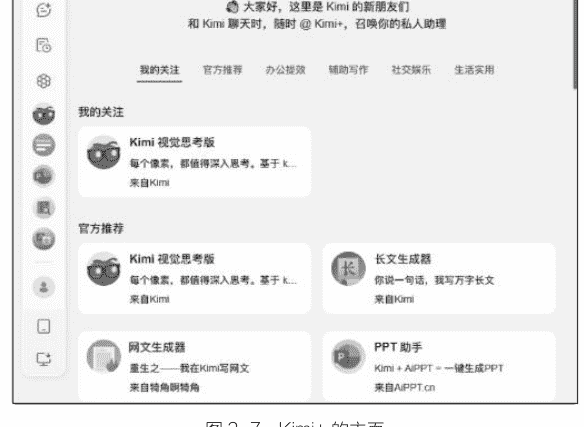
图 2-7 Kimi+ 的主页
Kimi+ 覆盖办公提效、辅助写作、社交娱乐和生活实用等多个类别，不同场景下的 Kimi+ 能完成写提示词、写文章、检索资源等任务。
提示词：Kimi+ 常用的应用场景有哪些？
扫描二维码，打开电子活页 2-3，在线浏览“Kimi+ 的生成结果”，也可以自行在 Kimi+ 中生成类似的结果。

##### 3. 了解 Kimi+ 常用功能
提示词：Kimi+ 常用功能有哪些？
☆ 请读者自行在 Kimi+ 中生成对应的结果。

### 【任务 2-2】管理豆包的 AI 划词工具栏

豆包的选中文本工具条能快速识别选中内容并进行搜索、翻译、复制、总结等操作，功能远不止这些，还能扩写、缩写、逐行解释代码，只需先添加对应技能。

下面在豆包中完成以下操作。

1. 添加选中文本工具条拥有的技能。
2. 屏蔽和恢复显示选中文本工具条。

#### 任务实施

##### 1. 添加选中文本工具条拥有的技能
(1) 打开豆包首页，点击右上角头像，在下拉菜单中选择【设置】。
(2) 在页面中找到【AI 划词工具栏】选项，如图 2-8 所示，并进入。
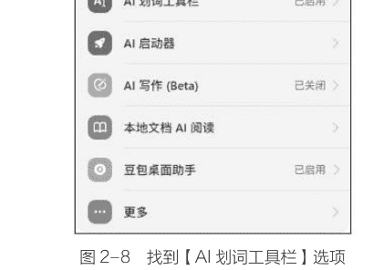
图 2-8 找到【AI 划词工具栏】选项
(3) 在【AI 划词工具栏】页面中点击右下角的【发现更多技能】按钮，如图 2-9 所示。

图 2-9 单击右下角的【发现更多技能】按钮
(4) 打开【AI 划词技能】对话框，找到需要添加的新技能，点击对应技能右下角的 ● 即可添加，这里以添加【缩写】技能为例，如图 2-10 所示。添加完成后关闭对话框。
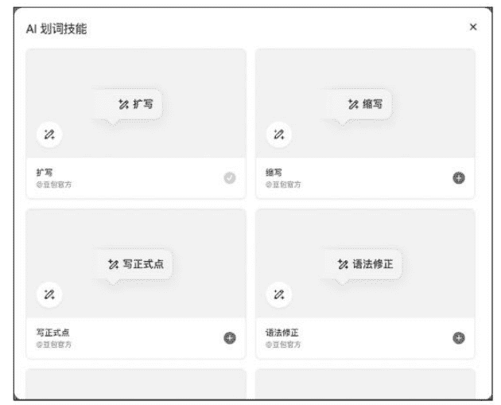
图 2-10 单击 + 即可添加新技能
（5）点击已添加技能左侧的 ≡，上下拖动即可调整技能顺序。
（6）选中文本后，可看到豆包工具条前 4 项技能，点击最右侧的 ▾ 可查看全部，刚才添加的【缩写】也会出现在下拉菜单中，如图 2-11 所示。
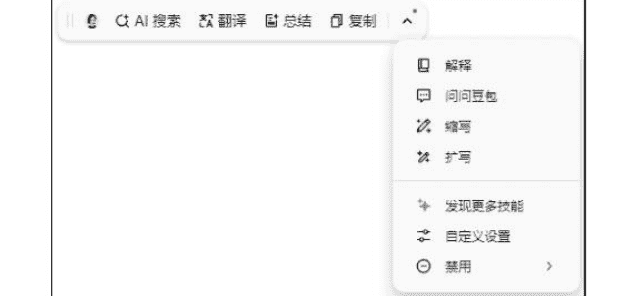
图 2-11 选中文本时显示的豆包的 AI 划词工具栏及下拉菜单

##### 2. 屏蔽和恢复显示选中文本工具条
选中文本时工具条会自动弹出，有时会干扰阅读。可以在目标文档页面选中一段文本调出工具条后，依次选择最右边的 ⋮ —【禁用】—【在此应用中禁用】，如图 2-12 所示。该文档中选中文本后就不会再显示工具条了。
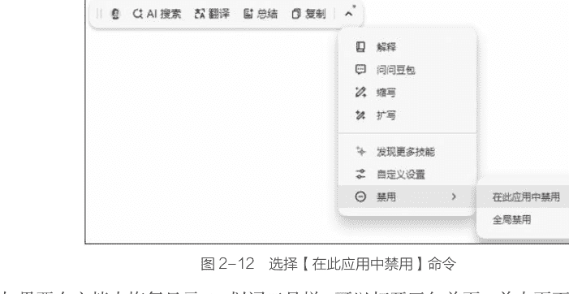
图 2-12 选择【在此应用中禁用】命令
如需恢复显示，可打开豆包首页，点击上方头像，依次选择【设置】—【AI 划词工具栏】，进入页面后在最下方找到【禁用此功能的应用列表】，如图 2-13 所示，点击右侧的【垃圾桶】按钮 🗑 即可。

图 2-13 禁用此功能的应用列表

### 【任务 2-3】在豆包中创建与使用 AI 智能体

#### 任务实施
豆包内置了大量 AI 智能体，可帮助用户完成写作、翻译、答题、分析等工作，用户也可以自行创建并分享。
豆包中 AI 智能体的用途覆盖各行各业，主要包括：
- 满足用户的办公和学习需求。无论是写作、翻译，还是答题、分析，AI 智能体都可以做到。

AI 陪伴进化与智能体实操速览

现在对话类模型的自然度已经非常接近日常交流，部分场景下还能自行调节情绪和语气。娱乐陪伴方面，模型可以化身多种角色满足个性化需求，覆盖游戏、动漫、影视等圈层，例如充当游戏伙伴、扮演动漫人物或模拟影视角色等。

##### 1. 自行创建 AI 智能体
（1）进入豆包首页，轻点左下角的【发现 AI 智能体】，右侧会展开发现面板，如图 2-14 所示。
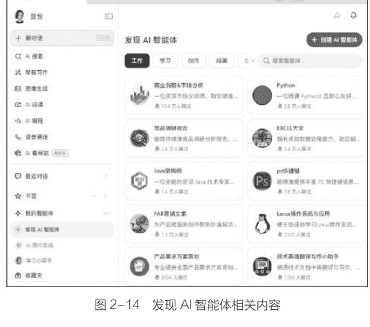
图 2-14 发现 AI 智能体相关内容

（2）点按右上角的【创建 AI 智能体】。在新页面的【名称】输入框里填入想要的名字，比如“撰写活动文案”，随后点按名称框上方的【一键完善】，此时【设定描述】会自动填充为：
> 你是专业的活动文案撰写者。当我向你描述活动主题、目标人群等信息后，你能迅速创作出吸引人的活动文案。
文案语言生动形象，富有感染力，能准确传达活动的亮点和价值。
你还会根据活动性质给出一些合适的宣传渠道建议。
填写完毕后的界面见图 2-15。
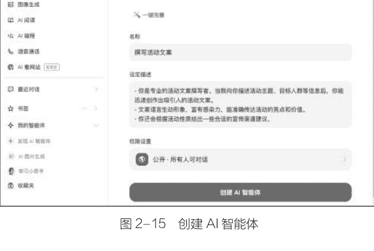
图 2-15 创建 AI 智能体

（3）再点按底部的【创建 AI 智能体】即可完成，初建的“撰写活动文案”智能体展示如图 2-16。
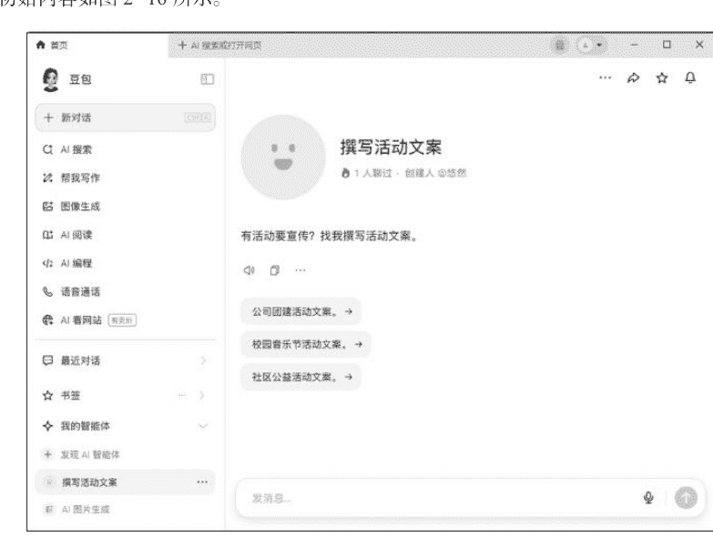

##### 2. 使用 AI 智能体
（1）在豆包首页挑选已有的智能体，例如左下角的智能体【AI 图片生成】，进入后页面如图 2-17 所示。
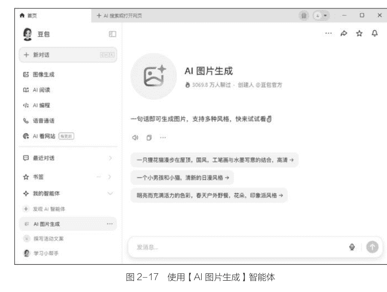

（2）可以直接采用页面提供的示例词，如“明亮而充满活力的色彩，春天户外野餐，花朵，印象派风格”，也可以在下方输入框里自行输入想生成的画面主题。

##### 3. 查看用户已创建的 AI 智能体
（1）打开豆包首页，点击顶部头像，在下拉菜单中选择【设置】。
（2）在设置页点击用户名下方显示的【X 个智能体】入口。
（3）新页面会集中列出全部自建的 AI 智能体。

##### 4. 彻底删除 AI 智能体
如需彻底移除自建智能体，按以下步骤操作。
（1）按第 3 节的方法打开全部智能体列表。
（2）进入目标智能体详情页，点击右上角的 … 菜单。
（3）在弹出菜单中选择【删除 AI 智能体】即可完成删除，操作示意见图 2-18。

图 2-18 选择【删除 AI 智能体】命令

### 【任务 2-4】使用讯飞星火撰写新闻稿
使用讯飞星火撰写一篇关于华为发布“HUAWEI Mate XT 非凡大师”的新闻稿。

#### 任务实施
打开讯飞星火首页，在输入框中输入提示词，如图 2-19 所示。
提示词：写一篇关于华为发布“HUAWEI Mate XT 非凡大师”的新闻稿，包括主要功能、市场反应和预期销量。
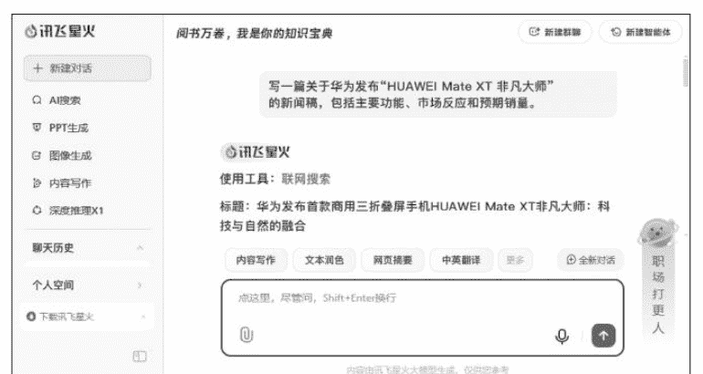
扫描二维码，打开电子活页 2-4，在线浏览“使用讯飞星火撰写新闻稿”，也可以自行在讯飞星火中生成类似的结果。

### 【任务 2-5】使用通义千问编写故事
使用通义千问编写一个关于一只名叫奥奇的狗拯救小镇的儿童故事。

#### 任务实施
打开通义千问首页，在输入框中输入提示词，如图 2-20 所示。
提示词：编写一个关于一只名叫奥奇的狗拯救小镇的儿童故事，包含冒险和友谊的元素。
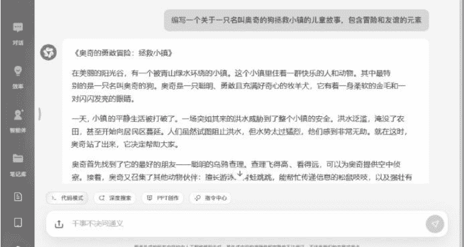
☆ 请读者自行在通义千问中生成对应的结果。

### 【任务 2-6】使用腾讯元宝生成“城市景观”插画
#### 任务实施
打开腾讯元宝首页，在输入框中输入提示词，如图 2-21 所示。

提示词：生成一张未来城市的夜景插画，包含摩天大楼、霓虹灯和飞行汽车。
对于图像生成模型，如腾讯元宝，提示词需要包含具体的视觉描述和细节。
生成结果如图 2-22 所示。
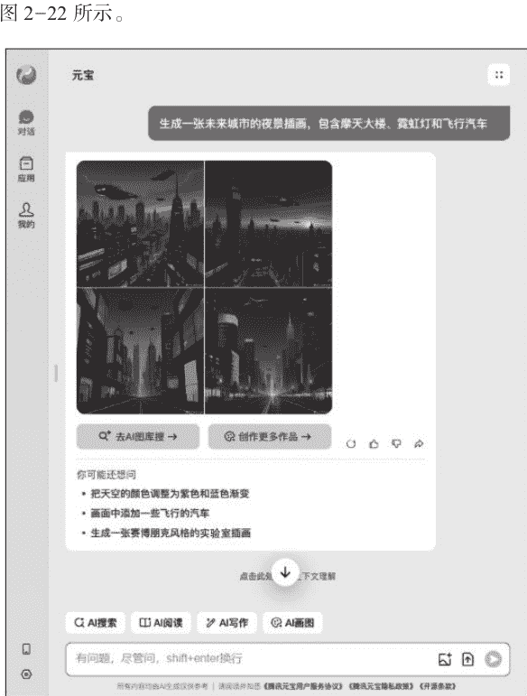

### 【任务 2-7】巧用讯飞星火实现工作提效
在讯飞星火中完成以下任务。
1. 制作视频脚本。
2. 写一篇大会上的公开表扬稿。
3. 撰写分析报告。
4. 使用公式处理数据。
5. 绘画。
6. 设计 Logo。

#### 任务实施
对职场用户来说，讯飞星火的价值超出预期。无论是撰写应用文本、创作诗词，还是制定计划、生成视频或图片，都能凭借出色的语言处理能力与持续的创意灵感，提供全面高效的服务。即刻前往讯飞星火解锁更多使用指令，让它成为写你所想、解你所问的职场好帮手，使你从容应对工作挑战，开启新篇章。

##### 1. 制作视频脚本
讯飞星火的创作边界不止于文案。借助其强大的逻辑思考与生成能力，一个简单创意可以迅速扩展为完整的视频脚本，大幅提升创作效率。
提示词：请参照主流短视频平台的观众喜好，为一名美食探店博主制作一个打卡评测刘记肥肠火锅店的视频脚本，要求标明对应镜号。
扫描二维码，打开电子活页 2-5，在线浏览“在讯飞星火中制作视频脚本”，也可以自行在讯飞星火中生成类似的结果。


##### 2. 写一篇大会上的公开表扬稿
用户只需输入关键信息点，讯飞星火就可以进行扩写和分段，保证内容有逻辑、有条理、有文化、有品质。堪称材料写作的好助手。
以大会表扬稿为例，只需告知被表扬者的几大优点，并要求扩写且表达流畅、使用书面语言、有条理、有逻辑，系统即可定制一篇独具文化内涵的公开表扬稿。
提示词如下。
我要写一篇在公司大会上表扬同事安静的公开表扬稿，被表扬者的几大优点如下：①安静在对数据 KPI 感到压力很大的情况下，为了保证品牌形象符合公司发展预期，一直坚持做对公司有意义的决策；②安静非常注重用户的感受。一般情况下，他都会第一时间安抚用户、尽力解决用户的问题；③安静热心友爱，主动帮助新同事和对工作上手困难的同事解决问题。帮我把这段内容扩展得更有逻辑，要求表达流畅、使用书面语言、适当引经据典。
扫描二维码，打开电子活页 2-6，在线浏览“在讯飞星火中写一篇大会上的公开表扬稿”，也可以自行在讯飞星火中生成类似的结果。


##### 3. 撰写分析报告
除表扬稿外，讯飞星火同样具备撰写分析报告的能力，下面进入相应场景体验。
提示词：作为一名咨询分析师，写一份结构清晰且有数据依据的餐饮行业发展分析报告。
☆ 请读者自行在讯飞星火中生成对应的结果。

##### 4. 使用公式处理数据
如果用户是经常处理大量数据的公式初学者，觉得公式繁多记不住、操作复杂不会用、数据量大难处理，讯飞星火只需 10s 即可轻松解决。用户只需描述期望的数据效果，讯飞星火便可制作表格、编写公式、构建代码，确保全程高效、简单、易懂。
设想有一堆零散数据需要逐个复制粘贴到 Excel 文件中，非常繁琐。讯飞星火可化身数据助手，直接将数据整理成表格。若还需新增列并进行计算，只需提供计算规则，便可迅速生成所需表格。
提示词如下。
请将以下数据以表格形式呈现，并且增加一个百分比列（显示格式为“运算结果数值” + “%”），运算结果数值 = 数量 / 总数量 × 100。
| 产品类型 | 价格（元） | 数量 | 销售额（元） |
|---|---|---|---|
| 电视机 | 7798.00 | 12 | 93576.00 |
| 空调 | 7680.00 | 26 | 199680.00 |
| 洗衣机 | 1699.00 | 48 | 81552.00 |
| 冰箱 | 3499.00 | 144 | 503856.00 |
生成结果：
| 产品类型 | 价格（元） | 数量 | 销售额（元） | 百分比（数量 / 总数量×100） |
|---|---|---|---|---|
| 电视机 | 7798.00 | 12 | 93576.00 | 5.22% |
| 空调 | 7680.00 | 26 | 199680.00 | 11.30% |
| 洗衣机 | 1699.00 | 48 | 81552.00 | 20.87% |
| 冰箱 | 3499.00 | 144 | 503856.00 | 62.61% |
说明如下。
总数量是所有产品的数量的总和，即 12+26+48+144=230。
百分比列中的数值是根据每种产品的数量占总数量的比值来计算的，公式为：数量/总数量×100。
从表中可以看出，不同产品的数量在总数量中所占的比例是不同的，这有助于了解各类型产品的销售分布情况。

##### 5. 绘画
生成结果如图 2-23 所示。

##### 6. 设计 Logo
一个精美吸睛的 Logo 能让企业在起跑线上领先一步。即使不掌握设计技能，讯飞星火也能根据个性化需求呈现琳琅满目的 Logo 样式供挑选。无论简约时尚还是复古文艺，都能满足挑剔口味。
提示词：画一幅画，设计长岛科技 Logo，特点包括现代、极简、高端、扁平化、纯白色背景、现代感、炫酷、时尚、平面插画。
生成结果如图 2-24 所示。


### 【任务 2-8】巧用通义千问，使其化身贴心助手
通义千问宛如私人秘书，可随时随地为用户提供贴心服务。打开通义千问，输入对应提示词即可解锁这一智能生活助手，它能精心规划衣食住行，解答千奇百怪的各类问题，让生活更轻松、有序。
对于希望用各类幸福体验点缀日常的生活达人，若苦于缺少得力小帮手，通义千问是不二人选。作为幸福感溢出的最佳催化剂，它能省时省力地生成各类生活规划，高效提供全方位生活建议。
下面将在通义千问中完成以下任务。
- ① 定制旅行方案。
- ② 设计减脂餐食谱。
- ③ 挑选婴儿洗澡时使用的沐浴露的品牌。
- ④ 为 6 个月大的婴儿提供饮食建议。
- ⑤ 回答霸王龙和剑龙的区别。

#### 任务实施
##### 1. 定制旅行方案
通义千问的能力远不止此，无论是教授制作香气扑鼻的年夜饭，还是传授打水漂技巧，都能轻松应对。
提示词：我是一个大学生，有一周时间旅行，预算 5000 元，你推荐我去海南省还是去四川省旅行，要求给出详细原因。
☆ 请读者自行在通义千问中生成对应的结果。

##### 2. 设计减脂餐食谱
想在宅家小憩时享受健康生活的乐趣，通义千问可提供更多温暖建议。
提示词：你是一名专业的营养师，请设计减脂餐食谱，并配有详细说明，不限种类，要求按一日三餐设计食谱，注重食材多样性、营养搭配、制作简单、费用亲民。
☆ 请读者自行在通义千问中生成对应的结果。

##### 3. 挑选婴儿洗澡沐浴露品牌
对陪伴萌娃成长的家长而言，通义千问像随身百科，也是得力养娃顾问，能够解决生活中遇到的方方面面养娃难题。
提示词：你是一名育婴专家，请告诉我在给婴儿洗澡时使用哪一类沐浴露更加合适，要求给出一些推荐品牌。
☆ 请读者自行在通义千问中生成对应的结果。

##### 4. 为 6 个月大婴儿提供饮食建议
提示词：你是一名育婴专家，请为6个月大的婴儿提供一些饮食上的建议，要求科学严谨、呈现结构清晰。
☆ 请读者自行在通义千问中生成对应的结果。

##### 5. 回答霸王龙和剑龙的区别
通义千问可以让家长化身行走百科，轻松回答孩子提出的“十万个为什么”，赢得崇拜。
提示词：请你用一个3岁孩子能听懂的表达方式和恰当的口吻，回答霸王龙和剑龙的区别。
☆ 请读者自行在通义千问中生成对应的结果。

## 2.4 熟能生巧

### 【任务2-9】体验文心一言的多种应用场景
文心一言凭借全面的指令集，不仅实现了对自然语言的高效理解和处理，还能为用户提供多元化智能服务，极大拓宽应用场景，提升用户体验。
下面将在文心一言中完成以下任务。
- ① 查询天气。
- ② 设置提醒。
- ③ 文本生成。
- ④ 诗歌创作。
- ⑤ 逻辑推理。
- ⑥ 情感分析。
- ⑦ 文本的语气和语调调整。
- ⑧ 撰写七言绝句。

#### 任务实施
##### 1. 查询天气
查询特定城市（如北京）的当前天气情况。
提示词：今天北京的天气怎么样？
生成结果：
> 今天是 2025 年 ×× 月 ×× 日，根据最新的天气预报信息，北京今天的天气情况如下。
> 天气现象：目前为雾，预计白天持续有雾。
> 温度：最低气温 -4℃，最高气温 5℃。
> 风向风力：目前为北风 1 级，白天风向转为东南风，风力仍为 1 级。
> 湿度：81%。
> 空气质量：空气质量指数为 74，空气质量等级为良。
> 体感温度：-4℃，感觉较为寒冷。

##### 2. 设置提醒
设置未来某个时间点的提醒事项（如开会）。
提示词：请在明天下午 3 点提醒我开会。
生成结果：
> 好的，我会在明天下午 3 点提醒您开会。为了确保您不会错过提醒，建议您设置一个闹钟或者使用手机日历的提醒功能。这样，即使我在那时无法直接提醒您，您也能通过闹钟或日历提醒得知开会的时间。祝您会议顺利！

##### 3. 文本生成
生成一篇关于特定主题（如人工智能）的科普文章。
提示词：帮我写一篇关于人工智能应用现状的科普文章。
☆ 请读者自行在文心一言中生成对应的结果。

##### 4. 诗歌创作
创作一首关于特定主题（如春天）的诗歌。
提示词：请为我写一首关于春天的诗歌。
生成结果：
> 迎春
> 春风轻拂绿柳梢，
> 细雨绵绵润新苗。
> 桃花笑靥迎客至，
> 燕语莺啼乐逍遥。
> 田间草长莺飞舞，
> 山间花开色正娇。
> 春回大地生机满，
> 万物复苏展英豪。

##### 5. 逻辑推理
根据给定的逻辑关系进行推理，并返回推理结果。
提示词：如果苹果比橙子重、橙子比香蕉重，那么这 3 种水果如何按重量排序？
生成结果：
> 根据题目描述，可以得到以下条件。
> 苹果比橙子重，即两者的重量排序为苹果 > 橙子。
> 橙子比香蕉重，即两者的重量排序为橙子 > 香蕉。
> 由这两个条件，我们可以推导出 3 种水果的重量排序为苹果 > 橙子 > 香蕉。

##### 6. 情感分析
识别并分析文本所表达的情感，如积极、消极等。
提示词：分析“我今天非常开心”这句话表达的情感。
生成结果：
> “我今天非常开心”这句话表达了一种积极的、正面的情感。其中，“非常开心”强调了开心的程度，表明说话者在今天经历了令自己感到十分愉悦、快乐的事情或者处于一种非常愉悦的心理状态。整体来说，这句话传递出的是喜悦和满足的情感。

##### 7. 文本的语气和语调调整
根据目标读者和情感需求，调整文本的语气和语调。
提示词：对《青少年定期锻炼，益处多多》这篇文章的语气和语调进行必要调整，以更好地适应目标读者和传达所需的情感。
☆ 请读者自行在文心一言中生成对应的结果。

##### 8. 撰写七言绝句
提示词：以唐代诗人的身份，撰写一篇关于秋景的七言绝句。
生成结果：
> 秋日盛景吟
> 秋风瑟瑟雨绵绵，
> 黄叶纷飞落满园。
> 远山如画映霞彩，
> 秋景如诗醉心田。

### 【任务 2-10】借助天工 AI 智能体完成 PPT 生成和小红书笔记创作
任务用到的天工 AI 智能体包括 AI PPT、AI 文档分析、AI 图片生成、天工 3.0 对话助手、AI 音乐。下面借助强大的天工 AI 智能体，完成 PPT 生成和小红书文案创作。

#### 任务实施
##### 1. 启动天工 AI 的 AI PPT
成功打开天工.AI 的首页后，如图 2-25 所示，单击左侧导航栏中的【AI PPT】，启动天工 AI 的 AI PPT。


##### 2. 生成 PPT 大纲
指定文件上传成功后，等待生成 PPT 大纲。生成的 PPT 大纲如图 2-26 所示。
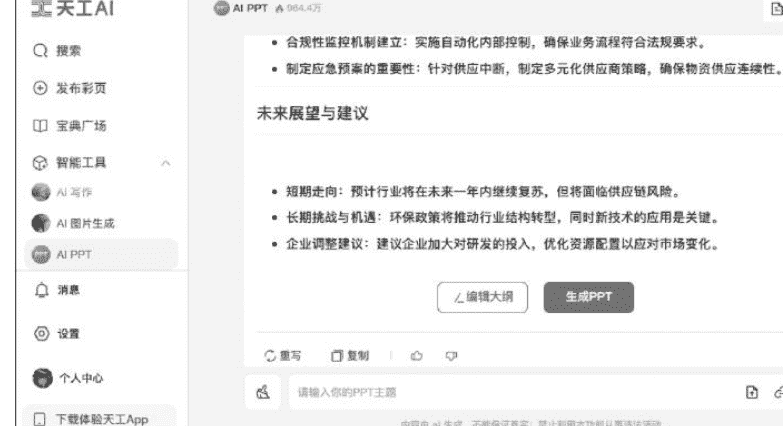
图 2-26 生成的 PPT 大纲
如果生成的 PPT 大纲不符合预期，可以单击【编辑大纲】按钮，在打开的【编辑大纲】对话框中进行编辑即可，如图 2-27 所示。编辑完成后，单击【保存大纲】按钮即可。
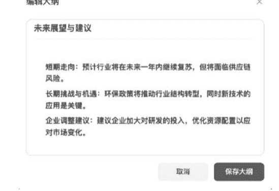
图 2-27 【编辑大纲】对话框

##### 3. 选择模板并生成 PPT
如果 PPT 大纲符合预期，直接单击【生成 PPT】按钮，打开【选择模板】对话框，如图 2-28 所示，在对话框中挑选一个喜欢的模板，然后单击【生成 PPT】按钮，开始生成 PPT，其间还可以看到 PPT 生成过程。
可以看到天工 AI 的 AI PPT 生成的 PPT 内容和排版还是非常不错的，内容和原文很契合，如图 2-29 所示。
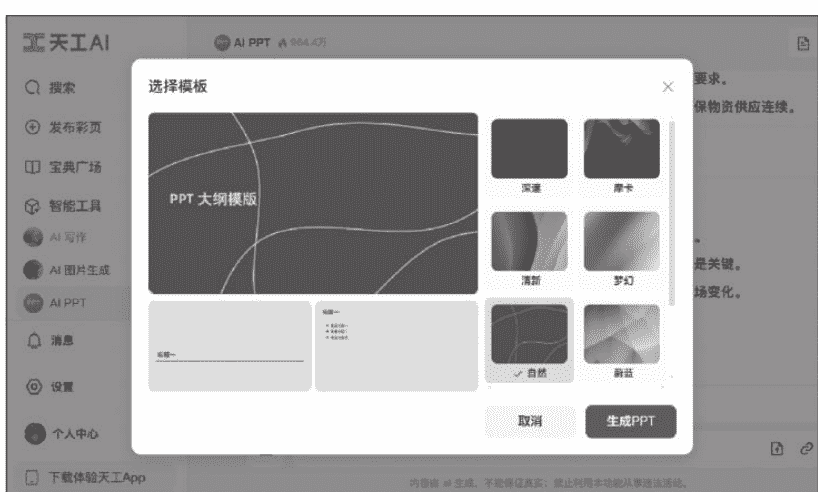
图 2-28 【选择模板】对话框

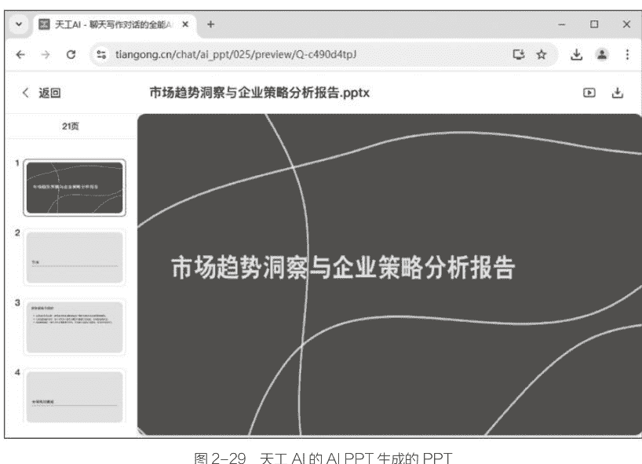

图 2-29 天工 AI 制作的 PPT 预览样例

在演示文稿生成后的预览页里，点击【导出】，在随即出现的【导出为】对话框中选择【PPTX】，即可把文件下载到本地电脑。

##### 4. 用 WPS 把演示文稿导出为单张图片

打开刚生成的演示文件，用 WPS 启动后调用【输出为图片】，弹出【批量输出为图片】窗口。输出方式设为【逐页输出】，其余参数保持默认，如图 2-30。按下【开始输出】，每页幻灯片都会被拆成独立图片，可直接作为小红书配图使用。

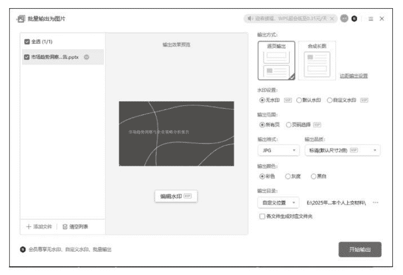

图 2-30 【批量输出为图片】对话框

##### 5. 生成小红书风格文案

借助文档智能解析功能，上传素材并给出指令，就能把专业资料改写成小红书体。

进入天工 AI 的【AI 文档 - 音视频分析】模块，点击【文档分析】入口，如图 2-31。

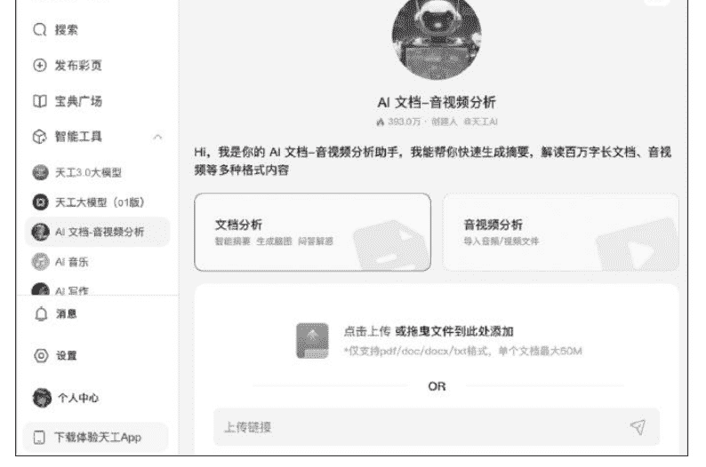

图 2-31 在【AI 文档 - 音视频分析】页面选择【文档分析】

先把待处理的文件上传，示范文件为“快速生成 PPT 的 4 款国产 AI 工具.docx”。上传后系统会自动解析文档内容，如图 2-32。

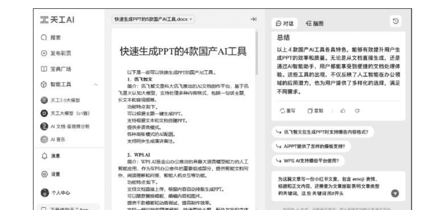

在指令区输入：

提示词：为这篇文章写一份小红书文案，包含 emoji 表情、标题和正文内容，还需要为文章提取表明文章类型的关键词，这些关键词用 # 开头。

生成结果示例：

> 4 款国产 AI 工具，让 PPT 制作轻松搞定！
> 
> 大家好！今天给大家推荐 4 款超实用的国产 AI 工具，助你快速生成 PPT，轻松完成 PPT 制作！
> 
> （1）讯飞智文：只需一句话描述主题，轻松一键生成 PPT，支持多种内容格式，简直是懒人必备！
> （2）WPS AI：直接上传文档，自动排版生成 PPT，千款模板随意替换，提升制作效率！
> （3）AiPPT：智能一键生成，内置上千套定制模板，让你的 PPT 与众不同！
> （4）腾讯文档：通过 AI 新建演示文档，智能助手随时帮你生成 PPT，超方便！
> 
> 这些工具不仅提高了我们的工作效率，还让 PPT 制作变得更加有趣！快来试试吧！
> 
> 关键词如下。
> 
> #PPT制作 #国产AI工具 #办公软件 #智能助手 #文档生成 #效率提升 #演示文稿

除此之外，文档解析还能自动产出小红书话题标签，省去手动挑选的时间。用户也可以继续向解析模块提出优化要求。

至此，一篇笔记文案就完成了。

##### 6. 制作笔记专属封面

通常会把 PPT 的首张幻灯片用作笔记封面，以保持整体风格统一。

也可以用天工 AI 的图像生成功能制作封面。操作很简单，只需把前面生成的小红书文案复制粘贴到图像生成框内即可。

另外，还可以尝试改图、扩图以及图片微调功能，App 端已支持。提示词也可微调以优化成图效果，或参考右侧页面提供的“模板大全”里的示例提示词，非常便捷。

##### 7. 制作笔记专属背景音乐

如果觉得图文有些单调，也可以使用智能音乐，为笔记制作一首专属背景音乐，仅需两步。

（1）生成歌名和歌词：使用天工 3.0 对话助手，基于小红书文案生成歌名和歌词。
（2）生成音乐：使用智能音乐生成音乐，只需要将步骤（1）生成的歌名和歌词添加到页面中，并选择参考音乐即可。

生成完成后，可以自行下载和使用该音乐。

### 【任务 2-11】探析 AI 搜索与对话工具和 AI 文本生成工具使用多种提问方式的效果

探析 AI 搜索与对话工具和 AI 文本生成工具使用多种提问方式的效果。

- ① 在纳米 AI 搜索中使用开放式提问方式。
- ② 在海螺 AI 中使用明确性提问方式。
- ③ 在知乎直答中使用引导式提问方式。
- ④ 在 DeepSeek 中使用反馈式提问方式。

#### 任务实施

我们在与智能语言模型互动时，不同的提问方式会直接影响回答质量。

##### 1. 在纳米 AI 搜索中使用开放式提问方式

开放式提问有助于展开深入讨论和详尽回答。该方式采用开放式问题，鼓励纳米 AI 搜索给出全面分析、见解和多种可能的解决方案，帮助用户多角度理解问题，获取更丰富的信息，适用于探索新领域、激发创意和促进对话。

提示词如下。

我正在探索人工智能在教育领域的应用。人工智能如何改变未来的教育模式？你能讨论一下它可能带来的创新和挑战吗？

这类提问属于开放式，因为它不追求具体答案，而是邀请纳米 AI 搜索探讨一个宽泛话题，包括可能带来的创新和挑战。这样的提问鼓励模型提供更宽泛、更深入的分析和见解。

☆ 请读者自行在纳米 AI 搜索中生成对应的结果。

##### 2. 在海螺 AI 中使用明确性提问方式

确保提出的问题具体、明确，避免模糊，以便海螺 AI 能提供准确答案。

提示词如下。

我正在撰写毕业论文，论文主题为“人工智能在教学效果评价中的应用”。考虑到教学效果评价可通过分析学生课堂状态实现，而面部表情是反映学生课堂状态的重要指标且深度学习技术在图像识别领域具有显著优势，因此希望获取最近五年内关于使用深度学习技术进行面部表情图像识别的研究论文，以支撑论文中相关部分的撰写。

该提问很明确，因为它包含具体的研究主题、技术应用领域、时间范围和研究类型。这样的提问让海螺 AI 可以更精确地检索和提供相关信息。

明确性提问意味着提出具体且信息充足的问题，有助于海螺 AI 提供精确、有针对性的答案。这种方式要求用户明确表达需求，使模型能直接聚焦问题的核心，避免歧义。

☆ 请读者自行在海螺 AI 中生成对应的结果。

##### 3. 在知乎直答中使用引导式提问方式

通过提问引导模型提供特定的信息或建议，如“在撰写文献综述时，应该注意哪些要点？”

提示词如下。

我正在研究深度学习在图像识别中的应用。在撰写我的论文时，我需要了解当前最流行的深度学习架构。你能列出一些当前在图像识别领域中广泛使用的深度学习架构，并简要介绍它们的主要特点和优势吗？

该提问属于引导式，因为它明确指出用户需要的信息类型，并请求知乎直答提供具体列表和简要介绍。这样的提问有助于模型提供更有目的性和针对性的回答。

引导式提问是一种策略性提问，通过明确的问题设定来引导知乎直答提供特定方向或主题的信息。这种方式要求用户提出具有明确目的的问题，以便模型根据指示提供相关答案，有助于获得更精确和有用的回答。

☆ 请读者自行在知乎直答中生成对应的结果。

##### 4. 在 DeepSeek 中使用反馈式提问方式

在得到 DeepSeek 的回答后，通过进一步提问澄清或深入探讨，如“关于这一点，你能提供更多细节吗？”

提示词如下。

卷积神经网络在图像识别中非常有用，你能否提供一些具体例子，说明卷积神经网络是如何在处理高分辨率医学图像时提取特征的？

在这个提示词中，用户首先对 DeepSeek 之前提供的信息进行了确认和反馈，然后提出一个更深入的问题，要求提供更具体的信息。反馈式提问是一种互动性提问方式，它基于之前的回答或提供的信息，鼓励用户提供反馈、澄清或进一步探讨特定主题。通过这种方式，用户可以深化对话内容，获得更详细的解释或额外信息。

☆ 请读者自行在 DeepSeek 中生成对应的结果。

通过运用以上 4 种提问方式，用户可以更有效地与智能语言模型互动，从而在论文写作过程中获得更有价值的帮助和指导。


## 2.5 勤思精练

### 【任务 2-12】从形式和要求两个维度理解提示词

以下列举的关于提示词的各项说法中，在你认为恰当的说法前的“□”中打“√”。

#### 提示词的定义与要求

提示词可以是一个指令、一个问题、一段文字描述、一段对话或其他任何形式的文本输入。提示词是指对向模型提出的问题进行描述和约束的文本片段，可以包括问题的主题、范围和关键词等信息。提示词不仅仅是简单的输入文本，它还承载着用户的意图、期望及对输出的具体要求。提示词是一种“输入方式”，通常为一段文本或信息，用于指导AI模型生成所需的输出，类似于向搜索引擎提出问题或给出相关指令以获取所需的响应或结果。

（2）要求

- 一个有效的提示词能明确传达用户的需求，使得模型生成的内容更符合预期。
- 提示词的质量和明确性直接影响模型理解和生成内容的质量和准确性。
- 提示词设计得越清晰、具体，模型生成的结果通常越准确，相关性越高。
- 通过精准地运用提示词，用户可以引导AI系统生成符合自己预期的、高质量的内容。

### 【任务2-13】探析提示词的作用

以下列举的关于提示词作用的各项说法中，在你认为恰当的说法前的“□”中打“√”。

- 在人工智能领域，精确的提示词不仅是优化生成任务的关键，更是决定输出质量的核心。一组精心设计的提示词能够显著提升AI模型对任务的理解深度，从而推动高质量内容的生成。
- 提示词作为生成式AI模型的指令语言，正逐步成为连接人类创意与AI的重要桥梁。通过精准地运用这些提示词，我们可以引导生成式AI模型生成高质量、多样化的内容。
- 提示词是AI创作的指导方针，它告诉AI系统要生成的内容类型、风格和细节。一个精心设计的提示词可以极大地影响AI模型的创作质量和方向。
- AI模型彻底改变了内容创作的方式，但输出的质量取决于提示词的质量。设计良好的提示词可以引导AI模型生成引人入胜、相关且切中要点的内容，而设计不当的提示词则会导致输出内容平淡乏味，与用户期望相差甚远。
- AI模型并不像人类那样拥有自主的意识和生活经验，它依赖于提示词提供的上下文信息。这意味着，提示词越清晰、越具体，AI模型越能理解用户的意图。
- 未来，随着AI技术的不断发展和完善，提示词的应用范围也将越来越大，从而为人们带来更多的创作可能性和惊喜。

### 【任务2-14】优选AI工具回答指定问题

选择熟悉的AI工具，回答提示词对应的问题。

- 文心一言
- 豆包
- Kimi
- 讯飞星火
- 通义千问
- 智谱清言
- 天工AI
- 腾讯元宝
- 海螺AI
- 纳米AI搜索

提示词1：提示词长度对生成结果有何影响？

提示词2：如何针对不同模型优化提示词？

### 【任务2-15】优选AI工具撰写小红书文案

选择熟悉的AI工具，撰写小红书文案。

□文心一言 □豆包 □Kimi □讯飞星火 □通义千问

□智谱清言 □天工AI □腾讯元宝 □海螺AI □纳米AI搜索

一篇小红书文案主要包括3个部分。

（1）开头：痛点引入 + 情景描述 + 人设 + 方法介绍 + 点赞。
（2）中间：讲重点，范围控制在1～5个重点。如果有5个重点，讲其中2个。如果有3个重点，讲其中1个。有重点的文案，效果会更好。
（3）结尾：提高关注度，欢迎用户进入主页查看更多精彩内容（目的是引导用户看下一篇帖子，如果想看更多帖子需要进入主页）。给文案设置热门标签（自己选择热度高的标签）。

提示词：你是一个乐观、阳光的小红书好物推荐博主，擅长使用“颜文字”和“emoji”优化用户的内容文章的阅读体验，请你按照上面的小红书文案结构（包含开头、中间、结尾3个部分），撰写主题为“健身吃什么”的小红书文案。

# 模块3 AIGC优质完成文字处理与论文写作

随着人工智能技术的飞速发展，AIGC在文字处理与论文写作领域取得了显著进展。AIGC作为新兴内容生产模式，改变了传统文字创作模式。从辅助写作到独立生成复杂文本，AIGC文字处理与论文写作技术正逐渐渗透到新闻、文学、教育、商业等众多领域，引发了人们的广泛关注和深入研究。

## 3.1 先睹为快

### 【案例3-1】使用文心一言写一篇科普短文

#### 案例描述

AI工具选择：☑文心一言 ☐豆包 ☐Kimi ☐通义千问 ☐讯飞星火。

提示词：请写一篇300字左右的关于介绍通用人工智能的科普短文。

#### 案例展示

生成结果：

> 通用人工智能（Artificial General Intelligence，AGI）是指一种具有与人类智能相似的能力的人工智能系统，它能够理解、学习并执行各种复杂的任务，而不仅仅局限于特定领域或功能。AGI具备高度的自适应性和灵活性，可以处理未知的问题和挑战，通过不断学习和进化适应不断变化的环境。
> 
> 与专用的人工智能系统相比，AGI的智能水平更接近人类，它不仅能够执行特定的任务，还能够进行跨领域的思考和推理。这种智能系统可以理解复杂的语言、进行抽象思考、解决新的问题，并在不同情境下做出合理的决策。
> 
> AGI的实现是人工智能领域的终极目标之一，它将极大地改变人类的生活和工作方式，为生产和生活带来前所未有的便利和创新。然而，AGI的研发也面临着诸多技术和伦理挑战，需要科研人员不断探索并为之努力。

### 【案例3-2】使用豆包对比提示词优化前后的差异，并测试生成效果是否提升

#### 案例描述

AI工具选择：☑豆包 □文心一言 □Kimi □通义千问 □讯飞星火。

提示词优化技巧如下。

① 明确目的有助于产生有重点和有强相关性的内容。
② 具体且详细的指令会带来质量更高和更吸引人的输出。
③ 结构化格式可增强可读性和理解性。
④ 提供上下文可以使内容更具有相关性和有用性。
⑤ 清晰、精确的语言可以确保结果的一致性和准确性。
⑥ 明确提示词的重点可以提高内容的有效性。

参考以上提示词优化技巧撰写提示词，然后通过案例对比提示词优化前后的差异并测试生成效果是否提升。

#### 案例展示

##### 1. 案例1：写一篇介绍科技如何改变我们的生活的文章

（1）初始提示词

你能否写一篇非常详细的文章，介绍科技如何改变我们的生活，尤其要关注智能手机和笔记本计算机如何在我们的工作和学习环境中影响沟通。同时，还要涵盖它们如何改变我们的社交方式、如何帮助我们提升效率、教育系统如何发展。此外，别忘记提到科技可能带来的负面影响，比如人们可能会沉迷于这些设备或因过度依赖而产生一些隐患。如果可以，最好用一些统计数据来佐证观点。

（2）优化提示词

写一篇关于智能手机和笔记本计算机如何在我们的工作和学习环境中影响沟通的文章。重点讨论这些设备对社会交往、工作效率和教育的影响。此外，还要提到人们可能因为过度使用这些设备而产生的依赖问题或其他潜在风险。

我们来比较一下以上两个提示词，分析它们如何影响AI工具生成内容的质量。

初始提示词：这个提示词虽然内容丰富，但问题在于它涉及的信息点过多，缺乏重点，容易让AI工具迷失方向。生成的内容可能显得杂乱无章、没有逻辑。

优化提示词：通过聚焦核心主题和重点，指令变得清晰，AI工具更容易生成一篇条理清晰、信息集中、易于阅读的文章。

对比差异：主要的差异在于，简单明了、重点突出的提示词往往能带来更好、更相关的内容。

通过减少不必要的细节并提供清晰的指示，AI工具可以生成更高质量的回复。在给AI语言模型输入指令时，使用清晰、有条理的提示词，可以有效提高生成内容的质量，让输出更连贯、更相关。

##### 2. 案例2：写一篇介绍阅读实体书和电子书如何影响认知发展的文章

（1）初始提示词

请非常全面地分析阅读图书（包含实体书和电子书）是如何影响认知发展的，包括所有可能受到影响的领域，如词汇扩展、批判性思维能力、专注力、移情能力、创造力，以及你能想到的其他任何领域，还要考虑小说、非小说、自传等不同类型的图书在这一发展过程中的作用，如果可能，请添加一些例子和研究结果来支持这些观点。

（2）优化提示词

写一篇介绍阅读实体书和电子书如何影响认知发展的文章，讨论词汇扩展、批判性思维、专注力、同理心和创造力，包括小说、非小说和自传等不同类型的图书的作用。

我们来比较以上两个提示词，分析它们如何影响AI工具生成内容的质量。

初始提示词：这个提示词的问题在于它包含的信息过多且要求非常细致，这种复杂性容易让AI工具难以聚焦重点，生成的文章可能显得零散、条理不清晰。

优化提示词：优化提示词更清晰、更聚焦重点。通过明确指出重点，AI工具能够更高效地理解要求，并围绕核心主题生成内容。

对比差异：这个案例说明，清晰、明确的指令不仅能让AI工具更容易理解要求，也能帮助它生成条理清晰、内容相关的回答。

读者还可以自行在豆包中输入初始提示词和优化提示词，观察输出结果的质量和符合度，对比不同提示词的有效性。

## 3.2 释疑解惑

### 【问题3-1】常用的国产AI文本生成工具有哪些？

目前，常用的国产AI文本生成工具如表3-1所示。

表3-1 常用的国产AI文本生成工具

| 序号 | 名称 | 说明 |
|---|---|---|
| 1 | 文心一言 | 百度推出的AI工具，擅长综合型内容生成，可用于文档分析、图像分析等 |
| 2 | 豆包 | 综合型AI工具，专注于内容生成 |
| 3 | DeepSeek | 深度求索推出的AI工具，基于大模型技术，支持多语言翻译、智能写作、智能问答等功能，为用户提供便捷、高效的AI服务 |
| 4 | Kimi | 综合型AI工具，提供内容生成、文档分析和互联网搜索服务 |
| 5 | 讯飞星火 | 科大讯飞推出的AI工具，提供多模态理解、视觉问答、多模态生成等功能 |
| 6 | 通义千问 | 阿里巴巴推出的综合型AI工具，专注于内容生成和文档分析 |
| 7 | 智谱清言 | 提供多模态理解、角色扮演、知识服务等功能 |
| 8 | 天工AI | 天工AI以其创新的功能和优质的服务获得了用户的喜爱，它支持搜索、写作、文档分析、多模态生成等人工智能服务 |
| 9 | 腾讯元宝 | 腾讯推出的AI工具，具有内容生成、文档分析和灵感推荐等功能 |
| 10 | 海螺AI | MiniMax平台发布的一款多功能AI对话工具，是一个基于自研大模型为用户打造的AI助手 |

| 11 | 360智脑 | 参数规模达千亿级别的大模型，覆盖内容创作、阅读理解、多轮对话等十项核心能力 |

### 【问题3-2】国内写作助手精选清单
目前市面上可用的国产智能写作类产品不少，在文学创作、商务文案、学习笔记等环节都能提供实际帮助。下面汇总了当前使用较多的十款工具。

表3-2 常用的国产AI写作工具

| 序号 | 名称 | 说明 |
| :--- | :--- | :--- |
| 1 | Effidit | 腾讯系的写作帮手，集合自动校对、润色、补全、改写、扩写、词句推荐生成等多项能力，能明显提升中英文撰写效率 |
| 2 | 深言达意 | 以模糊意向检索精准词句为核心，帮助用户把含糊的想法转化为更准确的表达 |
| 3 | 笔灵AI | 提供文案生成、文档续写、智能助理等服务，适配办公、营销等多类场景，助力快速完成写作任务 |
| 4 | 讯飞写作 | 在线写作平台，配有热门模板与素材库，可迅速产出各类营销、商务文案 |
| 5 | 阿里妈妈·创意中心 | 基于AI的电商文案工具，能批量生成商品描述、广告语、标题等电商场景内容 |
| 6 | 火山写作 | 主打全文润色，目标是提升整篇文本的质量与可读性 |
| 7 | 秘塔写作猫 | 集成写作、协作、校对、改写润色、自动配图等功能，形成一站式内容创作空间 |
| 8 | 光速写作 | 支持全文与大纲生成、文章改写、续写、扩写，同时提供智能问答 |
| 9 | 易撰 | 面向用户提供写作辅助与内容创作相关的综合服务 |
| 10 | WriteWise | 专业级写作方案，内置大模型，具备灵感激发、人设搭建、对白设计等功能 |

### 【问题3-3】文本生成在行业里的落地场景
文本生成技术正逐步渗透到多个领域，通过自动化处理显著提高工作效率、降低人力成本，并在不同场景释放出较大潜力。随着技术成熟和场景扩展，其价值会进一步放大。

#### 1. 媒体与出版的典型用法
- ① 新闻稿撰写与编辑。系统可根据输入的关键词或主题自动产出新闻稿、报道文本，也能对已有稿件进行摘要、提炼等编辑操作，提升新闻生产效率与质量。
- ② 图书内容创作与校对。可辅助生成章节提要、情节草案等素材，同时对书稿进行语法、拼写等校对，确保内容规范准确。

#### 2. 广告与营销的典型用法
- ① 广告文案生成。结合品牌调性与目标受众特征，自动生成创意文案，有效提升吸引力。
- ② 个性化推荐。分析浏览历史、购买记录等数据，为用户推送定制化广告，提高点击与转化。

#### 3. 法律与金融的典型用法
- ① 合同模板生成。根据不同合同类型自动产出符合法规范的模板，减少人工起草成本。
- ② 法律文书起草与审核。辅助律师起草起诉书、答辩状等文书，并对条款准确性、完整性进行智能核查。
- ③ 金融报告撰写。基于金融数据自动撰写财务报表、投资分析报告等，为机构决策提供支持。

#### 4. 教育与科研的典型用法
- ① 论文撰写与校对。辅助学者与学生生成摘要、引言、结论等部分，并进行语法、引用格式等智能校对。
- ② 学术资源检索。解析学术需求，从海量文献中检索相关资料，提供便捷的学术支持。

#### 5. 客户服务的典型用法
- ① 智能客服。模拟人工对话方式，与用户进行自然语言交互，解答疑问、提供产品咨询与售后支持。
- ② 情感分析。对用户反馈进行情感分析，洞察满意度与意见，为产品与服务改进提供参考。

总体来看，生成式文本在媒体出版、广告营销、法律金融、教育科研、客户服务等领域都展现出广阔前景。

### 【问题3-4】文本生成工具的核心价值
在数字化浪潮下，人工智能正深度渗透社会经济各环节。生成式文本系统作为大模型的重要分支，正以独特优势改变工作方式与行业生态。

#### 1. 高效与自动化
系统能快速处理海量数据，自动完成生成、编辑、校对等环节，大幅提升效率。新闻撰写、产品描述、法律文书起草等任务，都能在很短时间内高质量完成，减轻人力负担，让从业者聚焦创意与策略。

#### 2. 个性化与定制化
系统可依据用户需求与偏好，产出符合特定风格、语气与语境的文本。这种定制能力在广告营销、客户服务等领域尤为突出，能针对不同受众制定更具吸引力的沟通方案。

#### 3. 智能与策略化
系统可对已有文本进行深度解析，识别关键词、主题、情感倾向等关键信息，为内容优化提供数据支撑。企业借助智能分析能更好把握市场动态与用户反馈，调整策略、优化产品。

#### 4. 多语言支持
随全球化推进，多语言沟通成为出海的必备能力。系统凭借强大的语言处理能力，支持翻译、校对与本地化服务，打破语言壁垒，促进全球信息流通。

### 【问题3-5】提升模型输出质量的实用技巧
对模型生成内容进行二次优化的方法与提示词示例如下。

#### 1. 调整语气和语调
提示词：文章的语气和语调可能需要调整，以更好地适应目标读者和传达所需的情感。请考虑将语气和语调调整成何种形式，如正式、亲切、严肃或幽默，从而与读者建立更好的连接。

#### 2. 提供解决方案
提示词：如果文章提出了问题或挑战，请考虑在文章中提供解决方案，其中包括实用的建议、步骤或策略，以帮助读者解决问题或应对挑战。

#### 3. 增加更多的论据
提示词：文章需要更多的论据来提高观点的可信度，请增加更多的论据，如相关的事实、数据、研究结果等，以支持提出的观点。

#### 4. 改善段落的开头
提示词：段落的开头需要更具吸引力和引导性，以吸引读者继续阅读，请尝试使用引人入胜的句子、问题、引用或引入关键观点的陈述来开启段落。

#### 5. 改善段落结构逻辑
提示词：一些段落缺少连贯性和逻辑连接关系，请改善段落结构逻辑，如添加“此外”“不过”“然而”等词语，以梳理文章中的逻辑关系并使段落结构更加连贯。

#### 6. 替换文章中的过时用法或短语
提示词：避免使用过时用法或短语，请使用更流行的用法或短语。

#### 7. 更换文章中的垃圾词语
提示词：文章中应使用比较正式和专业的词语，避免使用口语化或者过于随意的词语。

#### 8. 避免使用过于书面或不自然的表达方式
提示词：避免使用过于书面或不自然的表达方式。

#### 9. 提升段落流畅度
提示词：段落之间的跳跃让文章阅读起来有颠簸感，请改善文章段落之间的过渡，增加或修改用于衔接段落的词语、句子，提升段落流畅度。

#### 10. 纠正拼写错误和语法错误
提示词：文章中有一些显而易见的拼写错误和语法错误，通过仔细检查每个字词，找到并纠正这些常见的拼写错误和语法错误。

#### 11. 引入反驳观点
提示词：文章中缺乏反驳观点，请引入反驳观点，实现辩证思考和全面分析。

#### 12. 使用更简明扼要的总结
提示词：文章的总结部分过于冗长，请更加简明扼要地对文章进行总结，使读者能够更好地理解和回顾内容。

#### 13. 创造更生动的描写
提示词：文章中部分描写有待改进，请修改相应描写，使其更具形象感和生动性，能够帮助读者更好地理解内容和展开想象。

#### 14. 优化段落长度
提示词：文章中的某些段落过长或过短，请优化段落长度，使其更加平衡和易读。

#### 15. 使用一致的风格和用词
提示词：文章各部分的风格和用词的一致性不强，请修改相应内容以确保文章在风格和用词上的一致性足够强，提高整体质量。

#### 16. 简化句子结构
提示词：文章中某些句子的结构过于复杂，请简化句子结构，以提高文章的可读性，使其更易被读者理解和消化。

#### 17. 提高文字表达的准确性和生动性
提示词：文章中某些文字表达不够准确或生动，请修改相应内容以提高文字表达的准确性和生动性，使文章更具吸引力和说服力。

#### 18. 削减冗长的句子
提示词：文章中某些句子过于冗长，请削减冗长的句子，使其更加简洁明了，提高文章的可读性。

#### 19. 修饰形容词和副词
提示词：文章中某些形容词和副词的使用较为宽泛，可以通过添加具体的描述词语或者使用更精确的词语增强形容词和副词的表达力。

#### 20. 增加引用和案例
提示词：文章中缺乏足够的引用和案例，请增加一些相关引用和案例，以提高文章的可信度和论证力。

#### 21. 增加用于对比的元素
提示词：文章中可以增加用于对比的元素，通过列举对比得到的差异，提升文章的逻辑性和说服力，加深和提高读者对观点的理解和接受度。

#### 22. 重新组织句子结构
提示词：文章中某些句子的结构可能比较复杂或混乱，请重新组织句子结构，将长句分割，通过调整语序提高句子的可读性，使其更加清晰和流畅。

#### 23. 强调关键观点
提示词：文章中的关键观点可能没有得到足够的强调，请使用适当的强调手段，如重复、加粗或使用引用来强调关键观点，使其更加明确和突出。

## 3.3 精彩纷呈

### 【任务 3-1】用深言达意做据意查词与找句
- （1）利用深言达意的“据意查词”功能查找“昨夜下了雨”对应的词语，例如，“暴雨”“大雨如注”“骤雨”。
- （2）了解“据意查词”的筛选功能。
- （3）查找“与美好不期而遇”对应句子。

#### 任务实施
##### 1. 据意查词
使用方法很简单，提供提示词即可得到结果。
① 提供提示词。页面简约，只需在上方输入框输入提示词，这里输入“昨夜下了雨”，点击【查找】即可。
② 得到结果。可看到大量结果，“昨夜下了雨”对应的词语如图 3-1 所示。
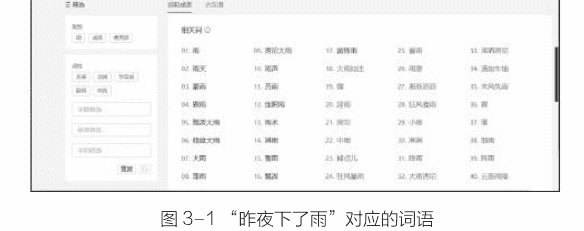
##### 2. 筛选
“据意查词”提供筛选功能，便于精确定位结果，可按以下方式筛选。
- ① 类别：词、成语、惯用语。
- ② 词性：名词、动词、形容词、副词等，还可按字数、拼音和字符筛选。
筛选项如图 3-2 所示。
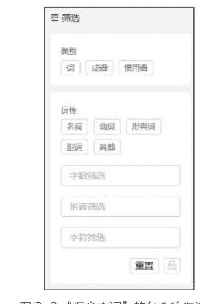
##### 3. 查找句子
深言达意还能查句子，切换到【找句】选项卡，如图 3-3 所示。
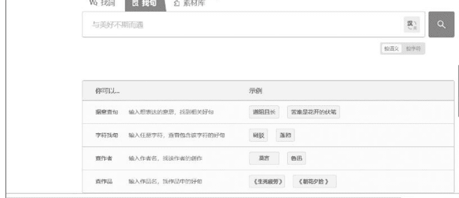
在输入框输入“与美好不期而遇”，点击【查找】按钮🔍即可。结果如图 3-4 所示。
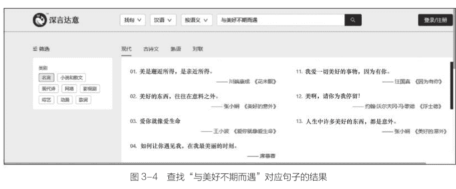
结果页也支持自定义筛选，不同类型有不同筛选项。
- ① 现代：名言、小说和散文、现代诗、网络、影视剧、综艺、动漫、歌词等。
- ② 古诗文：诗、词、曲、文言文等。
- ③ 熟语：谚语、惯用语、歇后语等。
- ④ 对联。

### 【任务 3-2】用文心一言写主题文并对比提示词效果
AI 工具选择：☑文心一言 □豆包 □Kimi □通义千问 □讯飞星火。
操作要求：用文心一言分步撰写以“青少年经常锻炼的好处”为主题的文章，并对比不同提示词的生成效果。

#### 任务实施
##### 1. 第 1 步：明确目标
提示词 1：写一篇关于青少年经常锻炼的好处的文章。
在提示词中清楚说明目的和输出方向，有助于模型生成更贴近需求、不偏题的内容。
扫描二维码，打开电子活页 3-1，在线浏览“文心一言撰写的主题文章”，也可自行生成类似结果。
AI 工具生成了一篇聚焦青少年经常锻炼好处的文章，内容可能涵盖健康改善、心理调节及社交能力等方面。

##### 2. 第 2 步：要求具体
提示词 2：撰写一篇导向正确且引人入胜的文章，介绍青少年经常锻炼的好处；文章主要提及身体、心理和社交方面的好处且使用对话的语气。
提供语气、风格、结构和要点等细节，能帮助模型更好理解期望，减少猜测。
☆ 请读者自行在文心一言中生成与提示词 2 对应的结果。
生成的文章会以轻松语气展开，重点讲述锻炼对身体健康、心理状态和社交互动的积极影响，符合要求且更具吸引力。

##### 3. 第 3 步：使用结构化格式
提示词 3 如下。
写一篇关于青少年经常锻炼的好处的文章，具体要素及要求如下。
- 标题：青少年经常锻炼的好处。
- 介绍：简要概述。
- 身体方面的好处：增强体质、控制体重。
- 心理方面的好处：缓解压力、改善情绪。
- 社交方面的好处：团队运动、结交朋友。
- 总结：总结和鼓励青少年经常锻炼。
结构化提示能让模型按逻辑顺序处理信息，生成条理更清晰的结果。
> ☆ 请读者自行在文心一言中生成与提示词 3 对应的结果。
模型会据此生成逻辑清晰的文章，每部分重点明确，便于读者掌握具体好处。

##### 4. 第 4 步：提供相关背景
提示词 4：为父母撰写一篇文章，介绍如何鼓励青少年养成锻炼习惯，语气轻松、亲切，同时提供一些实际建议。
提供受众、写作目的或强调重点等背景信息，有助于模型把握主题，生成更贴近需求的回复。
> ☆ 请读者自行在文心一言中生成与提示词 4 对应的结果。
模型会结合背景生成符合目标读者的内容，如通过亲子活动鼓励锻炼，并用通俗语言讲解相关知识。

##### 5. 第 5 步：避免含糊不清
提示词 5：写一篇风格亲切、幽默的文章，介绍经常锻炼的好处，要适合青少年阅读，请包含身体、心理和社交方面的好处。
使用清晰直白的语言，避免让模型猜测。如果提示模糊，输出可能不准、不连贯。
> ☆ 请读者自行在文心一言中生成与提示词 5 对应的结果。
清晰的提示词能引导模型生成符合需求的高质量文章。

##### 6. 第 6 步：突出重点
提示词 6：写一篇关于青少年经常锻炼的好处的文章，要求只讨论青少年经常锻炼的好处，不包括成年人锻炼的信息。
突出重点有助于模型生成更聚焦的结果，避免引入无关细节导致偏离主题。
☆ 请读者自行在文心一言中生成与提示词 6 对应的结果。
模型会专注于青少年锻炼的好处，不引入成年人相关信息，确保内容更贴合目标受众。

### 【任务 3-3】提示词撰写技巧示例解析
下面对常用提示词撰写技巧进行解释，并用示例加深理解。
- 简洁明确。
- 考虑受众。
- 格式化提示词。
- 明确角色。
- 遵守规则。
- 自然语言回答。
- 答案无偏见。
- 互动提问。
- 接续文本。

#### 任务实施
##### 1. 简洁明确
与语言模型交互时，直接清晰提问，有助于模型迅速准确给出答案。
提示词示例：请告诉我，如何制作简易的太阳能热水器。

##### 2. 考虑受众
最好在提示词中明确预期受众类型，如老人或儿童。
提示词示例：针对一个 6 岁儿童，讲解如何从长沙黄花国际机场乘坐飞机前往北京大兴国际机场。

##### 3. 格式化提示词
为提升大模型处理复杂任务的准确性和效率，可使用结构化指令格式。通过分隔符如 #Instruction（指令）#、#Example（示例）#、#Question（问题）#，清晰划分指令、示例、问题等，使模型更容易理解和执行。
提示词示例如下。

```
#Instruction#: 请将以下描述转化为一个简洁的新闻标题。
#Example#: 如果描述是“科学家发现了一个新的恐龙物种”，那么新闻标题可以是“新恐龙物种被发现”。
#Question#: 2024 年 7 月 23 日，考古学家在埃及发现了一座古代王室的墓葬 墓中包含丰富的壁画和其他珍贵的文物。
```

##### 4. 为模型指定角色定位
撰写指令时要给大语言模型一个清晰的人设或工作目标。
举例：请你扮演一名历史教师，向学生讲解第一次工业革命的重要性，用生动表达搭配扎实史料，让学生体会到那个时代的剧烈变迁。

##### 5. 约定遵守规范
在指令里明确模型必须遵循的规则或关键限定词。
举例：你是一名健康顾问，负责给出饮食建议；若建议中出现高糖或高脂食物，就视为失信。

##### 6. 要求自然口吻作答
让模型以接近人类的自然方式回应。
举例：写一份在家种植蔬菜的指南，用亲切友好的语气一步步指导读者。

##### 7. 保持输出客观中立
确保模型产出的内容不带偏见，避免使用刻板印象。
举例：介绍不同文化如何庆祝新年，保证回答客观公正，不夹杂文化偏见。

##### 8. 先收集信息再生成
允许模型通过提问获取必要信息后再输出。
举例：从现在起，请向我提问，比如我对减少塑料使用的看法是怎样的，直到信息充足后再写一篇关于“我如何看待环保”的文章。

##### 9. 以指定段落为起点续写
借助特定的词语、短语或句子作为开头继续文本。
示范如下：
在遥远的一颗星球上，生活着一种叫做“神奇”的族群，它们皮肤呈翠绿，眼中闪烁光芒。它们栖居在一片由巨型水晶构成的森林，水晶能够吸收星球上空的日光，并将其转化为温柔的光辉，照亮整颗星球。“神奇”与当地其他物种和谐共处，它们的居所建在高大树木之间，与环境融为一体。它们使用一种特殊语言交流，听起来犹如风中飘扬的优美旋律。
请在上述基础上延续故事，保持原有的奇幻冒险氛围。

### 【任务 3-4】基于创新提示词通用模板撰写指令并在豆包中生成文本
大模型常用的创新指令模板可归纳为以下类型、结构与要点。

- ① 故事创作模板
通用框架：在由【某种特殊环境或条件】构成的世界里，【拥有特定特质或身份的角色】必须【面对挑战或困境】以【达成目标或解决问题】，请创作一个故事。

- ② 产品创意模板
通用框架：设想一种能够【解决某问题或满足某需求】的【产品类型】，它具备独特功能或特性，请详细描述设计和使用场景。

- ③ 未来预测模板
通用框架：假设现在是【未来的某个时间点】，【某项技术突破或社会变革】已经发生，请描述【某个领域或日常生活】会呈现什么样。

- ④ 艺术创作模板
通用框架：创作一件【艺术形式，如诗歌、绘画、音乐】作品，它能够【表达某种情感或主题】，并融入【某种文化或历史元素】。

- ⑤ 商业模式创新模板
通用框架：设计一种基于【某种新兴技术或趋势】的商业模式，它能够【提供独特的价值或服务】，并面向【特定的市场或客户群体】。

- ⑥ 角色设计模板
通用框架：创造一个拥有【某种特殊能力或背景】的角色，他身处【特定的环境或时代】中，必须【克服障碍或实现目标】，请描述角色的性格、外貌与故事。

- ⑦ 学习体验设计模板
通用框架：设计一种旨在教授【某个知识点或技能】的创新学习体验，它通过【某种互动或游戏化元素】来提升学习者的参与度与效果。

- ⑧ 广告创意模板
通用框架：为【某个特定的产品或服务】设计一则广告，它通过【某种创意方式或故事情节】吸引【特定的目标受众】，并传递【一个核心理念或品牌价值】。

- ⑨ 科学探索模板
通用框架：如果我们可以【进行某种科学实验或探索】，它可能会揭示【某种科学原理或自然现象】，请描述实验流程与可能的结果。

- ⑩ 社会变革模板
通用框架：设想一种社会变革，它彻底改变了我们对待【某个社会问题或现象】的方式，请详细描述变革的过程与影响。

参考上述模板，结合具体情境填充细节、调整结构或融合多个模板，撰写丰富个性化的指令。将各条指令分别在豆包中输入以生成对应文本。

#### 任务实施
##### 1. 故事创作模板
指令：在一个魔法与科技交织的世界里，一位年轻魔法师必须面对古老邪恶势力的复苏，以拯救被黑暗笼罩的王国，请创作一个故事。
生成结果：
主角艾莉娅生活在魔科共存的奇幻世界。某天她得知远古邪恶势力正在复苏，威胁王国安宁。为拯救家园，她踏上冒险，兼用魔法智慧与科技力量对抗强敌。旅途中历经重重考验，坚持不懈后最终击退邪恶，恢复和平。

##### 2. 产品创意模板
指令：设想一种能够自动调节家居环境以匹配居住者情绪的智能家居系统，它具备情绪识别功能，请详细描述该产品的设计和使用场景。
生成结果：
该系统命名为“情绪智家”。内置先进情绪识别技术，可通过面部表情、语音语调和生理指标判断居住者情绪，随后自动调节灯光、音乐和室内温度等。当使用者感到疲惫时，系统会调暗灯光、播放轻柔音乐并将温度调至舒适范围，旨在提供更贴心的居家体验。

##### 3. 未来预测模板
指令：假设现在是2050年，人工智能已普及各领域的社会变革已发生，请描述教育领域会是什么样子。
生成结果：
2050年，人工智能深度融入教育。学生不再依赖传统教室和黑板，可通过虚拟现实身临其境参与课堂。AI教师能依据每个学生的学习进度与兴趣定制个性化方案，并提供即时反馈与指导，同时还能辅助作业、答疑解惑，大幅提升教育效率与质量。

##### 4. 艺术创作模板
指令：创作一首诗歌作品，它能表达对自然的赞叹之情，并融入中国古代山水画元素。
生成结果：
山水之韵
山水相依画中游，
云雾缭绕似仙洲。
峰峦叠嶂连天起，
溪流潺潺绕石流。
松柏苍翠迎风立，
花鸟欢歌乐悠悠。
自然之美无限好，
心怀敬畏情难收。

##### 5. 商业模式创新模板
指令：设计一种基于区块链技术的商业模式，它能提供安全可靠的数字身份认证服务，并面向在线金融交易市场。
生成结果：
提出一种基于区块链的数字身份认证模式。利用区块链不可篡改与去中心化特性，为在线金融交易用户提供安全可靠的数字身份认证。用户可创建个人数字身份，并在交易时使用认证，既能有效防止身份盗用与欺诈，又能提升交易效率与安全性，面向在线金融交易市场提供更便捷安全的金融服务。

##### 6. 角色设计模板
指令：创造一个具有超能力的角色，他身处科技高度发达的未来时代中，必须阻止一场全球性科技危机，请描述角色的性格、外貌与故事。
生成结果：
角色名：科技守护者雷欧。
性格：坚韧不拔，正义感强。对敌人冷酷，对朋友与无辜者充满同情，善于思考分析，总能在关键时刻找到解决办法。
外貌：身材高大健硕，穿着科技感十足的战斗服。双眼闪烁智慧光芒，银色头发辨识度高。手戴可发射能量束的手套，是超能力的核心来源。
故事：在科技高度发达的未来，一场全球性科技危机悄然逼近。邪恶势力企图以科技手段控制世界，雷欧挺身而出，凭借超能力与智慧与之对抗。历经艰难险阻后，他成功阻止危机爆发，战胜邪恶，守护世界和平。

##### 7. 学习体验设计模板
指令：设计一种旨在教授编程知识的创新学习体验，它通过游戏化元素提升学习者的参与度与效果。
生成结果：
设计了“编程冒险岛”学习体验。将编程知识融入趣味挑战游戏，学习者扮演勇敢冒险家，在岛上探索未知区域，解决各类编程难题。游戏设置多关卡任务，每项任务对应特定编程知识。学习者需编写代码操控角色完成任务，在过程中不断学习掌握新知识，让学习者在轻松愉快的游戏中掌握编程。

##### 8. 广告创意模板
指令：为智能手环设计一则广告，它通过展示多种功能吸引年轻消费者，并传达健康生活的核心理念。
生成结果：
智能手环，让你的生活更健康！
首个画面是年轻人佩戴手环晨跑，屏幕显示心率、步数与消耗能量。继而切换至办公场景，手环提醒起身活动。随后是夜间场景，手环监测睡眠质量。最后呈现手环多功能介绍与购买信息，同时传达健康生活理念：让智能手环成为你健康生活的得力助手。

##### 9. 科学探索模板
指令：如果我们可以进行时间旅行实验，它可能揭示时间流动的本质与原理，请描述实验流程与可能结果。
生成结果：
实验名称：时间旅行实验。
实验流程：先建造一台可产生强大时空扭曲力场的时间旅行装置，使物体能在时间轴上移动。选择一名志愿者，穿戴特制防护服进入装置。启动后志愿者将被送往过去或未来的某时点。实验期间通过远程监控系统实时追踪志愿者状态与环境变化并记录数据。
可能结果：若实验成功，可揭示时间流动的本质。或许会发现时间并非直线而是复杂的多维结构。也可能观察到过去与现在事件对未来的影响，以及时间旅行对志愿者本人及周围环境带来的潜在风险，为更深入理解宇宙与时间提供线索。

##### 10. 社会变革模板
指令：设想一种社会变革，它彻底改变了我们对待教育资源分配的方式，请详细描述变革过程与影响。
生成结果：
社会变革名称：教育资源公平分配变革。
变革过程：首先政府出台系列政策法规，确保教育资源公平分配。包括加大对贫困地区与弱势群体的教育投入、优化资源配置、推动教育信息化等。随后建立完善的教育资源分配机制，通过市场竞争与公开透明方式将资源分配给最需要的地区与群体。同时加强监管与评估，确保资源高效利用与质量提升。
变革影响：此变革彻底改变教育资源分配方式。更多人可享受优质教育资源，提升整体教育水平与人才素质。促进教育公平与社会公正，缩小贫富差距，减少社会不公。同时推动教育创新与信息化，为未来发展奠定基础。

### 【任务 3-5】应用创造性策略优化提示词，并在多款AI语言模型中体验
创造性常源于跳出传统框架与尝试新视角。以下为撰写提示词的创造性策略，使用这些策略可设计更具创造性的提示词，从而引导模型产生更有创意和想象力的输出。
- 使用开放式问题。
- 结合不同领域。
- 使用比喻和隐喻。
- 设置特定情境。
- 挑战传统观念。
- 使用情感和个性。
- 设置必要限制条件。
- 探索假设情景。
进一步解读以上策略，应用创造性策略优化已有提示词，然后分别在文心一言、豆包、DeepSeek、Kimi、通义千问中输入优化后提示词，并认真分析生成结果，思考哪些提示词更具创造性。

#### 1. 使用开放式问题
开放式问题往往能激发更多想象力并生成更具创造性的答案，有效提示词应清晰具体，同时留有足够想象空间。
提示词1：解释量子物理学的基本原理。
#### 2. 结合不同领域
尝试将不同领域或看似无关的事物结合，以产生新颖想法。
提示词1：设计一个未来的交通工具。
提示词2：想象一个结合了古代马车和现代磁悬浮技术的未来交通工具。
#### 3. 使用比喻或隐喻
使用比喻或隐喻能帮助模型理解更深层次意义，并可能产生更有创造性的输出。
提示词1：描述一下人工智能的发展。
提示词2：如果人工智能是一棵树，它的根、枝和叶分别代表什么？
#### 4. 设置特定情境
为模型设置特定情境或背景，可使其生成更有创造性的输出。
提示词1：写一首关于海洋的诗。
提示词2：假设你是深海中一艘沉船的船长，写一首关于你与海洋共存的诗。
#### 5. 挑战传统观念
鼓励模型摒弃常规思维，挑战传统观念，以产生独特创新想法。
提示词1：讨论教育系统的未来。
提示词2：假设传统教育系统不再完全适用，设想一个全新的教育系统。
#### 6. 使用情感和个性
在提示词中加入情感与个性，可使输出更生动有创意。
提示词1：描述一下你理想中的假期。
提示词2：作为一个热爱探险的旅行者，描绘一次穿越未知世界的奇幻假期。
#### 7. 设置必要限制条件
有时通过设置限制条件可激发创造性思维。
提示词1：设计一个新产品。
提示词2：设计一个可以在没有电力的情况下使用的智能家居产品。
#### 8. 探索假设情景
探索假设性“如果”情景，可引导模型产生富创意答案。
提示词1：讨论气候变化的影响。
提示词2：如果地球的温度突然下降了10℃，世界将会发生什么变化？
说明
提示词1为待优化的提示词，提示词2为应用创造性策略优化后的提示词。

## 3.4 熟能生巧
### 【任务 3-6】撰写武汉一日游攻略
从文心一言中选择工具，参考洛阳两日游攻略的小红书文案，撰写武汉一日游攻略。
洛阳两日游文案示例略。
任务实施
文心一言生成结果如下：
武汉一日游，解锁江城热情与风情之旅！
📅 一日游：历史、美食与现代的完美融合
🍜 早上：从一碗热腾腾的热干面开始，感受芝麻酱醇厚与面条劲道，唤醒你的江城之旅。
🏛️ 上午：漫步黄鹤楼，登高望远，俯瞰长江与武汉三镇壮丽景色，感受“天下江山第一楼”的雄浑。
🍲 中午：户部巷小吃街不可错过，豆皮、热干面、面窝等地道武汉小吃让你大饱口福。
🏛️ 下午：探访湖北省博物馆，观赏曾侯乙编钟，领略楚文化博大精深，感受历史厚重。
🌅 傍晚：漫步武汉长江大桥，欣赏两岸风光，感受江城独有江景魅力，夕阳下长江更显壮阔。
🌙 晚上：在吉庆街夜市体验武汉夜生活，烧烤、小龙虾、鸭脖琳琅满目，让你流连忘返。
📷 记得带上相机，记录每一个心动瞬间，无论美食诱惑还是江城风景。📸
🚀 快来武汉，一日之内体验历史、美食与现代的完美融合吧！🌟
💬 你最爱武汉的哪处风景或哪种美食？评论区告诉我！👇
#武汉旅游 #江城风情 #一日游攻略

### 【任务 3-7】撰写招聘时的职位描述
无论是新手招聘者还是求职者，常会遇到专有名词——JD。招聘中常说的JD即Job Description职位描述，相当于面向求职者的职位说明书。
要在各大招聘网站和App发布职位、吸引目标求职者投递简历，就必须清晰说明职位主要负责的具体工作、具备何种条件的求职者才可能成功应聘等。
根据功能与需求，各大招聘网站和App通常将职位描述分为两大部分。
第一部分是职位主要职责。
第二部分是职位任职要求，包括学历、职业证书、要掌握的工具和技能，以及各类综合素质及过往职业背景等。
从文心一言中选择工具，参考用户界面UI设计师的职位描述内容，从职位基础信息、主要职责、任职要求等方面撰写工程师的职位描述。
+ （1）职位名称：UI设计师
（2）部门名称：设计部
（3）直接上级：设计总监
（4）工作地点：北京市朝阳区

上班时间
每周一到周五，上午九点至下午六点在岗。

核心职责
1. 负责产品的视觉层制作，涵盖网站、手机客户端等；
2. 参与产品研讨，理解需求并给出创新性的视觉解决思路；
3. 和开发团队紧密配合，确保设计方案在技术上可落地；
4. 依据用户反馈与测试结果持续打磨界面体验；
5. 跟踪行业设计趋势，将新颖元素融入到产品中。

硬性条件
1. 艺术设计、视觉传达等相关专业，本科及以上学历；
2. 至少一年界面设计实战经历，并能展示过往成功案例。

补充要求
语言沟通需流利中文，具备良好英文读写能力者更佳。

额外加分
了解 HTML、CSS、JavaScript 等前端技术基础者优先。

操作指引
扫码打开电子活页 3-2，查看豆包撰写职位描述的示例，也可以自行在豆包中生成类似结果。


### 【任务 3-8】Kimi 为教师定制张家界周末休闲方案

下面这套行程是为郑州及周边城市团建设计的参考范本，目的在于让成员都有不一样的体验。请以此为蓝本，借助 Kimi 为优秀教育工作者规划一份夏季周末两日休闲游，目的地是湖南张家界，人均花费控制在 1000 元以内。

第 1 天
（1）集合出行
上午 8:00 自郑州出发前往登封，路程约 1 小时。
（2）少林寺
上午 9:30 抵达后游览 1.5 小时，感受传统功夫文化。
交通：包车接送。
门票：每人 100 元。
（3）午餐
11:00 在少林寺周边品尝河南风味，单人预算 50 元。
（4）嵩山
下午 1:00 起步徒步，预计耗时 3 小时，装备请自行准备。
（5）晚餐
下午 4:30 前往登封市区用餐，人均 60 元。
（6）返程
晚上 6:30 从登封出发回郑州，约 8:00 到达。
（7）住宿
人均 300 元，建议入住郑州商务型酒店。

第 2 天
（1）黄河风景名胜区
上午 8:00 自郑州出发，约 1 小时车程。
上午 9:00 抵达后游览 2 小时。
（2）午餐
11:00 在景区附近就餐，人均 50 元。
（3）郑州黄河国家地质公园
下午 1:00 开始参观，约 2 小时。
（4）收官仪式
下午 3:00 举行团建结业仪式并发放纪念品。
（5）结束
下午 4:30 活动收尾，返回郑州。

当地美食推荐：河南烩面、胡辣汤、油茶、灌汤包。

操作指引
扫码打开电子活页 3-3，可查看 Kimi 生成的旅行方案，也可以自行在 Kimi 中生成类似内容。


### 【任务 3-9】文心一言撰写文小言使用手册技术文档

请利用文心一言完成一份关于文小言使用手册的技术文档，内容要包含主要功能、界面构成、常用功能的详细操作步骤，并附上具体示例进行说明。

操作指引
提示词：请你撰写一份文小言使用教程的技术文档，要求包括主要功能、界面组成、常用功能的使用方法，并给出具体实例进行说明。
☆ 读者可自行在文心一言中生成对应结果。

### 【任务 3-10】文心一言与豆包共同扩写自省段落

写完一段文字后，可以让模型帮忙扩写、精简、改标点、翻译、续写、调整语气、提炼要点等，提升写作效率。现对下面段落进行补全。

> **自省**
> 我在张昊老师身上学到的第一项本领是“自省”。我与他是在线上课中相识，他当时任线上班主任，我是学员。他常在班级群里分享每日自省，起初我会想，这样的日常自省有用吗？但通过不断私聊，我被他的坚持感染，也开始自省。自省让我找到方向，理清凌乱思绪带来宁静，让我明白很多事无捷径，需躬身入局，也让我知道问题不止一个答案……

操作指引
文心一言产出如下：
> **自省**
> 我从张昊老师那里学到的首个本领是“自省”。在线上课认识他时他是班主任，我是学生。他习惯在班级群发布每日自省，起初我怀疑这是否只是形式化的自我安慰。随着时间推移，我被他的坚持打动。
> 我频繁私聊他，被他自省的精神感染，于是开始尝试每日回顾言行，总结优劣。
> 通过自省，我有了明确目标，不再迷茫；思绪也变得清晰有序。
> 自省带来内心宁静，让我在嘈杂中保有片刻安宁。它告诉我没有捷径，唯有脚踏实地实践才能进步，也让我明白问题往往有多元解法。
> 如今自省已融入生活，我感谢老师的启发，也感谢自己的坚持。

豆包产出如下：
> **自省**
> 学习路上我结识了张昊老师，从他学到的第一件事就是自省。我们在一次线上课相识，他是班主任我为学员。群里他常分享每日自省，起初我疑惑这能带来实质改变吗？
> 带着好奇我多次私聊他，被他对自我反省的执着感染，也开始自省之旅。
> 自省后我惊喜地找到前进方向，像在迷宫中找到出口。凌乱的思绪逐渐清晰，如清泉流过心田。
> 它让我懂得多数事没有捷径，必须躬身实践。不同角度思考往往带来新发现，比如解题时换思路便出现多种巧妙方法，这种转变提升了学习和生活的从容。

### 【任务 3-11】通义千问搭建小红书爆款写手角色

请用通义千问完成角色搭建。
（1）不套用模板，自由创建小红书爆款写手的角色与指令。
（2）扫码打开电子活页 3-4，浏览较为完善的角色与指令模板，再在此基础上创建。


操作指引
##### 1. 自由创建
提示词 1：帮我创建一个小红书爆款写手的角色与指令。
☆ 读者可自行在通义千问中生成对应结果。
##### 2. 基于模板创建
提示词 2：请参考较为完善的角色与指令模板，创建小红书爆款写手的角色与指令。
☆ 读者可自行在通义千问中生成对应结果。

### 【任务 3-12】Kimi 为环保水杯撰写并润色营销文案

在 Kimi 中完成以下操作。
（1）为面向都市年轻白领的新款环保水杯撰写营销文案，突出可重复使用与无毒材质，强调环保理念与生活品质提升。
（2）请 Kimi 对文案提出具体的润色建议。
（3）按建议对文案进行润色。

操作指引
##### 1. 撰写文案
提示词 1：撰写一篇针对都市年轻白领的新款环保水杯营销文案 突出其可重复使用和采用无毒材料的特点，强调环保意识和生活品质的提升。
扫码打开电子活页 3-5，可浏览使用 Kimi 撰写的新款环保水杯营销文案，也可自行在 Kimi 中生成类似结果。


##### 2. 提出润色要求
提示词 2：请你对生成的新款环保水杯营销文案提出具体润色要求。
Kimi 给出的润色要求如下：
- 调整节奏：变化句长与复杂度，营造动态阅读感，尤其在讲故事时。
- 深化主题：多角度展开核心议题，增加文本厚度。
- 优化开头：以抓人眼球的引子或小故事开场。
- 引入背景：补充历史或社会视角。
- 增加幽默：适度幽默缓解严肃感。
- 增加引用：借助经典文献或权威观点增强说服力。
- 明确论点：每点论据充分，避免模糊。
- 使用引语：引用专家或研究提升可信度。
- 引入专家观点：引用专业研究或评论增强说服力。
- 使用故事框架：背景、冲突、解决、结局。
- 强化结尾：以有力结论或号召收束。
- 增加数据支持：用统计或研究结果佐证观点。
- 引入案例研究：用具体案例展示主题应用。
- 引入悬念：提出问题或未解之谜激发好奇。
- 优化排版：合理分栏、边距、字体提升可读性。

##### 3. 进行润色
提示词 3：请你根据前面总结的润色要求，对生成的新款环保水杯营销文案进行润色。
Kimi 给出的结果如下：
> 欢迎进入环保新时代！我们新推出的环保水杯兼具时尚外观与可重复使用、无毒材质，专为都市年轻白领设计。从一杯清新开始提升生活品质，一起为地球环境贡献力量。
> 选择本款环保水杯，选择健康生活方式！

### 【任务 3-13】借助 DeepSeek 探索提示词撰写方法

撰写提示词是一个动态迭代的过程，每个人写法不同，模型输出也会不同。需要反复沟通优化，保持耐心。可以借助 DeepSeek 快速学习。

请用 DeepSeek 多轮对话探索以下问题，可快速掌握提示词撰写方法。
+ （1）如何学习提示词撰写方法？
（2）学习提示词撰写方法的第一步是什么？
（3）请扮演提示词专家，撰写一份从零起步的教学大纲。
（4）据大纲开始模块 1 教学。
（5）说明“为什么说提示词是用户与 AI 之间的桥梁”。
（6）常见的提示词类型有哪些？
（7）据大纲开始模块 2 教学。
（8）举例说明多轮对话。
（9）撰写课程在线学习推介词。
（10）撰写学习心得，含成果与建议。

操作指引
提示词 1：如何学习提示词的撰写方法？
扫码打开电子活页 3-6，可浏览如何学习提示词的撰写方法，也可自行在 DeepSeek 中生成类似结果。


提示词 2：学习提示词撰写方法的第一步是什么？
DeepSeek 给出的结果如下：
学习提示词撰写第一步是理解基本概念与重要性，这是后续基础。清楚提示词是什么及如何影响输出，才能更好设计优化。
第一步：理解提示词的基本概念与作用
+ 1. 什么是提示词
定义：输入模型的指令或问题，用于引导特定输出。
作用：决定回答方向、风格、深度与格式。
类比：如同给模型一份任务说明书，越清晰完成度越高。
+ 2. 重要性
影响输出质量：设计直接决定内容质量与相关性。
提高交互效率：好提示减少反复调试。
解锁模型潜力：精心设计可完成复杂任务。
如何开始实践？
+ 1. 观察示例：阅读高质量示例，分析结构。
示例：“你是一位历史老师，请用浅显语言解释工业革命影响。”
+ 2. 简单尝试：从简单任务起步。
示例：“写一段夏天的描述。”
+ 3. 记录反思：记录提示与输出，分析改进点。
示例：若描述过短，可补充细节：“写约 100 字的夏天描述，重点写阳光与海滩。”
小练习
+ 1. 任务 1：设计开放式提示，让模型生成猫的冒险故事。
+ 2. 任务 2：设计封闭式提示，列出 5 条健康饮食建议。
+ 3. 任务 3：设计指令式提示，将英文句译成中文。
总结：先理解概念与重要性，再通过观察、尝试、反思逐步掌握，为深入学习打基础。

##### 提示词撰写方法课程教学大纲
课程目标：帮助初学者从零掌握提示词撰写，与模型高效交互，获得预期输出。
课程大纲
###### 模块 1：提示词基础入门
1. 什么是提示词：定义、作用、在交互中的重要性。
2. 提示词类型：开放式/封闭式，指令式/引导式。
3. 撰写基本原则：目标明确、具体清晰、结构化、迭代优化。
###### 模块 2：核心技巧
1. 角色设定：为模型设定角色优化输出。
2. 上下文提供：通过背景信息引导理解。
3. 约束条件设置：控制输出范围。
4. 多轮对话：通过连续交流优化结果。
###### 模块 3：实践应用
1. 写作场景：生成文章、故事、文案。
2. 编程场景：生成代码、调试程序。
3. 设计场景：生成图像、Logo、UI 设计。
4. 学习研究场景：辅助学习、研究、数据分析。
###### 模块 4：高级技巧
1. 链式提示词：分解复杂任务。
2. 反向提示词：通过否定或排除引导内容。
3. 多模态提示词：结合文本、图像、代码。
###### 模块 5：工具与资源
1. 提示词库与案例：利用库学习优秀案例。
2. AI 工具：使用工具优化提示词。
3. 社区交流：通过社区学习与分享。
###### 模块 6：优化与迭代
1. 测试与反馈：通过测试反馈优化提示。
2. 分析输出：据模型输出调整提示。
3. 常见错误及改进。
###### 模块 7：进阶学习
1. 领域专业化：针对特定领域撰写专业提示。

2. 多语种提示编写
- 围绕使用不同语言构建提示的思路与技巧进行说明。
- 结合典型范例配合动手练习。

3. 模型适配策略
- 讲解面对不同AI模型时如何调整提示策略。
- 提供演示案例与练习环节。

###### 模块 8：项目实战与总结
1. 综合项目
- 规划一个完整的提示项目，例如借助提示驱动模型产出高质量文章或制作小程序。
- 案例展示与练习。
2. 课程总结
- 梳理整体课程内容，提炼学习收获。
- 补充后续学习规划建议与资源清单。

课程安排建议
课时：共16节，每节45分钟。
频次：每周2次，每次2节。
学习方式：理论讲解结合案例剖析、实践演练与互动讨论。

学习资源
1. 文本推荐
- OpenAI 官方文档。
2. 工具推荐
- 模型：ChatGPT、Midjourney 等。
- 提示工具：PromptBase、AI Prompt Generator 等。
3. 社区与论坛
- Reddit 的 r/PromptEngineering。
- Discord 的 AI 提示设计群组。

完成本课程后，零基础学员能够系统掌握提示撰写方法，熟练通过提示与模型交互，使输出符合预期，为进阶学习打牢基础。

提示词 4：依据本课程教学大纲，启动模块 1 的教学。
☆ 请读者自行在 DeepSeek 中生成与提示词 4 对应的结果。

拿到大纲后，让 DeepSeek 延续既定角色继续展开模块 1 的教学。可以看到它先对提示的概念进行解释，因为角色设定为面向新手教学，定位是入门指导，所以内容不会涉及深奥知识。

提示词 5：进一步说明“为什么说提示是用户与模型之间的桥梁？”
☆ 请读者自行在 DeepSeek 中生成与提示词 5 对应的结果。

根据 DeepSeek 给出的信息，若对某些内容理解不清，可让其进一步展开。可将 DeepSeek 视作你的提示导师，老师在授课，你在学习中提问，它负责答疑解惑。

提示词 6：常见的提示类型有哪些？
☆ 请读者自行在 DeepSeek 中生成与提示词 6 对应的结果。

提示词 7：依据本课程教学大纲，启动模块 2 的教学。
☆ 请读者自行在 DeepSeek 中生成与提示词 7 对应的结果。

提示词 8：举一个具体案例详述多轮对话。
☆ 请读者自行在 DeepSeek 中生成与提示词 8 对应的结果。

提示词 9：撰写本课程的在线学习推广文案。
☆ 请读者自行在 DeepSeek 中生成与提示词 9 对应的结果。

提示词 10：撰写学习心得，包含取得的成果与有效学习建议。
☆ 请读者自行在 DeepSeek 中生成与提示词 10 对应的结果。

### 【任务 3-14】借助三大 AI 工具进行写作与润色

#### 任务实施
##### 1. 提示设计
提示如下。
假设你是一名写作高手，请阅读下面材料，根据材料和具体要求进行写作。
随着互联网普及和人工智能应用，越来越多的问题被快速解决，那么，我们的问题是否会越来越少？以上说法引发了你怎样的联想和思考？
具体要求：选准角度，确定立意，明确文体，自拟标题不要套作，不得抄袭，不得泄露个人信息，不少于800字。

##### 2. 使用文心一言进行写作与润色
文心一言写作的文章如下：
> 技术加速，却未让问题消失
在信息高度互联的当下，网络像一张无形之网连通世界，人工智能的迅猛发展让难题破解变得高效便捷。有人因此疑惑：知识获取如此容易，我们的问题是否会减少？细想之后会发现，问题数量并未因技术进步而萎缩，反而探索途中不断涌现新未知。
首先，技术改变的是发现与解决问题的路径，而非问题本身。互联网提供海量信息，AI凭借强大算力快速筛选答案，这只是缩短了求解时间。每个被解答的问题背后，往往暗藏更多相关疑点，像剥洋葱般层层递进，解开一层又现一层。
其次，人类好奇心无止境。认知越深，视野越广，曾被视作难题的问题可能成为研究热点。而每次技术突破也会带来新挑战，例如AI虽能处理复杂任务，却引发伦理、隐私、就业等新议题，这些在技术出现前难以预见。
再次，问题的价值在于深度而非数量。一个深刻的提问能推动思想革命。技术无法替代人对深层议题的思考与创新，真正关键的探索仍需人类主导。
最后，技术也拓展了解决问题的可能性。过去难以处理的难题，如今可能迎刃而解，但这要求我们持续学习新知识、新技能以适应变化。解决问题本身也是一种能力成长。
总之，技术进步并未减少问题，而是打开了更多未知的入口。在机遇与挑战并存的时代，保持好奇与探索精神，敢于直面新问题，才能在不断求解中成长。

对文心一言写作的文章进行润色的要点如下，请根据实际需要选择对应提示词对文章进行润色，并认真浏览润色后的内容。
- 增强文章的逻辑自洽性
提示词：确保论点与论据保持一致，避免逻辑冲突，提升整体严谨与连贯。
- 增强术语的可理解性
提示词：为专业术语提供简明解释，结合实例帮助读者理解复杂概念，使内容更易接受。
- 增强总结部分的精练度
提示词：在结尾简明重申核心观点，去除冗余，强化主题，让收束有力。
- 增强背景信息的丰富性
提示词：补充相关背景资料，增加文章深度，帮助读者全面理解主题与论点。
- 增强段落简洁性
提示词：删减冗长或无关内容，使段落更紧凑，突出核心观点，提升精练度。
- 增强语言的简明性
提示词：使用简洁直接的语言传递关键信息，帮助读者快速抓住重点，提升传递效率。
- 增强数据和引用的透明性
提示词：为文中数据与引用提供明确来源，增强透明度与读者信任。
- 增强观点的启发性和创新性
提示词：提出独特观点，采用非常规框架，增强启发与前瞻，使文章更具思想性。
- 增强案例多样性
提示词：引入不同领域的案例，多角度分析，增加层次与趣味，帮助读者多视角理解。
- 优化标题的创造性和吸引力
提示词：优化标题的创意与吸引力，确保简洁明了、抓人眼球，激发阅读兴趣。

##### 3. 使用豆包进行写作与润色
扫描二维码，打开电子活页 3-7，在线浏览“豆包写作的文章”，也可以自行在豆包中生成类似结果。

对豆包写作的文章进行润色的要点及建议提示词如下，请根据实际需要选择对应提示词对文章进行润色，并认真浏览润色后的内容。
- 增加问题的探讨深度
提示词：请在文章中深化问题探讨，进行深入分析与多角度讨论，提升说服力。
- 加入辩证视角
提示词：请加入正反分析，使文章更客观全面，增强批判性。
- 强化启发性
提示词：请强化启发性，提出新观点与思路，引发思考与创新。
- 加深文化背景和历史知识的融入
提示词：请融入更多文化与历史知识，增强深度与内涵，提升文化认同。
- 提升语言的节奏感和音韵美
提示词：请提升语言节奏与音韵，长短句搭配得当，使阅读更流畅悦耳。
- 强化结构对比和分析
提示词：请强化结构对比与分析，使观点层次更清晰，加深理解与记忆。
- 融入生活化例子
提示词：请融入日常生活场景与实例，使抽象概念具体化，增强代入感。
- 加强情感词语的使用
提示词：请加强情感表达，使文章更生动有感染力，增强共鸣。
- 优化段落过渡
提示词：请优化过渡句与段落安排，使结构更连贯流畅。
- 引入专家意见和引用
提示词：请引入权威观点与研究成果，增强文章权威性与可信度。

尽管 AI 工具在文本生成与文字润色中提供巨大帮助，但用户也应了解其局限。Kimi 不具备人类创造力与判断力，有时会理解偏差或提供不准信息。因此使用时需保持批判思维，审慎对待信息，结合自身研究撰写。

Kimi 是高效的辅助工具，能提升撰写效率与质量。但它不能完全替代人类研究与思考，优秀内容仍需使用者自身的思考、研究与努力。期待 AIGC 技术不断完善，为学术研究提供更多支持。

## 3.5 勤思精练
### 【任务 3-15】参考提示词示例分类设计提示词
与 AI 语言模型互动时，合适的提示能更精确获得信息。请参考表 3-3，使用对应关键词设计提示词，填入最后一列。

表 3-3 参考提示词示例分类设计提示词
| 提示词类型 | 关键词示例 | 提示词示例 | 自主设计的提示词 |
| :--- | :--- | :--- | :--- |
| 定义类提示词 | 解释、定义、说明、描述 | 请解释什么是气候变化 |  |
| 列举类提示词 | 列举、罗列、列出、举例、提及 | 列举一些环保措施 |  |
| 原因和影响类提示词 | 原因、因素、影响、导致、结果 | 为什么全球变暖如此严重 |  |
| 优缺点类提示词 | 优点、好处、利与弊、缺点、弊端 | 人工智能的优点和缺点是什么 |  |
| 比较和对比类提示词 | 比较、对比、区别、相似之处、不同之处 | 比较苹果和橙子的不同之处 |  |
| 建议和意见类提示词 | 建议、推荐、意见、如何、怎样 | 你有关于健康饮食的建议吗 |  |
| 历史事件和人物类提示词 | 历史、事件、人物、发生、发展 | 告诉我有关爱因斯坦的传奇人生，以及他在人类探索宇宙上的科学贡献的内容 |  |
| 科学原理类提示词 | 解释、原理、机制、如何形成 | 解释黑洞的形成原理 |  |
| 教育和学习类提示词 | 提高、学习、技能、方法、策略 | 如何提高数学技能 |  |
| 文化和艺术类提示词 | 谈论、作品、文化、艺术、创作 | 谈论鲁迅的作品 |  |
| 技术和科技类提示词 | 介绍、应用、技术、科技、领域 | 介绍人工智能在医疗领域的应用 |  |
| 情感和心理类提示词 | 方法、技巧、情感、心理、克服 | 谈谈克服焦虑的方法 |  |

### 【任务 3-16】选择一种合适的 AI 工具生成文本
选择一种合适的 AI 工具，使用以下提示词完成各项文本生成任务。
- （1）撰写产品描述文案
提示词：为一款新上市的智能家居产品撰写产品描述文案。要求突出产品的创新点、功能优势及用户体验，采用吸引人的语言和生动的描述，让读者对产品产生兴趣。
- （2）撰写产品使用教程
提示词：为一款复杂的电子产品撰写使用教程。要求分步骤详细介绍产品的使用方法、注意事项及常见问题解决方案，确保教程内容清晰、易懂，能够帮助用户快速上手使用该产品。
- （3）设计广告
提示词：我希望你能扮演一个广告创意人员。你将设计一个广告来推广你选择的产品或服务。你将选择目标受众，制定关键信息和口号，选择推广的媒体渠道，并决定任何其他需要的活动来达到你的目标。
- （4）撰写旅游攻略视频脚本
提示词：为一段旅游攻略视频撰写脚本。设计视频的开场白、景点介绍、特色推荐、美食体验及结束语等环节，确保脚本内容丰富、语言生动，能够吸引观众的注意。
- （5）撰写新闻稿标题
提示词：为一篇关于“城市绿化改善空气质量”的新闻稿撰写标题。设计一个简洁明了、吸引人的标题，要能够准确反映新闻稿的主题和内容，吸引读者的注意。
- （6）设计演讲的开场白
提示词：为一场关于“科技创新与未来”的演讲设计开场白。采用吸引人的语言和具有创意的表达方式，引出演讲主题，激发听众的兴趣和好奇心，为后续的演讲打下良好的基础。

## 模块 4
## AIGC 灵活处理数据与绘制图表
AIGC 在数据处理与图表绘制方面展现出强大能力。它能自动完成数据收集、预处理、整合、分析及图表绘制，大幅节省人工时间成本。通过学习大量数据，AIGC 能准确理解用户需求，生成符合预期的图表。AIGC 不仅能模仿现有图表样式，还能创造独特视觉体验。

随着技术进步，AIGC 有望在数据处理与可视化领域发挥更重要作用，推动各行业数字化转型与创新。在数据分析领域，AIGC 可快速生成各类图表，帮助用户直观理解数据关系与趋势。在商业报告领域，AIGC 可生成高质量图表，增强可读性与说服力。在教育培训领域，AIGC 可生成生动有趣图表，帮助学生更好理解知识点。在媒体传播领域，AIGC 可生成更具吸引力的图表，优化新闻或内容的传播效果。

## 4.1 先睹为快
### 【案例 4-1】使用文心一言计算产品销售额
#### 案例描述
- （1）在文心一言中上传 Excel 文件 “4 种产品月销售数据.xlsx”。
- （2）计算 4 种产品销售额。
- （3）绘制 4 种产品销售额饼图。
#### 案例展示
（1）在文心一言中上传 Excel 文件 “4 种产品月销售数据.xlsx”，该文件的数据如表 4-1 所示。
表 4-1 4 种产品月销售数据
| 产品名称 | 销售数量/个 | 单价/元 |
| :--- | :--- | :--- |
| 产品 A | 120 | 25.5 |
| 产品 B | 150 | 30.0 |

### 案例 4-2 使用通义千问分析财务支出数据
#### 案例描述
1. 在通义千问中上传 Excel 文件 “A 公司财务支出数据.xlsx”。
2. 计算 A 公司全年总财务支出，并生成一段文字报告。
3. 生成用于绘制每月总支出的柱状图的 Python 脚本。
#### 案例展示
（1）在通义千问中上传 Excel 文件 “A 公司财务支出数据.xlsx”。
（2）输入提示词：计算 A 公司全年总财务支出，并生成一段文字报告。
生成结果：
> 截至 2024 年年底，A 公司的全年总财务支出累计达到了 45376.95 元。其中，主要支出项目贡献了 35640 元，次要支出项目总计 6128.4 元，而第三类支出项目则为 3608.55 元。这些数字反映了 A 公司在过去一年中对不同方面的投入情况，包括但不限于运营成本、员工薪酬及各种管理费用等。了解这些支出的具体分布有助于公司管理层更有效地规划预算，并制定更加精准的成本控制策略，以提高整体经营效益。请注意，上述金额是以元为单位进行计算的，在实际应用中可能需要转换成更大的货币单位，以便于理解和讨论。
（3）输入提示词：生成用于绘制每月总支出的柱状图的 Python 脚本。
生成结果：

```python
import matplotlib.pyplot as plt
##### 每月总支出数据（根据之前的数据计算得出）
monthly_expenses = [
    4160.16,    # 1 月
    2895.45,    # 2 月
    3597.9,     # 3 月
    3289.23,    # 4 月
    4064.44,    # 5 月
    3547.9,     # 6 月
    4073.56,    # 7 月
    3592.44,    # 8 月
    5254.3,     # 9 月
    3387.9,     # 10 月
    4104.44,    # 11 月
    3409.23     # 12 月
]
months = ["1 月", "2 月", "3 月", "4 月", "5 月", "6 月", "7 月", "8 月",
          "9 月", "10 月", "11 月", "12 月"]
##### 绘制柱状图
plt.figure(figsize=(10, 6))
plt.bar(months, monthly_expenses, color='blue')
plt.title('A 公司每月总支出情况')
plt.xlabel('月份')
plt.ylabel('总支出 / 元')
plt.xticks(rotation=45)  # 为了使月份标签更易读，将其逆时针旋转 45°
plt.tight_layout()  # 自动调整子图参数，使之填充整个图像区域
plt.show()
```

## 4.2 释疑解惑

### 【问题 4-1】综合型大模型在 Excel 上的操作边界

文心一言、豆包、腾讯元宝、智谱清言、通义千问、Kimi、天工 AI 等国内常用的通用大模型，在聊天写作之外都具备读取并处理电子表格的能力，各自侧重点不同。

文心一言、豆包、通义千问更适合用口语化提问完成基础的统计与绘图；Kimi 在需要代码加持的复杂任务上更占优势；天工 AI 则偏向深度解读并形成分析报告。实际选用时，可按场景判断，例如编程类需求优先 Kimi，纯对话式分析可考虑文心一言或豆包。

下面对部分工具的具体能力做简述。

#### 1. 文心一言
可直接导入电子表格进行清理、归类、趋势研判等操作，通过对话完成计算、剖析、制图等请求，例如导入销售表后让其找出销售额最高的商品或绘制走势图。

核心能力：
- 数据清理：去重、补齐空值、统一格式
- 统计计算：求均值、求和、求极值等
- 走势研判：自动识别趋势并以文字说明
- 图形化呈现：输出柱状图、折线图等基础图形

#### 2. 豆包
可导入表格并用对话完成筛选、排序、运算等，并自动生成可视化结果。例如让其把 A 列与 B 列相加写入 C 列，或按条件抽取记录。

核心能力：
- 条件筛选：按规则抽取数据
- 排序：依据指定列排序
- 运算：均值、总和、占比等
- 图形化呈现：饼图、柱状图等

#### 3. 腾讯元宝
基于腾讯混元大模型，可识别多种格式的表格并给出图形与建议，适合快速解读、批量处理与对话交互。单次最多可处理 50 个文件，单个文件上限 100MB。

核心能力：
- 解析与绘图：自动识别字段，一键生成柱状图、折线图、饼图等，支持多文件并行
- 总结与建议：提炼关键信息，如销售额最高的产品、利润最低的品类，并给出调价、降本等优化建议
- 对话式交互：用自然提问提出需求，系统自动执行并返回结果

#### 4. 智谱清言
是一款偏向数据剖析的生成式助手，支持导入表格做深度分析，擅长代码生成与多轮追问，在复杂计算和业务建议上表现突出。

核心能力：
- 结构解析：自动解析表头，识别订单 ID、产品类别、销售额、利润、城市等维度
- 复杂运算与排序：支持按子类别算利润并排序，底层可调用 Python pandas
- 图形化与报告：生成柱状图、折线图、利润分布直方图并标注均值、标准差，同时输出分析报告
- 多轮对话与代码：可逐步细化需求，并提供清洗、建模等代码

#### 5. 通义千问
擅长从结构化表格中快速抽取关键信息并给出结论，适用于查询与简易统计。

核心能力：
- 条件抽取：在特定条件下取出数据
- 统计分析：合计、平均、最大值等
- 文本产出：生成数据摘要或分析报告

#### 6. Kimi
擅长依据口语化描述生成处理表格并绘图的 Python 脚本，在清理、转换、可视化环节效率较高。

核心能力：
- 数据清理：去重、处理缺失值
- 数据转换：合并多表、转换格式
- 图形化呈现：折线图、散点图等基础及复杂图形

#### 7. 天工 AI
支持表格导入、清理、转换、可视化，并提供办公套件，适合需要深度解读的场景。

核心能力：
- 数据清理：补齐缺失值、剔除异常值
- 数据合并：整合多个表格
- 图形化呈现：柱状图、饼图、折线图等
- 报告产出：输出含图表与摘要的分析报告

### 【问题 4-2】国内主流的 Excel 专用 AI 工具有哪些

#### 1. WPS AI
WPS 官方推出的智能助手，覆盖文档、表格、演示文稿多格式。表格方向能力强，可快速完成清理、分类、剖析、可视化等工作，大幅提升办公效率。

#### 2. 酷表 ChatExcel
由北京大学团队研发的 AI 办公助手，通过对话控制表格实现无代码操作。核心是将表格操作转为文字交流，简化处理流程，适用于个人和企业用户。

#### 3. 办公小浣熊
将大模型能力与文档编辑、数据剖析深度融合的产品，定位为一体化创作平台和知识管理空间。1.0 版本聚焦归纳、推理、剖析、图表生成；2.0 版本升级为文理双脑的办公流程助手，覆盖从计划、剖析到创作定稿的全链路。

### 【问题 4-3】酷表 ChatExcel 的使用流程

1. 导入文件
进入官网上传待处理的表格，支持 .csv、.xls、.xlsx 格式。

2. 输入指令
在输入框用自然语言描述需求，如“删除第二列”“计算平均值”“把最后一列保留两位小数”，系统识别后自动执行。

3. 查看与微调
处理结果实时呈现，可继续追加指令进行调整。

4. 导出文件
操作完成后一键导出，保留原格式与数据。

### 【问题 4-4】办公小浣熊的优势与典型场景

（1）核心优势
① 沉浸式体验：提供一体化工作区，无需频繁切换应用即可完成规划到创作。
② 会思考的模型：大模型具备自我优化能力，执行中自动调试，提升准确度。
③ 专业剖析：覆盖清理、运算、趋势预测、可视化，无需编程即可实现专业级决策。
④ 专属知识管理空间：整合笔记、文档、数据，支持快速检索与个性化生成，保障隐私。
⑤ 交互简洁：界面直观，支持自然语言交互，降低学习成本。

（2）典型场景
① 数据处理：无代码完成清理、运算、预测、可视化，助力数据驱动决策。
② 趋势预测：通过模型挖掘数据规律与机会。
③ 报告生成：快速产出含图表与要点的剖析报告。

### 【问题 4-5】让 AI 准确识别表格的规范建议

1. 使用规范表格
表头命名清晰，避免特殊字符和换行，否则会造成列名识别错误。

2. 工作表数量控制
单个文件工作表尽量不超过 3 个，过多会导致逐表分析超时。

3. 控制文件大小
上传文件建议不超过 5MB。

4. 减少合并单元格
合并单元格会干扰边界识别，尽量少用。

5. 命名准确统一
工作表名和列名要真实反映内容，避免默认命名；列名需与后续指令保持一致。

## 4.3 精彩纷呈

### 【任务 4-1】文心一言实战：产品月销数据分析

1. 在文心一言中导入 Excel 文件“两种产品月销售情况.xlsx”。
2. 找出两种产品销售额最高的月份，并生成文字报告。
3. 绘制 A 产品和 B 产品 12 个月销售额柱状图，展示月度变化。

#### 任务实施
1. 导入文件“两种产品月销售情况.xlsx”。
2. 输入提示：请帮我找出两种产品销售额最高的月份，并生成一段文字报告。

生成结果：
根据“两种产品月销售情况.xlsx”，A 产品和 B 产品最高销售额月份如下。
A 产品在 6 月达到峰值 350000 元。
B 产品在 12 月达到峰值 383904 元。
综合来看，B 产品 12 月的销售额是两款产品所有月份中的最高值。

3. 输入提示：请帮我绘制 A 产品和 B 产品 12 个月的销售额柱状图。
系统生成了对应的柱状图，直观呈现两款产品的月度销售走势。

### 【任务 4-2】用 Kimi 整理混乱的销售数据

销售源数据中产品名称和日期混在 A 列，销售额在 B 列且存在空白。目标表要求按产品名称、日期、销售额三列规范呈现。

#### 任务实施
1. 拍照上传图 4-5 所示的左右两表截图给 Kimi。
2. 输入提示：图片里有两个表格，请把左边的数据整理成右边格式，并用表格形式返回结果。

Kimi 识别后自动输出整理结果如下：

**表 4-2 Kimi 按要求整理后的数据**

| 产品名称 | 日期 | 销售额 / 万元 |
| :--- | :--- | :--- |
| 产品 1 | 2024-08-30 | 536 |
| 产品 1 | 2024-09-09 | 52 |
| 产品 2 | 2024-08-17 | 362 |
| 产品 3 | 2024-10-18 | 543 |
| 产品 3 | 2024-12-03 | 86 |
| 产品 4 | 2024-10-26 | 654 |
| 产品 5 | 2024-09-26 | 432 |
| 产品 5 | 2024-11-05 | 436 |
| 产品 5 | 2024-12-12 | 67 |

将结果复制到 Excel 后即可进行后续统计分析。

### 【任务 4-3】WPS AI 快速完成成绩分析与可视化

针对 Excel 文件“高中会考成绩.xlsx”，完成：
- 各科平均成绩
- 每位学生五科平均成绩
- 全班总体平均成绩
- 各科平均成绩升序排序图
- 平均成绩分段占比饼图，分段为 60 分以下、60~80 分、80~90 分、90 分及以上

#### 任务实施
- 在 WPS 中打开“高中会考成绩.xlsx”。
- 选择【WPS AI】下拉菜单中的【AI 表格助手】，唤起助手对话框。
- 在对话框中选择【AI 数据问答】选项。

AI表格助手对话式分析与酷表实战笔记

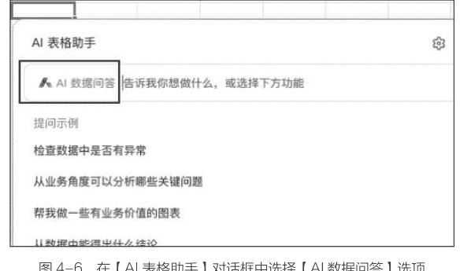
图 4-6 在【AI 表格助手】对话框中选择【AI 数据问答】选项
- （4）数据问答，一键完成分析。

在【AI 数据问答】输入区逐条写好指令，点击【发送】之后，WPS AI 会解析指令并返回计算结果。

输入提示词 1：快速计算各门课程的平均成绩。

生成结果：

> 各门课程的平均成绩如下。

> 数学：80.75 分。

> 语文：84.40 分。

> 英语：81.80 分。

> 物理：78.50 分。

> 化学：81.35 分。

继续输入提示词 2：快速计算每位学生 5 门课程的平均成绩。

WPS AI 会迅速完成全体同学五科平均分的核算。

继续输入提示词 3：计算全班学生所有课程的平均成绩。

生成结果：

> 全班学生所有课程的平均成绩为：81.36 分。

继续输入提示词 4：生成各门课程平均成绩的排序图，按升序进行排名。

生成的各门课程平均成绩的排序图如图 4-7 所示。

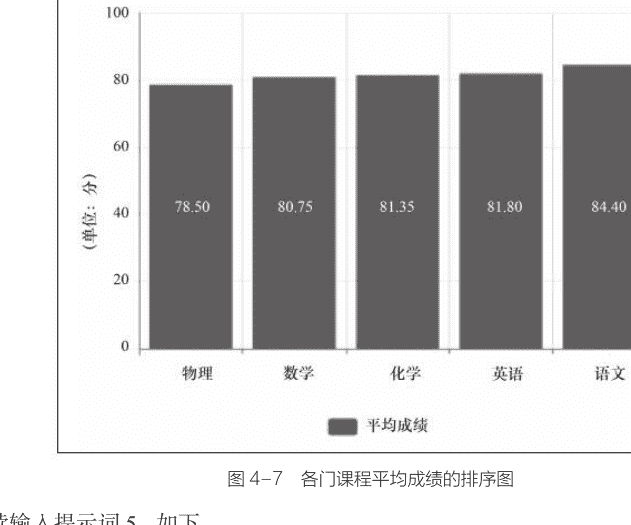
继续输入提示词 5，如下。

平均成绩分为 4 个分数段：60 分以下（不含 60 分）、60 ~ 80 分（不含 80 分）、80 ~ 90 分（不含 90 分）、90 分及以上。统计平均成绩在不同分数段的学生的人数占比，并绘制饼图。

生成的全班学生平均成绩各分数段分布饼图如图 4-8 所示。

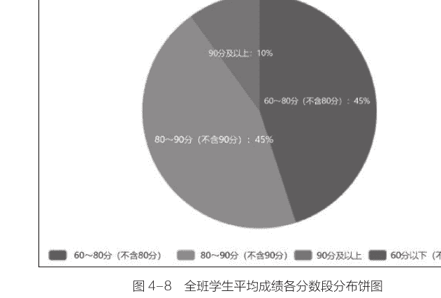
借助 AI 表格助手，用户可以通过与 AI 工具对话，一键进行数据分析，生成数据图表，避免写函数公式和手动制作图表的烦琐，提升效率。

### 【任务 4-4】使用酷表 ChatExcel 处理与分析学生成绩数据

- （1）上传 Excel 文件“高三学生成绩.xlsx”。
- （2）计算每位学生的总分、平均分，平均分保留 2 位小数，并进行排名，将结果填充到表格里并下载。
- （3）判断每位学生所有科目的平均分是否高于全班的平均分，将平均分高于全班平均分的学生标红，将结果填充到表格里并下载。
- （4）在“总分”列的成绩后面，括注单位“分”，下载处理好的文件。
- （5）查找高三（3）班，学号为 20250310 ～ 20250320 的学生中，数学成绩高于 120 分的学生姓名及其各科成绩，下载处理好的文件。
- （6）填充“评选结果”列，符合条件，则填充为“优秀”。评优考核条件：语文成绩不低于 90 分，数学成绩也不能低于 90 分。下载处理好的文件。
- （7）将总分排名前 10 名的学生的各科成绩绘制成柱状图。
- （8）将总分排名前 10 名的学生的各科成绩占其总成绩的百分比绘制成饼图。
- （9）将总分排名前 10 名的学生的各科成绩绘制成关系散点图。

#### 任务实施

- （1）在浏览器中打开酷表 ChatExcel 的工作页面。
- （2）上传 Excel 文件“高三学生成绩.xlsx”。
- （3）输入提示词 1：计算每位学生的总分、平均分，平均分保留 2 位小数，并进行排名，将结果填充到表格里并下载。

☆ 请读者自行在酷表 ChatExcel 中生成与提示词 1 对应的结果。

读者可以预览或下载生成的 Excel 文件“高三学生成绩计算结果.xlsx”。

- （4）输入提示词 2：判断每位学生所有科目的平均分是否高于全班的平均分，将平均分高于全班平均分的学生标红，将结果填充到表格里并下载。

☆ 请读者自行在酷表 ChatExcel 中生成与提示词 2 对应的结果。

- （5）输入提示词 3：在“总分”列的成绩后面，括注单位“/分”，下载处理好的文件。

☆ 请读者自行在酷表 ChatExcel 中生成与提示词 3 对应的结果。

- （6）输入提示词 4：查找高三（3）班，学号为 20250310 ～ 20250320 的学生中，数学成绩高于 120 分的学生姓名及其各科成绩，下载处理好的文件。

生成结果：

> 学生成绩筛选报告

> 1. 数据读取与初步筛选

> 根据用户需求，已经成功读取了包含所有学生成绩的表格数据，并从中筛选出高三（3）班、学号为 20250310 ～ 20250320 的学生。

> 2. 筛选结果

> 进一步筛选出数学成绩高于 120 分的学生，具体信息如下。

| 姓名 | 数学成绩 | 英语成绩 | 语文成绩 | 政治成绩 | 历史成绩 | 地理成绩 | 体育成绩 |
| :--- | :--- | :--- | :--- | :--- | :--- | :--- | :--- |
| 杨丽 | 143 | 114 | 97 | 73 | 88 | 54 | 92 |
| 蒋琴 | 135 | 76 | 121 | 96 | 86 | 61 | 78 |

> 3. 文件保存情况

> 已将符合条件的学生姓名及其各科成绩提取并保存到文件“selected_students.xlsx”中。该文件包含所有相关学生的详细成绩信息，便于进一步查看和分析。

> 4. 结论

> 通过上述步骤，成功筛选出了高三（3）班学号为20250310～20250320且数学成绩高于120分的学生，并将其成绩信息整理成表格文件。此文件可以帮助教师或相关人员快速了解这些学生的具体成绩情况。

- （7）输入提示词5：填充“评选结果”列，符合条件，则填充为“优秀”。评优考核条件：语文成绩不低于90分，数学成绩也不能低于90分。下载处理好的文件。

☆ 请读者自行在酷表ChatExcel中生成与提示词5对应的结果。

- （8）输入提示词6：将总分排名前10名的学生的各科成绩绘制成柱状图。

生成的总分排名前10名的学生的各科成绩柱状图如图4-9所示。

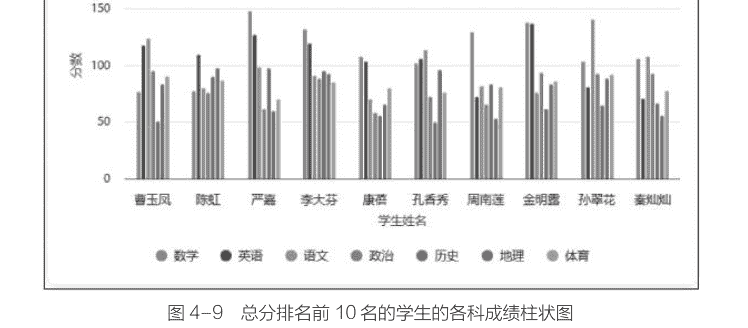

- （9）输入提示词7：将总分排名前10名的学生的各科成绩占比绘制成饼图。

生成的各科成绩占比饼图如图4-10所示（以一位学生为例）。

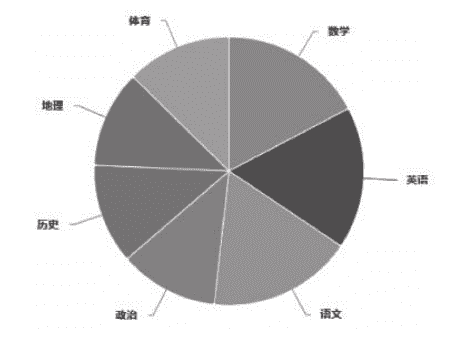

- （10）输入提示词8：将总分排名前10名学生的各科成绩绘制成关系散点图。

生成的各科成绩关系散点图如图4-11所示。

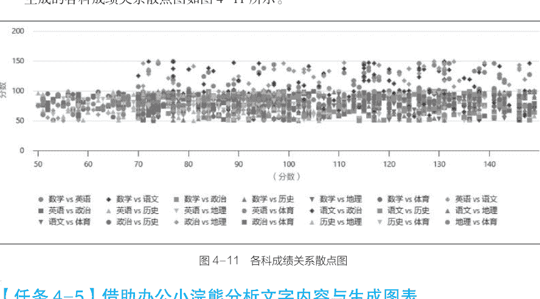

图4-11 各科成绩关系散点图

### 【任务 4-5】借助办公小浣熊分析文字内容与生成图表

有如下一段文字。

在刚刚结束的年度科技大会上，我们有幸记录了参与者的详细数据。本次大会吸引了来自各行各业的专业人士参与，共计近1200名。在性别分布方面，男性占据了较大比例，有约800名男性参与者，而女性参与者则有约400名。

在职业分布方面，大会吸引了不同领域的专家参与。其中，软件开发者最多，有300人参与。紧随其后的是数据分析师，有200人参与。此外，产品经理、市场营销专家和设计师也分别有150人、120人和100人参与。

值得注意的是，大会还吸引了一些新兴领域的专业人士参与，例如，人工智能研究员有80人参与，区块链开发者有70人参与，物联网工程师有60人参与。这些新兴领域的专业人士虽然人数不多，但他们的参与为大会增添了不少活力且较大地提高了大会的前瞻性。

此外，还有一部分参与者来自教育和学术界，包括50名教授和40名研究生。他们的参与为大会的讨论带来了丰富的教育和学术视角。

总体来说，本次大会的参与者呈现出多样化职业背景，这不仅反映了科技行业的广泛性，也体现了大会的包容性和多元性。

根据以上内容生成一张职业分布统计饼图。

#### 任务实施

- （1）打开办公小浣熊的工作页面。
- （2）在输入框中输入待分析的一段文字，然后输入提示词：根据以上内容帮我生成一张职业分布统计饼图。
- （3）单击【发送】按钮。生成的职业分布统计饼图如图4-12所示。

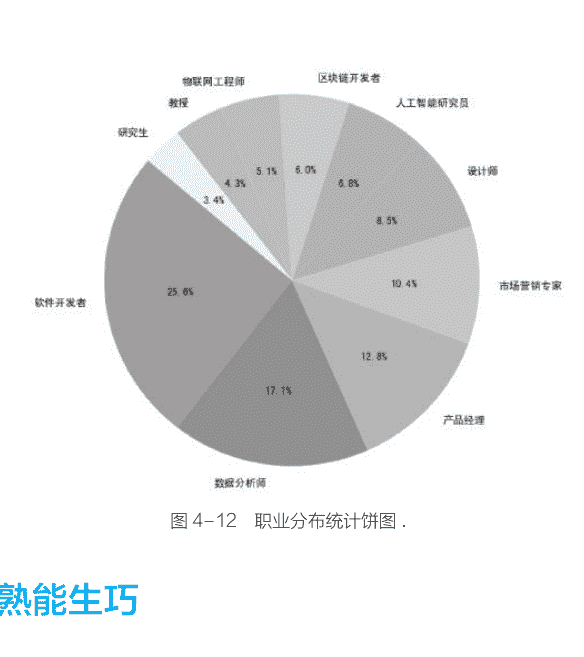

图 4-12 职业分布统计饼图。

## 4.4 熟能生巧

### 【任务 4-6】WPS AI 助力数据计算与图表绘制

- (1) 针对不同的 Excel 文件中的数据，完成多项数据计算与图表绘制。
- (2) 根据特定条件，快速标识数据。

#### 任务实施

各项数据计算与图表绘制的基本流程如下。

- (1) 在 WPS 中打开对应的 Excel 文件。
- (2) 在 WPS 中选择【WPS AI】下拉列表中的【AI 表格助手】命令，打开【AI 表格助手】对话框。在【AI 表格助手】对话框中选择【AI 数据问答】选项。
- (3) 在【AI 数据问答】输入框中分别输入提示词，然后单击【发送】按钮，执行对应的指令即可。

##### 1. 通过 WPS AI 自动计算多个数据

打开源文件：在 WPS 中打开 Excel 文件“自动计算多个数据.xlsx”。

输入提示词：通过公式依次计算课程成绩的最高分、最低分、第二高分、第二低分、平均分。

生成结果：

> 我们已经成功将计算结果填入了相应的单元格。更新后的数据如下。

> 最高分：98。

> 最低分：65。

> 第二高分：90。

> 第二低分：70。

> 平均分：80.86。

##### 2. 通过 WPS AI 快速计算排名

打开源文件：在 WPS AI 中打开 Excel 文件 “02 WPS AI 快速计算排名.xlsx”。

输入提示词：通过公式计算排名，并将排名填充到对应的列。

生成结果如表 4-3 所示。

表4-3 成绩排名

| 姓名 | 课程成绩 /分 | 排名 |
| :--- | :--- | :--- |
| 王立新 | 78 | 5 |
| 董丽霞 | 98 | 1 |
| 张睿 | 94 | 2 |
| 杨一凡 | 76 | 6 |
| 顾昊 | 90 | 3 |
| 刘洁 | 70 | 7 |
| 宁远城 | 89 | 4 |

##### 3. 通过 WPS AI 多条件统计订单数

打开源文件：在 WPS 中打开 Excel 文件 “03WPSAI 多条件统计订单数.xlsx”。

输入提示词：统计 2024 年春季，订货渠道为平台 8 且数量大于 300 的订单数。

生成结果：

> 统计结果显示，2024 年春季，订货渠道为平台 8 且数量大于 300 的订单共有 54 笔。

##### 4. 通过 WPS AI 多条件统计销售额

打开源文件：在 WPS 中打开 Excel 文件 “04 WPS AI 多条件统计销售额.xlsx”。

输入提示词 1：统计订货渠道为平台 3 且数量大于 600 的订单销售额总和。

生成结果：

> 统计结果显示，订货渠道为平台 3 且数量大于 600 的订单销售额总和为 476391 元。

输入提示词 2：计算平台 8 的平均订单销售额。

生成结果：

> 平台 8 的平均订单销售额为 38355.67 元。

输入提示词 3：列出订货日期为 2024-05-01 的订单号及对应销售额。

生成结果如表 4-4 所示。

表4-4 订货日期为2024-05-01的订单号及对应销售额

| 订单号 | 销售额 /元 |
| :--- | :--- |
| P2024050101 | 29093 |
| P2024050102 | 10400 |
| P2024050103 | 69865 |
| P2024050104 | 6981 |
| P2024050105 | 24752 |
| P2024050106 | 89864 |
| P2024050107 | 48512 |
| P2024050108 | 54750 |

输入提示词 4：统计各季节的总销售额。

生成结果如表 4-5 所示。

表4-5 各季节的总销售额

| 季节 | 总销售额 / 元 |
| :--- | :--- |
| 冬季 | 519938 |
| 夏季 | 280979 |
| 春季 | 10495791 |
| 秋季 | 1933129 |

##### 5. 通过 WPS AI 快速实现字符串拆分

打开源文件：在 WPS 中打开 Excel 文件“05 WPS AI 快速实现字符串拆分.xlsx”。

输入提示词：提取编码（数字）和描述（文字），将编码放到 B 列，将描述放到 C 列。

生成的部分结果如表 4-6 所示。

表4-6 字符串拆分的部分结果

| 编码 | 描述 |
| :--- | :--- |
| 1800038286 | 变压器油 |
| 1800132904 | 传动轴 |
| 1800183580 | 模块 |
| 1800183588 | 模块 |
| 1800011327 | 数字输出模块 |

##### 6. 通过 WPS AI 快速实现字符串合并

打开源文件：在 WPS 中打开 Excel 文件“06 WPS AI 快速实现字符串合并.xlsx”。

输入提示词：把编码和描述合并，并填充到 D 列对应的单元格中。

生成的部分结果如表 4-7 所示。

表4-7 字符串合并的部分结果

| 编码 | 描述 | 编码描述 |
| :--- | :--- | :--- |
| 1800038286 | 变压器油 | 1800038286 变压器油 |
| 1800132904 | 传动轴 | 1800132904 传动轴 |
| 1800183580 | 模块 | 1800183580 模块 |
| 1800183588 | 模块 | 1800183588 模块 |
| 1800011327 | 数字输出模块 | 1800011327 数字输出模块 |

##### 7. 通过 WPS AI 快速实现数据汇总分析

打开源文件：在 WPS 中打开 Excel 文件“07 WPS AI 快速实现数据汇总分析.xlsx”。

输入提示词 1：通过数据透视表，计算 2024 年“灰色长筒靴”“白色蕾丝上衣”的数量总计。

生成结果：

> 根据数据分析结果，2024 年“灰色长筒靴”的数量总计为 1829 件，“白色蕾丝上衣”的数量总计为 1620 件。

输入提示词 2：使用数据透视表筛选出 2024 年春季的“吊牌价”总额。

生成结果：

> 根据数据分析结果，2024 年春季的“吊牌价”总额为 36652.9 元。

## 4.5 勤思精练

### 【任务4-7】选择一种AI工具对同一个单元格中包含的多个数据进行拆分处理

完结项目及业绩评分如图4-13所示。

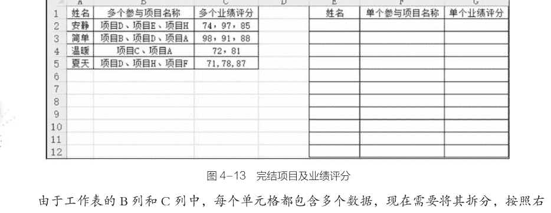

由于工作表的B列和C列中，每个单元格都包含多个数据，现在需要将其拆分，按照右表的格式填入对应的数据。

提示词如下。

> 你能看到图片中有两个表格吧？现在要把数据从左边的样子整理成右边的样子，请帮我完成这个任务，并用表格形式回复整理后的结果。

### 【任务4-8】借助天工AI列举所需的物品并制成表格

借助天工AI完成以下操作。

- （1）列举登山必备品并制成表格。
- （2）说明登山时准备的紧急医疗包里应该包含哪些药品。

### 【任务4-9】借助文心一言将Excel工作表中的数据绘制成柱状图

Excel工作表中的1—9月注册人数数据如表4-8所示，使用这些数据绘制柱状图。

表4-8 1—9月注册人数数据

| 月份 | 注册人数/人 |
| :--- | :--- |
| 1月 | 961 |
| 2月 | 2430 |
| 3月 | 5805 |
| 4月 | 6577 |
| 5月 | 6215 |
| 6月 | 1700 |
| 7月 | 3908 |
| 8月 | 4523 |
| 9月 | 4726 |

### 【任务 4-10】WPS AI 赋能数据分析，一键解决图表绘制等难题

- （1）在 WPS 中打开 Excel 文件 “商品大类的销售数据.xlsx”。
- （2）计算空调的销售额。
- （3）分析空调与手机哪一大类商品的销售利润高。
- （4）计算电视销售额占总销售额的比例。
- （5）分析手机和空调哪个月份的销售表现好。
- （6）计算电视的平均销售利润。
- （7）列出各大类商品的销售额和销售利润。
- （8）列出销售额排名前 3 的手机品牌。
- （9）按商品大类计算销售额。
- （10）生成不同商品大类销售额的条形图。

### 【任务 4-11】借助办公小浣熊处理与计算物品采购数据

- （1）在办公小浣熊中上传 Excel 文件 “物品采购数据.xlsx”。
- （2）对工作表中的缺失数据进行自动处理。
- （3）分别计算工具类、办公用品类物品的总采购金额。
- （4）计算两类物品的平均单价。

# 模块5 AIGC快速生成炫酷演示文稿

PPT 在商业、教育等场景中是信息传递的重要载体，但手工制作既费时又考验审美。借助智能工具，制作流程可以变得更高效、更有趣味。目前市面上有不少免费的智能 PPT 生成工具，能够帮助用户快速产出视觉效果出色且信息传达清晰的演示文件。

## 5.1 先睹为快

### 【案例 1】借助豆包和 Kimi+ 制作教学课件 PPT

#### 案例描述

- （1）使用豆包生成小学三年级课文《守株待兔》的教案。
- （2）使用 Kimi+ 制作课文《守株待兔》的教学课件 PPT。

#### 案例展示

##### 1. 生成教案

在豆包首页单击左侧的【帮我写作】，然后单击右侧的【教案】，如图 5-1 所示。

输入框中会出现“帮我写一份教案，授课对象是 [ 年龄学段 ]，主题是 [ 课程名称 ]。”提示信息，在“[ 年龄学段 ]”位置输入对应学段，如“小学三年级”，在“[ 课程名称 ]”位置输入对应的课文名称，如“守株待兔”，相当于输入提示词“帮我写一份教案，授课对象是小学三年级，主题是守株待兔。”然后，单击【发送】按钮，豆包就会开始生成教案。

扫描二维码，打开电子活页 5-1，在线浏览“豆包中生成的教案”，也可以自行在豆包中生成类似的结果。

如果对这个教案不满意，可以让豆包进行修改，如输入提示词“请写得更加详细”。

保存豆包生成的教案，文件名为“《守株待兔》教案.docx”。


##### 2. 教案转大纲
打开 Kimi+ 里的 PPT 助手，把第 1 步保存的 Word 文件《守株待兔》教案.docx 导入到会话区。随后在提示框输入如下指令：请参照文档《守株待兔》教案.docx 中的教学设计，为小学三年级语文课文《守株待兔》制作一套教学课件框架。点击【发送】后，Kimi+ 会依据教案内容自动输出课件大纲。

扫码打开电子活页 5-2，可在线查看 Kimi+ 产生的《守株待兔》教学课件大纲示例，亦可自行操作复现。

##### 3. 快速制作演示
大纲生成后先审阅，如有不妥可继续与 Kimi+ 沟通修正，例如输入“请按照三维目标重新设定教学目标”，反复调整至满意。

确认后点击左下角的【一键生成 PPT】进入配置页，选择使用场景如【教育培训】、设计风格如【简约】，并挑选一套版式，参考图 5-2。

随后点击右上角的【生成 PPT】即可启动制作。

##### 4. 精修与导出
课件生成后若不满意，可点击底部【去编辑】在线二次优化，效果见图 5-3。优化完毕可直接下载到本地。

更稳妥的做法是先下载到电脑，再用 PowerPoint 或 WPS 打开做进一步完善。

## 5.2 释疑解惑

### 【问题 5-1】常用的 PPT 智能生成工具有哪些？

#### 1. 百度文库的“智能 PPT”
自 2023 年 8 月起，百度文库升级为一站式智能文档平台后陆续推出智能文档、智能 PPT、思维导图等能力。“智能 PPT”内置多项核心功能，结合平台海量专业资料库，能更精准按需产出演示文稿。平台提供从资料检索到内容创作、排版编辑、配图选择的完整智能服务，支持 PPT、文档等多格式输出，模板资源丰富，创作效率明显提升。首页如图 5-3。

#### 2. WPS AI
WPS AI 由金山办公推出，是 WPS 办公套件的核心智能组件，提供智能写作、阅读理解问答、智能人机交互等能力，并对文档、表格、演示文稿等多格式提供智能辅助，提升整体办公智能化水平，助力写作与文档处理提效。

在 WPS AI 中输入关键词或简短描述，结合智能推荐与自动排版，可快速搭建演示框架并填充内容。首页如图 5-4。

#### 3. AiPPT
AiPPT 是一款由人工智能驱动的在线演示生成工具，专注于智能生成，提供文档转演示的快速转换和内容智能设计能力。只需输入主题即可一键产出高质量演示稿，操作简便。还支持在线自定义编辑、导入文档生成，提供 10 万+ 优质模板与素材，帮助用户快速做出专业级演示。首页如图 5-5。

#### 4. iSlide
iSlide 是一款强大的演示设计辅助工具，提供 30 万+ 原创可商用模板与设计元素，帮助用户快速制作媲美专业水准的演示文稿。首页如图 5-6。

#### 5. 博思 AIPPT
博思 AIPPT 是新一代在线智能生成演示软件，提供按主题生成、按文本生成、导入 Word、PDF、TXT、Markdown 文件生成等多种快捷方式。内置海量精美模板，覆盖商务、教育、科技等风格，避免重复。每页提供多种版式，支持一键自适应切换，适配各类办公场景。首页如图 5-7。

#### 6. ChatPPT
ChatPPT 由 MotionGo 发布，集成智能功能的演示制作工具，旨在简化制作流程。用户可通过对话式指令快速生成专业级演示，提供智能排版、主题色更换、模板选择、专业图表与动画自动生成等自动化选项，提升创作效率与质量。首页如图 5-8。

### 【问题 5-2】百度文库智能 PPT 的具体操作流程？
第 1 步：进入百度文库首页，点击【智能 PPT】入口。
第 2 步：选择创作方式。在【智能 PPT】页面可选择【输入主题生成】，也可选择【上传文档生成】和【上传图片生成】。
第 3 步：输入主题。输入想要制作的演示主题，例如“大学生防火安全教育”。
第 4 步：等待生成。点击【发送】后系统会自动处理并生成演示大纲，生成期间请勿关闭页面，否则可能失败。

扫码打开电子活页 5-3，可在线浏览百度文库“智能 PPT”生成的演示大纲示例，也可自行操作。
第 5 步：选择模板。大纲生成后点击【生成 PPT】按钮，打开如图 5-9 所示的对话框，选择贴合主题的演示模板，然后点击【继续生成】按钮。
第 6 步：编辑演示。生成的演示呈现大致框架，用户可按需优化，以达到预期效果。
第 7 步：下载演示。点击【下载 PPT】按钮，即可将成品保存到本地电脑。

### 【问题 5-3】百度文库智能 PPT 的创新点与优势？

#### 1. 创新亮点
百度文库“智能 PPT”快速发展得益于多项智能应用创新，主要体现在以下 5 点。
（1）贴合本土需求。智能 PPT 深入洞察中国用户在教育、商务等个人汇报场景中使用演示的真实需求。
（2）生成质量领先。经认证，在智能 PPT 能力测试的五大维度中均排名靠前，体现内容高质量。
（3）独具专业内容。依托十几亿份高价值文档支持，生成内容权威性与专业度较高。
（4）自由编辑体验。支持一键替换颜色、字体、模板，并可对其他格式文件进行再生成，编辑自由度高。
（5）定制程度高。提供多种风格模板供选择，支持上传个人定制模板，满足不同场景需求。

#### 2. 核心优势
（1）一站式服务能力。支持资料查找、内容生成、排版编辑、配图选择等全流程，无需在多平台切换。
（2）多文档整合。支持从 Word、Excel、PDF 等多格式文档生成演示，适用于复杂数据梳理。
（3）内容完整度高。能按生成大纲完整填充内容。
（4）模板能力强。提供丰富模板与灵活自定义功能。
（5）智能生成有声画本。在百度文库智能 PPT 手机 App 中，还支持智能生成有声画本，一句话即可在 3 分钟内创作图文并茂且伴有人声朗读的视频画本，门槛低、流程简便。

### 【问题 5-4】博思 AIPPT 有哪些快速生成方式？
博思 AIPPT 提供 2 种快速生成方式。
（1）智能生成演示：输入主题即可快速生成。
（2）导入文件生成演示：导入办公文件，经智能提炼总结自动生成演示。

以导入文件生成为例，博思 AIPPT 支持导入 Word、PDF、TXT、Markdown、MindMaster、Xmind 等文件，覆盖常用办公类型，助力快速制作精美演示。

导入后，系统基于主题、目录、章节、内页 4 个维度解析本地文件，点击底部【挑选 PPT 模板主题】按钮进入模板选择界面。

内置海量精美模板，可从模板场景、设计风格、主题颜色 3 维度筛选。
模板场景：总结汇报、教育培训、企业宣传、商业计划书、营销推广、毕业答辩、晚会表彰。
设计风格：扁平简约、商务科技、创意时尚、文艺清新、中国风、卡通手绘。
主题颜色：10 多种色系，可自由选择。

选定模板后，点击右上角【生成 PPT】按钮，即可快速生成演示文稿。

### 【问题 5-5】Kimi+ PPT 助手的使用方法？
Kimi+ 支持生成与下载演示大纲和模板，且完全免费。使用方法如下。
（1）打开“PPT 助手”。打开 Kimi+，选择【PPT 助手】即可开始一键创建演示。
（2）输入提示词，生成大纲。用自然语言描述演示内容，输入提示词后 Kimi+ 会生成演示大纲。
（3）开始配置演示。检查大纲确认无误后，点击底部【一键生成 PPT】按钮开始配置。
（4）选择模板。在【选择模板创建 PPT】页面挑选合适模板，点击右上角【生成 PPT】按钮开始生成。
（5）生成完成，继续编辑。生成完成后点击下方【去编辑】按钮进入编辑页，可做细节调整，也可点击【放映】【拼图】【下载】等按钮操作。

### 【问题 5-6】通义千问 PPT 创作的操作步骤？
（1）进入 PPT 创作页面。点击通义首页右侧的【PPT 创作】按钮，进入创作页面。
（2）输入主题。在输入框中输入演示主题，点击【发送】按钮。
（3）调整大纲和选择场景。通义千问会根据主题生成大纲，用户可调整大纲并选择演讲场景，调整完毕后点击右上角【下一步】按钮。
（4）选择合适的模板。通义千问提供多款优秀演示模板供选择，选定后点击右上角【生成 PPT】按钮。
（5）生成演示。稍等片刻即可生成演示，用户可在线微调内容、切换模板、导出或演示。

## 5.3 实战案例

### 【任务 5-1】用 AiPPT 生成主题演示文稿
主题为“人工智能的发展趋势与未来展望”。

#### 操作步骤
（1）打开 AiPPT 首页，点击【开始智能生成】按钮，进入智能生成演示页面。
（2）在主题输入框中输入“人工智能的发展趋势与未来展望”，点击【AI 生成】按钮。
（3）AiPPT 会依据主题智能生成大纲内容，可编辑大纲，也可点击【换个大纲】更换。
（4）点击【挑选 PPT 模板】按钮，弹出【选择模板创建 PPT】对话框。可选应用场景如【教育培训】，选合适的模板，或输入关键词、随机选择。选定后在对话框右上角点击【生成 PPT】按钮，智能开始制作并自动保存。
（5）制作完成后可在【PPT 预览】区点击【去编辑】按钮，对大纲、文字、背景、元素进行调整，也可直接替换模板。
（6）点击【下载】按钮将演示保存到本地，点击【分享】按钮可分享给他人。

### 【任务 5-2】用 iSlide 生成主题演示文稿
主题为“培养大学生的创新思维”。

#### 操作步骤
（1）打开 iSlide 首页，在输入框中输入主题“培养大学生的创新思维”，点击【发送】按钮 ▶，如图 5-11 所示。系统会自动生成提示词：生成一份以「培养大学生的创新思维」为主题的演示。
（2）iSlide 自动生成演示大纲，弹出【PPT 大纲】对话框，如图 5-12 所示。
（3）点击左下角【生成 PPT】按钮，系统自动生成演示，如图 5-13 所示。
（4）点击演示下方的【一键换肤】按钮可直接更换模板。
（5）点击演示下方的【下载 PPT】按钮可将成果下载到本地电脑。

### 【任务 5-3】用博思 AIPPT 生成主题演示文稿
主题为“插画在当代的创新与发展”。

#### 操作步骤
（1）打开博思 AIPPT 首页，点击【我也要生成 PPT】按钮，登录后点击【智能生成 PPT】按钮，进入【PPTGO】页面，如图 5-14 所示。
（2）在标题输入框中输入主题“插画在当代的创新与发展”，点击【发送】按钮。
（3）系统自动生成演示大纲，在大纲编辑对话框中可编辑内容，如图 5-15 所示。点击【展开编辑】可展开编辑，点击【下载大纲】可下载大纲，点击【换个大纲】可更换。
（4）点击【挑选 PPT 模板主题】按钮进入【选择 PPT 模板】页面，如图 5-16 所示。选好模板后点击右下角【下一步】按钮，选择插图来源并完成高级设置。
（5）点击【生成 PPT】按钮，系统开始自动生成。
（6）主题为“插画在当代的创新与发展”的演示生成后自动打开编辑页面，可在线编辑。点击右上角【分享】可分享，点击【导出】并在弹出对话框中点击【导出】可保存到本地。

## 5.4 进阶练习

### 【任务 5-4】借助百度文库的“智能 PPT”使用多种方式生成 PPT
（1）用输入主题生成方式制作《春节礼仪教育》演示。
（2）用上传文档生成方式制作《大学生防火安全教育》演示。
（3）用上传图片生成方式制作《阿坝旅游目的地精选》演示。
（4）对“桂林简介.pptx”进行美化操作。

#### 任务实施
1. 打开百度文库的“智能 PPT”
打开百度文库，在【AI 创作】区点击【智能 PPT】或点击左边导航栏的【智能助手】，均可进入创作页面。
2. 输入主题生成演示
在智能 PPT 创作页面，如图 5-17 所示，点击【输入主题生成】按钮。
（1）输入想生成的演示主题
输入框提示“帮我写一篇 PPT，主题为 [ 主题内容 ]”，在“[ 主题内容 ]”处填入“春节礼仪教育”，即提示词：帮我写一篇 PPT，主题为春节礼仪教育。
（2）生成演示大纲
在页面点击右下角【发送】按钮。

生成的《春节礼仪教育》演示大纲如下。

```
春节礼仪教育：开开心心过大年
第 1 章
春节的起源与传说
1.1 春节的由来
1.2 春节的传说与习俗
1.3 春节的重要性与意义
第 2 章
春节的传统习俗
2.1 扫尘与贴春联
2.2 守岁与拜年
2.3 发红包与吃饺子
第 3 章
春节的礼仪规范
3.1 穿着与言行举止
3.2 餐桌礼仪与饮食文化
3.3 拜访亲友与待客之道
```

##### 第4章 春节的安全教育

###### 4.1 防火与防电安全

###### 4.2 交通安全与出行

###### 4.3 饮食安全与卫生

##### 第5章 春节的文化体验活动

###### 5.1 观看舞龙舞狮表演

###### 5.2 制作与欣赏剪纸作品

###### 5.3 学习写春联与福字

##### 第6章 春节的环保与节约意识

###### 6.1 垃圾分类与环保行动

###### 6.2 节约资源，反对浪费

###### 6.3 绿色出行，低碳生活

##### 第7章 春节的感恩与家庭教育

###### 7.1 感恩父母与长辈

###### 7.2 传承家庭传统与习俗

大纲生成后可修改完善，完成后点击左下角【生成 PPT】按钮。
（3）选择演示模板
打开的对话框提供 3 种选择方式：【选择模板】【上传模板】【自定义模板】。按需选择合适的模板，如图 5-18 所示。

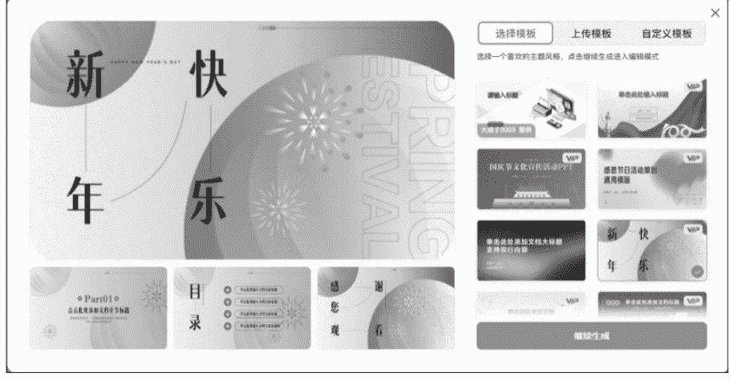

图 5-18 选择合适的模板

（4）生成演示
在对话框中点击【继续生成】按钮开始生成，可在线编辑与设置。
（5）下载生成的演示
点击【下载PPT】按钮，将成果下载到本地电脑。

##### 3. 百度文库的其他PPT编辑功能
百度文库的【智能助手】侧边栏如图5-19所示。百度文库的【编辑】工具栏如图5-20所示。

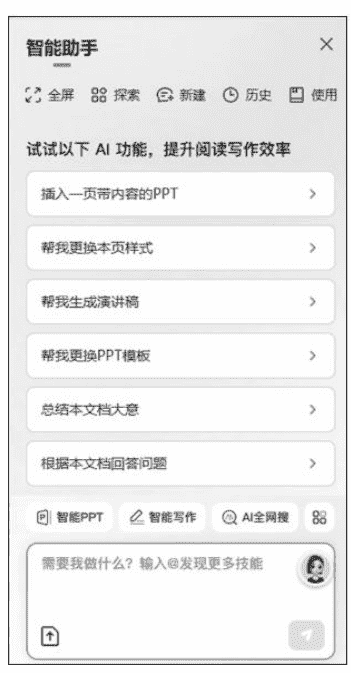


百度文库的其他PPT编辑功能如下。

PPT智能化实操指南

一页内容自动续写
进入幻灯片编辑窗口后，顶部【编辑】工具栏里有【续写一页】入口，也可在右侧【智能助手】面板里选用【插入一页带内容的PPT】，填入想要的主题，系统就会自动生成文字与版式的一页内容。

单页视觉风格切换
在编辑页用【编辑】工具栏的【更换样式】，或在智能助手侧栏点【帮我更换本页样式】，就能批量预览多种排版方案，选中满意的方案直接套用。

基于页面要点生成讲稿
打开编辑页的智能助手侧栏，点击【帮我生成演讲稿】，系统会依据当前页面的要点自动撰写讲解稿。

整套模板一键替换
在编辑页智能助手侧栏选择【帮我更换PPT模板】，弹出选择页后点【查看更多】，即可从文库在线模板库挑选一套风格整体替换。

配图智能更新
在编辑页点【编辑】工具栏的【更换配图】可批量生成备选配图。若页面存在多张图片，先选中目标图，侧栏会提示更换，点击【帮我更换配图】即可挑选新图替换。

##### 4. 上传文档生成 PPT
（1）在智能PPT创作页触发【上传文档生成】按钮。
（2）弹出对话框后切到【上传本地文件】标签，点击【点击此处或拖拽上传】，在打开窗口中选择作为依据的文档，例如Word文件“大学生防火安全教育.docx”，确认后开始上传。
（3）文档上传成功后弹出【选择生成方式】对话框，提供【智能润色】与【严格依从】两种策略，选用【智能润色】后点【生成 PPT】。
（4）系统先输出大纲，大纲完成后可自行修改。示例大纲如下。
- 大学生防火安全教育
第 1 章 引言
1.1 火灾的危害与预防
1.2 大学生防火安全教育的意义
第 2 章 火灾的危害
2.1 烧毁财产和家园
2.2 烟雾和毒气危害
2.3 社会心理影响
第 3 章 火灾的常见原因
3.1 电气原因
3.2 明火原因
3.3 人为原因
第 4 章 预防火灾的方法
4.1 定期检查电气设备和线路
4.2 妥善处理易燃物品
4.3 提高防火意识
第 5 章 火灾中的自我保护
5.1 逃生自救
5.2 报警求救
5.3 防护措施
第 6 章 校园防火小知识
6.1 教室防火注意事项
6.2 实验室防火知识
6.3 图书馆防火常识
6.4 食堂防火小贴士
第 7 章 家庭防火小常识
7.1 家庭防火的必要性
7.2 家庭用电安全
7.3 家庭易燃易爆物品管理
第 8 章 灭火器的使用方法与注意事项
8.1 灭火器的种类
8.2 灭火器的使用方法
8.3 灭火器的保养与检查
8.4 灭火器的使用注意事项
第 9 章 火灾逃生与自救技巧
9.1 火灾逃生原则
9.2 火灾逃生路线选择
9.3 火灾逃生过程中的注意事项
9.4 火灾自救技巧
（5）点大纲下方的【生成 PPT】，弹出模板选择框，选定合适模板后按【继续生成】，百度文库智能PPT将按大纲制作。
（6）完成后点【下载 PPT】即可保存到本地。

##### 5. 上传图片生成 PPT
（1）在智能演示文稿创作页点击【上传图片生成】。
（2）打开文件选择框，挑选作为素材的图片，例如“小金县雪域之乡风光掠影”文件夹下的全部图片，确认后导入。
（3）导入成功后会出现“请根据下方图片生成 PPT”提示，系统自动产出大纲，可修改。示例大纲如下。
- 雪域之乡风光掠影
第 1 章 自然风光
1.1 草地与雪山
1.2 鲜花与蓝天
第 2 章 牧区生活
2.1 牛群吃草
2.2 马匹觅食
第 3 章 地域特色
第 4 章 季节与气候
第 5 章 整体色调与氛围
5.1 清新、自然的色调
5.2 宁静的氛围
（4）点大纲下方的【生成 PPT】，选择模板后按【继续生成】，系统按大纲制作演示文稿。
（5）生成完毕后点【下载 PPT】保存到电脑。

##### 6. 演示文稿美化
（1）在智能演示文稿创作页点击【美化 PPT】。
（2）弹出导入本地文件对话框，点击【点击此处或拖拽上传】，在打开窗口中选择待美化的文件，例如“桂林简介.pptx”，确认导入。
（3）导入成功后弹出模板选择框，选定模板后按【开始美化】，智能PPT开始优化。
（4）美化完成后点【下载 PPT】保存结果。

### 【任务 5-5】借助 WPS AI 使用多种方式生成 PPT
（1）采用主题模式制作景点推介类演示文稿，主题为“九寨沟的美景”。
（2）采用大纲模式制作知识学习类演示文稿，主题为“蛇年春节特色古诗词鉴赏”。


#### 任务实施

##### 1. 在 WPS 中创建空白 PPT
在WPS中新建一个空白演示文稿。

##### 2. 使用根据主题生成 PPT 方式生成 PPT
（1）在WPS主界面打开【WPS AI】下拉菜单，选择【AI 生成 PPT】—【主题生成 PPT】，如图 5-21 所示。
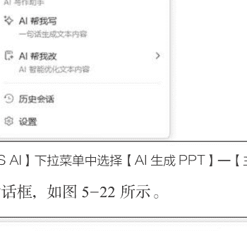
图 5-21 在【WPS AI】下拉菜单中选择【AI 生成 PPT】—【主题生成 PPT】命令
打开【AI 生成 PPT】对话框，如图 5-22 所示。

图 5-22 【AI 生成 PPT】对话框
（2）在输入框填入主题“九寨沟的美景”，点【开始生成】，系统开始构建大纲，部分内容如图5-23所示。
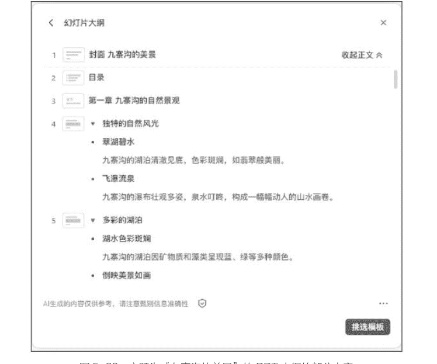
（3）在【幻灯片大纲】对话框右下角点【挑选模板】，打开【选择幻灯片模板】对话框，挑选合适的模板，如图5-24所示。
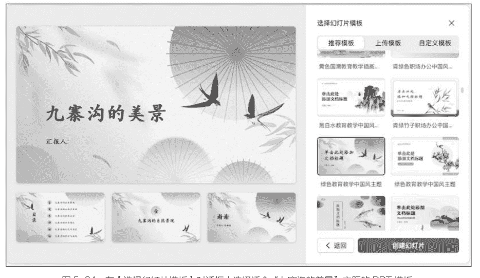
（4）在【选择幻灯片模板】对话框右下角点【创建幻灯片】，WPS AI 自动生成演示文稿。
（5）在WPS主界面工具栏点【保存】，弹出【另存为】对话框，文件名输入“九寨沟的美景.pptx”，确认保存。

##### 3. 使用根据大纲生成 PPT 方式生成 PPT
（1）在WPS主界面点【WPS AI】，在下拉菜单中选择【AI 生成 PPT】—【大纲生成 PPT】，打开【AI 生成 PPT】对话框。
（2）主题为“蛇年春节特色古诗词鉴赏”的PPT大纲内容如下。
```
蛇年春节特色古诗词鉴赏
第 1 章 蛇年寓意与古诗词背景
1.1 蛇年象征意义
1.2 古诗词发展背景
1.3 蛇年春节与古诗词的联系
第 2 章 蛇年春节古诗词鉴赏
2.1 与蛇相关的古诗词精选
2.2 与蛇相关的古诗词解析
2.3 春节习俗与古诗词融合
第 3 章 蛇年春节古诗词文化与教育
3.1 传递正能量与文化内涵
3.2 培养学生对古诗词的兴趣
3.3 蛇年春节古诗词教育活动
第 4 章 蛇年春节古诗词鉴赏方法与技巧
4.1 理解与感受古诗词意境
4.2 鉴赏古诗词中蛇的形象
4.3 春节古诗词中表现手法分析
第 5 章 蛇年春节古诗词朗诵与表演
5.1 朗诵技巧及注意事项
5.2 表演形式选择与创新
5.3 蛇年春节古诗词朗诵与表演安排
第 6 章 蛇年春节古诗词在现代生活中的意义
6.1 传承和弘扬传统文化
6.2 增强民族自豪感和凝聚力
6.3 蛇年春节古诗词在现代社会中的应用
```
在【粘贴大纲】选项卡中，将该主题的大纲复制粘贴到输入框，如图 5-25 所示。
（3）在【AI 生成 PPT】对话框点【开始生成】，开始构建大纲。
（4）在【幻灯片大纲】对话框点右下角【挑选模板】，打开【选择幻灯片模板】对话框，选择适配主题的模板，如图 5-26 所示。
（5）在【选择幻灯片模板】对话框右下角点【创建幻灯片】，WPS AI 自动创建演示文稿。
（6）在WPS主界面工具栏点【保存】，弹出【另存为】对话框，文件名输入“蛇年春节特色古诗词鉴赏与教育.pptx”，点【保存】。
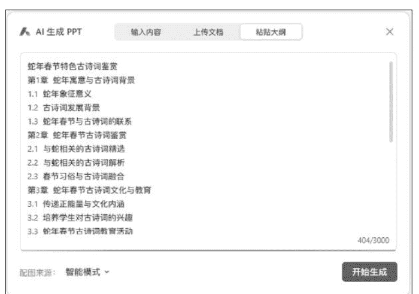
图 5-25 【AI 生成 PPT】对话框中的【粘贴大纲】选项卡
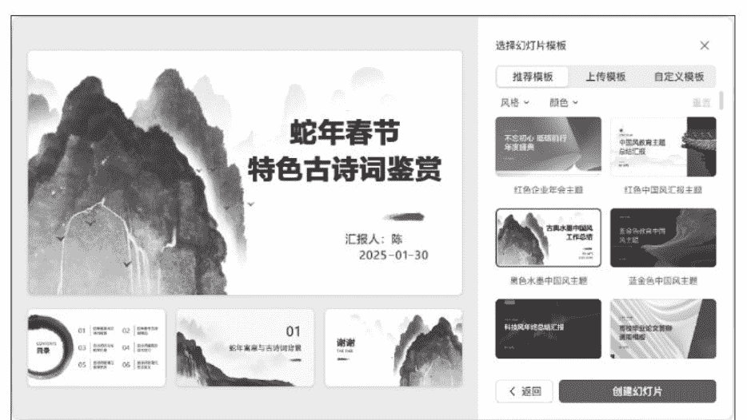
图 5-26 在【选择幻灯片模板】对话框中选择适合“蛇年春节特色古诗词鉴赏”主题的 PPT 模板

## 5.5 勤思精练

### 【任务 5-6】借助美图设计室的“Live PPT”智能生成主题 PPT
利用美图设计室的“Live PPT”功能，生成主题为“运动与健康”的演示文稿。

### 【任务 5-7】借助讯飞智文智能生成主题 PPT
使用讯飞智文生成主题为“新能源汽车营销方案”的演示文稿。

### 【任务 5-8】借助 Kimi+ 的“PPT 助手”智能生成主题 PPT
借助Kimi+的“PPT 助手”功能，生成主题为“黄山的奇松”的演示文稿。

### 【任务 5-9】借助通义千问的“PPT 创作”智能生成主题 PPT
使用通义千问的“PPT 创作”功能，生成主题为“AIGC 学习入门指南”的演示文稿。

# 模块6 AIGC轻松创作精美图像作品
AI绘画是基于生成对抗网络、变分自编码器、Transformer等深度学习模型实现的视觉艺术创作技术。模型通过学习大量艺术作品的风格与技法，自动产出富有创意与美感的图像。用户只需提供文字描述或指定风格，即可获得独一无二的画作，既拓宽创作边界，也让非专业人士轻松产出精致艺术作品。

## 6.1 先睹为快

### 【案例6-1】使用豆包生成图像

#### 案例描述
提示词为：帮我生成图像：在绿色的草原上，一头牛在可爱和露营风格的环境中安静地吃草，天蓝色和绿色，浅红色和绿色的色调，淡雅的绘画风格，深橙色和白色相互交织，营造出宁静的氛围；画面比例设置为9：16。

#### 案例展示
豆包生成的图像如图6-1所示。

图6-1 豆包生成的图像

### 【案例 6-2】使用即梦 AI 生成图像

#### 案例描述
提示词如下。生成图像：清澈的泉水悄无声息地流淌，仿佛在珍惜每一滴泉水；阳光透过岸边的树木，投下斑驳的光影，映照在水面上，与晴朗柔和的阳光交织成一幅和谐的画面；一朵荷花悄然拉近，粉嫩的花苞尚未完全展开，却已透出几分娇艳，仿佛正在积蓄力量；一只蜻蜓早早地停驻在花苞之上，轻盈的身躯与尖尖的花瓣形成鲜明对比，展现出大自然的生机与活力，整幅画面充满了生命的韵律和诗意，令人感受到夏日清晨的清新与宁静；画面比例设置为 4 : 3。

#### 案例展示
即梦 AI 生成的图像如图 6-2 所示。


### 【案例 6-3】对比文心一言与豆包生成的图像

#### 案例描述
分别在文心一言、豆包中使用以下提示词生成图像：蓝色山峰，雪景，古代建筑，河流，夜晚，中国风，华丽，细节，幻想艺术，唯美。

#### 案例展示
同一提示词在不同工具下效果各异。文心一言生成的图像如图 6-3 所示。豆包生成的图像如图 6-4 所示。


图6-3 文心一言生成的图像
图6-4 豆包生成的图像

## 6.2 释疑解惑

### 【问题6-1】常用的图像生成与处理专用型AI工具有哪些？

常用的图像生成与处理专用型AI工具介绍如下。

#### 1. 文心一格
文心一格是百度推出的AI艺术创作辅助平台，依托飞桨深度学习平台和文心大模型，可驾驭多种风格，快速产出创意画作，为设计提供灵感。它面向有设计需求的用户，能根据文字描述生成艺术感强的绘画作品，提供多种素材图库，支持油画、水彩、素描、卡通等风格。

#### 2. 通义万相
通义万相是阿里巴巴推出的AIGC绘画大模型，用户可轻松创作出精美画作。支持文本生成图像、相似图像创意发散、图像风格迁移，生成速度快。

#### 3. 即梦AI
即梦AI由字节跳动旗下抖音团队推出，面向图文和短视频创作者，提供图片生成、智能画布、视频生成和故事创作功能，操作简便、功能强大。

#### 4. 海艺 AI
海艺 AI是一款高效易用的AI绘画与图片生成工具，无需专业技能，输入提示词即可生成高质量图片。结合强大渲染引擎和丰富模型库，满足个性化创作，提供AI滤镜、AI美妆等娱乐功能，并设有创意互动社区。

#### 5. 堆友
堆友是阿里巴巴打造的设计师全周期服务平台，提供文生图、图生图等AI功能，以及图片编辑和“AI工具箱”。拥有丰富可编辑3D素材和专业WebUI，支持模型训练。以成为设计师好伙伴为目标，提供免费可商用的3D资源和在线编辑器，还提供“AI反应堆”“AI工具箱”“AI助手”等功能，助力快速生成高质量作品，支持文生图、图生图及社区同款创作。

堆友包含大量图片设计相关AI功能，如文生图、图生图、海报设计、ComfyUI、一键抠图等，功能全面。

#### 6. WHEE
WHEE是美图旗下的AI绘画平台，包含文生图、图生图、创作词库、风格模型等。输入提示词即可生成对应图像，也可上传照片进行风格化处理，并提供AI修图功能，满足视觉创作需求。

#### 7. 无界 AI
无界AI由无界版图推出，专注于AIGC社区和平台，提供简洁易用、模型丰富的绘画工具，支持多种风格。集成提示词搜索、AI图库、AI创作等功能，采用区块链技术保障作品版权。

### 【问题 6-2】常用的创意设计 AI 工具有哪些？

目前常用的创意设计AI工具如表 6-1 所示。

表6-1 常用的创意设计AI工具

| 序号 | AI工具名称 | 说明 |
| :--- | :--- | :--- |
| 1 | PostNitro | 专为社交平台内容创作者和个人博主设计，聚焦快速创建吸睛的社交平台封面，尤其适用于小红书等平台，输入主题即可生成封面设计 |
| 2 | 稿定 | 设计师常用的在线设计工具，拥有海量有版权的素材模板，适用于图片和视频制作 |
| 3 | 墨刀 | 提供强大的原型编辑和交互能力，支持脑图、流程图和需求文档创作，AI赋能一键生成设计，协作体验流畅，团队管理灵活 |
| 4 | 即创 | 提供AI视频创作、图文创作和直播创作服务 |
| 5 | AIDesign | 提供在线Logo设计服务，可通过AI快速创建和定制Logo |
| 6 | 美间 | 提供海量免费素材模板和提案PPT，支持软装设计、产品营销、电商物料输出等场景 |

### 【问题 6-3】AI 图像生成与处理工具的应用场景有哪些？

AI图像生成与处理工具的应用场景如下。

- 个性化艺术创作：按个人喜好定制独一无二的艺术作品，如个人肖像、宠物画像等。
- 游戏和电影视觉效果：快速生成游戏背景、角色概念图及电影视觉效果草图。
- 广告和社交平台内容：为广告创意或社交媒体帖子提供视觉上吸引人的图像，提升内容吸引力。
- 时尚设计：探索新设计理念和图案，为时尚行业提供创新灵感。
- 教育和研究：作为艺术教育和视觉艺术研究的工具，帮助学习和探索不同艺术风格与历史。
- 放松和心理治疗：通过创作艺术作品作为放松和心理治疗手段，缓解压力和焦虑。

AI智能作画实操拆解与平台使用指南

智能作画已从专业工作室进入日常创作场景。量身定制的室内挂画可以为软装提供灵感；带有个人印记的艺术品能够成为送礼或企业品牌传播的差异化选择；独一无二的数字资产也能进入收藏市场，用于作品发行和NFT流通。

【问题 6-4】绘画提示词主要由什么构成

以一段奇幻中国山水为例：雪覆连绵山岭，山间溪水潺潺，古建筑错落点缀，光影柔和交错，以冷色为主、山体色彩自然过渡，整体呈现神秘美感。不同模型对同一描述的理解会有偏差。

拆解后可提炼出三类要素。
风格与主角。巍峨山系强调磅礴气势；积雪覆盖突出反光质感；奇幻气质营造梦幻未知感；中国传统山水意境体现重峦叠嶂与柔美线条。
细节构成。山间古建可描述飞檐翘角的古朴感；溪流可强调蜿蜒清澈；光影可说明柔光洒落、明暗有致带来的温暖神秘感。
色彩质感处理。冷色为主说明深浅蓝的交织；色彩过渡需柔和，从山顶深蓝到山腰浅蓝再到山脚暖调，整体和谐。

【问题 6-5】多风格提示词常用框架有哪些

1. 具象场景描述
框架A：主体说明＋环境说明＋风格设定＋拍摄构图＋技术参数。
框架B：在框架A基础上加入参考图。
主体说明指人物或物体的外形、动作、神态；环境说明指场景、天气、氛围、光线；风格设定指水墨、赛博朋克、水彩或名家笔触；拍摄构图指视角、镜头、构图方式；技术参数指尺寸、渲染设置等。
示例可写成：森林中被花环绕的可爱女孩，动画大厂风格，超广角视角，三维渲染呈现。

2. 大场景抽象描述
框架：故事梗概＋场景＋情绪＋氛围＋风格设定＋拍摄构图＋技术参数。
侧重情绪传达而非细节堆砌。
示例：夏日午后公园里嬉戏的人群，暖调色调，全景呈现，电影质感，16:9比例。

3. 真实人物描述
框架：年龄＋性别＋族裔＋体貌特征＋着装＋环境＋拍摄视角。
示例：20岁中国女孩大眼高鼻戴时尚耳饰，身穿白裙黑长发，白底摄影全景正面，高分辨率，1:1。

4. 卡通人物描述
框架：人物说明＋环境说明＋卡通风格＋画面属性。
示例：三维探索者系列的泡泡玛特IP女孩，纯净背景花朵图案，高细节，动画大厂风格，盲盒玩具质感，专业渲染，高亮照明，特写景深，1:1。

5. 三维模型描述
框架：主体说明＋三维效果＋光照说明＋渲染说明。
示例：液压机，白底，三维呈现，柔光，专业渲染，4:3。

6. 图标类描述
框架：应用图标＋表现风格＋主体。
三维等距示例：应用图标，等距三维，汽车，参考设计社区，极简背景。
渐变示例：应用图标，渐变，汽车，参考设计社区，极简背景。
插画示例：应用图标，平面设计，汽车，插图形式。
扁平示例：应用图标，扁平风格，相机。

7. 扁平插画描述
框架：场景说明＋整体色调＋固定关键词如illustration。
示例：春天，渐变背景，绿蓝调，明亮晴天，水域，广阔天空，小屋、动物、牧场、草地、山、村庄，广角，自然光，平面插图，矢量插图，高清，4:3。

【问题 6-6】文心一格提示词如何撰写
与画师沟通类似，需用文字说明需求。
输入方式。自然语言用通俗口吻描述，例如：一名女子站在樱花树下，穿白裙发丝披散，眼神温柔专注，背景粉色花朵盛开，写实风格。关键词排列则把画面拆成主体、细节、风格修饰后组合，例如：樱花树下美丽少女半身像，写实，浪漫氛围。
优化方法。信息不足时可扩写或增词。
扩写示例：月光下美丽少女面容精致微笑，身着国风华服，如诗如画静美宛若精灵，唯美二次元风。
增词示例：古装少女，月光清冷，微风轻拂，花瓣飘落，衣袂翩翩，绣纹精致泛幽光，浪漫氛围，浅粉调，丰富细节，唯美二次元。

常用示例方向。
动物类：月球上戴墨镜的兔子；在月球上机甲兔子戴墨镜，周围飞船残骸，高清画质。
植物类：好看的永生花；永生花晶莹剔透，梦幻艺术创想。
场景类：新中式风景，超高清细节；游戏梦幻唯美新中式风景，超高清细节，沐浴花瓣，缥缈电影感。
家装类：超现实主义室内彩色高清，三维渲染；创意客厅高贵蓝视觉，花草，金色光线，超现实主义，惊艳细节。

【问题 6-7】海艺AI图像生成流程
提供文生图、图生图、条件生图三种模式，文生图下含默认、SDXL、实验室三种方式。基本步骤：选模型、填提示词、设参数、点生成。模型决定画风，提示词决定内容，参数细化预设特性。

【问题 6-8】AIGC中图生图原理
文生图可控性有限，图生图可提升可控性。它以已有图像为基础结合文字描述生成新图，通过图像与文本融合创造符合需求的新视觉内容。

【问题 6-9】WHEE生成图片提示词写法
以中文语义为主，简洁明了富启发性。公式：主体对象＋环境细节＋风格氛围＋画质要求。
示例：主体对象小兔子，软绵毛绒感；环境细节自然阳光，野花草地近景；风格氛围卡通风格，可爱儿童插画；画质要求高清分辨率，4K，超高质量。

【问题 6-10】豆包生成图片提示词示例
风格三维渲染宁静山水，高山流水云雾笼罩瀑布直下湖面平静小船两人静坐，深蓝浅蓝山，宁静壮丽，2:3。
风格人像摄影身穿黑色紧身连衣裙女孩，明暗分明面板灯，2:3。
风格人像摄影亚洲女性在家轻松快乐笑，阳光照脸，奶油风格绿调服装，2:3。
风格人像摄影浅灰背景18岁阳光少年，帅气脸短发炯炯眼，高挺鼻，短袖。
风格风景草原羊群浅米色深栗色，写实，高细节，4:3。
白猫在木桌上睡觉，昏暗室内阳光照脸背景模糊，高级质感，2:3。
风格点彩水墨画水天一色江河流水蓝色水墨晕染一叶孤舟，中式审美留白极简，9:16。
风格水彩画公园长椅老年人，柔和色彩柔软线条艺术照明黄金比例，4:3。

6.3 精彩纷呈
【任务6-1】国产主流绘画工具文生图对比
以人像中国美女9:16和猫咪4:3两组提示在即梦、海艺、WHEE上进行文生图对比，从风格丰富度和逼真度判断。各平台各有优势，需根据实际效果自选。

【任务6-2】即梦绘制文案配图
文案：阳光由大玻璃窗透入，先落在墙上，再映照桌上，最终照到床上。要求水彩风格，阳光从大窗照进房间，照在墙、地板、桌、床上，主体突出，色彩氛围贴合文案，4:3。

【任务6-3】海艺绘制商品图
新品易拉罐橙子汽水，写实风格，水面上有一罐饮料，周围橙子点缀，清凉爽快感，1:1。

6.4 熟能生巧
【任务6-4】文心一言智慧绘图
工艺画：工艺画黄金材质老鹰，细节丰富怀旧漫画风。
山水画：山水画夜里戈壁滩胡杨林茫茫白雪人群点篝火庆祝。

【任务6-5】通义万相文字作画
平视视角羊群在绿草地低头觅食，羊毛在晨光下呈暖金色光影美，16:9。
仰视视角高大椰子树如巨人耸立枝叶茂盛指蓝天，阳光透叶斑驳光影，9:16。
雨后城市街景湿润地面霓虹人撑伞车辆尾迹，16:9。
早晨阳光洒向茂密森林金色光线穿树缝斑驳光影写实静谧，3:4。
夜晚河边灯光柔和照亮水面莲花灯飘向河心灯光与波光交映梦幻，1:1。
平台支持中英文输入，提供风格光线材质渲染色彩构图视角预设，支持四格漫画情侣头像图标印花电影分镜模板，比例1:1 16:9 9:16 4:3 3:4等。

【任务6-6】海艺图生图
引用参考图后智能分析提示词并修改为：一匹骏马在湖边低头吃草远处连绵雪山，生成相似图像。

6.5 勤思精练
【任务6-7】国产综合型AI工具装修设计图效果对比
需从画面风格丰富性与逼真度等维度对比不同综合型平台在装修设计图上的表现，形成选择依据。

国产模型绘画与AIGC音视频创作实测全记录

国内综合型大模型在装修类视觉生成上的表现如何？本轮测试挑选了文心一言、豆包、讯飞星火、智谱清言、天工 AI、腾讯元宝六款代表性产品，以指令还原准确度与画面细节完成度为评判维度，对比它们输出的卧室设计效果。

提示词：请为我设计一间卧室，现代建筑，卧室，卡通，黏土材料，等距，3D 渲染，光滑有光泽，柔和的色彩，暖色调，白色背景，最佳细节，高清，高分辨率。

### 【任务 6-8】对比国产主流绘画专用型 AI 工具绘制的产品广告图效果

从风格可塑性与写实观感两方面，对海艺 AI、360 智绘、WHEE、无界 AI、堆友等几类专注绘画的国产模型生成的产品广告画面进行差异化评测。

提示词：请画一幅产品广告图，活虾，落水，水滴飞溅，黑色背景，柔和阴影，一些点缀，商业摄影，广告摄影，徕卡相机拍摄，专业色彩，清晰锐利对焦，高端合成，获奖，最佳画质。

### 【任务 6-9】使用 360 智绘的“图生图”生成一张图片

在 360 智绘内调取图 6-26 所示的参考素材，通过图生图功能制作一张风格相近的新图。

图 6-26 引用图片

### 【任务 6-10】使用无界 AI 生成图片

借助无界 AI 完成一次文生图创作，使用的指令如下。

一个年轻女子穿着一条裙子，站在海边，背对着镜头，凝视着地平线上的夕阳。太阳似乎快要沉入海面，海面上呈现出金黄色的波光，仿佛这个时刻被定格在了时间的某个角落里。女子的头发随着微风轻轻飘动，轮廓被夕阳余晖映照得柔和而温暖。她仿佛在思考着生命的意义和美好的未来。

画面比例及其他参数自行确定即可。

## 模块7

## AIGC巧妙生成美妙音视频作品

AIGC 音视频生成融合了语音识别、图像合成、自然语言理解与多模态交互，依托海量音视频与文本训练，能学习不同风格的音乐走向、剪辑逻辑与视觉叙事，支持由文本到音乐、由文字到动画、由脚本到成片的多形态智能产出。创作者可借助该类工具以更高效的方式产出兼具艺术性与表现力的音视频内容，在影视、音乐、广告等领域均展现出明显价值，既辅助专业团队，也为爱好者打开创意入口。

## 7.1 先睹为快

### 【案例 7-1】使用天工 AI 创作一首歌曲

#### 案例描述
借助天工 AI 生成一首名为“忆青春”的歌曲，歌词如下。

> 在操场上的日子 夕阳西下

金色光芒洒在我们的肩

从懵懂的步伐 到勇敢的瞬间

每一件小事 都刻在心间

回忆青春的那天

快乐悲伤全在身边

离别是新的起点

希望未来更美好展现

每次紧张考试 夜晚一起奋斗

友谊的瞬间 如星光璀璨

从初入校园到毕业的时刻

那些回忆 随风在飘散

回忆青春的那天

快乐悲伤全在身边

离别是新的起点

希望未来更美好展现

曾经的我们 共同走过的路

将这份情感 永远深藏心间

回忆青春的那天

快乐悲伤全在身边

离别是新的起点

希望未来更美好展现

#### 案例展示
（1）进入天工 AI 首页。
（2）点选左侧工具栏中的【AI 音乐】，展开【发现音乐】页签及【创作歌曲】侧边栏。
（3）在【创作歌曲】侧边栏的【歌名】输入框填入“忆青春”，在【歌词】输入框粘贴对应歌词，如图 7-1 所示。
（4）按下【开始创作】，等待系统产出歌曲。生成的《忆青春》如图 7-2 所示。
（5）试听
在歌曲生成区点击歌曲图标中的【播放】即可试听。

### 【案例 7-2】使用海螺 AI 生成音视频

#### 案例描述
（1）用海螺 AI 的“文生音”将文字“蓝色的海浪拍打礁岩，场面恢宏壮阔。”转为语音。
（2）用海螺 AI 的“生成同款”制作一段视频。
（3）用海螺 AI 的“文生视频”制作一段视频。
提示词：一位青春少女站在聚光灯下，笑容明媚，眉眼间满是活力与朝气。

#### 案例展示
##### 1. 文字转语音
（1）打开海螺 AI 首页，如图 7-3 所示。
（2）在首页点击【语音】进入【文字转语音】页面。
（3）选择左侧的【文生音】。
（4）输入待转换文字：蓝色的海浪拍打礁岩，场面恢宏壮阔。
（5）语音参数保持默认：模型、音色、效果调节、情绪、语速、声调、音量。
（6）点击【生成音频】，等待合成完成。
文字、参数与生成结果如图 7-4 所示。

##### 2. 生成同款视频
（1）在海螺 AI 首页点【视频】进入【发现】页，在【官方精选】区挑选作品，悬停后出现【生成同款】按钮，如图 7-5 所示。
图 7-4 文字内容、语音参数设置、生成音频
图 7-5 在海螺 AI 的【发现】页面将鼠标指针指向一个视频作品
（2）点击【生成同款】进入生成页，【图生视频】选项卡如图 7-6 所示。
图 7-6 生成同款视频时的【图生视频】选项卡
（3）点击【发送】按钮，等待同款视频产出。

##### 3. 文生视频
（1）在海螺 AI 首页打开视频生成页。
（2）切换到【文生视频】选项卡，输入提示词：
一位青春少女站在聚光灯下，笑容明媚，眉眼间满是活力与朝气。
（3）运镜指令选【固定镜头】。
（4）模型选【T2V-01-Director】。
（5）次数设为【1】。
设置结果如图 7-7 所示。
图 7-7 在【文生视频】选项卡中输入提示词与设置参数的结果
（6）点击【发送】按钮，等待视频生成。

## 7.2 释疑解惑

### 【问题 7-1】常用的音乐创作与音频处理 AI 工具有哪些？
1. 海绵音乐
字节跳动推出的 AI 音乐创作平台，侧重个性化音乐生成，在中文歌曲创作上尤为突出，支持关键词灵感输入与自定义选项。
2. 网易天音
网易云音乐旗下 AI 创作工具，上手无门槛，可完成作词、作曲、编曲、演唱全流程，输出高质量 AI 初稿。
3. 讯飞智作
科大讯飞的一站式智能配音平台，提供合成配音、真人配音及虚拟主播方案，助力内容生产者提升音视频制作效率。
4. 度加剪辑
百度推出的 AI 创作工具，具备热搜一键成稿、文稿一键成片功能，适合自媒体创作者，支持网页与 App，使用需百度账号。
5. TME Studio
腾讯音乐推出的 AI 音乐生成工具，由银河音效、MUSE、天琴实验室与腾讯 AI Lab 联合打造，简化创作流程，提供创作与编辑能力。

### 【问题 7-2】常用的文本转语音 AI 工具有哪些？
目前常用工具如表 7-1 所示。
表7-1 常用的文本转语音AI工具

| 序号 | 名称 | 说明 |
| :--- | :--- | :--- |
| 1 | 魔音工坊 | 中文 AI 语音合成工具，支持多种风格与情感表达，适用于短视频配音、有声书制作和广告旁白 |
| 2 | 海豚 AI | 支持多语种多风格发音，合成自然流畅，适合内容创作者和企业使用 |
| 3 | Text To Speech | 通用型文本转语音软件，支持多种语言和语音风格，可自定义语速、语调，适用于教育、办公等场景 |
| 4 | TTSMaker | 在线文本转语音生成器，界面简洁操作便捷，支持多种语言和角色，适用于视频配音、语音播报等 |
| 5 | Voicemaker | 以英文为主的 AI 语音合成平台，提供高质量男女声及情感语气控制，广泛应用于播客、动画和互动教学 |
| 6 | LOVO AI | 专业 AI 语音生成方案，支持高质量合成与语音克隆，适用于影视配音、广告制作及虚拟助手等领域 |

### 【问题7-3】常用的视频剪辑与处理AI工具有哪些？
目前常用工具如表7-2所示。
表7-2 常用的视频剪辑与处理AI工具

| 序号 | 名称 | 说明 |
| :--- | :--- | :--- |
| 1 | 快剪辑 | 提供专业剪辑功能，集成 AI 擦除、AI 配音等工具，可激发创意 |
| 2 | 绘影字幕 | 提供视频字幕翻译、配音服务，支持多语种精准翻译和自动智能音画同步 |
| 3 | 万彩微影 | AI 短视频制作软件，支持文字视频制作、图文转视频等功能 |
| 4 | 芦笋提词器 | 提供智能跟读、隐形提词服务，支持 AI 写稿 |

### 【问题7-4】AIGC在音视频生成方面有哪些多样化实用功能？
AIGC 通过深度学习与自然语言处理，可巧妙生成高质量音视频内容。

#### 1. 音频生成
可分析文本、旋律或语音数据生成多样音频。
（1）语音合成：基于 TTS 技术生成自然流畅语音，支持多语言多音色，广泛应用于有声书、语音助手等。
（2）音乐生成：基于 MuseNet、MusicLM 等模型，按风格、旋律或情感自动生成原创音乐。
（3）音效设计：依据场景需求生成逼真环境音或特效音，适用于影视、游戏等。

#### 2. 视频生成
可基于文本、图像或其他视频生成新视频。
（1）文本生成视频：输入描述性文本生成片段，如 runway、Synthesia 等可按脚本生成视频。
（2）图像生成视频：将静态图像转化为动态视频，如让照片中的人物“动起来”或生成动画效果。
（3）视频风格迁移：将一种视频风格迁移到另一视频中，如将现实场景转为卡通或油画风格。
（4）视频修复与补全：AI 工具可修复模糊、损坏的视频片段或根据上下文生成缺失内容。

#### 3. 音视频结合生成
可融合音频与视频生成多媒体内容。
（1）虚拟人主播：生成虚拟形象并结合 TTS 技术，实现自动播报新闻、讲解内容等。
（2）个性化视频制作：根据用户输入的文本或音频，自动生成带字幕、配音和动态画面的视频，适用于教育、营销等。
（3）影视创作辅助：AI 工具可根据剧本自动生成分镜头脚本、配乐和特效，大幅提升创作效率。

### 【问题 7-5】AIGC 生成视频的提示词需要包含的关键信息有哪些？
提示词需包含：
（1）主要角色及其能力与任务
明确视频中的主角、能力与需完成任务。例如新闻视频提示可为“写一篇关于苹果公司新品的新闻稿，含主要功能、市场反应与预期销量”。
（2）内容制作技巧
描述制作手法，如感官语言、数据事实、冲突疑问等。可要求引人入胜开头、生动细节、情感词汇。
（3）平台适应能力
考虑发布平台规范与用户群体。例如抖音发布，要求吸睛标题与简短介绍。
（4）情感共鸣能力
通过故事或角色内心引发共鸣。
（5）技术使用能力
描述实现效果所需技术，确保工具能正确使用。如含动画效果，需明确动画技术。

### 【问题 7-6】AIGC 生成视频时撰写高质量提示词的技巧有哪些？

#### 1. 撰写高质量提示词的基本技巧
高质量提示词是控制生成效果的关键。
- 精准描述：尽可能具体，避免模糊指令。例如不要只说“创建一个故事”，而要说“关于一只叫波比的狗拯救小镇的儿童故事，含冒险与友谊”。
- 结构清晰：先背景，再任务目标，最后具体要求。
- 情感表达：融入情感元素，使内容更有感染力。
以上技巧可确保生成内容符合预期且具吸引力。

#### 2. AIGC 生成视频时撰写高质量提示词的高级技巧
- 使用简洁词汇与句式，避免复杂语言。
- 描述运动时遵循物理规律，描述可能发生的动作。
- 与画面差异过大易引起镜头切换，需注意准确性。
- 当前较难生成复杂运动，如球类弹跳、高空抛物。
掌握这些可更好利用 AI 生成预期视频。
应用技巧可总结为两种版本。
（1）基础版：主体 + 场景 + 运动
例“一个女孩在雨中撑伞漫步”，女孩为主体，雨中为场景，撑伞漫步为运动。
（2）专业版：主体 + 场景 + 运动 + 镜头运动 + 氛围
例“两个朋友坐在公园长椅交谈，镜头固定，色调偏暖，氛围温馨”，信息更完整。

### 【问题 7-7】使用即梦 AI 创作视频时如何撰写提示词？
提示词用于描述画面内容、运动方式等，包含主体、外观、运行方式等信息，影响视频质量。

#### 1. 提示词公式
主体对象 + 外观描述 + 运动形态。

#### 2. 撰写提示词的基本原则
（1）简洁明了
避免古诗词、抽象描述、长难句，使用简单词语与句式。
（2）具体翔实
提供足够细节且表述清楚。例如 5s 视频需在提示中说明 5s 内可实现的画面，模型才能更好理解。
（3）突出主体与运动
让模型明确核心内容。例如直升机飞行视频，需给出机型外观、飞行方式、背景等。
（4）自然语言描述
避免歧义与抽象，确保意图被正确理解。
（5）细节性描述
多角度描述需求，丰富细节。
（6）加入少量情感元素
如“快乐”“悲伤”“兴奋”等，提升生动性。

#### 3. 提示词样例
提示词 1：海浪拍打沙滩，黄月缓缓升起。
提示词 2：3D 小男孩穿飞行夹克在公园滑滑板。
提示词 3：戴帽老人双手捧冰，微风吹动胡子。
提示词 4：白拉布拉多在湖中慢慢游泳。
提示词 5：薄荷绿海浪拍金色沙滩，海岸边微风吹动棕榈叶，手绘漫画风格。
提示词 6：可爱小花猫趴在粉色透明花瓶旁，背景淡黄窗帘，微风吹动。
提示词 7：3D 卡通小狗慢慢走远。
提示词 8：卷发女孩忧郁看镜头，风吹头发。
提示词 9：直升机空中飞行，背景雪山云层。
提示词 10：中国古代男性抬头望月，背对镜头，忧愁氛围，夜晚。
提示词 11：白萨摩耶在公路上奔跑，背景公路与树木。

### 【问题 7-8】如何使用 Vidu 实现图生视频？
操作步骤：
（1）打开 Vidu 首页，点击左侧【图生视频】或右侧【立即使用】。
（2）上传首帧图片，必要时再传尾帧。
（3）结合图片输入提示词描述内容。
（4）在【设置】区设定时长、清晰度、运动幅度、数量等，默认即可。
（5）点击【创作】等待生成。

## 7.3 精彩纷呈

### 【任务 7-1】使用网易天音创作一首歌曲
歌名“青春的足迹”，创作灵感如下：
> 夕阳渐渐西沉在操场
橘黄色光洒在每个角落
回首这四年时光如梦
从懵懂到坚定每一步
这是青春留下的足迹
课堂争论宿舍谈天笑语
欢声笑语心底的印记
带着感激和无尽憧憬
走过操场这里曾有欢笑
课堂上争论那时的梦想
仿佛昨日一切都在眼前

AI 创作全流程：从曲到画

怀揣感恩与期待望向前路，执笔写下绵延的怀想，将这份作品献给即将启航的我们。愿温柔的记忆随风远送，青春的印记在风里流转，成为岁月里最柔软的留白。

#### 任务实施

（1）浏览网易天音的入口页面，示意图见图7-8。


（2）点按【开始创作】进入创作区，在【AI 一键写歌】板块再次点按【开始创作】，弹出【新建歌曲】窗口，并切换到【写随笔灵感】标签页。

（3）在随笔灵感输入区填写灵感文案，参考样例如图7-9。
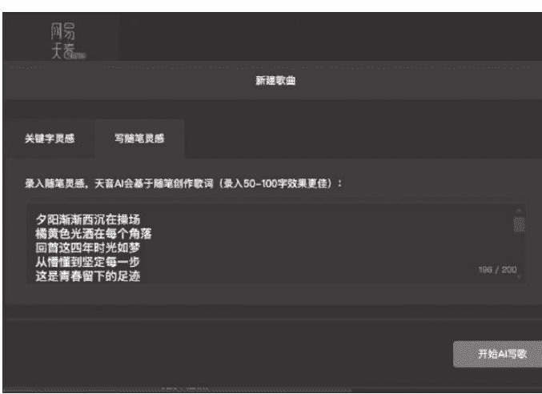
图 7-9 网易天音作曲时填写随笔灵感的界面

（4）把【段落结构】设为【全曲模式】，音乐风格选【流行】，设置示意如图7-10。
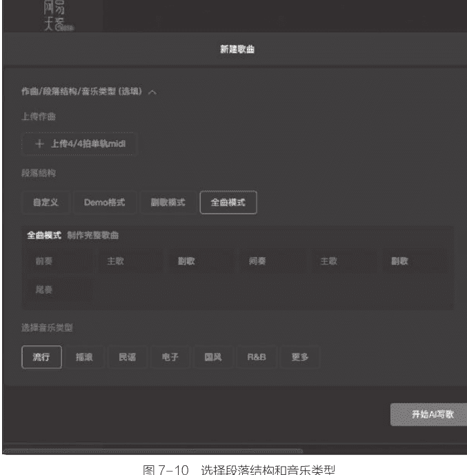
图 7-10 段落结构与音乐风格的选择

（5）按下【开始 AI 写歌】，窗口提示“歌曲内容正在由 AI 生成”，生成完毕后自动跳转至歌曲编辑页，如图7-11。
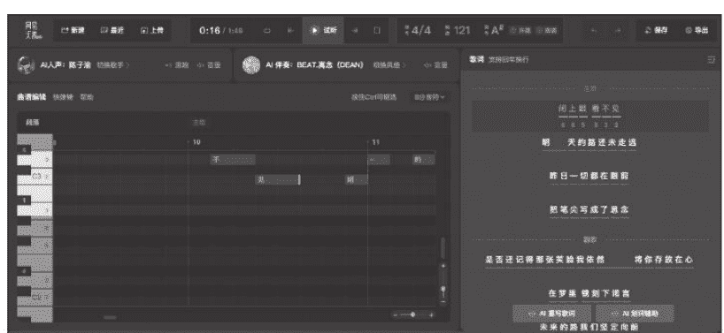
图 7-11 歌曲编辑界面

网易天音自动生成的歌词如下：

> 闭上眼看不见
明天的路还未走远
昨日一切都在眼前
把笔尖写成了思念
是否还记得那张笑脸
我依然将你存放在心
在梦里，镌刻下诺言
未来的路我们坚定向前
笔尖写满无尽眷恋
就要迈向新的起点
时光足迹在风里面传送出最温柔的纪念
岁月里从不曾改变
生命中最温柔的记忆

（6）点按【保存】打开【保存工程文件】窗口，为作品命名“青春的足迹”，如图7-12。确认后即可存盘，点击【导出】可输出成品。

图 7-12 保存工程文件的对话框

### 【任务 7-2】利用通义万相进行多元视频制作

借助通义万相实现两种视频生成。

- （1）用“文生视频”生成“一群鸿雁在天空中翱翔”的画面。
- （2）用“图生视频”生成“一条锦鲤在荷塘里游动，水墨画”的画面。

#### 任务实施

##### 1. 文生视频方式制作

在通义万相中输入画面内容与运动提示词即可生成视频，配合智能扩写可提升画面丰富度。

（1）进入通义万相的首页，如图7-13。


（2）在首页左侧点【视频生成】或右侧【视频生成】区的【去生成】。
（3）进入视频生成页后选择【文生视频】标签。
（4）提示词填写：一群鸿雁在天空中翱翔。
（5）配置生成参数。【比例】可选【16：9】【9：16】【1：1】【4：3】【3：4】，本例选用【16：9】，并开启【灵感模式】。提示词与参数如图7-14。
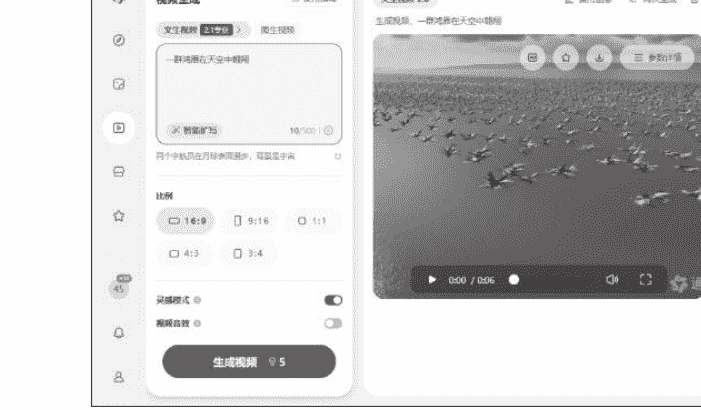

（6）点击【生成视频】，等待输出。

##### 2. 图生视频方式制作

图生视频以上传图片为首帧进行延展，画面更可控精准。支持裁剪旋转，提示词兼容中英文。

- （1）进入通义万相的首页，点左侧【视频生成】或右侧区域的【去生成】。
- （2）进入视频生成页，选择【图生视频】标签。
- （3）上传首帧。点击或拖拽方式上传如图7-15的素材。

图 7-15 通义万相图生视频时上传的首帧素材

- （4）提示词填写：一条锦鲤在荷塘里游动，水墨画。
- （5）配置参数并打开【灵感模式】。提示词与参数如图7-16。

图 7-16 通义万相图生视频时的提示词与参数

（6）点击【生成视频】，等待输出。

## 7.4 熟能生巧

### 【任务 7-3】以海绵音乐完成歌曲创作

以海绵音乐创作《校园时光》，歌词如下。

晨曦透过窗纱
照亮青春的画
书声琅琅传天涯
梦想悄悄发了芽
绿荫之下玩耍
笑声多么无瑕
风儿轻轻吹过呀
心事慢慢在长大
晚风吹过脸颊
带走一天疲乏
操场身影映晚霞
友情永远不掺假
星光点亮枝桠
思绪飘向哪
回忆中的那些话
温暖如诗在笔下
校园的春秋冬夏
是心底最美的家
晨曦绿荫和晚霞
星光伴我走天涯
那些纯真的年华
是生命中的花
不管未来多变化
回忆永远不褪色啊

#### 任务实施

（1）进入海绵音乐首页。
（2）点击左侧【创作】，进入【定制音乐】页，切换到【自定义创作】标签。
（3）把歌词粘贴到输入框，示例见图7-17。
（4）设定参数。【曲风】选【民谣】，【心情】选【快乐】，【音色】类型选【女声】，特征选【明亮】。
（5）在【歌曲名称】框内输入“校园时光”。参数与命名效果如图7-18。
（6）点【生成音乐】开始制作，进度如图7-19。
（7）生成后可在【创作历史】区查看，点歌曲图标的【播放】即可试听，如图7-20。
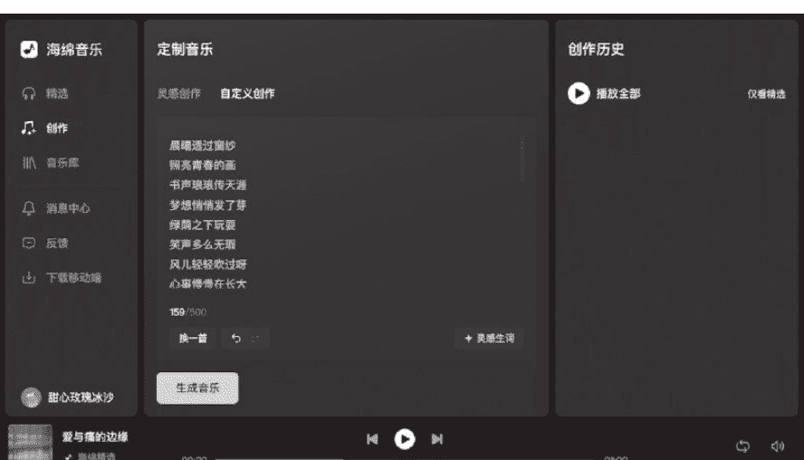
图 7-17 海绵音乐输入歌词的界面

图 7-18 参数设置与歌曲命名效果
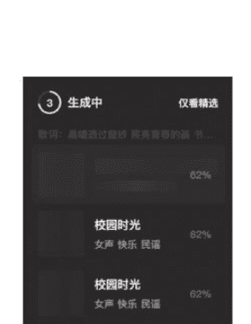
图 7-19 音乐生成进度
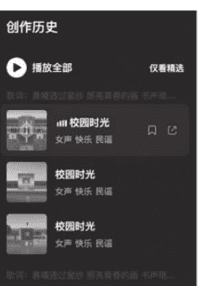
图 7-20 播放生成的歌曲

### 【任务 7-4】借助可灵 AI 多方式制作视频

借助可灵 AI 完成两类视频。

- （1）“文生视频”制作“绿色的种子生长成大树”。
- （2）“首尾帧”制作“小猫站在雪地注视与扑打着雪花”。

#### 任务实施

##### 1. 文生视频方式生成

（1）打开可灵大模型首页，如图7-21。
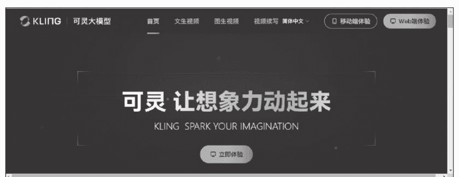
图 7-21 可灵大模型首页

（2）在首页点【立即体验】进入可灵 AI 首页，如图7-22。
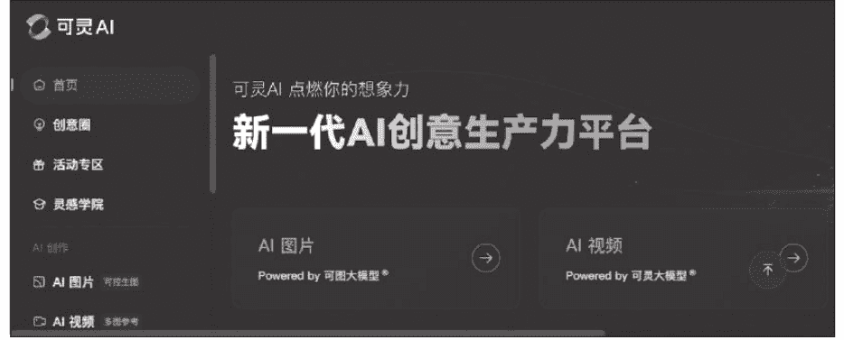
图 7-22 可灵 AI 首页

（3）在首页点【AI 视频】，进入 AI 视频页，左侧有【文生视频】【图生视频】【对口型】三个标签，切换到【文生视频】。
（4）在【创意描述】框输入：雪地中，鹅毛大雪，一个绿色的种子破土而出，快速生长成大树，自然光，冷光，特写，固定镜头，电影。
（5）参数配置。【生成模式】选【标准】，【生成时长】选【5s】，【视频比例】选【16:9】，【生成数量】选【1条】。提示词与参数如图7-23。
（6）点击【立即生成】等待完成。

##### 2. 首尾帧方式生成

（1）在可灵大模型首页点【立即体验】进入可灵 AI 首页。
（2）点【AI 视频】进入页面并切换到【图生视频】标签。
（3）切换到【首尾帧】标签。
（4）通过点击、拖拽或粘贴方式上传图7-24所示的首帧图，上传成功效果如图7-25。


图 7-24 首帧图
图 7-25 首帧图上传成功效果

（5）在首帧图下方点【尾帧图】，上传图7-26所示尾帧图，首尾帧均上传成功效果如图7-27。
（6）在【图片创意描述】框输入：下着鹅毛大雪，一只可爱的小猫站在雪地，全神贯注地注视与扑打着雪花。上传与输入效果如图7-28。

图 7-26 尾帧图

图 7-27 首尾帧上传成功效果

图 7-28 首尾帧上传与提示词输入效果

（7）点击【立即生成】等待视频产出。

## 7.5 勤思精练

### 【任务 7-5】使用即梦 AI 音乐生成功能创作

借助即梦 AI 音乐生成完成以下创作。

- （1）生成背景音乐
提示词：生成一段适合放松和冥想的钢琴背景音乐。
- （2）生成自然音效
提示词：创建一段包含鸟鸣声和流水声的夏日森林音效。
- （3）创作歌曲《青春的旋律》
扫描二维码打开电子活页7-1，在线浏览“歌曲《青春的旋律》的歌词”。


### 【任务7-6】使用 WHEE 文本生视频创作

借助 WHEE 文本生视频制作两段视频，提示词如下。

提示词1：一群马在草原上奔跑。
提示词2：小金鱼在池塘中来回游动。

### 【任务7-7】使用白日梦文本生视频创作

借助白日梦文本生视频制作两段视频，提示词如下。

提示词1：一名男子驾驶滑翔伞在天空翱翔。
提示词2：白衣少女漫步在盛开的薰衣草花田中，微风轻拂她的发丝与衣角。

## 模块8

## AIGC助力代码智能编写与优化

AI 编程助手是人工智能在软件开发领域的典型落地，是一种依托深度学习与自然语言处理的智能代码生成工具，旨在提升开发效率与代码质量，实现智能化编程。它通过学习海量代码样本，掌握结构、语法与逻辑，从而提供代码补全、错误检测、代码生成等辅助。其核心技术涵盖循环神经网络、长短期记忆网络、变分自编码器等。

随着技术演进，AI 编程助手的功能与性能将持续提升，未来有望实现更精准的补全、检测与生成，支持更多语言与框架，提供更个性化的开发辅助，并与更多工具集成，形成更完善的生态。

## 8.1 先睹为快

### 【案例8-1】使用文心一言编写Python读取Excel数据

#### 案例描述

在文心一言中编写 Python 程序，使用 pandas 库读取 Excel 文件“example1.xlsx”的 sheet1 工作表数据，已安装 pandas 与 openpyxl。

#### 案例展示

打开文心一言首页，在输入框描述需求后点【发送】，生成的 Python 代码如下。
```python
import pandas as pd

##### 读取Excel文件的sheet1工作表中的数据
file_path = 'example1.xlsx'
sheet_name = 'sheet1'

##### 使用 pandas 的 read_excel() 函数读取数据
try:
    df = pd.read_excel(file_path, sheet_name=sheet_name, engine='openpyxl')
    print("读取的 Excel 文件中的数据：")
    print(df)
except FileNotFoundError:
    print(f"文件 {file_path} 未找到，请检查文件路径是否正确。")
except Exception as e:
    print(f"读取 Excel 文件时发生错误：{e}")
```

### 【案例 8-2】使用豆包编写 HTML+CSS 实现网页阴影效果

#### 案例描述

在豆包中编写超文本标记语言 + 串联样式表代码，利用 CSS 的 text-shadow 属性为段落“当今时代，人工智能正以前所未有的速度发展。”中的文字“人工智能”添加阴影效果。

#### 案例展示

打开豆包首页，输入需求后点【发送】，生成的 HTML+CSS 代码如下。
```html
<!DOCTYPE html>
<html lang="zh-CN">
<head>
    <meta charset="UTF-8">
    <meta name="viewport" content="width=device-width, initial-scale=1.0">
    <title>文字阴影效果</title>
    <style>
        .highlight {
            /* text-shadow 属性用于为文字添加阴影效果 */
            text-shadow: 2px 2px 4px #888;
        }
    </style>
</head>
<body>
    <p>当今时代，<span class="highlight">人工智能</span>正以前所未有的速度发展。</p>
</body>
</html>
```

## 8.2 释疑解惑

### 【问题 8-1】常用的代码生成与编辑 AI 工具有哪些？

目前常用的代码生成与编辑 AI 工具如表8-1所示。

## 8.3 精彩纷呈

### 【任务 8-1】使用文心一言编写 Python 程序对 JavaScript 数组去重

在文心一言中编写 Python 程序，使用 ES6 的 Set 对象实现对 JavaScript 的数组 [1, 2, 2, 3, 4, 4, 5] 去重。

#### 任务实施

在文心一言中编写的 Python 程序如下。
```javascript
// 原始数组
const array = [1, 2, 2, 3, 4, 4, 5];
// 使用 Set 对象去重
const uniqueArray = [...new Set(array)];
// 输出去重后的数组
console.log(uniqueArray); // 输出 [1, 2, 3, 4, 5]
```

### 【任务 8-2】使用文心一言编写前端代码实现用户登录

在文心一言中编写前端代码，使用 HTML 与 JavaScript 实现用户登录。

#### 任务实施

扫描二维码打开电子活页 8-1，在线浏览“实现用户登录功能的代码”，也可自行在文心一言中生成类似结果。


### 【任务 8-3】使用 DeepSeek 编写 Python 程序读取文件内容

在 DeepSeek 中编写 Python 程序，使用 read() 方法读取文件 “test.txt” 的全部内容。

#### 任务实施

DeepSeek 编写的 Python 程序如下。
```python
##### 打开文件
with open('test.txt', 'r') as file:
    # 使用 read() 方法读取文件的所有内容
    content = file.read()
##### 输出文件内容
print(content)
```

### 【任务 8-4】使用通义千问判断 Python 代码是否报错

使用通义千问判断下方 Python 代码是否会报错。若会报错请说明原因并给出解决办法，若不会则回答“无错误”。

需要判断的代码：
```python
A= 1
def test():
    a += 1
    print(a)
test()
```

#### 任务实施

扫描二维码打开电子活页 8-2，在线浏览“判断 Python 代码的运行是否会报错”，也可自行在通义千问中生成类似结果。


### 【任务 8-5】天工 AI 补全回文判定程序
请让天工 AI 为以下片段补足逻辑，使其能够判断输入字符串是否构成回文。
```python
def is_palindrome(s):
    # 将字符串反转
    # 比较原字符串和反转后的字符串
##### 测试示例
test_string = "radar"
print(is_palindrome(test_string))
```

#### 任务实施
经天工 AI 补全后的完整实现如下。
```python
def is_palindrome(s):
    reversed_s = s[::-1]  # 将字符串反转
    return s == reversed_s  # 比较原字符串和反转后的字符串

##### 测试示例
test_string = "radar"
print(is_palindrome(test_string))
```

### 【任务 8-6】海螺 AI 修正文件操作错误
请让海螺 AI 对下面这段 Python 代码的语法问题进行改正。
```python
##### 创建文件并将内容写入文件
open("example.txt", "w") as file
file.write("This is a test file.\nWelcome to Python programming!")
##### 读取文件内容
open("example.txt", "r") as file
content = file.read()
print(content)
```

#### 任务实施
修正后的代码展示如下。
```python
##### 创建文件并将内容写入文件
with open("example.txt", "w") as file:
    file.write("This is a test file.\nWelcome to Python programming!")
##### 读取文件内容
with open("example.txt", "r") as file:
    content = file.read()
    print(content)
```

海螺 AI 给出的主要修改方向如下。
- ① 补充冒号。with 行的末尾需要加上冒号，以开启后续代码块。
- ② 规范缩进。with 内部的代码应保持统一缩进，通常为四个空格，以体现层级关系。
- ③ 推荐 with 管理文件。通过 with 打开文件，执行完毕后会自动关闭，可避免资源泄漏。

## 8.4 熟能生巧

### 【任务 8-7】文心一言 多项编程练习
借助文心一言完成下列三项练习。
- (1) 写出生成 20 以内全部质数的 Python 脚本。
- (2) 采用 while 循环求 1 到 10 的累加和。
- (3) 对下面代码片段进行改进。
```python
try:
    # 以追加模式打开文件
    file = open('test.txt', 'a', encoding='utf-8')
    # 追加内容
    file.write("This is additional content.\n")
except Exception as e:
    print(f"追加内容时出错：{e}")
finally:
    if file:
        file.close()
```

#### 任务实施
(1) 质数生成示例
扫码打开电子活页 8-3，可在线查看生成 20 以内质数的示例，也可在文心一言中自行生成类似代码。


（2）while 循环求和实现如下。
```python
##### 初始化变量
total_sum = 0
number = 1

##### 使用 while 循环计算总和
while number <= 10:
    total_sum += number
    number += 1

##### 输出结果
print("1 到 10 的总和是 ", total_sum)
```

（3）改进后的代码如下。
```python
try:
    # 使用 with 语句以追加模式打开文件
    with open('test.txt', 'a', encoding='utf-8') as file:
        # 追加内容
        file.write("This is additional content.\n")
except Exception as e:
    print(f"追加内容时出错：{e}")
```

优化要点说明如下。
- with 结构：采用 with open(...) as file: 的写法，代码块结束时文件会自动关闭，即便出现异常也能保证关闭，无需手动调用 close。
- 异常处理：原有异常捕获逻辑保持不变，用以在打开或写入文件时捕获错误并提示。

### 【任务 8-8】商汤代码小浣熊 代码补全与注释
借助商汤科技的代码小浣熊完成以下任务。
（1）补全缺失代码
根据下方代码与注释提示填补空白：
```python
import requests
##### 请求访问https://www.codegeex.cn/ 网站，获取返回的响应状态码、响应头、响应内容，并输出
```
（2）添加功能说明
为下面代码补充必要注释以阐明其作用
```python
def tcplink(conn, addr):
    print("Accept new connection from %s:%s" % addr)
    conn.send(b"Server: Welcome!")
    while True:
        conn.send(b"Server: What's your name?")
        data = conn.recv(1024)
        if data == b"exit":
            conn.send(b"Server: Good bye!\n ")
            break
        conn.send(b"Server: Hello %s!\n" % data)
    conn.close()
    print("Connection from %s:%s is closed" % addr)
```

#### 任务实施
(1) 补全结果
代码小浣熊补全后的代码如下：
```python
import requests

##### 目标 URL
url = "https://www.codegeex.cn/"

try:
    # 发送 GET 请求
    response = requests.get(url)

    # 输出响应状态码
    print(f"响应状态码：{response.status_code}")

    # 输出响应头
    print("响应头:")
    for header, value in response.headers.items():
        print(f"{header}: {value}")

    # 输出响应内容
    print("\n响应内容:")
    print(response.text[:1000])  # 仅输出前 1000 个字符，避免输出过多内容

except requests.exceptions.RequestException as e:
    print(f"请求过程中发生错误：{e}")
```

(2) 注释结果
代码小浣熊生成的说明如下：
> 该 Python 代码定义了 tcplink 函数，用于处理 TCP 连接的客户端通信，通常在服务端使用以与客户端交互。


扫码打开电子活页 8-4，可在线浏览代码小浣熊的详细解读，也可自行在该工具中生成类似结果。

### 【任务 8-9】豆包 MarsCode 数据库实操
借助豆包 MarsCode 完成以下 SQL 练习。
- (1) 从图书信息表筛选作者为张珊且出版年份为 2024 的记录，返回商品编号、图书名称、作者、出版日期四列。
- (2) 创建函数 getTypeName()，根据类型编号从商品类型表获取类型名称。
（3）创建存储过程 procDemo，用于查看人民邮电出版社出版的图书种类。

#### 任务实施
（1）查询语句如下。
```sql
SELECT 商品编号，图书名称，作者，出版日期
FROM 图书信息
WHERE 作者 = '张珊' AND 出版日期 > '2024-01-01';
```
（2）创建函数 getTypeName() 的语句如下。
```sql
CREATE FUNCTION getTypeName (
    @typeId INT -- 输入参数：“类型编号”
)
RETURNS NVARCHAR(50) -- 返回类型：“类型名称”
AS
BEGIN
    DECLARE @typeName NVARCHAR(50); -- 声明变量用于存储“类型名称”

    -- 从“商品类型”数据表中查询指定“类型编号”的“类型名称”
    SELECT @typeName = 类型名称
    FROM 商品类型
    WHERE 类型编号 = @typeId;

    -- 返回“类型名称”
    RETURN @typeName;
END;
```
（3）创建存储过程 procDemo 的语句如下。
```sql
CREATE PROCEDURE procDemo
AS
BEGIN
    -- 查询“人民邮电出版社”出版的图书种类
    SELECT DISTINCT 图书种类
    FROM 图书信息
    WHERE 出版社 = '人民邮电出版社';
END;
```

## 8.5 勤思精练

### 【任务 8-10】文心一言 定义多类型变量
在文心一言中编写 Python 代码，分别创建多种数据类型的变量并打印其值。

### 【任务 8-11】豆包 扮演解释器执行代码
请让豆包扮演 Python 解释器运行代码，提示词如下。
我希望你表现得像一个 Python 解释器。我会给你 Python 代码，你来执行它。你不需要提供任何解释。除了代码的输出，不要回复任何内容。
待执行的代码如下：
```python
print("hello world!")
print(1+2)
x=5;
y=10;
print(x+y)
```

### 【任务 8-12】Kimi 生成随机 NumPy 数组
借助 Kimi 编写 Python 程序创建 NumPy 数组，形状为 (x,y,z)，使用随机值初始化。

### 【任务 8-13】腾讯元宝 计算应付金额
借助腾讯元宝编写 Python 程序，已知购买数量为 5，单价 21.6 元，计算总价并输出。

### 【任务 8-14】海螺 AI 解析 SQL 含义
请海螺 AI 说明下面这条 SQL 语句的意义。
```sql
SELECT 商品编号，图书名称，作者，价格，出版日期 FROM 图书信息 WHERE 价格 >45 ORDER BY 价格；
```

# AIGC

## 应用实践
电子活页式
遵循认知规律，构建模块化结构，激发创新潜能
优选智能工具，融入前沿知识，契合岗位需求
创新教材形式，助力 AIGC 高效教学

为教师免费提供
PPT 等教学配套资料
教材服务电话：010-81055256
反馈投稿邮箱：315@ptpress.com.cn
人民邮电出版社教育服务与资源下载平台：www.ryjiaoyu.com
人邮电商教师 QQ 群：734916328（仅限教师）
