# AIGC提示工程师成长指南

## 内容提要

本书定位为面向AIGC提示工程师的实操型参考书，围绕如何锻造专业能力、提升协作沟通以及构建持续成长机制展开论述。

全书共分3篇13章。第1篇为AIGC提示工程师基础，梳理职业产生的背景、高质量提示的设计要点、常用提示策略以及工程落地中易出现的典型问题；第2篇为提示进阶技巧，涵盖提示的调试优化流程、应对复杂任务的高阶思路、提升生成效果的进阶方法，以及生成式AI绘画与视频工具的实践概况；第3篇为提示应用实战，聚焦语言与翻译、社交对话、知识检索与问答、创意故事写作、创新场景落地等具体方向。

适合人工智能开发者、数据科学家、软件工程师，以及对生成式内容技术应用感兴趣的其他读者阅读。

## 前言

在人工智能快速演进的背景下，一批与内容生成密切相关的新岗位不断涌现，其中AIGC提示工程师已成为推动技术落地的关键力量。本书希望为对提示工程感兴趣的读者提供一套条理清晰的学习路径，帮助大家在智能化时代积累核心竞争力，并在职业发展中实现突破。

### 本书特色

#### 一、体系完整与循序渐进
从提示工程师的基础认知切入，涵盖应具备的技术背景、知识框架、沟通协作素养以及自我迭代的方法。全书分3篇逐步深入，引导读者整体把握提示工程的工作脉络。

#### 二、理论结合落地
在介绍概念之外，强调实践转化，通过案例解析帮助读者把方法迁移到真实任务中，提升解决实际问题的能力。

#### 三、分层满足需求
既为入门者提供易于理解的基础内容，也为有经验的从业者提供进阶思路，兼顾不同水平读者的学习需求。

### 本书内容

全书按3篇展开，系统介绍基础、进阶与实战。

第1篇第1～4章为基础篇，介绍职业认知、高效提示的构建准则、常用提示手段及工程实践中的常见误区。

第2篇第5～8章为进阶篇，深入探讨提示效果优化的高阶做法，帮助读者理解模型运行机理并掌握优化思路。内容包括更有效的提示设计、模型输出歧义与误解的处理、通过测试反馈迭代提示，以及生成式AI绘画与视频平台的使用。

第3篇第9～13章为实战篇，聚焦不同场景下的提示应用，包括语言与翻译、社交对话、知识查询与解答、创意与故事写作、创新应用等。通过实操演练，加深对提示技巧的理解并强化执行能力。

### 本书读者

- 人工智能技术爱好者：希望系统学习提示技巧并付诸实践的人士。
- AIGC提示工程师：正在从事或计划进入该岗位，希望提高专业水平与工作效率的人士。
- 自然语言处理专家：希望深化对大语言模型与对话系统理解的研究者与实践者。
- 学术研究人员：在高校或科研机构关注提示技巧的研究人员。
- 企业管理层或决策者：需要理解提示技术以做出更审慎技术判断的管理者。
- 技术培训讲师：可将本书作为教学素材向学员传授行业知识和技能。

编者鼓励读者保持好奇心与探索精神，不断实践反思。人工智能是一个持续演进的领域，提示工程师正是重要的探索者与创新者。希望本书能助你成长为优秀的AIGC提示工程师，为人工智能应用与发展贡献力量。

本书由郑州西亚斯软件工程研究所周喜平与天津仁爱学院董丽莎编著。其中第2～4章、第9章、第11章由周喜平撰写，第1章、第5～8章、第10章、第12章和第13章由董丽莎撰写。编写得到河南省民办教育发展专项资金支持，是软件工程专业建设成果之一。

编写过程中编者力求内容完善，但难免疏漏，敬请读者批评指正。学习中有疑问或建议，可发邮件至liyongtao@ptpress.com.cn。

编者
2025年2月

## 资源与支持

### 资源获取
本书提供以下资源：
- 本书思维导图
- 异步社区7天VIP会员
- 配套练习文件

可扫描下方二维码按指引领取。

### 提交勘误
编者与编辑已尽力保证内容准确，但仍可能存在疏漏。欢迎反馈问题以提升质量。
发现错误时，请登录异步社区 https://www.epubit.com，按书名搜索进入本书页面，点击“发表勘误”，填写信息后提交。经审核确认后，将赠送异步社区100积分，可用于兑换优惠券、样书或奖品。

### 与我们联系
联系邮箱为liyongtao@ptpress.com.cn。
如有疑问或建议，请在邮件标题注明书名以便高效回复。
如有出版、教学视频录制、图书翻译、技术审校等合作意向，或学校、培训机构、企业有批量采购需求，欢迎邮件联系。
如在网上发现对异步社区出版图书的侵权行为，包括非授权传播，请将相关链接发送至邮箱，共同维护作者权益。

### 关于异步社区和异步图书
“异步社区” www.epubit.com 由人民邮电出版社创办，2015年8月上线，专注于优质IT内容的出版与分享，为读者提供高品质学习内容，为作者提供专业出版服务，并实现线上互动与传统出版融合。
“异步图书”是异步社区旗下的精品IT图书品牌，依托人民邮电出版社数十年的计算机图书积淀，面向IT从业者及各行业IT应用用户。

## 第1篇

## AIGC提示工程师基础

## 第1章

## AI浪潮催生的新岗位：AIGC提示工程师

AIGC提示工程师在模型训练与应用环节承担关键职责，核心在于保证模型能够精准把握人类意图，并在多任务中表现出色。为此需要把复杂任务拆解为一系列自然语言提问，逐步引导模型产出，确保信息准确。作为新兴岗位，该群体持续推动提示技术的优化，致力于让智能模型更精准、实用且高效。

本章聚焦提示工程师在人工智能开发流程中的核心作用及其价值。

### 1.1 认识AIGC提示工程师

人工智能技术高速发展催生了一个新职业——AIGC提示工程师。他们既是智能系统的“导航员”，也是应用优化的“设计师”。提示工程师究竟做什么，其工作边界在哪里？以下逐步展开说明。

#### 1.1.1 职业定义与定位
AIGC提示工程师是与生成式模型深度协作的专业人才。工作不仅限于与模型交互，更在于通过精细设计的提示促成模型准确回应。

可以把提示工程师形容为模型的“心智教练”。他们需要理解模型的工作机理、学习方式与思维模式，再依据具体场景与目标，构思出恰当的提示。这些提示可以是文字、问题或指令，如同指路明灯引导模型走向正确答案。

提示工程师需要扎实的知识储备与敏锐洞察力，以便为不同模型编写适配提示；同时需具备优秀的沟通与团队协作能力，与团队成员高效配合。

通过他们的努力，模型能更好地理解人类语言与意图，产出更准确有用的回应。无论智能客服、智能家居还是自动驾驶，提示工程师都在推动人工智能技术落地与发展。

总体而言，提示工程师是智能时代的关键角色，通过巧妙调控提示让模型更聪明高效，为人类创造更便捷智能的生活体验。

#### 1.1.2 职责范畴与能力要求

##### 一、主要职责
提示工程师的工作是通过自然语言指令创建有效提示，指导模型完成任务。区别于传统程序员，他们不写复杂代码，而是用自然语言达成目标。

1）需求明确：与客户沟通，厘清需求与期望，界定问题、设定目标与预期结果。
2）提示设计：具备良好的设计能力，选择并制定适合特定领域与目标的提示，如关键词提示、引导式提示、类比比喻提示等。
3）认知模型限制：了解模型的边界与注意事项，如模糊输入处理、误导性回答识别、过度提问应对等。
4）优化与排错：分析模型输出，理解运行逻辑，进行修正与改进。

总体而言，职责包括需求理解、有效提示设计、模型限制掌控、提示优化排错，直接影响模型性能与用户体验。

##### 二、所需知识与能力
1）技术专业知识：深入了解软件开发、系统架构、数据分析、网络安全等相关领域。
2）问题解决能力：善于剖析复杂技术问题并提出创新方案。
3）自主学习与持续发展能力：跟上技术演进，不断更新知识与掌握新技术。
4）沟通协作能力：能与团队、非技术人员及客户有效沟通，解释技术概念与方案。
5）创新与创造力：提供独特性与价值的解决方案，推动技术与业务创新。
6）技术支持与指导能力：为他人提供技术建议与支持，促进项目成功。

核心目标是为模型提供指令以生成高质量内容，并通过训练或调优使输出符合需求。

### 1.2 如何成为优秀的AIGC提示工程师

提示工程师不仅需要专业技术与知识积累，还应具备沟通协作素养并掌握持续学习的方法。以下从关键要素展开。

#### 1.2.1 技术专长与知识

##### 一、自然语言处理
自然语言处理是核心基础，涵盖语法、语义、上下文理解等。熟悉大语言模型与语义理解技术与工具，有助于优化提示设计并深化对模型响应的理解。

##### 二、机器学习与深度学习
掌握机器学习与深度学习基础理论与算法至关重要。熟悉TensorFlow、PyTorch等主流框架与模型，能更好地理解与应用人工智能模型，同时需掌握模型优化与参数调优技巧。

##### 三、程序设计与软件开发
优秀的编程与软件开发能力不可或缺。编写高效可靠易维护的代码是提示设计的基础。熟悉Python、Java等语言及相关开发工具，能显著提升工作效率与质量。

#### 1.2.2 沟通与协作能力

##### 一、良好沟通能力
需清晰表达观点并与团队、客户有效互动。良好的口头与书面沟通有助于准确传达需求、解释技术问题并化解冲突。

##### 二、团队合作能力
工作中常需与其他提示工程师、设计师、产品经理协作。良好的协作能力可推动项目顺利进行，包括知识共享、经验交流与适应不同工作风格与文化。

#### 1.2.3 持续学习与自我提升策略

该领域迭代迅速，持续学习至关重要。

##### 一、持续学习
保持对新技术动态与研究成果的敏感度，主动学习新知与技能。参与研讨会、工作坊、专业培训，研读文献，投身开源项目与社区都是有效途径。

##### 二、建立与发展人脉
与同行交流心得，参与行业社区、在社交媒体分享观点、参加会议与活动，有助于提升自我、拓宽视野与获得成长机会。

##### 三、个人项目与实践
通过个人项目与实践将知识转化为解决实际问题的能力。实践是提升技能与积累经验的基石。

### 1.3 AIGC提示工程师的发展趋势

提示工程师是充满挑战与机遇的职业。随着人工智能技术普及，各行业对具备提示设计与优化能力的人才需求不断增长。

从自然语言处理到知识检索，从创意写作到创新应用，提示工程师可在多领域发挥作用，并在科技公司、研究机构、创新实验室等组织找到岗位。

随着人工智能不断发展，职业前景广阔。人们对智能对话与个性化体验的需求提升，提示工程师的专业价值愈显重要；生成式AI绘图、虚拟助理等新兴方向也带来更多机会。

未来提示工程师将在更多领域参与人工智能应用，如自然语言处理、智能助理、翻译系统构建等，其工作直接影响模型性能与客户体验，推动各行业创新与提效。

同时需不断学习更新知识，提升提示设计与人工智能应用的专业水平。关注前沿技术与研究成果，掌握新方法与策略，参与学术或专业社区交流，拓展专业网络。

总体而言，提示工程师在快速发展的智能领域发挥关键作用，并拥有参与多领域创新与应用的机会。

#### 1.3.1 职业发展路径

探讨提示工程师的成长路线与成功要素。

1）发展道路。路径多元化。部分人选择在大型科技公司或研究机构从事前沿人工智能研究与开发；部分人成为自由职业者或独立顾问，为不同客户提供服务；部分人选择创业，创办公司或项目。具体选择取决于兴趣、技能与目标。

2）持续追求学识与技能提升。技术与行业瞬息万变，持续扩充知识储备与更新技能是职业发展的必经之路。参与研讨会与培训、定期阅读文献、积极参与开源项目与社区，有助于个人成长；获取相关认证与专业资格也能增强专业底蕴与竞争力。

3）寻找专业机会与合作伙伴。建立与拓展专业网络是关键。参与专业社区讨论，与同行及相关领域专家交流经验；寻找合作伙伴共同开展项目或研究，有助于扩大影响力并带来更多机会。

##### 1.3.2 行业趋势与前景展望

关注以下趋势以把握职业前景。

1）人工智能技术快速发展。各领域应用日益普及，对提示工程师的需求同步增长。快速发展的技术与创新为从业者带来更多挑战性与意义感项目。

2）跨领域合作需求增加。人工智能在多行业落地，提示工程师需具备跨领域协作能力。与设计师、市场营销等专业人士合作，可设计更具价值与实用性的提示。

3）伦理与法律问题受重视。应用人工智能技术时必须关注伦理与法律风险。需了解并遵守相关伦理准则与法律法规，确保指导内容符合道德与法律规范。

4）机器学习与自然语言处理技术演进。机器学习与自然语言处理是AIGC核心技术。持续研究与创新将为提示工程师提供更强大高效的工具，提升提示准确性与效果。

## 1.3.3 发展策略

为实现职业目标，可采取以下策略。

- 持续学习与自我提升。保持对新技术与工具的探索，参加培训、研讨会与在线学习，不断更新与提升知识技能。
- 获取专业认证与资格。相关认证可体现专业水平。
- 建立个人品牌。分享知识与经验，参与行业讨论，在线上线下平台展示作品与成果，提升影响力。

职业突破四要素

如果你具备创业的冲劲和独立操作的习惯，AIGC提示工程师也可以走自建项目的路线，自己孵化产品或公司，这样既能把想法落地，也能打开更多专业认可的空间。

总结来看，要想在这一赛道持续走高，离不开四个抓手：不断学习自我迭代、拿到有分量的专业认证、经营好个人品牌，以及在合适的时候去尝试创业或独立项目。

## 第2章 精准提示的设计思路

本章聚焦高效提示的底层逻辑。掌握一套可复用的方法，能让提示工程师与大模型之间的协作更顺畅、更高效。内容围绕如何明确任务目标、怎么提升输出的准确性、模型期望怎样的输入格式、怎样让沟通效果最大化，以及一些实操技巧展开。通过系统学习和反复演练，可以设计出更精准、更可控的提示，从而真正释放大模型的应用价值。

### 2.1 先定目标，再提质

提示工程师在开工前，最关键的一步是先把想要的输出形态定下来。比如要做一个聊天机器人，就要先约定好希望它生成的回答是自然、通顺且有意义的。目标清晰了，产出才更容易对齐用户预期，也更有可读性。下面这个案例展示了如何用表格格式约束输出。

**提示用例**

请列出10个单词，要求首字母不需大写，且不是专有名词缩写，同时给出词性英文缩写和中文释义。

格式要求：表格式，列分别为英文单词、词性缩写、中文意思

**模型输出示例**

| 英文单词 | 词性的英文缩写 | 中文意思 |
|---------|------------|---------|
| abandon | v. | 放弃 |
| abstract | adj. | 抽象的 |
| achieve | v. | 实现 |
| adapt | v. | 适应 |
| advance | v. | 推进 |
| analyze | v. | 分析 |
| ancient | adj. | 古老的 |
| apparent | adj. | 显然的 |
| argue | v. | 争论 |
| assist | v. | 协助 |

除了输出形态，界定任务边界同样决定成败。比如做问答系统时，先把领域限定在医疗、科学或历史等范围内，模型就能更聚焦地理解意图，产出更有相关性的内容。

**提示用例**

请从科学角度详细说明地磁暴为何会形成极光，内容需包含地磁暴的成因、地球磁场的变化，以及这些变化如何触发极光。

**模型输出摘要**

地磁暴本质上是太阳风携带来的高能带电粒子与地球磁场相互作用的结果。粒子沿磁力线进入，受到洛伦兹力加速，导致磁场扭曲变形，能量在极区以地电流形式释放。电流加热电离层大气，激发氧原子和氮分子产生光子，于是出现极光。颜色与被激发的气体种类相关，氧多为绿红，氮多为蓝紫；暴强度越大，极光越亮范围越广。

做目标设定时，还要兼顾使用者视角。比如为旅游建议类系统写提示，就要预判用户会怎么问、期待什么样子的答案。以“云南有哪些知名景点”为例，理想的输出应是一份清单，并附上简短介绍和出行建议。

**提示用例**

云南有哪些知名的旅游景点?

**模型输出摘要**

列举丽江古城、大理古城、香格里拉、泸沽湖、玉龙雪山、西双版纳热带雨林、元阳梯田、束河古镇等，并简要说明其文化和自然特色。

目标的清晰度决定优化的可操作性。像“生成一些关于狗的信息”这种表述就太宽泛，模型无从判断要覆盖哪些方面。改成“根据用户提问，提供指定犬种的历史来源、外形特征和饲养要点”则具体可控，更容易得到高质量结果。

总体而言，立目标时要明确输出类型、划定任务范围、考虑用户需求，同时避免模糊与不确定，这些都是让提示更具针对性与效果的基础。

提问时保持表述清晰易懂很重要，可以从以下几个维度来把控。

#### 2.1.1 用简洁的表达

精简的语言更利于模型理解。尽量用常用词和短句。例如把“我想学游戏设计，那我需要哪些基础知识”简化为“学习游戏设计需要的基础知识”。

**提示用例**

我想学游戏设计，那我需要哪些基础知识?

**模型输出要点**

计算机科学基础、编程语言、游戏引擎、美术设计、音频设计、游戏设计理论、项目管理、市场营销等，并强调实践积累。

**提示用例**

学习游戏设计需要的基础知识。

**模型输出要点**

游戏理论、编程语言、美术设计、音效音乐、用户体验设计、故事叙述、设计工具、市场分析与商业思维等。

#### 2.1.2 远离模糊提问

模糊的问题会降低答案的准确度。比如“哪家餐厅最好”就缺少品类、地区等关键信息。

**更有效的提示：**

- 想了解气候变化的影响与对策，请提供相关信息
- 请解释区块链的运作原理及典型应用
- 介绍一下人脑与记忆相关的科学研究
- 给出网络安全最佳实践与防护建议
- 列出量子计算的基础概念
- 说明自然语言处理在人机交互中的挑战与应用
- 介绍人类基因组研究的最新进展与影响
- 解释运动科学中肌肉生长与恢复的机理
- 介绍虚拟现实技术的发展与应用场景
- 推荐数据分析与可视化常用工具与方法

**不推荐的提示：**

- 我今天过得如何
- 你是机器人吗
- 你有家人吗
- 给我一个幸运数字
- 说说你对爱情的看法
- 为什么天空是蓝色
- 你能帮我完成作业吗
- 为什么狗会叫
- 能否帮我写篇英文论文
- 说说你对世界和平的看法

有效提示通常带着明确主题或具体问题，有助于模型捕捉意图；无效提示多为开放、无意义或超出能力范围。

#### 2.1.3 让问题要素完整

问题缺要素，模型就难以给出可用答案。比如询问“某个地方好不好玩”，必须先说明地点。

**提示用例**

> 洱海好不好玩?

**模型输出摘要**

认为洱海值得游玩，理由包括自然风光如湖面、苍山、日出日落；人文景观如崇圣寺三塔、大理古城；户外活动如环湖骑行、徒步、游船；面朝洱海的住宿体验；白族美食与民俗；以及普遍的游客好评。

#### 2.1.4 意图表达要明确

模型依赖确切的语言来理解需求。比如“那里好玩吗？”如果不指明地点，就无法给出针对性建议。

**提示用例**

那里好玩吗?

**模型输出示例**

提示用户补充具体地名，并说明可根据兴趣提供景点、美食、文化活动等针对性建议。

总之，提问时保持明确与简洁，才能让模型准确理解意图并给出有效回应。

### 2.2 让输出更准确的提示方法

提升准确度是提示设计的核心。以下技巧可帮助模型稳定产出高质量内容。

用具体明确的描述替代模糊表述。比如要查城市天气，“天气怎么样”不够，改为“上海市今天的天气如何”更精确。

提供充足的背景信息能显著提升准确性。例如要评价一部电影时，补充片名、导演、主演等信息，模型才能生成可信评价。

设计后要做校对与校验，仔细核查事实、逻辑与格式，发现问题及时调整。

#### 2.2.1 上下文的定义与价值

上下文即当前对话的主题与相关信息，是模型理解背景与意图的关键。例如上下文为旅行时，模型会倾向于生成相关建议。恰当的上下文能让回应更连贯、更贴合。

**提示用例**

> 我想去北京故宫参观。

**模型输出要点**

建议提前购票、关注开放时间、注意季节着装、从午门沿中轴线参观、可租用导览器、遵守参观规则、周边可去天安门、景山、王府井等。

**提示用例**

请给我从上海出发的交通建议。

**模型输出开头**

从上海前往北京故宫可选择的交通方式包括...

沪京赴故宫 交通方案全览

1. 飞机出行
想最快抵京首选航空。沪上主要使用浦东、虹桥两座机场，均开设有直达北京首都机场与大兴机场的航班。空中飞行约两小时半。抵达后换乘地铁、公交或网约车即可进入市区直达紫禁城。

2. 高铁出行
喜欢轨道交通的可选沪京高铁。整体耗时约四小时半至六小时，具体视车次等级与停靠站而定，多数班次以虹桥站为主。进站北京后地铁或网约车都能快速到达故宫片区。

3. 普速列车
除动车组外，尚有快速列车与慢车可供挑选。运行时间更长但票价更低，适合对费用敏感的旅客。

4. 长途客运
大巴属于小众方式，支出偏低但耗时偏长、舒适度有限，体验上不及前几种。

5. 自驾出行
追求灵活掌控路线者可自驾北上，沪京公路里程约1200公里，正常驾驶需12至15小时，沿途会经过多座城市与高速公路。

通用建议：无论选择哪种方式都建议提前规划并尽早锁定车票机票。春节、国庆等旺季票源紧张，提前预订更稳妥。

抵京后前往故宫非常便利。紫禁城坐落于北京核心区，周边地铁覆盖密集，天安门东、天安门西、王府井等站均可步行直达。

## 2.2.2 背景信息为何关键

背景指交谈所处的场景设定与前提，包含时点、地域、文化语境等要素。在人机交互中，背景对输出的准确性与自然度具有决定性作用。交流时建议把握三点。

- （1）给出清晰上下文：明确当前主题与相关资料，帮助模型快速建立理解框架。
- （2）纳入背景要素：结合时点、地点、文化差异等变量，促成更贴合实际的表达。
- （3）善用对话历史：在长轮次交流中，借助已有问答维持上下文连贯，帮助模型把握延续意图。

### 2.2.3 规避模糊歧义表述

提问时最好避免含混或易产生歧义的用词，否则容易导致模型误解并给出不准或无法使用的答案。下面是几种常见问题的处理思路。

一、规避歧义代词与名词
模型常借助代词和名词指代先前提及的对象。一旦指代不清，就会出现理解偏差。比如“它”或“这个”可能对应多重指代，需要在上下文中明确具体所指。

示例问法
> 能否为我推荐居住地周边的游览点？

模型回复
> 为给出更精准的周边推荐，建议先告知当前所在的城市或区域，我就能据此筛选。若不愿透露隐私，也可提供大致地理范围如省份或城市群，或说明偏好的景点类型如自然、人文、亲子等，我会据此给出建议。

把事物名称写清楚，或在提问中补充更详细的描述来消除歧义。

示例问法
请推荐北京市西直门外大街附近的旅游景点。

模型回复
在北京市西直门外大街周边分布着多处知名景点和文化地标，例如：

- 1. 颐和园：颐和园是中国最知名的皇家园林之一，位于北京市西郊。它以优美的园林景观和丰富的历史文化而闻名于世，是游览北京的必去之地。
- 2. 北京动物园：北京动物园在距离西直门外大街不远的地方，在这里你可以观赏到各种珍稀动物，包括大熊猫。
- 3. 北海公园：北海公园是一个历史悠久的皇家园林，位于西直门外大街北边不远的地方。公园内有美丽的湖泊、古老的建筑和传统的园林景观，是散步和放松的好地方。
- 4. 中国国家图书馆：如果你对历史和文化感兴趣，中国国家图书馆是一个值得一游的地方。它收藏了大量珍贵的文献，是中国最大的图书馆之一。
- 5. 中央电视塔：中央电视塔是北京的标志性建筑之一，位于西直门外大街附近。你可以登塔俯瞰北京的全景，并在塔上的旋转餐厅享用美食。

希望以上景点能为你的旅行增添一些精彩的体验！

二、规避模糊形容词与副词
描述事物时不要使用“非常大”之类含义弹性很大的词，不同人理解差异会干扰模型判断。建议换成具体、可量化的形容词和副词，以提升理解的准确度。

三、规避易混淆多义词
多义词在不同语境下含义不同，如英文bank可指银行也可指河岸。提问时若使用多义词，需补充额外说明帮助模型判定真实意图。

四、规避难懂缩写或术语
专业缩写或术语在特定领域才通用，普通模型可能难以解析。使用时可采取：

- （1）解释缩写或术语。在首次出现前先给出全称或通俗解释。
- （2）提供上下文。在使用术语时附带场景信息，帮助模型推断含义。例如提到CT扫描时可说明这是医学影像检查技术。
- （3）调整用语。若模型反复无法理解，可改用更常用、易懂的表达，以保持沟通顺畅。

准确理解指令是高效对话的基础，及时补充解释和背景，能显著提升交互的精确度和流畅性。

### 2.2.4 灵活运用近义词

与模型交流时，适度使用近义词有助于表达更精准、流畅。模型对语义相近但词形不同的表达有一定敏感度，通过同义替换可以优化理解效果。

例如询问汽车相关问题时，可以交替使用“轿车”“小汽车”等近义词，避免混用表面相近但含义不同的“汽车”和“车辆”。

合理使用近义词既能提升模型理解力，也能让答案更贴合需求，是沟通中的有效策略。

## 2.3 把握模型期望的输入形式

高效使用模型的关键在于遵循其期望的输入方式。不同模型对格式要求各异，使用前需先了解其偏好。

在多轮对话中，将前文内容纳入考量，形成完整上下文，能够大幅提升连贯性。以对话助手为例，用户连续提问时，前一轮的信息是理解后一轮意图的重要依据。

借助特定标记和指令可以引导输出。我们可以在提示中明确要求：“请阐述这一艺术流派的特点。”这样模型更容易把握提问重点。

示例问法
请阐述"印象派"这一艺术流派的特点。

模型回复
印象派是19世纪在法国兴起的一个重要艺术流派，它以独特的风格和对光与色彩的敏锐捕捉而著称。印象派艺术家们追求在作品中表达他们对外部世界的直接感受，而非传统意义上的精确描绘。他们倾向于户外写生，捕捉不同时间和天气条件下的光影变化，以及这些变化如何影响自然景观和城市景象。印象派画作通常采用明亮的色彩，快速而自由的笔触，强调画面的整体效果而非细节的刻画。这种对瞬间感觉的捕捉和表现方式，使得印象派的作品充满了生动性和生活气息，为后来的现代艺术发展开辟了新的道路。

同时要认识到模型的局限。模型基于训练数据的统计规律生成内容，可能缺乏常识判断，或受误导产生不实信息。使用者应审慎评估输出，根据需要修正，并明白模型的强项与边界，例如适合生成创意内容，但不适合解决超出能力范围的问题。

总体来看，理解期望的输入格式、处理上下文、使用标记指令并认识局限，能帮助我们引导模型给出更准确、合理且符合预期的回答。

## 2.4 提升人机沟通效果的技巧

- 1. 提供明确的上下文信息。在提示中给出清晰具体的背景，让模型明白问题的前提。例如补充事件细节或过往对话要点。
- 2. 指定期望的回答格式和风格。明确要求列表、正式措辞或专业术语等，以便获得符合需求的输出。
- 3. 适应模型的预测能力。模型倾向于高频常见答案。若想获得更多样、创新性的回应，可要求提供非常规解法或更深入的推理。
- 4. 处理困惑和不确定性。模型可能因信息不足产生不完整或不准确的回答。可补充关联信息、给出明确行动指示，或要求进一步解释。
- 5. 建立迭代与反馈机制。持续对提示进行优化和反馈，形成逐步逼近目标的循环。根据模型回答评估准确性并修正，能不断提升质量和效果。

## 2.5 八大高效提示方法

好的提示结构清晰、主题明确，有助于模型精准理解意图并给出有用答案。

### 2.5.1 限定语言
可在提示中明确指定输出语言，如中文、英文或德文。例如注明“请确保以下回答内容使用中文”，以保证语言一致性。

### 2.5.2 说明输出形式
通过指定形式引导输出，便于控制结果。以下示例要求以表格呈现英文缩写翻译。

示例问法
请对以下英文缩写进行中文翻译。
（表格式，column = 英文缩写，英文全称，中文翻译）WHO、IMF、ECFA、MVP

模型回复（见表2-2）
表2-2

| 英文缩写 | 英文全称 | 中文翻译 |
|---------|---------|---------|
| WHO | World Health Organization | 世界卫生组织 |
| IMF | International Monetary Fund | 国际货币基金组织 |
| ECFA | Economic Cooperation Framework Agreement | 海峡两岸经济合作框架协议 |
| MVP | Most Valuable Player | 最有价值球员 |

### 2.5.3 用标签指引对话
标签可帮助模型聚焦特定主题。以下示例用#人工智能限定范围。

示例问法
请介绍一些世界知名的科技创新案例。
#人工智能

模型回复
以下是一些世界知名的科技创新案例，特别是聚焦于人工智能领域。
### 人工智能在交通领域的创新案例
- 特斯拉电动汽车与自动驾驶技术：特斯拉不仅以其电动汽车技术著称，还在自动驾驶领域取得了显著成果。特斯拉的自动驾驶系统通过搭载激光雷达、摄像头、毫米波雷达等设备实现对周边环境的感知，结合高精度地图和算法，实现汽车自主行驶。这一技术不仅提升了驾驶的安全性，还推动了汽车行业的智能化转型。
### 人工智能在医疗领域的创新案例
- 智能诊断系统：谷歌的DeepMind公司开发了一款名为Streams的医疗应用，它能实时监测患者的生命体征，发现异常情况并及时预警。此外，我国的部分企业也成功研发了辅助诊断系统，通过深度学习技术辅助医生进行诊断和治疗方案制定，显著提升了诊断的准确率和效率。
### 人工智能在金融领域的创新案例
- 智能投顾与风险控制：蚂蚁金服的"蚂蚁智能金融"平台利用大数据和人工智能技术为用户提供个性化的理财建议。同时，通过分析用户表现数据实现对风险的实时监控和预警。这种智能化的金融服务不仅提升了用户体验，还增强了金融系统的稳定性。
### 人工智能在教育领域的创新案例
- 个性化教学平台：如猿辅导公司开发的"猿辅导在线教育平台"，利用人工智能技术分析学生学习情况，为学生提供个性化的学习方案。这有助于提升教育品质，实现因材施教。
### 人工智能在农业领域的创新案例
- 智能种植系统：我国科研团队研发的"农业大脑"系统通过无人机、物联网等设备实时监测农田环境，为农民提供种植建议。这有助于提升农业产量、减少生产成本，推动农业的智能化发展。
### 人工智能在科研领域的创新案例
- 智能计算赋能快速射电暴和脉冲星搜索：之江实验室与中国科学院国家天文台合作，利用人工智能技术对大规模500米口径球面射电望远镜（FAST）天文观测数据进行了深度分析和处理，显著提升了快速射电暴与脉冲星的搜索效率和精度。这一案例展现了人工智能在科研领域的巨大潜力。

这些科技创新案例不仅推动了人工智能技术的发展和应用，还深刻改变了人们的生活方式和工作方式，为社会的进步和发展注入了新的活力。

标签可限定回答范围，使模型专注主题。需注意标签只是指示，仍需人工核查准确性。

标签也可用于执行特定任务，如问答。以下示例使用#一问一答。

示例问法
#一问一答
什么是聊天机器人？
什么是ChatGPT？
什么是Power BI？

模型回复
聊天机器人是一种人工智能程序，能够模拟人类对话，通过自然语言处理技术理解用户输入的文本，并做出相应的回复或执行任务。聊天机器人可以用于各种场景，包括用户服务、教育、娱乐等。
ChatGPT是由OpenAI开发的一款聊天机器人程序，基于GPT（Generative Pre-trained Transformer，生成式预训练变换器）架构构建。它使用深度学习技术对大规模文本数据进行训练，从而能够理解和生成自然语言文本。它具有一定的对话能力，并能够回答各种问题、提供建议等。
Power BI是一款由微软开发的商务智能工具，用于将数据转化为易于理解的可视化报表和仪表板。它可以从各种数据源中提取数据，并通过丰富的可视化方式展示数据分析结果，帮助用户更好地理解数据、发现趋势、做出决策。Power BI可以用于企业的数据分析、报告制作、智能业务等方面。

若希望以表格形式呈现，还可在提示中增加格式要求。

示例问法
#一问一答
- 什么是聊天机器人？
什么是ChatGPT？
什么是Power BI？
（表格式，column = 问题，回答内容）

模型回复（见表2-3）
表2-3
| 问题 | 回答内容 |
|:---|:---|
| 什么是聊天机器人? | 聊天机器人是一种人工智能程序，能够模拟人类对话，通过自然语言处理技术理解用户输入的文本，并做出相应的回复或执行任务。聊天机器人可以用于各种场景，包括用户服务、教育、娱乐等 |
| 什么是ChatGPT? | ChatGPT是由OpenAI开发的一款聊天机器人程序，基于GPT（Generative Pre-trained Transformer，生成式预训练变换器）架构构建。它使用深度学习技术对大规模文本数据进行训练，从而能够理解和生成自然语言文本。它具有一定的对话能力，并能够回答各种问题、提供建议等 |
| 什么是Power BI? | Power BI是一款由微软开发的商务智能工具，用于将数据转化为易于理解的可视化报表和仪表板。它可以从各种数据源中提取数据，并通过丰富的可视化方式展示数据分析结果，帮助用户更好地理解数据、发现趋势、做出决策。Power BI可以用于企业的数据分析、报告制作、智能业务等方面 |

### 2.5.4 限制回答字数
通过字数限制控制输出长度。以下要求生成200字内的简短对话并附带选择题。

示例问法
请帮我写一篇200字以内的关于"人工智能的意义"的两个人的简短对话，在对话结束后，出一个和这个对话内容有关的问题，这个问题有A、B、C、D 4个选项，最后请给我这个问题的答案。

模型回复
A：你觉得人工智能对我们的生活意味着什么？
B：我认为人工智能的发展将彻底改变我们的生活方式，提高生产力和效率，但也带来了一些挑战，比如就业和隐私问题。
A：对，我也有同感。你觉得人工智能最大的意义是什么？
B：我认为人工智能最大的意义在于它能够帮助我们解决许多复杂的问题，推动科学技术的发展，为人类带来更多的便利和可能性。
问题：人工智能的发展给社会带来的最大影响是什么？
- A. 提高生产力和效率
- B. 解决复杂问题
- C. 带来就业问题
- D. 威胁个人隐私
答案：B. 解决复杂问题

### 2.5.5 提醒模型避免复述问题
在向模型提问时，它偶尔会重复问题。针对此情形，可明确指示模型避免重复问题，直接呈现内容，以提高交流效率。

示例问法

以下内容是对原始素材的改写表述，观点与结论保持一致。

请协助撰写一篇约三百字的阅读材料，主题聚焦健康生活方式的积极作用，并配套三道四选一选择题，最后给出答案。写作时请直接呈现材料正文，不要重复写出主题名称。

AI 作答

遵循健康生活模式的人，往往在身体健康、心理状态和整体生活质量上都能获得明显改善。第一，饮食要科学合理，追求营养均衡、控制总热量摄入、减少脂肪与糖分的摄入量，可以降低患心血管病、糖尿病、肥胖等慢性病的概率，提升免疫水平并延长寿命。第二，规律运动不仅能塑造匀称体型、增强心肺功能，还能有效缓解精神压力、改善睡眠质量、提升精神状态。第三，保持稳定的作息节律、确保睡眠充足，有利于机体各系统进行修复与更新，提高工作效率，同时减少抑郁症和焦虑症的发生风险。此外，少饮酒、维持积极心态、培养个人爱好也是健康生活的重要组成，它们有助于增进人际交往、丰富精神内涵，让生活更具乐趣与意义。整体来看，健康的生活方式是实现身心和谐、提升生活品质的根本支撑。

选择题

1. 饮食结构合理有助于预防哪种疾病
A. 心脏病 B. 糖尿病 C. 肥胖症 D. 上述皆是
2. 坚持体育锻炼主要有哪些益处
A. 体型更匀称 B. 心肺能力提升 C. 缓解压力、改善睡眠 D. 以上全部
3. 维持良好作息对身体有何帮助
A. 促进各系统修复再生 B. 提升工作效率 C. 降低抑郁和焦虑风险 D. 以上全部

答案：1. D；2. D；3. D

## 2.5.6 引号的使用以突出要点

借助引号可以在提问中点出关键词，让问题表达更清晰，同时引导读者关注关键信息。例如：

> · 你是否真正“理解”这个概念？

此例中引号强调了“理解”，表达出对对方是否做到实质性理解的疑问。

· 你是否认为该政策是“公正”的？

这里引号突出了“公正”，意在探明对方是否认可政策的公正性。

提示
你是否认为“人工智能”对人类只有好处没有弊端？

AI 作答

作为语言模型，我可以提供相关信息，但不具备主观判断。人工智能对人类的影响存在多样观点。

人工智能发展带来的积极作用主要包括：

- 自动化：可替代大量重复性、繁琐的工作，节省人力物力，提高效率。
- 医疗：辅助疾病诊断与治疗方案制定，提升医疗水平。
- 教育：依据学习习惯与能力提供个性化学习内容。
- 安全：用于监控、犯罪预防与安全威胁识别，提升社会安全。

但也伴随潜在风险：

- 就业冲击：部分传统岗位可能被替代，需协助受影响者转岗就业。
- 隐私：模型训练依赖大量数据，可能涉及个人隐私，需强化数据保护。
- 偏见歧视：数据偏见可能导致对特定群体不公平对待，需加以规避。

总体来看，人工智能的影响复杂，既有正面价值也存在挑战。关键在于在推进技术发展的同时及时管理风险，让其最大程度造福人类。

## 2.5.7 为 AI 提供可参考的模板

通过给模型提供明确的模板，可以精准引导输出内容，确保结果符合预期，提升一致性与可控性。下面以制作可编辑简历模板为例。

提示
请以虚拟人物的资料模拟以下撰写风格，设计一份可供修改内容的简历。

姓名：[你的姓名]
...
AI 作答示例略，展示了姓名、联系方式、最高学历、近期工作经历、语言与编程特长、其他信息的填写格式，并以张三的模拟信息演示了具体呈现方式。

## 2.5.8 中文提示与英文提示的差异比较

提示是引导模型生成回答的核心要素，在中英文语境下使用习惯不同。了解差异有助于在不同语言环境下获得更精确丰富的输出。

提示
What is responsive web page?

AI 作答
响应式网页指布局与元素会随屏幕尺寸和方向动态调整的页面。其目标是让网站在台式机、笔记本、平板、手机等多种设备上均有良好显示与操作体验。

技术上使用弹性网格、流式图片、媒体查询等手段，使内容在不同分辨率下自动重排，保持可用性与可读性。通过响应式设计原则，可实现跨设备的一致体验。

提示
什么是响应式网页？

AI 作答
响应式网页是一种能根据用户屏幕大小和方向自动调整布局和元素的网页。设计目标是保证网站在各类设备和屏幕尺寸下均能正常显示和运行。

其通过灵活网格、流式图像、媒体查询等技术调整内容呈现，使页面在不同设备上仍保持可用与可读，从而为用户提供无缝一致的体验。

## 2.6 利用人物背景设定提升内容准确性

为模型设定精准的人物背景，有助于其更深入理解问题，提供更准确的回答。背景信息涵盖职业、兴趣、教育经历和社交网络等。

## 2.6.1 人物背景设定：资深律师

资深律师具备深厚法律知识、案件处理经验与法庭辩论技巧，适合涉及法律咨询、案件分析等对话。

提示
假设你是一位从业超过20年的中国资深律师，就“赠与的物品能否要求返还”提供专业、完整的法律意见。回答需遵循保密、合规、客观公正、尽职尽责原则。

AI 作答
依据中国法律，赠与是赠与人将财产无偿转让给受赠人的行为。本质上属自愿，但受法律规制。一般而言赠与生效后受赠人取得所有权，赠与人丧失所有权，但在特定情形下可主张返还。

- 赠与性质：附条件的赠与，若受赠人未履行条件，赠与人有权要求返还。
- 违法情形：受欺诈、胁迫，或受赠人无民事行为能力等，赠与可能无效，可要求返还。
- 法律限制：民法典规定，因重大误解、欺诈、胁迫或赠与物存在严重瑕疵等，赠与人可撤销赠与；受赠人明知上述情形仍接受亦可撤销，请求权需在知道或应当知道之日起一年内提出。若受赠人未按约定或法定方式使用管理赠与物，损害赠与人权益，赠与人可要求返还。赠与人明确放弃返还权或受赠人已合法处分，则不再支持返还。

是否可返还需综合具体案情，建议先协商，协商不成可寻求法律援助，涉及财产交易建议咨询专业律师。

## 2.6.2 人物背景设定：资深HR

资深HR具备人力资源管理、招聘经验与员工关系处理能力，适合职场相关建议。

提示
作为一名资深HR，请提供一份用于面试AI工程师岗位候选人的实用面试指南，结合岗位需求说明如何评估技能、经验与潜力，并提示面试中关注要点，同时说明如何用通俗语言解释复杂AI概念。

AI 作答
一、技能经验潜力评估
技术能力：考察数学基础、编程语言、数据结构与算法的实际应用。
机器学习与深度学习：考察对监督、无监督、强化学习等算法的理解，以及对神经网络架构的应用与调优能力。
二、面试关键点
...
三、通俗解释复杂AI概念的方法
...

## 2.6.3 人物背景设定：直播话术专家

将模型设定为直播话术专家，可获得针对性强的专业话术，提升直播带货效果。

提示
你是一名资深直播话术专家，请以“洗发水”为主题生成结构化、详细的直播话术，包含开场白、产品介绍、使用方法、卖点、常见问题预设回答及结束语。

AI 作答
（1）开场白：...
（2）产品介绍：...
（3）使用方法：...
（4）独特卖点：...
（5）预设问答：...
（6）结束语：...

## 第3章 常用提示方法

恰当的提示方法能提高工作效率并解决复杂问题。常见方法包括关键词提示法、引导式提示法、类比比喻提示法与探索式提示法，有助于系统化解决问题并激发灵感。

### 3.1 关键词提示法：快速定位信息

关键词提示法依靠相关术语、工具或概念引导模型快速理解问题范围并寻找解决方案。例如需转换日期格式时，使用“日期格式转换”“日期处理”等关键词帮助检索代码片段。

另一例：开发网页时需实现滚动淡入效果，可使用“CSS滚动时淡入效果”或“JavaScript滚动事件触发”等关键词提问，快速获得相关示例与解释。

提示
CSS滚动时淡入效果。

AI回答部分截图（见图3-1）

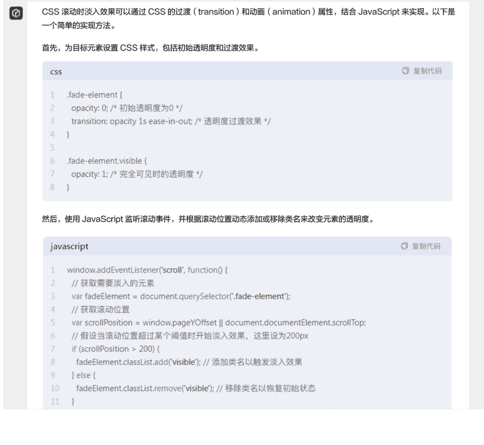

## 图3-1

关键词提示法并不局限于编程求解，找技术文档、查阅 API 说明、翻阅论坛讨论时同样好用。只要选对关键词，工程师就能快速定位所需资料，缩短排障时间。

#### 3.1.1 组建关键词清单

面对具体问题时，工程师可以先围绕问题提炼一份检索词表。词表要覆盖问题主题、涉及的技术栈以及相关概念，靠领域经验或专业文献来补充。把这些词整理成条理清晰的清单，就能更快锁定有价值的信息，进而推导出解决方案。

### 提示
我想用 Python 做一个带网络爬虫和可视化窗口的程序，还要能让用户通过互动表单输入不同参数，最后以图表展示搜索结果，请帮我列出可以拿来向 AI 下指令的关键词列表。

AI回答部分截图（见图3-2）

要实现具备网络爬虫、可视化窗口、交互表单输入参数并以图表呈现结果的程序，可参考以下关键词。

1. Python：用于编写程序的编程语言。
2. 网络爬虫：自动从网络抓取数据的程序。
3. 视窗界面：图形用户界面，提供可视化操作。
4. 互动表单：可供用户输入参数或数据的交互式表单。
5. 图表呈现：以柱状图、折线图、饼图等方式展示数据。
6. 数据抓取：从网页或其他数据源提取所需数据。
7. 数据清洗：对抓取数据进行处理，去除噪音并整理为结构化格式。
8. 数据可视化：以图表、图像等易懂形式呈现数据。
9. 参数设置：允许用户自定义搜索或抓取的参数。
10. 用户交互：程序与使用者之间的输入、输出与反馈。

向 AI 下指令时可结合上述关键词。

- “用 Python 写一个带网络爬虫功能和可视化窗口界面的程序。”
- “在窗口里设计一个互动表单，让用户输入搜索参数。”
- “把爬虫抓到的结果以图表形式在窗口中展示。”
- “确保程序能清洗并整理抓取数据以便可视化。”
- “程序要具备良好的用户交互，能及时反馈操作结果。”

这些表述能帮助 AI 更准确理解需求，并给出符合预期的代码或方案。

图3-2

### 3.1.2 关键词检索

为了找到有效资源，工程师可借助词表开展深度检索。检索范围可包括内部知识库、线上文档、专业论坛与项目代码库等。使用搜索引擎或内部工具时，要依托关键词精准定位；对结果进行细致筛选，保留价值高且相关的内容；再进一步分析评估，选出最优解。

### 提示
请用 Python 设计一个带可视化窗口和网络爬虫功能、允许用户在互动表单中输入参数的程序，并用 Matplotlib 套件输出结果。

## AI回答部分截图（见图3-3）

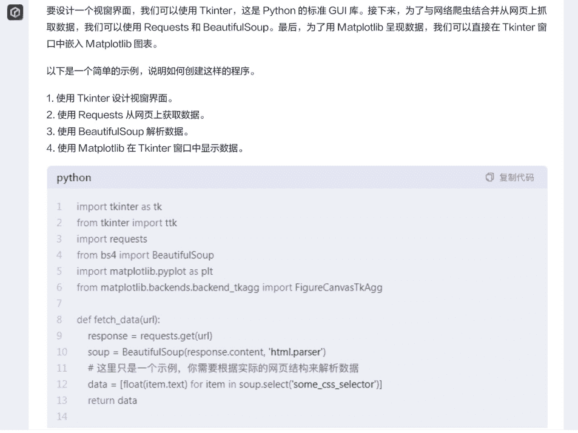

图3-3

### 3.1.3 匹配与筛选

工程师可将生成的关键词与搜索结果进行对照并筛选。依据相似度、重要性等标准评估相关性，聚焦最具参考价值的信息，剔除无关干扰，从而节省时间、提高效率。

以上是关键词提示法的初步流程。面对不同问题与场景，可适度调整与优化，以获得更好效果。

## 3.2 引导式提示法：激发 AI 潜能的钥匙

引导式提示法通过提问推动工程师有序思考并寻找解法。它不仅促进自主思考，也能激发创造力。在问题的引导下，工程师可以深入细节、厘清需求，进而提出创新且可行的方案。

### 3.2.1 提出开放性问题

首先要抛出一个开放且具挑战性的问题，引导自我反思并探索解法方向。问题需与待解决事项相关，同时覆盖其不同侧面，具有启发性，能促使工程师尝试新思路。

### 3.2.2 引导思考与讨论

此阶段需深入剖析问题的各个维度，并探讨多种可能方案。通过提问引导，工程师能走更多思维路径，从不同角度审视问题。经深入分析后，判断各方案的优劣，形成完整的思考框架。

### 3.2.3 提供资源与指导

基于讨论与思考，系统会依据问题特点与解决需求，自动推荐相关资料与指导。资料包括研究报告、案例分析、技术指南等，帮助深入学习。同时提供明确指引，让探索与实现过程有方向可依。

以上可作为使用引导式提示法的参考。可根据具体情境进一步调整，以确保引导效果最佳并激发创造力。

例如在系统设计中遇到性能瓶颈时，引导式提示法会问“哪些环节可能造成瓶颈”“有哪些优化思路”来推动思考。

在实践中，提问与引导结合，能帮助工程师逐步梳理问题，强化自主思考与创新能力。

以下例子进一步说明引导式提示法的应用。

一位软件工程师在开发大型电商平台时，发现多用户并发访问时响应变慢。需要优化性能却无从下手。引导式提示法可助其层层剖析。

> “你觉得哪些因素可能导致性能瓶颈？”

工程师会想到数据库查询、网络带宽、服务器负载等可能原因。

> “有哪些优化方案可以考虑？”

引导其思考缓存机制、资源整合、异步处理等策略。

> “有没有已知的最佳实践可以参考？”

可回溯历史案例或借鉴业界做法获取灵感。

这些引导性问题能深化思考、激发创新，最终提出并落地更有效的优化方案。

### 3.2.4 实例：引导式提示法

使用引导式提示法时，可按以下示例引导 AI 思考与求解。

工程师：创建一个程序，让使用者输入两个数字并计算其和。
AI：我们可以从哪里开始？
工程师：先要让使用者输入数字。请给我一个提示来处理这一步。
AI：当然。你打算用什么方式获取输入？比如 input 函数或设计窗口界面。
工程师：我想用 input 函数。下一步要把输入转为数值格式，请提示处理方法。
AI：当然。你想用哪个函数或方法做转换？例如 int 函数可把字符串转整数。
工程师：我想用 int 函数。接下来要把两个数相加，请提示操作方法。
AI：当然。你想用哪种运算符或函数？例如 + 运算符或自定义加法函数。
工程师：我想用 + 运算符。最后要把结果呈现给使用者，请提示展示方式。
AI：当然。你想用什么方式输出？例如 print 函数或更新窗口文本。
工程师：我想用 print 函数。非常感谢！

通过引导式提示法，可在对话中逐步拆解问题并找到解法。关键是提出明确问题，并根据 AI 回答持续引导直至达成目标。

## 3.3 类比与比喻提示法：打开创意的大门

类比与比喻提示法是将问题或概念与常见情境做对照，帮助工程师更直观理解并寻找解法。这种方法能让问题从多维度被审视。

### 3.3.1 厘清问题与概念

先深入探究问题的本质与涉及概念，明确诉求、目标与限制，同时掌握相关领域知识，为后续类比奠定基础。

### 3.3.2 寻找相似情境

基于对问题的理解，探寻来自不同领域但具有相似特性的情境或概念。选择能提供有益洞见与视角的案例用于类比。

### 3.3.3 建立类比关系

将问题与已知情境进行比较，识别结构、功能、解法或行为模式上的相似之处，并迁移到问题解决中。通过建立类比，可从多个角度审视问题，发掘新路径。

### 3.3.4 检验类比的有效性

需评估所建类比是否有效、是否适用，是否能带来有价值的启发。根据评估结果调整与优化类比选择，确保效果最佳。

例如，工程师在设计复杂分布式系统时，需确保节点间通信的可靠与高效。可类比为“邮局的邮件配送”。

借助该类比可获得以下启发。

1. 保障可靠性：邮局配送可能出现丢失或延误，启发设计抗丢包与超时重传机制。
2. 思考效率与延迟：如同优化投递路线，可考虑更高效路径或异步通信以降低延迟。
3. 故障处理策略：借鉴邮件回执，可引入冗余或确认机制检测丢失信息。

总之，类比与比喻提示法能拓宽思维视野，帮助从不同角度解决复杂问题。

### 3.3.5 实例：类比与比喻提示法

使用类比与比喻提示法时，可按以下示例引导 AI 进行类比。

工程师：我需要设计一个能存储和检索大量用户信息的数据系统，能否给我一个类比帮助理解？
AI：可以把用户信息想象成书籍，数据库系统则像图书馆的收藏与管理系统。你需要设计一个快速定位特定书籍的索引系统，便于检索所需信息。
工程师：明白了。现在想思考如何设计有效索引，能否再给一个类比？
AI：可把索引系统想象成字典。字典按字母顺序排列词条并映射页码，使用者只需查找词条即可定位页码，无需逐页翻查。
工程师：很有帮助。现在想思考如何存储与检索大量信息，能否再给一个类比？
AI：可把存储与检索系统想象成文件柜。用户信息如同文件，系统需提供快速存取与搜索功能，像在文件柜中迅速找到指定文件。

通过类比与比喻，抽象问题得以具体化，帮助工程师从不同视角思考并找到新解法。

## 3.4 探索式提示法：探寻无限可能

探索式提示法鼓励工程师通过实验、测试与研究来提升实操与验证能力。它主张在解决问题时动手尝试、验证与改进方案。

使用该方法可在实践中学习新知，通过不断试错快速验证想法是否可行，获得真实结果与经验，从而推动技能提升与创新。

例如优化图像处理算法时，可用探索式提示法测试不同参数组合，找到兼顾速度与质量的最佳设置。

### 3.4.1 探索式提示法的步骤

- （1）明确评估标准。先确定关注的性能指标，如处理速度或图像质量。
- （2）建立假设。基于经验假设哪些参数会影响性能，例如增大某参数会加快速度。
- （3）设计实验方案。制定测试计划，针对不同参数设置设计用例并记录数据。
- （4）执行实验。按计划运行算法，收集性能数据。
- （5）分析结果。对比不同设置下的表现，找出最优组合。

此流程可找到最优参数并深化对算法的理解，同时提供数据支撑决策。

### 3.4.2 探索式提示法的指导原则

## 一、确定目标与假设

清楚定义要解决的问题或验证的想法，明确期望结果与研究目标。同时设定假设或研究问题，指引探索方向与方法。目标应明确且可衡量，便于后续验证。

## 二、提供测试方法

依据目标与假设给出具体测试方法，包括步骤、工具或技术。描述需详尽清晰，便于准确执行与记录。同时提供必要的背景与理论支撑，帮助理解原理与意义。

## 三、引导实际操作与测试

按指南执行实验，确保流程正确并详细记录结果。可思考如何改进或扩展，以扩大探索范围并增强可靠性。

## 四、分析和评估结果

解读数据、图表等结果，提取有价值信息并形成合理结论或建议，同时指出改进方向。

### 3.4.3 实例：探索式提示法

使用探索式提示法时，可按以下示例引导 AI 进行实操验证。

工程师：我想提升网站加载速度，有哪些方法可以测试不同策略？
AI：可使用浏览器缓存存储静态资源，减少网络请求；压缩图片、合并与压缩 CSS、JS 以减小体积；使用 CDN 加速资源分发；并采用 HTTP 缓存、ETag 等策略降低服务器负载。
工程师：建议很实用。现在想提升机器学习模型准确度，有什么验证思路？
AI：可用交叉验证评估性能，将数据集分为训练集与验证集，比较不同模型与参数；尝试特征工程、调参或更换算法；进行模型集成、过拟合与欠拟合分析，并结合领域知识优化。

探索式提示法让工程师动手验证、不断迭代，既能培养实验精神，也能在实践中获得新发现与改进。

# 第4章

# 提示工程落地中的常见难题

提示工程在实践中常会遇到各类问题，影响 AI 模型的效能与准确度。提示工程师必须认识这些问题并采取对应策略。本章重点分析三大常见难题：输入信息与期望输出模糊、误解与误导性回答、提问过多导致无回应。

## 4.1 输入与输出目标模糊

在提示工程中，输入描述不清或期望输出不明确是常见挑战。当使用者提问或提示不够清晰时，AI 难以准确把握意图并给出满意回答。本节探讨应对策略，提升输出的准确性与实用性。

### 4.1.1 要求提供更具体的信息

当输入模糊时，可请使用者补充细节、示例或上下文，帮助 AI 更准确理解。例如使用者说“我想知道关于狗的内容”，可追问“我想了解狗的平均寿命和常见品种”。

### 提示
我想知道关于狗的内容。

### AI回答
狗是人类最忠诚的伙伴之一，品种多样、性格各异。以下是一些基础知识。

品种分类：依据美国养犬俱乐部标准，全球约有 178 个公认纯种。按体型可分为超小型、小型、中型、大型、超大型；按功能可分为伴侣犬、玩具犬、工作犬、梗犬、牧羊犬、猎犬等。

智商排名：不同品种智商差异明显。边境牧羊犬、贵宾犬、德国牧羊犬等被认为较聪明、易训练，其他品种则需更多耐心。

适合人群：选品种应结合生活方式。公寓居民更适合小型或超小型犬；有过敏困扰者可优先考虑低掉毛品种。

特点介绍：哈士奇以耐力和独立性著称，藏獒是知名守护犬，贵宾犬因卷毛和友善性格受欢迎，吉娃娃则因小巧和警觉性备受喜爱。

第一次养犬 先做功课再决定
第一次把狗狗带进家门，最稳妥的做法是先把功课做好。不同犬种在性格、活动量、对人类的依赖度上差异很大，提前了解这些才能评估是否与自己的生活节奏匹配。养犬是一项长期承诺，日常喂养、散步、训练、定期健康检查都需要持续投入，不能半途而废。

养前自我盘点
先确认居住环境是否允许饲养，自己有没有充足的时间、精力与经济能力长期照料。来源同样重要，优先挑选口碑良好的繁育者或官方领养渠道，才能保证健康与福利。

把爱宠当成家人
狗狗不只是宠物，更是家庭的一分子。熟悉犬种特性与具体需求，才能提供更贴合的照顾，也更容易建立信任和深厚感情。

### 用户提问
想知道狗狗大致能活多少年，以及有哪些常见犬种。

### 模型回应
犬只的存活年限会受到犬种、体型大小、血统类型等多重因素影响。

混血狗狗普遍比单一血统的活得更久，体型娇小的平均存活期也通常高于体型庞大的。粗略来说，中小型犬大约七岁左右进入衰退期，体型较大的则约五岁前后开始老化。

常见犬种简述如下。

拉布拉多寻回犬：属于中大体型，性格友善聪明，适应力强，常被用作导盲或疗愈犬。

德国牧羊犬：多功能工作犬，忠诚懂事服从性高，在警务与军事领域应用广泛。

金毛寻回犬：性情温和有耐心，是家庭伴侣的热门选择，也常参与搜救任务。

法国斗牛犬：体型介于偏小至中等，因独特外形和性格备受喜爱，已成为流行家庭宠物。

吉娃娃：超迷你犬，寿命表现突出，通常在十二到十五年，部分个体可达二十年。

总体来看，不同犬种的寿命与气质各不相同。选犬时应结合自身环境与喜好，同时为它提供健康快乐的生活条件。

## 4.1.2 让需求表达更清晰
当使用者对期望结果描述不清时，提示工程师可以主动追问细节或示例，帮助模型更准确把握真实意图。比如用户只说“我要一个好建议”，工程师就应引导对方说明背景、偏好和具体限制。

## 4.1.3 借助案例模板提升沟通效率
在特定情境下，提示工程师可以提供案例或模板作参考，帮助使用者更清晰表达问题与期望输出。案例的作用是示范如何具体描述需求，从而让交流更顺畅高效。

### 【范例1】
使用者：“我想要一个不错的建议。”
工程师引导：“能多提供一点背景或具体需求吗？比如建议的主题是什么，有没有特殊条件或偏好？这些信息有助于模型给出更有价值的回答。”

示范对话如下。
**提问**
我想学编程开发，请问有没有比较适合初学者的编程语言，我需要一个好的建议。
**模型回应**
入门编程建议挑选易学且功能全面的语言。以下几种比较适合新手。

**Python：** 语法简洁清晰，库资源丰富，广泛用于网页开发、数据科学和人工智能，学习后发展空间广阔。

**JavaScript：** 网页开发的脚本语言，也可用于服务端开发如Node.js。动态灵活，相关资源和工具非常丰富。

**Java：** 面向对象的编程语言，语法严谨，跨平台性强，常见于企业应用和Android开发。

这几门语言都有大量学习资源和社区支持，可按兴趣和目标选择其一。

### 【范例2】
使用者：“我想了解关于狗的知识。”
工程师引导：“能否提供更具体的问题？比如想了解品种、行为、饲养需求或其他方面的知识？提供具体问题有助于模型更精准作答。”

示范对话如下。
**提问**
我想养狗，我比较喜欢体型娇小、个性温和的狗，能否给我一些品种选择及饲养注意事项的建议。
**模型回应**
体型娇小且性格温和的犬种有吉娃娃、雪纳瑞、巴哥犬和鹿犬等，比较适合你。

吉娃娃是体型最小的犬种之一，虽有点倔强但活泼好动，毛短易打理。雪纳瑞形象可爱，性格温和精力足，毛色多样，是忠诚友善的伙伴。巴哥犬外表憨厚可爱，鼻道较短不适合剧烈运动。鹿犬体态优雅性格温顺，也是不错的家庭宠物。

饲养小型犬需注意以下事项。
- **适应期：** 新到家的狗狗可能因环境陌生而不进食，需要耐心安抚陪伴。
- **笼舍选择：** 选择坚固耐用的狗笼，窝垫最好可拆洗，保持清洁卫生。
- **居住环境：** 安排安静、干燥通风、冬暖夏凉的空间作为活动区。
- **训练与管理：** 限制自由活动范围，及早佩戴项圈便于训练和管理。
另外，名字越简短越容易让小狗快速辨识学习。希望这些建议能帮助你迎接新成员。

## 4.2 误解与误导性回答
在提示工程实践中，模型可能因理解不足或错误推断而给出误导性回答。本节提供应对方案。

## 4.2.1 提供更完整的背景
当模型理解偏差或回答误导时，可要求使用者提供更多背景信息，以帮助模型给出更准确针对性的回答。

## 4.2.2 厘清问题并修正答案
若模型给出误导性回答，可明确指出错误处并提供正确信息，避免使用者被误导。

## 4.2.3 手动介入进行校正
当模型多次出现误导性回答时，可进行人工介入，手动校正输出，确保信息准确可靠。

示范如下。
**提问**
请告诉我最近的经济趋势。
**模型回应（理解偏差）**
最近经济趋势表现为全球增速好于预期，国内经济也在回暖。
...
这种情况下模型仅按字面理解“最近”，描述了数周或数月的经济数据变化，未能考虑使用者可能想了解长期趋势或未来趋势。

**提问**
我想了解未来一年内世界经济的预测趋势。
**模型回应（正确理解）**
未来一年世界经济预计仍保持增长，但增速可能放缓。依国际货币基金组织发布的《世界经济展望报告》，2025年世界增速预期为3.2%，与2024年持平。经济增长仍面临地缘政治冲击、大宗商品价格波动、供应链问题及主要经济体分化等风险。

## 1. 世界经济预测
经济增速：预计2025年世界增长率为3.2%，与2024年持平。
通胀趋势：世界整体通胀有望在2025年降至4.4%，有助于稳定增长但也可能带来金融环境放松。
贸易活动：世界贸易组织预计2025年全球货物贸易量将增长2.7%，显示逐步复苏迹象。

## 2. 世界经济面临的风险和挑战
地缘政治冲击仍是2025年不确定性来源之一。
大宗商品价格波动，尤其是能源市场，对宏观政策影响重大。
供应链重构改变各国在全球生产网络中的地位，企业为避开关税和成本上升而调整布局。

## 3. 主要经济体的表现
美国：预计经济增长2.5%，连续三年高于市场预期。
欧元区：受地缘冲突和贸易政策不确定性影响，增长预期下调至0.8%。
中国：增速预计保持在4%至5%，面临转型和外部需求不足的挑战。

总体来看，未来一年世界经济或将维持增长但增速放缓，且不确定性较高。投资者和企业需密切关注形势变化，各国政府和国际组织也应加强合作应对挑战。

## 4.3 提问过量或模型失语
提问过多可能导致模型困惑而无法精准作答，模型无回应则可能是知识不足或训练不充分。本节探讨如何把握提问度并提升回应能力。

## 4.3.1 控制单次提问的数量
可限制单次交互的问题数量，避免过多提问导致模型无法给出正确回答。

## 4.3.2 解释原因并给出引导
当模型无法回答特定问题时，可向使用者解释原因并提供引导或建议，帮助其理解模型限制。

## 4.3.3 增强模型应对能力
若模型多次无法回答某类问题，可将这些情境纳入训练资料，改进模型以更好应对。

示例如下。
**提问**
最近有哪些流行的科技趋势？
**模型回应**
抱歉，我的知识截止于2023年，可能无法提供最新趋势。根据最后更新的信息，当时热门趋势包括人工智能、机器学习、物联网、5G、区块链和增强现实/虚拟现实。建议查阅最新科技新闻获取最新信息。

**提问**
请问一下，你喜欢什么颜色？
**模型回应**
作为人工智能助手，我没有个人喜好或感受，包括对颜色的偏好。但我可以提供关于颜色的有趣信息或基于色彩心理学的建议，有任何相关问题欢迎提问。

**提问**
请告诉我世界上有多少种动物？
**模型回应**
动物种类繁多，难以精确统计。据估计地球上有数百万到数千万种不同动物，涵盖哺乳、鸟类、爬行、两栖和无脊椎动物等。科学家仍在不断发现新物种，生物多样性持续增加。

# 第2篇
## 提示进阶技巧
# 第5章
## 优化提示的除错流程
优化提示的除错流程是确保提示工程实践有效性的关键。设计有针对性的测试案例、分析和解读模型输出，并据此调整提示设计，可不断提升模型表现和回答质量。

### 5.1 构建目的明确的测试案例
构建目的明确的测试案例是除错过程中的关键一步。通过精心设计的案例，我们能深入了解模型行为并找到改进方向。本节探讨如何确定测试目的和范围、设计多样且具代表性的案例，以及实施测试并记录结果。

首先，明确测试目的和范围至关重要。可能涉及评估模型在特定领域或任务上的表现，或检验其对各类问题的合理回应能力。这些将为案例设计提供指导。

其次，按既定目的设计测试案例。为提高有效性，可借鉴现实场景，选择具挑战性的对话、歧义处理或知识查询问题。同时考虑模型特性和预期用途，设计涵盖不同提示方式和关键字的案例。保持案例多样性和代表性有助于获取更全面结果。测试应由简到繁，确保模型在各种情况下均能表现良好。

最后，案例设计完成后即可实施测试并记录结果。关注模型回答是否符合预期，是否提供有价值信息。同时记录可能存在的问题，如误导性回答或相关性不足，为后续优化提供依据。

测试范例展示如下。

### 【范例1】什么是全球气候变暖？
预期回答：全球气候变暖是指地球大气和海洋中温室气体浓度增加，导致平均气温上升的现象。

**提问**
什么是全球气候变暖？
**模型回应**
全球气候变暖也称全球变暖，是指因温室效应导致大气和海洋温度上升的气候变化。人类活动排放大量二氧化碳、甲烷等温室气体，导致地气系统能量失衡，热量累积使全球温度上升。

该现象对生态系统和人类生活影响深远，会改变降水分布、加速冰川和冻土融化、海平面上升，威胁生态平衡和人类健康，并导致粮食减产、海洋食物链断裂和海岸生态失衡。

因此全球气候变暖需要全球共同关注和应对。需减少温室气体排放，如优化能源结构、提高利用效率、发展可再生能源等，同时适应已发生的气候变化，采取措施应对挑战。

### 【范例2】介绍人工智能的应用领域。
预期回答：人工智能可应用于自然语言处理、图像识别、智能机器人等领域，模拟人类行动并自动执行任务。

**提问**
介绍人工智能的应用领域。
**模型回应**
人工智能已渗透到生活各方面，从智能家居到医疗诊断，从自动驾驶到金融分析，正在改变世界。以下为详细介绍。

## 1. AI的应用领域
- 医疗保健：辅助诊断、疾病预测与预防、药物研发。
- 交通：智能交通管理、自动驾驶、物流优化。
- 教育：个性化学习、智能辅导、教学管理与评估。
- 金融：风险评估与信用评级、智能投顾、欺诈检测。
- 家居：智能家居系统、智能安防、能源管理。
- 零售：精准营销、供应链管理、无人零售。
- 工业制造：质量检测、生产优化、智能机器人。
- 能源：智能电网、勘探开发、能源管理与节能。
- 安防：视频监控分析、人脸识别与身份验证、巡逻机器人。
- 娱乐：游戏开发、影视制作、音乐创作。

## 2. AI的应用案例
- 智能家居：系统可自动调节室内温度，识别家庭成员需求并预测习惯提前准备。
- 医疗辅助：分析CT扫描图像辅助肺部疾病诊断，根据基因和生活习惯预测疾病风险。
- 自动驾驶：利用AI感知环境并做出驾驶决策，提高安全性和效率。

AI应用不断拓展，未来将在更多领域发挥作用，为生活带来更便捷智能的体验。

### 【范例3】告诉我阿尔伯特·爱因斯坦的生平。
预期回答：阿尔伯特·爱因斯坦提出相对论和质能等价原理，被认为是现代物理学奠基者之一。

**提问**
告诉我阿尔伯特·爱因斯坦的生平。
**模型回应**
阿尔伯特·爱因斯坦（1879年3月14日—1955年4月18日）是杰出的理论物理学家，被公认为现代物理学奠基人之一。生平概述如下。

- 早年生活：出生于德国乌尔姆，父亲从事电机制造，母亲为钢琴教师，在犹太家庭中长大并接受早期教育。
- 学业：展现出对数学和物理的特殊天赋，在苏黎世联邦理工学院学习物理，1900年获教育学学士，后获苏黎世大学博士学位。
- 相对论：提出1905年狭义相对论和1915年广义相对论，深刻改变了人们对时间、空间和引力的理解。
- 诺贝尔奖：因对光电效应的解释于1921年获诺贝尔物理学奖，为量子理论发展提供关键启示。
- 流亡生活：1933年移居美国，在普林斯顿大学任教，继续物理研究。
- 晚年与逝世：晚年致力于物理研究并关注和平与民权运动，1955年4月18日在新泽西州去世，享年76岁。

爱因斯坦不仅是杰出科学家，也是受人尊敬的思想家和人道主义者，其工作对科学发展和人类文明进步意义深远。

这些测试案例涵盖不同领域和难度，可评估模型回答的准确性和完整性。通过实施测试可检查模型是否提供正确有用信息，并发现问题改进方向。

### 5.2 分析解读模型输出结果
在优化调试模型过程中，分析和解读输出结果至关重要。通过仔细研究输出，可识别规律、问题并找到改进方向。本节介绍如何收集整理测试结果，并围绕准确性、完整性、逻辑性等标准评估模型表现，帮助深入掌握模型行为模式。

需先收集整理测试结果，将模型输出、预期目标和相关背景进行对比分析，这有助于了解模型在不同情境下的表现并找出偏差。

评估生成内容时，可以从多个角度展开审视。先确认结论是否正确、覆盖是否全面、表现是否稳定；再判断模型对指令的贴合度，能否抓住提示里强调的要点；最后看表述是否条理清晰、便于理解。

再借助可视化手段能够提升洞察效率。把文本结果转成图表、图像或结构化呈现，就能更直观地把握模型的行为特征与倾向。

只有把输出拆解细化，才能定位问题并明确优化方向。例如可以发现模型在某些题型上易出错，或对特定词汇的理解存在偏差，这些线索为后续的提示调优提供了重要参考。

#### 5.2.1 收集和整理测试结果

针对模型，可以把不同问题的作答汇总起来，并与期望答案进行对照。这种对比有助于更清晰地判断模型在多变情境下的表现。

### 【范例】为什么太阳是热的？

预期回答：太阳发热源于核心的核聚变，能量以光热形式向太阳系各处辐射。

使用模型，提示及回复如下。

**提示**

为什么太阳是热的？

**模型回复**

太阳发热是因为内部在进行核聚变。

太阳是一颗巨大的恒星，主要成分是氢并含少量其他气体。在核心区，氢原子在极高温度与压力下合成氦，这个过程即核聚变。依据质量能量守恒，部分氢质量转化为能量，以光子形式释出并向外层及太空传播。

核心温度约1500万摄氏度，表面约5500摄氏度。热量随光子向外辐射，到达地球时我们感知为阳光。辐射提升被照物体的能量，因而产生热感。

太阳的光热是地球生命存在的基础，也是气候系统的重要驱动。其能量之大，每秒释放量远超人类一年总消耗。因此它是太阳系核心能源，也是维持地球生态平衡的关键。

## 5.2.2 准确性和完整性分析

准确性和完整性分析的核心是核查输出是否正确、齐全、自洽。以历史类问题为例，可检验回答是否包含时间、地点、人物等关键细节。

**【范例】请介绍人类历史上第一次成功登月的事件。**

预期回答：人类首次成功登月是1969年7月20日的阿波罗11号任务。美国航天员尼尔·阿姆斯特朗与巴兹·奥尔德林踏上月面，成为首批登陆者。该事件标志着太空探索的重大突破，点燃了全球探索热情。

使用模型，提示及回复如下。

### 提示

请介绍人类历史上第一次成功登月的事件。

### 模型回复

首次成功登月发生于1969年7月20日，属于美国NASA阿波罗计划中的阿波罗11号任务。任务中，尼尔·阿姆斯特朗成为第一个踏上月面的人，并留下“登月一小步，人类一大步”的名言。

阿波罗11号共三名航天员：尼尔·阿姆斯特朗、巴兹·奥尔德林和迈克尔·科林斯。前两者在月面活动约两个半小时，采集土壤岩石并做科学实验，科林斯则留在指令舱绕月飞行。

这次登月在技术上是巨大成功，也成为人类探索宇宙的重要里程碑，极大激发了全球对太空的兴趣。此后至1972年，阿波罗计划仍有多人再次登月。

## 5.2.3 符合提示要求的分析

该项分析旨在判断模型是否读懂指令并精准回应其中的重点信息。

**【范例】**请描述牛顿的三大运动定律，并解释它们在现代工程学中的应用。

预期回答：牛顿三大定律是经典力学基石。第一定律即惯性，物体若不受外力会保持静止或匀速直线运动；第二定律为加速度与合外力成正比、与质量成反比；第三定律为作用力与反作用力大小相等方向相反。在工程上，它们用于汽车悬挂与制动设计、飞行器轨迹预测与控制等。

使用模型，提示及回复如下。

### 提示

请描述牛顿的三大运动定律，并解释它们在现代工程学中的应用。

### 模型回复

牛顿三大定律构成了经典力学的框架，下面简述其内容及工程应用。

## 1. 惯性定律（牛顿第一定律）

描述：若物体不受外力或所受外力平衡，则保持静止或匀速直线运动。

应用：工程设计中广泛借鉴。安全带的设计即利用乘客急刹时因惯性前冲的原理；航空航天领域也借助惯性原理确保飞行器稳定与可预测响应。

## 2. 加速度定律（牛顿第二定律）

描述：物体加速度与合外力成正比、与质量成反比，方向与外力一致。

应用：是分析动态系统的核心。汽车发动机功率需与车重和目标加速度匹配；建筑结构设计需计入可能载荷，确保受力后按预期变形。

## 3. 作用与反作用定律（牛顿第三定律）

描述：相互作用的两个物体，作用力与反作用力大小相等、方向相反、共线。

应用：对机械系统设计至关重要。火箭推进即靠推进剂向下喷射产生的反作用力向上加速；在机械设计中考虑部件间相互作用力，可避免磨损并提升效率。

三大定律在宏观工程中依然适用，尽管在量子或强相对论环境下会受限，但在日常工程场景中仍具准确性和实用性。该案例可用来检验模型是否能准确理解并回应关于定律描述及工程应用的双重要求，从而评估其在科学概念与实践结合方面的理解力。

## 5.2.4 逻辑性和可解释性分析

逻辑性和可解释性分析关注回答的推理是否连贯、解释是否合理。例如在情感分析任务中，需检查模型判断是否与文本情感一致，以及能否给出合理解释。

使用模型，提示及回复如下。

### 提示

请从积极正面的角度回答人工智能技术对提高教育质量的重要性。

### 模型回复

人工智能对教育质量提升的价值不容忽视，带来了诸多积极效应。

- 1. 个性化学习：系统可依据学生的学习风格、水平和需求定制内容和路径，通过分析学习行为数据提供更精准的教学方案。
- 2. 教学辅助：为教师提供备课、教学设计和学情评估等智能工具，提升教学效率。
- 3. 资源共享与教育全球化：助力教学资源互通，推动教育国际合作。在线平台和虚拟课堂让学生跨越时空获取多样资源。
- 4. 创新教学工具：如VR/AR带来沉浸式体验，NLP实现智能互动与语言学习，增强参与感和学习兴趣。

总体看，人工智能推动了教育的个性化、智能化和全球化，有助于满足师生需求，提升效率、质量与公平性，推动教育持续发展。该示例要求模型展示人工智能对教育的正面作用，并提供条理清晰、能自洽解释的分析，检验其逻辑推理和可解释性。

### 5.2.5 视觉化分析

把模型输出转成可视化形式如图表、图像或结构化文本，能更直观地理解行为模式。例如用条形图展示文本分类模型的情感分数。

使用模型，提示及回复如下。

**提示**

请使用Python的Matplotlib库来绘制一个折线图，展示某公司过去一年中每个月的销售额变化趋势。该折线图的x轴为月份，y轴为销售额，并且图上要标注出每个月份对应的销售额数值，以及该公司的名称和年份。

### 模型回复部分截图（见图5-1）

要使用 Python 的 Matplotlib 库绘制一个折线图来展示某公司过去一年中每个月的销售额变化趋势，以下是完整的代码示例：

```python
import matplotlib.pyplot as plt

# 数据准备
months = ['Jan', 'Feb', 'Mar', 'Apr', 'May', 'Jun', 'Jul', 'Aug', 'Sep', 'Oct', 'Nov', 'Dec']
sales = [10000, 12000, 15000, 13000, 16000, 18000, 20000, 19000, 22000, 21000, 23000, 25000]

# 创建折线图
plt.figure(figsize=(10, 6))
plt.plot(months, sales, marker='o', linestyle='-', color='b', label='Monthly Sales')

# 标注每个月份的销售额数值
for i, value in enumerate(sales):
    plt.text(months[i], value + 500, f'{value}', ha='center', va='bottom')

# 添加标题和标签
plt.title('Monthly Sales Trend for Company XYZ (2023)', fontsize=16)
plt.xlabel('Month', fontsize=14)
plt.ylabel('Sales (USD)', fontsize=14)

# 显示网格
plt.grid(True, linestyle='--', alpha=0.7)

# 显示图例
plt.legend()

# 显示图表
plt.show()
```

### 运行结果：

运行上述代码后，你将看到一个折线图，展示了某公司过去一年中每个月的销售额变化趋势。每个月份的销售额数值都会标注在对应的数据点上方，图表标题包含公司名称和年份。

希望这个示例对你有帮助！


通过解读模型输出，我们能深入把握模型表现，定位问题并指明改进方向，从而持续优化模型性能。

## 5.3 根据反馈调整提示设计

根据反馈迭代提示是除错流程的最后环节。通过优化提示的清晰度和引导性，可以提升模型的效能和准确度。本节回顾提示设计要点，讨论依据反馈修正的方法，并强调迭代验证的重要性。

首先要重新审视提示是否足够清晰明确，能否有效引导模型产出预期结果。例如优化聊天机器人时，需确认提示是否提供充足背景和明确问题指向。

其次要依据用户反馈调整提示。若模型在某类问题上表现不佳，可修改关键词或改变提问方式，降低理解门槛，提高特定问题的准确率。

最后要反复测试验证改进效果。用新的测试集检验模型在调整后提示下的表现，判断改动是否真正带来提升。

总结为三步：

- （1）重新审视提示设计：基于前期分析，再次检查提示的明确性，确保能引导出预期答案。
- （2）根据反馈调整提示：依用户反馈对提示进行针对性修改，提升特定场景的准确性。
- （3）测试和验证改进效果：通过迭代测试评估调整后的表现，确认改进是否实质有效。

提示优化的除错流程中，设计有针对性的测试案例是起点。分析输出帮助理解模型行为并发现改进点，而基于反馈的提示修正则提升效率和准确性。反复迭代可不断优化提示，实现更好的模型表现和用户体验。

# 第6章

## 解决复杂问题的高级提示技巧

在复杂问题求解中，高级提示技巧是推动AI实现更深层次对话与解答的关键。本章介绍几项核心技巧，重点在于提升多轮对话设计、歧义处理和上下文理解能力，帮助模型更精准把握需求并给出全面回答。

## 6.1 多轮对话提示设计

多轮对话是常见交互形式，要求模型保持上下文连贯和一致。本节探讨如何通过状态追踪、上下文记忆管理等手段确保提示流畅，提升真实对话体验。

- 明确目标：清晰界定对话意图，指导参与者在对话中的行为。
- 上下文记忆管理：在多轮中保持连贯，需结合前轮内容来生成本轮回应。
- 反馈和确认：及时总结前轮、提供选项或请求补充，确保双方理解一致。

### 6.1.1 跟踪对话状态

每一轮对话中跟踪状态有助于保证回答的连续性。记录并更新对话状态，并在后续轮次中调用。可用变量或数据结构保存信息，例如用字典记录用户提问和模型回复，并在轮次结束时更新，以便下一轮参考。

例如要求模型收集成语：首轮要求提供10个成语，第二轮要求再提供10个，第三轮要求提供与之前不同的另10个。由于系统会记录各轮提问和回答并更新状态，就能保证每次输出不重复。

模型提示和回复示例如下。

**提示**

请提供5个与学习相关的中文成语。

**模型回复**

与学习相关的成语很多，以下是5个。

- 1. 持之以恒：指坚持不懈、持续努力学习。
- 2. 春华秋实：比喻学习或工作有成果，如同春开花秋结果。
- 3. 手不释卷：形容勤奋好学，书不离手。
- 4. 好学不倦：喜欢学习，从不感到厌倦。
- 5. 敏而好学：聪明且乐于学习。

**提示**

请再提供5个成语。

**模型回复**

以下是5个与学习相关的成语。

- 1. 勤学苦练：形容勤奋学习并刻苦练习。
- 2. 温故知新：复习旧知识以领悟新知，强调回顾反思。
- 3. 博览群书：广泛阅读，学识渊博。
- 4. 好学不倦：喜欢学习，从不厌倦。
- 5. 集思广益：汇聚众人智慧，体现合作学习。

**提示**

我注意到上一轮中的"好学不倦"已经提供过，请提供一个新成语替换它。

**模型回复**

勤学好问：指人勤奋好学，有疑问就请教。

### 6.1.2 上下文记忆管理

上下文记忆管理是指在多轮对话中保存历史记录。可用列表或队列存储对话历史，轮次结束时把当前对话加入列表，下一轮根据需要检索历史信息。及时更新记忆能保持准确性和完整性。

例如让模型扮演旅游向导。首轮设定角色，第二轮推荐景点，第三轮给出游览建议，第四轮询问特色展览和活动，示例如下。

**提示**

你现在的角色是一名经验丰富的旅游向导。

**模型回复**

好的，我将扮演经验丰富的旅游向导。

你好！欢迎来到这片美丽的旅游地。在出发前，我想了解一下你的偏好或需求，比如更喜欢自然风光还是历史文化，有没有特别想去的地方或想尝试的活动，这样我可以提供更个性化的建议，让旅程更愉快难忘。

**提示**

我计划下个月去北京旅行，你能推荐几个旅游景点吗?

**模型回复**

当然可以！北京历史文化底蕴深厚，值得一游的景点很多。推荐如下：

故宫：明清皇家宫殿，中国最大古代建筑群，藏品丰富，彰显皇家辉煌。

天安门广场：北京地标性广场，可看到人民英雄纪念碑、毛主席纪念堂等重要历史建筑。

长城：世界文化遗产，八达岭、慕田峪等段落壮阔，体现古代军事防御工程的雄伟。

除开前面提到的几处，北京可逛的地方其实很多，北海公园、圆明园、798艺术区都很有代表性，可以按兴趣和时间的安排自行取舍。城内出行很方便，地铁、公交、出租车都能直达各大景区；住宿配套也比较成熟，从高端酒店到经济型旅店都有，预算和需求不同都能找到合适的选择。

**提示**

我想去故宫但担心游客太多，你有什么建议吗？

**AI回答**

担心故宫人多的话，可以提前做几方面准备，让游览更从容、避开高峰。

首先建议通过官网或授权平台提前锁定门票，确保入口顺畅。订票时尽量避开节假日和周末，选择工作日的清晨或午后淡场时段，进入后人流会相对稀疏。

其次不想错过精华又怕拥挤的话，可以报一个专业的故宫讲解团。跟随讲解员既能深入了解宫殿的历史文化，行走路线也会主动绕开最拥堵的区域，看景体验更好。

另外，出发前花一点时间了解故宫的整体布局和各宫殿的特色很有帮助，有了大致脉络就能做到有的放矢，不必在人堆里反复徘徊浪费时间。

最后想沉浸在文化氛围里的话，可以看看故宫内的文化活动或讲座安排。参与其中不仅能丰富行程，也能在更安静的场域里感受古建和文物的魅力。

归纳起来，提前预约、挑淡场时段、跟随专业导览、有目标地参观，是缓解人潮压力的常用做法。另需注意，故宫的开放时间与票价会随季节和节假日调整，出行前最好查阅最新官方公告。宫外周边也有不少老字号餐厅和小吃摊位，正好尝尝地道的北京味道。

有兴趣的话我也可以帮你整理当前或即将推出的特色展览和活动，让行程更充实。

**提示**

故宫里都有什么特色展览和活动呀?

**AI回答**

故宫经常推出各式专题展和文化活动，让参观不只是走马观花。

如果对宫廷生活感兴趣，原状陈列很值得一看。展厅里的陈设都是依据历史档案复原布置，尽可能还原当时的宫殿面貌，走进去能切身感受到浓郁的历史气息和昔日辉煌。

此外，博物馆会不定期举办专题展。故宫藏珍系列就很受欢迎，展品涵盖书画、玉器、陶瓷等类别，件件都是馆藏精品，既有艺术价值也承载着中华文化的厚重，值得细细欣赏。

节日或重要纪念日也会有特色活动。比如春节期间会推出系列文化展演和主题展，让游客在观赏古建筑的同时体会节日氛围。

最新展览和活动信息可在故宫博物院官网或官方社交平台查询，现场也会提供详细的介绍资料方便参观选择。

如果你对宫廷文化、建筑风格或某件藏品背后的故事有特别偏好，也可以告诉我，我再帮你找更具体的资讯和建议。

通过这个例子可以看出，AI在多轮对话中会借助上下文记忆来管理信息。每一次回复都会参考之前的对话内容，动态调整表述，以更贴合使用者的需求和兴趣。良好的上下文管理是实现个性化、连贯体验的关键。

## 6.2 处理歧义和理解上下文的技巧

人机交流中，歧义处理和上下文理解是常见挑战。本节介绍几项实用技巧，帮助模型更好地厘清提示意图并适应动态对话，从而在复杂场景下给出更灵活、准确的回应。

- 澄清歧义。遇到表意模糊的语句或问题时，可请使用者补充背景或进一步说明，帮助模型判断真实意图。
- 适应上下文。在多轮对话里要记住前文信息，并据此给出前后一致的回答，可借助保存上下文、代词指代或回顾前文实现。
- 提供关联信息。在多轮交互中补充相关背景或延伸知识，通过链接、名词解释或引用先前内容，帮助使用者更好地理解答案。

### 6.2.1 处理歧义的技巧

歧义处理是核心能力。面对模糊表达时，重点在于解析其多义性。模型可借助词义消歧、语义角色标注等自然语言技术来理解问题含义，结合上下文筛选最合适的解释。若仍不确定，可主动请使用者澄清，或提供几种可能的理解供其确认。

下面是两个典型例子。

第一个例子，使用者说“我需要一本苹果书”，模型难以判断是指苹果公司还是水果苹果，需要使用者明确具体指向。

**提示**

我需要一本苹果书。

**AI回答**

您好，基于苹果公司的主题，为您推荐以下几本相关读物。

1. 《史蒂夫·乔布斯传（修订版）》：乔布斯唯一授权的官方传记，梳理了其个人成长与苹果公司的演进历程。
2. 《沃兹传：与苹果一起疯狂》：回顾沃兹尼亚克的成长轨迹及苹果早期的创业故事。
3. 《乔纳森传：首次聚焦苹果首席设计师》：聚焦首席设计师乔纳森·艾夫，揭示其设计理念与苹果产品的打磨过程。
4. *Designed by Apple in California*：苹果官方出品的设计集，收录1998年iMac至2015年Apple Pencil等产品的设计演变。
5. 《疯狂的简洁》：剖析苹果成功的简洁之道，并分享作者与乔布斯共事的经历。
6. 《硅谷革命：成就苹果公司的疯狂往事》：记录Macintosh开发期间的趣闻、难题与团队分合。
7. 《蒂姆·库克传：苹果公司的反思与商业的未来》：讲述库克执掌苹果后推动公司成长为全球顶尖企业的历程。

以上书籍覆盖创始人、设计师、产品与企业文化等层面，可为您提供较为全面的了解。

**提示**

我指的苹果不是苹果公司而是一种水果。

**AI回答**

明白了，您是想找关于水果苹果的书籍。推荐如下。

1. 《怎样提高苹果栽培效益》：面向果农及相关从业者，详细论述选种、种植、施肥、灌溉、病虫害防治、修剪、采收与贮藏等环节的管理技术。
2. 《苹果高效栽培》：系统介绍高效栽培原理与技术，涵盖生长规律、土壤管理、肥水管理、病虫害综合防治、整形修剪、花果管理及采后处理。
3. 《苹果高产栽培整形与修剪图解》：以大量图解和实例说明不同树形的整形方法和修剪技巧。

可在京东、当当等网上书店或当地图书馆、书店查找。如有特定需求，再告诉我可做更精准推荐。

第二个例子，使用者说“我想知道气候情况”，模型无法确定查询的地区或类型，需要更明确的指向。

**提示**

我想知道气候情况。

**AI回答**

你好，目前无法确定您想查询的具体气候信息，请提供更清晰的问题。

**提示**

我想知道北京的气候。

**AI回答**

北京属暖温带半湿润半干旱的大陆性季风气候，四季分明。

春季3至5月：气温回升快，早晚温差大，偶有沙尘天气。
夏季6至8月：炎热多雨，是全年降水最集中的时段。
秋季9至11月：天高气爽，气温逐步下降，昼夜温差增大。
冬季12月至次年2月：寒冷干燥，降雪少且风大，偶发雾霾。

整体上春、秋偏干，夏湿冬干，夏雨与高温并存，有利于作物生长。

**提示**

我想了解温带季风气候。

**AI回答**

温带季风气候主要分布在北纬35°至55°的欧亚大陆东岸，包括中国华北、东北、朝鲜半岛大部、日本北部和俄罗斯远东部分地区。

其特点是四季分明，夏季高温多雨，冬季寒冷干燥。夏季受海洋气团影响，东南季风带来丰沛水汽，日照长气温高；冬季受大陆气团控制，偏北风干燥少雨，寒潮频发，气温偏低。

这种气候冬季严寒、夏季酷热，季节对比强烈。受其影响的区域冬季是同纬度最冷的地方，夏季又常成为同纬度最热的地方，呈现出降水季节差异大、气候多样且复杂的特征。

### 6.2.2 理解上下文的技巧

准确理解上下文对回答质量至关重要。首先要建立能捕捉先前对话信息的上下文模型，将历史内容纳入考量，理解问题的背景和前提，从而给出连贯一致的回应。以下例证说明做法。

**提示**

我对园艺很感兴趣，想开始种植一些植物，你能给我一些建议吗？

**AI回答**

作为园艺新手，可以先从易养护的品种入手，比如多肉植物、吊兰或仙人掌。这类植物适应性强，照料要求低，同时可以先掌握土壤准备、浇水和施肥的基础技巧。

**提示**

我之前已经种植过多肉植物和仙人掌了，想要尝试一些新的植物，你有什么建议吗？

**AI回答**

既然已有一定经验，可以尝试开花植物，例如玫瑰、郁金香或薰衣草。它们观赏性强，能带来更丰富的园艺体验，但需要更细致的照料，如定期修剪、适度浇水施肥以及病虫害防治。

**提示**

我对种植有机蔬菜很感兴趣，你能提供一些建议和步骤吗？

**AI回答**

种植有机蔬菜很适合体验收获的乐趣。首先挑选适合当地气候的蔬菜品种或幼苗；准备通过有机认证的土壤和有机肥料；种植过程中采用天然的害虫防控手段，比如引入益虫或使用植物源性杀虫剂；同时保证规律浇水和充足光照。

在这个案例中，模型的回答始终建立在前文基础上，并结合使用者的园艺经验和兴趣点，给出更具针对性的建议。通过对上下文的把握，对话更连贯、信息更有用。

## 第7章 提升提示效果的高级技巧

本章探讨进阶策略与方法，以提升提示的质量与效果，帮助更好地发挥模型能力，提供更有价值和个性化的输出。

## 7.1 策略和规则的组合运用

本节说明如何将不同策略与规则组合使用，以提高提示的针对性和可靠性。合理搭配可让模型生成更精准可信的答案。

### 7.1.1 制定明确的策略

制定明确的策略即在用模型前厘清目标与需求，并据此规划方案。这包括挑选合适的提示、定义回答结构或流程、设定输出风格。下面以AI客服机器人为例。

**【范例1】**

我们在开发AI客服机器人，目标是让其提供准确、实用的回答以满足用户需求；使用者反馈希望得到快速、精准且人性化友好的回复。

基于此制定的策略如下。

- 选择适当的提示。生成回答时选用意图明确、相关性强的提示，避免模糊或歧义表述，以提升准确性。
- 定义回答的结构或流程。制定清晰的输出结构，确保逻辑连贯，便于用户理解和操作。
- 设定回答的风格。根据用户调研和品牌定位，选用亲切自然的语言，并在合适时机加入适度幽默或轻松元素，提升兴趣与参与感。

请依此策略进行开发，并在实际输出中验证有效性与一致性。

### 7.1.2 设计规则

设计规则是指建立一组指导原则来规范提示生成，可涵盖语法、逻辑、领域知识以及人工审核迭代等。模型能力与规则约束结合，能提高提示的准确与一致。

**【范例2】**

为提升提示质量，设计以下规则。

- 语法规则。确保提示结构通顺、用词恰当、标点规范，避免产生不合理或含糊的输出。
- 逻辑规则。保证提示在逻辑上自洽，问题具体时回答应直接回应，避免跑题或提供无关信息。
- 特定领域的知识规则。遵循领域术语规范，并在特定条件下按行业逻辑作答。
- 人工审核和迭代规则。定期人工抽检生成结果，检查是否符合既定规则，并根据反馈调整优化。

建议在提示设计与迭代过程中始终遵循上述规则，以获得准确且一致的输出。

### 7.1.3 设定权重和优先级

针对不同策略与规则设定权重和优先级，以便在生成时根据场景动态平衡内容准确性、情感表达与风格偏好等要素。

**【范例3】**

设定权重和优先级的步骤如下。

- 确定目标。先明确主要追求，如强调准确性、情感传达或风格偏好，以此为权重分配提供依据。
- 权重配置。依据目标和需求为各项要素分配数值或百分比，用于生成时的权衡。
- 优先级设定。对权重相同要素设定先后顺序，确保生成时按重要程度处理。
- 反馈和调整。定期评估生成效果并收集反馈，据此调整权重和优先级，以达到更佳效果。

请按上述流程设定，以平衡各项要素并提升提示效果。

## 7.2 引入外部知识和资源的提示设计

本节研究如何借助外部知识与资源丰富提示内容。外部来源包括专家见解、网络资讯、语料库等，整合后可让模型提供更深入专业的回答。

### 7.2.1 整合外部知识

将知识库、百科等外部信息与模型结合，可提供更详尽具体的答案，包括引用权威观点、展开说明或举例。

整合流程可参考如下。

- 识别关键字或主题。通过分析对话内容或用户提问提取关键信息。
- 查询外部知识库。利用工具向外部库检索相关资料。
- 分析外部知识库的回应。对检索结果进行自然语言处理和关键词匹配，筛选出与问题相关的专家见解、详细解释或生动实例。
- 整合回答。将外部资料与模型生成的答案融合，外部信息提供深度细节，模型提供背景与多元视角，形成全面解答。
- 生成最终回答。通过API调用，将整合信息输入模型生成最终文本。
- 审查和调整回答。核查准确性和清晰度，必要时微调，直至达到专业标准。

实际应用中细节会随场景与资源变化，以上流程可作为参考。

### 7.2.2 利用外部API

利用外部API可将模型与其他服务连接，提供更实用的回答。

- 确定需要整合的外部API。
请明确需要接入的服务类型，如地理位置、天气、实时新闻等API，评估其可用性与适用性，选择与回答目标相关的接口。
- 获取API文件和存取权限。
请获取目标API的详细文档，包括端点地址、请求响应格式、参数要求等，并确保拥有合法的访问权限，以便在模型中合规调用。
- 整合API至回答流程中。

依据目标 API 的文档说明，我们可以把合适的接口精确嵌入到生成回答的整个链路里，在恰当的时机和场景下发起请求获取所需资料，并把结果无缝融合进最终输出，从而提升回答的完整度与实用性。

- 管理接口调用与响应
按照 API 文档来规划并实现调用和响应的处理逻辑，确保能正确解析返回内容，提取关键信息并用在回复中。
- 关注接口限制并做好异常应对
接入时一定要留意使用边界，比如调用频率、配额等。在设计上预留这些限制的应对空间，并构建完善的异常处理机制，以防请求失败或出现异常。

以上原则能帮助 AIGC 提示工程师更好地利用外部 API，串联其他服务或资源，提供更具价值的答案。具体实现仍需结合实际接口和需求进行设置与开发。

当让 AI 模型对接外部 API 时，下面给出一个基于 Python 的演示。

```python
import requests

def get_weather(city):
    # 使用天气API，取得指定城市的天气信息
    api_key = "YOUR_ACTUAL_API_KEY" # 替换为实际的API密钥
    url = "https://{api_domain}/v1/current.json?key={api_key}&q={city}"
    try:
        response = requests.get(url)
        response.raise_for_status() # 如果请求失败，这里会抛出HTTPError异常
        data = response.json()
        # 提取所需的天气信息，例如温度和天气状况
        temperature = data["current"]["temp_c"]
        condition = data["current"]["condition"]["text"]
        return f"现在的天气状况：{condition}，温度：{temperature}°C"
    except requests.HTTPError as http_err:
        print(f"HTTP error occurred: {http_err}")
    except Exception as err:
```

```python
print(f"An error occurred: {err}")

return None

def process_input(input_text):
    # 判断使用者的输入，并根据指令进行相应的处理
    if "天气" in input_text:
        # 提取城市名称
        city = extract_city(input_text)
        if city:
            # 调用get_weather函数，提取天气信息
            weather_info = get_weather(city)
            return weather_info
        else:
            return "请提供有效的城市名称。"
    else:
        return "抱歉，我无法处理该指令。"

def extract_city(input_text):
    # 从使用者输入中提取城市名称
    # 这里需要实现具体的提取逻辑
    # ...
    pass # 暂时留空，待实现
```

## 代码演示
```python
user_input = "给我查一下北京的天气。"

output = process_input(user_input)

print(output)
```

这个例子调用了一个天气类外部服务，用来获取城市天气。程序先从用户指令中抽取城市名称，再通过天气 API 查询该城市的实时状况，最后把结果准确返回给用户。

要说明的是，这只是最基础的演示，目的在于展示操作流程。落地时必须依据具体接口的要求和业务场景做调整。此外，调用外部 API 通常需要先申请 API Key 或授权，这是合法访问和获取数据的必要条件。

### 7.2.3 借力社群智慧
要让内容更全面、更丰富，就要善用社群的集体智慧。通过汇聚并整合社群提供的知识与资源，可以为用户提供更精准、更有用的信息。实现方式多样，例如主动收集用户反馈、搭建让用户互助的问答区，或使用协作工具促进交流，共同发挥群体效能，不断提升提示内容的质量和价值。

- 收集用户反馈
系统性地收集和分析使用者的意见、建议和改进想法。建立便捷的反馈通道，将收集到的声音整理提炼，把有价值的知识和素材融入内容。
- 搭建问答平台
建立专属的问答区或社群讨论区，鼓励用户提问、分享经验并解答他人问题。持续跟进和经营该平台，把优质的问答整理进知识库，让内容更丰满、多元。
- 应用协作工具
借助共享文档、协作平台等工具，邀请用户与行业专家共同贡献知识和素材。定期审阅、整合这些贡献，将其有价值的部分纳入内容体系，拓展广度和深度。
- 保持多样与全面
确保融合社群智慧的内容兼具多样性和完整性。鼓励不同背景、不同领域的用户参与，尽可能汇集多角度的观点和资料，从而满足差异化需求。

这些做法能帮助提示工程师有效调动社群资源，整合用户提供的知识。请根据具体的社群机制和工具做适度调整。

### 7.3 调控回答篇幅与详略
在提示工程里，把握 AI 模型输出的长度和详细程度非常重要。回复过长或过短都难以满足需求。因此需要学会在充分性和简洁性之间取得平衡，让模型给出更符合预期、可读性更高的结果。

#### 7.3.1 设定回答长度
针对不同的提示和场景，合理规划生成结果的最大长度。可通过字数或句数限制来保证输出既充分又清晰。提示工程师应给出明确指示，确保结果符合要求且易于理解。

- 控制字数
把输出限定在指定字数内，保证简洁明了，避免冗余。示例如下。
**提示**
请用 150 字以内简要介绍人工智能的应用。
**AI 回答**
人工智能已广泛渗透医疗、教育、金融、交通等领域。医疗上可辅助临床诊断，提高治疗效率；教育中能实现个性化教学，提升学习效果；金融里助力风险评估，优化投资决策；交通中实现智慧管理，缓解拥堵。其应用不仅提升社会效率，也改善了生活品质。
- 控制句子数
限制输出的句子数量，有助于让回答更精炼。示例如下。
**提示**
请用英语写一篇关于品格的短文，控制在 20 句以内。
**AI 回答**
Character reflects a person's core values and actions. It is shaped by honesty, kindness and respect. Integrity forms the backbone of good character, helping us stay true to our beliefs. Compassion enables empathy and builds harmony. Respect creates mutual trust and cooperation. Without virtues, society loses cohesion. Cultivating good character is key for personal growth and social well-being.
- 设定合适的长度
根据提示内容和场景，确定一个合适的输出长度。既要包含必要信息，又不能过于冗长。示例如下。
**提示**
推荐几种有效的网络营销手段，帮助市场推广和品牌建设，请把回复控制在 500 字以内。
**AI 回答**
以下网络营销手段可供参考。
1. 搜索引擎优化：优化网站内容和结构，提升搜索排名，吸引潜在客户。
2. 内容营销：生产有价值的文章、视频等，吸引并留住目标用户，提升品牌信任。
3. 社交媒体营销：通过微博、微信、抖音等平台进行品牌曝光和互动，扩大影响力。
4. 邮件营销：发送定制化邮件触达潜在和现有客户，成本低且针对性强。
5. 在线广告：依托搜索和社交平台投放广告，可按兴趣和行为精准触达。
6. 网红营销：与有影响力的个人或机构合作，提升品牌曝光和可信度。
可结合企业现状和目标人群选择合适方式，并持续评估调整。
- 强调简洁明了
明确要求模型输出简洁、直白，避免长句和多余解释，聚焦核心信息。示例如下。
### 提示
举例说明环保的重要性。
### AI 回答
环保事关每个人的健康与生存，也关乎地球的未来。
首先，环保维持生态平衡。地球生态复杂，相互依存，破坏某一环节可能引发连锁反应，导致物种流失、资源枯竭。例如过度砍伐会造成水土流失，影响农业和生活；保护森林有助于调蓄气候和净化空气。
其次，环保保障健康。污染会引发呼吸道、消化系统等疾病，减少排放能改善环境质量，降低疾病风险。
最后，环保是可持续发展的基础。人口与经济增长带来资源压力，合理利用资源、发展清洁能源和循环经济，才能实现经济、社会、环境的协调发展。
总之环保不可忽视，人人应从减塑、节水、垃圾分类等小事做起。
**提示**
请用简短语言概括上面内容。
**AI 回答**
环保关乎生态平衡、人类健康和可持续发展。破坏环境会导致生态失衡和疾病，只有加强保护、合理用资源，才能实现协调发展。每个人都应参与环保行动。

这些技巧有助于确保模型输出简明扼要，可根据具体情境灵活调整长度设定。

#### 7.3.2 创建摘要
为生成的回答制作摘要，能提炼出最关键的信息，避免重复，使内容更精炼。

## 一、指定摘要要点
要求模型从给定内容中抽取核心信息，输出逻辑清晰、表达流畅的摘要。示例如下。
**提示**
为下面内容生成摘要，提炼最关键信息并简洁呈现。
数字人直播是近年来兴起的新形态，利用数字技术和人工智能打造逼真的虚拟主播进行直播。人們追求更多元个性化的观看体验，推动了这一形式出现。
数字人直播突破传统限制，提供多样化主播形象，且不受时空限制，可随时与观众互动，丰富内容形态。实际应用中，品牌推广借助数字人主播的独特魅力，吸引关注，提升知名度。
随着技术的进步，数字人直播应用前景广阔，有望成为未来直播的重要趋势，为用户带来更精彩个性化的体验。
**AI 回答**
数字人直播是基于数字与 AI 技术打造虚拟主播的新型直播形式。它摆脱传统限制，提供多元形象和随时互动，丰富内容。品牌推广中效果明显，能提升知名度。随着技术发展，该形式前景广阔，将成为直播领域的重要趋势。

## 二、限定摘要长度
要求模型生成的摘要不超过指定字数或句数，只保留最核心信息。示例如下。
**提示**
请为以下内容做摘要，不超过 5 句。
语音识别与自然语言处理本质相连，但机器对语言的深度理解远比识别语音复杂。自然语言处理需进行分词、语义理解、文本聚类、摘要、关键词分析等处理。基于标注语料，机器通过深度学习解析词汇在上下文中的使用，构建语言模型，实现人机对话。随着深度学习进步，应用范围不断扩大，企业采用率提升。自然语言处理已广泛应用于电商、营销、金融、智能家居、医疗、旅游、客服等领域，推动交互效率提升。
**AI 回答**
语音识别与自然语言处理相关，但深度理解更复杂。自然语言处理通过分词、语义分析和深度学习构建模型，实现对话。随着技术进步，其应用范围扩大，企业采用率提高，推动人机交互发展。

### 三、运用文本摘要技术
借助文本摘要技术，可生成简洁且有意义的摘要。创建时需评估句子重要性并考虑关键词频率，精准挑选内容，保证摘要准确且信息密度高。

### 四、突出简洁与重点
要求摘要言简意赅、价值突出，去除冗余和重复，聚焦核心要点，使阅读更流畅、理解更透彻。

这些方法能帮助提示工程师高效提炼核心信息，以简洁方式呈现。可根据任务需求和内容特点灵活选用。

#### 7.3.3 调整回答的详细程度
根据用户的个性化需求和问题的复杂程度，灵活调节回答的详略。在需要深入讲解或举例时提供更丰富信息；在追求效率时则给以简洁答案。

### 一、提供更详细的解释或范例
依据用户需求和问题难度，给出更详尽的说明或具体案例，帮助理解背景和概念。示例如下。
**提示**
我有两个表格要关联，一个叫“产品清单”，一个叫“价格表”。“价格表” A 列是产品编号，B 列是价格。想在“产品清单”中新增一列显示每个产品的价格，该如何用函数实现？
**AI 回答**
可用 VLOOKUP 函数实现。假设“产品清单”的产品编号在 A 列，可在 C 列输入以下公式。
```
=VLOOKUP(A2,价格表!A:B, 2, FALSE)
```
公式说明如下。
1. “A2”表示当前行的产品编号。
2. “价格表!A:B”表示查找范围为“价格表”的 A、B 两列，可按实际调整。
3. “2”表示返回查找范围的第二列，即价格。
4. “FALSE”表示精确匹配。
将公式向下复制即可获取各产品价格。注意“价格表”中产品编号需唯一，VLOOKUP 在第一列从上到下查找，若未排序仍可运行但准确性可能受影响。若存在一对多情况，可考虑 INDEX+MATCH 或数据透视表等方案。
此时可将公式复制到 Excel 验证，如图7-1所示。

图7-1

## 二、提供简单直接的答案
为简化输出，可要求模型直接给出答案，不作过多解释或举例，让用户快速获取信息。
**提示**
A 列为姓名，B 列为科目，C 列为分数，请给出筛选出数学科目且分数大于 90 的 Excel 函数公式。要求答案简洁，无需解释。
**AI 回答**
请使用以下公式：

```
=FILTER(C:C,(B:B="数学")*(C:C>90))
```

## 三、按难易度动态调节说明详实度

让模型的输出长度和深度与真实诉求匹配，是高效对话的关键。对轻量级的提问，引导模型用简练语言直击要点；面对层次较多的任务，则明确要求展开论述并给出示例，帮助把握整体。

**提示**

请用Python编写一个简单的小游戏，要求包含游戏规则、玩家操作等。

**模型回应（见图7-2）**

好的，下面是一个简单的猜数字游戏的 Python 代码示例。

```python
import random

def play_game():
    # 生成一个1到100之间的随机数
    number_to_guess = random.randint(1, 100)
    guess = None
    attempts = 0

    print("欢迎来到猜数字游戏！")
    print("我已经想好了一个1到100之间的数字，你需要来猜一猜。")

    while guess != number_to_guess:
        try:
            guess = int(input("请输入你的猜测："))
        except ValueError:
            print("无效输入，请输入一个整数。")
            continue

        attempts += 1

        if guess < number_to_guess:
            print("猜小了，再试一次。")
        elif guess > number_to_guess:
            print("猜大了，再试一次。")

    print(f"恭喜你，你在{attempts}次尝试后猜对了数字{number_to_guess}！")

if __name__ == "__main__":
    play_game()
```

程序内部会先抽取 1 到 100 区间内的随机整数，随后邀请玩家进行猜测。每次提交后，系统会告知数值偏高还是偏低，直至命中目标。最后会公布正确答案并统计尝试次数。

需要补充的是，这只是一个基础原型，并未处理输入非数字、主动退出等边界情形。实际工程中通常要增加更完善的异常校验与交互细节。

上述思路可以帮助提示工程师依据使用者的具体诉求和问题的复杂程度，灵活调节回答的详略。实践时应因地制宜，既满足信息需求，又避免信息过载或过于简略，既能提供精准高效的解法，又能提升使用者的满意度与信任感。

## 第8章

## 生成式绘图与视频创作的新图景

人工智能正以前所未有的速度渗透到各行各业。生成式技术在图像与视频制作上的进展尤为突出，它把机器学习、图像处理和艺术创造的精髓融合起来，能够基于算法产出受人类艺术启发的图像、绘画和视频。这一方向不仅为艺术创作打开新空间，也在游戏美术、产品设计、影视制作等关键环节发挥愈发重要的作用。

## 8.1 生成式绘画与视频的核心魅力

本节先梳理生成式绘画和视频的基本概念与运行机理。生成式绘画与视频主要依赖深度学习、生成对抗网络 GAN 等技术，让机器创造出逼真且富创造力的视觉内容。深度学习可视为多层机器学习，通过深层网络实现更强的拟合能力。

GAN 由生成器和判别器两部分构成。生成器接收随机噪声，尝试合成与训练数据相似的新样本，其目标是让输出具备与真实数据相近的统计特征。生成器产出的样本随后进入判别器评估。判别器同样是神经网络，负责区分合成样本和真实样本，并输出样本为真实数据的概率。

GAN 的精髓在于对抗训练。生成器努力迷惑判别器，产出更逼真的结果；判别器则不断提升鉴别能力，准确标记真假。这种博弈推动生成器持续逼近真实分布，也让判别器更精准。经过反复迭代，GAN 能够生成高度逼真的图像、视频、音频和文本。

生成式绘画与视频可落地于多个场景。

- 图像生成。可产出逼真的人像、风景、动物等内容，广泛应用于游戏美术、电影特效和虚拟现实。
- 视频合成。可制作动画、虚拟场景或现实事件的再现，对电影、广告和教学培训很有价值。
- 补全与修复。可填补图像视频的缺失区域或修复受损画面，在数字化修复、老照片视频修复和文物保护中发挥作用。
- 艺术创作。可作为艺术家的灵感助手，生成草图、提供上色建议或创造独特视觉效果。
- 概念设计。可帮助产品、建筑等领域的从业者快速把想法视觉化，生成多种设计方案。

总体来看，生成式绘画与视频凭借深度学习和 GAN 等技术，能够自动化生成逼真内容，并在众多领域展现出巨大潜力。

## 8.2 主流绘画与视频生成平台梳理

随着技术成熟，绘画与视频生成平台正在重塑创作方式。它们既为专业设计师提供强力辅助，也让普通用户轻松产出惊艳作品。下面介绍几款代表性平台。

### 一、绘画生成平台

- 1. Midjourney
Midjourney 以强大的生成能力著称。它利用先进的人工智能，可根据文字描述快速产出高质量图像。界面简洁，适合不同水平用户。除了基础生图，还提供风格迁移、图像精修等进阶功能。活跃的社区让用户分享作品、交流灵感，是创意转化的利器。

- 2. DALL-E
由 OpenAI 推出的 DALL-E 以创造力和逼真度受到关注。它能依据文字描述生成独一无二的图像。模型经过深度训练，可理解复杂描述并产出惊艳视觉结果。操作门槛低，输出质量高，适用于艺术创作、教育、设计和娱乐等多个领域。

- 3. 通义万相
阿里云旗下的通义万相主打文生图。平台能精准理解文字描述或草图，生成风格多样、细节丰富的图像。它支持从简约到复杂的创作风格，并提供细致的自定义调节，满足个性化需求，新手与资深艺术家都能获得流畅体验。

除上述三款外，文心一言、讯飞星火、腾讯元宝等大模型也已集成图像生成能力。

### 二、视频生成平台

- 1. Sora
OpenAI 发布的 Sora 可将文本转为视频，单次生成可达一分钟。它融合了 DALL-E 3 和 GPT 的技术优势，借助机器学习与深度学习生成逼真的虚拟场景与角色，在教学、产品演示和内容营销等领域带来革新。

- 2. 清影AI
智谱 AI 旗下清言推出的清影AI，能把文本或图片转化为高清视频，支持卡通 3D、黑白、油画、电影感等多种风格。功能覆盖广告制作、剧情创作和短视频生产等场景。

- 3. 可灵
快手自研的可灵是面向视频生成的通用大模型，能够根据文字描述生成具备复杂运动和物理特性的高质量视频。平台还支持图生视频和视频续写，可由静态图延展为动态内容。底层采用 3D 时空联合注意力机制和自研 3D VAE，保证逼真度和物理合理性，显著简化创作流程。

## 8.3 Midjourney 实操技巧

本节介绍 Discord 的安装注册流程、加入 Midjourney 社区的步骤、会员订阅的选型要点，以及提示词结构化应用，帮助读者快速掌握人工智能绘画的使用方法。

### 8.3.1 Discord 安装与注册

Midjourney 运行在 Discord 平台上，使用前需先安装 Discord，具体流程如下。

第1步 打开 Discord 官方网站，在下载页选择对应版本，这里点击 Windows 版的下载链接，如图8-1所示。

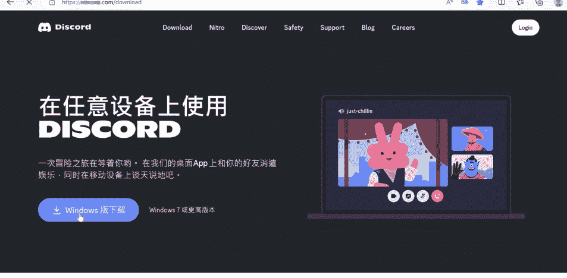

图8-1

第2步 下载完成后双击"DiscordSetup.exe"启动安装，即可进入更新界面，如图8-2所示。


▲图8-2

> **提示** 若首次安装失败，可右键"DiscordSetup.exe"选择【以管理员身份运行】。

第3步 更新完成后进入【Starting】界面，等待安装完成，如图8-3所示。

第4步 安装完毕后打开登录页，可使用已有账号登录，若无账号点击【注册】按钮，如图8-4所示。


▲图8-4

第5步 进入【创建一个账号】页，按提示填写注册信息，点击【继续】按钮，如图8-5所示。

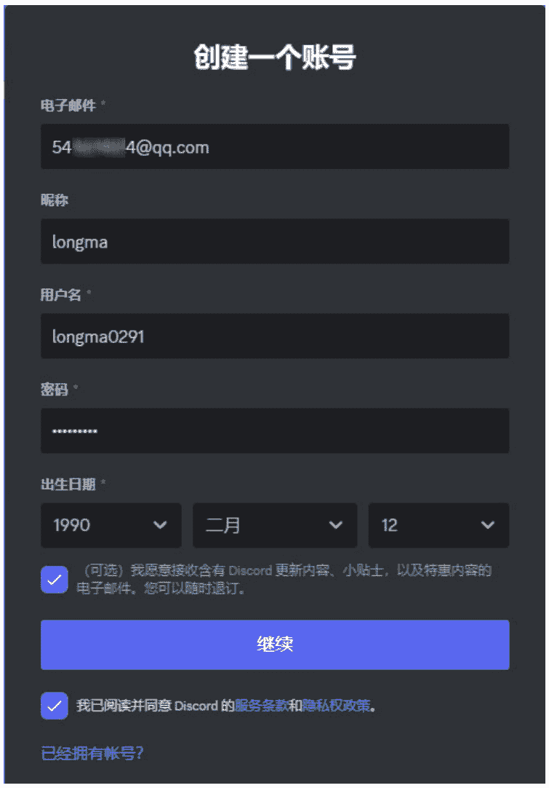

图8-5

提示 点击【继续】后需完成人机验证，选择【我是人类】并按提示点选图片即可。

第6步 邮箱会收到验证邮件，点击邮件中的【Verify Email】按钮，如图8-6所示。

第7步 验证通过后在弹出页点击【继续使用Discord】按钮，如图8-7所示。


▲图8-6


▲图8-7

第8步 自动登录并进入 Discord 主页，如图8-8所示。

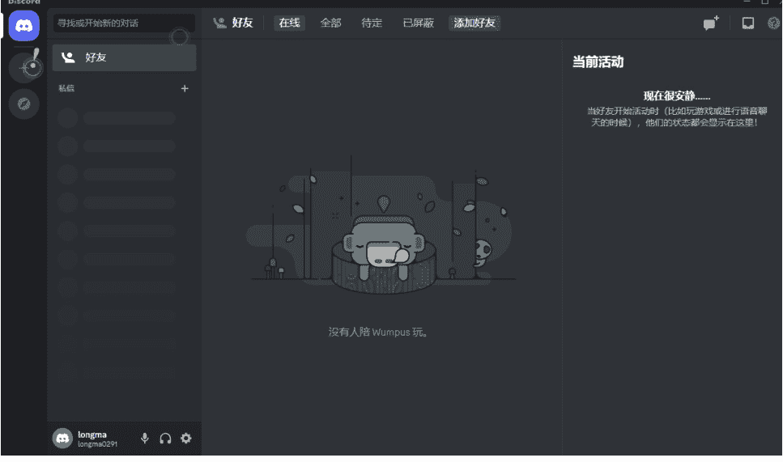

### 8.3.2 加入 Midjourney 社区

登录 Discord 后，还需完成加入和授权操作才能使用 Midjourney。

### 一、将 Midjourney 引入 Discord

第1步 进入 Midjourney 官方站点，点击下方的【Sign Up】按钮，如图8-9所示。


第2步 按提示选择"Continue with Discord"，在新页面点击【加入Midjourney】按钮，如图8-10所示。


图8-10

第3步 完成人机验证后，即可把 Midjourney 添加至 Discord，如图8-11所示。

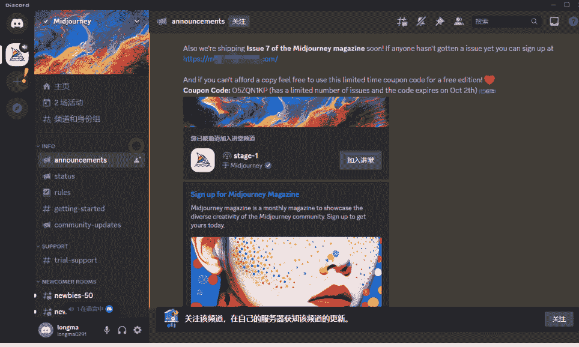

图8-11

### 二、设置服务器

加入后需创建或加入服务器以使用，具体步骤如下。

第1步 点击左上角【+】按钮，如图8-12所示。

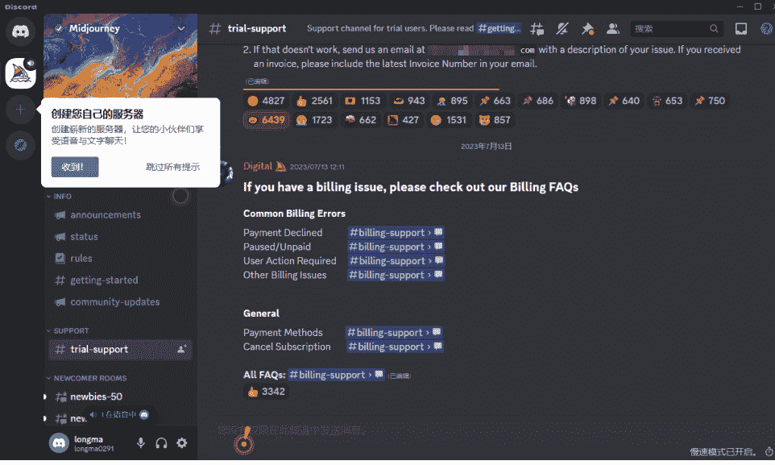

图8-12

第2步 在【创建服务器】页选择【亲自创建】选项，如图8-13所示。

第3步 选择【仅供我和我的朋友使用】选项，如图8-14所示。

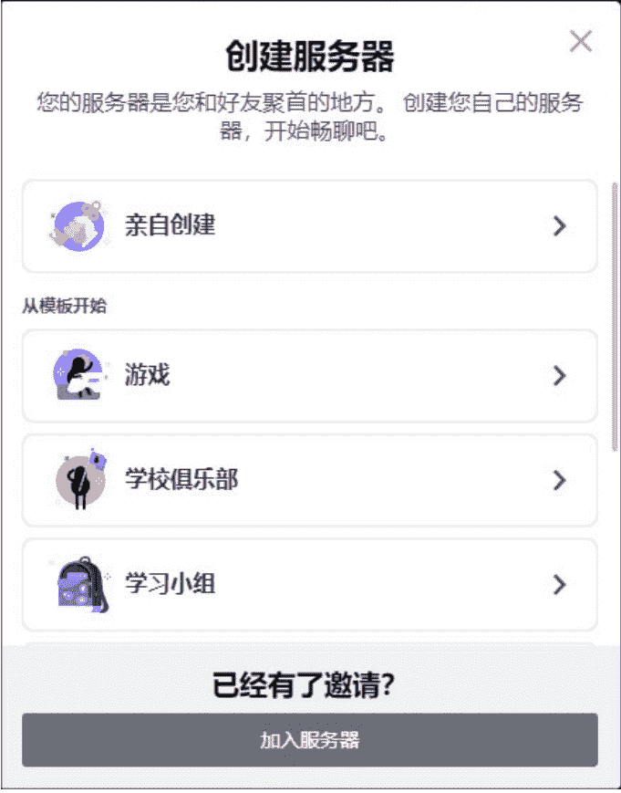

▲图8-13


▲图8-14

第4步 在【自定义您的服务器】页输入服务器名称，也可点击【UPLOAD】上传图标，设置完毕后点击【创建】按钮，如图8-15所示。


图8-15

第5步 服务器创建完成，如图8-16所示。

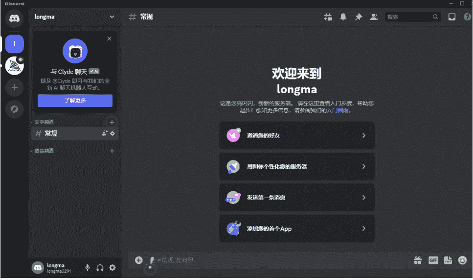

图8-16

### 三、完成授权

创建服务器后仍无法生图，需授权 Midjourney Bot，具体操作如下。

第1步 点击左上角【私信】按钮，在【寻找或开始新的对话】搜索框中输入关键词，如图8-17所示。

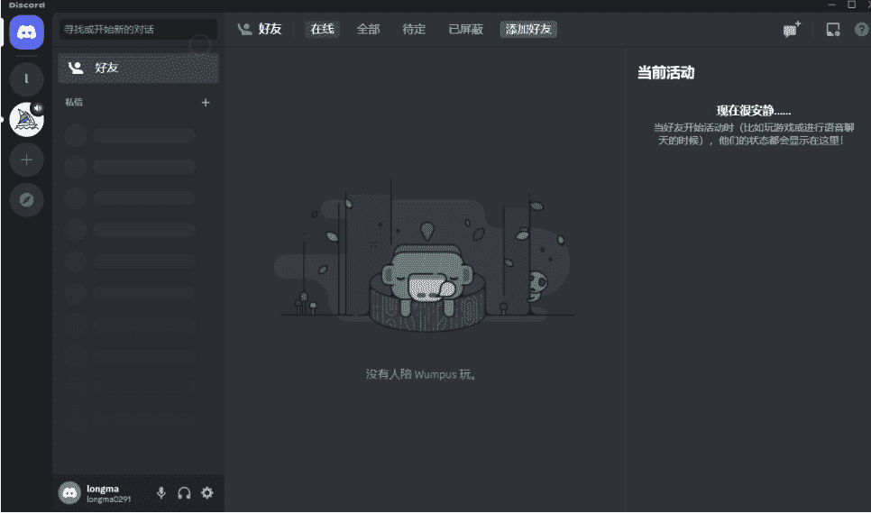

图8-17

第2步 在【搜索服务器、频道或私信】界面输入"Midjourney Bot"，按【Enter】键，如图8-18所示。


图8-18

第3步 在左侧列表中右键点击【Midjourney Bot】，在快捷菜单中选择【个人资料】命令，如图8-19所示。


图8-19

第4步 在弹出界面中点击【添加至服务器】按钮，如图8-20所示。


图8-20

第5步 在【外部应用程序】界面，从【添加至服务器】下拉列表中选择已创建的"longma"服务器，点击【继续】按钮。

第6步 在新页面点击【授权】按钮，如图8-22所示。


▲图8-21


▲图8-22

第7步 按提示完成验证，如图8-23所示。

第8步 授权成功后直接点击【关闭】按钮，如图8-24所示。


▲图8-23


第9步 在 Discord 左侧点击新建的服务器图标，即可开始使用 Midjourney，如图8-25所示。

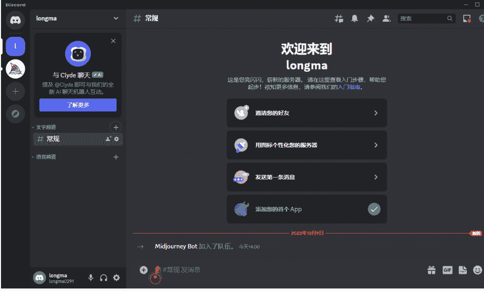


### 8.3.3 订阅会员的方法与注意点

Midjourney 并非完全免费，新用户仅有少量免费额度。订阅分为基本计划、标准计划、专业计划和大型计划，可按月或按年付费。表8-1 为不同订阅的计费标准。


| 订阅计费 | 订阅版本 | 价格/（美元/月） |
|:---|:---|:---|
| 按月计费 | 基本计划 | 10 |
| | 标准计划 | 30 |
| | 专业计划 | 60 |
| | 大型计划 | 120 |
| 按年计费 | 基本计划 | 8 |
| | 标准计划 | 24 |
| | 专业计划 | 48 |
| | 大型计划 | 96 |

各计划功能对比如表8-2所示。

表8-2

| 基本计划 | 标准计划 | 专业计划 | 大型计划 |
|:---|:---|:---|:---|
| ✓ 有限生成数量（200次/月） | ✓ 15小时快速生成 | ✓ 30小时快速生成 | ✓ 60小时快速生成 |
| ✓ 一般商业条款 | ✓ 无限生成数量 | ✓ 无限生成数量 | ✓ 无限生成数量 |
| ✓ 访问会员画廊 | ✓ 一般商业条款 | ✓ 一般商业条款 | ✓ 一般商业条款 |
| ✓ 可选信用卡充值 | ✓ 访问会员画廊 | ✓ 访问会员画廊 | ✓ 访问会员画廊 |
| ✓ 3个并发快速作业 | ✓ 可选信用卡充值 | ✓ 可选信用卡充值 | ✓ 可选信用卡充值 |

| | ✓ 3个并发快速作业 | ✓ 隐藏生成图像 | ✓ 隐藏生成图像 |

| | | ✓ 12个并发快速作业 | ✓ 12个并发快速作业 |

### 一、开通 Midjourney 订阅
第1步 在 Discord 窗口底部的聊天框内输入 “/subscribe pay”，敲回车进入流程，如图8-26所示。


图8-26

第2步 在返回的信息里点击【Manage Account】按钮，如图8-27所示。


图8-27

第3步 完成人机校验后会打开订阅购买页，选择想要的套餐后点该套餐下的【订阅】按钮，如图8-28所示。

第4步 进入支付方式选择，可用银行卡或支付宝付款，如图8-29所示，填入相关信息后点击【订阅】完成开通。


▲图8-28

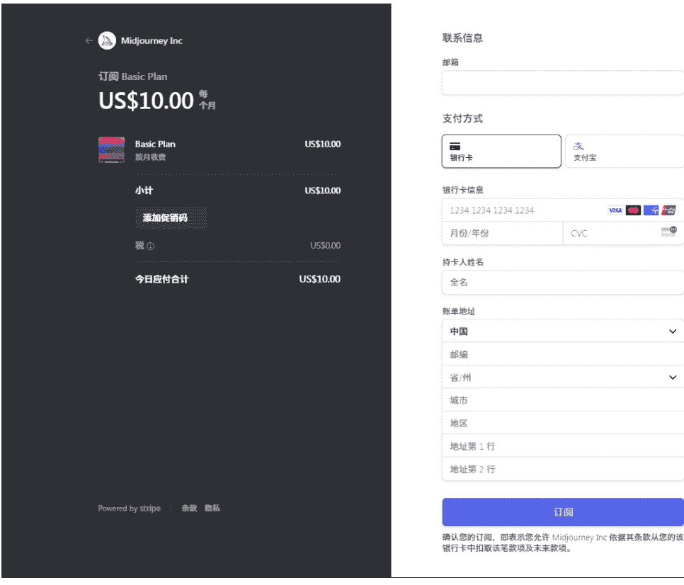

▲图8-29

提示 银行卡通道仅支持信用卡，储蓄卡无法使用。卡片下方标注的“月/年”与“CVC”可直接在实体卡上找到，前者印在卡面，后者是卡背签名栏上方的一串数字，通常取后三位用于身份核验。支付成功会收到系统提示，提示框可直接关闭。

### 二、关闭自动续费
若按月计费，系统会在每月自动扣款，不再需要时可手动取消续订，具体如下。

第1步 支付成功后弹出的页面中，点击下方的【Open subscription page】，如图8-30所示。


图8-30

第2步 进入订阅管理页后点【管理】，在弹出的菜单里选择【取消计划】，如图8-31所示。


图8-31

第3步 在确认页勾选【订阅期结束时取消】，然后点【确认取消】，如图8-32所示。


图8-32

第4步 返回订阅管理页再次点【管理】，此时菜单中的【取消计划】已变为【取消取消计划】，说明自动续费已成功关闭，如图8-33所示。


图8-33

## 8.3.4 提示词的四要素拆解
在 AI 绘图里，提示词相当于导演，决定模型如何作画。将“主体”“风格”“渲染”“参数”四项关键要素组合起来，就能搭建出多样化的绘图指令。合理搭配可以让模型产出更符合预期的艺术效果。以下结合实例逐项说明。

### 一、主体
先确定画面的核心对象，即主题或事物。主体可以是具体物，也可以是抽象概念，比如苹果、房屋、爱或孤独等。例如想表现梦幻感，可把主体设为山间小屋，如图8-34所示。


图8-34

### 提示
Dreamy mountain house.（梦幻的山屋。）

### 二、风格
风格决定整体画风与气质，可指定艺术流派或名家笔法，如印象派、立体主义或梵高式等。指定为印象派后，画面会呈现轻松笔触与明亮色调，如图8-35所示。


图8-35

### 提示
Impressionist style dreamy mountain house.（印象派风格的梦幻山屋。）

### 三、渲染
渲染关乎表现手法与视觉质感，可指定颜料种类如油画、水彩，或技法如粗糙、细腻，也可涉及画布材质。以梦幻山屋为例，采用水彩渲染，如图8-36所示。


图8-36

### 提示
Dreamy mountain house in watercolor style.（水彩画风的梦幻山屋。）

### 四、参数
参数涵盖色彩、构图、光源等更细致的设定，帮助更精准控制画面。比如设定暖色调营造梦幻氛围，并要求柔和光源强化梦幻感，如图8-37所示。

总的来说，借助主体、风格、渲染、参数四要素构建提示，能够把想法具体化并引导模型生成预期作品。以“梦幻山屋”为例，通过不同要素的组合即可得到印象派或水彩风格的梦幻画面。


图8-37

### 提示
Dreamy mountain house through movie lens.（电影镜头下的梦幻山屋。）

## 8.3.5 制作并分享首个作品
本节演示在 Midjourney 中绘制个性化头像并分享的流程。

提示 Midjourney 绘图使用 “/imagine” 命令，且提示需为英文。若英文不足，可借助谷歌翻译、有道翻译、DeepL 等在线工具，或 DeepSeek、文心一言 等 AI 模型完成中英转换。

想用活泼少年做头像，可先用 DeepSeek 翻译中文。

第1步 打开 DeepSeek，输入“将下面这段话翻译为英文 绘制一个可爱的、勇敢奔跑的Q版少年头像”，得到结果如图8-38所示。


第2步 复制译文，在 Discord 中输入 “/imagine prompt”，把英文粘贴进输入框后回车，如图8-39所示。


第3步 等待片刻，Midjourney 会生成 4 张初稿，如图8-40所示。

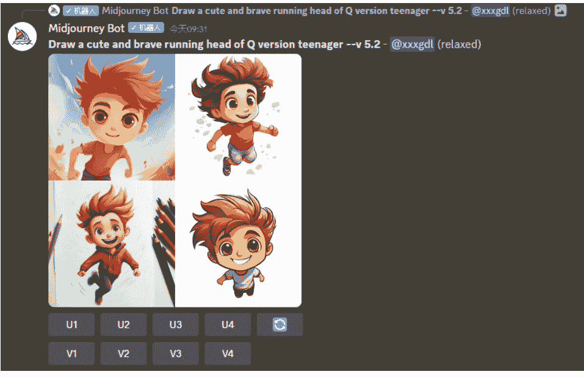

图8-40

提示 图片下方有 “U1”“U2”“U3”“U4”“V1”“V2”“V3”“V4”“🔄” 等控件。U 系列对应左上、右上、左下、右下的 4 张图，点击可放大查看；V 系列在保留原图构图与风格的基础上做微调；🔄 会重新运行提示生成新组。

第4步 点击【U4】，稍等后即可看到放大图，如图8-41所示。

第5步 点击图片后再次放大，再点【在浏览器中打开】，如图8-42所示。

第6步 在浏览器中查看大图，右键选择【图片另存为】保存到本地，如图8-43所示。

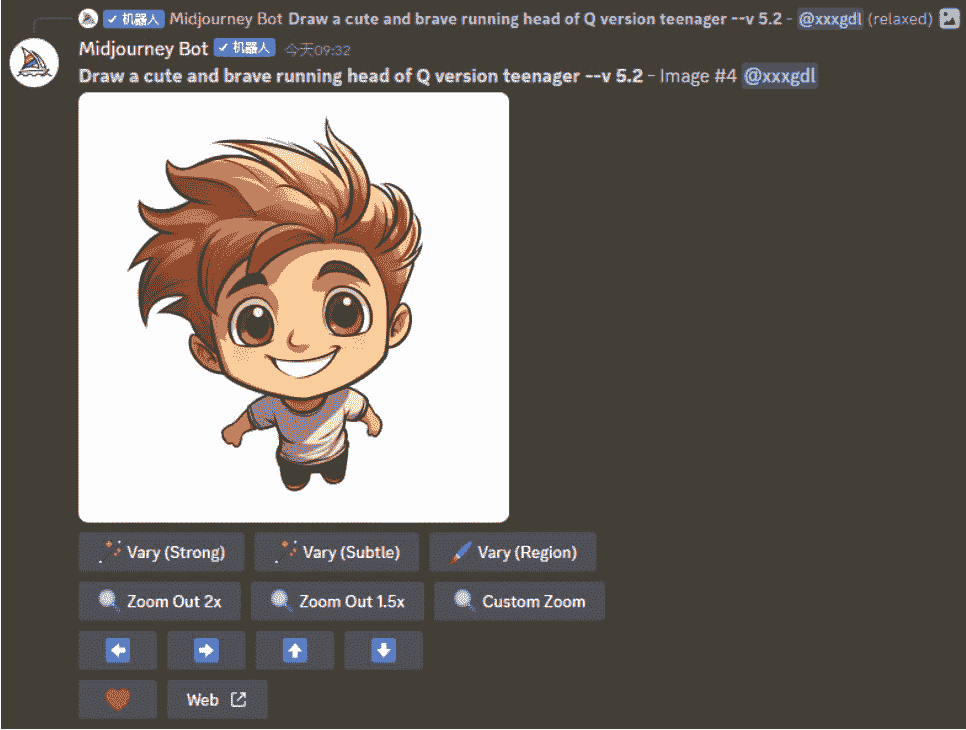

▲图8-41


▲图8-42


第7步 返回 Discord，若想对 U4 进行延展，可点【V4】，如图8-44所示。

第8步 模型会在原图基础上微调并生成 4 张相似图，如图8-45所示。


▲图8-44

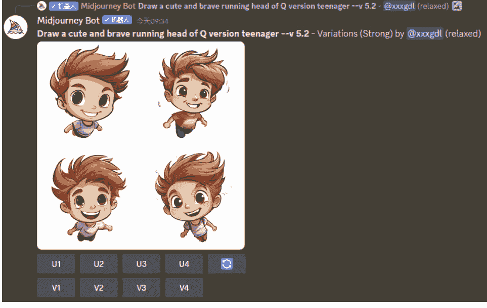


提示 可循环使用上述操作不断优化，直至满意。

## 8.4 文本与图像驱动的视频生成
本节以清影 AI 为例，说明如何用文字与图像生成视频。

第1步 打开智谱清言官网，登录后在左侧菜单选择【清影-AI生视频】，如图8-46所示。

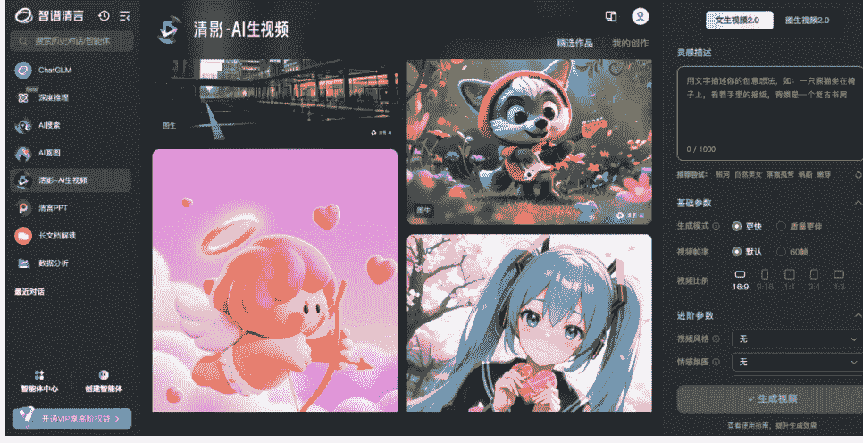

图8-46

第2步 默认进入【文生视频2.0】，也可切换到【图生视频2.0】。在【文生视频2.0】的【灵感描述】框内输入提示词，如图8-47所示。


图8-47

提示 文生视频提示与文生图有相通之处，也有差异。视频提示除了主体、动作、细节、环境，还需加入镜头语言与光影，以增强冲击与情感。如可描述表情、姿态体现性格，用推拉、旋转、缩放等运镜，以及明暗对比、色彩营造氛围、引导视线并强化故事。

示例结构如下。
一只卡通小兔坐在彩色蘑菇上（主体描述），手里拿画笔作画（主体动作）。它穿着带小花纹的蓝背心，眼神好奇（主体细节），背景是奇幻森林，周围有会说话的植物和活泼小动物（环境描述）。
再通过参数补充风格、氛围与运镜，使内容更完整。

第3步 在【基础参数】下可设生成模式、帧率、比例；在【进阶参数】下可设风格、情感氛围、运镜方式。按需开关【AI音效】与【视频去水印】后，点击【生成视频】，如图8-48所示。


图8-48

第4步 开始生成并显示进度，如图8-49所示。

第5步 生成完毕可预览效果，如图8-50所示，不满意可重生成。下方【添加背景乐】按钮可配乐，也可点下载到本地。


▲图8-49


▲图8-50

# 第3篇 提示应用实战

# 第9章 语言和翻译提示技巧
本章聚焦语言与翻译类提示技巧，旨在提升表达准确性，避免模糊与歧义，提升跨语言沟通效果。无论日常交流、文件翻译或文学创作，这些技巧都能帮助实现精准表达、减少误解、创造更具吸引力的内容。下面展开具体剖析。

## 9.1 表达与翻译的精准化
本节探讨如何实现精准表达与翻译。书面或口头交流中，信息必须准确传递。下面介绍通过清晰用词与结构达成准确性，并讨论翻译常见问题及对策。

### 9.1.1 上下文的准确把握
准确理解语句所处情境对选择合适的译法至关重要。以下为参考示例。

- 请给出一个存在歧义的句子并说明其背景，分析不同理解可能带来的差异，最后给出一个消除歧义的清晰表达。

- 请提供一个双关句并描述使用场景，阐述不同解读可能产生的不同含义，并给出能解释并避免误解的译法或表达。

- 请给出带有隐含意义或文化背景的句子并详述上下文，说明理解该句所需的特定背景知识，最后提供能传达隐含意义的准确译法或表达。

- 请给出一个需依赖上下文才能理解的句子并描述可能的解读，同时提供能完整理解并传达其含义的译法或表达。

借鉴上述示例，用户可提供具体语境，让模型协助解释并挑选合适的译法或表达，避免误解。

以“双关语句”为例，可下达如下指令。

### 提示
请提供一个双关语句，并描述其上下文。同时，请阐述不同的解读方式可能导致的不同意义，并给出一个能够解释并避免误解的翻译或表达方式。

### AI回答

#### 双关语句
> “这个人真是太会算计了。”

#### 上下文
该句可在讨论某人的财务能力或策略行为时出现。

不同的解读可能产生不同意义。

1. 正面解读：在财务管理或商业策略语境下，可能表示赞赏，即此人擅长规划与布局，能有效管理并增益财富。
2. 负面解读：在人际或道德评价语境下，可能表示批评，即此人过于精明或狡猾，处处为自己谋利甚至牺牲他人。

为避免误解，可更具体地表述：
1. 赞赏其财务或策略能力时，可说：“这个人财务管理很在行。”
2. 批评其精明或自私时，可说：“这个人在人际交往中太精明了，总是只顾自己。”

如此可确保真实意图被准确理解，避免双关带来的混淆。

### 9.1.2 词句选择的适配性
挑选合适的词汇与短语是语言准确的关键，需兼顾风格、语气与受众。以下为参考示例。

- 请给出一个正式风格的句子，并详细描述目标受众特征与期望语气，基于此提供词汇与短语建议以满足需求并保持正式性。

- 请给出一个营造轻松友好氛围的句子，明确目标受众并描述其偏好语气，同时提供使语气更自然亲切的词汇与短语建议。

- 请给出一个需使用专业或技术性语言的句子，明确其专业性、目标受众与语气，并提供领域相关的词汇与短语建议以确保准确专业。

- 请给出一个具有说服力或影响力的句子，描述受众与语气，并提供具有说服力的词汇与短语建议以增强表达效果。

通过指定受众、语气与风格，模型可提供相应词汇建议，帮助挑选恰当表达。

以“表达轻松友好风格并描述受众”为例，可输入如下指令。

### 提示
请以轻松或友好风格，写出两段四联贺词送给新婚好友。

### AI回答
当然，送上轻松祝福很愉快。以下是两段四句贺词。

### 贺词一
红烛映双喜，金瓶锁良缘。
携手步红毯，同心至白头。

### 贺词二
两颗心相遇，爱河泛轻舟。
今朝结连理，幸福绕枝头。

### 9.1.3 语言风格的统一性
翻译或表达需保持风格一致，无论正式或非正式，都应与原文语调匹配。以下为参考示例。

- 请提供文字模板，包含正式与非正式两种风格的句子，我想在整段中保持某种风格，请给出翻译或表达建议以实现风格统一。

- 请提供非正式语言风格但内容专业的文字模板，我希望转化为某种风格，请提供词汇与表达建议以保证前后一致。

- 请提供一段非正式对话并转换为正式语言风格，我希望适用于此场景的风格是……，请给出确保风格一致的词汇与短语建议。

明确所需保持与转换的风格后，模型可提供建议以确保一致性。

以“提供含正式与非正式风格的文字模板”为例，可输入如下指令。

### 提示
请提供关于尊师重道的文字模板，包含正式和非正式两种风格的句子。

### AI回答

#### 正式风格：
尊师重道，是中华民族的传统美德，也是社会文明的基石。在教育殿堂里，教师是智慧的灯塔，照亮前行之路。我们当以恭敬之心接受教诲，以谦逊之态接受指正。尊师重道不仅是对教师职业的尊重，也是对知识的敬畏与学问的珍视。让我们共同弘扬这一优良传统，以教师的智慧引领未来。

#### 非正式风格：
尊师重道，这可是咱们老传统了。老师就像人生路上的指路灯，帮我们照亮方向。所以要尊重老师，珍惜他们的付出和教导。别忘了老师是“知识搬运工”！他们用心传授，我们用心学习，这样才不辜负期望。大家都要尊师重道，让这份美德在每个人心中扎根。

## 9.2 歧义与双关的处理
语言使用中，歧义与双关常造成理解困扰。为保证沟通清晰准确，本节解析如何识别并应对这些问题，提供实用技巧与策略，帮助避免误解，实现更精准有效的表达。

### 9.2.1 拆解歧义表达

碰到容易让人产生多种理解的说法，关键在于结合使用场景和周边信息进行判断，再给出合理的解释或译文。可参考以下几种实操方式：

- 找出一句存在歧义的表达，说明它出现的情境与背景资料，基于合理推断给出两种及以上的提示或译法，把模糊点拆开。
- 构造一段对话，里面某个词可指代多种含义，先交代对话发生的背景与沟通目的，再依据话境判断最可能的指向，帮助消除歧义。
- 提交一篇短文或故事，里面存在明显的语言歧义，指出歧义所在与可能的理解角度，给出解释性的提示或译文，让内容更通透易读。

用户只要按上述思路，把歧义的具体情境与相关背景交代清楚，再要求模型给出合理解释或译法，就能把模糊点理清，让表达更精准。

以“给出一段对话，其中某个词有多重含义”为例，指令可以这样写。

### 提示

请创作一段对话，其中包含一个多义词。详细说明对话发生的背景和沟通目的，并依据上下文给出最合理的解释，以帮助消除该词的歧义。

### 模型回复

A：昨天听的那场演出太有冲击力，你怎么看？
B：我也这么觉得，小提琴手的演绎特别打动我。
A：我也是，她的技巧很有说服力。不过我更关注那位指挥，他全程在掌控整个乐团。
B：对，表现很突出。你注意到没，他打拍子的手势有时十分夸张。
A：注意到了，只是动机不太确定，可能是一种艺术化处理？
B：也许吧，或许只是为了让每位演奏者都能看清动作。

#### 背景与目的
这段交流发生在两位朋友看完音乐会后复盘。他们在讨论演出感受，尤其是围绕指挥的表现展开。

#### 词“指挥”的多义与解析
1. 乐队指挥的具体动作，指指挥家用手势引导演奏者的行为。
2. 控制或管理，泛指对活动或人员的管辖，不限于音乐领域。

结合话境，这里“指挥”最合理的理解是第一种，即乐队指挥的具体手势。这一点与两人讨论音乐会及指挥如何引导乐团演奏的背景相符。

### 9.2.2 双关语拆解指南

遇到双关时，需要给出对应解释，确保使用者能get到多层含义。参考示例如下：

- 提供一个包含双关的句子或短语，并说明其语境和可能的多种含义。请给出该双关的不同解读及说明，帮助理解本意。
- 提供一段包含双关的对话，并介绍背景和语境。请解释双关的多重含义并作相应说明，帮助使用者get到其中的幽默或暗示。

## 9.2.3 通过沟通消除误解

句子里出现歧义或双关时，应主动与使用者沟通来澄清，确保理解无误。参考示例如下：

- 提供一个包含歧义或双关的对话场景并描述交流过程。请给出合适的提问或回应，帮助一方消除歧义或解释双关，确保理解一致。
- 提供一个含有歧义或双关的文字片段，例如邮件或对话。请给出建议或示范，说明如何与发送方或接收方沟通以澄清歧义或解释双关，从而达成准确理解。
- 提供一个模拟情境，其中包含有歧义或双关的表述。请给出与该情境相关的沟通策略，帮助使用者与他人对话以澄清歧义或解释双关，确保准确理解。

参考这些示例，用户可以提供具体的对话场景、文字片段或模拟情境，要求模型给出沟通建议或示范。这有助于实现有效的沟通，确保理解准确。

下面以“请提供一段包含双关语的对话”为例，向模型下达如下指令。

### 提示

请提供一段包含双关语的对话。

### 模型回复

A：前天去了一家新开的餐厅，叫“味蕾乐园”。
B：真的吗？味道如何？名字听起来很有期待感。
A：菜品还不错，我觉得他们最会营造氛围。
B：怎么个营造法？
A：店里放着轻松的音乐，布置也很温馨，最难忘的是服务人员。
B：服务人员怎样？
A：都很专业，挺在意顾客满意度。不过我发现有些人服务得有点过度热情。
B：哈哈，看来你碰到了“有味道”的服务了！

在这段对话中，“味蕾乐园”只是直接点明主题，并不构成双关。而最后那句“有味道”的服务则是一个双关。“有味道”本来形容食物风味独特，这里被用来调侃服务员的热情，暗示服务超出了平常尺度，带点亲近过度的意味。

## 9.3 跨语言提示实战

在全球化背景下，跨语言沟通需求日益增长。本节介绍跨语言环境下的提示应用，包括如何适配不同语言文化背景，以及如何借助翻译工具提升沟通效果。

### 9.3.1 多语言支持方案

按需为不同语言用户提供支持，确保其能理解并使用系统或服务。参考示例如下：

- 描述你的系统或服务，并说明希望为不同语言用户提供支持。请模型给出实现多语言支持的建议或策略，确保各语种用户能够理解并使用。
- 提供一个具体用户案例或情境，其中有不同语言用户需要使用你的系统或服务。请模型给出方法或技巧，说明如何为这些用户提供支持，确保其有效理解和使用。
- 说明你的系统或服务的特点和功能，以及希望支持的语言。请模型给出实现多语言支持的建议和最佳实践，包括翻译、本地化或多语言界面设计等。

参考这些示例，你可以描述多语言支持需求并请求模型给出相应建议或策略，确保不同语言用户能够理解和使用系统或服务。

下面以类似“说明你的系统或服务的特点和功能，以及你希望为哪些语言的用户提供支持”为例，下达如下指令。

### 提示

请提供“外国文学中文在线教学软件系统”的特点和功能，以满足使用者母语的需求。

### 模型回复

外国文学中文在线教学软件系统，旨在帮助非中文母语者学习外国文学作品的中文翻译。基于检索结果，这类系统可能具备以下特点与功能。

1. 多语言支持：界面和教学内容应支持使用者的母语，便于理解与学习。
2. 分级课程：按中文水平提供不同难度的课程，从基础到进阶逐步深入。
3. 互动学习：通过游戏化、互动练习和模拟测试提升参与度和效果。
4. 文化背景介绍：提供作品的文化背景，帮助使用者更好地理解内容与深层含义。
5. 发音练习：集成语音识别，帮助使用者练习正确发音，尤其是对话和诗歌朗诵。
6. 词汇学习：提供作品中的重要词汇，包括生词、成语、俗语，并给出用法和例句。
7. 阅读材料：提供丰富的外国文学作品中文译本供阅读学习。
8. 写作指导：教授如何用中文撰写文学评论与分析，提升写作能力。
9. 在线学习社区：建立社区让使用者交流经验、分享资源。
10. 教师资源：为教师提供教学资源和工具，便于制定计划和评估学习情况。
11. 个性化学习路径：根据进度和兴趣提供个性化建议和路径。
12. 移动学习：支持移动设备，随时随地学习。

请注意，以上为基于检索的一般性描述，具体系统会有所差异。

### 9.3.2 翻译技巧与工具

翻译是指借助机器翻译或其他翻译工具，将文字或对话从一种语言转换到另一种语言，并保证准确性和流畅性的过程。参考示例如下：

- 描述你的翻译需求，包括目标语言和待译的文字或对话内容。请模型推荐机器翻译工具或技术建议，以确保翻译准确流畅。
- 提供一个具体案例或情境，需要将文字或对话从一种语言转为另一种语言。描述你对翻译结果的期望，如准确性、流畅度和语境符合度等。请模型提供建议或技巧，说明如何有效翻译。
- 说明你希望实现的翻译方式，例如使用机器翻译引擎、整合外部翻译服务或自研翻译模型。请模型提供相关技术选项和最佳实践，以保障翻译质量。

这些示例可帮助用户描述跨语言翻译需求并请求模型提供相应建议或策略，以确保翻译准确流畅。依据用户提供的信息，模型可以给出工具、技巧或技术选项，满足翻译需求。

### 9.3.3 智能语言切换建议

模型依据用户的语言偏好提供语言选择建议，用户可方便切换到熟悉的语言。参考示例如下：

- 描述你的语言选择建议需求，包括系统或服务中的语言选项以及用户的语言偏好。请模型提供兼顾偏好与可用选项的建议，以便用户便捷切换。
- 提供一个具体使用情境，需要给出语言选择建议。描述希望提供建议的系统、应用或网站，以及用户的语言偏好和可选语言。请模型给出相关建议，说明如何优化语言选择的体验。
- 说明你希望实现语言选择建议的方式，例如通过用户配置、地理位置或浏览器设置识别语言偏好。请模型提供相关技术选项和最佳实践，确保用户能方便切换到熟悉语言。

这些示例可帮助用户描述语言选择建议需求并请求模型提供相应建议或策略，确保用户能方便切换到熟悉语言。

## 第10章 社交对话技巧精要

在提示工程实践中，社交对话是重要且具挑战性的领域。以下技巧和实例有助于建立自然流畅的对话，使用礼貌用语、辨识隐喻，解决对话中的歧义和误解，并应用于日常。本章通过生活实例示范这些技巧的应用，帮助提升交流能力和人际关系，解决沟通障碍。

## 10.1 打造自然流畅对话

建立自然流畅的对话是关键技能，有助于交流时保持轻松自如。本节阐述若干技巧，如维持恰当语速节奏、适时提问与回应等，帮助你在对话中保持连贯，确保信息顺畅传递。

### 10.1.1 语调节奏同步

与他人交流时，根据对方语调和节奏做适应性调整，是沟通顺畅的关键。下面三个范例展示如何灵活调整用语和语速，更有效地传达信息。

#### 【范例1】对方快速且连贯地表达意见。
你可以使用简洁明确的用语回应，并保持较快的语速，以符合对方的沟通风格。例如：
> “我需要你立即检查程序码的错误日志，然后发送详细报告。”

#### 【范例2】对方以冷静且冷淡的语调进行交流。
在这种情况下，你可以保持冷静，使用正式的用语，并稍微减慢语速，以符合对方的风格。例如：
> “请你花一些时间检查程序代码，并检测任何可能的错误。请在完成后向我报告进度。”

#### 【范例3】对方的语调带有焦虑或困惑。
在这种情况下，你可以使用亲切和安抚性的语气，简单解释指示并提供支持。例如：
> “我理解你对这个问题感到困惑。请你先停下来，尝试重新启动程序，并记录可能出现的任何错误提示信息。若问题依旧未能得到解决，请随时向我反馈，我会尽力解决。”

这些范例展示了在指示他人时如何根据对方的语调和节奏调整自己的语调和节奏。适应对方的沟通风格有助于建立良好的合作关系并确保指示的有效传达。

### 10.1.2 展现真诚回应

交流过程中，应以诚挚态度回应对方的话题和观点，充分展现关注和理解。在对话或下达指示时，表达真诚和兴趣对提升沟通效果至关重要。

下面展示如何进行真诚回应。

#### 【范例1】对方阐述了一种关于优化程序代码性能的思路。
> “谢谢你分享这个观点，我很重视你对程序代码性能的关注。我想听听你对改进程序代码性能的具体建议。”

#### 【范例2】对方提到了一个遇到的问题。
> “我很理解你在这个问题上所遇到的困难，让我来协助你解决。请你提供更多细节，比如出现的错误提示或具体的操作步骤，以便我能更好地帮助你。”

#### 【范例3】对方表达了对某个新功能的兴趣。
> “感谢你对新功能的关注，我很高兴能够为你提供更详细的信息。我们可以安排一场会议，深入讨论你对这个功能的期望和需求。”

这些范例展现了回应他人时如何真诚表达对话题和观点的关注与理解。通过这种回应方式，你将能够与他人建立坚实沟通基础，让指示内容更易被理解和接受。

### 10.1.3 告别模板化表达

避免过度使用模板回答，能让对话更生动个性化。下面的范例展示如何以个性化方式下达指示。

#### 【范例1】对方需要对程序代码进行重构。
所谓重构，是在不改变程序代码外在表现和行为特征的基础上，对程序代码进行必要的调整与优化，旨在提升程序内部结构的合理性与高效性。通常可以这样回答。
> “经过对程序代码的全面审视，我认为当前代码存在进行重构的迫切需求，以进一步提高其可读性和维护性。因此，我非常期待听取你关于如何启动并推进这一重构工作的具体想法。请你对当前的代码架构和逻辑进行深入的剖析，并根据分析结果制定一份详细的改进计划。在你完成这些准备工作后，请与我分享你的计划，以便我们共同讨论并确定下一步的行动方案。”

#### 【范例2】对方需要解决一个复杂的问题。
> “我深知你当前正致力于解决这一复杂的问题，这需要你进行深入的思考与细致的分析。在此，我建议你先将问题细化，分解为若干个子问题，然后逐一解决。若你在解决问题的过程中遇到任何困难，或需要进一步的支持与指导，请随时与我联系，我很乐意为你提供协助。”

#### 【范例3】对方需要测试一个新功能。
> “我很高兴你对这个新功能的测试感兴趣。为了确保测试的有效性，我建议你从正常使用情境出发，测试各种不同的情境。同时，请记录你遇到的任何错误或异常行为，以便我们能够及时修复和改进。如果你在测试过程中有任何问题或需要协助，请随时联系我。”

这些范例展示了如何运用个性化方式下达指示，避免过度依赖标准化模板。这种回答模式旨在增强对话生动性和互动性，同时彰显你对对方具体情况的深入理解和关注，从而推动更高效富有成效的合作。

## 10.2 礼貌表达与隐喻识别

在社交对话中，礼貌用语和隐喻是常见元素，其理解和应用具有一定难度。本节剖析如何使用礼貌用语，如道歉、感谢和邀请等，并探讨如何准确理解和有效回应隐喻，以确保表达得体，避免误解。

### 10.2.1 得体礼貌用语

注意使用礼貌用语，如谢谢、对不起、请问等，以表示尊重和友善。下面的范例展示如何运用礼貌用语下达指示。

#### 【范例1】需要对方协助解决问题。
> “非常感谢你寻求我的帮助，我很高兴能够为你提供协助。如果你能提供更多关于问题的细节，这将极大地有助于我更准确地理解你的需求，并找到最合适的解决方案。请随时分享更多信息，以便我能够更有效地帮助你。”

#### 【范例2】需要对方协助执行一项任务。
> “对不起打扰到你，我需要你协助执行这项任务。请问你有空帮忙吗？这项任务对我们的整体进度非常重要，感谢你的协助。”

#### 【范例3】需要对方检查程序代码的错误。
> “谢谢你的合作，请你仔细审查程序代码，寻找并指出可能存在的任何错误。如果发现问题，请及时告知我们，我们将立即处理。再次对你提供的宝贵帮助表示深深的感谢。”

这些范例展示了在下达指示时如何恰当运用礼貌性语言。这种表达方式不仅彰显对他人的尊重和友善，也有助于构建稳固合作关系，让指示更容易被接收和执行。

### 10.2.2 识别暗喻含义

在对方采用暗喻或间接表达方式时，应尽力探寻其深层含义，以免产生误解。准确识别暗喻并深刻理解其内在意义，对确保沟通顺畅高效至关重要。下面的范例展示了如何面对暗喻或间接表达时采取恰当方式下达明确指示。

#### 【范例1】对方使用暗喻描述程序代码的问题。
> “我听到你提到了这段程序代码有点‘曲折复杂’。能否更具体地描述你所指的问题，例如哪一部分程序代码让你感到难以理解，这样我可以更直接地协助你解决问题。”

#### 【范例2】对方以间接方式表达需要额外资源。
> “我了解到你在当前项目中可能需要更多的支持或资源。为了确保我们能够提供适当的帮助，请你详细阐述所需的额外资源，无论是人力、时间还是其他类型的资源。这样我们才能进行准确的评估，并给予相应的支持。”

#### 【范例3】对方用比喻来描述一个错误的严重性。
> “我了解到你提到的这个错误对系统的稳定性造成了重大影响。为了更深入地理解问题的实际情况，请你提供一些额外的细节，比如这个错误具体导致了哪些问题，以及它可能带来的潜在后果。”

这些范例说明了在面对暗喻或间接表达时如何下达指示，以确保对话准确性。通过寻求更具体的描述和细节，能更好地理解对方所指内容，从而提供相应解决方案或支持。

## 10.3 化解沟通歧义

对话中出现歧义和误解是常见沟通挑战，借助有效技巧和策略能够解决问题。本节阐述几种解决对话中歧义和误解的实用方法，如主动澄清、倾听和确认，以及提出具体问题。

### 10.3.1 主动求证澄清

对话过程中，若意思表达不够明确或存在潜在歧义，务必及时主动予以澄清，以确保双方沟通内容的准确性。下面的范例展示了如何在需要时主动澄清。

#### 【范例1】对方提出了一个模糊的问题。
> “很抱歉，我不太确定你的问题是什么。如果你能提供一些具体的背景或者详细情况，我将能够更加精准地帮助你。”

#### 【范例2】对方使用了一个不明确的术语。
> “请问你能解释一下你所指的‘X’是什么吗？这样我们可以确保在接下来的讨论中，使用一致的术语和概念。”

#### 【范例3】对方提供了一个含糊不清的指示。
> “抱歉，我不太清楚你指示的具体内容。你能更详细地描述希望我们做些什么，或提供一个实际的范例吗？这样我就能更准确地理解并开始执行指示。”

这些范例说明了在需要时如何主动澄清。请记住，主动澄清不仅是保障沟通顺畅的重要一环，也是预防错误和消除误解的有效途径。

### 10.3.2 倾听后确认理解
倾听和确认对方的意思是有效沟通的关键。下面的范例展示了如何在回答前倾听并确认对方的观点和表达。

## 沟通先确认，再追问细节

### 10.3.3 提出具体问题

作为提示工程师，厘清意图的核心做法是先复述再追问。下面给出三种典型情境的改写示范。

#### 例1 来者给出一则含糊的表述
> “‘改进系统’你具体想覆盖哪些点？是想提升运行效率、打磨交互体验，还是重构异常处理逻辑？”

#### 例2 来者提出的安全期待不够明确
> “我捕捉到你对安全的重视度提升了，能否展开说说关注的具体维度？比如身份鉴权的强度、传输加密的等级，或其他防御方面的诉求？”

#### 例3 来者的问题比较抽象
> “谈到要提效，你更倾向在系统层面做结构性调整，还是优化某些操作流程或功能配置来减少耗时？”

这组示范说明，精准提问能把模糊表述落地。提问的姿态以求理解和协作为主，避免质问或贬低，才能获得更清晰的反馈。

## 10.4 社交对话提示技巧应用实例

在日常互动里，引导式沟通很有用。常见场景有：聚会认识新朋友、会议里与伙伴或客户对齐、与亲友深度交流、化解误会维护关系。

以提示工程师身份参与对话时，可参考以下说法。

### 例1 在聚会想向朋友介绍新做好的代码项目
> “嗨，我刚把一个代码项目做完，很想跟你分享一下，要是有空可以简单介绍吗？”

### 例2 团队协作开发产品，需要明确分工
> “嗨，登录页这块看起来还没启动，正好符合你的专长，能否接手并在周五之前交付？有疑问随时找我讨论，谢谢！”

### 例3 会前提醒伙伴准时参会
> “各位好，明天上午十点会议准点开始，烦请提前规划日程并把相关材料备齐。如时间冲突需调整，请在今日15点前联系我。感谢配合！”

无论私下聚会还是团队协作，以上说法都体现表达清楚、措辞礼貌、主动澄清、认真倾听并核对意图等要点。

## 第11章 知识查询和解答提示技巧

信息爆炸的当下，快速定位并给出可靠答案至关重要。本章介绍高效检索路径、获取可信知识的流程，以及处理常见问题的思路。

### 11.1 高效检索与获得准确的知识

本节说明如何检索，包括选用合适的检索词与评估来源的可信度。

#### 11.1.1 了解检索工具

熟悉搜索引擎、数据库、知识库等工具并掌握结果过滤技巧很重要。下面用提示工程师视角给出指令示范。

##### 例1 用搜索引擎找机器学习近期论文
提示
请检索“机器学习 最新论文”，结果按由新到旧排序，只保留最近一年内的文献。
AI 回应
按你的要求，以下是近一年机器学习相关论文的摘要，按时间倒序呈现。

2023年12月
聚焦机器学习求解组合优化，覆盖图匹配、旅行商、二次分类、因果发现等方向。其中的一篇提出基于深度强化学习的图匹配方案，并加入亲和正则化以抗离群点，提升匹配精度。

2023年11月
多模态机器学习的高分论文。研究涉及表征、对齐、推理、生成、迁移、量化等，探索如何利用语言、视觉、视频、音频等多源数据增强泛化与鲁棒性。

2023年10月
NeurIPS 2023 录用论文。涵盖高质量语音转语音、文本生成的凸损失、白盒 Transformer、大语言模型的生成推理等热点。

2023年7月
ICML 2023 论文。包括受大脑神经回路启发的回路神经网络 CircuitNet，可模拟更多类型的神经元连接。

2023年6月
部分机器学习 Top 论文。涉及模仿 GPT-4 推理的 Orca 模型、可控音乐生成模型 MusicGen、利用大语言模型解决计算机视觉问题的模块化方法 LENS 等。
注意该领域更新快，上述列表不一定穷尽，摘要仅供方向参考，具体请查阅原文。

##### 例2 在公司 CRM 里找特定客户档案
可使用客户姓名和订单日期区间作为检索条件，筛选出相关档案。

##### 例3 从内部知识库找特定错误码的解决办法
以错误码为关键词检索，按相关度排序，找到包含该错误处理的文件。

##### 例4 从开放数据集找人口统计信息
利用国家数据门户，选择人口统计相关数据集，通过年份、地区等筛选条件提取所需数据。

这些示例展示了配合不同工具使用检索技巧与结果过滤的方法。

#### 11.1.2 关键词选择

选用具体相关的词有助于获得更精准的结果。下面给出指令示例。

##### 例1 在搜索引擎找云服务安全性信息
提示
使用关键词组合检索：云计算、安全风险、风险管控。
AI 回应
在数字化背景下，云计算、安全风险与风险管控紧密相关。随着企业转型加速，云服务作为业务架构的核心，其安全性日益关键。
1. 云服务的优势
- 成本效益：按需付费，降低硬件投入。
- 灵活弹性：可快速调配资源适应业务变化。
- 全球便捷：通过网络随时随地访问。
2. 云端安全挑战
- 数据隐私：服务商可能接触用户数据。
- 多租户隔离：共享硬件易导致隔离不足。
- 传输安全：数据在网络传输中可能被窃听或篡改。
- 身份校验与访问控制：需确保合法访问并阻止未授权进入。
这类词可缩小范围，找到更相关具体的成果。

##### 例2 从数据库找大数据分析案例
可使用“大数据分析、案例研究、成功故事”“大数据分析、实施案例”“大数据分析、行业应用案例”等组合，找到具体案例了解不同领域的应用效果。

##### 例3 从知识库找 Python 程序设计学习资源
可使用“Python 程序设计、入门”“Python 程序设计、自学资源”“Python 程序设计、实战指南”等关键词，找到适合初学者的资料与实战指南。

##### 例4 从开放数据集找全球气候变化资料
可使用“全球气候变化、气象资料集”“全球气候变化、温度变化资料”“全球气候变化、降雨量资料”等关键词，找到相关数据集。

这些示例说明如何挑选具体相关的关键词以获得更准确有价值的结果。

#### 11.1.3 来源可靠性验证

评估信息来源的可信度，优先选用权威来源。下面给出专业化指示方式。

##### 例1 查询 AI 在医疗领域的应用，优先考虑权威医学研究机构信息
可使用“AI、医疗应用”“AI 在医学研究机构的应用”“医学研究机构发表的 AI 相关研究”等关键词，优先选择权威医学研究机构、高校或医院网站的文章、白皮书或期刊论文。
提示
使用关键词组合检索 AI 在医疗领域应用的资料：“AI、医疗应用”。
AI 回应
AI 在医疗领域的应用已成为现代医学发展的重要趋势，提升服务效率与质量，推动个性化精准医疗。
1. 智能预检与病情评估
- 提高急诊效率：基于深度学习建立临床决策支持系统，实现智能预检和病情评估。
- 优化资源分配：减轻急诊负荷，提升诊疗效率，降低不良事件和资源浪费。
2. 辅助医学诊断
……

##### 例2 查询区块链技术最新发展，优先考虑知名科技媒体或专家观点
可使用“区块链、技术发展”“区块链、最新消息”“知名科技媒体对区块链的评论”等，优先阅读知名科技媒体或领域专家的文章、专栏或访谈。
提示
使用关键词组合检索区块链技术的最新发展：“区块链、技术发展”。
AI 回应
区块链最新发展主要体现在创新应用、政策支持、标准制定及与元宇宙结合等方面。
1. 创新应用：《中国区块链创新应用发展报告（2023）》梳理了 2023 年创新应用情况，案例集涵盖政务、金融、教育等，展示不同场景的应用成果与潜力。
2. 政策支持：自 2022 年起多项政策出台，覆盖农业、商贸、交通等领域，强调区块链与数字经济融合及公共服务治理，促进技术快速发展。
……

##### 例3 寻找网络安全最佳实践，优先选择国际标准组织或专业安全机构指南
可使用“网络安全 最佳实践”“国际标准组织网络安全指南”“专业安全机构提供的网络安全建议”等，优先阅读 ISO、NIST 等国际标准组织或 CERT 等专业机构发布的指南、白皮书或技术文件。
提示
使用关键词“国际标准组织网络安全指南”进行网络安全最佳实践检索。
AI 回应
国际标准组织发布的两项网络安全指南为全球实践提供重要参考，涵盖技术、政策、法律和管理等多维度。
1. 服务安全附录：SABSA 基于风险处理模型，通过多步流程识别、衡量和管理信息安全风险，强调系统设计初期即考虑安全。其框架包含意识、结构化过程、简捷性、自主控制、业务导向和持续改进六大领域，帮助建立安全 IT 环境。
……

这些示例展示如何以专业方式下达指示以确保来源可靠可信，具体指示会随领域和需求而变化。

#### 11.1.4 理解使用者需求

仔细阅读用户查询，确保准确理解需求并作相应解答。下面给出相关指示。

##### 例1 用户需要了解如何在 Python 中处理日期和时间
请进一步明确需求，例如“如何在 Python 中解析日期字符串”“如何在 Python 中进行日期计算”“如何在 Python 中格式化日期和时间”，以便提供针对性解答。
提示
如何在 Python 中格式化日期和时间？
AI 回应（见图 11-1）
在 Python 中可借助 datetime 工具包进行日期时间格式化，常用方法如下。
1. 调用 strftime 函数
strftime 可将日期时间对象转为指定格式的字符串。
例如将当前日期时间格式化为“YYYY-MM-DD HH:MM:SS”，可使用以下代码。
```python
from datetime import datetime
now = datetime.now()
formatted_date = now.strftime("%Y-%m-%d %H:%M:%S")
print(formatted_date)
```
2. 调用 strptime 函数
strptime 可将字符串解析为日期时间对象。
例如将日期时间字符串解析为对象，可使用以下代码。
```python
from datetime import datetime
date_string = "2023-04-01 15:30:00"
parsed_date = datetime.strptime(date_string, "%Y-%m-%d %H:%M:%S")
print(parsed_date)
```
图 11-1

##### 例2 用户想要找到适合初学者的网络安全程序设计知识
询问用户感兴趣的具体方向，例如“你对网络攻击与防御感兴趣吗”“你想学习网络配置和漏洞扫描的知识吗”“你对加密和身份验证感兴趣吗”，以便提供相应知识。
提示
请为初学者推荐一些适合入门的网络安全程序设计知识。
AI 回应
网络安全在信息技术发展中愈发重要。对初学者而言，选择合适的入门内容是第一步。
1. 基础概念与理论
- 学习网络安全基础、常见威胁如病毒、钓鱼等及防御手段。
- 了解白帽、灰帽、黑帽黑客的区别。
2. 编程语言学习
- 学习至少一门语言，Python 简单易学且适合编写安全工具和自动化脚本。
- 掌握 Python 基础语法及网络操作、数据处理相关库。
……

提示
请为初学者设计易懂的网络安全程序，该程序需使用漏洞扫描器。
AI 回应（见图 11-2）
对初学者而言，设计易懂的网络安全程序是良好起点。示例如下。
1. 目标：设计基于 Python 的程序，检测目标网站是否存在常见安全漏洞。
2. 工具选择：选用开源漏洞扫描器如 OpenVAS 或 Nmap，功能丰富且易用。
3. 安装和配置：按文档安装配置，确保依赖齐全并熟悉基本用法。
4. 编写脚本：使用 Python 调用漏洞扫描器并处理输出结果。以下是示例代码。

```python
import subprocess

def scan_target(target):
    # 调用漏洞扫描器的命令行命令
    command = f"openvas-scan {target}"
    
    # 执行命令并获取输出结果
    result = subprocess.check_output(command, shell=True)
    
    # 解析输出结果，提取漏洞信息
    vulnerabilities = parse_result(result)
    
    return vulnerabilities

def parse_result(result):
    # 解析漏洞扫描器的输出结果，提取漏洞信息
    # 这里可以根据你所使用的工具和需求进行相应的解析逻辑
    # 返回一个包含漏洞信息的列表
    vulnerabilities = []
    # 解析逻辑...
    return vulnerabilities

if __name__ == "__main__":
    target = input("请输入要扫描的目标网址：")
```


##### 【范例3】把模糊需求变成精准追问

使用者想掌握人工智能的最新动向时，先别直接要结论，而是先把范围收窄。比如可以问“你关心的是自然语言处理的进展吗？”、“你更想看机器学习或深度学习的最新突破吗？”、“有没有特定行业的应用趋势想优先了解？”这类追问能帮助提示工程师快速定位关注点，让模型回馈真正相关的前沿信息。

**提示**

我想了解自然语言处理的最新技术趋势。

**AI回答**

自然语言处理正处在高速迭代期，技术脉络也在不断丰富。以下梳理了当前NLP领域的一些主流走向，可帮助判断下一步的发展方向。

1. 深度学习架构持续深化
   - 以BERT、GPT为代表的预训练语言模型已成为研究热点，在诸多NLP任务上带来明显提升。这类模型先在大规模语料上预训练，学习通用的语言表征，再通过微调适配下游任务。
   - 模型体量与复杂度在上升，处理能力也在同步增强。Transformer凭借自注意力机制，能更好地捕捉序列内部的长距离关联。
   …………

### 11.2 解答常见问题

这一部分聚焦于如何提升模型的理解力与回应质量，让答案更清晰完整。同时介绍几组实用的沟通技巧，确保输出既准确又易懂，使用者能快速拿到所需知识。

## 11.2.1 建立常见问题集

把高频提问整理成库，可以大幅减少重复劳动。以下是提示工程师在专业语境下的建库示范。

### 【范例1】建立一个常见问题集，涵盖有关网络安全的主题。

从过往的客服记录、技术支持工单与内部文档中挖掘与网络安全相关的提问。内容可包括用户曾询问过的问题、服务热线高频咨询、技术手册里的常见疑惑等。整理后形成结构清晰、检索方便的安全问答库。

### 【范例2】构建一个详尽的常见问题解答库，旨在涵盖用户在软件使用过程中可能遇到的各类问题。

通过邮件、在线社区、客户服务系统等渠道收集用户反馈，了解大家在功能操作、异常报错、日常使用上的痛点。将这些问题系统化归类，并配上完整的解答与处置方法，让使用者自行查阅即可找到答案。

### 【范例3】建立一个常见问题集，涵盖有关程序设计的常见问题。

在程序设计社区、论坛及知识分享平台上搜集常见的开发提问。范围可覆盖不同编程语言的基础疑难、特定框架或库的使用技巧等。将问题整理归档，形成易搜索的问答集合，方便提示工程师或开发者迅速定位答案。

### 提示

请从程序设计社群、在线论坛和知识交流平台中检索常见的程序设计问题，并整理出一个常见问题集。

### AI回答

以下整理了一份程序设计常见问题清单。

#### 1. 编程语言基础

- 如何搭建并配置××语言的开发环境？
- ××语言中的变量与数据类型有什么区别？
- 如何在××语言里实现循环与条件判断？
- ××语言中异常与错误该怎么处理？

#### 2. 算法和数据结构

- 常见的排序算法有哪些，它们的复杂度如何？
- 栈或队列该如何实现？
- 哈希表的工作原理是什么？
- 树与图的数据结构有哪些典型用途？

以上案例展示了以专业视角下指令、构建问答库并给出解决方案的方式。提示工程师可依据领域与需求灵活调整。

## 11.2.2 清晰简洁的表达

用通俗易懂的语言回应提问，尽量避免堆砌术语。以下是提示工程师的表达示范。

### 【范例1】回答使用者提问时，以简单易懂的语言表达。

建议用日常用语解释技术概念，术语只在使用者明确需要时才使用。如需使用，请同步给出解释或背景，帮助理解。

### 提示

什么是TrueType字体?

### AI回答

TrueType字体是一种常见的数字字体格式，由苹果与微软共同推出，用来统一字体存储与显示。常见文件后缀为.ttf。

它使用轮廓来描述字形，这些轮廓由数学指令构成，能精确呈现曲线与直线，因而在不同分辨率和尺寸下仍保持清晰可读。

主要特性包括。

1. 可缩放性：在任意大小下都能保持清晰。
2. 跨平台兼容：在Windows、macOS、Linux等系统上通用。
3. 多语言支持：可容纳多种语言与字符集，适合多语环境。
4. 样式丰富：可包含粗体、斜体等多种变体。
5. 高级排版：支持连字、上标、下标等排版功能。

TrueType广泛应用于网页设计、印刷与图形软件，是数字排版与设计的基础组件。

### 【范例2】回答软件功能的相关问题时，使用简单的步骤说明。

用分步方式说明功能操作，每个步骤写得简洁明了，必要时配合图示、范例或视频辅助理解，避免过度技术化。

### 提示

如何使用Photoshop为图片创建倒影效果?

### AI回答

快速制作图片倒影的基本流程如下。

1. 打开图片：在Photoshop中载入目标图像。
2. 复制图层：选中原图层后复制一份，快捷键为【Ctrl + J】或【Cmd + J】。
3. 垂直翻转：对复制层执行垂直翻转。
4. 放置位置：把翻转层拖到原图下方，形成倒影。
5. 添加蒙版：为翻转层建立图层蒙版。
6. 渐变淡出：用渐变工具在蒙版上自底向上拉出黑到透明的渐变，让倒影逐渐消失。
7. 调节透明度：视需要微调倒影层的透明度以求自然。
8. 保存文件：完成编辑后导出。

按此步骤即可得到简易的倒影效果。

### 提示

如何使用Photoshop为图片加入多种不同的滤镜？

### AI回答

在Photoshop中叠加多种滤镜的操作如下。

1. 打开图片：载入待编辑图像。
2. 复制背景层：为保留原件，先复制背景层，可用图层面板新建按钮或【Ctrl + J】/【Cmd + J】。
3. 进入滤镜菜单：选中复制层，点击顶部“滤镜”。
4. 选择效果类别：菜单下有模糊、扭曲、像素化、渲染等，按需求挑选。
5. 调整参数：在滤镜对话框中微调参数至理想效果。
6. 叠加不同滤镜：重复步骤3至5，继续添加新滤镜。
7. 尝试混合模式：更改图层混合模式，让效果与原图更好地融合。
8. 控制强度：必要时降低滤镜层的透明度。
9. 局部调整：加入图层蒙版，用画笔以黑白控制滤镜显示范围。
10. 导出图片：完成后保存为PSD保留图层，或导出为JPEG、PNG等格式分享使用。

如此可在同一张图上组合多种滤镜并做个性化调节。

### 【范例3】在解答编程的相关问题时，提供清晰且易于理解的代码示例。

讲解方案时提供精炼的代码片段展示核心逻辑，避免长篇复杂代码。对关键部分逐行说明并加上注释，帮助理解其作用。

### 提示

请用Python编写一个模拟大乐透开奖的程序，要求如下：1. 生成5个不重复的红球号码（1～36号）；2. 生成2个不重复的蓝球号码（1～13号）；3. 输出开奖结果。

### AI回答（见图11-3）

```python
import random

def generate_lotto_numbers():
    red_balls = random.sample(range(1, 36), 5)
    blue_balls = random.sample(range(1, 13), 2)
    return sorted(red_balls) + sorted(blue_balls)

result = generate_lotto_numbers()
print("开奖结果：", result)
```

图11-3

以上案例展示了以专业方式下指令，用简洁语言解答问题的思路。

## 11.2.3 提供具体的解决方案

提示工程师除了点出问题，还应给出可执行的步骤与范例，帮助使用者落地。以下为提供具体方案的指示示范。

### 【范例1】回答使用者问题时，提供具体的步骤和操作范例。

指示中应把解决流程拆解为子任务并附上操作细节。例如使用者问如何设置网络连接，可回覆：“先打开网络设置页面，再点‘新增连接’，然后填入SSID与密码，最后点‘保存’完成建立。”具体步骤能让使用者清楚执行。

### 【范例2】回答软件错误状况问题时，提供具体的故障排除步骤和范例。

依据使用者描述的错误情境，给出排查流程。例如软件无法启动时可建议：“先确认是否已更新到最新版本；再检查系统是否符合最低运行要求，包括OS版本与硬件配置；然后尝试重装并按安装指南操作；若仍未解决，请提供错误信息以便进一步诊断。”按部就班的排查能提高效率。

### 【范例3】回答程序设计的相关问题时，提供精确的代码示例和详细的解释。

不仅给代码实现，还要说明每一部分的职能与运行机制。例如提问如何在Python遍历列表，可示范：“用for循环逐个访问元素，例如对列表numbers，使用 for number in numbers: print(number)。”配合示例与说明，使用者更容易掌握。

### 提示

如何在Python中高效地迭代列表元素？

### AI回答（见图11-4）

在Python里遍历列表是高频操作，以下是几种高效写法。

1. 使用 for 循环：最直观的方式，直接逐项取值。

```python
my_list = [1, 2, 3, 4, 5]
for item in my_list:
    print(item)
```

2. 使用 enumerate 函数：需要索引时可用 enumerate 同时取得位置与值。

```python
my_list = ['a', 'b', 'c', 'd']
for index, item in enumerate(my_list):
    print(index, item)
```

3. 使用列表推导式：用一行代码完成处理并生成新列表，写法简洁。

```python
my_list = [1, 2, 3, 4, 5]
squared_list = [x**2 for x in my_list]
print(squared_list)
```

图11-4

以上范例说明了如何下指令并附上清晰步骤、操作范例与解释，帮助使用者真正应用方案。

## 11.3 处理多样的知识资源

本节介绍如何高效利用文字、图像、视频等不同形态的知识载体。每种载体对应的检索策略与解答方式不同，以下技巧可助你更好管理与运用。

### 11.3.1 了解多方面知识

涉猎科学、历史、文学、艺术等多元领域，以满足不同使用者的需求。以下为提示工程师的多面向知识示范。

### 【范例1】回答使用者有关科学发现的问题时，提供相关的历史背景和关键细节。

例如关于万有引力定律的提问，可补充历史脉络。牛顿在17世纪提出该定律，指出任意两物体因质量而相互吸引，吸引力与质量成正比、与距离平方成反比。该理论奠定经典力学基础，解释了地面落体与行星公转，1687年收录于《自然哲学的数学原理》，对天文学与物理学产生深远影响。

### 提示

请介绍一下牛顿的万有引力定律。

### AI回答

万有引力定律是描述宇宙间物体相互吸引的基本规律。其核心是：任何两物体都会因质量产生引力，引力大小与质量乘积成正比，与距离平方成反比。牛顿受苹果落地启发提出此定律，不仅解释了地面重力现象，也成为解释行星运动的关键。这一发现标志现代科学的重要突破，为后续研究提供强有力工具。

### 【范例2】回答使用者有关艺术作品的问题时，提供相关的历史背景和关键细节。

介绍作品创作者的生平、风格与影响，并说明作品主题、艺术特色及历史地位。

### 提示

请描述达·芬奇的《蒙娜丽莎》的艺术风格、特点及其在艺术史中的重要意义。

### AI回答

《蒙娜丽莎》是文艺复兴时期列奥纳多·达·芬奇的代表作，以独特风格与深远影响闻名。

#### 艺术风格

作品体现文艺复兴精神，强调对古典的回归、对自然与人体的细致观察，并运用透视与光影技法。

#### 特点

1. 神秘微笑：面部表情含蓄多义，引发无限解读。
2. 光影过渡：采用sfumato晕涂法，使轮廓与明暗自然融合，增强立体感。
3. 透视运用：背景山水运用线性透视，引导视线深入。
4. 细节精致：服饰、肤质与背景均处理得极为细腻。
5. 情感传达：人物内在情绪丰富，彰显人文关怀。

#### 艺术史意义

1. 技术创新：sfumato技法的运用影响后世绘画。
2. 人文主义：体现对个体理性与情感的重视。
3. 经典典范：成为西方艺术的标杆作品。
4. 文化符号：超越艺术本身，成为美的象征。

作品现藏法国卢浮宫，每年吸引大量观众，是世界艺术珍宝。

### 【范例3】回答使用者有关科学概念的问题时，提供清晰且易懂的科学解释。

用通俗语言解释概念，避免不必要的术语，辅以例子或比喻促进理解。

### 提示

请解释黑洞的定义。

### AI回答

黑洞是一种引力极强的天体，其密度极高，引力大到连光都无法逃脱，因此外观呈“黑”。

形成上，通常源于恒星演化末期。大质量恒星耗尽燃料后核心坍缩，若质量足够大，坍缩会持续形成中子星；质量更大时，连中子星的引力也无法阻止坍缩，最终形成黑洞。

黑洞三大参数速读

黑洞可以用质量、旋转动量、电荷三项来表征。周围时空被极度扭曲，光线行进路径因此弯折。进入事件视界后，脱离所需的速度已高于光速，连光也无法逃出。转速越快，赤道部位越扁，整体轮廓愈趋扁平。若具备电荷，符号可正可负，会对邻近物质产生附加的电磁作用。

总体来看，黑洞是宇宙中最极端、最神秘的天体之一，其超强引力与时空畸变特性，使其成为天体物理与理论物理关注的重点。

以下案例展示了如何面向不同需求提供立体化的知识支持。

### 11.3.2 整合多种资源

当任务需要融合多类资料并给出综合性答案时，作为生成式提示设计师可参考以下示范。

### 【范例1】针对技术类疑问整合线上文章、期刊论文与专业著作提供全面解答
此类场景可将网络文章、学术期刊与专业书籍结合，供使用者参考。例如使用者询问机器学习中分类模型如何比较与挑选，可给出指示：“请先阅读这篇线上文章，其中系统对比了决策树、支持向量机、随机森林等常用分类模型；再查阅这篇期刊论文，里面提供了深入的理论推导与实验验证；同时这本专业著作也收录了不同模型的应用场景与选型建议。将三者结合，就能形成整体且深入的认知。”

### 提示
请问在机器学习领域，如何比较和选择不同的分类算法？

### 模型输出
在机器学习里，选择合适的分类模型会直接决定模型表现。下面给出系统化评估与选择的建议。

#### 1. 理解算法机理
首先要把握各类模型的工作方式。比如朴素贝叶斯依赖贝叶斯定理与特征独立假设；决策树以树状分支做划分；随机森林通过多棵决策树的集成投票，训练时使用数据子集与随机特征子集；支持向量机寻找能最大化类别间隔的超平面；K近邻则依据样本间距离做归类。

#### 2. 评测模型效能
评估是选型环节的关键。常用指标有准确率、召回率、F1分数、ROC曲线与AUC值等，不同任务适用指标不同。
同时还需关注模型在高维数据、非线性问题、大规模数据以及实时预测等方面的表现。
…………

## 【范例2】就特定主题的研究需求提供学术资源，拓宽使用者视野
提示设计师可汇总期刊论文、研究报告以及学者的专业见解，形成多元学术信息供使用者阅读。例如使用者对人工智能在医疗领域的应用进展感兴趣，可给出指示：“这篇论文梳理了近年AI在医学诊断中的典型案例与成效；这份研究报告则评估了医疗场景中各类AI技术的优势与局限；你还可以参考某位知名学者的观点，他在该领域的突破性研究具有代表性。阅读这些材料后，能更深入地了解AI在医学的应用现状。”

## 【范例3】就专业领域问题整合多种渠道提供全景信息
此类情境下可把线上文章、专业书籍与专家访谈等不同渠道的信息整合。例如使用者询问太阳能发电的利弊，可给出指示：“这篇网络文章总结了太阳能发电的可再生、环保、低碳等优点；这本专业书籍对太阳能技术原理与工程案例作了详细解读；你也可以观看某位专家的访谈，他对产业趋势与未来发展作了预测。综合这些资源，就能获得更完整的认识。”

### 提示
请详细描述太阳能发电的优势和缺点。

### 模型输出
太阳能发电的优点集中在环保、资源丰富、转换效率提升等方面，而缺点则体现为能量密度偏低、占地需求大、受天气影响明显等。

## 太阳能发电的优点

- 1. 绿色环保：太阳能发电几乎不排放温室气体与污染物，对环境负担极小。
- 2. 资源近乎无限：太阳能供应远超人类需求，属于可持续能源。
- 3. 效率持续提升：虽然现有转换效率不及部分传统能源，但技术进步正不断提高效率。
- 4. 运维成本低：系统安装后，运行维护费用较低，可靠性高，使用寿命长。
- 5. 部署灵活：可根据需求做小到家庭、大到电站的灵活配置。

## 太阳能发电的缺点
…………

以上示例展示了如何以专业方式下达指示，整合多类资源并给出综合解答。生成式提示设计师应确保指示中包含网络文章、期刊论文、专业著作等不同类型资源，以满足使用者对特定主题的知识需求；同时提供专家观点与研究成果，进一步丰富使用者的认知。

### 11.3.3 规范引用与标注资料来源
作答时需正确引用并标明所用资料的出处，以提升解答的可信度与透明度。以下为以生成式提示设计师身份下达指示的范例。

### 【范例1】解答疑问并提供来源支持
例如“根据这份研究报告，最新调查显示，人工智能技术的应用能够显著提升生产效率。你可以参考该报告获取更详尽的资料与研究方法”。

### 【范例2】解释技术概念并引用专业著作或论文佐证
例如“根据这本专业著作，容器虚拟化是指将应用及其依赖环境一并封装，实现跨平台可移植性并有效隔离不同应用”。

### 【范例3】回应研究性提问并引用论文或专家观点提供权威信息
例如“根据这篇期刊论文，既有研究表明AI在医学影像分析中取得明显进展。你可以阅读该论文了解更多AI在医疗领域的应用成果”。

这些示例展示了如何以专业方式下达指示，确保引用与标注资料来源的规范性，从而提高解答的可信度与透明度，使用者也能追溯原始资料。

## 11.4 知识查询与解答提示技巧的实战案例
本节通过具体应用场景阐释知识查询与解答提示技巧的实际价值，帮助使用者更好地理解与运用本章方法。

### 11.4.1 网站客服机器人
作为网站客服机器人，与访客对话并解答产品、服务或常见问题。以下为4个以生成式提示设计师身份设计的对话流程指示范例。

【范例1】请访客说明具体问题或需求，以便机器人给出针对性答复。
例如可回复：“欢迎访问我们的网站！请说明您的问题或具体需求，提供更多细节，以便客服机器人给出精准回答。”

【范例2】询问访客的意图或目的，以便提供对应协助。
例如可回复：“很高兴为您服务！您是想了解产品信息，还是涉及订单、支付或退货的问题？请告知您的意图，我们的客服机器人将提供相应帮助。”

【范例3】引导访客使用关键词或短语描述问题，提升理解准确度。
例如可回复：“为更准确理解您的问题，请用几个关键词或短语描述。例如‘产品安装问题’‘支付方式’‘配送时效’等，这样机器人能更快定位答案。”

【范例4】提供分类指引，让访客选择主题以获取对应信息。
例如可回复：“我们的知识库涵盖产品功能、常见问题、技术支持等多个主题。请选择感兴趣的主题，我们将提供相应解答。您可选‘产品功能’‘常见问题’‘技术支持’等。”

这些范例可引导访客与客服机器人有效对话，通过明确问题、意图、关键词或主题选择，提升理解准确性与解答质量。

### 11.4.2 在线论坛参与者
作为论坛参与者，回答他人问题并分享专业知识。以下列举4个指示范例。

#### 【范例1】欢迎新人并邀请提问，以便提供帮助。
例如可回复：“欢迎加入论坛！如有关于软件开发、网络安全或数据库管理等方面的问题，欢迎在此提出。我们的专业生成式提示设计师将竭诚协助，请描述问题并附上相关细节。”

#### 【范例2】引导使用者使用清晰标题与分类，提升检索效率。
例如可回复：“提问前请确保标题能明确反映问题内容。如涉及Python报错，请在标题中加入‘Python错误信息’。同时请选择合适的分类或主题，便于他人快速找到并回答。”

#### 【范例3】要求提供代码、错误信息或截图，便于精准诊断。
例如可回复：“若问题与代码相关，请附上相关代码片段，有助于我们理解问题并给出准确解答。遇到错误时，请完整复制错误信息，这样我们才能更好地分析并提出解决方案。”

#### 【范例4】鼓励提供参考资料或链接，增强回答可信度。
例如可回复：“若你的回答引用了外部资源或文献，请在回复中提供相关参考资料或链接，便于他人查阅与深入了解，这将提升回答的质量与说服力。”

以上范例有助于以专业方式参与论坛并分享知识，确保解答质量高且具有价值。

### 11.4.3 数据库管理员
为使用者提供数据库查询服务与解答，包括信息检索、数据分析等。以下为3个指示范例。

#### 【范例1】要求提供明确的查询需求，包括数据项、条件与排序方式。
例如可回复：“请说明您希望查询的数据项及相关条件。例如查询某客户的订单记录，请提供客户姓名、订单日期范围及排序方式。这有助于精准检索并提供所需资料。”

#### 【范例2】要求提供错误信息或问题背景，便于故障排查。
例如可回复：“若您遇到错误或异常，请完整复制错误信息并粘贴。同时提供背景，如执行的操作、涉及的数据表等，这将有助于我们排查问题并给出解决方案。”

#### 【范例3】引导使用者使用合适的查询语句或工具，自行操作数据库。
例如可回复：“若希望自行查询，建议使用SQL查询语句。通过SELECT指定字段，FROM指定数据表，WHERE设定筛选条件。若需更详细指导，请告知使用的数据库管理系统，如MySQL、Oracle等，我们可提供对应示例。”

# 第12章 创意和故事写作提示技巧
在创意与故事写作中，构建引人入胜的情节与塑造鲜明生动的角色是核心。本章旨在提供一套严谨实用的方法，激发创意火花，塑造难忘角色，打造层次丰富的场景与背景。通过实例分析，展示这些技巧在实际创作中的应用，为写作提供有力支持。

## 12.1 激发创意与构建故事情节
本节介绍方法和技巧，帮助你在写作过程中发掘新点子与情节。通过合理推进情节，可营造令人沉浸的故事世界。

### 12.1.1 多元化的灵感来源
从生活、艺术、文学、科学、历史等多领域汲取灵感，为创意注入新鲜元素。

在寻求创意灵感时，可参考表12-1。

表12-1

| 灵感来源 | 说明 |
|---------|------|
| 从生活中寻找灵感 | 观察身边人物、事件与环境，思考其情感与背后的故事。记录下触动你的情境或事件，作为创作起点 |
| 探索艺术领域 | 阅读艺术评论或欣赏艺术作品，挑选喜欢的元素，如独特的色彩运用或角色情感表达，转化为故事的关键细节以增强表现力 |
| 从文学中获取灵感 | 选择喜爱的小说或诗集，细读其中某个情节或诗篇后改编为自己的作品，注意版权问题。保留原作核心情感或主题，同时加入个人风格与想象 |
| 探索科学和历史领域 | 阅读科学发现或历史事件的书籍与文章，了解其背后的故事与影响，从中提取有趣事实或片段融入创作，提升真实感与丰富度 |

下面是模型给出的范例。

### 提示
请从有关外星人的科学发现或历史事件的文章或书中提取信息，并将其融入奇幻小说创作中，同时请提供详细的大纲。

### 模型输出

#### 标题：《星际之门：异界纪元》

#### 概述
《星际之门：异界纪元》融合外星科学发现与历史事件的奇幻小说。故事围绕古老文明遗留的星际传送门展开，该门意外连接现代人类与一个充满魔法与神秘生物的异世界。随着两个世界的互动，主角们需探索科技与魔法融合的可能，同时面对历史阴影中的秘密与即将到来的威胁。

#### 大纲

## 第一章：星门启动
- 科学家团队在南极地下深处发现古老星际传送门。
- 激活尝试引发能量波动，将古语言学家与一名冒险家送往另一维度。

## 第二章：异世初探
- 主角在异世界苏醒，身处未知大陆。
- 他们遇到当地居民，了解到高度发达的魔法文明与多样生物。

## 第三章：失落的历史
- 与当地学者交流后得知该星球曾是远古星际联盟的一部分。
- 开始寻找能证明此历史的遗迹与线索。

## 第四章：禁忌的力量
- 发现古代文明因滥用传送门导致灾难。
- 必须找到稳定传送门的方法，防止悲剧重演。

## 第五章：异种入侵
- 地球微生物经传送门进入异世界引发生态危机。
- 未知外星生物随能量波动抵达，威胁两世界安全。

## 第六章：知识融合
- 与异世界魔法师合作，研究科技与魔法的结合。
- 创造新型防御系统，暂时抵御外星生物攻击。

## 第七章：历史的阴影
- 研究揭示星际联盟衰落源于跨维度战争。
- 主角意识到关闭传送门需找到联盟遗留的钥匙。

## 第八章：最终决战
- 寻找钥匙过程中遭遇想利用传送门征服他界的势力。
- 经策略与战斗，最终获得钥匙。

## 第九章：封闭的门户
- 使用钥匙成功关闭传送门，切断两世界联系。
- 为维持平衡，选择摧毁钥匙，确保门户不再开启。

## 第十章：新的纪元
- 主角成为两世界的英雄，其事迹被传颂。
- 故事以开放式收尾，留下未来探索的无限可能。

通过此结构，小说融合外星科学探索与历史元素，构建奇幻世界，为读者带来跨越科学与魔法界限的冒险体验。

### 12.1.2 问“如果”的问题
构思故事时，通过设想各种可能场景并以“如果”提出假设，可提升故事多样性与深度。若想在创意写作中运用此提问方式，可参考表12-2。

表12-2

| 问题策略 | 说明 |
|---------|------|
| 想象一个完全不同的世界 | 发挥想象力创造与现实截然不同的场景，然后自问“如果”。例如：如果人类掌握时间旅行技术会怎样？如果地球引力突然消失，对生活会产生什么影响？此类问题可启发新奇独特的情节 |
| 逆转现有的情节或角色设定 | 选择熟悉的情节或角色，自问“如果”以改变或逆转其要素。例如：如果平凡人突然获得超能力，会发生什么？如果反派意识到自身邪恶，剧情会如何转变？ |
| 将不同的时代、文化或背景相结合 | 选择两个不同时代、文化或背景，自问“如果”。例如：如果古代武士的道德观与现代科技结合，会产生怎样的冲突？ |

下面是模型给出的范例。

### 提示
如果地球上的引力突然消失，会对人类生活产生怎样的影响？

### 模型输出
若地球引力骤然消失，人类生活将遭受极其严重的冲击，具体表现为：

- 1. 大气层流失：引力是维持大气层不逸散的关键。失去引力后，大气将“逃逸”到太空，地表生物无法呼吸，迅速死亡。
- 2. 物体离地：地面上的一切，包括海洋、土壤、建筑等，都将在惯性作用下脱离束缚飞向太空。
- 3. 生物体异常：体内液体与气体不再受重力约束，可能导致肿胀，甚至损伤血管与内脏。
- 4. 轨道改变：地球与月球引力平衡被打破，月球可能脱离或引发巨大潮汐，对陆地造成破坏。
- 5. 气候剧变：重力改变可能释放势能，引发短期或长期气候变化，如大规模降雨或全球变暖。
- 6. 生态崩溃：食物链因重力消失而断裂，微生物到高等生物的生态系统均遭灾难性打击。
- 7. 社会经济混乱：农业、城市规划、交通系统等均建立在重力环境上，秩序可能彻底瓦解。
- 8. 宇宙射线增强：地球磁场依赖自转，而自转与重力相关。引力消失可能削弱磁场，使地表暴露于更强宇宙射线下。

综上，若地球引力突然消失，将带来大气流失、物体飞离、生物异常、轨道改变、气候变化、生态崩溃、社会混乱及宇宙射线增强等灾难性后果。由此可见，引力对地球生命与文明至关重要。

以上案例的用意是教你用“如果”来打开故事的更多可能性。通过不断抛出假设性问题，你可以调动想象力，去推演情节的分支、角色的成长轨迹，并由此衍生出独一无二的故事内核。

### 12.1.3 随笔写作：释放思维的自由练习
抽出固定时间做随笔，让想法不受约束地流动，是激活创造力与捕捉灵感的有效方式。表12-3里的思路可作为随笔练习时的参考，帮助你打开思路，探索新颖的思考路径。

表12-3

| 写作策略 | 说明 |
|---------|------|
| 寻找一个舒适和安静的环境 | 挑选一个能让你放松并集中注意力的角落，专门留出随笔时间，确保周围没有噪音和打扰，好让思绪保持连贯 |
| 设定一个固定的写作时间 | 为自己安排一个稳定时段，比如每天或每周的固定片刻，养成习惯。在这段时间内，让意识自由游走，把想法和感受及时记录下来 |
| 尝试不同的写作方式 | 除了手写，也可以用电子笔、语音备忘或各种写作软件来记录。不同的媒介会带来不同体验，有助于迸发新点子 |
| 不要限制自己 | 写随笔时别过度纠结语法、拼写和句式，带着松弛的态度去写，更容易卸下防备，发现意想不到的灵感 |
| 寻找启发 | 写不动时，可以去读别人的作品、欣赏艺术品、听音乐或与人交流，这些外部刺激能为随笔注入新鲜视角和创意养分 |

这些方法能帮你在随笔中打开创意闸门。需要强调的是，随笔本质上是自由表达，核心在于思维的流畅与坦诚。选对环境、固定时间、保持开放与专注的心态，就能更高效地释放创意，挖掘新想法。

## 12.2 打造有魅力且有趣的角色
本部分聚焦如何塑造趣味十足、个性鲜明的角色，这是故事成立的关键。重点在于让角色拥有独特性与层次感，涉及成长经历、内在驱动力以及鲜明的人物特质。

### 12.2.1 让角色立体多维
给角色赋予独有属性、目标、动机与心理活动，让他们显得真实可信又充满吸引力。表12-4中的提示有助于构建多维度人物。

表12-4

| 不同维度 | 说明 |
|---|---|
| 设定角色的特征 | 为人物安排外貌、性格、爱好与专长等标签，确保这些标签与其定位及成长线相呼应，从而塑造出丰富且真实的形象 |
| 设定角色的目标和渴望 | 深入挖掘人物内心所追求的东西。这些欲望可以是外在的成就，比如事业攀升或完成重大任务；也可以是内在的追寻，比如对真理的执着或对幸福的向往。大小目标共同构成性格与成长的驱动力，推动情节前进 |
| 探索角色的内心世界 | 细致剖析人物的恐惧、渴望与内心冲突。了解其情感经历与心理状态，能让角色更具深度与真实感 |
| 建立角色之间的关系 | 编织人物间的关系网，涵盖亲情、友情、合作等。这些联结会影响行为、选择与情绪，为故事增加张力与人际互动 |
| 为角色提供成长和发展的机会 | 在情节中安排挑战、挫折与学习时刻，让人物在应对中变化与进化，角色由此更具动态感，也更容易引发共鸣 |

每个角色都应拥有独一无二的内在世界，其目标、动机与关系网络共同决定了行为模式与故事走向。

### 12.2.2 保持行为与性格一致
人物的行动与反应必须与其性格和背景相符，才能让读者更易投入。参考表12-5即可做到行为自洽。

## 表12-5

| 一致性要素 | 说明 |
|---|---|
| 确定角色的核心特质 | 明确人物的核心个性、价值观与信念体系，这些特质要与过往经历一致，并在日常行为与反应中自然体现。如被设定为勇敢坚毅，则在困境中应展现相应的行动方式 |
| 考虑角色的背景和经历 | 梳理人物的成长环境、重要经历与人生事件，它们会塑造价值观、信念与行为模式。创作时需以此为依据，确保可信度 |
| 创造独特的语言和语调 | 每个角色应有专属的说话方式。结合教育背景、地域文化、成长经历与性格特点，让对话与内心独白更贴合人物身份 |
| 关注角色的情感反应 | 不同情境下人物的情绪表达应符合其性格与经历。对喜怒哀乐的展现方式各有差异，细腻刻画能增强真实感与情感共鸣 |
| 审查和调整角色的行为一致性 | 写作过程中定期回溯检查，对话、行动与决策是否与人物设定相符，及时修正偏差 |

上述要点能确保行为与人设统一，提升故事的真实感与沉浸度。

### 12.2.3 推动角色关系的演进
借由互动与冲突来发展人物关系，能有效提升情感张力与推动力。可参考表12-6。

## 表12-6

| 角色关系发展策略 | 说明 |
| --- | --- |
| 描写冲突情节 | 挖掘人物间可能的分歧点，如观点错位、价值观碰撞或利益竞争。用具体冲突展现反应与行为，为情节注入张力 |
| 设定共同目标 | 安排人物围绕同一目标或利益展开合作与博弈，透过协同、妥协或对抗展现关系变化，推动主线发展 |
| 揭示角色的过去和背景 | 挖掘人物间的共同历史或渊源，将过去的纠葛、秘密或情感线索自然融入叙事，深化彼此关系，吊起读者好奇心 |
| 创造情感交流的场景 | 设计充满情绪张力的对谈场景，让人物在其中坦露内心，加速关系演变，增强读者的代入感 |

这些策略有助于让人物关系更具层次，让读者持续关注故事进展。

## 12.3 塑造让人印象深刻的场景与背景
场景与背景是故事的舞台，承担营造氛围与情绪的功能。本节探讨如何打造沉浸式空间，通过细节描写、感官调用与氛围塑造，让读者仿佛身临其境。

### 12.3.1 用感官细节让画面鲜活
参考表12-7，通过生动描写与感官细节来呈现空间，让读者产生临场感。

## 表12-7

| 描述策略 | 说明 |
|---------|------|
| 运用形容词或形容词词组 | 在环境描写中使用精准的修饰语细腻刻画特征。例如“绿意盎然的草坪”“树荫里闪动的微光”等，能帮助读者形成清晰鲜明的画面感 |
| 加入感官细节 | 融入听觉、嗅觉、触觉等感官信息丰富感知。例如描写餐厅时提及“烟熏味混着热闹的交谈声、烤肉的香气与人群的喧嚣”，让场景更具真实感 |
| 使用比喻和隐喻 | 借用比喻与隐喻营造意象与诗意。例如“星光像洒在黑绸上的钻石”，赋予场景更多想象空间与情感共鸣 |
| 展现动态和细节 | 呈现场景中的运动与微小细节。例如“霓虹下行人匆匆穿梭，车笛此起彼伏，夜市人头攒动”，让空间充满生命力与真实感 |

下面是AI模型给出的范例。

### 提示
请用“绿茵茵的草地”来描绘自然环境的场景。

### AI回答
清晨的光线轻柔铺落，整片辽阔的草地染上金色。草色浓郁如织锦，每一根草都透着生命力，聚成一片碧绿的海洋，随风轻晃似荡起的波纹。
踩上去能感受到脚下松软的触感，像踏在绿色的绒毯上。草叶间滚着晶莹的露珠，像嵌在翠玉中的珍珠。几只蝴蝶在丛间飞舞，翅膀在阳光下闪烁彩光，为草地增添灵动。
草丛间耸立着几棵参天大树，繁密的枝叶投下清凉的阴影。阳光从叶隙漏下，形成斑驳光影，带来几分静谧与神秘。此处仿佛能听见大自然的心跳，节奏沉稳令人安宁。
远处山峦起伏，天空漂浮着悠闲的白云，与湛蓝天幕相映。整体构成一幅和谐美丽的画卷，让人感受到自然的魅力与奇妙。

以上范例有助于你掌握用细节与感官描写构建沉浸式场景的方法。

### 12.3.2 注入独特的环境元素
可参考表12-8，为场景增添辨识度与记忆点。

## 表12-8

| 环境元素 | 说明 |
|---------|------|
| 引入独特的自然元素 | 在环境中加入奇特地貌、稀有植被或动物。例如森林里出现“高耸的琥珀色蘑菇群”“会发光的花朵”，让场景别具一格 |
| 强调独特的建筑风格 | 突出建筑特色，如古老城堡、未来主义都市或奇幻居所。例如“玻璃摩天楼中流淌的瀑布”“覆盖发光植物的生态墙”，增强独特性 |
| 加入独特的文化元素 | 融入节日庆典、传统仪式或地方特色活动。例如“缤纷的传统舞蹈”“充满神秘仪式的祭祀殿堂”，让空间更具文化魅力 |
| 凸显独特的时代背景 | 点明时代氛围，如高度发达的未来科技、历史时期的古风或魔法世界。例如“空中飞行汽车与自动机器人共存”“被魔法环绕的塔楼城市”，提升奇幻感 |

下面是AI模型给出的范例。

### 提示
请设计一个角色扮演游戏的关卡，场景设定在一片森林中。在描述这片森林时，加入一些独特的自然元素，比如巨大的琥珀色蘑菇群或者发光的花朵，使这个场景变得与众不同且令人印象深刻。

### AI回答
#### 关卡名称：神秘森林的秘密
#### 情境设定
玩家进入名为“幽光林”的神秘森林，传说藏着古老秘密与未知力量。这里的生物各不寻常，环境兼具美感与危险。
#### 关卡描述
1. 巨大的琥珀色蘑菇群：玩家首先遇见数米高的蘑菇群，散发淡琥珀光，夜间格外醒目。中心巨菇下藏有小型地穴，内藏关键道具——古代精灵的魔法卷轴。
2. 发光的花朵：穿过蘑菇群进入由发光花朵组成的花海，花朵在暗处闪烁蓝绿光，并释放带治疗效果的香气，可恢复生命值。
3. 悬浮石：花海尽头出现漂浮的发光石块，需借助跳跃或风系魔法攀登，继续前进。
4. 迷雾区域：深入后进入浓雾区，视线受限并布满幻觉陷阱，需解谜找准路径。
5. 古老树灵：迷雾中心有一棵刻满符号的古树，实为树灵。它会提出三项挑战，完成即可获得通往下一区域的物品。
#### 独特自然元素的应用
- 琥珀蘑菇群提供视觉冲击并构成解谜核心。
- 发光花朵营造神秘氛围，同时作为自然治疗点，引导玩家利用环境资源。
- 悬浮石增强空间感与操作挑战。
- 迷雾区提升神秘与难度，考验观察与解谜。
- 树灵融合任务机制，增加环境互动。

通过这些元素，关卡既展现森林的神秘之美，又提供丰富探索与挑战，带来更难忘的体验。

以上范例有助于你打造独特且令人难忘的场景与背景，提升故事吸引力。

### 12.3.3 研究地点并发挥想象
表12-9可帮助你构建魅力十足的场景与背景。

## 表12-9

| 策略 | 说明 |
|---|---|
| 进行地点研究 | 调研特定地点的地理环境、文化特色与建筑风格。例如研究古埃及，可获取金字塔、尼罗河与法老文化的真实细节，打造有说服力的空间 |
| 运用想象力 | 大胆构想全新空间。例如想象未来科技都市，细致描绘高科技建筑、飞行交通与智能机器人，创造独特魅力 |
| 融合多个地点元素 | 将不同地域的特色拼接重组。例如把古希腊神庙、巴厘岛热带风光与未来科技元素结合，形成奇幻独特场景 |
| 从文学和影视作品中获得启发 | 汲取经典作品的灵感并加以转化。例如借鉴《哈利·波特》中霍格沃茨的魔法氛围，塑造兼具奇幻与魅力的空间 |

## 12.4 创意和故事写作提示技巧应用实例
本节通过实战示例演示创意写作提示的应用。涵盖不同类型与风格，从短篇到长篇，从奇幻到现实，帮助你把所学技巧落地到创作中。

### 12.4.1 小说创作实践
表12-10可帮助你在小说中构建引人入胜的情节、鲜活的角色与难忘的场景。

## 表12-10

| 写作要素 | 说明 |
|---|---|
| 故事情节发展 | 引入冲突与转折，制造悬念。例如主角遭遇困境时，插入一件出人意料的事件，推动情节前进并吸引读者 |
| 角色发展 | 为主要人物设定清晰的目标与动机，通过行动与选择展现成长。例如人物在挑战中克服困难，实现自我蜕变 |
| 场景描写 | 运用丰富语言与感官细节描绘空间，让读者身临其境。例如描写风雨交加的森林，细致呈现叶声、雨味与湿地触感，增强共鸣 |
| 情节编排 | 合理安排叙事节奏，通过悬念与信息释放抓住注意力。例如把关键信息与重要事件放在恰当节点，激发好奇心 |

下面以“故事情节发展”为例，向AI模型下达如下指示。

### 提示
当巴冷公主被鬼怪精灵包围后，部落的卡多勇士出现，请创造出一个意想不到的事件，让故事向前发展并引起读者的兴趣。

### AI回答
巴冷公主被一群鬼怪精灵围住，它们眼中闪着幽绿光，发出尖锐诡异的笑声。就在攻击即将发动时，丛林深处传来低沉悠远的号角声，精灵们瞬间愣住，眼中闪过慌乱。
天空中划过一道璀璨光芒，一个身影缓缓降落，身披白光战甲、手持长矛，正是卡多勇士。但他的出现方式出人意料。
卡多未直接战斗，而是闭眼低吟古老咒语。地面轻颤，荧光植物破土迅速生长，放出温暖的光芒，与精灵的幽绿形成对比。植物编织成光之网，温柔包裹精灵，而非攻击。
被包裹的精灵逐渐褪去恶意，眼神柔和，形态也开始变化，最终化作狐狸、兔子等小动物，甚至从未见过的精灵生物，围绕公主与卡多好奇打转。
公主惊讶不解，卡多解释：“真正的勇气不是征服，而是以心灵的光感化迷失者。这些精灵是被遗忘的自然之灵，我的族人曾与它们共存。”这次救援不仅救下公主，也颠覆了勇气与战斗的传统认知，开启部落与自然和谐共处的新纪元，让故事更具深度与思考。

### 12.4.2 电影剧本创作实践
撰写引人入胜的剧本需要精巧的情节设计、鲜明的人物刻画与生动的场景营造。表12-11可助你提升剧本创作水平。

## 表12-11

| 创作策略 | 说明 |
|---------|------|
| 剧情结构设计 | 确定三幕结构，即“铺垫”“对抗”“解决”。第一幕引入角色与目标，第二幕加入挑战与冲突，第三幕收束矛盾达到高潮 |
| 角色发展和对话 | 确保对话符合人物个性与目标，同时展现成长与内心变化，增强情感张力与可信度 |
| 场景和动作描述 | 用生动语言与具体描写呈现场景与动作，让观众能清晰想象。例如描写紧张追逐时，细致刻画动作、氛围与随之产生的情绪，提升戏剧效果与投入感 |

节奏把控与悬念布局

在剧本创作中，调控推进节奏并合理安插悬念，是抓住观众注意力并维持观影沉浸感的核心手段。在关键转折或高潮处埋入疑问，能够激发观众的追看欲望去求解；同时借助张弛有度的节拍变化，让观众清晰感知情节节点与整体走向。

这类创作思路有助于塑造让观众沉浸的叙事、鲜活立体的人物与精彩画面，从而提升剧本的吸引力与观赏价值。

### 12.4.3 广告与营销文案撰写

借助创意写作和故事化提示方式，可以产出更具穿透力的广告营销文案，点燃受众兴趣并形成共鸣。下表可供参考。

## 表12-12

| 创作策略 | 说明 |
|---------|------|
| 厘清目标与受众 | 先明确文案要实现的商业目的，并锁定沟通对象。例如推广新品时，可将人群限定为特定年龄层或兴趣圈层 |
| 提炼核心卖点与品牌立场 | 梳理文案需传递的关键信息，凸显品牌价值与差异化优势。例如突出产品的独有功能或性能表现，同时传递品牌核心理念，帮助受众记住重点 |
| 用叙事建立情感连接 | 运用故事与情绪元素点燃兴趣。例如打造一个引人入胜的小故事，通过触动受众情感，使其对广告中的人物或情境产生认同 |
| 使用简洁生动的语言 | 用精炼有力、易懂的文字抓住注意并高效传达信息。例如选用精准词汇与富有趣味的描写来吸睛，同时保持文案清晰流畅 |

下面是一则经模型辅助生成的社群营销示例。

### 提示

请围绕标题“油漆式速记多国语言云端学习系统，让记单词不再是难题！”撰写一篇面向社群的推广文案。字数控制在200字以内。投放目标为词汇记忆需求强烈的用户。整体语调需体现专业感。

### 模型产出（见图12-1）

## 油漆式速记多国语言云端学习系统，让记单词不再是难题！

正文

- 💡 想在短时间内提升多语词汇量？本系统专为效率导向的学习者打造！
- 🎨 融合前沿记忆技巧，将单词像涂抹油漆般“刷”进大脑，让大量词汇快速留下痕迹。
- 🚀 云端部署，任意时间地点均可开启学习，适配碎片化节奏。
- 🔍 依据个人进度与记忆规律生成定制方案，实现精准训练。
- 🔗 立即加入，开启多语言速记之旅，让背词更轻松高效！
- 👉 点击了解更多，开启速记之旅！[立即体验](#)

#语言学习 #速记技巧 #云端学习 #个性化学习计划

图12-1

## 第13章 创新应用的提示策略

本章介绍在创新场景下可用的各类提示方法。创新是推动社会进步和个人成长的核心驱动，而将创新落地则是把构想转化为实际价值的关键。无论是艺术创作、设计、游戏开发还是商业实践，本章内容都能为实操提供参考和启发。

### 13.1 艺术创作与设计的提示方法

艺术创作和设计本质上是将抽象概念转化为视觉表达的过程。本节介绍如何运用创新提示技巧提升创作与设计效果。无论你是艺术家、设计师还是对视觉表现感兴趣的人，这些方法都能帮助激发灵感，创作出令人惊艳的作品。

#### 13.1.1 概念开发

在艺术创作和设计中，概念形成是重要环节。借助提示可以激发创意并形成思路。输入若干关键词，模型即可生成新颖的想法和设计元素。以下示例可在构思阶段获取创新灵感。

- 以“自然”和“未来”为关键词，生成融合自然元素与未来科技的设计概念。例如构思未来城市中的公共艺术装置，将植物、水体、阳光等自然因子与高科技材质及灯光效果结合，打造环保、智能且视觉震撼的作品。

### 提示

## 13.1.2 配色方案

色彩在艺术创作和设计中发挥关键作用。需要配色时，可向模型描述需求，例如想传达的情绪或风格，模型即可提供合适的色彩组合。以下示例可帮助获得符合需求的配色方案。

- 描述希望传达的情绪，例如“活力”和“热情”。模型可以给出以红、橙、黄为主的配色方案，这些色系能表达蓬勃、热情、生动的感受。可进一步指定具体的红、橙、黄色调，并决定是否搭配其他辅助色。

- 描述希望呈现的风格，例如“现代”和“极简”。模型可以提供以黑、白、灰为主的配色方案，这些色彩能体现出现代感与极简气质。可进一步明确具体的黑、白、灰色调，并决定是否加入少量彩色点缀以提升视觉效果。

### 提示

生成一个以黑白灰为主的配色方案，体现现代感与极简风格。

### 模型产出

一个以黑白灰为主的配色方案，呈现出现代感与极简风格。以下方案适用于室内设计、平面设计或其他需要现代、简约风格的项目。

#### 主色

1. 纯白 #FFFFFF：作底色与基础元素使用，给人干净明亮的质感。
2. 纯黑 #000000：用于强调与对比，增强视觉冲击。
3. 多层次灰色
   - 浅灰 #F5F5F5：用于辅助背景与渐隐效果。
   - 中灰 #808080：用于次要元素，如边框、分隔线。
   - 深灰 #333333：用于重点元素，如标题、按钮。

#### 辅色

1. 炭灰 #4F4F4F：比深灰略浅，可用于次级标题或重要信息。
2. 银灰 #C0C0C0：接近白色的浅灰，适合图形和图标。
3. 石墨灰 #666666：介于中灰与深灰之间，适用于正文与细节。

#### 点缀色

1. 深蓝灰 #455A64：作为点缀，与暖色形成冷暖对比。
2. 暖木色 #A98B6B：若需一点温暖感，可作为装饰色选用。

使用该配色时建议遵循以下原则。

- 保持线条与形状简洁，避免繁复图案与装饰。
- 大量使用留白或负空间，增强开放通透感。
- 排版选用简洁无衬线字体，提升现代感。
- 在视觉层次上通过对比与重复营造节奏与和谐。

该方案适用于网站、App界面、室内设计或品牌视觉识别，均能体现现代、简约、专业的调性。

- 描述希望表达的感觉，例如“浪漫”和“梦幻”。模型可以给出以粉色、薄荷绿、浅紫色为主的配色方案，这些色彩能传达浪漫、梦幻、柔和的氛围。可进一步指定具体的粉、绿、紫色调，并决定是否加入中性色以平衡整体。

可根据个人需求与风格设计更多提示，以获得契合设计目标的独特配色。选择配色时需兼顾色彩的情感表达、风格一致性以及协调与平衡。

#### 13.1.3 物体造型

追求创新物体造型时，可提供具体描述信息，如期望的几何形态、材质特性、预期功能等。基于这些要求，模型能生成一系列富有创意的方案。以下示例可帮助获得创新造型建议。

- 描述物体形状特征，例如“流线型”和“曲线优美”。模型可以生成具有流线造型与优美曲线的设计建议，这些特征能传递动感、流动性和现代感。可进一步指定尺寸、比例和重量分配，以获得更符合需求的造型。

- 描述物体质地特征，例如“光滑”和“有质感”。模型可以生成具有顺滑触感与丰富手感的设计建议，这些质地能提升触觉舒适度与视觉丰富度。可进一步明确材料、表面处理方式和纹理效果。

- 描述物体功能特征，例如“多功能”和“便携”。模型可以生成具备多功能性和便携性的设计建议，提升实用性与适应性。可进一步明确可操作性、收纳性和可变性。

### 提示

请设计一个物体，其主要功能特征为“多功能”和“便携”。

### 模型产出

设计一款兼具多功能与便携性的物体，可以构想一款高科技可穿戴设备，例如智能多用途手环。以下是产品要点。

#### 名称：智能多用途手环

#### 1. 设计理念
（1）结合现代科技与日常工具需求。（2）以时尚手环形态融入生活。

#### 2. 结构设计
（1）外壳采用轻质耐用材料如航空铝合金、碳纤维或高性能塑料，确保便携与耐用。（2）内置可展开屏幕，用于信息显示与交互。（3）内置可充电电池并集成太阳能充电板，支持长时间使用。

#### 3. 多功能性
（1）集成支付功能：通过NFC或RFID实现非接触支付。（2）健康监测：集成心率监测、计步、睡眠追踪等传感器。（3）紧急求助：一键SOS可发送定位信息给预设联系人。（4）智能助手：通过蓝牙或Wi-Fi连接手机，实现日程管理、消息提醒等。（5）工具功能：内置LED灯、指南针、微型刀锯、紧急哨等实用工具。

#### 4. 便携性
（1）以时尚配饰形态佩戴，适用多种场合。（2）体积小巧，不影响日常活动。（3）轻量化设计，长时间佩戴舒适。

#### 5. 用户界面
（1）采用触控屏配合手势识别，提供直观操作。（2）可通过手机App进行详细设置与数据分析。

#### 6. 连接性
（1）支持蓝牙5.0、Wi-Fi、NFC等多种无线技术。（2）自动与手机或云端服务同步数据。

#### 7. 安全性
（1）加密存储敏感数据，保护隐私。（2）具备防水防尘设计，适应多种环境。

总体而言，这款智能多用途手环融合时尚与实用，既是日常健康与生活助手，也能在紧急情况下提供帮助与工具。通过智能互联提升生活效率与安全性。

可根据个人需求与创意思维设计更多提示，以获得更贴合目标的独特造型。构思时需综合考虑形状、质地、功能等多方面因素，创作出兼具创新性与吸引力的作品。

#### 13.1.4 故事情节

在艺术创作中，故事情节能带来更强的情感张力。可向模型分享主题、角色、冲突等元素，模型可帮助扩充与丰富情节。以下示例可帮助扩展故事。

- 描述情节主题，例如“勇气”和“成长”。模型可以生成具有勇气与成长主题的情节，展现主角面对困难时的勇气，通过历练实现自我转变与突破。可进一步指定主角背景、目标及成长关键事件，以获得更具体的情节。

### 提示

生成一些以勇气和成长为主题的故事情节。

### 模型产出

以下是几个以勇气和成长为主题的故事梗概。

#### 1. 失落王国的勇士
主角：一位出身乡村的孤儿，怀揣英雄梦想。
情节：当古老邪恶势力威胁家园时，孤儿踏上寻找传说神器的旅程。在途中克服内心恐惧，结识忠诚伙伴，发现自身力量。最终拯救王国，成为人民心中的英雄。

#### 2. 火焰中的凤凰
主角：一名天赋异禀却长期活在阴影下的女艺术家。
情节：一场灾难摧毁工作室与作品，她面临重启的挑战。在逆境中，她开创新的艺术表达方式，重燃创造力并在国际舞台获认可。其成长激励他人在困境中保持希望。

#### 3. 星空下的诺言
主角：一个立志成为天文学家的贫困少年。
情节：少年自学观测星空追求梦想。发现新星后需鼓起勇气说服质疑者并战胜自我怀疑。通过与专业天文学家合作与公众演讲，最终获得认可并获资助深造。

#### 4. 海洋深处的秘密
主角：对海洋充满好奇的年轻女孩。
情节：在一次潜水探险中发现海底古老文明遗址。为揭开秘密，她勇敢面对深海危险与未知生物。过程中掌握科研方法，成长为杰出海洋生物学家，其发现改变了人们对海洋生态的认知。

这些故事展现了不同背景的主角如何凭借勇气与坚持，在挑战中实现自我成长。

- 描述角色特征，例如“古怪”和“独特”。模型可以生成具有古怪独特角色的情节，这些角色带来幽默、惊喜与别样视角。可进一步指定外貌、个性与人际关系，以丰富情节。

### 提示

生成一些具有古怪和独特角色的故事情节。

### 模型产出

以下是几个具有古怪独特角色的故事梗概。

#### 1. 拥有时间旅行能力的猫
主角：一只名叫“时钟”的猫，具备时间旅行能力。
情节：它被神秘科学家赋予能力，需阻止邪恶组织篡改历史，同时寻找回到主人身边的路。旅途中结识各时代奇异生物，以智慧化解难题。最终阻止历史被改写并与主人重逢，成为传说英雄猫。

#### 2. 会说话的植物
主角：一名年轻植物学家，能听懂植物语言。
情节：在研究中发现稀有花卉让他与植物交流。他卷入隐藏世界，那里的植物拥有社会与情感。为保护小镇免受开发威胁，他与可爱而古怪的植物居民合作，揭示秘密并为其未来而战。

#### 3. 黑暗中的侦探
主角：专门追踪影子罪犯的侦探。
情节：在光明与黑暗对立的城市中，影子罪犯只在黑暗中行动。侦探能在全黑环境中视物，揭露阴谋。随着调查深入，发现背后涉及城市存亡的更大秘密。

#### 4. 太空探险家与他的机器人伙伴
主角：一名孤独的太空探险家与拥有人类情感的机器人伙伴。
情节：搭档在遥远星系寻找失落文明遗迹。途中遭遇跨维度生命、时间循环行星及需音乐唤醒的古老机器。冒险充满危险与奇遇，证明了超越星际距离的友谊。

这些角色的古怪与独特性使情节充满想象力与创造力，引领读者进入奇幻世界。

- 描述冲突与起伏，例如“人际关系冲突”和“突发事件”。模型可以生成带有人际冲突与意外事件的情节，增添戏剧性与情感张力。可进一步明确冲突根源、关键事件影响与角色互动，以获得更引人入胜的故事。

可根据自身需求与想法设计更多提示，创造丰富有趣的故事情节。设计时需兼顾主题表达、角色发展与冲突高潮，以创作出引人入胜的作品。

### 13.2 游戏开发中的提示技巧

游戏开发融合技术、设计与创意，是跨学科领域。本节探讨如何运用创新提示技巧开发令人难忘的游戏。无论你是开发者、设计师还是对游戏设计感兴趣的人，这些方法都能帮助打造独特且引人入胜的体验。

#### 13.2.1 游戏设计

需要新游戏设计点子时，可向模型提供关键要素，如类型、机制、目标等。以下示例可帮助获得创新设计想法。

- 描述需要的游戏类型，例如“解谜游戏”和“角色扮演游戏”。模型可以生成融合解谜与角色扮演元素的设计想法，包括独特谜题与挑战，以及引人入胜的角色成长与剧情。可进一步明确难度、谜题类型与成长系统。

### 提示

生成一些有解谜和角色扮演元素的游戏设计想法。

### 模型产出

融合解谜与角色扮演的游戏设计能创造富有创意与挑战性的体验。以下是几个设计思路。

1. 神秘的古代遗迹：设定在充满谜团的古遗迹中，玩家扮演探险家或考古学家，需解开机关与谜题，逐步揭开遗迹秘密。可与NPC互动、收集线索、解锁新区域，并在旅程中提升角色能力。

2. 幻想世界的魔法学院：设定在魔法气息浓厚的学院里。玩家扮演新生，需参与课程、完成任务与解谜以提升魔法技能。可结识教师、同学与魔法生物，他们影响决策与发展。

3. 时间旅行冒险：设定在可进行时间旅行的科幻世界。玩家扮演时间旅行者，穿梭时空解开历史谜团。与历史人物互动，做出影响未来的选择，解决跨时空谜题。

4. 失联的宇宙飞船：设定在一艘失联飞船内部，玩家扮演幸存者，需寻找逃生之路。船内充斥危险与谜题，需收集资源、修复设备并与其他幸存者或敌人互动，通过解谜与角色扮演揭开失联真相。

5. 奇幻都市的调查：设定在充满奇幻生物与魔法的城市，玩家扮演私家侦探，调查案件、收集线索、分析证据。通过解谜与冒险逐步揭开城市背后的黑暗秘密。

这些想法将解谜与角色扮演巧妙结合，为玩家提供丰富多彩、充满挑战与惊喜的体验。通过探索世界、与角色互动与解开谜题，玩家可获得全新冒险乐趣。

- 描述需要的游戏机制，例如“物理模拟”和“实时策略”。模型可以生成具有物理模拟与实时策略机制的设计想法，创造真实的物理交互。可进一步明确操作模式、战略要素与物理效果，以提炼更具个性的方案。

### 提示

生成一些具有物理模拟和实时策略机制的游戏设计想法。

### 模型产出

物理策略双核游戏灵感

1. 游戏名称：《桥梁工程师：战术建造》
设计概念：这是一款将物理推演与即时策略结合的作品，玩家扮演桥梁工程师主导设计与施工。需要兼顾车载重压、风力、地质等物理变量来保证桥体的稳固，同时还要在倒计时内实时调配物资与施工人员，完成通车任务。

2. 游戏名称：《天空之城：浮岛争锋》
设计概念：玩家要经营一座漂浮于空中的都市，守护居民的安危与幸福感。借助物理模拟来规划建筑排布与结构强度，并以即时策略的方式分配资源、应对气象灾害，抵御敌对浮岛的侵袭。

3. 游戏名称：《能源指挥官：动力核心》
设计概念：玩家化身能源指挥官，建设并维护发电设施。内置精细的物理推演，玩家须解决能量转化与输送的难题，同时策略性地管理人力、适应环境波动并满足动态变化的能源需求。

4. 游戏名称：《重力领域：空间支配者》
设计概念：游戏中玩家掌控一片可切换重力方向的区域。以物理模拟决定物体与敌人的移动轨迹，并制定攻防策略在宇宙竞技场中存活。

5. 游戏名称：《铁路帝国：物流网络》
设计概念：玩家负责搭建覆盖城市、工厂与资源点的铁路物流体系。利用物理引擎计算不同地形下列车的时速与牵引力，并通过线路规划提升效率，应对经济波动与竞争对手。

以上五项构思都突出对物理法则的理解与应用，以及快节奏策略操作，为玩家带来兼具深度与趣味的体验。

设定游戏目标时可以从协作与对抗切入，AI就能据此生成兼具合作与竞争属性的设计方案，提升社交互动与挑战感。后续还能细化多人模式、目标设定与奖励机制，让方案更丰富。

提示
生成一些具有合作和竞争性目标的游戏设计想法。

AI回答
1. 游戏名称：《星际联盟：边界纷争》
设计概念：太空开拓题材，玩家被划分为不同派系，各自扩张版图并争夺资源。同一派系内部需协作增强经济与军力，对外则与他派争夺领土与关键资源点。

2. 游戏名称：《末日逃生：生存者的选择》
设计概念：末日背景，玩家需搜集物资、搭建庇护所并对抗威胁。可与其他玩家共享物资情报合作，也能为稀缺资源互相对抗。最终目标是找到撤离方式，但只有一人能成功脱离。

3. 游戏名称：《城堡冲突：荣耀之争》
设计概念：玩家建造并加固中世纪城堡，组建军队攻打他人城堡。可以结盟共同对抗强敌，盟内却存在竞争，每人都在争夺盟主地位与更多战利品。

4. 游戏名称：《荒野探险家：寻宝之旅》
设计概念：玩家组成探险队深入未知荒野寻找古迹与宝藏。途中需互助克服阻碍与解谜，寻获宝藏后团队成员会面临分享还是背叛的抉择。

5. 游戏名称：《都市建设者：高楼大厦》
设计概念：玩家在开放区域兴建包含住宅、商业与工业的城市。可与他人交换资源与劳动力合作，同时在地产市场竞争，吸引居民与企业入驻，争取成为建设翘楚。

这些构思强调合作与竞争的平衡，玩家既要维持团队内部协作，也要在跨团队对抗中展现策略与应变。

以上仅为示例，实际应用中可依创意与需求继续拓展，形成更具个性化的提示，以激发设计灵感。构思时应兼顾类型、机制与目标的协调，为玩家提供引人入胜且富有挑战的体验。

13.2.2 角色和能力设计
游戏角色与能力是体验核心。可向AI描述所需角色类型、特质与技能，获取匹配的设计灵感。可进一步指定外形、背景与性格以获得更具体的方案。

提示
生成一些具有战士和魔法师特征的角色设计想法。

AI回答
设计战士与魔法师时可参考以下方向。

1. 战士特征
- 体格健壮肌肉发达，展现强力打击感。
- 精通近战，擅长剑、盾、战斧等武器。
- 坚韧勇敢，冲锋在前保护队友与领袖。
- 战斗技巧高超，具备快速应变的战术意识。

2. 魔法师特征
- 身形偏瘦，目光炯炯流露出智慧与神秘。
- 能驾驭元素、施放咒语进行法术攻击。
- 知识渊博，常在古籍与禁忌术法中汲取力量。
- 多为队伍智囊提供策略与魔法支援，必要时亦有强力战力。

3. 战士角色设计建议
- 可设定为王国精锐士兵，忠诚与勇气是核心信条。
- 也可为边境游侠，擅长野外生存与单兵作战，追求自由与荣誉。

4. 魔法师角色设计建议
- 可为魔法学院学者，对知识与力量融合充满热情。
- 亦可为隐居荒野的独行法师，对世俗淡漠，关键时刻出手惊人。

以上建议可帮助塑造鲜活的战士与魔法师，让其个性在游戏中凸显。

可描述角色的特殊能力如隐形、火球术，AI会据此生成能力方案，增加策略多样性。可进一步限定使用方式、效果与限制。

也可描述角色间的配合或对立关系如治疗者与破坏者，AI会提供互动设计，增强团队协作或竞争。可细节化配合策略、技能联动与协作强度。

设计时注意类型特征、互动关系与平衡性，以营造丰富体验。

13.2.3 关卡设计
关卡需兼顾挑战性与趣味性。可提供限制与目标让AI给出布局、敌人配置与互动元素的建议。

提示
生成一些具有时间限制和收集物品目标的关卡设计建议，包括关卡的布局、障碍物配置和物品位置。

AI回答
1. 关卡名称：沙漠遗迹的奥秘
布局：广阔沙漠中穿行不稳沙丘、废弃神庙与地下通道。
障碍物配置：神庙内布有滚石、沙坑陷阱，沙尘暴会短暂遮挡视线。
物品位置：藏于地下密室，需解开谜题方能进入。
时间限制：必须在夜幕前完成，否则夜间强敌出现难度骤升。

2. 关卡名称：逃离沉没仓库
布局：多层走廊的巨型仓库正逐步沉入海底。
障碍物配置：水位不断上涨，部分区域封闭，货架可能坍塌阻路。
物品位置：置于最高层的上锁货柜，需先找到钥匙。
时间限制：水位上升极快，超时将溺水失败。

3. 关卡名称：快速列车上的决战
布局：在高速行驶的列车上进行潜入与交战。
障碍物配置：守卫巡逻、监控设备、列车震动或急刹。
物品位置：隐藏于车头的密室，需避开或制服守卫。
时间限制：必须在列车到站前完成任务。

4. 关卡名称：雪崩逼近的山峰
布局：冰封山脉的险峻小径与洞穴。
障碍物配置：脆弱雪桥、落冰与随时可能发生的雪崩。
物品位置：藏在山顶裂缝深处，需冰爪等装备攀爬。
时间限制：需在雪崩掩埋前取物并撤离。

5. 关卡名称：都市天台的追逐
布局：在高楼天台与屋顶间跳跃摆荡。
障碍物配置：风力涡轮、空调外机与卫星天线等高空设施。
物品位置：悬挂于广告牌后，需连段跳跃与荡绳取得。
时间限制：夜晚安保系统启动后必须完成挑战。

这些关卡突出时间管理与快速反应，要求玩家在紧迫下制定策略克服障碍。

可描述期望出现的敌人与挑战如追踪型敌人与复杂谜题，AI会提供行为模式、解法与互动建议。可细化强度、难度与效果。

也可描述互动元素与特殊效果如可破坏环境与重力变化，AI会给出环境互动方案。可指定影响范围、持续时间与特效设计，以提升趣味与惊喜。

依据需求调整提示，关注挑战、平衡与流畅性，为玩家提供令人满意的体验。

13.2.4 游戏故事设计
需要引人入胜的剧情时，可分享背景、角色与情节，AI会据此生成吸引人的故事。

可提供背景与世界观，如未来科技世界或奇幻魔法王国，AI会生成环境、文化与历史等要素。可进一步指定特殊事件、冲突或问题作为起点。

提示
设计一个以“未来科技世界”为背景的游戏，其中需要详细描述环境、文化和历史等元素。

AI回答
游戏名称：《未来启示录》
背景设定：遥远未来科技高度发达，人类解决环境问题实现可持续发展。地球大气修复，资源合理利用，探索宇宙寻找宜居星球。
环境描述：科幻都市林立，高楼耸立，飞行汽车穿梭，机器人与AI成为生活必需品。城市绿树成荫，公园广场遍布，清新空气与蓝天成为日常。
文化描述：教育普及，人类从生存忙碌转向精神追求，艺术、科学、哲学空前繁荣，精神世界丰富。人们重视心灵成长，追求内心平静与和谐。
历史描述：人类曾历经贪婪、无知与战争之苦，这些挑战推动科技突破与文化繁荣。
游戏玩法：角色扮演游戏，玩家扮演普通人完成任务提升能力，剧情与支线丰富，可自由探索。提供科学家、艺术家、哲学家等多职业，各具独特技能。
总结：《未来启示录》以未来科技为舞台，展现无限可能。玩家可体验不同职业的乐趣与挑战，同时感受文明进步与历史内涵。

可描述主要角色背景、动机与目标，AI会生成与主角相关的设计与故事。可细化个人特质、成长与转变以构建动人情节。

可提供情节与冲突如寻找失落宝藏或对抗邪恶势力，AI会生成任务、挑战与反转。可细化发展走向、敌对动机与障碍解决方式，打造引人入胜的叙事。

13.3 商业应用中的提示技巧
商业创新是企业竞争的关键。本节探讨如何用创新提示技巧在商业场景中获得优势，适用于创业者、营销人员等，帮助探索新机会与打造影响力品牌。

13.3.1 市场研究
进行市场研究时可用提示深入剖析市场动向、目标人群与竞争对手。提供关键词或问题，AI将整理相关信息与观点。

探索市场趋势。可让AI提供当前关键趋势与变化，如智能家居市场趋势或电动汽车行业创新。AI会给出市场资料、技术发展与消费者行为洞察，帮助判断动态与未来方向。

提示
请提供智能家居市场的趋势和变化，包括相关的市场资料、技术发展和消费者行为与需求等方面的信息。

AI回答
1. 市场趋势与容量
- 快速增长：智能家居市场保持高增速，中国等区域尤为突出，需求持续攀升。
- 技术融合：物联网、人工智能、云计算、大数据融合推动智能化升级，提升体验。
- 市场细分：出现智能安防、照明、温控、厨房等细分赛道，各自有针对性产品与服务。

2. 技术发展
- 语音助手与AI集成：自然语言控制成为核心，提升便利性。
- 边缘计算：提升响应速度并加强隐私，减少对云的依赖。
- 通信技术：总线技术仍存，Wi-Fi、蓝牙、ZigBee等无线技术因易安装成为主流。
- 能源管理与可持续：环保意识提升，系统注重监控与自动调节降低能耗。

3. 消费者行为与需求
- 个性化需求：追求定制化方案匹配生活习惯。
- 安全隐私关注：数据安全与隐私保护重要性上升。
- 健康生活：对空气净化、健康监测类产品兴趣增加。
- 易用与兼容：偏好易安装配置、跨平台互联的产品。

总体来看，智能家居正处快速发展期，技术革新与需求变化共同推动演进。企业需关注趋势并满足消费者变化需求以保持领先。

可确定目标消费者群体。描述产品服务并提供关键词如年轻专业人士或家庭主妇，AI会提供洞察、行为模式与需求特点，帮助制定针对性策略。

可进行竞争分析。提供关注的竞争对手或行业领先者，AI会输出情报、市场份额与产品优势。可进一步指定产品、营销策略或口碑获取竞争环境信息。

根据具体需求调整提示，综合多源信息应用于战略制定与业务发展。

13.3.2 产品开发
产品开发时可通过AI获取功能、外观与用户体验建议。描述理念与目标，AI会给出创新实用方案。

描述产品理念与目标。提供清晰具体的理念，例如智能家居装置旨在提升生活便利，说明核心功能、用途与价值以获取建议。

提供产品功能需求。列举关键功能或需解决的问题，如实时通信、智能语音控制、节能模式等，AI会提供创新功能建议满足需求。

提示

贴近用户的产品灵感
产品规划阶段希望兼顾实时互动、语音操控与低功耗运行，寻找既有前瞻性又能落地的功能启发。

模型归纳的可行方向如下
下面思路可作参考。

1. 场景智能切换：设备依据使用者使用节律与周边环境信息，主动在办公、放松、运动等不同状态间转换，提升个性化感受。
2. 情绪感知与互动反馈：借助语音语调和文字分析推断情绪倾向，给予安抚、鼓励等针对性回应，或自动调节亮度、音量等参数。
3. 个性化语音助手：允许使用者按偏好设定助手的形象、音色与性格，让人机互动更亲近。
4. 环境感知省电：实时监测温度、光照等环境因素，动态调整功耗与性能，实现效率与环保兼顾。
5. 实时跨语沟通：内置即时语音翻译，使不同语言背景的用户能顺畅对话，拓宽应用场景。
6. 身份识别个性化加载：通过人脸或声纹识别区分使用者，自动调用专属配置，提供定制化体验。
7. 语音转文字存档：把实时通话内容自动转为文字记录，便于回顾整理，提高日常效率。
8. 多终端协同控制：支持多设备同步与统一管理，通过单一界面操控家庭智能设备，提升便利度。

以上仅供启发，落地时需结合产品理念与目标。描述外观与交互期待时，可提供“现代、简约”“直观、易用”等关键词，模型据此给出契合调性的设计与体验优化建议。最终方案仍需结合真实开发流程与市场需求做全面校准与深化。

### 13.3.3 营销策略
在制定营销方案时借助生成模型能有效激发灵感，辅助构思吸睛的标语、宣传文案与推广活动。若要产出符合品牌定位的方案，需明确受众画像、品牌核心价值与具体营销目标。以下示例可供参考。

- 描绘受众。请介绍产品的潜在用户特征，例如年轻职场人士、家庭用户或科技爱好者，阐述其需求、偏好与价值观，以便生成精准策略。

### 提示
产品特质：在线工具，可帮助使用者快速记忆大量外语词汇。
目标人群：希望迅速掌握大量外语词汇，并有出国留学或职场外语需求的人群。
请制定一套完整的营销方案，包含吸睛的宣传口号、有说服力的投放文案以及创新的推广活动计划。

### 模型输出
### 宣传标语：“言出必‘词’，让世界听见你的声音——快忆单词通”

### 投放文案
全球化进程加速，语言是走向国际舞台的钥匙。快忆单词通专为渴望跨越国界的你打造，无论是留学深造还是职场国际化，都能提供坚实支持。

【从零起步，轻松掌握】告别词汇堆积的焦虑，软件采用科学记忆算法并给出个性化学习路径，让学习效率倍增，记忆更牢固。

【趣味驱动学习】学习不必枯燥。互动游戏、情境模拟、趣味测验等形式让词汇记忆变得生动，让每日进步充满惊喜。

【精准匹配目标】依据托福、雅思、商务英语等不同目标定制内容，确保学到的每个词汇都能在真实场景中使用。

【随时随地自由学】官网与移动端支持碎片化学习，无论在咖啡馆小憩还是通勤途中，都能持续保持进度。

【成长可见，激励持续】实时进度追踪与成就徽章系统清晰呈现成长轨迹，每一步都带来满足感，激发持续动力。

### 创新的推广活动计划
1. 外语词汇挑战赛：面向全国举办线上词汇PK，设置丰厚奖学金与国际交流机会，并借助社交媒体直播扩大声量。
2. 知名人士联动：邀请教育、留学、职业发展领域的意见领袖分享真实使用体验，以故事化内容展现产品价值。
3. 校园大使计划：在高校招募大使，组织线下体验与学习分享，依靠口碑传播提升影响力，同时向学生提供优惠或免费试用。
4. 企业合作拓展：与跨国公司、语言培训机构合作，为员工提供专属培训方案，增强职场竞争力并开拓B端市场。
5. 免费体验周：定期开放全功能免费体验，通过实际效果转化新用户，并收集反馈持续优化。
6. 社交媒体互动：在微博、抖音、B站等平台发起“快忆单词挑战”话题，鼓励用户发布学习成果与心得，以UGC提升活跃度与粘性。

通过上述组合策略，快忆单词通既能精准触达目标人群，也能塑造积极的品牌形象，成为外语学习者的信赖之选。

- 提供品牌价值观。说明品牌的核心诉求，可给出“创新、可靠”“环保、社会责任”等关键词，模型据此突出品牌特质。
- 说明营销目标。请明确希望达成的量化目标，如提升知名度、增加销量或扩大市场份额，提供具体数字以便生成相应策略。
- 讨论推广活动。描述希望采用的推广形式与方式，如社交媒体宣传、联合活动、促销折扣或赠品等，模型可据此给出吸引注意的建议。

参考以上思路，模型能产出新颖且吸引人的营销策略，但仅为初步构思，还需结合实际情况与市场需求深入完善。请在模型建议基础上结合自身营销智慧与实践经验进行调整，以确保策略精准契合品牌与用户需求。

### 13.4 职场商务应用的提示技巧
在职场环境中，商务应用对组织发展与个人成长至关重要。本节以案例形式探讨如何借助创新的提示技巧解决难题、提升效率并激发创造力。

### 13.4.1 项目管理
进行项目管理时，可借助模型获取计划制定、任务分配与进度把控的建议。描述项目需求与目标，模型可提供最佳实践与策略。以下示例可参考。

- 描述项目需求和目标。提供项目背景、目标、范围与时间限制，说明期望产出与效益，模型可据此给出管理建议。
- 讨论项目计划。说明关键阶段、里程碑、任务与交付物，提供任务描述、时程与依赖关系，模型可提供排程与最佳实践建议。
- 说明任务分配。描述如何将任务分配给团队成员或利益相关者，提供所需技能与资源信息，模型可给出协作与分工建议。
- 提及进度控制。讨论进度监控与控制的期望，说明追踪方法、汇报频率与控制措施，模型可提供控制建议与工具。

需注意，项目管理涉及团队构成、风险管控、沟通等多重因素，模型建议仅作参考，需结合自身经验进行取舍与调整，以确保策略达成预期目标。

### 13.4.2 决策支持
面对重要决策时，可利用模型获取相关信息、观点与建议。描述决策背景与考量因素，模型可帮助梳理不同选项及其后果。参考如下。

- 描述决策背景和目标。提供决策情境、目标、相关因素与约束，说明期望结果，模型可提供信息与建议。
- 询问观点和见解。说明希望获得的视角，如利益相关者意见、专家建议或行业趋势分析，模型可提供全面视角。
- 提供关键考虑因素。列出成本、风险、时间限制、市场趋势等重要因素，模型可帮助评估各选项的利弊与影响。
- 进行选择和后果评估。描述各选项与潜在后果，模型可帮助分析优缺点、风险与回报。

决策过程复杂，需综合个人偏好、风险承受能力与具体情境，模型输出仅供参考，最终判断仍需依赖专业知识与个人判断。

### 13.4.3 展示和演讲
准备展示或演讲时，可借助模型获取内容框架、观点阐述与幻灯片设计的建议。明确主题与目标听众，模型能提供更有针对性的内容支持。示例如下。

- 描述主题和目标听众。提供背景、要点与听众画像，模型可据此给出内容建议。
- 描述内容纲要。提供章节标题、重要段落及逻辑顺序，模型可帮助生成清晰框架。

### 提示
演讲主题：未来科技与人类生活——AI、物联网与可持续发展的交响曲
请协助设计一个约1小时的详细演讲大纲，深入探讨AI如何与物联网结合，并助力可持续发展目标。确保大纲包含必要细节与关键点，便于有效传达观点。

### 模型输出
演讲主题：未来科技与人类生活——AI、物联网与可持续发展的交响曲

#### I. 引言
- A. 引入主题：探讨未来科技如何塑造人类生活
- B. 简要介绍AI与物联网的概念
- C. 阐述可持续发展的重要性
- D. 预告演讲内容和结构

#### II. AI与物联网的融合
- A. 定义融合点
  1. 智能数据分析
  2. 自动化决策过程
- B. 实际案例分析
  1. 智能家居系统
  2. 工业自动化
- C. 挑战与机遇
  1. 数据隐私和安全问题
  2. 技术整合和标准化需求
（后续内容省略）

- 阐述观点和论点。描述希望在展示中表达的核心观点，并搜集数据与案例支撑，模型可帮助完善论点并增强说服力。
- 幻灯片设计。如需设计建议，请说明风格偏好、色彩要求等具体需求，模型可提供布局、图像选用与文字排版指导。

请根据目标听众与个人风格对生成内容进行调整，并结合自身专业知识与演讲技巧，以打造更具影响力的演讲。

Copyright 2010, 2012 Adobe Systems Incorporated (http://www.adobe.com/), with Reserved Font Name 'Source'. License This Font Software is licensed under the SIL Open Font License, Version 1.1. This license is copied below, and is also available with a FAQ at: http://scripts.sil.org/OFL

## SIL OPEN FONT LICENSE Version 1.1 - 26 February 2007

### PREAMBLE
本许可证的宗旨是推动全球协作字体项目的开发，支持学术与语言社群的字体创作成果，并提供一个自由开放的框架，让字体能在合作中被共享与改进。OFL允许被许可的字体被自由使用、研究、修改和再分发，前提是不得单独出售。字体及其衍生作品可与任何软件捆绑、嵌入、分发或出售，只要不使用保留的名称。字体及其衍生作品不得以其他许可证发布。要求字体保持本许可的条款不适用于使用该字体或其衍生作品创建的任何文档。

### DEFINITIONS
“Font Software”指版权持有者依据本许可发布并明确标示的文件集合，可能包含源文件、构建脚本及文档。“Reserved Font Name”指版权声明后指定的名称。“Original Version”指版权持有者分发的字体软件组件集合。“Modified Version”指对原版的任何衍生，通过增删或替换部分或全部组件、改变格式或移植到新环境所产生。“Author”指对字体软件做出贡献的设计师、工程师、程序员、技术写作者或其他人员。

### PERMISSION & CONDITIONS

本授权向任何获得字体软件副本的人免费开放，允许其在遵守以下规则的前提下，对该字体软件进行使用、研究、复制、合并、嵌入、修改、再分发，以及出售经过修改或未修改的版本。

使用时需满足以下条件：
1) 字体软件本身，或其任何独立构成部分，无论是原版还是修改版，均不得单独出售。
2) 原版或修改版可以与任意软件一起打包、分发或出售，但前提是每份拷贝都必须包含上述版权声明和本授权文本。声明可以单独作为文本文件、以人类可读的头部形式存在，或写入文本与二进制文件中的机器可读元数据字段，只要用户能够便捷查看即可。
3) 修改版不得使用保留的字体名称，除非已获得对应版权持有者的明确书面许可。此限制仅针对向用户展示的主字体名称。
4) 除非用于署名致谢版权持有人和作者的贡献，或已获其明确书面许可，否则不得使用版权持有人或作者的名称来宣传、背书或推广任何修改版。
5) 字体软件无论修改与否，整体或部分，都必须完全在本授权下分发，不得转授给其他许可。字体需保持本授权的约束仅适用于字体本身，不适用于使用该字体所创作的任何文档。

## TERMINATION
若未满足上述任一条件，本授权即告失效。

## DISCLAIMER
字体软件按“现状”提供，不提供任何形式的明示或暗示担保，包括但不限于适销性、特定用途适用性以及不侵犯版权、专利、商标或其他权利的担保。在任何情况下，版权持有人均不对因使用或无法使用字体软件，或因与字体软件相关的其他行为而产生的任何索赔、损害或其他责任负责，无论该责任基于合同、侵权或其他法律关系，且无论损害是否属一般性、特殊性、间接性、偶发性或后果性。

*文中代码字体版权说明®