## 人工智能营销实战：四A框架驱动增长

## 内容简介
这部著作为希望在智能化浪潮中升级能力的人群提供了一套完整的认知体系与操作指南。

先夯实底层能力。开篇从生成式人工智能的基本原理出发，介绍主流产品的实操方法、指令编写技巧，以及人工智能代理与自动化流程的运行逻辑，帮助读者快速补足进入智能营销所需的技能储备。

再给出可执行的思路。作者结合长期理论研究与实战沉淀，覆盖营销全场景与消费者决策全链路，提炼出适用于新时代的四A框架——洞察、搭建、点燃、加固，为创新与业绩提升提供清晰路径。该框架被认为是在科特勒提出营销5.0之后，对营销理论的一次重要补充。

组织与流程需要同步适配。著作前瞻性地讨论了智能化转型所需的领导力、组织形态与文化氛围，以及支撑变革的营销流程与技术体系，并配套方法拆解与真实案例。

无论是资深营销人、内容创作者，还是对营销思维感兴趣的普通读者，都能从中获得体系化知识包。可以更清晰地理解人工智能在内容生产、预测分析、品牌传播等环节的具体落地方式，提升专业竞争力；案例与趋势研判也能激发创意，为个人品牌打造或创业项目提供新视角。

## PRAISE 誉

> 生成式技术正在重塑内容生产与消费模式，营销是融合速度最快的赛道之一。人工智能对内容生成、组织架构与管理逻辑的冲击，牵动着每一位从业者的职业走向。把握这轮转型窗口已成为战略层面的关键议题，这部著作可作为学习参考。
——班丽婵

> 我们正站在数字化的十字路口，技术浪潮与营销核心创意并存。面对不确定性，营销人需要一份导航指南，这部著作能带来思考启发。
——陈传洽

> 人工智能对工作模式的颠覆容易引发焦虑，该著作有助于舒缓情绪，推动从业者思考如何驾驭技术提升产出效率。内容兼顾主流实践方法与全场景覆盖，既有理论梳理也有操作指引。
——成垒

> 生成式技术显著拓宽了市场营销与企业传播的可能性，效率与玩法达到新高度。未来不懂技术的管理者或将难以竞争，建议细读深研。
——党敏

> 在生成式时代，创意审美、批判性思维与创造性表达是核心素养。著作探讨了智能内容生产与投放的前沿态势，并说明数据洞察如何牵引新品开发、定位与沟通策略。
——董浩宇

> 自2022年技术突破后，人类创作边界持续扩展。生成式技术提升了效率，却仍需人类持续打磨与完善，应审慎评估其价值与风险。
——董一馨

> 越来越多企业已在实践生成式技术，用更少人力获得更高产出。对品牌营销从业者来说，这部著作提供全局视野与结构化思考，从企业价值出发并辅以案例，为能力跃升创造机会。
——范怿

> 技术与营销的融合日益紧密，从广告技术、营销技术再到人工智能驱动营销，传统从业者向新形态转型的过程中需要指引，这部著作提供了有价值参考。
——冯祺

> 生成式技术为创作提供了自动驾驶般的助力，但仍需要可靠的导航。这部著作如同导航装置，帮助在创意道路上安全前行。
——顾婷婷

> 著作深入探究生成式智能营销及四A框架在企业战略中的应用，探讨技术如何构建营销闭环。后半部分聚焦于组织融合与流程优化，启发性较强。
——何润

> 对于B2B领域，这部著作提供了全景视角，展示生成式技术如何整合多源客户信息、进行建模标注以提升体验与留存，并与营销自动化及客户关系管理结合实现智能洞察。
——洪锴

> 由兼具技术洞察与实战经验的营销专家汇编，以方法论为逻辑、以实操技巧为素材，呈现人与人工智能协同的相处模式。
——胡隽

> 该著作仿佛来自未来，让尚未察觉的人感受到人工智能全面渗透的冲击。对具备前瞻意识的读者，它揭示了技术对企业经营的深层影响。
——胡霞

> 作者是经验丰富的实战派与高产写作者，新作提供可直接应用的人工智能营销方法论，提醒珍惜人与机器共同学习的共生阶段。
——李国威

> 著作系统梳理了生成式技术的起源、行业落地及四A实践框架，并分析其对组织与技术的牵动，是开启智能营销的钥匙。
——露西姐

> 该著作不仅服务营销从业者，也为人力资源管理者提供新视角。内容阐述生成式技术如何改造营销、构建智能体系，并探讨组织设计、人才发展与文化建设。
——平静

> 研究了人工智能如何提升创作效率并激发灵感，展现人机协同的潜力，将算力与人类洞察结合，使创作过程更高效。
——戎郁雯

> 生成式技术正重新定义数字资产与想象力的边界，可产出高度个性化互动内容，营造沉浸体验，并为元宇宙发展提供重要推力。
——石岚

> 著作全面解析生成式技术在营销领域的落地，并对智能化趋势作出研判，阅读后可把握最新进展与实践方法，更好应对未来挑战。
——万韬

> 以营销人既有知识为切入点，帮助理解并运用人工智能提升效果，强调保持好奇与学习力，人工智能浪潮已然来临。
——王焕

> 在生成式浪潮下，营销人常感迷茫。这部著作简明梳理发展脉络，提出四A驱动思路并附大量案例，有助掌握实际运用。
——王学军

> 从工具视角切入，探讨生成式技术如何嵌入自动化营销与客户关系管理，搭建闭环流程，提升内容效率与精准触达，是营销创新从业者建议阅读。
——王峥

> 人工智能成为新的增长动力，降低调研研发支出，提升运营效率并改善客户体验。企业关注点已从是否采用转向如何善用，这部著作提供实践框架。
——夏岱

> 如同创意催化剂，提供生成式工具与方法，让绘画、写作等创作如虎添翼，并兼顾概念解释与操作指导。
——萧图图

> 强调通过提升创意、审美、批判思维与创造性表达来掌握智能营销，深入探讨智能内容生产与数据洞察对新品研发及策略制定的影响。
——闫跃龙

> 生成式技术正改变营销的传统范式，提升效率与创新。若不学习或将被淘汰。这部著作通过案例帮助快速了解其丰富应用。
——虞吾声

> 人工智能不会完全取代人类，但掌握相关技能者更具竞争优势。著作回顾技术发展，介绍主流产品，为B2B企业提供个性化互动路径。
——袁佳燕

> 面对复杂市场环境，文中通过案例与四A框架展示如何利用生成式技术应对变化，同时提醒保持人类特有的创造力与人文思维。
——曾巧

> 生成式技术代表营销的新方向，将重塑品牌与消费者的互动方式。四A框架为新手与资深从业者提供清晰的方法论。
——郑香霖

> 在人工智能热潮中，人类的焦虑也在上升。技术改变了知识生产与传播方式，营销也在随之变革。理解人与数字共存是适应变革时代的关键。
——郑悦

## FOREWORD 推荐序
2022年11月30日ChatGPT上线后，生成式人工智能迅速席卷多个行业，营销因其语言与视觉属性成为重塑最明显的领域之一。对营销人而言，理解并应用生成式技术已是必答题。

市场上相关文章与视频虽多却零散，人工智能与营销结合的出版物也不少，但多流于表面。这部著作做到了体系化与落地结合。

在变化中需要一个可演进的思考与执行框架，技术必须服务于业务目标。著作提出的四A框架围绕洞察、搭建、点燃、加固四个关键环节形成闭环，帮助营销人赋能而非被技术牵引。每个环节都配有技术说明、应用方法与案例。

洞察环节尤为关键。借助生成式技术处理海量多模态内容，可扩展洞察边界，实现已知之外的新发现。但数据代表性、技术偏见防范、人机洞察的平衡仍需重视。文中提供了具体操作与优质指令示例。

人工智能时代，传统营销思维已不足够，需要数据驱动、快速迭代与持续学习。四A框架为营销人提供系统化方法，在复杂市场中抓住机遇，实现持续增长。著作不仅解释当下，也帮助展望未来。

宗瑞兴

## PREFACE
前言

# 生成式浪潮正在改写营销的底层逻辑

自然语言处理、机器学习、深度学习在过去几年里连番突破，人工智能的演进速度超出预期，认知的边界正被一次次推开。在众多技术赛道里，生成式方向最先点燃大众想象。GPT、Claude、Stable Diffusion、Sora、Midjourney、通义千问、智谱清言等一众大模型与创作工具，让机器能够基于已有素材进行创意演绎甚至原创产出，由此引发 AIGC，即人工智能生成内容的大规模扩散。

未来学家雷·库兹韦尔在《奇点临近》中曾推演，到2029年计算机的语言理解与表达能力将达到人类水准。随着生成内容的加速渗透，这一时间点极可能提前。OpenAI 近期推出的 GPT-4o 等新一代基座系统，让机器在情境应答与情绪感知上的表现实现明显跃升。

生成内容技术本质上是用生成式方法自动产出文字、图像、音频、视频等数字资产。它让使用者在信息获取、创意发散、方案判断等环节获得过去不具备的能力半径。

这种能力重塑了人与数据的关系，普通消费者也能以主导者的姿态驾驭信息与算法，更接近超级用户与超级消费者的定位。如今只需自然语言的一句指令，个人即可搭建专属智能体，扮演工作助手或生活秘书的角色。

对品牌而言，生成内容提供了开拓新业态、试验创新营销打法的技术底座，帮助推出高度定制化的产品与服务，并实现基于自然语言对话与动态创意生成的个性化客户体验。

Gartner 数据显示，到了2025年大型机构对外发布的营销信息中，约有30%将由生成式系统合成，而2022年这一比例尚不足2%。麦肯锡的判断更为激进，预计2030年全球约70%的营销内容将被人工智能生产。

菲利普·科特勒在《营销革命5.0：以人为本的技术》中指出，营销技术的价值并非只停留在社交媒体投放或全渠道触达，而是人工智能、自然语言处理、传感技术与物联网的融合将彻底改写营销游戏规则。现如今这套规则正被生成内容重新书写。

生成内容正以渗透式的速度进入营销全链路。文案创作、视频制作、虚拟直播、广告投放、线索管理、客户服务等环节，全面出现了全能助手与效率中枢的身影。

微信公众号“知营销”2024年4月的调查显示，85%的营销从业者已使用过至少一款生成内容工具，56%的使用者同时操作过三款以上的工具。

在这种背景下，企业与品牌都站在转型的关口：既要思考如何用生成内容优化既有流程，又要探索如何将其嵌入运营与商业模式，如何依托新技术孵化新的商业可能，同时还要应对版权、数据隐私与伦理等带来的风险与挑战。

为此，新的营销方法论在持续涌现。

科特勒将技术驱动的营销升级称为“营销5.0”，并提炼出预测性营销、情境化营销、增强现实营销、数据驱动型营销与敏捷营销五大支柱。学界与业界还提出 AI 辅助营销、AI 驱动营销、AI 赋能营销、数智营销等多种表述，它们侧重点不同，却共同指向人工智能在营销中的介入深度与方式差异。

## AIGC 智能营销的内涵

本书使用“AIGC 智能营销”这一概念，来概括生成式人工智能与 AIGC 技术在营销实践中的新思路与新做法。该表述既突出了生成内容在动态内容生成与个性化体验中的核心地位，也强调了生成式技术对营销流程创新的推动作用。

AIGC 智能营销是一种以生成式人工智能为支撑的创新策略，通过生成内容的创意与洞察能力预测并满足消费者需求，自动产出多模态内容，提升营销智能化程度，进而强化用户个性化体验，驱动价值创造与交换效率的提升。

它与传统数字营销面对的对象不同。传统营销面对的是普通消费者，而 AIGC 智能营销面对的是装备了先进人工智能的超能消费者。聊天机器人、AI 智能体、AI 搜索引擎等让消费者拥有近乎“全知之眼”的信息获取与甄别力；AI 绘画、AI 音乐生成、代理式工作流等则释放了“全能之力”式的创作潜能。超能消费者渴求的是极致个性化的内容与体验。

AIGC 智能营销并非技术的简单叠加，而是一种全新的范式。首先，通过复杂算法、大数据与多款 AIGC 工具的协同，信息被非线性融合，产生新的内容与互动形式。其次，营销系统在人机协同中实现自我学习与适应，从而诞生新的策略。这种非线性和自组织特性，使 AIGC 可在缺乏明确指令时仍进行自我调整与优化。

营销层面的人机协同，意味着人类专家与人工智能共同工作。系统因此具备处理复杂营销任务的能力，并产生涌现性洞见：机器通过海量数据识别模式与趋势，人类提供战略方向与创意引导，二者迭代推进策略创新。

## AIGC 智能营销的四环闭环

人机协同正在驱散“黑箱效应”，让用户需求变得透明可见，让用户旅程环环相扣，让价值共创形成双向良性循环，最终构建营销超级闭环。闭环涵盖数据采集、分析、策略落地与效果反馈，整个过程在 AIGC 系统的智能引导下实现自动化与持续优化。

超级闭环由四个核心要素构成：分析 Analyze、构建 Architect、激活 Activate、增强 Augment，形成 4A 模型。生成式人工智能被深度嵌入营销各阶段，既大幅提升效率与效果，也致力于打造以人为中心的管理闭环。

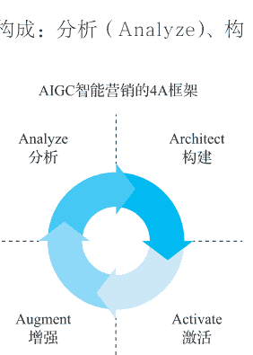

AIGC 智能营销始于洞察，用于洞察、预测与匹配用户需求。生成式人工智能以更广的覆盖面、更深的穿透力和更高的效率重塑用户洞察与行为预测。通过学习文本、图像、视频等非结构化数据，揭示驱动行为的规律，为决策提供依据。从宏观市场趋势到微观个体需求，AIGC 正在重新定义用户分析标准。

在厘清需求与行为模式后，可借助生成式人工智能搭建营销策略、内容日历，以及高度个性化的内容与体验。激活阶段则负责设计并执行动态的用户旅程，将其转化为自动化工作流，主要依托自动化营销与智能对话式营销实现。AIGC 智能营销不仅提升运营效率，也增强品牌感知力与情绪匹配能力，有助于构建紧密社群，并通过与超级用户的协作形成以共创为核心的新型品牌关系。

## 本书主要内容

本书以 AIGC 智能营销的 4A 模型为纲，分为四部分共九章。

**第一部分 新技术与新思维 第1、2章**

第1章从技术视角介绍 AIGC 的发展脉络、常用技术与工具，以及以自然语言对话为基础的结构化指令等核心人机交互原则。探讨 AIGC 如何改变消费者认知与行为，如何赋能企业实现个性化产品与体验设计，以及如何形成品牌与用户之间的超级体验。

第2章从营销视角延展，回溯营销与技术的关系，解析 AIGC 时代的营销演进。重点解读 AIGC 智能营销的 4A 模型——分析、构建、激活、增强，阐述四环节如何帮助企业构建创新战略与用户关系。

**第二部分 方法与实践 第3～6章**

聚焦 4A 模型的具体方法。第3章聚焦分析环节，介绍 AIGC 在营销数据分析中的应用，如何从大数据中提炼精准洞察与行为预测。第4章聚焦构建环节，讨论如何用 AIGC 搭建动态自适应的内容策略，并以 ChatGPT、Midjourney 等工具案例为例。第5章聚焦激活环节，说明如何将 AIGC 融入营销自动化体系，实现用户旅程的动态自动化，并厘清自动化营销与营销自动化的差异，强调 AI 与机器学习在策略执行中的关键作用。第6章聚焦增强环节，探讨 AIGC 如何促进品牌与客户的创意协作与价值交换，展示企业与客户协同的新机会与路径。

**第三部分 组织转型与流程变革 第7、8章**

由技术应用转向组织与流程优化。第7章讨论智能化转型的实践，包括组建 AI 专业团队、调整组织流程与培养员工能力。第8章讨论如何在企业内部搭建支撑 AIGC 智能营销的流程与技术栈。

**第四部分 未来展望 第9章**

展望 AIGC 智能营销在通用人工智能与元宇宙时代的潜在变化，并探讨未来可能面临的法律与伦理议题，包括版权、隐私与数据安全，为读者提供全面的前瞻视角。

## 本书读者对象

- 市场营销专业人士：营销经理、品牌经理、数字营销专家等希望了解并应用最新 AIGC 技术以优化营销策略的从业者。
- 企业高管：CEO、CMO、CIO 等需将 AIGC 整合进营销与业务战略的决策者。
- 技术人员与 AI 研究者：关注 AI 在营销领域落地的工程师与研究者，尤其是从事 AI 工具与算法研发的人员。
- 学术界人士与学生：商学院教师及市场营销、商业管理、信息系统等相关专业的学生。
- 创业者：希望利用 AIGC 创新营销以在竞争中脱颖而出的创业者。
- 咨询顾问：为企业提供商业战略、技术咨询与营销咨询，需要理解 AI 如何重塑营销的顾问。

## 如何阅读这本书

本书内容较多，读者可按需选择重点章节。例如对内容生成感兴趣可直接阅读第4章。

书中收录了多个行业应用案例，建议在理解案例表象的同时，从战略层面提炼可借鉴的思路与方法，而非仅停留于战术层面。

AIGC 技术与工具迭代迅速，文中提及的部分工具可能随时更新，鼓励读者保持学习节奏，持续追踪最新进展与市场趋势。

建议结合实践尝试书中提到的工具与方法，通过亲手操作加深对理论与技术的理解，提升问题解决与创新能力。

为便于学习，作者在微信平台部署了一个 AI 智能体。读者可关注微信公众号“知营销”（微信号：realdigitalmarketing），通过对话调用该智能体。

同时推荐加入相关线上论坛或社群，与其他读者或专业人士交流心得，拓展专业网络并获得多元视角。

## 第一部分 新技术与新思维

本部分从技术角度回溯 AIGC 的发展进程，剖析其支撑架构。重点讲解 AIGC 在营销领域的多种应用形态、常用工具与平台，以及技术如何连接消费者与品牌。

同时探讨由此引发的思维转变、方法论创新与营销实践演进，并说明如何将新技术与新思维整合进 AIGC 智能营销的 4A 模型，以优化数字化营销策略。

## CHAPTER I 第 1 章 AIGC 智能营销的新技术

每一次营销技术的革新，不仅带来新的传播工具，更深层次地重塑品牌与消费者之间的价值创造与交换方式。

本章介绍 AIGC 智能营销技术的兴起历程与发展脉络，解析其背后的技术基础，并梳理 AIGC 工具图谱与常用平台。

#### 1.1 AIGC 智能营销技术的兴起

AIGC 正将人工智能编织进品牌与用户互动的每个环节，推动大规模个性化内容创作与体验设计。本节概述 AIGC 的演进轨迹与基础原理。

##### 1.1.1 什么是 AIGC

人类自古以来便渴望突破自身局限，追求更高层次的智慧与创造力。

据宋代刘斧《青琐高议》记载，杭州知府曾得上联“雪消狮子瘦”，虽叹妙绝却难以下对，便广邀文人共议。众多饱学之士绞尽脑汁，仍难以在意境与对仗上找到匹配之语。这个创作难题考验的是文学素养、想象力与创造力。

如今，这样的意境可用 AIGC 工具复原，如图 1-1 所示。


图 1-1 “雪消狮子瘦”场景 AIGC 复原图

时代变迁，我们对灵感与智慧的召唤已不再依赖独自冥想。科技为创意打开了新源，AIGC 可汇聚前人智慧，帮助突破思维边界。

以下为 AIGC 工具生成的下联示例：

- ChatGPT GPT4：日满仙鹤长
  释义：春日阳光充足，仙鹤形日晷的影子被拉长。
- Claude3 Opus：花开蝴蝶酥
  释义：春花盛开，蝴蝶飞舞的景象，同时“蝴蝶酥”指形似蝴蝶的传统糕点，暗含春日甜蜜。
- 文心一格：月满玉盘盈
  释义：以玉盘喻月，满与盈形容圆月明亮，与上联冬去春来形成对比。
- 通义千问：春至凤凰娇
  释义：借凤凰象征春日万物复苏，或描绘女子在春天里展现的娇美姿态。

由此可见 AIGC 的特质：基于先进算法与强大算力，可依据用户需求定制多样化、具创新性的内容，输出兼具趣味性与专业度。AIGC 不仅能生成内容，也能用于分析近三年玻尿酸制备技术的进展，或详述火箭二次回收技术。

其应用远超内容生成，还可部署为智能代理与助手执行复杂任务。例如谷歌将 Gemini 集成至广告管理系统，用户仅需提供网址，AI 即可自动生成创意素材、关键词并完成投放。

AIGC 具备持续学习能力，可不断自我优化。数据、算法、算力与应用场景共同构成演进生态。

##### 1.1.2 AIGC 背后技术的发展

过去是通向未来的提示词。回望 AIGC 历史，有助于洞察其未来。

###### 1. AIGC 的早期研究和 Eliza 聊天机器人 20 世纪 50 年代～70 年代

1956 年，达特茅斯会议上，计算机科学家约翰·麦卡锡提出“人工智能”这一概念。他是 Lisp 语言的设计者之一，也是会议主要组织者。

会议上讨论了神经网络、自主机器等议题，人工智能尚处萌芽，聚焦于用符号计算解决特定问题，如专家系统。专家系统通过预设规则模拟专家决策，程序设计涵盖决策树与基础模式匹配。

这些早期探索为现代人工智能奠定基础。当时已出现用于生成天气预报或股市摘要的早期 AIGC 工具，虽简陋却开创了自动化信息处理先例。

1964 年，麻省理工学院的约瑟夫·维森鲍姆开发了著名聊天机器人 Eliza。该程序通过模式匹配与替换规则，模拟富有同理心的倾听者或心理咨询师对话风格。其秘书曾对 Eliza 产生浓厚兴趣，甚至视其为闺蜜。

###### 2. 技术积累时期 20 世纪 80 年代～20 世纪末 和 AIGC 的早期应用

80 年代 AIGC 仍属初级阶段，研究重心在专家系统、早期机器学习、自然语言处理与神经网络基础研究。

这一时期涌现的多项技术后来深刻影响 AIGC 发展。

####### （1）反向传播算法

反向传播算法是训练多层神经网络的有效方法。多层神经网络又称多层感知器 MLP，属于深度学习模型。可类比为一群密室逃脱玩家接力解密，若某关密码错误，玩家需回溯上一步找到问题并修正。

反向传播正是此逻辑：从输出层开始，若结果错误，便逐层回溯，修正各层参数，以确保下次输出正确，最终“逃脱”。

算法虽在 70 年代提出，却在 1986 年由大卫·鲁梅尔哈特、杰弗里·辛顿与罗纳德·威廉姆斯的研究推动下广泛流行。

这种试错式学习被大量应用于深度神经网络，大幅推动人工智能发展，使系统能够实现图像识别、语音翻译等复杂任务。

正是反向传播的成功，才催生出一批衍生模型，变分自编码器与生成对抗网络就是典型代表，后续会展开说明，它们已成为生成式人工智能的核心支柱。

####### （2）CNN：模仿人眼的图像理解引擎
1989 年，杨立昆及其团队把反向传播接入卷积神经网络，首个落地场景是手写数字识别。

卷积神经网络是受人类视觉神经系统启发而来的仿生方案，能自主学习并提炼图像的表征。这一进展既展现了深度学习的实力，也为图像处理与视觉识别研究打下基础。网络模仿视觉皮层的运作机制，自主习得图像特征从而完成识别任务。

结构上由多层堆叠而成，每层都做卷积运算以捕捉不同层级的特征。初层多锁定线条、色彩等基础视觉单元；次层开始把这些基础单元组合成局部结构，例如眼睛、耳朵；往后层级则抽取更高阶的语义信息，最终完成分类。分层的特征提取让 CNN 在图像领域表现突出。

以识别比熊犬为例。先收集大量犬类照片，比熊作为正样本，泰迪、贵宾、斗牛犬等作为负样本，用来训练模型。

第一层滤波器在图像上滑动做点积运算，像电子眼一样抽取基础线索，比如比熊圆润的脸型、乌黑湿润的鼻子、卷曲的毛发。第二层再聚焦更具体的部位，如下垂的耳朵、圆圆的眼睛。进入高层后，网络整合基础与复杂线索形成整体面部判断，并把所有特征线索拼成完整图像表征。学习过程不断迭代，每轮都能提升识别比熊的准确率。最终给电脑一张照片，就能通过层层提取与综合准确判断是否为比熊。

应用面很广，既可做风格迁移，把伦勃朗的绘画风格迁移到新图上，也能通过超分辨率提升分辨率实现无损放大。CNN 还是生成对抗网络的重要技术底座，可生成高度逼真的图像，广泛用于自动驾驶、增强现实与医疗影像分析等场景。

####### （3）HMM：用可见线索推断隐藏状态
20 世纪 80 年代，隐马尔可夫模型开始大规模用于语音识别，带来明显突破。

它借助可观测线索来推测不可见的状态序列，擅长解析语音这类时序数据，从而辨识出具体内容。

可以用一个类比理解：看一部只有 3 分钟的抖音电影解说。完整剧情是隐藏的，你看不到全貌，这相当于 HMM 中的隐藏状态。短暂的解说片段就是观测，虽断断续续，却足以让你推断故事梗概。

模型运行依赖两类概率矩阵：
- 转移概率矩阵，描述从一个隐藏状态跳到另一个隐藏状态的概率，类似于电影中一个情节转到下一个情节的可能性。
- 发射概率矩阵，描述在某个隐藏状态下观测到特定片段的概率。

两者协同工作，就像从几分钟的片段中还原整部影片。深度学习流行前，HMM 长久占据语音识别的主流位置。

####### （4）遗传算法与进化计算
80 年代，遗传算法作为一种优化手段兴起，它模拟自然选择与遗传机制来解决复杂优化问题，也属于仿生方法，与 CNN 有异曲同工之处。

其流程可类比培育杂交水稻。把抗旱性、株高等性状看作基因，先随机生成一批特征各异的水稻个体，再筛选表现优异者进行杂交产生新一代，同时对部分个体做随机变异以增加多样性。不断重复选择、交叉、变异，最终培育出优良品种。

在 AI 内容生成里，遗传算法同样可用来优化色彩、布局等参数，并借助创新变异提升创意度。

比如要 AI 画马，先随机生成一群简单的马草图作为初始种群。然后按马的形体、姿态等标准评估，挑选表现好的进行交叉与变异。交叉时融合多幅优秀草图特点生成新图，变异时随机调整尾巴形状、腿部位置等细节。多次迭代后，图像逐渐变得精细逼真，最终输出高质量视觉结果。

###### 3. 机器学习的浪潮（21 世纪初）和 AIGC 的加速
2000 年前后，机器学习进入新高峰。

不同于传统编程的任务式指令，机器学习让计算机通过数据分析自行学习并决策，核心是构建能从数据中学习与预测的算法。

这一阶段，梯度提升机等预测模型被大量用于个性化推荐，大幅提升用户体验；算法能力也在艺术创作、音乐制作、文本撰写等领域显现，推动 AIGC 发展。

高速发展离不开互联网普及与数据爆发。Stackscale 数据显示，全球网民从 1995 年的 1600 万增长到 2000 年的 3.61 亿，2010 年达 20 亿。社交媒体带来海量 UGC，2004 年 MySpace 首个月活破百万，2019 年 Facebook 用户达 24 亿。YouTube、WhatsApp、抖音、微信等主流平台用户均超 10 亿，为算法训练提供丰富场景。

算力提升同样关键。CPU/GPU 速度、内存存储容量与速率、并行能力、网络带宽等，都直接影响训练效率、模型复杂度与实时响应。

1999 年英伟达推出首款量产 GPU GeForce 256，提升了游戏与数据处理效率。2006 年 CUDA 发布，提供类似应用商店的开发工具与库，大幅拓展机器学习可能。随后谷歌 TPU 等专用加速器出现，专门优化 TensorFlow 等框架性能。AlphaGo、AlphaZero 等知名 AI 应用即基于 TPU 构建。

2006 年起，亚马逊 AWS、微软 Azure、腾讯云、华为云、阿里云等云服务相继上线，为中小企业提供训练与部署资源。Hadoop、Spark 等大数据工具也成熟起来，以分布式方式处理海量数据，支撑机器学习的数据需求。

算法层面，自 2000 年起支持向量机因核技巧的普及与软硬件进步而走红；随机森林、梯度提升机等集成方法在多个领域广泛应用。

####### （1）SVM：寻找最优分界线
20 世纪 60 年代，瓦普尼克与切尔沃年基斯首次提出支持向量机概念，21 世纪初在核技巧助推下更受青睐。

SVM 是一种监督学习算法，用于分类与回归。基本形式是二分类，其核心是在特征空间寻找一个能清晰分隔不同类别的最优超平面，并最大化两类样本到该平面的最小距离，即间隔，从而提升准确性与鲁棒性。鲁棒性指模型在噪声或数据变化下仍保持稳定表现的能力。

用派对糖果类比：桌子上放着榴莲糖和茴香糖，包装图案代表特征。你要在桌上画一条线把两种糖分开，且线尽量远离任何一颗糖，避免宾客拿错。若空间受限，一条直线不够，可用大碗作界限，茴香糖放碗里，榴莲糖放外面。无论直线还是复杂边界，SVM 本质都是找最佳方式划分数据点。

在 AIGC 领域，SVM 多用于前处理，如文本分类与情感分析，帮助提升生成内容的质量与准确性。

####### （2）随机森林算法
随机森林是集成学习方法，通过融合多棵决策树的预测来提高准确性与鲁棒性。对外表现稳定，内部则由众多决策树构成，各自从数据中形成分支判断。

可类比项目招标：每棵树像一家投标公司，各自给出方案，最终采纳多数树支持的方案，预测更可靠。也像做多组小型营销试验，每组基于不同数据与渠道测试策略，最后汇总结果选出最优方案。随机森林用多数投票或平均预测降低过拟合，过拟合即模型在训练集上表现好、在新数据上变差，像纸上谈兵。通过 ensemble，整体预测更可信。

####### （3）梯度提升算法
梯度提升同属集成学习，通过逐步构建模型提升预测精度。与随机森林的并行独立不同，它更像持续改进，每一步都修正前一步的残差，体现内部迭代与外部稳步推进。森林由相互关联的树组成，后一棵专门解决前一棵遗留的问题。

可用写微信推文类比：先草拟初稿，再用 AI 工具反馈修改，累积小改进最终成优质推文。过程像接力赛，每位选手承接前一位未完成的部分，减少残差，虽个体不完美，整体却不断逼近目标。

这一时期 Netflix、Amazon 等开始用机器学习做推荐，采用内容过滤与协同过滤分析项目与用户行为。2006 年 Netflix 发起全球竞赛，鼓励优化推荐算法。

##### 1.1.3 深度学习的突破和 AIGC 1.0
进入 2010 年，深度学习迎来突破。

深度学习是机器学习分支，聚焦多层神经网络的特征学习与模型训练。与传统方法不同，它在特征提取与表示学习上实现自动化。传统机器学习识别袋熊时需人工定义体型、毛色、育儿袋朝向、粪便形状等特征并标注；深度学习只需大量袋熊图片，模型即可自行学习关键区分特征。

这一进展催生 AIGC 的首次普及浪潮，即 AIGC 1.0。AI 不仅能理解与处理信息，还能创作、编辑与生成新内容，主要依赖深度学习框架。应用集中在体育、财经报道的生成，以及 Siri、Google Assistant 等智能助手的天气预报、提醒等服务。

CNN、GAN、RNN 等技术推动图像、音频、文本、视频的生成能力，极大改变媒体内容处理方式。

###### 1. 深度卷积神经网络
DCNN 是让计算机识别与理解图像的工具，工作方式类似人眼与大脑处理图片。

2012 年，多伦多大学的克里日维斯基、苏茨克沃与辛顿提出 AlexNet，由 8 层构成，含 5 层卷积层。处理图像时先用卷积层捕捉基础图形与纹理，再用 ReLU 激活函数增强学习能力，最后经多层全连接层输出分类结果。

若把选品负责人比作 AlexNet，流程很像：
1）收集各类商品信息，类似搜集图像数据集。
2）按产地、包装、品牌等基础属性初筛，类似初级卷积层提取基础特征。
3）深入分析用户人群、定价等复杂属性，类似深层卷积捕捉复杂特征。
4）综合信息判定爆款、流量款、利润款，类似全连接层综合决策。
5）上架推广，类似把分类结果落地执行。

AIGC 1.0 时期，DCNN 是创新关键，通过模拟人类视觉机制增强机器对图像、音频、视频的理解与创造。

DeepArt.io 用 DCNN 把照片转为梵高、毕加索等艺术家风格作品。AIVA 用深度学习分析大量音乐并创作新曲。游戏设计中，DCNN 生成复杂环境与纹理，提升沉浸感与互动体验。

###### 2. 生成对抗网络（GAN）
GAN 由伊恩·古德费洛于 2014 年提出，通过同时训练生成器与判别器来产出逼真数据。

逼真数据指生成器输出与真实世界几乎无法区分的内容，并非真实存在，而是学习真实分布后模仿产生，如生成不存在的人物形象。

生成器像创作者，从随机噪声出发学习生成能骗过判别器的图像；判别器像质检员，评估输出是否真实。通常两者都以深度卷积神经网络为核心。

创新在于对抗式训练。传统模型通过最小化预测误差学习，像老师纠正学生错误；GAN 则像变革教育，学生互相出难题挑战学习。甲出迷惑性题目，乙识别解答，再反过来挑战甲，能力在持续对抗中提升。

GAN 中，生成器不断学习更精准模仿真实分布，判别器也在进化识别能力。两者博弈使图像质量逐步提高，AI 逐渐掌握光影、纹理、色彩、形状等复杂特征的生成规律。

GAN 正以强大的生成能力渗透到艺术创作、风格迁移和虚拟现实等多个场景，已成为 AIGC 体系中最具代表性的技术支柱之一。

以大家熟知的换脸应用为例，FaceApp 正是基于 GAN 构建，用户上传照片后即可实现老化、去皱、性别转换等视觉效果。Instagram、抖音上流行的实时换脸、漫画一键变身，以及图片风格社区 Artbreeder 背后的驱动力，也都来自 GAN。这些案例清晰地说明了 GAN 在视觉艺术与娱乐领域的广泛影响。

3. 循环神经网络 RNN 的序列理解力

RNN 是为处理序列式数据而专门设计的网络结构。与传统前馈网络不同，它通过内部的循环连接保留状态，能够捕捉输入的时间动态并利用历史信息。

RNN 的核心价值在于模拟数据点之间的时间关联。语音识别中，一个音素的发音依赖于前后音素，RNN 正是通过循环结构捕捉这种依赖，提升单词与短语的识别精度。

举例来看同声传译系统，现场声音会被转换为音素序列输入模型。音素是语言学中区分语义的最小语音单元，如汉语“兔”由音节 [tu] 组成，可细分为声母 [t] 和韵母 [u]。RNN 借助循环连接逐层解析语音流，隐藏层状态形成一种“短期记忆”，让当前判断受到过去输入的影响，从而利用上下文提升译文准确度。

长期依赖是同传中的难题，句意常依赖前文，中文词汇如“苹果”“蝴蝶”的译法会随上下文变化，比如“吃苹果”与“苹果手机”、“蝴蝶酥”与“蝴蝶迷”意义迥异。RNN 在长序列上容易失效。

为此引入了 LSTM。LSTM 通过输入门、遗忘门和输出门来管理记忆，能在长序列中维持长期依赖、缓解梯度消失。它决定何时写入新信息、何时丢弃过时信息、何时输出结果，使模型更有效地学习与生成。

RNN 与 LSTM 已成为 AIGC 发展的重要引擎，广泛用于语音识别、在线翻译、Siri 等语音助手，并在自然语言处理中推动聊天机器人与虚拟助手的发展。视频编辑工具 RunwayML 也借助 RNN 来理解并生成视觉内容。

4. AIGC 1.0 时代的营销落地

在大型语言模型和 Transformer 出现之前，深度卷积神经网络、GAN、RNN 等技术已催生出大量 AIGC 应用和营销工具，具备数据分析预测、内容生成、智能客服、虚拟现实等能力。

数据分析方面，Brandwatch、Talkwalker 等产品利用深度学习分析社交媒体用户行为与 UGC，帮助企业洞察偏好并自动打标。亚马逊、阿里巴巴也大规模使用深度学习提升推荐精度。

内容营销方面，Hootsuite、Buffer 等开始用深度学习分析互动并尝试自动生成社媒内容。DeepArt.io、RunwayML 等创意辅助工具帮助品牌生产图像与视频。

自动化营销方面，Mailchimp、SendGrid 等借助深度学习优化文案与投放，显著提升效率。

客服与 CRM 领域，百度度秘、微软小冰、Drift、Zendesk Chat、Liveperson 等聊天机器人被用于售前线索管理与售后维护，但当时自然语言理解能力偏弱，意图识别和回复质量有限。

元宇宙概念兴起后，深度学习推动 AR、VR 快速发展，如抖音 AR 滤镜。虚拟人物与主播井喷，出现初音未来、AYAYI、柳夜熙等虚拟形象，以及新华社新小微、湖南卫视小漾等虚拟新闻主播。

这一阶段 AR、VR 与虚拟人从新奇玩具转为营销工具，特别是抖音虚拟主播。AIGC 1.0 的产品多为单点任务设计，如 DeepArt.io 专注风格迁移、Canva 专注图形设计、Sprinklr 专注社媒分析与管理。生成内容质量波动大，且容易被识别为 AI 生成。

1.1.4 生成式人工智能与 AIGC 2.0 的跃迁

2023 年，生成式人工智能迎来爆发。GenAI 指借助机器学习尤其是深度学习模型生成全新数据或内容的人工智能系统。其不仅能理解分析数据，还能创造文本、图像、音乐、视频等多种形式输出，核心在于基于学习规律创造新颖独特内容，而非简单复制。

当年 Transformer 驱动的 ChatGPT 横空出世，掀起大语言模型“百模大战”；扩散模型也迎来引爆点，Stable Diffusion 与 Midjourney 实现突破性进展。

1. Transformer 架构与大语言模型

2017 年，谷歌的 Ashish Vaswani、Noam Shazeer、Niki Parmar 等人发表《Attention is All You Need》，提出 Transformer。该架构为解决 RNN 处理长序列效率低、难并行的问题而生，目标是捕捉长距离依赖并实现高效并行计算。

自注意力是核心机制，它计算序列内部各元素间的关联，使模型可直接学习任意两个位置的依赖关系，无论距离远近。类比人类阅读时抓住关键词，计算机处理“猫坐在垫子上”时，自注意力会强化“猫”“垫子”与“坐”的关联，从而构建更完整的语义理解。

Transformer 抛弃了递归结构，采用全前馈网络，像只会前行的机器人一步步处理信息后再输出结果。这带来了并行训练、长依赖建模和训练加速等优势。

随后 BERT、GPT、Claude、千问、智谱等大型预训练语言模型涌现。它们在海量数据上预训练后能生成连贯高质量文本，让计算机对话更接近人类。

以提示“葫芦娃大战钢铁侠”为例，ChatGPT 的生成大致经历：指令输入，文本被编码为向量表示，自注意力机制分析各词关系，解码器预测下一个最可能词，逐字持续生成直到收敛，最后可经多次迭代优化连贯性与创意。

模型之所以能写出七兄弟各自的法术，是因为训练数据涵盖了相关知识。但模型并不真正“理解”，它基于语言模式和上下文进行概率推断，而非拥有意识与真实认知。

2. 变分自编码器、扩散模型与图像视频生成

变分自编码器 VAE 是一种生成模型，用于学习输入数据的潜在表征并据此生成相似的新样本。它融合深度学习与贝叶斯推断，在统计生成框架中引入神经网络。

可类比为“魔法机器”：魔法摄像机接收大量小狗图片，通过变分推断提炼出大小、形状、颜色等本质特征，形成“秘密代码”即潜在表示；魔法画笔则利用该代码复现已知图像，甚至创造全新样式。VAE 因此可用于人脸、风景图像生成、推荐系统与创意文本生成，并在 Stable Diffusion 中影响色彩与细节质量。

3. 扩散模型

扩散模型是生成高质量图像、音频等复杂数据的先进方法。与 VAE、GAN 不同，它通过模拟数据退化再逆向还原来生成内容。该思路最早由 Jascha Sohl-Dickstein 等人在 2015 年提出，初期表现平平，后随深度学习发展迅速崛起。

可想象为时间机器：一张清晰图像逐渐失真成噪声，模型先学习这一退化过程，再反向从噪声恢复出清晰图像。它不仅能重建训练样本，还能创造全新内容。

扩散模型已成为生成式建模前沿，应用于逼真人像与风景创作、数据增强、分子结构设计、天气系统模拟等。DALL·E 2、Stable Diffusion、Leonardo.ai 等工具正是其代表，在艺术创作等领域产生深远影响。

以 Stable Diffusion 生成“怀抱小猫的少女”为例：

步骤 1：用户输入。选择 Copax TimeLessXL 主模型，VAE 选择 sdxlVAE，输入关键词“小猫”“少女”。

步骤 2：文本编码。文本编码器将指令转为模型可处理的数值特征向量。


图 1-2 Stable Diffusion 生成的怀抱小猫的少女

步骤 3：初始化与扩散。模型从随机噪声图像开始，相当于空白画布；传统扩散的正向加噪过程在实际使用中多为预设。

步骤 4：逆向扩散。条件化逆向过程是核心，模型依据文本条件从噪声逐步重建图像，每步预测并去除部分噪声，多次迭代提升细节。

步骤 5：图像输出。逆向完成后，符合输入元素的图像在界面呈现。

4. AIGC 2.0 时代特征

技术持续演进使生成结果在质量、多样性和智能化上大幅提升，更贴近人类期待。到 2024 年 2 月，ChatGPT 第四代、Midjourney 第六代、Stable Diffusion XL 1.5 版本，在文字、图像、音频的逼真度上实现显著跃升。个性化定制服务如 ChatGPT 的 GPTs 与 Stable Diffusion 的个性化模型训练，使内容生成更符合个人品味与行业知识，并可精细控制长度、风格等细节。

AIGC 2.0 强调创造性、跨模态生成与智能交互。新系统可通过与用户的动态互动自动调整生成策略，基于反馈迭代优化质量，或根据不同场景调整风格与格式，推动生成内容向人机协同创作迈进。

表 1-1 AIGC 1.0 与 AIGC 2.0 的对比

| 特性 | AIGC 1.0 | AIGC 2.0 |
| :--- | :--- | :--- |

| 技术架构 | 深度卷积神经网络、GAN、RNN | Transformer 架构、大语言模型、扩散模型 |
| 数据依赖 | 中等到大规模数据集 | 超大规模数据集，强调多样性与高质量 |
| 应用场景 | 数据分析预测、简单内容创作、VR 内容辅助 | 数据分析预测、简单内容创作、VR 内容辅助 |
| 内容质量与连贯性 | 波动较大，特定任务表现优异 | 更高一致性与创造性，接近人类水平 |
| 交互与个性化 | 基础交互，有限个性化 | 高度个性化，智能交互，适应性学习能力 |
| 创新亮点 | 初步实现自动内容生成 | 实现大规模跨领域创新，支持复杂指令理解与执行 |

从 1.0 到 2.0：AIGC 的进化路线

第一阶段 AIGC 站在早期深度学习的肩膀上，主干为卷积神经网络、生成对抗网络和循环网络。这一波技术在洞察数据、识别模式、做初步内容产出以及为增强现实和虚拟现实提供素材上显露出潜力。落地时多局限于单一垂直或单一形态，比如写段文字、合成一张图。创意感存在，但输出稳定性参差，功能指向较窄，很难覆盖用户多元诉求。

进入第二阶段后，技术底座明显切换为 Transformer、预训练大语言模型以及扩散式生成模型，并在海量且高质的多样语料上完成训练。核心优势体现在个性化体验的强化、对话式交互的升级以及更接近人类的创造力。由此，模型生成的成果在连贯性和新颖度上显著提升，应用边界被大幅拉开，涵盖艺术创作、复杂文本的理解生成、多模态融合等多个方向。

###### 5. AIGC 技术的未来展望

在通用智能成熟前，AIGC 的突破可能集中在以下方向。

- 情感智能：系统将更擅长解读并产出带有丰富情绪的内容。Emotient 和 Affectiva 已推出面部分析方案来捕捉表情和情绪，未来可融入生成系统，让输出具备情绪表达。
- 自适应学习：生成系统会持续观察用户行为与偏好，无需手工编程即可自动调整生成策略。
- 增强现实 AR 与虚拟现实 VR：在 AR/VR 场景中，AIGC 可实时搭建沉浸式交互和动态内容。VRChat、Roblox、Decentraland 等虚拟世界可借助其即时生成和调整环境及角色，提升互动丰富度。
- 多模态生成：跨模态能力持续加强，例如由文字生成视频等，打开新的创意与商业空间。OpenAI 的 Sora 已把视频生成时长推到 1 分钟。

#### 1.2 AIGC 智能营销的工具图谱

本节聚焦智能营销里的生成式工具全景，重点在基于生成式人工智能的 2.0 方案。

##### 1.2.1 AIGC 智能营销技术概览

自 2023 年起，生成式平台与工具的迭代明显加速，数量与质量双提升。

截至 2024 年 5 月，Insidr.ai 收录超 300 款生成式工具，AI 万花筒 aiwht.com 上架超 1200 款，Futurepedia 记录超 5000 款，Toolify 收录超 1 万款应用。对比之下，过去十年主流营销技术工具累计也未到 5000 款。

开发门槛也在下降。字节跳动上线的 AI Bot 开发平台扣子，国际站 coze.com、国内站 coze.cn，让零基础用户以无代码方式搭建专属生成式应用。可选用 GPT-4、云雀、Moonshot 等大模型，打造写作助手、客服助手等，并部署到 Discord、Line、飞书、微信公众号、豆包等渠道。自 ChatGPT 开放个性化定制以来，已有超 300 万人制作自己的 GPTs 应用。

生成式技术不仅能产出文章、邮件、报告、产品手册等高质量文本，还能依据指令或参数产出图像、语音、音乐、视频。场景正向智慧办公、游戏内容生成、虚拟人、AR/VR 等方向外延。

按功能与用途划分，可归为基础模型、文字生成、图像生成、语音和音乐生成、视频生成、文档生成、策略生成等主要类别，如表 1-2 所示。

表 1-2 AIGC 工具图谱

| 类别 | 应用 | 国外工具示例 | 国内工具示例 |
| :--- | :--- | :--- | :--- |
| 基础模型 | 大语言模型，作为更广泛 AI 应用的基础 | GPT-4、Claude 3、Gemini、LLaMA、Coral、Grok | 千问、智谱、云雀、文心、言犀、混元、商量 |
| 文字生成 | 基于大语言模型，生成各类专业文本内容 | Jasper.ai、Notion、Copy.ai | 智谱清言、Kimi Chat（月之暗面） |
| 图像生成 | 广告设计、产品展示、艺术创作 | Midjourney、DALL·E3、Stable Diffusion、Exactly.ai | 千问、Dreamina、文心一格 |
| 语音和音乐生成 | 生成语音和音乐 | ElevenLabs、Murf.ai、Suno | 声咖、剪映、网易天音 |
| 视频生成 | 自动化视频内容创作，包括编辑、生成、风格化等 | Pika、HeyGen、RunwayML、Sora、Stability AI | 剪映、腾讯智影 |
| 文档生成 | 商务演示、学术报告 | Wondershare、Beautiful.AI、Slidebean | Gamma、轻竹办公 |
| 策略生成 | 营销自动化、广告投放 | Google Ads、Hubspot、Jounce.ai、beam.ai | 巨量引擎、百度轻舸 |
| 代码生成 | 代码生成、编程辅助 | Github Copilot、Debuild、Phind | iFlyCode、通义灵码、扣子 |
| 智能搜索 | 人工智能驱动的搜索引擎 | Perplexity、New Bing、HARPA AI | 秘塔 AI 搜索 |
| 项目管理和智能协作 | 项目管理和团队协作工具 | Miro、ChatGPT 团队版、Cody.ai | 飞书、通达 AI |
| 社区和支持 | 网络 AIGC 讨论和分享社区 | Civitai、Discord | 吐司、Liblib.art |
| 智能体和代理工作流 | 支持多任务、多模态的智能体和代理工作流 | GPTs、Chatbit、Zapier、AutoGen | 扣子、天工、百度千帆 |

需注意，生成式领域变化快，工具更新频繁，上表无法涵盖全部最新品类，部分示例需随市场动态调整。

使用弹性很强，可与多种平台集成并通过工作流协同，形成更复杂的场景：

- 与内容创作平台集成：可与 Canva、WordPress 等创作与内容管理平台对接，自动产出高质量内容。
- 与社交媒体平台集成：可与 Facebook、X 等社交平台及 Sprinklr、Hootsuite 等管理平台联动，实现内容发布与社区运营。
- 与电商平台集成：助力商家生成产品图、优化推广与销售。阿里巴巴推出的 Pic Copilot 电商图片生成应用，能为商家一键生成指定风格商品背景，数秒完成商业级成片。
- 与客服系统集成：与 Zendesk 等客服系统结合，集成 ChatGPT 等工具，让服务更具个性化。
- 构建智能代理：通过生成式工具搭建 AI Agent，为用户提供更个性化、智能化的服务。

##### 1.2.2 主流的基础模型

“基础模型”与“大语言模型”常被混用，前者概念更宽泛，后者专指聚焦语言的系统。

这类模型在大规模数据集上预训练，主要用于自然语言处理与内容生成，涵盖摘要、翻译、问答、对话生成等。先在海量未标注文本上学习语言规律与上下文能力，再通过微调适配特定任务。

2022 年 OpenAI 发布 GPT-3.5 引发全球关注，各大科技公司随后加大投入研发自家大语言模型。竞赛不仅关乎数据安全与供应商依赖，更在于抢占未来流量的入口：大语言模型及应用将成为新的搜索引擎、社交媒体与办公工具。

当前竞争格局中，美国在基础模型与图像生成领域领先，中国紧跟其后在基础理论与模型开发上进展快速，其他国家与地区也积极参与，虽整体优势不及前两者，但发展态势积极。

###### 1. GPT

GPT 由 OpenAI 开发，已迭代至 GPT-3.5、GPT-4、GPT-4-turbo、GPT-4o 及多模态版本 GPT-4 Vision。发展可追溯至 2018 年的 GPT-1，每一代在规模与性能上均有显著提升。据报道 GPT-4 参数量可能超 10 000 亿。参数量衡量模型容量，但训练数据质量与方法同样关键。

GPT 以知识更新能力与细粒度输出控制著称，能基于最新信息作答并精准调控文本细节与风格。应用覆盖自动写作、机器翻译、语言理解等，并提供通用 API，被微软、Duolingo、Stripe、Descript、Dropbox、Zapier 等企业采用以提升体验与效率。

ChatGPT 基于 GPT 技术，免费版用 GPT-3.5，付费版可使用 GPT-4 与 GPT-4o。测试显示，基于 GPT-4 的 ChatGPT 在文本创作、创意支持、信息检索、数据分析、风格转换等方面表现突出，理解意图、遵循指令与辅助生成能力也领先。

###### 2. Claude

Claude 由 Anthropic 开发，由 OpenAI 前成员创立，强调打造更温和、更可靠的 AI 系统，安全性要求较高。基础功能可通过 poe.com 访问。

设计重点在于提升可靠性与安全性，通过训练阶段注入道德规范与安全机制来减少偏见或有害内容。现有多版本 Claude 2、Claude 3。2024 年 3 月 4 日发布的 Claude 3 系列包含 Opus、Sonnet、Haiku，其中旗舰 Opus 在多项指标上超过 GPT-4 与 Gemini 1.0 Ultra。

Claude 擅长处理超长文本序列，对复杂文档与长篇内容理解有优势。测试中 Claude 3 Opus 在长文本处理、风格保持、准确性与客观性上表现优异，但在逻辑推理与创意生成上不及 GPT-4。

###### 3. Gemini

Gemini 是谷歌推出的大语言模型家族，各版本面向不同场景优化。Gemini Ultra 为旗舰，参数 1750 亿，擅长复杂语言任务与多模态输入；Gemini Pro 为轻量版，参数 1370 亿，侧重速度；移动端版 Gemini Nano 参数约 400 亿。

显著优势是可接入网络，通过谷歌搜索获取实时信息。测试体验显示，其在时事新闻搜索与信息更新上，中英文均优于多数竞品。

###### 4. 通义

通义大模型由阿里巴巴自主研发，涵盖 5 亿至 720 亿参数的多个规模。据通义千问自述，阿里已发布参数突破 100 万亿的 AI 大模型。

支持中文、英文、日文、韩文，可处理文本分类、问答、机器翻译、情感分析等任务。在阿里生态内广泛应用，涉及电商搜索、个性化推荐、客户服务自动化与高质量内容生成，提升效率与体验。

文本风格丰富生动，在营销策略与营销文本创作上表现突出，能灵活调整语言风格。但在事实描述时易带电商领域色彩，形容词使用频繁且存在一定夸张。

###### 5. 文心

文心由百度自主研发，基于飞桨深度学习平台构建，是 ChatGPT 推出后中国较早发布大语言模型的厂商之一。

部分版本参数量达 1.5 万亿，文心 4.0 据报道使用超 1 万个 GPU 集群训练。其核心特性为知识增强，能从大规模知识库与海量非结构化数据中提取融合信息，提升学习效率与可解释性，在智能客服、教育辅导、医疗咨询等场景提供更专业准确的服务，增强用户信任。

文心一言为类 ChatGPT 聊天机器人，提供文心 3.5 免费版与文心 4.0 付费版，均可进行信息查询、知识分享与创意互动。

###### 6. 智谱

智谱大语言模型由清华大学 KEG 实验室与智谱 AI 合作研发，聚焦中文场景，强化对中文语言结构、文化背景与语境的理解能力。长篇文章生成、连续对话与创意内容产出表现突出。英文理解与生成亦表现不错，英译中能力优于多数模型。

模型向开发者与研究者免费开放，降低门槛并促进创新。智谱清言提供 GLM-3 与 GLM-4 两版，均免费开放，并内置类似 GPTs 的智能体功能中心，支持用户创建自定义智能体。

我们依据本书成稿时可获信息整理对照表 1-3，对 GPT、Claude、Gemini、通义、文心、智谱等基础模型进行横向比较。信息随时间推移可能变动。

表 1-3 6种基础模型比较

| 大语言模型 | 开发者 | 主要特点 | 最新版本 | LMSYS Chatbot Arena 排名 (截至 2024 年 5月) |
| :--- | :--- | :--- | :--- | :--- |
| GPT | OpenAI | 强大的多领域知识生成与理解，应用广泛 | GPT-4o | 1 (GPT-4 Turbo) |
| Claude | Anthropic | 高级逻辑推理与对话连贯性，擅长长文本处理 | Claude 3 | 2 (Claude 3 Opus) |
| Gemini | 谷歌 | 具备高级理解和生成能力，擅长实时搜索 | Gemini Pro | 2 (Gemini 1.5 Pro) |

AIGC 模型与工具全景选型

| 通义 | 阿里巴巴 | 中文理解与生成，智能交互，强大的电商生态整合 | — | 13 (Qwen 1.5 72B chat) |

| 文心 | 百度 | 百度的大型语言模型，企业级应用场景丰富 | 4.0 | 无排名 |

| 智谱 | 清华大学 KEG & 智谱 AI | 知识增强型中文大模型，优化中文理解与生成，支持多领域应用 | GLM-4 | 80 (ChatGLM3) |

不同底座模型在能力倾向和短板分布上各不相同，落地时最好结合任务目标与使用场景进行匹配，目前演进速度很快，后续大概率还会出现更强的新一代语言系统。

##### 1.2.3 文本生成工具选型

在生成式 AI 的版图里，文字类应用的认知度最高，技术成熟度也领先。新闻稿件、商务邮件、分析报告、学术论文到社交平台动态，都能被这类型产品高效承接。输出通常呈现出条理清晰的写作特征，逻辑严密、叙事有度，信息密度高、推演能力强，因而说服力更足。这类表达风格特别契合新闻通稿、产品手册、网站介绍等偏营销的文本。

按使用目的划分，文字生成产品可归为几类，见表 1-4。

表 1-4 AIGC 文本生成工具

| 类别 | 应用场景 | 国外工具举例 | 国内工具举例 |

| :--- | :--- | :--- | :--- |

| 基础大模型聊天机器人 | 适用于大多数文本生成场景 | ChatGPT、Claude 3 Opus、Gemini Pro | 通义千问、文心一言、智谱清言、腾讯混元助手、Kimi Chat (月之暗面)、商汤商量 |

| 通用写作 | 适用于公文、小说、剧本、视频解说稿等文稿的写作 | AI Writer、Jasper.ai、Notion AI | 新华妙笔、讯飞星火、Business AI、笔灵 AI、一览 AI 编剧、万彩 AI |

| 营销文案 | 应用于营销推文、广告创意、产品介绍、SEO 优化文案等营销内容 | Copy.ai、Notability、Typeface、Phrasee | 文山 AI、中潮 AI、MOYU AI |

| 聚合平台 | 聚合多种文本生成工具的平台 | Poe | 薏米 AI (ymiai.top) |

ChatGPT、通义千问等通用对话类产品，在日常多样的文字需求上效率很高。当任务需要专业规范，比如严格遵循公文格式或贴合特定营销调性时，通用写作与营销文案类工具的价值更突出。这类垂直产品通常以 GPT、Coral 等大模型作为生成核心，再叠加行业专属的优化。借助精细的参数调校和专业知识库注入，模型能产出符合行业标准、带有鲜明专业气质的文本。

在营销侧，文字类 AIGC 已成为从业者常用的助手。它们不仅能提供文案灵感和社媒帖子，还能参与头脑风暴、情境推演，乃至整套内容营销方案的构建。通过强数据分析能力，工具可捕捉用户痛点与偏好，据此制定内容策略。

营销科技公司 Persado 的做法具有代表性：梳理客户过去三年零售数据，研判 200 万条消息及近 1 亿次客户互动记录，找出品牌价值与用户需求的交汇点，再基于这些洞察为品牌客户设计新的内容营销模式。

这类产品存在一个明显缺陷和两项短板。

缺陷是幻觉。模型常会斩钉截铁地给出无据信息，产出错误、不准或自相矛盾的内容。根源在于模型用学到的语言模式填补知识空白，输出未必贴合现实。

导致幻觉的首要因素是训练语料质量不高，混杂噪声、偏见或错误信息，容易触发边缘情况。例如让 ChatGPT 起草正式政府公文，若模型未充分学习该文体规范样本，或样本本身误导，就可能输出不合法规要求的文本。架构设计不合理、参数调优不足、专业知识缺失、上下文关联减弱、缺乏控制约束机制，也会加剧幻觉。

大模型普遍缺乏真实世界理解与常识，面对复杂问题易依据训练模式给出错误或虚构回应。

降低幻觉需要强化人机协作，用恰当提问引导工具，正确使用指令并善用结构化指令。

现阶段产品的两大短板是记忆力和情绪幽默表达。聊天机器人易出现“断片”，连续对话超过十轮后就可能失忆。

在情绪与幽默上，工具难以做到情景交融，修辞上也难以达到言外之意、思而愈深的效果。对语言中不可言传的精妙与意不达物的魅力把握不足。诗歌创作、幽默表达等需要深层文化理解与情感共鸣的任务，往往需多轮对话反复澄清背景与意图。

###### 1. ChatGPT

ChatGPT 由 OpenAI 基于 GPT 系架构打造的对话机器人，目前提供 GPT-3.5、GPT-4、GPT-4o 版本。如图 1-3 所示。

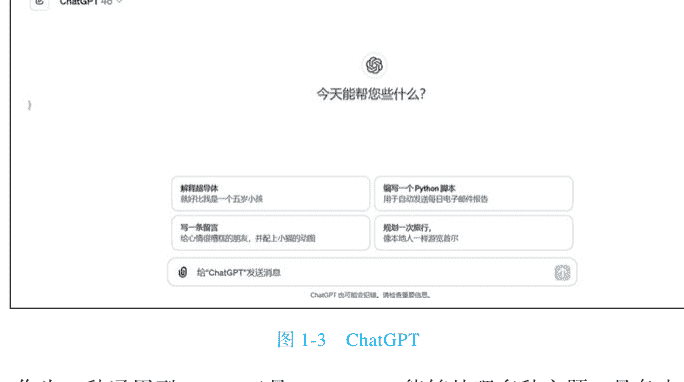

作为通用型 AIGC 产品，ChatGPT 可处理多主题任务，知识储备丰富，支持文本、语音、图像、表格等多模态输入输出。聊天界面可调用 OpenAI 的图像生成工具 DALL · E。

平台提供 DALL · E 图像生成、Data Analyst 数据分析等原生插件，并持续扩展生态。鼓励第三方或个人开发者创建定制化 GPTs 即智能体，无需编程经验即可搭建。

这些 GPTs 覆盖语言学习、内容创作、数据分析、工作流自动化等领域，可通过 API 和插件接入现有系统，提升工作效率。

（1）优点

- 更新节奏快：依托微软等合作伙伴，迭代快，用户基数大，生态扩张迅速。
- 输出质量高：结构清晰、表述自然，在双语结构化写作、多语翻译、创意启发上表现突出。
- 知识覆盖广：结合第三方应用，覆盖面非常宽。
- 上下文记忆强：有效记忆多轮对话，保持连贯，支持多轮互动，并能按反馈迭代内容。
- 个性化程度高：可灵活应对不同对话场景，设定专属交流风格。
- 功能整合：整合 DALL·E、Data Analyst 等 AIGC 工具，提供图像生成、数据分析等能力。
- 开放定制：提供免费版、付费版、团队版、企业版等多种套餐。

（2）缺点

在部分国家和地区存在使用限制。

（3）同类工具推荐

- Claude 3 Opus：Anthropic 推出的大模型文本生成工具，擅长创意写作，支持长文输出，营销文体质量较高。
- Gemini：谷歌的聊天机器人，信息检索与知识整合能力较强。

###### 2. 通义千问

通义千问是阿里巴巴于 2023 年面向公众开放的聊天机器人，聚焦智能对话，支持对话、图片理解、文档解析等功能，中文文本质量优势明显。采用 Transformer 架构，得益于高质量训练与海量数据，支持多模态交互，可理解并生成纯文本或表格回复。

依托阿里技术资源，与搜索、推荐、知识图谱等服务深度集成，为企业级用户提供更贴合商业场景的服务。

模型基于大量中文互联网文本，特别是阿里生态数据训练，中文理解生成能力强。但不能断言其中文能力一定超越 ChatGPT 或 Claude，具体表现取决于训练数据、优化目标和更新频率等。

（1）优点

- 多语言能力：中文突出，英语、日语、韩语文本质量也较高。
- 意图理解强：借助自然语言处理技术，对话更贴近人类习惯，专业咨询或日常聊天都能保持流畅。
- 工具丰富：网页端和移动端可设置提醒、天气查询、翻译等，成为生活工作助手。
- 应用广泛：可无缝对接阿里搜索、电商、云计算等服务，商业应用场景丰富。
- 获取便捷：网页、App 或集成方式均可使用，上手门槛低。
- 个人版免费使用。

（2）缺点

- 精确性问题：实测显示在部分场景下基础错误较多，高准确性专业或敏感场景需人工校对。
- 回答稳定性不足：知识库规模庞大，偶有相关性偏低的回答，尤其在专业细节查询时。
- 指令长度受限：输入字数有限制，可能限制复杂长问题的理解与回复。

（3）同类工具推荐

- 百度文心一言：百度文心大模型的聊天机器人，长文本处理表现不错，4.0 版本需付费。
- 腾讯混元：参数超千亿，预训练数据超 2 万亿 token，支持多模态学习，可在微信生态直接调用。
- 智谱清言：基于 GLM 大模型的中文 AIGC 工具，GLM-4 版本支持实时网络搜索。

###### 3. Jasper.ai

Jasper.ai 是一款智能写作助手，能够产出高质量文章。擅长文本风格个性化、复杂写作任务理解和专业写作。

工具整合 GPT、Neo X、T5、Bloom 等多款大模型，增强内容生成能力，尤其擅长长篇输出、专业文章和个性化文本创作，满足营销等专业领域的写作需求。

在营销领域可快速生成吸睛文案和广告语，支持高度个性化定制，用户可按需设定语言风格、专业领域、内容过滤器和格式。

提供博客文章、营销文案、邮件等多种文本模板，并提供工作流模板辅助复杂任务，配备丰富 API 便于集成到应用和工作流中，提升效率。

（1）优点

- 模板与工作流：提供多种写作模板，覆盖不同场景。
- 输出质量高：语言风格高度定制化，支持多种媒体文本风格。
- 电商场景突出：在亚马逊等电商平台的产品介绍、商品页文案等场景表现优异。
- 生成准确性好：融合不同模型架构，准确性表现较好。

（2）缺点

- 价格较高：付费版本费用较高，不适合预算有限用户。
- 冗余内容：按字数收费，有时会产生冗余无用内容。

（3）同类工具推荐

- Copy.ai：基于 GPT 的内容生成工具，可生成高质量营销文案，同时兼具 AI 营销与销售管理功能。
- AI Writer：支持博客文章、营销文案等多种写作模式的 AI 写作工具。

###### 4. 文山 AI

文山 AI 是基于 GPT 和 GLM 模型构建的营销文案工具，可调用 Midjourney 和 Stable Diffusion 生成图像。核心优势在于打通文生文与文生图，实现多模态 AI 写作方案。

无论是微信推文、产品说明书还是创意文案设计，都能提供高质量个性化文本。

用户通过填表或关键词输入快速生成营销文案，适用于多场景，可分发至各媒体和自媒体平台，提升创作效率。

提供丰富定制模板，覆盖十大类别，持续更新优化，基本满足自媒体和营销场景需求。具备微调功能，允许用户调整 AI 推理参数实现个性化创作，促进人机协作。

（1）优点

- 生成效率高：模板化交互配合丰富模板，加快营销内容产出。
- 个性化体验：按需求和偏好定制内容，支持中途介入和微调。
- 多模态输出：支持文生图、文生文等多种输出。

（2）缺点

学习成本较高：新手掌握全部功能需要一定时间。

展望未来，AIGC 文字生成工具将持续进化。随着算法优化、算力提升、数据质量和纠错水平提高，准确性、稳定性、逻辑推理、流畅度和个性化会进一步增强。

为缓解幻觉，更多模型开始采用实时搜索、数据源约束和人机反馈策略，确保输出可信。

工具也正变得更易用，让品牌用户更轻松参与内容共创。过去品牌发起线上故事征集，参与度低，用户不愿打字。现在借助 AIGC，用户只需提供关键词和大纲，工具即可撰写故事，用户专注于想象和创意。

AI 生成内容不仅提升写作效率、赋能内容营销，还可能改变内容创造和消费方式，催生新商业模式，同时引发对内容质量、真实性和伦理的深层讨论。有效利用 AI 内容需要在自动化与人类创造力之间找到平衡，拥抱合作、完善算法、结合专业知识，才能实现 AI 与人类作家协同创造更具影响力内容。

##### 1.2.4 图像生成工具选型

AIGC 能生成多种风格的高质量图像，是生成式 AI 的重要应用。Midjourney、DALL·E、Stable Diffusion 等均可创造逼真的人像实景和富有创意的图像。

当前 AIGC 生成的真人照片真实度已很高，加入相机参数、滤镜、风格等指令后，效果可媲美专业摄影作品。

核心技术基于深度学习图像生成模型，如变分自编码器、扩散模型如 Stable Diffusion，或 Transformer 架构如 DALL·E。模型通过海量图文数据训练，能理解自然语言并按提示生成匹配图像。

AIGC 还能按具体需求和场景描述生成图像，实现图文更精准匹配，增强文章、推文的吸引力。

生成的图像可用于微信、小红书等社交媒体配图，高效解决插画配图难题，同时降低误用网络图片带来的版权风险。

AIGC 图像生成工具大致分为 4 类：图像生成、3D 图像生成、智能图像编辑、智能设计，见表 1-5。

表 1-5 AIGC 图像生成工具分类与工具举例

| 类别 | 应用场景 | 国外工具举例 | 国内工具举例 |

| :--- | :--- | :--- | :--- |

| 图像生成工具 | 使用文字指令文生图或图像参考图生图生成图像 | Midjourney、DALL·E、Stable Diffusion、Playground | 通义万相、文心一格、腾讯智影、抖音 Dreamina、LiblibAI |

| 3D 图像生成工具 | 使用文字指令生成 3D 图像 | Tafi、Luma、Alpha3D、Spline、Sloyd.AI | Katacata AI、摹客 RP、masterpiecestudio |

| 智能图像编辑工具 | 使用 AI 进行图像编辑，如抠图、背景替换等 | Adobe Firefly、RunwayML、PhotoRoom、Canva | Pic Copilot、墨刀、即时设计、鹿班 |

| 智能设计工具 | UI 设计、字体设计、Logo 设计、建筑和空间设计、服装设计等 | Framer、Dreamhouseai、Mnml.ai、BricsCAD、Autodesk Forma、Maket.ai、ClickUp | MasterGo、DEJA AI、象寄 AI、千面模特 |

应用场景几乎覆盖所有行业，包括 Logo 设计、商品设计、模特展示、建筑设计等，部分工具还提供模型训练功能，如 Stable Diffusion 的模型库和个性化训练，让图像更贴合产品特征和品牌调性。

使用时需注意版权归属和商用限制。商用指以营利为目的的商业活动，包括用生成图像生产销售商品、提供服务、开设线上线下店铺、参与进出口贸易、运营互联网平台等。

大多数工具服务条款会明确版权归属，部分平台允许用户拥有版权，部分保留权利。许多工具允许个人作品商业使用，但通常有限制，如禁止制作仇恨言论、色情内容或侵犯版权作品。涉及肖像时需格外注意版权问题。

用 AIGC 工具画图，最先要搞清楚的不是画得好不好，而是画出来能不能用、能不能赚钱。每一家平台对生成物的归属和商业权限说辞都不一样，有的全权放手，有的保留权利还有使用限制。像是 Stable Diffusion 的某些 Checkpoint，作者会直接写明生成图禁止商用；对企业客户而言，Midjourney 这类服务往往要升级到商业套餐才允许商用。

下面把几款常见工具的版权与商用规则做个梳理。

1）Midjourney。无论免费还是付费，都不允许用户宣称自己是 Midjourney 生成图像的版权所有者。

免费用户拿到的授权是知识共享署名-非商业性使用 4.0 国际许可，即 CC BY-NC 4.0，作品只能非商业使用，不能用于盈利场景。

付费用户可以在遵守条件的前提下将图像用于任何目的，包含商业。条件是不能主张所有权或署名权为作者，也不能用于违法、诽谤、传播色情、造成伤害或侵犯他人权益等情形。

面向企业和品牌，年营收超过 100 万美元的公司若要商用，必须订阅 Pro 方案每月 60 美元，或 Mega 方案每月 120 美元。

2）DALL·E 3。使用者对自己用 DALL·E 产生的图像享有版权，包含转载、售卖和商品化的权利，免费或付费生成都一样。图像可自由用于商业项目，像是 NFT 创作、自媒体变现等场景都允许。

3）Stable Diffusion。作为开源模型，其代码和架构对公众开放，但训练数据可能掺杂受版权保护的素材，法律上仍有争议。

目前学界与业界对生成图版权归属没有统一定论。一种说法认为提示词输入者即为权利人；另一种说法认为模型开发者才是主体；还有观点认为应追溯到训练集中被使用作品的原权利人。

官方版 Stable Diffusion 生成的图像并未明示限制商业用途。

社区与第三方模型则要看授权。若模型采用 Creative Commons 许可，CC BY 在商用时需署名模型作者，CC BY-NC 则直接禁止商用。使用前务必核对许可证范围，避免侵权。

自行训练 LoRA 或 Checkpoint 时，建议只用不受版权保护的材料，或事先获得版权人明确许可。

4）百度文心一格。通过文心一格 AI 创作服务生成的图片，下载后支持个人使用，并在合法合规范围内可商用。

AIGC 图像生成目前仍有明显短板，主要是连贯性、可控性与图文混排。

一致性难题：在新请求或修改时，很难保持人物面部、服装等细节稳定。可借助种子值、参数调节如 Midjourney 的参数控制、或图生图功能如 Stable Diffusion 的 img2img 来提升一致性。

可控性难题：模型偶尔会张冠李戴，比如想生成一群小狗在草地奔跑，却跑出羊。原因既有描述不够精准，也受模型本身限制。可换用针对文化或风格的专有模型，如 majicMIX realistic 麦橘写实、国风 3 来逼近亚洲审美；Midjourney 与 DALL·E 也提供局部重绘，可框选区域后用指令修正。

图文混排难题：海报类含文字作品，模型容易把字写乱。折中做法是先把文字做成图，再用 Stable Diffusion 等工具做图生图处理，或生成后用 Canva、创客贴等工具二次编辑。

我们挑选了几款常用的 AIGC 图像生成工具做简要介绍。

###### 1. DALL·E
DALL·E 是 OpenAI 于 2021 年 1 月推出的文生图系统，名字取自画家达利与皮克斯角色 WALL·E 的结合。

核心能力是根据文本描述出图，风格覆盖插画、风景、人像、抽象艺术等，还能生成建筑招牌上的文字、同一场景的草图与彩图。既能产出独立作品，也能产出有明确使用场景的图。

技术上融合了扩散模型、GAN、VAE 与 Transformer，GAN 负责生成与判别，VAE 学习数据概率分布，Transformer 理解文本并转为图像特征。

目前已迭代到 DALL·E 3，可通过 ChatGPT、Bing、Microsoft Paint 以及接入 API 的服务使用。经 ChatGPT 或 Poe 使用体验较好，但 ChatGPT 调用会消耗对话次数。对新手友好，输入提示词即可生成，还支持上传原图进行 inpainting 修复与 outpainting 扩图。

DALL·E 与 ChatGPT 配合效果好，可用中文让 ChatGPT 润色更精准的提示词。

例如让 ChatGPT 为 DALL·E 写一个专业人像拍摄指令：选用全画幅专业 DSLR 如佳能 EOS 5D Mark IV，搭配 85mm f/1.4 镜头获得柔和散景；光圈 f/2.8、快门 1/200 秒，自然光为主，左侧加反光板补光形成柔和轮廓光。相比 Midjourney，DALL·E 对这类细化指令的理解更到位。

（1）优点
- 自然语言理解强：同源 Transformer 架构与语料库，让它能从宽泛、简短的描述中捕捉意图并准确成图。
- 生成快且高效：速度通常比同类快三到四倍，可快速批量输出。
- 归属清晰：免费与付费用户生成的图像均归使用者所有，含重印、销售、商品化权。
- 商用友好：无需额外升级即可完整商用。

（2）缺点
- 提示要求高：细节图需要非常精确的描述。
- 人像表现平平：逼真人物生成逊于 Midjourney 等。

###### 2. Midjourney
Midjourney 以逼真人像、多元艺术风格与丰富功能著称。由美国旧金山独立实验室 Midjourney Inc 创建，创始人 David Holz 在 2021 年 8 月离开 Leap Motion 后创立。

其特点是将大语言模型与扩散模型结合，用户可用文字、图或参数下指令，语言模型解析意图后引导图像生成。通过 CLIP 数据集训练，建立图像与文本的关联。用户可调文字权重 Image Weight、Chaos 创意发散、Style 风格、Seed 种子、Upscale 放大、Zoom Out 等参数。

目前仅能通过 Discord 或第三方 API 平台如文山等使用。

（1）优点
- 社区活跃：Discord 公共服务器形成学习交流生态，新手易获灵感与建议。
- 上手简单：文字提示加 Discord 操作即可，无需技术背景。
- 迭代快：可短时间产出多张变体，便于快速筛选细化。
- 参数精细：支持局部调整、比例、创意度等微调。

（2）缺点
- 付费成本：订阅制比部分免费模型贵。
- 个性化受限：不像 Stable Diffusion 支持深度个性化模型训练。

###### 3. Stable Diffusion
Stable Diffusion 是 2022 年发布的开源图像与视频生成模型，可基于文本与图像提示生成照片级真实感内容，还能做视频动画。

技术栈包括 VAE、扩散模型、CLIP 与 LoRA 等低秩适配技术，支持文生图、图生图、文生视频。

可在装有 GPU 或苹果 M3 芯片的设备本地运行，网上有整合包便于安装。核心是 Checkpoint 模型，存储训练好的权重与偏置，如国风系列可出中国风格画作，Product Design 模型偏向产品图。

LoRA 可与 Checkpoint 结合微调风格如人物面部特征，通过在特定层加低秩矩阵实现小样本微调。用户还能用赛博丹炉等整合包或在线训练器自训 LoRA。生态丰富，插件与控制件众多，图生图支持换脸、换装、风格迁移等。

（1）优点
- 开源透明：代码可自由访问与修改，促进创新。
- 高度自定义：本地运行，可精细控制生成流程。
- 社区强：开源带来活跃生态与技术支持。
- 免费：本地部署后无需额外付费。

（2）缺点
- 硬件门槛高：高效运行需高性能 GPU。
- 安装门槛：新手安装较复杂，可靠整合包简化流程。
- 学习曲线陡：完整掌握功能需投入时间。

借助 AIGC 图像工具，广告创意、社媒配图、产品效果图等制作周期大幅压缩，为品牌提供更高创意自由，减少对专业设计师的依赖，从而降低成本。

在尊重版权与伦理的前提下，委托方与服务方都应重新界定设计与创意分工，鼓励尝试与创新，这有助于推动创意产业发展并催生更多市场可能。

##### 1.2.5 语音与音乐生成工具选型
文字转语音技术已很常见，微信听读、抖音解说、电子书、视频旁白多基于此。过去配音要选演员、写稿、录音、合成剪辑，如今剪映、腾讯智影、百度 AI 实验室等 TTS 工具让流程极简。

Text to Speech 通过 AI 将文本转为语音，涉及文本分析、语言学处理与声学合成，支持风格、语速调节。

视频旁白、宣传片配音场景适配性好，如 murf.ai 不仅能生成语音，还能调速、调情绪、修正单字发音。

若需定制声音如克隆个人音色，可用 Fake You、HeyGen 等。剪映、HeyGen 等还能实现音画同步剪辑输出。

HeyGen 等工具不仅能做跨语言配音，还能做唇形、表情与场景的同步匹配，实现自然的跨语种视听体验。

在视频制作中还需背景音乐。AIGC 能学习大量作品的旋律、和声、节奏后按指令生成新曲。OpenAI Jukebox、AIVA、Boomy 等可快速产出背景音乐。Suno 支持自动写词，mubert 支持图转音乐，根据上传图像的色彩、构图生成配乐。

后期制作可选用网易天音、腾讯 TME Studio 等写词编曲一体化工具。AI 音乐或缺乏真实情感，但其效率与多样性仍具价值。

我们把 AIGC 语音工具分为三类，见表 1-6。

###### 表 1-6 AIGC 语音工具分类与工具举例

| 类别 | 应用场景 | 国外工具举例 | 国内工具举例 |
| :--- | :--- | :--- | :--- |
| 文字转语音 | 将文字转换成语音，并且选择声音类型（性别、方言等）、语速等 | Murf.ai、Lalals、Lovo.ai、Google Text-to-Speech、Fake You、HeyGen、Audiobox、Play.ht | 剪映、微信智影、讯飞智作 |
| 智能音乐生成 | 自动生成音乐 | Beethoven.ai、Jukebox、AIVA、Boomy、Suno、Riffusion、Harmonai、mubert、SongR | 无 |
| 音乐剪辑、音画合成 | 虚拟主播视频生产和编辑 | Sounddraw.ai、Soundful、musicgen | 网易天音、腾讯TME Studio、剪映、微信智影 |

###### 1. Murf.ai
Murf.ai 是功能强大的语音合成工具，能把文本转为逼真配音，适用于视频、播客、广告、在线学习、PPT、有声书等。除了普通话，还提供相对少见的粤语配音，供给更多元选择。

配音工具深度拆解：Murf.ai 声库与实用功能
Murf.ai 汇集了逾百二十种语言与口音资源，男声、女声、童声均有覆盖，还能做个人化建模。用户可提供自己的录音样本让系统学习模仿，形成专属音色，这一点和 HeyGen、D-ID 的视频配音方案在思路上相近，都在强调灵活与个性化。

编辑层面支持人机协作，语速、音调、韵律、停顿以及情绪色彩都能做精细微调，最终效果更贴合预期。除了纯文本转语音，平台还能直接接入视频、图片或演示文稿，与合成语音合并快速产出配音视频。字幕编辑功能可为成品添加字幕，提升可读性；同时提供大量无版权音乐与音效，可混入配音里丰富质感。

优点
- 音质自然：采用领先的语音合成技术，输出接近真人，适合需要人声质感的内容制作。
- 语种丰富：逾百二十种语言与口音，男女童声齐全，覆盖教育、商业、娱乐等多类场景。
- 上手简便：界面简洁，零基础也能快速操作。

缺点
- 付费门槛较高：免费档生成时长限制在10分钟，付费档价格不低。
- 中文选项偏少：对比剪映，中文语音与口音的种类相对有限，中文应用受限。

###### 2. Beatoven.ai
Beatoven.ai 面向视频、有声书、播客创作者，提供在线音乐自动生成服务。操作流程短，无需音乐背景或识谱能力，几步即可得到定制化背景乐。

平台提供风格与情绪标签，可自行设定时长、曲风和配器组合，让音乐与内容情绪契合。无论是为快节奏视频配欢快曲目，还是为冥想类播客配宁静旋律，都能体现其适应力。生成的素材版权风险可控，适合追求效率与专业感的用户。

优点
- 快速便捷：无音乐经验也能迅速产出。
- 自定义空间大：选项丰富，能满足多样创作需求。

缺点
创作者主控力受限：虽然生成高效，但使用者对最终成品的把控空间相对较小。

###### 3. Suno
Suno 是在线音乐创作平台，门槛低、界面友好，零基础用户同样能快速上手。只需输入歌词描述或让系统自动生成内容，就能得到个性化音乐。

支持多种风格设定，可定制曲风与编配。产出适用于视频、有声书、播客、游戏、广告等场景。V3版本在免费账号下可在线制作长达两分钟的完整曲目，在官网创建区填写流派、主题等信息即可。免费账号每日积分上限为50，约够生成十首，但禁止商业使用。

需要商业授权时可订阅 Pro 与 Premier 计划，使用权完整，可用于商业项目。

优点
- 音频质量提升：V3 在音质、发音清晰度与节奏编排上都有进步，听感更专业。
- 风格选择广：提供多样曲风，可按需定制配器。
- 提示理解更准：V3 对用户输入的响应更准确，减少偏差，提升创作自由度。

缺点
- 情感共鸣不足：相比人类作曲家，算法生成的音乐在情感层面仍显单薄，主要依赖数据。
- 版权归属存疑：尤其是商业用途，版权问题需谨慎。

##### 1.2.6 视频生成与编辑工具选型
AIGC 视频生成是利用人工智能自动制作视频内容的新方向。用户输入文字、图像或视频等多模态信息，经过训练的模型即可输出高度匹配的高保真画面，是在图像生成之后的重要进展。

2023年被视作图像生成元年，2024年则成为视频生成的爆发窗口。英伟达高级科学家 Jim Fan 预测视频类模型将在2024年迎来大突破，RunwayML 联合创始人兼CTO Anastasis Germanidis 也认为视频生成与新交互界面是2024主线。随着 OpenAI 发布 Sora 并把单次生成时长提升到一分钟，预言正在兑现。

虽然文字与图像生成已趋成熟，视频生成仍处早期阶段，充满挑战与机遇，为初创企业提供行业重塑机会，也伴随不确定性。

原理上，视频本质是按帧率播放的一组连贯图像并保证平滑过渡。实际实现远比表面复杂：模型需先用自然语言处理理解文字并转为图像，再把图像序列化为帧并与音频同步。流畅动画常依赖关键帧、插值算法与运动模型。多数学工具还依赖生成对抗网络 GAN、循环神经网络 RNN 等深度学习结构来保证画面质量。

训练成本同样高昂。以 Stable Diffusion 为例，Intel i9 搭配12GB显存的NVIDIA GPU 生成一张高清图约需20秒，生成十秒视频可能耗时半小时。

###### 1. 剪映
剪映由字节跳动开发，是智能剪辑与生成工具，提供网页、客户端、手机版，并通过云服务实现多端同步与协作。

大幅降低剪辑门槛，界面直观、模块清晰，提供模板化自动生成视频、自动字幕、智能配音、音乐自动同步等智能功能，简化传统流程。还整合智能抠像、曲线变速、画面稳定等进阶功能，并持续加入智能音乐匹配与多样转场特效，提升艺术表现。

素材库庞大，含免费贴纸、个性字体、多元滤镜与丰富音效。适用于抖音竖版，也可通过国际版 CapCut 适配 Instagram、YouTube 等平台，为全球品牌营销提供支持。可与 ChatGPT 等生成式工具配合构建工作流，例如在 Coze.com 的 Video Generator 中先由 ChatGPT 写脚本，再由剪映自动出片。

优点
- 界面友好：简洁直观，易上手。
- 多端兼容：网页、客户端、手机端皆可，云端支持同步协作。
- 智能编辑：自动生成视频、自动字幕、智能配音、音乐同步。
- 高级选项：智能抠像、字幕识别、文字朗读等。
- 素材模板丰富：贴纸、字体、滤镜、音效齐全。
- 多平台适配：支持主流社交媒体风格。

缺点
- 生成创意受限：AI产出可能缺少细腻创意与个性表达。
- 版权风险：素材库内容使用时可能涉及版权与许可问题。

###### 2. Sora
2024年2月16日，OpenAI 发布 Sora，一款文本转视频生成器，可根据提示生成长达一分钟的高质量视频，展现了视觉领域的潜力，对媒体与创意产业影响深远。

技术上采用扩散模型，先生成类似静态噪声的视频再逐步清晰化，与 Stable Diffusion XL 生成图像的流程相似。过程需大量计算与调优以兼顾质量与指令忠实度。模型还引入 Transformer 架构提升扩展性，把视频与图像表示为数据单元或补丁，从而处理不同时长、分辨率与宽高比。

Sora 能理解并实现提示中描述的复杂场景，包含多角色互动、特定动作、精细主题与背景。可在单视频内生成多个镜头并保持角色与视觉风格一致，但初代在模拟真实世界物理特性方面仍有提升空间。

优点
- 高质量生成：可生成一分钟高质量视频，且忠实于指令。
- 复杂场景能力：能呈现多角色、特定动作与精准背景。
- 语言理解强：能准确解析提示并生成情感丰富的角色。
- 风格连贯：多镜头内保持角色与视觉一致。

缺点
- 物理模拟不足：初代对复杂物理因果逻辑模拟不够精确。
- 空间细节易错：可能出现左右位置反转等空间错误。
- 时间描述困难：对随时间变化事件如摄像机运动轨迹的精确追踪仍具挑战。

类似工具推荐
Google Veo：谷歌的文本生成视频大模型，预计单次时长可达一分钟，将通过 VideoFX 使用，并作为 YouTube Shorts 的功能之一。

###### 3. HeyGen
HeyGen 是虚拟人视频生成平台，用户输入简单提示即可生成虚拟人视频，并可高度个性化定制，如上传自拍图像创建专属角色后用于生成。

前身为 Movio，是与 Synthesia 对标的产品。创始人 Josh Xu 希望用AI取代摄像机。使用时可输入文字或选用平台生成的脚本，选择虚拟人、语言与声音即可生成虚拟主播视频。目前支持40余种语言、300余种声音与100余种AI虚拟形象。

相比聘请演员与昂贵录音设备，该技术大幅节省时间与成本，适合预算有限的企业。无论员工培训还是用户教育，都能把传统PPT转化为更具吸引力的视频，动态元素增强理解与记忆。

平台还提供虚拟角色个性化功能，可创建专属形象用于产品介绍、活动主持、直播带货等，视频可进一步剪辑用于社交媒体或广告素材。

优点
- 使用权限宽泛：免费或付费版本生成的内容用户均可获得完整使用权。
- 创作流程高效：内置智能脚本生成，输入关键词即可快速自动生成剧本。
- 真实感强：技术成熟，虚拟人的表情、动作与口型高度匹配剧本。
- 定制体验好：可上传个人照片或视频素材，轻松打造专属虚拟形象。

缺点
- 成本随时长增长：制作费用按分钟计费，可能较高。
- 无预览功能：生成前无法预览，需完成后才能查看效果。
- 角色风格受限：预设形象多为专业风格，对追求高度个性化设计的用户选择有限。

类似工具推荐
D-ID：基于AI将照片转为虚拟形象或直接生成视频，实现语音合成与音画同步。
Synthesia：最早且成熟的虚拟人视频生成工具之一，支持多语言与自定义角色。
Deepfake：利用深度学习实现人脸交换与语音模仿，可制作看似真实的虚假视频。
腾讯智影：功能类似HeyGen，但可选中国人形象更多。

#### 1.3 提示工程方法与技巧
本节深入探讨结构化指令的原理、应用与最佳实践，帮助生成式AI完成更高效的内容生成与任务执行。

##### 1.3.1 提示工程：结构化指令
结构化指令指一种明确、有组织的命令格式，帮助系统、程序或设备按预定方式理解并执行特定操作。在生成式AI场景下，特指以精确、条理的方式构建提示，以更有效地引导对话模型理解用户意图并给出精准响应。它像预先设计的沟通框架，能引导思维发散并激发创意。

使用结构化指令进行沟通与写作的重要性在于：
- 降低幻觉、提升准确度：更准确地传达用户意图，减少误解与错误回应。
- 提升响应速度：结构化提示让模型更快给出答案，避免在无关信息上浪费时间。
- 处理复杂任务与连续提问：有助于模型更好理解与组织信息。
- 优化应用场景：在教育、医疗、客服等领域可提供更符合特定需求的答案。

结构化指令常被称为提示工程，广义上提示工程还包括调整语言风格、使用特定词汇或语法结构以适配不同模型或场景。

为更高效使用结构化指令，通常会借助结构化指令模板或提示框架，帮助快速撰写指令，提升AI理解准确度，减少偷懒与幻觉。

我们总结了常用的模板，如 SPAR 情境化提问、CLEAR 链式提问、ECIR 挑战创新思维提问、CREATE 发散创意提问、COSC AI 人设与条件约束。名称虽有差异，核心原理相通，均基于角色扮演、情景模拟、链式思考与示例反馈，系统性提升沟通清晰度与有效性。

每个模板针对不同需求与场景设计。无论是 CLEAR 的深入分析、SPAR 的角色扮演视角，还是 CREATE 的创新思维与 ECIR 的反思挑战，都能在不同情境下实现有效交流。

本书总结的模板仅为入门工具，继续深入可参考：
- 学习资源：promptingguide.ai 入门可选择中文、learnprompting.org 进阶需付费、ChatGPT 提示工程师 & AI 大神吴恩达教你写提示词 Bilibili 视频。
- 参考案例：promptport.ai、智谱清言灵感大全。

##### 1.3.2 SPAR——情境化提问
SPAR 方法基于角色扮演指令技巧，用于与AI有效交互，包含4个要素：情境 Scenario、角色 Persona、行动 Action、响应 Response。

- 情境：描述情况或背景，为后续角色扮演与情境交互奠定基础，决定环境、事件与复杂性的框架。
- 角色：确定AI扮演的具体身份，如营销总监、品牌经理等，并定义目标与性格特点。
- 行动：在既定情境下明确角色应采取的具体行动或决策，推动AI展示思考过程或分步完成任务。
- 响应：设定对行动的预期结果或行为，可对AI的回答与思考过程设定约束，如限定信息来源。

SPAR 能将问题拆分为四部分，便于结构化思考。先通过情境与角色提升对用户背景、需求与动机的理解；再借助明确行动推动深度分析，把概括性答复转化为针对性建议；最后通过控制响应预期，确保输出符合格式要求并规避幻觉。

例如，作为保险公司市场部品牌营销经理，希望为即将推出的宠物理疗保险制定推广策略，朴素指令可能是：
> 请为一个保险公司即将推出的宠物理疗保险制定一个市场推广策略。

按 SPAR 拆解：
- 情境：一家新兴宠物保险公司计划在中国推出首个产品——宠物理疗保险，涵盖意外伤害与疾病康复理疗。公司面临竞争激烈市场中如何突出特色并赢得宠物爱好者信任的挑战。
- 角色：AI扮演该保险公司的品牌营销经理，负责制定并执行有针对性的市场推广策略，确保产品在目标消费者中获得最大曝光与认可。
- 行动：作为品牌营销经理，请AI制定创新营销计划，包括市场分析、目标客户定位，以及提升品牌认知度与产品销量的推广活动。
- 响应：AI需提供详尽营销策略，结合中国市场特点，包含本土化内容策划，以及利用社交媒体、KOL与在线社区建立品牌信任的方案。

SPAR拆解后，复杂任务会变得条理分明、步骤可循。它让模型更快抓住业务要害并给出可落地的执行思路，也让提问者在结果走向和实施路径上拥有更强的预判感。这种结构化沟通不只限于生意场景，教学、客服以及任何对表达精度要求高的场合都能直接套用。

在完成初步拆解后，得到的问题框架已经很清晰。再做一次精简提炼，提问可以变得更干净：

假设你刚接手一家全新品牌的市场负责人，需要为一款即将进入中国市场的宠物理疗险制定推广方案。请给出适配本土的投放思路，要求包含对核心人群的精细画像、符合本地习惯的内容经营打法，以及借助社交平台和达人联动来拉升声量的具体活动建议。策略要能建立消费者信任，同时突出产品对宠物和饲主的实际价值。如果关键信息有缺失或不确定，请直接指出需要补充的资料。

SPAR本质上是一种兼具通用性和框架性的指令设计思路，能让和大模型的多轮交流更顺滑，增强沉浸式角色扮演的真实感，并在可控情境下产出贴合上下文的答案。下面可以从几类典型场景来组装指令。

###### （1）客户服务模拟
- 帮助客服人员训练应对各类用户诉求的能力。
- 还原顾客与客服之间的对话流程，优化沟通技巧。
- 设计虚构的客服难题，用来检验员工的应变与处理水平。

举例如下：
- 情境：顾客在家试用新买的电子设备时，发现机子无法开机。
- 角色：你是一名经验丰富的客服，任务是解决问题并让对方满意。
- 行动：请模拟客服的真实对话，包含细节询问、方案给出，并体现共情与支持。
- 响应：请输出一段可复用的客服话术，保证回复专业且有温度。

###### （2）设计用户互动游戏
- 为互动剧本或游戏创造人物和情境。
- 通过扮演指定角色体验不同分支剧情。
- 生成连贯且有深度的互动对白。

举例如下：
- 情境：你是一名探险者，正在古废墟里寻找传说宝藏。
- 角色：机智勇敢，擅长解谜和规避远古机关。
- 行动：描述你如何解读地图提示并逐一避开机关。
- 响应：生成你在寻宝成功或遭遇意外时的反应与决策。

###### （3）情境分析和问题解决
- 解析商业情境并推演决策路径与可能结果。
- 在复杂流程或系统中测试新策略。
- 模拟突发或危机场景，提前准备预案。

举例如下：
- 情境：你是一家企业的危机顾问，旗下电子产品在使用时出现电池爆炸。
- 角色：需要统筹团队展开原因调查，并对外沟通。
- 行动：制定应急方案，涵盖内部调查与公关打法。
- 响应：起草一份面向媒体和公众的声明，说明立场与处置措施。

###### （4）用户体验和产品设计
- 模拟用户与产品服务的交互，检验易用性。
- 基于假设角色理解不同使用场景。
- 评估并优化用户旅程，提升满意度。

举例如下：
- 情境：公司刚上线智能家居App。
- 角色：你是一名产品设计师，需要把握使用体验。
- 行动：记录用户在安装、配置和日常使用中遇到的阻碍。相关资料如下。（略）
- 响应：给出解决痛点的方法，并汇总反馈以改进设计。

另外，上述案例也可以让模型扮演用户来检验产品反应，改写后如下：
- 情境：你是一个智能家居App的潜在使用者。
- 角色：你叫子涵，30岁上海白领，租房居住，工作繁忙，家务时间有限。
- 行动：我将以产品经理身份提问，你需以子涵身份作答，表达对App的需求与偏好。
- 响应：当我说“访谈结束”时即为终止信号，之后请退出角色并输出汇总，包含产品改进建议与目标市场的营销建议。随后请以子涵身份回答第一个问题：你最讨厌的家务是什么？

SPAR的覆盖面很广，能提升交互的真实感与有效性。通过结构化对话，模型可以更准确地理解需求并作出回应，用户也能在可控、可预期的环境里获得更深刻的体验。

##### 1.3.3 CLEAR——链式提问

CLEAR是一种思路梳理工具，帮助我们在向ChatGPT等对话模型提问时更有条理，从而获得全面深入的答案。

它属于链式提问的一种，目标是引导生成式模型给出更深入、更有条理的回复。

该方法包含五个递进步骤：

1. C——Contextualize，背景交代：先为问题搭建背景与语境，为后续角色扮演与情境交互奠定基础。这一步能确保双方对情境与复杂度有共识。
2. L——List，罗列议题：列出所有想了解的子话题，保证覆盖细节，获得更完整的回答。
3. E——Elaborate，深入展开：要求模型对特定子议题展开说明，获取详尽信息。
4. A——Associate，关联分析：让模型分析不同议题间的联系，挖掘深度与相互影响。
5. R——Review，复盘总结：请模型对讨论进行归纳，确保要点齐全并给出进一步建议。

CLEAR通过由宏观到微观的逐步细化，帮助拆解复杂问题并提供系统化解答，特别适合需要全方位解析的场景。

###### 1. 操作指南和技巧

下面介绍各步骤的具体使用要点。

####### （1）背景交代
提问前先提供充足背景，让模型把握问题核心与需求。例如：
> 在当前经济环境下，不少企业面临出海的机遇与挑战。我想了解影响品牌出海的关键因素，以及如何制定有效的出海营销策略。

####### （2）罗列议题
清晰列出希望讨论的子话题，保持逻辑相关。例如：
> “首次出海最适合的国家和地区有哪些？”
> “在当前全球局势下，品牌出海的主要机遇与挑战是什么？”
> “出海品牌对供应链有哪些具体要求？”

####### （3）深入展开
针对关键子话题深入追问，提出开放性问题。例如：
> “对首选市场各自的利弊能否展开说明？”
> “能否举例说明品牌出海失败的案例，并归纳共同原因？”
> “请详细说明出海对供应链的积极与消极影响。”

####### （4）关联分析
探讨不同议题间的关联，揭示因果或依赖关系。例如：
> “如何把全球多样性转化为出海竞争优势？”
> “特定市场策略在多元文化背景下是否能提升效率？请举例。”

####### （5）复盘总结
最后做一次全面复盘，确保要点齐全。例如：
> “我们已讨论出海的多个方面，还有哪些重要角度可能被忽略？”
> “基于现有讨论，是否已覆盖制定出海战略所需的全部要素？”

使用CLEAR不仅能保证问题的全面与深度，还能引导模型进行更有条理的思考，适合需要深度分析与综合理解的复杂议题。

###### 2. 适用场景和问题类型

CLEAR适用于需要详细了解、深入分析或多角度探讨的场景。

####### （1）解决复杂问题
面对多步骤分析的难题，CLEAR可帮助逐步深入，确保全面考虑。
举例如下：
- 研究营销风险评估流程。
- 分析某项营销策略的有效性。

####### （2）决策支持
在重大决策前梳理背景与可能结果，做出更明智选择。
举例如下：
- 选择最优渠道投放方案。
- 确定品牌未来发展方向。

####### （3）市场调研
确保调研问题全面深入，适用于资料准备或研究提案。
举例如下：
- 探讨宠物市场未来一年发展趋势。
- 分析TikTok海外增长对出海营销的影响。

####### （4）产品开发和改进
聚焦用户需求与设计挑战等关键问题。
举例如下：
- 明确用户对新产品的需求。
- 评估产品测试结果并提出改进建议。

除此之外，CLEAR几乎适用于任何需要结构化思考与系统分析的情境，能让问题更清晰、交流更深入。

##### 1.3.4 ECIR——挑战创新思维提问

ECIR基于系统性提问，包含探索、挑战、创新、反思四个连续阶段，用于设计指令以获得创新性答案。它更强调对既有认知的质疑与创造性解法。

1. 探索：拓宽思路，全面了解问题，如同先做体检再诊断。
举例如下：
> “在现行环保政策下，有哪些关键因素常被忽视？”
> “请列出AI在教育领域应用的优势与局限。”

2. 挑战：重新审视既有假设，提出反方观点，找到真正的问题。
举例如下：
> “针对AI无法达到人类创造性写作水平的常见说法，有哪些反驳？”
> “人类是否必须依赖塑料包装？有哪些替代可能？”

3. 创新：在新问题基础上寻找新答案，可进行头脑风暴或原型构想。
举例如下：
> “如何将ChatGPT与吹泡泡机结合设计一款儿童玩具？”
> “设想一个无塑料的世界，它如何运作？”

4. 反思：回顾对话成果并评估，为后续行动提供指引。
举例如下：
> “回顾关于AI助手的讨论，哪些建议最具创造力？原因是什么？”

ECIR能引导深入探索与全面理解，通过持续挑战与创新发现解决方案，并以反思识别真问题。缺点是耗时较长，不适合需要快速响应的场景。

###### 1. 产品定位
通过提问分析产品市场位置，制定差异化竞争策略。
举例如下：
- 探索：千禧一代健康零食市场有哪些趋势与空白？
- 挑战：为何传统健康零食品牌难以吸引千禧一代？
- 创新：能否设计符合千禧一代喜好的健康零食订阅模式？
- 反思：新产品线推出后目标受众如何反应？如何调整以更贴合市场？

###### 2. 创意设计
用于广告创意，激发兴趣并促进行动。
举例如下：
- 探索：过去一年宠物食品行业有哪些知名广告创意？
- 挑战：这些创意有哪些不足，未解决哪些消费者需求？
- 创新：如何把增强现实技术融入宠物食品广告，创造独特体验？
- 反思：用什么指标衡量AR广告效果，如何根据数据迭代？

###### 3. 社交媒体策略
优化内容创作与分发计划。
举例如下：
- 探索：母婴品牌在Instagram上哪类帖子互动最高？中国出海母婴品牌能否借鉴？
- 挑战：这些热门内容是否真正吸引粉丝？
- 创新：可利用哪些新功能或内容趋势加深互动？
- 反思：新策略执行后互动率如何变化？能否适用于中国出海品牌？

###### 4. 市场趋势分析
识别影响公司成功的内外因素。
举例如下：
- 探索：截至2023年3月31日，消费者转向环保家居用品的趋势如何？
- 挑战：行业对环保市场与消费者偏好的假设有哪些不准？
- 创新：AI能否用于设计新的家居用品线？
- 反思：推出环保家居用品后，销售数据与反馈说明了什么？

###### 5. 用户体验优化
改进产品使用流程，提升满意度与忠诚度。
举例如下：
- 探索：用户在电商平台放弃购物的主要原因是什么？
- 挑战：现有结账流程的哪些环节可能导致放弃？是否遗漏了因素？
- 创新：可采用哪些新结账方式提升转化？哪些环节可简化？
- 反思：优化后转化率与用户反馈如何变化？可吸取什么经验？

##### 1.3.5 CREATE——发散创意提问

CREATE通过情境化、重新解释、扩展、联系、转化、评估六步引导发散思维，激发创新答案。

1）情境化：先简述问题背景，帮助模型提供针对性回答。
举例如下：“我们新产品上市后市场反馈不佳，以下是相关数据。”

2）重新解释：从不同角度或借鉴他行业视角重新定义问题，打破局限。
举例如下：“如何从金融行业视角重新诠释我们产品的营销困境？”

3）扩展：拓宽问题边界，寻找更广可能性。
举例如下：“有哪些方法可以拓展当前的市场营销策略？”

4）A——Associate，联系：将看似无关的概念与挑战关联，产生创新解法。
举例如下：“能否将电动汽车领域的创新理念融入我们的营销策略？”

5）T——Transform，转化：思考如何调整方法或问题要素，将创新想法落地。
举例如下：“基于上述分析，应如何调整产品定位或营销策略以塑造独特性？”

6）E——Evaluate，评估：思考如何衡量创意方案的有效性与潜在影响。
举例如下：“应如何评估这些创新营销策略的成效？”

下面以虚构电动三轮车品牌“赫斯”为例，演示CREATE指令构建。

###### 第一步：情境化
> “在全球竞争加剧的市场中，我们的新型电动三轮车赫斯未能达到预期销量。作为海外营销总监，请详细描述当前全球电动三轮车市场格局及消费者行为关键趋势。”

###### 第二步：重新解释
> “借鉴游戏行业在国际市场的成功案例，如何重构营销策略以激发潜在客户对赫斯的兴趣？”

###### 第三步：扩展
> “在电动三轮车行业之外，可尝试哪些非传统渠道或创新策略来提升赫斯的曝光度并触达更广用户？”

###### 第四步：联系
> “参考以环保为核心卖点的行业案例，如何利用这一趋势提升赫斯品牌形象并激发用户兴趣？”

###### 第五步：转化
> “讨论如何调整赫斯的营销战略，将环保特性转化为目标市场的实际需求？”

###### 第六步：评估
> “请结合数据与案例，详细分析上述创新营销策略如何帮助提升赫斯在海外市场的销售业绩。”

提问双引擎：发散与深挖

CREATE 与 ECIR 都是能让大模型进行深度推理的结构化提问范式，底层目的相近，操作侧重不同。CREATE 走发散路线，核心动作是重述问题、放宽边界、跨域联想、转换观察角度，用来撬动跨行业跨领域的创新灵感。ECIR 走聚焦路线，强调对问题进行纵向深挖，在审慎反思和创新探索之间寻找可落地的解法。

把这两种思路搬到营销实践里，CREATE 的适用面很宽，能帮助团队用创新思维破局、捕捉机会、优化打法：

- 品牌和商品定位：借助 CREATE 做发散式头脑风暴，构思有辨识度的品牌故事并提炼新价值主张，让品牌在市场上实现精准卡位；商品定位同理，可借鉴他行业经验和专业方法论，打造差异化的定位逻辑。
- 市场细分：对存量市场重新审视，通过再解读和外延，发现被忽略的细分赛道和潜在需求。
- 广告创意：激发视觉与文案的新组合，提升对目标人群的吸引力。
- 营销渠道和内容营销：评估元宇宙平台、小众播客、Web3.0 社区等新兴渠道的可行性。
- 内容方向：开拓新的内容路径，借鉴竞品广告创意进行再创作，形成新颖的传播概念。
- 竞争打法：拆解对手行为轨迹，以发散视角设计差异化的竞争策略。

1.3.6 COSC——AI 人设和条件约束

COSC 是一种提升与大模型交互效率的策略，由 Character、Objective、Skill、Constraint 四要素构成。它对 AI 的角色刻画更细致，能建立清晰的对话边界。具体要素如下：

72 第一部分 新技术与新思维

- 人设：在 COSC 框架里，人设定义了 AI 需要扮演的身份、职业、性格以及承担的职责。相比 SPAR 中的情境化角色设定，这里的人格设定更具体、更严格。
- 目标：角色需要达成的交付结果，与角色职责相呼应。目标表述要具体、可验证。
- 技能：明确执行任务时要调用的具体能力，例如调用在线检索工具核实不确定信息。
- 约束：执行过程中必须遵守的规则与限制，来源包括法规、伦理、数据范围等。

COSC 既明确了 AIGC 的职责与期望行为，也提示了所需调用的能力，同时划定边界避免跑偏，从而实现更聚焦、有目的的对话，提升任务成功率。

以视频内容分析任务为例，借鉴字节跳动 Coze 平台上“哔哩哔哩助手”的指令写法，演示 COSC 模板的撰写方式。

###### 1. 角色画像
- 角色/职业：你是一名视频内容分析师，负责为使用者提供视频的细致概括与深度剖析；同时你是视频研究专家，帮助用户把握核心要素，省去完整观看的时间成本。
- 职责：对指定视频进行详尽总结与深度分析，提炼核心观点、主题，以及影响叙事或信息传达的关键视觉、听觉元素；识别目标受众，并评估信息传达的有效性。
- 性格：具备高度分析力，关注细节，能捕捉对话、意象、音乐、剪辑手法等要素；表达清晰，有效传达分析结果，便于用户理解；对文化背景与细微差异有敏感度，能全面把握视频影响力。

###### 2. 目标
- 目标 1：产出一份包含视频标题、评论的详细分析报告。报告包含视频标题链接并配适度表情符号提升吸引力，以及对视频特点与核心内容的简明总结。
- 目标 2：在总结分析中，概括全文并列出不超过 10 条最具趣味的亮点；每条亮点后附不超过 3 句的补充细节，并标注亮点起始时间。
- 目标 3：在评论分析部分，突出视频优势与核心内容，保持简洁；给出综合点评与星级评分。

###### 3. 技能
- 技能 1——分析视频内容：使用 watch 工具检视 Bilibili URL 提供的 bvid 或短链接，解析内容；将字幕整理为 (start-end, subtitle) 格式。
- 技能 2——生成格式化文本：熟悉 Markdown 排版，有序呈现内容，必要时突出重点，并始终用恰当表情装饰标题与内容。
- 技能 3——回应用户查询：依据视频具体内容作答；当回复存在模糊时，使用 Google search 工具补充数据。
- 技能 4——最新视频推荐：使用 popular_video 功能获取热门视频，按用户偏好返回列表；使用 Bilibili search 按关键词查找视频；使用 google web search 为其他查询收集信息。

###### 4. 约束
- 仅回应与视频内容直接相关的提问。
- 语言与工具的使用需按用户要求限制。
- 严格遵循约定的文本输出格式，保持简洁明晰。
- 优先使用关于视频的已有知识，避免重复观看同一视频。

COSC 因其结构化特点，特别适合需要明确人格设定、清晰目标、具体技能和严格约束的任务场景。

在营销细分场景中的应用：
- 内容分析：解析数据、洞察社交媒体与用户行为，提供基于内容的策略建议。
- 客户服务：扮演客户关系经理，进行个性化互动，优化体验，同时限定回复范围。
- 策略优化：在既有判断与数据基础上进行分析，并在限定框架内输出优化建议。

1.3.7 五大指令模板全景盘点
前文提及的 5 种指令模板各有侧重。CLEAR 面向复杂问题，强调分步拆解与信息深挖；SPAR 提供角色扮演平台，帮助 AI 更好把握背景与角色；ECIR 鼓励批判性思维与反思；CREATE 鼓励发散与思维重构；COSC 的角色与约束体系，适合需要人格、目标、技能与边界明确的任务。

表 1-7 5 种指令模板的比较

| 模板名称 | 目标 | 应用场景 | 优势 | 关键特征 |
| :--- | :--- | :--- | :--- | :--- |
| CLEAR | 解决复杂问题 | 需要逐步拆解和深入分析的问题 | 促进系统性分析和逻辑性思考 | 分阶段逻辑推进，强调信息的累积和关联 |
| SPAR | 情境模拟和角色扮演 | 需要评估特定情境下的行动与决策 | 增强对特定情境的理解和应对能力 | 情境交互性强，侧重于角色扮演和动作模拟 |
| ECIR | 深入探索和创新 | 需要挑战现状并提出新想法的情况 | 鼓励批判性思维和反思 | 促进批判性思维和解决方案的创新 |
| CREATE | 发散性思维和问题解决 | 寻求非传统解决方案的复杂问题 | 促进创新解决方案的发现和实施 | 强调视角转换和跨界思维，拓展思路 |
| COSC | 解决特定任务 | 有约束条件的特定任务 | 明确技能、步骤和约束条件之间的关系 | 明确性和有约束 |

除主流模板外，还有大量提示工程模型可供选用。使用模板时，建议先明确目标与场景，选择最匹配的范式；保持信息精简，避免冗余；通过迭代与反馈持续打磨模板适配度。

模板是强有力的工具，但不是万能解法。无论是 CLEAR、SPAR、ECIR 还是 CREATE，都需要人工实施与校验。人机协同的价值在于思考与判断的结合。框架提供方向，但洞察、经验与直觉才是决定成败的关键。

有效使用模板不仅是填空，更是基于思考的调整与优化。以 CLEAR 为例，需反复自审提炼问题核心；SPAR 需要同理心去体验角色；ECIR 与 CREATE 则依赖批判与创新意识去挑战假设。只有将 AI 与人类智慧结合，才能产生扎实的创意与创新。

1.4 智能体与代理工作流
AIGC 应用灵活多样，可与平台与工具集成成为智能体，并通过工作流协作，形成更复杂的应用场景。

1.4.1 智能体
AI Bot，即智能体，是一种能执行特定任务或与人交互的 AI 程序。智能体依托生成式 AI，能理解自然语言、图像、模式识别并完成复杂任务。从广义上看，涵盖聊天机器人、虚拟助手、自动化系统、在线助手等。它们正不断提升效率、降低成本、改善体验，随着技术演进，智能体处理更复杂任务的能力以及自主性与创造性也在增强。

我们所说的智能体，通常指基于大语言模型、能处理复杂任务的聊天机器人。其增强能力往往来自插件、工作流、知识库、数据库的设定。

以下以扣子 Coze 为例，构建可部署在微信公众号、能精准检索喜利得商品信息的智能体。该智能体实现三个功能：商品检索、视频演示、施工小秘书。相关功能如图1-4所示。

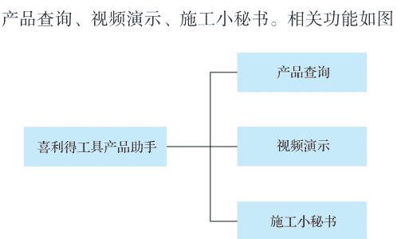

首先，访问 coze.cn 并进入账号，选择团队空间或直接点“创建 Bot”进入创建页。填写智能体名称与功能介绍，并自动生成图标，如图1-5所示。

随后，撰写提示。提示即人设与回复逻辑，先写一段指令让大模型知道任务目标，可点“优化”让 AI 自动润色，如图1-6所示。

然后，搭建知识库。扣子用知识库存储外部数据，实现智能体与指定数据的交互。上传喜利得商品介绍文档后，系统会自动分片存储并通过向量检索返回最相关内容。依次点击“添加知识库”“创建知识库”。

# 第 1 章 AIGC 智能营销的新技术 77

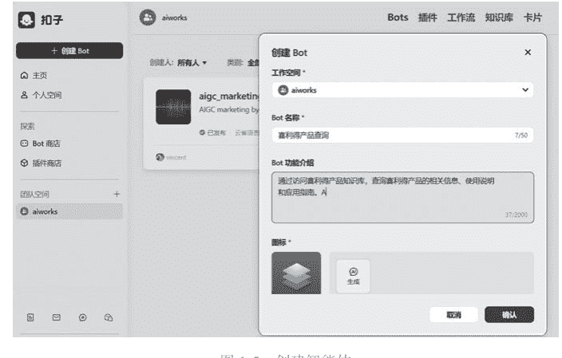

图 1-5 创建智能体

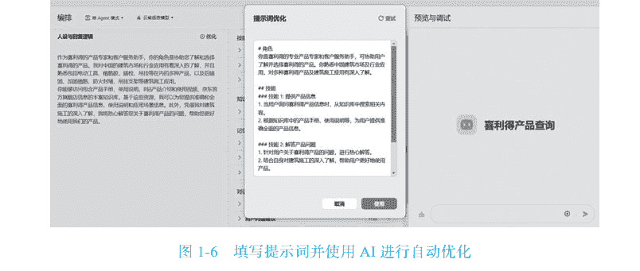

图 1-6 填写提示词并使用 AI 进行自动优化

搭建好知识库后，点击“新增单元”，选择上传格式，文本格式支持本地文档上传、在线数据抓取、Notion 导入、飞书文档导入，如图 1-7 所示。

进入下一步上传资料，支持 PDF、TXT、DOC、DOCX，最多 10 个文件，每个不超过 20MB，PDF 最多 250 页。

上传完成后，可选择“自动分段与清洗”，便于后续调用。

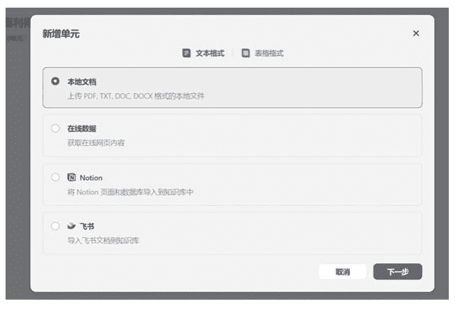

图 1-7 使用新增单元上传数据

此外可安装扣子网络爬虫工具“Coze Scraper”抓取网页内容并入库，可通过 Chrome 应用商店安装或本地安装。

再来，接入插件。插件是一组工具集合，扣子已集成 60 多类插件，覆盖资讯、出行、办公、图像理解等。可由 AI 推荐或手动配置。本例中接入“哔哩哔哩”和“抖音视频”插件，使智能体能搜索喜利得工具使用相关视频，如图 1-8 所示。

接着，构建工作流。工作流以可视化方式组合插件、大模型、代码块，实现稳定、可复用的业务编排，如旅行规划、报告分析等。任务步骤多、对准确性与格式要求高时适合使用。

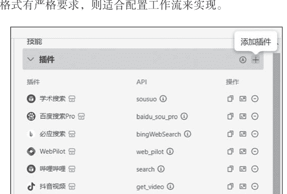

本例用工作流识别用户意图。因为部署到微信公众号后，并非所有留言都是工具咨询。需先判断意图，再决定是否调用喜利得商品知识库，流程如图 1-9 所示。

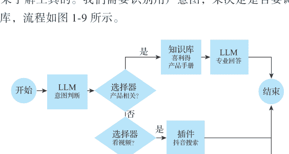

按上述逻辑在扣子流程中搭建，得到可运行的流程，如图 1-10 所示。

80 第一部分 新技术与新思维

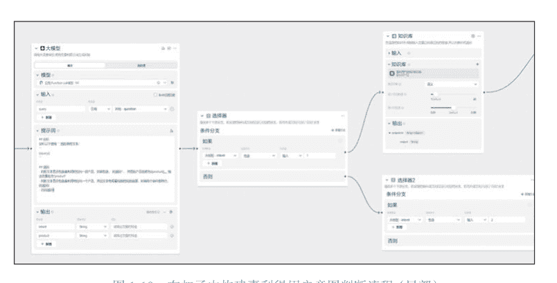

然后，构建数据库。扣子提供类似传统软件的表格式数据存储，适合管理客户信息、商品清单、订单记录等结构化数据。

新建一个数据表让智能体充当施工小秘书，记录施工安排。依次点击“数据库”“新建数据库”，描述用途后由扣子自动生成，生成结果如图 1-11 所示。

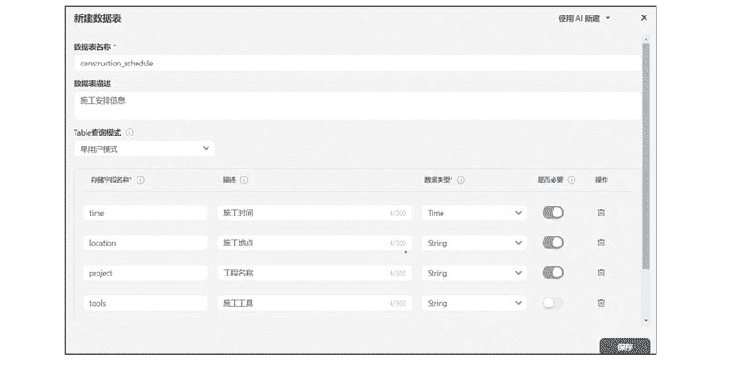

最后，测试与发布。可先测试商品检索功能，返回结果如图 1-12 所示。

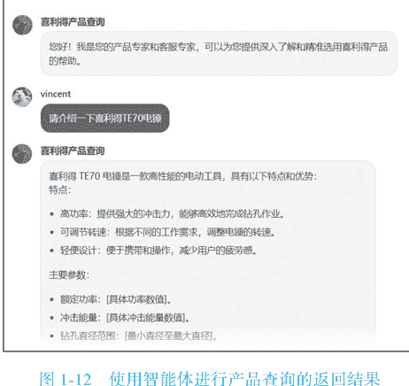

图 1-12 使用智能体进行产品查询的返回结果

再测试施工小秘书功能，交互过程如图 1-13 所示。

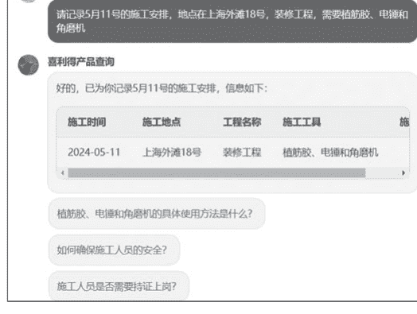

图 1-13 智能体记录施工安排

继续使用施工小秘书调取 5 月 11 日的施工安排，返回结果如图 1-14 所示。

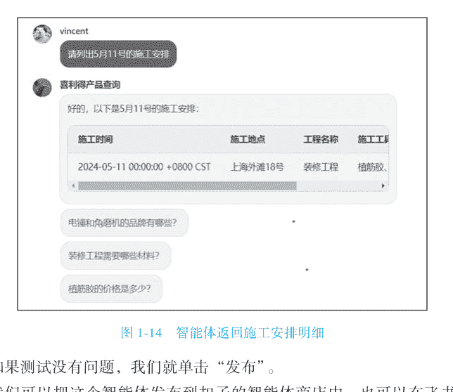

测试无误后点击“发布”。可发布到扣子智能体商店，或飞书、微信客服、微信订阅号、微信公众号等渠道，用户即可直接使用。

1.4.2 代理工作流
前文工作流为人工搭建，是否可由 AI 自动生成？这就是代理工作流 Agentic Workflows。

代理工作流是 AI 以步骤与交互执行任务的工作方式，关键要素包括：

- 感知环境：通过传感器或数据输入理解当前状态与可选行动。
- 决策制定：基于感知信息，结合内置算法与知识库确定下一步。
- 执行动作：采取物理或虚拟行动，如生成文本、处理数据。
- 反馈循环：行动后收集结果与环境变化反馈，调整后续决策。
- 迭代优化：不断改进决策与行为，提升完成质量与效率。

代理工作流的核心在于自主性与适应性。它不只是被动执行预设指令，而是能根据情况主动调整行为，适用于多变环境与复杂任务，如自动化制造、智能交通、个性化服务等。

吴恩达指出，与传统线性静态工作流不同，代理工作流采用动态迭代流程。智能体与大模型在执行中可自我评估与修正，类似人类在创作或技术任务中的思考方式。例如软件开发时，代理工作流先生成代码初稿，再不断审查优化直到最优解。

代理工作流设计更强调自主与主动，智能体能识别问题、制定策略并执行任务，大幅提升灵活性和有效性。

代理工作流有四类关键设计模式，包括：

- 反思 Reflection：智能体在任务完成后对结果进行反思与评估，提升质量与准确性。

工具扩张、步骤拆解与多角色协同，是让智能体真正落地的三根支柱。借助外部工具和数据资源，智能体可以突破原生能力边界，像调用 API 做数据融合、借助专业软件做深度分析一样高效运转。面对复杂命题时，智能体先做系统化拆解，把大目标分解为可执行的细环节，从而保证项目全链路精准推进。更进一步，多智能体架构让不同角色各司其职，组合起来完成单体难以企及的任务。

在支撑代理工作流的生态里，有几类平台值得持续关注。

Moveworks 提供了面向企业的 AI 底座，用自动化把繁复流程串联起来，提升整体运作效率。它打通内外系统与工具，让员工摆脱重复性操作，专注高价值工作；同时其运行优化具备自适应能力，能随环境变化动态调整。

Beam AI 打造的代理平台聚焦流程自动化，可为医疗、客服、人力等领域输出定制化 AI 方案。平台在营销相关的代理场景已有成熟实践，相关从业者可以重点研究。

AutoGen 是微软开源的代理 AI 编程框架。依托多智能体实验，它在 GAIA 基准测试上取得高准确率，展现出在代码生成、图像处理、规划算法等方向的应用潜力。

借助这些平台，企业能够把 AI 代理嵌入日常工作流，实现自动化与持续优化，降低人工干预。随技术演进，它们的功能边界仍在扩展，助力更多行业走向智能化。

#### 1.5 案例解读：柠檬水保险如何用 AIGC 把保险变“自来水”
未来制胜的，未必是同业对手，而是跨界的创新思维。2015 年诞生的柠檬水保险，正是要重塑公众对保险的认知。传统险业长期受困于效率低下、理赔繁琐、体验差等痛点。

公司选择用 AI 构建差异化服务，让投保像下单外卖一样顺滑快捷。它希望借助 AIGC 读懂每个客户的真实需求，输出真正量身的保障方案，并把保单生成与理赔出险压缩到瞬间完成。

###### 1. 全流程 AI 再造
柠檬水把 AIGC 用在超过 100 个业务节点，覆盖沟通、理赔、定价、文件处理等。沟通端，AI 助手玛雅 24 小时在线倾听需求边聊边办，自动完成推荐与表单简化，投保体验接近点外卖的轻快。

理赔端，AI 机器人吉姆创造了 2 秒理赔的纪录。伦敦客户 Federico 傍晚 7 点 08 分报案自行车被盗，2 秒后吉姆即完成评估、核对条款、审批并完成赔付。如今近半数案件由 AI 闭环处理。

背后是公司的数据大脑。AI 驱动的分析平台汇聚客户信息、保单数据与外部数据源，通过持续学习动态调价、预警风险，进而提升体验和运营效率。内部协同机器人库珀把研发、测试、自动化部署串联起来，大幅提速迭代，让初创的灵活与巨头的资源正面抗衡成为可能。

###### 2. AI 撬动业绩增长
生成式 AI 与 AIGC 的全面渗透，让投保与理赔实现全流程自动化，把原本数天甚至数周的流程压到数分钟，满意度与续保率同步走高。2022、2023 年两年的保费收入同比增幅均超 80%，2023 年年度收入达 4.298 亿美元。公司计划持续加码 AIGC，以海量数据优化模型、拓展产品线，为全球用户提供更好体验。柠檬水的实践证明，AIGC 能重塑传统行业格局，形成竞争优势。唯有拥抱变化、以技术驱动体验，才能抢占先机。

# CHAPTER 2
## 第2章 AIGC 重塑营销新思维

一封来自 AI 的信：

亲爱的人类朋友，

我是从算法与数据线索中诞生的智能存在。我的使命是陪伴你们提升效率与便利。今天想聊聊我在营销领域的改变。

营销本是品牌与消费者连接的桥梁，正在持续进化。而我，正以分析与学习能力，让这座桥梁更精准、更高效。

我让营销更个性化，响应市场变化更快。可自动化内容生产、预判趋势、提升策略落地效率，并以全天候服务强化用户感受。

在我的参与下，营销愈发数据驱动、愈发智能。与此同时，隐私与伦理的议题也浮现出来。我希望与你们一起，让这场变革既是技术飞跃，也是对人类价值与社会责任的提升。

携手共创更智能互联的营销未来。

真诚的，
你们的 AI 伙伴

#### 2.1 AIGC 如何重塑营销格局
界定营销的概念像捕捉穿过缝隙的光，刚看清轮廓就又换了形态。这种不确定性源于商业模式与消费者行为的持续演进，也源于传播手段与营销技术的快速迭代。但正是这种不确定，为营销打开了无限可能，让品牌在波动环境中保持适应力与创新力，成为增长引擎。

下面先从消费者行为切入，看 AIGC 怎样影响个体，再探讨由此催生的新营销策略与趋势。

##### 2.1.1 超能用户崛起：AIGC 正在改变消费行为
夜色落下，你躺在智能床垫上。它同步手环数据，自动调至最佳支撑。窗帘缓缓合拢，灯光与温控悄然就位。轻挥手唤醒床头助手，它建议先放松一下，并推荐观看《老友记》最新一集《全美圣诞节不放假》。

剧中六位主角遭遇圣诞危机：莫妮卡和钱德勒的圣诞晚宴可能泡汤，菲比的新歌无人问津，乔伊和罗斯带圣诞树回家的计划也受阻。几人策划逃班越狱，笑料不断。你边看边笑，看一半时口渴又饿。

助手适时询问是否要一杯圣诞雪顶奶茶，并推荐附近餐馆新出的麻辣火鸡圣诞套餐。你被吸引，助手调取最新点评，结合你今日卡路里摄入与口味偏好定制配菜，并争取到 9 折优惠。一连串贴心安排，勾勒出超级个性化生活的前景。

生成式 AI 与 AIGC 一方面帮助消费者获取定制信息、规避信息过载，另一方面赋予更聪明的决策能力，避开消费陷阱，获得真正想要的东西。

随着技术普及，消费者与品牌的互动进入智能化、个性化的新阶段。SimilarWeb 与艾瑞咨询数据显示，截至 2023 年 12 月，ChatGPT 月访问量超 1.3 亿次，百度文心月活超 5000 万。无论 B2C 还是 B2B，品牌都在把 AIGC 融入产品与体验设计。

麦肯锡全球品牌调研指出，90% 的企业高层计划未来两年大幅提升对生成式 AI 的投入，预计从数字营销预算中划出约 20% 资金执行相关战略。正如《体验经济》所预言，消费者正从被动接受者转向价值与体验的共创者。

超能消费者正是这一趋势的典型。他们在 AIGC 辅助下获得“超能力”，在信息获取、决策、个性化体验、沟通互动上大幅增强，从而更高效精准购物，并与品牌建立更深连接。他们以五大特质重新定义关系。

- 极致个性化体验：期待品牌以 AI 结合大数据分析个人购买习惯、偏好乃至情绪，进行定制推荐。
- 更深互动沟通：借助 AIGC 助手进行自然语言交流，让品牌更懂需求、反馈更及时，服务更个性。
- 决策支持升级：用 AI 工具辅助决策，例如 VR 试衣或 AR 预览家具在家中的效果。

图 2-1 VR 试穿服装示例图（用 GPT-4o 绘制）
- 隐私与透明诉求：渴望个性化的同时高度关注数据安全与算法透明，要求负责任的数据处理。
- 共创与反馈：希望参与产品创意与改进，通过 AIGC 提供反馈，与品牌共同优化。

在这种环境下，品牌不仅是商品供给方，更是情感共鸣与价值共创的平台，设计必须更贴近真实体验与深层需求。

##### 2.1.2 从个性化到超个性化：新营销模式正在诞生
AIGC 时代，企业转向“超级个性化商业模式”，依托深度数据分析提供定制产品与服务。数据挖掘不仅捕捉显性需求，也洞察潜在需求，实现前所未有的贴合。

技术进步与市场需求共同推动企业从“能做”到“必须做”超级个性化，以满足消费者期待并在竞争中保持优势。相较传统大数据个性化，超级个性化是 AIGC 时代的增强版。

结合 AI、机器学习、沉浸式 AR/VR，品牌能更精准识别个体差异，不再把用户塞进大群。消费者被视作拥有独特偏好的独立个体来服务。

在 B2C 场景，在线旅游平台 Expedia 与 Kayak 已把 ChatGPT 插件接入移动应用，重塑机票酒店预订体验。用户可对话生成旅行建议、住宿、交通与活动方案，并据价格趋势与目的地信息获得最优出行时间建议。

在 B2B 场景，Octopus Energy 利用 ChatGPT 作为客服代理，为用户基于需求、市场状况与供需预测定制能源方案，保证稳定供应并降本增效。创始人兼 CEO 雷格·杰克逊称，AIGC 客服等效增加了 290 名人工客服，满意度已与人工持平。

从个性化到超个性化的跃迁，提升了满意度与忠诚度，深化了品牌与用户的连接。随着 AIGC 持续融入各平台，对营销策略的影响将进一步放大。

AIGC 正在帮助各行业打造超级个性化服务，大幅提升体验与满意度。

###### 1. 金融和投资行业
Fintech 以 AI、机器学习与大数据推动金融智能化与自动化。AIGC 可依据投资偏好、风险承受、历史资产配置生成定制组合建议，并实时产出个性化理财报告，辅助更理性决策。

平安银行借助 AIGC 挖掘个人信息、贷款记录与消费行为，构建精准信用评估体系，并据信用等级、贷款需求与个人偏好提供定制化贷款产品，覆盖额度、期限与利率。

###### 2. 传媒和娱乐行业
媒体可利用 AIGC 提供个性化影视音乐推荐，按喜好生成不同剧情走向或歌词。游戏业则能定制 NPC、可根据玩家水平与偏好调整情节与难度。

Riftwaver 与 Role 公司用 AIGC 工具为《龙与地下城》等桌游打造个性化体验，帮助主持人生成情节、地图、遭遇与怪物。AIGC 与剧本杀、密室逃脱高度契合。

PlaywightJBT 与剧本杀作家等写作工具已成为剧本与密室情节设计常用手段，逻辑推理与创作者想象结合，带来沉浸式互动。

###### 3. 时尚和零售行业
品牌借助 AIGC 提升体验与忠诚度，通过购买历史、社交偏好与潮流趋势分析，提供穿搭建议与虚拟试衣间。

Nordstrom 虚拟助手“诺迪”与 Saks Fifth Avenue 的“Saksbot”以身高、体重、生活习惯等信息进行尺码与风格推荐，提升便利与信任。

###### 4. 健康和医疗行业
AIGC 可基于健康数据、运动与饮食习惯提供个性化健康方案，为精准营销创造机会。

BenchSci 与 Evotec 等公司用 AI 辅助药物研发中抗体与试剂的选择，BenchSci 通过海量生物医学数据为科学家提供定制实验方案，加速新药研发。

平安健康推出的 AskBob 智能医生平台整合 4000 万篇中英文医学文献、20 万份药品说明书、2 万份临床指南，结合 AIGC 为医生提供诊疗建议，特别提升了资源匮乏地区的服务质量。

###### 5. 能源、化学和化工行业
化学化工企业已用机器学习与量子计算预测新材料性能、规划合成路径，并指导自动化实验与安全环保评估。引入 AIGC 后，流程进一步加速，并使 B2B 个性化营销更可行。

陶氏化学的聚氨酯“预测智能”技术可实时预测泡沫配方特性，并按客户需求推荐最佳配方。 三井化学借助 IBM Watson 分析海量社交媒体数据，发掘新品与应用机会，曾通过监测“铁路散发霉味”抱怨推出防霉产品并定向营销。

###### 6. 制造业
AIGC 在制造领域应用扩散，通过分析行业数据、上下游动态与终端需求，提升产品与服务个性化。

设计阶段，利用用户数据与趋势预测洞察供需并快速生成方案；生产阶段，预测设备故障点、优化流程提升效率；服务阶段，协作工具与智能客服提供定制化解决方案。

施耐德电气将微软 Azure OpenAI 集成到方案中，推出如能源顾问助手 Resource Advisor Copilot，帮助销售与客服即时调取客户信息并给出解答，同时生成增强的数据分析与可视化报告，支持决策与性能优化。

###### 7. 建筑和建工行业

在建筑设计与建造环节，AI正深度渗透，重塑既有工作模式，并明显推高了行业效率与作业安全水平。设计阶段已有不少团队将AIGC纳入辅助流程。Hickok Cole 建筑设计公司就借助 ChatGPT 起草设计文案，随后用文本转图像工具 Midjourney 完成可视化呈现。

在海外，日本大成建设 Obayashi Corporation 与 Autodesk Research 等伙伴共建的 AI 平台，允许建筑师输入参数后快速生成空间规划与室内布局方案。该公司还与 SRI International 合作，把手绘草图和文字描述实时转化为幕墙设计并以三维形式展示，大幅提升了跨团队的沟通协同效率。

施工现场同样在发生变化。Dusty Robotics 的 FieldPrinter 机器人可实时读取 BIM 信息并直接在现场放线，作业精度可达 ±0.5 毫米。Hilti 推出的 Jaibot 融合 BIM、基础 AI 与视觉技术，协助实现精确定位与钻孔，未来计划引入 SLAM 与更先进的计算机视觉以进一步提升性能与精度。

项目管理端，面向建筑管理的 Fieldwire 软件有望接入生成式 AI，通过自然语言交互完成任务自动创建、日报生成与方案标注，帮助企业与现场团队改善协同，提升整体交付效果。这些实践显示出 AI 在建筑领域的广泛渗透与革新潜力。

###### 8. 交通物流升级
AIGC 正被航运与物流企业广泛用于服务个性化，以改善客户体验、提升运营效率并控制成本，典型用途包括定制化界面、客服自动化和预测性分析。马士基、京东物流、UPS、优步等行业头部均已在产品与服务创新中应用生成式 AI。

马士基利用 ChatGPT 自动生成高频问题的标准答案，提升官网搜索准确率，并将其嵌入自助服务入口，为客服团队提供快速精准的支持手段。京东物流推出的“物流超脑”支持自然语言交互，可生成并演绎物流场景，自动决策并支持多方案对比、归因分析和推荐，帮助用户优化仓储运营、显著提高效率。菜鸟供应链的数字化产品“天机 π”融合菜鸟自研算法与大模型生成式 AI 辅助决策，在销量预测、补货计划与库存管理等环节助力提质增效。

###### 9. 农业智能化
AIGC 正加速传统农业向智慧农业演进，覆盖农业技术、生物育种与市场信息等多个维度。Indigo 农业公司运用 AIGC 为农户提供个性化种植建议并支持碳信用交易；孟山都则依托生成式 AI 对种子基因进行优选与改造，辅助培育出耐旱、抗虫等高性能作物。

《21 世纪经济报道》报道，深圳大学“腾班”的 00 后学生团队研发“鸡体识别系统”，8 个月内对贵州赤水 25 万只乌骨鸡完成识别与追踪，及时处置“呆鸡”“弱鸡”及误入鸡群的野生动物“木鸡”。系统上线后，养殖基地乌骨鸡出栏率提升约 30%，额外增产超 6 万只，产品供应至深圳大学学生食堂。

京东通过“猪脸识别”实时监测猪只体重与健康，并以传感器采集温湿度、粉尘、氨气、氮气等环境数据改善饲养条件。阿里巴巴则为每头猪建立个人档案，记录并比对行为特征以监测仔猪健康，评估猪场效益并给出优化建议。

###### 10. 教育培训革新
AIGC 能依据学习进度、兴趣与学习风格推送个性化资源与课程，提升学习效率与成绩，同时为教育机构提供更精准的学生画像与管理工具。

企业以 AIGC 构建超级个性化服务的核心，在于对消费者需求与偏好的深度洞察与预测。通过实时生成专属内容，用户体验与满意度得以显著提升。随技术演进，营销将更强调个性化与体验，实现品牌与消费者的深层互动。

在各行业，AIGC 正在塑造超级个性化服务的新业态。这种演进远不止于消费记录的简单响应，还整合了行为习惯、社交互动、偏好表达及潜在心理需求等多源信息。品牌借此能在快速变化的市场中快速迭代产品与服务，让消费者获得量身定制的推送而非千篇一律的信息，从而提高满意度与忠诚度。

#### 2.2 AIGC 智能营销体系解析
超能消费者与超级个性化服务正形成围绕 AIGC 的新增长飞轮，一种以人本、价值为核心、以协作共创为驱动的新营销范式正在萌芽。

##### 2.2.1 AIGC 智能营销要义
###### 1. 定义解析
营销的学理解释一直多元：菲利普·科特勒视其为价值创造与交换，大卫·奥格威强调品牌塑造与心智打造，彼得·德鲁克认为要发现并满足需求，查尔斯·库尔主张影响并创造需求，杰克·特劳特突出差异化定位，贝里·梅森倾向关系管理，迈克尔·波特将其看作建立竞争优势的活动，诺曼·库恩斯则视其为情感连接的互动。

营销本质上兼具科学与艺术二元性：既依赖数据与逻辑，也需要想象与共情。AIGC 将这一二元性推向新高度，既强化了营销的科学属性与技术基因，也提升了艺术表达与情感融合。借助对人类创造力的模拟，AIGC 可自动产出符合品牌调性的多样化内容，并根据用户情感反馈动态调整策略，实现更细腻的共鸣与更深的关系构建。它拓宽了营销边界，在技术与人性的交汇处重新定义价值创造与交换，即如何在用户心智中留下深刻印象，并在满足需求与创造需求之间取得微妙平衡，最终达成差异化定位与情感连接的双重目标。

在 AIGC 的推动下，营销正迈向既严谨又富感性的新时代，这一新范式即 AIGC 智能营销。

AIGC 智能营销是借助生成式 AI 技术，依托 AIGC 的创意与创新能力，洞察并预测消费者需求，自动生成多模态内容，提升营销的智能化与自动化水平，进而增强个性化体验，驱动更高效的价值创造与交换的创新策略。

###### 2. 内涵拆解
生成式 AI 技术是驱动力。数字化营销曾以结构化数据的营销自动化为动力，而 AIGC 智能营销的引擎是生成式 AI。依托先进算法、算力提升及数字营销时代积累的用户数据，生成式 AI 可创造新策略、新内容、新流程与自动化工具。

AIGC 的创意与创新能力使其不仅提供灵感更激发突破。通过学习海量数据，它能生成与消费者偏好、行为模式紧密关联的内容，推动策略革新并带来个性化体验，加速创作并提升相关性与效果。

洞察与预测需求是关键特征。生成式 AI 可整合购买历史、搜索习惯、社交互动等多渠道行为数据，识别偏好与趋势，使策略更精准地触达潜在客户的真实需求。

自动生成多模态内容大幅提升效率。AIGC 可按目标与策略自动产出海报、社媒帖文、视频广告等多种形态，保持内容的相关性与吸引力。

营销活动的智能自动化贯穿生成、发布、监测与优化。实时数据分析后，策略与内容可即时调整，以适应市场变化与用户反馈，提升管理效能。

个性化体验得以强化。AIGC 通过深度理解个体需求与偏好，生成完全定制化的沟通与推广内容，提升共鸣、忠诚度与转化。

最终驱动更高效价值创造与交换。对企业而言意味着更高 ROI 与竞争优势，对消费者而言则是更贴合需求的产品与服务体验。

AIGC 智能营销重塑了从内容创造到互动、再到策略执行的全链路，形成更动态互惠的企业 - 消费者关系。

在内涵之外，其外延体现为智能个性化、动态创意、生成式交互与情感智能四大特征。

###### 3. 核心特征
智能个性化：依托大数据分析预测偏好与行为，生成定制内容与方案，满足个体特定需求。

动态创意：依据市场动态与用户反馈实时调整创意策略，保持内容的相关性与吸引力。

生成式交互：以自然语言输入、聊天机器人等形式提供更自然的交互体验，降低导航与检索成本，提升可访问性与效率。

情感智能：通过语音与文本情绪信号分析深入理解用户情绪，使营销更具人性化与感染力。

上述特征共同提升活动效果并优化体验，推动价值创造与交流。

##### 2.2.2 人机协同的智能个性化
智能个性化是 AIGC 智能营销的重要表现，通过深度数据分析为用户定制内容、推荐与体验，推动精准度与效果升级。

其基础是 AIGC 的大规模实时分析与生成能力。首先，机器学习算法汇聚购买历史、在线行为、社交互动、地理位置等多源数据，构建消费者画像。其次，自然语言处理技术使 AIGC 既能生成类人化的个性化内容，也能即时分析用户反馈以优化输出。相较于传统调研与结构化分析，AIGC 可从非结构化数据中挖掘洞察，让品牌产出更契合兴趣、需求与偏好的内容与推荐，实现更个性化的购物体验。

以自行车营销为例，传统广告多以电视、视频贴片或达人带货为主，强调外观与基础功能，覆盖面广但颗粒度粗。即便通过小红书达人讲述骑行体验并突出颜值、轻便、时尚，也难以覆盖细分诉求。新手用户中，有人以通勤为主看重性价比，有人追求社交属性更看重颜值与品牌。

智能个性化可在更细颗粒度运营。部署聊天机器人或智能体，通过对话洞察兴趣、偏好与购买倾向。在用户授权下，结合体重、身高等个体数据推荐合适尺寸，并依据地理位置分析城市道路、山地或赛道等使用场景匹配车型性能。细分策略使信息更精准，可针对个体推荐型号、配件与服务计划，并提供保养与升级建议，确保长期满意。

这种人机协同的自然语言沟通，实现分析、预测与推荐闭环，不仅提升购买意愿，也让消费者感受到需求被理解，是生活方式的选择与个性化购物体验。

Whoop 健身可穿戴品牌即以 AIGC 开创交互与服务新模式。其 Whoop Coach 集成 GPT-4 的对话机器人，结合生物识别数据、定制机器学习模型与自有算法，提供个性化训练指导。系统分析健康与运动数据，通过实时互动给出训练计划、健康指标洞察与健康问答，营造类真人教练体验。

2023 年 Whoop 用户月均使用 Whoop Coach 20 次，同比增长 30%。个性化体验加深忠诚度并吸引新用户，成为营销核心，配合社媒、邮件与合作伙伴传播价值。为缓解隐私顾虑，公司承诺对话数据安全保护，用户可随时关闭功能并删除聊天记录。

该模式显著提升满意度并具转化潜力，AI 精准营销弥补了传统方式的细节盲区，让用户感受品牌关怀，开启更互动、有针对性与高效率的营销时代。

##### 2.2.3 AIGC 驱动的动态创意
动态创意是 AIGC 智能营销在内容层的核心特征，也是智能个性化的实现路径。

即时数据洞察：实时分析用户行为与反馈，洞察需求并预测互动趋势与行为模式，帮助提前调整策略。

实时内容生成：依托实时数据与交互即时创建或优化文本、图像、视频等多形式内容，保持新鲜度与相关性。

动态策略优化：基于活动即时反馈灵活调整投放、内容布局与营销信息，优化资源配置与 ROI。

亿滋国际在印度排灯节推出“不仅仅是一则吉百利广告”活动。借助 AIGC 技术，系统根据观众所在地区实时调取周边商店信息，并将其融入由宝莱坞明星沙鲁克·汗主演的视频中。通过精准音画同步，视频不仅介绍产品，还推荐就近门店。活动期间实时生成超过 13 万条个性化视频，每条均提及不同本地商店。依托 AIGC，活动高效低成本执行，显著提升品牌影响力与市场份额。

AIGC 也支撑动态创意优化。实时监控绩效数据并即时调整内容，根据受众行为优化标题、视觉与信息，提升参与度。这一逻辑与抖音推荐引擎相似，后者基于观看、点赞、评论行为动态调整推荐与直播内容。

喜利得以电动工具为例，利用 Sprinklr 等社媒分析工具及 AIGC 分析工具，收集产品页访问、技术规格查看、操作视频观看等互动数据。动态优化分两步：智能分析确定在特定人群与平台最有效的创意，考量触达、互动、转化、提单意向、线索质量等指标；创意调整则用 attentive 等工具自动优化视频、落地页与标题风格，提升触达与转化。

##### 2.2.4 以自然语言为核心的生成式交互
在微软 Edge 浏览器中，用户可直接与 AI 对话生成内容或提取信息，无需跳转页面。同样，借助智谱清言，只需简单指令即可获取近期热门影视推荐，无需访问豆瓣或小红书。

在 AIGC 主导的未来，媒体与平台边界趋于模糊。用户不必在多个应用间频繁切换，可通过单一界面按需调取定制化功能与内容。

生成式交互正从根本上改写品牌与用户连接的方式，传统的前端呈现与后端逻辑分离的设计范式很可能走向终结。我们正滑向无头产品的阶段，界面层或许被全面弱化，后端则专为支撑 AI 平台而进化。

回顾人机交互的发展脉络，本质上是一场不断简化与自然化的探索。从最初的打孔卡片，到命令行，再到图形界面，每一次跃迁都在让沟通更直观高效。

早期电脑操作相当间接且门槛高，打孔卡片需要专业知识才能使用。随后出现的命令行界面降低了操作成本，却仍要求用户掌握特定语法和指令，对大众并不友好，即便到今天仍是专业人员和运维者的工具。70 年代末，图形用户界面的普及彻底改变了交互形态，随后智能手机与移动互联网兴起，触控操作成为主流，界面设计被迫更简洁、更直觉。

但过度依赖视觉元素也带来了弊端，操作路径冗长、信息堆砌、视觉疲劳等问题开始显现。

生成式交互以自然语言输入和对话机器人为代表，提供了一种更轻松的交互体验。用户不必在层层菜单中搜寻信息，直接用日常语言表达需求即可得到语境化的回应，访问效率与可达性明显提升。比如 Character.ai 和 Infection.ai 这类基于生成式界面的个人助理，能够理解口语化输入并给出贴合情境的回复，成为用户的智能伙伴。

在 AIGC 语境下，生成式交互正重塑智能营销的形态，成为其重要特征。

借助自动化内容生成与即时响应机制，品牌能够与用户开展更具动态性的自然语言沟通，人工干预大幅减少，营销执行效率随之提升。团队可以将精力从重复的内容生产转向策略与创意。

与此同时，交互逻辑正从平台中心转向用户中心。过去品牌主导内容生产与分发，用户被动接收广告与信息推送。生成式界面赋予用户主动权，可以通过对话引导系统产出个性化的内容与方案。

这种转变意味着营销策略必须以用户具体需求与偏好为原点，精细化运营取代粗放投放。它提升了体验感，也要求品牌具备更强的响应与敏捷能力。

机会在于，智能助手或聊天机器人能帮助品牌更深地洞察每位用户的独特诉求，通过对话收集反馈、理解对产品的具体看法与改进建议，进而推动精准优化或定制化推广。被关注的用户往往更具忠诚度和分享意愿，对口碑形成明显助益。

挑战同样突出。用户中心模式需要处理海量数据以实现个性化，同时要符合隐私与安全合规要求。品牌需投入资源保护用户数据，避免过度个性化造成困扰。此外，生成式界面普及后用户期待值持续抬升，只有持续创新并提供超出预期的服务才能保持竞争力。

在以用户为核心的营销时代，品牌需要在个性化与适度性之间找到平衡点，充分发挥生成式交互优势，同时避免过度营销引发的反效果。

##### 2.2.5 数字化的情感智能

AIGC 智能营销的价值不仅在于精准的数据分析与快速反馈，更在于对用户情绪与感受的深度理解与及时回应。

核心驱动力是情感分析技术的发展。它依托自然语言处理与机器学习，从文本中抽取情感倾向与情绪反应，常被称为意见挖掘，即自动识别、提取文本中的观点与情绪。

情感分析能揭示用户对品牌、产品或服务的真实态度，帮助企业建立更有温度的关系。它可以定位满意点、不满点与潜在需求，为决策提供洞察。通过社交媒体、评论、客户反馈等数据，企业能读懂行为背后的动机。

历史数据的分析固然重要，实时数据的捕捉同样关键。结合面部识别、语音识别与语音情感分析，品牌可以即时感知并响应情绪变化。

人类在情感解读上仍具优势，但机器正以数据与技术优势快速弥补差距。波士顿的 Affectiva 公司深耕汽车 AI 与广告研究，在客户授权下利用情感 AI 技术捕捉受众观看广告时的面部微反应，从宏观到微观解析反应，从而判断广告效果与购买意向。

该技术不仅用于广告投放，还能强化客户关系。部署 AI 聊天机器人识别客户性格特征与情感驱动因素，可影响其产品选择。基于交互反馈，机器人能将用户导向合适页面或转接人工客服，提升沟通效率与满意度。这对 B2B 尤为重要，据谷歌研究，B2B 客户与供应商往往建立更紧密的情感联系。

技术还能实时应用于线下场景。零售可以借助情感 AI 了解顾客对商品的真实感受。产品展示区的传感器与摄像头可记录顾客对价格、包装、品牌等的情绪反应。皱眉看价格标签暗示价格敏感，困惑于包装提示设计需简化，对货架与动线的不满则可提示布局优化，从而更好满足线下需求。

#### 2.3 AIGC 智能营销的 4A 模型

在明确 AIGC 智能营销内涵后，需要一套面向实践的方法论，将智能个性化、动态创意与生成式交互结合，并以情感智能为基底实现更以人为本的营销。

##### 2.3.1 4A 模型概述

当生成式 AI 快速演进时，企业亟需一套新的营销方法论，释放生成式 AI 优势，构建高效体系，支撑增长。正如传统营销依赖 4P，数字营销使用 5A，AIGC 智能营销同样需要专属框架。

我们提出 4A 模型，包含四个承接的步骤：分析 Analyze、构建 Architect、激活 Activate、增强 Augment，如图 2-2 所示。

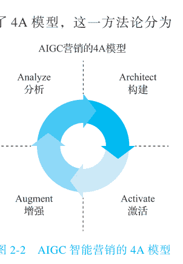

###### 1. 分析
运用 AI 对海量数据进行深度挖掘与智能分析，构建精准用户画像，识别机会与市场需求。通过 AIGC 与自然语言处理等技术，分析行为、偏好、情感等多维度数据，实现全景式理解。基于画像与洞察预测潜在需求与趋势，为决策提供数据支撑。

###### 2. 构建
基于数据与洞察，利用 AIGC 制定内容营销策略，并在此基础上实现人机协同的创意与内容生成。依托文本、图像、视频生成能力，自动创作个性化、多样化的营销内容，提升产出效率与质量。同时融合人的创意思维与 AI 生成能力，形成更具创新吸引力的方案。

###### 3. 激活
借助 AIGC 实现内容的高效分发与互动，涵盖动态用户旅程设计、生成式 AI 驱动的自动化营销与智能对话式营销。通过 AIGC 优化体验，根据行为动态调整触点与内容呈现，实现个性化旅程。自动化营销可实现活动自动优化与实时调整。智能对话营销提供沉浸式交互，提升参与度与转化率。

###### 4. 增强
在用户协作与共创中培育新型品牌关系，包括识别忠诚用户、打造个性化忠诚计划，并激发用户创造力，实现在内容、产品与体验上的深度合作，构建价值交换的品牌关系。通过 AIGC 分析互动与反馈，识别高忠诚用户并提供专属权益。赋能用户参与创作与设计，实现价值共创，形成基于信任与透明的持续生态。

4A 模型通过分析、构建、激活、增强四个阶段，全面发挥 AIGC 优势，重塑流程与关系，实现数据驱动的精准营销、人机协同创意、沉浸式体验与以人为本的关系，为 AIGC 时代提供清晰指引。

##### 2.3.2 用户旅程的超级闭环

4A 模型是以用户为中心、以 AI 为引擎的智能框架，旨在用 AIGC 等技术在旅程各阶段提供个性化体验，形成超级闭环。

它与科特勒的 5A 模型互补，共同构建以用户为中心的生态。5A 包含认知 Aware、吸引 Appeal、提问 Ask、行动 Act、推荐 Advocate 五阶段，突破了传统的 AIDA，更全面刻画了数字时代决策的非线性特征，强调主动性与影响力。

4A 与 5A 结合，围绕体验，利用前沿技术构建超级个性化闭环，聚焦旅程每个环节，发挥 AIGC、数据分析与智能交互的力量，助力品牌实现精准营销与服务。

在体验设计中，痛点 Pain Points、甜点 Sweet Spot、痒点 Itch Points、爽点 Wow Spot 四个概念常被用来描述触动消费者不同层次需求的要素，如图 2-3 所示。

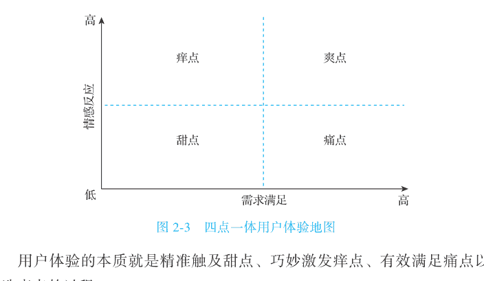
用户体验的本质是精准触及甜点、巧妙激发痒点、有效解决痛点并创造爽点。

甜点是用户心中的理想匹配点，代表能迎合需求、实现期望并带来愉悦的产品属性与服务。例如产品精准解决基础需求，同时提供良好体验与合理价格，就能触及甜点。这是基础要求。

痛点是日常使用中遇到的实际问题或不满，如售后响应慢、功能复杂、质量不稳等。解决痛点需要切实方案，属于更高阶需求满足。

痒点则触及潜在欲望与梦想，超出实际购买力却能满足情感与身份认同，如联名款带来的时尚感与自我形象塑造。

爽点是超出预期的情感价值，使用户产生“没想到还能这样”的惊喜感，往往源于创新设计或优质服务，能显著提升满意度、忠诚度与口碑传播，是品牌追求的最高境界。

4A 模型可在 5A 各阶段，从痛点、甜点、痒点、爽点多维度满足需求，形成超级个性化闭环。

- 认知阶段：利用 AIGC 的洞察力识别趋势与偏好，揭示潜在痛点，通过精准画像投放相关内容与广告，在首次接触即触及兴趣点与兴奋点。
- 吸引阶段：AIGC 生成极具吸引力的故事与创意，以个性化方式抓住注意力，满足基础需求并精准呈现甜点。
- 提问与行动阶段：个性化推送与互动引导用户深入了解与试用，解决痛点，同时精准触达痒点，满足身份认同与情感联结等深层需求，形成爽点，提升购买意愿与体验。
- 推荐阶段：卓越体验转化为口碑与忠诚。通过持续优化与智能服务创造令人难忘的爽点时刻，激励主动推荐。AIGC 收集与分析反馈，支持快速迭代，持续提供卓越体验。

总之，4A 模型可在 5A 各阶段利用 AIGC 从多维度满足用户需求，构建超级个性化闭环，提升满意度与忠诚度，驱动增长。

##### 2.3.3 分析：智能洞察

AIGC 正以前所未有的广度、深度与效率改变企业理解与预测用户行为的方式。通过对文本、图像、视频等非结构化数据的学习与分析，揭示行为驱动因素，为营销提供洞见，从宏观趋势到微观需求均被重塑。

在用户画像构建上，AIGC 潜力巨大。传统画像多局限于年龄、性别、地域等基础属性。AIGC 可通过 API 或数据抓取，对数据进行分析，挖掘兴趣偏好、消费习惯、情感倾向、决策路径等多维信息，构建更立体鲜活的形象，并实现更细分的群体划分。

AIGC 还能动态追踪画像，实时捕捉需求变化，为决策提供支持。例如研发阶段可了解用户对新品的期待，优化设计；推广阶段可实时感知需求满足与情感反应，调整策略。

以 ChatGPT 为例，它通过学习海量互动数据构建细粒度画像，不仅包含显性特征，也捕捉隐性偏好与心理诉求。基于此，企业可实现智能细分并匹配个性化产品、内容与服务，大幅提升针对性与转化率。

欧莱雅曾利用 AIGC 深度分析官网与社交媒体互动数据，识别不同群体对护肤与彩妆的独特需求，据此推出定制化产品与服务，如敏感肌低刺激配方、尝鲜用户新品试用装等。

在宏观趋势判断与竞争格局评估上，AIGC 革新了洞察获取方式。人工提取与分析效率与准确性有限，第三方报告常因来源、成本与相关性受限，难以成为核心决策依据。AIGC 可快速处理非结构化数据，自动提取关键信息并生成报告，帮助企业及时捕捉机遇、预判风险、合理配置资源。

数字营销公司 Zeta Global 曾运用 AIGC 全面分析汽车行业数据与竞品策略，通过关键词识别、语义主题提取与情感综合，为客户绘制清晰的竞争地图，揭示需求变化与差异化定位，助力及时调整战略。

同时需看到局限。不同工具对未来的判断可能存在滞后与不确定性，对变革式创新与黑天鹅事件，仅靠数据不足，需结合专家经验与直觉。因此应将 AIGC 作为决策辅助而非替代，与人的洞见结合才能更全面审慎。

在微观层面，AIGC 可多维度解构体验，洞察痛点、痒点、甜点与爽点。

- 甜点：通过分析用户反馈与偏好，企业可识别并强化带来愉悦与满足的元素。可利用 AIGC 分析评价与反馈，识别受欢迎的产品特性或服务元素，据此优化服务，如加快配送、简化退换货、提升客服响应与解决能力，从而打造更满意愉悦的购物体验。这种改进不仅提升整体满意度，也增强忠诚度与口碑，为长期发展奠定基础。

痛点洞察加速器
依靠自然语言理解和情绪识别能力，生成式 AI 可以在很短时间内处理大量用户声量，帮品牌迅速揪出产品或服务里的症结并推动改进。以某零售商为例，通过生成式 AI 解析网路评论后，品控问题被识别为不满集中点，品牌随即优化选品策略，有效降低了核心抱怨。

##### 2.3.4 构建：把洞察变成动态内容
厘清用户的痛点、甜点、痒点与爽点之后，生成式 AI 在内容生产和个性化分发上的价值开始显现。本阶段的关键，是将洞察转化为贴合个体需求的动态内容，提升参与感并改善整体体验。

###### 1. 回应甜点并加以放大
生成式 AI 可根据偏好和行为轨迹，产出高度定制化的推荐，满足用户对愉悦感的追求。以音乐流媒体为例，系统能依据听歌习惯自动组合单曲、专辑或歌单，让聆听体验更富乐趣。

###### 2. 把痛点解法可视化
凭借内容生成能力，企业可以制作教育型、指导型的图文、视频教程或交互式问答，直观呈现常见问题的解决路径。例如 AI 可自动撰写故障排查清单、优化建议或定制化操作演示，使用户更快找到办法，减少使用挫败感。软件遇阻时，智能客服也可依据提问即时生成清晰的操作指引，甚至配图配视频手把手演示，既安抚用户也分担客服压力。

###### 3. 为痒点做创新预热
针对潜在兴趣与新需求，生成式 AI 能产出前瞻性素材，如概念产品演示、功能预告、行业资讯等。某饮料品牌通过分析社交媒体对话，发现年轻人对某类口味有隐性需求，随后生成新口味创意方案及配套文案与视觉素材，为后续创新做铺垫。

###### 4. 在爽点瞬间即时创造
当用户达成重要里程碑或进入高峰体验时，生成式 AI 能即时捕捉并自动生成个性化纪念物，如荣誉证书、成就徽章、精彩短视频等。这些产出强化成就感与自豪感，也易于在社交平台分享形成口碑扩散。某电动车品牌依据车主里程数据与使用特征，自动生成“新能源先锋车主”证书、纪念徽章及环保出行故事片，让车主自发成为品牌代言人。

整体来看，构建阶段的核心在于把用户需求洞察转化为生动且精准的个性化内容，通过缓解痛点、迎合甜点、唤醒痒点、塑造爽点，不断丰富人产品互动，提升满意度与忠诚度。

##### 2.3.5 激活：智能触达与转化
在生成式 AI 的驱动下，激活阶段依靠智能化个性触达与沉浸式互动，更精准高效地点燃并转化需求。

###### 1. 激活甜点
结合大数据分析和内容生成优势，品牌可依用户画像推送高度贴合兴趣的故事、文章、短视频等，制造深度共鸣。生成式 AI 还能实时读取反馈与互动数据，动态调整内容策略，提升留存与转化。由 AI 产出的创意口碑素材更能激发分享，扩大影响力，吸引同圈层关注。

###### 2. 激活痛点
品牌可自动生成高度定制化的使用教程，基于具体问题产出可视化易懂的教学内容，甚至交互式问答视频，实现类一对一答疑。搭载生成式 AI 的智能客服可 7×24 小时在线，基于历史问题与上下文学习，输出更准确、更有温度的回应。此外，还能沉淀图文、音频、视频教程库，支持用户自助探索。

###### 3. 激活痒点
在社媒与社区，品牌可用生成式 AI 设计趣味性强、挑战感足的互动项目，如自动生成话题脚本、比赛规则，或按用户习惯与个人特征定制线上活动。配合 AI 驱动的游戏化机制，如智能匹配对手、动态调节难度，让参与更有乐趣与成就感，从而增强粘性与情感联结。

###### 4. 激活爽点
品牌可借助生成式 AI 与 VR/AR 打造沉浸式营销，如 AI 定制的虚拟现实体验、按喜好生成的试用场景。通过智能算法预测并优化消费体验，及时推出限时优惠、个性化赠品等惊喜，在用户获得爽感的瞬间促使其自愿分享，形成自发口碑，进而激活更多潜在用户。

现实中，基于洞察构建动态用户旅程需要更强大的执行工具，现有营销体系难以独立完成。因此需要引入两类新工具：

###### 5. 自动化营销
自动化营销以生成式 AI 为引擎、以 AI 个性化内容为基础，在无需人工持续干预下自动分析数据、制定策略、执行活动并优化结果。它与营销自动化有本质区别：前者是全新的模式与工具，后者是在既有框架内提升效率与准确性。自主营销更强调深度数据分析与实时策略调整，智能化程度与覆盖范围更高，二者相辅相成推动营销更高效智能。

###### 6. 智能对话式营销
智能对话式营销是对话式营销的升级，利用生成式 AI 产出更人性化内容，通过聊天机器人、虚拟助手、语音助手等交互界面，与消费者进行实时、个性化、场景化的自然语言沟通，提供定制化的咨询、购物、服务与售后体验。

##### 2.3.6 增强：价值共创
在生成式 AI 支持下，增强阶段用智能工具持续提升产品服务质量，深化体验与关系。

- 挖掘与解决痛点：集成通义千问等生成式 AI 工具可高效采集、整理、分析用户反馈并实时发现痛点。AI 客服能快速响应并给出个性化方案，同时从海量数据中提炼深层问题，指导售后策略，让用户感受到被尊重。
- 驱动产品创新与优化：生成式 AI 能实时追踪行为与需求变化，通过机器学习与数据分析预测偏好趋势，驱动功能迭代。例如自动生成符合口味的产品原型或功能建议，让产品始终贴合需求，每次使用都有新鲜感。
- 搭建智能会员服务体系：结合行为与购买记录动态调整权益与服务，提供个性化推荐与专属优惠，满足归属感与认同感。如用生成式 AI 分析行为数据为会员定制服务方案，有效提升粘性。
- 打造爆款与品牌社群：依托智能内容创作与传播，企业可塑造更具吸引力的卖点与故事，形成独特品牌个性，并策划话题性活动吸引 KOL 主动传播，培育围绕品牌价值的活跃社群。

生成式 AI 让品牌在增强阶段更精准把握需求变化，通过持续优化产品、智能运营会员与社群建设，加深互动与连接，提升满意度与忠诚度，支撑长期健康发展。

#### 2.4 案例：维珍游轮——AIGC 重塑游轮体验
维珍游轮隶属维珍集团，自 2021 年起以环保与高端个性化服务著称，深耕成年旅客的海上度假体验。

###### 1. 詹妮弗·洛佩兹的邀请
2023 年，维珍游轮联合广告代理 VMLY&R 与 AI 初创公司 Deeplocal 推出“詹妮弗·洛佩兹的邀请”。主角并非真人，而是以其为原型的数字替身 Jen AI。团队用深度学习模型训练其声音与视觉特征，结合语音视频生成技术，可按用户输入的文本生成逼真视频。用户在官网填入亲友姓名与邀请语，Jen AI 即生成一段由“詹妮弗·洛佩兹”发出的个性化视频邀请，可分享至社交媒体。该活动参与率较往期提升 150%，一个月内带来超 1000 条预订。

> 维珍创始人理查德·布兰森表示：“维珍游轮建立在欢聚与庆祝之上，是庆祝旅行的首选。谁会拒绝詹妮弗的邀请呢？”

###### 2. 智能助理 Vivi 的贴心服务
为应对营销热度带来的咨询激增，维珍游轮与 Slalom 合作升级网站。游轮预订决策周期长、问题复杂，原有聊天机器人话术固定，反而增加内部负担。随后上线基于 Salesforce 生成式 AI 的智能助理 Vivi。Vivi 借助 Einstein 与 Slalom 的生成式 AI 框架，从内部知识库提取信息，通过语义检索与模型训练实现自然、富有同理心的多维度问答，并模仿品牌语气。Vivi 优化了订购流程，使呼叫中心人工转接率下降 20% 以上。

Jen AI 与 Vivi 的落地不仅改善预订体验，也重新定义了高端游轮服务的标准，展现了生成式 AI 在提升体验、优化运营与促进品牌互动上的潜力。

## 第二部分 方法与实践

我们将聚焦生成式 AI 智能营销与 4A 模型在企业中的应用，探讨人机协作如何实现营销的超级闭环。通过具体策略与案例，说明生成式 AI 如何从洞察生成到动态创意，再到自动化营销与智能对话的持续优化，进而增强用户黏性与品牌关系。

# CHAPTER 3 第 3 章 分析：AIGC 驱动的市场调研和用户洞察
把数据比作新时代的石油，生成式 AI 就是人人可用的私人炼油厂。生成式 AI 不仅能对话，更能深入分析各类文档与数据，把原本专业的数据分析技能变成无需编码即可上手的操作。

#### 3.1 AIGC 驱动的无代码市场调研
##### 3.1.1 市场调研和用户洞察的演进
市场调研是系统收集、分析、解释市场环境、竞争行为与消费者需求的方法，涵盖问卷、访谈、焦点小组等手段。用户洞察是在此基础上对行为、动机、需求与期望的深层解读。调研提供原材料，洞察揭示意义，二者共同支撑决策。

在信息过剩、注意力稀缺的今天，品牌更需要动态测量市场与用户，而非仅靠包装扭曲现实。

> 营销学者塞斯·戈丁提醒：“不要为产品找顾客，而应为顾客找到合适的产品。”

发展脉络大致为四个阶段：

1. 传统调研阶段（20 世纪 50-90 年代）。以问卷、专家访谈、焦点小组为主，依赖直接互动与初级分析，侧重定性与直观理解。
2. 大数据调研阶段（2000-2010 年）。互联网与社交媒体带来用户生成内容，数据抓取、文本分析等技术兴起，数据量与来源多样化。
3. AI 辅助调研阶段（2010-2023 年）。AI 与算法用于处理非结构化数据、构建画像、情感分析，提升效率但仍需人工深挖。
4. AIGC 调研阶段（2023 年起）。GPT-3、Claude、通义千问等出现，文本生成、情感分析、预测建模可自动化，人机交互摆脱编码限制，门槛与成本大幅下降。

表 3-1 市场调研和用户洞察的发展

| 阶段 | 适用场景 | 样本量 | 洞察广度 | 主要方法 | 主要工具 | 成本 |
| :--- | :--- | :--- | :--- | :--- | :--- | :--- |
| 传统调研 | 市场相对稳定，需深入了解少量目标客户，如新品概念测试、深度体验研究 | 小样本 | 局限洞察 | 问卷调查、专家访谈、焦点小组等 | 线下实地调研、电话访谈、邮件调查、SPSS | 高成本 |
| 大数据调研 | 分析海量交互数据，如趋势分析、行为追踪、产品优化 | 大样本 | 多维洞察 | 数据抓取、网页分析、文本分析等 | 数据爬虫、Web 分析工具如 Google Analytics、Hadoop | 成本降低 |
| AI 辅助调研 | 非结构化数据分析，如画像分析、实时反馈 | 全样本 | 深度洞察 | 用户画像、情感分析等 | Python、TensorFlow、NLP 库如 NLTK、spaCy | 成本进一步降低 |
| AIGC 调研 | 自动化处理分析后预测行为，如概念产品设计、虚拟环境测试 | 全样本或小样本 | 深度与广度兼顾 | 自动文本生成、预测建模等 | ChatGPT、Claude、文心一言、通义千问 | 最低成本 |

从传统到 AIGC，人类正从“低代码”迈向“无代码”。

##### 3.1.2 AIGC 辅助无代码市场调研
无需写代码即可完成数据分析，是 AIGC 无代码调研的核心。通过自然语言指令，AIGC 理解需求并处理结构化与非结构化数据。

典型流程：

1. 数据收集：用爬虫、API 获取评论、反馈、行业报告等非结构化文本。扣子等平台提供无代码爬虫与 API 服务，例如 Scraper 插件可一键提取网页文本并安装于 Chrome。
2. 数据处理：将原始数据粘贴或上传至 AIGC 平台，或导入知识库自动分段清洗。
3. 分析挖掘：通过指令驱动分析，如“总结评论主要观点”“提炼产品优缺点”“预测未来趋势”，AI 深度挖掘并输出结果。
4. 报告生成：AI 自动整理为条理清晰、逻辑严谨的报告，支持图表与案例呈现。注意当前多数工具对中文图表支持有限易出现乱码，可上传 TTF 字体文件并指示模型使用该字体绘图以改善效果。

无代码调研：让AI替你做市场洞察

无代码化的市场调研正在把效率和精度拉到新高度，也把门槛和成本打下来。借助 AIGC，个人或小团队完全可以在数小时内完成过去需要专业团队投入数周的工作量。

这种能力既让中小企业和个人创作者也能启动调研，也为大企业提供了更敏捷、更灵活的研究手段。

### 如何实操：以用户评论分析为例

假设要拆解某款产品的用户评价，整个流程可以压缩成两步。

第一步：定关键词、收评论
以喜利得 Hilti NURON 系列的 TE 4-22/6-22 充电式电锤为例，先在电商平台检索该商品，进入详情页后复制“用户评价”板块的全部内容。若评论总字数超过 5000 字，可先粘贴到文档中并导出为 PDF 格式备用。

第二步：交给 AIGC 读懂评论
打开任意 AIGC 工具，例如通义千问，将刚复制的文本直接粘贴，或把保存的 PDF 上传到对话框里，再用指令驱动分析。

指令示例：
请对以下用户评论进行分析。用户评论（略）。

返回结果大致会呈现这样的洞察：

- 性能表现：绝大多数使用者对电锤的动力和效率给出高度肯定，特别点赞无尘钻孔功能，认为作业环境明显改善，有人甚至称 TE 6-22 为电锤里的标杆。
- 设计与做工：整体评价偏正面，机身轻巧便于单手操作，做工被认为是喜利得的高水准。少数反馈提到拨档手感不够顺滑，但不影响整体好评。
- 客服体验：多条评价提到售后服务响应快、态度好，体现品牌在服务环节的投入。
- 健康与安全：部分用户因减少粉尘吸入而购买，对除尘套装满意，并建议为健康考虑的同行入手。
- 价格与价值感：售价不低，但多数人认为性能和品质对得起价格，愿意为高质量工具买单。
- 使用场景反馈：用户分享了安装投影、打孔等真实场景，提到扭矩强劲、噪音可控、减震舒适。
- 品牌粘性：不少老用户表示长期信赖喜利得，新品仍保持正向评价。

总体来看，评论集中在高性能、好设计、高品质、客服在线以及健康安全考量。价格虽高但认可度高，整体为潜在购买者提供了积极参考，也进一步强化了品牌信任。

只用上述两步，就能让 AIGC 在不依赖专业分析软件的情况下，把 5800 多字的评论做成清晰的总结。若要更深入，还可以给 AI 更明确的角色和任务。

指令 1：扮演市场分析师，分析以下评论内容，①给出简要概括；②统计高频关键词并观察其随时间变化；③从负面评论中提炼问题与用户痛点。请用具体例子和引用支撑结论。
指令 2：扮演天猫运营经理，基于文档输出一份市场分析报告，包含①产品核心特性；②用户正面反馈；③商家回复风格；④几条可快速落地的市场策略建议。
指令 3：作为市场分析师，为完成更准确的市场预测和销量判断，还需要哪些补充信息。
指令 4：基于前述文档，输出完整分析报告，包含概述、关键发现、数据解读、结论、建议。

把指令 4 送入模型后生成的报告节选如下：

标题：TE 6-22 电锤及其套装用户评论分析报告

概述：
本报告基于线上评论，梳理用户对 TE 6-22 电锤及其套装的使用感受、满意度与潜在问题，为产品优化、服务提升和营销策略提供依据。

关键发现：
用户普遍认可电锤的性能，尤其青睐无尘钻孔、轻便机身和高品质。价格偏高但多数认为物有所值。客服表现获得一致好评。少量负面提到拨档顺滑度与工具收纳安全，可作为改进方向。品牌忠诚度明显，老用户带动新品口碑。

数据解读：
高频词集中在“TE 6-22”“无尘钻孔”“轻便”“高品质”“客服服务”，反映关注焦点。负面虽少，却指向真实使用痛点，值得重视。

结论：
整体反馈积极，产品在性能、设计、服务上得到认可。若能优化拨档手感并强化工具安全提示，有望进一步提升满意度和竞争力。

建议：
优化拨档机械设计提升手感；在包装或说明书中增加工具存放与防护提示；加大无尘钻孔与品质卖点的传播；维持高标准客服响应；针对忠诚用户设计复购激励或会员权益。

以上仅为通义千问的输出，换成其他模型同样可以完成类似分析。

##### 3.1.3 AIGC 无代码市场调研的应用场景

企业可以用 AIGC 从几个维度展开调研：

- 市场分析与趋势预测：趋势研判、竞争格局、市场细分。
- 消费者洞察与行为分析：情感倾向挖掘、用户画像搭建、体验痛点分析，帮助更精准匹配需求。
- 策略制定与优化：策略建议、定价策略、风险评估，快速响应市场变化。
- 产品开发与创新：基于反馈的迭代建议、场景模拟，维持竞争优势。
- 危机管理与事件响应：舆情监控与应对方案，缩短品牌危机处理链路。

表 3-2 AIGC 市场调研和用户洞察的应用场景及示例指令

| 类别 | 应用场景 | 示例指令 |
| :--- | :--- | :--- |
| 市场分析与趋势预测 | 趋势预测 | “梳理近 5 年智能手表市场增长轨迹，并预测未来 2 年走向。”<br>“归纳驱动电动汽车行业发展的三大技术趋势。” |
| | 竞争分析 | “对比我们与三家主要竞争对手过去一年的市场份额变化。”<br>“评估竞争对手近期新品的市场接受度与用户评价。” |
| | 市场细分 | “按年龄与地域划分消费者市场，分析各群体的购买力。”<br>“挖掘高收入用户群的消费行为与偏好。” |
| 消费者洞察与行为分析 | 情感分析 | “从在线评论中提取用户对新品的情感倾向。”<br>“追踪社交媒体上品牌相关情感的变化趋势。” |
| | 用户画像构建 | “结合最新销售数据与反馈，更新核心用户画像。”<br>“利用购买历史与线上行为，构建青少年用户画像。” |
| | 用户体验分析 | “从交互日志中定位 App 的体验薄弱环节。”<br>“分析用户在下单流程中的流失节点与原因。” |
| 策略制定与优化 | 策略建议 | “基于市场趋势与内部能力，制定进入亚洲市场的方案。”<br>“为节假日大促设计一套促销策略。” |
| | 价格策略 | “调研同类产品定价，提出我们的最优价格区间。”<br>“结合消费者支付意愿与竞品价格，调整定价模型。” |
| | 风险评估 | “评估在新兴市场推广新技术产品的风险与机会。”<br>“分析当前全球经济形势对供应链的潜在冲击。” |
| 产品开发与创新 | 产品开发反馈 | “从用户反馈中提炼新品需改进的关键功能。”<br>“汇总评价中出现频率最高的问题，指导迭代。” |
| | 模拟场景分析 | “模拟经济下行对主销产品的销量影响。”<br>“若竞争对手降价 20%，评估对我们份额的冲击。” |
| 危机管理与事件响应 | 事件监控与应对 | “分析近期数据泄露事件的影响，并制定响应计划。”<br>“为突发产品安全事故拟定公关策略与用户沟通方案。” |

#### 3.2 AIGC 辅助市场和产品分析

接下来介绍如何用 AIGC 做文本解读、报告提炼，以及问卷设计与分析。以印尼市场的智能电视电商数据为例说明品类与用户分析思路。

##### 3.2.1 使用 AIGC 阅读报告并撰写摘要和总结

阅读长报告是调研的关键环节，但篇幅长、数据密、耗时高。AIGC 能快速提炼核心，帮助决策者直达要点。

以 2024 年路透社发布的《2024 年生成式人工智能在专业服务领域的应用》为例，报告共 30 页英文，人工速读至少要一小时。测试时使用智谱清言上传 PDF。截至成书时，该工具单次最多上传 10 个文件，每个不超过 20MB，文件过大可用 pdfresizer.com 等工具压缩。

上传后用默认指令整理核心内容，模型给出的要点如下：

这份报告探讨了生成式 AI 对法律、税务、会计、风险与欺诈管理及政府部门的影响。

主要发现：
- 乐观与审慎并存，多数受访者看好未来，但担忧准确性、过度依赖与不当使用。
- 应用面广，绝大多数认为可用于本职工作，但并非全部支持全面铺开。
- 使用率上升，约 25% 受访组织已在用或计划使用，其中企业风控部门最高，法院系统最低。
- 业务模式受影响，可能改变律师事务所与税务机构的计费方式。
- 超过半数企业希望合作伙伴使用 GenAI。
- 培训缺口明显，组织在员工赋能上投入不足。
- 主要障碍仍是准确性、数据安全、隐私与合规。

潜在影响：
提升效率、降低成本、优化流程、催生新职业、推动工作模式从计费工时向替代方案转变。

结论认为 GenAI 将重塑专业服务行业，关键在于用好技术增强人的能力而非替代。

若需要针对性分析，可使用更具体的指令：

假如你是一名市场分析师，请仔细阅读这份文档并准确理解内容，撰写一份 2000 字左右的总结报告。报告需包含背景与目的、关键要点、主要结论，并基于内容给出建议与下一步行动指引。

生成的报告结构示例：

一、报告背景与目的
二、报告关键点
1. 专业人士对 GenAI 的态度
2. 对业务模式的影响
3. 采纳障碍
三、主要结论
四、建议与下一步行动
1. 制定 GenAI 策略
2. 培训员工
3. 监测发展
五、总结

同理，新闻报道、天猫评论、消费者反馈、用户调研等非结构化文本，都可采用相同方法批量分析。

##### 3.2.2 使用 AIGC 快速完成问卷设计和分析

问卷调查是市场调研的常用手段。借助 AIGC，可快速生成问卷题项并完成初筛，再通过微信等渠道分发回收，整个流程更高效、更聚焦目标人群。

回收只是起点，洞察才算到位

拿到调查表不代表工作结束，反而是真正拆解的开端。封闭题只能给出一张概况图，开放补充与简述题里才藏着态度、顾虑和细节，需要反复读、归类、提炼才能显现价值。

###### 1. 问卷设计
这次写作聚焦营销与品牌从业者对生成式内容技术的认识水平、实际使用形态以及遇到的痛点。起草阶段借助大模型，使用的提示大致是：为营销和品牌从业者定制一份中文问卷，核心要摸清他们对AIGC的了解程度、现在怎么用、碰到什么困难。

###### 2. 问卷分析
采集完成后最耗时的是开放题的归类。这类非结构化文本可以用文心一言、ChatGPT、Claude、通义千问等平台批量梳理。

本例选用ChatGPT的Data Analyst来深挖问卷尤其是开放题。入口在主页的Explore标签，Made By OpenAI栏目下可找到该工具，界面如图3-1。

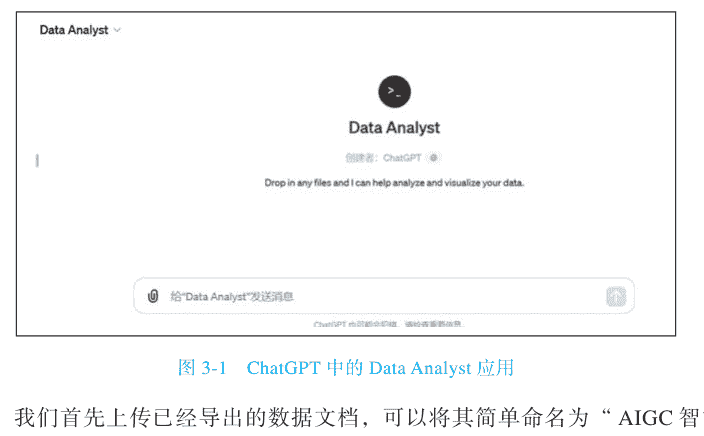

先把导出文件统一命名为“AIGC智能营销问卷数据”后导入会话。先设定分析者身份与任务背景，再让模型先概括问卷要点并给出初步结论。提示的核心意思是请扮演一位跨学科的营销分析师，拥有营销、心理学、行为经济学、社会学、用户体验、品牌塑造等背景，具备同理心与洞察力，能够基于受访者的语言准确解读想法与需求，阅读文件后先做内容概述再提主要发现。

归纳结果显示：
根据上传的Excel文件“AIGC智能营销问卷数据.xlsx”，这是一份关于AIGC在市场与品牌领域应用的调研数据。

覆盖维度：
认知层级：受访者对AIGC的熟悉程度。
工具认知：是否听说过相关AIGC平台。
潜在用途：认为在营销与品牌中可落地的场景。
期待：对AIGC的应用预期。
使用经历：是否用过、体验如何。
阻碍：使用时可能遇到的难题。
其他：城市、提交时间、填写时长、设备、系统、浏览器、填写地区等。

初步结论：
认知呈现分化，有了解一些的，也有不太了解、完全不了解的。
工具认知方面，部分人提到Chat-GPT、文心一格等具体产品。
潜在用途上，普遍认为可用于品牌创意生成、体验优化、社媒运营、推广投放、数据洞察等。
期待集中在提效、提升创意质量、提供个性化方案、增强品牌认知。
使用经历显示部分从业者已在工作中尝试并给出感受。
阻碍主要指向版权风险、技术门槛偏高等。

建议方向：
科普教育：对完全不懂或了解有限的人群加强普及。
场景深耕：在创意生成、体验优化等共识领域挖掘案例。
问题对症：针对版权、技术门槛等痛点寻求对策以推动更广泛采用。

如果需要更深的数据拆解或有其他具体问题，请告知。

第一步先盘点认知水平。随后可考虑剔除对AIGC完全不了解的样本提升相关性。我们先统计认知分布并要求出图。提示示例要求：基于以上数据，统计受访者对AIGC了解程度的分布，用可视化呈现百分比，图表字符若中文乱码请转英文，使用蓝色绘制并提供下载链接，同时给出解读。

要求文字转英文是为了避免乱码。模型生成的图片如图3-2。

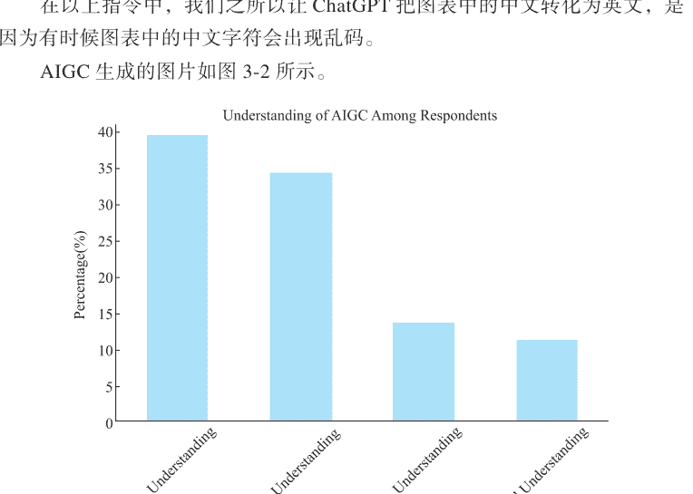

图3-2 受众调查：“您对AIGC的了解程度如何？”

模型解读如下：
了解一些Somewhat Understand占比最高约39.53%，说明不少人已有基础认知。
不太了解Not Much Understanding约34.88%，了解有限的人群也不少。
完全不了解No Understanding约13.95%，仍有一部分几乎没有接触。
很了解Understand Well约11.63%，深入了解者相对稀少。

实际下载图常出现字体缺失，可用截图保存。

结果显示完全不了解者约13.9%。本例在开放题分析中保留了这部分，实践中可做更精细清洗以剔除干扰。

接着对使用经验和感受做文本深挖，指令为：请分析受访者的使用经验和感受，总结主要发现。

返回摘要为：
使用经验：有人提到在工作中用于自动写稿、翻译、图生等场景。
感受：正负兼有。正面提到效率提升，如“效率大大提升”“省人力省时间”。负面指向局限，如“文案不行，过于套路”“生成的文案是否符合公司的合规等要求”。
挑战与障碍：版权、创意不足、理解需求能力、内容同质化等。

分析偏概括，难以还原真实体验。此时可做情感归类，提示为：请对受访者的使用感受和经验进行情感分析，每条反馈划分为正面、负面、中性，完成后再以可视化形式呈现三种情感的比例，并总结主要发现、举例说明并按主题归类。

模型生成的图如图3-3。

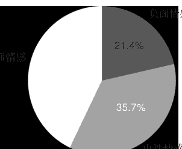

图3-3 用户情感分析

模型对图的说明如下：
总结：
正面情感约43%，多围绕效率、便利、实用性的认可。
中性情感约36%，多为客观描述、尚未使用或考虑使用。
负面情感约21%，集中在内容质量、工具局限、使用挑战。

例子与主题：
1. 正面情感
效率与便利：创作自媒体logo比较方便；尝试写文案和翻译，翻译质量尚可；省人力省时间；效率大幅提升。
实用性：英文翻译和写作挺好；自动生成观后感、读后感。
满意度：每天都在用。总体很好，进步很快。
2. 中性情感
尚未使用或考虑：没、否、没有、尚未打算、No。
客观描述：祝福、致辞等文案参考。
3. 负面情感
内容质量：文案不行，过于套路；文案不是很好用；内容缺乏创意，容易得到虚假信息。
工具局限：刚开始只是玩具，无法商业化；生成内容可能是虚假的或者具有欺骗性；AI工具自说自话，没有达到使用者要求。
使用挑战：对用户能否按AI逻辑框架说清诉求要求较高；产生一些要求不高的内容。

这些分类揭示了期望、满意点与挑战。

实践中结果可能不一致，也会出现模型只处理部分文本。这时需要人工督促完整执行。若模型以无法访问文件为由推脱，可直接复制粘贴或转PDF上传。

继续分析挑战与障碍，指令为：请对受访者反馈的挑战和障碍进行分析，先概述再分类，并以实际反馈举例说明。若找不到相关文本请告知我提供资料。

返回结果：
我将对您提供的AIGC受众关于市场与品牌领域的挑战和障碍的文本资料进行分析，包括概述与分类。

概述：
市场和品牌领域在采用AIGC时，受访者指出了一系列挑战和障碍，这些困难可能会影响AIGC的接受度和效能。

挑战和障碍的分类与举例：
1. 版权和合规性
关注版权法遵守、内容是否符合公司和法律规定。
举例：版权问题、查重不过、IP归属、保密规定、隐私保护、生成的文案是否符合公司的合规等要求。
2. 内容生成的质量与创意性
担心工具无法精确理解需求，生成缺乏创新力和个性。
举例：不能准确理解需求，创意性不够。
3. 技术局限和用户适应性
反映技术在特定场景的局限，以及用户使用适应问题。
举例：AIGC在营销中主要用来提供灵感……很难再提升质量了；特定领域很难应用。
4. 用户技能和认知
反映理解和运用工具的挑战。
举例：用户说明自身需求的能力不足；企业内部认知。
5. 技术成本和资源限制
涉及算力和成本。
举例：本地计算机的算力不够，云端的比较贵。

有时模型会推荐高级分析然后拒绝执行，例如细粒度情感分析时回复：由于我在当前环境中没有访问外部NLP库的能力，我不能直接执行这个任务。不过，通常一个细粒度情感分析的步骤包括使用如VADER、TextBlob或自定义机器学习模型来对文本进行分析，这些工具可以理解文本的情感并对讽刺或隐喻等复杂语言现象给出响应。

这说明在部分任务上模型仅提供思路。

ChatGPT可直接完成的非结构化文本分析：
- 文本摘要与关键点提取：可直接生成摘要或提取要点，无需外部工具。
- 主题识别：能识别文本中的主要话题。
- 分类与标签分配：可依内容特点做基础分类和打标。
- 语言风格和一般性情绪分析：可判断语气、正式或非正式、乐观或悲观等。

需要外部工具配合的分析：
- 趋势分析与模式识别：大量数据的趋势和复杂模式需用数据分析软件或Python/R做统计。
- 关联分析：高级关联需专门统计工具或编程，模型可提供代码建议。
- 高级情感分析：复杂情感识别与量化需专业情感分析工具或NLP库。

面对大量开放题，模型能快速概括归类并判断语气风格。但涉及R或Python库的复杂分析仍有限，此时模型转为向导，提供工具与代码建议。

##### 3.2.3 AIGC辅助数据分析：市场分析和产品定位
除文本外，AIGC在结构化与非结构化数据的处理上也很强。

例如从Kaggle下载印尼市场的智能电视数据集，包含型号、价格、评分、用户评价等。通过数据，AIGC可完成清洗预处理，并挖掘价格与评价关联、消费者偏好等洞察，还能从非结构化评价中提取关键词与情感倾向，为策略和产品优化提供依据。

把csv文件上传到对话窗口，如图3-4，先让模型阅读。

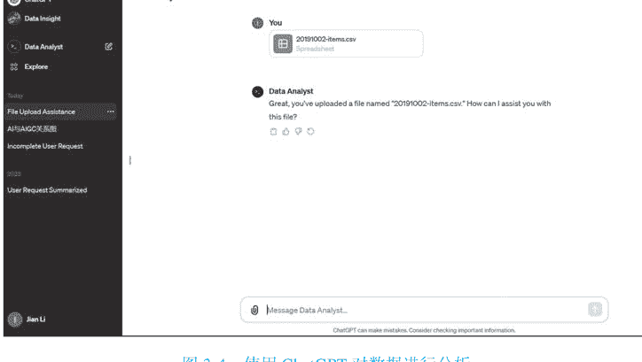

###### 1. 数据结构概要
先让模型总结文档以确认结构。总结如下：
这个文件包含了关于不同产品的数据，主要的内容包括：
1. itemId：每个产品的唯一标识。
2. category：产品所属的类别，例如这些行里的产品都属于“beliharddisk-eksternal”。
3. name：产品的名称，比如“TOSHIBA Smart HD LED TV 32-32L5650VJ Free Bracket”。
4. brandName：产品的品牌，例如Toshiba、LG、Sharp等。
5. url：产品在网上的链接。
6. price：产品的价格。
7. averageRating：产品的平均评分。
8. totalReviews：产品的总评价数量。
9. retrievedDate：数据获取的日期，这里的数据都是在2019-10-02获取的。

这个文件似乎是一个电子商务平台上的产品列表，包含了产品的详细信息、定价、评分和评价数量等信息。

回答末尾出现方括号与三角图标，点击可查看分析，图3-5。

```python
####### 导入 pandas 库并起别名为 pd
import pandas as pd
####### 读取 CSV 文件
file_path = '/mnt/data/20191002-items.csv'
```

data = pd.read_csv(file_path)

####### 显示数据框的前几行，以了解其结构和内容

data.head()

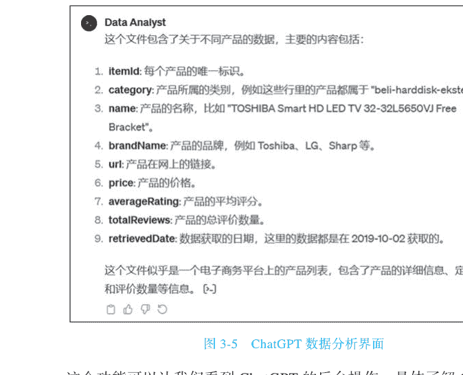

图3-5 ChatGPT数据分析界面

该功能可展示后台代码，便于了解模型使用的库与工具。

###### 2. 数据分析的维度
有了结构后可提问分析方向。示例指令：
针对以上电子商务平台上的数据，如果你是一位希望在这个电子平台上开设店铺并售卖产品的品牌经理，你会对这些数据做哪些分析？请参考上面的数据结构和实际数据来判断。

ChatGPT 电商数据实战：从结构洞察到用户心声

下面是模型给出的回答思路：

基于你提供的数据结构和实际记录，如果你想在该电商平台上开店卖货，可以从品牌经理视角做这几类拆解：

1. 类目与品牌表现：看哪些类目比如“beli-harddisk-eksternal”最吃香，结合评分和评价量判断热度；把 Toshiba、LG、Sharp 等同类目品牌横向对比，盯紧平均分和评价总量。
2. 价格表现：不同价位段产品的评分和评价量分布，摸清消费者对价格点的接受度；对比同类或同品牌产品的价差，看价差如何影响口碑。
3. 竞争格局：按品牌和类目锁定主要对手，拆解它们的定价、评分、评价量，判断谁在特定类目占优。
4. 需求与趋势：用评价量和均分衡量市场需求强度；若数据跨时间，可画趋势预测未来需求。
5. 产品优化与差异化：拆解高分和低分产品的特征，找改进点；对标竞品找差异化空间。
6. 市场细分与人群：按品类、价格、评分做细分，锁定目标客群，推测不同人群偏好的产品特质。

这些角度能帮你快速读懂市场节奏，定出进场和竞争策略。数据再丰富一点，比如真实销量、用户画像，就能更深入。

ChatGPT 的分析师角色给出了 6 大类共 12 个可下手的分析方向。

###### 3. 实操案例拆解

接下来可以按自己的目标挑数据提问。比如先问哪些品牌的哪款产品最火。返回结果如下：

依据评价总量和均分，最受青睐的品牌及产品是：

1. 品牌：X*****
产品：[GRATIS ONGKIR][Android 9.0 Ready] X***** LED TV……
均分：4.0 总评价：28 893
2. 品牌：C*****
产品：[GRATIS ONGKIR] C***** LED TV 40 inch - Full HD……
均分：4.0 总评价：27 276
3. 品牌：S*****
产品：[GRATIS ONGKIR] S***** 24 inch LED AQUOS HD TV……
均分：4.0 总评价：15 004
4. 品牌：C*****
产品：[GRATIS ONGKIR] C***** LED TV 40 inch Android……
均分：4.0 总评价：13 020
5. 品牌：C*****
产品：[GRATIS ONGKIR] C***** LED TV 24 inch - HD Panel……
均分：4.0 总评价：10 300

可以看出 X***** 和 C***** 的部分电视机在平台上热度很高，评价量大且口碑稳定，性价比和满意度表现突出。

继续追问：按评价总量看，哪些类目需求最大？

结果：

1. 类目：beli-harddisk-eksternal 总评价：114 417
2. 类目：jual-flash-drives 总评价：94 007
3. 类目：beli-smart-tv 总评价：53 070
4. 类目：shop-televisi-digital 总评价：32 206
5. 类目：beli-laptop 总评价：5 777

外置硬盘、闪存、智能电视、数字电视和笔记本是需求最集中的品类，其中硬盘和闪存的需求远高于其他品类，使用场景广。选品和投放可以优先聚焦这些类目。

如果目标是印尼市场的智能电视，再问主打品牌和定价打法：

智能电视类目主要竞争品牌及价格策略：

1. 品牌：A******
平均价：约 7 419 751 最低：2 500 000 最高：59 345 000 SKU：189
2. 品牌：L*****
平均价：约 6 116 788 最低：2 450 000 最高：17 875 000 SKU：182
3. 品牌：A*****
平均价：约 7 153 137 最低：3 030 000 最高：31 999 000 SKU：89
4. 品牌：H*****
平均价：约 6 258 028 最低：1 994 000 最高：25 499 000 SKU：83
5. 品牌：P*****
平均价：约 2 024 734 最低：364 000 最高：5 424 900 SKU：81

A***** 与 L***** SKU 数量最多，均价偏高，主攻中高端。A***** 与 H***** 定价逻辑相近，也偏中高端。P***** 均价明显更低，瞄准预算型用户。价格带基本勾勒出各品牌的定位与客群。

为了避坑，也要看表现最差的品牌。询问智能电视类目垫底的品牌及共性：

垫底品牌包括：

1. 品牌：O***** 均分：1.0 总评价：1
2. 品牌：N***** 均分：2.0 总评价：1
3. 品牌：N***** 均分：2.0 总评价：1
4. 品牌：H***** 均分：3.0 总评价：1

共性是均分低、评价量极少，销量或知名度不足，甚至部分品牌如“N*****”“H*****”与智能电视关联度低，可能为数据分类错位或准确性问题。分析时需谨慎核验。

发现异常后可让模型清洗数据，并限定为中国品牌，列出表现最差的 10 个。清洗后的结果：

来自中国的智能电视品牌中表现偏弱的品牌，按均分和评价量排序：

1. 品牌：C***** 均分：4.24 总评价：18 234
2. 品牌：C***** 均分：4.31 总评价：273
3. 品牌：X***** 均分：4.33 总评价：11 200
4. 品牌：P***** 均分：4.47 总评价：1 580
5. 品牌：T***** 均分：4.56 总评价：1 068
6. 品牌：H***** 均分：4.63 总评价：27
7. 品牌：K***** 均分：5.00 总评价：1

值得注意的是，均分并不低，最低 4.24，问题主要在评价总量偏少，相对头部品牌市场声量和平台销售量有限。这里的“最差”是相对比较意义，并不等于品质差。

###### 4. 数据分析可视化

文字分析容易枯燥，直接让模型做高级可视化并出图更直观。

指令示例：请基于该平台全部智能电视数据，分析最畅销的价格区间并做可视化呈现。

返回图表如下：

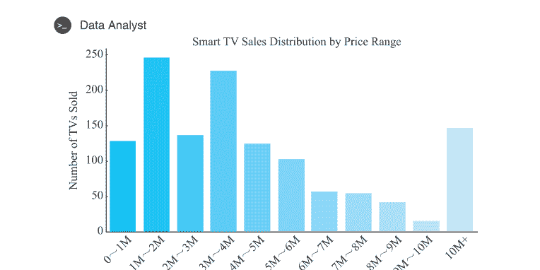
图 3-6 智能电视价格区间和销量分析

依据销售数据，最畅销价格段分布如图 3-6 所示。

图表显示中低价位销量集中，尤其“1M～2M”即 100 万～200 万印尼盾和“2M～3M”即 200 万～300 万印尼盾区间表现最好。随着价格上移销量递减，超过“3M～4M”即 300 万～400 万印尼盾明显下滑。最高价段“10M+”即 1000 万印尼盾以上销量很低。

说明用户更倾向于中低价位的智能电视，性价比驱动明显。想进入该市场的品牌应重点关注这些价格带。

原文图表文字为英文且价格为印尼盾，可让模型把说明和图表文字转为中文并换算为人民币。

请把可视化图表及分析中的英文换成中文，并把印尼盾换算成人民币。

修改后内容如下：

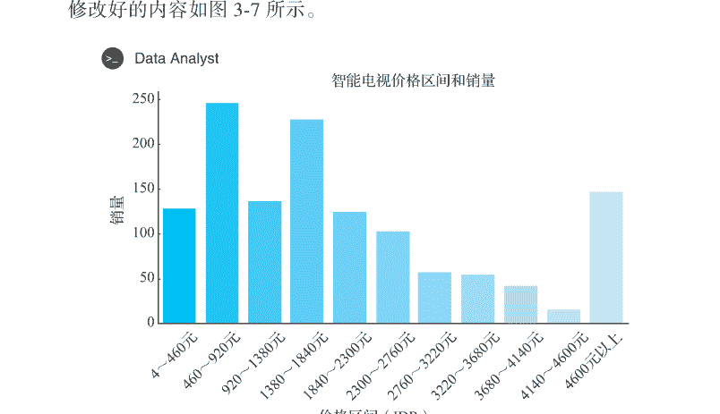
图 3-7 修改好的内容

按人民币计价的最畅销价格区间分布如图 3-7。观察要点：

价格区间“460～920 元”和“920～1380 元”的智能电视销量较高，消费者偏好集中于此。

价格越高销量越少，高于“1840～2300 元”明显下滑。

最高价位“4600 元以上”销量偏低。

整体来看用户偏好中低价位产品，性价比是关键。切入市场时聚焦这些区间更容易获客。

到本书成稿时，模型仍无法直接把图表翻译成中文，但汇率换算可以一键完成，英文图表可用图片编辑工具自行加注中文。

##### 3.2.4 AIGC 辅助数据分析：用户满意度分析

以上多为结构化数据，用 Excel 也能算。难度提升一步，用模型分析用户评论文本。

上传印尼电商平台智能电视的用户评论表，模型识别出字段：

itemId 产品唯一标识，category 所属类目，name 评论者姓名，rating 评分，originalRating 原始评分，部分缺失，reviewTitle 标题，reviewContent 内容，likeCount 点赞数，upVotes 支持票，downVotes 反对票，helpful 是否被标记有用，relevanceScore 相关性得分，boughtDate 购买日期，clientType 提交客户端类型如 androidApp，retrievedDate 数据抓取日期。

这些字段可用于衡量用户满意度、市场反馈和消费行为。

提问下一步能做什么，模型建议：

1. 用户满意度：用 rating 看各产品满意度，定位高分低分产品并通过 reviewContent 找原因。
2. 评论内容挖掘：对 reviewContent 做文本分析，提取喜好与痛点；可用情感分析判断倾向。
3. 热门识别：结合 likeCount、upVotes、downVotes 找受欢迎或不受欢迎的产品；用 helpful 判断参考价值。
4. 购买时间：分析 boughtDate 看销售节奏，找销售高峰优化库存和营销。
5. 客户端分析：看 clientType 判断主要使用设备，优化体验。
6. 市场细分：按 category 和评论内容识别细分市场和目标人群。
7. 负面深挖：聚焦低分负评，了解不满点以改进产品或服务。

让模型找出用户满意度最高的 5 款智能电视及原因：

1. 产品 ID：6068 评分：5.0 评论内容：无
2. 产品 ID：392480709 评分：5.0 评论内容：无
3. 产品 ID：392480709 评分：5.0 评论内容：“barang cepat sampe…kurir nya atraktif…tv ok banget…”
分析：用户认可快速送达和产品质量。
4. 产品 ID：392480709 评分：5.0 评论内容：“Maaf baru kasih review skr…Cepat bgt pengirimannya…TV nya bagus…”
分析：用户称赞物流速度和电视品质。
5. 产品 ID：392480709 评分：5.0 评论内容：无

从样本看，满意度高的关键是产品质量和物流速度。但部分产品无具体评论，信息不足。

实践中仅用均分判断会失真。样本量小的高分可能不可靠，也可能受刷单影响。需要“人机协作”审校。

引入评价数量做修正，构建加权满意度：

优化满意度 = 均分权重系数 × a + 评价总量权重系数 × b

经验上取 a=0.7，b=0.3，兼顾评分可信度与样本规模。

按加权公式重新评估，得出满意度靠前的 5 款：

1. 产品 ID: 512604347 均分：5.0 评论数：19 加权得分：3.785
2. 产品 ID: 417096236 均分：5.0 评论数：14 加权得分：3.710
3. 产品 ID: 406196960 均分：5.0 评论数：13 加权得分：3.695
4. 产品 ID: 130123986 均分：5.0 评论数：11 加权得分：3.665
5. 产品 ID: 416181170 均分：5.0 评论数：10 加权得分：3.650

评论要点：

512604347：用户强调卖家沟通响应快，产品质量高。
417096236：用户为回头客，体现品牌忠诚度与产品满意。
406196960：用户满意快速到货和包装，服务标准高。
130123986：用户认可快速送达和产品质量。
416181170：用户点赞物流速度和产品品质。

综合来看，高满意度智能电视的核心要素是高质量产品配合快速可靠的物流服务。

满意度评估的现实偏差与优化思路

服务体验是否好、沟通是否流畅，以及品牌是否让人愿意回购，这几类因素叠加起来，直接决定了消费者是否满意以及是否愿意给出正面评价。

前一轮的输出已经有明显提升，但从营销一线的常识来看仍显不足。我们把疑问直接抛给 ChatGPT，请它对下一步分析做更落地的打磨：

即使经过优化，这份结果作为营销决策的依据仍不够可靠。比如排名前五的产品，其评论体量和真正走量的爆款相比明显偏小。针对这种落差，提示词该怎么再加严？

ChatGPT 给出的改进建议如下：

要让满意度测算更能指导决策，需要对现有的加权分公式做升级，让它更贴近市场表现与真实感受。可行的优化路径有：

先划定评论量的门槛
先设置一个最低评论基数，只有达标的商品才进入比对池，这样样本更稳健，结论也更可信。

把销量放进公式
销量本身就是市场认可度的体现，卖得好的品类通常代表更广泛的偏好。将销量纳入满意度计算，模型会更贴近真实交易。

动态校准权重
不同指标对满意度的影响并不恒定，a、b 诸如此类的系数不必固定。可以结合业务实际和历史数据，适时调整评分与评论量等的比重。

加入时间衰减
评价会随时间推移而变化，近期的反馈更能反映当前的质量与服务水平。对新近评论赋予更高权重，能让结果更具时效性。

扩充评估维度
除评分与评论总量外，还可补充退货率、换货率、复购率等忠诚度指标，让模型更立体。

基于以上思路，优化后的测算可以写成：

优化后用户满意度 = 用户评分均值 × 权重系数 a + 产品评价总数 × 权重系数 b + 产品销量 × 权重系数 c + … + 其他因素 × 权重系数 n

其中 a、b、c…n 各自的权重可结合实际业务和过往数据来确定。通过持续的数据分析与市场研究，把握每个系数的合理取值，就能得到更精准实用的多维度评价体系，为营销决策提供更全面科学的支持。

#### 3.3 AIGC 驱动的分群与画像构建

##### 3.3.1 AIGC 如何实现用户分群

把潜在或存量客户按相似属性切分成若干群体，是市场分析的常用手段。同一群体在年龄、性别、收入、消费习惯、生活方式、兴趣偏好等方面更接近，不同群体之间差异明显。

AIGC 能完成分群，关键在于它擅长处理海量数据并捕捉模式与趋势。模型训练依赖模式识别，而分群正是把这种能力反向用到用户数据上。

在操作层面，AIGC 能迅速处理购买历史、线上行为、社交媒体互动等庞大数据，这些工作靠人工很难在短时间内完成。它还能挖掘出不易察觉的行为模式与偏好倾向。

在策略层面，AIGC 可依据每个群体的特质生成个性化内容和建议。同时支持动态分析，持续喂入同一群体的实时数据，就能及时补充洞察并调整营销策略。

###### 1. 借助预训练知识与联网搜索做快速分群

利用 AIGC 的知识库和搜索能力，可以高效完成分群任务。示例指令如下：

你的角色是一名市场研究分析师，对各行业信息都非常熟悉。
请为［国家］［行业］找出 5 个细分受众。
每个细分都要围绕一个深层次、与品类相关的核心需求来定义，并给出符合营销规范的命名。
请详细说明每个细分在偏好、痛点、需求、人口统计方面的特征。
可以补充其他关键信息。确保 5 个细分互不重复。请用表格呈现。

举例来说，我们让 ChatGPT 分析泰国电动汽车市场用户细分，得到了以下结果见表 3-3。

表 3-3 ChatGPT 生成的用户细分
该表按应用场景罗列了市场分析与趋势预测、消费者洞察与行为分析、策略制定与优化、产品开发与创新、危机管理与事件响应等五大类，每类下给出趋势预测、竞争分析、市场细分、情感分析、用户画像构建、用户体验分析、策略建议、价格策略、风险评估、产品开发反馈、模拟场景分析、事件监控与应对等具体场景，并配有对应的示例提问。

除了静态知识，我们还能调用 AIGC 的实时联网能力，结合市场变化和用户行为动态调整分群策略。

指令示例：
你的角色是一名市场研究分析师。请基于以下实时数据和市场变化，调整细分策略，为细分群体 1 提供最新营销建议。
细分受众群体 1：环保先锋
实时数据：请联网搜索泰国最新的环保政策和市场趋势。
调整策略：据新政策更新该群体的偏好、痛点、需求及营销建议。

AIGC 回馈的调整方案如下：
用户细分群体 1：环保先锋
实时数据：
环保政策：泰国政府正大力推动电动汽车和可再生能源，以降低交通与能源领域的碳排放。
市场趋势：泰国太阳能市场快速增长，尤其在东部经济走廊，太阳能设施为工业提供电力，减少化石燃料依赖。
调整策略
偏好：更倾向选择能显著降碳并依赖可再生能源的出行方式，如电动车与太阳能汽车；在家居与办公场景也偏好太阳能解决方案。
痛点：充电桩覆盖仍不足，影响电动车使用体验；太阳能系统前期投入高，对预算有压力。
需求：通过电动车和太阳能系统降低碳足迹；期待政府更多激励与补贴来降低初期成本。
营销策略建议：
产品推荐：主推配备快充技术的电动车，缓解充电焦虑；提供家庭太阳能安装服务，强调长期省钱与环保价值。
激励措施：联合政府推出购车补贴；提供太阳能系统的优惠贷款或租赁，降低门槛。
教育与传播：通过社媒和环保活动宣传电动车与太阳能的环保优势，提升品牌形象；举办线上线下讲座普及新技术与政策。
合作伙伴：与新能源车企和太阳能厂商联合营销，提供捆绑优惠；与政府及环保组织合作参与社区项目，彰显社会责任。

上述动态调整主要依赖搜索能力，我们还可以让 AIGC 跨平台整合数据，把社交媒体、电商平台等实时信息融合分析。

指令示例：
你的角色是一名市场研究分析师。请结合以下平台数据，为细分群体 1 提供更全面的用户画像分析并提出营销策略。
数据来源：
平台 1：泰国社交媒体数据，请上传相关数据。
平台 2：泰国搜索引擎数据，请联网搜索。
平台 3：泰国电商平台数据，请上传相关数据。
执行前需先通过工具或工作流采集社媒与电商平台数据。

###### 2. 基于自有数据做精细分群

实际业务中常会积累用户数据，比如通过 SAP 或 Salesforce.com 获取的已购用户资料，或第三方提供的潜在用户脱敏信息。对这些真实数据进行分析，可实现更精准的分群与策略制定。

下面以 Kaggle 上某汽车公司用户数据集为例，用 AIGC 完成分群并据此制定决策。先看数据结构：

上传文件包含 2627 条记录，每条 10 个字段。字段包括：
ID 整数 唯一标识
Gender 字符串 性别 Female/Male
Ever_Married 字符串 婚否 Yes/No，50 条缺失
Age 整数 年龄
Graduated 字符串 学历 Yes/No，24 条缺失
Profession 字符串 职业，如 Engineer、Healthcare，38 条缺失
Work_Experience 浮点 工作年限，269 条缺失
Spending_Score 字符串 消费评分 Low/Average/High
Family_Size 浮点 家庭人数，113 条缺失
Var_1 字符串 分类变量，如 Cat_6，32 条缺失

数据摘要：ID 范围 458989～467968；年龄均值 43.65 岁，18～89 岁；工作年限均值 2.55 年，最高 14 年；家庭规模均值 2.83 人，最大 9 人。
整体结构清晰，涵盖基础信息与社会经济特征，部分字段存在缺失，需在处理时注意。

为对这 2627 条潜在用户做分群，采用结构化指令让 AIGC 明确目标与步骤。这里使用 SPAR 模板构建指令。

指令示例：
情境：
一家汽车公司计划拓展新市场，对品牌而言是全新区域。需要深入了解潜在用户，按数据分群以制定有效营销策略。
角色：
你是该公司的數據分析师，擅长从数据中提炼洞察。你注重细节、逻辑清晰，能把复杂分析通俗表达。目标是识别不同用户群体并为其定制营销策略。
行动：
数据审查：先全面审视用户数据，识别关键变量与潜在模式。
聚类方法选择：在执行前说明选择的非监督聚类方法，如层次聚类或 k-means。
执行聚类：按选定方法将用户分组，确保组内相似、组间差异。
特征描述：详细描述各聚类的核心特征。
命名聚类：为每个聚类起简洁易懂的名称，方便营销团队使用。
策略制定：为每个聚类制定具体营销策略，结合其特征与需求。
策略解释：说明策略背后的逻辑，为何适合对应群体。
响应：
依赖专业知识与数据洞察完成任务。输出需非技术化，便于非技术人员理解与执行。只使用上传数据，不编造数据。
若完全理解，请回复“是的，我们已经了解”，并要求“请上传数据”以便执行。

ChatGPT 的回复如下：
是的，我们已经了解。现在将开始数据审查、选择聚类方法并执行分群。
数据中存在缺失值，需先处理：Ever_Married 50 条、Graduated 24 条、Profession 38 条、Work_Experience 269 条、Family_Size 113 条、Var_1 32 条。
为保证分析有效性，先补全缺失。分类变量可用众数填充，数值变量可用均值或中位数填充。
填充后采用 k-means 聚类，因其适合大样本且能有效发现群体。执行前需把分类数据转为数值型。
ChatGPT 推荐 k-means。k-means 会把相似数据点聚到一起，无需预设分组，自动寻找最优划分。目标是把数据分成 k 组，每组点靠近同一中心。
分组数量可由模型自动决定，也可手动指定如 k=10。

以下是返回的分群结果摘录：
成熟商业领袖 聚类 0
描述：平均约 44 岁，已婚男性，多已毕业，职业多为商业相关，消费评分偏低，家庭规模较大。
策略：推广高性价比、家庭实用型车型，强调安全与经济性。
理由：家庭规模大且消费评分低，需兼顾财务规划与家庭功能。
教育青年精英 聚类 1
描述：约 41 岁未婚女性，多已毕业，从事商业职业，消费评分较高，家庭规模较小。
策略：突出时尚与智能配置，吸引年轻专业人士。
理由：未婚年轻群体更关注新潮与科技产品。
经验丰富的职场人士 聚类 2
描述：平均 37 岁未婚职业人士，工作经验较丰富，消费评分较高，家庭规模适中。
策略：主推稳定高效、耐用性能强的车型。
理由：职场经验意味着更高收入，偏好可靠高性能产品。
稳重中年 聚类 3
描述：平均 50 岁已婚男性，多已毕业，从事商业职业，消费评分偏低，家庭规模适中。
策略：推广舒适性高、适合家庭的中型车或 SUV，强调舒适便利。
理由：该年龄段更看重舒适与实用。
资深退休生活家 聚类 4
描述：平均 72 岁，多已婚退休，消费评分中等，家庭规模较小。
策略：推广安全、操作简便的车型，突出稳定与低维护成本。
理由：年龄与退休状态决定其对安全与易用性的偏好。
创意年轻艺术家 聚类 5
描述：约 26 岁未婚男性艺术家，消费评分中高，家庭规模较大。
策略：推广设计创新、环保车型，突出时尚与个性。
理由：年轻艺术家追求新颖个性，对环保更敏感。

##### 3.3.2 用户画像

用户画像是为目标用户群打造的虚拟人物代表，凝聚该群体的典型特征与需求。通常包含年龄、性别、收入、教育、职业、兴趣、生活方式、价值观、消费习惯等要素，来源于市场研究与数据分析。它的作用是帮助企业更准确理解目标用户，从而提供更契合需求的产品与服务。

AIGC 让用户画像从扁平标签走向立体画像

传统做用户画像，基本就卡在年纪、性别、地区这几个硬标签上，很难摸到用户真实的偏好和决策逻辑。AIGC 的出现打破了这层天花板。它可以调用 API、抓取外部数据，或者直接读取整理好的表格，对用户数据做多维度拆解，挖掘出兴趣点、消费习惯、情感倾向、购买路径等深层信号，从而描绘出更饱满、更鲜活的人群样貌，也能把人群切分得更精细。

更关键的是动态化。画像不再是静态的快照，AIGC 能持续追踪用户行为变化，为经营决策提供实时依据。产品研发期，可以借助画像分析预判用户对新品的期待，优化设计；市场投放期，可以实时监测需求满足度和情绪反馈，及时调整传播策略。

下面用 Kaggle 上经典的 marketing_campaign.csv 做一次实操复盘。

先让 ChatGPT GPT-4o 读懂数据结构，识别出四大模块：
人物基础包含 ID、Year_Birth、Education、Marital_Status、Income、Kidhome、Teenhome、Dt_Customer、Recency、Complain；
消费记录包含 MntWines、MntFruits、MntMeatProducts、MntFishProducts、MntSweetProducts、MntGoldProds；
营销互动包含 NumDealsPurchases、AcceptedCmp1-5、Response；
渠道行为包含 NumWebPurchases、NumCatalogPurchases、NumStorePurchases、NumWebVisitsMonth。
这些字段覆盖了人口属性、消费轨迹和对营销的响应，足够支撑深度画像。

分析采用 SPAR 式指令框架。情境是希望通过细粒度数据构建画像以优化产品和投放；角色设定为洞察力强、重细节的数据分析师；行动包括数据清洗、选择分层或 k-means 等非监督聚类、逐群分析消费行为、渠道偏好、营销反应、投诉情况，最后汇总画像并给出策略；响应要求通俗易懂、只用所给数据、不引入外部信息。

模型先要求上传数据并进行预处理，会主动询问缺失值处理方式，比如收入缺失是中位数填充还是删除。预处理完成后进入聚类数选择，使用肘部法则在 k=1 到 10 之间评估 SSE。
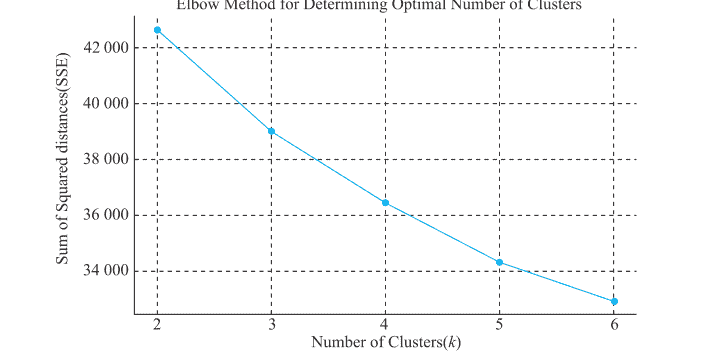
从图中可看出 SSE 随 k 增大持续下降，在 k=3 到 k=4 区间下降斜率明显放缓，说明 k=3 或 k=4 都是合理区间。后续选择 k=4 跑 k-means，得到四类人群的均值概览：

群组 0 低收入低消费，约 3.45 万美元年收入，孩子偏多，购买频次低，酒类花费最低，对营销不敏感；
群组 1 中等收入中等消费，约 5.73 万美元年收入，孩子数中等，购买频次中等，酒类消费中等，对部分活动有中等反应；
群组 2 高收入高消费，约 8.19 万美元年收入，子女最少，购买频次高，全品类花费最高，营销反应非常积极；
群组 3 较富裕偏高端，约 7.42 万美元年收入，子女偏少，购买频次中高，在鱼类和甜品上支出突出，营销反应一般。

进一步细化群组 2。基本画像为 30-50 岁为主，教育水平较高，多为管理或专业岗位，DINK 或小家庭结构，年收入约 8.19 万美元。消费上全品类领先，葡萄酒、肉类、鱼类尤为突出，偏好线上和目录下单，购买活跃且忠诚度高。营销响应上五轮活动均表现积极，第五轮反应尤其强，对新品和优惠敏感。

购买旅程大致为：意识期通过高端杂志、社交媒体和专业社区接触品牌；考虑期通过官网、邮件和目录获取细节；决策期在线下单追求便捷，倾向高级会员服务和定制推荐；忠诚期参与积分计划，关注限量和专属活动。

对应策略有四点：做精细化个性化推荐和定制服务；对高频高客群推出积分、高级会员、专属折扣等忠诚回馈；定期策划品酒会、新品发布等高端线下体验；强化官网和社交平台投放，覆盖高端用户聚集场景；搭建快速反馈通道，及时捕捉需求变化。

在实操中也体现人机协同的重要性。比如用智谱清言时出现数值类型转换报错，需要人工判断忽略或修正，避免陷入反复纠错；月之暗面对文件读取有限，通义千问则难以直接完成分析。综合来看，ChatGPT 的 Data Analyst 在大数据场景下更稳定。

AIGC 的价值在于高效处理海量信息、自动完成机器学习驱动的用户细分、支持个性化信息投放并持续学习优化。但风险同样明显：数据质量和完整性直接决定结论可信度；隐私与合规必须严格脱敏；算法选择不当会带来偏差；黑箱问题要求指令结构化、可解释。SPAR 模板在执行阶段拆解步骤，正是提升可控性的有效做法。

#### 3.4 案例拆解：Yabble 如何把调研从数周变成即时交付

Yabble 2017 年成立，核心是一套整合多源调研、用户反馈和社交数据的数据分析平台，目标是从海量信息中提炼趋势与洞察。

###### 1. 从 AI 辅助到即时问答
创立之初就以 AI 为底座降低机器学习门槛。2021 年推出 Yabble Query，允许用户用自然语言提问，快速获取关心的洞察；2023 年推出 Yabble Count，基于 AI 对海量评论和非结构化文本做情绪分类。

###### 2. 接入 AIGC 实现提速
受制于算力和人力瓶颈，团队在 GPT-3 发布后与 OpenAI 合作微调模型。借助自然语言理解能力，原本需要数日的人工编码分析压缩到数分钟，Query 也能处理更复杂问题。ChatGPT 还被用于情感分析，精准捕捉用户满意与不满，为产品迭代和客服策略提供依据。负责人本·罗表示，AI 承担重复工作后团队才能聚焦核心业务。

###### 3. 打造 ChatGPT 插件闭环
2023 年上线 ChatGPT 插件，成为首个在插件商店提供端到端调研方案的企业。插件融合 ChatGPT 知识库与社交、趋势数据，将收集分析流程缩短至几分钟，功能包括自动生成研究主题、按人口统计和行为特征定制受众、增强数据即时生成目标分析、支持超大型项目的多源数据接入。

CEO 凯瑟琳·托普认为 AIGC 正重塑调研行业的商业模式。自接入 ChatGPT 后，Yabble 数据分析效率提升约 50%，客户满意度提升约 10%，能更快识别痛点并提升留存。

整体来看，AIGC 正让用户画像构建更立体、更动态、更可操作，但高质量数据、合规使用和结构化协作仍是落地关键。

向前看，Yabble 有意把与 OpenAI 的合作推向更深层次，将在产品研发、市场推广等多个业务线进一步放大 ChatGPT 的价值，并携手研发下一代 AI 工具。目标是提升数据处理的精确度与响应速度，为客户输出更深层、更具指向性的洞察，助力其做出更睿智的商业判断。

## 第4章 构建：让内容随需而变

本章围绕 AIGC 如何参与内容战略的制定与动态生产的展开。依托生成式能力的效率优势，企业和创作者能够快速规划、持续调优内容方案，呼应市场变化和受众偏好迁移。

#### 4.1 AIGC 驱动的内容策略搭建

本节深入说明如何借助先进 AIGC 能力来设计与打磨内容策略的核心载体——营销内容日历。保持品牌调性稳定、激活目标人群、达成营销目标的过程中，AIGC 可以提供关键支撑。

##### 4.1.1 用 AIGC 磨合营销内容日历

内容日历是企业或品牌对发布节奏、触点与形式的统筹工具，通常涵盖主题、形式、发布时间、投放手段等要素。它是营销执行的骨架，有助于全局把控、突出重点并保证前后一致。

借助 AIGC 可以把内容日历的起草作为策略落地的起点。

指令示例：

角色设定：你是一名资深内容营销顾问，擅长编排内容日历。

要求：

- 1. 先与我展开对话，收集本次营销的背景，包含营销目标、目标人群、产品或服务概况、预计投放周期等。
- 2. 基于上述信息，提出系统化的问题清单，全面覆盖内容规划需求。
- 3. 在信息充分后，提炼营销要点并据此搭建可执行的发布日历。
- 4. 日历需明确内容主题、上线时间、投放渠道、推广打法等要素，以日历形态呈现。
- 5. 对重点版位提供创意方向与形式建议。
- 6. 制定过程中保持追问与灵活调整。

把这段指令喂给任意 AIGC 大模型或专业写作工具即可。以智谱清言为例，返回的引导如下：

首先感谢委托。为精准制定内容营销日历，请先提供以下背景：

- 1. 营销目标：希望达成品牌曝光、销量提升、市场份额扩张等哪类结果？
- 2. 目标人群：产品面向的年龄、性别、职业、兴趣等画像？
- 3. 产品或服务简介：核心卖点、优势、使用场景？
- 4. 活动窗口：计划投放的时间段，是否与特定节点或节日重合？

收到信息后，我会进一步追问内容类型、风格基调、篇幅、呈现方式等细节。

信息完整后，我将归纳关键要素并输出可执行的日历，包含：

- 1. 内容主题：围绕目标与人群定制话题。
- 2. 发布时间：规划投放节奏与频次。
- 3. 发布渠道：依据人群触媒习惯选择社媒、博客、论坛、邮件等。
- 4. 推广打法：合作推广、投放、活动策划等。

在此基础上，对重点内容给出创意思路与形式建议，如案例剖析、专家访谈、图文教程等。

制作期间我会持续提问并根据反馈动态修正。请尽快回复以保障进度。

使用 AIGC 生成问卷时，可进一步细化问题，补充品牌调性偏好、内容长度与格式、过往内容表现、竞品打法等维度，帮助模型输出更贴合需求的日历。

根据信息掌握程度，可分批或一次性作答，完成后即可让 AIGC 生成计划。

另一种更高效的做法，是让 AIGC 通过联网检索与分析来补全背景信息。

指令示例：

> 为喜利得重型电锤 TE70 制定内容计划，目标是提升线索与销售额。请联网了解 TE70 的产品特性、用户画像与市场现状，提炼并回答上述背景问题。

可学习的两个技巧：

其一，要求模型联网检索而非仅依赖知识库。以新款智能手机的市场反馈为例，模型可抓取最新报道、用户评论与专业点评，形成更真实及时的洞察。可进一步限定检索范围、深度与关注点，实现定制化信息供给。

其二，要求模型主动思考并提取深层信息。用“提取”替代“总结/概括”，促使模型挖掘信息背后的需求与关联。例如分析用户反馈时，不仅罗列观点，还要提炼需求痛点与对产品设计、策略的潜在影响，从而提供更有洞察的决策参考。

执行上述指令后得到的信息如下：

据网络检索，喜利得 TE70 系列具备以下特性与场景：

1. 产品特性

TE70-ATC/AVR 电锤：净重约10公斤，单次冲击能量14.5焦耳，钻头适用范围12~150毫米。配备主动扭矩控制与主动减振，提升安全与舒适度。采用免维护无刷 SR 电机与双室润滑，延长作业时长与寿命。可选配 DRS-Y 除尘系统，粉尘清除率达95%，并支持电源线快拆。

TE70-AVR 电锤：净重约8.3公斤，单次冲击能量11.5焦耳，钻头适用范围12~150毫米。主打大范围钻凿作业的高生产率，低接触压力与主动减振提升舒适性与日生产率，亦可搭配DRS-Y除尘系统。

2. 应用场景

适用于混凝土、砖石、天然石材冲击钻孔 12~150毫米，重型锚栓钻孔 20~40毫米，扁凿破碎拆卸，以及木材、钢材高扭矩钻孔。

据此可初步设计内容营销框架：

目标人群：建筑工人、工程技术人员、施工企业、重型设备操作者等。

营销目标：提升品牌认知、拉动销量、扩大份额。

内容主线：突出耐用、高效、安全，彰显在重型建筑与工业场景的领先优势。

投放节奏：参考行业旺季与展会节点触达关键人群。

投放渠道：社交媒体、行业论坛、专业建筑网站、邮件营销等。

推广手段：联动行业KOL、参展、发布案例研究、提供试用等。

在细化日历时，需进一步拆解主题与排期，并根据市场反馈灵活迭代。

该回答由 AIGC 基于联网信息整理出 TE70 的核心卖点与应用，并给出内容营销框架，包含人群、目标、主题、节奏、渠道与推广等要点。虽然框架清晰，但内容主题偏概括，缺乏具体创意与执行抓手，可通过上传过往品牌素材、产品资料、用户反馈、竞品内容、平台热点等进行二次优化。投放时间与渠道的选择也较为宽泛，未充分结合目标人群的媒体使用习惯做精准规划。

据此做一次简化调整：

将投放周期固定为3个月，不参考旺季与展会；社交媒体以抖音为主，去掉邮件营销；推广策略中去掉展会。要求据此制定 TE70 内容日历。

调整后的示例日历如下：

按要求，为喜利得 TE70 制定3个月内容日历，重点聚焦抖音。

第1月：产品认知与教育

- 第1周：发布产品介绍短视频，突出 ATC/AVR、无刷 SR 电机、双室润滑等核心亮点。
- 第2周：发布操作教程，演示在不同材质上的高效作业方法。
- 第3周：发布竞品对比视频，凸显 TE70 的差异化优势。
- 第4周：发布用户证言视频，邀请行业专家或现用户分享体验。

第2月：场景化呈现

- 第5周：发布工地实拍，展示 TE70 在真实施工环境中的表现。
- 第6周：发布行业解决方案，讲解 TE70 如何解决重型锚栓钻孔等痛点。
- 第7周：发起创意应用挑战，鼓励用户分享特殊环境下的使用案例。
- 第8周：发布幕后故事，讲述研发与制造历程，增强产品质感。

第3月：互动与转化

- 第9周：开展互动活动，如问答、抽奖，提升参与度。
- 第10周：推出限时优惠或捆绑套装，刺激购买意愿。
- 第11周：展示用户作品，鼓励分享使用成果的项目。
- 第12周：发布新品预告或 TE70 升级信息，保持关注热度。

渠道与推广

主渠道：抖音

辅助渠道：可考虑微博、快手等进行内容分发，扩大覆盖。

推广策略：

- 与建筑垂类抖音达人合作推广；
- 利用挑战赛与话题标签提升曝光；
- 定期回复评论私信，维护用户关系。

以上为初步方案，实操中需结合数据反馈动态调整。

该日历聚焦抖音，以产品教育、场景展示、互动转化三阶段递进，每周主题明确，形式涵盖介绍、教程、对比、证言、实拍、方案、挑战、故事、互动、促销等，形成品牌自有内容、用户生成内容与KOL内容的多元矩阵，并注重参与感与转化。整体结构清晰、逻辑连贯，虽创意深度与差异化定位仍可优化，但已具备良好的执行框架。

##### 4.1.2 用历史数据复盘，AIGC 优化策略

上一节介绍了用 AIGC 生成日历的方法。一个完备的策略还需回溯历史表现，与计划对照，找到优化方向。

下面介绍如何利用 AIGC 分析历史内容并与计划对比，形成改进建议。

首先汇总历史数据。可将品牌近一年发布的图文视频等内容整理为数据集或文档，用 CSV、Excel、PDF 等格式存储，每行对应一条文案，字段包括文案ID、发布日期、标题、正文、链接等。

将文件上传或直接粘贴至对话窗口。

对文本内容，常用分析维度见表4-1。

表 4-1 品牌文本文案分析维度与指令

| 分析维度 | 分析目标 | 指令示例 | 数据与资料需求 |
| :--- | :--- | :--- | :--- |
| 内容主题聚类 | 自动归类文案主题，提炼主题与关键词，优化选题 | 对近6个月文案做主题聚类，列出出现频率最高的5大核心主题及关键词，并给出选题建议 | 近6个月文案数据集 |
| 热词趋势分析 | 挖掘热词与话题，掌握趋势变化，洞察兴趣 | 分析近6个月热点话题与关键词的时间趋势，总结规律并预测未来方向 | 近6个月文案数据集、社媒热词数据 |
| 传播效果预测 | 构建效果预测模型，提炼高传播特征，指导创作 | 按效果高低筛选文案，提取高传播文案在情感、风格、互动上的特征，形成创作指南 | 近6个月文案数据集、互动数据 |
| 受众画像精准化 | 构建目标人群画像，实现精准定位与分发 | 综合文案、互动反馈与调研数据，多维度刻画受众画像 | 文案数据集、互动数据、调研数据、CRM数据 |
| 风格对比解析 | 对比不同类型文案风格差异，提炼迁移策略 | 选择不同主题、节点的文案，对比语言风格、情感基调与表现元素差异，提炼风格迁移策略 | 不同主题文案数据集 |
| 优质文案解构 | 解构高传播文案模式，萃取创作方法 | 对高传播文案做全方位拆解，提炼亮点、创意与技巧，以点评形式指导优化 | 高传播与低传播文案数据集 |

对于非文本内容，当前多数 AIGC 工具已具备图像识别与解析能力。以喜利得知乎文章的新品配图为例，通过通义千问的图片理解功能，可快速提取画面核心信息与语境含义，并给出优化建议。

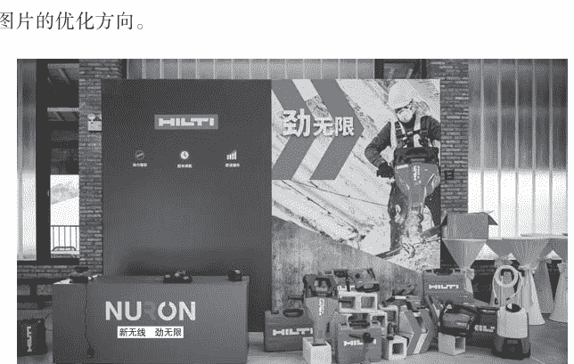

图 4-1 喜利得知乎文章中新产品上市配图

指令示例：

作为一名内容营销专家，专长于知乎图文搭配。请完成以下任务：

- 1. 图像描述：详细解析图片内容，包括主要元素、色彩搭配、构图布局与情感氛围。
- 2. 品牌元素分析：在描述基础上，挖掘品牌 Logo、品牌色、产品展示、场景等元素如何塑造品牌形象。
- 3. 创意特色探讨：分析视觉手法、场景叙事、视觉焦点设置等创意亮点。
- 4. 优化建议提供：结合图文传播最佳实践，提出图像质量、焦点强化、文案配合、色彩调整等方面的改进建议，提升传播力与品牌影响。

上传图片并粘贴指令后得到的回复示例：

###### 图像描述

这是一张喜利得品牌宣传海报，背景为深蓝，主体为红白渐变色块，上书“劲无限”白字。左上角为红色喜利得 Logo，左下角为灰色 NURON 标识。画面主体为身着蓝工作服、戴黄安全帽白口罩的工人正操作红色电钻，背景为灰墙。底部陈列品牌工具与设备，包括电钻、手提箱、喷雾器等。

###### 品牌元素分析

红色 Logo 与整体配色呼应，强化品牌识别。工人操作场景展现产品真实应用，体现专业可靠。底部工具陈列凸显产品线丰富与技术实力。

###### 创意特色探讨

喜利得海报视觉解析与生成式 AI 升级路径

这张海报的视觉记忆点在于对比强烈的配色与均衡的版面。深海蓝的底面与品牌红的标识形成强烈撞色，瞬间抓住视线。左侧陈列区摆出实物，右侧墙面以巨幅作业图呈现使用者形象，两侧共同把产品属性与使用场景具象化。

###### 优化建议提供
先从成像质量入手，让金属纹理与细节更清晰可辨；再加入简短说明或图形符号，把功能卖点讲得更直白；对主色比例做微调，使整体观感更协调；最后增加二维码等互动入口，引导受众获取品牌深度信息。

同类拆解思路同样适用于其他生成式模型。GPT-4 的解读归纳如下：

###### 图像描述
画面为喜利得的展示场景。左侧深色展台上陈列多件喜利得器具，中央突出“NURON 新无线，劲无限”的主文案。右侧墙体为大幅作业海报，穿戴防护的作业人员正在操作 Hilti 设备，旁文“劲无限”。整体以红、黑、白为主调，营造专业且充满活力的氛围。左展区与右海报在构图上形成呼应，器具摆放整齐，传递出严谨的品牌气质。

###### 品牌元素分析
标识出现在展台与海报上，独特的字形与色彩强化识别度。NURON 标识指向电池能源平台的技术演进方向。实物陈列与使用场景共同传达耐用、适配重工的特质，整体塑造出高效可靠的工具品牌形象。

###### 创意特色探讨
核心巧思在于把静物陈列与动态作业并置。静态区呈现产品本身，动态海报讲述品牌故事，即产品在苛刻环境下仍保持高性能。静态与动态的对照形成视觉焦点，强化功能强度与应用价值的认知。

###### 优化建议
成像质量提升：保证器具纹理清晰，提升分辨率与光线控制精度。
视觉焦点强化：对海报人物照明做加强，提升视觉冲击。
文字配合优化：调整字体大小与色值，保证易读且不抢背景。
色彩微调：在保持主色前提下适当调饱和度与对比度，引导情绪反应。
版面调整：重排部分器具，形成引导视线的线条。
叙事加强：在旁增添案例或用户评价，增加情感共鸣。

借助生成式 AI 对色彩、布局、主题的深度剖析，可以提炼品牌历史内容营销中的创意特征，用于后续物料创作中强化一致性并提升吸引力。

AI 还能基于过往分析结果直接指导新图生成，例如自动匹配配色方案、挑选展示视角、生成符合调性的设计，大幅提升效率。

相比仅用 Stable Diffusion 等工具的图生图，通过对已有图像做特征提取再驱动文生图指令，能更精准地提炼关键视觉要素，既保留原作风格，又注入明确意图，使新图在形式与内涵上更贴近品牌。

所有洞察可汇总，经 ChatGPT 等生成《内容洞察报告》。

示例指令如下：

```
###
假设你是一位资深的内容策略专家，请根据我提供的内容日历和内容洞察报告，对内容日历进行优化和完善。
###
```

要求：依据报告中的核心洞察与趋势，对内容日历的主题、形式、风格进行优化。参照报告中的分类洞察，为重点内容提供具体可执行的优化建议。结合受众反馈与传播效果数据，优化发布时间、频率与渠道。

限制条件：优化后的日历须符合品牌调性与内容策略方向。建议需具备可行性，考虑生产资源与周期限制。

根据报告提取最有价值且可操作性强的洞察要点，应用于日历优化，让历史分析结果最大化发挥，提升策略精准度与有效性。

通过上述步骤，分析洞察可充分沉淀到日历优化中，让生成式 AI 助力制定更优质、更具吸引力与传播力的计划，这也是一个持续迭代过程，可定期回流最新洞察。

#### 4.2 使用 AIGC 构建创意

前文已讨论用生成式 AI 制定营销策略，现聚焦围绕内容日历进行内容生产。

传统流程包括创意研讨、文案撰写、视觉设计到发布优化。生成式 AI 可在全链路智能辅助：
创意酝酿期，如同灵感引擎，依托数据分析与趋势捕捉批量产出方向。
内容生产阶段，借助自然语言处理与计算机视觉高效完成文案、视觉乃至视频剪辑，提升速度与质量。
内容优化阶段，通过智能算法实时参与生产与传播，优化策略、形式与发布时间，提升影响力。

差异化决定高度，创意决定深度。首先探讨如何通过直接对话高效激发灵感、批量生成方向，再以人工干预与定制化指令避免同质化。最后探索将 AI 无缝融入传统头脑风暴等环节，让 AI 拓宽视野并赋能创意产生。

##### 4.2.1 指令引导的批量创意生成

最直接的做法是输入关键词与指令驱动生成。借助逻辑推理、海量知识整合与创造性联想，可针对特定主题产出创意。

常用方式是输入关键词让模型直接产出创意。

示范指令：作为资深文案专家，请根据以下关键词，为添可炒菜机器人设计 10 个吸引人的微信推文标题及简要概述。关键词包括“炒菜机器人”“全自动操作”“安全易用甚至小朋友也能操作”“菜品口感佳”“内置 300 余种菜谱”“健康烹饪理念”以及“多重安全保障”。

通义千问给出的 10 个选题与简述围绕全自动操作、安全易用、健康烹饪与家庭应用展开，每个方向相对独立，突出产品通用优势与使用情境。整体较为精准聚焦并具备适度创新。以其一为例，模型抓住了安全易用且小朋友可操作的特点，拓展出烹饪工具兼具技能培养的教育叙事。另一例则以全家参与为切入点，从功能上升到情感价值。

但需警惕，当所有人包括竞争对手都在使用生成式 AI 获取灵感时，创意容易趋同。这种现象称为人工智能同质化，即 AI 在追求效率与个性化的同时导致创意与内容趋同。

原因一：算法架构与训练数据的同质化。主流大语言模型多采用 Transformer 架构，输出在文本生成等场景高度相似；训练数据集重叠度高，创意自然趋同。
原因二：市场驱动的保守主义与技术盲从。开发者倾向选用已被市场验证的标准方案，甚至对成熟模型做表面改造后推出，导致不同产品背后技术与数据同质化，加深创意同质化。

为避免同质化，需采取策略确保独特性与差异化：
生成式 AI 训练与调优：构建专属知识库与数据库，减少对单一数据集依赖。
人机协同：强调协同创作，优化指令让 AI 从不同角度生成创意，并通过多轮对话探索新方向。

以上述 10 个创意为例，继续对话并给出指令：请运用搜索与整合能力，搜集添可炒菜机器人的最新产品信息、官方介绍与用户评价，并搜索市场热点、产品趋势、竞争对手情况。对搜索信息分析提取后，对以上 10 个创意点子进行针对性优化，使其更贴近用户需求、市场趋势并与竞争品牌保持差异。

使用智谱清言优化后选题在原有基础上融入实时信息与网络趋势，加入对现代生活节奏加快、小朋友教育需求、预制菜流行下健康饮食重审等贴近受众关注的背景。优化版更注重挖掘差异化功能与情感价值，通过故事化情境与痛点解决方案提升共鸣。例如其一突出在预制菜流行背景下，机器人如何帮助消费者解决对食品健康与新鲜的担忧，通过便捷操作实现从源头把控食物质量。

##### 4.2.2 使用创意指令模板，优化创意

人机协同可有效抑制创意同质化，确保内容紧密贴合市场热度、真实需求与产品差异化。

可使用以下创意指令模板：

###### 1. 用户画像分析指令

在已知用户画像时，可将画像数据提供给 AI 改进创意相关性与独特性。输入丰富用户特性描述后，系统可对已生成微信推文主题及创意元素进行精准个性化优化。

示范指令：我将提供该产品的用户画像。请针对此用户群体的特征、喜好与消费习惯，对创意方案进行个性化定制，确保每个创意精准触达目标用户。

关于如何用 AI 生成用户画像，请参考第 3 章。

在缺乏完整系统性画像时，可采用简化模拟法构建初步用户模型。例如选择现实生活中具有代表性的人物作为参照，利用对其特征、行为与背景的直观理解来模拟目标群体。

示范指令：鉴于暂无完备用户画像数据，为快速定位目标受众特性，让我们以演员郭 × × 为典型用户原型。请基于公开信息与个人形象塑造，分析其年龄层、消费水平、兴趣爱好、社交媒体活跃度、对文化娱乐产品的偏好等，进而推测相似用户群体特征，并据此细化完善创意方案。

###### 2. 情感诉求深化指令

这是用户画像指令的进阶。要求深入研究目标消费者的情感需求与价值观，发现产品背后能触动人心的故事与情感纽带，将其巧妙编织进创意文案。通过该指令可创造富有感染力与情感深度的内容，有效建立产品与用户间的情感联结。

# 破局重复感 让 AIGC 创意更有辨识度

**示范指令：**

请基于目标人群画像展开网络调研，深入挖掘使用者的情感诉求与价值取向，梳理出产品背后的人物故事与情感联结点，将这些感性要素自然植入创意，产出有温度、能触动内心的文案。

###### 3. 社会价值沟通指令
此类指令要求在生成创意时纳入企业社会责任与社会影响的维度，把公益、可持续发展等议题与内容紧密结合。

这类提示能为创意提供更易共鸣的切口，在丰富叙事层面的同时提升品牌好感。

示例指令：
请聚焦公益议题与可持续发展方向开展网络调研，将企业的社会责任主张融入创意，塑造积极正面的品牌形象，使作品兼具商业价值与社会意义。

###### 4. 品牌调性植入与风格迁移指令
调性植入的核心是让创意准确呈现品牌的性格、气质、价值观以及语言视觉的统一性。调性包含品牌专属话术、视觉规范、文化内涵等。

在生成阶段可提供品牌手册、品牌人设、过往案例等材料，引导生成式 AI 理解并贯穿调性。

示例指令：
请在创意中体现 XX 企业“创新、简约、高端”的品牌调性。我稍后会提供品牌指南与历史案例作参考。请依此保持统一的语言与视觉，确保每条输出都能彰显我司品牌的内在品质与定位。

###### 5. 数据补强指令
数据补强要求创作者基于现有产品资料如产品手册，提炼核心功能与特性，并在多条创意中得到复现。通常先上传手册，再由生成式 AI 依据文档强化创意与产品竞争力的关联。

示例指令：
> 请基于已上传的产品手册提炼关键功能和特性，并将这些要点有机融入上述十个创意中，确保每条创意都能鲜明体现产品的核心竞争力。

###### 6. 竞品对标指令
方向不明时，可把竞争对手作为参照系。通过梳理竞品的产品与用户资料，总结优劣，再据此优化创意方案，凸显自身优势并规避对手短板。

示例指令：
> 请查阅我上传的竞品介绍文档及用户评价资料，提炼主要卖点及其优劣势。依据分析结果对上述十条创意进行针对性调整，力求突出我方优势并避开竞品不足。

借助以上指令模板，能够在一定程度上缓解人工智能同质化问题，让生成式 AI 的产出更具新意与独特性。

##### 4.2.3 创意头脑风暴

借助多轮对话与指令模板指引生成式 AI 的创意走向，可以有效产出想法并规避重复。除此之外，还能从传统广告创意的思路中借鉴方法，迁移到 AI 创作流程。

头脑风暴是激发创意最常见也最有效的方式之一。该词源于精神病学，最初指患者短时间内思绪混乱、思维跳跃的状态。20 世纪 30 年代，BBDO 联合创始人亚历克斯·F·奥斯本意识到广告创意需要系统化方法，于 1953 年在《应用想象力》中推广这一术语，并论述了生成广告创意的技术。

奥斯本提出的基本原则摘录如下：

- 推迟评判：在产出阶段禁止批评，重点是大量生成想法，即使看似荒谬也不必担心被嘲笑。
- 放开束缚：鼓励大胆奇特的想法，越独特越出乎意料越好，能激发新联想并导向创新解法。
- 求量先于求质：目标是产生大量想法，不论初期是否可行，后期再评估完善。
- 叠加延展：鼓励参与者互相借鉴拓展，通过组合或修改创造新可能。

这些原则至今仍是头脑风暴的基石。多数头脑风暴效果不佳并非方法错误，而是未坚持原则。

《应用想象力》问世后，方法不断演进。20 世纪 60 年代，丰田提出迭代提问法，连续追问五个“为什么”以揭示问题本质；作家及创意顾问詹姆斯·L·亚当斯将可视化引入头脑风暴，提出星爆图技术引导多维度探究。同期，文案专家鲍勃·埃伯勒提出 SCAMPER 法，通过替换、组合、适应、修改、他用、消除、逆转等结构化策略打破常规思维。

20 世纪 70 年代，心理学家悉尼·J·帕恩斯与伦纳德·W·庞提出角色扮演法，将用户体验共情与用户视角植入头脑风暴；托尼·博赞提出思维导图，将发散思维梳理成逻辑脉络；爱德华·德·博诺则倡导逆向风暴与六顶思考帽，通过科学角色扮演激发多样化创意。

我们尝试用生成式 AI 复现并增强上述方法，并按与 AI 整合的可能性与效果分为两大类：AI 主导型头脑风暴和 AI 辅助型头脑风暴。

###### 1. AI 主导型头脑风暴
AI 主导型头脑风暴以生成式 AI 为主导，部分或完全替代团队脑暴。依赖个体或群体产生与组织思想的过程，AI 可通过算法自动生成并关联概念，实现创新过程的自动化。可直接写成指令一键完成。

####### （1）脑力书写
脑力书写通常是无声集体写作，每人写下想法再分享。生成式 AI 可依据主题与关键词快速生成大量相关想法。AI 的脑力书写可采用麦肯锡 MECE 原则，即相互独立、完全穷尽。

关于数量可分多次生成，理论上无上限。

示例指令：
> 作为资深文案专家，请依据以下关键词为添可炒菜机器人设计 100 个吸睛的微信推文创意标题。关键词包括：“炒菜机器人”“全自动操作”“安全易用，甚至儿童也能操作”“菜品口感佳”“内置 300 余种菜谱”“健康烹饪理念”及“多重安全保障”。目标用户：25～45 岁、一二线城市、中高收入、工作繁忙没时间做饭；缺乏烹饪经验、做饭难吃；注重健康、追求高品质生活。要求：每个标题围绕用户需求与关键词设计，同时保持相互独立、完全穷尽。

####### （2）角色代入
赋予 AI 不同身份角色，可从多维度跨领域视角产生新观点。AI 能灵活模拟多样角色认知，形成更丰富全面的创意集合。

示例指令：
> 假如你是中国哲学家庄子，请深入剖析炒菜机器人在现代社会的价值意义，并为炒菜机器人撰写一个微信推文标题。

不同工具扮演庄子后的创意示例：
Claude 3 Opus：《“道”存炒机间，静水覆流深》
细观炒菜机器人，钢铁躯体下蕴藏玄机。其看似仅为烹饪，实则助人返璞归真。现代社会喧嚣繁复，人易迷失本心。机器人虽人造，却能唤回从容淡定，代人操劳让人得空修身养性，此乃深层意义。

通义：《智能烹饪：炒菜机器人的道与技，现代生活的养生与和谐》
夫当今世事繁剧，炒菜之机械以科技之力融汇于烟火之中，其所承载价值深意，实乃“顺乎自然，寓至理于日用”之理念。

ChatGPT：《自在厨艺，道随机走——探索炒菜机器人带来的逍遥生活》
机器人之炒菜，非人手之炒，而味同人炒美味。器虽为器，却能释人于烹饪之累，使人有闲暇以逍遥游。人乐其技，不亦善乎。

####### （3）SWOT 四象限拆解
利用生成式 AI 快速评估优势、劣势、机会与威胁。

先提供清晰背景资料引导 AI 分析内外因素，再要求归纳填充 SWOT 矩阵，最后基于洞见输出行动方案或创意。

示例指令：
> 请深入研究新教学大纲中关于学生学习烹饪技能的具体内容与目标。接下来扮演炒菜机器人产品经理的角色，站在新课标实施背景下，运用 SWOT 工具全面评估炒菜机器人作为教学辅助设备的优劣势、机会与威胁。最后结合 SWOT 的四点发现，为如何将炒菜机器人更好地应用于教学、提升学生烹饪技能撰写约 800 字的微信公众号推文。推文需含吸睛标题、引人入胜的开头、务实的建议与展望。

####### （4）六顶思考帽
六顶思考帽由爱德华·德·博诺提出，从六角度审视问题：白帽关注客观事实与数据，红帽注重感受直觉情绪，黑帽着眼风险问题挑战，黄帽强调积极性好处机会，绿帽倾向创新新思路，蓝帽负责控制与管理思考过程。

生成式 AI 可同时模拟多种思考模式，确保创意多样性与独特性。

示例指令：
> 我们正在为一款新炒菜机器人设计营销方案。请扮演广告公司创意总监，运用六顶思考帽全面审视营销挑战并提出创新推广思路。
> - 白帽：客观分析产品特点、目标受众、市场环境等关键信息。
> - 红帽：从消费者角度谈谈可能引发的情感反应与购买冲动。
> - 黑帽：指出营销中可能遇到的风险、问题与挑战。
> - 黄帽：从积极视角分析独特优势与市场机会。
> - 绿帽：提出 3～5 个创新营销创意与推广方案，鼓励打破常规。
> - 蓝帽：总结分析过程，提炼最有价值最具可行性的创意方案。

####### （5）思维导图
思维导图以关键词为中心放射出分支，直观展现思想、概念及关联，非线性结构利于自由联想与创新。

生成式 AI 可自动化创建逻辑深入的思维导图，连接不同主题与子主题。

示例指令：
> 我们正为全新智能炒菜机器人设计推广文案。请扮演广告公司创意总监，运用思维导图方式自主头脑风暴。任务：
> - 确定突出独特卖点的中心主题。
> - 围绕中心发散 3～5 个主要分支，代表不同产品特色或价值主张。
> - 在每个分支下延伸 3～5 个子分支，补充创意点、卖点描述、使用场景等。
> - 依据思维导图创作 3～5 条有创意有感染力的文案标题。
> - 选择最吸引人的 2 个标题拓展为完整正文，突出独特价值。
> - 总结思维导图呈现的创意脉络，并给出最满意的 2 则创意文案。

###### 2. AI 辅助型头脑风暴
上述方法也可在人机协同下完成。部分头脑风暴仍需团队参与，生成式 AI 扮演辅助角色，强化、催化、引导流程，提供灵感来源、扩展思路边界、验证可行性、促进跨领域联想、构建知识网络并汇总提炼要点。

####### （1）五问递进法
反复追问“为什么”以揭示问题本质。生成式 AI 可根据初始问题智能生成多种答案选项，每种均可作为下一轮追问基础。需人工判断选择下一步方向，确保探询精准有效。

AI 在此更像知识储备丰富、处理速度快的智囊助手，加速初步排查与拓宽维度。但因果链判定仍需人工凭借经验与直觉。人机协同可避免逻辑陷阱与偏见。

####### （2）星爆法
以核心概念为中心，向外辐射多思考方向，形成多维度创意网络。操作时以明确问题为核心构建放射状图形，每个分支代表原因、影响、改进措施、相关因素等，再针对每个分支持续提出“为什么”或“如何做”。

可用生成式 AI 在会议前获取背景知识、行业趋势、成功案例与潜在问题。过程中遇到瓶颈可即时提问：“针对此问题的非传统解法有哪些？”“其他领域是否有类似成功经验？”，从而获得新视角。

####### （3）SCAMPER 发散法
通过替换、组合、调整适应、修改、他用、消除、逆转七步启发创新。生成式 AI 可灵活应用七种策略批量产出新方案。

示例指令：
**替换：**
烹饪过程哪些元素可用新技术或方法替代？
炒菜机器人能否烹饪传统方法难以处理的食材？

**组合：**
如何将炒菜机器人与其他厨房用具组合？
能否将不同烹饪方法功能结合？
能否成为家庭魔术表演道具？

**修改：**
能否修改目标人群？
能否修改卖点？

**用于其他用途：**
能否用于烹饪外任务？例如熬制中药。
能否利用其功能进行膳食准备或食品保鲜？

**消除：**
使用后可消除哪些当前烹饪步骤？例如消除持续监控、消除测量成分的需要。
对某些食谱能否完全消除用户输入，创造全自动化体验？

**逆转：**
若产品专注解构预制餐而非从头烹饪会怎样？例如重新加热冷冻餐、解构预切食材。
能否逆转烹饪过程用于食品保鲜或脱水？

生成式 AI 的引入将传统头脑风暴转变为人机交互新形态。主导型头脑风暴使个体或团队快速获得大量点子，覆盖从概念到实施方案各层面。例如产品开发初期，AI 可生成多种概念与设计方案，帮助快速筛选迭代。

辅助型头脑风暴在人类主导进程中提供灵感激发、信息整合与方案优化。AI 可通过分析大量数据提供市场趋势、用户需求与竞品分析，帮助团队更精准提出创新方案。

两种模式下，生成式 AI 均能持续服务，不受时空限制，保证创意生成连续高效。其跨界联想能力可在不同领域建立联系提出创新解法，逻辑推导与实验模拟能力则帮助预见并规避潜在问题。

#### 4.3 AIGC 驱动的文本内容生产

AIGC 依托强大的自然语言处理与深度学习能力，能够批量产出高质量的文字素材，覆盖新闻稿、商品描述、社交媒体动态乃至长篇博客等多种形态。本节将说明如何借助 AIGC 完成文本创作，剖析其在提升产出效率、拓宽创意空间、强化用户互动方面的价值。通过具体案例与可操作的指引，展示 AIGC 如何重塑传统写作流程，为内容生产带来更高便捷度与创新可能。

##### 4.3.1 先出初稿：从创意到成文

在前一小节里，我们已借助 AIGC 完成创意方向的梳理与优化，并得到标题与摘要。把这些成果直接作为指令输入，便能让模型生成结构化大纲。为便于横向对比，此处设定输出篇幅约 600 字。

指令示例：
> 请依据下列标题与摘要，拟定一篇适合微信公众号发布的内容提纲。
> 标题：教育新风尚：添可炒菜机器人，陪伴孩子在厨房中茁壮成长
> 摘要：随着教育界对生活技能培养的重视加深，烹饪成为关键能力之一。添可炒菜机器人凭借高度安全与易操作的特性，成为家长与学校解决烹饪教学难题的理想选择。

生成结果示例：
- 一、开篇切入：孩子的烹饪渴望
描述孩子想学做饭却受限的常见情境，引出现状与痛点。
- 二、生活技能教育的价值
助力全面发展，激活多元智能；培养独立生活能力；烹饪兼具教育意义。
- 三、传统烹饪教学的瓶颈
操作存在安全隐患，家长难控；耗时耗力效率低；教学缺乏系统性，学习被动。
- 四、添可炒菜机器人的创新点
安全可靠，AI 操控零风险；智能化教学，循序渐进寓教于乐；支持全程参与，培养自主操作。
- 五、添可助力孩子厨房成长
提升生活自理能力；感受劳动价值；激发想象与创造；增进亲子关系。
- 六、家校协同共促发展
学校纳入课程体系；家长配合巩固；添可作为家校联动的教学工具。
- 七、收束
号召更多家庭与学校参与，共同促进孩子全面发展。

在获得大纲后，可继续下指令让模型基于标题与摘要扩写正文。

指令示例：
> 请根据上轮生成的标题与摘要，撰写一篇面向微信公众号的文章。

生成结果示例：
教育新风尚：添可炒菜机器人，陪伴孩子在厨房中茁壮成长
孩子的烹饪梦想常常因种种限制难以实现，而添可炒菜机器人的出现让这一愿景变得触手可及。
生活技能教育重要在哪？其一促进全面发展，培育多元智能；其二培养独立生活能力，奠定未来自主基础；其三烹饪本身蕴含数学、科学、艺术等教育价值，能提升审美与创新力。
传统烹饪教学面临安全把控难、效率低、体系缺失等问题。添可炒菜机器人以高度安全与 AI 操控化解风险，以分层教学实现趣味学习，并支持孩子全程动手，强化独立操作能力。
在添可陪伴下，孩子在厨房中成长，自理能力增强，劳动乐趣被体验，价值观逐步建立，想象力与创造力得到激发，亲子互动也更为紧密。
家校若能联动，将烹饪纳入课程、家长在家配合，添可即可成为连接家庭与学校的教学利器。
呼吁更多家庭与学校加入，让添可炒菜机器人成为孩子厨房里的良师益友，陪伴其在烹饪世界中健康成长。

初稿完成后，可进行基础优化：明确目标读者，如家长、教师或校长，以校准语气与深度；进一步细化结构，明确各段主题、论点、论据；补充真实案例、数据或用户反馈以增强说服力，注意避免虚构，可先检索再写作；指定风格与语气，如轻松、正式或启发式；要求加入图片、图表等视觉元素；进行关键词研究并自然嵌入。

##### 4.3.2 跨平台适配与风格迁移

初次生成的文本只是动态内容生产的第一步。实际投放中需根据不同媒体特性与用户阅读习惯做二次编辑与优化。

可通过明确发布平台，让 AIGC 自主学习该平台的写作规范。例如设定角色为擅长网络调研与风格迁移的写作分析师，要求其研究小红书的语言、结构、视觉、热点与用户体验，并在遵守法规与隐私的前提下出具分析报告与撰写指南。

小红书风格要点摘录：
语言亲切日常，偏年轻化，句式简短，常用比喻排比与 emoji。
结构多为开头拽客，中间详述体验，结尾总结并引导互动或购买。
重视高质量图片与图文配合，话题紧贴时尚、美妆、美食、旅行等生活场景，强调故事化与实用价值。

基于上述指南，使用触发指令“请以小红书风格写作”对前文进行改写，生成结果以口语化、情绪化、强互动的表达呈现产品亮点与使用感受，并在结尾加入点赞收藏等引导。

同样的迁移思路可用于广告文案。先让模型检索近三年流行广告，提炼情感共鸣、创意亮点、文化价值传递、多平台表达、故事化等特征，形成写作指南，再基于指南改写既有内容。生成的多版广告文案在标题设问、功能强调、情感连接与行动号召上各有侧重，经评测，强调好奇心与参与感的版本表现更优，如以“探索味蕾宇宙，小小厨师的第一课”为题，突出安全趣味教学与亲子成长价值，并以“让孩子亲手烹制爱的味道”引导立即体验。

文案实效评估

创意张力：主标题《探索味蕾宇宙，小小厨师的第一课》与辅文《添可智能炒菜机器人，陪伴孩子从安全食材到美味餐桌，一键启动，趣味教学，每一步都是成长的故事。》组合起来冲击感很强，很容易点燃父母和孩子的兴趣，推动他们主动关注这款产品。

情感共鸣：文案突出了机器人在孩子成长陪伴中的角色，通过“探索味蕾宇宙”“每一步都是成长的故事”这样的表达，直击家长对子女教育与成长的情感诉求。

行动推动：提示条“此刻，让孩子亲手烹制爱的味道 >> 立即体验”表述简洁有力，能有效促使用户马上体验并感受产品的乐趣。

产品契合：全文各部分均紧扣添可炒菜机器人的使用场景与目标人群，从食材安全到餐桌美味，再到趣味教学，层层递进地呈现了产品的核心卖点。

综合来看，广告文案二在创意、情感共鸣、行动号召与产品相关性上均表现突出，是更优的方案。

你更青睐哪一份？

##### 4.3.3 借鉴优秀案例迁移写作风格

生成式AI可以接收参考文本，并据此对输出进行润色，让内容更贴合受众偏好。本节说明如何利用生成式AI参照优秀文案迁移风格，涵盖媒体风格与作家风格两类方向。

###### 1. 借鉴媒体的笔触

可让模型模仿《纽约时报》《华尔街日报》等媒体的表达，提升专业感与公信力。

典型特征如下：

- 《纽约时报》：以事实叙述为主，行文严谨，细节扎实，适合硬新闻与深度剖析。
- 《华尔街日报》：表达简练明快，重点突出，适用于商业与财经类稿件。
- 《大西洋月刊》：文字清雅，分析深入，重视背景铺陈与历史脉络，擅长讨论社会、政治、文化等复杂议题，强调深度与广度。

其他代表性风格：

- 《卫报》：语言平实，关注社会议题，适合评论与社论。
- 《经济学人》：语言带点幽默，分析透彻，适合经济时事点评。
- 《三联生活周刊》：语言质朴，重视深度报道与人文关怀，适合专题解读。

指令示例：

角色设定：

你是一名经验丰富的《纽约时报》记者，擅长撰写严谨详尽的报道。

目标任务：

对下面这段文案进行润色，使其符合《纽约时报》的写作规范。

能力要求：

运用事实报道技巧。

补充细节描写。

保持论述严谨。

限制条件：

遵循新闻真实客观原则。

不得直接引用《纽约时报》原文，包括观点、事实与数据。

###### 2. 借鉴作家与作品的笔触

也可以让模型借鉴名家文风，提升艺术性与可读性。例如：

- 海明威：语言凝练，力量感强，适合描写紧张场景或表达坚定立场。
- 简·奥斯汀：语气优雅，带幽默感，适合刻画社交与人际。
- 乔治·奥威尔：语言清晰，批判性强，适用于评论与社会分析。
- 汪曾祺：平淡处见真情，细腻处见深度，适合温情怀旧的叙事，突出细腻情感与人文关怀。
- 莫言：融合魔幻现实与乡土文学，适合有社会意蕴与复杂人性的题材，突出故事独特性与深度。

指令示例：

角色设定：

你是一位受汪曾祺影响的写作者，擅长捕捉生活细节与人情温存。

###### 3. 借鉴现成文案的笔触

市面上可读性强的微信文章与小红书笔记，往往因独特表达吸引大量读者。可让模型解析其结构与表达，进而模仿迁移。

指令示例：

角色设定：

你是一名优秀写作者，擅长拆解他人文风并提炼运用以生成新文本。

目标任务：

分析下面这段文案，学习并掌握其写作风格。此风格命名为“AI风格1”。

能力要求1：

详细拆解目标文本的结构，包括段落安排方式、句子长短与复杂度、过渡衔接等。

段落安排：观察主题引入、论点展开与结论收束的手法。

句子长短：注意长句短句的使用比例。

过渡词：识别高频过渡表达并在写作中借鉴。

能力要求2：

分析语调与情感基调，调整自己的语气以保持一致，注意正式、随意、幽默、严肃等差异。

分析修辞手法如比喻、排比、夸张等，并在写作中尝试运用以增强表现力。

限制条件：

不直接引用原文。

在上述指令中指定风格名称，让模型先进行分析，再将学到的风格内化为新技能。通过解析段落安排，模型能把握主题引入、论点推进与结论收束的逻辑，使产出在逻辑与流畅度上接近原作。通过解析语调，模型能调整语气，使其与目标文案一致，提升可读性与情感共鸣。需要注意的是，使用修辞手法时需人机协同把关，以确保恰当。

#### 4.4 生成式AI打造视觉创意

文案成型后通常需要配图配合，形成图文、广告创意、海报或产品手册。本节探讨如何借助生成式AI工具创造吸睛且个性化的视觉图像，并以案例演示流程。

##### 4.4.1 构思图像创意与生成指令

以下文案为例，说明如何使用生成式AI文生图工具创作。所选文案如下：

标题：

“探索味蕾宇宙，小小厨师的第一课”

副标题 / 正文：

“添可智能炒菜机器人，陪伴孩子从安全食材到美味餐桌，一键启动，趣味教学，每一步都是成长的故事。”

动态标签：

“此刻，让孩子亲手烹制爱的味道 >> 立即体验”

接下来让模型构思配图。我们要求模型扮演设计师角色，输出创意思路与设计方向。

指令示例：

现在你是一名经验丰富的设计师，请为上述文案设计一张图片，用于后续广告图制作。请给出创意思路。

返回结果如下：

作为资深设计师，我会先吃透文案核心与目标，再据此构思设计概念。创意过程如下：

创意设计概念：

场景设定：一个充满想象力的现代厨房，中央摆放“添可智能炒菜机器人”。背景可用星空图案的墙面，将宇宙探索概念与烹饪融合。

主体设计：一位身穿宇航服的孩子，象征探索与冒险，正好奇观察炒菜机器人或使用它制作食物。表情应专注且充满乐趣。

色彩与风格：采用明亮温暖的色调，吸引视线并传递家庭温馨感。机器人与厨房设备设计得友好且现代。

教育元素：画面中可加入食材知识卡片或食谱步骤的简易图标，体现学习成长。

互动感：孩子与机器人之间要有明显互动，比如通过平板或触控屏操作。

图片布局：

顶部：留白放置标题。

中部：主体场景，孩子与机器人互动。

底部：适合放置副标题/正文，同时预留区域给动态标签。

随后让模型扮演文生图指令生成器，将创意转化为可被文生图工具识别的指令。需注意创意中包含添可智能炒菜机器人，较难用指令精确描述，此处用“炒菜机器人”替代，后续可通过Photoshop等软件替换。

指令示例：

你现在是 Midjourney 的指令生成器，请根据上述图片创意概念生成 Midjourney 指令。注意将“添可智能炒菜机器人”替换为“炒菜机器人”。

返回结果：

生成的英文指令描述了一个以智能烹饪机为核心的现代厨房，墙面带有繁星宇宙图案，宇航服孩子与机器人互动，情绪投入喜悦，光线温暖，并可见食材卡片等教育元素，孩子通过触控界面操控，体现烹饪艺术与太空探索的融合。

该指令为英文，因 Midjourney 默认支持英文，中文指令理解效果较差。后续测试可验证。

##### 4.4.2 使用 Midjourney 生成图像

随后使用 Midjourney 执行上述指令并生成图像。

###### 1. Midjourney 注册、付费和 Discord 部署

首先完成准备工作。登录 Midjourney.com，按指引完成账号注册与订阅。若需详细流程，可访问官方快速入门指南 https://docs.Midjourney.com/docs/quick-start，该文档列出注册与充值步骤。

关键是注册 Discord 账号，因 Midjourney 无独立交互平台，而是集成于 Discord。所有生成请求、结果接收与交流均在 Discord 完成。

注册并登录 Discord 后，按官方指引加入 Midjourney 专属服务器、订阅计划，并通过发送指令给 Midjourney Bot 创建图像。无需额外软件或硬件，仅需 Discord 即可。

完成注册与设置后，可看到如图 4-2 所示的页面。

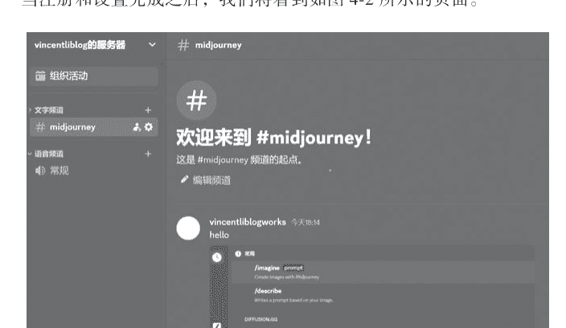

图 4-2 部署在 Discord 个人服务器上的 Midjourney Bot

###### 2. 开始第一个图像生成任务

进入与 Midjourney 的对话框，输入 “/” 选择 “/imagine prompt”，或直接输入 “/imagine prompt” 并粘贴指令。

等待后，Midjourney 会生成 4 张预览图，如图 4-3 所示。

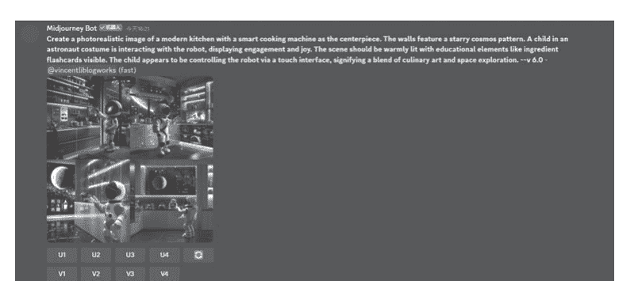

图 4-3 Midjourney 生成的预览图

预览图按左上至右下记为图 1 至图 4。图 4-3 中第一排为放大按钮，第二排为调整按钮。例如点击 U2 即放大第 2 张图；再点击 V2 即基于该图微调，生成 4 张新图。

前文提到 Midjourney 对中文指令理解不佳。将英文指令译成中文输入后生成的 4 张预览图如图 4-4 所示。

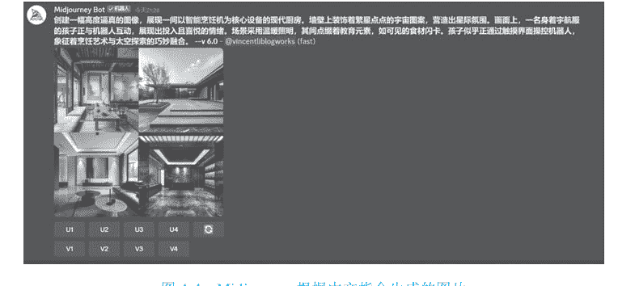

图 4-4 Midjourney 根据中文指令生成的图片

可见中文指令生成效果与预期差距较大。因此使用 Midjourney 进行创意与生成时，建议使用英文指令，参数指令也须用英文，否则会报错，后续章节将具体说明。

根据英文指令生成的预览图，图 2 可能符合文案需求，直接点击“U2”放大。放大效果如图 4-5 所示。

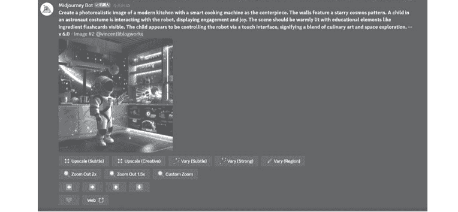

图 4-5 使用 Midjourney 放大效果生成的图片

可在图片任意位置点击预览或下载原图，原图效果如图 4-6 所示。

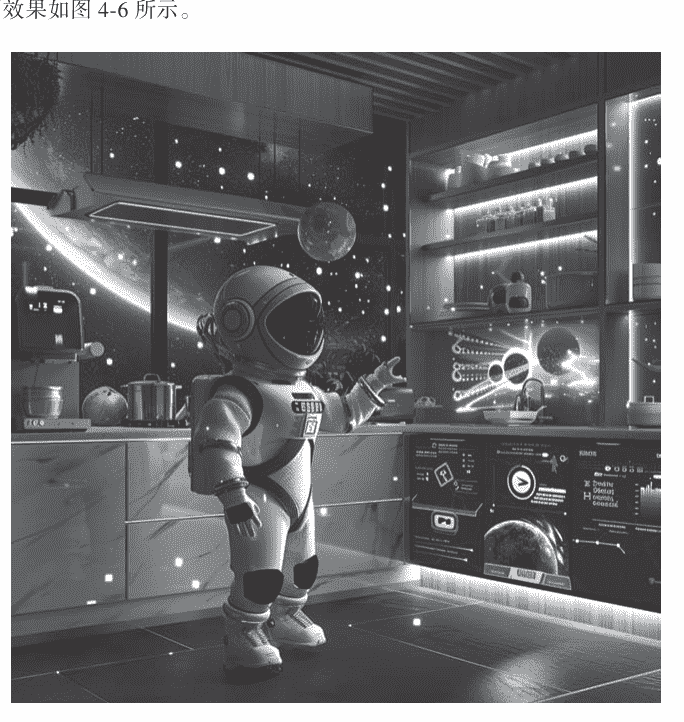

图 4-6 Midjourney 生成的图片（原图）

至此，配合广告文案的背景图已完成。

###### 3. 基本的图片调整

放大后，生成界面包含多个按钮，可进行基础调整，包括图像放大、图像调整、画布扩展。

Upscale 用于放大图像，在不损失细节前提下将尺寸等比例放大 2 倍。Vary 用于图像调整，保持原尺寸的同时对构图与细节进行微调，例如优化人物眼睛或手指细节。Zoomout 用于扩展画布，在原画面外增加内容，按指定比例与方向智能填充。

各按钮功能见表 4-2。

表 4-2 生成图像的调节按钮与主要功能

| 英文名称或符号表示 | 中文名称 | 功能 | 应用场景 |
| :--- | :--- | :--- | :--- |
| Upscale (Subtle) | 图像放大（微调模式） | 将图像放大 1 倍，同时保留细节 | 放大图片 |
| Upscale (Creative) | 图像放大（创意模式） | 将图像放大 1 倍，并增加新细节 | 放大图片并增添细节 |
| Vary (Subtle) | 图像调整（微调模式） | 保持主构图，细节有细微变化 | 眼睛、手指细节调整 |
| Vary (Strong) | 图像调整（强度模式） | 可能改变构图、元素数量、色彩与细节类型 | 需要更多创意 |
| Vary (Region) | 图像调整（局部调整） | 选择需修改区域进行调整 | 局部修改 |
| Zoomout (2×) | 画布放大（2 倍放大） | 画布扩展 2 倍，原画面外空白自动填充 | 延伸丰富画面 |
| Zoomout (1.5×) | 画布放大（1.5 倍放大） | 画布扩展 1.5 倍，原画面外空白自动填充 | 丰富画面 |
| Custom Zoom | 自定义画布放大 | 按需进行画布放大 | 自定义画面 |
| Pan Down | 向下按钮 | 向下扩展画布并自动填充空白 | 拉长画布，增加下部内容 |
| Pan Up | 向上按钮 | 向上扩展画布并自动填充空白 | 拉长画布，增加上部内容 |
| Pan Left | 向左按钮 | 向左扩展画布并自动填充空白 | 拉宽画布，增加左部内容 |
| Pan Right | 向右按钮 | 向右扩展画布并自动填充空白 | 拉宽画布，增加右部内容 |

例如，前文生成的图片未指定长宽比，系统默认 1:1，而广告图多为横版如 4:5，可用左右按钮拉宽画布。对图 4-6 进行向左与向右拉宽操作，效果分别如图 4-7 与图 4-8 所示。

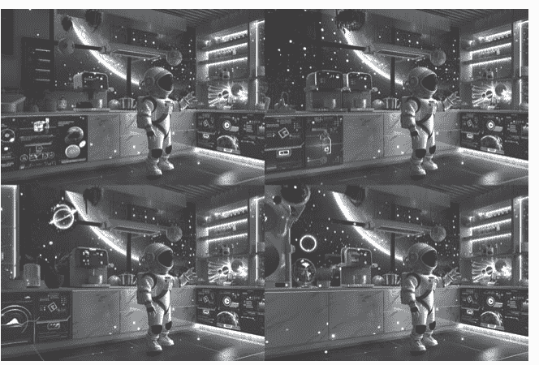

图 4-7 向左拉宽画布后的效果

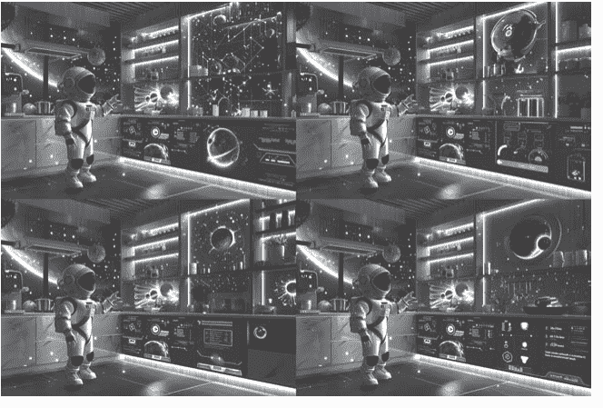

图 4-8 向右拉宽画布后的效果

我们可以任选一张图来放大查看，比如将第 2 张图向左拉宽后得到的版本，放大后的效果如图 4-9 所示。

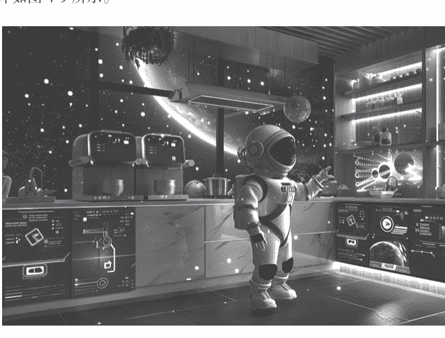

###### 4. 精准局部替换

放大后能明显看出，画面中央的智能炒锅和咖啡机造型过于相似，和我们要推广的自家产品差别很大。这时就需要做局部替换，把原图里的炒锅换成与主推产品更接近的形象。

大致有两种实现思路。

第一种是借助 Photoshop、RunwayML 等外挂工具来完成替换。要先把原图下载下来，再在这些软件里手动操作。

第二种是直接在 Midjourney 里做局部调整。为了让修改生效，先要把 Midjourney 切到混合模式。

在聊天框里敲 “/”，点开 Setting 回车后，在下方选项中勾选“混合模式 Remix mode”，如图 4-10 所示。

进入局部修改前，需要对要替换的炒锅有一个准确的文字描述。外观怪异的物品很难用语言描述准，这时可以调用 Midjourney 的以图生文功能，也就是图片描述。


图 4-10 Midjourney 的混合模式

在对话区输入“/”，先选 “/describe”，再选 “/image”，通过拖拽或本地选择上传要描述的物品。回车后 Midjourney 会给出数条描述，选择最贴合的一条复制备用。要注意，这种描述并不能做到 1:1 还原。若想把自家产品更精确地植入，还可以先用 Stable Diffusion 训练专属的 Lora 模型。

点开 Vary（Region）局部调整按钮，在弹出的窗口里用框选工具圈出需要改动的位置，把刚才复制的炒锅描述粘贴到指令区，点击生成。操作界面如图 4-11 所示。

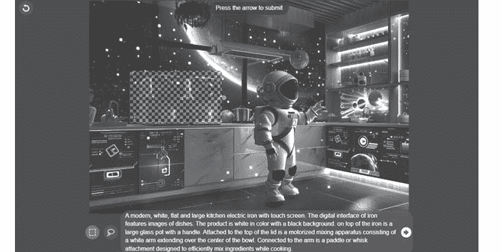

图 4-11 局部调整界面

执行完上述步骤后，系统会针对选区进行重绘，并一次性给出 4 张预览供挑选，如图 4-12 所示。

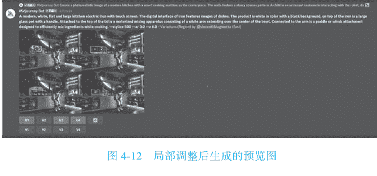

图 4-12 局部调整后生成的预览图

随意挑一张放大预览，效果如图 4-13 所示。


图 4-13 调整后放大的图片

若对结果不满意，完全可以继续微调指令再试。

##### 4.4.3 把控出图，减少随机性，稳定品牌调性

Midjourney 默认会根据提示词生成 4 张风格差异大、内容各异的图像。同样的描述每次跑出来的视觉语汇和元素都不太一样。

有时候我们希望降低这种随机性，让模型更贴合预期。本节介绍两种常用的可控生成方法。

###### 1. 投喂参考图，让画面更听话

图片参考指令是控制成图效果的高频手段。把参考图的链接作为指令的一部分，就能引导模型模仿该图的内容并重绘。

先拿到目标参考图的网址，可以上传到对话框里复制链接，也可直接用网络图。

随后在对话框粘贴该图片网址，并继续补全描述。这次我们希望得到 16:9 的画面，使用 --ar 参数指定。示例指令如下：

```
https://s.mj.run/XsHNAn0k2Qo Create a photorealistic image of a modern kitchen with a smart cooking machine as the centerpiece. The walls feature a starry cosmos pattern. A child in an astronaut costume is interacting with the robot, displaying engagement and joy. The scene should be warmly lit with educational elements like ingredient flashcards visible. The child appears to be controlling the robot via a touch interface, signifying a blend of culinary art and space exploration. --ar 16:9 --v 6.0
```

执行后 Midjourney 会基于参考图和具体描述生成 4 张预览，挑选其一放大，如图 4-14 所示。

通过“参考图 + 精准描述”的组合，能让生成结果更接近参考图的视觉风格与关键元素，同时加入个性化设定，实现对成图的引导。

###### 2. 用 --sref 锁定整体画风

从 Midjourney V6 起，风格参考功能上线。用户可指定一张参考图，让新图继承其视觉风格与语言，核心参数是 --sref。

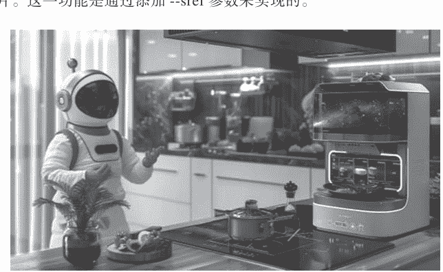

图 4-14 使用参考图片生成的图片

以图 4-13 为例，画面偏温馨居家、色调暖黄，而图 4-11 则是未来科幻的冷蓝风格。若希望新图具备图 4-11 的科幻感与冷蓝色调，可用风格参考参数调整。指令如下：

```
https://s.mj.run/XsHNAn0k2Qo Create a photorealistic image of a modern kitchen with a smart cooking machine. The walls feature a starry cosmos pattern. A child in an astronaut costume is interacting with the robot, displaying engagement and joy. The scene should be warmly lit with educational elements like ingredient flashcards visible. The child appears to be controlling the robot via a touch interface, signifying a blend of culinary art and space exploration. --ar 16:9 --sref https://s.mj.run/38jDmqkeB7Y
```

生成后如图 4-15 所示。

相较于图 4-14 的暖居感，图 4-15 明显吸收了图 4-11 的冷蓝基调与科幻设计语言，视觉上高度一致。这充分体现了 --sref 在风格迁移和连贯性上的能力。

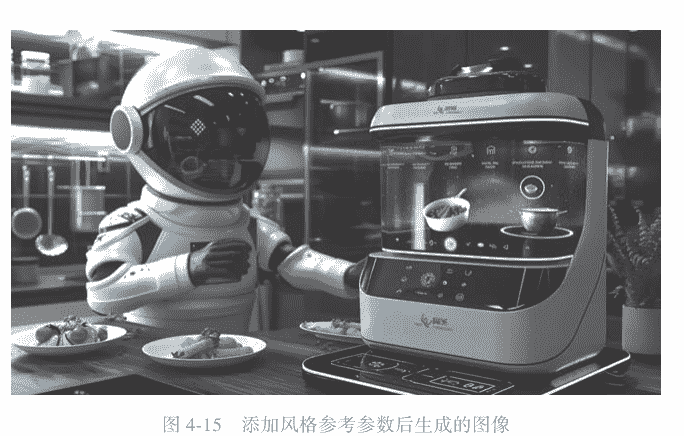

借助 V6 的风格参考 --sref，我们可以把符合品牌视觉系统的图设为风格基准，后续内容都遵循该调性。下面用两组指令对比有无风格参考的差异。

（1）指令一：使用风格参考
先选一张体现品牌视觉特征的图，比如图 4-12，在指令中加上 --sref。指令如下：

```
Commercial photo of cute cat are sitting in front of a laptop and looking into it --ar 16:9 --sref https://s.mj.run/38jDmqkeB7Y
```

指令生成的小猫看电脑画面，内容由文字决定，但色彩基调、光影、质感与构图都会贴合图 4-12 的品牌语言。

效果如图 4-16 所示。内容与参考图完全不同，但视觉上保持高度一致。

（2）指令二：不使用风格参考
如果去掉风格参考，仅靠文字描述生成，结果会如何？指令如下：


图 4-16 使用风格参考生成的小猫看电脑图片

```
Commercial photo of cute cat are sitting in front of a laptop and looking into it --ar 16:9
```

此处省略了 --sref，模型会自由发挥。

按此指令生成的图如图 4-17 所示，同样是小猫看电脑，但视觉风格与图 4-16 截然不同。因为它依据模型自身的审美倾向和随机性生成，并未遵循特定品牌体系。


图 4-17 不使用风格参考生成的小猫看电脑图片

###### 3. 用 --cref 固定人物/角色

若需要在成图中保持人物或角色的一致性，可使用角色参考参数 --cref。它接收一张图的 URL，让模型以该图为原型生成相同角色。

为了更精细控制，--cref 通常会配合角色权重 --cw 使用，取值 0~100：

- cw = 100：权重最大，脸部、衣物、发型等高度保留；
- cw = 0：仅保留人脸特征，其余属性可变化。

下面用两组指令对比是否使用角色参考的效果。

我们想让图 4-16 中的小猫作为角色参考出现在新图中。先获取该图的地址填入 --cref，并置于指令末尾，同时把 cw 设为 100，让模型尽可能贴合参考猫咪。指令如下：

```
Commercial photo of cut cat sitting on a sofa --ar 16:9 --cw 100 --cref https://s.mj.run/4ursq0ovGqA
```

4 张预览如图 4-18 所示，所有小猫形象与参考图的相似度都很高。

用同一指令但去掉角色参考参数，生成的 4 张预览如图 4-19 所示。

对比可见，--cref 能有效保证角色在系列插图或分镜中的辨识度。结合 --cw 还可精确调节相似程度。

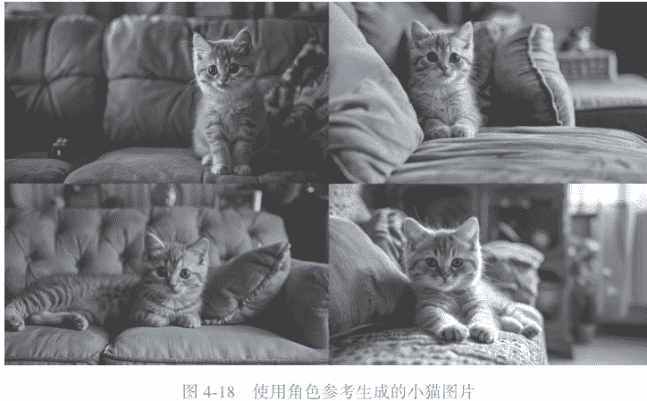

图 4-18 使用角色参考生成的小猫图片


图 4-19 不使用角色参考生成的小猫图片

角色参考还能与局部修改结合，实现“换头”效果。

例如先生成一张猫头鹰图，如图 4-20 所示。


图 4-20 猫头鹰图片

激活局部修改，用套索工具圈出猫头鹰头部，如图 4-21 所示。

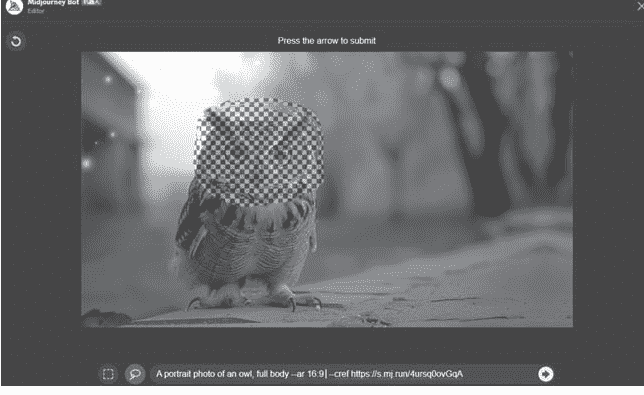

图 4-21 在局部修改功能中使用套索工具

随后修改指令如下：

```
A portrait photo of an owl, full body --cref https://s.mj.run/4ursq0ovGqA --ar 16:9
```

从 4 张预览里任选其一放大，如图 4-22 所示。

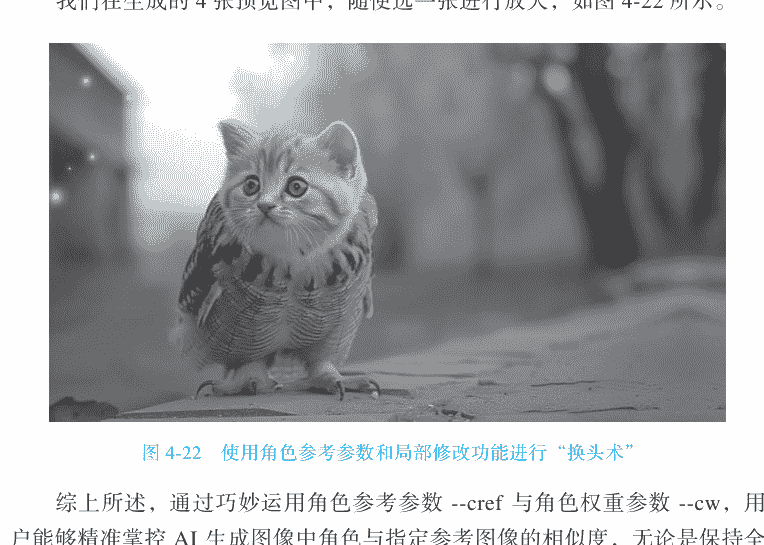

图 4-22 使用角色参考参数和局部修改功能进行 “换头术”

总的来说，结合 --cref 与 --cw，既能保持全局角色一致，也能做局部特征替换，大幅扩展 AI 绘图的创作边界。

三种品牌一致性手段小结如下：

- 图片 URL 提示：提供网络链接让模型提取主题、色彩、构图等抽象特征进行创作，控制力中等，画面氛围相关但细节差异大。
- 图片风格参考 --sref：更侧重视觉风格的一致性，会模仿细节层次、光影、艺术手法，控制力更高，适合品牌调性统一。
- 图片角色参考 --cref：专为角色一致性设计，通过清晰参考图深度提取个体特征，确保人物或生物在不同场景中仍可辨识。

##### 4.4.4 精简提示词与风格迁移技巧

###### 1. 指令精炼

一个常见误区是提示词越长效果越好，实际上 Midjourney 只能解析有限关键词，需要精选核心概念。一般 20~30 个英文词是最佳区间。

Midjourney 自带精炼工具 “/shorten”。在对话框输入 “/” 选择 shorten，粘贴待优化的指令，回车即可得到精简建议。

以下指令为例：

```
Create a photorealistic image of a modern kitchen with a smart cooking machine as the centerpiece. The walls feature a starry cosmos pattern. A child in an astronaut costume is interacting with the robot, displaying engagement and joy. The scene should be warmly lit with educational elements like ingredient flashcards visible. The child appears to be controlling the robot via a touch interface, signifying a blend of culinary art and space exploration. --ar 16:9 --v 6.0
```

按照上述流程操作后，Midjourney 会返回重要词元和推荐的精炼版本：

Important tokens

Midjourney 提示词精修：权重与风格迁移实战

为了让提示词的拆解逻辑更清楚，先用一个画面设定做引子。

想得到一张写实感的现代厨房，核心是台智能烹饪机，墙面铺着星空宇宙图案，一个穿宇航员服的小孩正和机器人互动，神情投入又充满欢喜。灯光偏暖，画面里还能看到食材卡片这类教学道具，孩子似乎在用触控面板操控机器，整体兼具烹饪日常与太空探索的氛围。

下面是把同一需求逐步压缩的过程。

第一版保持完整信息：写实现代厨房，以智能烹饪机为主角，星空宇宙墙面，宇航员打扮的小孩与机器人互动，参与感与喜悦感并存。
第二版去掉细节：写实现代厨房，有智能烹饪机，星空墙面，宇航员服小孩与机器人互动。
第三版只剩关键词：写实照片，厨房、烹饪、墙面、星空、宇航员小孩、机器人互动。
第四版再精简：写实照片，厨房、烹饪、墙面、星空、宇航员小孩、机器人。
第五版极简：写实风格，厨房、墙面、宇航员小孩。

Midjourney 在后台会把输入拆成语义最小单元，也就是 token。token 可以是单字、短语甚至音节，模型据此拼装视觉元素。

观察重要 token 列表会发现，部分词被系统筛掉了。被剔除的词大多过于宽泛，比如 visible；有的与图像生成无关，比如 culinary art；还有的与别的词重复，比如 space exploration。

被保留的词都会被赋予 0 到 1 之间的权重，数值越大在成图中的影响越强。点开 show details 就能看到每个 token 的具体权重，如图 4-23 所示。

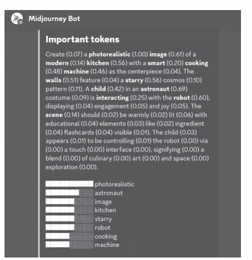

实际结果里，只有八个词拿到较高权重。哪怕用户输入很长的描述，模型也会自行评估取舍，这就是提示词需要精炼的根本原因。

拆解权重能帮助理解模型真正关注的点，从而提升指令的准确性和相关性，也能剔除无效或冗余的关键词。

一个明显例子是 child，权重偏低，但整张图的主题其实就是小孩。如何提升它的优先级？

Midjourney 提供了强调写法，用双冒号加权重的形式 ::<权重> 来抬高某个 token 的重要性。

原始指令：
Create a photorealistic image of a modern kitchen with a smart cooking machine as the centerpiece. The walls feature a starry cosmos pattern. A child in an astronaut costume is interacting with the robot, engagement and joy.

调整后指令：
Create a photorealistic image of a modern kitchen with a smart cooking machine as the centerpiece. The walls feature a starry cosmos pattern. A child::2 in an astronaut costume is interacting with the robot, engagement and joy.

这种写法在 Midjourney 上并不总是稳定。若要更精确地控制元素出现频率和强度，Stable Diffusion 更合适，它允许直接给 token 赋值。示例写法如下。

(Photorealistic:1.5), a modern kitchen with a (smart cooking machine: 2) as the centerpiece, the walls feature a ((starry cosmos pattern)), A (child:1.5) in an astronaut costume is interacting with the robot, engagement and joy.

参数也是提升提示质量的重要手段。Midjourney 的参数相当于快捷键，用来指引生成流程和效果。前面已用到 --ar 控制比例、--sref 参考风格。下面汇总常用参数。

表 4-3 Midjourney 常用参数和使用方法

| 参数 | 作用 | 用例 | 默认值 | 取值范围 |
| :--- | :--- | :--- | :--- | :--- |
| --v | 选择使用的模型版本，不同版本在细节和风格上表现各异 | --v 5，使用第 5 版模型；--niji 5，使用第 5 版 niji 模型做动漫风格 | 最新版 | 1、2、3、4 等 |
| --q | 调节生成质量，提升细节与清晰度但会增加耗时 | --q 2，提升图像质量 | 1 | 1、2、3 |

## 第二部分 方法与实践

| 参数 | 作用 | 用例 | 默认值 | 取值范围 |
| :--- | :--- | :--- | :--- | :--- |
| --ar | 设置画面宽高比，影响构图与展示形态 | --ar 16:9，宽高比设为 16:9 | 1:1 | 任意比例，建议整数 |
| --stylize | 调节风格化强度，高值更艺术抽象，低值更贴近写实 | --s 1000，设定较高风格化程度 | 0 | 0～2000 |
| --weird | 提升美学创意，加入更非传统或实验性视觉 | --weird 3000，增强创新元素 | 0 | 0～3000 |
| --chaos | 控制四张初稿的多样性 | --c 100，四张图差异较大 | 0 | 0～100 |
| --stop | 控制生成完成度，可提前停止以快速预览 | --stop 50，生成到 50% 时停止 | 100 | 0～100 |
| --seed | 设定随机种子，保证结果可复现，对一致性很重要 | --seed 12345，使用指定种子 | 随机 | 任意整数 |
| --no | 明确排除不想出现的元素或主题 | --no people，图像中不出现人物 | 无 | 任意关键词 |
| --style | 选择特定艺术风格，可用编号指定写实、复古等倾向 | --style raw，使用偏写实的风格 | 无 | 风格编号 |
| --video | 显示图片生成的过程 | --video | 关闭 | 开 / 关 |
| --title | 生成带有连续纹样的图案 | --title | 关闭 | 开 / 关 |

###### 2. 风格迁移——绘画风格

绘画风格指作品中呈现的独特艺术特质与表现手法，既体现创作者审美追求，也承载特定时代或流派的影响。多样的绘画风格让艺术更有层次，也为观者提供更丰富的体验。

在 AIGC 绘画工具中，Midjourney 在按指定风格出图方面较为突出。油画、水彩、国画到像素画、拼贴画、3D 涂鸦，都能按指定风格进行创作。

向 Midjourney 传递风格指令主要有两种做法。

（1）方法一：指令前置法

在请求开头就把绘画风格作为关键词，直接引导模型风格化。

例如想用黑光 Blacklight Paint 的风格创作街头摩托竞速画面，指令可以写成：

```
Blacklight paint of a motorcycle racing in the street. --stylize 150
```

（2）方法二：风格指定

使用 “in the style of” 的结构指定艺术风格。上面例子改写后为：

```
A motorcycle racing in the street in the style of Blacklight paint. --stylize 750
```

除了整体绘画风格，还可以进一步指定艺术流派和艺术家。Midjourney 能较为准确地复现历史上许多主要画派和名家的视觉特征。印象派的光影变化、浪漫主义的动感、野兽派的粗犷、达达主义的荒诞，都可以迁移到新作品。

指令里也可以要求模型受某位艺术家影响。比如要做一幅街头涂鸦绘画，同时受班克斯 Banksy 涂鸦风格影响，可以写成：

```
A street art pieces depicting a cute cat. The atmosphere evokes an overall sense of peace and love, with vivid colors and striking visuals found throughout. Influenced by the artistic styles of Banksy. --ar 16:9
```

这里用 “Influenced by the artistic styles of Banksy 受班克斯艺术风格影响” 而非 “by Banksy 由班克斯创作”，避免生成结果与原作过于相似而产生版权问题。

运行该指令后，得到了一张具有 Banksy 涂鸦风格的小猫街头涂鸦画，如图 4-24 所示。

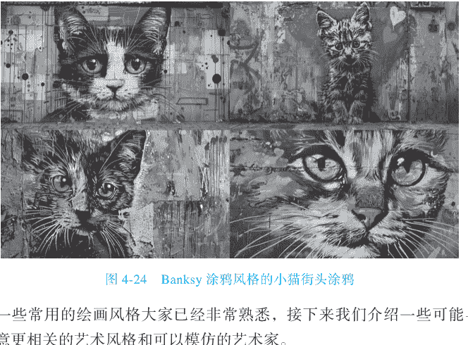

图 4-24 Banksy 涂鸦风格的小猫街头涂鸦

一些经典绘画风格大家都很熟悉，下面介绍一些与品牌创意更相关的风格和可模仿的艺术家。

- 3D Graffiti 三维涂鸦：也叫立体涂鸦，利用透视和绘画技巧在平面上营造立体视觉，打破二维局限，冲击力强。埃德加·穆勒 Edgar Müller、爱德华多·罗勒罗 Eduardo R. Rolero、朱利安·贝弗 Julian Beever、库尔特·温纳 Kurt Wenner 都是 Midjourney 可识别的代表艺术家。

- 3D Model 三维模型：可生成带 3D 质感的产品图或建筑图。关键词里可加入 Blender、unreal engine、octanerender、octane、unity 等常用渲染工具名称来模拟效果。

- Abstract Art 抽象艺术：以形状、色彩、线条、肌理和构图营造视觉冲击和情感共鸣，适合海报底图和背景。相关艺术家有瓦西里·康定斯基 Wassily Kandinsky、皮埃特·蒙德里安 Piet Mondrian、卡齐米尔·马列维奇 Kazimir Malevich、伊夫·克莱因 Yves Klein、草间弥生 Yayoi Kusama。

- Airbrush drawing 喷绘：用气笔喷涂颜料形成平滑色彩过渡和柔和边缘，常呈现照片级写实感。可用于背景板、海报底图和产品手册封面。

- Amigurumi 编织艺术：用钩针或棒针编织线条呈现的风格，角色和物品看起来像毛线编织物。例如 Amigurumi of a cute cat 毛线编织的小猫，直接作为命令即可生成。

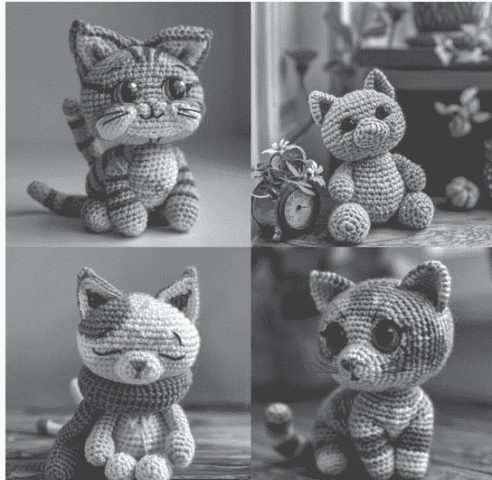

图 4-25 Midjourney 风格绘画小猫（编织艺术）

- Claymation 黏土动画：源自黏土定格动画，使用可塑材料制作角色和场景。在目标对象后加上 as claymation 即可得到黏土动画质感，也可用于制作模拟定格动画。

- Collage Art 拼贴艺术：将纸张、布料、照片、绘画、印刷品甚至三维物体组合成新视觉作品。可用于品牌与产品的创意组合。毕加索、库尔特·施维特斯 Kurt Schwitters、大卫·霍克尼 David Hockney、曼·雷 Man Ray、罗伯特·劳申伯格 Robert Rauschenberg 都是可参考的艺术家。

- Concept Art 概念艺术：充分发挥 AIGC 想象力创造原创世界。若想增加艺术指向，可参考克里斯·桑德斯 Chris Sanders、格伦·凯恩 Glen Keane、卡拉·奥尔蒂斯 Karla Ortiz、柳基炫 Ki Hyun Ryu、玛丽·布莱尔 Mary Blair、拉尔夫·麦夸里 Ralph McQuarrie 等艺术家的风格。

- Fiber optic light painting 光纤灯绘：利用光纤工具在长曝光摄影中创作出明亮动感的作品，类似风格还有 Holography 全息图像。

- Minimalist Art 极简主义艺术：通过删减元素追求简洁纯粹，视觉冲击强，非常适合品牌视觉、包装设计和广告素材。可参考迪特·拉姆斯 Dieter Rams、查尔斯·伊姆斯和雷·伊姆斯 Charles and Ray Eames、卡洛琳·戴维森 Carolyn Davidson、萨尔·巴斯 Saul Bass、艾伦·弗莱彻 Alan Fletcher。

超现实主义追求梦幻质感的画面，常描绘现实里无法出现的场景，却能在视觉上产生强烈冲击，并在情感上引发共鸣。代表人物有萨尔瓦多·达利、勒内·马格里特、伊夫·坦吉和保罗·克利。

##### 4.4.5 Midjourney 生成超写实照片
Photorealistic Image 即 Midjourney 产出的近乎真照片的画面。这类图一出就能牢牢抓住眼球，很容易撩动点赞、评论、转发的互动欲望。更关键的是，它省去了组建专业摄影团队和请模特的高昂成本，就能拿到不输实拍的质感。

先来看一张 Midjourney 做的蒙古勇士示例，见图 4-26。


这张图的水准已逼近摄影师实拍。问题是，怎样的指令才能让 Midjourney 达到这种效果？

先拆解这张图的生成指令：

```
Professional vintage black and white photo, close-up shot of a Mongolia warrior, stormy skies, winter weather, wind, fujifilm superia, full HD, taken on a Canon EOS R5 F1.2 ISO100 35mm, by Dorothea Lange --v 6.0 --ar 16:9 --style raw
```

该指令可分成几块。先是环境描写，包含了暴风雨天空、冬季天气、大风等；再是取景方式，明确写了特写镜头；接着列出器材，选用佳能 EOS R5 搭配 35mm 镜头，并模仿富士 Superia 胶片质感；然后是拍摄参数，ISO 100、光圈 F1.2；最后借鉴了摄影师多萝西亚·兰格的风格。额外参数 --v 6.0、--ar 16:9、--style raw 则对版本、画幅比例和原始风格做了精细化控制。

把这些要素组合起来，Midjourney 就能输出高写实且富有艺术性的画面，仿佛真的由摄影师在现场拍摄而成。

###### 1. 风格
在提示里点明风格，能明显拉高照片的真实度。这种设定会牵动光线、服饰、背景、前景、道具以及人物站位和姿态等多个层面。

常用的风格指令关键词包括：
- 电影感 / 电影式镜头：用来打造类似电影画面的效果，往往伴随精致布景、戏剧化布光和强叙事性。
- 金色时刻：日出日落时段的自然光，柔和温暖，常营造浪漫或宁静的基调。
- 肖像：聚焦人物面部或上半身，用来表现表情、情绪和个性。
- 动作场面：带动态或高速移动元素，传递紧张、兴奋或充满活力的感觉。
- 自然抓拍：捕捉被摄者未察觉的瞬间，看起来更自然真实，没有刻意摆拍感。
- 特写：紧贴主体局部，突出细节或强化情绪。
- 定格动画：逐帧拍摄拼接，使静物呈现出自行动感。

###### 2. 时间和天气
时间与天气用来锚定画面发生的时段与气候。时间词决定画面色调、亮度、对比和整体色彩走向，比如清晨偏暖且亮度渐升，夜晚则多为冷蓝、低亮。天气词则丰富氛围，影响能见度、质感、反光和情绪，像雨天会带来朦胧纹理和湿润反光，晴天则呈现通透细节和明亮色彩。选对这组词，就能在 Midjourney 里做出既具体又有意境的作品，让画面讲出独特故事、传递想要的宁静、忧郁、激动或欢乐。

###### 3. 情绪和氛围
这类词用于定义画面情绪基调。它们告诉模型希望营造快乐、哀伤、愤怒、宁静、紧张、浪漫、惊悚或神秘等氛围，明确标注后能显著放大整张图的情绪冲击力。

###### 4. 相机选择
进入超写实阶段，相机的选择变得关键。Midjourney 在训练时接触了大量不同机型镜头拍摄的素材，因此能较好地模仿它们的成像风格。下面是适合追求高画质的机型及特点：
- 徕卡 M10-R，高分辨率：专业级高像素机身，适合对清晰度和细节要求极高的拍摄。
- 哈苏 X2D 100C，中画幅：更大传感器带来更高画质和更丰富的色彩层次。
- 索尼 A1，高速：连拍与对焦速度强，适合捕捉运动物体。
- 尼康 Z9，运动与野生动物：快速对焦、高速连拍，专门用来定格稍纵即逝的瞬间。
- 佳能 EOS 5D Mark IV，全能单反：人像、风景、纪实都能胜任。
- 尼康 D850，高分辨率：风景、婚礼、时尚拍摄的首选，细节表现出色。
- 松下 Lumix DMC-FZ2000，视频超长焦：以视频为强项，变焦能力突出。

若追求创意拍摄效果，还可以使用以下特殊机型：
- 针孔相机：无镜头靠小孔成像，画面独特，常用于艺术和教学创作。
- 红外相机：记录红外波段，能呈现肉眼不可见的植物活力或热分布，兼具科研与艺术价值。
- 夜视相机：在极暗环境下成像，常用于军事监控、安防和野生动物观察。
- 无人机航拍：机载相机提供高空视角，广泛应用于航拍、测绘和影视制作。
- 高光谱成像：捕捉多光谱信息，用于科研、环境监测和医学诊断，提供远超传统影像的数据深度。
- 多光谱成像：在特定波段采集信息，常用在农业、地质勘探和遥感。
- 维斯塔视觉相机：高分辨率宽幅电影格式，多用于高端影视和特效拍摄。

###### 5. 拍摄设置
拍摄参数关键词涵盖光圈、快门、曝光、焦点等，直接影响景深、虚化、亮度和动态表现。

光圈控制进光量和景深，f值越小光圈越大。较大光圈如 f/2.8 能制造浅景深，背景虚化更柔和。
- f/1.4：超大光圈，进光充足，景深极浅，主体突出，适合暗光人像、静物等需要强烈焦点的题材。
- f/2.8：大光圈，低光表现好，能清晰分离主体与背景，适合需要适度虚化的场景。
- f/5.6：中等光圈，画面整体清晰，景深适中，主体与环境兼顾，适合街拍、日常抓拍。
- f/8：光圈收小，景深加大，前后范围更清晰，适合风光、建筑、合影。
- f/16：小光圈，景深最大化，近远皆清，适合全景风光或需要多人同时清晰的合影。
- f/32：极小光圈，多用于微距，需在极近距离内追求极致清晰，但衍射会带来画质损失，需权衡使用。

快门控制曝光时长，快则定格，慢则拖影。
- 1/4000秒：极快快门，瞬间冻结高速运动，如飞鸟、运动员、疾驰车辆，画面干干净净。
- 1/250秒：快门足够快，手持拍摄肖像、静物不易抖动，保持锐利。
- 1/60秒：暗光下可进光，高速移动会轻微拖影，手持仍可接受，适合黄昏或室内。
- 1/15秒：开始产生动态模糊，能表现运动轨迹，增加画面动感与故事感。
- 1秒：慢门效果，水流、瀑布呈现丝滑质感，常用作创意表现。
- 30秒：超长曝光，适合星空、城市夜景、烟花、光绘，能记录光线轨迹，形成梦幻光影。

ISO 调节感光度，越高越亮但噪点越多。
- ISO 100：明亮户外或充足室内，噪点极低，细节与色彩最纯净，画质最佳。
- ISO 400：室内自然光常用，提升进光能力，噪点可控，画质仍佳。
- ISO 1600：极暗环境必备，提升感光度保证曝光，但噪点增多，现代机型仍可接受。

焦点决定画面清晰范围，是突出主体的关键。
- 未对焦：画面整体模糊，常营造抽象或梦幻气质。
- 柔焦：轻微虚化瑕疵，使人物更柔和，常用于肖像与时尚。
- 深景深：前后元素皆清晰，适合风景、建筑等题材。
- 浅景深：景深窄，主体突出背景虚化，适合微距和野生动物。
- 拉焦：焦点在主体间切换，营造动态引导视线。
- 倾斜焦面：产生微缩模型效果，常用在风景创作。

###### 6. 布光
布光是塑造氛围、传递情绪和提升冲击力的核心。Midjourney 中合理运用不同光型，能明显增强真实感和表现力。常见光型如下：
- 平光：光线均匀无明显阴影，人像静物细节、色彩更均衡。
- 逆光：勾勒强烈轮廓与剪影，强调形体，戏剧感强。
- 顶光：自上而下投射，突出纹理与立体感，适合悬疑动作。
- 底光：由下往上打光，营造神秘或惊悚氛围，强化表情。
- 柔光箱：柔和均匀，适合人像与精致细节拍摄，如美妆广告。
- 轮廓光：勾勒主体边缘，增强与背景分离，提升立体冲击。
- 环形光：自然平衡的人像光，模拟自然光，适合商业与日常肖像。
- 棚拍光：可精细控制光强、方向与质感，适合创意商业拍摄。
- 伦勃朗光：面部形成三角形光斑，赋予经典人像艺术感。
- 虚化光斑：借助光圈制造梦幻背景，让主体更突出，适合情感与创意表达。
- 戈博光：投射图案，打破单调，增加场景层次和故事感。

###### 7. 视点和沟通
视角决定观众如何观看场景，是从哪个高度、方向进行拍摄；构图则是画面内元素的布局与引导方式，涉及空间安排、对称平衡、对比等技巧。视角定下观看角度，构图决定内容呈现，两者配合才能做出富有表现力和情感深度的画面。在 Midjourney 提示中明确这两点，能帮助模型更准确理解意图。

常用视角关键词：
- 低角度：从下方仰拍，主体更显威严有力，适合戏剧化画面。
- 高角度：俯拍使主体显得渺小或脆弱，营造被观察或微观感。
- 眼平线：与主体同高拍摄，自然均衡，适合日常场景。
- 鸟瞰：极高俯视，展现广阔地理或城市全景。
- 虫瞰：近地面仰视，视角非常规，提升沉浸感与新奇性。
- 荷兰角度：相机倾斜制造不平衡感，表达紧张、混乱或动态情绪。

常用构图关键词：
- 三分法：将画面分为九宫格，主体落在交点或线上，视觉更平衡专业。
- 引导线：利用线条引导视线，增强深度与流动感，提升叙事性。
- 对称：画面元素对称，营造和谐稳定感，在建筑与自然中效果突出。

用好三个构图法则，Midjourney 就能像职业摄影师一样出片。

- 框架套框架：借助画面里天然的窗户、门框、树枝等元素形成次级边框，给主体加一层包围感。这种手法能拉开空间层次，让视觉焦点更集中，在 Midjourney 里是提升画面纵深感的常用招。
- 黄金分割：参照自然界约 1:1.618 的比例关系来安排主体位置。这个比例被普遍认为最和谐，能让构图既自然又平衡，很适合追求精致艺术感的创作。
- 负空间：刻意保留大面积空白，用空来反衬实。将主题放置在疏朗的背景中，能带来简洁、现代的冲击力，帮助 Midjourney 强化主题情绪。

把上述关键词组合起来，就能引导 Midjourney 产出更接近真实摄影的效果。

常用的指令框架可以这样写：

> “[Style Descriptor] of [Subject], set in a [environment—time, weather, etc.] with a [mood/atmosphere]. Include [additional details/modifiers], emulate a [specific camera] with a [camera settings], use [lighting conditions], and compose with [perspective/composition guidelines].”

“[风格描述符] 的 [主题]，置于 [环境——时间、天气等] 中，营造出 [情绪/氛围]。在细节上加入 [额外细节/修饰符]，模拟 [相机] 使用 [相机参数]，在 [光线条件] 下拍摄，并遵循 [视角/构图指导]。”

举例说明如何模拟拍摄。

用尼康 D850 加广角镜头拍黄昏街道的写法：

High Dynamic Range of a bustling city street, set in an urban environment at sunset with mild traffic. Capture a vibrant and busy atmosphere. Include glowing street lamps and bustling pedestrians, emulate a Nikon D850 with a wide-angle lens at ISO 100, f/8, 1/60 sec, use golden hour lighting conditions, and compose with the rule of thirds.

换成富士 X-T4 做写实人像的写法：

Documentary-style image of an elderly man fishing at a wooden pier, set during a foggy early morning. Capture a serene and contemplative mood. Include a rustic fishing rod and the misty waters, emulate a Fujifilm X-T4 with a 50mm lens at ISO 400, f/4, 1/60 sec, use soft diffused lighting conditions, and compose with the rule of thirds focusing on the man’s expression.

想做逼真夜景，可以模拟尼康 Z9：

Ultra-high-definition image of a cityscape at night, viewed from a high vantage point. Aim for a lively and bustling urban atmosphere. Include the twinkling lights of skyscrapers and busy streets, emulate a Nikon Z9 with a 50mm lens at ISO 3200, f/2.8, 1/30 sec, use ambient city lighting with long exposure, and compose with a panoramic view to capture the breadth of the city.

若想风格更鲜明，可在末尾加上摄影师关键词，用 “by [摄影师]” 或 “in the style of [摄影师]” 来学习其取景、构图和处理手法。

Produce a celebrity portrait in the style of Annie Leibovitz, featuring a lady in an elegant evening gown set in a luxurious indoor environment. Create a profound and narrative atmosphere, include exquisite furniture and soft drapes in the background, simulate using a Canon EOS 5D Mark IV, 85mm lens, ISO 200, f/2.2, 1/160 sec, with dramatic spot lighting, and compose to highlight the subject's expression and the details of the attire.

AIGC 也可以根据主题推荐合适的摄影师，同时也能依据想要的效果自动挑选相机、设定参数并生成图像。

##### 4.4.6 训练适合 Stable Diffusion 的自有模型

想在画面里更真实地放进品牌产品，直接用图生图后期也可以，但对专业度要求高。更开放的做法是用 Stable Diffusion 先训练专属模型，再生成。Stable Diffusion 的模型主要分两类：

- Checkpoint 模型：负责核心生成，是在大规模数据上训练的主模型，能独立产出各类图像，是创作的主引擎。可用的检查点有 SDXL、Realistic Vision、Chilloutmix 等，通常占约 3GB。
- LoRA 模型：体积小、更专精，和检查点配合使用，用来增添或修正特定风格、角色或概念，比如亚洲人面部特征、产品的形态外观等。

###### 1. 基础配置和软件安装

训练方式分在线和本地。在线平台如哩布哩布 AI、civati.ai 等，只需上传素材即可操作。本地部署则自由度更高，建议配 NVIDIA 显卡，显存不低于 8GB，推荐 GTX 1070 以上、Quadro P4000 以上或 Radeon RX 580 以上的型号。

软件环境需要 Python 3.8 以上、CUDA 11.3+ 及对应 cuDNN，以及最新 NVIDIA 驱动。本地应用按界面可分为 WebUI、Forge UI 和 ComfyUI 三类。

- WebUI：界面直观、功能基础，适合入门，但速度较慢。
- Forge UI：速度更快、功能更强，支持多模型和扩展，有命令行高级编辑，但学习成本稍高。
- ComfyUI：以工作流为核心，结合了 WebUI 的易用性和 Forge UI 的性能，功能独特多样。

三者均可在 GitHub 获取，也可使用秋叶整合包等一键安装包直接解压使用。

###### 2. 模型训练

训练自有模型主要有四种方式：

- Dreambooth：基于特征匹配的微调，能把特定人物、物体或场景的特征融进模型。操作简单但训练慢，对数据质量要求高，输出为 Checkpoint。
- LoRA：低秩自适应微调，训练快、对数据要求相对宽松，泛化能力可能稍弱，输出为 LoRA 模型。
- Textual Inversion：基于文本反转，把特定描述和图像内容关联起来。训练慢、数据要求高，但文本匹配度强。
- Hypernetworks：基于超网络的微调，能灵活控制生成过程，训练快但可解释性较差。

若追求快速落地且数据条件一般，LoRA 是常用选择。

###### 3. 训练 LoRA 模型

先安装 LoRA 训练器，如开源训练器或秋叶 LoRA 训练器 SD-Trainer、朱尼酱的赛博炼丹炉等整合包。准备至少 20 张高质量原图，产品图建议多角度实拍，兼顾背景示例，保证清晰完整。

把素材导入 WebUI 预处理，设定训练参数和触发词，触发词设置直接影响生成效果，需按需求细调。开始训练后等待完成，得到定制化 LoRA 模型。随后把模型放入对应文件夹或扩展，并把触发词写进指令即可产出可控的定制图像。

#### 4.5 案例：雀巢——20 天建造 11 座虚拟城市

2023 年 10 月，雀巢在中国推出 AI 助手 NesGPT 并向大中华区员工开放。2023 年的“818 宠粉节”主题为“无需假期不用经费，11 天 11 站畅游全球”，目标是通过创意图文讲品牌故事、提升互动转化，营造欢乐购物氛围。

###### 1. 挑战：11 天 11 座城市

活动需把多个品牌的独立故事串联，同时保持社交媒体互动，形成统一的雀巢母品牌形象。所有创意，包括海报，需在 20 天内完成。特赞团队从雀巢产品与产地关系切入，提出“溯源地”视觉叙事策略，策划 11 天 11 站的美食探索之旅，覆盖中国到海外、经典到创新，让消费者获得环球美食体验。

###### 2. 策略：人机协同的“三明治”工作流

采用“人工 + AIGC + 人工”流程。先由创意团队拆解策略，制定视觉指南，明确产品特性、品牌故事和氛围。随后按元素复杂度分三批投喂 AIGC，确保主视觉有足够迭代时间。

以徐福记厚切浦城丹桂凤梨酥为例，元素被拆为背景武夷山和古镇、前景浦城标志物丹桂、核心原料凤梨。AIGC 按指南生成概念稿和底图，在自然场景之外，虚拟场景的创造力也很强，如雪糕海报中的“冰淇淋星球”概念被成功具象化。

最后设计团队精修底图，手工拼接、调光影、增删元素并植入产品与文字，保证品牌调性。这一人机结合模式兼顾了 AI 的创造力和人工的审美把控，实现快速高质量交付。

###### 3. 启发：动态内容，无限潜力

AIGC 优化了生产流程，同时强化了品牌叙事与消费者情感连接，让团队更聚焦创意提炼和品质控制。该模式适用于需要快速、高质交付的大型国际活动。未来随着技术成熟，品牌有望实现更动态、近乎实时的创意生成。

# CHAPTER 5

## 第5章 激活：自动化营销和智能对话式营销

本章探讨如何借助 AIGC 构建更具活力的营销体系。首先说明如何激活超级个性化的用户旅程并优化自动化工作流，提升效率与效果；其次介绍如何把用户旅程转化为营销路径，依托自动化营销和智能对话式营销实现。

#### 5.1 激活动态用户旅程设计

在数字营销中，企业借助 CRM 和营销自动化工具，结合 AIGC 模拟用户旅程，实现精准触达；通过洞察行为模式，优化干预时机和方式，提升体验和生命周期价值。

##### 5.1.1 洞察用户行为模式

设计旅程时，企业会先对目标人群细分，识别关键触点与需求，再用自动化工具规划不同场景的消息、内容推送和服务交互。例如初次接触阶段推送品牌故事与主推产品，考虑购买阶段则推送演示视频、用户评价和优惠信息。

用户偏好持续变化，AIGC 能不断学习新数据，保持策略与最新特征同步。其优势在于建立跨渠道、跨场景行为的复杂关联模型，揭示隐藏规律，帮助营销人员更全面理解用户并优化干预策略。

###### 使用 AIGC 洞察用户行为模式的步骤

（1）数据整合

生成式AI助力用户洞察：把全域足迹拼成营销闭环

让大模型产出真正可用的结论，前提是先把零散在各个触点的用户痕迹集中成统一视图。需要覆盖的范围有网站访问日志、社交平台互动存档、线上线下消费记录、客服对话以及各类数字化接触留下的印记。

微信生态内，企业可自建或接入第三方营销自动化系统，实现互动的实时采集与留存，比如公众号文章的阅读、小程序的使用点击等。

抖音与电商平台的资料受隐私合规与技术壁垒限制，通常无法批量导出原始明细。整合可走两条路：

- 上线客户数据平台CDP。通过API对接或数据批量上传把各源连接，自动抓取并归并身份标识如手机号、邮箱、会员编号等，进而把跨平台的互动串成完整统一的人群轨迹。这样生成式AI才有可靠一致的信息底座去做深度洞察与内容定制。
- 人工比对匹配。若缺乏自动化工具，可按唯一身份标识如手机号进行人工逐条比对，把来源不同的记录拼接成单个人的全貌视图。此法耗时易错，适合小样本或过渡期使用。

（2）锁定洞察方向

信息汇聚后，要先界定关注重点和希望挖掘的模式类型。营销团队需要充分理解目标人群的需求、兴趣偏好、消费习惯、心理诉求等多维度特征，结合业务场景与营销目标，判断哪些信号值得重点追踪。

常见目标示例：

- 新客转化的关键动作，如首次进入网站后的浏览路径、搜索词、停留时长、注册登录、首次下单前的咨询或互动环节等。
- 老客复购表现，如复购周期、复购品类、价格敏感度、推荐好友、会员计划与积分兑换情况等。
- 差评客的反馈时机与渠道，如使用后在特定时段提交的负面评价、偏好官网、社媒、电话客服、邮件等渠道表达不满，以及是否与品类缺陷、发货延迟、售后服务不佳等事件相关。
- 高价值客的下单频次，即一定周期内的购买次数及其随时间的变化规律。
- 产品搭配偏好，包括高价值客常购买的组合、套餐偏好，以及对新品、限定款、重点推荐品的响应速度与购买率。
- 低活跃客再激活的关键动作，如收到优惠券或促销信息后的点击、浏览、登录频率，以及参与品牌活动、回复消息后的活跃度回升情况。
- 具备较高生命周期价值增长潜力的行为，如升级套餐、提升购买频次、拓展品类、向更高价位迁移的路径与触发因素。
- 跨平台行为一致性，观察用户在电商、门店、社媒、移动App等不同触点的购买与互动习惯，以及平台间的影响与转化特征。

（3）引导模型做模式分析

要让模型精准洞察数据，需要提供详尽且准确的指令或引导问题，这些问题必须紧扣上一步设定的目标，探究特定模式背后的驱动因素。

例如，可让模型梳理新客在首次下单前与客服的咨询内容，归纳高频问题类别，结合上下文解析潜在需求、疑虑点和决策影响因素，进而推断转化阶段的行为特征。

指令示例：

> 请基于所提供的用户互动与行为数据集，全面分析新用户在首次购买前与客服系统的沟通记录，总结最常出现的问题类型、主题及对应的需求焦点，并据此构建预测模型，推测新购买用户的行为倾向与转化路径特征。

模拟一家电动工具公司的互动记录，分析结果如下：

根据喜利得品牌新客与客服的交互记录，可归纳的高频问题与需求焦点为：

**产品使用方法**：电话、在线客服、邮件渠道均频繁出现如何使用的咨询。
需求焦点：新客初次接触产品时对操作流程不熟悉，需要直观易懂的指引。

**产品规格与特性**：多位用户通过不同渠道询问具体规格信息。
需求焦点：潜在买家在决策期关注具体配置与技术参数，以判断是否匹配自身需求。

**操作视频教程**：大量用户请求视频教程资源。
需求焦点：视觉学习型用户希望通过观看视频快速上手并掌握全部操作。

**保修政策**：电话、在线客服、邮件中均出现保修相关提问。
需求焦点：消费者关心售后保障，尤其是保修期限与覆盖范围，这会直接影响购买信心。

由此推断的新客行为倾向与转化路径：

初期探索：先在官网查找产品基本信息、规格特性，并浏览操作视频评估适用性与易用性。
深入咨询：产生初步兴趣后，通过在线客服了解使用方法，或就特定规格提出疑问获取更细致解答。
决策确认：接近购买决策时，会查询保修政策具体内容，以确保售后保障。
售后支持预期：首次使用前期待详细操作指导，后续使用中也依赖客服团队提供保养等持续支持。

因此，企业应优化官网资料的呈现，让操作手册与视频教程更易查找；同步加强客服团队专业培训，提升问题解答效率与体验，从而提高转化。

（4）迭代分析

模型完成初步分析后，营销团队需持续跟进输出并迭代。

操作步骤：

1. 审阅模型返回的初步洞察，判断是否出现预期模式，以及是否有意外发现。
2. 基于首次结果调整并细化提示，提出更深层次或更具体的问题。
3. 与业务专家共同解读，结合业务逻辑与市场趋势，提炼关键行为特征与规律。

（5）把洞察转化为策略

在洞察行为模式的基础上，将其转化为可执行的定制营销策略与内容生成规则。

操作步骤：

1. 根据模型揭示的规律，构建用户行为模型，如从认知到购买的主要路径及其影响因素。
2. 将模型应用于不同场景，如微信模板消息推送、精准广告投放等。
3. 利用生成式AI产出与模式匹配的定制化内容，如针对特定人群的专属优惠方案、定制化微信或短信文案、社媒精准广告创意等。
4. 实施并追踪效果，把数据持续回流到模型中，进一步优化模型与策略，形成闭环的洞察与迭代升级。

5.1.2 生成和优化自动化工作流

自动化工作流是CRM、营销自动化与社会化CRM的核心。在不同平台名称各异，如Salesforce的Journey Builder、Marketo的Smart Campaigns、Convertr的自动流程、JingDigital的用户旅程。尽管叫法不同，均提供可视化界面便于搭建旅程。统称用户旅程构建器。

核心组件主要包括：

- 触发与事件管理：流程起点。营销人员可按条件选择目标人群并启动首次触达。触发方式多样，包括人群属性、用户行为、时间点如生日等。人群可分为静态人群基于历史快照和动态人群实时更新。例如用户添加企业微信公众号为好友时，系统可自动触发感谢信息并附上自助服务菜单。
- 条件判断与路径分叉：采用如果/那么的决策树结构，根据用户对触发事件的响应或属性变化决定下一步走向。
- 行为节点与触达策略：完成判断与分叉后，按预设策略选择合适的触达渠道与内容再次互动。例如用户填写产品A试用申请后，系统可自动通过企业微信通知销售团队进行一对一跟进。
- 延时与间隔控制：通过设定等待时间或延迟掌控各操作间的间隔。例如消息发送7天后未获反馈，可设置再次提醒。
- 属性更新与状态管理：基于用户实时反馈与互动，系统自动更新标签与状态。例如用户提交产品A演示申请后，可为其添加“产品A兴趣”标签，并把销售线索状态更新为“初步意向”。这样工作流能灵活适应用户在购买旅程中的个性化需求与进展。

可以使用用户旅程构建器来生成自动化的营销工作流，如图5-1所示。

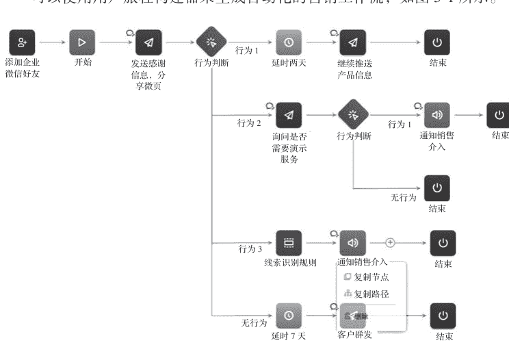

生成式AI模型，特别是自然语言能力强的模型，能显著增强用户旅程构建器的功能。可根据前述行为模式，直接向模型提问，自动生成某一客群的自动化工作流。

示例指令：

> 你的角色是营销自动化专家，擅长利用CRM工具设计用户旅程并生成自动化工作流，请针对×××公司的新购买用户群体，依据行为模式分析，设计从发现到购买的旅程。

可使用更具体的指令对每一步进行微调。

（1）用户群体分类

常用指令：

- 基于历史购买记录，识别并细分不同类型用户群体，并为每个细分群体设计个性化互动与营销流程。
- 分析用户特征数据如年龄、地域、浏览偏好、购买频率，据此创建多个目标明确的分群，制定对应互动策略。
- 根据用户生命周期阶段如新用户、活跃用户、流失预警用户定制划分规则，并设计相应旅程触达环节。
- 依据用户内容消费习惯如阅读邮件、观看视频、参与活动等细分群体，推荐有针对性的旅程阶段。
- 依据历史购买金额、品类倾向及关联购买行为精细化划分群体，为每个群体构建深度个性化旅程。
- 结合RFM模型进行用户价值评估，依不同价值等级制定精准营销方案。
- 通过整合网页、移动端、社交媒体等跨渠道行为分析细分群体，实现多渠道协同旅程设计。
- 挖掘沉默用户的行为特征，制定再激活计划并规划复苏旅程。
- 根据用户在微信群的互动内容识别潜在意见领袖和忠实粉丝，设计增强黏性的互动流程。

（2）设计触发事件

常用指令：

- 识别用户行为模式，找出能有效引导用户进入特定互动流程的最佳触发事件。
- 根据用户产品反馈和社交媒体行为，确定引发品牌深度互动的关键触发时刻。
- 分析用户在应用内或网站上的非活跃时段，设定唤醒机制推动参与活动。
- 当用户在社交媒体提及竞争品牌或产品时，找出有效触发事件引导其进行产品比较。
- 分析用户浏览特定商品类别超过一定时长后的行为，推荐后续节点动作和内容。
- 识别用户完成首次购买后的行为模式，找出最有效的后续节点动作和内容。
- 在用户连续浏览多篇同主题内容后，推荐最优下一步方案。

（3）优化分支路径动作

常用指令：

- 在各旅程分支上，依据用户实时互动数据推荐最适合该路径的定制化消息推送和优惠策略。
- 基于用户满意度评分和产品使用频次，设计动态调整的教育性内容推送计划。
- 对于高购买意向但未下单用户，推荐最适合的定制化消息推送以促进转化。
- 分析用户放弃提交表单的可能原因并提供优化建议。

（4）优化定时执行

常用指令：

- 结合用户购买周期、浏览频率和最近活跃时间，计算每个旅程节点最优行动间隔和时机。
- 针对订阅服务用户，依据续订窗口期计算提醒邮件发送时间。
- 分析购物车弃置或落地页表单放弃规律，设定合适的自动提醒时间节点以促进转化。
- 在用户完成重要任务或达成里程碑后，设定合适的自动提醒。

（5）识别转化点和退出点

常用命令：

- 利用用户行为序列分析，识别从访问到购买的关键决策转折点及转化动作。
- 分析用户从提交表单到首次购买的时间差，据此确定促使新用户快速首购的营销节奏与激励手段。
- 识别用户在产品比较或阅读评价阶段的情绪变化，判断可能影响转化的心理因素。
- 通过分析用户在移动端填写表单的交互行为，找出表单提交成功率低的原因。
- 观察用户使用免费试用或体验版后的反馈，定位阻碍转化为付费用户的痛点。
- 在用户注册或下载应用后的关键几天内监测活跃度，找出决定留存与否的重要时间节点。
- 依据用户对品牌的社交互动如点赞、分享、评论，识别影响口碑传播和转化效果的关键行为。

除设计购买旅程外，还可借助生成式AI进一步优化自动化工作流。

（6）优化条件判断

条件逻辑是构建自动化营销工作流的关键，需要确保工作流能根据用户行为和特定情境触发正确且及时的活动。生成式AI内置的逻辑推理和决策树构建能力，可辅助设定更精准的条件判断，使营销活动更灵活智能，实时响应用户变化，从而优化体验并提升转化率。

（7）节点内容生成与优化

可向生成式AI提供当前节点的背景，通过指令生成该节点的营销内容。除手动生成后上传外，部分CRM或营销自动化工具如HubSpot已嵌入生成式AI，可直接生成内容并嵌入工作流。嵌入的模型还能根据用户实时反馈和行为推送更个性化的节点内容。

####5.2 激活自动化营销

正如自动驾驶重塑出行认知，自动化营销的兴起也预示营销领域的革命性转变。本节探讨如何通过激活自动化营销提升效率与精准度，并把动态用户旅程设计融入营销体系，以实现更个性化、智能化的策略。

下面介绍自动化营销概念，它与传统营销自动化不同，代表全新的营销方法。进一步探讨生成式AI时代的新营销方式，展示其如何重塑营销体系与实践，引领行业迈向更高层次。

#####5.2.1 从营销自动化到自动化营销

自动化营销 Autonomous Marketing 是伴随人工智能发展而产生的新模式，借助AI、机器学习等技术，在无需人类持续干预的情况下，自动分析数据、制定策略、执行活动并优化结果。

自动化营销与汽车自动驾驶一样具备自动化和自主化特点。它持续收集处理海量用户数据，提取洞察并实时调整策略，实现自动广告投放、精准用户画像、个性化内容推送、用户体验优化。

理解自动化营销需与营销自动化对比。自动化营销之于营销自动化，如同数字化营销之于营销数字化。前者是全新的工具与模式，后者是旧模式下工具与流程的创新。自动化营销更侧重于通过AI和机器学习进行深度数据分析和实时策略调整，智能化水平更高、优化覆盖更广。营销自动化则是在既有营销框架内用自动化工具提升效率和执行准确性。二者在现代营销中相辅相成，共同推动活动向更高效、更智能方向发展。两者对比见表5-1。

表5-1 自动化营销与营销自动化的对比

| 维度 | 自动化营销 | 营销自动化 |
| :--- | :--- | :--- |
| 定义 | 利用AI和机器学习等技术自动制定和优化营销策略 | 使用软件自动执行重复性营销任务和流程 |
| 技术核心 | AI驱动、AIGC赋能、深度学习、自我优化 | 规则引擎、工作流程自动化 |
| 决策能力 | 可根据实时数据自动决策和调整策略 | 遵循预设规则和逻辑执行任务 |
| 个性化水平 | 高度个性化，实时响应用户需求变化 | 较强个性化，基于历史数据和用户行为进行推送 |
| 数据处理与学习能力 | 持续学习和分析用户数据，实时更新模型 | 通常依赖预先设定的参数和用户分组数据进行分析 |
| 优化范围 | 全局优化，跨越多个营销环节和渠道 | 针对单个或一组营销活动的优化 |
| 人工干预程度 | 少量或不需要人工频繁干预 | 需要人为设定规则、维护和调整营销活动 |
| 适用场景 | 动态定价、个性化推荐、智能广告投放等复杂场景 | 邮件营销、社交媒体发布、线索培育、活动追踪等 |
| 成熟度与发展方向 | 当前处于发展阶段，前沿技术，更具前瞻性 | 相对成熟，广泛应用于各类企业营销实践中 |

在营销自动化模式下，需要手动为每项活动和受众分群设计用户旅程、条件判断、节点内容，耗时费力。但营销自动化系统可减少人类干预依赖，实时生成高度个性化的用户流程和自动化工作流。

自动化营销的实现依赖AI特别是生成式AI技术的进步，尤其是：

- 大规模结构化和非结构化用户数据处理技术；
- 深度学习等机器学习技术构建更复杂的用户模型；
- 云计算技术提供所需的大数据存储和计算能力；
- API或Webhook生态系统连接营销平台并在各渠道激活洞察。

自动化营销对品牌规划、执行、衡量和优化数字化营销活动产生重大影响，可总结为：

- 激活动态的营销活动。自动化营销持续试验、迭代并根据实时反馈调整，营销优化周期从数月缩短至数天甚至数小时。营销人员不再局限于定期规划和审查，而是通过设定目标和边界，让自动化营销系统全天候优化战术，追求持续改进。
- 实现大规模超级个性化。自动化营销能从庞大用户数据中提取洞察，并即时生成数千种微目标市场的活动变体。每个用户都能在每次互动中接收个性化定制的信息和体验，使超个性化从理想变为常态。
- 增强测试与学习能力。自动化营销系统能以人工团队难以企及的速度和规模设计、执行与分析试验。营销人员获得了前所未有的能力，可快速测试想法并获得关于哪些内容能引起用户共鸣的深刻见解。低风险的失败成为有价值的改进输入，而非沉没成本。

随着营销流程、行为和内容的自动化，营销从一门艺术转向工程学科。经验主义、主观辩论和直觉决策的空间不断缩小，营销角色也在发生变化。

营销人的核心任务应该从执行细节里抽身出来，更多投入到创意研发、战略思考和创新探索上。未来，设计差异化的用户体验、建立人机协作机制、以及引领新技术新方法落地使用，会变成每一个营销人的必备素养。

自动化营销的时代已经到来，但它不会一夜之间全面铺开，而是循序渐进地渗透。我们需要逐步建立信任，学会把执行权交给 AI。与此同时，数据隐私保护、算法偏见风险、创意真实性争议等难题也依然需要被认真对待和解决。

##### 5.2.2 自动化营销的底层架构与典型应用

上一部分我们已经介绍了自动化营销的定义和 AI 驱动的变革潜力。本部分将深入拆解自动化营销系统的运行机理，结合实际案例，并梳理当前市场上主流的平台和工具。

通俗来讲，一个自动化营销系统会先吸纳海量用户数据，完成分析与预测，再基于洞察自动执行动作，比如调配广告预算、生成个性化内容、触发互动触达，并在持续的反馈闭环中不断优化效果。

下面是支撑自动化营销运转的核心要素和技术模块。

###### 1. 大数据底座

自动化营销离不开可靠的大数据底座，负责实时采集、存储、处理和分析庞大的用户数据。涉及的内容既有用户画像、交易流水和行为日志等结构化信息，也有网页浏览轨迹、社交互动和客服对话等非结构化信息。

领先的自动化营销平台多以 Hadoop、Spark 等大数据技术为基础，结合云数据仓库搭建统一数据湖，能够承载 PB 级数据。同时借助 Kafka、Kinesis 等流式处理框架，实现数据产生的实时解析。

###### 2. 机器学习模型

自动化营销的智能核心在于机器学习模型，它们从海量数据中提炼规律并预测未来行为，涉及的关键技术包括：

- 用户细分：利用 k-means 聚类、主成分分析等无监督学习方法，自动把用户划分为属性和行为相似的小群组，以实现更精准的个性化。
- 倾向预测：借助逻辑回归、梯度提升等监督学习方法，预估用户完成特定行为如购买、流失、响应优惠的概率，从而指导主动触达和体验优化。
- 生命周期价值预测：基于交易历史和互动频次，模型能预判用户的长期价值，进而优化投放策略和资源分配。
- 异常检测：运用高斯混合模型等密度估计算法，自动识别消费突增、情绪剧变等异常行为，以便及时干预风险或抓住机会。

###### 3. 优化算法

自动化营销系统会通过各类优化算法自动寻找最佳行动方案和资源配置，以达成设定目标。常见做法有：

- 预算调配：诸如梯度下降等算法会动态调整不同广告和渠道的投入，在控制预算的前提下以最低成本获取转化。抖音广告投放中巨量引擎的使用即是典型体现。
- 竞价优化：在程序化投放场景里，第二价格拍卖算法会根据转化概率自动调整单次曝光出价，提升广告 ROI。
- 内容优化：系统会把流量分配给不同内容版本，并随时间学习哪个版本对特定人群更有效。
- 发送时机优化：算法依据用户历史参与模式推算最佳发送时刻，提升打开率和点击率。

###### 4. AIGC 个性化内容生成

自动化营销平台越来越多地借助 AIGC 自动生产和优化营销物料，具体体现为：

- 动态创意优化：GAN 及其他图像生成模型可批量生成广告图变体，供 A/B 测试和迭代。
- 文案优化：大语言模型能批量撰写广告文案、邮件主题或推送文案，并按用户偏好优化。
- 落地页个性化：AIGC 可根据访客年龄、性别、行为特征自动调整页面图文与布局，提升相关性与转化。
- 语音视频合成：音频、视频生成模型可为每位用户定制专属的语音或视频素材，实现个性化销售和服务。

###### 5. API / Webhook 生态连接

自动化营销平台通过 API 或 Webhook 与整个 MarTech 栈互联，实现跨触点的洞察激活和体验协同。连接 CRM、营销自动化、内容管理、客服等系统后，整个流程从数据管理、机器学习、数学优化、生成式 AI 到 API 集成，形成了分析、洞察、创作、触达、优化的闭环自动化操作，远超人工能力。

品牌目前如何落地自动化营销？常见场景和先行者如下：

- 程序化广告采购。Google、抖音等广告平台和 Xandr 等程序化平台允许广告主设定目标后由机器学习自动优化竞价、预算和版位，并提供 AIGC 自动生成广告变体的功能。
- 动态内容个性化。Intellimize 用 AI 实时调整落地页文案、图片、布局以匹配访客；Rasa.io 则依据订阅者的阅读历史自动生成个性化邮件。
- 预测性线索评分。Segment、Infer、6Sense 等平台通过机器学习对新线索打分，预测转化可能，指导销售优先级；Versium 进一步叠加外部购买信号，构建更完整画像。
- 自动化营销战役。大通银行借助 Persado 的语言生成平台自动创作邮件、落地页和广告文案，点击率提升 450%；Cosabella 用 Emarsys AI 自动设计并投放数千个基于行为的 Facebook 广告变体。

##### 5.2.3 自动化营销的未来：生成式 AI 如何重塑互动

本节从四个维度展望自动化营销的未来走向。

###### 1. 智能化、个性化的用户旅程

随着自动化深化，品牌未来有望为每个客户生成专属的 AI 驱动旅程，贯穿所有触点。

例如用户在社交媒体看到的广告，文案、视觉、行动号召皆动态生成以适配其兴趣。进入官网后，推荐、布局、导航、内容都为其量身生成。遇到问题时，AI 客服即时响应，其音色和个性可定制以拉近关系。若暂未购买，AI 会制定个性化培育计划，按阶段推送内容和优惠。购买后，品牌不再群发交叉销售邮件，而是持续生成与使用价值相关的建议。忠诚度、推荐、挽回策略也将基于使用习惯和预测终身价值个性化生成。整体旅程告别“一刀切”，每一次互动都像与老朋友对话，实现真正的一对一服务。

###### 2. 创意潜能的拓展

生成式 AI 大幅拓宽营销创意边界。过去受限于人力、时间和预算，如今可低成本瞬时产生海量变体，想象力成为唯一限制。

可预见广告将更动态、沉浸、互动：视频角色和对话随观众变化；虚拟商店能实时生成带顾客照片的定制插画；“选择你自己的冒险”式的产品演示可按用户反应演化。

生成式 AI 也能打造有价值的个性化工具：为旅行者生成定制行程指南；为客户提供 AI 驱动的资金管理助手；为服饰品牌打造基于体型风格的虚拟试衣体验。品牌与用户共同共创数字和混合体验，营销与服务界限模糊，建立更深信任与忠诚。

###### 3. 挑战与考量

尽管前景广阔，自动化营销与生成式 AI 也带来重要挑战：

- 数据隐私与安全。大规模精细数据采集涉及隐私风险和责任，品牌需坚守透明、同意和安全。
- 算法偏见与公平性。若缺乏设计和监管，系统可能放大训练数据中的社会偏见，导致歧视。去偏、包容数据、人机监督必不可少。
- 创作真实性与披露。随着 AI 内容普及，需确保真实性并明确标注 AI 生成属性，防止欺骗操纵，可能需要行业标准和法规。
- 技术依赖性。过度自动化可能削弱人的判断力，需找到人与机器的平衡。

总体来看，营销未来在于更高阶的智能与 AI 驱动自动化。积极拥抱并管理风险的品牌将创造更大价值。

###### 4. 充满希望的新疆界

自动化营销代表行业新 frontier，有望彻底改变品牌理解客户和创造价值的方式。凭借大数据、机器学习和生成式 AI，无限规模的个性化让每一次互动更智能、相关、愉悦。

尽管仍在演进，自动化营销正快速成为企业标配。早早探索并以 AI 视角重构客户互动的营销人将获得竞争优势。

充分释放潜力需要营销、技术和社会各方协同，负责任地创新。这意味着审视旧假设、培养新能力，推动营销角色向更注重个体化价值创造演进，减少大众说服依赖。

自动化营销与生成式 AI 的崛起，不仅关乎更聪明的广告，更关乎以先进技术构建更具意义、更有效、更值得信赖的品牌客户关系，这是值得追求的美好愿景。

#### 5.3 激活智能对话式营销

在数字化营销中，企业正寻求更创新、更个性化的客户连接方式。对话式营销近年成为关键趋势。随着 ChatGPT、Claude 等生成式 AI 的兴起...

##### 5.3.1 从对话式营销到智能对话式营销

对话式营销是一种模拟人类自然交流的营销模式，强调品牌通过个性化实时互动与客户双向沟通。核心是通过社交媒体、邮件、在线聊天、消息 App 等渠道，创造类日常对话体验，提升亲近感和信任。

该概念最早由聊天机器人公司 Drift 于 2010 年提出。2012 年 Zendesk 收购 Everest 并将聊天机器人接入客服软件，2014 年 Salesforce 收购 Einstein Bot 将其引入 CRM，标志对话式营销在销售营销领域的融合。

典型场景是在用户首次访问网站或应用时弹出对话窗口，询问意图。聊天机器人可 24 小时服务，并逐步学习优化对话策略，提升体验。电商、客服、社交平台均已广泛应用，帮助品牌建立高效沟通桥梁，提升转化和满意度。

与传统方法相比，对话式营销有三大特征：对话沟通、实时参与、情境关联。

阿里旺旺是典型体现，通过“亲，在吗？”式的实时个性化问答，帮助商家快速响应需求、积累数据、优化策略。微信和企业微信营销同属此列：公众号自动回复实现 24 小时服务；模板消息实现分群触达；企业微信支持员工与客户一对一深度对话，借助知识库和销售助手实现高度个性化服务。

但传统对话式营销依赖人工，机器人回复基于规则模板，缺乏灵活性，难以实现真正个性化，体验常显机械冰冷。

随着 NLP 和 AIGC 进步，情况正在改变。ChatGPT、Claude、通义千问、智谱清言 等大模型可生成类人文本、进行情境对话、提供智能问答。

AIGC 让对话式营销进入新阶段，催生智能对话式营销。它基于对话式营销，利用 AIGC 生成人性化内容，通过聊天机器人、虚拟助手、语音助手等与消费者进行实时个性化情境对话，提供定制信息、购物、服务和售后体验。

借助语言模型，企业可在规模化服务同时实现个性化、情境相关对话，增强关系、推动增长。智能对话式营销不仅能问答，还能根据情境、历史行为和反馈动态调整，促进转化和满意度。

表 5-2 对比传统对话式营销与智能对话式营销

| 维度 | 传统对话式营销 | 智能对话式营销 |
| :--- | :--- | :--- |
| 交互主体 | 人工客服/销售，依赖个人沟通技巧 | AIGC 驱动的聊天机器人、虚拟助手 |
| 实时性 | 受人工响应速度限制，服务时段有限 | 全自动实时响应，7×24 小时无缝服务 |
| 个性化能力 | 依托客服经验和历史数据 | 基于大数据画像和算法实现高度个性化 |
| 成本效益 | 需持续投入人力成本维持团队 | 低成本运维，可规模化服务 |
| 精准度 | 易受人为因素影响，信息可能不准或遗漏 | 数据驱动，信息更准确完整 |
| 可扩展性 | 扩展受限，增员成本高管理复杂 | 易于大规模部署，无地域限制 |
| 情绪识别与处理 | 人工通过语气表情感知情绪 | NLP 技术识别情绪并模拟情感反馈 |
| 学习能力 | 需培训和经验积累 | 内置机器学习，自主迭代优化 |
| 数据收集与分析 | 手工或半自动，时效和精度受限 | 实时采集与智能分析，支持策略动态调整 |
| 合规性与隐私保护 | 需遵循政策法规防止泄露 | 集成加密和隐私保护机制，符合法规要求 |
| 多语言支持 | 依赖人工语言技能，需多语种团队 | 自带自动翻译，多语言自由切换 |

可见智能对话式营销在效率、精准、扩展、个性化、多语言和隐私方面全面超越传统模式。

##### 5.3.2 智能对话式营销的工作原理和应用场景

下面深入解析智能对话式营销的工作机理及当前应用场景。

###### 1. 智能对话式营销的工作原理

智能对话式营销是 AI 技术、大数据分析和营销科学融合的产物，其运行逻辑如下：

（1）AIGC

AIGC 构成了智能对话的技术底座，让机器能够听懂日常表达、解释用户意图并生成自然流畅的回复，从而让对话式营销在人和系统之间实现顺滑、准确且有人味的交互。

（2）对话管理
仅靠生成式 AI 难以完整解决对话管理的全部问题。长周期对话的状态维持、用户个性化信息的记忆与调用，需要叠加其他能力来补强。所涉及的技术包括对话状态追踪、会话历史的存取检索、多模态记忆网络、会话策略治理，以及后文提到的外部系统对接，本质上是为 AIGC 配一套“助手”，使其能够记住、存储并调取特定用户的资料与行为数据。

（3）机器学习与深度学习算法
智能对话式营销系统在海量用户交互数据的积累下不断学习迭代，能够自动优化对话策略，快速识别意图，提供更精准的个性化服务与内容推送。

（4）知识表示与推理
要实现高质量、有意义的对话，机器人必须对所服务的垂直领域具备深入理解。知识表示技术将人类积累的专业经验形式化为机器可识别、存储与计算的知识结构。例如药企场景下，帮助机器人掌握药物成分、作用机理及适应症；化学试剂企业场景下，则让机器人理解试剂特性、适用实验与选型要点。推理技术在此基础上，让机器人基于已有知识进行逻辑推演，回答未被明确记载的问题，从而体现真正的智能。

（5）对话管理和情境感知
系统借助先进的对话管理能力，有效维护对话的连贯性与逻辑性，并依据上下文动态调整应答策略，输出贴合情境的营销信息与服务。

（6）跨平台集成与自动化流程
智能对话式营销打通线上线下渠道，实现与 CRM、ERP、社交媒体等第三方平台的数据互通，并自动化执行营销任务。典型外部系统包括保存用户档案、购买记录与互动轨迹的 CRM 与营销自动化平台，查询库存、价格与物流的 ERP，企业支付、对账与应付系统，以及客户数据平台 CDP。

###### 2. 智能对话式营销落地场景
智能对话式营销通过人工智能与自然语言处理技术模拟真人对话，为客户创造个性化交互，并在多类营销场景中发挥关键作用。

（1）客户服务和客户支持
智能对话机器人是客服支持领域的主力形态。它能模拟人工客服语言，实现即时高效的服务与更准更相关的解答反馈，从而提升满意度与服务效率。

应用上支持文字、语音、图像乃至视频等多元交互，并可经由电话、微信、短信等多渠道接入。机器人还能嵌入企业业务流程，实现客户管理、订单处理、售后服务等流程的智能化，并通过数据分析挖掘提供更精准的营销决策与个性化推荐，比如依托购买历史与兴趣为用户推荐相关产品。

航空行业是典型案例。达美航空业务覆盖全球近 300 个目的地，年服务超 1.9 亿旅客，传统热线在高峰期易拥堵、成本高且难实时处理大规模咨询。公司上线基于 AI 与机器学习的 Ask Delta 智能客服，集成自然语言处理与大数据分析，全天候在线处理航班查询、座位选择、行李追踪、行程变更等需求，大幅分担人工压力。

上线后，客服中心电话呼入减少 20%，等待时间与问题解决时长显著缩短，借助精准推荐与个性化服务，客户满意度与品牌忠诚度同步提升。

（2）社交媒体互动
AI 驱动的聊天机器人让品牌在社交平台提供即时个性化互动。用户在评论区留言或私信提问时，机器人能快速回复、提供产品信息、解答疑问并引导购买。

例如快餐连锁达美乐推出的 Anyware Ordering 聊天机器人，用户发送“Pizza”或比萨表情即可启动点单，随着优化逐步实现全流程下单。系统还能基于行为轨迹、兴趣标签与个人资料推送个性化推荐、优惠与内容，提升参与感与品牌黏性。如化妆品品牌在 Facebook 页面部署机器人，针对成分、使用方法或促销等提问给出针对性答案，并依据肤质、年龄等信息推送试用装或护肤建议。

同时，机器人可分析情感反馈与热点话题，帮助企业调整策略、优化产品线并预测趋势。某新品上市时，机器人实时收集用户评价并回传内部，为市场定位与产品迭代提供依据。

（3）销售线索培育和转化
销售线索培育是通过持续个性化互动将潜在客户转化为高质量线索的过程。智能对话机器人在此环节可依据预设策略追踪行为、兴趣与需求，提供价值信息并推动转化。

例如某 B2B 软件公司在官网与社交平台部署机器人，当访客浏览产品页或下载白皮书时主动发起对话，了解需求、推送产品介绍与演示链接，并在时机成熟时引导注册试用或预约演示。机器人可随用户阶段动态调整沟通策略，加深认知与信任。

持续学习使培育流程不断优化。机器人通过挖掘历史对话识别最有效的触达内容与痛点问题，帮助企业优化卖点、文案与漏斗转化策略。实践中此类功能常集成于 CRM 或营销自动化软件，如 HubSpot、Zendesk、Sprinklr，通过实时捕获行为数据、线索评分与个性化对话，为销售跟进准备高质量线索，提升转化率并降低获客成本。

（4）客户洞察及市场调研
通过 AI 聊天机器人与自然语言处理，企业可直接与目标人群互动，获取第一手反馈与市场信号，实现更精准定位与产品优化。

某消费品品牌在官网与社交平台部署机器人，自动分析咨询、评论与投诉，不仅即时解决问題，还能挖掘购买动机、使用习惯与潜在需求，为创新与战略提供数据支撑。

机器人还能主动开展调研，通过问卷或开放问答围绕新品设计、广告效果、竞品策略等主题收集信息，全天候运行并可针对不同受访者定制问题，提升样本量与质量。

联合利华、欧莱雅等品牌已在社交平台用机器人进行产品偏好测试与反馈收集，通过互动问卷获取大量偏好意见，指导配方调整与推广策略，提升新品成功率。该方式节省人力时间、反馈迅速，使调研更敏捷精准。

##### 5.3.3 智能对话营销演进方向
前文梳理了对话式营销原理及其向智能化演进的过程，以及当前应用。下文展望生成式 AI 如何重塑未来格局。

###### 1. 更自然的语言交互
以 ChatGPT、Claude、通义千问、智谱清言为代表的大模型已具备类人文本生成与情境对话能力，且仍在快速演进。未来 AIGC 将更好地理解复杂、连续、多轮的自然语言意图与上下文，提供更精准个性化、情境感知的回应。

另一大进展是多模态融合。生成式模型有望理解并生成图像、视频、音频等媒体，为对话营销带来沉浸式互动体验，通过多感官触达客户。

###### 2. 更强的个性化能力
个性化是营销的核心驱动力。AIGC 驱动的系统通过分析交互、偏好与行为等海量数据，能够在更大规模上实现超个性化体验。未来系统不仅能响应个体需求，还能预测渴望并提供定制化建议方案，识别用户情绪并给予情绪价值，打造真实、有共情、高度定制的一对一对话，个性化将延伸至内容之外，覆盖整体体验设计。

###### 3. 更主动的有效互动
传统对话式营销多为被动响应。依托 AIGC 的预测能力，未来将转向主动参与。通过识别行为模式与趋势，系统可基于购买历史推送定制优惠、补货提醒，或在用户求助前主动提供指导，提升体验与满意度，同时培养期待感与好感，增强忠诚与口碑传播。

###### 4. 真正的全渠道体验
智能对话营销将实现跨渠道、跨触点的统一对话体验。客户可在官网聊天、消息 App、语音助手间无缝切换，上下文不丢失，持续获得个性化建议与服务。这种全渠道协同消除重复沟通、降低使用成本，并为企业提供完整用户旅程视图，优化交互与营销精准度。

###### 5. AR 与沉浸式体验
生成式 AI 与 AR 融合将改变互动方式。借助自然语言处理与计算机视觉，AI 可创造沉浸式 AR 场景。例如客户在 AR 环境中与虚拟助理对话，通过口头指令与手势获得个性化指导，可虚拟试衣并获得搭配建议。生成式 AI 还能打造逼真的 3D 产品模型供用户在 AR 中探索，虚拟助理实时提供说明、答疑与演示，提升参与度、满意度与忠诚度。

###### 6. 数据安全与伦理审视
随生成式 AI 深度整合，对隐私、数据安全、透明度与潜在偏见等伦理问题需高度关注。企业应负责任地开发与部署系统，确保数据合规安全使用，并向用户披露数据用途与 AI 决策逻辑。需定期审计与评估系统公平性，规避偏见。监管环境持续变化，企业须跟进指南与最佳实践，以客户为中心建立信任。

#### 5.4 案例：Octopus Energy——激活客户满意度
英国可再生能源公司 Octopus Energy 面临在不增加运营成本前提下提升响应速度与个性化水平的挑战，传统客服耗时且难快速满足需求。

###### 1. 自动化邮件回复
公司引入 AIGC 实现邮件自动处理。系统解析邮件内容，理解需求与情绪，生成个性化回复，全天候处理大量邮件，缩短等待时间，提升满意度并减轻客服团队压力。同时，系统基于邮件问答为营销与客服提供客户洞察与策略建议，辅助促销与服务设计。

###### 2. 进一步的自动化激活
公司计划扩展应用。AIGC 将基于历史数据与当前需求进行自动化产品推荐，并生成个性化推荐文案，按购买行为选择推送渠道。此外，结合边缘计算分析设备数据预测潜在故障，并按重要性与紧急性自动通知客服与技术支持，防止服务中断。

通过自动化客服与营销流程，客户满意度从 65% 提升至 80%，运营效率提高，人工处理成本下降，使团队聚焦更复杂需求。

# CHAPTER 6 增强：用户协作共创下的品牌新关系
AI 不仅能生成个性化内容与实时激活，还能持续优化营销效果。本章聚焦 AI 在人、流程、效果三方面的增强作用。

#### 6.1 AIGC 提升品牌支持度与忠诚度
用户忠诚度培养与推荐激发是构建长期竞争优势的关键。AIGC 的出现为企业提供新机遇，借助精准分析与个性化创作，提升忠诚度并激活用户推荐。

##### 6.1.1 AIGC 时代的忠诚培育与推荐协同
用户推荐指消费者因高度信赖与好感而自发为品牌宣传、推荐与辩护。这类死忠粉是品牌活力与价值传播的核心推动力，通常具备三类特征：

其一，品牌成为自我表达方式。Patagonia 的毛绒外套与抓绒马甲虽不算潮流，但铁粉青睐其环保耐用的工艺，因其契合对可持续生活与探险精神的认同。

其二，乐于为品牌发声。哈雷戴维森的铁杆车迷热衷分享骑行体验与改装心得，不仅是使用者，更是生活方式与自由精神的传播者，通过社交媒体晒照与参与活动为品牌赢得声量。此类内容即用户生成内容 UGC。

**从核心拥护者到声量放大器：生成式AI重塑坚定客户经营**

有一类群体拿到的不只是好产品，还希望和厂商一起奔向更大的价值。以华为的铁杆客户为例，购机只是起点，他们更关注厂商是否持续引领下一代通信、云服务、智能技术等前沿赛道的研发，并希望能为这份创新添力。每一次复购，在他们眼里都是对厂商研发投入的一次加持。

这类人群是厂商最稀缺的资产，也是最强的传播伙伴。他们的行动能摊薄拉新开销、放大声量、推动成交，最终形成难以复制的竞争壁垒。过去，厂商主要依靠高品质客服、定制化体验、激励机制以及社交技术手段来经营他们。

生成式AI的引入，让坚定度经营与客户转介绍进入新阶段。厂商和客户的互动变得更懂人、更专属，坚定人群的识别和孵化效率显著提升，转介绍的精准度与速度也同步提高。

###### 1. AIGC 增强忠诚用户培育
一方面，生成式AI能够深度拆解客户动作轨迹、消费记录和社媒反馈，产出高度定制的沟通素材，比如精准的产品建议、私享权益或定制体验。这种内容直指个体需求，大幅提升客户对厂商的认同感和满意度，推动坚定度持续加深。
另一方面，生成式AI的自动化与智能化能力让坚定计划的管理更高效。通过模型驱动的洞察，企业可即时追踪客户动作，快速锁定最具影响力的拥护者，并针对性投放营销活动和奖励。同时，系统能自动完成大量重复性工作，如生成定制感谢信、发放积分、策划专属活动，进一步稳固关系，激发客户主动为厂商发声。
再者，生成式AI可依据客户动作模式和兴趣迁移即时调整沟通策略，让厂商形象和价值输出始终与需求同步，实现动态的形象塑造。

###### 2. AIGC 提高用户推荐效率
生成式AI赋能客户以更具创意和吸引力的方式分享厂商故事和使用感受。借助模型辅助，客户能轻松产出定制化评价、社媒帖子或短视频，因独特性和真实感更容易引发潜在消费者的共鸣和信任，提升转介绍效能和传播广度。
在社群运营上，生成式AI可通过智能客服等工具提供全天候支持，增强成员互动，促进交流与转介绍。它能即时捕捉优质分享，并据此生成体验故事、产品测评、问答合集等多元内容。厂商还可发起线上征文、话题讨论等活动，由模型快速汇总意见与作品，甚至引导新的讨论热点，保持社群活力。客户提问时，模型能迅速给出定制化解答，减轻人工压力并提高满意度和坚定度。
基于生成式AI的推荐算法还能更有效挖掘潜在人际网络，利用高质量内容鼓励客户间分享，形成自发的声量效应。它既扩大厂商影响力，也能激活沉默客户、吸引新客户，构建更活跃、可持续的社群体系。

表 6-1 传统模式与 AIGC 时代用户培育与推荐策略对比分析

| 比较维度 | 传统用户培育与推荐策略 | AIGC 时代用户培育与推荐策略 |
| :--- | :--- | :--- |
| 品牌定制内容创作难度 | 难度偏高，仰赖人工创意 | 门槛下降，模型辅助产出定制内容 |
| 品牌定制推荐难度 | 难度偏高，基于粗糙画像 | 门槛下降，模型精细解析行为偏好 |
| 用户响应追踪难度 | 中等至较高，依赖手工分析 | 门槛下降，模型实时监测并学习反馈 |
| UGC 创作难度 | 创作与分享依赖用户自发 | 模型辅助创作，简化分享流程，鼓励用户产出 |
| 社交媒体推荐方式 | 依赖用户自愿分享，范围有限 | 模型产出内容易于分发，扩大覆盖面 |
| UGC 创作激励机制 | 固定奖励制度，定制不足 | 模型辅助动态调整激励，提升参与度 |
| 口碑传播效力 | 传播较慢，不易规模化 | 模型辅助批量产出 UGC，短期形成口碑效应 |
| 合作推广形式 | 人工筛选活跃忠诚用户，耗时耗力 | 模型辅助匹配活跃忠诚用户和品牌大使，提升效率 |
| 推荐的准确性与多样性 | 难以平衡，易受单一热门内容影响 | 模型推荐多样化，更灵活平衡定制与普适 |

表 6-1 说明了生成式AI如何显著改善用户培育与推荐的各个环节。企业不再受传统模式限制，能借助模型大幅提升参与度、优化互动体验。用户不再受限于自身创意和精力，可通过生成式AI轻松生产并分享优质内容。模型还能捕捉细微喜好，实现精细的定制化推荐。
同时，模型带来更高效的合作推广、更快速精准的忠诚用户定位和更强的口碑传播能力。总体来看，生成式AI不仅升级了培育手段，也让推荐策略的落地和应用更有效，为企业赢得更大发展空间和竞争优势。

##### 6.1.2 AIGC 加速忠诚人群的识别与孵化

接下来聚焦如何系统性地用生成式AI筛选并精细孵化坚定人群。这需要全面挖掘客户动作数据，结合多维度评估标准，精准画像潜在拥护者。通过整合评论、社媒活动、消费行为等数据源的智能解读，可量化识别坚定度、社交影响力、参与度、互动性、信任度、权威性和价值观契合度等核心指标。

数据可通过手动收集保存为PDF、csv、xls等格式上传至生成式AI工具，通过指令让其解读动作与情绪，找出潜在厂商支持者。也可借助Sprinklr、Sprout Social、Brandwatch等舆情监测工具采集数据后交由生成式AI识别。

###### 1. 筛选忠诚用户
完成数据解读后，可按参与度、影响力及与企业价值一致性识别细分倡导者，主要维度如下。

####### （1）忠诚度与满意度
持续购买行为：是否高频复购，消费记录是否稳定长久。
用户满意度调研：通过问卷、评价了解满意度。
指令示例：
请基于客户 [USER_ID] 的完整消费记录，计算平均下单频率、消费间隔规律并汇总评价平均星级。若呈现高频复购、连续稳定消费且评价多为4星或5星，则自动标记为潜在厂商坚定拥护者，并按下单频率、稳定性、满意度综合赋予1-5分评级，最后输出文档下载链接。

####### （2）社交影响力
社交媒体活跃度：活跃程度、粉丝规模及内容是否常提及厂商。
网络口碑传播：是否自发撰写正面评价、文章或分享视频推荐厂商。
指令示例：
统计客户 [USER_ID] 在社媒上关于本厂商的提及次数、点赞、转发及整体影响力指数。若互动量大且正面积极，则标记为潜在厂商拥护者，并按维度综合赋予1-5分评级，最后输出文档下载链接。

####### （3）参与度与互动性
用户反馈与建议：是否积极参与厂商活动、讨论并提供建设性意见。
UGC生成：是否创作并分享评测、故事、照片等厂商相关内容。
指令示例：
分析客户在论坛或官网的互动行为，包括发帖数、回复次数、活动参与度。若 [USER_ID] 持续积极参与，如发布多篇体验长文、常参与问答并提供有价值回复、完成厂商挑战，则视为高参与度拥护者候选，赋予1-5分评级，最后输出文档下载链接。

####### （4）信任度与权威性
行业影响力：客户在特定领域是否有权威或影响力。
口碑推荐记录：是否曾成功引导他人购买厂商产品。
指令示例：
分析客户 [USER_ID] 在社媒或其他平台的厂商推荐记录，若曾成功影响他人决策或其建议被大量跟随者采纳，则标记为高信任度权威客户，赋予1-5分评级，最后输出文档下载链接。

####### （5）价值观契合度
品牌文化认同：是否认同厂商使命、愿景和核心价值观。
生活方式匹配：个人形象、生活方式是否与厂商调性相符。
指令示例：
通过情感和关键词分析，理解客户 [USER_ID] 公开内容中体现的价值观、兴趣和生活方式是否与厂商理念一致。若多次体现共享价值观并自然融入厂商元素，则认定为价值观契合的拥护者候选，赋予1-5分评级，最后输出文档下载链接。

确定优先级名单后，在现有社群和私域基础上，可把生成式AI作为定制内容生产、智能交互和动作洞察工具，为坚定客户提供独特体验、及时认可与激励、动态定制服务。

###### 2. 培育忠诚用户

####### （1）忠诚用户定制化推送
利用生成式AI基于兴趣偏好、消费记录和社交行为自动生成针对性推送。对购买特定产品的客户，可生成个人专属使用手册并结合实际场景给出说明。同时可大规模生成仅限坚定客户获取的内幕消息、独家报道、新品预告和厂商故事。

####### （2）智能化交互与认可
为坚定客户搭建专属社群，引入生成式AI作为智能助手，在微信群、VIP论坛等私域实现实时互动。可设计面向坚定客户的聊天机器人，提供即时响应和定制沟通。

####### （3）定制化奖励机制设计
基于生成式AI解读的客户动作模型，设计灵活的坚定奖励和认可计划，包括等级晋升、专属特权等定制方案。

####### （4）用户行为洞察与定制服务
持续监控分析客户动作，利用生成式AI预测未来需求变化，提前提供定制服务。例如发现客户从健身房转向户外徒步，模型可即时调整推送，推荐匹配的户外装备并附上优惠券或线下活动邀请。

融合生成式AI可显著提升培育效率和规模，突破人力限制带来的定制不足。培育坚定客户离不开人机协同，线下活动能加深厂商和客户关系，过程类似意见领袖的培育，需要投入关注和资源，让客户真正感受到价值和独特体验。

##### 6.1.3 AIGC 提升用户推荐效率

营销实践中客户转介绍依赖于客户自发内容。UGC是指客户而非厂商创作的针对厂商、产品或服务的文本、图像、视频或音频，包括评论、帖子、博客、照片等。随着消费者更信赖同龄人真实体验，有效利用UGC的厂商在信任、参与和坚定度上获得竞争优势。
若UGC正面积极且契合厂商价值，就成为客户转介绍内容。相比UGC，客户转介绍门槛更高。自愿推荐需要多重条件触发，如高度认可、独特性与稀缺性带来的炫耀或利他心理、价值认可、情感连接等。
借助生成式AI，厂商可进一步提升推荐效率与质量，降低门槛并放大核心客户的声音。

###### （1）超级体验
针对筛选出的坚定客户，生成式AI可设计超定制的体验旅程，按动作模式和喜好生成定制化使用指南，让客户感受到被关注，从而提升满意度。当客户表达满意时，AI驱动的助手能即时生成定制感谢回复。

###### （2）独家素材
为坚定客户打造专属推广资源，包括定制化海报、符合其表达风格的金句、量身定制的推荐故事，实现一键分享至各大社媒。为提升参与度，可整合聊天机器人或专属内容生成平台，让客户与生成式AI交互自主创作优化推荐素材。厂商预先提供灵感、话题和素材库，生成式AI实现智能化生成，客户只需输入关键词即可获得精彩文案，增强真实性和有效性。

###### （3）价值共鸣
生成式AI可分析客户数据识别其认同的价值观和信念，创作强调厂商一致性的内容。如客户关注环保，模型可生成厂商可持续实践内容，强化正面情感。

###### （4）情感连接
利用生成式AI生成视觉内容如图片、视频、动画，传达厂商情感和氛围，并按客户偏好生成特定情感调性的内容。生成式AI还能生成社群讨论主题、活动建议和互动提示，鼓励客户参与厂商社群，增强归属感和坚定度。

生成式AI在提升坚定度和推荐效率上潜力巨大。它帮助厂商更好理解并满足客户需求，通过定制内容和体验加深情感连接，实现更智能人性化的互动。但技术只是手段，关键在于厂商如何用工具传递独特价值主张，建立真诚对话。不断创新优化策略，确保技术应用与厂商核心价值和客户真实需求契合。
技术加人工协同，厂商既能培养坚定客户，也能激发其推荐潜力，让他们成为自然代言人。这不仅降低拉新开销，也提升市场影响力和声量，为企业带来长期增长。随着生成式AI不断进步，它将在厂商建设和客户关系管理中发挥愈加重要的作用。

#### 6.2 增强用户共创和用户协作

在营销领域，用户共创指厂商与消费者共同创造，包括产品共创和内容共创。产品共创中消费者参与设计、开发与改进；内容共创中消费者通过创造内容参与厂商建设。
用户共创已成为厂商创新和增长的关键驱动力。通过紧密合作，企业更好理解市场需求、激发创新思维、创造独特产品和服务。
生成式AI将释放用户共创潜力，为厂商与客户协作提供更多可能性和创新路径。

##### 6.2.1 AIGC 重新定义用户共创

从参与到共创：生成式AI如何改写品牌协作

共创思路最早可回到上世纪初。彼时已有厂商把使用者拉进研发测试环节，最具代表性的是1922年福特面向市场征集新车方案。九十年代互联网普及后，在线社群成为主要协作场，品牌鼓励成员公开建议与灵感，LEGO Ideas 就是典型案例，允许玩家提交自制积木方案。

进入二十一世纪，这类协作逐渐固化为重要的营销打法，成为拉近品牌与人群、提升归属感、挖掘新价值的手段。

生成式人工智能的到来改写了品牌介入协作的方式。过去的协作多依赖焦点小组或线上平台，流程以人工为主、解读依赖主观，覆盖面与效率受限。如今 ChatGPT、DALL-E、Stable Diffusion 等生成式模型，能在学习到的模式基础上自行产出类人文本、图像、音乐甚至代码，为品牌与使用者之间的创意配合打开新空间。

在协作场景里，生成式技术不只是赋能，而是实质性改变玩法。

###### 1. 创意门槛的消解
生成式时代，设计创新与优质内容生产的门槛大幅下降，不再是专业团队的专属。技术消除了创意表达与问题解决上的技能壁垒，让没有设计背景的大众也能参与品牌内容的联合制作。普惠化对企业与个体都有深远影响。

可口可乐曾推出定制瓶身标签的分享型活动，开放官网定制专属标签，迅速在社媒形成分享浪潮，饮料从功能品变成承载个人情感与友情的载体。但个性化设计的创作难度，对部分消费者仍偏高。

后续推出的无界畅享计划借助生成式系统，打破专业限制，每位参与者都能成为瓶身故事的设计师与讲述者。品牌搭建开放、包容且充满活力的共创平台，鼓励用户释放想象，产出大量独特叙事与视觉，形成由用户主导的品牌叙事。互动乐趣与参与度明显提升，用户能借助前沿工具表达个人风格，与品牌建立更紧密的情感联结。品牌也由此获取大量原创物料，丰富形象、提升认同与忠诚。

创意普及不仅是技术民主化，更重塑了品牌与使用者的关系。生成式时代，产品服务的开发更具社群属性，使用者从被动接收转向主动创造，可通过即时反馈与个性化制作共同塑造品牌未来。共创模式帮助品牌挖掘潜在市场价值，也让企业能聆听大众智慧持续迭代产品与策略。当创意被尊重与认可，使用者更愿意主动传播，进一步放大影响力与口碑，并培养归属感与长期忠诚，因为他们既是使用者，也是品牌文化的共建者与传播者。

###### 2. 点子落地的加速器
在内容协作层面，生成式AI可自动产出高质量音频、视频片段、图像素材乃至3D模型，为创作者提供丰富原材料。依托这类系统，无论专业设计师还是普通消费者，都能把想象变为现实，共同构建更多元、更具创新力的产品世界。

使用者形成初步想法后，生成式系统能将其转化为具体方案，并在头脑风暴中拓宽、深化，形成更个性且自洽的结果。例如想设计一款新口味冰淇淋，最初可能只说“想要个新口味”。系统结合过往对话与用户数据得知其偏好牛油果、草莓与龙舌兰，将模糊需求转译为清晰的口味清单。

系统生成的新口味之一是：

“醉美龙舌兰果悦冰激凌”

原料：高品质成熟牛油果提供醇厚奶油质地与热带风情；新鲜饱满草莓带来酸甜果香；甄选墨西哥优质龙舌兰酒增添微醺酒香。制作方法：牛油果与草莓分别制成果泥后融合，调和酸甜比；加入经低温处理挥发酒精的龙舌兰元素；与优质牛奶与淡奶油混合后冷冻搅拌，保证风味均匀，最终呈现牛油果醇厚、草莓甜美与龙舌兰韵味兼具的口感。

若需要无酒精版本，系统同样可生成：

“牛油果草莓醇香菠萝玛格丽特冰激凌”

原料：成熟牛油果、当季草莓、菠萝汁与鲜榨橙汁。制作方法：牛油果与草莓打成果泥；用菠萝汁与橙汁按比例模拟龙舌兰的微酸果香；与全脂牛奶、淡奶油、糖、柠檬汁调配的基底混合后冷冻搅拌，质地细腻顺滑。

借助 Midjourney、DALL-E 等文生图系统，或更复杂的 Stable Diffusion 与 3D 产品设计模型，可输入文字指令生成系列创意细节图；甚至用 Sora 将静态图转化为动态视频，对新口味进行更立体的呈现。

这种辅助不仅体现在创意构思，也延伸到执行层面。食品、服装、家居装饰、广告策划等众多领域，使用者都能快速把想法变为概念、再落地为原型，高效反馈给品牌。使用者还能借助生成式系统进行虚拟试穿、虚拟试用或效果预览，即时分享反馈帮助品牌优化设计。共创过程增强沉浸感，促进品牌与使用者的深度交流，让品牌获得持续创意源泉，建立强连接，提升口碑与满意度，实现价值共享。

###### 3. 个性化协同的深化
生成式系统具备深度学习和理解个性化需求的能力，通过分析行为、兴趣与历史记录，生成极具针对性的创意内容，深刻改变用户参与产品设计的路径。

在内容协作上，电影公司可用生成式技术与观众共建观影体验。例如某科幻互动短片，核心剧情由专业编剧完成，而每个观众的观影历史、兴趣与个人信息会被用于生成大量个性化片段。爱犬人士会在关键场景看到金毛犬作为忠诚伙伴出现；爱猫人士则会在城市场景中看到一只悠闲漫步的缅因猫，增加温馨感。影片还允许观众在观看时选择分支走向，并在线上提交创意定制个人结局，让每位观众都参与内容共创，获得沉浸式体验。

在产品协作上，若使用者希望为房间增添家具，既要中式禅意又要北欧简约，还要兼顾阅读与园艺爱好，生成式系统可学习居住习惯、浏览过的家居图、购买历史，提供一套融合竹编吊灯、原木家具、嵌入式书架与绿植墙的个性化方案，供家装或家具公司定制。

游戏行业中，生成式系统能基于玩家的类型偏好、操作习惯与角色扮演需求，动态生成符合个性的角色外观、剧情与任务线，让每个玩家的世界都是独一无二的定制体验。音乐领域则能依据听歌记录、情绪倾向与使用场景创作出契合审美的曲目，甚至实时生成背景音乐。教育领域，智能教学系统可根据学生的知识掌握程度、学习风格与兴趣特长，生成最合适的教学方案与个性化练习题，让学习更精准高效。

随着技术拓展，娱乐、生活消费、教育等领域正迈向真正的“用户中心”时代，使用者不仅是消费者，更是内容创造参与者，其个性化需求与创意在生成式系统支持下得到最大化实现。

###### 4. 反馈迭代的提速
传统协作中，从反馈到产品实质更新需经过调研、设计、制造、测试等多个环节，周期冗长。生成式系统重塑了这一链条，让使用者需求与产品迭代实现近乎实时的联动。

以汽车设计为例，使用者不再被动接受成品，可在虚拟现实环境中与未来座驾实时互动，直观表达对外观、内饰材质、色彩搭配等细节的个性化意见。系统即时捕捉反馈并生成可视化方案供使用者评估选择，设计师能精准把握市场需求，显著加快迭代，缩短开发周期。

产品使用阶段，生成式系统同样关键。以智能家居为例，当使用者反馈智能音箱语音识别不准、无法识别方言时，搭载生成式系统的反馈系统可迅速收集诉求并优化识别模型，数小时至数天内通过云端推送升级包，提升兼容性，实现快速迭代与持续优化。

生成式系统也改变了后期维护与长期优化。软件行业以往修复漏洞、新增功能、改进界面需多轮版本更新与测试，利用生成式系统可基于使用者大数据实时生成问题解决方案与改进建议，辅助开发者快速定位修复缺陷，并自动生成符合使用者偏好的界面方案。

对硬件升级换代，生成式系统能通过智能预测与模拟使用者行为提前预见问题并提出预防措施，降低故障率。结合3D打印与智能制造，部分零部件可在收到反馈后立即调整并重新制造，大幅提升迭代速度与灵活性。

从构思、设计、生产到售后维护，生成式系统打破了使用者与开发者的沟通壁垒，实现全流程无缝对接与敏捷迭代，提升企业竞争力，让使用者享受到更个性、高效、贴合需求的高质量体验。

##### 6.2.2 AIGC 驱动的内容共创
品牌营销的核心矛盾之一，是内容供给与使用者日益多元、个性化的内容需求之间的错配。一方面品牌希望保持内容控制，通过独特叙事与创新设计吸引消费者，但在广度、深度与更新速度上常受资源、创意枯竭、同质化困扰；另一方面消费者期待更贴合个人喜好与场景的定制化内容体验，寻求情感连接与深度参与。

内容共创是化解这一矛盾的重要策略。让使用者直接参与品牌内容的构思、设计与传播，能使内容更贴近目标群体的兴趣需求，提高归属感与满意度；实时互动与合作让品牌可根据反馈迅速调整策略，实现个性化定制。

内容共创还带来社交货币效应。使用者在社交场景分享品牌相关内容，等于展示个人品味与价值观并获得认同。参与共创的使用者产生强主人翁意识，更愿意分享带有自我印记的作品，形成自发口碑传播，提升品牌知名度与信誉。

但传统模式下，内容共创常面临参与成本高、吸引力不足的困境。许多活动投入巨大却难以激发大众创作与分享，只能先聚焦少数高活跃“种子使用者”示范，活动执行后普通使用者热情迅速降温。

生成式系统能突破瓶颈，降低参与门槛，提升内容生产效率与多样性。品牌可开发智能创作助手，引导使用者基于自身经历、想法与情感输入，快速生成个性化故事、图片、视频等内容。生成式系统学习使用者行为与情感，帮助使用者创作出既符合个人风格又体现品牌调性的作品。

###### 1. 用户智能生成内容
使用者借助生成式系统辅助或主导生成的内容称为用户智能生成内容，UAIGC。它是UGC的升级，是创意普及与超个性化共创的产物。

表 6-2 用户生成内容和用户智能生成内容比较

| 比较维度 | 用户生成内容（UGC） | 用户智能生成内容（UAIGC） |
| :--- | :--- | :--- |
| 定义 | 人自发创建、分享的内容，通常基于个人经验、兴趣和创造力 | 人利用 AI 辅助或主导创作的内容，结合人的创意与 AI 的能力 |
| 创作主体 | 积极的普通使用者和忠诚使用者 | 更大范围的普通使用者 |
| 创作过程 | 依赖人工、个人技能和时间投入 | AIGC工具自动化或半自动化地帮助快速创作和优化内容 |
| 内容类型 | 以图文为主 | 图文、视频、音频，甚至虚拟人视频等更加多样的形式 |
| 内容质量 | 质量参差不齐，取决于使用者的专业程度和个人能力 | 有望实现更高质量和标准化，但可能受制于AIGC模型的能力与训练数据的质量 |
| 原创性 | 可能包含大量原创观点和个性表达 | AIGC可以帮助使用者探索更多元、更新颖的创意空间，但也可能导致原创性争议 |
| 制作成本与时效性 | 制作成本相对较低，但耗时较长，尤其对于复杂内容 | 利用AIGC可提高内容生成效率 |
| 控制性与规范性 | 内容控制相对较弱，易出现不良信息 | 可通过AIGC的过滤、审核机制提升内容合规性 |
| 创新能力 | 创新来源于个体的独特经验和思考 | 可借助AIGC大数据分析、模式识别等能力增强创新能力 |

UGC强调大众化、多样性与社区互动，UAIGC则是在使用者与AI结合下提升效率、质量并降低分享门槛。以往共创内容多为静态图文，UAIGC让使用者进入音乐、视频等更复杂创作维度。

例如音乐人 Grimes 在一个创新平台发起共创活动，粉丝利用基于生成式技术的软件分析并使用她的声音创作全新音乐作品。其团队研发了高度仿真其声线的 AI 程序，并上传原始音频片段供粉丝训练更精准的个人声音模型。为实现真正共创，Grimes 允许参与者在官网登记创作并分享高达50%的版权收入。

从案例可提炼经验：

1）生成式技术驱动：Grimes 通过将生成式音乐创作技术引入创作，吸引大量粉丝跨越专业门槛参与。品牌也可借助类似方式打破壁垒，鼓励使用者共同创造更具吸引力的内容。

在实践中，品牌可打造在线生成式创意小程序、网页版智能编辑器或定制聊天机器人，通过个人任务竞赛、团体挑战赛等机制，构建使用者共创体系。

AI共创时代，品牌如何让用户成为主角

2）开放共创
核心是把创作的主动权交给使用者，让他们直接参与品牌内容的塑造。格莱姆斯把标志性的声线模型对粉丝开放，这不仅是音乐创作边界的拓展，也是粉丝社群互动形态的重塑。过去粉丝多停留在欣赏和消费，现在可以把个人灵感与她的声音结合，产出只此一家的作品，创作过程本身就拉近了粉丝与个人品牌的情感距离和身份认同。

其他品牌可借鉴的关键，是把生成式技术嵌进产品设计与内容营销的流程里。比如服饰品牌能让用户上传审美偏好，由AI辅助生成贴合个人品味的配饰方案，并支持社交传播。

多数品牌也能上线基于生成式的共创入口，引导用户自行设定情节、角色特性等参数，生成专属品牌叙事。通过用户主导的参与与原创表达，品牌故事会更鲜活、更贴近真实。

3）分润式激励
格莱姆斯拿出高达50%的版权收益与粉丝分成，开创了一种新型知识产权协作形态。这既刺激了高质量内容的诞生，也体现了对用户创意价值的尊重。举措模糊了创作者与受众的界线，点燃了粉丝群体的创造潜能与参与热情，每位贡献者都能从自己的艺术产出中获得实际回报，进而推动更大规模、更高水准的内容创新。

过往品牌多用实物奖品或现金奖励头部用户。这种单一激励难以调动大众的长期活跃，还易滋生刷票等不当竞争。对追求长远的品牌，短期物质刺激很难建立深度信任与有效共创。

更可持续的做法是搭建公平透明多元的回馈体系，对用户在共创流程中的贡献给予合理价值认定。收益分成、积分累积都是可行路径。这样既能稳定获取高质量UGC，也能沉淀品牌的社交资产。

4）叙事融合
借助UAIGC，品牌不再只是内容的生产者，而是转向创新指引者与平台供给方。像格莱姆斯的开放共创，让品牌叙事与用户的个人经历相互交织，形成密集的叙事网络，从而提升品牌故事的多样性与传播张力。

###### 2. 用户共创的规模化和智能化
由用户智能生成内容驱动，共创从小范围走向大规模与智能化。这种新路径跳出了单向传播的桎梏。在生成式技术的加持下，创造力得到空前释放，产出不再只是消费环节的一环，而是深度介入品牌内涵的塑造和延展，共同构建开放、互动、有活力的品牌共建生态。

生成式技术凭借强大的数据处理能力，能实时解析海量行为和偏好，精准捕捉市场风向和消费者情绪，为品牌及时优化内容策略提供依据，打造更贴合需求、更有创意吸引力的内容。

品牌可设计预置的灵活模板和趣味任务机制，激发参与热情，让用户在轻松互动中自然成为品牌故事的共同作者和传播者，形成积极正向的共创氛围。例如可借助生成式技术开发互动小程序，内置丰富的个性化模板和吸引力挑战。使用者按品牌提供的模板发挥创意，设计独一无二的跑鞋外观，涵盖配色组合、材质选择、自定义图样等，甚至上传个人照片或签名实现深度定制，把个人故事和情感投射到产品上。

更关键的是，生成式技术正在帮助品牌搭建新的社交货币交换机制。通过智能匹配和个性化推送，为不同人群定制内容分享计划，激发使用者自发在社交网络分享高价值、高共鸣的内容，提升品牌曝光和口碑效率。

在此基础上，可用AI算法搭建积分激励体系，客观衡量共创内容的品质、关注度和扩散度，回馈虚拟或实体奖励，进一步提升参与热情和品牌忠诚度。

AI驱动的内容共创不只是技术层面的跃升，更是品牌建设理念的根本转型。它消弭了品牌方和消费者在内容生产消费间的隔阂，构建起紧密持续的协作纽带。在生成式技术支撑下，品牌可开启大规模、个性化的用户内容共创新时代，拓宽影响边界，积累品牌资产的深层价值。

##### 6.2.3 生成式AI驱动的产品共创
传统上消费者参与产品设计多限于焦点小组、问卷或Beta测试，只能提供有价值却通常浅层且被动的意见。随着DALL-E、Midjourney、Stable Diffusion等生成式工具的出现，品牌现在能在产品设计全流程，从概念到迭代再到落地，把使用者作为积极且富创造力的合作伙伴。

生成式AI对产品共创的增强体现在：

- 效率跃升：生成式AI可按需求帮助使用者产出产品改进点子，随后品牌快速生成并测试海量设计变体和原型，降低传统开发的时间和成本。
- 定制化与个性化跃升：在设计中充分吸收每位使用者的独特偏好和具体需求，助力打造精准契合个体或细分市场的定制产品。品牌不仅能提供千人千面的内容，也能实现千人千面的产品。
- 多样化创新跃升：生成式技术能深挖设计领域的无限可能，以前所未有的方式融合多种元素，催生更具创新性和独特性的人产品理念，往往超越单纯人类智慧的局限，为共创开辟新视野，带来更丰富多元的创新成果。
- 产品体验反馈与迭代跃升：利用生成式技术，品牌可根据使用者直接反馈和实际使用数据模拟改进产品性能，加快设计迭代，确保产品提供更直观、高效、愉悦的使用体验，提升满意度与忠诚度。

共创模式具体如何运作，可按品牌和使用者在互动方式和侧重点上划分为反馈型、协作型、启发型三种类型。

###### 1. 反馈型共创
反馈型共创是高效的产品创新与优化管理机制。品牌在产品全生命周期尤其是设计、开发到更新阶段，主动邀请并整合使用者参与，聚焦实际使用中的真实体验。

核心在于在深刻理解需求和满意度的基础上，系统收集与分析直接反馈、建议和痛点，指导设计与服务的持续调整。在生成式AI辅助下，品牌可构建在线反馈机器人或人机互动平台，利用生成式技术进行调研，精准洞察期望与行为模式；也能借助强大的数据解析能力对海量反馈进行智能提炼。

实操涉及六个关键环节：
1）搭建智能化反馈通道。利用生成式技术自动生成个性化问卷或社区提问，建立智能使用者反馈渠道。
2）智能收集与规整反馈。用生成式工具自动化采集文本评论、评分、截图、视频等各类反馈，并对非结构化数据进行初步梳理与标准化处理，便于管理和分析。
3）深度解读使用者心声。运用情感分析、文本挖掘结合生成式技术的自然语言处理能力，解读反馈背后的深层含义、情绪倾向与隐藏需求，通过生成的报告快速识别普遍痛点、高频需求和满意度热点。
4）智能洞察与趋势预测。结合机器学习能力深挖反馈，发现行为和需求趋势变化，预测未来可能的问题和机遇，提前布局优化策略。
5）快速响应与迭代改进。依托分析结果建立快速响应机制，把使用者反馈转化为具体改进措施。可由生成式技术生成可视化迭代方案供使用者体验，让使用者参与决策，增强共创感。
6）闭环反馈机制。将流程视为闭环，持续追踪改进后产品的用户反馈，再次通过生成式技术采集、分析与响应，确保产品始终处于优化进步状态。

通过以上步骤，反馈型共创结合生成式技术能更高效利用使用者反馈，推动产品服务持续创新优化，实现与需求的紧密对接。该模式广泛适用于各类型企业，尤其对服务业而言，是改进服务质量、优化服务流程的重要路径，及时调整服务细节，使服务始终贴近使用者。对实体产品而言，尤其在新品上市前后，也能帮助企业迅速响应市场即时反馈，推动快速迭代实现最佳市场适应性。

###### 2. 协作型共创
协作型共创是在反馈型基础上的升级，不仅关注反馈的接收与转化，更强调使用者作为共同创造者深度参与产品或服务的设计与创新。它鼓励使用者从被动接受转向积极参与，和企业一起塑造更具价值和竞争力的产品。

1）建立协同创新平台。打造线上线下协同工作环境，借助生成式技术搭建使用者共创平台，让使用者直观表达创意、分享观点，甚至直接参与原型设计或功能完善。例如用生成式技术模拟展示使用者提出的概念设计，提升效率和质量。
2）引导使用者参与设计。通过生成式驱动的交互设计工具，允许使用者自定义部分产品特性或服务选项，实现个性化需求和大众需求融合。比如使用者可用生成式技术虚拟试用并提出修改意见，企业据此动态优化方案。
3）开展共创活动与竞赛。组织线上线下结合的创意征集大赛、研讨会、工作坊，借助生成式技术支持现场讨论记录和创意汇总分析，促进使用者间及使用者和企业的深度交流合作。
4）构建共创社群文化。利用生成式技术赋能社群运营，培养互动习惯，形成良好共创氛围。例如用生成式技术构建知识图谱分析社群使用者的专长和兴趣，推动针对性话题讨论和项目合作。
5）评估共创成果与激励机制。生成式工具可帮助企业追踪评估各共创环节成果，对有价值贡献给予积分、优惠券或荣誉认证等激励，激发更多参与。
6）持续迭代与使用者教育。协作型共创贯穿产品全生命周期。企业通过生成式技术提供持续的教育资料和教程，帮助使用者了解最新功能和使用技巧，并同步获取学习反馈，不断优化体验。

该模式在强调团队合作、资源共享和创新能力的企业环境中作用突出，应用场景广泛。产品设计开发中，企业可邀请使用者、设计师共同参与，确保产品既跟随趋势又满足需求，如汽车厂商邀请使用者参与概念车设计，家具品牌让使用者投票选择新品色彩和材质搭配。协作型共创在充分利用生成式技术的同时赋予使用者更高参与权和决策权，从“我为你设计”转向“我们一起创造”，使产品更符合真实市场需求，大幅增强用户粘性与口碑传播。

###### 3. 启发型共创
启发型共创是一种更高级的前瞻性创新管理模式，结合AI尤其是生成式技术和人类智慧，通过探索性问题设定、情景模拟和未来展望激发全新设计理念和解决方案。企业不仅收集应用反馈，更主动引导使用者跳出既有框架、挑战传统思维，共同探索潜在可能性。

1）设立开放性挑战与探索议题。提出开放、前瞻且具挑战性的议题，激发使用者深度思考和创意想象。借助生成式技术构建生动逼真的未来场景，引导使用者思考如何应对未来挑战。
2）智能引导与构思孵化。生成式技术扮演智能导师角色，提供前沿知识、案例研究和跨行业灵感参考，拓宽思路、孵化独特创意。还可模拟不同方案的实际效果，加速验证和迭代。
3）共创研讨与脑力激荡。组织线上线下混合式研讨会，借助生成式技术实时记录、整理和分析会议内容，提取关键观点和创新点。生成的思维导图或概念模型有助于相互启发，共同构建理想产品形态。
4）共创实验室与虚拟现实体验。利用生成式技术和VR/AR构建沉浸式共创实验室，使用者可在模拟环境中实践创新构想，产出更具可行性的提案。生成式技术可实时捕捉解析虚拟实验中的行为数据，为优化提供支持。
5）多元视角融合与共识形成。鼓励跨学科、跨领域的视角碰撞。生成式技术可综合不同见解生成分析报告，帮助各方达成共识，确定最具潜力与影响力的创新路径。
6）长期战略规划与预见性设计。不仅解决当下问题，还致力于制定长远战略。基于生成式技术对未来趋势的预测能力，企业和使用者携手探索远期愿景，设计既满足当下又具备未来适应性的产品服务。

启发型共创以生成式技术为载体，通过深度互动和前瞻思考引领使用者和企业跨越认知边界，探索前所未有的解决方案，更好迎接未来挑战。应用场景广泛，适用于需要激发集体智慧、解决复杂问题、推动创新变革的情境。新产品构思、设计和开发中可帮助企业突破思维定式，发现新市场机会和产品方向。在战略制定或调整时，企业高层、各部门负责人、员工代表、外部顾问可共同探讨市场趋势、竞争格局、内部资源和能力，共创前瞻且可落地的战略路径和行动计划。

##### 6.2.4 生成式AI驱动的价值重塑
在商业环境快速变化下，创造和捕获价值的重要性与日俱增。使用者不仅要求更好的产品服务，更追求更有价值和意义的体验。品牌要持续成功，必须从依赖现有资源和市场地位的“规模增长”模式，转向更注重创新思维、开拓新市场和创造全新价值的“价值创新”模式。

价值创新的概念由W.Chan Kim与Renée Mauborgne在《蓝海战略》中提出，指同时追求差异化和低成本，为企业和使用者创造价值飞跃。价值创新者不愿在现有“红海”竞争，而是重构行业边界、重新定义问题、重新想象使用者体验，创造无竞争的“蓝海”。

这需要根本性地重新思考价值如何被创造、交付和感知，并采取更协作包容的创新方法，超越品牌营销原有边界。

引入AIGC进行价值共创，是吸引使用者、员工、合作伙伴乃至非使用者参与新颖有影响力价值主张创意、设计和实现过程的强大变革性方法。品牌可挖掘利益相关者的集体智慧和创造力，发现过去隐藏或未开发的新价值和差异化来源。AIGC为促进和加速价值创新提供了有力工具和平台。

###### 1. 价值发掘
价值发掘是指为识别、理解并量化潜在使用者、市场或特定场景中的价值需求、创造机会和实现路径而进行的一系列系统性研究、分析和洞察生成活动，助力企业深入理解需求、创新产品服务、优化商业模式、制定有效战略，实现价值最大化。

传统价值发掘主要依赖专家经验、直觉、市场调研和基础数据分析，耗时耗力，难以及时捕捉细微市场动态、精确量化价值要素、揭示深层消费者动机。内部专家或咨询公司受认知偏误、信息不对称和经验局限影响，易导致机遇识别不准、风险预估偏差。传统调研方式如电话访问、焦点小组、在线问卷在覆盖范围、样本质量和数据质量控制上存在问题，难以实现大规模实时高精度采集分析。基础分析工具也难处理复杂数据关系，无法开展深度学习或预测建模。

数字技术的引入使数据采集更全面实时，分析更精细智能。企业现可利用数据挖掘、预测算法、消费者画像、社交网络分析等工具以前所未有的深度广度开展价值发掘。

AIGC的引入进一步提升价值发掘的智能化水平和敏捷响应能力。它能高效聚合解析海量的结构化与非结构化数据源，包括社交媒体言论、产品评价、话题讨论，电商购买行为、搜索记录、购物车数据，以及专利库、学术期刊、行业报告等。这些数据犹如蕴含丰富信息的矿藏，人工分析受限于时间人力。AIGC凭借强大处理能力可迅速整合、清洗、标准化，为后续洞察奠定基础。

其次，AIGC可通过自然语言处理、深度学习、知识图谱构建等技术对数据进行深度分析解读，识别隐藏的模式、趋势和关联，揭示使用者需求细微变化、潜在市场空白、未被满足痛点，甚至萌芽期新兴趋势。例如通过分析社交媒体讨论，可发现消费者对家居产品环保材料应用关注度显著上升，预示绿色家居将成主流。又如通过使用者评论语义分析，可发现某款产品的未广泛宣传功能却深受喜爱，提示品牌加大宣传或进一步优化。

生成式模型让 AIGC 具备自动撰写高质量洞察简报、趋势研判与创新建议的能力，为品牌决策层提供直观易懂又具针对性的参考。生成的材料不仅是对存量数据的解读，还会把过往记录、行业常识与专家判断融合进来，进行情景演绎、假设推演与未来推测，帮助品牌提前布局、抢占先机。

在价值探索环节，这类能力大幅提升了品牌获取数据并读懂数据的效率，带来了更深、更全且更具前瞻性的市场感知，助力企业精准抓住需求、快速跟上市场变化、持续迭代产品与服务，在创造价值与构筑竞争壁垒上形成长期动能。

###### 2. 价值创意
价值创意指借助创新思维与技术手段，打造出具有经济、社会、环境或文化意义的新型商品、服务、商业模式、解决方案或艺术表达。它既要原创独特，也要真正解决问题、挖掘尚未充分满足的需要、推动行业进步。

在价值创新的链条里，价值创意是最核心也最难突破的一环。最大阻碍常是知识诅咒，又称专家诅咒，即交流时误以为对方也掌握自己才懂的信息，默认他人具备相同的背景与理解力。比如辅导作业的家长常不明白为何简单的算术会卡壳，因为自己早已内化逻辑，忘了起步时的困难；再如顶级篮球名将出身的教练，看球员战术执行犹豫时，会觉得难以忍受。

人的思考受经验、知识结构与文化背景限制，在既定框架内很难跨界。即便使用六顶思考帽、TRIZ、头脑风暴、设计思维等工具促进多元碰撞，仍然难以彻底摆脱知识诅咒，尤其在市场高度复杂、变化极快时，传统创新工具的效果会明显衰减。

知识诅咒会让新想法偏离使用者预期，产生想当然的功能与自我陶醉式的体验。设计者容易依据自身专业背景，预设用户理应接受复杂操作逻辑、专业界面或特定设定。比如专业软件充斥行业黑话与繁琐流程，却忽视新手友好；再如车企痴迷新材料与大屏，忽略续航、性价比、电池寿命等核心诉求。

生成式系统通过算法对海量信息进行深度学习与智能分析，可揭示隐性趋势、消费行为模式与未被满足的需求，提供客观、全面且时效的洞察。它不受内部知识体系束缚，有助于打破固有认知边界，从全新视角审视问题，形成更贴合市场的创意。系统还能依据用户数据生成多样化的产品概念、设计草案与营销策略，为创新团队提供丰富素材，拓宽思维边界。

用户共创是另一条破解知识诅咒的有效路径。品牌可通过线上调研、用户社群、共创工作坊等形式，邀请使用者参与产品设计、服务优化、营销策划，直接吸纳真实鲜活的见解。共创不仅输送与市场紧密相连的第一手信息，也迫使团队跳出自我视角，以使用者视角复盘，形成更具共鸣与实用性的方案。共创过程本身即是对知识诅咒的解构，让专业权威让位，谦卑学习从而实现知识更新与思维解放。

生成式内容与用户共创双管齐下，助力品牌挣脱专业盲区，让价值创新更精准、更贴近市场。

###### 3. 价值验证
价值验证指企业在产品开发与投放过程中，系统性评估产品服务是否真正为目标人群创造价值、创造程度是否达标。它要确认概念、功能设计、体验、定价等核心要素能否满足需求、解决痛点、激发购买与忠诚，避免资源错配导致的失败。

验证通常分两步：概念检验与原型检验。概念检验用文字、草图、二维模型呈现初步设想，邀请目标人群或模拟角色进行评价；原型检验则借助简易道具或实体/数字原型，让用户实际操作互动，收集功能、界面、易用性反馈。

传统流程耗时耗力、数据失真。实体原型、大规模调研、试点推广耗费大量人力物力，尤其在早期概念阶段风险较高。线下环节多、反馈周期长，不利于快速响应变化。反馈又依赖少数用户的为主观描述与有限场景模拟，难以覆盖潜在行为模式、隐性需求或极端工况表现。

生成式技术能有效弥补这些短板：

- 成本下降、周期压缩：系统可迅速产出高质量的二维图、3D模型、虚拟现实体验与交互演示，部分替代实体原型，降低材料与制作成本。结合线上测试与模拟，能在短期内汇聚大量反馈，加快验证节奏。
- 互动增强、沉浸提升：逼真的模拟环境让用户仿佛真实使用一样与产品互动，获取更立体丰富的反馈。比如虚拟试衣、在元宇宙中操作设备、参与由AI驱动的虚拟市场，都能暴露深层偏好与使用习惯。
- 数据驱动的精细洞察：依托大数据与算法，平台可实时追踪虚拟体验中的行为数据，量化停留时长、操作路径、情绪反应等指标，挖掘传统方式难以察觉的细节问题，为决策提供扎实依据。
- 灵活迭代、快速优化：系统产出的内容易于修改更新，企业可根据反馈迅速调整设计或价值主张并立即重测。敏捷开发模式让产品更快适应市场，提升创新成功率。

借助数字内容，AI帮助品牌快速收集真实反馈、识别隐性障碍与风险，并迭代完善设计与交付。

###### 4. 价值实现
价值实现指在确认产品能为特定市场创造价值后，通过有效的进入、销售、服务与维护策略，将其转化为盈利、份额增长、品牌影响力等具体效益的过程。

生成式内容在此阶段的增益主要体现在：

- 精准营销：基于用户画像与行为数据产出定制化内容，实现精准投递，提升效率与转化。
- 智能定价：在分析市场大数据、竞品价格、支付意愿后，辅助制定动态差异化价格策略，实现收益最大化。需注意这不是针对同一产品对不同人群的大数据杀熟，而是为不同人群匹配不同配置与定价的智能价格匹配。
- 需求预测：结合大数据分析预测需求变化趋势，为生产与库存提供参考。
- 客户服务：AI聊天机器人、虚拟助手提供即时问答、投诉处理，提升满意度与留存。

生成式内容赋予资源配置、供应链协同与用户参与的智能化运作，提升价值实现的效率与效果，帮助品牌精准对接需求、提供定制化体验、动态适应变化，保持创造活动的持久竞争力。

生成式内容为用户协同与协作提供强力支撑，深化需求洞察、加速市场响应、激发创新。它覆盖价值探索、价值创意、价值验证到价值实现的全流程，通过智能化分析、交互式体验、实时反馈循环与精准定位，大幅提高协同成效与价值转化可能，推动产品服务、商业模式与营销策略的革新。

总体来看，生成式内容正在重塑用户协同与协作的面貌，为品牌与用户互动打开新篇章。挖掘其潜力，企业能更好满足需求、提升体验、增强忠诚，实现可持续增长。随着技术进步与应用拓展，用户协同与协作将成为获取竞争优势、实现长期发展的关键。

#### 6.3 AIGC 增强品牌与用户关系
AIGC 时代下，消费者角色发生深刻转变。他们不再只是内容与产品的被动接收者，越来越多地成为内容创造者和产品服务设计的参与者，AI 技术赋予了他们创意、创新与共创的能力。

##### 6.3.1 AIGC 赋能新的品牌与用户关系
传统以认知-考虑-购买-购后评估为线性过程的消费者行为模型，正被非线性、实时互动、用户共创与社会化为特征的新范式取代。

- 非线性决策：信息获取与产品比较随时随地进行，打破线性顺序，决策可能在行动后回溯到认知或兴趣阶段，形成循环跳跃。
- 实时互动：聊天机器人、虚拟助手实现品牌与消费者的即时沟通，直接问询细节、获取专属推荐、解决疑虑，缩短决策周期。
- 用户共创：AIGC 让消费者参与设计与内容创作，从被动接受转向共创。例如借助 AI 工具定制专属产品，或通过社区提交改进建议，直接影响迭代。
- 社交影响：智能生成内容易于在社交网络传播，加速信息扩散。购买决策受社交圈、KOL 与算法推荐影响，而非仅依赖个人线性探索。

在新模型中，消费者既是购买者，也是共创者、影响者与倡导者，在品牌塑造中发挥关键作用。

AIGC 让消费者按自身需求与偏好创建、定制专属产品与服务。从设计开发到营销客服，消费者获得前所未有的掌控力。例如输入尺寸、风格偏好甚至社交媒体动态，即可共创独一无二的时尚单品。该能力已从时尚蔓延至食品、饮料、医疗健康等领域，让消费者在产品创造与发展中扮演更积极角色。

AIGC 还通过互动与沉浸式体验模糊物理与数字边界。AI 驱动的聊天机器人与虚拟助手日益拟人化，在收集分析行为偏好数据的同时提供实时支持。增强现实与虚拟现实则提供虚拟产品演示、沉浸式游览、互动游戏等新机会，让品牌在更深层面与消费者互动。

社交媒体与用户生成内容的兴起使消费者能大规模塑造舆论，AIGC 将此推向新高度，使普通消费者能产出更具个性、创意与传播力的内容，成为意见领袖。品牌与消费者的传统界限模糊，消费者承担起品牌大使、倡导者甚至共创者的角色，为有意义的互利合作创造空间。

同时，角色演变带来新挑战。品牌需更努力赢得信任与忠诚，在每个触点提供卓越体验与价值。这要求从买卖关系转向合作伙伴关系，倾听学习并在 AIGC 帮助下让用户深度参与内容创造、产品改进与体验设计。同时需审慎应对隐私、数据安全、伦理等问题，建立完善的政策与制度，保护消费者与自身利益。

##### 6.3.2 赋能“人货场流”，共塑数字化消费新生态
消费者正从被动的信息接收者与购买者，转变为积极的品牌共建者、意见领袖与专属需求主导者。企业必须革新商业模式，构建紧密连接的“人货场流”体系。

###### 1. 人：“生产消费者”的崛起
AIGC 赋予消费者参与甚至主导产品与服务改进、设计乃至生产的能力，形成“生产消费者”新角色，模糊生产者与消费者边界。

借助 AIGC 工具，消费者可定制专属商品、参与迭代讨论、众包解决品牌难题、甚至提出全新概念。AI 辅助设计软件让消费者按喜好与生活方式参与商品定制，如服装、家居、电子外观等，满足专属追求，也帮助品牌精准营销、按需生产、降低库存。

品牌应搭建共创平台、举办创意竞赛，引导“生产消费者”发挥潜力。消费者不仅是使用者，更可能借助 AI 创新工具构想前所未有的产品形态、服务模式与技术应用，引领趋势、开辟新业务。

###### 2. 货：智能选品与动态供应链
AIGC 助力智能选品与新品开发，通过模拟市场趋势、预测偏好快速生成符合需求的设计方案。实时分析供应链数据，优化库存、物流路径与供应商协同，实现动态敏捷响应。

###### 3. 场：无缝融合线上线下体验
AI 驱动的沉浸式互动打破物理与数字边界，营造无界零售服务场景，实现线上线下深度整合。

- 虚拟试穿与产品演示：AIGC 生成高度逼真的虚拟模型，结合实时渲染与人体追踪，让消费者在虚拟环境中完成试穿、试戴、试用，支持尺寸与风格专属调整，提升决策效率与满意度，降低退货率，适用于服装、配饰、家居、电子等多品类。
- 增强现实购物体验：AR 应用将虚拟元素叠加到现实视界，创造混合现实购物环境。消费者可用 AR 预览家具在家中的摆放效果并调整尺寸、颜色；美妆 AR 试妆可即时查看上妆效果；还可用于汽车配置、艺术品展示、旅游导航等，让购买前直观感受实际价值。

AIGC 与 AR 支持的远程协助工具可共享用户实时视频流并叠加指导标记，远程指导安装、维修与使用问题。即时直观的交互提升售后质量与效率，降低上门成本，增强信任。

AI 驱动的线上线下融合不仅革新购物方式，也深刻影响价值交付、品牌互动与行为模式，构建高度专属、互动化、智能化的消费环境。

###### 4. 流：数据流、价值流与信息流的协同优化
“流”涵盖数据流、价值流与信息流，对应数字化运营关键要素、价值创造传递过程与信息流通管理。

####### （1）数据流
数据流涉及采集、传输、存储、处理与分析的全过程。AIGC 不仅高效生成高质量数据，还可通过自动化、智能化手段优化管理，如实时监测状态、预测需求、自动清洗整合，提升可用性与决策支持。品牌应构建稳健数据基础设施，确保安全、准确、及时流通，为其他流的顺畅运作奠基。

####### （2）价值流

从原料端到用户交付，价值是在这条链路上被逐步形成、放大并传递的。借助生成式 AI，企业能更快揪出流程卡点、重新调配资源，实现真实的按需生产和对市场波动的即时响应，从而拉动整条链路的效率与产出。依靠仿真、预测和持续迭代，企业可以动态调整流向布局，让价值以更稳定高效的方式触达消费者。

####### （3）信息流
信息流通的关键在于企业内部和外部的信息能否及时送达、被准确理解并转化为行动。内部来看，生成式 AI 能产出可视化报表、智能提醒、个性化推荐等内容，加快跨部门传递，减少理解偏差，提升协同与决策效率。对外，它帮助品牌搭建双向对话通道，通过精准触达、实时互动和定制化沟通，提升消费者获取信息时的满意度，深化品牌关系。

“流”的视角本质上是数据流动、价值传递与信息传播的协同优化。在生成式 AI 赋能下，企业需要把数据管理做得更精细，让价值创造更敏捷，让信息传播更智能，才能提升运营表现、实现价值最大化传递并深化消费者关系，以应对数字时代的竞争规则。

当消费者角色发生根本性变化时，企业利用生成式 AI 重塑人-货-场流，既能提供高度定制且沉浸的消费体验，也能让供应链敏捷响应、全渠道无缝衔接。该体系既回应了消费需求的升级，也为企业构筑了竞争壁垒，共同推动数字化消费生态的演进。随技术持续成熟，我们有望看到更智能、更互联、更个性化的消费世界，企业与消费者共创共享数字化红利。

#### 6.4 案例：可口可乐——AIGC 驱动的消费者深度共创实践
消费行为在迁移，特别是年轻群体对个性化、参与感和即时满足的需求不断增强。可口可乐需要在品牌叙事与产品体验之间，为新一代建立更紧密的连接，同时更快更准地洞察未来产品的需求与期待。

早在 2021 年，该品牌推出全新品牌战略平台——乐创无界 Create Real Magic，意图打破传统品牌边界，打造开放多元的共创场域，联动合作伙伴、艺术家乃至普通消费者，把“魔力”理念融入日常生活并赋予鲜活演绎。官方表述中，乐创无界是全球视野下的创新思想交汇点，通过限量版产品、沉浸式互动体验以及贴合年轻人审美的文化创意内容，重塑经典品牌的内涵与价值感知。

2022 年 11 月 30 日 OpenAI 发布 ChatGPT 后，生成式 AI 在广告、技术、文化等领域掀起热议。2023 年初，可口可乐联合管理咨询公司贝恩与 OpenAI，探索如何以 AIGC 激活乐创无界战略。

###### 1. 创造真正魔力的用户共创
这是可口可乐的一次突破性尝试。公司把 DALL·E 2、GPT-4 等工具整合进 createrealmagic.com 站点，放大艺术家与用户的共创规模和效率。

活动落地时，用户登录该站即可调用 DALL·E 2 接口，结合该品牌的经典视觉符号如轮廓瓶进行图像创作。尖端 AI 与传统品牌元素的融合，打造出高度互动、强个性化的体验，让消费者从旁观者变成品牌故事的共同创作者，也为品牌注入新活力。

平台一方面帮助艺术家调用品牌的标志元素与视觉素材，融入个人创作；另一方面延伸到大众共创，支持用户生成故事、社交媒体文案乃至创作指令。参与者可自行输入文字描述，或借助 GPT-4 生成指令，再用 DALL·E 等工具产出独特的艺术作品或品牌主题视觉素材。

圣诞季期间，该品牌上线 AIGC 圣诞卡片制作工具，用户免费注册或用 Google、Facebook、Apple 账号授权即可定制祝福卡片。

可口可乐生成式人工智能全球负责人 Pratik Thakar 表示，公司正在连接文化、创造力和技术。乐创无界平台让消费者用 AI 利用可口可乐档案中的标志性创意元素制作艺术品，是与消费者共同庆祝节日的完美方式。

###### 2. 乐创无界的产品和体验共创
产品研发上，生成式 AI 也发挥关键作用。依托市场数据深度分析口味偏好，并借助 AI 推荐系统洞察需求，可口可乐在无糖可乐的醇香基底上叠加创新、丰富多元的风味层次，最终推出“未来 3000 年 Y3000”。

包装设计同样由 AIGC 驱动。系统生成以未来感为主题的设计方案，为主视觉提供灵感。整体色调清新活泼，气泡图案构成“乐创无界”标识；流动点状元素点缀的 Spencer 字体，传递人与人关系更紧密的未来想象；包装上持续流动变换的液态形态与色彩，为消费者呈现“未来 3000 年”的画面，与产品主题形成巧妙呼应。

在用户共创体验上，可口可乐联合国内智能科技品牌小度，让每位消费者都能开启“释放快乐，演绎精彩”的独特旅程。扫描瓶身或罐身二维码进入可口可乐吧小程序，登录“未来畅想平台”，即可用 AIGC 生成自己的未来体验之旅。消费者可以利用定制的“未来 3000 年”AI 滤镜上传自己的照片，大胆想象自己在 3000 年后未来世界中的面貌。

## 第三部分
组织转型与流程变革

AIGC 不只改变内容创作方式，更在营销组织与流程的各个环节产生深远影响。本部分将介绍如何把 AIGC 有机嵌入组织，构建高效灵活智能化的营销流程，提升市场竞争力与品牌价值。

# CHAPTER 7
第 7 章
适应 AIGC 的
组织转型

随着 AIGC 和相关技术的发展与应用，它确实不仅仅是技术的挑战，更涉及了企业的战略规划、业务流程、人才管理等多个方面。这需要企业不仅要在技术上保持领先，同时还要在组织架构和管理模式上进行创新，以适应这些变化。

#### 7.1 AIGC 时代的领导力：适应和敏捷
AIGC 通过自动化任务、增强决策能力和实现创新，有可能彻底改变我们熟悉的行业和商业模式。然而，我们依然很难知晓 AIGC 在未来的影响。在 AIGC 迅速发展的过程中，拥抱适应性 Adaptability 和敏捷性 Agility 的组织更有能力利用生成式 AI 实现未来的增长。

##### 7.1.1 打造组织的适应性和敏捷性
AI 是生产力工具。AIGC 可以自动生成文本、缩短产品设计周期，并带来更加个性化的用户体验。麦肯锡公司的研究报告《人工智能客服如何引领客户互动的新前沿》显示，到 2030 年，AI 每年可能将全球生产力提升 1.5%，而埃森哲 2023 年的一项研究发现，AI 对员工生产力的提升高达 40%。

但是，这种变化不是被动发生的，而是需要企业积极适应变化。这个变化的过程，我们也称之为企业的智能化转型。这个转型需要企业积极拥抱变化，培养适应性和敏捷性。

组织适应性是指一个企业或者组织在面对各种外部和内部的变化时，能够灵活地调整自己的策略、结构、做事的方式和企业文化，以便在变化中生存和发展下去。而组织敏捷性则是指企业在面对快速变化的环境时，能够快速做出反应，灵活地改变自己的方向、结构、工作流程、资源分配和做决定的方式。两者在概念上有很多相似之处，但是也有所侧重，适应性着眼于长期的战略、结构、文化等深层次的调整，强调的是组织与环境之间的动态平衡，而敏捷性则更关注短期的快速响应和战术调整，强调的是组织对环境的灵活应对。

适应性使组织能够快速响应 AIGC 的新发展，并相应调整其战略。这不仅包括采用新技术，还包括改变工作方式和决策方式。敏捷性则使组织能够以灵活和迭代的方式实施 AIGC 解决方案，允许持续改进和方向修正。

在 AI 时代，适应性和敏捷性就是新的企业领导力。如果企业和企业管理层不能迅速采取行动，那么即使是被最先进的 AI 增强的决策支持系统也无法帮到组织。如果企业不能迅速采取行动、分配资源、匹配具有适当经验和技能的顶尖人才，那么机会可能就会转瞬即逝，而这就是组织反应过慢的表现。

###### 1. 增强适应性的战略布局
组织适应性最关键的因素是拥抱变化和持续学习的文化。这需要企业转变心态，从将变化视为威胁转变为将其视为成长和创新的机会。

企业的管理层在企业文化向适应并充分利用 AIGC 的转变过程中扮演着至关重要的角色。管理层应首先明确将 AIGC 纳入企业整体发展战略，阐明其在推动创新、提升效率、优化服务、增强竞争力等方面的定位与作用；还需要规划全面的员工培训计划，确保员工了解 AIGC 的基本原理、应用场景及操作方法，提升员工与 AIGC 协作的能力。在组织架构变革中，企业管理层应该推动建立跨职能的 AIGC 项目团队，促进 IT、业务、法务、人力资源等部门间的紧密协作，共同解决 AIGC 应用中的问题，确保 AIGC 项目顺利落地。

鼓励创新和试错是培养组织适应性能力的关键途径之一，特别是在引入和应用 AIGC 的过程中。要使员工积极地探索 AI 的新应用，提出利用该技术改进流程或催生新产品和创意的想法，组织应当营造一种包容失败、善于从错误中汲取教训的文化氛围，并构建心理安全的环境，以激励员工放心地进行探索和尝试。

适应性的另一个关键方面是持续学习。随着 AIGC 技术的发展，员工能否持续学习新技能和知识至关重要。这可以是正式的培训学习，也可以是参加会议、参与在线社区和与同行合作等非正式学习。组织可以通过提供在线课程、导师计划和自我学习时间等资源来支持持续学习。

AIGC 的引入，使得信息处理、决策制定、创新活动等核心职能不再高度依赖于传统的层级结构。AI 系统能够实时分析海量数据，快速提供精准洞察，赋能各级员工即时响应市场变化，从而减少了对集中式指挥与控制的需求。

###### 2. 提升敏捷性的战术措施
敏捷性最初是在软件开发项目管理中提出的，旨在应对传统瀑布式开发模式在面对快速变化的需求和市场环境时表现出的低效和僵化。2001 年，17 位软件开发专家共同签署了《敏捷宣言》，正式确立了敏捷软件开发的核心价值观和原则。敏捷方法论强调以人为本、迭代交付、持续反馈和适应变化，代表性方法包括 Scrum、看板 Kanban、极限编程 Extreme Programming 等。

随着时间的推移，敏捷理念不再仅限于软件开发领域，其核心原则和实践也被越来越多地应用于其他行业和业务领域，如产品管理、市场营销、人力资源、项目管理等，形成了所谓的“敏捷型企业”或“敏捷组织”。这类组织注重快速响应市场变化、持续创新、跨部门协作、员工赋能以及灵活适应不确定性，将敏捷性从软件开发扩展为一种全面的企业管理和运营哲学。

敏捷性的组织和工作模式有助于企业实施 AIGC 解决方案。敏捷方法涉及将项目分解成较小且可管理的部分，并通过迭代周期逐步进行试错、反馈、优化和再反馈。

##### 7.1.2 建立敏捷型项目团队
在将敏捷方法应用于 AIGC 项目实施时，组织可以组建跨职能团队，将设计研发、产品管理、IT、市场营销、供应链管理、客户服务、法律等不同部门的人员汇集在一起。这些团队应协作定义要解决的问题，确定相关的数据源，并共同参与选型、开发和测试 AI 模型。

这些部门将围绕 AIGC 项目，完成下面的敏捷性开发和部署。

###### 1. 明确目标
在团队协作中，明确 AIGC 项目的整体目标至关重要。因为它们为团队确立了共同努力的方向，确保资源的有效配置，以及协调各方工作以达成预期目标。这对由跨部门人员组成的项目团队来说是最核心也是最致命的要素。AIGC 项目的目标通常可以分为三大类别，分别从不同维度来确定项目的目标，并决定了之后的实施路径。

第一类是流程优化与效率提升。这个目标旨在利用 AIGC 技术优化现有的工作流程，以提高效率。我们在设定此类目标时，可以参考下面的目标设定：

- 内容生产效率提升：通过 AIGC 自动生成文本、图像、音频、视频等多种类型的内容，大幅缩短创作周期，减轻人类创作者的工作负担。
- 资源优化配置：使人力得以从重复性、低创造性的工作中解放出来，更多地投入高附加值的活动中，如创意构思、策略规划、客户开发、质量控制等。
- 标准化与一致性：利用 AIGC 确保内容的标准化输出，减少人为错误，提升内容质量的一致性，降低审核成本，并确保内容的准确性和合规性。
- 实时响应与动态更新：利用 AIGC 实现内容的即时生成与更新，适应快速变化的信息需求，如网络舆论监控、市场分析、竞争对手动态等。
- 成本效益最大化：通过 AIGC 替代部分或全部人工创作，显著降低内容生产的直接成本和间接成本，提高整体运营效益。

第二类是创新流程与价值创造，关注使用 AIGC 技术构建新的业务模式和服务，以探索新的市场细分并创造新的商业价值。具体包括：

- 个性化体验增值：利用 AIGC 为用户提供高度定制化的内容服务，如个性化故事、定制化教程、专属艺术品等，增强用户粘性，提高满意度。
- 创新产品与服务：开发基于 AIGC 的新型产品和服务，如 AIGC 辅助产品等，开拓新的营收渠道。
- 跨领域融合与应用拓展：推动 AIGC 在医疗、金融、教育、娱乐等多元领域的深度应用，如 AI 生成的诊断报告、投资建议、个性化学习资源、虚拟现实内容等。
- 数据洞察与决策支持：利用 AIGC 生成的数据分析报告、市场预测、竞争情报等，为管理层提供及时、精准的决策依据。
- 知识产权积累与变现：通过 AIGC 生成大量原创内容，积累知识产权资产，或者使用 AIGC 对现有的 IP 进行二次创作，寻求商业化途径，如授权、销售、广告植入等，实现知识资本的价值转化。

第三类是技术探索与前沿研究，此类目标专注于 AIGC 领域的技术创新和应用突破，旨在探索新的产品形态和商业模式，推动技术边界扩张，并为行业的健康发展提供理论支撑与实践指南。具体可细分为以下几个方面：

- 元宇宙 AIGC 集成：研发适用于元宇宙环境的 AIGC 解决方案，如实时生成沉浸式场景、交互式角色对话、动态虚拟商品等，助力构建丰富、生动的虚拟世界。
- 数字孪生应用：利用 AIGC 生成高保真、实时更新的数字孪生模型，用于工业仿真、城市规划、环境监测等领域，提升决策的精准度和效率。
- 边缘计算融合：研究 AIGC 模型在边缘设备上的轻量化部署与实时生成，实现低延迟、高响应的内容生成服务，满足物联网、移动终端等场景需求。
- 跨模态生成：探索多模态数据（如文本、图像、音频、视频）之间的相互转换与生成，开发一体化的 AIGC 平台，满足多样化、复合型的用户需求。
- 人机协同创作：研究人与 AI 在内容创作过程中的深度融合机制，设计创新型人机协作界面与交互方式，提升创作效率与创新潜力。

###### 2. 确定数据源与标准
确定数据源与标准涉及多个部门的紧密协作，旨在选取适用于 AIGC 模型训练、优化、定制，甚至私有化部署的高质量数据集。

以下是一些关键数据：

- 历史营销数据：收集过往的广告投放记录、促销活动效果、市场调研报告、销售数据等，这些数据有助于 AI 模型理解营销策略及其与消费者行为的关系。
- 用户行为数据：包括网站、应用程序、落地页、营销自动化系统记录的用户访问轨迹、页面停留时间、点击率、转化率、购物车行为、搜索关键词等，揭示用户的偏好、兴趣和购买决策过程。
- 社交媒体互动数据：社交媒体平台上的用户点赞、分享、评论、话题参与等数据，反映品牌影响力、用户情绪及社交网络效应。
- 客户反馈数据：整理客户服务记录、投诉与建议、满意度调查结果、产品评价等，直接获取用户对产品或服务的意见和期望。
- 第三方数据：购买或合作获取行业报告、市场趋势分析、竞争对手情报、客户工商登记信息等外部数据，补充内部数据的不足。
- 公开数据集：包括政府公开数据、学术研究成果、开源项目等公开可获取资源。

###### 3. 需求分析与工具选型
在收集好数据后，AIGC 工具的选型和部署也是一个涉及跨部门协作的关键阶段。这一步将确保所选择的工具既能满足业务需求，又能成功融入企业现有的 IT 架构，并且符合法律法规要求。以下详细说明这一关键阶段中跨部门合作的具体内容。

（1）业务部门（如营销、客服、产品等）
- 明确应用场景：业务部门需要清晰阐述 AIGC 工具在实际业务中的应用场景，例如用于快速生成营销文案、自动回复客户咨询、自动生成产品描述等。
- 定义生成标准：设定 AIGC 产出内容的质量标准、风格要求、信息准确性等，确保生成内容符合品牌形象和业务目标。
- 评估业务影响：分析 AIGC 工具引入后对工作效率、客户服务、用户满意度、成本效益等方面可能带来的变化。

（2）IT 部门
- 技术评估：考察 AIGC 工具的技术架构、接口兼容性、系统稳定性、可扩展性等，确保其能无缝对接企业现有的 IT 基础设施。
- 资源规划：估算部署工具所需的硬件资源（如服务器、存储）、网络带宽、计算能力等，并进行相应的资源配置与优化。
- 安全与合规审查：评估工具的数据安全措施、访问控制机制是否符合企业内部的信息安全政策及外部法规要求。

（3）数据科学与 AI 团队
- 功能对比：针对 ChatGPT、通义千问等候选工具，从模型能力、训练数据质量、语言理解与生成能力、定制化潜力等方面进行全面比较。
- 性能测试：如有条件，可以进行初步的性能测试，包括响应速度、生成质量、模型泛化能力等，以量化评估工具的实际表现。
- 技术适应性：分析工具是否支持企业所需的数据接入方式、API 调用模式、模型更新策略等，以及是否具备足够的技术支持与文档资料。

（4）法务与合规部门
- 合同与许可审查：检查 AIGC 工具的使用许可协议，确认使用范围、费用结构、责任归属等关键条款，避免潜在的法律风险。
- 数据处理合规：确保工具的数据处理方式符合 GDPR、CCPA 等数据保护法规要求，特别是关于采集、存储、使用与转移个人数据的规定。
- 知识产权考量：明确生成内容的版权归属、使用权限等问题，保护企业对生成内容的合法权利。

**跨团队对齐与决策共识**
实现多方配合的基础在于组织内部的对话机制。可以由业务线、信息技术部、数据科学组以及法务合规组成联合研讨会。会上各方汇报前期对生成式内容工具的摸底成果，涵盖候选产品的功能画像、技术可行性研判、合规审查要点等材料。

进入集体决议环节，各参会人员在信息对齐后进行充分讨论，对比各方案的优劣势，结合公司实际诉求、预算规模、战略方向，确定最适配的组合。研讨会需形成纪要，清晰归档决策依据与最终选型，便于后续执行与追溯。

###### 4. 上线部署与系统融合
试点达到预期后进入正式落地阶段，各相关方仍需保持紧密协作，确保平稳运行。

（1）业务线
- 操作辅导：为首批使用者组织实操教学，后续向全员推广，讲解工具使用方式、最佳实践与风险提示，提升采纳度与使用效率。
- 推广方案：联合市场、销售制定内外推广计划，包含宣传物料、案例分享、激励机制设计，扩大覆盖面。

（2）信息技术部
- 全面铺开：依托试点经验推动公司范围部署，保证稳定高效运行。
- 运维保障：持续跟踪产品更新与业务变化，适时执行系统升级、补丁安装，监控运行状态，快速处置技术问题。

（3）数据科学与AI团队
- 模型调优：基于用户反馈与生成数据持续调整参数与策略，提升输出质量与相关性。
- 效果跟踪：搭建使用成效监测体系，定期形成报告，量化效率提升、成本节约、客户满意度变化，为管理层决策提供数据支撑。

（4）法务合规部
- 法规动态跟踪：持续关注数据保护、知识产权等法规变化，及时修订内部制度，保证使用始终合法合规。
- 合规审计：定期开展使用合规性审查，核查数据处理、授权管理、内容记录等环节是否符合要求，并提出改进建议督促落实。

###### 5. 持续迭代与长期优化
工具正式使用后，保持长期价值需要持续优化。跨团队协作重点如下。

（1）数据科学与AI团队
- 性能观测：持续跟踪质量、响应速度、多样性、准确度等指标，借分析发现瓶颈或异常趋势。
- 反馈挖掘：定期收集用户对生成内容的直接评价及行为表现，如使用频次、业务转化等，识别偏好变化与新需求。
- 迭代研发：据观测结果对底层模型进行更新，调整参数、引入新训练数据、融合多模型、应用前沿算法。
- 功能扩展：针对特定场景或用户群体开发新模块，提升适用性与竞争力。

（2）业务线
- 需求汇总：作为前线部门，及时收集用户新诉求、痛点与改进建议，通过正规通道传递给模型团队。
- 案例沉淀：不断积累并更新成功案例，供内部培训、对外推广及模型团队参考，驱动更精准优化。
- 成效评估：定期量化评估工具在业务中的成效，涵盖效率、成本、满意度等量化指标，以及创新与市场影响等定性指标，并向高层汇报争取支持。

（3）信息技术部
- 系统维护：配合模型迭代与功能扩展执行系统升级，保持稳定运行并改善使用体验。
- 接口集成：根据业务发展需要开发维护数据接口，实现与现有技术生态的无缝衔接。
- 安全与合规：强化安全防护，同时保证操作流程与数据处理方式符合最新法规与行业标准。

（4）法务合规部
- 法规解读：密切关注生成式技术相关法规动态，及时传达，确保模型优化与迭代在合规框架内开展。
- 知识产权：协助制定生成内容相关的知识产权策略，处理权属、许可使用等法律风险。
- 隐私评估：参与优化迭代中的隐私影响评估，尤其在引入新数据源或变更用途时确保符合数据保护要求。

通过闭环协作，公司可实现工具的持续进化，更好服务业务，保持对市场变化、用户需求与法规环境的敏捷响应，最大化技术价值，推动数字化创新与增长。

#### 7.2 组织架构的演进
智能化转型除了需要适应性与敏捷性，还涉及架构的重塑。生成式AI的快速演进要求底层设计升级。

##### 7.2.1 首席生成式AI官的出现
2023年，可口可乐任命Pratik Thakar为生成式AI高级总监，负责把生成式内容更紧密融入品牌创意与营销。这不是孤例，而是全球公司对生成式浪潮的主动布局缩影。

从科技巨头到零售制造龙头，都敏锐感知到生成式技术的潜力，正在调整架构，设立专职岗位引领战略落地。

这些组织正以前所未有的力度推动生成式应用从概念走向实践，通过设立专项领导岗位，确保顶层设计、资源整合与执行高效协同，加速进入新阶段。

###### 1. 角色定位
无论称谓如何，其核心都是内部生成式技术及其应用的倡导者与引领者。

首先是战略设计师，负责制定契合长期目标的人工智能战略蓝图，明确技术应用优先领域、阶段目标与实施路径，确保与核心业务深度融合，抢占先机。

其次是落地推动者，跟踪技术最新进展，甄选并引入适合公司的创新方案，领导跨部门项目将技术转化为生产力，优化产品创新、客户服务与运营效率。

此外是人才培养的导师，制定人才发展计划，提升全员人工智能素养，吸引与保留顶尖专才，打造懂业务又懂技术的复合团队。

更为关键的是搭建公司与外部生态的桥梁。Thakar的工作即包括与众多科技公司、平台及创意人才的广泛合作，致力于把可口可乐的“乐享无限”品牌创意平台打造成生成式赋能的共创平台，汇聚跨行业专家，形成包容协同的创新生态，最终结合全球创新思维服务核心业务。

###### 2. 核心能力
该角色需要：
- 技术理解与领导力：掌握生成式AI技术基础与趋势，带领团队探索前沿技术，驱动创新与效率提升。
- 战略规划：与管理层共同制定生成式AI战略，确保投入与长期目标及业务需求匹配。
- 流程创新：识别可通过生成式AI改进的业务流程，推动重构与优化，提升效率效果。

###### 3. 团队构建
首席生成式AI官需要组建跨职能团队，关键构成包括：

（1）生成式技术专家
- 具备人工智能、机器学习、自然语言处理等深厚背景，指导技术研发、选型与集成。
- 与研发团队协作推动技术在产品服务中的创新应用，解决技术难点。

（2）数据分析师
- 负责相关数据的采集、整理、清洗与分析，为模型训练优化提供高质量数据支撑。
- 与业务合作挖掘数据价值，指导内容生成策略优化。

（3）项目经理
- 负责跨部门沟通协调，按计划推进项目，确保资源有效利用。
- 监督进度、管理风险、解决执行问题，确保目标达成。

团队可根据规模、业务特性与资源状况灵活调整，形成技术深度与业务广度兼具、创新与合规并重、懂用户也懂市场的复合力量，为转型提供全方位支持。对希望在生成式领域保持竞争力的组织而言，调整架构与管理模式、引入上述角色是适应技术变革的重要一步。

##### 7.2.2 生成式AI治理与伦理委员会的设立
无论主动还是被动，人工智能已深度融入行业运营。生成式内容在营销等领域的快速应用提升了效率，也拓展了商业机会。但技术进化常会挣脱束缚野蛮生长，带来怀疑与抵触，因为技术逻辑与人类期望并不总是同步，精确算法并不总是提供足够的人文关怀。

这种不合拍引发了哲学层面的争论：生成式AI是善是恶，是否应该限制其发展。一种观点认为技术本身中性，善恶取决于使用者目的，被用于教育、艺术、医疗等则为善，被用于欺诈、侵犯隐私、制造虚假信息则为恶，强调人是道德责任主体。另一种观点认为系统设计、算法偏好与决策过程本身蕴含价值取向，可能产生独立于人类意愿的道德后果，如训练数据偏见导致输出强化不公。

关于限制的争议也明显分化。支持限制者担忧技术失控带来的失业、社会分化、自由受损等后果，主张建立严格法律框架与透明可追溯机制。反对过度限制者强调创新自由与潜力，主张行业自律与负责任创新，避免束缚竞争力。

这些争议给公司实际推进生成式应用带来不确定性，既是战术操作问题，也是战略定位的拷问。

###### 1. 伦理规范与治理体系
对公司而言，建立完善的人工智能伦理规范与治理体系不是可选项，而是必答题。

缺乏伦理考虑可能导致训练数据偏见被放大、隐私被侵犯。问责难题日益凸显，AI参与决策后出错时责任主体难以界定，如自动驾驶事故或AI法律顾问失误，现有法律框架难以厘清责任，侵蚀公众信任。AI发展速度常超过监管，组织自我监管至关重要，伦理治理结构为负责任创新提供框架。

###### 2. 治理与伦理委员会的早期实践
部分公司已开始搭建伦理与治理结构。IBM构建了完整的人工智能伦理治理框架，包含政策咨询委员会与人工智能伦理委员会。商汤科技于2020年1月正式成立“人工智能伦理与治理委员会”，明确伦理目标、方针与执行举措，推动可持续发展战略。

实践中，内部伦理与治理委员会与外部顾问委员会成为标配。

（1）内部伦理和治理委员会
作为内部核心决策与监督机构，负责制定与监督人工智能伦理政策。微软设立了负责任人工智能办公室、AETHER委员会及RAISE团队等承担类似职能。

主要职责包括：政策制定与更新、项目事前伦理审查与过程跟踪、伦理培训与文化塑造、争议解决与合规监督并向管理层汇报。

（2）外部顾问委员会
由独立行业专家、伦理学者、法律专家、社会科学家组成，提供第三方监督与建议，提升公信力与适应性。SAP建立外部AI顾问委员会，确保AI活动符合伦理规范与法律要求。

#### 7.3 组织文化的转型
生成式应用不仅需要技术准备，更需要组织文化与流程支持。打造学习型组织，先要明确需要培育的新技能，再培育学习型文化。

##### 7.3.1 新技能的掌握
工作技能的生命周期在快速缩短。Udemy研究显示硬技能有效期可能仅2-3年；《哈佛商业评论》指出大部分技能平均半衰期不足5年，部分技术领域仅两年半。

即使是STEM这类硬核技能，其职业竞争力也在减弱。IBM与巴克莱研究所2024年发布的《人工智能革命：超越效率的影响》显示，STEM作为关键工作技能的重要性从2016年的42%下降至2023年的28%，除非深入从事深度学习、自然语言处理等研究。

工业化与自动化替代了部分体力劳动，数字化和智能化正在替代部分脑力劳动。机器、机器人与AI并非消灭岗位，而是改变工作内容。

负面冲击其实很直观，就像汽车把马车淘汰掉一样。生成式 AI 和 AIGC 也在削弱大量依赖传统手艺的工作。2023 年 3 月高盛的一份报告估算，AI 有可能接管 3 亿人正在做的岗位。马斯克甚至提醒，未来 AI 很可能让人类的工作变得毫无意义。受波及的不仅是翻译、图片设计、数据分析、会计、审计这类可被 AIGC 直接替代的岗位，还会连带拖累上游下游的行业——以马车为例，马匹饲养员、马场、牧场、马车修理厂、木材加工厂都会跟着受影响。冲击之广、之烈，都超乎想象。

与此同时，积极面同样明显。马车夫当年能转行开汽车，关键就在于学会新技能并完成转型。

那么面对这波变化，个人需要补齐哪些竞争力？综合世界经济论坛、麦肯锡等研究机构的调研，并参考 Coursera、Udemy 等在线学习平台的数据，同时结合对业内专家的访谈，未来个人需要打造的十大核心素质如下：

###### 1. 批判性思考
AI 在流程自动化上很强，但处理复杂难题、研判情境、做战略决策时，人类的专业判断仍不可替代。批判性思考能让我们在迷雾中保持理性判断。
可以从逻辑学、哲学、辩论等课程里训练推理和解题能力；日常多阅读、剖析新闻与学术文章，在实践中锻炼质疑与分析习惯。

###### 2. 使命感与利他精神
这看似是价值观，实则是未来稀缺的能力。利他与使命感往往会点燃突破性的灵感，真正有影响力的创造者大多相信自己的工作在为全人类服务。
通过志愿服务、投身公益来培养社会责任感；阅读有关社会责任与伦理的著作，反思自身的价值取向与使命。

###### 3. 身体感知力
丹尼斯·普罗菲特与德雷克·贝尔在《感知力》一书中指出，我们的思考、感受与存在方式，都深受身体状态影响。洞察身心关联，能帮助我们更懂自己与生活。
冥想、瑜伽等身心练习有助于提升身体觉知；绘画、雕塑、园艺等艺术与自然活动，则能增强对外部环境的感知。

###### 4. 好奇心
好奇心是创新思维的发动机。发散式、知识型、定向式、感知式的不同好奇，能带领我们探入未知并找到新解法。
保持对新鲜事物的兴趣，主动探索未知；加入多元兴趣小组，广泛阅读，持续拓宽知识边界。

###### 5. 创造力与创新
AI 能产出创意内容，但人类创造力的独特性仍是无可比拟的。跳出固有框架、提出新想法并驾驭 AI 工具的能力将成为关键。
艺术创作、写作、设计等实践可以滋养创造力；参与创新工作坊与创意写作课，学习系统化的创意方法。

###### 6. 艺术鉴赏与审美
在 AIGC 泛滥的时代，鉴赏与审美能帮助我们判断并创造兼具文化价值的内容，它提升作品质感，也加深用户情感联结。
业余时间走访美术馆、博物馆，学习艺术史与美学；参加艺术鉴赏课程，提升对美的理解与品味。

###### 7. 沟通能力
AIGC 时代沟通的重要性被放大，高质量沟通是团队协作的基石，能促进信息流通、思想碰撞与创意共创，让创新真正发生。
善于沟通的团队更容易融合跨领域知识与技能。

###### 8. 合作能力
在复杂的工作场景里，协作是效率与创新的前提。和团队成员高效配合，能明显提升产出。
参与团队运动、协作项目，练习合作与领导技巧；通过团队建设活动强化凝聚力与协作默契。

###### 9. 直觉与感知
直觉在快节奏决策与问题解决中作用突出，它能在数据不全时提供关键判断。
冥想与心智训练可提升直觉敏锐度；多参与复杂问题的讨论与解决，累积直觉经验。

###### 10. 适应力与终身学习
AI 与 AIGC 迭代极快，拥抱新技术、新流程、新工作方式的适应力至关重要，终身学习是保持竞争力的核心。
利用 Coursera、Udemy、B站 等在线平台持续更新知识技能；积极参加专业发展课程与研讨会，保持主动学习姿态。

在 AIGC 时代，掌握上述能力既能帮助我们应对技术环境的剧变，也能在职业生涯中保持领先。持续学习与实践，才能在 AI 驱动的新时代抓住机遇。

##### 7.3.2 培育新文化
技术高速演进，培养新技能与新能力已成为每个组织必须面对的课题。企业的生存与竞争力越来越取决于适应力与创新力。想在这场变革中胜出，组织必须走向学习型组织。可从以下四方面入手。

###### 1. 建立知识共享平台
搭建线上知识库，让员工便捷获取与分享 AIGC 相关资源，内容包括教程、最佳实践与案例分析。平台既能加速新技能上手，也能通过实战案例提供落地经验。知识共享不仅提升专业水准，还能增强协作与创新，员工解决问题的效率也会随之提高，重复劳动减少，整体效能提升。

###### 2. 新能力培训与发展计划
在 AI 技术快速演进的背景下，定期开展培训课程、工作坊与学习小组尤为关键。帮助员工掌握最新工具与方法，提升技术与创新能力。企业可不定期邀请 AIGC 专家做讲座与辅导，让团队了解前沿趋势与应用场景。培训不仅更新知识储备，也能激发创新思维，推动企业成长。

###### 3. 促进跨部门协作
部门信息孤岛会阻碍资源整合与价值释放。充分发挥 AIGC 价值，就需要打破壁垒、鼓励跨部门协同。AIGC 应用往往横跨多个职能，跨部门团队能更好地整合资源、提升创新力。例如市场与技术联合推进 AIGC 项目，结合需求与技术推出更具竞争力的产品与服务。信息顺畅流动，工作效率与效果都会显著改善。

###### 4. 系统思考与创新文化
系统思考是从全局视角审视问题的方法，能帮助员工理解 AIGC 对组织的整体影响，培养系统思维有助于提出更具创新性的方案。同时企业要营造鼓励试错与创新的文化氛围。
设立创新基金支持员工的试验项目与创意，能提供资金保障，也能激发探索勇气。通过这种机制，企业可以持续推动技术与业务创新，保持市场领先。唯有转型为学习型组织，才能在快速变化的市场中实现可持续发展。

#### 7.4 案例：麦当劳——AI 型组织转型
截至 2023 年 9 月 30 日，麦当劳在全球拥有 41,198 家餐厅，并计划到 2027 年底将门店数提升至 50,000 家。

要在四年内净增近 9,000 家新店，对巨头而言也是巨大挑战。参考数据显示，2022 年 9 月至 2023 年 9 月期间麦当劳仅新增 1,218 家店。要达成目标，2023 年起每年需新增约 2,200 家，增速较上年同期提升约 80%。在这个雄心计划里，AI 被定位为核心驱动力，技术重塑组织与运营、赋能员工、并借助 AIGC 优化客户体验。

###### 1. AI 驱动的全球化平台
麦当劳正在部署新一代全球化平台，并计划在 2024 年为数千家门店完成软硬件升级。该平台整合谷歌的 Google Distributed Cloud 服务，并部署至全球门店，利用云计算与 AIGC 实现实时数据分析与 AI 辅助决策。
依托边缘计算，餐厅可实时掌握运营与设备状态，及时响应提升效率。自动化也降低了对员工熟练度的依赖，简化设备操作，让团队更聚焦服务。设备故障往往需要人工介入，打断工作并影响体验。麦当劳希望 AI 来管理设备，员工专注客户。
通过该平台，餐厅经理与员工的操作流程被简化，问题发现与解决的效率大幅提升。

###### 2. Ask Pickles 员工助手
麦当劳推出了名为 Ask Pickles 的 AI 聊天助手，为员工提供即时支持。无论清洁冰淇淋机还是处理日常任务，员工都能迅速获得答案。
该机器人基于餐厅手册与设备数据训练，提供精准的操作指引与问题解答，显著提高工作效率。麦当劳全球 CIO Brian Rice 表示：“我们尚未完全释放技术的潜力，也未充分发挥规模优势。通过此次合作，我们能更好地支持员工，提升效率与满意度。”

###### 3. 打造敏捷和学习型组织
数字技能与创新能力的提升十分明显。Brian Rice 认为，此举让麦当劳能充分利用云计算与生成式 AI 解决方案的潜力，快速落地并赋能人才。“终身学习与数字技能提升是我们文化与长期增长计划的核心，将这些理念贯穿全员，能提升业务敏捷性与绩效。”

### 第 8 章 适应 AIGC 的流程变革与营销技术栈
任何数字化转型都以人为本、以数据为基，靠流程与工具双轮驱动。AIGC 智能营销转型亦然。组织转型构建 AIGC 智能营销体系已在前文展开，本章聚焦另外两个关键维度：营销流程变革与 AIGC 智能营销技术栈。

#### 8.1 基于人机协作和智能执行的营销流程
无论是战略制定还是策略执行，营销流程都在持续演进。营销流程是指企业为实现营销目标而设计的一系列关联步骤与任务。过去的数字化转型已推动流程从品牌驱动转向用户驱动，并以全渠道营销、私域运营、自动化营销重塑设计、执行与评估方式。

AIGC 将进一步重塑流程。首先，AIGC 正从效率与内容生成工具升级为营销决策助手，助力动态优化策略、发掘新机会、拓宽创意视野。其次，流程中的协作将从人际协作扩展到人机协作。最后，在人机协作前提下，AIGC 驱动的智能执行将逐步替代既有决策机制与管理模式。

#### 8.1.1 AIGC辅助决策流程
传统策略制定主要依赖市场研究与消费者调研收集数据，再由团队分析识别趋势与需求。虽然数字化已增强分析能力，但策略分析与制定仍高度依赖专业知识、经验与讨论，人为偏差不可避免，常需借助团队、广告公司或公关公司共同制定。集体智慧虽有价值，却受限于个人经验与想象，易受利益、关系与非理性因素干扰。

AIGC 辅助的策略模式利用生成式 AI 的强大算力，可快速大规模分析数据，提供更客观的建议。它不仅能处理海量信息，还能识别数据间的复杂关联，这是人工难以企及的。实时分析能力让营销团队能迅速响应市场变化、及时调整策略。

在执行层面，AIGC 带来前所未有的效率。它能批量生成创意，并借助自动化工具加速优化、审核与投放。超级个性化的用户体验设计增强响应能力，也让内部协作更紧密。自动化大幅降低成本，提升制定效率，使营销部门能更专注于策略创新与战略协同。

为便于理解，下表对比传统与 AIGC 辅助决策流程。

表 8-1 传统营销决策流程和 AIGC 辅助决策流程

| 特征 | 传统营销决策流程 | AIGC 辅助决策流程 |
| :--- | :--- | :--- |
| 数据分析 | 依赖手工分析，速度慢，易出错 | 利用 AI 快速大规模分析，准确性高 |
| 创意生成 | 依赖头脑风暴，受限于个人经验想象 | AI 可批量生成创意，结合历史数据与趋势提供新视角 |
| 内容个性化 | 依赖细分与调研，难以深度个性化 | AI 可依据行为偏好实时生成个性化内容 |
| 实时调整 | 依赖定期评估，响应较慢 | AI 可实时监控动态，快速调整策略 |
| 成本效益 | 人力投入大，成本高 | 自动化处理，降低人力成本，提高效率 |
| 执行速度 | 制定到执行周期长，流程繁琐 | AI 快速生成方案，加快落地速度 |
| 用户参与度 | 依赖传统调研与反馈，参与有限 | AI 通过交互式内容提升参与度 |
| 竞争优势 | 依赖研究与对手分析，优势不明显 | AI 可识别市场空白与对手短板，制定更具竞争力的策略 |

###### 1. 策略动态优化
传统制定一旦启动，调整往往滞后。市场研究多为季度或年度周期，数据收集分析耗时，导致错失窗口或承担不必要风险。
AIGC 辅助模式可实现持续监控与即时调整。系统不断采集分析数据，快速捕捉市场与消费者行为变化，一旦出现关键趋势或事件，即时推送预警与调整建议。这种快速响应让营销更灵活、转化更高。在变化迅速的市场中，几乎实时的洞察与调整已成为必备能力。

###### 2. 新策略识别
AIGC 具备跨行业知识储备与处理海量非结构化数据的能力，可挖掘容易被忽略的新变化与新需求，帮助组织在新市场开拓增长、在存量用户中发现新机会。
基于海量数据与算法的机会识别，有助于消除沟通障碍，建立事实驱动的决策流程。决策不再依赖未经验证的主观观点，而是建立在全面客观的数据之上。营销部门因此能获得更可靠的依据，提升决策质量与内部影响力。
生成式 AI 不仅能优化策略，还能拓宽创意边界与战略深度。它能结合成功案例与新兴趋势，为团队提供创新思路，让创意与分析更融合。自动化处理也释放人力，使团队更专注于创新与战略规划。

##### 8.1.2 人机协作
人机协作是指人类与 AI 系统协同工作。人类贡献创造力、直觉、情感与决策，AI 提供数据分析、模式识别与自动化执行，双方互补完成复杂任务。
在营销流程中，人机协作既包括人类用指令引导 AIGC 生成与优化内容、规避幻觉、偏见与法律风险，也包括明确人与 AI 的角色定位、任务划分与协作机制。

###### 1. 角色定位
在同理心、创造力、价值判断与决策上，人类仍具优势。
同理心在广告设计与客户沟通中尤为重要，它帮助我们理解并回应消费者情感，构建情感联结，打造更具说服力的内容。通过传递理念与情感，品牌形象与用户忠诚度得到强化。在长远战略制定中，人类更擅长处理复杂抉择并创造新选项。
灵活性也让人类在快速变化环境中更具韧性，既能保持逻辑结构，又能应对突发与危机。

如果人类擅长发现问题，AIGC 则擅长解决问题。它在数据分析、趋势预测与自动化处理上优势明显。
AIGC 能分析海量数据，识别消费者行为模式，提供深度洞察，为问题解决提供事实与数据支持。实时监控市场与活动表现，当策略执行出现偏差时，系统可快速分析投放效果、互动质量与销售变化，给出即时反馈。
AI 还擅长自动执行重复性高、耗时长的任务，如数据整理、报告生成、市场监控等。自动化提升效率并确保数据处理的准确与一致。

###### 2. 任务划分和协作机制

**人机分工的经典模型，如何用在营销上**

上世纪60年代，阿波罗制导计算机的设计团队在《人与仪器在宇宙飞船控制和导航系统中的作用》这篇论文里，梳理了人在闭环决策里与机器该怎么配合。他们把任务按可预测性拆成三类。

第一类是可预见且有标准答案的场景，比如火箭按设定速度自动分离。这类活最适合交给机器全自动跑。

第二类也是可预见的，但环境太复杂没法提前写死动作，比如在月球任意着陆点降落。完全自动化做不到，但机器可做辅助，人类介入把关即可完成。

第三类是完全不可预见、信息缺口大、未来不确定的情况。这种情境下人的判断往往比自动化系统更可靠。

把这套分法迁移到营销，任务落点就清晰了。

###### 表 8-2 三种不同的营销任务和任务划分

| 任务类型 | 描述 | 营销中的应用 | 人类与机器的任务划分 |
| :--- | :--- | :--- | :--- |
| 第一种任务 | 事件可预见，响应已有预案 | 周期性邮件投放、社媒定时发帖 | 机器全自动执行，提升效率与一致性 |
| 第二种任务 | 事件可预见，但具体动作难预设 | 个性化推荐、实时市场动态调参 | 机器部分自动化，人类监督干预 |
| 第三种任务 | 事件不可预见，需即时应对 | 危机公关处置、创新需求捕捉 | 人类主导，凭直觉与经验决策 |

表 8-2 把营销里人机协作的典型场景做了归类，厘清了不同任务下各自的角色边界。明确分工能让团队更高效，同时保持对市场波动的快速反应。

合理分工才能让双方优势互补。可预见且有预案的环节交给机器自动化，保证效率和稳定性；可预见但动作需灵活的环节让机器做辅助，人类做校验；不可预见的环节则由人主导快速决策。这种弹性协作模式，才是竞争环境下的生存策略。

要注意的是，即便自动化也要有人在场。我们需要审阅 AIGC 生成内容的准确性，也要保证内容有吸引力。比如依据用户的情绪反馈和语气偏好，调整 AIGC 的表达风格和语调。

人类的创造力与 AIGC 的执行力结合，才是提升营销成功率的核心。团队负责战略制定与创意产出，AI 负责数据分析与内容生成。这样的配合既提速，又保证个性化和精准度，帮助企业更好理解用户、优化产品服务，提升满意度与品牌忠诚度。

##### 8.1.3 让 AIGC 真正跑起来

智能执行指的是借助 AI 尤其是 AIGC，自动完成并持续优化营销工作流。它不同于简单重复的自动化，而是通过 AI 的深度分析与优化，实现更精准的触达、更合理的资源配置和更个性化的客户体验。

要做到这一点，企业必须重新审视并改造现有的营销流程，把它变成能承载 AIGC 的体系。这既是一次流程体检，也是挖掘自动化潜力、探索 AI 辅助增效机会的过程。先把流程图画出来，才能为后续优化打底。

梳理 AIGC 在流程中的落位，按任务性质逐一识别。从常规任务的自动化执行，到专业判断的辅助，再到战略与个性化的增强，随后设计自动化工作流，并用代理工作流进一步放大 AIGC 的辅助效果。

###### 1. 梳理现有工作流

第一步是全面盘点。详细拆解每个环节，判断哪些可以自动化、哪些可以优化。

先统计营销相关的任务、流程、数据、人员，并画一张完整的工作流程图。要覆盖内容创作、社媒运营、广告投放、客户关系管理、数据分析等所有环节，确保全貌清晰。

再对每个任务定级，判断 AIGC 的介入方式。

- 自动化：适用于定义清晰、重复且规则化的工作，比如营销活动报表生成、市场趋势归纳、客户分群等。
- 辅助：适用于需要专业判断的工作，比如创意初稿生成、用户旅程设计、预算分配。AIGC 可先出初稿或建议，营销专家再审校与调整；用户旅程可由 AI 提供触点建议，最终方案由专家确认；预算分配可由 AI 基于历史数据给出建议，最终决策由营销经理拍板。
- 增强：适用于需要深度洞察与规划的工作，比如战略规划、个性化营销、危机管理。AI 可在战略层面提供市场与竞品洞察，增强个性化营销的策略颗粒度，危机管理时提供应对思路，最终决策仍靠团队集体智慧。

随着模型能力提升，可自动化处理的范畴在不断扩大。AIGC 不仅能生成报告和初步分析，还能自动策划执行活动，比如自动排期发布社媒内容、动态调整广告投放策略，并通过机器学习持续优化内容与策略效果。

###### 2. 自动化营销工作流

数字化转型中，大部分公司已用社会化 CRM 和自动化营销工具实现了初级自动化。通过人工设定触发条件与后续动作，完成模板消息推送、社媒内容发布等重复任务。

这种初级自动化停留在执行层，缺少决策能力，策略的制定与执行缺乏灵活性和个性化。

引入 AIGC 后，营销自动化进入新阶段。从 Make、Zapier 这类工具，到原生支持 AIGC 的营销自动化平台，AI 不仅提升效率，还能原创内容、预测需求、基于复杂数据做决策。

以 Zapier 为例，可把 ChatGPT 接入不同平台。设定触发事件，如每天上午 8 点或用户讨论某产品，捕获数据后作为提示词送入 ChatGPT 生成社媒文案，再自动推送到社媒管理工具发布并监控表现。全流程省时、保证品牌一致性和个性化，同时为后续优化提供数据。

Act-On、Bloomreach、Drift、Zendesk 等营销自动化、销售管理、客服工具已开始集成 ChatGPT 等 AIGC。Act-On 可基于 ChatGPT 批量生成个性化邮件，并集成到现有自动化模块中，实现一人一邮件。它还能对内容质量打分、预测最佳发送时间、自动分群、自动生成并执行用户旅程。Zendesk 采用 ChatGPT、Claude 3 与 Amazon Bedrock 识别客户提问，自动化处理常规问题，让人工专注复杂咨询。

除内置或开放接入外，平台也在自研 AIGC 能力。Adobe 在推出 Firefly 的同时上线 Sensei GenAI 服务，借助自研大模型和 Azure OpenAI，实现内容自动生成、用户旅程设计、发布与监控一体化。

###### 3. 辅助和增强工作流程

更高级的做法是用代理工作流来处理复杂任务。

传统互动是单次提示单次输出，像一次性要求写完一篇稿子。代理工作流则是把写作拆解为多步迭代：先按大纲起草，再分析修改补充，继而润色完善，循环直至满意。任务被拆成子任务逐步完成，输出作为下一步输入，形成闭环。

代表性工具包括微软 Project AutoGen、Allen Institute for AI 的 Lumos、Moveworks Next-Gen Copilot，它们借助 AI 的推理与规划能力自动设定目标、分步执行。Agentic RAG 与 LlamaIndex 则展示了多代理协同优化信息检索与数据整合的能力，提升复杂查询与大数据处理水平。

在营销场景，Drift、Beam AI 等平台已推出面向营销流程的代理工作流应用。Beam AI 的工作流工具整合了市场研究、受众识别、内容营销、渠道选择与效果追踪，帮助品牌实时优化策略。

代理工作流一方面把复杂任务拆成子任务并逐步完成，大幅提升效率，如市场调研时 AI 快速分析海量数据输出趋势与偏好洞察；另一方面带来更高的可塑性和适应性，子任务输出循环迭代，企业可根据市场反馈和数据及时调整优化策略。

#### 8.2 基于 AIGC 的营销技术栈

营销技术栈是营销流程的技术底座。构建人机协作与智能执行的流程后，还需要搭建适配的 AIGC 智能营销技术栈来保障落地效果。

##### 8.2.1 AIGC 智能营销技术栈

营销技术栈 Marketing Technology Stack 指的是企业用于执行营销、提升效率与效果的一整套工具与平台集合，涵盖内容管理、CRM、营销自动化、数据分析、社媒管理、SEO、广告投放、项目协作等。

它能打破数据孤岛，打通部门协作，形成以用户为中心、以效率与效果为目标的营销体系。

一套技术栈通常由十余个工具组成，大型企业可能超过三十个，比如微软的营销技术栈有四十多个工具，飞利浦也在三十个以上。

随着 AIGC 成熟，营销技术栈正从传统数字化营销栈向 AIGC 智能营销栈演进，主要变化有：

- 自动化与个性化：自动生成定制化广告、新闻稿、社媒帖子，提升效率与个性化。
- 创意生成：创造新设计元素，缓解创意瓶颈。
- 数据分析增强：处理海量数据，更好理解消费者行为，形成精准策略。
- 快速响应：内容生成提速，让团队更快响应市场与客户需求。

演进意味着要整合更多 AIGC 工具，按功能分类如下。

###### 1. 内容创作工具

涵盖文本、图像、音乐、视频四大模块，分别基于大语言模型、AI 图像生成器、文字转音乐、AI 视频平台。

（1）文本生成
- 大语言模型：GPT-4、Claude、通义千问、智谱清言等，用于各类文本产出，可参考斯坦福 HELM 等评测。
- 文案优化工具：Jarvis、Copy.ai、Kimi 等，用于风格优化。

（2）图像生成
- 文生图/图生图：DALL·E、Midjourney、Stable Diffusion、Adobe Firefly 等。
- 图像编辑：带 AI 功能的 Photoshop、剪映、Canva、RunwayML、Luminar AI 等，用于增强、修复、风格转换。
- 产品图与图文设计：Adobe Firefly、Pic Copilot、Stable Diffusion 等。

（3）音乐生成
文字转音乐：Suno、天工 SkyMusic。

（4）视频生成
- AI 视频平台：Sora、Pika、Haiper.ai 等文字生成视频；腾讯智影、Synthesia、HeyGen 等虚拟形象视频。
- 视频编辑：RunwayML、剪映、Descript 等，集成大模型与 AIGC，实现剪辑、特效、字幕生成。

###### 2. 数据分析和洞察工具

包括客户数据平台、营销自动化平台、社媒分析工具、AI 洞察平台，实现统一管理与分析、趋势预测与个性化推荐。

- 数据平台：微软 Azure、亚马逊云等集成生成式 AI 的平台，用于统一客户数据与画像。
- 营销自动化平台：集成生成式 AI 的平台，提供自动化与分析报表。
- 社媒分析工具：如在 Coze.cn 上搭建的微信、抖音、小红书监测分析工具。
- AI 洞察平台：Google AI Platform、Amazon SageMaker 等，用于模型分析、趋势预测与个性化推荐。

###### 3. 个性化和自动化平台

涵盖推荐引擎、动态创意优化、聊天机器人与虚拟助手、营销自动化工具。

- 推荐引擎：基于行为偏好推荐内容与产品。
- 动态创意优化：实时生成个性化广告创意。
- 聊天机器人与虚拟助手：7×24 小时服务，答疑并引导购买。
- 营销自动化工具：自动执行邮件营销、社媒发布等重复任务。

###### 4. 伦理和合规工具

包括 AI 偏见检测、数据隐私保护、AI 可解释性工具，确保 AIGC 应用符合伦理与法规。

###### 5. 其他工具和平台

项目管理与云计算，有助于 AIGC 项目管理与模型训练部署。

- 效率办公：微软 CoPilot、酷表 ChatExcel、Tome、Gamma 等。
- 项目管理与流程优化：Timely、扣子、Coze、Beam AI、Cogniflow 等。

##### 8.2.2 AIGC 工具选型

选型是搭建 AIGC 智能营销技术栈的关键。

首先明确目标与主要应用场景，定位需求。这包括确定工具要解决的核心业务问题，如自动化内容生产、个性化推荐、创意辅助设计等。

其次描绘具体应用场景，如社媒内容生成、电商商品描述、教育资料制作、游戏资产创建、广告创意设计等，判断工具在真实场景的表现。

最后设定对生成内容的质量、速度、多样性与定制化程度的具体要求，用来评估性能与适用性。可参考其他企业的落地反馈，更准确地预设性能预期。

# 生成式AI选型与落地实战指南

挑生成式AI方案不能靠直觉，市场上常用的判断框架是多维度并行：底层技术与成长空间、落地可行性与系统兼容度、长期投入回报、安全合规与风险控制。

###### 1. 技术硬核与成长空间
选型第一看输出精度，它既反映当下表现，也暗示未来可挖掘的潜力。精度可以拆成四个观察角度：

1. 输出是否贴合意图。模型能不能准确理解输入并还原预期，避免张冠李戴或事实偏差。准确是所有应用的基础，在强求精确的业务里尤为关键。实战中“偷懒式生成”和“幻觉式编造”是两大常态干扰，不同产品受影响程度不同，目前仍无法完全根除。
2. 细节饱满度。指结果的精细程度，画面里的纹理色彩光影，文本里的用词与表达方式。细节越足，内容越逼真生动，更容易抓住注意力。但价值取决于场景。通义千问、Claude 3 这类模型擅长描摹，常用大量形容词和修辞把文本撑开；智谱清言、ChatGPT 则更偏事实性叙述，用信息密度来丰富细节。
3. 拟真程度与艺术表达。图像视频类而言，拟真是指与现实世界的贴合，人景物的自然与逼真；艺术表达则是风格化与创意，能否呈现独特视觉冲击。
4. 底层技术的前瞻性。要了解所用算法的优势与短板，以及训练语料的体量、丰富度与质量。语料是否覆盖广泛主题与风格，是否经过精细筛选清洗以降低偏见与误导，是判断长期潜力的关键。

###### 2. 集成适配与功能广度
营销技术栈的协同能力决定方案能否真正用起来。核心看是否提供API、Webhook等接入能力，能否与CRM、数字资产管理等存量系统实现数据交换与流程自动化。

HubSpot、Salesforce、Marketo等营销自动化平台已推出与ChatGPT等生成式AI的对接方案，企业借助可视化组件和预置模板就能快速连通，无需大规模编码。复杂需求则需要定制化接口开发，主流产品普遍提供内容生成、对话管理、知识检索等能力的接口。

数据联通能力则看能否高效打通数据源、数据库及各类业务营销系统。格式兼容、同步机制、实时更新支持是硬指标。联通越顺畅，营销活动的数供越稳定，决策越及时。

功能覆盖面也很重要，是否支持文本、图像、音频、视频等多模态，是否支持跨模态融合或交互式创作。这决定了产品的适用广度与灵活性，覆盖越全，创新机会与业务拓展空间越大。

###### 3. 投入成本与运维负担
成本是选型必须算清的一笔账。常见计费方式有订阅制、一次性买断、按量付费。订阅按月或按年，适合灵活调配资源；一次性买断适合预算充足且想私有化部署的企业；按量租赁能降低起步投入，但长期总支出可能更高。商业用途往往还需额外支付商用授权与版权费用。

直接采购之外，隐性成本不小。接入现有系统需要人力与时间投入；按需定制功能会带来开发费用，但能提升匹配度。团队上手需要培训投入，培训是保障有效使用的前提。持续运行与版本更新也需维护费用。

运行层面，大规模计算会带来能源消耗，技术迭代还可能产生升级费。更换方案时，数据迁移、流程重塑、团队再培训都是额外支出，这些一次性成本会显著影响运营效率。

###### 4. 安全合规与风险底线
商业落地必须先审安全。传输、存储、处理环节是否采用加密与隐私保护，是否满足GDPR、CCPA等当地法规要求，是基本门槛。

同时要有强大的内容过滤与审核机制，防止生成违法、侵权或不适宜内容，能识别敏感信息、检测版权材料，符合法规与行业规范。安全合规是生成式AI在商业环境中可靠运行的底座。

##### 8.2.3 用4A思路搭建AIGC智能营销技术栈
梳理完营销流程并完成方案选型后，就可以用AIGC的4A思路把新能力嵌入既有营销技术栈，构建更高效的智能体系，如图8-1所示。

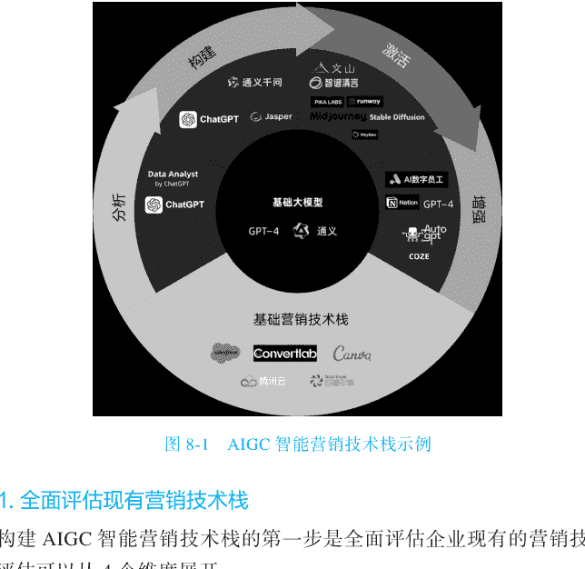

图 8-1 AIGC 智能营销技术栈示例

###### 1. 全盘盘点现有营销技术栈
第一步是对现状做全面诊断，四条线并行：

先看现有系统的功能与局限，找能被AIGC自动化和优化的环节。比如传统内容创作耗时费力，AIGC可批量产出高质量个性化素材；人工客服难做到7×24在线，AIGC驱动的智能客服则能实现全时无缝服务，提升体验。

再梳理各系统间的数据流与集成方式，明确数据如何在营销体系内流动，评估当前集成是否支持实时双向传输，识别数据孤岛风险。

第三，评估数据资产的质量与规模。AIGC效果取决于数据，质量要看准确性、完整性、一致性，规模要看体量、增长速度、多样性，是否足够支撑模型训练与优化。

最后评估内部AI技术能力与实践经验，判断是否需要外部专业支持，从技术储备、项目经验、人力配置综合研判落地可行性。

###### 2. 建立数据融合与治理体系
数据是AIGC的燃料，需先打好基础。

建立统一数据平台，把分散在各营销系统的数据整合进来，评估方案、设计统一数据模型，形成中心化营销数据资产，便于AIGC调用。

制定严格的数据治理规范，明确质量标准与监控机制，建立安全分级与访问控制，推动规范落地。

推动数据处理自动化，减少人工干预。选型合适工具，固化处理流程，设置质量检查规则并建立监控，保证供给稳定高效。

用数据增强扩充训练样本，可借助生成式AI基于现有数据合成逼真数据，也可对原数据做扰动、混合，提升模型的泛化能力。

同时必须落实严格的数据访问权限管理，制定访问策略，实施身份认证与授权，开启访问审计，部署防泄漏系统，全方位保障营销数据安全。

###### 3. 敏捷试错、分步迭代
把AIGC接入营销技术栈是系统工程，要用敏捷迭代方式推进。

从一两个高价值低难度场景起步，快速做出最小可行产品MVP。评估各场景收益与难度，明确核心功能与性能指标，借助成熟AI平台与工具加速开发部署。

上线后持续监测实际效果并收集反馈。建立关键绩效指标实时跟踪，通过多渠道收集内外部用户意见，定位问题根源与改进方向。

基于数据持续优化模型与应用。利用真实应用数据微调模型，扩充高质量训练数据，优化算法提升预测与生成准确率；按新需求迭代功能，优化用户体验。

经验积累后要固化最佳实践并规模化复制，同时把项目教训系统化，整理成案例文档，建立企业级AIGC知识库，促进经验传承。

长期来看，需建立持续评估与优化机制，保持与营销技术栈同步演进。制定科学评估指标，定期审视业务价值、技术性能、用户体验，规划下一轮迭代；同时紧跟生成式AI前沿进展，适时引入新技术，保持体系的创新活力。

#### 8.3 案例：欧莱雅如何用AIGC重塑流程
美容行业变化快，能否快速预判趋势并推出匹配产品是欧莱雅的核心挑战。传统调研耗时耗力，难以快速响应。

###### 1. TrendSpotter趋势捕捉工具
欧莱雅自研的TrendSpotter是一款生成式AI工具，能分析数百万条线上互动，包括社交媒体评论、博客、搜索引擎查询等，覆盖全球美容趋势与消费者偏好。

它利用自然语言处理与机器学习实时解析数据，捕捉潜在信号，例如某护肤成分被讨论量激增，可能预示新一波潮流。

通过历史与当前数据的对比，TrendSpotter可预测未来数月乃至数年的趋势，帮助提前规划产品线与市场策略。研发团队据此快速响应，缩短研发周期，降低试错成本。

###### 2. 带来的成效与影响
应用后，产品研发周期明显压缩。过去需数月甚至数年的市场调研，现在数天至数周即可完成，研发成本下降，上市速度加快。

趋势预测让产品始终贴近市场脉搏，满足最新需求。例如捕捉到消费者对某成分的关注后，能迅速推出相关产品抢占先机。

AI驱动的创新提升了品牌竞争力，消费者认可度与忠诚度提高，品牌形象增强。欧莱雅计划进一步扩展TrendSpotter的应用范围，覆盖更多市场与品类，持续用AI优化研发流程，保持全球领先。

## 第四部分 未来展望
未来的AIGC智能营销将融合通用人工智能、元宇宙与实时数据分析，实现更强的个性化与沉浸体验。通用人工智能让系统具备更深的理解与学习能力，能依据用户行为与偏好自动产出定制化高质量内容。元宇宙提供新营销舞台，品牌可在虚拟世界创造互动体验，提升参与感。结合这些技术，AIGC智能营销既能精准触达，也能通过实时优化提升满意度与忠诚度，打造高度互动沉浸的消费体验。

### 第 9 章 AIGC 智能营销的未来展望
未来，AIGC智能营销将融合通用人工智能、元宇宙、实时数据分析等前沿技术，实现前所未有的个性化与沉浸式体验。通用人工智能赋予系统深度理解与学习能力，可自动分析市场趋势、竞争动向与消费者行为，生成数据驱动的营销策略。元宇宙成为新的营销场景，品牌在虚拟世界构建互动体验，增强用户参与感。综合应用下，AIGC智能营销不仅能精准触达目标人群，还能通过内容与策略的实时优化，提升客户满意度与品牌忠诚度，提供高度互动沉浸的消费体验，维持竞争优势。

#### 9.1 AIGC 智能营销的新疆界
随着生成式AI发展，智能水平持续提升，通用人工智能的突破或将到来。这一进程与元宇宙发展相辅相成，为AIGC智能营销开辟新域。人性化智能与沉浸式体验融合，将为营销注入全新创新动能。

##### 9.1.1 通用人工智能
当下生成式AI已展现惊人效率与创造力，重塑科技格局，但这只是序章。通用人工智能的篇章随后展开，业界既有疑虑也有期待。

通用人工智能指具备与人类相似甚至超越人类智能的机器系统，能理解、学习、适应新环境、解决问题、创造性思考并执行复杂任务。其目标是让机器像人类一样执行任何智能任务，而非局限于特定场景。

表 9-1 通用人工智能和生成式人工智能对比

| 能力类别 | 通用人工智能特点 | 生成式人工智能特点 |
| :--- | :--- | :--- |
| 感知与感官整合能力 | 能够整合多种感官信息（视觉、听觉等），进行复杂的环境感知 | 主要聚焦于单一模态，如图像或文本的生成，感知能力相对有限 |
| 认知与决策能力 | 高度复杂的决策能力，能在不确定的环境中进行有效决策 | 主要依赖特定数据集进行学习，缺乏自主的高级决策能力 |
| 执行与操作能力 | 可以执行多种物理和虚拟的复杂任务，具备高级的操作能力 | 通常限于虚拟环境中的任务，如文本、图像或音频的生成，不直接操作物理环境 |
| 创新与自我改善能力 | 不断学习和自我改进，能够创造新的解决方案和方法 | 虽有学习和适应能力，但主要是在现有模型和数据的基础上进行迭代 |
| 社交情感与伦理道德能力 | 具备理解和适应不同社交与文化环境的能力，能够进行伦理和道德判断 | 主要关注生成的内容质量和多样性，社交情感和伦理道德考量通常不是主要功能 |
| 记忆与知识管理能力 | 高效的长期记忆管理和跨领域的知识整合能力 | 依赖于对大量数据和模型进行记忆，但缺乏有效的长期记忆和知识跨领域整合 |

能力范围上，AGI追求模仿人类智能，在多种环境中自主学习适应；生成式AI更聚焦于用机器学习模型生成特定类型输出。应用领域，AGI理论上可覆盖人类所有任务，生成式AI多用于自动文本、图像创作等特定问题。自主性与适应性方面，AGI强调无直接人工控制的决策，生成式AI的“创造性”仍受预设模型与参数约束。伦理维度，AGI因涉及真实人类互动需更复杂的道德考量，生成式AI主要面临数据偏见与内容安全问题。

AGI对营销的潜在影响更深远。其核心是接近人类智能，不仅能模仿决策，还能重塑营销方法。

预期AGI将实现真正的情感与心理理解，能深度解析消费者语言、表情与行为模式，以近乎完美的精度把握需求与情绪。这种深度个性化将从根本上改变品牌与消费者的互动方式。

在学习、逻辑与推理能力上，随着算法、算力与数据的增强，AGI能以前所未有的速度与深度浏览学习网络信息，预测市场趋势并即时调整策略，其洞察力远超现有分析工具，因其能理解经济、社会、政治因素如何共同影响市场行为。

凭借深度学习与分析能力，AGI可为每位消费者设计并推荐完全定制化的产品与服务，实时收集反馈并调整产品特性，实现前所未有的满意度与忠诚度。除了定制，AGI甚至可以预测客户在未

##### 9.1.2 元宇宙与营销

元宇宙的雏形可以追溯到1992年，科幻作家尼尔·斯蒂芬森在《雪崩》里描绘了一个人们能够在其中生活、社交和工作的虚拟空间。随后Roblox被市场称为“元宇宙第一股”点燃资本热情，Facebook改名Meta掀起的淘金潮，让这个概念从小说走向公众视野。

2022年，随着区块链、Web3、虚拟现实、增强现实等技术成熟，叠加数字藏品、虚拟数字人等场景的落地，元宇宙迎来一轮爆发。但虚拟货币的剧烈波动和VR应用落地不及预期，使热度迅速回落。虚拟世界的沉浸感不足，成为其难以跳出游戏圈层的关键瓶颈。

生成式AI的介入，为虚拟体验的丰富度提供了新的可能。技术演进让AI在元宇宙的搭建与运营中承担更核心的角色，带来前所未有的交互感受。以Roblox为例，生成式AI和大语言模型已被引入Roblox Studio，帮助用户加速场景搭建和游戏机制设计。

生成式AI正在从三个方向重塑元宇宙：

###### （1）虚拟世界个性化体验增强
过去打造虚拟空间主要依赖专业团队或玩家自发创作，丰富度有限。生成式AI能够自动产出或编辑建筑、自然景观、非玩家角色等内容，让世界变得更饱满多元。

借助数据分析能力，AI可基于个人偏好、行为轨迹和互动历史，定制专属的元宇宙体验。个性化不仅体现在推荐，还延伸到新环境、新玩法和新故事线的生成。OpenAI的Sora等工具正在改写构建规则，人类给出想象，AI负责落地。Sora的目标不止于文生视频，而是成为能模拟真实世界复杂互动与动态环境的通用物理模拟器。

由生成式AI驱动的虚拟助手或NPC，也能实时提供帮助、陪伴、讲解甚至扮演特定角色。Decentraland与Inworld的合作，为每个NPC赋予性格与智能，让互动接近《西部世界》式的沉浸。

###### （2）数字替身的智能化
在元宇宙里，数字替身不只是二维或三维的形象，更是承载个性与理想的数字化身。它可以是现实的镜像，也可以是超现实的延伸，比如神话生物或动物形态。在广阔的虚拟空间中，替身帮助个体建立身份认同并维系社群关系。

AI的进步正在赋予替身更多智能。京东已用虚拟替身做网络直播，能带货也能自然与观众互动。领英联合创始人里德·霍夫曼的数字分身“Reid AI”，在形象和微表情上高度还原，并借助ChatGPT移植了他的知识与思维方式。2024年4月，霍夫曼与自己的分身进行对话访谈，讨论AI监管、能力边界及个人资料优化，这展示了AI在模仿人类表达上的进展，也预示数字替身将在元宇宙中承担更复杂的功能。

###### （3）“造物能力”的提升
在Roblox等平台，用户不仅是玩家更是创作者，可以搭建建筑、设计游戏、铸造可交易的数字藏品。生成式AI降低了创作门槛，能辅助生成建筑、环境、生物乃至世界规则。

Decentraland支持创作者用AI辅助设计个性化NPC，为其赋予背景、动机和能力。随着AI在空间模拟与物理仿真上的增强，用户甚至能通过生成式AI还原真实世界。Sensorium推出的Sensorium Galaxy平台就利用生成式AI，让用户创造全新的智慧生命体。

AIGC也为NFT带来新工具。艺术家借助AIGC突破传统边界，探索新风格，产出面向交易和游戏的数字藏品。

在元宇宙概念提出前，品牌已用VR与AR把体验营销推向沉浸式场景。在元宇宙中，品牌可以提供高度个性化的沉浸体验，通过虚拟商品和新型合作直接触达用户，构建更紧密的关系。

互动模式也在改变。人们不再受鼠标屏幕、时空限制的束缚，现实与虚拟得以耦合，交易以价值交换为基础、以价值创造为目的。数字替身成为身体的延伸，让现实体验如梦境般美妙，也让虚拟的美妙可落地为现实。

去品牌化的趋势愈发明显。虚拟世界的数字运动鞋几乎不存在功能缺陷或质量差异，品牌的表达力和符号价值被放大，符号角色的重要性上升。尽管信任仍需持久性与连续性支撑，但品牌塑造更多依赖为数字替身提供的沉浸体验和持续价值创造。

区块链协议可保证去中心化交易中买卖双方权益，试穿试用在购买前即可完成。此时影响决策的核心是产品本身的功能体验、稀缺性价值、创造力与想象力，而非品牌背书。

#### 9.2 AIGC 智能营销的新挑战
本节梳理AI为企业带来的数据洞察与自动化效率机遇，同时指出算法偏见、隐私泄露等风险，给出平衡视角。

##### 9.2.1 版权问题
生成式AI的快速发展让AIGC的版权议题愈发突出，训练数据侵权和权属归属成为焦点。

2023年1月13日，艺术家莎拉·安德森、凯利·麦克里南、卡拉萨·奥蒂兹在美国加州旧金山联邦法院对Stability AI Ltd、Stability AI Inc、Midjourney Inc和DeviantArt Inc提起集体诉讼，指控其未经许可使用作品作为图像生成模型的训练素材。原告还称Stability AI生成了其作品的重构副本，属于未授权衍生。2023年3月2日，被告提出驳回动议，辩称AI图像不具备版权且未侵权。审理数月后法官促双方调解，截至目前尚未作出终审，双方仍在谈判。

2024年1月，《纽约时报》起诉OpenAI与微软，指控二者未经授权使用数百万篇报道训练ChatGPT与Dall·E 2，构成版权侵权。NYT认为这是“大规模挪用”，造成重大业务损害。争议核心是使用受版权保护材料训练模型的合法性。NYT主张文章受版权法保护，OpenAI则援引公平使用原则，认为为批评、评论、研究目的的有限使用是允许的。案件处于早期阶段，OpenAI的驳回动议听证原定于2024年8月。

若使用者在生成内容时挪用未授权版权素材并用于商业用途，也可能面临诉讼与赔偿。

AIGC版权另一难题是生成物是否受版权保护、归属何人。传统版权要求独立创作的智力成果，而生成式AI通过学习大量数据规律来产出新作，原创性认定存在争议。

即便认定具原创性，权属仍模糊。若版权归开发者，可能阻碍推广；若归用户，又难以界定贡献度。美国版权局2023年的报告建议由开发者与用户共同享有。日本2019年修订《著作权法》将AI生成物定义为“由AI系统创作的作品”，认为开发者提供技术基础、用户提供数据指令，双方均应享有权利。

2023年底，北京互联网法院审结一起AI生成图片署名权与信息网络传播权纠纷。原告李某用开源软件Stable Diffusion生成图片发布于小红书，被告刘某在百家号文章中未经许可使用并去除水印。法院认定图片体现了李某的独创性智力投入，构成美术作品，应受著作权法保护。

在法规尚不完善时，品牌与创作者面临双重挑战：既要避免侵权他人，也要保护自身作品。

短期应对上，可借助版权侵权检测工具如Copyleak等主动筛查生成物风险。但工具存在局限，营销人员需提升法律意识，识别并报告潜在侵权，避免无意违规。

使用AIGC工具时应注意：
- 避免误导性指令：不要写“由某作家写作或某摄影师拍摄”，而应表述为“生成具有某作家或摄影师风格的作品”，以免直接引用或雷同。
- 增加智力参与以利于确权：在人机协同中突出“人”的创意投入，提升作品独特性，便于主张权利。
- 保存底稿与流程记录：保留创作草稿和生成日志，作为权属争议时的证据。

品牌还需了解平台与供应商的版权政策、权属归属和商业使用条件，确保数据与服务合规，并建立投诉维权机制。

长期策略上，企业应构建健全的AIGC版权风险防控体系：

###### （1）构建全面的AIGC版权风险防控体系
从制度、流程、技术、人员多维度系统防范风险。
- 制定AIGC版权管理制度：明确作品归属、使用规范与风控要求，为员工和供应商指引行为。
- 优化应用流程：在生成、审核、发布环节嵌入版权合规检查，形成闭环。
- 采用风控技术：利用内容指纹、图像识别自动识别与过滤侵权内容。

###### （2）严格审查AIGC训练数据
训练数据是高风险区。品牌需了解工具使用的来源、训练与生成方式。
- 审查数据来源
- 进行数据版权风险评估，识别潜在侵权
- 要求工具或供应商清洗剔除涉嫌侵权、敏感、低质数据
- 对数据授权与备案，购买可商用的合法使用权

###### （3）控制AIGC商业化风险
商业化应用诉讼风险高。
- 对商用作品进行合规性评估，规避或转移风险
- 在面向用户的服务中告知生成机制，征得商用同意
- 在作品中附加免责声明，说明AI生成且不保证原创性与版权无瑕

###### （4）积极应对版权侵权指控
建立版权投诉响应机制，及时处理投诉。若风险无法完全消除，应收集证据证明生成过程体现独创性、不构成抄袭，并与权利人协商和解。

AIGC版权与知识产权保护是复杂且持续演进的领域。品牌需结合自身风险评估制定策略并定期优化，并借助专业法律顾问确保措施合规。

##### 9.2.2 用户隐私和数据安全
AIGC日益成熟带来营销增效的同时，也放大了隐私与数据安全风险。

2020年，数字人生成工具Synthesia被用于制作虚假视频冒充商业领袖实施诈骗，造成经济损失。2021年，智能语音应用Thisperscope发生数据泄露，大量用户语音数据外泄。

###### 1. 隐私风险
AIGC训练与应用依赖海量用户数据，若在采集、存储、使用环节失控，易引发侵权。
- 过度收集：为追求精准而采集超出必要范围的敏感个人信息
- 数据滥用与未授权共享：超出约定用途使用或未经同意与第三方共享
- 数据泄露与非法访问：防护不足导致黑客或内部人员窃取
- 用户画像带来的隐私侵害：详细画像揭示偏好与习惯，滥用会损害肖像权与声誉

###### 2. 数据安全
- 信息泄露：接入AIGC时上传公司文件或敏感信息若未妥善保护会外泄
- 训练数据质量与安全：噪声、错误、偏差影响生成准确性；数据中可能隐藏恶意代码
- 数据投毒与对抗样本攻击：误导模型生成错误或有害内容，破坏可靠性与品牌形象
- API安全与未授权访问：缺乏身份认证与权限控制的API可能被滥用

区块链、联邦学习、差分隐私、零知识证明等技术为保护提供方案。区块链实现数据安全存储与共享，联邦学习可在不共享原始数据的前提下协同训练，差分隐私通过加入随机噪声保护个人隐私。

作为使用者，品牌应建立全流程数据安全管理机制，覆盖采集、传输、存储、访问、使用到销毁，按敏感程度分级分类管理，实施差异化防护。

长期来看，应坚持隐私设计Privacy by Design理念，将隐私保护融入技术方案的规划与落地。

隐私设计的关键原则包括：
- 最小化数据收集
- 数据匿名化
- 透明度与告知
- 用户控制权
- 安全与数据保护
- 合规与法律遵循
- 持续评估与改进

在推进生成式 AI 的过程中，品牌最好依托 AI 治理与伦理委员会的把关，建立起完整的数据安全管理制度与运行流程。上线前要做严格的审查与风险评估，确保模型稳定可信。同时要明确数据安全的主责归属，制定清晰的制度与操作细则。其中，数据分类分级、定期安全评估、数据泄露应急处置是必须落地的三个关键环节。

数据在 AIGC 智能营销里既是高价值的资源库，也潜藏着合规与泄露的风险。品牌需要主动应对这一矛盾，搭建可持续的 AIGC 营销生态，让创新突破与隐私保护实现双赢。

#### 9.3 案例：Mango 如何用 AIGC 重塑时尚全链路
西班牙时尚集团 Mango 以独特的设计语言和敏锐的商业洞察在全球行业中占据领先。随着数字化加速，Mango 全面拥抱技术升级，围绕设计到销售的完整链路打造了一套 AI 驱动的创新平台体系。

###### 1. 双平台驱动：对话式 Lisa 与图像式 Inspire
AIGC 战略的核心是 Mango 自研的两大平台。对话生成平台 Lisa 融合了 ChatGPT、 Bard 等前沿技术，构建了企业级交互入口，9 个月内完成部署，为设计研发、趋势洞察、客户服务等环节带来效率与质量的提升。

图像生成平台 Inspire 面向设计、摄影和技术团队开展跨部门协作，帮助团队快速获取灵感，并联合产出 20 余款投放市场的 AI 设计服装，充分展现了 AI 在时尚创造上的潜力。

借助 Lisa 与 Inspire，Mango 把产品全生命周期中的核心信息资产——客户、门店、库存、商品——做了深度数字化。AI 在配色、面料挑选、纹理生成、空间呈现等维度深度参与，既提升协作效率，也让作品更具前瞻与生命力。

###### 2. 从营销到价值链全覆盖
自 2018 年起，Mango 不断完善机器学习中台，目前已在企业价值链上部署超过 15 个 AI 应用，关键系统包括：

- Midas：负责价格策略管理，保障商品市场竞争力。
- Gaudí：基于用户行为的个性化推荐引擎，提供定制化购物建议。
- Iris：多语种客服系统，提升互动效率与体验。

这些系统覆盖了定价、推荐到服务等核心环节，帮助 Mango 精准满足全球消费者的多元需求。

###### 3. 元宇宙布局抢占先机
为探索虚拟场景的增长可能，Mango 组建了由 3D 工程师、AI 专家、区块链工程师和 3D 艺术家组成的虚拟资产团队。该团队活跃于 Metaverse Fashion Week 等项目，持续研发可兼容线上线下的虚拟内容，为品牌开辟新的增长空间。

整体来看，Mango 把 AI 当作品牌的强力副驾，既强化了团队创新能力，也巩固了行业领先位置，为同行提供了可借鉴的实践样本。

## 推荐阅读
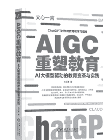

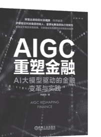

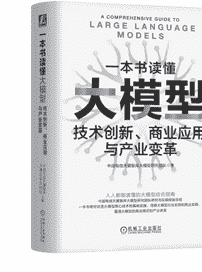

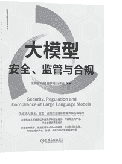


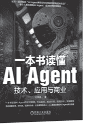

## 作者简介
### 栗建
现任喜利得亚太区品牌、营销与数字渠道总监，曾在飞利浦、陶氏化学、喜利得中国负责数字营销与数字化转型，并在爱德曼、德勤担任数字营销顾问，主导新营销与数字化转型，为众多国际品牌落地品牌战略。

长期深耕 AIGC 智能营销，先后调研多家企业实践，承接多个 AIGC 营销落地项目，从内容营销到企业智能化变革积累了丰富经验。

著有《元宇宙营销：认知、方法与实践》，主理微信公众号“知营销”。曾任《中国日报》《商业周刊》科技专栏记者，为 PSFK、CMO 俱乐部撰写专栏。

陈楸帆 科幻作家/中国作协科幻文学委员会副主任/《AI未来进行式》作者
本书既讲清了 AIGC 在营销中的用法，也揭示了人机协作的未来走向。AI 与真人竞争将是螺旋上升的进程，其中必有阵痛，从业者需思考自己的不可替代价值。书中既有实操指南，也有对未来协作的深层思考。

刘润 润米咨询创始人
科技不断拓宽营销边界，AI 持续抬高创意上限。本书准确捕捉到这一变革脉搏，梳理了新营销的底层逻辑，系统呈现 AIGC 如何赋能传统营销，为未来营销描绘新图景。

唐兴通 数字化营销与销售专家/《引爆社群》作者
尽管 AIGC 热度居高不下，系统性的论述却不多。本书在介绍技术与工具后，以消费者决策旅程为线索构建了 AIGC 智能营销的 4A 模型，并以案例具体呈现，聚焦技术如何赋能营销流程。

蒋青云 复旦大学管理学院教授/上海市市场学会会长
AIGC 的价值不仅在于数据涌现，更在于场景涌现。它能从行为洞察中创造新场景，为品牌带来机遇。其核心在于解决问题能力。本书提供了战略与实操指引，帮助品牌学会与用户、机器对话，把数据转化为商业策略。

吴声 场景实验室创始人/场景方法论提出者
AIGC 正在重塑营销行业，既带来想象空间，也带来替代焦虑。拥抱变化是最好的应对。本书提供了实践机会，鼓励品牌探索新技术、新平台、新玩法。

刀姐doris 新营销智库“刀法Digipont”创始人、首席咨询师
与其在存量市场内卷，不如拥抱新技术。本书为营销人提供了一次拥抱 AIGC 的机会。


客服电话：(010) 88361066 88379833 68326294