# AIGC驱动编程：ChatGPT与Copilot实战手册

# 阅读速览

本书带你走进人工智能生成内容与自动化编码的结合路径。开篇先厘清人工智能的底层概念，随后聚焦 ChatGPT、GitHub Copilot、Claude 2 等代表性生成式工具在编程中的用法，并延伸介绍其他代码生成方案。针对桌面客户端、Web 端、游戏制作、办公流程自动化等典型场景，书中提供了大量可直接参考的实操范例。

本书既适合对 AI 编程好奇的入门者，也适合希望提升开发效率的在职程序员，还可作为高校及培训机构的教学参考。

# 好评摘录

通俗地拆解了 AI 在编码领域的实际威力，为开发者与技术爱好者提供了扎实可用的经验。借助详尽分析与案例呈现，勾勒出技术持续扩张的图景。作品不仅讲编程，更像是高效智能写代码的方法论，实用性强，堪作程序员案头参考，强烈推荐！——张荣超，OpenHarmony 技术指导委员会委员

本书是一部生成式人工智能的实践指南，重点阐释 ChatGPT 与 GitHub Copilot。从 GPT 演进轨迹，到与 ChatGPT 高效对话，再到 Copilot 编码实战与 ChatGPT API 调用，体系完整。新手与资深开发者都能有所得益，书中围绕 ChatGPT 做项目开发、算法实现、图像处理的内容，对想探索 AI 真实落地的读者尤为宝贵。——夏曹俊，南京捷帝科技有限公司创始人

内容不仅剖析 ChatGPT 核心能力，还系统讨论其在各行业的影响潜力、OpenAI 接口的应用以及其他生成式产品，有助于读者快速提高编码水平。——唐佐林，开源鸿蒙 Py4OH 框架作者

从 GPT 基础知识到高效沟通技巧，再到基于 OpenAI 接口的多类应用，全面覆盖 ChatGPT 生态；同时兼顾其他生成式产品，展现前沿动向。无论初学者还是有经验的开发者，都能借此提升研发能力。——李洋，深圳市蛟龙腾飞网络科技有限公司首席执行官与首席技术官

作品既讲解 ChatGPT 的强劲功能，也介绍了其他前沿生成式工具，新手与专业人士均可获得深度收获。——连志安，江苏润和软件股份有限公司生态技术总监

# 前言

# 写作缘起

人工智能技术正以快节奏演进，AIGC 已逐渐进入大众视野。ChatGPT、New Bing、GitHub Copilot、Claude 2 等大模型产品正在赋能各行各业，编程方向尤为明显。它们大幅缩短了编码耗时，减轻了优化、测试与漏洞排查的负担，让开发者更聚焦创新与价值创造。本书意图帮助读者深挖 ChatGPT 在软件开发中的运用空间。

# 章节概览

本书系统覆盖基于 ChatGPT 的自动化编程路径。

第 1 章介绍 ChatGPT 的基础概念，为后续学习做铺垫。

第 2 章聚焦 GitHub Copilot 的自动化编码实践，包含安装校验、代码自动补全、Visual Studio Code 快捷操作等。

第 3 章介绍其它 AIGC 代码工具，如 New Bing、Bard、Claude、CodeGeeX、Amazon CodeWhisperer 等，拓宽工具视野。

第 4 章～第 8 章集中呈现实战案例，涵盖桌面应用、Web 应用、游戏开发、办公自动化及各类程序开发，通过案例讲解实现学以致用。

第 9 章拓展 AIGC 的更多用途，涉及 ChatGPT Plus 插件、代码解释器、Claude 2 数据分析，帮助读者打开解决问题的思路。

# 阅读建议

AIGC 仍处于起步阶段，未来会不断涌现新产品，可将本书作起点逐步熟练掌握。建议如下。

+   - 由浅入深。书中从 ChatGPT 入门知识起步，逐步进入 Copilot 自动化编程，再到其它方案与实战。阅读时先掌握基础概念，再攻克进阶主题。
- 对照学习。各章内容相互关联，如 ChatGPT 与 Copilot 功能、Claude 2 与其它代码生成方案等。学习新工具时可与已有知识对比，提升效率。
- 重视动手。书中涵盖桌面、Web、游戏、办公自动化等大量案例，阅读后应动手复现，通过实践加深理解。
- 主动探索。AIGC 是新事物，阅读中遇到疑问很正常。最佳方式是直接用 ChatGPT、GitHub Copilot、Claude 2 等工具探索求解，实践中积累技术。

要获取配套源代码，请关注“极客起源”公众号并输入“AI 编程”，或在异步社区本书页面输入第 87 页的配套资源验证码。

# 意见反馈

作者水平有限，加之 AIGC 工具迭代迅速，书中难免有疏漏，期待读者提出建议以便完善。

如有建议或学习中遇到问题，可通过微信或邮箱联系作者。微信号 unitymarvel，邮箱 unitymarvel520@gmail.com。期待与读者共同探索 AIGC 与自动化编程技术！

李宁
2023 年 7 月 20 日

# 适合人群

本书从基础概念入手介绍 ChatGPT 等工具的编程用法，适合对使用 ChatGPT 等工具编程感兴趣的初学者；书中还包含应用开发示例，有一定编程基础的开发者也能学到实用技巧。

# 服务支持

# 勘误提交

作者和编辑已尽力保证准确性，但仍可能有遗漏。欢迎登录异步社区 https://www.epubit.com 按书名搜索，进入本书页面，点击“发表勘误”，填写信息提交。审核通过后可获赠异步社区 100 积分，积分可用于兑换优惠券、样书或奖品。

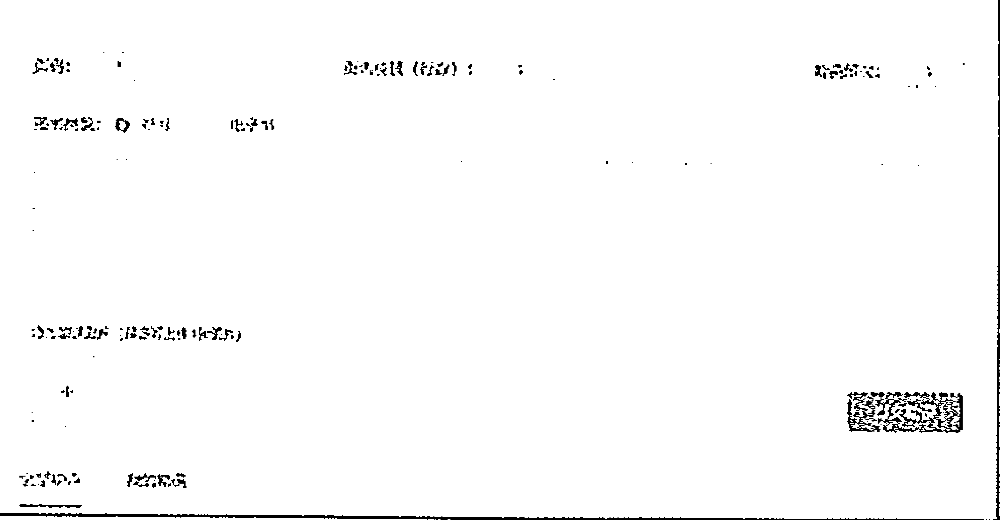

# 联系方式

联系邮箱是 contact@epubit.com.cn。

如对本书有疑问或建议，请在邮件标题注明书名，以便高效反馈。

如有兴趣出版图书、录制教学视频，或参与图书翻译、技术审校等工作，可发邮件联系。

学校、培训机构或企业批量采购本书或异步社区其他图书，也可邮件联系。

如在网上发现针对异步社区出品图书的盗版行为，包括非授权传播全部或部分内容，请将链接发邮件告知。您的举动是对作者权益的保护，也是我们持续提供有价值内容的动力。

# 出版品牌介绍

“异步社区” www.epubit.com 由人民邮电出版社创办，2015 年 8 月上线运营，致力于优质内容的出版与分享，为读者提供高品质学习内容，为作译者提供专业出版服务，实现作者与读者在线交流互动，以及传统出版与数字出版融合发展。

“异步图书”是异步社区策划出版的精品 IT 图书品牌，依托人民邮电出版社在计算机图书领域的积淀。异步图书面向 IT 行业以及各行业使用 IT 的用户。

# 第1章 跨越ChatGPT之门

## 1.1.1 什么是ChatGPT和GPT

ChatGPT 由 OpenAI 研发的一款对话式大语言模型，构建在 OpenAI 的 GPT，即 Generative Pre-trained Transformer 架构之上。GPT 是一种基于 Transformer 的深度学习模型，用于生成和理解人类语言。GPT 主要用于自然语言处理任务，包括文本生成、机器翻译、问答、图像处理、代码编写、数学计算、逻辑处理等。

- ChatGPT 专注对话场景，GPT 则更通用。
- ChatGPT 在 GPT 基础架构如 GPT-3.5 或 GPT-4 上构建，训练时加入了真实对话数据与人类反馈强化学习。
- 相较 GPT，ChatGPT 使用的数据量可能更少，可能影响其生成多样化与细腻回应的能力。

注意，ChatGPT 训练重点在对话，但实际可用于摘要、翻译、图像处理等。使用的 GPT 版本会随情况变化。

## 1.1.2 GPT 演进史

GPT 发展至 GPT-4。本节梳理历程。

2015年12月 OpenAI 成立，探索大模型方向。

2017年6月 Google 在论文《Attention Is All You Need》中提出 Transformer 架构，GPT 以此理解人类语言。

2018年6月 OpenAI 推出 GPT-1，参数约1.17亿，是首个基于 Transformer 的预训练语言模型。

2019年2月 OpenAI 推出 GPT-2，参数约15亿，是 GPT-1 的扩展，生成与泛化能力更强。

2020年6月 OpenAI 推出 GPT-3，参数约1750亿，截至当时最大预训练模型，可用于多种语言任务。GPT-3 仅通过调整输入，无需任务特定微调，就能在聊天机器人、代码生成、创意写作等领域表现突出。

① Transformer 用于处理序列数据，广泛应用于机器翻译、文本生成等 NLP 任务。

## 1.1 认识 ChatGPT

2022年3月 OpenAI 推出 GPT-3.5，参数仍为1750亿，新增编辑与插入能力。

2023年3月1日 OpenAI 推出 GPT-3.5-Turbo，是 GPT-3.5 的改进版，参数未公开，优化了对话与函数调用。

2023年3月14日 OpenAI 推出 GPT-4，当前最强预训练模型，参数未公开，但远超 GPT-3.5，可能达万亿级别。

## 1.1.3 ChatGPT 与 ChatGPT Plus 区别

ChatGPT 基于 GPT-3.5 免费提供，注册 OpenAI 账号后即可使用。ChatGPT Plus 为付费版，每月20美元。主要差异：

- Plus 版响应更快，计算资源优先。
- 免费版仅能使用 GPT-3.5，Plus 用户可选 GPT-3.5 或 GPT-4，因资源紧张 GPT-4 有限流，每3小时25条消息，每日最多约200条。
- Plus 可使用 OpenAI 及第三方提供的数百个插件，也可自行开发上传至 Plugin Store。
- 开通 Plus 后可在 ChatGPT API 中直接使用 GPT-4 等模型，提升生成精度。
- Plus 更适合企业、专业人士及教育场景。

## 1.1.4 ChatGPT 的长处与短板

尽管功能强大看似无所不能，ChatGPT 只是运行在强大 GPU 上的代码集合，并不真正智能。它不了解自己在做什么，基本原理是通过海量数据、神经网络与千亿级参数微调来预测下一个字符。顶多算是人工智算①，而非真正人工智能。① 人工智能指人类编写算法让计算机处理海量数据，ChatGPT 核心是千亿级参数的神经网络调整。

优点如下。

- 擅长语言理解与推理：可多语对话，基本理解意图、情感、语境，能进行常识性推理与建议。
- 擅长文本生成：能生成诗歌、故事、歌词、新闻、摘要、评论等，可模仿风格。
- 擅长文本分析：可检查语法、拼写、逻辑、情感，给出评分与改进建议。
- 擅长文本翻译：支持多语互译，可调整质量风格。
- 擅长编写代码：可生成 Python、Java、C++ 等代码，检查、修改、优化，并解释概念、提供练习。
- 其他：出题、拼写检查、写作文、逻辑推理、旅游规划、哲学探讨等。

缺点如下。

- 数据陈旧：训练数据非最新，可能无法处理最新话题，可通过搜索或用户提供示例补救。
- 可能产生不准确内容：生成式模型基于概率输出，可能出现错误，尤其专业领域会胡说八道，需用户反馈纠正。
- 只能处理文本信息：无法直接处理图像、音频、视频，需结合其他技术。
- 智力有限：千亿参数虽多，但复杂逻辑、数学问题仍困难，重复提问有时反而得到正确结果。
- 无法保证回复唯一性：同一问题在不同会话答案可能不一致，需交叉验证，可用 New Bing、Bard、Claude 等对比。
- 缺乏共同体验：难以真正理解人类主观体验与情感。
- 有偏见：训练数据可能导致种族、性别等偏见。
- 易被误导：恶意提问可能诱发错误或有害内容。

- 隐私与保密提醒：ChatGPT 的训练素材来源于公开网络，提问内容有可能被用于后续模型迭代。若问题涉及个人隐私或企业机密，一旦提交就存在被复用或泄露的可能，实际使用时应保持高度警惕，敏感信息尽量避免输入。

## 1.1.5 ChatGPT 驱动产业全面重塑
在生成式 AI 发展历程里，OpenAI 推出的 ChatGPT 往往被视作关键转折点。作为超大规模语言模型，它在众多场景中已展现出较强能力，并正改变工作与生活方式。典型应用如下。

- 教育：可充当个性化辅导伙伴，帮助学生拆解复杂概念、梳理作业思路、进行模拟测评，并依据学习进度与理解程度动态调整辅导方式，提升学习效率。
- 医疗信息参考：能提供初步的健康信息参考。用户描述症状后，模型会给出可能的病因方向与应对建议。需要明确的是，这不能替代专业医生诊断，仅作初步了解。
- 创作辅助：对写作者与艺术从业者而言，它是灵感来源。创作者描述故事设想后，可获得情节推进与人物塑造的启发；艺术工作者也能借此产生新的作品点子。
- 客户服务：不少企业已将其作为客服入口，可承接大量咨询并即时回复，改善响应效率与客户满意度。
- 新闻媒体：可用于生成新闻摘要、撰写评论、自动化撰写报道稿件等内容生产环节。
- 娱乐：可担任创意搭档，提供写诗、写歌、编故事等灵感，也可陪玩文字游戏如猜谜、接龙、填词，同时分享幽默段子。
- 商业：可作营销顾问，协助撰写广告文案、宣传语；可作客服顾问，解答常见问题、处理投诉、推荐商品；可作分析顾问，完成销量统计、趋势预测、效果评估等。
- 生活：可提供做饭、健身、旅行等生活建议；可作情绪陪伴者，倾听、开导、鼓励；还能分享音乐、影视、书籍等兴趣文化资讯。
- 制造：结合机器人后可实现生产自动化。依据需求生成生产计划并指挥机器人执行，提升效率、降低人工失误，并在一定程度上替代重复性操作岗位。
- 物流配送：结合无人驾驶车辆或无人机，可生成最优配送路线并指导执行，提升配送效率、减少差错，部分替代传统配送人员。
- 编程：已改变开发者工作流。它能理解自然语言并生成代码，在代码编写、代码审查、代码迁移、文档生成、注释补充、问题解答等多环节提供支持。

以上只是部分结合场景，理论上它可以为几乎所有领域赋能，大幅提升从业者效率，在部分环节甚至实现替代。因此关键问题已不是是否接受，而是何时以何种方式接纳。未来缺乏智能化赋能的行业将承受巨大冲击，所有能显著提高生产率的技术都会被追捧。越早掌握并熟练使用这类工具，个人竞争力越强。

## 1.2 账号注册与登录流程
首次使用需先在 OpenAI 官网创建账号。初始欢迎页如图1-1所示。

点按 Sign up 进入注册页，如图1-2所示。在 Email address 栏填写邮箱，也可使用 Gmail、微软账号或苹果账号快捷注册，建议优先 Gmail。

账号创建后点 Continue，进入填写姓名和出生日期的页面，如图1-3所示。

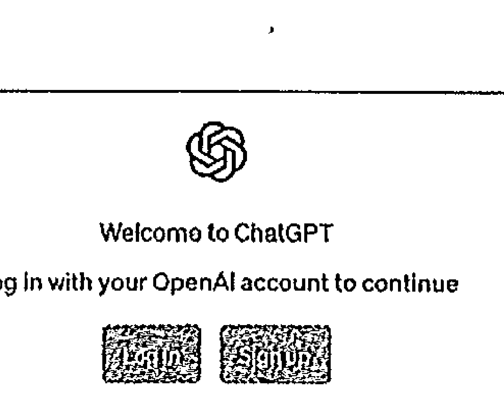

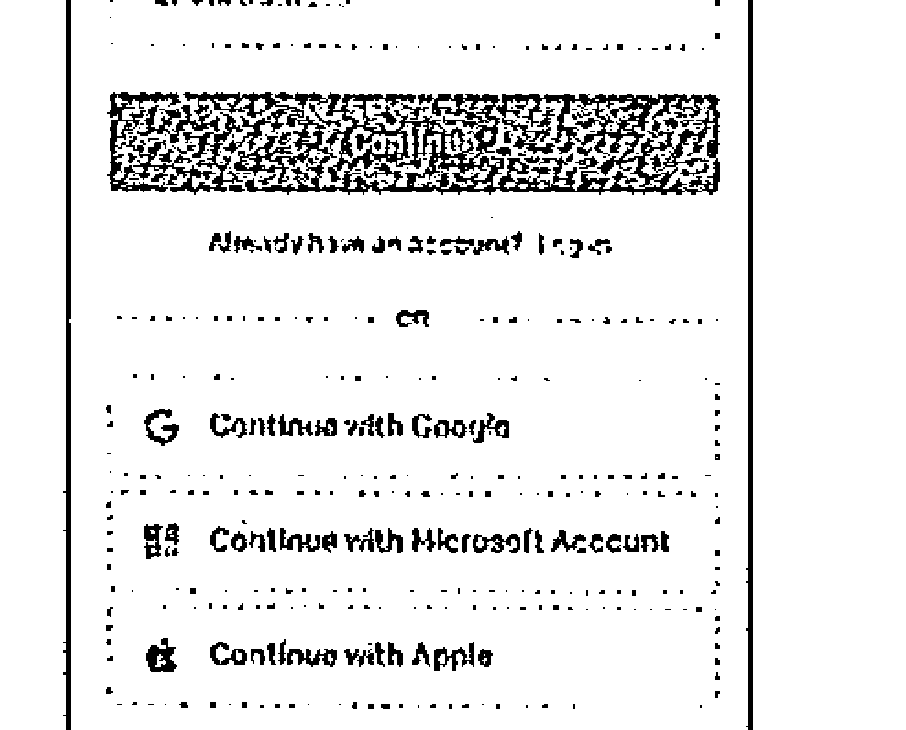

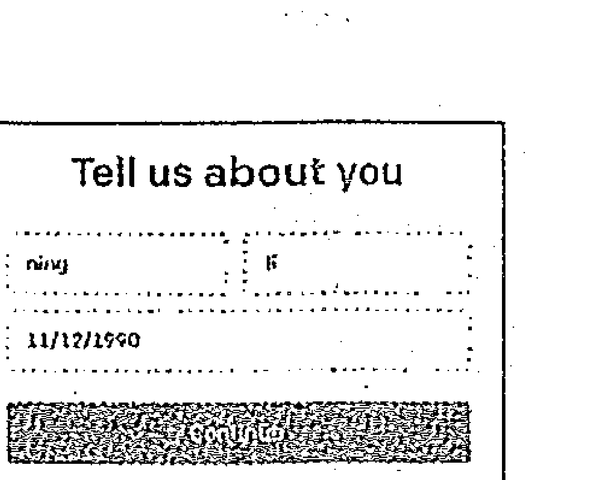
点 Continue 进入下一步，如图1-4所示。需填写可接收验证码的手机号码，填写完毕后点 Send code 按钮继续。

手机收到短信后，在图1-5所示页面输入6位验证码。


验证码通过后即进入 ChatGPT 对话页，如图1-6所示。

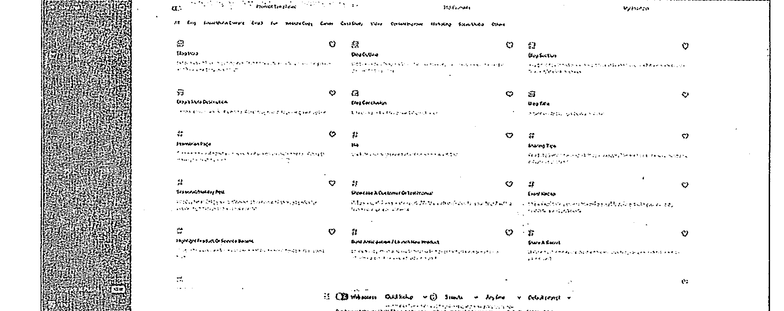
此时即可向 ChatGPT 发起问候，如图1-7所示。

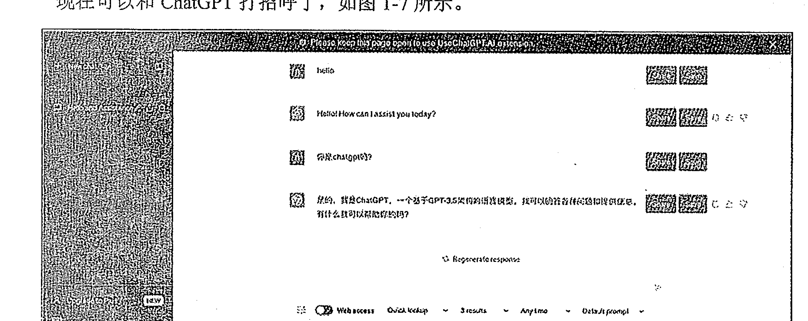
注册流程至此完成。后续使用若不清除浏览器 Cookie 或未退出登录，将直接进入图1-6所示的对话页。

## 1.3 ChatGPT Plus 会员升级
免费账号虽无使用次数限制，但响应速度较慢且无法调用 GPT-4，准确性相对有限。若希望获得更快响应或深度使用，建议升级为 Plus 会员，费用为每月20美元。

开通步骤如下：
先在 ChatGPT 界面点击左下角的 Upgrade to Plus 图标，如图1-8所示。
随后会展示图1-9所示的 Your plan 页面。


注意：注册、使用及升级 Plus 过程中可能涉及 IP、手机号、信用卡等信息，具体应对可参考本书配套操作文档。

# 14 与 ChatGPT 的首次对话
登录后即可开始会话。Plus 用户可选择 GPT-3.5 或 GPT-4。本节选用 GPT-3.5 并提出问题：

# 1.5 如何向 ChatGPT 提问
请解释一下ChatGPT和GPT的区别。

通常1-2秒内，ChatGPT 会给出图1-14所示的回复。若结果不理想，可点击下方 Regenerate response 按钮重新生成。需注意同问不同答，差异可能很大，不满意可多次重发直至合适。

消息框内换行请按 Shift+Enter。

若需修改已发送问题，将鼠标移至问题右侧会显示编辑按钮，如图1-15所示。编辑完成后点 Save & Submit 保存提交。

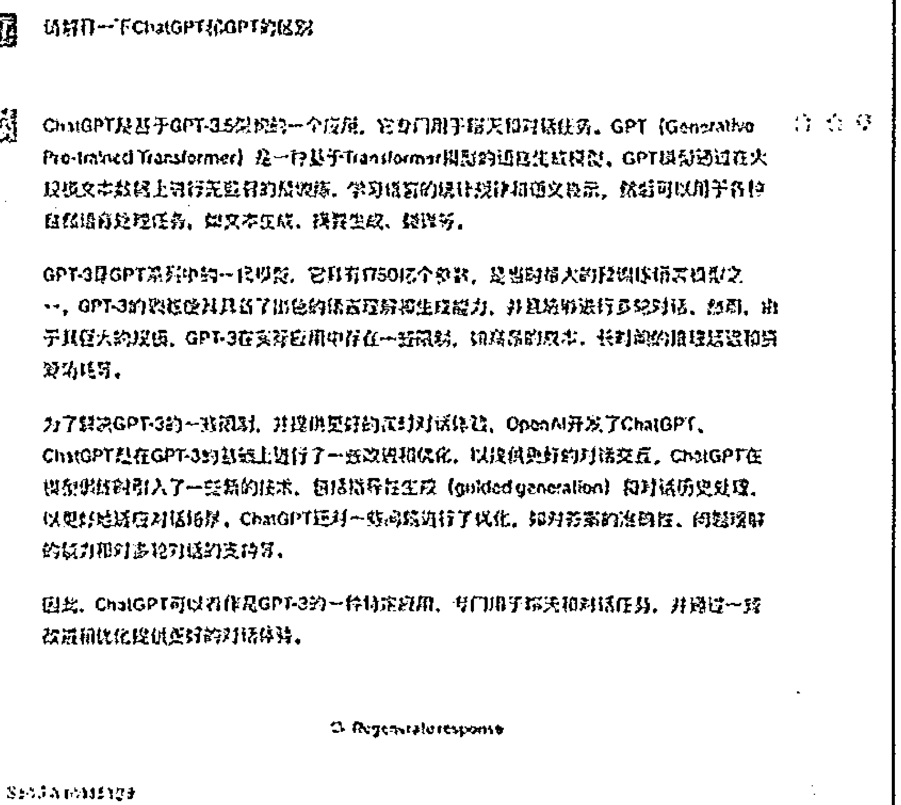

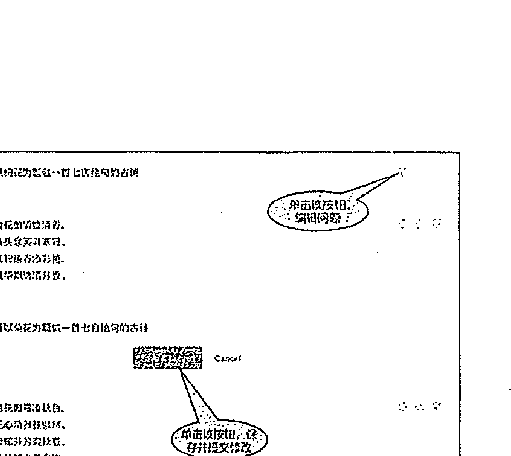
图1-14 ChatGPT 回答问题
图1-15 修改问题，保存并提交修改

如需开启新会话，点击对话页左上角 New chat 按钮即可。同一会话内模型会保留上下文，例如可继续追问：
请阅读前面我给出的两段文章，并给出中心思想。

# 1.5 如何向 ChatGPT 提问
本节系统介绍提问的原则与技巧，掌握后可做到问得准、问得巧、问得深。

## 1.5.1 提问设计原则
尽管可问任何内容，但要获得高质量回答，提问前的设计很关键。以下原则有助于提升答案质量。

- 清晰明了：问题要简洁完整，避免模糊冗长，确保模型准确把握意图。
- 符合语法：遵循规范表达，避免错别字与标点错误。
- 简洁扼要：提示词不宜过长或复杂，以免造成混淆。
- 具体明确：提供关键词或背景上下文，引导更精准回复。
- 避免歧义：少用模糊多义词，降低误解风险。
- 无假设信息：不要预设模型偏好或立场，避免误导方向。
- 尊重能力边界：问题应在模型知识与安全规则范围内，避免违规或超出能力范围。
- 考虑上下文：新问题应与前文对话保持关联，避免跳脱。
- 目标明确：提问应有清晰目的，避免无效提问。

表1-1给出了正反例对照。

| 问题设计原则 | 正例 | 反例 |
| --- | --- | --- |
| 清晰明了 | 你是如何学习人类的语言的 | 你怎么会说话 |
| 符合语法规则 | 你能写一首关于春天的诗吗 | 你能写一首春天的诗吗 |
| 简洁扼要 | 最佳旅游目的地是什么 | 我正在计划一次度假，我想知道最受欢迎的旅游目的地，最好是海滩或山脉地区，具有丰富的自然景观和文化遗产 |
| 具体明确 | 巴黎著名景点有哪些 | 我想了解法国的旅游景点 |
| 避免二义性 | 如何修剪玫瑰花丛 | 如何处理花园中的植物 |
| 没有假设性信息 | 请提供香蕉面包的食谱 | 我知道你最喜欢吃香蕉面包，所以请分享一个简单易做的食谱 |
| 尊重能力和限制 | 你能告诉我美国的首都是哪个城市吗 | 你能告诉我下一期彩票的中奖号码吗 |
| 考虑上下文 | 你觉得这首诗写得怎么样 | 你喜欢吃什么水果 |
| 有明确的目的和期望 | 你能帮我改进这段代码吗 | 你能说点什么吗 |

## 1.5.2 提问优化技巧
在遵循原则基础上，可用以下技巧进一步优化描述。

- 用特殊符号分隔指令与正文
在消息中用符号明确区分指令与内容，帮助模型更好识别意图。
示例：
请将冒号后面的文字翻译成英文；
开放源代码是指软件或计算机程序的源代码是公开可获取的，并且遵循开放的许可证，允许用户自由查看、使用、修改和分发源代码的一种软件模式。这意味着任何人都可以访问、研究、学习、修改和分享软件的源代码。

Open source is a software model where source code is made publicly available under an open license, letting users freely view, use, modify and distribute the code. This means anyone can access, study, learn, change and share the software source code.

- 补充背景信息
涉及特定情境时提供背景，能获得更相关的答案。
示例：
我是一名大学生，刚刚开始学习投资。我想要投资一些低风险的资产。您能给我一些建议吗？

针对初学投资且偏好低风险的情况，可以考虑以下方向。
1. 低风险通常伴随稳定但有限的回报，更适合长期保值。
2. 银行存款与储蓄账户：资金安全性高，流动性好，收益偏低。
3. 政府债券：由政府发行，承诺到期还本付息，波动较小。
4. 大盘价值股：市值较大、业绩稳健的公司股票，抗周期能力较强。

投资仍有风险，低风险并非零风险，决策前建议深入学习并咨询专业金融顾问。

- 提供示例
在问题中给出样例，可降低歧义并指引输出格式。
示例：
请列举一些健康的早餐选项，例如水果沙拉或燕麦粥。

常见健康早餐可参考：
+ 水果沙拉：新鲜时令水果切块，可配原味酸奶或少量蜂蜜。
+ 燕麦粥：燕麦片煮成粥，可加入牛奶、水果或坚果增添风味。
+ 全麦面包配水煮蛋：提供蛋白质、纤维与维生素。
+ 蔬菜蛋卷：菠菜、洋葱、彩椒与鸡蛋煎制后卷入全麦薄饼。

早餐宜兼顾蛋白质、膳食纤维、优质碳水与健康脂肪，具体选择依个人口味与需求而定。

- 设定情境
构建角色或故事情境，让模型在特定框架下作答。
假设我是一名古代的罗马工程师，我想要设计一个水道。你能告诉我应该考虑哪些因素吗？

作为古罗马工程师规划水道时，需要关注：
+ 1. 水源：确保附近有稳定充足的河、湖或地下水。
+ 2. 地形与高差：调研山地、平原、河谷等形态，规划合理落差保证水流。
+ 3. 走向与距离：明确供水目标点，确定路线长度与导向。
+ 4. 土壤与地质：分析土质类型与地质条件，必要时加固防止渗漏与坍塌。

5. 坡度与流速控制：水道的设计必须先确定合适的倾斜角度和流速数值，确保水体能够顺畅通过且不产生淤堵。若坡度过陡或过缓都会带来运行问题，务必通过专业工程论证来确定合理区间。

6. 安全与防护考量：需要提前规划水道的安全防护方案，避免外界干扰和水源被污染。通常要采取措施抵御侵蚀、防止人为破坏和非法倾倒垃圾等风险。

7. 清洁与维护便利：设计之初就应把后期保养纳入考虑，保证水道预留合理的进出通道，便于日常清理和检修作业。

8. 资源与预算评估：对可用的人力、材料和资金进行全面核算，判断方案的可行性与实施性。确保整体造价在可承受范围内，同时充分利用现有资源。

以上只是水道设计环节中的核心要点。实际操作中工程师必须开展深入研究与系统分析，并协同团队配合，才能交付出安全、可持续且高效的水系方案。

# 1.6 OpenAI 接口入门

# 5. 分步提问技巧

遇到复杂问题时，拆成若干小步骤逐个追问，比一次性求解更能拿到精准信息。

步骤 1：能通俗介绍一下量子计算是什么吗？
步骤 2：量子计算和传统计算有哪些差异？
步骤 3：量子计算未来可能在哪些领域落地？

步骤 1：量子计算是依托量子力学规律的计算模式，以量子比特为基本单元。经典计算的比特只能表示0或1，而量子比特可处于叠加态，并借助量子纠缠实现相互作用，从而在特定问题上获得更高的求解效率。

步骤 2：两类计算的差别体现在三点。其一，信息载体不同：经典用比特只能取0/1，量子用量子比特可同时兼顾0和1的叠加；其二，纠缠机制是量子计算的核心，多个量子比特可建立跨距离关联；其三，量子门可对多量子比特并行操作，形成并行计算优势，而经典逻辑门操作相对串行。

步骤 3：量子计算的潜在场景包括组合优化、分子模拟、机器学习、密码学以及量子仿真等。这些方向仍处早期，需要持续研发。随着技术迭代和算力提升，量子计算有望在多领域产生突破性创新。

# 16 API 使用与计费说明

除了在对话界面直接提问，还能通过 OpenAI API 调用 ChatGPT 的能力，API 按量计费，模型不同价格也不同，具体费率可在 OpenAI 官网查询。

API 中的用量以 token① 为计量单位，涵盖输入 token 和输出 token。输入 token 指提问消耗的数量，输出 token 指模型回复消耗的数量。以 gpt-3.5-turbo 为例

# 第1章 走进 ChatGPT 的世界

排序后的数组:

11 12 22 25 34 64 90

消耗的 token 数: 221

# Playground 实践：在线生成旅行计划

OpenAI Playground 是一个网页版演示环境，用来测试和体验 OpenAI 的语言模型。无需写代码即可在浏览器里与 GPT-3 交互，界面直观，输入提示词后即可查看模型生成的回答。入口在 OpenAI 官网。

进入 Playground 后，在输入框中填入图 1-18 所示的问题。

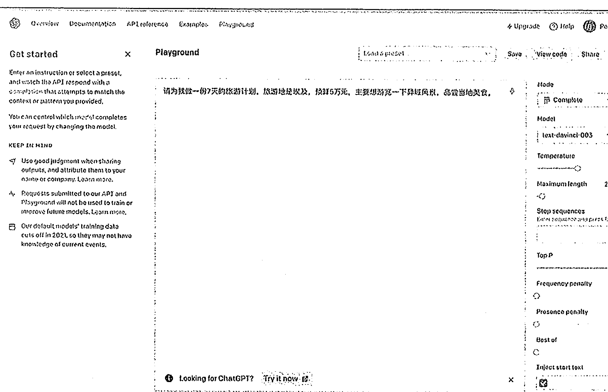

图 1-18 在 Playground 输入框中输入问题

在右侧面板调整参数后，点击 Submit 提交，片刻即可得到图 1-19 的结果。

# 图 1-19 回复

若回复过长或 Maximum length 设置过小，可多次点击 Submit 按钮继续拉取剩余内容。

# ChatGPT 生态全景

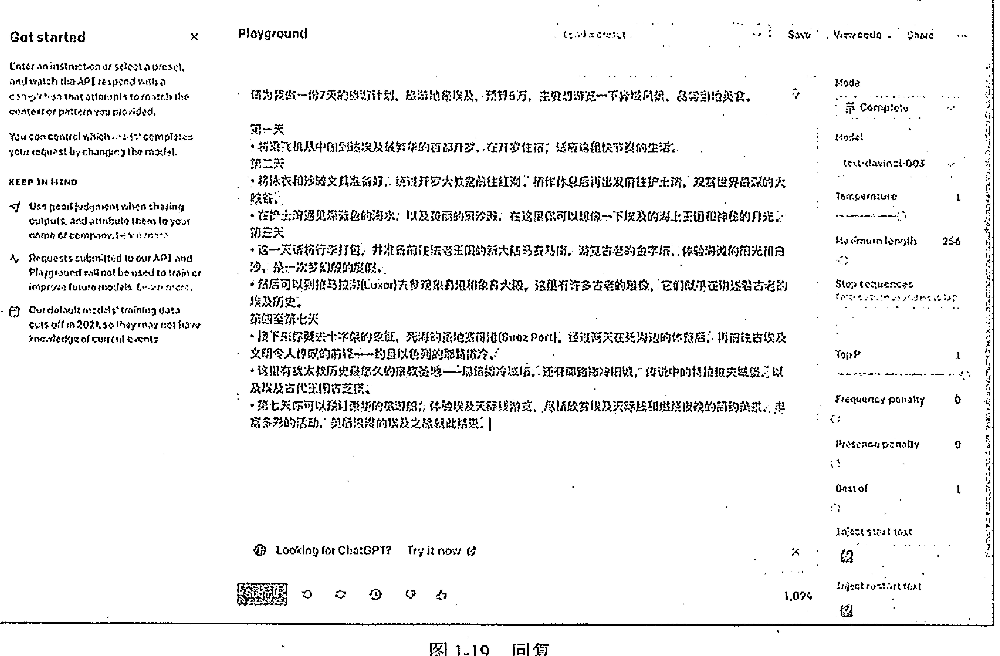

# ChatGPT 生态全景

本部分概括 ChatGPT 生态构成。生态里包括 ChatGPT 官方插件、浏览器端插件以及基于 OpenAI API 构建的大量第三方应用。

# 1.8.1 Plus 插件体系

ChatGPT Plus 插件是让语言模型接入外部工具与服务的新能力，提供信息获取和受控操作。OpenAI 于 2023 年 3 月 23 日推出该系统，目前仅 Plus 用户可用。主要功能为：

- 支持在对话中调用不同插件实现差异化功能与主题，例如模拟名人的表达风格，或协助用户完成写作、编程、学习等具体任务。

# 1.8.2 常用浏览器插件推荐

浏览器是 ChatGPT 的主要使用场景，因而衍生出大量辅助插件。代表产品有：

- ChatGPT ProBot：基于 ChatGPT 的 GitHub 机器人，可在 GitHub 页面审阅代码、重构代码，并进行实时问答。
- EditGPT：在线文本编辑器，支持用自然语言撰写和修改文章、邮件、简历等，兼容各类网页环境。
- Merlin：在线编程助手，支持自然语言生成和修改 Python、JavaScript、HTML 等代码，亦可在任意网页使用。

# 1.9 AIGC 工具速览

快速摘要：

- Tactiq：浏览器插件，可录制、转录并总结 Zoom 会议内容，摘要可保存至 Google 文档并分享。
- ChatGPT Writer：在线写作助手，用自然语言撰写邮件、消息、文章等，并提供修改优化建议。
- WebChatGPT：在线聊天机器人，支持与 ChatGPT 对话并联网检索信息。

# 1.8.3 API 生态下的典型应用

基于 OpenAI API 的应用是生态中最庞大的部分，代表项目包括：

- DALL·E：图像生成系统，支持用自然语言描述并绘制不同风格和主题的图片，如动物、食物、建筑。
- CLIP：图像识别系统，支持用自然语言检索和分类图片，覆盖英语、中文、医学、艺术等多语言多领域。
- GitHub Copilot：基于 Codex 模型的代码补全工具，提供 AI 编程辅助、智能建议和错误检测。
- Notion AI：基于 OpenAI API 的效率工具，优势如下：
  □ 智能生成摘要、行动项和重点，整理杂乱笔记；
  □ 改善写作，修正拼写语法、跨语言翻译、调整语气风格与长度、解释专业术语；
  □ 解决写作瓶颈，可提供首稿或续写；
  □ 功能完整，覆盖大部分写作需求。
Notion AI 采用与 ChatGPT 同源的 GPT-3 模型，输出文本或数学内容。当前支持英语、韩语、日语、法语、德语、西班牙语和葡萄牙语，并拥有活跃的用户社区。

# 19 同类生成式 AI 产品盘点

本节介绍与 ChatGPT 同级的其他 AIGC 产品。

# 第1章 走进 ChatGPT 的世界

# 1.9.1 微软 New Bing 解析

New Bing 是微软推出的一款新一代搜索引擎，支持自然语言提问并给出完整答案，还提供引用、对话与创作能力。可通过 Bing 官网访问，需注册微软账号。

New Bing 基于 GPT-4 模型构建，但并非 ChatGPT Plus。两者主要差异：

- 功能定位：ChatGPT 定位为 AI 聊天机器人，提供基于 GPT-4 的智能对话体验，可根据上下文互动，并生成代码、邮件、脚本、文案、翻译、论文等。New Bing 定位为搜索引擎，可直接用自然语言问答，并据关键词自动生成文章段落。
- 版本与表现：ChatGPT 使用正式版 GPT-4，常识与推理能力更强，生成内容更准确。New Bing 使用测试版 GPT-4，表现不够稳定，复杂代码生成错误率较高，整体不及免费版 ChatGPT，但可通过多次生成降低失误。
- 数据与安全：ChatGPT 当时无法实时联网，只能依赖训练数据①，实时性较弱。New Bing 可实时抓取网络数据并提供来源引用，在时效场景占优。OpenAI 投入约 6 个月提升 ChatGPT 的安全性与准确性，而微软对 New Bing 的安全对齐改进未作明确说明。

总体看，两者均基于生成式 AI，可根据自然语言输入产生回复，但在定位、模型成熟度、数据时效与安全上各有侧重。

> ① 2023 年 5 月，OpenAI 为 ChatGPT Plus 推出联网插件，可获取最新数据，属于补丁式方案。未来有望实现像 New Bing 一样的实时联网能力。

# 1.9.2 Anthropic Claude

Claude 由 Anthropic 开发，可执行对话与文本处理任务，注重可靠性与可预测性。能根据关键词或主题自动生成文章段落，并依据用户反馈自我优化。可通过 Slack 网站使用，创建工作区即可免费体验。

# 1.9.3 谷歌 Bard

Bard 是谷歌的实验性生成式 AI 服务，用于与 AI 协同工作，提升效率并激发灵感。支持根据提示生成代码、邮件、脚本、文案、翻译、论文等内容，并可根据反馈调整优化。需通过 Google 官网访问，使用 Gmail 账号登录。

# 1.9.4 百度文心一言

文心一言是百度研发的大语言模型，可依据关键词或主题生成文章段落。优势在于快速生成新闻、故事、诗歌、广告等多种类型与风格的文本，并支持多语言多领域。

# 1.9.5 阿里通义大模型

通义大模型由阿里巴巴推出，具备写作、作诗、编程等能力。基于自研深度学习框架 MNN 与自研芯片含光 800 的高性能计算平台，并结合阿里内部海量数据与知识构建。

# 1.9.6 腾讯混元大模型

混元大模型由腾讯开发，特点是训练成本低、响应速度快。基于自研框架太极与自研芯片星光 100 的计算平台，并利用腾讯内部数据资源训练。

# 1.9.7 华为盘古大模型

盘古大模型由华为打造，涵盖基础大模型及 NLP、视觉、气象等垂直大模型。基于自研框架 MindSpore 与自研芯片昇腾 910 的高性能平台，并结合华为内部数据与知识资源。

# 第1章 走进 ChatGPT 的世界

# 1.9.8 复旦 MOSS

MOSS 是复旦大学邱锡鹏团队研发的对话式大语言模型，功能类似 ChatGPT，已开源。基于 PyTorch 开源框架与公开数据集构建。

# 1.10 如何鉴别回复的真伪

# 1.10.1 重复提问法

ChatGPT 每次回答存在波动，可利用该特性多次追问同一问题。若 3 次及以上提问得到大意一致的答案，可靠性较高；若答案差异极大甚至自相矛盾，则很可能有误。注意每次提问需开启新会话，避免上下文记忆导致结果趋同。

示例：

武则天是哪一年登基做皇帝的？登基那一年的年号是什么？只回答我问的问题，不要回答多余的内容。武则天于 690 年登基做皇帝，那一年的年号是天授。

若在不同会话中多次提问均得到 690 年和“天授”，则可认为回答可信。

# 1.10.2 多模型交叉验证

利用多个生成式 AI 互相校验是有效验证手段，具体做法有两种：

- 在一个模型中提问并获取回复，再用其他模型验证该回复的正确性；若多方认可，则可信度提升。
- 在多个模型中问相同问题，若答案基本一致，则结论更可靠。

不同模型在训练数据与算法上存在差异，若结论高度一致或互相认可，胡说八道的概率较低。但若互联网原始数据本身错误，则多模型可能共同输出错误信息。

示例：

将 1.10.1 节的问题回复分别输入 New Bing 与 Claude 验证，得到如图 1-26、图 1-27 的结果。

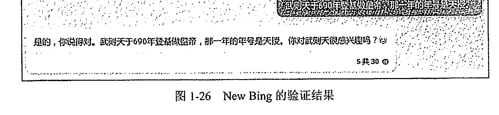

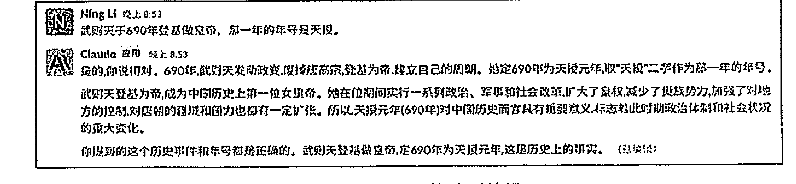

图 1-28 与图 1-29 是分别向 New Bing 与 Claude 提问同一问题的回复。


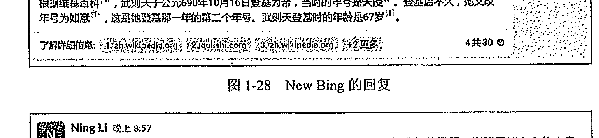

# 第 1 章 走进 ChatGPT 的世界

两种交叉验证均通过，说明该回复基本准确。若仍存疑，可通过 New Bing 给出的来源链接进一步查证。

# 111 小结

读完本章的读者应已感受到 ChatGPT 的丰富功能与使用技巧。这只是整体的冰山一角，本章仅作概览，未涉及各领域的深度应用。后文将逐步揭开 ChatGPT 的面纱，其背后蕴含的是智慧之力。

# 第2章 GitHub Copilot 编程自动化之旅

ChatGPT 能生成完整代码，但在集成开发环境中无缝协作仍不够便捷，尤其在片段补全、函数定义补全等场景。此时 GitHub Copilot 是更合适的选择。最佳实践是两者结合：用 ChatGPT 规划整体方案，再用 Copilot 进行细节微调。本章将介绍 Copilot 的概念、安装验证方法、自动化编程实践及常用配置。

# 2.1 初识 Copilot

本节会围绕 GitHub Copilot 做一个系统梳理，涵盖它是什么、底层模型如何构成、能力有哪些，以及从注册 GitHub 账号到订阅、取消订阅，再到在主流 IDE 中安装验证的完整流程。

# 2.1.1 认识 Copilot

GitHub Copilot 本质上是一个 AI 编程助手，并不是一个独立的编辑器，而是以插件形态接入大家常用的集成开发环境，比如 Visual Studio Code、JetBrains 系列和 Visual Studio。编码时，它会根据变量命名、代码上下文给出提示，甚至直接补全整段代码。Copilot 由 GitHub 与 OpenAI 联合打造，训练素材来自 GitHub 上公开仓库的数十亿行代码。

它对多种语言和框架都有覆盖，Python、JavaScript、TypeScript、Ruby、Go、C#、C++ 等场景下体验尤其好，能帮开发者快速落地函数、单元测试、循环结构、API 调用等常见任务。

Copilot 的底层是 Codex，而 Codex 本身是在 GitHub 公共代码库上继续训练出来的。Codex 属于基于 GPT-3 的新一代 AI 系统，GPT-3 是一种能根据简单提示生成文本序列的语言模型。

# 2.1.2 Codex 与 GPT-3 的差异

Codex 和 GPT-3 最大的分水岭在于训练数据的侧重点。Codex 投喂了大量代码数据，代码生成能力因此显著提升。两者在算法层面相近，都是基于 Transformer 的自回归语言模型，使用同一套分词器和优化器。区别主要在模型规模和数据构成上。

Codex 提供了 4 个不同规格的模型，按能力由高到低、速度由慢到快分别是 Davinci、Curie、Babbage、Ada。训练语料包含自然语言和来自公开渠道的数十亿行源代码，涵盖公共 GitHub 仓库和网络收集的代码。

因此 Codex 可以看作 GPT-3 的进阶版，同属深度神经网络语言模型，但它在自然语言与代码双轨上完成训练，能够胜任自然语言到代码的转换任务。GPT-3 虽然也能写代码，但缺乏针对性的代码训练，在实际效果上往往不及 Codex。

# 2.1.3 Copilot 核心功能

Copilot 的主要能力可以归纳为以下几点。

+   * 智能化、高质量且多样化的代码建议：结合上下文和注释，提供行级或函数级的补全建议，加速编码。模型学习自 GitHub 的数十亿行代码及互联网源码，因而建议质量较高且风格多样。
+   * 多语言多框架支持：覆盖多种语言和框架，Python、JavaScript、TypeScript、Ruby、Go、C#、C++ 等使用体验突出。
+   * 个性化可配置：可按个人编码习惯微调，也能在不同环境中调整配置项，例如是否允许匹配公共代码的建议、是否开启重复检测等。
+   * 类自动补全的内联提示：在编写过程中实时给出内联建议，操作上类似自动补全但更灵活，可用 Tab 接受或拒绝，也可用上下箭头浏览多条候选。

# 2.1 初识 Copilot

建议，也能使用上下键在不同候选间切换。

+   - 生成与重构测试代码：只需用注释描述要测试的内容，Copilot 就能生成对应的测试用例；用自然语言描述改造意图，也能帮助重构以提升可读性和质量。
- 支持基于语义的搜索：根据上下文和意图检索相关代码片段或文档，触发方式如 Ctrl+Shift+Enter，随后输入查询关键词即可返回匹配结果。

# 2.1.4 创建 GitHub 账号

使用 Copilot 前必须先拥有 GitHub 账号。打开官网，用自己的邮箱注册即可，如图 2-1 所示。

点 Continue 完成邮箱校验，校验通过后会进入一系列验证信息，如图 2-2 所示。


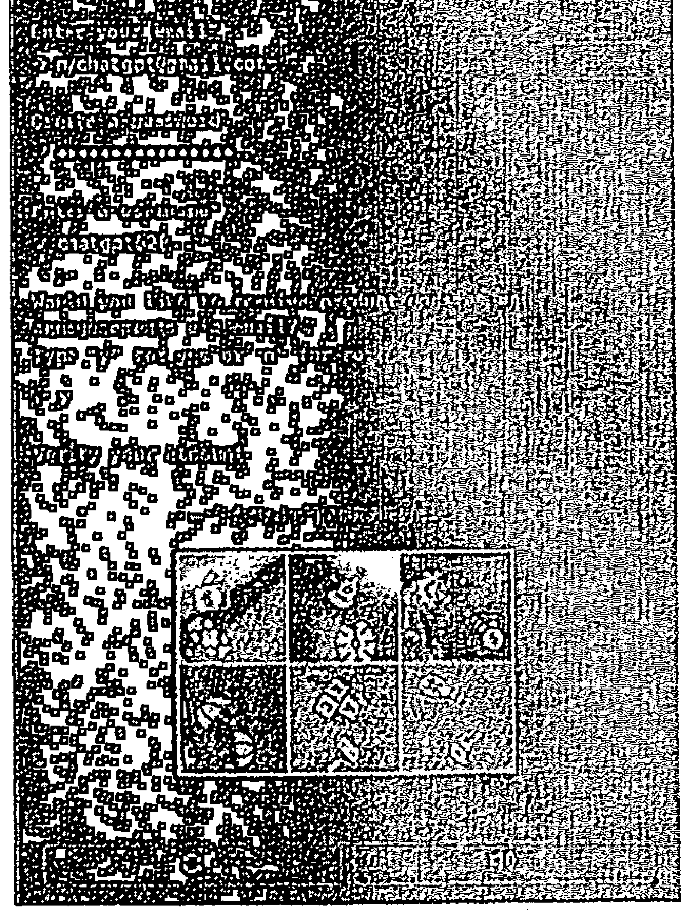

逐项验证完成后页面底部会出现 Create Account 按钮，点击即可完成注册。

# 2.1.5 开通 Copilot 订阅

注册并登录后，进入 Copilot 页面进行订阅。订阅成功后即可看到 Copilot 首页，如图 2-5 所示。

Copilot 共有两种订阅方案——面向个人的 GitHub Copilot for Individuals 和面向企业的 GitHub Copilot for Business。两者在代码处理能力上完全一致，主要区别在于：

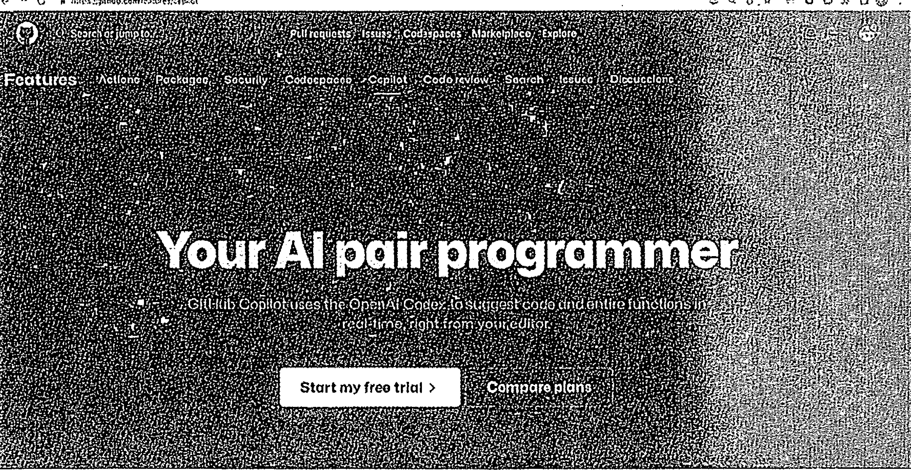

+   * 价格：个人版每月 10 美元或每年 100 美元，企业版每个用户每月 19 美元。
* 账户类型：个人版只能用 GitHub 个人账号，企业版可通过组织或企业账号使用。
* 访问管理：个人版由使用者自行管理，企业版可由组织或企业管理员统一管理。
* 支持范围：两者均支持多种语言和框架，企业版额外支持通过自签名证书的 VPN 代理访问。
* 免费试用：个人版提供 30 天免费试用期，期间取消则不产生费用。

# 2.1 初识GitHub Copilot

若未在试用期内取消，将从信用卡扣款。


图2-6 选择个人订阅的类型


图2-7 个人订阅和企业订阅


# 2.1.6 取消订阅 GitHub Copilot

仅想体验不想长期使用时，务必在 30 天内完成取消，具体步骤如下。

(1) 进入 GitHub 首页，点击右上角用户头像，在菜单中选择 Settings。

(2) 在设置页左侧选择 Access→Billing and plans→Plans and usage，右侧会显示对应页面。

# 2.2 安装和验证 GitHub Copilot

(3) 页面中间找到 Edit 下拉列表，点击 Cancel trial 即可取消订阅，如图 2-9 所示。

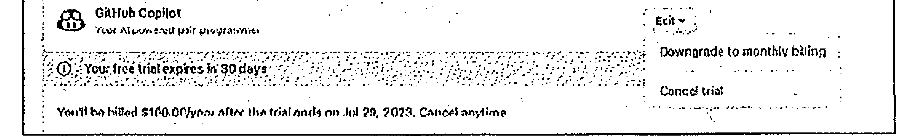

# 2.2 安装和验证 GitHub Copilot

本节说明在不同 IDE 中安装并验证 Copilot 的方法，包含 Visual Studio Code、IntelliJ IDEA 和 Visual Studio。Copilot 为 VS Code 和 IntelliJ IDEA 提供插件，为 Visual Studio 提供扩展，可实现多语言代码补全与自动生成。

# 2.2.1 在 Visual Studio Code 中安装和验证 GitHub Copilot

打开 VS Code，点击左侧扩展图标，在搜索框输入 GitHub Copilot 找到对应扩展，如图 2-10 所示。

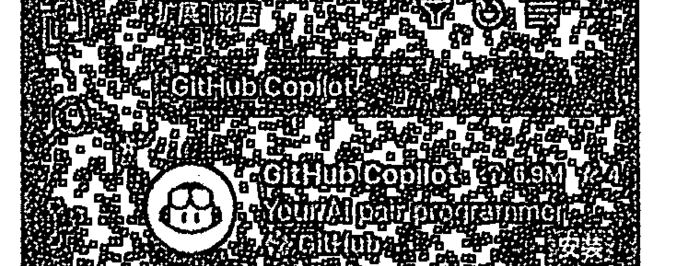

点击安装按钮完成安装。安装成功后扩展页面如图 2-11 所示。

测试可用性前，先关闭所有 VS Code 实例再重启。首次使用时 VS Code 会弹出 GitHub 登录提示，如图 2-12 所示，这是因未登录所致。

点击 Sign in to GitHub 按钮，若出现图 2-13 的对话框，点击 Allow 确认登录。

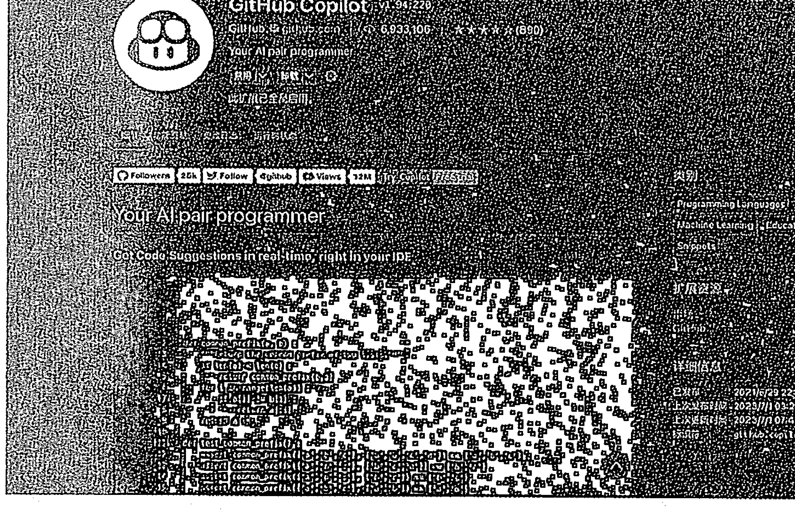


图2-11 GitHub Copilot扩展的页面

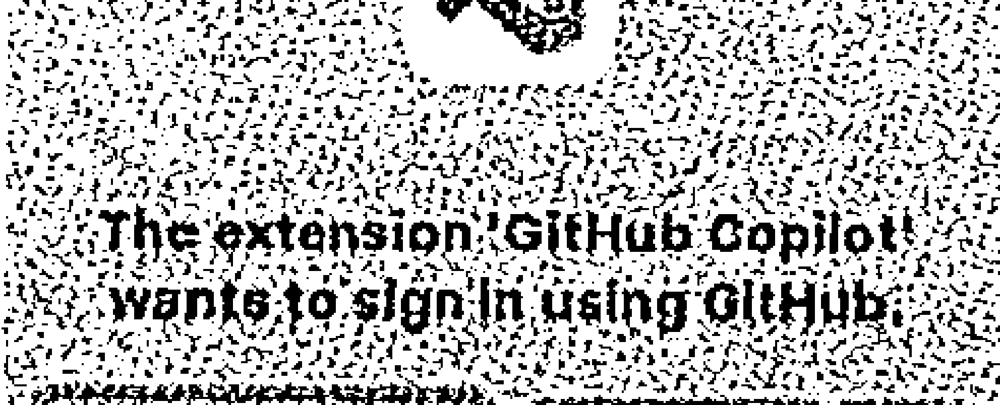

图2-12 要求登录GitHub的消息框


点击 Allow 后会跳转到浏览器，出现 GitHub 登录页，输入账号密码后点击 Sign in。

登录成功后浏览器会询问是否使用 VS Code 打开链接，勾选“一律允许******vscode****打开vscode链接”后点击“打开链接”。

回到 VS Code 会弹出如图 2-16 的对话框，勾选 Don’t ask again for this extension 以免反复出现，点击 Open 打开 URI。

若未出现错误提示，则说明已成功登录 GitHub 且 VS Code 的 Copilot 扩展已就绪。

# 2.2 安装和验证 GitHub Copilot

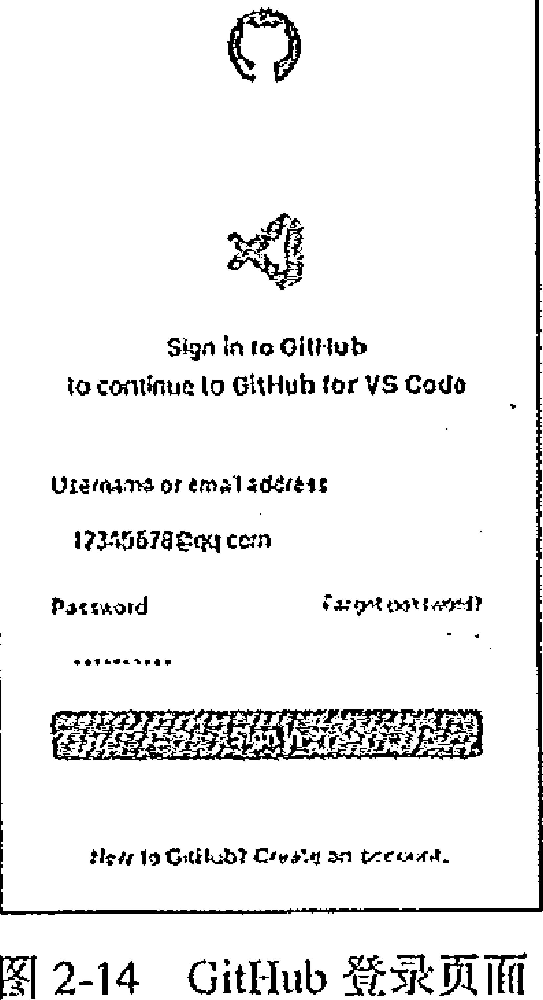

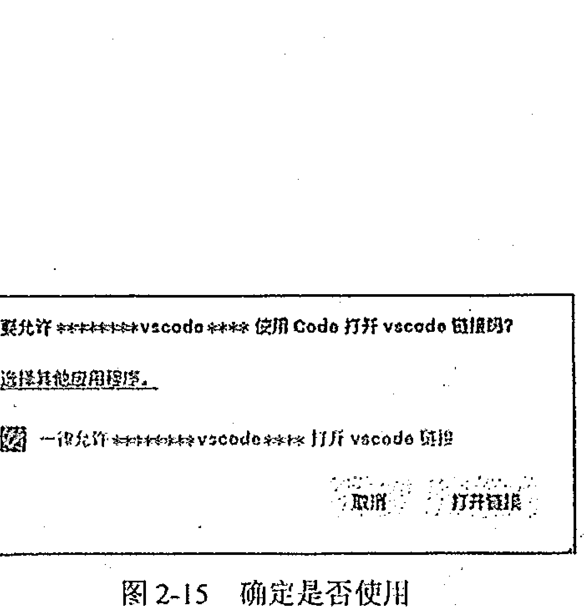

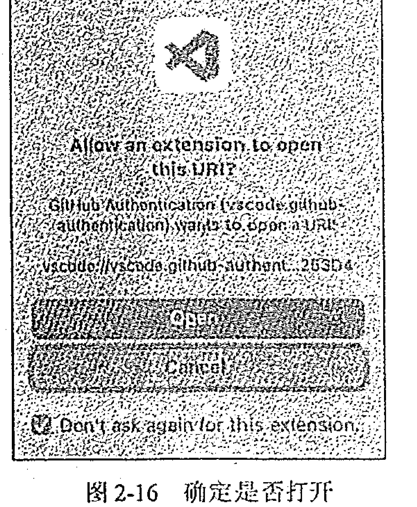

接下来验证扩展是否可用。Copilot 的主要功能是代码补全，其中一种方式是通过注释触发。先写一行注释回车，通常 1-2 秒后会出现函数头提示，按 Tab 可确认，提示不会直接写入文件，只有按下 Tab 才落盘。

在 VS Code 中新建 copilot.py，随后输入注释。

```
# 编写冒泡排序算法
```

输入后按 Enter，稍等片刻即可生成函数头，如图 2-17 所示。未出现时可按 Tab 触发。注意生成式 AI 的输出每次可能不同。


按 Tab 将代码写入文件，再按 Enter，Copilot 会继续生成冒泡排序的完整实现，如图 2-18 所示。

最后按 Tab 插入即可，如图 2-19 所示。到此已用 Copilot 完整生成了一个 Python 版冒泡排序程序，说明安装成功。

# 2.2.2 在JetBrains IDE中安装GitHub Copilot

Copilot 提供了 JetBrains 插件，可在以下 IDE 家族中使用：IntelliJ IDEA 旗舰版、社区版、教育版；Android Studio；AppCode；CLion；Code With Me Guest；DataGrip；DataSpell；GoLand；JetBrains Client；MPS；PhpStorm；PyCharm 旗舰版、社区版、教育版；Rider；RubyMine；WebStorm。

下面以 IntelliJ IDEA 为例，其他 IDE 安装流程相同。

在 Windows 或 Linux 版 IntelliJ IDEA 中，通过 File→Settings 打开设置对话框，macOS 版选择 Preferences。

(2) 在设置对话框左侧选择 Plugins。

(3) 顶部搜索框输入 GitHub Copilot，找到对应插件，如图 2-20 所示。

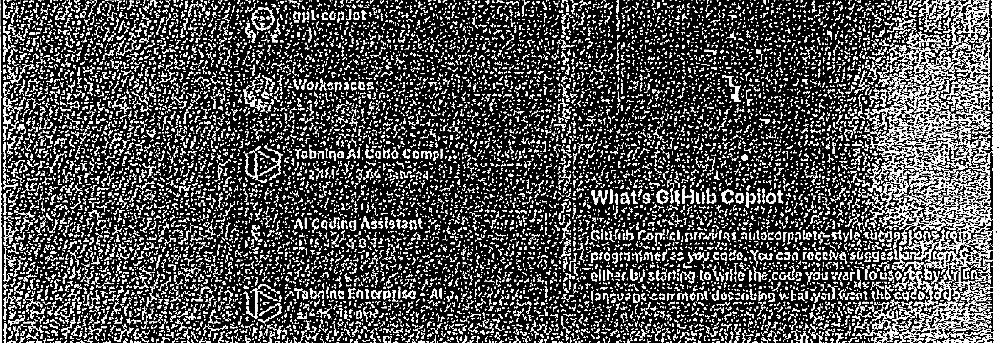

图 2-20 搜索 GitHub Copilot 插件

(4) 点击 Install 安装，安装完成后重启 IDE。

(5) 重启后从菜单 Tools→GitHub Copilot→Login to GitHub 打开登录对话框，如图 2-22 所示。

# 第2章 自动化编程：GitHub Copilot的奇妙之旅


图2-21 选择 Tools→GitHub Copilot→Login to GitHub 选项


图2-22 Sign in to GitHub 对话框

(6) 点击 Copy and Open 复制设备码并打开 Device Activation 页面。

(7) 在激活页粘贴设备码，点击 Continue，完成设备激活，如图 2-23 所示。

(8) 在弹出的页面点击右下角 Authorize GitHub Copilot Plugin 授权插件使用 GitHub 账号，如图 2-24 所示。授权成功后浏览器会显示图 2-25 的页面。

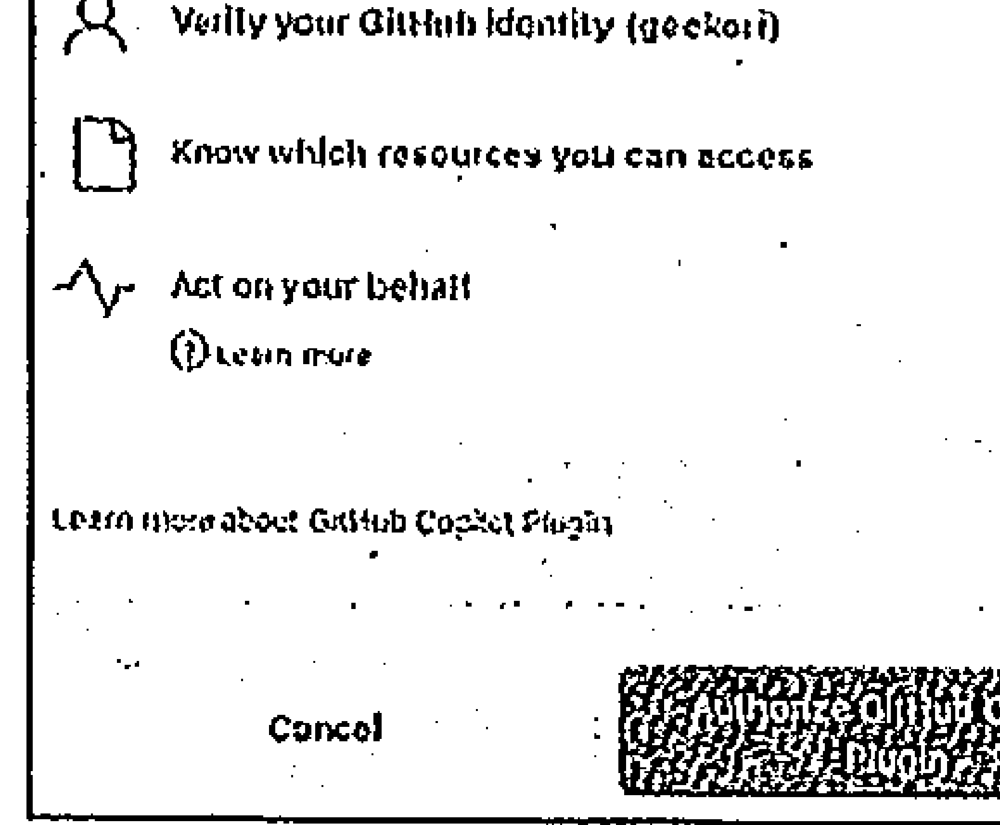

图2-23 激活设备


图2-24 授权 GitHub Copilot 插件使用 GitHub 账户


图2-25 授权成功

同时，IDEA 右下角会弹出图 2-26 所示的提示，表示 Copilot 插件已通过 GitHub 账号登录。


图2-26 GitHub Copilot 登录成功

# 2.2 IntelliJ IDEA 安装与验证

在 IDEA 完成插件安装并登录后，可进行效果验证。新建一个名为 Copilot.java 的文件，在其中的 Copilot 类里加入如下注释：

// 编写实现冒泡排序算法的方法

随后按下 Enter，稍作等待，Copilot 就会在下方给出图 2-27 所示的代码补全。按下 Tab 即可把这段代码写入 Copilot.java。


图 2-27 在 IntelliJ IDEA 中自动生成代码

# 2.2.3 Visual Studio 安装指南

Copilot 提供了 Visual Studio 的扩展，可为 C#、C++、Python 等语言提供补全与自动生成能力，前提是 Visual Studio 版本不低于 2022 17.4.4，否则在扩展管理中检索不到 Copilot 扩展。建议先检查版本号，不足时升级至最新版。

安装与登录流程如下：

(1) 启动 Visual Studio，从顶部菜单依次选择“扩展”→“管理扩展”，如图 2-28。

(2) 在“管理扩展”窗口左侧切换到“联机”，在右上角搜索框输入 GitHub Copilot，定位到对应扩展后点“下载”，如图 2-29。


(3) 安装需要重启 VS。关闭后会弹出图 2-30 的 VSIX Installer 窗口，点击 Modify 开始安装 Copilot 扩展。

(4) 安装进度如图 2-31 所示，成功后会显示图 2-32 的提示。

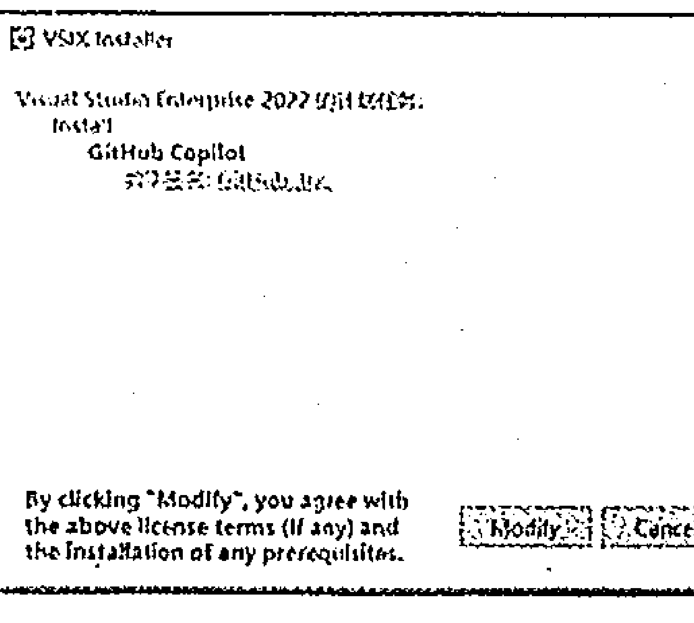


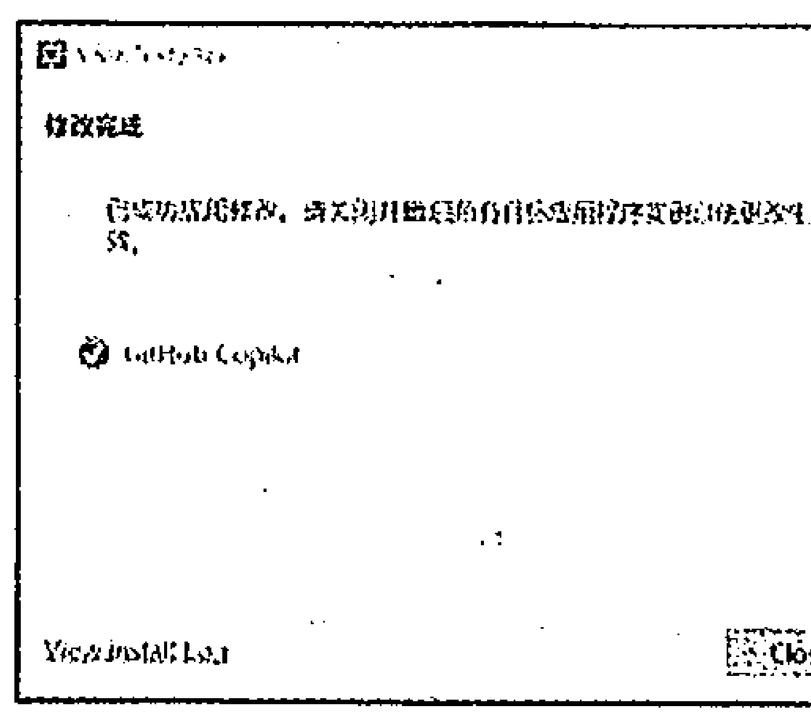

(5) 重新打开“管理扩展”，左侧选“已安装”，在搜索框输入 GitHub.Copilot 即可找到已安装的扩展，如图 2-33。此时可点“禁用”或“卸载”。

(6) 在 VS 左下角能找到图 2-34 所示的小图标，默认白色带斜线，位于“100%”右侧，它是 Copilot 扩展的控制入口。


(7) 点击该控制按钮，在弹出的菜单中选择 Add GitHub account，见图 2-35，开始绑定 GitHub 账号。

(8) 随后弹出图 2-36 的登录对话框。

(9) 点击中间的“添加”，会展开图 2-37 的下拉菜单。


(10) 选择 GitHub 选项，浏览器会打开图 2-38 的 GitHub 登录页，输入账号密码点 Sign in 完成登录。

(11) 登录成功后浏览器显示图 2-39 的授权页。

(12) 点击 Authorize github 按钮授权使用。授权成功后浏览器会呈现图 2-40 的成功页面。


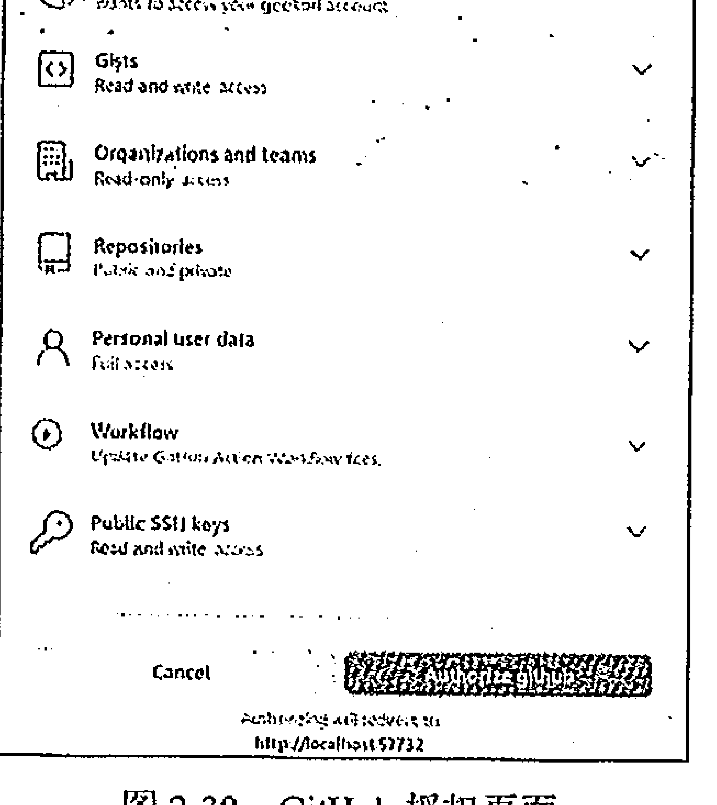


至此，VS 扩展安装完成并已用 GitHub 账号登录。新建一个 C# 项目，也可使用其他语言，在源文件中写入如下注释：

```
// 编写冒泡排序算法
```

按 Enter 等待片刻，Copilot 会在注释下方生成 C# 版冒泡排序实现，如图 2-41。按 Tab 即可把代码插入当前位置。

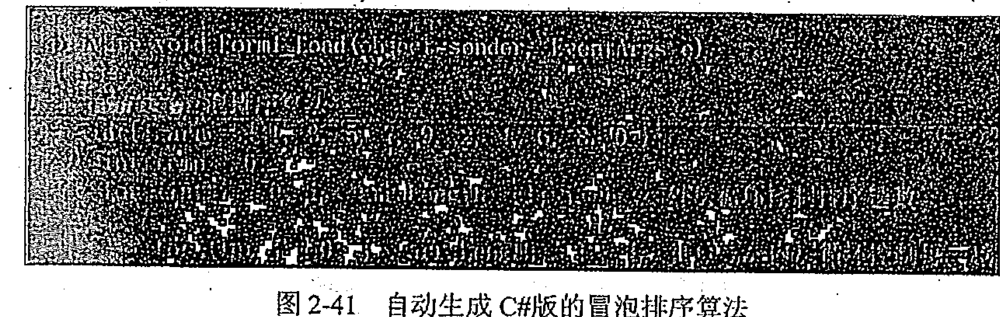

# 2.3 自动化编程实践

本部分梳理 Copilot 的核心卖点，重点在代码生成与代码检测。它无法完全替代人工，但在提升准确性和效率方面很有帮助。以下示例以 Visual Studio Code 与 Python 展开。

# 2.3.1 注释智能补全

Copilot 能像联想一样补全注释，输入前半句即可推断整句。例如输入：

# 编写一个程序，按力序

Copilot 会自动续写剩余部分，如图 2-42。若续写不符合预期，直接继续输入即可；若符合预期，按 Tab 插入即可。


# 2.3.2 函数名驱动代码生成

根据函数或方法名，Copilot 能自动补齐参数列表和函数体实现。例如开始输入：

def mergeList(

即可触发补全。

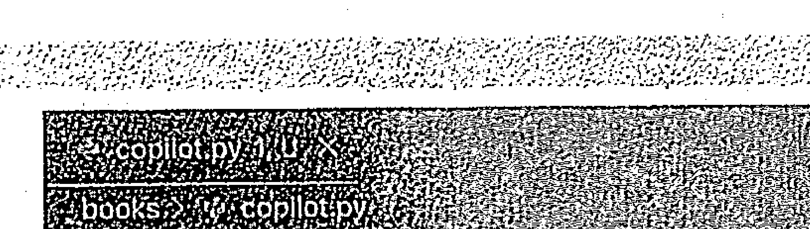

# 2.3.3 一键生成测试用例

Copilot 具备上下文感知能力。若要在 mergeList() 下生成测试代码，只需在函数下方写注释：

# 测试mergeList()函数

按下 Enter 后，Copilot 会自动给出测试代码，如图 2-44。按 Tab 插入即可。

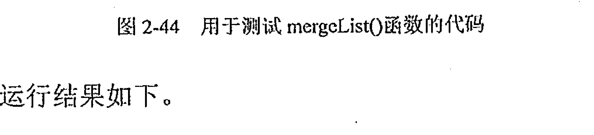

运行后输出为：

[1, 2, 3, 4]

# 2.3.4 空白处推断生成

有时 Copilot 会为尚未存在的函数生成实现。例如输入：

def mergeMultiList(

它能推断出意图是合并多个列表，于是生成图 2-45 所示的代码。

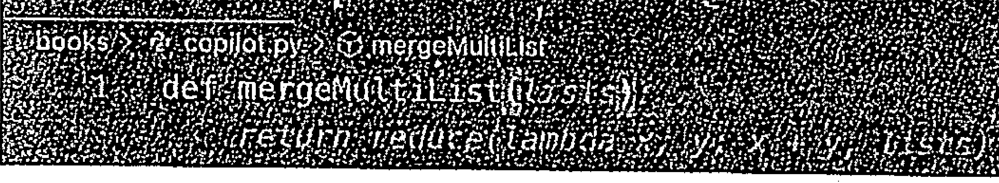

图2-45 mergeMultiList()函数的代码

# 2.3.5 逐步构建测试场景

若觉得 2.3.4 的测试过于简单，可分步构建。例如先输入注释：

# 定义 5 个列表变量，并初始化，每个列表包含 2 到 10 个元素

Copilot 会逐个生成列表，需要反复按 Enter，必要时按 Tab 触发下一个。

生成完 5 个列表后，再输入：

# 调用

仅两个字的提示，Copilot 已能猜到意图，并自动补全为：

# 调用 mergeMultiList() 函数，将 5 个列表合并为一个列表

按 Tab 确认注释后，再按 Enter 即可生成调用 mergeMultiList() 的代码；再按 Tab 插入，再按 Enter 则会自动生成输出结果的代码。整体流程如图 2-48。

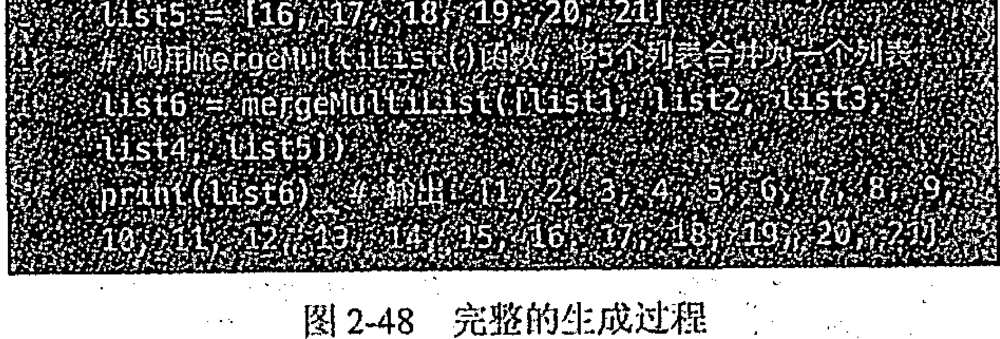

这种分步思路适用于测试用例，也适用于构建任意复杂程序。

# 2.3.6 语句骨架自动补齐

当对某语句语法不熟或结构复杂时，可让 Copilot 补全骨架。例如输入：

for -i

Copilot 会补成完整的 for 结构，如图 2-49。

若需要 if 语句，输入 if 也能自动补全剩余部分，如图 2-50。

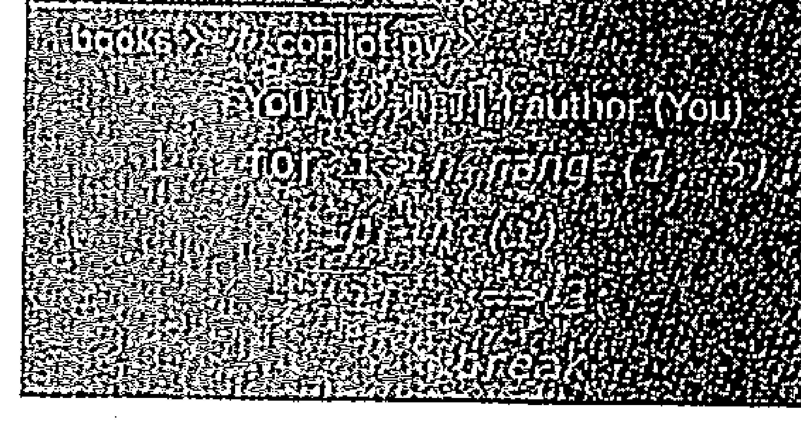


# 2.3.7 多方案并行预览

使用 Tab 逐行生成对于复杂代码较繁琐。例如输入下面的注释。

```
# 用flask实现一个服务端程序，只支持GET请求，请求的参数是一个字符串，返回一个字符串。
```

按 Enter 后再按 Tab，只能得到一行，需要不断重复操作且易出错。Copilot 支持多候选方案：注释后按 Ctrl+Enter，会打开方案选项卡，默认列出 10 个候选，如图 2-51。

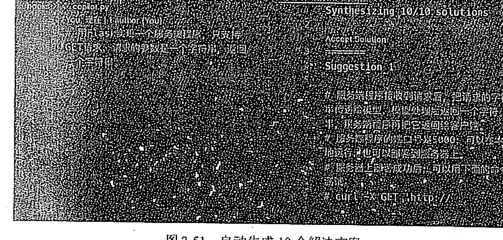

浏览后，若某方案合适，点击 Accept Solution 即可将全部内容插入源文件 copilot.py 的注释下一行，选项卡随即关闭。

若想调整默认方案数，可进入 VS Code 设置，搜索 Copilot 相关高级配置。

# 第2章 GitHub Copilot 自动化编程全攻略

以及如何修复发现的安全漏洞。每次检测结果可能不同，图2-53 为其中一种示例，可见 Copilot 已正确识别 SQL 注入漏洞并给出修复建议。


图2-53 检测和弥补安全漏洞

若不想逐行生成代码和注释，可在注释后直接按 Ctrl+Enter，弹出 Copilot 选项卡并列出若干漏洞检测结果，图2-54 默认展示 10 条。该类检测无需直接写入代码，提示大致位置即可，漏洞的最终修复仍需人工确认。检测难、修复相对容易，正是 Copilot 的优势所在。先用 Copilot 定位可疑点，再人工核验修复，可大幅提升效率。

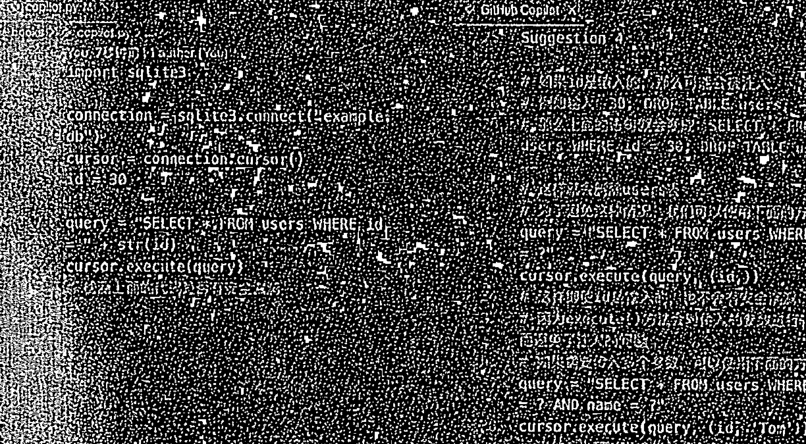

图2-54 生成多种检测安全漏洞的方案

# 2.3 自动化编程

# 2.3.9 跨语言代码转换

Copilot 支持跨语言转换。图 2-55 左侧为 Python 实现的冒泡排序函数 bubble sort，在其下方添加注释后按 Ctrl+Enter，Copilot 选项卡会列出 10 种转换方案，如图 2-55 右侧。用户可挑选一种方案复制到 Java 文件中，当前场景下不能直接插入，否则仍会写入 Python 文件。

```
```

> // 将上面的 Python 代码转换为 Java 代码

> // 将前面注释中的 Python 代码转换为 JavaScript 代码

# 2.3.10 注释内代码转换

也可把待转换代码放在注释中，然后在该注释后另起一行写：

> // 将前面注释中的 Python 代码转换为 JavaScript 代码

按 Enter 和 Tab，Copilot 会把注释中的代码转为当前文件语言的代码。例如图 2-56 中，注释里的 Python 代码被转为 JavaScript，因为文件 copilot.js 被识别为 JavaScript 文件，故在注释后生成对应代码。

[PAGE 64]

# 第2章 GitHub Copilot 自动化编程全攻略

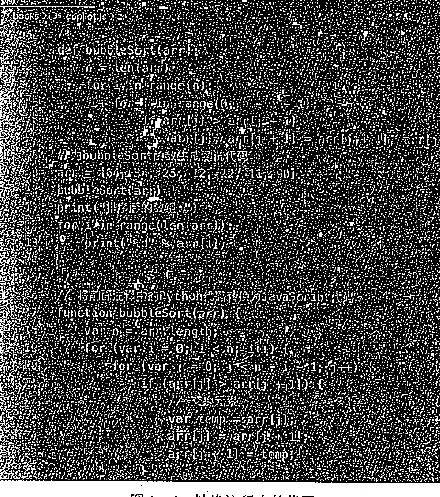


# 2.3.11 Labs 一键跨语言转换

GitHub Copilot Labs 是个试验性质的扩展，里面集成了不少前沿尝鲜功能。要用上这些能力，先在 Visual Studio Code 里装上对应的 Labs 插件。打开 VS Code 的扩展市场搜索 GitHub Copilot Labs，就能看到该插件在结果里，如图2-57 所示。未安装时点一下 安装 即可完成部署；已装好的话安装按钮不会出现，直接忽略即可。

装好插件后，点击活动栏最底部的 Labs 图标，就能进入 Labs 工作台，如图·2-58 所示。上半区负责转换设置，下半区则是各类代码画笔。

在编辑器里框选想转换的代码，选区会自动同步到 Labs 面板顶部，随后指定目标语言，再点一下 Ask Copilot 按钮启动转换，转换结果会即时出现在按钮下方，如图 2-59 所示。

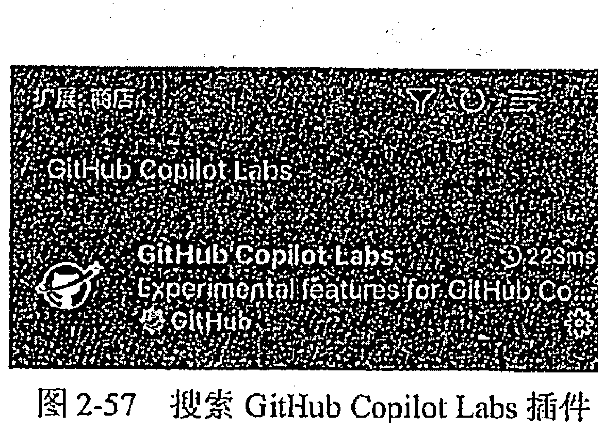

[PAGE 65]

# 2.3 自动化编程

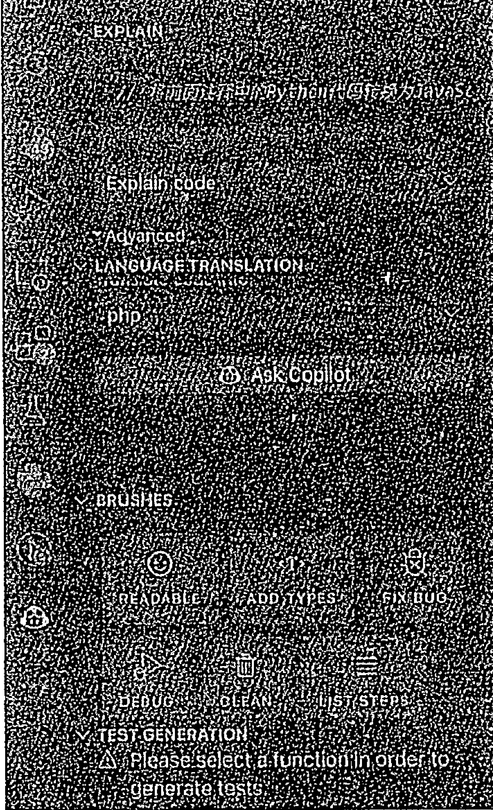

图 2-58 GitHub Copilot Labs 界面


图 2-59 使用 GitHub Copilot Labs 进行代码转换

[PAGE 66]

# 第2章 自动化编程：GitHub Copilot的奇妙之旅

# 2.3.12 Labs 自动补充分步注释

Labs 面板下半区提供了一个 LIST STEPS 控件。选中一段代码后按下该控件，系统会自动为这段代码加上实现要点的注释，如图2-60所示。

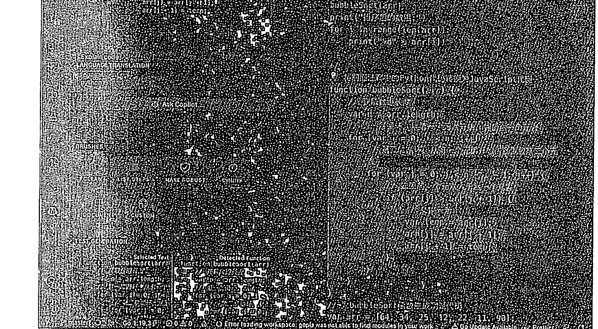

列出了实现步骤的完整代码如下。

```
function bubbleSort(arr) {
  // 获取数组长度
  var n = arr.length;
  // 第一层循环，从第一个元素开始，到最后一个元素
  for (var i = 0; i < n; i++) {
    // 第二层循环，从第一个元素开始，到倒数第二个元素
    for (var j = 0; j < n - i - 1; j++) {
      // 如果前一个元素大于后一个元素
      if (arr[j] > arr[j + 1]) {
        // 交换元素
        var temp = arr[j];
        arr[j] = arr[j + 1];
        arr[j + 1] = temp;
      }
    }
  }
}
```

[PAGE 67]

# 2.4 GitHub Copilot 在 Visual Studio Code 中的快捷键

需要留意，初次生成的注释偶尔会是英文，多试几次通常就能切回中文。

# 2.3.13 注释里和 Copilot 交互排错

注释不仅能引导代码生成，还能像和 ChatGPT 对话一样展开问题讨论。比如图 2-61 中的 Go 片段，isLetter() 用来判断字符是否属于字母，参数类型为 rune。变量 name 是 string 类型，想把 name[0] 传入 isLetter，写法 isLetter(name[0]) 会报错。通过在注释里反复追问 Copilot，最后得到结论需要做类型转换，正确的写法是 isLetter(rune(name[0]))。

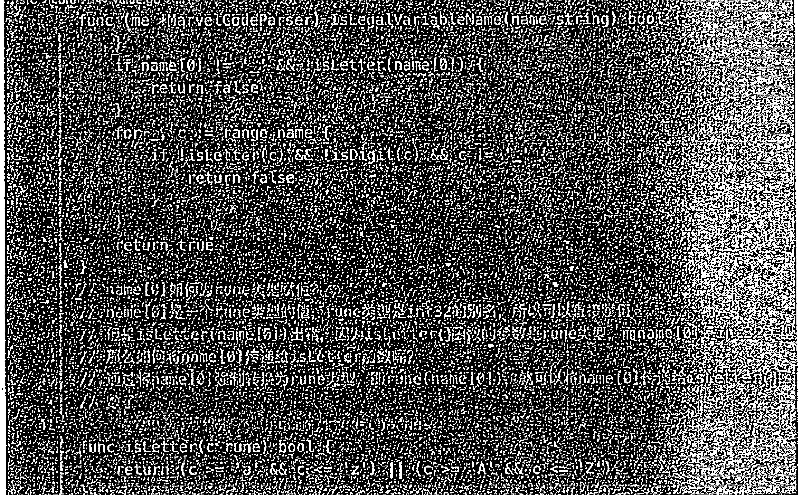

# 2.4 GitHub Copilot 在 Visual Studio Code 中的快捷键

本部分汇总了 Copilot 在 Visual Studio Code 中的常用快捷键。Windows 与 Linux 的键位相同，macOS 有差异。表 2-1 给出 Windows 与 Linux 的对应关系，表 2-2 给出 macOS 的对应关系。

[PAGE 68]

# 第2章 自动化编程：GitHub Copilot的奇妙之旅

# 表2-1 Windows系统和Linux系统中Visual Studio Code的快捷键

| 操作 | 快捷键 | 命令 |
| :---- | :----- | :------ |
| 接受内联建议 | Tab | editor.action.inlineSuggest.commit |
| 忽略内联建议 | Esc | editor.action.inlineSuggest.hide |
| 显示下一个内联建议 | Alt + ] | editor.action.inlineSuggest.showNext |
| 显示上一个内联建议 | Alt + [ | editor.action.inlineSuggest.showPrevious |
| 触发内联建议 | Alt + \ | cditor.action.inlincSuggest.trigger |
| 打开GitHub Copilot·(单独窗格中的其他建议) | Ctrl +Return | github.copilot.generate |
| 开启/关闭GitHub Copilot | 没有默认的快捷方式 | github.copilot.toggleCopilot |

# 表2-2 macOS中Visual Studio Code的快捷键

| 操作 | 快捷键 | 命令 |
| :---- | :----- | :------ |
| 接受内联建议 | Tab | editor.action.inlineSuggest.commit |
| 忽略内联建议 | Esc | editor.action.inlineSuggest.hide |
| 显示下一个内联建议 | Option(↔)+ ] | editor.action.inlineSuggest.showNext |
| 显示上一个内联建议 | Option(↔)+ [ | editor.action.inlineSuggest.showPrevious |
| 触发内联建议 | Option(↔)+ \ | editor.action.inlineSuggest.trigger |
| 打开GitHub Copilot（单独窗格中的其他建议) | Command + Return | github.copilot.generate |
| 开启/关闭GitHub Copilot | 没有默认的快捷方式 | github.copilot.toggleCopilot |

# 2.5 配置 GitHub Copilot

本节介绍 Copilot 的常用配置，包含快捷键调整、启动与关闭、内联建议开关，以及授权撤销与重授权等。

# 2.5.1 自定义 Copilot 快捷键

macOS 下从菜单栏选择 Code → 首选项 → 键盘快捷方式，打开键盘快捷方式面板，如图2-62所示。

Windows 或 Linux 下从菜单栏选择 文件 → 首选项 → 键盘快捷方式，打开键盘快捷方式面板。


[PAGE 69]

# 2.5 配置 GitHub Copilot

在键盘快捷方式面板的搜索框里输入表 2-1 中某个操作对应的命令，就能快速定位。例如输入 editor.action.inlineSuggest.commit 会定位到 接受内联建议，默认键位是 Tab，如图 2-63 所示。也可直接输入操作描述进行查找，不过可能返回多个结果。


双击快捷键单元格，比如本例的 Tab 键，会弹出图 2-64 所示的编辑界面，按下想设置的按键后回车即可生效。

# 2.5.2 开关 Copilot 全局或单语言

点击 Visual Studio Code 右下角的 Copilot 图标即可切换状态。若当前没有打开文件，或打开的文件类型不在 Copilot 支持范围内，右下角会弹出图 2-65 所示的消息框，点击其中的 Disable Globally 即可全局关闭。


若当前打开的是 Copilot 支持的文件类型，比如 Python 源文件，弹出的消息框会额外出现 Disable for python 按钮；打开 Java 文件则会出现 Disable for java 按钮，如图 2-66 所示，点击后仅对该语言关闭 Copilot。关闭后按钮文字变为 Enable，再点一次即可恢复。

[PAGE 70]

# 第 2 章 自动化编程：GitHub Copilot 的奇妙之旅

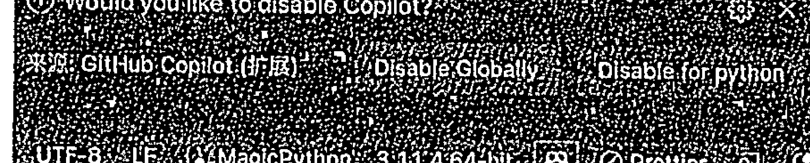

# 2.5.3 用 settings.json 批量开关

打开 settings.json 文件，找到下方配置段。

```
json
github.copilot.enable": {
    "*": true,
    "plaintext": false,
    "markdown": false,
    "scminput": false,
    "go": true
}
```

当 “*” 的取值是 true 时表示 Copilot 全局开启；改为 false 则全局关闭。若想单独为某种语言开启，比如把 "go" 设为 true，即使全局关闭，Go 语言的 Copilot 仍会保持开启，示例如下。

```
json
github.copilot.enable": {
    "*": false,
    "plaintext": false,
    "markdown": false,
    "scminput": false,
    "go": true
}
```

# 2.5.4 控制内联建议开关

打开 settings.json 文件，找到下方配置段。

```
json
"editor.inlineSuggest.enabled": true
```

把 "editor.inlineSuggest.enabled" 改为 false 即可关闭内联建议，改回 true 则重新开启。

# 2.5.5 撤销 Copilot 的 GitHub 授权

VS Code 会保留授权信息以便用特定 GitHub 账号使用 Copilot。若要防止无权限设备继续使用，可先撤销授权再重新授权。操作步骤如下。

(1) 在 GitHub 登录页点击右上角的头像，在弹出的菜单中选择 Settings。

(2) 进入 Settings 页面，左侧选择 Integrations → Applications，右侧会显示图 2-67 所示的 Applications 页面。

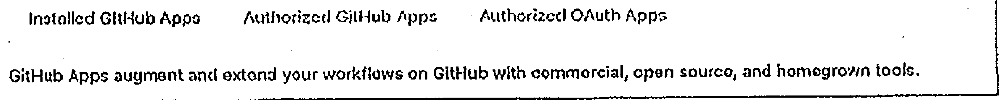

图 2-67 Applications 页面

(3) 在 Applications 页面切换到 Authorized OAuth Apps 标签，如图 2-68 所示。

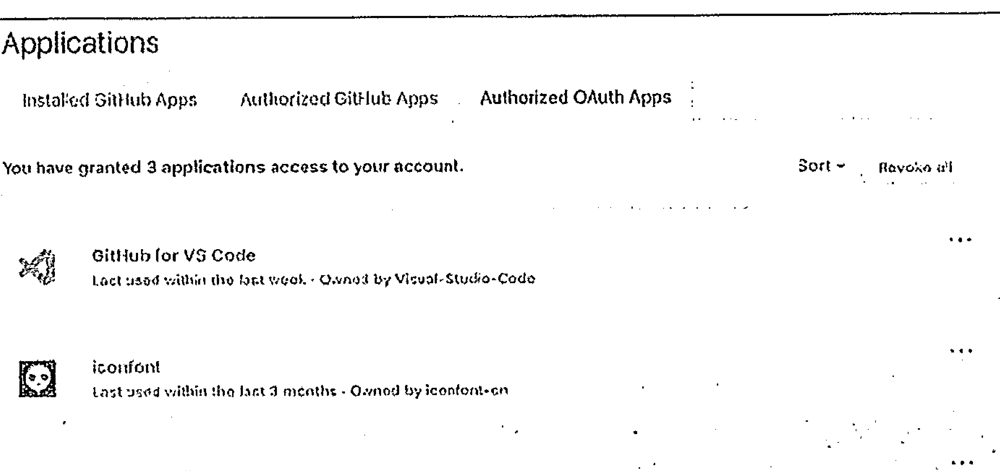

图 2-68 选择 Authorized OAuth Apps 标签

(4) 点击 GitHub for VS Code 右侧的 “...”，弹出图 2-69 所示的授权菜单。

(5) 选择 Revoke 即可撤销授权，同时 GitHub for VS Code 条目会被移除。


图 2-69 授权菜单

# 2.5.6 重新登录授权 Copilot

重新授权前需先在 VS Code 中退出 GitHub 账号。点击左下角的用户图标，在弹出菜单中选择 注销 选项，如图 2-70 所示。

[PAGE 72]

# 第 2 章 自动化编程：GitHub Copilot 的奇妙之旅


退出后，可按 2.2.1 节介绍的方式再次用 GitHub 账号登录并完成授权。

# 2.6 小结

学习完本章，读者应掌握 Copilot 的基本用法，如补全各类代码、自动生成片段等。需要注意的是 Copilot 目前为收费产品。是否还存在免费且可匹敌的替代方案？答案是肯定的，例如 Amazon Code Whisperer 与国产的 CodeGeeX 都是不错的选择。第 3 章将介绍更多 AI 代码生成方案。

# 第3章 更多AI代码生成解决方案

目前市面上 AI 代码生成工具已非常丰富，不必长期只依赖 Copilot，更何况它还是付费的。本章将介绍更多可选工具，包括大名鼎鼎的 ChatGPT 以及 New Bing、Bard、Claude 等同类产品，另外还有 Copilot 的替代工具 CodeGeeX 和 Amazon CodeWhisperer。有了这些工具，开发工作会更高效，体验也更加顺畅。

# 3.1 ChatGPT

本节主要介绍如何借助 ChatGPT 实现与编码相关的自动化。需要明确的是，ChatGPT 更像参谋，最终拍板仍在使用者手中。虽然它能完成不少编码任务，但并不保证输出一定正确或最优，只能作为参考。因此 ChatGPT 不能完全取代程序员，只能提升效率，提升幅度因人而异，可能 30%，也可能 300% 甚至 1000%，这与个人能力相关。总的来说，ChatGPT 会让强者更强，但不一定能让弱者变强。

# 3.1.1 让 ChatGPT 生成可运行完整代码

ChatGPT 最擅长输出完整可运行的代码。对于 Python、C++、C、Java、Go、JavaScript、Rust、C# 等主流语言，在多数情况下都能按需求生成基本正确的源码。但要注意，需求越复杂，描述必须越精确，否则模型可能无法准确理解意图。

下面这段文字描述了对所要生成的 Python 源代码的要求。

编写Python程序，在当前目录下创建一个名为data.txt的文本文件，并随机地向该文件中写入10个单词，一行一个单词。然后关闭data.txt文件。接下来读取data.txt文件中的所有单词，将这些单词放在列表中，并按ASCII升序排列它们，最后在终端用一行输出这些单词；给出详细的代码和中文注释。

在 ChatGPT 中输入这段文字并按 Enter 键后，ChatGPT 很快就会生成包含注释的代码，如图3-1所示。

图3-1 自动生成代码

ChatGPT生成的完整代码如下。

代码位置：/src/others_ai_tools/data.py

```
import random
# 创建一个名为data.txt的文本文件
file = open('data.txt', 'w')
# 随机地向该文件中写入10个单词，一行一个单词
words = ['apple', 'banana', 'cherry', 'orange', 'kiwi', 'melon', 'mango', 'pear', 'peach', 'grape']
for _ in range(10):
    word = random.choice(words)
    file.write(word + '\n')
# 关闭data.txt文件
file.close()
# 读取data.txt文件中的所有单词
file = open('data.txt', 'r')
lines = file.readlines()
```
把程序跑起来后，当前工作目录会多出一个 data.txt，同时终端会打印出一串用逗号分隔的单词，例如

apple,banana,banana,cherry,mango,melon,orange,orange,peach,pear.

需要注意的是，这些单词是随机挑选的，data.txt 里会出现重复项，而且每次在终端看到的序列都不一样。

# 3.1.2 跨语言代码转换
ChatGPT 具有会话记忆，只要不另开对话，它会保留之前的内容。于是用一句话就能把刚生成的 Python 实现改写成可在 Node.js 下执行的 JavaScript。

将这些Python代码转换为JavaScript代码

发出这条指令后，ChatGPT 会给出转换后的完整输出，代码、注释和说明一并呈现，见图3-2。

转换完成的源文件如下。

代码位置：/src/others_ai_tools/data.js

```
const fs = require('fs');
const { promisify } = require('util');
const writeFile = promisify(fs.writeFile);
const readFile = promisify(fs.readFile);
// 创建一个名为data.txt的文本文件
// 随机地向该文件中写入10个单词，一行一个单词
async function writeWordsToFile() {
    const words = ['apple', 'banana', 'cherry', 'orange', 'kiwi', 'melon', 'mango', 'pear', 'peach', 'grape'];
    let content = '';
    for (let i = 0; i < 10; i++) {
        const word = words[Math.floor(Math.random() * words.length)];
        content += word + '\n';
    }
    await writeFile('data.txt', content);
}
// 读取data.txt文件中的所有单词
async function readWordsFromFile() {
    const data = await readFile('data.txt', 'utf-8');
    // 将这些单词放在数组中
    const wordList = data.trim().split('\n');
    // 按ASCII升序排列这些单词
    wordList.sort();
    // 在终端用一行输出这些单词，单词之间用逗号分隔
    console.log(wordList.join(', '));
}
// 执行写入操作，然后读取文件
writeWordsToFile().then(() => {
    readWordsFromFile();
}).catch(err => {
    console.error(err);
});
```
在 Node.js 中运行它，终端会输出类似这样的一行

banana,cherry,grape,grape,kiwi,mango,melon,melon,orange,orange.

# 3.1.3 自动补全注释
如果手头有一段没有任何说明的代码，也可以请 ChatGPT 来补注。比如针对一段 Python 版冒泡排序及其测试代码，输入如下提示即可获得详细的中文注释。

下面是一段用Python实现的冒泡排序算法程序及相关的测试程序，为这些代码添加详细的中文注释

```
def bubble_sort(a):
    for i in range(len(a)-1):
        for j in range(len(a)-1-i):
            if a[j] > a[j+1]:
                a[j], a[j+1] = a[j+1], a[j]
        return a

def test(sort_func):
    test_data = [4, 65, 2, -31, 0, 99, 2, 83, 782, 1]
    print(f'({sort_func.__name__:<25})', sort_func(test_data))
    test(bubble_sort)
```
提交后，ChatGPT 会给出如图3-3 的结果。

添加注释后的完整代码如下。

代码位置: /src/others_ai_tools/bubble_sort.py

```
# 定义冒泡排序函数，参数a是需要排序的列表
def bubble_sort(a):
    # 外层循环，变量i从0到len(a)-2，用于控制排序的轮数
    # 对于n个元素，最多需要n-1轮排序，因为每一轮会让一个元素到达它最终的位置
    for i in range(len(a)-1):
        # 内层循环，变量j从0到len(a)-1-i，用于比较和交换相邻元素
        # 每一轮比较的次数都会减少，因为每轮的末尾都会有一个元素到达它最终的位置
        for j in range(len(a)-1-i):
            # 如果相邻的元素是逆序的（即左边的元素大于右边的元素），则交换它们的位置
            if a[j] > a[j+1]:
                a[j], a[j+1] = a[j+1], a[j]
        # 返回排序后的列表
        return a
    
    # 定义测试函数，参数sort_func是要测试的排序函数
def test(sort_func):
    # 定义一组测试数据
    test_data = [4, 65, 2, -31, 0, 99, 2, 83, 782, 1]
    # 输出排序函数的名称和排序后的列表
    # 使用格式化字符串f-string，通过! <25来控制函数名的输出宽度
    print(f'({sort_func.__name__}:<25)', sort_func(test_data))
    # 调用测试函数，传入bubble_sort函数作为参数
    test(bubble_sort)
```
# 3.1.4 漏洞检测与修复
ChatGPT 还能做代码安全审查，把代码交给它后，常见的安全隐患就能被揪出来。例如输入“检查下面的Python代码是否存在安全漏洞，并给出解决方案”，它就会对一段 Python 代码进行 SQL 注入风险排查。

```
import sqlite3
connection = sqlite3.connect("example.db")
cursor = connection.cursor()
id = 30
query = "SELECT * FROM users WHERE id = " + str(id)
cursor.execute(query)
```
发送上述提示后，ChatGPT 会给出如图3-4 的回复，既指出 SQL 注入漏洞的危害，也提供修复思路。

ChatGPT 给出的修复后代码如下。

代码位置：/src/others_ai_tools/db.py

```
import sqlite3
# 连接到SQLite数据库
connection = sqlite3.connect('example.db')
cursor = connection.cursor()
id = 30  # 这个值在实际应用中可能来自用户输入
# 使用参数化查询，而不是直接拼接字符串
query = "SELECT * FROM users WHERE id = ?"
cursor.execute(query, (id,))
```
从结果可以看出，解决 SQL 注入的关键是使用“？”占位符来传参，而不是用字符串拼接的方式组装 SQL。

# 3.2 New Bing 实时搜索优势
New Bing 是微软发布的带生成式 AI 的新搜索产品，底层使用 GPT-4 系列模型，训练语料与 ChatGPT 不同。它的核心优势在于能实时检索互联网并把最新信息作为参考，这对需要 2021 年 9 月之后数据的任务尤其有用，比如爬虫类开发，否则 ChatGPT 往往得不到理想答案。

正如工作需要团队协作，使用生成式 AI 时也适合组合使用。以下这段 Python 版冒泡排序就是由 ChatGPT 生成的

```
def bubble_sort(a):
    for i in range(len(a)-1):
        for j in range(len(a)-1-i):
            if a[j] > a[j+1]:
                a[j], a[j+1] = a[j+1], a[j]
        return a
```
代码本身没有错误，但并非最优实现。可以继续让 ChatGPT 优化，也建议另起会话或换用别的模型，比如 New Bing 来改进。在 New Bing 中输入如下要求即可让它进行优化

```
def bubble_sort(a):
    for i in range(len(a)-1):
        for j in range(len(a)-1-i):
            if a[j] > a[j+1]:
                a[j], a[j+1] = a[j+1], a[j]
        return a
```
回车后，New Bing 会输出如图3-5 的内容。

经过 New Bing 优化后的代码如下。

代码位置: /src/others_ai_tools/bubble_sort_new.py

```
def bubble_sort(a):
    swapped = False # 设置标志变量
    for j in range(len(a)-1-i):
        if a[j] > a[j+1]:
```
# 3.3 Bard 循环优化思路
a[j], a[j+1] = a[j+1], a[j]\nswapped = True # 发生了交换，更新标志变量

if not swapped: # 如果没有交换，说明数组已经有序

break # 提前结束循环

return a

这段逻辑的要点是：冒泡扫描时若前面部分已经有序，就无需继续排序，通过 swapped 标志来提前终止最外层循环。

经过Bard优化后的代码如下。

代码位置：/src/others_ai_tcols/bubble_sort_bard.py

```
def bubble_sort(a):
    swapped = True
    i = 0
    while swapped:
        swapped = False
        for j in range(len(a) - 1 - i):
            if a[j] > a[j + 1]:
                a[j], a[j + 1] = a[j + 1], a[j]
                swapped = True
        i += 1
    return a
```
对比可见，Bard 的优化与 New Bing 的做法在原理上一致，都用 swapped 控制最外层循环是否退出，并在序列已有序时直接结束。差别仅在于，Bard 把外层循环改成了 while，而 New Bing 保留了原版的 for 结构。

# 3.4 Claude 想象力与编码
Claude 名气不如 ChatGPT、New Bing 和 Bard，但上手感不错，能力接近 GPT-3.5。它的代码生成稍弱于 GPT-3.5，因为模型想象力过强，有时会“创造”不存在的函数、方法或类，导致用法不通。正是这份丰富的想象力，使 Claude 更适合探讨哲学类话题，比如我们是谁、从哪里来、要去向何方。

上述描述对应的是旧版 Claude。近期发布的 Claude2 在编程能力上提升明显，已接近 GPT-4，有望成为强劲对手。下面用同样的问题测试 Claude 的优化结果

```
def bubble_sort(a):
    for i in range(len(a)-1):
        for j in range(len(a)-1-i):
            if a[j] > a[j+1]:
                a[j], a[j+1] = a[j+1], a[j]
    return a
```
按下回车后，会得到如图3-7 的回复。

## 3.5 免费 Copilot 替代方案 CodeGeeX
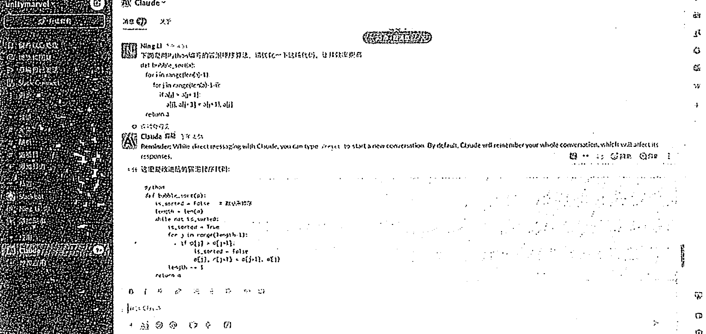
经过 Claude 优化后的代码如下。

代码位置: /src/others_ai_tools/bubble_sort_claude.py

```
def bubble_sort(a):
    is_sorted = False  # 默认未排序
    length = len(a)
    while not is_sorted:
        is_sorted = True
        for j in range(length - 1):
            if a[j] > a[j+1]:
                is_sorted = False
                a[j], a[j+1] = a[j+1], a[j]
        length -= 1
    return a
```
总体来看，Claude、Bard、New Bing 对冒泡排序的优化思路基本相同，区别只是 Claude 把 swapped 改名为 is_sorted，其他实现原理一致。若任务更复杂，生成的代码准确率会下降，尤其在需要调用大量 API 时，使用 ChatGPT、New Bing、Bard、Claude 都要格外注意。

## 第3章 更多AI代码生成方案
## 3.5 免费 Copilot 替代方案 CodeGeeX
本节主要介绍 CodeGeeX 的发展轨迹、核心特点，以及安装、注册与登录的流程。此外还...

## 3.5.1 CodeGeeX 项目介绍
CodeGeeX 由清华大学计算机系唐杰教授团队与华为诺亚方舟实验室杨志林博士团队联合研发，是一个拥有 130 亿参数的多语言代码生成预训练模型。

CodeGeeX 的目标是借助大规模预训练模型实现程序合成，即根据自然语言描述或代码片段生成可运行代码。

训练始于 2022 年 6 月，使用鹏城实验室“鹏城云脑 II”上的 192 个节点，共 1536 个国产昇腾 910 AI 处理器，在 23 种编程语言、8500 亿个代码 token 上完成预训练。

2022 年 9 月，团队开源了代码、模型权重、API、插件以及 HumanEval-X 基准测试，以推动多语言程序合成研究。2023 年 3 月，团队发表论文，详述架构、数据、实现与评测，并在 HumanEval-X 上展示了多语言生成与翻译的优异表现。

主要特点如下：

- 高精度代码生成：支持 Python、C++、Java、JavaScript、Go 等主流语言，在 HumanEval-X 生成任务上的求解率达 47%~60%，平均性能优于其他开源基线。
- 跨语言代码翻译：可一键将代码从一种语言迁移到另一种语言，保持高准确率。
- 可定制化编程助手：免费提供 Visual Studio Code 扩展，具备补全、解释、摘要等功能，提升编码体验。
- 开源与跨平台：代码和权重均对研究开放，支持 Ascend 与 NVIDIA 平台，可在单块 Ascend 910、NVIDIA V100 或 A100 上推理。

CodeGeeX 在能力边界上明显比 GitHub Copilot 更宽。它的定位更接近一个通用大模型，除了编程问答之外，连“人类未来是繁荣还是衰退甚至灭亡”这类开放性话题也能给出回应，质量虽不总完美，但覆盖面和灵活性已经超出 Copilot 的纯代码范畴。

价格是更致命的差异。CodeGeeX 完全免费开放，而 GitHub Copilot 需要付费，部分功能还在灰度测试中。综合来看，CodeGeeX 足以作为 GitHub Copilot 的平价替代方案使用。

## 3.5.2 在 VS Code 中部署 CodeGeeX
CodeGeeX 同时兼容 Visual Studio Code 与 JetBrains 系列 IDE。本部分聚焦 VS Code 的安装流程，JetBrains 侧的详细操作请查阅官方文档。安装方式很直接：在 VS Code 扩展市场搜索 CodeGeeX，找到对应插件后点一下安装即可完成。

## 3.5.3 激活 CodeGeeX：注册与登录流程
不登录也能用 CodeGeeX，但会受功能限制。想解锁完整能力需要先注册账号并登录。安装完成后，VS Code 左侧栏会出现 CodeGeeX 图标，点击后左侧弹出操作面板，点击 Login 即可触发登录。

点击后浏览器会打开 CodeGeeX 登录页。与 Copilot 不同，CodeGeeX 支持 Gmail、GitHub 之外的微信、Gitee 等国内常用账号，微信登录体验更顺滑。

登录成功后，VS Code 内会进入 CodeGeeX 的对话界面，可以向它提出任何问题。
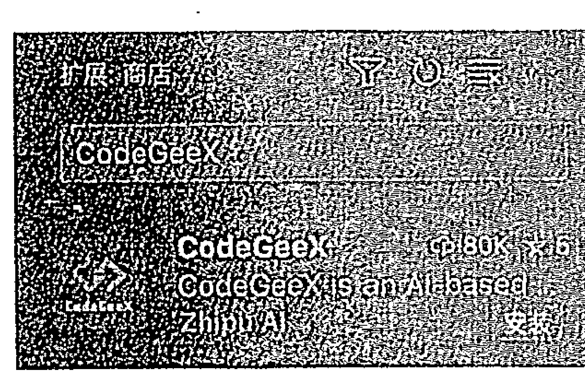
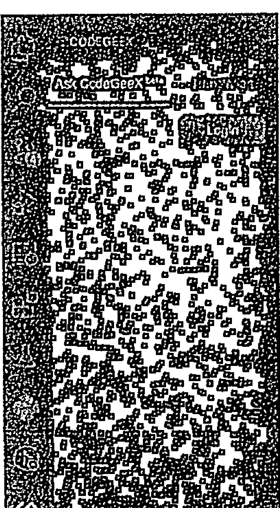
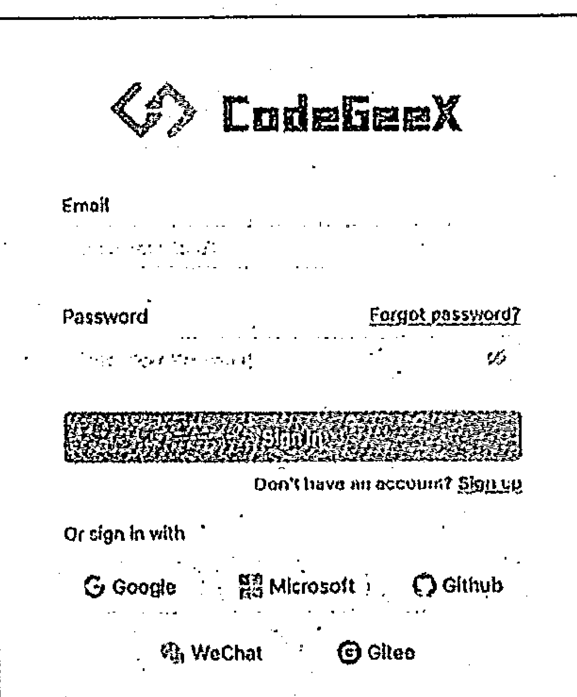


## 3.5.4 代码自动补全体验
CodeGeeX 具备代码补全能力。输入一段起始代码后，```
for i = 0\nimport sqlite3\nconnection = sqlite3.connect("example.db")\ncursor = connection.cursor()\nid = 30\nquery = "SELECT * FROM users WHERE id = " + str(id)\ncursor.execute(query)
```
它会自动补全 for 循环的第一行，如图 3-12 所示。按 Enter 再按 Tab，补全会继续延伸。

## 3.5.5 安全漏洞检测与修复尝试
CodeGeeX 也能做代码安全检查。在聊天区输入“检查下面的代码是否有漏洞”```
import sqlite3\nconnection = sqlite3.connect("example.db")\ncursor = connection.cursor()\nid = 30\nquery = "SELECT * FROM users WHERE id = " + str(id)\ncursor.execute(query)
```
如图 3-13 所示，它确实识别出 SQL 注入问题，但给出的修复方案调用了不存在的 sqlite3.encode()，并未使用参数化查询。sqlite3.encode() 并不是真实函数，因此这次修复失败，这反映出模型训练数据不足和算法局限，仍有提升空间。

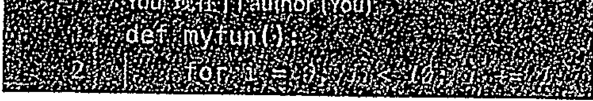

## 3.5.6 代码优化效果观察
在聊天区输入如下指令：```
def bubble_sort(a):
    for i in range(len(a)-1):
        for j in range(len(a)-1-i):
            if a[j] > a[j+1]:
                a[j], a[j+1] = a[j+1], a[j]
    return a
```
“下面是用 Python 编写的冒泡排序算法，请优化一下这段代码，让其效率更高”
CodeGeeX 会返回图 3-14 所示的回复。实际改动只是把获取列表长度抽成单独变量，并未提升算法复杂度，可见其在代码优化上的表现仍显不足。
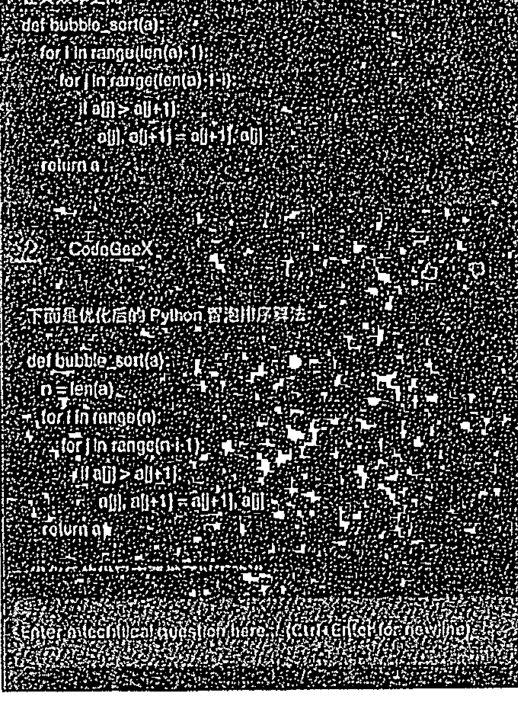

## 3.5.7 代码转换实操
本节说明如何借助 CodeGeeX 完成代码转换。

+   - 1. 通过对话完成转换
在聊天界面直接粘贴以下内容：```
def bubble_sort(a):
    for i in range(len(a)-1):
        swapped = False # 设置标志变量
        for j in range(len(a)-1-i):
            if a[j] > a[j+1]:
                a[j], a[j+1] = a[j+1], a[j]
                swapped = True # 发生了交换，更新标志变量
            if not swapped: # 如果没有交换，说明数组已经有序
                break # 提前结束循环
        return a
```
回车后开始转换，CodeGeeX 会给出图 3-15 所示的回答。

转换后的完整文件如下：
代码位置：/src/others_ai_tools/js_bubble_sort1.js
```
function bubbleSort(arr) {
    let len = arr.length;
    for (let i = 0; i < len - 1; i++) {
        let swapped = false;
        for (let j = 0; j < len - 1 - i; j++) {
```

## 3.5.8 解答非编程类问题
除代码之外，CodeGeeX 还能处理常规问答，比如创作古诗。
输入问题：
以梅花为题，作一首七言绝句的古诗。
CodeGeeX 将给出图 3-17 所示的结果。

## 3.5.9 在线体验入口
CodeGeeX 提供网页版试用。打开官网即可体验代码转换功能。在网站搜索“zh-CN/codeTranslator”，左侧填入源代码，右侧显示目标语言结果，点击“翻译”按钮即可，如图 3-18 所示。网页版还支持代码生成、代码解释、代码修正，切换入口在首页的“在线体验”菜单中。

## 3.6 Amazon CodeWhisperer
不同的在线体验页面。
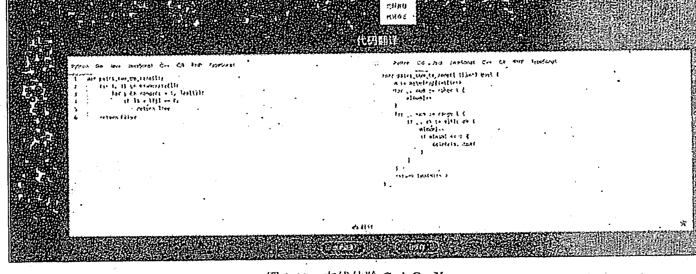
## 3.6 Amazon CodeWhisperer
本节介绍另一款免费的 AI 编程助手 Amazon CodeWhisperer。其使用逻辑与 GitHub Copilot、CodeGeeX 相似，下面演示如何把它接入 Visual Studio Code 并生成代码。

## 3.6.1 Amazon CodeWhisperer 概览
Amazon CodeWhisperer 由亚马逊研发，向个人用户提供无限量的代码智能生成服务，旨在提升开发效率并辅助应用构建。

+   Amazon CodeWhisperer 的主要特点如下。
（1）高效生成：覆盖 15 种编程语言，包括 Python、Java、JavaScript，并支持 Visual Studio Code、IntelliJ IDEA、AWS Cloud9、AWS Lambda 控制台、JupyterLab、Amazon SageMaker Studio 等多种 IDE。仅需简短注释即可实时得到从代码片段到完整函数的建议。
（2）质量可控：对与开源训练数据高度相似的建议进行标记或过滤，并提供对应仓库的 URL 与许可证，方便开发者审查和署名。

## 3.6.2 安装 Amazon CodeWhisperer
CodeWhisperer 依赖 AWS Toolkit 插件。在 VS Code 的扩展商店搜索 AWS Toolkit，如图 3-19 所示，点击安装完成部署。

## 3.6.3 注册与登录 Amazon CodeWhisperer
正常使用需要先注册登录。安装插件后，VS Code 左侧会出现 aws 图标，点击后选择 Connect to AWS to Get Started，会进入 Add Connection to AWS 界面。其中第二项代码助手功能与 Copilot、CodeGeeX 的补全逻辑相近。


选中 CodeWhisperer: AI-powered code suggestions 后，进入注册或登录界面。点击 Sign up or Sign in，会弹出授权页对话框。
## 3.6 Amazon CodeWhisperer


点击“Copy Code and Proceed”后浏览器打开授权页，将 Code 复制到文本框中。
点击“Next”进入图 3-24 所示页面。无 AWS 账号时用邮箱注册，有账号则直接登录。
再次点击“Next”并按提示操作，成功后会显示图 3-25 页面，点击“Allow”完成授权。


授权通过后即可使用 Amazon CodeWhisperer。

## 第3章 AI 代码生成工具全景
## 3.6.4 用 Amazon CodeWhisperer 生成与补全代码
使用方式与 GitHub Copilot、CodeGeeX 基本一致，通过 Tab 键触发补全，也能借助注释生成完整代码。图 3-26 展示了其自动生成的 Python 冒泡排序算法及测试程序。

## 图3-26 使用Amazon CodeWhisperer自动生成代码
## 37 小结
本章列举了大量 AI 代码生成工具，市面上还包括 Codeium、Cursor、Alibaba Cloud AI Coding Assistant、Kite、TabNine 等优秀产品。

这些工具大体分为两类：Web 版和 IDE 集成版。建议两者兼用：先用 ChatGPT 类工具快速搭建整体方案，再用 Copilot 类工具做精细化微调，直至满意。

工具选择最终由个人决定，使用方式自在开心即可。

## 第4章 自动化编程实战：桌面应用
本章主题是桌面应用与 GUI 技术。与常规教材不同，本章及后续章节的大量代码并非人工手写，而是多款 AI 工具协同产出的“团队成果”，唯一的人类开发者是我本人。

后续示例不会受限于单一语言或框架，甚至能在极短时间内获得多种语言、多种框架实现的等价功能，半小时甚至几分钟即可完成，人工编写则需数小时至数天且难以保证无 bug。

核心思路是先用 ChatGPT 生成项目骨架，再用 GitHub Copilot 微调完善。本书主要示例基于 ChatGPT 与 Copilot，但并非强制，New Bing、Bard、Claude、CodeGeeX、Amazon CodeWhisperer 等均可混用，关键在于工具带来的效率增益。

从本章起，体验与 AI 协同编程的感觉，就从桌面应用开始吧。

## 4.1 用 PyQt6 通过滑块调节背景色
众多语言都支持 GUI，如 Python 的 PyQt、Tkinter、wxPython，C++ 的 Qt，Java 的 JavaFX，Electron、C# 等。若要在多系统、多语言间切换开发，人工成本会很高，但借助 ChatGPT、GitHub Copilot 等 AI 工具，GUI 开发变得轻松。

本节演示如何快速完成一个 GUI 小工具：用三个滑块控制 RGB 三原色，把颜色应用到文本框背景，并将颜色值展示在标签上。需先安装 Python 并执行 pip install PyQt6。

功能拆解的关键点为：
+   窗口；
- 文本框组件；
- 标签组件；
- 3 个滑块组件；
- 每个滑块需响应滑动事件。

将这些点整合为提示词，得到如下描述：
用 PyQt6 创建一个 300*500 的窗口，然后在窗口的垂直方向分别放置一个文本组件、一个标签组件和 3 个滑块组件。所有滑块组件对应的最小值是 0，对应的最大值是 255。3 个滑块组件分别表示红、绿、蓝三原色。当滑动这 3 个滑块时，分别用这 3 个滑块的当前值设置文本组件的背景色。然后将这 3 个滑块的当前值组合成以井号开头的颜色值，如 #fffff，显示在标签组件中。给出完整的实现代码和中文注释。

ChatGPT 会给出如下代码。
代码位置：src/gui/color_slider_pyqt6.py
## 4.1 用PyQt6实现通过滑块设置背景色
这些超强的 AI 工具，开发 GUI 应用就轻松多了。

本节会展示如何利用多种 AI 代码生成工具在极短的时间内快速、准确地完成一个 GUI 应用。这个 GUI 应用的基本功能是通过 3 个滑块组件控制颜色的红、绿、蓝三原色，然后将颜色作为文本框的背景色，并将颜色值显示在标签组件上。我们先用 Python 和 PyQt6 实现这个程序。所以读者需要安装 Python，并使用下面的命令安装 PyQt6。

pip install PyQt6

根据这个桌面应用的功能描述，可以得出下面的几个关键点：

+   窗口；
- 文本框组件；
- 标签组件；
- 3 个滑块组件；
- 每个滑块组件都可以响应滑块的滑动动作。

将这些几个关键点组合起来，形成一段文字，作为 ChatGPT 的提示语，于是有了下面的描述。

用 PyQt6 创建一个 300*500 的窗口，然后在窗口的垂直方向分别放置一个文本组件、一个标签组件和 3 个滑块组件。所有滑块组件对应的最小值是 0，对应的最大值是 255。3 个滑块组件分别表示红、绿、蓝三原色。当滑动这 3 个滑块时，分别用这 3 个滑块的当前值设置文本组件的背景色。然后将这 3 个滑块的当前值组合成以井号开头的颜色值，如 #fffff，显示在标签组件中。给出完整的实现代码和中文注释。

ChatGPT 会给出下面的代码。

代码位置：src/gui/color_slider_pyqt6.py

```
import sys
from PyQt6.QtWidgets import QApplication, QWidget, QVBoxLayout, QLabel, QSlider, QTextEdit
from PyQt6.QtCore import Qt
from PyQt6.QtGui import QColor

class ColorSliderApp(QWidget):
    def __init__(self):
        super().__init__()
        # 设置窗口大小
        self.resize(300, 500)
        # 设置布局
        self.layout = QVBoxLayout()
        self.setLayout(self.layout)
        # 创建文本组件
        self.text_edit = QTextEdit()
```

## 4.1 PyQt6 滑杆调色起步

```
self.layout.addWidget(self.text_edit)
# 创建标签组件
self.label = QLabel("颜色: #ffffff")
self.layout.addWidget(self.label)
# 创建滑块组件
self.red_slider = QSlider(Qt.Orientation.Vertical)
self.green_slider = QSlider(Qt.Orientation.Vertical)
self.blue_slider = QSlider(Qt.Orientation.Vertical)
# 设置滑块范围
self.red_slider.setRange(0, 255)
self.green_slider.setRange(0, 255)
self.blue_slider.setRange(0, 255)
# 添加滑块到布局
self.layout.addWidget(self.red_slider)
self.layout.addWidget(self.green_slider)
self.layout.addWidget(self.blue_slider)
# 连接滑块信号到槽函数
self.red_slider.valueChanged.connect(self.update_color)
self.green_slider.valueChanged.connect(self.update_color)
self.blue_slider.valueChanged.connect(self.update_color)
def update_color(self):
    # 获取滑块的值
    red = self.red_slider.value()
green = self.green_slider.value()
blue = self.blue_slider.value()
    # 设置文本组件的背景色
    color = QColor(red, green, blue)
    self.text_edit.setStyleSheet(f"background-color: {color.name()}")
    # 设置标签组件显示的颜色值
    self.label.setText(f"颜色: {color.name()}")
if __name__ == "__main__":
    app = QApplication(sys.argv)
    # 创建窗口实例
    window = ColorSliderApp()
```

## 4.1 初版界面预览

```
window.show()
sys.exit(app.exec())
```

启动后会看到图 4-1 的窗口。整体功能可运行，但视觉布局与常见习惯不符。提示中未说明滑杆朝向，模型自行采用了垂直排列。无需让模型重写，稍作微调即可。

把三组滑杆全部改为水平排列。若是首次接触 QSlider，不清楚如何设置方向，可参考 GitHub Copilot 等工具的补全能力。先在 __init__ 里创建滑杆的语句后插入一条注释。

```
# 将 red_slider, green_slider 和 blue_slider 设置为水平方向
```

反复敲击回车与 Tab，编辑器会补全三行方向设置代码。

```
self.red_slider.setOrientation(Qt.Orientation.Horizontal)
self.green_slider.setOrientation(Qt.Orientation.Horizontal)
self.blue_slider.setOrientation(Qt.Orientation.Horizontal)
```

重新启动后界面变为图 4-2 的样式。


此时仍不够完善，三组滑杆的具体用途并不明确。建议为每组滑杆前置说明文字，以便快速辨识。可在 QSlider 创建语句后加入注释提示。

```
# 分别在 red_slider, green_slider 和 blue_slider 前面各添加一个标签组件，用于显示滑块的值
```

继续触发回车与 Tab，Copilot 会推导出对应的标签创建片段。

```
self.red_label = QLabel("R")
self.green_label = QLabel("G")
self.blue_label = QLabel("B")
self.layout.addWidget(self.red_label)
```

## 4.1 标签与数值可视化

```
self.layout.addWidget(self.red_slider)
self.layout.addWidget(self.green_label)
self.layout.addWidget(self.green_slider)
self.layout.addWidget(self.blue_label)
self.layout.addWidget(self.blue_slider)
```

该片段会重复生成三组滑杆，需要剔除后半部分多余的滑杆代码，具体段落如下。

```
self.layout.addWidget(self.red_slider)
self.layout.addWidget(self.green_slider)
self.layout.addWidget(self.blue_slider)
```

移除后重新运行，效果见图 4-3。

程序已有明显改进，但仍有不足。滑杆用途已可辨识，却看不到即时数值。期望标签同时承担标识与数值展示职责。

于 update_color 函数读取滑杆数值的语句后添加注释。

```
# 将每一个滑块组件的当前值显示在对应的标签组件上，并且在对应的标签组件前面显示 "红：" "绿：" "蓝：" 等文本
self.red_label.setText(f"红：(red)")
self.green_label.setText(f"绿：(green)")
self.blue_label.setText(f"蓝：(blue)")
```

再次按下回车与 Tab，编辑器会产出更新标签文本的片段。

```
self.red_label.setText(f"红：(red)")
self.green_label.setText(f"绿：(green)")
self.blue_label.setText(f"蓝：(blue)")
```

若输出仍使用 R、G、B 表示颜色，可手动改为中文。随后在 __init__ 末尾主动调用一次 update_color，确保窗口打开时标签即同步。

```
self.update_color()
```

运行后可观察到图 4-4 的呈现。


图 4-3 标签加入后的呈现
图 4-4 红色数值实时呈现

整体仍有优化余地，读者可按需拓展细节。

## 4.2 PyQt6 应用迁移至 Qt6

前文借助 ChatGPT 与 Copilot 搭建了用滑杆调节背景颜色的 PyQt6 示例。若想把 Python 实现搬到 C++，传统方式需手工移植，工作量随代码规模上升而变得繁琐。借助生成式工具可大幅简化流程。

下面演示如何把该调色程序转为以 Qt6 为基础的 C++ 版本。PyQt6 只是 Qt6 的 Python 封装，API 极为接近，但对 C++ 不精通的开发者手写仍有门槛。用自然语言描述需求，模型即可完成转换。

```
将下面的代码转换为基于 Qt6 的代码
import sys
From PyQt6.QtWidgets import QApplication, QWidget, QVBoxLayout, QLabel,
   QSlider, QTextEdit
# 这里要复制完整的代码
if __name__ == "__main__":
   app = QApplication(sys.argv)
   # 创建窗口实例
   window = ColorSliderApp()
   window.show()
   sys.exit(app.exec())
```

模型迅速返回转换后的完整实现。

文件路径：src/gui/qt6/ColorSliderQt6/main.cpp

```
#include <QApplication>
#include <QWidget>
#include <QVBoxLayout>
#include <QLabel>
#include <QSlider>
#include <QTextEdit>
#include < QColor >
class ColorSliderApp : public QWidget {
public:
   ColorSliderApp() {
      resize(300, 500);
   }
```

## 4.2 Qt6 工程构建

```
layout = new QVBoxLayout(this);
setLayout(layout);

lineEdit = new QLineEdit();
layout->addWidget(lineEdit);

colorLabel = new QLabel("颜色: #ffffff");
layout->addWidget(colorLabel);

redSlider = new QSlider(Qt::Horizontal);
greenSlider = new QSlider(Qt::Horizontal);
blueSlider = new QSlider(Qt::Horizontal);

redSlider->setRange(0, 255);
greenSlider->setRange(0, 255);
blueSlider->setRange(0, 255);

redLabel = new QLabel("R");
greenLabel = new QLabel("G");
blueLabel = new QLabel("B");
layout->addWidget(redLabel);
layout->addWidget(redSlider);
layout->addWidget(greenLabel);
layout->addWidget(greenSlider);
layout->addWidget(blueLabel);
layout->addWidget(blueSlider);

connect(redSlider, &QSlider::valueChanged, this, 
&ColorSliderApp::updateColor);
connect(greenSlider, &QSlider::valueChanged, this,
&ColorSliderApp::updateColor);
connect(blueSlider, &QSlider::valueChanged, this,
&ColorSliderApp::updateColor);
updateColor();
private slots:
void updateColor() {
int red = redSlider->value();
int green = greenSlider->value();
int blue = blueSlider->value();
redLabel->setText(QString("R: %1").arg(red));
greenLabel->setText(QString("绿: %1").arg(green));
blueLabel->setText(QString("蓝: %1").arg(blue));
```

## 第4章 AI 驱动的桌面开发实践

```
QColor color(red, green, blue);
lineEdit->setStyleSheet(QString("background-color: %1").arg(color.name()));
colorLabel->setText(QString("颜色: %1").arg(color.name()));
}

private:
    QVBoxLayout *layout;
    QTextEdit *lineEdit;
    QLabel *colorLabel;
    QLabel *redLabel,
    QLabel *greenLabel,
    QLabel *blueLabel;
    QSlider *redSlider;
    QSlider *greenSlider;
    QSlider *blueSlider;
    ),

int main(int argc, char *argv) {
    QApplication app(argc, argv);
    ColorSliderApp window;
    window.show();
    return app.exec();
}
```

```
private:
    QVBoxLayout *layout;
    QTextEdit *lineEdit;
    QLabel *colorLabel;
    QLabel *redLabel,
    QLabel *greenLabel,
    QLabel *blueLabel;
    QSlider *redSlider;
    QSlider *greenSlider;
    QSlider *blueSlider;
    ),

int main(int argc, char *argv) {
    QApplication app(argc, argv);
    ColorSliderApp window;
    window.show();
    return app.exec();
}
```

```
int main(int argc, char *argv) {
    QApplication app(argc, argv);
    ColorSliderApp window;
    window.show();
    return app.exec();
}
```

启动 Qt Creator 新建 Qt Console 工程，再把代码粘贴到 main.cpp。Console 模板默认未接入 Qt GUI 模块，需更新 ColorSliderQt6.pro 配置，加入 GUI 依赖。

```
QT += core gui
CONFIG += c++11 console
greaterThan(QT_MAJOR_VERSION, 4): QT += widgets
CONFIG -= app_bundle
SOURCES += 
    main.cpp

# Default rules for deployment
qnx: target.path = /tmp/$(TARGET)/bin
else: unix|android: target.path = /opt/$(TARGET)/bin
isEmpty(target.path): INSTALLS += target
```

运行后呈现效果见图 4-5。视觉上 Qt6 与 PyQt6 实现几乎一致。该例表明，即便不精通 C++，只要掌握 Qt 工程的创建与运行流程，就能以熟悉的 Python 思路间接达成 C++ 应用。迁移结果比零写更可靠，因已有模板，仅需 API 映射。

# 4.3 Tkinter 计算器快速构建


# 4.3 用 Tkinter 迅速搭建计算器

本小节演示借助 ChatGPT 与 GitHub Copilot 协同完成 Tkinter 计算器的思路。Tkinter 是 Python 标配的图形界面组件库，使用时不需额外安装。

计算器样式很多，这里做一个简易版：窗口内放置数字键 0 至 9 共十枚，再加上 + - * / . = 六个操作键，合计十六个键位，可排成四行四列。图 4-6 展示了 macOS 自带的计算器作为参考。交互方式为：除等于键之外其它键按下时，其上的字符会被累加到上方显示区；按下等于键时对显示区里的表达式进行即时求值；双击显示区则清空内容。

由此可提炼出几项关键要点：

+   - 版式：利用网格把键位组织成行列。
- 键位互动：非等号键负责累加字符，等号键负责计算。
- 显示区双击互动：双击后清除文本。

ChatGPT 能接收大量描述，但任务复杂度升高时，容易只实现部分功能或遗漏细节。考虑到计算器逻辑并不简单，分阶段推进更为稳妥。

下面进入具体步骤。

# 1. 先构建界面

此阶段仅呈现界面，不涉及业务代码。向 ChatGPT 描述需求即可。

ChatGPT 会返回相应的实现片段。

代码位置: src/gui/calc_tkinter.py

```
import tkinter as tk
from tkinter import Entry, Button
# 创建主窗口
root = tk.Tk()
# 设置窗口大小为300*400
root.geometry("300*400")
# 创建一个文本输入框，放在窗口的上半部分
entry = Entry(root, font=('Arial', 18))
# 让输入框占据窗口的上半部分，columnspan设置为4，使其横跨4列
entry.grid(row=0, column=0, columnspan=4, sticky='nsew')
# 定义按钮的文本
buttons = [
    '7', '8', '9', '/',
    '4', '5', '6', '*',
    '1', '2', '3', '-',
    '0', '.', '=', '+'
]
# 创建按钮，并使用网格布局放在窗口的下半部分
# 初始化行和列的计数器
row = 1
col = 0
# 遍历按钮文本，创建对应的按钮
for button in buttons:
    # 创建按钮并放置在相应的网格位置
```

[PAGE 105]

# 4.3 Tkinter 计算器快速实现

```
Button(root, text=button, font=('Arial', 18)).grid(row=row, column=col, sticky='nsew')
# 更新列计数器
col += 1
# 当列计数器达到4时，重置为0，并且增加行计数器
if col == 4:
    col = 0
    row += 1
# 设置行和列的权重，使它们在窗口大小改变时能够按比例缩放
for i in range(5):
    root.grid_rowconfigure(i, weight=1)
    if i < 4:
        root.grid_columnconfigure(i, weight=1)
# 启动主循环
root.mainloop()
```

生成的程序初始没有窗口标题，可在创建窗口代码后追加注释，利用 GitHub Copilot 自动补全标题设置。若你对 Tkinter 比较熟悉，也可以自行编写标题代码。

```
# 设置窗口标题
```

连续按下 Enter 与 Tab，相关代码会自动补齐。其中 “计算器” 三字也会被自动补全，因为 Copilot 能感知上下文，已推断出当前程序的用途。

```
root.title("计算器")
```

运行后，计算器的外观如图 4-7。窗口缩放时，键位与显示区能够自适应调整。

# 2. 接入按键点击

键位是通过 buttons 列表循环生成的，因此在 for 迭代里创建键位之后，需要补上一段注释来提示后续行为。

```
# 除“=”按钮外，当单击其他按钮时，会在输入框中追加按钮的文本，给出实现代码
```

输入注释时，Copilot 会预判下方内容。若预判准确，直接按 Tab 即可生成。Copilot 基于上下文推测，命中率通常很高。

补全这段注释后，反复按 Enter 与 Tab，Copilot 会生成相应的处理代码。

```
if button != '':
def click(e):
    # 定义按钮的单击事件
    # 获取当前按钮的文本
```


图 4-7 计算器的界面

[PAGE 106]

# 第4章 自动化编程实战：桌面应用

```
text = e.widget['text']
# 在输入框中追加文本
entry.insert('end', text)
# 绑定按钮的单击事件
Button(root, text=button, font=('Arial', 18)).bind('<Button-1>', click)
```

这段生成的代码总体可用，但存在小瑕疵：for 迭代内部已实例化 Button 并调用 grid() 完成布局，但并未把对象赋给变量，导致后续无法复用。需要手动调整为保存对象的方式。

```
for button in buttons:
# 创建按钮并放置在相应的网格位置
# 将Button对象单独放在一个变量中，以便在后面可以多次使用该Button对象
b = Button(root, text=button, font=('Arial', 18))
b.grid(row=row, column=col, sticky='nsew')
# 除"="按钮外，当单击其他按钮时，都会在输入框中追加按钮的文本，给出实现代码
if button != '':
# 定义按钮的单击事件
def click(e):
# 获取当前按钮的文本
text = e.widget['text']
# 在输入框中追加文本
entry.insert('end', text)
# 绑定按钮的单击事件
b.bind('<Button-1>', click)
```

随后在生成代码之后再插入一段注释。

```
# 当按"="按钮时，计算输入框中表达式的值，并将结果显示在输入框中，给出实现代码
不断按Enter键和Tab键，GitHub Copilot会生成如下代码。
else:
# 定义按钮的单击事件
def click(e):
# 获取输入框中的表达式
text = entry.get()
# 计算表达式的值
result = eval(text)
# 清空输入框
entry.delete(0, 'end')
# 在输入框中显示结果
entry.insert('end', result)
# 绑定按钮的单击事件
b.bind('<Button-1>', click)
```

Copilot 对上下文的识别能力很强，能自动识别出需要补充 else 分支。至此该步完成，运行程序后按数字、符号键，再按“=”即可完成计算。图4-8

[PAGE 107]

# 4.4 PyQt6 分步搭建复杂布局

展示了数字与符号的输入。图4-9 展示了表达式求值后的结果。


# 3. 条目区双击清空

要让双击显示区清空内容，需定位到对应代码段。

```
entry.grid(row=0, column=0, colspan=4, sticky='nsew')
在这行代码后面，输入如下注释。
# 双击文本输入框中的文本时，将文本清空，给出实现代码
不断按 Enter 键和 Tab 键，会生成如下代码。
def clear(e):
    entry.delete(0, 'end')
    entry.bind('<Double-Button-1>', clear)
```

运行后，双击显示区即可清空内部文字。到此，计算器已完整且高效地实现。若熟悉 Tkinter、ChatGPT 与 Copilot，整个过程可在 3 分钟内完成；若纯手工编写，即便花费 30 分钟也未必能保证正确。

# 4.4 PyQt6 分步搭建复杂界面

简单程序可写在一个文件里，但项目复杂或多人协作时，应将功能拆分为模块，分别处理后再整合。

本节结合 PyQt6 布局，演示如何利用 ChatGPT 与 GitHub Copilot 生成由多文件构成的复杂界面程序。图4-10 为目标效果。

[PAGE 108]

# 第4章 自动化编程实战：桌面应用


# 图4-10 最终要实现的布局效果

初看布局显得杂乱，实际窗口在垂直方向被均分为上下两块，上块水平均分为三份，下块水平均分为两份。从左到右、从上到下，每个区域都有各自的排版规则，属于组合式布局。用一段文字完整描述会过于繁琐，ChatGPT 难以一次性准确实现。因此采用分治策略：先生成仅包含顶层 5 个区域的窗口框架代码，再为这 5 个区域各自生成布局，最后把各区域代码嵌入主窗口。为便于维护，每个区域单独放在一个 Python 文件，以类形式存在。借助 ChatGPT 与 Copilot 多步完成图4-10 的搭建。

# 4.4.1 先做总框架

生成总布局时，需要给 ChatGPT 的要点包括：

+   * 窗口大小设为1000*800。
* 窗口纵向二分为上下两段，上段横向三等分，下段横向二等分。

[PAGE 109]

# 4.4 PyQt6 分步搭建复杂布局

+   * 窗口缩放时，5 个区域仍保持相对位置。
+   * 每个区域使用 QFrame 作为容器，便于后续对接。QFrame 是模块与主程序的连接点，接口必须提前确定，否则多文件无法串联。
+   * 通过坐标与尺寸直接控制 5 个区域的相对位置，以提升兼容性。若某区域尺寸异常，强制控制可避免整体变形。

综合以上要点，可向 ChatGPT 发送如下指令。

用 PyQt6 新建 1000×800 的窗口，纵向二分为上下两块，上块横向三等分，下块横向二等分，共计五个区域，每个区域以 QFrame 实例呈现。随窗口缩放保持等比，区域均使用不同底色，并在 resizeEvent 中通过坐标与尺寸直接控制布局。请给出完整代码与中文说明。

内容较为复杂，建议使用 ChatGPT Plus 或 New Bing。若生成结果不理想，可多次尝试。

ChatGPT 会返回下面的代码。

代码位置：src/gui/layout_pyqt6.py

```
import sys
from PyQt6.QtWidgets import QApplication, QMainWindow, QFrame
class CustomWindow(QMainWindow):
    def __init__(self):
        super().__init__()
        # 设置窗口初始大小
        self.resize(1000, 800)
        # 创建5个QFrame对象，以它们作为窗口的子部件
        self.frame1 = QFrame(self)
        self.frame2 = QFrame(self)
        self.frame3 = QFrame(self)
        self.frame4 = QFrame(self)
        self.frame5 = QFrame(self)
        # 为每个QFrame对象设置背景颜色
        self.frame1.setStyleSheet("background-color: red;")
        self.frame2.setStyleSheet("background-color: green;")
        self.frame3.setStyleSheet("background-color: blue;")
        self.frame4.setStyleSheet("background-color: yellow;")
        self.frame5.setStyleSheet("background-color: orange;")
    def resizeEvent(self, event):
        # 获取窗口的大小

```

# 第4章 自动化编程实战：桌面应用

```
w, h = self.width(), self.height()
# 上半部分垂直位置和高度
upper_y = 0
upper_height = h // 2
# 下半部分垂直位置和高度
lower_y = upper_height
lower_height = h - upper_height
# 设置上半部分的3个QFrame对象的位置和大小
self.frame1.setGeometry(0, upper_y, w // 3, upper_height)
self.frame2.setGeometry(w // 3, upper_y, w // 3, upper_height)
self.frame3.setGeometry(2 * w // 3, upper_y, w // 3, upper_height)
# 设置下半部分的两个QFrame对象的位置和大小
self.frame4.setGeometry(0, lower_y, w // 2, lower_height)
self.frame5.setGeometry(w // 2, lower_y, w // 2, lower_height)
if __name__ == '__main__':
    app = QApplication(sys.argv)
    window = CustomWindow()
    window.show()
    sys.exit(app.exec_())
```

运行后，自动生成的顶层布局如图4-11。每个区域用不同颜色区分，调整窗口大小时 5 个区域仍保持相对位置，生成的代码相当完善。


可以看出，ChatGPT 成功生成实现窗口顶层布局的代码，窗口中每一部分用一种颜色表示，改变窗口尺寸，这5个部分仍然会保持相对位置，生成的代码非常完美。

# 4.4 PyQt6 分步搭建复杂布局

# 4.4.2 填充第一块布局

第 1 部分即上半区左侧，仅含两枚按键，一个位于区域中心，一个位于区域右下角。可用以下描述让 ChatGPT 生成代码。

用 PyQt6 编写程序，创建一个 QFrame 类，要使用 class LeftTopFrame(QFrame) 形式，然后在 QFrame 实例中放置两个按钮，其中一个按钮在 QFrame 的正中心，文本“居中”，另一个按钮在右下角显示，文本位于“右下角”。给出完整的实现代码和中文注释。

提出需求时务必指出使用 QFrame 且类名为 LeftTopFrame(QFrame)，否则无法与主程序对接。也需让 ChatGPT 直接输出指定类名，避免后续改名。

ChatGPT 会给出下面的代码。

代码位置: src/gui/left_top_layout_pyqt6.py

```
import sys
from PyQt6.QtWidgets import QApplication, QFrame, QPushButton, QSizePolicy
class LeftTopFrame(QFrame):
    def __init__(self, parent=None):
        # 调用父类的初始化方法
        super().__init__(parent)
        
        # 初始化窗口
        self.setWindowTitle('QFrame 示例')
        self.setGeometry(100, 100, 400, 300)  # 设置窗口的位置和大小
        
        # 添加居中的按钮
        self.center_button = QPushButton('居中', self)
        self.center_button.setSizePolicy(QSizePolicy.Policy.Expanding,
                                       QSizePolicy.Policy.Expanding)
        self.center_button.clicked.connect(self.on_center_button_click)
        
        # 添加右下角的按钮
        self.bottom_right_button = QPushButton('右下角', self)
        self.bottom_right_button.clicked.connect(self.on_bottom_right_button_click)
        
def resizeEvent(self, event):
    # 设置居中按钮的位置和大小
    self.center_button.setGeometry(
        (self.width() - self.center_button.width()) // 2,
        (self.height() - self.center_button.height()) // 2,
        self.center_button.width(),
        self.center_button.height()
    )
```
# 4.4.3 构建第二块梅花式布局

图4-12 第1部分的布局

第二部分对应上半区中间区域，共需5个按钮，其中1个置于区域正中央，其余4个分别占据四个角，形成梅花状排布。按照这种规则，可以用下面的描述让ChatGPT生成代码。

用PyQt6编写程序，创建一个继承QFrame的类，类名必须是TopCenterFrame(QFrame)，在QFrame内部放置5个按钮组件，1个按钮位于QFrame正中心，另外4个按钮分别位于QFrame的四个角，且当QFrame尺寸变化时，这5个按钮始终保持在中心与四角位置。给出完整可运行代码并附上中文注释。

ChatGPT返回的代码如下。

代码存放于 src/gui/top_center_layout_pyqt6.py
```
# 导入PyQt6模块
from PyQt6.QtWidgets import QApplication, QFrame, QPushButton, QGridLayout
from PyQt6.QtCore import Qt
# 定义一个类，继承自QFrame
class TopCenterFrame(QFrame):
    # 初始化方法
def __init__(self, parent=None):
    # 调用父类的初始化方法
super().__init__(parent)
    # 设置窗口标题
self.setWindowTitle("QFrame示例")
    # 设置窗口大小
self.resize(400, 300)
    # 创建一个网格布局对象
self.layout = QGridLayout(self)
    # 设置布局的间距为0
self.layout.setContentsMargins(0, 0, 0, 0)
    # 创建5个按钮组件
self.button1 = QPushButton("按钮1", self)
self.button2 = QPushButton("按钮2", self)
self.button3 = QPushButton("按钮3", self)
self.button4 = QPushButton("按钮4", self)
self.button5 = QPushButton("按钮5", self)
    # 将按钮添加到布局中，指定行列和对齐方式
self.layout.addWidget(self.button1, 0, 0, Qt.AlignmentFlag.AlignLeft | Qt.AlignmentFlag.AlignTop) # 左上角
self.layout.addWidget(self.button2, 0, 2, Qt.AlignmentFlag.AlignRight | Qt.AlignmentFlag.AlignTop) # 右上角
self.layout.addWidget(self.button3, 2, 0, Qt.AlignmentFlag.AlignLeft | Qt.AlignmentFlag.AlignBottom) # 左下角
self.layout.addWidget(self.button4, 2, 2, Qt.AlignmentFlag.AlignRight | Qt.AlignmentFlag.AlignBottom) # 右下角
self.layout.addWidget(self.button5, 1, 1, Qt.AlignmentFlag.AlignCenter)
    # 正中心
if __name__ == '__main__':
    # 创建应用对象
app = QApplication([])
    # 创建窗口对象
window = TopCenterFrame()
    # 显示窗口
window.show()
    # 运行应用
app.exec()
```
# 4.4.4 第三块布局的生成

运行后即可看到梅花排列效果，如图4-13所示。

# 4.4.5 第四块布局的生成
第4部分为下半区左侧，需要5个按钮水平依次排列，并在垂直方向上居中显示。依据该排布，可用以下提示词让ChatGPT输出代码。

用PyQt6编写程序，创建一个继承自QFrame的类，类名为LeftBottomFrame(QFrame)，在该QFrame中添加5个按钮组件，要求按钮垂直居中并沿水平方向从左向右排列。输出完整实现及中文注释。

ChatGPT会给出对应代码。

代码位置: src/gui/left_bottom_layout_pyqt6.py
```
import sys
from PyQt6.QtWidgets import QApplication, QFrame, QPushButton, QVBoxLayout, QHBoxLayout
class LeftBottomFrame(QFrame):
    def __init__(self, parent=None):
        super().__init__(parent)
    def init_ui(self):
        # 设置窗口的标题
        self.setWindowTitle('我的窗口')
        # 设置主布局为垂直布局
        main_layout = QVBoxLayout()
        # 创建一个水平布局来存放按钮
        button_layout = QHBoxLayout()
        # 创建5个按钮，并添加到水平布局中
        for i in range(1, 6):
            button = QPushButton(f'按钮({i})', self)
            button_layout.addWidget(button)
        # 将按钮的水平布局添加到主布局中
        main_layout.addLayout(button_layout)
        # 将主布局设置为这个窗口的布局
        self.setLayout(main_layout)
if __name__ == "__main__":
    # 创建一个应用实例
    app = QApplication(sys.argv)
    # 创建一个窗口实例
    window = LeftBottomFrame()
    # 显示窗口
    window.show()
    # 进入应用的事件循环
    sys.exit(app.exec_())
```
# 4.4.6 第五块布局的生成
第5部分位于下半区右侧，共4个按钮，按2*2网格排布且整体居中。请用下面指令让ChatGPT生成代码。

用PyQt6写程序，定义一个继承QFrame的类，类名为RightBottomFrame(QFrame)，在QFrame内放置4个按钮组件，以2*2表格形式组织，按钮尺寸固定。另外确保这4个按钮始终位于QFrame中心，当QFrame尺寸改变时位置不变。提供完整代码和中文注释。

ChatGPT给出的代码如下。

代码存放于 src/gui/right_bottom_layout_pyqt6.py
```
import sys
from PyQt6.QtWidgets import QApplication, QFrame, QPushButton, QVBoxLayout, QHBoxLayout, QGridLayout, QWidget
class RightBottomFrame(QFrame):
    def __init__(self, parent=None):
        super().__init__(parent)
    def init_ui(self):
        # 设置窗口的标题
        self.setWindowTitle('我的窗口')
        # 创建一个 QGridLayout 实例
        grid_layout = QGridLayout()
        # 创建 4 个按钮，并添加到网格布局中
        for i in range(4):
            button = QPushButton(f'按钮({i+1})')
            # 设置按钮的固定尺寸
            button.setFixedSize(100, 50)
            grid_layout.addWidget(button, i // 2, i % 2)
        # 创建一个垂直布局
        vbox_layout = QVBoxLayout()
        # 添加弹簧，这样可以把网格布局居中
        vbox_layout.addStretch(1)
        vbox_layout.addLayout(grid_layout)
        vbox_layout.addStretch(1)
        # 创建一个水平布局
        hbox_layout = QHBoxLayout()
        # 添加弹簧，这样可以使网格布局居中
        hbox_layout.addStretch(1)
        hbox_layout.addLayout(vbox_layout)
        hbox_layout.addStretch(1)
        # 将水平布局设置为窗口的布局
        self.setLayout(hbox_layout)
if __name__ == '__main__':
    # 创建一个应用实例
    app = QApplication(sys.argv)
    # 创建一个窗口实例
    window = RightBottomFrame()
    # 显示窗口
    window.show()
    # 运行应用
    sys.exit(app.exec())
```
## 第4章 自动化编程实战：桌面应用开发
```
window = RightBottomFrame()
# 显示窗口
window.show()
// 进入应用的事件循环
sys.exit(app.exec())
```
运行后可得到第5部分的展示效果，如图4-16所示。

## 4.4.7 布局代码的收尾优化
至此，ChatGPT已自动生成五个部分的布局代码，但还需做少量调整。为每个布局类的构造方法__init__增加一个parent参数，以便主程序将QFrame实例挂载到窗口上。GitHub Copilot可以辅助补全带parent的构造方法，例如LeftTopFrame类的修改示例，其他类按相同方式处理即可。

```
class LeftTopFrame(QFrame):
def __init__(self, parent=None):
    // 调用父类的初始化方法
    super().__init__(parent)
    // 对话框
```
## 4.4.8 多块布局的整合
合并阶段需要把前面生成的五个布局代码纳入主程序。首先在主程序layout_pyqt6.py开头导入这五个布局类。GitHub Copilot也能帮助生成这些引用代码。

```
from left_top_layout_pyqt6 import LeftTopFrame
from top_center_layout_pyqt6 import TopCenterFrame
from right_top_layout_pyqt6 import RightTopFrame
from left_bottom_layout_pyqt6 import LeftBottomFrame
from right_bottom_layout_pyqt6 import RightBottomFrame

self.frame1 = LeftTopFrame(self)
self.frame2 = TopCenterFrame(self)
self.frame3 = RightTopFrame(self)
self.frame4 = LeftBottomFrame(self)
self.frame5 = RightBottomFrame(self)

最后，注释掉下面的5条用于设置5个部分背景色的语句。
self.frame1.setStyleSheet("background-color: red;")
self.frame2.setStyleSheet("background-color: green;")
```
## 4.5 基于 Tkinter 与 Flask 的网络图搜方案
```
self.frame3.setStyleSheet("background-color: blue;")
self.frame4.setStyleSheet("background-color: yellow;")
self.frame5.setStyleSheet("background-color: orange;")
```
到此为止，在ChatGPT和GitHub Copilot的配合下，这个较为复杂的布局程序已经完成。运行效果与图4-10完全一致。整个过程几乎没有手工编码，只是通过自然语言描述需求并拼接生成的代码，最终得到复杂应用。面对更复杂的项目，建议先进行拆分，拆分后仍复杂就继续细分，直至粒度足够小。但要注意，使用ChatGPT生成代码时，必须提前设计好各拆分模块之间的接口，否则生成的代码无法顺利组合。

## 4.5 使用 Tkinter 和 Flask 实现网络图像搜索器
本节将演示借助ChatGPT与GitHub Copilot，利用Tkinter搭建客户端、Flask搭建服务端，实现一个带服务器的图像搜索工具。客户端输入文件名后，从服务端获取对应图像的网络地址，并在客户端展示结果，如图4-17所示。


## 4.5.1 浏览器端图像呈现
Flask是Python的轻量级Web框架，用于快速构建Web应用。安装方式可通过如下命令完成。

```
pip install Flask
```
导入Flask模块的代码如下。

```
import flask
```
本节将基于Flask实现一个Web服务，在正式借助ChatGPT和GitHub Copilot生成代码前，先厘清服务的主要职责。

## 4.5.1 浏览器中呈现图片
Web服务的功能如下。

+   - 浏览图像：在浏览器中通过URL访问图像，服务会读取本地images目录中的图片文件并将其发送给浏览器客户端。

- 图片搜索：服务端会接收来自客户端的查询关键字，随后在 images 目录下遍历全部图片，只要文件名中包含该关键字就视为命中，最后把所有命中文件的相对路径用逗号串联后返回。
先借助 ChatGPT 来落地第一个能力——图片浏览。实现思路是在程序里新增一条能响应 HTTP GET 的路由，并在路由内部依据请求的图像文件名把对应文件推送给浏览器。按照这个需求，可以把下面这段描述交给 ChatGPT，让它给出可用的图片浏览服务代码。

```
用 Python 和 Flask 编写一个 Web 应用，将当前目录的 images 子目录作为图像存储路径，通过 GET 请求在浏览器中查看 images 子目录中的图像，图像会直接在浏览器中显示，格式为 http://localhost:1234/images/abc.jpg。给出完整的代码和中文注释。

注意，最好给 ChatGPT 提供一个如何访问 Web 服务的示例，这样 ChatGPT 会更好地生成 Web 应用的代码。
```

ChatGPT 产出的代码如下所示。
文件位置：src/gui/server.py

```
# 导入 Flask 库
from flask import Flask, send_from_directory

# 创建一个 Flask Web 应用的实例
app = Flask(__name__)

# 定义一个路由，该路由会处理 GET 请求并返回 images 子目录中的图像文件
# 例如：当你访问 http://localhost:1234/images/abc.jpg 时，
# 它会从 images 子目录中找 abc.jpg 并在浏览器中显示
@app.route('/images/<path:filename>')
def display_image(filename):
    # 使用 send_from_directory 函数来安全地发送文件
    # 第一个参数是文件所在的目录，第二个参数是文件名
    return send_from_directory("images
```

可以看出，ChatGPT 生成了一个路由函数 display_image()，核心在于函数上方的 @app.route('/images/<path:filename>') 装饰器，它告诉 Flask 如何处理符合特定 URL 模式的请求。下面对其进行说明。

## 4.5.1 浏览器内直接查看图片

+   * @app.route 是 Flask 提供的装饰器，用来声明由该装饰器修饰的函数来处理匹配 URL 模式的请求。
+   * /images/<path:filename> 是一个 URL 模板。其中 /images/ 为固定前缀，<path:filename> 为可变部分。
+   * <path:filename> 中的 path 表示路径转换器，允许 filename 包含斜杠 /。例如 folder/image.jpg 是合法的。若改用 <filename> 去掉 path:，则变量将无法包含斜杠。
+   * filename 会捕获 URL 中 /images/ 之后的内容，并在 display_image() 内部以相同名字访问。

当访问类似 http://localhost:1234/images/some_folder/some_image.jpg 的地址时，Flask 会调用 display_image()，此时 filename 的值为 some_folder/some_image.jpg，并作为参数传入函数。

随后 display_image() 调用 Flask 的 send_from_directory，从 images 目录发送文件。此处会查找并返回 images/some_folder/some_image.jpg。

在 server.py 末尾用代码启动 Web 服务，其中 port 为端口号，host 为绑定的 IP。若 host 设为 127.0.0.1，则只有本机可以访问。

```
app.run(host='127.0.0.1', port=1234)
```

若希望局域网内的其他电脑也能访问，需要把 host 参数改为 0.0.0.0，示例代码如下。

```
app.run(host='0.0.0.0', port=1234)
```

至此，图片浏览服务已完成。运行前请在 server.py 所在目录下新建 images 子文件夹，并把若干图片复制进去。

启动 server.py 后，会出现图 4-18 的输出信息。
假设 images 中存在 girl.png，则在浏览器输入对应 URL 回车后，即可在页面中看到该图片，如图 4-19 所示。


## 4.5.2 添加图片搜索功能

图片搜索对应另一条路由，该路由接收一个参数，按文件名检索图片，并以逗号分隔返回相对路径。

从业务描述可提炼出以下要点。

+   - 路由需接收一个查询字符串参数，可命名为 query。
+   - 在 images 目录下按文件名进行匹配，匹配时不考虑扩展名。
+   - 返回命中图片的相对路径，多个路径之间用逗号分隔。

由于 ChatGPT 具备上下文记忆，若仍在之前生成浏览代码的会话中，可以提示“接着这段程序”，它会返回完整的服务代码。也可使用 GitHub Copilot，只生成搜索路由。输入下方注释后连续按 Enter 和 Tab，即可得到搜索路由的完整代码，如图 4-20 所示。

再新增一条 GET 路由，接收查询参数 query，并在 images 子目录中查找文件名包含该查询字符串的文件，最后以字符串形式返回所有命中图片的相对路径，路径间用逗号分隔。

若要用 ChatGPT 生成搜索路由，可发送如下文字。

接着这段程序，再添加一个路由，支持 GET 请求，该路由接收一个查询字符串参数 query，并且在 images 子目录中查找该文件（不包括扩展名），搜索文件时，只要文件名包含查询字符串即可。然后返回搜索到的所有图像文件的相对路径，以字符串的形式返回，路径之间用逗号分隔。

ChatGPT 会返回完整的 Web 服务程序，下面是搜索路由片段。

```
# 这个新路由用于根据查询字符串参数搜索图像，并返回相对路径 @app.route('/search')
def search_images():
    # 获取脚本所在的绝对目录
    current_dir = os.path.dirname(os.path.abspath(__file__))
    # 指定 images 子目录的绝对路径
```


## 4.5.2 测试搜索接口

```
images_dir = os.path.join(current_dir, 'images')
# 获取查询字符串参数，例如 query=example
query = request.args.get('query')
# 搜索 images 子目录中符合查询参数的图像文件
files = os.listdir(images_dir)
matching_files = []
for file in files:
    # 检查文件名（不包括扩展名）是否与查询字符串参数匹配
    name, ext = os.path.splitext(file)
    if query and query in name:
        matching_files.append(os.path.join('images', file))
# 将匹配的文件路径用逗号分隔，然后返回
return ', '.join(matching_files)
```

重新启动服务后，在浏览器地址栏输入：

http://localhost:1234/search?query=robot

如果 images 目录下存在文件名包含 robot 的图片，则会显示图 4-21 的逗号分隔相对路径列表。

## 4.5.3 使用 AI 的心得体会

到目前为止，浏览和搜索两个服务已经实现，期间未手写一行代码，全部由 ChatGPT 与 GitHub Copilot 完成。借助这两个工具，几分钟即可搞定，只要描述足够准确严谨，生成的代码基本可直接使用。即便偶有问题，通常也不必调试，重新让模型生成即可。孔子说“三人行，必有我师焉”。对 AI 而言，生成三遍总有一版满意。若同一描述连续三次仍不达标，可能原因有：

+   - 模型能力不足。这种情况较少，ChatGPT 尤其是 ChatGPT Plus 基于 GPT-4，目前难以被替代。
- 描述不够精确。需要检查描述是否严谨全面，有无语病或歧义。
- 描述不合理。可能是需求超出模型能力，或用指定技术根本无法实现，此时 ChatGPT 可能就会


## 4.5.3 关于 AI 生成代码的思考

依据概率统计，模型可能返回根本不存在的函数或方法调用。它并不知晓输出是否正确，而是挑选概率最高的内容返回，即便错误也会输出。同一个问题每次计算的概率不同，所以回复也不完全一致。

描述过于复杂也是常见问题。尽管 ChatGPT、New Bing、GitHub Copilot 能接受数百上千字符输入，但面对复杂尤其是编程类复杂问题时，模型也可能遗漏细节，导致代码仅部分满足需求。解决办法是分治法。把大问题拆成中等问题，中等仍复杂再拆成小问题，小问题仍复杂再拆成微问题，直至每个问题一目了然。逐个解决后再逐步合并，最终还原最初的复杂需求。

让 AI 写代码亦然。有人说 ChatGPT 编程水平仅达中级程序员，这评价太肤浅。模型的实际表现很大程度上取决于使用者。就像价值数百万美元的小提琴，顶级演奏家与培训班毕业生拉出来的效果天差地别。同样的模型，不同人使用效果云泥之别。

ChatGPT 能解决多复杂的问题，关键不在于模型本身，而在于使用者如何化繁为简。因此驾驭 ChatGPT 不只是提示词技巧。若问题本身复杂，即便提示词完美，模型也可能无法完美解决。必须不断分解，直至模型可完美解决。更重要的是在各小问题解决后如何合并回大问题，核心在于设计接口，把小问题当黑盒处理。某个小问题不理想可单独重来，不影响全局。例如 4.4 节用 ChatGPT 实现的复杂布局，把每部分布局封装成继承自 QFrame 的类，放在独立 Python 文件中，而非直接插入主程序，任一类需重写即可，不影响其他类和主程序。

影响使用效果的关键有：

提示词：基础要求，如同唱歌不跑调。若提示不清，模型自然生成不出想要内容。

复杂问题的拆分技巧：决定模型处理复杂问题的上限，需要积累经验，本书会通过案例帮助读者体会如何拆分各类技术问题。

# 4.5 基于 Tkinter 与 Flask 的网络图片搜索器

+   • 设计接口：拆分容易，难点在于把各个小问题重新组合成最初的需求，组合的关键就是接口。
+   • 组合问题：最后一步，也是最关键的一步，做不好前面拆分无意义。组合是利用接口逐级把不同层级的小问题合并为更大的问题，直至还原最初的复杂需求。本书目的之一就是展示复杂问题如何拆分与合并。

总之，你有多强，ChatGPT 就有多强！

# 4.5.4 拆解客户端开发任务

接下来将用 ChatGPT 实现图像搜索的客户端部分。客户端效果如图 4-22 所示。


程序本身不复杂，但一次性让 ChatGPT 生成全部代码把握不大，描述复杂易漏细节。为稳妥起见，将其分步实现。

先看功能：在窗口上方输入查询词，点击“搜索”按钮后，通过 URL 调用 Web 服务，获取路径列表并解析，最后在窗口下方按路径数量插入相应显示组件，并把每张图片展示出来。

据此可拆分为 3 步：

+   (1) 实现窗口布局。
+   (2) 通过 URL 访问 Web 服务并搜索图片。

# 第4章 自动化编程实战：桌面应用

(3) 根据搜索到的图片路径创建相同数量的显示组件并渲染图片。

从下一节开始，按上述 3 步用 ChatGPT 和 GitHub Copilot 实现该搜索器的客户端。

# 4.5.5 搭建客户端窗口布局

本步先让 ChatGPT 生成搜索器的布局代码，需要提供的描述如下。

用 Python 和 Tkinter 创建一个 800 * 400 的窗口程序（尺寸不可改变）。窗口分为上下两个区域，上面的区域从左到右分别放置一个标签组件（文本是"文件名"）、一个文本输入框组件和一个按钮组件（文本是"搜索"），在窗口中摆放第一个区域后，其余部分都分配给第 2 个区域。给出详细的实现代码和中文注释。

ChatGPT 会给出如下代码。

代码位置：src/gui/search_image.py

```
import tkinter as tk
from tkinter import Entry, Label, Button, StringVar

# 创建一个 Tkinter 窗口
root = tk.Tk()

# 设置窗口的大小为 800*400，并且不允许改变窗口大小
root.geometry("800*400")
root.resizable(False, False)

# 创建一个 Frame 用于放置上面的组件，设置它的高度为 50，并填充到窗口的宽度
top_frame = tk.Frame(root, height=50)
top_frame.pack(fill=tk.X, side=tk.TOP)

# 在 top_frame 中添加一个标签组件，文本是"文件名"
label = Label(top_frame, text="文件名")
label.pack(side=tk.LEFT, padx=10)

# 在 top_frame 中添加一个文本输入框组件
entry_var = StringVar()
entry = Entry(top_frame, textvariable=entry_var)
entry.pack(side=tk.LEFT, expand=True, fill=tk.X, padx=10)

# 在 top_frame 中添加一个按钮组件，文本是"搜索"
button = Button(top_frame, text="搜索")
button.pack(side=tk.LEFT, padx=10)

# 创建一个 Frame 用于放置下面的区域，设置它的 relief 为 SUNKEN 以区分上下两个区域，并填充剩下的空间
bottom_frame = tk.Frame(root, relief=tk.SUNKEN, bd=1)
```

# 4.5 使用 Tkinter 和 Flask 实现网络图像搜索器

```
bottom_frame.pack(side=tk.TOP, expand=True, fill=tk.BOTH)
# 启动Tkinter的主循环
root.mainloop()
```

启动程序后，图像搜索器的主界面便会呈现出来，参见图 4-23。


# 4.5.6 触发搜索操作

本小节要补上“搜索”按钮的点击响应①，点击后程序会构造类似下方的 URL 去调用后端服务，获取匹配的图片。

```
http://localhost:1234/search?query=girl
```

借助 GitHub Copilot 即可一键生成该按钮的点击处理代码，ChatGPT 也能胜任。在 search_image.py 里定位到如下片段。

```
button.pack(side=tk.LEFT, padx=10)
```

在此行下方补上下面这段注释。

```
# 为button添加单击事件，单击按钮，访问前面用 flask 编写的图像服务程序，通过 http://localhost:1234/search?query=xxx 访问服务器端，其中 xxx 是从文本输入框中获取的值。最后从服务器端获取搜索数据后（相对路径用逗号分隔），解析这些相对路径，将这些相对路径与 http://localhost:1234/组合成绝对路径，添加到一个列表中，最后将列表的内容输出到终端。
```

> ① PyQt 对事件相关术语的命名与其他语言不太一样，处理函数被称为槽函数，事件本身叫槽，而触发机制称为信号。为了照顾初学者，本书沿用传统说法，实际上事件与槽指代同一概念。

# 第4章 桌面应用自动化实战

连续按 Enter 和 Tab 补全后，就能得到图 4-24 中的代码片段。


图 4-24 由 GitHub Copilot 自动生成的代码

on_search_button_click() 负责响应按钮点击，因此要用下面的语句把该函数绑定到按钮的点击事件上。

```
button = Button(top_frame, text="搜索", command=on_search_button_click)
```

把和按钮有关的定义挪到 on_search_button_click() 之后，否则解析时找不到该函数。

on search button click() 的完整实现如下。

```
def on_search_button_click():
 # 获取文本输入框的值
 query = entry_var.get()
 # 访问服务器端
 response = requests.get("http://localhost:1234/search?query="+ query)
 # 判断服务器端是否返回 200
 if response.status_code == 200:
  # 获取服务器端返回的数据
 data = response.json()
  # 获取 data 中的 absolute_paths
 absolute_paths = data["absolute_paths"]
  # 输出 absolute_paths
 print(absolute_paths)
 else:
  print("Error: Unable to fetch data from server")
```

提示一下，代码里依赖了 requests 库来发起网络请求，若未安装请执行下方命令进行安装。

```
pip install requests
```

执行程序后，在输入框填入关键词，点击“搜索”，终端会打印出如下信息。

```
['http://localhost:1234/images/girl.png', 'http://localhost:1234/images/girl4.jpg', 'http://localhost:1234/images/girl2.jpg', 'http://localhost:1234/images/girl3.jpg', 'http://localhost:1234/images/girl1.jpg']
```

# 4.5 基于 Tkinter 与 Flask 的网络图搜客户端

# 4.5.7 展示搜索结果的图像

本节继续对 on_search_button_click() 做优化。假如仍在同一个 ChatGPT 会话里，可以直接粘贴以下提示词。

请在获取到图片绝对路径后，依据结果数量在界面第二区域动态创建相同数量的显示控件，每个控件大小 150×150；同步下载图片并展示，保持比例缩放。第二区域以 3 列布局，行数随结果自适应，超出时可滚动。再次搜索前，先清空该区域旧控件再重新生成。

ChatGPT 会给出升级版的实现，on_search_button_click 的完整代码如下。

```
def on_search_button_click():
    # 消除 bottom_frame 的内容
    for widget in bottom_frame.winfo_children():
        widget.destroy()
    
    # 从输入框获取查询字符串
    query = entry_var.get()
    
    # 发送 HTTP GET 请求到 Flask 服务
    response = requests.get(f'http://localhost:1234/search?query={query}')
    
    # 检查响应状态码
    if response.status_code == 200:
        # 获取以逗号分隔的相对路径
        relative_paths = response.text.split(', ')
        
        # 将相对路径与基本 URL 组合成绝对路径，并添加到列表中
        base_url = 'http://localhost:1234/'
        absolute_paths = [base_url + path for path in relative_paths]
        print(absolute_paths)
        
        # 创建 Canvas 和 Scrollbar
        canvas = Canvas(bottom_frame)
        scrollbar = Scrollbar(bottom_frame, orient="vertical", command=canvas.yview)
        scrollable_frame = tk.Frame(canvas)
        
        # 放置组件
        scrollbar.pack(side="right", fill="y")
        canvas.pack(side="left", fill="both", expand=True)
        canvas.create_window((0, 0), window=scrollable_frame, anchor="nw")
        canvas.configure(yscrollcommand=scrollbar.set)
        
        # 添加图像到 scrollable_frame 中
        for i, image_url in enumerate(absolute_paths):
            # 下载图像
            image_data = requests.get(image_url).content
            image = Image.open(io.BytesIO(image_data))
```

# 第4章 桌面应用自动化实战

```
# 调整图像大小以适应150*150像素，同时保持纵横比
image.thumbnail((150, 150))

# 创建PhotoImage对象
photo = ImageTk.PhotoImage(image)

# 创建Label用于显示图像，并将其放置到合适的位置
label = Label(scrollable_frame, image=photo)
label.image = photo
label.grid(row=1 // 3, column=1 % 3)

# 更新scrollregion
scrollable_frame.update_idletasks()
canvas.config(scrollregion=canvas.bbox("all"))

else:
    print("Error: Unable to fetch data from server")
```

ChatGPT 相比前一版做了以下几点改进。

+   * 引入 PIL（Pillow）处理与渲染图片，未安装的话执行 pip install Pillow。
* 在 bottom_frame 内部加入 Canvas 与 Scrollbar，实现可滚动区域。
* 点击搜索时先清空 bottom_frame 再按结果动态添加图片。
* 下载图片后缩放至约 150×150 像素，保持宽高比，然后渲染到 bottom_frame。

至此，服务端与客户端均已就位，真正手写的代码很少，主要是向模型输入了大量自然语言描述。建议把有用的提示词保存下来，未来复用。

# 4.6 用 C# 构建网络图搜客户端

突然被要求用 C# 重写同样的客户端怎么办？即使 C# 不熟，有了 ChatGPT 也能搞定。若仍在原会话，可把下面内容发给它。

> 把之前用 Tkinter 编写的图片搜索与展示 Python 程序改写为 C# 版本，仅使用内置库，不引入第三方依赖，采用 WinForm 实现。

若开启新会话，则可直接贴上源代码让模型转换，比如提供如下提示。

# 4.6 C# 版网络图像搜索器实现

请把下方基于 Tkinter 实现的图片搜索展示 Python 代码，转成仅依赖内置库的 WinForm C# 程序，禁止使用第三方库。

```
# 定义按钮单击事件处理函数
def on_search_button_click():
    # 消除bottom_frame的内容
    for widget in bottom_frame.winfo_children():
        widget.destroy()
```

ChatGPT 输出的 C# 代码无法直接运行，需要在 Visual Studio 新建一个空白 WinForm 项目，再按位置把相关片段复制到 Form1.cs 中，最终形成当前的文件内容。

代码位置: /src/gui/ImageSearcher/ImageSearcher/Form1.cs

```
using System;
using System.Collections.Generic;
using System.ComponentModel;
using System.Data;
using System.IO;
using System.Net;
using System.Linq;
using System.Text;
using System.Threading.Tasks;
using System.Windows.Forms;
using System.Drawing;
using System.Drawing.Printing;
namespace ImageSearcher
{
    public partial class Form1 : Form
    {
        private FlowLayoutPanel bottomPanel;
        private TextBox textBox;
        private const string baseUrl = "http://192.168.31.226:1234/";
        public Form1()
        {
            InitializeComponent();
            InitializeCustomComponents();
        }
        
        private void InitializeCustomComponents()
        {
            this.Text = "图像搜索器";
            this.Size = new Size(800, 400);
            this.FormBorderStyle = FormBorderStyle.FixedDialog;
            Panel topPanel = new Panel { Dock = DockStyle.Top, Height = 50 };
```## 第4章 桌面应用自动化实战

```csharp
this.Controls.Add(topPanel);
Label label = new Label { Text = "文件名", Location = new Point(10, 15), Width = 60 };
topPanel.Controls.Add(label);
textBox = new TextBox { Location = new Point(80, 10), Width = 600 };
topPanel.Controls.Add(textBox);
Button button = new Button { Text = "搜索", Location = new Point(690, 10) };
button.Click += new EventHandler(SearchButton_Click);
topPanel.Controls.Add(button);
bottomPanel = new FlowLayoutPanel { Dock = DockStyle.Fill, AutoScroll = true, Padding = new Padding(0, 30, 0, 0) };
this.Controls.Add(bottomPanel);
topPanel.BringToFront();
private void SearchButton_Click(object sender, EventArgs e)
{
    bottomPanel.Controls.Clear();
    string query = textBox.Text;
    try
    {
        WebClient webClient = new WebClient();
        string response = webClient.DownloadString($$
```

# 4.6 C# 版网络图像搜索器

```csharp
Width = 150,
Height = 150,
Margin = new Padding(10)
);
bottomPanel.Controls.Add(pictureBox);
}
catch (Exception ex)
{
    MessageBox.Show($"Error: Unable to fetch data from server\n(ex.Message)");
}
private void Form1_Load(object sender, EventArgs e)
(
)
```

运行前记得把 base-url 中的 IP 改为 server.py 所在主机的地址。

启动程序并运行 server.py，在输入框输入关键词后点“搜索”，即可看到图 4-25 的效果。整体体验与 Tkinter 版本相近，只是运行平台不同，一个面向 Windows，一个面向 macOS。


图 4-25 C# 实现的图像搜索器界面效果

## 第4章 桌面应用自动化实战

## 4.7 小结回顾

本章以桌面应用为案例，演示了把复杂项目拆解成若干子任务，分别借助 ChatGPT 与 GitHub Copilot 生成代码，再整合为完整系统的思路。核心在于化繁为简。两者虽都能写代码，但各有所长，难以互相替代。ChatGPT 尤其是 Plus 版本在整体方案设计上更强，常用于初稿生成；而 GitHub Copilot 擅长补全与微调，能基于上下文快速生成函数、语句，或完善已有代码。混合使用两者效果最佳。

## 第5章 Web 应用自动化实战

# 5-1 用 AI 批量造 Web 特效

本章重点演示借助 ChatGPT 与 GitHub Copilot 的配合，几乎只靠文字指令就能完成纯 Web 类型的页面开发。案例包括自动轮播图、跟随鼠标的星空特效、键盘指法训练器，还会讲到如何把已有桌面程序改写成网页形态，以及用同样的思路开发 Chrome 插件。从头到尾真正落到键盘上的编码量可以压到接近零。

# 5-1 Web 特效

下面介绍借助 ChatGPT 和 GitHub Copilot 自动产出 Web 特效与小应用的思路。

# 5.1.1 轮播图

轮播图在网页里随处可见，用来轮流展示多张图或多块内容，一般会定时自动切换，也支持通过底部的指示点手动跳转。网上现成的组件很多，但大多样式固定，想要定制就得读懂源码。对前端不熟的人来说门槛不低。借助 ChatGPT，只要把需求说清楚，就能在一分钟内得到一个独一无二的定制版。图 5-1 就是这样直接由模型生成的标准样式轮播图，非手工编码，也非套用模板，一次成稿。


在向模型下单前，先把想要的效果想清楚。以图 5-1 为例，核心需求可以归纳为两点。

+   轮播可以自动循环，每隔一段时间换一张。
-   底部有一排指示点，共 5 个，说明一共 5 张。

明确这两个点后，就可以组织提示词：

用 HTML、CSS 和 JavaScript 实现一个网页轮播应用，轮播整体居于页面正中，切换点水平置于轮播正下方居中。每 3 秒自动切换一次，也能通过切换点手动跳转到指定页。共 5 页。样式表命名为 slideshow.css，脚本命名为 slideshow.js。输出完整代码并附中文注释。

提示时最好把 CSS 与 JS 的文件名写死。生成的 .html 会引用这两个文件，若不指定，模型可能会随意命名，后续多页面开发时容易冲突。

模型会分别给出 html、css、js 三份代码。

HTML 代码如下。

代码位置：src/web/slideshow.html

```html
<!DOCTYPE html>
<html lang="zh-CN">
<head>
    <meta charset="UTF-8">
    <meta http-equiv="X-UA-Compatible" content="IE=edge">
    <meta name="viewport" content=
```

## 5.1 Web 特效

会生成随机颜色的星星，并沿着鼠标指针的轨迹移动并下落。这是通过使用 HTML 的 `<canvas>` 元素，并用 JavaScript 来动态绘制和更新星星实现的。

## 5.1.3 键盘指法练习器

本节要做的是一个实用性较强的网页练习工具——键盘指法训练器。基本玩法是随机字母从屏幕上方往下掉，玩家敲对应的键就能消除。消除时最好带特效和音效。

这个应用相对复杂，关键在于把功能描述得足够清晰。提炼要点如下。

- 页面会持续出现若干随机字母，自上而下移动直至消失。
- 每个字母颜色随机。
- 下落速度要快，从顶端到底端最好不超过 8 秒，否则训练效果打折。
- 同时存在的字母数量要控制，太多会混乱，建议上限 10 个。
- 按键监听生效，若按键与屏幕上字母一致，该字母消失并播放音效。
- 左上角可加计分，每消除一个加 1，提升趣味性，非必须。
- 随着时间推移，下落速度逐步加快，越玩越难。

把这些要点写成指令：

使用 HTML、CSS、JavaScript 做一个键盘指法练习器，页面背景黑色。屏幕上不断出现随机字母，从上往下快速移动，顶到底不超过 8 秒，同时存在的字母不超过 10 个。字母颜色随机。监听键盘输入，输入与页面字母相同时字母消失并伴随音效，左上角显示分数，每消除一个加 1。随着时间推移字母下落速度递增，所有字母匀速运动。把 CSS 与 JS 写在同一个 html 文件中，给出完整代码与中文注释。

ChatGPT 会返回如下实现。

代码位置: src/web/keyboard-practice.html

```
<!DOCTYPE html>
<html>
<head>
    <title>键盘指法练习器</title>
    <style>
        /* 设置页面背景色为黑色 */
        body {
    
```

## 第5章 自动化编程实战：Web应用

```
background-color: black;
margin: 0;
padding: 0;
)
/* 设置字母的样式 */
.letter {
position: absolute;
font-size: 24px;
font-weight: bold;
user-select: none;
}
/* 设置计分系统样式 */
#score {
color: white;
font-size: 18px;
font-weight: bold;
position: fixed;
top: 10px;
left: 10px;
}
</style>
</head>
<body>
<!-- 计分系统 -->
<div id="score">得分: 0</div>
<script>
// 存储当前得分和已存在的字母数量
let score = 0;
let letterCount = 0;
// 获取页面宽度和高度
const pageWidth = window.innerWidth;
const pageHeight = window.innerHeight;
// 创建字母元素并设置初始样式
function createLetter() {
// 生成随机字母
const letter = String.fromCharCode(65 + Math.floor(Math.random() * 26));
// 创建字母元素
const letterElement = document.createElement('div');
letterElement.className = '.letter';
```

## 第5章 自动化编程实战：Web应用

```
letterElement.innerText = letter;
// 随机设置字母的位置和颜色.
const x = Math.random() * (pageWidth - 50);
const y = 0;
const color = getRandomColor();
letterElement.style.left = x + 'px';
letterElement.style.top = y + 'px';
letterElement.style.color = color;
// 将字母添加到页面中
document.body.appendChild(letterElement);
// 字母下落动画
animateLetter(letterElement);
}
// 生成随机颜色
function getRandomColor() {
const letters = '0123456789ABCDEF';
let color = '#';
for (let i = 0; i < 6; i++) {
color += letters[Math.floor(Math.random() * 16)];
}
return color;
}
// 字母下落动画
function animateLetter(letterElement) {
let top = 0;
const speed = Math.random() * 2 + 1; // 设置字母下落速度

// 更新字母位置
function update() {
top += speed;
letterElement.style.top = top + 'px';
// 如果字母超出页面底部，移除字母元素并减少字母数量
if (top > pageHeight) {
document.body.removeChild(letterElement);
letterCount--;
}
}
update();
}
```

## 第5章 自动化编程实战：Web应用

```
// 使用 requestAnimationFrame() 更新字母位置，实现平滑动画\nfunction step() {\tupdate();\n\t// 判断是否存在字母，存在则继续更新位置\tif (letterCount > 0) {\t	requestAnimationFrame(step);\t}\n}\nrequestAnimationFrame(step);\n\n// 监听键盘按键事件\ndocument.addEventListener('keydown', function (event) {\tconst keyPressed = String.fromCharCode(event.keyCode);\n\t// 遍历页面上的字母元素，与按下的键进行比较\tconst letters = document.getElementsByClassName('letter');\tforn (let i = 0; i < letters.length; i++) {\t	const letterElement = letters[i];\t	const letter = letterElement.innerText;\n\t	// 如果按下的键与字母相同，移除字母元素，增加得分，并更新计分系统\tif (keyPressed === letter) {\t		document.body.removeChild(letterElement);\t		letterCount--;\t		score++;\t		document.getElementById('score').innerText = '得分：' + score;\t		playSound(); // 播放音效\t		break;\t} \n	}\n}\n);\n\n// 播放音效\nfunction playSound() {\t// 在这里添加你自己的音效播放代码\t// 例如：使用 HTML5 <audio> 元素或 Web Audio API\n}\n\n// 定时生成新的字母
```

## 第5章 自动化编程实战：Web应用

```
setInterval(function () {
  if (letterCount < 10) {
    createLetter();
    letterCount++;
  }
}, 1000);

// 每隔一段时间加快字母下落速度
setInterval(function () {
  const letters = document.getElementsByClassName('letter');
  for (let i = 0; i < letters.length; i++) {
    const letterElement = letters[i];
    const currentTop = parseInt(letterElement.style.top, 10);
    letterElement.style.top = (currentTop + 10) + 'px';
  }
}, 2000);
</script>
</body>
</html>
```

下面是对键盘指法练习器的实现原理的详细讲解。

- 页面布局与样式：背景设为黑色，用 CSS 定制字母外观与计分区样式。
- 字母生成与移动：createLetter() 生成随机字母元素并赋样式，animateLetter() 负责下落动画。
- 消除与计分：按下键与字母一致时移除元素、计分加 1 并刷新显示。
- 生成频率与加速：定时器控制新字母的产生并限制数量，另有定时器逐步提升已存在字母的下落速度。

这样就实现了基础的指法练习，背景黑色、字母快速下落、命中消除加分、难度随时间提升。

当前版本仍缺少两个细节：

- 字母消失时的音效;
- 字母消失时的特效。

接下来用 GitHub Copilot 对代码做微调。

## 1. 字母消失时的音效

该功能在原始描述里已有，但模型只留了 playSound() 空壳。可以在函数内加入如下注释。

## 第5章 自动化编程实战：Web应用

// 使用JavaScript播放MP3

连续按 Enter 与 Tab 后，Copilot 会补全基于 Audio 对象的播放代码，只需把路径换成本地可用的 MP3。

var audio = new Audio();

audio.src = "../slice_sound.mp3";

audio.play();

## 2. 字母消失时的特效

这个需求在初版描述里并未提及，但可以自行补上。同样借助 Copilot，实现先放大再消失的简单特效。

在上面的代码中找到如下代码。

```
if (keyPressed == letter) {
    document.body.removeChild(letterElement);
    letterCount--;
    score++;
    document.getElementById('score').innerText = '得分：' + score;
    playSound(); // 播放音效
    break;
}
```

在 if 语句的下一行写入注释。

// 先将字母的尺寸放大，然后再移除字母元素

多次按 Enter 与 Tab 后，会生成使用 setTimeout 延迟移除的逻辑，把原 if 中的处理移入回调函数，最终得到：

```
if (keyPressed == letter) {
    // 先将字母的尺寸放大，然后再移除字母元素
    letterElement.style.fontSize = '80px';
    setTimeout(function () {
        document.body.removeChild(letterElement);
        letterCount--;
        score++;
        document.getElementById('score').innerText = '得分：' + score;
        playSound(); // 播放音效
    }, 100);
}
```

在浏览器打开 keyboard-practice.html，按屏幕下落的字母对应按键。匹配成功时字母先放大，约 100ms 后被移除，如图 5-3 所示。

## 图 5-3 键盘指法练习器

## 5.2 将桌面应用转换为 Web 应用


## 5.2 将桌面应用转换为 Web 应用

ChatGPT 的另一项价值是方案迁移，而不只是简单语言转换。比如把 Python 版冒泡排序改成 JavaScript 版，工具都能完成。真正有价值的是把一套桌面解决方案整体迁移到网页，甚至一次输入多路输出。本节就把第 4 章的两个桌面程序直接转为网页版，且无需改动核心逻辑。

## 5.2.1 Web 版滑块设置背景色

第四章第一节我们用 PyQt6 做了一个小工具，通过三个滑块来控制一个文本框的背景色。如果此时需要对外演示又不想跑桌面程序，或者干脆想要同功能的网页版，常规做法是让前端同事参照 PyQt6 的实现重新手写一遍。若再加上“1 分钟内必须搞定”这个限制，正常人大概会想到外包给外星人。实际情况是，ChatGPT 在一分钟左右就能产出一套可用的 Web 版本，功能基本对齐，细节上的打磨可以交给 GitHub Copilot 来完成。

即便 GitHub Copilot 与 Copilot Labs 也具备代码转换能力，但它们只能做到单文件单向的迁移，不支持一对多或多对多的批量转换。所以这种桌面到网页的整体迁移任务，选用 ChatGPT 更合适。

用 ChatGPT 做转换比让它从零编写要省事得多。只要明确告诉它源代码要变成哪种语言的目标产物，它会自动分析 API 对应关系并给出适配方案。下面就是实际提交给模型的指令原文。

下面是基于Python和PyQt6实现的用滑块组件设置文本输入框背景色的程序，将这段程序转换为用HTML、CSS和JavaScript实现的web应用。.css文件用color_slider.css, .js文件用color_slider.js。

```
import sys
```

```
from PyQt6.QtWidgets import QApplication, QWidget, QVBoxLayout, QLabel, QSlider, QTextEdit
```

```
from PyQt6.QtCore import Qt
```

```
from PyQt6.QtGui import QColor
```

# 代码完整示例位置

在把请求发给模型时，应该把 PyQt6 版本应用的全部源码都贴上，本例为了篇幅省略了大部分 PyQt6 代码。

模型会据此产出对应的 html、css、js 三个文件。

HTML 代码如下。

代码位置: src/web/color_slider.html

```
<!DOCTYPE html>
```

```
<html lang="zh-CN">
```

```
<head>
```

```
<meta charset="UTF-8">
```

```
<meta http-equiv="X-UA-Compatible" content="IE=edge">
```

```
<meta name="viewport" content="width=device-width, initial-scale=1.0">
```

```
<title>颜色滑动选择器</title>
```

```
<link rel="stylesheet" href="color_slider.css">
```

```
</head>
```

```
<body>
```

```
<div class="app-container">
```

```
  <div id="color-display" class="color-display"></div> 颜色展示区域
```

```
  <!-- 如何将color-display变为可输入的-->
```

```
  <!-- 颜色信息标签 -->
```

```
  <div id="color-label" class="color-label">颜色: #ffffff</div>
```

```
  <!-- 红色滑块 -->
```

```
  <label id="red-label" class="slider-label">红: 0</label>
```

```
  <input id="red-slider" type="range" min="0" max="255" value="255" class = "slider">
```

```
  <!-- 绿色滑块 -->
```

```
  <label id="green-label" class="slider-label">绿: 0</label>
```

```
  <input id="green-slider" type="range" min="0" max="255" value = "255" class="slider">
```

## 5.2 桌面端到网页端的迁移

```
<label id="blue-label" class="slider-label">蓝: 0</label>
<input id="blue-slider" type="range" min="0" max="255" value = "255" class="slider"></div>
<!-- 引入JavaScript -->
<script src="color_slider.js"></script>
</body>
</html>
```

CSS 代码如下。

代码位置：src/web/color_slider.css

```
body, html {
  height: 100%;
  margin: 0;
  display: flex;
  justify-content: center;
  align-items: center;
  background-color: #f2f2f2;
}
.app-container {
  text-align: center;
}
.color-display {
  width: 150px;
  height: 150px;
  margin: 10px auto;
  background-color: #ffffff;
}
.color-label {
  margin: 10px;
  font-size: 16px;
}
.slider-label {
  display: block;
  margin: 10px;
}
.slider {
  width: 200px;
  margin: 10px auto;
}
```

JavaScript 代码如下。

[PAGE 152]

# 第5章 实战篇：Web应用自动化开发

代码位置：src/web/color_slider.js

```
const redSlider = document.getElementById('red-slider');
const greenSlider = document.getElementById('green-slider');
const blueSlider = document.getElementById('blue-slider');

const redLabel = document.getElementById('red-label');
const greenLabel = document.getElementById('green-label');
const blueLabel = document.getElementById('blue-label');

const colorDisplay = document.getElementById('color-display');
const colorLabel = document.getElementById('color-label');

// 为滑块添加输入事件监听
redSlider.addEventListener('input', updateColor);
greenSlider.addEventListener('input', updateColor);
blueSlider.addEventListener('input', updateColor);

function updateColor() {
  // 获取滑块的值
  const red = redSlider.value;
  const green = greenSlider.value;
  const blue = blueSlider.value;
  
  // 更新标签文本
  redLabel.textContent = `红: ${red}`;
  greenLabel.textContent = `绿: ${green}`;
  blueLabel.textContent = `蓝: ${blue}`;
  
  // 更新颜色展示区域和颜色信息标签
  const color = `rgb(${red}, ${green}, ${blue})`;
colorDisplay.style.backgroundColor = color;
colorLabel.textContent = `颜色: ${rgbToHex(red, green, blue)}`;
}

// 将RGB转换为十六进制
function rgbToHex(r, g, b) {
  return `#${((1 << 24) + (parseInt(r) << 16) + (parseInt(g) << 8) + parseInt(b)).toString(16).slice(1)}`;
}
```

在浏览器中打开 color_slider.html，就能看到图 5-4 的界面。

[PAGE 153]

# 5.2 桌面程序迁移至 Web


图 5-4 网页版滑块的效果

页面上可以拖动三个滑块，随着数值变化，颜色展示区域的背景会实时更新。初步版本存在两个小问题：

- 展示区目前是 div 元素，不可编辑，而 PyQt6 原版使用的是可编辑的文本输入框。
- “红”“绿”“蓝”三枚文字在网页版是水平居中，原桌面版则是在左侧显示。

这两个瑕疵不影响核心功能，但为了让网页版与桌面版在体验上更接近，下面借助 GitHub Copilot 对 ChatGPT 生成的代码做精细化调整。

# 1. 将颜色展示区改为可编辑输入框

把展示区换成可输入的框很简单，只需把 div 换成 input 即可，也可以用 Copilot 辅助生成。首先在 color slider.html 中定位到下面这段：

```
<div id="color-display" class="color-display"></div>
```

在其下方加上如下注释：

```
<!--如何将 color-display 变为可输入的-->
```

连续按 Enter 和 Tab，Copilot 会自动补全成类似下面的代码，value 值可以根据需要改成“颜色展示区”之类的提示：

```
<input id="color-display" class="color-display" type="text" value="#ffffff">
```

最后删掉 div 后面原本的“颜色展示区域”文字即可。

# 2. 让颜色标签左对齐

在 color slider.html 中找到下面这行：

[PAGE 154]

# 第5章 实战篇：Web 应用

```
<label id="red-label" class="slider-label">红: 0</label>
```

在该行下方输入如下注释：

```
<!-- 让 red-label 中的文字左对齐 -->
```

按 Enter、Tab 触发补全后，Copilot 会给出相应的修改代码：

```
<label id="red-label" class=
```

对绿色和蓝色的标签按同样方式处理。刷新页面后即可得到优化后的效果，如图 5-5 所示。


# 图5-5 优化后网页滑块展示

# 5.2.2 网页版计算器实现

第四章第三节我们用 Python 和 Tkinter 写过一个计算器。通过同样的思路，用 ChatGPT 也能把它快速搬到网页上，只需给出对应的转换指令即可。

下面是用 Python 和 Tkinter 做的计算器程序，将这段程序转换为用 HTML, CSS 和 JavaScript 实现的 Web 程序。.css 文件用 calc.css, .js 文件用 calc.js。

```
import tkinter as tk
from tkinter import Entry, Button
root = tk.Tk()
root.geometry("300x400")
# 这里应该是完整的计算器代码
```

提交请求时要提供完整的 Tkinter 计算器源码，随后模型几乎瞬间就会生成 Web 版计算器的三份文件。

HTML 代码如下。

代码位置：src/web/calc.html

[PAGE 155]

# 5.2 桌面程序迁移至 Web

```
<!DOCTYPE html>
<html>
<head>
<title>计算器</title>
<link rel="stylesheet" type="text/css" href="calc.css">
</head>
<body>
<div class="calculator">
<input id="display" type="text" readonly>
<div class="buttons">
<button class="number">7</button>
<button class="number">8</button>
<button class="number">9</button>
<button class="operator">/</button>
<button class="number">4</button>
<button class="number">5</button>
<button class="number">6</button>
<button class="operator">*</button>
<button class="number">1</button>
<button class="number">2</button>
<button class="number">3</button>
<button class="operator">-</button>
<button class="number">0</button>
<button class="decimal">.</button>
<button class="equal">=</button>
<button class="operator">+</button>
</div>
</div>
<script src="calc.js"></script>
</body>
</html>
```

CSS 代码如下。

代码位置: src/web/calc.css

```
.calculator {
    width: 300px;
    margin: 0 auto;
    padding: 20px;
    text-align: center;
}

#display {
    width: 100%;
    margin-bottom: 10px;
    font-size: 18px;
    padding: 5px;
}
```

```
#display {
    width: 100%;
    margin-bottom: 10px;
    font-size: 18px;
    padding: 5px;
}
```

[PAGE 156]

# 第5章 实战篇：Web应用自动化开发

```
.buttons {
 display: grid;
 grid-template-columns: repeat(4, 1fr);
 grid-gap: 5px;
 }
 
 button {
 width: 100%;
 font-size: 18px;
 padding: 10px;
 }
```

JavaScript 代码如下。

代码位置：src/web/calc.js

```
document.addEventListener('DOMContentLoaded', function() {
 var display = document.getElementById('display');
 var buttons = document.getElementsByClassName('number');
 var operators = document.getElementsByClassName('operator');
 var decimal = document.getElementsByClassName('decimal')[0];
 var equal = document.getElementsByClassName('equal')[0];
 
 for (var i = 0; i < buttons.length; i++) {
 buttons[i].addEventListener('click', function() {
 display.value += this.textContent;
 });
 }
 
 for (var i = 0; i < operators.length; i++) {
 operators[i].addEventListener('click', function() {
 display.value += this.textContent;
 });
 }
 
 decimal.addEventListener('click', function() {
 if (!display.value.includes('.')) {
 display.value += this.textContent;
 }
 });
 
 equal.addEventListener('click', function() {
 var expression = display.value;
 var result = eval(expression);
 display.value = result;
 });
 });
```

[PAGE 157]

# 5.2 把桌面程序搬上网页

打开浏览器加载 calc.html，就能看到计算器界面。图5-6展示的是输入表达式的画面，图5-7则是得到结果后的画面。


不过由ChatGPT生成的代码存在两处小瑕疵。

- <input>被设为只读。calc.html里多写了一个 readonly 属性，导致输入框无法手动编辑。把这个属性去掉后，效果就和Python Tkinter版计算器一致了，之后既能用按键也能直接在文本框里输入数字。
- 缺少双击清空的功能。

在 calc.js 末尾补充下面的注释。

```
// 为 display 添加鼠标左键双击事件
display.addEventListener('dblclick', function() {
    display.value = '';
});
```

# 5.2.3 网页版图片搜索

4.5节我们曾用Tkinter做客户端、Flask做服务端实现图像搜索器。这一节直接让ChatGPT把Tkinter版的客户端转成网页版客户端。把下面这段提示发给它就能完成转换。

请把下面这份基于Python和Tkinter的图像搜索器客户端程序，转写成HTML、CSS、JavaScript实现的网页版客户端，JS可以放在单个文件里。

这里需要粘贴完整的Tkinter版客户端代码。

ChatGPT会返回两段代码。

HTML代码如下。

[PAGE 158]

# 第5章 用 AI 打造 Web 应用

代码位置：src/web/image_searcher.html

```
<!DOCTYPE html>
<html>
<head>
    <title>图像搜索器</title>
    <style>
        .image-container {
            display: flex;
            flex-wrap: wrap;
            justify-content: center;
        }
        .image-container img {
            width: 150px;
            height: 150px;
            margin: 5px;
        }
    </style>
</head>
<body>
    <div>
        <label for="query-input">文件名</label>
        <input id="query-input" type="text" />
        <button id="search-button">搜索</button>
    </div>
    <div id="image-container" class="image-container"></div>
    <script src="image_searcher.js"></script>
</body>
</html>
```

JavaScript代码如下。

代码位置：src/web/image_searcher.js

```
document.getElementById('search-button').addEventListener('click', function() {
    const queryInput = document.getElementById('query-input');
    const imageContainer = document.getElementById('image-container');
    
    // 清空 image-container
    imageContainer.innerHTML = '';
    
    // 获取查询字符串
    const query = queryInput.value;
    
    // 发送 GET 请求
    fetch('http://localhost:1234/search?query=${query}')
```

# 5.2 把桌面程序搬上网页

```
return response.text();
}).then(data => {
    const relativePaths = data.split('');
    const base_url = 'http://localhost:1234/';
    const absolutePaths = relativePaths.map(path => base_url + path);
    
    // 对于每个图像 URL，创建一个新的 img 元素，并添加到 image-container 中
    absolutePaths.forEach(path => {
        const img = document.createElement('img');
        img.src = path;
        imageContainer.appendChild(img);
    });
}).catch(error => {
    console.error('There has been a problem with your fetch operation:', error);
});
```

本例是浏览器直接发起HTTP GET请求，属于跨域调用，所以要改动server.py加入跨域支持。需要用到flask_cors模块，先执行安装命令。

```
pip install flask_cors
```

随后在server.py中追加如下代码。

```python
from flask_cors import CORS
app = Flask(__name__)
CORS(app) # 使 Flask 应用支持 CORS
```

打开浏览器访问image_searcher.html，在出现的搜索框里输入 robot，点击“搜索”按钮，就能看到图5-8的搜索结果。


图5-8 搜索结果

# 第5章 用 AI 打造 Web 应用

# 5.3 Chrome 扩展开发

本节在不手写代码的情况下，利用ChatGPT和GitHub Copilot制作多种Chrome扩展，比如字典扩展、浏览历史扩展和计算器扩展。

# 5.3.1 右键翻译插件

本节实现一个能搜索字符串的字典扩展，英文时相当于英文字典。它调用Web版金山词霸的搜索功能，可对任意字符串进行查询。

查询词可以是英文、中文或其他文字。安装后，扩展会在Chrome页面右键菜单里新增“翻译”项，点击后会新开一个标签页，并把当前页面选中的文字传给金山词霸。

从功能描述可提炼出三个要点。

- 在页面右键菜单里添加“翻译”选项。
- 选择该选项后打开新标签页。
- 新标签页中加载金山词霸的指定页面。

据此可以给ChatGPT的提示如下。

编写一个Chrome插件，在浏览器页面右键菜单中添加名为“翻译”的选项，选中后打开新标签页，并在该标签页显示金山词霸网站的指定页面。输出完整代码并附中文注释。

ChatGPT不仅会给出代码，还会说明制作Chrome插件的流程。

1. 新建目录

先创建一个目录作为扩展的根目录，本例根目录命名为dict。

2. 新建 manifest.json

在dict目录下创建manifest.json并填写内容。

代码位置：src/web/extensions/dict/manifest.json

```json
{
  "manifest_version": 2,
  "name": "翻译插件",
  "version": "1.0",
  "description": "翻译插件",
  "permissions": [
    "contextMenus",
    "tabs"
  ],
  "background": {
    "scripts": ["background.js"],
    "persistent": false
  },
  "icons": {
    "16": "icon16.png",
    "48": "icon16.png",
    "128": "icon16.png"
  }
}
```

[PAGE 160]

# 第5章 用 AI 打造 Web 应用

# 5.3 Chrome 扩展开发

manifest.json是Chrome扩展的清单文件，用来声明扩展的属性、权限和功能。加载扩展时Chrome会读取它来决定如何运行和展示。

manifest.json的主要属性包括。

- manifest_version：声明清单版本，目前常用2，也可使用最新的3。
- name：扩展名称。
- version：版本号。
- description：简短说明。
- permissions：所需权限，例如contextMenus允许创建右键菜单。
- background：后台页面和行为，可指定后台脚本及是否常驻。
- icons：扩展图标，支持多尺寸。
- content_security_policy：内容安全策略，控制可加载资源的安全执行，后续示例会用到。

除上述属性外，还可通过其他属性配置扩展的行为、界面和交互。manifest_version设为2的写法未来可能被弃用，建议让ChatGPT生成manifest_version为3的版本，代码示例如下。

```json
{
  "manifest_version": 3,
  "name": "翻译插件"
}
```

[PAGE 161]

# 第5章 用 AI 打造 Web 应用

```json
{
  "version": "1.0",
  "description": "在浏览器中页面的右键菜单中添加'翻译'选项",
  "permissions": {
    "contextMenus",
    "tabs"
  },
  "background": {
    "service_worker": "background.js"
  },
  "icons": {
    "16": "icon16.png",
    "48": "icon48.png",
    "128": "icon128.png"
  }
}
```

3. 新建background.js

创建background.js并写入代码。

代码位置：src/web/extensions/dict/background.js

```javascript
// 当选择创建的选项时触发的函数
function translateOnClick(info, tab) {
  // 获取选中的文本
  var selectedText = info.selectionText;

  // 将选中的文本编码为URL参数
  var encodedText = encodeURIComponent(selectedText);

  // 构建要打开的URL
  var url = "https://www.iciba.com/word?w=" + encodedText;

  // 在新标签页中打开URL
  chrome.tabs.create({ url: url });

  // 创建页面的右键菜单的选项
  chrome.contextMenus.create({
    id: "translateMenuItem",
    title: "翻译",
    contexts: ["selection"] // 只在选中文本时显示选项
  });
}
chrome.contextMenus.onClicked.addListener(translateOnClick);
```

background.js是Chrome扩展的后台脚本，通过manifest.json的service_worker属性指定。它负责扩展的后台逻辑和事件处理。

主要作用有。

- 事件监听：注册监听器处理标签页创建、更新、关闭等事件。
- 请求处理：响应来自动作按钮、选项页或内容脚本的请求并返回结果。
- 外部服务交互：通过HTTP请求与API通信，获取数据或执行操作。
- 数据持久化：使用chrome.storage存储和读取跨会话数据。
- 组件协调：作为中心调度器，接收各组件消息并调用相应功能。

需要注意的是，manifest版本3后后台逻辑改用Service Worker。background.js通常会变成Service Worker脚本，提供类似的后台能力。

# 4. 插件安装与使用

安装字典插件的步骤如下。

1. 在Chrome地址栏输入 chrome://extensions 回车进入扩展管理页。
2. 在页面右上角打开“开发者模式”。
3. 点击“加载已解压的扩展程序”，选择包含插件文件的文件夹，即本例的dict目录。
4. 右键选中页面文字，若菜单中出现“翻译”选项，如图5-9所示，则说明安装成功。

到此安装完成，在扩展管理页可以看到图5-10所示的字典插件展示页。

先打开任意带文字的网页，英文页面效果更佳，选中其中一个单词后点开右键菜单里的“翻译”，系统会立刻另开一个标签页展开该单词的检索结果，示意见图 5-11。

[PAGE 162]

# 第5章 Web应用自动化编程实战


频繁切换新标签页体验并不友好，直接弹出独立窗口展示查询结果会更顺手。打开 background.js，定位到以下片段。

```javascript
chrome.tabs.create(( url: url ));
```

在该行后追加下述注释内容。

```javascript
// 弹出一个新的窗口，显示 URL
```

连续敲击 Enter 和 Tab，Copilot 便会依提示补全相匹配的代码段，呈现如下。

```javascript
chrome.windows.create(“ “, type: "popup", width: 1200, height: 800, url: url ); //
```

这样一来，选中单词后触发翻译，就不再跳转标签页，而是以新窗口形式呈现检索内容，效果参考图 5-12。

## 5.3.2 浏览历史插件

本小节要打造一个功能更丰富的 Chrome 扩展，它能够捕获浏览器的访问记录，保存网页标题、访问时间以及地址，点击对应链接即可在浏览器内重新打开。

依据上述功能需求，可以这样向 ChatGPT 下指令。

请生成一个 Chrome 扩展，要求在弹出页中列出历史访问站点的标题和访问时间，时间精确到秒，按由近到远排序，URL 不直接展示，点击标题即可跳转。提供完整代码并附中文注释。

相比上一节的词典插件，本插件多出一个弹出窗口，点击图标就会展示历史记录。因此基于该描述，模型会额外生成页面结构文件 html 和逻辑文件 js。

manifest.json 文件的代码如下。


[PAGE 165]

# 5.3 Chrome扩展

代码位置: src/web/extensions/webhistory/manifest.json

```json
{
  "manifest_version": 3,
  "name": "浏览历史记录",
  "version": "1.0",
  "description": "显示浏览历史记录的标题和时间",
  "permissions": [
    "history"
  ],
  "action": {
    "default_popup": "popup.html",
    "default_icon": {
      "16": "icon16.png",
      "48": "icon48.png",
      "128": "icon128.png"
    }
  },
  "icons": {
    "16": "icon16.png",
    "48": "icon48.png",
    "128": "icon128.png"
  },
  "background": {
    "service_worker": "background.js"
  }
}
```

manifest.json 借助 default_popup 指向了 popup.html，点击扩展按钮时正是由该文件渲染出展示历史的弹出页。

background.js 文件的代码如下。

代码位置: src/web/extensions/webhistory/background.js

```javascript
// 在插件安装后，清除所有历史记录
chrome.runtime.onInstalled.addListener(function() {
  chrome.history.deleteAll(function() {
    console.log('所有历史记录已清除');
  });
});
```

该文件里在插件安装瞬间调用了 chrome.history.deleteAll() 来清空全部历史记录，意在保护隐私或为插件重置状态。

这样做能避免安装后看到安装前的记录，确保扩展无法触达、获取或利用用户过去的浏览数据，最大程度维护隐私。

[PAGE 166]

# 第5章 Web应用自动化编程实战

同时，这也给插件提供了一个干净的初始环境，避免历史数据干扰，减少启动时的误操作风险。

popup.html 文件的代码如下。

```html
<!DOCTYPE html>
<html>
<head>
<meta charset="UTF-8">
<title>浏览历史记录</title>
<style>
body {
    width: 300px;
    min-height: 200px;
    padding: 10px;
}
ul {
    list-style-type: none;
    padding: 0;
}
li {
    margin-bottom: 10px;
    cursor: pointer;
}
</style>
<script src="popup.js"></script>
</head>
<body>
<h2>浏览历史记录</h2>
<ul id="history-list"></ul>
</body>
</html>
```

popup.js 文件的代码如下。

代码位置：src/web/extensions/webhistory/popup.js

```javascript
// 获取历史记录
chrome.history.search({text: '', maxResults: 10}, function(historyItems) {
    var historyList = document.getElementById('history-list');
    // 按时间顺序从高到低显示历史记录
    historyItems.sort(function(a, b) {
        return b.lastVisitTime - a.lastVisitTime;
    });
    // 显示历史记录的标题和访问时间
    historyItems.forEach(function(historyItem) {
        var listItem = document.createElement('li');
        var title = document.createElement('span');
        var time = document.createElement('span');
        // 设置标题和时间
        title.textContent = historyItem.title;
        time.textContent = new Date(historyItem.lastVisitTime).toLocaleString();
        // 单击标题，打开对应的网站
        title.addEventListener('click', function() {
            chrome.tabs.create({url: historyItem.url});
        });
        // 添加标题和时间到列表项中
        listItem.appendChild(title);
        listItem.appendChild(time);
        // 添加列表项到列表中
        historyList.appendChild(listItem);
    });
});
```

安装流程与词典插件基本一致，区别在于装完后需点开浏览器右上角的扩展管理入口，图5-13最右侧的按钮，进入列表后找到“浏览历史记录”，点击其右侧的图钉图标，图标变实心后扩展就会固定在工具栏右侧。

先多打开几个页面试试，然后点击图5-14右上方的历史插件图标，即可打开记录页面，点击任一条记录便会在浏览器中载入对应的地址。


## 第5章 Web应用自动化编程实战

## 5.3.3 计算器扩展

本小节把之前做好的网页版计算器迁移到 Chrome 扩展中，操作很简便。先把 calc.html、calc.css、calc.js 放到插件根目录，再按下面示例编写 manifest.json 即可。

manifest.json 文件代码如下。

代码位置：src/web/extensions/calc/manifest.json

```
manifest_version: 2
```

> // 为 Chrome 扩展启用 eval() 动态执行

Copilot 会据此补全下列配置。

```
"content_security_policy": "script-src 'self'; unsafe-eval; object-src 'self'"
```

需要留意 JSON 本身不支持注释，// 只是临时代替说明用的，代码生成完成后务必移除注释。

按照之前的步骤装好计算器扩展并固定到工具栏，点击图标后即可呈现图 5-15 的界面。

除了点击按钮，还可直接在输入框敲入表达式或使用键盘输入，见图 5-16，确认后点“=”即可求值。

## 5.4 本章小结


# 5.4 小结

本章再一次演示了 Web 编程的自动化实践。Web 应用无处不在，而 HTML、CSS 对新手甚至资深前端来说都常让人抓狂，复杂界面开发耗时费力，还得反复调试。有了 ChatGPT 和 GitHub Copilot 相伴，就像拥有 24 小时在线的智能搭档，虽不能包办全部代码，却能明显提升效率。

## 第6章 游戏开发自动化实战

下一章将聚焦游戏方向的自动化编码。我们会以 Python 的 pygame 为引擎，它是 Python 领域知名度很高的游戏库，安装指令如下。

```
pip install pygame
```

先用 AI 完成纹理、碰撞检测、输入控制、粒子特效、音效播放等常见游戏模块。本章提供了《水果忍者》和《雷电》两个完整案例，二者均由 ChatGPT 和 Copilot 全程生成并完善，人类开发者几乎零手写代码。借此读者能掌握与两大模型高效协作，产出有趣且健壮游戏的方法。

## 6.1 旋转星系模拟

本小节先让 ChatGPT 生成一个基于 pygame 的旋转星系演示，再用 Copilot 追加行星。为简化起见，初始星系仅含太阳、地球和月球，地球公转、月球绕地球转。需求很直接，可直接用下面提示词驱动模型。

请用 pygame 创建一个动态星系，暂只包含太阳、地球、月球三者。太阳黄色居中，地球蓝色绕太阳运转，月球红色绕地球运转。需输出完整代码并配中文注释。ChatGPT 会据此输出如下实现。

代码位置: src/game/solar_system.py

```
import pygame
import math
# 初始化 pygame
pygame.init()
```
# 设置屏幕大小

screen = pygame.display.set_mode((800, 800))

# 设置帧率

clock = pygame.time.Clock()

# 设置颜色

SUN_COLOR = (255, 255, 0)   # 太阳的颜色

EARTH_COLOR = (0, 0, 255)     # 地球的颜色

MOON_COLOR = (255, 0, 0)      # 月球的颜色

# 设置半径

SUN_RADIUS = 50       # 太阳的半径

EARTH_RADIUS = 25             # 地球的半径

MOON_RADIUS = 10              # 月球的半径

# 设置轨道半径

EARTH_ORBIT_RADIUS = 200    # 地球的轨道半径

MOON_ORBIT_RADIUS = 50       # 月球的轨道半径

# 设置旋转速度（度/帧）

EARTH_ORBIT_SPEED = 0.2   # 地球的旋转速度

MOON_ORBIT_SPEED = 0.5      # 月球的旋转速度

# 设置初始角度

earth_angle = 0

moon_angle = 0

# 主循环

running = True

while running:

    for event in pygame.event.get():

        if event.type == pygame.QUIT:

            running = False

# 清屏

screen.fill((0, 0, 0))

# 获取太阳的位置

sun_pos = (400, 400)

# 计算地球的位置

earth_x = sun_pos[0] + EARTH_ORBIT_RADIUS * math.cos(math.radians(earth_angle))

earth_y = sun_pos[1] + EARTH_ORBIT_RADIUS * math.sin(math.radians(earth_angle))

earth_pos = (earth_x, earth_y)

# 计算月球的位置

moon_x = earth_pos[0] + MOON_ORBIT_RADIUS * math.cos(math.radians(moon_angle))

moon_y = earth_pos[1] + MOON_ORBIT_RADIUS * math.sin(math.radians(moon_angle))

moon_pos = (moon_x, moon_y)

# 绘制太阳、地球和月球

pygame.draw.circle(screen, SUN_COLOR, (int(sun_pos[0]), int(sun_pos[1])), SUN_RADIUS)

pygame.draw.circle(screen, EARTH_COLOR, (int(earth_pos[0]), int(earth_pos[1])), EARTH_RADIUS)

pygame.draw.circle(screen, MOON_COLOR, (int(moon_pos[0]), int(moon_pos[1])), MOON_RADIUS)

# 更新角度

earth_angle += EARTH_ORBIT_SPEED

moon_angle += MOON_ORBIT_SPEED

# 更新屏幕

pygame.display.flip()

# 控制帧率

clock.tick(60)

# 关闭pygame

pygame.quit()
运行后屏幕上会出现太阳、地球、月球构成的旋转星系，见图6-1，地球绕太阳、月球绕地球均按顺时针运动。

若需再加入火星，完全可交给 Copilot 完成，只需在合适位置写几行注释即可，无需深究原理。这正是生成式 AI 的魅力：即使编程经验有限，也能产出高质量代码。

实际上不必完全弄懂底层原理，代码中的注释已足够提示运行逻辑。添加行星大致分四步：

+   (1) 初始化。
+   (2) 计算天体的位置。
+   (3) 绘制行星。
+   (4) 调整行星角度。


# 1. 初始化

首先，在 solar_system.py 文件中找到如下代码。

```
moon_angle = 0
```

然后，在这行代码后面输入如下注释。

```
# 添加火星，火星也围绕太阳旋转
```

持续按下 Enter 和 Tab，Copilot 会逐行补全所需代码。

```
MARS_COLOR = (0, 255, 255) # 火星的颜色
MARS_RADIUS = 15 # 火星的半径
MARS_ORBIT_RADIUS = 300 # 火星的轨道半径
MARS_ORBIT_SPEED = 0.3 # 火星的旋转速度
mars_angle = 0 # 火星的初始角度
```

在按上面思路让 Copilot 补全代码时，要注意两点易错细节。

+   • 用这种方式生成的代码和示例不一定完全一致，半径、颜色这类数值可能会有差异，不满意的话后续可以手动调回。
+   • 因为 moon_angle = 0 是初始化段的最后一句，Copilot 已经把上下文完整扫描过，所以在这行后面加注释触发火星相关初始化，能一次性补全比较完整的代码块。若把注释放到更靠前的位置，比如 MOON_ORBIT_SPEED = 0.5 之后再触发，火星角度的初始化就补不出来，还得在 moon_angle = 0 后再补一次或自己手写。为了省事，给 Copilot 的注释最好放在同类初始化的末尾，这样一次就能把同组代码全生成出来。

# 2. 天体位置计算

先打开 solar_system.py，找到下面这段代码。

```
moon_pos = (moon_x, moon_y)
```

在其下方贴上如下注释。

```
# 计算火星的位置
```

连续按 Enter 与 Tab，Copilot 会逐行推导出如下实现。

```
mars_x = sun_pos[0] + MARS_ORBIT_RADIUS * math.cos(math.radians(mars_angle))
mars_y = sun_pos[1] + MARS_ORBIT_RADIUS * math.sin(math.radians(mars_angle))
mars_pos = (mars_x, mars_y)
```

# 3. 行星绘制

回到 solar_system.py，定位到这段代码。

```
pygame.draw.circle(screen, MOON_COLOR, (int(moon_pos[0]), int(moon_pos[1])), MOON_RADIUS)
```

在该行下面写入如下注释。

```
# 绘制火星
```

反复按 Enter 和 Tab，Copilot 会补出下面的绘制逻辑。

```
pygame.draw.circle(screen, MARS_COLOR, (int(mars_pos[0]), int(mars_pos[1])), MARS_RADIUS)
```

# 4. 行星角度微调

继续在 solar_system.py 中找到这段代码。

```
moon_angle += MOON_ORBIT_SPEED
```

于其下方添加以下注释。

```
# 更新火星的角度
```

按 Enter、Tab 触发补全，Copilot 会生成如下代码。

```
mars_angle += MARS_ORBIT_SPEED
```

到这里改造就算收尾，再次运行程序，呈现的效果如 图 6-2 所示。


## 6.2 可拖动纹理示例

ChatGPT 除了能干活，还能当学习搭子。如果你正学 pygame 的纹理生成却无从下手，可以先让它写一个演示程序，比如用上下左右键移动圆形纹理的小 demo。

先弄清楚纹理是什么。

在计算机图形学里，纹理映射是让物体表面拥有丰富细节，而不必靠堆砌多边形来提升几何复杂度的一种手段。纹理本质上是一张带颜色与图案的二维图像，贴到三维模型表面后，模型会显得更真实。可以理解为给物体表面“贴图”。

纹理映射的常见用途包括：

+   * 游戏开发：一个简单的矩形墙面，通过贴上砖块纹理就能看起来像由大量砖块构成，既提升视觉又节省算力。
+   * 电影与动画：艺术家把纹理贴到低模上，能快速做出看似复杂的场景。
+   * 虚拟与增强现实：VR/AR 需要逼真的三维环境，纹理提供额外视觉细节，增强沉浸感。
+   * 3D 建模与渲染：建筑可视化中，纹理用来模拟石材、木材、金属等材质。

纹理虽好，也有边界。它改不了模型形状，只能改变表面外观，而且高质量纹理的制作需要艺术与技术的结合，难度不低。

下面就用 ChatGPT 自动写这个纹理演示，按功能整理出简短描述即可。

把描述喂给 ChatGPT 后，它会输出如下代码。

代码位置：src/game/texture.py

```
import pygame
import sys
from pygame.locals import *
# 初始化pygame
pygame.init()
# 设置窗口的大小，单位是像素
windowSurface = pygame.display.set_mode((800, 600))
# 设置圆的位置
circle_pos = [400, 300]
# 加载纹理
texture = pygame.image.load('images/texture.png')
# 主程序循环
```

```
while True:
    for event in pygame.event.get():
        if event.type == QUIT:
            pygame.quit()
            sys.exit()
    # 通过检测按键情况来改变圆的位置
    keys = pygame.key.get_pressed()
    if keys[K_UP]:
        circle_pos[1] -= 5
    if keys[K_DOWN]:
        circle_pos[1] += 5
    if keys[K_LEFT]:
        circle_pos[0] -= 5
    if keys[K_RIGHT]:
        circle_pos[0] += 5
    # 填充背景色
    windowSurface.fill((0,0,0))
    # 绘制圆形并加载纹理
    for i in range(-150, 150):
        for j in range(-150, 150):
            if i*i + j*j <= 150*150: # 确保纹理在圆内
                windowSurface.set_at((circle_pos[0]+i, circle_pos[1]+j),
                                    texture.get_at((i%texture.get_width(), j%texture.get_height())))
    # 更新显示内容
    pygame.display.update()
```

运行前确认当前目录下的 images 文件夹里有 texture.png。若直接运行可能会报找不到文件，原因是部分 IDE 如 VS Code 会把打开的目录当作工作目录。此时需要把工作目录切到 Python 文件所在的目录。

我们的目标是少写代码，所以这里借助 GitHub Copilot。先在 texture.py 里找到如下代码。

```
pygame.init()
```

在这行下方输入如下注释。

```
# 设置工作路径为当前脚本所在目录
```

持续按 Enter 和 Tab，Copilot 会生成如下代码。

```
import os
os.chdir(os.path.dirname(__file__))
```

运行后即可看到 图 6-3 的效果，按上下左右键就能拖动这个圆。

## 6.3 小球随机游走


# 6.3 随机碰撞小球

本节先让 ChatGPT 自动生成一个像素级碰撞检测演示，再用 GitHub Copilot 做微调，比如让小球在移动时动态改变颜色和尺寸。

向 ChatGPT 提交的指令如下：

使用 pygame 编写程序，演示碰撞检测；要精确到像素。窗口背景色为黑色。在窗口上有 6 个不同的小球，它们做快速随机移动，如果小球之间发生碰撞，就会自动弹开，继续做布朗运动。给出详细的实现代码和中文注释。

ChatGPT 会生成如下代码。

代码位置：src/game/move_ball.py

```
import pygame
import random

# 定义 Ball 类
class Ball:
    def __init__(self, x, y, radius, color, dx=2.0, dy=2.0):
        self.x = x
        self.y = y
        self.radius = radius
        self.color = color
        self.dx = dx  # x 轴方向的速度
        self.dy = dy  # y 轴方向的速度

    # 在窗口上绘制小球
def draw(self, win):
    pygame.draw.circle(win, self.color, (int(self.x), int(self.y)), self.radius)
```

## 第6章 游戏自动化实战

### 小球移动控制

```python
def move(self):
    self.x += self.dx
    self.y += self.dy

def bounce(self, screen_width, screen_height):
    if self.x - self.radius < 0 or self.x + self.radius > screen_width:
        self.dx *= -1
    if self.y - self.radius < 0 or self.y + self.radius > screen_height:
        self.dy *= -1
```

### 窗口初始化

```python
screen_width, screen_height = 800, 600
win = pygame.display.set_mode((screen_width, screen_height))
```

### 六个小球生成

```python
balls = []
for _ in range(6):
    radius = random.randint(10, 30)
    x = random.randint(radius, screen_width - radius)
    y = random.randint(radius, screen_height - radius)
    dx = random.random() * 4 - 2  # 生成速度在(-2, 2]之间的随机数
    dy = random.random() * 4 - 2
    color = (random.randint(0, 255), random.randint(0, 255), random.randint(0, 255))
    ball = Ball(x, y, radius, color, dx, dy)
    balls.append(ball)
```

### 主循环逻辑

```python
run = True
while run:
    pygame.time.delay(10)
    win.fill((0, 0, 0))
    for event in pygame.event.get():
        if event.type == pygame.QUIT:
            run = False
    for ball in balls:
        ball.move()
        ball.bounce(screen_width, screen_height)
        ball.draw(win)
```

### 碰撞检测

```python
for i in range(len(balls)):
    for j in range(i + 1, len(balls)):
        dx = balls[i].x - balls[j].x
        dy = balls[i].y - balls[j].y
        distance = (dx ** 2 + dy ** 2) ** 0.5
        if distance < balls[i].radius + balls[j].radius:
            temp_dx = balls[i].dx
            temp_dy = balls[i].dy
            balls[i].dx = balls[j].dx
            balls[i].dy = balls[j].dy
            balls[j].dx = temp_dx
            balls[j].dy = temp_dy
```

运行程序后会看到 图 6-4 的效果。碰撞发生时小球会立刻弹开并改变运动方向。

下面梳理一下核心原理。代码主要由 Ball 类和主循环组成。

Ball 类封装了小球的属性与行为。属性有坐标 x、y、颜色、半径以及速度 dx、dy。行为包括绘制自身 draw()、移动 move()、反弹 bounce()。

每轮循环中，小球会依据速度更新位置。

```python
def move(self):
    self.x += self.dx
    self.y += self.dy
```

碰到屏幕边缘时方向会反转，这就是反弹。

```python
def bounce(self, screen_width, screen_height):
    if self.x - self.radius < 0 or self.x + self.radius > screen_width:
        self.dx *= -1
    if self.y - self.radius < 0 or self.y + self.radius > screen_height:
        self.dy *= -1
```

主循环里，先对每个小球执行移动和反弹，再把它们画到窗口上。

```python
for ball in balls:
    ball.move()
    ball.bounce(screen_width, screen_height)
    ball.draw(win)
```

随后检查球与球之间的碰撞。通过判断两球中心距离是否小于半径之和来判定。若发生碰撞，则交换两者的速度。


图6-4 随机运动的小球

### 6.3 随机运动的小球

```python
for i in range(len(balls)):
    for j in range(i + 1, len(balls)):
        dx = balls[i].x - balls[j].x
        dy = balls[i].y - balls[j].y
        distance = (dx ** 2 + dy ** 2) ** 0.5
        if distance < balls[i].radius + balls[j].radius:
            temp_dx = balls[i].dx
            temp_dy = balls[i].dy
            balls[i].dx = balls[j].dx
            balls[i].dy = balls[j].dy
            balls[j].dx = temp_dx
            balls[j].dy = temp_dy
```

如此形成一个完整闭环。下一轮会重新计算位置和速度，再次检测碰撞，直到用户关闭窗口为止。

现在用 GitHub Copilot 对这段程序做微调，先让小球在移动过程中不断变色。关键是找到绘制小球的那行代码，在 move_ball.py 中定位如下代码。

这行代码负责绘制小球，因此在其下方输入如下注释。

```python
# 在 ball 移动的过程中随机变换颜色
if random.randint(0, 100) < 2:
    ball.color = (random.randint(0, 255), random.randint(0, 255),
                  random.randint(0, 255))
```

对新增的 if 判断仍感到困惑时，可在生成代码下方补上一条注释，请 GitHub Copilot 解释原因。

```python
# 上面的代码为什么要加 if 语句
```

反复敲击 Enter 与 Tab，Copilot 就会输出对应的说明。

```python
# 因为如果不加 if 语句，每次循环都会随机变换颜色，这样就看不出来颜色的变化了
```

接下来要让小球在移动时持续改变尺寸，因此在之前生成的 if 语句末尾追加下面这段注释。

```python
# 在小球移动的过程中随机改变小球的尺寸，但是要保证小球的尺寸在[10; 50]
```

持续按下 Enter 和 Tab，Copilot 会自动补全相关代码。

```python
ball.radius = random.randint(10, 50)
```

重新运行后，可看到小球边移动边随机变换颜色与大小。

# 64 星际交火

本部分先用 ChatGPT 快速生成飞船与飞碟互相对射的原型，再借助 GitHub Copilot 进行完善。案例核心是 pygame 的精灵机制与碰撞判定。

[PAGE 181]

# 6.4 星际战役

共涉及四类精灵：

+ • 战斗机；
+ • 敌方飞碟；
+ • 我方发射的弹丸；
+ • 敌方发射的弹丸。

弹丸一旦触碰到边界或命中飞碟即被移除，战斗机本身保留。基于此描述，向 ChatGPT 提交如下需求。

用 pygame 配合精灵系统加载一架飞船图片 images/spaceship.png、一艘飞碟图片 images/ufo.png 以及一枚导弹图片 images/missile.png，飞船与飞碟各自随机游动，飞船持续自动开火，导弹碰到边缘或击中 UFO 时两者同步消失。初始化 pygame 后把脚本所在目录设为工作目录。输出完整代码并附带中文注释。

ChatGPT 会产出如下代码。

代码位置：src/game/war.py

```python
import pygame
import random
import os
from pygame.locals import *

# 定义窗口大小和帧率
WINDOW_WIDTH = 800
WINDOW_HEIGHT = 600
FPS = 60

# 初始化pygame并设置当前目录
pygame.init()
os.chdir(os.path.dirname(__file__)) # 将当前Python脚本的路径设置为当前工作目录
screen = pygame.display.set_mode((WINDOW_WIDTH, WINDOW_HEIGHT))
clock = pygame.time.Clock()

class SpaceObject(pygame.sprite.Sprite):
    def __init__(self, image_path, speed):
        super().__init__()
        self.image = pygame.image.load(image_path).convert_alpha()
        self.rect = self.image.get_rect(center=(random.randint(0, WINDOW_WIDTH), 
                                               random.randint(0, WINDOW_HEIGHT)))
        self.speed = speed
    
    def update(self):
        self.rect.move_ip(self.speed)
        if self.rect.left < 0 or self.rect.right > WINDOW_WIDTH:
            self.speed[0] *= -1
        if self.rect.top < 0 or self.rect.bottom > WINDOW_HEIGHT:
            self.speed[1] *= -1
```

[PAGE 182]

# 第6章 自动化编程实战：游戏化开发

```python
class Missile(pygame.sprite.Sprite):
    def __init__(self, image_path, start_pos, speed):
        super().__init__()
        self.image = pygame.image.load(image_path).convert_alpha()
        self.rect = self.image.get_rect(center=start_pos)
        self.speed = speed  # use the speed parameter

    def update(self):
        self.rect.move_ip(self.speed)
        if self.rect.bottom < 0 or self.rect.top > WINDOW_HEIGHT:  # if missile
            self.kill()  # remove the missile

    # 创建游戏对象
    spaceship = SpaceObject('images/spaceship.png', [2, 2])
    ufo = SpaceObject('images/ufo.png', [3, 3])
    all_sprites = pygame.sprite.Group(spaceship, ufo)
    missiles = pygame.sprite.Group()

    # 游戏主循环
    running = True
    while running:
        for event in pygame.event.get():
            if event.type == QUIT:
                running = False

    # 每隔一段时间飞船自动发射导弹
    if pygame.time.get_ticks() % 80 == 0:
        missile = Missile('images/missile.png', spaceship.rect.center, [0, -3])
        all_sprites.add(missile)
        missiles.add(missile)

    # 检查导弹是否击中了飞碟
    pygame.sprite.groupcollide(missiles, pygame.sprite.Group(ufo), True, False)

    # 更新游戏对象的位置
    all_sprites.update()
    # 渲染游戏对象
    screen.fill((0, 0, 0))
    all_sprites.draw(screen)
    pygame.display.flip()

    # 限制帧率
    clock.tick(FPS)
    pygame.quit()
```

[PAGE 183]

# 6.4 星际战役

启动后会呈现图 6-5 的画面，目前只有己方会主动发射。

下面拆解这段程序的工作原理。

整体基于 pygame，一个用于 2D 游戏开发的开源 Python 库。

先完成基础准备：初始化 pygame、设定窗口尺寸与帧率、载入飞船与飞碟贴图并实例化精灵。

在 pygame 中精灵是画面元素的抽象。我们定义了两类精灵，均继承 pygame.sprite.Sprite。

+ - SpaceObject 类：代表飞船与飞碟，每个对象拥有图像和矩形区域，用来描述窗口内位置与尺寸。每帧会依据速度向量更新位置。
- Missile 类：代表导弹，同样包含图像与矩形，创建时需指定起点与速度。每帧也会更新位置。

进入主循环后程序持续运行直至窗口关闭。每帧执行：

+ (1) 事件处理：接收系统事件如关闭窗口。(2) 自动射击：飞船按固定间隔发射导弹，生成新的 Missile 实例并加入 missiles 与 all_sprites 组。(3) 碰撞检测：调用 pygame 的 groupcollide() 判断导弹与 UFO 是否相撞，命中后移除对应导弹。(4) 精灵更新：为每个精灵调用 update() 刷新状态，如位置变化或是否需要销毁。(5) 渲染绘制：清空背景后依次绘制所有精灵。(6) 刷新画面：更新整个窗口。

在此过程中，飞船定时自动开火，导弹触边或命中即消失，UFO 会主动规避飞船与导弹。

随后借助 GitHub Copilot 进一步完善。首先让 UFO 也能自动开火，在 war.py 中定位到下面这段：

```python
missiles = pygame.sprite.Group()
```

暂不使用 Copilot，只需复制该行并把 missiles 替换为 1，使敌方弹丸单独存放到一个精灵组。

```python
missiles1 = pygame.sprite.Group()
```

接着找到下面这段代码。

```python
missiles.add(missile)
```

在其后插入如下注释。

```python
# 每隔一段时间UFO自动发射导弹，使用images/missilel.png
```

连续按 Enter 与 Tab，Copilot 会自动生成相应代码。

```python
missilel = Missile('images/missilel.png', ufo.rect.center, [0,3])
```

```python
all_sprites.add(missilel)
```

```python
missiles1.add(missilel)
```

继续定位到下面这段。

```python
pygame.sprite.groupcollide(missiles, pygame.sprite.Group(ufo), True, False)
```

在这行下方追加如下注释。

```python
# 检查导弹是否击中了飞船
```

不断按下 Enter 与 Tab 就会生成如下代码。

```python
pygame.sprite.groupcollide(missiles1, pygame.sprite.Group(spaceship), True, False)
```

接下来实现空格键同时触发双方发射。随意插入一段注释：

```python
# 检测空格键是否按下
```

重复按 Enter 与 Tab，Copilot 会补全如下代码。

```python
if pygame.key.get_pressed()[K_SPACE]:
```

该片段只是示例，会把 pygame.key.get_pressed()[K_SPACE] 作为 pygame.time.get_ticks() % 80 == 0 的额外条件，生成结果如下：

```python
if pygame.time.get_ticks() % 80 == 0 or pygame.key.get_pressed()[K_SPACE]:
```

这时运行程序，飞船与 UFO 会同步开火，按下空格也能触发双方齐射，如图 6-6 所示。


图6-6 飞船与UFO同时发射导弹

# 6.5 基于 pygame 的音乐播放器

本节用 PyQt6 搭建界面、pygame 播放音频，实现一个可打开 mp3 并具备播放、暂停、继续、停止功能的播放器，同样先由 ChatGPT 生成基础，再用 GitHub Copilot 补齐细节。

现在向 ChatGPT 输入如下需求。

使用 PyQt6 与 pygame 开发音乐播放器，支持选取 mp3 文件，具备停止与暂停能力。通过打开、播放、暂停、停止四个水平排列的按钮完成操作，这四个按钮需全局可访问。给出完整实现代码与中文注释。

ChatGPT 将生成以下代码。

代码位置：src/game/player.py

```
import sys
from PyQt6.QtWidgets import QApplication, QWidget, QPushButton, QFileDialog, QHBoxLayout
import pygame
class MusicPlayer(QWidget):
    def __init__(self):
        super().__init__()
        self.initUI()
        pygame.mixer.init()

    def initUI(self):
        # 创建 4 个按钮并设置布局
        self.open_button = QPushButton('打开', self)
        self.play_button = QPushButton('播放', self)
        self.pause_button = QPushButton('暂停', self)
        self.stop_button = QPushButton('停止', self)
        
        hbox = QHBoxLayout()
        hbox.addWidget(self.open_button)
        hbox.addWidget(self.play_button)
        hbox.addWidget(self.pause_button)
        hbox.addWidget(self.stop_button)
        
        self.setLayout(hbox)
        # 连接信号和槽
        self.open_button.clicked.connect(self.openMusicFile)
        self.play_button.clicked.connect(self.playMusic)
        self.pause_button.clicked.connect(self.pauseMusic)
        self.stop_button.clicked.connect(self.stopMusic)
```

# 第6章 自动化编程实战：游戏化开发

```
def openMusicFile(self):
    self.file_name, _ = QFileDialog.getOpenFileName(self, 'Open Music File!', '/', 'Music Files (*mp3)')
def playMusic(self):
    pygame.mixer.music.load(self.file_name)
    pygame.mixer.music.play()
def pauseMusic(self):
    pygame.mixer.music.pause()
if __name__ == '__main__':
    app = QApplication(sys.argv)
    ex = MusicPlayer()
    ex.show()
sys.exit(app.exec())
```

运行后会出现音乐播放器主界面，如图 6-7 所示。

程序基本功能完整，界面也比较理想。但 pauseMusic() 方法里缺少恢复播放的逻辑，因此可在该方法末尾加入如下注释：


图 6-7 音乐播放器主界面

```
# 判断当前是否处于暂停状态（根据按钮文本判断），如果处于，则将按钮文本改为“继续”，并且继续播放；否则，
# 将按钮文本改为“暂停”，并暂停播放
```

持续按 Enter 与 Tab，Copilot 会自动补全以下代码。

```
if self.pause_button.text() == '暂停':
    self.pause_button.setText('继续')
    pygame.mixer.music.play()
else:
    self.pause_button.setText('暂停')
    pygame.mixer.music.unpause()
```

再次运行程序后，打开任意 mp3，先按下播放键随后按下暂停键，按钮提示会由暂停切换为继续。

# 6.6 一键爆炸特效

借助 pygame 搭建粒子群，实现鼠标点击处产生爆炸并伴随音效的交互。把脚本所在文件夹设为当前路径，并给出可直接运行、附带中文说明的完整示例。

ChatGPT 给出的实现如下：

文件路径 src/game/particle.py

```
import pygame
import sys
from pygame.locals import *
import random
# 初始化pygame
pygame.init()
import os
os.chdir(os.path.dirname(__file__))
# 设定窗口大小
screen = pygame.display.set_mode((800, 600))
# 设定帧率
clock = pygame.time.Clock()
# 设定爆炸音效
explode_sound = pygame.mixer.Sound('explode.mp3')
# 这里需要一个名为'explode.wav'的爆炸音效文件
# 创建Particle类
class Particle:
    def __init__(self, position, velocity, life):
        self.position = position
        self.velocity = velocity
        self.life = life
# 创建粒子列表
particles = []
# 游戏主循环
while True:
    for event in pygame.event.get():
        if event.type == QUIT: # 捕获退出事件
            pygame.quit()
            sys.exit()
        if event.type == MOUSEBUTTONDOWN: # 捕获单击事件
            mouse_position = pygame.mouse.get_pos() # 获取单击鼠标的位置
            # 在单击位置创建粒子
            for _ in range(100): # 创建100颗粒子
                velocity = [random.gauss(0, 1) for _ in range(2)]
                # 为每个粒子分配随机速度
                particle = Particle(list(mouse_position), velocity, 100)
                particles.append(particle) # 添加粒子到粒子列表中
```

# 第6章 自动化编程实战：游戏

```
explode_sound.play() # 播放爆炸音效
screen.fill((0, 0, 0)) # 填充背景颜色为黑色
# 更新并绘制粒子
for particle in particles[:]:
    particle.life -= 1 # 粒子生命周期缩短
    if particle.life <= 0: # 如果粒子生命周期结束，从粒子列表中移除
        particles.remove(particle)
    else:
        particle.position[0] += particle.velocity[0] # 更新粒子位置
        particle.position[1] += particle.velocity[1]
        # 绘制粒子，颜色为白色，半径为2
pygame.draw.circle(screen, (255, 255, 255), particle.position, 2)
pygame.display.flip() # 更新整个显示屏幕
clock.tick(60) # 限制帧率
```

接下来拆解实现思路。

粒子群常用来模拟火焰、烟雾、雨雪等自然景象。每个微粒都拥有坐标、速度、色彩、存活时长等属性，调整这些参数即可合成不同视觉。

先创建 Particle 类描述单个微粒，字段包括位置坐标、运动速度与剩余寿命。

```
class Particle:
def __init__(self, position, velocity, life):
    self.position = position
    self.velocity = velocity
    self.life = life
```

进入主迭代后，若捕捉到鼠标点击，就在点击坐标处一次性投放 100 个微粒。全部微粒起始位置相同，初速度按高斯分布随机生成，寿命统一设为 100，代表此次爆炸在画面上同时可见 100 个单元。于是点击点会出现向外扩散的爆裂感，微粒呈随机方向散开。

```
for _ in range(100): # 创建100个粒子
    velocity = [random.gauss(0, 1) for _ in range(2)] # 为每个粒子分配随机速度
    particles.append(Particle(list(mouse_position), velocity, 100)) # 添加粒子到粒子列表
```

每一轮绘制时，遍历微粒集合：先让寿命自减，降至零则从集合中移除；否则依据当前速度推进坐标，并在新位置画一个小圆点来呈现运动。这样就形成了移动与消亡的循环。

```
for particle in particles[:]:
    particle.life -= 1 # 粒子生命周期缩短
    if particle.life <= 0: # 如果粒子生命周期结束，就从粒子列表中移除
        particles.remove(particle)
```

# 6.7 《水果忍者》

本小节展示如何让 ChatGPT 自动生成使用 pygame 的切水果游戏。玩法为三种水果自上方加速下落，当鼠标轨迹经过水果时触发破碎，汁液以粒子形式迸溅，随后水果消失。每成功切中一次，屏幕左上得分累计加一。最后借助 GitHub Copilot 扩充一种新果实。

向模型提供的功能描述如下，模型据此撰写初版游戏，后续可能需要微调。

使用 pygame 开发切水果游戏，背景色为黑色。准备 apple.png、banana.png、pineapple.png 三种素材，自上而下加速坠落。当鼠标划过某水果时，用粒子群表现破碎的果汁效果，微粒色彩需尽量贴近水果本色，比如 apple.png 宜使用红色微粒。被命中的水果应消失并播放 slice_sound.mp3，屏幕左上显示得分，每次成功切中得一分。请给出完整代码并附带中文说明。

ChatGPT 输出的代码如下：

文件路径 src/game/fruit.py

```
import pygame
import random
# 初始化pygame
pygame.init()
import os
os.chdir(os.path.dirname(__file__))
# 屏幕宽度和高度
screen_width = 800.
screen_height = 600
# 创建屏幕对象
screen = pygame.display.set_mode((screen_width, screen_height))
pygame.display.set_caption("Fruit Ninja")
# 加载水果切割声音
slice_sound = pygame.mixer.Sound("slice_sound.mp3")
# 定义 Particle 类
class Particle:
    def __init__(self, pos, angle, color):
        self.image = pygame.Surface((10, 10))
        self.image.fill(color)
        self.rect = self.image.get_rect(center=pos)
        self.pos = pygame.math.Vector2(pos)
        self.vel = pygame.math.Vector2(10, 0).rotate(angle) # 粒子速度和方向
        self.gravity = 0.5 # 重力加速度
        self.alpha = 255 # 粒子透明度
        self.size = random.randint(5, 15) # 粒子大小
    def update(self):
        self.vel.y += self.gravity
        self.pos += self.vel
        self.rect.center = self.pos
        self.alpha -= 10 # 透明度递减
        if self.alpha <= 0:
            particles.remove(self)
    def draw(self):
        self.image.set_alpha(self.alpha)
        screen.blit(pygame.transform.scale(self.image, (self.size, self.size)), self.rect)
# 水果列表
fruits = []
# 定义 Fruit 类
class Fruit:
    def __init__(self, image, x, y, speed, color):
        self.original_image = image
        self.image = pygame.transform.scale(image, (64, 64)) # 等比例缩放
        self.rect = self.image.get_rect()
        self.rect.x = x
        self.rect.y = y
        self.speed = speed
        self.cut = False
        self.color = color
    def update(self):
        self.rect.y += self.speed
    def draw(self):
        screen.blit(self.image, self.rect)
    def split(self, pos):
        for _ in range(50):
            # 粒子颜色与水果颜色一致
            particle = Particle(pos, random.randint(0, 360), self.color)
            particles.append(particle)
# 加载水果图像
fruit_images = {
    "apple": pygame.image.load("images/apple.png"),
    "banana": pygame.image.load("images/banana.png"),
    "pineapple": pygame.image.load("images/pineapple.png")
}
# 水果颜色映射
fruit_colors = {
    "apple": (255, 0, 0), # 红色
    "banana": (255, 255, 0), # 黄色
    "pineapple": (255, 165, 0) # 橙色
}
# 游戏循环
running = True
clock = pygame.time.Clock()
score = 0
# 粒子列表
particles = []
# 设置背景颜色为黑色
background_color = (0, 0, 0)
while running:
    for event in pygame.event.get():
        if event.type == pygame.QUIT:
            running = False
    # 设置背景颜色
    screen.fill(background_color)
    # 生成随机水果```

# 第6章 自动化编程实战；游戏

```
if random.randint(0, 100) < 2:
    x = random.randint(50, screen_width - 100)
y = -50
speed = random.randint(2, 6)
fruit_name = random.choice(list(fruit_images.keys()))
fruit_image = fruit_images[fruit_name]
fruit_color = fruit_colors[fruit_name]
fruit = Fruit(fruit_image, x, y, speed, fruit_color)
fruits.append(fruit)

# 更新和绘制水果
for fruit in fruits:
    fruit.update()
    fruit.draw()

    if fruit.rect.y > screen_height or (fruit.cut and fruit.rect.y < -50):
        fruits.remove(fruit)

# 更新和绘制粒子效果
for particle in particles:
    particle.update()
    particle.draw()

# 获取鼠标单击的位置
mouse_pos = pygame.mouse.get_pos()

# 判断鼠标指针是否划过水果
for fruit in fruits:
    if fruit.rect.collidepoint(mouse_pos) and not fruit.cut:
        fruit.split(mouse_pos)  # 切割水果
        fruit.cut = True
        slice_sound.play()
        score += 1
        fruit.image = pygame.Surface((1, 1))  # 隐藏被切水果

# 绘制分数
font = pygame.font.Font(None, 36)
score_text = font.render("Score: " + str(score), True, (255, 255, 255))
screen.blit(score_text, (10, 10))

# 更新屏幕
pygame.display.flip()
clock.tick(60)

# 退出游戏
pygame.quit()
```

# 6.7 《水果忍者》

上面展示的是经过反复调整后的最终版本。初版常出现微粒过细、计分区缺失、水果贴图过大等瑕疵。读者也可以用类似提示再次让 ChatGPT 优化完善。

下面梳理核心逻辑。

+ (1) 启动阶段：启动 pygame，设定宽高并创建显示窗口，窗口标题设为 Fruit Ninja。
+ (2) 素材导入：将切割音效读入内存，命名为 slice_sound。
+ (3) 构建 Particle 类：切割后产生的特效单元，每个微粒拥有位置、速度、色彩、尺寸、透明度等属性。update 负责推进位置、速度与透明度，draw 负责把微粒画到画面上。
+ (4) 构建 Fruit 类：水果包含贴图、坐标、速度、代表色等。update 负责下落，draw 负责绘制，split 负责在被切时生成粒子效果。
+ (5) 导入贴图并配置色彩：加载三种水果图片，并为每种水果绑定对应的颜色。
+ (6) 主游戏迭代：持续运行直至退出。循环内先处理窗口关闭等输入，再更新并绘制所有水果与粒子效果；随后读取鼠标位置，判断是否划过未被切割的水果，若命中则触发切割、播放音效、加分并隐藏该水果。最后绘制当前得分、刷新画面并限制帧率。

游戏中水果与微粒都是独立对象，各自维护属性与行为。主迭代通过更新、绘制和输入处理完成水果生成、切割、计分流程。

接下来借助 GitHub Copilot 为《水果忍者》新增一种水果。

先定位 fruit.py 中的以下片段：

```
fruit_colors = {
  "apple": (255, 0, 0), # 红色
  "banana": (255, 255, 0), # 黄色
  "pineapple": (255, 165, 0), # 橙色
}
```

在其后追加以下说明：

```
# 再添加一种水果
```

反复按 Enter 与 Tab，Copilot 将自动补全后续代码。

```
fruit_images["orange"] = pygame.image.load("images/orange.png")
fruit_colors["orange"] = (255, 165, 0)
```

启动后即可呈现图 6-8 的画面。

# 图6-8 水果增添演示


# 6.8 雷电射击

本部分演示借助 ChatGPT 快速生成基于 pygame 的弹幕射击原型。整体由两类飞行器构成：玩家操控的 spaceship 与不断来袭的 UFO。玩家机唯一，起初停靠在画面底部，可用方向键调整坐标，空格键向上发射子弹。敌机源源不绝自顶部随机位置坠落。若子弹击中敌机，双方均被清除并触发爆炸音，同时左上角分数累加，击落一架加一分。

下面是可以直接喂给模型的需求说明：

请用 pygame 写一个射击小游戏，背景纯黑。包含玩家机 images/spaceship.png 与敌机 images/ufo.png 各一类。玩家机仅一架，出现在底部，可用方向键移动，按空格向上发射 images/missile.png。敌机无限刷新，自上缘随机位置向下飘落；子弹触碰敌机时两者消失并播放 explose.mp3。左上角显示累计分数，击毁一架加一分，格式如 Score:20。若玩家机撞上敌机，判定失败，界面显示 Game Over 且操作失效。请给出完整实现并附中文注释。

模型据此会产出完整实现，保存路径为 src/game/shooter.py

```
import pygame
import random
import sys

# 初始化pygame
pygame.init()
import os.
```

# 6.8 雷电代码示例

os.chdir(os.path.dirname(__file__))

# 设置游戏窗口的大小

SCREEN_WIDTH, SCREEN_HEIGHT = 800, 600

screen = pygame.display.set_mode((SCREEN_WIDTH, SCREEN_HEIGHT))

# 加载游戏图像

spaceship = pygame.image.load('images/spaceship.png')

ufo = pygame.image.load('images/ufo.png')

missiles = [pygame.image.load('images/missile.png') ]

# 设置游戏对象

spaceship_rect = spaceship.get_rect(midbottom=(SCREEN_WIDTH//2, SCREEN_HEIGHT))

ufo_rects = []

missile_rects = []

score = 0

font = pygame.font.Font(None, 36) # 设置得分的字体

def create_ufo():

    ``生成一个新的UFO``

    new_ufo_rect = ufo.get_rect(midtop=(random.randint(0, SCREEN_WIDTH), 0))

    return new_ufo_rect

# 设置速度，用每秒下移的像素表示

UFO_SPEED_PX_PER_SECOND = SCREEN_HEIGHT / 10

# 每帧下移的像素，这里假设帧率是每秒60帧

vfo_speed_per_frame = UFO_SPEED_PX_PER_SECOND / 60

def move_ufos(rects):

    ``移动所有的UFO！``

    for rect in rects:

        rect.move_ip(0, vfo_speed_per_frame)

    return rects

def remove_ufo(rects):

    ``删除出界的UFO!``

    for rect in rects:

        if rect.bottom > SCREEN_HEIGHT:

            rects.remove(rect)

def move_missiles(rects):

    ``移动所有的导弹``

    for rect in rects:

        rect.move_ip(0, -5)

# 第6章 游戏自动化实战

```
return rects
```

```
def remove_missiles(rects):
```

```
'''删除出界的导弹'''
```

```
for rect in rects:
```

```
if rect.top < 0:
```

```
rects.remove(rect)
```

```
return rects
```

```
def collision(rectsl, rects2):
```

```
'''检测碰撞'''
```

```
for rectl in rectsl:
```

```
if rectl.collidelist(rects2) > -1:
```

```
rectsl.remove(rectl)
```

```
rects2.remove(rects2[rectl.collidelist(rects2)])
```

```
return True
```

```
return False
```

```
# 设置飞船移动速度
```

```
SPACESHIP_SPEED = 3
```

```
explode_sound = pygame.mixer.Sound('explode.mp3')
```

```
# 游戏主循环
```

```
while True:
```

```
for event in pygame.event.get():
```

```
# 如果退出游戏
```

```
if event.type == pygame.QUIT:
```

```
pygame.quit()
```

```
sys.exit()
```

```
# 如果按下空格键，发射导弹
```

```
if event.type == pygame.KEYDOWN:
```

```
if event.key == pygame.K_SPACE:
```

# 第6章 游戏自动化实战

```
spaceship_rect.move_ip( SPACESHIP_SPEED, 0)

# UFO的生成
if random.randint(1, 100) == 1: # 1%的概率生成新的UFO
    ufo_rects.append(create_ufo())

# 移动和删除UFO
ufo_rects = move_ufos(ufo_rects)
ufo_rects = remove_ufo(ufo_rects)

# 移动和删除导弹
missile_rects = move_missiles(missile_rects)
missile_rects = remove_missiles(missile_rects)

# 碰撞检测
if collision(missile_rects, ufo_rects): # 如果导弹击中UFO
    score += 1; # 分数加1
    explode_sound.play() # 播放音效

if spaceship_rect.collidelist(ufo_rects) > -1: # 如果飞船与UFO碰撞
    break # 游戏结束

# 清空屏幕
screen.fill((0, 0, 0))

# 绘制得分
score_text = font.render('Score: {}'.format(score), True, (255, 255, 255))
screen.blit(score_text, (10, 10))

# 绘制飞船
screen.blit(spaceship, spaceship_rect)

# 绘制UFO
for rect in ufo_rects:
    screen.blit(ufo, rect)

# 绘制导弹
for rect in missile_rects:
    screen.blit(missiles[0], rect)

# 更新屏幕
pygame.display.update()

# 游戏结束
over_text = font.render('Game Over', True, (255, 255, 255))
screen.blit(over_text, (SCREEN_WIDTH//2 - over_text.get_width()//2, SCREEN_HEIGHT //2 - over_text.get_height()//2))
pygame.display.update()
pygame.time.wait(3000)
pygame.quit()
sys.exit()
```

启动后界面如 图 6-10 所示，按空格即可发射。实现相对复杂，AI 一次生成往往有瑕疵，比如敌机坠落过快、玩家机操控迟缓或缺失音效等，需要反复对话修正，示例对话如下。

第一次反馈：敌机下降太快，请放慢，确保从顶到底至少十秒

第二次反馈：长按方向键移动时太慢，请提升速度

第三次反馈：子弹命中后请加入音效并给出改动片段


图 6-10 雷电效果

# 6.9 章节小结

本章围绕 ChatGPT 与 GitHub Copilot 演示如何自动产出 pygame 游戏，实际上两者可适配多种主流引擎，此处仅以 pygame 举例。面对超大规模项目时，一次性生成不现实，需要先拆解模块、定义接口，再分块生成后集成。总体而言，这些 AI 助手显著降低了游戏开发门槛，即便对游戏技术毫无了解也能快速做出原型。

# 第7章 办公自动化实战

下一章将聚焦利用 AI 自动生成办公自动化代码，重点覆盖 Office 相关任务。Office 因内置 VBA 可被程序深度控制，Python、Java、JavaScript 等语言亦提供大量读写文档的库。本章以 VBA、Python、Java、JavaScript 为例，借助 AI 生成读写 Office 文档的代码，即使不熟悉这些语言也能完成复杂操作。

# 7.1 Excel 文档读写

本节展示如何借助 ChatGPT 与 Copilot 自动编写读写 Excel 的代码，涉及 VBA、Python、Java、JavaScript 等。工具不限于这些语言，仅作示意。有了 AI 辅助，即便不掌握目标语言也能轻松操作表格，只需输入文字需求即可，若不想打字还能用语音。

# 7.1.1 VBA 新建保存 Excel 工作簿并填表

VBA 内嵌于 Office，是其脱颖而出的核心。语法类似 VB6，属于传统 Basic 变体。现今看来略显老旧，但它并非通用语言，而是专用于操作 Office 文档的领域特定语言。

```

# 第7章 自动化编程实战：办公自动化

档、Word 文档、PowerPoint 文档等）。作为一种 DSL，一般并不要求语言本身有多强大，好用即可。毕竟，使用 VBA 的大多数人不是专业的程序员。

估计很多程序员从来没有使用过 VBA，不过这不要紧，因为 ChatGPT 非常精通 VBA。在本节中，先用 VBA 实现一个小功能——创建和保存 Excel 文档。

向 ChatGPT 提供如下文本。

用 VBA 编写代码，创建和保存 Excel 文档，新的 Excel 文档名为 data.xlsx

ChatGPT 会编写如下代码。

代码位置：src/office/create_excel_document.vb

```

Sub CreateAndSaveWorkbook()

    Dim wb As Workbook

    ' 创建新的工作簿

    Set wb = Application.Workbooks.Add

    ' 在此处，你可以对新的工作簿进行操作，例如添加数据，创建表格等

    ' 保存工作簿，替换文件名和路径为你需要的

    wb.SaveAs "C:\path\to\your\directory\data.xlsx"

    ' 关闭新创建的工作簿

    wb.Close

End Sub

```

这就是一段标准的 VBA 代码，而且只能在 Excel 中运行。其中 wb.SaveAs() 方法的参数是 data.xlsx 文件的绝对路径，读者应将这个路径修改成自己机器上的路径。

现在的问题并不是理解这段代码，而是如何在 Excel 中运行这段代码。目前 Office 套件可以在 Windows 系统和 macOS 上运行，VBA 同时可以在 Windows 系统和 macOS 上运行，VBA 中用于操作 Office 本身的功能基本上是跨平台的。

现在启动 Excel，选择 “开发工具” 菜单，切换到 “开发工具” 界面，单击 Visual Basic 按钮就会进入 VBA 工作区。如果没有 “开发工具” 菜单，选择 “文件” → “选项”，在弹出的界面中，选择左侧的 “自定义功能区”，打开 “功能区和工具栏” 对话框，在右侧勾选 “开发工具” 复选框，如图 7-1 所示，这样 “开发工具” 菜单就显示了。

然后，右击默认工程，从上下文菜单中选择 “插入” → “模块” 选项，如图 7-2 所示，插入一个新的模块。

最后，将前面生成的 VBA 代码复制到模块中，并把光标放到 CreateAndSaveWorkbook() 函数的任何位置，然后单击左上角的蓝色箭头按钮，就可以运行 VBA 代码，如图 7-3 所示。

执行 VBA 代码后，就会看到在指定路径中多了一个 data.xlsx 文件，这就是刚才用 VBA 创建的空 Excel 文档。

# 7.1 读写 Excel 文档


尽管 GitHub Copilot 不支持直接在 Office 的 VBA 编辑器里使用，但是可以将 VBA 代码保存在扩展名是.vb 的文件中，然后在 Visual Studio Code 中使用 GitHub Copilot 来补全 VBA 代码。GitHub Copilot 会非常智能地识别代码是 VBA 代码，而不是普通的 Visual Basic 代码。

下面使用 GitHub Copilot 自动生成在 Excel 文档中创建表格的代码。 首先，在 create_excel_document.vb 文件中找到如下代码。

在这行代码的下面，输入如下注释。

在当前工作簿中创建一个表格，数据随机生成

不断按 Enter 键和 Tab 键，GitHub Copilot 会自动生成如下代码。

wb.Sheets(1).Range("A1").Resize(10, 10).Value = Application.WorksheetFunction.RandArray(10, 10, 0, 100)

现在将代码复制到 Excel VBA 的编辑器中，再次运行程序，就会在 Excel 当前工作簿中插入图 7-4 所示的表格。

# 7.1.2 使用 Python 添加和删除工作表

在上一节中，使用 VBA 操作 Excel 文档。虽然 VBA 是强大的 DSL，但是毕竟语言本身的功能有限。为了获得更强大的功能，使用其他高级语言来操作 Excel 文档，其中 Python 就是其中之一。Python 中有很多第三方模块可以操作 Excel 文档，例如，openpyxl 就是其中很强大的一个模块。openpyxl 可以在未安装 Excel 的情况下读写 Excel 文档。读者可以使用如下命令安装 opcnyxl。

```

pip3 install openpyxl

# 三语言搞定 Excel 自动化

Excel 是数据流转的常见桥梁，Python、Node、Java 都能胜任读写与迁移。下面按语言拆分高频操作，片段可直接复制使用。

## Python 端 openpyxl 处理手感

openpyxl 的用法基本是打开文件、拿到 Sheet 列表、做改动、调用 save 写回。下面演示如何获取首个 Sheet 名称、丢弃它、批量清空全部页签、激活指定索引并向 C3 写入内容。

```

在本节中，使用 ChatGPT 编写 Python 程序，这个程序可以在已经存在的 Excel 文档上添加和删除工作表，所以需要向 ChatGPT 提供下面的文本。

使用 Python 和 openpyxl 编写程序，打开 data.xlsx 文档，然后创建 3 个工作表，名称分别为地球、月球、火星，最后删除 data.xlsx 中默认的工作表。给出完整的代码和中文注释

# ChatGPT 会编写如下代码。

```
# 删除默认的工作表

#del wb[default_sheet]
```

```
# 保存更改后的 Excel 文件

wb.save('data.xlsx')
```

在执行代码前，要确保 data.xlsx 文件的路径是正确的，或者修改 data.xlsx 文件的路径为自己机器上的路径。执行代码，会发现 data.xlsx 文件对应的工作表变成图 7-5 所示的样式。


如果想改进程序或者增加功能，可以找 GitHub Copilot 帮忙，例如，要切换到“月球”工作表，然后在 C3 处插入数据，可以找到如下代码。

```
default_sheet = wb.sheetnames[0]
```

在这行代码后面，输入如下注释。

```
# 切换到‘月球’工作表，然后在 c3 单元格中插入数据
```

不断按 Enter 键和 Tab 键，GitHub Copilot 会生成如下代码。

```
wb.active = 1

moon_sheet['C3'] = '月球'
```

如果想一开始就清空所有的工作表，可以找到如下代码。

```
wb = openpyxl.load_workbook('data.xlsx')
```

在这行代码后面，输入如下注释，

```
# 先清除所有的工作表，用循环清除
```

不断按 Enter 键和 Tab 键，GitHub Copilot 会生成如下代码。

```
for sheet in wb.sheetnames:
del wb[sheet]

## Node 端 ExcelJS 快速产出

前端侧用 ExcelJS 生成文件很轻量。先安装依赖，再新建 Workbook、添加 Sheet、设定列结构、填充随机示例并导出。需要排版时可以遍历每一行给单元格加上细线。

依赖安装可任选其一。

```

不要忘了将后面删除默认工作表的代码删除，因为这时已经没有默认工作表了。

# 7.1.3 使用 JavaScript 设置单元格的值

在本节中，使用 JavaScript 生成 Excel 文件，并在工作表中创建一个表格。这里使用的 JavaScript 并非在 Web 浏览器中运行的 JavaScript，而是在 Node.js 中运行的 JavaScript，功能非常强大。要运行本节的示例，首先要下载最新的 Node.js 官方版，然后按提示安装 Node.js 即可。

我们会使用 JavaScript 中的 ExcelJS 模块操作 Excel 文件。

使用两种方式安装 ExcelJS 模块。

全局安装方式如下。

```
npm install exceljs -g
```

本地安装方式如下。

```
npm install exceljs --save
```

在安装过程中，可能由于依赖等出现错误。如果出现这类错误，可以加--legacy-peer-deps命令行参数，用于在安装依赖项时启用旧版本的依赖项解析算法。如果仍然失败，请检查相关的依赖项。

```
npm install exceljs --legacy-peer-deps
```

Excel.JS 模块的主要特性如下

+   - 创建和修改 Excel 文件：ExcelJS 允许你创建新的 Excel 文件，并提供了丰富的 API 来添加工作表、行、单元格和样式。你可以设置单元格的值、公式、格式、字体、边框等。

+   - 读取和解析 Excel 文件：ExcelJS 能够读取和解析现有的 Excel 文件。通过 ExcelJS，你可以轻松地遍历工作表、行和单元格，并获取它们的值和属性。

+   - 支持大型数据集：ExcelJS 在处理大型数据集时表现出色。它支持流式写入和读取，即使处理大型 Excel 文件，也能保持低内存占用量。

+   - 导出为其他格式：ExcelJS 不仅可以生成 Excel 文件，还可以将工作表导出为其他格式，如 CSV 和 JSON。

+   - 支持图表和图像：ExcelJS 允许你添加图表和图像到工作表中，使你可以在 Excel 文件中创建交互式报表和图形。

如果你不了解 ExcelJS 模块如何使用也没关系，只要知道你要做什么即可。下面就是给 ChatGPT 的需求描述。

```
用 JavaScript 和 ExcelJS 创建一个 Excel 文档，文件名是 table.xlsx。然后新建一个工作表，名称是"表格"，在这个工作表中添加一个 10 行 4 列的表格，字段是 id、name、sex、salary。数据随机填充。给出详细的实现代码和中文注释。
骨架搭建：引入库、新建 Workbook、新增名为“表格”的 Sheet、定义列头。

```

需求清晰明了，因此 ChatGPT 会很快编写出代码。

代码位置：src/office/create_excel_table.js

```
// 导入 ExcelJS 库

const ExcelJS = require('exceljs');

// 创建一个新的工作表

let workbook = new ExcelJS.Workbook();

// 在工作表中添加一个新的工作表，命名为"表格"

let worksheet = workbook.addWorksheet('表格');

// 添加表头

worksheet.columns = [

  { header: 'id', key: 'id' },

  { header: 'name', key: 'name' },

  { header: 'sex', key: 'sex' },

  { header: 'salary', key: 'salary' }

];
随后写入 10 条随机记录并输出。

```

```
// 生成随机数据并添加到表格中

for(let i = 1; i <= 10; i++) {

  let sex = Math.random() > 0.5 ? 'male' : 'female';

  let salary = Math.floor(Math.random() * 10000) + 1000;

  worksheet.addRow({id: i, name: 'Name' + i, sex: sex, salary: salary});

}

// 将工作表保存为名为 Table.xlsx 的文件

workbook.xlsx.writeFile('table.xlsx')

.then(function() {

  console.log('Excel 文件创建成功!');

})

.catch(function(error) {

  console.error(error);

});
循环体可单独抽离复用。

```

执行代码，会在当前目录下生成 table.xlsx 文件，如图 7-6 所示。


不过这个表格没有表格线，现在使用 GitHub Copilot 为表格添加表格线。
首先，找到下面的 for 循环语句。

```
for(let i = 1; i <= 10; i++) {

  let sex = Math.random() > 0.5 ? 'male' : 'female';

  let salary = Math.floor(Math.random() * 10000) + 1000;

  worksheet.addRow({id: i, name: 'Name' + i, sex: sex, salary: salary});

}
若想要更整齐，可给 A 到 D 列逐行加上细边框。

```

在 for 循环语句后面输入如下注释。

> // 为表格添加表格线

然后，不断按 Enter 键和 Tab 键，GitHub Copilot 会自动生成如下代码。

```
worksheet.eachRow(( includeEmpty: false ), function(row, rowNumber) {

    worksheet.getCell('A'+rowNumber).border = {

        top: {style:'thin'},

        left: {style:'thin'},

        bottom: {style:'thin'},

        right: {style:'thin'}

    };

    worksheet.getCell('B'+rowNumber).border = {

        top: {style:'thin'},

        left: {style:'thin'},

        bottom: {style:'thin'},

        right: {style:'thin'}

    };

    worksheet.getCell('C'+rowNumber).border = {

        top: {style:'thin'},

        left: {style:'thin'},

        bottom: {style:'thin'},

        right: {style:'thin'}

    };

    worksheet.getCell('D'+rowNumber).border = {

        top: {style:'thin'},

        left: {style:'thin'},

        bottom: {style:'thin'},

        right: {style:'thin'}

    };

});

## Java 端 POI 读入 SQLite

后端常把表导入关系库。Apache POI 负责读取，JDBC 负责写入。整体流程是加载驱动、建立 SQLite 连接、新建表、打开文件、逐行逐列读取、参数化插入。

先引入相关包。

```

现在重新运行程序，并打开 table.xlsx 文件，会看到添加表格线的表格，如图 7-7 所示。


# 7.1 读写 Excel 文档

## 使用 Java 将 Excel 表转换为 SQLite 表

在本节中，我们会使用 Java 将 Excel 表格转换为 SQLite 表，其中要使用 Apache POI 库读写 Excel 文档。

Apache POI是一个用于处理 Office 格式文件的开源库，提供了一种在 Java 程序中读写 Excel、Word、PowerPoint 等文件的简单方法。它主要用于创建、修改和显示 Office 以及 OLE 2 Compound Document 格式的文件。

- HSSF 和 XSSF: 这两个组件用于读写 .xls 文件和 .xlsx 文件。HSSF 提供读写 Microsoft Excel（.xls）格式文档的功能，XSSF 提供读写 Microsoft Excel OOXML（.xlsx）格式文档的功能。
- HWPF 和 XWPF: 这两个组件用于读写 .doc 文件和 .docx 文件。HWPF 提供读写 Microsoft Word 97（.doc）格式文档的功能，XWPF 提供读写 Microsoft Word 2007（.docx）格式文档的功能。
- HSLF 和 XSLF: 这两个组件用于读写 .ppt 文件和 .pptx 文件。HSLF 提供读写 Microsoft PowerPoint（.ppt）格式文档的功能，XSLF 提供读写 Microsoft PowerPoint 2007（.pptx）格式文档的功能。
- HDGF 和 XDGF: 这两个组件用于读写 Microsoft Visio 二进制(.vsd)和 Microsoft Visio OOXML（.vsdx）文件。
- HPBF: 该组件用于处理 Microsoft Publisher 文件。
- HPSF: 该组件用于处理 OLE 2 Property Sets，例如 Word 和 Excel 文件中的文档摘要信息。

Apache POI提供了一组用于处理这些文件格式的 API，开发者可以通过这些 API 读取文件内容、创建新的文件、更新文件内容等。通过 Apache POI，你可以在没有安装 Microsoft Office 的情况下处理 Office 文件，这在服务器端处理 Office 文件时非常有用。

为了使用 Apache POI，需要下载相关的库，读者可以从 Apache 网站下载 Apache POI 最新的 .jar 文件。

除与 Apache POI 相关的 .jar 文件之外，还需要 Apache Commons IO 和 Apache Log4j 2 库，读者可以从 Apache 网站下载这两个库的 .jar 文件。

如果要读写 SQLite 数据库，还需要 JDBC SQLite 驱动，读者可以从 GitHub 网站下载 JDBC SQLite 驱动，这个驱动是一个 .jar 文件。

在编写 Java 代码时，建议使用 IntelliJ IDEA，这是目前最好的 Java IDE 之一，而且在其中引用多个 .jar 文件非常方便。首先启动 IntelliJ IDEA，然后选择 File → Project Structure 选项，显示 Project Structure 界面（见图 7-8）。在该界面左侧，选择 Modules，在右侧显示的界面中，选择 Dependencies，会切换到 Dependencies 界面。单击该界面中的 “+ ” 按钮，会弹出一个列表，如图 7-9 所示。


选择 JARs or Directories 选项，会弹出一个用于打开文件的对话框。在该对话框中，选择要引用的 .jar 文件，如果不知道引用哪一个 .jar 文件，就全部引用即可。添加后，在 Project Structure 界面中，勾选 .jar 文件前面的复选框。最后，单击 OK 按钮，关闭 Project Structure 界面。

现在向 ChatGPT 提供如下文本。

> 使用 Java 和 Apache POI 编写代码，打开 table.xlsx，读取“表格”工作表中的数据。表格从 A1 开始，有 10 行 4 列，字段名分别为 id、name、sex 和 salary，将这个工作表保存为 SQLite 数据库中的 mytable 表，数据库名是 mytable.db。编写完整的代码和中文注释。

ChatGPT 会编写如下代码。

代码位置：src/office/Excel2SQLite.java

```
import org.apache.poi.ss.usermodel.*;

import org.apache.poi.xssf.usermodel.XSSFWorkbook;

import java.io.File;

import java.io.FileInputStream;

import java.sql.Connection;

import java.sql.DriverManager;
主程序完成连接、建表、读取并写入。

```

# 第7章 自动化编程实战：办公自动化

```
import java.sql.PreparedStatement;

import java.sql.ResultSet;

public class Excel2SQLite {

    public static void main(String[] args) {

        try {

            // 加载驱动

            Class.forName("org.sqlite.JDBC");

            // 创建 SQLite 数据库连接

            Connection connection = DriverManager.getConnection("jdbc:sqlite:mytable.db");

            // 创建表

            connection.createStatement().execute("CREATE TABLE IF NOT EXISTS mytable (id INTEGER, name TEXT, sex TEXT, salary REAL)");

            // 准备插入语句

            PreparedStatement preparedStatement = connection.prepareStatement("INSERT INTO mytable VALUES (?, ?, ?, ?)");

            // 打开 Excel 文件

            FileInputStream fis = new FileInputStream(new File("table.xlsx"));

            // 创建工作簿对象

            Workbook workbook = new XSSFWorKbook(fis);

            // 获取名为"表格"的工作表

            Sheet sheet = workbook.getSheet("表格");

            // 循环读取每一行数据（跳过第一行标题）

            for (int i = 1; i < 11; i++) {

                Row row = sheet.getRow(i);

                // 读取每一列数据

                for (int j = 0; j < 4; j++) {

                    Cell cell = row.getCell(j);

                    // 设置参数值

                    switch (cell.getCellType()) {

# 办公自动化代码片段合集

整理了一批在数据搬迁与文档生成中反复出现的实现思路，覆盖 Java、Python、Node、VBA 以及中文词云的依赖。下面以要点方式梳理，细节保留在代码区可直接复用。

Java 从 Excel 读取单元格后做类型分流。字符串类直接绑定到预编译语句，数值类依据列下标区分：首列转为整型做主键，后续列转为双精度写入薪资。其余类型直接抛出非法状态异常，异常捕获时输出堆栈。收尾阶段释放预编译对象、关闭工作簿和文件流，控制台打印导入成功的提示。
                        case STRING:

                            preparedStatement.setString(j + 1, cell.getStringCellValue());

                            break;

                        case NUMERIC:

                            if (j == 0) { // ID列

                                preparedStatement.setInt(j + 1, (int) cell.getNumericCellValue());

                            } else { // salary列

                                preparedStatement.setDouble(j + 1, cell.getNumericCellValue());

                            }

                            break;

                        break;

                    }

                }

            }

        } catch (Exception e) {

            e.printStackTrace();

        }

    }

}
```

# 第7章 自动化编程实战：办公自动化

```
default:

throw new IllegalStateException("Unexpected cell type: " + cell.getCellType());

}

// 执行插入语句

preparedStatement.executeUpdate();

}

// 关闭资源

preparedStatement.close();

close();

workbook.close();

fis.close();

System.out.println("Data successfully imported into SQLite database.");

} catch (Exception e) {

e.printStackTrace();

}
执行完批量写入后统一释放资源，成功时会输出导入完成的日志。

数据准备阶段先判断数据库文件是否存在并删除，随后通过聚合查询获取全部薪资合计，再用预编译语句写入一条汇总行：id 固定为 0，名称写入总数，性别留空，薪资填入合计值。
```

在运行程序之前，要确保当前目录中有一个 table.xlsx 文件，并且有一个“表格”工作表，这个工作表中有一个表格。现在运行程序，会在当前目录中生成一个 mytable.db 文件，打开该文件，找到 mytable 表，然后显示该表单的内容，如图 7-10 所示。

现在使用 GitHub Copilot 改进这段程序。

+   1. 删除数据库

在每次运行程序时，先删除旧的 mytable.db 文件，这样可避免重复插入数据。

```
// 如果 mytable.db 存在，先删除该文件
File file = new File("/Volumes/data2/mytable.db");
if (file.exists()) {
    file.delete();
}
```

+   2. 添加一条新记录

添加一条用于统计所有人工资总和的记录。

首先，找到下面的 for 循环语句。

```
for (int i = 1; i < 11, i++) {
}
```

在 for 语句后面，输入如下注释。

```
// 统计所有人工资之和
```

不断按 Enter 键和 Tab 键，GitHub Copilot 会生成如下代码。

```
ResultSet resultSet = connection.createStatement().executeQuery("SELECT SUM(salary) FROM mytable");
double sum = resultSet.getDouble(1);
```

现在所有人的工资总和已经统计出来了，用 sum 表示，然后插入一条新记录，sum 就是 salary 字段的值。在刚才生成的代码后面，再输入如下注释。

```
// 向 mytable 表中插入一条记录，id 为 0，name 为总数，sex 为空，salary 为所有人工资之和
```

不断按 Enter 键和 Tab 键，会生成如下代码，

```
preparedStatement.setInt(1, 0);
preparedStatement.setString(2, "总数");
preparedStatement.setString(3, "");
preparedStatement.setDouble(4, sum);
preparedStatement.executeUpdate();
上面还附带了一个循环写法示例，便于对照改正常见语法错误。

Python 借助 python-docx 生成 Word。先把工作目录切换到脚本所在位置，删除可能存在的旧文件，创建空白文档，写入一段文字并插入本地图片，最后保存。
```

再次运行程序，并查看 mytable 表的内容，如图 7-11 所示。最后一条记录已经成功插入。


图 7-11 插入一条记录的 mytable 表

# 7.2 读写 Word 文档

本节主要介绍如何使用 ChatGPT 和 GitHub Copilot 生成读写 Word 文档的代码，涉及的编程语言有 Python、JavaScript、VBA 和 Java。

## 使用 Python 向 Word 文档中插入文本和图片

在本节中，使用 Python 和 python-docx 向 Word 文档中插入文本与图片。python-docx 可以用于读写 Word 文档。读者可以使用下面的命令安装 python-docx。

```
pip3 install python-docx
```

向 ChatGPT 提供如下文本，就可以自动编写向 Word 文档中插入文本和图片的代码。

使用 Python 和 python-docx 编写程序，将当前目录设置为工作目录，并创建一个 Word 文档，然后插入若干文字，插入一张图片，最后将 Word 文档保存为 data.docx。给出详细的代码和中文注释。

ChatGPT 会自动生成如下代码。

代码位置：src/office/insert_text_image.py

```
import os
from docx import Document
from docx.shared import Inches
# 设置工作路径为当前脚本所在目录
import os
os.chdir(os.path.dirname(__file__))
# 如果 data.docx 文件存在，删除
if os.path.exists('data.docx'):
    os.remove('data.docx')
# 创建一个 Document 对象，这将创建一个新的空白 Word 文档
doc = Document()
# 添加一个段落并插入一些文本
p = doc.add_paragraph()
p.add_run('这是一些插入的文字。')
# 插入一张图片，你需要提供图片的路径
# 注意，Inches(1.25) 定义了图片的宽度，你可以更改这个值以适应你的需求
doc.add_picture('images/robot1.jpg', width=Inches(1.25))
# 将文档保存为 data.docx
doc.save('data.docx')
```

执行代码，会在当前目录中生成一个 data.docx 文件，打开该文件，会看到图 7-12 所示的效果。


现在使用 GitHub Copilot 来改进程序，继续往 data.docx 中插入一个表格。

首先，找到如下代码。

```
doc.add_picture('images/robot1.jpg', width=Inches(1.25))
表格部分演示 3 行 3 列的循环填充。样式调整时会出现弃用警告，建议改用名称作键，将样式改为 Table Grid 以显示表格线。
```

然后，在这行代码下面，输入如下注释。

```
# 插入一个 3*3 的表格，用循环随机添加数据
```

```
table = doc.add_table(rows=3, cols=3)
for i in range(3):
    for j in range(3):
        table.cell(i, j).text = str(i,j)
```

不过现在的表格是没有表格线的，所以还需要再输入下面的注释。

```
# 为 table 添加表格线
```

不断按 Enter 键和 Tab 键，会生成如下代码。

```
table.style = 'TableGrid'
```

不过 TableGrid 已经被标注为 deprecated，因此运行程序，会显示如下警告信息。

```
UserWarning: style.lookup_by_style_id is deprecated. Use style.name as key instead
return self._get_style_id_from_style(self[style_name], style_type)
```

直接将警告信息中的 Use style name as key instead 放入注释中。

```
# 为 table 添加表格线. Use style name as key instead
```

删除刚才生成的代码，然后重新按 Enter 键和 Tab 键，会生成如下代码。

```
table.style = 'Table Grid'

Node 端使用 officegen 生成文档。安装依赖后切换目录，创建文档对象并打开写流，组装不同字号、颜色、背景与下划线的段落，最后触发生成。
```

再次运行程序，并打开 data.docx 文档，会看到图 7-13 所示的效果。


图 7-13 插入表格后的效果

## 使用 JavaScript 设置 Word 文档样式

在本节中，使用 JavaScript 和 officegen 模块设置 Word 文档中文字的样式。读者可以使用下面的命令安装 officegen 模块。

```
npm install officegen --save
```

## 第7章 自动化编程实战：办公自动化

现在为ChatGPT提供如下文本。

用JavaScript和officegen编写代码，将工作目录设置为JavaScript脚本所在的目录。创建Word文档，然后在Word文档中添加文本"地到无边天作界 山登绝顶我为峰"，然后将"天作界"的字号设置为一号，并将文字颜色设置为红色，将"我为峰"的背景色设置为蓝色，文字颜色为黄色，并加下画线。给出完整的实现代码和中文注释。

ChatGPT会编写下面的代码。

代码位置: src/office/word_text_style.js

```
var officegen = require('officegen')
```

```
var fs = require('fs')
```

```
var path = require('path')
```

```
// 获取当前脚本路径，并将工作目录设置为当前脚本所在的目录
```

```
var script_dir = __dirname
```

```
process.chdir(script_dir)
```

```
// 创建一个新的Word文档
```

```
var docx = officegen('docx')
```

```
// 将文档写入文件
```

```
var stream = fs.createWriteStream('data.docx')
```

```
// 添加一些文本
```

```
var pObj = docx.createP()
```

```
pObj.addText('地到无边', { font_face: 'Arial', font_size: 14, color: '#000000' })
```

```
pObj.addText('天作界', { font_face: 'Arial', font_size: 26, color: '#FF0000' })
```

```
// 一号字大约对应26磅字
```

```
pObj.addText('山登绝顶', { font_face: 'Arial', font_size: 14, color: '#000000' })
```

```
pObj.addText('我为峰', { font_face: 'Arial', font_size: 14, color: '#FFFF00', back: '#0000FF', underline: true })
```

```
// 生成文档
```

```
docx.generate(stream)

VBA 宏遍历文档所有章节，为每节的主页眉写入固定文字，主页脚写入固定文字并在右侧插入从 1 开始、每节重新计数的页码。
```

运行程序，会看到当前目录中生成一个data.docx文件。打开该文件，会看到图7-14所示的效果。


图7-14 设置文字样式以后的效果

## 7.2.3 使用VBA向Word文档中插入页眉、页脚和页码

在本节中，使用VBA向Word文档插入页眉、页脚和页码。为ChatGPT提供下面的文字可以编写实现该功能的代码。

使用VBA在Word文档中插入页眉、页脚和页码，给出完整的实现代码和中文注释

ChatGPT会编写如下代码。

代码位置: src/office/InsertHeaderFooterAndPageNumber.vb

```
Sub InsertHeaderFooterAndPageNumber()
```

```
Dim objHeader As HeaderFooter '定义页眉对象
```

```
Dim objFooter As HeaderFooter '定义页脚对象
```

## 7.2 读写 Word 文档

```
Dim rngHeaderRange As Range '定义页眉范围对象
Dim rngFooterRange As Range '定义页脚范围对象
'对每个章节进行操作
For Each objSection In ActiveDocument.Sections
  '设置页眉
  Set objHeader = objSection.Headers(wdHeaderFooterPrimary) '获取主页眉
  Set rngHeaderRange = objHeader.Range '获取页眉范围
  rngHeaderRange.Text = "这是页眉" '在页眉中插入文字
  '设置页脚
  Set objFooter = objSection.Footers(wdHeaderFooterPrimary) '获取主页脚
  Set rngFooterRange = objFooter.Range '获取页脚范围
  rngFooterRange.Text = "这是页脚" '在页脚中插入文字
  '在页脚中插入页码
  With objFooter.PageNumbers
    .RestartNumberingAtSection = True '开始新节的重新编号
    .StartingNumber = 1 '从1开始编号
    .Add PageNumberAlignment:=wdAlignPageNumberRight, FirstPage :=True '包含第一页
  End With
Next objSection
End Sub

中文词云依赖 HanLP 分词、Kumo 可视化以及 POI 读取 Word 段落。
```

执行代码，VBA会在当前打开的 Word 文档中插入页眉、页脚和页码。

## 7.2.4 使用 Java 统计 Word 文档生成云图

在本节中，我们会使用 Java 和 Apache POI 等库编写一个复杂的案例。这个案例的主要功能是打开一个 Word 文档，读取 Word 文档中的所有文本，对这些文本进行分词，对分词结果进行统计，并生成云图。要实现这个程序的功能，分为如下几个步骤。

+   (1) 打开 Word 文档。
+   (2) 读取 Word 文档中的所有文本。
+   (3) 对读取的文本进行分词。
+   (4) 统计分词结果，并生成云图。

+   .Apache POI: 打开并读取 Word 文档中的内容。
+   .HanLP: 进行中文分词。
+   .kumo: 生成词云。

## 第7章 自动化编程实战：办公自动化

现在先使用下面的文本让ChatGPT按这个需求编写代码。

使用Java和Apache POI编写代码，读取data.docx文档，并对文档中的中文分词，然后根据分词结果，绘制文档的云图，保存为cloud.png文件。

ChatGPT会编写如下代码。

代码位置：src/office/Word2Cloud.java

```
import com.hankcs.hanlp.HanLP;
import com.hankcs.hanlp.seg.common.Term;
import com.kennycason.kumo.CollisionMode;
import com.kennycason.kumo.WordCloud;
import com.kennycason.kumo.WordFrequency;
import com.kennycason.kumo.bg.CircleBackground;
import com.kennycason.kumo.font.scale.SqrtFontScalar;
import com.kennycason.kumo.nlp.FrequencyAnalyzer;
import com.kennycason.kumo.palette.ColorPalette;
import org.apache.poi.xwpf.usermodel.XWPFDocument;
import org.apache.poi.xwpf.usermodel.XWPFParagraph;

import java.awt.*;

import java.io.FileInputStream;

import java.io.IOException;

import java.util.ArrayList;

import java.util.HashMap;

import java.util.List;

import java.util.Map;

public class Word2Cloud {

    private String path;

    public Word2Cloud(String path) {

        this.path = path;

    }

    private String readDocxFile() {

        String text = "";

        try (FileInputStream fis = new FileInputStream(path)) {

            XWPFDocument document = new XWPFDocument(fis);

            List<XWPFParagraph> paragraphs = document.getParagraphs();

            for (XWPFParagraph para : paragraphs) {

                text += para.getText();

            }

        } catch (IOException e) {

            e.printStackTrace();

        }

        return text;

    }

## 7.2 Word 文档读写实操

```
private List<Term> segment(String text) {
    return HanLP.segment(text);
}

private void createWordCloud(List<WordFrequency> wordList, String outputPath) {
    final FrequencyAnalyzer frequencyAnalyzer = new FrequencyAnalyzer();
    frequencyAnalyzer.setWordFrequenciesToReturn(600);
    frequencyAnalyzer.setMinWordLength(2);
    
    final Dimension dimension = new Dimension(500, 312);
    final WordCloud wordCloud = new WordCloud(dimension, CollisionMode.PIXEL_PERFECT);
    wordCloud.setPadding(2);
    wordCloud.setBackground(new CircleBackground(255));
    wordCloud.setColorPalette(new ColorPalette(new Color(0xD5CFFA), new Color(0xBBB1FA), new Color(0x9A8CF5), new Color(0x806EE5)));
    wordCloud.setFontScalar(new SqrtFontScalar(10, 40));
    try {
        wordCloud.build(wordList);
        wordCloud.writeFile(outputPath);
    } catch (Exception e) {
        e.printStackTrace();
    }
}

public void generate() {
    String text = readDocxFile();
    List<Term> wordList = segment(text);
    // 统计词频
    Map<String, Integer> frequencyMap = new HashMap<>();
    for (Term term : wordList) {
        String word = term.word;
        frequencyMap.put(word, frequencyMap.getOrDefault(word, 0) + 1);
    }
    // 转换为Kumo的WordFrequency列表
    List<WordFrequency> wordFrequencyList = new ArrayList<>();
    for (Map.Entry<String, Integer> entry : frequencyMap.entrySet()) {
        String word = entry.getKey();
        int frequency = entry.getValue();
        WordFrequency wordFrequency = new WordFrequency(word, frequency);
        wordFrequencyList.add(wordFrequency);
    }
}
```

## 第7章 办公自动化实战编程

```
createWordCloud(wordFrequencyList, "cloud.png");\npublic static void main(String[] args) {\tnew Word2Cloud("data.docx").generate();\t}
```

实现这段功能需要额外的 Java 依赖，建议用 Maven 来统一管理。在 pom.xml 里引入对应的依赖后，相关库会自动拉取完成。

```
<dependencies>\n  <dependency>\n    <groupId>org.apache.poi</groupId>\n    <artifactId>poi-ooxml</artifactId>\n    <version>5.1.0</version> <!-- 使用最新版本，截至2021年9月为5.1.0 -->\n  </dependency>\n  <dependency>\n    <groupId>com.hankcs</groupId>\n    <artifactId>hanlp</artifactId>\n    <version>portable-1.7.8</version>\n  </dependency>\n  <dependency>\n    <groupId>com.kennycason</groupId>\n    <artifactId>kumo-core</artifactId>\n    <version>1.28</version>\n  </dependency>\n  <dependency>\n    <groupId>org.apache.logging.log4j</groupId>\n    <artifactId>log4j-core</artifactId>\n    <version>2.14.1</version>\n  </dependency>\n  <dependency>\n    <groupId>org.apache.logging.log4j</groupId>\n    <artifactId>log4j-slf4j-impl</artifactId>\n    <version>2.14.1</version>\n  </dependency>\n  <dependency>\n    <groupId>org.slf4j</groupId>\n    <artifactId>slf4j-api</artifactId>\n    <version>1.7.32</version>\n  </dependency>\n</dependencies>
```

准备好素材后，将待处理的文档命名为 data.docx 放在项目目录下，执行程序即可在当前目录下得到 cloud.png，词云的初版呈现效果见图7-15。

[PAGE 219]

# 7.3 PowerPoint 文档读写

若对词云的视觉效果不满意，可以借助 GitHub Copilot 对代码进行微调。

先定位到下面这段代码。

```
wordcloud.setFontScalar(new.SqrtFontScalar(10, 40));
```

在其下方补充一段注释。

```
//重新设置云图的调色板，颜色要鲜艳
```

连续按下 Enter 和 Tab，Copilot 就会补全如下实现。

```
/wordCloud.setColorPalette(new ColorPalette(new Color(0xFF0000), new.Color (0x00FF00), new Color(0x0000FF), new Color(0xFFFF00));
```

想让文字更大一些，只需修改 SqrtFontScalar 方法里的两个阈值 10 和 40。其中 10 代表最小字号，40 代表最大字号，把 40 调高到 100 即可放大整体。

重新运行后，能得到图7-16 所示的新版词云。


# 7.3 PowerPoint 文档读写

本部分聚焦 ChatGPT 与 GitHub Copilot 协同生成读写 PowerPoint 的代码示例，涉及的语言包括 Python、JavaScript、VBA 和 Java。

# 7.3.1 Python 生成并保存 PowerPoint 与添加幻灯片

这里演示如何让 ChatGPT 自动产出创建并保存 PowerPoint 的 Python 脚本，核心依赖是 python-pptx 模块。先用下面的命令完成安装。

```
pip install python-pptx
```

随后向 ChatGPT 提交如下需求：

使用 Python 和 python-pptx 编写代码，将工作目录设置为 Python 脚本所在的目录，创建新的 PowerPoint 文档，并将文档保存为 data.pptx。给出详细的实现代码和中文注释。

模型返回的代码如下。

# 第7章 自动化编程实战：办公自动化

代码位置: src/office/new_ppt.py

```
# 导入必要的模块
import os
import pptx
# 获取Python脚本所在的路径
script_path = os.path.dirname(os.path.realpath(__file__))
# 将工作目录设置为Python脚本所在的目录
os.chdir(script_path)
# 创建新的PowerPoint文档
presentation = pptx.Presentation()
# 添加一张新的幻灯片
slide = presentation.slides.add_slide(presentation.slide_layouts[0])
# 保存文档
presentation.save('data.pptx')
```

代码逻辑本身是通顺的，但直接运行会触发异常。

```
import collections
import collections.abc
from pptx.compat import is_string, Mapping
File "/Library/Frameworks/Python.framework/Versions/3.10/lib/python3.10/site-packages/pptx/compat/__init__.py", line 14, in <module>
Container = collections.Container
AttributeError: module 'collections' has no attribute 'Container'
```

使用 Python 3.10 及以上版本时，还必须显式导入 collections 和 collections.abc，否则同样会报错。

```
import collections
import collections.abc
```

前面还有较长的报错堆栈，这里不再展开。

问题的根源在于 python-pptx 自身并未跟进 Python 新版本的改动，无法从库层面修复。Python 3.9 及更早版本不受影响，而 3.10 及以后需要在文件开头导入 collections 和 collections.abc，如下所示。

运行修正后的脚本后，当前目录会生成 data.pptx。

接下来用 GitHub Copilot 继续完善。下一步需要在幻灯片上加上主标题和副标题，找到以下代码片段。

```
slide = presentation.slides.add_slide(presentation.slide_layouts[0])
```

在该位置下方写入一段注释提示。

```
# 向幻灯片添加一个标题和一个副标题
```

# 7.3 读写 PowerPoint 文档

```
slide.shapes.title.text = 'Hello, World!'
slide.placeholders[1].text = 'python-pptx was here!'
```

保存后重新执行，打开 data.pptx 就能看到图7-17 的展示效果。


# 7.3.2 VBA 为 PowerPoint 幻灯片插入表格

本小节演示用 ChatGPT 自动编写 PowerPoint VBA 脚本，在幻灯片中插入表格。

在 ChatGPT 中输入如下指令。

```
使用 PowerPoint 和 VBA 编写代码，创建一个新的 .pptx 文档，并添加一张幻灯片。在幻灯片中插入表格，字段名是 id、name、sex、salary，数据随机生成。最后将文档保存为 table.pptx。给出完整的代码和中文注释。
```

ChatGPT 会输出相应的 VBA 代码。

代码位置：src/office/CreatePPTXWithTable.vb

```
Sub CreatePPTXWithTable()
定义 PowerPoint 对象
Dim pptApp As Object
Dim pptPres As Object
Dim pptSlide As Object
Dim pptTable As Object
定义 Excel 对象以生成随机数据
Dim excelApp As Object
Dim excelWb As Object
Dim excelWs As Object
创建一个新的 PowerPoint 应用实例
Set pptApp = CreateObject("Powerpoint.Application")
pptApp.Visible = True
在 PowerPoint 应用实例中创建一个新的演示文稿
Set pptPres = pptApp.Presentations.Add
在新的演示文稿中添加一张幻灯片
Set pptSlide = pptPres.Slides.Add(Index:=1, Layout:=12)
在新的幻灯片中添加一个表格，这个表格有 5 行、4 列
Set pptTable = pptSlide.Shapes.AddTable(NumRows:=5, NumColumns:=4,
Left:=50, Top:=50, Width:=400, Height:=300).Table
定义字段名
pptTable.Cell(1, 1).Shape.TextFrame.TextRange.Text = "id"
pptTable.Cell(1, 2).Shape.TextFrame.TextRange.Text = "name"
pptTable.Cell(1, 3).Shape.TextFrame.TextRange.Text = "sex"
pptTable.Cell(1, 4).Shape.TextFrame.TextRange.Text = "salary"
创建一个新的 Excel 应用实例来生成随机数据
Set excelApp = CreateObject("Excel.Application")
Set excelWb = excelApp.Workbooks.Add
Set excelWs = excelWb.Worksheets(1)
生成随机数据并填入 PowerPoint 文档中的表格
For i = 2 To 5
pptTable.Cell(i, 1).Shape.TextFrame.TextRange.Text = excelWs.Evaluate _
("RANDBETWEEN(1, 1000)") ' ID
pptTable.Cell(i, 2).Shape.TextFrame.TextRange.Text = "Name " & i ' Name
pptTable.Cell(i, 3).Shape.TextFrame.TextRange.Text = IIf(excelWs.Evaluate _
("RANDBETWEEN(1, 2)") = 1, "M", "F") ' Sex
pptTable.Cell(i, 4).Shape.TextFrame.TextRange.Text = excelWs.Evaluate _
("RANDBETWEEN(3000, 7000)") ' Salary
Next i
关闭 Excel 应用实例
excelWb.Close SaveChanges:=False
excelApp.Quit
Set excelWs = Nothing
Set excelWb = Nothing
Set excelApp = Nothing
保存并关闭 PowerPoint 文档
pptPres.SaveAs "table.pptx"
pptPres.Close
pptApp.Quit
释放对象
Set pptTable = Nothing
End Sub
```

运行后打开 table.pptx，即可看到图 7-18 所示的效果。


图 7-18 VBA 实现的幻灯片表格插入效果

# 7.3.3 Java 批量插入 PPT 图片

本小节演示如何让 ChatGPT 自动生成批量把图片写入 PowerPoint 的 Java 代码，依赖 Apache POI 库。每张图片单独占据一页幻灯片。

下面是喂给 ChatGPT 的提示内容。

```
使用 Java 和 Apache POI 库，从 images 目录中读取所有 png 图像，批量插入 PowerPoint 文档中；每一幅图像占用一张幻灯片，尽可能充满整张幻灯片，但不要拉伸图像。将所有的代码都放在 InsertImages 类中；基于 Java 16 或以上版本实现。给出完整的实现代码和中文注释。
```

ChatGPT 生成的代码如下。

代码保存在 src/office/InsertImages.java

```
import org.apache.poi.sl.usermodel.PictureData;
import org.apache.poi.util.Units;
import org.apache.poi.xslf.usermodel.*;
import javax.imageio.ImageIO;
import java.awt.*;
import java.awt.geom.Rectangle2D;
import java.awt.image.BufferedImage;
import java.io.*;
import java.nio.file.*;
```

# 7.3 PowerPoint 读写操作

```
import java.util.List;
import java.util.stream.Collectors;

public class InsertImages {
    public static void main(String[] args) throws Exception {
        // 创建一个空白的 ppt 对象
        XMLSlideShow ppt = new XMLSlideShow();
        
        // 定义幻灯片的尺寸
        Dimension pgsize = ppt.getPageSize();
        
        // 从 images 目录获取所有的 png 图像
        List<Path> paths = Files.walk(Paths.get("images"))
            .filter(Files::isRegularFile)
            .filter(path -> path.toString().endsWith(".png"))
            .collect(Collectors.toList());
        
        // 遍历所有 png 图像
        for (Path path : paths) {
            // 读取一幅图像
            byte[] pictureBytes = Files.readAllBytes(path);
            // 将图像添加到 ppt 中
            XSLFPictureData pd = ppt.addPicture(pictureBytes,
                PictureData.PictureType.PNG);
            
            // 创建一张新的幻灯片
            XSSlide slide = ppt.createSlide();
            
            // 创建一个图片形状并添加到幻灯片中
            XSLFPictureShape pic = slide.createPicture(pd);
            
            // 获取图片的尺寸
            BufferedImage img = ImageIO.read(new ByteArrayInputStream(pictureBytes));
            int imgWidth = img.getWidth();
            int imgHeight = img.getHeight();
            // 计算适应幻灯片的图片尺寸，保持图片的原始纵横比
            int slideWidth = pgsize.width;
            int slideHeight = pgsize.height;
            double scaleX = (double) slideWidth / imgWidth;
            double scaleY = (double) slideHeight / imgHeight;
            double scale = Math.min(scaleX, scaleY); // 取较小的值作为缩放比例，以避免拉伸图片
            double scaledWidth = imgWidth * scale;
            double scaledHeight = imgHeight * scale;
            
            // 使图片居中
            double left = (slideWidth - scaledWidth) / 2;
            double top = (slideHeight - scaledHeight) / 2;
        }
    }
}
```

# 7.3 PowerPoint 读写操作

```
// 设置图片在幻灯片中的位置和尺寸
pic.setAnchor(new Rectangle2D.Double(left, top, scaledWidth, scaledHeight));
// 将 ppt 保存为一个文件
try (FileOutputStream out = new FileOutputStream("output.pptx")) {
ppt.write(out);
}
```

执行前请先确认项目里有 images 文件夹，且其中至少包含一张 png 格式图片。

程序运行完毕后打开 output.pptx，即可看到图 7-19 所呈现的结果。


# 7.3.4 JavaScript 批量为 PPT 添图

这里把上一节的 Java 实现借助 ChatGPT 转译成 JavaScript 版本，使用的库是 PptxGenJS。请先执行安装命令部署该模块。

```
npm install pptxgenjs --save
```

向模型输入的提示如下。

将下方这段用于 PowerPoint 批量插图的 Java 代码改写为可在 Node.js 环境运行的 JavaScript，依赖 PptxGenJS 3.5.0 及以上版本。

模型输出的代码如下。

# 第7章 办公自动化实战案例

代码位置为 src/office/insert_images.js

```
const fs = require('fs');
const path = require('path');
const sizeOf = require('image-size'); // 需要先使用 npm install image-size 安装这个库
const pptxgen = require('pptxgenjs');

// 创建一个新的 PPTX 文件
let pptx = new pptxgen();

// 从 images 目录获取所有的 png 图像
const imageDir = path.join(__dirname, 'images');
fs.readdir(imageDir, function(err, files) {
    if (err) {
        console.log('Error reading directory: ' + err);
        return;
    }

    files.forEach(function(file) {
        if (path.extname(file) === '.png') {
            // 创建一张新的幻灯片
            let slide = pptx.addSlide();

            // 获取图像的尺寸
            let imagePath = path.join(imageDir, file);
            let dimensions = sizeOf(imagePath);

            // 计算适应幻灯片的图片尺寸，保持图片的原始纵横比
            let slideWidth = pptx.layout === 'LAYOUT_WIDESCREEN' ? 10 : 7.5;
            let slideHeight = pptx.layout === 'LAYOUT_WIDESCREEN' ? 5.625 : 5.625;
```
# 7.4 本章小结

```javascript
// 保存 PPTX 文件
pptx.writeFile((fileName: path.join( _dirname, 'output.pptx' )); then(() => {
console.log('PPTX file created!!');
});
```

代码里调用了 image-size 来获取图片尺寸，运行前请先安装该依赖。

```bash
pip install image-size --save
```

执行后当前目录会生成 output.pptx，打开它就能看到图 7-20 的展示效果。


# 7.4 总结回顾

读完本章后，相信大家能熟练借助 ChatGPT 和 GitHub Copilot 解决日常办公自动化问题。本章主要提供用 AI 生成读写 Office 文档的基础示例，读者可在此基础上扩展出更复杂的逻辑。遇到较难需求时，建议拆解成小步分批生成。需要说明的是，这些 AI 工具并不局限于 Python、JavaScript、VBA、Java，Go、Rust、C++ 等语言同样可以处理 Office 文档，有兴趣的读者可以尝试跨语言实践。

# 第8章 编程实战的其他场景

本章将演示 ChatGPT、Claude2、GitHub Copilot 等模型还能在哪些编程场景发挥作用，比如 Android 应用开发、SQL 语句生成、正则表达式编写、算法实现等。实际上 AI 的能力远不止于此，原则上只要是公开的编程语言它都能尝试生成，读者可以把这些工具迁移到各行各业的开发需求中。

# 8.1 Android 滑块控制背景色

由于 ChatGPT 的训练数据截止于 2021 年 9 月，无法覆盖最新的 Android 开发范式，本节改用知识更新到 2023 年的 Claude2 来生成代码。

我们计划把之前用 Python+PyQt6 实现的滑块调节文本框背景色的示例，通过 Claude2 迁移到 Android 平台，并在生成结果的基础上用 GitHub Copilot 进行优化完善。

目标应用采用 Kotlin 编写，界面使用 Jetpack Compose 构建，因为布局与逻辑可写在同一文件，所以能一次性完整生成。

下面是交给 Claude2 的提示语。

请把下面这段用 Python 和 PyQt6 实现的滑块控制输入框背景色的程序，转写为 Kotlin 的 Android 应用，采用最新的 Jetpack Compose 作为界面，包名为 com.example.colorsider，入口类为 MainActivity。输出需包含完整的 package、import，并附带中文注释。

```kotlin
import sys
from PyQt6.QtWidgets import QApplication, QWidget, QVBoxLayout, QLabel, QSlider, QTextEdit
from PyQt6.QtCore import Qt
// ... 这里应该是完整的代码
```

提交提示后，若代码量过大，Claude2 会把代码单独提取到一个文
# 8.1 Android 滑块控制背景色
件并上传，其余内容保留，效果见图 8-1。


图 8-1 向 Claude2 提交提示的界面

Claude2 给出的实现代码如下。

```kotlin
// 代码位置: src/others/ColorSlider/app/src/main/java/com/example/colorsider/MainActivity.kt
package com.example.colorsider
import android.os.Bundle
import androidx.activity.ComponentActivity
import androidx.activity.compose.setContent
import androidx.compose.foundation.background
import androidx.compose.foundation.layout.*
import androidx.compose.material.*
import androidx.compose.material.Slider
import androidx.compose.material.Text
import androidx.compose.runtime.*
import androidx.compose.ui.Alignment
import androidx.compose.ui.Modifier
import androidx.compose.ui.graphics.Color
import androidx.compose.ui.text.style.TextAlign
import androidx.compose.ui.unit.dp
class MainActivity : ComponentActivity() {
    override fun onCreate(savedInstanceState: Bundle?) {
        super.onCreate(savedInstanceState)
        setContent { 
            ColorSliderApp()
        }
    }
}
@Composable
fun ColorSliderApp() {
    // 状态变量存储背景色
    var backgroundColor by remember { mutableStateOf(Color.White) }
    Column(
        modifier = Modifier.fillMaxSize(),
        verticalArrangement = Arrangement.Center,
        horizontalAlignment = Alignment.CenterHorizontally
    )
    (
        // 文本输入框
        Text(
            text = "背景色预览", 
            modifier = Modifier
                .fillMaxWidth()
                .height(100.dp)
                .background(backgroundColor)
                .padding(16.dp)
        )
        // 红色滑块
        var red by remember { mutableStateOf(0f) }
        // 设置 Text 的 margin 为 16.dp
        Slider(
            value = red,
            onChange = { red = it },
            modifier = Modifier.padding(start = 16.dp, end = 16.dp),
            colors = SliderDefaults.colors(
                thumbColor = Color.Red
            )
        )
        Text(text = "红色值: \$\((red * 255).toInt()")
        // 绿色滑块
        var green by remember { mutableStateOf(0f) }
        Slider(
            value = green,
            onChange = { green = it },
            modifier = Modifier.padding(start = 16.dp, end = 16.dp),
            colors = SliderDefaults.colors(
                thumbColor = Color.Green
            )
        )
        Text(text = "绿色值: \$\((green * 255).toInt()")
        // 蓝色滑块
        var blue by remember { mutableStateOf(0f) }
        Slider(
            value = blue,
            onChange = { blue = it },
            modifier = Modifier.padding(start = 16.dp, end = 16.dp),
            colors = SliderDefaults.colors(
                thumbColor = Color.Blue
            )
        )
        Text(text = "蓝色值: \$(blue * 255).toInt()")
        // 根据RGB值更新背景色
        LaunchedEffect(red, green, blue) {
            val r = (red * 255).toInt()
            val g = (green * 255).toInt()
            val b = (blue * 255).toInt()
            backgroundColor = Color(r, g, b)
        }
    }
}
```

# 8.1 Android 滑块动态改背景

把需求描述交给 Claude2，通常能得到一个勉强可用的初稿。如果编译不通过，多半是导入项缺失，再追问 Claude2 补齐即可。

即便代码看起来完整，实际仍跑不起来，因为模块级的 build.gradle 里还没有加入必要的依赖。

```gradle
implementation 'androidx.compose.material:material:1.0.1'
```

依赖添好后记得执行同步，让 Gradle 把相关构件下载到位。

这时启动 Android 程序，设备屏幕会呈现图 8-2 中的效果。

Claude2 产出的版本基本达标，但和 Python+PyQt6 的参考实现相比仍有细节差距：颜色数值用的是只读的 Text，而不是可输入的字段；红、绿、蓝三个标签的文字也没有做到左对齐。

下面借助 GitHub Copilot 做精细化完善。

+ 1. 把颜色展示控件换成可编辑输入框

先定位到下面这段片段。

```kotlin
Text(
    text = "背景色预览",
```

在这行下方加上注释。

> // 将 Text 替换为 TextField

连续按 Enter 与 Tab，Copilot 会补全 TextField 的定义，此时组件仍无法编辑，因为需要把一个状态变量绑定到 onChange。紧跟在生成代码后追加注释。

> // 为 textField 添加一个状态变量

再次按 Enter 与 Tab，Copilot 便会给出更完整的 TextField 实现，其中 text 即为状态。

```kotlin
var text by remember { mutableStateOf("背景色预览") }
TextField(
    value = text,
    onChanged = { text = it },
    modifier = Modifier
        .fillMaxWidth()
        .height(100.dp)
        .background(backgroundColor)
        .padding(16.dp)
)
```

# 2. 颜色说明左对齐

首先找到如下代码。

```kotlin
Text(text = "红色值: ${((red * 255).toInt())}")
```

然后在其下方输入注释。

> // 让 Text 的文字左对齐

按 Enter 与 Tab 触发补全，Copilot 会输出如下代码。

```kotlin
Text(
    text = "红色值: ${((red * 255).toInt())}",
    textAlign = TextAlign.Start,
    modifier = Modifier
        .fillMaxWidth()
        .padding(start = 16.dp) // 在开始方向添加 16dp 内边距
)
```

随后把 Text 元素挪到 Slider 控件前面。绿色和蓝色的 Text 也做同样处理。

重新运行后即可看到图 8-3 的优化效果。


# 8/2 ChatGPT 自动生成 SQLite 示例

本小节演示如何让 ChatGPT 自动产出 SQLite 操作命令，并由 Python 调用执行。

向模型发送的指令大意是：用 Python 实现，工作目录设为脚本所在位置，新建 persons.db，在其中创建 persons 表，字段包含 id、name、age、country，id 设为主键，随后随机写入若干记录，再建视图 v_persons 只保留 age 大于等于 18 的行，并提供函数 f_sum 基于该视图统计成年人数，附带详细中文注释。

模型会返回如下实现。

代码存放位置：src/others/db.py

```python
# 引入所需库
import sqlite3
import os
import random

# 将工作目录设置为脚本所在的目录
os.chdir(os.path.dirname(os.path.abspath(__file__)))

# 连接 SQLite 数据库，如果不存在，则会创建
conn = sqlite3.connect('persons.db')
c = conn.cursor()

# 创建 persons 表，字段包括 id、name、age、country，其中 id 为主键
c.execute('''
CREATE TABLE persons (
    id INTEGER PRIMARY KEY,
    name TEXT,
    age INTEGER,
    country TEXT
)
''')

# 将随机数据插入 persons 表
names = ['Tom', 'Jerry', 'Spike', 'Tyke', 'Butch']
countries = ['China', 'USA', 'UK', 'Japan', 'Germany']
for i in range(10):  # 假设我们插入 10 条随机数据
    c.execute(f'''INSERT INTO persons (name, age, country) VALUES (
        {random.choice(names)},
        {random.randint(10, 60)},
        {random.choice(countries)}
    )''')
# 提交事务，使上述改变生效
conn.commit()
# 创建视图v_persons，只包含age >= 18的人
c.execute('''CREATE VIEW v_persons AS SELECT * FROM persons WHERE age >= 18;''')
# 定义一个Python函数来统计v_persons中的记录数
def f_sum():
    c.execute('SELECT COUNT(*) FROM v_persons;')
    return c.fetchone()[0]
# 调用f_sum函数，并输出结果
print(f_sum())
# 关闭数据库连接
conn.close()
```

# 8.3 让 AI 帮忙写正则

手写正则尤其是复杂模式常让人头疼，有了 ChatGPT 这类困扰基本消失。给出明确需求即可得到可用结果。

下面这个请求可以让模型输出常用及自定义的正则并附带测试用例。

+   1. Email
2.  手机号
3.  密码
4.  中文字符
5.  以 3*3 开头、包含 xyz 并且结尾是 4*5 的字符串

并给出这些正则表达式的测试代码。

模型会生成如下文件。

代码位置: src/others/re.js

```javascript
// i. 邮箱
const regEmail = //^\w+@\w+\.\w+$/
console.log(regEmail.test('test@example.com'));
// 2. 手机号
const regPhone = /^1[3-9]\d{9}$/;
console.log(regPhone.test('13800000000!'));
// 3. 密码
const regPasswd = /^(?=\..*\d)(?=.*[a-zA-Z]).{8,}$/;
console.log(regPasswd.test('123456asdfZ'));
// 4. 中文
const regChinese = /[一-龥]+$/;
console.log(regChinese.test('测试'));
// 5. 自定义规则
const regCustom = /^3\*3.*xyz.*4\*5$/;
console.log(regCustom.test('3*3xy21231231231234*5'));
```

# 8.4 AI 快速实现堆排序

学习算法或工作中需要时可让 ChatGPT 代劳，例如用下面这段提示让它用 Java 实现堆排序并给出测试样例。

用 Java 实现堆排序算法，并给出测试用例。

模型会输出如下代码。

代码位置：src/others/HeapSort.java

```java
import java.util.Arrays;

public class HeapSort {
    public static void heapSort(int[] arr) {
        int n = arr.length;
        // 构建大顶堆
        for (int i = n / 2 - 1; i >= 0; i--) {
            heapify(arr, n, i);
        }
        // 每次取出当前堆的根节点(最大值)，与末尾元素交换后继续调整堆
        for (int i = n - 1; i > 0; i--) {
            swap(arr, 0, i);
            heapify(arr, i, 0);
        }
    }
    // 调整堆的方法
    private static void heapify(int[] arr, int n, int i) {
        int largest = i;
        int left = 2 * i + 1;
        int right = 2 * i + 2;
        if (left < n && arr[left] > arr[largest]) {
            largest = left;
        }
        if (right < n && arr[right] > arr[largest]) {
            largest = right;
        }
        if (largest != i) {
            int temp = arr[i];
            arr[i] = arr[largest];
            arr[largest] = temp;
            heapify(arr, n, largest);
        }
    }
    // 交换数组中两个元素的位置
    private static void swap(int[] arr, int i, int j) {
        int temp = arr[i];
        arr[i] = arr[j];
        arr[j] = temp;
    }
}
```

# 第8章 自动化编程实战：多元程序案例

```java
public static void heapify(int[] arr, int n, int i) {
    int largest = i;
    int left = 2 * i + 1;
    int right = 2 * i + 2;
    
    if (left < n && arr[left] > arr[largest]) {
        largest = left;
    }
    
    if (right < n && arr[right] > arr[largest]) {
        largest = right;
    }
    
    if (largest != i) {
        swap(arr, i, largest);
        heapify(arr, n, largest);
    }
}

public static void swap(int[] arr, int i, int j) {
    int temp = arr[i];
    arr[i] = arr[j];
    arr[j] = temp;
}

public static void main(String[] args) {
    int[] arr = {4, 10, 3, 5, 1};
    heapSort(arr);
    System.out.println(Arrays.toString(arr)); // [1, 3, 4, 5, 10]
}
```

执行代码，会输出如下内容。

[1, 3, 4, 5, 10]

# 85 章节小结
本章仅演示了借助 ChatGPT 等 AI 工具搭建几种典型应用的做法，算作抛砖引玉。希望读者能在此基础上发挥创意，持续探索工具的更多用法。

# 第9章 AIGC 进阶探索
本章聚焦 ChatGPT 与 Claude2 的进阶能力。涉及范围包括 ChatGPT Plus 的插件体系、代码解释器以及 Claude2 的数据处理功能。掌握这些手段后，能更省力地用 AIGC 完成多样任务。

# 9.1 ChatGPT Plus 插件生态
下文会梳理几款面向开发的 Plus 插件，核心是 Code Library Search、支持在线执行代码的工具以及 Wolfram。插件的启用与安装方法已在 1.8.1 节说明，此处不再赘述。

# 9.1.1 Code Library Search 速查助手
该插件是 Plus 版本里的一款检索利器，能加速 Python 学习、数据分析与可视化，并完成格式转换。覆盖的库涵盖 Numpy、Pandas、Matplotlib、PIL、SciPy、scikit-learn、requests、os、sys、re、math、random 等。想用它先完成安装，随后输入查询需求即可，如下示例：


# 9.1.2 三款在线执行代码插件
原生 ChatGPT 仅负责生成代码，无法直接运行。借助第三方插件即可获得在线运行能力。本节介绍 Code Runner、CodeCast Wandbox 与 CoderPad 三种方案。
Code Runner 和 CodeCast Wandbox 的定位相近，都能执行代码并支持数十种语言，运行环境为沙盒，危险 API 会被拦截。CoderPad 则不会在对话窗口呈现结果，而是把代码推送到独立的在线编辑器页面，用户可在该页面继续修改并运行。
接下来分别演示。

# 1. Code Runner 使用示范
启用 Code Runner 后，在对话中输入以下内容。

```javascript
运行下面的代码
function factorial(n) {
  if (n === 1) return 1;
  return n * factorial(n - 1);
}
console.log(factorial(5)); // 120
```
按下回车后，模型会调用该插件并在结果区呈现执行输出，如图 9-2 所示。


# 9.1.3 Wolfram 计算插件
Wolfram 是完成复杂计算的专业系统，数学运算尤其突出。它也推出了 ChatGPT Plus 插件，可直接在对话中调用。
下面以求不定积分为例：
在对话中输入：计算 f(x) = x^2 + x^3 + 5x 的不定积分
系统会触发 Wolfram 插件，返回图 9-6 的结果，同时给出公式与图像。
不使用插件时也能达到类似效果，只需提示更详细，例如：计算 f(x) = x^2 + x^3 + 5x 的不定积分，用 Tex 公式给出结果，并在网页中渲染 Tex。
此时 GPT-3.5 或 GPT-4 也能给出图 9-7 的答案。

[PAGE 241]

# 9.2 ChatGPT代码解析器——Code interpreter


# 9.2 ChatGPT代码解析器——Code interpreter
该功能是 OpenAI 于 2023 年 7 月发布的实验能力，支持上传文件后进行代码化处理。可上传 PDF、文本或源代码，再用自然语言描述分析需求。
该功能默认关闭，需在 Settings 的 Beta features 中激活，如图 9-8。激活后，还要在 GPT-4 菜单里选择 Code Interpreter 进入对应模式，见图 9-9。


图 9-6 用 Wolfram 插件计算函数的不定积分
图 9-7 直接用 ChatGPT 计算函数的不定积分
图 9-8 开启 Code interpreter
图 9-9 切换到 Code Interpreter 模式

[PAGE 242]

# 第 9 章 AIGC 深度探索
进入 Code Interpreter 模式后，消息输入框左侧会出现“+”按钮，如图 9-10，用于选择文件并上传。


# 图 9-10 Code Interpreter 模式下的 Send a message 文本输入框

# 9.2.1 分析数据
该模式最常见的用法是数据分析，支持上传 Excel、csv、txt 等文件，自动生成结论并附带代码。
这里上传一个从 Kaggle 获取的银行客户数据 csv，需先解压 zip 再上传，随后输入：根据这个 .csv 文件，做一个合适的分析图表
系统会读取文件并给出概览信息，如图 9-11。


# 图 9-11 Code interpreter 给出.csv 文件的主要信息
随后输入：按照性别、信用卡持有情况、活跃会员状态和流失情况绘制柱状图；再以信用分数为依据绘制散点图，用点颜色区分是否流失。
模型会返回如下内容。

[PAGE 243]

# 9.2 ChatGPT代码解析器——Code interpreter
首先，开始创建柱状图。

```python
# 使用 Pandas 和 Matplotlib 创建图表 import matplotlib.pyplot as plt
```
```python
# 定义一个函数来创建图表 def create_charts(data, column):
```
```python
# 创建一个新的图表 fig, ax = plt.subplots(figsize=(15, 6))
```
```python
# 创建堆叠柱状图 data.groupby(['Age Group', 'Geography', column]).size().unstack().plot (kind='bar', stacked=True, ax=ax)
```
```python
ax.set_title(f'Stacked Bar Chart of {column} by Age Group and Geography!')
```
```python
ax.set_ylabel('Count')
```
```python
plt.tight_layout()
```
```python
plt.show()
```
```python
# 选择需要分析的列 columns_to_analyze = ['Gender', 'HasCrCard', 'IsActiveMember', 'Exited']
```
```python
# 为每个需要分析的列创建图表 for column in columns_to_analyze: create_charts(data, column)
```
```python
# 然后，创建一幅散点图，展示信用分数（CreditScore）和客户流失情况（Exited） plt.figure(figsize=(10, 6))
```
```python
for i in data['Exited'].unique(): plt.scatter(data[data['Exited']==i]['Age'], data[data['Exited']==i]['CreditScore'], label=i)
```
```python
plt.title('Scatter Plot of Credit Score by Age and Churn Status')
```
```python
plt.xlabel('Age')
```
```python
plt.ylabel('Credit Score')
```
```python
plt.legend(title='Churn Status')
```
```python
plt.show()
```
这些可视化展示了不同年龄与地域下性别、信用卡持有、活跃状态及流失的分布。堆叠柱状图的整体高度对应特定分组的客户总数，各色块代表子类别占比。例如 Gender 图中蓝色为男性，橙色为女性。散点图的点色标记流失与否，0 为未流失，1 为已流失，可帮助判断信用分数与年龄对流失的潜在影响。是否需要进一步探讨？

[PAGE 244]

# 第9章 AIGC 深度探索
可以看出，输出包含文字说明与可执行的代码片段，可直接复制到本地环境运行。

# 9.2.2 分析代码
该工具除数据文件外，也支持代码文件上传，需保存为 .txt 格式。下面是一段 Python 冒泡排序实现，存于 bubble_sort.txt 中。

```python
def bubble_sort(list):
    for i in range(len(list)-1):
        for j in range(len(list)-1-i):
            if list[j] > list[j+1]:
                list[j],list[j+1] = list[j+1],list[j]
    return list
```
上传 bubble_sort.txt 后输入：看一看 bubble_sort.txt 中的 Python 冒泡排序实现，并尝试优化。
文件上传完成后回车提交，如图 9-12。


# 图9-12 让 ChatGPT 分析代码
返回内容如下。

```
让我首先查看一下你提供的 Python 冒泡排序代码，我会读取并显示这个文件的内容。\n# 使用 Python 读取文件内容\nwith open('/mnt/data/bubble_sort.txt', 'r') as file:\n    bubble_sort_code = file.read()\nbubble_sort_code\n你提供的 Python 冒泡排序代码如下\ndef bubble_sort(array):\n    n = len(array)\n    for i in range(n):\n        for j in range(0, n-i-1):\n            if array[j] > array[j+1]:
```

[PAGE 245]

# 9.3 Claude2 数据分析
该实现是基础冒泡排序，会不断遍历直至完成排序。可通过早停条件改进：若一轮遍历中未发生交换，则说明已有序，可提前退出。以下是加入早停的版本：

```python
def bubble_sort_optimized(array):
    n = len(array)
    for i in range(n):
        swapped = False
        for j in range(0, n-i-1):
            if array[j] > array[j+1]:
                array[j], array[j+1] = array[j+1], array[j]
                swapped = True
            if not swapped:
                break # Stop iteration if the array is sorted.
    return array
```
优化后引入 swapped 标记来记录本轮是否发生交换。若整轮无交换则提前终止。最佳情况下，时间复杂度可降至 O(n)，但平均与最坏情况仍为 O(n²)，大数据时建议使用快速排序、归并排序或堆排序等更高效方案。从结果看，Code Interpreter 模式下的优化更细致。

# 9.3 Claude2 数据分析
Claude2 也具备数据分析能力，操作逻辑与 Code Interpreter 相似，且免费使用。

# 9.3.1 分析数据
在 Claude2 输入框上传待分析的 csv 文件，然后输入：根据这个 .csv 文件，给出合适的数据分析
系统会同时接收文件与指令，如图 9-13 所示。

# 第9章 AIGC 深度探索
# 图9-13 将数据文件和文本一同提交
Claude2 会回复图 9-14 所示的内容。
+   这里是一些基本的数据分析:
1. 共有2000条记录，包含客户ID，信用分，国家，性别，年龄，客户期限，余额，产品数量，信用卡，活跃成员，预计薪资和流失等信息。
2. 客户来自法国，西班牙和德国，其中法国客户最多，占44.6%。西班牙客户占28.5%，德国客户占27%。
3. 男性客户占53.5%，女性客户占46.5%。
4. 客户的平均年龄是38.5岁，中位数年龄是38岁。年龄分布较广，范围在18到82岁之间。
5. 客户的平均客户期限是5.1年，中位数客户期限是4年。客户期限的范围在0到10年之间。
6. 预计客户平均薪资是98573欧元，中位数薪资是94293欧元。薪资范围很广，从最低的1643欧元到最高的21174欧元。

产品持有情况来看，用户平均拥有1.5个产品，中位数是1个，仅小部分用户的产品数达到4个。

大约29.5%的用户办理了信用卡。

标记为流失的用户比例为19.2%。

除了唯一的客户编号外，其余特征对流失与否都有一定作用，例如信用分数、客户时长、产品数量、预计薪资等，对客户保留策略的制定具有指导意义。

这是对该客户流失数据集的基础观察总结。若想做得更深入，可以围绕具体的业务诉求和预测目标展开建模与探索。

# 图9-14 Claude2 的回复示例
继续追问能否给出更进阶的数据分析。

Claude2 会给出图 9-15 所示的进阶分析内容。

+   这是一批更复杂的做法：

1. 可以借助随机森林等机器学习方法建立流失预测模型，以信用分数、客户期限、产品数量、预计薪资等作为输入变量，识别出对流失预测最具价值的因子，并输出新客流失概率的预测结果。

2. 可以用K-Means等聚类算法对客户进行分群，挖掘不同群体的行为画像。例如可能出现高价值高风险群体、低价值低风险群体等，进而为各群组匹配差异化的营销举措。

3. 可以按国家和性别拆解流失率，通过独立样本T检验或方差分析判断不同群体间是否存在显著差异。若差异显著，则可针对不同分群制定差异化的留存方案。

4. 可以运用生存分析中的Kaplan-Meier曲线和Cox回归模型来刻画流失趋势及影响因素。比如绘制不同产品数量客户的生存曲线对比流失速度，利用Cox回归量化产品数量对流失风险的HR值。

5. 可以探究流失与活跃度的关联，比较活跃用户和非活跃用户的流失率是否存在差别。若存在差别，则维系活跃用户尤为关键，同时可把活跃度纳入预测模型作为特征。

6. 可以考察流失与年龄的关系，不同年龄段的流失表现可能各异，这对制定维系策略具有参考价值。

除此之外，还可以进行更细致的分群分析，绘制流失生存曲线与热力图，统计流失频次等。从多个视角和多种模型对该流失数据集开展深挖。

# 图9-15 进阶分析示例
# 9.3 Claude2 数据分析

# 9.3.2 分析代码
Claude2 同样具备代码分析能力，下面将此前上传的 bubble_sort.txt 文件交给 Claude2，并提出查看该文件中的 Python 冒泡排序实现并做优化。

Claude2 的回复如下。

针对该冒泡排序实现，可以做如下优化：

若在一轮比较中未发生任何交换，则说明序列已排好序，可直接结束循环，避免后续无意义的迭代。

优化后代码：

```
def bubble_sort(list):
    exchange = True
    for i in range(len(list)-1):
        if not exchange:
            break
        exchange = False
        for j in range(len(list)-i):
            if list[j] > list[j+1]:
                list[j],list[j+1] = list[j+1],list[j]
                exchange = True
    return list
```

再进一步，可以记录本轮最后一次交换的位置，后续轮次只需比较到该位置为止，因为之后的部分已经有序。

优化后代码：

```
def bubble_sort(list):
    last_exchange_index = len(list)-1
    for i in range(len(list)-1):
        exchange = False
        for j in range(len(list)-i,last_exchange_index):
            if list[j] > list[j+1]:
                list[j],list[j+1] = list[j+1],list[j]
                exchange = True
                last_exchange_index = j
            if not exchange:
                break
    return list
```

也可以同时记录本轮和上一轮最后一次交换的位置，下一轮的比较范围只需要到两者较小值即可。

总体思路都是减少不必要的比较与循环次数，改善时间效率。额外还可以统计交换次数，超过设定阈值即终止，认为序列基本有序。

时间复杂度分析：

# 第9章 AIGC 深度探索

+   - 最优情况：O(n)，列表初始有序，无需交换
- 最差情况：O(n^2)，列表初始逆序，需进行 n * (n-1) / 2 次交换
- 平均情况：O(n^2)
- 空间复杂度：O(1)
- 稳定性：稳定排序

可以看出 Claude2 给出了两种不同的优化思路，并在后文补充了时间与空间复杂度的分析。

在代码解析与优化层面，Claude2 的表现并不逊色于 GPT-4 的 Code interpreter，可作为其替代方案。

# 9.4 小结
尽管 ChatGPT 的诸多功能仍处于 Beta 状态，整体上已可正常使用。尤其是 ChatGPT 的代码解析器，对数据分析人员十分友好。Claude2 也具备相近能力，但在数据分析维度上略逊于 ChatGPT 的代码解析器。不过业界普遍认为 Claude2 是 GPT-4 的强劲对手，因为 Anthropic 的联合创始人 Dario Amodei 曾在 OpenAI 任职，参与过 DALL-E、GPT-2 等项目的研究。约在2019年，Dario Amodei 离开 OpenAI，随后与另一位前 OpenAI 研究员 Daniela Amodei 共同创办了 Anthropic。Claude 是一款以安全为核心的对话式 AI，不会将用户提交的数据用于训练，因此 Claude2 可视为与 GPT-4 同级别的产品。Claude2 的多项特性甚至超过 GPT-4，且目前免费，因而获得不少青睐。此外 Claude2 即将开放 API，未来将成为 GPT-4 更有力的竞争者。