# AIGC设计基础


# 前言

创意与技术的交融正以超乎想象的速度改变着我们的艺术与设计方式。人工智能不再局限于冰冷的数据处理，它正在逐步与人类想象力相互滋养、彼此赋能，成为我们塑造视觉世界的强大助力。也正是在这波澜壮阔的时代背景下，Midjourney 与 DeepSeek 等工具应运而生，为更多的设计师、艺术家甚至普通爱好者打开了一扇通往无限可能的大门。《AIGC 设计基础：72 小时从入门到精通》便是为回应当下的时代需求而打造的。它将带领你从入门到精通，完成一次集技术与艺术、灵感与实践于一体的创作之旅。

当我们第一次接触 Midjourney 时，也许会对 AI 如何“读懂”我们的创意需求而感到惊奇：只需输入几个简单的提示词，便能获得风格各异的图像作品。这种化繁为简的过程像是点燃了创新的火把，让更多人感到兴奋与好奇。但与此同时，也会有人心生疑惑：面对快速生成的多样化图像，究竟如何掌控细节、运用参数，才能让它成为我们想象中的样子？ Midjourney 并非“点几下按钮”就能拿到完美答案的魔法机器，而更像是一位潜力无穷却需要用户去“调教”的合作伙伴。通过理解命令与提示词的内在逻辑，我们得以与 AI 并肩，一同探索一幅幅前所未有的图景。

为帮助你快速融入这场 AI 赋能的创意盛宴，本书在结构上进行了精心设计，循序渐进地带领你完成从初窥门径到纵深创作的过渡。

第 1 部分主要聚焦于 Midjourney 的基本操作与上手阶段，包括加入 Discord 社群、了解常用指令以及初探提示词的重要性。只有建立这一基础，你才会在面对复杂指令与风格变换要求时游刃有余，也能更好地领会 AI “听懂人话”的逻辑。此外，书中还会提供一些简单的小练习，通过同一主题的不同表现方式，让你直观感受到提示词的威力与变化。

第 2 部分，我们将更加深入地探索 Midjourney 的参数世界。许多初学者在第一次接触到 Aspect Ratio、Stylize、Chaos 等参数时，往往会被这些概念困扰。但事实上，理解并巧妙运用这些参数，恰恰是让作品脱颖而出的关键所在。它们能够调整图像的整体构图、风格倾向以及由偶然性带来的神秘感，从而让你的创作更具表现力与艺术张力。同时，本书也会从视觉设计的要点出发，进一步细化风格、构图、色彩和光影的提示词，为你的创意插上多姿多彩的翅膀。针对有些朋友在提示词翻译与拓展方面的需求，我们还会介绍 DeepSeek 如何辅助我们生成更为精准而富有灵感的指令。

第 3 部分将带你进入实战阶段，分别从海报设计、插画创作和艺术性设计三个层面，示范如何在 Midjourney 中完成完整的风格化作品。在这里，你将看到极简主义海报的留白与构图美学，复古拼贴风的混搭魅力，手绘风海报的人文质感，赛博朋克风海报的未来狂想；更能沉浸于童话、科幻、悬疑、仙侠等丰富题材中，感受插画设计如何在不同风格的碰撞中拓展想象的边界；最后，你也将领略抽象艺术绘画、超现实摄影与艺术装置概念设计的无限可能，让 AI 成为打开艺术大门的另一把钥匙。

在人工智能的加持下，每一位设计者都可以被赋予全新的力量。它帮助我们减少了烦琐的重复性劳动，让灵感的火花能够更自由地绽放；它鼓励我们摆脱传统工具的束缚，用更广阔的眼界去思考、去尝试。在这场人机交互的旅程中，真正的核心仍是我们的创意与想象。只有当我们对工具的原理与使用方法有了清晰而深刻的理解时，我们才能在与 AI 的对话中保持主动，用精巧的指令与缜密的思维去引领图像的生成，让每一次创作都成为一次心灵与技术相互辉映的过程。

衷心希望本书能为你提供一把打开 AIGC 设计世界大门的钥匙。学习 Midjourney 的核心技能，体会从提示词到成品的全部过程，收获一份“既脚踏实地又仰望星空”的设计能力。无论你是初入门槛的兴趣爱好者，还是有志于融合新技术的设计师，都能在这本书中找到灵感与方向。愿你借由这场与 AI 的联手，开辟更广阔的想象力疆域，点亮那颗被创意之光照耀的心，勇敢地用艺术与科技塑造属于自己的未来。

本书所有图片均由 Midjourney 生成。

## 本书特色

- **系统化训练路径**：拆解式学习结构，逐步掌握每个知识点
- **大量实例讲解**：所有理论都配有具体提示词与生成思路，便于模仿练习
- **风格化输出能力提升**：教你构建具有设计审美与表达主题的高质量图像
- **适配中文环境**：结合中文提示词翻译与辅助工具，降低语言门槛
- **适合所有人群**：无须设计基础，无须绘画经验，只要有想法就能上手

## 适合阅读本书的人

- 对 AI 设计创作感兴趣的普通用户
- 希望提升视觉表达力的自媒体人、短视频创作者、写作者
- 希望用图像表现品牌风格的营销人员、内容策划人员
- 想要使用入门 AIGC 工具，寻找跨界灵感的设计师与艺术从业者
- 渴望通过 AI 创作独特作品的学生、自由职业者与创意探索者

## 总结

AIGC 不是替代创作者，而是为我们打开一扇全新的“创作之门”。它不再要求你精通 PS，不会画画，也能用图像讲好一个故事，构建一个世界，传达一个思想。

现在，就请翻开这本书，从第一步开始训练，让 AI 成为你创意的延伸，让设计领域的“我不会”变成“我可以”。

你的创造力，只需要由一个提示词点亮。

# 第 1 部分

## 1 Midjourney 基础操作

### 1.1 Midjourney 简介

Midjourney 是一款基于人工智能技术的图像生成工具，它通过用户输入文字形式的提示词（prompt），快速生成高质量且富有创意的视觉作品。与传统图像处理工具相比，Midjourney 不要求用户掌握复杂的设计技巧，仅需用户提供简洁、清晰的文字描述，即可高效生成贴合创意需求的视觉图像作品，显著降低了图像创作的门槛。

提示词在 Midjourney 的创作过程中起着决定性的作用。创作者通过提示词向 Midjourney 明确表达自己期望实现的视觉效果，包括场景内容、主体特征、艺术风格和氛围等，这决定了生成图像的精确程度与艺术表现力。因此，精准掌握提示词的撰写技巧，是有效使用 Midjourney 的关键所在。

Midjourney 在图像创作上有几个明显的优势：一是创作效率极高，只需数秒至数分钟即可生成高质量的图像；二是创意自由度高，创作者可以通过灵活组合不同的提示词，实现丰富多样的风格表现；三是极易上手，用户无须掌握复杂的图像处理技能，即可创造出视觉表现力强的作品。

在当前社会中，Midjourney 广泛应用于艺术创作、商业设计、媒体传播以及个人兴趣爱好等领域。在艺术创作领域，它适合插画设计、绘画艺术、概念艺术创作等；在商业设计领域，它可应用于广告设计、品牌视觉形象设计及产品包装；在媒体传播中，Midjourney 经常被用于生成社交媒体内容、文章配图、视频插图；此外，一般用户也可以使用它轻松满足个性化头像、壁纸等兴趣创作需求。

为了更顺利地使用 Midjourney，创作者在正式开始创作前需做好以下几个方面的准备：

注册并登录 Discord 账号。Midjourney 依托 Discord 平台运行，因此拥有一个 Discord 账号是必要的前提。

明确创作意图，尽可能清晰地构思图像的主体、风格或视觉特点，以提高生成图像的精准性和满意度。

具备一定的英文表达能力，或者善于借助翻译工具优化提示词，能更精准地表达创作需求，获得更好的图像生成效果。

完成上述准备后，创作者即可通过简单易操作的步骤，正式展开 Midjourney 的图像创作：登录 Discord 并加入 Midjourney 官方频道，输入核心命令 /imagine 并撰写提示词，随后 Midjourney 将生成预览图像供用户选择与优化，最终完成作品并保存留用。

### 1.2 登录 Discord

Discord 是 Midjourney 进行图像生成与互动创作的重要平台，掌握 Discord 账号的注册、登录以及基本设置，是你顺利使用 Midjourney 进行创作的基础。

#### 1.2.1 注册 Discord 账号

要想使用 Midjourney，首先需要拥有 Discord 账号。你可通过 Discord 官网（https://discord.com/）进行免费注册。进入 Discord 官网首页后，点击页面右上方的“登录”按钮，再点击下方出现的“注册”链接，进入账号注册界面（图 1-1）。按照页面提示，填写你的用户名、电子邮箱地址以及密码，确保邮箱地址填写正确且有效，完成注册后 Discord 会发送验证邮件到你提供的邮箱。进入邮箱，点击验证链接，即可成功激活 Discord 账号。

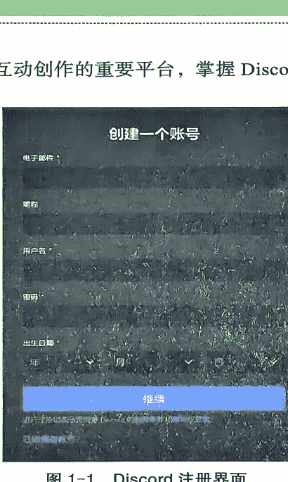

#### 1.2.2 Discord 账号登录方法

完成注册及邮箱验证后，你便可以正式登录 Discord 账号。再次访问 Discord 官网首页，点击页面右上角的“登录”按钮（图 1-2），随后输入刚才注册时使用的电子邮箱地址和密码，点击确认即可进入 Discord 主界面。在 Discord 主界面，你可以查看和管理个人账号信息、加入频道、参与聊天和互动，以及进一步使用 Midjourney 进行创作。

为了更好地使用 Discord 平台，建议首次登录成功后，保持账号登录状态或记住账号信息，以便后续快速进入 Midjourney 频道进行创作互动。

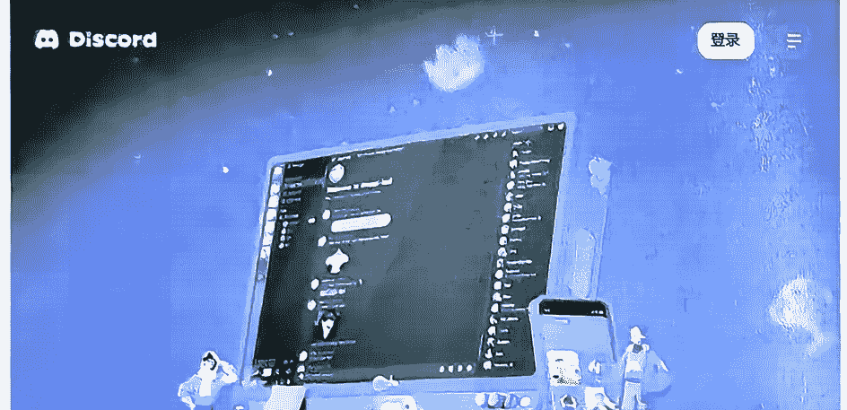

图 1-2 Discord 登录界面

#### 1.2.3 下载 Discord 客户端（推荐）

尽管可以直接在网页端使用 Discord，但下载 Discord 客户端可获得更稳定流畅的使用体验。Discord 官网提供了适用于多种设备的平台客户端，包括 Windows、Mac 电脑端以及 iOS、Android 移动端（图 1-3）。你可以根据自己的设备选择合适的客户端下载安装，登录自己的账号后，即可更加高效稳定地使用 Discord，随时随地与 Midjourney 互动和创作。

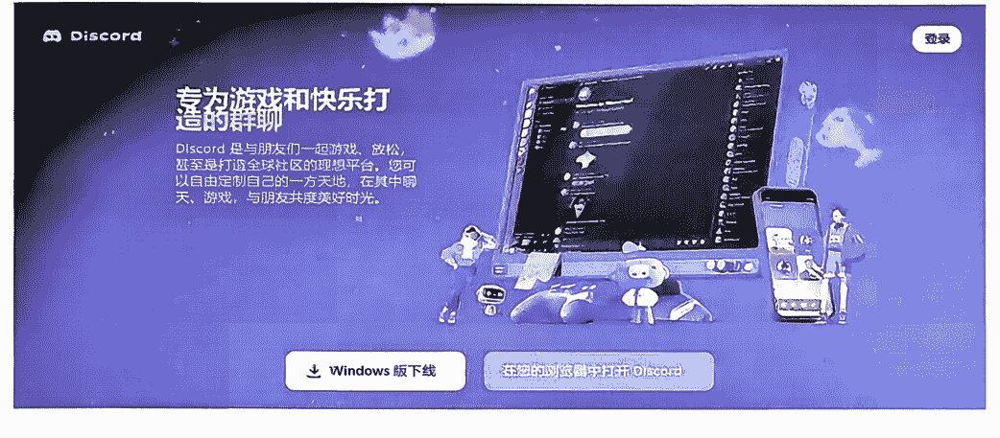

图 1-3 Discord 下载界面

#### 1.2.4 Discord 账号的设置与管理

登录 Discord 后，为了提高个人使用的便利性，建议对账号进行基本设置与管理。你可以在主界面左下角点击用户头像，进入“用户设置”界面（图 1-4）。
在此界面中，你可以根据个人需求设置自己的个性化头像、昵称、隐私保护选项以及消息通知方式。这些设置能够帮助你在创作过程中更加便捷地收到 Midjourney 的图像生成通知，确保不错过任何重要的信息。同时，合理设置隐私选项还能保护你的个人信息安全，确保创作过程更加安心和便捷。

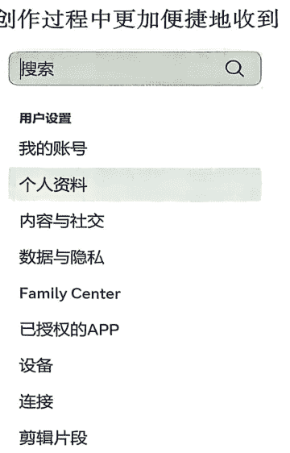

图 1-4 Discord 用户设置界面

#### 1.2.5 使用 Discord 的注意事项

使用 Discord 平台时，为提升用户体验，建议开启通知功能，便于用户及时接收到 Midjourney 生成的图像结果通知，避免错过创作过程中的重要更新。同时，Discord 账号涉及个人创作成果和交互信息，务必妥善保管好个人账号信息，避免泄露密码或其他敏感信息，以保护账号安全。此外，首次加入 Midjourney 频道时，建议仔细阅读频道说明和社区规则，更好地融入创作社群，保障后续的顺畅互动与合作，以获取优质高效的创作体验。

通过以上内容，你将能够顺利完成 Discord 账号的注册、登录与基本管理设置，为顺利使用 Midjourney 创作奠定坚实的基础。

### 1.3 找到并加入 Midjourney 频道

完成 Discord 账号的注册与登录后，下一步便是找到并加入 Midjourney 官方频道，这是开始使用 Midjourney 进行 AI 视觉创作的必要步骤。在该频道中，你不仅可以体验强大的图像生成功能，更能获得丰富的创意灵感，提升自己的创作水平。同时，你还能与全球各地的创作者互动，交流创作经验，共同探索视觉艺术的无限可能性。

#### 1.3.1 如何找到 Midjourney 官方频道

首先，登录你的 Discord 账号并打开 Discord 主界面。在界面左下角找到“发现”按钮，点击进入页面后，你可以清楚地看到右侧的服务器列表，搜索并找到 Midjourney 官方频道（图 1-5）。

#### 1.3.2 加入 Midjourney 官方服务器

在进入 Midjourney 的服务器页面后，你会看到清晰的服务器介绍与服务器图标。此时，只需点击屏幕上的“加入服务器”按钮，即可顺利加入 Midjourney 官方服务器。
加入成功后，Discord 主界面左侧的服务器列表中，将会显示 Midjourney 的图标。你可随时点击该图标，进入 Midjourney 服务器，开启创作与互动体验。

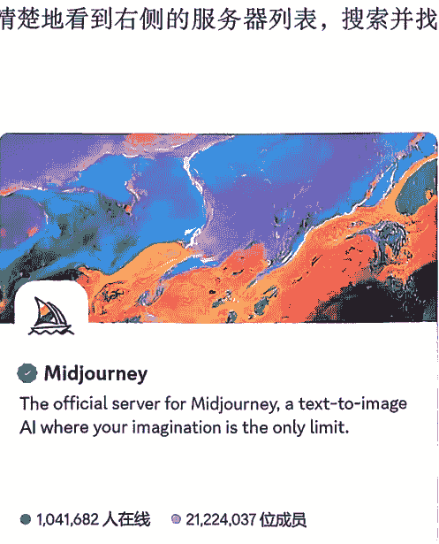

图 1-5 Midjourney 官方频道

#### 1.3.3 熟悉 Midjourney 服务器结构与频道分类

首次进入 Midjourney 官方服务器后，界面可能显得复杂，这是因为官方服务器内设有多个频道（图 1-6）。

不同频道具备不同的功能：

**新手频道（newbies）**：适合初学者进行初次图像生成练习的频道，通常人数较多，可以在这里观察其他创作者如何输入提示词，以及生成的图像效果如何。

**常规频道（general）**：一个用于用户之间互动与交流的场所，你可以在这里向其他创作者提出问题、分享心得、获得建议或讨论创意想法。

**主题频道（themed channels）**：官方会定期或长期设置一些专属频道，例如风景（landscape）、科幻（sci-fi）、插画（illustration）等频道，用于创作者围绕特定主题进行图像生成与互动交流。

**反馈频道（feedback）**：在此频道，你可以向 Midjourney 的工作人员提出关于工具功能使用的问题或建议，官方通常会及时回复并提供帮助。

**公告频道（announcements）**：Midjourney 团队定期发布重要更新、功能升级、服务器维护通知或创作大赛、社区活动等信息的重要频道。

建议新手用户先从“newbies”频道开始进行初步尝试，以便逐步熟悉 Midjourney 的提示词输入规则和生成逻辑，进而选择感兴趣的主题频道，针对性地深入学习与创作。

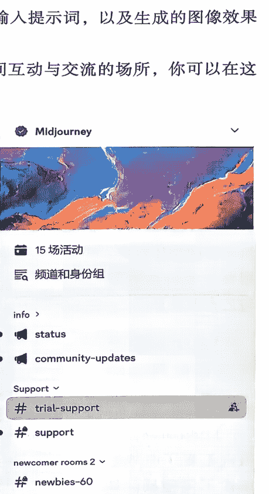

图 1-6 Midjourney 频道列表

#### 1.3.4 开始首次图像创作尝试

当你首次进入 Midjourney 服务器的 “newbies” 频道后，你便可以通过在聊天框中输入命令来启动图像创作。通常的做法是先键入 “/imagine”，然后跟上你想要生成的图像的提示词。以下是一个简单示例：

```
/imagine a serene mountain landscape at sunset, realistic style
```

按下回车键后，Midjourney 会在数十秒到几分钟的时间里自动生成 4 个不同版本的图像供你预览（图 1-7）。

这些版本在构图、色调或风格细节上可能略有差异，帮助你快速找到最符合期望的方向。

如果你对其中某张图像特别满意，可以使用放大（upscale）功能将其分辨率和细节质量进一步提升；若你想在一幅图像的基础上获得更多相似风格的变式，则可以点击变体（variation）按钮，Midjourney 会为你生成一组具有相同构图基调却有所延伸或变化的图像。

通过这种方式，你能够逐步尝试并精细化提示词，直至找到与自己构想最为契合的创作效果。因为对提示词的不断调整与优化，能够在很大程度上提升图像生成的准确度与艺术表现力。

#### 1.3.5 在全球创作社群互动与交流

Midjourney 频道内汇聚了全球范围内不同领域、具有不同经验的创作者。在创作之外，建议你积极参与社区的互动：

- 主动观察其他用户生成的优秀作品，从中学习提示词的优秀搭配方法。
- 遇到创作疑问时，善于向其他经验丰富的用户提出问题，获得启发与指导。
- 经常浏览“常规频道”和“公告频道”，及时了解 Midjourney 的最新功能与社群活动，以提升个人的创作水平和社群参与感。

通过以上步骤和详细介绍，你将顺利地加入 Midjourney 官方频道，并快速掌握其基础功能，为进一步深入探索 Midjourney 的创作潜力奠定扎实的基础。

### 1.4 如何搭建自己的服务器

虽然 Midjourney 官方频道可供创作者体验和学习，但由于人数众多，作品更新速度快，自己的创作内容很容易被其他用户的刷屏淹没。因此，搭建一个专属的 Discord 服务器以独立使用 Midjourney，是提高创作效率和管理作品的有效方式。以下将详细介绍如何在 Discord 平台搭建属于自己的服务器，并顺利接入 Midjourney 进行个性化创作。

#### 1.4.1 创建自己的 Discord 服务器

首先登录 Discord 账号，在界面左侧的服务器栏下方找到“+”号图标。

点击后，在弹出的菜单中选择“创建我的服务器”（图 1-8）。

接下来，Discord 将提示你选择服务器用途，通常可选择“适合我和朋友”（for me and my friends）或直接跳过该步骤。

设置好服务器名称、上传头像后，即可完成服务器的初步创建，成功创建后，服务器名称将出现在左侧服务器列表中。

#### 1.4.2 在服务器中添加 Midjourney 机器人

在创建好的私人服务器中，点击顶部服务器名称旁边的箭头，打开下拉菜单、选择“应用程序商店”（App directory）或直接选择“邀请机器人”（invite bots）。
若应用程序商店未显示 Midjourney，可以直接访问 Midjourney 官网 (https://www.midjourney.com) 获取机器人邀请链接，或从 Midjourney 官方服务器中直接邀请机器人加入。
通过 Midjourney 官网链接选择“邀请机器人”（invite Midjourney Bot）后，根据提示选择你刚创建的私人服务器，完成授权确认后即可将 Midjourney Bot 成功邀请到你的私人服务器中（图 1-9）。

#### 1.4.3 配置服务器频道

搭建好个人服务器并邀请 Midjourney 机器人后，下一步需创建适合图像创作的专属频道：
- 点击服务器名称旁边的加号图标“+”，创建一个新频道。
- 将新频道设置为“文本频道”（text channel），并取一个清晰易辨的名称，如“midjourney创作”或“图像生成频道”（图 1-10）。

设置完成后即可开始使用该频道进行 Midjourney 的 AI 图像创作，避免他人干扰或刷屏。

#### 1.4.4 服务器权限和角色管理

为了让服务器的管理更加灵活有序，建议创作者适当进行服务器的权限和角色管理：

- 点击服务器名称旁边的箭头图标，选择“服务器设置”（server settings）。
- 在服务器设置中选择“角色”（roles），你可以创建不同的用户角色，如管理员、普通成员或访客，灵活管理访问权限（图 1-11）。

为 Midjourney 机器人单独创建角色，并确保机器人拥有充足权限（如发送消息、上传图片等），以保证 Midjourney 的正常运作。

#### 1.4.5 在自己的服务器上使用 Midjourney 创作图像

完成上述步骤后，即可在自己搭建的服务器频道内正常使用 Midjourney 进行图像创作：

- 在频道聊天框中输入指令“/imagine”，紧接着输入你所构想的图像的提示词进行图像生成（图 1-12）。

自己的服务器具有更高的隐私性和独立性，你的作品生成后将不会被其他创作者的内容覆盖，更便于你管理和回顾自己的创作成果。

同时，你也可以将你的私人服务器邀请链接自由分享给朋友或合作伙伴，一起交流创作成果和创意灵感，打造专属的创作社群。

#### 1.4.6 独立服务器的优势与建议

搭建私人服务器的主要优势包括以下几点：

- 创作独立性：避免作品被其他用户的内容淹没，方便查看和管理个人创作记录。
- 更好的互动体验：可以与朋友、同事或兴趣小组成员自由互动交流，提升社群感与归属感。
- 灵活的权限控制：可根据需求设置成员权限、角色分工等，更有效地进行创作管理。

搭建完成后，建议创作者根据实际需求逐步优化频道布局、权限设置以及交流方式，打造一个高效、友好且充满创意的个人创作空间。

## 2 第一次使用 Midjourney

### 2.1 快速生成图像的指令：/imagine

本节将带你了解 Midjourney 最基础且最重要的指令 “/imagine”，学习如何使用该指令生成你的第一张 Midjourney 图像作品。

#### 2.1.1 /imagine 指令简介

/imagine 是 Midjourney 中用来生成图像最核心且最基础的命令。
输入该指令，并配合简短的英文描述（即提示词），即可快速生成想象中的视觉图像。
命令格式为：/imagine 提示词（prompt）。
例如，你想生成一个海边的日落场景，可以输入：/imagine sunset over the ocean, peaceful and serene（图 2-1、图 2-2）。

#### 2.1.2 如何输入 /imagine 命令

- 在 Discord 的 Midjourney 频道（如 newbies 或自己的专属频道）中，点击下方的聊天输入框。
- 键盘输入斜杠“/”后，会自动出现命令列表（图 2-3），选择或直接键入 imagine 命令。
- 接着在出现的提示词输入框中输入你的英文提示词。
- 提示词输入后，按下回车键发送命令，Midjourney 机器人就会开始生成图像。

#### 2.1.3 输入提示词的要点与技巧

- 尽量使用简洁、清晰的英文表达，明确场景、主体、风格。
- 可以使用逗号或空格分隔多个视觉要素，更精准地表达你的创意。
- 避免提示词过于模糊或繁杂，否则 AI 可能难以精准理解创作意图。

示例：

较模糊的提示词：/imagine a city。

更为清晰精准的提示词：/imagine futuristic city skyline at dusk, cyberpunk style, vibrant neon lights。

（黄昏的未来城市天际线，赛博朋克风格，充满活力的霓虹灯。）

#### 2.1.4 等待生成结果与初步操作

提交 /imagine 指令后，通常需要等待几十秒至数分钟，Midjourney 将生成初步的图像方案。

图像生成完成后，会出现一张包含 4 个图像缩略图的预览图片（图 2-4），并在下方显示一排操作按钮（如 U1、U2、V1、V2 等）。

你可根据个人喜好对生成的图像进行放大（upscale）或变体（variation）操作，以获取更满意的视觉效果。

#### 2.1.5 生成图像的注意事项

- Midjourney 生成的图像在默认情况下对所有频道成员可见，若希望图像生成更加私密或不被打扰，推荐在私人服务器频道内使用该命令。
- 合理控制提示词数量与复杂程度，有助于提升图像生成的质量和速度。

### 2.2 下方按钮的功能

在使用 Midjourney 生成图像之后，系统会自动生成 4 个初步的图像缩略图，并在下方提供一系列操作按钮。这些按钮能够帮助你快速对生成的图像进行进一步的调整与优化。本节将详细介绍这些按钮的具体功能，帮助你更高效地完成创作。

#### 2.2.1 按钮功能的总体说明

Midjourney 生成图像后，默认呈现为 “2×2” 的 4 个图像组合，下方一般会显示如下类型的按钮：

- U 按钮：即放大（upscale）按钮，分别标记为 U1、U2、U3、U4，用于放大并增强对应编号的图片。
- V 按钮：即变化（variation）按钮，分别标记为 V1、V2、V3、V4，用于生成对应图片的相似变体。
- 刷新按钮：用于生成 4 幅全新的图像，风格与初始提示词保持一致，但生成的具体图像会与上一次有所不同。

#### 2.2.2 U 按钮：放大图像（upscale）

U 按钮用以将你选中的图像放大，提升其分辨率，并进一步优化细节，生成更高质量的图像，以便下载和使用。

- U1：放大左上方（第 1 张）图片
- U2：放大右上方（第 2 张）图片
- U3：放大左下方（第 3 张）图片
- U4：放大右下方（第 4 张）图片

例如，当你对生成的四个图像中的第 3 张图片感到满意，希望得到高分辨率版本时，只需点击对应的 U3 按钮即可（图 2-5）。

#### 2.2.3 V 按钮：创建变体（variation）

V 按钮用于在你喜欢的图像基础上生成多个相似但存在细微差别的变体，以便你探索更多创作的可能性。

- V1：以左上方（第 1 张）图片为基础生成 4 个相似变体
- V2：以右上方（第 2 张）图片为基础生成 4 个相似变体
- V3：以左下方（第 3 张）图片为基础生成 4 个相似变体
- V4：以右下方（第 4 张）图片为基础生成 4 个相似变体

例如，你认为第 3 张图片整体不错，但希望探索更多类似的可能性，即可点击“V3”，系统将提供 4 个与第 3 张图片类似但又存在细节差异的新图像方案供你选择（图 2-6）。

#### 2.2.4 刷新按钮：重新生成一组图像

在使用 Midjourney 进行创作时，如果你对当前生成的 4 张图像都不太满意，或是想要在相同主题和提示词的基础上继续探索更多变化，可以借助“刷新按钮”来重新生成一整组图像。刷新功能会基于相同的提示词，再次输出 4 张全新的图像，为你带来不同的视觉表现。
当你觉得第一批图像与自己的想法存在较大差距时，你只需点击刷新按钮，就能快速获得新一批缩略图（图 2-7）。
这样一来，即便不修改提示词，你也可以在同一创作方向下获得更多灵感。与此同时，你能够通过不同批次的图像来捕捉更多可能性，然后再决定是否进一步放大或生成变体。

需要注意的是，刷新按钮与“放大”和“变体”功能的侧重点并不相同。放大功能主要是将某张小图精细化为高分辨率版本，变体功能则是基于你选中的那张图像，生成几张相似风格和构图的图像。而刷新按钮面向的是整组图像的重生，不依赖于任何一张已有图的风格或构图，让你在同一提示词下获得更多全新的初始结果。

通过反复使用刷新按钮，你可以不断尝试新的图像组合，从中筛选出最满意的作品，然后再配合“放大”或“变体”功能，朝着更加精致且贴合预期的方向演进。若多次刷新后依然无法达到理想效果，则可适当微调或重新编写提示词，以便继续在更准确的方向上深挖和迭代。

#### 2.2.5 按钮使用流程

假设你使用如下提示词生成一组图像：“一只坐在古老城墙上的黑猫，充满神秘气息，暗黑系插画风格。”图像生成完成后，Midjourney 会给出 4 张图像的预览图，供你选择、放大或生成变体。

如果你对第 2 张图像特别满意，则可点击“U2”按钮将其放大，最终获得一张更精细且高分辨率的图像。相比初始图，这张放大图会呈现出更多细节，同时更贴合你所期望的风格。

若你认为第 3 张图像风格不错，但仍想在这个构图的基础上进行进一步探索，则可点击“V3”按钮。这样一来，Midjourney 将会生成 4 张风格与第 3 张图像相似但在细节上有所变化的新图，以便你从中再次挑选满意的版本进行放大或深入迭代。

如果你发现当前生成的 4 张图像都不符合期望或者想尝试更多不同思路，则可直接点击刷新按钮。通过刷新，Midjourney 会基于相同的提示词重新输出一组图像，为你带来截然不同的生成结果。

#### 2.2.6 按钮使用的注意事项

- 每次点击按钮后，Midjourney 会重新开始计算并生成新的图片，过程通常需要等待几十秒至数分钟，建议耐心等待。
- 若同时点击多个按钮，任务将依次排队执行，可能会延长总等待时间。
- 由于 Midjourney 的免费账号每日生成图像数量有限，合理规划按钮的使用，避免不必要的频繁刷新与变体生成，有利于提高创作效率。

### 2.3 常见命令

除了最常用的 “/imagine” 指令外，Midjourney 还提供了一系列实用指令，帮助创作者更高效地完成视觉创作。本节将为你详细介绍这些常用指令的功能与使用方法，便于你更全面地掌握 Midjourney。

#### 2.3.1 /blend——融合图片

当你希望将两张或更多张现有图片进行融合，生成独具创意的全新视觉效果时，可以使用 Midjourney 的 “/blend” 命令。它能将不同风格、元素或构图的图片合并在一起，为你带来崭新的灵感和艺术表达方式。
使用方法非常简单：先输入 “/blend”，随后依次上传你想要合并的图片（图 2-8）。

命令格式示例如下：
/blend 上传图片 1 上传图片 2（可选更多图片）

你可以在此基础上继续添加第 3 张、第 4 张等图片，融合的图像数量越多，AI 创作效果可能越丰富。当多张图像完成上传后，Midjourney 将会自动进行融合处理，为你输出新的合成图像。

如果你的创作需求包括混合不同的艺术风格、叠加特殊的设计元素，或者尝试将两幅截然不同的作品合并成一个全新构图的视觉成果，那么 “/blend” 命令往往是最佳选择。它能在保持现有图片各自特点的同时，碰撞出前所未有的视觉效果，并给予创作者更多的想象空间与灵感火花。

#### 2.3.2 /settings——调整生成设置

当你需要对 Midjourney 的创作参数进行快速调整时，可以使用 “/settings” 命令。它允许你直接在交互式菜单中对生成质量、风格强度以及图像尺寸等重要参数进行选择或修改，从而更好地控制生成结果并贴合你的创作需求。

在对话框中输入 “/settings” 后，Midjourney 会弹出一个可交互的菜单，列出当前版本支持的主要配置选项（图 2-9）。

例如，你可以选择生成图像时的质量高低、是否使用特定版本的算法，或是在风格化强度上做出调整，以决定图像整体的艺术风格和细节呈现程度。与此同时，还能轻松修改生成图像的尺寸，尝试更广阔的横幅构图或更适合手机屏幕的长图比例。

通过“/settings”进行参数的灵活调整，你可以高效地把握 Midjourney 的创作风格走向，并在尝试不同设置组合的过程中逐渐找到最适合你的创作模式。如果在某些情况下需要回到默认配置或更换成其他模式，可以随时再次调用“/settings”命令，进行相应的切换或还原。

#### 2.3.3 /describe——图片描述

当你想要基于一张现有的优秀图片获取更精准的文字描述或提示词时，可以使用“/describe”命令。它会通过对图像内容的智能分析，自动为你生成一段较为完整、详细的描述文本，为后续类似图像的再创作提供思路和参考。
使用方法十分简单：首先，在对话框中输入“/describe”（图 2-10）。

其次，将你想分析的图片上传。Midjourney 会随即生成针对该图片的描述文字，你可以直接将其用于下一次的提示词编写，或者在这个基础上进行扩充和修改，让生成的作品更加贴合你的创作需求。通过这个命令，你能够在优秀作品与新创意之间搭建起一座高效的沟通桥梁。

#### 2.3.4 /info——查询账户信息

当你想要了解自己当前所使用的 Midjourney 版本、剩余 fast 模式时长、生成图像数量等账户相关信息时，可以使用“/info”命令进行快速查询。它会在聊天窗口中弹出一条信息，展示你目前的会员等级、可用的 fast 模式时长、

#### 2.3.5 使用指令的技巧与注意事项

所有 Midjourney 指令均需以斜杠“/”开头，在输入框中键入斜杠后会自动显示可用指令列表。

每个指令后通常会有提示输入框，按照提示填写内容或上传图片，即可轻松完成操作。

合理使用指令能极大提高 Midjourney 的创作效率，减少不必要的尝试和错误。

## 3 初探提示词

### 3.1 提示词的作用

提示词（prompt）是创作者与 Midjourney 之间最直接的沟通媒介，指用来明确表达创作意图、风格诉求与细节期望的文字描述。它不仅为 AI 指明生成图像的总体方向，还在很大程度上决定了成品的艺术气质和视觉呈现效果。以下几个方面能帮助你更系统地理解提示词在创作过程中的重要性。

#### 3.1.1 明确创作方向

提示词可以直截了当地说明图像的主要对象和核心概念，如人物、场景或剧情背景，让 Midjourney 从一开始就带着清晰的目标进行绘制。相比毫无指向的生成方式，这种明晰的需求描述能够减少无关信息的干扰，为后续的优化或迭代奠定坚实基础。

比如，若你想表现“古罗马的竞技场决斗”这一主题，只需在提示词中点明“古罗马”“竞技场”“决斗”等要素，Midjourney 就会把重点放在建筑、服饰和历史氛围上，从而使图像作品更加符合你对时代感和场景感的期待。

#### 3.1.2 呈现多元艺术风格与特征

在提示词中提及“油画风”“水彩风”“赛博朋克”或其他特定流派，可以让 Midjourney 结合所学的美学知识，自动在画面中融入相应的笔触、色彩和构图特征。若你想追求某位艺术家的个人风格，则可明确标出艺术家的名字，以获取更贴近这位艺术家作品精髓的图像结果。

这种针对性描述能够在极短时间内提供各式各样的风格选择，省去了手动调节画风的繁琐过程，也为创作者打开了融汇多种艺术流派的空间。例如，当你的提示词中同时包含“日本浮世绘”和“暗黑哥特风”两种风格元素时，Midjourney 会尝试将两者融合，创造出独特的视觉效果。

#### 3.1.3 提升图像细节与氛围表现

如果提示词涉及对细节的生动描述，例如，“波光粼粼的湖面”“金属质感的机甲外壳”或“伴随蒸汽缓缓升起的幻想城市”，Midjourney 会根据关键词塑造纹理、光影和空间层次，从而让生成的图像更富有真实感与层次感。

通过在提示词中凸显情绪或氛围，你也能进一步提升作品的感染力。例如，加入“忧郁”“浪漫”“孤寂”等形容情感或氛围的关键词后，Midjourney 会在色调、明暗对比乃至背景元素上做出相应的调整，让整个画面与创作者的意图更加契合。

#### 3.1.4 提高创作效率与精准度

有效的提示词相当于一份简明的创意“脚本”，帮助 Midjourney 快速锁定创作要点。与反复尝试、不停进行误差修正的做法相比，一个思路清晰且结构完备的提示词能大幅缩短调试时间，并显著减少反复修改所耗费的精力。

此外，每次生成图像后，你都可以基于结果微调提示词，逐步完善描述方式。例如，通过新增或更改素材关键词、氛围用词等方式，聚焦你最想要强化的视觉元素。如此一来，你的作品就会越来越契合目标效果，创作效率和成品质量也将随之提高。

#### 3.1.5 彰显创作者个性与创造力

提示词不只是“告诉 AI 应该画什么”，也能折射出创作者的审美取向和独特灵感。当你选择某些富有个人风格的形容词、比喻或意象词时，你就能赋予最终图像更鲜明的个性烙印。

譬如，你可以将日常场景以诗意化的方式进行描述，或在提示词中运用一些超现实元素，从而获得奇幻或梦境般的视觉表达。恰当地运用这些具有冲击力的文字，将大大激发 Midjourney 对画面结构与氛围的塑造潜能，让成品更加独树一帜、富有想象空间。

### 3.2 提示词的基本构成

要想熟练使用 Midjourney，首先需要掌握提示词的基本结构及组成方式。一个完整的 Midjourney 提示词通常由多个要素构成，每个要素都直接影响最终生成图像的质量和效果。以下详细讲解提示词的大致结构与组成部分，帮助你更快地掌握提示词撰写的基本规律。

#### 3.2.1 主体

主体描述是提示词中最基础且最重要的部分，直接决定了图像生成的核心方向。无论是人物、动物、物品，还是特定场景，主体都能让 Midjourney 在创作时将注意力聚焦于这一部分，从而避免生成主题模糊或偏离的作品。撰写主体描述时务必简明扼要，确保提示词能准确传达你的主要需求。

例如，如果你想要一只戴着墨镜且围着围巾的猫咪，便可在提示词中直接写出 “A cat wearing sunglasses and a scarf”。这样的主体描述就足以让 Midjourney 明确“猫咪”这一核心对象，并据此绘制出相应的姿势和造型（图 3-1）。若你想加上更多细节，如猫咪的毛色或神情，可以在后续的修饰词或细节描述中进一步补充。

图 3-1 猫咪生成图

#### 3.2.2 动作与状态

除了主体本身，动作与状态是提示词中用来描述画面“动态感”或“情绪氛围”的关键元素。通过为主体添加精准的动作或姿势词汇（如 running、sitting、flying、dancing），以及状态词汇（如 sleeping、relaxing、smiling、thinking），能够使图像更具故事性与生动感。

> 例如，下列提示词不仅限定了主体为“猫咪”，还通过动作描述营造出活泼的场景氛围：
> A playful cat chasing butterflies in the garden（图 3-2）。
> （一只在花园里追逐蝴蝶的猫咪。）

在这里，“chasing butterflies”这一动作清晰地描述了猫咪的互动行为，使得最终生成的画面更富有动感与趣味性。若你需要强调主体的心理状态或情绪，也可以引入“happy”“nervous”等描述词，从而为图像增添更丰富的情感维度。

#### 3.2.3 环境或背景

在提示词中对环境或背景进行描述，可以让图像展现更丰富的空间感与氛围表达。无论是城市街头、原始森林还是极地冰川，都能通过明确的地点、季节、天气、时间等要素营造画面整体的情境，从而增强观赏者对图像的代入感。

> 例如，下列提示词就将画面的时空背景设定为“暴风雨夜晚的海边峭壁”：
> A lighthouse on a rocky cliff during a stormy night（图 3-3）。
> （暴风雨天气下岩石悬崖上的灯塔。）

图 3-2 猫咪生成图

图 3-3 海边生成图

当接收到“暴风雨”“夜晚”“悬崖”“灯塔”等关键信息时，Midjourney 便会在光线、色调以及氛围上更突出风雨交加与海岸孤立的紧张感，进而让作品传递出强烈的戏剧性与视觉冲击力。

#### 3.2.4 风格

在提示词中对风格进行描述，能够帮助 AI 明确图像的视觉语言与艺术形式。无论是油画、水彩、插画、摄影、动漫，还是带有未来感、复古风、电影感等特征的作品，明确的风格描述都有助于 Midjourney 在构图、色彩与氛围上进行准确的针对性调整，为你的作品赋予更鲜明的艺术气质。

> 例如，下列提示词会让 AI 在街景设计和配色上突出浓郁的赛博朋克元素，营造出高科技与霓虹交织的都市风貌：
> Cyberpunk-style futuristic street with neon lights（图 3-4）。
> （赛博朋克风格的未来街景，霓虹灯光效果。）

图 3-4 赛博街景生成图

除了赛博朋克，你也可以结合其他艺术风格和特定艺术流派，如“巴洛克风格”“梵高风格”“霓虹复古风”等，进行更具风格化的创作，让 Midjourney 输出的图像在视效表现与情感氛围上更加契合你的审美与需求。

#### 3.2.5 色彩

色彩是影响图像情绪与氛围的关键因素之一。在提示词中明确色彩基调或配色方案（例如，暖色调、冷色调、明亮鲜艳或单色黑白），能够帮助 Midjourney 迅速定位画面的整体情感走向，让生成的作品更加符合你的审美期望。

> 例如，下列提示词便突出了秋季的温暖与鲜艳的色调：
> A forest landscape in autumn colors, warm and vibrant tones（图 3-5）。
> （秋季色彩的森林景观，温暖鲜艳的色调。）

这种色彩设定能让 AI 着重表现金黄、橙红等秋日色彩，并在光影与氛围上进一步强调丰收与暖意，让作品呈现更加浓厚的季节特征。

#### 3.2.6 光影与效果

光影和特殊效果在图像创作中往往能起到“画龙点睛”的作用，它们不仅会影响整体的明暗对比，也会直接影响作品的情绪氛围与视觉冲击力。在提示词中注明光影信息（如“柔和光线”“背光照明”“强烈对比度”），或是标明特定效果（如“发光”“粒子特效”“光晕”），都能让 Midjourney 在生成画面时遵循更明确的视觉指导，从而呈现出更具层次感与故事性的作品。

> 例如，下列提示词凸显了背光所带来的强烈戏剧化效果，让主体在人像轮廓上具备鲜明的剪影特征：
> A portrait of a woman with dramatic backlighting, creating a silhouette effect（图 3-6）。
> （一位女性的肖像，采用背光，突出戏剧化剪影效果。）

图 3-5 秋季森林生成图

图 3-6 女性光影肖像生成图

通过强调“dramatic backlighting”，Midjourney 会在图像中刻意强化逆光的表现，使光源勾勒出锐利或朦胧的人物轮廓，同时在背景或人物面部细节上呈现出与前景形成鲜明对比的光影互动。如果你希望进一步增强氛围，还可以加入诸如“柔和的光线（soft glow）”或“镜头光晕（lens flare）”等关键词，为画面带来更梦幻或更具电影感的视觉效果。

#### 3.2.7 视角与构图

在提示词中指明视角与构图方式，可以有效地控制图像的空间层次与结构安排，使主体与背景的关系更为明确。不同的视角（如鸟瞰、特写、广角等）往往会带来完全不一样的画面冲击力和叙事氛围。通过在提示词中使用具体的视角术语，你不仅能让 Midjourney 在生成图像时更好地把握“拍摄”角度，也能使作品中的视觉表达更为丰富、更有力。

> 例如，下列提示词会让 Midjourney 以鸟瞰视角呈现一座古老城市在日出时分的全景风貌，展现出恢宏又庄严的历史氛围：
> Bird’s-eye view of a medieval city at sunrise（图 3-7）。
> （鸟瞰视角下的中世纪城市，日出时分。）

通过明确“Bird’s-eye view”，AI 会在构图中强调高空俯瞰带来的广阔视野；而“medieval city”“sunrise”等信息，则进一步限定图像作品中的建筑应具有中世纪特色并沐浴在清晨金色的光线下。若想突出局部特写或人物神情细节，你也可改用“特写（close-up）”等词，让 Midjourney 生成更集中且富有戏剧张力的画面。

#### 3.2.8 细节与质感

为了让图像呈现更强的真实感与视觉冲击力，提示词中常常需要强调特定材料、纹理或质感，如“粗糙纹理”“金属质感”“光滑表面”“精致细节”等词。这能引导 Midjourney 在生成画面时着重刻画相应的微观特征，让作品变得更加生动且富有层次感。

> 例如，下列提示词就突出强调了机械主体的精密纹理与金属材质，使画面带有独特的复古机械风：
> Steampunk-style mechanical robot with intricate metallic textures（图 3-8）。
> （带有复杂金属质感的蒸汽朋克风机械机器人。）

当接收到关键词“intricate metallic textures”，Midjourney 便会在机器人表面的零件、接缝以及铆钉等细节处做出更精细的刻画，从而让整体外观更具工业感与机械感。如果你想进一步提升作品的沉浸感，也可在提示词中再加入“rusty（生锈的）”“scratched（划破）”或“weathered（风化的）”等词，来呈现更加老旧而富有历史痕迹的金属质感。

#### 3.2.9 提示词结构示范案例

以下示例展示了如何从基础版的提示词出发，通过逐步加入更多元素（主体细节、环境、风格、色彩、光影等），使得图像生成的效果更加丰富与细腻。

> 基础版提示词：
> A girl walking in a forest（图 3-9）。
> （一位在森林中行走的女孩。）

图 3-9 森林中的女孩生成图

只描述了主体（女孩）和基本环境（森林），虽然 Midjourney 会生成相关图像，但整体风格、氛围和细节都会比较模糊。

> 进阶版提示词：
> A young girl wearing a red cloak, walking through a misty forest at dawn, fairy tale illustration style, warm pastel colors, soft lighting（图 3-10）。
> （穿红色斗篷、漫步于清晨迷雾笼罩的森林中的女孩，童话风格，温暖色调，柔和光线。）

图 3-10 斗篷女孩生成图

细节扩充：“wearing a red cloak”，这一限定语描述了女孩的服饰要点，突出了视觉焦点。

环境强化：“misty forest at dawn”，让森林场景充满神秘与清晨光线的氛围感。

风格确立：“fairy tale illustration style”指明了童话插画风格。

色彩基调：“warm pastel colors”，这一色调设定指导了整体配色，增强了童话般的温暖柔和感。

光影效果：“soft lighting”强调了柔和的光线，为作品增加梦幻气息。

通过以上对比可以发现，随着提示词描述的细化与组成部分的扩充，生成图像的风格、气氛以及细节刻画都会更加贴近创作者的预期，也能大幅减少后续不断尝试与修正的工作量。

### 3.3 使用简单提示词快速体验不同输出效果

刚刚开始接触 Midjourney 的用户，建议先使用简洁且明确的提示词进行图像创作。不断调整和尝试不同的提示词，能够让用户快速熟悉 Midjourney 的创作逻辑与风格效果，便于日后的进阶使用。本节将带你使用简单的提示词进行初步实践，直观感受不同提示词所带来的视觉差异。

#### 3.3.1 使用简单提示词开始创作

初次使用 Midjourney 时，无须立即编写包含大量细节或多风格元素的提示词。选择一个简洁明了、描述重点突出的词句，就能够充分体会到 AI 根据指令进行创作的过程。如下示例提示词所示：

> A snowy mountain landscape（图 3-11）。
> （雪山景观。）

当你在 Midjourney 中输入这一简单的提示词后，系统会自动生成 4 张基础图像供你预览。尽管关键词并不多，但每张图像的构图、光线以及画面氛围都有可能略有差异。你可以从这些差别中观察并思考：

- 哪些元素在所有图像中都相对一致？
- 哪些部分是 AI 为了丰富构图或突出主题而进行的细节变化？
- 哪一版本的图像更符合你的审美或创意方向？

这一步骤既能让你快速熟悉 Midjourney 的图像生成速度与操作流程，又能帮助你积累关于“如何在提示词中表达需求”以及“什么样的词语能触发特定的视觉效果”的认知。待你对基本流程与生成结果有初步印象后，你就可以在后续的练习中逐步添加主体描述、环境氛围或细节要求等要素，以获得更具针对性的创作效果。

#### 3.3.2 增加风格关键词，观察变化效果

在掌握了如何使用简单提示词后，你可以通过在提示词中加入风格元素来进一步丰富图像表现。不同的风格关键词往往会显著影响作品的光影、配色乃至整体艺术风格，从而为相同的场景带来多样化的视觉呈现。

例如，在最初的提示词——
“A snowy mountain landscape”
（雪山景观）的基础上，若想增添水彩风格，可尝试使用如下所示的提示词：

> A snowy mountain landscape, watercolor painting style（图 3-12）。
> （雪山景观，水彩风格。）

与之前的“纯风景”相比，“watercolor painting style”会让 Midjourney 在生成结果中呈现出更多柔和渐变的笔触与色彩晕染效果，整体视觉更具绘画感与浪漫氛围。

如果再想尝试截然不同的风格，例如未来感十足的赛博朋克元素，则可将提示词改为：

> A snowy mountain landscape, cyberpunk style, neon colors（图 3-13）。
> （雪山景观，赛博朋克风格，霓虹色彩。）

图 3-13 赛博朋克风格雪山生成图

在这条提示词中，“cyberpunk style”和“neon colors”强调了高科技、霓虹灯等赛博朋克元素，生成的图像也会呈现出更多冷调霓虹灯光、金属质感或科幻结构，形成与水彩风格截然不同的视觉效果。

通过对比观察不同风格关键词在相同主体场景下的表现，你不仅能更好地理解 Midjourney 对风格词汇的解析方式，也能逐步在创作中积累关于“哪种风格能够带来哪种视觉氛围”的经验。在日后的高级使用中，熟练地组合并运用这些风格关键词，能够大幅提升图像创作的可控性与艺术表现力。

#### 3.3.3 尝试添加细节描述，提升图像效果

在熟悉了简单提示词和基础风格后，你可以进一步在提示词中加入更多场景或光影细节，从而增强图像的真实性和氛围表现。这样做不仅能让 Midjourney 更精准地捕捉到你想要表现的画面，还能让生成的图像在构图和视觉呈现方面更具层次感和冲击力。

例如，以下示例在原有的场景基础上，增加了具体时间段与光线特点等要素：

> A snowy mountain landscape at sunset, realistic style, soft lighting（图 3-14）。
> （雪山景观，日落时分，写实风格，柔和的光线。）

在此提示词里，“at sunset”能够让 AI 在色彩搭配和光线处理上更集中地展现日落场景常见的暖黄色或橙红色调；“realistic style”则使 Midjourney 在画面中强调真实感与自然纹理；而“soft lighting”则引导 AI 塑造更柔和、略带梦幻感的光影效果，以营造温馨而富有层次感的氛围。

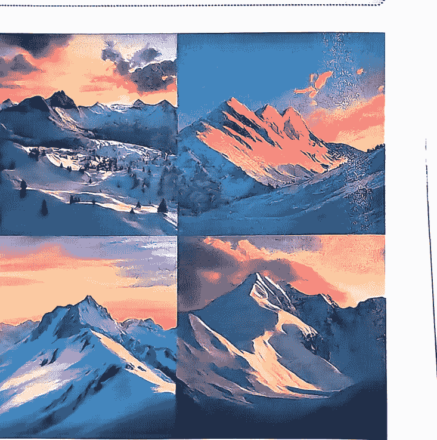

通过为场景增添更多细节描述，你会发现生成的画面不仅在整体氛围上更具感染力，也在纹理、层次和色调过渡等方面呈现更高的完成度。随着你在提示词中逐渐丰富这些元素，Midjourney 将在色彩、构图和细节处理上做出更贴近你创作意图的响应，极大地提升图像的完成度与美感。

### 3.4 同一主题的不同视觉表现方式

在使用 Midjourney 进行视觉创作时，即使是同一个主题，通过提示词的不同描述方式，也会产生截然不同的视觉效果。掌握同一主题下的多种表现形式，不仅能有效提高创作者的创作灵活性，更能帮助创作者找到最佳的视觉表达方式。本节将进一步引导你探索如何通过调整提示词，实现同一主题在视觉风格上的丰富变化。

#### 3.4.1 通过风格变化体现差异化效果

不同艺术风格的选择，可以使相同的主体呈现截然不同的视觉表现力。例如，以“森林小屋”为主题进行不同风格的描述尝试：

**插画风格（Illustration Style）**

> A cozy cabin in the forest, illustration style, vibrant colors, whimsical atmosphere（图 3-15）。
> （一个舒适的森林小屋，插图风格，鲜艳的色彩，异想天开的气氛。）

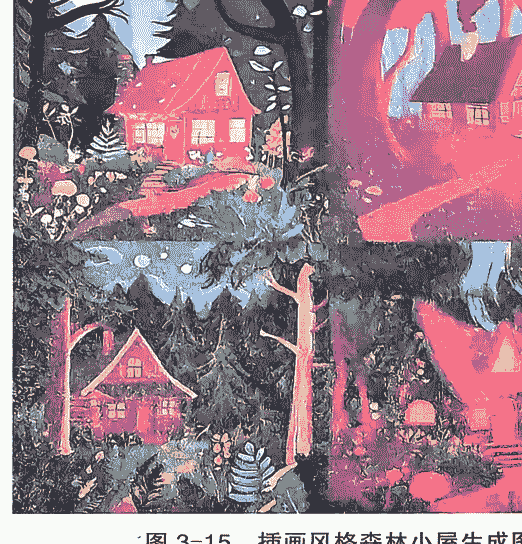

视觉效果呈现为色彩鲜艳、造型卡通化的插画风格，氛围温馨而充满趣味。

**写实风格（realistic style）**

> Realistic forest cabin surrounded by pine trees, detailed textures, warm sunlight（图 3-16）。
> （逼真的、被松树环绕的森林小屋，细节的纹理，温暖的阳光。）

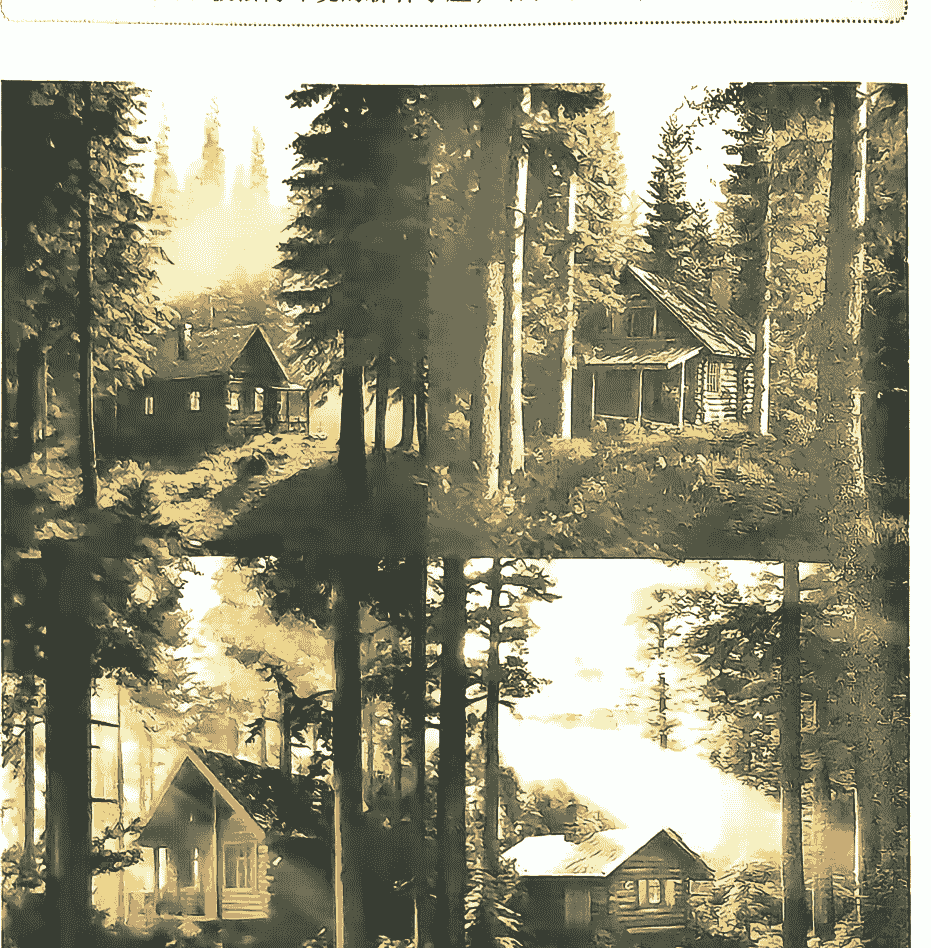

图 3-16 写实风格森林小屋生成图

生成图像细节丰富，视觉效果逼真，光影细腻。

**赛博朋克风格（cyberpunk style）**

> Forest cabin, cyberpunk style, neon lighting, futuristic details（图 3-17）。
> （森林小屋，赛博朋克风格，霓虹灯，未来主义的细节。）

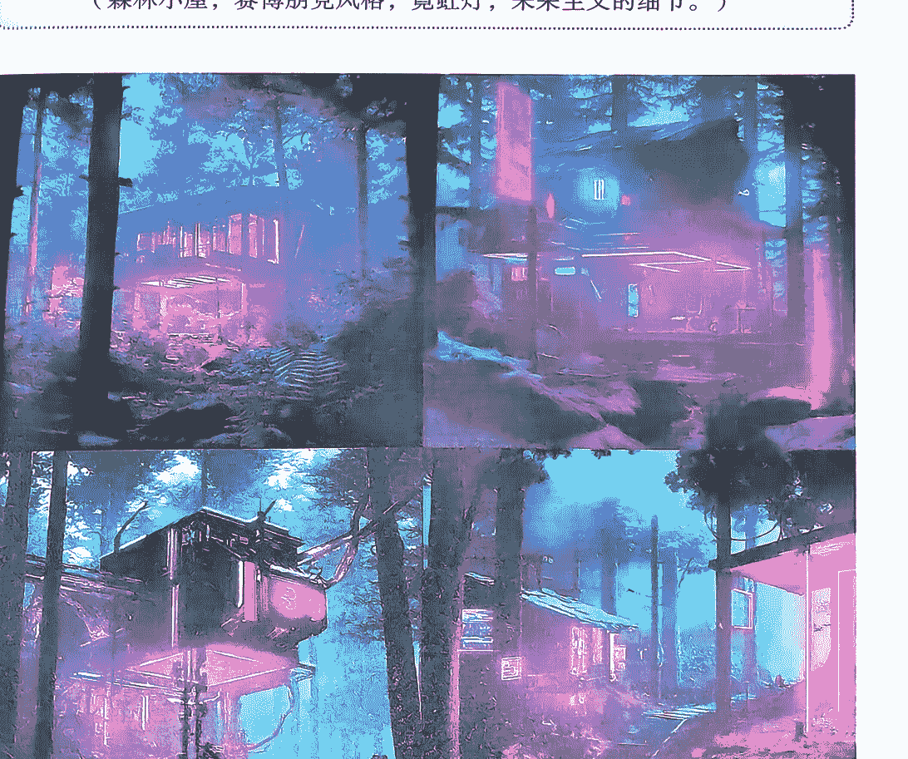

图 3-17 赛博朋克风格森林小屋生成图

生成图像带有未来科技感，霓虹色彩强烈，视觉上更加新颖独特。

#### 3.4.2 通过视角变化体现创意的多样性

同一场景也可通过不同视角体现出明显的视觉差异，突出不同的视觉焦点与创意感。以“城市街景”为例：

**俯视视角（bird’s-eye View）**

> Bird’s-eye view of a bustling city street, colorful lights（图 3-18）。
> （鸟瞰熙熙攘攘的城市街道，五彩缤纷的灯光。）

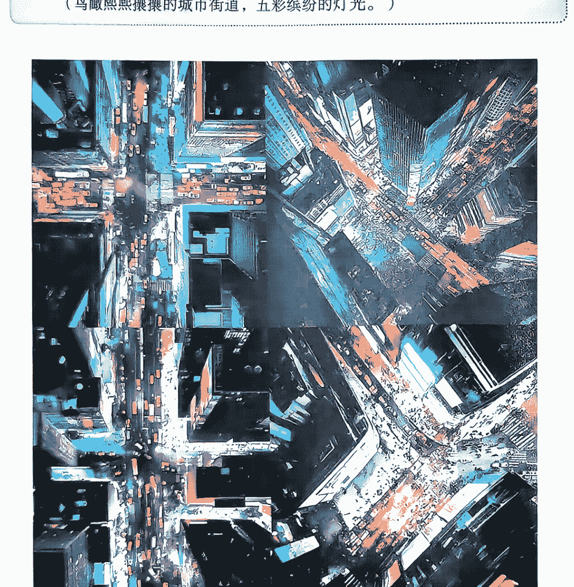

画面展现出宏观的空间感与结构感，给人一种全局观感。

**仰视视角（low-angle view）**

> Low-angle view of city street, tall skyscrapers, dramatic lighting（图 3-19）。
> （低角度的城市街道，高耸的摩天大楼，戏剧性的灯光。）

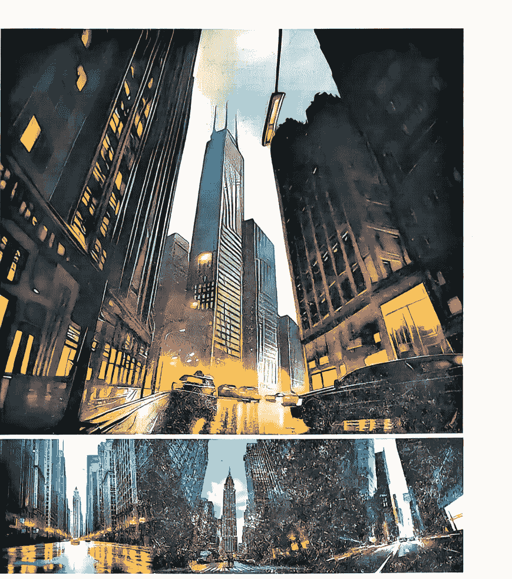

生成图像强化了建筑物的雄伟高大感，突出了场景的视觉冲击力。

**特写视角（close-up view）**

> close-up view of street corner scene with neon signs, cinematic style（图 3-20）。
> （亮着霓虹灯的街口特写镜头，电影风格。）

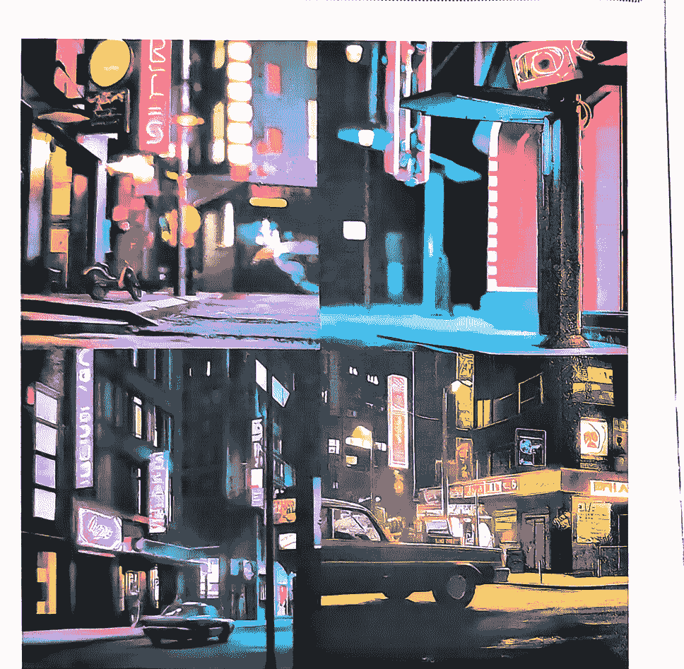

可以看出，街景特写画面聚焦场景细节，营造了电影般的细腻氛围。

#### 3.4.3 不同色彩搭配呈现的视觉差异

色彩搭配能显著改变图像的视觉情绪，同一主题也可因色彩组合的差异而形成不同的视觉氛围。例如“湖泊场景”：

**暖色调（warm colors）**

> Peaceful lake at sunset, warm golden colors, calm atmosphere（图 3-21）。
> （宁静的夕阳湖，温暖的金色，平静的气氛。）

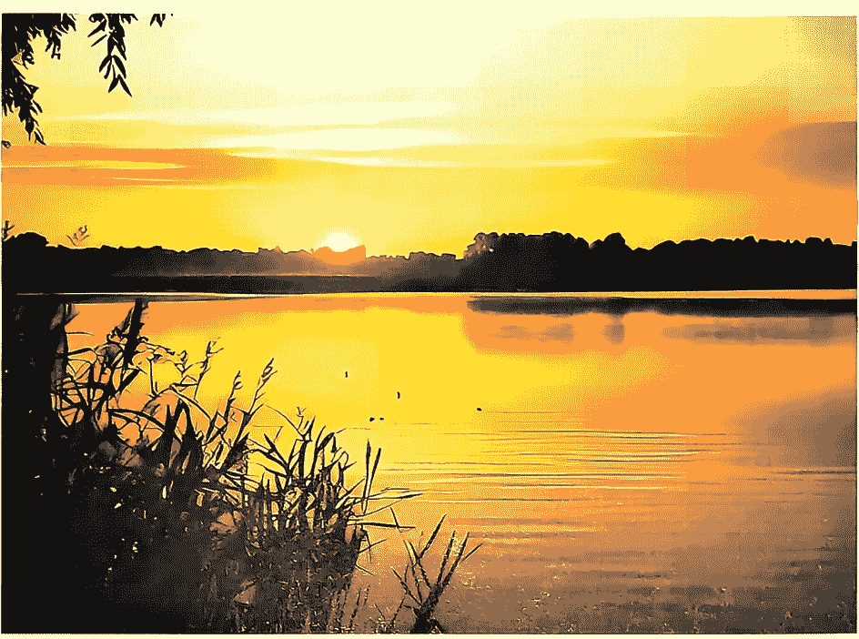

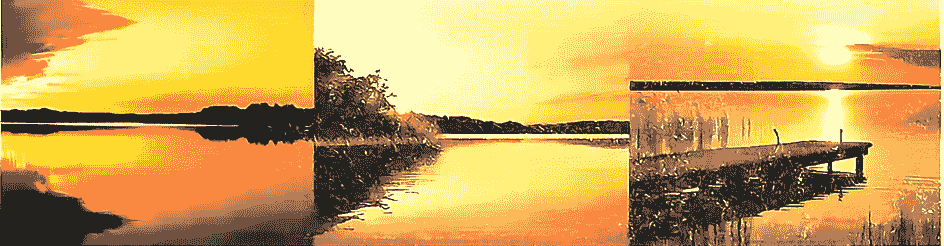

图 3-21 暖色调湖泊生成图

整体氛围温暖祥和。

**冷色调（cool colors）**

> Tranquil lake in moonlight, cool blue tones, serene mood（图 3-22）。
> （月光下宁静的湖，凉爽的蓝色调，宁静的心情。）

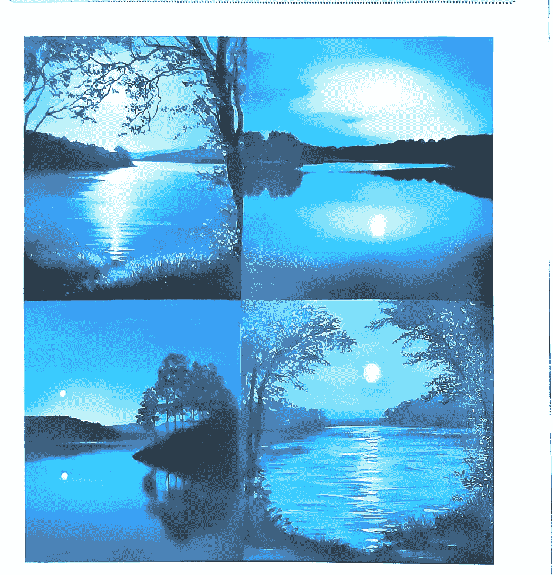

图 3-22 冷色调湖泊生成图

画面表现出清冷静谧的感觉。

#### 3.4.4 光影效果带来的视觉差异

在同一主题下加入不同的光影效果，同样能快速创造视觉上的丰富变化。以“人物肖像”为例：

**柔和光线（soft lighting）**

> Portrait of a woman, soft natural lighting, gentle and peaceful mood（图 3-23）。
> （一个女人的肖像，柔和的自然光线，温柔平和的心情。）

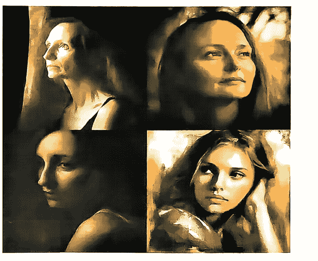

生成作品呈现柔和且安静的视觉效果。

**戏剧化光线（dramatic lighting）**

> Dramatic portrait of a woman, strong shadows and dramatic lighting（图 3-24）。
> （一个女人的戏剧性肖像，强烈的阴影和戏剧性的灯光。）

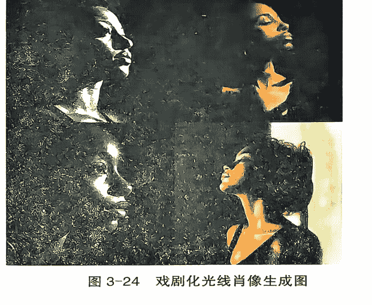

画面光影强烈，强化戏剧性的视觉感染力。

#### 3.4.5 运用细节变化增强视觉表现力

即使提示词中的主体相同，通过调整细节描述也能体现不同的视觉特征。例如“咖啡馆场景”：

**现代风格（modern style）**

> Modern cafe interior, minimalist furniture, bright lighting（图 3-25）。
> （现代咖啡馆内部、简约的家具，明亮的灯光。）

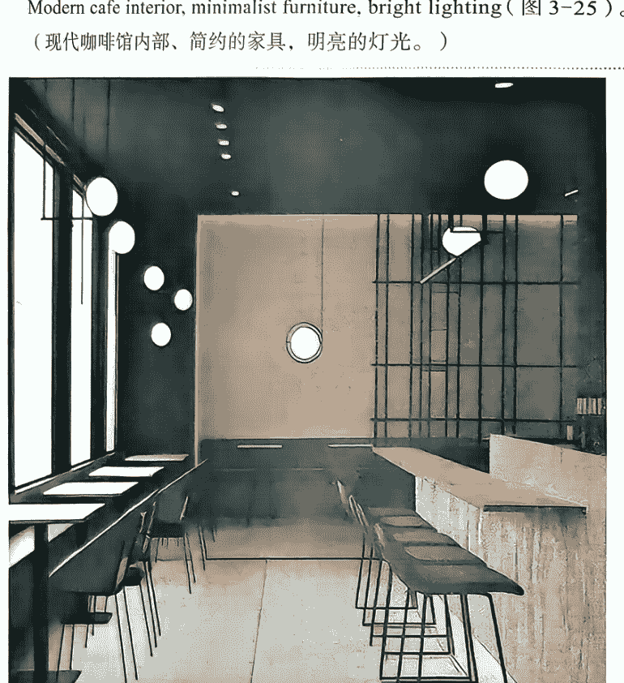

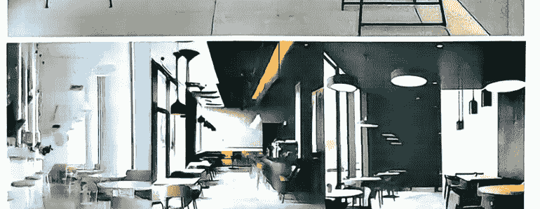

图 3-25 现代咖啡馆生成图

简约现代，空间感十足。

**复古风格（vintage style）**

> Vintage cafe interior, antique furniture, warm cozy lighting（图 3-26）。
> （复古咖啡馆内部，古董家具，温暖舒适的照明。）

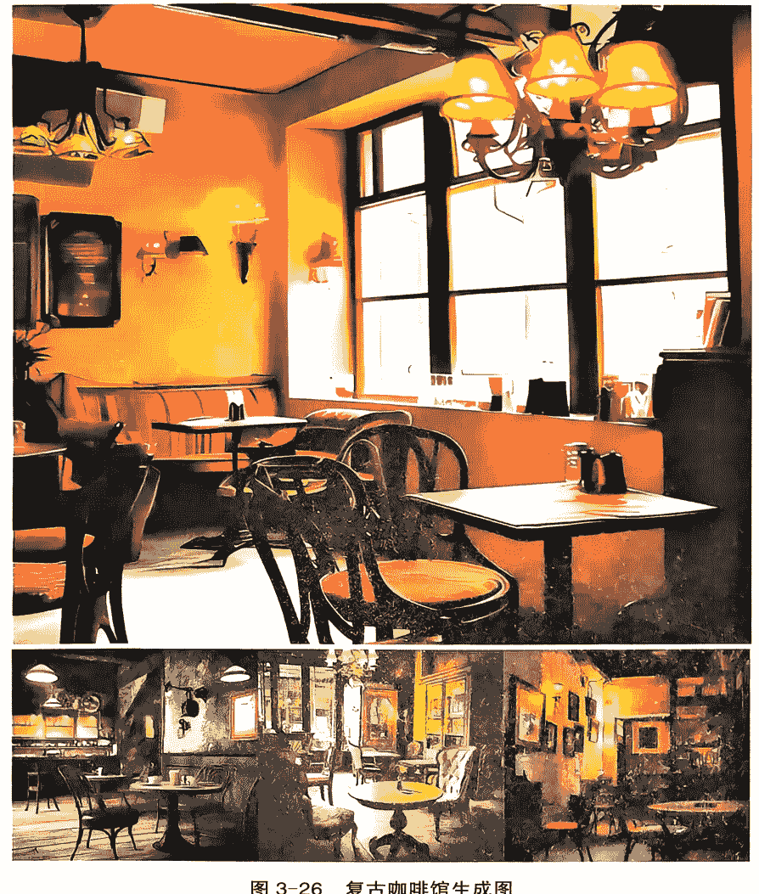

图 3-26 复古咖啡馆生成图

温馨复古，氛围感强烈。

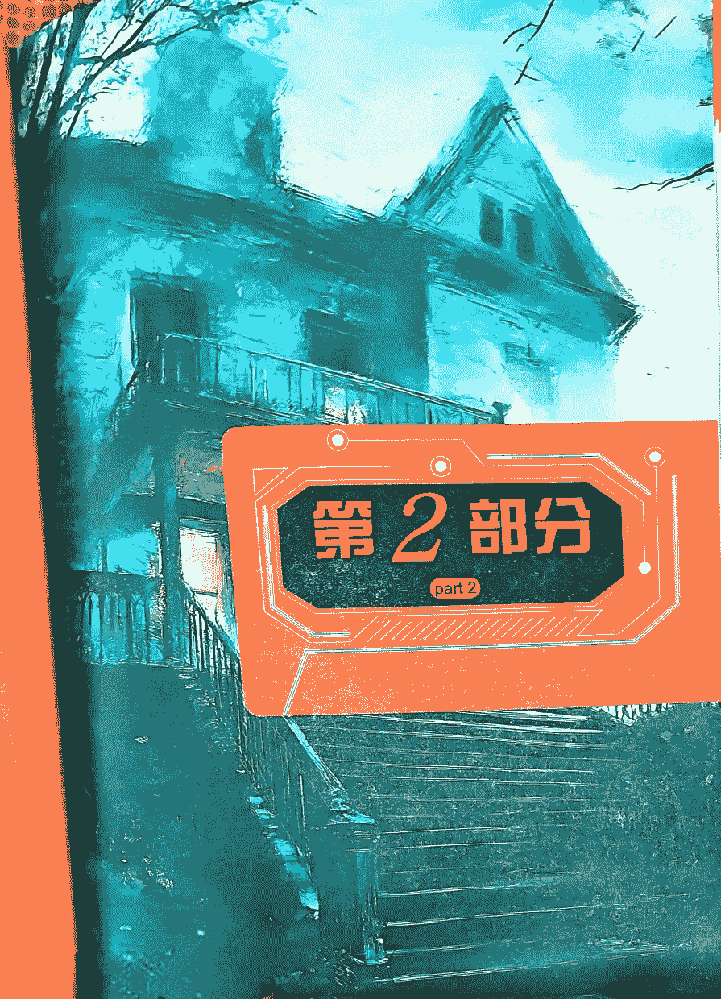

# 第 2 部分

## 4 Midjourney 参数书写格式教学

### 4.1 参数的书写格式

掌握 Midjourney 参数的书写格式，是实现精确设计意图、获得理想生成效果的关键步骤。正确的参数格式不仅能提高创作效率，也能精确表达设计师的想法，让我们获得理想的生成效果。

#### 4.1.1 基本书写规范

Midjourney 的提示词由主体描述和一系列参数构成，各部分之间使用空格分隔，参数均以双横线（--）为前缀。

基本格式：
Prompt 内容主体描述 -- 参数名 参数值

示例：
Modern architecture, glass facade, sunset lighting --ar 16:9 --stylize 500 --chaos 20 --seed 12345

上面示例中，空格是必须的，双横线（--）表示参数的开始，比例符号（:）用于表示某些参数的值（例如，宽高比）。

#### 4.1.2 常见参数的书写格式

##### 4.1.2.1 宽高比（aspect ratio）

格式：--ar 宽度 : 高度

示例：Modern house by seaside --ar 16:9

常用的宽高比：--ar 1:1（正方形）、--ar 16:9（横版）、--ar 9:16（竖版）

##### 4.1.2.2 风格化（stylize）

数值范围：通常为 0 ~ 1000

格式：--stylize 数值

示例：--stylize 300

##### 4.1.2.3 随机性（chaos）

数值范围为：0 ~ 100

示例：--chaos 50

##### 4.1.2.4 质量（quality）

常用值：0.25、0.5、1、2

示例：--quality 2

##### 4.1.2.5 种子（seed）

用数字表示。示例：--seed 123456

##### 4.1.2.6 图像权重（image weight）

用于图生图。示例：--iw 0.5

##### 4.1.2.7 负面提示（negative prompt）

在 --no 后接具体不希望出现的元素。示例：--no watermark, blurry

#### 4.1.3 完整示例

Modern minimalist house with large windows, night scene, soft interior lighting --ar 16:9 --stylize 300 --quality 2 --chaos 25 --seed 6789 --no low quality, watermark

针对以上提示词，Midjourney 将生成现代极简风格的房屋外观图，采用横版宽屏，较高风格化，明确排除水印和模糊效果（图 4-1）。

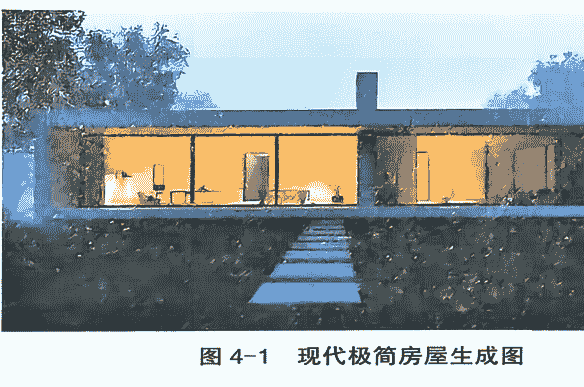

#### 4.1.4 注意事项

- （1）参数间务必使用空格分隔。
- （2）参数前缀一定要使用英文双横线（--）。
- （3）参数数值尽可能在推荐范围内，避免出现意料之外的情况。
- （4）使用负面提示明确排除不想要的元素，确保输出质量。

掌握这些 Midjourney 参数的书写规范，可以帮助设计师更精准地表达创作意图，并有效提升生成效率，真正实现“所想即所得”。

### 4.2 aspect ratio 参数教学

#### 4.2.1 参数简介

在使用 Midjourney 进行图像创作时，长宽比（aspect ratio）是最常用且最重要的基础参数之一。它决定了生成图像的宽高比，对画面的整体构图、视觉效果以及适用场景有直接影响。

通过 --aspect（可简写为 --ar）参数，用户可以精准控制图像的纵横比，使生成结果更加符合实际需求。例如，宽屏比例适用于风景画面，竖版比例适合海报设计，正方形比例常见于头像或社交媒体封面。合理设定 aspect ratio 能够优化图像呈现效果，让 AIGC 更符合你的创作意图。

#### 4.2.2 aspect ratio 的使用方法

aspect ratio 参数的基础语法：--aspect <宽>:<高>
简写：--ar <宽>:<高>

例如，想生成一张宽度明显大于高度的图片（横向图片），则可以设置：

```
A vast expanse of starry sky --ar 16:9（图 4-2）。
（浩瀚的星空。）
```

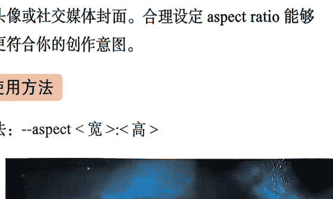

而生成竖向图片时，参数设置如下：

```
prompt: A tall tower --ar 9:16（图 4-3）。
（一座高塔。）
```

默认情况下，如果不指定 aspect ratio，Midjourney 生成的图像为正方形（即默认比例为 1:1）。

#### 4.2.3 aspect ratio 常用比例举例

在实际创作中，有些比例特别常见且实用，以下列举几种经典的 aspect ratio 设置场景供参考：

**正方形头像/社交媒体** --ar 1:1，Instagram、微信头像等。

```
A panda --ar 1:1（图 4-4）。
（一只熊猫。）
```

**横向风景图/电影截图** --ar 16:9，高清影视标准比例。

```
Seaside scenery --ar 16:9（图 4-5）。
（海边风景。）
```

**海报或杂志封面** --ar 4:5 或 --ar 2:3，常用于海报设计、杂志插图。

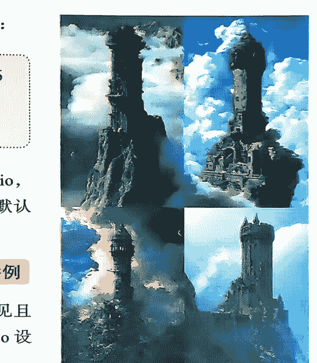

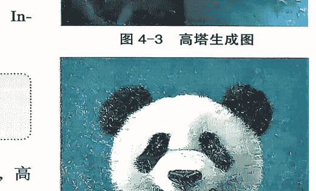

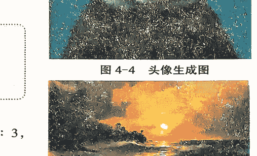

Fashion magazine --ar 4:5（图 4-6）
（时尚杂志。）

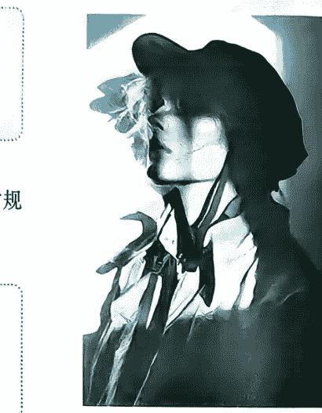

**手机竖屏壁纸** --ar 9:16，即手机屏幕常规尺寸。

Mobile phone wallpaper --ar 9:16（图 4-7）。
（手机壁纸。）

**全景图（超宽幅）** --ar 21:9 或更宽，适用于宽幅场景、壮丽风景。

Grassland scenery --ar 21:9（图 4-8）
（草原风景。）

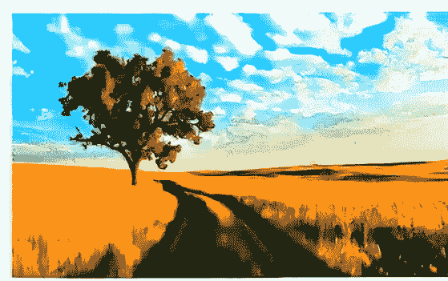

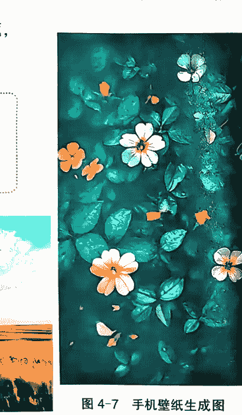

#### 4.2.4 aspect ratio 的限制及版本区别

Midjourney 不同版本对 aspect ratio 的支持和限制略有不同。

**Midjourney v4 及以前版本：**
通常对长宽比例有限制，一般不会支持特别极端的宽或高比例（如超过 2:1 或 1:2）。

**Midjourney v5 及更新版本：**
长宽比例支持范围更广，可以设置更极端的长宽比，如 --ar 5:1 或 --ar 1:5，但仍然有实际的尺寸限制，过于极端的设置可能会触发生成错误或导致图像生成结果不理想。

用户应根据当前版本的限制进行适当尝试，避免使用过于极端的比例，以确保最佳生成效果。

#### 4.2.5 aspect ratio 实际应用技巧

在日常使用 --aspect (--ar) 参数时，合理选择长宽比不仅能提升图像的适配性，还能强化画面的视觉效果。以下是几个实用技巧，帮助你更高效地运用 aspect ratio 这一参数设定进行创作。

##### 4.2.5.1 适配终端设备

如果图片是为特定设备（如手机、平板或 PC 屏幕）设计的，建议选择与目标分辨率相近的长宽比，以避免后续裁剪或拉伸，确保画面显示效果最佳。

终端设备常见比例列举如下：
- 手机壁纸（常见比例 9:16 或 1080 × 1920）：适用于竖屏设备，特别是手机和社交媒体竖版内容。
- 社交媒体横幅（常见比例 16:9 或 21:9）：适合 YouTube、Facebook 封面等。
- 电脑桌面壁纸（常见比例 16:9 或 32:9 超宽屏）：能更好地适应宽屏显示器。

##### 4.2.5.2 增强画面效果

不同的 aspect ratio 会影响画面的视觉氛围和观感。合理选择画面的比例，可以增强作品的表现力。

- 宽比例（16:9、21:9、32:9）：适合风景、环境、建筑类场景，使画面更具空间感和沉浸感，特别是广阔的山地、海洋或城市景观。
- 竖向比例（9:16、4:5、3:4）：适用于人物肖像、时尚摄影、插画等，能突出主体，让人物在画面中显得更集中且富有张力。
- 正方形比例（1:1）：适合头像、社交媒体帖子、品牌设计，能提供均衡的视觉中心点，便于排版。

##### 4.2.5.3 利用构图效果

aspect ratio 还能用于强化画面构图，帮助创作者更好地展现主体与环境的关系。

- 极宽比例（21:9、32:9）：适用于电影感画面，能有效突出风景中地平线的辽阔感，使画面更具电影叙事风格。
- 纵向比例（9:16、4:5）：有助于表现建筑、人物站姿等，让画面更具纵深感和高度感，适合表现壮丽的建筑、森林、瀑布等垂直场景。
- 经典摄影比例（3:2、4:3）：接近传统相机的成像比例，适合用在高端摄影风格的作品中，保证视觉效果自然协调。

#### 4.2.6 常见问题与注意事项

在使用 --aspect（--ar）参数时，尽管可以灵活调整图像比例以适应不同需求，但某些情况下可能会遇到细节变化、提示词适配性问题或极端比例的限制。以下是几个常见问题及相应的注意事项，帮助你在使用 aspect ratio 时避免潜在问题，提高图像生成的准确性和稳定性。

##### 4.2.6.1 图像细节问题及相应建议

由于 Midjourney 在不同长宽比下会调整图像的构图方式，相同的提示词在不同 --ar 设置的情况下可能会呈现不同的细节。

- 宽幅比例（如 --ar 16:9 或 --ar 21:9）：AI 可能会横向扩展画面，增加左右两侧的景物或细节，使画面更加开阔。
- 竖幅比例（如 --ar 9:16 或 --ar 4:5）：AI 会更关注主体的垂直构图，强调高度感，使建筑、人物等元素显得更加修长。

**建议：**
如果发现宽幅或竖幅比例下图像的某些关键细节丢失，可尝试微调提示词，明确哪些元素应该突出，以帮助 AI 在调整构图时保留重要部分。

##### 4.2.6.2 提示词的适配性及相应建议

极端的长宽比可能会影响 Midjourney 对提示词的解析方式，导致生成结果与预期有所偏差。

##### 4.2.6.3 极端比例的问题及相应建议

例如，在 --ar 32 : 9 这样的超宽比例下，AI 可能会填充过多的无关细节，使主体不够突出。

又如，在 --ar 9 : 32 这样的超高比例下，AI 可能难以合理安排构图，可能会使人物或场景显得过于紧凑或不自然。

建议：
在使用特殊比例时，可以逐步调整提示词，结合 --chaos 或 --stylize 等参数进行微调，以观察 AI 如何解析不同构图，并优化提示词以获得理想结果。

例如，使用 “wide panoramic view（垂直布局）” 或 “vertical composition（垂直布局）” 等关键词，明确引导 AI 按比例调整构图。

虽然 Midjourney 允许用户自定义 aspect ratio，但过于夸张的比例（例如 --ar 50 : 1 或 --ar 1 : 50）可能会导致以下问题：

- AI 难以适应极端比例，导致画面变形、内容模糊或不完整。
- 生成失败，因为超高或超宽的比例超出了 AI 训练模型的适用范围。

建议：
尽量使用 Midjourney 常见的标准比例（如 16 : 9、3:2、9 : 16），避免极端数值。

若确实需要超宽或超高比例，可以先生成标准比例的图像，然后使用 Photoshop 或其他工具进行后期裁剪和拼接，以获得理想的最终效果。

### 4.3 stylize 参数教学

#### 4.3.1 参数简介

在 Midjourney 中，stylize 参数（简写为 --s）用于控制生成图像的艺术风格强度。

它决定了模型在处理用户提示词时的创意自由度和艺术化程度：
较低的 stylize 值会让 AI 更严格地遵循用户提示词，更接近字面描述，风格效果较弱。

较高的 stylize 值允许 AI 有更多艺术发挥空间，生成的图像更具创意性与视觉冲击力，但与提示词可能会存在一定偏差。

#### 4.3.2 Stylize 参数使用方法

stylize 参数的用法如下：prompt: 描述内容 --stylize 数值
简写：prompt: 描述内容 --s 数值
stylize 参数的取值范围通常介于 0 ～ 1000，常用范围及其效果如下：
--stylize 0 ～ 100 的创作风格效果：图像精确匹配提示词，不作过多风格化，写实或原始风格。
--stylize 100 ～ 400 的创作风格效果：适中风格化，画面更具审美效果。
--stylize 400 ～ 1000 的创作风格效果：AI 艺术风格明显，更具创意，画面极具视觉感染力。
默认情况下 Midjourney 默认 stylize 为 100。

#### 4.3.3 stylize 参数效果示例

要直观了解 --stylize 对图像生成的影响，最直接的方式是使用相同的提示词，只调整 --stylize 的数值，来对比不同数值下画面的风格和细节的差异。以下示例展示了 3 种不同 stylize 设置为同一主题带来的变化。

**Stylize=50**

> /imagine prompt: A mysterious castle in the forest at night --stylize 50
（图 4-9）。
（夜晚森林中的神秘城堡，--stylize 50。）

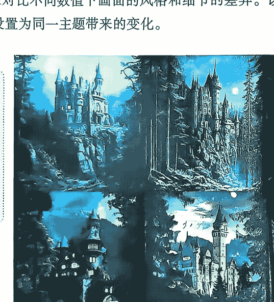

画面特征：
相对贴合基础提示词描述，整体画风偏写实。
创意或夸张元素较少，不会出现太多额外的幻想式细节。
更契合需要准确还原场景、不想过度艺术化的创作意图。

**Stylize=250**

> /imagine prompt: A mysterious castle in the forest at night --stylize 250（图 4-10）。
（夜晚森林中的神秘城堡，--stylize 250）。

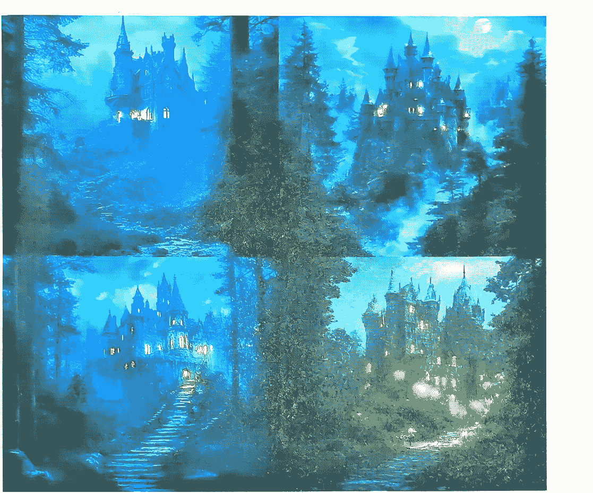

画面特征：
在保留场景要点的同时，适度加入艺术修饰，细节呈现更丰富。
氛围感得到一定提升，可能出现更幽深的光影或朦胧效果，凸显神秘感。
适合在写实与艺术化之间寻求平衡，需要一定创意但不希望太夸张的场景。

**Stylize=750**

> /imagine prompt: A mysterious castle in the forest at night --stylize 750（图 4-11）。
（夜晚森林中的神秘城堡，--stylize 750。）

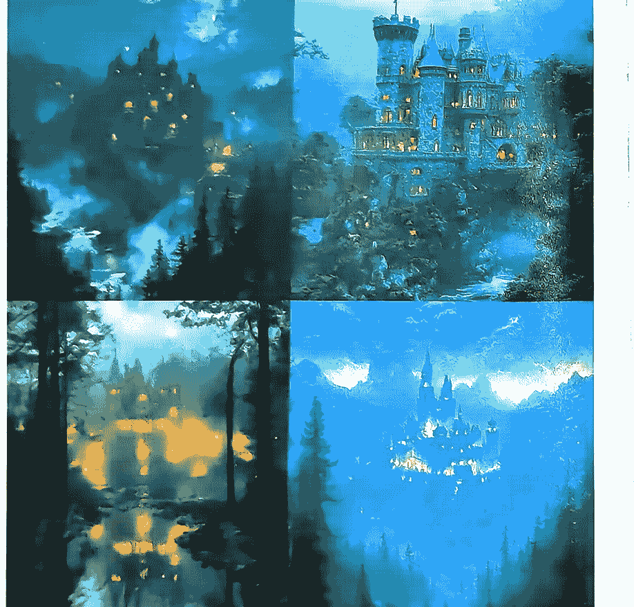

图 4-11 stylize 750 城堡

画面特征：
大幅提升艺术化处理程度与想象力，AI 可能在色彩、结构和氛围上进行更多变形或夸张处理。
整体更具创造性和视觉冲击力，但也可能与原有描述存在较大差异。
适合希望作品效果富有个性与艺术表达、允许 AI 大胆发挥的创意场景。
通过比较这 3 个示例不难看出，随着 --stylize 数值的升高，图像从写实风格逐渐向更具艺术化与想象力的方向延伸。你可以根据项目需求或个人审美来选择合适的 stylize 设置，或多次尝试不同数值，从中找到最佳平衡点。

#### 4.3.4 stylize 参数推荐搭配应用场景

**4.3.4.1 产品设计、写实风格插画——低值（0 ～ 100）**
当你需要保持图像高还原度或使图像具备较强的实用价值（如产品外观草图、写实原型设计）时，可选择较低的 --stylize 值。
这样能够让 Midjourney 更聚焦于提示词的真实细节呈现，避免在艺术表现上“跑偏”或过度抽象。

**4.3.4.2 游戏、动画、概念艺术插画——中高值（200 ～ 500）**
若你的目标是为游戏或动画项目生成富有想象力的概念图、角色设计或者场景插画，可以尝试在中高范围设置 --stylize。
这一数值区间的风格化程度既能给出足够的创造性空间，又不会过分“解读”或扭曲提示词描述，可以使整体风格在写实和艺术化之间达到平衡。

**4.3.4.3 创意、抽象、艺术插画——高值（500 ～ 1000）**
对于主打艺术观感或抽象表现的创作场景，如概念艺术、个人美术作品或带有强烈个性化风格的视觉设计，可选择在高值区间设置 --stylize。
这样会促使 Midjourney 进行更大程度的风格化处理，运用更加多元且富有惊喜的构图与色彩组合，让作品更具创意与艺术感染力。

根据创作意图适当调整 --stylize 参数，能让你在真实度与艺术表现力之间灵活切换，从而更好地满足不同场景的需求。在实际使用时，也可多次尝试不同数值，逐步找出最能匹配自己项目风格和审美偏好的 --stylize 范围。

#### 4.3.5 stylize 与其他参数的结合技巧

除了单独调节 --stylize 参数外，将其与其他参数组合使用，往往能在创意和效果上实现更丰富、多层次的图像表现。以下是几种常见的搭配方式及其适用场景示例：

**4.3.5.1 与纵横比（--ar）结合**

设置较宽或较高的画面比例（如 16：9、9：16 或 2：1），可以在构图上突出宏大场景或人物的纵深感；如果再配合使用较高的 --stylize 值，就能让 Midjourney 更大胆地进行艺术化处理。

示例：

> Spectacular glaciers, surrealistic style --stylize 600 --ar 16 : 9（图 4-12）。
（壮观的冰川，超现实主义风格。）

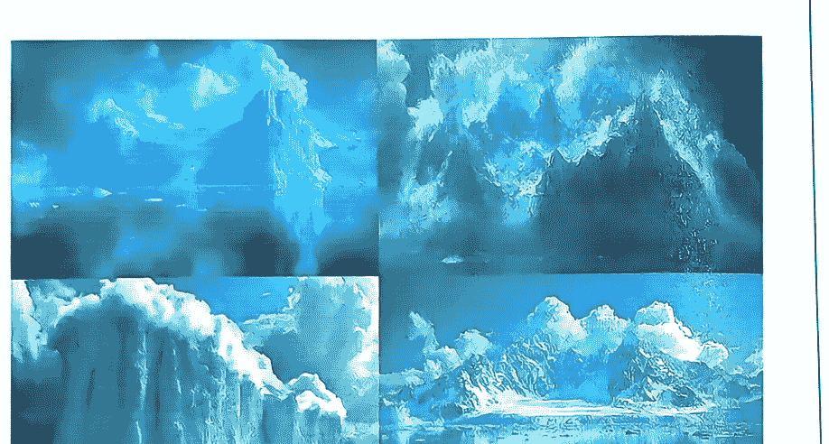

此示例采用大场景宽屏比例，加上高风格化数值，能让 AI 在寒冰与山脉的描绘中更加自由地发挥，呈现出波澜壮阔的史诗感。

**4.3.5.2 与混乱度（--chaos）结合**

--chaos 值越高，图像生成过程的随机性越强，Midjourney 会在色彩、构图和细节方面做出更多“跳脱”或意想不到的变化；搭配较高的 --stylize 参数，能进一步提升作品的艺术张力与多样性。

示例：

> Mysterious cosmic scenes --stylize 700 --chaos 50（图 4-13）。
（神秘的宇宙景象。）

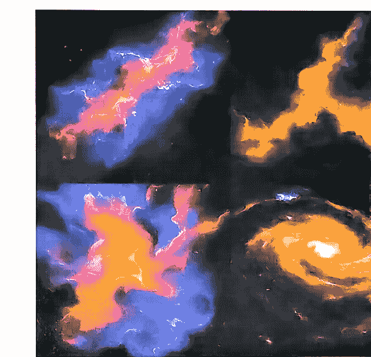

通过混乱度和风格化程度的双重提升，AI 在绘制星空、星云、未知星体等元素时，会更加自由地探索多元色彩和极具幻想感的构图，让画面充满神秘感与艺术气息。

善用不同参数之间的组合，能让你的提示词在视觉效果上更具个性与冲击力。建议根据项目需求与美学偏好多次尝试不同数值，并在对比观察中逐步掌握它们的最佳配合方式。

图 4-13 神秘宇宙生成图

#### 4.3.6 stylize 参数的限制与注意事项

在使用 --stylize（或 --s）参数时，虽然它能大幅影响 AI 的艺术表现力，但也存在一些限制和潜在问题。理解这些限制可以帮助你更精准地运用 stylize 参数，避免创作过程中不必要的误差。以下是需要注意的关键点：

**4.3.6.1 版本差异问题**

Midjourney 不同版本的 stylize 参数默认值和上限可能有所不同，在使用前需确认当前版本的特性。

V4 版本：stylize 最高值通常为 1000，数值较高时，会增强 AI 的风格化处理，但仍保持较强的可控性。

V5 及更高版本：stylize 上限进一步提高，AI 的艺术处理自由度更大，生成结果可能比 V4 更具创意。

建议：在不同版本间调整 --stylize 时，需根据实际效果进行适当的试验和微调，而不应直接沿用其他版本的最佳参数。

**4.3.6.2 数值过高可能影响精准度**

stylize 值较高时（如 --stylize 800 或 --stylize 1000），Midjourney 可能会进行极端风格化处理，使图像更具艺术感，但可能出现与提示词偏离的情况，过度强调 AI 的美学演绎，导致某些细节丢失或构图变得夸张。

示例：

- --stylize 50 → 画面更符合描述，视觉元素精准还原。
- --stylize 500 → 画面可能会因加入 AI 自主想象的元素而更具艺术性，但不一定符合提示词的细节。
- --stylize 1000 → 画面风格化极强，但可能完全偏离原始构思，甚至变得抽象。

建议：在需要精准控制视觉元素时，避免将 stylize 值设置过高，需适度调整以平衡 AI 创造力与提示词的精准性。

**4.3.6.3 特定需求时的参数选择**

如果希望 AI 严格遵循提示词描述，建议使用低 Stylize 值（50 ～ 100），保持构图和细节的精准度，适用于：

- 产品设计、概念设计、写实风格（如 --stylize 50）。
- 建筑、人物肖像、电影级场景（如 --stylize 100）。

如果想让 AI 自由发挥，生成更具创意的艺术风格，则可提升 stylize 值（500 ～ 1000），适用于：

- 抽象艺术、概念插画、幻想场景（如 --stylize 700）；
- 实验性视觉风格，强调 AI 的自由演绎（如 --stylize 1000）。

### 4.4 chaos 参数教学

#### 4.4.1 chaos 参数简介

chaos 参数（即 --chaos）是 Midjourney 中一个重要的创意控制项，主要用于影响图像生成过程的随机性与多样性。当该数值设置较低时，AI 会更“稳重”地依据提示词进行创作，生成的图像差异较小、风格更趋一致；而当 chaos 值提高后，AI 在构图和色彩上会进行更大胆、多变的尝试，生成的图像彼此之间差异度大幅提高。

通俗地说，chaos 参数就像是对 AI 的“想象力”和“自由发挥”开关加以调节。chaos 数值越高，AI 便越可能在画面元素、细节或风格上做出突破，甚至可能带来一些出其不意的艺术创作结果；数值较低时，则 AI 更注重稳定性与一致性，适合需要特定风格或有着精确还原需求的场合。依据所要创作的主题与效果，可以灵活调整 chaos，平衡作品的可控度和惊喜度，从而更好地满足多元化的视觉需求。

#### 4.4.2 chaos 参数的使用方法

chaos 参数的使用方法十分简单，语法如下：
/imagine prompt: 描述内容 --chaos 数值
chaos 值的取值范围通常为 0 ～ 100，示例如下：

**低随机性（默认，0 ～ 10）：图像结果相对稳定、相似度高。**

```
/imagine prompt: Snow-capped mountains and lakes at sunset --chaos 10（图 4-14）。
（夕阳下的雪山湖泊 --chaos 10。）
```

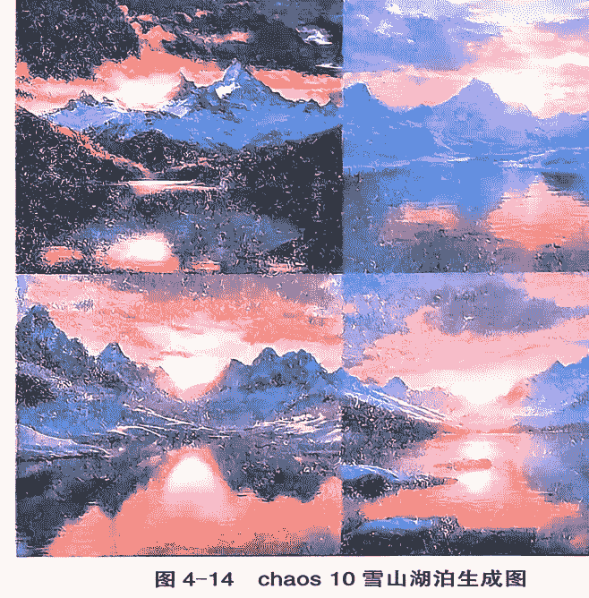

**中等随机性（20 ～ 50）：图像出现一定差异，适合探索不同的可能性。**

```
/imagine prompt: Snow-capped mountains and lakes at sunset --chaos 30（图 4-15）。
（夕阳下的雪山湖泊 --chaos 30。）
```


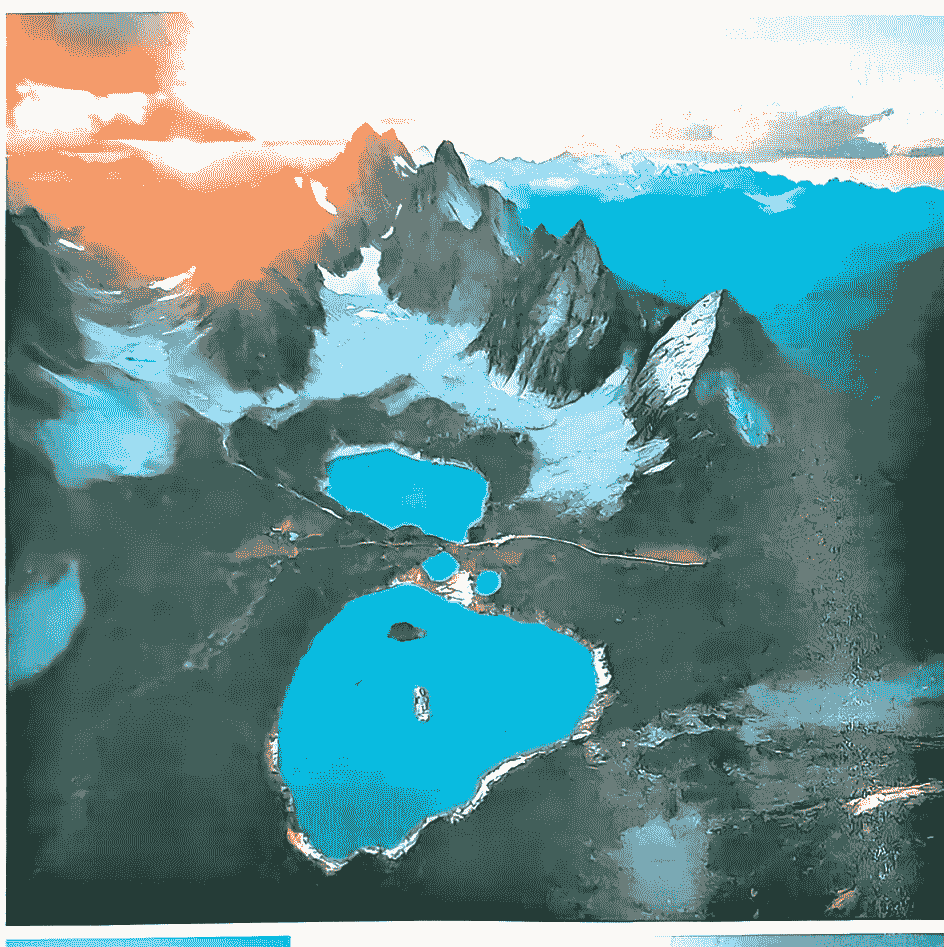

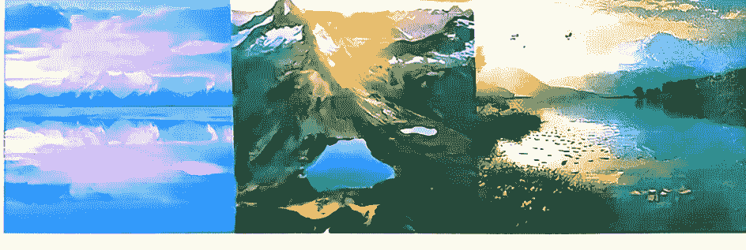

图 4-15 chaos 30 雪山湖泊生成图

**高随机性（60 ～ 100）：生成的 4 张图像差异极大，创意性强，适合艺术探索。**

```
/imagine prompt: Snow-capped mountains and lakes at sunset --chaos 80（图 4-16）。
（夕阳下的雪山湖泊 --chaos 80。）
```

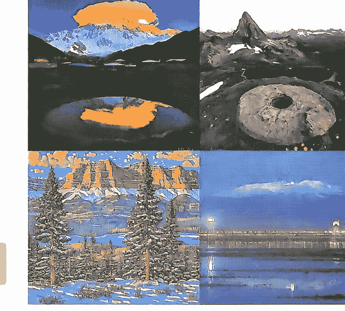

默认 chaos 参数为 0，意味着图像之间的差异最小。

#### 4.4.3 chaos 参数的实际应用场景推荐

chaos 参数在实际创作中能展现出丰富多样的应用潜力，具体取决于你对图像一致性与多样性的需求。下面列出常见的 3 类场景，以及对应推荐的 chaos 参数范围，帮助你在项目中更灵活地调配这一关键创意指标。

**4.4.3.1 精确概念图设计——低 chaos（0～20）**

在需要高度还原或准确表达某个概念的设计任务中（如产品外观设计、商标设计、包装方案等），建议使用较低的 chaos 值。

此时，AI 会更严格地遵循提示词描述，图像间的差异也较小，有助于你聚焦于细微处的改动与精细化需求。

**4.4.3.2 创意概念探索——中高 chaos（40～70）**

当你希望在相同主题下获得多种视觉风格或创意角度，但又不想过于脱离核心指令时，可将 chaos 设置在中等或稍高的区间。

这样 AI 仍能把握主题主干，同时在色彩、构图和细节处理上进行适度的变化，从而提供更多灵感与可选方案。

**4.4.3.3 创意插画、灵感启发——高 chaos（70～100）**

若你的目标是最大限度激发 AI 的创造力，获取丰富而多元的艺术表现形式（如抽象插画、个性化艺术作品、脑暴灵感等），则可以选择高值 chaos。

高 chaos 值会让图像风格与元素差异更大，有时甚至会出现意想不到的艺术表达效果，非常适合用于早期创意发散或极具艺术性的创作尝试。
在不同项目场景中灵活调节 chaos 参数，可以有效地兼顾图像的一致性与创意多样性，让你的 Midjourney 创作在“精确度”与“想象力”之间找到理想平衡。

#### 4.4.4 chaos 与其他参数组合的技巧

**chaos 与 stylize 组合：** 当 chaos 和 stylize 同时设置为较高值时，可以获得更有艺术感和多样性的创意效果。

> /imagine prompt: A surreal space city --stylize 600 --chaos 60（图 4-17）。
（超现实主义的太空都市 --stylize 600 --chaos 60。）

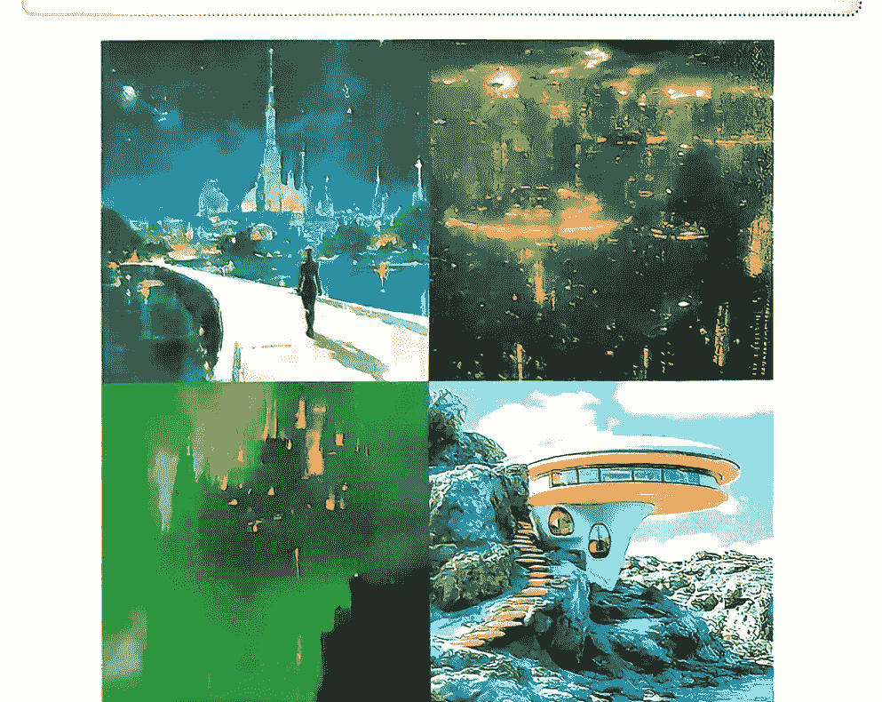

**chaos 与 aspect ratio 组合：** 将宽幅或竖版画幅与高 chaos 值相结合，能够创作丰富的视觉方案：

```
/imagine prompt: Cyberpunk futuristic street --ar 16:9 --chaos 50（图 4-18）。
（赛博朋克风格未来街道 --ar 16:9 --chaos 50。）
```

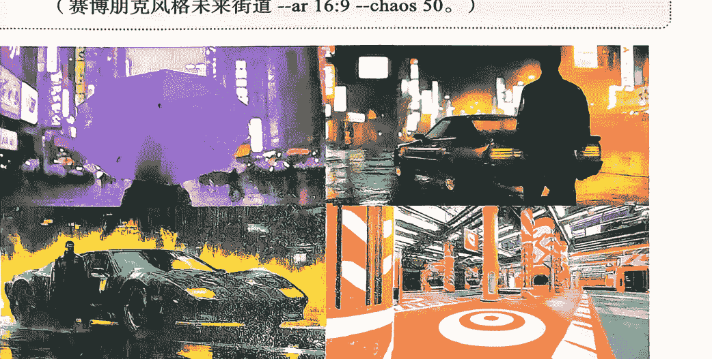

#### 4.4.5 使用 chaos 参数的技巧与注意事项

chaos 参数的高值赋予创作者更高的“随机性”与“自由度”，但也意味着在创作时需要更谨慎地结合其他要素，以便控制最终图像的可用性与风格一致性。以下是使用 chaos 的一些实用建议和注意事项。

**4.4.5.1 渐进式探索方法**

思路：从较低值开始，一步步升高 chaos 的数值，以逐渐加深对 AI“随机创作”范围的了解。

好处：便于观察 AI 在每个阶段的变化幅度，逐步找到你所需的“恰到好处”的随机度。能防止初始 chaos 过高所带来的“失控”结果，减少无效探索的时间与资源消耗。在每个数值下生成一定数量的图像，对比图像变化方式与 AI 创作潜力，再决定是继续提升 chaos 值还是将其停留在某一阶段以精细化创作。

**4.4.5.2 chaos 参数与 prompt 细致度的关系**

思路：当 chaos 值提升时，prompt 对创作方向的约束力相对降低，需要更多明确、细致的描述，以防止图像生成跑题或出现过多无关元素。

要点：高 chaos + 简单 prompt = 难以预料的图像。若在高 Chaos 的情况下使用过于简洁的 prompt，AI 往往会进行更大胆的自由发挥，出现与原主题相去甚远的结果。高 chaos + 清晰细节描述 = 更有针对性的创意发散。如果你仍想保留高随机度，但又希望某些核心元素不变，可以在 prompt 中强调主体、风格或关键元素，以此在“自由度”和“方向性”之间取得平衡。

总而言之，chaos 参数赋予 Midjourney 更多可能性，也对创作者提出了更高的提示词设计要求。通过渐进式提升 chaos 值以及合理的 prompt 约束，你既能让 AI 充分发挥艺术想象力，又能保持与项目目标相呼应的整体思路。

#### 4.4.6 Chaos 参数进阶建议与总结

chaos 参数是 Midjourney 创作者在设计流程中值得深入探究的利器。它的灵活应用能够在“精确还原”与“创意爆发”之间搭建桥梁，赋予图像更多维度的可能性。

**4.4.6.1 根据项目需求选择合适区间**

- 精准设计、写实需求：低 chaos（0 ～ 20）
- 日常创作、平衡型场景：中等 chaos（20 ～ 60）
- 创意概念、艺术插画：高 chaos（60 ～ 100）

通过明确自身创作目标，创作者可以快速找到适合的 chaos 值范围，提高工作效率与作品完成度。

**4.4.6.2 关注提示词细节与 chaos 值的关系**

chaos 值越高，AI 在图像生成上的离散度越大，若提示词过于简单，可能出现跑题的情况或出人意料的元素。

若希望兼具高随机度与一定聚焦度，则需在提示词中加入明确的主体描述、场景限制与风格定义，让创意发散不至于背离初衷。

**4.4.6.3 渐进式探索与多次尝试**

通过先低后高的设置观察 chaos 参数对生成结果的影响：

```
chaos 20 → chaos 40 → chaos 60 → chaos 80
```

在每次提升 chaos 值后，对比成品图像的差异，逐步找到能够充分激发灵感的最佳区间。

##### 4.4.6.4 与其他参数综合运用

chaos 可与 stylize、aspect ratio、quality 等参数搭配，使得图像既拥有创意张力，也保留必要的风格化层次与构图美感。

掌握多参数联动方法，能进一步深化你的 Midjourney 创作技巧。

综上所述，chaos 参数的巧妙运用能为你的艺术创作带来更多意外惊喜和灵感火花。选择合理的 chaos 值，并配合明确的提示词规划，能够平衡精确度与创意度，让你在多变的生成图像中高效挖掘无限潜能。

### 4.5 综合教学：Midjourney 中的高级参数

#### 4.5.1 quality ( --q ) 参数

quality 参数，标识为 --q，主要负责调整生成图像的清晰度和细节级别。该参数的设置直接影响图像的整体质量，数值越高，图像的清晰度和细节表现也越丰富，适用于对图像质量有极高要求的场合，例如专业的艺术作品或精细的商业设计。然而，提高 quality 设置会相应增加资源消耗和处理时间，因此在实际应用中需要根据具体需求进行权衡。

假设我们需要生成一幅复杂的机械钟表的详细图像，此时对清晰度和细节的要求非常高。我们可以设置较高的 quality 值，确保图像的精细度：

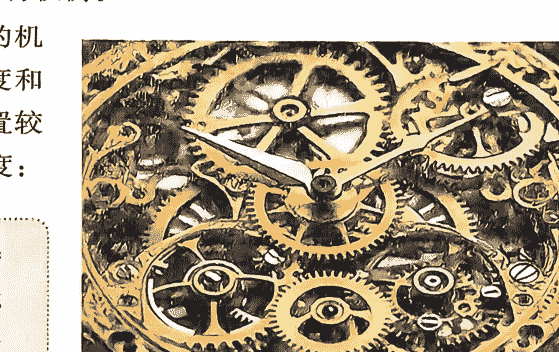

```
prompt:An intricate mechanical watch, showcasing its detailed inner mechanisms--q3 (图 4-19)。
（一个复杂的机械表，展示其详细的内部构造 --q3。）
```

在这个示例中，我们将 quality 设置为 3，这将使得钟表内部机械的每一个齿轮零件都表现得非常清晰和精确，适合用于高质量的展示或技术分析。

#### 4.5.2 tile ( --tile ) 参数

tile 参数，标记为 --tile，用于控制图像的平铺效果，使生成的图像在边缘处能够无缝连接，形成可以连续平铺的图案。适当使用 tile 参数可以生成具有连续性的纹理或图案，这一功能特别适合用于设计壁纸、纺织品图案或其他需要重复图样的场合。通过调整 tile 参数，用户可以确保图像的每一边都能完美对接，从而创造出视觉上连续不断的图像效果。

假设我们要设计一种新的地板瓷砖图案，这种图案需要能够在多块瓷砖之间无缝连接，形成连续的装饰效果。这时，使用 tile 参数可以确保每一块瓷砖的图案在边缘处能够完美对接，适合用于大面积的铺设。

> prompt: Elegant geometric tile pattern for luxury flooring, seamless for large scale installation--tile ( 图 4-20 )。
（优雅的几何瓷砖图案用于豪华地板，无缝用于大型安装 --tile。）

#### 4.5.3 seed ( --seed ) 参数

seed 参数，标记为 --seed，是控制图像生成过程中随机性的关键。通过设置具体的 seed 值，用户可以确保在相同的提示词和参数设置下重复生成完全相同的图像，这一点在需要进行微调或复现特定结果时尤其有用。此外，seed 参数的使用还有助于维持项目的视觉一致性，对于展览展示或系列艺术作品的创作来说，是一个不可或缺的工具。

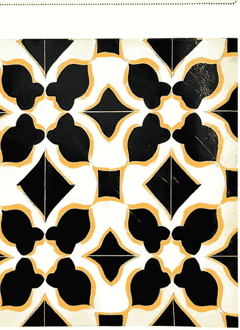

如果我们希望重现一个特定的幻想风景图，以确保在不同时间重复生成同样的视觉效果，我们可以使用 seed 参数：

```
prompt:A fantasy landscape with floating islands and cascading waterfalls --seed 8675309（图 4-21）。
（有浮动岛屿和瀑布的梦幻景观 --seed 8675309。）
```

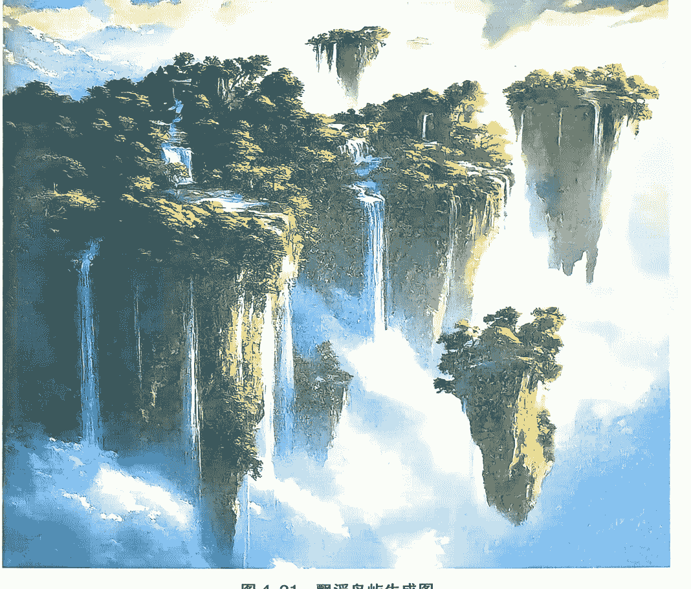

图 4-21 飘浮岛屿生成图

在这个示例中，我们设置了具体的 seed 值 8675309，无论何时输入相同的提示词和参数，都能生成一致的图像，这对系列创作或品牌连贯性非常有用。

#### 4.5.4 参数的综合应用

在 Midjourney 中，将这些参数组合使用能够极大地丰富图像的表现力和创造性。例如，一个涉及自然景观的提示词，可以通过调整 quality 参数提高图像的整体质量，丰富场景的纹理细节，同时可以使用固定的 seed 值保持一系列图像的一致性。这种方法不仅能够提高图像的艺术表现力，也能够确保创作过程的可控性和可预测性，使得每一个项目都能达到预期的视觉效果。

通过精确控制这些参数，用户可以在追求视觉美感和表达创作意图之间找到完美的平衡点，实现创意和技术的完美结合。

## 5 提示词进阶

### 5.1 视觉设计的要点

视觉设计在 Midjourney 提示词的应用中占据重要位置，是决定图像质量和创意表达的重要因素。掌握视觉设计的要点，能够更精确地引导 AI 生成你所期望的视觉效果。

#### 5.1.1 清晰的视觉目标

清晰、明确的视觉目标是视觉设计的基础。提示词需要精准表达希望呈现的主体或场景。

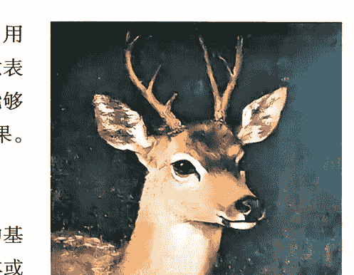

明确主体特征，避免过于泛泛地描述。
示例：

> A deer（图 5-1）。
> （一只鹿。）
> A buck wearing a crown in the forest（图 5-2）。
> （森林中一只戴皇冠的雄鹿。）

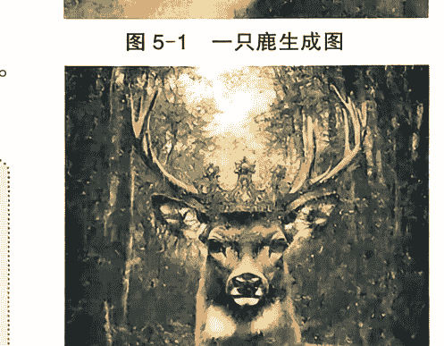

描述环境或场景的特定元素，如“黄昏时刻的城市街道，灯光朦胧”。
示例：

> The street of the ancient town after the rain, lights reflected on the wet SLATE pavement（图 5-3）。
（雨后的古镇街道，灯光映在湿润的石板路面上。）
The street of the ancient town after the snow, the snow piled up on the SLATE pavement（图 5-4）。
（雪后的古镇街道，积雪堆积在石板路面上。）

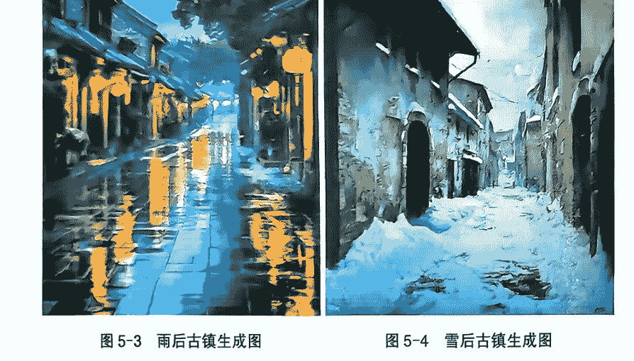

#### 5.1.2 精确的构图描述

构图直接影响图像的视觉效果和表现力。优秀的提示词需要涵盖构图方式和画面结构。
使用构图技巧的关键词，如三分法、中心对称、黄金分割等，突出画面的视觉平衡和层次感。
指明视角与焦距，如“鸟瞰视角的城市景观”“微距拍摄的露珠”。
示例：

> A tropical rainforest from above（图 5-5）。
（俯视视角下的热带雨林。）
Butterfly shot in macro（图 5-6）。
（微距拍摄的蝴蝶。）

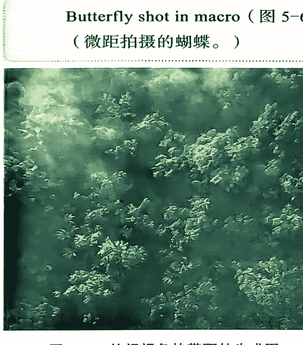

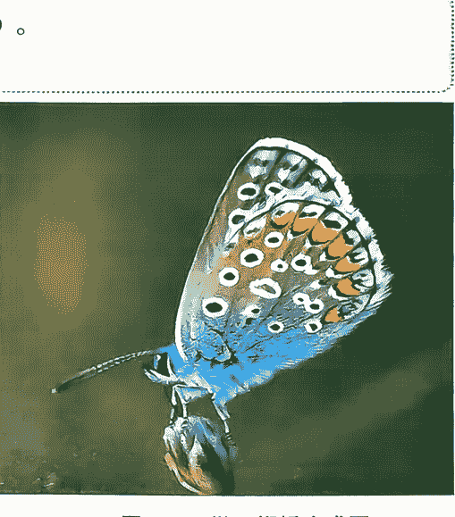

#### 5.1.3 色彩与情绪表达

色彩选择直接决定图像的视觉氛围与情绪传达。选择明确的色彩组合，如暖色调表达温馨舒适、冷色调强调冷静或神秘。运用色彩理论，如互补色、邻近色、单色调等，精准表达视觉情绪。

示例：

> City night scene with complementary colors orange and blue（图 5-7）。
（互补色橙色与蓝色搭配的城市夜景。）
Monochromatic city night scene（图 5-8）。
（单色调搭配的城市夜景。）

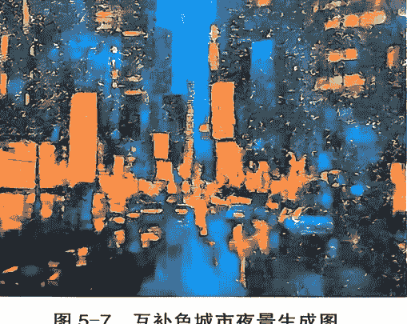


图 5-8 单色调城市夜景生成图

#### 5.1.4 光影设计

光影效果不仅能丰富画面的视觉表现，也能强化场景的真实感与艺术氛围。明确光源种类，如自然光、人工光，描述光线的方向与强度，例如“清晨柔和的侧面自然光”“落日晚霞”。强调阴影的表现和细节，有效提升图像的立体感。
示例：

> The stark shadows cast by buildings in bright daylight（图 5-9）。
（明亮日光下建筑物投射的鲜明阴影。）
Striking shadows cast by buildings in the setting sun（图 5-10）。
（落日晚霞下建筑物投射的鲜明阴影。）


#### 5.1.5 纹理与质感表达

精细的质感与纹理能够显著提升图像的真实感。可明确物体表面的纹理和质感特征，如玻璃的反光效果，丝绸般顺滑的质感，粗糙、光滑、金属质感，柔软等，以增强图像细节与视觉触感。

示例：

> Smooth and translucent vase surface（图 5-11）。
（光滑而透亮的花瓶表面。）
Metallic tableware（图 5-12）。
（金属质感的餐具。）


图 5-12 金属餐具生成图

#### 5.1.6 风格化与个性化

风格化能够突出图像的独特视觉个性与艺术特质。可在提示词中明确艺术风格，如印象派、赛博朋克、复古风格，给出具体艺术家或作品作为参考。可强调个性化的视觉表达，如漫画风、电影感、油画质感，彰显独特的视觉效果。

示例：

> A black and white urban street scene with a cinematic feel( 图 5-13 )。
（具有电影感的黑白都市街景。）
An urban street scene with comic book style（图 5-14）。
（具有漫画风格的都市街景。）


### 5.2 风格提示词

在 Midjourney 的图像创作中，风格提示词对于形成作品的整体美感与艺术特色至关重要。不同的风格提示词往往能引导 AI 呈现截然不同的色彩氛围、笔触质感以及视觉表现形式。恰当使用风格提示词，既可以让图像在创作方向上更贴近个人审美与项目定位，也能有效地提升作品的艺术价值和视觉吸引力。

艺术流派与技法关键词示例：
watercolor（水彩）、oil painting（油画）、pencil sketch（铅笔素描）、impressionist（印象派）、surrealism（超现实主义）、baroque（巴洛克）。

应用场景：当你想要突出作品的绘画质感或历史审美特征时，可在提示词中注明相应的艺术流派或画法，AI 便会在色彩、笔触与细节上尽量模拟该流派或画法的经典视觉元素。

摄影风格关键词示例：
cinematic（电影感）、film photography（胶片摄影）、portrait photography（人像摄影）、street photography（街头摄影）、macro shot（微距摄影）。

应用场景：若你希望生成的图像具有更真实或专业的摄影氛围，可以在提示词中加入摄影风格关键词，例如“cinematic lighting”“film grain”。AI 会据此进行镜头语言、光影效果和色调的模拟。

现代设计风格关键词示例：
minimalist（极简主义）、flat design（扁平化设计）、futuristic（未来主义）、cyberpunk（赛博朋克）、vaporwave（蒸汽波）。

应用场景：当你的创作项目更倾向于潮流视觉或概念设计时，可选择现代设计风格作为关键词，让 AI 输出具有相应配色、构图特色的图像。

影视与漫画风格关键词示例：
anime style（动漫风格）、comic book style（美式漫画风格）、pixar style（皮克斯动画风格）、noir（黑色电影）。

应用场景：若你想让人物形象更具动画感或漫画夸张表现，可使用这类风格词。它能引导 AI 运用相应的轮廓线、色彩构成，以及电影化的对比度或阴影氛围等元素。

通过为提示词添加不同风格的关键词，你可以在相同主体或主题下快速生成多元化的作品，进而在短时间内完成风格的比较与选择。无论是追求沉浸式的真实场景，还是期望作品具有艺术化的视觉冲击力，巧妙运用风格提示词都能让你的图像创作更上一层楼。

#### 5.2.1 艺术风格类提示词

艺术风格提示词通常直接指代艺术史中著名的视觉风格或流派，创作者可以通过这些词汇引导 AI 创作特定风格的图像。

印象派（impressionism）

强调光与色彩的变化，注重视觉的即时感受，画面充满明亮色彩，边缘模糊柔和。

示例：

> Impressionism style,sunlight filtering through trees onto a garden（图 5-15）。
（印象派风格，穿过树梢洒落于花园的阳光。）


图 5-15 印象派阳光花园生成图

超现实主义（surrealism）
强调梦幻、离奇的画面组合。
示例：

> Surrealistic scene of floating islands with waterfalls flowing downwards in the sky（图 5-16）。
（超现实主义场景，飘浮的岛屿，瀑布自天空倾泻。）


图 5-16 超现实主义岛屿生成图

蒸汽朋克风格（steampunk）
强调工业时代的复古科技感，混合复古与未来元素。

> Steampunk-style mechanical cityscape with brass gears and steam-powered vehicles（图 5-17）。
（蒸汽朋克风格，充满黄铜齿轮与蒸汽动力交通工具的城市景观。）


图 5-17 蒸汽朋克城市生成图

#### 5.2.2 绘画技法类提示词

绘画技法相关的提示词，能够清晰表达所需图像的艺术效果和质感细节。
油画技法（oil painting）
强调细腻厚重的质感。
示例：

> Portrait of a young woman, oil painting technique, visible brushstrokes（图 5-18）。
（年轻女性肖像，油画技法，明显笔触质感。）


水彩技法（watercolor）
呈现淡雅、柔和的画面效果。
示例：

> Mountain landscape with watercolor technique, gentle blending of colors（图 5-19）。
（山水风景，水彩技法，色彩柔和渐变。）

#### 5.2.3 地域文化风格类提示词

在提示词中加入形成于不同地域文化的独特艺术风格的元素，能够有效地表达与再现其视觉特征。
东方传统风格（traditional East Asian style）
强调古典、诗意和简洁的构图风格。
示例：


> Traditional Chinese landscape painting, ink and wash style, mountains and rivers（图 5-20）。
（中国传统山水，水墨画风格。）


北欧风格（Nordic style）

强调简约、清新、舒适的设计感。

示例：

> Nordic style interior,minimalist design,neutral colors and wooden textures（图 5-21）。
（北欧风格室内设计，极简主义风格，中性色调搭配木质纹理。）


图 5-21 北欧极简室内设计生成图

#### 5.2.4 特定时代与复古风格提示词

特定历史时期的艺术风格与复古风格的提示词，可帮助生成怀旧或复古感强烈的图像。

维多利亚风格（victorian-style）
强调 19 世纪欧洲典雅华丽的风格特点。
示例：

> Victorian-style tea room with floral wallpaper and vintage furniture( 图 5-22 )。
（维多利亚风格茶室，花卉壁纸与复古家具。）


20 世纪 80 年代复古风（1980s retro）
强调鲜艳色彩、霓虹灯光、怀旧感十足的视觉效果。
示例：

> 1980s retro neon cityscape, vibrant colors and neon lights（图 5-23）。
（20 世纪 80 年代复古风格，明艳色调与霓虹灯光中的城市夜景。）

#### 5.2.5 特定媒体与技术风格提示词

通过明确指定媒体形式或技术特征，引导 AI 创作出符合特定媒介或艺术表现形式的图像。
电影感镜头（cinematic shot）
强调具有电影质感和构图特点的视觉效果。
示例：

> Cinematic shot of a rainy city street, dramatic lighting and blurred background（图 5-24）。
（电影感镜头，雨中城市街道，戏剧化光影效果，模糊背景。）


像素艺术风格（pixel art）强调低分辨率、像素化的怀旧感。

示例：

> Pixel art style medieval village with simple geometric shapes（图 5-25）。
（像素艺术风格的中世纪村庄，几何形状构成。）


#### 5.2.6 混合风格提示词

融合两种或两种以上不同艺术风格或表现形式，创造独特且富有表现力的视觉效果。

超现实+印象主义（surrealistic+impressionist）

示例：

> Surrealistic impressionist landscape with melting clocks and dreamy pastel colors（图 5-26）。
（超现实主义与印象派风格融合的风景，融化的时钟与梦幻般的柔和色调。）


图 5-25 像素风格村庄生成图

图 5-26 超现实主义印象派风景生成图

水墨与科幻风格融合（ink-wash+sci-fi）
强调传统与未来感并存的奇妙视觉效果。
示例：

> Traditional ink-wash painting style, a futuristic city floating among clouds（图 5-27）。
（传统水墨风格融合科幻元素，飘浮的未来城市景观。）


图 5-27 水墨风科幻元素生成图

#### 5.2.7 艺术家与创作群体风格提示词

参考特定艺术家或创作团体的风格，便于精准再现其典型视觉特征。
梵高风格（Van Gogh-style）
强调强烈的笔触、丰富的色彩与独特的线条。
示例：

> Van Gogh-style painting of a starry night landscape, swirling vibrant colors（图 5-28）。
（梵高风格，强烈笔触的星空夜景。）


图 5-28 梵高风格星空夜景生成图

宫崎骏动画风格（Studio Ghibli-style）
强调温暖、细腻、富有情感的动画风格。
示例：

> Studio Ghibli-style fantasy forest, gentle lighting and whimsical creatures（图 5-29）。
（吉卜力工作室风格的幻想森林，柔和灯光和奇妙生物。）


图 5-29 宫崎骏动画风格生成图

# 6 借助 DeepSeek 辅助创作

## 6.1 提示词翻译

在使用 Midjourney 进行图像创作时，大部分用户习惯以中文进行描述，但 Midjourney 主要基于英文提示词进行创作，因此精准地将提示词翻译为英文尤为重要。DeepSeek 作为先进的 AI 工具，在提示词翻译方面具备极强的辅助作用，能够有效提升生成图像的质量与精确度。

### 6.1.1 为什么需要准确的英文提示词？

由于 Midjourney 的核心算法主要基于英文语料库进行训练，尽管支持多语言输入，但用户在 Midjourney 使用中文等其他语言时，往往会遇到理解偏差或表达不够精准的问题。为了充分发挥 AI 的图像生成潜能，使用准确的英文提示词尤为关键，具体能为创作者带来以下明显优势：

#### 6.1.1.1 提高图像的精准性与匹配度

当提示词能准确传达图像的主题、风格、色彩和氛围时，AI 在进行绘制时会更接近你的创作意图，因语言歧义造成的偏差或不匹配现象会相应减少。

#### 6.1.1.2 获得更加专业的视觉效果

若在提示词中运用专业术语或艺术表达方式，并通过准确翻译呈现给 AI，能让 Midjourney 对概念理解得更加到位，从而在构图、笔触与细节处理上展现出更高水平的专业度。

#### 6.1.1.3 提高创作效率

准确的提示词翻译能够最大限度地降低试错成本，使图像生成的最终效果更加贴合预期，也相应缩短了反复修正提示词的过程，从而在创作时间和成品质量之间找到最佳平衡。

### 6.1.2 如何借助 DeepSeek 完成精准翻译？

以下步骤可以帮助你高效地利用 DeepSeek 完成提示词翻译：

**第 1 步 明确原始提示词的核心元素**
将原始的中文提示词分解成几个关键的创作元素，比如：
主体特征（如人物外貌、服饰、神态等）；场景氛围（如时间、地点、环境等）；
风格表现（如艺术风格、媒介、色彩等）；技术要求（如视角、光影、构图等）。
中文原始提示词示例：一位穿着传统服饰的少女站在樱花树下，淡淡的微风吹过，花瓣缓缓落下，画面风格柔美、浪漫，采用日系插画风格。
拆分为关键元素：
人物：少女，穿着传统服饰；动作与环境：站立，微风吹拂，樱花飘落；风格：柔美浪漫，日系插画风。

**第 2 步 使用 DeepSeek 精准翻译**
输入中文提示词，并明确要求 DeepSeek 生成适合 Midjourney 的英文提示词，注意强调：
（1）使用适合英文提示词的表达习惯；（2）明确创作风格和视觉细节；
（3）保持语言流畅和专业性。
示例：

> 问：
帮我优化这一段提示词：少女身穿传统服饰站在樱花树下，微风拂过，樱花花瓣飘落，画面风格为浪漫柔美的日系插画风。
DeepSeek：
A young girl dressed in traditional costumes is standing beneath a cherry blossom tree as petals gently drift down with a soft breeze, rendered in a delicate, romantic Japanese illustration style.（本例中 Midjourney 生成作品如图 6-1 所示。）


图 6-1 日系插画少女生图

### 6.1.3 如何进一步提升翻译提示词的精准性？

在使用 DeepSeek 进行提示词翻译时，可以通过以下方法提高精准度：

#### 6.1.3.1 明确风格关键词（style keywords）

使用具体且明确的风格关键词有助于 AI 更好地把握设计意图，因此应当避免模糊表达。

示例：

> 问：
“蒸汽朋克风格的机械鸟”提示词。
DeepSeek：
Steampunk-style mechanical bird with intricate gears and metallic textures.（本例中 Midjourney 生成作品如图 6-2 所示。）


图 6-2 蒸汽朋克机械鸟生成图

#### 6.1.3.2 强化视觉细节（visual details）

在提示词翻译时，应明确强调视觉细节，使生成结果更符合创作意图：
质感（如 metallic、soft、glossy）；光影效果（如 backlit、soft lighting）；
视角与焦距（如 close-up、wide-angle、macro）。

示例：

> 问：
“晨雾中的山脉和湖泊，安静祥和”的画面提示词。
DeepSeek：
Misty mountains by a tranquil lake at dawn, soft morning light, peaceful and serene atmosphere.

#### 6.1.3.3 使用艺术与设计领域常用术语（professional terms）

善于借助艺术设计领域的专业英文术语，使提示词更准确地表达创作要求：
构图术语（如 golden ratio、symmetrical composition）；设计风格（如 minimalism、abstract expressionism）；技法表达（如 impasto technique、digital matte painting）。

示例：

> 问：
“使用黄金比例构图的城市天际线风景”的画面提示词。
DeepSeek：
City skyline landscape composition using the golden ratio, emphasizing visual harmony and balance.

### 6.1.4 DeepSeek 提示词翻译实践案例示范

以下为借助 DeepSeek 优化翻译提示词的示例：
示例 1：

> 问：
“秋日清晨森林中的小木屋，周围薄雾缭绕，温暖柔和的日光洒落在草地上”的画面提示词。
DeepSeek：
A cozy wooden cabin in an autumn forest at dawn, enveloped by soft mist and gentle golden sunlight.（本例中 Midjourney 生成作品如图 6-3 所示。）


图 6-3 森林木屋生成图

示例 2：

> 问：
繁星闪烁的夜空下，一艘孤独的小船漂浮在平静的湖面上，画面带有梦幻感和神秘氛围。
DeepSeek：
A solitary boat is floating gently on a serene lake beneath a starlit night sky, evoking a dreamy and mysterious atmosphere.（本例中 Midjourney 生成作品如图 6-4 所示。）


图 6-4 星空下的小船生成图

示例 3：

> 问：
未来都市景观，霓虹灯光与全息投影交织，风格为赛博朋克。
DeepSeek：
Futuristic cyberpunk cityscape illuminated by neon lights and vibrant holographic projections. (本例中 Midjourney 生成作品如图 6-5 所示。）


图 6-5 赛博街景生成图

### 6.1.5 总结与应用建议

借助 DeepSeek 进行提示词翻译，不仅可以大幅提高 Midjourney 生成结果的精准性，更能充分发挥 Midjourney 的潜力，创造出艺术价值与实用性兼具的高质量图像作品。在实际操作过程中，应注意：①保持提示词语言的简洁明了；②强调关键词与视觉要点；③善于利用专业的英文艺术设计术语；④多进行实践与微调，积累高效精准翻译和应用提示词的经验。

## 6.2 让 DeepSeek 设计画面

在 Midjourney 的创作过程中，如何有效地构思并精准描述画面，往往决定了生成图像的质量与效果。但创作者在面对空白提示框时，可能一时难以明确构想。这时，可以借助 DeepSeek 这样的 AI 工具辅助创作，帮助设计并完善创作的视觉细节，使创作过程更为流畅、精准且高效。

### 6.2.1 借助 DeepSeek 设计画面的优势

通过 DeepSeek 来设计画面，有几个明显优势。它不仅能迅速捕捉创作者的基本构想，还能根据创作者提供的初步信息，提出专业且丰富的设计方案，包括画面细节、元素搭配、视觉风格及表现方式等。这种交互式的画面设计能够极大地降低创作者的构思难度，提高创作效率。

示例：

> 问：
我想创作一幅充满治愈感的乡村风景。
DeepSeek：
初夏的乡村田野，一条狭长的土路延伸至远方，路旁开满色彩柔和的野花，柔和的晨光穿过薄雾，画面整体氛围温暖宁静，浪漫且轻盈的印象派油画风格。
问：
请把上面的文本转化为英文提示词。
DeepSeek:
英文版提示词：
Romantic impressionist oil painting style, serene countryside scene at early morning, a narrow dirt path surrounded by colorful wildflowers, soft morning sunlight filtering through thin mist, warm and peaceful atmosphere.（本例中 Midjourney 生成作品如图 6-6 所示。）


图 6-6 DeepSeek 优化生成图

### 6.2.2 如何使用 DeepSeek 设计出理想画面

使用 DeepSeek 进行画面设计时，需遵循几个有效步骤，以实现理想的画面构想：

**第 1 步** 明确描述初步构想
创作者无须提供非常详细的描述，只需清晰表达出画面主题、情绪氛围或核心视觉元素，DeepSeek 即可展开更详细的画面设计。
初步构想示例：“我想要描绘一个充满神秘氛围的森林景观。”

**第 2 步** 获得 DeepSeek 设计方案
DeepSeek 基于初步构想，提供清晰且详细的画面方案：“一片茂密的原始森林，月光穿透树冠在地面形成斑驳的光影，画面中央有一座古老的废弃神殿，神殿周围有萤火虫飞舞，氛围神秘而梦幻。”进一步转为英文提示词，即可用于 Midjourney 生成图像：Dense primeval forest illuminated by moonlight filtering through trees, abandoned ancient temple at the center, fireflies drifting gently around, mysterious and enchanting atmosphere.

**第 3 步** 利用 DeepSeek 完善画面细节

当初步设计方案确定后，创作者还可以进一步要求 DeepSeek 对画面细节进行优化或补充。例如，创作者希望增加一些神秘生物元素，便可以这样提出：

> 问：
请加入一些神秘生物元素，进一步增强画面的奇幻氛围。
DeepSeek：
在神殿的阴影处隐约可见若干神秘的幽灵般半透明生物，它们的身躯泛着淡蓝色光晕，若隐若现地环绕神殿飞舞，使整体氛围更加神秘且充满奇幻色彩。
问：
请把上面的文本转化为英文提示词。
DeepSeek：

> Mystical forest scene in the moonlight with an ancient abandoned temple surrounded by gently glowing, ethereal ghostly creatures floating gracefully, enhancing the mysterious and fantasy-like atmosphere.（本例中 Midjourney 生成作品如图 6-7 所示。）


图 6-7 DeepSeek 优化生成图

### 6.2.3 实践案例示范

以下是通过 DeepSeek 设计画面的真实应用示例，帮助创作者清晰掌握操作要点。

#### 6.2.3.1 未来科技城市案例中的提示词优化

我们通过和 DeepSeek 对话，获取英文优化提示词如下。

> 问：
我想要一幅充满未来感的高科技城市画面，请设计具体提示词。
DeepSeek：
未来感十足的城市，天际线上布满摩天大楼和空中花园，街道上空悬浮着流线型的交通工具，夜景中霓虹灯光和全息投影交相辉映，风格为高科技科幻与赛博朋克相融合，色彩丰富且充满未来科技感。
问：
请把上面的文本转化为英文提示词。
DeepSeek:
High-tech futuristic cityscape at night with skyscrapers, aerial gardens, streamlined floating vehicles, vibrant neon lights and holographic projections, creating a cyberpunk sci-fi atmosphere.

#### 6.2.3.2 案例对比：DeepSeek 优化前与优化后的区别

优化前（简单版本）：Futuristic city at night, technological style.（图 6-8）


图 6-8 未来科技城市优化前生成图

优化后（DeepSeek 设计的详细版本）：Futuristic cyberpunk cityscape at night, featuring skyscrapers, floating vehicles, vibrant neon lights and holographic projections, creating a visually rich high-tech atmosphere.（图 6-9）


图 6-9 DeepSeek 优化后未来科技城市生成图

优化后的提示词明显更加具体生动，有助于获得更高质量的 Midjourney 生成结果。

#### 6.2.3.3 DeepSeek 辅助设计画面的实践建议

在实际应用过程中，创作者可以通过以下方式提高 DeepSeek 的画面设计效果：

1. 准确传达创意
使用明确且容易理解的基础语言描述自己的需求，避免含混不清的描述。
2. 逐步细化要求
根据 DeepSeek 提出的初步设计方案，逐步提出更多细节要求，以便获得更理想的视觉设计方案。
3. 善用 AI 反馈优化
将 DeepSeek 提供的方案进行对比优化，反复交流调整，使设计方案更加精准且贴合内心构想。

## 6.3 如何让 AI 输出合格的提示词

在使用 Midjourney 进行图像创作时，提示词是否合格、精准往往决定了创作效果的优劣。然而，很多创作者发现，仅凭个人的直觉或经验撰写的提示词可能会过于模糊，甚至无法被 AI 准确理解，从而导致生成的图像与预期差距较大。为了更有效地提升提示词的质量，创作者可以利用 DeepSeek 协助输出高质量且精准的提示词，从而实现更理想的创作目标。

### 6.3.1 深入理解合格的提示词

合格的提示词应同时具备几个关键特征：清晰的主体描述、明确的视觉风格与氛围、精准的构图与细节信息。DeepSeek 凭借强大的理解与生成能力，可以协助创作者一步步让提示词符合这些要求。
基础且较模糊的提示词举例如下，生成图如图 6-10 所示。


> A night scene at the castle.
（一座城堡的夜晚场景。）

图 6-10 夜晚城堡生成图

### 6.3.2 如何引导 DeepSeek 输出合格提示词

为了充分发挥 DeepSeek 的辅助创作潜力，创作者在引导 DeepSeek 生成提示词时需要注意，应以清晰且简洁的语言描述想象中的场景或画面效果。例如，“一片充满未来感的荒漠城市”即一个合适的起点，而不必急于详细描述所有细节。此时，DeepSeek 会快速提供包含关键细节的完整画面描述。

示例：

> 问：
一座未来风格的沙漠城市，建筑以圆滑流畅的曲线设计为主，拥有巨大的玻璃穹顶，周围是广阔的沙丘，阳光强烈且鲜明，整体风格呈现未来主义与生态建筑融合的视觉特征。请强化场景的高科技元素。

DeepSeek：
沙漠中的未来城市，曲线形建筑群覆盖着巨大的透明穹顶，内部充满绿色植物与悬浮式交通工具，远处沙丘上耸立着太阳能电池板阵列，整体散发出明显的高科技氛围，视觉风格写实而富有未来感。

问：
请把上面的文本转化为英文提示词。

> DeepSeek：
Futuristic desert city with curved architectural structures beneath expansive transparent domes, abundant greenery, floating transportation vehicles, strongly emphasizing advanced technological elements such as transparent glass structures and holographic solar panels, realistic sci-fi visual style.
（Midjourney 生成作品如图 6-12 所示。）


图 6-12 DeepSeek 优化后沙漠城市生成图

### 6.3.3 深入优化提示词的技巧与方法

当 DeepSeek 给出初步提示词后，创作者还可以持续深入优化：
创作者可以具体提出对画面的构图要求，示例如下：

> 问：
请使用黄金比例进行构图。
DeepSeek:
Futuristic desert cityscape with transparent domes and lush interior vegetation, structured according to the golden ratio composition, enhancing visual harmony and balance, realistic sci-fi style with holographic elements.

创作者还可继续提出更具体的色彩、氛围或视觉质感需求，示例如下：

> 问：
色调以暖色为主，体现柔和而梦幻的氛围。
DeepSeek:
Warm-toned futuristic desert city beneath transparent domes, abundant lush greenery illuminated by soft golden sunlight, creating a dreamy and harmonious sci-fi atmosphere, golden hues dominating the visual palette.

通过这种反复交互的优化过程，提示词的品质将不断提高。

### 6.3.4 DeepSeek 辅助创作实践案例示范

以下展示一个完整的创作过程：

> 问：
我想设计一幅以赛博朋克为风格的街景。
DeepSeek:
Cyberpunk-themed city street at night, illuminated by neon signs, crowded with diverse futuristic pedestrians, rain-slicked pavement reflecting vibrant lights.

问：
我想增加雨后潮湿的质感，并强调画面的电影感。

DeepSeek：
Cyberpunk city street after rain at night, reflections of neon lights shimmering on wet pavement, pedestrians in futuristic attire walking under umbrellas, cinematic visual style emphasizing dynamic perspective and atmospheric glow.

通过以上多轮的细化与交互，提示词变得更加丰富、精准，能直接指导Midjourney进行精准的创作（如图 6-13）。


图 6-13 DeepSeek 优化后街景生成图

### 6.3.5 本节应用建议与小结

借助 DeepSeek 输出合格提示词，关键在于清晰地提出初步创意，并在 DeepSeek 提供的方案基础上不断明确要求，不断细化提示词内容。创作者可以将这个交互过程视为一种与 AI 的合作创作过程：AI 提供专业、准确的画面方案，而创作者则在这个基础上持续优化细节，以获得更加令人满意的图像创作成果。

通过掌握本节内容，创作者能够熟练地借助 DeepSeek 工具获取更专业、更精准、更符合期望的提示词，从而大幅提升 Midjourney 的创作表现力与效率。

# 第 3 部分

# 7 Midjourney 海报设计实战

## 7.1 极简主义海报设计

极简主义风格源于 20 世纪中叶的现代艺术运动，强调“少即是多”的设计理念。在视觉设计领域，尤其是在海报创作中，极简主义被广泛应用于商业传播、公益宣传、文化展示等多个场景中。极简主义风格干净简洁、信息清晰、构图克制的美学特征，使它成为传达重点信息、塑造高级感与现代感的理想选择。

在 Midjourney 中，借助 AI 对艺术风格的理解与重构能力，创作者可以快速完成极简主义风格海报的生成任务。通过合理使用提示词，明确主题、构图、色彩与细节，即使是设计新手也能创作出具有艺术表现力与实用价值的极简视觉作品。

### 7.1.1 极简主义风格的特点

极简主义在视觉表达中强调“精准、克制、纯粹”的理念，它的核心设计特点主要体现在以下 3 个方面：

#### 7.1.1.1 简洁性

极简主义表现为祛除一切不必要的视觉元素，只保留最本质的信息与图像要素。无论是图形、色彩还是文字，皆以最简化的形式呈现，避免冗余与复杂，形成强烈的视觉聚焦。

#### 7.1.1.2 清晰性

信息传递直接、高效，观者在极短时间内便可获取画面的主旨。极简风格的图像通常具有明确的主题符号，辅以空白区域引导视线，确保主要信息脱颖而出。

#### 7.1.1.3 视觉张力

极简设计虽元素稀少，但通过对比、留白、线条结构和空间布局的精准控制，反而能够用极少的视觉信息创造出强烈的冲击力和艺术张力，使画面更具深度和格调。

### 7.1.2 提示词构建步骤与实操示例

**第 1 步 确定海报主题（subject）**

创作前应先设定海报的核心议题，比如环保、公益、品牌宣传、科技理念等。明确主题有助于确定画面主体和符号元素。示例：

> Minimalist poster, green leaves symbolizing environmental protection
（图 7-1）。
（极简主义海报，以绿色叶子象征环保。）

在此提示词中，“green leaves”作为主视觉符号，紧扣“environmental protection”主题，同时“minimalist poster”则引导 AI 生成极简风格图像。

**第 2 步 强调构图与布局（composition）**

极简主义海报注重构图的逻辑性与美感，一般采用居中、对称、大面积留白等方式，以建立平衡而清爽的视觉结构。示例：


> Minimalist poster, single green leaf centered on white background, large empty space--ar 3 : 4 (图 7-2)。
（极简主义海报，单片绿色叶子居中于白色背景上，大量留白。）

这类构图具有强烈的视觉焦点，让观者的视线迅速集中在主题元素上，同时传达出克制、高级的设计语言。

**第 3 步 优化色彩搭配（color scheme）**

极简主义通常采用低饱和度、单色系色彩或互补配色方案。通过色彩的简化与统一，突出主体与背景的对比，从而提升视觉识别度。示例：

> Minimalist environmental poster, single green leaf, white background, simple color scheme--ar 3 : 4 (图 7-3)。
（极简环保主题海报，单一绿叶，与白色背景搭配。）

此种搭配方式清新、明亮，极具现代感与自然感，适合传达环保、健康、平衡等概念主题。

**第 4 步 调整视觉元素细节（visual refinement）**

尽管极简主义强调简洁，但适当的细节处理（如阴影、质感、光感）能让图像更具质感与空间感，不显呆板。示例：

> Minimalist poster, single green leaf with subtle shadow effect on white background, clean modern design--ar 3 : 4 (图 7-4)。


> （极简主义海报，单片绿色叶子，带有柔和阴影，背景为白色，设计风格现代、清爽。）

阴影处理既不会打破极简结构，又能赋予图像立体感和精致度，使作品更具真实感与艺术性。

### 7.1.3 极简主义海报提示词综合示例

将前述元素融合，形成完整、层次丰富的提示词，如下所示：


> Minimalist environmental awareness poster, simple green leaf icon centered on white background, subtle shadows, clean typography, minimal use of color, modern and sleek design--ar 3 : 4（图 7-5）。
（极简主义环保主题海报，中心为一片绿色叶子图标，背景白净，带有柔和阴影，字体简洁，色彩极少，整体风格现代简约。）


该提示词包含了主题元素、构图方式、色彩风格、细节处理、字体风格等多维信息，便于 Midjourney 在保持极简美学的基础上生成高水准图像。

### 7.1.4 极简主义海报提示词应用要点总结

表 7-1 极简主义海报提示词应用要点总结

| 分类 | 应用建议 |
| :--- | :--- |
| 主体清晰明确 | 选择单一、具象、易识别的视觉符号（如叶子、心形、地球、光圈等），用来承载主旨概念 |
| 布局留白充分 | 建议使用居中、对称等方式，同时在画面四周保留大量空白区域，突出焦点，增强呼吸感 |
| 色彩简单协调 | 采用 1～3 种色彩，避免多色冲突。常见配色如：绿色+白色、黑色+红色、蓝色+灰色等 |
| 强调精炼细节 | 在极简结构中加入柔和阴影、细微纹理或玻璃质感，使画面更具高级感和现代性 |
| 排版字体整洁 | 虽然 Midjourney 对文字排版有限制，但可以在提示词中加入如 “clean typography” 来影响字体风格。必要时可后期手动添加文字内容 |

### 7.1.5 极简主义风格的应用优势与创作建议

#### 7.1.5.1 提升信息传达效率，快速聚焦视觉焦点

极简主义强调“减法设计”，通过剔除冗余元素，只保留最核心的信息与图形，使观众在第一时间捕捉到视觉中心与主题要点。这种清晰、直接的视觉表达方式非常适合用于广告传播、产品宣传、主题教育等对信息准确性要求较高的场景。

#### 7.1.5.2 赋予作品现代感与高级感

极简主义因其干净、克制、理性、结构清晰的风格特征，被广泛运用于高端品牌、设计展览、文化宣传等需要传达专业性与品位的项目中。极简风可以通过色彩控制、空间运用和元素克制等方式，打造出具有国际视野和当代审美旨趣的视觉语言。

#### 7.1.5.3 降低创作复杂度，提高执行效率

相比于复杂场景绘制或多元素拼贴设计，极简主义所需的图像元素较少，逻辑更明确。在 Midjourney 中使用此风格，可以有效降低创作门槛，节省时间成本，非常适合需要快速交付、频繁调整或批量设计的日常视觉项目。

#### 7.1.5.4 易于延展、适配多终端媒介

极简设计在不同设备上具有良好的视觉适应性，不论是竖版手机屏、横幅网页、社交平台封面，还是印刷品、电子广告牌等媒介，都能轻松适配和延展；配合合理的宽高比设置，还可轻松实现多终端素材的统一输出。

#### 7.1.5.5 鼓励用户参与和思考

由于极简海报往往保留大量留白、弱化叙事线索，观者在观看过程中需要主动思考图像与主题之间的关系，从而提升观者对内容的关注度与记忆力。因此，极简海报特别适用于公益宣传、环保教育、哲学类表达等需要引发共鸣的主题场景。

#### 7.1.5.6 文字排版建议搭配后期创作工具

由于 Midjourney 对文字排版控制较弱，建议在极简风海报生成后配合工具（如 Photoshop、Figma、Canva）进行二次加工，例如添加排版字体、细化文字排布、控制文字层级等，以确保图像与信息传达的平衡与专业度。


图 7-6 极简海报

## 7.2 复古拼贴风海报设计

复古拼贴风（vintage collage style）是一种融合复古图像元素、印刷质感与手工拼贴效果的视觉风格，广泛应用于艺术设计、品牌广告、文化活动等领域。这类风格的作品具有强烈的视觉冲击力与怀旧气息，常通过对旧报纸剪影、老照片、复古人物、自然纹理等元素的重组，构建出具有超现实感、荒诞感或趣味性的画面结构。

在 Midjourney 中，借助 AI 的图像组合与风格识别能力，复古拼贴风海报的创作可以更快速、更自由地展开。只需合理编排提示词并明确构图与风格要素，便能生成具有浓厚拼贴美学特征的视觉作品。

### 7.2.1 复古拼贴风格的视觉特征

复古拼贴风并非简单的“复古”和“拼贴”的相加，而是二者在设计结构上的融合，这一风格的独特性体现在以下几个方面：

#### 7.2.1.1 材质与纹理感

常用纸张、胶带、边框撕裂痕迹、老旧印刷网点等质感，使画面呈现出手工制作与时间感交织的视觉语言。

#### 7.2.1.2 图像元素的混合

拼贴画面通常打破真实逻辑，将人物、动植物、几何图形、天体、器物等元素以非现实方式进行叠加重组，展现出一种超现实风格或荒诞感。

#### 7.2.1.3 色调复古

以褪色黄棕、胶片颗粒、柔和对比为主，给人带来仿佛翻阅旧杂志或看老电影一般的视觉体验，营造出浓厚的怀旧氛围。

#### 7.2.1.4 不对称构图

有意打破常规视觉秩序，通过不对称排布制造视觉张力，强化拼贴风格的“随性”与“拼贴痕迹”。

### 7.2.2 提示词构建步骤与实操示例

复古拼贴风这类图像生成任务，需在提示词中明确图像风格、素材类型、构图方式与视觉调性，以下分步骤解析此类图像作品的创作流程：

**第 1 步 设定创作主题**

明确海报核心议题或情感表达方向，如怀旧时尚、环保主题、未来幻想与过去的对比等。示例：

Vintage collage poster, retro woman holding flowers, surreal style--ar 3 : 4（图 7-7）。
（复古拼贴风海报，复古女性抱花，超现实风格。）


图 7-7 复古风格生成图

**第 2 步 强调拼贴结构与素材感**

在提示词中加入 “cut-out elements” “torn paper texture” “photographic fragments” “magazine clipping” 等关键词，引导 AI 呈现拼贴效果。示例：

> Vintage collage poster, 1960s woman, sun and moon collage, torn edges, paper texture, surreal composition--ar 3 : 4（图 7-8）。
（复古拼贴海报，20 世纪年代女性，日月拼贴，撕裂边缘，纸张纹理，超现实构图。）


**第 3 步 控制色调与风格表达**

拼贴风作品往往色彩不鲜艳，而是带有年代感的褪色滤镜或胶片感，可加入 “sepia tone” “faded color” “film grain” “retro print style” 等词。示例：

> Vintage collage poster, classical statues, surreal cut-outs, faded colors, magazine texture, grainy paper background--ar 3 : 4（图 7-9）。
（复古拼贴海报，古典雕像，超现实剪贴风格，褪色色彩，杂志质感，颗粒纸张背景。）


#### 第 4 步 强化构图形式与艺术感

拼贴风构图常带有梦境般的逻辑跳跃，可以加入 “asymmetrical layout” “handmade feel” “chaotic balance” 表达元素组合与艺术性。示例：

> Vintage collage poster, dreamy surreal layout, 70s fashion model, butterflies and stars, asymmetrical composition, handmade look--ar 3 : 4 （图 7-10）。
（复古拼贴海报，梦境般的超现实布局，70 年代时尚模特，蝴蝶与星星，不对称构图，手工拼贴质感。）


### 7.2.3 提示词综合示例

以下是一条融合主题、材质、构图与风格的完整提示词，可直接用于 Midjourney 实践：

> Vintage collage poster, retro fashion woman from the 1950s, cut-out paper elements, flowers and clocks, surreal layout, torn magazine texture, faded colors, handmade look--ar 3 : 4（图 7-11）。
（复古拼贴风格海报，20世纪50年代复古时尚女性，纸质剪贴元素，花朵与时钟，超现实构图，杂志撕裂质感，褪色色调，手工风格。）


图 7-11 综合示例生成图

此类提示词能有效激活 AI 对拼贴语言的构建能力，生成带有丰富层次、艺术感与时代氛围的拼贴风作品。

### 7.2.4 复古拼贴风海报应用技巧与关键词推荐表

表 7-2 复古拼贴风海报应用技巧与关键词推荐表

| 设计要点 | 内容说明 |
| :--- | :--- |
| 主题要具象 | 可围绕人物、物品、时间、空间等概念构建，如“复古女性”“宇宙与时间”“日常物件解构”等 |
| 拼贴元素要丰富 | 加入剪影、撕纸边缘、旧照片片段等关键词，体现拼贴风独特语汇。 |
| 风格词引导要清晰 | 推荐关键词包括“cut-out elements”“torn texture”“retro print”“surreal collage”等。 |
| 色调要怀旧克制 | 使用“faded color”“film grain”“sepia tone”“vintage palette”等词调节整体氛围 |
| 构图适当“混乱” | 强调“asymmetry”“dreamlike layout”“handmade style”，让画面更具拼贴特有的非逻辑美感 |

### 7.2.5 复古拼贴风的应用优势与创作建议

#### 7.2.5.1 具有强烈的艺术张力与视觉冲击力

复古拼贴风格善于通过解构与重组图像元素，打破常规的图像叙事逻辑，从而形成独特的视觉语言。它能带来超现实、荒诞、戏谑或梦境般的感官体验，适合用于艺术类项目、概念展览、音乐节海报、先锋品牌宣传等追求创意突破的场景，极具艺术感染力。

#### 7.2.5.2 打造高辨识度的视觉风格

通过剪贴、撕裂、拼接等手法，复古拼贴风能够形成与当下主流设计风格完全不同的视觉系统，使作品在众多海报中脱颖而出。特别适用于小众文化品牌、独立音乐人、剧场、独立杂志等领域，创建独特视觉标签。

#### 7.2.5.3 丰富表达层次，融合多重隐喻

拼贴风最大的魅力之一在于“图像之间的对话”。通过对旧报纸、古旧照片、自然图形、人体姿态等素材的重新拼贴，设计者可以创造出多重隐喻和隐藏信息的作品，激发观者的思考。这种层次化表达尤其适合具有文化性、批判性、哲学性的主题创作。

#### 7.2.5.4 适合情绪化、象征化的图像传达

复古拼贴风格往往超越现实的视觉逻辑，更注重象征与意境的传达。因此，它特别适合用于表达情绪、引发共鸣、探讨观念的图像内容，如心理主题、记忆表达、环保反思、时间主题等。

#### 7.2.5.5 文字排版建议搭配后期创作工具

由于 Midjourney 对文字排版控制较弱，建议在拼贴风海报生成后使用工具（如 Photoshop、Figma、Canva）进行二次加工，例如添加排版字体、细化文字排布、控制文字层级等，以确保图像与信息传达的平衡与专业度。


## 7.3 手绘风海报设计

在当代视觉艺术中，手绘风格海报以其自然质朴、富有情感和温度的表现力，成为一种备受欢迎的设计趋势。这类风格强调“人为感”的表达，不追求精致冷峻的图形化设计，而是通过不规则的线条、柔和的笔触和温暖的配色，营造出温馨、童趣或怀旧的视觉氛围，广泛应用于文创产品推广、教育科普宣传、亲子活动、公益项目、艺术展览等领域。

在 Midjourney 平台上，利用 AI 的图像生成能力，结合自然语言提示词的创作逻辑，创作者无须具备手绘基础，也可以实现风格统一、构图丰富、富有情感的手绘风海报设计目标。只需掌握几个核心维度——主题构思、画风设定、笔触控制、色彩调性和构图方式，便可高效地输出优质作品。

### 7.3.1 手绘风格的核心美学特征

手绘风格并不单纯是为了模拟手绘效果，它强调的是一种非机械化的温度感，手绘风格的美学特征体现在以下几个方面：

#### 7.3.1.1 自然不规则的线条语言

手绘风的最大特征是线条“带有生命感”，笔触通常带有轻重变化、断续节奏、手工痕迹，摆脱了计算机生成图形的一致性与标准化，呈现出一种更接近人类手绘的视觉亲和力。

#### 7.3.1.2 材质真实、笔触丰富

在风格呈现中，不同的绘画工具如水彩、水粉、铅笔、炭笔、马克笔、粉蜡笔等，所带来的材质感各不相同。水彩具有晕染的柔和感，铅笔强调结构与细节，蜡笔带来童趣与颗粒感，这些都是手绘风格中不可忽视的表现要素。

#### 7.3.1.3 色彩柔和，情绪温暖

相比商业插画常见的高饱和度配色，手绘风更偏好使用低饱和度、粉调或中性色彩。这种配色方式不仅更具治愈感，也更易营造温馨、轻松、浪漫的情感氛围，适合传达亲子教育、自然环保、人文关怀等情感主题。

#### 7.3.1.4 构图自由，画面有“呼吸感”

手绘风格讲求构图的灵活性与空间的呼吸感，留白、不对称布局、浮空式元素均为常用手法。这种自由的空间安排，打破了工业设计的严谨边界，让画面更具亲切感与创造性。

### 7.3.2 手绘风提示词构建方法

在 Midjourney 中创作风格的海报，需要通过提示词表达以下几个核心要素：画面主题、绘画工具风格、构图方式、色彩调性、细节处理与背景材质。以下为详细分步示范：

**第 1 步** 明确主题与核心形象

在提示词中确定海报要呈现的内容与情绪基调。人物、动物、生活场景、自然元素等都是常见的表现对象，适合搭配手绘风。示例：


图 7-14 猫咪海报生成图

> Hand-drawn poster, cute cat with umbrella walking in the rain, childlike theme, warm atmosphere--ar 3 : 4 (图 7-14)。
（手绘风海报，一只可爱的猫咪打着伞走在雨中，童趣主题，温馨氛围。）

**第 2 步** 选择绘画媒介风格

可通过关键词表达具体的绘画工具效果，列举如下：

- watercolor（透明水彩，轻柔晕染）
- pencil sketch（铅笔素描，线条细腻）
- pastel crayon（粉蜡笔，颗粒质感）
- marker pen（马克笔，边界清晰）

示例：

> Hand-drawn poster, watercolor style, children planting trees, soft colors and delicate brush strokes--ar 3 : 4（图 7-15）。
（手绘风海报，水彩风格，种树的孩子们，色彩柔和，笔触细腻。）


**第 3 步** 设置构图与画面布局

通过“centered composition”“floating layout”“asymmetry”“simple layout”描述构图样式，引导 AI 在视觉组织上保持统一。示例：

> Hand-drawn style poster, girl reading book under a tree, centered composition, hand-drawn pencil texture, soft paper background--ar 3 : 4（图 7-16）。
（手绘风海报，在树下看书的女孩，居中构图，铅笔笔触，纸质背景。）


**第 4 步** 调整色彩与质感细节

使用 “soft pastel colors” “low saturation” “warm tones” “pencil texture” “paper grain” 来精细化图像的色调与表面纹理。示例：

> Hand-drawn style poster, boy flying a kite in the park, pastel crayon texture, warm color scheme, soft paper background, floating layout--ar 3 : 4（图7-17）。
（手绘风海报，男孩在公园放风筝，粉蜡笔纹理，温暖配色，浮空式构图，纸质背景。）


### 7.3.3 手绘风提示词综合示例

将上述构思整合成结构清晰、风格完整的提示词，可用于生成具有高度表现力的手绘海报：

> Hand-drawn poster, watercolor and pencil sketch fusion, little girl holding a watering can, watering flowers in spring, soft pastel colors, floating elements, paper texture background, eco-friendly theme, warm and friendly feeling--ar 3 : 4（图7-18）。
（手绘风海报，水彩与铅笔结合风格，小女孩拿着喷壶浇花，春天氛围，柔和粉彩色调，元素浮空排布，纸张背景，环保主题，画面温暖亲切。）


### 7.3.4 手绘风海报应用技巧与关键词推荐表

表 7-3 手绘风海报应用技巧与关键词推荐表

| 维度 | 推荐提示词关键词 |
|---|---|
| 风格表达 | hand-drawn style, watercolor, pencil sketch, pastel crayon, marker pen |
| 构图引导 | centered composition, floating layout, asymmetrical layout, simple layout |
| 材质质感 | paper texture, grainy surface, rough lines, pencil shading |
| 色彩调性 | soft pastel colors, warm tones, low saturation, childlike palette |
| 情感氛围 | heartwarming, nostalgic, peaceful, innocent, playful |

### 7.3.5 手绘风的应用优势与创作建议

#### 7.3.5.1 更具亲和力与传播力

手绘风易于拉近设计与观众之间的情感距离，适用于儿童、家庭、环保、人文、教育类主题，传播效果好，情感表达强。

#### 7.3.5.2 易于形成视觉辨识度

每种手绘风格（如蜡笔、水彩、素描等）都有独特质感，能够形成差异化的品牌视觉语言，适用于品牌 IP 角色设计、插画风产品包装等场景。

#### 7.3.5.3 建议搭配后期工具进行文字排版

Midjourney 对文字生成控制较弱，海报类作品可先生成画面主体，再使用 AI 插画或设计软件（如 Canva、Figma、Photoshop）添加精致字体，提升整体作品的完成度。


## 7.4 赛博朋克风海报设计

赛博朋克风格作为未来主义与反乌托邦视觉语言的代表，广泛运用于科幻题材、电子音乐、游戏宣传、科技品牌、街头文化等领域。这一风格的独特视觉元素包括霓虹灯光、都市夜景、高科技生活、亚洲元素混搭、未来装置等，构建出既迷幻又冷峻的未来世界景象。

在 Midjourney 中，创作者通过精心设计提示词，可以轻松创建出富有科技质感与都市幻想氛围的赛博朋克风格海报。本节将系统讲解如何借助提示词构建赛博朋克世界，并展开兼具强烈视觉冲击力与概念表达的高质量图像创作。

### 7.4.1 赛博朋克风格的视觉特征

赛博朋克风格以其高密度信息、强色彩对比与都市未来感著称，视觉语言融合了科技幻想、亚文化与后工业美学，具有以下典型特征：

#### 7.4.1.1 夜景都市与高科技元素

常出现密集高楼、霓虹街道、电子广告牌、虚拟屏幕、机械义体等元素，强调“科技高度发展 + 生活混乱压抑”的未来图景。

#### 7.4.1.2 强烈色彩对比

多采用紫、蓝、粉、红等高饱和度的霓虹色，与深色夜景等背景形成强烈对比，突出迷离而压抑的情绪氛围。

#### 7.4.1.3 亚洲元素混合

在电影《银翼杀手》等作品的影响之下，赛博朋克风格常融入东方符号，如中文招牌、日式街巷、和风建筑，使赛博城市更具文化融合感。

#### 7.4.1.4 角色风格前卫

人物通常带有机改义体（如机械手臂），穿戴护目镜、发光装饰、科幻风服装等，呈现未来反叛者形象。

#### 7.4.1.5 构图复杂密集

常采用多层次构图，加入雨滴、雾气、灯光折射、玻璃反射等，增加图像深度与叙事维度。

### 7.4.2 提示词构建步骤与实操示例

以下从主题设定、场景环境、色彩语言与光效细节等方面，介绍如何构建具有视觉冲击力的赛博朋克风格海报提示词。

**第 1 步** 明确主题与角色设定

设定画面主角或核心意象，如“赛博城市中的独行侠”“未来警探”“霓虹武士”“机械人类”等。示例：

> Cyberpunk poster, lone female hacker in neon-lit alley, futuristic outfit, night rain--ar 3 : 4 (图 7-21)。
（赛博朋克风格海报，霓虹小巷中的独行女性黑客，穿着未来装，雨夜场景。）


图 7-21 赛博小巷生成图

**第 2 步** 场景构建与背景氛围

使用“neon-lit cityscape”“rainy night”“dense buildings”“digital signs”等描述城市空间、环境光效与视觉密度。示例：

> Cyberpunk city poster, crowded neon market street, rainy night, holographic ads, glowing signages--ar 3 : 4（图 7-22）。
（赛博朋克城市海报，拥挤的霓虹集市街道，雨夜，带全息广告和发光标志。）


**第 3 步** 强调色彩与光效表达

使用关键词如“neon pink and cyan lights”“glow effects”“high contrast colors”“light reflections”来加强视觉冲击力。示例：

> Futuristic cyberpunk poster, motorcycle chase, pink and blue neon lights, intense glow and fog--ar 3 : 4（图 7-23）。
（未来感赛博朋克海报，摩托追逐场景，粉蓝霓虹光效，强烈光晕与迷雾。）


图 7-23 赛博摩托生成图

**第 4 步** 控制风格细节与背景质感

加入 “film grain” “gritty texture” “cinematic look”，可提升作品整体电影质感与艺术表达。示例：

> Cyberpunk poster, asian metropolis, rainy night, cinematic lighting, glitch effects, grainy texture--ar 3 : 4 (图 7-24)。
（赛博朋克海报，亚洲大都市，雨夜，电影感光效，故障风，颗粒质感。）

### 7.4.3 提示词综合示例

> Cyberpunk poster design, mysterious hooded figure standing in neon-lit alley, rainy futuristic city, pink and teal color scheme, cinematic lighting, glitch effects, foggy atmosphere, high contrast shadows--ar 3 : 4 (图 7-25)。
（赛博朋克风海报设计，站在霓虹巷中的神秘兜帽人物，未来城市雨夜，粉色与青绿色配色，电影感光效，数字故障特效，雾气氛围，高对比阴影。）


### 7.4.4 赛博朋克风海报应用技巧与关键词推荐表

表 7-4 赛博朋克风海报应用技巧与关键词推荐表

| 维度 | 推荐关键词 / 技巧说明 |
| :--- | :--- |
| 角色设定 | cyberpunk character, futuristic hacker, street samurai, cybernetic implants, hooded figure |
| 城市氛围 | neon-lit city, rainy night, crowded street, retro-futuristic skyline, holographic display |
| 光效表现 | pink and blue glow, neon reflections, cinematic lighting, fog and mist, glowing windows |
| 材质细节 | gritty texture, film grain, glass reflection, glitch effects, wet pavement |
| 文化符号 | Japanese neon signs, Chinese shopfronts, East Asian aesthetics, Asian cyber metropolis |
| 色彩语义 | high contrast, saturated neons, dark background, cold vs warm lighting |

### 7.4.5 赛博朋克风的应用优势与创作建议

#### 7.4.5.1 强化视觉冲击，适配科技与青年文化领域

赛博朋克风格具有极高的视觉爆发力与概念张力，非常适合应用于科幻电影、电子音乐、科技品牌宣传、次文化活动、未来展览等需要吸引年轻群体注意力的项目。

#### 7.4.5.2 构建叙事场景，提升品牌个性表达

用户通过引导 Midjourney 创作具体场景（如黑客基地、夜市追逐、义体改装店等），不仅可以提升图像美感，还能强化品牌或内容背后的故事性，适合用于游戏启动页、电影宣传海报、潮流服饰品牌传播等内容营销场景。

#### 7.4.5.3 激发跨文化设计灵感

赛博朋克天然融合了东方与西方的视觉符号，如中日街头、拉美机械装甲、欧美都市建筑等，可借助提示词激活全球化想象，非常适合用于跨文化品牌、国际创意赛事、未来概念项目。

#### 7.4.5.4 后期排版建议

由于 Midjourney 对文字内容的把控相对有限，建议在生成画面后通过专业工具（如 Photoshop、Figma、Illustrator）加入主题文案、宣传语或其他信息，进一步完善海报的视觉构成。

图 7-26 赛博朋克风格海报

## 8 Midjourney 插画设计实战

## 8.1 童话场景插画设计

童话场景插画是一种富有幻想色彩和故事情节的视觉创作类型，广泛应用于儿童图书、绘本插画、教育宣传、角色故事构建、文化艺术创意等多个领域。它以梦幻的色彩、柔和的光线、生动的角色和魔法般的空间构造，将观者带入一个脱离现实却又充满温情的童话世界。

在 Midjourney 中，利用 AI 强大的风格学习与画面建构能力，创作者可通过提示词设定不同的童话角色、幻想场景、魔法元素、色彩氛围和叙事构图，轻松生成充满童趣、艺术性与故事性的插画作品。童话插画不仅强调视觉美感，更重视情境表达和情感共鸣，因此在提示词构建中，需要关注画面叙事性、角色设定与环境营造的有机融合。

### 8.1.1 童话场景插画风格特点

童话插画往往脱胎于现实世界，却又高于现实，以艺术化、梦境化的方式建构新的视觉语境，具有以下典型特征：

#### 8.1.1.1 充满童趣与幻想的氛围感

常见元素包括森林、精灵、魔法生物、古堡、小动物、月光、星星等，强调营造温柔、神秘、纯真、奇幻的氛围。

#### 8.1.1.2 柔和色彩与光影细节

多采用低对比度、高明亮度的柔和色调，如粉蓝、柔绿、暖橙、薰衣草紫，辅以柔光、逆光、发光边缘等渲染手法，形成梦幻质感。

#### 8.1.1.3 场景叙事性强

画面构图常带有情节暗示，如人物的动作、眼神以及环境中的道具或光源路径等，引导观者在画面中“阅读”故事。

#### 8.1.1.4 风格多样、媒介感强

可呈现为水彩、铅笔、粉蜡笔、油画、马克笔、儿童画、立体剪纸等多种绘画风格。媒介感越丰富，童话氛围越浓厚。

### 8.1.2 提示词构建步骤与实操示例

构建一幅完整的童话场景插画，需要从场景、角色、色彩和风格等方面分层组织提示词，以下为系统步骤与实操示例：

#### 第 1 步 确定场景与主题

先设定童话发生的主要场景，如魔法森林、梦幻湖畔、树屋村庄、夜空城堡等，并结合动词或状态用语描述故事氛围。示例：

> Fantasy illustration, a glowing forest at twilight, fireflies floating in the air, magical atmosphere（图 8-1）。
> （幻想插画，黄昏中发光的森林，空中飘浮着萤火虫，魔法氛围。）

图 8-1 魔法森林生成图

#### 第 2 步 角色设定与动作表达

明确主角形象和行为状态，如“小女巫骑着扫帚飞过森林”“小狐狸在花丛中跳跃”等，加入表情、姿态、服饰等关键词，以丰富画面内容。示例：

> Fairytale illustration, girl in red cloak walking through enchanted woods, curious expression, surrounded by glowing plants（图 8-2）。
> （童话插画，穿红斗篷的小女孩走进被施魔法的树林，神情好奇，四周是发光的植物。）

图 8-2 小女孩进入魔法森林生成图

#### 第 3 步 强调光影与色彩氛围

运用 “soft lighting” “pastel tones” “sunset glow” “dreamy colors” 等引导 AI 呈现温柔、幻想感十足的色彩搭配和光影效果。示例：

> Magical landscape, moonlit forest with a glowing stream, soft pastel colors, dreamy lighting, fairy tale style（图 8-3）。
> （魔法风景，月光森林中流淌着发光的小溪，柔和粉彩色，梦幻光影，童话风格。）

图 8-3 魔法森林和小溪生成图

#### 第 4 步 指定绘画风格与材质感

创作者可通过关键词指定媒介风格，强化手工感或艺术表现力，常用关键词包括 watercolor、storybook style、pencil sketch、crayon texture 和 painterly look 等。示例：

> Fairytale illustration, whimsical mushroom village, watercolor texture, soft brush strokes, childlike feel（图 8-4）。
> （童话插画，奇幻的蘑菇小村庄，水彩质感，柔和笔触，充满童趣。）

图 8-4 蘑菇村庄生成图

### 8.1.3 综合提示词示例

将以上要素整合构建完整的提示词，可有效生成一幅结构合理、氛围浓厚的童话场景插画：

> Fantasy storybook illustration, a girl in a red cloak walking into a glowing forest at twilight, surrounded by fireflies and glowing plants, soft pastel colors, dreamy lighting, watercolor texture, magical and whimsical atmosphere（图 8-5）。
> （梦幻童话插画，一位穿红斗篷的小女孩走进黄昏时发光的森林，萤火虫与植物环绕，柔和粉彩色调，梦幻光线，水彩质感，魔法与童趣氛围。）

图 8-5 童话场景插画综合示例生成图

### 8.1.4 童话场景应用技巧与关键词推荐表

表 8-1 童话场景应用技巧与关键词推荐表

| 维度 | 推荐关键词 / 说明 |
| :--- | :--- |
| 场景设定 | enchanted forest, fairy castle, magical meadow, floating islands, glowing lake |
| 角色描述 | little girl, baby dragon, forest elf, wise owl, curious rabbit, talking fox |
| 色彩与光影 | soft pastel tones, dreamy lighting, clear moonlight, glowing edges |
| 风格表达 | storybook illustration, watercolor style, pencil sketch, crayon texture, childlike drawing |
| 情绪氛围 | magical, whimsical, peaceful, innocent, adventurous, nostalgic |

### 8.1.5 童话插画的应用优势与创作建议

#### 8.1.5.1 丰富的叙事表达空间

童话插画天然具备角色塑造、场景设定与情节表达的整合能力，适用于儿童教育、品牌故事、幻想文学等多种场景，满足“讲故事 + 视觉美感”的双重需求。

#### 8.1.5.2 强化视觉记忆与情感共鸣

通过梦幻色彩与可爱角色塑造，童话风格图像能激发观者的情绪互动与心理共鸣，特别适合设计为童书插画、绘本封面、亲子产品海报等情感型视觉内容。

#### 8.1.5.3 多元风格融合创造鲜明艺术特色

童话插画风格包容性强，可结合中式古风、西式魔法、水彩拼贴、剪纸风等不同视觉语言，打造具有独特风格识别度的原创作品体系。

#### 8.1.5.4 实践建议与后期优化

建议结合 Midjourney 输出的画面进行二次绘制、排版设计或动态转换，如灵活搭配叙述文字、动画剪辑、绘本编排等方式，提升作品的实用性与故事的完整性。

## 8.2 科幻概念插画设计

科幻概念插画（sci-fi concept illustration）是视觉创作中极富表现力与未来感的一类艺术形式。它通过超现实的想象力、复杂的科技设定、浩瀚的宇宙图景、奇异的机械结构与未知文明景观，构建出超越现实的未来视觉世界。无论是星舰、仿生人、时空裂缝，还是外星城市、数字意识与虚拟宇宙，科幻插画都以其宏大的叙事张力和技术美学震撼着观众的感官与内心世界。

在 Midjourney 中，科幻插画尤为适合 AI 引导生成。通过清晰、有逻辑的提示词编排，创作者可快速实现具有电影概念图级别的视觉效果，并将其广泛应用于影视、游戏、元宇宙项目、虚拟产品设计、未来场景概念表达等领域。

图 8-6 科幻概念插画

### 8.2.1 科幻概念插画的风格特点

科幻插画拥有独特的艺术语言和创作思维，这一视觉风格主要包括以下几个核心特征：

#### 8.2.1.1 强烈的未来感与科技感

画面常涉及高科技设备、能量系统、机械义体、虚拟装置、人工智能等元素，强调“技术进化”背景下的视觉构建。

#### 8.2.1.2 宏大的宇宙视野与空间构图

当以星球、空间站、飞船、虫洞、黑洞等为表现对象时，构图上常采用多层次景深，以表现宇宙的广袤与文明的无垠。

#### 8.2.1.3 灰蓝色调与冷峻的色彩体系

通常采用蓝色、灰色、金属银、暗紫等冷色调，辅以局部亮光或电光点缀，营造出“冰冷理性 + 神秘未知”的氛围。

#### 8.2.1.4 结构复杂的几何形态

无论是未来城市、机械装置还是外星建筑，均呈现出多角度、模块化、参数化的结构布局，以增强技术真实感。

#### 8.2.1.5 强烈的光影对比与质感处理

常通过背光、眩光、能量粒子、空气流动、金属反射等光影细节，提升画面的科技张力与空间维度。

### 8.2.2 提示词构建步骤与实操示例

想要在 Midjourney 中生成高质量的科幻概念插画，需要围绕主题设定、场景背景、科技要素、色彩风格与构图深度这 5 个维度进行提示词设计：

#### 第 1 步 确定主题与主体元素

明确画面主角或焦点场景，例如宇航员、太空飞船、未来城市、仿生机器人、异星文明遗迹等。示例：

> Sci-fi concept art, lone astronaut standing on alien planet, massive starship in the sky（图 8-7）。
> （科幻概念插画，独自站在异星地表上的宇航员，头顶飘浮着巨型星舰。）

图 8-7 宇航员星舰生成图

#### 第 2 步 设定背景环境与时空氛围

可以加入 “distant galaxies” “terraforming planet” “abandoned space station” “post-apocalyptic Earth” 等词，宏观描述背景世界。示例：

> Sci-fi concept illustration, futuristic alien metropolis under twin suns, high-tech architecture, glowing sky（图 8-8）。
> （科幻插画，双太阳照耀下的未来外星大都会，高科技建筑，发光的天空。）

图 8-8 双太阳未来都市生成图

#### 第 3 步 突出科技感与结构细节

加入关键词，如 “mechanical details” “cybernetic implants” “AI interface” “bio-mechanical fusion”，以加强细节表现。示例：

> Sci-fi robot concept, humanoid android with translucent panels and glowing circuitry, high-tech materials（图 8-9）。
> （科幻机器人概念插画，人形机器人，拥有透明外壳与发光电路，未来材质。）

图 8-9 科幻机器人生成图

#### 第 4 步 指定色彩风格与光效表现

通过 “neon glow” “dark blue tones” “cinematic lighting” “volumetric fog” 等关键词，控制画面的整体调性与光影氛围。示例：

> Sci-fi city at night, neon signs, rainy streets, holographic displays, dark cinematic lighting, foggy atmosphere（图 8-10）。
> （科幻夜景城市，霓虹广告、雨夜街道，全息投影，电影感灯光，雾气缭绕。）

图 8-10 科幻夜景城市生成图

#### 第 5 步 丰富构图层次与氛围

补充 “wide-angle perspective” “high detail background” “multi-layer depth” 等词，增强画面空间感与结构性。示例：

> Epic sci-fi battle scene, alien invasion in dystopian Earth, wide-angle cinematic shot, dramatic lighting, intense atmosphere（图 8-11）。
> （史诗级科幻战争场景，异星入侵反乌托邦地球，广角电影镜头，戏剧化光影，紧张氛围。）

图 8-11 科幻战争场景生成图

### 8.2.3 提示词综合示例

以下是一条结构完整、风格统一的科幻概念插画提示词：

> Sci-fi concept art, futuristic space station orbiting a blue gas giant, sleek architecture, glowing energy core, distant stars in the background, cinematic lighting, detailed mechanical structures, dark metallic tones, deep space atmosphere（图 8-12）。
> （科幻概念插画，未来太空站环绕蓝色气态巨行星运行，建筑线条流畅，发光能量核心，背景为遥远星辰，电影感灯光，复杂机械细节，深色金属色调，深空氛围。）

图 8-12 科幻概念插画综合示例生成图

### 8.2.4 科幻概念插画应用技巧与关键词推荐表

表 8-2 科幻概念插画应用技巧与关键词推荐表

| 设计维度 | 推荐关键词及说明 |
| :--- | :--- |
| 主题设定 | astronaut, space explorer, AI robot, alien structure, futuristic warrior |
| 背景场景 | terraformed planet, space colony, cyber city, twin suns, orbital station |
| 科技细节 | advanced interface, mechanical limbs, glowing circuits, nanotech skin |
| 色彩风格 | dark blue, metallic gray, neon cyan, purple haze, holographic glow |
| 光影表现 | cinematic lighting, volumetric fog, rim light, energy flare, starfield |
| 构图层次 | wide-angle view, deep perspective, epic scale, high resolution concept layout |

### 8.2.5 科幻概念插画的应用优势与创作建议

#### 8.2.5.1 丰富视觉想象力，服务影视与游戏概念创意

科幻插画天然适合构建前所未有的世界观与叙事设定，可用于影视分镜、游戏预设、科幻小说封面、元宇宙项目背景构建等场景，是视觉叙事的极佳载体。

#### 8.2.5.2 提高科技品牌的视觉识别度

科幻插画通过表现未来场景、AI 元素与高科技意象，可辅助科技公司、数字企业建立具有前瞻性与未来感的视觉识别系统，用于海报、官网、展板、品牌场景设计等。

#### 8.2.5.3 强化创作风格辨识与个人 IP 塑造

科幻插画领域对美学表达、结构控制与叙事张力要求极高，借助 Midjourney 快速生成原始图像，并结合后期调色、合成与字体设计，可塑造出极具风格化的独立插画师作品集、视觉艺术展览作品、NFT 项目封面等。

#### 8.2.5.4 提示词实践建议

建议以“主题 + 场景 + 技术细节 + 色调 + 光影”的逻辑层级逐步构建提示词，保持风格一致性，并根据生成结果进行逐步微调，以达到最佳图像质量与概念还原度。


图 8-13 科幻概念插画

## 8.3 仙侠场景插画设计

仙侠插画（xianxia illustration）是中国传统文化与幻想美学融合的一种独特插画风格，广泛应用于小说封面、游戏概念美术、动画设定、古风壁纸、文化IP视觉设计等领域。它以玄幻世界观为依托，构建出超脱现实的人物角色、神秘山水、浮空仙境、剑气氤氲等具有东方幻想色彩的视觉世界。仙侠风插画讲究意境之美、气韵之动和“虚实结合”的艺术手法，既保留写意的东方美学，也融合幻想类插画的视觉冲击力。

在 Midjourney 中，得益于 AI 对多文化风格的理解能力，仙侠类插画的生成变得可控而丰富。通过提示词设定古风元素、仙气场景、武侠动作与光影意境，创作者可以轻松创作出具有诗意与张力的东方幻想图像。

### 8.3.1 仙侠场景插画的风格特征

仙侠风格不仅是一种视觉呈现，更是一种文化表达，这一插画风格具有以下典型特征：

#### 8.3.1.1 东方山水美学与飘逸构图

多表现高山云海、仙阁古桥、飞瀑幽林、浮空石岛等意境场景，构图常采用对角线透视、远山留白、上下空间拉伸等方式展现空灵感。

#### 8.3.1.2 飘逸人物与动作定格

角色常为仙者、侠客、剑修、妖灵等，衣袂飘飘、长发飞扬、姿态潇洒，动作富有东方武侠意韵，常见“御剑飞行”“云端凝立”等动态定格瞬间。

#### 8.3.1.3 柔和光影与仙气缭绕

画面色彩偏淡雅、柔和，常用“霞光”“晨雾”“月色”“流云”“飞光”等意象营造出虚实相生、氤氲缥缈的仙气氛围。

#### 8.3.1.4 色调含蓄，重意境表达

整体色彩风格以青绿、墨蓝、粉白、烟紫、淡金为主，注重诗意表达与视觉留白，追求“空灵”和“气”的传达，而非具象的浓墨重彩。

### 8.3.2 提示词构建步骤与实操示例

构建仙侠风插画的提示词需从场景意境、角色设定、动作状态、服饰道具、光影色彩和文化语境等方面系统展开：

#### 第 1 步 设定仙侠场景与山水空间

典型场景包括：云中仙岛、雪山之巅、古桥飞瀑、竹林古道、月下竹亭等，可搭配“floating peaks”“ancient ruins”“immortal mountain”等关键词。

示例：

Xianxia illustration, floating mountain peaks surrounded by clouds, ancient temples on cliffs, glowing waterfalls, mystical atmosphere (图 8-14)。
（仙侠插画，飘浮的山峰云雾缭绕，古老仙庙立于悬崖，瀑布发光，神秘氛围。）


#### 第 2 步 塑造仙侠角色与点明动作状态

人物关键词如 “sword master” “female cultivator” “wandering swordsman” 等，动作状态如 “levitating above the lake” “standing on sword mid-air” “drawing sword under the moon”。示例：

Xianxia scene, graceful female cultivator in white robes flying above bamboo forest, long hair flowing, holding a glowing sword (图 8-15)。
（仙侠场景，身穿白衣的优雅女侠飞过竹林，长发飘舞，手持发光长剑。）


#### 第 3 步 描绘服饰道具与装饰细节

可加入如 “ancient robe with cloud patterns” “jade hairpin” “silken sash fluttering” “sword with loong engraving” 等描述，增加角色丰富度。示例：

Xianxia character design, young swordsman with long flowing robes, long-engraved sword, silver belt, ethereal expression（图 8-16）。
（仙侠人物设计，身穿长袍的少年剑客，佩龙纹长剑、银色腰带，神情出尘。）


图 8-16 少年剑客生成图

#### 第 4 步 设定光影氛围与色彩语言

关键词包括 “misty light” “sunrise glow” “moonlight on clouds” “soft pastel colors” “ethereal tones” “celestial lighting” 等。示例：

> Xianxia landscape, moonlit valley with drifting clouds, soft cyan and lavender colors, dreamlike lighting, poetic style（图 8-17）。
（仙侠山水插画，月夜山谷中云雾飘浮，青紫柔和色调，梦幻光影，诗意风格。）

#### 第 5 步 指定画风与文化语境

风格关键词包括 “traditional Chinese painting style”（中国画风）、“shanshui ink wash”（山水泼墨）、“fantasy novel illustration”（幻想小说插图）、“East Asian style”（东方风格）等。示例：

> Fantasy xianxia illustration, traditional Chinese style, ink wash mountain landscape, immortal standing on floating cliff, poetic and mystical mood（图 8-18）。
（仙侠幻想插画，传统国画风格，泼墨山水，仙人立于浮空崖上，诗意神秘氛围。）


### 8.3.3 提示词综合示例

Fantasy xianxia scene, white-robed swordswoman flying through a sea of clouds, ancient temples on mountaintops, glowing sword in hand, soft golden light, flowing garments, traditional Chinese painting style, ethereal and poetic atmosphere（图 8-19）。
（仙侠幻想场景，白衣女剑士御剑飞行穿越云海，山巅古庙耸立，手持发光宝剑，金色柔光，衣袂飘飘，传统国画风格，空灵诗意氛围。）


图 8-19 仙侠场景插画综合示例生成图

### 8.3.4 仙侠场景插画应用技巧与关键词推荐表

表 8-3 仙侠场景插画应用技巧与关键词推荐表

| 维度 | 推荐关键词与说明 |
| :--- | :--- |
| 场景构建 | floating peaks, cloud-covered cliffs, celestial river, sacred forest, immortal ruins |
| 人物形象 | swordmaster, female cultivator, ancient immortal, Taoist warrior, fairy being |
| 服饰道具 | jade pendant, embroidered robe, long sword, cloud-pattern sash, bamboo flute |
| 光影色调 | soft pastel light, morning mist, moonlight glow, ethereal glow, fantasy palette |
| 画风 | traditional Chinese painting, fantasy novel illustration, East Asian style, poetic art |
| 氛围语义 | mystical, dreamlike, transcendental, spiritual, floating, peaceful |

### 8.3.5 仙侠插画的应用优势与创作建议

#### 8.3.5.1 承载东方美学与文化叙事

仙侠插画将中国传统山水、古装文化与神话意象有机融合，不仅具有强烈的视觉感染力，也具备深厚的文化张力，广泛适用于国风内容传播、古风IP包装、幻想小说插图、传统文化教育等场景。

#### 8.3.5.2 强化幻想世界构建能力

仙侠插画强调“气”与“境”，通过 Midjourney 可快速构建大量场景草图、角色设计与动作定格，为游戏原画、动画设定、视觉项目企划等提供丰富的参考与灵感。

#### 8.3.5.3 提升创作者的个人风格识别度

仙侠风插画风格独特，意境表达力强，极易在创作中形成东方美学特色的个人视觉语言，适合插画师、视觉设计师建立风格品牌或打造个性作品集。

#### 8.3.5.4 实践建议与风格控制技巧

建议从“人物 + 场景 + 动作 + 光影 + 文化风格”五维结构出发，将 stylize 值控制在 150 ～ 300，以保持写意感与细节平衡；可加入“poetic”“ink wash”等关键词，引导 AI 生成更具国画意味的作品；适当使用 chaos 参数，提升幻想感与画面灵动性。

# 9 Midjourney 艺术性设计实战

## 9.1 抽象艺术绘画

抽象艺术绘画（abstract art painting）是打破具象再现的一种艺术表达形式，它不以描绘现实物体为目的，而是借助线条、形状、颜色、质感和构图节奏，传达创作者的情感、意识、哲学思考与形式美感。在 Midjourney 中，抽象艺术是最适合探索 AI 艺术潜能的方向之一。它不仅突破了传统视觉规则的束缚，也为创作者提供了更自由、更开放的构图想象空间。

通过巧妙设定提示词，创作者可以借助 AI 实现风格多样、形式自由、观念丰富的抽象绘画作品，涵盖表现主义、几何抽象、色域绘画、构成主义、数字抽象等多个艺术流派。抽象艺术在数字时代具有艺术性表达价值，广泛应用于装饰画创作、品牌视觉设计、展览艺术装置、NFT 艺术品、音乐封面等多个领域。

### 9.1.1 抽象艺术的核心美学特征

抽象艺术强调对形式与情绪的表达，这类艺术的视觉语言常具有以下特征：

#### 9.1.1.1 非具象表达，脱离现实表征

抽象艺术不再描绘自然界的具体物体，而是通过对色块、笔触、构图等元素的自由组合，唤起观众的主观联想与感知。

#### 9.1.1.2 强调形式、节奏与空间感

线条的走向、图形的结构、色彩的流动、空间的层次，是抽象艺术构图的重点，形成理性与感性之间的张力。

#### 9.1.1.3 情绪驱动的色彩与笔触

色彩并非写实而是心理性内容的表达载体，或热烈，或冷静，或焦虑，或欢愉，画面呈现出作者的内在精神状态。

#### 9.1.1.4 多样风格语言交织

可体现为表现主义的狂野笔触、几何派的理性构成、极简主义的留白平衡、数字派的像素感与算法形态等。

#### 9.1.1.5 强调“观念”与“感受”的主导地位

观众在观看过程中参与“意义建构”，抽象作品本身即成为一种情绪、思想或哲学命题的延伸。

### 9.1.2 提示词构建步骤与风格示例

抽象艺术的提示词设计以“形式 + 风格 + 色彩 + 媒介感”为核心结构，以下为构建思路与实际操作示例：

#### 第1步 指定表现形式与基础构图

关键词如“colorful shapes”（彩色形状）、“fluid forms”（流动形态）、“fragmented geometry”（碎片几何）、“chaotic balance”（混乱中的平衡），示例：

> Abstract painting, colorful organic shapes, fluid structure, chaotic but balanced composition（图9-1）。
（抽象绘画，色彩有机形状，流动结构，混乱而平衡的构图。）


#### 第 2 步 确定艺术流派与风格导向

可指定风格方向，如 “expressionist painting”（表现主义）、“geometric abstraction”（几何抽象）、“color field painting”（色域绘画）、“constructivism style”（构成主义风格）、“digital abstract art”（数字抽象艺术），示例：

> Geometric abstract art, clean lines and sharp angles, Bauhaus influence, primary colors, flat texture（图 9-2）。
（几何抽象艺术，干净线条与尖锐角度，包豪斯影响，基础三原色，扁平质感。）


图 9-2 包豪斯风格抽象艺术生成图

#### 第 3 步 调整色彩策略与情绪调性

色彩关键词如 “vibrant red and blue”（鲜艳红蓝）、“soft pastel palette”（柔和粉彩色系）、“deep monochrome”（深色系单色调）、“warm tones with texture”（带纹理的暖色调），示例：

> Abstract expressionist painting, intense brush strokes, vibrant warm tones, layered texture, emotional energy（图 9-3）。
（抽象表现主义绘画，强烈笔触，温暖鲜艳色调，层叠纹理，充满情绪能量。）


#### 第 4 步 加入媒介感与材质模拟关键词

强调数字笔触与传统媒介感，关键词如 “oil on canvas”（油画布）、“watercolor wash”（水彩）、“digital paint strokes”（数字笔触）、“ink on textured paper”（宣纸笔墨感），示例：

> Minimal abstract artwork, soft watercolor texture on handmade paper, light grey brush strokes, zen-inspired balance（图 9-4）。
（极简抽象艺术，柔和水彩纹理，手工纸上作画，灰色轻笔触，禅意平衡。）


图 9-4 水彩禅意抽象艺术生成图

### 9.1.3 提示词综合示例

> Abstract art painting, overlapping colorful geometric shapes, subtle gradients and textures, inspired by Kandinsky and Bauhaus, minimalist composition, digital canvas（图9-5）。
（抽象艺术绘画，重叠的彩色几何图形，细腻的渐变与纹理，灵感源于康定斯基与包豪斯，极简构图，数字画布。）


图9-5 抽象艺术绘画综合示例生成图（1）

### 9.1.4 抽象艺术绘画应用技巧与关键词推荐表

表 9-1 抽象艺术绘画应用技巧与关键词推荐表

| 维度 | 推荐关键词及说明 |
|---|---|
| 结构形式 | fluid shapes, sharp lines, fragmented forms, rhythmic flow, spatial balance |
| 风格流派 | abstract expressionism, geometric abstraction, digital abstraction, color field painting |
| 情绪导向 | peaceful, chaotic, joyful, meditative, dramatic, introspective |
| 色彩倾向 | muted tones, bold colors, monochrome scheme, pastel hues, neon palette |
| 媒介质感 | oil texture, canvas grain, watercolor wash, digital brush, ink splash |
| 构图节奏 | overlapping layers, negative space, central focus, radial movement |

### 9.1.5 抽象艺术的应用价值与创作建议

#### 9.1.5.1 打破风格边界，激发艺术性表达

抽象艺术是突破具象形式、突出情绪张力与构图张力的绝佳方式，适合在AI生成艺术、跨界展览、数字装置艺术、品牌视觉风格塑造中探索风格可能性。

#### 9.1.5.2 广泛应用于商业与收藏领域

抽象图像因其形式语言独特且识别度高，常用于空间装饰画、产品视觉包装、音乐/电影封面、NFT加密艺术、出版物背景图案等高附加值视觉项目。

#### 9.1.5.3 适合艺术性练习与创作风格塑造

通过调控提示词中的结构、色彩、情绪与媒介感，创作者可以不断生成变化丰富、风格独立的图像作品，这是建立AI视觉风格体系与形成个人美学语言的重要途径。

#### 9.1.5.4 提示词创作建议

建议采用“意象化+形式化”的提示词组合，例如“energetic red curves+digital painting on black canvas”（活力红+黑色画布上的数字绘画），并将stylize值设定在400～1000这一高区间，以释放AI的抽象表达潜能。如需更具风格控制力，可结合chaos参数进行提示词设计，调节区间为20～50。

## 9.2 超现实摄影

超现实摄影（surreal photography）是一种融合现实与幻想的视觉艺术。它通过对现实场景的重新构建、拼贴、变形与错位处理，使图像表现出强烈的象征性或哲学意味浓厚的效果。这类创作常以看似真实却又“不合常理”的画面激发观者的思考与情感，广泛应用于艺术摄影、创意广告、杂志封面、概念海报、电影视觉、专辑艺术、品牌视觉艺术延伸等领域。

在 Midjourney 的创作环境中，超现实摄影尤为适用于实现视觉突破与创意表达。创作者通过提示词对现实元素与幻想结构加以组合，引导 AI 在摄影风格的基础上融合意象构成与超现实逻辑，可以高效生成具有艺术感、观念性与视觉张力的图像作品。

### 9.2.1 超现实摄影的风格特征

超现实摄影具有强烈的象征性、情绪感染力与想象张力，主要具备以下典型特征：

#### 9.2.1.1 真实质感与幻想成分的融合

画面多使用写实摄影风格表现人物、场景或物体，但构图、比例、空间关系不遵循现实规则，制造梦境错觉或荒诞感。

#### 9.2.1.2 强调“心理空间”与“象征结构”

超现实摄影往往呈现出超越视觉的心理寓意，通过场景置换、错位重构、象征物体的组合等方式，表达内在情绪或意识主题。

#### 9.2.1.3 时空错乱与物理不可能性

例如天空中悬浮的房屋、水面上行走的人、身体中生长出的树木等，通过空间逻辑的颠覆，强化超现实语言的陌生化效果。

#### 9.2.1.4 光影真实但语义偏离

画面在光影质感、色调对比上保留摄影写实感，但图像内容超越常规现实体验，形成“看似真实，却不真实”的矛盾美感。

### 9.2.2 提示词构建步骤与实操示例

超现实摄影的提示词设计需围绕以下维度展开：场景 + 核心物象 + 超现实构造 + 情绪 + 光影风格。具体如下：

第 1 步 设定基本场景与真实背景
使用 “open field” “abandoned building” “endless desert” “floating ocean” 等自然或人造空间，作为现实基础框架。
示例：

> Surreal photography, a man walking on a road made of clouds, endless sky background, realistic lighting (图 9-8)。
（超现实摄影，一位男子行走在云朵构成的道路上，背景为无尽的天空，真实光影。）

第 2 步 加入不合理或梦幻的构成元素

通过添加 “levitating objects” “melting architecture” “giant eyes in the sky” “double exposure skulls” 等元素，打破空间逻辑。示例：

> Surreal photo: a floating island with its reflection mirrored below
（图 9-9）
（超现实摄影，一座飘浮的岛屿，其倒影在下方如镜面般映现。）

图 9-9 超现实飘浮岛屿生成图

第 3 步 营造光影氛围与使用摄影术语

添加 “cinematic lighting” “studio photography style” “soft shadows” “natural light with hard contrast” 等摄影类描述词。示例：

> Surreal portrait photo, woman with branches growing from her head, soft studio light, shallow depth of field（图 9-10）。
（超现实肖像摄影，女子头部长出树枝，柔和摄影棚光，浅景深。）

图 9-10 超现实女子肖像生成图

第 4 步 赋予情绪与氛围导向
借助 “melancholic mood” “mysterious tone” “dreamlike atmosphere” “haunting beauty” 等词语，表达作品的心理情绪。示例：

> Surreal photography, empty bed in the middle of the sea, pillow floating above it, foggy background, melancholic feeling（图 9-11）。
（超现实摄影，海中孤床，枕头悬浮于床上，背景雾气缭绕，情绪哀伤。）

第 5 步 确立风格标签与选择艺术定位
关键词如 “conceptual photography” “photo-realistic style” “inspired by Magritte / Dali / Man Ray”等，可帮助 AI 理解风格偏好。示例：

> Surreal conceptual photography, desert with floating windows, inspired by Magritte, photo-realistic style（图 9-12）。
（超现实概念摄影，沙漠中悬浮窗户，风格受马格利特启发，写实摄影质感。）

### 9.2.3 提示词综合示例

Surreal photo, a man climbing an endless ladder that leads into the moon, night sky background, soft mist, conceptual photography, dreamlike lighting (图 9-13)。
（超现实摄影，一名男子正攀爬一架通向月亮的无尽梯子，夜空背景，朦胧雾气，概念摄影，梦境般光线。）

图 9-13 超现实摄影综合示例生成图（1）

Surreal portrait, woman’s face dissolving into butterflies, soft side lighting, high-resolution photography, inspired by Salvador Dali (图 9-14)。
（超现实肖像，女子面容化为飞舞蝴蝶，柔和侧光，高分辨率摄影，风格受达利影响。）

图 9-14 超现实摄影综合示例生成图（2）

### 9.2.4 超现实摄影应用技巧与关键词推荐表

表 9-2 超现实摄影应用技巧与关键词推荐表

| 设计维度 | 推荐关键词及说明 |
| :--- | :--- |
| 现实场景 | open field, old room, ocean, rooftop, train tracks, empty bed, night sky |
| 幻想构造 | floating island, reversed gravity, face splitting, invisible body, warped architecture |
| 摄影语言 | studio lighting, cinematic light, shallow depth of field, analog photography style |
| 心理氛围 | melancholic, whimsical, mysterious, eerie, surreal, introspective |
| 艺术定位 | conceptual art, Magritte-style, Dali-inspired, modern surrealism, dream logic |
| 主题表达 | identity, memory, solitude, illusion, freedom, time distortion |

### 9.2.5 超现实摄影的创作价值与应用建议

#### 9.2.5.1 拓展视觉边界，表现深层心理与观念

超现实摄影是一种将抽象情绪与具象视觉相融合的表现方式，适用于构建复杂概念、反映心理情绪与哲学思考等场景，广泛应用于艺术展览、文化品牌表达、时尚摄影、社会议题传播等领域。

#### 9.2.5.2 丰富创作者的视觉表达层级

通过不断练习超现实提示词写作与构图逻辑，创作者可形成个人叙事语言与视觉哲学，提升在数字时代的艺术辨识度，这特别适用于概念艺术家、摄影师、创意总监等人群建立差异化视觉风格。

#### 9.2.5.3 适用于跨媒介、跨行业的视觉项目

生成的图像可用于音乐封面、杂志主视觉、广告海报、影片概念图、NFT艺术品等场景，同时作为灵感来源可转化为插画、动态影像、装置艺术等多种形态。

#### 9.2.5.4 实践建议与风格控制技巧

建议使用“具象物 + 不合逻辑构造 + 强情绪氛围”三段式结构设计提示词，并适当加入“--ar 2 : 3”或“--ar 16 : 9”等参数，来调整画幅比例。stylize 可设置为 250 ～ 500，以保持幻想美感；chaos 参数可以设置为 30 ～ 60，以增强构图变异性，营造“看似偶然”的梦境效果。

## 9.3 艺术装置概念设计

艺术装置（art installation）是一种融合空间、材料、观众互动与观念表达的多维度艺术形式，具有极强的视觉冲击力与沉浸式体验感。与传统绘画、雕塑相比，艺术装置更注重场域感、时间性、结构形式与观念交互，常用于展览设计、公共空间艺术、实验视觉艺术、跨媒介创作等领域。

借助 Midjourney 的生成能力，创作者可以通过提示词快速构建具有概念性、结构性与材质表现力的艺术装置场景，进行艺术实验或视觉预演。创作者通过合理设定关键词，可以让 Midjourney 直观呈现装置艺术的形态美学、材料语言特征、空间构成与设计主题，辅助实现创意策划、展览提案、项目构思等目标。

### 9.3.1 艺术装置的表现特征

艺术装置通常由多个要素构成，具有以下几个关键视觉与结构特征：

#### 9.3.1.1 强烈的结构形式感

装置作品常以几何、堆叠、悬挂、穿插等结构布局构建空间美学，强调形态与构成之间的张力。

#### 9.3.1.2 材质语言丰富

可结合金属、木材、纱布、灯光、玻璃、水、镜面、塑料等不同材料，形成视觉冲突或统一，并传达观念内涵。

#### 9.3.1.3 空间与互动性

艺术装置常嵌入特定场地中，与空间发生关系，甚至邀请观众“进入”或“参与”，形成沉浸式体验。

#### 9.3.1.4 概念导向明确

相较传统雕塑，装置艺术更关注“表达什么”，常围绕记忆、生态、身份、技术、社会议题等构建作品语言。

#### 9.3.1.5 表达多维感官体验

除了视觉冲击，艺术装置还可结合声音、气味、光影变化等，打造多感官的沉浸式艺术场景。

### 9.3.2 提示词构建步骤与实操示例

对于艺术装置类图像的提示词设计，建议从结构 + 材质 + 空间关系 + 表达主题 + 光影氛围等 5 个方面进行系统规划：

第 1 步 确定装置结构与形式

关键词可为 “suspended sculpture” “geometric installation” “circular modular structure” “towering abstract form” 等。示例：

> Conceptual art installation, large suspended rings forming a spiral, floating in mid-air, minimalist style (图 9-15)。
（概念艺术装置，大型悬浮圆环形成螺旋，飘浮于空中，极简风格。）

第 2 步 描述材料语言与质感表现

关键词如 “transparent glass” “woven fabric” “polished metal” “organic wood structure” “mirrored surface” 等，可指定装置所用材质。示例：

> Interactive art installation, transparent acrylic cubes stacked asymmetrically, glowing from inside, glass and light texture（图 9-16）。
（互动艺术装置，透明亚克力立方体不对称堆叠，内部发光，玻璃与光感质地。）

图 9-16 透明亚克力立方体生成图

第 3 步 设定空间布局与现场氛围

场景关键词如 “gallery space” “open hall” “urban plaza” “desert environment” “immersive room” 等，可表达装置所处空间。示例：

> Large-scale art installation in desert, mirrored columns reflecting the sky, arranged in a circular pattern（图 9-17）。
（大型艺术装置布置，在沙漠中，镜面柱体反射天空，环形排列。）

图 9-17 沙漠中的柱体生成图

第 4 步 强调观念主题或情绪指向

添加 “concept: memory and time” “exploring isolation” “eco-awareness message” “technological introspection” 等短语，可以强化表达主题。示例：

> Conceptual installation, decaying metal wires entangled with growing plants, symbolizing time and regeneration, dim light setting（图 9-18）。
（概念装置，腐蚀的金属丝与生长中的植物交缠，象征时间与再生，昏暗光线。）

图 9-18 金属丝与植物生成图

第 5 步 加入艺术风格标签与摄影语言

关键词如 “installation art” “contemporary sculpture” “exhibition lighting” “MoMA-style curation” “site-specific design” 等。

> Contemporary art installation, minimalist hanging fabric in white space, subtle lighting, MoMA-style presentation（图 9-19）。
（当代艺术装置，极简白布悬挂于白色空间中，柔和光线，MoMA 展陈风格。）

图 9-19 极简白布生成图

### 9.3.3 提示词综合示例

Large-scale conceptual art installation, 12 tall mirrored obelisks arranged in a spiral in an open desert, reflecting clouds and light, meditative atmosphere, land art influence（图 9-20）。
（大型概念艺术装置，12 座高大的镜面方锥体在沙漠中螺旋排列，反射云光，静谧冥想氛围，土地艺术风格。）


图 9-20 艺术装置概念设计综合示例生成图（1）

Interactive light installation in a dark gallery, hundreds of fiber optic threads hanging from the ceiling, glowing in sync with ambient sound, immersive experience（图 9-21）。
（黑暗展厅中的互动光装置、数百条光纤从天花板垂落，随环境声音同步发光，沉浸式体验。）


图 9-21 艺术装置概念设计综合示例生成图（2）

### 9.3.4 艺术装置概念设计应用技巧与关键词推荐表

表 9-3 艺术装置概念设计应用技巧与关键词推荐表

| 设计维度 | 推荐关键词及说明 |
|---|---|
| 结构形态 | geometric sculpture, suspended form, modular design, circular array, fragmented shape |
| 材料与质感 | metal mesh, glowing resin, translucent fabric, oxidized steel, polished wood, glass panel |
| 空间环境 | white cube gallery, industrial warehouse, nature field, open plaza, underwater room |
| 表达主题 | memory, isolation, data overload, ecological rebirth, urban tension, dream vs reality |
| 风格标签 | conceptual art, contemporary installation, architectural sculpture, interactive design |
| 观众互动 | immersive, responsive to sound, touch-sensitive, walk-through structure, motion-reactive |

### 9.3.5 艺术装置设计的应用价值与创作建议

#### 9.3.5.1 高度开放的视觉表达平台

艺术装置本身是空间化的“观念容器”，借助 Midjourney 可提前构建视觉雏形，有助于探索空间、结构与主题的交互方式，适合用于展览策划、艺术提案、装置设计预演等环节。

#### 9.3.5.2 拓展艺术创作与跨界整合的边界

可与建筑、科技、灯光、声音、影像等跨媒介结合，适合用于舞台布景、公共艺术项目、互动空间体验、科技艺术结合展示等领域，推动艺术从二维走向场域空间。

#### 9.3.5.3 建立个人艺术语言体系与实验风格

通过调控结构复杂度、材料使用、主题表达与空间构图等，创作者可逐步建立独特的视觉装置风格，提升设计作品在当代艺术生态中的辨别度。

#### 9.3.5.4 实践建议与参数控制技巧

建议使用“结构+材质+主题+环境+风格”五维提示词结构，同时通过 --ar 16:9 这一设定展示装置与空间关系，将 --stylize 建议设置为 300 ～ 700，以表达艺术性形态。若用于实验性探索，可适当提升 --chaos 值至 50+，增强构图多样性。

# 后记

设计的门槛被 AI 重新定义，而你已经迈进了它的未来。

当你翻到这一页时，我相信你已经完成了这本训练计划的全部内容。也许你刚刚掌握了提示词的结构，也许你已经能独立创作风格明确的插画、模拟摄影风格作品、海报，甚至概念性艺术作品。不论你的 AI 创作之路走了多远，重要的是你已经开始了。

过去，我们常常认为“设计”是专业人士的事，需要扎实的功底、丰富的经验和复杂的工具。但 AIGC 的到来，正在彻底改变这种定义。Midjourney 等一系列生成式 AI 工具所带来的不仅是图像生成效率的提升，更是一种创作可能性的解放。它让“我不会画画”“我不会设计”这样的自我限制，变成了过去式。

本书的内容只是一个起点，真正的创作还在你与 AI 不断交互的实践之中。在这个过程中，你会逐步意识到：

- 提示词不仅是指令，更是一种独特的语言、一种审美表达的逻辑；
- 图像不只是图像，它们可以承载情绪、讲述故事、表达世界观；
- 设计不再是孤立的工作，而是你与 AI 共同完成的一场协作；
- 创意，从此没有门槛，只有可能。

也许你会将 AI 图像应用于你的短视频封面，或用于品牌视觉形象塑造；也许你会用 AI 设计自己的数字作品集，甚至开始打造属于你自己的 NFT 艺术系列；也许你会在某个深夜，单纯只是为了表达一种情绪，输入几个词语，便可收获一幅足够打动自己的图像。

这些看似微小的片段，都是你正在参与的未来创作生态的一部分。我们鼓励你持续探索，勇敢尝试、不断提出“如果……会怎样”的问题，因为 AI 的回答常常会出乎意料，而这份“意料之外”，正是创作的魅力所在。

最后，几句心里话：

请记住，你不是在用 AI “取代创作”，而是在用 AI 扩展创作的边界；
你不是在寻找工具的“正确用法”，而是在寻找属于你的独特风格；
Midjourney，不是终点，而是通往你创作生涯下一个阶段的一扇门。

我希望你在阅读完这本书并依照书中示例亲身实践之后，不只是掌握了方法，更找到了创作的自信与热情。

世界正在等待你用全新的语言去重新描绘。而你，已经有了起笔的能力。

愿每一位读者，都能在未来的 AI 图像世界中，画出属于自己的一道光。

# 作者简介

易熙琼，东莞职业技术学院创意设计与传媒学院教师，教育部规划教材主编，省级课程思政示范课程、精品在线开放课程主讲人。在数字化设计领域成果丰硕，拥有多项国家专利，并屡获省级教学能力大赛奖项。本书凝聚了其多年教学与实践的宝贵经验，旨在助力读者快速掌握 AIGC 设计核心技能。

# AIGC 设计基础：72 小时从入门到精通

零基础解锁 AIGC 设计核心技能

量身打造速成指南，助你快速掌握 AI 绘画与设计，抢占未来设计赛道。


定价：78.00 元