# AIGC 设计入门精要

# 开篇

艺术表达正被技术浪潮加速改写。智能系统已不再只是执行指令的工具，它在与人的想像互相喂养中，逐渐成为塑造视觉语言的协作伙伴。正是这样的背景下，Midjourney、DeepSeek 等生成工具浮现出来，为设计师、创作者以及普通爱好者打开了更宽广的可能性。《AIGC 设计基础：72 小时从入门到精通》应运而生，目标是带你完成一次兼顾技术与美学、灵感与操练的创作旅程。

初次使用 Midjourney，很多人会被“输入文字即得图像”的效率惊到：几句简短描述就能产出风格迥异的画面。这样的简化令人兴奋，也容易引发疑问：面对海量的生成结果，如何把握细节、运用可控参数，让输出更贴近脑中的模样？Midjourney 并不是按下按钮就交付完美成品的魔法，而更像一位潜能巨大、需要调校的搭档。读懂指令与提示词的运行逻辑，才能真正与之协同，探出从未见过的图像。

为此本书的编排由浅入深，先建立认知再进入实操。

第 1 部分聚焦上手。覆盖 Discord 社群的加入、常用指令的认识、提示词作用的初探。只有打牢这一层，才能在复杂指令与风格切换时游刃有余，也能体会模型“读懂意图”的机制。书中还安排了同主题的小练习，通过多次对比直观感受提示词对结果的影响。

第 2 部分切入参数体系。Aspect Ratio、Stylize、Chaos 等名词初看容易迷惑，实则决定作品能否脱颖而出。它们影响整体构图、风格倾向与随机带来的不确定感，让视觉张力增强。同时从设计视角细化风格、构图、色彩与光影的提示写法，让创意更饱满。针对提示词的中英转换与延展需求，本书也会说明 DeepSeek 如何辅助写出更精准、更有灵感的指令。

第 3 部分进入实战。围绕海报设计、插画创作、艺术化表达三条线演示完整的风格化流程。你会看到极简海报的留白与构图、复古拼贴的混搭气质、手绘海报的人文温度、赛博朋克海报的未来感；也能在童话、科幻、悬疑、仙侠等题材里体会插画风格碰撞带来的想象扩张；最后涵盖抽象绘画、超现实摄影、艺术装置概念，让 AI 成为打开艺术之门的另一把钥匙。

在智能加持下，每位创作者都能获得新的助力。重复性工作被压缩，灵感得以更自由地释放；传统工具的边界被打破，思考与尝试变得更开阔。人机协作的核心始终是人的创意与想象。只有对工具原理与使用方式有清晰认知，才能在对话中保持主导，用精细的指令与缜密的思路引导生成，让每次创作都成为心智与技术的共振。

愿本书能成为你进入 AIGC 设计世界的钥匙。掌握 Midjourney 的核心方法，完整走一遍从提示到成片的过程，获得既扎实又开阔的能力。无论是兴趣入门者，还是希望融合新技术的从业者，都能在这里找到启发。愿你在与 AI 的合作中拓宽想象疆界，让创意之光点亮你的创作之路。

本书所有图片均由 Midjourney 生成。

## 本书特色

- **阶梯式训练路径**：拆解知识点，分层递进，逐步掌握全流程
- **案例驱动学习**：理论搭配实操提示词与生成思路，便于模仿
- **风格能力强化**：指导构建兼具审美与主题表达的高质量图像
- **中文友好设计**：结合中文提示翻译与辅助工具，降低语言门槛
- **零基础可学**：无需设计背景、无需绘画经验，有想法即可启动

## 适合阅读本书的人

- 对智能设计创作感兴趣的普通使用者
- 希望提升视觉表达自媒体人、短视频作者、内容写作者
- 希望用图像呈现品牌调性的营销人员、内容策划人员
- 想入门 AIGC 工具、寻找跨界灵感的设计师与艺术从业者
- 渴望用 AI 产出独特作品的学生、自由职业者与创意探索者

## 总结

AIGC 不是取代创作者，而是为创作开启全新入口。它不再要求精通 PS，不会画画也能讲好一个故事、搭建一个世界、传递一种思想。

现在就翻开本书，从第一步开始练习，让 AI 成为创意的延伸，把“我不会”变为“我可以”。

你的创造力，只需一句提示就能点燃。

# 第 1 部分

## 1 Midjourney 基础操作

### 1.1 Midjourney 简介

Midjourney 是一个基于生成式模型的图像创作平台，用户通过文字提示即可快速得到高质量且富有个性的视觉结果。对比传统图像软件，它不要求掌握繁复的设计技能，只要给出清晰简洁的文字描述，就能高效获得贴合构想的画面，大幅降低创作门槛。

提示词在流程中起决定性作用。创作者借助提示词向模型说明期望的场景、主体、风格与氛围，直接影响生成图像的准确性与表现力。因此，学会撰写有效的提示词是使用 Midjourney 的关键。

该工具的优势明显：效率高，通常数秒到数分钟即可得到可用图像；自由度大，可通过组合不同描述实现丰富风格；上手快，无需专业图像处理经验也能产出视觉冲击强的作品。

目前该平台已广泛用于艺术创作、商业设计、媒体传播与个人兴趣。艺术领域可用于插画、绘画、概念艺术等；商业领域可用于广告、品牌视觉、产品包装等；媒体传播中常用于社交素材、文章配图、视频插图；个人用户也能轻松制作头像、壁纸等个性化内容。

为顺畅使用，建议先做好三项准备：

注册并登录 Discord 账号。Midjourney 运行在 Discord 平台，账号是必要前提。

明确创作目标，尽可能清晰构思画面主体、风格要点，以提升生成精度与满意度。

具备一定英文表达能力，或善用翻译工具优化提示词，能更准确传达需求，得到更好效果。

准备完成后，可按简易流程启动创作：登录 Discord 并进入官方频道，输入指令 /imagine 并撰写提示词，等待预览图生成后挑选优化，最终保存成品。

### 1.2 登录 Discord

Discord 是 Midjourney 进行图像生成与互动的核心平台，熟悉账号注册、登录及基础设置，是顺利创作的基础。

#### 1.2.1 注册 Discord 账号

使用 Midjourney 前需先拥有 Discord 账号。可前往官网 https://discord.com/ 免费注册。进入首页后点击右上角“登录”，再点下方“注册”进入填写页。按提示输入用户名、邮箱与密码，确保邮箱有效。完成提交后系统会发送验证邮件，点击邮件中的链接即可激活账号。

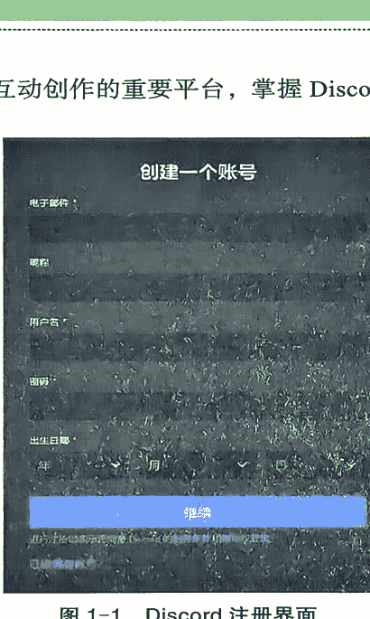

#### 1.2.2 Discord 账号登录方法

注册并完成邮箱验证后即可登录。再次打开官网首页，点击右上角“登录”，输入注册时使用的邮箱与密码确认后进入主界面。在主界面可管理个人资料、加入频道、参与聊天，并进一步使用 Midjourney 创作。

为提升效率，建议首次登录成功后保持登录状态或牢记账号信息，便于快速进入 Midjourney 频道互动。

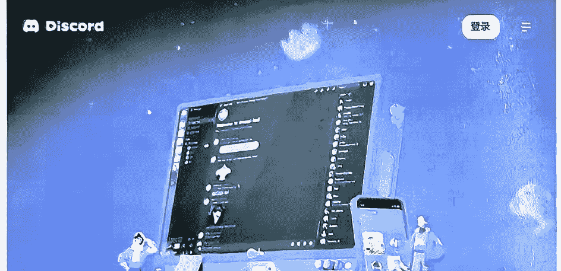

图 1-2 Discord 登录界面

#### 1.2.3 下载 Discord 客户端（推荐）

网页端可用，但下载客户端体验更稳定流畅。官网提供 Windows、Mac 电脑端以及 iOS、Android 移动端客户端。可按设备选择对应版本下载安装，登录后即可更高效稳定地与 Midjourney 互动创作。

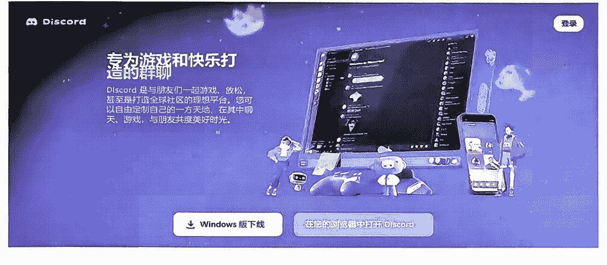

图 1-3 Discord 下载界面

#### 1.2.4 Discord 账号的设置与管理

登录后建议进行基础设置以提升便利性。点击主界面左下角用户头像，进入“用户设置”。

在此可设置头像、昵称、隐私保护与消息通知方式。合理设置有助于及时收到 Midjourney 生成结果通知，也能通过隐私选项保护个人信息，让创作更安心。

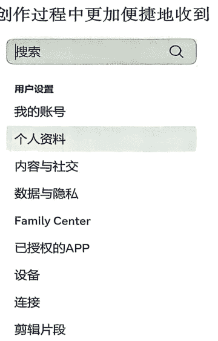

图 1-4 Discord 用户设置界面

#### 1.2.5 使用 Discord 的注意事项

建议开启通知功能，以便及时收到图像生成结果，避免错过更新。Discord 账号关联创作成果与互动信息，请妥善保管密码等敏感信息，防止泄露。首次加入 Midjourney 频道时，仔细阅读频道说明与社区规则，有助于融入创作社群，保证后续互动顺畅，获得优质创作体验。

通过以上步骤即可完成 Discord 账号的注册、登录与基础管理，为使用 Midjourney 奠定基础。

### 1.3 找到并加入 Midjourney 频道

完成 Discord 注册登录后，下一步是定位并加入 Midjourney 官方频道，这是启动 AI 视觉创作的必要环节。在该频道不仅能体验强大生成功能，还能获取灵感，与全球创作者交流。

#### 1.3.1 如何找到 Midjourney 官方频道

登录 Discord 并打开主界面。点击左下角“发现”按钮，进入页面后在右侧服务器列表中搜索 Midjourney 官方频道。

#### 1.3.2 加入 Midjourney 官方服务器

进入 Midjourney 服务器页面后，可看到服务器介绍与图标。点击“加入服务器”按钮即可完成加入。

加入成功后，Discord 主界面左侧服务器列表会出现 Midjourney 图标，点击即可进入服务器开启创作。

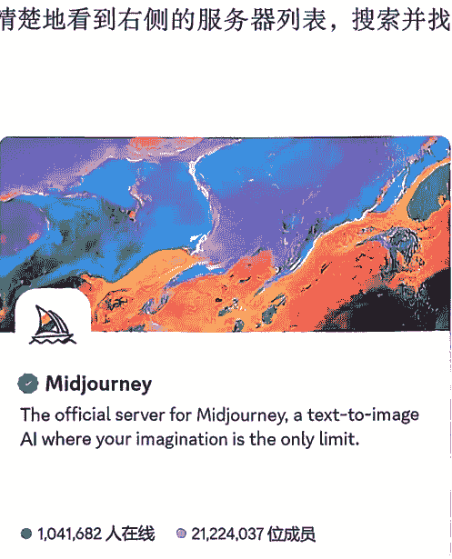

图 1-5 Midjourney 官方频道

#### 1.3.3 熟悉 Midjourney 服务器结构与频道分类

初次进入官方服务器界面可能较复杂，因内设多个频道。

不同频道的用途：

**新手频道 newbies**：供初学者进行首次生成练习，人流量大，可观察他人提示词与效果。

**常规频道 general**：用户互动交流区，可提问、分享心得、讨论创意。

**主题频道 themed channels**：官方设立的专题区，如风景、科幻、插画等，供围绕特定主题创作交流。

**反馈频道 feedback**：用于向工作人员反馈功能问题或建议，官方通常会及时回复。

**公告频道 announcements**：发布更新、功能升级、维护通知、创作比赛与社区活动的重要信息。

建议新手先从 newbies 频道开始熟悉提示词输入规则与生成逻辑，再进入感兴趣的主题频道深入学习。

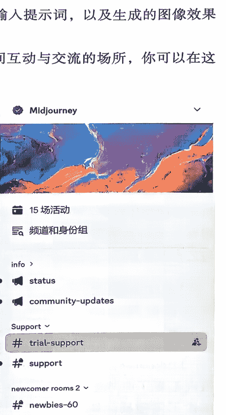

图 1-6 Midjourney 频道列表

#### 1.3.4 开始首次图像创作尝试

进入服务器的 newbies 频道后，可在聊天框输入指令启动创作。通常先键入 /imagine，后接想要生成的图像提示词。示例：

```
/imagine a serene mountain landscape at sunset, realistic style
```

回车后，Midjourney 会在数十秒到数分钟内生成 4 个预览图。

各版本在构图、色调或细节上略有差异，便于快速定位方向。若满意某张，可用放大功能提升分辨率与细节；若想基于某幅图像获得相似变式，可点击变体按钮，模型会生成一组构图基调相同但有所延展的图像。

通过不断调整优化提示词，能显著提升生成准确度与艺术表现力。

#### 1.3.5 在全球创作社群互动与交流

Midjourney 频道汇聚全球不同背景的创作者。创作之外建议积极参与：

- 观察优秀作品，学习提示词搭配技巧。
- 遇到问题时向经验丰富的用户请教，获得启发。
- 定期浏览常规频道与公告频道，及时了解新功能与社区活动，提升创作水平与参与感。

按以上步骤即可顺利加入官方频道并掌握基础功能，为深入探索创作潜力打下基础。

### 1.4 如何搭建自己的服务器

官方频道虽便于学习，但人多作品更新快，容易被刷屏淹没。搭建专属 Discord 服务器独立使用 Midjourney，可提高效率并更好管理作品。以下介绍搭建流程与机器人接入。

#### 1.4.1 创建自己的 Discord 服务器

登录 Discord 账号后，在左侧服务器栏下方点击 “+” 图标。弹出菜单中选择“创建我的服务器”。

随后选择服务器用途，如“适合我和朋友”或跳过。设置服务器名称并上传头像后，完成初步创建，服务器将出现在左侧列表。

#### 1.4.2 在服务器中添加 Midjourney 机器人

创建私人服务器后，点击顶部服务器名称旁箭头打开下拉菜单，选择“应用程序商店”或“邀请机器人”。

若未显示 Midjourney，可访问官网 https://www.midjourney.com 获取邀请链接，或从官方服务器直接邀请机器人。通过官网选择“邀请 Midjourney Bot”，按提示选择刚创建的私人服务器，完成授权后机器人即可加入服务器。

#### 1.4.3 配置服务器频道
搭建个人服务器并接入机器人后，下一步需创建适合图像创作的专属频道：

建立专属频道，远离干扰

在服务器头部的加号上点一下，就能新建频道。将频道类型改成文本，并起一个一看就懂的名字，比如 Midjourney 绘画区或图像生成室（图 1-10）。配置完毕后，这个区域就可以只用来跑 Midjourney，不会被其他人的消息刷屏。

#### 1.4.4 服务器权限和角色管理

想要管理更顺手，建议对权限和身份做点规划：
点开服务器名旁的下拉箭头，进入服务器设置。
在设置里找到角色，可以新建管理员、普通成员、访客等不同身份，灵活分配各自的访问权限（图 1-11）。
另外单独给 Midjourney 机器人建一个角色，并授予发送信息、上传图片等必要权限，确保它能正常工作。

#### 1.4.5 在自己的服务器上使用 Midjourney 创作图像

完成以上配置后，就能在自己搭建的服务器里直接用 Midjourney 作图了：
在频道的输入框里敲入 /imagine，然后加上你想要的画面描述，就能开始生成（图 1-12）。
自建服务器更私密、更独立，作品不会被别人的内容覆盖，查找和回顾都更方便。
你还可以把私人服务器的邀请链接分享给朋友或合作者，一起讨论成片和灵感，打造专属的创作圈子。

#### 1.4.6 独立服务器的优势与建议

自己建服的核心好处有三点：
创作更独立：不会被他人内容淹没，历史记录便于整理。
交流更沉浸：能和朋友、同事或同好自由互动，增强归属感。
权限更灵活：可按需设定成员权限和分工，让管理更高效。
建好后，可根据实际使用情况逐步调整频道布局、权限规则和交流方式，塑造一个高效、友好且充满灵感的个人工作空间。

## 2 第一次使用 Midjourney

### 2.1 快速生成图像的指令：/imagine

本节介绍 Midjourney 最基础也最重要的命令 /imagine，学会它就能产出第一张作品。

#### 2.1.1 /imagine 指令简介

/imagine 是 Midjourney 绘画的核心命令。
输入指令并配合一段简短的英文描述，就能把脑中的画面具象化。
格式为：/imagine + 描述词。
比如想得到海边日落，可以输入：/imagine sunset over the ocean, peaceful and serene（图 2-1、图 2-2）。

#### 2.1.2 如何输入 /imagine 命令

在 Discord 的 Midjourney 频道，比如 newbies 或自己的专属频道，点开底部的输入框。
敲入斜杠 “/”，会出现命令列表（图 2-3），选择 imagine 或直接输入。
在弹出的描述框里填入英文提示，按回车发送，机器人就会开始绘图。

#### 2.1.3 输入提示词的要点与技巧

尽量用简洁清晰的英文，点明场景、主体和风格。
可以用逗号或空格把多个视觉元素分开，表达会更准确。
避免描述过于含糊或堆砌过长，AI 容易理解偏差。
示例：
模糊写法：/imagine a city。
清晰写法：/imagine futuristic city skyline at dusk, cyberpunk style, vibrant neon lights。
（黄昏时分未来城市天际线，赛博朋克风格，霓虹灯光绚丽。）

#### 2.1.4 等待生成结果与初步操作

发送指令后通常需要几十秒到数分钟，Midjourney 会先给出四张预览图。
完成后会展示一排 2×2 的缩略图，并在下方出现 U1、U2、V1、V2 等操作键（图 2-4）。
可以根据喜好放大满意的图，或生成相似变体，得到更理想的效果。

#### 2.1.5 生成图像的注意事项

默认情况下，生成的图对频道里所有人可见。若需要更私密的体验，建议在私人服务器频道操作。
控制好描述词的数量和复杂度，有助于提升出图速度与质量。

### 2.2 下方按钮的功能

生成完成后，系统会给出四张预览，并在下方提供操作键，帮助你进一步精修。

#### 2.2.1 按钮功能的总体说明

默认呈现 2×2 四张图，下方通常有：
U 系列：放大键，U1、U2、U3、U4，用于把对应编号的图片放大并增强细节。
V 系列：变体键，V1、V2、V3、V4，用于基于对应图片生成相似的变种。
刷新键：重新生成四张新图，提示词不变但画面会不同。

#### 2.2.2 U 按钮：放大图像（upscale）

U 键用来把选中的小图放大、提升分辨率并优化细节，得到可下载的高质量版本。
U1 放大左上第一张，U2 放大右上第二张，U3 放大左下第三张，U4 放大右下第四张。
例如对第三张比较满意，点一下 U3 就能拿到高清版（图 2-5）。

#### 2.2.3 V 按钮：创建变体（variation）

V 键基于喜欢的图生成若干相似但细节不同的版本，拓展创作思路。
V1 以第一张为基准生成四张变体，V2 以第二张为基准，V3 以第三张，V4 以第四张。
比如第三张整体不错想多尝试，点 V3 会得到四张风格相近但细节各异的新图（图 2-6）。

#### 2.2.4 刷新按钮：重新生成一组图像

如果四张都不满意，或想在同一主题下多探索，可以点刷新键，系统会基于相同描述再产出一组全新的四张图。刷新不依赖已有单张的构图，而是整组重来，让同一描述产生更多可能性。
反复刷新可以筛选出最喜欢的初稿，再配合放大或变体继续打磨。若多次刷新仍不理想，就需要微调描述词继续迭代。

#### 2.2.5 按钮使用流程

以“一只坐在古老城墙上的黑猫，充满神秘气息，暗黑系插画风格”为例。
生成后若特别中意第二张，可点 U2 放大，得到更精细的高分辨率图。
若第三张风格可以但想在此基础上继续探索，点 V3 会产出四张相似又各有差异的新图供挑选。
若四张都不符合预期，直接点刷新，Midjourney 会用同一描述再出一组。

#### 2.2.6 按钮使用的注意事项

每次点键后都需要重新计算，通常要等几十秒到几分钟，请耐心等待。
同时点多个键会排队执行，会拉长总耗时。
免费账号每天可生成的次数有限，建议合理规划刷新和变体的使用，避免浪费额度。

### 2.3 常见命令

除了 /imagine，Midjourney 还提供多条实用命令，提升创作效率。

#### 2.3.1 /blend——融合图片

想把两张或多张已有图片合成新效果，可以用 /blend。
用法：输入 /blend 后依次上传要合并的图片（图 2-8）。
格式示例：/blend 图片1 图片2，可继续添加更多。图片越多融合结果越丰富。
适合混搭风格、叠加设计元素，或把两幅作品合成全新构图。

#### 2.3.2 /settings——调整生成设置

需要快速改动生成参数时，用 /settings。
输入后会弹出交互菜单，可选择画质、风格强度、尺寸等（图 2-9）。
可以切换不同算法版本、调节风格化程度、尝试横幅或竖版比例，随时再次调用恢复默认设置。

#### 2.3.3 /describe——图片描述

想从一张优秀图片获得可用描述，可以用 /describe。
先输入 /describe，再上传目标图片，系统会自动分析并输出一段详细文字（图 2-10）。
这段文字可以直接拿来当下次的描述，或在此基础上改写优化，形成创作桥梁。

#### 2.3.4 /info——查询账户信息

输入 /info 可快速查看当前使用的 Midjourney 版本、剩余快排时长、已生成图片数量等账户信息，结果会弹出在聊天窗口。

#### 2.3.5 使用指令的技巧与注意事项

所有指令都以斜杠 “/” 开头，输入后会自动显示可用列表。
每个指令后通常会出现提示输入框，按提示填写内容或上传图片即可完成操作。
合理使用指令能大幅提高效率，减少试错成本。

## 3 初探提示词

### 3.1 提示词的作用

描述词是创作者与 Midjourney 沟通的桥梁，用来说明创作意图、风格偏好和细节要求。它决定了画面整体走向和艺术质感。

#### 3.1.1 明确创作方向
描述词可以直接点出图像的核心对象与概念，比如人物、场景或情节，让 AI 从一开始就有的放矢。清晰的需求能减少干扰，为后续优化打基础。
例如提示“古罗马竞技场决斗”，AI 会聚焦建筑、服饰和历史氛围，画面更贴合预期。

#### 3.1.2 呈现多元艺术风格与特征

在描述里加入“油画”“水彩”“赛博朋克”等流派，或点名具体艺术家，就能让画面带上相应笔触、色彩和构图。若同时写“日本浮世绘”和“暗黑哥特风”，AI 会尝试融合两种语言，创造独特视觉。

#### 3.1.3 提升图像细节与氛围表现

描述中加入生动的细节，如“波光粼粼的湖面”“金属质感的机甲外壳”“蒸汽缓缓升起的幻想城市”，AI 会塑造纹理、光影和空间层次。
加上“忧郁”“浪漫”“孤寂”等情绪词，色调和明暗也会随之调整，感染力更强。

#### 3.1.4 提高创作效率与精准度

一个结构清晰的描述相当于创意脚本，帮助 AI 快速锁定要点，减少反复修正。生成后可以根据结果微调关键词和氛围词，逐步逼近目标，提升成品质量和效率。

#### 3.1.5 彰显创作者个性与创造力

描述不仅是告诉 AI 画什么，也是审美取向的体现。用诗意化的表达或超现实元素，能赋予作品鲜明个性，让成果更具想象空间和辨识度。

### 3.2 提示词的基本构成

熟练使用 Midjourney 需要掌握描述词的基本结构，一个完整的描述通常由多个要素组成。

#### 3.2.1 主体

主体是描述里最基础也最重要的部分，决定图像的核心方向。无论是人物、动物、物件还是场景，都应简明写出，避免主题模糊。
例如 “A cat wearing sunglasses and a scarf” 能让 AI 明确猫咪这一核心并绘制相应造型（图 3-1）。毛色、神情等细节可在后续修饰中补充。

#### 3.2.2 动作与状态

动作与状态赋予画面动态感和情绪。加入 running、sitting、flying、dancing 等动作词，或 sleeping、relaxing、smiling、thinking 等状态词，画面会更生动有故事感。
例如：A playful cat chasing butterflies in the garden（图 3-2），一只在花园追逐蝴蝶的活泼猫咪。

“chasing butterflies” 把猫咪的互动写得非常具体，画面随之变得更有动感和趣味。要是想呈现主体的心理状态或情绪，引入 “happy”“nervous” 这类情绪词，就能为图像补充更丰富的情感维度。

#### 3.2.3 环境或背景
在提示词里加入场景信息，能让画面具备更强的空间感与氛围表达。城市街头、原始密林、极地冰川等，只要把地点、季节、天气或时段说清楚，就能搭起完整的情境，增强观者的代入感。

> 例如，下面的指令把时空设定为“暴风雨夜晚的海边峭壁”：
> A lighthouse on a rocky cliff during a stormy night（图 3-3）。
> （暴风雨天气下岩石悬崖上的灯塔。）

图 3-2 猫咪生成图
图 3-3 海边生成图

当模型捕捉到“暴风雨”“夜晚”“悬崖”“灯塔”等要点时，会在光影、色调与氛围上突出风雨交加、海岸孤立的紧张感，从而让作品传递出强烈的戏剧性和视觉冲击。

#### 3.2.4 风格
提示词里点明风格，能帮助 AI 锁定视觉语言与艺术形式。油画、水彩、插画、摄影、动漫，或偏向未来感、复古风、电影感等倾向，通过明确的风格描述都可让 Midjourney 在构图、色彩与氛围上做针对性调整，使作品气质更鲜明。

> 例如，下面的指令会让 AI 在街景设计与配色上强调浓郁的赛博朋克元素，营造高科技与霓虹交织的都市风貌：
> Cyberpunk-style futuristic street with neon lights（图 3-4）。
> （赛博朋克风格的未来街景，霓虹灯光效果。）

图 3-4 赛博街景生成图

除赛博朋克之外，也可结合巴洛克风格、梵高风格、霓虹复古风等艺术流派做更具风格化的创作，让输出在视效与情感氛围上更贴合审美与需求。

#### 3.2.5 色彩
色彩是影响情绪与氛围的关键变量之一。提示里明确主色调或配色方案，例如暖色调、冷色调、明亮鲜艳或单色黑白，能帮助 Midjourney 快速定位画面的情感走向，让结果更符合预期。

> 例如，下面的指令突出了秋季的温暖与鲜艳：
> A forest landscape in autumn colors, warm and vibrant tones（图 3-5）。
> （秋季色彩的森林景观，温暖鲜艳的色调。）

这种设定会让 AI 着重表现金黄、橙红等秋日色彩，并在光影与氛围上强化丰收与暖意的感受，使季节特征更浓郁。

#### 3.2.6 光影与效果
光影和特效在创作中常起到画龙点睛的作用，既影响明暗对比，也决定情绪与冲击力。提示里注明光影信息，如“柔和光线”“背光照明”“强烈对比度”，或标明特定效果如“发光”“粒子特效”“光晕”，都能让 Midjourney 遵循更明确的视觉指引，呈现更具层次感与故事性的画面。

> 例如，下面的指令凸显了背光带来的强烈戏剧化效果，让主体轮廓具备鲜明的剪影特征：
> A portrait of a woman with dramatic backlighting, creating a silhouette effect（图 3-6）。
> （一位女性的肖像，采用背光，突出戏剧化剪影效果。）

图 3-5 秋季森林生成图
图 3-6 女性光影肖像生成图

强调“dramatic backlighting”后，模型会刻意强化逆光表现，用光源勾勒出锐利或朦胧的人物边缘，并在背景与面部细节上形成鲜明对比。若想进一步增强氛围，还可加入“柔和的光线 soft glow”或“镜头光晕 lens flare”等关键词，为画面带来更梦幻或电影感的视觉效果。

#### 3.2.7 视角与构图
提示里指明视角与构图方式，能有效控制空间层次与结构安排，使主体与背景关系更清晰。鸟瞰、特写、广角等不同视角会带来完全不同的画面冲击与叙事氛围。使用具体的视角术语，能让 Midjourney 更好地把握拍摄角度，使视觉表达更丰富有力。

> 例如，下面的指令会让 Midjourney 以鸟瞰呈现一座古老城市在日出时分的全景风貌，展现恢宏又庄严的历史氛围：
> Bird’s-eye view of a medieval city at sunrise（图 3-7）。
> （鸟瞰视角下的中世纪城市，日出时分。）

明确“Bird’s-eye view”后，构图会强调高空俯瞰带来的广阔视野；而“medieval city”“sunrise”等信息则进一步限定建筑应具有中世纪特色并沐浴在清晨金色光线中。若想突出局部特写或人物神情，也可改用“特写 close-up”等词，让画面更集中且富有张力。

#### 3.2.8 细节与质感
为了让图像更具真实感与视觉冲击，提示词常需强调特定材质、纹理或质感，如“粗糙纹理”“金属质感”“光滑表面”“精致细节”等，这能引导 Midjourney 着重刻画微观特征，让作品更生动且富有层次。

> 例如，下面的指令突出强调了机械主体的精密纹理与金属材质，使画面带有独特的复古机械风：
> Steampunk-style mechanical robot with intricate metallic textures（图 3-8）。
> （带有复杂金属质感的蒸汽朋克风机械机器人。）

接收到“intricate metallic textures”后，模型会在机器人表面的零件、接缝、铆钉等细节处做出更精细的刻画，从而让整体外观更具工业感与机械感。若想进一步提升沉浸感，也可在提示里加入“rusty 生锈的”“scratched 划破的”或“weathered 风化的”等词，呈现更老旧而富有历史痕迹的金属质感。

#### 3.2.9 提示词结构示范案例
下面展示如何从基础版提示词出发，逐步加入更多元素，使生成效果更丰富细腻。

> 基础版提示词：
> A girl walking in a forest（图 3-9）。
> （一位在森林中行走的女孩。）

图 3-9 森林中的女孩生成图

仅描述主体与基础环境，风格、氛围与细节都会比较模糊。

> 进阶版提示词：
> A young girl wearing a red cloak, walking through a misty forest at dawn, fairy tale illustration style, warm pastel colors, soft lighting（图 3-10）。
> （穿红色斗篷、漫步于清晨迷雾笼罩的森林中的女孩，童话风格，温暖色调，柔和光线。）

图 3-10 斗篷女孩生成图

细节扩充：“wearing a red cloak”限定了服饰要点，形成视觉焦点。
环境强化：“misty forest at dawn”让场景充满神秘与清晨光线的氛围感。
风格确立：“fairy tale illustration style”指明了童话插画方向。
色彩基调：“warm pastel colors”指导整体配色，增强温暖柔和的童话感。
光影效果：“soft lighting”强调柔和光线，为作品增加梦幻气息。

通过对比可见，随着描述的细化与要素的扩充，生成图像在风格、气氛与细节刻画上会更贴近创作者预期，也能大幅减少反复试错的工作量。

### 3.3 使用简单提示词快速体验不同输出效果
刚接触 Midjourney 的用户，建议先用简洁明确的提示词创作，不断调整尝试不同表述，能快速熟悉创作逻辑与风格表现，便于后续进阶。本节用简单提示词做初步实践，直观感受不同指令带来的视觉差异。

#### 3.3.1 使用简单提示词开始创作
初次使用时不必立刻编写细节繁多、风格复杂的提示词。选择一句简洁清晰、重点突出的描述，就能体会 AI 依据指令创作的过程。如下例：

> A snowy mountain landscape（图 3-11）。
> （雪山景观。）

输入后系统会自动生成 4 张预览图。关键词虽少，但构图、光线与画面氛围仍会有差异。可观察：
- 哪些元素在各张图中保持一致？
- AI 为丰富构图或突出主题做了哪些细节变化？
- 哪一版更符合你的审美或创意方向？

这个过程能快速熟悉生成速度与操作流程，并积累“如何用词语表达需求、哪些词能触发特定视觉效果”的认知。待对基本流程有初步印象后，再逐步加入主体、氛围或细节要求，获得更具针对性的效果。

#### 3.3.2 增加风格关键词，观察变化效果
掌握简单提示词后，可在指令中加入风格元素进一步丰富表现。不同风格词往往会显著改变光影、配色与整体艺术感，让同一场景呈现多样化视觉。

例如在“A snowy mountain landscape”基础上加入水彩风格：

> A snowy mountain landscape, watercolor painting style（图 3-12）。
> （雪山景观，水彩风格。）

“watercolor painting style”会让结果呈现柔和渐变的笔触与色彩晕染，整体更具绘画感与浪漫氛围。

若想尝试截然不同的调性，可改为：

> A snowy mountain landscape, cyberpunk style, neon colors（图 3-13）。
> （雪山景观，赛博朋克风格，霓虹色彩。）

图 3-13 赛博朋克风格雪山生成图

“cyberpunk style”与“neon colors”强调高科技、霓虹灯等元素，画面会出现冷调霓虹、金属质感或科幻结构，与水彩风格截然不同。

通过对比同一主体在不同风格词下的表现，能更好地理解 Midjourney 对风格词汇的解析，也能积累“哪种风格带来哪种氛围”的经验，日后组合运用可大幅提升可控性与艺术表现力。

#### 3.3.3 尝试添加细节描述，提升图像效果
在熟悉基础用词与风格后，可进一步加入场景与光影细节，增强真实感与氛围。更精准地传达想要的画面，也让构图与视觉呈现更具层次与冲击力。

例如在原场景上增加时段与光线：

> A snowy mountain landscape at sunset, realistic style, soft lighting（图 3-14）。
> （雪山景观，日落时分，写实风格，柔和的光线。）

“at sunset”引导 AI 在色彩与光线上呈现日落常见的暖黄、橙红；“realistic style”强调真实感与自然纹理；“soft lighting”则营造柔和、略带梦幻的光影与温馨氛围。

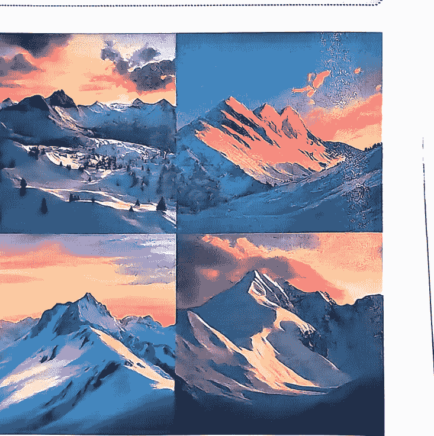

为场景补充更多细节后，画面在整体感染力、纹理层次与色调过渡上都会更完整。随着提示词元素的逐渐丰富，Midjourney 在色彩、构图与细节处理上会更贴合创作意图，显著提升完成度与美感。

### 3.4 同一主题的不同视觉表现方式
使用 Midjourney 时，即使主题相同，通过不同的提示词描述也会得到截然不同的视觉效果。掌握同一主题下的多种表达方式，不仅提升创作灵活性，也更容易找到最佳的视觉呈现。下面介绍几种常见思路。

#### 3.4.1 通过风格变化体现差异化效果
不同艺术风格会让相同主体呈现截然不同的表现力。以“森林小屋”为主题进行不同风格的描述尝试：

**插画风格 Illustration Style**
> A cozy cabin in the forest, illustration style, vibrant colors, whimsical atmosphere（图 3-15）。
> （一个舒适的森林小屋，插图风格，鲜艳的色彩，异想天开的气氛。）

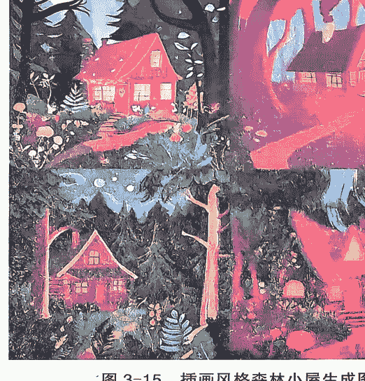
视觉呈现为色彩鲜艳、造型卡通化的插画风格，氛围温馨有趣。

**写实风格 realistic style**
> Realistic forest cabin surrounded by pine trees, detailed textures, warm sunlight（图 3-16）。
> （逼真的、被松树环绕的森林小屋，细节的纹理，温暖的阳光。）

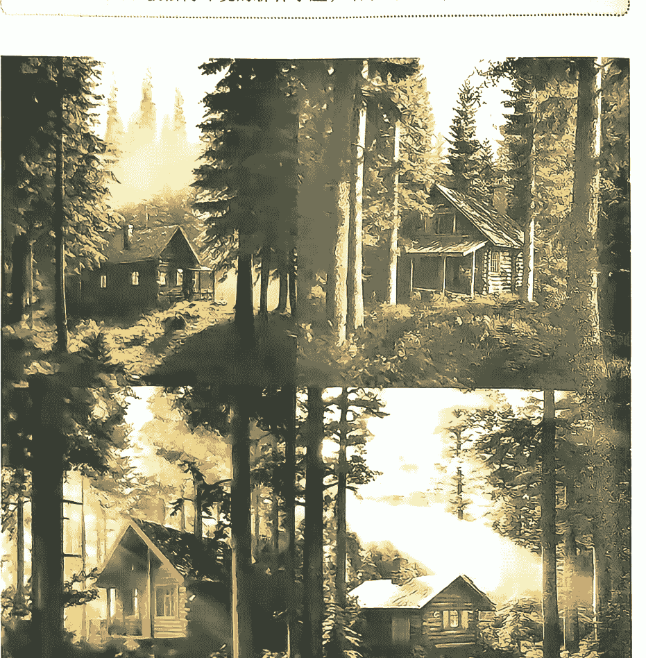
图 3-16 写实风格森林小屋生成图
图像细节丰富、视觉逼真，光影细腻。

**赛博朋克风格 cyberpunk style**
> Forest cabin, cyberpunk style, neon lighting, futuristic details（图 3-17）。
> （森林小屋，赛博朋克风格，霓虹灯，未来主义的细节。）

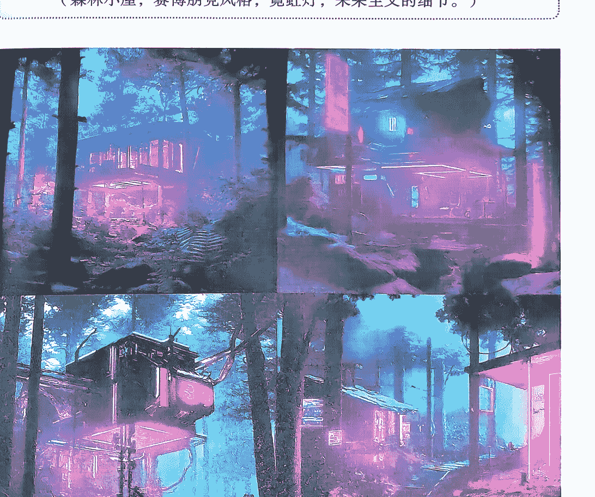
图 3-17 赛博朋克风格森林小屋生成图
画面带有未来科技感，霓虹色彩强烈，视觉更新颖独特。

#### 3.4.2 通过视角变化体现创意的多样性
同一场景通过不同视角也能产生明显差异，突出不同焦点。以“城市街景”为例：

**俯视视角 bird’s-eye View**
> Bird’s-eye view of a bustling city street, colorful lights（图 3-18）。
> （鸟瞰熙熙攘攘的城市街道，五彩缤纷的灯光。）

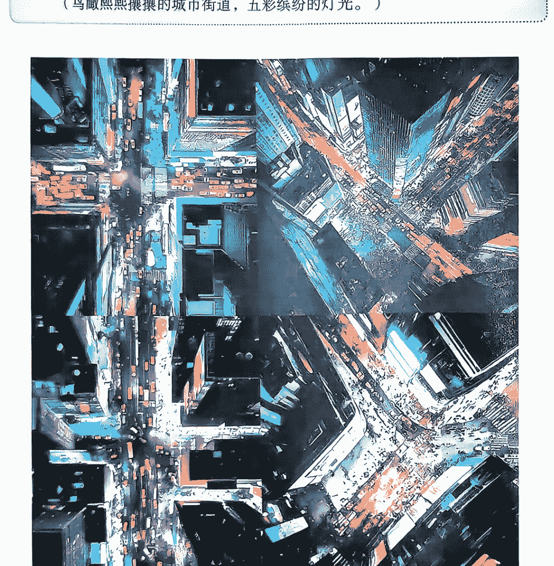
画面呈现宏观空间感与结构感，具有全局观感。

**仰视视角 low-angle view**
> Low-angle view of city street, tall skyscrapers, dramatic lighting（图 3-19）。
> （低角度的城市街道，高耸的摩天大楼，戏剧性的灯光。）

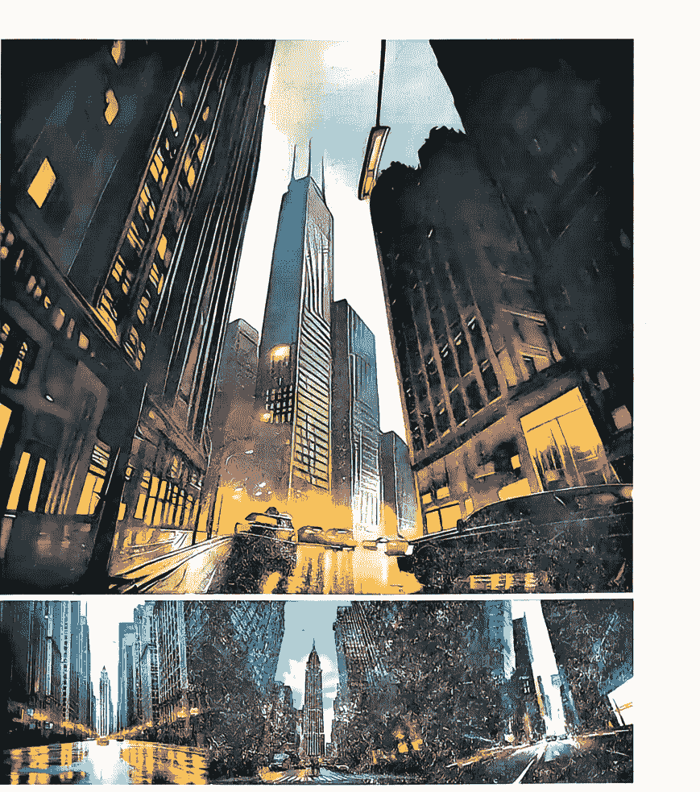
图像强化了建筑的雄伟感，突出了场景的视觉冲击力。

**特写视角 close-up view**
> close-up view of street corner scene with neon signs, cinematic style（图 3-20）。
> （亮着霓虹灯的街口特写镜头，电影风格。）

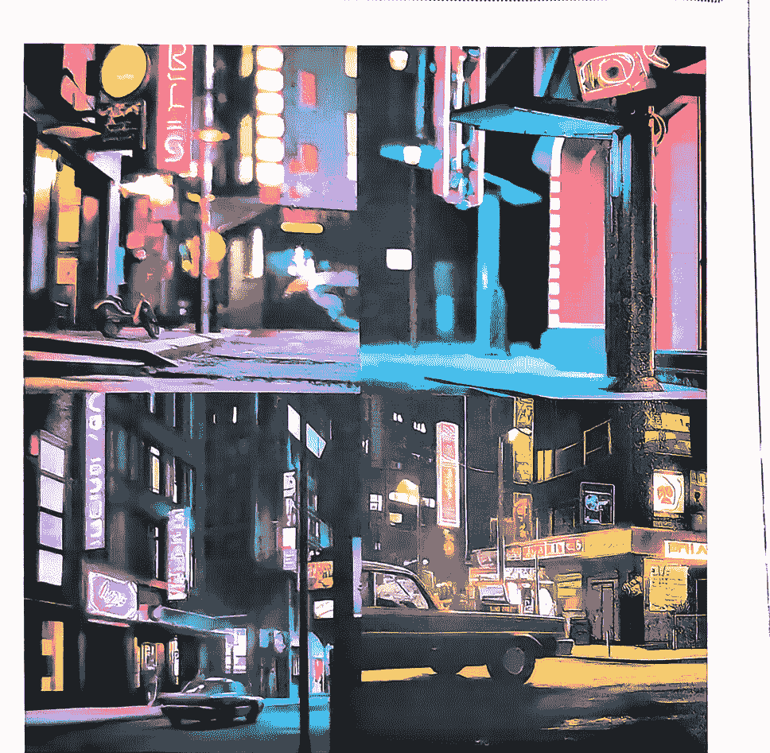
特写聚焦场景细节，营造出电影般的细腻氛围。

#### 3.4.3 不同色彩搭配呈现的视觉差异
色彩搭配能显著改变视觉情绪，同一主题因色调不同而呈现不同氛围。以“湖泊场景”为例：

**暖色调 warm colors**
> Peaceful lake at sunset, warm golden colors, calm atmosphere（图 3-21）。
> （宁静的夕阳湖，温暖的金色，平静的气氛。）

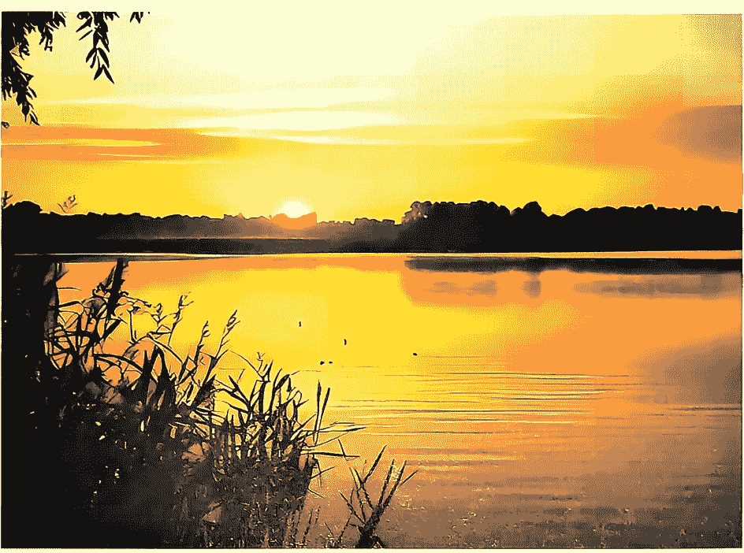
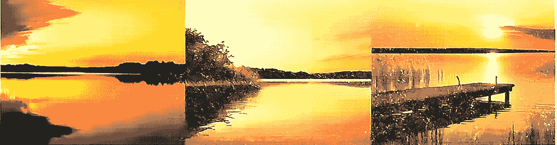
图 3-21 暖色调湖泊生成图
整体氛围温暖祥和。

**冷色调 cool colors**
> Tranquil lake in moonlight, cool blue tones, serene mood（图 3-22）。
> （月光下宁静的湖，凉爽的蓝色调，宁静的心情。）

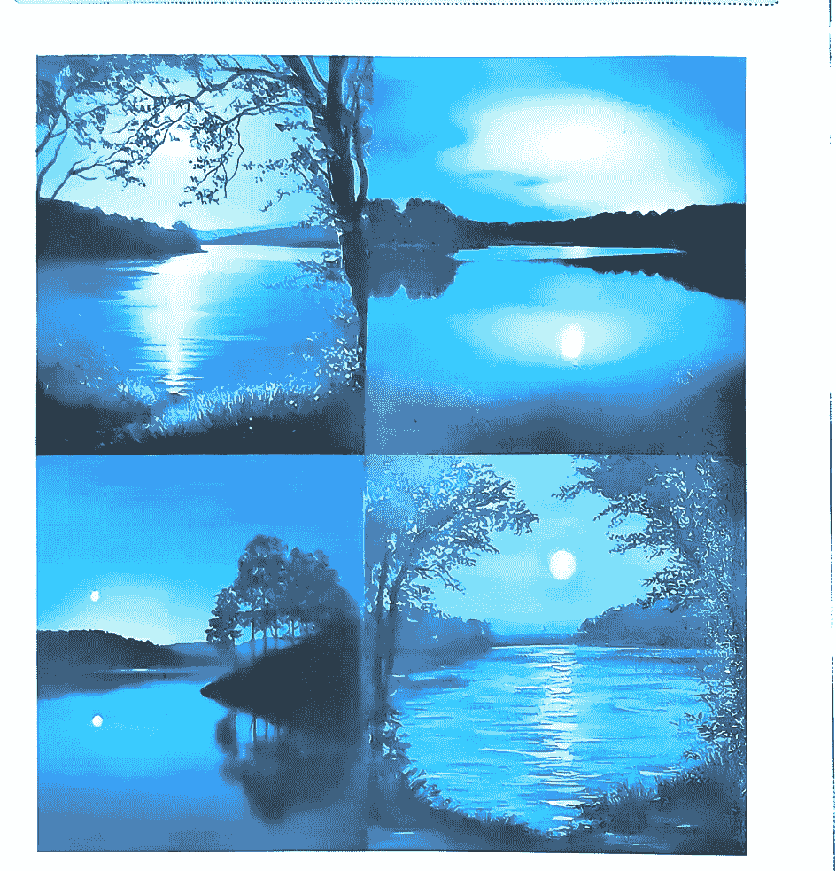
图 3-22 冷色调湖泊生成图
画面表现出清冷静谧的感觉。

#### 3.4.4 光影效果带来的视觉差异
在同一主题下加入不同的光影效果，也能快速创造丰富的视觉变化。以“人物肖像”为例：

**柔和光线 soft lighting**

> Portrait of a woman, soft natural lighting, gentle and peaceful mood（图 3-23）。

> （一个女人的肖像，柔和的自然光线，温柔平和的心情。）

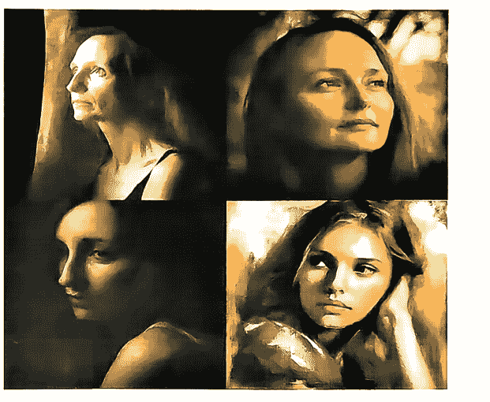

成图整体偏柔和静谧，观感轻松舒缓。

**戏剧化光线（dramatic lighting）**

> Dramatic portrait of a woman, strong shadows and dramatic lighting（图 3-24）。

> （一个女人的戏剧性肖像，强烈的阴影和戏剧性的灯光。）

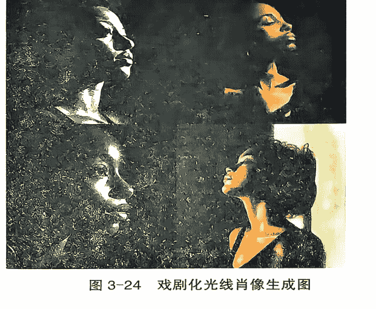

光影对比被拉大，戏剧张力随之提升，视觉冲击更为强烈。

#### 3.4.5 运用细节变化增强视觉表现力

哪怕主体相同，只要在提示词里调整细节，视觉特征也会随之改变。以咖啡馆场景为例：

**现代风格（modern style）**

> Modern cafe interior, minimalist furniture, bright lighting（图 3-25）。

> （现代咖啡馆内部、简约的家具，明亮的灯光。）

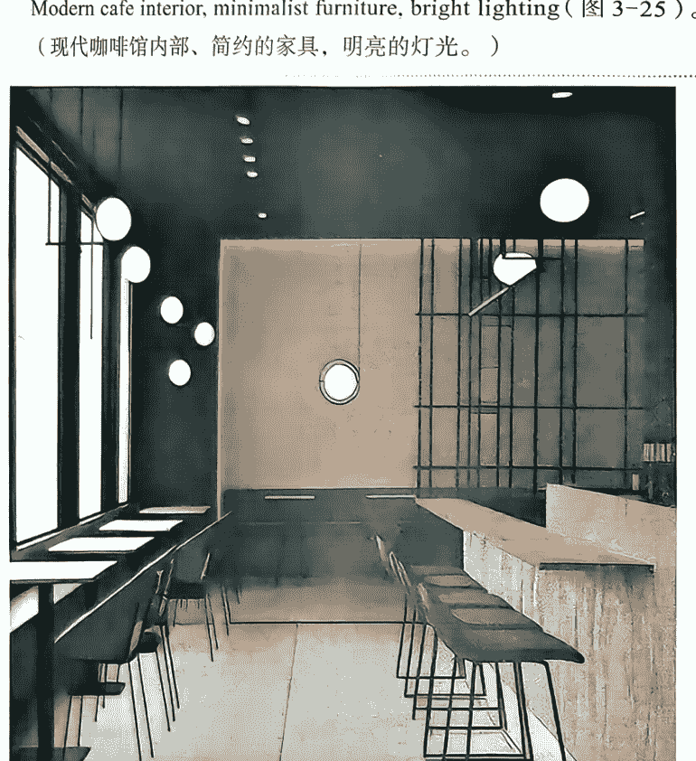

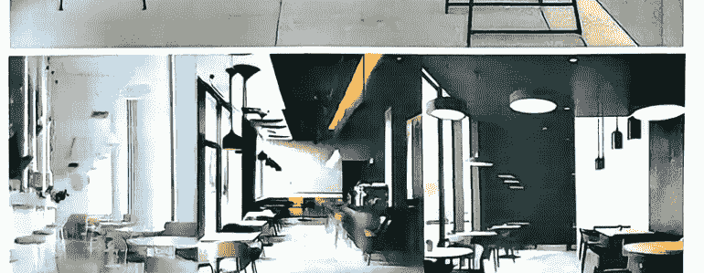

图 3-25 现代咖啡馆生成图

线条利落、空间通透，整体透出简洁大气的当代感。

**复古风格（vintage style）**

> Vintage cafe interior, antique furniture, warm cozy lighting（图 3-26）。

> （复古咖啡馆内部，古董家具，温暖舒适的照明。）

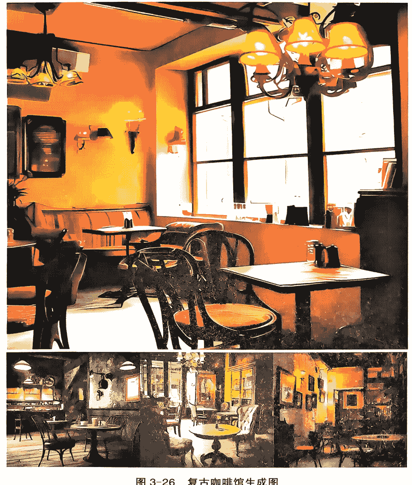

图 3-26 复古咖啡馆生成图

色调温暖怀旧，沉浸感足，复古气息十分突出。

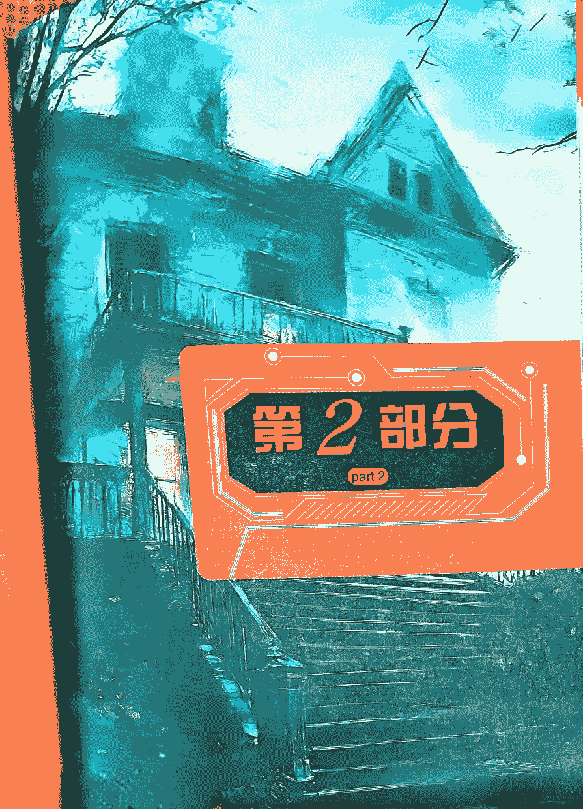

# 第 2 部分

## 4 Midjourney 参数书写格式教学

### 4.1 参数的书写格式

把创意想法准确落地成图，参数写法是关键一环。格式规范能提高效率，也让意图表达更清晰。

#### 4.1.1 基本书写规范

Midjourney 的指令由主题描述和若干参数组成，中间用空格分隔，所有参数都以双连字符 -- 开始。

基本形式：

Prompt 内容主体描述 -- 参数名 参数值

示例：

Modern architecture, glass facade, sunset lighting --ar 16:9 --stylize 500 --chaos 20 --seed 12345

示例中空格必须保留，-- 用于标识参数的开始，冒号 : 则用于填写某些参数的值，例如宽高比。

#### 4.1.2 常见参数的书写格式

##### 4.1.2.1 宽高比（aspect ratio）

写法：--ar 宽度 : 高度

示例：Modern house by seaside --ar 16:9

常用比例：--ar 1:1 为正方形，--ar 16:9 适合横向画面，--ar 9:16 适合纵向画面

##### 4.1.2.2 风格化（stylize）

取值范围：通常 0 ~ 1000

写法：--stylize 数值

示例：--stylize 300

##### 4.1.2.3 随机性（chaos）

取值范围：0 ~ 100

示例：--chaos 50

##### 4.1.2.4 质量（quality）

常用取值：0.25、0.5、1、2

示例：--quality 2

##### 4.1.2.5 种子（seed）

以数字表示。示例：--seed 123456

##### 4.1.2.6 图像权重（image weight）

用于图生图。示例：--iw 0.5

##### 4.1.2.7 负面提示（negative prompt）

在 --no 后列出不希望出现的元素。示例：--no watermark, blurry

#### 4.1.3 完整示例

Modern minimalist house with large windows, night scene, soft interior lighting --ar 16:9 --stylize 300 --quality 2 --chaos 25 --seed 6789 --no low quality, watermark

该提示会生成现代极简风格的房屋外观，采用横向宽屏，风格化程度适中，并排除水印与模糊问题（图 4-1）。

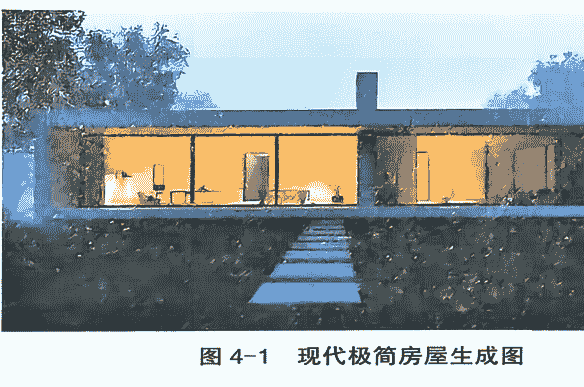

#### 4.1.4 注意事项

- （1）参数之间请保留空格。
- （2）参数开头必须使用英文双连字符 --。
- （3）数值建议保持在推荐区间内，避免出现异常结果。
- （4）善用负面提示剔除不需要的元素，有助于提升成图质量。

掌握以上写法，能让创作者更精准地传达意图，提升生成效率，实现所想即所得。

### 4.2 aspect ratio 参数教学

#### 4.2.1 参数简介

在 Midjourney 创作中，长宽比是基础且高频使用的参数，直接决定图像的宽高比例，影响构图、观感和适用场景。

通过 --aspect 也可简写为 --ar，可精确控制纵横比，使结果更贴合需求。横向比例适合风景，纵向比例适合海报，正方形多用于头像或社交封面。合理设定能优化呈现。

#### 4.2.2 aspect ratio 的使用方法

基础语法：--aspect <宽>:<高>

简写：--ar <宽>:<高>

例如生成横向画面：

```
A vast expanse of starry sky --ar 16:9（图 4-2）。
（浩瀚的星空。）
```

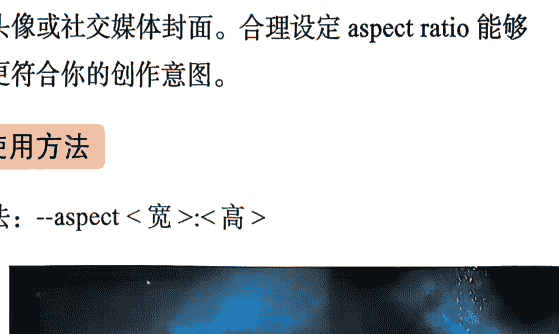

生成竖向画面时：

```
prompt: A tall tower --ar 9:16（图 4-3）。
（一座高塔。）
```

未指定比例时，Midjourney 默认输出正方形，即 1:1。

#### 4.2.3 aspect ratio 常用比例举例

实际使用中以下比例较为常见：

**正方形头像/社交媒体** --ar 1:1，适配 Instagram、微信头像等。

```
A panda --ar 1:1（图 4-4）。
（一只熊猫。）
```

**横向风景图/电影截图** --ar 16:9，符合高清影视标准。

```
Seaside scenery --ar 16:9（图 4-5）。
（海边风景。）
```

**海报或杂志封面** --ar 4:5 或 --ar 2:3，常用于海报设计、杂志插图。

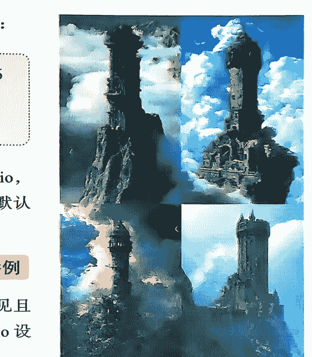

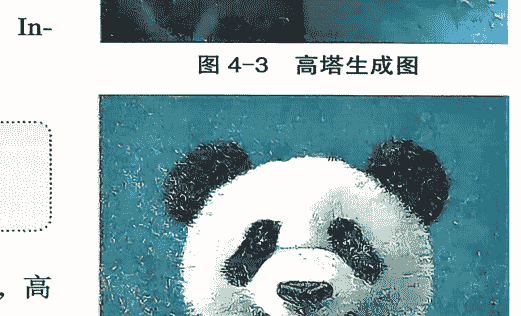

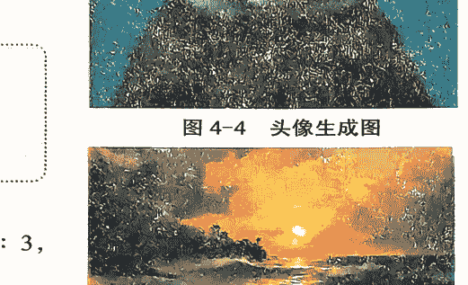

Fashion magazine --ar 4:5（图 4-6）

（时尚杂志。）

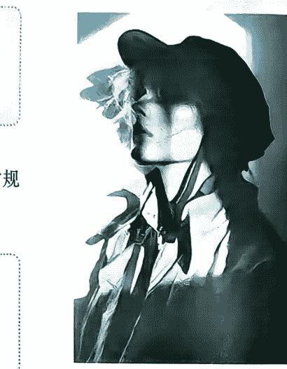

**手机竖屏壁纸** --ar 9:16，即手机屏幕常规尺寸。

Mobile phone wallpaper --ar 9:16（图 4-7）。

（手机壁纸。）

**全景图（超宽幅）** --ar 21:9 或更宽，适用于宽幅场景、壮丽风景。

Grassland scenery --ar 21:9（图 4-8）

（草原风景。）

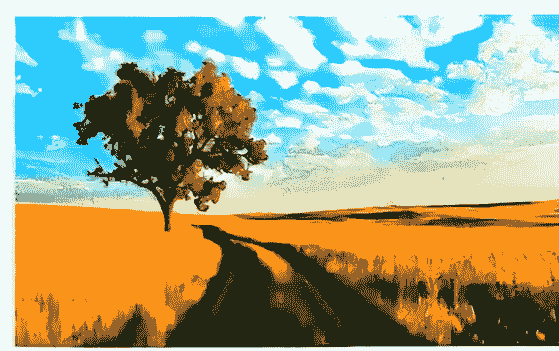

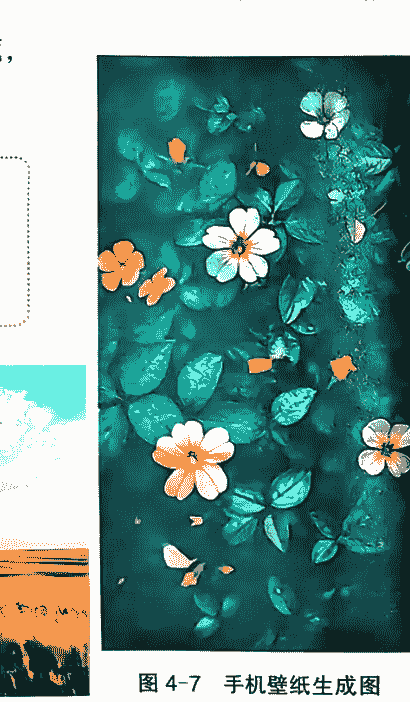

#### 4.2.4 aspect ratio 的限制及版本区别

不同版本对宽高比的支持有所差异。

**Midjourney v4 及以前版本：**

通常对比例有限制，一般不建议使用过于极端的宽高比，如超过 2:1 或 1:2。

**Midjourney v5 及更新版本：**

支持范围更广，可设置 --ar 5:1 或 --ar 1:5 等极端比例，但仍有尺寸上限，过极端可能导致生成失败或效果不佳。

建议结合当前版本限制合理尝试，避免使用极端数值。

#### 4.2.5 aspect ratio 实际应用技巧

合理选择长宽比能提升适配性并强化视觉表现。

##### 4.2.5.1 适配终端设备

为特定设备设计时，建议选用接近目标分辨率的比例，避免后续裁剪或拉伸。

常见设备比例：

- 手机壁纸 9:16 或 1080 × 1920，适合竖屏设备及社交竖版内容。
- 社交媒体横幅 16:9 或 21:9，适合 YouTube、Facebook 封面等。
- 电脑桌面壁纸 16:9 或 32:9 超宽屏，更好适配宽屏显示器。

##### 4.2.5.2 增强画面效果

不同比例会带来不同的视觉氛围。

- 宽比例 16:9、21:9、32:9：适合风景、环境、建筑，增强空间感与沉浸感。
- 竖向比例 9:16、4:5、3:4：适合人物肖像、时尚摄影，让主体更集中且富有张力。
- 正方形 1:1：适合头像、社交帖子、品牌设计，提供均衡的视觉中心。

##### 4.2.5.3 利用构图效果

比例也能帮助强化主体与环境关系。

- 极宽比例 21:9、32:9：营造电影感，突出地平线辽阔。
- 纵向比例 9:16、4:5：表现建筑、人物站姿，增强纵深与高度感。
- 经典摄影比例 3:2、4:3：接近传统相机成像，视觉更自然协调。

#### 4.2.6 常见问题与注意事项

##### 4.2.6.1 图像细节问题及相应建议

不同长宽比下构图会变化，相同提示词效果会不同。

- 宽幅如 --ar 16:9 或 21:9：AI 倾向横向扩展，增加左右两侧细节。
- 竖幅如 --ar 9:16 或 4:5：AI 更关注垂直构图，突出高度感。

建议：若关键细节丢失，可微调提示词明确突出要素，帮助 AI 在调整构图时保留重点。

##### 4.2.6.2 提示词的适配性及相应建议

极端长宽比可能影响提示词解析，导致结果偏离预期。

##### 4.2.6.3 极端比例的问题及相应建议

例如 --ar 32:9 超宽时，AI 可能填充过多无关细节，主体不够突出。

例如 --ar 9:32 超高时，构图难以合理安排，人物或场景显得拥挤不自然。

建议：使用特殊比例时逐步调整提示词，结合 --chaos 或 --stylize 进行微调，观察 AI 的解析方式。若确实需要超宽或超高，可先以标准比例生成，再用 Photoshop 等工具后期裁剪拼接。

### 4.3 stylize 参数教学

#### 4.3.1 参数简介

在 Midjourney 中，stylize 参数简写为 --s，用来控制图像的艺术化强度。

它决定模型处理提示词时的创意自由度：

数值偏低时 AI 更严格遵循描述，风格化弱；

数值偏高时 AI 发挥空间更大，画面更具艺术感与冲击力，但可能偏离原意。

#### 4.3.2 Stylize 参数使用方法

用法：prompt: 描述内容 --stylize 数值

简写：prompt: 描述内容 --s 数值

取值范围通常 0 ~ 1000，常见效果：

--stylize 0 ~ 100：高度贴合提示，写实或原始风格。

--stylize 100 ~ 400：中等风格化，审美提升。

--stylize 400 ~ 1000：艺术化明显，创意强、视觉冲击大。

Midjourney 默认 stylize 为 100。

#### 4.3.3 stylize 参数效果示例

用同一提示词仅改变 stylize 数值，可直观感受差异。

**Stylize=50**

> /imagine prompt: A mysterious castle in the forest at night --stylize 50

（图 4-9）。

（夜晚森林中的神秘城堡，--stylize 50。）

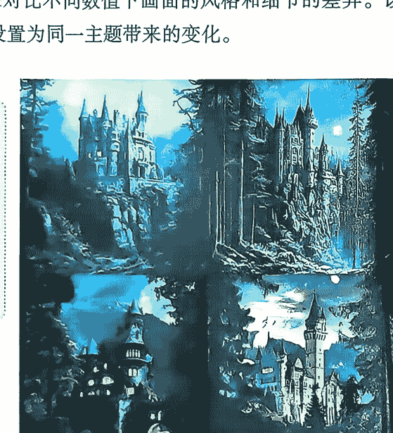

画面特征：

贴合基础描述，风格偏写实，夸张或幻想细节较少，适合需要精确还原场景的创作。

**Stylize=250**

> /imagine prompt: A mysterious castle in the forest at night --stylize 250（图 4-10）。

（夜晚森林中的神秘城堡，--stylize 250）。

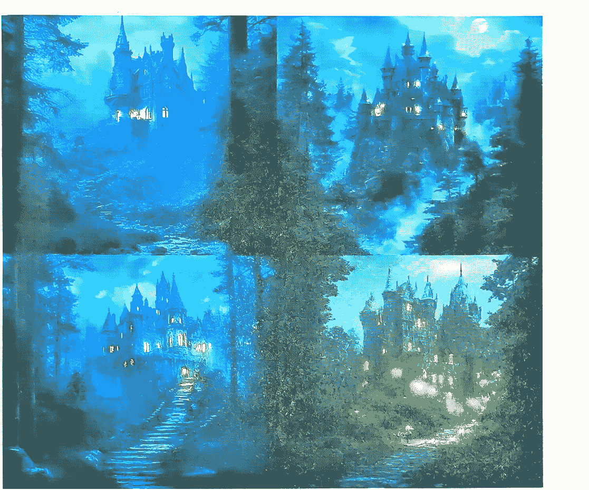

画面特征：

在保留要点基础上适度艺术化，细节更丰富，氛围感提升，光影朦胧感增强，适合写实与艺术平衡的需求。

**Stylize=750**

> /imagine prompt: A mysterious castle in the forest at night --stylize 750（图 4-11）。

（夜晚森林中的神秘城堡，--stylize 750。）

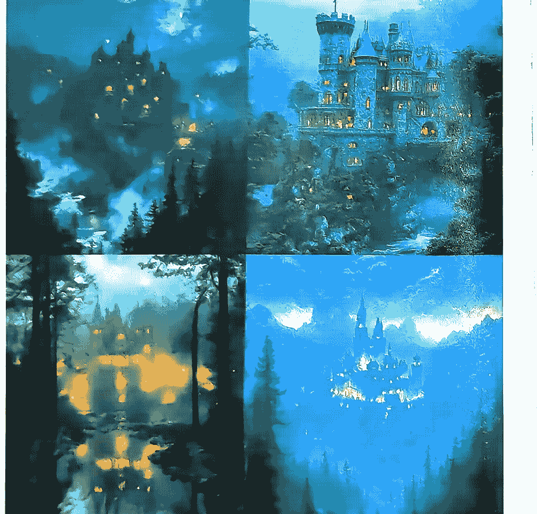

图 4-11 stylize 750 城堡

画面特征：

艺术化处理大幅提升，色彩、结构与氛围可能被夸张变形，创意性与视觉冲击力强，但与原描述的偏差也可能增大，适合允许大胆发挥的创意场景。

随着 --stylize 数值升高，画面会从写实逐渐转向艺术化与想象化，可根据项目需求选择合适区间或多尝试。

#### 4.3.4 stylize 参数推荐搭配应用场景

**4.3.4.1 写实还原与产品稿：0-100 区间**

当任务侧重高保真还原或强实用性，比如商品外观草图、写实原型推演，这时把 --stylize 压到低段位更合适。数值越小，模型越紧贴提示词里的细节，艺术化的偏移会被抑制，画面不容易跑偏或过度抽象。

**4.3.4.2 游戏动画与概念插画：200-500 区间**

要为游戏、动画产出带想象力的概念稿、角色设定或场景绘制，可把风格化幅度调到中高段。该区间既能释放创作空间，又不会让提示词被过度解读，写实与艺术化之间会保持一种平衡感。

**4.3.4.3 艺术表达与抽象创作：500-1000 区间**

以美术观感、抽象表现为主的创作，比如概念艺术、个人作品或强个性视觉，适合把 --stylize 拉到高段。数值上调后，模型会加大风格化处理，尝试更丰富的构图与色彩搭配，作品的创意张力与感染力也会随之提升。

按创作目标灵活切换 --stylize，就能在真实感与艺术表现之间自由穿梭。实操时建议多做数值对比，慢慢找到最契合项目调性与审美的区间。

#### 4.3.5 stylize 的联动玩法

单用 --stylize 已能改变画风，和其他控制项搭配则效果更立体。常见组合如下：

**4.3.5.1 与画面比例 --ar 共用**

选用宽屏或竖屏比例，例如 16:9、9:16 或 2:1，适合凸显宏大场景或人物的纵深感；再叠加较高的 --stylize，艺术化处理会更进一步。

示例：

> Spectacular glaciers, surrealistic style --stylize 600 --ar 16 : 9（图 4-12）。

（壮观的冰川，超现实主义风格。）

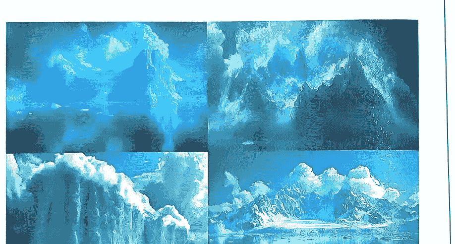

这一例用大场景宽屏配合高风格化，让寒冰与山脉的刻画更自由，呈现出波澜壮阔的史诗质感。

**4.3.5.2 与混沌度 --chaos 共用**

--chaos 越高，生成过程的随机性越强，色彩、构图与细节会更跳脱；和较高的 --stylize 叠加，能进一步放大艺术张力与多样性。

示例：

> Mysterious cosmic scenes --stylize 700 --chaos 50（图 4-13）。

（神秘的宇宙景象。）

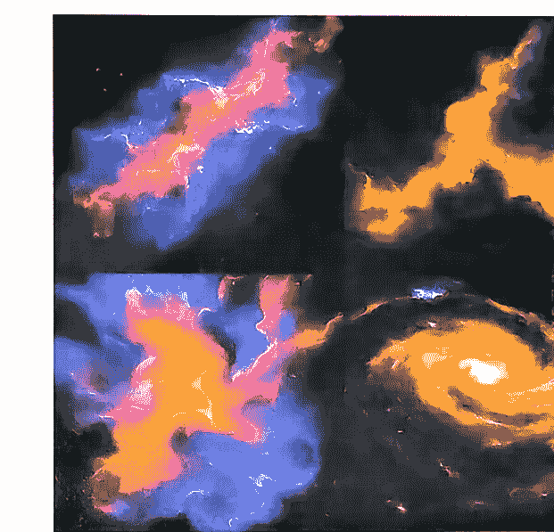

风格化与混沌度双重提升后，星空、星云、未知天体的描绘会更自由地探索多元色彩与幻想构图，画面充满神秘与艺术气息。

善用参数组合能让提示词的视觉个性与冲击力更强。建议依据项目需求与美学偏好反复试验，在对比中摸清最佳配合方式。

图 4-13 神秘宇宙生成图

#### 4.3.6 stylize 的边界与使用注意

--stylize 或 --s 能大幅影响艺术表现，但也有局限，理解后才能更精准运用。

**4.3.6.1 版本差异**

不同 Midjourney 版本的默认值与上限并不一致，使用前需确认版本特性。

V4 版本：上限通常为 1000，高数值增强风格化但可控性仍较强。
V5 及以上：上限进一步提高，艺术自由度更大，生成结果更具创意。

建议跨版本迁移参数时不要直接照搬，需按实际效果试验微调。

**4.3.6.2 数值过高会削弱精准度**

--stylize 达到 800 或 1000 时，风格化走向极端，画面艺术感增强，但易偏离提示，细节丢失、构图夸张。

示例：
- --stylize 50 → 更贴合描述，元素还原精准。
- --stylize 500 → 加入模型自主想象，更具艺术性，细节可能有出入。
- --stylize 1000 → 风格化极强，易完全偏离初衷，甚至走向抽象。

建议在需要精准把控视觉元素时避免过高数值，适度平衡创造力与提示准确性。

**4.3.6.3 不同需求的参数区间**

希望模型严格遵循提示，使用低值 50～100，保持构图与细节的精准，适用于：
- 商品设计、概念设计、写实风格，如 --stylize 50。
- 建筑、人物肖像、电影级场景，如 --stylize 100。

希望模型自由发挥、生成更具创意的艺术风格，可提升至 500～1000，适用于：
- 抽象艺术、概念插画、幻想场景，如 --stylize 700；
- 实验性视觉风格，强调自由演绎，如 --stylize 1000。

### 4.4 chaos 参数教学

#### 4.4.1 chaos 参数简介

--chaos 是影响图像生成随机性与多样性的关键控制项。数值偏低时，模型更稳重地按提示创作，四张图差异小、风格趋同；数值升高后，模型在构图与色彩上会做更激进的尝试，图像间差异明显放大。

通俗来说，chaos 就像调节模型的想象力与自由发挥程度。数值越高越可能在画面元素、细节或风格上出现突破；数值越低越注重稳定与一致，适合对风格或还原度要求高的场景。可按主题与效果灵活调节，在可控度与惊喜感之间取舍。

#### 4.4.2 chaos 参数的使用方法

语法如下：

/imagine prompt: 描述内容 --chaos 数值

取值范围通常为 0～100，示例：

**低随机性 0～10，默认：结果相对稳定，相似度高。**

```
/imagine prompt: Snow-capped mountains and lakes at sunset --chaos 10（图 4-14）。
（夕阳下的雪山湖泊 --chaos 10。）
```

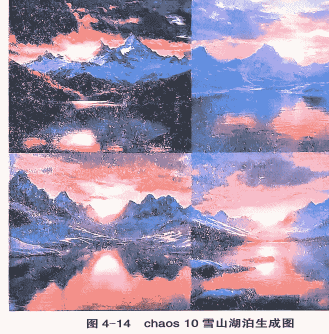

**中等随机性 20～50：图像出现一定差异，利于探索可能性。**

```
/imagine prompt: Snow-capped mountains and lakes at sunset --chaos 30（图 4-15）。
（夕阳下的雪山湖泊 --chaos 30。）
```


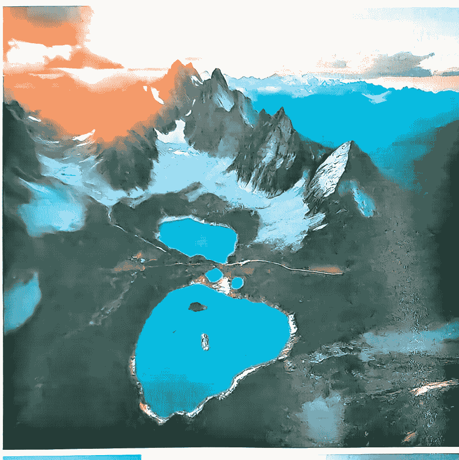

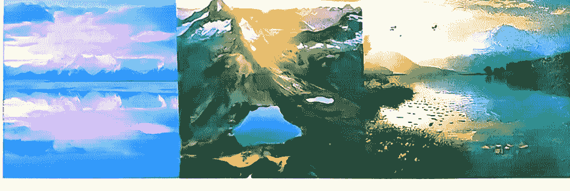

图 4-15 chaos 30 雪山湖泊生成图

**高随机性 60～100：四张图差异极大，创意性强，适合艺术探索。**

```
/imagine prompt: Snow-capped mountains and lakes at sunset --chaos 80（图 4-16）。
（夕阳下的雪山湖泊 --chaos 80。）
```

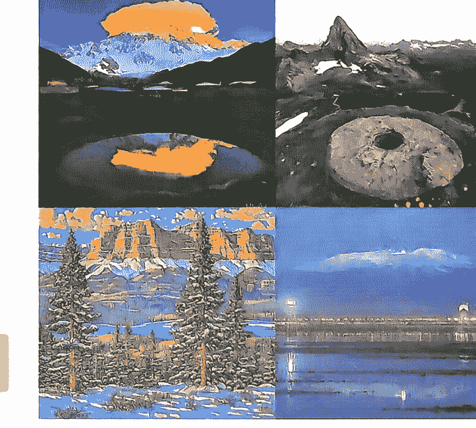

默认 chaos 为 0，意味着图像间差异最小。

#### 4.4.3 chaos 参数的实际应用场景推荐

**4.4.3.1 精确概念图设计 低 chaos 0～20**

商品外观、商标、包装等需要高度还原的任务，建议使用低值。此时模型更严格遵循提示，图像差异小，便于聚焦细节打磨。

**4.4.3.2 创意概念探索 中高 chaos 40～70**

希望在同一主题下获得多种视觉风格或角度，又不想脱离核心指令时适用。模型仍把握主干，同时在色彩、构图与细节上做适度变化，提供更多灵感。

**4.4.3.3 创意插画、灵感启发 高 chaos 70～100**

目标是最大化创造力，获取多元艺术表现，如抽象插画、个性化作品、头脑风暴灵感时使用。高 chaos 会让风格与元素差异更大，有时出现意外艺术表达，适合前期发散。

灵活调节 chaos，能在一致性与创意多样性之间找到平衡。

#### 4.4.4 chaos 与其他参数组合的技巧

**chaos 与 stylize 组合：** 两者皆高时，艺术感与多样性同步提升。

> /imagine prompt: A surreal space city --stylize 600 --chaos 60（图 4-17）。

（超现实主义的太空都市 --stylize 600 --chaos 60。）

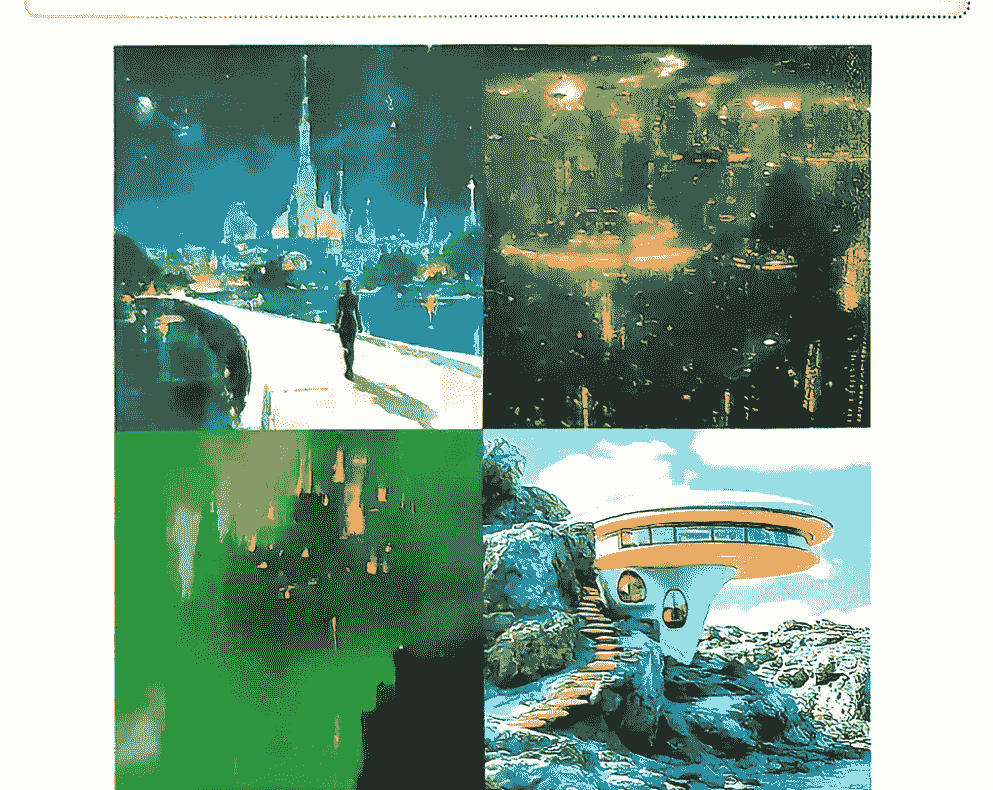

**chaos 与 aspect ratio 组合：** 宽幅或竖版画幅配合高 chaos，能产出丰富的视觉方案：

```
/imagine prompt: Cyberpunk futuristic street --ar 16:9 --chaos 50（图 4-18）。
（赛博朋克风格未来街道 --ar 16:9 --chaos 50。）
```

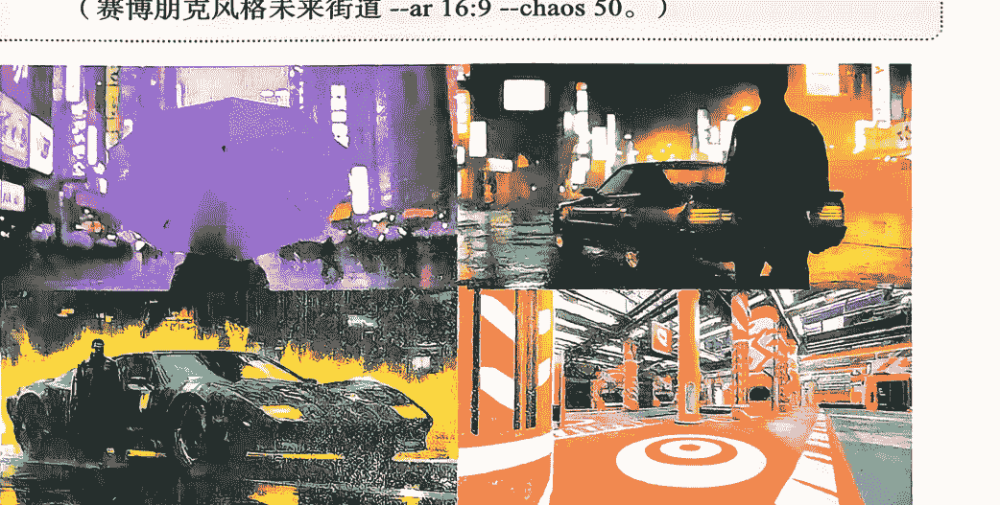

#### 4.4.5 使用 chaos 参数的技巧与注意事项

高 chaos 带来随机性与自由度，也要求更谨慎地配合其他要素，以保证可用性与风格统一。

**4.4.5.1 渐进式探索**

从低值开始逐步升高 chaos，观察模型随机创作范围。便于把握变化幅度，避免一上来就失控浪费资源。每档数值生成若干图，对比变化后再决定是否继续提升或精细化。

**4.4.5.2 chaos 与提示词细致度的关系**

chaos 提升后，提示词的约束力相对下降，需要更明确的描述来防止跑题。
高 chaos + 简单 prompt = 结果难以预料，易偏离主题。
高 chaos + 清晰细节描述 = 有针对性的创意发散。若想保留核心元素，可在 prompt 中强化主体、风格与关键元素，在自由度与方向性间取得平衡。

总之，chaos 扩大了可能性，也对提示词设计提出更高要求。通过渐进提升与合理约束，既能释放艺术想象，又能保持项目方向。

#### 4.4.6 Chaos 参数进阶建议与总结

chaos 是在“精确还原”与“创意爆发”之间搭建桥梁的利器。

**4.4.6.1 根据项目需求选择合适区间**
- 精准设计、写实需求：低 chaos 0～20
- 日常创作、平衡场景：中等 chaos 20～60
- 创意概念、艺术插画：高 chaos 60～100

明确目标后能更快定位合适范围，提升效率。

**4.4.6.2 关注提示词细节与 chaos 值的关系**

chaos 越高，离散度越大，若提示词简单易跑题。想兼顾随机与聚焦，需加入明确主体、场景限制与风格定义，让发散不偏离初衷。

**4.4.6.3 渐进探索与多次尝试**

先低后高设置，观察影响：

```
chaos 20 → chaos 40 → chaos 60 → chaos 80
```

每次提升后对比成品差异，逐步找到最能激发灵感的最佳区间。

**4.4.6.4 与其他参数综合运用**

chaos 可与 stylize、aspect ratio、quality 等搭配，图像既有创意张力，又保留风格层次与构图美感。掌握多参数联动，能进一步深化创作技巧。

合理使用 chaos 并配合清晰提示词规划，可在精确度与创意度间取得平衡，高效挖掘生成图像的潜能。

### 4.5 综合教学：Midjourney 中的高级参数

#### 4.5.1 quality --q 参数

--q 主要调节图像清晰度与细节级别。数值越高，细节越丰富，适合对画质要求极高的艺术或商业设计。但提升 quality 会增加资源消耗与处理时间，需按需求权衡。

例如生成复杂机械钟表的高细节图时，可提高 quality 以确保齿轮等微结构清晰：

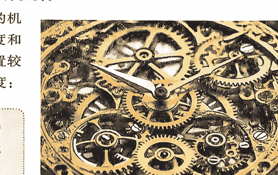

```
prompt:An intricate mechanical watch, showcasing its detailed inner mechanisms--q3 (图 4-19)。
（一个复杂的机械表，展示其详细的内部构造 --q3。）
```

示例中 quality 设为 3，内部机械的每个零件都呈现得很清晰，适合高质量展示或技术分析。

#### 4.5.2 tile --tile 参数

--tile 控制平铺效果，使图像边缘无缝衔接，形成可连续重复的图案。适用于壁纸、纺织品、重复纹样等设计，确保每块拼接处完美对接。

例如设计可大面积铺设的豪华地板瓷砖图案：

> prompt: Elegant geometric tile pattern for luxury flooring, seamless for large scale installation--tile （图 4-20）。

（优雅的几何瓷砖图案用于豪华地板，无缝用于大型安装 --tile。）

#### 4.5.3 seed --seed 参数

--seed 控制随机性，通过固定 seed 值，可在相同提示词与参数下复现完全相同的图像。这对微调、复现特定结果及保持系列作品视觉一致性非常重要。

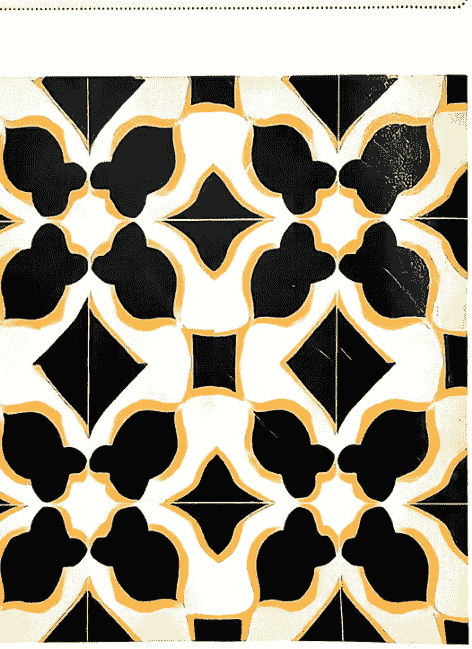

若想重现特定幻想风景并在不同时间保持一致的视觉效果，可使用 seed 参数：

```
prompt:A fantasy landscape with floating islands and cascading waterfalls --seed 8675309（图 4-21）。
（有浮动岛屿和瀑布的梦幻景观 --seed 8675309。）
```

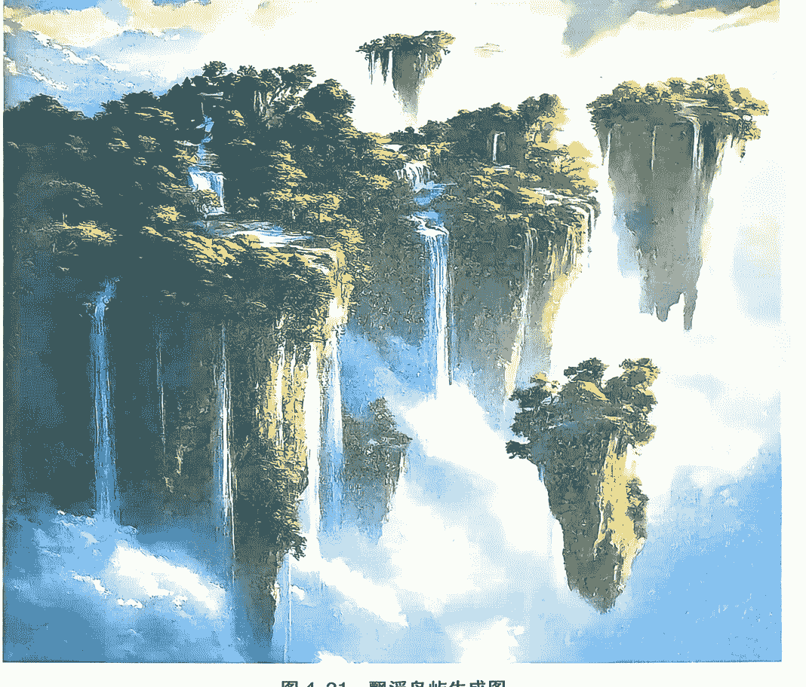

图 4-21 飘浮岛屿生成图

该演示选用种子值 8675309 作为固定参数，只要提示词和设置保持不变，反复生成的画面都会呈现高度可复现的结果，这对于需要成系列输出或维护品牌视觉统一性的项目尤为关键。

#### 4.5.4 参数的综合应用

Midjourney 的画面丰富度很大程度上来自参数之间的配合。举例来说，针对自然景观类主题，提升 quality 参数能让成图整体更通透，细节纹理亦更饱满；若同时使用固定的 seed，就能在提升质感的同时锁住系列画面的风格连贯性。此种做法既强化了艺术表现力，也让创作过程更可控、结果更可预期，便于项目稳定实现预期的视觉效果。

精细化地调节各项参数，可以在视觉美感追求与创作意图表达之间取得平衡，让创意与技术相互促进。

## 5 提示词进阶

### 5.1 视觉设计的要点

在 Midjourney 的提示编写中，视觉设计的把控是影响成图质量与创意上限的核心。掌握关键要点后，才能更有效地引导模型生成理想画面。

#### 5.1.1 清晰的视觉目标

鲜明具体的视觉诉求是设计的基础，提示需要准确传达想要呈现的核心主体或场景。

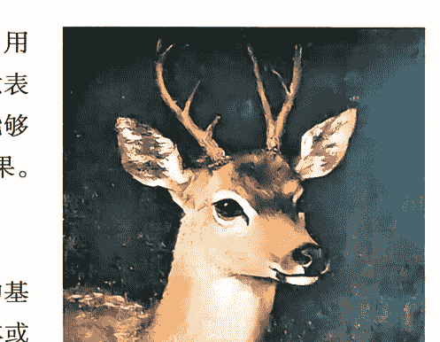

建议将主体特征描述得更具体，避免笼统概括。

示例：

> A deer（图 5-1）。

> （一只鹿。）

> A buck wearing a crown in the forest（图 5-2）。

> （森林中一只戴皇冠的雄鹿。）

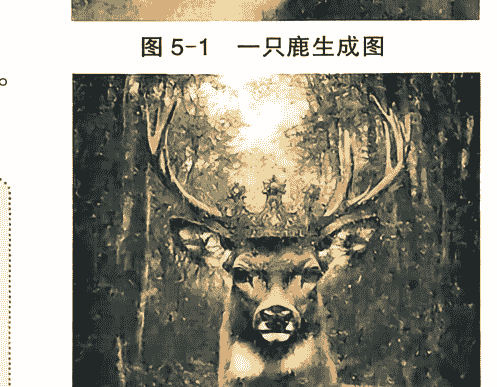

对环境或场景的具体细节进行刻画，比如“黄昏时刻的城市街道，灯光朦胧”。

示例：

> The street of the ancient town after the rain, lights reflected on the wet SLATE pavement（图 5-3）。

（雨后的古镇街道，灯光映在湿润的石板路面上。）

The street of the ancient town after the snow, the snow piled up on the SLATE pavement（图 5-4）。

（雪后的古镇街道，积雪堆积在石板路面上。）

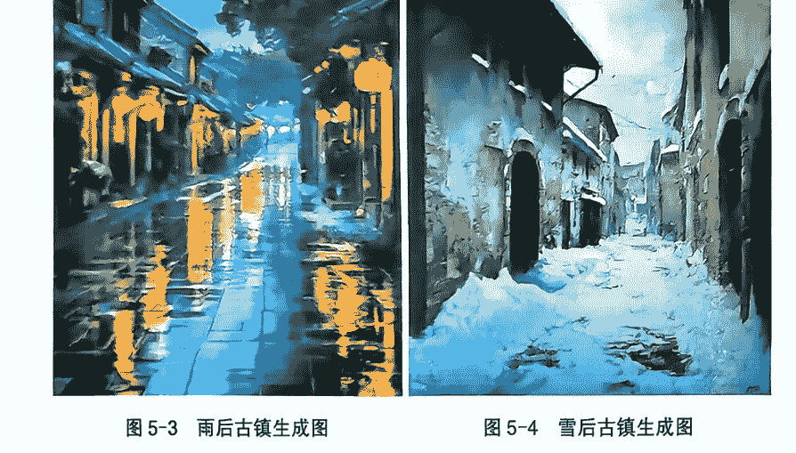

#### 5.1.2 精确的构图描述

构图直接左右画面的观感与表现张力。优秀的提示应包含构图方式与整体布局。

可引入构图专有名词如三分法、中心对称、黄金分割，以凸显画面平衡与层次。

同时需说明视角与焦距，例如“鸟瞰视角的城市景观”“微距拍摄的露珠”。

示例：

> A tropical rainforest from above（图 5-5）。

（俯视视角下的热带雨林。）

Butterfly shot in macro（图 5-6）。

（微距拍摄的蝴蝶。）

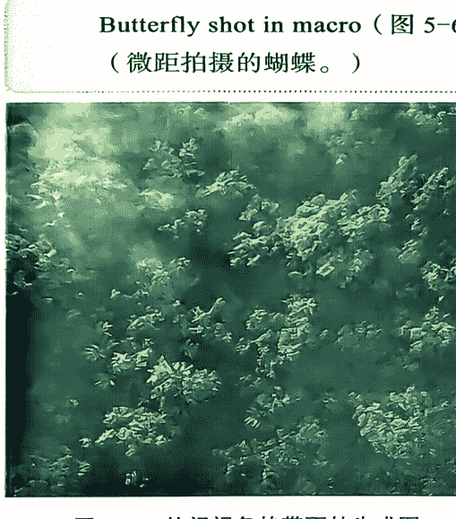

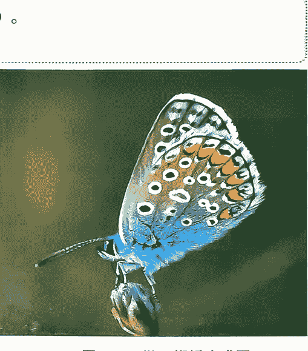

#### 5.1.3 色彩与情绪表达

色彩取舍直接决定氛围基调与情感传达。暖色系易营造温馨舒适感，冷色系则偏向冷静或神秘。借助互补色、邻近色、单色调等色彩原理，能更精准地表达情绪。

示例：

> City night scene with complementary colors orange and blue（图 5-7）。

（互补色橙色与蓝色搭配的城市夜景。）

Monochromatic city night scene（图 5-8）。

（单色调搭配的城市夜景。）

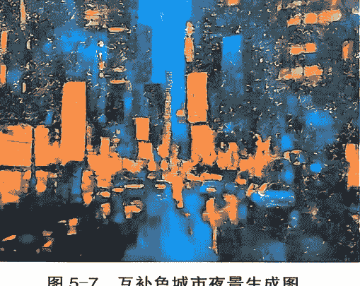


图 5-8 单色调城市夜景生成图

#### 5.1.4 光影设计

光影不仅丰富视觉层次，也能增强真实感与艺术氛围。需要明确光源种类，如自然光、人工光，并描述光线方向与强弱，例如“清晨柔和的侧面自然光”“落日晚霞”。突出阴影细节，可有效提升立体感。

示例：

> The stark shadows cast by buildings in bright daylight（图 5-9）。

（明亮日光下建筑物投射的鲜明阴影。）

Striking shadows cast by buildings in the setting sun（图 5-10）。

（落日晚霞下建筑物投射的鲜明阴影。）


#### 5.1.5 纹理与质感表达

细腻的材质与纹理能显著提升真实度。可明确点出物体表面的特征，如玻璃反光、丝绸般顺滑、粗糙、光滑、金属质感、柔软等，以增强细节与触感。

示例：

> Smooth and translucent vase surface（图 5-11）。

（光滑而透亮的花瓶表面。）

Metallic tableware（图 5-12）。

（金属质感的餐具。）


图 5-12 金属餐具生成图

#### 5.1.6 风格化与个性化

风格化有助于凸显图像的独特艺术个性。可在提示中指明艺术流派，如印象派、赛博朋克、复古风格，或给出具体艺术家与作品作参考。也可强调表现手法，如漫画风、电影感、油画质感，以提升辨识度。

示例：

> A black and white urban street scene with a cinematic feel( 图 5-13 )。

（具有电影感的黑白都市街景。）

An urban street scene with comic book style（图 5-14）。

（具有漫画风格的都市街景。）


### 5.2 风格提示词

风格关键词在 Midjourney 中起到定调作用，不同词会带来截然不同的色彩氛围、笔触质感与视觉表现。合理运用能让画面更贴合个人审美与项目定位，同时提升艺术价值与吸引力。

艺术流派与技法关键词示例：

watercolor（水彩）、oil painting（油画）、pencil sketch（铅笔素描）、impressionist（印象派）、surrealism（超现实主义）、baroque（巴洛克）。

应用场景：当你希望突出绘画质感或历史审美特征时，可在提示中注明对应流派或画法，AI 便会尽量模拟该流派的色彩、笔触与细节。

摄影风格关键词示例：

cinematic（电影感）、film photography（胶片摄影）、portrait photography（人像摄影）、street photography（街头摄影）、macro shot（微距摄影）。

应用场景：若想让生成图像具备更真实或专业的摄影氛围，可加入摄影风格词，例如“cinematic lighting”“film grain”。模型会据此模拟镜头语言、光影与色调。

现代设计风格关键词示例：

minimalist（极简主义）、flat design（扁平化设计）、futuristic（未来主义）、cyberpunk（赛博朋克）、vaporwave（蒸汽波）。

应用场景：创作项目偏向潮流视觉或概念设计时，可选择现代设计风格作为关键词，让 AI 输出具有相应配色与构图特色的图像。

影视与漫画风格关键词示例：

anime style（动漫风格）、comic book style（美式漫画风格）、pixar style（皮克斯动画风格）、noir（黑色电影）。

应用场景：若想让人物更具动画感或漫画夸张表现，可使用此类风格词。它能引导 AI 采用相应轮廓线、色彩构成，以及电影化的对比度或阴影氛围。

通过为相同主体添加不同风格关键词，可快速生成多元版本，便于在短时间内完成风格比较与挑选。无论追求沉浸式真实，还是艺术化冲击，灵活运用风格提示词都能让创作更进一步。

#### 5.2.1 艺术风格类提示词

艺术风格词通常对应艺术史上的经典流派，通过这些词汇可引导 AI 生成特定风格的画面。

印象派（impressionism）

强调光线与色彩变化，注重即时视觉感受，画面明亮、边缘柔和。

示例：

> Impressionism style,sunlight filtering through trees onto a garden（图 5-15）。

（印象派风格，穿过树梢洒落于花园的阳光。）


图 5-15 印象派阳光花园生成图

超现实主义（surrealism）

偏好梦幻、离奇的画面组合。

示例：

> Surrealistic scene of floating islands with waterfalls flowing downwards in the sky（图 5-16）。

（超现实主义场景，飘浮的岛屿，瀑布自天空倾泻。）


图 5-16 超现实主义岛屿生成图

蒸汽朋克风格（steampunk）

强调工业时代的复古科技感，融合复古与未来元素。

> Steampunk-style mechanical cityscape with brass gears and steam-powered vehicles（图 5-17）。

（蒸汽朋克风格，充满黄铜齿轮与蒸汽动力交通工具的城市景观。）


图 5-17 蒸汽朋克城市生成图

#### 5.2.2 绘画技法类提示词

绘画技法相关的提示词，能清晰表达所需艺术效果与质感细节。

油画技法（oil painting）

强调细腻厚重的质感。

示例：

> Portrait of a young woman, oil painting technique, visible brushstrokes（图 5-18）。

（年轻女性肖像，油画技法，明显笔触质感。）


水彩技法（watercolor）

呈现淡雅柔和的画面效果。

示例：

> Mountain landscape with watercolor technique, gentle blending of colors（图 5-19）。

（山水风景，水彩技法，色彩柔和渐变。）

#### 5.2.3 地域文化风格类提示词

在提示中加入不同地域文化的艺术元素，能有效再现其视觉特征。

东方传统风格（traditional East Asian style）

强调古典、诗意与简洁构图。

示例：


> Traditional Chinese landscape painting, ink and wash style, mountains and rivers（图 5-20）。

（中国传统山水，水墨画风格。）


北欧风格（Nordic style）

强调简约、清新、舒适的设计感。

示例：

> Nordic style interior,minimalist design,neutral colors and wooden textures（图 5-21）。

（北欧风格室内设计，极简主义风格，中性色调搭配木质纹理。）


图 5-21 北欧极简室内设计生成图

#### 5.2.4 特定时代与复古风格提示词

特定历史时期与复古风格的提示词，有助于生成怀旧氛围的图像。

维多利亚风格（victorian-style）

强调19世纪欧洲典雅华丽的特点。

示例：

> Victorian-style tea room with floral wallpaper and vintage furniture( 图 5-22 )。

（维多利亚风格茶室，花卉壁纸与复古家具。）


20 世纪 80 年代复古风（1980s retro）

强调鲜艳色彩、霓虹灯光、怀旧感十足的视觉效果。

示例：

> 1980s retro neon cityscape, vibrant colors and neon lights（图 5-23）。

（20 世纪 80 年代复古风格，明艳色调与霓虹灯光中的城市夜景。）

#### 5.2.5 特定媒体与技术风格提示词

通过明确媒介形式或技术特征，引导 AI 创作出符合特定表现形式的图像。

电影感镜头（cinematic shot）

强调具有电影质感与构图特点的视觉效果。

示例：

> Cinematic shot of a rainy city street, dramatic lighting and blurred background（图 5-24）。

（电影感镜头，雨中城市街道，戏剧化光影效果，模糊背景。）


像素艺术风格（pixel art）

强调低分辨率、像素化的怀旧感。

示例：

> Pixel art style medieval village with simple geometric shapes（图 5-25）。

（像素艺术风格的中世纪村庄，几何形状构成。）


#### 5.2.6 混合风格提示词

融合两种或以上不同艺术风格或表现形式，创造独特且富有表现力的视觉效果。

超现实+印象主义（surrealistic+impressionist）

示例：

> Surrealistic impressionist landscape with melting clocks and dreamy pastel colors（图 5-26）。

（超现实主义与印象派风格融合的风景，融化的时钟与梦幻般的柔和色调。）


图 5-25 像素风格村庄生成图

图 5-26 超现实主义印象派风景生成图

水墨与科幻风格融合（ink-wash+sci-fi）

强调传统与未来感并存的奇妙视觉效果。

示例：

> Traditional ink-wash painting style, a futuristic city floating among clouds（图 5-27）。

（传统水墨风格融合科幻元素，飘浮的未来城市景观。）


图 5-27 水墨风科幻元素生成图

#### 5.2.7 艺术家与创作群体风格提示词

参考特定艺术家或创作团体的风格，便于精准再现其典型视觉特征。

梵高风格（Van Gogh-style）

强调强烈的笔触、丰富的色彩与独特的线条。

示例：

> Van Gogh-style painting of a starry night landscape, swirling vibrant colors（图 5-28）。

（梵高风格，强烈笔触的星空夜景。）


图 5-28 梵高风格星空夜景生成图

宫崎骏动画风格（Studio Ghibli-style）

强调温暖、细腻、富有情感的动画风格。

示例：

> Studio Ghibli-style fantasy forest, gentle lighting and whimsical creatures（图 5-29）。

（吉卜力工作室风格的幻想森林，柔和灯光和奇妙生物。）


图 5-29 宫崎骏动画风格生成图

# 6 DeepSeek 助力 Midjourney 创作升级

## 6.1 中文意图向英文提示的精准转化

Midjourney 虽然能读取多种语言输入，但模型训练主体以英文为主，直接用中文描述容易产生语义偏差和细节丢失。把中文描述交给 DeepSeek 进行专业转写，指令会更清晰，成图的掌控度与质量也会明显提升。

### 6.1.1 英文提示的关键作用

把创作想法完整地转成英文，是提高出图上限的核心。带来的收益主要体现在三方面：

#### 6.1.1.1 成图更贴近想象
主题、风格、配色、氛围一旦被准确表达，模型绘制时就会更接近创作者的原意，因歧义造成的偏差会大幅减少。

#### 6.1.1.2 视觉质感更显专业
提示中加入艺术化表达与专业术语，经过准确转写后，Midjourney 在构图、笔触和细节处理上会呈现更高水准。

#### 6.1.1.3 调试成本明显降低
翻译越精确，试错次数越少，首轮结果更容易命中预期，节省反复修改的时间，效率随之提高。

### 6.1.2 高质量英译的两阶段操作

**第 1 步 拆解原文的核心要素**
把中文描述拆成可执行维度：主体特征、场景氛围、风格指向、技术参数。
中文示例：一位身着传统服饰的少女立于樱花树下，微风拂过花瓣缓落，整体柔美浪漫，日系插画风。
拆解后：人物为少女，传统服饰；动作与环境为站立、微风、花瓣飘落；风格为柔美浪漫、日系插画。

**第 2 步 让 DeepSeek 生成适配 Midjourney 的英文**
把原文输入并明确要求输出适配版本，强调使用地道英文表达、突出风格与视觉细节、保持专业流畅。
示例对话：
> 问：
帮我优化提示：少女身穿传统服饰站在樱花树下，微风拂过，樱花花瓣飘落，画面风格为浪漫柔美的日系插画风。
DeepSeek：
A young girl dressed in traditional costumes is standing beneath a cherry blossom tree as petals gently drift down with a soft breeze, rendered in a delicate, romantic Japanese illustration style.（本例中 Midjourney 生成作品如图 6-1 所示。）


图 6-1 日系插画少女生图

### 6.1.3 提升转译精准度的三个技巧

#### 6.1.3.1 选用明确的风格关键词
风格词越具体，模型把握越准，要避免模糊表述。
示例：
> 问：
“蒸汽朋克风格的机械鸟”提示词。
DeepSeek：
Steampunk-style mechanical bird with intricate gears and metallic textures.（本例中 Midjourney 生成作品如图 6-2 所示。）


图 6-2 蒸汽朋克机械鸟生成图

#### 6.1.3.2 强化可视细节
转写时要明确材质、光影、视角等要素。
可强调材质如 metallic、soft、glossy；光影如 backlit、soft lighting；视角如 close-up、wide-angle、macro。
示例：
> 问：
“晨雾中的山脉和湖泊，安静祥和”的画面提示词。
DeepSeek：
Misty mountains by a tranquil lake at dawn, soft morning light, peaceful and serene atmosphere.

#### 6.1.3.3 引入艺术设计专业用语
借用构图、风格、技法等英文术语能让指令更精确。
如构图 golden ratio、symmetrical composition；风格 minimalism、abstract expressionism；技法 impasto technique、digital matte painting。
示例：
> 问：
“使用黄金比例构图的城市天际线风景”的画面提示词。
DeepSeek：
City skyline landscape composition using the golden ratio, emphasizing visual harmony and balance.

### 6.1.4 三个转译实操案例

示例 1：
> 问：
“秋日清晨森林中的小木屋，周围薄雾缭绕，温暖柔和的日光洒落在草地上”的画面提示词。
DeepSeek：
A cozy wooden cabin in an autumn forest at dawn, enveloped by soft mist and gentle golden sunlight.（本例中 Midjourney 生成作品如图 6-3 所示。）


图 6-3 森林木屋生成图

示例 2：
> 问：
繁星闪烁的夜空下，一艘孤独的小船漂浮在平静的湖面上，画面带有梦幻感和神秘氛围。
DeepSeek：
A solitary boat is floating gently on a serene lake beneath a starlit night sky, evoking a dreamy and mysterious atmosphere.（本例中 Midjourney 生成作品如图 6-4 所示。）


图 6-4 星空下的小船生成图

示例 3：
> 问：
未来都市景观，霓虹灯光与全息投影交织，风格为赛博朋克。
DeepSeek：
Futuristic cyberpunk cityscape illuminated by neon lights and vibrant holographic projections. (本例中 Midjourney 生成作品如图 6-5 所示。）


图 6-5 赛博街景生成图

### 6.1.5 上手要点
借助 DeepSeek 做转写能显著提升 Midjourney 的命中率与艺术表达。实践中注意：语言保持简洁清晰，突出关键词与视觉重点，善用英文艺术设计术语，并通过不断试错积累经验。

## 6.2 让 DeepSeek 参与画面构思

在 Midjourney 创作中，构思与描述往往决定成败。面对空白输入框时，DeepSeek 能把模糊想法扩展成完整方案，让流程更顺畅。

### 6.2.1 借助 AI 构思的价值
DeepSeek 能够迅速捕捉基础构想，并给出专业的画面建议，包括元素搭配、风格定位与表现手法，明显降低构思门槛，提升成图效率。
示例：
> 问：
我想创作一幅充满治愈感的乡村风景。
DeepSeek：
初夏的乡村田野，一条狭长的土路延伸至远方，路旁开满色彩柔和的野花，柔和的晨光穿过薄雾，画面整体氛围温暖宁静，浪漫且轻盈的印象派油画风格。
问：
请把上面的文本转化为英文提示词。
DeepSeek:
英文版提示词：
Romantic impressionist oil painting style, serene countryside scene at early morning, a narrow dirt path surrounded by colorful wildflowers, soft morning sunlight filtering through thin mist, warm and peaceful atmosphere.（本例中 Midjourney 生成作品如图 6-6 所示。）


图 6-6 DeepSeek 优化生成图

### 6.2.2 设计理想画面的三步法

**第 1 步 明确初步构想**
无需细节齐全，把主题、情绪或核心元素说清楚即可。
初步构想示例：“我想要描绘一个充满神秘氛围的森林景观。”

**第 2 步 获取 DeepSeek 设计方案**
DeepSeek 会给出详细描述：“一片茂密的原始森林，月光穿透树冠在地面形成斑驳的光影，画面中央有一座古老的废弃神殿，神殿周围有萤火虫飞舞，氛围神秘而梦幻。”转成英文即可使用：Dense primeval forest illuminated by moonlight filtering through trees, abandoned ancient temple at the center, fireflies drifting gently around, mysterious and enchanting atmosphere.

**第 3 步 完善画面细节**
在初稿基础上继续细化。
> 问：
请加入一些神秘生物元素，进一步增强画面的奇幻氛围。
DeepSeek：
在神殿的阴影处隐约可见若干神秘的幽灵般半透明生物，它们的身躯泛着淡蓝色光晕，若隐若现地环绕神殿飞舞，使整体氛围更加神秘且充满奇幻色彩。
问：
请把上面的文本转化为英文提示词。
DeepSeek：
> Mystical forest scene in the moonlight with an ancient abandoned temple surrounded by gently glowing, ethereal ghostly creatures floating gracefully, enhancing the mysterious and fantasy-like atmosphere.（本例中 Midjourney 生成作品如图 6-7 所示。）


图 6-7 DeepSeek 优化生成图

### 6.2.3 实战演示

#### 6.2.3.1 未来科技城的提示词升级
> 问：
我想要一幅充满未来感的高科技城市画面，请设计具体提示词。
DeepSeek：
未来感十足的城市，天际线上布满摩天大楼和空中花园，街道上空悬浮着流线型的交通工具，夜景中霓虹灯光和全息投影交相辉映，风格为高科技科幻与赛博朋克相融合，色彩丰富且充满未来科技感。
问：
请把上面的文本转化为英文提示词。
DeepSeek:
High-tech futuristic cityscape at night with skyscrapers, aerial gardens, streamlined floating vehicles, vibrant neon lights and holographic projections, creating a cyberpunk sci-fi atmosphere.

#### 6.2.3.2 调整前后对比
调整前（简单版）：Futuristic city at night, technological style.（图 6-8）


图 6-8 未来科技城市优化前生成图

调整后（DeepSeek 设计的详细版）：Futuristic cyberpunk cityscape at night, featuring skyscrapers, floating vehicles, vibrant neon lights and holographic projections, creating a visually rich high-tech atmosphere.（图 6-9）


图 6-9 DeepSeek 优化后未来科技城市生成图

详细版提示词更具体生动，成图质量明显提升。

#### 6.2.3.3 提升构思效率的三个习惯
1. 准确传达创意：用清晰易懂的基础语言描述需求，避免含糊。
2. 逐步细化要求：在初稿基础上提出更多细节，逐步逼近理想画面。
3. 善用 AI 反馈优化：对比不同方案，反复交流调整，让结果更贴合想象。

## 6.3 把 AI 引导为合格提示词

提示词质量直接决定 Midjourney 输出效果。利用 DeepSeek 能把模糊想法整理成合格提示。

### 6.3.1 合格提示词的标准
合格提示应包含清晰的主体描述、确定的视觉风格与氛围、精准的构图与细节信息。DeepSeek 能协助补齐这些要素。
基础且模糊的例子，生成图如图 6-10 所示。


> A night scene at the castle.

（一座城堡的夜晚场景。）

图 6-10 夜晚城堡生成图

### 6.3.2 引导 DeepSeek 输出合格提示

引导时用简洁清晰的语言描述想象场景即可，DeepSeek 会补充关键信息并生成完整描述。
示例：
> 问：
一座未来风格的沙漠城市，建筑以圆滑流畅的曲线设计为主，拥有巨大的玻璃穹顶，周围是广阔的沙丘，阳光强烈且鲜明，整体风格呈现未来主义与生态建筑融合的视觉特征。请强化场景的高科技元素。
DeepSeek：
沙漠中的未来城市，曲线形建筑群覆盖着巨大的透明穹顶，内部充满绿色植物与悬浮式交通工具，远处沙丘上耸立着太阳能电池板阵列，整体散发出明显的高科技氛围，视觉风格写实而富有未来感。
问：
请把上面的文本转化为英文提示词。
DeepSeek：
Futuristic desert city with curved architectural structures beneath expansive transparent domes, abundant greenery, floating transportation vehicles, strongly emphasizing advanced technological elements such as transparent glass structures and holographic solar panels, realistic sci-fi visual style.

（Midjourney 生成作品如图 6-12 所示。）


图 6-12 DeepSeek 优化后沙漠城市生成图

### 6.3.3 提示词精进打磨策略

DeepSeek 初次给出的一版描述只是起点，后续还可以从更细的维度继续打磨。下面先以构图为例说明迭代思路：

> 问：
请使用黄金比例进行构图。

DeepSeek:

Futuristic desert cityscape with transparent domes and lush interior vegetation, structured according to the golden ratio composition, enhancing visual harmony and balance, realistic sci-fi style with holographic elements.

接着可以补充色彩、氛围与质感层面的具体要求，示例如下：

> 问：
色调以暖色为主，体现柔和而梦幻的氛围。

DeepSeek:

Warm-toned futuristic desert city beneath transparent domes, abundant lush greenery illuminated by soft golden sunlight, creating a dreamy and harmonious sci-fi atmosphere, golden hues dominating the visual palette.

这种往复对话的打磨节奏，能让指令的完整度与可控性逐步提升。

### 6.3.4 多轮对话实战演示

下面用一个完整流程来展示：

> 问：
我想设计一幅以赛博朋克为风格的街景。

DeepSeek:

Cyberpunk-themed city street at night, illuminated by neon signs, crowded with diverse futuristic pedestrians, rain-slicked pavement reflecting vibrant lights.

问：
我想增加雨后潮湿的质感，并强调画面的电影感。

DeepSeek：

Cyberpunk city street after rain at night, reflections of neon lights shimmering on wet pavement, pedestrians in futuristic attire walking under umbrellas, cinematic visual style emphasizing dynamic perspective and atmospheric glow.

经过数轮补充，描述变得更饱满、更精准，能够直接驱动 Midjourney 产出目标画面（如图 6-13）。


图 6-13 DeepSeek 优化后街景生成图

### 6.3.5 使用要点与收束

借助 DeepSeek 得到可用指令的关键，是先把自己的初想讲清楚，再在模型回应的基础上不断收敛需求、细化细节。可以把这一过程理解为人机协作创作：模型负责提供专业且准确的画面方案，设计者则在此基础上持续打磨，最终得到更满意的图像结果。

熟悉本节方法后，就能更顺畅地调用 DeepSeek 获取专业、精准、贴合预期的提示词，从而明显提升 Midjourney 的创作表现与效率。

# 第 3 部分
# 7 Midjourney 海报设计实战

## 7.1 极简主义海报设计方法

极简主义诞生于上世纪中期的现代艺术浪潮，核心主张是“少即是多”。在海报场景里，它常用于商业传播、公益倡导、文化展示。画面简洁利落、信息突出、结构克制，让它成为传递重点信息、营造高级现代感的理想选择。

Midjourney 对艺术风格有较强的理解与再现能力，配合合理的提示词设定，即使是设计新手也能快速产出兼具艺术性与实用性的极简海报。

### 7.1.1 极简主义风格的核心特质

极简在视觉上追求精准、克制、纯粹，主要体现在以下三点：

#### 7.1.1.1 简约性
剔除所有非必要的视觉元素，只保留信息最核心的部分。图形、色彩、文字都以极简形式呈现，避免冗余，使视觉焦点更集中。

#### 7.1.1.2 明确性
信息传递迅速高效，观者能在很短时间内把握画面主旨。通常以清晰的主题符号为主，配合大面积留白引导视线，让核心信息自然凸显。

#### 7.1.1.3 张力感
元素虽少，却能通过对比、留白、线条与空间布局的精确控制，产生强烈视觉冲击与艺术张力，让画面更具深度与品味。

### 7.1.2 提示词搭建步骤与示例
**第 1 步 确定海报主题（subject）**
先明确核心议题，比如环保、公益、品牌、科技等，有助于锁定主体符号。示例：

> Minimalist poster, green leaves symbolizing environmental protection

（图 7-1）。

（极简主义海报，以绿色叶子象征环保。）

这里的“green leaves”承担主视觉，“minimalist poster”则引导风格走向极简。

**第 2 步 强调构图与布局（composition）**
极简海报重视构图的合理性与美感，常见居中、对称、大面积留白来建立平衡清爽的结构。示例：


> Minimalist poster, single green leaf centered on white background, large empty space--ar 3 : 4 (图 7-2)。

（极简主义海报，单片绿色叶子居中于白色背景上，大量留白。）

这类构图形成强烈视觉焦点，让目光迅速集中，同时传递克制高级的设计语言。

**第 3 步 优化色彩搭配（color scheme）**
极简常使用低饱和度、单色系或互补配色，通过简化统一突出主体与背景对比。示例：

> Minimalist environmental poster, single green leaf, white background, simple color scheme--ar 3 : 4 (图 7-3)。

（极简环保主题海报，单一绿叶，与白色背景搭配。）

搭配清新明亮，兼具现代感与自然感，适合环保、健康、平衡等主题。

**第 4 步 调整视觉细节（visual refinement）**
虽重简洁，适当的细节如阴影、质感、光感能提升质感与空间感。示例：

> Minimalist poster, single green leaf with subtle shadow effect on white background, clean modern design--ar 3 : 4 (图 7-4)。


> （极简主义海报，单片绿色叶子，带有柔和阴影，背景为白色，设计风格现代、清爽。）

阴影处理不破坏极简结构，却赋予画面立体感与精致度，提升真实感与艺术性。

### 7.1.3 极简海报提示词整合示例
把前面的要素融合，形成完整提示词：


> Minimalist environmental awareness poster, simple green leaf icon centered on white background, subtle shadows, clean typography, minimal use of color, modern and sleek design--ar 3 : 4（图 7-5）。

（极简主义环保主题海报，中心为一片绿色叶子图标，背景白净，带有柔和阴影，字体简洁，色彩极少，整体风格现代简约。）


该提示词涵盖主题、构图、色彩、细节与字体等多维信息，便于 Midjourney 在保持极简美学下生成高质量图像。

### 7.1.4 极简海报提示词应用要点汇总
表 7-1 极简主义海报提示词应用要点总结

| 分类 | 应用建议 |
| :--- | :--- |
| 主体清晰明确 | 选用单一、具体、易识别的视觉符号（如叶子、心形、地球、光环等）承载核心概念 |
| 布局留白充足 | 推荐居中或对称布局，画面四周保留大面积空白，突出焦点并增强呼吸感 |
| 色彩简洁协调 | 控制在 1～3 种色彩内，避免冲突。常用配色有绿+白、黑+红、蓝+灰等 |
| 细节精炼提质 | 在简约结构中加入柔和阴影、细腻纹理或玻璃质感，提升高级感与现代感 |
| 字体排版清爽 | Midjourney 对文字控制有限，可在提示中加入“clean typography”引导风格，必要时后期手动补字 |

### 7.1.5 极简风格的优势与创作建议
#### 7.1.5.1 提升传达效率，快速锁定焦点
极简强调减法设计，剔除冗余，只保留核心信息与图形，使观众第一时间捕捉视觉中心与主题，适合广告、产品宣传、主题教育等对信息准确性要求高的场景。

#### 7.1.5.2 营造现代感与高级感
干净、克制、结构清晰的特质，使其广泛应用于高端品牌、设计展、文化传播等需要专业品位的项目，通过色彩与空间的控制呈现国际化审美。

#### 7.1.5.3 降低创作难度，提高执行效率
图像元素少、逻辑明确，在 Midjourney 中使用门槛更低，节省时间，适合快速交付、频繁调整或批量生产的日常视觉需求。

#### 7.1.5.4 适配多终端，易于延展
极简设计在手机屏、网页横幅、社交封面、印刷品、电子广告牌等媒介上均有良好适应性，配合合理宽高比可实现多终端统一输出。

#### 7.1.5.5 激发观者思考与参与
大量留白与弱化叙事会促使观者主动联想图像与主题的关系，提升关注度与记忆点，特别适用于公益、环保、哲学等需要共鸣的主题。

#### 7.1.5.6 文字建议后期细化
因 Midjourney 对文字排版控制较弱，建议生成后使用 Photoshop、Figma、Canva 等工具二次加工，补充字体与层级，以保证信息传达的专业度。


图 7-6 极简海报

## 7.2 复古拼贴风海报设计
复古拼贴风融合复古图像、印刷质感与手工拼贴效果，常用于艺术设计、品牌广告与文化活动。作品视觉冲击强、怀旧感浓，通过旧报纸、老照片、复古人物、自然纹理等元素的重组，形成超现实或趣味性画面。

借助 Midjourney 的图像组合与风格识别能力，只需合理编排提示词即可快速生成具有浓厚拼贴美学特征的视觉作品。

### 7.2.1 复古拼贴的视觉特征
该风格并非简单叠加复古与拼贴，而是结构上的融合，具体表现为：

#### 7.2.1.1 材质与纹理感
常出现纸张、胶带、撕裂边缘、老式印刷网点等质感，呈现手工制作与时间沉淀交织的语言。

#### 7.2.1.2 元素混合
打破真实逻辑，将人物、动植物、几何图形、天体、器物等非现实叠加，呈现超现实或荒诞感。

#### 7.2.1.3 复古色调
以褪色黄棕、胶片颗粒、柔和对比为主，带来翻阅旧杂志或观看老电影的怀旧体验。

#### 7.2.1.4 不对称构图
有意打破常规秩序，通过不对称排布制造视觉张力，强化拼贴的随性与痕迹感。

### 7.2.2 提示词构建步骤与示例
**第 1 步 设定创作主题**
明确海报核心议题或情感方向，如怀旧时尚、环保、未来与过去对比等。示例：

Vintage collage poster, retro woman holding flowers, surreal style--ar 3 : 4（图 7-7）。

（复古拼贴风海报，复古女性抱花，超现实风格。）


图 7-7 复古风格生成图

**第 2 步 强调拼贴结构与素材感**
加入 “cut-out elements” “torn paper texture” “photographic fragments” “magazine clipping”等关键词引导拼贴效果。示例：

> Vintage collage poster, 1960s woman, sun and moon collage, torn edges, paper texture, surreal composition--ar 3 : 4（图 7-8）。

（复古拼贴海报，20 世纪年代女性，日月拼贴，撕裂边缘，纸张纹理，超现实构图。）


**第 3 步 控制色调与风格表达**
拼贴作品色彩偏复古，可加入 “sepia tone” “faded color” “film grain” “retro print style”等词。示例：

> Vintage collage poster, classical statues, surreal cut-outs, faded colors, magazine texture, grainy paper background--ar 3 : 4（图 7-9）。

（复古拼贴海报，古典雕像，超现实剪贴风格，褪色色彩，杂志质感，颗粒纸张背景。）


#### 第 4 步 强化构图形式与艺术感
可加入 “asymmetrical layout” “handmade feel” “chaotic balance” 表达组合与艺术性。示例：

> Vintage collage poster, dreamy surreal layout, 70s fashion model, butterflies and stars, asymmetrical composition, handmade look--ar 3 : 4 （图 7-10）。

（复古拼贴海报，梦境般的超现实布局，70 年代时尚模特，蝴蝶与星星，不对称构图，手工拼贴质感。）


### 7.2.3 提示词综合示例
融合主题、材质、构图与风格的完整提示词：

> Vintage collage poster, retro fashion woman from the 1950s, cut-out paper elements, flowers and clocks, surreal layout, torn magazine texture, faded colors, handmade look--ar 3 : 4（图 7-11）。

（复古拼贴风格海报，20世纪50年代复古时尚女性，纸质剪贴元素，花朵与时钟，超现实构图，杂志撕裂质感，褪色色调，手工风格。）


图 7-11 综合示例生成图

此类提示词能有效激活 AI 对拼贴语言的构建能力，生成层次丰富且具时代氛围的作品。

### 7.2.4 复古拼贴风海报应用技巧与关键词推荐表
表 7-2 复古拼贴风海报应用技巧与关键词推荐表

| 设计要点 | 内容说明 |
| :--- | :--- |

| 主题具体化 | 可以围绕具体的人物形象、实物物件、时间节点或空间场景来展开，比如聚焦复古女性形象、时空交织主题、日常器物的解构演绎等思路 |
| 拼贴元素丰富化 | 建议在描述中融入剪影轮廓、撕纸边缘、老照片残片等元素，突出拼贴语言特有的质感与肌理 |
| 风格关键词明确 | 引导词建议选用 cut-out elements、torn texture、retro print、surreal collage 等，更清晰地指向风格 |
| 色彩怀旧克制 | 用 faded color、film grain、sepia tone、vintage palette 等词汇把色调调得怀旧且克制 |
| 构图松弛感 | 突出 asymmetry、dreamlike layout、handmade style，让画面呈现松弛、不受逻辑约束的拼贴美感 |

### 7.2.5 复古拼贴风的应用优势与创作建议

#### 7.2.5.1 具有强烈的艺术张力与视觉冲击力
复古拼贴擅长对既有影像进行拆解再重组，跳脱出传统的画面讲故事逻辑，从而塑造出独属于它的视觉语言。成品常带有超现实、荒诞、戏谑或梦境般的观感，非常契合艺术项目、观念展览、音乐节视觉、前卫品牌传播等追求创意突破的场景，艺术感染力极强。

#### 7.2.5.2 打造高辨识度的视觉风格
借助剪切、撕裂、拼接等操作，复古拼贴能搭建出与主流设计迥异的视觉系统，使作品在众多海报中迅速脱颖而出。这一特点尤其适合小众文化品牌、独立音乐人、剧场演出、独立杂志等渴望独特视觉标签的领域。

#### 7.2.5.3 丰富表达层次，融合多重隐喻
拼贴的魅力核心在于画面元素彼此间的对话与互文。把旧报纸、老照片、自然纹样、人像姿态等物料重新编排，就能产出暗含多层隐喻与叙事线索的作品，激发观众的观照与思辨。这种层次丰富的表达方式特别适配文化批判、哲学思考等主题方向。

#### 7.2.5.4 适合情绪化、象征化的图像传达
此类风格往往摆脱现实逻辑的束缚，更强调象征意味和意境传达，因而非常适合用来承载情绪、引发共鸣、探讨概念的视觉表达，例如心理议题、记忆主题、环保自省、时间意象等。

#### 7.2.5.5 文字排版建议搭配后期创作工具
Midjourney 在文字布局上的控制力有限，建议先生成画面主体，再用 Photoshop、Figma、Canva 等工具做二次加工，加入合适的字体、调整文字位置与层级，从而兼顾视觉美感与信息传达的清晰度。


## 7.3 手绘风海报设计
在当下的视觉潮流里，手绘质感海报凭借朴实自然、充满温度的表现方式广受欢迎。它更强调手工痕迹而非冰冷的精致造型，通过不规则线条、柔和笔触与温暖色调营造出温馨、童趣或怀旧的氛围，常用于文创推广、科普教育、亲子活动、公益宣传与艺术展览等场景。

在 Midjourney 上，结合 AI 绘图能力与自然语言提示逻辑，即便没有手绘基础，也能产出风格统一、构图饱满、情感充沛的手绘海报。把握好主题、画风、笔触、色彩、构图这几个关键维度即可高效成片。

### 7.3.1 手绘风格的核心美学特征
手绘风格不只是模仿手绘外观，更强调非机械化的温度感，具体体现在以下层面：

#### 7.3.1.1 不规则而富生命力的线条表达
手绘风最显著的特质是线条带有生命感，笔触常有轻重起伏、断续节奏与手工痕迹，摆脱了电脑图形的统一标准，带来更贴近人手的亲和力。

#### 7.3.1.2 材质真实、笔触多样
不同绘画媒介的材质表现各异。水彩呈现柔和晕染，铅笔突出结构细节，粉蜡笔自带童趣颗粒感，马克笔、炭笔、水粉等也各有特色，这些都是手绘表现不可或缺的要素。

#### 7.3.1.3 色彩柔和，情绪温暖
与商业插画的高饱和倾向不同，手绘风多采用低饱和、粉感或中性色调。此类配色更具治愈力，容易营造温馨、轻松、浪漫的氛围，适合亲子教育、自然环保、人文关怀等情感表达。

#### 7.3.1.4 构图自由，画面有呼吸感
手绘风格讲究构图灵动与空间呼吸感，常运用留白、不对称布局、元素浮空等手法。这种自由的空间处理打破了工业设计的严谨框架，让画面更亲切、更具创造性。

### 7.3.2 手绘风提示词构建方法
在 Midjourney 中创作手绘海报，需在提示词里涵盖主题、绘画媒介、构图、色彩、细节与背景材质等要点，下面给出分步演示：

**第 1 步** 明确主题与核心形象
先锁定海报要呈现的内容与情绪基调。人物、动物、生活场景、自然元素都是常用主角，都很适合手绘表达。示例：


图 7-14 猫咪海报生成图

> Hand-drawn poster, cute cat with umbrella walking in the rain, childlike theme, warm atmosphere--ar 3 : 4 (图 7-14)。

（手绘风格海报，雨中撑伞的可爱猫咪，童真氛围，整体温暖。）

**第 2 步** 选择绘画媒介风格
可以通过关键词来体现不同绘画工具的质感，具体如下：
- watercolor（透明水彩，轻柔晕染）
- pencil sketch（铅笔素描，线条细腻）
- pastel crayon（粉蜡笔，颗粒质感）
- marker pen（马克笔，边界清晰）
示例：

> Hand-drawn poster, watercolor style, children planting trees, soft colors and delicate brush strokes--ar 3 : 4（图 7-15）。

（手绘风格海报，水彩呈现，孩子们植树，色调柔和，笔触细腻。）


**第 3 步** 设置构图与画面布局
通过“centered composition”“floating layout”“asymmetry”“simple layout”描述构图样式，引导 AI 在视觉组织上保持统一。示例：

> Hand-drawn style poster, girl reading book under a tree, centered composition, hand-drawn pencil texture, soft paper background--ar 3 : 4（图 7-16）。

（手绘风格海报，树下读书的女孩，居中构图，铅笔质感，纸质背景。）


**第 4 步** 调整色彩与质感细节
使用 “soft pastel colors” “low saturation” “warm tones” “pencil texture” “paper grain” 来精细化图像的色调与表面纹理。示例：

> Hand-drawn style poster, boy flying a kite in the park, pastel crayon texture, warm color scheme, soft paper background, floating layout--ar 3 : 4（图7-17）。

（手绘风格海报，公园放风筝的男孩，粉蜡笔质感，暖色调，纸质背景，浮空式构图。）


### 7.3.3 手绘风提示词综合示例
将上述要点整合成结构清晰、风格完整的提示词，可用于生成表现力强的手绘海报：

> Hand-drawn poster, watercolor and pencil sketch fusion, little girl holding a watering can, watering flowers in spring, soft pastel colors, floating elements, paper texture background, eco-friendly theme, warm and friendly feeling--ar 3 : 4（图7-18）。

（手绘风格海报，水彩与铅笔结合，小女孩手持喷壶浇花，春日气息，柔和粉彩，元素浮空，纸张底纹，环保主题，画面温暖亲切。）


### 7.3.4 手绘风海报应用技巧与关键词推荐表
表 7-3 手绘风海报应用技巧与关键词推荐表

| 维度 | 推荐提示词关键词 |
|---|---|
| 风格表达 | hand-drawn style, watercolor, pencil sketch, pastel crayon, marker pen |
| 构图引导 | centered composition, floating layout, asymmetrical layout, simple layout |
| 材质质感 | paper texture, grainy surface, rough lines, pencil shading |
| 色彩调性 | soft pastel colors, warm tones, low saturation, childlike palette |
| 情感氛围 | heartwarming, nostalgic, peaceful, innocent, playful |

### 7.3.5 手绘风的应用优势与创作建议

#### 7.3.5.1 更具亲和力与传播力
手绘风格能拉近设计与受众的情感距离，契合儿童、家庭、环保、人文、教育等主题，传播力强，情感表达突出。

#### 7.3.5.2 易于形成视觉辨识度
蜡笔、水彩、素描等各具质感，能构建差异化的品牌视觉语言，适用于 IP 角色设计、插画风包装等场景。

#### 7.3.5.3 建议搭配后期工具进行文字排版
Midjourney 对文字生成的把控不足，海报可先出画面主体，再用 Canva、Figma、Photoshop 等工具添加精致字体，提升整体完成度。


## 7.4 赛博朋克风海报设计
赛博朋克是未来主义与反乌托邦视觉的代表，常用于科幻、电子音乐、游戏宣传、科技品牌、街头文化等领域。其核心视觉包括霓虹灯光、都市夜景、高科技生活方式、亚文化混搭、未来装置等，营造出迷幻又冷峻的未来感。

在 Midjourney 中，通过精细的提示词设计，即可轻松生成科技感强、都市幻想氛围浓的赛博朋克海报。下面系统介绍如何用提示词搭建赛博世界，产出视觉冲击力强且概念表达清晰的高质量图像。

### 7.4.1 赛博朋克风格的视觉特征
赛博朋克以信息密度高、色彩对比强烈、都市未来感十足著称，视觉语言融合科技幻想、亚文化与后工业美学，主要特征如下：

#### 7.4.1.1 夜景都市与高科技物件
常见密集高楼、霓虹街道、电子广告牌、虚拟屏幕、机械义体等元素，突出科技高度发展、生活混乱压抑的未来图景。

#### 7.4.1.2 强烈色彩对比
常用紫、蓝、粉、红等高饱和霓虹色，与深夜背景形成强烈对比，营造迷离压抑的情绪氛围。

#### 7.4.1.3 融合亚洲文化符号
受《银翼杀手》等作品影响，赛博朋克常融入东方符号，如中文招牌、日式街巷、和风建筑，增强城市的文化融合感。

#### 7.4.1.4 前卫角色造型
人物多具机械义体如机械臂，配护目镜、发光装饰、科幻服装等，塑造未来反叛者形象。

#### 7.4.1.5 复杂密集的构图
常采用多层次构图，并加入雨滴、雾气、光线折射、玻璃反射等细节，提升图像深度与叙事层次。

### 7.4.2 提示词构建步骤与实操示例
下面从主题设定、场景氛围、色彩语言、光效细节四个维度，介绍如何构建视觉冲击强的赛博朋克海报提示词。

**第 1 步** 明确主题与角色
先确定画面主角或核心意象，如赛博城独行侠、未来警探、霓虹武士、机械人类等。示例：

> Cyberpunk poster, lone female hacker in neon-lit alley, futuristic outfit, night rain--ar 3 : 4 (图 7-21)。

（赛博朋克风格海报，霓虹小巷中的独行女性黑客，未来装束，雨夜场景。）


图 7-21 赛博小巷生成图

**第 2 步** 构建场景与背景氛围
借助“neon-lit cityscape”“rainy night”“dense buildings”“digital signs”等词描述城市空间、光效和视觉密度。示例：

> Cyberpunk city poster, crowded neon market street, rainy night, holographic ads, glowing signages--ar 3 : 4（图 7-22）。

（赛博朋克城市海报，人潮涌动的霓虹集市街道，雨夜，全息广告与发光招牌。）


**第 3 步** 强化色彩与光效
通过“neon pink and cyan lights”“glow effects”“high contrast colors”“light reflections”等关键词提升视觉冲击。示例：

> Futuristic cyberpunk poster, motorcycle chase, pink and blue neon lights, intense glow and fog--ar 3 : 4（图 7-23）。

（未来感赛博朋克海报，摩托追逐画面，粉蓝霓虹光效，强烈光晕与迷雾。）


图 7-23 赛博摩托生成图

**第 4 步** 控制风格细节与质感
增加“film grain”“gritty texture”“cinematic look”等词，可提升整体电影感与艺术表现。示例：

> Cyberpunk poster, asian metropolis, rainy night, cinematic lighting, glitch effects, grainy texture--ar 3 : 4 (图 7-24)。

（赛博朋克海报，亚洲大都市，雨夜，电影感光效，故障风格，颗粒质感。）

### 7.4.3 提示词综合范例

> Cyberpunk poster design, mysterious hooded figure standing in neon-lit alley, rainy futuristic city, pink and teal color scheme, cinematic lighting, glitch effects, foggy atmosphere, high contrast shadows--ar 3 : 4 (图 7-25)。

（赛博朋克风海报设计，站在霓虹巷中的神秘兜帽人物，未来城市雨夜，粉色与青绿配色，电影感光效，数字故障特效，雾气氛围，高对比阴影。）


### 7.4.4 赛博朋克海报技巧与关键词推荐表
表 7-4 赛博朋克风海报应用技巧与关键词推荐表

| 维度 | 推荐关键词 / 技巧说明 |
| :--- | :--- |
| 角色设定 | cyberpunk character, futuristic hacker, street samurai, cybernetic implants, hooded figure |
| 城市氛围 | neon-lit city, rainy night, crowded street, retro-futuristic skyline, holographic display |
| 光效表现 | pink and blue glow, neon reflections, cinematic lighting, fog and mist, glowing windows |
| 材质细节 | gritty texture, film grain, glass reflection, glitch effects, wet pavement |
| 文化符号 | Japanese neon signs, Chinese shopfronts, East Asian aesthetics, Asian cyber metropolis |
| 色彩语义 | high contrast, saturated neons, dark background, cold vs warm lighting |

### 7.4.5 赛博朋克风的应用优势与创作建议

#### 7.4.5.1 强化视觉冲击，适配科技与青年文化领域
高饱和霓虹与暗调背景的强烈对比，配合密集信息与电影化光效，能够迅速抓住注意力，非常契合科技品牌、电子音乐、游戏与街头文化等面向年轻受众的项目。

赛博朋克视觉体系具备很强的画面冲击力和概念延展性，经常被采用于科幻影视、电子音乐企划、科技品牌传播、次文化活动以及面向年轻人群的未来展览等需要快速抓眼的项目。

#### 7.4.5.2 用场景讲故事，强化品牌个性
借助提示词驱动 Midjourney 产出黑客据点、夜市追逐、义体改装铺面等具象情境，可以在提升画面观感的同时，为品牌或内容补充更扎实的叙事逻辑，十分契合游戏启动页、电影主视觉、潮流服饰投放等内容营销需求。

#### 7.4.5.3 跨文化混搭，点燃全球化想象
赛博朋克本身就融合东西方视觉符号，例如中日街区肌理、拉美风格机械铠甲、欧美都市建筑等，配合提示词即可激活全球化联想，很适合跨文化品牌、国际创意竞赛、未来概念项目选用。

#### 7.4.5.4 后期文字叠加的注意事项
Midjourney 在文字渲染方面的能力有限，建议先完成画面生成，再用 Photoshop、Figma、Illustrator 等专业软件叠加主题文案、宣传语及其他信息，以完善海报的整体视觉构成。

图 7-26 赛博朋克风格海报

## 8 Midjourney 插画实战演练

## 8.1 童话氛围插画创作
童话场景插画属于富有幻想色彩和情节性的视觉创作，常见于儿童图书、绘本、教育宣传、角色故事搭建、文化艺术创意等领域。它依托梦幻配色、柔和光线、灵动角色与魔幻空间的营造，把观者带入脱离现实却温暖动人的童话世界。

在 Midjourney 中，凭借 AI 的风格学习与画面构建能力，创作者可通过提示词设定童话角色、幻想场景、魔法元素、色彩氛围与叙事构图，快速生成兼具童趣、艺术性与故事性的插画。童话插画不仅看重视觉美感，更强调情境表达与情感共鸣，因此提示词构建时需要兼顾画面叙事、角色设定与环境营造的融合。

### 8.1.1 童话场景插画风格特点
童话插画源于现实又高于现实，以艺术化、梦境化的方式塑造新的视觉语境，典型特征如下：

#### 8.1.1.1 充满童趣与幻想的氛围感
常见元素有森林、精灵、魔法生物、古堡、小动物、月光、星星等，核心在于营造温柔、神秘、纯真、奇幻的氛围。

#### 8.1.1.2 柔和色彩与光影细节
多采用低对比、高明亮度的柔和色调，如粉蓝、柔绿、暖橙、薰衣草紫，并辅以柔光、逆光、发光边缘等渲染手法，形成梦幻质感。

#### 8.1.1.3 场景叙事性强
画面构图常暗含情节暗示，例如人物的动作、眼神、环境道具或光源走向等，引导观者阅读画面中的故事。

#### 8.1.1.4 风格多样、媒介感强
可呈现为水彩、铅笔、粉蜡笔、油画、马克笔、儿童画、立体剪纸等多种绘画风格，媒介感越丰富，童话氛围越浓。

### 8.1.2 提示词构建步骤与实操示例
绘制完整的童话场景插画，需要分层组织场景、角色、色彩、风格的提示词，具体步骤与示例如下：

#### 第 1 步 确定场景与主题
先锁定童话发生的核心场景，如魔法森林、梦幻湖畔、树屋村庄、夜空城堡等，并用动词或状态词描述故事氛围。示例：

> Fantasy illustration, a glowing forest at twilight, fireflies floating in the air, magical atmosphere（图 8-1）。

> （幻想插画，黄昏时分发光的森林，萤火虫在空中飘动，充满魔力。）

图 8-1 魔法森林生成图

#### 第 2 步 角色设定与动作表达
明确主角形象和行为状态，如“小女巫骑扫帚飞过林间”“小狐狸在花丛中跳跃”等，加入表情、姿态、服饰等关键词丰富内容。示例：

> Fairytale illustration, girl in red cloak walking through enchanted woods, curious expression, surrounded by glowing plants（图 8-2）。

> （童话插画，红斗篷小女孩走进魔法树林，神情好奇，四周环绕发光植被。）

图 8-2 小女孩进入魔法森林生成图

#### 第 3 步 强调光影与色彩氛围
使用 “soft lighting” “pastel tones” “sunset glow” “dreamy colors” 等引导 AI 呈现温柔、极具幻想感的色彩与光影效果。示例：

> Magical landscape, moonlit forest with a glowing stream, soft pastel colors, dreamy lighting, fairy tale style（图 8-3）。

> （魔法风景，月光下森林中流淌发光小溪，柔和粉彩，梦幻光影，童话风格。）

图 8-3 魔法森林和小溪生成图

#### 第 4 步 指定绘画风格与材质感
可通过关键词指定媒介风格以强化手工感，常用 watercolor、storybook style、pencil sketch、crayon texture、painterly look 等。示例：

> Fairytale illustration, whimsical mushroom village, watercolor texture, soft brush strokes, childlike feel（图 8-4）。

> （童话插画，奇幻蘑菇小村落，水彩质感，柔和笔触，充满童趣。）

图 8-4 蘑菇村庄生成图

### 8.1.3 综合提示词示例
将上述要素整合即可生成结构合理、氛围浓厚的童话场景插画：

> Fantasy storybook illustration, a girl in a red cloak walking into a glowing forest at twilight, surrounded by fireflies and glowing plants, soft pastel colors, dreamy lighting, watercolor texture, magical and whimsical atmosphere（图 8-5）。

> （梦幻童话插画，红斗篷女孩走进黄昏发光森林，萤火虫与发光植物环绕，柔和粉彩调性，梦幻光线，水彩质感，魔幻童趣氛围。）

图 8-5 童话场景插画综合示例生成图

### 8.1.4 童话场景应用技巧与关键词推荐表
表 8-1 童话场景应用技巧与关键词推荐表

| 维度 | 推荐关键词 / 说明 |
| :--- | :--- |
| 场景设定 | enchanted forest, fairy castle, magical meadow, floating islands, glowing lake |
| 角色描述 | little girl, baby dragon, forest elf, wise owl, curious rabbit, talking fox |
| 色彩与光影 | soft pastel tones, dreamy lighting, clear moonlight, glowing edges |
| 风格表达 | storybook illustration, watercolor style, pencil sketch, crayon texture, childlike drawing |
| 情绪氛围 | magical, whimsical, peaceful, innocent, adventurous, nostalgic |

### 8.1.5 童话插画的应用优势与创作建议

#### 8.1.5.1 丰富的叙事表达空间
童话插画天然整合角色塑造、场景设定与情节表达，适用于儿童教育、品牌故事、幻想文学等场景，兼顾讲故事与视觉美感。

#### 8.1.5.2 强化视觉记忆与情感共鸣
梦幻色彩与可爱角色能激发情绪互动与心理共鸣，特别适合童书插画、绘本封面、亲子产品海报等情感型视觉内容。

#### 8.1.5.3 多元风格融合创造鲜明艺术特色
风格包容性强，可结合中式古风、西式魔法、水彩拼贴、剪纸风等视觉语言，打造具有识别度的原创作品体系。

#### 8.1.5.4 实践建议与后期优化
建议在 Midjourney 输出后进行二次绘制、排版设计或动态化，如搭配叙述文字、动画剪辑、绘本编排，提升实用性与故事完整度。

## 8.2 科幻概念插画设计
科幻概念插画是极具表现力与未来感的艺术形式，通过超现实想象、复杂科技设定、浩瀚宇宙、奇异机械与未知文明景观，构建超越现实的未来视觉世界。无论星舰、仿生人、时空裂缝、外星都市、数字意识还是虚拟宇宙，都以宏大叙事张力与技术美学震撼感官。

在 Midjourney 中，科幻插画非常适合 AI 驱动生成。通过有逻辑的提示词编排，可快速实现电影概念图级别的视觉效果，并广泛应用于影视、游戏、元宇宙、虚拟产品设计、未来场景概念表达等领域。

图 8-6 科幻概念插画

### 8.2.1 科幻概念插画的风格特点
科幻插画拥有独特的艺术语言，主要包括以下核心特征：

#### 8.2.1.1 强烈的未来感与科技感
画面常涉及高科技设备、能量系统、机械义体、虚拟装置、人工智能等元素，突出技术演进背景下的视觉构建。

#### 8.2.1.2 宏大的宇宙视野与空间构图
以星球、空间站、飞船、虫洞、黑洞为对象时，常采用多层次景深表现宇宙广袤与文明无垠。

#### 8.2.1.3 灰蓝色调与冷峻的色彩体系
多用蓝色、灰色、金属银、暗紫等冷色调，局部点缀亮光或电光，营造冰冷理性且神秘未知的氛围。

#### 8.2.1.4 结构复杂的几何形态
未来城市、机械装置、外星建筑均呈现多角度、模块化、参数化结构，增强技术真实感。

#### 8.2.1.5 强烈的光影对比与质感处理
常借助背光、眩光、能量粒子、空气流动、金属反射等细节提升科技张力与空间维度。

### 8.2.2 提示词构建步骤与实操示例
在 Midjourney 中生成高质量科幻概念插画，需围绕主题设定、场景背景、科技要素、色彩风格与构图深度五维度设计提示词：

#### 第 1 步 确定主题与主体元素
明确画面焦点，如宇航员、太空飞船、未来城市、仿生机器人、异星文明遗迹等。示例：

> Sci-fi concept art, lone astronaut standing on alien planet, massive starship in the sky（图 8-7）。

> （科幻概念插画，独自站在异星地表的宇航员，头顶漂浮巨型星舰。）

图 8-7 宇航员星舰生成图

#### 第 2 步 设定背景环境与时空氛围
可加入 “distant galaxies” “terraforming planet” “abandoned space station” “post-apocalyptic Earth” 等宏观描述。示例：

> Sci-fi concept illustration, futuristic alien metropolis under twin suns, high-tech architecture, glowing sky（图 8-8）。

> （科幻插画，双太阳下未来外星大都会，高科技建筑，发光天空。）

图 8-8 双太阳未来都市生成图

#### 第 3 步 突出科技感与结构细节
加入 “mechanical details” “cybernetic implants” “AI interface” “bio-mechanical fusion” 等关键词加强细节。示例：

> Sci-fi robot concept, humanoid android with translucent panels and glowing circuitry, high-tech materials（图 8-9）。

> （科幻机器人概念，人形安卓机具透明面板与发光线路，未来材质。）

图 8-9 科幻机器人生成图

#### 第 4 步 指定色彩风格与光效表现
通过 “neon glow” “dark blue tones” “cinematic lighting” “volumetric fog” 等控制整体调性与光影。示例：

> Sci-fi city at night, neon signs, rainy streets, holographic displays, dark cinematic lighting, foggy atmosphere（图 8-10）。

> （科幻夜景都市，霓虹招牌、雨夜街道、全息显示，电影感灯光，雾气弥漫。）

图 8-10 科幻夜景城市生成图

#### 第 5 步 丰富构图层次与氛围
补充 “wide-angle perspective” “high detail background” “multi-layer depth” 等词增强空间感与结构性。示例：

> Epic sci-fi battle scene, alien invasion in dystopian Earth, wide-angle cinematic shot, dramatic lighting, intense atmosphere（图 8-11）。

> （史诗科幻战争场景，异星入侵反乌托邦地球，广角电影镜头，戏剧化光影，紧张氛围。）

图 8-11 科幻战争场景生成图

### 8.2.3 提示词综合示例
> Sci-fi concept art, futuristic space station orbiting a blue gas giant, sleek architecture, glowing energy core, distant stars in the background, cinematic lighting, detailed mechanical structures, dark metallic tones, deep space atmosphere（图 8-12）。

> （科幻概念插画，未来太空站环绕蓝色气态巨行星，线条流畅的建筑，发光能量核心，背景遥远星辰，电影感灯光，精细机械结构，深色金属调性，深空氛围。）

图 8-12 科幻概念插画综合示例生成图

### 8.2.4 科幻概念插画应用技巧与关键词推荐表
表 8-2 科幻概念插画应用技巧与关键词推荐表

| 设计维度 | 推荐关键词及说明 |
| :--- | :--- |
| 主题设定 | astronaut, space explorer, AI robot, alien structure, futuristic warrior |
| 背景场景 | terraformed planet, space colony, cyber city, twin suns, orbital station |
| 科技细节 | advanced interface, mechanical limbs, glowing circuits, nanotech skin |
| 色彩风格 | dark blue, metallic gray, neon cyan, purple haze, holographic glow |
| 光影表现 | cinematic lighting, volumetric fog, rim light, energy flare, starfield |
| 构图层次 | wide-angle view, deep perspective, epic scale, high resolution concept layout |

### 8.2.5 科幻概念插画的应用优势与创作建议

#### 8.2.5.1 丰富视觉想象力，服务影视与游戏概念创意
科幻插画适合构建全新世界观与叙事设定，可用于影视分镜、游戏预设、科幻小说封面、元宇宙背景构建等视觉叙事场景。

#### 8.2.5.2 提高科技品牌的视觉识别度
通过未来场景、AI 要素与高科技意象，可助力科技公司、数字企业建立前瞻性视觉识别系统，用于海报、官网、展板、品牌场景设计等。

#### 8.2.5.3 强化创作风格辨识与个人 IP 塑造
科幻插画对美学表达、结构控制与叙事张力要求高，结合 Midjourney 初稿与后期调色、合成、字体设计，可塑造风格化作品集、艺术展览作品、NFT 封面等。

#### 8.2.5.4 提示词实践建议
建议按“主题 + 场景 + 技术细节 + 色调 + 光影”层级构建提示词，保持风格一致性，并根据生成结果逐步微调，达到最佳图像质量与概念还原度。


图 8-13 科幻概念插画

## 8.3 仙侠场景插画设计
仙侠插画是中国传统文化与幻想美学融合的独特风格，广泛应用于小说封面、游戏概念美术、动画设定、古风壁纸、文化 IP 视觉设计等领域。它以玄幻世界观为依托，构建超脱现实的人物、神秘山水、浮空仙境、剑气氤氲等东方幻想视觉世界。仙侠插画讲究意境之美、气韵之动与虚实结合，既保留写意东方美学，也融合幻想插画的视觉冲击力。

在 Midjourney 中，得益于 AI 对多文化风格的理解，仙侠插画生成可控且丰富。通过提示词设定古风元素、仙气场景、武侠动作与光影意境，可轻松创作出诗意且张力十足的东方幻想图像。

### 8.3.1 仙侠场景插画的风格特征
仙侠风格不仅是视觉呈现，更是一种文化表达，具有以下典型特征：

#### 8.3.1.1 东方山水美学与飘逸构图

画面常以云海环绕的峻峰、通天的古阁桥梁、瀑布深林、悬浮岩岛等意象构建意境，构图上多借对角线透视、远山大片留白、纵向拉伸空间来营造空灵通透的感受。

#### 8.3.1.2 飘逸人物与动作定格
角色多取自仙家、侠士、剑修、灵妖等设定，形象上偏爱衣袍随风舒展、发丝飞扬、姿态洒脱，动作饱含东方武侠韵致，常见的定格瞬间包括御剑穿行、立于云端等。

#### 8.3.1.3 柔和光影与仙气缭绕
色彩整体偏淡雅温润，画面常点缀霞光、雾气、月晖、云流、光屑等意象，借助虚实相生与氤氲环绕的手法，烘托出飘渺出尘的仙境氛围。

#### 8.3.1.4 色调含蓄，重意境表达
主调多采用青绿、墨蓝、粉白、烟紫、淡金等色，注重诗意留白与气韵传达，追求空灵通透的意境，而非浓重色彩的具象堆叠。

### 8.3.2 提示词构建步骤与实操示例
构建仙侠风格插画的提示词，可围绕场景意境、人物设定、动作状态、服饰道具、光影色彩、文化语境六大维度进行系统拆解：

#### 第 1 步 设定仙侠场景与山水空间
典型空间包括云中仙岛、雪峰之巅、古桥瀑布、竹林小径、月下竹亭等，可搭配 “floating peaks”“ancient ruins”“immortal mountain”等词使用。
示例：
Xianxia illustration, floating mountain peaks surrounded by clouds, ancient temples on cliffs, glowing waterfalls, mystical atmosphere (图 8-14)。
（仙侠插画，云雾缭绕的漂浮峰峦，悬崖之上古庙点点，发光瀑布倾泻，氛围神秘。）


#### 第 2 步 塑造仙侠角色与点明动作状态
人物常用词有 “sword master”“female cultivator”“wandering swordsman” 等，动作描述可写 “levitating above the lake”“standing on sword mid-air”“drawing sword under the moon”。示例：
Xianxia scene, graceful female cultivator in white robes flying above bamboo forest, long hair flowing, holding a glowing sword (图 8-15)。
（仙侠场景，一位身着白袍的优雅女修掠过竹林，发丝随风，手持光剑。）


#### 第 3 步 描绘服饰道具与装饰细节
可补充如 “ancient robe with cloud patterns”“jade hairpin”“silken sash fluttering”“sword with loong engraving” 等细节，提升人物丰富度。示例：
Xianxia character design, young swordsman with long flowing robes, long-engraved sword, silver belt, ethereal expression（图 8-16）。
（仙侠角色设计，少年剑者身披长袍，长剑饰龙纹，配银腰带，神情飘逸。）


图 8-16 少年剑客生成图

#### 第 4 步 设定光影氛围与色彩语言
常用关键词有 “misty light”“sunrise glow”“moonlight on clouds”“soft pastel colors”“ethereal tones”“celestial lighting” 等。示例：
> Xianxia landscape, moonlit valley with drifting clouds, soft cyan and lavender colors, dreamlike lighting, poetic style（图 8-17）。
（仙侠山水月景，山谷云雾流转，青蓝与淡紫交织，光影梦幻，风格诗意。）

#### 第 5 步 指定画风与文化语境
风格词可选用 “traditional Chinese painting style”“shanshui ink wash”“fantasy novel illustration”“East Asian style”等。示例：
> Fantasy xianxia illustration, traditional Chinese style, ink wash mountain landscape, immortal standing on floating cliff, poetic and mystical mood（图 8-18）。
（幻想仙侠作品，传统中国画风格，泼墨山水，仙者伫立浮崖，意境诗意而神秘。）


### 8.3.3 提示词综合示例
Fantasy xianxia scene, white-robed swordswoman flying through a sea of clouds, ancient temples on mountaintops, glowing sword in hand, soft golden light, flowing garments, traditional Chinese painting style, ethereal and poetic atmosphere（图 8-19）。
（仙侠幻想画面，白衣女剑客御剑穿行云海，山巅古刹林立，手握光剑，柔金光晕笼罩，衣袂飘扬，传统国画意蕴，空灵诗意。）


图 8-19 仙侠场景插画综合示例生成图

### 8.3.4 仙侠场景插画应用技巧与关键词推荐表
表 8-3 仙侠场景插画应用技巧与关键词推荐表

| 维度 | 推荐关键词与说明 |
| :--- | :--- |
| 场景构建 | floating peaks, cloud-covered cliffs, celestial river, sacred forest, immortal ruins |
| 人物形象 | swordmaster, female cultivator, ancient immortal, Taoist warrior, fairy being |
| 服饰道具 | jade pendant, embroidered robe, long sword, cloud-pattern sash, bamboo flute |
| 光影色调 | soft pastel light, morning mist, moonlight glow, ethereal glow, fantasy palette |
| 画风 | traditional Chinese painting, fantasy novel illustration, East Asian style, poetic art |
| 氛围语义 | mystical, dreamlike, transcendental, spiritual, floating, peaceful |

### 8.3.5 仙侠插画的应用优势与创作建议

#### 8.3.5.1 承载东方美学与文化叙事
仙侠插画把传统山水、汉服文化与神话意象融为一体，既有强视觉冲击，也蕴含深厚文化底蕴，适合用于国风内容推广、古风IP塑造、奇幻小说配图、传统文化教学等领域。

#### 8.3.5.2 强化幻想世界构建能力
仙侠插画重视“气韵”与“意境”，借助 Midjourney 能迅速生成场景草图、人物设定与动作瞬间，为游戏原画、动画概念、视觉策划等提供多元灵感参考。

#### 8.3.5.3 提升创作者的个人风格识别度
仙侠风格意境张力足，很容易在作品中沉淀出带有东方美学特色的个人视觉语汇，适合插画师和视觉设计师建立风格标签或打造个性化作品集。

#### 8.3.5.4 实践建议与风格控制技巧
建议从“人物、场景、动作、光影、文化风格”五要素入手，把 stylize 值调在 150到300之间，保持写意与细节的平衡；可加入“poetic”“ink wash”等词增强国画韵味；适量使用 chaos 参数提升画面灵动幻想感。

# 9 Midjourney 艺术性设计实战

## 9.1 抽象艺术绘画
抽象艺术绘画摒弃具象描绘，借助线条、形体、色彩、肌理与构图节奏来传达情感、意识与形式美。在 Midjourney 中，这类创作是挖掘 AI 艺术潜力的关键方向，可生成表现主义、几何抽象、色域绘画、构成主义、数字抽象等多种风格，广泛应用于空间装饰、品牌视觉、展览装置、NFT 艺术、音乐封面等。

### 9.1.1 抽象艺术的核心美学特征

#### 9.1.1.1 非具象表达，脱离现实表征
不再复现自然的具体物象，而是通过色块、笔触、构图的自由组合，激发观者的主观联想与感官体验。

#### 9.1.1.2 强调形式、节奏与空间感
线条走向、图形构成、色彩流动、空间层次构成了抽象构图的核心，形成理性与感性的对峙张力。

#### 9.1.1.3 情绪驱动的色彩与笔触
色彩承担心理表达功能，可热烈、可冷静、可焦虑、可欢愉，画面整体映照出创作者的内在精神状态。

#### 9.1.1.4 多样风格语言交织
可呈现为表现主义的奔放笔触、几何派的理性结构、极简主义的留白节制、数字派的像素质感与算法形态等。

#### 9.1.1.5 强调“观念”与“感受”的主导地位
观者在观赏过程中参与意义建构，抽象作品往往成为情绪、思想或哲学议题的延伸载体。

### 9.1.2 提示词构建步骤与风格示例
抽象艺术提示词可围绕“形式、风格、色彩、媒介感”四个层面构建：

#### 第1步 指定表现形式与基础构图
常用关键词有 “colorful shapes”“fluid forms”“fragmented geometry”“chaotic balance”，示例：
> Abstract painting, colorful organic shapes, fluid structure, chaotic but balanced composition（图9-1）。
（抽象绘画，色彩斑斓的有机形态，结构流动，混沌中保持平衡。）


#### 第 2 步 确定艺术流派与风格导向
可指定流派如 “expressionist painting”“geometric abstraction”“color field painting”“constructivism style”“digital abstract art”，示例：
> Geometric abstract art, clean lines and sharp angles, Bauhaus influence, primary colors, flat texture（图 9-2）。
（几何抽象作品，线条利落角度分明，包豪斯风格，三原色主导，扁平质感。）


图 9-2 包豪斯风格抽象艺术生成图

#### 第 3 步 调整色彩策略与情绪调性
色彩关键词可选用 “vibrant red and blue”“soft pastel palette”“deep monochrome”“warm tones with texture”，示例：
> Abstract expressionist painting, intense brush strokes, vibrant warm tones, layered texture, emotional energy（图 9-3）。
（抽象表现主义作品，笔触强烈，暖色鲜明，纹理层叠，情绪饱满。）


#### 第 4 步 加入媒介感与材质模拟关键词
需突出数字笔触与传统媒介质感，常用词如 “oil on canvas”“watercolor wash”“digital paint strokes”“ink on textured paper”，示例：
> Minimal abstract artwork, soft watercolor texture on handmade paper, light grey brush strokes, zen-inspired balance（图 9-4）。
（极简抽象艺术，手工纸上水彩柔纹，淡灰笔触，禅意平衡。）


图 9-4 水彩禅意抽象艺术生成图

### 9.1.3 提示词综合示例
> Abstract art painting, overlapping colorful geometric shapes, subtle gradients and textures, inspired by Kandinsky and Bauhaus, minimalist composition, digital canvas（图9-5）。
（抽象艺术作品，彩色几何形重叠，渐变细腻纹理丰富，借鉴康定斯基与包豪斯，构图极简，数字画布。）


图9-5 抽象艺术绘画综合示例生成图（1）

### 9.1.4 抽象艺术绘画应用技巧与关键词推荐表
表 9-1 抽象艺术绘画应用技巧与关键词推荐表

| 维度 | 推荐关键词及说明 |
|---|---|
| 结构形式 | fluid shapes, sharp lines, fragmented forms, rhythmic flow, spatial balance |
| 风格流派 | abstract expressionism, geometric abstraction, digital abstraction, color field painting |
| 情绪导向 | peaceful, chaotic, joyful, meditative, dramatic, introspective |
| 色彩倾向 | muted tones, bold colors, monochrome scheme, pastel hues, neon palette |
| 媒介质感 | oil texture, canvas grain, watercolor wash, digital brush, ink splash |
| 构图节奏 | overlapping layers, negative space, central focus, radial movement |

### 9.1.5 抽象艺术的应用价值与创作建议

#### 9.1.5.1 打破风格边界，激发艺术性表达
抽象艺术有助于突破具象限制，强化情绪张力与构图趣味，适合在 AI 艺术生成、跨界展览、数字装置、品牌视觉构建中探索风格可能。

#### 9.1.5.2 广泛应用于商业与收藏领域
抽象图像因形式独特识别度高，常被用于空间装饰、产品包装、影视音乐封面、NFT 加密艺术、出版物背景等高附加值视觉项目。

#### 9.1.5.3 适合艺术性练习与创作风格塑造
通过调节结构、色彩、情绪与媒介质感，可持续产出风格各异且富有独立性的图像，是构建 AI 视觉体系与个人美学语言的关键途径。

#### 9.1.5.4 提示词创作建议
建议采用“意象化+形式化”组合，比如“energetic red curves+digital painting on black canvas”，并把 stylize 值调至 400到1000 的高区间，释放抽象表达潜能；若需更强风格掌控，可配合 chaos 参数，取值范围约 20到50。

## 9.2 超现实摄影
超现实摄影将现实与幻想融合，通过重构、拼贴、变形、错位等手法，使画面具备强烈象征性或哲学意味。这类作品常以看似真实却违背常理的场景激发观者思考与情感，广泛用于艺术摄影、创意广告、杂志封面、概念海报、电影视觉、专辑艺术及品牌视觉延展等。

# Midjourney 超现实摄影与装置艺术实战指南

在 Midjourney 的创作体系里，超现实摄影是实现视觉突破的高效路径。把真实物象拆解后与奇幻构造重组，通过提示词把摄影的写实语境转向意象融合与非逻辑组合，能在短时间内产出兼具艺术感、观念性与张力的画面。

### 9.2.1 超现实摄影的风格特征

超现实摄影辨识度强，象征意味浓、情绪渗透力高、想象空间大，主要呈现以下特点：

#### 9.2.1.1 写实质感与想象成分的混合
画面多以接近照片的真实质感呈现人物场景或物件，但构图比例、空间关系刻意违背常理，营造梦境式的错位或荒诞氛围。

#### 9.2.1.2 心理空间与象征结构的强调
这类影像往往指向超越视觉的心理寓意，借助场景调换、元素错位、象征性物件拼贴来外化内在情绪或潜意识主题。

#### 9.2.1.3 时空错乱与物理不可能性
常见天空漂浮建筑、水面行走人物、躯体内长出植被等违背物理规律的设定，通过逻辑颠覆来强化陌生化效果。

#### 9.2.1.4 光影可信而语义偏离
光影质感与色调对比仍保持摄影级的真实，图像内容却超出日常经验，形成看似可信却不合实际的矛盾美感。

### 9.2.2 提示词构建步骤与实操示例

超现实摄影的提示词可围绕场景、核心物象、非现实构造、情绪基调、光影风格五个维度展开：

第 1 步 设定基础场景与可信背景
先用 “open field” “abandoned building” “endless desert” “floating ocean” 等自然或人工空间词，建立现实底座。
示例：
> Surreal photography, a man walking on a road made of clouds, endless sky background, realistic lighting (图 9-8)。
（超现实摄影风格，男子踏在云朵铺成的道路上，身后是无边天空，光线处理写实。）

第 2 步 植入不合理或梦幻的构成
加入 “levitating objects” “melting architecture” “giant eyes in the sky” “double exposure skulls” 等打破空间逻辑的点缀。
示例：
> Surreal photo: a floating island with its reflection mirrored below
（图 9-9）
（超现实摄影，一座漂浮岛屿，下方倒影如镜面映出。）
图 9-9 超现实飘浮岛屿生成图

第 3 步 用摄影术语营造光影氛围
追加 “cinematic lighting” “studio photography style” “soft shadows” “natural light with hard contrast” 等描述来定调。
示例：
> Surreal portrait photo, woman with branches growing from her head, soft studio light, shallow depth of field（图 9-10）。
（超现实人像，女子头顶长出枝条，柔和棚内光，浅景深。）
图 9-10 超现实女子肖像生成图

第 4 步 注入情绪与氛围指向
借助 “melancholic mood” “mysterious tone” “dreamlike atmosphere” “haunting beauty” 等词引导心理基调。
示例：
> Surreal photography, empty bed in the middle of the sea, pillow floating above it, foggy background, melancholic feeling（图 9-11）。
（超现实摄影，海面中央的空床，枕头悬浮其上，背景雾气，情绪偏哀伤。）

第 5 步 确定风格标签与艺术定位
通过 “conceptual photography” “photo-realistic style” “inspired by Magritte / Dali / Man Ray” 等标签帮助模型把握取向。
示例：
> Surreal conceptual photography, desert with floating windows, inspired by Magritte, photo-realistic style（图 9-12）。
（超现实概念摄影，沙漠中悬空窗户，受马格利特启发，写实摄影质感。）

### 9.2.3 提示词综合示例

Surreal photo, a man climbing an endless ladder that leads into the moon, night sky background, soft mist, conceptual photography, dreamlike lighting (图 9-13)。
（超现实摄影，男子攀爬通向月亮的无尽梯子，夜空背景，薄雾，概念摄影，梦幻光线。）
图 9-13 超现实摄影综合示例生成图（1）

Surreal portrait, woman’s face dissolving into butterflies, soft side lighting, high-resolution photography, inspired by Salvador Dali (图 9-14)。
（超现实肖像，女子面容化作飞舞蝴蝶，柔和侧光，高清摄影，受达利影响。）
图 9-14 超现实摄影综合示例生成图（2）

### 9.2.4 超现实摄影应用技巧与关键词推荐表

表 9-2 超现实摄影应用技巧与关键词推荐表

| 设计维度 | 推荐关键词及说明 |
| :--- | :--- |
| 现实场景 | open field, old room, ocean, rooftop, train tracks, empty bed, night sky |
| 幻想构造 | floating island, reversed gravity, face splitting, invisible body, warped architecture |
| 摄影语言 | studio lighting, cinematic light, shallow depth of field, analog photography style |
| 心理氛围 | melancholic, whimsical, mysterious, eerie, surreal, introspective |
| 艺术定位 | conceptual art, Magritte-style, Dali-inspired, modern surrealism, dream logic |
| 主题表达 | identity, memory, solitude, illusion, freedom, time distortion |

### 9.2.5 超现实摄影的创作价值与应用建议

#### 9.2.5.1 拓展视觉边界，表现深层心理与观念
超现实摄影把抽象情绪转译为视觉意象，适合承载复杂概念、心理情绪与哲学追问，常用于艺术展、品牌文化表达、时尚影像及社会议题传播。

#### 9.2.5.2 丰富创作者的视觉表达层级
反复打磨超现实提示词与构图思路，能帮助创作者沉淀出独有的叙事语言与视觉体系，在数字语境里提高辨识度，对概念艺术家、摄影师、创意总监等尤其有帮助。

#### 9.2.5.3 适用于跨媒介、跨行业的视觉项目
生成的图像可直接落地为唱片封面、杂志主视觉、广告海报、影视概念稿、NFT 作品等，也能作为灵感母本延伸为插画、短片、装置等多种形式。

#### 9.2.5.4 实践建议与风格控制技巧
提示词建议采用“具体物件 + 逻辑悖论 + 强烈情绪”三段式，并配合 “--ar 2 : 3”或“--ar 16 : 9”等比例参数。stylize 调在 250 ～ 500 之间保留梦幻质感；chaos 设在 30 ～ 60 左右，可提升构图的随机变异，制造偶然的梦境感。

## 9.3 艺术装置概念设计

艺术装置是把空间、材料、观众互动与观念表达融合的多维创作形态，视觉冲击与沉浸体验都很强。相较绘画雕塑，它更看重场域感、时间性、结构形态与观念交互，多用于展览策划、公共空间艺术、实验视觉与跨媒介项目。

借助 Midjourney 的生成能力，创作者能快速搭建兼具概念性、结构感与材质表现的装置场景，进行艺术实验或视觉预演。合理设定关键词即可呈现装置的美学形态、材料语言、空间构成与设计主题，辅助创意策划、展览提案与项目构思。

### 9.3.1 艺术装置的表现特征

#### 9.3.1.1 结构形式张力强
装置作品常以几何、堆叠、悬挂、穿插等结构布局构建空间美学，强调形态与构成之间的张力。

#### 9.3.1.2 材质语言丰富
可结合金属、木材、纱布、灯光、玻璃、水、镜面、塑料等不同材料，形成视觉冲突或统一，并传达观念内涵。

#### 9.3.1.3 空间关系与互动性
艺术装置常嵌入特定场地，与空间发生关系，甚至邀请观众“进入”或“参与”，形成沉浸式体验。

#### 9.3.1.4 概念导向明确
相较传统雕塑，装置艺术更关注“表达什么”，常围绕记忆、生态、身份、技术、社会议题等构建作品语言。

#### 9.3.1.5 多感官体验
除了视觉冲击，艺术装置还可结合声音、气味、光影变化等，打造多感官的沉浸式艺术场景。

### 9.3.2 提示词构建步骤与实操示例

对于艺术装置类图像的提示词设计，建议从结构 + 材质 + 空间关系 + 表达主题 + 光影氛围等 5 个方面进行系统规划：

第 1 步 确定装置结构与形式
关键词可为 “suspended sculpture” “geometric installation” “circular modular structure” “towering abstract form” 等。示例：
> Conceptual art installation, large suspended rings forming a spiral, floating in mid-air, minimalist style (图 9-15)。
（概念艺术装置，大型悬浮圆环构成螺旋，漂浮于空中，极简风格。）

第 2 步 描述材料语言与质感表现
关键词如 “transparent glass” “woven fabric” “polished metal” “organic wood structure” “mirrored surface” 等，可指定装置所用材质。示例：
> Interactive art installation, transparent acrylic cubes stacked asymmetrically, glowing from inside, glass and light texture（图 9-16）。
（互动艺术装置，透明亚克力立方体不对称堆叠，内部发光，玻璃与光感质地。）
图 9-16 透明亚克力立方体生成图

第 3 步 设定空间布局与现场氛围
场景关键词如 “gallery space” “open hall” “urban plaza” “desert environment” “immersive room” 等，可表达装置所处空间。示例：
> Large-scale art installation in desert, mirrored columns reflecting the sky, arranged in a circular pattern（图 9-17）。
（大型艺术装置置于沙漠，镜面柱体反射天空，环形排列。）
图 9-17 沙漠中的柱体生成图

第 4 步 强调观念主题或情绪指向
添加 “concept: memory and time” “exploring isolation” “eco-awareness message” “technological introspection” 等短语，可以强化表达主题。示例：
> Conceptual installation, decaying metal wires entangled with growing plants, symbolizing time and regeneration, dim light setting（图 9-18）。
（概念装置，腐蚀金属丝与生长植物交缠，象征时间与再生，昏暗光线。）
图 9-18 金属丝与植物生成图

第 5 步 加入艺术风格标签与摄影语言
关键词如 “installation art” “contemporary sculpture” “exhibition lighting” “MoMA-style curation” “site-specific design” 等。
> Contemporary art installation, minimalist hanging fabric in white space, subtle lighting, MoMA-style presentation（图 9-19）。
（当代艺术装置，白空间内极简悬挂布料，柔和光线，MoMA 展陈风格。）
图 9-19 极简白布生成图

### 9.3.3 提示词综合示例

Large-scale conceptual art installation, 12 tall mirrored obelisks arranged in a spiral in an open desert, reflecting clouds and light, meditative atmosphere, land art influence（图 9-20）。
（大型概念艺术装置，沙漠中 12 座高大镜面方锥体呈螺旋排列，反射云与光，冥想氛围，受土地艺术影响。）


图 9-20 艺术装置概念设计综合示例生成图（1）

Interactive light installation in a dark gallery, hundreds of fiber optic threads hanging from the ceiling, glowing in sync with ambient sound, immersive experience（图 9-21）。
（黑暗展厅中的互动光装置，数百条光纤垂落自天花板，随环境声同步发光，沉浸式体验。）


图 9-21 艺术装置概念设计综合示例生成图（2）

### 9.3.4 艺术装置概念设计应用技巧与关键词推荐表

表 9-3 艺术装置概念设计应用技巧与关键词推荐表

| 设计维度 | 推荐关键词及说明 |
|---|---|
| 结构形态 | geometric sculpture, suspended form, modular design, circular array, fragmented shape |
| 材料与质感 | metal mesh, glowing resin, translucent fabric, oxidized steel, polished wood, glass panel |
| 空间环境 | white cube gallery, industrial warehouse, nature field, open plaza, underwater room |
| 表达主题 | memory, isolation, data overload, ecological rebirth, urban tension, dream vs reality |
| 风格标签 | conceptual art, contemporary installation, architectural sculpture, interactive design |
| 观众互动 | immersive, responsive to sound, touch-sensitive, walk-through structure, motion-reactive |

### 9.3.5 艺术装置设计的应用价值与创作建议

#### 9.3.5.1 高度开放的视觉表达平台
艺术装置本身是空间化的“观念容器”，借助 Midjourney 可提前构建视觉雏形，有助于探索空间、结构与主题的交互方式，适合用于展览策划、艺术提案、装置设计预演等环节。

#### 9.3.5.2 拓展艺术创作与跨界整合的边界
可与建筑、科技、灯光、声音、影像等跨媒介结合，适合用于舞台布景、公共艺术项目、互动空间体验、科技艺术结合展示等领域，推动艺术从二维走向场域空间。

#### 9.3.5.3 建立个人艺术语言体系与实验风格
通过调控结构复杂度、材料使用、主题表达与空间构图等，创作者可逐步建立独特的视觉装置风格，提升设计作品在当代艺术生态中的辨别度。

#### 9.3.5.4 实践建议与参数控制技巧
建议使用“结构+材质+主题+环境+风格”五维提示词结构，同时通过 --ar 16:9 这一设定展示装置与空间关系，将 --stylize 建议设置为 300 ～ 700，以表达艺术性形态。若用于实验性探索，可适当提升 --chaos 值至 50+，增强构图多样性。

# 后记

AI 正在重塑设计的门槛，而你已经迈进了这条新赛道。

当你翻到这一页时，我相信你已完成了这本训练计划。也许你刚掌握提示词的构建方式，也许你已能独立产出风格鲜明的插画、仿摄影作品、海报乃至概念性艺术。无论起点如何，重要的是你已经开始了这场创作旅程。

曾经，设计给人的印象就是专业门槛很高，要有扎实的基础、长时间的积累，还得依赖一套复杂的工具。AIGC 的出现正在改写这套认知。像 Midjourney 这样的一类生成式 AI 带来的，不只是产出更快，更重要的是把创作的主动权交回到每个人手里。 “我画不好”“我不懂设计”这类自设的限制，正在失去意义。

本书只是个入口，真正的突破来自你和 AI 反复碰撞的实操。随着尝试的深入，你会慢慢体会到：

- 提示词远不止指令，它像一门新的表达语言，藏着审美和逻辑的思考方式；
- 图像不只是视觉结果，它可以传递情绪、串联故事、呈现你的世界观；
- 设计不再是一人闭门造车，而是一场人与 AI 的配合共创；
- 创意没有门坎可言，唯一的区别是可能性有多大。

有人会把 AI 画面用在短视频封面或品牌视觉的打造上，有人用它来搭建个人的数字作品集，甚至开启自己的 NFT 艺术系列；也有人只是深夜想抒发一种心情，输入几组关键词，就得到一幅让自己感动的作品。

这些零碎的尝试，看似微小，实则都是未来创作生态里正在发生的片段。请保持好奇，大胆去试，不停地问自己“如果这样会怎样”。AI 的回应往往出人意料，而这种出乎意料，正是创作最迷人的部分。

最后想跟你说几句：

你用 AI 不是为了替代创作，而是用来拓宽创作的边界；
你追求的不是工具的标准用法，而是属于你自己的风格语言；
Midjourney 不是终点，它只是一扇通向下一阶段创作旅程的门。

读完书、照着例子动手做一遍之后，我希望你收获的不仅是方法，更是做事的底气和热情。

世界正等着你用一种全新的语言重新描绘它，而这支笔，现在已经在你手里了。

愿每一位读者，都能在 AI 图像的未来里，照亮属于自己的一道光。

# 作者简介
易熙琼任职于东莞职业技术学院创意设计与传媒学院，担任教育部规划教材的主编，并担任省级课程思政示范课程与精品在线开放课程的主讲教师。她在数字设计领域深耕多年，斩获多项国家专利，并在省级教学能力大赛中多次获奖。本书浓缩了她长期教学与实践的经验，目的就是帮助读者高效入门 AIGC 设计的核心能力。

# AIGC 设计基础：72 小时从入门到精通

零基础解锁 AIGC 设计核心技能

量身打造速成指南，助你快速掌握 AI 绘画与设计，抢占未来设计赛道。


定价：78.00 元