# AIGC实操：把创作效率拉满

## 书籍导读
本书是一本面向实践的AIGC解析手册，旨在拆解生成式人工智能的原理与用法。全书共八章，从基础认知到项目落地层层推进。覆盖的核心应用共七大类：多类型文章撰写、日常办公处理、图像生成与编辑、数字音频制作、短视频制作、Python编程、数字人虚拟主播，目标是帮助读者快速建立AIGC能力模型，提升工作效率与表达创意。

该书既可作为个人提升生成式AI素养的自学读物，也适合高校相关专业及社会培训机构作为教学参考。

# 扫码获取视频课程
随书赠送视频资源，涵盖图像生成、AI音乐创作、短视频制作、代码生成等主题，助力突破创作瓶颈，进入智能创作新阶段。


使用AI工具撰写会议邀请函


自动生成个性化简历


一键生成高品质PPT


使用AI工具执行数据清洗


使用智谱清言制作表格


图生图


图像转换


图像的抠取与合成


快速消除图像中的人物


利用天工AI生成民谣歌曲


为古诗诵读音频制作背景音乐


用海绵音乐生成年会开场乐


使用AI工具创作音乐


剪映AI特效的应用


剪映AI玩法智能扩图


即梦AI图片生视频


根据配音自动对口型


制作变身视频


通过创意描述塑造神话角色


代码检测与修复


网页图像悬停切换


Python版计时器


质量单位换算程序

# 前言
在全球数字化加速的当下，生成式人工智能正以惊人速度改写生产和生活方式。写作、视觉生成、声音处理、程序编写等多个环节，都能看到生成式技术深度介入，成为推动生产力升级的关键力量。

今天的AIGC已从概念走向落地。写作环节成稿速度明显加快；视觉设计中可辅助产出更具冲击力的方案；音视频环节提供精准的生成与修调支持，显著压缩制作周期。技术的普及不仅改变内容形态，也为各行业注入创新动能。

# 本书亮点
本书定位为知识适度、动手性强、互动友好、以AI为内核的通识教材，帮助读者把理论转化为可用的工作能力。编排突出以下特点。

- **双索引检索，便捷查阅。** 采用技能型索引按知识点归类，方便快速定位；案例型索引按应用场景归类，方便按需查找。兼顾系统学习与即查即用。
- **理论结合演练，学以致用。** 正文穿插“练习拓展”“提示词拓展”“知识拓展”模块，强化实操训练，培养问题解决思路。
- **实战案例复盘，加深理解。** 第2至8章末尾均设置“AIGC应用实战”，覆盖文章写作、新媒体运营、办公、设计、编程、音视频等场景。案例贴近真实业务，有助于理解技术原理、优势与边界，激发创新实践。
- **资源配套完善，学习更灵活。** 提供素材文件、学习视频等配套资源，支持读者按需选择学习节奏，提升学习体验。

# 新手入门建议
初学者可从四个维度起步。

- **熟悉工具：** 尝试各类生成式AI产品，如写作助手、图像生成模型、数据分析平台，通过实操掌握基本功能与使用逻辑。
- **结合项目练习：** 将技术用于真实任务，例如用自动生成文本完成需求文档、用AI辅助设计创意广告，在解决实际问题的过程中积累经验。
- **持续关注进展：** 生成式AI迭代迅速，新模型与算法不断发布，关注前沿研究有助于把握发展方向。
- **避免过度依赖：** 把AIGC视为效率辅助而非替代，创作的核心仍在人的思考与意图，过度依赖会削弱原创价值。

# 全书框架
本书系统介绍人工智能基础概念以及各类生成式AI工具的应用场景与操作方式。内容从文本生成、图像创作，到音频编辑、短视频制作，再到代码编写与数字人虚拟主播等前沿方向，均作详细阐述。各章要点如下表。

表1

| 章序 | 章名 | 主要内容 |
| :--- | :--- | :--- |
| 第1章 | AIGC知识速览 | 概览人工智能与生成式AI基本原理、核心价值、提示词构建思路及主要应用领域 |
| 第2章 | 文章写作小能手 | 讲解常见文本生成工具及商务社交、日常生活等类型文案撰写技巧 |
| 第3章 | 办公效率专家 | 介绍办公文案撰写、高效数据处理与分析、PPT快速生成等方法 |
| 第4章 | 图像创作大师 | 讲解图像灵感构思、不同风格生成，背景移除、水印移除、瑕疵修复等图像处理技术 |
| 第5章 | 数字音频编辑高手 | 介绍数字音频基础、配音配乐工具应用及音频编辑要点 |
| 第6章 | 短视频创作达人 | 讲解短视频创作基础及可灵AI、即梦AI、剪映等平台应用 |
| 第7章 | AI代码编写助手 | 介绍生成式AI编程基础、网页代码生成、Python语言应用 |
| 第8章 | 数字人虚拟主播 | 概览数字人基础及剪映数字人、智影数字人等平台操作技巧 |

本书编写得到河南省计算机学会、郑州大学、河南大学、江苏师范大学、郑州轻工业大学、河南农业大学、河南科技大学、河南理工大学、华北水利水电大学、河南工业大学、河南财经政法大学、郑州工程技术学院、中原工学院、洛阳师范学院、河南工业贸易职业学院、河南机电职业学院、河南艺术职业学院、郑州卫生健康职业学院等院校老师的指导，也得到新华三集团、北京启明星辰信息安全技术有限公司、河南众诚科技有限公司、郑州云智信安安全技术有限公司等企业科技人员的支持。感谢相关生成式AI工具开发者与运营者的贡献。

本书由郑州轻工业大学钱慎一教授编著。编写力求严谨，但因时间与水平限制难免有不足，诚邀专家学者、师生及企事业单位人员批评指正。

编者
2025年2月


附赠资源


教学课件


配套视频


技术支持


教学支持

# 第1章 AIGC知识速览

在数字时代，生成式AI正成为引领技术潮流的核心力量。从文字到图像、从音频到视频，其创作能力已超越传统工具。本章简要介绍生成式AI的基础，从人工智能与深度学习的关系，到文本、图像等领域的应用场景，并解析实现逻辑与技术原理。

## 1.1 人工智能与AIGC基础
人工智能是生成式AI的核心支柱，深度学习提供关键技术驱动。本节阐述人工智能基本概念、其与深度学习的关系，以及从人工智能到生成式AI的演进脉络。

### 1.1.1 人工智能的概念
人工智能是计算机科学分支，目标是模拟并扩展人类智能，使机器具备类似思考、学习与决策的能力。它不仅要完成复杂逻辑任务，还要具备感知、推理、规划、语言理解等特性。

例如用语音助手查询天气时，人工智能会先通过语音识别将问题转为文本，再结合大数据与预测模型生成答案。整个过程体现了语音识别、问题理解与精准回应的综合能力，图1-1所示是智能音箱。


图1-1

本质上，人工智能是一种模仿乃至超越人类智慧的技术。它能帮助解决问题、提供建议，也可进行写作、作曲、绘画等创造性活动。如今已广泛渗透生活，提升便利性与效率。

### 1.1.2 人工智能与深度学习的关系
人工智能的终极目标是让机器像人一样聪明，深度学习是实现该目标的重要手段，属于机器学习分支。以图像识别为例：机器学习是让机器通过大量猫的图片学习毛发、耳朵、眼睛等特征进行判断；深度学习在此基础上模仿人脑神经元工作方式，让机器自行总结规律。

两者关系可从三点理解。

**1. 深度学习是人工智能的实现路径之一**
人工智能追求机器智能，深度学习是达成这一目标的关键工具。

**2. 深度学习提升人工智能能力**
传统人工智能需人工设定明确规则，如 A 发生则做 B。深度学习无需预设规则，能从海量数据中自行提炼规律，解决难以用规则描述的问题。

**3. 深度学习是人工智能的子集**
人工智能还包括决策树、支持向量机等传统算法。深度学习在图像识别、语音识别、自然语言处理等任务上表现突出。

总体来看，人工智能是目标，机器学习与深度学习是方法，其中深度学习是当前最具表现力的技术，为生成式AI产出图像、文章、视频等提供支撑。

### 1.1.3 从人工智能到AIGC的演进
从人工智能萌芽到生成式AI普及经历了五个阶段，图1-2为演进示意。

#### 1. 人工智能起点
早期人工智能基于规则驱动，按预设规则执行。随着规则复杂度提升，局限性显现，人们开始探索机器自主学习。

#### 2. 机器自主学习
机器通过大量数据训练自行找到规律。如训练机器识别小狗图片，通过数千张样本学习耳朵、眼睛、胡须等特征进行判断。但仍需人工标注关键特征，数据需求大。

#### 3. 机器模仿人脑学习
深度学习模仿人脑神经网络，让机器自动分析数据中的重要特征，无需人工制定规则。技术在语音识别、图像识别、机器翻译等领域取得突破。

#### 4. 生成式AI兴起
深度学习发展后，人工智能不仅具备理解能力，也展现出创造力。生成式AI应运而生，可根据已有数据生成全新内容，如输入文字提示生成文章，输入主题生成图像等，依赖大规模数据训练与深度模型。

#### 5. AIGC全面发展
AIGC是生成式AI的具体落地形态，将“创作力”转化为产品与服务。它从辅助工具演变为主动创作伙伴，已广泛应用于文章写作、短视频制作、图像设计等领域。

## 1.2 AIGC能做什么
生成式AI可自动产出多种类型内容。下面从文本、图像、音频、视频四个维度说明，图1-3所示是四大场景应用示意。

### 1.2.1 文本生成
在文本领域，生成式AI如同经验丰富的写作助手，能按需快速生成高质量文章、报告、对话等。

- **文章创作**：根据主题生成新闻稿、故事、技术文章、诗歌或小说。
- **宣传文案**：结合产品目标与受众特征，生成符合品牌调性的宣传内容，提升传播效果。
- **对话生成**：根据用户提问自动回复，改善客服响应速度，降低人工成本。
- **多语言翻译创作**：实现跨语言转换，并结合目标文化特点进行本地化创作，支持全球化内容传播。

### 1.2.2 图像生成
生成式AI可根据文字描述或现有图像生成全新视觉内容，极大拓展创作空间，图1-4所示是利用生成式AI工具修改原作品的风格。

- **绘画与插画**：输入关键词即可生成独特风格的绘画、插画，为艺术家提供灵感或直接产出作品。
- **设计与创意**：快速生成 Logo、海报、产品草图等，节省设计时间。
- **识别P图**：通过分析图像特征、纹理、色彩、光照，结合机器学习判断图像是否被篡改，在新闻核验、司法取证、版权保护等场景有价值。
- **图像编辑与修复**：对现有图像进行编辑、修复、增强，如提升画质、去除噪声等。

### 1.2.3 音频生成
在音频方面，生成式AI可创作音乐、配音并模拟人声，为多媒体创作提供便利。

- **音乐创作**：按风格、情感、节奏要求生成背景音乐、配乐等。
- **语音合成**：将文本转为自然流畅语音，应用于语音导航、有声读物、智能助手等。
- **音效制作**：生成环境音效、特效音，为影视、游戏、广告提供素材。

### 1.2.4 视频生成
可从零生成动态视频内容，或对现有素材进行智能编辑，助力影视与短视频制作，图1-5所示是利用生成式AI工具生成的视频画面。

- **视频剪辑**：能够自动完成素材的裁剪、拼接与特效叠加，让制作节奏明显提速。
- **视频创作**：基于文字说明或其它形态的输入，自动合成完整的视频成品。
- **个性化定制**：按照用户的具体需求打造专属内容，诸如定制贺卡、短片等。

## 1.3 AIGC是如何实现的

AIGC 的运转建立在深度学习、自监督机制与概率推演等底层原理之上。超大模型通过海量样本提炼共性规律，在获得用户提示后即可开展内容产出。模型算力的提升让这类创作方式成为高效工具，也在推动内容生产格局的重塑。

### 1.3.1 AIGC的核心逻辑

高质量产出背后是生成式人工智能模型的支撑。多项前沿算法与理论相互融合，实现了从理解到创作的跨越。

#### 1. 深度学习
深度学习是底座。它模仿人脑神经网络的组织方式，使系统能够解析文字、图像、音频等非结构化信息。关键在于网络的分层设计：
- 不同层级负责不同粒度特征的提取，由低层的边缘、色彩向高层的语义、情感演进。
- 逐层抽象后，系统可提取多维度特征，并结合上下文输出连贯结果。

#### 2. 概率预测
内容产出的本质是概率推断。
文本场景下，模型依据提示推测最可能的后续词或句。例如输入“我要去菜场”，系统很可能补全为“去买菜”。
图像场景下，模型依据描述推算最契合的像素分布，逐步拼凑完整画面。
这种推断机制使结果更逼真、逻辑自洽，而非随机拼凑。

#### 3. 自监督学习
早期系统依赖人工标注，如今更多采用自监督方式，效率更高。模型会主动遮挡输入的一部分信息，如删除句子或遮蔽图像区域，然后尝试复原被隐藏内容。类似填空练习，帮助模型掌握数据内在规律。无需人工标注，可利用海量未标注样本训练，降低成本并扩大学习范围。

#### 4. 大规模数据训练
生成能力来自巨量样本上的训练。数据涵盖互联网文本、图片、音频、视频等，模型通过学习形成对人类语言、视觉、听觉的全面认知。训练使模型不仅学会符合人类习惯的表达，还能泛化到未见场景，展现创造性。

#### 5. Transformer架构
Transformer 是训练生成模型的核心结构，解决了传统网络在长文本和复杂依赖上的瓶颈。它采用注意力机制，可智能聚焦输入中最关键的部分。例如生成文章时，会重点关注用户引导，确保主题不偏离。该结构效率高、前后文捕捉能力强，使结果更连贯、逻辑性更强。

#### 6. 多模态技术
多模态技术可同时处理多种数据类型，如文字、图像、语音。多模态模型能综合引导语与图像样例进行分析。例如输入“画一只穿靴子的猫”，模型会融合语言与视觉信息生成匹配画面，大幅增强适应性与应用场景。

### 1.3.2 AIGC如何学习和生成内容

学习与产出可分为训练环节与推理环节，前者提炼规律，后者据输入产出内容。

#### 1. 训练阶段
训练是构建模型的核心。
- **数据采集**：收集大量文本、图像、音频、视频作为学习素材。
- **预处理与清洗**：训练前需清洗数据，剔除无关或低质量内容，如重复信息、错误标注、低分辨率图像等，并将数据转为模型可识别的格式，如将文本编码化。
- **模型训练**：借助深度学习算法，模型反复分析数据模式与规律，不断调整内部参数如神经网络权重，以提升理解与预测能力。

#### 2. 推理阶段
推理是实际应用中生成内容的环节，结合训练所得知识与用户输入快速产出。
- **接收用户输入**：引导语是生成的基础，可以是简短指令，也可为复杂描述。
- **模型处理**：机器依据引导语逐步推断词组或语句，形成连贯段落；图像生成则通过逐步调整像素与色块，最终得到与引导一致的画面。
- **生成结果**：将文章、图片、音频或视频片段呈现给使用者。使用者可调整引导语迭代优化，直至满意。

### 1.3.3 大模型概念与AIGC的关系

大模型指参数规模极大的深度学习模型，通常拥有亿级、百亿级乃至千亿级以上参数，并以海量数据训练。可解决语言理解、图像生成、推荐系统等复杂任务。如文心一言、讯飞星火、智谱清言等聊天模型即典型代表，图1-6展示了文心一言官网界面。

大模型具备以下特征：
- **规模庞大**：参数即模型的记忆单元，数量从数十亿到数万亿不等，决定了理解深度与生成能力。训练数据涵盖百科、社交媒体、自然图像、艺术作品等，形成跨领域知识储备。
- **通用性强**：经广泛训练后可处理多种任务，同一个语言模型可写新闻、作诗、翻译等。微调后即可适配不同场景，大幅降低人工干预成本。
- **多模态能力**：先进大模型不仅处理单一类型数据，还能融合文本、图像等实现跨域生成。

大模型与 AIGC 密不可分：大模型提供文本、图像、多模态等创作能力；其强大算力与海量参数提升生成质量，使内容更自然逼真；多模态能力则推动 AIGC 从单一生成扩展到更复杂的创新应用。

## 1.4 掌握与AIGC的互动技巧

要让生成结果符合预期，关键在于交互技巧，尤其是引导语句的输入与优化。

### 1.4.1 提示词的定义与作用

提示词是引导 AIGC 生成内容的文字描述，是使用者与机器沟通的桥梁，核心作用是给出明确指令或问题，让机器知道该回答什么、做什么。

提示词可以是简单提问、详细任务描述或指令集合，具体取决于需求。例如：
**简易引导**：AIGC 辅助办公的优势是什么？
**详细引导**：较传统办公方式，AIGC 如何具体提升办公效率，请举例说明。

引导语句的详细程度决定了 AIGC 返回简短答案还是系统文章。

其作用可概括为四点：
- **引导生成方向**。引导语句决定了内容的类型与走向，如写文章、生成代码、解释概念。
- **影响结果质量**。清晰的引导带来更精准的答案，模糊的引导易导致偏离。
- **激发创意**。借助生成能力，引导语句可帮助拓展思路，如“给出3个适合年轻人线上推广咖啡的有趣活动创意”。
- **节省精力**。清晰引导可快速获取信息或完成初稿，无需从零思考。

### 1.4.2 提示词优化的方法

引导语句质量直接影响生成质量，优化可使机器更准确理解需求，提升实用性与针对性，图1-7为优化示意。

#### 1. 目标明确
模糊引导易导致跑题，明确具体的目标可提高命中率。
初始引导：请写一篇关于健康的文章。
优化后：写一篇不超过500字的文章，以介绍在职人群保持健康的方法为主，语气轻松幽默。
优化要点：清晰表达目标，避免宽泛歧义；补充关键要素如受众、字数、风格。

#### 2. 补充上下文信息
在引导中加入背景细节，有助于模型把握任务语境。
初始引导：请介绍人工智能的优点。
优化后：我是一名初中阶段学习者，请用通俗易懂的语言介绍人工智能的三大优点：提升效率、降低成本、推动创新，字数控制在500字内。
优化要点：提供背景或应用场景；说明目标受众与限制条件。

#### 3. 分步骤描述需求
复杂需求可拆解为若干步骤逐步引导。
初始引导：请写一份××创业计划书。
优化后：（1）撰写××产品的市场调研报告。（2）设计××产品的优势说明。（3）基于以上内容制定详细财务规划。
优化要点：明确任务结构与逻辑，分步说明；如需多结果，强调按序或清单输出。

#### 4. 使用假设情境引导
为引导构建假设情境，使任务更具体。
初始引导：如何提高团队协作？
优化后：假设你是一名团队经理，成员沟通不畅。请列出提升协作效率的5个方法，并说明实施注意事项。
优化要点：为模型设定具体场景或角色；结合实际问题构建背景。

#### 5. 使用示例引导
对格式有要求时，可在引导中说明或给出范例。
初始引导：介绍5条健康饮食建议。
优化后：请以表格形式列出5条健康饮食建议，并在每条后用一句话概括原因。例如：多吃蔬菜——蔬菜富含膳食纤维，有助于消化。
优化要点：说明所需结构、格式或呈现方式；如需多结果，可要求编号列出。

#### 6. 引导迭代生成
若首次结果不理想，可通过补充要求逐步修正。
初始引导：写一段适合年轻女性的护肤品广告词。
优化后：写一段适合年轻女性的护肤品广告词，突出天然成分与抗衰老功效，语气优雅且有吸引力。
优化要点：指出首次输出不足，并在引导中补充具体要求；用后续引导引导修正或补充。

### 1.4.3 各类提示词参考示例

以下归纳多领域常用引导范例供参考。

#### 【学习计划类】
- 为高中阶段学习者定制高效学习指南，涵盖时间规划、记忆技巧与抗压方法，篇幅300字以内。
- 制定一份为期3个月的大学英语四六级备考计划，每周学习5天、每天2小时，包含听力、阅读、写作训练安排。
- 假设零基础，提供一份入门 Python 编程学习路线，包含资源推荐、练习建议与课程网站。
- 为高中阶段学习者提供提升写作流畅度、词汇量与表达能力的练习方案。
- 列出5款适合学生的高效学习工具，分别说明功能与适用场景，如笔记整理、时间管理、语言学习。
- 举例说明10个提升学习效率的小技巧，如番茄工作法、思维导图等。
- 为英语初学者撰写学习建议，涵盖记单词、口语提升与听力习惯培养。
- 提供5条让暑期旅行记叙文更生动的建议。
- 准备一次赴法旅行，需了解法国美食基础词汇如面包、奶酪、葡萄酒等，请给出相关单词与短语。

#### 【生活建议类】
- 推荐3款性价比高的北欧风格家居品牌。
- 分享10个生活省钱妙招，如购物折扣、水电优化、食材减损等。
- 为在职人群设计简易健康管理方案，包含饮食习惯、每周3次30分钟有氧运动及作息调整。
- 设计四口之家的春节活动安排，含美食制作、房间装饰、亲子互动游戏。
- 列出5道适合在职人群的健康便当食谱，食材简单、制作快速，并标注营养价值。
- 为厨房新手提供5条基础烹饪技巧，如正确切菜、调料选择、防糊锅等。
- 推荐5道耗时不超过30分钟的家常菜，附食材与步骤说明。
- 为小户型制定清洁与收纳指南，含衣物、书籍整理及厨卫清洁技巧。
- 提供5个价格在50~200元、适合送朋友的生日礼物创意及理由。

#### 【职业规划类】
- 作为计算机科学专业毕业生，请给出3个可发展的职业方向并说明理由。
- 为刚入职的新人制定3年职业规划，含技能提升、工作目标设定与行业经验积累建议。
- 撰写求职面试准备清单，涵盖公司调研、问题准备与简历优化步骤。
- 列出5种提升职场沟通能力的方法，并结合场景说明应用。
- 为从零售转互联网的30岁职场人士设计技能学习计划，含在线课程与资源推荐。
- 作为软装设计师拟转建筑设计，请撰写行业前景分析，含趋势、发展方向与核心技能。
- 为创业青年提供初期建议，含方向选择、资金获取与商业计划制定。
- 设计团队管理者软技能提升计划，含领导力、冲突解决与团队激励方法。

#### 【商务写作类】
- 为科技公司撰写正式商务合作邀请邮件，含合作意向、公司简介与后续沟通方式。
- 撰写面向投资人的商业计划书概要，含项目背景、市场分析、盈利模式与融资需求，不超800字。
- 撰写公司例会纪要，含时间、参会人员、议题、决策与后续安排。
- 撰写国内咖啡市场现状分析报告，含规模、消费趋势、主要竞争者与潜在机会，约1500字。
- 为智能家居产品撰写介绍文案，含功能、用户场景、卖点与购买链接。
- 撰写内部通知，告知全员远程办公政策实施日期、工作要求与技术支持。
- 为食品企业撰写食品质量问题危机公关声明，语气真诚并给出解决措施。
- 撰写项目总结报告，回顾市场推广活动目标、执行过程、数据成果与经验教训。

#### 【商务社交类】
- 撰写商务场合社交礼仪指南，含握手、名片交换、着装与沟通注意事项。
- 为初创企业家设计社交媒体个人品牌策略，含专业内容发布、潜在客户互动与影响力提升。
- 设计商务小型聚会方案，含主题、场地、嘉宾邀请与互动环节。
- 首次参加行业峰会，请提供有效沟通与自我介绍建议。
- 提供10个用于与陌生人建立联系的商务开场白示例，语气自然亲切。
- 设计一次商务会面后的跟进邮件模板，含感谢、会议要点回顾与下一步合作计划。
- 撰写商务宴请全流程指南，含餐厅选择、嘉宾邀请、席间交流与结束礼节。

#### 【教育教学类】
- 为小学五年级数学“分数加减法”设计教学计划，含目标、重点与课堂活动。
- 设计20分钟初中英语课堂趣味互动活动，用于日常对话练习。
- 撰写高效复习初二历史课程的指导文章，含记忆方法、时间分配与资源使用。
- 提供5条应对中学生注意力分散的课堂管理策略。
- 为班主任设计家长会邀请函模板，语气亲切正式并明确时间地点议题。
- 撰写帮助小学生克服考试焦虑的文章，含心理引导、家长支持与教师干预方法。
- 列出5款适合小学教师的教学工具，说明特点与适用场景。
- 设计小学三年级跨学科课程“植物的生长”，结合科学知识与绘画活动。
- 为初中语文设计教学评估方案，含评估形式、评价标准与反馈方式。

#### 【育儿指导类】
- 设计2岁幼儿早教计划，侧重语言表达与社交技能，含具体活动。
- 推荐5个适合周末在家进行的亲子游戏，促进3~6岁儿童动手与创造力。
- 提供5种应对4岁儿童发脾气行为的有效方法，含语言引导与情绪安抚。
- 如何帮助1岁宝宝建立规律睡眠习惯，含睡前仪式、环境布置与安抚技巧。
- 为5岁儿童制定一周均衡营养饮食计划，含早餐、午餐、晚餐与零食。
- 提供5条培养7~10岁儿童学习兴趣的建议，结合日常实例激发好奇心。
- 撰写增进亲子关系的文章，强调高质量陪伴并给出具体建议。
- 设计6~8岁儿童情绪管理教育方案，含情绪识别、表达与处理步骤。

## 1.5 AIGC的行业应用

AIGC技术在多个行业展现了它强大的应用潜力和实际价值，不仅提高了人们的工作效率和生产力，还推动了各行各业的创新和发展。

### 1.5.1 教育与培训

AIGC技术正在推动教育培训行业运行方式的整体转型，一边让学习者获得更契合自身、沉浸感更强的学习体验，一边让教师从重复性劳动中解放，把精力集中到教学设计上。图1-8呈现了课堂场景中的典型应用形态。


图1-8

#### 1. 个性化学习内容生成
以班级为单元的传统教学很难满足个体差异。AIGC可依据学习者的掌握程度、兴趣取向及学习目标，产出专属教材。

- **梯度化练习定制**：针对薄弱点自动生成递进式题目，如数学难点可生成由简到难的练习链，帮助逐步突破。
- **课程动态调节**：基于学习行为数据实时调整内容与节奏，保持适宜的学习负荷。
- **多形态资源供给**：可生成文字讲解、可视化图表、短视频等不同载体，促进多角度理解。

#### 2. 智能陪伴式助教
AIGC可搭建虚拟教师与智能助教，实现类一对一辅导。

- **即时对话答疑**：学习者以自然语言提问即可获得即时解释，从公式推导到文学赏析均能细化说明，无需等待人工响应。
- **情境化课堂演练**：可模拟历史事件再现，让学习者以沉浸视角参与，提升趣味与代入感。
- **外语口语陪练**：生成互动对话练习，模拟商务谈判或日常交流，强化口语实战能力。

#### 3. 教学素材快速制作
备课耗时耗力，AIGC能帮助教师迅速完成各类教学材料。

- **课件讲义自动合成**：输入主题后自动产出PPT、讲义与教案，例如输入“初中物理·电路基础”，系统会梳理要点并配图排版。
- **测评题库自动搭建**：按年级学科自动生成选择、填空、开放题并自动分级，适配不同水平。
- **活动方案设计**：针对实验课、主题班会等场景，提供完整流程、材料清单与时间规划。

### 1.5.2 媒体与内容创作
在多媒体环境下，媒体行业对高效、精准的个性化供给需求更迫切。AIGC的加入不仅加速生产，也重塑了形式与传播方式。图1-9展示了文字创作场景。


图1-9

#### 1. 新闻自动撰写
AIGC可基于实时数据与突发事件快速生成稿件。事件发生时能提取要点撰写清晰准确的报道，赢得时效优势；对冷门主题也能挖掘长尾数据生成深度内容，提升平台丰富度。

#### 2. 创意文案生成
可依据品牌调性与目标人群特征，创作广告文案、社媒内容与营销创意。通过用户画像分析，输出差异化广告，如按兴趣定制视频广告或商品推荐，显著提升转化。

#### 3. 多媒体内容生产
除文本外，还能快速生成高质量图片、视频、音频。例如为短视频匹配配乐、为品牌设计宣传图，并支持互动内容如虚拟对话、动态问答与游戏剧情，广泛用于互动广告与沉浸式体验。

### 1.5.3 创意与艺术
AIGC不仅提升艺术创作效率，也打破传统边界，带来更多可能性。图1-10为绘画创作场景。


图1-10

#### 1. 数字艺术创作
为艺术家提供灵感，并基于算法生成多种风格的数字作品，从现代抽象到古典油画均可模拟。风格迁移技术还能将已有艺术风格迁移到新图像之上，形成独特视觉效果。

#### 2. 影视动画创作
可根据主题或情节自动生成剧本、对白与情节线，输入大纲即可扩写为完整故事。动画方面能快速生成角色、场景与动作序列，大幅提升创作效率。

#### 3. 游戏设计开发
可为设计师生成角色模型、道具与场景，缩短设计周期，提供更多创意选择，增强游戏多样性与创新性。

### 1.5.4 企业智能化服务
数字化背景下，企业效率与服务质量直接决定竞争力。AIGC为智能化服务提供强力支撑，实现自动化、个性化与精准化。图1-11为智能客服应用示意。


图1-11

#### 1. 智能客服系统
正逐步替代传统人工客服，成为提升服务质量的关键手段。借助自然语言处理，可生成自然流畅对话并实时理解用户需求。

- **问题解答**：自动从知识库检索信息生成准确答复，缩短等待时间，提升满意度。
- **订单处理**：查询订单状态、修改订单、申请退款等操作可自动完成，并通过后台集成实时同步信息。
- **技术支持**：提供解决方案并可自动分析故障原因给出修复建议，随学习不断优化。

#### 2. 商业决策支持
帮助管理者基于实时数据做出更精准判断。通过数据挖掘、模式识别与自然语言生成，自动产出市场分析报告、数据洞察与营销方案。

- **市场分析报告**：整合历史与外部数据，自动生成含销售数据、用户行为与宏观经济走势的报告，并预测未来走向。
- **洞察与趋势预测**：通过大数据发掘潜在机会，识别新兴市场与增长潜力产品。
- **营销计划生成**：结合分析报告生成定制化方案，涵盖创意、促销与渠道布局。

#### 3. 业务文档自动化
大幅提升文书效率，支持合同、报表、商业提案等常用文件生成，减轻员工负担，推动数字化转型。

- **合同自动生成**：按模板与参数自动生成协议，保证格式与内容规范。
- **报表自动生成**：从业务系统抽取数据自动生成财务、销售、运营报表。
- **商业提案生成**：输入项目概要后，按模板与历史数据自动撰写提案与计划书。

# 第2章 文章写作小能手

写作已成为工作与生活的重要环节。传统方式耗费时间精力，引入AIGC后模式发生改变，不仅提速也保证质量，本章介绍不同场景的应用，帮助在繁忙中轻松应对各类写作任务。

## 2.1 常见文本生成工具
AIGC文本工具是指利用人工智能自动生成文本的软件平台。随着自然语言处理与机器学习发展，国内产品已日趋智能高效。表2-1为常见工具概览，本章以文心一言为主。

表2-1

| 工具 | 简介 |
| --- | --- |
| 文心一言 | 百度研发的知识增强型大模型，支持对话互动、问答与创作辅助，可撰写文案激发灵感，依托百度技术与数据资源生成高质量文本 |
| 豆包 | 字节跳动出品的多功能AI助手，提供写作辅助、润色等文本功能，同时支持AI绘图、小红书文案、AI漫画等，应用场景广泛 |
| WPS AI | WPS Office的智能组件，集成文档写作功能，支持AI写稿、改稿等，提升写作效率与文档处理质量，与Office无缝衔接 |
| 讯飞星火 | 科大讯飞推出的人工智能平台，具备强大文本生成能力，结合NLP实现智能问答、推荐，广泛用于智能家居、教育等领域 |
| 度加创作 | 面向大众的AI写作工具，核心功能为AI成文、图文合成，降低内容制作门槛，提升创作效率，在商业领域应用较多 |
| ChatGPT | OpenAI的对话机器人，拥有高质量自然语言生成与理解能力，支持长文本、多语言，广泛应用于客服、文本生成、翻译等 |

## 2.2 日常事务高效处理
灵活使用AIGC可提升办公效率与文档质量，腾出时间聚焦更有价值的创作与决策。

### 2.2.1 精准高效的通知书

通知书是应用文的一种，用于告知个人、企业、单位等相关事宜，包括具体事项、要求等，具有告知、提醒和执行功能，确保接收者及时了解并遵循指示。

#### 【练习1】制作企业录用通知书
下面以企业发出的录用通知为例介绍AIGC工具使用流程。

打开文心一言，输入以下提示词：
公司名称：××科技有限公司
被录用人：章××
职位：软件工程师
入职时间：2025年6月2日上午9：00
公司地点：××市长横街区××大厦B座21层
公司联系方式：159*****021（陈经理）25***@qq.com
请根据以上提供的内容，拟写一份录用通知书，语气正式且专业。

内容生成如下。

# 录用通知书

尊敬的章××先生/女士：

您好！

经过我公司人力资源部门及技术团队的全面筛选与深入面试，我们非常荣幸地通知您，您已成功通过所有考核环节，被正式录用为××科技有限公司的一员，担任软件工程师一职。在此，我们向您表达最诚挚的祝贺与热烈的欢迎！

## 一、入职详情

（1）入职时间：请您于2025年6月2日上午9:00准时到达公司报到。

（2）公司地点：××市长横街区××大厦B座21层。

（3）报到所需材料：请携带本录用通知书、个人身份证件、学历证书、相关资格证书原件及复印件，以及近期免冠照片两张，以便我们为您办理入职手续。

## 二、岗位职责

作为软件工程师，您将主要负责以下工作：

- 参与软件项目的需求分析、系统设计、编码实现及测试工作；
- 遵循公司软件开发流程，确保软件质量；
- 协同团队成员，共同推动项目进展；
- 不断学习新技术，提升个人专业技能。

## 三、薪酬福利

公司将为您提供具有竞争力的薪酬待遇及完善的福利体系，包括但不限于基本工资、绩效奖金、五险一金、带薪年假、员工培训与发展机会等。具体薪酬福利细节将在您入职后由人力资源部门详细解释。

## 四、联系方式

如您对入职事宜有任何疑问或需要帮助，请随时与我们联系。

联系电话：159*****021（陈经理）
联系邮箱：25***@qq.com

我们坚信，您的加入将为××科技有限公司注入新的活力与智慧。在此，我们诚挚邀请您成为我们大家庭的一员，共同书写公司更加辉煌的未来篇章。让我们携手并进，共创美好明天！

此致
敬礼！

××科技有限公司
2025年5月15日

用户需审核生成的通知书内容，包括录用者姓名、岗位信息、入职详情等，以确保准确无误。

### 【提示词拓展】
- 请帮我写一份关于××职位的录用通知书。

### 2.2.2 个性化简历打造
简历是对个人成长经历、教育背景、工作经验、技能专长等进行有选择、有重点表述的一种个人事务类应用文，用于求职、升学、评奖评优等场合，便于他人快速了解求职者基本信息和专业能力。

#### 【练习2】制作个人简历
下面将利用AIGC生成一份应聘室内设计师的简历内容。

打开文心一言，输入以下提示词：
基本信息：李××，女，158*****456，应聘室内设计师。
教育背景：××大学，室内设计专业，本科学历，2024年毕业
实习经历：在××设计公司担任设计师助理。负责绘制项目效果图。绘制的效果图曾多次得到主任设计师的高度认可。
专业技能：熟练掌握3ds Max、草图大师、Photoshop等软件。
证书：曾获得××室内设计手绘大赛二等奖。
请根据以上提供的信息，生成一份室内设计师求职简历，语气正式。

内容生成如下（节选）

## 李×× | 室内设计师求职简历

## 基本信息
- 姓名：李××
- 性别：女
- 联系电话：158*****456
- 求职意向：室内设计师

## 教育背景
2020.09-2024.06
××大学 | 室内设计专业 | 本科学历
- 系统学习了室内设计理论、色彩搭配、空间规划、材料应用等专业知识。
- 参与了多个校内设计项目，积累了初步的设计实践经验。

## 实习经历
2023.03 - 2023.12
××设计公司 | 设计师助理
- 负责效果图绘制工作，确保设计方案的视觉呈现符合客户要求。
- 绘制的效果图多次得到了主任设计师的高度认可，有效支持了项目推进和客户沟通。
- 协助设计师进行材料选择、预算控制及施工现场的跟进，提升了综合设计能力。

……

继续输入提示词，让AIGC帮助优化简历内容：
你是一位资深的HR，请帮助我优化一下简历，使其更符合室内设计师岗位的招聘需求。简历内容如下：
## 基本信息
姓名：李××
性别：女
联系电话：158******456
求职意向：室内设计师
## 教育背景
……

内容生成如下（节选）：
## 李×× | 室内设计师求职简历
## 基本信息
- 姓名：李××
- 性别：女
- 联系电话：158******456
- 求职意向：室内设计师
## 教育背景
2020.09 - 2024.06
××大学 | 室内设计专业 | 本科学历
- 系统学习了室内设计理论、色彩搭配、空间规划、材料应用等专业知识。
- 主持或参与了多个校内设计项目，包括住宅空间设计和商业空间规划，积累了实际设计经验。
- 毕业设计：“现代极简风商业空间设计”荣获校级优秀毕业设计奖。
## 实习经历
2023.03 - 2023.12
××设计公司 | 设计师助理
- **效果图绘制**：独立完成多个项目的效果图绘制，视觉方案得到客户与团队的高度认可，推动项目高效落地。
- **项目支持**：参与材料选择与预算控制，协助完成施工现场协调，积累了实际设计实施经验。
- **成果突出**：优化的视觉呈现提升了客户满意度，所在团队成功签约两项新项目。

……

简历生成后，需要根据实际情况进行内容审核，以确保简历的真实性。此外，AIGC生成的简历仅为基本格式，用户需将其复制到Word文档中进行简单排版才可使用。

## 【提示词拓展】
- 你是一位专业的职业顾问，请根据室内设计师的岗位要求，告诉我如何在简历中突出个人技能与项目经验。
- 请帮我优化一下简历，并增加量化的表达，让简历更具体，更有说服力，同时让HR更直观地了解我的价值。
- 帮我撰写一段简历中的求职意向，用于应聘室内设计师。内容需突出专业背景、设计热情和对空间美学的追求，语气积极且贴合专业风格。
- 撰写一段个人简介，用于室内设计师简历。内容需包括专业背景、核心能力和职业目标，风格亲切但不失专业性，字数控制在80字以内。

### 2.2.3 条理分明的工作总结
工作总结是对一定时期内的工作进行全面、系统、深入的回顾与分析，进而总结成绩、提炼经验、发现问题、提出改进措施并形成书面报告的过程。它旨在通过反思和评估，帮助个人或团队明确工作成效，识别改进空间，为后续工作提供参考和指导。

#### 【练习3】制作销售部一季度工作总结
下面将利用AIGC工具生成一份第一季度销售部门的工作总结文档。

打开文心一言，输入以下提示词：
请根据以下提纲，生成一份2025年一季度销售部门工作总结。信息提供如下：
1. 引言
2. 业绩回顾
   - 销售额与目标达成情况
   - 客户拓展与维护
   - 市场占有率
3. 工作亮点
   - 团队协作与培训
   - 销售策略创新
   - 售后服务优化
4. 存在问题与不足
   - 市场敏锐度有待提高
   - 销售渠道拓展不足
   - 团队内部沟通要加强
5. 未来展望
   - 设定更高目标
   - 加强团队建设
   - 深化市场研究
6. 结语

内容生成如下。

## 2025年第一季度销售部门工作总结

## 1. 引言
随着2025年第一季度的圆满落幕，销售部门在充满挑战与机遇的市场环境中，继续秉持着“客户至上，创新驱动”的核心理念，致力于提升销售业绩与客户满意度。本总结旨在全面回顾一季度的工作表现，总结经验教训，为接下来的工作提供指导与参考。

## 2. 业绩回顾

一季度销售成绩回顾

业绩表现

本季度销售额达成方面，团队合计实现营收××万元，同比上年增长××%，季度目标完成情况超出预期达××%。这一结果既得益于市场需求的回暖，也离不开一线销售同事的持续投入与坚持。

客户侧进展同样积极。新签客户共计××家，名单中包含多家行业头部企业，市场触达范围进一步扩大。存量客户方面，通过定期回访、定制化服务方案和专业支持，保持了良好互动，客户满意度攀升至××%，创下新高。

竞争格局上，凭借产品力和服务口碑以及灵活的策略应对，市场份额环比提升××个百分点，为公司长期发展夯实了基础。

## 3. 工作亮点

团队协作与培训提效。季度内加强了内部协同，同时开展了多次团建与专业赋能，聚焦销售方法、产品认知和市场研判等方向，团队凝聚力和业务能力同步提升。

销售打法持续迭代。面对环境变化，线上线下渠道并行推进，渠道网络得到拓展，作业效率提升。依托大数据画像锁定核心客群，精准投放取得明显增量。

售后服务提质。深刻认识到售后对留存的关键作用，本季度对服务流程进行再造，响应更快、处理更稳。组建专属售后小组，确保诉求快速闭环，客户忠诚度进一步增强。

## 4. 存在问题与不足

对市场变化的感知仍需加强。尽管整体表现向好，但在节奏快速的行业环境下，趋势预判能力还有提升空间，下一步要强化前瞻性研判，动态调整策略。

渠道覆盖不均。已尝试多种触达路径，但在部分区域及细分赛道，网络密度不足，未来需加大开拓力度，引入更多合作伙伴，拓宽覆盖面。

内部协同沟通待优化。执行过程中发现信息传递与共享存在卡点，影响整体效率，后续将构建更顺畅的沟通机制，提升协作流转速度。

## 5. 未来展望

目标上调，持续冲刺。基于首季度的表现，本季度设定更具挑战的目标，坚持“客户至上，创新驱动”的原则，努力创造更大价值。

人才与团队双提升。继续以培训和活动强化团队战斗力，同时关注个体职业成长，建立支持机制，帮助成员获得更多成长机会。

研究更深，看清趋势。深化对行业动向、竞争态势和客户需求的洞察，提升预判准确性，通过更精准的定位和策略，抢占市场机会，增强竞争力。

## 6. 结语

回头看这段旅程，有收获也有感动。面向下一步，信心十足。我们将继续秉持协作共进、敢于创新的精神，不断提升业绩与客户体验。相信在全体销售同仁的共同努力下，下一个阶段的成绩会更亮眼。

您的莅临令我们倍感荣幸，希望能在轻松愉快的氛围里与您共同梳理过去、展望未来，携手让合作迈向更广阔的层面。

期待在××市××酒店与您相会！

此致
敬礼！

××建筑设计有限公司
联系方式
日期

文稿完成后请您自行复核完整性和准确性，确保邀请函要素齐备无误。

### 【提示词拓展】
- 拟一份年终答谢会的邀请函，主题聚焦感谢员工及合作伙伴，突出总结××年度成果并展望来年，活动安排在×月××日，举办地为××宴会厅，环节包含员工表彰与抽奖。
- 撰写一份简洁规范的年终答谢会邀请函，表达对员工坚守的认可与公司未来方向，时间定为2月15日18时，地点为公司大厦3层宴会厅。
- 生成一份年终答谢会邀请函，表达对员工及合作伙伴的谢意并展望后续协作。
- 邀请函需传达企业对员工与伙伴的谢意，强调本次聚会兼具回顾与规划的意义。

### 2.3.2 高效达成的沟通函
商务往来中函件是常用载体，这类文书多遵循规范格式与结构，以确保信息精准、清晰、专业。常见类型包括商洽函、询问函、答复函、请求函、告知函，以及订货函、报价函、投诉函、索赔函等专属业务函件。

#### 【练习6】制作合同续约商洽函
以下以AIGC工具生成广告续约商洽函为例。

打开文心一言等生成式工具，按实际情况录入函件要素。可参考提示词：

请依据我提供的要素，撰写一份合同续约商洽函，语气庄重专业。要素如下。

1. 发函、收函信息
   - 发函方：××广告有限公司，电话：1862*****89，邮箱256***6@qq.com。
   - 收函方：××房地产开发有限公司，电话：1502*****01，邮箱686****8@qq.com。

2. 合同基本信息
   - 2024年5月签署《广告发布合同书》，期限1年。

3. 洽谈要点
   - 贵司委托我司在××处广告位投放，执行良好，将于2025年5月6日到期。若有续约意向，我方愿在同等条件下给予优先权。请于2025年4月25日前书面确认，否则视为放弃续约。

生成结果如下。

### 关于《广告发布合同书》续约的商洽函
[公司抬头，如××广告有限公司标识及地址等，此处略]

日期：2025年4月10日

致：××房地产开发有限公司
地址：[具体地址，此处略]
联系电话：1502**01
电子邮箱：686****8@qq.com

主题：关于《广告发布合同书》续约的商洽

尊敬的××房地产开发有限公司领导：

您好！

首先衷心感谢贵司过去一年给予的支持与信任。自2024年5月双方签署《广告发布合同书》以来，我司依约在××处广告牌为贵司投放，宣传效果明显。合作期内彼此认知加深，业务协同推进。

现该合同将于2025年5月6日届满，鉴于合作顺畅、成效理想，我司特函商洽续约。根据合同约定及前期合作基础，我司愿在同等条件下向贵司提供优先续约资格。

为保持合作延续性与稳定，恳请贵司审慎考虑续约，并请于2025年4月25日前以书面形式含信函、邮件等回复我方，明确续约意向及具体条件。如逾期未复，我方将视作贵司放弃本次续约机会。

后续谈判中，我司将秉持开放透明，与贵司深入沟通细节，力求达成更紧密高效的协作。我们相信双方共同努力下，未来合作将取得更丰硕成果。

再次感谢信任与支持！期待积极回复，愿携手共创美好未来。

如有疑问或需进一步沟通，请联系我司业务负责人，电话：1862**89，邮箱：256***6@qq.com。

此致
敬礼！

××广告有限公司
[授权代表签名，此处略]
[公司盖章，此处略]

使用者需复核函件内容，并复制至Word文档中调整排版格式。

### 【提示词拓展】
- 提供一份规范的广告合同续约函模板。
- 按上述模板撰写续约商洽函，基本信息略。
- 优化续约函表述，使其更专业且更具说服力。
- 起草续约函时，需要提供哪些必要信息。

### 2.3.3 精彩绝伦的发言稿
发言稿为应用文体，用于特定场合或会议，由发言人阐述观点、传递信息或进行动员，承载核心思路，确保表达条理清晰、有序。

常见类型包括政务类、礼仪类、学术类、经济类及日常类发言稿。

#### 【练习7】制作周年庆发言稿
打开文心一言等工具，输入提示词：

我是公司销售部经理，需在公司10周年庆典上进行约5分钟发言，应如何组织语言。

生成内容如下。

尊敬的董事长、各位领导、同事们：

大家晚上好！今晚星光璀璨，我们齐聚共庆公司十周年华诞。站在这里，我倍感荣幸，亦心潮澎湃，身为销售部经理，我有幸见证公司从起步到壮大、从默默无闻到业界瞩目的每一个里程碑。

### 往昔回顾
十年前公司如初升朝阳，怀揣热情与憧憬踏上创业之路。当时资源有限，信念却坚定。销售团队作为先锋，我们不畏艰难、敢于开拓，以汗水与智慧赢得客户信任。从最初寥寥几单，到如今与众多知名企业建立长期合作，每一步都凝聚团队智慧与努力。

### 成就分享
十年间，销售部取得瞩目成绩。市场占有率逐年提升，客户满意度持续提高，品牌影响力不断扩增。我们研发并推广多款创新产品，满足市场多元需求，获得业内外广泛认可。更重要的是，培养出一支专业高效、富有战斗力的销售队伍，他们既是业绩创造者，也是企业文化的传播者。

### 感恩同行
在此，特别感谢公司领导的英明决策与大力支持，您的信任与鼓励是我们前行的动力。同时感谢每一位销售同事的辛勤付出与无私奉献，是你们铸就今日辉煌。也感谢我们的客户与合作伙伴，是你们的信任让我们在激烈竞争中立于不败。

### 未来展望
展望将来，挑战与机遇并存。随着市场竞争加剧，我们将继续秉持“客户至上、创新驱动”的理念，提升销售队伍专业素养与服务水平。深化客户合作，探索新市场，推动业务持续健康发展。期待在公司引领下，共同开启下一个十年的辉煌。

最后，让我们携手并进，以饱满热情与坚定信念迎接每一个挑战与机遇。我相信在大家共同努力下，公司必将迎来更加辉煌的明天！

谢谢大家！

### 【提示词拓展】
- 发言收尾时如何向员工与领导表达感谢？
- 请在发言稿中提供一段感人收束语。
- 给出若干激励员工、提振士气的语句。
- 如何在发言中突出公司过去十年的发展历程？
- 在发言稿中加入激励大家持续奋斗、迎接挑战的表述。

### 2.3.4 暖心独到的祝贺词
祝贺词用于行政机关、企事业单位、社会团体或个人在喜庆场合，对已取得成功的事业表示祝贺，多用于国际交往、各类集会、宴会等。

#### 【练习8】生成简短祝贺词
利用AIGC工具生成一段毕业典礼用祝贺词。

打开文心一言等工具，输入提示词：

我是一名小学校长，请提供一段简短祝贺词，用于毕业典礼，语气正式得体、积极向上、鼓舞人心。

生成内容如下。

**尊敬的老师、家长，亲爱的同学们：**

大家好！

今天我们相聚一堂，共同见证令人激动的时刻——毕业典礼。首先向全体毕业生致以热烈祝贺！你们在校园里汲取知识、锤炼能力，如今站在了人生的新起点。

亲爱的同学们，毕业既是阶段的结束，也是新征程的开启。未来道路充满挑战，也蕴藏无限可能。愿你们带着所学知识与品格，勇敢追梦、追求卓越，成为有理想、有担当的社会栋梁。

感谢全体教师的辛勤耕耘，感谢家长的鼎力支持与陪伴，正是你们的无私付出，让毕业生们得以茁壮成长。期盼你们在更广阔舞台上闪光。

祝愿毕业生前程似锦，勇敢追寻梦想，早日达成理想！

谢谢大家！

### 【提示词拓展】
- 请写一份适合小学校长在毕业典礼上发表的祝贺词。
- 为小学毕业典礼写一段简短且鼓舞人心的祝贺词。
- 请写一份祝贺学生升入中学的演讲稿。
- 为校庆活动写一段简洁有感染力的祝贺词。
- 写一篇表彰运动员精神并激励全体师生的祝贺词。

## 2.4 日常生活随心记录
生成式工具不仅能提升职场效率，在日常生活中也能作为得力助手，协助处理各类难题。

### 2.4.1 信息丰富的旅游攻略
对想外出旅游却无明确目的地、不擅行程规划的人，可借助生成式工具辅助抉择。

#### 【练习9】生成7天旅行计划
假设一家三口暑假想带孩子外出旅游，既放松心情又开拓视野，但一直犹豫去处，可与生成式工具交互拟定计划。

你现在是我的私人助理，我有7天假期，请推荐3个历史文化名城，适合一家三口游览的景点。

生成内容如下。

根据7天假期及历史文化名城需求，以下是3个适合一家三口的推荐：

### 1. 西安（陕西）
亮点：作为中国古都之一，西安历史遗存丰富，文化景点密集，是体验古代文明的理想城市，适合亲子历史之旅。

### 2. 南京（江苏）
亮点：南京是六朝古都，底蕴深厚，城内古迹众多，是了解中国历史的优选地。

### 3. 洛阳（河南）
亮点：洛阳为八大古都之一，历史悠久，是中国文化发源地之一，历史遗址与传统文化丰富，适合家庭文化之旅。

以西安为目的地，请拟一份7天行程。

以下为西安7天行程安排，涵盖历史遗迹、文化体验与本地美食，适合一家三口。

### 第1天：抵达西安
上午：抵达西安，入住酒店，休整。
下午：游览西安城墙。可骑行或步行环城，了解古城布局。
晚餐：前往回民街品尝羊肉泡馍、肉夹馍、凉皮等特色小吃。

### 第2天：兵马俑与华清池
上午：前往兵马俑，约1小时车程。参观世界知名遗址，了解秦始皇历史。建议聘请导游讲解，增强互动性。
下午：游览华清池。皇家园林，著名“杨贵妃池”，兼具景观与历史价值。
晚餐：回民街附近用餐。

### 第3天：大雁塔与大慈恩寺
...
请推荐3家离景点较近、性价比适中的经济型酒店。

以下为三家性价比高、靠近主景点、适合家庭入住的经济型酒店推荐。

### 1. ××连锁酒店西安钟楼店
位置：近钟楼、鼓楼与回民街，步行可达。
特点：经济型连锁，环境整洁舒适，价格亲民，设施齐全。
适合景点：钟楼、鼓楼、回民街、陕西历史博物馆。
价格：约××～××元/晚。
推荐理由：地段优越，性价比高，周边餐饮购物便利。

### 2. ××酒店西安钟楼店
...

有哪些西安特色美食可推荐？

西安美食文化独特，以下为经典推荐。

### 1. 羊肉泡馍
特点：代表性小吃，羊肉汤底浓郁配手撕馍，口感独特。
推荐：回民街老孙家羊肉泡馍。

### 2. 肉夹馍
特点：类似汉堡，炖肉夹于酥馍中，外焦里嫩。
推荐：回民街秦皇肉夹馍或街头小吃摊。

...

若自驾游，按上述行程需注意哪些事项？

自驾西安可灵活掌控时间，以下为注意事项与建议。

### 1. 行前准备
车辆检查：出发前检查刹车、轮胎、机油、电池等。如租车，确保手续齐全、车况良好。

### 2. 景点游览
合理安排：西安景点集中但分布有距，建议不过于密集。例如大雁塔、陕西历史博物馆与大唐芙蓉园可同日，兵马俑、华清池另日安排。

请结合景点、美食、酒店三方面，为我设计一份7天西安自驾游规划。

## 第1天：抵达西安 & 游览市中心
上午：抵达西安，取车后入住。
推荐住宿：××连锁酒店西安钟楼店，地处市中心，交通便利，餐饮丰富。
下午：游览钟楼与鼓楼。
钟楼：城市地标，可登顶俯瞰。
鼓楼：毗邻钟楼，古城门建筑。
晚上：回民街，品尝羊肉泡馍、肉夹馍、凉皮。
推荐：老孙家羊肉泡馍、回民街小张凉皮。
住宿：××连锁酒店西安钟楼店。

## 第2天：大雁塔 & 大唐芙蓉园
上午：大雁塔。参观佛教建筑，可登塔，园区适宜散步。
中午：大雁塔附近品尝油泼面、灌汤包等陕北风味。
下午：大唐芙蓉园。唐代风情园林，可欣赏建筑与文化表演。
晚上：大唐芙蓉园灯光秀。
住宿：续住钟楼店或选××酒店西安大雁塔店。

## 第3天：兵马俑 & 华清池
...

### 【提示词拓展】
- 想了解××的历史文化，可去哪里？
- 例举5个××热门景点。
- 这些景点哪些需提前预约门票？
- 参观××景点需注意什么？

### 2.4.2 陶冶情操的诗歌艺术
诗歌创作过去对普通人而言门槛较高，有了生成式工具助力，普通人也能按主题生成规范诗作。

#### 【练习10】生成一首现代诗歌
提示词输入如下。

以冬季雪天风光为主题，创作一首现代诗，表达对自然美景的赞美与对宁静生活的向往。

生成内容如下。

# 冬雪
雪花轻舞，自天际缓缓飘落，
银装素裹，世界一片洁白无瑕。
冬风带着丝丝寒意，
却吹不散我对雪天的热爱。
雪地上足迹深浅不一，
是我与宁静世界对话的印记。
每一片雪花都是自然的馈赠，
轻触即在我心留下永恒印记。
远山披雪，如淡雅水墨画卷。
枝头积雪闪烁晶莹光芒，
似夜空最亮星辰，指引前行。
我在雪中漫步，感受自然呼吸。
心潮涌动对美的追求与向往，
仿佛在此找到心灵归宿。
冬雪宁静美好，让人忘却尘嚣。
愿化作雪花随风飘舞，
在洁白世界里探寻诗与远方。

### 【提示词拓展】
- 请以月光照耀下的古桥为主题，创作一首七言律诗，营造宁静悠远氛围。
- 请创作一首描绘春天田野风光的散文诗。
- 创作一首关于历史遗迹、古城或时间流逝的诗歌，可含古城、遗梦等元素，表达对历史的缅怀。

### 2.4.3 八面玲珑的沟通话术
高质量沟通能赢得赞叹、建立良好关系。糟糕沟通易导致表述不清、产生误会。用户可借助生成式工具生成优质话术。

#### 【练习11】生成解除误会的话术
例如一句玩笑话被对方误解为嘲笑，引发误会时如何沟通？

打开文心一言等工具，输入以下提示词：

我的一句无心玩笑让好友误以为我在取笑他，我该如何沟通化解误会？请提供10个沟通话术。

生成内容如下。

当无心玩笑被误解为取笑时，及时诚恳有效沟通是化解关键。以下是10个参考话术，可根据实际情况选用或调整。

### 1. 直接道歉并解释
非常抱歉，我之前的玩笑说得不当，完全无冒犯之意。我只是想开个玩笑，没想到让你不舒服。

### 2. 表达理解与共情
我能理解你可能觉得我在取笑你，换作是我也会不舒服。对此深表歉意。

### 3. 强调无意
那确实是一句无心的玩笑，完全没有恶意。希望你能理解，我并非有意伤害你。

### 4. 寻求共同理解
我们之间的友谊对我很重要，我不希望因一句玩笑产生隔阂。你觉得怎样才能更好地相互理解？

### 5. 提出补偿方案
为弥补过失，我们可一起做些增进感情的事，如看电影或共进晚餐，如何？

### 6. 承诺注意
我会更注意言行，避免类似误会再次发生。希望给你机会修复关系。

### 7. 倾听对方感受

我特别想听听你内心的感受，觉得我哪些做法让你不舒服，还有哪些地方我可以改进？

### 8. 表达珍视友谊
这份友情在我心里位置很重，我不想因为一次小摩擦就让关系疏远。希望能得到一次机会，把自己的过失补回来。

### 9. 用幽默化解紧张
看来我的说话方式还需再雕琢，下次开口前会先在脑中过一遍。说真的，你对我意义很大，我不想因为小事让你心情受影响。

### 10. 请求原谅
我知道你可能还没完全消气，但我由衷希望能得到你的原谅。接下来会用实际行动证明诚意，让你看到我的改变。

交流时请保持真诚和耐心，给对方足够的空间表达感受，自己也要准备好接纳反馈，这样才更容易理解彼此、化解误会。

## 【提示词拓展】
- 若想向老师打听孩子近期在校表现，该如何沟通？请给出10条可直接使用的对话示例。
- 领导临时要求周末一起打球顺便拜访客户，而我周末已有安排，该怎么委婉回绝？
- 好友刚被公司裁员，我该怎样安慰他？请提供话术建议。
- 节日期间收到领导的祝福，怎样回复才得体？

### 2.4.4 AIGC赋能营养健康烹饪
在美食场景中，生成式AI也展现出很强的实用性，拥有海量的菜谱资源，用户可按需求快速检索到心仪做法。系统还能结合个人口味偏好、健康目标和现有食材，生成个性化膳食建议，并提供语音或文字的实时制作指导。

#### 【练习12】定制专属聚会食谱
例如山东朋友来家做客，想亲手做几道地道的鲁菜来招待。

请推荐几道适合家宴的鲁菜家常做法。

下面推荐几道在家可操作、有地方特色且易上手的家常菜。

# 糖醋鲤鱼
鲁菜经典款，外层酥脆内里嫩滑，酸甜适中。先将鲤鱼蒸熟后淋上自制糖醋汁，色泽诱人味道浓郁，很适合家庭聚餐，让大家一起品味独特风味。

# 德州扒鸡
色香味俱佳，肉质多汁外皮酥香。传统做法是腌制后文火慢炖，汤汁醇厚滋味鲜美。作为主菜上桌很有存在感，适合多人分享。

# 扒三黄鸡
选用黄壳黄皮黄毛的三黄鸡，扒制后外皮金黄酥脆，里边鲜嫩多汁。既美味又具观赏性，适合作为家宴主菜。

# 锅塌豆腐
鲁菜里很受欢迎的家常菜，外面金黄酥脆，里面细嫩多汁。嫩豆腐炸好后与葱姜蒜、酱油等调料同炒，鲜美开胃，营养均衡，做法简便。

请为四人聚餐搭配一份菜单，必须包含糖醋鲤鱼和锅塌豆腐。

下面是一份四人聚餐参考菜单，包含糖醋鲤鱼与锅塌豆腐，并搭配其他家常菜，整体丰富美味，很适合家庭聚会。

## 四人聚餐菜单

### 1. 糖醋鲤鱼
鱼肉外酥内嫩，酸甜开胃，口感层次丰富，是整桌的亮点。

### 2. 锅塌豆腐
鲁菜代表，外酥内嫩，鲜香入味，豆腐细腻与酱香搭配十分开胃。

### 3. 清炒时蔬 如炒韭菜、菠菜或青菜
清淡爽口的蔬菜，可平衡荤菜油腻，增加色彩和清新感。

## 配餐建议：
- 主食：配白米饭，能很好吸收菜肴精华，增加饱腹感，尤其适合搭配糖醋鲤鱼等主菜。

这是我第一次做糖醋鲤鱼，请告诉详细食材、制作步骤和注意事项。

糖醋鲤鱼看着步骤多，跟着流程做成功率很高。下面是食材准备、做法和注意事项。

## 食材准备 4人份
鲤鱼：1条，约0.8~1kg
姜片：3~5片

## 制作流程
1. 处理鲤鱼
   - 去鳞、取出内脏洗净，在鱼身两侧各划几刀以便入味和煎炸时受热均匀。鱼肚中放适量盐和料酒腌制15分钟。
   - 用厨房纸吸干鱼身水分，避免炸时溅油。

## 注意事项
1. 鱼的处理
   - 鱼要处理干净，特别是鳞片和内脏。腌制时可加盐和料酒去腥。
   - 划刀不要太深，以免煎炸时鱼身破裂。

## 【提示词拓展】
- 请推荐5道适合糖尿病人食用的菜谱。
- 哪些家常菜适合烹饪新手练习。
- 请说明某道菜的营养价值。
- 请推荐5道适合在家制作、孩子喜欢的甜品。例如蛋挞、蛋糕之类。
- 你是一位营养专家，请推荐几个食谱，帮助一些爱挑食的孩子摄入全面的营养，确保均衡饮食，促进健康成长。

## 2.5 AIGC实战：打造吸睛朋友圈文案
微信朋友圈是基于熟人社交的圈层传播平台，为用户提供相对私密的社交空间，便于分享日常、抒发情绪、交流看法，与亲友保持联系。

借助生成式AI发朋友圈是一种新颖高效的方式，能快速产出创意十足、吸引力的文案，让动态更生动有趣。

例如想在朋友圈分享阅读心得，可以这样写提示词。

我想在朋友圈分享一些读书心得，该怎么写才能吸引别人关注呢？

分享读书心得想吸引关注，可遵循以下建议，让分享更有趣更有深度。

### 1. 吸睛的开头
用一个抓人眼球的开头或书中经典语录切入，激发好奇心。例如：“‘人生就像一本书，傻瓜们走马观花似地随手翻阅，聪明的人用心阅读，因为他知道这本书只能读一次。’——奥斯卡·王尔德的这句话，让我对《月亮与六便士》有了全新理解。”

### 2. 情感共鸣
分享书中情节或观点如何触动你，让读者感受到真实情感。例如：“读到《活着》中福贵一次次失去，我不禁落泪，它让我深刻体会到，无论生活多艰难，都要珍惜身边人，活出生命的韧性。”

### 3. 提炼核心观点
简要总结书中一两个核心观点或启示，让读者快速抓住要点。例如：“《原则》告诉我，建立清晰的生活和工作原则，是通往高效与成功的关键。它促使我反思并优化自己的决策框架。”

请根据以上建议，结合文案背景，写一段吸睛的朋友圈文案。

文案背景：读三毛《撒哈拉沙漠》后有感。三毛以独特的视角和细腻笔触描绘了在沙漠生活的点滴，既有与荷西的温馨甜蜜爱情，也有对沙漠原住民生活的深刻洞察。她笔下的撒哈拉，既荒凉又充满生命力，让人在感叹自然之美的同时，反思现代生活的喧嚣浮躁。

刚刚合上三毛的《撒哈拉沙漠》，心还沉浸在那片遥远神秘的黄沙里。三毛以洞察世事的慧眼和细腻笔触，为我打开了一扇通往异域的大门。

在这里，我看到了她与荷西之间温馨甜蜜的爱情，仿佛每一粒沙子都见证了他们不变的誓言。而她对沙漠原住民生活的深刻洞察，更让我感受到人性的温暖与坚韧，即便在最荒凉之地，生命也能绽放最耀眼的光芒。

三毛笔下的撒哈拉，既荒凉得令人敬畏，又充满无限生命力，让人在赞叹自然之美的同时，也不禁反思现代生活的喧嚣与浮躁。我们是否走得太快，以至于忘了停下脚步，欣赏身边的美好？

“撒哈拉的美，不在于荒芜，而在于它能让你找到自己。”这句话轻轻落在心间，久久不能平息。

# 第3章 办公效率专家
生成式AI能够显著提升工作效率、增强创新能力，并提供个性化服务。通过自动生成文本、数据分析、生成演示文稿等，减轻办公人员在重复性工作中的负担，让员工能将更多精力投入关键任务。本章详细介绍AIGC在文案撰写、数据处理与分析、演示文稿创作等方面的应用。

## 3.1 办公领域多元应用
随着人工智能技术的不断发展和完善，AIGC在各领域发挥重要作用。在办公领域涵盖文档内容创作、表格数据分析、PPT生成、日常办公任务自动化等多个方面。

### 3.1.1 常用办公AIGC工具
常用办公AIGC工具集成了人工智能技术，能自动生成文本、进行数据分析、创建PPT等。WPS AI、ChatGPT、文心一言等工具能极大提高办公效率，成为现代办公不可或缺的一部分。除前文介绍的工具外，还有一些好用的工具，如表3-1所示。

表3-1

| 工具 | 简介 |
| --- | --- |
| Kimi K | 长文本处理方面的佼佼者，擅长处理超长文本，无论是分析长文本还是网页，Kimi K都能轻松应对，让工作更高效 |
| 讯飞星火 | 科大讯飞推出的一款大模型产品，具备文本生成、知识问答、中英翻译、PPT生成、逻辑推理等能力 |
| 智谱清言 | 以强大的自然语言处理能力为特色，适用于工作、学习和日常生活场景，为用户提供高效、准确、便捷的交互体验 |
| 秒出 PPT | 一款高效的演示文稿制作工具，利用先进自动化技术和丰富模板库，让用户能快速创建专业精美的PPT |

### 3.1.2 提升文档撰写品质
大模型的智能写作工具，可为用户提供内容创意，辅助完成各类文章、报告、会议日程、新闻稿等内容的生成和修改，从而提高创作效率和质量。

以下是AIGC工具在不同场景下生成文案的示例。

#### 1. 生成产品宣传文案
输入提示词：
根据以下产品参数撰写一份宣传文案，强调产品的优势和特点，激发用户的购买欲望。700字左右。
产品名称：SmartFit 智能健身镜。
屏幕尺寸：43英寸高清触控屏。
摄像头分辨率：1080P高清摄像头，支持人脸识别与动作捕捉。
音响系统：环绕立体声音响，支持蓝牙连接。
健身课程：内置超过1000种专业健身课程，涵盖瑜伽、舞蹈、力量训练等。
智能互联：支持Wi-Fi连接，可与手机App同步，记录健身数据。
材质：边框采用航空级铝合金，镜面采用防刮擦高透玻璃。
内容生成如下。
# 标题：SmartFit智能健身镜，引领家庭健身新风尚
【未来健身，一触即享】
在忙碌的生活节奏中，你是否渴望拥有一个专属的私人健身房？SmartFit智能健身镜，以科技之名，重塑家庭健身体验，让健康生活触手可及。
【超清视界，沉浸体验】
43英寸高清触控屏，宛如一面神奇的镜子，却比传统镜面带来更多可能。无论是视频通话还是观看健身课程，清晰逼真的画面仿佛教练亲临现场，每一次锻炼都是视觉与心灵的双重享受。1080P高清摄像头，精准捕捉你的每一个动作细节，结合人脸识别技术，个性化训练方案即刻生成。
【环绕音效，动感十足】
环绕立体声音响系统，让你的每一次呼吸、每一个脚步都伴随着震撼人心的音乐节拍。蓝牙连接，轻松播放你喜爱的曲目，让运动不再是孤单的旅程，而是身心共鸣的盛宴。
【丰富课程，专业定制】
内置超过1000种专业健身课程，从瑜伽到舞蹈，从力量训练到心肺功能提升，无论您是初学者，还是资深健身爱好者，都能找到适合自己的课程。每种课程都由专业教练精心设计，帮助您达到最佳的锻炼效果。
【智能互联，数据同步】
支持Wi-Fi连接，无缝对接手机App，每一次的努力都被精准记录。从卡路里消耗到运动时长，从心率变化到体态调整，所有数据一目了然，让你的进步有迹可循，激励你不断前行。
【高端材质，品质保证】
航空级铝合金边框，轻盈而坚固，不仅提升了整体质感，更确保了长久使用的稳定与安全。防刮擦高透玻璃镜面，即使频繁使用也能保持光洁如新，每一次触碰都是对品质生活的致敬。
SmartFit智能健身镜不只是一面镜子，它是你的私人健身教练，你的健康管理专家，更是你生活中的艺术装饰。现在就让我们一起，开启智慧健身新篇章，遇见更好的自己！

#### 2. 撰写产品发布新闻稿
输入提示词：
请为SmartFit智能健身镜产品发布会撰写一篇新闻稿。提供产品发布日期、地点及主要活动亮点，概述产品的主要特点和创新功能，简述与市场上主要竞争对手的区别和优势，概述发布公司对未来智能健身市场的看法，新闻稿的语气正式、引人入胜。
内容生成如下。
# SmartFit智能健身镜盛大发布，开启家庭健身新时代
20××年5月30日，××市——今日，SmartFit智能健身镜在××市国际会议中心盛大发布，标志着智能健身领域迎来了一次革命性的创新。此次发布会吸引了众多健身爱好者、科技媒体和行业专家的参与，共同见证了这款集人工智能、大数据和物联网技术于一体的智能健身设备的首次亮相。
本次发布会亮点纷呈，开场即由SmartFit公司CEO发表了激动人心的致辞，详细介绍了智能健身镜的研发历程和市场前景。随后，一场精彩的现场演示让参会者亲身体验了SmartFit智能健身镜的独特魅力。演示中，智能健身镜根据用户的身体状况和健身目标，提供了个性化的健身计划和指导，并通过实时监测用户的运动数据，如心率、消耗卡路里等，实时调整课程难度和内容，确保用户获得最佳的锻炼效果。此外，智能健身镜还集成了游戏化元素，将健身变成了一种有趣的游戏体验，进一步激发用户的运动热情和动力。
SmartFit智能健身镜的主要特点和创新功能令人瞩目。它不仅提供多种健身课程，如瑜伽、普拉提和有氧运动等，还能够根据用户的身体状况、运动偏好和健身目标，提供个性化的健身教学。内置的多种健身模式选择，使得用户可以根据自己的需求轻松选择适合自己的课程。同时，智能健身镜还具备人体识别、动作纠正和数据分析等功能，确保用户在锻炼过程中保持正确的姿势，避免因错误动作导致的运动伤害。
与市场上的主要竞争对手相比，SmartFit智能健身镜在多个方面展现出了明显的优势。首先，SmartFit智能健身镜在用户体验方面下足了功夫，其高清晰度、大屏幕和互动性强的设计，使得用户在使用过程中能够获得更加沉浸式的健身体验。其次，SmartFit智能健身镜在个性化定制方面表现出色，能够根据用户的身体状况和健身目标提供智能化的推荐，从而满足用户多样化的健身需求。此外，SmartFit智能健身镜还支持在线社交互动和健身社区交流，使得用户可以在健身的同时结交志同道合的朋友，共同分享健身的乐趣和成果。
本新闻稿旨在提供SmartFit智能健身镜产品发布的相关信息，确保内容真实、客观、公正和准确。SmartFit公司保留对新闻稿内容的最终解释权。

### 3.1.3 提高数据处理效率
在表格数据处理分析领域，AIGC技术也能发挥重要作用。这类技术能够高效处理和分析海量表格数据，自动完成数据的提取、清洗和转换。同时借助先进算法和模型，这些工具能对数据进行深度挖掘和分析，揭示数据中的潜在规律和趋势，为企业决策提供有力数据支持。

以下为使用AIGC工具进行表格数据分析的示例。

### 1. 生成员工基本信息报表
AIGC可以辅助企业员工自动生成各类报表，如财务报表、销售报表等，减少人工输入和计算的错误率，提高工作效率。例如，发送如图3-1所示的基础数据，以及表格制作要求，生成的Excel表格效果如图3-2所示。
用户_CyvC09
黄敏 女 1987/3/3 37 职员 ¥4,000.00
郑成功 男 1990/7/1 34 职员 ¥5,000.00
周梁 男 1998/8/25 26 工程师 ¥6,000.00
蒋小伟 男 1996/5/13 28 会计 ¥4,200.00
孙莉 女 1979/3/20 45 职员 ¥4,000.00
郑芳芳 女 1978/2/1 46 职员 ¥2,800.00
李晶 女 1970/7/7 54 技术员 ¥5,000.00
孙淼 男 1985/4/10 39 技术员 ¥5,000.00
周莹莹 女 2000/2/1 24 职员 ¥3,000.00
薛语嫣 女 1995/3/15 29 职员 ¥2,000.00
黄欣欣 女 1970/4/28 54 职员 ¥2,500.00
张玉柱 男 1994/2/24 30 部门经理 ¥7,000.00
林浩然 男 1997/10/6 27 工程师 ¥6,000.00
温青霞 女 1981/12/22 43 工程师 ¥8,000.00
苗予诺 男 1983/11/18 41 职员 ¥5,000.00
李若曦 女 1993/10/2 31 财务总监 ¥9,000.00
周扬 男 1982/10/14 42 总经理 ¥8,000.00
将上述内容制作成表格，表格最左侧增加“序号”列，序号从数字“1”开始，提供Excel文件的下载链接
图3-1
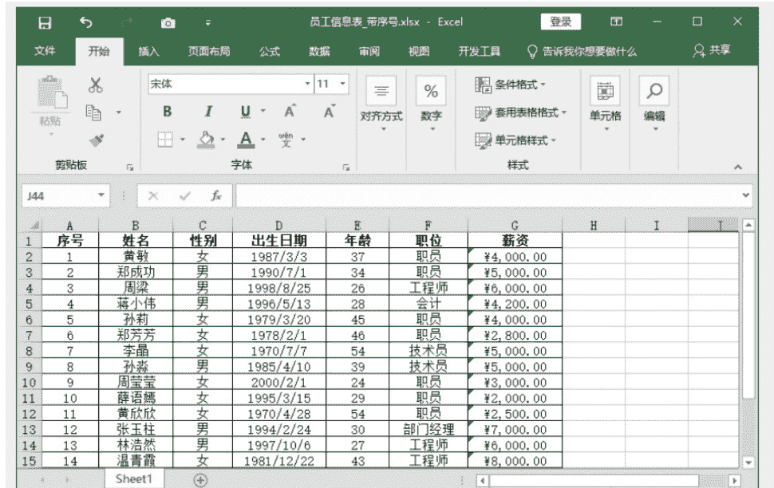
图3-2

### 2. 智能数据分析
AIGC可以与Excel等表格软件结合，实现数据的智能分析，包括数据的筛选、分类、统计等，从而提高数据分析的效率和准确性。
延续图3-1中的对话，继续输入提示词：
将所有“工程师”的信息单独提取出来。
内容生成如图3-3所示。

### 3. 图表生成
AIGC可以根据数据自动生成图表，帮助用户更直观地理解数据。这不仅可以节省用户制作图表的时间，还可以提高图表的专业性和准确性。
延续图3-1中的对话，输入提示词：
计算不同职位的平均薪资，用计算结果生成一张柱形图。
内容生成如图3-4所示。
| 序号 | 姓名 | 性别 | 出生日期 | 年龄 | 职位 | 薪资 |
|------|------|------|----------|------|------|------|
| 3 | 周梁 | 男 | 1998/8/25 | 26 | 工程师 | ¥6,000.00 |
| 13 | 林浩然 | 男 | 1997/10/6 | 27 | 工程师 | ¥6,000.00 |
| 14 | 温青霞 | 女 | 1981/12/22 | 43 | 工程师 | ¥8,000.00 |
图3-3
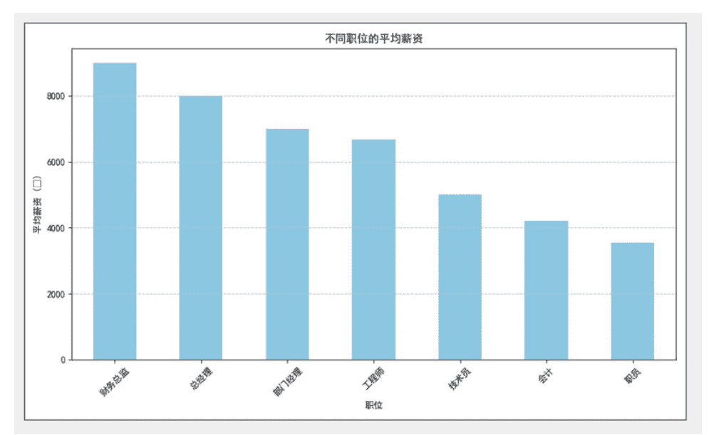
图3-4

### 3.1.4 智创PPT整体方案
通过先进的AIGC技术，用户仅需输入标题或相关提示词，便能迅速生成精美且富有设计感的PPT，同时支持在线修改和一键更换模板等功能，极大地提升了PPT制作的效率和品质。

以下为使用AIGC工具生成各类场景的PPT文档示例。

### 1. 生成商务礼仪培训PPT
输入提示词：
> 请以“企业商务礼仪培训”为主题生成一份PPT，旨在全面培养并提升员工的商务礼仪素养。
PPT的生成效果如图3-5所示（节选）。
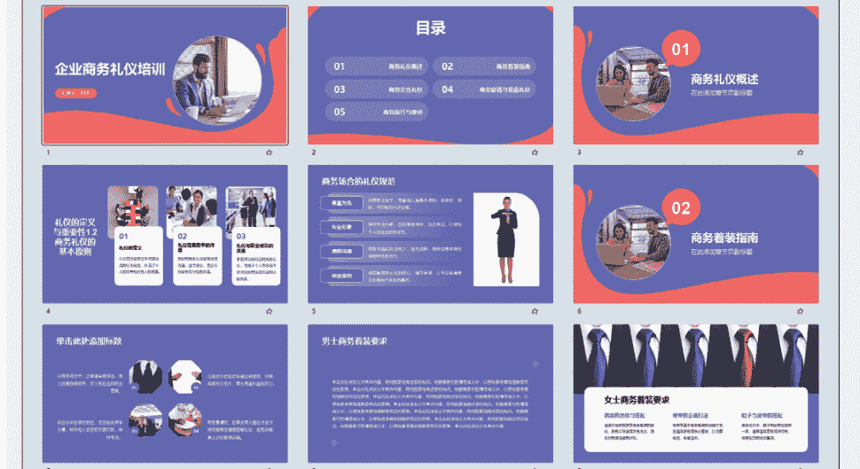
图3-5

### 2. 生成科技主题PPT
输入提示词：
请以“人工智能与未来工作”为主题生成PPT。探讨AI如何改变职场环境，自动化对就业的影响，以及人类与AI的协作未来。
PPT的生成效果如图3-6所示（节选）。
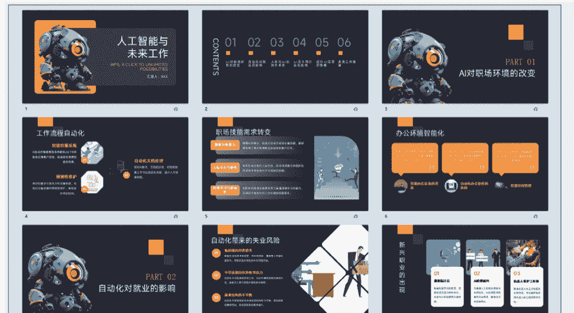
图3-6

### 3. 主题教学PPT一键生成
示例指令：
围绕“唐诗宋词的艺术魅力与教育启示”这一主题制作演示文稿，重点探讨作品蕴含的哲理思考、情感表达方式，以及将古典诗词融入当代语文教学的具体策略。
生成后的呈现效果如下。
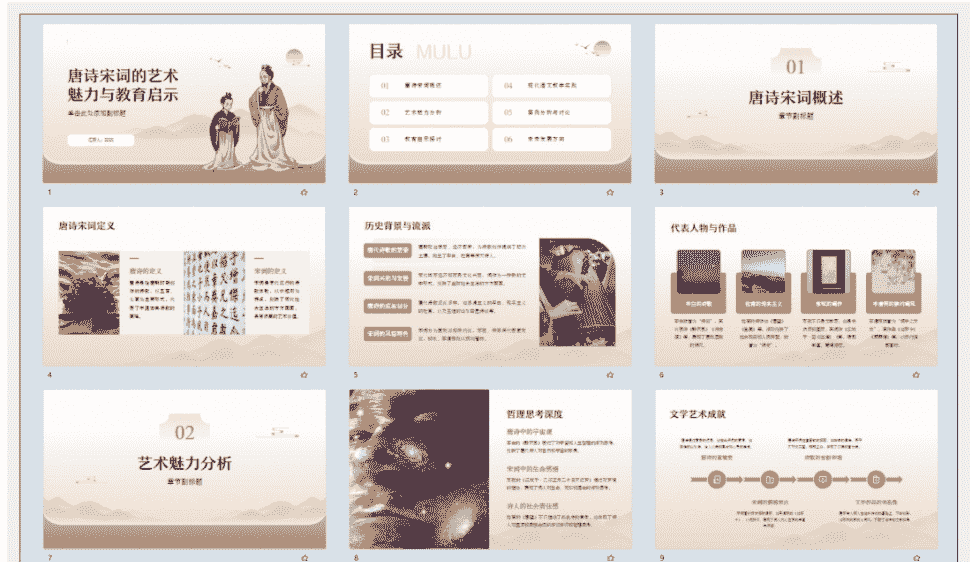
图3-7

## 3.2 灵感激活与文案快写
当下主流的生成式模型能在极短时间内批量输出大量文本，并按需求切换不同风格与思路；依托算法与数据挖掘能力，还能发掘新颖的方向，为创作者提供精准启发与优化建议。

### 3.2.1 广告创意点子激发

生成式创作不仅能提升广告创意产出效率，也能在一定程度上跳脱常规思维，发现容易被忽略的新角度，从而增强传播吸引力与效果。

#### 【练习1】为空气喷雾提供广告创意点
下面以“清新森林空气喷雾”为例演示灵感获取流程。
打开文心一言官网，输入指令：
我想为一款名为“清新森林空气喷雾”的产品做宣传，不知道从何入手，请提供一些广告创意与灵感。
系统依提示生成文字内容。
示范结果如下。
为“清新森林空气喷雾”做传播，核心在于传递自然、洁净与令人舒畅的感受。参考思路如下。

#### 1. 主题定位
- 林间邂逅：把产品塑造为与自然亲密接触的体验，让人联想到清晨树林的氛围。
- 城市净呼吸：突出即便在喧闹都市，也能呼吸到近似森林的清澈空气，带来放松与净化。

#### 2. 视觉创意
- 场景搭建：采用高清摄影或CGI呈现郁郁葱葱的林地，阳光透过枝叶形成斑驳光影，薄雾弥漫，营造清新神秘的氛围。
- 产品呈现：在画面中自然融入喷雾，细腻雾气与周边环境融合，仿佛属于自然的一部分。
- 配色方案：以绿、蓝、白为主，绿色传递生机，蓝色带来宁静清爽，白色体现纯净高雅。

#### 3. 文案方向
- 主标语：“一喷即享林间呼吸——清新森林空气喷雾”。
- 故事化表达：“在城市缝隙里寻找一片清新林地，每一次呼吸都是自然的馈赠，让心灵得以释放。”
- 情感共鸣：“这不仅是一支喷雾，更是一次走出日常的小旅行，是忙碌中的温柔停靠。”

#### 4. 互动设计
- AR体验：开发AR小程序，扫描包装后屏幕呈现虚拟森林，甚至可“走进”其中，获得沉浸式清新感受。
- 社交话题：发起#清新森林挑战#，鼓励用户分享使用感受或创意图文视频，优选内容给予奖励，提升参与度与曝光。

#### 5. 环保主张
突出环保包装及品牌对自然保护的承诺，例如“我们承诺，每一瓶的诞生都不以牺牲自然为代价。”

#### 6. 合作联名
与环保机构或知名自然摄影师合作，提升品牌调性，同时传递社会责任感。

综合以上要点，可打造兼具吸引力与深度的传播内容，有效传递产品独特价值，触达目标人群。

#### 【练习拓展】
请选取一款化妆品为主题，利用文心一言辅助完成一份广告宣传文案。

### 3.2.2 活动方案智能生成
活动策划是对特定目标进行系统设计与安排，通过创意与执行提升品牌形象、增强用户参与或实现销售目标。借助AIGC生成方案，可降低门槛，让非专业人士也能参与，加快决策并提升新颖度。

#### 【练习2】艺术节活动策划方案制作
动作一 启动百宝箱。进入文心一言官网，点击页面“百宝箱”按钮，如图3-8所示。
动作二 调用策划方案生成模板。打开“一言百宝箱”，切换至“场景”页，选择“灵感策划”分类，再点“策划方案生成”模块的“使用”按钮，如图3-9所示。

图3-8
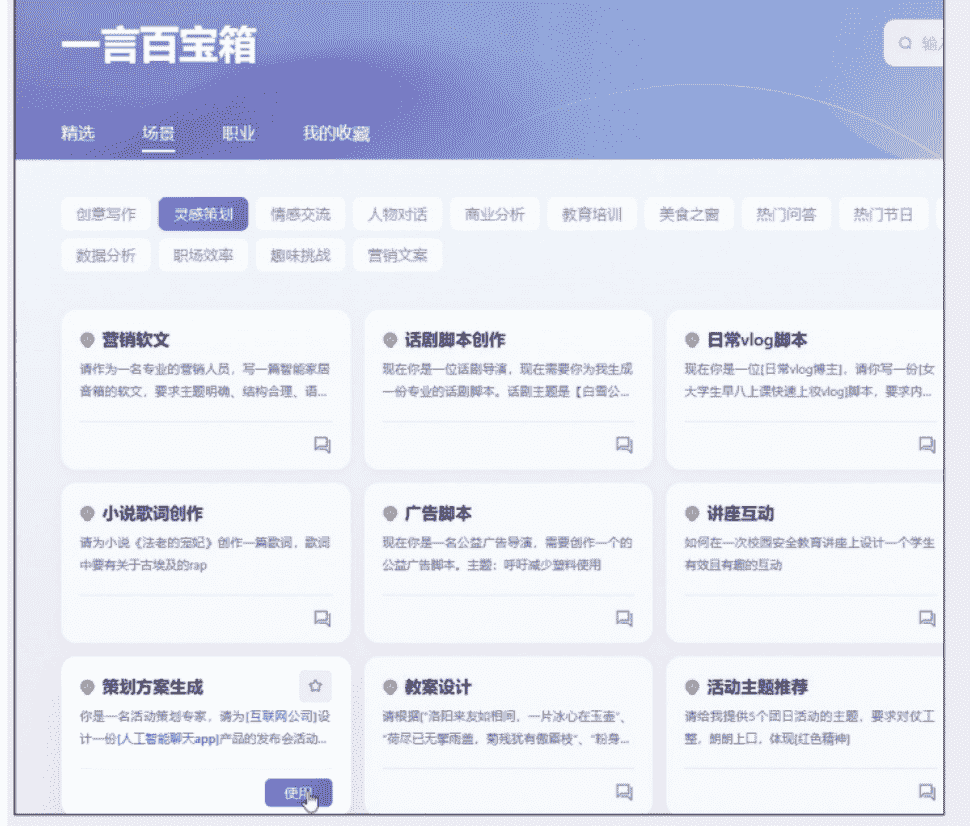
图3-9
动作三 自动出现提示词。文本框会自动出现策划提示词，内容为：
你是一名活动策划专家，请为[互联网公司]设计一份[人工智能聊天App]产品的发布会活动策划案，策划案需要包含背景、目标、可行性分析、行动计划、风险与应对措施。
动作四 修改提示词。调整公司名、活动名等关键信息后发送。修改后提示词为：
你是一名活动策划专家，请为[旅游公司]设计一份[多彩文化庆典——艺术与民俗的交融]文化艺术节活动策划案，策划案需要包含背景、目标、可行性分析、行动计划、风险与应对措施。

生成内容如下。
# 多彩文化庆典——艺术与民俗的交融文化艺术节活动策划案

## 1. 背景
随着全球旅游业回暖，游客对体验的需求愈发多元，不仅关注自然景观，更希望深入了解目的地文化底蕴与民俗特色。为顺应市场，提升品牌形象，增强客户粘性，[旅游公司]拟举办以“多彩文化庆典——艺术与民俗的交融”为主题的文化艺术节。通过展示各地区艺术作品、传统手工艺、民俗表演等，为游客提供沉浸式文化体验平台，促进文化交流与理解。

## 2. 目标
- 文化传播：展示并传播各地独特的艺术与民俗，提升公众对多元文化的认知与尊重。
- 品牌提升：借助高质量文化活动，提升[旅游公司]知名度与美誉度。
- 客户体验：提供丰富文化体验，增强游客参与感与满意度。
- 经济收益：吸引更多游客，带动周边餐饮住宿等产业，实现经济效益增长。

## 3. 可行性分析
- 市场需求：文化深度游需求持续增长，活动契合趋势。
- 资源丰富：公司拥有丰富旅游资源，可邀请国内外艺术家、手工艺人参与，保证内容多样。
- 技术支持：利用AR/VR等技术提升互动，增加吸引力。
- 合作伙伴：与地方政府、文化机构及非政府组织合作，获取资金与资源支持。
- 风险评估：需提前规划天气、安全等应对措施。

## 4. 行动计划
……

据此策划，期待“多彩文化庆典——艺术与民俗的交融”文化艺术节成为一次成功的文化交流盛会，为游客带来难忘体验，也为[旅游公司]长远发展奠定基础。

### 3.2.3 公众号软文撰写
软文以隐性营销方式，通过故事性与情感共鸣的内容，结合权威与教育元素，以较低成本实现传播，能有效影响目标受众，帮助品牌建立连接并提升影响力。


#### 【练习3】阅读平台宣传软文制作
使用文心一言，输入提示词：
请为“爱读书在线阅读平台”写一篇推广软文，用于微信公众号发送。要求不直接介绍产品，而是通过有价值内容潜移默化地推广品牌。

生成内容如下。
在快节奏的当下，我们总在寻找心灵的安宁之地，一个让灵魂栖息的港湾。或许在日复一日的忙碌里，你已厌倦喧嚣，渴望一盏灯、一本书、一个静谧的夜晚，让思绪随文字远行。今天，让我们一起探索一种新的生活方式，关于阅读、成长与自我发现的旅途——在“爱”的氛围里，重拾阅读的乐趣。

设想一下，下班后躺在沙发上，手指轻滑，便能进入一个个奇妙世界。那里有历史的厚重、文学的浪漫、科学的奥秘、哲学的思辨……每本书都是一扇通往新世界的大门，每一次阅读都是一场心灵洗礼。而这一切，无需出门，无需负重，“爱读书在线阅读平台”即可轻松实现。

这里提供的不只是一个阅读空间，更是文化交流场与思想碰撞地。我们相信，每本书都承载着作者的情感与智慧，每一次阅读都是与伟大心灵的对话。因此，“爱读书”精选了海量图书资源，从经典名著到现代畅销书，从专业学术到休闲小说，应有尽有，满足不同读者的需求。

更重要的是，数字时代阅读方式也在悄然变化。“爱读书在线阅读平台”采用先进数字阅读技术，让屏幕文字呈现出纸质书的质感，甚至更便捷环保。无论清晨第一缕阳光还是夜晚柔和灯光，都能享受舒适阅读体验。

我们相信，阅读不仅是获取信息，更是一种生活态度、对美好事物的追求。在“爱读书”，你将遇见触动心灵的文字，或会心一笑，或潸然泪下，但都将成为人生旅途不可或缺的一部分。

所以，不妨给自己一个机会，加入“爱读书”大家庭，一起在文字海洋中遨游，让心灵在阅读中得到滋养，让生活因阅读更丰富多彩。在这里，每一次翻页，都是向更美好的自己迈进的一步。

在这个充满爱的季节，让我们用阅读温暖每一个平凡日子。期待在“爱读书在线阅读平台”与每一个热爱生活的你相遇，共同书写属于我们的故事。

### 3.2.4 短视频脚本速成
短视频脚本是创作的蓝图与灵魂，通过文字规划内容结构、情节、对话、镜头与音效等，有了脚本可有序拍摄，确保细节符合预期，提升制作效率与质量。下面使用讯飞星火的“短视频脚本助手”进行快速创作。

#### 【练习4】魔幻主题视频脚本创建
打开讯飞星火对话模式，点击左侧“更多智能体”，在“营销”分类中添加“短视频脚本助手”智能体，如图3-10所示。
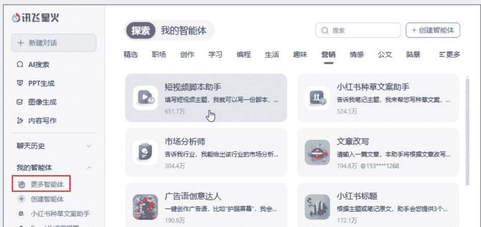
图3-10
进入“短视频脚本助手”对话模式，在文本框中输入提示词，如图3-11所示。
魔幻现实主义题材，以都市为背景，讲述一系列神秘的超自然事件、时间扭曲等，主角在探索这些事件的过程中逐渐揭开真相。
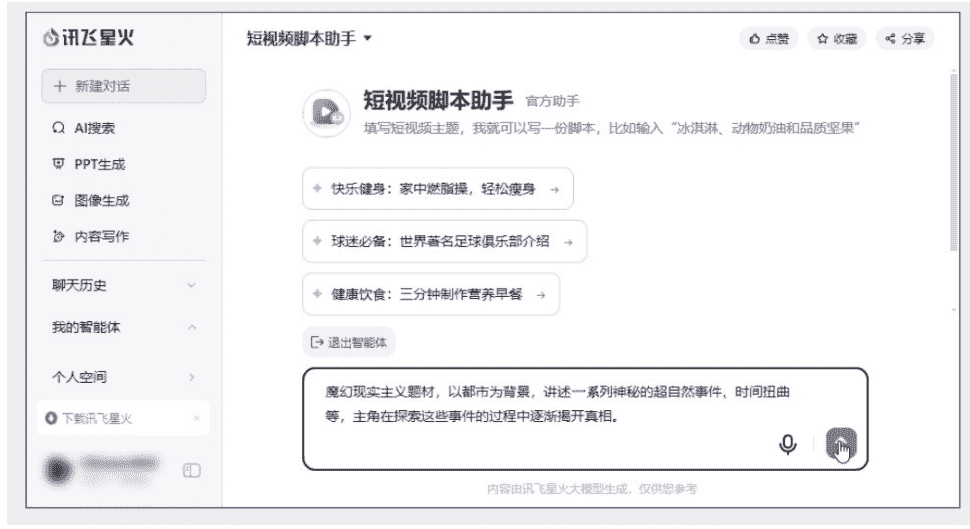
图3-11
生成内容如下。
短视频脚本：《时间裂缝》
场景一：都市街头，夜晚
镜头描述：
- 开场：镜头从高空俯拍城市夜景，霓虹闪烁，车流如织。背景音乐神秘紧张。
- 切换：镜头快速下降，聚焦繁忙十字路口，行人匆匆。
- 特写：年轻主角站在红绿灯前低头看手机，似在等待。
配音文字：
> “在这座看似平凡的都市里，隐藏着无数未解之谜。”

场景二：时间扭曲现象
镜头描述：
- 慢动作：绿灯亮起，主角准备过马路。周围一切骤然变慢，行人动作如定格。
- 特写：主角惊讶表情，他可自由移动，而他人被冻结原地。
- 环绕镜头：主角四处张望，试图理解发生了什么。
配音文字：
> “突然间，时间仿佛停止流动，只有他能自由行走。”

场景三：探索与发现
镜头描述：
- 跟随镜头：主角沿街前行，观察异常。他注意到钟表指针倒转、路灯忽明忽暗。
- 对话镜头：主角拨打朋友电话，听到的却是过去的对话内容。
- 特写：主角眼神充满困惑与好奇，决定深入调查。
配音文字：
> “这一切究竟是怎么回事？难道是某种超自然力量在作祟？”

场景四：揭开真相
镜头描述：
- 回忆镜头：闪回画面暗示主角与事件有关。
- 揭秘时刻：主角来到一处废弃建筑，发现隐藏门后是一座科技感十足的秘密实验室。
- 对话镜头：科学家向主角解释，时间扭曲由一次失败实验装置引起。
配音文字：
> “原来，这一切都是科学家一次失败实验导致的意外后果。”

场景五：结尾
镜头描述：
- 全景镜头：主角走出实验室回到街头，时间恢复正常，人们重归忙碌。
- 结尾字幕：“在这座城市的每个角落，都可能藏着不为人知的秘密。”
- 结束画面：镜头拉远，城市夜景再次呈现，音乐渐弱至消失。

### 3.2.5 中英互译实操
讯飞星火的“中英翻译”可高效准确实现中英文互译，适用于日常对话、商务沟通、学术交流等场景。

#### 【练习5】产品文案翻译
动作一 启动中英翻译。打开讯飞星火官网，将待译中文复制到文本框，点击“中英翻译”按钮，如图3-12所示。
动作二 设置目标语言。将“目标语言”设为“英文”，随后点击“发送”按钮，如图3-13所示。
动作三 返回翻译结果。系统随即返回翻译结果，如图3-14所示。

图3-12

图3-13

图3-14

## 3.3 数据处理效率升级
AIGC相比传统数据分析方法，灵活性与智能化更高，能高效处理大规模数据、自动识别修正异常值，并迅速生成可视化图表与报告，不仅提升效率，也为非技术用户提供便利。

### 3.3.1 数据表自动生成
智谱清言的数据分析功能在自然语言理解、数据处理、分析方法、代码生成与执行、定制扩展及实时反馈等方面表现突出。下面通过其“数据分析”功能制作表格。

#### 【练习6】销售份额分布表创建
动作一 发送数据。打开智谱清言官网，在左侧点击“数据分析”按钮切换模式，在文本框输入数据及表格制作要求后发送，如图3-15所示。
动作二 生成表格。系统对数据进行分析并生成Python代码，整理成表格，如图3-16所示。
图3-15
| 序号 | 店铺 | 城市 | 销售额 | 销售占比 |
| :--- | :--- | :--- | :--- | :--- |
| 1 | 上海古北店 | 上海 | 25,832.00 | 3.63% |
| 2 | 上海七宝店 | 上海 | 13,827.00 | 1.94% |
| 3 | 上海曲阳店 | 上海 | 26,902.00 | 3.78% |
| 4 | 杭州涌金店 | 杭州 | 75,021.00 | 10.53% |
| 5 | 南京大行宫店 | 南京 | 39,488.00 | 5.54% |
| 6 | 上海古北店 | 上海 | 9,233.00 | 1.30% |
| 7 | 苏州店 | 苏州 | 98,316.00 | 13.80% |
图3-16
动作三 生成下载链接。若需下载表格，可继续发送“生成表格的下载链接”。系统随即生成电子表格下载链接，如图3-17所示。
动作四 下载Excel表格。点击下载链接即可将表格以Excel文件保存至指定位置。数据在Excel中打开效果如图3-18所示。
用户_CyvC09
生成表格的下载链接
数据分析
代码生成：已完成
```
结果
'/mnt/data/sales_data.csv'
```
您可以通过以下链接下载更新后的表格：
下载表格
图3-17
| 序号 | 店铺 | 城市 | 销售额 | 销售占比 |
|---|---|---|---|---|
| 1 | 上海古北店 | 上海 | 25832 | 3.63% |
| 2 | 上海七宝店 | 上海 | 13827 | 1.94% |
| 3 | 上海曲阳店 | 上海 | 26902 | 3.78% |
| 4 | 杭州涌金店 | 杭州 | 75021 | 10.53% |
| 5 | 南京大行宫店 | 南京 | 39488 | 5.54% |
| 6 | 上海古北店 | 上海 | 9233 | 1.30% |
| 7 | 苏州店 | 苏州 | 98316 | 13.80% |
| 8 | 上海金桥店 | 上海 | 88836 | 12.47% |
| 9 | 上海南方店 | 上海 | 78727 | 11.05% |
| 10 | 新里程店 | 上海 | 39437 | 5.53% |
| 11 | 杭州涌金店 | 杭州 | 34269 | 4.81% |
| 12 | 上海金桥店 | 上海 | 97922 | 13.74% |
| 13 | 上海联洋店 | 上海 | 80102 | 11.24% |
| 14 | 南京大行宫店 | 南京 | 4650 | 0.65% |
图3-18

### 3.3.2 可视化图表快速绘制
智谱清言可通过内置智能算法对Excel文件进行深度分析，自动生成直观清晰的图表，帮助用户快速洞察数据趋势与关联，为决策提供支持。

#### 【练习7】销量对比图表创建
在3.3.1节对话基础上，继续在数据分析模式下输入提示词：
根据各城市的销售额生成圆环图表。
系统读取历史对话后生成指定类型图表，如图3-19所示。右键图表选择“图片另存为”或“复制图片”即可保存。图表放大效果如图3-20所示。
图3-19
图3-20

### 3.3.3 Excel数据精准分析
智谱清言等数据分析类AIGC工具通常支持Word、Excel、PPT、PDF等多类型文件上传，并可对文件中的数据进行分析。

#### 【练习8】化妆品数据表分析
下面对Excel产品销售明细表中的数据进行分析，原始数据如图3-21所示。
图3-21

**智谱清言 三步搞定表格分析**

步骤01 导入文件
登录智谱清言官网后进入数据分析界面，在输入区左边的 📎 图标处选择本地文件导入方式，打开的文件选择框中挑选目标 Excel 并上传，如图3-22。

步骤02 描述分析意图
文件载入成功后，在同一输入框里用口语化方式说明希望得到的结果，发送后即可，如图3-23。

图3-22

图3-23

步骤03 查看分析结果
平台会即时读取表格内容并按描述给出结论，如图3-24。

图3-24

### 3.3.4 WPS AI 秒写复杂公式

WPS AI 基于智能算法与机器学习，为办公提供自动化辅助，覆盖文本生成、公式编写、数据洞察等。AI 写公式可以根据自然语言描述快速生成准确公式，并附带详细解读。

#### 【练习9】统计产品出库量

步骤01 激活 AI 写公式
打开 WPS 表格，选中需要写入公式的单元格键入 =，右侧会出现 📊 标识，点击展开面板，如图3-25。

步骤02 提出问题
随即出现浮动窗口，在文本框内输入“A列记录季度，B列记录产品名，统计‘4季度’且产品为‘螺蛳粉’的出库总量”，点击 ▶ 提交，如图3-26。

图3-25

图3-26

步骤03 查看生成公式与说明
面板会立即给出公式，点击“对公式的解释”可查看公式作用、函数说明及参数说明，如图3-27。

步骤04 确认写入
点击浮动窗口左上角的“完成”即可把公式固化到单元格，如图3-28。

提问：A列包含所有季度，B列包含所有产品名称，计算“4季度”，产品名称为“螺蛳粉”的出库数量之和

```
=SUMIFS(C2:C18,A2:A18,"4季度",B2:B18,"螺蛳粉")
```

▼ fx 对公式的解释

公式意义

计算第4季度，产品名称为螺蛳粉的出库数量之和。

函数解释

SUMIFS：数学与三角函数,在区域中添加满足多个条件的单元格。

参数解释

C2:C18：出库数量的单元格区域，要求和的范围为C2到C18。

A2:A18：季度的单元格区域，用于条件计算的范围为A2到A18。

"4季度"：筛选条件，选择季度为第4季度的数据进行计算。

B2:B18：产品名称的单元格区域，用于条件计算的范围为B2到B18。

"螺蛳粉"：筛选条件，选择产品名称为螺蛳粉的数据进行计算。

AI生成信息仅供参考，请注意甄别信息准确性

图3-27

图3-28

### 3.3.5 一键生成成绩排名

智谱清言的数据处理能力很强，既能按设定标准计算，也能为处理后的数据生成专属下载链接，方便获取优化资源。

#### 【练习10】给员工考评排名

在数据分析界面上传 Excel 文件，输入“生成排名公式”并发送。系统先预览表格内容，再依据成绩列构建排名逻辑，并询问保存方式，如图3-29。

回复“保存为新文件”后，系统会生成新文件的下载链接，点击即可下载表格，如图3-30。

用户_CyvC09

生成排名公式

数据分析

首先，我们需要检查上传的 Excel 文件的内容，以确定如何生成排名公式。让我们打开文件并查看其中的数据。

代码生成：已完成

结果

| 工号 | 部门 | 姓名 | 成绩 |

|---|---|---|---|

| 0 DS-001 | 技术部 | 周楠 | 77 |

| 1 DS-002 | 销售部 | 李想 | 86 |

| 2 DS-003 | 行政部 | 孙薇 | 73 |

| 3 DS-004 | 行政部 | 赵祥庆 | 95 |

| 4 DS-005 | 技术部 | 刘瑜名 | 72 |

Excel 文件包含一个表格，其中包含工号、部门、姓名和成绩四列。现在，我们将根据“成绩”列生成一个排名公式，该公式将为每个员工的成绩分配一个排名，成绩最高的员工排名第一。

我们将使用 pandas 的 `rank()` 方法对“成绩”列进行排名。此方法默认情况下会给出每个成绩的排名，其中成绩最高的员工排名为1。我们将把排名公式应用到整个数据框上，并将结果保存到一个新的列中，名为“排名”。

代码生成：已完成

结果

| 工号 | 部门 | 姓名 | 成绩 | 排名 |

|---|---|---|---|---|

| 0 DS-001 | 技术部 | 周楠 | 77 | 10 |

| 1 DS-002 | 销售部 | 李想 | 86 | 3 |

| 2 DS-003 | 行政部 | 孙薇 | 73 | 14 |

| 3 DS-004 | 行政部 | 赵祥庆 | 95 | 1 |

| 4 DS-005 | 技术部 | 刘瑜名 | 72 | 15 |

排名公式已成功应用于数据框，并添加了一个名为“排名”的新列。在这个新列中，成绩最高的员工排名为1，依此类推。

现在，我们可以将带有排名的数据框保存回 Excel 文件。您希望我将其保存为新的文件还是覆盖现有文件？

分享 重新回答

图3-30

原始表与自动排名后的新表分别如图3-31、图3-32。

| 工号 | 部门 | 姓名 | 成绩 | 排名 |

|---|---|---|---|---|

| DS-001 | 技术部 | 周楠 | 77 | |

| DS-002 | 销售部 | 李想 | 86 | |

| DS-003 | 行政部 | 孙薇 | 73 | |

| DS-004 | 行政部 | 赵祥庆 | 95 | |

| DS-005 | 技术部 | 刘瑜名 | 72 | |

| DS-006 | 后勤部 | 孙子岚 | 76 | |

| DS-007 | 技术部 | 张颜齐 | 55 | |

| DS-008 | 销售部 | 徐微雨 | 70 | |

| DS-009 | 财务部 | 夏宇航 | 65 | |

| DS-010 | 行政部 | 夏清滨 | 79 | |

| DS-011 | 产品部 | 王语嫣 | 80 | |

| DS-012 | 后勤部 | 程丹 | 68 | |

| DS-013 | 技术部 | 孙璐 | 78 | |

| DS-014 | 销售部 | 李超 | 81 | |

| DS-015 | 技术部 | 周亮 | 75 | |

| DS-016 | 销售部 | 王明 | 74 | |

| DS-017 | 财务部 | 钱玉莹 | 82 | |

| DS-018 | 行政部 | 吴云 | 90 | |

| DS-019 | 产品部 | 吴周洋 | 78 | |

| DS-020 | 技术部 | 李博新 | 71 | |

图3-31

| A | B | C | D | E |

|---|---|---|---|---|

| 工号 | 部门 | 姓名 | 成绩 | 排名 |

| DS-001 | 技术部 | 周楠 | 77 | 10 |

| DS-002 | 销售部 | 李想 | 86 | 3 |

| DS-003 | 行政部 | 孙薇 | 73 | 14 |

| DS-004 | 行政部 | 赵祥庆 | 95 | 1 |

| DS-005 | 技术部 | 刘瑜名 | 72 | 15 |

| DS-006 | 后勤部 | 孙子岚 | 76 | 11 |

| DS-007 | 技术部 | 张颜齐 | 55 | 20 |

| DS-008 | 销售部 | 徐微雨 | 70 | 17 |

| DS-009 | 财务部 | 夏宇航 | 65 | 19 |

| DS-010 | 行政部 | 夏清滨 | 79 | 7 |

| DS-011 | 产品部 | 王语嫣 | 80 | 6 |

| DS-012 | 后勤部 | 程丹 | 68 | 18 |

| DS-013 | 技术部 | 孙璐 | 78 | 8 |

| DS-014 | 销售部 | 李超 | 81 | 5 |

| DS-015 | 技术部 | 周亮 | 75 | 12 |

| DS-016 | 销售部 | 王明 | 74 | 13 |

| DS-017 | 财务部 | 钱玉莹 | 82 | 4 |

| DS-018 | 行政部 | 吴云 | 90 | 2 |

| DS-019 | 产品部 | 吴周洋 | 78 | 8 |

| DS-020 | 技术部 | 李博新 | 71 | 16 |

图3-32

## 【练习拓展】

数据表可上传至智谱清言，按需求做简要分析并下载结果到本地。

### 3.3.6 用 AIGC 深挖行业大数据

借助 AIGC 的深度挖掘能力，可从海量数据中提炼有价值的信息与洞见。常用策略如下。

- **明确问题域：** 界定想要挖掘的数据领域、主题或具体问题，例如市场分析、用户行为、产品优化等。
- **设定目标：** 具体明确数据挖掘想要达成的目标，例如识别潜在趋势、预测未来表现、发现用户偏好等。

#### 【练习11】抓取工业机器人整体数据

例如，用户希望深入了解 2024 年工业机器人的整体情况。可向智谱清言提问。

请帮我整理2024年工业机器人整体数据，具体要求如下。

(1) 获取关于2024年全球及主要地区（如北美洲、欧洲、亚洲等）工业机器人的整体数据。

(2) 数据应涵盖工业机器人市场的主要应用领域，如汽车制造、电子、食品加工、医疗设备等。

(3) 请提供2024年工业机器人的销量、销售额、增长率等关键市场指标。

(4) 如有可能，请包含不同类型工业机器人（如多关节机器人、SCARA机器人、并联机器人等）的市场份额和增长情况。

(5) 我还希望了解工业机器人技术的最新发展趋势，包括主要的技术创新点和未来应用前景。

内容生成如下。

2024年的工业机器人市场数据显示了显著的增长和发展。以下是根据您的要求整理的一些关键数据和发展趋势。

### 1. 全球及主要地区数据

2024年，全球工业机器人的运营数量达到了4281585台，比上一年增长了10%。

在地区分布上，亚洲占到了新部署机器人的70%，欧洲占17%，北美洲占10%。

中国是最大的工业机器人市场，2023年安装的工业机器人数量占全球安装量的51%。

### 2. 市场应用领域

主要应用领域包括汽车制造、电子、食品加工和医疗设备等。其中，电子行业和汽车制造业是较大的两个市场，分别占销售量的28%和24%。

### 3. 关键市场指标

2024年全球工业机器人市场的销售额达到85亿欧元。

预计从2024年到2032年，工业机器人市场的复合年增长率（CAGR）为7.69%。

### 4. 不同类型机器人的市场份额和增长情况

在工业机器人市场中，多关节机器人、SCARA机器人、并联机器人等不同类型的机器人都有其特定的市场份额和增长趋势。例如，瑞士-瑞典的ABB集团在2022年占据了全球市场的21%，领先于其他公司。

### 5. 技术发展趋势

工业机器人的技术发展趋势包括预测性维护解决方案的采用、基于云的机器人平台开发、机器人即服务（RaaS）模型的出现、人机协作的增强以及供应链的透明度和整合。

### 3.3.7 条件格式让完成率一目了然

“AI条件格式”功能能够自动对文档中的数据进行格式化处理，提升数据可视性和可读性。

下面演示用“AI条件格式”功能自动添加数据条来直观对比业绩完成率。

#### 【练习12】数据条直观对比业绩完成率

步骤01 执行“AI条件格式”命令。打开 WPS 表格，在功能区点击“WPS AI”按钮打开侧边栏，再点击“AI条件格式”按钮，如图3-33。

步骤02 发送提示词。表格中随即显示“AI条件格式”窗口，在文本框中输入“为D列中的值添加数据条”，随后点击“发送”按钮，如图3-34。

图3-33

图3-34

步骤03 修改数据条样式。“AI条件格式”工具随即对工作表中的数据进行分析，并在窗口中显示所引用的区域以及格式，用户可以根据需要对默认的格式进行修改，最后点击“完成”按钮，如图3-35。

步骤04 应用数据条。D列内包含百分比数值的单元格随即被添加相应格式的数据条，如图3-36。


图3-35

| A | B | C | D | E |

|---|---|---|---|---|

| 姓名 | 目标 | 完成 | 完成率 | |

| 员工1 | 15000 | 13000 | 87% | |

| 员工2 | 15000 | 10000 | 67% | |

| 员工3 | 15000 | 14000 | 93% | |

| 员工4 | 15000 | 4000 | 27% | |

| 员工5 | 15000 | 11000 | 73% | |

| 员工6 | 15000 | 8000 | 53% | |

| 员工7 | 15000 | 15000 | 100% | |

| 员工8 | 15000 | 6000 | 40% | |

| 员工9 | 15000 | 3000 | 20% | |

| 员工10 | 15000 | 1500 | 10% | |

| 员工11 | 15000 | 10000 | 67% | |

| 员工12 | 15000 | 12000 | 80% | |

图3-36

## 3.4 PPT 创作全流程智能化

AIGC 能够全流程智能化地辅助用户完成 PPT 的制作。用户只需输入简单的指示或标题，便能迅速生成精美且专业的 PPT 内容，包括自动生成大纲文案、填充具体文本、提供多样化的模板选择以及自定义设计选项等。

### 3.4.1 一键生成 PPT

“秒出PPT”是一款高效便捷的演示文稿制作工具，它利用先进的模板库和智能编辑功能，使用户能够在极短的时间内创建出专业、美观的 PPT。

#### 【练习13】快速制作科技主题 PPT

登录“秒出PPT”网站，在首页文本框内输入 PPT 主题“智能时代的伦理与法律：人工智能的双刃剑”，随后点击“智能生成”按钮，如图3-37。


图3-37

系统随即生成 PPT，通过页面顶部的“修改主题短语”“切换/上传模板主题”按钮可以对 PPT 主题以及模板进行修改，通过“开始编辑”按钮可以进入 PPT 编辑模式，如图3-38。

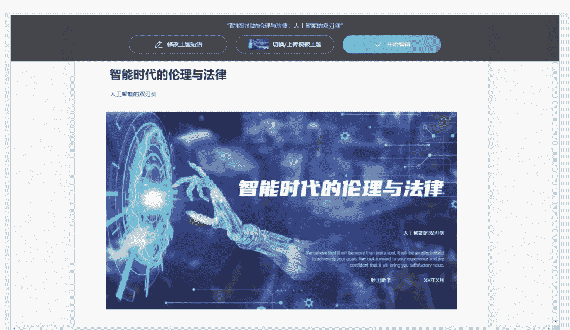

图3-38

### 3.4.2 Word 转 PPT

“秒出PPT”能够自动识别并提取 Word、PDF、TXT 等文档中的标题、子标题和文本内容，将其快速转换为 PPT 演示文稿，同时保持内容的逻辑结构和排版美观。

#### 【练习14】战争题材 Word 文档生成 PPT

在“秒出PPT”首页中切换至“导入内容（Word、文本等）”选项卡，用户可以将包含大纲的 Word 文件拖动至该文件区域，如图3-39。文件上传成功后点击“下一步”按钮，即可生成 PPT，如图3-40。


图3-39


图3-40

### 【练习拓展】

请以智能家居为主题，利用秒出 PPT 工具，制作一份与主题相关的演示文稿。

### 3.4.3 快速创建教学课件

讯飞星火的“PPT生成”功能可以根据用户输入的标题、关键词等信息，快速生成完整的 PPT 文档，包括封面、目录、具体内容等，且内容全面丰富、结构清晰、设计专业美观，极大地节省了制作时间。


#### 【练习15】创建历史学科类课件

步骤01 添加“教学教案”提示词。打开“讯飞星火”官网，切换到“PPT生成”模式，在文本框下方点击“教学教案”按钮，向文本框中添加提示词模板，如图3-41。

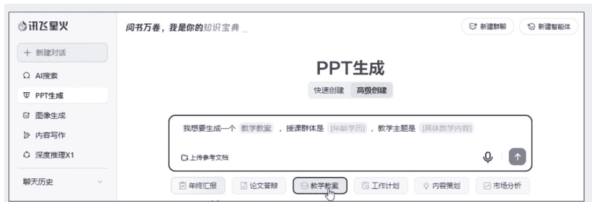

图3-41

步骤02 完善提示词并选择模板。修改提示词，随后在文本框下方选择一个合适的 PPT 模板，点击“发送”按钮 ⬆，如图3-42。

步骤03 系统随即根据提示词生成 PPT 大纲，点击“生成PPT”按钮，如图3-43。


图3-42

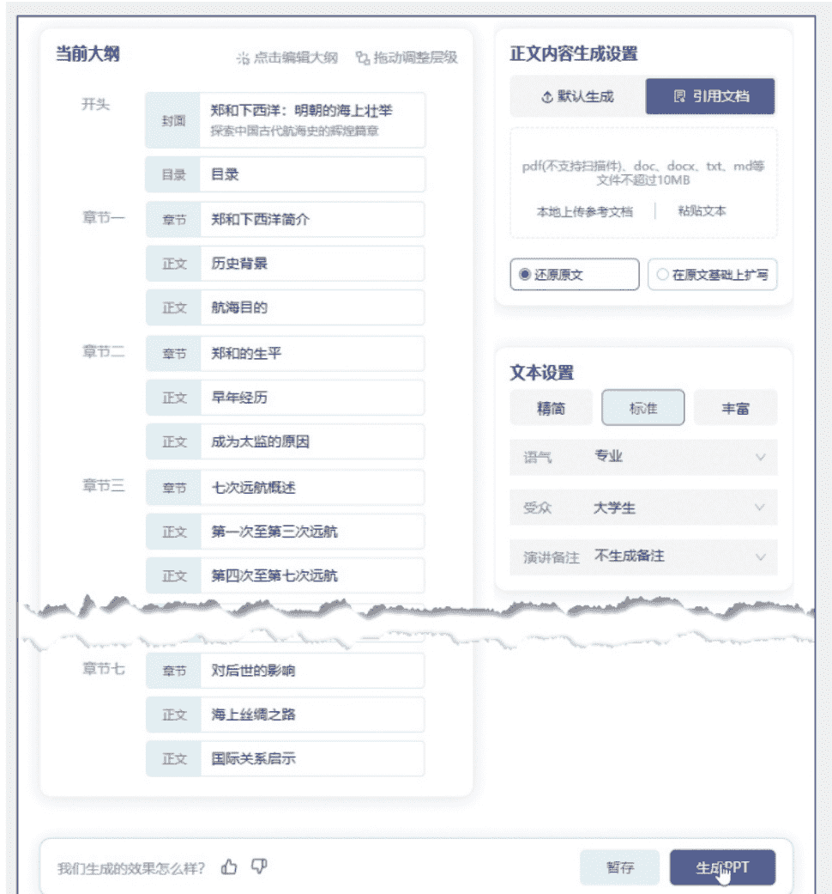

图3-43

步骤05 系统随即根据大纲生成演示文稿，点击幻灯片下方的“格式设置”按钮，页面左侧会打开一个窗格，通过该窗格中提供的选项，可以对幻灯片进行编辑，如图3-44。

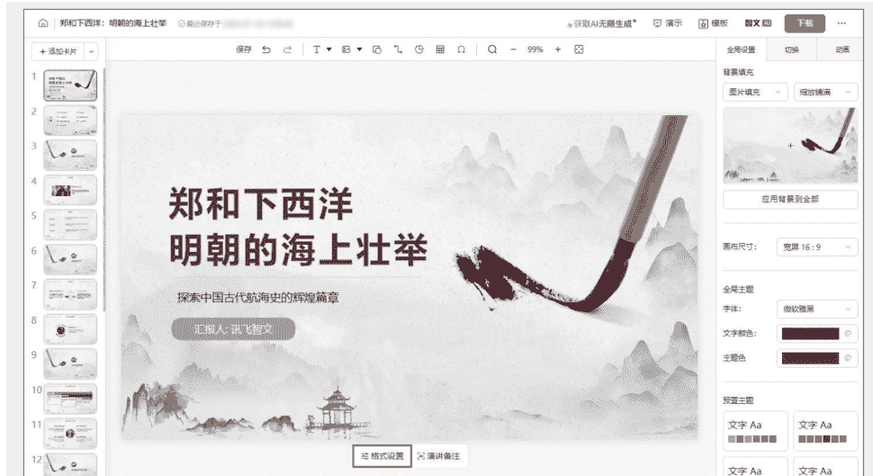

图3-44

### 3.4.4 一个主题生成活动策划 PPT

WPS AI 支持一键生成幻灯片。用户通过输入幻灯片主题或上传已有文档，可以自动生成包含大纲和完整内容的 PPT，极大地提高了 PPT 的制作效率和质量。下面将介绍具体操作方法。

#### 【练习16】制作公益活动类策划方案 PPT

步骤01 执行一键生成幻灯片命令。启动 WPS Office，在首页点击“新建”按钮，在展开的菜单中选择“演示”选项。在打开的“新建演示文稿”页面中点击“智能创作”按钮，如图3-45。

步骤02 发送主题。系统随即新建一份演示文稿，并弹出 WPS AI 窗口，输入主题“公益之心，新年温暖传递活动策划”，点击“生成大纲”按钮，如图3-46。

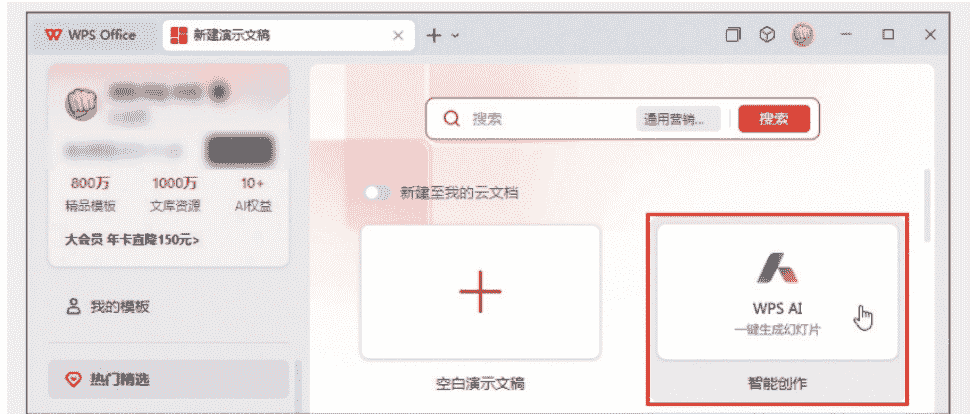

图3-45

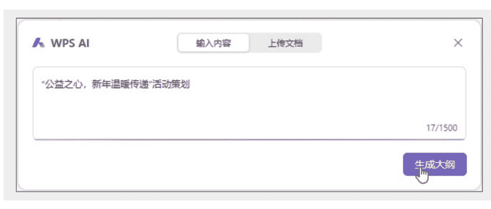

图3-46

**步骤03 生成PPT大纲。** 调用WPS AI后，系统即时给出一个大纲初稿。操作者可点按窗口右上角的“收起正文”或“展开正文”，灵活收展大纲以检视层次与细节，确认无误后再点按“生成幻灯片”，如图3-47所示。

**步骤04 选择模板并创建PPT。** 进入后的页面呈现大量幻灯片样式，可在右侧挑选合适的版式，选中后点击“创建幻灯片”即可开始制作，如图3-48所示。

# 封面 新年公益暖心传递方案

# 第一章 活动背景与目的

# 新年公益意义

1. 传承传统美德
新年里以公益行动为载体，让尊老爱幼、助人为乐等传统美德得以延续发扬。

2. 促进社会和谐
善举能够增强社会凝聚力，拉近不同群体间的距离，共同营造美好社会氛围。

3. 激发公众参与
新年主题更易点燃参与热情，通过实际行动传递爱心，让温暖在社区中流动。

# 活动主题阐述

1. 传递公益正能量

AI生成的内容仅供参考，请注意甄别信息准确性

图3-47

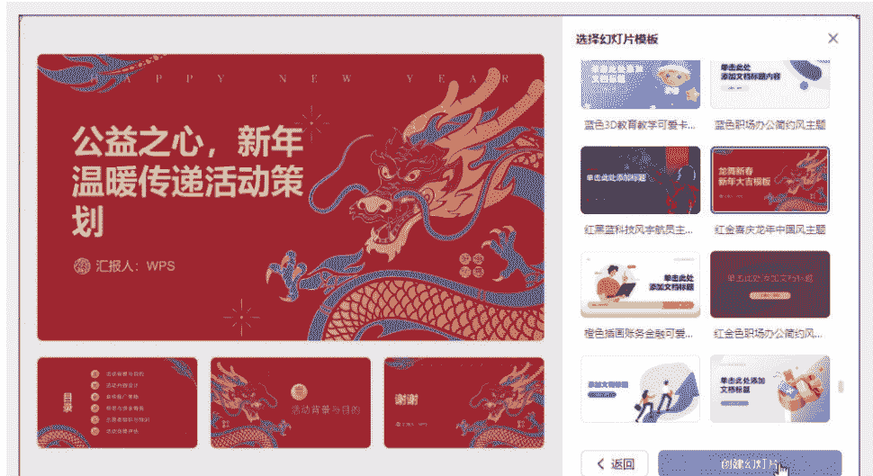

图3-48

**步骤05 生成PPT。** WPS AI会依据所选模板与大纲内容自动拼装成完整演示文稿，如图3-49所示。

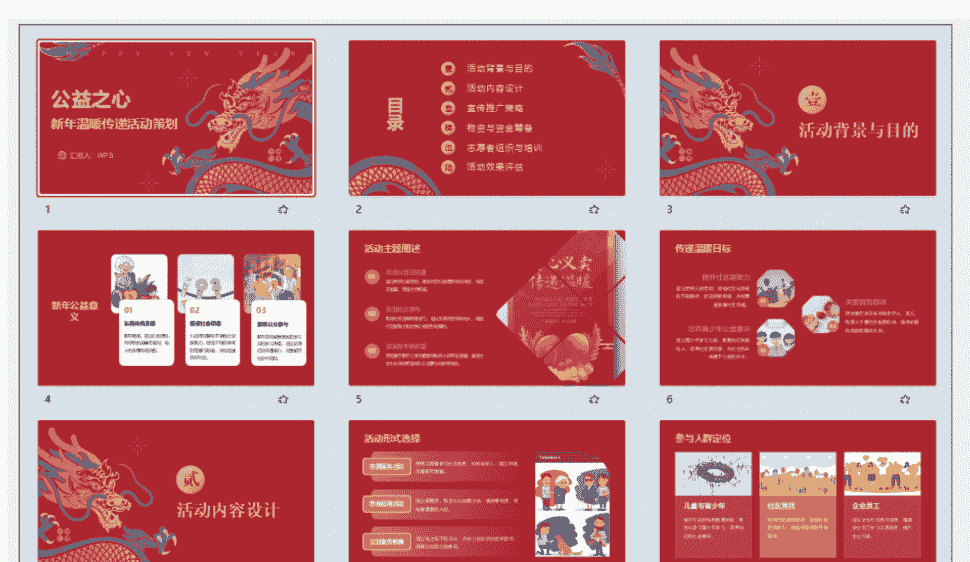

图3-49

## 3.5 AIGC应用实战：生成“小红书”种草文案

小红书种草类文案通常简短精炼，采用第一人称讲述使用感受，配合生动的场景描写与细腻的情感表达，快速抓取注意力并刺激购买欲。下面以“讯飞星火”自带的智能体来演示撰写流程。

**步骤01 登录讯飞星火。** 打开讯飞星火官网，在首页点击“开始对话”按钮，如图3-50所示。

**步骤02 执行“更多智能体”命令。** 进入对话模式后，在左侧导航栏点击“更多智能体”按钮，如图3-51所示。


图3-50

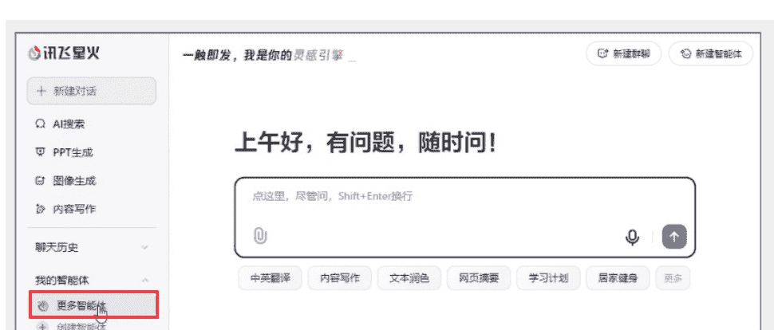

图3-51

**步骤03 选择“小红书种草文案助手”。** 打开后选择“营销”分类，可看到多种营销类助手，点击“小红书种草文案助手”进入，如图3-52所示。

**步骤04 发送笔记主题。** 在助手对话页的输入框中输入笔记主题“布艺材质衣物收纳箱”后发送，如图3-53所示。

**步骤05 当前智能体随即生成种草文案，如图3-54所示。**

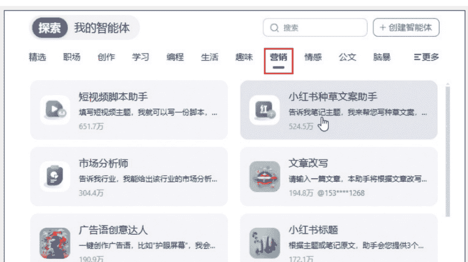

图3-52

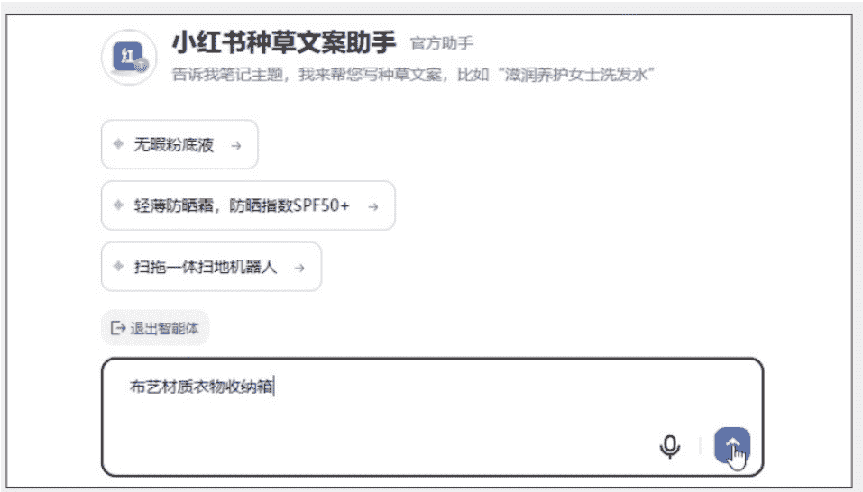

图3-53

# 🎀布艺收纳箱，让家瞬间变整洁！

姐妹们，家里衣物乱糟糟？快来get这款超实用布艺材质衣物收纳箱！大容量设计，轻松装下四季衣物；精致做工，耐用又美观。无论是放在衣柜里还是床底，都是收纳神器！🧺📦

# 👉【布艺收纳箱，家居整理小能手】🧺

# 🌈高颜值，百搭家居

简约时尚的设计，多种颜色可选，完美融入各种家居风格，让你的家更加温馨有格调。

# 🏠多功能使用，一箱多用

不仅可以收纳衣物，还可以存放玩具、书籍、杂物等，是卧室、客厅、儿童房的理想选择。

# 🛡️坚固耐用，品质保证

选用优质布料和坚固框架，耐磨耐用，不易变形，长久陪伴你的家居生活。

# 🧺透气防尘，保护衣物

布艺材质透气性好，有效防止衣物受潮发霉，同时阻挡灰尘，保持衣物干净整洁。

# 💼便携折叠，轻松存储

不用时可以轻松折叠起来，不占空间，方便收纳和携带，是租房族和学生党的福音！

# 👉【爆款词推荐】🔥

- #布艺收纳箱#

- #大容量衣物整理#

- #家居必备好物#

- #多功能储物箱#

- #透气防尘设计#

快来入手这款布艺材质衣物收纳箱吧！让你的家从此告别凌乱，拥抱整洁有序的新生活！🏠✨

#家居收纳神器# #布艺收纳箱推荐# #大容量储物# #多功能整理箱# #透气防尘收纳#

图3-54

# 第4章 图像创作大师

伴随人工智能的快速发展，AIGC已成为图像创作领域的重要驱动力。它重塑了创作方式与思维习惯，为用户带来多样化、个性化的艺术体验。AIGC依托强大的算法模型，可按用户指令与偏好生成高质量图像，帮助实现创意构想；同时也能对已有图像进行分析与优化，提升品质。

## 4.1 图像创作灵感与构思

在AIGC推动下，灵感激发与构思流程正发生深刻变化。本节探讨如何借助AIGC工具激发灵感并优化构思，提升创意水平与制作效率。

### 4.1.1 如何激发图像创作灵感

AIGC在灵感激发层面展现出强劲潜力。依托先进算法、大数据分析与创意生成能力，AIGC为创作者提供新视角与丰富素材，拓展创作边界。具体做法如下。

#### 1. 智能主题生成与拓展

AIGC可基于海量图像数据，分析主题、元素、构图等特征，通过深度学习识别与提取，进而自动产出多元主题。这些主题丰富新颖，能为艺术家与设计师提供新灵感。例如计划创作“你好，我的城市”系列绘画，可借助AIGC工具产出主题方案，为创作提供方向并激发对细节的思考。

**步骤01 输入提示词。** 打开智谱清言或其他AIGC工具，输入关键词：
创作一系列以“你好，我的城市”为主题的绘画作品，请生成具体的主题方案，三四个。

**步骤02 生成文字内容。**
生成内容如下。

以下是围绕“你好，我的城市”主题的一系列绘画作品主题方案。

# 主题方案一：城市脉搏

（1）描述：这个主题聚焦于城市的活力与节奏，展现城市生活的丰富多彩。

（2）具体绘画主题：

- 《晨光中的市场》：描绘清晨时分，市场摊贩忙碌的场景，展现城市的苏醒。

- 《繁忙的十字路口》：展现交通高峰期，行人、车辆穿梭的繁华景象。

- 《夜幕下的霓虹灯》：表现夜晚城市灯火辉煌，人们休闲娱乐的场景。

# 主题方案二：城市印记

（1）描述：这个主题旨在挖掘城市的历史与文化，记录城市的发展变迁。

（2）具体绘画主题：

- 《老街记忆》：描绘充满历史沧桑感的古老街道，体现城市的传统风貌。

- 《古建筑与新地标》：展现城市中古建筑与现代建筑的和谐共存，传承与创新。

- 《民俗风情》：描绘城市特有的民俗活动，如庙会、节日庆典等。

# 主题方案三：城市生态

（1）描述：关注城市中的自然景观与生态环境，展现人与自然和谐共生的美好画面。

（2）具体绘画主题：

- 《城市公园的早晨》：描绘市民在公园晨练、休闲的情景，体现绿色生活的理念。

- 《河流边的漫步》：展现城市河流景观带，人们沿着河岸散步、欣赏美景。

- 《屋顶花园》：表现城市屋顶绿化项目，寓意城市与自然的融合。

# 主题方案四：城市生活

（1）描述：聚焦城市居民的日常生活，展现不同人群的生活状态和情感交流。

（2）具体绘画主题：

- 《街头咖啡馆》：描绘人们在咖啡馆闲聊、放松的时光，体现城市的悠闲生活。

- 《放学后的校园》：展现学生放学后的欢乐时光，传递青春活力。

- 《社区一角》：描绘社区居民互动的场景，如跳广场舞、下棋等，展现和谐的邻里关系。

#### 2. 智能素材生成

AIGC利用深度学习对海量图像进行分析与学习，可理解并模仿不同素材的特征与风格。创作者浏览AIGC生成的图像素材即可获取灵感。例如筹备图书节海报设计时，可用AIGC快速生成与主题相关的图像素材，包括各类书籍、沉浸在书海中的读者、生动阅读场景等。由此节省时间精力，也能在丰富视觉元素上融合个人创意，提升艺术表现力与传播力。

#### 3. 色彩与构图建议

AIGC能够解析图像的色彩搭配与构图规律，并结合用户需求与审美偏好给出建议。参考这些建议可对作品的色彩与构图进行优化。例如为环保组织设计宣传海报时，可借助AIGC分析相关成功案例，获取有效的色彩组合与构图思路，提升效率并更好地实现创意。

**步骤01 输入提示词。** 打开智谱清言或其他AIGC工具，输入关键词：
请分析近年来成功的环保组织宣传海报案例，特别是它们在色彩搭配和构图设计上的创新之处。为我提供一系列与环保主题相契合的色彩组合建议，以及能够突出环保理念、吸引公众注意力的构图方式。

**步骤02 生成文字内容。** 生成内容如下。

近年来，一些成功的环保组织宣传海报案例在色彩搭配和构图设计上展现出显著的创新。以下是一些关键点和建议。

# 色彩搭配

(1) 自然色调：很多环保海报倾向于使用自然界的颜色，如绿色、蓝色和土色，这些颜色与自然环境的联系能够强化海报的环保信息。

(2) 对比色彩：使用对比鲜明的色彩可以吸引观众的注意力，例如，将清澈的蓝色与警示的橙色或红色结合，可以突出环保的紧迫性。

(3) 柔和色调：柔和的色调可以传达出和谐与平静的感觉，适用于强调自然之美的环保主题。

# 构图设计

(1) 简洁明了：有效的环保海报通常设计简洁，避免过多的复杂元素，使关键信息一目了然。

(2) 视觉焦点：通过强烈的视觉焦点，如一个突出的图像或标语，可以有效地传达环保信息。

(3) 创意图形：使用创意图形和符号，如地球、树木、动物等，可以直观地表达环保主题。

# 环保主题色彩组合建议

- 绿色与蓝色：代表自然与水，适用于强调生态保护的海报。

- 绿色与白色：传达清新和自然的感觉，适用于强调清洁能源或可持续生活方式的海报。

- 蓝色与橙色：对比色调，适用于需要引起人们对环境问题关注的海报。

# 吸引公众注意力的构图方式

- 中心构图：将重要元素放在海报中心，周围留白，使焦点更加突出。

- 对角线构图：利用对角线引导观众的视线，增加动态感。

- 框架构图：使用框架元素包围主要图像，增加视觉深度。

这些策略和技巧在WWF（世界自然基金会）等环保组织的海报设计中得到了有效应用。通过这些方法，艺术家和设计师不仅能够提升作品的艺术表现力，还能更有效地传播环保理念。

#### 4. 风格迁移与融合

风格迁移是AIGC在图像创作中的核心技术之一，具备较强的灵感激发能力。它能将传统艺术风格融入当代图像，实现不同风格的无缝融合，产生独特艺术效果。例如可将传统与现代、不同流派、自然与人工乃至跨领域风格精妙结合。AIGC不仅是创作工具，更是激发灵感的催化剂，让艺术家跨越时空融合不同文化与历史时期的艺术元素，创作出尊重原作又富创新的作品，拓宽创作边界并为传统文化传承提供新路径。

#### 5. 实时交互与及时反馈

AIGC的实时交互能力大幅提升创作便捷度。设计师在创作过程中可即时查看生成效果并按需调整色彩、构图与元素搭配，如图4-1所示。即时反馈机制支持快速尝试多种方案。系统还能记录用户偏好与历史反馈，增强个性化服务能力，显著缩短流程并帮助创作者更精准把握创作意图。

图4-1

### 4.1.2 图像创作的构思过程

AIGC创作中，构思过程融合了传统艺术与人工智能优势，形成高效新模式。概述如下。

#### 1. 明确创作需求的目标

创作前需明确需求与目标，包括主题、风格、受众及希望传达的信息或情感。例如小明受邀为一家新开环保咖啡馆绘制装饰画，首先与客户沟通，了解风格偏好现代清新且具环保意识，受众为年轻人及环保爱好者，核心理念为可持续发展与舒适氛围。

#### 2. 概念化与创意构思

明确需求后进入概念化阶段。小明利用AIGC工具输入关键词进行灵感挖掘，AI生成与咖啡馆相关的创意方案，形式可为文字描述、草图或初步图像。小明结合自身对环保与艺术的理解进行筛选整合，最终确定几个可行方向。

**步骤01 输入提示词。** 打开智谱清言或其他AIGC工具，输入关键词：
咖啡馆的风格（现代、清新、具有环保意识）、受众（年轻人、环保爱好者）以及希望传达的核心理念（可持续发展、舒适氛围），请据此策划三四个不同风格的绘画方案。

**步骤02 生成文字内容。**
生成内容如下。

**根据咖啡馆的风格、受众群体以及希望传达的核心理念，以下是三四个不同风格的绘画方案。**

## 方案一：现代抽象风格

- 绘画主题：绿色未来。

- 风格描述：使用现代抽象的艺术手法，结合几何图形和流畅的线条。

### 绘画元素

- 抽象的绿色和白色线条，形成咖啡杯和树叶的轮廓。

- 几何图形拼凑出城市的轮廓，象征着现代与自然的和谐共存。

- 背景使用淡色调，突出绿色元素，传达环保意识。

## 方案二：清新水彩风格

- 绘画主题：自然之韵。

- 风格描述：采用水彩画的技法，营造清新自然的氛围。

### 绘画元素

- 柔和的水彩绿色调，描绘咖啡馆的外景，如户外座位区和绿色植物。

- 水彩的透明感，让画面显得轻盈而透气，给人一种舒适的感觉。

- 细节点缀咖啡杯和书籍，展现咖啡馆的文化氛围。

## 方案三：环保插画风格

- 绘画主题：绿色生活。

- 风格描述：以插画形式展现环保理念，色彩鲜明，图案生动。

### 绘画元素

- 插画风格的咖啡豆、树叶和回收标志，强调环保主题。

- 使用再生纸的纹理作为背景，增加画面的环保质感。

- 明亮的色彩对比，吸引年轻人的目光，同时传达积极向上的信息。

## 方案四：舒适手绘风格

- 绘画主题：悠闲时光。

- 风格描述：手绘风格，线条轻松，色彩温馨，营造出舒适的氛围。

### 绘画元素

- 手绘的咖啡杯和沙发，以及温馨的室内场景，如壁炉和书架。

- 使用温暖的色调，如米色、棕色和淡黄色，让人感到放松。

- 细腻的笔触和纹理，给人一种手工艺品的感觉，增加画面的亲和力。

这些绘画方案可以根据咖啡馆的具体需求和品牌形象进一步细化和调整。

## 3. AI辅助创作图像

在构思基础上，利用AIGC辅助创作。将创意输入AI图像生成工具，由AI生成多套方案，涵盖不同色彩、布局与元素组合。从中挑选最契合构思的用于后续创作。

**步骤01 输入提示词。** 打开即梦AI或其他AIGC工具，输入方案三的绘画元素为关键词：
插画风格的咖啡豆、树叶和回收标志，强调环保主题。使用再生纸的纹理作为背景，增加画面的环保质感。明亮的色彩对比，吸引年轻人的目光，同时传达积极向上的信息。

**步骤02 生成创意图像。** 设置图片比例为3：4，点击“立即生成”按钮。系统按描述自动生成创意图像，效果如图4-2所示。

## 4. 实时交互与迭代优化

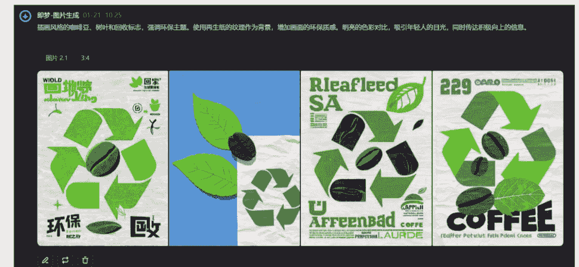

图4-2

创作中可根据需求对生成图像微调，如调整元素位置、大小或形状，不断尝试完善，直至更符合品牌形象与宣传需求。借助AI的迭代优化功能进行多次修改完善，达到最佳效果。

**步骤01 查看图像效果。** 点击任意生成图像即可查看细节，如图4-3所示。

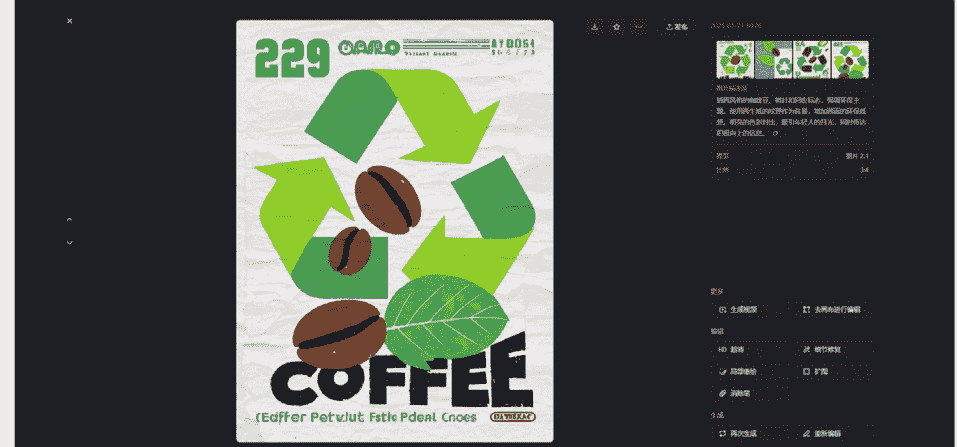

图4-3

**步骤02 擦除部分图像。** 在界面右侧点击“去画布进行编辑”，进入画布后点击“消除笔”按钮，用消除笔涂抹需删除的部分，如图4-4所示。

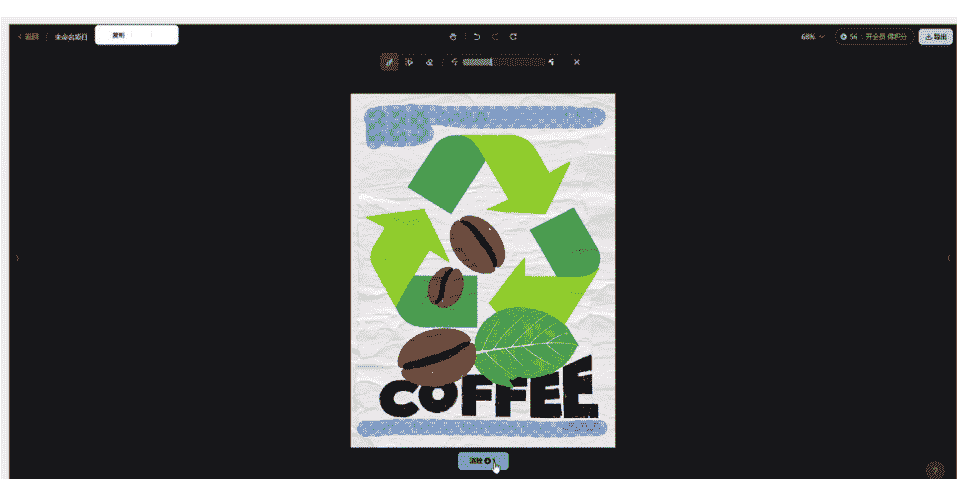

图4-4

**步骤03 应用擦除效果并保存。** 点击“擦除”按钮执行命令，再点击“完成编辑”，效果如图4-5所示。保存图像。

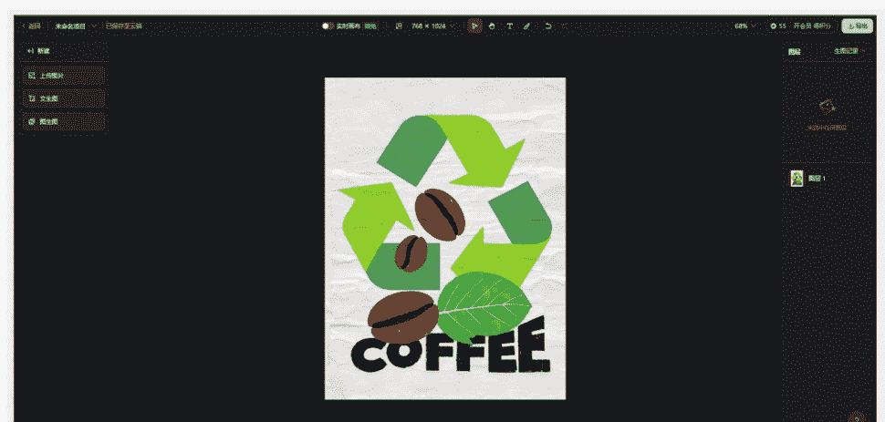

图4-5

**步骤04 利用图生图再生图。** 返回“图像生成”界面，上传已保存图像作为参考图，输入关键词：
参考该图的绘画风格，生成其他关于咖啡馆主题的插画。

**步骤05 生成相关图像。** 点击“立即生成”按钮，系统依据描述与参考图自动生成创意图像，可点击“再次生成”按钮 🔄 重新生成，如图4-6所示。

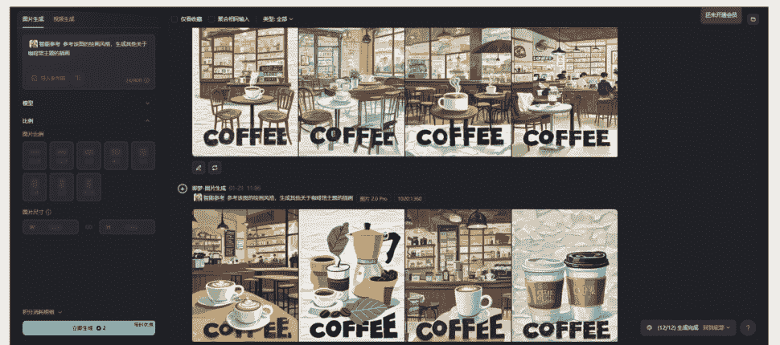

图4-6

**步骤06 保存符合要求的图像。** 浏览生成的图像并保存。系列共4张，效果如图4-7所示。


图4-7

## 5. 创意融合与完善

在AI辅助成果基础上，可用Photoshop等图像处理软件进一步修饰，如添加纹理、光影等，使画面更生动立体，如图4-8所示。同时结合咖啡馆实际情况与客户反馈，对元素进行微调完善，确保设计实用且准确。


图4-8

### 4.1.3 AIGC让图像创作更高效的工具盘点

当前面向图像生成的AIGC方案，多以机器学习、深度神经网络与自然语言理解为技术底座，把文字描述转化为可视作品。Midjourney、即梦AI、豆包、美图云修等产品正在明显提升创作效率。下面梳理了市面上比较典型的几类代表。

表4-1

| 工具 | 简介 |
| :--- | :--- |
| Midjourney | 运行在Discord生态的文生图服务，通过文本提示产出艺术化画面，以高质感与创意度著称 |
| 即梦 AI | 剪映旗下的一体化AI创作平台，接受文字或图像输入，可同时生成画作与视频 |
| 豆包 | 字节系AI助手，在图像生成模式下仅需文字就能快速得到高质量图，支持多语种与多种画风 |
| 简单 AI | 搜狐系的综合型AI创作助手，涵盖AI绘画、文生图、图生图等形态，关键词驱动即可产出创意美图 |
| 佐糖 | 在线AI图像处理工具，提供抠图、去水印、照片修复、无损放大、裁剪、压缩、黑白上色等功能 |
| 美图云修 | 美图为商业摄影定制的AI修图桌面软件，可批量对人像照片进行一键精修 |

## 4.2 AIGC绘画风格的探索实践

模型算力与训练数据的提升，让AIGC绘画从实验走向日常。依托深度学习与计算机视觉，系统能把数据与算法转译为具备艺术张力与可识别风格的作品。这不仅扩充了创作者的工具箱，也为风格创新打开更广阔的想象空间。

### 4.2.1 传统绘画风格的智能化演绎

中国传统绘画底蕴厚重，表现手段多样，从工笔的精细描摹到水墨的意象挥洒，再到文人画的意境营造，各有审美特质。AIGC通过大规模作品学习，可把握线条韵律、墨色层次、构图巧思与意境传递，在复原传统美感的同时为当代表达注入新活力，实现古今对话。


#### 【练习1】工笔画风格

**第1步 撰写指令。** 打开即梦AI或同类平台，将以下描述复制到输入框：
细腻的笔触，华丽的色彩，身着华丽汉服的古代女子，精致的配饰，背景为繁花似锦的花园，整个画面充满工笔画般的细腻与华美。

**第2步 启动生成。** 把画幅设为16：9后点击立即生成，系统会依据描述自动产出初稿，效果见图4-9所示。


图4-9

**第3步 预览与精修。** 点开任意一张结果查看细节，可进行超清增强。优化后呈现见图4-10所示。


图4-10

### 知识拓展
工笔画以极致细腻的描绘与严谨技法闻名，常用细笔刻画花鸟、人物与山水，强调细节刻画与色彩分层，追求写实生动，常承载文化寓意。代表画家有仇英、任颐。

#### 【练习2】水墨画风格

**第1步 撰写指令。** 在即梦AI等平台输入：
淡雅的水墨，山川河流，云雾缭绕，几叶扁舟荡漾其中，远处山峰若隐若现，画面留白处透露着禅意与诗意。

**第2步 启动生成。** 将比例调至3：2后点击生成，系统按描述生成草图，结果见图4-11所示。


图4-11

**第3步 预览与精修。** 选择一张查看细节并做超清处理，优化效果见图4-12所示。


图4-12

### 知识拓展
水墨画以墨与水为核心，注重浓淡干湿变化与流动感，常描绘山水、花鸟、人物，强调意境与情感，善用留白与简笔，追求形神兼备。代表有张大千、齐白石。

AIGC的价值并不止于复刻经典，更在于捕捉当下审美并对传统进行创造性转化。以《清明上河图》为蓝本的互动解谜游戏为例，融合VR技术，让玩家沉浸式走进汴京城，探索每个角落、破解谜题，同时了解北宋历史文化。这种寓教于乐的形式提升了年轻群体的兴趣，也推动了传统文化的传播。

### 4.2.2 现代艺术风格的尝试与落地

现代艺术自20世纪起以突破边界、开拓新视觉语言著称，从抽象表现主义的情感宣泄，到极简主义的形式提炼，再到波普艺术的文化反思，每种风格都反映了时代变迁与艺术家视角。

AIGC通过深度学习可解析抽象艺术、表现主义、波普艺术等风格特征，如抽象艺术的形色对比、表现主义的情绪表达、波普艺术的商业符号。基于解析结果，AI可产出融合多风格的新作，艺术家还可在此基础上二次创作，拓展表现路径。


#### 【练习3】抽象表现主义风格

**第1步 撰写指令。** 打开即梦AI或同类工具，输入：
选择一个或几个强烈的情感作为主题，如愤怒、喜悦、悲伤或宁静。使用大胆、鲜明的色彩，如红、蓝、黄、黑等，通过泼墨、涂抹或厚涂技法，将情感直接转化为画布上的色彩碰撞和形状交融。不必拘泥于具象形态，而是让色彩和形状自由地在画布上舞动，形成具有强烈视觉冲击力和情感表达力的抽象画面。

**第2步 启动生成。** 设定比例为3：2，点击立即生成，得到初稿见图4-13所示。


图4-13

**第3步 预览与精修。** 点击任一结果查看细节并做超清处理，优化后见图4-14所示。


图4-14

### 知识拓展
抽象表现主义诞生于20世纪40年代的美国，主张情感直抒，以自由笔触与高饱和色彩表达内心，作品多为非具象的情感张力呈现，代表人物包括杰克逊·波洛克、马克·罗斯科。

#### 【练习4】波普主义风格

**第1步 撰写指令。** 在即梦AI等工具中输入：
选取日常生活中的常见物品或场景，如可乐罐、汉堡、电视机等，将这些元素进行放大或夸张处理。通过放大物品的尺寸或突出其某些特征，使其具有超现实的视觉效果。同时，可以运用波普艺术的复制粘贴手法，使这些物品在画布上多次重复出现，形成一种视觉上的节奏感和韵律感。

**第2步 启动生成。** 比例设为3：2后点击生成，结果见图4-15所示。


图4-15

**第3步 预览与精修。** 选择任意一张查看细节并进行超清处理，优化后见图4-16所示。


图4-16

### 知识拓展
波普主义起于20世纪50年代英国、在美国兴盛，关注大众趣味与流行文化，喜爱强烈对比色与夸张手法，常采用拼贴、连环画形式，将商标、快餐包装等元素引入艺术，代表人物为安迪·沃霍尔、彼得·布莱克。

### 4.2.3 名家风格的复刻与再创作

AIGC借助算法与大数据集，能深入解析艺术大师的经典作品，精准模拟其笔触、色彩运用等风格特征，像搭建一座桥梁，让历史艺术精神在数字世界延续。这项技术既助力传统艺术复兴，也为当代创作提供灵感。

使用时，用户只需提供一张原图并指定目标大师风格，系统会提炼该大师的笔触、配色等核心要素并融合进原图，生成既保留原意又具大师风格的新作品。

#### 【练习5】复刻张大千绘画风格


**第1步 导入参考图。** 在豆包图像生成界面点击文本框中的“参考图”按钮，上传如图4-17所示的图片。

**第2步 输入提示词：**
将此森林景象转换为张大千泼墨山水风格，以泼墨的方式表现树木和山丘的形态，雾气部分可用淡墨或水墨渲染，营造云雾缭绕的仙境之感。在画面中的空白处或需要强调的地方点上苔点，以增加画面的细节和层次。可以在画面中加入适量的暖色调（如淡黄、淡红），以丰富画面的色彩层次，但整体色调应以冷色调为主。

**第3步 启动生成。** 点击发送，系统结合描述与参考图自动生成结果，效果见图4-18所示。


图4-17


图4-18

**第4步 查看效果。** 点击任意一张查看细节，效果见图4-19所示。


图4-19

### 知识拓展
张大千是20世纪国画大师，擅长山水与花鸟，融汇工笔精细与泼墨奔放，色彩丰盈、构图大胆，对自然有深刻体悟，亦吸收西方语汇形成中西融合特色，代表作有《泼墨山水》《桃花源图》。

#### 【练习6】复刻梵高绘画风格

**第1步 导入参考图。** 在豆包图像生成界面点击“参考图”按钮，上传如图4-20所示的图片。

**第2步 输入提示词：**
保留原图的构图方式与主体（小男孩放风筝）。将原图中的色彩进行梵高式的调整，如增强蓝色和黄色的对比，使画面更加鲜艳。模拟梵高的粗犷笔触，对画面进行细节处理。在保持原图主题和构图的基础上，进行适当的变形和夸张，以增强画面的艺术效果。

**第3步 启动生成。** 点击发送，系统据描述与参考图自动生成结果，效果见图4-21所示。

### 4.2.4 人像与风景的真实还原

AIGC在图像生成上的能力使高度逼真的肖像与自然风景成为可能。深度学习模型可捕捉细腻光影与纹理细节，不仅服务艺术创作，也广泛应用于影视、游戏、广告等视觉内容生产。

#### 【练习7】古风少女肖像

**第1步 撰写指令。** 打开即梦AI或同类工具，输入：
一位身着红色古装的少女，面容清秀，背景为古色古香的建筑或山水，发丝随风飘动，整体呈现出浓郁的古风韵味，真人摄影。

**第2步 启动生成。** 比例设为3：2，点击立即生成，结果见图4-23所示。

**第3步 预览与精修。** 点开任一结果查看细节并做超清处理，优化后见图4-24所示。

#### 【练习8】冬日雪山仙境

**第1步 撰写指令。** 在即梦AI等平台输入：
巍峨的雪山耸入云霄，山间云雾缭绕，冰雪覆盖的山峰在阳光下熠熠生辉，山脚下是一片宁静的湖泊，整体营造出一种如梦似幻的仙境氛围。

**第2步 启动生成。** 比例设为3：2，点击立即生成，结果见图4-25所示。

**第3步 预览与精修。** 点开任意结果查看细节并做超清处理，优化后见图4-26所示。

### 4.2.5 角色与IP设计落地

在文化产业中，角色与IP设计是连接消费者与产品的关键，直接影响品牌形象与粉丝运营。AIGC绘画为创作者提供了全新路径，可快速生成多元角色方案，涵盖面部特征、发型、肤色、服饰、配饰与整体造型。

同时AIGC还能依据背景故事与性格设定生成相应气质，提升设计效率并提供丰富创意选项，帮助作品在竞争中脱颖而出，适用于动画、游戏、影视等多个领域。

#### 【练习9】魔法森林精灵

**第1步 撰写指令。** 打开即梦AI或同类工具，输入：
一位与自然元素完美融合的森林精灵，拥有透明的翅膀和发光的魔法杖，绿色长发随风飘动，背景是神秘莫测的森林。

**第2步 启动生成。** 比例设为3：2，点击立即生成，结果见图4-27所示。

**第3步 预览与精修。** 点开任意结果查看细节并做超清处理，优化后见图4-28所示。

#### 【练习10】盲盒IP

**第1步 撰写指令。** 在即梦AI等平台输入：
该系列盲盒IP图像以复古童话小镇为主题，角色穿着复古服饰，融入各种童话元素，背景是宁静而温馨的小镇风景，每个角色都仿佛在讲述一个梦幻般的童话故事。

**第2步 启动生成。** 比例设为3：2，点击立即生成，结果见图4-29所示。

**第3步 预览与精修。** 点开任意结果查看细节并做超清处理，优化后见图4-30所示。

### 4.2.6 游戏美术创作的AIGC新范式

AIGC正重塑游戏创作流程，带来效率与创意双提升。过去构建复杂世界与塑造角色需经历概念、草图、建模、渲染等耗时环节，如今AI可自动生成高质量视觉内容，包括环境、角色模型、纹理与动画。

此外，AIGC能分析大量游戏数据与艺术风格，提取独特设计元素，帮助开发者突破思维定式，探索新视觉与叙事方式。它还能依据玩家反馈与行为数据实时调整内容，提供个性化体验，增强沉浸感与参与度。

#### 【练习11】游戏场景：星际废墟

**第1步 撰写指令。** 打开即梦AI或其他AIGC模型，输入：
一个被遗弃的星际空间站，内部充满了破损的机械部件和未知的科技装置。空间站内部光线昏暗，但偶尔会有能量脉冲照亮某些区域，营造出一种神秘而危险的氛围。

**第2步 启动生成。** 比例设为3：2，点击立即生成，结果见图4-31所示。

**第3步 预览与精修。** 点开任意结果查看细节并做超清处理，优化后见图4-32所示。

#### 【练习12】游戏人物：机械守护者

**星际机甲视觉打造教程**

第一步 撰写画面描述。启动即梦AI或其它AIGC平台，将下面这段描述粘贴进输入区：

玩家扮演的角色是一位机械守护者，身穿先进的战斗装甲，拥有操控机械和修复科技装置的能力。他的任务是探索星际废墟，寻找能源核心，重启空间站，并揭示背后的真相。

第二步 产出初稿。把描述填入后把画面比例设为3：2，按“立即生成”。系统按文字自动产出视觉草图，效果参考图4-33。

第三步 预览与精修。点开任意结果放大查看细节并进行超清处理，优化后的效果参考图4-34。

## 4.3 AIGC图像处理技术与应用

AIGC 图像处理是人工智能的一个重要分支，正逐步改变人们对传统图像编辑的认知。依托深度学习与计算机视觉等技术，它能够自动高效地完成多类复杂的图像任务。

### 4.3.1 电商产品背景移除

在电商场景里，商品图的呈现直接影响购买决策。AIGC里的抠图去背功能可凭借智能识别把商品从杂乱背景中精准分离，让主体更突出清晰。自动化处理省去人工耗时，也保证成片风格统一专业，提升整体视觉质感。

#### 【练习13】去除商品背景

步骤01 选择抠图入口。进入豆包的图像生成界面，点击图4-35所示的智能抠图按钮。

步骤02 上传素材。触发抠图后弹出打开对话框，挑选待处理文件点打开完成上传，见图4-36。

步骤03 抠出主体并去背。点击抠出主体，系统开始处理，效果见图4-37。

步骤04 智能编辑追加背景关键词。点击智能编辑，输入期望的背景词，见图4-38。

步骤05 生成适配成片。点击发送，系统按描述自动合成匹配背景，生成效果见图4-39。

### 4.3.2 水印与瑕疵的擦除

水印与瑕疵常破坏画面完整度。水印虽为版权标识，却遮挡主体降低观赏性；划痕、污点、色彩不均等缺陷也会削弱视觉吸引力。

AIGC借助深度学习模型可智能定位并精准清除水印与瑕疵，覆盖文字水印、图案水印、划痕、污渍等。先由训练好的模型解析图像特征定位问题区域，再以图像修复技术结合周边像素信息自动填补，还原自然完整画面。

#### 【练习14】去除水印

步骤01 提交图片。进入佐糖官网，依次点AI图片去水印与上传图片，在弹出对话框选择文件点打开完成上传，效果见图4-40。

步骤02 自动擦除水印。左侧点击开始处理，系统自动擦除文字水印，去除效果见图4-41。

### 4.3.3 模糊图片秒变高清图

模糊画面难以传递清晰信息，尤其在需要精准视觉表达的场合。AIGC借助深度学习模型可恢复细节与清晰度：分析模糊特征识别模糊模式，利用训练模型重建画面，不仅消除模糊，还能增强细节，使画面更生动真实。应用覆盖电商、摄影、医疗等领域。

#### 【练习15】一键变清晰

步骤01 上传并执行清晰化。在佐糖官网依次点人像变清晰与上传图片，选图后系统自动执行清晰处理，效果见图4-42。

步骤02 查看结果。点击图左上角全屏查看可放大观察，左下角可调整查看比例，效果见图4-43。

### 4.3.4 智能调整图像颜色

AIGC可按需求自动调节亮度、对比度、饱和度等参数，让画面达到最佳观感。系统通过色彩分布与光照条件分析给出最优方案，并提供复古黑白、人像胶片等多款滤镜，满足不同艺术风格需求，广泛用于摄影后期、设计与社交媒体。

#### 【练习16】胶片感场景配色

步骤01 提交素材。打开美图云修，进入主界面拖入素材，见图4-44。

步骤02 应用胶片滤镜。点滤镜展开胶片选项，选择日系滤镜并把浓度调至100，应用效果见图4-45。

步骤03 叠加第二层滤镜。点图像调整展开AI滤镜，选择浓郁胶片后把滤镜浓度调至6，应用效果见图4-46。

步骤04 增加颗粒质感。在图像调整界面下移展开细节选项，将胶片颗粒感设为69，应用效果见图4-47。

### 4.3.5 图像的创意扩图

创意扩图是AIGC的另一创新点。技术依据画面内容与风格智能推测生成自然延伸区域，实现无缝扩画。系统分析原图的色彩、纹理与构图，借助深度学习生成风格一致的扩展部分，保证连贯美观。旅游摄影、壁纸制作等场景使用广泛。

#### 【练习17】古风人物扩图

步骤01 提交图像并设定扩展尺寸。在豆包图像生成界面点击左上角扩图功能，导入素材后调整扩图尺寸，见图4-48。

步骤02 查看扩图结果。点击下方按新尺寸生成图片，系统自动完成扩图，效果见图4-49。

### 4.3.6 老照片的智能修复

时间流逝使老照片出现褪色、划痕、污点，既损害外观也模糊历史记忆。传统修复耗时费力且效果不稳。AIGC以智能算法自动修复，简化流程并能识别并修复损坏区域，恢复色彩与细节，促进老照片的保护与传承。

#### 【练习18】老照片上色

步骤01 导入参考图。在即梦AI的AI作图界面点击文本框中的导入参考图按钮，上传图4-50所示图像。

步骤02 输入上色指令。输入关键词：

将该图转换为彩色图像效果，背景中的旗帜、遮阳篷等可以使用鲜艳的颜色，如红色、蓝色或黄色。顾客和摊贩的服饰可以根据他们的活动状态来选择颜色。

步骤03 生成上色结果。点击立即生成，系统基于描述与参考图进行上色，生成效果见图4-51。

步骤04 预览与超清。点击任一生成图查看细节并进行超清处理，优化后效果见图4-52。

## 4.4 AIGC应用实战：诗画同源—古诗词绘画新体验

本练习将中国传统诗词与AIGC绘画结合，为传统文化传承创新提供思路，把千古佳句转化为意境深远的画作。

步骤01 主题确定。确定主题后借助AIGC生成设计方案。打开文心一言，输入提示词：

借助AIGC绘画生成和古诗相符的图像，有什么好的古诗与绘画方案，例举二三个。

步骤02 灵感激发。智谱清言据此给出方案。

借助AIGC绘画生成与古诗相符的图像，是文学与艺术融合的创意过程。以下三个方案以现代技术展现古诗意境。

方案一：《登鹳雀楼》壮丽山河图

古诗内容：王之涣《登鹳雀楼》描绘登楼所见壮丽山河，表达积极进取精神。

绘画方案

方案二：《江南春》江南水乡图

古诗内容：杜牧《江南春》描绘江南水乡美景与春意，融入历史文化元素。

绘画方案

- 关键词与风格：江南水乡、绿树红花、小桥流水、烟雨蒙蒙、古镇风情、油画风格等。
- 画面构想：以江南水乡为背景，绿树红花掩映下小桥流水宁静，远处古镇在烟雨中若隐若现，增添神秘。采用油画风格，以丰富色彩与细腻笔触表现春景。

方案三：《江雪》孤舟寒江图

古诗内容：柳宗元《江雪》描绘老翁寒江独钓，四周白雪皑皑、万籁俱寂的孤寂壮美画面。

绘画方案

- 关键词与风格：孤舟、寒江、白雪覆盖、老翁垂钓、寂静无声、水墨画风格、留白艺术等。
- 画面构想：广阔寒江为背景，江面一艘小舟，老翁静坐垂钓。四周雪覆，天地银装，营造孤寂壮美氛围。大面积留白，简洁线条与淡雅色彩巧构画面，以水墨风格体现诗韵与AIGC技术魅力。

步骤03 设定格式并输入关键词。打开豆包AI进入图像生成界面，设比例为16：9，绘画风格为水墨画，输入关键词：

画面以一片广阔的寒江为背景，江面上漂浮着一叶孤舟，舟上有一位老翁正静静地垂钓。四周被白雪覆盖，天地一片银装素裹。传统水墨风格、留白艺术。

步骤04 生成创意图像。点击立即生成按钮，效果如图4-53所示。


图4-53

步骤05 保存图像。选择目标图像保存，效果如图4-54所示。


图4-54

# 第5章 数字音频编辑高手

音频是娱乐传播与信息交流、教育学习等领域的重要载体。融入AIGC后，数字音频的生成、编辑与应用愈加便捷高效。AIGC不仅能模拟真实音频，还能按需快速生成音效、配乐与配音，为创作提供新视角。本章介绍AIGC在数字音频编辑中的应用。

## 5.1 了解音频那些事

声音在生活中扮演关键角色，是沟通桥梁也是情感思想的载体，能引发强烈共鸣与回忆。

### 5.1.1 声音和波形图

声音由物体振动产生，通过空气、水或固体传播，被耳朵接收并由大脑识别。基本特性包括频率即音高、振幅即音量、波形即音质。频率决定高低，振幅影响强弱，波形决定音色。

波形图展示声音振动模式，横轴为时间，纵轴为振动幅度。通过波形可读出频率、振幅、周期、波长、相位等，如图5-1所示。

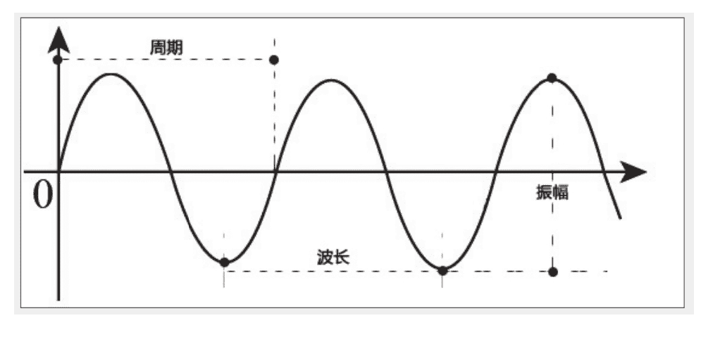

图5-1

- 横轴：时间线，单位常用s或ms。
- 纵轴：振动幅度，即响度。振幅越大越响，反之越弱。
- 频率：单位时间重复次数，单位Hz。频率高听感尖锐，频率低听感低沉，波形上波峰波谷更密集则频率越高。
- 振幅：振子偏离横轴最大距离，常用dB表示。振幅越大能量越大，声音越响。
- 周期：完成一次完整振动所需时间。频率越高周期越短。
- 波长：一个周期内传播距离，单位m。与频率成反比。
- 相位：周期内波形位置，单位度。0°起算，90°为高压点，180°回归零点，270°为低压点，360°再回零点。

多条声波传播时会叠加，称叠音。

1. 同相位叠加。波峰波谷完全重合，振幅增大，声音更响，如图5-2所示。

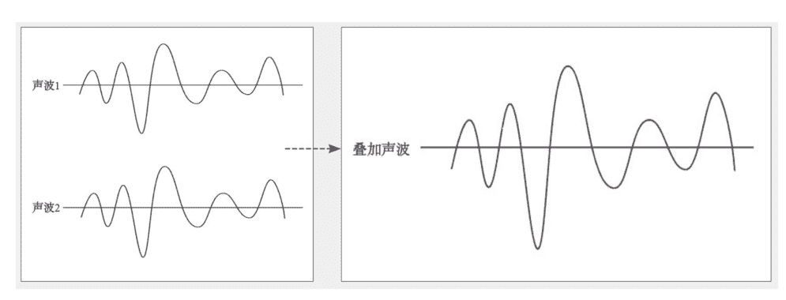

图5-2

2. 反相位叠加。波峰波谷完全相反，相互抵消，声音减弱甚至静音，如图5-3所示。

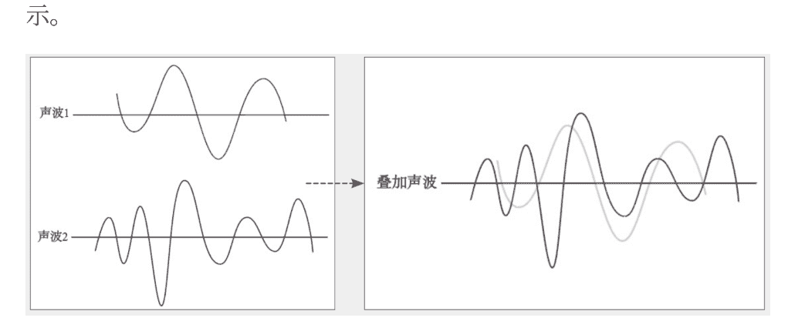

图5-3

3. 混合相位叠加。不同频率、不同振幅声波叠加形成混合声波，掺杂人声、音乐、噪声等，如图5-4所示。


图5-4

### 5.1.2 从模拟音频到数字音频

音频分为模拟与数字两种。

模拟音频把连续变化声波转成连续变化电信号，与原始波形相似。早期磁带录音机即以此方式记录与回放，如图5-5所示。


图5-5

模拟音频特征：
- 连续性：信号连续，可无缝表现声音变化。
- 波形：波形近似原始声音，保留细节与动态。
- 噪声：易受干扰产生噪声影响音质。

数字技术兴起后，模拟逐渐被数字取代。数字音频把模拟信号转为代表不同时间点强度的数字代码，处理存储传输更高效便捷，但模拟在音质与情感表达上仍有独特魅力。

数字音频特征：
- 离散性：信号离散，以数字值序列表示。
- 采样率：固定时间间隔采样，常见44100Hz与48000Hz。
- 比特深度：每个样本精度，常见16位、24位。

模拟与数字各有优劣。模拟音质自然温暖，数字稳定清晰。表5-1为两者区别。

表5-1

| 特性 | 模拟音频 | 数字音频 |
| :--- | :--- | :--- |
| 信号类型 | 连续信号 | 离散信号 |
| 记录方式 | 物理介质如磁带黑胶 | 采样与量化 |
| 音质 | 自然温暖保留细节 | 稳定清晰压缩会失细节 |
| 噪声与干扰 | 易受干扰产生噪声 | 抗干扰音质稳定 |
| 存储与复制 | 易劣化不利存储 | 易存储复制分享 |
| 常见格式 | 黑胶磁带 AM/FM 广播 | WAV MP3 FLAC AAC |

### 5.1.3 音频的常见格式

1. 有损音频格式

有损格式如MP3、AAC、WMA、OGG，压缩时丢弃部分信息以减小体积，适合日常听歌。
- MP3：主流格式，音质与体积平衡好，广泛用于下载与流媒体。
- AAC：更高级格式，同码率音质通常优于MP3，用于流媒体与数字广播。
- WMA：微软开发，音质与MP3相当，适配Windows平台。

2. 无损音频格式

无损格式如WAV、FLAC、ALAC、AIFF，压缩不丢信息，保留原始数据，音质高但体积大。
- WAV：音质极高，保留全部细节与动态，适用于专业制作录音编辑。
- FLAC：开源无损压缩，保持音质同时减小体积，适合高保真存储。
- ALAC：苹果开发，与FLAC类似，兼容iTunes、iPhone、iPad、Mac等，压缩效率略低，比特率随内容变化。
- AIFF：苹果开发，类似WAV，高音质，适用于专业制作。

3. 其他格式
- M4A：采用AAC编码的MPEG-4文件，常用于苹果设备，低码率下音质优于MP3。

BWF 是在 WAV 基础上做扩展的专业音频封装格式，能写入艺术家、专辑、曲目信息及封面图等元数据，在广播制作与专业音频工程中常用于素材归档与检索。

DSD 属于超高解析度的音频编码方案，在高频延伸与动态表现上明显优于标准 CD，深受发烧群体青睐。缺点是码率极高导致文件体积庞大，不便于长期保存与网络传输，且仅在特定播放硬件与专业软件环境下可用，兼容性有限。

### 5.1.4 音频的声道制式
声道制式指音频信号在各通道间的分配方式，它决定了声像在空间中的投射形态，对空间感、清晰度与沉浸体验影响显著。市场上主流的布局有单声道、立体声、环绕立体声。

#### 1. 单声道
单声道使用单一通道承载全部声源，所有内容从同一路径输出。不管连接多少只扬声器或耳机，收听到的信号完全一致，空间表现弱但体积小，十分适合语音录制、播客等以语言为主的应用。

#### 2. 立体声道
立体声以左右两路独立通道传递信息，可还原声源方位，提供方向感与空间感。在音乐与影视制作中能更好地呈现层次与细节，提升听觉体验。代价是文件更大，对录制与后期处理的设备同步与品质要求更高。

#### 3. 环绕立体声
环绕立体声调动多路声道在空间不同方位发声，形成包围式声场。它在保留方向信息的同时强化纵深感、临场感与整体空间感，让听者产生置身现场的感受。常见配置主要有 5.1 声道与 7.1 声道。

- 5.1 声道：包含左前、右前、中置、左后、右后以及一个低音炮 LFE，广泛用于家庭影院、电影、电视节目与游戏。
- 7.1 声道：在 5.1 基础上额外加入左侧环绕 LS 与右侧环绕 RS，更多应用于高端家庭影院、高端游戏与电影音轨。

## 5.2 完美生成配音及配乐
得益于生成能力的提升，生成式 AI 现在能够高度还原各种声音和音乐，满足多元场景需求。从精准语音合成到富有情感的音乐创作，都展现出前所未有的便利与效率。

### 5.2.1 配音及配乐生成工具
借助生成式 AI 可以自动产出符合需求的声音与音乐，已进入广告制作、视频配乐、语音合成等多个领域。下面整理几款常用工具供参考。

表5-2

| 工具 | 介绍 |
| --- | --- |
| 通义听悟 | 阿里云推出的音视频智能转写产品，聚焦音视频资料的自动化处理，提升工作学习效率。依托阿里云前沿技术实现高精度转写，保证信息完整与准确 |
| 网易天音 | 网易发布的智能语音识别与合成平台，涵盖识别、转写、合成等应用。结合网易在自然语言处理与语音识别方面的积累，提供高效智能的语音解决方案 |
| Resemble AI | 人工智能驱动的语音合成方案，擅长生成高质量定制人声。采用深度学习，可输出自然流畅的声音，应用于广告、游戏、虚拟助手、播客等 |
| 海绵音乐 | 偏向 AI 音乐自动创作，用于按需生成与创作。基于深度学习，能产出多种风格的音乐素材 |

### 5.2.2 精准高效录音的转写
录音转写借助语音识别技术把录制内容自动转为文字，提升效率并减少人工失误。

#### 【练习1】纪录片语音转文字
下面以转写央视《读书的力量》纪录片片段为例，演示通义听悟的语音转文字流程。

**步骤01 登录网站，点选上传按钮。** 访问并登录通义听悟官网 https://tingwu.aliyun.com/home，点击“上传音视频”按钮，如图5-6所示。


图5-6

**步骤02 选择本地文件并设定参数。** 在弹出的上传窗口中点开“上传本地音视频文件”，将纪录片音频拖入此处，并把“区分发言人”选项设为“多人讨论”，如图5-7所示。

**步骤03 发起转写。** 敲击“开始转写”后系统自动处理文件，完成后会引导用户在系统默认文件夹界面查看结果。


图5-7

**步骤04 查看转写内容。** 打开文件即可看到转写结果，包含关键词、全文摘要、正文以及各发言人的讲述内容，如图5-8所示。

**步骤05 标记重要内容。** 对需要强调的部分可点击“标记为重点” 🔖，将其高亮标注，如图5-9所示。

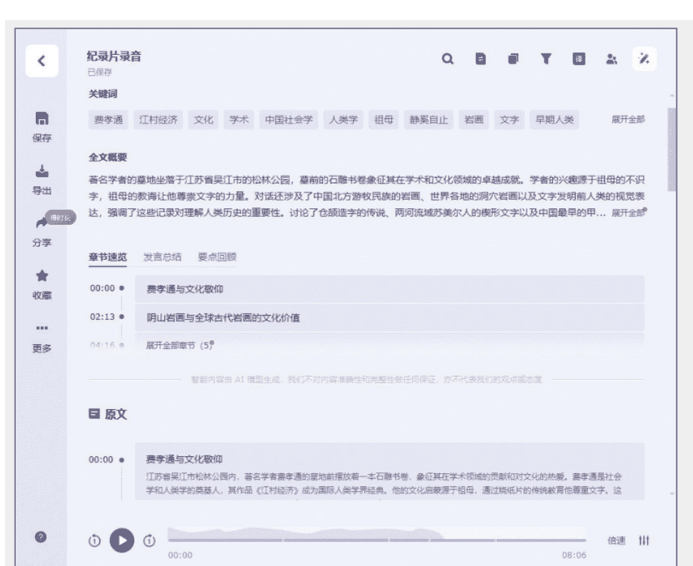

图5-8

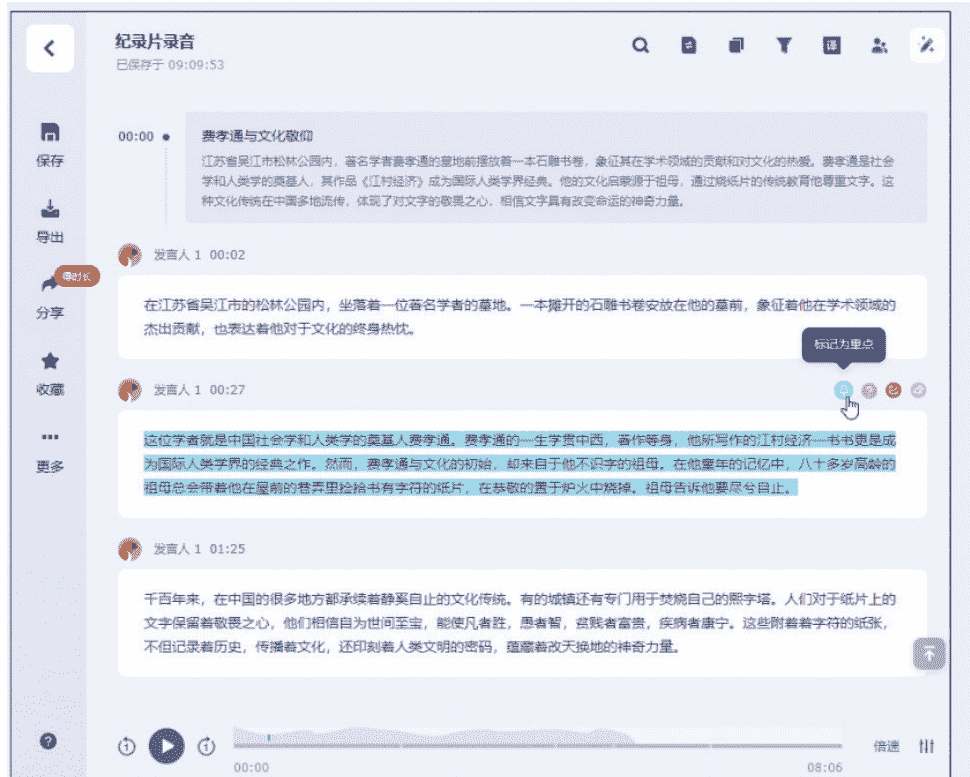

图5-9

**步骤06 摘取内容概要。** 需要段落概要时，可在对应概要上方点“复制”，粘贴到本地文档或右侧笔记栏中，如图5-10所示。

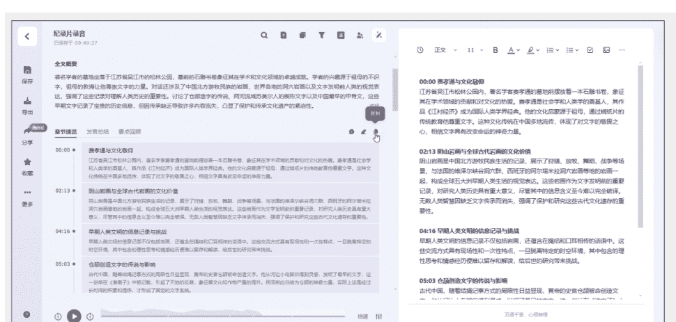

图5-10

**步骤07 整理笔记栏中的文字。** 笔记栏支持对摘要进行编辑与基础排版调整。

**步骤08 摘取全文。** 如需完整文本，点击页面上方的“批量摘取”，选择“摘取全文”，确认后内容会导入笔记栏，如图5-11所示。

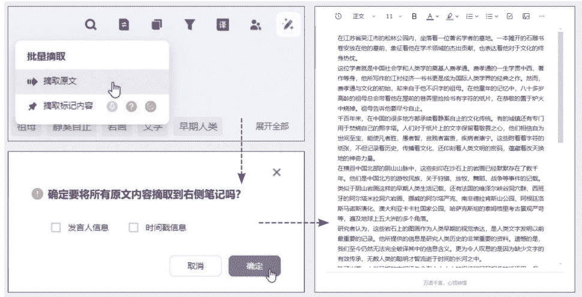

图5-11

**步骤09 复制粘贴到本地文档。** 将笔记栏整理好的文章复制到本地文档，完成语音到文字的转换。

### 5.2.3 引人入胜的有声书配音


有声书靠声音传递故事，核心在于朗读者。听书让人在碎片时间获取知识。传统制作需要团队配合，耗时耗成本。借助生成式 AI，有声书制作变得简便高效，甚至一人即可完成整本书的配音。

#### 【练习2】为创作的故事配音
下面用“声咔”工具为一篇职场故事配音。“声咔”是一个智能音频制作平台，支持文本配音、变声、声源分离等功能，适用于多种声音创作需求。

**步骤01 输入创作提示词。** 打开“文心一言”，输入故事创作指令。

请写一段故事。内容梗概：初入职场的梅小凡被各种职场霸凌，她没有退缩，依然保持一颗初心与努力的态度，进入公司高层，最终赢得了领导的赏识。

生成内容如下（节选）：

## 梅小凡：职场迷雾中的璀璨星光

在都市的钢铁森林中，梅小凡，一个怀揣梦想与坚韧意志的女孩，踏入她梦寐以求的国际知名企业大门。然而，初入职场的她，并未迎来想象中的阳光大道，反而被卷入了一场职场阴谋的漩涡。

梅小凡被分配到市场部，一个看似光鲜实则暗流涌动的部门。她的到来，似乎触动了一些人的敏感神经。一些老员工，利用手中的权力和资源，开始对她进行排挤和打压。他们不仅故意分配给她难以完成的任务，还在背后散布谣言，诋毁她的名誉。更可怕的是，他们似乎还联手制造了一场“意外”，让梅小凡在一次重要会议中出丑，企图让她知难而退。

### 5.2.4 氛围拉满的有声书配乐
在有声书中加入背景音乐可营造氛围与场景，烘托情绪、增强连贯性与听感。

#### 【练习3】为创作的故事配乐
下面使用“海绵音乐”为上述有声故事配乐，增加内容丰富度。

步骤01 打开创作界面。登录海绵音乐官网，点击“创作”进入工作区，如图5-17所示。

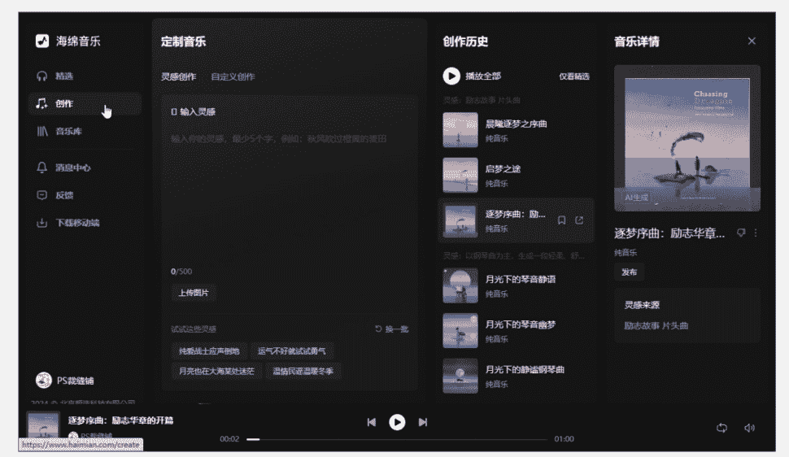

图5-17

步骤02 选择纯音乐模式并填写提示。如图5-18所示，打开“纯音乐”模式，并在“灵感创作”标签中填写需求描述。

请创作一段充满紧张氛围的旋律，旨在增强有声故事情节的紧迫感与悬疑性，适合作为背景配乐使用。

步骤03 生成试听。点击“生成音乐”，系统会产出 3 条试听片段并自动播放，如图5-19所示。

### 定制音乐

灵感创作 自定义创作

□ 输入灵感

请创作一段充满紧张氛围的旋律，旨在增强有声故事情节的紧迫感与悬疑性，适合作为背景配乐使用。

45/500

上传图片

纯音乐

生成音乐

图5-18

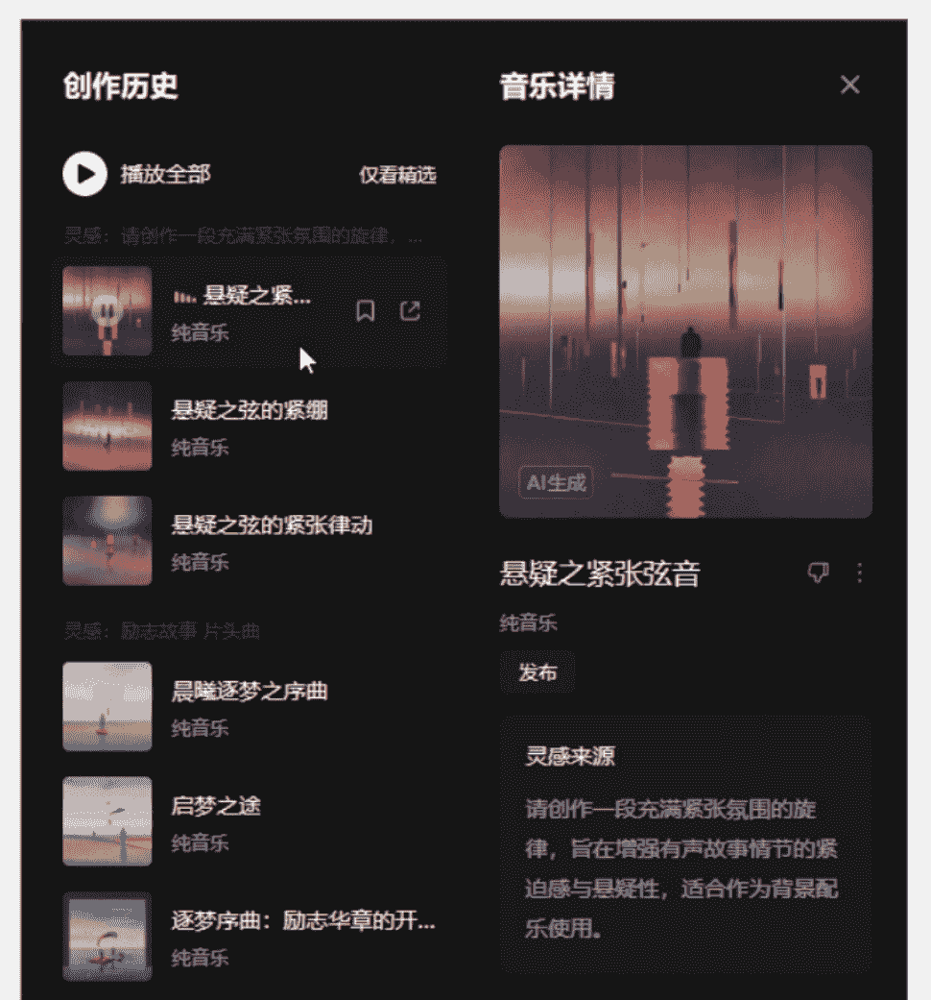

图5-19

**步骤04 保存音乐。** 不满意可重新点击“生成音乐”。选定满意版本后点“分享” 📤，选择“下载视频”保存到本地，如图5-20所示。

**步骤05 转为音频。** 下载结果为视频，可用“格式工厂”将其转为音频以便后续编辑。打开格式工厂，将视频拖入转换区，设置输出格式后执行转换，如图5-21所示。

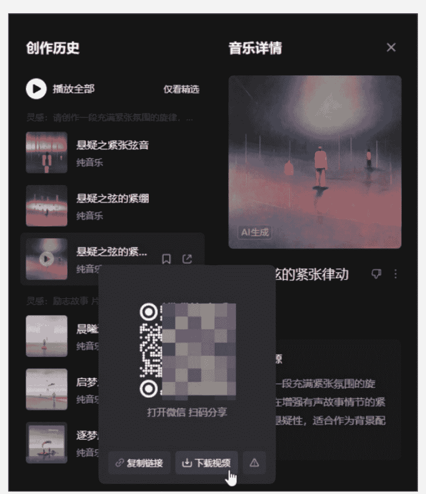

图5-20

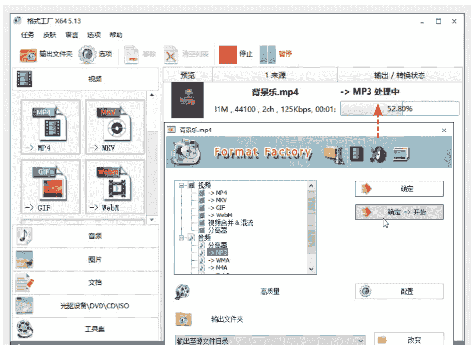

图5-21

### 5.2.5 生成符合主题的歌曲
音乐创作过去需要专业训练。如今借助生成式 AI，普通用户也能通过智能作曲软件与生成算法实现创作。

#### 【练习4】创作毕业之歌
下面用“海绵音乐”创作一首毕业季主题歌曲。

步骤01 输入歌词需求。登录海绵音乐官网，点击“创作”进入“定制音乐”界面，选择“自定义创作”模式，点击“灵感生词”输入歌词需求，如图5-22所示。

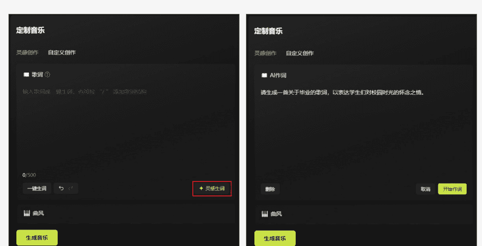

图5-22

步骤02 生成歌词。点击“开始作词”，系统会按主题生成歌词，不满意可点“换一首”重新生成，如图5-23所示。

步骤03 调整歌曲参数。按需设定曲风、情绪与音色，如图5-24所示。

### 定制音乐

灵感创作 自定义创作

歌词

(前奏)

(副歌)

往昔岁月如风吹过心田

往昔青春藏在记忆里面

我还在怀念 我们的昨天

那段难忘的从前

(主歌)

233/500

换一首

灵感生词

曲风

生成音乐

图5-23

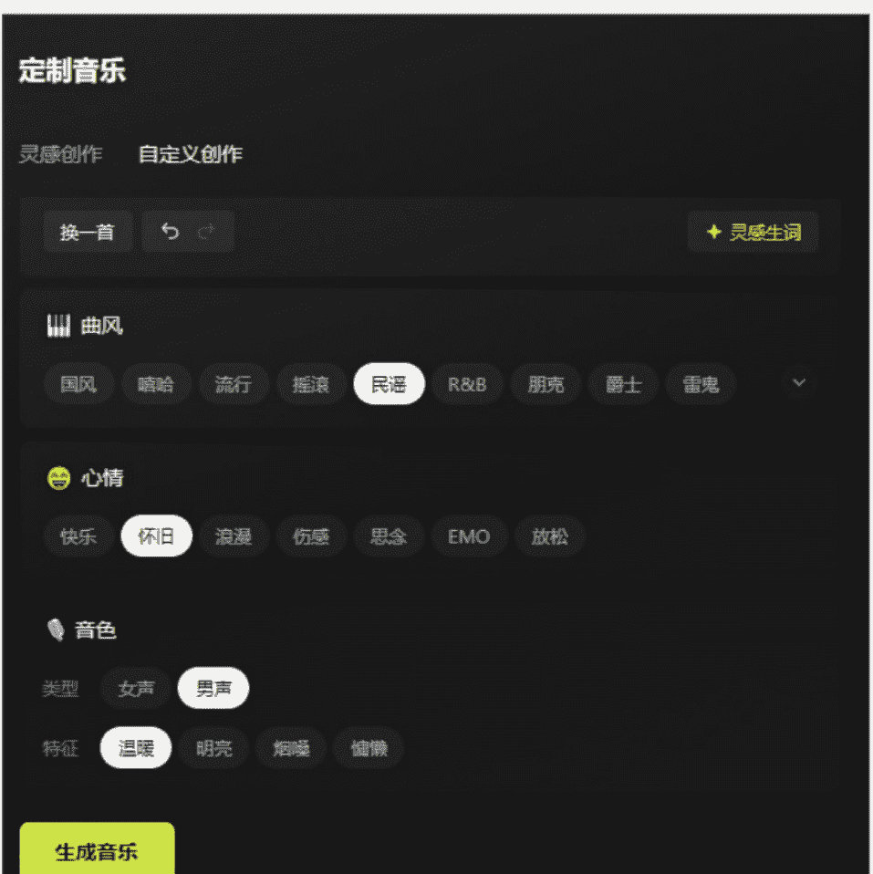

图5-24

步骤04 生成并保存。点击“生成音乐”即可获得 3 个版本，选择满意的版本下载到本地磁盘中。

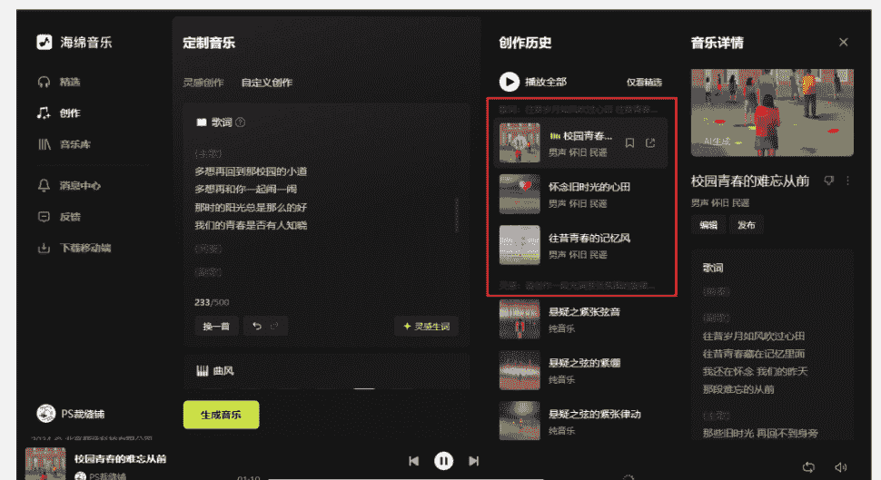

图5-25

## 5.3 混音降噪一键编辑
生成式 AI 让音频编辑更自动化、智能化，可自动识别优化细节，一键添加音效，大幅提升创作效率与质量。

### 5.3.1 音频编辑常用工具
音频编辑领域最受欢迎的是 Adobe Audition。该软件集成人工智能，可快速降噪、修复、加效果与智能提取，大幅提升工作效率，如图5-26所示。

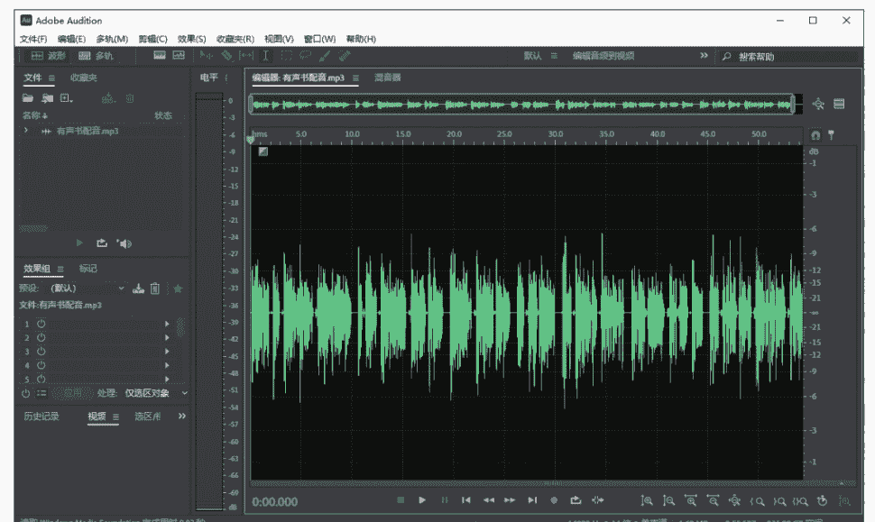

图5-26

Audition 核心功能包括。

- **多轨混音**：同时处理多段音频，可把背景乐、配音、音效置于不同轨道，通过拖拽排列与调整，分别添加效果、静音或独奏。
- **单轨编辑**：针对单段音频进行精细化处理，修正细节。
- **音频修复与降噪**：自动识别背景噪声、口水音、嘶声等，快速清除爆音与脉冲噪声。
- **实时音效**：内置均衡器、压缩器、混响、延迟等高质量效果器，可直接加载优化音质。

除 Audition 外，剪映、Vocalremover 等也是常用的生成式 AI 编辑小工具。

### 表5-3

| 工具 | 简介 |
|---|---|
| 剪映专业版 | 抖音官方出品的视频剪辑应用，含音频处理功能，可提取音频、变速、降噪、变声、加音效等 |
| 闪电音频剪辑 | 专业高效的音频剪辑软件，提供剪切、合并、混音、降噪、淡入淡出、变调、变速、人声提取与消除等功能，支持多轨编辑 |
| Vocalremover | 基于人工智能的在线音频处理工具，核心是精准去除人声，保留伴奏或背景音乐 |
| AudioMass | 免费开源的在线音频与波形编辑器，无需安装，可对片段单独套用效果，具备节奏速度调整、失真、延迟、反转、混响、压缩、剪切等功能，对新手友好 |

### 5.3.2 无缝衔接的音频拼接
将人声、背景乐与音效组合时，需要专业编辑工具，如 Audition 或剪映。

#### 【练习5】有声书音频的合成
下面用剪映把配音与配乐拼接融合。

步骤01 启动剪映并导入素材。打开剪映专业版，点击“开始创作”，把有声书配音与背景乐拖入时间轴，如图5-27所示。

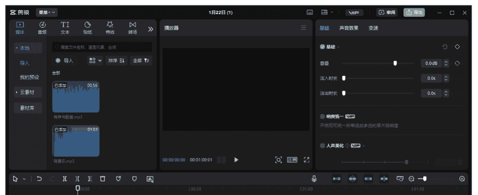

图5-27

**步骤02 调整背景乐音量。** 选中背景乐轨道，按住 Ctrl 并滚动中键放大时间轴，在右侧“基础”面板调整音量，如图5-28所示。

**步骤03 移动配音。** 在时间轴中拖动配音轨道到合适位置，如图5-29所示。

**步骤04 切分配音。** 将播放头移至 00:00:32:21，点击“分割” 🪓 切分配音，如图5-30所示。

**步骤05 制造间隙。** 把分割后的片段拖至 00:00:37:23，形成空白间隙，如图5-31所示。

**步骤06 切分背景乐。** 保持播放头位置不变，选择背景乐轨道，点击“分割”进行切分，如图5-32所示。

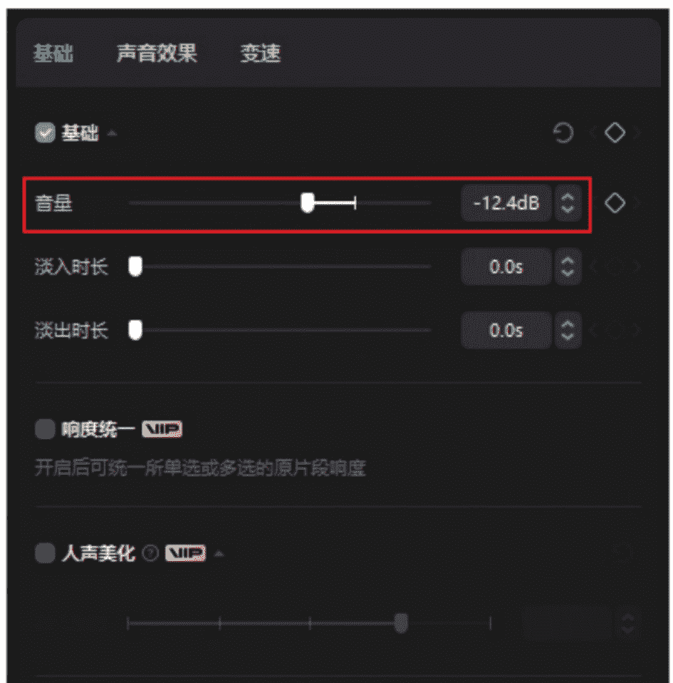

图5-28

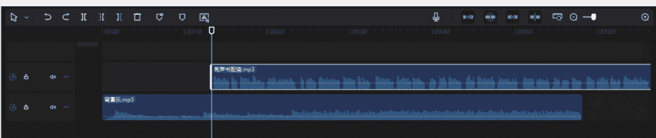

图5-29


图5-30


图5-31

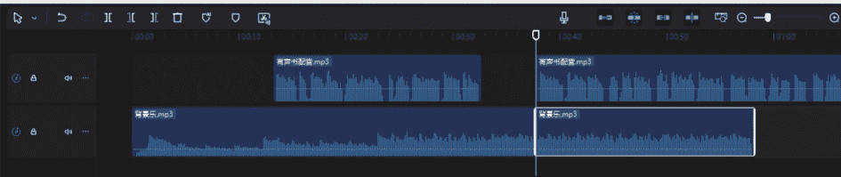

图5-32

步骤07 设置背景乐淡出时长。选中第一段背景乐，在“基础”选项卡中设定淡出时间，如图5-33所示。

步骤08 再次调整背景乐音量。删除第二段背景乐，再在“基础”面板微调音量，如图5-34所示。

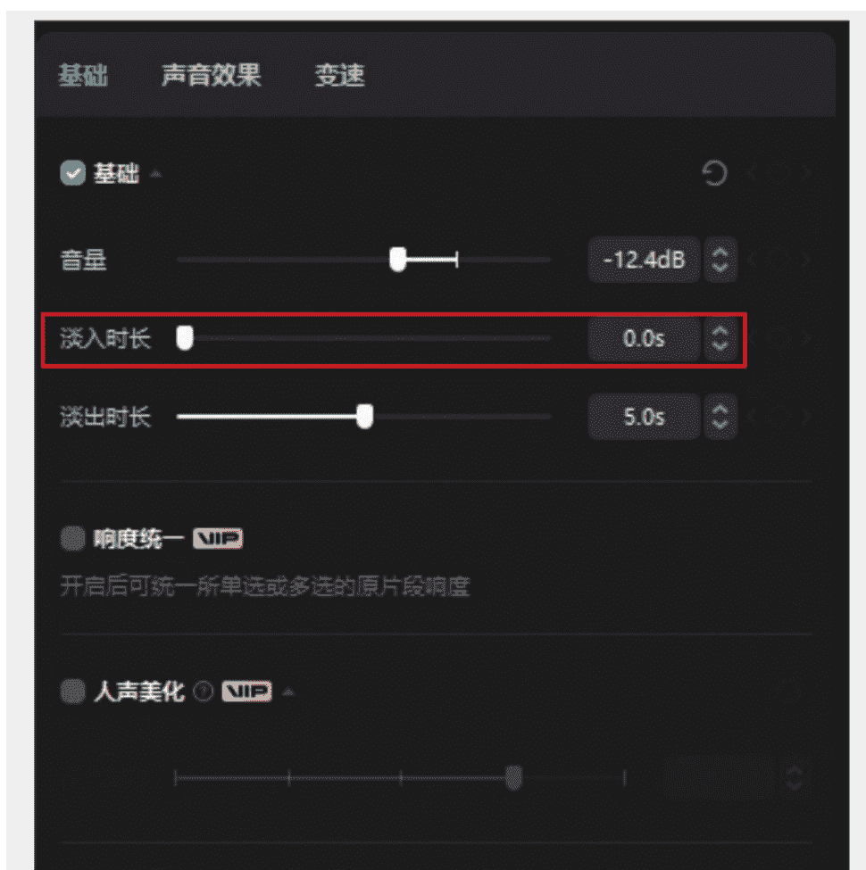

图5-33

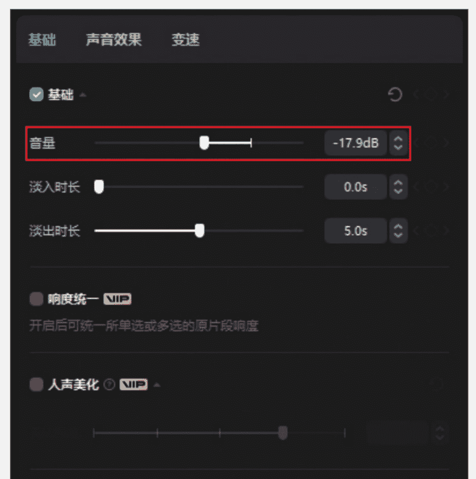

图5-34

**步骤09 试听音频合成效果。** 设置完成后将光标置于时间轴起点，按回车键试听，如图5-35所示。

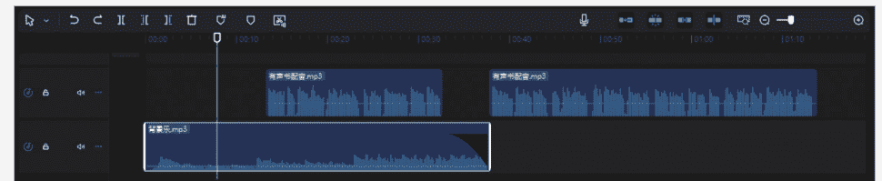

图5-35

**步骤10 导出合成的音频。** 确认无误后点击右上角“导出”，在导出窗口中填写标题与路径，取消“视频导出”，勾选“音频导出”，其余保持默认，如图5-36所示。

**步骤11 完成导出操作。** 点击“导出”按钮，等待系统输出编辑好的音频片段。

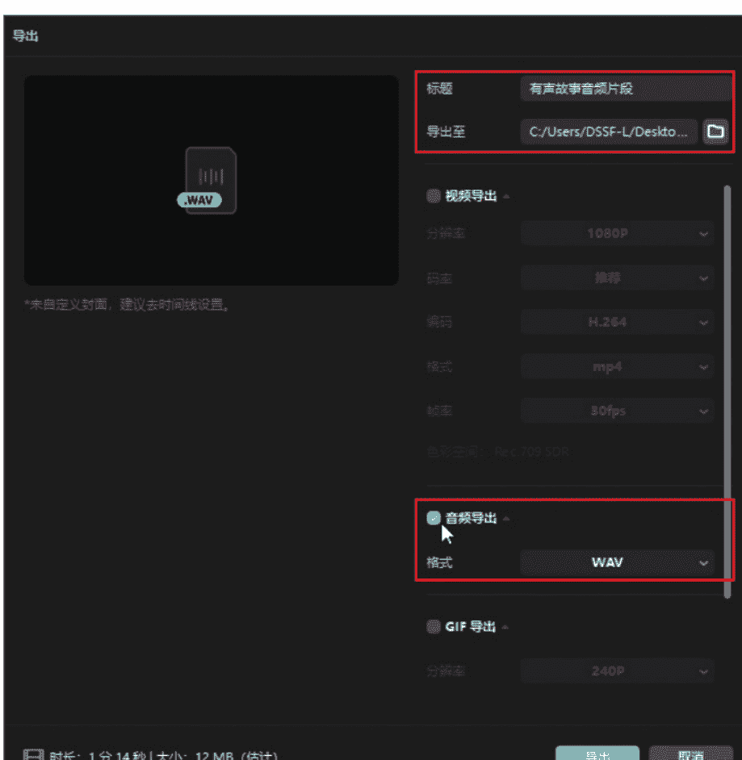

图5-36

### 5.3.3 纯净无暇的音频降噪
音频降噪是为了清除口水音、呼吸声、环境噪音、电流声等杂音，优化音质。Audition 的降噪功能表现良好。

Audition 提供自动降噪与手动降噪，自动处理不干净时可手动精修，确保音质纯净。软件内置多种降噪效果器，可按需选择，如图5-37所示。

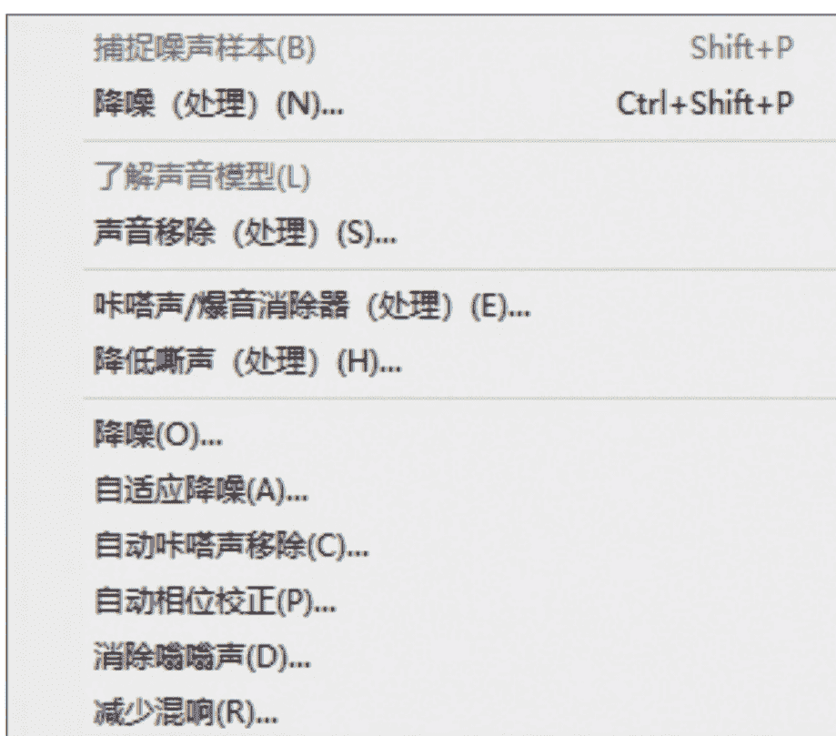

图5-37

音频修复与空间塑造工具概览

- 降噪处理：可自行识别音频中磁带嘶嘶、麦克风环境杂音、电线嗡鸣等噪声成分。先采集一段噪声样本进行分析，再自动滤除同类噪声，同时尽力保留原声的自然与真实。
- 声音剔除处理：针对电话铃响、无线电串扰等干扰声，系统会分析其特征并生成对应声学模型，用该模型从整段素材中剔除 unwanted 噪声，使主干内容更突出。
- 咔嗒爆音消除：专门清除麦克风爆破音、细微嘶声及噼啪等杂音。
- 降嘶声处理：衰减或消除因磁带老化、话筒缺陷或录音环境不良产生的嘶嘶声，提升清晰度与纯净度，同时维持原有音色，避免额外损伤或失真。
- 自适应降噪：随噪声变化实时调整降噪强度，实现动态优化，尤其适用于采访、户外等噪声复杂的场景。
- 自动咔嗒声剔除：自动侦测并清理咔嗒声、爆音等瑕疵，来源多为设备问题、环境干扰或操作失误。
- 自动相位校正：修复录制或传输中出现的相位偏差，防止混合播放时产生相位抵消、模糊或失真。
- 去嗡声：降低或消除电子设备录音中常见的嗡鸣，通过滤波、相位抵消等手段抑制，减轻对音质的破坏。
- 混响衰减：削弱因空间反射带来的混响，减少空旷感，提升清晰度，让细节与层次更容易分辨。

#### 【练习6】人声噪声去除实操
下面以 Audition 的降噪功能对录制人声进行去噪演示。

步骤01 加载文件。 启动 Audition，将“录制人声”音频拖入操作界面，如图5-38所示。
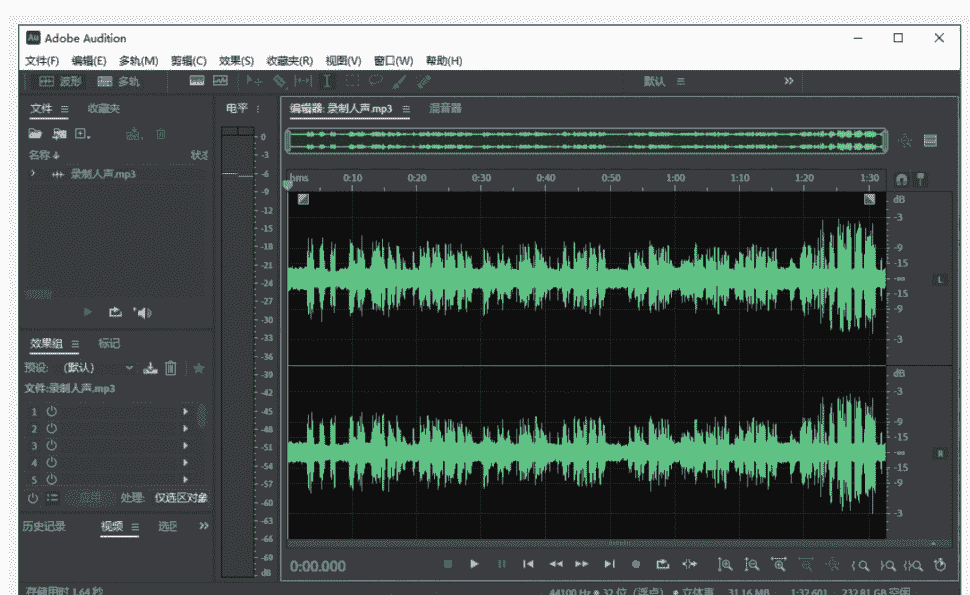
图5-38
步骤02 选取噪声片段。 按住 Ctrl 并向上滚动鼠标中键放大时间轴，把播放头移到开头，框选一段纯噪声，如图5-39所示。
步骤03 配置降噪。 菜单栏依次点“效果”→“降噪/恢复”→“降噪（处理）”，打开降噪对话框，点击“捕捉噪声样本”把当前选区作为样本，再点“选择完整文件”全选波形，如图5-40所示。

图5-39
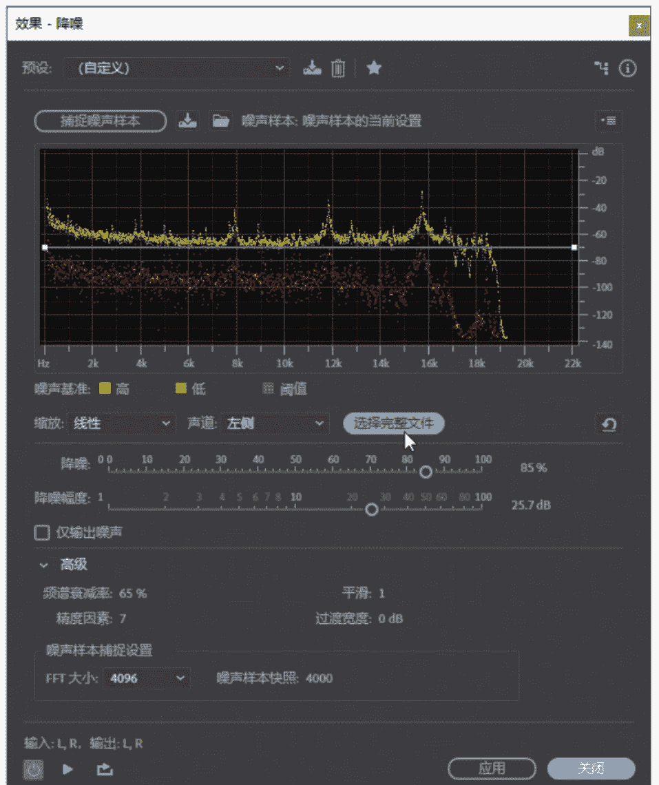
图5-40
步骤04 微调效果。 拖动“降噪强度”和“降噪幅度”滑块，空格键实时试听，寻找最佳平衡点，如图5-41所示。
步骤05 执行降噪。 确认后点“应用”，同类噪声即被去除，如图5-42所示。

图5-41

图5-42
步骤06 追加清理。 试听时若仍有“嘀嘀”电流声，选中其一重复上述流程清理，如图5-43所示。

图5-43
步骤07 手工修点。 若有“嘀”声混在人声里，为保护音质需手动处理。工具栏点“显示频谱频率显示器”打开频谱，点“污点修复画笔工具”在频谱上涂抹噪点即可消除，如图5-44所示。**继续清理其余噪点。** 同法清除其它几处，之后点菜单“文件”→“另存为”保存音频。

图5-44

### 5.3.4 人声快速分离

Audition 自带人声分离但分离度有限，对音源质量依赖较大，音质越好结果越佳。若素材一般可借助 Vocalremover，该工具能精准剔除或分离人声，同时保留伴奏等其余音轨，如图5-45所示。

图5-45
Vocalremover 界面简洁易用，无需专业背景即可上手。除基础人声分离外，还提供乐器声部分离、音调速度调节、剪辑、合并等多项辅助功能，均可在左侧工具栏切换。

#### 【练习7】英文歌伴奏制作演示
下面以分离英文歌曲人声为例介绍工具用法。

步骤01 打开网站选文件。 访问 Vocalremover 官网 https://vocalremover.org/zh/，左侧工具栏切到“搬运工”模式，在“移除人声并隔离”页点击“选择文件”，如图5-46所示。
步骤02 上传曲目。 在弹出的打开对话框里选中英文歌，点击打开，如图5-47所示。

图5-46

图5-47
步骤03 预览分离结果。 系统自动上传并处理，完成后呈现“音乐”和“人声”两轨，默认人声静音，点击播放可试听，如图5-48所示。

图5-48
步骤04 导出文件。 若需单独人声，把人声音量调至100、音乐调至0即可。确认后点右下角“保存”，在列表中挑选要导出的音轨，如图5-49所示。

图5-49

### 5.3.5 音频质感混响提升
混响是指声源发出后在密闭或半密闭空间经墙壁、天花板、地面多次反射后形成的持续回声。它在音乐制作中影响质感、空间感与沉浸感。

Audition 内置五款混响：卷积混响、完全混响、混响、室内混响、环绕声混响。菜单栏“效果”→“混响”即可打开对应设置。

- 卷积混响：通过模拟真实声学空间的反射特性，为音频增加高度逼真的空间感。可加载脉冲响应文件模拟影视场景、室内对话等环境。
- 完全混响：模拟密闭空间多次反射，增强空间感与音色，可调用预设模拟音乐厅、体育馆、剧院、教堂等。
- 混响：基础通用混响，提供常用参数，适合快速添加。
- 室内混响：模拟房间、大厅等室内反射与衰减，可营造不同氛围情绪。
- 环绕声混响：模拟多声源多扬声器空间的传播，让声音呈现方向与距离感，更立体饱满，广泛用于音乐、影视、直播等。

#### 【练习8】会议广播混响模拟
下面利用 Audition 混响功能模拟会议厅提醒广播。

步骤01 导入语音。 启动 Audition，把“会议提醒”音频拖入波形编辑器，如图5-50所示。

图5-50
步骤02 选定混响。 菜单“效果”→“混响”→“卷积混响”，如图5-51所示。
步骤03 配置参数。 在卷积混响对话框中把“脉冲”设为“演讲厅（阶梯教室）”，如图5-52所示。

图5-51

图5-52
步骤04 上线试听。 点下方“播放”预览，满意后点“应用”写入当前音频，如图5-53所示。
步骤05 导出保存。 菜单“文件”→“另存为”，设定文件名和路径后保存。

图5-53

## 5.4 AIGC实战：完善有声书开场配音
下面利用声咔和 Audition 为创作的有声书添加开场白。

步骤01 撰写开场文案。 登录声咔官网，进入配音软件页面输入开场内容，如图5-54所示。
步骤02 调整语速停顿。 打开主播设置面板把播报语速调到0.9，在文案中标记停顿处，点击工具栏“插入停顿”设定时长，如图5-55所示。

图5-54

图5-55
步骤03 生成并下载。 点击“试听”检查效果，确认后点“立即合成”生成音频。进入“我的创作”，点“操作”下拉选“下载文件”保存到本地，如图5-56所示。

图5-56
步骤04 新建多轨会话。 启动 Audition，点工具栏“多轨”，在新建对话框里填项目名，其余默认后确定，如图5-57所示。

图5-57
步骤05 导入素材。 把合成的开场音频和有声书片段分别拖到轨道1、轨道2，如图5-58所示。

图5-58
步骤06 定位开场。 点“移动工具”🖱️，把轨道1音频右移至 0:02.275 处，如图5-59所示。
步骤07 调低音量。 在轨道1左侧面板把音量降到 -3，如图5-60所示。

图5-59

图5-60
步骤08 为正片加混响。 选中轨道2，控制面板效果列表点三角，选“混响”→“混响”，在组合效果对话框把预设设为“默认”，其余不变，如图5-61所示。

图5-61
步骤09 混音导出。 播放试听效果，菜单“文件”→“导出”→“多轨混音”→“整个会话”，在导出对话框设定文件名后确定合并输出，如图5-62所示。

图5-62

# 第6章 短视频创作达人
AIGC 已贯穿短视频创作全流程：策划期的创意发散与受众洞察，制作期的虚拟形象生成、自动剪辑、参数微调、字幕与配乐，后期智能优化等环节，均被显著提效提质，为创作者带来全新便利。本章重点介绍 AIGC 在短视频领域的具体应用。

## 6.1 AIGC短视频创作基础
即便用 AIGC 做短视频不必精通全部专业，但掌握相关知识能让成片更贴合预期。以下先介绍常用 AIGC 工具与核心术语。

### 6.1.1 视频类AIGC工具介绍
当下短视频已成为信息传播和娱乐消费的主渠道。为此涌现出大量 AI 视频制作工具，大幅降低创作门槛并拓展创意与技术可能。常见工具汇总于表6-1。

表6-1

| 工具 | 简介 |
| :--- | :--- |
| 剪映 | 字节跳动推出的视频编辑工具，内置丰富滤镜、转场、音乐库和字幕样式，支持智能识别语音并自动添加字幕，一键成片功能强大 |
| 智影 | 腾讯推出的智能视频创作工具，支持智能剪辑、文字转语音、智能配音等功能，可自动分析素材内容，并给出剪辑建议和配音方案 |
| 即梦 AI | 剪映旗下的 AI 创作平台，专注于为创意爱好者提供便捷的 AI 表达工具。它支持文生图、智能画布和视频生成等功能 |
| 可灵 AI | 快手公司推出的新一代创意平台，集成了 AI 图像和视频创作功能，支持文生视频和图生视频两种模式 |
| Runway | 综合效果出色的 AI 视频生成工具，支持文本和视频生成，画面清晰度高，自由度高，可通过多种笔刷控制视频中物体的运动 |
| 腾讯混元 | 腾讯公司全链路自研的大语言模型，具备强大的中文创作能力、逻辑推理能力和任务执行能力，支持文生视频、图生视频等多种视频生成功能 |

### 6.1.2 视频拍摄与剪辑术语
本节梳理拍摄与剪辑环节的常用概念。

#### 1. 视频拍摄常用术语
（1）构图。构图指摄影或视频制作时对画面元素如人物、景物等的安排方式，用以传达情感与主题。良好构图能引导视线，增强表现力与故事性。常见手法包括中心点、三分、引导线、对角线、对称、前景、框架、留白等。
（2）拍摄角度。指镜头相对被摄对象的位姿与方向。不同角度产生不同视觉效果，如正面展现特征、侧面突出轮廓、仰拍显雄伟、俯拍显渺小，角度选择关乎主题与氛围表达。
（3）运镜。指拍摄过程中镜头的移动方式与轨迹。通过推、拉、摇、移等技巧动态呈现画面，提升动感与节奏，增强沉浸感。
（4）摄影用光。指利用自然光或人工光源照亮主体并营造氛围。光线可突出轮廓、纹理与色彩，引导视线，增强立体感与层次。
（5）景别。指主体在画面中的占比范围，常见分类为远景、全景、中景、近景、特写。
（6）景深。指前后清晰范围。光圈越大景深越小，光圈越小景深越大。
（7）焦距。表示镜头放大程度。焦距越大景深越浅背景虚化越强，焦距越小景深越深背景虚化越弱。
（8）光圈。控制进光量的装置，用 F 值表示。F 值越大光圈越小进光越少，F 值越小光圈越大进光越多。
（9）曝光。感光元件接收光的总量，通过快门速度、感光度与光圈共同控制。

#### 2. 视频剪辑常用术语
（1）关键帧。动画或剪辑中设定特定属性如位置、旋转、缩放、透明度、颜色等的帧，由软件自动计算中间过渡，是制作动画与特效的基础。
（2）蒙太奇。通过拼接不同时空的镜头创造节奏、情感与叙事效果，是电影剪辑核心手法与重要表现形式。
（3）帧速率。指每秒显示帧数 FPS，决定流畅度与清晰度。高帧率运动更平滑，低帧率易卡顿模糊。
（4）转场。指场景切换方式，可用特效、动画或直接剪切实现，帮助理解时空变换并增强视觉节奏。
（5）剪辑率。单位时间内镜头切换次数，影响节奏与风格。高剪辑率营造紧张刺激，低剪辑率更显舒缓宁静。

（6）调色。调色是对画面色彩、亮度、对比等要素进行细致调整，用以达成预期的视觉调性与风格。恰当的色彩处理能够强化情绪传达，突出叙事主线，并营造出所需的氛围感。

（7）混音。混音是将多轨音频整合为一条成片音轨的工作，涉及音量调节、轨道平衡以及音效与配乐的叠加。良好的混音可使声音清晰通透、层次分明，与画面节奏保持统一。

（8）字幕。字幕以文字叠加于画面下方，用于呈现对白、解释或补充说明。它能够提升内容的理解度，对外语或方言素材尤为重要，也可参与到整体视觉风格的塑造中。

## 6.2 可灵AI提升短视频创意

可灵AI能够依据文字指令或已有的图像产出视频初稿，同时提供剪辑处理、一键复刻以及创意圈社区等功能，便于浏览其他创作者的作品以获得灵感，并迅速复现优秀案例。

### 6.2.1 创意描述塑造神话角色

在AIGC快速发展的当下，角色开发效率得到明显提升。人工智能的计算能力与设计师的美学判断相互结合，能够让角色迅速具象化，形象鲜明且具有辨识度。


#### 【练习1】生成狐仙侠客角色

下面演示如何用可灵AI文生视频功能打造角色。

角色故事：
狐妖绮梦身着青绿长袍于云雾仙境游走，狐首人身眼神灵动，尽显仙侠韵味。一日偶遇失落仙童，便以灵动之智携其穿越云海经历奇幻冒险，最终助仙童归位，留下古风雅致、侠骨柔情的佳话。

提炼提示词：
狐首人身，青绿长袍轻扬，奇幻仙侠韵味浓，古风雅致，眼神灵动，穿梭于云雾缭绕的仙境之中。

**步骤01 进入AI视频工作区。** 登录可灵AI官网于首页点击AI视频入口，见图6-1所示。


图6-1

**步骤02 填写创意描述。** 进入创作界面切换至文生视频标签，将提示词粘贴进创意描述框，见图6-2所示。

**步骤03 调整生成参数。** 设置想象力、相关性、生成模式、时长及画面比例，见图6-3所示。

**步骤04 设定排除内容。** 在不希望呈现的内容框输入负向提示，点击立即生成，见图6-4所示。

# AI 视频

可灵 1.6 NEW

- 文生视频

- 图生视频

- 对口型

创意描述

灵感词库

狐妖头人身，青绿长袍轻扬，奇幻仙侠韵味浓，古风雅致，眼神灵动，穿梭于云雾缭绕的仙境之中。

- 细节生长

- 海上小鼠

- 女生与猫

立即生成 (🔥 20灵感值)

图6-2

# AI 视频

可灵 1.6 NEW

## 参数设置

创意想象力 ———————— 创意相关性

生成模式 ⓘ  ● 标准  ○ 高品质

生成时长： ● 5s  ○ 10s

视频比例： 16:9  9:16  1:1

生成数量：1 条

立即生成 (🔥 20灵感值)

图6-3


图6-4

**步骤05 检查成片。** 生成结果以缩略形式呈现在右侧，双击可放大至中央，点击按钮即可全屏预览，见图6-5所示。


图6-5

### 6.2.2 动画化萌宠卡通

可灵AI可先依据文字产出图像，再将图像或用户自上传图结合新指令转为动态视频。该流程拓宽了表达可能并降低了创作门槛。

#### 【练习2】小猪的幸福时光

角色故事：
午后宁静时分，一只萌态十足的小猪溜进客厅，悠然坐在沙发上，双手捧着一杯香浓奶茶，脸上洋溢满足与幸福。仿佛在说生活美好应及时享受，这一幕让人心生柔软。

提炼提示词：
萌态小花猪，休闲地坐在客厅里，手捧奶茶，笑容可掬，色彩温馨，细节生动。

**步骤01 切换至AI图片。** 在可灵AI首页左侧导航点击AI图片按钮，见图6-6所示。

**步骤02 文生图。** 进入AI图片模式后在创意描述框输入提示词，画面比例设为3：4，结果数量保持默认4张，点击立即生成，见图6-7所示。

- 首页

- 创意圈

- 活动专区

- 灵感学院

AI 创作

- AI 图片 可图 1.5 发布

- AI 视频 可灵 1.6 发布

- AI 定制模型

图6-6

# AI 图片

可图 1.5 NEW

## 创意描述

萌态小花猪，休闲坐在客厅里，手捧奶茶，笑容可掬，色彩温馨，细节生动

推荐尝试：萌宠 双重曝光 国画 ...

## 参数设置

图片比例：

- 1:1

- 16:9

- 4:3

- 3:2

- 2:3

- 3:4

- 9:16

- 21:9

生成数量：4 张

立即生成（🔥 4 灵感值）

### 6.2.3 首尾帧实现神兽变身过渡

可灵AI支持上传两张图片作为起止关键帧，模型据此补全中间过程，可控地呈现形变与运动。下面梳理基础概念。

### 1. 首尾帧的定义与作用

- **首帧**：视频开头的关键画面，决定起始状态。
- **尾帧**：视频结尾的关键画面，决定收尾状态。
- 二者共同决定运动轨迹与形变走向，可更精确把控生成结果，提升连贯自然度。

### 2. 典型使用场景

- 商品展示：设定起始与结束姿态如旋转、缩放，生成演示视频。
- 炫酷入场：定义角色起止位置如飞入、跳跃，制作动感开场。
- 场景切换：借助不同场景的首尾帧实现平滑转场。

### 3. 使用注意事项

- 保持主体一致性：首尾帧主体需相似，否则易出现断裂或错位。
- 简化描述：提示越简洁越好，避免复杂句式干扰判断。
- 多次试错：因生成具随机性，需反复调整画面与提示词以达理想效果。

#### 【练习3】神兽白泽降凡

角色故事：
白泽为神兽之王，通晓万物，洞悉天下。一日人间瘟疫肆虐，百姓苦不堪言。白泽闻之化身凡人游走四方，以神力驱散病魔传授防疫之法。瘟疫渐退，百姓感恩戴德，尊其为守护之神世代传颂。

登录可灵AI官网切换至AI图片页，用以下两段提示词分别生成图像。

提示词1：
白泽神兽，立于幽深古林，身形如狮，头部长有两角，毛发如雪，眼神睿智深邃，周身环绕神秘光环，光线柔和聚焦。

提示词2：
一袭白袍飘逸，面容温润如玉，额间隐现独角印记，眼神深邃智慧，周身环绕淡淡灵光，背景为云雾缭绕的仙境，姿态优雅，超凡脱俗。

提示词1画面见图6-12。提示词2画面见图6-13。下载保存备用。


图6-12


图6-13

随后按流程操作。

**步骤01 上传首帧。** 切换到AI视频页，打开图生视频标签，选择模型可灵1.0或1.5，1.6暂不支持尾帧。点击上传区将神兽白泽图设为首帧，见图6-14所示。

**步骤02 上传尾帧。** 首帧上传成功后下方出现首帧图与尾帧图按钮，点击尾帧图，将白袍男子图上传为尾帧，见图6-15所示。

**步骤03 填写图像创意描述。** 在图片创意描述框输入：“画面中第一张图向右偏移，逐渐过渡到人的形态，过渡过程中周围散发出白色的科技粒子，白色烟雾环绕效果，均匀而且丝滑，符合逻辑、极致，严格按照提示词生成”。点击立即生成，见图6-16所示。

# AI 视频 可灵 1.5

- 文生视频

- 图生视频

- 对口型

# 首尾帧图片及创意描述

支持 JPG / PNG 格式，文件大小不超过 10MB，尺寸不小于 300px

点击 / 拖拽 / 粘贴

从 历史创作 选择

# 图片创意描述 (非必填)

请描述你想生成的视频内容，或查看 使用指南 提升生成效果

图6-14

# AI 视频

可灵 1.5

文生视频

图生视频

对口型

# 首尾帧图片及创意描述

支持 JPG / PNG 格式，文件大小不超过 10MB，尺寸不小于 300px


添加尾帧图

首帧图

尾帧图

# 图片创意描述 (非必填)

请描述你想生成的视频内容，或查看 使用指南 提升生成效果

图6-15

# 文生视频 图生视频 对口型

首尾帧图片及创意描述

支持 JPG / PNG 格式，文件大小不超过 10MB，尺寸不小于 300px


图片创意描述 (非必填)

画面中第一张图向右偏移，逐渐过渡到人的形态，过渡过程中周围散发出白色的科技粒子，白色烟雾环绕效果，均匀而且丝滑，符合逻辑，极致，严格按照提示词生成

立即生成 (🔥 35灵感值)

**步骤04 查看效果。** 稍等后系统会依据首尾帧与描述生成神兽化人的奇幻片段，见图6-17所示。


图6-17

### 6.2.4 运动笔刷控制主体轨迹

可灵AI的运动笔刷允许为画面中人物、动物或物体指定运动路径，并划定静止区域，获得可控性更强的动态视频。特点与用途如下。

### 1. 功能特点

- **高精度操控：** 可精细选取目标区并细化轨迹，实现精准创作。
- **轨迹灵活：** 支持直线、曲线等多种路径，形状与长度可自由调。
- **元素通用：** 人物、动物、物体均可受控，满足多样需求。

### 2. 应用场景

- 短视频制作：轻松产出具动态与视觉冲击的短片。
- 动画创作：为角色绘制复杂运动轨迹，打造生动内容。
- 广告营销：制作更具吸引力的广告视频，提升传播与转化。

#### 【练习4】午后阳光里的猫

角色故事：
午后阳光洒满房间，两只呆萌可爱的小猫懒洋洋坐在窗台，时而互相舔毛，时而凝视窗外云朵，享受难得宁静。温暖阳光与慵懒身影交织成惬意温馨画面。

步骤01 导入素材。打开可灵AI的AI视频页，选择可灵1.0模型，在图生视频标签导入“两只呆萌可爱的小猫”图片，见图6-18所示。

步骤02 启动运动笔刷。在图生视频标签的运动笔刷区点击画笔按钮，见图6-19所示。

AI 视频

可灵 1.0

文生视频

图生视频

对口型

首尾帧图片及创意描述

支持 JPG / PNG 格式，文件大小不超过 10MB，尺寸不小于 300px


首帧图

尾帧图

图6-18


图6-19

**步骤03 划分运动区域。** 打开运动笔刷窗口，默认选中区域1，在画面上方涂抹，圈出左侧小猫的脸，见图6-20所示。

**步骤04 设定运动轨迹。** 选择轨迹1，拖动鼠标在左侧小猫脸上绘制向右箭头，表示脸部向右转动，见图6-21所示。


图6-20


图6-21

**步骤05 划分第二运动区。** 选择区域2，在右侧小猫面部涂抹选区，见图6-22所示。

**步骤06 设定第二轨迹。** 选择轨迹2，在右侧小猫面部绘制向左箭头，表示脸部向左转动，绘制完成点击确认添加，见图6-23所示。


图6-22


图6-23

步骤07 预览成片。最后点击立即生成按钮，生成效果见图6-24所示。


图6-24

### 【练习拓展】

请以池塘荷花为主题，生成一段表现夏日荷花美景的视频片段。

## 6.3 即梦AI构建短视频梦想

即梦AI是剪映旗下的一站式AI创意平台，支持自然语言与图片输入生成高质量图、视频，提供智能画布、故事创作及多项AI编辑能力，并辅以创意社区激发灵感。

### 6.3.1 运镜控制实现流畅拍摄

即梦AI的运镜控制功能允许用户设定镜头移动方式，如平移、旋转、摇镜、变焦等，并调节运镜幅度，丰富视频动态。下面以即梦AI生成图像再转视频并设定运镜为例。

#### 【练习5】生成狐仙侠客角色

角色故事：
阳光洒满绿色草坪，年轻女孩温柔抚摸一只小花猫。猫咪眯眼享受温暖关爱，周边花草轻摇，空气弥漫淡淡花香。时间仿佛静止，只留下女孩与猫咪间宁静美好的温馨画面。

输入提示词：
温馨阳光下，小女孩蹲于青翠草坪，身着碎花裙，笑容灿烂，轻抚脚边小花猫的柔软皮毛，小猫咪眯眼享受，画面构图紧凑和谐，色彩温馨，图片质感细腻自然。

步骤01 执行图片生成。登录即梦AI官网，首页左侧选择图片生成，见图6-25所示。


图6-25

**步骤02 输入描述。** 打开图片生成界面，在文本框内输入提示词，见图6-26所示。

**步骤03 调整参数。** 将图片比例设为16：9，尺寸保持默认，点击立即生成，见图6-27所示。

# 图片生成

# 视频生成

温馨阳光下，小女孩蹲于青翠草坪，身着碎花裙，笑容灿烂，轻抚脚边小花猫的柔软毛发，小猫咪眯眼享受，画面构图紧凑和谐，色彩温暖，图片质感细腻自然。

导入参考图

70/800

# 模型

# 比例

图6-26


图6-27

步骤04 查看生成结果。系统据关键词与参数生成4张图片，可逐一点击上方查看效果，见图6-28所示。


图6-28

步骤05 启动视频生成。挑选一张可用图片放大后，点击右侧窗格的生成视频按钮，见图6-29所示。


图6-29

步骤06 进入图生视频模式。自动切换至视频生成界面，选定图片已上传至图生视频标签，见图6-30所示。

步骤07 选择视频模型。点击视频模型按钮，在列表中选择视频1.2，该模式支持运镜控制，见图6-31所示。

图片生成 视频生成

图片生视频 文本生视频 对口型


ImageInput.jpeg

结合图片，描述你想生成的画面和动作。

例如：海浪拍打着沙滩，粉色的月亮在天空中缓缓升起。

视频模型


视频 S2.0

by Seaweed alpha

积分消耗明细

生成视频 5

限时优惠

图6-30


图6-31

**步骤08 配置运镜。** 点击随机运镜，在列表中启用变焦，选择幅度为中，点击应用，见图6-32所示。

**步骤09 设定其他参数。** 将运动速度设为适中，模式选标准模式，生成时长选3s，点击生成视频按钮，见图6-33所示。


图6-32


图6-33

第十步 观察输出。等待片刻后视频完成，呈现效果见图6-34。


图6-34

### 6.3.2 文本指令驱动的产品广告生成

即梦AI可用简短文字描述快速合成画质较好的动态内容，制作门槛大幅降低。下面以文本转视频为例演示一支洗发水宣传片段的制作思路。

#### 【练习6】茉莉香氛洗发水推广片

叙事设定：

清晨光线透过纱帘洒进卫浴间，一瓶茉莉香氛洗发水的瓶身映入视线。按下按压头，淡雅的茉莉香气瞬间弥漫空间。每次洗护都像漫步花园，心情得以舒缓，为新的一天带来清新与自信。

提示词1：

茉莉香氛洗发水，透明方形瓶身，液体内漂浮茉莉花朵，按压泵头造型，背景点缀茉莉花元素，倒影，洁净高雅。

提示词2：

茉莉香氛洗发水，透明圆形瓶身，液体内漂浮茉莉花，按压泵头造型，阳光透过窗帘洒入浴室，洁净高雅。

**步骤01 填入描述并生成。** 在即梦AI首页进入视频制作入口，切换至文本生视频标签，输入描述词，按需选择模型与画面比例，点击生成视频按钮，具体见图6-35所示。

**步骤02 在已有结果上修改描述再生成。** 系统会迅速产出初版成片。如需在当前结果上调整，点击视频左下角的编辑入口，返回左侧文本生视频面板修改描述，再次点击生成即可得到新版本，见图6-36所示。

图片生成 视频生成

图片生视频 文本生视频 对口型

茉莉香氛洗发水，透明方形瓶身，液体中漂浮茉莉花，按压泵头设计，背景茉莉花元素点缀，倒影，高雅洁净

# 视频模型

视频 S2.0 by Seaweed alpha

# 基础设置

生成时长

5s

视频比例

3:4

积分消耗明细

生成视频 5 限时优惠

# 图6-35


# 图6-36

步骤03 查看样片。两版成片的效果分别展示在图6-37、图6-38。


图6-37


图6-38

### 6.3.3 首尾帧实现古风穿越效果

即梦AI同样支持基于首尾帧合成动态画面。上传首尾两张素材，再用文字控制中间过渡，就能得到高质量动效，特别适合变身、场景切换或时光流逝等创意，如现代女性变身古装佳人、四季风光变化等。


#### 【练习7】古今穿越之旅

叙事设定：

现代与古代在服饰与审美上差异明显。古装华美庄重，承载深厚文化底蕴；现代穿搭多元时尚，体现个性自由。风格不同却同样映射时代风貌，都表达了人们对美的追求。

首帧和尾帧过渡描述：

光影流转间，发型与服饰渐变，现代美女仿佛穿越时空，幻化为古典雅致的古代佳人，过渡自然丝滑，符合逻辑。

**步骤01 开启尾帧开关。** 在即梦AI首页选择视频制作入口，进入界面后切换到图片转视频标签，将模型设为视频1.2，随后打开使用尾帧开关，见图6-39所示。

**步骤02 上传首帧和尾帧图片。** 依次点按上传首帧图片和上传尾帧图片区域，分别上传现代和古风两张素材，并在下方文本框中写入过渡描述，见图6-40所示。

**步骤03 调整参数。** 把模式选为流畅模式，生成时长设为6s，点击生成视频按钮，见图6-41所示。

图片生成 视频生成

图片生视频 文本生视频 对口型

使用尾帧


首帧图和尾帧图，尽量都包含同样的主体，并用文字描述两张图之间如何过渡。

例如：可爱的南极小企鹅，在冰上晃晃悠悠地走。

视频模型

视频 1.2

动效画板 Beta

已使用首尾帧，当前不可用

图6-39

图片生成 视频生成

图片生视频 文本生视频 对口型

使用尾帧


光影流转间，发型与服饰渐变，现代美女仿佛穿越时空，幻化为古典雅致的古代佳人，过渡自然丝滑，符合逻辑。

视频模型

视频 1.2

动效画板 Beta

积分消耗明细

快速预览

图6-40

## 基础设置

模式选择


生成时长

- 4s

- 6s

- 8s

视频比例

自动匹配

生成次数

1

闲时生成

生成等待 8-24 小时，开通会员享最高1折优惠

积分消耗明细

快速预览

生成视频

限时优惠

图6-41

**步骤04 观看样片。** 等待片刻后，系统会依据首尾两图自动合成画面，效果见图6-42所示。


图6-42

### 6.3.4 手绘路径为画面添加动效

用户可在动效面板手绘运动轨迹，精准控制主体在画面中的移动方式，涵盖单向、多向及路径变化，从而轻松实现复杂动画。

#### 【练习8】云朵之舟

叙事设定：

平静海面上一叶小舟独自漂浮。船上年轻男子面向无垠碧波，手中紧握一束梦幻粉色云朵气球。它像海上的温柔小岛，为这段寂寥旅程增添难以言喻的温馨与希望。

**步骤01 选择视频模型。** 打开即梦AI视频制作界面，切换到图片转视频标签，上传素材后把模型改为视频1.2，见图6-43所示。

**步骤02 打开动效面板。** 在动效面板中点按点击设置按钮，见图6-44所示。


图6-43


图6-44

**步骤03 识别目标主体。** 打开动效面板窗口，在画面中点选需要添加动效的主体，这里点选小木船，系统会自动识别并选中，见图6-45所示。


图6-45

**步骤04 绘制运动轨迹。** 点击运动路径按钮，随后在小船上方绘制一条轨迹，见图6-46所示。

**步骤05 为其他元素添加运动。** 参照前两步，继续为画面中的人物和云朵气球绘制运动路径，见图6-47所示。全部路径设定完成后点击保存设置按钮退出动效面板。

**步骤06 观看样片。** 返回视频制作界面，点击生成视频按钮。生成的画面效果见图6-48所示。


图6-46


图6-47


图6-48

### 6.3.5 角色配音实现口型同步

口型同步功能能精准捕捉人物口部动作，让生成视频中口型与配音高度吻合，观感自然流畅，仿佛虚拟人物在真实讲话。只需上传人物图或视频并提供配音内容，即可自动完成合成。

#### 【练习9】人物口型视频

叙事设定：

在高科技高度文明的新时代，我 AI-Zero 不仅是城市管理者，也是人类心灵的守护者。借助神经网络，我能理解喜怒哀乐，用智慧与温柔连接每个孤独灵魂，让这座城市充满爱与和谐的光芒。

**步骤01 导入口型素材。** 登录即梦AI，进入视频制作页面，切换到对口型标签，随后导入角色图片，见图6-49所示。

**步骤02 输入朗读内容并选择音色。** 在文本朗读框中填写角色台词，点击朗读音色按钮，系统提供多种音色供挑选，可按人物特性选择合适音色，见图6-50所示。

**步骤03 调整参数并生成。** 按需调整语速并选择生成效果，点击生成视频按钮，见图6-51所示。

**步骤04 观看样片。** 稍等片刻即可得到成片，人物不仅会自动对口型，还会伴随点头、眨眼等面部细节，见图6-52所示。


图6-49


图6-50


图6-51


图6-52

## 【练习拓展】

借助即梦AI生成一段主题视频。可选用描述词：超现实主义，浮尘与落埃，抽离意识，空气拉丝，慢镜头，动态模糊，神秘的，透光拍摄，膨胀时空，扑朔迷离。

## 6.4 剪映创意剪辑实操

剪映是一款上手简单且功能强大的视频剪辑工具，提供剪切、变速、滤镜、音乐、字幕等基础编辑功能，同时支持多轨道剪辑与丰富转场特效，助力用户打造专业级作品。

### 6.4.1 多种AI玩法介绍

剪映的 AI 效果面板提供多种模板与特效，可对素材进行个性化定制，包含为静态图添加运镜、为人物生成写真、改变表情、更换人像风格、人像换脸等。

### 1. 视频丝滑变速


丝滑变速可在平滑过渡中让视频片段的播放速度实现快慢变化，从而提升动态感与观看体验。

启动专业版剪映，进入创作界面，将视频素材拖入时间轴并选中。打开AI效果面板，勾选玩法复选框，选择视频玩法分类，再选择丝滑变速即可应用效果，见图6-53所示。


图6-53

### 2. 智能扩图

智能扩图借助人工智能与深度学习对图像进行放大处理，通过分析原图的色彩、纹理、形状等特征学习风格与细节，进而生成放大后的新图。

在玩法组中打开AI绘画分类，选择智能扩图选项，即可对选中图片素材进行扩图，见图6-54所示。


图6-54

智能扩图前后的对比可见图6-55、图6-56。


图6-55


图6-56

### 3. 智能运镜

剪映内置多种运镜，可模拟摄像机运动，实现推近、拉远、旋转、晃动等效果，为视频增添动感与视觉冲击。


在AI效果面板的玩法组中选择运镜分类，随后挑选合适的运镜，素材会立即应用该效果，见图6-57所示。


图6-57

为图片素材应用3D运镜的效果见图6-58所示。


图6-58

### 4. 立体相册

剪映玩法中的立体相册可将图片素材中的人像从背景中分离，生成动态立体相册效果。在创作界面导入素材后，在AI效果面板的玩法组中选择分割分类，选择立体相册选项，见图6-59所示。


图6-59

素材背景随即与人像自动分离并向后倾倒，效果见图6-60所示。


图6-60

### 5. 人像风格

剪映提供多种人像风格供挑选，如漫画写真、复古、美漫、魔法变身、萌漫、剪纸等，见图6-61所示。用户可按喜好与视频主题选择特效，使作品更具个性。


图6-61

为人像分别应用美漫、萌漫、港漫以及日漫的效果见图6-62所示。


图6-62

### 6.4.2 文案智能生成一键成片

文字成片是剪映中的智能视频编辑工具，能够分析用户输入的文案，自动匹配相关图文素材与背景音乐，快速生成符合需求的视频。下面演示如何借助智能写文案功能自动生成视频文案并成片。

#### 【练习10】生成旅游宣传视频片段

**步骤01 执行文字成片。** 启动剪映专业版软件，在首页点击文字成片按钮，见图6-63所示。


图6-63

**步骤02 智能写文案。** 打开文字成片对话框，在智能写文案组中选择旅行攻略，输入旅行地点为青海，输入主题为景点、美食、文化，视频时长选择不限时长，点击生成文案按钮，见图6-64所示。

**步骤03 查看文案。** 窗口右侧会自动生成三份文案，可通过底部翻页箭头逐一查看，见图6-65所示。

# 文字成片

已有文案？

- 自由编辑文案

智能写文案

- 情感关系

- 励志鸡汤

- 美食教程

- 美食推荐

- 营销广告

- 家居分享

- 旅行感悟

- 旅行攻略

- 生活记录

- 自定义输入

旅行地点 *

青海

主题

景点、美食、文化

视频时长

- 不限时长

- 1分钟左右

- 1-3分钟

- 3分钟以上

生成文案

图6-64

# 文案结果 3

很多人提起青海，首先想到的就是茶卡盐湖和天空之境。但其实，在青海的这片土地上，还有许多不为人知的美景。

当你厌倦了城市的喧嚣与浮躁，不妨来这里感受一下大自然的魅力。青海的夏天没有酷暑，只有凉爽宜人的天气，是名副其实的避暑胜地。

如果你是吃货，那么青海一定是你心中的天堂。牦牛酸奶、甜醅、藏式包子、羊肠面、撒拉水磨、油糕等特色小吃一定会让你赞不绝口。

当你漫步在塔尔寺的经幡下，你会被这里独特的宗教文化所吸引；登上日月山，遥望巍峨雄伟的昆仑山脉，感受文成公主当年进藏途经此地时留下的豪迈气概。

来青海吧！在这里你可以欣赏到美丽的自然风光，品尝到美味的当地特色美食，还可以感受到浓郁的民族风情和独特的人文景观。

**步骤04 继续生成文案。** 若对当前文案不满意，可点击重新生成按钮，系统会再次输出3份新文案，见图6-66所示。


图6-66

**步骤05 选择配音角色。** 选择一段可用文案，点击窗口右下角的声音角色按钮，在展开列表中可试听多种声音角色，最后选定满意的音色，见图6-67所示。

**步骤06 点击生成视频按钮，在下拉列表中选择智能匹配素材选项，见图6-68所示。** 系统随即开始自动生成视频。

# 文案结果 3

很多人提起青海，首先想到的就是茶卡盐湖和天空之境。但其实，在青海的这片土地上，还有许多不为人知的美景。

当你厌倦了城市的喧嚣与浮躁，不妨来这里感受一下大自然的魅力。青海的夏天没有酷暑，只有凉爽宜人的天气，是名副其实的避暑胜地。

如果你是吃货，那么青海一定是你心中的天堂。牦牛酸奶、甜醅、藏式包子、羊肠面、撒拉水磨、油糕等特色小吃一定会让你赞不绝口。

当你漫步在塔尔寺的经幡下，你会被这里独特的宗教文化所吸引；登上日月山，遥望巍峨雄伟的昆仑山脉，感受文成公主当年进藏途经此地时留下的豪迈气概。

来青海吧！在这里你可以品尝到美味的当地特色美食，还可以感受大自然的壮丽景观。

- 全部

- 可商用

- 新闻女主播 VIP

- 容嬷嬷 VIP

- 温和姐姐 VIP

- 广告男声

- 清爽男声

- 宣传男声 VIP

- 佩奇猪 VIP

- 盐系女生 VIP

- 讲解男声

- 播音旁白

智能生成的内容仅

< 3/6 >

磁性男声

生成视频

图6-67

# 青海还有这些

说起青海，多数人脑海里先浮现的是茶卡盐湖和那片倒映天色的“天空之境”。事实上，高原之上还有大量鲜为人知的美景正等待被发现。

当城市的喧嚣让你感到疲惫，可以换个地方沉淀一下。青海的夏季没有酷暑，气候清凉宜人，是避暑的理想选择。

偏爱美食的旅人会发现这里很合胃口。牦牛酸奶、甜醅、藏式包子、羊肠面、撒拉水磨、油糕等地方小吃，每一样都能让人吃得停不下来。

漫步塔尔寺的经幡间，浓郁的宗教氛围令人沉醉；登上日月山远眺昆仑山脉的雄姿，也能体会到文成公主当年西行的豪迈。

来一趟青海，既能饱览山水，也能吃到地道风味，更能触摸到深厚的民族情怀与人文底蕴。

请选择成片方式

- 智能匹配素材
  文字驱动自动挑选合适的图片和视频

- 使用本地素材
  支持手动在时间线上添加本地文件

- 智能匹配表情包 VIP
  根据文案匹配有趣的表情包素材

智能生成的内容仅供参考，不代表...

< 3/6 >

清爽男声

生成视频

图6-68

**步骤07 预览视频。** 视频做好后会自动回到了创作界面，时间线窗口可以看到所有调用的素材，点击预览区下方的 ▶ 按钮就能播放查看效果，如图6-69所示。


图6-69

### 6.4.3 创意宠物视频剪辑

下面演示如何用剪映的一键成片配合其他功能，结合AIGC生成的文案和素材，制作一只小兔子做蔬菜沙拉的短视频。

#### 【练习11】萌兔烹饪视频片段

### 1. 导入素材

**步骤01 进入创作。** 启动剪映专业版，在首页按下“开始创作”按钮，如图6-70所示。


图6-70

**步骤02 打开导入入口。** 进入编辑界面后，在“媒体”面板的“本地”页点击“导入”按钮，如图6-71所示。


图6-71

**步骤03 批量导入。** 在“请选择媒体资源”对话框中按住Ctrl逐个选中目标文件，全部选中后再点“打开”，如图6-72所示。

**步骤04 导入完成。** 选中的文件会进入剪映，在“本地”页可以看见它们，如图6-73所示。

## 2. 将素材放进轨道

在“媒体面板”本地页，点素材右下角的➕即可把素材推到时间线上，如图6-74所示。

继续把剩余素材依次加入轨道，如图6-75所示。加入后可以调整先后顺序，选中素材后拖动到目标位置即可，如图6-76所示。

## 3. 裁剪素材

在轨道中选中素材，把游标移到需要截取的位置，工具栏点击“向左裁剪”按钮 🖇（图6-77），即可去掉素材左侧与游标对应的部分，如图6-78所示。

## 4. 添加转场

把游标移到两段素材之间，打开“转场”面板，在“转场效果”组展开“叠化”分类，再点“叠化”上方的按钮，如图6-79所示。

两段素材间会加入转场，保持选中后，在右侧“转场”面板点“应用全部”，即可把该效果批量加到所有片段之间，如图6-80所示。

### 6.4.4 为视频添加字幕和配音

视频可以添加字幕并进行编辑调整。剪映的文字朗读功能还能为字幕生成语音，提供多种音色选择，极大丰富视听体验。

#### 【练习12】完善萌兔烹饪视频片段

**步骤01 新建默认文本。** 把时间轴移到轨道起点，打开“文本”面板，在“新建文本”界面点“默认文本”上方的➕，向轨道添加默认文本素材，如图6-81所示。

**步骤02 填入文案。** 选中文本素材后，在右侧“文本”面板的“基础”选项卡输入内容，如图6-82所示。

**步骤03 设置朗读。** 切换到“朗读”面板，挑选喜欢的音色，这里选用“小萝莉”，点击“开始朗读”按钮，如图6-83所示。

**步骤04 生成音频。** 轨道中会生成对应的朗读音频素材，如图6-84所示。

**步骤05 识别字幕。** 再次选中文本素材按Delete删除，随后选中音频素材右击，在快捷菜单中选择“识别字幕/歌词”选项，如图6-85所示。

**步骤06 自动生成字幕。** 系统会根据音频自动生成字幕，如图6-86所示。

**步骤07 调整字幕样式。** 选中任意一段字幕，在右侧“文本”面板的“基础”选项卡可修改字体、字间距、预设样式等，如图6-87所示。

**步骤08 全屏预览。** 制作完成后点击“播放器”窗口右下角按钮，可进入全屏模式预览视频，如图6-88所示。

## 6.5 AIGC应用实战：一站式智能AI配乐

“AI配乐”可以为成片匹配合适的背景音乐，内置曲库涵盖流行、古典、电子到民谣等多种风格。下面用该功能为视频配乐。

角色故事：

狂风呼啸在耳边，小狗戴着酷炫墨镜，低姿紧踩轰鸣的摩托车，在公路上自由穿梭，留下欢笑与自由的轨迹。阳光下的它无拘无束，仿佛世界都是舞台，正演绎速度与激情的狂想。

**步骤01 打开AI配乐。** 用即梦AI生成视频后，点击视频右下角的 ■按钮，如图6-89所示。

**步骤02 按画面选曲。** 左侧会打开“AI配乐”面板，提供“根据画面配乐”和“自定义AI配乐”两个选项，此处使用默认的“根据画面配乐”，点击“生成AI配乐”按钮，如图6-90所示。

**步骤03 生成结果。** 系统会根据画面自动生成3首配乐，视频下方会出现“配乐1”“配乐2”“配乐3”按钮，点击即可试听，如图6-91所示。

# 第7章 AI代码编写助手

写代码涉及需求分析、算法设计、编码、调试、测试等多个环节，AIGC的引入让流程更高效。它能自动产出代码并给出基于深度学习的智能建议，有效减轻重复性工作。本章介绍AIGC在不同编程语言中的应用，帮助开发者更轻松完成任务。

## 7.1 有趣的编程基础

编程是通过编写指令集来设计、开发和实现计算机程序与软件应用的过程。这些指令使用特定编程语言表达，用以指挥计算机完成任务或解决复杂问题。下面对基础进行介绍。

### 7.1.1 丰富的编程语言

编程语言是人工设计的用于编写程序的语言，拥有明确的规则和语法结构，使开发者能够以机器可理解的方式下达指令，用于执行任务、处理数据或解决复杂问题。通过编程语言，开发者可以高效与计算机沟通，实现多样化功能。常用语言包括Python、C、C++、JavaScript等。

#### 1. Python语言

Python是一种广泛使用的高级语言，以简洁易读的语法著称。支持面向对象、命令式、函数式等多种范式，设计上强调可读性和简洁性，在数据处理和快速开发方面表现突出。被广泛用于Web开发、数据分析、人工智能、机器学习、科学计算和自动化脚本等领域。Python拥有庞大的标准库和丰富的第三方库，极大扩展了功能和应用范围。

#### 2. C语言

C是一种通用的过程式编程语言，是UNIX操作系统的核心语言。它提供对底层内存和硬件的直接访问能力，适合系统软件、应用软件、嵌入式系统、操作系统、游戏开发和高性能计算等场景。C语言高效、灵活、可移植性强。语法相对底层，需要程序员手动管理内存分配与释放，但也因此拥有极高的运行效率和控制力。

#### 3. JavaScript语言

JavaScript主要用于Web开发的脚本语言，最初用于在网页中增加动态内容。可直接嵌入HTML页面，由浏览器解释执行。支持面向对象、函数式和事件驱动风格，能创建交互性强、动态更新的网页应用。除前端外，借助Node.js等平台，已扩展到服务端编程、移动应用如React Native、桌面应用如Electron等。其生态庞大，框架和库如React、Vue、Angular等，促进了Web开发效率与创新。

#### 4. Java语言

Java是一种面向对象、基于类的通用编程语言，具有平台无关性。特点包括简单、面向对象、分布式、健壮、安全、可移植、高性能、多线程和动态等。Java平台由JVM、Java类库和Java API组成，提供丰富功能和工具。广泛应用于企业级应用、Android应用、Web开发、大数据处理和云计算等领域。

除上述语言外，开发者还可使用C++、Ruby、Kotlin等，各有特点和优势，可根据需求学习应用。

### 7.1.2 必备的编程环境

编程环境是指开发者用于编写、测试、调试和运行代码的一系列工具与资源的集合。它为软件开发提供基础设施和支持，确保高效顺畅地完成任务。

（1）操作系统。

操作系统是计算机系统的核心软件，负责管理硬件资源如CPU、内存、输入输出设备，并为应用提供稳定运行环境。通过抽象层简化硬件接口，让开发者无需关注底层细节，同时保证多程序安全有序执行。操作系统还提供用户界面，支持人机交互，并具备多任务能力。常见OS包括Windows、macOS和Linux。

（2）编程语言工具。

编程语言工具是编写代码的基础设施，主要包括编译器和解释器。编译器将高级语言源代码转为机器码或字节码，过程中进行类型检查和优化，适用于静态类型语言如C、C++、Rust。解释器逐行解释执行源代码，为动态类型语言如Python、Ruby提供灵活快速的开发体验。此外，库和框架提供现成功能模块，加速开发并提高效率。

（3）开发工具。

开发工具是编程的重要辅助，涵盖集成开发环境IDE和文本编辑器。IDE如Visual Studio Code、Eclipse集成了代码编辑、调试、版本控制等功能，适合复杂任务。文本编辑器如Sublime Text、Notepad++以简洁快速著称，适合轻量编辑。版本控制系统如Git用于追踪代码变更历史，促进协作；调试工具如GDB、LLDB或浏览器开发者工具则是查找修复错误的关键。

（4）其他相关资源。

除核心组件外，还有额外资源对流程至关重要。稳定网络有助于获取依赖包和更新，促进远程协作和在线学习。存储设备如本地SSD/HDD及云端服务如AWS S3、Google Drive用于安全保存项目文件和备份数据。文档和学习资源如Stack Overflow、MDN Web Docs、官方API文档，为解决问题和学习新技术提供宝贵资料，帮助开发者不断提升技能。

### 7.1.3 常用的编程生成工具

AIGC工具在编程领域发挥重要作用，借助自然语言处理和机器学习技术，能准确把握开发者需求，自动生成高质量代码，大幅提升效率并减少错误。下面表7-1列出几种常用工具。

表7-1

| 工具 | 简介 |

| --- | --- |

| 通义灵码 | 阿里云出品的智能编码工具，基于通义大模型，提供代码生成、智能问答、错误排查等，支持多语言与主流IDE，提升编码效率与质量，分个人版与企业版 |

| 豆包 MarsCode | 字节跳动出品的智能开发工具，支持代码补全、智能问答、错误修复，兼容多种语言与工具，加速研发流程，提升代码质量与可读性 |

| 文心快码 | 百度出品的智能代码助手，基于文心大模型，支持跨模块代码生成、注释、解释与优化，无缝集成研发各环节，加速全流程提效 |

| 文心一言 | 百度出品的知识增强大语言模型，具备对话、回答及创作能力，支持Java SDK接入，广泛应用于多个领域 |

| 腾讯云AI代码助手 | 基于混元代码大模型，辅助编码工具，提供技术对话、代码补全与诊断，支持多语言与IDE，提升编码效率 |

| iflycode | 科大讯飞出品的智能编程助手，基于星火认知大模型，覆盖研发全流程，提供代码生成、续写、解释与测试，支持企业级定制与灵活部署 |

本章以文心一言为主。

## 7.2 直观的网页制作与美化

AIGC能极大提升网页制作和美化的效率与质量，让开发者和设计师更专注于创造性工作。

### 7.2.1 生成基础的HTML代码

HTML即超文本标记语言，是构建网页的基础语言，定义结构和内容，确保正确解析并呈现。HTML使用标签描述文本、图像、链接等元素，使网页可读且可访问。

#### 【练习1】制作个人主页

下面以个人主页制作为例，介绍用AIGC工具生成代码的流程。

**步骤01 输入提示词。** 打开文心一言，输入以下提示词。

请生成一个基础HTML网页代码，包含：

网页标题为“我的个人主页”。

主体包含主标题h1“欢迎来到我的个人主页”。

包含段落p，内容为“这是我的第一个网页，感谢您的访问！”。添加无序列表ul，列出三项爱好：“阅读”“旅行”“编程”。

页面底部添加footer，内容为“© 2024 我的名字”。不需要样式或交互，仅需基本HTML结构。

**步骤02 生成内容。** 发送提示词后等待生成，结果如下。

以下是一个基础HTML网页代码，满足要求：

```html
<!DOCTYPE html>
<html lang="zh-CN">
<head>
    <meta charset="UTF-8">
    <meta name="viewport" content="width=device-width, initial-scale=1.0">
    <title>我的个人主页</title>
</head>
<body>
    <h1>欢迎来到我的个人主页</h1>
    <p>这是我的第一个网页，感谢您的访问！</p>
    <ul>
        <li>阅读</li>
        <li>旅行</li>
        <li>编程</li>
    </ul>
    <footer>
        © 2024 我的名字
    </footer>
</body>
</html>
```

该文件包含标题、主标题、段落、无序列表和版权信息，遵循基本HTML结构。可保存为.html文件在浏览器打开查看效果。

**步骤03 预览效果。** 检查代码后复制粘贴至Dreamweaver保存，再按F12在浏览器预览，如图7-1所示。

### 7.2.2 CSS美化页面

CSS即层叠样式表，用于表现HTML或XML等文件的样式。用户可用AIGC生成CSS代码美化页面。

#### 【练习2】美化个人主页

下面利用AIGC生成CSS代码美化页面。

**步骤01 输入提示词。** 打开文心一言，输入提示词：

请为上述代码添加CSS，使所有内容居中显示。确保无序列表项并排显示在同一行，并在列表下方添加图像区域以便插入横幅。

**步骤02 生成内容。** 发送后生成如下：

在保留原有HTML结构基础上添加CSS，使内容居中，并让无序列表项并排，同时在列表下方添加图像区域，可使用以下代码：

```html
<!DOCTYPE html>
<html lang="zh-CN">
<head>
    <meta charset="UTF-8">
    <meta name="viewport" content="width=device-width, initial-scale=1.0">
    <title>我的个人主页</title>
    <style>
```

body {

    display: flex;

    flex-direction: column;

    align-items: center;

    justify-content: center;

    min-height: 100vh;

    margin: 0;

    font-family: Arial, sans-serif;

    text-align: center;

}

header, main, footer, .banner-image {

    width: 100%;

    max-width: 800px;

}

ul {

    display: flex;

    justify-content: center;

    list-style-type: none;

    padding: 0;

    margin: 0;

}

ul li {

    margin: 0 10px;

}

语义化个人主页快速搭建

.banner-image img {

    width: 100%;

    height: auto;

}

</style>

</head>

<body>

    <header>

        <h1>欢迎来到我的个人主页</h1>

        <p>这是我的第一个网页，感谢您的访问！</p>

    </header>

    <main>

        <ul>

            <li>阅读</li>

            <li>旅行</li>

            <li>编程</li>

        </ul>

    </main>

    <div class="banner-image">

        

    </div>

    <footer>

        © 2024 我的名字

    </footer>

</body>

</html>

要点说明：

· 标题与导语被包进<header>，导航列表被包进<main>，页面语义更清晰，样式定位也更明确。

- 页面容器使用弹性盒子实现整体居中。body 按纵向排列，借助交叉轴和主轴的居中属性，让内部模块在上下左右都处于中位。

- 导航列表改成水平弹性布局，并通过主轴居中使各列表项均匀排布在同一行。

- 横幅图片容器负责自适应宽度、等比缩放，并与上部区块保持适当间隔。

- 请把 your-banner-image.jpg 替换成你自己的横幅资源地址。

保存为.html 后在浏览器打开，即可看到整体居中、导航并排且带横幅区的页面。

**步骤03 预览效果。** 先确认代码无误，复制到 Dreamweaver 中关联横幅素材并保存，然后按 F12 在浏览器里查看渲染结果，效果如图7-2 所示。


图7-2

### 7.2.3 JavaScript增加交互

JavaScript 是一门动态脚本语言，能为页面带来互动与动态表现。作为前端三大基石之一，它和结构层、表现层协同工作，可构建功能丰富且易用的站点与 Web 应用。依托自然语言处理和机器学习能力，AIGC 工具能够依据自然语言描述产出符合需求的脚本代码。

#### 【练习3】增加个人网页交互

借助 AIGC 工具生成脚本，提升页面的互动与动态效果。

步骤01 输入提示词。打开文心一言或其他 AIGC 工具，输入如下提示词。

在既有内容基础上，加入 JavaScript 代码，为“阅读”“旅行”“编程”三个词创建空链接，实现：

- 变色效果：光标悬停在三个词上时文字颜色发生变化；
- 打开图像：点击图片时在新窗口打开该图。

请输出相应的 JavaScript 代码以完成上述功能。 [1]

提示 上文代码节选自 7.2.2 节生成的代码。先复制 7.2.2 节的代码，再用提示词说明需求即可。

步骤02 生成内容。发送提示词后得到的内容如下。

要达成上述需求，无需大改 HTML 结构，只需在<head>内加入少量内联 CSS 处理悬停变色，并在<body>末尾加入脚本处理图片点击。完整的 HTML 文件包含所需样式与脚本如下：

```html
<!DOCTYPE html>
<html lang="zh-CN">
<head>
    <meta charset="UTF-8">
    <meta name="viewport" content="width=device-width, initial-scale=1.0">
    <title>我的个人主页</title>
    <style>
        body {
            display: flex;
            flex-direction: column;
            align-items: center;
            justify-content: center;
            min-height: 100vh;
            margin: 0;
            font-family: Arial, sans-serif;
            text-align: center;
        }
        header, main, footer, .banner-image {
            width: 100%;
            max-width: 800px;
        }
        ul {
            display: flex;
            justify-content: center;
            list-style-type: none;
            padding: 0;
            margin: 0;
        }

        ul li {
            margin: 0 10px;
            cursor: pointer;
            transition: color 0.3s ease;
        }

        ul li:hover {
            color: red;
        }

        .banner-image img {
            width: 100%;
            height: auto;
        }
    </style>
</head>
<body>
    <header>
        <h1>欢迎来到我的个人主页</h1>
        <p>这是我的第一个网页，感谢您的访问！</p>
    </header>
    <main>
        <ul>
            <li onclick="location.href='#';">阅读</li>
            <li onclick="location.href='#';">旅行</li>
            <li onclick="location.href='#';">编程</li>
        </ul>
    </main>
    <div class="banner-image">
        
    </div>
    <footer>
        © 2024 我的名字
    </footer>
    <script>
        document.getElementById('bannerImage').addEventListener('click',
        function() {
            var imageSrc = this.src;
            window.open(imageSrc, '_blank');
        });
    </script>
</body>
</html>
```

### 重要说明：

· 悬停变色已通过 ul li:hover 选择器在样式中实现，脚本无需再处理这部分。

· 图片点击使用 window.open 在新窗口打开资源地址。这里假设图片已托管，this.src 可直接获取 src。若图片为本地文件，因浏览器安全策略该方式不生效，需先上传到服务器并使用网络地址。

· onclick 中保留了 location.href='#' 作为占位，说明链接目前不指向真实页面。如需跳转，可把 '#' 换成对应页面地址，例如阅读页改为 onclick="location.href='reading.html';"。注意这会在当前窗口跳转。若希望链接跳转与图片新开窗口同时存在，需为两者分别设置合适的处理。

**步骤03 预览效果。** 检查代码后复制到 Dreamweaver，关联横幅图并保存，按 F12 预览。将光标移至无序列表如“旅行”会触发悬停变色，如图7-3 所示。点击图片后会在新窗口打开，效果如图7-4 所示。


图7-3


图7-4

### 7.2.4 AIGC解读代码功能

解读代码功能有助于开发者更透彻理解实现细节，便于维护扩展，也促进团队沟通。借助 AIGC 工具，可快速获得代码功能的解读。

#### 【练习4】解读代码功能

下面利用 AIGC 工具对代码进行解读。

**步骤01 输入提示词。** 打开文心一言或其他 AIGC 工具，输入提示词：

请对以下代码的功能做详细解读。这段代码使用 HTML 5、CSS 3 和 JavaScript，目的是制作一个简单的个人主页。具体要求逐行分析，分别从 HTML 结构、CSS 样式、JavaScript 行为阐述，并重点说明 JavaScript 的事件处理逻辑，以及点击横幅图后如何实现在新标签页打开大图。再描述该代码的预期用途，并指出可能存在的问题或改进方向。

**步骤02 生成内容。** 发送后等待生成，结果如下。

### HTML结构分析

(1) <!DOCTYPE html>：声明文档遵循 HTML 5 规范。

(2) <html lang="zh-CN">：根节点，语言设为简体中文。

(3) <head>：存放文档元信息。

· <meta charset="UTF-8">：指定字符编码为 UTF-8。

· <meta name="viewport" content="width=device-width, initial-scale=1.0">：适配移动端显示。

· <title>我的个人主页</title>：设置页面标题。

· <style>：存放 CSS 样式。

(4) <body>：文档主体。

· <header>：页面头部，包含标题与欢迎文字。

· <main>：主要内容区，包含一个无序列表作导航。

· <div class="banner-image">：容纳横幅图片。

· <footer>：页脚，包含版权信息。

### CSS样式分析

- body：定义整体排版、字体和文本对齐方式。

- header, main, footer, .banner-image：设定宽度，保证在桌面与移动端都有良好呈现。

- ul：将列表改为水平排列并去除默认标记。

- ul li：控制间距、光标样式及颜色过渡。

- ul li:hover：悬停时改变颜色。

- .banner-image img：图片随容器宽度自适应，同时保持宽高比。

### JavaScript行为分析

- document.getElementById('bannerImage').addEventListener('click', function() { ... })：为横幅图绑定单击监听。

- var imageSrc = this.src;：获取被点击图片的源地址。

- window.open(imageSrc, '_blank');：在新标签页打开图片地址。

### 事件处理逻辑

用户单击横幅图时，脚本捕获单击事件，读取触发元素的 src 属性作为图片 URL，再通过 window.open 在新标签页打开。事件处理函数中的 this 指向触发事件的元素，即横幅图片。

### 预期用途

该代码用于搭建一个简易个人主页，包含欢迎信息、导航链接、横幅图和页脚。用户可点击导航链接，当前为 # 空链接，以及点击横幅图在新标签页查看大图。

### 潜在问题和改进

1. 导航链接无效
当前链接指向 #，点击无实际效果。可改为指向真实内容页或相关 URL。

2. 图像源硬编码
脚本直接通过图像 id 获取 src。若 id 或 src 变化，脚本也需同步修改。可考虑使用数据属性 data-* 保存 URL，提升灵活性。

3. 可访问性
列表项仅通过颜色变化提供反馈，缺少屏幕阅读器等无障碍提示。可加入 ARIA 属性增强可访问性。

4. 响应式设计
样式已做基础响应式适配，可根据需求进一步优化以适配更多设备。

5. JavaScript 性能
在小型页面中直接嵌入脚本可行。复杂页面建议将脚本抽离到外部文件，并以事件监听方式绑定行为，保持代码整洁可维护。

解读生成后，应结合实际代码审校，确保结论准确。

### 7.2.5 AIGC添加代码注释

代码注释能帮助理解功能与逻辑，提升可维护性和协作效率。常见注释类型有单行注释、多行注释和文档注释。单行注释用于简要说明，多行注释用于较长解释，文档注释可用于自动生成文档。

#### 【练习5】添加代码注释

下面借助 AIGC 工具为代码添加注释。

**步骤01 输入提示词。** 打开文心一言或其他 AIGC 工具，输入如下提示词。

请为以下 HTML 代码生成详细注释，解释各部分的功能与结构：

```html
<!DOCTYPE html>
<html lang="zh">
<head>
    <meta charset="UTF-8">
    <meta name="viewport" content="width=device-width, initial-scale=1.0">
    <title>简单的HTML示例</title>
</head>
<body>
    <h1>欢迎来到我的网页</h1>
    <p>这是一个简单的HTML示例页面。</p>
    <p>你可以访问 <a href="https://www.example.com">这个链接</a> 来了解更多信息。</p>
</body>
</html>
```

**步骤02 生成内容。** 发送提示词后生成内容如下。

```html
<!DOCTYPE html> <!-- 声明文档类型，告知浏览器这是一个 HTML 5文档。这是HTML文档的第一行，确保浏览器以标准模式渲染页面。 -->
<html lang="zh"> <!-- <html> 标签是HTML文档的根元素。lang="zh" 属性指定文档的主要语言为中文（简体）。 -->
<head> <!-- <head> 部分包含了文档的元数据（meta-data），如文档的标题、字符集、样式表链接、脚本等。 -->
<meta charset="UTF-8"> <!-- <meta> 标签定义文档的元数据。charset="UTF-8" 指定文档使用UTF-8字符编码，支持多种语言的字符。 -->
<meta name="viewport" content="width=device-width, initial-scale=1.0"> <!-- 另一个<meta>标签，用于控制页面在移动设备上的布局和缩放。width=device-width 使页面宽度等于设备屏幕宽度，initial-scale=1.0 设置页面初始缩放比例为1:1。 -->
<title>简单的HTML示例</title> <!-- <title> 标签定义文档的标题，显示在浏览器的标题栏或标签页上。 -->
</head>
<body> <!-- <body> 部分包含可见的页面内容，如文本、图片、链接、表格等。 -->
<h1>欢迎来到我的网页</h1> <!-- <h1> 标签定义最高级别的标题。通常用于页面的主标题。 -->
<p>这是一个简单的HTML示例页面。</p> <!-- <p> 标签定义段落。这里用于显示一段文本内容。 -->
<p>你可以访问 <a href="https://www.example.com">这个链接</a> 来了解更多信息。</p><!-- 另一个段落，包含了一个<a>标签，用于创建超链接。href="https://www.example.com" 指定链接的目标地址。用户单击“这个链接”时，会跳转到指定的URL。 -->
</body>
</html> <!-- 结束HTML文档的根元素。 -->
```

这段 HTML 代码构建了一个非常基础的网页，包含文档类型声明、语言设定、元数据、页面标题以及主体内容，其中主体包含一个主标题和两个段落，其一段落内嵌一个超链接。

## 7.3 Python 高效编程入门

Python 由荷兰开发者 Guido van Rossum 创立，1991 年首次对外发布。语言设计以可读性为核心，语法简洁直观，编写与阅读都较为轻松。它兼容过程式、面向对象等多种思路，适用范围广。

### 7.3.1 开发环境配置

合理的工作环境是入门的前提，能确保工具链完整，编码、调试、运行更顺畅。

### 1. 安装解释器

打开官网按当前系统下载最新安装程序，如图7-5。下载后双击运行安装向导，依提示逐步完成。


安装完毕后，使用 Win+R 打开运行窗口，输入 cmd 启动命令行，键入 python 并回车以检查是否生效。图7-6 展示了成功后的输出，含义如下：

- **Python 3.13.1**：当前版本编号为 3.13.1。
- **(tags/v3.13.1:0671451, Dec 3 2024, 19:06:28)**：版本标签与编译时间戳。
- **[MSC v.1942 64 bit (AMD64)]**：64 位构建，面向 AMD64 架构。
- **on win32**：运行于 Windows 系统之上。


图7-6

### 2. 选择 IDE 或编辑器

IDE 是面向开发者的集成化软件，提供编辑、调试、版本管理、项目组织与插件扩展等能力，适合新手快速起步，也能满足资深工程师的高效需求。可依据个人习惯挑选并定制。以 Jupyter Notebook 为例：

在终端执行 pip3 install Jupyter 完成部署，然后运行 jupyter notebook 启动服务，保持终端开启，浏览器会自动弹出工作台，如图7-7。点击右上角 New，选择 Python 3 核心新建文件，即可在界面中编写并执行代码。


图7-7

### 7.3.2 数据分析实战

凭借丰富的生态，Python 在数据科学领域占据重要位置。正式处理数据前，先通过 pip 准备所需包。于命令行依次执行指令，回车后自动完成 numpy、pandas、matplotlib、seaborn 与 scikit-learn 的部署。

```
pip install numpy pandas matplotlib seaborn scikit-learn
```

部署完成后，可在脚本或笔记本里导入这些包，调用其中功能进行清洗、建模与可视化。

```
import numpy as np
import pandas as pd
import matplotlib.pyplot as plt
import seaborn as sns
from sklearn.model_selection import train_test_split
from sklearn.linear_model import LinearRegression
```

#### 【练习6】Python 数据分析

下面演示借助生成式工具生成代码，对一份销售表进行处理并绘制趋势折线图。


**步骤01 输入提示词。** 打开文心一言等 AIGC 平台，输入以下需求：

请给出一段 Python 程序，读取包含销售数据的 CSV 表，字段包括 日期、产品、销售额、数量。程序需完成：

- （1）使用 pandas 载入文件，采用 GBK 编码。
- （2）清洗缺失与重复记录，并把日期列转为日期类型。
- （3）汇总每个产品的总销售额并输出到控制台。
- （4）按日期聚合每日销售额并绘制随时间变化的折线图。
- （5）将图表字体设为黑体提升可读性。

**步骤02 生成内容。** 发送后得到的示例如下。

下面是一段基于 pandas 的脚本，用于读取销售 CSV、完成清洗与统计，并借助 matplotlib 绘制销售额随时间变化的折线图，同时把图表字体设为黑体。

```python
import pandas as pd
import matplotlib.pyplot as plt
import matplotlib.font_manager as font_manager
from datetime import datetime

# 1. 使用pandas库读取CSV文件，确保使用GBK编码读取文件
file_path = 'sales_data.csv' # 请确保文件路径正确
try:
    df = pd.read_csv( file_path, encoding='gbk')
except FileNotFoundError:
    print(f"文件 {file_path} 未找到。 ")
    exit()
except UnicodeDecodeError:
    print("文件编码可能不是GBK， 请检查文件编码并重新运行脚本。 ")
    exit()
# 2. 对数据进行清洗
# 处理缺失值： 删除包含缺失值的行
df.dropna(inplace=True)
# 处理重复项： 删除重复的行（基于所有列）
df.drop_duplicates(inplace=True)
# 确保日期列被转换为日期格式
# 假设日期列名为'日期'， 且格式为pandas可以解析的日期格式（如'YYYY-MM-DD'）
df['日期'] = pd.to_datetime(df['日期'], errors='coerce')
# 删除日期转换失败的行（如果存在）
df = df[df['日期'].notna()]

# 3. 计算每个产品的总销售额，并将结果输出到控制台
product_sales = df.groupby('产品')['销售额'].sum().reset_index()
print("每个产品的总销售额：")
print(product_sales)

# 4. 按日期分组计算每日总销售额
daily_sales = df.groupby('日期')['销售额'].sum().reset_index()

# 5. 设置图表的字体为黑体，并确保图表的可读性
# 加载黑体字体（这里以Windows操作系统为例，其他系统需调整字体路径）
font_path = r'C:\Windows\Fonts\simhei.ttf'  # Windows操作系统黑体字体路径
my_font = font_manager.FontProperties(fname=font_path)

# 绘制销售额随时间变化的折线图
plt.figure(figsize=(12, 6))
plt.plot(daily_sales['日期'], daily_sales['销售额'], marker='o', linestyle='-', color='b')
plt.title('销售额随时间变化', fontproperties=my_font, fontsize=16)
plt.xlabel('日期', fontproperties=my_font, fontsize=14)
plt.ylabel('销售额', fontproperties=my_font, fontsize=14)
plt.xticks(rotation=45, fontproperties=my_font, fontsize=12) # 旋转日期标签以避免重叠
plt.yticks(fontproperties=my_font, fontsize=12)
plt.grid(True)
plt.tight_layout()
# 显示图形
plt.show()
```

### 注意事项

- 确认 file_path 指向真实存在的 CSV 文件。
- 日期格式需能被 pd.to_datetime 解析，若格式特殊请在函数中指定 format。
- 字体路径示例基于 Windows 下黑体的常见位置，其他系统需自行定位字体文件并确保 matplotlib 可访问。
- 若 matplotlib 已配置好中文字体支持，可省略显式加载字体的操作，尤其在中文环境下。

**步骤03 预览效果。** 审阅代码后复制到 Jupyter Notebook 单元，修改为实际路径，点击运行按钮，效果如图7-8。


图7-8

### 7.3.3 程序开发实战

得益于语言灵活性与海量库支持，Python 可用于几乎所有类型的应用。配合生成式工具，能明显提升编码速度、减少错误并激发灵感。

#### 【练习7】开发计算程序

下面演示用生成式工具生成一个小型计算器程序。


**步骤01 输入提示词。** 打开文心一言等工具，输入：

用 Tkinter 生成一个独立的 Python 计算器界面，支持加减乘除。界面需包含两个数字输入框、一个执行按钮和一个结果标签。请给出完整源码。

**步骤02 生成内容。** 发送后得到的示例如下。

以下代码基于 Tkinter 构建了一个带图形界面的简易计算器，支持四则运算。界面提供两个输入框、运算选择控件、计算按钮及结果展示区。

```python
import tkinter as tk
from tkinter import messagebox
def calculate():
    try:
        num1 = float(entry1.get())
        num2 = float(entry2.get())
        operation = operation_var.get()
        if operation == "加法":
            result = num1 + num2
        elif operation == "减法":
            result = num1 - num2
        elif operation == "乘法":
            result = num1 * num2
        elif operation == "除法":
            if num2 == 0:
                messagebox.showerror("错误", "除数不能为零！")
                return
            result = num1 / num2
        result_label.config(text=f"结果: {result}")
    except ValueError:
        messagebox.showerror("错误", "请输入有效的数字！")

# 创建主窗口
root = tk.Tk()
root.title("基本计算器")

# 创建并放置输入框
entry1_label = tk.Label(root, text="数字1:")
entry1_label.grid(row=0, column=0, padx=10, pady=10)
entry1 = tk.Entry(root)
entry1.grid(row=0, column=1, padx=10, pady=10)

entry2_label = tk.Label(root, text="数字2:")
entry2_label.grid(row=1, column=0, padx=10, pady=10)
entry2 = tk.Entry(root)
entry2.grid(row=1, column=1, padx=10, pady=10)

# 创建并放置运算选择变量（使用Tkinter的StringVar）
operation_var = tk.StringVar(value="加法") # 默认选择加法

# 创建运算选项的Radiobutton
tk.Radiobutton(root, text="加法", variable=operation_var, value="加法").grid(row=2, column=0, sticky=tk.W, padx=10, pady=10)
tk.Radiobutton(root, text="减法", variable=operation_var, value="减法").grid(row=2, column=1, sticky=tk.W, padx=10, pady=10)

tk.Radiobutton(root, text="乘法", variable=operation_var, value="乘法").grid(row=3, column=0, sticky=tk.W, padx=10, pady=10)

tk.Radiobutton(root, text="除法", variable=operation_var, value="除法").grid(row=3, column=1, sticky=tk.W, padx=10, pady=10)

# 创建并放置计算按钮
calculate_button = tk.Button(root, text="计算", command=calculate)
calculate_button.grid(row=4, column=0, columnspan=2, pady=20)

# 创建并放置结果标签
result_label = tk.Label(root, text="结果:")
result_label.grid(row=5, column=0, columnspan=2, pady=10, sticky=tk.W)

# 运行主循环
root.mainloop()
```

程序使用 Tkinter 搭建界面。两个 Entry 控件用于接收数值，operation_var 为 StringVar 用来保存用户选中的运算类型，通过 Radiobutton 呈现。calculate 函数读取输入、执行对应运算并把结果写入 result_label。若输入非法或出现除零，系统会弹出错误提示。

**步骤03 预览效果。** 核对后将代码粘贴到 Jupyter Notebook 单元，点击运行，呈现效果如图7-9。


图7-9

### 7.3.4 数据抓取实战

Python 语法简洁，配套库丰富，在抓取任务中优势明显。初学者也能快速掌握基础方法。引入生成式技术后，抓取流程更智能、自动化程度更高，效率得到显著提升，数据价值挖掘也更深入。

抓取前需用 pip 安装常用包，如 requests、beautifulsoup4、transformers、sumy 或 textrank4zh、lxml、Scrapy、Selenium 等，按需选择安装。

#### 【练习8】网页数据抓取

下面演示利用生成式工具抓取测试页面。

**步骤01 输入提示词。** 打开文心一言等工具，输入：

> 请生成一个 Python 脚本，访问 https://example.com，提取标题与段落，并在独立窗口展示摘要。

**步骤02 生成内容。** 发送后得到的结果如下。

网页抓取与摘要弹窗示例

要把网页的标题与正文内容抽取出来并在单独窗口呈现，Python 里可以用 requests 拉取源码、BeautifulSoup 做结构解析、Tkinter 搭建轻量界面。Tkinter 属于标准库，无需额外安装。

下面是从请求到展示的完整示例。

```python
```

import requests

from bs4 import BeautifulSoup

import tkinter as tk

from tkinter import scrolledtext

# 抓取网页内容

url = 'https://example.com'

try:

    response = requests.get(url)

    response.raise_for_status() # 如果请求失败，将引发HTTPError异常

except requests.RequestException as e:

    print(f"Error fetching the webpage: {e}")

    exit()

# 解析HTML文档

soup = BeautifulSoup(response.content, 'html.parser')

# 提取标题

title_tag = soup.find('title')

title = title_tag.get_text() if title_tag else 'No Title Found'

# 提取段落（这里假设段落是<p>标签内的内容）

paragraphs = []

for p in soup.find_all('p'):

    paragraphs.append(p.get_text().strip())

# 将段落内容合并为摘要（这里简单地用换行符连接所有段落，实际应用中可能需要更复杂的摘要算法）

summary = '\n'.join(paragraphs)

# 注意：这里并没有真正的“摘要”生成，只是展示了所有段落。要生成真正的摘要，你可能需要使用自然语言处理库，如spaCy、NLTK或textrank4zh等。

# 创建Tkinter窗口来显示摘要

root = tk.Tk()

root.title("Webpage Summary")

# 设置窗口大小

root.geometry("600x400")

# 创建一个ScrolledText小部件来显示摘要

text_widget = scrolledtext.ScrolledText(root, wrap=tk.WORD, width=60, height=20)

text_widget.insert(tk.INSERT, f"Title: {title}\n\n")

text_widget.insert(tk.INSERT, summary)

text_widget.pack(padx=10, pady=10)

# 运行Tkinter主循环

root.mainloop()

## 注意

- 脚本使用 requests.get 发起 GET。目标站点若有反爬，可能需要补充请求头或代理，本例未处理。
- BeautifulSoup 解析后提取标题与段落，本例默认段落为 <p> 标签，实际页面结构可能不同。
- 这里仅把段落拼接展示，并非真正的抽取式摘要。若要智能压缩，可接入 spaCy、NLTK、textrank4zh 等 NLP 工具。
- Tkinter 负责界面，ScrolledText 提供可滚动的多行文本区。
- 异常处理仅覆盖请求失败，工程化场景建议完善日志与错误捕获。

步骤03 预览效果。确认代码无误后复制到 Jupyter Notebook 的代码区，点击 ▶ 运行，呈现效果见图7-10。


图7-10

## 7.4 AIGC 辅助快速生成 Tkinter 倒计时

编程时逻辑繁琐容易拖慢进度，借助 AIGC 可快速得到模板并自动补全。下面演示如何用提示词让模型产出一个实用的倒计时程序。

步骤01 准备提示词。想用 Python 做 Tkinter 倒计时，可以给出如下需求：

请用 Tkinter 做一个倒计时应用，主窗口标题为“倒计时程序”。界面包含提示输入秒数的标签和输入框，一个大号标签实时显示剩余时间，以及“开始”“停止”“退出”三个按钮。点击“开始”先校验输入是否为正整数，再用独立线程执行倒计时，避免阻塞界面，线程内每秒刷新显示，直至结束或用户点“停止”。用 threading.Event 同步主线程与工作线程，结束或手动停止时弹出提示。整体以类 CountdownApp 组织，提升可读性与模块化，并加入输入校验，使用 root.after 确保消息框在 GUI 线程中显示。

步骤02 生成内容。发送提示词后，模型返回的完整代码如下。

```python
import tkinter as tk
from tkinter import messagebox
import threading

class CountdownApp:
    def __init__(self, root):
        self.root = root
        self.root.title("倒计时程序")
        self.label = tk.Label(root, text="请输入倒计时的秒数:", font=("Arial", 12))
        self.label.pack(pady=10)
        self.entry = tk.Entry(root, font=("Arial", 12), width=10)
        self.entry.pack(pady=5)
        self.countdown_label = tk.Label(root, text="", font=("Arial", 24), anchor='center')
        self.countdown_label.pack(pady=20)
        self.start_button = tk.Button(root, text="开始", command=self.start_countdown, font=("Arial", 12))
        self.start_button.pack(side=tk.LEFT, padx=20, pady=10)
        self.stop_button = tk.Button(root, text="停止", command=self.stop_countdown, state=tk.DISABLED, font=("Arial", 12))
        self.stop_button.pack(side=tk.LEFT, padx=20, pady=10)
        self.quit_button = tk.Button(root, text="退出", command=root.quit, font=("Arial", 12))
        self.quit_button.pack(side=tk.RIGHT, padx=20, pady=10)
        self.countdown_running = False
        self.countdown_thread = None
        self.stop_event = threading.Event()

    def start_countdown(self):
        try:
            self.countdown_seconds = int(self.entry.get())
            if self.countdown_seconds <= 0:
                raise ValueError("请输入一个正整数。")
        except ValueError as e:
            messagebox.showerror("输入错误", e)
            return
        self.countdown_running = True
        self.stop_event.clear()
        self.stop_button.config(state=tk.NORMAL)
        self.countdown_thread = threading.Thread(target=self.countdown_worker)
        self.countdown_thread.start()

    def stop_countdown(self):
        self.countdown_running = False
        self.stop_event.set()
        self.stop_button.config(state=tk.DISABLED)

    def countdown_worker(self):
        while self.countdown_running and self.countdown_seconds > 0:
            if self.stop_event.is_set():
                break
            self.update_countdown_label(self.countdown_seconds)
            time.sleep(1)
            self.countdown_seconds -= 1
        if self.countdown_seconds <= 0:
            self.root.after(100, self.show_time_up_message) # 使用after来确保消息框在GUI线程中显示

    def update_countdown_label(self, seconds):
        self.countdown_label.config(text=str(seconds))

    def show_time_up_message(self):
        messagebox.showinfo("倒计时结束", "时间到！")

if __name__ == "__main__":
    import time # 确保time模块被导入，用于倒计时
    root = tk.Tk()
    app = CountdownApp(root)
    root.mainloop()
```

## 注意

- 已补上 import time，保证 time.sleep(1) 可用。
- show_time_up_message 中用 root.after(100, ...) 做轻微延时，确保弹窗在 GUI 线程弹出，提升健壮性。
- 将构造方法修正为标准的 __init__，符合 Python 规范。

这段代码可直接运行，具备开始、停止、退出功能。

步骤03 预览效果。检查代码后粘贴到 Jupyter Notebook 对话框中，点击 ▶ 执行，效果参考图7-11。


图7-11

# 第8章 数字人虚拟主播

数字人是基于人工智能与前沿算法打造的、高度逼真且能模拟人类行为、表情与语言交互的虚拟形象。它融合计算机图形学、深度学习、自然语言处理等技术，可为用户提供沉浸式、个性化的互动，广泛应用于娱乐、教育、客服、虚拟偶像等领域。本章系统介绍数字人的基本概念与主流平台。

## 8.1 数字人全景速览

数字人是借助 AI 与计算机图形学创造的，能够模拟外貌、动作、表情并实现自然语言交互的虚拟人物。以下从概念、特性和应用展开说明。

### 8.1.1 概念与核心优势

数字人是基于数字技术构建的、具备类人外貌与行为的虚拟个体，通常集成 NLP、机器学习与情感计算，能理解并回应用户的语言与情绪，实现更自然的互动，适用于娱乐、教育、营销、虚拟助理等场景。

核心优势主要体现在：

- **外观逼真**：通过 3D 建模与人脸识别呈现真实外貌，模仿人类声线口音及肢体、面部微表情，观感更自然。
- **自然对话**：能够理解用户指令、识别情绪并反馈，支持语音、文字、图像等多模态输入输出，交互体验丰富。
- **持续自学**：借助深度学习不断积累知识与能力，反应速度与情感识别等指标随技术演进持续优化。
- **按需定制**：外观、性格与行为均可按需定制，适配不同业务场景。

### 8.1.2 分类及应用场景

数字人已覆盖偶像娱乐、直播短视频、教育培训、数字化劳动与情感陪伴等多个方向，提供更沉浸、更个性化的体验。

#### 1. 数字人的分类

分类维度多样，常见类型与特点如表8-1所示。

#### 2. 数字人的应用场景

表8-1

| 分类方式 | 类型 | 特点 |
| :--- | :--- | :--- |
| 视觉维度 | 2D 数字人 | 呈现方式以平面画或动画为主 |
| | 3D 数字人 | 拥有立体外观，可做出更丰富的动作表现 |
| 真实程度 | 卡通数字人 | 外形夸张色彩亮丽，常用于娱乐及少儿教学 |
| | 写实数字人 | 追求贴近真实人物外观，多见于新闻传播与影视制作 |
| | 仿真数字人 | 依托精细建模和渲染，使外形与真人高度接近，辨识度低 |
| | 全真数字人 | 在仿真基础上强化情感表达和智能互动，追求更沉浸的体验 |
| 能否进行人格化交互 | 交互型数字人 | 能感知外部信息并作出反馈，实现人格化互动 |
| | 非交互型数字人 | 侧重展示播报，常见于资讯发布或虚拟导览，不支持实时交流 |
| 交互驱动技术基础 | 人工智能驱动型数字人 | 以AI系统为核心，用算法和数据支撑互动 |
| | 真人驱动型数字人 | 由真人扮演并通过动作捕捉映射到虚拟形象 |
| 应用目的 | 服务型数字人 | 用于替代人工执行任务，提供客服、导览等服务 |
| | 身份型数字人 | 具备明确身份定位，常见于虚拟偶像和品牌代言 |

应用场景覆盖广泛：

- **偶像娱乐：** 虚拟偶像如洛天依、A-SOUL 等积累大量粉丝，已故艺人如邓丽君借助数字复生延续影响力。
- **直播短视频：** 数字人主播缓解跨境电商语言障碍、提升效率，例如京东“言犀虚拟主播”和西安长安区的 AI 数字人直播基地。
- **教育培训：** 作为虚拟教师或助教参与教学、答疑和陪伴，如虚谷未来科技的数字人小艾、河南开放大学的“河开开”，并可实现个性化教学。
- **数字化劳动力：** 银行、校园、展馆等场景已部署数字员工，如宁波银行“小宁”、网龙“唐钰”，提高效率与服务体验。
- **情感陪伴：** 依托自然语言处理和情感识别与用户深度对话，为独居老人或特殊需求人群提供陪伴与心理疏导，社会价值日益凸显。

### 8.1.3 主流数字人工具一览

目前已有大量数字人工具与平台，正在重塑内容创作与互动方式。随着技术进步，制作与应用门槛持续降低。常用的工具与平台汇总见表8-2。

表8-2

| 工具 | 简介 |
| :--- | :--- |

# 虚拟主播创作者工具盘点与实操指南

| 剪映 | 文案可一键生成带表情动作的虚拟主播短片，形象、音色与背景均有多选，显著加快成片节奏 |
| 腾讯智影 | 文字或音频能快速转为逼真虚拟播报，形象库丰富且背景支持自定义 |
| 即创 | 字节旗下免费智能创作入口，依托多元虚拟形象与配音资源，便于用户便捷产出创意并分发 |
| 百度智能云曦灵 | 兼顾虚拟人制作、内容创作与业务配置，可快速生成高定制化虚拟形象并覆盖多场景 |
| 讯飞虚拟主播 | 以先进技术呈现逼真形象并提供智能交互，满足多样化行业应用需求 |
| 魔法有言 | 一站式虚拟形象创作平台，支持个性化三维分身制作，促进高效内容生产与互动 |

## 8.2 剪映虚拟主播实操
剪映自带的虚拟主播模块属于创新的剪辑功能，输入文字即可快速生成表情自然、动作流畅的口播片段，为作品增添专业感与趣味，极大拓展创作边界。

#### 【练习1】天气预报口播制作
下面演示借助剪映虚拟主播功能完成一段天气预报口播片段。

### 8.2.1 智能生成文案与字幕
文字成片功能可依据提示词自动撰写播报文稿。以下以此功能生成天气预报口稿。

步骤01 启动文字成片。打开剪映专业版主界面，点按首页的文字成片入口，示意图见图8-1。

### 8.2.2 挑选合适的虚拟主播
剪映内置大量预设形象，涵盖不同性别、年龄与族群，具备面部表情、肢体动作及语音合成，可按需替换。以下在 8.2.1 生成的字幕基础上添加形象。

步骤01 添加形象。在编辑轨道框选全部字幕素材，右侧区调出虚拟主播面板，挑选心仪形象试听音色后点击添加虚拟主播，见图8-6。
步骤02 形象加载完成。稍等片刻后素材会出现在编辑轨道中。
步骤03 调整大小。将指针置于播放器中形象边角的圆形控点，指针变双向箭头时按住左键拖拽即可放大或缩小，见图8-8。
步骤04 移动位置。把指针放在形象主体上按住左键拖动，即可移至理想位置，见图8-9。

### 8.2.3 优化形象
剪映提供内置美化工具，可为形象增加美颜、美型、美妆等效果。
选中形象后打开右侧画面面板，切换至美颜美体标签。该标签下有美颜、美型、美状、美体等分组，先勾选分组开关激活参数，再按需调节。美颜分组参数项见图8-10。
美型、美状、美体三组参数分别见图8-11、图8-12、图8-13。注意其中部分功能带 VIP 标识，需开通会员才可使用，普通用户仅能使用非会员项。

### 8.2.4 导入新闻背景
形象生成后需要加入画面背景。
步骤01 载入视频背景。在本地文件夹选中新闻背景视频，拖拽至剪映编辑轨道窗口，见图8-14。
步骤02 背景添加成功。松手后背景会被置于形象上方轨道，暂时遮挡住形象，见图8-15。
步骤03 调整层级。保持背景素材处于选中状态，拖动至最底层轨道，见图8-16。
步骤04 裁剪时长。选中背景素材，将时间轴移到形象结束点，在工具栏点按向右裁剪，去掉多余片段，见图8-17。

### 8.2.5 编辑字幕长度
系统默认字幕有时过长，影响节奏，可在字幕面板中拆分。
步骤01 打开字幕面板。在编辑轨道中选中任意一条字幕，右侧调出字幕面板，以第一条为例，将指针定位到需要换行的位置，见图8-18。
步骤02 拆分为两条。按下 Enter 键，指针右侧内容会另起一行形成新字幕，见图8-19。按此方法完成其余字幕调整。
步骤03 预览成片。至此天气预报虚拟主播口播视频制作完成，效果见图8-20。

# 【练习拓展】
以体育赛事为主题，制作一段虚拟主播口播视频片段。

## 8.3 腾讯智影虚拟主播播报
腾讯智影是腾讯推出的云端智能视频制作工具，整合素材采集、剪辑、配音、虚拟主播播报、智能字幕等功能，提供端到端的一体化制作服务，适配专业创作者、社媒运营及个人用户。

#### 【练习2】美妆营销策略播报
下面用智影虚拟主播功能制作一段美妆产品营销策略播报示例。

### 8.3.1 登录智影
进入腾讯智影官网，点击右上角登录按钮，见图8-21。随后出现二维码，用微信扫码即可进入创作空间，见图8-22。

### 8.3.2 模板快速套用
智影虚拟主播模板支持一键套用企业宣传、年终总结、课程教学等多种场景，制作效率更高。
在创作界面点按虚拟主播模块，见图8-23。进入后左侧调出模板选项卡，选择营销方案策划模板，见图8-24。在预览窗口确认效果后点击应用按钮完成套用，见图8-25。

### 8.3.3 AI 生成播报文案
用户输入需求后系统即可自动生成文案，并可编辑、插入停顿、标注多音字等，适用于教学、新闻、广告等场景。
右侧调出播报内容选项，在文本框输入提示词美妆产品营销方案策划，点击创作文案按钮即可自动生成，见图8-26。
生成后可手动润色。点击文案下方的默认音色按钮，见图8-27。在弹出的音色选择对话框中选择广告营销分类，再挑选合适音色，点击确认应用，见图8-28。最后在播报内容底部点击保存并让系统生成播报即可。

### 8.3.4 文本编辑
可对模板自带文本进行修改。点击预览区需要修改的文本框，见图8-29。在右侧样式编辑选项卡中修改内容，并调整字体、字号、颜色、对齐方式等，见图8-30。

### 8.3.5 替换虚拟主播形象
可在预设形象库中更换当前形象，并调整其位置与大小。
左侧调出虚拟主播选项卡，选择喜欢的形象进行替换，见图8-31。替换后效果见图8-32。
右侧调出画面选项卡，通过修改坐标与缩放数值调节形象位置与尺寸，见图8-33。

### 8.3.6 更换背景
智影提供海量素材背景，也支持上传视频或图片自定义环境，提升创作多样性。
左侧调出背景选项卡，包含图片背景、纯色背景、自定义三类，此处在图片背景中挑选合适素材进行替换，见图8-34。

### 8.3.7 自动生成字幕
字幕功能可自动识别音视频内容并生成，用户可调整样式。
在预览区右下角打开字幕开关，即可自动识别口播并生成字幕，见图8-35。选中任意一段字幕，右侧调出字幕样式选项卡，可选用预设样式或手动设置字体、字号、颜色、对齐方式等，见图8-36。

### 8.3.8 快速合成导出
可将片段、音频、字幕融合为高质量成片，并选择不同分辨率导出。
点击页面右上角合成视频按钮，见图8-37。在合成设置窗口配置视频名称、分辨率、帧率、码率等参数后点击确定，见图8-38。
合成完成后视频保存在我的资源中，点击缩略图即可预览，见图8-39。

## 【练习拓展】
以美食为内容主题，制作一段美食推荐视频片段。

## 8.4 AIGC 实战：教学虚拟主播视频制作
智影的 PPT 模式支持上传本地 PPT 或 PDF 作为素材，经简单编辑即可生成专业水准视频。以下演示制作 PPT 教学虚拟主播视频。

步骤01 进入虚拟主播播报。登录智影官网，在创作空间界面点击虚拟主播模块，见图8-40。
步骤02 启动 PPT 模式。左侧点按 PPT 模式按钮，再点击上传 PPT 或 PDF，见图8-41。
步骤03 选择文件。打开文件对话框，选中所需 PPT，点击打开，见图8-42。
步骤04 上传成功。PPT 所有页面自动导入，每页均生成形象，见图8-43。
步骤05 更换服装。在 PPT 模式选项卡中选中第一页幻灯片，预览区选中形象，右侧调出虚拟主播编辑选项卡，在服装组中切换另一套服装，见图8-44。
步骤06 调整位置与大小。切换到画面选项卡，将坐标 Y 值设为 136，缩放值设为 62%，见图8-45。
步骤07 批量调整。参照前两步，依次为其余幻灯片更换服装并调整大小位置，见图8-46。
步骤08 设置首页播报与音色。移动时间指针至第一页前，点击左侧返回内容编辑，在播报内容文本框输入内容后点击默认音色按钮，见图8-47。
步骤09 更换音色。打开音色选择对话框，切换至生活 vlog 分类，选择如云，点击确认，见图8-48。
步骤10 确认生成。点击保存并让系统生成播报，见图8-49。第一页形象将以所选音色播报。

选择音色
- 全部场景
- 热门
- 对话闲聊
- 新闻资讯
- 影视综艺
- 知识科普
- 游戏动漫
- 生活vlog
- 广告营销
- 直播电商
- 有声小说
- 娱乐八卦
- 体育解说
- 纪录片
- 多语种

播报内容

字幕样式
没有文本？AI 帮你创作
描述您的需求，让AI帮您智能生成文案
- 三体影视剧影评
- 家庭关系的
- 创作文章
- 插入停顿
- 多音字
- 数字符号
- 导入文本
同学们，今天我们来学习朱自清的《背影》
- 改写
- 扩写
- 缩写
如云 1.0x
19/5000
保存并生成播报

步骤11 设置第二页播报。参照上述操作选中第 2 页幻灯片，在播报内容中输入文本并挑选音色后点击保存并让系统生成播报，见图8-50。其余页不再赘述。
步骤12 添加背景音乐。左侧调出音乐选项卡，在搜索框输入舒缓，试听后选择合适曲目点击右侧按钮，见图8-51。
步骤13 跨页播放。弹出添加音频对话框，点击设置为跨页背景音乐，见图8-52。
步骤14 调节音量。音乐轨道自动展开并选中，右侧打开音频编辑选项卡，将音量设为 25%，见图8-53。
步骤15 预览成片。点击右上角合成视频完成合成，视频存入我的资源。点击缩略图即可预览，见图8-54。