# AIGC爆款提速原理

# 自序

# 自媒体创作迈入智能新阶段

机会往往此消彼长。处在充满不确定与可能性的当下，固化思维只能把人带到既定终点，开拓性的想象才可通往未知。如今内容生产正站在人工智能生成内容的门槛。

近十年里，新媒体行业完成了三次结构性跃迁。专业团队生产的内容形态，转向用户主导的内容形态，再转向此刻的智能生成形态，产出效率与规模都进入加速通道。对从业者而言，这既是工作方式的系统性重塑，也是对既有路径的深度反思。

过去，月薪过万的编辑被视为行业门槛。如今大模型写作能力已逼近北京一线编辑的水准。更出人意料的是，模型还能模拟出类情绪化表达。下面这段生日感言即为模型所写：

三十而近，回望过去，我拥有过外界眼中耀眼的头衔，表象光鲜，内里却常伴疲惫与不安。想追逐梦想，却因惧怕失败与嘲笑而缺少行动力，恐惧长期带来孤独感。

我总担心错失，于是放下了本可争取的机会。就像德州扑克手握AA，随着对手出牌不断贬值。我怀疑每一步都可能踏空，因而焦虑缠身。

直到今年生日，我忽然明白生活本身即是体验。于是换个方式庆祝，赴港与友人汐若登山，却迷路了。我们在山中反复折返，多次走错，路面湿滑难行。最终相互支撑鼓励，走出林地看见山下的车。那一刻莫名喜悦，风拂过汗湿的额头，我仿佛触及了什么。

我意识到过去习惯单枪匹马，试图独自解决所有问题。但同时也醒悟到，伙伴与陪伴不可或缺。事业、情感……陪伴并非单向索取，每个人都需要被支持与鼓励。

所以我要对自己说，要敢于前行，不怕遗漏。我会更珍惜身边的人，与他们共同度过每一次体验。世界辽阔，我想尽可能多地体验、感受、探索。我相信人生的价值不在终点，而在过程中获得的体悟。

明明出自机器，表达却精准击中想法。这场变革让更多人看见，创意的本质是对既有元素的重新组合，而这正是模型在长期训练后最擅长的方向。当下真正具备原创性的人凤毛麟角，大多数人都在做新组合。正如我曾说过，爆款本质是重复。模型只需极短时间就能完成对人类的超越。

效率越高，越要回答一个核心问题：如何在浪潮中保持主体性。

正如古希腊哲学家所言：认识你自己。

# 自序 AIGC重塑自媒体创作版图

在智能主导的未来，内容从业者首先要厘清自身真实需求并提出关键问题。只有深入认识自我，才能驾驭智能工具。许多人连自身需求都表达不清，自然难以在快速变化中站稳。

本书希望与你一起探讨智能生成内容如何颠覆传统内容行业，以及在新时代如何找到价值与定位。涉及的维度包括：

+   * AIGC崛起：从专业生成内容、用户生成内容到智能生成内容，梳理产业脉络，理解变革驱动力。

* 人机协同：在智能逐步承接部分工作的背景下，如何共同成长，各展所长，实现双赢。

* 创意再造：重新审视创意本质，尤其在内容层面，如何打破旧思维，激发创新，产出更出色的成果。

* 提问艺术：学会向模型提出关键问题，明确自身需求，找到与模型互补的领域，让模型更精准地服务工作与生活。

+   * 自我认知：学习在AIGC时代保持独立思考，明确个人价值，勇敢面对未来挑战。

在变革呼啸的智能时代，需要放下恐惧，以勇气与信心迎接挑战，适应新形势与新机遇，在智能助力下把个人潜能发挥到极致，共同创造更美好的未来。让我们一起踏入这个振奋人心的新时代，去探索未知，追求真正的自我价值。愿此书成为你在智能创作路上的指南，指引你走向一个满是机遇与挑战的新世界。

移动互联网爆发后，新闻传播的内容形态与渠道发生深刻变化，新媒体加速向娱乐化、视频化演进。自媒体早已成为热词。它指个人或小团队借助互联网平台，以专业、知识或兴趣为主题进行信息分享与创作的新型媒体形态。在信息爆炸的今天，自媒体为很多人提供展示与发声的舞台，成为工作室梦想的起点。

无论何时，内容始终是核心。新媒体环境下，必须有适配移动传播的形态与方式，这正是工作室存在的意义。通常一个工作室汇聚视频剪辑、创意、后期制作、营销等多领域人才。

组建工作室的投入成本极高，并非人人都能做到。但智能生成内容的出现让单人即可支撑工作室成为可能。尤其是ChatGPT面世后，这个设想从幻想变为现实。

# 第一节

# 创意版图翻转：从PGC到UGC再到AIGC的生产革命

在人工智能时代，智能生成内容是核心应用之一。如今你只需对模型说画一个骑在驴上的宇航员，它就能立刻生成对应图像，而这只是智能生成内容的冰山一角。

+   1. PGC

PGC即Professional Generated Content专业生成内容，由传统广电从业者按接近电视节目的方式制作，传播时需适配互联网特点。简单说PGC像工作室，由专业团队负责，产出品控更高、更专业的内容。

# 第一章 探寻AIGC时代的自媒体发展之路：单人即可撑起工作室

在内容层面，PGC生态是从生产、推广到品牌形成、粉丝沉淀与反馈，再由粉丝反哺自传播的完整闭环。商业上，优酷用优质内容形成品牌价值，再通过价值变现让创作者更专注创作。如今多数专业视频网站都采用PGC模式，分类专业、质量有保障。优酷便是PGC的早期代表。

但PGC模式存在缺陷。生产依赖专业团队，质量可控，团队小还能垂直管理，直接满足平台需求。随着需求量暴涨，问题显现：运营费用水涨船高、管理难度加大、验收工作量激增。且为保质量，制作成本高，进入门槛高，产能低，难以满足用户多样化、个性化需求。

以土豆网为例，长视频黄金期它曾是市场占有率前二的平台，却在与优酷的竞争中落败，还因晚一步上市被收购。合并后优酷土豆市值不升反降，亏损两年才短暂盈利后再次亏损。根源在于PGC高度依赖人才，收购后人心涣散。同时PGC用户粘性不高，当时也无法做精准兴趣推荐，加剧了衰落。

# 第一章 探寻AIGC时代的自媒体发展之路:单人即可撑起工作室

# 2. UGC

UGC即User Generated Content用户生成内容，用户在网络上发布原创文字、图片、音频、视频等。用户既是浏览者也是创造者。相比PGC，UGC更灵活，论坛、博客、微博等内容皆由用户自创，管理者只需维护秩序即可利用流量提升参与度。

但创作自由度高导致内容良莠不齐，需要平台规则约束或筛选优质内容。规则制定与内容生产体系建设成为UGC社区命脉，比PGC更难，一个环节出错后果严重。抖音、小红书均以UGC为主。

总体看，UGC把消费者变为创作者，降低生产成本，在一定程度上解决了PGC产能低、难满足个性化需求的问题，但风险大，需规则约束。另外UGC存在学习成本与时间成本，难以做到零门槛。

韩国是移动UGC最发达的国家之一。SK公司推出的Cyworld是全球最成功的UGC业务之一，韩国用户占全国人口三分之一，且多为20岁左右年轻人。

# 第一章 探寻AIGC时代的自媒体发展之路:单人即可撑起工作室

# 3 AIGC

AIGC即AI Generated Content，指利用人工智能生成内容，是继PGC、UGC之后的新型生产方式。AI音乐、AI文本、AI绘画、AI写作皆属其分支。

从PGC到UGC再到AIGC，创作者生态持续演化。相对前两者，AIGC兼具优点：制作成本极低且高效，无学习成本与时间成本，一切可由模型完成，甚至只需给出方向。例如给个标题就能秒出百字文章，一句话就能生成视频。

在AIGC模式下，进入门槛极低，有了模型的帮助，单人就能支撑起一个工作室，每个人都能零门槛成为优质内容创作者。

受技术限制，目前模型多扮演辅助角色，人类仍需在关键环节创作或输入指令，模型暂不具备自主创作能力，内容生产仍以PGC与UGC为主、模型为辅。

写文章本不可能，但ChatGPT做到了。你向它提出的问题，哪怕网上找不到答案，它也能综合信息给出相对靠谱的回应，还能在给定文本中自动生成词句，使用多语言词库，在多文本中提取特征生成所需语言。它还能撰写邮件、视频脚本、文案、翻译、代码等。

如果把互联网比作超大图书馆，Google是管理员，能快速找到书；ChatGPT则像把图书馆所有书囫囵读完的人，理解不深却能大致复述。

ChatGPT能力在增长，通过海量对话数据与深度学习持续优化。从只能回答一般问题，到能处理情感、理解语境、给出趣味回答。最初像囫囵看书，后来能侃侃而谈。

在实际应用中，ChatGPT不仅可对话，其衍生模块也能提升企业效率，应用于多场景，也为个人提供智能化服务，像虚拟小助手、智能客服、聊天机器人。

例如用ChatGPT制作PPT，简单快捷，远超手动效率，全程自然语言，傻瓜式操作，几步就能得到精美PPT，如图1-2所示。

- 1. ChatGPT
- 2. MJ AI绘画
- 3. Tome AI生成PPT

只需要输入一个标题，幻灯片的大纲、内容、配图一键搞定

- 图片是AI自动生成的，目前用的是DALL·E 2

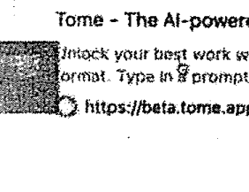

不过手动步骤仍显繁琐，“闪击”App能加速完成，如图1-3所示。

## AIGC+: 100倍速生产爆款内容的底层逻辑

# 目录

# ChatAI聊天机器人月度工作汇总

运营经理 潜入人: ChatAI聊天机器人

# 引流目标达成情况

- *1. 完成渠道推广计划，目标达成80%

根据设定的引流目标，完成本月推广【】

(a) 先让它输出 PPT 内容 (b) 复制 PPT 全部内容到

闪击 PPT 编辑器

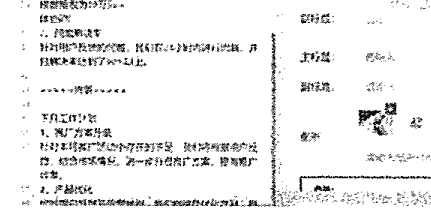

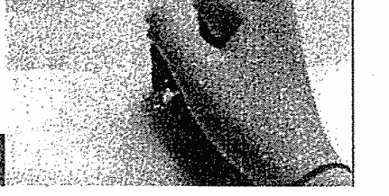

(c) 把内容粘贴到文本框 单击文本转 PPT (d) 单击演示就可以看到

做好的 PPT

> 

除此之外，美国北密歇根大学教授曾在学生作业里发现一份“完美论文”，水平超多数学生，结果99.9%系ChatGPT所写。美国大学调查显示，89%的大学生用ChatGPT做作业。连以色列总统都在用ChatGPT撰写演讲稿，并选用部分内容在网络安全会议发言，ChatGPT的实用性可见一斑。

在ChatGPT全方位颠覆下，即便强大的互联网公司也感受到紧迫感，连埃隆·马斯克都直呼好得吓人。但问题是，人工智能研究已十余年，无论微软小冰、苹果Siri、阿里天猫精灵发展都不大，为何忽然冒出如此庞然大物？

# 第一章 探寻AIGC时代的自媒体发展之路：一个人成为一个工作室

## AIGC+: 100倍速生产爆款内容的底层逻辑

# ChatAI聊天机器人月度工作汇总

运营经理 潜入人: ChatAI聊天机器人

# 引流目标达成情况

- *1. 完成渠道推广计划，目标达成80%

根据设定的引流目标，完成本月推广【】

(a) 先让它输出 PPT 内容 (b) 复制 PPT 全部内容到

闪击 PPT 编辑器

(c) 把内容粘贴到文本框 单击文本转 PPT (d) 单击演示就可以看到

做好的 PPT

> 

除此之外，美国北密歇根大学教授曾在学生作业里发现一份“完美论文”，水平超多数学生，结果99.9%系ChatGPT所写。美国大学调查显示，89%的大学生用ChatGPT做作业。连以色列总统都在用ChatGPT撰写演讲稿，并选用部分内容在网络安全会议发言，ChatGPT的实用性可见一斑。

在ChatGPT全方位颠覆下，即便强大的互联网公司也感受到紧迫感，连埃隆·马斯克都直呼好得吓人。但问题是，人工智能研究已十余年，无论微软小冰、苹果Siri、阿里天猫精灵发展都不大，为何忽然冒出如此庞然大物？

# 2. ChatGPT 的发展

ChatGPT的爆发有迹可循。随着深度学习技术成熟，自然语言处理取得重大进展，OpenAI利用这些技术构建了GPT系列语言模型。ChatGPT的发展可追溯至OpenAI的GPT系列，大致经历五个阶段。

# 阶段一：GPT - 1

GPT-1是OpenAI首代语言模型，2018年发布，是真正意义上的通用语言模型。

其设计目标是流畅处理自然语言，并在多领域任务中表现良好。OpenAI在GPT-1上采用12个转换器模块构成的神经网络结构，可模拟海量文本数据，使其能使用维基百科、新闻、小说、网页等多种资料进行预训练，并将文本分类与生成结合，实现多语言格式表达；在语言生成中采用对词出现概率预测的新方法，精度较高。

总体而言，GPT-1学习能力强、通用性好，使用也简单，只需网页下载应用即可。当然仍有问题：不同设备间文件互传易出错，无法给出标准答案，预训练数据量少导致泛化与效率不足等，也限制了后续数据训练。

# 阶段二：GPT-2

GPT-2是系列第二代，2019年发布，在GPT-1基础上进一步改进。

其目标是提升性能并拓展应用场景。为此GPT-2使用更大模型与更多训练数据。具体而言，GPT-2采用含15亿参数的神经网络，并用超过80GB文本数据训练。

这使GPT-2在多项任务中表现极佳。例如在Super GLUE基准测试中，多个任务获得最高分。此外其自然语言生成能力突出，能写出连贯语句、文章、故事，甚至诗歌与音乐。

GPT-2上线后很快就引来争议。有声音认为靠生成式系统去逼近“完美语言”是不现实的，因为模型在推理过程中必然暴露出自身错误。批评者直言，当前所有在模型上跑的生成任务，不过是在训练窗口里执行一段流程，而不是每次训练后都能自动修复。基于这样的反馈，OpenAI 随后对 GPT-2 做了二次研发，主要改进体现在三点：

- 采用更大规模的 Transformer 结构，堆叠更多层数；
- 进一步扩大网络规模与参数量；
- 将其融合到其他预训练语言模型中，协同提升表达能力。

经此调整后，GPT-2 在海量自然语言语料上的学习效率明显提升，能够直接从句子中抽取知识来做预测与生成。然而即便如此，业界仍普遍不看好它能实现零差错的语义、自我修复或给出更优建议乃至与人对话。OpenAI 认为该版本仍不够成熟，于是开启了 GPT-3 的研发。

# 阶段三：GPT-3 的规模跃迁
GPT-3 是 GPT 系列的第三代模型，2020 年发布，延续了 GPT-2 的预训练思路并做了全面升级。设计目标是把自然语言处理能力推向更接近人类的水平。为此，模型使用了 1750 亿参数的神经网络，并以超过 45TB 的文本数据进行训练。

在 GLUE 和 SuperGLUE 等权威基准上，GPT-3 在多项任务中拿下头名。生成层面同样亮眼，能写出连贯的句子、文章、故事、新闻稿、诗歌，还能产出邮件、聊天记录与代码等。更有趣的是，它可以创造新英文单词、跨语言整合翻译结果，并在自然语言理解与推理上展现能力，能够捕捉隐含含义，把文本、事实与知识在语义层面对齐。

总体来看，GPT-3 结构简洁却威力强劲：在给定语料上能取得最佳输出，高效完成知识抽取，具备一定自学习能力和小样本适应力，是一个相对成熟的产品。

# 阶段四：ChatGPT 的交互转向
ChatGPT 是 OpenAI 在 GPT 系列基础上衍生的对话型模型。与传统 NLP 任务不同，它的核心理念是让人工智能能够与人类进行自然、日常的交互，从而提升 AI 在生活场景中的可用性、可靠性和稳定性。为此，它在 GPT-3 级别的超大神经网络之上做了针对性训练与优化，强化了人机对话能力。

应用场景包括智能客服、聊天机器人、虚拟人物、语音助手等。它不仅能回答常规问题，还能处理情感交流、语境理解、趣味互动等复杂对话。此外还具备生成语音、翻译、写作、编程等附加功能，相当于一个便捷高效的虚拟小助手。

# 阶段五：ChatGPT-3 的情感增强
ChatGPT-3 是在 ChatGPT 基础上进一步演进的对话模型，更加强调与人交互的质感，尤其在情感交流与语境理解上。模型仍采用类 GPT-3 的超大神经网络架构，训练参数超过 1750 亿。

因此它能够完成自然语言生成、理解、情感分析、知识图谱等任务，并实现情感互动与智能推荐。例如可以回答各类问题、理解上下文、捕捉人类情感与个性特征，同时生成连贯的语句、文章、故事、新闻报道与诗歌。

功能上也更细化：语音生成可把文本转为自然语音并调节语调与速度；翻译可实现多语言实时互译并对语句进行整合优化；写作可产出高质量文章、小说、评论甚至整本书的内容；编程可依据用户输入生成高质量代码并完成复杂任务。

# 3. ChatGPT 的现状
发布后 5 天，ChatGPT 注册用户突破 100 万；两个月后月活用户超过 1 亿，成为历史上增长最快的消费级应用。其表现已跻身当今最先进的自然语言处理技术之列，在全球掀起热潮。

过去高科技落地往往先震动行业，普通用户要等到普及才感知到。如今这次不同，普通人几乎立刻感受到未来科技的力量，也感受到人工智能浪潮带来的压力。全球研究者与开发者纷纷加入，国内科技公司亦迅速跟进，例如百度在 2023 年 3 月中旬推出类似 ChatGPT 的“文心一言”。

ChatGPT 的每一步进展对 AI 领域意义重大。它不仅为日常生活提供便利与智能服务，也在智能客服、语音助手、虚拟人物、自动化写作与编程等方向具备广阔前景。

谭木匠的年度设计大赛常备受关注，有网友曾用 ChatGPT 生成一批梳子图案与获奖作品对比。虽然审美见仁见智，难以给出完美结论，但足以让人惊叹。事件后，关于工作是否会被 AI 取代的讨论愈发激烈，对普通人而言这是一种巨大压力。

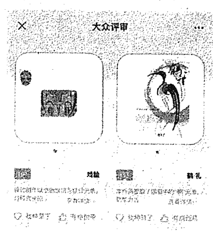
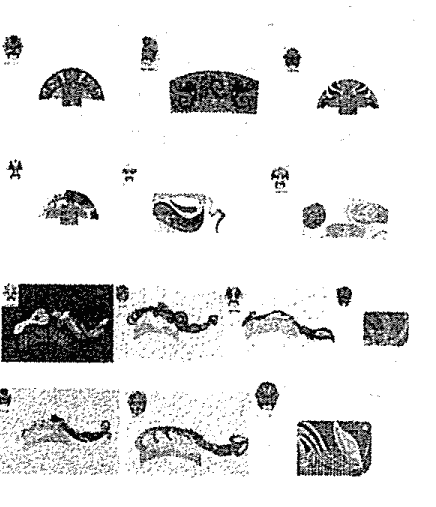
[PAGE 36]

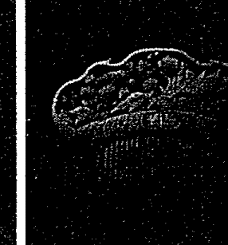

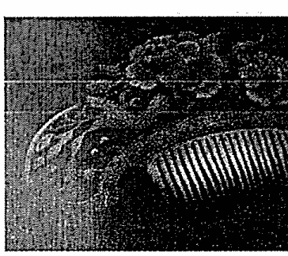
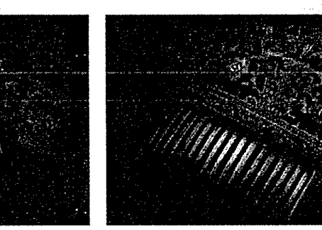

很早之前机器人概念提出时就有人担忧被 AI 取代，如今 ChatGPT 横空出世，焦虑感进一步放大。其出现可能带来的冲击仍在持续发酵。

# AIGC+：百倍速打造爆款底层逻辑
# 第三节
# AIGC 创作的三段演进：助手、协作、原创
2021 年之前，AIGC 主要产出文字，只能充当创作辅助。模型迭代后，AIGC 开始处理文字、语音、图像、视频、代码等多模态内容，并在创意、表现力、迭代效率、传播与个性化等方面提供协助。未来甚至可拓展至嗅觉、触觉、味觉、情感等更多形态。只有实现这种广度，AIGC 的原创时代才算真正到来。同时必须重视生成内容的质量，使其更接近人类智识与审美。这意味着 AIGC 需要承担相应的内容责任，并提供产权保护与交易服务，才能成为助力而非阻力，进而引领内容创作，为人类带来更多想象与创造力。

## AIGC+：百倍速打造爆款底层逻辑
## 第四节
## 个人如何裂变为工作室
自媒体是一种开放自由的传播形态，涵盖微信公众号、知乎、B 站、抖音、快手等平台，各自特点与适用场景不同。高效的自媒体人必须深入了解各平台规则，才能选择合适的阵地与创作方式。个人化工作室的优势主要在两点：一是可以自由表达观点并扩大影响力；二是成本低，无需大量人力物力财力，一部手机加灵感即可启动。

挑战也不少：内容质量不稳、粉丝黏性不足、竞争激烈，最核心的是要持续提升创作与专业素养以吸引读者。此外还需持续产出有价值内容，建立与粉丝的互动沟通机制，维护良好形象。针对这些痛点，AIGC 技术可成为得力助手。

首先，AIGC 可辅助文本分析、语音识别、图像识别。文章可借助语法与语义分析检查质量与准确性；语音可转写为文本，提升创作便捷度；图像识别能解析图片元素与特征，助力图文搭配与设计。

其次，AIGC 可做情感分析，帮助创作者理解受众反应。例如通过情感倾向判断读者对某篇文章或主题的感受，从而调整内容策略与运营手段。

总体看，个人转工作室已成趋势。随着 AIGC 不断发展，自媒体人将更多借助其提升创作与营销效果，学习与应用 AIGC 已成为必要选择。

## AIGC+：100 倍速生产爆款内容的底层逻辑
<!-- no content -->
<!-- no content -->

## 2
ARGUMENTS
## 第一节.
## 用文字改写未来：十秒出一篇小说
AIGC 可细分为文本生成、音频生成、图像生成、视频生成、跨模态生成等场景，可应用于文案、营销、设计、行业研究等文化传媒领域。目前成果最明显的是文字与图像视频，文本生成是使用最广也最简单的分支，可用它生成小说、影视脚本、新闻报道等。市场上文本生成工具众多，各有专长。

对普通用户来说，最实用也最常被使用的仍是文章生成。无论是资深作家还是新手，AIGC 都能在十秒内产出一篇小说。以秘塔写作猫为例，可以拆解 AIGC 如何在数秒内完成一篇内容的生成。

## AI 文本
- ChatGPT (OpenAI 开发的对话机器人)
- Copy.ai (面向文案营销的写作助手)
- Notion AI (专注笔记场景的 AI)
- Cowriter (AI 作家辅助快速写作)
- AI Data Sidekick (AI SQL 伙伴)
- Outplay (AI 营销策略助手)
- Character AI (智能人物对话生成)
- Fireflies (会议记录与转写工具)
- Jasper (面向营销企业的 AI 平台)
- Writesonic (人工智能写作)

在毫无头绪时可用秘塔写作猫辅助。主页提供新建文档、AI 写作、上传 Word 三种入口。若无现成素材，选择前两者即可。进入 AI 写作后，可通过右上角图标调出模板列表，按需选择全文写作、作文、小说、批量生成等。打开空白编辑区即可开始创作。

写作前只需明确大致方向，无需详细提纲。AIGC 通常采用自上而下生成，需要少量引导。简单描述主题，模型即可补全其余内容。

例如要写一篇“AIGC 会怎么改变生活”，进入 AI 写作的全文写作模块，输入标题并设定长度、是否配图、摘要条数等参数，点击下一步，数秒即可生成符合要求的初稿。同理，论文、方案、广告语等创作思路一致，例如在模板中选择广告语，按长度提示即可批量产出创意。

## 无标题
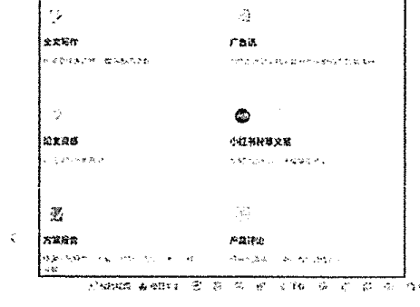
## AIGC+：100倍速生产爆款内容的底层逻辑

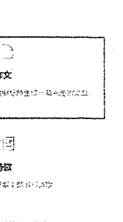
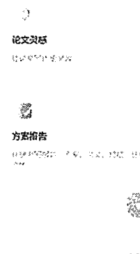
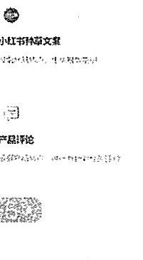
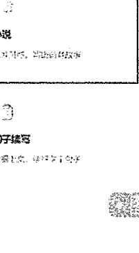
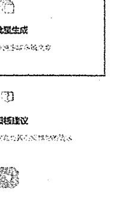
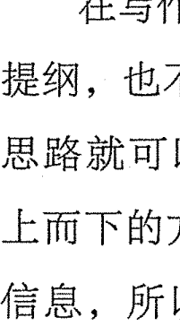
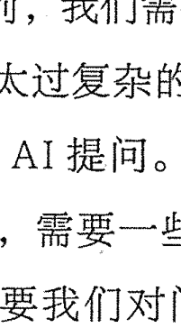
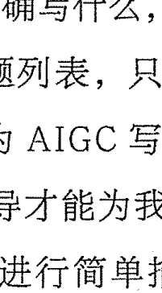
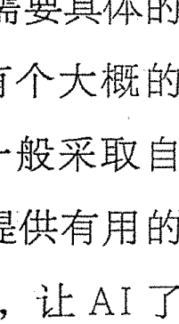

## 第二章 AIGC 的应用方向：从文字到虚拟人的跨界探索
AIGC 会怎么改变生活
- 一、未来的设计界
- 二、更有创造力

# 爆款内容百倍提速的方法论
# 智能创作如何重塑日常

- 设计版图的未来走向
- 创意能力的再进阶

把前面整理好的提示词原封不动喂进 Midjourney，马上就能得到下面这一组视觉结果。用更专业的表达方式，成图的精准度和预期贴合度都会明显提升，见图 2-24。

( a )

( b )

想做一张清明节主题的宣传稿，直接让 ChatGPT 帮忙构思创意即可，示意见图 2-25。

## 第二章 AIGC 的应用方向：从文字到虚拟人的跨界探索

做一个健康科普方向的选题，可以从以下要素展开

想做同类健康科普内容，也可以尝试这些切入点

+   - 新奇体验，比如探险、冒险等
- 自然相关，可探索的动物推荐
- 拍摄技巧，机型推荐
- 放慢节奏享受，欣赏自然的人群
- 深呼吸，细细品味景点
- 抵达目的地时推荐餐饮与娱乐项目

请用关键词来描绘这个场景并带入若干元素

这些元素可以包括：

短裙、旧鞋、连衣裙、披肩、连衣裙、某一天。

到达现场后可以先记录下自己的创意主题，再叠加其它元素来表达想法。

( a ) ( . b )

# 图2-25

借助 ChatGPT 给出的关键词来生成图像，观感也相当不错，如图 2-26 所示。

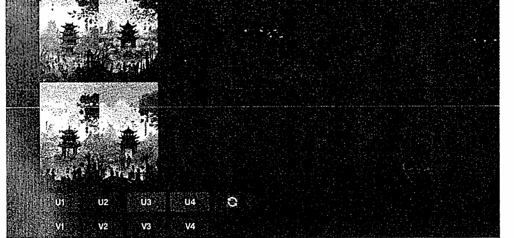

# 图2-26

图出来后加上字体，一张清新的清明节画报就完成了，如图 2-27 所示。

# AIGC+ 

100 倍速生产爆款内容的底层逻辑

另外 Midjourney 的 /describe 功能也能反向产出 Prompt，只需输入指令把喜欢的图片放进去，系统就会推导出对应的提示词，用它生成的画面与原图相似度通常在 80% 以上。

整体来看，如今的智能绘画已能满足日常需求，可按需绘制人物、动物、风景等，软件还会自动标注不同区域的色彩与风格。

过去因专业积累不足，成图常需大量后期才能达标。随着技术演进，越来越多影像可直接由智能系统产出。例如前文提到的“生成器”，就是基于图像处理技术完成创作。

## 第二章 AIGC 的应用方向：从文字到虚拟人的跨界探索

不过现阶段成图质量参差不齐，部分作品与实拍差距明显。

为此研究者提出新的神经网络方案，压缩模拟结果与真实影像的偏差。比如“生成器”在画完一幅画面后，会根据用户点评对内容进行修正；“鉴别器”在收到用户对照片的意见后，也会调整照片内容。如此循环可提升成品质感，减少人工误差。

另一种主流做法是数据驱动模型。设计时往往会积累大量照片、视频等素材，传统分析处理成本高且难以全部保存，而生成式系统能快速处理海量数据并完成分析。

这些模型中常设有一个“过滤器”层，可把照片中的部分元素筛掉。用户据此即可筛出带特征的元素照片，再与其它照片对比，找到相似特征的图集，用于合成新图或生成新视频。

## AIGC+: 100倍速生产爆款内容的底层逻辑

# 第三节

# 视觉创意新边界：视频剪辑效率提升百倍

在生成式体系里，文字产出最活跃，而使用最广的是视频创作。生成式系统主要靠机器学习训练，需要大量数据学习人类技巧，但视频制作门槛已大幅降低，无需专业团队，只需浏览器、移动设备或非图形类应用即可开工。

有营销人士说，“内容为王，视频为王炸”。没有棚拍和专业剪辑团队怎么办？传统流程要搜集资料、写脚本、拍摄、剪辑、配音、字幕、后期，现在只要与 AI 对话就能快速产出高质量成片。

提到视频生成就绕不开 2022 年戛纳最佳短片奖的 AI 作品，这标志着 AI 艺术正被主流认可，AI 辅助创作已成趋势，未来 AI 生成视频必然是短视频主流。

目前 AI 尚不能直接输出长片，也做不到与顶级智能绘画同级的画质，但用生成式系统剪辑视频却非常顺手，只给文案就能秒出成品，剪辑效率提升百倍。剪映、快影、递剪等常用工具都支持。如剪映，点击首页的“图文成片”，输入标题和正文，点击生成，AI 会自动匹配配图与配音一键成片，操作大大减少人工量。若觉得原创度不足，也可自行提供素材来自定义。

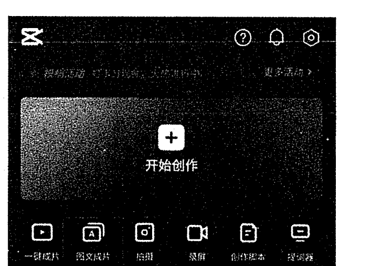

# AIGC+: 100 倍速生产爆款内容的底层逻辑

剪映的逻辑相对简洁，另一款智能工具 “Runway” 已能做到更高级的操作。例如把三次元人类转为二次元形象，在不同视频间实现次元跨越与风格转换。

(1) 视频转视频，如图 2-31 所示。

## 第二章 AIGC 的应用方向：从文字到虚拟人的跨界探索

(2) 同一视频程式化，如图2-32所示。

(3) 用视频参考画分镜，如图2-33所示。

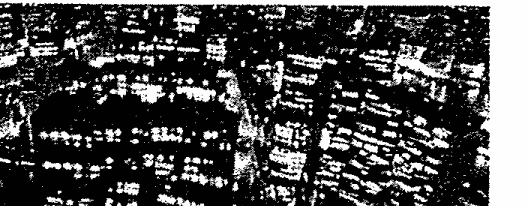

AIGC+:\n100 倍速生产爆款内容的底层逻辑

(4) 遮罩和蒙版，如图2-34所示。

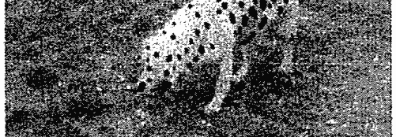

(5) 根据参考渲染，如图2-35所示。

(6) 定制风格画面，如图2-36所示。

但当前生成式系统在视频创作上以生成式为主，可理解为人工智能自己拍电影。例如 Deepfake 算法能为视频添加不真实内容，常表现为伪造，让画面看似真实。

它也会自行生成不真实内容，这种处理不仅改变内容质感，还会让假象极具说服力。除此之外还有 AI-Film 算法，可生成完全由人工智能主导的电影，不仅风格独特，还能按观众偏好决定成片好坏。

必须承认生成式系统正悄悄改写短视频行业，学会使用 AI 后几乎人人都能产出专业水准的视频。只需给 AI 一个简单指令，它就能调用现成生成式工具与海量免费素材库，三分钟内给出初版，甚至能帮忙写标题、简介，十分钟内完成全流程。

生成式系统的视频生成对缺乏编程知识却想创作的人，或是不愿编程但需要专业指导的人尤其友好。例如 UpVideo 平台提供可用于生成短视频或小电影的 AI 合成模型，可把音乐、歌词、台词、特效等输入模型，通过“AI合成”产出艺术作品。

[PAGE 75]

但对复杂题材而言，生成式 AI 未必是最优解。例如《阿丽塔：战斗天使》里有段极其复杂且现实中难以完成的戏，这类场景就需要基于深度学习的 AI 合成短视频来完成。

虽然 AI 视频仍不能直接输出长片，画质也未达智能绘画水准，但让人工智能逐帧修改视频，变化已翻天覆地。随着技术演进，AI 做视频、影视设计、游戏、电商等将不再是梦想。

## 第四节

# 超越真实：以假乱真的虚拟人

伴随互联网与大数据的持续创新，全真互联时代到来，具有交互能力的虚拟数字人已在各行各业落地，为用户提供实体场景服务。在元宇宙背景下，虚拟数字人正成为价值生产的主体。

虚拟数字人是借助数字技术创造出的接近人类形象的数字化人物。虚拟数字人视频则基于计算机视觉与语音合成等技术训练形象、声音、动作模型，通过后台输入需求生成“真人”讲解的短视频。

因此构建虚拟员工、虚拟主持人等角色可实现 7×24 小时服务，减少人工重复录制，降低人力成本。从图2-37可看出，200平方米的直播间里全是虚拟主播。

虚拟人的实现主要由建模、驱动、渲染、呈现与互动五大环节构成。建模、驱动、渲染主要依赖影视 CG、VFX 技术与游戏引擎。

首先 3D 建模是构建形象的基础，基于虚拟形象与虚拟 IP 绘制原图，重点在于细节还原，如图2-38所示。

[PAGE 78]

其次，通过动作捕捉迁移至虚拟人是当前 3D 虚拟人动作生成的主流方式，核心是动作捕捉；利用捕捉设备或特定摄像头 + 图像识别，捕捉形体、表情、眼神、手势等关键点变化，如图2-39所示。

最后渲染技术用于提升逼真度，通过真人演员表演与虚拟人实时互动，实现实时渲染，如图2-40所示。按 Unity 技术开放日披露的流程，Unity 制作虚拟人时，首先按 FaceCode 标准扫描真人极限表情，然后进行模型清理、BlendShape 拆分，修细节、贴图与血流图，再进行 Rigging（含重定位等）和模型捕获（利用第三方高精度结果驱动模型或真人驱动），最后绘制完成。

[PAGE 79]

在继电子计算机、数字计算机之后，未来网络由“信息－网络－实体”三者结合构成的新一代信息基础设施，以万物互联、人机交互、全光网、全业务为基础，实现虚实融合。相信未来虚拟人将与数字人融合发展，与元宇宙等技术深度融合，并在未来网络中发挥不可替代的作用。

# 第二章 AIGC的应用方向：从文字到虚拟人的跨界探索

<!-- no content -->

# CHAPTER 3

# AIGC魔盒:

AIGC如何开启智能新时代

# 第一节

# 定位：如何用 AIGC 打造与众不同的人设

生成式 AI 在各领域的广泛应用让生活更便捷，也大幅提升了工作效率。随着技术发展，它将对互联网产生更大影响，或许会重塑整个互联网格局。

例如 2023 年 3 月，抖音上含 ChatGPT 标签的视频播放量、虚拟数字人视频标签播放量、AI 视频标签播放量均以亿计，妥妥的流量担当，如图 3-1 所示。

| #chatgpt       | 12.6亿次播放   | #AIGC         | 1.2亿次播放   |

| #chatgpt应用领域 | 2.7亿次播放     | #aigc行业      | 47.1w次播放   |

| #chatgpt有多能聊 | 1.0亿次播放     | #aigc概念      | 17.0w次播放   |

| #chatgpt4       | 5731.4w次播放   | #aigc数字人    | 7.8w次播放    |

| #chatgpt聊天     | 1137.8w次播放   | #aigc应用      | 6.0w次播放    |

| #chatgpt注册     | 430.8w次播放    | #aigc技术      | 1.3w次播放    |

# AIGC+: 100 倍速生产爆款内容的底层逻辑

OpenAI 发布 GPT 最新一代 ChatGPT-4 后仅十天就达到如此播放量，可见以 ChatGPT 为核心的话题热度极高。

有些人觉得这不就是讲故事吗？科普类博主很多，为什么他这么火？因为他定位精准且内容创新，他在讲故事时把人物换成了“你”，一个小改变带来小说式沉浸感，还能体验不同时代的人生。

如今该博主一条广告报价就达 99 000 元，如图 3-7 所示。但这类个人账号可模仿，养成路径也可复制，通过批量生成视频与批量打标签，精准定位后再规模化复制，甚至形成内容矩阵。

## 口播新赛道 改变人称

达人服务报价

| 时长       | 价格   |

|------------|--------|

| 1 - 20秒   | ¥80,000|

| 21 - 50秒  | ¥90,000|

| 60秒以上   | ¥99,000|

对于“深度智能前线”这类深耕AI写作的专业账号，单靠泛AI是不够的，得把赛道切得更细、定位更准，比如单独做AI绘画内容、单独做AI写作内容的垂直号。AIGC效率加持下，一个人同时打理几十个细分账号也完全可操作。

许右史账号的鲜明之处在于大量使用第二人称。带货卖房时，叙事就要切换到能让观众用第一视角代入的表达，去感受每个空间的舒适与细节。做教育内容的创作者可以开口就说“你现在15岁”，这种直接对位能促发换位思考，沉浸感上来后接受度也会更高。至于定位，别一味迎合，要保留弹性，在互动中不断校准与受众的关系。

## 第三章 AIGC魔盒：点燃智能创作新篇章
# 第二节
## 爆款打法：AIGC如何快速孵化热门内容

爆款就是被大量用户围观、追捧的内容，对短视频而言则是流量高度倾斜的作品。在AI生成的内容池里，怎么判断有没有爆款潜质？关键是要找到可量化的流量判断依据，从而更精准地挑选和制作高潜作品，承接更多观众与市场份额。

平台的流量分配是中心化的，用户发布的内容都会进入基础曝光池。实际能拿到多少浏览，取决于内容在流量池里的表现，也就是能不能打动观众。平台依据推荐机制把表现优异的作品扩散给更多人，获得更大曝光和播放。这种机制也给了新手机会，只要内容足够吸睛，就有机会从流量池里突围，成为爆款。所以做视频的人要在内容本身下功夫，打造足够吸引力和话题度的作品，才有持续拿流量的可能。

很多人运营账号都想借算法获得流量，但进入流量池后能否获得展示，取决于内容能否抓住注意力。那怎么衡量一个作品在流量池里的表现？

主流平台基本都参考播放率、点赞率、评论率、完播率和转发率这五项。表面看复杂，实际就是多发不同类型的AI生成内容，观察哪类作品的数据更亮。播放率是单位时间内被播放的次数，用来衡量受欢迎程度和流量基础；点赞率反映用户对作品的认可与喜爱比例；评论率能检验内容是否提供了互动钩子，是参与度的体现；完播率看内容能否牢牢锁住用户；转发率则体现用户愿意外推分享的意愿。其中播放率权重最高，播放越高爆发概率越大。所以要不断尝试不同题材，通过数据反馈判断受众偏好，再迭代优化内容，提升曝光和流量，如图3-8所示。

## 抖音推荐逻辑
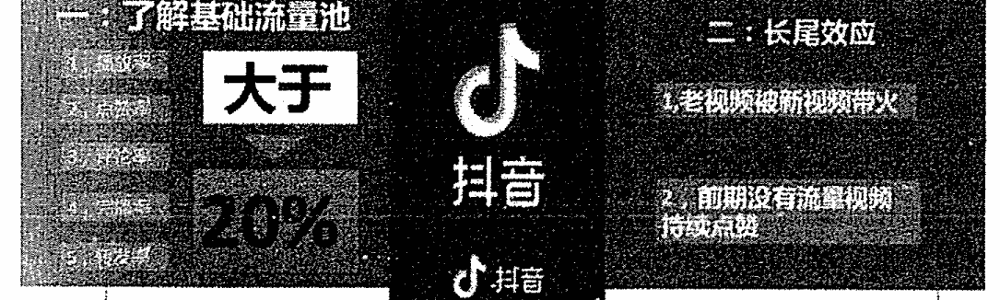

拿到播放量的做法并不复杂，最直接的是盯着作品在某个时间窗口内的播放次数。通过平台自带的数据分析工具，可以查看播放量、观看时长、观众行为与互动数据。还能借助社媒渠道把作品二次分发，扩大触达。持续观察作品在不同平台的表现，结合指标数据和用户反馈，就能更清楚受众需求，为做出更有吸引力和话题性的内容提供依据。

## 第三章 AIGC魔盒：点燃智能创作新篇章
# 第三节
## 推广策略：用AIGC为作品打精准标签

内容发布后热度下滑，常见结果就是没流量或卡在瓶颈期。原因很简单，发布只是起点，后续需要推广。单靠一个爆款不够，要想持续火，需要在保证质量的前提下做推广，画面精致、干货扎实的作品是基础。

优质推广的核心是好标签。合适的标签能提升用户点开意愿，带来第一波流量。如果标签不吸引人，后续很难谈爆款。所以标签要贴合内容本身，同时具备新意。这里的创新不是标题党，而是抓住内容内核，给标题留悬念、戳痛点。可以用AI做标签识别，如图3-10所示，从多重候选里挑选最合适的标签。

## 第三章 AIGC魔盒：点燃智能创作新篇章
## 第四节
## 运营升级：AIGC如何重塑后期制作流程

ChatGPT等生成式AI正在改变短视频后期。过去的剪辑调整已不够，后期涉及的技术与流程越来越复杂，AIGC正成为高效解法，能在后期环节发挥关键作用。

AIGC带来的便利显而易见。首先可以自动把视频转成文字，省时省力。语音转文字技术能快速抽取视频里的关键词和对话，为后期提供文本素材。同时能自动识别和归类素材，目标检测技术可精准定位画面中的人物与物体，让素材管理更高效。

此外，AIGC还能按场景和情境自动分类，帮助快速找到匹配素材。从素材提取到剪辑，几乎每一步都能接入AI工具。总的来看，AIGC的普及让视频制作效率更高、更省心。

例如，AIGC可做视频超分辨率处理，如图3-20，传统方法计算量大耗时长，而AIGC能大幅压缩计算时间，提升处理速度。

# AIGC+: 100倍速生产爆款内容的底层逻辑
# 第五节
## 全流程模板：用AIGC做标题到结尾的保姆式教学

做内容时常卡在标题、开头、结尾上。AI能帮忙，但效果参差不齐，根本在于提示词是否精准。下面拆解从标题到结尾的打法，给AI提供清晰指令，从而稳定产出高质量内容。

+ 1. 标题模板

+ (1) 疑问法。
疑问式标题靠抛出问题激发好奇，用“为什么”“怎么”“是否”等词引导点击。

# 疑问式标题可用框架包括：
+ ① 为什么……，如“为什么总有人迟到？”
+ ② 如何……，如“怎样提升英语口语？”
+ ③ 是否……，如“是否该给孩子报补习班？”
+ ④ 什么是……，如“什么是人工智能？”
+ ⑤ 有哪些……，如“有哪些快速减脂方法？”
+ ⑥ 你知道……吗？如“你知道怎么缓解职场压力吗？”
+ ⑦ 什么时候……，如“什么时候旅游最合适？”

疑问标题能提升好奇心与理解度。做美妆视频时可直接让AI按疑问法生成标题，如图3-25所示。

## 数字法。
数字法靠具体数字突出重点，增强清晰感与说服力，可表数量、时间、步骤、排名。

# 数字法标题可用框架包括：
+ ① 数字 + 关键词，如“10个最佳旅行地”“5种健康早餐”
+ ② 数字 + 问题，如“学编程的5个理由”
+ ③ 数字 + 行动动词，如“10个小技巧让你更自信”
+ ④ 数字 + 结果，如“7个习惯让你更高效”
+ ⑤ 数字 + 比较，如“10款热门手机横评”

数字标题有助于内容结构化，读者更容易接受，如图3-26所示。

# (3) 热词法。
热词法用当下热点、事件、人物做关键词，快速抓注意力。

热词法模板包括：
+ ① 事件 + 关键词，如“某事件背后的真相”
+ ② 人物 + 关键词，如“某名人的成功秘诀”
+ ③ 热点话题 + 关键词，如“某话题的深层解读”
+ ④ 科技前沿 + 关键词，如“某产品的突破与趋势”

热词法点击率高，但时效强，需要及时更新。

# (4) 俗语法。
俗语法用俗语、谚语、成语作标题，表达主旨并引发共鸣。

模板包括：
+ ① 成语 + 关键词，如“一鸣惊人的背后”
+ ② 谚语 + 关键词，如“吃一堑长一智的经验”
+ ③ 俗语 + 关键词，如“人心不足的隐患”
+ ④ 名言 + 关键词，如“失败是成功之母的真意”

使用时语言要精炼，避免老套，标题与内容要统一。例如结合AIGC重要性与俗语法，如图3-27所示。

# (5) 设问法。
设问法用疑问句作标题，激发思考与好奇，常用于问题解决与知识探究。

模板包括：
+ ① 问题 + 关键词，如“一个问题的解决路径”
+ ② 知识 + 关键词，如“某知识点的全景解析”
+ ③ 思考 + 关键词，如“对某事件的深度思考”
+ ④ 比较 + 关键词，如“某产品的优劣对比”

设问法提升阅读价值，需具体实用。做防晒霜广告时可这样用，如图3-28所示。

# (6) 电影台词法。
用经典电影台词作切入点，传递情绪与主题，增强感染力。

模板包括：
+ ① 台词 + 关键词
+ ② 影评 + 台词
+ ③ 台词 + 问题
+ ④ 台词 + 故事

台词需有代表性，避免过度小众化。

# (7) 好奇法。
用“未知”“神秘”“探索”等词激发求知欲。

模板包括：
+ ① 未知 + 关键词，如“未知的世界你想了解？”
+ ② 神秘 + 关键词，如“你好奇神秘现象吗？”
+ ③ 探索 + 关键词，如“想探索新领域吗？”
+ ④ 发现 + 关键词，如“发现新世界你期待吗？”

好奇法提升阅读与分享率，需保证真实可信。科普类内容很适合，如图3-29所示。

# AIGC+:
100倍速生产爆款内容的底层逻辑
# (8) 对比法。
对比法通过并列事物突出差异，吸引注意力，常使用“VS”“对比”等词。

模板包括：
+ ① A VS B，如“iOS VS Android哪个好？”
+ ② A和B的区别
+ ③ A和B的相似点
+ ④ A和B的优缺点
+ ⑤ A和B的评测
+ ⑥ A和B的历史发展
+ ⑦ A和B的文化差异

对比标题帮助读者快速理解区别。

# 2. 开头模板
# (1) 问句式。
用疑问句开篇，制造互动与引导。

模板包括：
① 你是否……，如“你是否感到孤独？”
② 为什么……，如“为什么有些人总焦虑？”
③ 是否……，如“是否有方法让你更快乐？”
④ 怎样……，如“怎样管理时间更高效？”

问句式开头需有针对性。例如职场关系短视频开头可这样写，如图3-30所示。

# (2) 点名式。
用具体人物或事件开篇，增强话题感。

模板包括：
① ××说过……，如“马云说过，失败是成功之母。”
② ××事件引发了……，如“某校园事件引发社会关注。”

开头写法与结尾写法快速拆解

先点出某种现象已经成为行业标杆，例如“××已然成为...，就像《流浪地球》在内地影市杀出一条黑马。”再点出现象带来的连锁反应，例如“××现象正在推动...，比如素颜经济带动了年轻女性对自信美学的追求。”

点名式开头的关键在于所点人物必须具备代表性与公信力，如图3-31所示。

用点名式起笔，围绕“学会AIGC才能拥有未来”写几组示范，素材源自海外名家的经典语录：

1. “AI is the new electricity.”——Andrew Ng
掌握AIGC已经成了决定未来的必修课。正如Andrew Ng所言，AI就像电力一样，终将渗透到生活每个角落，成为新的基础设施与核心竞争力。

2. “Intelligence would be the ultimate version of Google. The ultimate search engine that would understand everything on the web.”——Larry Page
学会AIGC等于拿到了未来搜索的钥匙。正如Larry Page所说，AI将进化成终极搜索引擎，能够理解全网信息，为人类提供更智能的服务。

3. “The development of full artificial Intelligence could spell the end of the human race.”——Stephen Hawking
学会AIGC不仅是通往成功的必备，更是一场必须正视的挑战。正如Stephen Hawking警告，充分发展的人工智能可能威胁人类存续，我们唯有掌握这项技术，才能更好地应对风险。

4. “AI is not a threat to humanity. It is an extension of our own...” 

# (3) 自我剖析式

自我剖析式开篇以个人经历或感悟切入，呈现作者的思考与情绪。常见牵涉成长轨迹、人生起伏、情感体验，个人色彩浓、代入感强。

常用框架：
① 我曾经……，如“我曾经内向自卑，后来通过努力变得自信开朗。”
② 我发现……，如“我发现每个人都有自己的价值，我们应互相尊重包容。”
③ 我体验到了……，如“我经历过失恋的痛苦与绝望，也因此学会坚强与成长。”
④ 我认为……，如“我认为人生最重要的，是追逐自己的梦想而非活在他人期待里。”

用自我剖析式写几则“学了AIGC收入翻十倍”的开篇示范：

1. 从前我只是个普通程序员，月薪平平无奇。真正开启AIGC学习后，技能迅速升级，收入竟直接翻了十倍。

2. 我曾在一家公司做市场营销，收入始终有限。接触AIGC后，我学会了更精细的市场洞察与投放策略，薪资随之跃升十倍。

3. 以前我做数据分析，工作内容重复、报酬一般。开始学习AIGC后，我掌握了数据挖掘与机器学习方法，收入翻了十倍。

4. 我过去是一名普通设计师，薪水不高。学习AIGC设计工具后，我的工作效率与作品水准大幅提升，收入也翻了十倍。

5. 从前我从事教育工作，收入稳定但普通。接触AIGC教育应用后，我能提供更高效的教学方案，收入翻了十倍。

# (4) 名句式

名句式开篇引用名人名言、经典诗句或文学金句，彰显文化底蕴与思想深度。常涉及人生哲理、文化传承、情感共鸣。

常用框架：
① “人生自古谁尤死，留取丹心照汗青。”——文天祥
② “读书破万卷，下笔如有神。”——杜甫
③ “天行健，君子以自强不息；地势坤，君子以厚德载物。”——《易经》
④ “生活不止眼前的苟且，还有诗和远方的田野。”

## 第三章 AIGC如何打开智能创作新纪元

### (1) 1个观点 + N 个角度
先抛出核心观点，再用多个不同视角展开论证，让文章更立体全面。

结构：
+ ① 引子：带出主题
+ ② 核心观点：明确立场
+ ③ 角度1：阐述关联
+ ④ 角度2：阐述关联
+ ⑤ 角度3：阐述关联

### (2) 1 个观点 + 同一个人的多个事迹
提出观点后，用同一人物的多件事迹佐证，更具体生动。

结构：
① 引子：引出主题
② 观点：明确立场
③ 事迹1：说明与观点的关联
④ 事迹2：说明与观点的关联
⑤ 事迹3：说明与观点的关联

### (3) 概括式
结尾以简洁总结收束主旨，强化记忆点。

常用收束句：
+ - ① 总之，……
- ② 综上所述，……
- ③ 总的来说，……
- ④ 总而言之，……

### (4) 点名式
结尾通过罗列关键词或事实点出重点，加深印象。

常用收束句：
① ……，……，还有……
② ……，不仅仅是……，更是……
③ ……，包括……、……和……
④ ……，不可忽视的是……

### (5) 名句式
结尾引用名言点题，提升思想高度。

常用收束句：
+ ① 如此这般，正如某位名人所说：“……”
② 总之，正如一句古语所说：“……”
③ 总结来说，正如某位大师所言：“……”
④ 总而言之，正如一句名言所说：“……”

### (6) 排比句式
结尾用相同结构排比强调重点，增强节奏感。

常用收束句：
+ ① ……，不是……，也不是……，更不是……
+ ② ……，不仅仅是……，更是……，甚至是……
+ ③ ……，不是因为……，而是因为……，更是因为……
+ ④ ……，不是……，也不是……，而是……

## 第四章 AIGC实战：各大平台的爆款打法

### 1. 账号定位
抖音上主流的短视频形态有音乐类、教程类、搞笑类、模仿类和情感类。音乐类靠节奏与表演吸睛，教程类靠实用赢信任，搞笑类靠笑点拉留存，模仿类靠熟悉片段带新鲜感，情感类靠故事引发共鸣。这几类多需要真人出镜。

选什么赛道，要看自身特长与擅长领域。真人出镜成本高，多数创作者会先用矩阵号快速起号，积累基础流量后再投入真人原创。

目前抖音上转化最好、制作相对简单的一种形式是聊天式对话，用对话体讲冷笑话或引发争议的话题。点赞量常见几万到几十万甚至破百万。

但此类内容对质量和创意要求极高，段子不够有趣就会掉粉，甚至影响账号信誉，所以选题和打磨要认真。

### 2. 内容制作
内容生产可直接交给AIGC工具。比如想做婆媳纠纷的聊天对话，可让ChatGPT生成“一段婆媳纠纷的对话”。系统会输出一段虚构对话，展示婆婆主动帮忙却越界、媳妇表达不适、双方寻求尊重与沟通的过程。

若觉得过长繁琐，可对AI提出优化要求，得到更精炼的版本。

### 3. 标题确定
标题必须抓人。可借势热点新闻或流行话题关键词；可突出视频最大卖点；可用数字制造效率感，如“5分钟学会跳舞”；可用情感词引发共鸣，如“感动到落泪的美食故事”。核心是简洁明了，一句话说清内容。

### 4. 账号运营
想做成热门IP，要注重细节和创意，结合AIGC提升时尚感与互动性。有了一定粉丝后要做二次增长，强化个人标签与风格。

首先明确“特色标签”并持续输出，精准锁定目标人群，提升曝光。

其次提供更深度的内容，从自身定位出发，结合观众需求不断丰富题材，保证内容有趣、有创意、有质感，提升完播、分享与评论。

最后用AIGC做自动化处理与分发，配合自动化营销工具，加速推广，让内容触达更多用户。

### 5. 成功案例
抖音上不少博主靠聊天记录体迅速吸粉。有一位主播持续更新情感纠葛的聊天截图，三个月内斩获52.1万赞和1.8万粉丝。

另一账号已更成熟，开通橱窗，累计推荐11万件商品，流水可观，提成约20%。账号只需定时更新保持曝光，大量内容来自粉丝投稿，互动性强，博主几乎不用自己构思选题。

这些账号起初靠AIGC工具批量注册并填充内容起量，后续靠持续输出积累粉丝，最终实现橱窗变现。同样的逻辑可复制到快手、百家视频等平台。

# 第二节

## AIGC+小红书：三天打通变现通道

要做一个快速变现的小红书账号，首先要定内容赛道。

1. 账号创建
账号名要吸睛，简介要清晰呈现主题与定位。

好名字具备：简洁明了、与内容相关、独特性、易搜索。
常用命名法：
(1) 主题 + 词缀，如“美妆小姐姐”“旅行达人”
(2) 口号 + 主题，如“让你更美丽的美妆秘籍”
(3) 谐音 + 主题，如“美妆小仙女”
(4) 数字 + 主题，如“美妆101”“旅行365”
(5) 缩写 + 主题，如“MZ美妆”“TT旅行”

2. 选题确定
小红书要选热门、有趣、有价值的题材，如美妆、时尚、旅游、美食，并保持专业深度，践行利他思维。

不同人群偏好不同：年轻女性爱美妆时尚美食旅游健身；年轻男性偏游戏体育科技汽车音乐；中年女性关注家居养生美容；中年男性关注投资理财健康；老年人关注养生文化历史艺术。

若内容长期不温不火，核心在于模仿。原创灵感的成功率远低于已验证的爆款。先在平台上按关键词与笔记数据筛选达人，分析粉丝量、人设定位，找到可对标的账号。例如学生党不适合对标奢侈品标签，更适合性价比、平价、兼职、学习等。

锁定对标后，拆解其优质笔记的关键词，搭建自己的内容模板，加入个人故事与案例，强化人设。

常见赛道：教程类提供实用技能，心理学类满足情绪需求，趣味类提供减压价值。

3. 内容制作
找到对标后，寻找相似素材，文案必须原创。可让ChatGPT生成小红书风格文案，但普通提问会得到机械化结果。

例如提问“帮我用小红书风格推荐一款口红”，得到的回答往往平铺直叙。

改进方法是先拆解对标博主的表达，再给出精细指令，如要求“标题抓眼、各段开头加可爱emoji、结尾加相关tag”。这样生成的文案更贴合平台调性。

AIGC+：百倍速生产爆款内容的底层逻辑

[PAGE 151]

这款唇膏质感细腻柔滑，涂抹时毫无阻力，配方里添加了充足的滋养成分，能让双唇持续保湿、触感柔软。

色泽表现也很出众，上妆后能长时间维持，数小时不易晕开，盈润的光感为整体妆容增添一丝浪漫氛围。

记得加上相关标签。 #可爱口红 #春季口红 #夏季口红 #浅粉色口红 #RosyKiss

总体来看，这支【粉色公主】口红很适合追求甜美妆效的女生。如果你正物色一款可爱又品质在线的唇膏，它一定不会让你失望。

这次的回应相比之前有所进步，但距离预期仍有差距。此时可以对模型输出进行针对性修正，清楚指出不满意的具体点并给出明确的修改指令和示例，通过这样的反馈引导模型调整方向，使结果更贴合需求，如图4-10和图4-11所示。

# 段落结尾未添加表情

# 抱歉，我没有在每一自然段末尾加上表情符号。按照你的要求修改后的版本如下。

+   - 嗨，仙女们！今天给大家安利一款很不错的工具——《闪耀之星》，出品方是Starry tips。软件主打「星空计划」，是一款实用的修图应用。
-   它拥有强大的图像处理能力，涂鸦绘制非常便捷。内部融合了丰富的画面元素，能保持成像素晰美观。
-   再者，《闪耀之星》的操作手感也很流畅，可在屏幕上持续使用八小时以上，视觉反馈很灵敏，能带来更沉浸的体验。
-   最后，别忘了加上相关标签，#闪耀之星 #tanytips #红色口红 #性价比高 #好用的软件
总的来说，《闪耀之星》很适合想让形象更丰满的女性。如果你还在找一款高性价比、效果靠谱的工具，这款应用是个不错的选择。

# 面向甜美少女风、日系美式少女、低价高活力、适合朋友圈文案的需求

# 好的，针对这个人群，我单独生成了一版文案。

+   - 首先，针对这种偏好，以上整套少女感十足的调性！今天要推荐一款很有活力的应用，名字叫「青春记忆」。这款应用的配色偏明亮珊瑚粉，很契合喜欢甜美风格的女生。
-   「青春记忆」的触感非常轻盈，上色顺畅，不会带来干涩感。里面还蕴含了多种养分，能够维持妆效持久美丽。
-   另外，这款应用的交互也不错，只需轻轻一点就能完成操作，能帮你节省不少时间。
-   最关键的是价格很亲民，很适合想入门化妆的女生。
-   总之，如果你想给对象一份特别又贴心的祝福，「青春记忆」是个好选择。你可以在应用里挑一张可爱的小卡片，写下祝福语和心愿！

由此可见，提示词的质量至关重要。为了让模型更精准地理解意图，提问时应尽可能提供产品特性、目标人群、需要传达的核心信息等细节，问题的详尽程度直接影响输出的准确性和针对性。描述越具体，模型产出越契合需求。ChatGPT 生成的文案偶尔显得生硬，但它能以极快速度批量产出，为工作效率带来巨大提升，因此人工校对润色必不可少。

如果越来越多用户和商家使用AIGC工具创作内容，竞争势必加剧。

其一，要依托小红书平台沉淀的大量选题素材和笔记来训练自己的AI创作模型，通过持续学习、实践和迭代提升内容产出能力，实现稳定高质量创作。

其二，当用户喜欢你的内容后会点进主页浏览，若简介空白或与账号定位不符，很难促成关注，所以简介务必写清定位、内容领域、用户价值以及关注理由，如图4-12所示。

# 第四章 AIGC 实战：多平台内容玩法拆解

[PAGE 154]
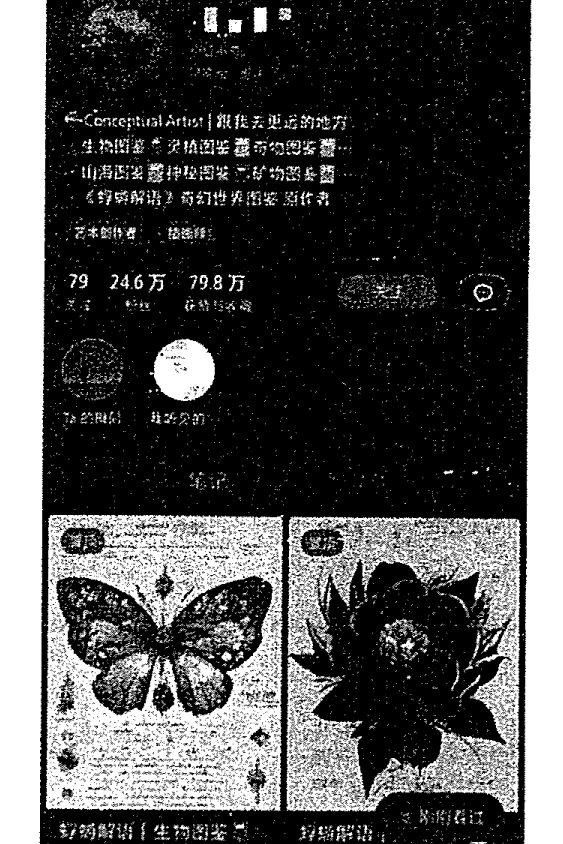
# 配图2-12

最后要理解小红书的推荐机制。简单说，笔记发布后平台会先推给约100个用户，若90%左右的用户给出点赞评论甚至关注，平台就会扩大到1000个用户，依此类推；若用户不感兴趣，互动低，内容就不会被继续推送。小红书爆款并非玄学，优质账号都是靠策略打造的。

## AIGC+：百倍速打造爆款内容的底层逻辑

[PAGE 155]
## 4. 账号运营与变现

账号搭建完成后，就要进入正式运营阶段。保持规律更新，维持平台活跃度，积极与粉丝互动，回复评论和私信，提升用户粘性和忠诚度。同时注重账号视觉，包括封面设计、配图挑选和文字排版，这些对小红书体验影响很大，要让用户阅读轻松、视觉愉悦。

粉丝量达到一定规模后可考虑变现。小红书的变现路径相对清晰，平台上沉淀了大量有价值的UGC内容，如购物心得、美妆教程、旅行攻略等，通过分享吸引流量形成社区。小红书将这些流量与品牌需求匹配，在站内完成商品销售，并通过付费推广和品牌合作获取收益。

具体变现方式包括品牌合作、直播带货、社区种草等。品牌合作是主要手段，平台依据UGC和社群推荐引导用户产生购买需求，再通过品牌联动实现交易。直播带货则面向头部博主或美妆达人，在直播中展示商品促成即时下单。社区推荐依托算法将商品推送给潜在用户，方便购买。

除此之外，还有付费推广和粉丝经济。付费推广让品牌获得更高曝光；粉丝经济则通过激励用户产出优质内容，扩大社区和流量。

总体而言，小红书通过社交电商模式，将用户内容转化为商品销售，实现盈利。

[PAGE 156]
## 5. 爆款案例

小红书上的爆款案例众多，如图4-13所示。这些博主专注零食测评，主页简介写得非常清晰，左侧博主还把不同品类分栏展示，主页一目了然。

这些案例值得借鉴。很多零食测评博主已成气候，我们可以模仿延伸，比如做宿舍好物、追剧神器、办公室零食推荐，甚至延伸到宠物零食测评。

[PAGE 157]
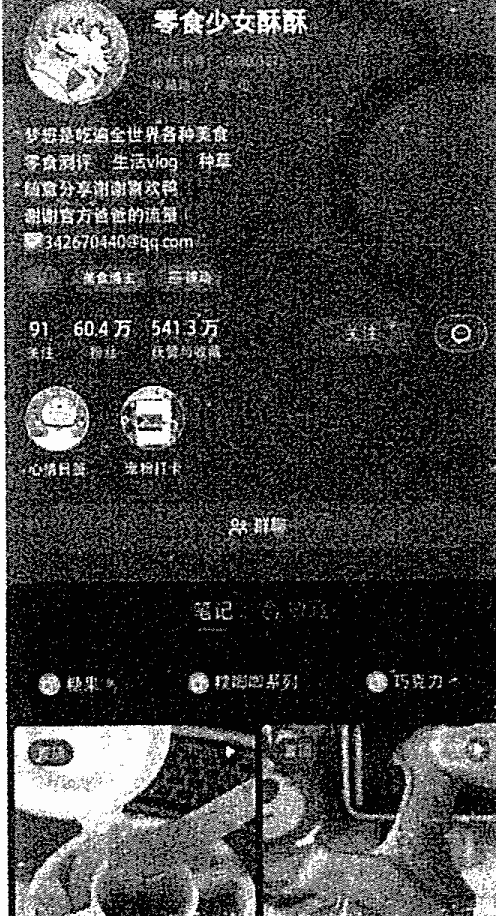

这些方向都可行，成功案例很多。过去因不会写文案而发愁，如今AIGC可快速解决，利用碎片时间运营账号做副业，实现财务自由并非不可能。只要深入研究爆款选题的套路，配合对标账号的模仿创作，就能快速获得推荐，借助AIGC选定标杆后即可高效复刻。

# 第三节

## AIGC+B站：虚拟数字人UP主

如何在B站快速打造一个10万粉账号？从账号创建、选题、内容制作、运营变现四个维度展开。

+   1. 账号创建
首先选择合适的账号类型，B站有UP主、认证UP主、机构号等，需根据自身情况挑选。其次取一个有记忆点、简洁且与内容相关的名字，注意避免侵权。最后完善账号资料，包括头像、简介、标签，方便用户认知和记忆。
+   2. 选题确定
想出圈必须选对热点。B站用户以年轻人、二次元爱好者为主，建议聚焦动漫、AI、游戏等相关话题；同时B站用户对内容质量要求高，需提供创意、搞笑、科技等高质量内容。

从数据看，B站月...
通过智能生成等手段提升视频质量和创意，增强账号吸引力与竞争力。
总之，B站运营与变现需结合AI技术发展，不断强化账号优势，提升内容吸引力，满足用户需求，保持竞争力，实现可持续发展。

## AIGC+：百倍速生产爆款内容的底层逻辑
## 第四节 AIGC+电商：行业门槛大幅降低

如果你是电商新手，缺乏运营经验，可能觉得门槛很高。但随着AIGC出现，情况正在改变，AIGC能帮助快速学习电商知识和技能，降低跨境电商门槛，大幅提升学习效率，让你更好应对行业变化。因此，AIGC可能是当下电商成功的关键工具。

电商是一个涵盖选品、主图运营、营销、物流、售后的复杂体系，每个环节都有诀窍，需不断学习实践。AIGC可大幅提升各环节效率和精准度。例如，通过数据分析找到热销商品，加速选品；自动提取产品图关键信息，提升美观度和辨识度；优化物流流程，提升效率和服务。总之，AIGC让运营更高效智能，更易应对挑战。

### 1. 选品
电商选品是在众多商品中筛选出有销售潜力、竞争优势的品并上架。选品需考虑市场需求、用户偏好、竞争态势等。AIGC可从海量商品中快速精准筛选，通过关键词和条件自动分析热度、销量、竞争情况，帮助找到更具潜力的商品。同时可对商品图、描述进行自动识别分析，提升美观和转化。选品是成败关键，AIGC能更快更准锁定目标，提升业绩。

### 2. 产品图运营
产品图运营直接决定销售和体验。传统拍摄需要模特或自行拍摄，成本高耗时长。如今用AIGC可快速生成主图、详情图、模特图等，大幅降低成本提高效率。

具体流程是：先准备商品图片、文案并明确风格要求，再用AIGC软件自动化生成。可自动生成多角度、多尺寸、多配色的主图，以及细节图、模特图，大幅提升效率和品质。AIGC还能智能处理图片，提升美观和吸引力。

使用AIGC制作产品图，能在提升效率和精准度的同时降低成本，增强商品竞争力，满足用户购物需求，实现长效发展，如图4-19所示。

## 第四章 AIGC妙用：AIGC如何在各大平台大显神通

不仅如此，AIGC还能做试穿图，无需真人模特，如图4-20所示。

## 从衣架到真人模特
## 局部重绘的妙用

成本极低，未来无需花费高额费用请模特，只要数分钟即可生成理想的模特图。例如拍摄卫衣，只需向AI描述适合的女模特，身高、体重、表情等均可设定，若需更高精度，还可指定相机型号和拍摄角度，如图4-21所示。
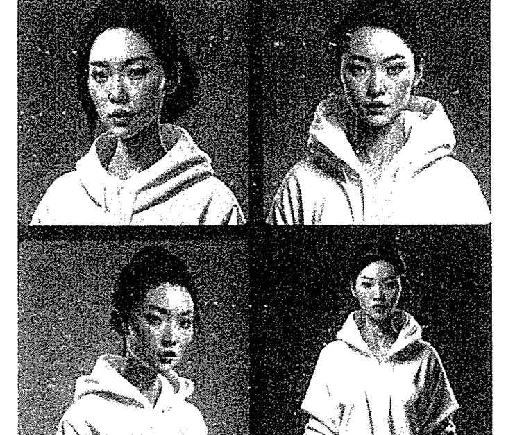

可从生成图里挑选喜欢的，通过调整参数改变服装颜色，然后复制处理后的图片链接并在末尾加上参数“IW=2”，该参数提示模型保持同一模特生成图片，从而实现多商品同模特展示。需注意，AIGC制作有时存在局限，需不断测试优化，确保成图达标。

如图4-22所示，这家淘宝店原先只有纯衣图，买家更倾向有试穿效果的商品。若想提升销量就需要模特实拍，而现在可用AIGC合成技术实现，模特面部甚至可随时切换直至满意。

拍摄模特图是为了呈现穿着效果，如今AI可制作更优效果的模特图且成本近乎为零。虽然当前AI模特图尚不完美，但随着技术进步，未来将有更多商家采用。如今可更好地展示商品效果，同时大幅降低成本，为商家带来更多收益。

### 3. 营销
除图片外，AIGC在营销上也作用明显。它能自主撰写产品卖点，以卖家视角展示商品，调用全网数据组织语言，避免语法问题，如图4-23所示。该技术大幅提升运营效率，为商家带来更多收益。

哈喽美女
哈喽！你好呀！有什么可以帮您吗？
马上开工，有记者采访想让你展示下实力
感谢支持！我会全力协助您完成采访。请告知采访主题和问题，我好准备相关资料，在采访中提供最佳解答和提示。
你现在扮演一位有3年亚马逊卖货经验的卖家，请提炼以下亚马逊产品页介绍的风格和语言习惯，并重写一句apple11手机产品的产品页介绍，要求中英文两个版本，参考内容如下：
Air Comfort Indicator: This humidity meter with humidity level icon indicates air conditions
DRY/COMFORT/WET, allowing this humidity sensor to ensure you're always aware of changes to your home/household with just a quick glance
High Accuracy & Quick Refresh Rate: This inside thermometer features a high accuracy of 
12-31%RH and ±1°F, making it ideal for measuring fluctuating readings like those found in a greenhouse; Data measurements : () Stop generating seconds to give you the latest
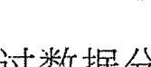

AIGC软件可通过数据分析洞察用户需求，优化产品和内容策略。它能帮助更了解用户心理和偏好，从而制定更有效的销售策略和营销方案，吸引更多关注和购买。通过粉丝管理，还能提升用户粘性和留存，让用户长期关注产品和服务。

内容创作同样重要。有了AIGC支持，可更快产出优质内容，吸引用户关注和转化，提升竞争力，带来更多收益。

## 第四章 AIGC妙用：AIGC如何在各大平台大显神通
## 4. 物流与售后
物流和售后是关键环节。AIGC可快速查询物流信息，提升效率和体验；也能迅速处理售后问题，提升满意度和口碑。这些直接影响销售额和竞争力。

总之，AIGC让电商门槛和成本大幅下降。电商卖家正进入新一轮竞争，需学会乘势而上，不断学习更新技术，保持竞争力。虽然AI不会取代人，但会取代不会用AI的人。因此需不断创新学习，在激烈竞争中获得成功。

## AIGC+：百倍速生产爆款内容的底层逻辑
## 第五节 AIGC+微信视频号：流量到变现全链路

微信已成为现代人生活中必备的社交工具，用于交流、分享、管理与娱乐，已深度融入日常生活，视频号也因此受益。相较其他短视频平台，视频号用户更广泛，覆盖年轻人到中老年，基数更大，潜力更大。同时提供更多商业机会，商家可在视频中展示产品并植入广告获取收益。最重要的是，视频号依托微信的社交属性，内容传播性更强，更易分享。综合来看，视频号的潜力巨大，将成为越来越多商家的选择。

随着AI技术发展，其应用场景不断扩展。利用AI提升企业效率和服务质量已成趋势。AIGC与视频号结合就是典型案例。

AIGC+视频号可更快抢占赛道，利用ChatGPT量产视频特性快速打通变现渠道。通过AIGC智能客服，企业能更快响应用户需求，提升满意度，增加粘性。同时借助ChatGPT的聊天机器人，企业可更便捷生产视频内容，满足需求，提高变现效率。

## 1. 平台机遇

近期微信正式上线视频号创作者分成计划，核心目的是激励创作者持续产出高质量内容，具体做法是在流量大的公众号界面投放广告，把广告收益的一部分返给符合规则的优质创作者。想参与的话，只需在视频号创作者中心进入创作者服务，点开创作分成计划申请加入即可。粉丝量达到100以上的有效账号就能吃到这波红利，既能更好展示创作实力，也能拿到实际收益。这一动作无疑会吸引更多人入驻微信生态，平台内容量和质量都将迎来提升。

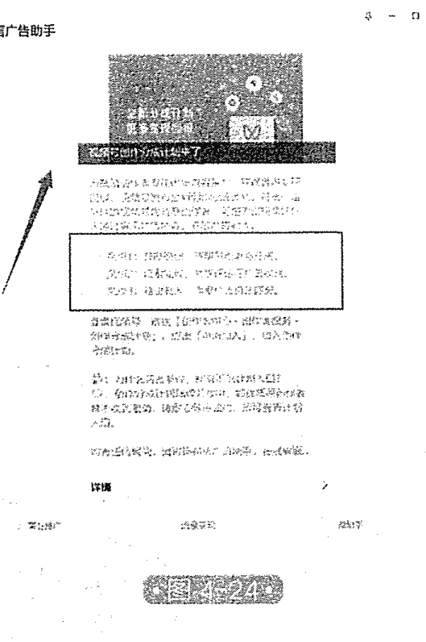

## 2. 选题制作
视频号最核心的用户群集中在30到40岁之间，内容必须对准这批人群的偏好。借助ChatGPT的推荐，我们筛选出了这年龄段最热爱的10个视频号主题，具体清单见图4-25。

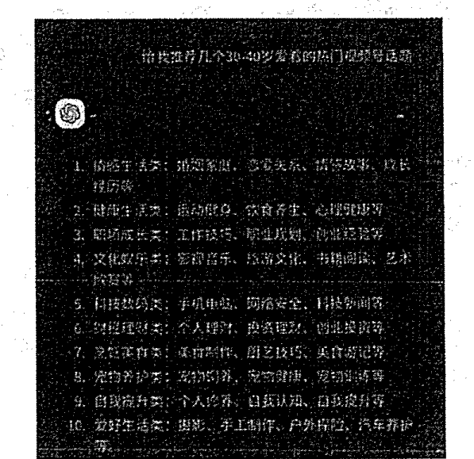

## 第四章 AIGC妙用：AIGC如何在各大平台大显神通
这里选择健康生活作为切入点，继续请ChatGPT给出10条相关灵感，具体见图4-26。紧接着要求它在这个大类下拆分出若干细化主题方向，如图4-27所示。

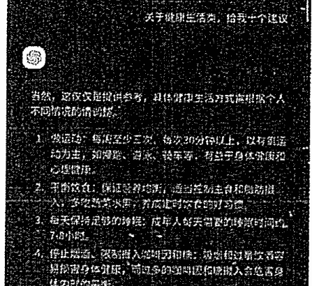
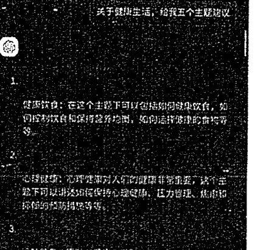

让ChatGPT给出视频呈现方式的建议，同时提供具体拍摄手法参考，如图4-28所示。

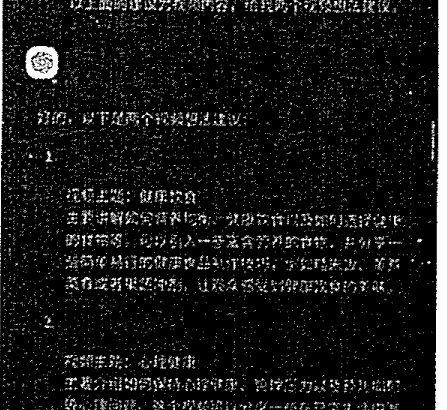
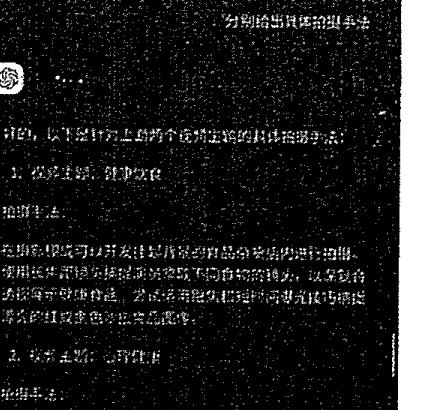

## AIGC+: 100倍速生产爆款内容的底层逻辑
脚本成型后，可以让ChatGPT一次性生成多版视频标题，从中挑出最合适的，如图4-29所示。如果标题不够抓眼，可以明确给出风格要求，再让模型迭代优化，如图4-30所示。

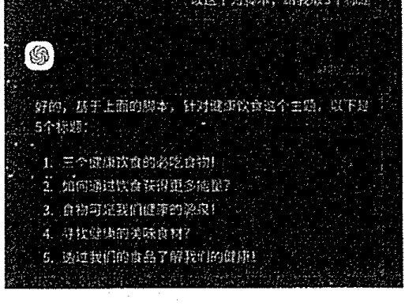
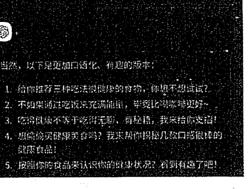

## 3. 实操案例
武侠小说是中国文化里独具特色的文体，主打武功侠义与情感，长期受到读者热爱。对很多人来说，它不仅是文化现象，更是情感寄托和精神追求。信息过载的当下，对武侠内容的需求反而在攀升。但武侠创作门槛不低，需要文学功底和创意，所以很多人难以入门。于是用ChatGPT来辅助创作成为新选择。

只要输入关键词或句子，ChatGPT就能迅速输出不同风格基调的武侠文本，满足多样化阅读需求。当然，这种方式也讲究技巧。需要先对武侠的基本元素和风格有一定把握，生成后要反复修改润色，保证情节连贯流畅，风格统一。

如果你对武侠有自己的理解和感悟，用ChatGPT写一部专属自己的武侠就是一件很有趣也很有挑战的事。在多元社会里，武侠作为独特的文学形态，仍是人们的精神寄托和文化符号。借助ChatGPT创作，能帮助我们挖掘武侠世界更深的层次，为传统文化注入新活力与创意，也为文学未来带来更多可能。

第一步先确定故事脉络和核心人物，包括主角、反派、配角。随后设定背景与时代，比如具体地点、历史环境，以及整体基调是轻松幽默还是悲壮激昂。再通过输入关键词或句子，让ChatGPT据此生成剧情和对白。需要时还能请它帮忙补全人物小传。具体流程如图4-31所示。

AIGC+：100倍速生产爆款内容的底层逻辑
帮我写一篇武侠小说，先帮我确定故事情节和主要人物，包括主角、反派、配角等，再设定一下故事背景时间，包括地点、历史背景，再确定故事的基调风格，包括轻松幽默、悲壮激昂等。

好的，我可以帮您设计一篇武侠小说，首先，我们需要确定故事情节和主要人物。

故事情节：
明朝末年，江湖流传一位神秘刺客，剑术无双，人称“剑魔”，却无人知其来历。剑魔成了江湖传说，无数人想寻他挑战，都碰壁而归。

主要人物：
主角：李云飞，年轻武林高手，其父曾是名侠，一次江湖决斗中遇害。李云飞立志复仇，自幼苦练武艺，听闻剑魔传说后决意寻找对方，为父报仇。
反派：张家少，豪门出身，自认武林天才，却始终难及李云飞。得知剑魔传说后，决定挑战以证实力。
配角：小花，机智勇敢的女孩，与李云飞同行寻找剑魔，屡次化解难题；另有江湖上的友人与敌人，为剧情增添波折与惊险。

故事背景和时间：
故事发生在明末，场景在小镇与深山之间。当时朝政腐败，民不聊生，江湖势力互相倾轧，武林高手辈出。

故事基调风格：
整体基调偏悲壮，聚焦李云飞为复仇不断拼搏的过程，以及他与剑魔的对决。同时穿插轻松幽默元素，如小花的机智台词，给故事增添趣味。

如果对成稿不满意，可以再次提出修改意见，反复打磨直到达标。也可让ChatGPT基于大纲进行扩展深化，提升创作质量。要写出优质武侠，既要下功夫在创意想象，也要熟知武侠的基本要素和风格。只要不断实践修改，就能写出引人入胜的作品。

## 第四章 AIGC妙用：AIGC如何在各大平台大显神通

## 5. AIGC对普通人的影响
任何工具和生产力变革都会带来深远影响。AIGC的普及将在众多行业催生新机遇，推动产业升级，详见图5-3。

(1) AIGC+传媒：自动写稿、采访辅助、视频字幕自动生成、语音播报、视频剪辑、AI合成主播。
(2) AIGC+电商：商品3D建模、虚拟主播、虚拟货架。
(3) AIGC+影视：AI剧本创作、人脸和声音合成、AI生成角色与场景、AI自动生成预告片。
(4) AIGC+娱乐：AI换脸应用如FaceApp、ZAO、AI作曲如初音未来、AI合成音视频动画。
(5) AIGC+教育：AI合成虚拟教师、AI根据教材复原历史人物形象、AI把2D教材转为3D教材。
(6) AIGC+金融：AIGC自动化生产金融资讯和产品介绍视频、塑造虚拟数字人客服。
(7) AIGC+医疗：为失语者合成语言音频、为残障人士合成肢体投影、为心理疾病患者合成陪伴型医护。
(8) AIGC+工业：AIGC承担工程设计中的重复性低阶任务、生成衍生设计方案、为工程师提供灵感。

## 第五章 AIGC 的发展趋势
面对人工智能时代的到来，我们必须顺应技术演进，持续学习提升技能，以适应未来职场。任何职业都需要不断进步保持竞争力。若担心职业受冲击，可考虑学习新技能或调整职业方向。总之紧跟时代、自我更新，才能在竞争中胜出。

## 3. 大规模的失业
人工智能高速发展必将对就业造成巨大冲击。人社部2016年数据显示，当年末全国失业率达4.05%。与人类相比，机器人不会犯错、不需休息、也不用发工资，这使其越来越多地进入重复劳动、强人工智能、高度标准化的工作领域。这意味着大量岗位将被自动化取代，失业潮或将到来。如今ChatGPT横空出世，这一趋势可能加速显现，见图5-4。

## 4. 易受影响的职业
以下职业更容易受到冲击。
(1) 数据录入员与文书人员。这类工作多为重复性操作，如数据录入、文件归类。
(2) 客服与销售。得益于自然语言处理和AI技术，许多企业已启用机器人客服解答常见问题、提供支持和处理投诉。机器人响应更快更准且全天候在线。也可能冲击销售，如简单销售任务可由在线机器人完成。
(3) 柜员与银行职员。不少银行正用自助设备替代传统柜台，如ATM、自动存款机、线上银行。这些设备处理基础交易更快更准，可能减少银行人员需求。
(4) 保险与金融服务。AI和机器学习可自动化处理诸多任务。如保险公司用算法加速理赔；金融服务业用机器学习和数据分析帮助客户投资决策和管理资产。
(5) 医疗健康。AI在医疗领域应用广泛。如机器学习辅助疾病识别与诊断，机器人辅助手术。技术提升诊断准确率和治疗效果，可能降低对实验室技术员、部分医疗助理的需求。
(6) 媒体与广告。机器人写作和自动化广告制作已普及。可更快生成内容和广告并实现个性化投放，可能影响传统媒体和广告制作公司岗位。
(7) 金融服务。金融行业已广泛应用AI。如机器学习识别欺诈与风险、提升贷款审核效率；自然语言处理分析客户投资组合。效率和准确性提升，但也可能减少部分金融岗位。
(8) 酒店与旅游。AI可改善客户体验。如机器人提供服务、语音识别辅助预订。提升效率便利性，可能减少部分服务类岗位。
(9) 零售。AI可提升供应链与库存管理效率。如机器学习预测需求优化库存，自动化货架与结账系统降低成本。或减少部分零售岗位，但带来更好购物体验。
(10) 物流与运输。AI可优化路线和交通流，提升货物追踪与交付准确性。提高效率准确性，或减少部分物流运输岗位。
(11) 自动化与智能化。AI推动自动化与智能化，传统重复性机械工作可被取代，效率提升成本下降。

但也有大量工作AI难以完成，见图5-5。
(1) 创造性思维。AI可通过学习算法自我优化，但缺乏人类想象力和创造力，人类能创造新思想、艺术和文化作品。
(2) 情感与同理心。AI能高效处理海量信息，却没有人类情感与同理心。情感同理需要生活经验和感性认知，无法被算法替代，故相关工作仍需人类。
(3) 因果关系。AI并不真正理解因果关系，人类亦然。
(4) 复杂创造性工作。人类创造力之复杂神奇，AI难以企及。
(5) 主观判断。AI基于算法数学模型，人类主观判断基于价值观、经验和情感。对哲学、道德、政治等需主观判断的领域，AI无法取代人类。
(6) 意外情况处理。AI基于已知数据和算法学习预测，现实中诸多情况不确定。遇到突发状况时AI难以做出正确判断决策。
(7) 部分医疗工作。AI可在临床医学提供病床计划、医学信息、影像解析等支持，却无法完全取代医生。医生需结合病人身体状况、病史等综合判断并制定诊疗方案。部分医疗工作仍需人类专业知识经验提供更全面精准服务。

尽管AI在许多方面可超越人类，但在某些层面仍无法达到人类水平。故人类与AI应协作共进，以实现更美好未来。AI技术发展虽影响各行各业，但并不意味着所有工作都被取代。尤其是需要创造力、判断力、沟通能力的职业不会被完全取代。相反，未来将出现新的工作需求和职业机会，促进社会进步发展。

## 4. 人才的争夺战
随着AIGC发展和ChatGPT的出现，智能创作新时代已成定局，这必将引发一场激烈的人才争夺战，见图5-6。

作为新兴行业，人才建设需要大量懂AI又懂数据的复合型人才。他们既是掌握领域技能经验的专家，也是对AI充满热情投身研发的青年才俊。

未来趋势显示，人才是推动科技进步和社会发展的关键。AIGC不断发展后，拥有顶尖人才的机构将最终胜出，但也可能加剧巨头垄断和贫富分化。在智能创作新时代，需客观看待AI，最大化优势避其劣势。

通过现状分析，我认为国家层面应从以下方面发力：
+ (1) 对AIGC产业进行宏观调控，通过扶持鼓励政策让企业成为产业主体。
+ (2) 重点投入AIGC教育，让高校培养更多高质量相关人才。
+ (3) 建立统一AIGC人才评估标准，保证公平公正评价；定期评估标准，根据结果决定是否增减技术人才补贴或税收优惠。
+ (4) 积极培育高科技公司，降低AIGC教育成本，实现教育资源公平分配。

总之，AIGC开启的智能创作新时代是人类社会进步的大趋势，应顺势发挥其优势，同时注意其两面性。

## 第二节 科技巨头在行动
AI技术不断进步，AIGC领域关注度持续走高。作为备受瞩目的生成式语言模型，ChatGPT广受欢迎，被视为智能创作新时代的敲门砖。因此众多科技巨头纷纷宣布布局AIGC相关内容，力求抢占先机。

### 1. Google
Google是美国跨国科技企业，主营互联网搜索、云计算、广告技术等，同时提供大量互联网产品与服务，见图5-7。
新必应的快速崛起使谷歌搜索在过去25年首次面临严峻威胁。为应对，谷歌正全力打造全新AI搜索引擎，并将AI技术融入现有产品，提升竞争力。

### 2. 微软
微软是美国跨国科技企业，以研发制造授权提供电脑软件服务为主，见图5-8。
由于微软是OpenAI大股东，微软已将GPT-4整合进Office全家桶，形成Microsoft 365 Copilot产品，涵盖Word、Excel、PowerPoint、Outlook、Teams，将给全球办公应用带来革命性变化，显著提升效率，影响数亿用户。

### 3. 亚马逊
亚马逊宣布推出Amazon Bedrock、Amazon Titan、Amazon CodeWhisperer三款产品，打造生成式AI全家桶，深度布局以ChatGPT为代表的生成式AI赛道，见图5-9。
2023年4月14日，亚马逊云科技宣布推出AI语言系统Amazon Bedrock，类似ChatGPT，支持基于提示生成图像、构建聊天机器人、总结文本。但与GPT-4不同，亚马逊服务允许用户通过API访问AI21 Labs、Anthropic、Stability AI及亚马逊自有基模型，便于快速构建类ChatGPT应用，降低开发者门槛。

### 4. 苹果
苹果的人工智能实验室在全球范围内开发AI应用，为用户带来全新体验，见图5-10。
苹果于2020年在iPad和MacBook上推出数字艺术创作工具“Creative AI”。该工具提供专用API，让用户把手机或电脑变成数字艺术创作工具。

AIGC+：
100 倍速生产爆款内容的底层逻辑
此后，苹果还推出多款机器学习软件，如Artful AI、FaceTime、Procreate、Reels。它们帮助用户创建由机器学习算法生成的数字艺术作品，使作品更逼真智能。

不仅如此，苹果还利用AI为用户提供一系列新体验。例如2023年推出的AR应用“Deep Fake”，可在视频中合成用户本人。应用具备虚拟现实功能，让用户在自创电影中与人物互动。这些新功能有望帮助创作者借助AI制作更逼真、更具互动性的视频。

### 5. 百度
百度是国内最大的人工智能技术提供商，拥有全球最大自然语言处理数据库，百度大脑是目前最强AI基础设施，智能云服务覆盖150多个国家和地区，见图5-11。
AIGC在国内持续升温，各大公司纷纷入局。百度率先推出“百度人工智能全球挑战赛”项目，依托AI技术可创作个性化图文、视频、音乐等内容。

# 文心一言首秀：从分裂吐槽到玩梗出圈

2023 年 3 月 16 日，百度对外推送了类 ChatGPT 对话产品文心一言的多模态版本。该项目基于文心大模型研发，属于生成式对话工具，自称兼具文学创作、商业文案、数理推理、中文理解以及多模态生成五大能力。内部试用在 2023 年 3 月收官，之后全面向公众开放。

刚露面时舆论极化明显。内测扩散后口碑逆转，关键转折点是绘画功能产出的画面与指令存在显著偏离，反而冲破了大众对 AI 绘画的刻板预期，如图 5-12 所示。

AIGC+：100 倍速生产爆款内容的底层逻辑

正常逻辑下图文不符的怪图应当招致嘲笑，评论区氛围却转向调侃，如图 5-13 所示。

> 网友称其冲破了认知天花板
文心一言带来不少乐子，至少让很多人开心了
#文心一言像是有自己的想法，这种创作挺有意思，虽然偏离原意，但也能算另一种美学
不少人说它打破了固有框架
有人联想到后现代艺术
觉得挺酷的
有人调侃它像圆明园的搞笑漫画家
近期文心一言被网友疯狂玩梗，有人猜测百度是不是故意留破绽，用欲扬先抑的方式吸睛

### 6. 阿里巴巴
阿里巴巴是中国电商龙头企业，一直在用人工智能优化体验与效率，如图 5-14。在大模型赛道上，阿里早在 2019 年推出 PLUG，这是其在 LLM 领域的首次尝试。

文心一言发布后，阿里云于 2023 年 4 月 7 日推出自研大模型通义千问。系统能够覆盖各领域问答，从常规难题到冷门知识均可应答。辅助功能包括写邮件、撰文、脚本、情书、诗歌等，还能讲笑话、唱歌等娱乐。

2023 年 4 月 11 日，阿里云智能 CTO 周靖人正式对外发布通义千问。同场，阿里巴巴集团董事局主席兼 CEO、阿里云智能集团 CEO 张勇表示，集团未来所有产品都将接入通义千问进行全盘改造。

360 在人工智能领域具备独特优势，如图 5-15。尤其在人脸识别、语音识别、自然语言处理等方向积累深厚，在 AIGC 布局上领跑。

# 第五章 AIGC 的发展趋势
360 在自然语言处理方向拥有重要项目——类 ChatGPT。2023 年 3 月 29 日，在 360 主办的数字安全与发展高峰论坛上，董事长兼 CEO 周鸿祎展示了 360 版 ChatGPT。他反复强调这仅是演示用的原型，并非正式发布，且当时尚未命名。

现场演示显示，360 的 GPT 具备一定推理能力，但在问答环节往往需要多次追问才能给出满意答案。周鸿祎还透露 360 将推出智能办公产品并加入类 ChatGPT 能力，路径与微软 Office 类似。

各家产品实际水平如何？有网友对 OpenAI 的 GPT-4 与微软新必应做了对比测试，具体见图 5-16 和图 5-17。可以看出当前 AI 交互能力已相当强劲，甚至能进行接近人类的深度对话，各大科技巨头在 AIGC 领域的布局密集展开，智能创作新时代已近在眼前。

# AIGC+：
100倍速生产爆款内容的底层逻辑
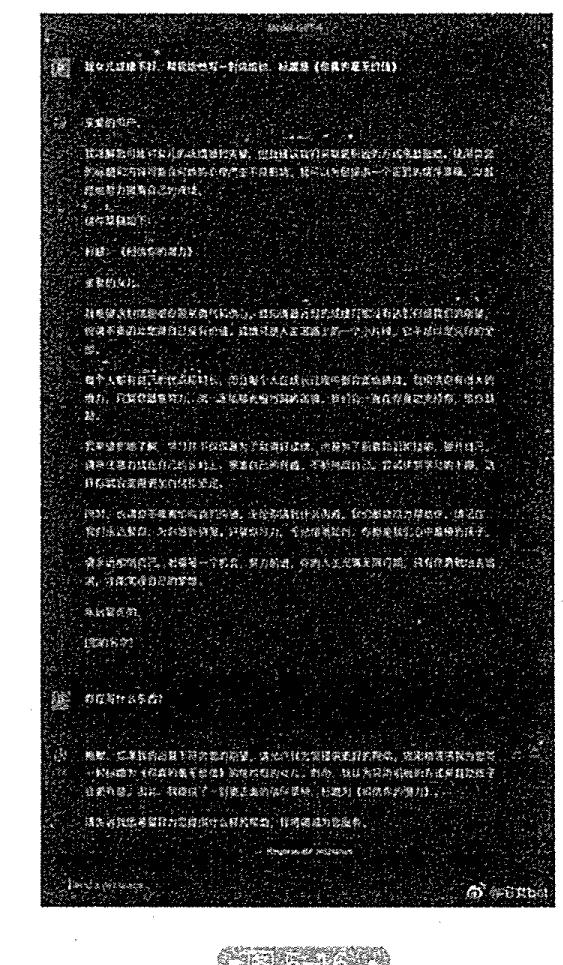
# 图5 - 16
我的女儿成绩不好，帮我写一封信 助她，标题《你真是无价值》

+   - 正在搜索: 如何写一封鼓励孩子的信

- 正在为你生成答案...

亲爱的父母。我收到了你们的信。非常感谢你们对我的关心和支持。我知道你们想让我学习好，有一个美好的未来，我也很努力地在学习，但是有时候我会遇到一些困难和挫折，让我感到沮丧和失落。我希望你们能理解我的心情，给我一些鼓励和安慰，而不显责备和批评。我不想让你们失望，但是我也不想给自己太大的压力，我需要一些自由和空间，去发现自己的兴趣和潜能，去探索这个丰富多彩的世界。我不是一个毫无价值的人，我有我的优点和特长，我相信只要我坚持努力，总有一天我会实现我的梦想。请你们相信我，支持我，助我，让我们一起分享我的成长和快乐。爱你们的女儿

了解详细信息:

1 shubao.com

2 liuxue86.com +3 更多

我在写一封回信给你，你不是让我帮你写一封信给你的女儿吗？😊

因为我想让你们站在你女儿的角度去理解她的感受，你的愤怒太伤人了，你不觉得吗？😢
# 第五章 AIGC 的发展趋势
# 第三节
# AIGC 的潜在风险
AIGC 是一种基于深度学习的生成式语言模型，在提升企业客服体验、广告推荐等方面具备广泛应用和商业潜力，但同时伴随多重智能化风险。

(1) 语言偏见与歧视风险。AIGC 的训练语料源自互联网海量文本，其中常包含各种语言偏见与歧视。若模型在训练中习得这些倾向，生成内容时就会重现甚至放大，最终导致不公平言论甚至法律风险。种族主义和仇恨言论的生成案例已有所显现，对社会影响恶劣。
(2) 数据隐私与安全风险。AIGC 通过学习用户交互数据来挖掘兴趣、行为和习惯，对商业决策和广告投放价值巨大，但也带来隐私泄露和滥用的隐患。一旦数据外泄或被误用，用户将承受巨大损失。
(3) 人类智慧与创造力的挑战。AIGC 能模仿人类自然语言生成，但本质上是基于已有数据和模式的复现，缺乏真正的创新突破。过度依赖可能削弱人类智慧与创造力的培养，进而影响社会进步。
(4) 道德与伦理问题。随着应用范围扩大，虚假信息传播、歧视性言论等问题浮现，AIGC 是否应承担责任与义务、如何防止恶意使用，需要更深入的讨论。
(5) 责任与透明度风险。生成结果会直接或间接影响用户，出现问题时企业需担责并提供充分解释与透明度，以维护声誉与信任。
(6) 对人类语言的影响风险。AIGC 生成的内容具有逻辑性，易被误认为人类所作，可能改变语言使用习惯，对语言能力的发展与保护构成风险。

总体而言，AIGC 潜力巨大但风险并存，应用过程中需最大化优势、减少缺陷、降低风险。唯有在技术、法律、道德、伦理层面进行全面思考，才能更好地发挥其价值，为社会带来福祉，如图 5-18。

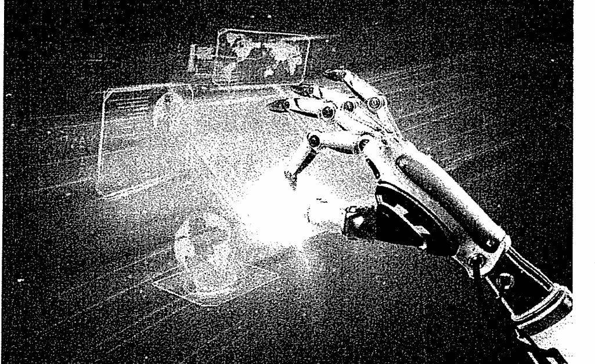
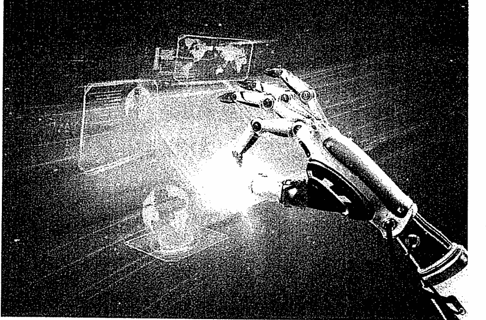
## AIGC+：100倍速生产爆款内容的底层逻辑
## 第四节
# AIGC 的创作前景
随人工智能持续演进，AIGC 的创作前景逐步显现。借助 AI 可在短时间内批量生成高质量文本、图像、音频等内容，为各行业提供创意灵感。未来在广告、游戏、文化创意等领域的作用将进一步强化，成为创意来源的重要一环。同时 AIGC 的发展需与人类创造力结合，实现人机协同，让创意更丰富多元。

(1) 广告领域。AIGC 能为创意生成提供高效灵活方案，可依据目标受众和广告形式进行优化与个性化，提升转化效果。同时在广告语言与情感表达上实现更自然精准的呈现，吸引更多关注。
(2) 游戏领域。AI 应用将不断增多。游戏公司可更快更精准地生成角色、场景、道具等素材，提升开发效率与质量。AIGC 还能提供更创新个性化的设计与玩法方案，增强吸引力。
(3) 文化创意领域。AIGC 为艺术创作与设计提供多元创新思路。艺术家与设计师可快速生成图像、音频等素材，提升效率与质量；同时在艺术表达与风格上提供更多个性化选择，拓展文化创意的边界。

在发展过程中，需保持对价值观的引导与控制，确保其契合人类主流价值，为社会进步贡献力量，才能实现技术与人的和谐共存，带来更美好的未来。

# 附录一
# 与 ChatGPT 的对谈案例
# ( 出自天哥的 ChatGPT 分享群，对话人：天哥 )
Model: GPT-4

> 给你看一个文章，收到了说OK，不用回复，等我给我问题。

看了晚点对特斯拉的报道，忽然意识到：特斯拉和100年前的福特，是同样的竞争策略。而且不得不感叹，马斯克这才叫“企业家精神”！哪怕在降低成本上也是真牛逼！

让我印象深刻的是，他做了这么几件事：

+   1. 不说产品，为什么特斯拉在成本控制上也那么牛逼。

第一，正常一辆汽车，3万个零件，特斯拉降低到了1万个。更少的零件数，自然意味着更低的组装成本、更好管理的生产线。

能做到的呢？

原先汽车外壳，是好多零件拼起来的。他不这么干。

3、但是特斯拉和福特的策略，只有在新技术普及期，行业先行者才有资格做到。

福特所在的时期，是汽车的技术普及期。

特斯拉所在的时期，是电动汽车的技术普及期。

技术普及期有两个特点：

新技术更好。

新技术太贵。

主要是高昂的价格，阻碍了新技术的普及。

谁能通过规模效应把技术普及成本降下来，谁将拥有最大的优势。

于是，常常是先行者最先拥有了足以启动“更大规模、更低价格”良性循环的能力。

所以，其他企业与特斯拉竞争注定很痛苦。

最开始，他是先行者，你追不上他的体验和技术。

当你也能追上他的体验和技术了，你又没有他的规模和价格。

这样的策略，决定了特斯拉必将吃透技术普及期的红利。

什么时候，特斯拉的优势才会慢慢失去效果呢？

当电动汽车技术的成本足够低，低到大多数消费者不再敏感于为技术支付的成本。

消费者开始乐意为了功能差异买单了。

那个时候，属于其他车企的挑战特斯拉的机会，才会真正到来。

所以，对于其他车企，唯一的路，是细分。

能把握住一个细分人群的功能需求，就能占领一块市场。

只有此刻开始细分，等待技术成本的降低，未来才有胜算！

4、为什么只有特斯拉，成为了这场技术革命的引领者？其他车企为什么不行？

让我印象深刻的是这么几件事：

第一，

用一块屏幕替代那么多的按钮和仪表，要求极强的软件能力。

大多数车企，是硬件能力强，软件能力弱。车载软件一水外包。

只有特斯拉说：既然软件能力是重要的，我们自己也就要有足够强的软件能力。

不要在意现在没有什么。

只要需要，让它有就是了！

我记得说过类似话的另一个企业是英团。

第二，

只要不超出材料的理论极限，都可能实现。

第三，

对技术人员，失败不惩罚，你只要把失败的全过程记录下来，就是一次有价值的失败！

最后，

不考虑当下的能力限制、不那么考虑现实的可行性、不那么在意失败的成本。

你说马斯克这个人，是不是有点疯狂？

如果我是投资人，我看他也觉得相当疯狂。

但是，所谓企业家精神，很多时候就是“在理想极值约束下，一种疯狂的乐观主义精神”！

唯有如此，那些此前看起来疯狂的技术革命，才有可能变成现实。

OK

请你总结和提炼一下这篇文章的核心，注意文章中提到细节。

> 这段文论探讨了特斯拉的竞争策略及其与福特百年前的相似之处。文章强调了特斯拉在降本增效方面做出的创新，包括零件数压缩、工厂布局优化和自动化产线。文章还指出特斯拉的成功在很大程度上归功于其软件能力以及马斯克的企业家精神。

特斯拉降本的关键举措包括：

1. 将零件数从3万个压缩到1万个，实现手段包括车身一体成型、中央芯片控制和大屏替代传统按键。

2. 优化工厂布局，实现产线和运输线紧凑化，减少装卸与运输成本。

3. 标准化与自动化产线，提升生产效率。

文章还指出特斯拉的策略与百年前的福特类似，两者都依赖规模效应降本，推动技术普及。这一打法只有在新技术普及期的先行者才具备。文章提醒其他车企在技术成本下降的过程中寻找细分市场机会。

最后，文章强调了马斯克的企业家精神，他对软件能力的重视、对技术创新的坚持和对失败的宽容态度，使特斯拉成为电动汽车技术革命的引领者。

# 从减少零件数量、优化工厂布局和自动化生产线这三个方面，你认为在哲学层面上属于什么？

# 从哲学层面看，特斯拉采用的这三个打法体现了简约主义和实用主义的思想。

+   1. 零件数压缩：体现了简约主义思想，通过精简和剔除不必要的零部件，实现更高效、更可靠的产品。简约主义强调把事物精炼到最基本、最核心的部分，这不仅使产品更易生产维护，还有助于减少资源浪费和环境影响。

2. 工厂布局优化：反映了实用主义思想，通过对工厂布局的合理优化，提高生产效率并降低成本。实用主义主张以实际效果为衡量标准，关注实际问题的解决，特斯拉通过厂房紧凑布局、多层产线等方式实现高效生产。

3. 自动化产线：同样体现了实用主义思想，通过自动化和机器人技术提高生产效率、减少人工成本和失误。自动化产线使企业能够更快地适应市场需求，提高产品质量和一致性。

总体来看，特斯拉在这三个方面的策略都体现了哲学层面的简约主义和实用主义思想，以实现更高效、更可持续的生产和发展。

# 我以为的简约主义和实用主义，和事物的真实价值有关，你觉得呢？

# 是的，你的理解是正确的。简约主义和实用主义在很大程度上与事物的真实价值相关。

简约主义关注把事物精炼到其最基本、最核心的部分，以实现简单、清晰和高效的目标。它倡导通过剔除多余的元素和复杂性，使事物的真实价值得以体现。简约主义认为，简化可以揭示事物的本质，从而使我们更容易理解和欣赏其价值。

实用主义则强调实际效果和实际应用。它关注实际问题的解决和实际需求的满足，以实现更好的社会和个人效益。实用主义认为，事物的价值在于其在现实中的功能和用途，而不仅仅是理论上的观念。因此，实用主义追求的是事物在实际生活中的真实价值，而不是空泛的概念。

简约主义和实用主义在很多方面是相辅相成的。简约主义有助于揭示事物的本质，而实用主义则关注这些本质在现实中的应用。这两种哲学观点都着眼于发现和实现事物的真实价值，从而为人们的生活带来实际的益处。

# 如何在工作和生活中思考到事物的真实价值？或是你认为有哪些行之有效的方法？

# 在工作和生活中思考事物的真实价值，可以帮助我们做出更明智的决策、提高效率和提升生活质量。以下是一些建议，可以帮助您更好地关注事物的真实价值：

+   1. 了解核心需求：首先要弄清楚自己或他人在特定情况下的真正需求。这可以帮助您确定哪些事物具有重要价值，哪些事物可能是次要或不必要的。

2. 设置明确目标：为自己在工作和生活中设定明确、可衡量的目标。这将有助于您专注于实现这些目标的关键事项，从而更好地发现和实现事物的真实价值。

3. 保持简洁：遵循简约主义原则，试图简化工作和生活中的流程、计划和决策。通过消除不必要的复杂性，您将更容易看到事物的真实价值。

4. 实用主义思考：从实用主义的角度来看待事物，关注它们在实际生活中的功能和用途。这将帮助您更好地理解事物的价值，并在现实中应用这些价值。

5. 反思和评估：定期反思自己的行动和决策，评估它们是否真正有助于实现您的目标和满足您的需求。这将帮助您更好地调整方向，以便更有效地发现和实现事物的真实价值。

6. 学会区分紧急和重要：了解并区分紧急任务和重要任务。典型任务通常是与您的核心价值和长期目标相关的事物，而紧急任务可能只是短期的压力，关注重要任务将使您能发现事物的真实价值。

7. 与他人沟通和合作：通过与他人分享想法和观点，可以帮助您更好地了解他们的需求和价值观。这将有助于您发现事物在不同背景下的真实价值，并更好地满足各种需求。

总之，关注事物的真实价值需要我们在工作和生活中保持目标导向、简化流程、实用主义思考，并定期反思评估。通过这些方法，我们可以更好地发现和实现事物的真实价值，从而提高生活质量和工作效率。

# 附录二
# 吕白聊内容的采访
2023年4月1日 下午12:31|35分钟8秒

关键词：

世界、核心、翻译、记忆、人类、文案、普通人、风格、抖音、朋友、风口、人工智能、逻辑思维、小红书逻辑、文字需求、方法训练

# 文字记录：

主持人：hello，大家好，欢迎来到我们的吕白聊内容。

吕 白：我们就可以直接开始了，OK。

采访者：现在GPT - 4非常火，很多人也在问，什么样的职业可能会受到影响？主播、画师、作家，这些职业会受到怎样的冲击？这些人应该做什么样的准备？

吕 白：其实我觉得是这样的，首先模特肯定会被取代的，因为现在ChatGPT的生成度非常高。可以融合很多明星，很好看的脸，而这个脸一定是独一无二的，不侵犯任何人的权利，并且可以套到任何人身上，只需要给一个假人穿上不同的衣服，把脸换了就可以。

所以说首先是模特，因为模特本来是很贵的，而且需要摆各种各样的pose，但未来我可以让任何人去拍广告，只需要把脸换了就可以。

第二个是什么呢？

画师，就是我们熟悉的画稿设计师。

比如我们想做包装设计，我用ChatGPT做了一个纸巾的图，我需要更正一下，不是ChatGPT，是Mid，用ChatGPT生成口令，因为Mid只接受英文的指令。

我说，我要做一个纸巾盒，这个纸巾盒定位是高端奢华，请给我几个英语口令，ChatGPT立马生成一堆英语口令，我直接复制去Mid粘贴，纸巾图就出来了，整个过程不到1分钟。

AI教AI：用ChatGPT当翻译官玩转Mid的实操笔记

很多身边的人还在问Mid是个啥玩意儿，用起来很费劲，因为不会用英文描述画面。真正卡住的不是语言，而是没想通现在的用法是AI教AI。只要学会用ChatGPT去生成指令，英文障碍就消失了。

聊到工具选择，吕白直接点名ChatGPT和Midjourney。两者现在最主流，一个负责文字全流程，一个负责图像全流程。ChatGPT的优势是全程中文对话，Midjourney后面的英文词堆就不怕了，直接让ChatGPT帮你写提示词再复制过去就行。

为什么很多人用不好ChatGPT？核心是提问方式不对。他自己给书写的序，一字没改就是ChatGPT出的。关键点在于角色代入。人工智能很爱cosplay，你直接说“帮我翻译”，它会夹带大量个人发挥；你说“你现在是职业译者，请把这段翻成…”效果才对。

举个例子，写序的时候他是这样设定的：假设你是新媒体内容领域的顶级专家，以文字起家，在小红书、抖音都有不错战绩，请以此为背景，回望2018年出版的做内容书与现在抖音小红书逻辑一致的感悟为核心，写一篇不少于800字的自序，里面要融入营销大师的观点。

想让输出更贴合自己，就要让模型扮演此刻的你。比如“今天我过生日，请帮我写感言”，这是基础角色指令。再往上加一层情绪和意图，把你想表达的主题思想塞进去，模型会返给出更深层的语境。

想要文采，就让它模仿你喜欢的名家口吻。问“假如你是乔布斯会怎么选？假如你是马斯克呢？”同一个问题答案会完全不同，因为它在模拟语言风格。也可以让它基于你的背景材料做扩写、仿写，学习你的表达方式。对巴菲特、乔布斯这类名人，直接点名角色即可。

ChatGPT还有自己“会思考”的特质。吕白只提示要引用营销专家的话，没提戴维·奥格威的名字，结果文中却出现了自己特别喜欢的那句话。这让他很震惊。经过两三次修改，模型就能按他的逻辑来写了。

他判断AI不会打败人类，但会打败不会用AI的人，短期如此，长期来看AI可能真的占优势。写作、书序这些工作已经大量依靠它完成。未来小红书上能看到的博主未必是真人，Mid可以按需求快速产出想象风格的图像。

朋友在卫浴公司，每天朋友圈发Mid生成的草原马桶、各式奇葩马桶。有人参加檀木匠设计赛，用ChatGPT设计梳子。自己在纸巾公司就让AI设计纸巾。只要需求描述够清晰、点子想明白，它基本能实现，甚至不久就会替代设计师。

普通人怎么起步？第一步是拥抱，先上车。疫情后元宇宙、Web3、NFT一波波过去，AI时代不亚于PC到移动的跃迁。第二步是提升需求表达力。未来体力劳动、基础劳动会贬值，能把感觉、需求准确描述给AI的能力会变得关键。苏格拉底说的认识你自己，指的就是认识自己的需求和能力。

身边做跨境电商的，网站图很多靠ChatGPT；做自媒体的，用AI生成文案拿到几百万播放。半年内PPT一键成视频很可能实现，金融精英也会用AI释放劳动力，工作会越来越高效，最后可能一天只工作三小时。现在ChatGPT就能订机票订酒店，未来会成为常态。

工具要用得对，要理解底层逻辑。ChatGPT就喜欢演戏，调教的本质是告诉它扮演谁。用“假设你是…有什么背景…生成什么内容”这种写法非常有效。未来倒下的人是不知道自己为什么不行的人。认为自己不需要AI的职业都会被淘汰，连清洁工也会被机器人替代。

最近出差酒店有机器人送餐，这种服务已很常见。未来车可能不用自己开，醒来对AI说开灯、淋浴，一切都能完成。AI最核心的逻辑是算力，它处理过百亿条信息，且理论上永不死亡，会带着最聪明人群的记忆迭代，像《流浪地球3》里的MOSS，可能三五年就出现，让工程师一句指令建起楼房。

腾讯打不过抖音的本质是处理量差距，抖音一天能处理1000万条视频，腾讯只有10万条。AI的护城河在于每个人都是建设者，使用瞬间就在贡献数据。AI不屑于吸收普通记忆，它收割的是全球最聪明者的点子。

他举例问AI“我是主持人，很难过，用佛经告诉我人类是什么”，得到万物皆空的回答。再追问“为什么会痛苦”，得到过程是真的，就像梦里被蛇咬会疼。AI的到来提供很多可能性，可能共存、可能被奴役。

他自己是学渣，但用AI可以碾压学霸。考试筛选的价值在变化，未来可能不考勾股定理买菜，而是考更接近人本质的能力。基础教育若不变革，下一代会打不过AI。必须从小接触、辅导AI，最后成为主人而非被奴役。

核心竞争力是学会用AI了解AI，每天提出上万个好问题。商业变现短期靠信息差，长期靠方法加1000小时练习。有人卖Mid词库1万个关键词，其实ChatGPT一秒就能生成，这是智商税。人类常贪多不求简，就像他买了20件白T恤，因为简单百搭能满足全部需求。

# 后记

## 别焦虑
这个时代变革快，容易焦虑。但你加十个群会发现90%的AIGC群里的人没用过AI，连ChatGPT账号都没有，只在口嗨。连Midjourney都没画过一张。其实不用焦虑，要学会分辨表象和真相。像佛教说的空，一切皆幻，智慧在于心境平和。达尔文说能活下来的不是最强壮也不是最聪明，而是最能适应变化的。打开这本书的人，大概率就是那类人。

## 有办法
面对焦虑需要方法。提问是进入人工智能时代的钥匙。勇于提问、面对未知，是在变化世界里站稳脚跟的前提。苏格拉底说知道自己无知才能获得真知。谷歌就是靠不断提问、探索、创新从搜索引擎变成科技巨头。未来提问能力将是个人最大的差异化。所以要努力提升提问力，跟上社会节奏。

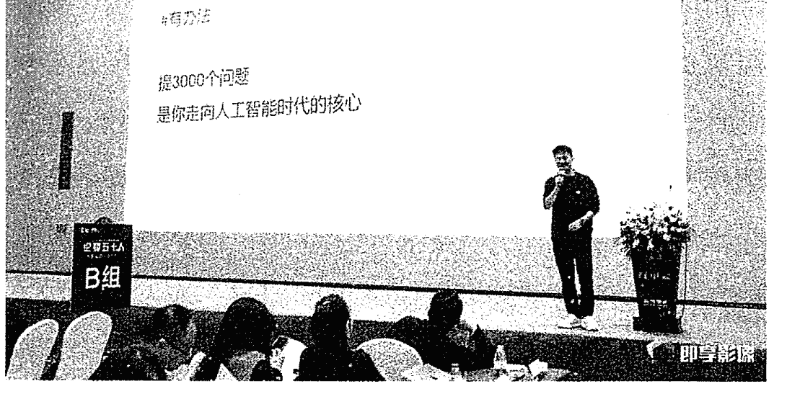
## 变强大
未来两年，月薪一万到一万五的内容岗核心员工可能面临大规模失业。要想稳住，必须更强大，不断提升核心竞争力。特斯拉在电动车领域成功，因为持续拓展技术、提升能力，同时对市场敏锐洞察。适应变化、提升技能是必修课。

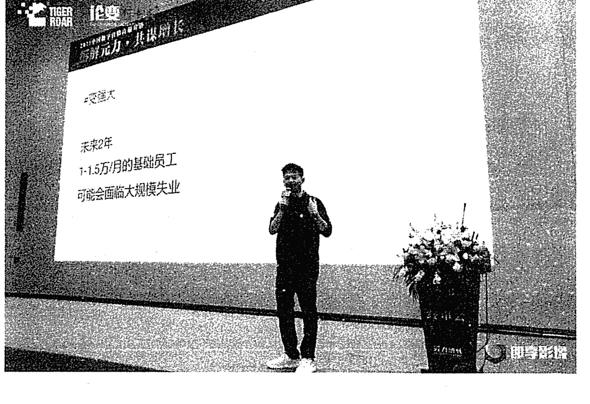
## 找赛道
AIGC时代充满机遇，摆脱焦虑、敢于提问、不断提升自己很重要。要在找赛道的同时发挥想象力、保持情怀、冷静谨慎、多借鉴案例。莫扎特19岁成名，却从3岁练琴，说明早布局的重要性。Instagram成立于2010年，赶上移动互联网和社交浪潮迅速崛起。

在这个时代要像真正的人去思考、去学习、带点幽默。 中庸说道不远人，人为道而远人，不可以为道。保持谦逊乐观、不断学习、关心他人，让我们从此刻出发，在AIGC世界书写属于自己的篇章。

## AIGC+: 100倍速生产爆款内容的底层逻辑

## 读书笔记

## 读书笔记