# AIGC 浪潮：从 ChatGPT 到全场景赋能

# 内容简介

ChatGPT 的面世让 AIGC，即 AI 生成内容，一夜之间成为行业热词，也明显加快了该赛道的发展节奏。本书围绕 ChatGPT 与 AIGC 展开立体化梳理，厘清 ChatGPT 的技术内涵、应用价值以及对职业发展的深远影响，帮助读者建立系统认知；同时从生产力重塑、关键技术、产业版图、商业前景等维度描绘 AIGC 的演进态势；并以智能工具赋能、行业实践、企业端落地、未来展望为主线勾勒应用图景，说明组织与个人如何完成 AIGC 转型。

全书由浅入深、覆盖面广，适合计划在 AIGC 赛道布局的管理者、创业者，以及对 ChatGPT 与 AIGC 感兴趣的读者阅读。

# 前言

近几年 AI 持续升温，ChatGPT 的发布点燃了新一轮关注热潮。其背后的 AIGC 成为科技与互联网圈的焦点话题，相关概念股也随之走高。

在技术迭代的大趋势下，AIGC 有望推动科技持续进步，重塑各行业生态，成为生产力升级的核心引擎。展望未来，AIGC 有可能改写资讯、教育、娱乐、金融等多个领域的运行方式，推动它们加速向智能化演进。

过去，AIGC 的落地与商业化存在不确定性，市场观望情绪较强。但随着 ChatGPT 热度攀升、商业化探索加深，其巨大潜力逐步显现，落地与变现的节奏明显加快。腾讯研究院发布的《AIGC 发展趋势报告 2023：迎接人工智能的下一个时代》指出，AIGC 应用前景广阔，能够激活市场、助力经济增长。

人们对 ChatGPT 与 AIGC 的关注持续上升，越来越多的企业借助 AIGC 技术提升生产力并深化行业探索。在此背景下，本书应运而生，对 ChatGPT 与 AIGC 进行全面讲解，为企业提供参考。

本书内容丰富，优势突出，具体有三点。

第一点是内容新颖，及时跟进。对 ChatGPT 与 AIGC 进行了系统详尽的论述，涵盖概念、价值、发展态势、应用场景及未来前景。

第二点是案例丰富。在通俗讲解理论的同时融入大量案例，增强阅读趣味。案例企业包括微软、谷歌、阿里巴巴、腾讯等，有助于指导企业实践。

第三点是领域广泛。梳理了 ChatGPT 与 AIGC 在各行业的应用，既能拓展知识面，也能为企业探索提供有效指引。

总体来看，本书兼具可读性与指导性，既讲解理论知识，也分析发展机遇、企业布局方法，并以众多案例为 AIGC 探索提供参考，帮助读者掌握相关知识，在赛道中落地实践。

# 上篇

# ChatGPT 开启智能交互新时代

## 第一章

## ChatGPT：迈向通用智能的关键节点

当前 AI 技术取得长足进步，其中 ChatGPT 的诞生具有标志性意义，标志着 AI 从专用场景向通用场景迈进。ChatGPT 冲破了传统人机对话的限制，能够实现流畅交流，大幅提升交互体验。

### 1.1 ChatGPT 初探

要认识 ChatGPT，需拆解其概念、构成与核心能力，明确模型训练与微调的运行机理，才能更清晰地把握能力来源。掌握正确使用方式，有助于与 ChatGPT 有效交互，挖掘更大价值。

**1.1.1 名称解析：ChatGPT 到底代表什么**

从命名来看，ChatGPT 可拆分为 Chat 与 GPT 两部分。Chat 指聊天，GPT 全称为 Generative Pre-trained Transformer，即生成式预训练 Transformer 模型。由此可见，ChatGPT 是一款基于生成式预训练 Transformer 的智能对话应用。

ChatGPT 由研究机构 OpenAI 推出，是强大的自然语言处理工具。它能学习人类语言规律，根据上下文续写，与用户进行自然智能对话；可生成广告文案、小说、代码等多种内容。

其底层的关键支撑是大语言模型，基于 Transformer 架构。在大模型支持下，ChatGPT 能记住对话历史，结合上下文给出恰当回复，实现多轮流畅交流。

对话机器人并非新事物，智能音箱、酒店机器人等已普遍存在，但只能完成播报天气、播放音乐等简单任务，难以进行复杂流畅沟通。

基于大语言模型，ChatGPT 的能力显著增强，主要体现在如下方面，如图 1-1 所示。

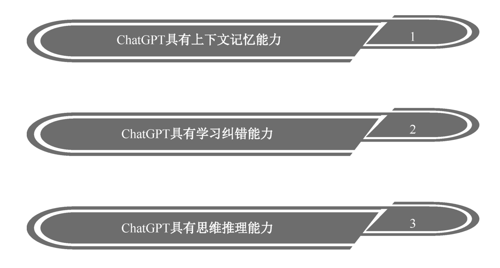

图 1-1 ChatGPT 的强大能力

1. 上下文记忆能力。聊天过程中会保留对话上下文，实现顺畅沟通。用户可像与真人交流一样追问“然后呢”“下一步怎么做”，或表达态度，无需反复补充问题，模型会自我学习提升回答质量。

2. 学习纠错能力。若给出错误答案，用户纠正后，模型对该问题不再重复错误。

3. 思维推理能力。掌握一定常识知识，可依据推理得出答案。例如完成数学计算并给出正确答案。

基于上述能力，ChatGPT 具备多种功能。可根据提问作答、按要求撰写文章、对输入资料提炼要点等。日常中可将其作为搜索工具，也可作为工作助手处理文字整理、文献查询等，提升效率。

从市场空间看，发展潜力巨大，企业可将其与业务结合，优化流程，实现更精准个性化推荐、更高效内容创作，获取更高收益。也可深挖技术原理，探索与其他技术的融合，创新产品服务，抓住市场机遇。

**1.1.2 运行机制：模型训练和微调**

ChatGPT 的能力源于模型训练与微调。语言生成、文案生成、事实与常识掌握等均来自底层大模型的预训练；微调则解锁特定领域的专精能力，提升精度与可靠性。

训练与微调是能力构建的关键，主要包括以下步骤，如图 1-2 所示。

1. 数据收集及编码

OpenAI 使用海量互联网真实文本数据研发 ChatGPT，数据经清洗标注后形成庞大训练集。

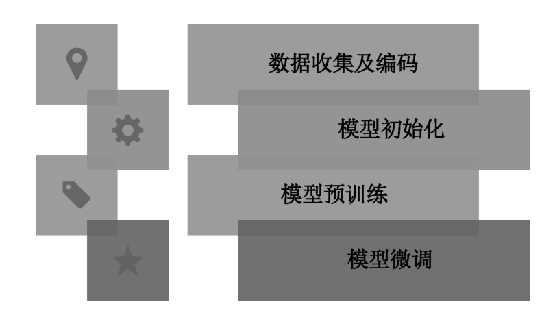

图 1-2 ChatGPT 模型训练和微调的步骤

ChatGPT 创造性地采用位置编码，将句子中每个词的顺序作为模型输入变量。这是自注意力机制的重要创新，使模型能理解语义与语法：通过计算序列中各元素的权重，明确不同元素的重要性。

为更好理解和生成人类语言，ChatGPT 基于真实文本训练，因其数据量大、多样性丰富。

2. 模型初始化

深度学习中需先定义网络架构，包括层数、隐藏单元数、自注意力头数量等，随后进行参数初始化，以利于训练中收敛到合适权重与偏置，影响收敛速度与最终性能。

常见做法是将参数随机初始化为小值，训练时间较长；对特定任务也可选用预训练模型如 GPT-4。

3. 模型预训练

此阶段使用准备好的数据对模型预训练，学习词间关系、句法结构与文本通用规律。

模型不断收敛，调整嵌入向量以更好捕捉语义。过程中有大量人工参与，自监督训练需基于人类常识监督；投入使用后，真实用户反馈也是推动模型快速进化的重要动力。

4. 模型微调

在预训练基础上，为适应翻译、文本分类、摘要等具体任务，需用相关任务数据进一步训练。

具体流程分四步：其一人工定义任务，如问答；其二使用标注数据训练，如基于问题与正确答案的数据；其三通过排序答案设计奖励模型；其四以奖励模型继续训练 ChatGPT。

微调后，ChatGPT 在特定任务上的表现更为出色。

**1.1.3 使用方法：“提示”而不是“对话”**

不少用户在使用时困惑，为何问题得不到准确回答？关键在于沟通方式。ChatGPT 需要的是提示，而非漫无目的闲聊。现实沟通中要获得精准信息需学会提问，同理要让 ChatGPT 输出期望内容，就需学会提示。

用户说出的每个词都可能成为提示词，ChatGPT 会据此从知识库中提取信息并以对话形式反馈。因此掌握提示技巧至关重要。

有效提示需把握三条准则，如图 1-3 所示。

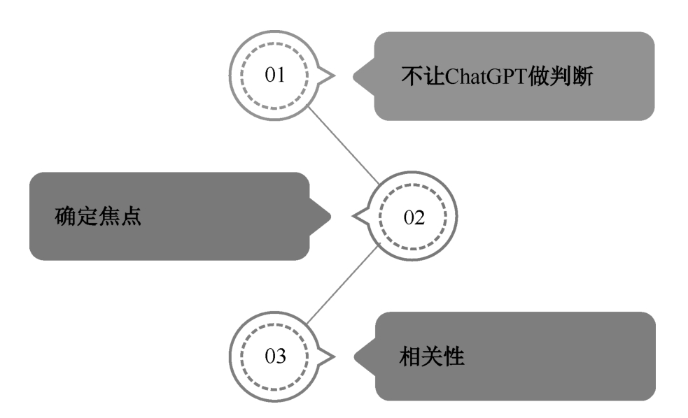

图 1-3 有效提示的三个原则

1. 不让 ChatGPT 作判断

生成式 AI 无法判定对错优劣。应避免要求其对伦理道德、情感认知或专业决策作出判断。

例如“你觉得我应进军国际市场还是深耕本土”这类问题，即使给出背景信息，模型也只能说明两种选择的差异，无法决策。

用户应自行判断，模型提供辅助信息。如改为“国际化常见范式是什么”“如何实现本地化”，即可获取支撑决策的信息。

2. 确定焦点

提示词应帮助模型聚焦，减少干扰。表达需清晰，避免模糊导致误解与效率下降。

例如“你可以帮我做作业吗”表达不清，改为“能否解答一道数学题”，并输入具体题目，沟通更清晰。

沟通时可用“文案创作技巧”“写作方法”等直接表达需求，而非泛泛提问。

如问“能讲讲互联网最新动态吗”，模型只能给出泛泛回答。因问题不聚焦，模型无法明确需求。

应聚焦具体领域提问，如“人工智能在自动驾驶方面的最新进展是什么”，才能获得期望答案。

3. 相关性

提示词需与主题相关，无关信息会分散注意力，增加沟通难度。如讨论出行计划，可用“路线规划”“目的地酒店推荐”等提示，过程中避免输入无关问题。

掌握以上准则可让对话保持在正确轨道。如答案不符，可进一步追问引导模型输出更准确内容。

此外，可为 ChatGPT 设定身份，让其扮演特定角色以获得更精准答案。如扮演营销专家提供专业建议，或扮演旅行顾问给出出行方案。身份扮演能让模型沟通更聚焦、更沉浸。

### 1.2 ChatGPT 浪潮因何而起

ChatGPT 面世后迅速引发广泛讨论，成为社交媒体热门话题。其浪潮的形成，源于数字内容需求爆发，以及数据、算法、算力技术的成熟，并叠加 GPT-4 等模型出现。

**1.2.1 需求爆发：数字内容需求与日俱增**

ChatGPT 诞生两个月用户破亿，背后是数字内容需求的激增。

数字社会下，用户需求体现在两方面：一是更沉浸的人机对话，从单一文本到图文音视频多模态；二是海量数字内容，对丰富度要求不断提高。

传统内容生产受产能限制，难以满足需求。当前主流方式为 PGC，即专业生成内容，可产出高质量内容但周期长，难以大规模生产；UGC 依托用户参与可产出海量内容，但质量难控。

AI 在内容生产中的应用为需求提供新解，AIGC 应运而生。ChatGPT 作为典型应用，成为智能产出数字内容的利器。

例如在影视创作中，ChatGPT 可分析海量剧本总结思路，帮助创作者发散灵感，也可按要求自动生成剧本初稿，创作者在此基础上筛选完善，提升效率。

在教育辅助中，可为学生答疑，提升学习自主性；可生成课件、试卷等学习资料，提升体验并减轻教师负担。

总之，ChatGPT 催生内容创作新范式，满足不断增长的数字内容需求，也推动人机对话变革。基于强大底层大模型，可接收并产出文本、语音、视频等内容，突破以往局限，用户可多方式自然交互，因而迅速吸引海量用户。

**1.2.2 三大支柱：ChatGPT 背后的数据、算法和算力**

ChatGPT 初期基于 GPT-3.5，该模型由强大算力、算法与大规模数据共同支撑。

1. 数据

数据是模型训练的养料。GPT-3.5 训练需大规模多样化数据。OpenAI 接入了大量公开数据集，如 Common Crawl。Common Crawl 为非结构化多语言数据集，包含海量网络爬取数据，如原始网页与文本抽取数据，是 GPT 系列训练的重要来源。

2. 算法

ChatGPT 的诞生离不开 AI 算法支持，算法决定问题解决机制。深度学习模型 Transformer 的出现大幅提升了多模态内容识别处理能力，在其支持下 ChatGPT 展现出强大的自然语言处理、机器翻译等能力。

在 Transformer 基础上，ChatGPT 还融入了新训练逻辑，如 RLHF，即人类反馈强化学习。用户为模型提供反馈，模型据此强化学习，提升效果。具体流程为：初步训练后，训练者对表现提出反馈并构建强化学习奖励信号；随后微调模型纳入奖励信号；模型在持续训练中性能不断提升。

该流程改变了以往仅靠数据量提升效果的模式，进一步改善训练效果。

3. 算力

训练 GPT-3.5 所需的算力体量极为庞大，必须依托强大的计算底座。高性能计算正是让这款模型得以高效输出的核心支撑。

在模型训练环节，并行计算、分布式计算等高性能手段大幅提速，使训练效率获得明显跃升。进入实际运行阶段后，同样是算力在托底，让模型的响应更快、任务处理更顺畅。

数据、算法与算力三者协同发力，推动 GPT-3.5 性能持续进化，也为 ChatGPT 的诞生以及后续多场景落地提供了底层基础。

**1.2.3 GPT-4 驱动 ChatGPT 迎来跃升**

ChatGPT 能引爆市场，离不开底层大模型的持续升级。2023 年 3 月，OpenAI 发布了 GPT-4，完成了对 GPT-3.5 的一次全面迭代，也让搭载该模型的 ChatGPT 在能力与功能上同步上台阶。

GPT-3.5 已能产出高质量自然语言文本，如对话、文章等，还可处理翻译、检索等自然语言任务。模型内置安全机制，会对用户不合逻辑的前提提出质疑，也会拒绝不当请求。

GPT-4 在此之上实现进阶。参数规模从 GPT-3.5 的 1750 亿提升至 1.5 万亿，整体能力更强。它具备多模态输入输出，可同时处理文本与图像，并在多个专业领域实现落地，表现接近真人。例如法律领域，GPT-4 参加了美国律师资格考试，共 7 门学科，其中 5 门的得分高于真人考生。

在各类考试与对比测试中，GPT-4 相比 GPT-3.5 更具创造性、也更可靠，多语种测试同样全面领先。

总体来看，GPT-4 在解决复杂问题与泛化能力上更胜一筹。依托其超强表现，ChatGPT 能在更多领域落地，帮助用户生成、迭代创意内容，并具备更高协作水平，比如按用户创作风格生成剧本、歌曲等。

### **1.3 为何是 OpenAI 打造 ChatGPT**

随着 ChatGPT 热度攀升，人们也开始好奇，为何最终推出产品的正是 OpenAI。人工智能赛道参与者众多，OpenAI 究竟有何不同。下面梳理其发展脉络。

**1.3.1 OpenAI 从非营利到营利的蜕变**

OpenAI 专注于人工智能技术研发与应用推广，其发展可分为数个阶段。

**1. 创始阶段（2015—2017 年）**
2015 年，山姆·阿尔特曼与埃隆·马斯克共同发起倡议，旨在开发安全开放的人工智能，这成为 OpenAI 的起点。初创期团队聚焦游戏领域的人工智能应用。2016 年，OpenAI 推出强化学习开源工具箱 OpenAI Gym、测试平台 Universe 等。

**2. 转型阶段（2017—2019 年）**
2017 至 2019 年间，OpenAI 继续深耕研发。2018 年，团队发表论文提出生成式预训练转换器 GPT 概念，认为该模型可模仿人类大脑结构，通过海量文本训练实现问答、内容生成等多种任务。

随后 GPT-1 问世并升级为 GPT-2，但因安全考量未向公众开放。非营利形态难以获取充足资金，2019 年 OpenAI 宣布改制为营利公司，以吸引更多投资。

**3. 快速发展阶段（2019 年至今）**
改制后资金与商业模式趋于清晰。
2019 年 3 月，OpenAI 引入微软作为战略投资者，开启融资。2019 年 7 月，微软注资 10 亿美元，并获得 OpenAI 核心技术的商业化授权，双方开始深度融合。
2020 年 6 月，GPT-3 公开并同步推出 OpenAI API，正式迈向商业化。2020 年 9 月，微软获授权使用 GPT-3，成为首批使用者。
2021 年微软再次加码，双方合作进一步深化，OpenAI 新技术可与微软产品结合推出新服务。
2022 年 11 月，历经多年研发，GPT-3.5 与基于它的 ChatGPT 正式发布。
2023 年 2 月，推出付费订阅服务 ChatGPT Plus，付费用户在高峰期享有优先使用权。2023 年 3 月，GPT-4 上线，ChatGPT 能力获得进一步强化。

成立以来持续的研发积累为 ChatGPT 奠定技术基础，微软的资本注入则提供资金保障，二者共同促成 ChatGPT 的面世。凭借 ChatGPT 这一成功的 AIGC 产品，以及在模型与技术上的优势，再加上微软的资金支持，OpenAI 未来仍具巨大发展潜力。

**1.3.2 幕后推手：格雷格·布罗克曼**

ChatGPT 能否落地，离不开关键人物格雷格·布罗克曼。在 OpenAI 仍是小规模非营利组织时，他担任首席技术官。

为对抗谷歌旗下 DeepMind，布罗克曼推动一项计划：让研究与工程团队协同，打造可玩 DOTA2 的软件 OpenAI Five。研究团队负责模型训练，工程团队负责软件实现，推动成果落地。

布罗克曼亲自打破团队壁垒，与 DOTA2 开发人员进行长时间交流，理解游戏与软件需求并调和矛盾。2019 年，OpenAI Five 战胜当时顶级人类玩家，项目取得成功，也为 ChatGPT 的协作模式提供了范本。

此外，布罗克曼是推动 AI 技术产品化的核心人物，像“流动员工”般穿梭各团队，明确目标、提升效率。ChatGPT 的突破不仅在技术，更在于把 AI 用于现实任务并转化为产品，这正是布罗克曼推动的关键。尽管 OpenAI 发展中曾遭遇诸多困难，正是这样一位关键人物带领团队化险为夷。

## **第二章**

## **应用价值：ChatGPT 激活 AI 新蓝海**

ChatGPT 已成为人工智能领域的焦点，应用价值巨大。在此浪潮下，不少科技巨头纷纷入局，以其底层大模型为基础打造类 ChatGPT 产品，开辟人工智能发展新空间，推动 AIGC 产业向前。

### **2.1 多功能叠加 价值全面爆发**

ChatGPT 具备智能搜索、智能对话、内容智能生成、智能交互等强功能，应用价值突出。在使用中，其反应敏捷、交互优秀、功能完备，为用户带来优质体验。

**2.1.1 智能搜索 让查找更精准**

ChatGPT 能模拟人与人之间的连续对话，实现实时、准确的信息供给，成为搜索引擎的新入口，让搜索更智能。

传统搜索引擎靠关键词匹配与排序，难以理解复杂表达、解析长文本，也缺乏交互能力。

ChatGPT 催生了新型智能搜索方式，实现与用户的自然交互。其优势主要体现在：
（1）精准度更高。凭借强大的自然语言处理能力，能深刻把握搜索意图，返回更精确的结果。
（2）对话式交互。用户提问后可直接以对话形式获得答案，避免反复点开链接。
（3）个性化搜索。传统方式对用户偏好挖掘有限，而 ChatGPT 可通过提示语不断自学，将更符合用户习惯的内容更早、更准地呈现，并随时间持续优化。

基于上述优势，ChatGPT 极大提升搜索体验，用户可用自然语言直接获取精准信息。

随着发展，搜索引擎有望呈现：
（1）整合协同更强。借助 ChatGPT 或其他 AIGC 应用实现信息智能筛选与精准匹配，提供更全面的内容。
（2）更强的个性化。依托技术支撑，为不同需求提供定制化搜索服务。
（3）向智能助手演进。功能愈发全面，搜索引擎可发展为用户的智能助手，提供便捷信息获取与问题解决。

ChatGPT 正推动搜索从“模糊”走向“精准”，成为下一代搜索引擎的催化剂。

**2.1.2 智能对话 实现自然多轮交流**

通过对海量语言数据的学习，ChatGPT 能理解语言深层含义与复杂对话情境，并生成精细、准确的表达，重新定义智能对话。

**1. 智能问答**
ChatGPT 面向开放域对话，对技术要求更高。不同于任务型对话的固定模式，开放域对话需适配不同人群与内容。自然语言处理技术的迭代让 ChatGPT 能够直接给出有效答案，而非让用户在检索结果中自行筛选。

模型拥有上千亿参数，训练数据涵盖电子书、网页、新闻、社交媒体、邮件、论坛等，知识面广阔，可通过问答形式提供丰富服务。

**2. 多轮对话**
ChatGPT 具备强大的连续交互能力，能记录对话过程并加以分析，更准确理解当前提问，结合上下文给出个性化、精准回复，宛如智能伙伴。

无论日常闲聊还是专业交流，都能保持流畅体验。基于上下文学习的方法训练对话模型，使交流连贯自然，克服了单轮对话的生硬感，是自然语言理解在应用层面的跃迁。人机对话正成为数字化沟通的重要组成部分。

**2.1.3 内容生成 一站式创作**

ChatGPT 拥有强大的内容生成能力，基于自主学习对海量数据进行分析整合后，可产出多种类型内容。

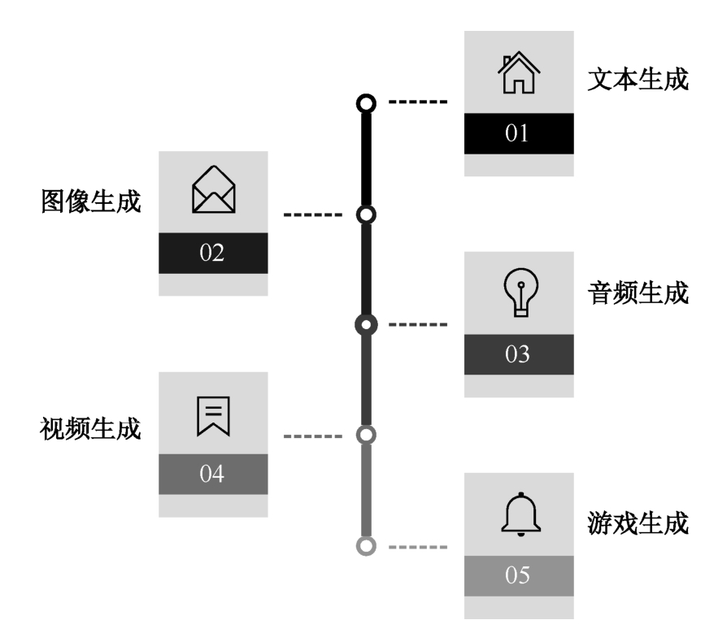
图 2-1 ChatGPT 可以生成的内容类型

**1. 文本生成**
可与用户对话、依据教学资料生成教案、按新闻素材撰写报道、续写小说等，类型多样。

**2. 图像生成**
可按指令生成对应图像，并接受细节调整指令。可生成图文海报、画报及复杂设计图纸，如输入建筑尺寸、材质、色彩即可得到逼真的建筑效果图。

**3. 音频生成**
可合成自然逼真的语音并支持个性化风格定制，也可进行编曲、音乐创作、音效生成等多样化音频创作。

**4. 视频生成**
可按需求生成富有创意的视频，助力创作。以短视频制作为例，用户准备脚本、音频、文字并说明素材使用场景后，ChatGPT 即可生成个性化短视频。

视频创意软件 Wondershare Filmora 网页版上线“智能脚本小助手”，以 ChatGPT 为支撑，可智能生成故事、单人演讲稿、双人对话等多种脚本。

**5. 游戏生成**
可提升游戏内 NPC 的智能性，生成更自然的对话；也可进行剧情智能生成，助力人物背景、故事、地图、关卡、道具等创作，显著提升开发效率。

在内容生成层面，ChatGPT 产出自然流畅、生成效率高且可定制化满足个性需求。

**2.1.4 多模态交互 打破感官边界**

ChatGPT 支持语音、文字、图像等多模态交互，能更好满足不同用户需求。它可处理文本、语音、图像等多类数据，更准确理解意图并提供个性化服务，极大拓展了多场景应用。

**1. 智能客服**
智能客服可讲解产品、提供预算建议等。结合 ChatGPT 后感知与互动能力增强，能识别语音、语气、情绪、动作等多元指令，实现更自然的交流。

**2. 智能助手**
可与智能音箱、车载语音助手等结合，成为用户的超级助理。传统音箱只能执行“打开空调”“关闭空调”等指令，而搭载 ChatGPT 的音箱能理解用户在不同时间、季节的温度偏好并智能调节。

语音助手也不再被动执行指令，而是能预判需求。环境变化时可自动调整服务内容与方式。例如车载助手在进入隧道时提醒关闭车窗、打开车灯；电量不足时主动提示附近充电桩位置。

**3. 智能机器人**
在 ChatGPT 支持下，智能机器人不再仅按固定程序操作，而是能全方位感知环境并分析后进行精准作业。工业场景中，传统机器人受限于固定路线，遇到障碍即停滞。融合 ChatGPT 后，机器人可识别环境、定位目标、规划路径，例如接到拿取水瓶指令后自主完成抓取，实现更复杂、更灵活的任务。

### **2.2 市场布局 巨头扎堆入局**

国内外厂商正加速抢占 ChatGPT 应用赛道，希望借此驱动产品升级和组织优化。下面以阿里、腾讯、微软、谷歌四家巨头为例，看大模型如何支撑产品迭代和生态完善。

**2.2.1 微软押注大模型 搜索体验全升级**

微软与 OpenAI 关系紧密，后者发展离不开微软注资。微软先投入 10 亿美元，两年后再度加码，ChatGPT 的诞生少不了微软的助力。

在持续支持的同时，微软也在自家产品上做技术探索。为让搜索更智能，微软把必应与 GPT-3.5 底座结合推出 New Bing，OpenAI 将底层升级到 GPT-4 后，New Bing 的智能水平再度提升。

New Bing 的亮点集中在以下几个方面。

（1）搜索方式更丰富，支持语音提问和实时检索，用户可选多种交互路径。
（2）相较传统搜索引擎，返回结果的准确度与覆盖面提升，并可对结果进行过滤与排序。
（3）背后融合自然语言处理、机器学习、数据挖掘等多项技术，整体搜索效能提高。
（4）内置实用工具，如翻译、计算器等，可直接在搜索页完成操作。

另外，New Bing 会保留聊天记录，支持随时续谈。聊天界面已对第三方插件开放，响应需求更快。比如用户提到晚餐，系统能顺势查找并预订餐厅。

从用户感受看，搜索逻辑从关键词输入转向对话交流，结果呈现从列表摘要转向可读的段落。尽管在精度与排版上仍有瑕疵，但个性化互动与内容生成能力已吸引大量用户。

把搜索引擎与前沿技术结合，微软完成了 New Bing 的功能创新与体验优化。若说 New Bing 只是试水，那么 Office 与 Teams 引入 ChatGPT，才是真正的生态布局。

在一个要素互通的完整生态中植入 ChatGPT，无论落地速度和接受度如何，效率提升都是倍数级的，这对同类应用形成强压，尤其是办公软件领域。

一个集文档、演示、会议、邮件、智能助手、智能检索于一体的套件，与仅提供单一功能的工具相比，用户选择一目了然。

**2.2.2 谷歌自研 PaLM 2 全面加码应用**

除了把 ChatGPT 嫁接到自家产品，部分企业选择自研底层大模型。2023 年 5 月谷歌开发者大会上，PaLM 2 亮相，这是 Bard 模型的升级版，能生成多类文本，在自然语言生成、编程开发、翻译、数学推理等方面表现突出，可适配搜索、办公、云服务等场景。

PaLM 2 运行在谷歌定制 AI 芯片上，效率大幅提升。以其驱动的 Bard 性能明显增强，已向百余国家和地区开放。

在 PaLM 2 加持下，Bard 回复更精准。Bard 已接入多项编程工具，支持 20 多种编程语言与 Google Sheets 函数，用户可将结果导出到 Google 文档、Gmail、第三方协作编程 App 或 Colab 编程环境。

对话框也支持图片输入，通过 Google Lens，用户能把手机摄像头对准抽屉里的工具配件，直接问“这些能做什么”，获得快速回复。

大会上谷歌还发布了具备生成式搜索能力的新版搜索，并在现场演示。以“为什么某类食物受欢迎”为查询，传统搜索给出网页列表，而生成式搜索产出几段摘要概括味道与优点，并附来源链接，被称为“AI 快照”。

生成式搜索还能辅助选购。比如用户搜“好用的蓝牙音箱”，系统会给出选购建议并列出电池、防水、音质等常见问题，附带购买链接，提供多选项。

**2.2.3 阿里 1+4 开源战略 魔搭社区降门槛**

2023 年 6 月阿里公布“1+4”开源战略，在大数据、操作系统、数据库、云原生四大领域之外，向大模型进军。AI 模型社区魔搭社区首次登场，成为大模型板块的代表。

魔搭由阿里达摩院与国内多家机构共建，聚合了多个大模型和 SOTA 模型，以“模型即服务”为理念，降低技术使用门槛。

社区划分为模型库、数据集、创空间、动态、讨论区等。首次进入的用户可在文档中心了解概念与安装流程。模型库与数据集按任务目标、研发组织分类，便于按需挑选。

创空间提供平台模型和可视化 SDK 代码，支持 AI 应用开发与发布。动态区定期举办竞赛，用户可获取优质数据并与业界高手交流。讨论区则供开发者分享经验、激发灵感。

对中小企业而言，自研大模型成本高、难度大，训练千亿参数更是负担。阿里率先推出模型开源社区，从源头降本降门槛，企业无需从零起步，只需在基座上微调，探索垂直场景大模型。

开源还能规范行业生态，遏制乱象。技术是双刃剑，开源社区为大模型奠定正向技术基础，让发展更可持续可控，带动各行业健康成长。

**2.2.4 腾讯混元大模型补齐生态短板**

2023 年 9 月腾讯发布混元大模型，正式加入百模竞争。模型通过腾讯云开放 API 外部调用，也可作为基座研发适配行业的专用模型。

混元的最大特点是减轻“幻觉”。幻觉指因源内容与目标差异、训练数据重复、解码随机性等，生成内容流畅却偏离事实或严重失真，可能引发错误传播、隐私泄露等风险。医疗场景下，若诊断报告出现幻觉，可能导致误诊甚至危及生命。

通用做法是加入搜索增强、知识图谱等。混元在两方面实现突破。

一是全量从零训练。预训练阶段采用自研“探真”技术优化目标函数，该方法可减少 30%～50%的幻觉，提升可信度。

二是支持超长文本输出。多数模型仅支持 1000 字左右，后续需手动续写。混元优化编码位置，连续输出可达 4000 字，“思考”更全面深刻。

目前混元已接入腾讯 50 多个业务。以腾讯会议为例，数小时会议会产生上万字口语化记录。接入后参会者可随时问 AI 助手不明白的词汇及其语境。会后助手能自动生成待办清单与部门任务汇总，操作便捷。

虽发布较晚，混元具备全链路自研能力，能随行业和市场变化持续进化生态，在百模大战中保持竞争力。

**2.3 生成式 AI 价值正在爆发**

生成式 AI 以创造为核心，覆盖自主写作、艺术设计、游戏开发、教育培训、医疗诊断等。近年其价值凸显，为各行业带来机遇与挑战。

**2.3.1 生成式 AI 与判别式 AI 怎么选**

**1. 定义**

生成式 AI 利用深度学习与神经网络，学习海量训练数据的分布规律，并据此生成新数据，重点在创造。典型模型有 RNN、LSTM 以及 Transformer。

判别式 AI 通过分析输入与输出标签的关系进行预测与判断，重点在基于已知数据做决策。常见有支持向量机、随机森林，以及图像识别、自然语言处理等深度模型。

**2. 优劣势**

生成式 AI 灵活性与创造性强，数据稀缺时可做数据增强与样本补充。

以某服装制造企业为例，用它辅助当季新品策划与营销，包括提出 10 条款式思路、分析用户需求、拟定单品营销方案、撰写竞争力报告。应用后任务效率明显提升，成果更好，尤其对水平较低员工帮助更大。

劣势在于存在“锯齿状边界”。在边界内任务完成良好，超出后表现急剧下降，且边界难以把握，非专家不易识别。过度依赖还可能带来风险：一是生成内容存在幻觉，盲目信任或致损失；二是员工易滋生惰性，判断力下降，学习能力与生产力受损。

判别式 AI 训练难度低、耗时短、成本低，处理大规模数据时效率高，预测能力强，适合多任务学习。

不足是学习过程不关注数据内部结构，对大体量高质量数据依赖强，在高维复杂数据上泛化能力弱，无法生成新数据。

**3. 应用场景**

生成式 AI 适合新内容生成，如广告策划中辅助设计师创作图视频，提供灵感；游戏开发中生成虚拟角色与地图扩展。

判别式 AI 适合预测分类，如医疗中汇总患者信息、辅助病因诊断与方案制定，缓解医患压力；金融中分析股价走势、评估企业信用。

总体看，两类 AI 各有所长，需结合任务类型、数据规模与质量、成本与场景选择。

**2.3.2 ChatGPT 成创作者新搭档**

作为生成式 AI 的代表，ChatGPT 能根据关键词或需求智能产出结果，并按细化要求再加工，成为创作者的助手。

文字创作时保持思路通畅很重要，ChatGPT 可提供灵感与方案，写作卡顿时给出创意点子。艺术创作中也能生成素材激发灵感。

2023 年 2 月，可口可乐与贝恩签署协议，借助 ChatGPT 探索营销创意与提升创作力。ChatGPT 的内容生成能力为营销部门赋能，提供创意素材与文案。

可口可乐未透露细节，但这表明企业正把握 AI 创新机遇。人机结合的效果远超单打独斗。在迭代快的市场，借助 ChatGPT 营销团队可捕捉海量信息，获得更多灵感，产出多样化文案。

多品牌已用 AI 生成内容创新。网易严选 7 周年发布 AI 歌曲《如期》，歌词来自用户评论，讲述品牌陪伴故事。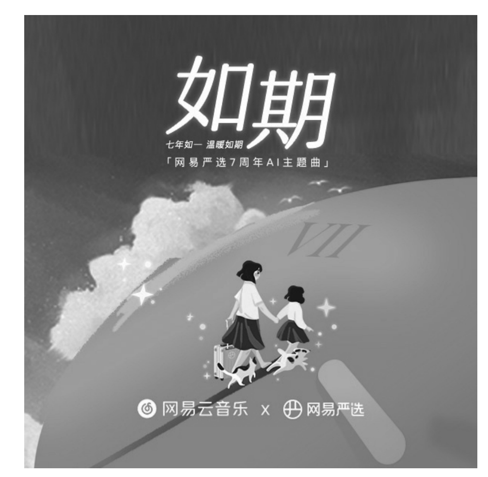

图 2-2 AI 打造的歌曲《如期》

歌曲由网易天音提供技术支持生成歌词，海报也是 AI 生成，充分利用 AI 做方案设计、拍摄制作等，提升效率。

美团优选推出“省钱少女漫”广告，10 幅漫画全部由 AI 创作，是人来甲方、AI 作乙方的尝试，营造食欲场景传递买菜信息，结合热点获得良好传播。

生成式 AI 与创意营销结合，既提升内容质量，也增强品牌互动与认知度。

**2.3.3 生成式 AI 为 AIGC 打开成长空间**

ChatGPT 展现出生成式 AI 的巨大潜力，推动其与 AIGC 产业融合，打开新空间。

生成式 AI 基于深度学习，根据图像、文本等输入生成高质量自然语言文本。AIGC 是 AI 在内容创作领域的落地，可创造富想象力内容并提供个性化推荐。ChatGPT 的出现让二者融合成为趋势。

ChatGPT 支持文本或语音对话，学习人类表达规律，生成连贯符合语境的回复，本质是基于生成式 AI 的应用。

应用前景广阔，可用于智能客服、语音助手等自然交流。未来或成为新型通信工具，让人机交互更智能流畅。

在 AIGC 领域，ChatGPT 可作为创作工具提供实时互动，预测用户偏好与风格并调整内容精度，解决创作难题，提供建议，提升趣味与灵活性。

总体看，ChatGPT 极具前景，推动生成式 AI 与 AIGC 融合，开辟应用与商业机会。目前仍面临语音识别率、语境识别不清等挑战，随着深度学习完善，其场景与价值将进一步凸显。

## **第三章**

## **ChatGPT 重塑职场生态**

**ChatGPT如何重写职业版图**

ChatGPT的能力已经触达各行各业，带来的冲击是双重的。一面是通过降本增效和流程再造凸显技术优势，让大量传统岗位被迫调整；另一面则催生出一批围绕AI出现的新角色，进一步推动大模型产业向规范化迈进。

### **3.1 ChatGPT正在重塑传统职业形态**

走过多年沉淀的传统岗位，作业方式和技能门槛长期稳定。如今ChatGPT的介入带来颠覆式变化。下面聚焦咨询、翻译、数据处理、内容生产四个典型领域的具体变化。

**3.1.1 咨询岗位：从人工主导到AI接棒**

ChatGPT拥有海量知识储备和流畅的对话能力，能与用户顺畅沟通并解答各类问题。经过专业内容微调后，它可化身领域专家给出专业化答复，这意味着大量咨询类工作已被覆盖。未来在客服等场景，AI完全取代人工提供高品质服务已具备可能。

在咨询场景中，AI能承担多重功能。它可作为客户服务热线，快速响应咨询并依托学习能力和知识积累给出建议；也能充当信息采集员，对客户需求进行归纳分类，为后续跟进提供参考。

个性化服务同样可实现。通过分析用户历史咨询记录，AI可推送可能感兴趣的服务，提升针对性和满意度。借助智能导航，还能引导用户挑选合适产品，有效拉升转化。

当然挑战并存。多数用户对人工咨询依赖度高，需要时间适应新方式。AI在咨询中的应用也需持续的技术迭代升级，以保持互动体验和服务质量。

总体来看，AI在咨询领域的潜能巨大。随着功能不断完善，未来它有望成为更智能、更高效、更便捷的咨询工具。

**3.1.2 翻译岗位：ChatGPT提供多维助力**

当下翻译行业面临小语种专业人才稀缺、语言障碍和文化差异叠加的难题。完成高质量翻译不仅要精通语言，还要理解背后的文化和使用习惯。

行业文本还涉及大量术语，如医学、法律、金融等领域词汇专业性强，对译者知识储备和实战经验要求很高，也抬高了准入门槛。

针对这些痛点，ChatGPT能高效辅助译者完成任务，具体帮助如图示。

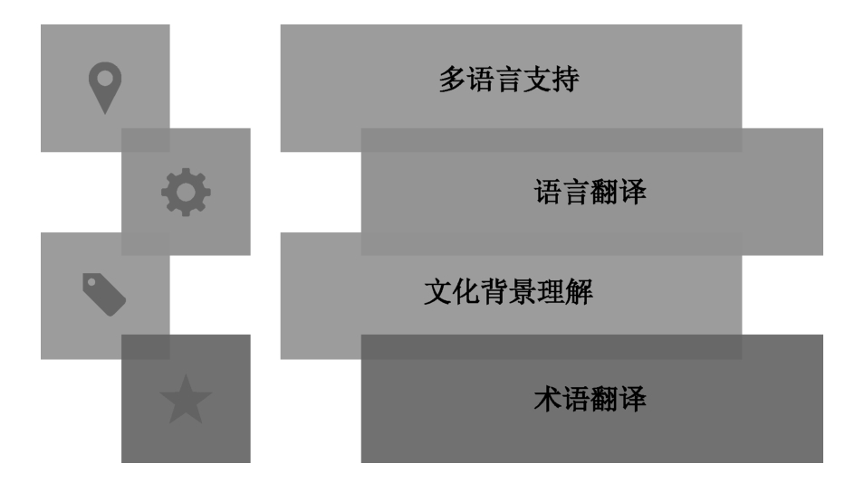

图 3-1 ChatGPT 为翻译人员提供的多重帮助

**1. 多语言支持**
覆盖中文、英文、日语、韩语、法语、德语、俄语、西班牙语等主流语言，帮助译者快速完成语言转换。

**2. 智能译文**
依托自然语言处理与机器翻译技术，可迅速识别原文语言并做智能化转换，提升效率并降低出错概率。

**3. 文化语境理解**
不止于字面转换，会兼顾不同文化背景下的表达差异，对存在文化冲突的表述做合理化处理，改善沟通效果。

**4. 专业术语处理**
在翻译行业文献时，能利用NLP识别文章中的专业术语和用语，帮助译者更快理解内容，避免因不熟悉领域而误译。

总体而言，ChatGPT能有效缓解翻译难题，为个人和企业提供更智能高效的服务。随着AI技术演进，它将在更多翻译任务上实现替代。

**3.1.3 数据处理岗位：ChatGPT切入全流程**

ChatGPT的应用正让数据处理类工作发生结构性变化，并逐步嵌入处理流程的多个环节，带来效率提升和错误率下降。

**1. 数据录入**
人工录入成本高、速度慢、准确性难保证。ChatGPT介入后可加快录入节奏并提高正确率，大幅压缩人力开销。

**2. 数据加工**
通过学习算法，AI可自动完成分类、筛选、统计、可视化等工作。相比手工处理，时间成本显著下降，失误也更少。

在银行、保险、证券等金融机构，数据审核、统计和分析是财务优化、风险管控和业务营销的基础。传统方式繁琐且效率低，ChatGPT可将这些环节拆解并自动执行，明显提升效率并减少风险。

AI的出现不仅简化了日常数据工作，也为企业指明了数据智能化发展的方向。伴随智能机器人技术成熟，智能推荐、智能客服、智能管理等新场景将不断涌现，为企业创造更多商机和服务模式。

数据处理领域的前景广阔，工作方式正从快捷便捷迈向智慧未来。

**3.1.4 内容生产岗位：ChatGPT优势凸显**

凭借强大的自然语言理解与生成能力，ChatGPT在内容生产上具备明显优势。它可独立完成简单生成任务，在复杂任务中则作为辅助提供所需内容。

AI能帮助创作者自动处理重复性任务，加速文档流程，提升效率，同时保证内容准确、统一和标准化。

在报告撰写中，AI可快速定位信息，加快成稿速度并提升质量。它能深度理解自然语言，提供更自然的交互，在短时间内产出高质量报告，还能协助信息梳理、质量把控、文件自动更新。

内容生产是各行业的底层工作，涵盖新闻稿、广告文案、市场调研报告、宣传材料等。AI可自动化生成与优化内容，节省精力提升产出。

越来越多企业开始对ChatGPT进行定制化训练，以保持文档风格一致，加速员工交付。

ChatGPT在内容生产领域的优势如图示。

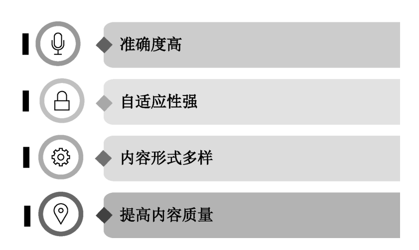

图 3-2 ChatGPT 在内容生成领域的优势

**1. 准确度高**
采用NLP技术，能准确理解需求并生成符合要求的文本，支持多轮对话不断细化，最终交付匹配的内容。

**2. 自适应性强**
可基于用户输入持续学习，提升输出的准确性、质量和专业度，在特定细分领域实现更专业的产出。

**3. 形式多样**
可生成故事、诗歌、新闻稿、营销文案、行业报告等多种形态，满足多样化需求。

**4. 质量提升**
能产出语法规范、逻辑清晰、语言流畅的高质量文本，并自动识别修正错别字、语法错误等。

这些优势让从业者效率和质量双升，推动行业进步。但警示也随之而来：缺乏判断与优化能力的人，容易被更懂AI的人或AI本身取代。

### **3.2 ChatGPT催生的新兴职业群**

ChatGPT带动了一批新岗位的兴起，为职场带来新鲜血液。新兴从业者以专业技能推动AI发展，也在规范行业、降低风险方面发挥作用。

**3.2.1 AI模型训练师：实现模型个性化定制**

AI模型训练师是为企业设计研发AI模型的专业技术人员，目标是让模型像人一样学习、思考与决策，辅助企业制定发展方案。核心工作包括：

**1. 数据处理与预处理**
清洗原始数据，处理缺失、噪声及不一致数据；做数据集成，通过实体识别将不同来源的异名数据统一，如“李四”与“LS”、 “有一说一”与“yysy”；做数据规约，在不改变原貌前提下压缩数据量，降低建模负面影响与存储成本；做数据转化，通过函数映射展现要素关系，为后续分析奠定基础。

**2. 模型研发与运维**
依据用户需求选型算法并用编程语言开发模型；在训练期做好数据准备、质量检测、流程化训练监控，排除故障并确保准确率达标后上线；上线后定期维护优化，保证与实际场景深度融合；根据客户需求灵活调整训练流程，设计新模块，与算法、标注团队协同，给出优化方案并撰写报告。

该岗位要求掌握机器学习、深度学习、神经网络等知识，熟练使用Python、Java、C++等至少一门语言，并具备沟通、协作和抗压能力，部分企业还要求流利英语。

一位华为云AI工程师提到，他曾负责车牌识别项目，客户要求精度99.95%，在场景复杂、技术难度高的压力下，团队通宵攻关、并行训练多模型，最终交付成功。虽然工作枯燥，但模型落地时的成就感独一无二。

随着企业数智化转型加速，模型训练师需求持续上升，需要不断自学创新，保持竞争力。

**3.2.2 提示词工程师：让用户与AI有效沟通**

要让ChatGPT给出精准答案，关键在于提问方式。提示词工程师由此应运而生，提示词是AI能否准确捕捉意图的核心。

以ChatGPT为例，其提示词系统设计注重细节，通过引导用户输入问题，从知识库调取信息并给出更符合需求的答案。它还能识别用户提供的提示词并据此提升回答精度，结合智能算法不断优化输出体验。

ChatGPT的成功离不开提示词工程师。在训练阶段，工程师通过提示词反复修正输出；在应用中，完善的提示词系统能让输出更贴合用户意图。

随类ChatGPT应用增多，提示词工程师的重要性日益凸显。优秀人才需具备如图示能力。

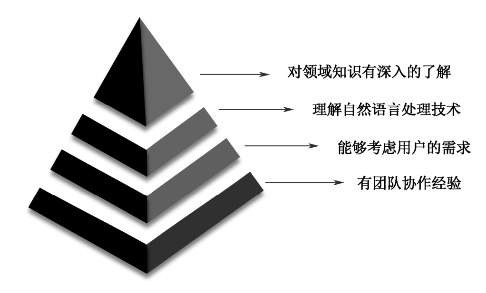

图 3-3 优秀提示词工程师需要具备的能力

**1. 对领域知识有深入理解**
强大的提示词系统建立在对特定领域的深度认知之上，工程师需具备专业知识以引导有效提问。

**2. 理解自然语言处理技术**
需要掌握NLP技术，帮助聊天机器人更好地理解和处理用户输入。

**3. 能洞察用户真实需求**
不仅要懂技术和领域，还要能理解用户痛点，持续改进提示系统以提供优质体验。

**4. 具备团队协作经验**
提示系统研发依赖专业化团队，要求与各部门高效沟通协作，推动项目顺利推进。

在AI快速发展的当下，提示词工程师影响力持续扩大，未来还将出现多语言提示、面向不同用户群体的差异化提示等更复杂需求。

**3.2.3 AI内容审核员：防范智能输出风险**

生成式大模型推动AI写作、绘画、作曲等创作形态爆发，降低了创作门槛，也让违规内容、版权侵害、信息泄露、伦理争议等风险大幅上升。为促进行业健康发展，AI内容审核员应运而生，团队化提供五方面服务：

**1. 优化训练数据集**
构建覆盖正面负面多场景、预判各类风险的丰富数据集，支持英语、韩语、日语等20多种语言，并可实时更新。

**2. 迭代算法模型**
凭借数据分析能力提升算法性能，确保模型及时迭代，审核结果更精准。

**3. 定制审核策略**
基于用户业务场景和保密原则，对数据加密处理，提供个性化审核方案，在保障安全的前提下实现最佳效果。

**4. 实时监控内容**
搭建7×24小时实时监控系统，及时发现违规内容并快速过滤，防患未然。

**5. “AI+人工”双保险**
人工审核可精准识别误导或违法内容，AI审核则承担风险防范和舆情监测，减少人工负担并在多场景中不断扩充数据库，提升识别准确率。二者结合完善全链路风控。

随着法规完善和审核技术升级，生成式AI有望实现良性发展，对社会产生更多积极效应。

### **3.3 ChatGPT带来的职业思考**

在AI与职业生态深度融合的背景下，从业者既感受到便利，也担心被替代，这促使人们重新思考职业发展路径。

**3.3.1 ChatGPT对职业发展的影响**
以ChatGPT为代表的AI工具正渗透各行各业，影响组织架构、业务流程和工作要求。员工职业发展受此冲击，主要体现在：

**1. 以影响程度为导向的劳动力变革**

智能化应用对不同岗位的冲击程度并不相同。以财务、审计、翻译、信息录入为例，这类工作的核心环节集中在文本编辑、资料搜集与归类等高度重复的任务上，与大模型的处理特长高度契合，所以从业者的替代风险相对更高。

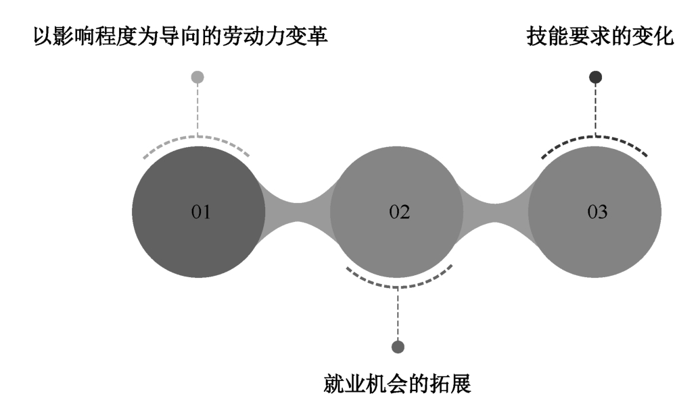

图 3-4 ChatGPT 对职业发展的潜在影响

反过来，家政、技工、烹饪、护理等岗位的核心价值在于人与人之间关于物质照料与情感沟通的交互。当前主流的智能系统在这种深度情境中仍显不足，短期内相关从业者仍保有较强的缓冲空间，暂时难以被取代。

**2. 就业机会的拓展**

上文提及的模型训练师、提示词工程师、内容审核员等新角色，说明围绕智能应用的研发运维、伦理与安全风控领域对人才的需求在快速攀升。叠加智能应用的教育培训、机器学习与深度学习方向的人才需求同步走高，整体来看技术演进正在孵化出一批新的职业岗位。

**3. 技能要求的变化**

当智能应用与传统业务深度融合，企业对员工能力的要求也在重塑。员工必须掌握如何使用智能应用的方法。从市场上的培训供给来看，诉求主要集中在两条路径。

第一类是办公场景的智能技能培养。多数企业员工需要具备通用办公能力，例如借助生成式应用进行文档编辑、演示文稿制作、超大体量表格处理以及数据洞察等。

第二类是图像生成技能培养。这类需求主要来自以视觉为核心的行业。例如游戏开发者可借助生成技术压缩原画获取周期，提升画面研发效率；建筑设计从业者可缩短概念稿与模型制作时间，提升设计阶段的沟通效率。

智能技术对行业的渗透是渐进式的，员工需要保持敏感度，主动学习相关知识，提前掌握一定使用能力做到有备无患。

**3.3.2 主动融合：把智能应用嵌入工作**

面对来势汹汹的智能浪潮，与其担忧彻底被取代，不如主动融合，把智能应用嵌入工作流程，发挥自身独有的优势，提高不可替代性。

**1. 吃透多样化的智能工具**

不同智能产品的优势场景各不相同，只有厘清差异才能精准选用、提效增能。目前较为常见的主要可归纳为五类，如图 3-5 所示。

（1）智能助理。这是最早普及的常见形态，包含语音助手、智能翻译、语义检索等。语音助手可通过口头指令操控电子设备完成操作；智能翻译打破语言隔阂，识别精度持续提升；语义检索能够捕捉语句背后的真实意图，返回最贴合需求的答案。

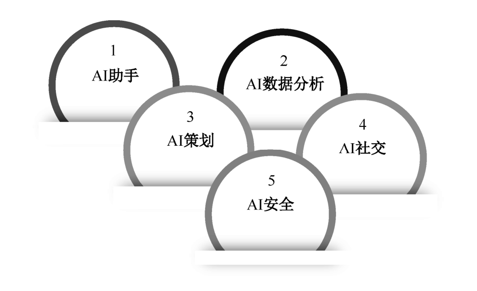

图 3-5 智能工具的五大形态

（2）智能数据分析。该类产品多用于报表编制与数据可视化呈现，帮助管理层看清业务现状，辅助做出更客观科学的决策。

（3）智能规划。该类产品多用于会议策划、日程安排与自动化排版，有助于企业高效组织大型会议、自动生成会议纪要、制定部门工作计划。自动化排版还能统一工作报告格式，进一步提升效率。

（4）智能交互。该类产品多用于客户服务、自动回复与团队协作，能让客服人员快速响应流程性问题，减轻工作负担。同时可帮助团队提炼沟通重点、明确业务进展，促进成员关系融洽与协作。

（5）智能安防。该类产品多用于智能门禁、安全存储与威胁检测，能够保护企业核心机密，及时发现外部安全威胁并快速处置。

厘清分类与适用场景后，工作者即可明确优先学习的工具，并以此提升自身能力。

**2. 让智能应用服务于业务流**

业务通常可拆分为前期、中期、后期。前期员工可借助智能工具开展市场调研，把握用户与市场需求。此阶段需要海量数据支撑，信息处理量大，依赖智能工具效率更高。

中期智能工具仍是辅助角色。员工必须厘清工作目标、把控细节、认知能力边界，不能全盘依赖。以平面设计师为例，可借助生成式工具辅助创作，但前提是先理解用户需求，将需求提炼为涵盖风格、材质、场景、画风等多维度的关键词，再向系统下指令。

后期智能工具可帮助收集用户反馈、提炼诉求，助力产品与服务优化。但员工仍需持续关注用户情绪，积极进行情感交流，这是机器无法完成的。

总体而言，对智能技术保持警惕是必要的，但不必过度焦虑。借助技术加速前进，不断提升自己，才能产出更出彩的工作成果。

# **中篇**

# **生成式内容开启通用智能新纪元**

## **第四章**

## **生产力变革：生成式内容重塑创作生产力**

人工智能生成内容为内容生产带来了颠覆性变化，掀起新一轮生产力革命。一方面，内容生产方式从专业生产、用户生产进化到第三阶段的 AI 生产；另一方面，生成式技术的爆发式增长可实现文本、图像、音频、视频等多模态内容生成，提升企业效率，推动社会发展。

### **4.1 技术迭代，内容生产方式进化**

在互联网与人工智能的共同推动下，内容生产方式不断演进，从 PGC、UGC 到如今的 AIGC。以下对三种方式分别展开。

**4.1.1 PGC：专业内容产出**

PGC 指由具备专业知识的创作者团队负责创作与发布，最早可追溯至 20 世纪 90 年代。互联网诞生后信息经济兴起，公众可通过网络生产发布内容，以流量曝光获取收益。

当时属于静态互联网，多数用户只能获取信息。能够创建并发布内容的用户并非全是领域专家，他们擅长信息聚合与筛选，将用户感兴趣的内容分类发布在门户网站。

PGC 的代表产物有雅虎网、IMDb 等。Web 1.0 时代发展后，各类媒体机构、内容平台与知识付费公司涌现，形成了如今熟知的 PGC 模式。

常见 PGC 平台可分为纯 PGC、PUGC、POGC 三种。纯 PGC 平台仅提供发布渠道，设有审核机制，但不承担生产成本。PUGC 平台融合 PGC 与 UGC，核心是通过推荐算法让用户接触不同层次内容，并设有激励机制，刺激普通创作者提升能力、增加平台流量。

POGC 是 PGC 与职业生产内容 OGC 的结合，核心是通过引入更多头部创作团队获取资源，提升内容质量，进而增加收益。

PGC 的优势在于生产发布者具备一定资历，专业技能与综合素质较高，能持续输出高质量内容。由于专业人士数量有限，平台管控与培训相对便利，质量与人员构成可控。

劣势在于专业内容需经历选题、构思、撰写、审校、排版、发布等多环节，周期长、时间成本高。且因创作人员专业且固定，内容易不接地气，阅读门槛高，受众有限，平台难以保证持续盈利。随着专业人员规模扩大，审核资质、管理培训、内容验收等方面的人力资金成本也在上涨，营收压力与运营难度加剧。

**4.1.2 UGC：用户产出海量内容**

UGC 指普通用户参与内容创作与发布。随着社交网络发展，创作门槛降低，越来越多用户通过论坛、博客等平台发布原创内容。UGC 平台早期搭建大致分三步，如图 4-1 所示。

图 4-1 UGC 平台初期建设步骤

**1. 创建初始化内容**

从零起步的 UGC 平台需要先有初始内容。运营方首先要确定平台调性，即为用户提供何种价值。如豆瓣是文艺青年讨论电影书籍的平台，网易云音乐是小众音乐爱好者的聚集地。

其次要收集内容与用户数据，如平台阅读量、点赞数靠前的内容、用户调研问卷、同类平台主要内容等，通过分析了解目标用户兴趣与需求，决定发布哪些初始化内容。

再次要搜集相关资料，提炼优质内容进行二次创作。

最后通过后台账号发布内容，初步构建平台内容生态。

**2. 邀请用户加入平台**

发展早期，运营方需要主动邀请用户入驻。一类是平台相关领域知名、权威、印象深刻的用户。如新浪微博早期邀请明星入驻，吸引粉丝跟随。

另一类是认同平台价值的用户。他们名气未必很大，但活跃度高、内容有吸引力。运营方需投入时间一对一沟通，并给予资金或流量支持。

**3. 构建激励机制**

获取首批优质创作者后，运营方需持续关注其发布内容，通过回复、点赞等方式保持互动，让创作者感受到重视，提升忠诚度。在积累一定创作者后，需建立有效激励机制，刺激高质量创作者积极发帖，培养成优质用户。

随着 UGC 平台成熟，用户不断加入，优劣势更加明显。优势在于内容源源不断、丰富多样且通俗易懂、趣味性强，能吸引更多用户、增加流量；劣势在于创作者水平参差不齐，若缺乏严格审核，低俗无营养内容会泛滥，甚至出现版权侵权、隐私泄露等法律纠纷。

**4.1.3 AIGC：AI 成为内容输出的重要手段**

人工智能生成内容是在 AI 技术快速发展中诞生的新型内容生产方式，利用各类 AI 技术创作内容，主要应用包括 AI 写作、AI 绘画、AI 作曲等。

AIGC 的优势主要体现在三方面：

（1）具备深度学习与人工神经网络能力，能在短时间内自动生成内容。用户只需明确格式与核心思想并下指令即可。对企业而言，AIGC 可替代员工处理大量重复流程性工作，减轻负担、节约人力成本。

（2）能够收集用户数据，分析使用习惯与阅读偏好，为用户定制个性化内容，提升满意度。

（3）通过规模化训练数据集总结数据分布规律，进而生成新数据。对创意要求高的企业与工作者，AIGC 可辅助创作、收集素材、提供灵感。

但 AIGC 尚不成熟，劣势明显：

（1）“幻觉”现象尚未完全解决，生成内容的真实性不稳定，可能出现看似正确实则误导极强的输出，不利于学习与工作。

（2）基于已有知识再生内容，可能侵犯他人隐私权与知识产权，引发法律纠纷。

（3）随着开源社区发展，AIGC 有可能被不法分子利用，生成反社会、反伦理内容，污染网络环境、制造谣言，对社会发展造成不利影响。

AIGC 的发展是大势所趋。从用户层面，应了解其现状，明确优点与局限，避免盲目依赖，保持辩证态度，审慎看待生成内容。从平台层面，尤其是开源社区，需加强内容审核，实时监控发布情况，加大研发投入优化性能。从政府层面，需制定监管政策，建立问责机制，保障内容可视化与可追溯，同时加大资金投入，支持机构研发 AI 工具，解决版权与伦理争议。

### **4.2 AIGC 爆发，实现多模态内容生成**

多模态指包含音频、视频、文本等多种信息形态。AIGC 与多模态结合，可生成多样化内容，为用户带来更丰富体验。AIGC 可生成文本、音频、图像、视频、游戏、3D 内容、虚拟人物等，覆盖生活诸多方面。

**4.2.1 文本内容：助力文本创作与内容营销**

文本生成是 AIGC 的重要应用。基于强大生成技术，可实现对话生成、文章摘要生成等，还能进行机器写作，有效助力文本创作与内容营销。

**1. 对话生成**

AIGC 可实现智能对话生成，应用包括聊天机器人、智能客服等。如微软曾推出智能虚拟助手小冰，能与用户对话。部分企业将对话机器人用于客服、营销环节，赋能全流程对话，实现降本增效。

**2. 文章摘要**

AIGC 可分析整理文章内容，理解文本后生成摘要，有助于节约时间、提高工作效率。也可基于主题与关键词生成概括性摘要，提升阅读效率。在收集素材时，用户可借助 AIGC 分析海量参考资料，快速定位所需关键信息。

**3. 机器写作**

AIGC 可用于新闻资讯撰写、小说创作等，衍生出智能写稿机器人、小说续写机器人等应用。机器写作通常经三步：获取信息、加工信息、输出信息。

获取信息阶段，用户需甄别、判断输出信息，筛选符合创作要求的内容；加工信息阶段，用户需提出细化要求，推动 AIGC 进一步完善；输出信息阶段，用户可获得反复迭代后的稿件。

除此之外，AIGC 在文本生成上展现出较高智能性。不仅能从知识库寻找答案，还能学习知识库内容，形成强大智能，实现复杂文本生成，如生成营销方案。

用户可在应用中输入需求，如“生成一个化妆品品牌的七夕营销方案”，AIGC 会据此分析目标受众、竞争对手、市场趋势并预测，生成有针对性的科学方案。生成过程中用户可提出各种微小个性化需求，实现方案完善，也可在输出基础上进一步优化，大幅提升制定效率。

AIGC 在文本领域的场景广泛，前景广阔。它替代了大量重复性文字劳动，帮助用户更好地与 AI 互动。未来有望成为文本创作主体，节省大量时间精力。

**4.2.2 音频内容：生成背景音乐与专业歌曲**

AI 生成音频是 AIGC 的重要应用，指 AI 通过学习大量音频数据生成对应音频。可应用于语音助手、配音等，提高工作效率。目前主要集中在背景音乐与专业歌曲生成。

如 Stable Audio 是一款音频生成式 AI 产品。用户通过文本提示输入关键词即可生成民谣、摇滚、爵士、电子等不同类型的背景音乐。

产品提供付费与免费两个版本。免费版每月最多生成 20 首背景音乐，每首不超过 45 秒且不可商用；付费版每月最多生成 500 首，每首不超过 90 秒，可商用。

在专业歌曲生成方面，网易推出 AI 音乐创作平台“网易天音”。用户无需乐理知识即可上手，输入创意灵感，AI 即可完成词曲创作。

平台主要有四项功能：一是编曲，AI 可快速编曲，涵盖流行、古典等多种风格；二是作词，AI 可根据输入主题输出相关歌词；三是一键生成 DEMO，仅需数秒完成词曲创作与演唱；四是歌声合成，内置多个 AI 歌手，可唱出近似真人的歌声。

总体来看，AI 生成音频降低了音乐创作门槛。目前 ChatGPT 持续更新，可实现对文本、音频等多模态内容的理解与生成。众多企业也在积极探索，为用户带来更多实用功能。

**4.2.3 图像内容：体现超强图像设计能力**

当前各平台 AI 生成图像内容呈现井喷态势。许多缺乏绘画技能的用户借助 AIGC 获得优质图像。各类 AI 生成图像软件兴起，将 AI 技术带入日常生活，用户只需打开 APP 或浏览器即可创作。

如 Midjourney 是一款 AI 生成图片软件，由一家自筹资金的独立研究实验室打造，在智能生成图像领域热度极高。Midjourney 持续更新，V5 版本解决了关键技术难题，实现跨越式突破。

让 AI 画出逼真的手部并不容易。训练数据中手部往往不是重点，且人类手部形态多样，包含握手、鼓掌、并拢等，给学习带来困难。对人类画师而言，手部细节复杂，画手同样困难。在 Midjourney V5 之前，AI 生成图像工具很难完成手部绘画。V5 版本完美解决了这一问题，能生成丰富的手部细节，甚至还原光影中的指纹纹路。

此外，Midjourney V5 还能生成照片级图像。在此之前，其生成图像多为卡通或超现实风格，V5 版本丰富了风格，可生成油画、抽象等风格，且更加逼真。

总的来说，AI 绘图技术已走得很远，但在使用过程中仍要保持审慎，避免产出有害内容干扰公共秩序。

**4.2.4 视频内容：AIGC 让视频创作降本提速**
视频制作链路长，从脚本到拍摄再到剪辑，对专业门槛要求很高。AIGC 带来了一批智能工具，让视频创作变得更友好。

市场上已有不少代表产品。Runway 凭借 Gen-2 大模型在文生视频赛道领先，用户用精细提示词就能微调画面细节，效果惊艳。虽然逼真场景仍是难题，但在黏土动画、科幻片等特定风格上表现极佳。QuickVid 做到一键生成短视频，自带脚本撰写，还能调用 DALL·E 2 作图、Google Cloud 文本生成语言加字幕，并从 YouTube 免版权音乐库配乐。门槛更低的是 PIKA 1.0，输入几个词就能得到很漂亮的短片。

数字人视频方面，商汤科技依托“日日新 SenseNova”大模型推出了“商汤如影 SenseAvatar”平台。平台融合文生图、大语言模型和数字人生成算法，能快速高效地产出数字人视频。企业和个人都能用它做短视频和直播，提升吸粉和用户粘性。操作很简便，只要上传真人素材就能克隆出数字人，大幅提高制作效率。

AIGC 做视频的核心优势是效率与成本双降。对需要海量内容输出的短视频从业者来说，以 ChatGPT 为代表的 AIGC 应用几乎是刚需。

**4.2.5 游戏内容：AIGC 赋能全链路创作**
AIGC 在游戏里的价值很大，能自动生成剧情、道具、地图，甚至基于需求定制新游戏。

开发商可以用它做文字冒险、角色扮演、推理类游戏。具备内容生成和开发能力的 AIGC 应用可自动写文本并与玩家互动，通过指令或选择推进情节，不同选择带来不同结局，可玩性更高。

玩家已经能用 ChatGPT 生成文字版游戏。推特上有玩家用 ChatGPT 复刻了文字版《宝可梦 绿宝石》，还原了道具选择、对战、策略等细节。经过调试，模型能理解规则，比如模拟宝可梦属性克制和伤害计算，未解锁地图会拒绝不合理进入请求。这验证了 AIGC 在游戏创作上的潜力，未来或能帮助设计全新游戏。

场景打造同样受益。腾讯 AI Lab 在 3D 游戏场景生成上持续探索，能在短时间内搭建虚拟城市。关键在城市结构、建筑外观和室内映射三点。团队让 AI 学习卫星图和航拍图，理解真实道路布局，从而生成更可信的画面。

道路布局可智能化，开发者只要描绘主干道，AI 就能自动填充整网路网，并支持参数调节。建筑外观上，过去靠照片手工建模耗时费力，特色建筑很少。腾讯研发的 2D 照片转 3D 模型技术加快了设计速度，让场景建筑更丰富多样。

剧情是游戏的核心。AIGC 能自动生成文案，减轻策划负担，让他们更专注于玩法设计。育碧推出的 Ghostwriter 就是例子，输入角色性格、经历、输入输出方式，就能生成人物对白，策划再做优化即可提效。

总体看，AIGC 既能降本又能提升沉浸感，未来在游戏领域的应用会更广泛。

**4.2.6 3D 内容：3D 场景与建模智能化**
AIGC 在 3D 生成上潜力巨大，可搭建场景、生成模型，优化设计流程。

以工业场景为例，AIGC 能智能生成工业模型，减轻工程师负担，提升效率。具体帮助有三点。

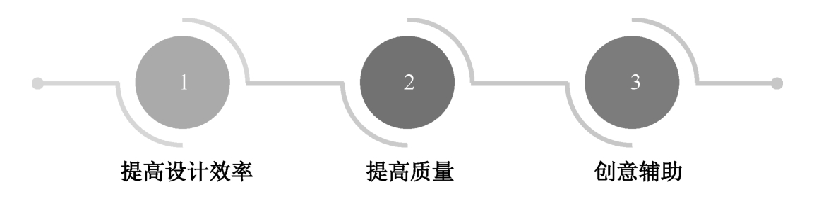

图 4-2 AIGC 能够为工程师提供的帮助

1. 设计提效。工程师可上传草图或用文本描述细节要求，系统据此生成高质量 3D 模型。
2. 质量提升。AIGC 能按细节要求优化质感、纹理，完成度更高。
3. 创意辅助。基于初步想法生成多种方案，提供灵感。

目前已有雏形产品。智源研究院与复旦大学联合推出的形状生成大模型 Argus-3D，能通过图片、文字生成椅子、汽车等多样化 3D 模型，并表现不同纹理颜色，提升工业建模效率。

提升模型参数后，Argus-3D 的优势明显。

**1. 多样性生成，细节到位**
模型能产出丰富形状，结构准确、细节饱满，轮廓流畅完整。以椅子为例，拐角关系合理，材质表现清晰。

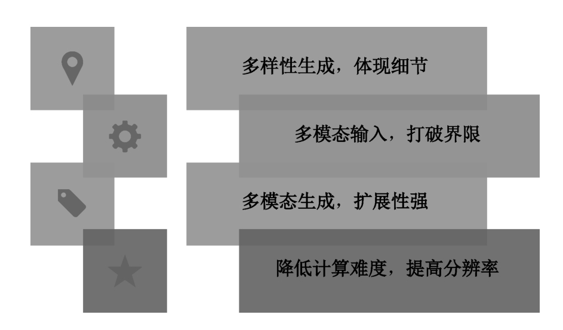

图 4-3 Argus-3D 的优势

**2. 多模态输入，打破限制**
支持文本、图像、类别标签等多模态输入，用户可自选方式，模型能融合信息精准识别需求。

**3. 多模态生成，可扩展性强**
基于 Transformer 架构，相较扩散模型分辨率受限的问题，性能更强，能生成更复杂的 3D 模型。

**4. 降低计算难度，提升分辨率**
3D 生成常受分辨率和算力限制。团队用三正交投影表征特征，把立方计算转为平方计算，降低难度并提高分辨率。

随着迭代，3D 内容生成将更智能，用户只需少量操作即可得到高质量模型。

**4.2.7 虚拟人物生成：数字人智能驱动更易实现**
打造虚拟数字人过去需要强技术和资金，现在在 AIGC 加持下门槛大幅下降。

2023 年 7 月华为开发者大会上，华为云基于盘古大模型发布虚拟数字人模型生成与驱动服务。结合盘古大模型、渲染引擎和实时音视频，打造通用大模型，可生成形象、动作、表情、声音等多模态内容。用户用个人数据训练即可得到个性化模型，之后能生成高清视频。

生成方式多样：文本生成，用文字描述外表性格；图片生成，上传照片即克隆；视频生成，上传约 5 分钟视频即可还原表情动作。生成后还能二次编辑发型服装，增强个性。

驱动层面，模型驱动服务支持多模态实时驱动，如走姿、手势精准控制，可用于直播、线上会议等场景。不愿暴露隐私或镜头表现不自然的人，可用数字人参会，既体现身份又保护隐私，还能保证流畅体验。

AIGC 让每个人都能拥有专属数字人，并在多种场景获得更贴心的服务。

**第五章**
**核心技术：拆解 AIGC 的技术支柱**
AIGC 通过学习海量数据生成全新内容，背后依托自然语言处理、预训练大模型和多模态交互等核心技术，它们相互促进，带来生活变革。

**5.1 自然语言处理：AIGC 突破的关键**
自然语言处理让用户用自然语言与计算机交流，人机交互更顺畅。

**5.1.1 神经机器翻译：机器翻译的主流**
神经机器翻译用人工神经网络预测词序列，对整句建模，模拟人脑先理解再表达的过程。

它分编码和解码两步：编码把源语言转成信号，解码解析信号并按语义逐词生成目标语言。近年发展迅猛，已取代统计机器翻译，能处理复杂任务，译文更接近标准。

优点包括训练时可修复参数、对汉语日语等复杂语法高效、兼顾整句语义。电商可快速响应全球客户，旅游可提升服务，语言学习者也能优化计划。

研究者正持续提升编解码能力，未来会带来更多惊喜。

**5.1.2 智能交互：对话能力升级**
智能交互指人机用自然语言流畅交流。NLP 把人类语言转为机器可处理形式，开启智能交互。

微软提出的“对话即平台”概念很有代表性：一是用户习惯社交平台对话，人机互动也呈现对话形态；二是智能设备便携，语音交互更自然直观。

业界已有实践，如微软 AI 助手小娜，通过手机等设备接收指令并执行，提供个性化服务而非机械问答；聊天机器人小冰则专注对话。背后引擎分三层：通用聊天，存储通用和主题数据，掌握沟通技巧并建立用户画像；信息服务与问答，搜索整理并回答常见问题；任务型对话，如查日期、买咖啡等固定任务，需领域知识和对话图谱支撑。

人机交互让机器更好理解意图，提升体验。

**5.1.3 阅读理解：实现精准理解与分析**
阅读理解是 NLP 的重要分支，引发研究热潮。从差距明显到微软、阿里巴巴系统超人类标注水平，国内进展显著。

AI 阅读流程为：用循环神经网络理解词语，再理解句子，通过特定路径锁定候选答案，最后筛选最优解，可引入外部知识提升能力。

应用价值体现在两方面。1. 与用户交互满足需求：阅读产品手册不再困难，客服可深度解读助解答；搜索场景可给出更精准答案，必应和小娜已采用；办公场景可快速定位邮件文档信息。2. 从技术到助手融入生活：教育可自动出题，法律可理解条文，医疗可解读信息解答病人问题。

阅读理解前景广阔，未来 AI 可成为更智能的助手。

**5.2 预训练大模型：AIGC 能力的来源**
预训练大模型基于大量无标注数据无监督训练，是 AIGC 应用能力的来源。

**5.2.1 预训练+微调，推动 AIGC 落地**
大模型具备通用能力，能多样化生成内容，是落地的核心支撑。但通用模型难以胜任细分专业任务，“预训练+微调”模式解决了这一瓶颈。

无监督训练获取海量数据提升效率，大参数量增强表达力。通用模型经任务场景微调即可表现亮眼。以 GPT-4 为例，其语言生成、语义理解、推理能力来自大规模预训练；指令微调赋予细分领域能力，可泛化到专业问答；基于 RLHF 实现人机对齐，能给出客观翔实的回答并拒绝不当或超纲问题。

大模型演进：从海量基础训练到场景化精修

支撑大型模型运行的底层是规模化基础训练。参数体量越大，对覆盖面广、质量高的语料依赖越强。语料的体量与质量直接决定模型水准，研发团队普遍靠不断扩充数据来拉升性能。

基础训练负责搭建通用底座，精细调校才决定专业方向。通用能力成型后，针对特定垂直领域做二次调优，模型才能具备专长，满足细分场景需求。

以 ChatGPT 的构建逻辑为例，基础模型的细化可拆成三步：先用人工标注样本做训练；再依据用户对生成结果的偏好排序构建奖励模型 RM；最后借助奖励模型对 ChatGPT 继续训练，形成自我迭代。科学的奖励机制能引导输出更准确的答案，所以微调对提升生成可靠性意义重大。

2023 年 2 月 Meta 发布开源语言模型 LLaMA。此后基于该基座二次微调的版本不断出现。2023 年 4 月哈尔滨工业大学团队在 LLaMA 上微调出医学方向新模型 Hua Tuo。该模型在智能问诊上表现突出，能产出较为可信的医学知识。

团队从 CMeKG 中文医学知识图谱中抽取大量事实，构建多样化指令数据，对模型做监督微调，最终形成面向医学的 Hua Tuo。案例说明，依托通用大模型底座，用专业领域数据做精调，就能孵化垂直新模型。随着大模型能力不断细化，生成式内容应用的功能颗粒度也在变细，在更多细分场景落地。

**5.2.2 大规模模型商业化产品陆续登场**

作为生成式内容应用的核心支撑，预训练模型获得众多企业的关注。多个机构先后推出自家预训练产品，为各行业提供解决方案。

**1. 华为盘古系列亮相**

2023 年 4 月，华为在人工智能大模型技术高峰论坛上介绍盘古大模型的研发进展。盘古是当时 AI 领域首个参数达 2000 亿的中文预训练模型，训练文本达 40TB，中文理解能力接近人类水平。在权威中文语言理解评测中，盘古取得三个榜单第一并刷新纪录。

盘古的应用场景很宽，可扮演不同角色，既能担任智能客服答疑，也能作为写作助手。模型能结合用户提问及前后文给出精准回复，还可依据搜索偏好提供个性定制、多样的检索结果。

**2. 中科院自动化所发布“紫东太初”跨模态系统**

除科技巨头外，科研院所也是重要力量。中国科学院自动化所在 2023 年 6 月人工智能框架生态峰会上发布紫东太初全模态大模型。

紫东太初是多模态大模型紫东太初 1.0 的升级版。研发之初就以多模态为核心，依托文字、图像、语音等数据实现跨模态学习。2.0 版本加入视频、传感信号等更多模态，实现全模态理解、生成与关联，可理解三维场景与传感信号，支撑音乐视频分析、三维导航等关联应用，能完成视频、音乐等多模态内容的理解与生成。

依托自主算法、昇腾人工智能硬件、昇思 MindSpore 框架及武汉人工智能计算中心等支撑，紫东太初具备强通用能力，推动通用大模型发展。未来将深耕手术导航、内容审核、法律咨询、交通违规图像研读等方向，并向新领域延伸。

在多方探索下，预训练大模型加速涌现，为生成式技术与产业发展提供动能，未来将在更多领域发挥作用。

### **5.3 跨模态交互：全方位沟通更自然**

跨模态交互是通过语言、文字、动作等多种方式与机器交流，模拟人与人交往。借助该技术，AI 与人可实现全方位互动，体验更自然。

**5.3.1 跨模态探索实践**

跨模态交互是生成式应用智能交互能力的来源，覆盖文字、语音、视觉、动作四感，让人机交互从单模态走向多模态，为智能创作赋能。

日常生活中常见的是文字与视觉。视觉模型赋予 AI 环境感知，文字模型赋予认知。若仅生成单模态内容，会限制应用拓展与内容生产革新。于是多模态应运而生，可处理多种数据，为交互提供动力。

多模态大模型具备两类能力：一是挖掘不同模态数据间的内在关联，如把文字与图片对应起来；二是实现模态间的相互转换，如根据动作生成图像。

其工作方式是将不同模态数据映射到相似语义空间，通过跨模态理解建立对应关系，例如用文字检索网页图片。

跨模态交互已在服务场景广泛使用。商场、餐厅、酒店等可见服务机器人，但多数智能度有限，像平板一样被动响应，难以主动服务。

在推动人性化需求下，百度对小度机器人进行技术升级。借助跨模态交互，小度能快速理解场景与用户意图，主动互动。百度自主研发人机主动交互系统，设计近千种模态动作，在观察服务场景后，可提供主动迎宾、引领讲解、问答咨询、互动娱乐等服务，推动机器人与 AI 行业发展。

多模态大模型助力 AI 实现多样交互，是迈向通用人工智能的关键一步，未来将帮助 AI 具备更多认知，解决更多难题。

**5.3.2 跨模态模型开源化趋势**

随着跨模态交互发展，多模态大模型成为主流。为实现更广落地，开源成为必然选择，多家机构推出开源版本。

**1. 商汤科技开源“书生 2.5”系统**

2023 年 3 月，商汤科技发布多模态通用大模型书生 2.5，在多模态任务处理上取得突破。其跨模态开放任务处理能力可为自动驾驶、机器人等提供感知与理解。

初代书生由商汤携手上海人工智能实验室、清华大学等在 2021 年推出。书生 2.5 是多模态多任务通用模型，可接收异构数据，用统一模型架构处理不同任务，实现模态与任务协作。

书生 2.5 具备文生图能力，能按需求生成高质量写实图像，有助于自动驾驶研发，通过生成真实交通场景提升系统感知能力。

模型还能依据文本检索视觉内容，如在相册中定位指定图像、在视频中检索最匹配帧，提升检索效率；还支持引入检测框，在图视频中定位相关物体，实现物体检测。

除性能外，书生 2.5 已在 OpenGVLab 开源，为开发者提供支持，未来将持续自我迭代。

**2. 智源研究院以“悟道 3.0”探索开源路径**

智源研究院也是布局先锋。2021 年发布悟道 1.0 与 2.0，虽应用场景尚不明确，但已开始构建大模型基础设施。

2023 年 6 月北京智源大会上，智源研究院发布悟道 3.0，呈现多模态与开源特征。包含悟道·天鹰语言大模型系列、悟道·视界视觉大模型系列及丰富多模态成果，均已开源。

悟道·天鹰可调用其他模型，如收到文生图指令，能调用智源开源的多语言文图生成模型高效完成任务。

悟道·视界包括多模态大模型 Emu 与通用视觉模型 Painter。Emu 可接收多模态输入并输出多模态内容，实现图像、文本、视频等理解与生成，支持图文对话、文图生成、图图生成等。

在开源体系上，智源打造 FlagOpen，其核心 FlagAI 集成 OPT、ViT、CLIP 等明星模型及悟道系列，支持企业二次开发与微调。未来多模态大模型通用能力将提升，开源将成为发展主线，释放更大价值。

## **第六章**

## **产业格局：生成式内容产业架构与发展趋势**

如今更多企业进入生成式内容赛道，深挖产业价值赋能各行业。经持续探索，产业架构逐渐清晰，格局初步形成。

### **6.1 入局者增多，生成式生态日益稳固**

生成式内容行业显示出巨大发展潜力，吸引投资机构与巨头涌入，形成循环，推动生态稳固。

**6.1.1 资本关注度提升**

2023 年海外出现多起高关注融资并购。OpenAI 完成 B+轮获上百亿美元规模；Databricks 收购初创 MosaicML；生成式 AI 企业 Inflection AI 获 13 亿美元融资，来源包括微软、英伟达；Typeface 连续获得大额融资。

国内方面，光年之外获腾讯资本、宿华等投资；生数科技获近亿元融资。获投企业多集中在浙江、北京，与当地科研实力相关。

整体看，众多知名资本加入，印证发展潜力。但多数融资仍处早期，距离技术真正落地与应用推出尚有距离。

**6.1.2 头部企业加速布局**

生成式内容作为新赛道，吸引各行各业实力企业，产业规模扩张。例如，金山办公研发基于大语言模型的智能办公助手 WPS AI，为国内协同办公赛道首个类 ChatGPT 应用，已接入旗下多款办公软件。

原轻文档、轻表格、表单与 WPS AI 对接升级为 WPS 智能文档、智能表格、智能表单，开拓智慧办公场景。官方提出内容创作、智慧助手、知识洞察三大方向，坚持用户第一、技术立业。

WPS 智能文档可生成新闻稿、月报等文本，支持扩写、缩写、翻译、总结归纳，并能据旅游资料生成行程计划。

WPS 智能表格提升批量处理效率，适用于销售、电商等场景，可提取关键信息、生成内容，并用单句指令通过智能化模板生成表格。

WPS 智能表单用于在线信息收集并自动生成数据报告，可对话快速建表单，拍照将纸质表转为电子表，提升效率。

金山办公的加入填补办公赛道空白，促进多领域发展。

再如，昆仑万维由游戏业务转型，致力于生成式内容算法与模型开源。推出天工大模型与 AI 音乐、图像、编程应用，已在 GitHub 开源。

天工大模型含四款：天工巧绘 SkyPaint、天工乐府 SkyMusic、天工妙笔 SkyText、天工智码 SkyCode，覆盖图像、音乐、文本、编程。

天工助力内部业务打通，提升内容生产能力，激发业务动能。愿景是提升定制化生成能力，增强用户活跃，实现降本增效。

生成式内容仍在发展期，生态与标准未完善，但随着巨头持续涌入，发展速度加快，格局将更完善。

### **6.2 产业链拆解：从基础到应用**

作为 AI 技术的一大应用方向，生成式内容的产业链条已初步形成。从整体看，主要分为上游基础层、中游模型层、下游应用层三个部分。

**6.2.1 上游：数据与技术基础供给**

生成式内容产业链层次清晰，如图 6-1 所示。整个人工智能产业的基础层是共通的，核心是算力、数据和算法，并包含芯片、通信设备等构建的硬件底座。

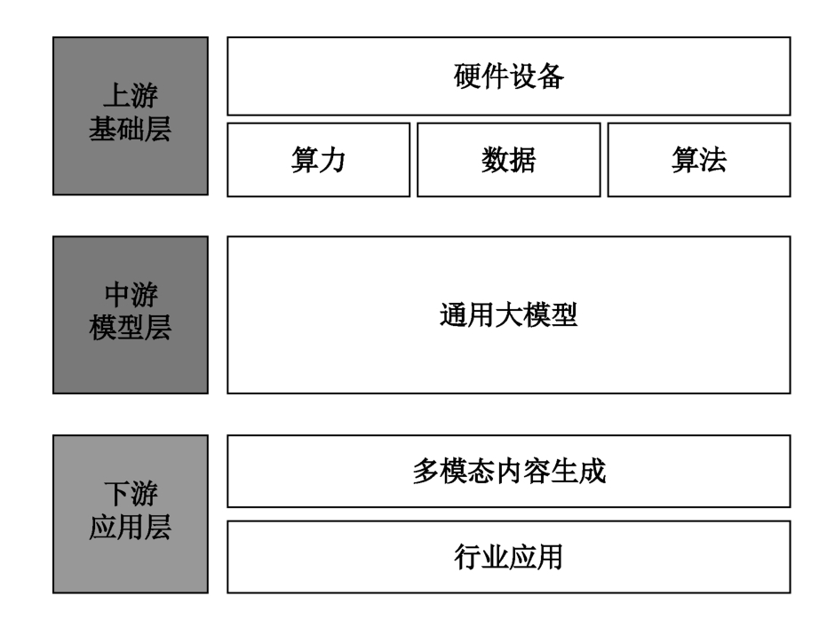

图 6-1 生成式内容产业链的层次

算力指的是计算能力，具体而言，就是处理信息、输出结果的能力。

算力的发展分为多个阶段，具体如下所述。

（1）电子计算机 ENIAC 的出现，标志着算力进入数字电子时代。

（2）半导体技术的发展、个人计算机诞生并逐渐进入普通人的生活，标志着芯片成为算力的主要载体。

（3）通信技术的发展，带动互联网升级，IT 算力服务范围拓展到普通家庭和中小企业。

（4）云计算技术的出现，让世界范围内单点的算力被连接起来，从单点式计算发展到分布式计算，算力得到极大提升。

（5）数据中心、云服务平台应运而生，成为算力的主要载体，算力实现云化。

随着生成式内容爆发，大模型参数量呈指数级增长，对算力的需求也随之增加。生成式内容底层产业主要是芯片、通信设备、服务器生产等，这些领域的厂商为生成式内容提供算力硬件设施。而向上延伸则是提供数据存储和处理能力的数据中心，包含超级计算中心，提供云计算服务的云服务平台，以及提供其他相关服务的平台，如算力调度中心。

芯片包含用于运行人工智能算法的人工智能专用芯片和用于数据存储的存储芯片。人工智能专用芯片包含传统的 CPU、GPU 和 FPGA，以及为高效执行人工智能计算而研发的 ASIC 专用芯片。

在芯片行业中，芯片能力较为强劲的多为海外企业。而在人工智能专用芯片方面，也是海外企业在基础层更为领先，例如，谷歌、AMD 等企业研发了专用于训练大模型的芯片。而国内的厂商，如寒武纪、阿里巴巴、地平线、天数等企业研发的芯片多用于应用层面，如用于运行训练好的模型。

存储芯片主要用于存储程序代码以及各类数据信息，而人工智能算力所需要的存储芯片主要可解决数据迁移慢、能耗大的问题。存储芯片是一类较为常见的芯片，也是目前我国大力发展的一类芯片。在存储芯片领域，国内主要有中芯国际、兆易创新、紫光国微、北京君正等企业，海外有三星电子、海力士半导体、东芝、西部数据等企业。

通信设备主要解决数据传输速率的问题，即将数据的电信号通过光纤这一传输介质进行远距离传输和高速传输，并减少信号衰减现象。在通信设备领域，光模块、光芯片、电芯片等方面的基础硬件厂商有海信、光迅科技等，电信网络设备厂商有华为、中兴等，通信服务运营厂商有联通、电信、移动等。

如今，服务器生产商主要是指面向人工智能应用的人工智能服务器生产商。与传统的服务器不同，人工智能服务器指的是采用“CPU+GPU”“CPU+FPGA”等异构形式的服务器，国内厂商包括浪潮信息、中科曙光、华为等，国外厂商包括戴尔、IBM、思科等。

数据中心是集中处理和存储海量数据的载体，国内的企业主要有奥飞数据、润泽科技等。而由国家兴建、部署有千万亿次高效能计算机的即为超级计算中心，更多地面向高科技领域和尖端技术研究，为其提供所需的运算速度和存储容量。目前，我国十余个超算中心分布于全国各地。

云计算则是把计算机资源和应用程序都汇总起来，形成资源池，然后将用户的计算需求在资源池内进行分配的一项技术。云计算技术能够提高运算效率和资源利用率，各类数据中心为云计算提供物理设施，是云计算的重要部分。

目前，国内的云计算厂商包括阿里巴巴推出的阿里巴巴云业务、腾讯推出的腾讯云业务、百度推出的百度云业务、华为推出的华为自有云平台等，海外则有亚马逊的 AWS、云基础架构和移动商务解决方案厂商 VMware 等。

数据是模型起作用的基本燃料，也是 GPT 这类大模型实现跃迁的关键资源。把全网搜集而来的海量文本“喂”进模型之后，才有了上下文理解与连贯文本生成的表达能力。在正式训练之前，采集、标注、清洗、存储一整套数据工程是绕不开的前置环节。这条产业链也催生了新的机会，专业的数 据服务商比如秒针系统、海天瑞声，以及手握丰富自有数据的行业头部企业，都因此迎来增量空间。

在数据之上，支撑大模型运转的技术底座同样重要。自然语言处理、计算机视觉等算法框架承担着数据分析与模型训练的功能。自然语言处理主要解决理解、识别、标注等任务，计算机视觉则聚焦图像识别与标注，国内代表性企业有科大讯飞。

### 6.2.2 中游：技术融合与应用模型
AIGC 产业的成长期依托于通用大模型的出现与演进。当前被广泛使用的通用大模型，本质上是面向自然语言的超大规模机器学习系统。它们通过巨量语料预训练，学习语法、语义与上下文关联，从而实现文本的处理与生成。

除 OpenAI 的 GPT-4 外，谷歌的 LaMDA、PaLM，Meta 的 LLaMA，百度的文心、阿里的通义千问、腾讯的混元、昆仑万维的天工，都是参数体量达到千亿级的代表性通用模型。

视觉侧的突破始于谷歌提出的 ViT，即 Vision Transformer，它首次把 Transformer 架构用于图像分类任务，推动大模型能力从语言向视觉泛化，由此催生了计算机视觉大模型这条分支。以 ViT 为代表的通用视觉模型已成为主流，研究成果包括谷歌的 ViT 与 V-MoE、微软的 Swin Transformer、Meta 的 SAM，以及华为的盘古 CV 大模型。

多模态的进展更为迅猛。2023 年 3 月谷歌发布 PaLM-E，9 月 OpenAI 发布 GPT-4V，后者能同步理解视觉与声音信号。语言理解由此延伸到视觉、听觉等多种模态，人工智能进入快节奏迭代期。目前已公开的多模态模型包括谷歌的 PaLM-E 与 CoCA、OpenAI 基于 CLIP 预训练的 GPT-4V、微软的 VLMo。

“大”的含义体现在三点：参数规模、网络复杂度、训练语料体量。从 GPT-1 的上亿参数到 GPT-4 的上万亿参数，结构愈发复杂，同时可承载多任务。

在巨型模型出现前，AI 多为针对特定场景的小模型，迁移到新领域往往需要繁琐的调参重训。通用大模型经海量数据训练后具备更强的迁移与泛化能力，只需微调即可适配细分任务。

研发路径大致两类。一类是自研通用基座，从预训练到优化全链条自控，全球巨头如谷歌、微软、Meta、亚马逊，以及华为、腾讯、百度、阿里都在布局。投入巨大、数据算力与时间成本高昂，优势是自主可控，风险在于同质化竞争。

另一类是行业大模型，聚焦特定领域难题。主要做法有两种：基于开源通用模型用行业数据微调，如恒生电子的金融大模型 LightGPT、百度的航天领域大模型航天-百度·文心；以及用领域数据从零构建，如彭博社的 BloombergGPT。

### 6.2.3 下游：AIGC 应用的多域落地
大模型迭代加速了多模态内容生成的普及，AIGC 已渗透多个行业，形成 AIGC+ 的商业化新路径。传媒、电商、影视、娱乐等内容生产密集型行业，利用 AI 辅助创作显著提升效率；教育、金融、医疗等依赖人工信息处理的行业，则被大幅压缩了处理周期。

应用层可分为两层。第一层是面向特定领域的工具型产品，如视频摘要、文献大纲、广告文案生成、音频小样生成、代码生成等。ChatGPT、Midjourney、文心一言属于这一层，核心是提高某个环节的效率。

更深一层是多模态生成驱动的融合应用。包括数字人、虚拟人担任智能客服、智能医生等角色，已经替代或重塑完整工作流程，形成独立服务。这种赋能更具颠覆性，随着产业迭代不断加深，发展空间很大。

### 6.3 跨行业赋能，价值逐步凸显
数字内容需求持续攀升，AIGC 的产业价值愈发明显。它能为多行业批量生成专业内容，并在大模型加持下覆盖更细分的场景。

#### 6.3.1 内容生产提速，AIGC 助力创作
AIGC 成为趋势，一方面市场对生产速度要求提高，AIGC 提升效率并降低门槛；另一方面对内容质量要求提升，AIGC 可输出多样化个性化结果。

钟薛高就是典型案例。2023 年度新品发布会上，Sa'Saa 系列雪糕由 AI 参与打造，从命名、口味到包装设计均有 AI 贡献。开发过程中使用了 ChatGPT、文心一言等工具。Sa'Saa 之名既模拟咬下雪糕的声音，也体现年轻、活泼的调性，可解读为 Satisfy And Surprise Any Adventure，这句话同样由 AI 创作。

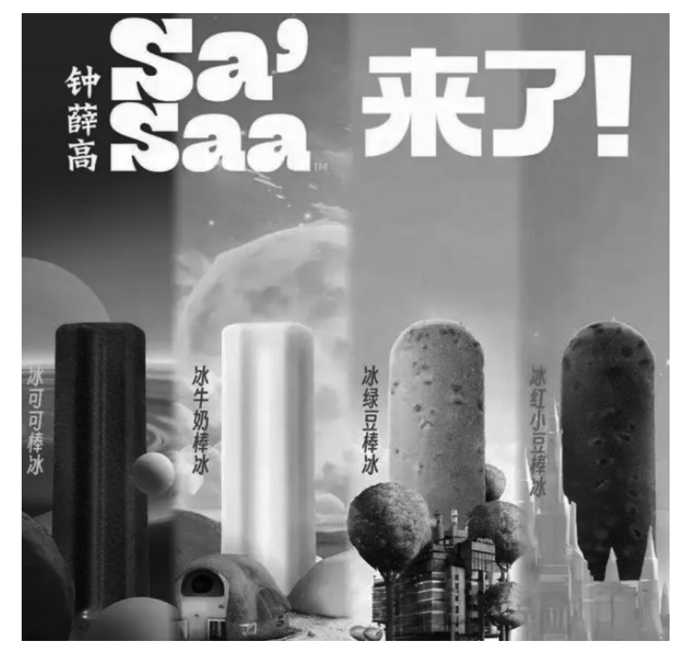

图 6-2 Sa'Saa 系列雪糕外观

国潮品牌王老吉也推出 AI 设计包装。AI 融合传统笔墨与四季概念，加入飞鸟、竹林等古风元素，设计出千里江山罐、山溪月色罐、登高望秋罐、青松凌云罐四款包装。项目负责人认为，AI 能带来颠覆性变革，帮助企业更全面洞察趋势与用户需求。未来设计端将获得更多创意增量。

#### 6.3.2 大模型加速 AI 规模化落地
AI 应用并非新事物，大模型出现前已有基于深度学习的单点模型，但功能单一、智能有限。

传统研发流程包括需求确认、数据采集、算法设计、训练微调、部署上线、运维迭代。过去往往需要定制神经网络，对专业能力要求高，试错成本大，一个项目常需专业团队数月完成。

落地时，“一个场景一个模型”的模式难以复用。自动驾驶全景感知需要行人追踪、目标检测等多模型协作，且医学图像的病症检测模型无法直接用于行人车辆检测，通用性差导致落地门槛高。

大模型基于海量多场景数据学习通用能力，成为可泛化的模型底座。面对新场景只需基于专业数据二次微调即可投入使用，从而应对多样化需求，加速规模化落地。基于深度学习与海量数据，它还能持续学习自我优化。

预训练自然语言处理的效果已超越传统机器学习。随着迭代，算力需求指数级增长。大模型正从单一语言模型演进为可处理语言、视觉、声音等多任务的多模态模型，为从弱智能走向强智能提供路径。

多模态大模型能在无监督下自动学习不同任务，将文本、图像、视频融合，推动模型从单模态向多模态转变，为更多领域提供基础能力。

更强的智能能力正在重塑典型应用。智能客服接入大模型后，能快速识别需求、给出个性化答案，并凭借逻辑推理提供完整解决方案，还可基于用户反馈优化服务。文生图、文生视频、虚拟数字人等方向的商业化进程也在加快。大模型正成为 AI 发展的助推器，让 AI 不仅能听会看，还能思考、创作、推理与决策。

## 第七章

## 商业前景：AIGC 商业化应用场景爆发
在快速发展中，AIGC 技术加速落地，商业化场景集中爆发。大量企业从不同角度入局，利用 AIGC 开发新应用，提升用户体验。

### 7.1 技术融合，让落地成为现实
数字内容需求增长倒逼多技术融合，推动 AIGC 落地与行业智能化升级。

#### 7.1.1 底层演进，生成能力持续升级
AIGC 在爆发前经历了长期底层革新，生成智能水平不断提升。以图像生成为例，技术正从 2D 向 3D 突破。DALL-E、Midjourney、Stable Diffusion 等 2D 工具能在数秒内根据文本提示生成图片。

发展可分三阶段。第一阶段是智能图像编辑。随着生成对抗网络与变分自编码器的出现，人脸生成、风格迁移、图像补全、可控编辑成为可能，但早期 GAN 训练不稳定、存在模式坍塌，数据单一；VAE 生成图像模糊。

第二阶段是文生图飞跃。扩散模型突破与多模态数据集出现推动大规模文生图模型诞生。OpenAI 的 DALL-E 能根据文本生成图像并提升效率，随后 DALL-E 2、Imagen 等相继推出，虽未达到直接生产标准，却激发了用户创作热情。

第三阶段从惊艳走向生产力。技术细节优化后，Midjourney、Stable Diffusion 等工具在广告传媒、游戏等领域广泛使用。普通用户几小时即可完成创意或原型设计，专业设计师虽需后期修改，但大量广告商已直接采用 AI 输出。

与此同时，游戏与机器人产业拉动 3D 需求。DreamFields、DreamFusion、Magic3D 等模型出现，Prolific Dreamer 等算法推动文生 3D。当前痛点是耗时长、易出现雅努斯问题，即多头多面。随着优化迭代，生成效率与准确性持续提升，未来文字到 3D、图像到 3D 的使用将更普遍。

#### 7.1.2 MaaS 模式推动场景扩张
MaaS，即 Model as a Service，是以大模型为基础的服务模式。科技巨头通过 API 开放能力，企业无需自建模型即可调用。

API 如同应用间的连接器，把功能封装成可接入的接口。用户无需了解内部实现，按流程调用即可使用。

在 MaaS 模式下，企业可通过 API 快速构建专属 AIGC 应用，或将生成能力集成到现有产品。2023 年 7 月 OpenAI 开放 GPT-4 API 并筹备应用商店，企业可按需微调模型，外挂自定义数据库实现垂类应用。

MaaS 为 AIGC 提供了开放可扩展的标准化平台。产业结构大致为底层模型—单点工具—多场景应用。以 ChatGPT 为例，底层是 GPT-3.5，单点工具是 ChatGPT，进而落地对话、文案、代码等多个细分场景。

1. 大模型是 MaaS 的基座
科技巨头构建模型底座并开放 API。国内众多企业也推出通用基础大模型并支持调用。2023 年 4 月商汤发布日日新 SenseNova，具备内容生成、数据标注、模型训练能力，向 B 端提供图片生成、自然语言生成、数据标注等 API，低成本实现 AI 落地。

2. 单点工具是补充
单点工具基于大模型产生，更具针对性，能改变细分领域生产范式。商汤基于 SenseNova 推出秒画 SenseMirage 文生图平台、如影 SenseAvatar 数字人视频平台、琼宇 SenseSpace 3D 内容生成平台。

3. 多场景应用提供变现路径
目前尚无覆盖所有场景的通用模型，但覆盖面不断扩大。GPT 系列衍生出 ChatGPT、Jasper 等应用，ChatGPT 可用于代码生成、智能搜索、文学创作，Jasper 可用于营销文案、视频生成、网站运营。未来 MaaS 发展将带来更多模型、更多应用和更广场景。

#### 7.1.3 百度“文心千帆”大模型平台：聚焦企业提供 MaaS 服务
多家企业已在 MaaS 领域深入探索。2023 年 5 月百度智能云在文心大模型技术交流会上展示进展，其中包括内测中的文心千帆大模型平台。该平台是企业级生产平台，集成文心一言及第三方大模型，为企业提供完整工具链与一站式服务。

文心千帆：双引擎驱动的大模型枢纽

百度智能云的文心千帆平台围绕两条主线展开业务。一是依托文心一言的能力，为企业提供现成的模型服务，帮助其迭代产品、优化生产环节；二是让企业基于平台上的基础模型，自行训练出专属定制模型。借此双轨能力，文心千帆正朝着模型生产与分发的核心集散地方向演进。

平台在研发侧覆盖从海量数据处理、数据标注到模型训练微调、评测测试的完整链路。企业拿到业务适配的专属模型后，还能调用托管与推理等后续服务，降低使用门槛。

在落地层面，文心千帆具备四个突出特点。

（1）易用性上，零代码操作即可完成训练与微调。
（2）开放性上，接入了多家第三方模型，场景覆盖更广。
（3）能力拓展上，通过插件机制对接外部能力，叠加服务价值。
（4）交付方式上，同时支持公有云与私有化部署，适配不同诉求。

公有云模式下提供推理、微调、托管三类服务。推理允许直接调用平台模型的推断能力；微调是借助高质量数据产出行业专属模型；托管则负责模型上线后的运维保障。三者共同拉低了大模型的应用门槛。

私有化部署方面，平台开放软件授权，企业可在自有环境运行模型；同时提供软硬件基础设施支撑，以及硬件与平台能力的租赁服务，满足对数据隔离与自主可控的高要求。

目前平台已与用友、宝兰德等生态伙伴达成合作。未来将通过更完善的生态，推动MaaS服务向更多行业渗透。

另一条MaaS赛道，字节跳动旗下火山引擎在2023年6月上线了火山方舟。平台面向企业提供模型训练与微调服务，已汇聚IDEA研究院、智谱AI等多家机构的模型，并开启邀请测试。

火山方舟支持企业对模型进行精调与效果评估，可用同一工作流串联多个模型，横向对比功能表现后挑选最契合业务的方案。不同场景下也能组合使用多种模型，形成协同赋能。

在安全层面，依托安全可信计算技术，平台可保障用户数据资产不被泄露。

字节内部多个业务团队已在试用，实现了降本增效。平台同步邀请金融、汽车等行业企业内测，未来将与客户营销、协同办公等场景结合，提升企业运营效率。

7.2 商业模式抉择：企业端还是用户端

AIGC热度高涨，企业入场前需先明确走To B还是To C路线。抉择应结合自身资源与市场定位审慎推进。

7.2.1 To B：锁定需求稳定且付费意愿强的企业客户

随着AIGC成熟，To B成为主流方向。借助AIGC赋能，企业可优化流程、提升内容产出效率，实现降本增效，因此对相关应用的需求稳定且付费意愿明确。

OpenAI开放ChatGPT API正是To B探索的典型。API开放后，不少企业接入用于升级产品与提升体验。

互联网公司汤姆猫以“会说话的汤姆猫家族”IP为主业，线上线下链路完整，游戏累计下载超百亿次。公司将游戏与新技术结合后接入ChatGPT，在底层模型上进行产品测试与研发。

目前汤姆猫已完成AI语音互动测试，旗下产品新增语音识别、语音合成、性格设定等功能，并在语音交互、连续对话等方面完成可行性验证。

电商服务商Shopify也利用ChatGPT API为Shop应用打造智能导购。用户搜索商品时，导购会基于需求给出个性化推荐，日均可扫描上百万件商品，帮助用户快速定位需求。

OpenAI后续将持续迭代GPT系列，为开发者提供更多模型选择。

7.2.2 To C：以SaaS订阅撬动个人用户市场

AIGC与各行业的融合加深，C端连接持续扩大。应用可在信息获取、数据整理等场景简化繁琐工作，也能在创作上降低门槛，提升效率，因而广受个人用户欢迎。

C端主流商业化方式为SaaS订阅，分为按产出计费与按软件订阅付费两类。

（1）按产出计费。更适合应用层，按图片量、算例量、训练次数收费。关键在于驱动复购，模式受版权授权、商用许可等不稳定因素影响较大。
（2）软件订阅付费。ChatGPT Plus每月收取20美元即为代表，AI写作工具Jasper则提供初级、高级、定制三档订阅，用户按需选择。

总体来看，C端是AIGC的重要增长方向。随技术成熟与产业链完善，商业化模式将更加多元。

7.3 入局路径：四条切入AIGC赛道的思路

企业进入AIGC可从数据、技术、产品、项目四方面切入，发挥自身优势实现创新。

7.3.1 聚焦数据：以数据资源卡位

大模型发展依赖海量数据，掌握数据优势的企业可通过提供训练数据、标注服务、版权IP等方式参与。

OpenAI的训练数据涵盖社交新闻、期刊杂志、各类书籍等，正是凭借丰富数据构建了优质模型。随着更多企业自研大模型，数据价值进一步凸显。

数字内容供应商中文在线拥有丰富内容资源与落地场景，与多家科研机构和企业合作，从内容生成与研发两端打造垂类小模型，推动应用落地。

公司还提前布局中短剧市场，依托网络小说IP推出单集约2分钟、节奏紧凑、付费解锁后续剧情的模式。国内与视频网站分账合作，海外自建应用并复制打法，低成本验证商业模式。

在生产流程中，中文在线全面引入AI提升人效，剧本、分镜、漫画生成、网络小说创作等环节均有AI参与。旗下数百万本小说IP已成为独有的数据资产，其与AI结合后带来的内容生产与商业模式演进空间巨大。

7.3.2 聚焦技术：提供算力与模型底座

ChatGPT推动了AIGC商业化，算力增长与模型涌现是核心动力。英伟达等企业正通过硬件与模型支持赛道发展。

2023年8月，英伟达发布面向大模型的硬件软件组合。AI超级芯片DGX GH200 Grace Hopper采用HBM3e显存，提升容量与带宽，采用Hopper GPU架构并与Arm Grace CPU结合，强化数据中心内存与带宽表现。

HBM作为GPU显存，可提供高速大容量存储，随GPU普及而备受青睐。

英伟达还与Hugging Face合作，后者为用户提供模型训练服务，可对定制化生成式AI与大语言模型进行训练微调，打造智能客服、搜索引擎等产品。

总体看，英伟达以AI芯片为起点持续扩展AIGC生态。

7.3.3 聚焦产品：打造多元智能工具

AIGC应用正处于探索期，产品化潜力巨大。2023年上海国际消费电子展上，腾讯展出了腾讯云AI绘画、混元大模型等多款产品。

腾讯云AI绘画基于自研模型提供图像生成与编辑API，支持文本或图片输入。模型中文理解能力强，可基于古诗词等元素生成图像，支持25种以上风格，API耗时大幅优化，并可个性化调整图像属性与风格。

该工具已在央视新闻等场景应用，提升创作效率，并为企业数字化转型提供动力。

展会同期，腾讯发布混元大模型，参数超千亿，已通过腾讯云开放API或公有云精调，适配不同行业场景。

在文案创作上，混元可实现千人千面输出，赋能小红书、电商直播、社群营销、广告等场景，并能生成剧本与分镜头脚本。依托算法优化与语料积累，中文文案生成能力显著增强，操作简便。

腾讯还上线行业大模型精选商店，提供一站式MaaS服务，助力企业构建专属模型。

7.3.4 热门项目盘点

算法与算力推动AIGC进入黄金期，代表项目包括：

1. Stable Diffusion
由慕尼黑大学团队研发的扩散模型图像生成方案，采用潜在扩散机制模拟从噪声到目标图像的过程，兼具稳定性与可控性，视觉效果优良。

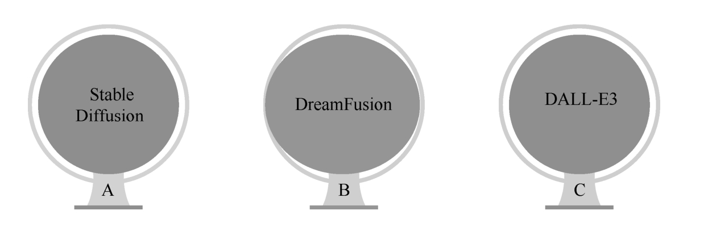

图 7-1 AIGC 领域的热门项目

该模型可产出多样化图像，为视觉艺术提供素材。

2. DreamFusion
谷歌推出的文本到3D模型，将Imagen与NeRF结合，利用预训练的2D扩散模型实现文本到3D合成。采用分数蒸馏采样技术，可在任意参数空间优化样本，并加入正则化与优化策略改进几何形态，生成更逼真的3D内容，服务视频、游戏、电影等制作。

3. DALL-E 3
OpenAI发布的文本生成图像系统，对文本描述理解更精准，在风格、主题、概念、背景还原上表现更佳，树立了新标准。

尽管存在不确定性，AIGC仍为企业提供了可行的发展方向，各方持续探索。

7.3.5 华为：开源AI框架昇思MindSpore

华为是技术入局的典型代表，开源AI框架昇思MindSpore并建立社区，推动企业与高校创新。框架提供一站式大模型服务，覆盖开发、训练、微调、部署，已孵化紫东太初2.0、CodeGeeX等数十个模型。

2023年6月，昇思MindSpore 2.0发布，易用性与功能均有提升，助力原生大模型研发。

1. 全流程覆盖
脚本开发环节可从模型库一键导入，加速算法脚本编写；训练环节支持千亿参数预训练，兼顾数据并行与模型并行，提升算力利用率；微调环节集成多种低参微调算法并支持基于用户反馈的强化学习；推理部署环节提供模型压缩与分布式推理能力。

2. 丰富套件降门槛
平台提供场景化开箱即用套件，缩短训练周期；通过MSAdapter与开源社区联动，实现大量模型迁移。

在社区建设上，2023年6月昇思MindSpore开源社区理事会成立，构建开放多元生态，并与基金会、其他社区合作。

人才培养方面，按入门、实践、创新研究分级提供教材课程、实习竞赛、学术基金。

产业推广方面启动硬件加速计划，与硬件厂商联合开发、办赛、联合营销，推动多场景落地。

目前框架已汇聚数百个开源模型，服务数千家企业，生态持续完善。

# 下篇

# 组织和个体的 AIGC 转型

## 第八章

## 智能力驱动的组织跃迁

生成式对话模型与图像模型等新工具集中落地，人工智能正以更快节奏渗入日常办公与生活场景。越来越多人感受到这些工具在提升工作环节效率上的实际价值，并不断拓展使用边界。各类应用悄然进入机构内部，管理者也在不断讨论：智慧能力的机会点在哪里，会如何重塑运行方式乃至行业格局。

目前并无定论，但一个方向很清晰：新周期已经到来，不主动求变就易被时代淘汰。以下聚焦机构内部如何借助智慧工具赋能个体，推动整体变革，迎接生成式内容时代。

### 8.1 数码化、云端化到智慧化的层进逻辑

传统公司怎样拥抱智能时代，是近两年持续的热点话题。大多数传统公司要实现组织智慧化，通常需要按顺序完成三步，如图 8-1 所示。

图 8-1 组织转型的三大步骤

从本质看，三步是递进关系。第一步要把关键业务流程与核心数据纳入数码化管理；第二步要让全部数据在云端实现统一访问与管控，提升可用性与安全性；前两步夯实后，才具备进入第三步——组织智慧化的条件。

组织智慧化以及内部自研生成式应用所需的专属数据，正源于前两步对自有数据的采集、梳理与有效管理。

#### 8.1.1 从电子化到再造的数码演进

数码转型指把传统业务、信息与流程转为数字形态，涵盖建立数字档案、自动化基础业务以及引入数码工具与系统。

该概念演进大致可分三类阶段。

第一类是电子化，公司把文档、照片等扫描为电子文件存储传输，但作业方式基本未变。

第二类是数码化，把信息、数据和业务流程转为数字形式，可访问性、传输速度与存储效率随之提升，公司可借此提高运营效率、降低成本、增强竞争力与创新力。

第三类才是真正的数码转型，以数码技术与工具为核心驱动组织变革，涉及商业模式、组织架构与企业文化等多方面调整。

现实中，多数传统公司的数码化仍停留在部署工具的初级阶段，容易被员工抵触、流程僵化、缺乏数据管理与分析能力等因素制约，难以突破。

要想取得成效，必须把数码升级当成公司战略来系统推进，用全面系统的变革管理去落地。

#### 8.1.2 云端化：把管理搬上云

对已初步完成数码化的公司而言，能否实现云端化，是迈向下一阶段的关键。云端化也称 SaaS 化，指把信息存储、处理和应用迁移到云平台，以提升信息的访问性、灵活性与安全性，公司不再依赖本地物理服务器，通过互联网即可访问和管理。

云端化的价值在于让业务基本在线化，信息充分共享，全球信息的整合与分析变得更便捷。大多数信息互联互通，很多经营决策可以基于全局信息完成。SaaS 化也让信息和决策更透明，形成持续记录与整合，为智慧化提供坚实基础。

我国各行业云化程度差异明显，很多公司的数码化在云端化环节受阻。2023 年国内 SaaS 市场规模持续增长。

IDC 的研究显示，2022 年我国面向公司的 SaaS 市场规模达 41.6 亿美元，同比增长 26.6%。IDC 预测到 2027 年，该市场规模将达到 169 亿美元，复合年均增速约 32.4%。

行业增长面临的挑战包括缺乏多年沉淀的专业行业洞察、公司级 SaaS 生态尚未成熟等。随着飞书等面向特定行业的 SaaS 厂商出现，这些障碍正被逐步打破。

例如苏州华瓴科技有限公司，依托数码化平台向医药零售相关客户提供持续迭代的 SaaS 经营管理解决方案。其推出的药德 SaaS 系统为医药零售公司提供完全符合 GSP 监管标准的 ERP 产品。

该 ERP 的设计灵感来源于创始团队近 20 年的行业经验积累，产品与专业化咨询服务结合，已有全国过万家药店签约使用，可配合飞书等通用协作平台，将药店管理水平推向新高度。

#### 8.1.3 智慧化：流程再造与个体赋能

智慧化是数码化和云化的延伸，核心是用人工智能、机器学习、大数据等技术实现业务智能化和自动化。组织智慧化包括数据驱动决策、自动化流程、预测性分析和生成式 AI 等，本质是技术赋能、组织赋能与员工个体赋能的有机结合。组织既是赋能对象，也是赋能主体。

打造智慧化组织，已成为众多公司数码转型的终极目标。2023 年生成式对话模型成为热词，面向公司的应用技术厂商纷纷加强与人工智能平台的合作。可以预见，未来各类型面向公司的应用都将逐步演变为智慧化应用。

中国信息通信研究院与联想集团于 2023 年 1 月 11 日共同发布的《中国企业智能化成熟度报告 2022》显示，我国公共事业、交通、能源行业的公司智能化成熟度最高；金融、建筑、流通行业次之，均高于整体均值；专业服务业和制造业的成熟度低于均值。总体上，约 84% 的公司仍处于智能化转型的早期和中期阶段。

智慧化转型不能盲目跟风，必须以公司的业务需求和智慧工具的赋能对象为前提来确定创新方向。公司可按以下七步推进：

1. 明确转型目标，是提升效率、降本、改善客户体验还是创新产品服务等。
2. 信息整合与管理，构建有效的信息管理系统，全面收集并整合各业务部门信息。
3. 选择合适的 AI 技术，根据需求选取机器学习、深度学习、自然语言处理、计算机视觉及各类生成式 AI 工具等。
4. 开发和测试，开发符合自身需求的 AI 应用并持续优化模型。
5. 培训员工，帮助员工学会与 AI 应用互动，提升工作效率。
6. 部署并持续优化，在员工广泛接受后投入业务，并持续收集反馈优化。
7. 评估和调整，定期评估效果，确保与公司发展目标一致并及时改进。

通过上述路径，公司不仅能完成智慧化转型，还能创造新的运作方式。AI 信息分析可帮助理解市场趋势，生成式 AI 可实现内容创作自动化提升效率质量，AI 客服机器人可提供 7×24 小时客户服务，提升满意度。

### 8.2 智慧化转型的三大核心挑战

智慧化转型过程中，公司常会遇到几个关键问题：现有业务能从中获得多大红利？如何管理信息以最大化价值？如何保护个人隐私确保合规？

#### 8.2.1 业务洞察：算清智慧化的红利账

智慧化转型的重要一环是业务智慧化转型。公司业务与生成式 AI 结合能够降本增效，带来实质红利。很多业务都是以“人机协同”的方式实现转型的，如图 8-2 所示。

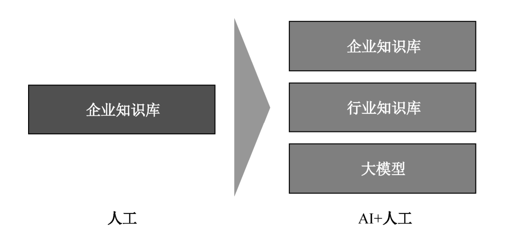
图 8-2 通过“人机协同”实现智慧化转型

公司需要在对业务的深度洞察基础上进行红利分析。比如，传统客服若仅用人手加知识库，成本依然很高，主要取决于人工综合成本。若改为生成式 AI 驱动的智能客服配合人工，整体人工成本可下降，客户满意度还能提升。把成本、满意度等量化为金钱，就能很清晰地算出转型价值。

国内代表公司蓝色光标在 2023 年 4 月提出“All in AI”战略，与微软、百度形成战略合作，全面引入生成式 AI 工具打造广告创意生产全产业链。

该公司采用“真人加 AI 副手”工作模式，高频使用生成式 AI 作为生产工具。短视频创作产能提升 15%～30%；推广图片效果生成与批量修改，单位工作时间缩短 80%；调研分析效率提升 20%～30%。

自 2023 年 4 月起，蓝色光标已全面停止创意设计、方案撰写、文案撰写、短期雇员四类外包支出。借助 AI 处理此前需外包的业务，预计每年可节约千万以上外包费用，为下一步 AI 投入奠定基础。

利用 AI 赋能内容生产，蓝色光标打造了新的智能内容创作方式，产出多个爆款广告。例如面向佳能的动画项目，采用“生成式 AI 基础生成加人工后期”方式，仅用数个工作日完成。生成式 AI 全面赋能创意生成与后期制作，与人工结合后大幅降低成本并提升速度。

旗下智能营销助手“销博特”于 2022 年底发布的生成式 AI“创策图文”营销套件可自动生成一体化自动化营销策略解决方案。该套件是一种新型内容营销工具，助力营销内容实现在线化、精准化和个性化。

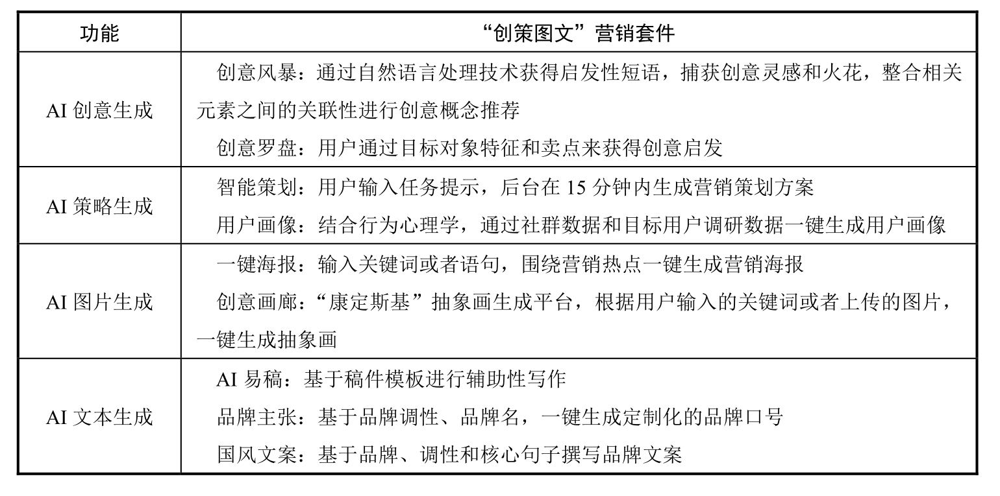
2023 年 3 月，销博特发布“萧助理双子版本”，用户沟通即可完成广告内容 AI 辅助生成。移动端和 PC 端累计用户已突破 10 万，更多专业语料与交互训练将持续提升垂直行业生成式 AI 模型的服务能力。

蓝色光标之所以能获得巨大经济价值，关键在于对其商业模式的深入拆解，如图 8-3 所示。

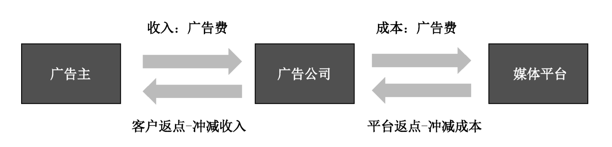
图 8-3 广告公司商业模式的内在逻辑

对广告公司而言，提高利润的关键在于扩大返点差、提升增值服务、提高收入并降低成本。返点差取决于投放规模与新媒体资源拓展；增值服务质量取决于创意内容生产的质量与速度；成本控制则依赖创意内容质量与投放人员能力。通过提升内容生产的质量和效率，利润水平可大幅提高。

2023 年年中，蓝色光标利润增长 33 倍，生成式 AI 工具贡献突出。其对核心要素的分析，为其他寻求智慧化转型的公司提供了标杆。

#### 8.2.2 信息管理：信息成核心竞争力

智慧化转型后，公司的核心竞争力会发生变化。基于相同大模型底座打造的智能系统，差异主要来自公司自有信息。传统做法是用沉淀信息打造知识库提升员工能力、构筑知识壁垒，但大量信息仍处于未充分利用状态。

在转型过程中，信息的作用主要体现在以下方面，如图 8-4 所示。

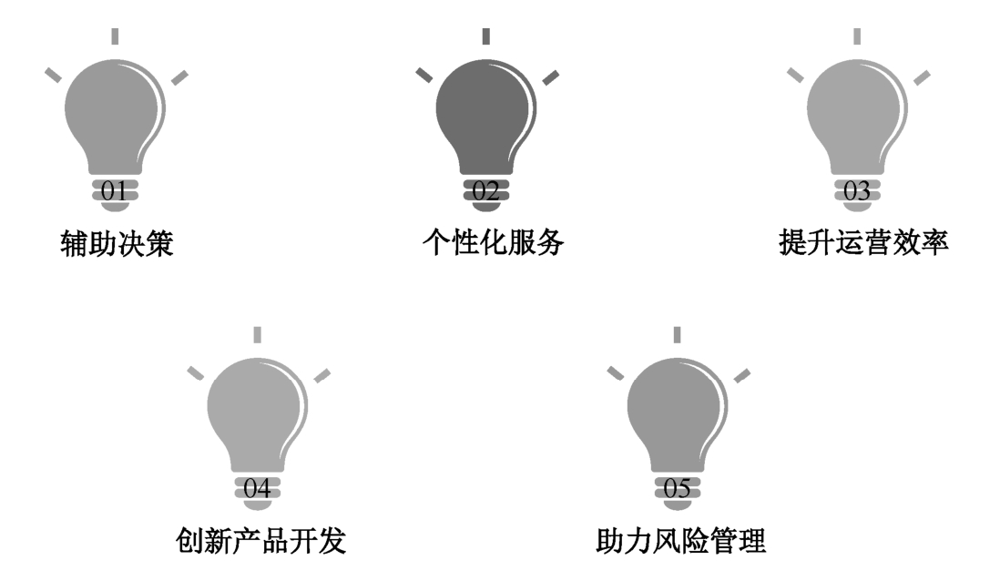
图 8-4 信息的作用

1. 辅助决策。通过分析和挖掘，公司管理者可获得更深洞见，做出更明智决策。如美团利用海量用户行为信息提供精准定制化服务，并预测食品销售情况帮助餐馆合理备货。
2. 个性化服务。收集分析用户行为信息可提供个性化产品服务，形成竞争优势。如 Spotify 通过分析听歌习惯为用户推荐个性化歌单。
3. 提升运营效率。信息可帮助发现运营瓶颈，明确优化方向。
4. 创新产品开发。信息分析能揭示真实市场需求，指导新品开发或优化。如 Netflix 用大数据分析观看习惯预测内容偏好，据此进行内容投资，在原创内容上取得成功。
5. 助力风险管理。通过信息分析预测并评估潜在风险，提前规避。

仅有海量信息还不够，还需做好：信息质量管理确保准确完整一致；提升信息分析能力，拥有能把信息转化为洞见的人才；营造信息驱动文化；合规收集存储使用信息，保护用户隐私。

信息资产化是重要原则。公司信息可分为多类，如表 8-2 所示。

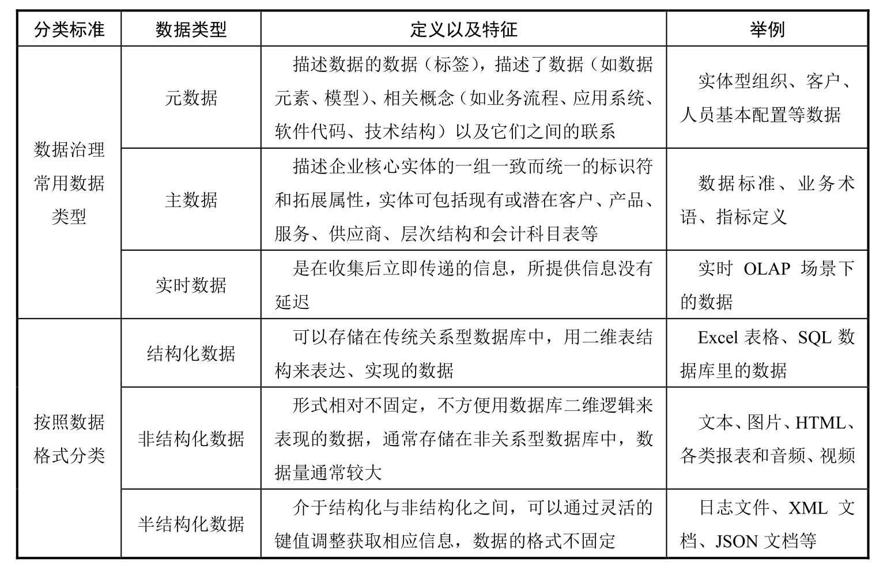
表 8-2 公司信息的主要类型

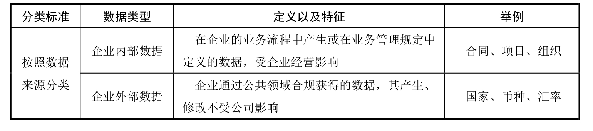
续表

搭建信息智能体系可参考：面向内部客户，以赋能员工、提高业务效率为目标；做好元信息、主信息、实时信息的关联管理，提升治理程度保障质量安全；优先打造复用性高的能力，如信息提取、治理平台、信息中台、信息开发平台；建设标准要稳定、易运维、可运营、可审计。

#### 8.2.3 安全与隐私：生成式 AI 带来的合规要求

互联网内容创作经历了 PGC、UGC 到生成式 AI 的演进。生成式 AI 具有高效、创造、多样、通用等特点，但其依赖大量已有信息学习和模式识别，由此引发信息非法获取、泄露及恶意滥用等安全问题。模型可能使用用户信息训练并包含敏感信息，对话过程中用户也可能被要求输入隐私信息、业务信息或商业密码，存在泄露风险。

各国监管部门对此高度关注。英国信息专员办公室于 2023 年 3 月发布人工智能与信息保护新指南，美国征求关于 AI 系统潜在问责措施的意见。

2023 年 7 月，我国中央网络安全和信息化委员会办公室等七部门联合公布《生成式人工智能服务管理暂行办法》，自 2023 年 8 月 15 日起施行。办法明确生成内容不得侵害他人肖像权，AI 生成的图片、视频需进行标识等。

技术层面，解决生成式 AI 安全隐私问题的做法是把隐私计算、区块链等新兴技术与生成式 AI 结合使用，如图 8-5 所示。

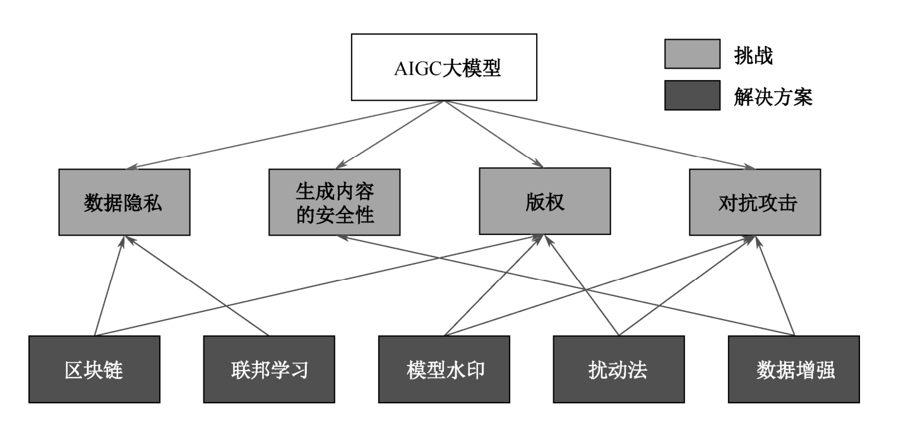
图 8-5 应对生成式 AI 产生的安全隐私问题的解决方案

2023 年“世界人工智能大会”期间，中国信息通信研究院、上海人工智能实验室、武汉大学、蚂蚁集团等多家单位共同发起《AIGC 可信倡议》，提出构建生成式 AI 可信发展的全球治理合作框架，采用安全可信的信息资源、技术框架、计算方法与软件平台，提升工程化能力，确保生成式 AI 安全、透明、可解释。

未来支撑 AI 安全的底层技术作用将进一步放大。在信息流转安全得到保障的前提下，隐私计算等技术普及将推动云主机等基础服务向 SaaS 服务演进，迎来生成式 AI 公司级应用的大爆发。

### 8.3 智慧化转型离不开变革管理

无论在哪个层面转型，都需要变革管理。智慧化转型属于战略层面的转型，更需要全方位变革管理。重点包括人的转型升级、组织架构变革、商业模式创新。

#### 8.3.1 人的转型：转变思想，培养数字人才

变革管理最大的挑战之一是思想转变。员工需要理解并接受人工智能，并非被取代，而是与之协作。公司应帮助员工学会与 AI 合作，以新方式创造更多价值。即便部分工作被替代，新工作的价值更高、更有意义。

波士顿咨询公司的一项调查显示，公司员工对人工智能在公司中的应用普遍感到好奇、乐观且自信，且这种信心随时间推移在增强。许多员工的感受基于已有的实践经验。

调研数据给出了一个反差明显的开场。虽然 ChatGPT 这一款代表性的生成式 AI 产品才在 2022 年 11 月上线，市场普及却远超预期。数据显示，26% 的职场人士每周会多次使用此类工具，另有 46% 的人至少体验过一次。

面向全球上万名大型组织的基层员工、管理者与决策层展开的调研还描绘了情绪图谱。好奇被 61% 的受访者列为两种最强感受之一，乐观占 52%，担忧占 30%，自信占 26%。使用频率越高，对风险的焦虑越低，对技术的态度也越积极。

即便整体偏向乐观，仍有部分受访者担心岗位被替代，并呼吁政府出台监管，保障技术被负责任地使用。

在这样的背景下，企业推进智能化转型时的变革管理通常会围绕以下思路展开。

（1）厘清人才需求。先明确转型所需的能力版图，既有数据分析、人工智能、云计算、机器学习等硬技能，也包括项目管理、创新思维、变革管理等软能力。

（2）搭建培训体系。构建贯穿内部培训、外部研讨、在线的综合学习通道，帮助员工补齐知识短板。

（3）引入高阶人才。对稀缺的专业能力，可通过外部挖角、与高校及科研机构合作等方式吸纳优秀毕业生与研究者。

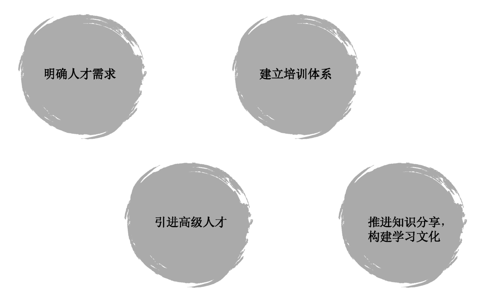

图 8-6 企业进行变革管理的策略

（4）推动知识共享，营造学习型氛围。鼓励员工交流经验，保持持续自学。常见做法包括划定学习时间、定期开展分享会、推行导师制等，以此加速组织整体学习。

**8.3.2 组织重塑：迈向智能与柔性管理**

智能化转型本质上是用 AI 对组织与业务进行全链路重构。它不只是产品或商业模式的替换，还牵涉服务流程、组织形态、渠道与供应链整合等层面的数字化再造。

转型中组织的边界在模糊，架构趋向扁平、平台化和生态化。改变的焦点从技术更新延伸到组织文化、领导方式和员工定位的重定义。可以说，这是一场影响面极广的整体变革。

业内常说智能化转型三分靠技术，七分靠组织。组织侧的动作主要包括：

（1）建立数据驱动的决策机制，让数据分析师与数据科学家更直接地参与决策。
（2）组建跨部门项目团队，集合 IT、业务、数据等领域的专家协同推进。
（3）设立数字化或智能化专责部门，如数据部、AI 实验室，负责技术研究、开发与落地。
（4）调整岗位与角色，依据新技术与新业务需求优化现有职位，甚至新增数据治理经理、AI 产品经理等新型岗位。
（5）推行扁平化管理，减少层级，提升决策速度与灵活性。
（6）强化网络化协作，借助数字工具与平台联通不同部门、不同地域的成员。

不同企业的路径会因战略目标、业务特点与文化基因而不同，组织调整是一个渐进且需要持续优化的过程。

例如，安利中国在 2020 年底成立营销人员赋能中心，助力营销人员在社交电商环境下完成思维转变，加速数字化展业能力迭代与新能力体系搭建。

中心聚焦展业模式探索、核心能力拆解、小范围试点与规模化赋能，为营销人员提供思维升级、能力提升及展业方法与工具的精准支持，帮助其更高效获取新客、更轻松开展业务。

创新部门配合高效的数字化社群与内容工具，覆盖展业全流程，推动整体转型。自 2020 年起，安利中国业绩连续三年回升，95% 的销售额来自线上。这印证了智能化落地离不开持续的组织架构优化。

**8.3.3 商业模式重构：AIGC 开启新可能**

AIGC 的出现为服务客户创造了新空间，成为企业创新的重要抓手。越来越多的公司在探索全新的商业形态。

以 Salesforce 为例，其转型体现在三方面：

（1）从产品到服务。把传统的 CRM 软件转变为云端服务，按需付费、随时可用，降低了客户的初始投入与运营成本。
（2）智能化服务。2023 年推出的 Einstein AI 产品，在 CRM 基础上提供销售预测、市场细分、客服自动化等功能，提升使用效率与智能水平，优化决策与客户体验。
（3）生态系统建设。搭建全球开发者社区，允许第三方在平台上开发与销售应用，尤其智能应用，形成“平台+生态”模式，既丰富功能也创造开发者商业机会。

在 GPT 等技术突破之后，拥有充足用户资源的在位者有更多机会扩张版图、巩固领先。未来商业形态可能层出不穷。

创业公司同样迎来了窗口期，当行业领军者迟滞创新时，黑马便可能迅速跃升。

金融领域，人工智能与个性化金融科技平台 Tifin 旗下的 Magnifi 产品结合 ChatGPT 与自有 AI 引擎，为用户提供个性化、数据驱动的投资建议。AI 机器人可像真人一样答疑，并自动监控组合表现，提示利率变化、财报发布等可能引发波动的机会。

媒体曾做对比测试。询问“巴菲特会买什么股票”，Magnifi 先解释其价值投资理念，再列出持仓占比靠前的美国银行、苹果、可口可乐，并对比过去一年的收益与波动。第二次询问关于亚马逊持仓如何度过财报季时，Magnifi 展示了华尔街分析师盈利预测与公司过往季度表现。

该产品的商业创新在于：用户越多、反馈越多，聊天能力越强，建议越贴合个性。收费模式也改变，采用 14 美元月费，不再按笔抽佣，与传统券商佣金模式截然不同。

总体看，AIGC 正在引领商业模式革命。无论 B2C 还是 B2B，无论产品型还是服务型企业都可获益。核心在于实现“Segment of One”，即每个用户都是独立客群，实现真正的个性化服务，大幅提升满意度。

传统模式下，用户洞察与产品交付是两条割裂的流程。智能时代二者打通，形成“人人都是 VIP”。

## **第九章**

## **行业纵深：AIGC 如何重塑产业格局**

AIGC 应用前景广阔，可辐射诸多行业。资讯行业提升创作与传播效率；教育行业助力备课与教学，减轻教师负担、提高知识吸收率；娱乐行业重塑游戏体验、助推音视频创作；金融行业提升服务品质。

### **9.1 资讯行业**

在资讯领域，AIGC 主要发挥两类作用：一是嵌入内容制作全流程，提升效率；二是赋能虚拟主播，推动传播。

**9.1.1 内容生产多环节的 AI 渗透**
AIGC 在采编、录音转写、内容制作等环节均有广阔空间，能有效提高质量与效率。

用于内容采编时，AI 可自动抓取信息、发现热点并生成报道，降低人工负担。
用于采访录音转文字，科大讯飞的“讯飞听见会写”即可实现录音转文字并导入音频，分析后生成摘要、工作计划、宣传文案等多样文本。
在内容制作上，AI 具备精准检索与快速生成能力。对股市、体育赛事等时效性强的新闻，写稿工具能在极短时间内生成初稿，仅需编辑审核即可发布，减轻编辑压力。

实践已在国内外新闻机构落地。纽约时报、彭博社等海外媒体早已应用；国内新华社推出写稿机器人“快笔小新”，阿里巴巴与第一财经联合推出“DT 稿王”，南方都市报推出“小南”等。

写稿机器人持续进化。以“小南”为例，最初聚焦民生报道，随着技术与知识库积累，写作能力逐步扩展到天气预报、财经等领域，文体覆盖面不断扩大。

**9.1.2 虚拟主播驱动传播新形态**
除制作环节，AIGC 在传播端同样关键，典型表现是 AI 虚拟主播进入演播室。

新华社的虚拟主播“新小微”可在虚拟演播室完成新闻播报，外形 lifelike 且动作灵活。依托 AI 驱动，输入文本即可自动播报，表情与动作自然。

央视、湖南卫视等机构也纷纷推出虚拟主播。相比真人主播，虚拟主播具备两大优势：
（1）可实现全天候直播。真人易疲劳易口误，虚拟主播可 24 小时待命，高质量完成任务。
（2）可完成多语种播报。多语种主播稀缺，而 AI 支持的虚拟主播能轻松实现多语播报。科大讯飞推出的“小晴”可进行中英日韩等多语播报，大幅节省人力物力。

虚拟主播职能也在外延。浙江卫视的“谷小雨”除播报外，还担任宋韵文化推广人，参与世界互联网大会、跨年晚会等，成为频道形象代表。

### **9.2 教育行业**

AIGC 在教育中的变革可归纳为三点：改变教学模式、提升教师生产力；培育 AI 助教、支持自主学习；推动 AI 智能教育、实现个性化学习。

**9.2.1 教学模式升级，释放教师效能**
师资短缺与稀缺是教育难题，如何在有限时间内扩大覆盖面与提升质量是关键议题。

AIGC 可帮助教师摆脱教案撰写、课件准备、习题检索、作业试卷批改等重复性工作。

课前准备阶段，AI 能基于大量学术报告、教材与多媒体资料进行高效整理，生成教案与课件，并提供教学灵感。
课后，AI 可辅助批改与讲解，对主观判断部分给出建议，部分作业甚至可直接批改，教师抽样即可。结果录入与分析亦可由 AI 完成。

这些基础工作被替代或辅助后，教师可把精力集中在教学本身。数字化环境下，AI 还能及时解答学生疑问，分析师生互动、发现教学疏漏，指出学生薄弱与掌握牢固的知识点，并对后续教学提出优化建议。

随着大模型、数字人、对话生成等技术成熟，优秀教师的复制成为可能，有助于缓解师资紧张。
目前好未来 MathGPT、网易有道“子曰”、拓世科技拓世 GPT 等产品正向深度融合发展，AIGC 带来的长期深远影响值得期待。

**9.2.2 AI 助教：自主学习的核心伙伴**
生成式 AI 的典型形态之一就是数字助手。教育领域从点读机到各式助学设备不断演进。

移动互联网让学习从有限设备扩展到海量网络，先有数据库课程匹配，再有作业帮、小猿搜题等互助平台，将问题与懂行者匹配。AI 助教则把问题匹配给机器，实现更高效自主学习。

AI 助教主要面向三类应用：一是自适应学习，通过对话判断学习进度、生成个性化路径与练习，如讯飞学习机、Quizlet、Coursera；二是智能答疑，准确回应学习问题，如小猿作业本、MathGPT；三是结合 VR/AR/AIGC 进行沉浸式内容创作，如 Labster。

当前 AIGC 对学习水平的判断仍属初级，多模态生成尚不足以支撑完整教学，AR/VR 普及度也有限，因而智能答疑类应用最为广泛。

分学科看，语言教学的准确度已相对可观，数学、物理等理科仍难以达到人类教师水准。目前多以外挂向量数据库提升数学能力，仅能解决有限问题，如何让 AI 助教掌握更广阔的数学解题能力仍是难点。

**9.2.3 个性化学习新范式**
个性化学习即因材施教，长期以来难以落地。AI 工具正在悄然改变这一现状。

在数字化设备与 AI 深度结合下，从单课到学期乃至跨年级，AI 可记录课堂表现、师生互动、作业考试成绩，并结合德智体美劳等多维度数据，对每个学生进行综合画像，给出针对性建议。

大数据还能分析学习偏好、视觉或听觉偏好、教学方式偏好，识别潜在优势领域，监测进度与适应性，提供多维指导。

教师据此可进行适应性调整，提升对个体的关注度，让个性化成长成为可能。AI 也能深度参与互动答疑与课外自主学习环节。

现阶段技术条件尚不足以实现深度个性化，更多是在大范围内做小幅度调整，如在特定年级内按逻辑链条有限调整教学进度。尽管距离真正因材施教尚有距离，AIGC 在教育领域已迈出坚实步伐。

**9.2.4 综合型产品：用 AIGC 打造教育新品**
AIGC 升温下，多家企业探索与行业结合并打造新产品。

教育领域的综合型产品常兼具自适应学习与智能答疑功能，如王道科技的 Class Bot、科大讯飞学习机。此类产品可帮助学校与机构创建在线课程，通过自适应方式改善学习体验。

王道科技打造的 Class Bot 定位是面向在线学习的辅助系统，围绕自动建课、智能助教、自适应学习三条主线展开，正好覆盖备课准备、自主学习、智能辅导和智能测评等在线教学的关键环节。

自动建课是 Class Bot 的核心抓手，底层依托 AIGC 同源技术，把企业内部教材与公开网络资料融合，自动提炼学习要点，输出课程大纲和测评试卷。系统自带的智能助教则承担类似班主任的角色，能即时解答疑问、追踪学习进度，同时完成作业批改和学习效果评估。

自适应学习层面，学员可以按自己的节奏推进课程，并对个人笔记进行管理。学习吸收能力偏弱的学员也能提前预习课内内容，课后反复巩固，从而实现更精准高效的学习体验。

研发完成后，王道科技计划以 SaaS 形态推广 Class Bot。平台基于领先的 AIGC 技术，帮助机构搭建线上课程体系，提升员工专业能力。企业在平台上可以定制专属的个性化“教官”，规划培训内容，从而加速内部培训效率。

落地场景上，东南亚被列为首选。因为当地初创企业数量多，多数企业尚未建立完善的培训机制，王道科技可借助 Class Bot 为其提供标准化的知识输出体系，助力员工培训与知识传递。

整体来看，这类综合型产品仍存在短板，细分问题也未完全解决，但 AIGC 在教育领域的落地已经显现价值。随着资金和人才持续进入，AIGC 对教育行业的重塑会愈加深刻，线上教育的常态化应用很可能是变革的第一座里程碑。

### 9.3 娱乐赛道赋能
AIGC 对娱乐行业的推动集中在三个方向：游戏内容创作让 NPC 更聪明，音频内容创作提升生产效率，影视内容创作提供更优质供给。

**9.3.1 游戏沉浸感升级：NPC 智能化**
游戏行业保持用户吸引力的关键在于持续创新，AIGC 正加速这一进程，让体验更新奇、更沉浸。以 NPC 为例，AIGC 能提升其智能与真实感，增强互动，为玩家带来多元体验。

在技术加持下，NPC 可生成自然流畅的对话，实现更真实的交流，并根据玩家数据动态调整剧情与难度，提供个性化体验。

比如沙盒游戏《骑马与砍杀 2：霸主》引入 ChatGPT 作为 MOD，NPC 的表现被彻底激活，能够实时回应玩家文字输入，进行交互式对话，并依据自身设定讲述已知信息，玩家可与 NPC 谈价、询问制作材料等，趣味性明显提升。

网易也在此方向探索。2023 年 2 月，网易宣布在《逆水寒》中上线游戏版 ChatGPT，NPC 可与玩家自由互动并给出不同行为反馈。互动程度决定关系走向，可能成为仇人、知己或伴侣。

NPC 之间还会相互传播信息。玩家把一个故事告诉 NPC 后，信息可能在 NPC 网络中扩散，最终影响整个游戏世界，形成蝴蝶效应。

这些智能 NPC 的人设均来自大宋江湖，训练素材以武侠小说、诗词歌赋为主，避免出戏。它们具备“灵魂”：玩家在对战时说“你家着火了”，NPC 会立刻回家救火；曾受过帮助的 NPC 在 BOSS 战中也可能从天而降救援。每個 NPC 都有成长性，持续互动会不断衍生新剧情。未来该方案有望拓展至《逆水寒》的更多环节。

**9.3.2 音频创作提速：企业深耕 AIGC 音乐**
AI 音乐发展 historically 较慢，AIGC 的到来大幅加速这一进程。依托大模型和完善的 AI 基建，音频生成成为现实。

谷歌通过自然语言处理方式训练音乐生成模型，推出 MusicLM。音乐创作涉及音色、音高、音律等多要素配合，非专业用户难以驾驭。以往 OpenAI 推出的 Jukebox 也能生成音频，但仅限简单曲目，难以产出高质量复杂作品。MusicLM 可利用海量数据训练，生成复杂音乐。

用户只需输入文字或音符，MusicLM 就能自动产出丰富曲风的作品，还能基于图像生成配乐，《星空》《格尔尼卡》《呐喊》等名画均可作为素材，是 AI 音乐领域的突破。系统还能根据抽象需求创作，例如输入“为战略型游戏配乐，节奏紧凑”即可得到对应曲目。

腾讯也在音乐 AIGC 领域布局，通过“TME Studio 音乐创作助手”和“音色制作人”两款产品推动融合。TME Studio 包含音乐分离、MIR 计算、辅助写词、智能曲谱四项能力：分离人声与各类乐器声；分析节奏、节拍、鼓点等深层信息；提供作词灵感；为上传音乐自动生成曲谱。

音色制作人则依托酷狗音乐发布，使用门槛低。用户录入声音后，系统学习其声线并生成专属音色用于歌曲制作，还可调节参数优化听感。跨语种合成为亮点，不会粤语的用户也能“演唱”粤语歌曲。技术底座为凌音引擎，采用深度神经网络学习多位歌手发音特征。

对创作者而言，大模型 AIGC 应用能简化制作流程，缩减 MV 拍摄、宣传推广等环节成本，提升效率。同时音色制作人具有强共创与交互性，能提升用户留存。腾讯天琴实验室的 MUSELight 推理加速引擎更推出 lyraSD、lyraChatGLM、lyraBELLE 等开源大模型加速版，帮助开发者缩短研发周期。

总体来看，AIGC 将对音乐行业产生深远影响，提升创作效率并助力创作者更具创造性地表达。

**9.3.3 影视制作提效：创作加速与修复焕新**
影视制作早已应用 AI，而 AIGC 能进一步激发创作活力，助力内容高效高质量生产。新的内容生产与智能交互模式可缩短周期、降低门槛、提升效率与质量。

OpenAI 推出 Shap-E 大模型，可根据文字或图片提示生成 3D 模型，在复杂精细描述处理上具有颠覆性，能快速建模并节省资源，减少人力成本。

在修复端，AIGC 能解决老旧影片画质低、模糊、重影等问题。百度与电影频道节目制作中心联合发布首个影视行业智感超清大模型“电影频道-百度·文心”，可同时处理多个修复任务，大幅提升效率。

电影频道旗下 CCTV-6 等频道以放映为主，拥有上万部片源，其中一半为胶片拍摄，原始胶片老化导致画质受损，且用户对高清内容需求激增，亟需修复。

“电影频道-百度·文心”日修复量达 28.5 万帧，绝大部分画面问题可快速解决；即便需精修，速度也比人工快 3～4 倍。模型还能增强画面色彩与清晰度，实现 SDR 到 HDR 的超清化，让老片焕发新生。

系统基于 AIGC 技术结合电影频道的修复经验，多数据训练可应对多种损坏类型，通过画质提升、边缘锐化等实现全方位修复。未来，百度将借助昆仑芯片与深度学习平台飞桨进一步提升效率，并强化文心大模型在影视修复中的泛化能力。

### 9.4 金融场景落地
AIGC 在金融领域可用于营销文案创作、智能客服搭建和智能投顾优化，从而降低成本、提升服务水平。

**9.4.1 营销文案智能生成**
AIGC 能为金融营销赋能，提升效率与降低成本，在品牌宣传与文案设计上作用明显。

招行于 2023 年 2 月将 ChatGPT 用于品牌文案撰写，推出《ChatGPT 首秀金融界，招行亲情信用卡诠释“人生逆旅，亲情无价”》，以对话方式阐释亲情价值，形成感染力强的内容。作为拥有数亿参数的语言模型，ChatGPT 对亲情的解读令人惊喜。

此次尝试源于对“卡与人关系”的思考。招行发现用户对情感连接需求迫切，以亲情为切入点推出全新“亲情信用卡”附属卡。亲情内涵随时空变化，难以在短时间内单向论证，需要跨时空跨学科的解码方式，ChatGPT 提供了可能，催生了金融行业首篇 AIGC 作品。

成品逻辑贴近人类思维，初看难以分辨。实操中，团队先输入“阐释基因与亲情的关系”，初稿平实，随后要求突出“亲情的利他本能”和“生命是基因的载体”两点并提升语言深度，经过多轮迭代才得到满意稿件。

AI 写稿通常经历需求明确、框架搭建、内容提取、灵感优化与反复迭代等步骤。关键在于有明确需求内核引导，否则易被模型逻辑带偏。ChatGPT 在多角度命题上的思辨能力突出，但仍无法完全脱离人工干预。品牌方需赋予精神内核与温度，AI 仅作为辅助工具。未来 AIGC 将涌现更多智能应用，持续赋能金融文案创作。

**9.4.2 智能客服升级**
AIGC 与金融智能客服结合可大幅提升智能化水平。以 ChatGPT 为代表的应用可从三方面赋能，如图 9-1 所示。

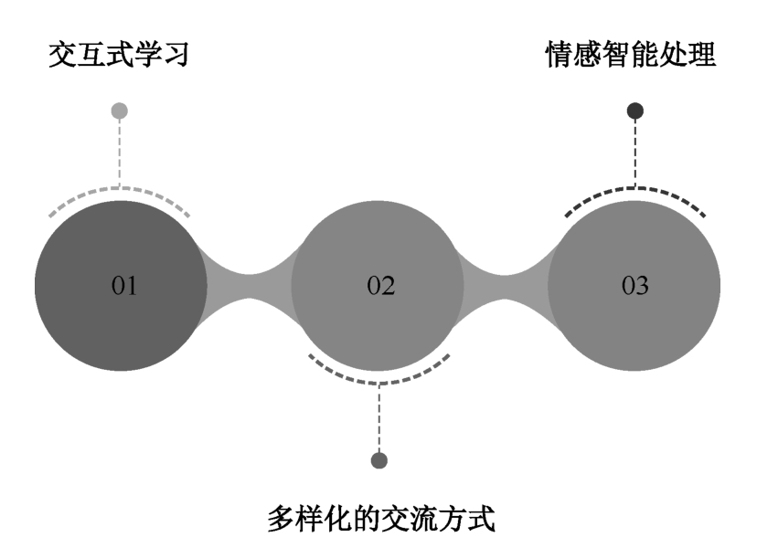
图 9-1 ChatGPT 为智能客服赋能的表现

1. 交互式学习
ChatGPT 可与客户持续对话，接入后的客服能不断学习并根据反馈优化回答，协助客户理解金融业务，提升服务质量。例如在介绍银行险种、理财产品时，系统会分析客户查询历史、消费习惯与语言习惯，提供更精准服务，并在下次咨询时给出更科学方案。

2. 多样化的交流方式
ChatGPT 支持文本、语音、图像等多模态交互，让客服体验更友好。例如在交易身份核验环节，客户可通过图像或语音上传资料，缩短耗时并优化操作体验。

3. 情感智能处理
金融客户群体庞大且需求各异，人工客服面临挑战。ChatGPT 可自适应分类客户，并捕捉态度细微变化与上下文隐藏信息，更好理解意图。情感是服务质量的评判标准之一，具备情感智能的客服能及时捕捉情绪信号并给出对应回复，提升满意度。

借助 ChatGPT，智能客服将在效率、专业性、人性化与智能化维度同步提升。

**9.4.3 智能投顾降本提效**

AI投顾：让财富服务走向普惠

当客户诉求越来越分散，金融机构想守住竞争优势，就必须不断打磨流程、压缩服务成本、加快市场响应。这一压力下，生成式AI与智能投顾的结合被越来越多机构视作新抓手。

传统顾问多依赖一对一人工服务，人力消耗大且受时间空间限制，客户体验打了折扣。智能投顾恰好填补了这一空档。

依托生成式AI，智能投顾打通金融科技与财富管理，能按用户实际状况给出投资指引与建议，让结论更贴近、更高效。底层逻辑是调动海量数据、自然语言理解、机器学习等能力把投资建议系统化，自动产出分析报告与风险评估文件，进而提供更周全、更精准的建议、线上顾问式陪伴以及专业化理财方案。

该模式的价值主要体现在四点。响应更快，能在较短周期内读懂并满足诉求；借助大数据与机器学习实现风险管控与投资研判的全覆盖；能拆解复杂品种，帮助用户在控风险与增收益之间做取舍；交付更周到的咨询与更具个人化的建议，从而改善整体感受。

交互过程中，系统可连续解答用户提出的问题，并在对话中自我学习用户信息与偏好，归纳出其投资者画像。随后把投资组合与画像匹配，为组合管理与标的挑选提供依据。

流程层面，智能投顾以决策树管控决策，以智能算法自动生成组合建议，同时实时采集并解析市场变化。最终依据既定流程自动调整策略，确保策略始终契合用户的投资特质。

实际运行中，系统通过智能分析从资产池挑选基础资产并重组，减少传统顾问模式下的人为主观干预，为用户提供科学合理的决策支撑，也拉低投顾服务成本。

用户会通过基础资产的收益表现、投研团队状态、盈亏波动等信号向系统传递价值信息，进而影响系统对基础资产的选择倾向。这种机制有助于系统按统一标准甄别筛选资产，实现投资价值最大化。

总体看，智能投顾把传统顾问的精英化服务改造成普惠化服务，把服务对象从高净值人群拓展到大众，满足大众化的投资需求，也契合普惠金融的发展方向。

随着生成式AI深度应用与海量数据技术的快速演进，智能投顾呈现多元化走势。发展形态正向为理财经理提供决策辅助、为用户提供智能推荐两个方向演进。财经门户、传统金融机构、互联网巨头等成熟阵营，和以金融科技企业为代表的初创力量，都已纷纷入局。

智能投顾是生成式AI赋能财富管理的一次积极尝试，为投资建议开辟了新路径。一方面，它可以实现全天候在线咨询，输出更科学、更个性化的建议，以更低成本创造更高服务价值；另一方面，它依托海量数据与机器学习为用户提供更全面的投资分析，实现全方位的建议与更专业化的服务。智能投顾推动了生成式AI与金融行业的进一步融合，为生成式AI赋能财富管理按下加速键。

## **第十章**
## **企业端场景：生成式AI行业模型如何连接业务**
当前，企业端已成为生成式AI的核心应用地。生成式AI在提效降本方面的能力让企业用户付费意愿更强。同时，生成式AI对企业业务流程的重塑，也在催生出丰富、稳定且具长期价值的商业模式。从面向细分领域的行业专属模型涌现，到行业业务流程的高效迭代，生成式AI在企业场景的商业化价值日益凸显。

### **10.1 生成式AI下沉细分行业，行业专属模型涌现**
除通用基座外，行业专属模型是另一大研究重点。通用基座在部分细分场景往往力不从心，而行业专属模型基于特定行业数据训练，在解决行业问题上表现更优。

#### **10.1.1 构建行业专属模型的两条主流路径**
构建行业专属模型主要有两条路径。

**1. 对通用基座进行微调**
目前已有多款开源基座以及多种微调、预训练方法，沿此路径成长的行业模型已在多个领域落地应用。

例如，GPT-3.5 发布后不久 OpenAI 便邀请高盛、Salesforce 等行业头部企业试用，基于细分领域数据对 GPT-3.5 训练微调，并在微软支持下进军办公软件领域。

法律领域中，LaWGPT 即在 LLaMA 基础上完成微调而成。它以法律专有词表、中文裁判文书网公开文书、司法考试数据等进行预训练，并以法律问答与司法考试数据集进行微调，形成面向法律的专业模型。

北大推出的 ChatLAW、科大讯飞的星火法律模型也是通过法律领域数据对通用基座微调得到。

数学问题一直是多数大语言模型的短板，尤其在把现实问题抽象成数学问题时表现欠佳。不少通用模型通过外挂编程工具、计算器或专用向量数据库来完成数学推理，而非直接微调。

因此部分企业尝试微调通用基座打造教育行业模型。学而思用中小学数学题及相关教育语料对通用基座进行微调；科大讯飞星火基座在语数英三科发力；网易有道子曰模型聚焦语言教育，更易发挥优势。

医疗领域，谷歌发布了医学模型 Med-PaLM 2，并给出临床能力评估基准。该模型在临床语言、医学影像、基因组学等任务上达到惊人准确度，技能水平已接近专业医生。

病情判断、治疗方案、操作精度要求极高，通用基座在此类任务上往往不足。生成式AI 与医疗行业模型能大幅提升医学影像判读与基础临床诊疗效率。基于医疗数据微调后，基座在医疗场景可实现落地。

除谷歌外，国内多所高校与企业也在尝试。腾讯健康与圆心科技合作，以医疗模型研发应用为抓手推动业务数智化升级，推出惠保模型、源泉患者管理模型，实现精准患者管理与高效数据分析。

**2. 使用领域数据从零开始搭建行业专属模型**
从零搭建行业专属模型也有两种实现方式。一种是混合数据，即领域数据加通用语料库训练，如网易有道子曰 AI 教育模型、光启慧语光语医疗模型。另一种是仅基于大规模领域数据训练，这类模型目前较少。从零构建时，领域数据与通用语料配比、领域数据不足、参数量级选择等都是需要审慎考量的关键点。

实际上还有其他路径，例如在提问过程中向通用基座灌输领域知识，或通过向量数据库检索总结演化。成本低、速度快且能缓解幻觉问题，但并未改变模型参数，因此在本册中不被归为行业专属模型，而是通用基座在行业中的应用手段之一。

#### **10.1.2 百度携手多家企业打造行业专属模型**
作为国内较早推出类 ChatGPT 产品的互联网大厂，百度在提升文心基座通用能力的同时，深耕垂直领域，并与多家企业联合发布了众多细分行业模型。

百度采用微调通用基座的路径，即用行业数据对文心基座进行预训练或任务微调，以完成特定行业任务。微调后，文心基座已渗透能源、金融、航天、制造、影视等行业，主要用于信息录入、数据分类、内容检索、摘要生成、向量数据库信息抽取等。

例如，百度成为中国探月航天工程人工智能全球战略合作伙伴，与中国航天合作推出航天-百度·文心模型，并外挂航天文献专业数据库，实现航天故障部位信息抽取、文献情报分类、技术检索与摘要生成。

在燃气行业，百度与深圳燃气联合打造深燃-百度·文心行业模型，可实现安全隐患预警、环境巡检。在电影行业，百度携手电影频道推出电影频道-百度·文心模型，可实现画面修复与清晰度提升。在电子制造领域，百度与 TCL 合作推出 TCL-百度·文心行业模型，改变传统质检流程，实现高效缺陷检测。

其他互联网巨头也在扩张行业模型版图。腾讯将混元基座接入全部内部业务以积累需求经验，并推出电力能源领域模型，联合多家企业发起生命科技与医疗模型工作组推动落地，与福佑卡车推出数字货运模型提升物流证件与回单识别效率。

华为作为较早布局生成式AI的云服务商，在盘古基座之上相继发布科学计算、药物分子、矿山、气象模型，聚焦企业侧应用。

阿里巴巴相继开源通义千问 70 亿与 140 亿参数版本，开放模型能力以推动各行业模型创新。

AI 行业流行的 MaaS 新模式也成为巨头追逐目标，即以通用基座为底座，企业可在云端调用、开发、部署专属模型。无论私有化部署还是公有云服务，企业只需导入自身数据或任务，进行低代码微调即可获得专属行业模型。众多上游云服务厂商正积极尝试，用更多行业数据训练微调基座，打造更精准的行业模型。

### **10.2 生成式AI连接企业营销业务**
部分生成式AI应用具备强大的文案生成与图像生成能力，在营销领域得到深度应用。营销行业一直追求精准，但同质化内容与营销环境变化掩盖了用户真实需求，精准营销难以落地，成本亦不断攀升。生成式AI融入营销业务可破解难题，让精准营销与个性化营销变为现实。

#### **10.2.1 营销内容：生成式AI完善营销方案**
营销内容是营销的核心，过去高度依赖人力，包括专家判断、策划人员的创意、画师、文案、设计师的呈现能力。这种生产方式受人力制约，在内容有效期缩短的时代，生产速度难以跟上消耗，易出现瓶颈。

生成式AI打破了这一天花板，从创意灵感到内容成型全流程赋能，实现提质增效。

在海量文本语料与各类大数据加持下，生成式AI应用可通过提示词提取知识库关联信息，为内容生产者提供底层创意素材。结合生产者经验后，还能整理出多种方案供选择。

在创意落地阶段，生成式AI能在短时间内批量生产文案、海报、音频等素材，缩短创作周期。尤其是时效性强、需快速迭代的内容，如节日、节气文案、活动海报的人物、场景、色调、文案更换，生成式AI效率尤为突出。

此外，生成式AI还能让许多富有想象力的创意得以实现，如让神话人物穿上现代服饰、让古建筑变成冰淇淋等。过去需大量人力物力才能完成的创意，如今可低成本实现。

例如，营销科技企业蓝色光标在 2023 年全面拥抱生成式AI。其自研的 Blue AI 是利用自有历史数据与行业数据微调而成的营销行业模型，已应用于部分业务，将传统流程中高度依赖人的专业环节逐步转化为人机协作，从用户分析到创意辅助、内容生成、体验创新都有生成式AI参与。

2023 年上半年，多家客户使用其生成式AI服务。典型案例为京东 618 大促代言人电视广告，蓝色光标用生成式AI快速制作多种虚拟场景并实现平滑切换，构建起数字人与 AI 画面融合的完整业务流程，丰富了广告内容。

营销行业可利用生成式AI的高效产出与奇特创造力，形成全新内容生产流程，打造高效人机互动模式，从源头释放营销生产力。

#### **10.2.2 售前互动：生成式AI创新营销场景**
生成式AI在需求侧对营销流程带来重大改变。很多广告主认为生成式AI提供了低成本快速试错的手段，内容更丰富成本更低，可向更多用户投放不同广告，从反馈中挖掘需求，下次投放更精准。

这属于投放后反馈视角，仍是传统营销场景效率提升、成本降低，并未产生真正革新。

生成式AI能够对传统营销场景带来颠覆式革新。从营销本质看，传统营销是信息传递，商品信息从生产者单向传向用户。即便在数字化时代，用户会反馈，但单向链路并未完全打破，因为许多用户难以清晰表达需求。

以电商为例，阿里巴巴、京东等平台以高效聚合方式呈现用户线下获取信息所需的时间精力成本，用户可通过搜索快速获取商品信息。信息过载时，个性化推荐出现。但购买、浏览、搜索行为数据并不能完全体现真实需求，可能导致重复推荐或推荐过时产品。

由此，抖音、快手为代表的内容电商兴起，能挖掘潜在需求，提升推荐精准度。但挖掘过程中仍缺少用户主动反馈，需求更多通过大数据分析获得。

社交电商与直播电商试图利用社交关系或互动挖掘需求，但前者范围狭窄，后者因对象众多导致个性化需求被掩盖，实质仍是群体营销。

共同问题在于需求挖掘更多是营销人员的想象。用户表达往往片段化、模糊化，甚至真假参半，需要专业人士推测真实意图。

以服饰购买为例，传统电商尝试构建通用人形模特打消上身疑虑，但效果不佳，因身高体重与多数用户不符，难以想象穿着效果。

生成式AI可从两方面优化：一是根据用户身材数据调优模特；二是生成多种形态、角度的衣物效果图，缩小线上线下差距。

在生成式AI应用中，用户可用模糊提示词描述适配场合，系统生成相应环境，让模特与环境互动，光线、感受、试穿效果都能逼真呈现。

更进一步，用户可用模糊提示词表达想要的衣物，如“上班穿的商务西服”，生成式AI可生成包含场景与个性化模特的完整示意。用户再通过提示动态调整，最终下单或关联搜索。

生成式AI还可对提示词进行多模态反馈，以智能导购实现进一步互动，让需求挖掘更具故事性与游戏性。在进入销售互动前，还可通过内容消费铺垫品牌心智，形成从内容消费到商品消费的完整链路。

这一流程实现了三点：一是挖掘当下需求；二是需求挖掘不依赖个人专业判断；三是用户主动反馈被模型记录。虽为假想场景，但各大平台引入的智能客服可视作雏形。生成式AI的高速迭代将加速更丰富、更具创新性的售前互动场景出现。

#### **10.2.3 虚拟主播和虚拟 IP 助力品牌营销**
随着 Z 世代崛起，用户常感叹“次元壁破了”，虚拟 IP 正从小众圈层走向大众视野。

生成式AI在多模态发展下，生成数字人与维持其日常运营的门槛与成本大幅降低。包括实时换脸、生成拟真虚拟形象、模仿真人声带与说话方式、面部表情随文本与情绪细微变化等。

二次元虚拟偶像如初音未来、洛天依，具有活泼可爱的动漫形象与类真人合成音。热播剧中的数字人从声音到动作几乎与真人无异。虚拟技术在超现实形象塑造上已成熟并实现广泛商业应用。“不会疲倦”的虚拟主播与“不会塌房”的虚拟 IP 被投入品牌营销，释放巨大价值。

虚拟主播主要解决两类问题：一是头部主播或明星时间稀缺，其数字人可代替出席活动；二是降低打造真人主播成本，对规模较小品牌而言培训与留住主播成本巨大。

如今花费很少成本甚至免费即可生成数字人。数字人可按直播脚本 24 小时不间断直播，经基座训练的虚拟主播还能实时互动并及时调整营销策略。阿里巴巴、京东、字节跳动等互联网巨头均在 2023 年双 11 期间启用虚拟主播 24 小时不间断直播，并帮助众多品牌打造虚拟主播，实现持续内容营销。

虚拟 IP 是品牌文化与价值观的具象化。与价格高昂且调性难完全契合的真人代言人相比，虚拟 IP 的形象、气质、背景、工作时间均可完美契合品牌营销需求。同时，虚拟 IP 可随品牌发展不断演变，让用户获得“偶像养成”乐趣，也体会到品牌升级。

在生成式AI技术高速迭代背景下，维持虚拟 IP 的多维度运营变得更加容易。从背景故事打造、形象生成，到日常营销物料产出、直播互动，均可依靠生成式AI工具高效实现。

过去两年，元宇宙的话题热度持续攀升，核心推力来自 AIGC 赋能的虚拟 IP 生态。多款创作工具联动使用，让普通用户也能快速生成自己的数字分身。有了 AIGC 的加持，一个更真实、更可用的元宇宙图景正在逼近。

### 10.3 AIGC 驱动智慧零售进入新阶段
AIGC 的普及为智慧零售带来了新一轮流程与体验的数字化升级。上一轮变革让零售的供应链、物流、支付等环节深度接入互联网；这一轮除了营销模式的创新，客户关系管理与销售场景的智能化成为新的突破口。

**10.3.1 AIGC+CRM：构建智能客管新范式**
营销成本飙升、信息过载、需求高度个性化，让经营存量客户变得愈发关键。CRM 能帮助企业捕捉市场动向与供需变化，深挖客户价值，并提供定制化商品与服务。

CRM 的核心在于汇集更完整的客户画像，并实现高效互动。现实瓶颈在于人工处理有上限，难以同时覆盖大量用户；单客沟通效率偏低，遇到疑难需花费较长时间梳理资料与记录。

AIGC 能覆盖客户管理的多环节参与内容生产。例如自动归纳对话要点，快速提取有效信息并整理成文档；基于商品服务特征生成潜在客户清单；自主进行对话，完成预约、预订等事务。

AIGC 承担起助理角色，营销人员只需把控、微调内容并闭环沟通即可。整体效率大幅提升，个性化需求也能被及时满足。

2023 年 3 月，CRM 巨头 Salesforce 发布 Einstein GPT。方案在 ChatGPT 私有化部署基础上叠加自有 AI 模型，外接客户数据库，实现 AIGC 在客管场景的落地，并接入旗下可视化工具 Tableau 与协作工具 Slack。

Einstein GPT 主要服务客服、销售跟进、市场营销等，具备个性化客服回复、案例归纳、客户信息提炼、推荐文案生成、潜客判断等多项能力。

国内 CRM 厂商纷享销客、销售易等也已启动 AIGC 产品布局。现阶段应用仍需人工校验，但伴随数据积累与用户反馈，满足精细化需求的高效 CRM 工具将在较短周期内迭代成熟。

**10.3.2 AIGC 为零售塑造虚拟大卖场**
大卖场作为零售业态历久弥新，丰富的品类与有竞争力的价格使其在国内长期保持热度。沃尔玛、家乐福以及如今的山姆会员店，本质都是这一模式。

不过消费者此前并未形成囤货习惯，且门店多处偏远，沃尔玛、家乐福进入中国初期遇到阻力。即便在海外仍盛行的市场，往返路程、停车拥堵、长时间步行也常被诟病。

将大卖场搬到虚拟空间，这些痛点迎刃而解。用户只需口述需求，例如“帮我挑一件约会裙”“推荐一套适配我卧室的床”，AI 就能以可视化方式呈现商品推荐。无需担心拥挤、购物车塞满，也无需驱车数小时往返实体店。

全流程都有耐心导购陪同推荐；遇到问题或售后时，智能客服可快速响应；在需要退换货时，本地物流实现上门履约。

对企业而言，虚拟大卖场大幅降低货架与仓储管理成本，并可借助本地供应链优势提升转化。对追求效率的消费者与机构来说，这都是更优解。

盒马、多点等企业的 O2O 模式可视为虚拟大卖场的积极探索，淘宝、京东加速布局的沉浸式购物场景也是广义上的虚拟大卖场。

AIGC 打破了 VR、AR 在人物模型、商品模型、虚拟主播、虚拟货场、虚拟环境等内容生产上的瓶颈。未来更多个性化、差异化的销售场景将被创造，推动虚拟购物从单点走向规模化、体系化，线上线下体验都将更具趣味。

## 第十一章

## 面向 AGI 时代的准备

本书聚焦 AIGC 应用，但 AIGC 是通往通用人工智能的关键里程碑。最后一章做前瞻性讨论，帮助读者为 AGI 时代到来做好准备。

### 11.1 通用智能是 AI 进化的主方向
通用人工智能指具备与人类相当甚至超越人类的智能系统。与专用 AI 不同，AGI 可跨领域执行任务，而非局限于单一场景。

其目标是让机器像人一样学习、理解、推理、解决问题，并能适应新环境、处理新问题、在不同领域工作而无需重新设计或编程。

目前主流仍是狭义 AI，专注特定任务，如 Siri、小度机器人等。

AGI 仍是长远目标，需克服复杂环境理解、常识推理、自主学习等挑战。研究者正研发更接近 AGI 的系统，推动领域发展。

**11.1.1 从专用走向通用的人工智能**
通用人工智能目前仍停留在理论层面，未真正落地。图灵测试常被用来评估智能水平。

计算机科学家艾伦·图灵 1950 年在《计算机器与智能》中提出图灵测试，即“模仿游戏”。审查员通过对话区分机器与人类输出，若无法辨别，则机器通过测试，被视为智能。

该测试仅靠语言问答模拟理解与思考，可靠性有限。计算机科学家约翰·赛尔 1980 年在《心灵、大脑与程序》中提出“中文屋”思想实验进行反驳。

实验设定为：一位只会英语的人在封闭房间内，手边有一本英文中文语法与应答手册。中文提问者将便条递入，房间内的人按手册给出中文答复传出。外部人据此判断屋内人是否会中文。

实验表明，即便能给出正确中文回答，也可能只是模式匹配，缺乏真正理解。赛尔据此质疑强 AI 的可行性。

“中文屋”揭示图灵测试的缺陷，通过测试不等于真正智能。有人认为 ChatGPT 正是中文屋的实际演示，但 OpenAI 的成果显示 ChatGPT 能理解语义而非简单匹配，甚至能解智力题。

**11.1.2 通用智能终将到来**
AGI 到来的时间难以精准预测，需要理论、算法、算力等多方面突破。部分专家认为需数十年甚至更久，也有专家认为几年内会出现相关产品。

设想中 AGI 应具备以下能力，如图 11-1 所示。

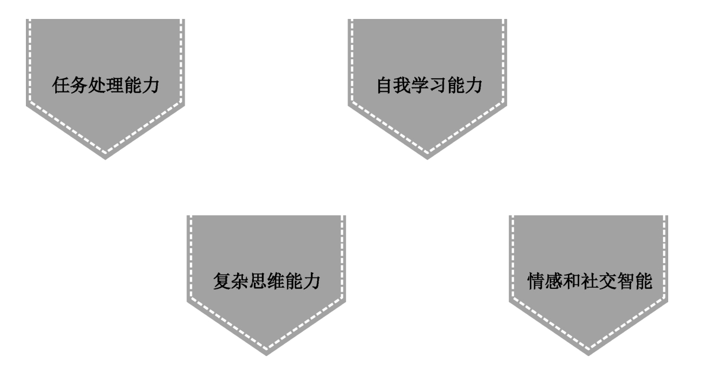

图 11-1 通用人工智能的四个能力

1. 任务泛化能力。系统能够处理从未接触过的任务，而非仅在特定任务上优化，则接近通用智能。
2. 自主学习能力。无需人工干预或详细指导即可自学并持续改进，是核心标志。
3. 复杂思维能力。具备类人理解、推理与创造性思维，可处理抽象概念、洞察复杂系统并产生新想法。
4. 情感与社交智能。能理解并表达情感，适应复杂社交环境并有效交流。

这些只是设想，AGI 的最终形态尚未可知。

2023 年 10 月，电视节目采访了“深度学习之父”、2018 年图灵奖得主杰弗里·辛顿，讨论他对 GPT-4 的看法。

他举例提问：“我希望家里所有房间都是白的，现在有白、有蓝、有黄，黄漆一年会褪成白。若想两年后全白，该怎么做？” GPT-4 回答“把蓝色房间刷成黄色”。方案非最优但正确，体现了一定逻辑。

辛顿认为这类常识推理对符号 AI 很难，需要理解褪色含义并具备时间认知。

作者追问“为什么不把黄色房间也刷白”，GPT-4 回应“当然可以，如果你想两年内就变白”。如图 11-2 所示。

当前 AI 尚未具备自我觉知，但未来或将出现。那时人类可能成为第二聪明的物种。

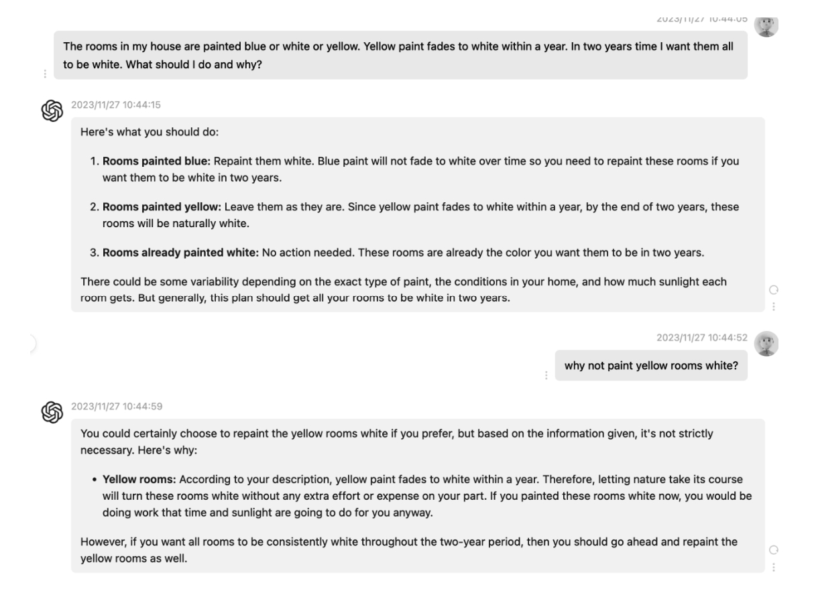

图 11-2 作者延续辛顿与 GPT-4 的对话

### 11.2 应对之策：拥抱新变局
AIGC 时代，人类将拥有更大发展空间与自由。蒸汽机解放生产力，通用人工智能将进一步解放脑力与体力。创新与学习的效率大幅提升，人将有更多时间投入创造性活动。

**11.2.1 不被 AI 取代，而是被善用 AI 的人取代**
微软创始人比尔·盖茨在访谈中表示 AI 或不会完全取代人类工作，但一周工作三天成为可能。

技术变革中，总有人因恐慌而抗拒。接受、拥抱乃至引领变化的个人与组织，往往成为最终赢家。

作为整体，人类可从以下方面准备 AGI 时代：

1. 政策与法规。通用人工智能对就业、数据安全、隐私保护等产生深远影响，需同步制定规则保障公众利益。
2. 伦理与道德。需探讨 AI 行为准则、错误决策责任归属等伦理问题并寻找解法。
3. 科技发展。持续升级基础设施，提升网络安全、数据处理能力与硬件水平。
4. 安全研究。加强鲁棒性、防御机制、安全漏洞检测修复，减少潜在风险。
5. 全球合作。制定全球标准、共享最佳实践、共同应对技术与伦理挑战。
6. 教育与培训。许多岗位将被自动化，教育体系需及时更新以培养新技能。
7. 公众接受度。加强科普与宣传，提升公众理解与接受。

2023 年 11 月，OpenAI 上演董事会罢免 CEO 山姆·阿尔特曼，随后在员工与投资人支持下董事会调整、阿尔特曼回归的戏剧。尽管具体原因不明，但信息显示这场风波或源于硅谷对 AI 未来发展的分歧。

一派是“有效加速主义”，主张以高效技术突破加速社会变革，把风险视为催化剂。另一派是“超级对齐”，主张审慎发展，确保 AI 目标、行为与决策与人类价值观高度一致，即“最坏情况下仍遵循人类意图”。

两派并非完全对立，关键在优先级平衡。人类大概率会在中间找到平衡点，既不拖慢发展，也不忽视安全。

总的来说，应以开放合作的态度迎接 AGI 时代，确保各方受益。

对个体而言，关键认知是：不是被机器取代，而是被更会用 AI 工具的人取代。不同行业受影响程度不同，但脑力工作面临十倍甚至百倍的生产力跃升，每个人都需要重新规划生活与工作。

**11.2.2 成为 AI 工具的终身学习者**
迎接 AGI 时代，需成为真正的终身学习者。传统以知识获取为目的的学习模式将发生巨变。

以 GPT-4 为例，其约有一万亿连接，掌握的知识量远超人类千倍以上，几乎覆盖各领域。获取知识变得极其便捷。

其知识存储效率也高于人类，大脑约 100 万亿连接，而 GPT-4 更擅长以更少连接存储知识。

设想一名医生看过 1000 名患者，另一名看过 1 亿名。若后者不健忘，他会注意到小样本看不到的趋势。第一个医生可能只见过一次罕见病，第二位已见过大量病例，因而能发现规律。

处理海量数据的系统能看到我们看不到的结构。基于大数据的机器学习极大提升效率，能显著增强每个医生的认知水平。

因此医生应学习与 AI 协作诊断并给出建议。除了专业知识，还要理解算法原理，更好地使用与调优工具，并学会提出高质量问题。提问能力越强，从 AI 获得的答案越好。

某种意义上，ChatGPT 让每个人都能用自然语言为自身领域编写专属 AI 程序。

**11.2.3 AGI 时代的生存法则**
面对 AGI 带来的不确定性，个体需调整生存策略，终身学习之外，以下法则或有帮助：

1. 发展独特人类技能。创造力、情感智能、社交技能等难以被替代，有助于保持竞争力。
2. 建立强大人际网络。与同事、导师、朋友、业内人士保持紧密联系，获取支持与机会。
3. 主动适应新技术。不要畏惧技术，主动掌握相关工具与平台。数字素养将成为关键生存能力。
4. 保持身体健康。养成运动、饮食、休息的良好习惯，增强抗压能力。
5. 重视心理健康。数字化智能化工作压力增大，需学会减压、平衡工作生活，必要时寻求专业帮助。
6. 拥抱创新与变化。将变化视为机遇而非威胁，灵活应对者更易抓住变革机会。
7. 注重财务规划。做好储蓄、投资、养老规划，稳健的财务基础提供安全感。
8. 参与社会决策。确保 AI 在保护人权、符合价值观基础上发展。
9. 追求持续职业发展。保持前瞻视野，长期规划职业路径，抓住新机会。

这些法则强调适应力、人际关系与身心健康。在 AGI 时代，保持灵活与积极，不断优化生存策略至关重要。

从深度神经网络的数学原理也能得到启发：

1. 输入：把所有问题当作学习任务，视作提升认知的机会。
2. 行动：勇于实践，而非空想。
3. 反馈：通过外界反馈评估结果，总结并调整认知，类似反向传播。
4. 迭代：形成闭环，持续提升认知，为下一轮准备。

或许 AIGC 算法本身已指明了未来发展的方向。