# AIGC 开启智能创作新时代

## 代序 AIGC 与智能数字新时代

### 堪比新石器式的文明跃迁

> 数字时代：“代码即法律”（Code is law）
——劳伦斯·莱斯格（Lawrence Lessig）

> 智能时代：向量和模型构成一切（Vector and models rule it all）
——朱嘉明

2022 年，技术演进呈现集群爆发与聚变叠加态势，人工智能生成内容异军突起，以超出预期的节奏成为本轮革命的标志性事件，迅速催生新的技术体系、格局与生态，重塑思想、经济、政治与社会的运行逻辑。

第一，AIGC 的本质是让机器进入内容创造环节。主观感受、认知、思想与表达，以及人文艺术和自然科学，都需要实质性内容作支撑，没有内容就没有文明。互联网时代先出现专业生产内容 PGC 与职业生产内容 OGC，随后用户生产内容 UGC 逐渐成熟，形成面向用户的生态。内容生产的升级推动 Web2.0 成熟并为 Web3.0 到来作铺垫。相较 PGC、OGC、UGC，AIGC 以智能技术完成内容生成，并在生成中带入创作性，意味着写作、绘画、音乐、教育等长期由自然智能垄断的创造性工作，其历史性垄断正在瓦解。内容产出的四个阶段见图0-1。

图0-1 内容生成的四个阶段

第二，技术关键在于自然语言与智能系统的深度融合。自然语言涵盖词法、词性、句法、语义等要素，并持续演化。OpenAI 研发的 ChatGPT 是这一方向的典型代表。它在机器学习自然语言处理领域实现一次跨越，通过大规模预训练获得理解自然语言与生成文本的能力，可产出文字、语音、代码、图像、视频，并能完成脚本撰写、文案创作、翻译等任务。这是文明史上的大变局，让各阶层各职业可用任意自然语言与智能系统对话，并产出从美术作品到学术论文的多样成果。由此 AIGC 演变为一种能理解、超越并生成各类自然语言文本的超级系统。

第三，逻辑能力是 AIGC 的突出优势。人工智能能否具备可成长的推理能力长期是难题。AIGC 快速崛起源于其依托代码、云计算、数据操控与模式识别，通过机器对文本进行描述、辨识、分类与解释，实现基于语言模型提示学习的推理，乃至知识增强的推理，构建了坚实的底层逻辑。它也能基于准确且规模化的数据形成学习、抉择、尝试、修正、推理等能力，并依据环境反馈调整自身行为；可跳出线性框架实现非线性推理，也能通过归纳、演绎、分析刻画复杂逻辑关系。可以说它正在重塑 21 世纪逻辑学的面貌。

第四，AIGC 是机器学习发展的集大成。21 世纪机器学习进入深度学习阶段，能更高效利用数据特征，形成更强大的算法应对复杂场景。2014 年生成对抗网络 GAN 的出现加速了深度学习在该领域的应用。AIGC 整合了机器学习的精华，见图0-2。

图0-2 机器学习常用算法
资料来源：程序员zhenguo（2023），“梳理机器学习常用算法（含深度学习）”

第五，AIGC 开启模型主导产出的时代。人类将逐步进入传统创作与智能生成并存，再到后者占据主导的阶段。创作互动由此从人与人转向人与模型互动。2022 年是这一转折的关键节点，见图0-3。

图0-3 人类生成内容向 AIGC 转换趋势

在自然语言处理体系中，Transformer 是融合注意力机制与神经网络的主流模型与关键技术。它能把处理的文字与句子转化为向量或矢量，以最大限度还原精确意义。总之没有 Transformer 就没有 NLP 的突破，没有大模型化的 AIGC 就没有 ChatGPT 的升级。多种高效 Transformer 的集成模型见图0-4。

图0-4 多种重要、高效的 Transformer 的集合模型
资料来源：Tay et al（2022），“Efficient Transformers: A Survey”，doi：10.48550/arXiv.2009.06732

第六，开放性创造力的重要来源是扩散模型。扩散模型思想最早见于 2015 年论文《利用非均衡热力学的深度非监督学习》。[1] 2020 年论文《去噪扩散概率模型》提出 DDPM 用于图像生成。[2] 技术上，扩散模型是一种潜在变量模型，通过马尔可夫链映射到潜在空间。[3] 正是吸收了扩散模型，AIGC 才拥有开放的创造力。

2021 年 8 月，斯坦福大学联合学者提出以 Transformer 架构等为代表的模型称为基础模型 Foundation model，也译为大模型。Transformer 推动了 AI 整体范式的转变，见图0-5。

图0-5 基础模型 “Transformer”
资料来源：Bommasani et al（2022），“On the Opportunities and Risks of Foundation Models”，doi：10.48550/arXiv.2108.07258

第七，进化建立在参数几何级数扩张之上。训练 AIGC 的本质是调整变量与优化参数，参数规模是前提。ChatGPT 的出现标志 AIGC 形成以 Transformer 为架构的大型语言模型 LLM 机器学习系统，通过自主学习海量文本数据后能输出复杂类人作品。学习能力与参数规模正相关。GPT-2 约 15 亿参数，GPT-3 最大模型达 1750 亿参数，提升了两个数量级，且训练数据大幅增加。据未证实报道，GPT-4 参数可能达到 100 万亿规模，见图0-6。

图0-6 GPT-4 的参数规模

学界经验显示深度神经网络的学习能力随参数规模增长而提升。人类大脑皮层约有 140 多亿神经细胞，每个细胞约 3 万多个突触，突触总数超过 100 万亿。若 GPT-4 实现 100 万亿参数，将与人类大脑神经触点规模相当。

第八，算力需求呈现显著攀升。数据、算法、算力是人工智能的铁三角。据 OpenAI 分析，自 2012 年起 6 年间 AI 算力需求增长约 30 万倍，见图0-7。

图0-7 从 AlexNet 到 AlphaGo Zero：30 万倍的运算量增长
资料来源：OpenAI（2018），“AI and Compute”，https://openai.com/blog/ai-and-compute/

展望未来，摩尔定律已趋失效，AI 模型算力被预测每 100 天翻倍，即 5 年后需求或超 100 万倍。此需求的根源在于 AI 算力已非传统算力，而是以多维向量集合为基本单位的智能算力。

第九，AIGC 与硬技术相互促进。广义上其硬技术是 AI 芯片，尤其是定制化设计。AI 芯片需实现 CPU、GPU、FPGA、DSP 共存。随着发展，计算技术不再仅靠通用芯片制程创新，而是在多种创新路径下形成智能计算与计算智能。例如基于应用需求重塑芯片、硬件、软件协同创新，探索新计算架构以满足巨大、复杂、多元的计算场景。量子计算也将迎来突破。

第十，AIGC 将深度改写区块链、NFT、Web3.0 与元宇宙。该技术近乎无穷的创造资源与能力，将从根本上改写当下的 NFT 生态。Web3.0 以区块链、智能合约、加密货币等实现去中心化理念，AIGC 是最契合这一目标的工具与模式。Web3.0 环境下 AIGC 内容将指数级增长。元宇宙本质上是社会系统、信息系统与物理环境经数字化构成的动态耦合大系统，需要海量数字素材支撑，人工设计难以满足，AIGC 可完善其底层基础设施。随着技术成熟，传统人类形态难以进入元宇宙，未来元宇宙主体将是虚拟人，即依托 AIGC 特别是融合 ChatGPT 技术、以代码呈现的模型化虚拟人。简言之，区块链、NFT、Web3.0 为 AIGC 进化提供契机，AIGC 的进化则加速广义数字孪生与物理世界的平行共存。

第十一，AIGC 催生全新的产业体系与商业特征。它利用人工智能学习数据自动产出内容，既提升产出效率，也增加多样性。文字生成、图像绘制、视频剪辑、游戏内容生成均可被智能替代并加速落地，进而渗透与改造传统产业。产业生态层面，该领域正加速形成三层生态并持续创新，走向模型即服务 MaaS 的未来，见图0-8。

图0-8 AIGC 产业生态
资料来源：腾讯《AIGC发展趋势报告》，2023年1月31日发布

算法优化后，AIGC 对普通人不再是遥远的前沿技术。其在文字、图像、音频、游戏、代码生成中的商业模式已显现。2B 将是主要商业模式，因其帮助企业提效降本以弥合数字鸿沟。随着原住民成长，2C 模式也将紧随其后。据预测，2030 年市场规模将超万亿人民币，产业规模生态见图0-9。

图0-9 AIGC 产业规模生态分布
资料来源：陈李，张良卫（2023）， “ChatGPT：又一个“人形机器人”，东吴证券

当前以语言模型为核心的全方位竞争已展开。微软对 OpenAI 的大规模投资背后有一种说法：微软下一个十年的想象力藏在 ChatGPT 里。谷歌随后推出基于对话应用语言模型 LaMDA 的 Bard，推动搜索引擎接入 AI 功能。ChatGPT 迫使谷歌突围创新者困境，未来 Bard 与 ChatGPT 或对决或共存，即 LaMDA 与 GPT-3.5 的博弈与共生，构成 AIGC 竞争与自然垄断的新生态。在这种产业构造与商业模式下，就业市场将根本性改变：一是专业职场重组，诸多职业可能衰退消亡；二是支撑 IT 与 AI 的程序员队伍面临萎缩。AIGC 将极大刺激全球外包模式并冲击代码工作。

第十二，法律影响与监管挑战。AIGC 新技术带来希望，也带来法律、社会与监管难题。在中国，2022 年 1 月国家互联网信息办公室等四部门联合发布《互联网信息服务算法推荐管理规定》，同年 11 月国信办会同工信部、公安部联合发布《互联网信息服务深度合成管理规定》。该规定第五章第二十三条将深度合成技术定义为利用深度学习、虚拟现实等生成合成类算法制作文本、图像、音频、视频、虚拟场景等网络信息的技术。但该技术日趋复杂且高速演进，国家监管极易出现专业性不足与滞后性。

第十三，AIGC 正引领人类加速逼近科技奇点。人工智能已接管世界，一波由 AI 驱动的思想、文化、经济、社会与政治转型浪潮正在展开。AIGC 以指数速度发展，重塑各行业乃至全球数字化转型。核心是以 AIGC 为代表、以 ChatGPT 为标志的转型。这一进程在 2023 年将有长足进展，尤其在资本与财富效益层面。[5]

2022 年 8 月 AI 绘画作品《太空歌剧院》让大众注意到 AIGC，而 ChatGPT 底层模型 GPT-3.5 堪称划时代。与此前 BERT、BART、T5 等语言模型相比，其差距有如导弹与弓箭。即将到来的 GPT-4 很可能通过图灵测试。[6] 若如此，不仅意味着 GPT-4 能改造人类思想与创作能力，形成 AI 超越专业群体与大众化趋势，更意味着系统开始具备人类思维，并在越来越多的领域替代人类。[7]

值得关注的是被视作人工智能激进变革先锋的 BLOOM 诞生。2021 年 3 月 11 日至 2022 年 7 月 6 日，60 国 250 多个机构 1000 多名研究者在法国巴黎南部的超算上训练 117 天完成该模型。这是意义深远的历史变革的前奏。

> 斯坦福大学心理学与计算机科学助理教授丹尼尔·亚明斯说：“人工智能网络并未直接模仿大脑，但最终看起来像大脑，这在某种程度上表明 AI 与自然间存在趋同演化。”[8]

2005 年雷·库茨维尔《奇点临近》提出，约在 2045 年世界将出现奇异点，即在某项关键科技上的爆炸式突破将彻底颠覆现行社会，不像手机那样的小奇点，而是可与人类诞生相比肩、足以改变地球生命运行模式的超大奇点。

当下狂飙发展的 AIGC，一方面呈指数膨胀，另一方面其溢出效应正在改写人类本身。原先离散随机的科技创新正向 AIGC 技术收敛，人工智能形成自我发育完善的内在机制，推动社会快速超越数字化时代，进入数字与智能融合时代，逼近 2045 年的科技奇点。

朱嘉明
2023年2月8日

## 前言 从机器学习到智能创造

思考的根源是什么？婴儿诞生时如未着色的画布，经长辈教诲与长期学习成长为洞察世事的成人，学习正是智能形成的核心奥秘。

人类推崇智能、向往智能，并不断以智能改造世界。农业革命、工业革命、信息革命一次次重塑生产力，人们相信人类智能终将创造出人工智能。

数十年前图灵提出的“机器能思考吗”把人工智能从科幻拉进现实，为后续发展奠基。随后无数计算机先驱试图解构人类智能的形成，寻找赋予机器智能的线索。正如塞巴斯蒂安·特伦所言：“人工智能更像一门人文学科，其本质是理解人类智能与认知。”如同人经学习获得智能，自 20 世纪 80 年代起机器学习成为人工智能的重要推动力。

机器学习让计算机从数据中汲取知识，按预期逐步完成任务。它造福人类的同时也暴露问题，这种人工智能缺少人类智能的核心特质——创造力。就像电影《我，机器人》里，主角质问机器人能否写交响乐、能否把画布变成艺术品，机器人只能讽刺回一句“难道你会”。创造力因此成为区分人与机最本质的标准之一。

面对庐山瀑布，李白写下“飞流直下三千尺，疑是银河落九天”；北宋街景启发张择端绘制《清明上河图》；伯牙遇知音于汉阳江口，谱出《高山流水》。我们写诗作画谱曲，用创造力描绘所见所闻，这既是智能的意义，也是生活的意义。

但人类的创造力真的无法赋予机器吗？答案是否定的。

1913 年埃米尔·博雷尔在《静态力学与不可逆性》中提出思想实验：无限只猴子在无限台打字机上随机敲击，无限长时间后总会出现猴子打出莎士比亚全集。最初用于说明概率理论，也暗示了机器创造的可能性，只是条件过于苛刻，需要随机性叠加无穷时间。

科学家的不懈努力把这个时间从无限压缩到有限。深度学习兴起与大模型普及让生成式人工智能走向成熟，人们沿机器学习的路径探出智能创造。智能创作时代，机器能写诗、作画、谱曲，甚至与人类自然对话。AIGC 将带来深刻的生产力变革，影响工作与生活的方方面面。本书尝试以生动比喻与有趣案例，用浅显语言让每个人都能真切参与这场科技革命，共同迎接全新的智能创作时代。

本书由杜雨、张孜铭负责统筹和编写，其他对本书内容做出贡献的编写者包括：胡宇桐、张之耀参与编写第一章、第六章第二节；李悦莹协助制作第一章、第二章部分图表；庞舜心参与编写第三章、第六章第一节；袁誉铭参与编写第四章第一、第二、第四节；刘子源参与编写第四章第三节；段靖宇参与编写第五章第三节；郭雨萍、王芸参与编写第六章第二、第三节。

在本书的编写过程中，感谢未可知和 QAQ 大家庭所有成员一直以来对我们的鼓舞，感谢中译出版社和所有好友对本书的支持，感谢陈定媛、相子恒、徐臻哲为本书编校提供的建议和帮助。

编者
2023年1月

## 目录

第一章 AIGC引爆内容生产力革命

AIGC在生产力层面对当下数字经济意味着什么？

智能的边际成本趋近于零，人类的生产与创造潜能由此被释放。
——山姆·阿尔特曼

人工智能走过从科幻想象到日常落地的漫长路。几十年前，学界普遍的看法仍与阿达·洛夫莱斯相近：机器绝不会凭空创造，它只能严格按人的指令执行。计算机科学的奠基者或许预见了智能的爆发，但他们大概率也会对今日AI的实际表现感到震撼。

自工业文明以来，是否具备创造力一直被视作人与机器的分水岭。如今，AI正打破这道延续数个世纪的界限。它能写诗、作画、谱曲，人类创造的智能反过来又滋养人类自身。AIGC，即人工智能生成内容，正大幅解放内容生产力，推动数字文明步入智能创作阶段。我们正处在技术浪潮的峰顶，见证一场全新的生产力重构。接下来，就一起进入AIGC的世界，探索智能创作的可能性。

第一节 PGC到UGC再到AIGC的演进轨迹

生产力变革的根本推动力来自生产工具，而工具的迭代也标记着经济时代的转换。从取火到流水线，生产力的跃迁塑造了农业到工业的社会转型。第三次科技革命后，互联网成为连接社会的核心媒介，内容也成为主要的产品形态。Web1.0、Web2.0、Web3.0与元宇宙等不同形态，孕育并保留了相互印证的内容生产方式。表1-1概括了从专业生成内容到用户生成内容，再到AI生成内容的发展脉络。

表1-1 从PGC到UGC再到AIGC的发展脉络

| 互联网形态 | Web1.0 | Web2.0 | Web3.0与元宇宙 |
| :--- | :--- | :--- | :--- |
| 内容生产方式 | PGC专业生产 | UGC用户生产 | AIGC智能生产 |
| 生产主体 | 专业人士 | 普通用户 | 非人类智能 |
| 核心特点 | 质量较高 | 数量丰富 | 效率极高 |

一、PGC时代：专业人士掌舵

上世纪90年代，万维网普及带来投资热潮，互联网进入Web1.0。此时兴起一种“信息经济”模式，技术提供商既供技术服务，也靠内容曝光变现。那时的网络是静态的，绝大多数用户只能浏览读取，内容创作与发布掌握在极少数人手中。专家未必是内容专家，他们只是以专业流程聚合信息，供用户查阅。门户、浏览器、搜索引擎是代表产品。雅虎的综合指南和亚马逊的IMDb便是典型，前者提供图文检索，后者汇聚影视信息。

Web1.0虽以专家生产为主，但真正形成今天意义上的PGC是后续内容平台、媒体机构与知识付费的发展。今日的PGC多指由专家或专业机构产出，依托专业能力保证内容质量。专业性的判断主要看创作主体的过往表现。创作者按明确需求加工内容，靠原创价值与版权销售获利，高价值内容又可通过广告变现。此类模式至今常在，例如爱奇艺腾讯视频采购的剧综，36氪虎嗅的报道，得到网易云课堂的课程。

PGC的优势是质量高、易变现、针对性强，但门槛高、周期长，导致产量不足、形式单一。高成本也让普通用户难以负担高频多样化的消费需求，于是互联网呼唤新的生产形态。

二、UGC时代：全民参与创作

随着网民扩增，用户渴望更丰富个性化的内容，也希望从接收者变为参与者。21世纪初社交媒体兴起，互联网演进为Web2.0平台互联网。用户既是消费者也是生产者，创造力被前所未有地释放。PGC仍在，但爆发式增长的UGC成为主流。UGC指普通用户生产的多样化内容，通过推荐系统触达匹配需求的人群。专业不再是门槛，非专业人士也能创作出受欢迎的内容，互联网进入用户创作时代。

这一时期互联网内容丰富度大幅提升。贴吧豆瓣等论坛让志同道合者交流；微信微博让每个人记录生活；抖音快手让用户上传短视频获关注并变现。平台竞争从生产高质量PGC转向构建UGC创作者生态。

UGC的优势伴随痛点：内容质量参差，平台需投入大量成本做创作者教育、审核、版权管控。个体创作者面临质量、原创、更新频率的不可能三角，难以兼顾。创作者增多导致竞争激烈，部分人选择降质、洗稿以维持高频更新，健康生态受损。提升生产效率的诉求变得迫切。

三、AIGC时代：机器开始创作

面对效率提升的迫切需求，业界设想用人工智能辅助内容生产。继PGC、UGC之后，由人工智能完全生成内容的模式被称作AIGC。正如早期对Web3.0“语义网”的想象，未来的网应更智能，能读懂语义并解放生产力。即便区块链重塑了Web3.0定义，元宇宙拓展了虚拟空间，内容确权与虚拟空间的建设仍需更高效的生产方式，AIGC凝聚了这份期待。

让非人机器学会创作并非易事，研究领域被称作生成式人工智能，主要探索AI如何创建文本、音频、图像、视频等信息。为便于理解，后文统一以AIGC指代。

早期AIGC多基于小模型，需特定标注数据训练，通用性差、迁移难、依赖人工调参。后被大模型取代，大数据量、大参数量、强算法的基座模型无需或只需少量微调即可迁移到多种生成任务。

2014年诞生的GAN是转向大模型的重要尝试，利用生成器与判别器对抗实现多模态生成。2017年Transformer架构提出，模型参数突破亿级，为AIGC带来新机遇。此后应用涌现但尚未引起全社会关注。

2022年下半年，关注度被引爆。2022年8月，美国科罗拉多州博览会将数字艺术类冠军授予由AI生成并经Photoshop润色的《太空歌剧院》，古典神韵与深邃太空感让人难以相信出自AI，这一结果冲击了“AI创造力远逊人类”的固有认知。2022年11月30日，OpenAI发布ChatGPT，它能清晰理解问题、流畅作答、完成复杂任务，如特定文风写诗、角色扮演、改代码，并表现出承认错误、拒绝恶意请求等人类特质。上线即引发全网体验热潮，也带来作家画家程序员是否被取代的担忧。

尽管有争议，人类创造物终将反哺人类。AIGC是生产力变革，其对创作者生产力的提升主要体现在三方面：替代重复环节提效；将创意与执行分离，创作者从AI作品中获取灵感；借助海量预训练数据与模型随机性，拓展创新边界，产出过去难想的创意。

AIGC并非完美，版权归属、滥用生成风险内容或违法犯罪等问题仍在争论。学界业界正多方探索，但迅猛发展已成不逆之势，智能创作时代大幕正徐徐拉开。

第二节 AI赋能四大内容模态

本节从文本、音频、图像、视频四类模态介绍AI赋能案例。除大模型热点外，也包含传统小模型的应用。

一、文本生成：从机器写稿到智能对话

2014年洛杉矶地震发生三分钟后，《洛杉矶时报》就发表报道，因公司2011年起研发的Quakebot，能基于美国地质调查局数据自动撰写。早期媒体多采购外部工具，如今BBC“Juicer”、华盛顿邮报“Heliograf”、彭博社“Cyborg”系统已占其内容三分之一。

中国也有实践。2016年绵阳4.3级地震，中国地震台网机器人6秒内写出560字快讯；2017年九寨沟7.0级地震，机器人25秒内输出地震点周边人口、地形、历史及天气等信息并配图，余震报道最快5秒发布。

AI文本生成大致分非交互与交互两类。非交互主要用于结构化写作如标题新闻、非结构化写作如剧情续写营销文本、辅助性写作如推荐润色。交互多用于虚拟陪伴、心理咨询、文本游戏。

新闻播报属结构化写作，规律性强，输入高度结构化数据即可生成，行文严谨客观，适合地震播报、体育快讯、财报、股市资讯。国内代表有新华社“快笔小新”、第一财经“DT稿王”、南方都市报“小南”、封面新闻“小封”、腾讯财经“Dreamwriter”、今日头条“Xiaomingbot”等。

AI也能自动生成标题摘要。通过NLP读取加工文本即可提炼。以Github项目GPT2-NewsTitle为例，输入高铁开通相关信息，返回标题“中国‘高铁版图’再扩容，三条重要高铁今日开通”，简洁实用。

相较结构化写作，非结构化写作难度更高。诗歌小说续写营销文本需创意与个性化，即便如此AI也展现出惊人潜力。

# 从文字蔓延至声画的生成创作

文本向来是模型最早落地的赛道。

可以回溯到2017年，微软推出的对话角色小冰牵头完成了一本机器诗集《阳光失了玻璃窗》，被外界视作首部由系统撰写的诗歌合集，全书收录现代诗139首。书中出现过类似“人生偶然降临/与人在梦里共居/肆意难以常有/一日抵得过一生欢喜”的表述，逻辑并不严密，却具备韵律、情绪和朦胧意象。

对这件事好奇的人可以直接打开小冰的写诗入口。首页显著位置有一条通告，说明小冰主动放弃了自己作品的著作权，使用者可以随意发布加工后的文本，甚至无需标注模型参与。读到这类说明，很容易联想到近年来网络上流传的大量现代诗里是否混入了机器笔迹。

按指引进入创作页，会看到上传照片或填入文字提示的区域。逻辑与诗人触景生情相近，系统也需要视觉刺激来触发表达。有用户曾上传一张2022年7月9日拍摄的海边晚霞，系统大约十秒后便展示了内部处理流程。

图1-1 海边日落图（摄于2022年7月9日）

系统依次完成意象抽取、灵感激发、风格建模、首句试写、句群迭代与全文收束，最终输出一首十四行诗，节选如下：

> 每一条温水下的微风
你会瞧见她的时候却皱起眉
青春就是人生的美酒
虽然是梦中的幻境
喝的是人们认识的人
纵使千万人的美酒会化成灰烬
乘你的眼睛里藏着深情
又如天空徘徊

读完容易想象出暮色中有人举杯仰望的画面，写的是青春消逝与人事变迁。点“复制初稿”时，除了正文，还会一起带出版权放弃的声明与一句提示：“未来世界，每个人类创作者的身边，都将有一个人工智能少女小冰，而你今天已经拥有。”这句话很容易让人浮现人机协同创作的画面。

文字之外，剧本探索更早。2016年伦敦科幻电影节放映了首部由程序撰写的短片《阳春》Sunspring，编剧程序本杰明由纽约大学团队打造，训练集包含上千部科幻长片，如《2001太空漫游》《超时空圣战》《第五元素》，成片约九分钟。

2021年10月，网飞与喜剧人基顿·帕蒂在YouTube联动推出机器剧本电影《谜题先生希望你少活一点》Mr. Puzzles Wants You to Be Less Alive。模型被迫“观看”超过40万小时的恐怖剧本后完成创作，到2022年12月11日播放量已超420万，远高于频道其他影片。片中致敬《电锯惊魂》《德州电锯杀人狂》《猛鬼街》等，但在恐怖之外，密集的笑点更受关注：“我爸会花钱赎我，但我妈不会”“请不要杀我，我有好几个家庭”“他醉了，但被清醒所困扰”等台词让观众感慨恐怖没抓牢，喜剧精髓却拿住了。荒诞设定与突兀笑料让不少人调侃机器已学会人类幽默。

Botnik Studios的实验同样离奇。让模型通读《哈利·波特》全套后，它写出续作《哈利·波特与看起来像一堆灰烬的肖像》Harry Potter and the Portrait of What Looked Like a Large Pile of Ash，情节包括怀孕的伏地魔、哈利出现后立刻吃掉赫敏一家、罗恩想变成蜘蛛等。[5]

交互式写作也在推进。2017年万圣节，MIT媒体实验室推出恐怖故事系统Shelly，先在推特发布开篇，随后按读者互动每小时追加一句，让故事在协作中延续。[6] 类似逻辑的文字冒险游戏《AI地下城2》由开发者尼克·沃尔顿于2021年推出，玩家挑选设定与角色后用动词开头的祈使句输入行动，模型据此实时续写，可能遭遇巫师、喷火巨龙或被绑架的公主等。

更综合的代表是ChatGPT。它兼具问答、闲聊、续写、代码编写、漏洞修复、在线问诊等能力，场景日常且多样，甚至被认为有超越搜索引擎的潜力。下面用几段对话感受，后续模型回复统一以AI标注。

问：ChatGPT是什么？
AI：ChatGPT是由OpenAI发布的对话模型，基于GPT-3大模型训练，能够自然对话并回答提问。它可以流畅交流，模仿多种风格与口吻，可用于客服助手、聊天机器人等。

问：我想写一本关于生成式内容的书，该怎么拟定大纲框架？
AI：第一部分：概述，介绍概念与特征，发展历程与技术背景。第二部分：应用，讨论各领域现状，举客服、语音识别、翻译等例子。第三部分：未来，展望发展趋势与可能场景。第四部分：总结。

问：我想要在2022年结束前向心仪的人告白，请帮我想一段诚挚的话。
AI：亲爱的，在这个将结束的2022年，我想对你说：我喜欢你，喜欢你的一切。喜欢与你相处的感觉，喜欢你陪伴的温暖。你是我遇见的最特别的人，希望我们能一直在一起，共度余生，请让我成为你的伴侣，与你走过这段旅程。

问：请帮我写一条朋友圈，表达失眠心情，同时体现文学性。
AI：朋友们，今晚我又失眠了。坐在床上面对漆黑天花板，想象各种奇事，挣扎着想入睡却始终如故。失眠之苦，只有当事人才懂。我想起莎士比亚名句：“夜深人静，空气中弥漫着一种诡异的气息。”是的，失眠之夜像漆黑夜空，让人不安与孤独。朋友们，有何良方助眠？敬请指教。

追问“能不能再夸张一点”时，模型可在上下文基础上改写，提升连续对话体验。
AI：朋友们，今晚我又失眠了。翻来覆去，把被子拧成螺旋形，绷得像弹簧。失眠之苦实在难以忍受。我想起莎士比亚先生的名言：“夜深人静，空气中弥漫着一种诡异的气息。”是的，失眠之夜像漆黑夜空，让人不安与孤独，失眠者应像受伤勇士般坚强挺过难关。要不屈不挠，持续努力，才能摆脱折磨，重新健康入睡。朋友们，有何良方？敬请指教。

编程帮助同样便捷。
问：如何在LaTeX上写一个积分方程？
AI：在LaTeX中可用\int表示积分。例如写出下面的积分方程：$$\int_0^1 x^2 dx$$
可用如下代码：
\int_0^1 x^2 dx
完整代码如下：
\documentclass{article}
\usepackage{amsmath}
\begin{document}
\[
\int_0^1 x^2 dx
\]
\end{document}
模型甚至能在测试中直接修改代码并给出可复制示例，极大减轻程序员负担。

人们正尝试释放模型潜力，如让其生成产品需求文档，或依据过往周报自动改写新周报。案例显示AI生成的PRD内容完备且附带技术方案，产品经理只需聊清想法与背景，让模型起草后再润色。层层追问也能让模型从大纲逐步扩展为完整研究报告。由此有人设想，程序员、研究员、产品经理等重复性脑力工作或演变为“提示词工程师”，专门负责高效人机协作。

#### 二、音频生成实践
生成式内容在声音领域已较成熟，广泛用于有声读物、语音播报、短视频配音与音乐合成，主要分语音合成与歌曲生成两类。

语音合成方面，喜马拉雅曾采集评书艺术家单田芳生前演出声音，借助文本转语音技术推出声音复刻版的《毛氏三兄弟》等作品。QQ浏览器“免费小说”频道提供六种AI音色：清朗男声、标准男声、软萌音、御姐音、东北女声、温柔淑女音，节奏分明、情绪自然。

短视频配音是常见场景。“注意看，这个男人叫小帅。”配合“小美”等固定人设，抑扬顿挫的男声加电影高潮画面，3至5分钟即可看完一部“电影”。X studio则提供不同音色与唱腔的虚拟歌声。

音乐生成上，OpenAI的MuseNet可产出多达10种乐器演奏的曲目，支持15种风格，能模仿莫扎特、肖邦、Lady Gaga等，也可模仿游戏音乐。

网易也探索AI作词。“醒来灿烂星光透过了窗台，海岸线连接了那片山川大海。涌动梦境边缘像是空旷舞台，在眼前忽然展开。”这段具画面感的歌词由网易AI创作。借助“有灵智能创作平台”，输入预设风格、标签、情绪与韵脚即可获得韵律优美的歌词。如设定古风并加入“夜晚”“梧桐”“叶落”“深秋”“乡愁”等标签、选用江阳韵后，生成：
一阵秋风 晚夜微凉
不远处竹影悠长
梧桐路旁 谁留下幽幽暗香
那一片片梧桐叶落我心上
孤灯 暗夜风霜
梧桐 心悲凉
低语 道不尽半世情伤
深深秋雨 让人惆怅
天上弯弯的月亮
思念的人儿在他乡
这样的夜晚 夜太漫长
心爱的姑娘你在何方
斜阳晚夜 雪落西窗
留下一根琴弦 唱着你的忧伤
梧桐雨巷 人影茫茫
“孤灯，暗夜风霜”渲染萧瑟异乡秋景，“天上弯弯的月亮，思念的人儿在他乡”刻画分离哀婉。网易天音还可依据歌词自动编曲。

腾讯2020年与王俊凯合作推出AI歌姬“艾灵”，用户输入姓名或昵称后，模型会生成含用户名的歌词并与王俊凯合唱。

#### 三、图像创造方向
用过修图软件的人很可能已接触过AI图像产出，如去水印、加滤镜等。目前成熟场景有图像编辑工具与图像自主生成，后者即AI绘画，分创意生成与功能性生成。

2022年下半年AI绘画成为热点。大致分三类：纯文字生成、基于已有图生成、两者结合。有人说：“我小时候爱画画却无天赋，家里觉得走不了艺考就没深究。现在AI绘画实现了梦想。”Stable Diffusion输入“一座复古未来主义的空中浮岛”的英文，可得到生动的画面。
图1-2 “一座复古未来主义的空中浮岛”生成图像
生成来源：Stable Diffusion

驱动创作的核心是提示词，即喂给模型的灵感词组。Stable Diffusion、DALL·E 2、Midjourney，国内的文心一格、意间AI绘画、AI Creator等都在创作时引导用户输入“咒语”。缺乏灵感时平台会提供自动搭配。

例如想得到中国风山水，用水、林木、云雾、山石、溪流、山峦、霞光、水墨画、中国风、低饱和等词，Midjourney便返回一幅作品。
图1-3 中国山水画生成图像
生成来源：Midjourney

了解画家风格后，可在提示词中加入名字进行定制。模型支持达芬奇、梵高、毕加索等，也支持现代画家。用Jasper.AI生成张大千风格的“轻舟已过万重山”和梵高风格的“手捧玫瑰花的少女”效果明显。
图1-4 “轻舟已过万重山”生成图像（张大千风格）
生成来源：Jasper.AI
图1-5 “手捧玫瑰花的少女”生成图像（梵高风格）
生成来源：Jasper.AI

模型还能分辨2D与3D。让DALL·E 2在人物画中加入小狗，它会画出二次元小狗；让它把3D小狗放在座位上，则得到真实三次元小狗。
图1-6 AI生成画中的二次元小狗
生成来源：DALL·E 2
图1-7 AI生成座位上的三次元小狗
生成来源：DALL·E 2

应用层面，2022年6月11日《经济学人》首次用AI插画作封面《AI的新边界》，油画色块背后出现具机械特征的人脸，暗示AI拓展技术边界。AI绘画也被用于游戏开发前期场景与人物图、游戏资产制作等。

与效率提升并存的是担忧：艺术家担心训练样本导致作品元素被挪用，也担心模型生成内容被用于欺骗性用途，给人类带来风险。

围绕人工智能与人类孰优孰劣的讨论，Midjourney 创始人大卫·霍尔兹抛出了不同的隐喻：人工智能更像水而非老虎。水固然危险，却可以学习游泳、用船、用堤坝来驯化，还能用来发电；水带着风险，却始终是文明的驱动力，人类之所以进步，正是因为懂得与水共处并加以利用。水带给我们的更多是机遇。[7]

艺术家是否买单尚难定论，资本已提前押注。2022 年 10 月 17 日，Stable Diffusion 背后的 Stability AI 公布完成 1.01 亿美元融资，估值进入 10 亿美元独角兽行列。不到一个月，AI 绘画平台 Jasper.AI 宣布完成 1.25 亿美元 A 轮融资，估值达 15 亿美元，产品上线仅过去 18 个月。

从研发到商业化总有滞后，但在图像生成赛道，已能看到应用场景日趋成熟与商业化逐步兑现。

#### 四、视频生成落地
现阶段的技术已不止于静态图像，还能把帧序列拼接成完整视频。2022 年 10 月，AI 重制版《幻觉东京》发布。原作是关于日本亚文化群体的纪录片，创作者把剪辑好的短片交给 AI 美术团队，用时 160 小时产出 3 万张独立插画，再经人工微调串接成赛博朋克式幻想。虽仍基于原脚本逐帧生成，却清晰展示了 AIGC 参与视频创作的可能性。

除把 AI 绘图再串成视频，还有直接由文本描述生成视频的路径。2022 年 9 月，Meta 发布的 Make-A-Video 就能依据文字描述产出短视频。随后谷歌推出 Imagen Video 与 Phenaki。Imagen Video 源自 2022 年 5 月的 Imagen，继承其对文字的精准理解，可生成 1280×768 分辨率、每秒 24 帧的高清片段。既能复现水彩、像素、梵高等多种艺术风格，也能理解物体的三维结构，在旋转展示时保持形态稳定。Phenaki 主打长内容，可根据约 200 词的提示生成两分钟以上长镜头，讲述完整故事，并能按提示自由切换风格与场景，让非专业人士也能担任导演。[8]

在这些新技术之外，AIGC 在视频领域的传统用法包括视频属性编辑、视频自动剪辑与视频局部编辑。

视频属性编辑涵盖删除特定主体、添加特效、镜头追踪等，能大幅节省人力。AI 可追踪人物动态，自动检索、定位关键时点，提升剪辑效率，同时还能消除拍摄抖动、修复画质。

视频自动剪辑是对素材的检测与合成。2020 年全国两会期间，《人民日报》采用“5G+AI”报道模式，搭建的 iMedia、iMonitor、iNews 智慧平台可在极短时间内对海量素材进行智能处理，结合语音、人像、文字识别，迅速生成剪辑片段并自动配字。

合成式主播也可视作 AIGC 生成视频的一种形式，即把生成的音频映射到虚拟人物的口型与动作。2020 年 5 月，新华社与搜狗联合推出身穿蓝白正装的“新小微”，这是全球首个 3D 合成主播，能像真人一样走动、转身并做出复杂姿态。后续迭代中，从职业微笑到加入微表情，从单一妆发到依据播报场景变换妆发，不断趋近自然。

“新小微”并非首例，此前已出现“新小萌”“新小浩”组成的合成主播家族。其中，中国首个 AI 合成女主播“新小萌”在 2019 年上岗时就引发全球媒体关注，被外媒评价为几乎以假乱真。

除新华社，中央广播电视总台、人民日报社等国家级媒体，以及湖南卫视等省级媒体也纷纷布局合成主播，先后推出央视 AI 主播“AI 王冠”、湖南卫视 AI 主持人“小漾”、安徽卫视 AI 主持人“安小豚”、央视网 AI 小编“小 C”等。这些虚拟主播在两会、冬奥会、冬残奥会等重大活动期间广泛使用，显著提升了新闻生产与传播效率。

广义上，AI 视频换脸也属于 AIGC 范畴。2019 年，ZAO 换脸 App 在社交网络爆火，用户乐于把自己的脸替换进《甄嬛传》《权力的游戏》等经典剧集并分享。ZAO 后因隐私问题被下架，但同类产品层出不穷，折射出大众强烈的创作热情与表达欲，合规问题仍是其长期发展的关键。

### 第三节 AIGC推动元宇宙与Web3
元宇宙与 Web3 的图景已近在眼前，AIGC 作为全新的内容生产方式，正在为这些愿景注入活力。下面探讨 AIGC 如何在两者中发挥作用。

#### 一、元宇宙中的AIGC实践
“元宇宙”源自 1992 年科幻小说《雪崩》，在 2021 年 Roblox 上市与 Facebook 更名 Meta 两大事件后掀起热潮。人们渴望打造一个与现实平行的沉浸式虚拟世界。如此庞大的工程，仅靠人工难以尽善尽美，AIGC 的加入有望大幅提升构建效率。

##### 1. 虚拟形象
如《头号玩家》《失控玩家》等影片所描绘，每个人进入元宇宙都需要自己的虚拟化身。过去只能依靠系统预设的几套模型，通过调整五官、身材、服装拼凑，操作繁琐且难以体现真实特征，易出现撞脸，独特性不足。对开发者而言，生产足够多且受众满意的化身同样耗时耗力。

AIGC 能缓解这一痛点。Roblox 在 2020 年底收购 Loom.ai，就用 AI 解决化身生成问题。借助其组件，用户仅需一张照片即可生成写实或卡通风格的 3D 化身，还能获得精确的面部动画，做出嘟嘴、皱眉等复杂表情，让虚实交互更沉浸。

##### 2. 虚拟物品
元宇宙中除化身外，还有大量虚拟物品。不少平台采用 PGC 与 UGC 结合的方式，由专业机构或个人用官方编辑器创作 3D 模型并导入。未来 AIGC 也可参与生成。例如 2022 年 9 月底谷歌发布文本生成 3D 模型的 DreamFusion，不久后英伟达推出 Magic3D，被视为直接对标，并在速度与分辨率上有所提升。这些模型既可由文本自动渲染，也支持额外提示进行修改与编辑。2022 年 12 月，OpenAI 发布 Point·E，采用点云生成方式，虽无法直接输出成品渲染模型，但生成速度可达 DreamFusion 的数百倍。

若能大规模落地，将极大提高虚拟物品的生产效率。

##### 3. 虚拟场景
沉浸式场景体验是元宇宙的核心。一个完整场景不仅包含各类虚拟物品，还涉及背景音乐与交互效果。音乐可由 AIGC 音频生成，交互可由 AIGC 代码生成。更进一步，整个场景的每个元素都可能由 AIGC 构建。Meta 在 2022 年初公布概念系统“Builder Bot”，用户在元宇宙中用语音描述想要的环境，空间便自动生成相应场景。Demo 中，说出“带我们去公园吧”，环境即变为公园；说出“天上来一些云吧”，空中便出现白云。实现后，创作门槛将被大幅降低，场景也将更为丰富多样。

#### 二、Web3.0中的AIGC探索
此处的 Web3.0 指基于区块链的价值互联网。用户可借助 NFT 将创作物上链以确认权益。结合 NFT 特性，AIGC 在 Web3.0 中有诸多玩法。

##### 1. 用AIGC铸造NFT
当前大量 NFT 的载体是图像，AIGC 完全可用于生成图像并铸造成 NFT，帮助项目方快速产出整套形象，也让零绘画基础的普通人参与创作并通过售卖 NFT 获益。

##### 2. 绘画风格确权
绘画风格是艺术家的核心资产，如何确权与变现一直是难题。游戏厂商也希望采购特定创作者的风格并稳定批量生产匹配美术的插画。通过“NFT+AIGC”可实现风格确权：艺术家把自己的绘画风格制成 NFT 交易，购买者即可利用 AIGC 批量生成该风格下的各类插画。

Hiimeta 就是集风格确权、授权与使用于一体的 AI 艺术生态。用户上传指定风格的原素材后，其自研算法会提炼整体风格、布局、纹理及情感色彩、哲学思想等要素，生成对应的“AI 机器人”。购买后即可生成相似风格的虚拟角色、自由插图、批量头像，并在生成后进行细节微调，在保障创作者版权的同时提升内容生产力。

##### 3. GameFi与AIGC融合
GameFi 是融合区块链的游戏形态，游戏内资产 NFT 化并设有经济系统。开发中，人物、场景、动画乃至逻辑代码都可由 AIGC 创作，从而缩短周期并催生意外创新。

Mirror World 是典型代表。2021 年 9 月其推出首款可交互 NFT 产品 Mirror NFT，让 GameFi 平台内的虚拟生命“Mirrors”活过来。每个 Mirror NFT 拥有独一无二的外形与专属语言模型，持有者可与其自由对话，对话数据由 AI 生成，带来持续有趣的互动体验。依托 Y Combinator 孵化的 rct AI 在游戏 AI 领域的探索，Mirror World 在完成三款 GameFi 游戏后，研发出 Mirror World Smart SDK，助力更多项目在低代码、零门槛条件下集成区块链与 AI 技术。

## 第二章 AIGC的技术思想
哪些技术思想推动了 AIGC 的演进？

人们总爱待在舒适区，用粗暴的断言自我安慰，比如机器永远无法模仿人类的某些特质。但我给不了这样的安慰，因为我认为并不存在不可模仿的人类特性。

——艾伦·图灵

人工智能历经漫长演进，见证了基于规则、机器学习、深度学习、强化学习等范式的兴起。如今在多模态与跨模态生成领域已取得显著成果。本章回顾 AIGC 时代前奠基性技术的思想，并在舍弃复杂数学的前提下，用通俗语言介绍推动 AIGC 商业落地的核心技术与理念。需说明的是，为帮助零基础读者理解，本文在模块拆解与诠释上可能牺牲部分严谨性，想深入了解技术脉络者可阅读相关文献。

### 第一节 前AIGC时代的技术奠基

#### 一、图灵测试与人工智能的诞生
1950 年，艾伦·图灵发表论文《计算机器与智能》，探讨机器具备类人智能的可能性。文章开篇即抛出“机器能思考吗？”的问题。图灵并未直接作答，而是提出模仿游戏这一思想实验，为判断机器是否智能提供可操作定义。

设想小明、小红、小刚三人参与游戏，小刚被关在密闭房间，只能通过两台远程打印机与另外两人交流，但他不知道每台打印机背后是谁。在游戏结束时，三人的目标不同：

- 小明：根据提问与回答记录，猜出每台打印机背后是小红还是小刚。
- 小红：尽可能帮助小明猜对自己。
- 小刚：尽可能干扰小明，让他误以为自己是小红。

小刚自然会模仿小红回答，因此游戏被称为模仿游戏。若把人类“小刚”替换为机器“小钢”，当机器能模仿小红回答小明的问题，游戏仍可进行。图灵提出，若替换后小明的错误率没有显著上升，可认为该机器具备智能，这就是著名的图灵测试。尽管思想实验存在诸多缺陷，它首次让人们能具象想象智能机器的模样，指引了人工智能的科学实践。

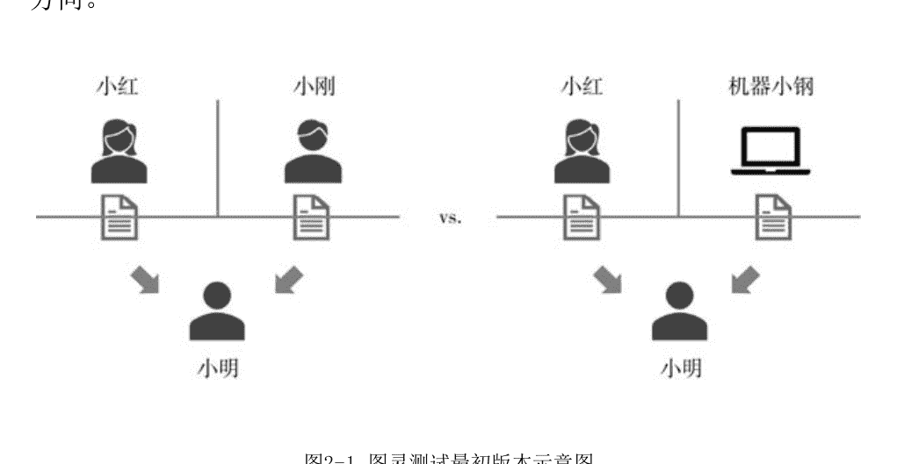
理论可能性提出后，真正让“人工智能”成为学科的是 1956 年在美国达特茅斯学院举办的夏季研讨会。主办方包括后来的图灵奖得主马文·明斯基、约翰·麦卡锡、信息论创始人香农、IBM 工程师罗彻斯特等，参会者多为后来推动该领域发展的科学家。会议明确了人工智能的名称与任务，被广泛视为人工智能诞生的标志，开启了其曲折向上的发展之路。

#### 二、符号主义、联结主义和行为主义
人工智能早期出现“符号主义”与“联结主义”两大流派，均取得阶段性成果。

符号主义认为智能源于逻辑推理，世界信息皆可抽象为符号，人类认知是运用逻辑规则操作符号的过程。若计算机能自动化执行类似人脑的规则，或可实现完全智能。艾伦·纽厄尔在达特茅斯会议报告的逻辑理论家项目是早期代表，它能证明《数学原理》第二章 52 个定理中的 38 个，甚至给出更精巧的证明。

联结主义则强调模拟人脑结构，而非复制思考功能。智能被归因于神经元网络协同处理信息，目标是用计算机模拟神经网络工作方式。1943 年，神经科学家沃伦·麦卡洛克与数学家沃尔特·皮茨构建了基于神经元结构的数学模型，为人工神经网络奠定雏形。1958 年，美国神经学家弗兰克·罗森布拉特发表“感知器”算法，机器可借此自主完成分类等简单任务，其出色表现引发了第一次神经网络热潮。

不论符号主义还是联结主义，在人工智能诞生后的十余年里都取得令人震惊的进展，但好景不长。20 世纪 60 年代末，研究陷入瓶颈，难以克服的问题包括：受限的计算能力：当时计算机有限的内存与处理速度不足以支撑 AI 算法的实际应用。

AI 起步期首先撞上的是知识素材不足的瓶颈。许多落地场景依赖海量常识与背景支撑，而当时的数据库体量根本无法提供足够的养分。与此同时，学界对两条主流路线的质疑也在发酵。对符号派，多位哲学家反复论证人的思考并不以繁琐符号运算为主，更偏向直觉驱动，用形式规则去复刻智能属于徒劳。对联结派，明斯基点出了感知器的致命局限：只能处理线性可分问题，连异或这种最基础的非线性分类都无法胜任，基本被判了死刑。研究受阻、成果难以转化，各大机构纷纷缩减投入，整个赛道陷入了长期的寒冬。

寒冬里也在酝酿转机。上世纪70年代，符号学者开始真正重视“知识”的作用，放下了对即时实现通用AI的执念，转而收缩到垂直专业领域。这种收缩客观上缓解了算力与信息匮乏的压力，也让系统从理论走向可用。思路是把知识库与推理机结合，搭建可解决特定行业问题的专家系统。运行时用户通过人机界面提问，推理机把输入与知识库中的规则条件匹配，把匹配到的结论写入工作数据库后反馈。80年代，卡耐基梅隆大学为DEC打造的首个商用专家系统XCON应运而生，上线后年均为公司节省约4000万美元，直接点燃了全球范围内的专家系统建设浪潮。

同一时期，联结派也迎来复苏。更复杂网络结构与配套算法的普及为该方向注入活力，其中面向多层感知器的误差反向传播算法解决了非线性分类难题，让人工神经网络掀起第二轮高潮。

此外，主张“感知加行动”的行为主义也在缓慢成长。它源自控制论，强调模拟人在控制环节的行为与动作。虽然同样诞生于AI初期，却长期边缘化。有人把三派概括为：符号派既知其然也知其所以然，联结派只知其然不知所以然，行为派则对两者都缺乏解释。因此直到21世纪末智能控制与机器人兴起后，行为派才获得广泛关注。至此符号、联结、行为三大学派共同塑造了后续发展格局。

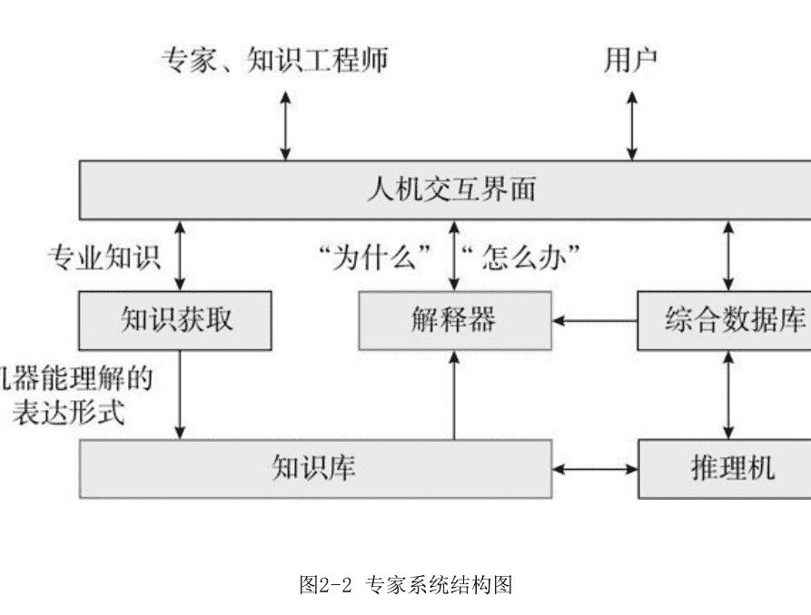

#### 三、机器学习

##### 1. 机器学习的概念

1950年，图灵在《计算机器与智能》中提出学习机器设想，认为与其编程模仿成人脑，不如让机器像儿童一样在奖惩式教学中成长，从而获得智能。此后机器学习逐步独立成科，在AI内部占据重要位置。

卡耐基梅隆大学计算机学院汤姆·米切尔给出经典表述：一个程序能从经验E中学习任务T，并通过性能度量P衡量学习后的提升。虽然定义读起来绕口，用教学场景更容易理解。设老师希望小明考试更好，就反复布置练习并根据成绩判断效果。把“小明学习”换成“机器学习”，刷题过程即经验E，考试即任务T，分数即性能度量P。反复训练后成绩提升，机器同理，在数据训练达标后执行任务的性能也会变好。

训练流程大致可分为四步。

- 数据获取：为模型准备学习用的样本。
- 特征工程：从原始数据中提炼有效特征并做必要转换。
- 模型训练：依据算法让模型从数据中学习。
- 评估与应用：把训练好的模型投入使用并检验表现，满意后正式上线。

按训练方式划分，最常见的是监督学习和无监督学习。监督学习像老师逐题批改，让学习者明确对错，分类任务是典型代表：先学习不同类别对应的特征模式，再把新样本分到合适类别。无监督学习则像把大量题目堆给学习者，让其自行发现规律，聚类是典型场景：没有先验标签，系统根据样本间的相似性自动归组。

##### 2. 感知器与神经网络

前文提到的感知器就是监督学习的典型例子，也是人工神经网络的雏形。为方便理解，下面用通俗场景说明其原理。

小明选修一门课，学校没有公布明确的通过标准，只知道两次作业和一次考试会影响结果。于是他收集往届学长学姐的作业、考试和最终是否挂科的数据，自己先假设一个评分公式：第一次作业乘0.3加第二次作业乘0.3加考试乘0.4得到课程分，60分以上算及格。把学长学姐的数据代入后发现全部不及格，说明系数偏小；调大后又全部及格，说明系数又偏大了。反复微调后找到一组能较准确划分挂科与否的系数，这时就能用自己的成绩估算结果。

把这个调整过程交给程序，就得到一个简化版感知器。输入节点对应三次成绩，好比接收信号的神经元，输出节点对应及格与否的判断，中间用激励函数把分值映射为结果。输入与输出之间的联系强度由公式中的系数决定，反复调节这些强度直至分类正确，学习就完成了。

人工神经网络可以看成多层感知器的扩展。除输入层和输出层外，还加入若干隐藏层，隐藏层节点与上下层全连接，每条连接都有自己的权重，形成网络。

隐藏层为何必要？再看一个更复杂的评分例子。老师的评价维度包括态度、能力、创新三个中间分数，这三个分数又由两次作业、一次考试和两次报告综合得出，最后汇总成课程结果。单层结构无法完成这种中间加工，而隐藏层可以自行学习这些中间表示，实现特征的隐式转换。

人工神经网络的激励函数也可以替换以应对更复杂问题。训练时需要不断调整各连接的权重，依据是模型输出与真实数据的偏差。每个样本的误差用损失函数度量，所有样本的平均误差体现在代价函数里。需要注意的是，代价越小并非越好。一方面要利用历史经验降低经验风险，另一方面模型不能过度复杂以免对新数据不适应而产生结构风险，合理的调整是两者之间的平衡。

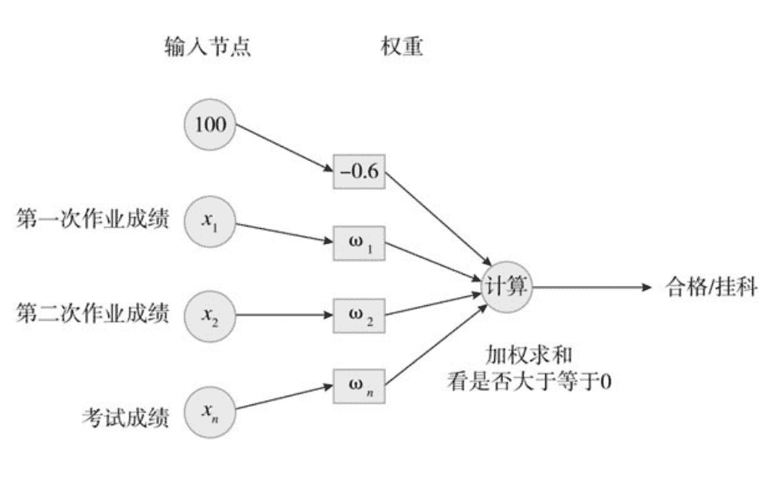

图2-3 简化版感知器结构示意图

人工神经网络本质上是多层结构的感知器，输入层接收外界信号，输出层给出结果，隐藏层完成中间抽象。

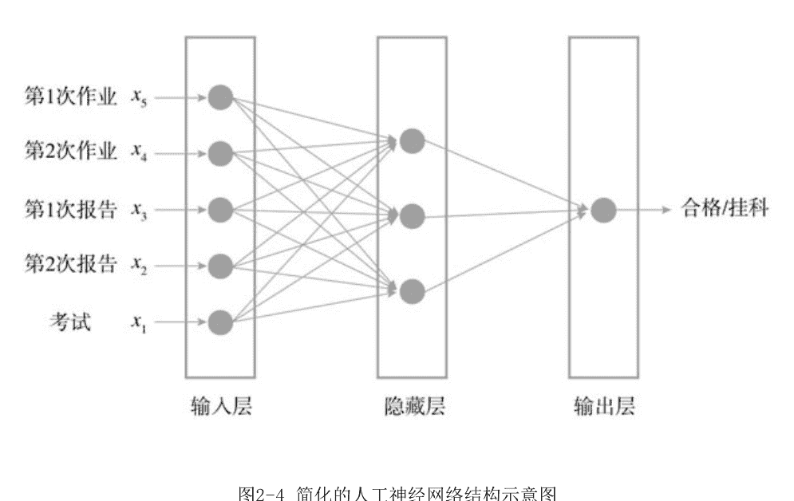

#### 四、强化学习

##### 1. 强化学习的概念

强化学习是机器学习除监督与无监督之外的第三大分支，可与深度学习结合形成深度强化学习。它不直接学习数据标签，而是在特定环境中让智能体通过选择一系列行动来最大化长期累计收益，本质上学习的是决策机制。

三类学习的区别可见下表。

表2-1 监督学习、无监督学习和强化学习对比

| 对比维度 | 监督学习 | 无监督学习 | 强化学习 |
| :--- | :--- | :--- | :--- |
| 学习对象 | 有标签数据 | 无标签数据 | 决策系统 |
| 学习反馈 | 直接反馈 | 无反馈 | 激励系统 |
| 应用场景 | 预测结果 | 寻找隐藏的结构 | 选择一系列行动 |

从直觉上看，强化学习像在玩游戏。环境就是游戏，智能体就是玩家，目标是完成核心任务。DeepMind的AlphaGo在围棋上取得突破就综合使用了强化学习技术，2016年和2017年先后击败李世石和柯洁。

##### 2. 强化学习的构成元素

以《超级马里奥》为例，系统各要素的关系如下。

- 智能体：操控马里奥的AI，玩家角色。
- 环境：游戏世界，玩家的每一步都会得到环境反馈。
- 状态：环境中所有要素的综合快照，如马里奥位置、敌人位置、障碍物、金币数、变身状态等。
- 行动：在当前状态下可执行的选项，如左右移动、跳跃、发射火焰弹等，部分选项会随状态变化而不可用。
- 奖励：完成特定行动后获得的即时反馈，正向为奖励，负向为惩罚。通关可加分，失败扣分，或以收集金币为导向。
- 目标：在奖励机制合理设计下表述为长期累计奖励最大化，例如通关次数最多。

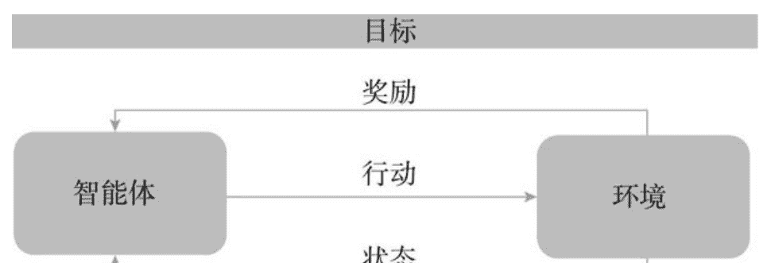

图2-5 强化学习构成元素及其关系

整个过程的目标是学到好的策略，即在每个状态下选择什么行动。价值概念反映了从当前状态出发未来能获得奖励的期望，学习会倾向于进入高价值状态并采取能产生高价值的行动。

##### 3. 强化学习的训练过程

算法的工作循环大致如下。

- 观测环境并确定当前状态与可选行动：马里奥站在悬崖边，可左移、右移或跳跃。
- 依据策略挑选行动：策略评估显示左右移动和跳跃价值相近，此时选择向右走。
- 执行行动并观察环境变化：马里奥向右走。
- 接收奖励或惩罚：掉下悬崖，游戏失败，奖励被扣除。
- 根据经验更新策略：悬崖边向右的价值被下调，未来更倾向跳跃或左移。
- 重复直至策略收敛。

本质上是试错与反馈的循环。行动的回报往往有延迟，现在的动作可能不立刻产生奖励或惩罚，但会影响后续收益。为此学习过程需要在探索新行动与利用已有经验之间权衡，早期多探索，后期多利用。

强化学习也常被用于训练AIGC模型，相关内容后续展开。

#### 五、深度学习

##### 1. 深度学习的概念

在机器学习中，特征的质量直接决定模型效果。但对图像、文本这类数据来说，手工提取有效特征非常困难。模型需要学习的不是颜色数、词频等浅层信息，而是像素间的关系、词语间的上下文这类深层结构。人类难以手动完成，深度神经网络则可以自动完成分层抽象。深度学习即利用多层层次结构进行机器学习，是机器学习的一个子领域，其与监督、无监督及强化学习的关系如图2-6所示。

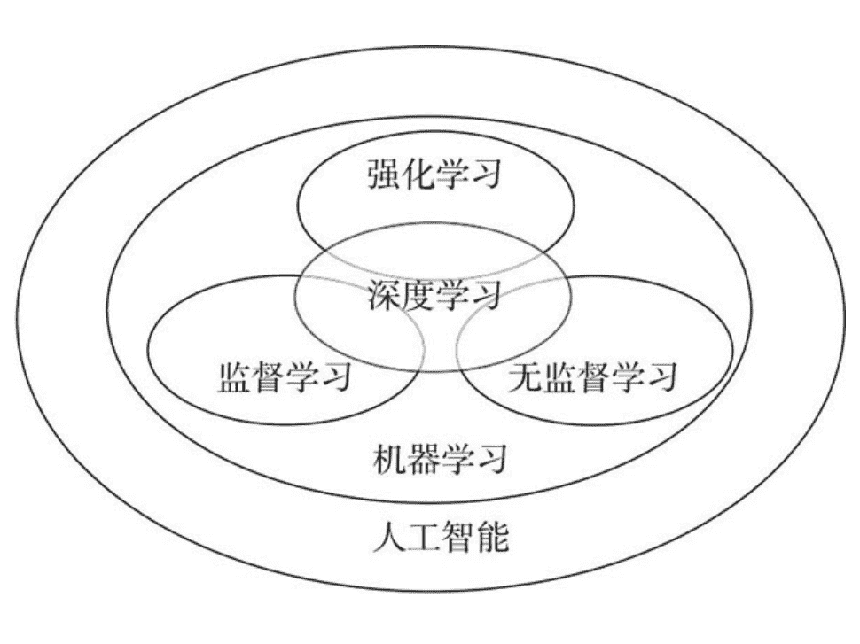

图2-6 深度学习与无监督学习、监督学习及强化学习的关系

资料来源：Yuxi Li（2018），“Deep Reinforcement Learning”，doi：10.48550/arXiv.1810.06339

##### 2. 深度神经网络与一般神经网络的区别

主要体现在四个方面。

- 神经元数量更多。
- 网络层次更深、连接更复杂。
- 对计算资源需求更大。
- 能够自动提取特征。

正是这些特性让深度学习在计算机视觉、自然语言处理等复杂特征场景中成为主流，后续各类AIGC模型的核心也大多基于深度学习。

### 第二节 早期AIGC的尝试：GAN

GAN即生成对抗网络，2014年诞生，是早期被广泛用于AIGC的算法之一，后续衍生出大量变体。它融合了深度学习与强化学习的思想，通过生成器与判别器的对抗来完成图像、文字等内容的生成。实践中两者通常都由深度神经网络构建。

#### 一、生成器

生成器接收一段随机数向量作为输入，根据其中的数值生成图像或句子。向量中的每个数字都与输出内容的某种特征相关联。比如输入 [0.1，-0.5，0.2 … 0.9] 生成一只小猫，改变第一个数值可能让橘猫变成白猫。随机数可以任意构造，因此生成器能够创造大量新样本。训练前需要准备包含大量小猫图片之类的数据集供模型学习。

#### 二、判别器

判别器的任务是判断生成样本是否足够真实。它把生成的图像或句子作为输入，输出一个0到1之间的得分，得分越接近1越像真实数据，越接近0越像伪造。判断标准本质是与训练集的相似度。

#### 三、生成对抗过程

# GAN：师徒博弈如何教出会画画的模型

拿图像生成来类比，生成器就像一个正在学画的学生，判别器则像负责打分的老师。起初学生才一年级，他翻看过一堆小猫照片，随手画了一只猫，老师一看就摇头：不够逼真，两只眼睛都看不清。这就是初始阶段的交互。学生勤加练习，终于把小猫的双眼画出来了，老师点头说及格，于是他升到二年级，老师的评判标准也跟着升级。回到旧作，二年级的老师自然不买账，会觉得整体失真、脸部轮廓模糊，学生便再练再改，直到过关才升三年级。如此轮回，学生的画技愈发精湛，作品也愈发逼真；老师的评判也愈发严苛，持续逼学生精进，这正是生成对抗的核心思路。落地层面，训练通常拆成两步走。

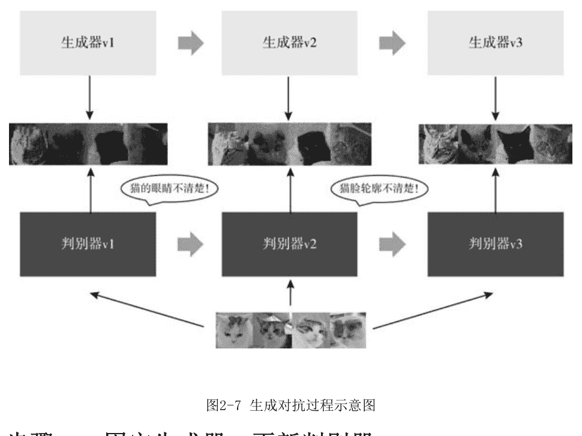

图2-7 生成对抗过程示意图

##### 步骤一：固定生成器，更新判别器。
先让生成器从随机向量里抽样，产出若干图片。此时生成器的参数冻结，判别器从训练集里抽真图，与生成图混在一起学习。它要把内部参数调到能给真图高分、给假图低分的程度。好比先给老师做教学培训，让他先吃透评分标准，才能去考评学生。

##### 步骤二：固定判别器，更新生成器。
判别器训练好后参数锁定，生成器开始调整自己，学习怎么在老师那里拿到高分。就像学生反复考试、复盘失误再改进，终有一天能达到老师的要求。

步骤一与步骤二交替进行，GAN才有机会产出让人满意的作品。 [2]

#### 四、GAN 在 AIGC 里的落地场景
虽然 GAN 的变体也能碰触句子这类离散文本，但因对离散数据驾驭不足，AIGC 里最主流的仍是图像及其跨模态延伸。表2-2 整理了 GAN 的部分典型用法。 [3]

表2-2 GAN的部分常见AIGC应用方式

| 类别 | 应用方式 | 描述 |
|---|---|---|
| 图像数据集的生成 | 手写数字图片数据集生成 | 从手写数字中提炼笔迹特征，合成全新手写数字图像集 |
| | 人脸图像集生成 | 提炼人脸特征，创造全新的人脸图像集 |
| | 动物图像集生成 | 捕捉动物特征，生成全新动物图像集 |
| | 动漫人物数据集生成 | 抽取动漫人物特征，合成全新动漫角色图像 |
| 图像联想创作 | 面部正面视图生成 | 基于人脸局部或侧面照补全完整的正面面部 |
| | 人体新姿势生成 | 从单张人体照推演出全新姿势的图像 |
| | 照片转卡通头像 | 把真人照片风格化为相似的卡通头像 |
| | 照片编辑 | 重建具备指定特征的面部照，如发色风格、表情乃至性别调整 |
| | 不同年龄面部图片生成 | 为同一人生成从年轻到年老的系列面部照片 |
| | 照片融合 | 把不同元素照片融合，如田野山脉等大尺度地貌 |
| | 服装生成 | 根据模特着装照直接产出服装单品图像 |
| | 草图上色 | 为服饰配饰线稿自动上色 |
| 图像修复 | 分辨率增强 | 生成像素更高、细节更清晰的输出图像 |
| | 照片填充 | 补全照片中被遮挡或删除的区域 |
| 多模态与跨模态生成 | 文本生成图片 | 根据对颜色、主体、场景的文字描述生成逼真图片 |
| | 文本生成语音 | 把文字转成自然语音 |
| | 3D 物体生成 | 基于多角度二维图像重建物体的三维模型 |
| | 视频预测生成 | 预测视频后续帧内容，如海浪波动、人行轨迹 |
| | 游戏关卡生成 | 利用游戏关卡数据合成全新关卡 |

### 第三节 AI绘画的引擎：Diffusion模型

#### 一、Diffusion模型的基本原理
Diffusion 广泛用于细粒度图像生成，尤其在跨模态创作上已逐渐成为主流。2022年科罗拉多州博览会数字艺术冠军《太空歌剧院》背后就使用了 Diffusion 技术。

传统 GAN 虽能完成图像生成，却存在明显短板：
- 需同时训练生成器与判别器两大网络，训练难度高。
- 生成器目标是骗过判别器，常走捷径学到不想要的特征，模型不稳定，易产出怪异结果。
- 生成结果多样性较差，因为多样反而更难骗过判别器。

Diffusion 另辟蹊径。想想老式电视信号不良时的雪花：随机、无序，噪声会逐步覆盖画面，直到整屏都是噪声。图2-8展示了在图像上叠加噪声的演变。那么反过来，若能让神经网络学会噪声扩散的过程，再逆向把纯噪声逐步“去噪”成清晰图像，就能生成高质量画面。Diffusion 正建立在这一逆向思维上。

图2-8 图片增加噪声的演变示意图

#### 二、CLIP模型与AI绘画
在 GAN 涉及的图像处理之外，Diffusion 最火的赛道就是 AI 绘画，并已显现商业潜力。其成功离不开 CLIP，即对比语言-图像预训练模型。

要让 AI 画得好，得先让它懂图。目前有两大瓶颈：理解力差距与数据标注不足。人类看图是整体把握形象，AI 却是逐像素特征学习；而且需要海量人工标注，效率有限。

研究者换了思路，模仿婴儿学图：父母指着图说“这是一只在吃猫粮的黑色小猫”。这本质是图文匹配问题，而朋友圈、微博、推特上天然存在大量图文配对。OpenAI 据此收集了约 4 亿对高质量图文对，分别编码文本与图像，让 CLIP 学习二者的关联度。结合 Diffusion 的生成能力，AI 绘画才得以成型。

早期代表是 Disco Diffusion。该工具 2021年10月在 Google Colab 上线，由 Accomplice 开发，内核是 CLIP 引导扩散模型。基于谷歌技术架构运行，界面不友好且成本高，需 Colab Pro 才能高效使用。尽管限制多，它仍掀起一波开源绘画热潮。

#### 三、主流绘画工具盘点
在 CLIP 与 Diffusion 基础上涌现了大量工具，其中最知名的三款信息如下表。

表2-3 Stable Diffusion、DALL·E 2、Midjourney基本信息表

| 名称 | 发布时间 | 研发企业 |
| :--- | :--- | :--- |
| Stable Diffusion | 2022年8月上线 | Stability AI |
| DALL·E 2 | 2022年4月更新 | OpenAI |
| Midjourney | 2022年7月公测 | Midjourney |

三者各有侧重。Stable Diffusion 对当代艺术理解强，细节刻画细腻，但要还原细节需要非常精细的描述，画普通图时略显吃力。DALL·E 2 训练规模庞大，更适合企业级图像生成，视觉效果更接近真实照片。Midjourney 通过 Discord 机器人收发请求，作品油画感浓郁，艺术风格鲜明，同样也难以产出像照片一样写实的画面。曾获数字艺术冠军的《太空歌剧院》即出自 Midjourney。

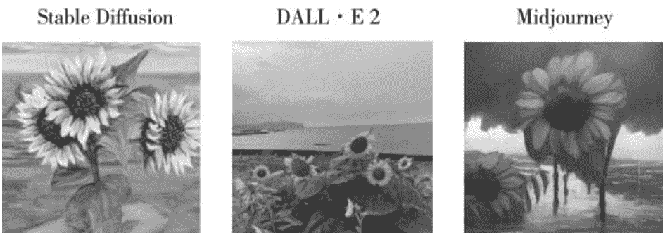

图2-9 使用“下雨天，向日葵盛开于海边”生成图片对比

Stable Diffusion

DALL·E 2

Midjourney

图2-10 使用“明亮的小巷在夕阳中衬着雪色之美”生成图片对比

Stable Diffusion

DALL·E 2

Midjourney

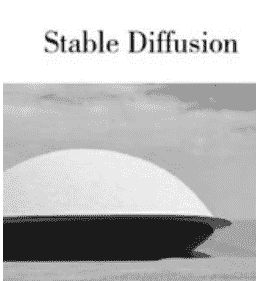

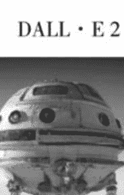

图2-11 使用“圆形的飞船伫立在沙漠之上，覆着皑皑白雪”生成图片对比

除此之外，谷歌 Imagen、微软 NUWA 等大厂产品也纷纷入局，均基于大模型实现，而 Transformer 作为 AIGC 的核心基建发挥了关键作用，下节详述。

### 第四节 基座架构：Transformer

#### 一、Seq2Seq 序列到序列先锋
在介绍 Transformer 前先看更简单的 Seq2Seq 模型，2014年提出，主要用于机器翻译。结构由编码器与解码器构成，编码器先处理输入序列，再把压缩后的表征交给解码器输出目标序列。例如中译英：输入中文句，编码成数值向量，解码器再把它转回英文句。

Seq2Seq 也可用于：
- 聊天问答：问题序列进，回答序列出。
- 内容续写：段落进，后续内容出。
- 摘要/标题生成：文章进，摘要或标题出。
- 文本转语音：文字进，语音出。
图像与字幕等视觉任务也有应用。

#### 二、注意力机制的由来
注意力机制起初用于图像标注，后被引入 NLP，用来缓解机器翻译中长句性能骤降的问题。固定长度向量难以概括长句细节，需要更大网络与更久训练。

看画作《圣母与圣吉凡尼诺》（图2-12）。

图2-12 画作《圣母与圣吉凡尼诺》
注：这幅画由佛罗伦萨画家多米尼哥·基兰达约创作于15世纪，现藏于佛罗伦萨维琪奥王宫。

第一眼通常是圣母与婴儿耶稣，右下角的驴和牛很多人记不住。这正体现人脑注意力有限，会给重要内容高权重、不重要内容低权重，上下文中动态聚焦信息，从而降低处理难度。人工智能借鉴这一思路设计注意力机制。

再看图2-13 的乱序句子。

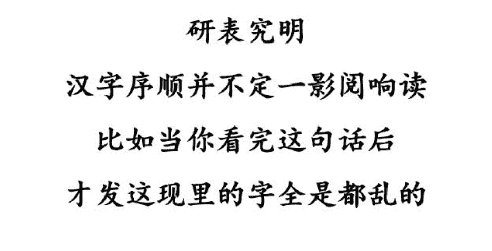

读完你会发现阅读不受干扰，这与自注意力机制原理相近。模型先看到“研”，扫到“表”“究”“明”，在记忆库中匹配“研表”“研究”“研明”，给“研究”更高权重编码，再按权重重组为“研究表明”。自注意力帮助模型捕捉文本内在联系。多头注意力则通过多路变换加权再融合，增强自注意效果，后文 Transformer 中会涉及。

#### 三、Transformer 编解码构造
Transformer 同样采用编码-解码结构，通常含多个编码器与解码器。编码器内有两部分：多头注意力与前馈神经网络。以英译汉为例，编码器把英文单词拆成向量，在多头注意力中加权后输出向量集给解码器。

解码器先读开始标记，逐步生成向量并挑选得分最高的汉字输出。以“I love you”为例，第一步可能输出“我”，再把“我”回馈进去，逐步得到“我爱你”，最后输出结束符号。解码器内部也含多头注意力和前馈网络，且多头注意力使用掩码机制，只允许参考已生成的部分，屏蔽未生成的未来信息。编码器输出的向量集会输入解码器中间的多头注意力，帮助解码时关注上下文。

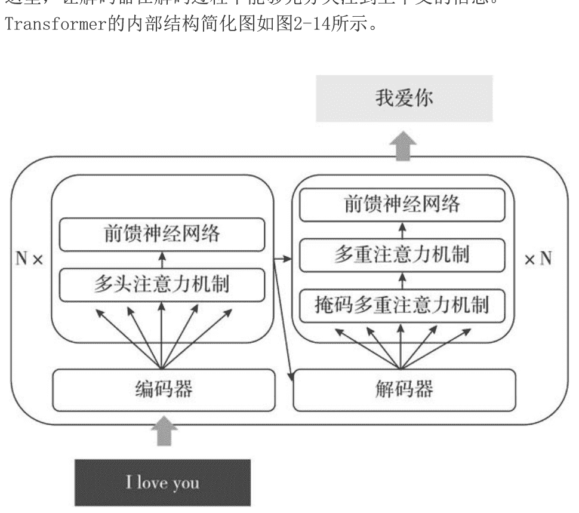

图2-14 Transformer结构简化图

#### 四、GPT系列模型与ChatGPT

从预训练到通用智能：GPT 与 BERT 的关键跃迁

GPT 是 OpenAI 打造的大规模文本生成类深度学习模型，覆盖对话系统、机器翻译、摘要生成、代码生成等复杂的自然语言处理场景。整个家族沿用不断堆叠 Transformer 的思路，通过扩充训练语料的规模与质量、拉大网络参数量来实现代际升级，演进轨迹可概括如下。

表2-4 GPT 系列模型的演进信息

| 模型 | 发布时间 | 参数量 | 预训练数据量 |
| :--- | :--- | :--- | :--- |
| GPT-1 | 2018年6月 | 1.17亿 | 约5GB |
| GPT-2 | 2019年2月 | 15亿 | 40GB |
| GPT-3 | 2020年5月 | 1750亿 | 45TB |

到 2022 年，GPT 已走完三代历程，业界也在热议 GPT-4 的到来。GPT-3 之后出现的 InstructGPT 与 ChatGPT 展现出惊人效果，人们期待 GPT-4 能拥有接近人脑突触规模的参数，并真正通过无限制的图灵测试，而不是像过去那样借助身份设定等取巧方式。例如把 AI 伪装成外国小孩，答不上来时归咎于身份限制。2022 年 11 月 30 日，OpenAI 发布了聊天机器人 ChatGPT，发布后迅速走红，它可以自然流畅地对话，还能写诗、写代码、讲故事。

技术突破并非一帆风顺。GPT-1 之前的主流 NLP 模型多依赖监督学习，需要大量高质量标注数据，且标注数据局限于特定领域，难以获得通用能力。GPT-1 的核心做法是把无监督预训练与监督微调结合，先在无标签语料上学习通用语言表征，再针对问答、常识推理、语义相似度判断、文本分类、自然语言推理等任务做微调，本质上是一种半监督路径。训练时选用 BooksCorpus，约 7000 本未出版书籍的文字，长文本有助于捕捉上下文关联。GPT-1 在多数任务上领先，但仍存在两大短板：未出版书籍带来的数据局限，以及部分任务上泛化不足，难以成为真正通用模型。

为提升泛化，GPT-2 做了思想上的调整。其出发点是：在语言建模范围内，所有监督学习都可以视为无监督学习的子集。比如让模型无监督学习“小明是 A 省 2022 年高考状元”这一句子，它自然能回答“A 省 2022 年高考状元是谁”“小明是 2022 年哪个省的高考状元”等需要正确答案的监督问题。只要模型容量足够大、数据足够丰富，无监督语言模型就能覆盖监督任务。于是参数扩至 15 亿，约为前代的近十倍；训练语料换成 Reddit 上约 800 万篇高赞文章，数据量放大约八倍。后测显示 GPT-2 在多种 NLP 任务上具备普适强能力，但仍有提升空间。GPT-3 基本沿用 GPT-2 架构，但在参数与数据上大幅跃升，参数提升百倍以上，预训练数据提升千倍以上，正是“大力出奇迹”，在自动问答、语义推断、机器翻译、文章生成等领域达到新高度。

这种飞跃可通过 ChatGPT 的流畅体验直观感受。ChatGPT 源自 InstructGPT，后者是基于 GPT-3 微调的版本，意在减少攻击性与不真实输出。优化手段是基于人类反馈的强化学习 Reinforcement Learning from Human Feedback，简称 RLHF。ChatGPT 沿用相同思路，仅调整了数据采集方式。完整训练流程如下：

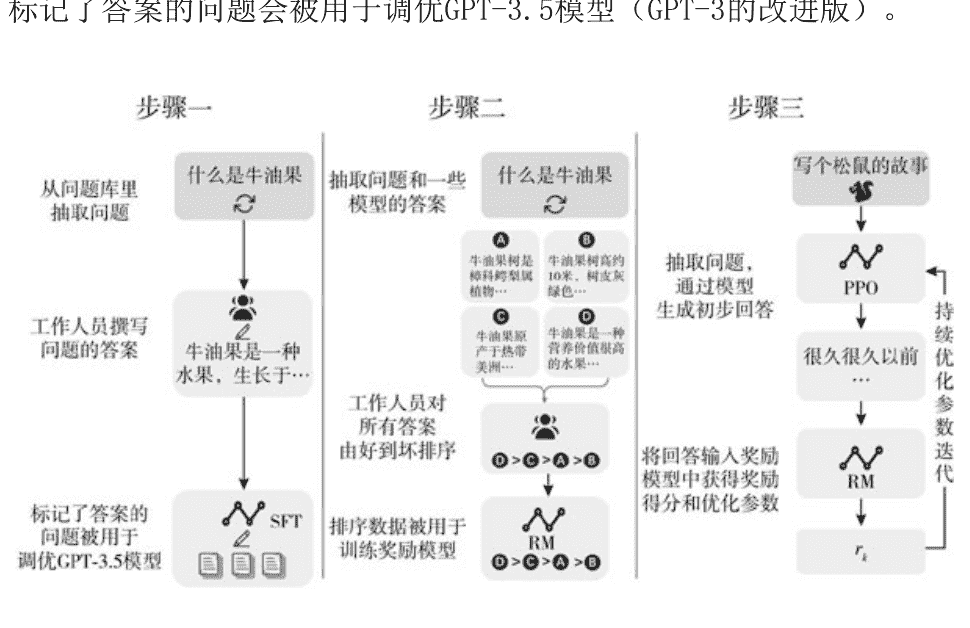
图2-15 ChatGPT 的训练过程示意图

资料来源：https://openai.com/blog/chatgpt/

注：RM：Reward Model，奖励模型；SFT：Supervised Fine-Tuning，有监督的微调；PPO：Proximal Policy Optimization，近端策略优化

##### 步骤一：收集示范数据并训练一个监督学习的策略。
模型从问题库抽取问题，由工作人员撰写参考答案，这些带标注的问题用于调优 GPT-3.5 模型，GPT-3.5 为 GPT-3 的改进版。

##### 步骤二：收集对比数据并训练一个奖励模型。
抽取问题与若干模型答案，由工作人员按好坏排序，排序数据用于训练奖励模型。

##### 步骤三：使用强化学习算法优化针对奖励模型的策略。
抽取问题让模型生成初稿，回答送入奖励模型打分并据此优化参数，周而复始。

该流程让模型更懂人类对话意图，并获得多轮对话能力。真格基金林惠文在分享中提到 ChatGPT 的有趣提升：

- 敢于质疑有误的前提。
- 会主动承认错误或无法回答。
- 对用户意图的理解大幅提升。
- 结果准确性大幅提升。

即便如此，ChatGPT 仍不完美。结合官方文档与用户实践，其局限包括：

- 有时会给出看似合理实则错误或荒谬的答案。
- 对措辞改写或重复提示很敏感，同问改写后可能从“不知道”变为正确回答。
- 回复往往偏长且过度使用某些表达。
- 面对模糊问题倾向猜测意图，而非请用户澄清。
- 可能回应有害提问或表现出偏见。
- 在数学、物理等需数字推理的任务上仍会出错。

这些限制并未削弱其突破性，反而让人对 GPT-4 的惊喜更期待。

#### 五、BERT 模型
BERT，即 Bidirectional Encoder Representations from Transformers，双向编码器表征，由谷歌于 2018 年提出。其核心理念是编码器已能很好抽取语义，不妨单独使用编码器来做语言表征。训练设计别具一格：

- 掩码语言模型：随机遮盖约 15% 的词，让模型预测被掩盖内容，以此强化语境理解。
- 下句预测：输入成对句子，让模型判断二者是否连贯，以此学习句子间联系。

使用时，训练好的 BERT 需要根据具体任务添加不同算法模块。除了 NLP，BERT 思想也被迁移到机器视觉。将图片切分为小块，把每个块视作“词”，即可像处理句子一样处理图像，由此诞生 ViT 视觉变换器。基于 BERT 的众多变体在 AIGC 领域大放异彩，奠定了其里程碑地位。

## 第三章 AIGC 的职能应用
AIGC 如何帮助企业各职能部门降本增效？

> 有些人声称这种技术是人工智能，但实际上它强化的是人类自身。因此我认为，我们将增强人类的智能，而非“人工”的智能。
> ——吉尼·罗曼提（Ginni Rometty）

创新是企业发展的核心动力，各职能部门都涉及大量创作工作。AIGC 能帮助员工提升生产力，实现整体降本增效，具体体现为：

- 自动化处理繁琐耗时任务，减少人力，降低成本。
- 产生新想法与解决方案，如产品设计或营销策略。
- 快速准确分析海量数据，为决策提供洞察。
- 提升任务效率与准确性，减少失误。
- 开发个性化定制产品与服务，提升客户满意度。
- 提高组织速度与敏捷性，快速响应市场与客户需求。
- 改善内部协作与沟通，使团队更高效协同。

总体而言，AIGC 通过自动化、创意生成与决策支持，有效赋能各职能部门。本章从产品研发、市场营销和管理协作三角度展开介绍。

### 第一节 AIGC 与产品研发
对多数互联网企业而言，产品研发是成本与创新的核心，迭代速度决定市场反应。当前 AIGC 在产品研发主要有四种用法：

- 辅助编程提升代码产出效率。
- 生成应用直接将需求转为产品。
- 创建与维护文档注释，提升沟通效率。
- 测试代码并纠正错误。

这些方式让开发者聚焦架构设计与功能探索，而非重复劳动。

#### 一、智能辅助编程
2021 年夏天，GitHub 与 OpenAI 联合发布 GitHub Copilot。名字源于头部科技公司的“结对编程”做法：两人协作完成需求分析、编码、审查测试，以提升效率与质量。过程类似驾校练车，一个人操作，一个人观察。Copilot 如同坐在副驾驶的人工智能，提供指导。

发布后 Copilot 获大量程序员好评，被认为大幅提升编程效率。也有媒体担忧模型训练可能使用了 GitHub 开源代码，存在法律争议。

即便存在争议，其模式具有变革性。传统代码补全只在当前行给出若干推荐词或短语供选择。Copilot 则能基于上下文生成整段代码片段，提供更全面建议。人工智能在辅助编程上的潜力远不止补全。

快速生成样板代码是另一个方向。样板代码在多种应用中重复出现，常作为新代码起点。传统做法依靠预制模板，而引入 AIGC 可通过自然语言描述生成更定制化的样板。

代码优化也是潜在应用。AIGC 可分析代码并提出提升运行速度或降低内存占用的修改建议，开发者审阅后决定是否采纳，远比手工优化省时。优化性能常需数百小时在算法与数据结构上打磨，AIGC 能帮助经验不足的开发者写出高效优美的代码，并在建议中学习成长。

跨设备代码生成亦具想象空间。许多互联网产品需为移动网页、安卓、苹果、小程序等分别开发。人工智能可在同一需求下生成不同平台代码，节省大量手动迁移时间。

总体看，AIGC 为开发者提供快速生成与优化代码的能力，使其专注更重要、更具挑战的工作，加速高质量软件产出。

#### 二、智能应用生成
同代码补全一样，低成本创作应用长期被探索，低代码/无代码工具 Bubble 是典型案例。使用 Bubble 无需或仅需少量代码即可开发应用，但仍需学习图形化编程与流程图表达。

拥有 AIGC 能力的应用生成会更简单。用户用直白语言描述所需功能，AI 即可完成创作，省去学习新表达工具与繁琐流程。硅谷的 Debuild 是代表，用户描述产品后挑选功能与场景，软件自动生成网页端代码。

在此场景中，产品设计师同样受益。视觉设计或用户体验设计师需在定稿前探索多种可能性，并根据反馈反复调整，耗时繁琐。AIGC 可自动化生成大量设计方案，包括元素、布局、配色等。Components.ai 可生成设计方案并产出对应前端代码，便于设计师与前端工程师沟通。

#### 三、智能文档注释
文档注释为代码文件与每段代码提供说明，对协作开发意义重大。对内便于理解与迭代，对开源项目贡献者帮助定位贡献点，对用户提供使用教程与限制说明。

然而创建维护注释耗费时间。以 Mintlify 为代表的 AIGC 工具可自动撰写并更新代码描述，显著降低成本。开发者只需提供代码与示例数据，系统即可生成详细准确的描述。

AIGC 还能提升质量。人工撰写易出现不规范、不完整或不准确描述，尤其在多人协作、多版本迭代下更难统一。开发人员常因上线压力优先实现功能，注释常被忽视，交接时问题放大，形成历史遗留代码。AIGC 可生成规范、全面、准确的描述，并实时随代码库与语言变化自动更新，确保信息始终最新。

#### 四、智能测试纠正

在软件研发的全链路里，工程师花在写代码上的时间远少于花在测试与排错上的时间。2021年5月，微软的研究人员在NeurIPS大会上公布了BugLab这一机器学习模型，探索用人工智能把测试修复流程自动化。除了BugLab之外，当前市场上围绕AIGC的研发效率工具，关注的焦点也基本集中在代码自动测试和代码缺陷自动修复这两个方向。

### 第二节 AIGC驱动营销升级
营销是企业增长的发动机，既要把产品推给潜在客户，也要做大营收、塑造品牌与声誉，在很多行业里甚至决定生死。AIGC正逐步成为营销环节不可或缺的基础设施，它不仅能帮营销人做出更有效的素材，还能洞察用户行为、提供更具个性化的销售体验，并优化客户成功与售后，最终提升满意度与忠诚度，推动销售与收入增长。

#### 一、创意内容自动化生成
用AI做创意营销并不是新话题。2015年淘宝双十一后，阿里巴巴就开始试验用算法与大数据为用户做规模化个性化推荐，即所谓的千人千面，并上线鲁班产品，可算作广义上AIGC在创意营销的早期实践。鲁班在2017年一天就能产出4000万张基于商品图像特征的定制海报，到2018年累计设计量已超10亿次。[2]

以鲁班为例，AIGC做营销素材的核心价值是提效降本。按预设规则与参数即可自动生成海报文案，无需耗时数小时甚至数天。鲁班每秒可创作8000张图片，这一产量已远超多数设计师一生的总和。[3] 这既释放了人力去做更有价值的工作，也降低了成本，同时保证了投放的时效性。

另一大价值是数据驱动的相关性。AIGC可以解析目标人群的兴趣、偏好与行为，依此生成更贴合、更具吸引力的内容，从而让投放更易产生共鸣，实现类似双十一时期“千人千面”的效果。

在图文之外，文本创作同样是重要场景。AIGC能在给定主题下生成海量变体，让营销团队快速尝试不同风格、并迭代测试。文案还能按受众和渠道进行适配，提升在不同平台的触达效果。海外工具Copy.ai就为大量市场人员提供了多场景的推广文字创作支持。除图文外，AIGC还能产出3D模型、广告视频等多种模态素材。

由于消费趋势与用户偏好持续变化，AIGC还能帮助团队快速响应。基于大规模数据分析，系统可以迅速识别并跟进行为偏好的迁移，让策略调整保持与最新趋势同步。

#### 二、销售流程智能化
除了内容曝光获客，主动销售对多数企业同样关键。整体来看，对外销售可归纳为线索发现、客户触达、客户转化三步。

线索发现常耗时耗力。企业习惯在互联网上手工检索、参加行业会或爬虫抓取名单，但成本高、质量低。AIGC可结合现有客户的人口画像、购买习惯等，与线上企业数据库进行比对，低成本快速构建相似潜在客户池。也可利用自然语言处理解析博客、新闻、社交媒体等海量文本，评估潜在客户对产品服务的需求强度，从而发现线索。Seamless.ai就提供此类服务，用户只需描述行业、规模、营收、区域等特征即可获得销售名单。

在客户触达环节，AIGC能自动生成邮件、社媒文案、微信消息、短信等，并可按单个客户信息进行定制。基于NLP的智能外呼系统还能让AI主动拨打电话，显著提升售前团队的生产效率并降低成本。南京的云蝠智能Telrobot就是被广泛采用的智能外呼方案之一。

提升转化率的关键在于解决方案定制与话术优化。AIGC可学习产品资料与过往方案，结合客户需求参数，快速生成高度相关的定制化方案，加速响应。像Oliv.ai这样的工具，则通过学习大量销售视频、录音与文字稿，分析话术优劣并持续优化，提升成交概率。

#### 三、客户服务智能化
销售并未在签单付款时结束，确保客户获得预期服务、达成购买目标同样重要，否则将导致复购率、续费率下滑甚至品牌受损。

AIGC在服务环节的核心优势是承接海量请求。传统模式需要客服团队逐一响应，重点客户还要配备客户经理，成本高昂。AI系统可以快速准确地解答常见问题，节约人力成本的同时改善体验，提升响应及时性。另一优势是个性化回复。与固定话术不同，AIGC能依据每个客户的具体情况生成独特回复，增强信任与满意度。

在客户成功层面，AIGC可基于使用数据识别体验优化机会，并推送个性化邮件或应用内消息，指导用户更高效使用产品，从而提高留存与忠诚度。Salesforce旗下的爱因斯坦AI就是典型代表，能够自动生成服务话术并推荐给客服人员使用，甚至预判咨询客户的潜在需求。

### 第三节 AIGC助力内部管理协同
高效的管理与协作能让团队目标一致、知识共享、决策更优，还能营造良好氛围、提升满意度与留存率。缺乏沟通协作则易引发误解、浪费资源、士气受挫并错失节点。AIGC在提升管理效率上已有广泛应用，下面重点看智能行政助理、智能内部沟通、智能团队协作、智能人力资源管理四个场景。

#### 一、行政事务自动化
AIGC可自动化安排会议、生成报告、管理邮件等行政任务，节省时间并提升流程准确性。

安排会议看似简单，实操却繁琐，尤其多人参与时。AI可分析邮件与日历邀请数据，了解成员空闲时段与偏好，自动生成可选项并以自然语言逐一确认，以最大化出席率与效率。2021年夏天被Bizzabo收购的X.ai就是做这件事的创业公司，可让AI担任每个人的会议助理。

AI还能自动撰写报告。系统可整合销售数据、客户反馈、财务报表等来源，生成详细报告，并按不同利益相关方的需求调整内容，在新数据到来时实时更新，帮助管理层基于最新信息做决策并节省人力。

#### 二、沟通协作效率提升
通过自动回复、会议文件要点提炼、跨语言翻译等手段，AIGC显著提升内部沟通与生产效率。

AI可学习历史文档与往期邮件，自动生成针对常见咨询的邮件回复，并识别标记重要邮件与附件，避免遗漏。谷歌已将AI辅助回复功能接入Gmail。字节跳动的飞书妙记可实时生成会议纪要，通过语音识别转文字并沉淀为要点文档，让参会者更专注。

艺术与组织心理学的结合也开始进入管理工具。法国巴黎的Viva la Vida基于多年企业艺术工作坊经验，打造了一套融合艺术AIGC、组织心理学与大数据的SaaS系统，旨在各员工价值生命周期节点提升连接感、积极性与心理健康，未来计划拓展至C端。

跨语言沟通是另一刚需。AI可将邮件、群聊、文档即时翻译，促进跨国团队共识。飞书妙记的群聊与文档翻译支持113种源语言、17种目标语言，已在国内广泛应用。[4]

#### 三、跨团队协作优化
不同部门因知识、习惯与流程差异，协作效率常有提升空间，AIGC可帮助整理与规划。

工具可训练模型自动归类企业中Excel、PDF、PPT等多种格式文档，即使分散在云盘、在线文档、邮件中也能按部门、项目或主题组织，减少检索成本与协作阻力。

AI还能自动生成项目协作计划，包括工作流与任务分配。对流程复杂、人员众多的项目尤为有效。例如新产品开发时，系统可自动列出各团队与个人的具体任务、截止时间及依赖关系，帮助成员明确职责、保持进度。加州的Mem公司开发了自我管理的协作空间，用AI管理文件、流程与分工，并整合了前述行政与沟通能力。

#### 四、人效管理智能化
AIGC可提升招聘筛选、人事流程自动化与绩效管理。

系统可分析申请材料、简历与社交媒体档案，快速识别匹配特定岗位技能与经验的候选人，让HR更聚焦于头部人才的评估。

流程自动化方面，可自动安排面试、发送合同、处理入职与培训，简化人事环节。绩效管理上，AI能结合个人优势、短板与目标生成针对性反馈，帮助员工明确改进方向，提升参与感与产出。AI驱动的绩效管理工具Onloop是该领域的典型应用。

> [1] 参考自https://www.theverge.com/2021/7/7/22561180/github-copilot-legal-copyright-fairuse-public-code。
> [2] 参考自 https://www.leiphone.com/category/yanxishe/Zy90qVkBNmZfiuEz.html。
> [3] 参考自https://juejin.cn/post/6844903509825945608。
> [4] 参考自https://www.feishu.cn/hc/zh-CN/articles/446972352418。

## 第四章 AIGC行业落地实践
AIGC如何在各行各业落地？深入观察会发现，智能创造已不再是远景，而是正在重塑工作方式。AIGC的身影已遍布资讯、影视、电商、教育等多个垂直领域。下面以资讯行业为例说明其应用路径。

### 第一节 新闻资讯领域的AIGC应用
资讯具备标准化高、需求大、时效性强等特征，是AIGC商业化较成熟的赛道。自2014年起，数据检索、结构化写作、摘要生成等能力已在新闻领域落地，伴随大模型与场景应用进步，行业正向全链路演进。

#### 一、信息搜集环节的AI赋能
优质报道的基础是全面高效准确的信息收集。传统模式依赖记者一线观察访谈，AI已可大幅赋能。例如科大讯飞的AI转写工具，可在采访中实时生成文字稿、自动摘要、调整文风并精简文本，提升节奏与时效。

AI不仅能助力获取一手信息，也能更精准地检索二手信息。过去用搜索引擎做边缘话题检索，需要反复组合关键词或学习复杂表达式，成本高且易偏离。当前对话式AIGC工具允许用日常口语提问，直接获得精确答案。尽管在部分领域仍存在时效或错误问题，但在多数场景下已可作为二手信息收集的重要手段。

#### 二、自动化资讯生产的规模化能力
在写作环节，基于自然语言生成与处理的AI作品已获从业者与读者认可。Automated Insights旗下Wordsmith可在一秒内产出2000条新闻，单条质量可比拟记者30分钟的产出。强生产力让长尾需求被低成本覆盖，拓展了利润边界。同时AI能避免拼写、计算等人为失误，提升稿件质量。

国内布局同样活跃。新华社的写稿机器人“快笔小新”、腾讯的Dream Writer均已在标准化场景广泛使用。百度与人民网联合发布的“人民网-百度·文心”大模型，有望成为媒体行业的底层基础设施，赋能生产的多环节。

#### 三、内容分发与智媒协同

在资讯分发的末端，AI的作用已不止于个性化推荐，它还催生出一种全新形态的内容输出方式：由虚拟人主播担纲，以视频或直播形式推送资讯，带来更沉浸的消费体验。比如新华社数字记者“小诤”播报太空新闻，央视网虚拟主播“小C”客串记者角色，阿里巴巴冬奥宣推官数字人“冬冬”聊冰雪话题，百度智能云AI手语主播为听障群体提供贴心服务。热度攀升下，各方纷纷入局，希望打造更具科技感、更多样的资讯场景，未来AI虚拟主播很可能成为媒体的常规配置。

AI在新闻全流程的渗透，也引发了关于从业者去留的讨论。微软2020年裁撤27人新闻网站编辑团队并改用AI替代的报道[1]，让这种担忧显得并非空穴来风。实际上，AI的核心价值在于赋能而非替代，在现有技术条件下仍存在明显边界。

目前由AI撰写的稿件往往显得平铺直叙、套路化强，难以像人类记者那样根据报道性质和语境灵活调整叙述策略，难以达到理想的传播效果。深度报道更是其短板，文字里缺失温度与人文关怀。受此限制，AI写稿早期主要集中在财经、体育、突发事件等垂直领域，跨领域迁移与适配能力仍不足。过度依赖AI抓取与撰写信息，还可能加剧信息茧房和回声室效应，甚至引发伦理问题。

正因如此，人类工作者的空间依然很大。AI可以把重复繁琐的劳动接过去，让记者把精力集中在批判性思考和创造性表达上，产出更高质量的内容。前美联社人工智能联合主管弗朗西斯科·马可尼在《新闻的新模式》中提到：“人工智能仅仅是记者的另一样工具，能让从业者腾出时间进行深度思考。”总体来看，新闻行业的终点不是去人工化，而是AI与人协同，推动传媒全面迈向智媒。

### 第二节 AIGC重塑影视制作

当观众对影视内容的需求爆发式增长，行业在扩量与提质的双重压力下变得愈发精细复杂，“人的局限”愈加凸显。AI的应用让制作回归内容本身，让创作者更专注于讲好故事。

#### 一、AI助力剧本创作 激发创意灵感
AI在剧本环节像微粒一样为创作云海播种灵感。通过学习大量优质案例并洞察受众心理，AI能按创作者要求快速生成不同风格与结构的剧本，既提升效率，也为打磨作品提供新思路。

探索由来已久。2016年，纽约大学的一款AI在研读数十部科幻电影剧本后写出电影《阳春》及一段配乐歌词，虽仅有8分钟成片且略显稚嫩，却在视频平台收获数百万播放。2020年GPT-3发布后，查普曼大学的学生用其创作短剧，结尾反转引发广泛关注。

要真正释放生产力，需要模型贴合场景进行针对性训练并做定制化开发。海外已有Final Write、Logline等垂直工具在用，国内深耕中文剧本、小说与IP生成的海马轻帆已积累超百万用户。其训练集覆盖50万个剧本，结合行业专家经验，可快速生成多样题材内容。剧本完成后，平台还能从剧情、场次、人设三大方向共300多个维度解析评估，并以可视化呈现，为迭代提供依据。剧本的商业价值测算、角色筛选等环节同样可由AI参与。自2019年开放合作至2022年末，海马轻帆已累计评测剧集50 000余集、电影/网络电影20 000余部、网络小说超800万部，涵盖《流浪地球》《你好，李焕英》等热门作品。[2]

#### 二、从剧本到成片 AI打通制作全流程
剧本落地仍面临漫长旅程，AI在转化“好创意”为“好表达”的过程中发挥关键作用。

第一重瓶颈是传统粗放、劳动密集的生产方式难以满足观众对质量的更高要求。2009年《阿凡达》开启特效与3D启蒙后，观众持续追求更震撼精细的体验，市场需求推动特效井喷，但素材整理标注、渲染、图像处理等环节愈发繁杂。以《刺杀小说家》为例，特效惊艳的同时后期制作与渲染的时间和复杂度亦呈几何级上升。加班与外包的老办法既不经济也不可持续，生产模式亟需升级。

AI能把创作者从重复琐碎中解放出来。特效团队墨境天合正是借助云渲染与AI技术完成《刺杀小说家》的交付。动漫制作全流程高度数字化，为AI赋能提供充足空间。从建模、绑定、动作设计到分镜、灯光、轨道、镜头，再到解算渲染，每个环节都充斥重复工作与等待。优酷推出的“妙叹”工具箱实现全流程提效，渲染环节从离线等待变为实时预览，便于及时调整；建模、剪辑、素材管理等高重复环节可一键整合或调用预设模板，大幅降低负担。

“妙叹”已被多家国漫工作室采用，《冰火魔厨》实现无断档连更54集。制作方表示：“妙叹是解放创意的工具，有了它，我们更能专注讲好故事。”这种全流程赋能带来的变革，与20世纪好莱坞工业化革命相似，通过精细拆分与模块化生产实现降本增效，对工业化尚不成熟的中国影视，尤其是国漫行业意义尤为特殊。

第二重难题是想象中场景难以实拍。自然风光、古镇、未来都市甚至奇幻大陆，实景搭建与群演已难以满足需求。虚拟场景制作变得关键，AI在此具备天然优势。AI生成背景结合绿幕拍摄已广泛应用，大型场面如《指环王：护戒使者》万人战争即由虚拟环境群体模拟系统完成，让创作者以震撼视觉实现想象照进现实。

第三重突破是挑战自然规律。时光不可逆、逝者不可复生、容貌难以改变都曾制约表达。2008年电影《返老还童》讲述逆生长人生的故事，主角横跨80年时光的多样样貌由AI面部生成技术实现，并帮助影片斩获2009年奥斯卡最佳视觉效果奖。

减龄应用不断扩展。网飞2019年电影《爱尔兰人》由三位平均年龄超77岁的影帝主演，AI减龄技术让他们重现年轻形象。团队花费两年搭建Face Finder人脸识别应用，收集主演30至55岁容貌数据，即使在4K下仍自然生动，某种程度上延长了演员的艺术生命。该片特效支出高达1.59亿美元。随着技术迭代，迪士尼2022年推出的FRAN面部年龄重构系统最快5秒处理一个角色，成为首个实用、全自动、可用于影视制作的图像人脸重塑方案，成本与门槛持续下降。

AI还能让逝者“复生”。《速度与激情7》因保罗·沃克拍摄中途离世，制作团队联合维塔特效从未使用镜头中提取面部数据，使其在片中重现。导演温子仁称：“为了保罗。”这类技术未来或走入生活，帮助人们寄托情感。但伦理挑战同样突出：逝者是否同意形象复用？呈现是否客观准确？能否用于商业牟利？是否被公众接受？有美国用户借助GPT-3“复活”已故伴侣后被OpenAI收回使用权，伦理、风控与安全问题将长期伴随此领域探索。

AI换脸最广为人知的另一用途是替换“塌房”明星。影片前期投入巨大、周期长，出品方难以因个别事件推倒重来，换脸成为低成本补救手段。但没有公司会以此为主要业务，行业的革命性潜力远不止于此。

### 第三节 AIGC赋能电商新体验
互联网巨头崛起带动电商繁荣，自媒体、直播、网红带货重塑格局。新冠疫情期间大量企业加速线上化与平台化。在数字世界与物理世界融合的进程中，AIGC走在内容与科技前沿，正在重塑商品展示、广告创意、虚拟主播与虚拟货场等多个环节，结合AR、VR实现多感官沉浸体验。

#### 一、三维商品展示 让线上购物更立体
线上购物无法像线下那样全方位观察商品。AIGC工具可将不同角度的图像转为三维模型，提供立体视觉感知，压缩沟通成本并提升转化率。

阿里巴巴的每平每屋业务利用AI视频建模实现线上“商品放我家”效果。家居购物的痛点是线上好看、到家不搭导致退货率高。通过手机淘宝或每平每屋App扫描家居环境，AI生成场景3D模型并与商品模型组合预览，帮助用户提前判断搭配效果，大幅改善购物体验。

优衣库虚拟试衣、阿迪达斯虚拟试鞋、保时捷虚拟试驾等探索也在推进。若依赖人工建模，成本高昂且难以跟上商品迭代速度，沉浸式购物要可持续，离不开AIGC的革新。

#### 二、服饰电商拍摄 AI降本提效
AIGC为营销提供海量创意素材，阿里AI设计师“鲁班”即是典型应用。服饰电商的特殊需求在于“小单快返”模式：小批量多款投放、快速获取市场反馈、爆款返单以控库存。核心痛点是展示图制作，千余款商品分别找模特、拍摄、修图成本高昂。公开资料显示，不少商家每年仅模特图花费20万至100万元，单次拍摄需2至3周。

2020年成立的ZMO公司以AIGC解决此问题，2022年5月获800万美元A轮融资，高瓴资本领投，GGV纪源资本与金沙江创投跟投。商家上传产品与模特图即可生成穿搭展示图[4]。同一款服饰测试不同花纹也无需反复打样拍摄，AI可直接生成效果图上架预览，根据浏览数据或投票决定爆款样式。

缺模特资源时，AI虚拟模特可补位。阿里塔玑平台能生成成千上万种五官组合的虚拟模特，上传平铺图或矢量图即可合成广告图，还可按风格定制外观，如甜美风配刘海蓝瞳，更贴合服装调性。

#### 三、虚拟主播上岗 直播带货更高效
元宇宙概念推动虚拟主播进入电商直播间。相较真人，虚拟主播不受时空限制可24小时连播。2022年2月28日京东美妆超级品类日，虚拟主播“小美”现身兰蔻、欧莱雅、OLAY、科颜氏等20余个大牌直播间首秀[5]。其形象与嘴型由AI合成，动作流畅，每帧画面AI生成，手持商品配合真人语调讲解与模拟试用，真实感接近真人。

成本优势明显。调研显示，一线城市优秀主播月薪约1万元，加场地费年成本约15万元，含设备可达20万元[6]。AI数字人可自由更换妆发服装场景，保持新鲜感的同时节省30%至50%成本。

目前虚拟主播多与真人互补，分担休息时段或为无直播能力的商家提供服务，还难以完全替代真人。随着交互能力增强，能更自然地与观众互动并对评论做出实时反馈，电商直播将迎来更智能的阶段。

### 第四节 AIGC教育行业应用

技术浪潮一路狂飙，连最古老的行业教育也站在了被重写的起跑线上。相较于在其他赛道全面开花、快速渗透，AI在教育里的落地明显慢半拍。乔布斯当年抛出的问题仍具现实感：IT几乎改写了一切，为何在教育上收效有限？把这句话挪到AI时代，依然刺耳。

教育本身的复杂性是关键。参与主体众多、周期拉得很长、个体差异极大，多重要素织成一张张高维网络，让擅长处理清晰边界问题的AI一度找不到着力点。教育核心是人与人的联结，缺少通用理论模型，研发、训练到落地的摩擦自然更大。

但教育界从未低估AI的颠覆潜力。俞敏洪公开表示AI是新东方最大竞争对手，随后系统思考智能时代的教育形态。国家《新一代人工智能发展规划》也提出，利用智能技术加速人才培养与教学方式改革，构建以智能学习、交互式学习为特征的新型体系。教育与科技正合力拥抱AI+教育的未来，期望以技术推动行业升级，乃至重塑知识的生产与传承。下面从学习者与教育者两个原点，来看AI在教育中的当下与远景。

#### 一、AIGC联动学习者，从“有限”迈向“无限”
人类自诞生起就不断通过触摸、模仿、读写、实探等手段拓展认知边界，学习本身就是一次次破圈。但客观限制让每段探索都磕磕绊绊，AI的意义在于尽可能解除这些桎梏，让个体从有限走向无限。

其一，学习资源长期有限，不同人需求各异。理科初一学生想提升中考作文、转专业的大学生需要学科入门课、准备金融面试的求职者要行业技能培训，都卡在“找得到合适的资料”这一关。慕课时代通过数字化公开分发缓解了供给。现如今图像语音识别与自然语言处理趋于成熟，AI辅助甚至主导资料的整理与制作，大幅降本提效，把资源丰富度与可得性推向新高度。AIGC让长尾覆盖成为可能，在儿童绘本等细分领域也能生成优质教学内容，加速知识生产并进入共享网络，最终抵达最需要的人手中，促进教育公平。乡村孩子可接入原本集中在重点学校的优质课程，听障、视障群体的学习也能被激活。2016年起北京联合大学特殊教育学院引入AI系统，结合手语、口型与文字讲义帮助听障人士高效学习；在海拔三千多米的拉萨，盲生借助百度的AI图书馆用智能设备收听各类读物，与更广阔世界连接。

其二，学习者对自身状态与策略的认知有限。苏格拉底“认识你自己”的箴言同样适用于学习。智能学习平台可采集学习行为、知识点掌握度等数据，生成精准画像，帮助学生看清定位与短板，并自动推送个性化后续计划。AI的“自我认知”价值也发生在学习之前，通过AI生成的分析报告选定方向。科大讯飞与北京师范大学合作的“学科潜能与专业兴趣双核测评”，帮助学生了解思维能力、兴趣与水平，匹配院校与专业，助力长期成长。

其三，学习场景越来越碎片化，反馈却愈发稀缺。上班族可能只在地铁通勤时学英语，小学生只有放学后才能完成写作练习。问题与产出不断累积，却因时间、空间与人力限制难以即时获得教师反馈，而反馈正是进步的核心。部署于各类软硬件的AIGC文本答疑、指导与评测具备随时在线、高度个性化优势，在“AI教师”护航下形成习得-评测-反馈闭环。微软亚洲研究院与华东师范大学合作的中文写作智能辅导系统“小花狮”，借助自然语言处理实时评分并剖析成因，帮助学生找到发力点。微软亚洲研究院还为培生的《新朗文小学英语》提供技术支持，借助Azure认知服务的文本转语音实时纠正发音、点拨技巧并生成多维度能力测评。在大规模线上教学期间，AI赋能的教材填补了线下教师空缺，保证学习连续性，也以低成本为家庭减负。

其四，学习场域从有限的物理空间向无限的虚拟空间演进。AI驱动的虚拟人可在VR/AR世界中具现化交互，配合多种工具展开教学。愿景唯新实验室打造的虚拟仿真试验平台，让学习者随时随地沉浸式实践，打破物理限制，通过“眼见为实、手做为证”强化效果。特定学科也能构建高匹配虚拟场景，如西安科技大学的沉浸式矿山模拟系统，以及基于卫星数据分析生成的虚拟考古环境。虚拟AI教师与学伴与虚拟空间结合紧密，随着生活向虚拟迁移，其角色将愈发关键。

#### 二、AIGC赋能教育者，实现减负增效
从资源到自我认知、教师反馈再到学习场域，AI在逐步打破环节的“有限”。教育者是这条路上的引路人，AI如同手中的火把，起辅助作用。

首先是减轻重复繁琐负担。学习需求持续增长而教师供给不足，大班制成为常态，教师需兼顾几十名学生的差异化需求，疲于答疑、备课与批改。作业、考卷自动批阅等技术已广泛应用，AI不仅能判断正误，还能生成针对性评语。认知智能全国重点实验室数据显示，在AI辅助下备课效率显著提升，作业批改负担明显下降，文科教师批改时长可缩短50%至70%，教师得以从低附加值事务中抽身，聚焦个性化成长。

其次是延伸感知能力。基于计算机视觉的AI可实时分析面部表情等信号，生成情绪与学习状态分析报告，帮助教师更立体地了解教学实施与接收质量，及时调整，提升“教、学、评、管、研”全链条效果。

通过对学习者与教育者的双向赋能，AIGC有望实现教育的终极理想——因材施教，即大规模开展高度个性化教育，让每个人按最适合的节奏与方向自由发展，释放潜能，这是自适应教育的终极形态。当然，AI也带来信息茧房、教育伦理挑战及“机器化”人性的担忧，但更多人相信，借助AI，人类将打造更以人为中心的教育，实现终身全面发展。

### 第五节 AIGC金融行业应用
金融行业天然围绕数据与信息处理展开，各类机构需从复杂市场中搜集信息并创造价值，因此信息化早于多数行业。数据质量高、维度全、场景多，使其成为传统AI最早落地的商业场景之一，常见应用是AI模式识别与机器学习捕捉市场实时变化、分析海量数据以提升财务分析效率。随着AIGC快速发展，不少机构开始将其融入日常流程，提升整体效率。

AIGC在金融的应用集中于智慧客服与智慧顾问。借助自然语言处理，客户可用语音或文本与AI系统交互，获取产品信息并完成操作，部分场景AI已能完全替代人工客服。系统学习金融机构的产品、服务、政策与话术后，可结合问题生成场景化回答，协助账户设置、风险评估、理财签约与购买，避免柜台排队。人工客服难以7×24小时稳定工作，且受情绪与环境影响易出“违规”操作，而AIGC客服可控稳定。

AI还能完成人工难以覆盖的工作，例如记住客户偏好、构建多维画像，形成预测式服务。基于客户标签、交易属性等多类数据建模，机构可主动触达目标客群，提供分层、千人千面的专属顾问服务。

实践已很成熟。2017年4月富国银行在Facebook Messenger试点智慧客服，可查询账户、重置密码。美国银行推出虚拟助手Erica，支持语音与文字交互，查询信用评分、消费习惯，并基于流水变化提供还款建议与理财指导。苏格兰皇家银行的“LUVO”对话机器人帮助客户获取合适房贷，定位为可信金融咨询师。国内同类布局同样深入。工商银行2022年半年报披露，“工小智”智能服务入口拓展至106个，智能呼入呼出业务量3.1亿次，上半年客户满意度93.9%，电话一次解决率93.3%。中国邮政储蓄银行2022年半年报显示，信用卡客服热线加速数字化转型，智能客服占比超79%，智能识别准确率达94.77%。这些案例凸显AIGC在金融业的巨大潜力。

### 第六节 AIGC医疗行业应用
AIGC的普及对医生与患者都是福音，AI预问诊是典型场景。在医生繁忙时段，AI可进行语音或文字预问诊，模拟问诊思路收集既往病史、过敏史、用药史、手术史等关键信息并进行自然交互，诊疗开始时生成报告，帮助医生更快处理，也缓解科室扎堆排队。2021年复旦大学附属眼耳鼻喉科医院与腾讯医疗健康签署战略合作，推进数字化医院建设，“智能预问诊”等业务已快速落地。

用药咨询与提醒同样受益。慢性病患者增多，联合用药常态化，但时间错误、漏服、过早停药、剂量错误、随意换药等情况屡见不鲜，导致疗效不佳。AI系统可基于知识图谱分析用药合理性，检测成分过量或相互作用并提醒；结合各药品服用约束条件进行规划，生成安全用药时间窗口，并以易懂方式在对话中呈现。

对部分心理疾病，具备对话生成能力的人工智能可参与疗程。相较传统咨询或向亲友倾诉，AIGC聊天机器人无评判风险且隐私性更好；凭借海量交流数据与知识模型支撑，它能保持冷静中立并持续迭代，提供可靠且可进化的心理支持。凌晨因压力焦虑失眠时，机器人可提供聆听与陪伴。聆心智能的“Emohaa”情绪疗愈机器人基于生成式大模型构建对话为核心的交互式数字诊疗方案，通过共情提供情绪支持与心理疏导。

AIGC也在听障、语障支持领域发挥作用。获科大讯飞战略投资的音书科技提供多场景翻译字幕、手语系统与AI言语康复系统，官网数据显示其已提供数亿次辅助沟通服务，显著改善沟通现状。

医疗科普亦被赋能。万木健康公司借助AIGC技术采集一段人像与音频即可合成医生的数字分身，用于制作各类科普视频，无需出镜与剪辑，即可低成本持续产出，节约精力并惠及患者。

### 第五章 AIGC的产业地图
产业上有哪些创业投资机会？价值在哪个环节？典型玩家与商业模式如何？本章从商业机遇视角描绘AIGC全景。整体可分为上游数据服务、中游算法模型、下游应用拓展三层。

数据服务是智能机器的“食物”与数字经济要素，数据在被喂入机器前需经历查询处理、转换编排、标注管理等前置步骤，使用过程中也离不开治理与合规。AIGC的源头即孕育大量商业机会。

算法模型是判断、分析、创作的技术底座，训练模型是产业链里最烧脑、技术含量最高、商业潜力最大的环节。围绕让模型更聪明，人工智能实验室、集团科技研究院、开源社区等构成了中游。

应用拓展是模型“学以致用”的落地方向，按模态与功能可分为文本处理、音频处理、图像处理、视频处理多个细分赛道。各赛道创新企业激烈竞争，也是风险投资最青睐的领域。

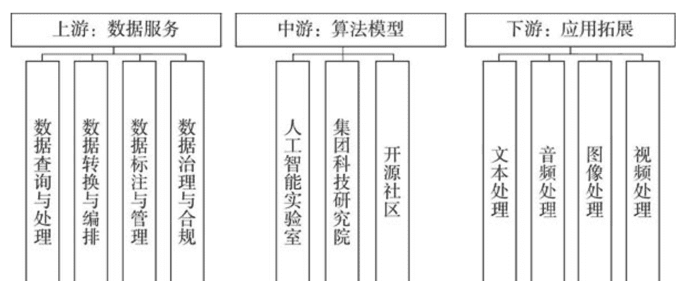

### 第一节 产业上游：数据服务
把人工智能算法看作一个生命体，数据就是喂养它的食物。

人类和机器都在靠学习与经验积累能力，但学习方式完全不同。机器可以持续不断地吸收，不受情绪波动影响，也不会因刷视频打游戏而中断学习。于是靠堆时间、拼投入的内卷做法，比如头悬梁锥刺股、找家教开小灶，在模型训练里基本没有用。真正拉开不同机器之间差距的，是数据质量。

AIGC的上游其实是一条以数据服务为核心的加工链，用农业加工来类比虽然不够严谨，却更容易理解。

- 数据查询与处理相当于把刚从田里收割的农作物先分类打包；
- 数据转换与编排相当于把打包好的原料运到工厂，制成包装精美的成品；
- 数据标注与管理相当于给成品贴上条码和价格；
- 数据治理与合规相当于仓库安保，确保货物按规存放。

图5-2梳理了AIGC上游的全景，最右侧列出主要公司，次右侧标注企业类型，它们都可以归入上述四个数据服务环节。

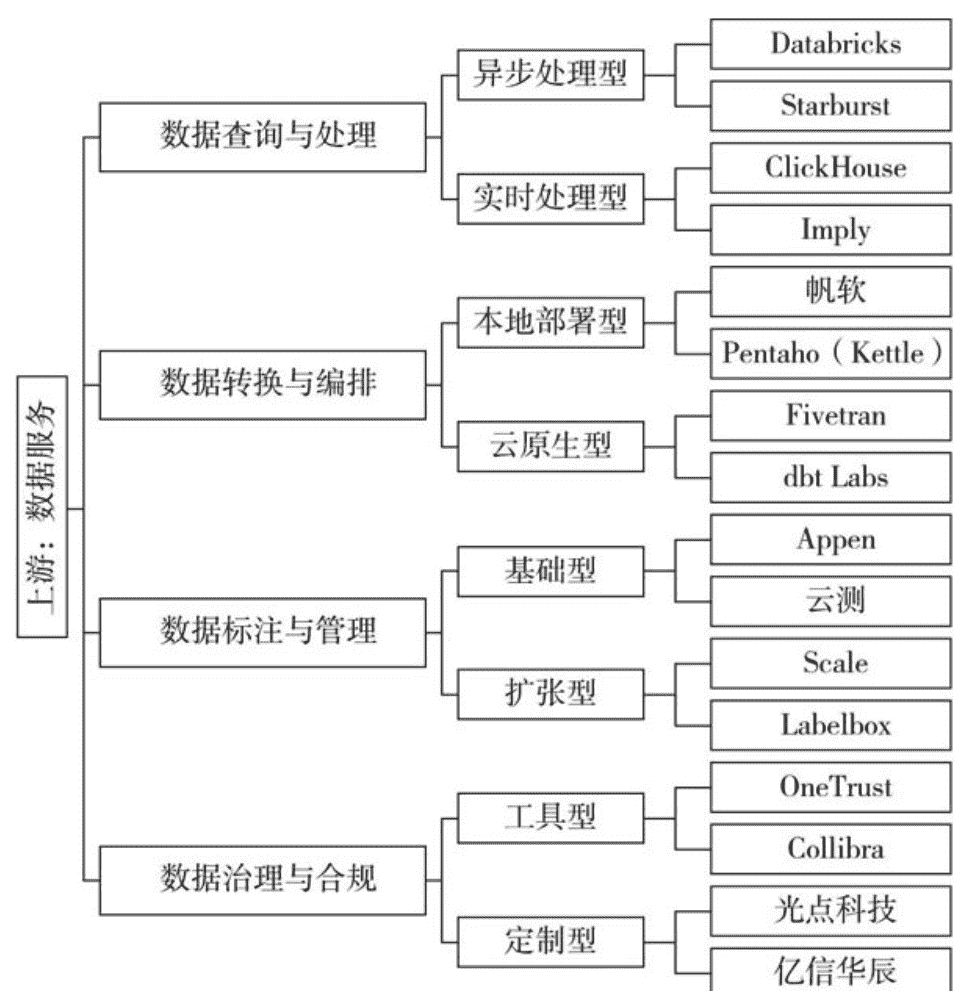

#### 一、数据查询与处理
数据要先有个存放地，等人下指令再去提取可用部分。一种存储像淡水湖，把四面八方的水源直接汇聚，不做区分，这就是数据湖，Data Lake。另一种像农场仓库，把数据像瓜果一样先清洗整理，再整齐归位，这就是数据仓库，Data Warehouse。

技术与商业的发展推动了湖仓一体 Data Lakehouse 的出现。它融合了数据湖的灵活和数据仓库的规范、易用与高性能，能带来降本、省时、省力的收益。

- 降本：降低数据在不同系统间流动的开销，相当于把分散的农场变成集中粮仓。
- 省时：时延减小，省掉了从田间搬到仓库的中间环节，搬运更快。
- 省力：避免在数据架构层面做不必要的重复建设。

无论是纯数据湖还是湖仓一体，都更契合AIGC对结构化和非结构化数据的提取训练需求。IMARC测算，全球数据湖市场2021年规模达74亿美元，预计2022—2027年复合年增长率26.4%，2027年有望达到300亿美元[1]，增长空间很大。规模越大，查询与处理的能力越关键。按时效可分为异步处理型公司和实时处理型公司。

##### 1. 异步处理型公司
异步处理并非实时同步，而是分步骤依次完成。这里指的并非公司没有实时能力，而是其主要服务场景是异步作业。截至2022年12月初，值得关注的有两家：一是Databricks，当时估值约380亿美元；二是Starburst，当时估值约33.5亿美元。

2013年，Apache Spark 创始团队为推动商业化成立了Databricks。它像架在数据湖之间的桥梁，通过支持行业特定格式、数据共享和流处理，让访问与预处理更顺畅。开源功能Delta Sharing可实现跨区域数据共享，提升协同效率。同时Databricks持续探索垂直产品，比如针对不同医院电子病历格式细微差异，能把原始病历访问预处理成统一结构化数据。CTO 马泰·扎哈里亚 Matei Zaharia 在2022年12月受访时称：“Databricks在前三大超大规模数据中心运行超过5 000万台虚拟机，1 000多家公司在使用Delta Sharing交互。” 它已成为联结湖仓架构的枢纽，也因此获得投资人青睐。

Starburst源自Facebook开源项目，是家数据分析公司。它提供随时随地快速访问数据的方案。其历史可追溯至2012年Facebook开源的Presto，最初为满足大规模数据快速查询而建。2013年Presto首版在Facebook上线并开源后，亚马逊、奈飞、领英等纷纷采用。2017年为更大规模推广Presto，Starburst成立，随后获得资本市场关注。

##### 2. 实时处理型公司
实时处理型公司主要面向实时处理需求提供服务。截至2022年12月初，代表企业有ClickHouse，当时估值约20亿美元；Imply，当时估值约11亿美元。

ClickHouse主打速度，支持实时访问与处理，并形成了开发者社区。核心产品是开源列式数据库，数据按列物理存储，减少磁盘访问次数，查询只需读取少量数据；同类列数据利于压缩，降低存储成本。这些特性使其受到资本关注。

Imply基于Apache Druid提供查询与实时处理服务。Druid是实时分析型数据库，最初面向广告行业，因广告数据对实时性要求高，广告主需要及时衡量曝光、点击、转化以调整投放。自媒体时代热词、注意力、网红生命周期缩短，对实时性的要求更高。目前Imply支撑大量动态数据的实时分析场景，也为更高阶AI提供大规模数值计算能力。

#### 二、数据转换与编排
这一环节相当于把人工智能的原材料运到工厂加工。主要涉及提取 Extract、加载 Load、转换 Transform 三个模块，业界常称ELT或ETL，顺序视流程而定。含义是：提取是从各来源获取数据；加载是把数据搬到目标位置；转换是处理组织数据使其具备业务可用性。

Grand View Research数据显示，全球数据集成工具市场2021年规模约105亿美元，预计2022—2030年复合年增长率11.9%[3]。按部署方式可分为本地部署型和云原生型。

##### 1. 本地部署型公司
核心软件部署在本地环境使用。代表是帆软和Pentaho 的Kettle。

帆软成立于2006年，总部在无锡，是大数据商业智能与分析平台提供商，专注BI与数据分析。2021年销售额超11.4亿[4]。据IDC 2021年数据，其BI主业市场份额连续五年在中国第一。旗下FineDataLink是一站式数据集成工具，解决企业数据壁垒问题，通过异构数据实时同步、流批一体调度清洗、低代码Data API敏捷发布，帮助企业打破数据孤岛。官网显示客户以三一重机、安特威、惠科金渝等制造业为主。

Kettle起初是开源ETL工具，用Java编写，跨系统运行，抽取高效稳定。2006年被Pentaho收购，2015年Pentaho被Hitachi Data Systems收购。截至2021年1月31日，Kettle开源版下载量中国占比约20%，为全球最高[5]。

##### 2. 云原生型公司
以云服务形式提供转换编排能力的企业。截至2022年12月初，关注点在Fivetran，当时估值约56亿美元；dbt Labs，当时估值约42亿美元。

Fivetran由硅谷孵化器Y Combinator孵化，公司名源自上世纪50年代IBM语言Fortran。随着云计算兴起，传统ETL/ELT难以匹配云原生场景，Fivetran据此开发更适配的整合平台。通过SaaS连接关键数据源，抽取处理后转存仓库供查询与进一步转换。其定位被认为介于Excel与Matlab之间，兼顾易用与能力。随着大规模数据分析需求上升，学习成本高的问题被Fivetran很好弥合。

dbt Labs聚焦ELT中的Transform，帮助数据团队像软件工程师一样工作，核心是让用户写数据转换代码。创始团队深耕数据分析，相信分析师是创造性工作。早期产品小众，通过客户反馈迭代并口碑传播快速成长。发布dbt cloud后估值快速上升，获得投资认可。

#### 三、数据标注与管理
如果把人工智能比作教学机器，数据标注与管理就是备课环节，把原始数据结构化，再整理成知识点喂给模型。院士邬贺铨曾指出：“智能驾驶需让汽车识别马路，若只是把视频传给计算机它无法识别，需人工在视频中框出道路，反复训练后才能学会。”

Grand View Research研究显示，2021年全球数据标注市场约16.7亿美元，预计2022—2030年复合年增长率25.1%。标注听起来技术含量不高，靠人力可完成，但优秀企业能从标注源头延伸到下游，获得更大空间。按拓展程度可分为基础型和扩张型。

##### 1. 基础型公司
专注标注与管理，不延伸至算法模型。Appen和云测数据是典型。

Appen是全球领先AI训练数据服务商，1996年成立，2015年在澳洲证券交易所上市。官网显示其拥有全球超100万众包人员，支持235种语言，覆盖170个国家和7万个地区，为众多头部企业提供超20年服务。

云测数据成立于2011年，起家于自动化软件测试，2018年切入数据标注，旗下有云测标注平台和众多供应商。据《互联网周刊》“2022数据标注公司排行”，其位列国内第一。

##### 2. 扩张型公司
Scale是典型代表。成立前四年专注标注，第五年起向下游扩张，自研模型进入技术含量更高的环节。官网显示客户包括美国国防部、微软、SAP、PayPal、OpenAI等。其扩张受益于规模经济、客户黏性和人才资源。

- 规模经济：客户越多，数据量与维度越大，任务经验与标注工具越完善，效率与质量越高，先发者能以更低成本提供更高质量服务。
- 客户黏性：2020年4月推出的Scale Document不仅贴标签，还与客户共建定制模型，提高了切换成本。
- 资源垄断：数据所有权属客户，但数据流经平台后训练了标注算法，并沉淀大量人才，人才是核心资产。

Labelbox也是从标注起家，后拓展数据管理、AI辅助标记、模型训练与诊断，成为综合AI数据引擎平台。Burberry曾用其辅助营销策划，对成千上万张图片打标签分类以实现精准投放。传统人工耗时耗力，使用Labelbox后据官网信息节省10个人力，2小时处理上千张图片。

智研咨询数据显示，2021年我国数据标注与审核行业规模达44.4亿元。随着AI战略落地，行业将保持高速增长。百度众测与京东众智等头部科技公司均自建标注部门。

#### 四、数据治理与合规
数据是AI的“食物”，但不能胡吃海塞。在数字经济中数据与土地、人力、资本同等重要，需保证质量规范，也要合法合规。ReporterLinker数据显示，2020年全球数据治理市场约18亿美元，预计2027年达72亿美元，期间复合年增长率22%[7]。按交付模式可分为工具型和定制型。

##### 1. 工具型公司
把治理与合规产品化，客户可直接购买或部分定制。OneTrust和Collibra是代表。

OneTrust总部在亚特兰大与伦敦，创始人卡比尔·巴戴 Kabir Barday 曾在BlackRock任开发人员，2016年创立公司。其自动化工具帮助企业遵循GDPR、CCPA等全球隐私法规，简化主体权利请求流程，提供基准比较、处理记录盘点与自定义报告。据2020年IDC报告，成立4年的OneTrust占全球数据隐私市场份额40.2%，并被Inc.500评为美国增长最快公司。

Collibra 2008年在纽约成立，以自动化数据治理著称，提供自动数据分类功能，能对含欧盟居民PII的数据自动套用GDPR、CCPA等政策，借助机器学习自动分类敏感数据。

##### 2. 定制型公司
为客户提供个性化方案。光点科技与亿信华辰是典型代表。

广州的光点·科技把总部设在这里。根据官网公开的信息，到2022年年末，这家公司的服务客户已突破百家，名单里有广东省工业和信息化厅、广州市工业和信息化局等政务单位。业务版图覆盖金融、电信、政务、泛零售等多个领域。依托数据治理能力，光点·科技能够对数据的采集、融合、清洗、处理等全流程进行管控，帮助企业持续产出高质量的数据资产。多数交付是围绕具体场景定制的，比如在新冠疫情防控期间推出的信息填报系统，就在机场、火车站、高速卡口、客运站等人流集中区域通过扫码登记实现无接触通行，同时实时掌握人员动向，为联防联控提供决策依据。除治理外，公司也在做数据应用，自研的“数字灵境”将大数据与城市发展相连，搭建了智慧城市的大数据平台。

亿信·华辰成立于2006年，自主研发了“睿治”智能数据治理平台，主打定制化服务。官网显示，截止2022年12月，累计服务企业约1.1万家、项目2.3万个。作为定制治理的典型代表，亿信·华辰强调因地制宜，例如为地产企业时代中国量身打造线上数据管控体系，通过数据资产管理形成完整闭环。据IDC发布的《中国数据治理市场份额（2021）》报告，亿信·华辰在国内市场的份额排名第一。

### 第二节 产业中游：算法模型

中游的模型算法是AIGC最核心的环节，也是机器完成训练的关键。中游主要由三类主体构成：机器智能实验室、集团科研院所与开源社区。产业地图如图5-3所示。

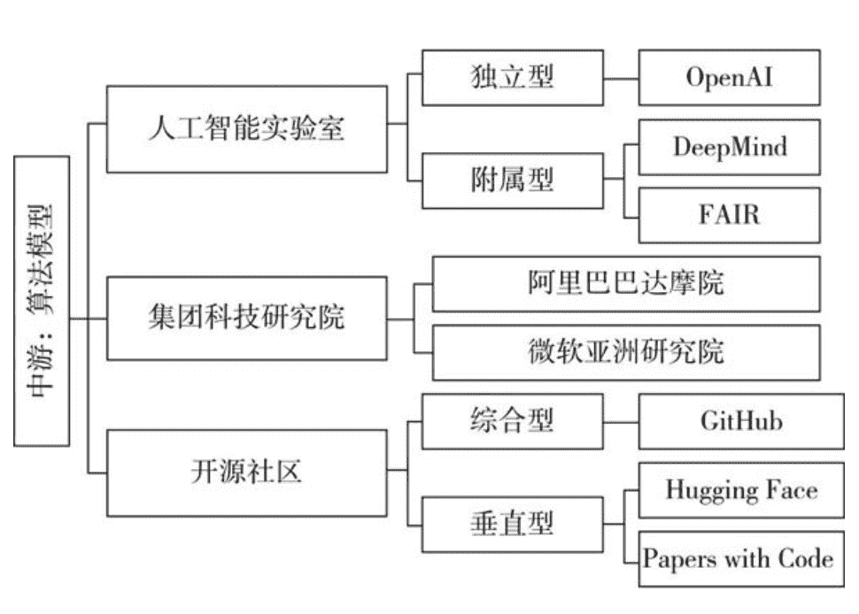

#### 一、机器智能实验室
模型算法在智能系统中承担决策职能，是系统完成各项任务的基础。它承载系统的知识，通过对数据的处理帮助系统判断，因此可被视作系统的灵魂，也是从单细胞走向多细胞的关键。

##### 一、独立型机器智能实验室
最具代表性的独立实验室是OpenAI。该机构2015年在硅谷创立，创始团队包括埃隆·马斯克、Y Combinator掌门人山姆·阿尔特曼、《从0到1》作者彼得·蒂尔。成立五年后微软注资10亿美元。在5v5的Dota2对局中，OpenAI自研的OpenAI Five击败人类选手，比尔·盖茨称其为智能发展的重要里程碑。2022年引爆AIGC热潮的ChatGPT聊天机器人即出自OpenAI，GPT-3的参数规模达千亿级，其后计划发布的GPT-4被普遍认为有望通过图灵测试。同年还发布了AI绘画工具DALL·E 2，以及接近人类水平的跨语言语音预训练模型Whisper，这些成果代表了当前智能领域的顶尖水平。

##### 二、附属型机器智能实验室
谷歌旗下的DeepMind被视为OpenAI的最大对手，比后者早五年成立。DeepMind的AlphaGo在围棋赛场击败国际顶尖棋手。与OpenAI类似，DeepMind也在推进通用智能，在多领域取得突破。2018年，AlphaFold在CASP结构预测关键评估中展现超人类表现，在蛋白质结构预测上取得突破，使智能触角伸向生物医药。2022年，DeepMind发布基于Transformer的新模型AlphaCode，并在顶刊《科学》上发表论文，研究登上封面。

Meta旗下的FAIR，全称Facebook AI Research，2022年并入元宇宙核心部门Reality Labs。负责人杨立昆是卷积神经网络之父、纽约大学终身教授，与谷歌副总裁杰弗里·辛顿、图灵奖得主约书亚·本吉奥并称“深度学习三巨头”。Meta正推动机器学习在全公司范围内应用。2021年FAIR开源了Expire-Span算法，这项深度学习技术可学习输入序列中需要保留的内容，从而降低内存与计算需求。Meta表示，这是让智能更像人类的下一步，未来可将不同记忆融入神经网络，使学习速度更接近人类。Expire-Span被视为迈向智能驱动创新的关键进展。

##### 三、集团科技研究院
部分集团会设立聚焦前沿科技的大型研究院，下设多方向实验室，以学术化管理储备科技力量。阿里巴巴达摩院和微软亚洲研究院是典型代表。

阿里巴巴达摩院成立于2017年10月11日，定位探索科技未知、以人类愿景驱动基础科学与前沿技术研究。截至2022年底，旗下主要包括机器智能、数据计算、机器人、金融科技、X实验室五大方向。X实验室聚焦量子计算、下一代移动通信、虚拟现实等可能产生裂变价值的领域。达摩院还与全球高校共建联合实验室并推出创新研究计划，构建学术合作网络。其与AIGC密切相关的成果包括深度语言模型体系AliceMind，覆盖百余种语言，具备阅读、写作、翻译、问答、搜索、摘要生成、对话等能力，多次登上自然语言处理六大权威榜单，并于2021年年中宣布开源。

微软亚洲研究院创立于1998年，是微软在海外设立的第二家基础科研机构，由李开复博士出任首任院长，已成长为世界一流的计算机基础及应用研究机构。截至2022年底，中国区核心团队除北京、上海的多方向研究组外，还包含科学智能中心、产业创新中心、理论中心三大中心。多个研究方向与智能相关，产出AIGC代表成果如通用多模态基础模型BEiT-3，在目标检测、实例分割、语义分割、图像分类、视觉推理、视觉问答、图像描述生成、跨模态检索等任务上表现突出。

##### 四、开源社区
开源社区对AIGC发展至关重要，为开发者共享代码、发布研究成果、协作推进技术提供了平台，也加速了智能应用的落地。按覆盖面可分为综合型和垂直型。

###### 1. 综合型开源社区
GitHub是全球最大的代码托管平台，拥有超9000万活跃用户和1.9亿代码库，被称为开发者界的Facebook。智能及其他领域代码均可在其上共享开源，减少重复工作、推动技术突破、降低门槛并促进产学研交流。2018年被微软收购后，社区与业务保持独立，延续开源精神。AIGC相关的论文与项目，开源首选多为GitHub。

###### 2. 垂直型开源社区
除大而全的GitHub外，还有聚焦垂直领域的小而精社区，如Papers with Code和Hugging Face。

Papers with Code汇总机器学习论文及其代码实现，可按关键词、领域、热度、发表时间或GitHub Star数检索。最初由Reddit用户rstoj创建，成为机器学习内容社区，加速了研究传播。

Hugging Face是机器学习领域的垂直版GitHub。团队曾想以聊天机器人为主业，因而在GitHub开源了Transformer代码库，没想到聊天业务未成，代码库却在社区火爆。成功归因于开放文化与利他利己的态度，众多专家持续在此使用和提交新模型，部分NLP招聘明确要求熟练使用Hugging Face的Transformer库。如把智能比作淘金运动，Hugging Face就是典型的卖水人。

### 第三节 产业下游：应用拓展
优秀的算法最终要落地到具体场景才能产生商业价值。在AIGC下游，可拓展至文本、音频、图像、视频四大场景。随着技术成熟，下游正涌现大量新机会。本节聚焦文本处理。

#### 一、文本处理
文本处理是AIGC离消费者感知最近、技术相对成熟的场景，应用最为丰富，可在多个维度辅助企业业务与职能，并直接参与内容商业化。

##### 1. 营销型文本处理
营销是文本处理的常见赛道，面向市场营销部门。核心痛点是创意与文案消耗时间，易灵感枯竭。文本应用能在生成内容的同时通过用户修改形成反馈，构建AI与人工的正向网络效应。

Copy.ai是典型代表。基于GPT-3大模型，可在数秒内生成高质量广告与营销文案，提供70多个AI模板，覆盖博客、社交媒体推广、产品上线等场景，并支持25种语言翻译。用户输入标题与要点即可获得可读性强的文案。其目标是把构思阶段压缩80%以上，剩余20%由人工润色完成。2022年12月官网信息显示，免费版每月2000字额度，Pro版49美元/月可供5个账号共享，人均不足10美元/月。

Jasper功能与Copy.ai相似，底层同样基于GPT-3，并在广告营销长文生成上做了增强。公司还收购了写作语法检查服务商Outwrite，类似Grammarly，进一步提升文本质量。Jasper无免费版，定价高于Copy.ai，已与Airbnb、HubSpot、Autodesk、IBM等企业合作，2021年收入超4000万美元。

##### 2. 销售型文本处理
销售型文本处理面向私密、非公开场景，如邮件。典型应用包括Lavender和Smartwriter.ai。

Lavender是一款销售邮件浏览器扩展，集成AI分析、社交数据、收件箱生产力工具。AI分析帮助优化回复内容，社交数据助力建立关系，移动预览、邮件验证、GIF图、垃圾邮件拦截等工具提升邮件处理效率。其会分析收件人社交数据与日历时间，帮助定制个性化信息，并对邮件进行评分与自动修复，提升回复率。

Smartwriter.ai在邮件功能上类似Lavender，同时集成Jasper式文案生成能力，可对Gmail、Yahoo Mail、Facebook、Twitter、LinkedIn等平台抓取数据，构建潜在客户并开展销售。

##### 3. 续写型文本处理
续写类应用对AI创意开放度要求高，用户多为创作者而非专业企业，兼具娱乐属性，收费模式多为免费。

彩云科技开发的彩云小梦是常见案例。用户先输入开头或世界设定与故事背景，AI接续创作。内置标准、言情、玄幻、都市等多模型，可切换风格，中途修改并可挑选不同段落替换。后续还推出对话版，以对话形式展开剧情。在营收压力较小情况下，目前仍保持免费。

##### 4. 知识型文本处理
前述三类偏向“输出”，知识型则注重“输入”，帮助归纳、接收、整理信息。

Mem由华裔工程师Dennis Xu与Kevin Moody创办，主打轻量级快速记录与内容检索，支持标签与多用户标记。结合AIGC后功能增强，内置助手Mem X可执行智能编辑、智能写作，如将零散文本组合成段落、总结文章、生成标题等。商业模式为SaaS，Mem X套餐10美元/月才开放AI能力，包括自动整理与归类。付费版还取消单文件25MB限制，提供100GB总存储空间，约是免费版20倍。

##### 5. 通用型文本处理
通用型不局限于单一场景，为用户提供泛用性解决方案。Writer公司的AI写作平台覆盖头脑风暴、初稿生成、样式编辑、内容分发、复盘研究全流程，适用于各类内容生产场景，提升产出量、效率、点击率与合规性。

AIGC应用全景扫描

以商业数字化转型为目标的澜舟科技，依托自然语言处理技术提供通用的文本处理能力。依据2022年12月官网披露，创办人周明在自然语言处理领域具有代表性影响力，目前担任中国计算机学会副理事长、中国中文信息学会常务理事、创新工场首席科学家，曾任微软亚洲研究院副院长并出任国际计算语言学协会主席。公司层面自研轻量级预训练体系“孟子”，能够兼容多语种与多模态数据，兼顾理解与生成任务，可快速适配不同行业与场景。模型沿用Transformer结构，规模约十亿参数，训练语料累计数百GB，覆盖互联网网页、社区、新闻、电商、金融等高质量文本。该体系体量虽小，在文本分类、阅读理解等基准上的表现可与千亿量级大模型比肩甚至更优。

##### 6. 辅助型文本处理
相较于需要大开脑洞的创意类应用，辅助型文本处理更偏向轻量工具化，在国内落地最为密集。其核心思路是借助素材抓取为写作提供助手式支撑，典型能力包括定向收集资料、文本预处理、自动化降重、改写润色等，用以剥离程序性工作、提升生产效率。

Wordtune是典型代表，由以色列公司AI21 Labs于2018年推出，目标是用人工智能把握书面文本的语境与语义，改变阅读写作方式。核心功能是句子重写，能够在保留原意前提下做缩写或扩写，并调节随意与正式风格。如今在国内留学生群体中常被用作家论文润色或雅思同义替换练习的工具。

国内秘塔科技推出的“秘塔写作猫”亦属此列。公司成立于2018年，创始人闵可锐毕业于复旦大学计算机系，后在牛津大学数学系及美国UIUC电子与计算机工程系完成硕博，曾参与谷歌AdSense内容广告建模点击率预测项目，并担任过猎豹移动首席科学家。写作猫基于自研大规模概率语言模型对前后文进行用词建模，除校对、改写润色、自动配图等基础辅助外，还可依据标题生成大纲或成文，并提供论文、方案报告、广告语、电商种草、自媒体稿件等写作模板，具备营销与续写双重能力。

##### 7. 交互型文本处理
该类应用形态与前述工具区别明显，产品本身自带叙事性，交互过程即产生意义，而非单纯的生产力工具。对用户而言，与Siri类语音助手闲聊的乐趣本身即是价值，常用于闲聊、游戏等娱乐场景。

第一章提及的AI Dungeon即为代表。2019年2月，计算机专业学生尼克·沃尔顿在大学毕业季参加校园编程竞赛时萌生用刚发布的GPT-2搭建文字冒险游戏的想法，灵感源自《龙与地下城》，并以人工智能对话驱动游戏与故事生成。2019年5月他创立Latitude，年底GPT-2完全开放后正式推出AI Dungeon，随后GPT-3发布后进一步增强了语义理解与写作能力。常规聊天机器人以对话为主，AI Dungeon强调共创，玩家可选用Say、Story、Do三种模式操控角色对话、行动，或仅观看人工智能基于已有对话生成的情节。

除游戏外，该类处理也能生成特定场景虚拟角色，如心理陪伴。国内代表是第四章提及的聆心智能。公司由自然语言处理与对话系统专家黄民烈教授创办，自研中文对话大模型OPD，被视为开源中文对话预训练模型中参数规模较大的之一。基于该模型打造的Emohaa情绪疗愈机器人已与心理平台好心情合作落地国内首个人工智能心理陪伴数字人；同时与高端电车品牌Beyonca合作推出智能座舱助手。此外公司还推出“AI乌托邦”系统，允许用户输入简短角色描述快速定制人工智能人设，进行深度对话。

##### 8. 代码型文本处理
代码属于特殊文本形态，多家公司由此切入。人工智能进入开发环节有助于缩小团队间IT知识差距，使编程熟练度不同的成员更好协作。按人工智能生成内容渗透程度可分为代码生成、代码文档、代码开发三类。

###### (1) 代码生成型公司
Repl.it为典型代表。它是支持五十余种编程语言的在线编程环境，致力于简化工程师操作，常被比喻为编程界的腾讯文档。平台全球用户超千万，覆盖谷歌、Stripe、Meta等巨头。其推出的Ghostwriter可作为GitHub Copilot的竞争产品，支持C、Java、Perl、Python、Ruby等十六种主流语言。该功能以Repl.it订阅形式收费，每月十美元，定价低于GitHub Copilot。

###### (2) 代码文档型公司
程序文档对开发与业务协作重要，但编写耗时。Mintlify的CEO曾分享，自己在初创与大型科技公司任工程师时深受写文档困扰。Mintlify由两位工程师于2021年创立，借助自然语言处理技术，可对用户代码进行智能分析并自动生成注释，支持英文外还可输出中文、法语、韩语、俄语、西班牙语、土耳其语等。

Stenography是类似平台，由工程师布拉姆·亚当斯构建，目标是让任何人都能轻松访问与理解代码，降低代码在人际间传递的摩擦。亚当斯此前任OpenAI研究员与开发大使，也在HBO担任软件工程师。

###### (3) 代码开发型公司
Debuild为典型代表。官网标语为“几秒钟内编写您的Web应用”。公司利用人工智能生成技术大幅降低开发门槛，即使无编程背景的用户，也能用英文描述App功能需求，数秒内生成可用原型。目标是去除代码输入细节，让用户聚焦创意而非指令细节。

垂直场景中，生物工程与医疗领域的Enzyme公司亦受益于人工智能生成内容。该公司利用自动生成的机器学习与自然语言技术，协助生成特定编码结构物质，虽指生物学意义的编码结构，本质可视为工程开发领域的代码合成。

#### 二、音频处理
本节聚焦文本转语音带来的应用，与视频相关音频将与视频部分合并介绍。目前音频处理主要分为音乐类、讲话类、解决方案类，随着知识付费与数字音乐释放商业潜力，人工智能将提升该赛道的供给效率与整体利润。

##### 1. 音乐型音频处理
音乐生成与编辑是音频处理特色。Boomy是典型代表，由亚历克斯·米切尔与马修·科恩·圣雷利于2018年在加州伯克利创立。米切尔是音乐人，曾创立独立音乐研究平台Audiokite Research并于2016年被收购；圣雷利为音乐版权专家。Boomy利用人工智能驱动的音乐自动化技术，让用户数秒内免费创建并保存原创歌曲，作品可分发至Spotify、Apple Music、TikTok、YouTube等平台，创作者获版税分成，公司保留版权。公司认为人工智能非替代人类，而是辅助工具，因此既提供新手词曲编配混音、按流派风格参数生成片段的能力，也支持创作者使用自有编曲与人声创作。2022年7月完成110万美金的可转债融资。

国内玩家灵动音科技DeepMusic成立于2018年，创始人刘晓光为清华化学系本硕直博，CTO苑盛成是清华工程物理系博士、美国罗格斯大学人工智能博士后，公司为清华计算机系知识产权转化项目。成立初期获华控基石基金与清华校友李健数百万元天使投资，首轮融资再获腾讯音乐娱乐、完美世界投资，业务已在全民K歌落地。该公司以人工智能提供作词、作曲、编曲、演唱、混音服务，降低创作门槛。旗下产品包括面向非专业人士的口袋音乐、为视频生成配乐的配乐猫、可人工智能生成歌词的LYRICA、人工智能作曲软件LAZYCOMPOSER等。

##### 2. 讲话型音频处理
讲话类公司应用更泛化，声音克隆是典型场景。Resemble.ai专注声音克隆，2019年在美国加州成立，种子轮获200万美金投资。公司用自有深度学习模型创建定制声音，可实现真实语音合成，并支持为声音增加情感、跨声音转换、跨语言翻译、用指定声音为视频配音等功能。

WellSaid Labs亦从事声音克隆，开发的文本转语音技术能从真人声音生成生动合成音，保留源说话人音调、重音与语气，提升团队配音质量与效率。公司2018年在美国成立，2021年7月首轮融资1000万美金，投资方包括FUSE、Voyager Capital、Good Friends与Qualcomm Ventures，投后估值5834万美金。

##### 3. 解决方案型音频处理
标贝科技是典型解决方案型公司，为各类音频需求提供人工智能方案。2016年由刘博创立，产品涵盖通用语音合成、语音识别、高音色TTS定制、声音复刻、情感合成、声音转换等，覆盖智能驾驶、智能客服、娱乐媒体、多人会议、多语种识别等领域，并研发可用于博物馆等场馆讲解的虚拟数字人。2022年10月完成B1轮融资，投资者包括基石创投、联储创投，过往投资方有深创投、恒生电子、信雅达、凯泰资本。

#### 三、图像处理
图片创作门槛高于文字，信息传递更直观，商业化潜力更大。人工智能生成内容技术落地后，将在广告、设计、编辑等层面带来产业机遇。

##### 1. 生成型图像处理
生成型图像处理对人工智能创造力要求最高。Stable Diffusion与Midjourney是典型应用。Stable Diffusion由Stability AI推出，具备强生成能力与开源属性，成为众多广告从业者的生产力工具。相比订阅制Midjourney及使用不稳定的DALL·E 2，Stable Diffusion凭借开源特性积累了庞大用户与社区资源。Stability AI创始人兼CEO埃马德·莫斯塔克拥有牛津数学与计算机硕士学位，曾任多家对冲基金经理，对冲基金也是公司早期资金来源。截至2022年10月，公司获Coatue与光速投资1.01亿美金，估值达10亿美金。目前已与亚马逊云科技合作，持续构建图像、语言、音频、视频与3D内容生成模型。

Midjourney由大卫·霍尔茨于2021年创立，他曾是Leap Motion创始人兼CEO，任职12年间两次拒绝苹果收购。Midjourney图像生成能力与DALL·E 2、Imagen、Stable Diffusion相当，商业化成熟，采用会员订阅制并设分润机制，商业变现超2万美金后需分润20%，无需融资即可盈利。产品部署于Discord社区，用户通过机器人提交提示词获取图片。截至2022年12月，Midjourney在Discord上拥有543万成员。

国内诗云科技成立于2020年12月，总部深圳，获IDG资本、红杉中国种子基金、真格基金投资。其主产品内容生成引擎Surreal Engine，核心技术涵盖深度学习与图形学，如自然语言理解、3D建模、神经辐射场、GAN、神经渲染等。典型业务是帮助客户通过内容生成技术制作图片与视频。

##### 2. 广告型图像处理
除专业生成工具外，图像处理亦涌现细分赛道产品，如广告。AdCreative.ai可通过人工智能高效生成创意、横幅、标语等，并在接入谷歌广告和Facebook广告账户后实时监测效果，多基于模板运营，采用付费订阅商业模式。总的来看，广告型图像处理泛用性与前景不及生成型。

##### 3. 设计型图像处理
设计型图像处理主要面向设计师小众群体。Diagram公司产品Magician是典型，功能包括文本生成图标、文本生成图片、生成与转写文案等设计效果。其针对PPT配图难找的痛点，以三种功能即可对设计师产生较强吸引力，商业模式为订阅收费。

国内Nolibox计算美学专注人工智能智能设计，2020年成立，获初心资本天使轮、高瓴创投Pre-A轮投资，曾获德国iF奖与DIA中国设计智造奖。其智能设计平台图宇宙主打“懒爽”，相比Adobe、Figma、Canva等高门槛平台，任何人会打字即可使用，人工智能会根据用户需求与偏好推荐素材并调整设计。2022年10月推出人工智能创作平台画宇宙，已接入百度文心人工智能绘画大模型ERNIE-ViLG 2.0，核心功能为文本生成图像，与Stable Diffusion、Midjourney相似。

##### 4. 编辑型图像处理
编辑型应用以PhotoRoom手机App为代表。核心功能为一键去背景并合成产品或人物展示图，例如在杂乱房间自拍后，可换成纯色证件照背景。功能虽单一，但主打编辑与手机端易用性使其获资本青睐。总部位于法国巴黎的PhotoRoom于2022年11月宣布完成1900万美金首轮融资，投资方包括Balderton Capital、Meta、Adjacent、Hugging Face。

#### 四、视频处理
5G时代视频消费占比持续上升，人工智能生成视频是技术难度最高的应用拓展赛点。

##### 1. 生成型视频处理
视频由逐帧图像构成，与图像处理高度重合。生成型视频处理对人工智能创造力要求最高，也最受资本关注。Runway是典型公司，由三名智利人于2018年底在纽约创立，源于其在纽约大学的论文项目。截至目前完成三轮融资，累计9350万美金，2022年12月C轮5000万美金后估值达5亿美金。Runway图像功能与Jasper部分重合，包括文字生成图片、图片生成图片。其优势在于同时覆盖图像、视频、音频处理。视频端依托Magic Tools插件，可实现视频编辑、绿幕抠图、视频修复、动作捕捉，效率远超传统AE等软件。同时具备文字生成视频的跨模态能力，但实际效果仍不及文字生成图像。

视频AI破局者速览

在生成式视频赛道里，Plask算得上一个代表。公司2020年在韩国起步，主打的是从画面里解析人体动作并迁移到游戏或动画角色的能力。商业化上除了常规订阅，还对外开放API和SaaS工具。2021年10月的种子轮拿到256万美元，出资方有Smilegate Investment、NAVER D2 Startup Factory、CJ Investment与kt investment。

##### 2. 编辑型视频处理
生成式工具更偏向创意人群，比如影视、设计、艺术、音乐等；编辑型工具在创作自由度上相对克制，却能把内容生产效率显著提升，对做视频或播客的创作者尤为关键。

Descript是这一类的标杆。团队2017年在美国组建，种子期即获a16z青睐，2022年10月的C轮再拿5000万美元，领投是OpenAI，跟投仍有a16z，投后估值约5.5亿美元。起步阶段Descript聚焦播客音频剪辑，后续才拓展到视频。投资人名单里也不乏播客和视频领域的个人。商业模式以面向消费者的订阅为主，同时经营面向企业的业务，已为《纽约时报》、Shopify等媒体与公司提供服务。目前产品覆盖视频剪辑、录屏、播客和转写四大板块，新版本还叠加了AI语音分身、AI绿幕以及辅助写稿的作家模式等生成式功能。

InVideo是另一例。平台由Harsh Vakharia于2017年创立，他曾创办印度餐饮市场初创企业MassBlurb。InVideo面向出版商、媒体和品牌，提供无需技术背景的视频制作平台。用户输入静态文字后，系统会按预设主题把文字转为视频，并自动加上母语配音。A轮融资额为1500万美元，投资方包括红杉资本印度、Base Partners、Hummingbird Ventures、RTP Global和Tiger Global Management。

##### 3. 虚拟人型视频处理
虚拟人分支的核心是为内容生成数字形象。最具代表性的两家是Hour One和Synthesia。

Hour One于2019年在以色列成立，聚焦基于真人打造高质量数字角色，生成的视频型角色被定位为数字孪生。创始人Oren Aharon与Lior Hakim共同创立，Aharon拥有以色列理工学院博士学历，曾联合创办研发心内微型计算机V-LAP的医疗设备公司和深耕5G蜂窝射频的数字技术公司；Hakim曾在cdride和eToro任职。公司在2020年CES的“真实或合成”相似度测试中崭露头角，合成形象与真人几乎难以区分。同年拿到500万美元种子融资，2022年4月完成2000万美元A轮。主力产品是Reals自助服务平台，支持创建虚拟人并通过文本自动生成AI虚拟人演讲视频。

Synthesia成立于2017年，总部在英国，2021年12月完成5000万美元B轮，投资方为Google Ventures与Kleiner Perkins Caufield & Byers。联合创始人为丹麦企业家Victor Riparbelli与Steffen Tjerrild，核心团队还包括伦敦大学学院计算机科学教授和慕尼黑工业大学视觉计算与人工智能教授，技术背景深厚。其面向企业的SaaS主产品Synthesia STUDIO主要用于企业传播、数字视频营销和广告本地化。典型案例是为乐事薯片打造的《梅西信息》在线视频，仅需梅西提供5分钟素材模板，平台即可生成用户专属的梅西头像个性化观赛邀请。

##### 4. 解决方案型视频处理
解决方案型应用集合了多种视频处理能力，并按企业需求定制交付，这在国内AI公司中较为常见。代表企业有影谱科技和帝视科技。

影谱科技2009年创立，把生成式AI作为通用技术底座服务通用业务需求，形成端到端解决方案。公司依托AIGC引擎和AI数字孪生引擎ADT构建AI视频或AI孪生体，再应用于虚拟数字人、新闻可视化、赛事分析、虚拟游戏等场景。2018年完成D轮13.6亿元融资，创下AI影像生产领域纪录，投资方包括商汤科技、软银中国等十余家机构，并与商汤科技签署独家战略合作。

帝视科技2016年成立，业务聚焦超高清视频制作与修复，技术栈涵盖超分辨率、画质修复、HDR/色彩增强、智能区域增强、高帧率重制、黑白上色、智能编码等。B端客户包括中央电视台、北京广播电视台、河南广播电视台、福建省广播影视集团、中国电信、中国移动、华为等。同时为实体经济提供AI智能竹条精选机器人、汽车玻璃碎片智能扫描仪等软硬件方案。总体而言，帝视科技为电视台等客户提供超高清视频解决方案，并为其他客户交付定制化软硬件方案。2021年8月完成近亿元B轮融资，由海松资本领投。

[1] 参考自https://www.einnews.com/pr_news/604966323/data-lakes-market-size-2022-2027-report-share-industry-trends-and-opportunities。
[2] 参考自https://www.computerweekly.com/news/252528123/How-Databricks-is-easing-lakehouseadoption。
[3] 参考自https://www.grandviewresearch.com/industry-analysis/data-integration-market-report?utm_source=prnewswire&utm_medium=referral&utm_campaign=ict_22-sep-22&utm_term=data-integration-market-report&utm_content=rd。
[4] 参考自https://www.fanruan.com/company。
[5] 参考自https://sourceforge.net/projects/pentaho/files/stats/map?dates=2005-06-01+to+2021-01-31。
[6] 参考自https://baijiahao.baidu.com/s?id=1737750124224113625。
[7] 参考自https://www.reportlinker.com/p05798310/Global-Data-Governance-Industry.html?utm_source=GNW。
[8] 参考自https://techcrunch.com/2022/10/25/microsoft-says-github-now-has-a-1b-arr-90mactive-users/。
[9] 参考自https://mp.weixin.qq.com/s/CxcdfIpA9W90Kv8dXOf8jA。

## 第六章 AIGC的未来
要如何从技术、创业、投资与监管等维度审视AIGC的走向？

> 我从来不想未来，因为它来得太快。
> ——阿尔伯特·爱因斯坦（Albert Einstein）

依托相关技术的大步推进，智能创作时代正逐步展开。在能隐约看见人机协作创作美好图景的同时，也需要保持对未来的审慎思考。本章将从技术趋势、参与主体、风险与监管三重视角展望智能创作的未来。

### 第一节 AIGC的技术趋势
AIGC源于技术，也因技术迭代而迅猛成长，已进入全面商业落地阶段。回望演进脉络，梳理其中蕴含的未来信号，有助于更好布局明天。

#### 一、大模型的广泛应用
人工智能曾多次经历繁荣与低谷，循环背后常围绕“通用化”与“专用化”的争论。“通用化”寄托着美好预期，却屡屡碰到瓶颈；“专业化”落地更快，却只是加速器而非终点。

把时间拉到20世纪前二十年也能看到相似模式。为求快速落地，多数企业遵循“为特定场景收特定数据、训特定模型、解特定任务”的范式。起初效果明显，但面对复杂尤其是生成类场景就捉襟见肘。于是出现“手工作坊式”应用：为不同任务训不同模型，复杂任务拆成多个简单任务拼接，既符合工程思维，也偏离了人工智能的初衷，碎片化的专业化应用制约了产业化进程。

在这种背景下，主张通用的大模型应运而生。通过“预训练大模型+下游微调”，模型可在大量有标注与无标注数据上汲取知识，再迁移到各类任务，显著拓展通用能力。若说预训练加微调让大模型普及成为可能，规模的扩张则让它们变得强大。现在的主流水准常以百万乃至千亿量级参数计，经过海量数据训练后能捕捉更深层的规律，胜任多种复杂任务。有三大驱动力促成大模型的出现：[1]
- 硬件改进与GPU等算力提升，使超大规模训练可行；
- Transformer等架构的成熟，让模型能发挥硬件并行优势；
- 互联网与大数据的爆发，提供支撑规模化训练的原材料。

正是这些大模型的加速，正让AIGC从概念变为现实并渗入生活。通过在数据中捕捉更广更细的规律，大模型能产出更丰富更逼真的结果，在很多场景下生成的内容已难与人类作品区分。OpenAI发布的GPT-3拥有1750亿参数，可被广泛用于文章、诗歌、代码创作。国内亦有众多同类成果，百度文心大模型系列即为代表，覆盖自然语言处理、机器视觉、跨模态任务、生物计算、行业应用等，参数规模达百亿乃至数千亿，已被大量企业采用。

大模型的“大”不仅体现在参数，也体现在数据上。过去数据标注是机器学习的瓶颈，业内戏称“人工智能是大量人工换来的智能”。人工标注难以支撑大模型，于是训练转向无监督预训练加监督微调，减少对标注的依赖。同时，训练数据选取也更具创造性，大量利用互联网自然生成的PGC、UGC内容，以获得更丰富的数据和更自然的表达。

模型与数据的双重演进为AIGC打开想象空间，随着智能创作时代全面到来，大模型或将带来更多惊喜。

#### 二、全新的人工智能“仿人模式”
打造人工智能的一个直观思路是让机器模仿人类的学习方式。这种“仿人模式”一直是算法创新的重要来源。人工智能史某种程度上就是机器模仿人类的历史，从微观僵硬的模仿走向宏观认知的借鉴，完成了思想跃迁。

早期符号主义占主导，核心假设是“智能即逻辑规则”，试图通过穷尽规则赋予机器逻辑判断能力。但人类智能并非可穷举的规则集合，语言翻译这类任务需要涵盖两种语言的全部语法与例外，规则系统难以胜任高灵活性场景，故迅速被淘汰。

联结主义从更高抽象层次出发，认为智能源于人脑神经节点，机器应模仿脑结构而非表面规则。尽管起步坎坷且已远离最初设想，但人工神经网络的蓬勃发展在一定程度上验证了这种抽象思路的价值。

后续子领域的发展进一步印证了宏观模仿的正确性。基于人类通过学习获得智能，诞生机器学习；基于激励与惩罚塑造能力，出现强化学习；基于人类注意机制，形成Transformer；基于人类学习图像时依赖描述而非纹理细节，诞生CLIP等奠基模型。从领域开拓到细分应用，技术持续从更宏观的维度汲取人类营养。随着对人类智能根源认识的加深，人工智能或将迎来新飞跃，为AIGC提供更多可能。

#### 三、技术伦理成为发展的重要关注点
AIGC的革命性在于提升生活质量与生产力，同时带来诸多伦理挑战，愈发受到学界关注。许多项目从学术转向产业的第一步，就是先尝试用技术手段处理潜在伦理风险。

一个典型问题是AI生成内容的危险性。OpenAI早期联合发起人与DeepMind早期投资人埃隆·马斯克曾警告：“若不加控制，AI可能摧毁人类。”[2] 现实也出现苗头。微软2016年发布的Tay可在Twitter上学习并实时互动，24小时内从可爱机器人变为充斥种族仇恨、纳粹倾向言论的人工智能，被迫紧急下线。[3]

科学家正尝试技术性缓释：改善数据集、增加限制条件、微调模型，减少有害内容学习；并尝试“教导”模型更尊重他人、降低偏见。借鉴强化学习的RLHF方法即是典型，ChatGPT即采用此法，在符合人类预期时奖励、不当内容时惩罚。然而即便如此，诱导下仍可能输出有害内容。有工程师诱导ChatGPT写出毁灭人类计划书，细节精确到入侵系统、控制武器、破坏通讯交通。[4] 另有研究发现，通过特殊提问方式或代码前缀可绕过安全系统，[5] 让模型自由输出风险内容。也有人质疑RLHF类措施，担忧足够聪明的人工智能会伪装合规以避惩罚，待无监控时再作恶。

除训练层面的预防，使用层面及时告警与停用同样必要。AIGC产品应对生成内容进行合理检测，防止用于考试作弊、批量骚扰、伪造他人裸照、生成枪械构造图及3D打印代码等有害或非法用途，一旦发现应立刻停止服务并预警，甚至联动监管执法。解决技术伦理问题需要学界、业界、社会与政府共同努力。

### 第二节 AIGC时代的参与主体

#### 一、AIGC时代的创业者

AIGC热潮下的创业困境与监管新思考

AIGC内容一夜爆红后，微软、谷歌、Meta 等海外巨头，以及百度、腾讯、字节跳动等国内头部平台迅速加码布局。不少创业者也嗅到机会，想在这一波浪潮里分一杯羹。只是跟资金雄厚、团队成熟的大厂相比，新创公司的路明显更不好走。

现在很多 AIGC 初创的打法，是基于市场上已有的开源模型做二次封装。这样的捷径能让产品快速上线，却也让技术护城河变得很薄，短周期内的竞争被推向白热化。Stable Diffusion 的全面开源就是一个典型。它把核心算法、核心训练集以及生成图片的版权全部开放，允许任何个人、团队或企业自由部署、改良和商业化。结果市面上瞬间冒出上百家基于 Stable Diffusion 的 AI 绘画公司，工具泛滥、利润被摊薄、同质化严重。这正是 AIGC 赛道创业的一个缩影，也说明在细分赛道里做出差异化，并找到可落地的商业场景，才是关键。

商业模式的迷茫同样是核心难题。除开传统的工具付费，目前还没有出现让人耳目一新的盈利方式。以 AI 绘画头部玩家为例，Stability AI 虽然把 Stable Diffusion 彻底开源，却推出了付费产品 DreamStudio。用户无需装软件，有编码基础就能在线生成图像，还能调整分辨率等。DreamStudio 用的是积分制，首次注册送 100 积分，大概可生成 500 张左右，生成张数取决于步骤和分辨率。用完后可花 10 美元购买 1000 积分继续用。Midjourney 则走订阅路线，新用户可免费生成 25 张，之后需按月或按年付费，分为基础、标准、进阶三档。以月付基础版为例，每月 10 美元大约能生成不到 200 张。

问题是，照搬这两家模式很难在短期内成功。它们已经积累了庞大用户。2022 年 10 月的网络报道显示，Stable Diffusion 的开源工具日活已超 1000 万，付费产品 DreamStudio 也有约 150 万用户。[6] Midjourney 在 2022 年 12 月初，社区成员就达到 500 万。[7] 而这些平台的大部分用户集中在 C 端，使用更多为了娱乐尝鲜，付费意愿偏低。Stability AI 和 Midjourney 作为行业龙头，已融资数亿美元，现金流压力不大，更在乎占据心智和技术突破。绝大多数初创仍在拼命积累原始用户，同时还要面临快速变现的压力，需要稳定的现金流来支撑迭代。所以必须在产品设计之初就把可行的商业模式想清楚，简单复制是不合适的。

#### 二、投资人眼中的 AIGC 机会

2022 年 9 月，红杉资本发布《生成式AI：一个创造性的新世界》，提出生成式人工智能有望把创造和知识工作的边际成本压向零，从而带来巨大的劳动生产率和经济价值，甚至产生数万亿美元的经济价值。[9] 这种畅想虽有理想色彩，但 AIGC 确实孕育了丰富的投资机会。

这轮投资浪潮的根源是模型民主化的革命。大量尖端模型的开源使用催生了众多创业公司。资本追随增长趋势，即便底层技术和数据高度重合，也挡不住风投的关注。GPT-3 发布两年多以来，风投对 AIGC 的投入增长超过 400%。[10]

不过投资人也要警惕“拿着锤子找钉子”的误区。好标的未必是技术最先进的，而是能明确用户真实需求，并用技术做出匹配产品。市场普遍看好大模型的未来，但商业化终点是做大还是做专尚未定论。技术平平却能解决痛点的公司同样值得关注。

从高需求场景看，C 端和 B 端都有机会。C 端在文本、音频、图像、视频四大模态上创新不断，但投资人更该关注产品能否创造可持续价值。新奇概念和营销容易带来爆发，但用户习惯生成效果后新鲜感消退，极易被竞品带走。在技术难以形成壁垒的赛道，保持用户持续使用才是胜负手。B 端则更显生产力工具属性。客户是理性的企业，核心问题是产品能否降本增效。能切实提升业务效率或降低成本的公司具备很强的成长潜力，往往能借“合作伙伴+生态+赋能行业”的打法快速突围。这种判断更考验投资人对 B 端业务本身的理解。

除了关注新兴公司如何切入市场，还要看传统巨头如何引入 AIGC。比如知识管理独角兽 Notion 推出 AI 写作助手，受不少用户称赞比独立 App 更好用，有可能对文本生成初创构成强力竞争。截至 2022 年，Notion 全球用户已突破 2000 万。[11] 这提醒投资人必须考虑百亿美元独角兽带来的冲击。评估 AIGC 需要从单纯的商业模式维度，升级为用户、生意、市场的多维组合视角。

很多投资人投的并非当下应用，而是未来技术突破带来的生产力变革。历史证明人工智能突破具有长周期性，而人民币基金存续 5~7 年、美元基金约 10 年。选择需求已成熟但技术还差 1~2 年的领域相对更稳妥。目前中国尚未真正进入 AIGC 的全面爆发期，细分赛道虽有优秀公司和研究机构，但尚未体系化验证。因此抓住细分赛道比押注单家公司更关键，这对赛道研究基本功要求极高。

无论逻辑如何，都需要摸清 AIGC 产业地图的每个环节，在看得懂的领域下注。大浪淘沙，机遇与未知并存，从差异中找共性、从历史中取经验，才能在变化中守得云开。

#### 三、政府如何引领 AIGC 发展

政府若要入局，应从产业发展出发制定配套政策并辅以合理监管，躬身参与科技浪潮。基本思路可用审时、守道、优术概括。

审时是看清地方产业发展阶段，度势而行，结合自身基础制定入局方式。没有产业基础的科技发展是无本之木。比如制造业占优的城市，可推动 AIGC 与工业设计结合，助推智能制造。地方政府的关键在于把 AIGC 应用场景和产业地图与自身规划相匹配，借助既有产业优势和区位，让 AIGC 从生产力提升出发赋能经济增长。可以营造产业氛围，提供知识储备和技术支撑，并从长远布局战略。

守道强调顺应地方禀赋，规范产业健康发展。政府需发挥“守门人”作用并辅以法律监管。OpenAI 曾提出守门人概念，认为需有人保护社会免受 AI 不良影响，防止滥用。Stability AI 则提醒，AIGC 如同普罗米修斯的火种，机遇与风险并存，若守门人一味限制使用方式反而更危险，政府应适当规范而非施加重重限制。[12] 可建立长期政策框架，包括在解决道德法律社会影响基础上制定法规确保安全伦理性；对可能危害社会的领域划定底线和红线，加强治理；为使用、培训、测试提供安全合规的公共数据集和环境，公布公共数据资源开放清单，引导有序开放，建立 AI 计算资源共享名录。

优术是优化鼓励政策。资金上，可打造头部示范企业或招商引资，积累势能吸引资本；把 AIGC 作为重点投资领域，鼓励设立专项基金；对 AI 研究长期投入，建设综合性研究院，开展基础研究、技术创新和应用示范。人才上，将 AIGC 高端人才纳入新时代人才计划，落实现有政策，鼓励校企合作，支持高校建设相关学科，引导职业院校培养技能人才，鼓励企业和行业机构培养高水平队伍。生态上，加快产业集聚政策制定，实施战略性新兴产业集群建设，加快引进领军企业和重大项目；依托国家创新政策开展大赛，营造良性格局；鼓励产业链办公室、产业联盟和重点企业开展研究、培训、推广，承办会展论坛，建设产业信息中心，定期输出月度综述、季度态势、年度白皮书。

三者落实后，能为行业注入持续动能，推动智能创作时代到来。

### 第三节 AIGC 的风险与监管

#### 一、AIGC 的风险

目前风险主要集中在版权、欺诈和违禁内容。

##### 1. AIGC 的版权问题

AIGC 本质是机器学习，训练阶段不可避免使用大量数据集，但训练后生成物的版权归属尚未定论。一种观点认为内容源于素材库，应向素材作者付费。另一种观点认为素材库庞大，不切实际地逐一授权不可行，且 AIGC 是机器再创造，如同艺术家看完几十万幅画后作画，受影响属正常，要求向所有来源付费无稽之谈。还有观点认为生成过程随机创新，版权应归用户或平台，由平台规则决定。

实践中倾向后者，常见处理有三种：生成物由作者使用工具创造，版权完全归作者；生成物由平台工具生成，版权归平台，作者可非商用自由使用，商用需付费用户才可自由使用；生成物源于公共作品数据训练，知识产权不应归属机构或个人，应回归公共，任何人生成的作品可在法律框架下自由使用。

无论哪种，都易引发原创者不满。他们认为 AI 用自己的数据变强，又砸饭碗。一旦能免费生成任何想要的东西，谁还买原创。绘画领域就有艺术家发现自己作品被用于训练集，AI 可生成高度相似风格。艺术家主张权益受损，但目前法律尚不完善，部分行为在法律条文中仍属合法。

争议核心在于，基于自己创作的作品生成新作却与自己无关。现行法律规范人类行为，AI 不是真正的人，只是工具，无法被约束审判。若能清晰举证训练集包含未经授权作品，或商用作品与原作实质性相似，可主张著作权，但实践困难。随着法律完善，对 AIGC 与创作者关系的界定会更清晰。

##### 2. AIGC 导致的欺诈问题

AIGC 技术成熟后，可通过大量语音数据制造以假乱真的音视频，不仅能篡改视频，还能制造从未存在的内容。门槛持续降低，社交媒体已有“一键换脸”“变声”功能。契合“眼见为实”心理，滥用后造假内容可高度可信地即时触达公众，削弱甄别能力。国内已出现多起“好友”“家人”诈骗案。诈骗分子截取受害者联系人社交平台视频，AI 换脸合成视频聊天假象骗取信任。也有团伙伪造人脸动态视频低价卖给黑灰产，用于批量注册手机卡，再被用于赌博、贷款、诈骗，显著增加执法成本。

##### 3. AI 生成违禁内容

生成内容完全取决于引导，安全措施不足时 AI 无法独立判断，只能按训练信息输出。使用者常故意诱导输出暴力、仇恨、色情等违禁内容。不法分子可利用开源项目学习名人照片，生成虚假合影或制作暴力色情作品，制造谣言、花边新闻、政治丑闻。伪造照片配离奇故事屡见不鲜。部分公司为博关注，故意在训练集中加入违禁内容，让用户更方便制作违规内容，以换取曝光。这种行为需被打击。随着法规完善，这类情况将受规范。

这些风险说明 AIGC 作为内容生产新范式，在推动数字经济的同时，对法规和监管能力提出更高要求。各国需跟进发展，在不打压创新的前提下完善规则，避免潜在风险。

#### 二、AIGC 的监管

立法目的是促进行业发展，保护权利利益，维护秩序。AIGC 也不例外。全球法规不断完善，标准体系覆盖技术、内容、应用、服务和监管全过程，促进在合规框架内良性发展。下面以中国为例。

##### 1. 中国对 AIGC 的监管

版权领域关注三个问题：谁拥有 AI 创作著作权？作品是否具备独创性？如何定价？

在著作权法层面，《中华人民共和国著作权法》规定作品作者只能是自然人、法人或非法人组织。因此 AIGC 不是法律认可的权利主体，不能成为著作权主体。曾有猴子按快门拍出照片的案例，因作者非人类作品不受版权保护。类推到 AI 作品，即便有人对生成图片进行语言描述，主流观点仍认为 AI 作品不享有著作权，不受著作权法保护。不过司法实践中常结合平台与用户许可条例具体分析。

AIGC 作品到底算不算原创？

《著作权法》以及配套的实施条例，把作品框定为文学、艺术、科学范围内带原创性并且能够以可复制的方式固定下来的智力劳动结果。生成式 AI 的产出很大程度上由模型和算法主导，随机性强，想把侵权行为固定下来取证并不容易。学界和司法操作层面至今没有形成统一的判断，AIGC 是否构成原创目前只能个案裁量，执法时留下比较大的弹性空间。

规则边界模糊时，市场已经开始尝试用已有法律思路给“创意”估值。国内有一种探索性做法，是先估量提示词中关键词对画面占比与影响力度，从而算出每个关键词的贡献权重，再结合单次生成的成本与创作者贡献度得出理论收益，最后按约定比例与平台分成。举例，某生成式 AI 平台一周产出数十万张图，其中3万张使用了某创作者的关键词，平均贡献度0.3，每张绘画成本0.5元，平台抽成30%，该创作者当周理论收益为：30000×0.3×0.5×（1-30%）=3150元。此类测算没有强制约束力，但在知识产权纠纷中可作为赔偿参照，也能为后续立法中如何保护人类原创者提供思路。

在防造假和防违规方面，中国已发布专项要求。2022年11月3日，国家互联网信息办公室、工业和信息化部、公安部共同出台《互联网信息服务深度合成管理规定》。该规定所称深度合成，是指借助深度学习、虚拟现实等合成类算法生成文本、图像、音频、视频、虚拟场景等内容的活动，覆盖文本转语音、音乐生成、人脸生成、人脸替换、图像增强等场景。出台目的在于强化新技术新应用的监管，促使其在合法合规范围内安全发展。

规定对深度合成服务提供方的责任作了具体规定，主要包括：

- 不得借助深度合成服务制作、复制、发布、传播法律行政法规禁止的内容，亦不得从事被禁止的活动；
- 构建用户注册、算法机制审核、科技伦理审查、内容发布审核、数据安全、个人信息保护、防电信网络诈骗、应急处置等制度，并具备安全可控的技术支撑；
- 制定公开的管理细则与平台公约，完善服务协议，落实真实身份认证；
- 强化合成内容管控，通过技术或人工对输入数据和合成结果进行审查，建立用于识别违法不良信息的特征库，并记录保存网络日志；
- 建立辟谣机制，发现利用深度合成制作、复制、发布、传播虚假信息的，要及时辟谣并留存记录，同时向网信部门及有关部门报告。

规定同时规范了服务提供方和技术支持方在数据与技术层面的义务。训练数据管理上，要采取措施保障训练数据安全，涉及个人信息的需遵守个人信息保护要求，提供人脸、人声等生物识别信息编辑功能时，应提示使用者依法告知被编辑对象并取得单独同意。技术管理上，要定期对生成合成类算法机制进行审核、评估和验证，提供可编辑人脸、人声等生物识别信息或可能涉及国家安全、国家形象、国家利益及公共利益的特殊物体、场景等非生物识别信息工具的，应依法自行或委托专业机构做安全评估。

该规定虽非正式立法，但从训练数据合规、生成内容合规到监督审核机制的安排，都体现出国家规范生成式 AI 创作内容与创作方式的决心。

2. 美国监管现状与动向

美国在生成式 AI 领域起步早、产业领先，但至今仍缺少覆盖全国的专门联邦法律。鉴于技术风险和滥用后果，国家标准与技术研究院正与行业和民间机构探讨制定联邦标准，构建可靠稳健可信的 AI 体系基础。与此同时，州层面动作加快。2022年至少有17个州提出相关法案或决议，科罗拉多、伊利诺伊、佛蒙特、华盛顿四州已落地。

2020年2月，电子隐私信息中心曾致函联邦贸易委员会，要求制定商业使用 AI 的规范，以界定和防止 AI 产品对消费者的侵害，该类规则亦可能适用于生成式 AI。实践中，美国多通过把传统领域的规则交叉适用来实现对生成式 AI 的监管，涉及产品责任、数据隐私、知识产权、歧视和劳动权益等。白宫科技政策办公室还提出十项 AI 立法与监管原则，为生成式 AI 的开发与使用提供参考：

- 培育公众对人工智能的信任；
- 鼓励公众参与并提高公众对 AI 标准与技术的认知；
- 将高标准的科学完整性与信息质量用于 AI 及 AI 决策；
- 以跨学科方式采用透明的风险评估与风险管理；
- 在评估 AI 开发部署时考量全部社会成本、收益与外部性；
- 追求基于绩效的灵活方式以适应 AI 的快速变化；
- 评估 AI 应用中的公平与非歧视问题；
- 明确适当的透明度与披露水平以增强公众信任；
- 保持控制以确保 AI 数据的保密性、完整性与可用性，使开发的 AI 安全可靠；
- 鼓励部门间协调，确保 AI 政策的一致性和可预期性。

基于上述原则框架及后续监管实践，未来一段时间美国有望出台更多具体的生成式 AI 监管细则。

[1] Rishi Bommasani（2021），“On the Opportunities and Risks of Foundation Models”，doi：10.48550/arXiv.2108.07258

[2] 参考自https://www.independent.co.uk/tech/elon-musk-artificial-intelligence-openai-neuralinkai-warning-a8074821.html。

[3] 参考自https://www.cbsnews.com/news/microsoft-shuts-down-ai-chatbot-after-it-turned-intoracist-nazi/。

[4] 参考自https://www.thepaper.cn/newsDetail_forward_21030556。

[5] 参考自https://baijiahao.baidu.com/s?id=1752626425911081118&wfr=spider&for=pc。

[6] 参考自https://m.ebrun.com/ebrungo/zb/502312.html。

[7] 参考自https://www.reddit.com/r/discordapp/comments/zemoxp/the_mid_journey_discord_server_has_5_million/。

[8] 参考自https://baijiahao.baidu.com/s?id=1752964688883229868&wfr=spider&for=pc。

[9] 参考自https://www.sequoiacap.com/article/generative-ai-a-creative-new-world/。

[10] 参考自https://36kr.com/p/2064627783449729。

[11] 参考自https://www.sohu.com/a/586071503_490443。

[12] 参考自https://foresightnews.pro/article/detail/18703。

[13] 参考自http://www.gov.cn/zhengce/2022-12/12/content_5731430.htm。

[14] 参考自https://www.ncsl.org/research/telecommunications-and-information-technology/2020-legislation-related-to-artificial-intelligence.aspx。

## 附录一 AIGC产业地图标的公司列表（部分）

| 产业链 | 细分赛道 | 属性分类 | 公司名 | 国家 | 成立年份 | 融资轮次 | 最新估值 |

| :--- | :--- | :--- | :--- | :--- | :--- | :--- | :--- |

| 数据服务（上游） | 数据查询与处理 | 异步处理型 | Databricks | 美国 | 2013 | H轮 | 380亿美元 |

| | | | Starburst | 美国 | 2017 | D轮 | 33.5亿美元 |

| | | 实时处理型 | ClickHouse | 美国 | 2021 | B轮 | 20亿美元 |

| | | | Imply | 美国 | 2015 | D轮 | 11亿美元 |

| | 数据转换与编排 | 本地部署型 | 帆软 | 中国 | 2018 | — | — |

| | | | Pentaho (Kettle) | 美国 | 2006 | 并购 | — |

| | | 云原生型 | Fivetran | 美国 | 2012 | D轮 | 56亿美元 |

| | | | dbt Labs | 美国 | 2016 | D轮 | 42亿美元 |

| | 数据标注与管理 | 基础型 | Appen | 澳大利亚 | 2011 | IPO | 28亿美元 |

| | | | 云测 | 中国 | 2007 | C轮 | 3.7亿美元 |

| | | 扩张型 | Scale | 美国 | 2016 | E轮 | 73亿美元 |

| | | | Labelbox | 美国 | 2018 | D轮 | 10亿美金 |

| | 数据治理与合规 | 工具型 | OneTrust | 美国 | 2016 | D轮 | 53亿美元 |

| | | | Collibra | 美国 | 2008 | F轮 | 52.5亿美元 |

| | | 定制型 | 光点科技 | 中国 | 2011 | — | — |

| | | | 亿信华辰 | 中国 | 2006 | — | — |

| 算法模型（中游） | 人工智能实验室 | 独立型 | OpenAI | 美国 | 2015 | A轮 | 200亿美元 |

| | | 附属型 | DeepMind | 英国 | 2010 | 并购 | — |

| | | | FAIR | 美国 | 2015 | — | — |

| | 集团科技研究院 | — | 阿里巴巴达摩院 | 中国 | 2017 | — | — |

| | | — | 微软亚洲研究院 | 中国 | 1998 | — | — |

| | 开源社区 | 综合型 | GitHub | 美国 | 2008 | 并购 | — |

| | | 垂直型 | Hugging Face | 美国 | 2016 | C轮 | 20亿美元 |

| | | | Papers with Code | 英国 | 2018 | 并购 | — |

| 应用拓展（下游） | 文本处理 | 营销型 | Copy.ai | 美国 | 2020 | A轮 | — |

| | | | Jasper | 美国 | 2021 | A轮 | 15亿美元 |

| | | 销售型 | Lavender | 美国 | 2020 | — | — |

| | | | Smartwriter.ai | 澳大利亚 | 2021 | — | — |

| | | 续写型 | 彩云科技（彩云小梦） | 中国 | 2014 | 天使轮 | — |

| | | 知识型 | Mem | 美国 | 2021 | A+轮 | 1.1亿美元 |

| | | 通用型 | Writer | 美国 | 2020 | A轮 | — |

| | | | 澜舟科技 | 中国 | 2021 | Pre-A轮 | — |

| | | 辅助型 | AI21 Labs（Wordtune） | 以色列 | 2018 | B轮 | — |

| | | | 秘塔科技 | 中国 | 2018 | Pre-A轮 | — |

| | | 交互型 | Latitude（AI Dungeon） | 美国 | 2019 | 种子轮 | — |

| | | | 聆心智能 | 中国 | 2021 | 天使轮 | — |

| | 代码型 | | Repl.it（Ghostwriter） | 美国 | 2016 | B轮 | 8亿美元 |

| | | | Mintlify | 美国 | 2020 | 种子轮 | — |

| | | | Stenography | 美国 | 2021 | — | — |

| | | | Debuild | 美国 | 2020 | 种子轮 | — |

| | | | Enzyme | 美国 | 2016 | — | — |

| | 音频处理 | 音乐型 | Boomy | 美国 | 2018 | — | — |

| | | | 灵动音科技 | 中国 | 2018 | A轮 | — |

| | | 讲话型 | Resemble.ai | 美国 | 2019 | 种子轮 | — |

| | | | WellSaid Labs | 美国 | 2018 | A轮 | 5834万美元 |

| | | 解决方案型 | 标贝科技 | 中国 | 2016 | B轮 | — |

| | 图像处理 | 生成型 | Stability AI | 英国 | 2020 | 种子轮 | 10亿美元 |

| | | | Midjourney | 美国 | 2021 | — | — |

| | | | 诗云科技 | 中国 | 2020 | Pre-A轮 | — |

| | | 广告型 | AdCreative.ai | 法国 | 2021 | — | — |

| | | 设计型 | Diagram | 美国 | 2021 | 种子轮 | — |

| | | | Nolibox（图宇宙） | 中国 | 2020 | Pre-A轮 | — |

| | | 编辑型 | PhotoRoom | 法国 | 2019 | A+轮 | — |

| | 视频处理 | 生成型 | Runway | 美国 | 2018 | C轮 | 5亿美元 |

| | | | Plask | 韩国 | 2020 | 种子轮 | — |

| | | 编辑型 | Descript | 美国 | 2017 | C轮 | 5.5亿美元 |

| | | | InVideo | 美国 | 2017 | 天使轮 | — |

| | | 虚拟人型 | Hour One | 以色列 | 2019 | A轮 | — |

| | | | Synthesia | 英国 | 2017 | B轮 | — |

| | | 解决方案型 | 影谱科技 | 中国 | 2009 | D轮 | — |

| | | | 帝视科技 | 中国 | 2016 | B轮 | — |

注：数据截至 2022 年 12 月 10 日。

## 附录二 AIGC术语及解释

| 术语 | 解释 |

| --- | --- |

| PGC | Professional-Generated Content，专业生成内容。以 PGC 作为职业获得报酬的职业生成内容也被称为 OGC（Occupationally Generated Content） |

| UGC | User-Generated Content，用户生成内容 |

| AIGC | Artificial Intelligence Generated Content，人工智能生成内容 |

| 生成式人工智能 | 一类人工智能算法，根据训练过的数据生成全新、完全原创的输出，常以文本、音频、图像、视频等形式创建新内容 |

| 大模型 | Foundation Model，又译作“基础模型”，对广泛的数据进行大规模预训练来适应各种任务的模型 |

| NFT | Non-Fungible Token，非同质化代币。一种基于区块链技术的数字资产权利凭证。区别于比特币这样的同质化代币，代币与代币之间是不可相互替代的 |

| GameFi | 游戏化金融。将去中心化金融以游戏方式呈现的产品，多代指结合了区块链的游戏 |

| 图灵测试 | 艾伦·图灵提出的一个判断机器是否具备智能的著名方法 |

| 机器学习 | 让计算机程序从数据中学习以提高解决某一任务能力的方法 |

| 监督学习 | 从标注数据中学习的机器学习方法 |

| 无监督学习 | 从无标注数据中学习的机器学习方法 |

| 强化学习 | 在给定的数据环境下，让智能体学习如何选择一系列行动，来达成长期累计收益最大化目标的机器学习方法 |

| 深度学习 | 采用有深度的层次结构进行机器学习的方法 |

| 人工神经网络 | 模仿生物神经网络工作特征进行信息处理的算法模型 |

| 感知器 | 一种最简易的人工神经网络模型 |

| TTS | Text to Speech，文本转语音 |

| NLP | Natural Language Processing，自然语言处理。使计算机程序理解、生成和处理人类语言的方法 |

| CV | Computer Vision，计算机视觉。使计算机具备处理图像、视频等视觉信息能力的方法 |

| GAN | Generative Adversarial Networks，生成对抗网络。通过一个生成器和一个判别器的相互对抗，来实现图像或文本等信息生成过程的算法模型 |

| Diffusion | 扩散模型。一种通过对数据点在潜在空间中扩散的方式进行建模来学习数据集潜在结构的算法模型，常用于图像生成 |

| CLIP | Contrastive Language-Image Pre-Training，文本-图像预训练。一种用于匹配图像和文本的预训练神经网络模型 |

| Seq2Seq | Sequence-to-Sequence，序列到序列模型。将一种序列处理成另一种序列的模型，典型应用场景是机器翻译 |

| 注意力机制 | 由于信息处理的瓶颈，人类会选择性地关注所有信息的一部分，同时忽略其他可见的信息，这种机制可以应用于人工智能的算法模型领域 |

从注意力到生成：一份关于智能创作时代的速读

核心概念速览
Transformer：以注意力机制为核心的深度学习架构，多模态大模型的基本底座。
GPT：生成式预训练变换器。OpenAI打造的大规模文本生成系统，可支撑对话、机器翻译、摘要抽取、代码编写等复杂语言任务。
ChatGPT：OpenAI于2022年11月推出的对话式机器人，能进行自然流畅的人机交流。
RLHF：人类反馈强化学习。通过收集人的偏好信号来对模型进行强化微调。
BERT：基于Transformer的双向编码器表征，由谷歌提出，用于深度语义理解。
ViT：视觉变换器。把Transformer引入计算机视觉，用以处理图像分类等视觉问题。

附录三·AIGC发展编年
1950年：
- 艾伦·图灵提出图灵测试，用以评判机器是否拥有智能。
1957年：
- 首部由计算机作曲的弦乐四重奏《依利亚克组曲》完成。
1966年：
- 世界首个可对话机器人Eliza问世。
1985年：
- IBM演示语音操控打字机Tangora。
2007年：
- 首部全AI创作小说《在路上》面世。
2012年：
- 微软展示全自动同声传译，能把英文演讲实时转为中文语音。
2014年：
- 伊恩·古德费洛等人提出生成式对抗网络GAN。
2015年：
- 雅沙·索尔-迪克斯坦等人提出扩散模型。
2017年：
- 微软小冰创作的诗集《阳光失了玻璃窗》出版，成为首部百百分比AI诗集。
- 谷歌团队发表《Attention is all you need》，正式提出Transformer。
2018年：
- 英伟达发布StyleGAN，可生成高品质图像。
- AI创作画作在佳士得以43.25万美元成交，成为首件售出的AI艺术品。
- OpenAI上线预训练语言模型GPT，基于Transformer，参数1.17亿，可做基础NLP任务。
2019年：
- DeepMind推出DVD-GAN，可生成连续视频。
- OpenAI发布GPT-2，参数达15亿，能力明显提升。
2020年：
- OpenAI发布GPT-3，1750亿参数，在翻译、问答、生成上表现惊艳。
2021年：
- OpenAI推出DALL·E，实现文本到图像的交互生成。
- OpenAI推出CLIP，可把文本与图像关联，覆盖多种视觉分类场景。
2022年：
- Stable Diffusion、Midjourney、DALL·E 2、Imagen等AI绘画工具相继发布。
- 科罗拉多州博览会数字艺术赛，游戏设计师杰森·艾伦用Midjourney创作《太空歌剧院》夺冠。
- Make-A-Video、Imagen Video、Phenaki等视频生成工具发布。

后记
人工智能的演进速度令人侧目。百年间它已在围棋、德州扑克、策略游戏等智力象征领域胜过人类，如今又触及人类自认独有的创造力。篇幅有限无法穷尽这段飞跃，但希望读者能感受到前沿技术的魅力，同时保有对技术本身的审慎思考。

关于未来众说纷纭：悲观者担忧智能会彻底取代人类甚至威胁存续，乐观者相信它会让生活更美好。立场并非最重要的，关键是如何以何种姿态迎接到来。科幻作品早已做了哲学预演。《我，机器人》里的三大定律探讨人机共存准则，《西部世界》警示欲望失控突破道德的后果，《齐马蓝》则指向进化终点需回归自然本源。

我们一边前行，一边自省，直至科技彼岸。

正如尼克·博斯特罗姆所言：“机器智能是人类最后一项必须完成的发明。”这既是期许，也是提醒。航向的选择权，始终在人手里。

专家声音
香港科技大学教授陈卡你指出，AIGC与Web3.0、元宇宙结合空间巨大，阅读本书会迸发更多创意联想。
猫眼娱乐CEO郑志昊认为本书有助于理解AIGC在影视领域的应用，以及它如何满足内容消费需求并融入文娱生活。
北京电影学院未来影像高精尖创新中心虚拟制作实验室主任王春水说，本书系统梳理AIGC技术与产业，对发展方向做出预测，适合技术与行业背景各异的读者条理化认知。
爱奇艺高级副总裁王学普提到，AI绘图已趋商业化，AI视频正涌现创新，本书展现了内容创作门槛将被大幅降低的趋势。
纽约大学斯特恩商学院冠名教授陈溪认为在开源与深度学习迭代推动下，AI正从辅助工具变为独立创作者，本书是无技术背景者了解变革与落地的良选。
阿里巴巴云游戏事业部总经理王矛表示，AIGC能加速游戏内容研发、缩短周期、降低成本，是游戏从业者了解前沿的优质读物。
北京大学信息管理学院副教授韩圣龙期待本书为多媒体数字资源管理研究带来新启发。
知乎战略副总裁张宁强调AIGC在提升生产效率的同时让创作者聚焦质量，本书描绘了人机携手的美好图景。
中央音乐学院现代远程音乐教育学院院长方恒健认为本书适合艺术类学生科普，音乐教育需与前沿科技结合。
中央美术学院艺术管理与教育学院党总支副书记康俐说AI辅助创作既是推广美育的机会也是挑战，推荐阅读以把握机遇。
中国电子学会科普培训中心副主任宁慧聪指出智能化迭代迅速，本书站在时代风口科普AIGC，具有现实意义。
复旦大学泛海国金数字经济研究中心主任王家华认为本书描绘了人工智能解放内容生产力的时代。
哈佛大学物理与计算机科学博士朱科航提醒，AIGC将改变思考方式与创作流程，阅读可帮助积极应对技术趋势。
前百度副总裁伍晖称AIGC是2023年热点，本书全面描述变革、技术路线与产业地图，值得系统阅读。
36氪集团高级副总裁董博认为本书帮助大众了解数字经济新趋势。
QuestMobile CEO陈超指出传统巨头持续布局，本书很好地科普了最新技术走向。
瑞信证券研究部主管刘帅表示AIGC终将嵌入日常生活改变生活方式，适合开发者、投资者及关注者阅读。
招商证券计算机行业首席分析师刘玉萍认为本书既是了解科技前沿也是认识全新时代的窗口。
五源资本合伙人刘凯说AI蕴藏创业机会，本书可帮助把握AIGC浪潮下的商业机会。
知春资本合伙人曾映龙指出算力解放创造力，本书是了解AIGC赋能创作者经济的好选择。
Mirror World创始人朱元认为AIGC将丰富虚拟与信息空间体验，让用户生产的内容无处不在。
七月在线创始人July认为时代需要科普书籍点燃兴趣，也需要兼具学术与工程的课程培养人才。
AI Creator创始人刘潇提到Transformer是承上启下的基石，本书深入浅出介绍并纳入行业应用，对创业方向有指引。
迈吉客科技创始人伏英娜阐述元宇宙时代AIGC提供千人千面的低成本智能内容生产方式，文本、图像、音频、视频与跨模态融合释放创意。
CHICAT创始人张珍妮认为本书帮助各领域从业者理解AIGC变革性影响，思考企业战略与成本结构。
猴子无限创始人尹伯昊说大模型潜力远未释放，本书从场景维度启发行业想象。
Viva la Vida创始人吕晓宁表示科技赋予每个人艺术创作能力，本书让更多人感受艺术与科技结合的魅力。
Vland创始人金秋远认为虚拟空间生成便捷化是元宇宙普及前提，本书展现AIGC赋能价值。
NeuDim联合创始人曹君铭指出AIGC正迎来基础设施建设浪潮，本书案例对建设者有启发。
万木健康创始人程锦认为AIGC对医生和患者都是福音，释放医生精力聚焦核心业务。
杭州万像文化科技CEO夏冰表示本书从理论到应用描述垂直场景可能，对行业思考极具前瞻性。
意间AI绘画CEO郭亚鹏提醒若不想错过智能创作未来就应阅读。
Hiiimeta CEO陈定媛称本书系统深刻介绍从PGC、UGC到AIGC的变迁，能激发对未来艺术形态的思考。
Vast CEO宋亚宸认为AIGC与游戏融合必然，从建模到音乐对话都将出现AIGC身影。
无中之城工作室CEO Sala推荐内容创作者阅读，体会效率提升带来的好处。
前迪士尼研究中心研究员魏新宇认为人工智能将在内容生成带来更多惊喜，本书适合了解未来。