# AI 驱动的 Photoshop 2025 微课 从入门到精通

**王庄**/副教授，高级工程师，吉林师范大学新闻与传播学院动画系任教，同时为中国建筑装饰协会会员、吉林省美学学会会员、吉林省传播学会会员。

**高连平**/教授，高级工程师，长春光华学院艺术设计学院环境设计系任教，亦为中国建筑装饰协会会员、吉林省传播学会会员。

**宋培娟**/教授，高级工程师，国家一级建造师（建筑），长春光华学院艺术设计学院环境设计系任教，中国设计师协会成员、吉林省美学学会成员、全国普通高校本科教学评估专家、全国毕业论文评审专家、中国建筑装饰协会会员。

# 内容简介

本书面向 Photoshop 零基础读者，以大量案例为依托，通俗讲解融合 AIGC 的 Photoshop 2025 核心能力与操作要领。

共八章。首章介绍 2025 版全新界面与新增能力；第二章梳理常用工具的用法；第三章深化图层概念与进阶运用；第四章聚焦选区与蒙版的灵活策略；第五章系统讲解调色思路；第六章演示借助“万花筒”滤镜等手段打造吸睛特效；第七章结合 Adobe Firefly 的智能能力，以案例呈现智能工具的实操价值，提升设计效率；第八章把 AI 能力嵌入日常创作流程，展示更便捷的制作路径与更优的设计结果。

适合新手快速起步，也可帮助有基础的设计人员挖掘新版本潜力。对平面、UI、电商视觉等从业者而言是提升效率与创作力的参考。本书结构清晰、内容扎实，可作院校与培训机构教材使用。

版权所有，侵权必究。举报：010-62782989，beiqinquan@tup.tsinghua.edu.cn。

# 前言

Photoshop 是 Adobe 发布的专业像素图像处理软件。2025 版引入了生成式人工智能，实现了功能与效率的双重升级。借助智能助手，用户能更快抵达预期效果，减少传统繁琐步骤，同时激发创作灵感。

本书专为初学者编写，从界面认知、工具入门出发，逐步深入到基础操作与高级技法，帮助读者由零起步稳步进阶，最终掌握核心技术与专业水准。

**· 编写目的**

在设计领域，Photoshop 发挥着核心作用，覆盖图像处理、图形设计、文字排版等。熟练掌握即可满足绝大多数图像处理与创意需求。其强大的编辑与合成能力，可应对从简单修图到复杂合成的任务。2025 版新增的 AI 能力进一步提升了操作的便捷与高效。

本书全面介绍 Photoshop 2025 的使用方法与技巧，结合行业热点案例实训，引导读者掌握关键技能并灵活应用，实现学以致用。

**· 本书特点**

**① 零基础起步，技术全覆盖**
从初学者视角出发，循序渐进讲解常用工具、功能要点与技术细节。按书练习即可完整掌握软件。书中穿插延伸解读、常见问答与实用提示，对概念、技巧与注意事项做深度补充，是系统提升的指南。

**② 紧跟 AI 浪潮，拥抱变革**
重点介绍 Photoshop 2025 的 AI 能力，同时兼顾 Adobe Firefly 的智能工具。剖析 AI 与 Photoshop 的深度融合，展示智能工具在创作中的高效用法，帮助读者快速适应新版本创新，为实践注入新动能。

**③ 52 个实战案例，知识面全覆盖**
从单工具技巧到章节综合练习，再到完整项目案例。每个案例配备教学素材、高清视频与源文件，确保学习高效便捷。案例经严格筛选，领域广泛且极具代表性与实用价值。

**④ 123 分钟教学视频，直观掌握应用**
采用看学同步、边做边练的互动方式，让读者更直观理解实用技能，加速从新手到创作高手的转变。

**· 配套资源与技术支持**
配套素材扫码下载。下载问题请联系陈老师 chenlch@tup.tsinghua.edu.cn，技术问题请扫码联系相关人员。

## 配套资源

## 技术支持

作者

2025 年 5 月

# 第一章 新手启航 初识 Photoshop 2025

本章围绕 Photoshop 基础知识展开，并深入介绍 Photoshop 2025 与 Adobe Firefly 的智能能力。学习后读者可熟悉工作界面与各项设置，在夯实基础后顺畅进入后续章节，驾驭这款功能强大的设计工具，实现多样化设计目标。

**1.1 界面探索之旅**

Photoshop 操作界面简洁实用，选取工具、调用面板、工作区切换都很便捷。用户还能按喜好调整界面亮度与色彩显示，让图像呈现更清晰。整体优化带来更流畅舒适的创作体验。

**1.1.1 工作界面构成**

工作界面由菜单条、标题条、文档窗口、工具区、参数条、标签页、状态条与面板等部分组成，如图 1-1 所示。它们共同构成高效的图像编辑环境。

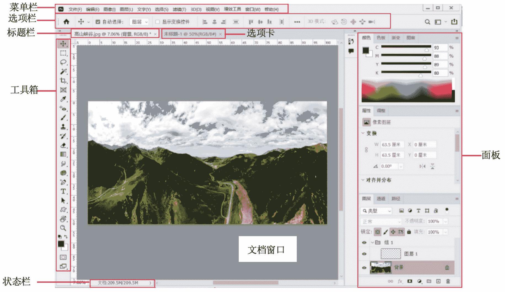

图 1-1

各区域功能说明如下。

· 菜单条：收纳可下达的各类指令，点击名称即可展开执行。
· 标题条：显示文档名、文件格式、缩放比例、色彩模式等信息，多图层时还会提示当前编辑图层。
· 工具区：集合选区、移动、绘制、取样等图像编辑部件。
· 参数条：依据所选工具动态呈现相关参数设定。
· 面板：提供图层、色彩调整等编辑选项，也用于定义色彩属性。
· 状态条：位于底部，实时展示文档尺寸、当前工具、缩放比例等信息。
· 文档窗口：图像展示与编辑的核心区域。
· 标签页：多文件时以标签形式管理，点击文件名即可切换。

延伸讲解：执行“编辑”→“首选项”→“界面”，打开首选项对话框。在“颜色方案”组中可调整界面色调，从深色到浅灰共提供 4 种亮度选择，如图 1-2 所示。

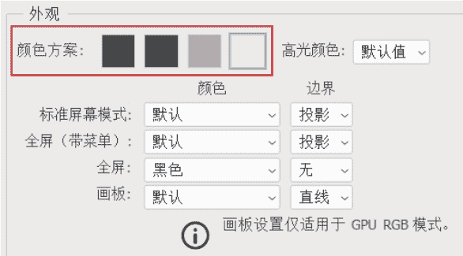

图 1-2

**1．菜单条**

菜单条下每个菜单都包含多条指令，状态各异。熟悉各菜单特点即可快速上手，如图 1-3 所示。

点击任意菜单名可展开，指令间以分隔线区分。鼠标悬停“调整”时子菜单会自动弹出，如图 1-4 所示。

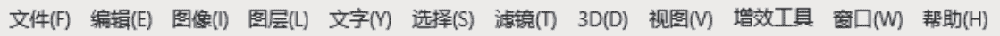

图 1-3

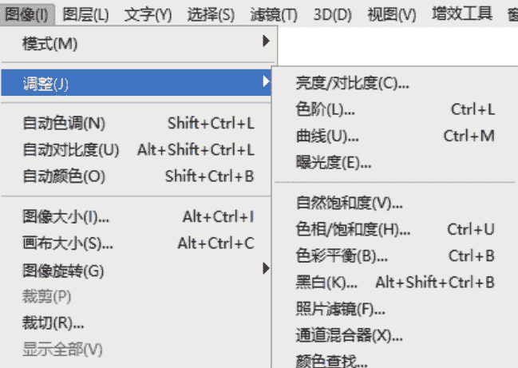

图 1-4

答疑解惑：菜单中呈灰色的指令表示当前不可用。指令名右侧带 … 符号则表示执行后会弹出对话框。例如未创建选区时“选择”菜单多项不可用；未输入文字时“文字”菜单多数功能也无法使用。

**2．工具区**

工具区默认位于界面左侧，可拖拽至其他位置。它提供选择、绘制、取样、编辑、移动、批注、查看及调整等多种部件。鼠标悬停于工具按钮，如“移动”工具  时，会弹出提示并以动画演示用法，如图 1-5 所示。

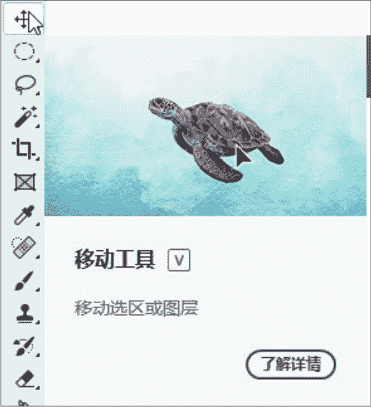

图 1-5

点击工具按钮即可选中。若按钮右下角有三角形，则为工具组，右键点击三角形可展开隐藏工具，如图 1-7 所示。随后将指针移至目标工具上方点击即可选中，如图 1-8 所示。

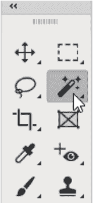

图 1-6

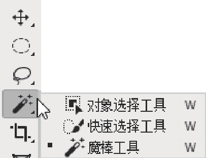

图 1-7

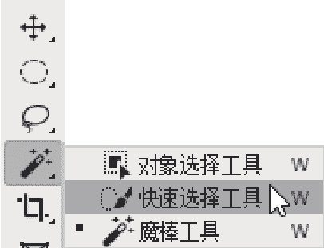

图 1-8

答疑解惑：找不到所需工具时，可点击工具区底部“编辑工具栏”按钮 ，打开“自定义工具栏”对话框。右侧附加工具区存放未加入工具区的部件，拖拽至“工具栏”区即可显示。

**3．参数条**

参数条用于配置当前工具的参数，合理设置可提升灵活性与效率。不同工具的参数条差异明显。例如“画笔”工具参数条包含绘画模式、不透明度等通用设定，如图 1-9 所示；而“铅笔”工具特有“自动抹除”选项，如图 1-10 所示。

图 1-9

图 1-10

答疑解惑：若界面中缺少参数条，可在“窗口”菜单中勾选“选项”或“工具”即可显示。

**1.1.2 面板**

面板是 Photoshop 的重要组成部分，用于设置色彩、调整参数、执行编辑操作。需打开的面板可在“窗口”菜单中选择。默认面板以标签形式分组停靠在右侧，可按需开关或组合。

**1．选择面板**

在面板标签中点击对应名称，即可显示面板控件，如图 1-11 所示。

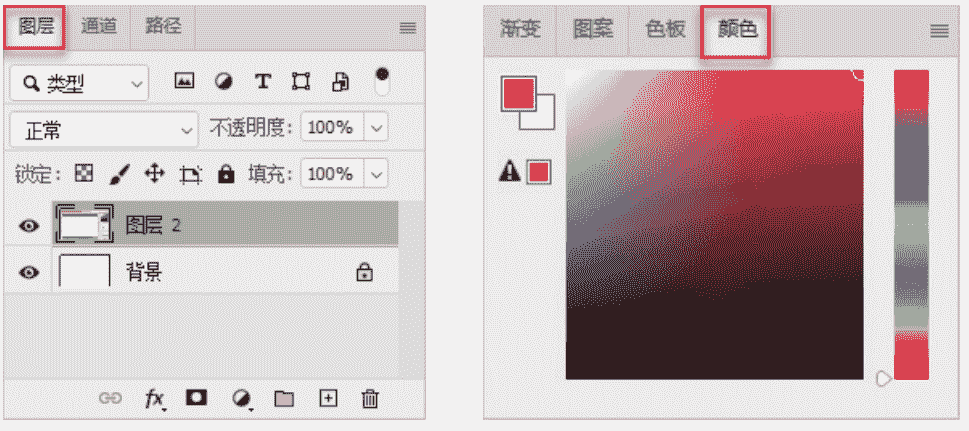

图 1-11

**2．折叠/展开面板**

点击面板组右上角双箭头按钮 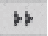 可将面板折叠为图标，如图 1-12 所示。点击图标即可展开，如图 1-13 所示。要重新折叠可点击面板右上角按钮 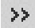。拖动面板左边界可调整组宽以显示名称，如图 1-14 所示。

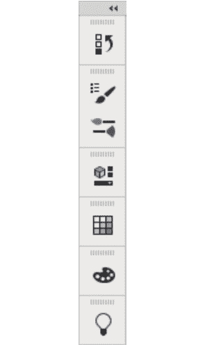

图 1-12

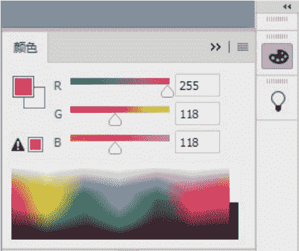

图 1-13

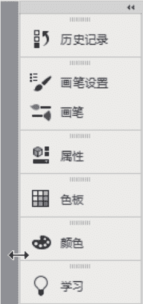

图 1-14

**3．组合面板**

将鼠标置于某面板，按住左键拖至另一面板标题条，出现蓝色框时释放即可组合，如图 1-15、图 1-16 所示。合并面板可为文档窗口腾出更多操作空间。

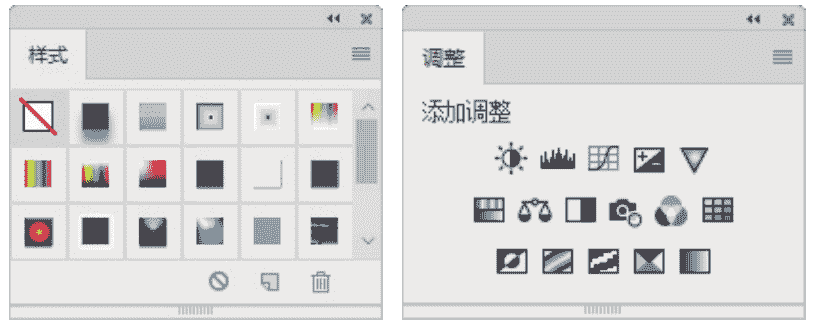

图 1-15

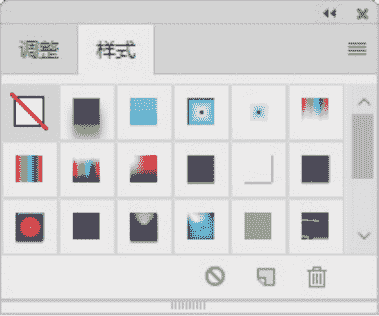

图 1-16

**4．链接面板**

将鼠标置于面板标题条拖至另一面板上方，出现蓝色框时释放即可链接，如图 1-17 所示。链接后面板可同步移动或一同折叠。

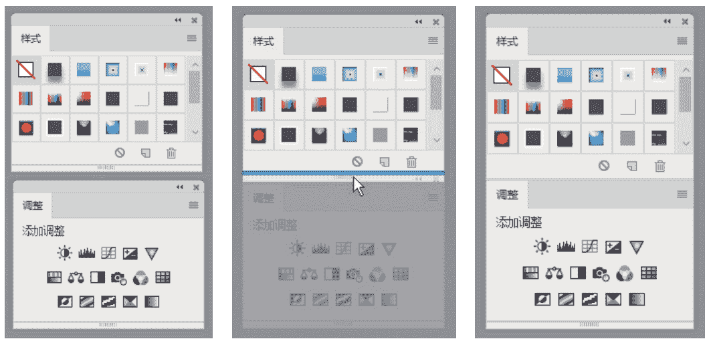

图 1-17

**5．移动面板**

将鼠标置于面板名称上拖至窗口空白区，即可从原组分离形成浮动面板，如图 1-18 所示。拖动浮动面板名称可自由定位。

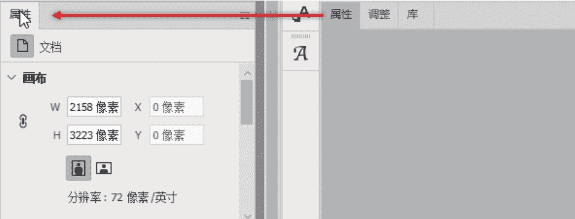

图 1-18

**6．调整面板大小**

拖动面板右下角即可同时改变高度与宽度，如图 1-19 所示。

**7．关闭面板**

右键点击面板标题条弹出快捷菜单，如图 1-20 所示。选择“关闭”可关闭当前面板，选择“关闭选项卡组”可关闭整组。对浮动面板，点击左上角关闭按钮  即可关闭。

答疑解惑：面板凌乱不适合当前工作时，可点击界面右上角“选择工作区”按钮 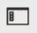，在弹出菜单中切换不同布局，如图 1-21 所示。

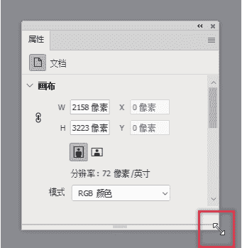

图 1-19

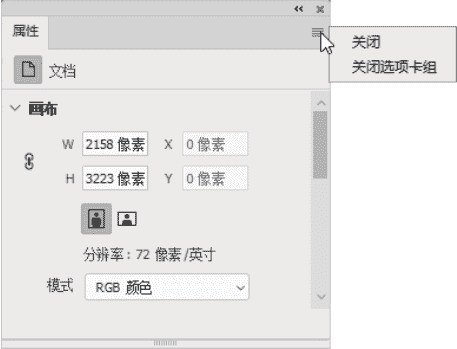

图 1-20

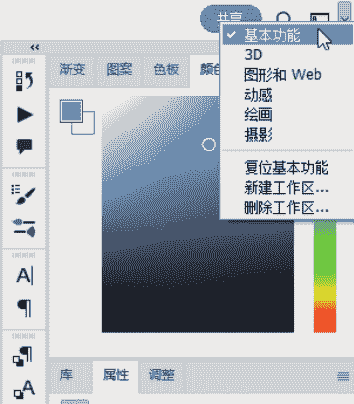

图 1-21

**1.2 文件基础操作**

熟练掌握文件操作是 Photoshop 图像处理的必备基础。本节介绍 Photoshop 2025 的文件管理方法，含新建与存储图像文件，帮助后续工作更顺畅高效。

**1.2.1 新建文件**

启动 Photoshop 2025 后，执行“文件”→“新建”或按 Ctrl+N，弹出“新建文档”对话框，如图 1-22 所示。可设置名称、宽高、分辨率、色彩模式及背景等参数，设置完成后点击“创建”即可生成空白文件，如图 1-23 所示。

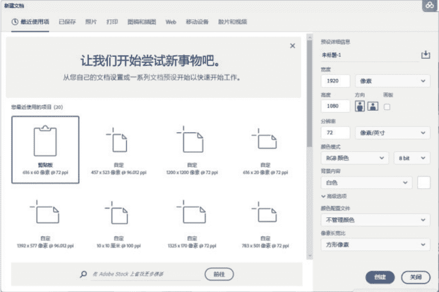

图 1-22

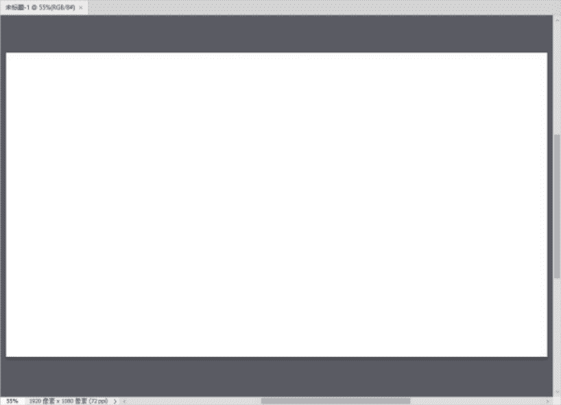

图 1-23

“新建文档”对话框主要参数说明如下。

· 宽度/高度：用于定义 Photoshop 中文档的画面整体尺寸。

分辨率体现的是在单位长度里像素的密集程度，业界通用的计量单位是像素每英寸，也就是 DPI 或 PPI。做网页图时大多把分辨率定在 72DPI，这与绝大多数电子屏幕的标准相符。

颜色模式决定图面能呈现的色彩范围。选“位图”或“灰度”时，画面只能输出黑白灰阶。日常使用最频繁的是“RGB 颜色”和“CMYK 颜色”，RGB 主要服务于屏幕显示，CMYK 则专为印刷输出而设。

**1.2.2 文件存储说明**

一张从未保存过的文档，其标签名后会多出一个“*”标记，如图 1-24 所示。这个标记提示当前仍有未写入磁盘的修改内容。此时可通过“文件”→“存储”来写入文件，如图 1-25 所示。

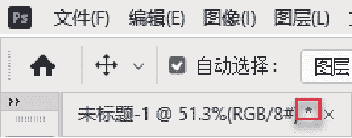

图 1-24

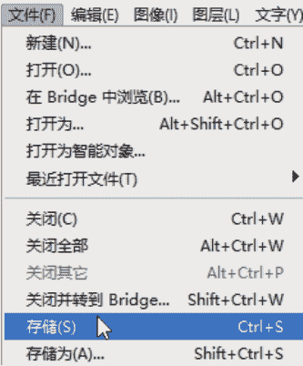

图 1-25

**小技巧：** 三种保存操作对应的默认快捷键为：存储 Ctrl+S；存储为 Shift+Ctrl+S；存储副本 Alt+Ctrl+S，均可直接使用。

**1．保存**

当文件尚未写入过，执行“文件”→“存储”或直接按 Ctrl+S，都会弹出存储对话框，如图 1-26 所示。可以在对话框里指定保存路径，并把文件名改为更易识别的称呼。通过这种方式得到的文件是可编辑的设计源文件，而不是可直接浏览的图片。重新用 Photoshop 打开它后，仍能继续编辑。

**2．另存为**

对已保存的源文件做修改，例如删除文字或加入新元素，就相当于产生了一个新版本。编辑后文件名旁会再次出现“*”。这时若按 Ctrl+S，会直接覆盖原文件。若想保留初版并单独存下新版，可用“文件”→“存储为”或快捷键 Shift+Ctrl+S。在弹出的对话框中为文件换一个区分度高的名字，比如在原名后加上 02，确认后保存。这样旧版与新版就能同时保留，如图 1-27 所示。

**3．另存副本**

“存储副本”可以在指定位置生成当前文件的复制品，并允许切换保存格式。该功能在需要保留原文件继续反复修改时特别实用。

前面两种方式保存的仍是源文件格式。若要导出可在手机或平板上直接查看的普通图片，可执行“文件”→“存储副本”或按 Alt+Ctrl+S。弹出的“存储副本”对话框提供了丰富的类型选项，包含在互联网上传播常用的 JPG、支持透明背景常用于合成素材的 PNG，以及可制作动图表情包的 GIF 等，适用于不同的用途。

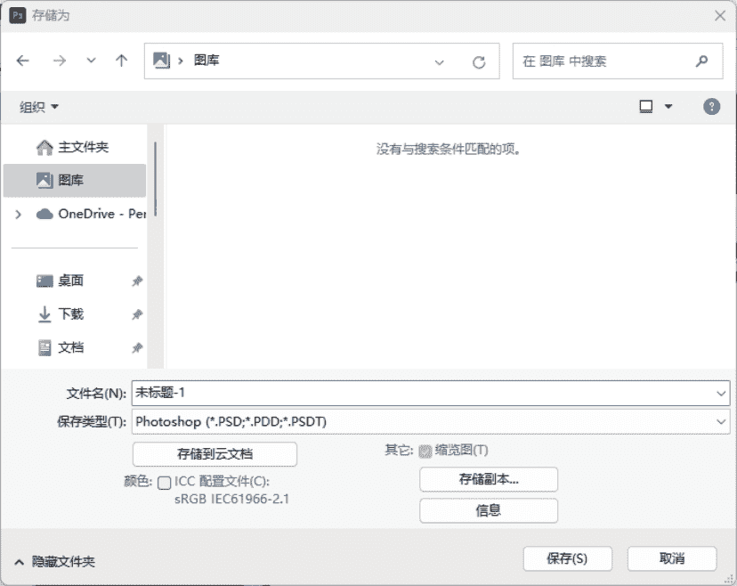

图 1-26

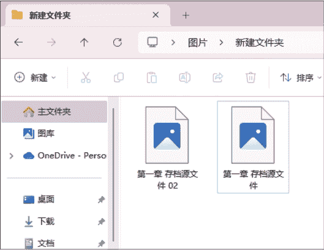

图 1-27

在“存储副本”对话框中把“保存类型”设为 JPEG(.JPG;.JPEG;*JPE)，点击保存后会弹出“JPEG 选项”对话框，如图 1-29 所示。借助滑块可调节导出质量，注意质量越高文件体积越大。通常选择“高”或“最佳”预设即可满足清晰度需求。设置完成后点确定，即可在指定路径查看导出的图片文件，这就是可在移动设备上直接打开的成品图。

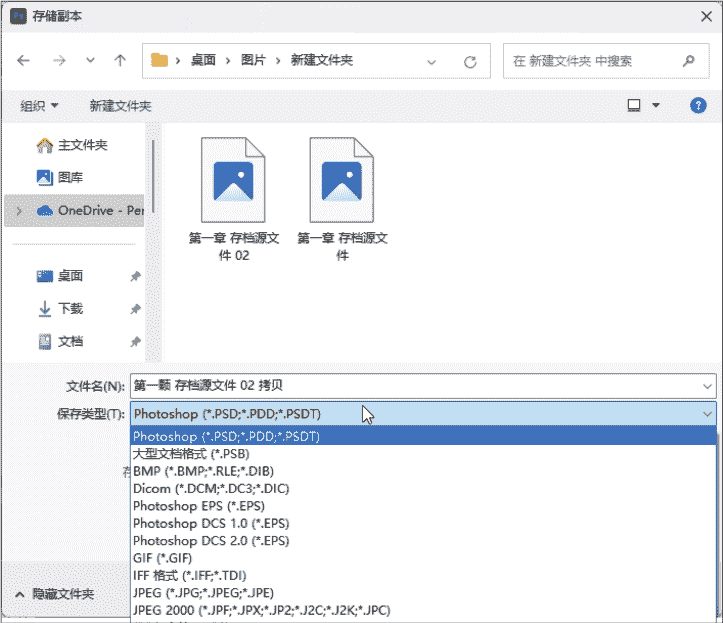

图 1-28

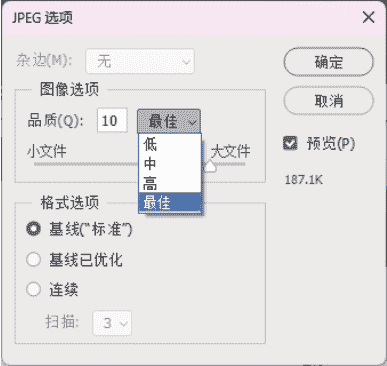

图 1-29

**1.3 常用辅助功能**

Photoshop 的辅助工具在编辑全流程中提供便利，帮助提升效率并保证精度。

**1.3.1 移动工具**

“移动工具”  操作直观。选中图层后单击拖动，即可随鼠标移动设计元素。图 1-30 为移动前状态，图 1-31 为移动后效果。

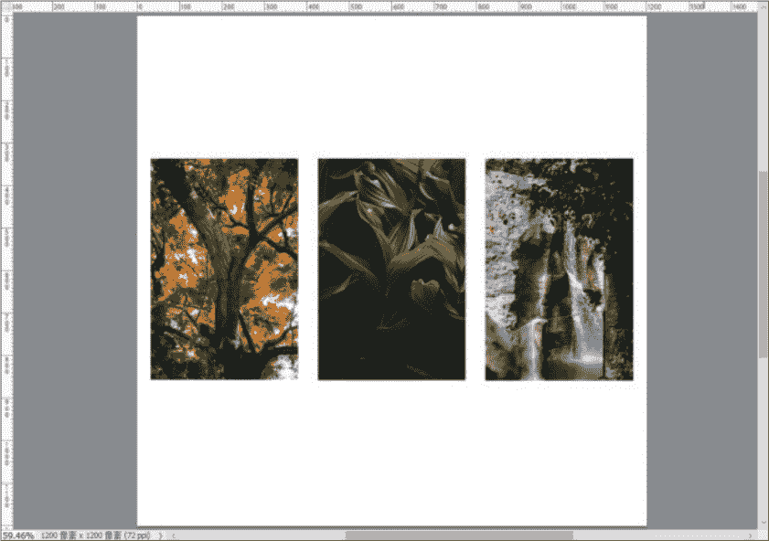

图 1-30

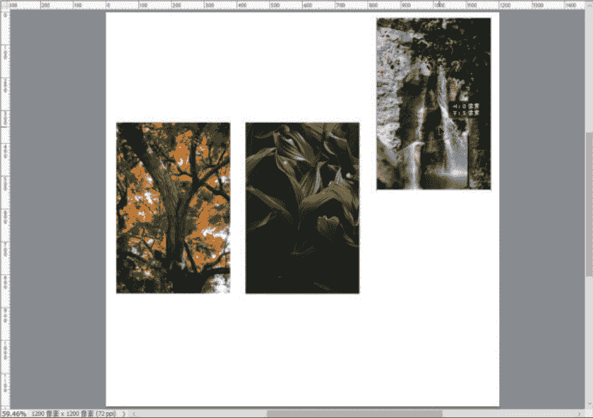

图 1-31

图层众多时，很难在“图层”面板里迅速定位。此时可借助“自动选择”。选中“移动工具”后，选项栏左侧会出现“自动选择”复选框，如图 1-32 所示。勾选后在画布上直接点选想要移动的对象即可快速选中。

图 1-32

**1.3.2 抓手工具**

“抓手工具”  用来平移画布显示区域。工具箱中选中“抓手工具”  后，按住鼠标左键拖动即可。同样，按住空格键并配合鼠标左键拖动也能实现画布平移。

**1.3.3 缩放工具**

“缩放工具”  用于改变画布显示比例。工具箱中点选“缩放工具”按钮  后，默认进入放大模式。需要缩小可在操作时按住 Alt。快捷键 Ctrl++ 快速放大，Ctrl+— 快速缩小。

**1.3.4 标尺工具**

“标尺工具”  可测量任意两点间的距离与角度。工具选项栏会实时显示起点与终点的坐标 X、Y、角度 A 以及距离 L[1]、L[2]。

画完一条线段后，按住 Alt 并从其中一个端点拖动，可生成第二条线段，显示的角度即为两线夹角。L[1] 与 L[2] 分别表示两端点到中心点的距离。若画布上只有一条直线，角度则按该线与水平线的夹角计算，距离 L 即为两端点直线距离。

要注意，“标尺工具” 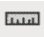 仅提供参考，不会成为图像的实际内容。导出或保存时标尺不会被写入，切换到其他工具时标尺信息也会暂时消失。

**1.3.5 智能参考线**

智能参考线能帮助更精准地对齐图形、切片与选区。启用后，在绘制形状、创建选区或切片时，画布上会自动出现参考线提供实时对齐提示。

启用方式为“视图”→“显示”→“智能参考线”。开启后出现的紫色线条即为智能参考线，如图 1-33 所示，会随操作动态调整。

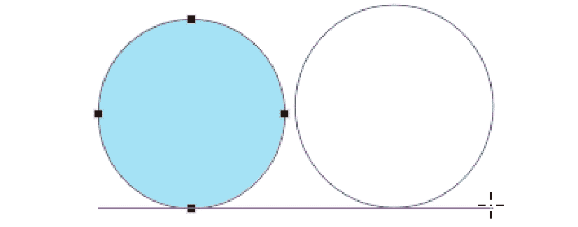

图 1-33

**1.3.6 网格**

网格用于精确对齐与定位，适合对称排布。打开一张素材后，执行“视图”→“显示”→“网格”，即可显示网格线，如图 1-34、图 1-35 所示。显示网格后，再执行“视图”→“对齐到”→“网格”，即可开启对齐到网格功能。创建选区或移动对象时会自动吸附到网格线上，提升精确度。

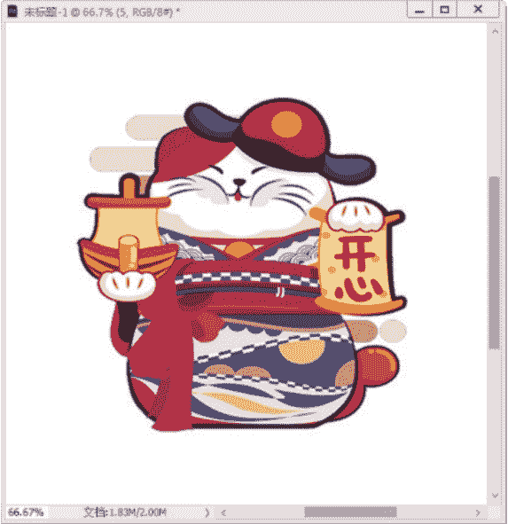

图 1-34

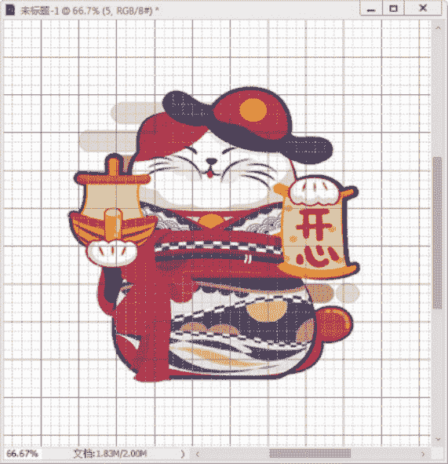

图 1-35

延伸讲解：在显示网格后，可沿网格线对齐或移动图像。若希望移动时自动贴合网格，或创建选区时按网格定位，只需打开“视图”→“对齐到”→“网格”。默认网格为线条样式，若想改为点状，或调整粗细颜色，可通过“编辑”→“首选项”→“参考线、网格和切片”进行设置。

**1.4 AI 功能初探**

Photoshop 2025 在原有功能上做了优化与改进，并加入多项新特性。本节简要介绍使用方法，也可启动软件执行“帮助”→“新增功能”，在“发现”对话框中查看详细说明。

**1.4.1 移除工具去杂**

“移除工具”  在 Photoshop 2025 中得到强化，可清除图像中多余元素并自动修复背景，保持整体性与美观。新增的自动识别功能可快速定位人物、电线、电缆等干扰物。图 1-36 为原图，图 1-37 为自动检测并去除干扰人物后的效果。

图 1-36

图 1-37

**1.4.2 上下文任务栏**

上下文任务栏会根据当前操作场景动态提供相关功能选项与快捷指令，减少在各菜单间切换的时间，提升工作流顺畅度。可通过“窗口”→“上下文任务栏”打开。

不同工具下任务栏会智能适配。例如选择“矩形选框工具”时，会显示选区编辑选项，如创成式填充；切换到“横排文字工具”时，则提供画笔大小、硬度等参数的快速调整，如图 1-38 所示。在执行创成式填充时，任务栏还支持快速输入生成内容、选择生成风格并预览，操作更简洁。

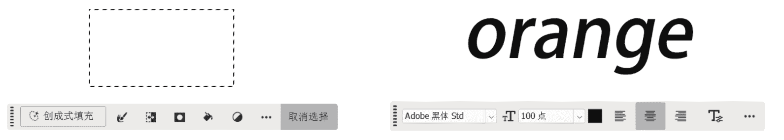

图 1-38

**1.4.3 Adobe Firefly：AI 赋能设计**

Adobe Firefly 是一个独立 Web 应用，网址为 firefly.adobe.com，界面如图 1-39 所示。它基于生成式 AI，为创意构思、制作与沟通提供新方式，优化创意流程。Firefly 系列模型还被集成到 Adobe 旗舰应用与 Adobe Stock 中，提供大量由 Firefly 支持的功能。

图 1-39

目前 Adobe Firefly 提供了 6 项 AI 功能，如图 1-40 所示，覆盖面广，能生成多样化效果图，满足不同创作需求。

图 1-40

# **第二章 工具宝箱：解锁你的设计利器**

本章将重点介绍 Photoshop 的基础工具，涵盖“形状工具”“画笔填色工具”“文字工具”与“修复工具”等，帮助掌握核心使用技巧。

**2.1 形状与路径**

形状工具是构图的基础，矩形、椭圆、自定形状等都能快速搭建框架。下面将深入讲解操作要点并结合案例演示绘制方法。

**2.1.1 矩形工具**

工具箱中选中“矩形工具”  后，工具选项栏会显示相关参数。该工具可轻松绘制矩形与正方形。选中后在画布上单击拖曳即可生成矩形，若拖曳时按住 Shift，则生成比例相等的正方形，如图 2-1 所示。

工具选项栏可调整圆角半径，例如设为 50 像素即可得到圆润角落的矩形，如图 2-2 所示。在“填充”与“描边”中可自定义内部颜色及轮廓线粗细样式，例如填充蓝色并设置 20 像素黑色描边，最终效果如图 2-3 所示。

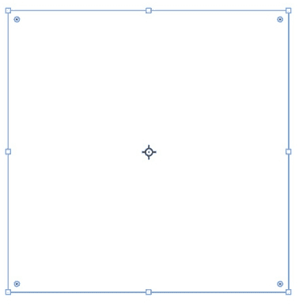

图 2-1

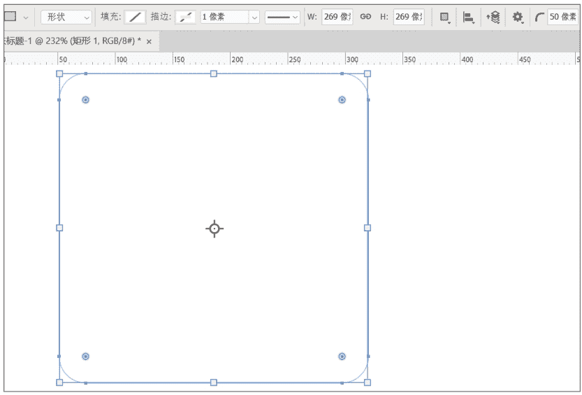

图 2-2

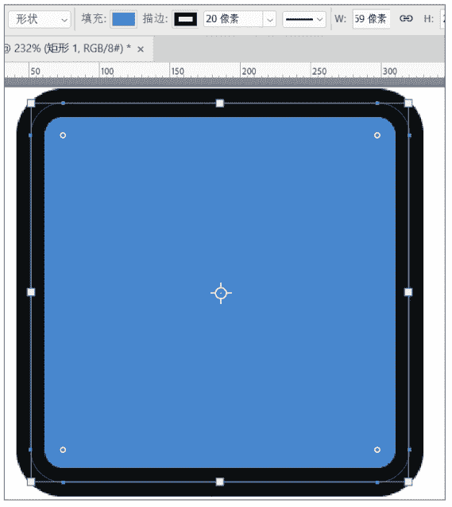

图 2-3

延伸讲解：工具选项栏中“矩形工具”提供“路径”与“形状”两种模式。选“路径”模式仅生成矢量路径，选“形状”模式则同时生成矢量路径并创建已填充图形。

**2.1.2 椭圆工具**

“椭圆工具”  用于绘制椭圆与圆形，单击拖曳即可生成。拖曳时按住 Shift 可绘制标准正圆，如图 2-4 所示。

在工具选项栏中可细调填充色、描边宽度与样式，例如填充鲜红并设描边宽度为 3 像素，效果如图 2-5 所示。

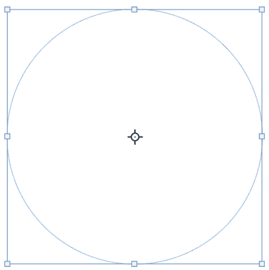

图 2-4

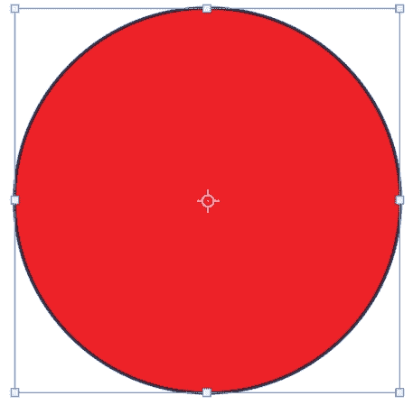

图 2-5

**2.1.3 自定形状工具**

“自定形状工具”  兼具灵活性与创意性，可绘制复杂图形或使用预设样式。工具选项栏右侧点开形状下拉箭头，可浏览 Photoshop 内置的丰富形状库，包含动物、植物、花卉等多类元素，如图 2-6 所示。

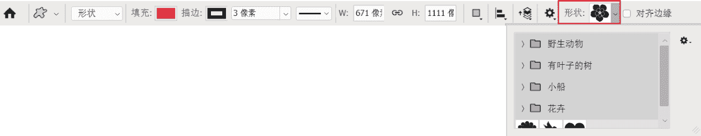

图 2-6

在画布上单击拖曳即可生成所选形状，拖曳时按住 Shift 可保持固定比例。例如选择野生动物中的狮子形状，可自定义填充颜色、描边样式与大小。图 2-7 为操作示意，若把填充改为灰色并将描边设为虚线，最终效果如图 2-8 所示。

点击“形状设置”按钮，在弹出菜单中选择“导入图形”可导入更多形状，如图 2-9 所示。

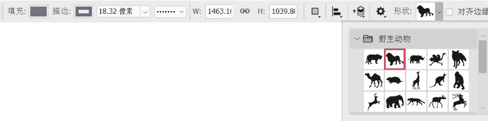

图 2-7

图 2-8

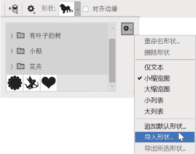

图 2-9

**2.1.4 实战：用钢笔工具绘制扇形**

路径工具带来更精细的表现力。借助“钢笔工具”  绘制路径，可自由创建复杂线条与形状。下面通过实战帮助掌握路径设计技巧。

**01** 选择“钢笔工具”，在画布上连续单击两次确定两个锚点，两个锚点之间会自动生成一条路径，如图 2-10 所示。

**02** 再点一次来放置新锚点，这次不要马上松开鼠标。鼠标左键按住不放向四周拖拽，可以看到两点间的直线随着拖动慢慢变成曲线，如图 2-11 所示。曲线满意时松开，路径即被固定。若对结果不满意，随时按 Ctrl+Z 撤销重画。

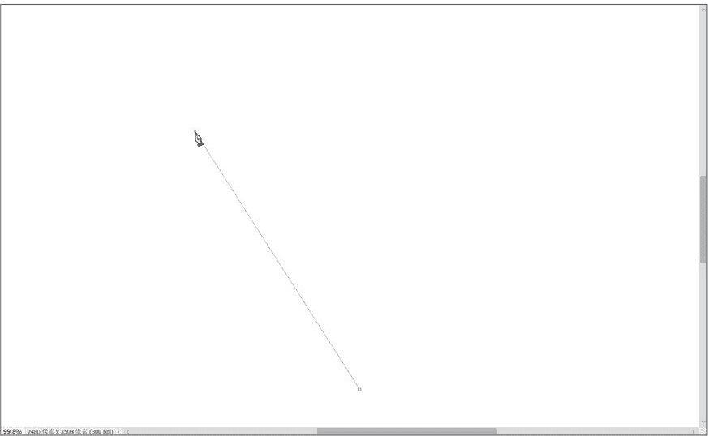

图 2-10

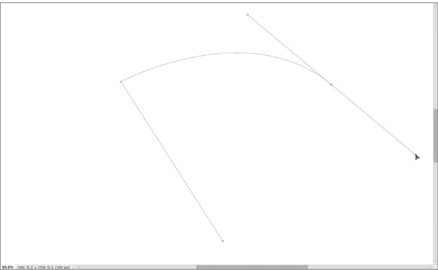

图 2-11

**03** 按住 Alt 的同时单击新建锚点，如图 2-12 所示。此时该锚点一侧的控制手柄会消失。接着放置下一个锚点，两点即可用直线顺畅连接，像是被缝合起来，如图 2-13 所示。

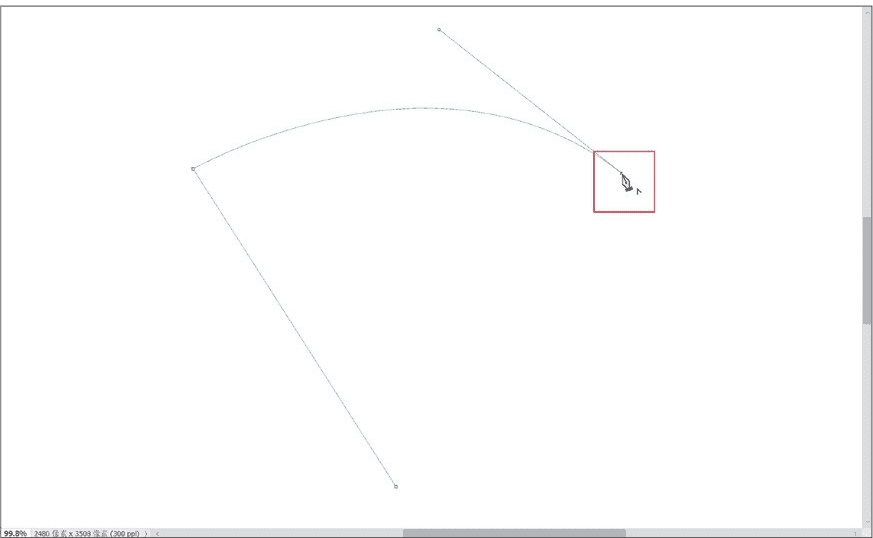

图 2-12

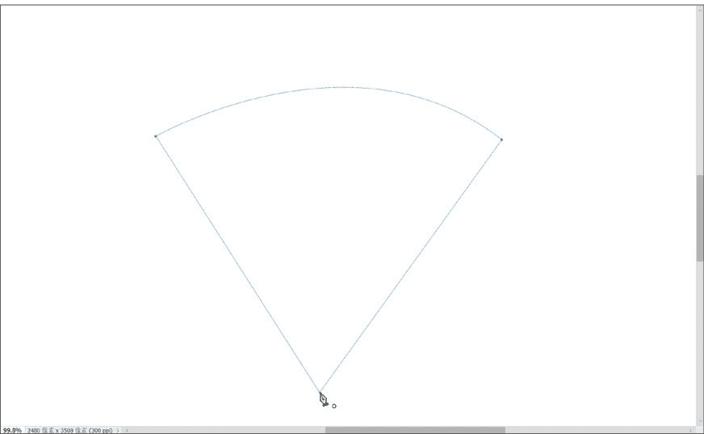

图 2-13

**04** 路径绘制到这里算是阶段性完成，但工作还没结束。现在只是有了路径，还不是可填充的形状。点一下选项栏上方的“形状”按钮，就能以当前路径为基础新建一个形状图层。这样路径就变为可见且可编辑的形状，效果如图 2-14 所示。

图 2-14

**2.1.5** **钢笔实战：临摹曲线图形**

初次上手钢笔工具，建议找一些边缘带曲线的 Logo 或图案来描摹练习，这样能更快提升钢笔的操作熟练度。具体做法如下。

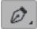

**01** 在工具箱打开钢笔工具，选项栏把模式设为“路径”和“合并形状”，如图 2-15 所示。

**02** 先导入要临摹的素材，如图 2-16 所示。从图形左侧起笔，用钢笔工具开始勾勒路径，如图 2-17 所示。

图 2-15

图 2-16

图 2-17

**03** 遇到曲线段，在末端点一个锚点并拖动。拖动时尽量让控制手柄与原曲线相切，这样画出的线条更贴合，如图 2-18 所示。

**04** 若曲线出现空隙或变形，如图 2-19 所示，可按住 Ctrl 临时切换到直接选择工具。借助它微调手柄位置，让曲线精确贴合 Logo 外缘。

**05** 继续画下一段曲线。遇到转角时，按住 Alt 单击锚点，能更精准地控制走向，如图 2-20 所示。

图 2-18

图 2-19

图 2-20

**06** 接着处理其余曲线。一般在曲线的最凸或最凹点放置锚点，再向侧边拉手柄。拉动时保持手柄与曲线相切，能让结果最大程度贴合原图，如图 2-21 所示。

**07** 同样方法向下延伸绘制，如图 2-22 所示。按住 Alt 单击锚点来处理顶部弧度，如图 2-23 所示。

**小技巧：** 画路径时按住 Ctrl 可选中已有锚点，调整手柄长度和角度，实现更精细的修改。

图 2-21

图 2-22

图 2-23

**08** 保持同样手法继续绘制。曲线收尾时按住 Alt 单击锚点，一侧手柄会消失，如图 2-24 所示。随后在叶片内部补线，直至闭合回起点，完成整片叶子的路径，如图 2-25 所示。

图 2-24

图 2-25

**09** 绘制结束新建图层，前景色调成黑色。右键点击路径选择“填充路径”，在对话框中把内容设为前景色，如图 2-26 所示。填充后即可得到最终效果，如图 2-27 所示。

图 2-26

图 2-27

**2.1.6** **钢笔抠图实战**

钢笔工具不只是画形，抠图也是其常见用途。下面介绍具体流程。

**01** 准备一张可乐瓶照片，如图 2-28 所示。用钢笔工具细致勾出轮廓路径后，可用两种方法将瓶子抠出。

**02** 第一种靠选区抠图。先用钢笔精确描出瓶子轮廓。描完后点选项栏的“选区”按钮，或右键选“建立选区”，如图 2-29 所示。羽化半径设为 0，就能生成贴合路径的蚂蚁线选区。之后复制粘贴或加蒙版即可把瓶子抠出。

图 2-28

图 2-29

**03** 第二种直接建蒙版。选项栏里找到“蒙版”按钮，如图 2-30 所示，一键点击即可完成抠取，如图 2-31 所示。操作简洁，效率很高。

图 2-30

图 2-31

**2.2** **画笔、填充与擦除**

Photoshop 的画笔、填充与擦除构成了图像编辑的基础。画笔提供多种笔刷，可自由绘制、润色和细节处理；填充涵盖油漆桶与渐变，能快速上色或做出色彩过渡；擦除则用于清理多余部分与调整边缘。三者灵活高效，广泛应用于插画、修图与艺术创作。

**2.2.1** **基础绘画：画笔与铅笔**

画笔和铅笔是手绘表现的核心，能帮助实现个性化线条与细节。下面介绍它们的特点与用法。

**1．画笔工具**

在工具箱选中“画笔工具” 后，点击选项栏中数字圆旁的下拉箭头，就能打开笔刷预设面板，里面有多类笔刷可按需求挑选，如图 2-32 所示。

图 2-32

“大小”和“硬度”是控制笔刷形态的两大参数。大小很直观，比如 50 像素的笔刷画出的圆如图 2-33 所示；把大小调到 500 像素，画出的圆明显变大，如图 2-34 所示。

图 2-33

图 2-34

硬度影响边缘表现。硬度 100% 时边缘锐利清晰；把硬度拖到 0%，点击画布会出现边缘柔和模糊的圆，如图 2-35 所示。简单说，硬度越低越柔和，越高越清晰。

图 2-35

**2．铅笔工具**

“铅笔工具” 属于简洁精准的类型，特别适合手绘，线条边缘硬朗清晰。

在工具箱长按画笔工具即可展开，找到铅笔工具。使用说明如下。

**01** 画线很简单，单击拖动即可。若要直线，同时按住 Shift，指针会锁定水平或垂直，方便画出笔直线条。例如按住 Shift 可画出两条 10 像素宽的洋红直线，如图 2-36 所示。

**02** 单点填充也很方便。画布上点一下，就会在指针位置生成一个点，大小取决于当前笔尖，如图 2-37 所示。

图 2-36

图 2-37

在选项栏中可对铅笔工具进行设置。

· 笔尖大小。通过点击选项栏的“画笔设置”按钮，可选择不同笔刷并调大小，如图 2-38 所示。

· 硬度。铅笔工具硬度固定为 100%，无法调整，因此线条始终边缘清晰。

图 2-38

**2.2.2** **填充：油漆桶与渐变**

填充工具能为图像注入活力，油漆桶可快速上色，渐变能创造层次感。下面通过案例说明使用方法。

**1．油漆桶工具**

“油漆桶工具” 用于快速填充选定区域的颜色。使用前先用魔术棒、选择工具或手动圈出区域，然后在工具箱选油漆桶，调整选项栏容差值，一般 20~50 比较合适，最后在区域内单击即可填充，如图 2-39 所示。该工具还支持前景色、背景色、图案和渐变等多种填充方式，可按需选择。

图 2-39

**2．渐变工具**

“渐变工具” 用于制作颜色的平滑过渡，可在图像或选区内混合两种或多种颜色，广泛用于背景、蒙版和调色。

选项栏提供丰富的渐变预设，并包含线性、径向、角度、对称和菱形等 5 种渐变方式，各有特点，可打造富有层次的设计，如图 2-40 所示。

图 2-40

在选区内单击拖动即可生成渐变，拖动距离和方向决定范围和角度。例如从左向右拖动，效果如图 2-41 所示，呈现自然的色彩过渡。

图 2-41

**2.2.3** **擦除：橡皮与背景橡皮**

擦除工具在修改和清理时非常关键，尤其对细节处理不可或缺。下面讲解橡皮擦工具与背景橡皮擦工具的技巧。

**1．橡皮擦工具**

“橡皮擦工具” 使用方式与画笔相似。选中后指针变为圆形笔刷，选项栏可调大小，硬度通常为 100%，如图 2-42 所示，这样擦除更干净彻底。随后即可擦除内容，如图 2-43 所示。

**小技巧：** 面对复杂画面逐一擦除费时，可用“还原画笔工具”即撤销功能，通过编辑菜单或按 Ctrl+Z 逐步撤销，提升效率。

图 2-42

图 2-43

**2．背景橡皮擦工具**

“背景橡皮擦工具” 可快速擦除图片背景并保留主体。它通过取样颜色判断擦除区域，适合背景颜色均匀的图像。单击拖动时，工具会根据指针中心颜色取样并擦除相近区域。例如处理纯色背景时能迅速清除，如图 2-44 所示。

图 2-44

选项栏如图 2-45 所示，可调整各项参数。

图 2-45

· 画笔大小与硬度：设置合适的笔刷大小，硬度越高边缘越清晰。

· 取样模式：包括连续取样、一次取样和背景取样。

» 连续取样：指针移动时不断更新取样颜色。
» 一次取样：仅取样一次，适合大块单色区。
» 背景取样：基于背景色板进行擦除。

· 容差：控制颜色匹配灵敏度，数值越大擦除范围越广，越小越精确。

· 保护前景色：勾选后保留前景色像素，避免误擦主体。

**2.3** **文字排版工具**

在 Photoshop 中，文字工具是设计与编辑文本的核心，可轻松添加、编辑并美化文字。借助横排文字工具与直排文字工具，可创建水平或垂直排版，并提供字体、大小、颜色、间距、对齐等丰富样式设置，还支持文字转路径或形状，为创意设计提供更多可能。

**2.3.1** **文字排列**

Photoshop 文本与修复实战要点

选用“横排文字工具”  在画布上输入内容时，图层列表会即时新增一个文字图层，见图 2-46。这一图层具备普通图层的全部行为，可以随意拖动定位，也能按 Ctrl+T 启动自由变形实现放大缩小。因为文字本身就是图层形态，二次编辑只要把工具切换为文本工具点一下该层，或用移动工具双击文字区，即可回到编辑状态。

属性栏提供文本颜色按钮，点击后可以更换字色，完成个性化配色。

图 2-46

图 2-47

若想用画笔工具在文字图层上作画，软件会提示错误或自动新建图层。解决办法是右键点击文字图层，从快捷菜单中选择栅格化图层。栅格化后即可正常绘制，但文字会变成像素，后续就无法再用文本工具修改，所以务必先完成所有文字调整再进行栅格化。

**1．点文本**

使用“横排文字工具”  输入后，可先 Ctrl+C 复制，再 Ctrl+V 粘贴。你会发现该图层可以无限延伸，不会碰到画布边就自动换行，参考图 2-48。手动断行只要敲 Enter 即可另起一行继续输入，参考图 2-49。Photoshop 中这种不自动折行的输入方式称为点文本。

图 2-48

图 2-49

**2．段落文本**

段落文本的创建方式与点文本不同。同样调用文本工具，但需按住鼠标左键拖动，会出现闪烁的虚线框，松开后虚线框变为可输入的文本框，参考图 2-50，在框内输入即可。这种方式生成的文字即为段落文本。

图 2-50

继续复制粘贴时，文字碰到文本框边界会自动折行，参考图 2-51。反复粘贴到第三行后，下方内容会被裁切。此时把指针移到文本框边缘的小控制点，向下拖拽，被遮挡的部分就会显现，参考图 2-52。

图 2-51

图 2-52

**2.3.2 文字格式**

输入文字时，可在属性栏或字符面板中调整字符属性，包含字型、字号、颜色等。文本工具的属性栏如图 2-53 所示，提供详细的字符设置入口。

图 2-53

**1．字体**

选定文字后，属性栏最左侧的下拉列表用于挑选字型。这里列出的字型与电脑字体库保持一致，系统中安装的字型均可在此找到，参考图 2-54。

图 2-54

**2．字重**

字型选项之后是字重，用来调节字体的粗细程度，参考图 2-55。对设计师而言这是视觉精细化的关键，但并非所有字型都支持调节，多数字型只有一种固定粗细，通常只有主流的正文字型才提供多种字重以应对不同情境。

**3．字号**

紧接字型和字重之后是字号，提供常用预设值，参考图 2-56。除预设外，也可手动输入具体数值，实现更灵活的大小控制。

图 2-55

图 2-56

小技巧：编辑文字时按住 Control，可立刻进入自由变形状态，便于对文字进行缩放旋转等操作。

**2.3.3 字符和段落**

熟练掌握字符和段落面板的参数，才能更灵活地塑造文字形态。本节通过实战案例讲解排版规律。需要调整字符格式时，执行窗口→字符，调出如图 2-57 所示的面板，即可对字符进行精细设置。

图 2-57

面板主要选项说明如下。

· 设置行距 ：控制行与行之间的垂直距离，可从下拉列表挑选预设，也可输入自定义数值。
· 字距微调 ：用于精细调整相邻两个字符的间距，先在两字符间放置插入点，再调整数值。
· 字距调整 ：选中部分字符时调整所选字符间距，未选中时则作用于全部字符。
· 比例间距 ：按比例调整所选字符的间距。
· 水平缩放 /垂直缩放 ：水平缩放改变字符宽度，垂直缩放改变字符高度。
· 基线偏移 ：控制文字相对于基线的上下位置，可升高或降低所选文字。
· OpenType 字体：这类字体提供 PostScript 与 TrueType 字体不具备的额外功能。
· 连字及拼写规则：可为所选字符设置连字符与拼写规则相关的语言选项。

答疑解惑：文字未在画布上显示时，可检查以下情况：文字颜色是否与背景相同，改色后是否可见；调用自由变换快速键，确认文本框是否超出画布并拉回；检查是否有上层图层遮挡，调整图层顺序使其可见；文档过大而文字过小也会导致不可见，可适当放大文字或缩小文档。

**2.3.4 文字相关快捷键**

新建文档后，按文本工具快速键 T 即可在画布点击输入。调整格式常用快速键：字间距 Alt 加左右方向键，行间距上下方向键，文字大小 Control Shift 加小于号或大于号。填充前景色快速键 Alt Delete，填充背景色快速键 Control Delete。请注意 Backspace 主要用于删除，不适用于上述操作。

答疑解惑：编辑文字后必须执行确认操作，修改才会生效。若未确认，所做编辑不会保留，务必在完成编辑后执行必要操作以保存更改。

**2.4 修复工具**

Photoshop 的修复工具组功能强大，可修补瑕疵并恢复细节。包括修补工具、污点修复画笔工具、内容感知修补工具和仿制图章工具等，能够去除斑点、裂痕或多余物体，并借助智能算法和纹理匹配让修复自然无痕。

**2.4.1 污点修复画笔工具**

污点修复画笔工具  是处理细节瑕疵的好帮手，能快速去除污点、划痕等，通过智能填充周围区域来还原画面，特别适合人像修饰和小范围精细修复。选项栏可设置画笔大小和类型，参考图 2-58。

该工具选项栏主要含义：

· 画笔大小与硬度
» 大小：根据瑕疵面积调整画笔直径，保证修复范围可控。
» 硬度：硬度越低边缘越柔和，适合处理边缘过渡自然的瑕疵，使修复更融合。

图 2-58

· 类型
» 内容感知：自动分析并填充合适内容，适用于多数场景。
» 近似匹配：利用周围颜色匹配填充，保持色彩一致。
» 创建纹理：填补复杂背景时生成新纹理，更好融入原图。

在工具箱选择污点修复画笔工具，在模式下拉列表选近似匹配，将指针移到瑕疵处单击，工具会自动取样周围纹理和颜色进行自然修复，参考图 2-59。

图 2-59

**2.4.2 实战：使用移除工具移除干扰物**

移除工具  借助内容识别技术，可自动识别并替换不需要的区域，操作简便，适合快速处理大面积或复杂区域。在 Photoshop 2025 中，移除工具新增了查找干扰和模式两项功能。如图 2-60 所示，查找干扰可智能识别电线、背景人物等干扰物，模式允许用户选择是否启用 AI 辅助。

图 2-60

常规建议选择自动可能使用生成式 AI 模式，让工具自行判断是否启用 AI。操作步骤如下。

01 启动 Photoshop 2025，按快速键 Control O，调入素材文件，参考图 2-61。

 

02 选择移除工具，在工具选项栏的模式下拉列表中选择生成式 AI 关闭选项，用移除工具涂抹需要移除的区域，参考图 2-62，移除效果参考图 2-63。

图 2-61

图 2-62

03 将工具选项栏模式下拉列表切换为生成式 AI 开启，移除效果参考图 2-64。

图 2-63

图 2-64

工具选项栏中的查找干扰提供一键移除电线和电缆以及人物的功能，参考图 2-65，能快速自动识别并清除电线、电缆和人物，大幅提升效率。具体步骤：

01 启动 Photoshop 2025，按快速键 Control O，调入素材文件，参考图 2-66。

02 选择移除工具，在工具选项栏单击查找干扰中的电线和电缆按钮，参考图 2-67。移除效果参考图 2-68。

图 2-65

图 2-66

图 2-67

图 2-68

03 去除画面中的干扰人物，按快速键 Control O，调入素材文件，参考图 2-69。

04 选择移除工具，在工具选项栏单击查找干扰中的人物按钮，参考图 2-70。

图 2-69

图 2-70

05 软件会自动识别背景人物并进行选取，参考图 2-71。若有遗漏，可用移除工具手动补充。

06 确认选取无误后按 Enter 确定，人物移除效果参考图 2-72。

图 2-71

图 2-72

**2.4.3 实战：使用修补工具修补画面**

修补工具  操作灵活，适合大面积修复。框选不需要的区域后拖动到合适的参考区域，即可完成修补，尤其在纹理复杂的场景中效果突出，因需手动选择参考区，控制性更强。具体步骤：

01 启动 Photoshop 2025，按快速键 Control O，打开素材图片，参考图 2-73。

图 2-73

02 选择修补工具，在画面中框选需去除或修补的区域，然后单击拖动选区到期望用来替换的参考区域，参考图 2-74。松开鼠标后软件自动完成修补，参考图 2-75。

图 2-74

图 2-75

**2.4.4 实战：仿制图章工具复制元素**

执行窗口→仿制源，可在界面显示仿制源面板，参考图 2-76。

图 2-76

在修饰时若需设置多个仿制源，可在面板中切换，并动态调整克隆源的大小、缩放和方向，显著提升仿制图章工具效率。面板主要选项含义：

· 仿制源：点击按钮设定取样点，最多可设 5 个不同取样源。更改取样点会切换仿制源使用来源，面板会保存当前源直至文件关闭。

· 位移调节：仿制源的缩放可通过填写宽度 W 或高度 H 来实现，默认会维持长宽比例。要单独拉伸或恢复比例限制，点击“保持长宽比”按钮  即可切换。设定 X、Y 的像素偏移量后，绘制时会以取样点为基准进行精确放置。输入旋转角度值  就能让源进行旋转。帧位移参数可做细微调整，勾选“锁定帧”则把帧位置固定下来。

· 叠加预览：若想查看仿制源的叠加效果，可开启显示叠加并设置相关选项。调节样本源的叠加参数后，使用“仿制图章工具”或“修复画笔工具”绘画时，能更清晰地对比叠加层与底层图像。不透明度在文本框中直接输入。勾选“自动隐藏”可在落笔时暂时收起叠加。叠加的外观可在仿制源面板底部的下拉列表中选择“正常”“变暗”“变亮”“差值”等混合模式。勾选“反相”可将叠加颜色反转。

“仿制图章工具”  是一款实用的手动取样笔刷，能够把选定区域的像素复制并精确盖印到目标位置，很适合精细修复和局部编辑。操作流程如下。

**01** 启动 Photoshop 2025，按快捷键 Ctrl+O 打开素材图片，选中“仿制图章工具”。按住 Alt 在画布上点选像素区域作为取样点，鼠标指针会变为十字形，如图 2-77 所示。

**02** 松开 Alt 后将指针移至目标区域，单击或拖动即可把先前取样内容复制到当前位置。工具会实时追踪取样点，保证纹理与色彩的连贯性，最终效果如图 2-78 所示。

图 2-77

图 2-78

**2.4.5 实战：仿制源面板的使用**

本节以案例形式讲解“仿制源”面板的用法，具体步骤如下。

**01** 启动 Photoshop 2025，按快捷键 Ctrl+O 打开素材图片，如图 2-79 所示。

 

**02** 选择“仿制图章工具”，在工具选项栏把“大小”设为 175。执行“窗口”→“仿制源”调出面板。面板中点击“仿制源”按钮，在画面点选人物区域建立仿制源，之后在“位移”组内设置参数，如图 2-80 所示。

图 2-79

图 2-80

**03** 勾选“显示叠加”后，将鼠标移至图像上方会出现叠加层，便于观察叠加与底图的对应关系。在画面左侧合适位置单击确定起始点，如图 2-81 所示。

图 2-81

**2.5 综合实战：清明海报文字设计**

本案例将制作一张清明主题创意文字海报，最终效果如图 2-82 所示。

图 2-82

制作要点如下。

· 输入“晴”字并栅格化，方便后续编辑。
· 对文字进行打散、变形与重组，做出创意造型。
· 用水滴形状替换部分笔画，提升视觉趣味。
· 结合“套索工具”与选区，在文字内部填充不规则创意色彩。
· 加入背景图片，强化整体视觉，完成设计。

# 第三章

# 图层系统：叠加与管理的核心

图层是 Photoshop 的核心功能，引入后编辑效率大幅提升。过去实现复杂效果需要反复做选区和通道运算，现在借助图层与图层样式就能轻松完成，大大简化了流程。

**3.1 图层基础操作**

本节介绍图层的基础编辑，涵盖新建、复制、删除、命名等关键内容。这些基础是后续管理和高级编辑的基石，掌握后工作效率明显提升。

**3.1.1 基本属性**

如图 3-1 所示，图层面板中已载入 4 张不同图片。但画布上仅能看到最顶部的示例图片 4。因为 Photoshop 的图层按顺序堆叠，面板中从上到下的排列决定了画布上的显示先后。若把示例图片 1 拖到最顶部，它会立即显示，而原本顶部的示例图片 4 被遮挡到下方，如图 3-2 所示，这说明图层存在明确的上下顺序。

若不想让示例图片 1 完全遮住下层，可稍微挪动顶层。用“移动工具”  选中示例图片 1 向右下方拖动一段距离，下方图片便会露出，效果如图 3-3 所示。

图 3-1

图 3-2

图 3-3

**3.1.2 新建图层**

导入的图片会自动生成图层。用户也可手动创建新图层，点击图层面板下方的  按钮即可在当前文档生成新图层，如图 3-4 所示。

若希望创建时就设定名称、颜色或混合模式，可执行“图层”→“新建”→“图层”。按住 Alt 点击“创建新图层”按钮，也会弹出“新建图层”对话框进行设置，如图 3-5 所示。

图 3-4

图 3-5

延伸讲解：在“新建图层”对话框的“颜色”下拉列表中选定颜色后，可用该颜色对图层做标记，Photoshop 称之为“颜色编码”。为不同用途的图层或组设置独特颜色，能快速区分和管理。

用“画笔工具”  在新建的图层 1 上绘画，效果如图 3-6 所示。图层面板中图层 1 左侧的缩略图会实时显示绘画内容。切回“移动工具”  后选中图层 1 移动刚才的绘画内容，如图 3-7 所示。可以明显看出这些内容仅存在于图层 1，不会干扰下方的其他图层。

图 3-6

图 3-7

**3.1.3 删除图层**

在图层面板中想删除某个图层，可将其拖到“删除图层”按钮  处即可，如图 3-8 所示。也可选中目标图层后按 Delete 键删除。

图 3-8

**3.1.4 图层的智能对象**

要在导入的图片上绘画，需先选中该图片所在的图层。若直接用“画笔”工具  绘画时出现报错或系统自动新建图层，通常是因为该图层是智能对象。智能对象图层缩略图右下角会有一个小图标，如图 3-9 所示。可右击图层，在快捷菜单中选择“栅格化图层”去掉智能对象属性，如图 3-10 所示。之后即可在原图层上正常绘画。

答疑解惑：智能对象是一种支持非破坏性编辑的特殊图层，能在保留原始素材质量的前提下进行修改。

再次操作时可能会发现，用“橡皮擦工具”  擦除绘画痕迹的同时，也会擦除示例图片 4 的部分内容，如图 3-11 所示。因为橡皮擦作用于当前选中的图层，会擦除该图层上的像素，从而露出下方的示例图片 2。

图 3-9

图 3-10

图 3-11

**3.1.5 图层的不透明度**

选中下方的“示例图片 4”图层后，图层面板上方会显示不透明度和填充的百分比数值。点击右侧的下拉箭头会出现滑块。将滑块从右侧 100% 向左拖动，“示例图片 4”的不透明度逐渐降低，如图 3-12 所示。拖至 0% 时图片完全从画布消失，变为完全透明，如图 3-13 所示。

图 3-12

图 3-13

答疑解惑：不透明度指图层透明程度。100% 为完全不透明，上层像素完全遮住下层；50% 为半透明，下层部分可见；0% 为完全透明，上层像素不产生遮挡，下层内容完全显现。

**3.1.6 隐藏图层**

每个图层左侧都有一个眼睛图标，用于控制显示与隐藏。例如点击 COFFEE 图层左侧的眼睛图标，该图层会被隐藏，内容从画布消失，如图 3-14 所示。这种隐藏只是临时的，再次点亮图标即可恢复显示。

图 3-14

**3.1.7 修改图层名称**

要修改图层名称，可先选中该图层，执行“图层”→“重命名图层”，或直接双击图层名称，如图 3-15 所示。之后在出现的文本框中输入新名称，如图 3-16 所示，即可完成重命名。

图 3-15

图 3-16

**3.2 图层混合**

混合模式的本质是调节当前图层颜色与下方图层颜色的混合方式，而非直接改变图层内容，这与蒙版效果不同。熟练切换混合模式，可在各种工具操作中灵活调节图层间的色彩交互，提升设计表现力。

**3.2.1 基本原理**

如图 3-17 所示，导入魔方图片后，用“椭圆工具”绘制一个蓝色正圆覆盖部分区域。在“正常”混合模式下，被正圆覆盖的魔方部分完全不可见，因为正常模式会让上层完全遮住下层。

图 3-17

把混合模式换成其他选项，正圆的视觉效果会明显变化。例如在某些模式下正圆像是半透明，下方魔方能透过圆形看到。这种变化源于混合模式对图层间颜色交互的特殊处理，使上下层产生融合感。

因此调整混合模式实质是改变叠加后的视觉呈现。利用图层自身的色彩特性，混合模式能让下层更亮、更暗或呈现不同色调，如图 3-18 所示。这种调节丰富了图像表现，为设计提供更多可能性。

图 3-18

在理解原理的基础上，我们再探讨各类混合模式的具体影响和适用场景。按功能特点，混合模式可分为三大类，如图 3-19 所示。

图 3-19

**3.2.2 变暗类与变亮类**

混合模式是融合多层图像的强力工具，能创造丰富视觉效果。其中变暗和变亮类模式在图像处理中最常用，也能辅助抠图等操作，提升效率与灵活性。下面通过实例说明工作原理。

先在宇宙星空背景上导入两张简笔画，一张白底黑线，一张黑底白线，如图 3-20 所示。选中左侧白底简笔画图层，把混合模式从正常改为“正片叠底”。此时白色背景自动消失，只剩黑色线条，实现了快速抠取效果，如图 3-21 所示。

图 3-20

图 3-21

右侧黑底简笔画，把图层混合模式改为“滤色”，黑色背景即可被去除，如图 3-22 所示。需要提醒的是，这并非严格意义上的抠图。若此时为该图层添加“颜色叠加”图层样式，会发现样式作用范围仍覆盖整个正方形图片区域，如图 3-23 所示。这实际是混合模式改变了背景颜色并与下层叠加后产生的视觉效果，而非真正分离图层内容。

图 3-22

图 3-23

处理复杂场景时，比如想让贴纸图案与杯面自然融合，可把图层混合模式设为“颜色加深”。这样图案会更生动地贴合杯面，如图 3-24 所示。其原理是混合模式与下方图层的明暗进行交互，提升亮部明度并适当压暗暗部，让图案呈现出与杯身相似的明暗特征，看起来像真实贴在表面，增强真实感。

图 3-24

**3.2.3 调光类**

把一张篮球图片放在杯子旁边时，会发现篮球的立体感比杯子弱，如图 3-25 所示。为了增强立体感，可采用前面思路，通过提升亮部、加深暗部来增强明暗对比，从而提升质感与层次，让图像更具实体感。

在图 3-25 中，杯子左侧亮右侧暗，说明场景光线来自左侧。但篮球没有对应明暗变化，与整体光环境不协调。

图 3-25

**3.2.4 实战：统一光影**

想让篮球的光影与杯子在同一光环境下统一起来，调光类混合模式是比较合适的手段。下面把整套思路拆解成可操作的步骤，帮助你把球体的明暗自然地融入整体，让画面更和谐。

**01** 在原图上方新建一个空白图层，选用画笔工具，并把笔刷大小调到合适范围，同时把硬度参数拉到 0%。

**02** 把前景色设为白色，在篮球左侧边缘轻轻扫一笔。随后按 Ctrl+Alt+G 建立剪贴蒙版，使笔触被限制在篮球之内。接着把前景色换成黑色，在篮球右侧与下半部局部涂抹，制造出更明显的明暗区分，如图 3-26 所示。

图 3-26

**03** 将该图层的混合模式改为柔光，如图 3-27 所示。投影完成之后，最终呈现如图 3-28 所示。

图 3-27

图 3-28

调光类模式的最大好处是能精细化地控制亮部和暗部，满足不同的视觉需求。它经常与画笔、纯色填充等工具配合使用，即便在比较复杂的场景里，也能通过对明暗关系的精准把控，达到理想的视觉效果。

**3.2.5** **实战演示：人物与环境无缝融合**

图 3-29 展示了两张素材，如何让人物自然地融入背景中？使用调光类混合模式可以轻松实现和谐过渡，具体做法如下。

图 3-29

**01** 先把人物素材置入背景画面中，如图 3-30 所示。按下 Ctrl+T 进行自由变换，右键选择菜单里的水平翻转，完成镜像处理，如图 3-31 所示。

图 3-30

图 3-31

**02** 借助选区与蒙版把人物抠取出来，如图 3-32 所示。

**03** 新建一个空白图层，按 Ctrl+Alt+G 创建剪贴蒙版。然后用画笔工具，先从背景中取样亮色，按住 Alt 键切换为吸管，在光源附近点取明亮色调，如图 3-33 所示。

图 3-32

图 3-33

**04** 取样完成后，用画笔在人物受光区域涂抹，再按住 Alt 吸取背景中的暗部颜色，如图 3-34 所示。

**05** 随后用画笔在人物的背光面进行涂抹，如图 3-35 所示。

图 3-34

图 3-35

**小技巧：**如果不确定涂抹程度是否合适，建议先确定混合模式再进行绘画，这样能实时观察效果并及时调整。

调光类模式下任一选项都可以使用。通常可以逐一试用不同模式，通过视觉效果来决定最合适的选择。在部分情况下，也可以根据画面光照方向推断出更合适的模式。

**06** 把混合模式从正常改为强光，最终视觉效果如图 3-36 所示。

图 3-36

**3.2.6** **调色类混合模式概览**

在掌握了前两种混合模式后，对调色类模式的整体逻辑应该已有初步认识。顾名思义，这类模式主要负责改变图像的色彩和色调，工作机制与色调调整工具有一定的共通之处。接下来重点介绍其特点与实践用法。

首先载入一张图片，如图 3-37 所示。随后在上方新建图层并填充为蓝色，如图 3-38 所示。

图 3-37

图 3-38

色相混合模式的运作方式是保留下方基色的亮度和饱和度，用上方混合色的色相去替换。也就是说，明暗和饱和度保持不变，只有色相被改变。因此画面会整体呈现蓝色，如图 3-39 所示。视觉上与直接着色有些相似，但色相模式不会改动饱和度和亮度，只改变色相。

饱和度混合模式则会统一调整图像的饱和度和亮度，其余属性不变。如图 3-40 所示，切换到该模式时画面会产生一种特殊的视觉感受。

图 3-39

图 3-40

切换到明度混合模式时，整张画面会变成灰度风格，如图 3-41 所示。为了更直观理解，可用拾色器检查不同区域的饱和度和明度数值，从中看出明度模式对这两个属性的影响。

颜色混合选项属于综合型处理，能把填充的蓝色与下层图像融合，如图 3-42 所示。这种表现最接近着色效果。若希望整张图统一成某种颜色，颜色混合是最稳妥的选择。

图 3-41

图 3-42

日常调色中并不总是直接使用混合模式，因为调整面板往往更便捷。不过混合模式的组合空间很大，能创造出丰富的视觉变化。例如，在图层上方用渐变工具 填充一个渐变色，并把混合模式设为颜色，即可得到双色调风格，如图 3-43 所示。当然，调色类的效果并非唯一选择，其他混合模式也能带来不错的表现。

图 3-43

**3.2.7** **实战：双重曝光海报制作**

本案例的目标是制作一张双重曝光风格的海报，最终效果如图 3-44 所示。

制作要点归纳如下。

· 导入一张人像与一张风景素材。
· 修改风景层的混合模式，营造双重曝光的通透感。
· 为人像素材建立蒙版并配合调整图层，将亮部压暗以凸显风景。
· 在风景层上添加蒙版并进行局部涂抹，让五官轮廓显现。
· 通过图层调整修改色相饱和度，并加入文字完成整体设计。

图 3-44

**3.3** **图层样式功能详解**

本节深入讲解 Photoshop 的图层样式功能。通过它可以为图像添加阴影、描边、发光等特效，显著提升质感，让平面图层变得更立体、更有生命力。

本节会系统介绍各类样式效果及其使用规律，并分享一些实用的操作心得，帮助你充分挖掘该功能的潜力。

**3.3.1** **图层样式对话框**

如图 3-45 所示，图层样式对话框左侧罗列了多种效果。若某项效果前有√标记，表示该效果已应用到图层。若想暂时关闭某一项效果但保留参数，只需点掉前面的√即可。

图 3-45

**延伸讲解：**图层样式能快速实现特殊效果，但应避免过度使用。选用时要考虑适用场景，并合理搭配，以免效果适得其反。

**3.3.2** **实战：打造图形立体感**

默认情况下打开图层样式对话框后，会自动进入混合选项区，如图 3-46 所示。该区域主要设置混合模式、不透明度、混合颜色等基础参数。

图 3-46

为图层添加样式，可通过以下任一方式打开对话框。左侧列出了 10 种样式选项，勾选相应名称前的复选框即可应用。

· 执行菜单“图层”→“图层样式”下的命令，可弹出对话框并定位到对应设置页，如图 3-47 所示。
· 在图层面板点击“添加图层样式”按钮 ，从菜单中挑选样式，也能打开对应设置页，如图 3-48 所示。
· 双击目标图层即可调出样式对话框，如图 3-49 所示。

图 3-47

图 3-48

图 3-49

图形立体化操作的步骤如下。

**01** 导入素材图片，如图 3-50 所示。

**02** 在图层面板中点击“添加图层样式”按钮，从菜单里选择“投影”，如图 3-51 所示。

图 3-50

图 3-51

**03** 在弹出的样式对话框中调整参数，如图 3-52 所示。

图 3-52

**04** 在对话框左侧勾选“斜面和浮雕”并修改参数，如图 3-53 所示。确认后样式会应用到图层，药丸呈现出立体真实的效果，如图 3-54 所示。

图 3-53

图 3-54

所有添加的样式会以列表形式显示在图层下方，每个样式前都有一个眼睛图标，如图 3-55 所示。该图标控制样式的显示与隐藏，点击后隐藏则图像恢复到添加样式前的状态。

若想删除某个样式，可在图层面板中选中该样式，拖到右下角的“删除图层”按钮 上释放即可，如图 3-56 所示。

图 3-55

图 3-56

复制样式有两种常用方法：拖拽复制和菜单命令复制。

拖拽复制的操作是：在图层面板展开样式列表，拖动样式选项或其图标 到另一个图层上方，鼠标会显示为 并带样式标记 ，如图 3-57 所示。若在拖动时按住 Alt 键，则为复制操作，鼠标会变为 ，如图 3-58 所示。

图 3-57

图 3-58

菜单复制的步骤是：在已添加样式的图层上右键，选择“拷贝图层样式”，如图 3-59 所示。然后在目标图层上右键，选择“粘贴图层样式”即可完成，如图 3-60 所示。

图 3-59

图 3-60

若需要对样式进行永久性编辑，可以栅格化样式。右键图层选择“栅格化图层样式”，如图 3-61 所示。栅格化会将样式与图像融合，操作后图层下方的样式列表不再显示，如图 3-62 所示。样式效果已整合进图像，此操作不可逆，需谨慎。

图 3-61

图 3-62

如果不想融合，也可以把样式拆分出来。右键图层下方的样式效果，选择“创建图层”，如图 3-63 所示。执行后样式会被分离成独立图层并附着在当前图层下，如图 3-64 所示，便于单独调整。

图 3-63

图 3-64

**3.3.3** **阴影类样式**

阴影类样式通过在图层下方生成阴影，使其看起来与底层存在距离，从而增强立体感。

**1．投影**

Photoshop 中的投影样式能明显提升视觉效果。它通过创建阴影增加图像深度。作为提升立体感的有效手段，它为图层增添层次。

要应用投影，可按 Shift+F6 打开样式对话框，勾选左侧的“投影”，然后根据需要调整强度、大小、距离、不透明度、混合模式等参数，如图 3-65 所示。

图 3-65

**2．斜面与浮雕**

斜面和浮雕样式是营造深度的常用技巧。通过调节阴影与高光的强度，可以产生丰富变化，如图 3-66 所示。创作时可选择内斜面或外斜面，决定阴影位于图层内部还是外部。

图 3-66

**3．内阴影**

内阴影这类图层样式会把阴影画进图层内部，带来更深的空间感和肌理。与外发光把光晕抛到外面相对，内阴影的视觉落点在内部，让画面立刻立体起来，如图 3-67 所示。用好它，画面会鲜活不少，层次也更清晰。

图 3-67

3.3.4 叠加类图层样式
打开图层样式面板，左侧有一组带“叠加”二字的选项，它们统属叠加家族，能让你的后期玩法更多样。

1．颜色叠加
颜色叠加本质上是给图层直接上色。调一下混合模式和透明度，颜色的味道就会变。常用来统一整体色调或者提饱和度，如图 3-68 所示。玩得好，画面色彩会更饱满、更有活力。

图 3-68

2．渐变叠加
渐变叠加可以给图层加上线性或径向的渐变。它既能强化立体与空间感，又能导入新的色彩语言，如图 3-69 所示。有了它，画面色彩更丰富，层次也更分明。

3．图案叠加
图案叠加允许你把自定的图案铺到图层上。可以挑图案、改尺寸与位置，再配上不同的混合模式，就能做出多种视觉变化，如图 3-70 所示。PS自带的预设图案数量有限、风格受限，自己做图案叠加则空间大很多。

图 3-69

图 3-70

3.3.5 发光类图层样式
发光类样式主要有外发光和内发光，思路跟投影、内阴影有点像，差别在于光是往外散还是往里透。外发光让边缘泛光，内发光则在内部营造柔和亮感。

1．外发光
外发光专门在图层边上做出光晕，常用来提冲击力。颜色、范围、形状都可以调，配合混合模式和透明度，还能精细控制光晕的强弱和覆盖范围，如图 3-71 所示。

图 3-71

2．内发光
内发光把亮度藏在图层内部，适合点亮重点元素或增加厚度感。调色、调大小、调形状，就能得到很多不同的氛围，如图 3-72 所示。

图 3-72

3.3.6 描边图层样式
描边就是在图层四周画一条线。选好颜色、粗细、线型，再决定线条是在内、外还是居中，以及混合模式，就能精确控制呈现效果。常用来加精致边框或轮廓，提升辨识度，如图 3-73 所示。

图 3-73

部分样式支持叠加多个实例，只要右侧有加号就能点开追加。以描边为例，点一下加号后还能再加一个投影，如图 3-74 所示。这种多层叠加能让效果更丰富、层次更足。

图 3-74

同时存在两条描边时会相互叠加。把其中一条描边调小、换个颜色，如图 3-75 所示，字周就会出现双层描边的效果，如图 3-76 所示。叠加的效果也能删，比如加了两层投影，选中其中一层点右下角的“删除”按钮  即可。善用这种多层叠加，经常能做出很酷的视觉。

图 3-75

图 3-76

3.4 综合实战：绘制发光胶囊图标
做 UI 时，形状工具加图层样式是核心组合。用好它们就能做出各种形态和质感的界面，如图 3-77 所示，灵活性高，界面也更生动吸睛。

本案例的关键步骤：
· 新建文档，用渐变工具搭背景
· 形状工具画主体，再加上发光和阴影
· 椭圆工具配合模糊滤镜做出光斑细节
· 画闪电、高光等装饰并调样式
· 最后补上气泡和文字收尾

图 3-77

# 第四章

# 图像控制核心：选区与蒙版的应用之道

 选区工具的核心作用是框定操作范围，和很多功能都挂钩。最常用的就是精准挑出图层里的某个部分进行分离，圈内人常说这是“抠图”。

蒙版则偏向修饰和合成，能让图层局部显隐变得很自由，是合成里常用的利器。

4.1 认识选区
选区就是你想操作的特定范围，在 PS 里用跳动的蚂蚁线来标示，如图 4-1 所示。工作时常要只改局部，建一个选区就能让内部可编辑，外部不受影响，如图 4-2 所示。

图 4-1

图 4-2

4.2 选区工具大搜罗
选区工具是 PS 里必备的一族，负责把想处理的区域圈出来，后续再裁剪、编辑、加滤镜都靠它。下面简单盘点几种常用工具。

4.2.1 选框类
选框类擅长画规整的形状。

1．矩形选框工具
矩形选框工具  用来拉矩形或正方形选区。选中它后在画面上点住拖动即可，如图 4-3 所示。

小技巧：拖动时按住 Shift 就能强制出正方形。

2．椭圆选框工具
椭圆选框工具  同理，拉出椭圆或圆形。拖动即可成形，按住 Shift 拖动则变成标准圆，如图 4-4 所示。

图 4-3

图 4-4

4.2.2 套索类
套索家族有三种：普通套索、多边形套索、磁性套索。难度逐级上升。普通套索最自由，多边形套索加入锚点，磁性套索则会自动吸边，精度更高。

1．套索工具
套索工具  让你直接手绘选区。选中后在画布上按住拖动即可勾出任意轮廓，如图 4-5 所示。

图 4-5

2．多边形套索工具
用多边形套索工具  时，先点一个起点，再点下一个点，依次连成多边形。画到起点附近工具会自动闭合，如图 4-6 所示。也可手动闭合，鼠标移到起点出现小圆圈时点一下就行。

3．磁性套索工具
磁性套索工具  会自动识别边缘并沿线生成选区，特别适合边缘分明的图像，如图 4-7 所示。

图 4-6

图 4-7

4.2.3 智能类
遇到复杂场景，智能类工具效率更高。

1．魔棒工具
魔棒工具  按颜色相近的像素来选区，最适合纯色背景或对比强的画面。点一下纯色背景就能选中。若要选主体，可先选背景再按 Ctrl+Shift+I 反选，就能快速拿到相机这类对象，如图 4-8 所示。

2．快速选择工具
快速选择工具  同样能智能识边，迅速圈出区域，如图 4-9 所示。画笔大小和硬度还能调整，让选区更精准。

图 4-8

图 4-9

4.3 选择基本操作
PS 里的选区都有共同属性：可羽化、可描边、可填充，也能做加减运算。不同工具还能混用，满足复杂需求。先把基础编辑练熟，后面学工具会更顺。

4.3.1 全部与反选
选择→全部 或按 Ctrl+A，可把整张文档框选，如图 4-10 所示，选区效果如图 4-11 所示。想取反就用选择→反选 或 Ctrl+Shift+I，把已选区域换成未选区域，如图 4-12 所示。

图 4-10

图 4-11

图 4-12

延伸讲解：全选后按 Ctrl+C 可复制整图；若文档有多图层想合并复制，用 Ctrl+Shift+C。操作时注意选中正确的图层或区域，避免复制错。

4.3.2 取消选择与重新选择
先做一个如图 4-13 所示的选区。想取消就用选择→取消选择 或按 Ctrl+D，也可以用选择工具在选区内点一下直接取消，如图 4-14 所示。PS 会记住上一次选区，取消后用选择→重新选择 或 Ctrl+Shift+D 就能召回，如图 4-15 所示。

图 4-13

图 4-14

图 4-15

4.3.3 移动选区
移动选区就是改变它在画面上的位置。画好选区后把指针移到选区内，指针会变成  形状，点住拖动即可，如图 4-16 和图 4-17 所示，拖动时指针会变成黑色三角。需要微调可用方向键，每按一次移 1 像素，按住 Shift 再按则一次移 10 像素。

图 4-16

图 4-17

4.3.4 隐藏与显示选区
选区建好后，用视图→显示→选区边缘 或按 Ctrl+H 可隐藏它。隐藏后用画笔描边或加滤镜，边缘变化更清晰，便于微调。

延伸说明：隐藏只是看不见，选区依然生效，继续限制操作范围。想再看到就再按一次 Ctrl+H。

4.3.5 填充与描边
填充就是给选区或整图上色，描边则是给边缘画线。可以走菜单命令，也可以用工具箱里的油漆桶工具  完成。

1．“填充”命令
填充命令能智能保护透明区，实现精准上色。打开方式有编辑→填充 或按 Shift+F5，会弹出如图 4-18 所示的对话框。

2．“描边”命令
执行编辑→描边 会弹出如图 4-19 所示的对话框，可设置线宽、线位置和混合模式。

图 4-18

图 4-19

4.3.6 选区运算
想同时选多个不相连区域或调整选区范围，就靠选项栏里的运算按钮，如图 4-20 所示。

图 4-20

运算按钮用法：
· 新选区：点它后新建选区会覆盖旧选区，如图 4-21 所示。
· 添加到选区：点它或按住 Shift 拖动，指针旁会出现＋号，新选区会被累加到已有选区上，如图 4-22 所示。

图 4-21

图 4-22

· 如果想把选区里不需要的那块去掉，直接点击减去图标或者长按 Alt 再操作。此时指针下方会变成一个减号提示，用矩形选框把要剔除的部分圈出来，原选区就会被减掉这块区域，效果见图 4-23 所示。

· 需要保留新旧选区重叠的部分时，点击交叉图标或同时按下 Alt+Shift，光标下方会出现×标记。此时只有新选区与旧选区相交的区域会保留，其余不相交的区域会被清除，形成交集选区，参考图 4-24 所示。

图 4-23

图 4-24

**4.3.7** **让边缘更柔和的羽化**

羽化的作用是在选区边界与邻近像素之间建立过渡，让边缘呈现模糊效果。这种处理会带走部分边缘细节，经常用来做柔光晕边。先激活任意选区工具，在工具选项栏的羽化输入框里填入数值，就能得到带柔边的选区。

先建立一个选区，如图 4-25 所示。随后执行“选择→修改→羽化”，在弹出的面板里设定羽化像素，选区即被羽化，如图 4-26 所示。数值越大，晕边范围越宽，视觉效果越明显。

图 4-25

图 4-26

**答疑解惑：**羽化时偶尔会弹出“任何像素选择都不大于 50%，选区将不可见”的警告，如图 4-27 所示。通常是选区本身太小而羽化值过大的缘故。羽化会让边界像素透明度逐步提升，当羽化范围覆盖整个选区时，蚂蚁线便看不见了。但选区依然存在，仍在约束操作范围。操作时要根据选区大小合理取值。

图 4-27

**4.4** **用蒙版控制图层显隐**

Photoshop 的蒙版是非破坏性的编辑手段，可以精确决定图层哪些区域显示、哪些区域隐藏。它在抠图、效果调整、图像合成等环节都非常实用。

**4.4.1** **蒙版的基础用法**

整体来看，蒙版属于进阶且偏复杂的板块，和选区联系紧密。能否熟练运用，往往能看出水平高低。下面用通俗的说法讲清原理，并结合案例展示设计价值。

**1．新建蒙版**

可以把蒙版想象成盖在图层上的一块可擦写的玻璃。玻璃上是透明与不透明两种状态，透明处内容完全透出，不透明处内容被遮住。想要为图层或选区生成蒙版，只要点一下图层面板的“添加图层蒙版”按钮 即可，如图 4-28 所示。

图 4-28

**2．使用蒙版**

如图 4-29 所示，先用选区工具框出中间的镜子。随后在图层面板点一下蒙版图标，在选区范围内部用画笔涂黑。结束后再点一下该图层的缩略图退出编辑，被框住的镜子区域就消失了。

图 4-29

**小技巧：**在蒙版里，纯黑代表完全隐藏，纯白代表完全显示。

**3．修改蒙版**

选中图层后按 Ctrl+T 可进行自由变换，蒙版会跟随图形一起变化，如图 4-30 所示。可以把蒙版看成图层穿的外套，能穿上能脱下，袖子能卷，扣子能解。它和图层本身分离，却决定了最终呈现的样子。

图 4-30

图层面板上图层与蒙版之间有一个链接标志，如图 4-31 所示。点一下即可断开链接，如图 4-32 所示。断开后再次按 Ctrl+T 变换，蒙版不再跟随图形移动，如图 4-33 所示。

图 4-31

图 4-32

图 4-33

在图层面板中点选蒙版时，选框会移到蒙版上方，如图 4-34 所示。此时按 Ctrl+T，变换作用于蒙版本身而非整张图，如图 4-35 所示。

图 4-34

图 4-35

**4．关闭蒙版**

右键蒙版缩略图，选择“停用图层蒙版”，如图 4-36 所示，蒙版对显示的控制会被暂时取消，图层恢复原本状态。停用后缩略图上会出现红色叉号，如图 4-37 所示，蒙版并未被删除。再右键选择“启用图层蒙版”即可恢复，如图 4-38 所示。

图 4-36

图 4-37

图 4-38

**5．固化蒙版**

应用蒙版相当于把蒙版效果写入图层。右键蒙版缩略图选择“应用图层蒙版”，如图 4-39 所示，图层与蒙版会合并成一体，如图 4-40 所示。注意应用后蒙版就无法单独修改，操作前请慎重。

图 4-39

图 4-40

**答疑解惑：**怎样快速生成图层选区？在图层面板选中目标图层，按住 Ctrl 单击该图层缩略图即可。

**4.4.2** **蒙版的属性面板**

“属性”面板主要用来调节当前蒙版的不透明度与羽化程度，如图 4-41 所示。它在光照滤镜或调整图层时也常用到。

图 4-41

**1．密度**

密度等同于蒙版的不透明度。在属性面板里拖动密度数值，效果会实时变化。密度为 100% 时蒙版偏黑，画面清晰；数值越小蒙版越白，画面逐渐淡出，如图 4-42 所示。

图 4-42

**2．羽化**

羽化值提升时，硬边会变成柔边，形成一段过渡带，过渡带的宽度取决于羽化数值，如图 4-43 所示。

图 4-43

**4.4.3** **常见的蒙版类型**

Photoshop 里的蒙版形式多样，各有用途。下面介绍几种常用类型。

**1．图层蒙版**

常规抠图会用 Ctrl+J 把选区复制出来，这种做法不可逆。引入蒙版后，建立选区再点一下“图层蒙版”按钮 ，就能用蒙版方式把内容抠出，如图 4-44 所示。用蒙版抠图容错率高，停用后仍能看到完整画面，后续也能补全缺失部分。

图 4-44

**2．剪切蒙版**

剪切蒙版是一种特殊结构，上层图像会被下层图像的形状裁剪，从而控制上层显示范围。它的好处是可以由一个图层统一管理多个图层的可见内容。

创建方式很简单。以图 4-45 所示文档为例，包含背景图层、SPRING 图层和图层 0。先选中图层 0，执行“图层→创建剪切蒙版”。如图 4-46 所示，图层 0 与 SPRING 组合成剪切组，图层 0 的内容只在 SPRING 形状内可见。

图 4-45

图 4-46

**答疑解惑：**怎样快速建立剪切蒙版？选中上层图层后，按住 Alt 单击两个图层之间的分界线即可，如图 4-47 所示。

图 4-47

**答疑解惑：**创建或取消剪切蒙版？选中目标图层后按 Ctrl+Alt+G 即可建立；若要取消，先选中已建立的图层，再次按 Ctrl+Alt+G 解除。

**3．矢量蒙版**

图层蒙版和剪贴蒙版基于像素，而矢量蒙版是用钢笔工具、自定形状工具等矢量方式制作的。因为不受分辨率限制，缩放时边缘依然光滑无锯齿。

**4．快速蒙版**

在工具箱底部点击“以快速蒙版模式编辑”按钮 或按 Q 进入快速蒙版模式。将前景色设为黑色，用画笔涂抹 ，如图 4-48 所示。若涂错，把前景色改为白色再修正。再次点击“以快速蒙版模式编辑”按钮 即可退出并生成选区，如图 4-49 所示。

图 4-48

图 4-49

**5．文字蒙版**

文字工具下方提供“直排文字蒙版工具” 和“横排文字蒙版工具” 。选择横排文字蒙版工具输入文字后，画面会被半透明红色覆盖，如图 4-50 所示。输入完毕按 Enter 或点击选项栏的“提交”按钮 ，文字区域即生成选区，如图 4-51 所示。

图 4-50

图 4-51

**4.4.4** **实战：用图层蒙版打造“乘风破浪”**

图层蒙版是位图形式的非破坏性编辑手段，在合成中应用广泛。下面演示创建与编辑流程。

**01** 启动 Photoshop，按 Ctrl+O 依次打开“大海.jpg”和“帆船.jpg”，效果如图 4-52 和图 4-53 所示。

图 4-52

图 4-53

**02** 在图层面板选中“帆船”图层，点击底部“添加图层蒙版”按钮，或执行“图层→图层蒙版→显示全部”命令，为图层添加蒙版。此时蒙版默认为白色，如图 4-54 所示。

图 4-54

**延伸讲解：**按住 Alt 的同时点击“添加图层蒙版”按钮 ，或执行“图层→图层蒙版→隐藏全部”命令，添加的蒙版会是黑色。

**03** 将前景色设为黑色，选中蒙版，按 Alt+Delete 把蒙版填充成黑色。此时“大海”图层被完全遮住，显示下方背景，如图 4-55 所示。

图 4-55

**延伸讲解：**图层蒙版只能用黑、白及中间的灰色填充。黑色会遮挡当前图层，显示下方图层；白色会完整显示当前图层；灰色会让当前图层半透明，灰度越高透明度越高。

 

**04** 选择工具箱中的渐变工具，在选项栏把渐变设为黑白渐变，选择线性渐变模式，将不透明度调至 100%，如图 4-56 所示。

图 4-56

**05** 选中蒙版，由下往上拖出黑白渐变，海面上的帆船便逐渐显现，如图 4-57 所示。

图 4-57

**延伸讲解：**如果想让多个图层共用同一个蒙版效果，可先把这些图层放进一个图层组，再为该组点击“添加图层蒙版”按钮 ，即可统一控制，操作更高效。

**4.4.5** **实战：用剪贴蒙版实现“春装上新”**

剪贴蒙版的最大优势是用一个图层控制多个图层的显示，比图层蒙版更灵活。下面演示快速创建流程。

**01** 启动 Photoshop，按 Ctrl+O 打开素材文件，如图 4-58 所示。

**02** 把素材中的“人物”文件拖入文档，摆放到合适位置后按 Enter 确认，如图 4-59 所示。

图 4-58

图 4-59

 

**03** 先选中“人物”图层，把它拖到“圆角矩形 5”的上方。创建剪贴蒙版可以走菜单：图层→创建剪贴蒙版，快捷键是 Alt+Ctrl+G；也可以直接按住 Alt 把鼠标停在两个图层之间，图标变化时点一下即可建立关联。建立成功后，“人物”图层缩略图前会出现剪贴蒙版的小标识，参考图 4-60。

**04** 选中“圆角矩形 5”图层，右键选择栅格化图层。接着按住 Ctrl 单击“人物”图层的缩略图，快速得到选区，效果如图 4-61。

**05** 保持“圆角矩形 5”处于活动状态，将前景色设为黑色，用画笔工具在图层上涂抹，即可露出喇叭和人物的头发部分，具体效果见图 4-62。

图 4-60

图 4-61

图 4-62

**06** 按 Ctrl+D 取消选区，最终呈现如图 4-63。

图 4-63

**延伸讲解：**在剪贴蒙版组合里，下方带下划线的图层被称为基底图层，它决定上方图层的可见范围，本例中“圆角矩形 5”就是基底；位于其上方的图层则为内容图层，本例是“人物”。基底图层的透明区域会同步隐藏掉内容图层对应位置。移动基底图层就能改变内容图层的显示区域。要解除剪贴蒙版，只要选中基底上方的那个内容图层，再执行图层→释放剪贴蒙版，或按 Alt+Ctrl+G 即可一次性解除。

**4.4.6** **实操案例：矢量蒙版打造“马尔代夫”**

矢量蒙版把矢量路径和蒙版结合起来，能在矢量环境下控制图像显示。下面用实例演示具体流程。

**01** 启动 Photoshop，按 Ctrl+O 打开素材里的“海报”文件，效果如图 4-64。

**02** 同样方式打开“余晖”文件，并把它拖入“海报”文档中，画面如图 4-65。

图 4-64

图 4-65

**03** 在工具箱选择矩形工具，工具选项栏里把工作模式设为路径，圆角半径设为 50 像素，如图 4-66。

图 4-66

**04** 在画布上绘制一个圆角矩形，如图 4-67。保持路径选中，执行图层→矢量蒙版→当前路径，如图 4-68。路径外区域会被蒙版遮挡，结果如图 4-69。

**延伸讲解：**按住 Ctrl 单击图层面板中的“添加图层蒙版”按钮 ，即可基于当前路径生成矢量蒙版。

**05** 在图层面板中点一下图层与蒙版之间的链接按钮  取消链接。选中图层，按 Ctrl+T 进入自由变换，调整图片大小，如图 4-70。

图 4-67

图 4-68

图 4-69

 

**06** 在图层面板点“添加新的填充或调整图层”按钮，从菜单里新建曲线调整层，在属性面板修改曲线参数，并点按“此调整剪切到此图层”按钮，如图 4-71。调整后效果如图 4-72。

图 4-70

图 4-71

图 4-72

**07** 双击矢量蒙版图层，打开图层样式对话框，设置描边和投影参数，如图 4-73。

**08** 确认后关闭对话框，图片呈现如图 4-74。

图 4-73

图 4-74

**09** 按照同样思路，再创建一个矢量蒙版并加入图层效果，效果如图 4-75。

**延伸讲解：**矢量蒙版只能用锚点编辑工具和钢笔工具修改。若想用绘画工具或滤镜处理，需要先选中蒙版，执行图层→栅格化→矢量蒙版，将其转为可编辑的图层蒙版。

图 4-75

**4.5** **综合实战：文字穿插海报**

本案例的目标是制作一张文字穿插风格的海报，核心是借助蒙版配合选取工具进行精细处理，最终效果如图 4-76。

制作要点如下。

· 导入篮球运动员照片，用蒙版技术将人物抠出。
· 输入文字并制作渐变效果。
· 为文字添加蒙版，移动到人物图层上方覆盖住人物。
· 提取人物选区，结合蒙版和画笔工具涂抹出穿插感。
· 用多边形套索工具为手臂区域建立选区，实现手臂的穿插表现。

图 4-76

# **第五章**

# **色彩调校全攻略**

本章聚焦 Photoshop 的调色功能，介绍调整明暗对比和色彩状态的一整套工具与技巧。除了操作步骤，还会讲解明暗和色彩背后的原理，并演示如何使用调整图层提升调色效率与灵活性。

**5.1** **色彩基础速览**

色彩是设计的灵魂，既能营造美感与冲击力，也能传递情绪与意境。下面对色彩理论做一次系统梳理，帮助在创作中更精准地运用色彩。

**5.1.1** **冷暖色调的感知规律**

按色调划分，色彩可分为冷调和暖调。红橙黄偏暖，青蓝紫偏冷，绿多属中间色。暖底衬冷主体会更突出，冷底衬暖主体也会更醒目。冷暖本身是视觉感受，比如朱红比玫瑰红更暖，柠檬黄比土黄更冷。画面中冷暖的配比决定整体色调，冷暖的对比能强化层次，这种对比称为冷暖对比。

冷暖对比可分极强、强、弱三种。极强对比是暖极与冷极的直接碰撞；强对比是暖色调极端色与冷色调区域的对比；弱对比则更柔和舒缓。图 5-1 展示了冷暖对比在排版中的效果。

图 5-1

**5.1.2** **色彩三大核心要素**

色彩由色相、明度和纯度三要素构成，各有特点。

**1．色相**

色相是色彩的根本属性，用来区分颜色类别，是人眼对不同波长色光的感知结果。它决定了颜色的名称和归属。红橙黄绿青蓝紫代表了不同的色相，是色彩体系的基础。

在色环上，三原色等分放置后可推导出六色、十二色甚至二十四色环，为便于教学，常采用十二色相环。十二色相为黄、黄橙、橙、红橙、红、红紫、紫、蓝紫、蓝、蓝绿、绿、黄绿，如图 5-2、图 5-3。

图 5-2

图 5-3

**2．明度**

明度指色彩的明暗深浅。有两种体现：一是同一色相的深浅变化，如粉红、大红、深红；二是不同色相间的明暗差异。六原色里，黄色明度最高最浅，紫色明度最低最深，橙绿、红蓝明度相近。

明度影响视觉感受，明度低显沉闷，明度高显明亮。商业设计中，女装、童装电商常选用高明度色彩营造活力感；促销海报也常借助明度对比吸引眼球，如图 5-4。

图 5-4

**3．纯度**

纯度即色彩的鲜艳程度，取决于色光的单一性。不同色相的纯度也有差异。

一般把纯度分为九级：7～9 为高纯度，4～6 为中纯度，1～3 为低纯度，如图 5-5。

纯度与色彩成分比例相关，成分占比越大纯度越高，如图 5-6；占比越小纯度越低，如图 5-7。

图 5-5

图 5-6

图 5-7

**5.1.3** **常用色彩模式**

常见模式包括 RGB、CMYK、Lab、多通道，具体如下。

**1．RGB 模式**

红绿蓝是光的三原色，绝大多数可见光都可由这三种光按不同比例混合产生。叠加后会得到青、洋红、黄和白，因此 RGB 称为加色模式，主要用于显示和照明。

RGB 模式下每个像素的 R、G、B 分量取值 0～255，0 为黑，255 为白。例如亮红可能是 R246 G20 B50。三个分量相等时为中性灰，全 255 为白，全 0 为黑。RGB 可在屏幕上再现约 1670 万色，即 24 位色。Photoshop 新建图像默认 RGB。

要把多通道文件转为 RGB，可执行图像→模式→RGB 颜色，转换过程如图 5-8、图 5-9。

图 5-8

图 5-9

**2．CMYK 模式**

CMYK 基于油墨对光的吸收，白色光照射油墨时部分被吸收部分被反射到眼中。青、洋红、黄理论上可吸收全部光线产生黑，因此称减色模式，因实际油墨不纯，混合后偏灰，故加入专色黑 K。CMY 与 RGB 为互补关系。

CMYK 每个像素的油墨以百分比表示，高光百分比低，暗部百分比高。例如亮红可能是 C2% M93% Y90% K0%。四色全 0% 为白。

用于印刷输出时应使用 CMYK，先编辑后转换更好。图 5-10、图 5-11 分别展示了 RGB 与 CMYK 的示意。

图 5-10

图 5-11

**3．Lab 模式**

Lab 色域最广，常作为模式转换的中间桥梁。由亮度 L 和色度 a、b 组成。L 范围 0～100，a 为绿到红黄，b 为蓝到黄，取值 -120～+120。只改亮度不改色彩时可转 Lab 单独在 L 通道操作。其优势是设备无关，跨设备颜色稳定。

**4．多通道模式**

多通道是一种减色模式。RGB 转多通道可得到青、洋红、黄通道。若在 RGB、CMYK、Lab 中删除任一通道，图像会自动转为多通道。多通道使用 256 级灰度记录颜色信息，转换示例如图 5-12。

图 5-12

**5.1.4** **实战：RGB 模式快速调色**

本实战用 RGB 模式实现快速上色，具体步骤如下。

**01** 启动 Photoshop，打开素材图片，如图 5-13，将前景色设为 #228b22。新建空白图层，用快速选择工具圈选图像中的包。点图层面板的“创建新图层”按钮 ，新建图层并填充颜色。

**02** 把新建图层的混合模式改为“颜色”，再用画笔工具修补缺口处的颜色，如图 5-14。

图 5-13

图 5-14

**5.1.5 认识色相环**
色环是把光谱的彩色序列首尾相连成一圈，让红色与紫色在同一圆环上相邻，一般呈现12到24种色彩。基色是色彩的起点，按比例调配基色就能合成其他任意颜色。

不同体系的色环并不一样。美术常用红黄蓝RYB，屏幕光学与Photoshop里常用红绿蓝RGB，印刷行业则用CMYK。图5-15和图5-16展示了这些色环的样例，实际应用时要明确区分类型。

图 5-15

图 5-16

**5.1.6 色彩的基本关系**

**1．同类色**
同类关系是同一种色相之间的对比，差异主要体现在明度或纯度上，是色相环里最弱的对比，环上距离约15°。两色极近，色相差别模糊。像蓝色与淡蓝、橙色与咖啡色、绿色与粉绿或墨绿的搭配。用于妆容会显得统一、文静、含蓄、稳重，但容易显单调平淡。

**2．近似色**
近似关系是环上约30°的色彩关系，属于弱对比。典型如红橙与橙、黄橙的并置。妆效上与同类色相近，都偏雅致稳重。化妆时可通过拉开明度差来强化和谐统一感。

**3．对比色**
对比关系约是环上120°的大跨度，属于中强对比。例如黄绿与红紫的组合。视觉感受鲜明醒目、有力，活泼兴奋，但用不好易疲劳、烦躁、不安定。搭配时需仔细调和，保证整体协调。

**4．互补色**
互补色是环上恰好180°的配对，是色相最强的极端对比。如红色与青绿、黄色与蓝紫。两者并置可让色彩鲜艳度达到极致，强烈刺激视觉，极易吸引注意。

**5.1.7 Photoshop 里读取 RGB 值**
RGB分别代表红Red、绿Green、蓝Blue，是三原色光，能组合出屏幕上所有颜色。每张图的像素都可以用一组RGB值精确记录。

**01** 执行“文件”｜“打开”，在打开对话框里选定素材，点击“打开”。

**02** 在工具箱里选中颜色取样器工具，在画面要测的位置点一下，信息面板就会显示该点的RGB数值，如图5-17所示。

**03** 想去掉画面上的取样标记，可在选项栏点“清除全部”。

图 5-17

**5.2 图像调整**
Photoshop 的“图像”菜单里收纳了大量色彩与色调调整命令。执行“图像”→“调整”子菜单，可做精细修饰，如图5-18所示。

图 5-18

**5.2.1 明暗类**
这类命令用于精准控制亮度和对比，包含亮度/对比度、曝光度、色阶、曲线等，可调节整体或局部明暗层次，提升细节或营造光影。

**1．亮度/对比度**
执行“图像”→“调整”→“亮度/对比度”弹出对话框，仅有亮度和对比度两项。亮度提亮或压暗画面，对比度控制亮部与暗部的张力强弱，如图5-19所示。

图 5-19

**2．曝光度**
曝光度也能调整明暗，但机制不同。对话框有曝光度、位移、灰度系数校正三个参数。曝光度主控高光，位移影响暗部，灰度系数校正调节中间灰的分布，如图5-20所示。

图 5-20

**3．色阶**
色阶是强有力的色调工具，可精细调整阴影、中间调、高光。执行“图像”→“调整”→“色阶”弹出对话框，如图5-21所示。

图 5-21

通道：可切换复合或单通道，复合时各通道按比例调整保持色彩平衡。
输入色阶：拖动下方三滑块或直接输入数值设定阴影、中间调、高光。直方图可视化色调分布与像素量。曝光不当造成过暗或过曝时，移动中间调滑块可提亮或压暗。
输出色阶：两滑块设定输出黑白点。把黑色滑块右移会减少阴影提亮画面，白色滑块左移会减少高光压暗画面。
自动：点“自动”可让系统优化对比与明暗。
左滑块控制最暗区，往中间拉会让暗部变亮，如图5-22所示。右滑块控制最亮区，往中间拉整图会变暗，如图5-23所示。

图 5-22

图 5-23

**4．曲线**
曲线同样可调整体色调范围，但用一条可调曲线，最多加14个控制点来精确优化。执行“图像”→“调整”→“曲线”或按Ctrl+M，弹出对话框，如图5-24所示。

图 5-24

答疑解惑：用曲线和色阶提升彩色图对比时常伴随饱和度升高而产生色偏。建议在调整图层上操作并把混合模式设为“明度”，这样只影响亮度不引入色偏，保持色彩平衡。

**5.2.2 色彩类**
这类命令目标是精细调色，种类丰富但各有侧重。

**1．色相/饱和度**
用于针对性调整特定颜色的色相、饱和度、明度。执行“图像”→“调整”→“色相/饱和度”弹出对话框，如图5-25所示。

图 5-25

全图下拉  可选全图、红色、黄色、绿色、青色、蓝色、洋红等，针对单一通道调色。
色相、饱和度、明度滑块或数值输入可改变选定通道。
吸管工具  点选画面颜色作为调整范围，添加到取样按钮  可扩展范围，从取样中减去按钮  可缩小范围。
着色勾选后画面会偏向单一红调，快速统一色调。
例如想改衣服颜色，选洋红后调整色相参数即可，如图5-26所示。

图 5-26

**2．自然饱和度**
自然饱和度智能提升鲜艳度，避免过度饱和导致的失真。执行“图像”→“调整”→“自然饱和度”弹出对话框，如图5-27所示。

图 5-27

常规饱和度易让整图过艳、肤色发红。自然饱和度会自动识别需要增艳的区域，保留其他区域原状，效果更自然，如图5-28所示。

图 5-28

**3．色彩平衡**
可在高光、中间调、阴影中增减特定颜色来改变整体色调。执行“图像”→“调整”→“色彩平衡”弹出对话框，如图5-29所示。

图 5-29

答疑解惑：色彩平衡主要调整青色-红色、洋红-绿色、黄色-蓝色比例，可手动输入数值或拖滑块。三个滑块分别对应颜色对，拖动即可为画面注入所需色彩，快速塑造风格，如图5-30所示。

图 5-30

**4．黑白**
Photoshop多种黑白转换方式之一是执行“图像”→“调整”→“黑白”。对话框可单独调节各原色的亮度来控制黑白效果，如图5-31所示。

图 5-31

勾选下方的色调并选定颜色，还能做单色调效果，如图5-32所示。

图 5-32

**5．照片滤镜**
调色需要长期积累，Photoshop提供一键方案。执行“图像”→“调整”→“照片滤镜”，选择滤镜后画面即时变化，下方密度控制强度，数值越大效果越强，如图5-33所示。

图 5-33

**6．颜色查找**
执行“图像”→“调整”→“颜色查找”弹出对话框，提供大量LUT预设供选择，可快速套用独特色彩风格，如图5-34所示。

图 5-34

这些LUT能模拟电影、相机或特定风格的色调，为画面增添艺术感，如图5-35所示。

图 5-35

**5.3 调整图层**
直接调整不可逆，想改就得重来。调整图层提供可逆的非破坏性方案。

**5.3.1 基本操作**
执行“窗口”→“调整”调出调整面板，如图5-36所示。

图 5-36

点亮度/对比度图标 ，Photoshop会在图层面板新建对应调整图层，如图5-37所示。

图 5-37

随后在属性面板修改参数，如图5-38所示。效果作用于下方图层，参数可随时反复修改。

图 5-38

**5.3.2 实战：局部调整**
想让两位新人与背景人物在明暗上区分，可这样操作：

**01** 用选区工具把两位新人框出，在调整面板点亮度/对比度图标，此时图层带蒙版，选中蒙版按Ctrl+I反选，如图5-39所示。

图 5-39

**02** 调整亮度/对比度参数，效果如图5-40所示。

图 5-40

**03** 选用画笔工具并切换到图层蒙版，将前景色设为黑色，针对最前方两人高举的烟花区域进行涂抹提亮，处理结果如图所示。

图 5-41

**5.3.3 精准锁定调整区域**

若想单独改变画面中橙色汽车的色彩而不波及周边，先用选区工具把汽车抠出并复制到新图层命名为“图层 1”。随后使用“色相/饱和度”命令时，按住 Ctrl+Alt+G 即可把该调整图层快速建立为剪切蒙版并贴合到下方的“图层 1”。如此一来，颜色修改只作用于“图层 1”内的汽车，旁边的大车仍保持原貌，如图 5-42 所示。

图 5-42

**5.3.4 灵活调节效果强度**

调整图层的一大优势在于可随心控制效果的强弱。在为图片套用“颜色查找”滤镜后，若觉得色调过重，只要选中对应的调整图层，降低其不透明度即可柔化整体表现。这种方式直观高效，能让色彩过渡更细腻，如图 5-43 所示。

图 5-43

**5.4 实战演练：黑金城市夜景**

本案例旨在打造一幅黑金质感的城市夜景，最终呈现独特的视觉观感，如图 5-44 所示。

图 5-44

制作要点概括如下。

· 导入城市夜景素材，复制背景图层并转成黑白，再萃取高光并把混合模式设为“柔光”。
· 新建“色彩平衡”与“色相/饱和度”调整图层，用于优化整体色调和对比。
· 利用蒙版配合画笔进行局部修饰，完成黑金风格的塑造。

# **第六章**

# **滤镜：高效特效与美化**

滤镜堪称 Photoshop 的“魔法模块”，能迅速带来印象派绘画、马赛克拼贴、特殊光照或扭曲等令人惊艳的效果。本章将拆解常用滤镜的工作原理，并结合实例说明其在图像处理中的具体操作思路。

**6.1 滤镜核心用法**

Photoshop 内置滤镜数量众多，虽各有侧重，但使用逻辑和原理存在不少共通点。掌握这些共性技巧，有助于大幅提升滤镜应用的效率与质量。

**6.1.1 滤镜是什么**

滤镜最初指相机镜头前的附加镜片，用来增添特殊成像效果。在 Photoshop 中，滤镜是一种像素操作插件，通过改变位图中每个像素的位置或颜色值来生成特效。“滤镜”菜单下收录了上百种选项，如图 6-1 所示，为创作提供丰富工具。

图 6-1

**6.1.2 滤镜的分类**

滤镜大致可分为内置滤镜和外挂滤镜。内置滤镜随软件自带，外挂滤镜则需由第三方开发并安装。下文聚焦 Photoshop 2025 内置滤镜的使用方法。

**6.1.3 滤镜的使用方法**

**1．操作规范**

使用滤镜前需先选中目标图层并确保其可见。滤镜可作用于当前选区、整层或特定通道。若要对整层生效，需取消所有选区。

部分滤镜仅支持 RGB 模式，不适用于位图或索引模式；也有滤镜无法在 CMYK 下运行。此外，部分滤镜完全在内存中运算，处理大图时易占用大量资源。

为获得理想参数，预览尤为关键。常见预览方式为：

（1）若对话框提供“预览”复选框，勾选后可在画布实时查看效果，预览时可用 Ctrl++ 与 Ctrl+— 调整窗口大小。
（2）多数对话框自带预览框，按住鼠标左键在其中拖动可移动预览区域，检查不同位置的效果，如图 6-2 所示。
（3）把指针移至画布，指针会变为  形状。单击画布，预览框即显示该区域应用滤镜后的样子。

图 6-2

若已创建选区，如图 6-3 所示，滤镜仅对选区内容生效，结果如图 6-4 所示；若无选区，则作用于当前图层全部内容。

图 6-3

图 6-4

**2．常用技巧**

在滤镜对话框中按住 Alt 键，“取消”会变为“复位”，单击可把所有参数恢复初始值，如图 6-5 所示。

应用一次滤镜后，其名称会保留在“滤镜”菜单中，再次使用可执行该命令或按 Ctrl+F；若需重新设置参数，按 Alt+Ctrl+F 即可弹出对话框。

处理过程中想中断，按 Esc 键即可。

滤镜应用后，执行“编辑”→“渐隐”可继续调整混合模式与不透明度，达到更理想的效果。

图 6-5

**6.1.4 提升滤镜运行效率**

部分滤镜对内存需求较高，尤其在处理高分图时易拖慢速度。

建议先在局部区域测试效果，满意后再作用于整幅图像。若图面过大且内存不足，可考虑分通道逐一处理，以减轻压力。

运行滤镜前，先执行“编辑”→“清理”→“全部”释放内存，或为 Photoshop 分配更多内存、关闭其他程序。

对“光照效果”“木刻”“染色玻璃”“铬黄”“波纹”“喷溅”“喷色描边”“玻璃”等高负载滤镜，可适当调整参数来加快处理。

**6.2 智能滤镜**

智能滤镜专用于智能对象，Photoshop 保存的是滤镜参数而非渲染后的像素。因此可像图层样式一样随时关闭、重置或调整顺序，系统会根据新参数重新计算，灵活性更高。

**6.2.1 智能滤镜与普通滤镜的差异**

普通滤镜直接修改像素，如图 6-6 为原图，图 6-7 为套用“镜头光晕”后的效果，可见“背景”图层像素已被永久改写，保存后无法还原。

智能滤镜则以非破坏方式作用于智能对象，如图 6-8 所示的“镜头光晕”智能滤镜，效果与普通滤镜一致，但原始数据保持完整、可恢复。

延伸讲解：在遮盖智能滤镜时，蒙版会同时作用于该图层上的所有智能滤镜，无法单独遮盖。想暂停蒙版，可执行“图层”→“智能滤镜”→“停用滤镜蒙版”，蒙版上会出现红色 X；彻底删除则执行“图层”→“智能滤镜”→“删除滤镜蒙版”。

图 6-6

图 6-7

图 6-8

**6.2.2 实战：应用智能滤镜**

**01** 启动 Photoshop，按 Ctrl+O 打开素材“滑雪.jpg”，如图 6-9 所示。
**02** 选中“背景”图层，按 Ctrl+J 生成“图层 1”。
**03** 选中“图层 1”，执行“滤镜”→“转换为智能滤镜”，确认后图层转为智能对象，如图 6-10 所示。

图 6-9

图 6-10

延伸讲解：任何作用于智能对象的滤镜都属于智能滤镜，若图层已是智能对象，可直接套用滤镜无需额外转换。

**04** 将前景色设为黄色 #f1c28a，执行“滤镜”→“滤镜库”，在弹出的对话框中为对象添加“素描”组里的“半调图案”，并把“图像类型”设为“网点”，如图 6-11 所示。
**05** 单击“确定”，智能滤镜生效，效果如图 6-12 所示。

图 6-11

图 6-12

**06** 把“图层 1”的混合模式改为“线性加深”，如图 6-13 所示。

图 6-13

**6.2.3 实战：编辑智能滤镜**

**01** 启动 Photoshop，按 Ctrl+O 打开素材“滑雪”文件，如图 6-14 所示。
**02** 在“图层”面板中双击“图层 1”上的“滤镜库”智能滤镜，如图 6-15 所示。

图 6-14

图 6-15

**03** 在弹出的对话框中切换为“纹理化”滤镜，修改右侧参数，确认后即可预览变化。
**04** 把图层混合模式改为“柔光”，效果如图 6-17 所示。

延伸讲解：普通图层套用滤镜后需用“编辑”→“渐隐”调整不透明度和混合模式；智能滤镜只需双击滤镜旁的“编辑滤镜混合选项”图标  即可修改。

图 6-16

图 6-17

**05** 在“图层”面板中双击“滤镜库”智能滤镜旁的“编辑滤镜混合选项”图标，如图 6-18 所示。
**06** 在弹出的“混合选项（滤镜库）”对话框中设定不透明度与混合模式，如图 6-19 所示。

图 6-18

图 6-19

**07** 在“图层”面板中点按“滤镜库”智能滤镜前的开关图标，可隐藏或显示该效果。
**08** 在“图层”面板中双击“背景”图层得到“图层 0”并转为智能对象。按住 Alt 键将鼠标悬停在智能滤镜图标上，如图 6-21 所示。

**09** 拖动智能滤镜图标从一个智能对象复制到另一个智能对象，如图 6-22 和图 6-23 所示。

图 6-20

图 6-21

图 6-22

图 6-23

答疑解惑：除“液化”“消失点”等少数特例外，Photoshop 中其余滤镜均可作为智能滤镜使用，包括支持智能滤镜的外挂滤镜；“图像”→“调整”菜单下的“阴影/高光”和“变化”命令也可作为智能滤镜应用。

**6.3 滤镜应用**

滤镜可分为专项滤镜和分类滤镜。专项滤镜功能集中、操作相对复杂；分类滤镜提供轻量级效果，每个分类下包含多个小滤镜，如图 6-24 所示。

图 6-24

**6.3.1 模糊滤镜**

“滤镜”→“模糊”子菜单中的命令如图 6-25 所示，它们通过柔化像素、降低邻近像素对比度来营造平滑过渡。以下介绍几种常用类型。

图 6-25

**1．高斯模糊**

“高斯模糊”可为画面添加低频细节，通过调节半径控制模糊程度，形成朦胧感。常用于模糊背景以突出前景，同时保留色彩。图 6-26 为原图，图 6-27 为对话框，图 6-28 为处理后效果。

图 6-26

图 6-27

图 6-28

**2．动感模糊**

该滤镜可沿指定角度 —360°~360° 和距离 1~999 像素进行模糊，模拟高速运动的动态感。先用选区抠出人物，再单独对背景施加动感模糊，能增强画面张力。图 6-29 为原图，图 6-30 为对话框，图 6-31 为最终效果。

图 6-29

图 6-30

图 6-31

**3．径向模糊**

径向模糊滤镜最直观的特征是从画面中心向四周推移的放射性虚化，模糊程度随离中心的距离递增。它常用来复刻摄影时推拉镜头或旋转对焦所产生的缩放、拉伸感，让画面产生向外喷射般的动势。操作上可以自行指定旋转的方向以及虚化强弱。挑一张带光线的素材使用，氛围会被明显拉满，视觉冲击力也随之提升。

图 6-32

图 6-33

图 6-34

**6.3.2 扭曲滤镜**

在“滤镜”→“扭曲”分组里能够找到如图 6-35 所示的一组扭曲类效果。这些工具提供多样的形变手段，可以把普通画面拉伸、挤压、变形，快速获得新颖的艺术表达。

图 6-35

**1．球面化**

球面化滤镜通过改变像素的伸缩比例赋予画面类似球面的观感，能够让图像中心向内凹陷或向外隆起，形成凸透镜式的立体假象。要想效果更可信，先用“椭圆选框工具”在画面中央圈出圆形选区，再对该区域执行球面化并选择凸起模式，最后配合图层样式里的“斜面与浮雕”进一步强化质感。图 6-36 为处理前的原图，图 6-37 显示的是球面化设置界面，图 6-38 是应用后的呈现。

图 6-36

图 6-37

图 6-38

**2．水波**

水波滤镜可以模拟水面受扰动后产生的同心波纹，仿佛向池中投入石子般荡开。想只在局部制造涟漪，可先用“矩形选框工具”框定目标区域，再调用水波效果。图 6-39 是原始画面，图 6-40 为水波参数面板，图 6-41 是生成的水波质感。

图 6-39

图 6-40

图 6-41

**3．波浪**

波浪滤镜能在画面上生成起伏的波形纹路，赋予图像动感与立体感。图 6-42 展示未经处理的原图，图 6-43 为波浪滤镜的对话框，图 6-44 为使用后的波浪效果。

图 6-42

图 6-43

图 6-44

**6.3.3 其他滤镜**

日常创作中以下几种滤镜出现频率不高，应用场景也相对集中。接下来一起了解它们各自的特色。

**1．风**

风滤镜模拟自然风的吹拂轨迹，在画面中拉出细长的水平纹理，为静态图像注入流动感。调用路径是“滤镜”→“风格化”→“风”。图 6-45 为原始图像，图 6-46 是风滤镜的设置窗，图 6-47 是应用后的动态表现。

图 6-45

图 6-46

图 6-47

按住 Alt 键多次叠加风滤镜，痕迹会累积增强，如图 6-48 所示。随着叠加层数的增多，风感愈发强烈，图 6-49 展示了多次复制风滤镜后的明显效果。

图 6-48

图 6-49

**2．智能锐化**

智能锐化主要针对画面中色差明显的边缘和轮廓进行精准增强，比传统锐化更具选择性与细腻度。执行“滤镜”→“锐化”→“智能锐化”即可打开调节界面。图 6-50 为原图，图 6-51 为智能锐化对话框，图 6-52 为处理后画面，边缘细节更清晰，整体更干净利落。

图 6-50

图 6-51

图 6-52

**3．晶格化**

晶格化滤镜将邻近的同色像素合并到多边形网格的单个像素点里，形成独特的格子状肌理。操作路径为“滤镜”→“像素化”→“晶格化”。图 6-53 为原始素材，图 6-54 为晶格化参数面板，图 6-55 为效果图，像素被重新编排，风格感明显。

图 6-53

图 6-54

图 6-55

**4．添加杂色**

添加杂噪滤镜向画面注入随机分布的颗粒，营造出散射与噪点感。在摄影后期可模拟胶片颗粒带来复古味道，在设计中也可作为纹理背景提升层次。调用方式为“滤镜”→“杂色”→“添加杂色”。图 6-56 是未处理的原图，图 6-57 为添加杂色对话框，图 6-58 为加入颗粒后的画面，质感更丰富。

图 6-56

图 6-57

图 6-58

**5．镜头光晕**

镜头光晕滤镜模拟真实镜头因光线折射产生的光斑与晕染，让画面更梦幻。执行“滤镜”→“渲染”→“镜头光晕”即可调整。图 6-59 为原图，图 6-60 为镜头光晕设置界面，图 6-61 为加入光晕后的效果，光感更强烈。

图 6-59

图 6-60

图 6-61

**6.3.4 实战：漫画风格设计**

漫画视觉在海报和宣传中很受欢迎，风格轻松亲切。本案例演示如何借助滤镜实现漫画化处理，无需手绘功底也能快速得到效果。

**01** 启动 Photoshop，通过“文件”｜“打开”导入素材，并缩放至合适尺寸，如图 6-62 所示。

**02** 执行“滤镜”→“滤镜库”，在“艺术效果”中选择“海报边缘”，调整数值后确认，如图 6-63 所示。

图 6-62

图 6-63

**03** 执行“滤镜”→“像素画”→“彩色半调”，在弹出的对话框中设定参数，如图 6-64 所示。

**04** 双击图层面板中彩色半调的“混合选项”按钮，打开“混合选项（彩色半调）”界面并调整参数，如图 6-65 所示。

图 6-64

图 6-65

**05** 选中图层面板中的智能滤镜，将前景色设为黑色，用柔边“画笔工具”涂抹人物面部，局部清除滤镜效果。

**06** 进入“属性”面板，降低滤镜蒙版的密度，参数如图 6-66 所示，效果如图 6-67 所示。

图 6-66

图 6-67

**07** 点击图层面板下方“创建新的填充或调整图层”按钮，选择“黑白”，将人物抠出，前景色设为黑色在选区内涂抹，如图 6-68 所示。

**08** 新建空白图层，保持人物选区，选用“矩形选框工具”，在选区内右键选择“建立工作路径”，容差设为 2.0 像素后确定。

**09** 选择“钢笔工具”，工具选项设为“形状”并填充黑色，如图 6-69 所示。

图 6-68

图 6-69

**10** 选择“矩形工具”，在工具选项中设置黑色描边，参数如图 6-70 所示，描边样式如图 6-71 所示。

图 6-70

图 6-71

 

**11** 选择“矩形工具”，绘制矩形后在工具选项中点选“路径操作”并选择“减去顶层形状”，如图 6-72 所示。

 

**12** 复制一份矩形图层，用“路径选择工具”打开工具选项中的“路径操作”，选择“合并形状”。

**13** 再次选用“矩形工具”，在工具选项中设置黑色描边，参数如图 6-73 所示。

 

**14** 按住 Ctrl 键点击蒙版重新提取人物周围选区，将两个漫画框图层编组后新建蒙版，用黑色画笔擦除头部遮挡部分，再把形状图层置顶并添加图层蒙版清除多余区域。

图 6-72

图 6-73

**15** 用“横排文字工具”输入英文字并调整字体，右键文字图层选“混合选项”，在“图层样式”中调节“描边”和“投影”，如图 6-74 所示。

图 6-74

 

**16** 用“渐变工具”，将前景色和背景色分别设为黑色和白色，点击工具选项中的“渐变编辑器”，选用基础黑白渐变。

**17** 新建图层由黑到白绘制渐变，按 Ctrl+Alt+G 建立剪贴蒙版，如图 6-75 所示。

**18** 选中渐变图层，执行“滤镜”→“像素画”→“彩色半调”，如图 6-76 所示。

图 6-75

图 6-76

**19** 点击图层面板下方的“创建新的填充或调整图层”按钮，选择“渐变映射”并调整参数，如图 6-77 所示。

图 6-77

**20** 调整完毕后按 Ctrl+Alt+G 创建剪贴蒙版。

**21** 再次点击“创建新的填充或调整图层”按钮，选择“颜色查找”并调节参数，如图 6-78 所示。

**22** 在画面下方添加文字装饰，最终效果如图 6-79 所示。

图 6-78

图 6-79

**6.4 液化修颜**

在 Photoshop 人像修饰中，常会围绕体态与五官进行优化。虽然市面上有大量轻量修图 App，但 Photoshop 作为专业工具，提供了丰富且灵活的精修手段，能够满足对人像细节的高要求。

**6.4.1 液化基础**

液化滤镜是 Photoshop 里很重要的形变类功能，本部分会系统说明它的操作流程，并介绍如何用液化来修正人物的身材和面部细节。菜单里选择滤镜 → 液化，就会弹出液化面板，如图 6-80 所示，后续编辑由此展开。

图 6-80

液化面板中常用的功能按钮及其作用整理如下。

· “向前变形工具” ：拖动画面时能够把像素往前方推移，做出局部推挤的形变。

· “重建工具” ：在被调整过的区域涂抹，可把局部或整体拉回原始状态。

· “平滑工具” ：刷过后让边缘过渡更柔和，去掉生硬的拉扯痕迹。

· “顺时针旋转扭曲工具” ：在图上点按或拖曳，像素会顺时针转动；按住 Alt 再操作则变为逆时针。

· “褶皱工具” ：让像素向画笔中心的方位收拢，形成向内收缩的视觉。

· “膨胀工具” ：与褶皱相反，像素向画笔中心之外扩散，呈现膨胀效果。

· “左推工具” ：向下拖曳时像素往右挤，向上拖曳时像素往左挤。

· “冻结蒙版工具” ：把不想被改变的区域锁定为冻结蒙版，保持这些部位不变。

· “解冻蒙版工具” ：在冻结区域上涂抹，即可解除锁定，恢复可编辑。

· “脸部工具” ：专为合照设计，能自动识别单个人脸并单独进行针对性修正。

· “抓手工具” ：图片放大后，可拖拽画布到视口内，便于查看和操作。

· “缩放工具” ：单击图像放大，Alt 加单击则缩小视图。

**6.4.2 面部微调**

上一节主要讲了液化在身体比例上的应用，其实五官同样能用。面板右边提供了人脸识别液化的专用参数，展开后可直接调节面部各项指标。原始照片见图 6-81，液化界面见图 6-82，使用人脸识别液化后的效果见图 6-83。

图 6-81

图 6-82

图 6-83

**6.5 Camera Raw 滤镜**

Camera Raw 是 Adobe 的专业影像调色引擎，既能处理 RAW 原始文件，也支持 JPG 编辑。它强调在不改动原片的前提下，完成批量、高效、专业的快速修饰。

**6.5.1 Camera Raw 工作界面**

在 Photoshop 中直接打开 RAW 照片时，Camera Raw 会自动启动。其他格式需要手动执行滤镜 → Camera Raw 滤镜。工作界面示意如图 6-84 所示。

图 6-84

直接在 Camera Raw 内部打开并调整后，点击“打开对象”即可返回 Photoshop。若是通过滤镜菜单调出，需要在右下角点“确定”来应用，如图 6-85 所示。

图 6-85

延伸讲解：在相机存储设置里可选择 JPG 或 RAW 格式。即使选 RAW，文件扩展名也不一定是 .raw。图 6-86 为佳能相机拍摄的 RAW 文件。实际上 RAW 不是单一格式，而是一组包含原始感光数据的包，尚未转为可视图像。

图 6-86

**6.5.2 Camera Raw 工具栏**

Camera Raw 界面右侧的工具栏集合了局部调整用具。为方便查看使用，工具栏可旋转，旋转后的状态如图 6-87 所示。

图 6-87

**6.5.3 图像调整选项卡**

Camera Raw 右侧把大量参数分组为按钮式选项卡，一点即切换，如图 6-88 所示。

图 6-88

常用选项卡说明如下。

· “亮”选项卡：控制曝光、对比度等明暗基础。

· “颜色”选项卡：校正白平衡，让色彩更真实。

· “效果”选项卡：降噪或增噪，并可添加晕影暗角营造氛围。

· “曲线”选项卡：精细调节亮度、阴影和高光细节。

· “混色器”选项卡：对各通道的色相、饱和度、明度做精准控制。

· “颜色分级”选项卡：分别调整中间调、高光、阴影的色相与饱和度，增强层次。

· “细节”选项卡：负责锐化和降噪，提升清晰度。

· “光学”选项卡：修正镜头产生的畸变、晕影、紫边等问题。

· “校准”选项卡：针对不同机型色彩偏差做校正，保证输出准确。

**6.5.4 实战：使用 Camera Raw 滤镜**

本例演示如何用 Camera Raw 校正偏色。

01 启动 Photoshop，用 Ctrl+O 打开素材“文艺美女.jpg”，效果如图 6-89 所示。

02 执行滤镜 → Camera Raw 滤镜，进入 Camera Raw 界面，如图 6-90 所示。

图 6-89

图 6-90

03 在“颜色”与“亮”选项卡里调整基础色调与色彩表现，如图 6-91，调整后效果如图 6-92。

图 6-91

图 6-92

04 打开“混色器”选项卡，分别修改色相、饱和度、明度，如图 6-93 所示。

图 6-93

05 打开“效果”选项卡，调节“颗粒”参数，如图 6-94 所示。

06 设置完成后点“确定”保存，最终效果如图 6-95 所示。

图 6-94

图 6-95

**6.6 综合实战：墨池荷香**

本案例把荷花照片处理成水墨风格，最终效果如图 6-96 所示。

制作要点如下。

· 先导入荷花素材，平衡阴影与高光，再转为黑白强化对比，随后提取背景反相得到纯白底。

· 结合混合模式与多种滤镜，营造素描质感，再叠加飞溅效果和纹理增强层次。

· 加入文字与矩形边框，微调照片滤镜与色阶，完成水墨荷花呈现。

图 6-96

# 第七章 AI 绘图与智能填充：释放创作潜能

本章聚焦 Photoshop 2025 与 Adobe Firefly 搭载的 AI 功能，讲解如何借助智能工具提升效率，快速达到预期，避免繁琐传统流程，并介绍核心功能与具体用法。

**7.1 AI 功能快速上手**

Photoshop 2025 新增的上下文任务栏大幅提升了效率。操作时它会预测下一步需求，提供文本指令增删元素、延伸画面等智能化选项，简化流程。

**7.1.1 基本操作**

以下以案例说明 AI 功能使用方法。

01 打开 Photoshop 2025，执行文件 → 新建，新建空白文档，上下文任务栏会出现在界面，如图 7-1 所示。

02 执行文件 → 打开，载入一张图片，上下文任务栏也会出现，如图 7-2，未出现时可通过窗口 → 上下文任务栏手动调出。

图 7-1

图 7-2

03 选中文字工具并在画布上绘制文本框时，上下文任务栏会显示，如图 7-3 所示。

04 建立选区时，上下文任务栏同样会出现，如图 7-4 所示。

图 7-3

图 7-4

05 在任务栏点图标可打开其他菜单，包含隐藏、重置、固定等选项，如图 7-5 所示，具体含义如下。

图 7-5

· 隐藏栏：可将所有上下文任务栏从屏幕移除，随时通过窗口 → 上下文任务栏重新打开。

· 重置栏位置：把任务栏恢复到默认位置。

· 固定栏位置：锁定当前位置，防止误触移动，需取消固定后才可移动。

**7.1.2 实战：生成图片—快速生成图像**

“生成图像”可快速构思新素材，数分钟内产出数十种创意，并能融合多图。操作步骤如下。

01 启动 Photoshop 2025，文件 → 新建，创建一个空白文档，如图 7-6 所示。

02 打开窗口 → 上下文任务栏，点击其中的“生成图像”按钮，如图 7-7 所示。

图 7-6

图 7-7

03 在“生成图像”对话框输入描述：“逼真的火烈鸟，泳池中有它们的倒影，黄色的中世纪房子，背景是山脉”，内容类型选“照片”，点“生成”，结果如图 7-9 所示。对话框如图 7-8 所示。

图 7-8

图 7-9

对话框支持选择“效果”和“样式”作为参考风格。“效果”提供多种视觉处理选择，如图 7-10 所示；“样式”可选用内置参考或上传图片匹配风格，如图 7-11 所示，让生成更灵活个性化。

图 7-10

图 7-11

**7.1.3 实战：生成物体—无中生有创造新物体**

借助上下文任务栏的“创成式填充”指令，可在画面内添加内容，提升效率。步骤如下。

01 启动 Photoshop 2025，按 Ctrl+O 打开素材“红房子”，如图 7-12 所示。

图 7-12

02 用矩形选框工具框选区域，如图 7-13 所示，点击上下文任务栏的“创成式填充”，输入“一棵大树”，点“生成”，结果如图 7-14 所示。

图 7-13

图 7-14

03 再用矩形选框工具框选草地部分，如图 7-15 所示，点击“创成式填充”，输入“一群吃草的小羊”，点“生成”，效果如图 7-16 所示。

图 7-15

图 7-16

小技巧：初次生成不满意时，可多次点击“生成”按钮，每次会产出 3 张新图并记录在右侧，方便切换，如图 7-17 所示。

图 7-17

**7.1.4 实战：生成相似物体**

1．相似物体

无需文本提示即可快速生成个人偏好的图像变化，操作如下。

01 启动 Photoshop 2025，按 Ctrl+O 打开相关素材文件，如图 7-18 所示。

**02** 先调用“窗口”菜单打开“上下文任务栏”，在该栏内点开“生成式填充”，于提示框里填入“葡萄叶子”作为关键词，随后按下“生成”，就能得到对应的视觉效果，见图 7-19。

图 7-18

图 7-19

**03** 想获取更多与当前偏好相近的变体时，可点按缩略图右上角的小图标，从出现的列表中挑选“生成相似内容”。

此外，还能借助参考图功能来提升对 AI 输出的把控精度。只要上传一张期望的样图，模型就会参照其风格进行创作，效果见图 7-20。下面是具体流程。

图 7-20
**01** 打开 Photoshop 2025，用快捷键 Ctrl+O 调入所需素材，显示如图 7-21。

**02** 准备好一张用作参考的图片，示例见图 7-22。

图 7-21

图 7-22
**03** 选用套索工具把画面中的背包区域圈出，如图 7-23。

**04** 通过“窗口”菜单唤出上下文任务栏，点击其中的“生成式填充”按钮，见图 7-24。

图 7-23

图 7-24

**05** 在生成式填充面板点按“参考图像”，导入参考图并填写提示词，示例如图 7-25。

**06** 点按“生成”即可得到新的画面，结果如图 7-26。

图 7-25

图 7-26
**2．相似图片**
上传参考图作为风格基准，可以让新作与之在视觉语言上高度契合，有助于保持整体调性与创意统一。具体做法如下。

在图像生成面板里也能通过加入样式参考来得到相似风格的输出。比如在提示框里写上“以香蕉为中心，盘中还有葡萄、苹果、樱桃，盛器为白色盘子”，并把风格设为“艺术”，在样式参考区挂载参考图，就能产出风格一致的结果。参数界面见图 7-27，生成效果见图 7-28。

图 7-27

图 7-28
**7.1.5 实战：生成背景**
利用上下文任务栏可以直接生成与主体光影、阴影、透视相吻合的背景，让画面更协调。操作流程如下。

**01** 启动 Photoshop 2025，Ctrl+O 打开素材，见图 7-29。

**02** 在上下文任务栏点击“移除背景”，去背效果如图 7-30。

图 7-29

图 7-30
**03** 点按上下文任务栏的“生成背景”，在输入框填写“水波纹、小雏菊”，如图 7-31。

**04** 点击“生成”，得到新图如图 7-32。

图 7-31

图 7-32
**7.1.6 实战：过中秋**
生成式填充能方便地在餐桌上添加茶壶、茶杯、水果盘等物件。当桌面显得局促时，还可通过扩展画布来拓宽餐桌区域，让用餐场景更宽敞。详细步骤如下。

**01** 启动 Photoshop 2025，用 Ctrl+O 打开素材库里的“餐桌.jpg”，如图 7-33。

**02** 选用矩形选框工具在需要填充的位置画出选区，如图 7-34。

**03** 在上下文任务栏开启“生成式填充”，输入提示词“中国茶壶”，见图 7-35，点击“生成”等待输出。

**04** 在属性面板中挑选最满意的填充方案，如图 7-36，加入茶壶后的桌面见图 7-37。

**05** 再次用矩形选框工具框定下一个填充范围，如图 7-38。

图 7-33

图 7-34

图 7-35

图 7-36

图 7-37

图 7-38
**06** 在上下文任务栏输入提示词“茶杯”，如图 7-39。

**07** 点击“生成”，茶杯的生成效果如图 7-40。

**08** 用矩形选框工具确定新的填充区域，如图 7-41。

**09** 在任务栏里再次输入“茶杯”并点“生成”，效果如图 7-42。

图 7-39

图 7-40

图 7-41

图 7-42

**10** 选用裁剪工具向左拖动边框，拓宽画布，如图 7-43。

**11** 用矩形选框在画面右侧框出一段背景区域，如图 7-44。

图 7-43

图 7-44
**12** 在上下文任务栏先点“生成式填充”再点“生成”，系统会自动补齐背景，过程见图 7-45，完成效果见图 7-46。

图 7-45

图 7-46

**13** 用矩形选框在桌子左侧勾出一个区域，如图 7-47。

**14** 在任务栏输入“水果盘”，见图 7-48，点击“生成”后稍等即可完成。

图 7-47

图 7-48
**15** 在属性面板挑选中意的果盘，如图 7-49，最终画面如图 7-50。

图 7-49

图 7-50
**7.2 AI 绘图与图像编辑**
本部分将详细讲解 Photoshop 内 AI 功能的实操要点，帮助读者更好地掌握并应用这些工具。

**7.2.1 实战：扩展图像**
生成式填充可轻松扩展背景，让画面视野更开阔。操作如下。

**01** 启动 Photoshop，Ctrl+O 打开素材，效果如图 7-51。

**02** 选择裁剪工具，将指针放在裁剪框右侧，左键拖向左侧以加宽画布，如图 7-52。

图 7-51

图 7-52

**03** 选用矩形选框工具在左侧画出选区，框住部分画面内容，如图 7-53。

**04** 在上下文任务栏点击“生成式填充”，见图 7-54。

图 7-53

图 7-54
**05** 不填写提示词直接点“生成”，进度条运行时稍等，背景即被扩充到选区，如图 7-55。

图 7-55
**06** 若不满意当前效果，可在属性面板切换其他方案，如图 7-56。

**07** 用裁剪工具增高画布，并绘制矩形选框，如图 7-57。

图 7-56

图 7-57
**08** 在上下文任务栏先后点击“生成式填充”与“生成”，扩展天空部分，如图 7-58。

 
**09** 用裁剪工具向右加宽画布，再用矩形选框指定区域，如图 7-59，右侧背景扩展效果如图 7-60。

图 7-58

图 7-59
**10** 图层面板里会出现三个生成式图层，用于记录填充历史，如图 7-61。

图 7-60

图 7-61
**7.2.2 实战：人物换装**
先在画面上建立选区，然后在上下文任务栏输入中文提示，系统据此生成对应内容，方便实现创意。步骤如下。

**01** 启动 Photoshop，Ctrl+O 打开素材，见图 7-62。用多边形套索工具勾出需要填充的区域，如图 7-63。

图 7-62

图 7-63
**02** 在上下文任务栏点开“生成式填充”，输入“黄色的连衣裙”，点“生成”，见图 7-64。等待片刻查看结果，如图 7-65。

图 7-64
**03** 若对结果不满意，可在属性面板选中任意方案，点击右上角“生成”，系统会重新产出三款连衣裙供挑选，见图 7-66。可重复生成直至满意，选定后按 Ctrl+D 取消选区，效果见图 7-67。

图 7-65

图 7-66

图 7-67
**7.2.3 实战：替换背景**
选中背景后使用生成式填充即可快速更换。只需输入场景类型、元素、时间等关键词，系统会自动生成匹配的背景。

**01** 启动 Photoshop，Ctrl+O 打开素材，效果如图 7-68。

**02** 点击上下文任务栏的“选择主体”，稍等后猫的区域会被选中，如图 7-69。

**03** 按 Ctrl+Shift+I 反选，此时选区变为背景，如图 7-70。

图 7-68

图 7-69

图 7-70
**04** 在上下文任务栏点击“生成式填充”，输入“宠物房间”，见图 7-71。

图 7-71
**05** 点“生成”，在属性面板挑选合适的背景，如图 7-72，更换后的效果如图 7-73。

图 7-72

图 7-73
**06** 换成其它关键词，例如“办公桌”，挑选场景后效果如图 7-74、7-75 所示。

图 7-74

图 7-75
**7.2.4 实战：照片修复**
利用上下文任务栏可以方便修复破损的老照片，再借助 Neural Filters 的“着色”功能，还能精准上色让照片焕发活力。具体流程如下。

**01** 启动 Photoshop 2025，Ctrl+O 打开素材，如图 7-76。

**02** 调出顶部菜单的滤镜选项，选择 Neural Filters 进入专属工作区。左侧全部滤波器清单里定位照片恢复，右侧参数区把照片强度、面部增强、划痕削弱三滑块向右推动，输出方式从列表里指定为智能滤镜，示意图见图 7-77。

图 7-76

图 7-77

**03** 切换滤波器列表到着色项，预览如图 7-78。确认参数后按下确定，处理后的画面如图 7-79。

图 7-78

图 7-79

**04** 用套索工具圈出画面下方缺损的部分，选区参考图 7-80。

**05** 在上下文任务栏激活创成式填充，提示区填入衣服、手，按下生成等待模型补全，补全效果如图 7-81。

图 7-80

图 7-81

**06** 再用套索框选右侧空缺区域，选区见图 7-82。

**07** 再次调用创成式填充，提示词写成房间背景，如图 7-83。点击生成后等待系统产出补全结果。

图 7-82

图 7-83

**08** 换成修补工具对左上角进行修复，操作前的状态如图 7-84。

图 7-84

**09** 在图层面板底部点新建填充或调整图层，从菜单里依次添加曲线、色阶、自然饱和度并微调数值，参数界面如图 7-85。完成后的画面如图 7-86。

图 7-85

图 7-86

**7.3 Adobe Firefly**

Firefly 是 Adobe 推出的一款独立网页创意应用，入口在官方站点。依托生成式人工智能，它为构思、制作与交流提供了新路径，也让创意流程效率大幅提升。除网页端外，Adobe 还发布了多组 Firefly 创意生成模型，旗舰软件与 Adobe Stock 里也接入了由 Firefly 驱动的功能。

图 7-87 显示了 Firefly 的图库面板，这里集中收纳和管理用生成式 AI 产出的资源，主要作用如下。

图 7-87

· 保存与管理：生成图像、视频或设计可存入 Creative Cloud 库，实现多设备间的随时调取，无论在 Firefly 内部还是 Photoshop、Illustrator 中都能复用。
· 分享协作：库内素材可直接推送给团队或社群，配合 Creative Cloud 的无缝衔接，资源共享更顺畅。
· 灵感浏览：平台提供一套不计入配额的预设灵感图库，作为示例供创作参考。
· 再编辑：直接从图库打开素材进行二次加工，如风格调整或画面扩展，保证流程灵活。

Firefly 的收藏夹面板用于快速触达被标记为重点或灵感来源的内容，如图 7-88。主要用途如下。

图 7-88

· 保留关键成果：把生成的图像、效果等加入收藏，便于后续检索与优化。
· 管理灵感：灵感流中的示例可收入收藏，日后借鉴或改动风格时更方便。
· 集中访问：提供独立区域存放优先查看的内容，避免在图库中反复查找。
· 团队协同：收藏内容可导出分享，为协作提供统一参考依据。

借助收藏夹，Firefly 让灵感与素材管理更高效，创作连贯性随之增强。

**7.3.1 实战：文字生成图像**

Firefly 的文字生成图像功能可通过简单描述快速产出个性化画面，适用于多种创意场景。具体流程如下。

**01** 打开 Firefly 官网后点击文字转图像入口，如图 7-89。

**02** 进入生成页，在提示框里输入想要的画面描述。

图 7-89

图 7-90

**03** 初次生成结果会列出几张样图，悬停可看到对应描述与查看按钮，见图 7-91。

**04** 点查看进入详情页，可查阅该图的提示词与生成参数以便复用，界面如图 7-92。

图 7-91

图 7-92

**05** 在提示框粘贴描述：一座古色古香的冬季村庄，屋顶铺满厚雪，窗内透出暖光，树上仍残留秋叶。鹅卵石街道蜿蜒通向小屋，房屋装有彩色玻璃窗，背景古老教堂尖塔耸立，雪中小路延伸至其下。画面以印象派笔触呈现新英格兰圣诞的舒适氛围。输入示意如图 7-93，系统输出四张结果如图 7-94。

图 7-93

图 7-94

**06** 任选一张进入放大预览，放大模式下可做细节微调、局部修改或分辨率提升。

**07** 放大某张图后可继续编辑与扩图，操作界面如图 7-95，处理后效果如图 7-96。

图 7-95

图 7-96

左侧可调参数见图 7-97，主要含义如下。

图 7-97

· 纵横比：自定义宽高比例，如 16:9、1:1 等。
· 合成：定义构图与布局方式。
· 样式：为画面施加特定艺术风格。
· 效果：叠加特定视觉效果。

**7.3.2 实战：生成式填充**

借助文字描述对图片进行增删改，在照片修复或场景重塑时实用。具体步骤如下。

**01** 打开官网后点击生成式填充按钮，如图 7-98。

**02** 进入如图 7-99 的界面，上传待扩展图像。

**03** 上传图片后如图 7-100，点击左侧插入按钮在下方涂抹选区，提示词填入苹果。

图 7-98

图 7-99

**04** 按生成即可得到三张结果，如图 7-101。满意的图点保留确认，不满意可点取消重来。

图 7-100

图 7-101

**05** 点击下方选择背景按钮快速移除背景，提示中输入动物园、假山背景，如图 7-102。

**06** 按生成后得到的效果如图 7-103。

图 7-102

图 7-103

**07** 左侧点删除按钮，涂抹竹子区域后再点删除，如图 7-104。删除后效果如图 7-105。

图 7-104

图 7-105

**08** 点左侧扩展按钮对画面进行扩展填充，如图 7-106。

图 7-106

**09** 点击下方的正方形 1:1 按钮可将画面扩展为正方形，如图 7-107。过程中可输入关键词优化，也可直接生成默认扩展。

**10** 按生成会得到三幅图像，如图 7-108，扩展后的最终效果如图 7-109。

图 7-107

图 7-108

图 7-109

**7.3.3 实战：模板生成**

模板生成功能仅需简短文字描述即可产出可编辑设计模板，适用于海报、卡片、社交图文等。

**01** 打开官网后点击生成模板按钮，如图 7-110。

**02** 进入如图 7-111 的界面，上传制作素材。

图 7-110

图 7-111

**03** 页面内可生成多种范本，如图 7-112，按需选择。

**04** 选择海报选项并上传一张素材图，如图 7-113。

图 7-112

图 7-113

**05** 提示框输入设计主题：fun bake sale，有趣的烘焙义卖。描述越具体结果越贴合，如图 7-114。

**06** 右侧点生成即可得到四张模板海报，如图 7-115。

图 7-114

图 7-115

**07** 选择满意的模板，如图 7-116。

**08** 进入调整面板，如图 7-117，可修改文字、图片、字体、颜色等，模板支持自由调整以符合品牌或个人偏好。

图 7-116

图 7-117

**7.3.4 实战：矢量生成**

矢量生成可通过文本提示产出可编辑矢量图形，适合无限放大的插图素材。但需注意，如图 7-118，网页版 Firefly 无法直接生成矢量，需在 Illustrator 中后续操作。

图 7-118

在 Illustrator 中执行窗口→上下文任务栏，画布上会出现上下文任务栏，可一键调用常用操作，如图 7-119。

图 7-119

该任务栏会根据选中对象显示相关后续操作，使用逻辑与 Photoshop 中的版本相似。具体步骤如下。

**01** 启动 Illustrator 2025，点新文件按钮弹出新建文档对话框，设置参数后创建文档。

**02** 工具箱里选矩形工具绘制矩形以限定生成区域大小，如图 7-120。

**03** 执行窗口→上下文任务栏调出任务栏，如图 7-121。

图 7-120

图 7-121

**04** 点击生成矢量 Beta 按钮，在文本框输入树叶，再点生成即可得到矢量素材，如图 7-122。

**05** 若结果不理想可多次点击生成，每次产出三幅，结果保留在右侧可切换查看，如图 7-123。

图 7-122

图 7-123

**7.3.5 实战：重新着色**

重新着色功能可借助 AI 为已有矢量作品重新定义配色，实现风格快速转换。如图 7-124，网页版 Firefly 无法直接进行生成式重着色，需在 Illustrator 中编辑以达到理想配色。

图 7-124
**01** 在侧边任务区生成矢量图后，面板会显示“重新着色”与“取消编组”两个可操作入口，可根据创意需求对该矢量进行微调，参见图 7-125。

图 7-125
**02** 点按“重新着色”按键即可弹出对应调色面板，在此可对矢量图形的色彩进行修改，参考图 7-126。

图 7-126
**03** 进入“生成式重新着色”界面，既能选用系统提供的现成提示样本，也能自行输入文字指令生成符合设想的配色方案，实现灵活高效的色彩调整。
**04** 在样本列表中选中“渐隐的翡翠城”，如图 7-127，一次可得到 4 套配色结果，具体呈现见图 7-128。

图 7-127

图 7-128

**05** 提示输入框同样支持自定义描述，例如写入“深紫色的神秘感”后点击“生成”，系统会按描述推导出对应方案，成果如图 7-129 所示。

图 7-129

**7.3.6 实战：文字特效制作**
文字工具表现力很强，可围绕文字构建海报、社交媒体配图等作品。配合 AI 辅助后，只需输入提示词便能迅速获得模板或灵感建议，大幅简化流程、提升效率。具体流程如下。
**01** 登录 firefly.adobe.com，点击“文字效果”入口，如图 7-130，跳转至图 7-131 所示的编辑界面，可在此填入待处理的文字。

图 7-130

图 7-131
**02** 将“mercury”输入文字区，并在左侧面板选择“生成文字效果”，示意见图 7-132。
**03** 在描述框填写效果关键词“Liquid mercury”，回车后系统会输出 4 张预览图，如图 7-133。

图 7-132

图 7-133
**04** 选择任意一种效果样式，呈现如图 7-134。右侧面板提供丰富的样式调节点，可对颜色、排版或特效进行微调，以适配具体需求。
**05** 调整完毕后，点击面板右上角的“下载”按钮，挑选所需格式即可导出成品，参见图 7-135。

图 7-134

图 7-135

**7.4 综合实战：客厅装饰升级**
本案例演示如何借助生成式填充指令，为一张素净的客厅场景注入更多装饰元素，如图 7-136，令空间焕然一新。

图 7-136

本案例的制作要点如下。
· 先导入小狗素材，利用生成式填充在画面中补入狗粮、玩具球、沙发、地毯、绿植、垃圾桶等物件，使场景变得更为饱满多彩。
· 借助选框工具与生成式填充为小狗增添多件玩具，并在颈部生成一件精致项圈，同时精细调整细节保持整体和谐。
· 最后对整体构图做精细化调整，让每个元素自然融入，最终得到完整且具设计感的场景图。

# **第八章**
# **AI 到作品落地的实战篇**

本章在前文介绍的工具与方法基础上，进一步探讨如何巧妙运用 Photoshop 最新的人工智能能力来高效推进设计制作。借助平面、UI、电商等实操案例，全面呈现这些智能工具如何简化复杂流程、提升创作效率，帮助设计师更快更好地完成作品。

**8.1 标志设计**
标志无处不在，部分知名品牌的标识虽简洁却极具记忆点。它们是如何诞生的？在品牌构建中，标志扮演关键角色。本节将说明如何以精简手法准确传递品牌内涵。

**8.1.1 认识标志设计**
数千年前先民以图腾、壁画、雕刻表达对龙凤等神兽的敬仰，如图 8-1 左图，这可视作最早的标志雏形。随着时代发展，标志在商业环境中的作用不断扩展，象征意义也日益多元，可代表企业、品牌等。
图 8-1 右图为苹果初代标志，呈现苹果树上果实与树下牛顿的形象，部分体现了品牌对创新与探索的追求。

图 8-1

如今常见的品牌标志并不繁复，通常由简洁的图形与文字搭配，并辅以代表性色彩来突出个性，如图 8-2 所示。该图集合多家知名标识。看到某个标志便能联想到对应企业，这正是标志作为视觉识别符号的核心价值。

图 8-2

标志形态多种多样，不同行业呈现不同风格。即便同一品牌在不同时期也可能大相径庭。图 8-3 为苹果标志的演变，部分扁平简洁，部分立体生动，部分多彩，部分极简。它们既映射当时的设计潮流，也随时代推移而演进。

图 8-3

**8.1.2 实战：字母标志设计**
本例演示 Photoshop 中借助“生成式填充”打造字母标志，具体步骤如下。
**01** 打开 Photoshop 2025，执行文件 → 新建，在弹出的对话框里设定参数，如图 8-4。

**02** 用矩形选框工具在画布上框出一个矩形区域，见图 8-5。

图 8-4

图 8-5
**03** 打开窗口 → 上下文任务栏，在生成式填充输入框里填写描述：“字母 J 的标志，扁平圆形排版，简约，透明白色背景，由 Steff Geissbuhler 设计，无阴影细节照片逼真的色彩轮廓”，点击生成，效果见图 8-6。

图 8-6

**8.1.3 实战：图形标志设计**
本例说明如何利用 Photoshop 的“生成式填充”完成图形标志的制作，具体步骤如下。
**01** 执行窗口 → 上下文任务栏，在生成式填充文本框中输入：“猫的标志与三叉戟，徽章，侵略性，图形，Logo”。
**02** 点击生成按钮即可得到图像，成果如图 8-7 所示。

图 8-7

**8.1.4 实战：线条标志设计**
本例介绍如何用 Photoshop 的“生成式填充”设计线条风格标志，具体步骤如下。
**01** 执行窗口 → 上下文任务栏，在生成式填充文本框中输入：“生成一个蓝绿色结合，线条流畅，以叶子形象设计一个环保的标志”。
**02** 点击生成按钮即可得到图像，成果如图 8-8 所示。

图 8-8

**8.2 海报设计**
海报设计通过图像、文字、色彩、排版等视觉要素传递信息或宣传内容，广泛用于广告、活动推广、品牌宣传等。其核心在于抓住观者注意力，以简洁清晰的方式传达主题与情感。

**8.2.1 认识海报设计**
海报概念并不陌生，生活各处皆可见。过去海报含义相对单一，最初源于贴在街头的告示。在无手机、电脑、网络的年代，宣传只能手写张贴于人流密集处以达传播，这便是海报的雏形，如图 8-9 所示。
时至今日，海报已成常见视觉媒介，凭借便捷直观，一张纸即可传播所需信息。随着互联网发展，海报已不仅限于街头，更频繁出现于网页、朋友圈、App 开屏等场景，如图 8-10 所示。
在设计实践中，海报有其讲究。一般把高度大于宽度的竖版单张宣传物称为海报，而宽度大于高度的横版物料则称横幅、Banner 等。

图 8-9

图 8-10

**8.2.2 实战：端午海报**
**1．生成背景图**
使用 Photoshop 2025 的人工智能能力制作背景图，具体步骤如下。
**01** 启动 Photoshop 2025，执行文件 → 新建，新建宽 1125 像素、高 2000 像素的 RGB 文档，如图 8-11 所示。

**02** 用矩形选框工具在画面中框出矩形选区，如图 8-12 所示。

图 8-11

图 8-12
**03** 执行窗口 → 上下文任务栏，调出任务面板，输入描述词：“湖水，远山，划龙舟”，如图 8-13 所示。
**04** 上传一张参考图像，如图 8-14 所示。

图 8-13

图 8-14
**05** 点击生成按钮，所得图像效果如图 8-15 所示。

**06** 用套索工具圈出不完整区域，在生成式填充文本框输入“删除”，如图 8-16 所示，点击生成即可清除对应图像，如图 8-17 所示。

图 8-15

图 8-16

图 8-17

**2．排版设计**
对生成的背景做适当调整后进行排版，具体步骤如下。
**01** 执行文件 → 打开，导入“赛龙舟”素材，按快捷键 Ctrl+T 自由变换，调整尺寸与位置，如图 8-18 所示。

**02** 在图层面板下方点击创建新的填充或调整图层按钮，从菜单中选择“色彩平滑”并调整参数，如图 8-19 所示。调整后效果如图 8-20 所示。

图 8-18

图 8-19

图 8-20
**03** 右键点击调色图层，在快捷菜单中选择创建图层蒙版，将调色效果仅作用于“赛龙舟”图层，如图 8-21 所示。
**04** 执行文件 → 打开，导入“端午”文字素材，按 Ctrl+T 自由变换，调整大小及位置，如图 8-22 所示。
**05** 添加文字“端午临仲夏，时清日复长”，参数设置见图 8-23，效果如图 8-24 所示。

图 8-21

图 8-22

图 8-23

图 8-24
**06** 在下方再添加文字“端午节，又称端阳节、重午节、午日节、龙舟节、正阳节、浴兰节、天中节等，是中国的传统节日。端午节节俗内容丰富，划龙舟与食粽子是端午节的两大礼俗主题”，参数设置见图 8-25，效果如图 8-26 所示。

**07** 用套索工具圈选太阳部分，如图 8-27 所示。

图 8-25

图 8-26

图 8-27

**08** 在图层面板下方点击创建新的填充或调整图层按钮，从菜单选择“色相/饱和度”并调整参数，如图 8-28 所示。

**09** 使用画笔工具，降低不透明度，在蒙版中涂抹，完成后效果如图 8-29 所示。
**10** 输入文字“五月初五，乙巳年【蛇年】，2025.05.31”，参数设置见图 8-30。

**11** 按住 Shift 键选中三段文字，在属性栏点击垂直分布按钮，使文字均匀分布，微调整体布局，最终效果如图 8-31 所示。

图 8-28

图 8-29

图 8-30

图 8-31

**8.2.3 实战：专辑发布海报**
本例制作一张音乐专辑的海报，完成后效果如图 8-32 所示。
本案例的制作要点如下。
· 收集所需文案和图片素材，对信息进行优先级排序，并完成初步排版设计框架。
· 利用 Photoshop 进行抠图操作并调整图片效果，结合背景图与几何图形元素，设计出醒目的主视觉，并合理安排核心信息的布局。

· 在细节打磨时加入渐变与阴影等修饰手法，提升画面层次感，让整体视觉更协调统一。

图 8-32

**8.3 合成设计方法**

合成设计的核心思路是把不同来源的素材、图像或元素拼合再造。借助细致的调节、叠加与特效处理，设计师可以衍生出独具风格的全新画面。这类工作对素材甄选与整合的要求很高，同时也考验创意发挥与技术熟练度，把零散元素串联成完整的艺术表达。因此合成设计在广告、影视、平面等领域应用非常普遍。

**8.3.1 合成设计入门**

合成设计的实现依赖专业软件对多张图像进行合成。具体做法是先挑选来自不同渠道的素材，如图 8-33 所示，再用精细的技法把它们融为一体，输出一张视觉冲击力强的完整成片，如图 8-34 所示。该方法既追求画面统一和谐，也兼顾功能表达与艺术表现，最终呈现吸睛的作品。

图 8-33

图 8-34

**8.3.2 实战演练：速度与激情**

实际项目中很多特殊场景不便于实拍，这时就得靠 Photoshop 做图像合成。接下来系统介绍 Photoshop 的创意合成思路。本案例聚焦情景合成的制作流程，涵盖多素材拼接、局部与整体色调统一等要点。具体步骤如下。

**01** 启动 Photoshop 2025，点“文件”→“打开”，载入带透明底的“跑车”素材，如图 8-35 所示。

**02** 打开“窗口”→“上下文任务栏”，呼出任务栏，在“创成式填充”输入框里填入提示词“蓝色的天空”，生成结果见图 8-36 所示。

**03** 随后把“直升机”与“直升机 2”素材导入，拖进画布中并自行调整大小和摆放位置，如图 8-37 所示。

图 8-35

图 8-36

**04** 导入“火星”素材，定位并缩放至合适比例后新建图层蒙版，用“画笔工具”涂抹掉不需要的区域，效果见图 8-38。

图 8-37

图 8-38

**05** 把“裂纹”素材拖进文档，快捷键 Ctrl+T 进入自由变换，按住 Ctrl 拖动四角控制点微调，完成后把混合模式由“正常”切换为“强光”，如图 8-39 所示。

 

**06** 在图层面板底部点击“图层蒙版”，用画笔擦除多余区域，再执行“滤镜”→“模糊”→“动感模糊”，在弹框中把角度设为 -30 度，距离设为 20 像素，处理后效果如图 8-40 所示。

图 8-39

图 8-40

**07** 选中裂纹图层，按 Ctrl+J 复制一层并拖到新的位置，效果如图 8-41 所示。

**08** 拖入“碎石”素材，为其新建图层蒙版后用画笔清除冗余部分，效果如图 8-42 所示。

图 8-41

图 8-42

**09** 把“破洞”和“车窗裂纹”素材拖入文档，调整好位置尺寸后添加图层蒙版，擦除多余区域，效果如图 8-43 所示。

**10** 导入“导弹”素材，改用“强光”混合模式并调整大小位置后新建蒙版，涂抹掉不需要的部分，效果如图 8-44 所示。

图 8-43

图 8-44

**11** 导入“光”素材，混合模式改为“滤色”并按需调整位置大小，如图 8-45 所示。

**12** 拖入“火花”素材置于画面下方两侧，选用画笔工具，前景调为黑色，选择柔边圆笔刷并降低不透明度，对画面下方两侧进行压暗处理，如图 8-46 所示。

图 8-45

图 8-46

**13** 选中直升机图层，执行“图像”→“调整”→“色阶”，在弹出的面板中调节参数，如图 8-47 所示。

**14** 新建一个图层后右键选择“创建剪切蒙版”，用画笔工具把前景色设为 #0068bb，在战斗机边缘涂抹加入环境色，再把混合模式改为“强光”。

**15** 选中天空图层，点击“创建新的填充或调整图层”选择“可选颜色”，在属性面板中调节参数，如图 8-48 所示。完成后的整体效果如图 8-49 所示。

图 8-47

图 8-48

图 8-49

**8.3.3 实战演练：花卉畅想合成**

本案例的核心是利用“钢笔工具”精确描边，基于此完成选区建立、精细裁切与填充等关键流程，最终效果见图 8-50。

本实战的制作要点如下。

· 新建 800px × 1200px 文档，用黄色、粉色、紫色填充矩形来搭建背景渐变。
· 导入人物素材，剪切并调整后进行巧妙分割，为人物加入咖色底并叠加渐变，打造出层次分明、富有厚度的视觉。
· 用“曲线”和“色彩平衡”微调人物色彩，使其与整体更协调。再加入花卉素材，通过融合技巧让其与画面浑然一体，最终完成一幅层次丰富、富有想象力的合成图。

图 8-50

**8.4 UI 设计概览**

UI 设计即用户界面设计，负责为网站、App、软件等数字产品打造视觉界面。核心是通过合理布局、和谐配色、清晰字号、直观图标等要素，构建美观且易用的界面，提升整体使用体验。它关注视觉感受与交互流畅度，让功能清晰可见并保持品牌一致性，简单说就是连接用户与产品的桥梁。

**8.4.1 UI 设计要点**

UI 设计兼顾美学与实用性，目标是让用户在操作时感到直观、舒适且愉快。

UI 设计的主要作用如下。

· 信息传递：借助精妙布局、字体、图标与色彩搭配，帮助用户快速get产品核心信息。
· 提升体验：优质界面让用户轻松理解功能，降低使用中的困惑与阻力。
· 品牌塑造：界面风格与细节体现品牌个性，在用户心智中留下印象。

UI 设计的核心要素如下。

· 布局：界面信息需分区明确，突出重点，保证层次清晰。
· 配色：既要美观又要贴合主题，注意对比度以保证信息可读。
· 字体图标：字号、样式、间距及图标的直观易懂程度，都直接影响使用感受。

**8.4.2 实战案例：弹窗设计**

弹窗设计是 UI 中常见的一种模式，指在 App、网站或软件中以悬浮窗口形式呈现信息、提示或交互内容的设计方式。

**1. 弹窗设计解析**

弹窗又称模态框或对话框，通常以醒目的视觉出现，用来吸引注意或引导特定操作。常见类型有通知、行为引导、内容推广、警告、确认等，如图 8-51 所示。设计时需平衡信息传达与用户体验，在不干扰使用的前提下达成目标。

图 8-51

**2. 开学季主题实操**

（1）生成主视觉形象。

首先借助 Photoshop 2025 的 AI 功能生成主形象，具体流程如下。

**01** 启动 Photoshop 2025，执行“文件”→“新建”，创建一个宽 1125px、高 2000px 的 RGB 文档，如图 8-52 所示。

**02** 用“矩形选框工具”在画布中框出一个矩形选区，如图 8-53 所示。

图 8-52

图 8-53

**03** 打开“窗口”→“上下文任务栏”显示任务栏，在“创成式填充”输入框中输入提示词“3D 火箭图标，可爱，蓝紫色渐变，光泽感”，如图 8-54 所示。

**04** 上传一张参考图，如图 8-55 所示。

图 8-54

图 8-55

**05** 点击“生成”按钮，得到的效果如图 8-56 所示。

**06** 在图层面板中右键，选择“合并图像”，如图 8-57 所示。

**07** 用“套索工具”圈出生成图像中不完整区域，如图 8-58 所示。

**08** 在“创成式填充”框中输入描述词“微笑”，点击“生成”，效果如图 8-59 所示。

图 8-56

图 8-57

图 8-58

图 8-59

**09** 用套索工具框选下方书本的残缺部位，如图 8-60 所示。

**10** 在上下文任务栏点击“生成”，生成效果如图 8-61 所示。

图 8-60

图 8-61

**11** 按住 Shift 选中全部生成图层，如图 8-62 所示，按 Ctrl+E 合并。

**12** 双击合并图层并重命名为“微笑的小男孩”，如图 8-63 所示。

**13** 合并后在上下文任务栏点击“选择主体”，对未完全选中的残留部分用套索工具手动补选或删减，如图 8-64 所示，最终效果如图 8-65 所示。

图 8-62

图 8-63

图 8-64

图 8-65

（2）弹窗排版设计。

对主体形象做适当调整后，开始进行弹窗排版，使整体视觉完整。步骤如下。

**01** 在图层面板中隐藏生成的主体图标，如图 8-66 所示。

**02** 用矩形选框工具绘制一个无描边、填充色为 fff37f 的矩形，如图 8-67 所示。

**03** 按 Ctrl+J 复制矩形一层，缩小后置于原矩形右上方，如图 8-68 所示。

**04** 选中两个矩形图层，执行“图层”→“合并形状”→“统一形状”，将其融为一体。

**05** 按 Ctrl+J 复制矩形一层，选用矩形选框工具，在属性栏把填充色改为 c9edfa、描边设为 97d6ff，如图 8-69 所示。

图 8-66

图 8-67

图 8-68

图 8-69

**06** 用“添加锚点工具”把直角改成圆角，如图 8-70 所示。

**07** 用矩形选框工具绘制一个描边白色、填充透明的矩形，如图 8-71 所示。

**08** 用矩形选框工具再次框选该矩形，如图 8-72 所示，并隐藏下层的蓝色图层。

图 8-70

图 8-71

图 8-72

**09** 执行“编辑”→“定义图案”，弹出图案名称对话框，如图 8-73 所示，命名为“白色方格”后确认。

图 8-73

**10** 在图层面板选中蓝色矩形，点击底部“创建新的填充或调整图层”选择“图案填充”，弹出对话框并按图 8-74 设置参数。

**11** 确认后右键选择“创建剪贴蒙版”，如图 8-75 所示。

**12** 把前景色改为黑色，选中蒙版图层，用画笔工具将不透明度调至 50%，在格子四周涂抹以柔化边缘，效果如图 8-76 所示。

**13** 借助钢笔绘制路径，轮廓以图 8-77 为参考。

图 8-74

图 8-75

图 8-76

图 8-77

**14** 调出渐变功能，在编辑器对话框里按图 8-78 调整配色。
**15** 填充完成后右键图层，从弹出菜单挑选创建剪贴蒙版，画面见图 8-79。

**16** 改用矩形框选拉出区域，用 0d8dfa 填充，参数对照图 8-80，最终呈现参考图 8-81。

图 8-78

图 8-79

图 8-80

图 8-81

**17** 把主体图标调至可见并置顶，用 Ctrl+T 整体缩放与移动，参考图 8-82。

**18** 再框选一个矩形，尺寸依据图 8-83，描边选用 faf6e0。

图 8-82

图 8-83

**19** 对该矩形图层右键进入混合选项，打开图层样式先配置渐变叠加，参数见图 8-84；随后添加投影，参数见图 8-85；整体效果查看图 8-86。

图 8-84

图 8-85

**20** 新增文字，字号 18，字体思源黑体，样式见图 8-87。
**21** 再写入“立即购买”，字号 30，同样使用思源黑体，双击图层打开样式，选择渐变叠加并按图 8-88 调整，效果见图 8-89。

图 8-86

图 8-87

图 8-88

图 8-89

**22** 输入标题“助力开学季”，字号 55，字体庞门正道标题体，叠加投影与渐变叠加，参数参照图 8-90，效果图 8-91。

图 8-90

**23** 在小男孩主体下方新建一层，前景色 095bab，选用柔边缘画笔，透明度降至 60%，为下方绘制阴影，效果图 8-92。
**24** 通过文件打开命令导入背景底图素材，置于最底层，参考图 8-93。

**25** 用矩形框选工具绘制矩形，填充 213141，透明度 75%，效果图 8-94。

图 8-91

图 8-92

图 8-93

图 8-94

**26** 再次执行文件打开，引入发光背景素材，如图 8-95 所示。

 

**27** 点击图层下方蒙版按钮，选用柔边缘画笔，透明度 55%，对素材边缘进行柔化，效果见图 8-96。
**28** 导入发光圆点与发光菱形素材，用 Ctrl+T 调整位置尺寸，效果图 8-97。

图 8-95

图 8-96

图 8-97

**29** 导入手素材，双击图层打开样式，添加投影，参数见图 8-98，完成效果图 8-99。

图 8-98

图 8-99

**8.4.3 实战拆解：网页设计**

网页设计是为互联网打造站点页面的全流程，涵盖视觉呈现、功能实现与体验优化。

**1．网页设计的本质**
网页设计兼具技术与艺术属性，会随技术迭代与用户需求变化持续演进，在数字世界占据关键地位。设计目的在于用美观的视觉与合理的版式吸引浏览者，提升使用体验，让用户快速获取信息或完成任务。同时要强化品牌形象，传递企业文化与价值观，提升品牌认知，进而推动销售额增长、用户订阅增加或网站流量提升等业务目标。

**2．商务网页设计流程**

**01** 打开 Photoshop 2025，通过文件菜单新建，创建 1920×1080 像素的 RGB 文档，见图 8-100。
**02** 把所需素材载入，参考图 8-101。

图 8-100

图 8-101

**03** 在素材图层下方用钢笔绘制形状并填充渐变，渐变设置参考图 8-102，绘制结果见图 8-103。

图 8-102

图 8-103

**04** 用矩形框选目标区域，打开窗口菜单显示上下文任务栏，在创成式填充框输入“蓝色的书本”，如图 8-104，生成结果见图 8-105。

图 8-104

图 8-105

**05** 再次框选区域，输入提示“扁平插画，盆栽，橘色”，参考图 8-106，生成效果见图 8-107。

**06** 框选新位置，提示词为“扁平插画，金色钱币”，见图 8-108，生成结果图 8-109。

图 8-106

图 8-107

图 8-108

图 8-109

**07** 用横排文字工具输入导航文案“首页介绍 产品说明 合作发展 关于我们 联系我们”，字号 4pt，字体思源黑体 CN，效果图 8-110。

**08** 在文字右侧框选矩形，内部加入文字与放大镜素材，参考图 8-111。

图 8-110

图 8-111

**09** 再次用横排文字工具输入内容，字体仍为思源黑体 CN，调整位置与尺寸，见图 8-112。

**10** 绘制圆角矩形选区，填充 ffa800 并加入文字，效果图 8-113。

图 8-112

图 8-113

**11** 按住 Shift 用椭圆框在左下创建三个正圆，填充色依次为 ff9c00、09a8e4、ff5d9a，见图 8-114。
**12** 导入手机素材，缩放后分别放入三个圆形，参考图 8-115。
**13** 于各圆形下方添加数字，效果图 8-116，整体完成见图 8-117。

图 8-114

图 8-115

图 8-116

图 8-117

**8.5 电商视觉设计**

电商设计面向网店、购物网站或移动应用打造界面，致力于优化视觉与交互，提升购物体验并推动销售转化。

**8.5.1 认识电商设计**
电商设计不只追求好看，更注重吸引用户、简化购物路径，营造轻松便捷的购物氛围。

**1．电商设计的作用**
· 优化用户体验：优秀设计让用户快速获取商品信息，浏览流畅，结账流程清晰简洁。
· 提升转化率：核心目标是激发购买欲，通过合理布局和按钮设计提高转化效率。
· 彰显品牌特色：设计在保证实用的同时突出品牌独特性，加深用户印象与认同。

**2．电商设计的关键要素**
· 首页版式：首页承担热销商品与促销展示，版式需简洁直观，便于快速找到感兴趣内容。
· 商品呈现：图片要清晰诱人，信息需详实，图文结合更易激发购买欲。
· 结账流程：结账页应简洁易懂，步骤清晰，避免繁琐操作保障顺利支付。

**8.5.2 电商主图实操**

主图是电商平台商品详情页的核心展示图，位置醒目，是吸引点击并激发购买的关键视觉。

**1．认识电商主图**
主图直接影响第一印象和购买决策，需兼具吸引力、清晰度和产品优势展示。
· 产品展示清晰：真实呈现商品，突出特点、细节与功能，多用高质量摄影或精细插图。
· 背景简洁：避免干扰，常用纯色、白底或简洁场景，使产品成为焦点。
· 强化品牌：添加品牌标识、特色标签或优惠信息，提升识别度与卖点传达。
· 视觉吸睛：设计简洁且冲击力强，在众多商品中脱颖而出。
· 规范统一：需符合平台对尺寸、比例、格式等要求。

优秀主图能提升曝光、增强购买欲，提高点击与转化。

**2．宠物食品主图设计流程**

先用 Photoshop 2025 的 AI 生成场景，再将包装置入，具体步骤如下。

**01** 打开 Photoshop 2025，新建宽 800 像素高 800 像素的 RGB 文档，见图 8-118。

**02** 用矩形框选工具全选画面，见图 8-119。

图 8-118

图 8-119

**03** 打开窗口菜单显示上下文任务栏，输入提示词“绿色草坪背景，青苔，背景模糊”，如图 8-120。
**04** 点击生成按钮，效果见图 8-121。

图 8-120

图 8-121

**05** 向下推移画面，用矩形框选工具圈出空白区，见图 8-122。
**06** 点击创成式填充再点生成，效果如图 8-123。

图 8-122

图 8-123

**07** 先框住画面的右下部位，打开生成式填充的输入框，写入提示语：“椭圆的木头材质的展台，3D，真实”，操作过程可参照图 8-124，生成结果见图 8-125。

图 8-124

图 8-125

**08** 按图 8-126 引入素材，切换到上下文任务栏，点击“选择主体”，如图 8-127 所示，主体选中后执行 Ctrl+J 复制，得到透明底图层。

图 8-126

图 8-127

**09** 将透明图层拖入主画面，用 Ctrl+T 调整位置与大小，示意如图 8-128。

**10** 在包装下方用椭圆框选工具勾出阴影区，填充黑色后套用高斯模糊，让边缘柔和，效果如图 8-129。

图 8-128

图 8-129

**11** 再次用矩形框选右下部位，在生成式填充框里填入：“一只白色的布偶猫，可爱”，如图 8-130，并上传参考图，如图 8-131，生成后画面见图 8-132。

图 8-130

图 8-131

**12** 在图层面板底部点“新建填充或调整图层”，菜单中选“亮度/对比度”，按图 8-133 调节数值。

图 8-132

图 8-133

**13** 随后新建“色彩平衡”与“曝光度”两组调整图层，参数依据图 8-134。

**14** 按 Shift+Ctrl+Alt+E 合并可见图层得到盖印图，如图 8-135。

**15** 把除盖印外其余图层归入一组并隐藏组，参考图 8-136。

图 8-134

图 8-135

图 8-136

**16** 在画面中用矩形框选出一个矩形区域并设定参数，设置界面见图 8-137，呈现效果见图 8-138。

图 8-137

图 8-138

**17** 双击该矩形图层调出样式面板，依次加入斜面与浮雕、渐变叠加、投影三项，数值参考图 8-139 与图 8-140。

图 8-139

图 8-140

**18** 新建一个与原矩形等大的白色矩形，去掉描边并置于图片层下方，建立剪切蒙版关系，布局如图 8-141。

**19** 打开“视图→显示→网格”，用钢笔工具绘制对称图形并填充渐变色，示例如图 8-142。

图 8-141

图 8-142

**20** 双击该层打开样式对话框，添加斜面与浮雕、描边、内阴影、渐变叠加、投影，参数见图 8-143 与图 8-144。

图 8-143

图 8-144

**21** 在画面底部用矩形框选定义选区，具体数值见图 8-145。

图 8-145

**22** 双击图层进入样式设置，加入斜面与浮雕、描边、渐变叠加，参数参照图 8-146 与图 8-147。

图 8-146

图 8-147

**23** 引入云朵与边框素材，摆放位置如图 8-148。

**24** 选中下方的黄色渐变矩形，用 Ctrl+J 复制一层置于其下方，修改渐变色，参数见图 8-149，效果见图 8-150。

图 8-148

图 8-149

**25** 最后添加文字，完稿效果如图 8-151。

图 8-150

图 8-151

8.5.3 实战篇：横幅制作

横幅制作是指为广告投放、促销活动、品牌推广等营销目标创作图形。横幅常见于网页或应用界面中，用作横向宣传条吸引注意并传递核心信息。可制作静态版本，也可做成动态动画，通常包含图片、文字、标语、按钮等元素，用于说明活动内容。

**1．横幅设计要点**

电商促销横幅主要用于展示折扣、优惠券、限时抢购等信息，一般放置于网站首页、商品页或购物车页等显眼位置，迅速抓住用户视线。核心目标是提升关注度，促使用户参与活动并完成购买，从而提高销售额。

电商横幅的关键特征如下。

· 视觉冲击强：采用醒目配色、简洁文案与大字号排版，瞬间吸引注意。
· 信息清晰：直接说明折扣幅度、活动详情、时间限制等，避免复杂表达，确保一目了然。
· 营造紧迫感：使用“限时抢购”“仅剩××件”“马上购买”等用语，刺激用户尽快决策。
· 品牌活动统一：设计风格与平台整体调性保持一致，同时突出本次促销核心信息，实现品牌与活动的融合。
· 多端适配：采用自适应布局，确保在桌面与移动设备上均有良好显示与体验。

**2．滚筒洗衣机横幅制作步骤**

借助横幅推广能提升用户参与热情，同时提高转化与销售额，是电商营销不可或缺的手段。具体操作流程如下。

**01** 启动 Photoshop 2025，执行“文件→新建”，创建空白画布，参数参考图 8-152。

**02** 用矩形框选工具在画布中圈出区域，填充颜色为 dce3dd，效果见图 8-153。

图 8-152

图 8-153

**03** 打开“窗口→上下文任务栏”，在生成式填充输入框键入描述：“大理石桌台”，如图 8-154。

**04** 导入叶子素材，放置位置参照图 8-155。

图 8-154

图 8-155

**05** 为叶子图层添加投影样式，参数见图 8-156，呈现效果如图 8-157。

图 8-156

图 8-157

**06** 借助矩形框选工具创建选区，用 e1e1e1 与 ffffff 填充，绘制立方体造型，见图 8-158。

图 8-158

**07** 为该立方体添加阴影，参数如图 8-159。

图 8-159

**08** 引入洗衣机素材，如图 8-160。在其下方新建图层，用椭圆框选工具圈出投影区并填黑，执行“滤镜→模糊→高斯模糊”，半径设为 10 像素后确定。

图 8-160

**09** 将该图层的不透明度调至 70%，如图 8-161。

图 8-161

**10** 用矩形框选工具选中盆栽区域，如图 8-162，在生成式填充框输入：“白色的花盆，绿色的植物”，生成后效果如图 8-163。

图 8-162

图 8-163

**11** 框选篮子位置，如图 8-164，在生成式填充输入：“小篮子，里面装着毛巾”，生成结果见图 8-165。

图 8-164

图 8-165

**12** 再次框选篮子区域，如图 8-166，输入提示：“装衣服的篮子，里面有各种衣服、毛巾等”，生成效果如图 8-167。

图 8-166

图 8-167

**13** 载入龟背竹素材，位置见图 8-168。随后用横排文字工具输入文案，颜色设为 44831b，大字 67 号，小字 15 号，字体为 Adobe 黑体 Std，如图 8-169。

图 8-168

图 8-169

**14** 用直线工具在文字下方画分隔线，如图 8-170。

**15** 用矩形框选工具定义区域并输入文字，字体选用思源黑体，字号 21，效果见图 8-171。

图 8-170

图 8-171

**16** 补充英文文案，整体成稿效果如图 8-172。

图 8-172