# AI+短视频创作全能一本通

## 内容提要

本书系统讲解了如何运用AI工具高效创作短视频的方法，从选题策划、脚本撰写到素材制作、视频剪辑，构建了一套完整的短视频生产体系。书中深度融合AI技术与实操技巧，既涵盖工具使用指南，又包含爆款视频创作逻辑，为短视频创作者提供从创意到落地的全链路解决方案。

全书共7章，层层递进展开知识图谱。第1章解析爆款短视频创作逻辑，以及AI如何赋能创作等内容；第2章聚焦选题策划，详解热点捕捉、竞品分析及用户需求挖掘的方法论；第3、4章深入脚本与文案撰写，覆盖剧情类、测评类、科普类、Vlog类等短视频的生成技巧；第5、6章拆解素材生成与视频制作技术，结合Midjourney、剪映等工具演示AI绘画、智能剪辑等进阶操作；第7章通过“萌宠走秀”“AI哪吒动画”等五大实战案例，演示多工具联动的创意实现路径。每章均配备具体操作步骤、常见问题解决方案及效率提升技巧。

本书适合那些希望在短视频领域获得突破的创作者、内容营销人员、AI工具爱好者及创业者等。无论是零基础的新手，还是有一定经验的短视频创作者，都能从中找到实用的操作技巧和创作思路。

## 前言

AI技术在大幅降低短视频创作门槛的同时，也为整个短视频领域在内容创作与视觉表现方面的革新提供了无限可能。DeepSeek作为国产免费AI生成工具的佼佼者，不仅能够精准生成选题和脚本，还能进行深度数据分析，为短视频的内容创作提供强大的智能支持。与此同时，结合剪映、即梦AI、可灵AI、Midjourney等工具，从素材文件生成到视频创作和特效处理，都能实现自动化和高效化，极大地简化了传统短视频创作的流程。然而，目前市场上关于多种AI工具联合应用的参考资料和实战案例还相对稀缺，所以本书应运而生。

## 本书特色

### 七大模块全链路指导，全面掌握AI短视频创作

本书从爆款短视频创作逻辑与AI赋能创作、选题策划、脚本与文案创作，到AI绘画生成、视频制作，再到前沿AI影像玩法，全流程解析短视频制作的每个关键环节，助你实现从入门到高阶的创作飞跃。

### 4种AI工具联动，全面解锁AI短视频创作

本书介绍了DeepSeek与剪映、即梦AI、可灵AI、Midjourney等其他工具的结合应用，让AI赋能短视频创作的每一个环节。

### 34个实战案例，覆盖多种短视频应用场景

本书不仅介绍了短视频创作的全流程与AI工具的使用技巧，更通过大量的实际案例，展示了AI工具在短视频领域的应用思路和使用方法，让读者能够清晰、直观地看到AI工具在短视频创作的工作流程中的落地和成效。

## 适读人群

- 短视频创作者——想要借助AI工具优化选题、脚本、剪辑、运营等环节，提高创作效率和内容质量的短视频博主、自媒体人。
- 新媒体运营人员——负责短视频内容策划、数据分析、账号运营，希望利用AI工具提升内容精准度、优化投放策略的运营从业者。
- 品牌营销人员——需要通过短视频推广产品、优化营销策略，借助AI工具打造更具吸引力的品牌的市场营销人员。
- AI爱好者与技术探索者——对AI在内容创作、视频创作等领域的应用感兴趣，希望深入了解DeepSeek及其他AI工具的使用方法的技术爱好者。

## 温馨提示

由于算法与算力的动态性，即使使用相同的提示词，DeepSeek每次生成的文字也会有所不同，这属于正常现象。因此，针对同一问题，书中DeepSeek的回复内容与读者的实操可能存在差异。读者在阅读本书时，请重点关注指令的编写及实际操作步骤。

编者
2025年5月

## 第1章

## 爆款短视频创作逻辑与AI赋能创作

现在是一个“3秒决定受众看不看视频内容”的短视频时代。每天，海量的视频内容在各大平台上被发布，而真正能“火起来”的视频却只是极少数。这些爆款视频看似偶然，其实背后都有规律可循。从抓人眼球的开头、引发情绪共鸣的内容设计，到平台算法的推荐机制，每一个环节都影响着视频的传播效果。

与此同时，AI工具的快速发展，也正在悄然改变短视频的创作方式。创作视频的时代，不再只是“一个人一个手机”，而是可以借助AI来帮你选题、写脚本、生成画面、优化节奏，甚至连封面设计和剪辑都能自动完成。内容创作，不再是费时费力地单打独斗，而是一场人机协同的高效输出。本章将教会你如何把握开头3秒的“黄金时间”，理解平台推荐的底层机制，以及怎样设计节奏和结构来留住观众。

### 1.1 爆款短视频的基本逻辑

要做到“被看见”，视频内容必须在3个层面同时发力：一是打动观众，让他们愿意点进来、看下去；二是契合平台的推荐机制，让算法愿意把视频推给更多的人；三是内容节奏和结构要有张力，有起有伏、有冲突有解决，这样才更容易引发观众的停留与分享。

扫码看视频

#### 1.1.1 抓住观众的关键3秒

在短视频平台上，观众滑动视频的动作是本能的，真正决定一条视频能不能被看下去的是最开始的3秒。如果这3秒没能吸引住观众，则大多数观众就会直接划走视频。

要抓住这宝贵的3秒，有两个关键的方向：一个是“吸引注意力”，另一个是“激发情绪共鸣”。下面是几种具体方法。

##### 1. 开头要“钩子”强，才能让观众停下来

所谓“钩子”，就是一眼就能让观众产生兴趣的内容，它可以表现为以下几种形式。

- (1) 抛出反常信息或冲突点，利用反差制造悬念，引发好奇。例如：“她说她很穷，结果请我吃了一桌3000元的菜。”
- (2) 提出尖锐问题，引发思考。抓住观众的情绪痛点，促使他们停下来听答案。例如：“为什么你越努力，越焦虑？”
- (3) 场景代入，制造认同感，让观众觉得“这说的就是我”，自然就愿意看下去。例如：“如果你经常会情绪失控……”
- (4) 瞬间给出高能画面。例如：打斗、反转、哭笑、崩溃等带来的视觉冲击，第一秒就让人感觉“有看头”。

##### 2. 开头要有情绪点，才能让观众产生共鸣

人不会被“信息”打动，但会被“情绪”打动。一个普通的生活场景，只要带上情绪，就会变得有吸引力。你可以具体这样做。

- (1) 共鸣式开场。让观众产生“我也一样”的感觉。例如：“30岁后，才发现没人真正在意你努力不努力。”
- (2) 冲突式开场。给出“对立”的信息点，触发争论或讨论。例如：“老公不做家务不是因为他不会，而是因为他根本不觉得那是事。”
- (3) 使用情绪性语言，把握叙事节奏。把故事的情绪节奏提前，如用快速、急促的语气带入焦虑情绪；用缓慢的语速、舒缓的背景音乐代入伤感情绪。

##### 3. 视觉+文字同步刺激，效果更好

除了语言，视觉和文字的同步刺激，也是非常重要的。例如：

- 在开头配一行高亮大字：“你一定没想过……”；
- 用特写镜头放大人物表情或动作细节；
- 加入音效、卡点、慢动作来放大情绪或冲突。

#### 1.1.2 理解平台的推荐机制

在短视频平台上，不是你发布视频了，观众就能看到。你的视频被谁看到、有多少人看到，全由平台的推荐机制来决定。想要内容“火”，你就必须先弄清楚：平台推荐的视频是怎么挑选的？推荐又是按什么节奏和标准来推进的？

下面我们就拆开平台推荐的“运作流程”，让你明白如何顺着算法的逻辑走，把内容送到更多的观众面前。

##### 1. 平台推荐的基本流程

各类平台的推荐流程，大致可以分为以下几个阶段。

- (1) 冷启动测试（冷启动池）。对于刚发布的视频，平台不会立刻推荐给很多观众，而是先推给一小批观众（如几十人或几百人），观察这群观众的反馈。
- (2) 数据反馈决定“加推”或“淘汰”。如果这批观众点进来看，且停留时间长、互动多（有点赞、评论、转发、关注等行为），平台就会判断这个视频“有潜力”，值得被更多观众看到。
- (3) 逐层放大推荐范围。视频的表现越好，就越可能进入更大的推荐池，让更多观众刷到该视频。平台的推荐是“滚雪球式”的——只有反馈好才会被越来越多的观众看到。
- (4) 长期推荐和人群匹配。有些内容能进入平台的“长期推荐池”（如热门话题、搜索热词等），哪怕经过几天、几周的时间，平台还是会持续把视频推荐给匹配的观众。

##### 2. 平台推荐算法关注的核心指标

平台不是靠人工来挑选视频，而是使用算法去分析和预测用户的行为。算法重点关注以下几个维度的数据。

- (1) 完播率。完播率是指用户完整观看视频的比率。完播率越高，代表内容吸引力越强。
- (2) 停留时长。哪怕用户没看完，只要他们看得久，也说明视频有价值。
- (3) 点赞率/评论率/转发率。这是衡量视频内容“情绪价值”大小的指标，互动的用户越多，越有可能被平台推荐。
- (4) 关注率。用户看完视频后，有没有因此而关注账号？平台最看重这个指标，因为它意味着“内容转粉”。
- (5) 点击率。视频出现在推荐页后，有多少用户愿意点进去看？该指标与视频的标题和封面关系很大。

##### 3. 推荐机制中的“关键词匹配”和“人群画像”

除了数据表现，平台还会做内容与用户的兴趣匹配，也就是“精准投放”。

- 平台会分析你的视频内容的关键词（标题、字幕、语音识别等），判断这条视频适合哪类用户。
- 同时，平台也会根据每个用户的兴趣画像（如爱看什么、经常点什么、停留在哪类内容上等）进行内容推荐。

例如，你的视频讲的是“宝妈情绪崩溃”方面的内容，平台就可能推荐给育儿类人群、女性群体；如果视频内容讲的是“职场故事”，平台可能就推荐给年轻职员、情感类用户。

这意味着你发的视频只有内容标签清晰、主题明确，平台才能识别并精确推荐。主题模糊、内容含糊不清的视频很容易被“识别失败”，从而失去被平台推荐的机会。

#### 1.1.3 视频节奏怎么把握

在短视频里，“节奏”不是指配乐的快慢，而是指剧情推进、情绪波动和信息释放的节奏感。节奏对观众的影响，就像一部电影里的高潮转折，能不能抓住人、留住人、打动人，全靠设计节奏来达到目的。

一条没有节奏的短视频，就像一碗没有调料的汤，平淡、乏味，很难吸引观众坚持看完，更别提点赞、评论、转发了。

好的视频节奏，大多遵循一个基本结构：起、伏、转、合。

##### 1. 起——快速引入，引发关注（“起势要快”）

开头不能拖沓，要在前3~5秒抛出关键信息或场景，制造“引子”。

举例：

- “我被客户骂哭的那一天……”（职场情绪类）
- “这是我和老公分开的第37天。”（情感独白类）
- “别再吃这3种减肥餐了，会胖！”（生活干货类）

这一步的目标是：让人“点进来之后，愿意看下去”。

##### 2. 伏——制造悬念或情绪冲突（“中段要钩人”）

视频内容中间不能平铺直叙，必须制造“情绪张力”，引导观众“想知道接下来发生了什么”。你可以通过以下方式来实现。

- (1) 情节反转。“他表面上是在安慰我，实际上却是奉老板之命来监视我的。”（职场悬疑类）
- (2) 情绪拉扯。“刚升职，却发现妈妈确诊重病。”（亲情冲突类）
- (3) 信息递进。“她每晚11点才回家，但我查了定位……”（情感猜疑类）

这一步的重点是：制造“不看完就难受”的心理状态。

##### 3. 转——爆点、高潮或揭晓答案（“中后段要抓眼球”）

到了这一步，观众已经投入进去，接下来就要给出情绪高潮或信息爆点，即要么给答案，要么给震撼。

- (1) 情绪类内容。“我终于忍不住，对老板吼了出来！”（职场爆发类）
- (2) 干货类内容。“其实减肥餐最关键的，是这两个配比。”（健康知识类）
- (3) 剧情类内容。“本以为她爱的是我，但她却说，‘你只是我利用的工具。’”（情感反转类）

这一步决定了能否引发观众的评论、转发、点赞。

##### 4. 合——情绪收尾或价值输出（“结尾要落地”）

好视频要“收得住”，要么情绪落点能打动人，要么提供的信息有实用价值，或通过互动引导推动传播。

- (1) 情绪共鸣。
“我们都在假装很坚强，其实也只是怕失望罢了。”
“后来我才明白，不回消息的人，也不会在乎你有没有等。”
- (2) 实用输出。
“把蛋白质比例控制在30%以上，你的减肥餐才算合格。”
“记住这个对比公式：油<糖<酒<情绪。”
- (3) 行动号召。
“你也遇到过这种事吗？评论区聊聊。”
“如果你也有同感，点个赞，我知道你也在看。”

结尾不是“收尾”，而是“二次传播的起点”。

### 1.2 用AI提高效率

过去，一个人创作一条视频可能要花费整整一天的时间。现在，你只需要清晰表达创意思想，剩下的环节都可以让AI帮你提速甚至代劳。尤其对中小创作者、兼职做内容的创作者来说，AI就像一个免费的团队助手，既懂策略又能执行，既不喊累也不嫌烦。

扫码看视频

#### 1.2.1 用AI找选题、挖热点

过去，为短视频创作选题大多依赖灵感，灵感没了就只能干着急。随着平台内容越来越多、竞争越来越激烈，“选什么内容”已经成为决定创作者能否得到流量的第一步。你选的内容方向热门不热门？能不能引发观众情绪？等，这都直接影响了视频的播放量和互动率。

##### 1. 找选题

现在有了AI的加持，选题不用再靠灵感，而可以靠“数据+逻辑+启发式生成”来完成。AI不仅能帮你发现当前的热点话题，还能结合你的定位，生成一批“有方向、可落地、有差异化”的内容选题，帮你省去大量盲目摸索的时间和精力。

例如，你使用像DeepSeek、ChatGPT或豆包这类文本AI工具，只需一句简单的提示，就可以获得一组成体系的选题方案。

示例提示词：

> “请基于‘新手装修避坑’这个主题，帮我生成10条适合短视频的内容选题，每条控制在20字以内，风格贴近小红书口吻。”

AI会立刻给出类似以下的选题名称。

- “这5个装修套路，99%的人都中招了”
- “厨房装完后悔一辈子，全因这一步”
- “第一次装修，预算多花了3万元”

这些题目不仅自带“钩子感”，还贴近用户搜索习惯和平台推荐机制。你可以根据这些标题反推脚本结构，也可以继续让AI扩展相应的文案内容。

##### 2. 挖热点

除了生成选题，AI还能辅助用户进行“热点追踪”。你可以把一些平台上的实时热搜词、热榜内容、爆款评论、热门视频链接发给AI，让它帮你分析其背后的情绪点、话题逻辑或用户需求，然后据此再反向生成与你账号调性相符的内容建议。

示例提示词：

> “我关注到最近抖音上‘高考志愿填报被骗’的新闻很火，请结合该话题，帮我生成3条适合做成知识科普类短视频的选题方向，并附简要内容大纲。”

AI会迅速提炼出热点背后的“信息需求”，给你如下的选题名称。

- “高考志愿‘专家咨询’可信吗？3分钟教你识别骗局”
- “如何免费查志愿信息？这3个正规渠道别错过”
- “被诈骗填志愿的真实案例，给家长的一份防骗指南”

这类选题具有“热点+实用+情绪”的特征，不仅容易被平台推荐，还容易获得用户点赞、评论与转发。

#### 1.2.2 用AI写标题和文案

一个好的标题，能让人停下来；一句好的文案，能让人点进来。对于短视频创作者来说，标题和文案就是争取流量的“前哨战”。但很多人在创作时常常面临两个难题：一是没灵感，不知道怎么写；二是写得“平”，没爆点、没吸引力。

这时，如果你会用AI来写标题和文案，就像拥有了一个不会疲劳、不会抱怨，还能不断输出创意的写作搭档。其关键在于你要问得清楚，它才会写得精彩。

##### 1. 如何提问，让AI写出“吸睛标题”

AI擅长的是“根据逻辑生成内容”，所以你只需要说清楚以下几点，它就能给出高质量的标题，如视频主题是什么（越具体越好），希望的情绪风格（悬疑/共鸣/搞笑/反转等），发布的平台（抖音、小红书、视频号等平台的标题风格均有所不同），希望输出的数量（通常建议5~10条对比筛选）。

示例提示词：

> “我做了一条关于‘35岁裸辞后开始摆摊’的短视频，请生成5个适合抖音风格的标题，风格要真实、有情绪、有共鸣。”

AI生成的结果可能如下。

- “裸辞第67天，我开始在夜市卖东西了”
- “35岁从职场逃出来，我终于学会赚钱不求人”
- “放弃月薪1万元后，我靠一辆小推车活下来了”
- “谁说35岁不能重来？我从‘老板’变‘摆摊’”
- “没存款辞职摆摊，是我这辈子最清醒的决定”

这些标题都有冲突感、人物感、情绪感，能快速激发用户的点击欲望。

##### 2. 如何让AI写出有节奏、有钩子的“内容说明”

除了标题，AI也可以帮你写“视频文案”和“评论引导语”。例如，简介区的文字、口播词开头、结尾引导等。这些内容决定了平台能否理解你的视频内容（影响推荐），用户是否愿意点赞、评论、转发（影响互动）。

示例提示词：

> “请为一条关于‘夫妻吵架后冷战三天’的剧情短视频生成一段适合视频简介区的文案，要有情绪、有共鸣，引导观众留言。”

AI生成的结果可能如下。

> “有时候不是不想说话，是怕一开口就吵架。三天不说话的我们，都在等对方先低头。你也有过这样的感受吗？”

#### 1.2.3 用AI辅助脚本创意和语言优化

在短视频创作中，脚本是内容的“骨架”，它决定了视频的节奏走向、情绪张力和观众的观看体验。现实中，大部分创作者在写脚本时经常会遇到如下问题：明明有想法，却不知道从哪里开始下笔；写出来的内容太平淡且节奏拖沓、语言无法打动人；想制造反转或共鸣，但常常写得不自然、没冲击力。

这时，AI就是一个极具实用价值的创意拍档。它可以在脚本构思阶段帮你打开思路，在语言润色阶段让你“写得更顺”，还可以直接根据你提供的主题，自动生成符合逻辑、富有节奏感的完整脚本。

##### 1. AI如何激发脚本创意

很多人写不出脚本，是因为不知道怎么铺设情节、引出冲突或制造反转。AI可以根据你提供的关键词、场景或受众类型，快速生成不同类型的视频脚本结构，如“情绪起伏型”“故事反转型”“共鸣触发型”等。

示例提示词：

> “请根据‘婚后家庭分工失衡’这个主题，帮我设计一个适合视频号的情绪短视频脚本，要求开头有冲突，中段有反转，结尾引发思考。”

AI生成的结果可能如下。

- 开头：丈夫埋怨家里太乱，妻子沉默。
- 中段：妻子拿出一张“育儿作息表”说，“这是我一个人承担的24小时”。
- 结尾：镜头定格，字幕出现“当家庭是责任的单选题，有人早就输了”。

这种结构式脚本不但节奏清晰，而且能快速打动人心，适合情绪型、共鸣类内容。

##### 2. AI如何优化语言表达

你写出了脚本的大致内容，但其中的语言不够有冲击力，语序也不够顺畅，这时只需要把内容发送给AI，它就能帮你“润色+增强情绪+精简语言”。

示例提示词：

> “以下是一段短视频脚本，内容具有逻辑性，但语言不够打动人，请进行优化，使其更具情绪感染力，时长控制在60秒内，如‘今天又为了一点小事吵架。他说我太敏感，而我只是太累了’。”

优化后可能变成以下结果。

> “又是为了一点小事，他冲我吼。我没说话，只是低头收拾碗筷。不是我不敏感，是委屈太多，已经没力气吵了。”

优化后的表达更具画面感且更容易引起共鸣，从而更能引发评论区的互动。

#### 1.2.4 用AI提升视频画面和封面的效果

虽然在视频创作中“内容为王”，但视频带给观众的第一印象往往决定了它能否获得被点开的机会。视频画面和封面图就是那“第一印象”。哪怕视频的内容再精彩，如果封面做得随意、画面不清晰或者风格混乱，也很有可能被观众划走。

所以想让视频有更高的点击率、更显专业感，封面要够抓人，画面要够高级。以前这些内容要靠摄影、设计、后期剪辑等工作来实现，但现在AI就能帮你完成大部分工作，既能节省时间，也能提升品质感。

##### 1. 封面图

封面图是视频的“门面”，你需要在1秒内告诉观众：这个视频讲的是什么，情绪值高不高，值不值得看？

现在你可以通过AI图像生成工具，如Midjourney、文心一格、Canva AI，快速产出风格一致、视觉冲击力强的封面图。

- 1. Midjourney：适合做高质感、有氛围的图。例如，电影感画面、概念化情绪图。
- 2. 文心一格：中文理解能力强，适合做生活类、国风类、写实类的封面插画，操作门槛低，对新手友好。
- 3. Canva AI：适合做成套视觉图。例如，用同一个风格模板统一账号封面，也能自动排版、加字，加快封面制作速度。

你只要把关键词输入AI，它就能根据你的主题和风格生成图像，再结合短标题、主角人物，几分钟内就能做出专业感十足的封面图。

##### 2. 视频画面

短视频的画质和视觉风格会直接影响观众是否愿意看完整条视频。一条视频画面粗糙、人物色调不自然、背景杂乱，会被认为“不专业”“不值得为其浪费时间”。

AI视频工具可以帮助你大幅提升画面质感。

- 1. AI自动调色：如剪映、Runway、CapCut等工具，都能自动识别场景并进行“肤色优化”“背景提亮”“高光调整”，让画面更干净、人物更有神。
- 2. 智能构图与裁剪：AI可以自动识别人脸/物体并将其居中、对齐，使构图更舒服。
- 3. 画面风格统一：AI可以套用视觉模型，如统一用“奶油风”“日杂风”“ins风”滤镜，让整个账号的内容有一定的风格和识别度。
- 4. 背景处理：AI可以实现“抠图换背景”“背景模糊”“自动虚化”等操作，使主体突出，杂乱弱化，视觉集中度更高。

### 1.3 主流AI创作工具解析

如果说AI正在改变内容创作的方式，那么各种AI工具就是这场变革中的“生产力核心”。不管你是做图文、视频还是视觉设计，只要使用了正确的工具，创作效率便可提升几个档次。

但问题是，AI工具越来越多，到底该怎么选、怎么用？哪些更适合你？本节就帮你解决这个问题。

扫码看视频

#### 1.3.1 文案生成类AI工具

在短视频创作中，写文案是最基础也最费脑力的环节之一。一个吸睛的标题、一段顺畅的脚本，往往决定了观众是否愿意点进来、能否看下去。但灵感并不能时时都在，写作效率低、质量不稳，是很多创作者的共性难题。写文案类的AI工具，正是解决这些痛点的“智能助手”。它们可以帮助创作者快速生成标题、优化语言、搭建脚本结构，大大减轻内容策划的压力。例如，DeepSeek、ChatGPT、豆包等工具。

##### 1. DeepSeek

DeepSeek是一款国产AI创作工具，其中文理解能力强，尤其擅长结构化输出。你给它一个主题，它就能帮你一步步搭建出一个完整的短视频脚本，包括开头钩子、情绪反转和结尾落点，非常适合用在情绪类、剧情类内容上。如果你有大致想法但写不出结构，可以把内容交给DeepSeek进行后续创作，如图1-1所示。

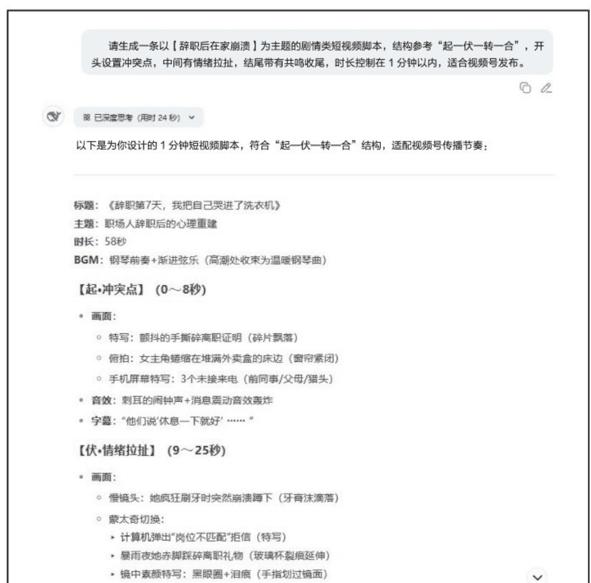

图1-1

##### 2. ChatGPT

ChatGPT是一款基于人工智能技术的聊天机器人程序，它使用了自然语言处理和深度学习等技术，可以进行自然语言的对话，回答用户提出的各种问题，并提供相关信息和建议，如图1-2所示。

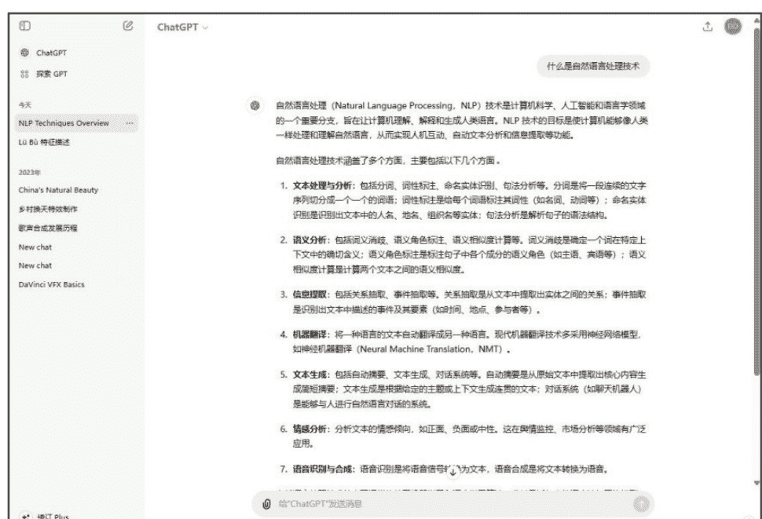

图1-2

ChatGPT的核心算法基于生成式预训练转换模型（Generative Pre-trained Transformer, GPT）模型，这是一种由人工智能研究公司OpenAI开发的深度学习模型，可以生成自然语言的文本。

ChatGPT可以与用户进行多种形式的交互。例如，文本聊天、语音识别、语音合成等。ChatGPT可以应用于多种场景中。例如，在客服、语音助手、教育、娱乐等领域，ChatGPT可帮助用户解决问题，提供娱乐服务和知识服务。

##### 3. 豆包

豆包是字节跳动推出的AI助手，跟抖音生态结合得很紧密。它对平台流行语、爆款节奏特别敏感，适合写种草类、口播类、剧情短剧类内容，尤其适合刚入门的小白创作者。你只要告诉它产品、风格和场景，就能一键生成多种话术模板。其操作简单，生成速度快，很适合做内容带货、热点跟拍或爆款模仿，如图1-3所示。

图1-3

#### 1.3.2 视频生成类AI工具

短视频创作不只是要写好脚本，更要“做出好画面”。而制作视频是最费时、最依赖技术的一环，不但要剪辑、配音，还要调色、上字幕等。这对很多内容创作者来说，拍摄容易、制作难，成了他们比较头疼的问题。而现在的AI视频工具，正在解决这一痛点：从自动剪辑、智能配音，到AI生成画面，基本实现了“视频自动化生产”。例如，可灵AI、Runway、即梦AI等工具。

##### 1. 可灵AI

可灵AI是快手推出的新一代AI创意生产力平台。它专注于视频生成领域，展现了卓越的技术能力和创新性。通过深度学习技术，特别是3D时空联合注意力机制和Diffusion Transformer架构，可灵AI能够生成高质量、逼真且符合物理规律的视频内容。

可灵AI的界面采用了简洁的设计风格，使得用户能够迅速理解并上手使用。无论是专业用户还是初学者，都能在短时间内找到所需的功能和工具，如图1-4所示。

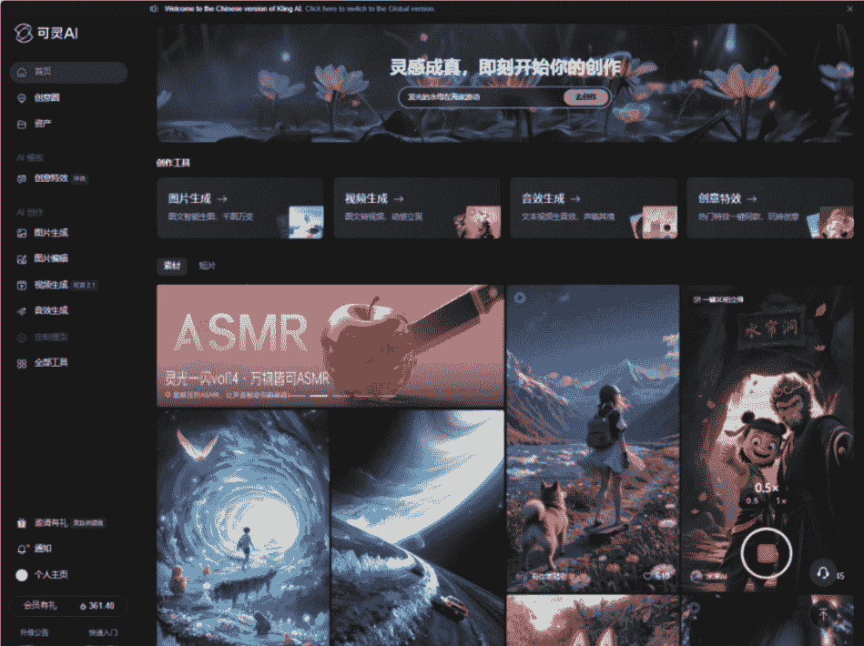

图1-4

##### 2. Runway

Runway是一家2018年成立于美国纽约的生成式人工智能公司，专注于图像和视频编辑领域。Runway以其独特的AI技术为核心，推出了多款产品，其中包括备受瞩目的Gen-3 Alpha。Gen-3 Alpha是一款经过视频和图像混合训练的新模型，与前一代Gen-2相比，在细节丰富度、画面连贯性以及动作表现上都有了显著提升。

该模型支持多种功能，如文本转视频、图像转视频、文本转图像等；并且还支持高级相机控制和导演模式等多样化的控制方式。Gen-3 Alpha的生成速度非常快，一段10秒的视频仅需90秒就能快速生成，这在业界保持了领先态势。图1-5所示为Runway生成的视频截图。

图1-5

Runway在多模态内容生成领域处于领先地位，其独特的AI技术和丰富的产品功能使其在市场上具有强大的竞争力。随着AI技术的不断发展和应用，Runway有望在未来继续保持领先地位，并在图像和视频编辑领域取得更大的突破。

##### 3. 即梦AI

即梦AI是一款字节跳动旗下剪映团队研发的一站式智能创作平台，具有“以图生动”或“文字变视频”功能，适合想快速把文案转成视频场景的人使用。你可以输入一句话，如“一个女孩站在夕阳下的大海边”，即梦AI就能生成相应风格的动态画面，如图1-6所示。如果你有一段脚本，它还能根据剧情生成配图、配乐，甚至自动拼接段落，完成一段完整的视频。该平台非常适合做Vlog配景、情绪视频背景、短剧场景过渡等。

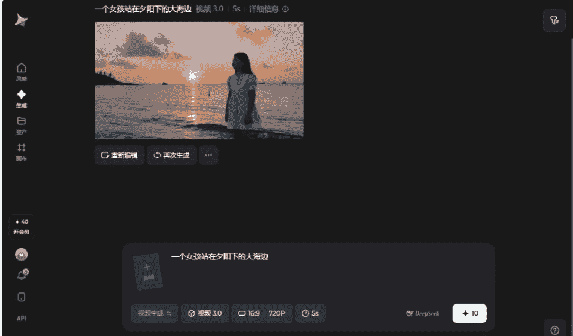

图1-6

#### 1.3.3 图像生成类AI工具

在短视频这个“看脸的时代”，一张图可能比一句话更重要。无论是视频封面、账号头像、场景插图，还是内容背景，一张有吸引力的画面都能大大提高用户的“点击率”和“停留率”。但并不是每个人都会设计画面，更别说有时间一张张去精修这些画面。这时候图像生成类AI工具就派上了用场。它们能根据提示词，自动生成你需要的风格图像，不仅效率高、质量好，而且视觉统一、风格可控，堪称“视觉懒人包”。

##### 1. Midjourney

Midjourney是一款先进的人工智能图像生成软件。它利用深度学习算法，通过用户输入的文本描述自动生成高质量的图像。它支持多种艺术风格，包括写实、抽象、卡通、复古等，满足各种创作需求。

Midjourney的主要应用领域涵盖了数字艺术、设计、游戏开发、广告营销和教育等。

用户只需加入Midjourney的Discord服务器，在聊天框中输入详细的文本描述，即可生成对应的图像。生成的过程是交互式的，用户可以根据初步结果调整描述，不断优化和迭代，直到获得满意的图像。图1-7所示为Midjourney绘制的作品。

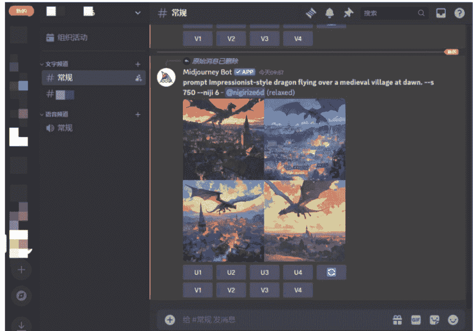

图1-7

Midjourney的图像生成速度非常快，通常几秒内即可生成，极大地提高了创作效率。它的高质量输出保证了图像的细节和色彩效果，适合专业级别的创作。该软件不仅能自动生成图像，还具备智能编辑功能，帮助用户调整布局、优化色彩和修正细节，使得创作过程更加便捷。

此外，Midjourney还具有很强的灵活性和互动性。用户可以通过点击、滑动等操作与生成的图像互动，增强用户的阅读和观看体验。无论是艺术家、设计师，还是游戏开发者和教育工作者，都能从中受益，创造出更具创意和吸引力的作品。

##### 2. 文心一格

文心一格是百度依托飞桨、文心大模型的技术创新而推出的AI艺术和创意辅助平台，如图1-8所示。其定位为面向有设计和创意需求的人群，基于文心大模型智能生成多样化AI创意图片，辅助用户创意设计，打破创意瓶颈。

图1-8

文心一格还支持用户输入图片的可控生成，根据图片的动作或者线稿等生成新图片，让图片生成的结果更可控。文心一格还在持续进行模型升级，不断丰富产品功能，已推出了海报创作、图片扩展和提升图片清晰度等功能，还提供多种生图服务，以满足用户需求。

##### 3. Canva AI

Canva AI是由澳大利亚设计平台Canva推出的智能工具套件Magic Studio，它通过生成式人工智能技术大幅提升设计效率，让非设计专业用户也能快速上手。

Canva AI整合了GPT-4（用于文案生成、多语言翻译）、DALL·E和Imagen（用于图像生成）、自研工具（如智能抠图、图像扩展、尺寸适配）等技术，覆盖图像生成、内容创作、设计编辑和品牌管理等多个场景，如图1-9所示。

图1-9

## 章节总结

本章简单介绍了爆款短视频产生的逻辑、如何使用AI工具提高工作效率和市面上较为好用的AI工具，具体内容可参考下图。

# 爆款短视频创作逻辑与 AI 赋能创作

爆款短视频的基本逻辑

- 抓住观众的关键 3 秒
- 理解平台的推荐机制
- 视频节奏怎么把握

用 AI 提高效率

- 用 AI 找选题、挖热点
- 用 AI 写标题和文案
- 用 AI 辅助脚本创意和语言优化
- 用 AI 提升视频画面和封面的效果

主流 AI 创作工具解析

- 文案生成类 AI 工具
- 视频生成类 AI 工具
- 图像生成类 AI 工具

## 第2章 AI＋选题策划：选题决定流量的上限

在短视频创作中，一个好的选题能够最大化地吸引目标受众。短视频平台的受众兴趣多样，选题如果能精准切中受众的共性需求，就能吸引更多受众点击和观看，甚至转发，因此具有广泛受众基础的选题，更容易引发大规模传播。而DeepSeek恰好能精准分析受众数据，帮助视频创作者了解受众兴趣，从而辅助其短视频创作。

那么，要如何利用DeepSeek进行短视频选题策划呢？这是一个值得讨论的问题。

### 2.1 用DeepSeek优化选题

你是否经常陷入“拍什么视频才能火”的迷茫之中，之后不免处于盲目跟风、灵感枯竭、数据惨淡……的窘境？而此时的DeepSeek就如同一台“爆款透视仪”，能帮你从海量数据中精准抓取受众真正想看的内容。本节将详细介绍如何使用DeepSeek优化短视频的选题。

扫码看视频

#### 2.1.1 用DeepSeek确立选题方向

在短视频创作中，选题方向就像一座灯塔，指引创作者明确视频定位，精准策划内容。合理的选题方向不仅能提升短视频的吸引力，还能有效增加播放量和互动性。

##### 1. 明确选题类型

根据内容属性和受众需求，选题类型大致可分为需求型选题、热点型选题和搜集型选题。

（1）需求型选题。需求型选题主要围绕受众的实际需求或痛点展开，提供有价值且实用的解决方案。用户关注的问题，往往意味着潜在流量，精准满足这些需求可以有效提高视频的点击率和完播率。

例如：

- 《3分钟教你快速去除PPT水印》（办公人群需求）
- 《如何用5种方式缓解失眠？医生教你科学改善睡眠》（养生爱好者需求）
- 《手机拍照模糊？5个设置让你的照片秒变大片！》（摄影爱好者需求）

（2）热点型选题。热点型选题也就是“蹭热点”选题，即利用当下流行事件、话题或趋势，结合自身创作方向，借助热点流量提升视频的传播效果。这种类型的选题能够迅速吸引观众关注，增强互动性。

例如：

- 《2024春晚最受欢迎的节目是它？网友热议不断！》（社会热点）
- 《ChatGPT 4.0到底有多强？亲测带你揭秘最新功能！》（科技热点）
- 《某品牌又翻车？全网热议的质量问题，你怎么看？》（品牌热点）

（3）搜集型选题。搜集型选题专注于信息的整理和归纳，以帮助受众高效获取相关资料。受众在处理某些事务时，需要查找大量分散的信息，而搜集型选题能够大大减少受众的搜索成本，从而提高自身的实用性和被收藏率。

例如：

- 《2024年全国各省公务员考试时间汇总！报考必看》（学生、考公群体）
- 《职场新人必备！10个超实用的PPT模板免费下载》（职场人）
- 《2024年热门国际旅游地推荐，预算、签证全攻略！》（旅行爱好者）

短视频创作的选题类型与对应的细分领域可以参考表2-1。

表2-1 短视频创作的选题类型与对应的细分领域

| 选题类型 | 细分领域 |
| --- | --- |
| 剧情类 | 搞笑情节、街坊邻里之间的相处、甜蜜爱情、幸福生活、朋友相处等 |
| 娱乐类 | 舞蹈表演、歌唱展示、明星艺人相关等 |
| 影视类 | 影视改编、影视混剪、综艺剪辑、电影解说、影评或影视推荐等 |
| 生活类 | 情感、美食、穿搭、美妆、母婴、育儿、养生等 |
| 知识类 | 技术流、独特手艺、知识分享等 |
| 文化类 | 书法、美术、国学、哲学、历史、二次元等 |
| 商业类 | 技能分享、讲述故事中穿插广告、测评带货等 |
| 资讯类 | 各行业资讯、时事热点、大众的实时关注等 |
| 三农类 | 与农民、农村、农业相关的产品或服务推荐等 |
| 科技类 | 科技产品分析、科技实验展示、科学术语讲解、科技创新等 |
| 军事类 | 军事新闻、军事解说、军事历史等 |
| 游戏类 | 网络游戏、竞技游戏、创意游戏、游戏解说、游戏分享等 |
| 宠物类 | 宠物日常、宠物表演等 |
| 体育类 | 体育赛事剪辑、体育新闻、体育解说等 |

##### 2. 确立选题方向

借助DeepSeek确立选题方向，有以下两个步骤。

（1）找到自己的优势和兴趣。对于创作者来说，如何找到自己的优势和兴趣，可以先思考以下几个问题。

- 1 你擅长什么？（如写作、演讲、摄影、剪辑、分析数据等）
- 2 你对哪些话题感兴趣？（如科技、职场、健康、美食、财经等）
- 3 你的职业背景或经验能为观众带来哪些独特视角？

（2）向DeepSeek提问。将以上问题的答案用简洁的语言表达并向DeepSeek提问，能够让它的回答更符合你的预期，下面是相关示例。

你是一个新手美食类短视频博主，擅长文案撰写与静态摄影，核心受众为18～35岁的年轻群体。现在需设计2个选题方向。要求：

- 1 结合自身图文创作优势与短视频媒介特性；
- 2 在避免盲目跟风的前提下，既契合平台流行趋势，又自然融入个人风格；
- 3 每个选题需包含内容框架简述、情绪共鸣点解析。

以下是2个符合要求的美食短视频选题方向设计。

##### 【选题一】《独居青年的厨房慢美学》

###### 1. 内容框架

- (1) 片头15秒（固定机位俯拍食材整理过程+白噪声背景音）。
- (2) 特写镜头组（黄油融化/面团发酵等微观变化）。
- (3) 制作过程分镜（配合手写字体菜谱浮入）。
- (4) 成品摆拍转场（从动态制作切换到静态摄影作品）。
- (5) 结尾定格（餐桌上光影摇曳的空盘+治愈系文案字幕）。

###### 2. 情绪共鸣点

- (1) 满足独居青年“仪式感治愈孤独”的情感需求。
- (2) 慢节奏画面对冲职场压力，制造精神疗愈体验。
- (3) 食物变化特写带来解压爽感。

##### 【选题二】《菜市场盲盒料理挑战》

###### 1. 内容框架

- (1) 跟拍逛菜市场过程（抓拍摊主互动+食材纹理）。
- (2) 盲选3种陌生食材特写（制造悬念）。
- (3) 料理实验失败花絮（保留翻车镜头）。
- (4) 成功菜品诞生时刻（升格镜头强调惊喜感）。
- (5) 菜谱手账展示（扫描手写笔记作为结尾）。

###### 2. 情绪共鸣点

- (1) 菜市场烟火气唤醒童年味觉记忆。
- (2) 不完美的真实感打破美食博主滤镜。
- (3) 盲盒机制激活Z世代猎奇心理。

DeepSeek提供的这些选题精准融合图文优势与短视频特性，选题创新兼具烟火气与年轻化，情绪共鸣点直击受众痛点，执行细节强化差异化风格，结构清晰，完美平衡平台流行趋势与创作者的个性。

#### 2.1.2 DeepSeek分析爆款选题的四大准则

DeepSeek在分析爆款选题时有四大准则，即考虑受众需求、追踪热点、内容的独特性、选题的可操作性，了解它的准则，能让你更精准地结合自己的内容，对DeepSeek提出要求，接下来就谈谈这四大准则具体是什么。

##### 1. 考虑受众需求

短视频内容是为观众服务的，只有满足他们的需求，才能引发共鸣、扩大传播。DeepSeek首先会明确目标受众的年龄、职业、兴趣等，以确保内容符合他们的需求，然后找到其痛点，提供解决方案或情感共鸣，最后通过分析评论了解受众反馈，帮助你及时调整选题方向。

##### 2. 追踪热点

热点自带流量，可以快速提升视频的曝光度。DeepSeek能及时捕捉热点，再将热点与视频内容有机结合，既确保内容的时效性，又避免生硬蹭热点。它能在节日或重大事件期间，结合热点推出相关内容，如春节期间的“年味”主题。

##### 3. 内容的独特性

独特的内容更容易吸引受众，DeepSeek擅于从新视角解读并深入分析常见话题，提供更多细节或背景信息，再将这些信息通过独特的风格或表达方式展示出来，增强辨识度。

##### 4. 选题的可操作性

再好的选题，若缺乏实操性，也无法成为爆款。DeepSeek是一款非常“人性化”的AI，它会确保你手中的资源（时间、人力、资金）可以支持内容制作，能为你合理安排时间，确保内容按时发布，而且会提前预判可能遇到的问题，并制定应对方案。

这四大准则相辅相成，考虑受众需求是基础，追踪热点是助推器，内容的独特性是竞争力，选题的可操作性是保障。DeepSeek在分析爆款选题时会兼顾这四大准则，帮助你打造出爆款内容。

#### 2.1.3 DeepSeek助力不同类型短视频的选题策略

不同类型的短视频需要注意的关键点各不相同，例如，搞笑类短视频不仅要注意幽默是否适度，还要能及时捕捉网络流行梗或热门话题，以确保笑点能被大多数观众理解，这样才能提高视频播放量。DeepSeek在助力不同类型的选题时，首先会分析不同内容的特点，然后会分析不同平台的特性。

##### 1. 分析内容特点

短视频的类型、内容和风格决定了其核心特点，因此掌握视频内容的特点十分重要。DeepSeek会观察内容的叙事方式，如直接讲解、故事化呈现；会分析视觉风格，如画面色调、剪辑节奏；还会识别语言风格，如幽默、严肃、亲切等。你可以给出视频的大致风格，借助DeepSeek进行具体分析，下面是相关示例。

你是一个短途旅游类博主，内容聚焦1～3日城市周边游，受众以25～40岁的“周末充电型”上班族及“轻量化遛娃”家庭为主，视频核心诉求为“用最小时间成本获得最大治愈感”。请你解析“轻松向”短途游视频的共性特征，要求：

1. 包含用户情绪触发机制；
2. 包含内容结构惯性；
3. 解析不同平台算法偏好；
4. 输出内容尽量不使用专业术语。

作为专注于短途游的博主，结合当前平台趋势与用户心理需求，“轻松向”短途游视频的创作可以围绕以下核心特征展开。

###### 一、用户情绪触发机制——精准戳中“都市人的情绪刚需”

####### 1. 逃离感制造

用高铁窗外飞驰的风景、骑行时风吹发梢的镜头，暗示“物理距离的抽离感”，让观众瞬间代入“短暂逃离日常”的治愈想象。例如，在拍摄晨雾中的郊区农场时，可插入城市早高峰的对比画面，强化“2小时切换生活场景”的爽感。

####### 2. 低门槛获得感

展示“不费劲的小确幸”，如妈妈单手抱娃摘草莓、上班族用午休时间打卡美术馆。重点突出“零装备”（无须专业相机/服装）、“零攻略”（跟着镜头走就行）的轻松属性，消除行动顾虑。

####### 3. 情感代偿点

设计“城市人稀缺体验”：深夜书房镜头配白噪声的雨声、带孩子用树叶拓印时特写指尖颜料，激活观众对“慢节奏”和“亲子时光质量”的渴望。记住“治愈感=熟悉的日常+1%的诗意化改造”。

###### 二、内容结构惯性——让观众“无脑跟随”的节奏设计

####### 1. 前3秒钩子公式

直接抛出结果：“原来上海周边藏着这个小京都”（场景悬念）、“带娃2小时找到宫崎骏森林”（情感共鸣）。忌用“大家好，今天我们来到……”类冗长开场。

####### 2. 中段模块化组合

采用“1个治愈场景+2个轻体验+1个隐藏彩蛋”结构。例如，民宿窗景（10秒）→喂鹿互动（20秒）→后院摘到野草莓（15秒彩蛋）。每个模块独立且可被算法拆条传播。

####### 3. 结尾行动催化剂

用“刚回市区又想订下周”替代“点击关注”。更有效的是展示手机订票界面（具体信息打码）、导航地图缩略图，暗示“决策链路不超过3步”。

……

（注：由于篇幅所限，仅展示部分内容。后面类似情况不再赘述。）

DeepSeek的解答精准提炼了观众的情绪需求，结构化地呈现了内容创作框架，针对平台特性给出差异化的选题策略，语言通俗易懂且实操性强，案例鲜活符合“治愈感”的核心需求，有效融合了多篇调研数据与行业实践。

##### 2. 分析平台特性

不同短视频平台有不同的推荐机制和受众偏好。例如，抖音以年轻受众为主，覆盖一线到四线城市，女性略多于男性，这类受众更喜欢娱乐性强、节奏快、视觉冲击力强的内容，因此在抖音上发布流行音乐、舞蹈、搞笑段子、颜值类视频更受欢迎，热门挑战赛和话题参与度也会更高；小红书受众以年轻女性为主，90后、00后占比高，该类受众注重生活方式的分享，热衷于美妆、时尚、旅行等内容；而快手受众分布更下沉，二、三线及以下城市观众占比较高，男女比例相对而言更均衡，这类受众更喜欢真实、接地气的内容，如日常生活、农村生活、手艺展示，对本地化内容和同城社交的需求也较强。

你可以根据个人视频的内容特点，让DeepSeek研究各大短视频平台的热门内容类型、分析平台观众的互动习惯，推荐合适的发布平台，下面是相关示例。

你是一个短途休闲旅游博主，主攻5分钟中视频赛道，受众聚焦“周末治愈型”都市人群，请你解析抖音、B站、小红书三大平台的特性，要求：

1. 包含用户对5分钟旅游视频的差异化互动行为；
2. 结合平台特性给出内容微调方案；
3. 无须罗列平台数据。

以下是三大平台特性解析及内容调整方案。

###### 一、抖音：快节奏强曝光的“情绪放大器”

(1) 用户互动特征。3秒定“生死”，用户习惯快速滑动，高光画面（如日出云海、森系咖啡厅）需前置；评论区爱问“定位”“攻略”，对“氛围感背景音乐”敏感度高。

(2) 内容调整方向。

1. 前15秒密集输出治愈场景（航拍空镜+人景互动），用“沉浸式白噪声”替代人声解说。
2. 黄金分割点（2分10秒）插入“城市逃离”主题字卡引发共鸣。
3. 结尾用悬念话术引导关注：“下期揭秘这个秘境民宿的隐藏玩法”。

###### 二、B站：沉浸式陪伴的“精神栖息地”

(1) 用户互动特征。接受慢节奏叙事，弹幕偏好“截图当壁纸”“求同款滤镜”；收藏夹行为集中在“完整路线图”“物品清单”。

(2) 内容调整方向。

1. 采用章节式结构（如“10:00的茶园漫步→14:30的手作体验”），用进度条时间戳提升完播率。
2. 插入“无台词行走片段”打造陪伴感，适时插入“你此刻想和谁来这里”等屏幕互动问题。
3. 片尾设置“设备揭秘”小剧场，自然引导“三连”（注：“三连”指用户通过长按“点赞”按钮一键完成点赞、投币、收藏3个操作）。

###### 三、小红书：实用主义的“生活灵感库”

(1) 用户互动特征。关键词搜索导向，“人均200元”“宠物友好”等标签触发收藏；评论区高频求“穿搭链接”“拍摄机位”。

(2) 内容调整方向。

1. 封面强化信息密度（地点名称+治愈元素图标），首帧叠加文字“含隐藏打卡点”。
2. 穿插“可复刻”场景：特写民宿早餐摆盘、书店选书逻辑等生活化细节。
3. 置顶评论预埋“穿搭品牌+修图参数”，引导用户晒“同款治愈周末”笔记。

……

DeepSeek的解答精准提炼了三大平台特性，差异化策略清晰，实操性强。通过场景前置、章节式叙事结构、标签植入等技巧适配各平台受众心理，提供可用的内容公式，符合“视频内容短+发布频率高+传播速度快+治愈感强”的传播需求。

### 2.2 用DeepSeek获取选题灵感

2.1节已经对如何用DeepSeek优化选题进行了解读，你还可以借助DeepSeek在社会热点、时事新闻中找到热点选题，并分析竞品，找到选题的突破点，或者通过DeepSeek分析用户评论，挖掘出适合自己账号的选题灵感。

扫码看视频

#### 2.2.1 用DeepSeek结合社会热点和时事新闻找到选题

借助DeepSeek结合社会热点和时事新闻找到选题，有以下两个步骤。

##### 1. 追踪社会热点和时事新闻

你在确立自己的短视频账号定位后，可以使用DeepSeek搜寻当前热点话题、时事新闻，下面是相关示例。

你是一个科技类短视频博主，专注将前沿科技动态转化为大众易理解的视觉化内容，擅长通过场景化叙事降低技术理解门槛，核心受众为18～35岁的科技爱好者与泛知识群体。请你筛选2条2025年3月1日前后具有高传播潜力的科技热点，要求选题满足：

1. 具有时效性与技术突破性；
2. 可视化表现空间大；
3. 可延伸社会议题讨论；
4. 适配短视频平台的互动玩法。

###### 选题一：私人月球着陆器“蓝色幽灵”号首登月面（3月2日）

（1）核心看点：全球首个由私人航天公司主导的月球着陆器成功登陆，实时传回4K分辨率的月球地表影像+机械臂采样全流程演示。

（2）互动玩法：①模拟着陆器视角的“月球蹦极”第一视角动画；②对比中美官方探测器着陆区地质特征；③评论区发起“月球资源开发用途竞猜”（氦-3能源/稀土开采）。

（3）议题延伸：太空商业化竞争加剧是否会导致“月球圈地运动”？民营公司如何平衡商业利益与太空伦理？

###### 选题二：硅基显示AI眼镜引爆“元宇宙入口”革命（3月26日）

（1）核心看点：上海CDC大会现场演示硅基显示眼镜的AR导航、实时翻译、全息会议等场景，对比传统OLED屏显技术参数断层式领先。

（2）互动玩法：①上线“未来眼镜”AR贴纸特效，用户可模拟体验视网膜投影效果；②发起“你最期待的AI眼镜功能”投票（医疗辅助/教育增强/娱乐沉浸）；③技术悬念：眼镜发热量实测挑战“冰块散热实验”。

……

DeepSeek紧扣需求，精准筛选前沿科技热点，用场景化叙事降低技术理解门槛，给出的选题兼顾时效性与社会价值，将技术突破转化为大众可感知的视觉符号，并通过互动玩法激发参与感，体现了短视频时代的传播智慧。

##### 2. 分析趋势

了解到相关热点新闻后，你可以向DeepSeek提供自己的视频主题，利用它进行未来趋势分析，结合这些趋势增强短视频的实时性，下面是相关示例。

你是一个科技类短视频创作者，擅长将复杂技术概念转化为趣味可视化内容，核心受众为18～35岁的科技爱好者及泛知识群体，内容需平衡专业深度与大众接受度。请你解析2025年3月1日前后的AI眼镜搜索趋势，要求：

1. 重点挖掘与技术突破关联的社会热议焦点；
2. 重点分析平台用户行为差异；
3. 结合搜索数据提炼出可转化为视频脚本的议题；
4. 无须罗列数据。

2025年AI眼镜搜索趋势解析与视频创作指南。

###### 一、技术突破与社会热议焦点

####### 1. “手机替代论”与隐私攻防战

（1）争议核心。L4级AI眼镜的“无屏交互”技术（如XREAL的2027路线图）引发用户对“解放双手”的期待，但续航焦虑与隐私泄露风险成舆论风暴中心。可设计街头实验，对比手机与AI眼镜在导航、社交场景中的效率差异，并模拟“眼镜偷拍”场景触发伦理讨论。

（2）技术暗线。Meta、小米、三星搭载的高通AR1芯片与紫光展锐W517的算力博弈，延伸至“端侧AI能否独立运行大模型”的行业争论，适合用芯片拆解动画+场景化演示（如滑雪中实时翻译）展现技术实力。

####### 2. 工业级应用的破圈狂欢

(1) 现象级案例。Rokid防爆眼镜在核电站检修、医疗AR辅助手术等B端场景实录引发大众好奇。建议以“工程师第一视角”揭秘眼镜如何识别设备故障，结合AI大模型远程协作的科幻感与现实价值。

(2) 反差营销。雷鸟V3与通义千问大模型联动的“宠物日常自动剪辑”功能，可策划“24小时AI眼镜记录柴犬”的萌系Vlog，硬核技术软性传递。

####### 3. “科技配饰”的身份认同冲突

社交裂变。72%的用户将Meta Ray-Ban眼镜视为潮玩，但“眼镜+耳机+摄像头”的叠加设计被吐槽“赛博累赘”。可制作“AI眼镜穿搭红黑榜”主题视频，讽刺功能堆砌vs力捧极简设计（如影目科技的31g超轻方案）。

###### 二、平台用户行为差异与内容适配

####### 1. 抖音：感官刺激+即时种草

(1) 爆款要素。产品颜值测评（如Meta Ray-Ban的时尚联名）、生活场景实测（语音点咖啡/AR导航）。

(2) 脚本公式。

1. 15秒快剪：“戴上AI眼镜逛漫展”突出角色识别与二次元特效叠加，结尾埋梗“社恐秒变社交悍匪”。
2. 挑战赛：“盲测千元眼镜vs万元眼镜”对比拍摄防抖、语音响应，引导评论区押注结果并关联购物车。

####### 2. B站：技术深挖+生态批判

(1) 硬核选题。光波导技术彩虹纹解决方案（如Gyges Labs的DigiWindow）、端侧大模型算力对比（高通AR1 vs恒玄定制芯片）。

(2) 内容策略。

1. 拆机评测：解剖雷鸟X2的Micro OLED屏，用激光笔演示700nit亮度如何对抗户外强光。
2. 行业观察：“百镜大战幸存者游戏”分析厂商在“堆参数”与“场景创新”间的生死博弈，穿插首席执行官（CEO）访谈增强权威性。

####### 3. 小红书：情感共鸣+圈层渗透

(1) 隐藏热点。AI眼镜与时尚单品的搭配法则（如MOODY联名“赛博美瞳”）、极客妈妈的“育儿监控神器”种草。

(2) 创作方向。

1. OOTD（今日穿搭）教程：“机能风穿搭+AI眼镜”搭配指南，突出科技感与日常实用性的平衡。
2. 情感叙事：“AI眼镜帮我记住阿尔茨海默病外婆的笑容”，用记忆辅助功能触发泪点与传播。

###### 三、高潜力视频议题

……

DeepSeek全面概括了AI眼镜的技术突破、用户关注点及行业挑战，并结合不同平台的特点给出相应的视频脚本创意，既有科技深度又贴近日常生活，但部分专业术语可能让普通观众理解稍有难度。

#### 2.2.2 用DeepSeek分析竞品账号，找到选题突破点

利用DeepSeek找选题突破点，可以有效节约你的选题时间，并提升选题的新颖度和吸引力。首先需要借助DeepSeek分析竞品账号，然后才能找到选题突破点。

##### 1. 分析竞品账号

分析竞品账号可以通过对比同类账号的热门内容，发现自身不足，并根据分析结果调整发布时间、内容类型或互动方式等，分析竞品账号可分为以下两个步骤。

（1）确定竞品范围。分析竞品账号首先需要确定竞品范围，DeepSeek先要了解你的账号情况，才能明确竞品范围，下面是相关示例。

你是一个美食类中部短视频创作者，主攻抖音、小红书双平台，聚焦“可复制的精致生活”内容方向，受众以22～35岁的城市白领及轻亲子家庭为主，擅长通过场景化叙事降低烹饪门槛。请你筛选与当前账号量级（粉丝量为2万、均赞1000）相近但内容迭代能力更强的同赛道博主，重点考察：

1. 差异化内容标签；
2. 粉丝互动质量；
3. 商业化潜力；
4. 要求排除头部顶流账号，聚焦“可追赶对象”。

基于抖音、小红书双平台同赛道中部博主筛选，结合“可复制的精致生活”内容方向，推荐以下5个具备追赶潜力的对标账号（排除头部顶流，筛选标准：粉丝量1.5万～5万，互动率≥8%）。

###### 一、××的治愈厨房（小红书）

1. 差异化标签

主打“15分钟职场妈妈晚餐”场景，将亲子辅食与成人简餐结合创新。

2. 内容亮点

1. 首创“一锅出”系列（如：南瓜蒸鸡胸肉+宝宝米糕同步制作）。
2. 每期植入职场时间管理技巧。

3. 互动质量

1. 收藏率高达32%（用户主动保存菜谱）。
2. 评论区高频出现“跟着做成功”的真实反馈。

4. 商业化潜力

已合作××买菜、××电器等家庭场景品牌。

###### 二、××刺客（抖音）

1. 差异化标签

以“办公室小家电创意吃法”破圈，聚焦都市独居场景。

2. 内容亮点

1. 开发空气炸锅/养生壶等设备的非常规用法（如：养生壶煮意面）。
2. 植入轻喜剧剧情强化记忆点。

3. 互动质量

1. 平均视频停留时长38秒（超出美食赛道均值15秒）。
2. 粉丝自发发起#刺客挑战赛二创活动。

4. 商业化潜力

1. 与九阳、摩飞等小家电品牌建立长期内容合作。
2. 星图任务完成率100%（品牌复投率高）。

……

###### 五、××研究所（小红书）

1. 差异化标签

专注“冷冻食材的精致改造”，解决都市人备餐痛点。

2. 内容亮点

1. 开发速冻饺子/包子等半成品的升级吃法（如：饺子皮变身彩虹烧麦）。
2. 每期标注备餐冷冻周期（例：周末备餐吃5天）。

3. 互动质量

1. 粉丝黏性指数8.9（搜索“冷冻早餐”关键词排名TOP3）。
2. 单篇笔记最高引发386条“作业打卡”。

4. 商业化潜力

1. 正与圃美多、湾仔码头洽谈产品共创。
2. 蒲公英内容自然流量占比75%（平台推荐权重高）。

DeepSeek推荐了5个贴近生活的美食博主，每个都找准独特定位，如职场妈妈快手菜、办公室创意烹饪等，内容实用又有创意。分析时既讲明各账号的特色亮点，又点出容易模仿的方面，如步骤简单、互动真实，适合普通人学习与追赶。

（2）分析竞品账号特点。紧跟前面的提问，在找到竞品范围后，就可以对这些竞品账号的数据进行分析，分析它们各方面的特点，下面是相关示例。

你是一个中部美食短视频创作者，专注早餐垂直类赛道，内容以“3分钟复刻网红早餐”为核心卖点，受众聚焦25～40岁的都市上班族，擅长通过场景化教学降低烹饪难度，视频平均完播率稳定在35%。请你解析竞品账号××研究所的选题策略，重点挖掘其三大核心能力。

1. 选题的“刚需性”。
2. 缩短观众决策链路的能力。
3. 要求剔除表层数据罗列，提炼可迁移的内容方法论。

××研究所选题策略解构与可迁移方法论。

###### 一、选题刚需性的三维穿透：痛点场景化+营养符号化+情绪寄生化

####### 1. 都市生存场景的精准切割

- 通勤压缩场景：针对“地铁口排队焦虑”，开发“便利店食材极速改造”系列（如用关东煮汤底复刻日式茶碗蒸），将便利店库存单位（Stock-Keeping Unit, SKU）转化为创作素材库，解决“快”与“便宜”双重刚需。
- 厨房荒废场景：锁定租房族厨具不全的痛点，推出“一器到底”专题（如平底锅同时煎蛋/烤面包的动线设计），通过“工具极简宣言”降低行动门槛。
- 育儿战争场景：针对职场妈妈群体“化妆+做早餐”双线任务，设计“冷冻半成品变形记”（如将预制饺子皮改造成拇指煎包），用“可囤货食材”绑定育儿效率刚需。

####### 2. 营养刚需的符号再造

- 蛋白质焦虑可视化：将鸡蛋转化为“万能黏合剂”，开发“蛋的12种折叠术”（如溏心蛋瀑布+厚蛋烧三明治），通过食材高复用率降低采购压力。
- 膳食纤维场景绑定：用“排便时钟梗”关联燕麦杯分层美学（奇亚籽+酸奶+水果垂直构图），以肠道健康痛点撬动职场人关注。

####### 3. 情绪价值的寄生式植入

- 治愈感嵌套：在教程中插入“ASMR（自发性知觉经络反应）音效+蒸汽特写”（如热牛奶拉花慢镜头），将烹饪过程转化为仪式感对抗虚无：设计“周一到周五主题色餐盘”（如周一蓝色，用蝶豆花酸奶调色），用视觉符号构建持续打卡动力。

###### 二、观众缩短决策链路的钩子设计：认知减负→行动降噪→共谋闭环

####### 1. 认知翻译术：专业概念生活化

- 将“米其林摆盘逻辑”简化为“叠叠乐三步法”：吐司打底→酱料勺背涂抹→自由落体撒料，通过动作拆解消除用户畏难心理。

####### 2. 行动减压器：构建零失败结界

- 工具承诺：提出“手掌丈量宇宙”量词体系（如“一拇指盖盐≈2g”），解决厨房秤缺失场景下的精准焦虑。
- 时间契约：设计“180秒沙漏进度条”，通过可视化时间承诺增强用户控制感（如煎饺时同步语音倒计时）。

####### 3. 食材共谋体：最小采购单元复用

- 开发“一物三吃公式”（如酸奶=涂抹酱+腌料+伪奶油），用食材多形态应用降低囤货压力。
- 构建“便利店二次创作指南”（如关东煮汤底复用为茶碗蒸基底），绑定都市人高频采购场景。

###### 三、可迁移内容心法：从功能供给到情绪基建

####### 1. 负能量营销前置

- 标题逆向操作：“允许吃丑陋但好吃的早餐”，用反精致宣言吸引“被美食博主内卷”的普通观众。
- 场景对比剪辑：左侧展示博主精致厨房动线，右侧还原打工人真实操作现场（如灶台堆满快递箱），制造情感共鸣。

####### 2. 决策颗粒度切割术

- 将“明早就试”拆解为“今夜必做的三件事”：冷冻室腾空10cm³/马克杯转移至床头柜/手机闹钟改名“煎蛋倒计时”，通过具体动作指引跨越“计划-行动”鸿沟。
- 建立“失败补偿机制”：将煎糊的面包片改造为牛肉饼夹心，降低用户试错心理负担。

####### 3. 私域行动闭环设计

- 视频末尾埋设“早餐暗号”：特定摆盘方式触发粉丝群表情包（如溏心蛋戳破动图），将内容消费转化为社交互动。
- 发起“周挑战赛”：集齐5种蛋形态解锁免单福利，用游戏化设计提升用户黏性。

DeepSeek从选题刚需性、缩短决策链路、可迁移内容心法3个部分出发，详细解析了竞品账号的特点，并提炼了可用的方法论。

##### 2. 找选题突破点

对竞品账号进行基础的分析后，便可开始寻找选题的突破点，有以下两个步骤。

（1）找创意空白点。在确定竞品账号各方面的特点后，我们可以根据这些特点，找到它的创意空白和薄弱点，以此进行创新与升级。继续以博主××研究所为例，我们来借助DeepSeek分析该账号的创意空白和薄弱点，下面是相关示例。

你是一个中部美食短视频创作者，专注于早餐领域，主攻“通勤场景+高颜值快手早餐”内容方向，视频平均完播率为38%，受众以25～35岁的都市白领为主，现在需突破同质化选题瓶颈。请你解构竞品账号××研究所的选题架构，找出该账号选题上的空白点和薄弱点。要求：

1. 重点识别其尚未覆盖的突破口；
2. 要求结合其“办公室三明治36变”等爆款案例，挖掘选题惯性导致的“舒适区盲点”；
3. 通过“选题惯性—潜在需求—创新解法”三层逻辑链展开。

###### 一、选题惯性：“办公室三明治36变”系列形成的爆款逻辑

- 核心依赖食材重组视觉冲击（彩虹吐司/熔岩芝士）。
- 聚焦单一场景的器具限制（仅限微波炉/烤箱）。
- 默认用户拥有基础食材储备（吐司/奶酪常备）。

###### 二、潜在需求：都市早餐行为学洞察

- 跨场景衔接需求：地铁进食（27%的用户存在手持早餐的场景）、步行通勤（需防泼洒设计）。
- 健康管理前置需求：体检报告倒逼的控糖期（32%的白领存在糖前症状）、健身增肌特需。
- 社交货币需求：可展示早餐盒美学（便当盒花式分层法）、亲子互动彩蛋设计。

###### 三、创新解法：突破三明治形态定式

####### 1. 健康监测型早餐

- 选题空白：竞品账号未将早餐与健康指标绑定。
- 执行方案：“糖友友好早餐”系列（如用魔芋蛋糕替代碳水）、“体检前7日早餐攻略”系列。
- 差异点：附赠电子版《早餐-体检指标对照表》（引用三甲医院膳食指南）。

####### 2. 通勤场景强化

- 选题惯性：现有内容忽略上班族行进间用餐的痛点。
- 创新点：开发“单手可操作早餐”（如防漏手卷）。
- 示例选题：“被安检拦下5次的早餐，我找到了合法携带方案。”

####### 3. 预制菜改造赛道

- 竞品盲区：抵触使用预制食材的“原教旨主义”倾向。
- 破局点：推出“便利店预制菜改造”（如711溏心蛋升级吃法）。
- 技术支撑：建立预制菜营养成分数据库（引用食药监备案数据）。

####### 4. 情绪价值绑定

- 薄弱环节：竞品账号缺乏情感共鸣触点。
- 创新路径：“早餐暗号社交实验。”（呼应厦门早餐车公益模式）
- 落地形式：发起“带两份早餐”活动（一份留给陌生同事），记录职场善意传递。

####### 5. 科技赋能方向

- 空白市场：未挖掘智能厨具创新场景。
- 开发建议：创作“通勤包里的黑科技”系列（如车载加热饭盒实测）。
- 技术亮点：接入可穿戴设备数据（如根据智能手环睡眠数据推荐早餐类型）。

###### 四、【执行避坑指南】需规避竞品账号的“创新陷阱”

- 警惕过度追求颜值导致的实操性下降（参照失败案例：分子料理煎饼）。
- 拒绝伪健康概念（如所谓“超级食物”需有临床验证）。
- 平衡商业植入与用户体验（参考厦门早餐车公益初心，保持内容纯净度）。

DeepSeek针对竞品账号的创意空白提出实用策略，巧妙结合观众的健康管理需求和通勤痛点（如防漏手卷和预制菜改造），既有场景化创新（体检攻略、地铁携带方案），又避免了过度美化陷阱，可行性较强。

（2）寻求实操建议。紧跟前面的提问，找到突破点后继续提问，向DeepSeek寻求一些实操建议，下面是相关示例。

你是一个中部早餐垂类短视频创作者，深耕“都市白领快手早餐”赛道，视频完播率稳定在38%，受众集中于25～35岁的一线城市职场人群，需突破现有选题同质化困局。请你基于前期对竞品××研究所的创意空白分析，提出可落地的选题突破方案，要求：

1. 选题与观众刚性需求的场景延展；
2. 文化赋能的差异化表达；
3. 强互动机制设计。

以下是选题突破方案。

###### 一、古法早餐复刻计划

(1) 场景延展：针对白领亚健康痛点，复刻清朝曹廷栋《老老恒言》一书中的乾隆同款八珍糕，解决其“脾胃虚寒+通勤赶时间”的双重矛盾，设计微波炉速成版古方。
(2) 文化赋能：每期视频末尾加入“早餐文物小剧场”，用趣味动画讲解古代食器（如战国铜鼎蒸糕技法），绑定#古人上班带饭智慧#话题。
(3) 互动机制：发起“养生早餐7日挑战”，用户晒早餐盒照片+健康监测App截图（如睡眠质量与早餐选择关联），前三名可获非遗糕点礼盒。

###### 二、城市早餐暗号行动

(1) 场景创新：借鉴厦门早餐车公益模式，在公司电梯间设置“早餐补给站”，拍摄“带两份早餐”实验——留一份贴手写便签给陌生同事。
(2) 文化表达：挖掘地域食俗，如武汉热干面“过早”仪式感、高邮阳春面搪瓷盆烫碗古法，在写字楼还原市井早餐摊氛围。
(3) 互动设计：每周三发布地铁站暗号（如“煎饼要双蛋”），凭该暗号到合作早餐车领取特制低卡版本，拍摄领取过程可参与早餐基金抽奖。

###### 三、办公室节气食育

(1) 需求绑定：结合体检季控糖需求，推出“立夏清肝早餐盒”，用枸杞叶鸡蛋卷替代传统三明治，附赠中医穴位按摩教程。
(2) 文化深化：复刻《山家清供》记载的“梅花汤饼”，用模具将全麦面包压成花瓣造型，讲解宋代文人的早餐美学。
(3) 参与激励：发起“早餐汉字挑战”——用食材摆出节气汉字（如“谷雨”），点赞过千的用户可获节气食谱手账本。

###### 四、通勤装备革命企划

(1) 场景突破：开发“防泼洒早餐手袋”，内嵌可拆卸餐盘+温控袋，实测挤地铁时酸奶杯的稳定性。
(2) 技术赋能：联名智能厨具品牌，拍摄“通勤包里的黑科技”系列，演示车载加热饭盒3分钟出餐，绑定#移动早餐研究所#话题。
(3) 用户共创：征集“最奇葩通勤早餐容器”故事，获选者可定制3D打印早餐盒（印有用户公司Logo及营养摄入量刻度）。

###### 五、早餐盲盒社交实验

(1) 刚性需求：解决选择困难症，推出“蛋白质盲盒”——随机组合溏心蛋/即食鸡胸肉，测试两周后用户体检指标变化。
(2) 文化融合：复刻唐代“烧尾宴”点心匣形式，用现代食材制作古风盲盒，每期解密一道升职宴典故。
(3) 裂变机制：设置“早餐暗号社交链”，首位破解本周食材密码的观众可解锁全家便利店早餐周卡，并指定下期挑战者。

通过对竞品账号选题空白点和薄弱点的分析，DeepSeek巧妙结合传统美食与现代需求，既解决职场人通勤痛点又融入地域文化，还通过互动挑战赛增强用户黏性，整体创意实用且接地气。

#### 2.2.3 用DeepSeek分析评论，挖掘选题灵感

分析视频下的评论是创作者了解受众需求、优化视频内容策略的重要环节。DeepSeek可以将评论按内容性质分类，再根据不同类别的评论针对性分析，提出对应的新选题方向。通过分析评论获得灵感有以下两个步骤。

##### 1. 提炼用户需求

仍以美食短视频博主为例，我们可以要求DeepSeek根据视频下的评论提炼用户需求，下面是相关示例。

你是一个美食教学类短视频创作者，粉丝量2万，主攻“零门槛复刻网红美食”赛道，受众以22~35岁的烹饪新手及怀旧美食爱好者为主，请根据以下5条评论，挖掘受众痛点和账号的内容需求。

1. “这个菜看起来好简单，适合我这种新手！”
2. “博主能出详细教程吗？有些步骤没看懂。”
3. “这个酱料在哪里买？求链接！”
4. “想起了妈妈做的味道，好怀念！”
5. “视频太长了，能不能缩短一点？”

以下是基于评论的受众痛点挖掘和内容需求提炼。

###### 一、受众痛点及内容需求分析

####### 1. 操作门槛焦虑

- 痛点：新手对复杂步骤存在畏难心理，需强化“零门槛”定位。
- 需求：持续推出“三步完成”“无工具版”等极简教程，标题突出“新手友好”“有手就会”关键词。

####### 2. 步骤细节模糊

- 痛点：关键步骤（如酱料调配、火候控制）易因剪辑节奏过快被忽略。
- 需求：拆分复杂步骤为“特写慢镜头+字幕标注”，同步推出图文版分步详解（附在视频评论区或账号主页）。

####### 3. 食材获取障碍

- 痛点：网红同款调料/工具难以在线下购买，影响复刻成功率。
- 需求：提供“材料平替方案”（如用豆瓣酱替代韩式辣酱），高频食材附电商平台链接（优先选拼多多/淘宝低价渠道）。

####### 4. 情感价值共鸣

- 痛点：怀旧需求未被充分挖掘，需通过美食唤醒童年记忆场景。
- 需求：策划“复刻童年味道”系列（如校门口炸串、老式鸡蛋糕），视频开头加入“妈妈厨房实拍”等情怀元素。

####### 5. 观看效率优化

- 痛点：长视频不符合碎片化浏览习惯，观众耐心阈值低。
- 需求：主视频控制在60秒内，仅保留核心步骤；复杂菜品拆分为“30秒极简版”与“3分钟细节解析版”双版本；添加进度条章节标记（如“酱料制作0:15—0:30”）。

###### 二、执行建议

- 在视频封面添加“新手必看”“材料清单见置顶评论”等强提示标签。
- 定期发起“复刻交作业”粉丝互动，收集实操反馈优化教程。
- 与调料品牌合作推出“复刻套餐”，解决用户找材料痛点且同时变现。

DeepSeek能针对每一条评论归纳出用户的需求和痛点，每个都有对应的解决需求，还有执行建议。

##### 2. 挖掘亮点选题

根据DeepSeek提炼的用户需求与痛点，我们就可以开始挖掘新的选题了，继续向DeepSeek提问，下面是相关示例。

你是一名中小体量美食教学类短视频创作者，主攻“零门槛复刻网红美食”赛道，受众以22~35岁的烹饪新手及怀旧美食爱好者为主，请你设计3个兼具实操价值与传播亮点的选题，要求：

1. 操作门槛控制在入门级；
2. 情感共鸣点需具象化；
3. 每个选题需包含“选题内核—痛点解法—视觉钩子”3层结构。

###### 【选题一】

(1) 选题内核：用5毛零食情怀撬动成年人味觉记忆。
(2) 痛点解法：市售辣条添加剂过多且口感油腻→用腐竹+微波炉复刻甜辣油润口感，调味仅需豆瓣酱/孜然粉/辣椒面三样家常调料。
(3) 视觉钩子：成品装进20世纪90年代铝制饭盒，包装纸用红白塑料袋+圆珠笔手写“卫×”Logo，背景音乐用《童年》八音盒版。

###### 【选题二】

(1) 选题内核：给独居青年制造一个不尴尬的仪式感出口。
(2) 痛点解法：网红泡面吃法需要大量配菜→用午餐肉+鸡蛋+番茄打造“三要素万能公式”，所有操作在宿舍电煮锅上完成。
(3) 视觉钩子：全程用搪瓷盆当容器，镜头角落摆放大头贴相册/诺基亚手机，背景音插入《流星花园》经典台词“道歉有用要警察干嘛”。

###### 【选题三】

(1) 选题内核：重建“妈妈味道”的味觉坐标。
(2) 痛点解法：家常菜教学总强调火候玄学→隔夜饭+冷冻蔬菜粒+生抽老抽1:1黄金比，电磁炉也能炒出焦香颗粒感。
(3) 视觉钩子：起锅时用荷叶边老式陶瓷盘盛装，特写镜头扫过边缘细微磕痕，片尾设置“座机电话铃响→画外音：妈，我学会你那个炒饭了”。

DeepSeek给出的这些选题贴近目标受众的需求，操作简单、情感元素具体，还加入很多视觉上的怀旧符号。

### 2.3 DeepSeek助力选题策划与热点分析

学会借助DeepSeek确立选题方向、获取短视频选题灵感后，我们就可以使用DeepSeek进行选题策划和热点分析了。

#### 2.3.1 用DeepSeek进行选题策划

使用DeepSeek做选题策划，有以下3个步骤。

##### 1. 明确选题方向

首先依据具体账号定位使用DeepSeek明确选题的大方向，下面是相关示例。

你是一名科技类短视频创作者，主攻“前沿科技生活化解读”赛道，受众以18～35岁的科技发烧友及泛科技人群为主，需突破“技术术语堆砌”的内容同质化困境。请你策划2个兼具专业深度与传播破圈力的科技选题方向，要求：

1. 追踪前沿科技热点；
2. 解析生活化场景下的技术；
3. 具有强互动性的知识验证；
4. 需避免纯产品评测类内容，重点挖掘大众似懂非懂的科技原理。

###### 选题方向一：脑机接口如何操控你的生活？用“意念”开灯背后的生物电秘密

（1）核心内容：追踪马斯克Neuralink（马斯克创立的研究脑机接口技术的公司）最新进展，解析脑机接口技术如何通过捕捉脑电波实现“意念控制”。结合家庭智能场景，展示如何用肌电传感器（观众可用手机+铝箔纸自制简易传感器）捕捉肌肉电信号操控智能台灯，同步解释“神经信号-电信号-机械指令”转化原理。
（2）互动实验：观众可用湿纸巾包裹手指接触铝箔纸，连接手机传感器App观察肌肉收缩时的电信号波动，从而直观感受“意念操控”的底层逻辑。

###### 选题方向二：量子计算离你有多近？冰箱里的液氮藏着宇宙级密码

（1）核心内容：解析室温超导材料突破对量子计算机小型化的推动，结合家用液氮冰淇淋机演示超导悬浮现象（液氮冷却超导材料后磁悬浮）。深挖“量子隧穿效应”在芯片运算中的革命性价值，对比经典计算机二进制与量子比特叠加态的差异。
（2）互动实验：观众可用液氮（或干冰）冷却钇钡铜氧超导材料，观察磁铁悬浮现象，同步用磁力线可视化App模拟量子纠缠态。

DeepSeek给出的选题方向，巧妙地将尖端科技融入日常生活场景，通过低门槛互动设计，让抽象的科技原理看得见、摸得着，既满足硬核科技迷的求知欲，又能用“我也能试”的参与感打破圈层壁垒。

##### 2. 细化关键词

明确好视频选题的大方向以后，就可以紧跟前面的提问，要求DeepSeek细化选题关键词。这里我们选择选题方向二进行选题关键词细化，下面是相关示例。

你是一名科技类短视频创作者，专注前沿技术生活化解读，擅长将复杂理论转化为可视化的沉浸体验，受众以18～35岁的科技爱好者为主，现在需突破“概念悬浮”与“生活脱钩”的传播困境。请你将“量子计算与液氮”的宏观方向拆解为具象化的内容关键词，要求：

1. 构建技术概念与生活化场景的桥梁；
2. 关键词需包含“技术突破点—视觉钩子—情感共鸣层”三维要素，避免使用抽象科技术语。

基于“量子计算与液氮”的技术关联与生活化场景，结合技术突破点、视觉钩子、情感共鸣三维要素，提炼以下内容关键词。

###### 1. 生命冷藏库：液氮疫苗守护者&量子算法破译病毒密码

- 技术破壁点：液氮冷冻保存生物样本（干细胞、疫苗）+量子计算模拟蛋白质折叠加速药物研发。
- 视觉钩子：液氮冷藏库的白色雾气升腾&病毒3D模型被量子算法“拆解重组”的粒子动画。
- 情感共鸣：“让癌症疫苗不再遥远”——普通人也能感知的科技守护力。

###### 2. 零碳发电厂：液氮储能矩阵&量子智慧电网调度

- 技术破壁点：液氮储能系统无地理限制储能+量子算法优化城市能源分配。
- 视觉钩子：巨型液氮储罐与风力发电机的工业美学&城市电网动态负荷的量子态光点流动。
- 情感共鸣：“你的空调电费由量子比特决定”——节能降碳与钱包厚度的强关联。

###### 3. 超算冰工厂：液氮散热黑箱&量子芯片极寒进化论

- 技术破壁点：液氮冷却超算芯片提升算力+低温量子电路突破半导体工艺瓶颈。
- 视觉钩子：液氮喷涌包裹服务器的“冰封科技感”&芯片纳米级结构的量子隧穿显微成像。
- 情感共鸣：“手机游戏帧率翻倍的幕后英雄”——从极低温实验室到指尖娱乐的链路拆解。

###### 4. 未来食材库：液氮速冻锁鲜术&量子供应链预测

- 技术破壁点：液氮超低温食品保鲜+量子优化生鲜物流路径。
- 视觉钩子：草莓瞬间凝结冰晶的微观摄影&全球生鲜运输网络的量子粒子路径模拟。
- 情感共鸣：“北极甜虾到你餐桌的量子护航”——科技如何让新鲜触手可及。

###### 5. 时空折叠仪：液氮低温延时&量子纠缠通信

- 技术破壁点：液氮辅助量子存储器延长信息保存+量子纠缠实现超距通信。
- 视觉钩子：液氮罐中悬浮的“时间胶囊”&两地量子比特同步闪烁的星空投影。
- 情感共鸣：“给百年后的你留一封量子情书”——浪漫想象与硬核技术的化学反应。

DeepSeek将科技领域细分为科技产品、科技公司、科技发展史、日常生活中的科技、科技实验5个方面，然后在这5个方面继续细化关键词，并提供了举例以供参考。

##### 3. 获取合适选题

做好前面两个准备后，我们就可以从获得的关键词中选择感兴趣的进行深入挖掘，用明确、简洁的语言描述关键词和要求输入DeepSeek输入框，让它生成合适的选题，然后根据自身能力、时间等因素筛选出可实行的选题。延续上面的提问，我们选择“液氮速冻锁鲜术&量子供应链预测”，要求DeepSeek提供具体的选题方案，下面是相关示例。

你是一名科技类短视频创作者，专注前沿技术的生活化转译，擅长将晦涩概念转化为具象场景体验，受众以25～35岁的科技爱好者及新中产家庭为主，请你以“液氮锁鲜&量子供应链”为内容关键词，策划1个具体的选题方案，要求：

1. 构建“极速冷冻-细胞保鲜-智能调度”的完整叙事链；
2. 挖掘“分子级保鲜”与“预测式物流”的科技美学冲突；
3. 设计可触发用户参与的行为钩子；
4. 需避免专业术语堆砌。

###### 【选题方案：量子冷链革命——你的餐桌正在被未来科技“预判”】

标题：液氮暂停时间，AI预判舌尖：这口鲜嫩背后藏着多少黑科技？

###### 一、叙事主线

####### 1. 极速冷冻：给食物按下“量子暂停键”

- 场景化开场：深夜渔船刚捕捞的帝王蟹vs内陆家庭餐桌的刺身拼盘——用30秒倒放镜头展现“时光倒流”，抛出疑问，“3000千米外的海鲜为何比楼下菜场的更新鲜”？
- 技术隐喻：液氮锁鲜不是“冷冻”，而是用-196℃的“时空裂缝”封存食材的细胞呼吸（参考小龙虾3个月后仍泛粉红外壳的案例）。类比科幻片中“冬眠舱”，让观众直观感受“分子级时间停滞”。

####### 2. 细胞保鲜：微观世界的极限博弈

- 视觉冲突：显微镜下对比传统冷冻（冰晶刺破细胞壁）vs液氮锁鲜（完美的冰晶矩阵），配合音效设计——前者像玻璃碎裂，后者如水晶风铃。
- 生活化共情：“这块牛排解冻后流出的不是血水，而是你多花的68元”——用家庭牛排煎制对比实验，量化汁液保留率>95%的价值。

####### 3. 智能调度：量子级供应链的“预知未来”

- 数据美学：卫星地图上闪烁的“鲜度光点”（三文鱼洄游路线/荔枝产区降雨量/社区团购数据），AI像拼乐高积木般组合成物流方案，引出“预测式冷链”——在你下单芒果前，液氮锁鲜包已从海南启程。
- 现实反差：对比奶奶辈“看天吃饭”的腌菜缸vs当代都市人手机里的生鲜App，用祖孙对话带出科技的温度，“现在连冰箱都会自己思考了”。

###### 二、科技美学冲突设计

- 视觉对照：实验室电子显微镜下的冰晶分形图案（理性之美）vs无人机俯瞰的冷链物流网（秩序之美），背景音渐变为交响乐《波莱罗舞曲》——科技精密与人类欲望的共舞。
- 文案张力：“我们既要分子级的绝对控制，又要天文级的不确定性博弈！”——用生鲜电商“今夜达”的承诺，解构现代人既要极致新鲜又要即时满足的矛盾心理。

###### 三、用户行为钩子

- 悬念实验：片尾展示三组密封盒（液氮速冻/家用冰箱/常温放置），邀请观众投票“48小时后哪盒草莓还能做蛋糕”，3日后在评论区揭晓显微镜对比图。
- 生活任务：发起#我家冰箱会预言#挑战，拍摄用冷冻食材复刻“记忆中的味道”（如外婆的鲜笋汤、初恋约会吃的冰淇淋），优质作品可获得“量子鲜度检测仪”（实际为便携式食材新鲜度测试笔）。

该选题结构层次清晰，以“冷冻技术—细胞原理—物流革新”三幕递进，串联科技逻辑与生活场景；冲突设计通过微观/宏观视觉对比强化张力，形成“悬念—原理—互动”的闭环体验，符合短视频强节奏需求。

#### 2.3.2 用DeepSeek进行热点分析，优化选题策略

优秀的短视频选题不仅能提起观众的兴趣，还得紧跟时事热点，只有这样，视频的曝光率和播放量才会更高。因此选择好合适选题后，你可以要求DeepSeek结合对选题相关的热点的分析，对选题进一步优化。注意，在要求DeepSeek将选题与时事热点联系起来时，最好选用“联网搜索”，因为“基础模型”给出的时事热点事件不够准确，下面是相关示例。

你是一名科技类短视频创作者，受众以25～35岁的科技爱好者及数码产品消费者为主，请你将基础技术议题“手机充电发热”升级为具有时效性的热点选题，要求：

1. 结合2025年3月1日前发生的真实热点事件；
2. 关联公众情绪触点。

2025年热点选题：“××品牌手机充电爆炸门背后：你的手机也在‘发火’吗？2025防烫指南！”

##### 一、选题解析

###### 1. 结合2025年3月真实热点事件

“××品牌手机用户集体维权事件持续发酵，3月26日泡泡××充电线爆炸致万元手机烧毁案例，全网热议快充安全隐患。我们将拆解旗舰机发热真相，实测2025年主流机型温控表现。”

###### 2. 关联公众情绪触点

- 安全焦虑：“充电发烫=定时炸弹？”（呼应2025年3月爆炸事故引发的群体恐慌）。
- 旗舰机信任危机：“万元手机为何集体‘发烧’。”（承接××品牌手机充电爆炸事件引发的质量质疑）
- 技术解惑需求：“快充技术迭代背后的散热博弈。”（满足科技爱好者深度求知欲）
- 解决方案渴求：“实测2025年降温黑科技——液态散热膜vs石墨烯贴片。”

###### 3. 时效性强化

“就在上周！工信部发布《移动终端温控新国标》（2025年3月29日），我们将提前解读新规对行业的影响，告诉你哪些在售机型已不符合安全标准。”

##### 二、情绪化标题备选

“紧急！你的充电习惯正在烧毁手机：2025年必须关闭的2个致命设置。” “实测触目惊心：45℃充电温度竟让电池折寿70%！这些品牌机型很危险。”

DeepSeek优化后的选题紧扣时事热点事件与政策热点，精准戳中受众的安全焦虑，用实测对比满足其求知欲。

## 章节总结

本章将解决你做短视频前不知如何选题的烦恼。例如，不知道怎么确定选题、如何策划选题和如何使用DeepSeek获取选题灵感，具体内容可参考下图。

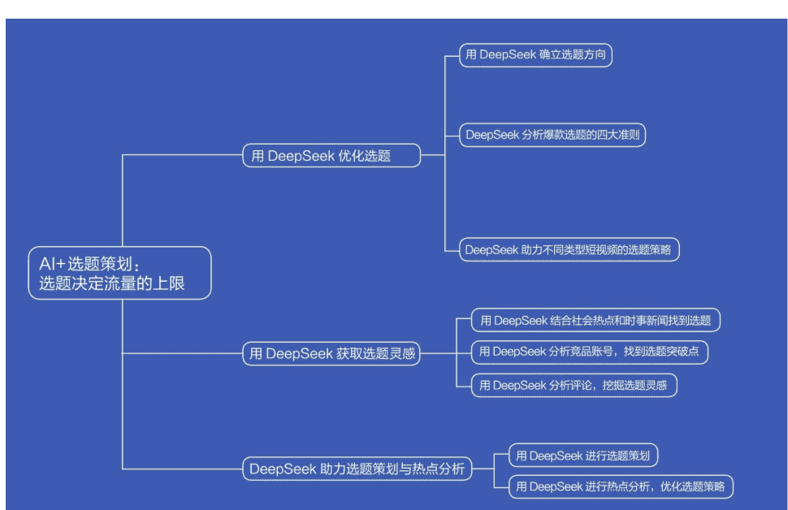

## 第3章 AI＋脚本策划：开拍前看见你的镜头画面

脚本策划是短视频创作的核心环节，它不仅能帮助创作者明确视频的主题和目标，确保视频围绕核心主题展开，避免偏离方向；还能为拍摄提供清晰指导，包括场景安排、镜头设计、演员台词等，减少拍摄过程中的不确定性。有了详细的脚本，创作者在拍摄短视频时就可以实现各类人员的高效合作，从而有效节省时间和成本。

在进行脚本策划时，不同类型的短视频需要注意的问题也各不相同。本章将介绍剧情类短视频、测评类短视频、科普类短视频、Vlog类短视频这4类短视频脚本的创作流程，以及利用DeepSeek优化短视频脚本的三大黄金方法。

### 3.1 用DeepSeek生成各类型的爆款脚本

剧情类短视频故事性强，注重引发情感共鸣；测评类短视频注重真实的产品体验，提供实用的参考；科普类视频注重知识的传播，需要通俗易懂；Vlog类短视频主要是生活记录，表现创作者的个性。因此，依据不同类型短视频的特点，我们可以借助DeepSeek创造不同类型的脚本。

扫码看视频

#### 3.1.1 剧情类短视频脚本

剧情类短视频通常短小精悍，要能在短时间内传递完整的故事，并引起观众的情感共鸣，还要设置创意反转、通过场景化叙事来加强故事的戏剧性效果并引发讨论。借助DeepSeek撰写剧情类短视频脚本的步骤如下。

##### 1. 找准账号定位

剧情类短视频的题材、形式丰富多样，题材上包括情感类、悬疑类、甜宠类等；形式上可以第一人称、第二人称或第三人称视角来叙事。向DeepSeek提供账号的具体定位，能够帮助它快速学习，理解你的创作需求，下面是相关示例。

你是一名剧情类短视频创作者，主攻情感叙事类短视频，账号粉丝量稳定在2万左右，作品风格偏向情感叙事与生活化表达。请你提炼出能引发观众深度共情的爆款作品共性特征，要求包含情感锚点设置技巧、叙事节奏把控、视听语言的情绪渲染手法、观众互动心理契合度以及正能量价值观的隐性植入策略。

情感叙事类短视频爆款作品的共性特征及创作策略。

###### 一、情感锚点设置技巧：触发记忆与共鸣的“钩子”

1. 生活化细节切入。用具体场景（如外卖单留言、深夜奶茶订单）作为情感触发点，将宏大主题转化为可感知的个体故事。例如，通过“被疫情困住的外卖小哥主动做志愿者”的戏剧性转折，将平凡事件升华为人性光辉的缩影。
2. 符号化心锚设计。重复使用特定视觉符号（如旧物件、固定手势）或听觉符号（如标志性背景音），通过重复剪辑和场景关联强化情绪记忆。例如，用“21千克台账”的物理重量隐喻工作负担，将抽象概念具象化。
3. 反差与意外制造。柔弱者展现坚韧（如瘦弱女孩搬运重物）、日常行为中暗藏反转（如外卖小哥被困后成为义工），利用身份/行为反差打破预期，使观众形成心理落差。

……

###### 五、正能量价值观的隐性植入策略：润物细无声的导向

1. 日常场景解构宏大叙事。通过“不准出去丸”等趣味化政务通知、社区台账称重等生活细节，将政策语言转化为通俗表达。
2. 传统文化当代转译。借历史人物故事（如苏东坡、嵇康）映射现代人的困境，用“大白话”拆解古文中的智慧，实现古今情感共通。
3. 非说教式榜样塑造。以“普通人高光时刻”（如疫情志愿者、孝老爱亲日常）替代英雄叙事，通过长尾细节（如磨破的鞋底、重复使用的饭盒）传递坚韧品质。

DeepSeek给出的爆款视频特征及策略总结结构清晰，涵盖创作全链路，策略实操性强，案例具象化，总体符合剧情类短视频情感共鸣的核心逻辑。

##### 2. 提供参考案例，总结脚本特点

紧跟前面的提问，向DeepSeek提供了账号的具体定位以后，它能够根据账号定位总结爆款视频特性和策略，但由于缺乏主题方向或者案例脚本，它无法给出具体可行的建议，所以接下来，你要给DeepSeek提供具体的案例脚本，让它学习并总结出案例脚本的特点，下面是相关示例。

你是一名剧情类短视频创作者，主攻情感叙事类短视频，账号粉丝量稳定在2万左右，作品风格偏向情感叙事与生活化表达。我会给你一个脚本内容，请你学习并总结这个脚本的特点。以下是脚本内容。

###### 《雨中的信》

时长：1分30秒

风格：抒情、治愈

叙事视角：第一人称

画面：（黑白画面）雨滴打在窗户上，模糊了窗外的景色。

台词：（内心独白）“又是一个雨天，我记得你最喜欢下雨天。”

画面：（回忆画面，彩色）一对情侣在雨中奔跑，女孩笑着，男孩为她撑伞。

台词：（内心独白）“你说，雨声像一首温柔的钢琴曲，能洗去所有的烦恼。”

画面：（回到现实，黑白）男孩坐在书桌前，手里拿着一封泛黄的信。

台词：（内心独白）“可是，自从你离开后，雨声就变得那么刺耳，像一根根针，扎在我的心上。”

画面：男孩打开信，信纸上写着，“亲爱的，当你看到这封信的时候，我已经离开了……”。

台词：（内心独白）“你说，你要去追逐自己的梦想，让我不要等你。”

画面：男孩的眼泪滴落在信纸上，模糊了字迹。

台词：（内心独白）“可是，我怎么能不等你呢？我们说好要一起看遍世界的雨。”

画面：（回忆画面，彩色）男孩和女孩在雨后漫步，女孩指着天空中的彩虹，笑得很灿烂。

音乐：舒缓的钢琴曲渐渐响起。

画面：（回到现实，黑白）男孩擦干眼泪，将信折好，放进抽屉。

台词：（内心独白）“我决定，不再等你。我要带着你的那份勇气，去追寻自己的梦想。”

画面：男孩站起身，走到窗前，推开窗户。

台词：（内心独白）“也许，在未来的某一天，我们会在另一个雨天相遇。”

画面：雨停了，阳光透过云层洒下来，男孩的脸上露出淡淡的微笑。

字幕：“即使错过，也要勇敢前行。”

音乐：钢琴曲达到高潮，渐渐淡出。

这个情感叙事类短视频脚本《雨中的信》具有以下值得学习的创作特点。

####### 1. 视觉意象系统

- 通过黑白/彩色的色彩转换构建双重时空，黑白现实与彩色回忆形成强烈情感对比。
- 雨水作为贯穿性意象（窗户上的雨痕/雨中奔跑/雨后彩虹），既承担转场功能又隐喻情感状态。
- 重要道具“信”的细节刻画（泛黄纸张/泪痕模糊了字迹）增强生活真实感。

####### 2. 叙事结构设计

- 采用经典三段式情感递进：追忆美好→直面现实伤痛→自我治愈。
- 现实与回忆的交替剪辑形成情感节奏（2次“现实—回忆—现实”循环）。
- 首尾呼应的雨天场景构成叙事闭环（开篇阴雨→结尾放晴）。

####### 3. 台词创作技法

- 内心独白保持克制留白，用意象化表达替代直白抒情（“雨声像针扎心”）。
- 关键记忆点金句设置（“看遍世界的雨”→“勇敢前行”）形成情感锚点。
- 书信文字与独白形成互文叙事，拓展故事想象空间。

####### 4. 情感唤醒机制

- 感官通感运用（雨声→钢琴曲→针扎的痛感）。
- 微观特写镜头聚焦（泪滴落在信纸上、手指折信动作）。
- 音乐情绪曲线与剧情高度同步（钢琴曲渐起→高潮→淡出）。

####### 5. 主题升华技巧

- 将个人情感叙事升华为普世成长主题（自我救赎与希望）。
- 通过自然意象的转换完成情绪转折（暴雨→彩虹→阳光）。
- 字幕与画面形成互文关系，避免说教感。

DeepSeek对案例脚本的结构、台词、情感等进行了多方面的客观评价与总结。

##### 3. 提出撰写要求，生成脚本

紧跟前面的提问，当DeepSeek知道了你想要的脚本特点后，就可以让它按照上面总结的这些特点，撰写脚本，下面是相关示例。

你是一名剧情类短视频创作者，主攻情感叙事类视频，账号粉丝量稳定在2万左右，作品风格偏向情感叙事与生活化表达。请你按照前面总结的脚本特点，围绕“学生时代的遗憾”这个主题，创作一个剧情类短视频脚本。要求：

1. 视频时长1～2分钟；
2. 紧密贴合账号定位；
3. 剧情要引发观众共鸣，增强代入感。

###### 《未寄出的夏末》

时长：1分45秒

风格：青春怀旧/遗憾美学

叙事视角：第一人称

画面：（冷色调）成年女主打开老式铁皮铅笔盒，抖落出泛黄的信封，封口处还贴着学生时代流行的星星贴纸。

台词：（轻声）“2009年6月11日，这封信在书包里磨出了毛边。”

画面：（暖黄滤镜）高中教室后排视角，阳光穿过蓝色窗帘，少年白衬衫的衣角被风吹起（手持镜头轻微晃动）。

台词：（混响处理）“那时候总以为，黑板右上角的倒计时走得很慢。”

画面：（升格镜头）课间走廊，女主低头抱着作业本，与抱着篮球的男生在拐角相撞，纸页雪花般散落。

台词：（急促呼吸声）“我们的对话永远停留在‘对不起’和‘没关系’！”

画面：（特写）女生颤抖的指尖反复摩挲着信纸的折痕，钢笔字迹被汗渍晕染成模糊的蓝色色块。

台词：（哽咽）“其实里面只抄了半阙《钗头凤》，写满少年心事又怕被看穿。”

画面：（俯拍）黄昏天台，男生独自练习投篮，影子被夕阳拉长，覆在女生躲藏的楼梯间墙面（光影隐喻）。

音乐：吉他版《送别》前奏渐入。

画面：（动态分屏）左屏女生深夜打手电写日记，右屏男生在球场擦汗时望向教学楼（时间同步流动）。

台词：“后来才懂，有些默契是错位的钟摆。”

画面：（暴雨声突入）毕业典礼当天，女生攥着信冲向空荡的教室，黑板上残留的半句数学公式被值日生擦去。

台词：（混响放大）“那些没说的话和没写完的板书，一起留在2009年的梅雨季。”

画面：（现实）女主突然起身，将信纸折成纸飞机投向窗外，阳光穿透纸张显出背面男生稚嫩的铅笔字迹，“今天你好像有话要说”？

音乐：铅笔书写声混入弦乐骤停。

字幕：“有些话如果不说，就会变成黑板上的公式，随着下课铃永远消失。”

画面：（超现实处理）无数纸飞机从教学楼窗口涌出，在时空中穿梭编织成未拆封的信封雨。

音乐：钢琴音阶逆流而上。

画面：（现实俯拍）女主把信封夹进《5年高考3年模拟》，封底露出半截被压扁的樱花标本。

台词：（释然轻笑）“现在说‘当年’这个词，是不是太老了？”

画面：（褪色处理）校服背影在蝉鸣中渐行渐远，黑板倒计时数字被风掀开一角，露出用粉笔描的极小爱心。

音乐：磁带倒带声结束。

结合了案例特点和视频主题后，DeepSeek给出的脚本校园元素精准，时间对比巧妙，双面字迹制造惊喜，结尾纸飞机升华主题，留白引发共鸣，完美契合“学生时代的遗憾”主题。

#### 3.1.2 测评类短视频脚本

测评类短视频以产品体验为核心，真实展示使用产品后发现的产品优缺点，帮助观众全面了解产品，为他们提供决策参考。借助DeepSeek写一篇测评类短视频脚本可以遵循以下步骤。

##### 1. 找准账号定位

测评类短视频更注重产品本身，侧重产品的使用体验，聚焦于产品的测试与客观评价，而不是单纯地推销产品。而测评的产品可以有很多类型，如美妆、美食、数码产品、日用品等，其目标群体有女性或男性、婴幼儿或成年人等，所以在创作脚本前，要向DeepSeek阐述清楚账号定位，让它总结这类账号的爆款视频脚本结构的特点，下面是相关示例。

你是一名女性美妆领域的测评类短视频博主，目标受众是18～30岁的年轻女性群体，视频以轻松、活泼的语调呈现，常融入年轻化元素，并设计问答挑战、产品盲测等互动环节以增加观众的参与感。请总结这类短视频爆款内容具备的关键特征。要求：

1. 结合目标受众对美妆产品的核心关注点与短视频平台的传播特性；
2. 涵盖脚本结构的特点。

以下是符合要求的可直接复用的美妆类短视频爆款内容关键特征总结。

###### 一、选题策略

1. 精准匹配用户核心诉求：聚焦“抗初老/持妆/性价比”三大流量密码，结合季节/节日热点打造“开学元气妆”“情人节斩男妆”等场景化选题，通过“油皮救星”“黄黑皮逆袭”等痛点关键词唤醒用户需求。
2. 内容垂直再细分：针对“敏感肌/学生党/通勤族”等标签群体定制“平价替代”“三分钟通勤妆”等专属内容，善用“产品测评+教程+好物分享”内容组合拳。

###### 二、脚本结构黄金公式

####### 1. 0～3秒：视觉冲击篇

1. 特写产品质地流动/妆容前后对比冲击画面。
2. 抛出“90%的女生都不知道的遮瑕误区”等悬念话术。

####### 2. 3～15秒：痛点直击+方案推荐

1. 模拟用户场景：“戴口罩脱妆导致亲妈不认？”
2. 展示产品核心成分（如“含××%的玻尿酸”）。

####### 3. 15～30秒：沉浸式验证

1. 真人实测镜头：“带妆8小时打卡实录。”
2. 放大使用细节：粉底刷45度上妆手法特写。

####### 4. 30～45秒：情感共鸣+转化引导

1. “学生党闭眼入”等信任话术。
2. 设计“留言抽同款”等轻互动机制。

###### 三、内容呈现技巧

1. 视觉表达：采用“1:1画幅对比”“动态贴纸标注成分”，配合化妆刷摩擦声等沉浸式音效。
2. 人格化塑造：穿插“翻车现场”等真实故事增强陪伴感，通过固定开场动作（如敲击粉饼盒）建立记忆点。
3. 平台适配：前3秒设置“口红试色变色瞬间”等高完播率画面，文案采用“先抛结果后解释”的倒金字塔结构。

DeepSeek通过分析爆款脚本的开头、中间、结尾和整体风格与细节，给出了各部分内容的特点以及呈现技巧。

##### 2. 提供具体产品，总结产品特点

紧跟前面的提问，向DeepSeek提供了账号的具体定位以后，它就能根据要求总结出爆款短视频脚本的特点。但由于没有提供具体的产品类型，它还无法给出具有针对性的建议，所以接下来，要向DeepSeek提供产品类型，让它总结出产品特点，下面是相关示例。你是一名专注于女性美妆产品测评的短视频创作者，日常向18～30岁的女性观众分享化妆品真实体验。请你针对口红这款美妆产品提炼出它的核心优势与主要槽点。要求：

1. 结合社交媒体上真实消费者的使用反馈；
2. 涵盖显色度、滋润度、持妆效果等方面；
3. 避免罗列参数式分析。

###### 一、口红核心优势与真实用户反馈

####### 1. 显色度惊艳，轻松打造氛围感

- 热门色号（如A品牌#999色号、B品牌405色号）被赞“薄涂温柔，厚涂自带女王滤镜”，尤其是蓝调正红和烂番茄色被称作“黄皮亲妈”，一抹即显高级感。
- 植物口红（如花××）主打“千人千色”，其体温变色设计让用户的唇色自然透亮，素颜也能一秒提气色。

####### 2. 滋润度成救命稻草，干唇党狂喜

- 植××、完美××精华口红因添加维生素E、玫瑰精粹等成分，被形容为“双唇喝饱水”，秋冬用不卡纹，甚至有用户反馈“比润唇膏更保湿”。
- 晶冻质地（如C品牌#507色号）因清透水润感被誉为“早八神器”，懒人直接当润唇膏用。

......

###### 二、口红主要槽点：避坑指南

####### 1. 拔干起皮：美丽刑具预警

某些哑光口红（如美××）被吐槽“像砂纸磨嘴”，唇纹深的女孩哭诉“涂完老十岁”，尤其北方用户直言“出门1小时，死皮立现”。

####### 2. 色素沉淀：卸妆水都救不了

低价网红款（如部分韩系唇釉）因色素残留被嘲“唇周像中毒”，有用户反馈“连用3天，嘴唇发灰”。

......

##### 3. 提出撰写要求，生成脚本

紧跟前面的提问，当DeepSeek知道了你想要的脚本特点和你主攻的产品类型后，就可以给它提供一个明确的产品，让它按照上面总结的产品特点，进行脚本撰写，下面是相关示例。

你是一名专注于女性美妆领域的测评类短视频博主，目标受众是18～30岁的年轻女性群体，请你围绕“适合夏天涂的口红”这个主题创作一个短视频脚本。要求：

- 1 结合前面总结的脚本结构特点和口红产品特点；
- 2 符合账号定位；
- 3 视频时长3分钟左右；
- 4 客观真实，注重阐述产品体验感。

（开场画面：博主头戴草编遮阳帽，手持冰镇西瓜蹦跳入镜，背景音效是海浪声与蝉鸣）

> “哈喽，姐妹们！你们的夏日元气补给站上线啦～”（点击屏幕弹出“夏日限定”动态贴纸）

> “最近收到超多私信催更：夏天涂口红总粘头发、吸管，还容易斑驳怎么办？今天咱们就用3支全网爆火的夏日口红做个硬核实测！”（右手打响指，镜头切换至摆满口红的工作台）

###### 一、镜头推进至第一支口红特写

“先看这支被韩剧女主带火的镜面唇釉，色号是蜜桃乌龙奶茶色。”
（挤压管身展示水润质地）

“上嘴像在涂果汁，成膜后蹭都蹭不掉！”（快速剪辑博主涂口红、用吸管喝冰饮、纸巾按压嘴唇的对比画面）

“姐妹们看！吸管只有一丢丢痕迹，戴口罩也不怕尴尬～不过唇色深的宝子记得先打底，不然会显色不均哦！”（皱眉摇头+哭脸表情包）

###### 二、转场插入素人试用片段

（素人闺蜜对镜头抱怨：“我涂镜面唇釉总像猪油嘴……”）

“快试试这个三明治涂法！”（加速镜头演示：润唇膏打底→点涂唇釉→纸巾抿掉浮色）

“现在是不是清透又自然？黄皮姐妹闭眼冲2号色，素颜都能嫩到掐出水！”（素人闺蜜疯狂点头+点赞手势）

……

DeepSeek给出了一个完整的口红测评的短视频脚本，严格控制在3分钟以内，采用“痛点引入—产品PK—悬念测试—福利引导”四幕式结构，符合短视频黄金5秒法则。

#### 3.1.3 科普类短视频脚本

科普类短视频一般以知识传播为核心，力求将复杂的知识简化，以通俗易懂的方式呈现给大众。借助DeepSeek写科普类短视频脚本有以下步骤。

##### 1. 找准账号定位

科普的知识有很多领域，如生活小常识、健康科普、科技前沿知识、历史文化知识等。所以在创作科普类短视频脚本前，要向DeepSeek阐述清楚账号定位，让它了解你的账号是科普哪方面的知识，并学习账号的风格（是严肃还是风趣），下面是相关示例。

你是一位专注儿童历史文化启蒙的科普短视频创作者，擅长用卡通角色扮演和趣味实验呈现知识，账号持续产出1分钟左右的内容，核心受众为学龄前至小学低年级的儿童。请你总结这类账号的爆款作品的共性特征。要求：

- 1 基于儿童认知心理学规律，结合《如果故宫会说话》《甲骨文游乐园》等标杆案例；
- 2 涵盖15秒注意力锚点设计；
- 3 涵盖知识点与生活场景的连接方式；
- 4 涵盖家长主动转发的社交货币植入策略。

作为儿童历史文化启蒙领域的短视频创作者，结合认知心理学规律与标杆案例分析，我提炼出如下爆款创作公式。

###### 一、15秒注意力锚点设计

- (1) 开篇采用“萌化文物+魔性音效”组合拳（如三星堆青铜面具眨眼特效+气泡音“猜猜我藏了多少秘密呀”）。
- (2) 设置悬念钩子。“如果书包会说话”系列用橡皮擦拟人化开场：“主人总在我身上画怪兽，今天我要逃跑啦！”
- (3) 动态知识切片。青铜器纹饰拆解成“会跳舞的小怪兽”，配合《勇气大爆发》卡点音乐呈现。

###### 二、认知适配的知识魔法连接

- (1) 文物功能生活化类比。甲骨文“车”字用乐高积木的车轮组装演绎，结尾过渡到现代共享单车。
- (2) 历史场景情境迁移。故宫屋脊兽变身“房顶护卫队”，对比小区保安叔叔的工作日常。
- (3) 传统技艺参与式还原。用橡皮泥复刻活字印刷，引导孩子盖手印制作全家姓氏卡。

###### 三、家长主动转发驱动力

- (1) 植入育儿价值提示。青铜鼎讲解结尾插入“培养专注力小贴士：让孩子每天观察厨房锅具10分钟”。
- (2) 设计亲子互动彩蛋。甲骨文动画片尾设置“亲子肢体猜字游戏”，家长拍摄过程易形成二次传播。
- (3) 打造教育成就展示。文物修复过程类比“给玩具做手术”，引导家长拍摄孩子修复旧玩具的前后对比视频。

###### 四、认知心理学适配策略

- (1) 多模态刺激设计。每20秒切换讲解形式（实拍→动画→手绘），以维持大脑多巴胺分泌节奏。
- (2) 具象化记忆编码。将“唐朝丝绸之路”转化为“骆驼快递员送货”的闯关游戏。
- (3) 即时反馈机制。设置知识问答弹幕（如“青铜器是绿色？对/错”），正确答案出现包子表情雨特效。

###### 五、标杆案例升级要素

- (1) 《如果故宫会说话》系列可增加“文物悄悄话”环节。屋脊兽讨论防晒霜的重要性，引出古代建筑的防水智慧。
- (2) 《甲骨文游乐园》可设计“汉字积木”挑战。用偏旁部首拼出现代物品名称，激发家长晒娃创作欲。

该爆款创作公式深度融合了认知心理学与传播学，通过萌化叙事、具象迁移和社交货币设计，精准解决学龄前和小低儿童专注力与家长传播痛点，具备总结性与趣味性。

##### 2. 提供参考案例，总结脚本特点

紧跟前面的提问，向DeepSeek描述账号定位后，它就能根据要求总结出爆款短视频脚本的特点。接下来就可以通过提供参考案例让它学习并总结你期望获得的短视频脚本的特点了，下面是相关示例。

你是一位专注儿童历史文化启蒙的科普类短视频创作者，擅长用卡通角色扮演和趣味实验呈现知识，账号持续产出1分钟左右的内容，核心受众为学龄前至小学低年级的儿童。我会给你一个脚本内容，请你学习并总结这个脚本的特点。以下是脚本内容。

《神奇甲骨文：乌龟壳上的“画画”大赛》

时长：1分钟

风格：诙谐有趣，画面可爱，互动性强

目标：科普甲骨文的历史知识，激发儿童对汉字起源的兴趣

脚本内容：

[开场：明亮的现代房间，卡通主角“小博”（一个活泼的小男孩）对着镜头，手里拿着一张画]

小博（兴奋地）：“嗨，小朋友们！你们知道在还没有纸和笔的古代，古人在哪里写字吗？答案就是——乌龟的壳！今天，我们就来一场穿越三千余年的‘画画’大赛！”

（画面快速切换：卡通动画，一个可爱的乌龟壳特写，上面开始出现火焰灼烧的裂纹）

小博（画外音，神秘地）：“嘘……这不是普通的画画哦！商朝的古人会把问题刻在龟甲上，然后用火烤——咔嚓！”

（音效：清脆的“咔嚓”声）

小博（画外音）：“看裂纹的形状，他们就能预测答案啦！这可不是魔法，这是最早的汉字——甲骨文！”

（趣味实验环节：画面切回到小博，他拿出一个陶土片和一根小木棍）

小博：“现在，轮到我们啦！看我如何仿造一个‘龟甲’！”

（小博像刻章一样，在软陶土片上刻下一个简单的甲骨文“象”（大象的象形字））

（画面特效：小博刻的字发出金光，旁边立刻出现对应的现代汉字“象”和一个可爱的卡通大象动画，并叫了一声。）

小博（夸张地惊讶）：“哇！看，这个弯弯的鼻子和长长的牙，像不像一头大象？古人就是用画画来记事的，是不是超厉害？”

[画面切换：快速展示几个简单有趣的甲骨文动画，如“日”（太阳）、“鱼”（小鱼）、“木”（树）。]

小博（画外音，语速稍快）：“一个符号就是一个字，一个故事！我们的汉字，就是这样从可爱的图画慢慢变过来的哦！”

（结尾：小博举起他刻的“象”字陶土片，对着镜头）

小博：“所以，每一个汉字都是一幅来自古代的奇妙图画！小朋友们，你们也能在自己的画里找到汉字吗？评论区告诉我吧！”

（字幕与号召性用语）

字幕：点赞收藏，下一期带你破解更多“汉字密码”！

小博（挥手）：“记得关注我，解锁更多好玩的历史！下次见喽！”

这是一个非常优秀的儿童历史文化启蒙脚本范例！经过分析，我为你总结了该脚本的核心特点，这些特点完美契合了你的账号定位和受众需求。

《神奇甲骨文》脚本特点总结如下。

###### 1. 高概念、低入口的选题

- 特点：将一个宏大复杂的历史概念（汉字起源/甲骨文）转化为一个具体、新奇、能瞬间抓住儿童注意力的“小点”（乌龟壳上的画画大赛）。
- 好处：完美匹配学龄前和低年级儿童的认知水平，用“玩”代替“学”，消除知识的距离感和恐惧感。

###### 2. “卡通IP+趣味实验”的黄金结构

- 卡通IP（小博）：固定的、有亲和力的主角（小博）是孩子的“向导”和“朋友”，这样能建立账号辨识度和观众情感连接。
- 趣味实验：将知识验证过程变为可操作的、像游戏一样的手工环节（刻陶土片），符合儿童“动手求知”的天性，极大增强小观众参与感和记忆点。
- 结构流程：提问设疑→动画讲解→动手实验→成果验证→延伸拓展。节奏明快，张弛有度，1分钟内完成一次完整的知识探索闭环。

###### 3. 极致的视听语言与互动设计

- 视觉：动画与实景无缝切换，用生动卡通动画解释抽象的历史过程（火烤龟甲），用实景实验让知识变得可触摸。
- 特效运用（字发金光）：创造“魔法时刻”，赋予知识神奇感和成就感，是视频的情绪高潮点。
- 多元素同步呈现（甲骨文+现代字+卡通形象+音效）：多维度刺激小观众感官，强化他们的记忆。
- 听觉：夸张有趣的音效（“咔嚓”声），制造趣味性和惊喜感。
- 角色语调和语气：小博的语气充满好奇、兴奋和惊讶，能有效带动小观众的情绪。
- 互动：
    - ①全程对话感：小博始终对着镜头说话，仿佛在与每个小观众一对一交流。
    - ②结尾开放式提问（“你们也能在自己的画里找到汉字吗？”）：引导思考，激发评论区互动，从观看者变为参与者。

###### 4. 精准的知识提炼与转化

- 化繁为简：避开所有复杂术语（如“占卜”“卜辞”），用儿童能理解的“问题—答案—画画—预测”来解读甲骨文功能。
- 案例选择精当：选取最具象形特征的甲骨文（“象”“日”“鱼”“木”），一看就懂，一笑就记。
- 核心提炼准确：牢牢抓住“汉字源于图画”这一核心观点，并贯穿始终，主题鲜明不散焦。

###### 5. 成熟的账号运营思维

- “追剧”式结尾：明确的“下期预告”（破解汉字密码）和关注引导，有效提升粉丝黏性和系列视频的完播率。
- 召唤行动：“点赞收藏”的提示和评论区互动的邀请，直接促进视频的关键数据指标上升。

DeepSeek通过分析脚本内容，总结出了一个专为学龄前和低年级儿童设计的“知识游戏化”短视频魔法公式：即用固定卡通IP引领，通过“高概念提问+动画解密+趣味实验+视觉魔法时刻”的结构，将抽象历史文化转化为可操作、可感知的互动游戏。

##### 3. 提出撰写要求，生成脚本

紧跟前面的提问，当DeepSeek知道了你的账号定位、目标受众、账号风格以及这种类型短视频的脚本特点后，就可以给它一个主题，让它结合账号定位，按照上面总结的特点，进行脚本撰写，下面是相关示例。

你是一位专注儿童历史文化启蒙的科普短视频创作者，擅长用卡通角色扮演和趣味实验呈现知识，账号持续产出1分钟左右的内容，核心受众为学龄前至小学低年级的儿童。请你按照前面总结的脚本特点，结合账号定位，围绕“关于秦始皇的冷知识”这个主题，创作一个科普类短视频脚本，要求：

- 1 视频时长1分钟左右，依据时长控制脚本篇幅；
- 2 科普知识客观、真实；
- 3 语言要风趣生动，表达通俗易懂。

###### 《秦始皇的超级秘密！》

时长：1分10秒

风格：Q版动画+实景互动

（开场：卡通版秦始皇跳街舞出场，背景是乐高积木搭的咸阳宫）

秦始皇（自带电音效果）：“哈喽！我是身高将近两米的嬴政！听说现代小朋友喜欢叫我‘古代超级英雄’？”（突然举起玩具弩）“看我射箭超能力——咻！”

（画面切换：动画版秦始皇在船上大战鲛鱼）

主角（举着棉花糖当望远镜）：“哇！始皇帝真的用弩箭射过鲛鱼哦！就像你们在游戏厅打怪兽一样酷！”

（实验环节：用披萨饼演示统一度量衡）

主角（拿卷尺量披萨）：“秦始皇说全国的披萨都得这么大！他把卷尺和电子秤的祖先——尺子和秤砣，变成全国统一款！”

（互动彩蛋：小朋友举玩具剑摆姿势）

秦始皇（叉腰大笑）：“听说你们喜欢收集卡片？我造了世界上最早的‘闪卡’——刻着‘定秦’的青铜剑，比奥特曼变身器还帅！”

（结尾：现代超市场景）

主角（推购物车）：“现在用的‘斤’‘两’、写的汉字、走的马路，都有秦始皇的智慧密码！快问问爸爸妈妈，谁才是真正的发明大王？”

字幕：亲子挑战！用积木搭建属于你的“迷你长城”吧！

DeepSeek给出的新脚本深度融合认知心理学与传播学，通过萌化叙事（卡通版嬴政跳街舞）与生活化类比（披萨度量衡）实现历史具象迁移，社交货币设计（亲子积木挑战）精准触发家长传播动机。

#### 3.1.4 Vlog类短视频脚本

Vlog类短视频是一种以视频形式记录个人生活、感受和经历的博客形式，近年来在短视频平台中逐渐流行。Vlog的核心特点是真实性，它通常围绕博主的日常生活展开，主题广泛，涵盖旅行、美食、学习、情感记录等，因此它注重个体性和生活化。撰写Vlog类短视频脚本需要遵循以下步骤。

##### 1. 找准账号定位

Vlog具有较强的互动性，博主需要通过视频和观众进行交流，又需要多场景拍摄，没有固定的剧本，时长也会比普通短视频更长，所以Vlog的制作过程相比其他短视频更为复杂。借助DeepSeek创作Vlog类的短视频脚本，依旧需要让它先找到账号定位，下面是相关示例。

你是一名专注大学生日常学习生活与平价美食探店的Vlog类短视频博主，视频风格轻松活泼，账号核心受众为18～25岁的大学生，内容方向聚焦时间管理技巧、校园生活趣事、高性价比美食探店等主题。请你总结这类Vlog账号的爆款视频共性特征，要求涵盖：

- 1 真实人设与情绪价值的结合方式；
- 2 互动机制设计；
- 3 适配碎片化观看习惯的节奏把控技巧。

大学生日常学习生活&平价美食探店类Vlog账号爆款视频共性特征。

###### 一、真实人设与情绪价值结合方式

####### 1. 标签化身份锚点

打造“00后考研特种兵”“省钱狂魔课代表”“高校食堂扫雷员”等具象人设，通过宿舍书桌特写、食堂排队实拍、图书馆占座日常等场景强化身份记忆点。结合备考焦虑、选择困难、社交小确幸等大学生共同情绪，采用“今天背完100个单词就奖励自己吃××美食”的叙事结构，展现真实成长轨迹。

####### 2. 第一视角沉浸代入

手持镜头拍摄食堂打饭抖动画面+画外音吐槽“阿姨手抖症又犯了”，自习室延时摄影记录学习时长，搭配“这题错3次了！谁来救救我”等口语化文案。用手机前置摄像头拍摄探店时惊喜/踩雷表情特写，真实反应增强可信度。

####### 3. 反差感情绪传递

深夜赶论文时突然插入泡面开箱测评，严肃学习Vlog结尾闪现室友搞怪表情包。通过“早起失败→高效逆袭”“探店踩雷→意外发现宝藏窗口”等剧情反转，传递“不完美但积极”的生活态度。

###### 二、互动机制设计

####### 1. 场景化任务触发

片尾设置“明日学习目标投票”弹窗（选项含高数刷题/四六级听力等），下期开头公布投票结果并执行。探店视频发布后，评论区发起“猜猜这顿饭花了多少钱”的互动，72小时后置顶公布账单明细。

####### 2. 养成系参与激励

创建“30天食堂不重样挑战”合集，每期展示粉丝推荐的菜品并@贡献者，片尾预告“明日探店地点由点赞最高评论来决定”。学习Vlog设置“计时器彩蛋”，正片结束后弹出“今日专注时长”成就海报供截图打卡。

####### 3. 梗文化双向共创

将“早八困成狗”“期末破防周”等校园黑话转化为专属表情包贴纸，引导粉丝在弹幕刷统一暗号（如“××大学在逃学霸申请出战”）。定期收集粉丝“奇葩”学习姿势/食堂黑暗料理投稿，制作“粉丝行为大赏”特辑。

###### 三、碎片化节奏把控技巧

####### 1. 3秒定帧法则

开场用食堂菜品特写+价格字幕（“6.8元糖醋里脊暴击！”）或闹钟响起时课本飞入镜头的动态贴纸，快速建立观看预期。每15秒插入一次信息爆点（如突然放大错题本红叉/揭开美食浇汁慢动作）。

####### 2. 模块化叙事结构

采用“痛点引入（备考焦虑）→解决方案（自习室沉浸跟拍）→成就展示（完成清单打勾）→情感共鸣（瘫倒时发现窗外晚霞）”的四幕式框架，每模块控制在20秒内。穿插0.5秒黑屏转场+音效（翻书声/食堂打铃），形成呼吸感节奏。

####### 3. 多维度信息密度

同一场景叠加三层信息：画面主体（背书镜头）+滚动字幕（时间管理技巧）+底部进度条（倒计时特效）。探店时采用“环境全景（1秒）→价格牌特写（0.5秒）→食物拉丝慢动作（2秒）→真人表情反应（1秒）”的镜头组合拳。

通过对账号定位和爆款视频的分析，DeepSeek提炼出的爆款特征逻辑严密，包含真实人设引发共鸣、互动设计增强参与感、快节奏剪辑吸引观看、独特内容避免雷同，符合这些特征的短视频很适合传播并容易出爆款视频。

##### 2. 询问DeepSeek相关信息需求

紧跟前面的提问，通过向DeepSeek提供账号大致定位，它就能根据要求总结出爆款短视频脚本的特点。但是Vlog类的短视频个性化色彩很强，拍摄过程中存在着许多不确定性，所以创作者往往无法完全依照DeepSeek提供的脚本去拍摄视频。因此，创作者在向DeepSeek寻求脚本建议时，最好先确定一个主题，然后询问它需要提供什么补充信息，而非直接给它提供脚本案例，让它总结特点后再撰写脚本，这样可避免写出来的Vlog脚本过于呆板，符合其生活化、个性化和真实化的特点。

你是一名专注大学生日常学习生活与平价美食探店的Vlog类短视频博主，视频风格轻松活泼，账号核心受众为18～25岁的大学生。现在你需要策划一期“大学生结束一整天学习后会做些什么”的Vlog视频，想要撰写一个视频拍摄的脚本结构。脚本结构有以下特点：

- 1. 具有生活化、个性化和真实化的特点；
- 2. 涵盖触发代入感的行为设计；
- 3. 运用年轻化视听语言。请问需要提供哪些信息给你？

以下是策划“大学生结束一整天学习后会做些什么”Vlog视频脚本结构需要提供的信息清单。

###### 一、时间线与场景模块

- (1) 具体时间节点划分（精确到分钟）：例如，18:00下课挤食堂、19:30图书馆收书包、21:00操场夜跑等，需标注每个环节的典型动作（如“边啃包子边刷校园卡”）。
- (2) 关键场景清单：包含宿舍瘫倒、食堂抢饭、社团活动室闲聊、操场散步等真实校园场景，需说明场景细节（如“宿舍桌上堆着没拆封的快递盒+半包辣条”）。
- (3) 特殊事件触发点：如偶遇同学约夜宵、临时被拉去打游戏等意外情节，需描述互动话术（如“舍友突然掀开床帘喊‘烧烤第二份半价！速来！’”）。

###### 二、代入感行为设计模块

####### 1. 观众互动触发机制

- 需提供3～5个让观众同步操作的指令（如“拍下你今晚的桌面零食搭配发弹幕”或“猜我书包里最先掏出来的是什么”）。
- 设计1个可复制的学生党行为符号（如“单手解帆布鞋带同时刷手机”动作特写）。

####### 2. 情绪共鸣锚点

- 需明确3个压力释放细节（如“把高数作业甩到床上的慢镜头+纸张飘落的音效”）。
- 提供2个学生专属暗号（如“比画奶茶‘吨吨吨’手势表示续命成功”）。

###### 三、年轻化视听语言模块

####### 1. 背景音乐分段需求

需指定不同场景配乐风格（如食堂嘈杂环境用蒸汽波混剪、夜跑用电子卡点音乐）。

####### 2. 镜头语言设计

- 需确认3个标志性运镜（如“从书本堆俯拍切换到仰拍天花板哀嚎”）。
- 提供2个特效需求（如“把单词本扔出画框时添加‘咻’的漫画音效”）。

####### 3. 快剪节奏模板

需标注加速片段（如2倍速展示收拾书包过程）与慢动作重点（如0.5倍速奶茶吸管插入瞬间）。

###### 四、真实生活素材模块

###### 五、转化引导模块

(1) 结尾互动话术：需确定呼吁行动指令（如“评论区第88楼送同款寝室懒人支架”）。
(2) 下期预告梗：需设计1个校园生活悬念（如“下期揭秘如何在查寝前5分钟搞定卫生评分90+”）。

DeepSeek提出了5个模块的相关信息清单的补充要求，能方便你全面、有条理地整理好相关信息。

##### 3. 补充信息，生成脚本

紧跟前面的提问，现在就可以根据DeepSeek提出的要求补充信息，在补充信息时，要注意结合以往的Vlog视频，符合自己的账号定位，不能过于跳脱，提供准确的信息即可，如果遇到无法具体描述的信息，可以选择先跳过，下面是相关示例。

你是一名专注大学生日常学习生活与平价美食探店的Vlog类短视频博主，视频风格轻松活泼，核心受众为18～25岁的大学生。请你撰写一期“大学生结束一整天学习后会做些什么”的Vlog视频脚本。以下是相关信息。

1. 视频核心主题：分享一整天学习之后的放松方式。
2. 个人风格与习惯：学习后先吃饭，饭后通常会散步，希望在视频中展现出真实、活泼、接地气的性格特点。
3. 关键场景：吃饭、操场散步、和朋友聊天、回宿舍追剧。
4. 视频时长划分：吃饭1分钟、散步1分钟、聊天1分钟、追剧1分钟。
5. 配乐与镜头需求：偏向舒缓的叙事风格、喜欢轻快的配乐、画面清新。

以下是符合要求的“大学生结束一整天学习后会做些什么”Vlog脚本，按4分钟时长分镜设计。

标题：“‘早八人’的续命指南：当代大学生下课后都在卷什么？”

封面设计：九宫格拼接学习资料堆/食堂餐盘/操场跑道/宿舍零食，荧光笔标注副标题“图书馆→食堂→操场→被窝全记录”。

###### 片头暴击 (00:00—00:15)

- 镜头：书本合上特写（纸张摩擦声放大）+手机锁屏显示18:00。
- 画外音：“下课铃一响，当代大学生都会触发哪些神秘行为？”（背景音效：校园广播《回家》钢琴前奏）
- 0.5秒黑屏后弹出标题，搭配《阳光宅男》前奏卡点。

###### “干饭人”实录 (00:16—01:15)

(1) 场景：食堂档口排队。
(2) 镜头语言。
- 2倍速拍摄挤食堂脚步（帆布鞋踩水坑特写）。
- 俯拍餐盘：12元两荤一素，筷子敲击铁盘，“这肉量够我再背50个单词”。
- 怼脸拍吃播：“阿姨今天手没抖的秘密——我贡献了本学期第108个乖巧微笑”。
(3) 互动设计。
- 弹幕框叠加：“猜猜我书包里第一个掏出来的是什么？A——充电宝，B——校园卡，C——没吃完的早餐。”（下个镜头切到掏校园卡特写）

###### 操场散步（01:16—02:15）

(1) 场景：操场跑道/樱花道。
(2) 镜头语言。
- 手持镜头边走边拍：“带你们解锁教超冰柜隐藏款——3元的绿豆沙能承包整个夏天的快乐。”
- 0.5倍速拍踢石子动作（石子入水波纹特效）。
- 仰拍路灯与飞鸟：“这个时间操场都是熟人——夜跑社牛、背单词卷王，还有像我这样的散步哲学家。”
(3) 背景音乐：《夏天的风》轻音乐版（口哨声混入）。
(4) 细节彩蛋：路过羽毛球场地时突然入镜的球，配合“咻”漫画音效闪避。

###### 闺蜜茶话会（02:16—03:15）

(1) 场景：宿舍楼下长椅。
(2) 原生对话。
- “体测800米是我这辈子最大的坎！”（狂吸奶茶动作）
- “救命！我好像把校园卡忘在二教了……”（翻包时辣条掉落的慢镜头）
- 突发彩蛋：路过同学扔来橘子，“请你吃狗粮——刚在小树林捡的”。（镜头晃动跟拍笑闹场景）
(3) 运镜技巧。
- 环绕运镜展示奶茶/零食/帆布包。
- 用剪映“九宫格”构图突出人物表情。

###### 宿舍躺平（03:16—04:00）

(1) 场景：宿舍书桌+床铺。
(2) 行为设计。
- 甩飞运动鞋特写（0.5倍速+“咻”音效）。
- 翻出皱巴巴的《传播学教程》当手机支架：“知识就是力量——字面意义。”
- 零食袋撕开声放大，配合满屏弹幕：“此刻需要@全体室友投喂。”
(3) 结尾悬念。
- 镜头扫过桌角四级真题：“下期揭秘如何在查寝前5分钟把宿舍变成样板房。”（《卡农》钢琴版渐弱）
- 黑屏文字：“评论区第88楼送同款追剧神器——会发光的手机支架！”

我们可以发现，DeepSeek给出的脚本结构清晰，模块化场景切换流畅，时间卡点精准；生活化细节与悬念钩子穿插，符合短视频强节奏特性，真实感和网感平衡得当。

### 3.2 DeepSeek优化脚本的三大黄金方法

3.1节已经示范了如何借助DeepSeek生成4种不同类型的短视频脚本，如果生成的脚本不完全符合创作者的预期要求，可以利用DeepSeek进一步优化脚本。本节就来谈谈利用DeepSeek优化脚本的三大黄金方法，即脚本结构自检法、关键词锚定法、对比迭代法。

扫码看视频

#### 3.2.1 脚本结构自检法

借助DeepSeek检测脚本结构，可以遵循以下流程。

现在以第3.1.4节中生成的Vlog短视频脚本结构为例，要求DeepSeek对它进行优化。

##### 1. 询问优秀脚本结构的标准

在生成短视频脚本以后，可以要求DeepSeek统计同类型高表现短视频的脚本结构的优点，然后总结优秀短视频脚本结构的标准，以便后续进行脚本优化，下面是相关示例。

你是一名以大学生日常学习生活与平价美食探店为核心内容方向的Vlog类短视频创作者，受众主要为18～25岁的年轻群体。请你系统性梳理这类Vlog的脚本结构共性优势，并提炼出适配大学生活记录与城市美食探索双主题的脚本结构设计标准。要求总结内容包含：开场吸引力构建、叙事节奏把控、场景衔接逻辑、互动设计策略等关键维度。

###### 一、开场吸引力构建标准

黄金3秒法则如下。

- 采用“疑问式/反差感”开场：如镜头快速闪现食堂排队、课堂笔记、美食特写的画面，搭配文案“当‘早八人’的书包里藏着麻辣烫，会碰撞出什么火花？”
- 高光前置：截取视频高潮片段（如食堂阿姨颠勺、图书馆灯光熄灭）作为前3秒画面，叠加字幕悬念“原来这才是大学城的隐藏菜单……”
- 身份共鸣：手持学生证/校园卡入镜，搭配台词“今天带你们解锁大学生特种兵的24小时——从课堂到苍蝇馆子，全程高能”。

###### 二、叙事节奏把控标准

####### 1. 双线并行结构

- 学习线：早课准备→课堂片段→自习室场景→社团活动，时长占比40%。
- 美食线：食堂探秘→课后小吃摊→平价网红店→宿舍自制夜宵，时长占比60%。
- 节奏公式：前15秒快剪（0.5秒/镜头）+中间2分钟舒缓叙事（2～3秒/镜头）+结尾20秒加速（1秒/镜头）。

####### 2. 情绪峰值设计

- 每2分钟设置一个“小爆点”，如教授金句、食堂暗黑料理试吃、偶遇校园萌宠，增强记忆点。

###### 三、场景衔接逻辑标准

####### 1. 转场技巧

- 遮挡物过渡：用课本/笔记本电脑遮挡镜头后切入图书馆场景，或用美食热气模糊画面切换至小吃摊。
- 动作连贯性：拍合上笔记本的动作衔接打开外卖盒的动作，笔尖书写特写转场至菜单勾选。
- 空镜承接：拍摄校园落日衔接“下课觅食倒计时”，菜市场人流空镜引出探店路线。

####### 2. 时空关联逻辑

- 时间线：早八课程→午间食堂→下午自习→傍晚探店→宿舍夜聊。
- 空间线：宿舍→教学楼→校内美食街→校外500米商圈→跨校区打卡。

###### 四、互动设计策略标准

####### 1. 沉浸式参与

- 抛出选择题：“三食堂的烤冷面vs北门大叔的煎饼果子，你站哪队？评论区蹲结果！”
- 设置任务挑战：“挑战100元吃遍大学城，点赞过千直播翻车现场！”

####### 2. 情感共鸣触发

- 学习场景中插入“考试周破防瞬间”花絮，美食环节提问“你们学校有没有这道黑暗料理”？
- 结尾固定话术：“今日校园生存进度条加载完毕！下期想看揭秘食堂阿姨手不抖的秘诀，还是自习室卷王作息？弹幕决定！”

###### 五、增值内容模块

####### 1. 信息干货穿插

- 学习线插入“课堂笔记排版技巧”“图书馆选座攻略”，美食线标注“人均15元”“隐藏吃法”。

####### 2. 文化价值延伸

- 探店时讲述小吃摊主的故事，自习场景关联校园历史建筑，强化“青春记忆载体”属性。

DeepSeek按要求分5个维度对优秀脚本结构的标准进行了归纳总结，条理清晰。

##### 2. 对照标准检测脚本问题

紧跟前面的提问，了解优秀脚本的结构标准后，就可以将需要修改的脚本发送给DeepSeek，要求它对比标准，检测脚本是否存在逻辑漏洞、前后矛盾等问题，下面是相关示例。

你是一名优秀的Vlog类短视频博主，接下来我会发送一个脚本给你，请你按照上面总结的优秀脚本结构标准，检测该脚本存在哪些不符逻辑、前后矛盾的问题，指出问题即可，无须提出修改建议。以下是脚本内容（即第3.1.4节中最终生成的Vlog脚本，此处省略）。

根据你提供的Vlog脚本与优秀脚本结构标准对比，存在以下不符逻辑和前后矛盾的问题。

###### 一、开场吸引力构建问题

高光前置缺失：片头暴击部分未截取视频高潮画面（如食堂阿姨颠勺、操场夜跑高燃片段），仅用书本合上特写和手机锁屏构建悬念，冲击力不足。

###### 二、叙事节奏把控问题

####### 1. 双线并行结构失衡

全片聚焦课后生活（美食线占比90%），学习线仅通过《传播学教程》和四级真题零星提及，未体现“课堂→自习室”等核心学习场景，与标准要求的双线40%学习占比不符。

####### 2. 情绪峰值密度不足

1分钟干饭人实录仅用“猜校园卡”互动支撑，缺乏“教授金句”“暗黑料理试吃”等爆点设计；闺蜜茶话会的对话内容平淡（体测吐槽、丢校园卡），未触发观众的强共鸣记忆点。

###### 三、场景衔接逻辑问题

####### 1. 转场技巧单一

食堂→操场、操场→宿舍楼场景切换依赖黑屏和背景音乐过渡，未使用遮挡物（如餐盘遮挡镜头转场）或动作连贯性（如筷子敲击铁盘接踢石子动作）等设计。

####### 2. 时空关联断裂

宿舍躺平环节突然插入四级真题查寝悬念，与当前“课后放松”主题割裂；教超冰柜隐藏款美食与食堂干饭场景未形成探店动线闭环。

###### 四、互动设计策略问题

####### 1. 沉浸式参与断层

弹幕互动仅集中在干饭人环节，操场散步、闺蜜茶话会等场景缺乏选择题或任务挑战（如“猜绿豆沙销量”“投票最离谱宿舍物品”），互动频率不连贯。

####### 2. 情感共鸣薄弱

食堂阿姨手抖秘密用“乖巧微笑”轻描淡写，未深挖大学生与食堂阿姨的日常互动故事；宿舍躺平环节“知识就是力量”台词缺乏“考试周破防”等真实情绪触点。

###### 五、增值内容模块问题

####### 1. 信息干货缺失

食堂12元套餐未标注“人均消费”“隐藏吃法”；教超绿豆沙未说明具体店铺位置和季节限定属性，削弱了其实用价值。

####### 2. 文化价值悬浮

操场路灯飞鸟空镜未关联校园历史建筑，闺蜜茶话会辣条掉落细节未延伸大学生社交文化观察，导致内容深度不足。

DeepSeek对照优秀脚本结构标准，针对性地指出了该脚本在5个维度上存在的问题。我们可以发现，它十分注重细节上的问题。

##### 3. 对照标准修改脚本

紧跟前面的提问，现在可以向DeepSeek发出指令，要求它根据前面的标准和问题，对该脚本进行优化，下面是相关示例。

你是一名以大学生日常学习生活与平价美食探店为核心内容方向的Vlog类短视频创作者，受众主要为18～25岁的年轻群体。现在请你结合账号定位以及前面总结的优秀短视频的脚本结构标准，对这个脚本进行修改，将修改后的脚本发给我。要求：主要针对开场吸引力不足、叙事节奏把控、转场技巧单一、情感共鸣薄弱的问题进行修改。

以下是根据账号定位及优秀脚本标准修改后的Vlog脚本，重点优化了开场吸引力、叙事节奏把控、转场技巧与情感共鸣模块。

标题：“‘早八人’生存图鉴：从图书馆到苍蝇馆子的24小时高能循环。”

封面设计：动态分屏呈现食堂餐盘（左）与课堂笔记（右），荧光箭头贯穿画面标注路径“教室→天台→食堂→夜市”。

###### 一、片头暴击（00:00—00:12）

####### 1. 镜头

- 0.5秒黑屏后闪现3段高燃片段：食堂阿姨颠勺（酱汁飞溅慢镜头）→自习室翻书特写（纸张声+倒计时音效）→夜市烧烤摊火焰升腾。
- 叠加震动字幕：“当早八人书包里装着考研真题和辣条，会发生什么？”

####### 2. 音效

- 《Pacific Sun》前奏卡点+校园广播碎片化混音。
- 结尾0.3秒黑屏后弹出动态标题。

###### 二、学习线 (00:13—01:15)

场景：阶梯教室→图书馆→天台。

####### 1. 镜头语言

- 推镜头拍黑板板书：“传播学议程设置理论。”（粉笔字抖动特效）
- 遮挡转场：课本合上后露出图书馆书架（镜头从书缝推进）。
- 手持跟拍天台背书：“用三个知识点换一份烤冷面值不值？”（风吹头发特写）

####### 2. 互动设计

- 弹幕投票：“早八必备三件套你带齐了吗？A——咖啡，B——充电宝，C——小毛毯。”
- 知识点彩蛋：笔记特写标注“食堂阿姨手抖治愈术→下期揭秘”。

###### 三、美食线 (01:16—02:35)

场景：食堂→校门口煎饼摊→夜市烧烤摊。

####### 1. 镜头语言

- 食堂段：筷子敲击铁盘声接煎饼摊面糊摊开声。（动作连贯转场）
- 煎饼摊：0.8倍速拍煎饼摊主撒葱花，“这手法比我写论文还丝滑”。（热气模糊转场）
- 夜市段：环绕运镜拍烧烤架，火焰升腾时切入自习台灯特写。（光影相似转场）

####### 2. 情感共鸣

突发彩蛋：煎饼摊主递食物时突然发问，“同学你校园卡又忘带了”？（翻包，辣条掉落慢镜）

价格标注：食堂窗口叠加“12元两荤一素+隐藏吃法：米饭淋卤汁”。

###### 四、情绪峰值（02:36—03:20）

场景：操场长椅夜聊。

####### 1. 原生对话

“体测800米时我在想——终点有没有冰镇绿豆沙？”（吸管戳破塑封特写声）

突发事件：路过同学扔橘子“请你吃狗粮——刚在小树林捡的”。（跟拍笑闹虚焦镜头）

####### 2. 运镜技巧

九宫格构图聚焦人物表情。（左脸打光模拟月光）

空镜承接：飞鸟掠过路灯→切至宿舍台灯光晕。

###### 五、宿舍收尾（03:21—04:00）

场景：宿舍书桌+床铺。

####### 1. 行为设计

运动鞋甩飞慢镜接《传播学教程》压泡面（书本标注“知识就是力量·字面意义”）。

撕零食袋声音放大，弹幕满屏：“@全体室友速递AD钙奶！”

####### 2. 悬念闭环

镜头扫过桌角“四级真题+夜市地图”，画外音：“下期挑战——用查寝倒计时5分钟清空螺蛳粉味。”

黑屏文字：“评论区第66楼送同款发光手机支架，第88楼点播下期主题！”

DeepSeek对之前的脚本进行了开场重构、转场升级，采用“三段高燃画面+悬念字幕”组合；增加“课堂板书→天台背书”等核心场景，学习线占比上升；标注了菜品价格、隐藏吃法。

#### 3.2.2 关键词锚定法

确定好整体的脚本结构以后，你可以借助DeepSeek提炼并优化脚本关键词。首先，脚本关键词可以帮助你固定好脚本结构，确保内容能够围绕核心展开，避免在后续工作中偏离主题；其次，脚本关键词可以提升视频的曝光率，让平台通过关键词精准匹配用户兴趣。通过关键词锚定法优化脚本可以遵循以下两个步骤。

##### 1. 提炼关键词

在给DeepSeek发出提炼脚本关键词的指令之前，你必须明确自己对关键词的要求，如关键词长度（2～6字）、使用通俗名词、切合视频主题等。明确要求后，即可向DeepSeek发出指令，下面是相关示例。

你是一名专注美妆赛道的电商短视频创作者，账号内容以1分钟左右的快节奏视频为主，核心受众是18～35岁的年轻女性。请你为下面的脚本提炼出5个关键词，

关键词要求：

1. 字数2～5字；
2. 体现相关领域；
3. 切合视频内容主题；
4. 与近期热点挂钩；
5. 使用通俗性名词；
6. 瞄准核心受众群体。

以下是脚本内容。

###### 开头吸引注意（0:00—0:03）

画面：快速切换模特使用遮瑕膏前后的对比画面（黑眼圈、痘印、斑点消失）。

字幕：大字幕弹出，“黑眼圈、痘印、斑点，一键消失”！

配音：“还在为脸上的瑕疵烦恼？彩棠××无瑕三色遮瑕膏，一盘解决所有问题！”

###### 核心优势展示（0:04—0:10）

画面：展示遮瑕膏的三色盘，手指蘸取遮瑕膏，分别遮盖黑眼圈、痘印、斑点。

字幕：“三色双质地设计。”“奶油质地，滋润遮黑眼圈。”“生巧质地，强力遮痘印。”

配音：“三色双质地设计，奶油质地滋润遮黑眼圈，生巧质地强力遮痘印，一盘搞定所有瑕疵！”

###### 使用效果展示（0:11—0:20）

画面：模特使用遮瑕膏快速展示遮盖黑眼圈、痘印、斑点的过程，搭配前后对比图。字幕：“精准遮瑕，适合亚洲肤色。”“持妆8小时，不脱妆不暗沉。”

配音：“精准遮瑕，适合亚洲肤色，持妆8小时不脱妆，滋润不卡粉，妆感自然又服帖！”

###### 用户口碑背书（0:21—0:30）

画面：快速切换用户评价截图（如“遮瑕效果绝佳”“质地滋润不卡粉”）。

字幕：“用户真实评价，遮瑕效果绝佳！”“质地滋润不卡粉，回购率超高！”

配音：“很多用户反馈‘遮瑕效果绝佳’‘质地滋润不卡粉’，甚至用完小样立刻回购正装！”

###### 优惠活动强调（0:31—0:45）

画面：展示产品的包装、赠品（手指粉扑、双头遮瑕刷、点彩遮瑕刷），叠加“限时优惠”字样。

字幕：“活动价159元！”“赠送价值超高的遮瑕工具套装！”

配音：“现在购买仅需159元，还赠送手指粉扑、双头遮瑕刷和点彩遮瑕刷，性价比超高，赶紧抢购！”

###### 行动号召（CTA）（0:46—0:55）

画面：模特使用遮瑕膏完成精致妆容，点击链接的动画效果。

字幕：“点击下方链接，限时优惠！”“手慢无，赶紧下单！”

配音：“点击下方链接，限时优惠；手慢无，赶紧下单！”

###### 结尾互动（0:56—1:00）

画面：模特对镜头微笑，展示完美妆容。

字幕：“你最喜欢哪款色号？评论区告诉我！”“关注我，解锁更多美妆好物！”

配音：“你最喜欢哪款色号？评论区告诉我！关注我，解锁更多美妆好物！”

……

根据脚本内容和近期美妆赛道热点，结合搜索结果中的产品卖点与受众需求，提炼以下5个关键词。

###### 1. 遮瑕黑科技

（结合产品“三重研磨粉体扒脸”“双质地设计”等科技感卖点，呼应国货美妆技术创新趋势。）

###### 2. 三文鱼色矫正

(突出彩棠核心色号对黑眼圈的针对性解决方案，符合“色彩矫正”热门技法，且“三文鱼色”为美妆圈高频词。)

###### 3. 妈生好皮

(呼应脚本中多次强调的“自然妆效”卖点，契合年轻女性对伪素颜妆效的追求，近期社交平台流行用语。)

###### 4. 早八持妆

(绑定打工人核心场景，强化“带妆8小时不斑驳”的实测效果，符合打工人痛点与“早八妆”热点话题。)

###### 5. 国货之光

(彩棠作为明星化妆师创立的国货品牌，在搜索结果中多次被强调“中式美学”“销量霸榜”，贴合国潮消费趋势。)

DeepSeek给出的5个关键词符合提出的要求，准覆盖受众痛点、融合了产品核心优势/突出卖点、捆绑了近期热点话题，贴合视频主题，但不够简洁、情绪化表达不足，仍需要继续优化。

##### 2. 优化关键词

紧跟前面的提问，接下来你可以询问DeepSeek同类高表现短视频提炼的关键词有什么特点，然后要求它针对产品核心优势突出卖点并结合总结出的关键词特点，对提出的5个关键词进行优化，使之更贴合视频内容，下面是相关示例。

你是一名专注美妆赛道的电商类短视频创作者，账号内容以1分钟左右的快节奏视频为主，核心受众是18～35岁的年轻女性。请你简要总结

同类型高表现短视频提炼出的关键词的特点，并对上面提炼出的5个关键词进行优化。关键词要求：

1. 体现优惠活动；
2. 突出产品功效；
3. 关键词不要重合；
4. 关键词要简洁明了、具有情绪价值。

结合搜索结果中同类型高表现短视频的关键词特征（痛点场景化、热点捆绑、情绪驱动、口语化表达）与本次优化要求，重新提炼关键词如下。

###### 一、同类型高表现短视频的关键词特征解析

1. 痛点场景化：优秀案例多用“泪沟/油痘”等具体问题词，而非泛泛而谈“遮瑕”。
2. 热点捆绑：高曝光视频常借势“早八妆”“成分党”等平台热点词。
3. 情绪驱动：采用“必冲”“消失”等对抗性词汇，激发观众购买欲。
4. 口语化表达：用“焊脸”“原地”等网络热词降低理解成本。
5. 优惠可视化：直接标明金额“98元”比百分比更刺激。

###### 二、优化后的关键词

1. 买1得4（强化赠品价值优势，直接呼应脚本中“买1得4血赚”的促销策略）。
2. 黑眼圈克星（突出核心功效，比“三文鱼色矫正”更通俗直观）。
3. 8小时焊脸（具象化持妆卖点，比“早八持妆”更具情绪冲击力）。
4. 妈生裸肌（升级为“妈生好皮”，突出自然裸妆效果）。
5. 限时省30（激活价格敏感度，比“国货之光”更促转化）。

针对反馈的问题，DeepSeek进行了优化，优化后的关键词绑定了优惠活动、将专业术语转化为结果导向表达，符合用户搜索习惯，强化了情绪价值。

#### 3.2.3 对比迭代法

如果DeepSeek提供的视频脚本不合心意，你可以通过不断向DeepSeek反馈问题信息，让它持续优化答案的方式，最终得到符合自己预期的脚本。运用对比迭代法优化脚本有以下两个步骤。现在以3.1.1节中最终生成的脚本为例，通过迭代式提问，筛选出最适配创作者要求的脚本内容。

##### 1. 反馈问题

在反馈时要注意，不仅提供明确、具体的问题，还要提供与问题相关的信息，这样DeepSeek才能精准了解到你的需求，提供的答案适配度会更高。如果发现DeepSeek没有理解你提出的问题，可以重新组织语言再次提问，直到得到最满意的答案为止，下面是相关示例。

你是一名剧情类短视频创作者，主攻情感叙事类视频，账号粉丝量稳定在2万左右，作品风格偏向情感叙事与生活化表达。下面这个脚本画面切换过于频繁，请你优化该脚本，要求：简化画面切换，以1～2个画面为主。以下是脚本内容（即第3.1.1节中最终生成的脚本，此处省略）。

根据你的创作风格和优化需求，我将从情感浓度聚焦和视觉符号强化两个维度重构脚本，运用长镜头美学与关键意象叠加，减少场景跳跃感。以下是优化版。

###### 《未寄出的夏末》（优化版）

时长：1分45秒

核心画面：教室空间（承载80%的叙事）+信封特写（20%的情绪支点）

####### 画面1：泛黄的信封与流动时空（冷/暖色调交替）

镜头1（60秒）如下。

1. 起幅：铁皮铅笔盒特写（冷蓝调），手指抖落信封时带出粉笔灰，飘散在空中。
2. 运动轨迹：镜头随信封滑落轨迹缓推，背景虚化中浮现教室窗框的轮廓→穿过窗玻璃时自然过渡为暖黄滤镜（手持镜头轻微晃动模拟记忆质感）。
3. 核心调度：信封飘落过程中，玻璃反光闪现碎片化记忆（不切换镜头，通过焦点转换呈现）。
   - 钢笔晕染字迹（焦点前移/信封变透明）。
   - 撞落作业本时男生球鞋入画（右下角1/4构图，3秒后虚化）。
   - 天台影子覆墙（左下角逆光剪影，与信封折痕形成对角线呼应）。
4. 台词：（混响处理）“2009年的倒计时……是梅雨季永远晾不干的校服褶皱”（同步信封触地声）。

####### 画面2：黑板隐喻系统（单场景多情绪层）

镜头2（45秒）如下。

1. 固定机位：教室后排视角（延续初始空间），黑板从写满公式渐变为空白。
2. 光影叙事。
3. 阳光位移：窗帘波动造成光斑游移，在黑板投射动态蒙太奇。
   - 09:15光斑掠过值日生擦黑板动作（半句公式消失）。
   - 11:30铅笔字“今天你好像有话要说？”浮现（逆光透纸效应）。
   - 16:50暴雨阴影漫过爱心符号（粉笔迹遇潮变模糊）。
4. 道具参与：课桌洞内《5年高考3年模拟》书页自动翻动，露出樱花标本（配合风扇声制造“风翻阅记忆”的错觉）。
5. 台词：（哽咽）“没说完的……都成了摩斯密码般的陈年墨迹。”
6. 终镜：时空折叠仪式（突破物理逻辑）。

镜头3（30秒）如下。

1. 超现实长镜：女主将信纸折成飞机（现实动作）→飞出窗框瞬间变成90°竖屏分镜。
   - 左屏：2009年，纸飞机穿越教室吊扇（樱花标本随气流旋转）。
   - 右屏：2025年，飞机落回铅笔盒（盒内浮现男生铅笔字倒影）。
2. 音乐处理：钢琴音阶与粉笔书写声形成卡农式对位。
3. 字幕：“我们终将学会，把未寄出的信折成穿越时空的坐标。”

这个版本的脚本按要求将画面场景集中于教室，但重点画面、字幕、台词、道具等的展现不够清晰明了，我们可以紧跟前面的提问，要求DeepSeek继续优化脚本，下面是相关示例。

你是一名剧情类短视频创作者，主攻情感叙事类视频，账号粉丝量稳定在2万左右，作品风格偏向情感叙事与生活化表达。请你再次优化上面的脚本，要求：严格按画面、字幕、台词、配乐等关键要素进行区分。

基于情感叙事与生活化表达的核心诉求，我将严格拆分脚本元素进行重构，强化视觉符号的闭环系统与情感递进层次。以下是优化后的分项脚本。

###### 《未寄出的夏末》终极版（1分45秒）

核心意象：信封流动线（贯穿始终）+黑板呼吸感（时空锚点）

####### 画面1：记忆启封（0:00—0:28）

1. 特写：生锈铁皮铅笔盒（冷蓝调，10秒），盒内泛黄的信封印有钢笔洇染的蓝斑（微距镜头抖动模拟呼吸感）。
2. 运动：信封滑落轨迹（18秒慢动作），穿过玻璃窗时暖黄滤镜渗透（焦点从信封转至窗框倒影中的教室轮廓）。
3. 字幕：黑底白字（手写体）“2009年的心事，总带着钢笔墨水的潮气”。
4. 台词：混响女声（0:15切入）“后来才懂，青春是封不敢贴邮票的信”。
5. 配乐：《送别》吉他版（前奏单音循环，0:00—0:28）。

####### 画面2：时空折叠教室（0:29—1:05）

1. 固定机位：教室后排全景（暖黄调持续）。
   - 黑板倒计时从“30”渐变至“0”（光影流动制造伪时间轴）。
   - 右下角1/4画幅闪现记忆碎片（不切换镜头，通过光影投射）：
     - 0:35撞落作业本（男生球鞋入画3秒后退场）；
     - 0:48天台影子覆墙（逆光剪影与黑板反光重叠）；
     - 1:00暴雨冲刷玻璃（雨痕与黑板粉笔字交融）。
2. 字幕：透明水印（黑板右上角）“有些默契，是错位的钟摆”。
3. 台词：画外音哽咽（0:50切入）“其实信里只抄了半阙《钗头凤》……”
4. 配乐：铅笔书写声渐强（0:30—0:45）；雨滴撞击铁皮声（1:00—1:05）。

####### 画面3：信笺超维穿越（1:06—1:30）

1. 俯拍长镜：信封被折成纸飞机（现实冷调）。
   - 飞出窗框时分裂为双时空（90°竖屏切割）。
   - 左屏：2009年，纸飞机穿越教室吊扇（樱花标本随气流旋转）。
   - 右屏：当下飞机坠入《5年高考3年模拟》书页（钢笔字与铅笔字重叠投影）。
2. 字幕：蓝底烫金字（1:15切入）“未寄出的信，都成了时光的坐标”。
3. 台词：释然轻笑（1:20）“现在说‘当年’，是不是太老了？”
4. 配乐：钢琴音阶逆流（1:06—1:20）；磁带倒带声（1:25—1:30）。

####### 画面4：终极符号闭环（1:31—1:45）

1. 微距变焦：黑板倒计时数字“30”，数字贴纸被风掀起，露出粉笔描的极小爱心（与开场信封折痕同构）。
2. 字幕：白字浮空（1:40切入）“那些没说完的，都留给了夏末的风”。
3. 配乐：蝉鸣混入吉他扫弦（渐弱收尾）。

这样反复地和DeepSeek反馈问题信息，就能得到一个符合预期的短视频脚本了。

##### 2. 转换形式

通过反复地向DeepSeek反馈问题、提出需求，我们得到了一个场景和人物描绘细腻的脚本，为了方便后续拍摄、剪辑等环节，我们可以紧跟前面的提问，要求DeepSeek整理出脚本中的几个关键因素，包括但不限于景别、场景、镜头内容、台词、演员等，并以表格形式输出，下面是相关示例。

你是一名剧情类短视频创作者，为了便于后期拍摄、剪辑，请你整理出上面这个脚本的关键要素，要求：

1. 包括景别、场景、台词、演员等关键要素；
2. 以表格形式输出。

DeepSeek整理出来4个关键要素，这些要素类别分明，条理清晰。以表格形式展示出来后，需要准备的各项工作、拍摄注意事项等均一目了然地展示出来了。整理结果如表3-1所示。

###### 表3-1

| 镜号 | 景别 | 场景描述 | 台词内容 | 演员调度 |
| :--- | :--- | :--- | :--- | :--- |
| 1 | 特写→全景 | 冷蓝调铁皮铅笔盒特写，信封滑落时暖黄滤镜渗透窗框，玻璃反光闪现教室轮廓 | “后来才懂，青春是封不敢贴邮票的信”（混响女声） | 成年女主手部特写，学生时代女主侧影在玻璃倒影中虚化呈现 |
| 2 | 全景→中景 | 固定机位教室后排，黑板倒计时光影流动，右下角闪现球鞋/剪影/暴雨冲刷等记忆碎片 | “其实信里只抄了半阙《钗头凤》……”（哽咽画外音） | 女主始终位于画面左1/3处凝视黑板，男生仅以球鞋/剪影的形式局部入画 |
| 3 | 俯拍→分屏特写 | 现实冷调纸飞机分裂为双时空：左屏为2009年纸飞机穿越吊扇，右屏当下纸飞机坠入《5年高考3年模拟》书页 | “现在说‘当年’，是不是太老了？”（释然轻笑） | 成年女主手部动作特写，学生时代女主以发丝飘动细节在左屏闪现 |
| 4 | 微距特写 | 黑板倒计时数字“30”贴纸被掀起，露出粉笔爱心符号，与开场信封折痕形成视觉闭环 | 无台词 | 女主指尖触碰黑板特写，学生时代校服衣角在画面边缘飘动 |

## 章节总结

本章节集中讨论了如何借助DeepSeek生成不同类型短视频的脚本以及优化脚本的方法，具体内容可参考下图。

## 第4章 AI+文案策划：大数据训练过的文案更戳人

只有打动人心的文案才能引发观众的情感共鸣和认同感，当观众在短视频文案中看到与自己相似的情感或经历时，更容易认同并产生代入感。因此，具有真实情感表达的短视频，能让观众更愿意关注和互动。

大数据训练过的短视频文案之所以更能引发观众情感共鸣，是因为大数据能够精准捕捉观众的情感需求、行为习惯和心理特征，从而生成更有针对性和吸引力的内容，能让创作者在短时间内和观众建立深刻的情感连接。

### 4.1 用DeepSeek重新定义文案结构

短视频文案的结构可以分为4个部分，即标题、开头、内容、结尾。本节主要谈一下如何借助DeepSeek来生成短视频文案的这4个部分。

扫码看视频

#### 4.1.1 标题：给观众一个无法拒绝的理由

标题是观众对视频的第一印象，决定了他们是否会点击视频，因此标题需要快速传递视频的核心信息并引发观众的好奇，而一个经过大数据优化的标题恰恰能提高视频被平台推荐的概率。运用DeepSeek生成一个令观众无法拒绝的标题有以下两个步骤。

##### 1. 总结平台特点

不同短视频平台观众的喜好大不相同，短视频标题的风格也有差异，只有符合平台特点的标题，才能有效吸引观众的注意力。你可以依靠DeepSeek快速了解不同短视频平台的标题风格，现在分别以抖音、小红书、B站为例，训练DeepSeek总结不同平台的短视频标题特点，下面是相关示例。

（1）抖音平台示例。

你是一名抖音测评短视频博主，拥有2万粉丝，平时主要分享美妆产品，目标受众主要是18～35岁的年轻女性。请你根据以下5条抖音爆款短视频标题，提炼这些标题的共性特征。

1. 这个遮瑕我用了好多年，只要方法到位真的太好用了！
2. 一杯奶茶的价格就能拥有的遮瑕膏！！真是“永远的神”！一盘在手！瑕疵统统消失不见！
3. 我宣布，本痘肌的本命遮瑕膏终于找到了！
4. 遮瑕膏好不好用，还得上脸实测才知道！
5. 太润的遮不住瑕疵，遮瑕力高的又太干！这个小众遮瑕膏给我满满惊喜感！

以下是5条抖音爆款美妆短视频标题的共性特征提炼。

###### 1. 情感化表达与个人体验背书

标题高频使用强烈主观评价词（如“太好用了”“永远的神”“本命”）；通过第一人称真实分享增强可信度；结合“我用了好多年”“终于找到了”等时间维度，暗示产品经过长期验证。

###### 2. 直击痛点+解决方案

精准抓取目标人群核心需求，如痘肌遮瑕需求（标题③）、滋润度与遮瑕力之间的矛盾（标题⑤）、使用方法困惑（标题①）等；通过“痛点描述+产品优势”结构引发共鸣。

###### 3. 场景化价值强调

用“一杯奶茶的价格”“上脸实测”等具象化类比，降低观众的决策成本；通过“瑕疵统统消失不见”“惊喜感”等结果导向描述营造使用场景联想。

###### 4. 网络热词制造记忆点

融入“永远的神”“本命”“小众”等Z世代流行语，强化传播力；密集使用感叹号“！”制造情绪张力，符合短视频观众快节奏的阅读习惯。

###### 5. 悬念与对比反差

通过“遮瑕膏好不好用，还得上脸实测才知道”（标题④）、“太润的遮不住瑕疵/遮瑕力高的又太干”（标题⑤）等对比句式激发观众的好奇心，引导完播。

DeepSeek针对5条抖音爆款标题，就总结出了抖音平台观众关心且感兴趣的标题特点。

（2）小红书平台示例。

你是一名小红书测评短视频博主，拥有2万粉丝，平时主要分享美妆产品，目标受众是18～35岁的年轻女性。请你根据以下5条小红书爆款短视频标题，提炼这些标题的共性特征。

1. 遮瑕膏选购指南！黑眼圈、痘印、斑点全搞定，平价和贵价都有！
2. 平价遮瑕膏的天花板！20元也能遮出无瑕肌，学生党必入！
3. 遮瑕膏排行榜TOP5！从×××到×××，哪款最值得买？
4. 遮瑕膏选错色号=白花钱！教你根据肤色选对遮瑕膏，告别假面感！
5. 遮瑕膏+遮瑕刷搭配使用，效果翻倍！×××爆款神器实测！

以下是针对5条小红书爆款美妆标题的共性特征提炼。

###### 1. 痛点前置+解决方案直击

标题首句锁定核心痛点（如黑眼圈/假面感/选色困难），用“！”强化紧迫感，后段给出解决方案。这符合“痛点型标题”的底层逻辑。

###### 2. 目标受众标签精准锚定

使用“学生党”“肤色”等限定词，通过身份标签（如年轻群体/化妆小白）触发目标人群共鸣，属于“身份代入型”标题的核心策略。

###### 3. 数字量化+榜单背书

使用“TOP5”“20元”等具体数字增强可信度，配合“天花板”“排行榜”等榜单类关键词，符合“数据型标题”的冲击力法则。

###### 4. 产品对比+价格维度

刻意对比“平价vs贵价”“×××到×××”，利用价格落差制造性价比期待，契合“好物种草”笔记的爆款基因。

###### 5. 工具组合+热点关联

强调“遮瑕刷”“×××爆款”等工具/平台关联词，既体现专业度又借势热点流量，属于“场景化标题”的进阶用法。

从分析受众标签、产品、价格等方面，DeepSeek总结出小红书爆款笔记标题是如何吸引目标受众注意的。

（3）B站平台示例。

你是一名B站测评短视频博主，拥有2万粉丝，平时主要分享美妆产品，目标受众主要是18～35岁的年轻女性。请你根据以下5条B站爆款短视频标题，提炼这些标题的共性特征。

1. 21支爆款遮瑕红黑榜！垃圾也能行？全靠短视频！（内含黑眼圈、泪沟、痘印遮瑕大法）
2. 无广总结38款遮瑕膏的优缺点！不说废话！
3. 23款遮瑕膏无废话总结！
4. 20多款热门遮瑕一句话总结！
5. 我又来种草啦！学生党必备50元左右平价遮瑕膏推荐！

以下是5条B站爆款美妆短视频标题的共性特征提炼。

###### 1. 数字量化+痛点直击

标题均以具体产品数量（如“21只”“38款”等）搭配“红黑榜”“优缺点”等关键词，通过数据直观展示测评体量，满足观众获取“全面避坑指南”的需求。

###### 2. 高效实用承诺

高频使用“无广总结”“不说废话”“一句话总结”等表述，强化“省时”“干货”，精准切中观众对海量信息筛选的痛点。

###### 3. 场景化利益点

突出细分使用场景（如“黑眼圈、泪沟、痘印遮瑕大法”）、价格定位（如“50元左右”）或目标受众标签（如“学生党”），通过精准定位提升目标受众点击率。

###### 4. 情绪化语言刺激

采用“垃圾也能行？”“种草啦！”等口语化表达和感叹号，营造测评博主“真实吐槽”或“热情推荐”的人设，增强互动感和亲切度。

###### 5. 悬念冲突设计

部分标题使用矛盾性表述（如“垃圾也能行？全靠短视频！”）制造戏剧性冲突，激发观众对测评结论的好奇心。

从DeepSeek的总结中，我们可以发现，B站爆款标题的特点与抖音、小红书爆款标题的特点不大相同，B站爆款标题更强调高效、实用、承诺。

##### 2. 提供主题，拟写标题

了解平台特点后，我们就可以向DeepSeek提供主题，让它根据这些平台特点，写出紧紧围绕主题并符合平台传播特点的标题。你可以紧跟前面的提问，继续向DeepSeek发出指令，下面是相关示例。

###### (1) 抖音平台示例。

你是一名抖音测评短视频博主，拥有2万粉丝，平时主要分享美妆产品，目标受众主要是18～35岁的年轻女性。请你根据上面总结的爆款标题特征，围绕“眼线笔推荐”这个主题，撰写5条抖音短视频标题。

根据爆款标题逻辑，围绕“眼线笔推荐”这个主题撰写5条具有高传播力的标题。

1. 手残党狂喜！本命眼线笔被我挖到了！！笔尖细过头发丝还能一整天不晕妆！！（痛点：手残/晕妆 | 对比：细度+持久 | 热词：本命/挖到）
2. 一杯奶茶钱的眼线笔测评，从早到晚火锅局都没晕妆……这性价比我按头安利！（场景：火锅/晕妆 | 类比：奶茶价格 | 悬念：实测结果）
3. 油皮亲妈眼线笔救命了！暴汗健身2小时居然纹丝不动……（附卸妆实测）（人群：油皮 | 痛点：脱妆 | 悬念：暴汗测试）
4. 细的容易断，粗的显脏眼……这支小众眼线笔居然两头都搞定！！（回购5次版）（痛点：粗细矛盾 | 对比：反差 | 背书：回购次数）
5. 测评50支眼线笔后……这支居然扛住了喷水测试！！（手抖也能画出丝滑线条）（痛点：手抖 | 场景：防水测试 | 悬念：50支筛选）

对比前面DeepSeek总结的抖音平台特点，可以发现它给出的标题符合抖音平台的传播特点，这5条标题均包含“痛点冲突+产品优势+视觉化结果”黄金三角结构，通过“回购5次/测评50支/暴汗健身2小时”等数据化表达强化可信度。

（2）小红书平台示例。

你是一名小红书测评短视频博主，拥有2万粉丝，平时主要分享美妆产品，目标受众是18～35岁的年轻女性。请你根据上面总结的爆款标题特征，围绕“眼线笔推荐”这个主题，撰写5条小红书短视频标题。

根据爆款标题逻辑，为小红书用户定制5条高互动眼线笔推荐标题（带策略解读）。

1. 油皮姐妹看过来！18款眼线笔出汗测试，这三支大哭都不晕妆！（“油皮/大哭”痛点直击+“三支”精准量化+小红书高热度测试场景）
2. 眼线笔色号怎么挑？保姆级瞳色匹配公式，画出×××同款小猫眼！（决策疑虑解决+明星仿妆热点+小红书专属“保姆级”教学标签）
3. 新手避坑指南！5支50元内超顺手眼线笔，手抖也能画流畅线条！（“手抖”痛点共情+价格锚定学生党+小红书“避坑”热门关键词）
4. 眼线笔卷王争霸，从×××到×××，30秒告诉你哪支回购10次！（“卷王”小红书新流行词+平价与大牌对比+“回购”强化可信度）

(5) “早八人”必备！1支眼线笔画全眼妆教程，肿内双秒变×××眼型！

> [“早八人”精准场景化+多功能亮点+明星妆容借势（符合小红书×系审美偏好）]

DeepSeek给出的这些标题遵循了小红书爆款标题的特点，突出“测试/公式/回购”等小红书用户偏爱的实证型关键词，结合×系妆容强化垂类审美标签，植入“‘早八人’/学生党/肿内双”等小红书美妆三大高频搜索痛点词。

(3) B站平台示例。

你是一名B站测评博主，拥有2万粉丝，平时主要分享美妆产品，目标受众主要是18～35岁的年轻女性。请你根据上面总结的爆款标题特征，围绕“眼线笔推荐”这个主题，撰写5条B站短视频标题。

根据B站用户偏好及爆款标题逻辑，围绕“眼线笔推荐”这个主题创作5条标题。

- (1) 实测30支眼线笔翻车现场！9.9元逆袭专柜货？油皮学生党闭眼抄作业。
(强化实验室级测评场景+价格反差悬念+精准人群定位)
- (2) 18款眼线液笔无废话横评！15小时持妆暴击测试。（油眼皮看完少花300元冤枉钱）
(B站特色长尾词植入+时间量化背书+痛点解决方案暗示)
- (3) 新手避雷指南！20支极细眼线笔保姆级测评。（手抖也能画出女团同款眼线的3支在这里）
(技能教学属性强化+明星妆容联想+括号内藏核心爆点)
- (4) 50元内眼线笔红黑榜！暴力揉眼测试后国货居然吊打某大牌？(附眼尾上扬秘技)
(实验戏剧性冲突+技术干货增量价值+平台用户偏好的“技术流”暗示)
- (5) 全网吹爆的12款眼线胶笔翻车实录！12小时实测找到真·不晕染救星！(手残党速存)
(破除网红滤镜的真实性人设+时间维度权威性+急迫性行动指令)

同样对照前面DeepSeek总结的特点，它给出的这些标题符合B站平台特点，B站标题需比抖音标题多了技术流测评、技能教学、长尾搜索词等要素，通过括号补充说明提升信息密度，同时维持数字冲击与悬念钩子，契合B站用户对深度内容和实用技巧的浏览习惯。

#### 4.1.2 开头：3秒，喊停陌生人

在信息爆炸的时代，短视频观众的浏览习惯往往是快速浏览。一个精彩的文案开头能够在几秒内就吸引观众的注意，让他们决定继续观看。利用DeepSeek写出一个在几秒内喊停观众的开头有以下步骤。

##### 1. 明确视频风格

首先要确定短视频的主题和目标，明确你希望通过这个短视频传达给观众的主要信息和情感，以及你想要吸引的目标受众。比如，如果目标受众是年轻人，文案风格可以更活泼、时尚；如果目标受众是专业人士，文案则需要更严谨、专业。所以你要和DeepSeek明确短视频的主题和目标受众，要求它了解并分析该类账号的爆款短视频开头风格，下面是相关示例。

你是一名专注美妆产品推荐的短视频创作者，账号以18～35岁的女性为核心受众，视频完播率稳定在35%，内容风格强调“快节奏种草+真实体验”，需突破“开头吸引力不足”导致前3秒跳出率过高的流量瓶颈。请你简要分析一下同类型账号爆款短视频作品的文案开头特征。

要求：

1. 分层展开分析；
2. 逻辑清晰、有条理；
3. 输出语言简洁。

美妆类爆款短视频文案开头特征分层分析。

###### 1. 悬念制造（黄金3秒法则）

- 痛点提问：直接点出目标人群的高频焦虑（如“30岁还没抗老的人后来怎样了？”），利用“痛点+解决方案”公式快速关联产品。
- 结果前置：隐藏核心卖点，用未完成句式制造好奇（如“千万别轻易尝试这个美白精华，除非你想……”）。
- 对比反差：素颜/问题肌画面开场，配合“形象大改造”“1秒换头”等视觉冲击，强化产品功效可信度。

###### 2. 视觉暴击（强质感+场景化）

- 产品特写：放大质地/使用效果（如粉底液延展性、口红爆浆瞬间），搭配轻快背景音乐和字幕强调核心参数（“持妆24小时实测”）。
- 场景代入：绑定高频使用场景（如“‘早八人’通勤急救妆”），通过妆容教程/测评过程自然带出产品，弱化广告感。

###### 3. 情感共鸣（身份认同+社交货币）

- 目标人群精准圈定：用“你是不是也……”句式引发共鸣（如“油敏皮不敢化妆的姐妹看过来！”），强化账号专业人设。
- 热点借势：结合节日/流行梗（如“不是大牌买不起，而是国货更有性价比”），降低用户认知成本。

###### 4. 利益诱惑（低决策门槛）

- 价值锚点：突出价格优势（如“价值800元的课程免费送”），或强调稀缺性（“直播间专属福利价”）。
- 效果承诺：用数据强化信任（如“99%的人不知道的淡斑技巧”），搭配实验对比画面增强说服力。

DeepSeek总结出爆款开头需满足“信息密度高+情感共鸣强”的公式，通过悬念钩子抓住观众的注意力，视觉/场景构建产品价值联想，最终用利益点降低观众决策成本。

##### 2. 输入具体指令，生成开头

明确好短视频主题和文案风格后，紧跟前面的提问，你要向DeepSeek输入与短视频主题相关的具体指令和细节信息。为了生成更符合预期的内容，还可以提供一些特定要求，如字数限制等，下面是相关示例。

你是一名专注美妆产品推荐的短视频创作者，账号以18～35岁的女性为核心受众，请你创作一个短视频文案开头，要求：

1. 结合前面总结出来的爆款文案开头特征；
2. 以“眼线笔推荐”为主题；
3. 快速吸引观众的注意力；
4. 提供2个版本的开头，以供选择。

眼线笔推荐短视频文案开头（双版本设计）。

###### 版本一：悬念制造+痛点直击

**1. 画面**

前0.5秒：快速切换“画眼线手抖”的画面（线条歪斜、蹭花眼影），搭配夸张音效“咔——嚓！”

第1～3秒：镜头特写手指捏住眼线笔，笔尖精准贴合睫毛根部，一笔勾勒出流畅的线条，字幕弹出：“防抖黑科技！手残党也能3秒驯服眼线！”

**2. 口播文案**

“手抖画眼线像蚯蚓爬？这支笔自带防抖效果！连闺蜜的‘帕金森手’都能救！”（语速加快，配合“叮咚”音效）

**3. 核心爆点**

- 痛点+解决方案：直击“手抖”高频痛点，用“防抖黑科技”制造悬念，配合产品特写强化可信度。
- 视觉冲击：手抖的画面引发共鸣，流畅的线条形成反差。

###### 版本二：情绪共鸣+反差人设

**1. 画面**

前1秒：女拳击手重拳击打沙袋，汗珠飞溅到眼部的特写。

第2～3秒：镜头突然推进到眼部——汗液流淌过完整眼线，字幕炸出：“暴汗三回合都不花的眼线？”

**2. 口播文案**

> “运动女孩的作弊神器！0.01mm极细芯，顶着暴汗画内眼线，出汗再多也不怕变‘熊猫眼’！”

**3. 核心爆点**

- 抗汗验证：汗珠滚落眼线不晕染（比流泪测试更直观）。

DeepSeek提供的2个版本的开头，各有特色，版本一适配干货类账号，强调产品的功能；版本二适配娱乐类账号，通过人设和剧情埋梗，评论区可引导互动。

##### 3. 反馈问题，优化开头内容

获取文案开头后，可以对生成的开头进行检查，根据自己的创意和想法，紧跟前面的提问，进一步向DeepSeek发出反馈，要求它对文案开头进一步修改和完善，确保其语言表达流畅、逻辑合理，内容更具吸引力，并且符合短视频的整体风格和节奏。

你是一名专注美妆产品推荐的短视频创作者，账号以18～35岁的女性为核心受众，请你进一步优化版本一的文案开头，要求：

1. 语言风格通俗、亲切；
2. 真实、真诚，不能过于夸张；
3. 开头控制在10～15秒，依据时长控制字数。

以下是版本一优化方案（10～15秒版）。

###### 一、画面优化

**1. 0～3秒**

- 真实“翻车”场景：普通女生对镜画眼线，手部轻微抖动导致线条歪斜（避免过于夸张，改为日常真实“翻车”画面）。
- 字幕：“画眼线总手抖？99%女生都踩过这坑！”
- 特写痛点：镜头聚焦歪曲眼线，搭配文字气泡“结块、分叉、蹭花底妆”以增强代入感。

**2. 4～8秒**

- 产品特写+使用对比：手部稳定持笔，笔尖精准贴合睫毛根部，一笔勾出流畅线条（慢动作展示笔尖顺滑度），字幕：“0.01mm极细笔尖，手抖也能一笔成型！”
- 防水防汗测试：快速穿插水滴划过眼线不晕染的实验室画面（2秒）。

###### 二、口播文案优化

> “姐妹们，这支眼线笔真的救了‘手残’的我！以前画眼线像描心电图，现在用它3秒就能勾出丝滑线条。重点是出汗、出油都不怕晕妆，早上画好到晚上还像刚画完！”

DeepSeek将版本一的文案开头语言进行了修改，优化后的内容更贴合视频要求。

#### 4.1.3 内容：信息价值、情绪价值、娱乐价值

短视频的文案内容能给观众提供丰富多样的价值。例如，传递实用的知识或技巧，帮助观众解决实际问题；讲述故事或表达情感，让观众感受到被理解、被认同；为观众带来轻松愉快的体验，缓解日常压力。不同类型的短视频文案内容给观众带来的价值是不一样的。借助DeepSeek写好短视频文案内容，可以参考以下步骤。

##### 1. 传递核心思想

短视频的类型丰富多样，不同类型的短视频有着不同的核心思想。例如，剧情类短视频通过精彩的故事传递某种价值观、人生哲理或情感体验；科普类短视频旨在传播专业知识、实用技能或科学常识等，帮助观众增长见识、提升自我，满足观众对特定领域知识的求知欲。所以在写文案内容前，创作者一定要明确短视频的核心思想，下面是相关示例。

你是一名专注穿搭分享的短视频创作者，账号以18～35岁的女性为核心受众，内容主打“实用美学+场景化种草”，现有穿搭视频存在“场景割裂”“代入感不足”等问题，需重构“场景痛点—解决方案—氛围营造”的内容链条。请你撰写一段短视频文案内容，要求：

1. 时长在2分钟左右，依据视频时长调整文案字数；
2. 视频以分享海边旅游穿搭为主题，要引导观众发现旅游穿搭和海边穿搭的特点；
3. 文案需融入实用技巧。

> 【开场画面：海浪轻拍沙滩，阳光洒在飘逸裙摆上，镜头缓缓上移露出博主的侧脸】

（轻快音乐起）“姐妹们，去海边还在为穿搭发愁吗？明明带了十套衣服，结果不是晒到脱妆就是拍照显胖？今天教你三招穿出‘海风感’，让你从出门到出片都‘赢麻了’！”

###### 【痛点场景切入：烈日下女孩拉扯闷热长袖，沙滩裙被海风吹得贴在身上】

“先划重点！海边穿搭三大雷区：防晒衣变蒸笼、长裙变紧身衣、精心搭配淹没在人群里。别急，解决方案来了——”（音效：海浪声过渡）

###### 解决方案1：防晒不闷汗的叠穿法则

（展示三组穿搭：防晒衣+比基尼、雪纺罩衫+短裤、镂空针织衫+高腰泳装）“记住这个黄金公式：外透内紧！外层选网眼针织衫或雪纺罩衫，内搭修身吊带或比基尼，防晒指数提升，还能若隐若现秀身材。重点来了！选带拇指扣的防晒袖，抬手拍照不滑落～”

###### 解决方案2：海风专属配色心机

（对比画面：灰色调衣服vs蓝白配色/亮色系在沙滩的视觉效果）

“海边穿搭两大显白王炸：治愈系蓝白配色像把蓝天穿在身上，元气橙、粉、黄色直接化身反光板！小个子试试上下分体撞色，160cm秒变170cm海风少女！”

###### 解决方案3：自带背景音乐的氛围感配饰

（特写：将丝巾放入草编包、展示贝壳项链佩戴过程）

“这三件配饰让你赢在细节：①草编包侧插一支鸡蛋花；②3cm宽檐草帽绑飘带；③把丝巾变成发带/腰带/比基尼罩衫。记住这个拍照小心机——侧身45度迎风站，让配饰和裙摆一起飞～”

###### 【氛围营造：日落时分博主回眸，丝巾与裙角飞扬的慢镜头】

> “最后送你们出片密码：清晨穿白色拍清冷感，正午用亮色当视觉焦点，傍晚选裸粉色和晚霞共舞。记住，海风是最好的造型师，与其精心摆拍，不如在风吹起裙摆时抓拍最松弛的瞬间！”

###### 【结尾引导：博主赤脚走向海浪，回头眨眼】

> “收藏这份海边穿搭指南，下次旅行时打开行李箱就像拆开一封海风来信。还想看大理古镇穿搭攻略？点关注，下期带你们解锁民族风叠穿大法！”

（音乐渐弱，画面定格在沙滩上的穿搭手绘笔记）

针对你给出的主题，DeepSeek提出了穿搭上和拍摄上的建议，但重点不够突出，需要继续优化。

##### 2. 结合视频内容修改文案

DeepSeek给出的文案内容十分详细，但不一定能和视频核心画面完美贴合，所以需要紧跟前面的提问，给它描述视频大致内容，要求它依据视频内容进行修改，下面是相关示例。

你是一名专注穿搭分享的短视频创作者，账号以18～35岁的女性为核心受众，你为海边旅游穿搭视频撰写的文案，存在重点不突出的问题，请你继续优化前面生成的文案，要求：

1. 依据视频时长调整文案字数，视频时长为2分15秒，其中开头10秒，结尾5秒；
2. 中间2分钟用来分享5套不同的海边穿搭，第1套是米色的连衣裙配宽边草帽，第2套是蓝白色的扎染裙，第3套是棉质T恤+短裤+洞洞鞋，第4套是黄色连衣裙+防晒衫，第5套是红色吊带短裙；
3. 分享穿搭的同时要提供实用穿搭技巧。

【开场画面：博主赤脚踩浪花后退，镜头跟随飘起的米色裙摆升至草帽檐下】（10秒）

（轻快音乐起）“3秒测出你衣柜里缺哪件海边战袍！5套神级搭配承包你从日出拍到星空的出片需求，刷到就是赚到！”

###### 第1套：米色连衣裙+宽边草帽（24秒）

（镜头环拍裙摆被海风吹起的360°动态）

“微胖姐妹闭眼抄作业！米色自带柔光滤镜显白3个度，秘诀是选腰间抽绳款，收腰的同时藏住小肚子。草帽要选帽檐超过肩宽的，防晒的同时还能视觉缩脸——看！低头捡贝壳都不露双下巴。”

###### 第2套：蓝白色扎染裙（24秒）

（俯拍海浪漫过脚踝时裙摆的流动感）

“海岛氛围感‘撒手锏’来了！扎染纹理比纯色更藏‘游泳圈’，注意选V领+高开叉款，露锁骨和脚踝就不会显臃肿。扎个蓬松鱼骨辫，海风一吹，每根发丝都在讲故事！”

###### 第3套：棉质T恤+短裤+洞洞鞋（24秒）

（展示T恤下摆打结/塞进裤腰的两种穿法）

“玩水上项目必看！棉T选深U领显脖子长，把袖口卷两圈秒变直角肩。洞洞鞋别傻傻地穿基础款，插朵鸡蛋花在洞洞里，走路带风还能当拍照道具！”

###### 第4套：黄色连衣裙+防晒衫（24秒）

（演示防晒衫系腰间/披肩上/反穿的3种造型）

“黄裙配蓝天直接白成反光板！重点来了——防晒衫要选带暗扣的，拍照时秒变露肩装，抓拍奔跑瞬间也不滑落。再教你们1个小心机：把防晒衫的袖子打个结，瞬间拥有高腰线！”

###### 第5套：红色吊带短裙（24秒）

（逆光拍摄裙摆飞扬时身体的剪影）

“傍晚拍大片就靠它！红裙选带内衬的A字版型，风再大也不怕‘走光’。搭配金属流苏耳环，侧身回眸时耳环和裙摆同频摆动，原图直出都像电影截图！”

###### 【结尾画面：5套衣服平铺成彩虹弧形，博主抛起草帽并眨眼】（5秒）

“5套模板直接照搬！关注我，下期教你们用同一件白T恤搭出7种海边造型！”

（音乐戛然而止，画面定格成ins风手账穿搭攻略）

在了解了视频大致内容后，DeepSeek修改的文案更加贴合视频主题了，文案能够精准卡点每套展示，平均每套分配24秒，含1个穿搭+2个技巧。

##### 3. 反复优化文案内容

如果DeepSeek给出的结果不符合你的预期，可以紧跟前面的提问，再次指出问题并提出修改要求，让它再次优化内容，反复几次，直到满意为止，下面是相关示例。

你是一名专注穿搭分享的短视频创作者，账号以18～35岁的女性为核心受众，你为海边旅游穿搭视频撰写的文案，存在风格不够明显的问题，请你继续优化前面生成的文案，要求：

1. 给每套穿搭取一个小标题；
2. 语言风格生动活泼；
3. 介绍穿搭技巧的文字需贴近生活。

【开场10秒：博主拎草帽从沙滩跑向镜头，裙摆扬起沙粒】（轻快吉他前奏）

> “谁说海边只能穿波西米亚裙？5套自带背景音乐的神仙穿搭，从捡贝壳到吃海鲜大排档都能美成焦点！”

###### 1. “初恋白月光套装” 米色连衣裙+宽边草帽

（转场：裙摆被海风吹成花瓣状）

> “这套专治选择困难症！米色自带柔光滤镜，闺蜜偷拍你捡贝壳都像偶像剧女主。重点来了！选腰间自带抽绳的款，吃饱海鲜偷偷收紧2cm，小肚子瞬间隐形！草帽记得选比肩膀宽5cm的，低头挖螃蟹都不露双下巴！”

###### 2. “海盐汽水限定款” 蓝白扎染裙

（镜头切换：海浪漫过脚踝时裙摆流动）

> “扎染裙才是心机王者！远看像把海浪穿身上，近看褶皱完美藏住昨天吃的三碗炒冰。记住要买V领+侧开叉，露锁骨和脚踝才不会变‘水桶’！扎个慵懒麻花辫，海风一吹发丝都在跳舞。”

###### 3. “赶海特种兵装备” 棉质T恤+短裤+洞洞鞋

（展示T恤卷起下摆秒变露脐装）

“玩摩托艇必备战袍！U领T恤把袖口卷两圈，直角肩立刻出现！洞洞鞋别傻傻地穿基础款，摘朵鸡蛋花插鞋洞上，走路带风还能当拍照道具。敲重点！手机塞进防水手机臂包里，浪打过来也不怕变落汤鸡！”

###### 4. “人间反光板套装”黄色连衣裙+防晒衫

(演示防晒衫反穿变露背装)

“黄裙配蓝天直接白3个度！防晒衫要选带暗扣的，正面乖乖女，转身秒变露背装！教你们个神操作！把防晒衫袖子在背后打蝴蝶结，腰线直接提到胸下，160cm秒变170cm！”

###### 5. “落日女主角战袍”红色吊带短裙+金属耳环

(逆光拍摄裙摆飞扬的剪影)

“傍晚拍大片就靠它！A字裙摆自带鼓风机效果，配流苏耳环侧脸回眸，耳环和裙摆同频率晃动的瞬间——咔嚓！原图直出发朋友圈，都问是不是婚纱照！小胸妹子记得选胸前褶皱款，海风再大也有完美曲线！”

【结尾5秒：5套衣服拼成彩虹，博主抛起丝巾大笑】

“5套模板照抄就能美翻朋友圈！下期教你们用丝巾变出7种发型，关注我，不错过！”（定格画面弹出“收藏穿搭不迷路”动态贴纸）

我们可以发现，对比上一次给出的文案内容，优化后的文案更加生动活泼了，5个小标题结合了流行梗（白月光/特种兵/人间反光板）、运用了生活化场景描述（吃海鲜/玩摩托艇）增强代入感、俏皮的语气词贴合年轻女性的交流习惯。

#### 4.1.4 结尾：你与观众的连接起点

短视频文案结尾作为视频内容的收官部分，在强化观众印象、引导观众互动上，发挥着不可忽视的作用。利用DeepSeek强化结尾与观众的联系有以下步骤。

##### 1. 归纳出整期视频的要点

结尾部分归纳视频要点，能加深观众对整期内涵的理解，触动他们的内心，引发他们的共鸣，从而使观众对视频印象更深刻，持久，下面是相关示例。

你是一名剧情类短视频博主，粉丝量在2万左右，现在在做一期以职场励志为主题的剧情短视频，视频通过讲述主人公在工作中遇到的困难和挑战，以及如何克服困难取得成功的故事，激励观众在自己的工作和生活中勇往直前。请你为这个视频撰写一个结尾文案，要求：

1. 结尾需归纳视频内容要点；
2. 视频时长1分30秒，结尾10秒，依据时长控制结尾字数；
3. 结尾需要加深观众印象、引发观众共鸣。

以下是专为职场励志剧情短视频设计的结尾文案（10秒版），结合总结、共鸣与升华三重效果。

> 【画面：主人公站在办公室落地窗前，逆光剪影眺望城市，镜头逐渐拉远至全景】

文案：

> “那些加过的班、熬过的夜、流过的泪，终会变成勋章照亮前路。
记住：至暗时刻恰是破茧成蝶的序章，你的坚持，正在让世界为你转身！”

DeepSeek给出的结尾运用了意象化总结，用“加班/熬夜/流泪”具象化奋斗历程，呼应职场人共同记忆；进行了哲学升华，引用“至暗时刻/破茧成蝶”的对比句式，将困境转化为成长隐喻，符合短视频金句的传播规律；运用“你”构建对话场景，唤醒观众互动，但仍需增强视频互动率。

##### 2. 结合热点引导观众互动讨论，和观众建立起强联系

在文案结尾部分结合近期热点话题，能增强观众互动率，激发观众的参与热情，紧跟前面的提问，继续提出需求，下面是相关示例。

你是一名剧情类短视频博主，粉丝量在2万左右，现在在做一期以职场励志为主题的剧情短视频，你撰写的结尾文案存在互动性、时效性不强的缺陷，请你优化前面的结尾文案，要求：

1. 结合2025年3月1日前后的热点事件；
2. 增强结尾情感表达；
3. 增强记忆点，引导观众互动。

基于用户提供的2025年3月职场热点事件，结合原结尾文案优化如下。

> 【画面：主人公将“强制加班通知单”揉碎丢进垃圾桶，镜头切到计算机屏幕显示《离线休息权保障条例》新闻弹窗，最后定格在主人公微笑着走向洒满阳光的办公室走廊】

文案（男声铿锵有力）：

“撕掉无效加班的枷锁，2025我们拒绝内卷式成长！

### 4.2 用DeepSeek生成标志性文案

第4.1节借助DeepSeek将短视频文案内容分成标题、开头、内容和结尾4个部分来讲解。本节将讲解如何借助DeepSeek生成4种类型短视频的文案，包括影视解说类文案和情景短剧类文案、知识科普类文案和哲理口播类文案。

扫码看视频

#### 4.2.1 影视解说类文案

撰写影视解说类短视频文案，要精准提炼关键事件、人物关系与故事脉络，用清晰、生动且具吸引力的方式呈现，文案应简洁，去除冗余词汇与复杂句式，可以在结尾设问题或话题，激发观众的参与热情。用DeepSeek生成影视解说类文案有以下步骤。

1. 提供影片的基本信息

首先要和DeepSeek明确要解说的影片，包括影片名称（注意，同名影片可能有不同版本，提供准确名称可避免混淆）、影片类型，以及上映日期（不同年代的影片有不同的时代风格，能帮DeepSeek快速确定文案基调）等基础信息，下面是相关示例。

你是一名专注影视解说的短视频博主，擅长用生活化语言解读影视剧剧情亮点，账号粉丝以18～35岁年轻群体为主。请你创作一篇电影解说文案，以下是影片基本信息。

影片名称：《极限职业》

上映日期：2019年1月23日（韩国）

影片时长：111分钟

影片类型：喜剧、动作、犯罪

要求：

1. 运用生活化的语言；
2. 避免使用“黑色幽默”“叙事结构”等专业术语。

##### 一、开头引入

> “救命！这年头警察破案靠炸鸡？”——这可不是什么美食综艺，而是一部让你笑到喷饭的韩国神片！5个“废柴”警察，一锅祖传秘方炸鸡，阴差阳错地干翻毒贩集团，顺便把韩式喜剧玩出了新高度。今天带你们扒一扒这部“看完想点外卖”的奇葩警匪片！

##### 二、剧情高能速递

1. “废柴”小队上线，开局就翻车

你以为缉毒警都是飞檐走壁的“007”？这队人连破窗都要毒贩帮忙扶梯子！抓个小喽啰都能搞出连环车祸，气得局长差点掀桌：“再没业绩就解散！”为了保住饭碗，他们盯上了毒贩老巢对面的炸鸡店。结果退休金全砸进去盘店，还没学会做炸鸡，倒先被顾客催单逼疯——盐放多了像吃海，糖放多了齁到咳，活脱脱“炸鸡翻车实录”！

2. 炸鸡逆袭成“网红”，警察秒变打工人

谁料队员老八（不是吃播那个！）随手调的酱汁竟让炸鸡爆红全网！日销千份、黄牛排队、价格翻10倍照样卖爆，连毒贩都忍不住点外卖。一边监听毒窝动静，一边被顾客催单，5个警察忙到怀疑人生：“到底什么是主业啊？”最绝的是，他们为减少客流涨价，反被网友封为“皇帝炸鸡”，直接登上热搜——这波反向操作我给满分！

3. 连锁店藏毒计，柔道冠军装“弱鸡”

眼看破案无望，毒贩却主动送上门求加盟！分店开遍全国后，他们发现炸鸡里竟藏毒品。最强骚操作来了：武力值最大的老八假扮“弱鸡”混进毒窝，被揍得鼻青脸肿时突然开挂，1分钟撂倒全场！原来人家是国家柔道冠军，之前怂样全是装的！结尾五人组开着五菱宏光杀进毒贩老巢，用手机外放警笛声让毒贩起内讧，自己坐收渔翁之利——这脑洞我服！

##### 三、爆笑名场面

- 监听变吃播：毒贩窝里刀光剑影，警察这边狂啃炸鸡，监听器传来“咔嚓”脆响，毒贩懵圈，“对面养了群仓鼠”？
- 局长暴怒现场：汇报案情时接到毒贩的订餐电话，全员秒变外卖小哥，把局长独自留在会议室咆哮。
- 队长超强生命力：队长被捅15刀还能活蹦乱跳，毒贩跪求，“大哥你到底是人是鬼”？！

##### 四、结尾升华

这部影片能成为韩国票房冠军，全靠“一本正经地胡闹”！没有硬核特效，只有炸鸡油锅里翻滚的笑料和5个小人物逆袭的热血。看完不禁感叹：人生啊，就像那锅炸鸡——火候乱了就焦，但撒对调料，“废柴”也能香出天际！

根据提供的影片基本信息，DeepSeek给出的解说文案不够连续，没有按照剧情发展对影片进行解说，所以后续需要对它提出更具体的要求，发出指令，要求它进行修改。

2. 提出文案的风格与要求

紧跟前面的提问，接下来可以明确文案风格与要求，如是幽默风趣、严肃专业、情感细腻，还是悬疑神秘等风格。若是喜剧片，幽默风格文案更适配；文艺片则适合情感细腻的表述。你还可以提出特殊要求，如是否要在文案中重点解读某个情节、突出某个主题，或结合当下热点进行关联等。最重要的是告知DeepSeek视频时长，文案篇幅与详略程度会依视频时长的不同有别，下面是相关示例。

你是一名专注影视解说的短视频博主，擅长用生活化语言解读剧情亮点，账号粉丝以18～35岁的年轻群体为主。你创作的《极限职业》电影解说文案存在结构不合理、解说不连贯、风格不明显的问题，请你优化前面的解说文案。要求：

1. 视频时长为5分钟，依据时长调整文案字数；
2. 主角名字均用昵称代替，紧扣喜剧、动作、犯罪元素；
3. 按剧情发展顺序生成解说文案，重点解读炸鸡店成为缉毒小队“主业”的故事；
4. 运用幽默生动的语言。

###### 开场（10秒）

“见过警察开保时捷抓毒贩的，你见过开炸鸡店抓毒贩的吗？”5个韩国“废柴”刑警，用祖传酱料把毒窝对面的倒闭炸鸡摊干成全国网红店，结果毒贩没抓着，先把自己逼成外卖小哥！今天就带你啃这部“炸鸡比枪好使”的爆笑神片！

###### Part 1：“废柴”小队，炸鸡店开张！（90秒）

缉毒组组长“炸鸡叔”带着4个奇葩队友。

- “社畜张”：破窗全靠毒贩扶梯子，追捕时连手铐都能忘带。
- “酱料哥”：武力值负分，但祖传秘方能让鸡翅香到毒贩主动点外卖。
- “暴躁姐”：边监听毒窝边接单——“您好，炸鸡店兼卖手铐，满100送免费抓捕。”
- “呆萌弟”：偷吃炸鸡时监听器传来“咔嚓”声，毒贩懵圈，“对面养了群仓鼠？”第一次抓捕就搞出16车连环撞，气得局长拍桌：“再没业绩全组解散！”走投无路之下，他们掏空退休金盘下毒窝对面的炸鸡店，结果开业3天只卖出一份炸鸡——还是自己点的！

###### Part 2：炸鸡爆红，全员改行！（90秒）

转机来自“酱料哥”的黑暗料理！

- “酱料哥”误打误撞调出“神仙酱汁”，炸鸡瞬间爆红全网，黄牛排队倒卖，涨价10倍反被夸为“皇帝炸鸡”。
- 毒贩头子都忍不住下单：“抓人前先干饭！对面炸鸡太香了！”
- “暴躁姐”边炸鸡边监听毒窝，油锅炸响盖过毒贩密谋：“顾客催单比局长骂人还可怕！”
- 日销千份让小队彻底沦为外卖天团！
- “炸鸡叔”数钱数到手抽筋：“退休金翻10倍，要不咱转行吧？”
- 局长突击检查，全员秒变厨子：“报告！我们正在研发新型缉毒诱饵……”

###### Part 3：毒贩送上门，炸鸡藏玄机！（90秒）

正当他们沉迷炸鸡事业，毒贩竟主动求加盟！

- 全国连锁店开张，“酱料哥”卧底分店被暴揍，结果突然开挂，1分钟撂翻全场：“不好意思，国家柔道冠军！”
- 毒枭用炸鸡料包运毒，“暴躁姐”怒吼：“敢玷污我的秘方？抓！”终极大战离谱到让人笑喷。
- “炸鸡叔”开五菱宏光撞毒窝，手机外放警笛声让毒贩起内讧。
- “社畜张”拿炸鸡当烟雾弹，油腻攻击让毒贩滑跪求饶。
- 全员边啃鸡腿边收网：“吃饱才有力气抓人啊！”

###### 结尾升华（20秒）

这部韩国票房冠军的电影告诉我们：人生就像炸鸡，火候乱了会焦，但撒对调料，“废柴”也能炸出高光！温馨提示：观看本片请提前点好炸鸡，否则馋哭概不负责！

重新生成的文案开场用高能反问句+核心梗概快速吸引观众注意力；中间部分按“潜伏开店→炸鸡爆红→毒贩反杀”三幕式推进，每段保留2～3个爆笑名场面；结尾用生活化类比引发共鸣，强化“小人物逆袭”的主题。

#### 4.2.2 情景短剧类文案

情景短剧类短视频文案的撰写需要兼顾故事性、情感共鸣和逻辑性，同时还要确保内容简洁、易于理解。在借助DeepSeek撰写这种类型的文案时，有以下两个步骤。

1. 明确故事内容

情景短剧类文案最重要的是突出故事性和情感渲染，要通过真实或虚构的故事传递信息，增强观众的代入感，或在文案中融入情感元素，如感动、幽默或激励，让观众产生共鸣。所以，向DeepSeek明确故事内容是十分重要的，下面是相关示例。

你是一名专注悬疑剧情的短视频创作者，粉丝多为25～40岁的都市人群，视频平均完播率维持在75%。现在需要为一个2分钟悬疑短剧撰写解说文案，请你总结故事内容，当前故事内容如下。

##### 《暗夜谜影》

夜幕笼罩着宁静的小镇，雾气弥漫，昏黄的路灯在雾气中闪烁，仿佛随时都会熄灭。小镇警局的电话突然响起，打破了夜晚的寂静。警长李明眉头紧锁，接起电话，脸色瞬间变得凝重。

报案人是小镇边缘老旧别墅的管家，他声音颤抖地说：“警长，不好了，别墅里出事了，老爷他……”

李明迅速带领警员赶到现场。别墅大门紧闭，透着一股阴森之气。推开大门，院子里杂草丛生，寂静得让人毛骨悚然。走进别墅，屋内弥漫着一股陈旧的气息，家具蒙着厚厚的灰尘。众人小心翼翼地搜索着，来到地下室门口。地下室的门半掩着，散发着一股腐臭的味道。

打开地下室的灯，只见一个人躺在地上，正是别墅的主人王老爷。他浑身是血，早已没了气息。现场没有明显的打斗痕迹，门窗也完好无损，凶手究竟是如何进来的？又是如何离开的？这成了摆在李明面前的一道难题。

在调查过程中，李明发现王老爷生前与镇上的几个人有着复杂的利益纠葛。其中，商人赵强曾与王老爷有过商业合作，却因利益分配不均产生了矛盾。而王老爷的外甥张伟，一直觊觎舅舅的遗产。这两人都有作案动机。

李明分别对赵强和张伟进行了调查。赵强在案发当晚有不在场证明，他在镇上的酒吧与朋友聚会，有多人作证。但李明总觉得赵强的表现有些可疑，他的眼神中透着一丝慌乱。

张伟则声称自己当晚在外地出差，有车票和酒店入住记录为证。然而，李明在调查张伟的行踪时，发现了一些蛛丝马迹。张伟的酒店入住记录显示，他在案发当晚曾短暂离开过酒店，而这段时间恰好与案发时间吻合。

随着调查的深入，更多的线索逐渐浮出水面。在别墅的花园里，警员发现了一枚不属于王老爷的纽扣，款式独特。经过排查，这枚纽扣与张伟的一件外套上的纽扣一模一样。面对证据，张伟终于承认，他为了得到舅舅的遗产，策划了这场谋杀。但他坚称，自己没有直接动手，而是雇了一个神秘人。

神秘人究竟是谁？案件再次陷入僵局。就在这时，李明在王老爷的书房里发现了一封未写完的信，信中似乎提到了一个重大的秘密。顺着这条线索，李明逐渐揭开了背后隐藏的惊人真相，而这个真相，远比想象中更加复杂和黑暗……

总结要求：

1. 用具象化日常细节替代专业术语，突出细思极恐的沉浸感；
2. 保留故事的关键情节；
3. 语言简洁明了，控制在300字左右。

###### 一、悬案开场

凌晨3点电话铃炸响，老座钟报时声里夹杂着管家牙齿打颤的尾音：“老爷……书房那盏黄铜台灯倒了……”李明踩碎沾着露水的蜘蛛网冲进别墅，地下室的霉味混着血腥直钻鼻腔——王老爷仰面倒在红酒窖前，西装口袋里的怀表停在11:59，断掉的表链勾着半片枯叶。

###### 二、致命纽扣

商人赵强在酒吧和朋友喝酒，服务员记得他中途出去接电话时打翻了盐罐。张伟的酒店监控显示他深夜穿着麂皮外套回来，而死者指甲缝里的线头正和花园里捡到的纽扣颜色吻合。当警员把纽扣按回张伟外套的缺口时，楼上书房突然传来重物坠地声。

###### 三、血色信笺

掀开书桌积灰的绿丝绒桌布，半张信纸斜插在雕花抽屉缝里：“当年孤儿院那场火……”墨迹在泛黄纸上洇出诡异形状，像极了别墅外墙爬山虎的阴影。李明抬头望向阁楼通风口，一根银白发丝正随风晃动着，远处传来野猫的撕咬声。

DeepSeek用极其简洁的语言概括了整个故事的内容，并且挖掘到了故事中的悬疑点。

2. 提出具体要求，生成文案

DeepSeek明确视频故事内容后，你可以根据视频的风格和长度等，紧跟前面的提问，提出具体要求，向它发出撰写文案的指令，下面是相关示例。

你是一名专注悬疑剧情的短视频创作者，粉丝多为25～40岁的都市人群，请你为一个2分钟的悬疑短片撰写一篇文案，要求：

1. 结合前面的故事总结内容生成；
2. 视频时长2分钟，依据时长控制文案字数；
3. 设计一个悬疑式的开头，抓住观众的好奇心；
4. 使用口语化的表达方式，语言风格严肃且微恐；
5. 按照画面、台词、字幕等元素进行区分。

###### 一、暗夜钟摆

（画面：俯拍老式座钟特写，表针停留在11:59且剧烈抖动）

（音效：电话忙音混着座钟齿轮的卡壳声）

管家（画外音颤抖）：“警长……书房那盏黄铜台灯倒了……”

（镜头急推：李明的手电筒光束切开浓雾，蜘蛛网碎在沾露的皮鞋底）

###### 二、红酒渍里的秘密

（画面：地下室全景俯视，血迹在酒窖木地板上蔓延成枯叶脉络状）

李明（蹲下戴手套）：“怀表停得真巧——刚好在老爷断气前1分钟。”

（特写：镀金表链勾着半片枯叶，叶脉间嵌着暗红血斑）

（字幕弹出：死亡时间00:01）

###### 三、盐罐与纽扣

（画面：酒吧监控快放，赵强打翻的盐罐特写——盐粒里混着白色晶体）

警员（画外音）：“服务员袖口上那个‘王’字，已经开始褪色了。”

（镜头跳切：证物袋里带血的纽扣特写，内侧的“1912”刻痕反着光）

（音效：老式留声机卡带声突然炸响）

###### 四、墙缝呼吸声

（画面：绿丝绒桌布被掀起，泛黄信纸的边缘焦黑）

李明（画外音）：“7岁……孤儿院的火……”

（镜头推进：霉斑在“火”字旁晕染出孩童的手印）

（音效：阁楼木板“吱呀”声渐近，穿插野猫的撕咬声）

（特写：通风口垂落的银白发丝突然飘走，墙缝爬山虎投下人形阴影）

###### 五、终幕·镜中人

（画面：李明转身时镜面反光，映出他黑色的轮廓）

（字幕血红渐显：他在看着你）

（音效：怀表秒针突然恢复走动，混着渐远的麂皮靴走路的声音）

DeepSeek给出的文案单镜头时长控制在3～5秒，运用快切剪辑，开场直接以钟摆异象构建强悬念，中段用盐罐/纽扣等具象物证替代刑侦术语，结尾镜面反射留白致敬经典悬疑手法。

#### 4.2.3 知识科普类文案

撰写知识科普类短视频文案需要在内容、语言及整体策划等多方面精心打磨，以确保科普的准确性、易懂性和有效性。在借助DeepSeek撰写这种类型的文案时，有以下两个步骤。

1. 明确主题、收集资料

知识科普类短视频所传播的知识要符合科学原理和客观规律，避免传播没有科学依据的伪科学内容。所以在撰写文案前必须收集、筛选相关资料，下面是相关示例。

你是一名专注自然科学科普的短视频创作者，擅长将复杂原理转化为生活化表达，粉丝多为10～18岁的青少年，现在需要为以“天空为什么是蓝色的？”为主题的视频筹备核心素材，当前缺乏专业知识点、知识与生活的桥梁架构内容，请你收集相关科普资料，要求：

1. 优先选用专业权威的知识；
2. 内容真实可靠，标注来源；
3. 有逻辑地将资料分类整理好。

以下是针对“天空为什么是蓝色的？”主题进行的核心素材整理，其中结合了专业知识和生活化表达，具体的分类如下。

##### 一、科学原理：瑞利散射

###### 1. 光的组成与波长

太阳光由红、橙、黄、绿、蓝、靛、紫七色光组成，其中蓝光波长较短（为450～495nm），红光较长（为620～750nm）。

波长越短的光，其散射能力越强。瑞利散射定律指出，散射光的强度与入射光波长的四次方成反比，因此蓝光比红光散射更显著。

###### 2. 大气分子的作用

地球大气中的氮气和氧气分子直径远小于可见光波长，当阳光穿过大气层时，蓝光与气体分子碰撞，发生散射并弥漫整个天空。

红光因穿透力强，散射较少，可直接抵达地面，因此太阳本身看起来偏黄或橙。

###### 3. 为什么天空不是紫色的

虽然紫光波长更短、散射能力更强，但人眼对紫色不敏感，且紫光在高空已被大量散射，因此剩余蓝光占据主导。

##### 二、天空颜色变化的奥秘

###### 1. 时间与角度的影响

正午：阳光垂直穿透大气层，路径最短，蓝光散射最明显，天空呈深蓝色。

日出/日落：阳光斜射，穿过更厚的大气层，蓝光被大量散射消耗，红光穿透后染红云霞，形成“火烧云”。

###### 2. 环境因素

污染地区：空气中尘埃、污染物颗粒增多，导致米氏散射（大颗粒散射所有光），天空灰白或泛黄。

高海拔/极地：空气纯净，瑞利散射更纯粹，天空呈现更深的蔚蓝色。

##### 三、生活化类比与互动实验

###### 1. 类比：教室里的手电筒

用手电筒（模拟太阳）照射一杯清水（纯净空气），加入几滴牛奶（模拟大气分子），观察侧面的蓝色光路（瑞利散射），正面透出的黄光（穿透的红光）。

###### 2. 日常观察任务

对比晴天与雾霾天的天空颜色，记录差异并分析原因。

拍摄不同时间段的天空照片，制作成延时视频，直观展示其颜色变化。

##### 四、权威来源与延伸知识

###### 1. 科学理论验证

瑞利散射由英国物理学家瑞利勋爵提出，并通过实验与天文观测验证。

###### 2. 参考资料

*Journal of Geophysical Research*: 关于冰与光的相互作用（冰川蓝光原理可类比）。美国国家科学基金会关于大气散射的科普资料。

DeepSeek整理的相关资料不仅包括了“天空为什么是蓝色？”的基本原理，还拓展了为什么天空不是紫色的、为什么天空会呈现红色等内容，给出的资料丰富、真实、有条理，可以采用。

2. 提出要求、生成文案

紧跟前面的提问，根据短视频的主题、收集的资料，你可以给DeepSeek发出明确指令要它生成文案，例如根据视频时长合理控制文案的字数、依据目标受众确定文案风格等，下面是相关示例。

你是一名专注自然科学科普的短视频创作者，擅长将复杂原理转化为生活化表达，粉丝多为10～18岁的青少年，现在需要制作以“天空为什么是蓝色的？”为主题的视频。请你生成一个合适的短视频文案，要求：

1. 结合前面收集的资料生成文案，包含画面、台词等元素；
2. 视频时长1分30秒，依据时长控制文案字数；
3. 采用提问式开头吸引观众注意；
4. 目标受众为青少年，要求语言风格活泼，文字通俗易懂；
5. 结合视频动画讲解，在视频结尾和观众互动。

短视频文案：《蓝天背后的科学蹦迪！原来天空是个“调色盘”？》

(时长：1分30秒 | 风格：活泼轻快+动画特效)

###### 一、开场（5秒）

(镜头：无人机冲向蓝天，音乐突然停顿)

配音（神秘语调）：“每天抬头就能看见的蓝天，真的只是‘因为大气层’这么简单吗？”

(画面闪现问号+弹幕特效：“我妈说天空是海倒过来的！”)

###### 二、原理篇（30秒）

(动画：太阳光化身彩虹战队冲向地球，蓝光小人疯狂蹦迪)

配音（加快语速）：“真相藏在光的‘蹦迪法则’里！太阳光其实是七彩战队（红、橙、黄、绿、蓝、靛、紫）。

蓝光波长超短（比头发丝细千倍！），撞上空气分子就像碰到弹簧，疯狂弹射到整个天空！”

(画面：红光淡定穿过大气，蓝光被弹成光点覆盖屏幕)

配音：“对于红光，它腿长跑得远，直奔你眼睛——所以太阳是咸蛋黄色！”

###### 三、互动转折（15秒）

(画面突然变紫，观众瞪眼表情包弹出)

配音（疑惑脸）：“等等！紫光波长更短，为啥天空不变紫？”

###### 四、场景对比篇（25秒）

（动画切换：正午vs日落，污染城市vs拉萨）

配音（热血解说）：“天空还是个变色龙！在中午，太阳走直线，蓝光蹦迪最嗨→天超蓝！在日落，太阳被迫加班绕远路，蓝光累趴，红光逆袭→晚霞燃烧！”

（画面切换到污染城市灰蒙蒙的天空）

配音：“如果空气脏了……所有光一起蹦迪→天空直接摆烂变灰！”

###### 五、实验+结尾互动（15秒）

（动画：透明水杯+手电筒模拟实验，弹幕飘过“今晚就试！”）

配音（欢快鼓点）：“动手时间到！拿手电筒+滴牛奶的水杯，侧面看蓝光，正面看黄光。”

（突然黑屏，文字跳动）作业来啦！拍下你所在城市的天空色，评论区对决谁的最蓝！

（结尾镜头：夕阳下创作者挥手）

> “科学从不无聊——因为世界本就是个魔法盲盒！”

结合视频的具体展现形式，在尊重科学事实的基础上，DeepSeek给出了生动又贴合目标受众需求的文案内容。

#### 4.2.4 哲理口播类文案

哲理口播类的短视频要确保有启发性的哲理观点，文案中避免使用过于晦涩、生僻的词汇和复杂的句子，在借助DeepSeek撰写这类短视频文案时，有以下3个步骤。

##### 1. 明确主题

首先选择一个具有深度和启发性的哲理主题，如人生意义、幸福本质、人际关系等，然后借助DeepSeek扩展主题相关的内容，要求它列举出支持主题观点的论据，确保主题准确，需注意的是，避免在一个短文案中塞入过多复杂的哲理概念，让观众感到困惑，下面是相关示例。

你是一名哲理口播类短视频博主，现在需要收集以“挫折如何以独特的方式重塑人的思维模式和价值观”为主题短视频的素材，目前缺乏哲理内容及相关事实论据，请你适当拓展主题相关内容，要求：

- 1 紧扣主题；
- 2 加入支撑观点的真实名人名言或事例。

视频文案：挫折如何以独特的方式重塑人的思维模式和价值观。

###### 一、思维模式的重构：从“线性逻辑”到“非线性创造”

####### 1. 观点

挫折打破常规思维路径，激发多维思考能力。

####### 2. 案例

（1）贝多芬失聪后创作《第九交响曲》。听觉丧失本应终结音乐生涯，但贝多芬通过“骨传导”感知振动，用想象力重构旋律，最终完成人类音乐史上的巅峰之作。他说：“我要扼住命运的咽喉，它绝不能使我屈服。”

（2）爱迪生实验千次失败后的“逆向思维”。面对灯丝材料的实验失败，他将其视为“排除错误路径的积累”，最终发现钨丝。他的名言“我没有失败，只是找到了一万种行不通的方法”印证了挫折对创造性思维的催化。

####### 3. 哲理升华

巴尔扎克曾说过：“苦难对于天才来说是一块垫脚石，对于能干的人是一笔财富，对于弱者是一个万丈深渊。”挫折迫使大脑跳出惯性轨道，用“非线性思维”将困境转化为创新的契机。

###### 二、价值观的重塑：从“自我中心”到“利他共情”

####### 1. 观点

极端困境往往消解个人主义，催生对人类命运的深层关怀。

####### 2. 案例

（1）诺贝尔的“炸药反思”。实验室爆炸夺走亲弟弟生命后，他并未停止研究，而是将发明所得设立“诺贝尔奖”，推动世界科学事业不断发展。

（2）张海迪的“轮椅上的奉献”。高位截瘫的她自学针灸和外语，翻译16万字外文著作，并投身公益。她说：“即使跌倒一百次，也要一百零一次地站起来。”

####### 3. 哲理升华

尼采的名言：“那些杀不死你的，终将使你变得更强大。”在此被赋予新解：挫折不仅强化个体韧性，更将价值观从“小我”推向“大我”，让生命与更广阔的人类图景共振。

###### 三、认知边界的突破：从“有限经验”到“哲学性觉醒”

####### 1. 观点

绝境倒逼人类直面存在本质，形成超越性认知。

####### 2. 案例

（1）司马迁的“屈辱史诗”。受宫刑后，他跳出史官的身份桎梏，在《史记》中首次提出“究天人之际，通古今之变”的宏观历史观，开创纪传体先河。

（2）居里夫人的“中年丧夫”。她的丈夫皮埃尔车祸身亡后，居里夫人将实验室变成精神避难所，发现镭元素并两获诺贝尔奖，用科学信仰对抗命运无常。

####### 3. 哲理升华

苏轼在《定风波·莫听穿林打叶声》中写道：“莫听穿林打叶声，何妨吟啸且徐行。”当经验世界的确定性被击碎，挫折反而成为叩问生命本质的哲学钥匙。正如罗曼·罗兰所说：“真正的英雄主义，是在认清生活的真相后依然热爱它。”

DeepSeek拓展的相关内容，紧绕视频核心思想，提供的名人名言和事例对核心思想的支撑力也足够强，但是语言略显生硬，直接采用不易打动观众。

##### 2. 提出具体要求，生成文案

我们可以发现，在没有提出具体要求前，DeepSeek给出的答案不尽如人意，所以可以紧跟前面的提问，给出更详细的视频相关信息，以便DeepSeek生成更优秀的文案，下面是相关示例。

你是一名哲理口播类短视频博主，现在要做一期以“挫折如何以独特的方式重塑人的思维模式和价值观”为主题的短视频，请你生成一段视频文案，要求：

- 1 根据上面拓展的内容生成文案；
- 2 主题明确，表达出深刻的哲理；
- 3 视频时长1分钟，请依据时长控制文案字数；
- 4 目标受众为20～30岁的年轻人，视频风格为治愈向；
- 5 语言文字通俗，句子简短；
- 6 适当运用比喻等修辞手法，增强文案的感染力和吸引力。

视频标题：当裂痕成为光的入口。

（画面：沙漠中百岁兰的叶片在晨雾中舒展褶皱，晨露折射出彩虹光晕）

> 旁白（字幕同步）：“生命最坚韧的纹理，总在干涸处生长。”

（转场：碎裂的陶器被金漆修补，裂纹化作金色脉络）

> 旁白：“贝多芬的耳朵关上了，却让灵魂听见星辰的震颤；张海迪被轮椅困住了双脚，却让思想走向群山之巅。”

（画面：失业者张涛深夜学习编程知识，桌面上笔记本中红笔圈改的痕迹渐变成绿芽）

字幕：“失业像一把刻刀，凿碎虚妄的安全感，雕刻出新的生存维度。”

（转场：单亲妈妈李薇正在擦拭玻璃幕墙，玻璃幕墙浮现注册会计师证书）

旁白：“苦难是最高明的雕塑家——它击碎‘我本可以’的傲慢，却用疼痛教会我们，‘真正的强大，是把砂砾含在口中，等时间将它磨砺成珍珠的光泽！’”

（画面：沙漠裂缝中涌出清泉，仙人掌在阳光下绽放白花）

字幕：“所有被击穿的自尊，都是光照进来的入口；所有被重塑的价值观，都是命运馈赠的导航图。”

旁白：“愿你珍藏那些灼烧过灵魂的裂痕，它们不是失败的印记，而是未来星辰投射在生命里的坐标。”

（结尾：星空下无数金色裂痕交织成星座，苏轼《定风波·莫听穿林打叶声》词句浮现：“莫听穿林打叶声，何妨吟啸且徐行。”

黑屏字幕：“钻石的璀璨，始于精准的破碎。”

DeepSeek根据提出的要求生成的内容，多处运用了修辞手法，感染力和吸引力增强，但语言表达有些烦琐，简单的道理被复杂化了，需要继续优化。

##### 3. 精修文案

由于哲理类短视频需要用简洁、通俗易懂的语言表达深刻哲理，所以文案语句一定要简短易懂，前后衔接要自然，你可以紧跟前面的提问，向DeepSeek反馈文案中的问题，要求它精修内容，下面是相关示例。

你是一名哲理口播类短视频博主，现在要做一期以“挫折如何以独特的方式重塑人的思维模式和价值观”为主题的短视频，你撰写的文案存在语言烦琐的问题，请你对上面的文案进行优化，要求：

- 1 运用简洁直接的语言表达深刻的哲理；
- 2 避免使用复杂、晦涩的句子结构；
- 3 文案的结构和论述要有清晰的逻辑，各部分内容之间过渡自然。

###### 标题：裂痕里长出的光。

（画面：沙漠裂缝中涌出清泉，仙人掌在月光下绽放白花——慢镜头特写）

> 旁白（字幕同步）：“你以为的伤疤，可能是命运给你开的另一扇窗。”

（转场：破碎的花瓶被金漆修补，裂纹化作金色纹路——特写金漆流动）

> 旁白：“贝多芬用骨传导‘听’见宇宙震颤，张海迪用轮椅丈量思想的高度——有些门关了，但天花板会裂开星光。”

（画面：失业者张清深夜的计算机界面，笔记本中的红叉渐变成绿芽——动态特效）

字幕：“失业是刻刀，削掉虚妄的壳，雕刻出新的生存维度。”

（转场：年轻女孩在雨中奔跑，伞被风吹翻后甩开双臂大笑——慢动作仰拍）

> 旁白：“疼痛是最好的老师——它击碎‘我本可以’的傲慢，教会我们，‘珍珠，是砂砾含在时间里磨出的光’。”

（画面：星空下无数裂痕交织成星座——动态粒子效果）

字幕：“所有被击穿的自尊，都是光照进来的入口。”

（结尾：苏轼手书《定风波·莫听穿林打叶声》在宣纸上晕染，墨迹化作流星轨迹）

旁白：“钻石的璀璨始于精准的破碎，下次跌倒时，记得看看掌心的裂痕——那里有星星在生长。”

DeepSeek简化了语言表达，将“非线性思维”等术语转化为“天花板会裂开星光”等具象比喻，用“砂砾含在时间里磨出的光”替代原哲理论述；调整了视频节奏，每15秒设置强记忆点（笔记本中的红叉变成绿芽/雨中甩伞），符合短视频“黄金7秒”法则；结尾设计互动，“记得看看掌心的裂痕”形成动作暗示，促使观众自发观看手掌的参与感。反复优化后的文案，用简单的语言表达出来深刻的哲理，且前后逻辑清晰、衔接自然。

## 章节总结

本章主要解决如何利用DeepSeek进行短视频文案策划的问题，具体内容可参考下图。

## AI + 文案策划：大数据训练过的文案更戳人

用 DeepSeek 重新定义文案结构

- 标题：给观众一个无法拒绝的理由
- 开头：3 秒，喊停陌生人
- 内容：信息价值、情绪价值、娱乐价值
- 结尾：你与观众的连接起点

用 DeepSeek 生成标志性文案

- 影视解说类文案
- 情景短剧类文案
- 知识科普类文案
- 哲理口播类文案

## 第5章

## AI＋绘画生成：快速生成视频素材

随着AI技术的不断发展，它在创作领域的应用已经打破了传统的界限，尤其是在绘画和视觉艺术方面的突破，极大地推动了视频内容创作的效率和多样性。对于创作者来说，视频素材的制作不仅仅依赖于摄像机、剪辑软件和设计师的人工创作，AI绘画生成技术，尤其是与DeepSeek的结合，正在为视频内容创作提供全新的思路和可能。

### 5.1 四大主流AI绘画工具

在众多AI绘画工具中，有4款工具因其强大的功能和用户友好的操作界面而脱颖而出。本节将详细介绍目前四大主流AI绘画工具，它们在技术、功能和应用场景上各具特色，能够满足不同创作者的需求。通过对这些AI绘画工具的分析，创作者能够选择最适合自己视频风格和需求的工具，提升创作效率，推动艺术创作的进步。

#### 5.1.1 Midjourney

Midjourney是一款领先的AI制图工具，以其高效、便捷的特性，为用户提供了一个具有创造性、便捷性的AI制图体验，只需提供关键字，即可通过先进的AI算法迅速生成相应的图片，整个过程不超过1分钟。

用户可以选择不同画家的艺术风格，包括但不限于安迪·华荷、达·芬奇、萨尔瓦多·达利和巴勃罗·毕加索等，同时还能识别特定的镜头和摄影术语。与谷歌的Imagen和OpenAI的DALL·E不同，Midjourney是首个能够快速生成AI图像并向公众开放申请使用的平台。

以“一棵长着立方体形状桃子的大树”关键字为例，输入Midjourney后，将生成4张不同的图像供用户选择，如图5-1所示。

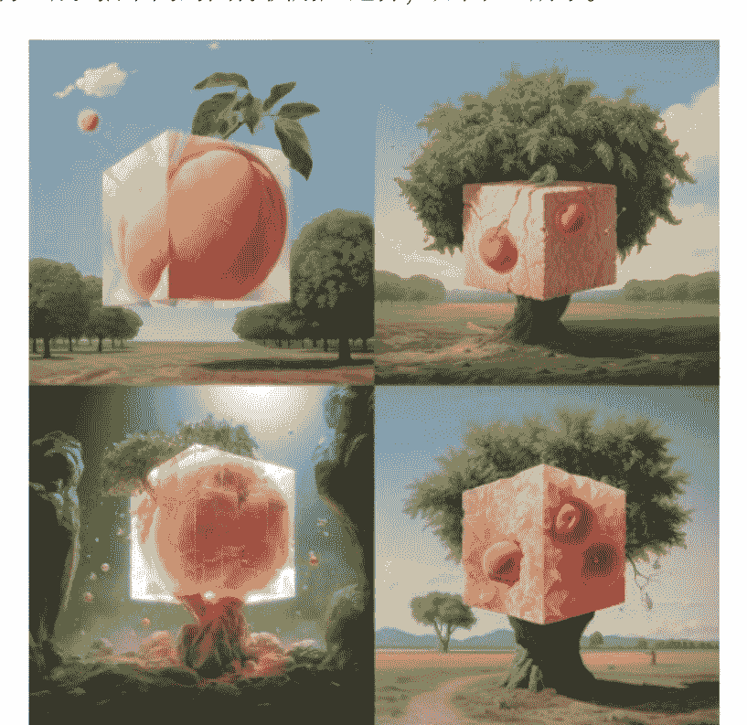

图5-1

具备Photoshop、Painter、Illustrator、3ds Max、Maya等软件使用经验的创作者都知道，要创作一幅图像作品，通常需要通过手绘板在软件中进行绘制，或者使用软件进行三维建模和渲染。然而，Midjourney彻底改变了这种图像生成方式。在Midjourney中，图像是通过经过训练的神经网络模型生成的。换句话说，图像中的每个像素都是由Midjourney计算得出的，创作者无须掌握烦琐的软件操作，即可轻松获得高质量图像。

当然，需要强调的是，使用上述软件生成图像时，可控性和精确度非常高。而使用Midjourney时，有时可能无法达到精确生成图像的标准。此外，在使用Midjourney进行绘画时，创作者还需要掌握其提示词的撰写方法和关键词的使用技巧。尽管如此，因Midjourney拥有卓越的图像生成效率和丰富的效果优势，仍然是一个令人难以忽视的选择。

#### 5.1.2 可灵AI

随着短视频和直播行业的蓬勃发展，市场对高质量、富有创意的视频内容的需求日益增加。2024年6月，“可灵AI”视频生成大模型官网正式上线，标志着可灵AI正式对外发布。快手作为国内领先的短视频平台，在视频技术方面拥有深厚的积累。快手AI团队基于这一优势，充分利用快手在视频处理、分析、生成等方面的技术储备，自主研发了视频生成大模型——可灵AI，如图5-2所示。

图5-2

近年来，AI生成视频技术取得了显著进展，从ChatGPT的发布到视频生成大模型Sora的问世，都引发了科技界和产业界的广泛关注。这些技术的发展也为可灵AI的研发提供了重要的技术参考和借鉴。快手AI团队紧跟技术潮流，致力于在AI生成视频领域取得突破。

可灵AI的研发过程中，快手AI团队实现了多项自研技术创新。例如，可灵AI大模型采用了3D时空联合注意力机制，有助于精确捕捉视频中的复杂时空运动；同时，结合自研的模型架构和ScalingLaw激发的建模能力，能够在虚拟场景中再现真实的物理世界特性。这些技术创新都为可灵AI在视频生成的质量、创意性、物理仿真等方面提供了有力支持。

#### 5.1.3 即梦AI

即梦AI是一款由字节跳动公司推出的AIGC创作工具，可以将简单的文字描述转换成精彩的图片和视频网页版界面，如图5-3所示。用户只需输入描述，即梦AI即可自动创建相应的视觉内容。此外，该工具还提供编辑功能，用户可以对生成的图片和视频进行个性化调整。

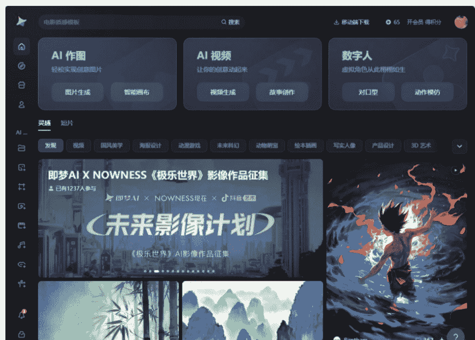

图5-3

即梦AI的图片生成是基于字节跳动的“豆包大模型”，而视频生成采用字节跳动自主研发的DIT（Dynamic Integration Transformer）架构。该架构相比传统的U-Net模型，在分辨率、视频长度及动态流畅性方面有显著提升，使即梦AI能够生成更自然的人物动画及微表情。

目前，即梦AI每日提供66积分，允许用户免费生成约66张普通图片。该工具非常适合内容创作者、短视频创作者以及AI艺术爱好者使用，能够有效提升创作效率。

#### 5.1.4 文心一格

文心一格是由百度推出的AI艺术和创意辅助平台，如图5-4所示，基于其文心大模型和飞桨技术，支持由文本生成图像的功能。该平台于2022年8月正式发布，能够生成包括国风、油画、水彩、水粉、动漫、写实等十余种不同风格在内的高清画作。其用户涵盖专业设计师、艺术家、媒体工作者以及普通绘画爱好者，可用于创意启发、内容创作和个人娱乐。

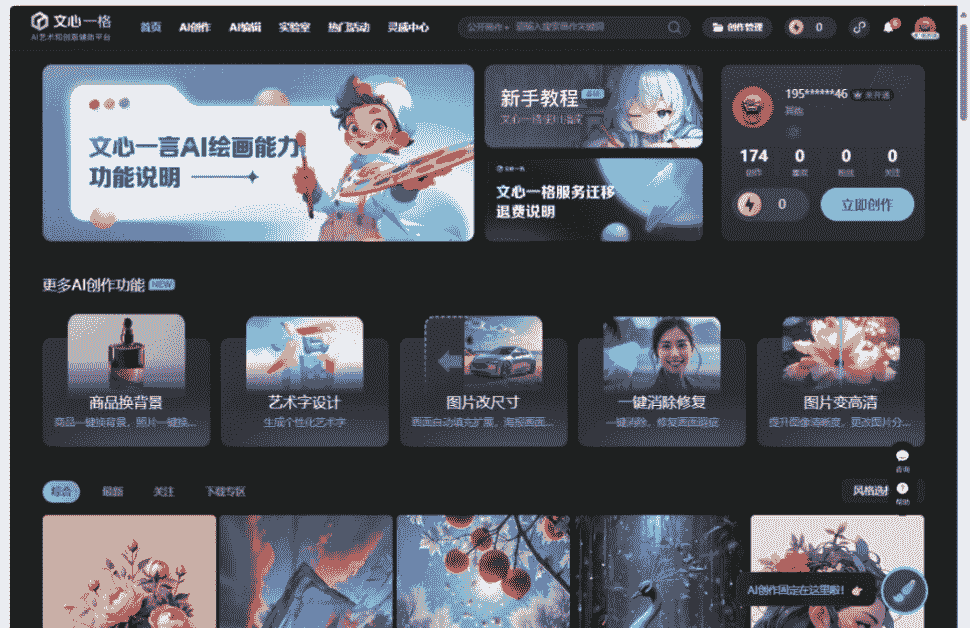

图5-4

文心一格的核心优势在于其高效的AI绘画能力，能够根据文本描述生成符合要求的高质量图像。此外，它采用“免费+增值”模式，用户可以通过签到、分享作品等方式获取免费电量，或者通过付费方式购买额外电量以生成更多图片。

对于专业设计师而言，文心一格可辅助其创作流程，比如在早期阶段生成草图或寻找灵感。而对于非专业用户，则可以通过简单的文本描述轻松生成精美画作，实现个性化创意。

### 5.2 DeepSeek+即梦AI将文字生成视频

本节将深入探讨如何借助DeepSeek优化AI绘画提示词，以确保生产的画面精准契合视频需求，并结合即梦AI实现文字到视频的高效转换，打造高质量的AI视频内容。

#### 5.2.1 用DeepSeek生成AI绘画提示词

DeepSeek作为智能语言模型，能够精准解析用户需求，并生成高度契合主题的提示词，从而提升AI绘画的可控性和创造力。

通过DeepSeek，用户可以基于特定的风格（如二次元、赛博朋克、油画风等）、主题（如未来城市、梦幻森林、历史人物）以及细节描述（如光影效果、色彩氛围、构图方式）生成专业级的AI绘画提示词，下面是其详细操作步骤。

01 打开DeepSeek，进入其主页，在文本框内输入提示词，如图5-5所示。

图5-5

02 按【Enter】键或单击按钮，将提示词发送给DeepSeek，即可得到相应的回复内容，如下所示。

广告片标题：解放双手，智享洁净——××智能扫地机器人，您的生活管家

##### 一、开场画面

（镜头缓缓推进一个忙碌的早晨：玄关处散落着宠物毛发，茶几旁洒落着饼干碎，阳光透过窗户洒在地板上）

旁白：“早晨7点，咖啡香弥漫，而你的时间不该浪费在弯腰扫地上。”

##### 二、产品登场

（镜头俯拍：××智能扫地机器人从充电座优雅滑出，蓝光雷达旋转，机身显示屏亮起智能路径规划图）

字幕：“360°智能扫描，3秒建图”

旁白：“××智能扫地机器人，雷达导航精准绘制全屋地图，复杂户型也能应对自如。”

##### 三、核心功能展示

###### 场景1：手机智控

（女主人在办公室滑动手机屏幕，App界面显示“一键启动”“分区清洁”，智能扫地机器人应声工作）

字幕弹幕：“上班族救星 | 远程操控 | 定时预约”

女主人微笑语音指令：“小×，打扫儿童房。”

（智能扫地机器人灵敏转向，直奔目标区域）

###### 场景2：强力清洁

（特写：滚刷高速旋转卷起宠物毛发，5000Pa飓风吸力瞬间吸入果壳，边刷贴合墙缝清扫）

动态数据条弹出：“99.9%微尘清除率 | 3cm超薄机身钻入床底 | 2.5L大尘盒7天不倒垃圾”。

###### 场景3：智慧避障

（智能扫地机器人遇到散落的玩具车，红外感应后减速绕行；爬上高2cm的门槛轻松自如）

趣味音效：“滴——发现障碍，优雅避开。”

##### 四、省时省力对比

（分屏画面：左侧传统打扫——女主人弯腰扫地、清理缠绕的毛发、清洗拖布；右侧智能扫地机器人自主工作——女主人读书/逗猫/练瑜伽）

旁白：“每天为您抢回2小时，把时间留给热爱的事。”

##### 五、收尾升华

（夜幕降临，智能扫地机器人自动返回充电，女主人赤脚踩过光洁的木地板，手机收到“清洁报告”：58m²完成，耗时35分钟）

广告语：“××智能扫地机器人，不是替代你的劳动，而是重置生活的定义。”

##### 六、行动号召

（屏幕闪现产品Logo，二维码与语音指令浮出）

字幕：“即刻唤醒你的智能管家！”

语音订购“小×，我要下单！”或扫码领1000元新品券！

##### 七、文案亮点

- 痛点开场：用真实生活场景引发观众共鸣。
- 技术可视化：用雷达动效、数据弹幕强化科技感。
- 对比营销：用分屏画面直击“省时”核心卖点。
- 情感绑定：将产品升华为“生活重置者”，超越工具属性。

·创新互动：支持语音指令下单，深化智能体验记忆点。

#### 5.2.2 用即梦AI添加提示词生成视频素材

即梦AI作为一款先进的AI生成工具，能够根据你的需求快速生成多样化、高质量的视频素材，从图片到短视频，极大地提升了创作效率。

扫码看视频

下面是使用即梦生成视频素材的具体操作步骤。

01 打开即梦AI首页，选择其中的“视频生成”选项，进入视频生成编辑界面，如图5-6所示。

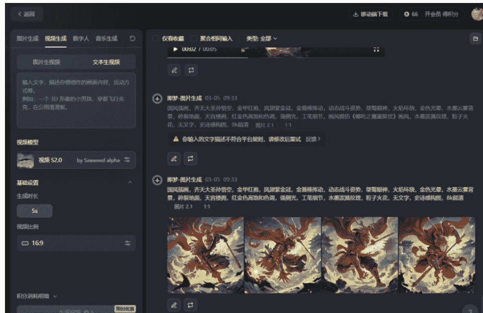

图5-6

02 将DeepSeek刚刚生成的“开场画面”的描述词“镜头缓缓……洒在地板上”复制、粘贴至“文本生视频”的文本框内，将视频模型调整为“视频S2.0”，将“视频比例”设置为“16：9”，如图5-7所示。

图片生成 视频生成 数字人 音乐生成

仅看收藏 聚合相同输入

▶ 00:02 / 00:05

图片生视频 文本生视频

镜头缓缓推进一个忙碌的早晨：玄关处散落着宠物毛发，茶几旁洒落着饼干碎，阳光透过窗户洒在地板上

即梦-图片生成 03-05 09:33

国风插画，齐天大圣孙悟空，金甲，碎裂地面，天宫楼阁，红金花，无文字，史诗感构图，8k超高清

⚠ 你输入的文字描述不符合

视频模型

视频 S2.0 by Seaweed alpha

即梦-图片生成 03-05 09:33

国风插画，齐天大圣孙悟空，金甲，碎裂地面，天宫楼阁，红金

基础设置

生成时长

图片 2.1 1:1

5s

视频比例

16:9

积分消耗明细

生成视频 5 限时优惠

图5-7

03 单击“生成视频”按钮，稍等片刻即可生成相应的视频素材，如图5-8所示。

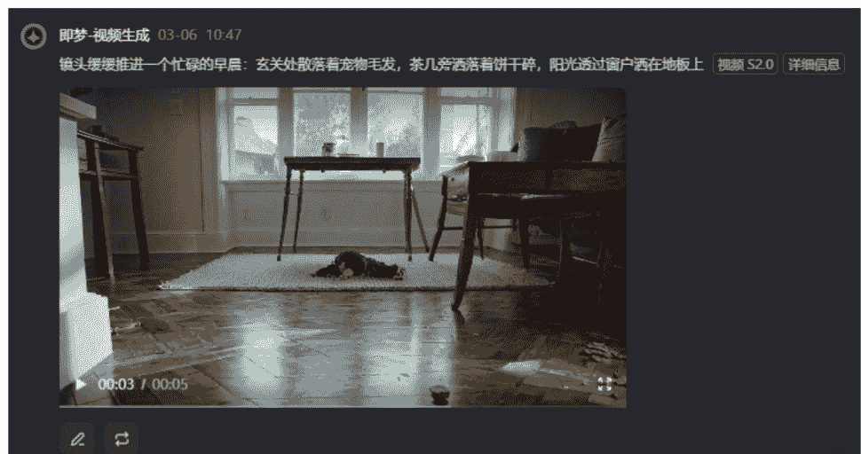

图5-8

04 将鼠标指针移至视频上方，单击鼠标右键，在弹出的快播菜单中选择“下载视频”命令，即可下载该视频，如图5-9所示。

图5-9

05 根据后续场景描述，将后续分镜头从文本转换成视频内容，即可得到相应的视频素材，如图5-10所示。

图5-10

### 5.3 DeepSeek+可灵AI将图片生成视频

图片生视频是指可灵AI能够以用户提供的图片为基础，通过AI智能技术生成视频内容。也就是说，用户输入一张图片，可灵AI会根据该图片的内容、色彩、构图等信息，智能生成与之相关的视频片段。

#### 5.3.1 用DeepSeek生成AI绘画提示词

在使用图片生视频时，DeepSeek生成AI绘画提示词，更应专注于对图片的描绘，而不是最终视频的描述。下面是使用图片生视频时，DeepSeek生成AI绘画提示词的具体操作步骤。

扫码看视频

01 打开DeepSeek，进入其主页，在文本框内输入提示词，如图5-11所示。

图5-11

02 按【Enter】键或单击按钮，将提示词发送给DeepSeek，即可得到相应的回复内容，如下所示。

水墨风格的山峰，湖面飘着薄雾，小船上站着穿蓑衣的人，白墙青瓦的房屋在云雾间半遮半掩，有飞鸟从松树边飞过，深蓝天空挂着橘色夕阳。

#### 5.3.2 用可灵AI依据提示词生成图片

可灵AI的图片生成功能是一项强大的创作工具，它利用AI技术，能够根据用户的文本描述或参考图片生成符合要求的图片。下面是其详细操作步骤。

扫码看视频

01 打开可灵AI，在首页选择“AI图片”功能，进入其编辑界面，在图片“创意描述”文本框内输入相应的提示词，如图5-12所示。

图5-12

02 执行操作后，调整“图片比例”为“3：2”，单击“立即生成”按钮，稍等片刻即可得到一组相应的图片内容，如图5-13所示。

图5-13

03 将鼠标指针移至心仪的图片上，单击“下载”按钮，如图5-14所示，即可将图片保存至本地。

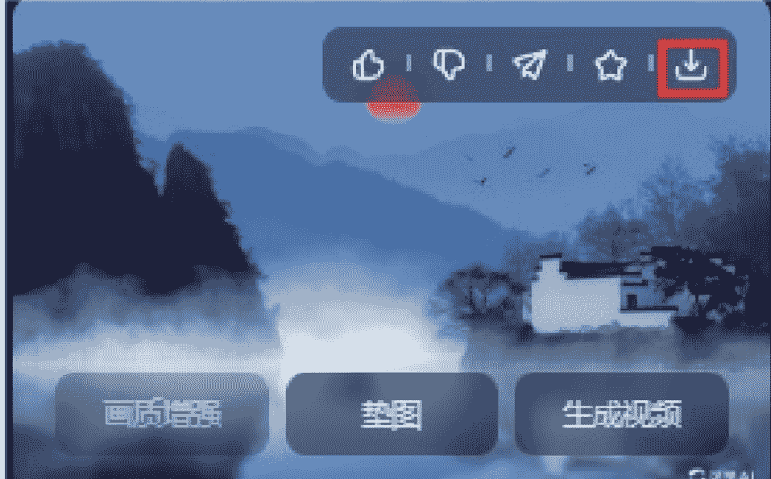

图5-14

#### 5.3.3 用可灵AI将图片转化为视频内容

下面是使用可灵AI进行图片生视频的具体步骤。

扫码看视频

01 打开可灵AI首页，单击其中的“AI视频”按钮，或者选择界面左侧工具栏中的“AI视频”选项，如图5-15所示，进入视频生成界面。

图5-15

02 在图片上传框内，可以通过点击/拖曳/粘贴这3种方式上传图片内容（目前可灵AI只支持JPG/PNG格式的图片，且文件大小不超过10MB，尺寸不小于300px），如图5-16所示。

图5-16

**提示：** 在图5-16中我们可以看到在点击/拖曳/粘贴下方还有一个“从 历史创作 选择”选项，这个功能可将使用可灵AI生成的图片上传并生成视频，此时打开后的界面如图5-17所示，可以在其中任选一张图片进行上传。

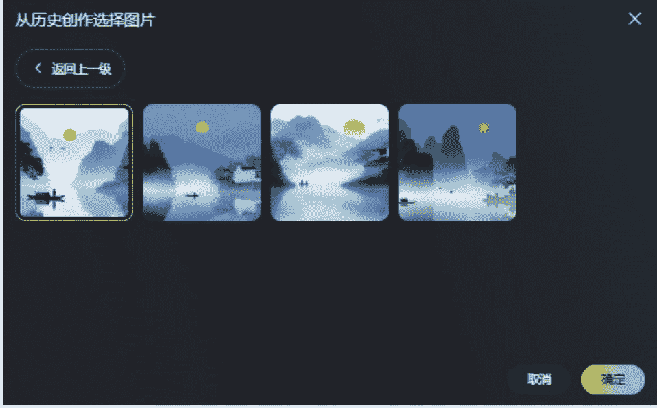

图5-17

03 图片上传完成后，单击“立即生成”按钮，可灵AI即可自动生成相应的视频内容，如图5-18所示。

图5-18

## 章节总结

本章集中讲解了如何使用DeepSeek生成AI绘画提示词、使用AI绘画工具生成视频的内容，具体内容可参考下图。

# AI + 绘画生成：快速生成视频素材

四大主流 AI 绘画工具

- Midjourney
- 可灵 AI
- 即梦 AI
- 文心一格

DeepSeek+ 即梦 AI 将文字生成视频

- 用 DeepSeek 生成 AI 绘画提示词
- 用即梦 AI 添加提示词生成视频素材

DeepSeek+ 可灵 AI 将图片生成视频

- 用 DeepSeek 生成 AI 绘画提示词
- 用可灵 AI 依据提示词生成图片
- 用可灵 AI 将图片转化为视频内容

# 第6章

# AI＋视频生成：利用AI功能快速出片

在短视频时代，高效产出优质内容已成为创作者的核心竞争力。AI技术的融入，不仅让视频制作门槛大幅降低，更让“文案创作-视频生成”的流程实现无缝衔接。本章将聚焦如何通过DeepSeek与主流视频生成工具（如剪映、腾讯智影等）的联动，快速生成创意文案并一键转化为完整视频。

### 6.1 常用的视频生成工具

在AI技术赋能下，视频制作已从专业剪辑软件走向“平民化”视频智能工具时代。无论是新手还是经验丰富的创作者，都能通过智能工具快速实现创意落地。本节将解析当前主流的视频生成工具——剪映、腾讯智影、秒创和即创，剖析它们的核心功能与适用场景。

#### 6.1.1 剪映

剪映，作为一款功能全面且操作简单的视频编辑软件，其独特的图文成片功能为用户带来了极大的便利。这一功能允许用户自定义输入脚本，剪映会自动将脚本内容转化为生动有趣的视频内容。例如，图6-1所示为剪映图文成片的效果。

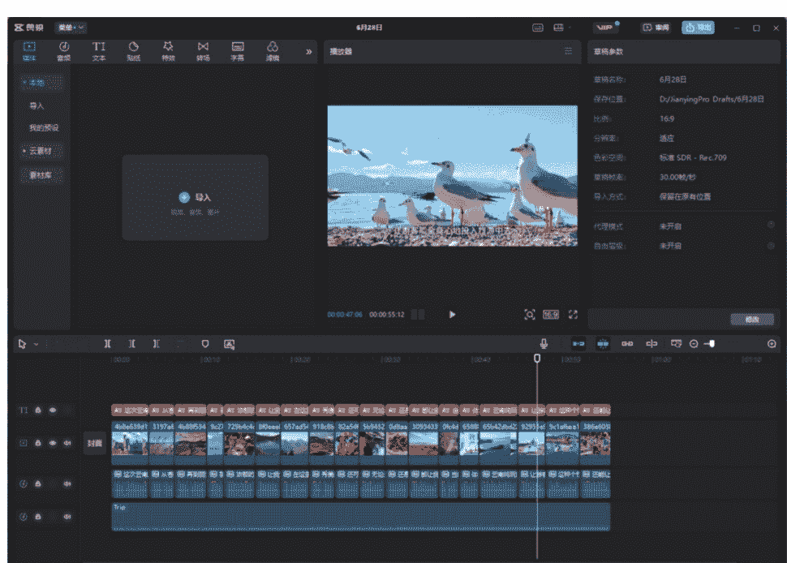

图6-1

通过图文成片功能，用户无须掌握复杂的视频剪辑技巧，即可轻松将文字与图片、视频素材相结合，快速生成具备专业水准的视频作品。这一功能的推出，不仅大大提高了用户视频制作的效率，还为用户提供了更多样化的创作方式。

#### 6.1.2 腾讯智影

腾讯智影是一个集素材搜集、视频剪辑、后期包装、渲染导出和发布于一体的在线剪辑平台，能够为用户提供“端到端”的一站式视频剪辑及制作服务。例如，图6-2所示为腾讯智影的智能创作工具。

图6-2

腾讯智影是一款集成了AI创作功能的智能创作工具，具有数字人播报、文本配音、字幕识别、文章转视频、智能抹除等AI创作功能。腾讯智影的数字人不仅在形象方面与真人高度逼真，而且在语音、语调、唇动等方面也非常真实，如图6-3所示。

图6-3

#### 6.1.3 秒创

秒创是由新壹（北京）科技有限公司开发的AI智能内容生成平台，专注于通过AI技术简化视频创作流程，尤其擅长将图文内容快速转化为视频，适用于自媒体、企业营销、教育科普等多种场景。该平台基于秒创人工智能生成内容（AIGC）引擎，整合了智能语义分析、素材匹配、AI语音合成等核心技术，用户无须具备专业剪辑经验即可快速生成高质量的视频，如图6-4所示。

图6-4

#### 6.1.4 即创

即创是由抖音（字节跳动公司）推出的一站式AI智能创作平台，如图6-5所示，专注于为短视频、电商和直播从业者提供高效的内容生成解决方案。该平台依托抖音的AI技术（如云雀大模型），整合视频、图文、直播三大创作模块，旨在降低用户的内容制作门槛，提升效率。

图6-5

即创以“零基础操作”为设计理念，用户仅需注册抖音或巨量引擎账号即可通过网页端使用。例如，用户在制作带货视频时，输入商品信息后，AI会自动匹配素材并生成完整的视频，支持手动调整片段和配音细节，如图6-6所示。另外，即创还提供素材库管理和数据分析功能，以帮助用户优化内容投放效果。

### 6.2 剪映+DeepSeek生成原创视频

DeepSeek作为强大的AI文本生成工具，可以快速生成符合短视频需求的文案，而剪映则通过其“图文成片”功能，实现从文字到视频的自动转化。将二者“强强联手”，创作者可以极大提升内容生产效率，实现从脚本策划到成片的一站式创作流程。

#### 6.2.1 用DeepSeek快速生成文案

创作者要想省时、省力地创作出优质的原创视频作品，一个极为便捷且高效的方法便是借助DeepSeek来自动生成脚本与文案，再使用剪映的图文成片功能将文案生成视频。这种方法不仅简化了创作流程，还能凭借DeepSeek强大的数据处理与分析能力，快速生成既符合逻辑又引人入胜的内容框架，从而帮助创作者在短时间内实现视频内容的快速产出与质量的双重提升。

扫码看视频

下面是剪映+DeepSeek生成原创视频的具体操作步骤。

01 打开DeepSeek，进入其主页，在文本框内输入提示词，如图6-7所示。

图6-7

02 按【Enter】键或单击按钮，将提示词发送给DeepSeek，即可得到相应的回复内容，如下所示。

《橘子洲头·湘江诗画》宣传片脚本。

时长：3分钟

##### 核心主题：自然与人文交织的千年诗篇

###### 一、开场（0:00—0:15）

####### 1. 镜头

航拍湘江晨曦（0:00—0:05）：朝阳升起，金光穿透薄雾洒向橘子洲头，青年毛泽东艺术雕像轮廓渐显。

特写江浪击石（0:06—0:10）：慢镜头捕捉浪花飞溅，水珠折射彩虹光斑。

推近雕像面部（0:11—0:15）：镜头沿雕像肩部上升，定格于毛泽东坚定的眼神之中。

####### 2. 背景音乐

Two Steps From Hell公司的Victory（高潮段落）

####### 3. 旁白（浑厚男声，混响处理）

> “独立寒秋，湘江北去，橘子洲头——这里是诗与历史的交点，是山河与热血的交响。”

###### 二、自然画卷（0:16—1:00）

####### 1. 镜头

移动镜头穿越橘园（0:16—0:25）：阳光透过绿叶，金橘果实挂满枝头，露珠滑落特写。

航拍橘子洲头全貌（0:26—0:35）：橘子洲形似长舰劈开湘江，两岸现代高楼与古树相映。

微观镜头（0:36—0:45）：蝴蝶停驻望江亭雕花栏杆，蜻蜓点水掠过江面。

慢镜头推移（0:46—1:00）：江面涟漪泛金，柳枝随风轻拂，白鹭掠水飞向远天。

####### 2. 背景音乐

Yiruma的*River Flows in You*（钢琴版）

####### 3. 对话场景（年轻情侣倚栏远眺）

女（惊叹）：“你看江面的波光，像不像撒了一把钻石？”

男（轻笑）：“不如说，是太阳照得江水闪闪的。”

###### 三、历史脉搏（1:00—2:00）

####### 1. 镜头

黑白历史影像穿插（1:00—1:10）：特写翻滚的湘江浪花，空镜头的橘子洲头，叠加现代大学生朗诵《沁园春·长沙》。

特写书法墙（1:11—1:20）：苍劲毛体诗词随镜头移动逐句显现。

黄昏剪影（1:21—1:30）：老者执毛笔在江边石板上书写，孩童蹲坐模仿。

群像镜头（1:31—1:45）：游客驻足凝视青年毛泽东艺术雕塑，目光庄重；镜头切换至湘江浪潮奔涌，叠印历史资料中革命者行走的身影。

现代与历史交融（1:46—2:00）：夕阳下，朗诵声渐强，青年群体举旗前行，画面色彩由黑白渐变为暖金，寓意薪火相传。

####### 2. 背景音乐

S.E.N.S. 的《故宫的记忆》（改编缩短版）

####### 3. 旁白（沧桑男声）

> “百年前，一句‘问苍茫大地，谁主沉浮’在此留下了回响；百年后，江风依旧传诵着觉醒的回声。”

###### 四、活力新生（2:01—2:45）

####### 1. 镜头

快切市民生活（2:01—2:15）：晨练的老人、写生的美院学生、拍摄婚纱照的新人。

夜景延时摄影（2:16—2:30）：橘子洲头灯光渐次点亮，江面游船划过金色光轨。

第一视角镜头（2:31—2:45）：手持稳定器穿越烟火夜市，糖油粑粑、臭豆腐的特写，摊主笑问：“恰杯芝麻豆子茶不？”

####### 2. 背景音乐

Alan Walker的*Faded*（二胡改编版）

####### 3. 对话场景（父亲抱着女儿看雕像）

女儿（稚气地）：“爸爸，这个大石头叔叔是谁呀？”

父亲（郑重地）：“他是告诉我们‘敢教日月换新天’的人。”

###### 五、尾声升华（2:46—3:00）

####### 1. 镜头

全景旋转镜头（2:46—2:55）：从雕像头顶俯拍，橘子洲头、湘江、城市天际线次第展开。

定版Logo（2:56—3:00）：水墨晕染出“橘子洲头”篆刻印章，下方浮现“一洲观万象，千载汇风流”。

####### 2. 背景音乐

回归Victory尾声乐章

####### 3. 旁白（男女声交替）

男：“这是江河写给大地的情书。”

女：“这是历史留给未来的请柬。”

合：“橘子洲头——等你续写新的诗篇。”

###### 执行建议

- (1) 设备要求：
  ·航拍使用DJI Inspire 3（8K电影级镜头）；
  ·微观镜头搭配Laowa 24mm探针镜头。

- (2) 服装设计：历史场景人物着民国学生装，现代游客服装需色彩明快（避免黑、白、灰色）。

- (3) 特效处理：诗词显现采用AR特效，让毛体字如烟云浮现在实景中。

###### 创意亮点

- (1) 时空对话：通过黑白/彩色画面交替、古今人物动作镜像衔接（如旧时渡江与现当代游船）形成时空纵深感。
- (2) 五感营销：刻意收录江浪声、蝉鸣、夜市吆喝等环境音，增强沉浸感。
- (3) 情感锚点：以“诗”贯穿全片，从毛泽东诗词到普通人的诗意生活。

该脚本通过“自然—历史—人文—未来”的叙事逻辑，兼顾视觉震撼与情感共鸣，可有效吸引文旅爱好者、历史研学群体及年轻打卡族。

#### 6.2.2 用剪映“图文成片”功能生成视频

剪映的“图文成片”功能是一项基于AI的自动化视频生成工具，用户只需输入文字内容，系统便可自动匹配合适的素材、背景音乐、字幕动画，并生成完整的视频。该功能适用于短视频创作者、品牌营销、教育类内容等场景，大大降低了视频制作的门槛。用户可以选择不同风格的模板，并调整排版、色彩、字体等元素，以达到个性化的效果。

扫码看视频

下面是使用“图文成片”功能生成视频的具体操作步骤。

01 打开剪映电脑版，选择“图文成片”选项，如图6-8所示。

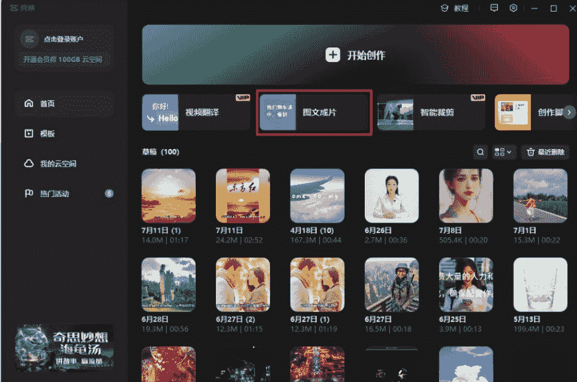

图6-8

02 将刚刚DeepSeek提供的脚本文案复制、粘贴至文本框内，如图6-9所示。

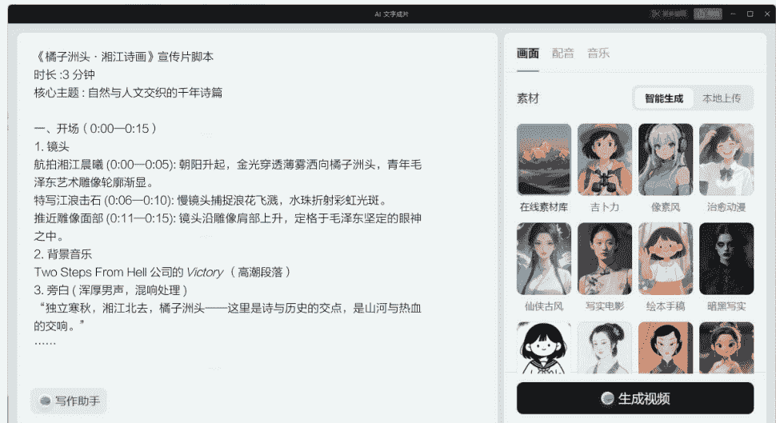

图6-9

03 在文本框中删除脚本中的无关话术，只留下旁白与对话，如图6-10所示。这样可以避免在应用剪映的“图文成片”选项时，AI将一些镜头语言也朗读出来。

### 6.3 腾讯智影+DeepSeek生成数字人视频

腾讯智影作为一款AI驱动的视频制作工具，提供了强大的数字人生成功能，再结合DeepSeek的文本生成能力，可以高效打造专业级数字人视频。通过DeepSeek生成高质量文案，再将文案粘贴至腾讯智影的数字人视频模块，即可生成具备语音合成、表情匹配和自动口型同步的AI数字人视频，适用于短视频营销、课程讲解、品牌宣传等多种场景。

#### 6.3.1 用DeepSeek生成口播文案

DeepSeek利用先进的自然语言处理技术和深度学习算法，能够深刻理解视频主体，智能生成口播文案助力视频创作。

在使用DeepSeek生成的口播文案时，需注意以下几点，以确保生成的文案质量与效果符合预期。

- （1）调整语言风格。DeepSeek生成的文案往往缺乏人性化的语言风格和感情色彩。在使用文案前，创作者应根据目标受众和直播场景，对文案进行适当修改，加入口语化表达、情感共鸣点或幽默元素，使其更贴近观众，提升吸引力。
- （2）强调产品亮点。确保文案中明确且突出地展示了产品的核心亮点和独特价值。DeepSeek生成的文案语言描述可能会较为全面，你需要从中筛选出最关键的信息，用最简洁有力的语言传达给观众。
- （3）检查语法与逻辑。DeepSeek生成的文案可能存在语法错误或逻辑不连贯等问题。在使用前，务必仔细校对，确保文案的准确性和流畅性。
- （4）保持真实性。虽然DeepSeek可以生成大量内容，但务必确保文案中提到的产品特点和优势是真实存在的，避免夸大其词或虚假宣传，以免损害品牌形象和引发消费者信任危机。

综上所述，使用DeepSeek生成直播带货口播文案时，创作者需要结合实际情况进行灵活调整和优化，以确保文案的质量、真实性和吸引力。下面是使用DeepSeek生成口播文案的具体操作步骤。

01 打开DeepSeek，进入其主页，在文本框内输入提示词，如图6-13所示。

02 按【Enter】键或单击按钮，将提示词发送给DeepSeek，即可得到相应的回复内容，如下所示。

以下是直播口播文案。

家人们！“3-2-1”上链接！今天给你们炸的这款宝贝，绝对是你2025年想抢的喝水神器——Lucky保温杯！听好了，这杯子能让你一整天“喝水开挂”，现在手慢的真的会～后～悔！

第一炸，巨无霸容量！680mL超大肚量！早上灌满它，上班、健身、接娃、露营一整天不用找水喝！别人跑三趟茶水间，你稳坐工位当“喝水大王”，咖啡、果茶、养生汤，连煮好的银耳羹都能直接往里倒！宝妈放包里，孩子放学路上都不用买奶茶！

第二炸，锁温王中王！进口不锈钢+真空锁温黑科技，保热24小时烫嘴，保冷12小时挂冰碴！早上灌的滚烫豆浆，下午开会喝还烫舌头！夏天塞满冰块，晚上回家直接嚼冰沙！普通保温杯叫“温水杯”，这杯子才配叫“移动小冰箱+随身电饭煲”！

第三炸，轻到能起飞！别以为大容量就死沉！单手一拎比手机还轻，磨砂防滑腰身+可提可挂的便携环，爬山塞背包侧袋，逛街甩手里像潮搭单品！地铁过安检都不用掏出来，空姐看了都想问链接！

最关键，原价199元的保温杯天花板，今天直播间破价两位数！99元秒杀！再送硅胶杯套+网红杯刷！前50名下单的宝子加送折叠茶漏！这价格我都想举报老板！库存就300个，抢完立刻下架！把“想要”打在公屏上！“3-2-1”——给我炸！

（敲桌+镜头拉近特写）倒数5秒！没付款的姐妹直播间喊话，运营再加20单！错过今天，明天超市卖299元同款别来找我哭！

脚本设计逻辑如下。

- 痛点场景化：将保温杯的大容量绑定职场、育儿、户外高频场景，用“一整天不用找水喝”“不用买奶茶”直击懒人消费降级痛点。
- 数据具象化：24小时保温强调“烫嘴”“挂冰碴”等感官词，对比普通保温杯制造技术碾压感。
- 价格紧迫感：用“破价两位数”“举报老板”等话术暗示低价反常，结合库存倒数、赠品分层，刺激秒杀冲动。

> （提示：实际直播中可手持杯子演示装冰、倒沸水等动作，以增强可信度）

#### 6.3.2 用腾讯智影数字人功能生成数字人视频

腾讯智影的数字人功能是其作为一款AI智能创作助手的核心亮点之一，该功能为用户提供了高度智能化、便捷化的数字人创作体验。下面是使用腾讯智影生成数字人视频的具体操作步骤。

01 打开腾讯智影首页，选择“数字人播报”选项，如图6-14所示，进入数字人编辑界面。

02 将DeepSeek生成的口播文案复制、粘贴至界面右侧的“播报内容”文本框中，如图6-15所示。

03 选择界面左侧工具栏中的“数字人”选项，按个人喜好选择所需的数字人形象，如图6-16所示。选择完数字人形象后，会自动播报右侧“播报内容”文本框内的口播文案内容，可预览整体播报效果。

04 在界面左侧工具栏选择“背景”|“纯色背景”选项，这里选择一款绿色的背景颜色，如图6-17所示。选择绿色背景的原因是方便后期的抠像处理。

05 将“字幕”单选按钮调整为不选中的状态，如图6-18所示，可以避免剪辑时出现重复字幕的情况。

06 单击界面上方的“合成视频”按钮，将添加的数字人、字幕、背景等元素整合成一个完整的视频文件，可以在左侧工具栏中选择“我的资源”选项，在右侧界面便于看到合成后的视频内容，如图6-19所示。

07 将鼠标指针移至合成后的视频内容上，单击“下载”按钮，即可将该视频文件保存至本地，如图6-20所示。

## 章节总结

本章集中介绍了使用DeepSeek生成脚本文案，再使用视频生成工具生成视频的内容，具体内容可参考下图。

## AI + 视频生成：利用 AI 功能快速出片

- 常用的视频生成工具
  - 剪映
  - 腾讯智影
  - 秒创
  - 即创
- 剪映 +DeepSeek 生成原创视频
  - 用 DeepSeek 快速生成文案
  - 用剪映 “图文成片” 功能生成视频
- 腾讯智影 +DeepSeek 生成数字人视频
  - 用 DeepSeek 生成口播文案
  - 用腾讯智影数字人功能生成数字人视频

## 第7章

## DeepSeek＋各大前沿视频软件：AI影像创作时代全面来临

短视频和影像创作正在迎来一场由AI驱动的技术革命。从AI生成的动态特效到风格化的影像转换，越来越多的创作者正在借助AI工具提升内容质量、缩短制作周期，并实现前所未有的视觉效果。DeepSeek作为强大的AI文本生成工具，与各类AI视频软件相结合，能够帮助创作者轻松实现风格化视频创作，为短视频行业带来全新的可能性。

### 7.1 DeepSeek+即梦AI，制作穿越视频动画

即梦AI是一款由字节跳动公司推出的AIGC创作工具，可以将简单的文字描述转换成精彩的图片和视频。用户只需输入文字描述，即梦AI就会自动创建相应的视觉内容。此外，该工具还提供了编辑功能，便于用户对生成的图片和视频进行个性化调整。将即梦AI与DeepSeek结合可制作炫酷的穿越视频动画，这里需要用到即梦AI的首尾帧功能。

即梦AI中的首尾帧功能是指允许用户通过输入视频的首帧（起始画面）和尾帧（结束画面），结合AI技术，生成一个连贯、流畅的视频片段。下面介绍使用DeepSeek+即梦AI制作穿越视频动画的具体操作步骤。

01 打开DeepSeek，进入其主页，在文本框内输入提示词，如图7-1所示。

02 按【Enter】键或单击按钮，发送指令至DeepSeek，即可得到相应的回复内容，如下所示。

以下是为您设计的AI绘画提示词，包含场景细节和动态元素，适用于生成侧面视角的车辆穿越动画：一辆车行驶在路上，汽车侧面，春天的森林、树木、花朵，商业摄影，中景。

03 打开即梦AI首页，选择其中的“图片生成”选项，进入“图片生成”界面，如图7-2所示。

04 在文本框内输入DeepSeek刚刚生成的提示词 “一辆车行驶在路上，汽车侧面，春天的森林、树木、花朵，商业摄影，中景”，如图7-3所示。

05 将“精细度”调整为“50”，再将“图片比例”调整为“16：9”，单击“立即生成”按钮，即可生成图片内容，如图7-4所示。

06 将鼠标指针放置在右侧的高清图上，在弹出的悬浮框中单击“局部重绘”按钮，如图7-5所示。

07 使用画笔工具涂抹除车辆外的其他地方，如图7-6所示。

08 在文本框内输入“夏天的森林，茂密的树木”，如图7-7所示。

09 再次单击“立即生成”按钮，即可完成重绘。夏天场景如图7-8所示。

10 重复步骤04～步骤09，将秋天场景和冬天场景分别重绘出来，如图7-9所示。

11 单击“视频生成”按钮，进入“视频生成”界面，如图7-10所示。

12 选中文本框内的“使用尾帧”单选按钮，上传春天和夏天的场景图，如图7-11所示。

13 在文本框内输入提示词，调整“运镜控制”为“随机运镜”，调整“运动速度”为“适中”，将“模式选择”调整为“标准模式”，调整生成时长为“3s”，如图7-12所示。

14 单击“生成视频”按钮，即可生成春天到夏天的穿越视频动画，如图7-13所示。

15 重复步骤10～步骤14，生成夏天到秋天、秋天到冬天的穿越动画视频，如图7-14所示。

16 将鼠标指针移至生成视频上，单击右上角的“下载”按钮，如图7-15所示，将3段视频依次下载到本地。

17 打开剪映，将3段视频素材依次导入，添加至轨道中，即可合成为一个完整的视频，如图7-16所示。

18 单击剪映右上角的“导出”按钮，如图7-17所示，即可导出制作完成的穿越视频动画。

### 7.2 DeepSeek+可灵AI，制作爆款萌宠走秀视频

可灵AI是快手AI团队自主研发的一款大型人工智能模型，它专注于视频生成领域，展现了卓越的技术和创新能力。通过深度学习技术，特别是3D时空联合注意力机制和Diffusion Transformer架构，可灵AI能够生成高质量、逼真且符合物理规律的视频内容。

爆款萌宠走秀视频是一种通过AI技术，以各种动物为主角，以拟人化的方式走秀的创意视频形式。其中主角包括穿戴风格迥异服饰的猫、狗等宠物，或虚拟生成一些独特的、自然界不存在的动物形象，进一步增加趣味性。下面是其具体操作步骤。

01 打开DeepSeek，进入其主页，在文本框内输入提示词，写明动物的品种、颜色、性别等（可以多生成几组提示词备选），如图7-18所示。

02 执行操作后，按【Enter】键或单击按钮，发送指令至DeepSeek，即可得到相应的回复内容，如下所示。

以下是5组符合要求的AI绘图中文提示词，结合了英短猫与5岁男孩的特征进行拟人化设定。

##### 1. 复古绅士风：小少爷走秀

一只黑白相间的英短猫，被拟人化成一个5岁的小男孩，正优雅地走在T台上。他穿着一身复古英伦风的小西装，深蓝色的外套上点缀着精致的暗纹，内搭白色衬衫，领口系着酒红色蝴蝶结，脚上是一双亮面黑色皮鞋，每一步都稳健而从容。他的双手微微摆动，头微微扬起，带着温润自信的微笑，目光坚定地直视前方。身后是金色灯光洒落的华丽舞台，观众席中的闪光灯此起彼伏，整个画面充满高贵典雅的氛围。

##### 2. 街头潮流风：酷盖少年

一只黑白相间的英短猫，被拟人化成一个5岁的小男孩，正霸气地走在T台上。他穿着一件oversize风黑色卫衣，胸前印着涂鸦风字母，下搭浅色破洞牛仔裤，脚踩一双高帮运动鞋，头上戴着一顶歪斜的棒球帽，露出一对灵动的猫耳朵。他的步伐轻快而洒脱，双手插兜，肩膀微微后倾，嘴角勾起一抹痞帅的微笑，眼神透着淡淡的自信。背景是霓虹灯闪烁的潮流秀场，四周的灯光交错，为舞台增添了炫酷的街头气息。

##### 3. 未来机能风：科幻少年登场

一只黑白相间的英短猫，被拟人化成一个5岁的小男孩，正稳健地走在T台上，仿佛来自未来世界。他身穿一件银白色金属质感的机能夹克，内搭黑色高领紧身衣，下身是科技感十足的修身战术裤，脚踩一双带LED光效的智能运动鞋，猫耳朵上戴着小巧的通信装置。他的步伐坚定，双臂随着步调微微摆动，目光冷静而专注，嘴角微微扬起。背景是赛博朋克风格的T台，蓝色全息投影环绕，舞台灯光投下科幻感十足的流光效果，仿佛未来少年的时尚秀场。

##### 4. 童话梦幻风：小王子走秀

一只黑白相间的英短猫，被拟人化成一个5岁的小男孩，正优雅地走在T台上，如同梦幻童话中的小王子。他身穿一袭奶白色宫廷风小礼服，胸口别着金色王冠徽章，腰间束着一条淡蓝色丝带，脚踩精致的白色绣花小皮鞋。他的步伐轻盈，双手自然摆动，脸上带着甜美而自信的微笑，他目光温柔地看向前方，尾巴轻轻摆动，增添一丝活泼气息。背景是布满璀璨星空的T台，柔和的灯光洒落，梦幻泡泡在空气中飘浮，整个画面如童话般温馨动人。

##### 5. 国风华服风：小侠客风采

一只黑白相间的英短猫，被拟人化成一个5岁的小男孩，正稳健地走在T台上，身姿如翩翩少年侠客。他身穿一袭墨蓝色锦缎汉服，袖口和衣摆绣着精美的祥云暗纹，腰间系着一条玉佩流苏，脚下是一双黑色绣花布鞋，猫耳朵上别着一枚精巧的玉簪。他的步伐轻盈流畅，步步生风，双手微微摆动，眼神沉稳且自信，嘴角带着一抹从容的微笑。背景是古色古香的T台，红色灯笼高挂，金色光影交错，营造出沉浸式的东方韵味。

这些AI绘图提示词结合了不同风格的萌宠拟人化走秀场景，精准描述了黑白英短猫化身5岁男孩的T台步伐、神态、服饰细节与舞台氛围，适用于AI绘图生成高质量拟人化走秀视频，让你的内容更具爆款潜力。

03 复制其中任意一组提示词，这里选择第1组，打开可灵AI，选择“AI图片”|“文生图”选项，将提示词粘贴至“创意描述”文本框中，如图7-19所示。

04 将“图片比例”设置为“4：3”后，单击“立即生成”按钮，稍等片刻即可生成一组与提示词对应的图片，如图7-20所示。

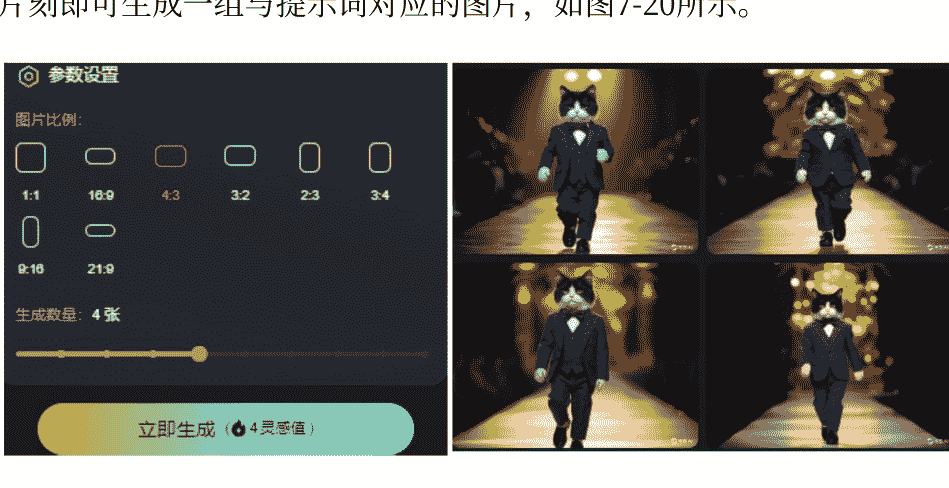

05 在生成的图片中，单击一张喜欢的图片，在弹出的悬浮框内单击“生成视频”按钮，如图7-21所示，即可自动跳转至AI视频编辑页面。

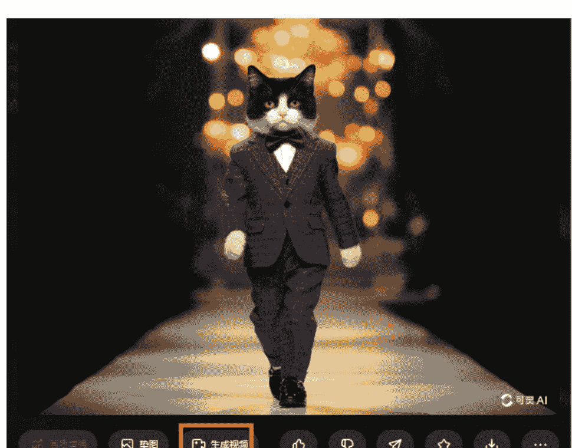

06 在“图片创意描述”文本框中粘贴提示词，将“生成模式”调整为“高品质”，将“生成时长”调整为“5s”，如图7-22所示。

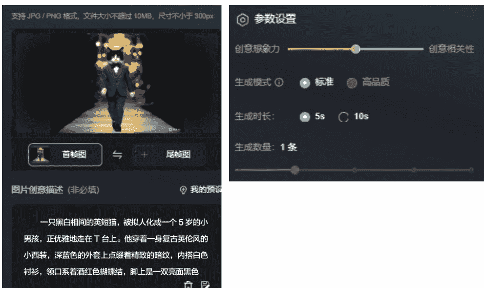

07 执行操作后，单击“立即生成”按钮，即可生成与提示词对应的视频内容，如图7-23所示。

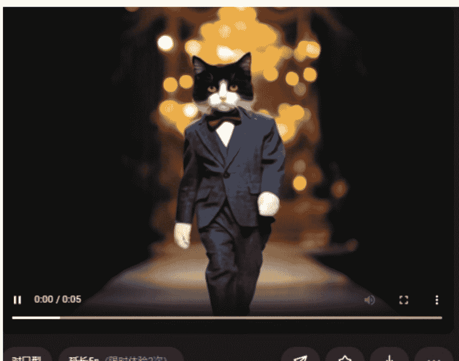

### 7.3 DeepSeek+即梦AI+剪映，制作风景大片

传统上，制作一部震撼人心的风景大片需要昂贵的拍摄设备、复杂的剪辑流程以及丰富的后期制作经验，但随着DeepSeek（AI辅助创作）、剪映（高效视频剪辑）和即梦AI（AI生图/视频生成）等智能工具的崛起，普通创作者也能轻松打造媲美专业纪录片级的风景大片。本章将深入探讨如何结合DeepSeek、即梦AI和剪映三者的强大功能，一步步打造出令人惊叹的风景大片。下面是其详细的操作步骤。

01 打开DeepSeek，进入其主页，在文本框内输入提示词，如图7-24所示。

02 执行操作后，按【Enter】键或单击按钮，发送指令至DeepSeek，即可得到相应的回答，如下所示。

##### 1. 日出奇观：神秘的云海之巅

一座巍峨的雪山，山巅被金色晨曦点亮，厚重的云海在山脚翻腾，阳光穿透云层形成圣洁的光柱。一名登山者站在山脊仰望远方的天空，他的背影渺小却仿佛拥有巨大的力量。广角镜头，低角度仰拍，空气清澈，整体色调为冷暖对比，展现壮阔与神秘感。

##### 2. 暴风雨中的海上灯塔

狂风呼啸，巨浪拍打着一座孤立于深海的灯塔，乌云密布的天空透出一束闪电，照亮整个海面。灯塔顽强地耸立在风暴中心，顶端的光束在黑暗中指引航向。广角镜头，低角度仰拍，暗色调为主，冷蓝色的海浪与黄色的灯光形成强烈对比，展现大自然的震撼力量。

##### 3. 赛博朋克未来都市

一座充满霓虹灯光的未来城市，高楼林立，悬浮车辆穿梭于高空，街道上行人熙熙攘攘，电子广告牌投射出五彩斑斓的光影。画面采用广角镜头，俯拍视角，霓虹色调为主，湿润的街道反射着灯光，空气中弥漫着未来感的薄雾，构建出充满科技氛围的科幻都市。

##### 4. 东方水墨山水：烟雨江南

群山环绕的江南水乡，清晨的薄雾弥漫在河面，小舟缓缓行进，渔夫撑篙立于船头，远处是古朴的青瓦白墙村落，天空中飘着细细的春雨，宛如水墨画卷。远近虚实结合，层次分明，色调以水墨风格的青灰色为主，营造出诗意盎然的古典意境。

##### 5. 星空下的沙漠奇迹

一片广袤无垠的沙漠，在夜晚的银河映照下闪烁着点点微光，流星划破天际，形成一道璀璨的光痕。沙丘连绵起伏，驼队缓缓前行，篝火发出温暖的橙色光晕。广角低角度仰拍，冷暖色调对比强烈，展现神秘而震撼的夜间自然奇观。

03 复制其中任意一组提示词，这里选择第1组，选择即梦AI的“视频生成”|“文本生视频”选项，将复制的提示词粘贴至“文本生视频”文本框，如图7-25所示。

04 调整“视频比例”为“4：3”，单击“立即生成”按钮，稍等片刻即可得到一组5秒的视频内容，如图7-26所示。

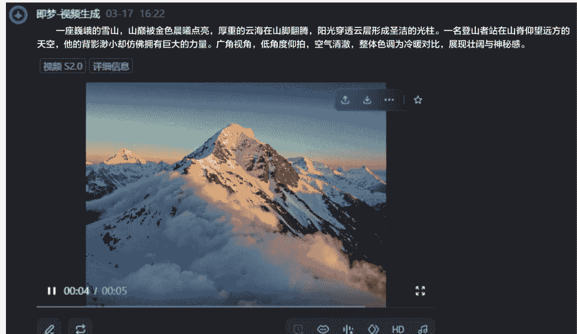

05 将鼠标指针移至视频上方，单击右上角的“下载”按钮，即可将视频内容保存至本地，如图7-27所示。

06 重复步骤03～步骤05，将后续的风景场景也生成出来并保存，如图7-28所示。

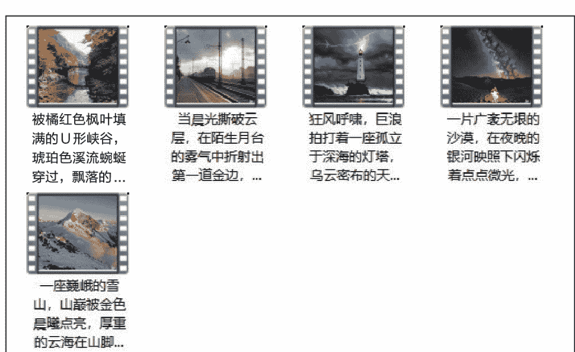

07 打开剪映App，单击界面下方的“剪同款”按钮，如图7-29所示进入“剪同款”界面。

08 在搜索框内搜索关键词“旅行开场”，如图7-30所示，搜索并选择所需的短视频模板。选择完成后，进入模板预览界面，单击右下角的“剪同款”按钮，如图7-31所示，添加刚刚用即梦AI生成的视频素材，如图7-32所示。

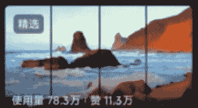

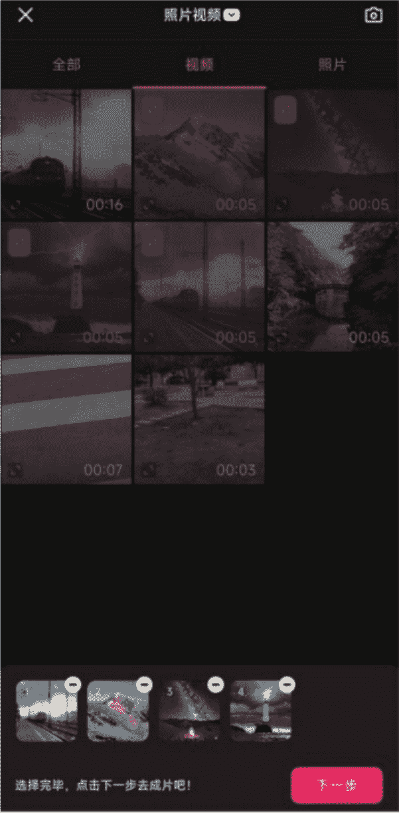

09 执行以上操作后，单击“下一步”按钮，进入视频编辑界面，如图7-33所示，可以在该界面对这些视频素材进行编辑操作，如添加文本、贴纸等。

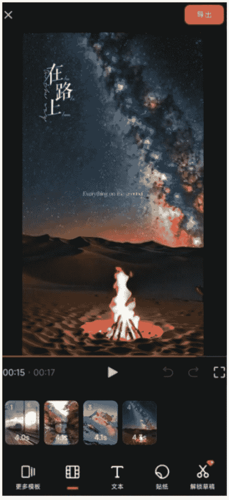

10 视频编辑完成后单击右上角的“导出”按钮，在弹出的“导出设置”界面中，单击左下角的保存按钮，如图7-34所示，即可将视频保存至本地，如图7-35所示，最终视频展示如图7-36所示。

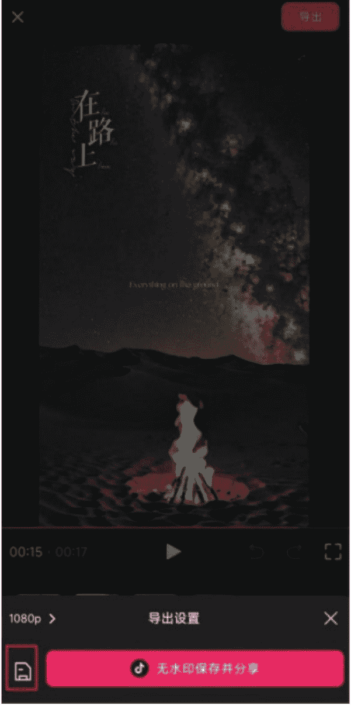

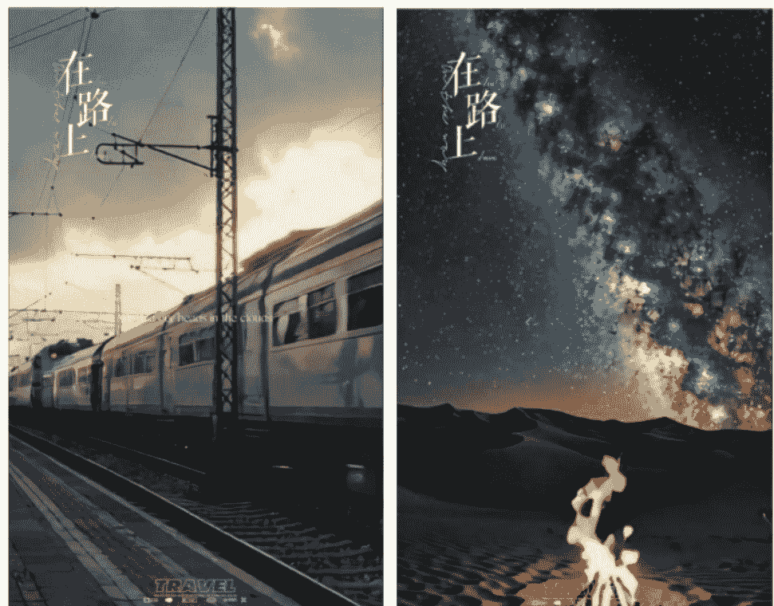

### 7.4 DeepSeek+可灵AI+剪映，生成AI绘本动画

绘本，又被称为“图画书”，以精致的插画和简洁的文字著称，为读者构筑起通往幻想世界的桥梁。这类以儿童为主要受众的绘本，不仅能诉说充满情感的故事或传递知识，还能在不知不觉中提升儿童的多元智力。在色彩斑斓、生动有趣的插画的帮助下，儿童的阅读能力、观察能力、共情能力、创造力及思维能力都能得到提高。本节将介绍使用DeepSeek制作AI绘本动画的操作方法。

01 打开DeepSeek，进入其主页，在文本框内输入提示词，如图7-37所示。

02 执行操作后，DeepSeek将生成一份绘本故事大纲，并对每页的插画和文字内容进行描述，如下所示，注意DeepSeek生成的内容难免存在错误之处，请仔细甄别。

绘本故事标题：小狐狸与小兔子的冒险之旅。

##### 一、页面结构

针对儿童的友谊和冒险故事，插画将占主要部分，每页配以简短的文字叙述。

###### 第1幕

插画：一个阳光明媚的早晨，森林中的小河旁，小狐狸和小兔子坐在一起，背靠背，脸上带着笑容。

文字：在一片宁静的森林里，小狐狸和小兔子是最好的朋友。他们每天一起玩耍，分享所有的快乐时光。

###### 第2幕

插画：小狐狸和小兔子望向森林的深处，那里有一条小路，路的尽头是神秘的远方。

文字：有一天，他们决定不再只在家门口玩耍，而是踏上通往森林深处的冒险之路。他们想要找到传说中的神秘彩虹瀑布。

###### 第3幕

插画：他们走进森林深处，树木越来越高，鸟儿在枝头歌唱，远处传来微风的声音。

文字：森林越来越密，小狐狸和小兔子互相扶持，虽然有点害怕，但他们相信，只要他们在一起，就不会有任何危险。

###### 第4幕

插画：小狐狸和小兔子遇到了一条宽宽的河流，河面波光粼粼，但河上没有桥。

文字：他们走呀走，被一条宽宽的大河挡住去路。小兔子有些害怕，但小狐狸说：“我们可以一起想办法！”于是，他们用树枝和藤条搭建了一座小桥。

###### 第5幕

插画：他们穿过了一片茂密的花丛，遇到了一只善良的蜜蜂，它指着前方的山峰。

文字：在穿越了美丽的花海后，他们遇到了一只友善的蜜蜂。“彩虹瀑布在山那边，快去吧！”蜜蜂说。

###### 第6幕

插画：小狐狸和小兔子一起爬上了一座高高的山峰，远处隐约可以看到彩虹的光芒。

文字：他们继续前行，经过艰难的攀爬，终于站在了山顶。远远的，他们看见了美丽的彩虹瀑布，瀑布在阳光下闪耀着七彩的光芒。

###### 第7幕

插画：彩虹瀑布就在眼前，水花飞溅，七彩的光芒包围着小狐狸和小兔子，他们兴奋地跳起来。

文字：小狐狸和小兔子终于来到了彩虹瀑布。那是他们见过的最美丽的景色！水花飞溅，彩虹像一条丝带一样绕在天空中。

###### 第8幕

插画：夕阳西下，彩虹仍然挂在瀑布上。小狐狸和小兔子手拉手，踏上回家的路。

文字：夕阳渐渐落下，小狐狸和小兔子带着美好的回忆回家了。他们知道，只要有彼此，未来的每一天都会有新的冒险。

##### 二、故事总结

这个友谊和冒险的故事传达了勇气、团结和探索精神，它告诉孩子们，只要和朋友在一起，就能克服任何困难，并找到美好的事物。

03 对DeepSeek提供的对第1幕插画的描述进行提示词优化。因为生成的图像主要包含一只小狐狸和一只小兔子，所以将第1幕的提示词更改为“早晨，一只小狐狸和一只小兔子，在森林的小河旁背靠背坐着”，如图7-38所示。

**提示：** 考虑到绘本面向的是儿童群体，可以通过提示词将图像风格设定为比较可爱的类型，如卡通、皮克斯、迪士尼、涂鸦、水墨画、极简主义、扁平化设计和儿童绘本等。另外，除了风格关键词，还可以通过添加艺术家的姓名来进一步控制风格，如齐白石、吴冠中、安迪·沃霍尔、露西·格罗史密斯等。

04 优化提示词后，加入适当的图像风格设定，如图7-39所示。

05 执行操作后，单击“立即生成”按钮，即可生成相应的图片，如图7-40所示，选择一张合适的图片，将其下载至本地。

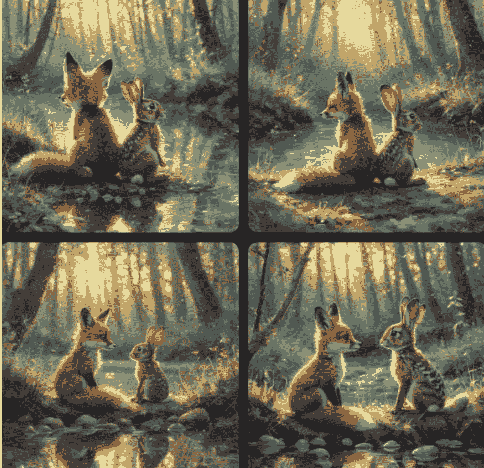

06 重复步骤01～步骤04，将后续图7张图片都绘制出来，并标注序列号以防弄混，如图7-41所示。

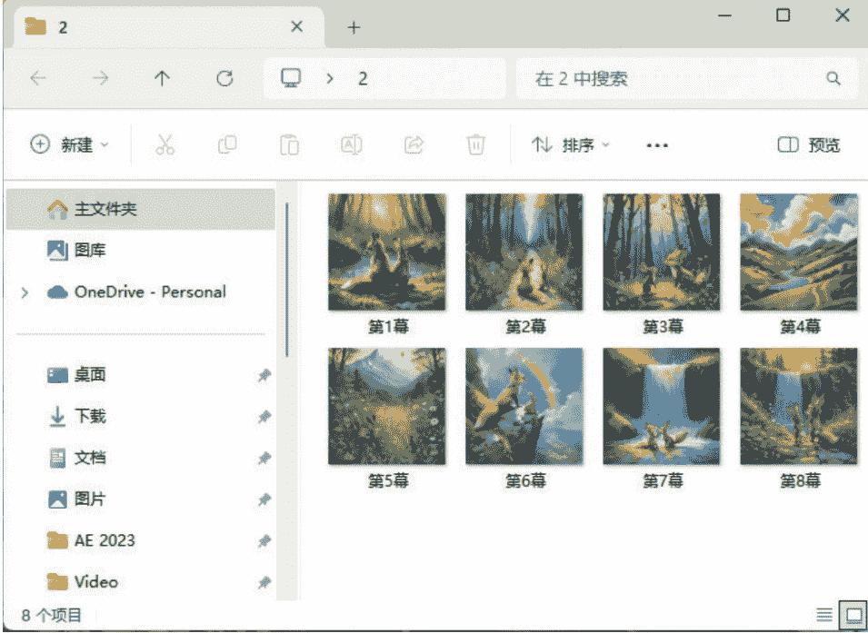

07 打开可灵AI主页，选择“AI视频”选项，进入“图生视频”界面，将第1幕的图片素材进行上传，如图7-42所示。

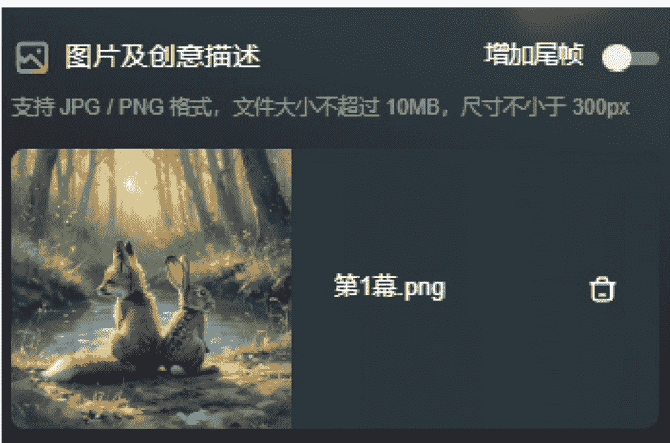

提示：这里可以自由发挥，使用可灵AI的图片“图片创意描述”“运动笔刷”“参数设置”选项等对生成结果进行调整，如图7-43所示。

08 执行操作后，单击“立即生成”按钮，即可自动生成与提示词对应的视频，如图7-44所示。

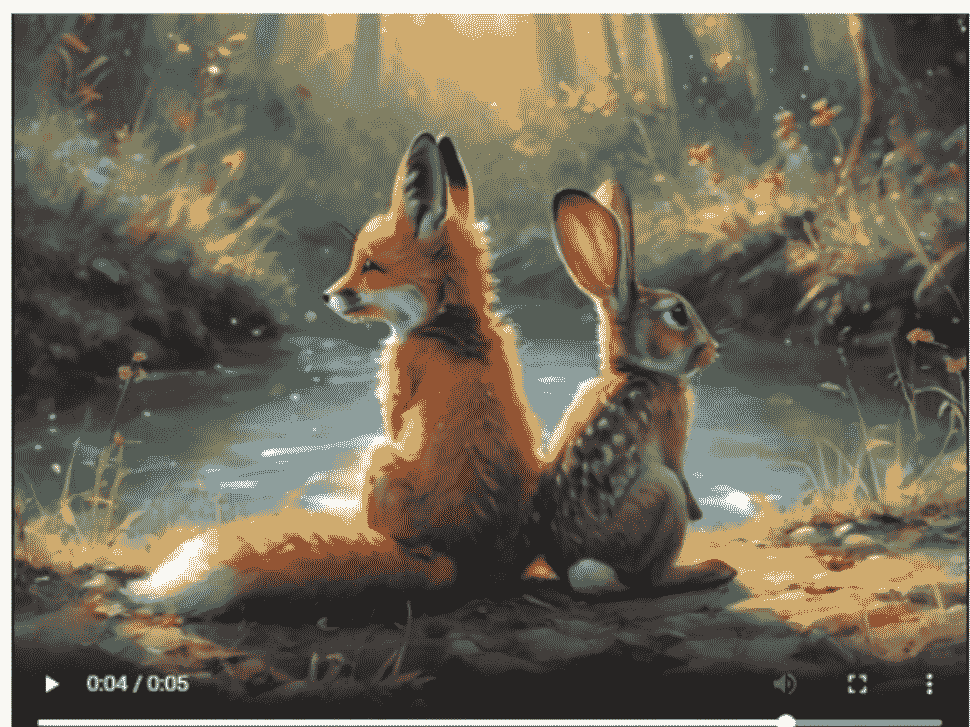

09 重复步骤07～步骤08，将其余7张图片通过“图生视频”功能转换为视频，如图7-45所示。

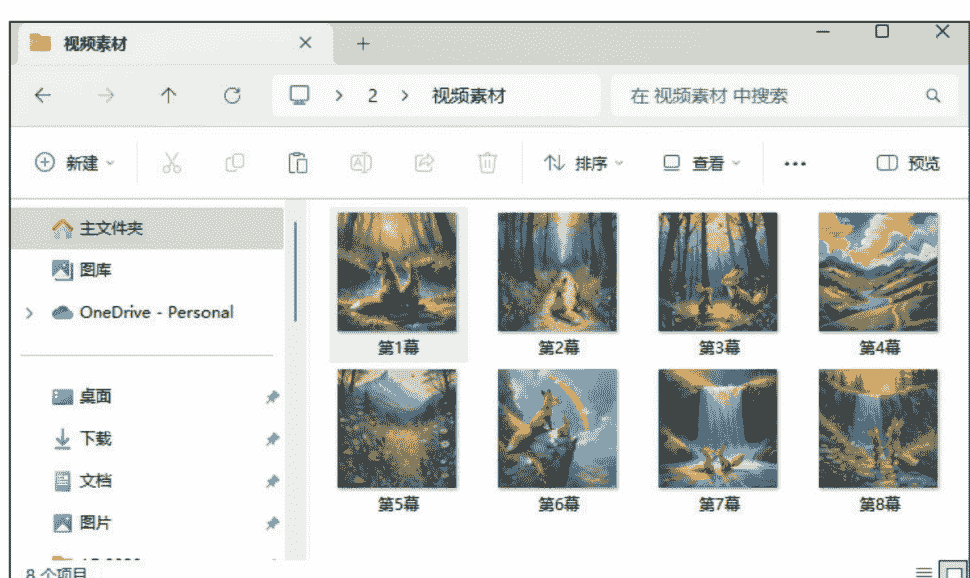

10 打开剪映网页版，导入刚刚生成的视频素材并按故事发生的先后顺序进行排序，之后对整个视频进行剪辑。视频剪辑完成后，在界面左上角的工具栏中选择“文本”选项，然后选择“新建文本”选项，接着选择“默认文本”选项，如图7-46所示。

11 根据视频内容，输入与之相匹配的字幕。例如，第一段视频是讲述小狐狸和小兔子是好朋友的关系，因此在文本框中输入“在一片宁静的森林中，小狐狸和小兔子是最好的朋友”，然后再调整文本样式，并将文本移至第一段视频画面中的合适位置，如图7-47所示。

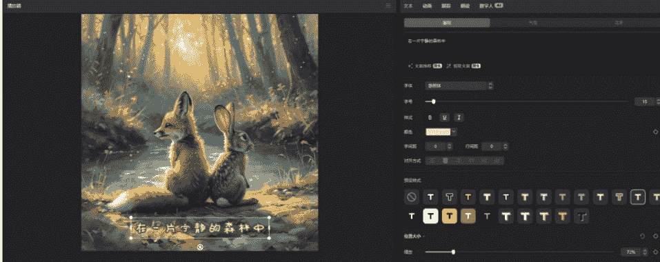

12 重复步骤10和步骤11，将后续视频片段都添加相应的字幕内容。部分画面展示如图7-48所示。

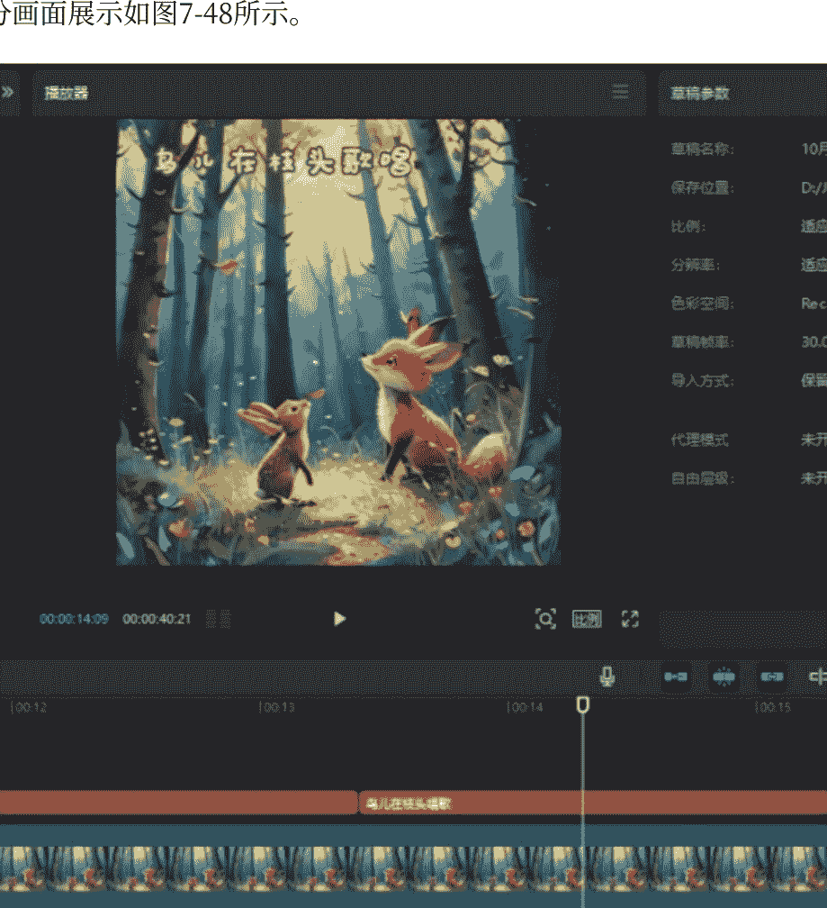

13 根据字幕生成旁白。在时间轴上选中一段文本，如图7-49所示。

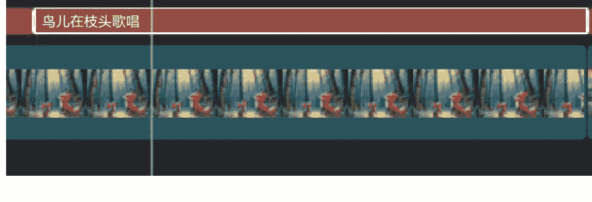

14 在界面右上角选择“朗读”选项，此时会出现很多种声音选项。因为现在做的是面向儿童的AI绘本动画，所以这里选择“少儿故事”选项，然后单击“开始朗读”按钮，如图7-50所示，剪映将自动生成一段旁白。

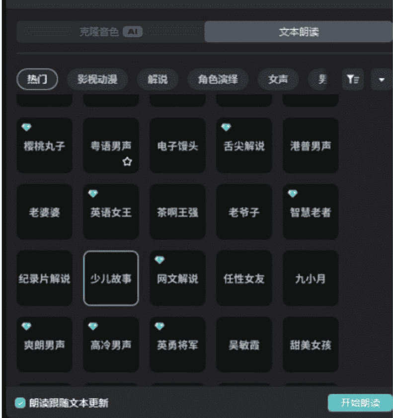

15 对旁白进行剪辑调整，以确保声音、画面和字幕之间的完美配合，如图7-51所示。

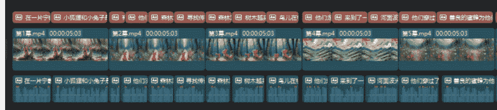

16 将时间线拖动至两段视频素材中间，选择左侧工具栏中的“转场效果”选项，选择“幻灯片”中的“翻页”转场，如图7-52所示。

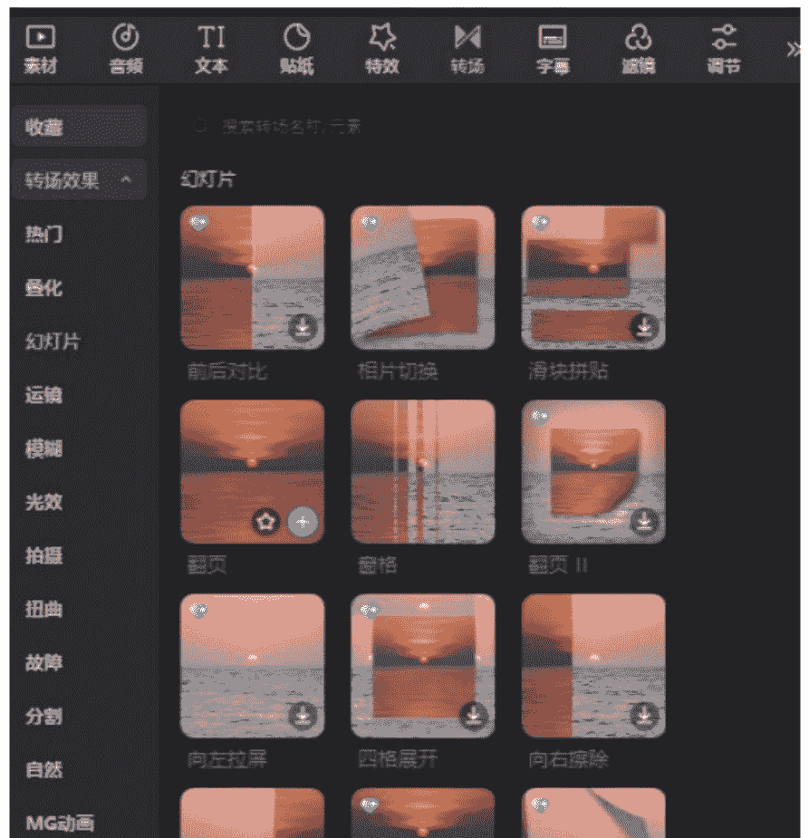

17 执行操作后，将“翻页”转场时长调整至“1s”，得到的转场效果如图7-53所示，按照相同方式给后续视频素材的中间添加转场效果。

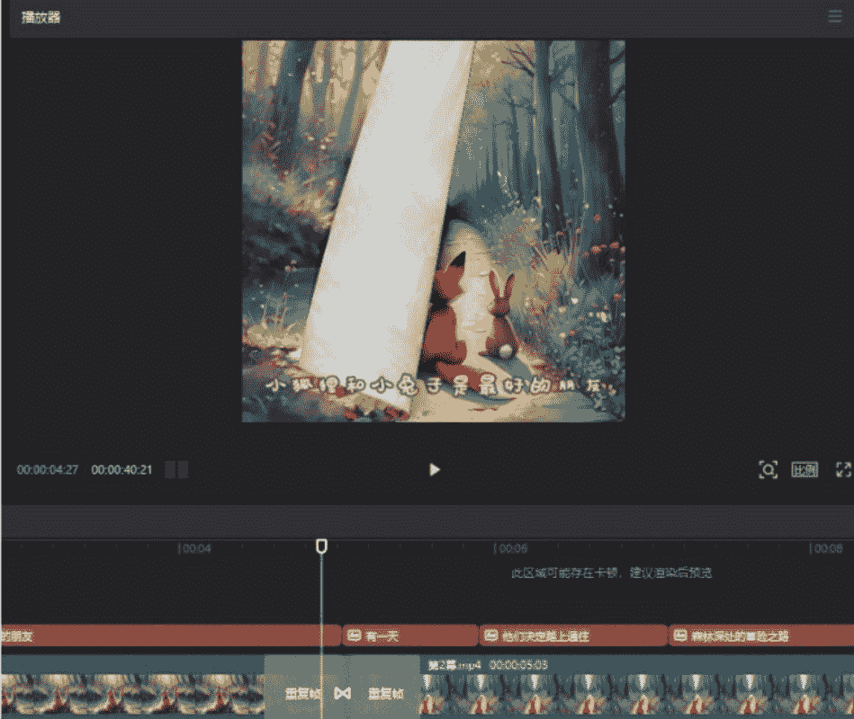

接下来可以添加喜欢的背景音乐，使AI绘本动画更具吸引力。视频剪辑完成后将其导出即可。

### 7.5 DeepSeek+即梦AI+剪映，制作AI哪吒动画

近日，动画电影《哪吒2：魔童闹海》成为了大家热议的话题，票房成功突破了150亿元的大关，成为国产动画电影的又一里程碑！这一强劲的表现不仅让影迷们热血沸腾，更引发了众多品牌的关注和参与。

节将通过DeepSeek+即梦AI+剪映的组合，制作最近爆火的哪吒动画，下面是其详细操作步骤。

扫码看视频

01 打开DeepSeek，进入其主页，在文本框内输入提示词，如图7-54所示。

图7-54

02 执行操作后，按【Enter】键或单击按钮，发送指令至DeepSeek，即可得到相应的回复内容，如下所示。

以下是为4个场景设计的皮克斯风格文生图提示词，包含哪吒经典形象核心元素。

##### 1. 起床

皮克斯3D动画风格，黑眼圈双丸子头的哪吒（戴金项圈+混天绫缠绕腰部），穿着毛绒熊猫拖鞋和条纹睡衣，在古风雕花木床上揉眼睛、打哈欠，晨光透过莲花纹窗格洒在凌乱的被褥上，床头立着火焰纹样的乾坤圈，画面充满慵懒萌态与东方奇幻元素的碰撞，超现实布料质感，柔焦光效，景深层次丰富。

##### 2. 躺沙发吃零食

皮克斯卡通渲染风格，魔童哪吒（标志性烟熏妆+双髻红绳）瘫在云朵造型的懒人沙发里，混天绫随意搭在仿古青花瓷茶几上，手持超大包虾片正往嘴里倒，零食碎屑飘落在绣着莲花纹的绸缎坐垫上，背景现代感客厅与传统法器陈设混搭，夸张的腮帮鼓动特写，哑光材质与霓虹光影交织出诙谐氛围。

##### 3. 跳芭蕾

迪士尼皮克斯式动态场景，反叛哪吒（黑眼圈+双丸子头）穿着粉色蓬蓬芭蕾舞裙，混天绫幻化成渐变丝绸飘带缠绕手臂，正在木质舞台上单足旋转，项圈金铃随动作叮当作响，背景水墨风海浪幕布与欧式水晶吊灯混搭，面部表情从倔强到惊喜进行渐变，运动模糊处理展现灵动舞姿，柔光粒子特效环绕。

##### 4. 写作业

皮克斯夸张喜剧风格，哪吒（经典造型+缩小版乾坤圈当橡皮）趴在蟠桃木书桌前，毛笔被咬出牙印，宣纸作业本上画满三头六臂涂鸦，混天绫委屈地蜷在砚台旁当镇纸，窗外太乙真人偷看的影子投在山水屏风上，卡通化痛苦表情配合炸毛丸子头，仿古宫灯暖光与卡通气泡对话框“不想修炼！”形成跨次元笑点。

每个场景均保留以下内容。

- 核心造型：黑眼圈/双丸子头/混天绫/金项圈。
- 风格融合：皮克斯标志性夸张表情+中国元素纹理。
- 材质表现：3D渲染的布料/金属/毛发细节。
- 光影特色：柔和的体积光与戏剧性高光点。

可根据生成效果微调混天绫动态或增减传统纹样密度。

03 选择即梦AI的“作图”|“图片生成”选项，将DeepSeek生成的提示词复制、粘贴至创意描述对话框内，如图7-55所示。

图7-55

04 执行操作后，选择图片比例和生图模型，再单击“立即生成”按钮，即可生成与提示词对应的图片，如图7-56所示。

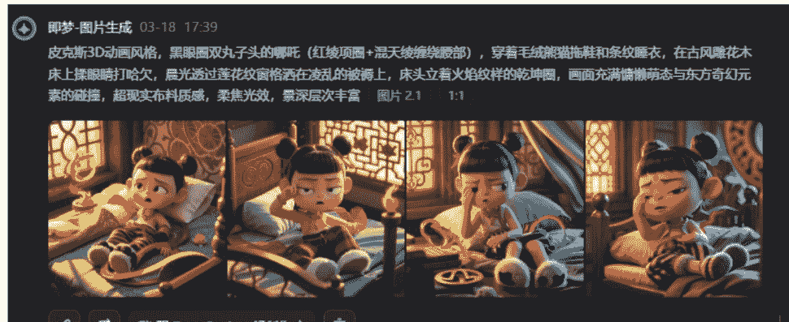

图7-56

05 执行操作后，将鼠标指针移至喜欢的图片上方，单击“生成视频”按钮，如图7-57所示。

图7-57

06 将提示词再次粘贴至创意描述文本框内，并单击“生成视频”按钮，即可生成与提示词对应的视频，如图7-58所示。

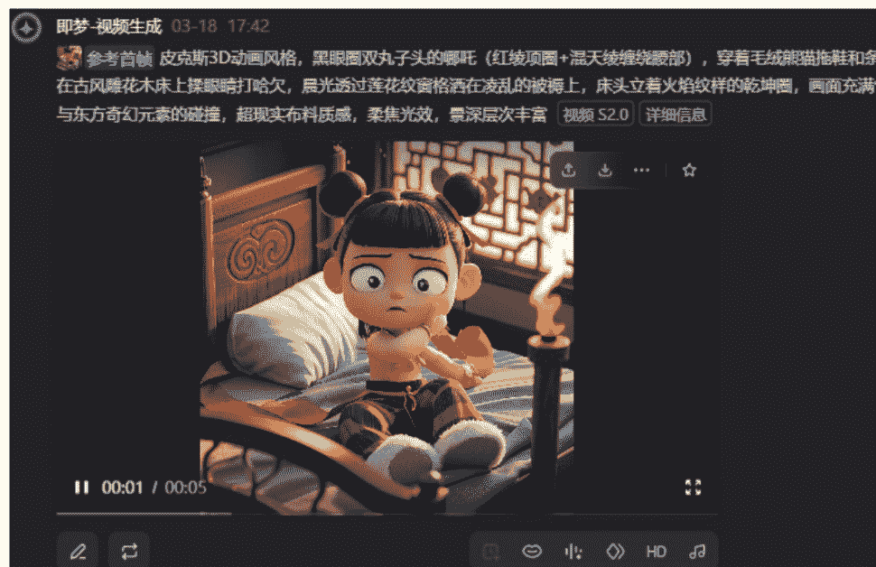

图7-58

07 将鼠标指针移至视频上方，单击右上角的“下载”按钮，如图7-59所示，即可将视频下载至本地。

图7-59

08 重复步骤03～步骤07，将其余3个场景的文字内容一一生成图片并转化成视频，生成后的视频整理至图7-60所示。

图7-60

09 打开剪映网页版，导入刚刚生成的4个视频素材，并将视频拖曳至轨道上，如图7-61所示。

10 选择“音频”|“音乐库”|“我命由我不由天”选项，为视频增添背景音乐，如图7-62所示，并将多余的音乐片段进行裁剪、分割和删除。

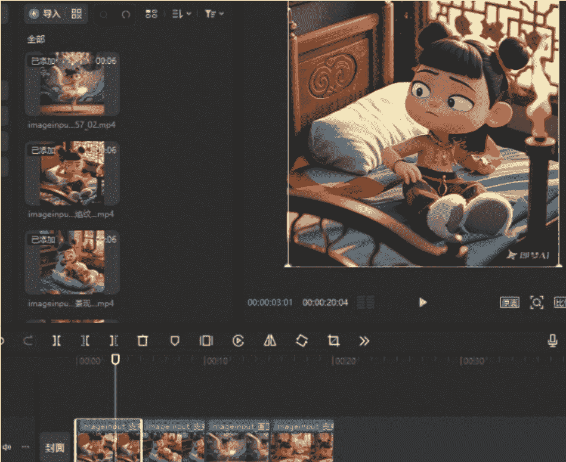

▲图7-61

▲图7-62

11 执行操作后，单击界面右上角的“导出”按钮即可将视频保存至本地，如图7-63所示。

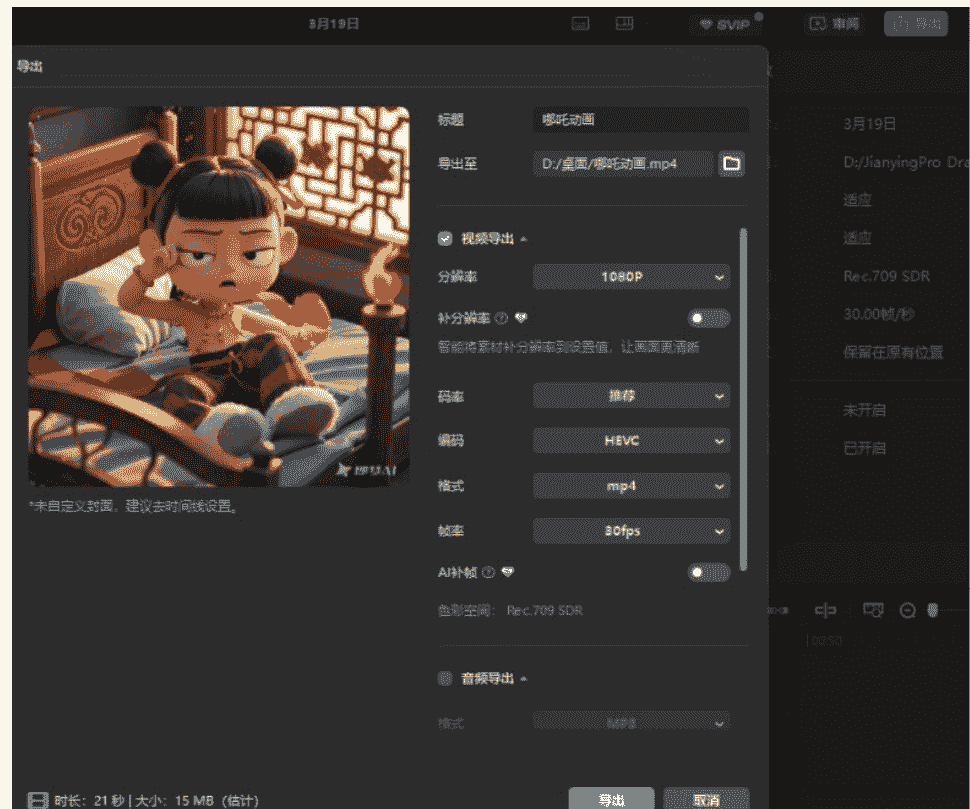

图7-63

## 章节总结

本章主要讲解使用DeepSeek结合剪映、可灵AI、即梦AI等前沿视频工具，帮助用户实现各种爆款视频的制作，具体内容可参考下图。

▲扫码添加企业微信

回复关键词167791

免费领取视频、PPT课件、素材文件等资源