# 全链路 AI 短视频创作实战手册

## 内容概览
本书将生成式智能与短视频生产流程做了完整打通，从选题挖掘、脚本撰写到素材合成与后期剪辑，形成一套可复用的高效制作方法。既讲透软件怎么用，也拆解爆款背后的思考方式，覆盖从灵感到上线的全流程。

全书共7章，循序推进。第1章拆解爆款短片的底层逻辑与智能协作方式；第2章聚焦选题方法论，详解热点捕捉、竞品拆解与用户需求挖掘；第3、4章深耕脚本与文案，涵盖剧情、测评、科普、Vlog 等多种类型的内容生成思路；第5、6章解析素材制作与视频合成，联动 Midjourney、剪映等应用演示智能绘图、智能剪辑等进阶玩法；第7章以“萌宠走秀”“AI哪吒动画”等五大实操案例，展示多工具协同的创意落地路径。每章都配备具体操作步骤、常见问题对策与提效技巧。

本书面向希望在短片赛道取得突破的创作者、内容营销从业者、智能应用爱好者及创业者。无论是零基础入门，还是已具备一定拍摄经验，都能获得可落地的操作思路与创作启发。

## 前言
生成式技术正在大幅降低短片制作门槛，也为内容表现和视觉呈现打开新空间。DeepSeek 作为国内免费生成式应用的代表，既能精准产出选题和脚本，也能做深度数据分析，为创作提供智能支撑。配合剪映、即梦AI、可灵AI、Midjourney 等，从素材生成到剪辑特效均可实现自动化与提速，极大简化了传统流程。可惜市场上关于多款智能应用联合使用的系统参考与实战案例并不多，故本书应运而生。

## 本书亮点

### 全链路七模块，掌握智能创作
从爆款逻辑与智能加持，到选题、脚本文案、智能绘图、视频制作，再到前沿影像玩法，全流程拆解制作的关键节点，助力从入门到进阶的跃迁。

### 多款智能应用协同创作
介绍 DeepSeek 与剪映、即梦AI、可灵AI、Midjourney 的组合用法，让智能贯穿短片创作的每一环。

### 34个案例覆盖多场景
不仅讲解流程与工具技巧，更通过大量真实案例呈现智能在短片领域的应用思路与落地效果，帮助读者直观理解工作流。

## 读者对象
- 短视频创作者 —— 希望借助智能优化选题、脚本、剪辑、运营，提升效率与内容质感的博主、自媒体人。
- 新媒体运营人员 —— 负责内容策划、数据分析、账号运营，想用智能提高内容精准度与投放策略的从业者。
- 品牌营销人员 —— 需以短视频推广产品、优化营销打法的市场营销人员。
- 智能爱好者与技术探索者 —— 关注智能在内容与视频创作中的应用，想深入了解 DeepSeek 等应用使用方法的技术爱好者。

## 注意事项
因算法与算力会持续变化，即使提示词相同，DeepSeek 每次生成的文本也可能不同，此属正常现象。因此书中示例回复与读者实操或有差异，请重点关注指令写法与操作步骤。

编者

2025年5月

## 第1章

## 爆款逻辑与智能协作
当下是“前3秒决定留不留下”的时代。每天各平台涌现海量作品，能火的只是少数。爆款背后自有规律，从抓眼开场、情绪设计到平台分发机制，每个环节都在影响传播效果。

与此同时，智能正在重塑创作方式。制作视频不再局限于一人一机，而是能让智能参与选题、写脚本、生成画面、调节奏，甚至封面与剪辑。本章将教你如何把控开头的黄金3秒，读懂推荐底层逻辑，并设计节奏结构留住观众。

### 1.1 爆款内容的底层逻辑
要被看见，需要三层同步发力：一是打动用户，让人点进来并看下去；二是契合平台推荐，让算法愿意放大；三是节奏张弛有度，有起伏、有冲突、有解决，才更易促成停留与分享。

扫码看视频

#### 1.1.1 三秒留人技巧
在短片场景里，划走是本能，决定是否继续的是开头3秒。若前3秒无法抓住人，大多数用户会直接滑走。

抓住3秒的关键有两点：吸睛注意力和情绪共鸣。具体手法如下。

##### 1. 开头钩子要够强，才能让用户停下
钩子是一眼就能触发兴趣的信息，常见形式有：
- 抛出反常或冲突信息，用反差制造悬念。如：“她自称很穷，却请我吃了一桌3000元的饭。”
- 提出尖锐问题，戳中痛点。如：“为何越努力越焦虑？”
- 场景代入，制造“这就是我”的认同感。如：“如果你也常情绪失控……”
- 直接给出高能画面。如打斗、反转、哭笑、崩溃等视觉冲击，第一秒就显看点。

##### 2. 开头要有情绪点，才能引发共鸣
人对情绪的反应高于信息。普通场景叠加情绪就具备吸引力。可这样操作：
- 共鸣式开场。制造“我也一样”的感受。如：“30岁后才明白，没人真在意你努不努力。”
- 冲突式开场。用对立信息点触发讨论。如：“老公不做家务不是不会，而是根本不当回事。”
- 用情绪化语言把握节奏。急促语速带入焦虑，舒缓语速与背景音乐带入伤感。

##### 3. 视觉与文字同步刺激，效果加倍
语言之外，视觉与字幕的配合也很关键。如：
- 开头配一行高亮大字：“你可能从未想过……”
- 用特写放大表情或动作细节；
- 加入音效、卡点、慢动作放大情绪或冲突。

#### 1.1.2 平台推荐机制解读
发布不等于可见。视频能触达谁、触达多少，由平台推荐机制决定。要想内容被放大，就要先弄清视频如何被挑选与推进。

##### 1. 推荐的基本流程
大致分为四个阶段：
- 冷启动测试。刚发布的内容先推给几十到几百人，观察反馈。
- 数据反馈决定去留。若点进率高、停留久、互动多，平台判定有潜力则加推。
- 逐层扩大范围。表现越好进入更大推荐池，形成滚雪球效应。
- 长期推荐与人群匹配。优质内容可进入长期推荐池，数周后仍会匹配推送。

##### 2. 算法关注的核心指标
平台用算法预测行为，重点看：
- 完播率。完整观看比例，越高代表吸引力越强。
- 停留时长。即便未完播，看得久也说明有价值。
- 点赞率/评论率/转发率。衡量情绪价值与互动强度。
- 关注率。看完后是否关注，代表内容转粉能力。
- 点击率。出现在推荐页后是否被点开，与标题封面强相关。

##### 3. 关键词匹配与人群画像
平台会做内容与用户的兴趣匹配：
- 从标题、字幕、语音识别等提取关键词，判断视频适合哪类用户。
- 根据用户兴趣画像进行精准投放。

例如讲“宝妈情绪崩溃”的内容会推给育儿、女性群体；讲“职场故事”则多推给年轻职员、情感用户。标签清晰、主题明确的内容才容易被识别与推荐，主题模糊则易被错过。

#### 1.1.3 节奏把控方法
节奏指剧情推进、情绪波动与信息释放的搭配合。好的节奏如同电影的高潮转折，决定留存与打动。节奏差的视频平淡乏味，难以坚持观看。

优秀节奏多遵循起、伏、转、合结构。

##### 1. 起 —— 快速引入，引发关注
开头不能拖沓，3-5秒内抛出关键信息或场景作引子。如：
- “我被客户骂哭的那天……”
- “这是我和老公分开的第37天。”
- “别再吃这3种减肥餐，会反弹！”

目标是让人愿意继续看。

##### 2. 伏 —— 制造悬念或情绪冲突
中段避免平铺直叙，要制造张力，促使用户想知道后续。可通过：
- 情节反转。如：“他表面安慰我，实则奉命监视。”
- 情绪拉扯。如：“刚升职，妈妈却确诊重病。”
- 信息递进。如：“她每晚11点回家，我查了定位……”

重点是形成“不看完难受”的心理。

##### 3. 转 —— 爆点、高潮或揭晓答案
观众已投入，此时给出情绪高潮或信息爆点：
- 情绪类：“我终于忍不住，对老板吼了出来！”
- 干货类：“减肥餐关键在蛋白质与配比。”
- 剧情类：“本以为她爱我，她却说我只是工具。”

决定评论、转发与点赞。

##### 4. 合 —— 情绪收尾或价值输出
视频要收得住，可共鸣、可实用、可引导互动：
- 情绪共鸣：“我们都在假装坚强，其实怕失望。”
- 实用输出：“蛋白质占比30%以上才算合格减肥餐。”
- 行动号召：“你也遇到过吗？评论区聊聊。”

结尾是二次传播的起点。

### 1.2 智能提效路径
过去一条视频可能耗费一天。现在只要把创意讲清楚，其余环节都能由智能提速或代劳。对中小创作者和兼职内容人而言，智能就像一个不喊累的助手，既懂策略又能执行。

扫码看视频

#### 1.2.1 选题挖掘与热点追踪
过去选题靠灵感，现在竞争激烈，选什么直接决定流量。智能可把选题从灵感依赖转为数据+逻辑+启发式生成。

##### 1. 选题生成
智能能结合定位发现热点，产出一批可落地、有差异化的选题。例如用 DeepSeek、ChatGPT 或豆包，输入：“请围绕‘新手装修避坑’给出10条适合短视频的选题，每条20字内，风格接近小红书。”

可能得到：
- “这5个装修套路，99%的人中招”
- “厨房装完后悔，主要因这一步”
- “首次装修预算多花3万的原因”

这些标题自带钩子，也贴合搜索与推荐。

##### 2. 热点追踪
智能还能做热点追踪。可把热搜词、热榜、爆款评论或视频链接丢给智能，让它提炼情绪点、话题逻辑与需求，再反向生成适配账号调性的建议。

例如提示：“抖音上‘高考志愿被骗’很火，请基于该话题给出3条知识科普类短视频方向并附大纲。”

可能得到：
- “志愿‘专家咨询’靠谱吗？3分钟识别骗局”
- “如何免费查志愿？3个正规渠道”
- “被骗填志愿的真实案例，给家长的防骗指南”

兼具热点、实用与情绪，易获推荐与互动。

#### 1.2.2 标题与文案撰写
好标题让人停下，好文案让人点进。很多创作者卡在没灵感或写得平淡。智能可成为持续输出的写作搭档，关键在于问得清楚。

##### 1. 提问技巧，获得吸睛标题
需说明主题、情绪风格、发布平台、输出数量。示例：“我做了一条‘35岁裸辞后摆摊’的视频，请给出5个抖音风格标题，要求真实、有情绪、有共鸣。”

可能结果：
- “裸辞第67天，我在夜市卖东西了”
- “35岁逃离职场，我靠小推车自立”
- “放弃月薪1万后，我学会不求人赚钱”
- “从老板到摆摊，35岁也可以重启”
- “没存款辞职摆摊，是最清醒的选择”

均有冲突、人物与情绪，易触发点击。

##### 2. 生成有节奏的说明文案
智能也能写简介、口播开头结尾，利于平台理解与用户互动。例如提示：“为一条‘夫妻吵架后冷战三天’的剧情视频写一段简介区文案，要有情绪共鸣并引导留言。”

可能结果：“有时候不是不想说话，是怕一开口就吵。三天沉默，我们都在等对方先低头。你有过这种感受吗？”

#### 1.2.3 脚本创意与语言优化
脚本是内容的骨架，决定节奏、情绪与体验。常见问题是起步难、语言平淡、反转不自然。智能可在构思阶段打开思路，润色阶段提升表达。

##### 1. 激发脚本创意
智能可依据关键词、场景或受众生成不同结构的脚本。如提示：“围绕‘婚后家庭分工失衡’设计一个适合视频号的情绪短视频脚本，要求开头冲突、中段反转、结尾引发思考。”

可能得到：
- 开头：丈夫抱怨家里乱，妻子沉默。
- 中段：妻子拿出“育儿作息表”，说这是自己24小时承担的。
- 结尾：镜头定格，字幕“当家庭是单选题，有人早就输了。”

结构清晰，情绪饱满。

##### 2. 语言表达优化
脚本有逻辑但语言不够打动时，可把草稿发给智能润色、增强情绪、精简到60秒内。例如提示：“以下脚本逻辑清楚但不够动人，请优化情绪感染力并控制时长，如‘今天又为小事吵架。他说我敏感，我只是累了。’”

优化后可更具张力与画面感，帮助内容更易传播。

> “又是为了一点小事，他冲我吼。我没说话，只是低头收拾碗筷。不是我不敏感，是委屈太多，已经没力气吵了。”

把这段压抑的情绪写出画面感和代入感，读者更容易共情，互动也就起来了。

#### 1.2.4 让封面与画面质感智能化

短视频要靠内容说话，但能不能被点开，首先看第一印象。封面和画面就是这第一印象。内容再好，封面随意、画面模糊、风格杂乱，观众也直接划走。

想要点击率高、观感更专业，封面要抓人，画面要精致。过去要靠摄影、设计和后期，现在智能化工具能接手大半流程，省时也提质。

##### 1. 封面设计

封面需要在1秒内说明视频讲什么、情绪如何、值不值得看。

借助图像类智能生成工具，可以快速做出风格统一、视觉冲击强的封面。

- 1. Midjourney：擅长营造高质感氛围，电影感画面和概念情绪图是强项。
- 2. 文心一格：理解中文指令能力突出，适合生活、国风、写实插画类封面，操作门槛低，新手友好。
- 3. Canva AI：擅长系列化视觉，可用统一模板把账号封面做成一套，还能自动排版加字，大幅提升出图效率。

输入关键词，结合主题、风格、短标题和人物，几分钟就能得到有专业感的封面。

##### 2. 视频画面

画质和视觉风格直接影响完播意愿。画面粗糙、肤色不自然、背景凌乱，很容易被判定为不专业、不值得看。

智能视频工具能明显拉升质感。

- 1. 智能自动调色：剪映、Runway、CapCut等都能识别场景，自动进行肤色优化、背景提亮、高光调节，让画面更干净、人物更突出。
- 2. 智能构图与裁剪：能自动识别人脸或主体并居中对齐，让构图更舒服。
- 3. 风格统一化：可套用视觉模型，如奶油风、日杂风、ins风滤镜，让账号整体有辨识度。
- 4. 背景处理：支持抠图换背景、背景虚化、自动模糊等，把主体凸显出来，减少杂乱，提升视觉集中度。

### 1.3 主流智能创作工具解析

内容生产方式正在被重塑，工具就是核心的生产力。图文、视频、视觉，只要选对工具，效率能提升好几个层级。

怎么挑、怎么用，本节给出方向。

扫码看视频

#### 1.3.1 文案生成类工具

写文案是短视频的基础，也是最烧脑的环节。吸睛标题、顺畅脚本决定能不能点进来、能不能留住。灵感不稳定、产出波动，是多数创作者的痛点。文案类智能助手能快速生成标题、润色语言、搭建脚本框架，减轻策划压力。比如DeepSeek、ChatGPT、豆包。

##### 1. DeepSeek
国产创作工具，中文理解能力强，擅长结构化输出。给一个主题，就能逐步搭出完整的短视频脚本，包含开头钩子、情绪转折和结尾收束，特别适合情绪类、剧情类内容。已有初步想法但写不出结构时，可以让它补全后续创作，如图1-1所示。

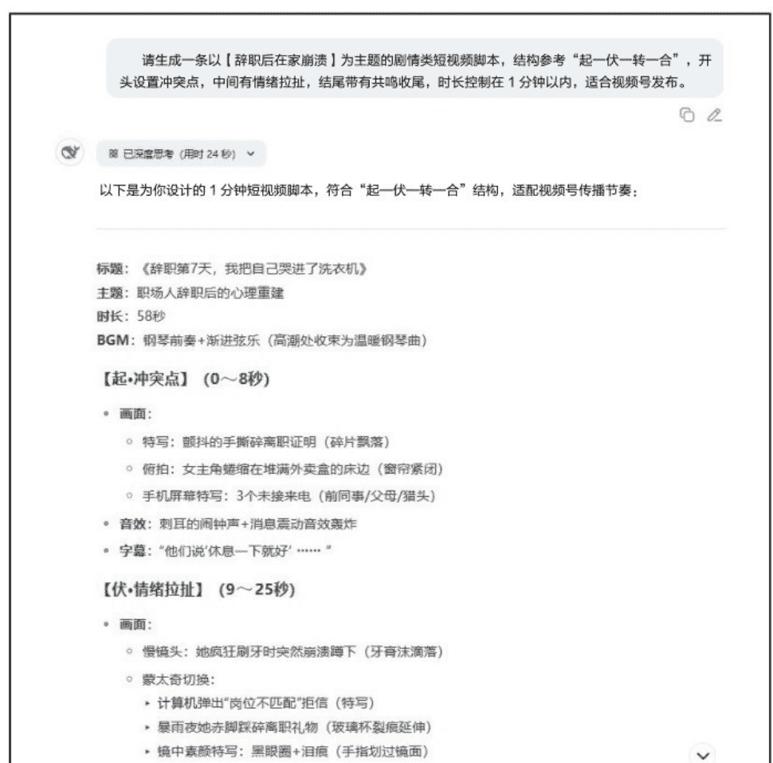

图1-1

##### 2. ChatGPT
基于人工智能技术的对话机器人，使用自然语言处理和深度学习，能进行自然对话、回答问题并给出建议，如图1-2所示。

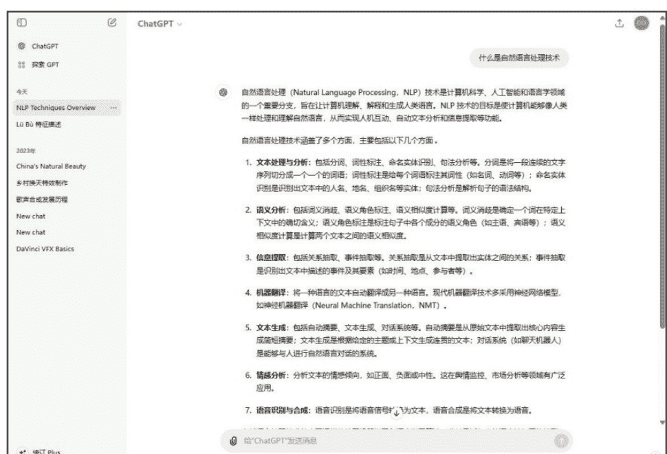

图1-2

其核心基于生成式预训练转换模型Generative Pre-trained Transformer，GPT，由OpenAI研发，可生成自然语言文本。

支持文本聊天、语音识别、语音合成等多种交互。应用场景包括客服、语音助手、教育、娱乐等，可帮助用户解决问题，提供娱乐和知识服务。

##### 3. 豆包
字节跳动推出的智能助手，与抖音生态结合紧密。对平台热词、爆款节奏很敏感，适合种草、口播、剧情短剧，尤其适合入门新人。只需提供产品、风格和场景，就能一键生成多种话术模板。操作简便、生成迅速，很适合带货、热点跟拍和爆款借鉴，如图1-3所示。

图1-3

#### 1.3.2 视频生成类工具

短视频不仅要写好，还要做出来。制作环节耗时且技术门槛高，剪辑、配音、调色、字幕等让很多人觉得拍容易做难。智能视频工具正在解决这个问题，从自动剪辑、智能配音到画面生成，基本实现视频自动化生产。比如可灵AI、Runway、即梦AI。

##### 1. 可灵AI
快手推出的一代AI创意生产力平台，聚焦视频生成，技术能力突出。借助深度学习，特别是3D时空联合注意力机制和Diffusion Transformer架构，能生成高质量、逼真且符合物理规律的视频。

界面简洁，用户能快速上手，专业用户和新手都能迅速找到所需功能，如图1-4所示。

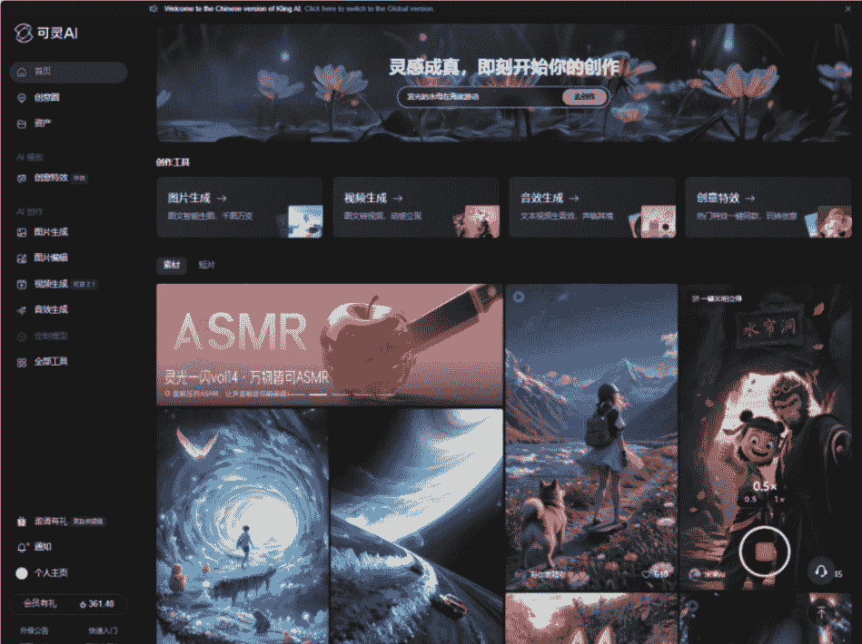

图1-4

##### 2. Runway
2018年成立于美国纽约的生成式AI公司，专注图像与视频编辑。核心产品Gen-3 Alpha经视频图像混合训练，相较Gen-2在细节丰富度、画面连贯性和动作表现上明显提升。

支持文本转视频、图像转视频、文本转图像，并提供高级相机控制和导演模式等多样化控制。生成速度快，10秒视频约90秒完成，在业内保持领先。图1-5为Runway生成的画面截图。

图1-5

Runway在多模态内容生成领域领先，产品功能丰富，竞争力强。随着技术发展，有望在图像与视频编辑领域取得更大突破。

##### 3. 即梦AI
由字节跳动旗下剪映团队研发的一站式智能创作平台，支持“以图生动”和“文字变视频”，适合把文案快速转为视频场景。输入一句描述，如“一个女孩站在夕阳下的大海边”，即可生成对应风格动态画面，如图1-6所示。提供脚本配图、配乐、自动拼接段落等能力，适合Vlog配景、情绪视频背景、短剧场景过渡等。

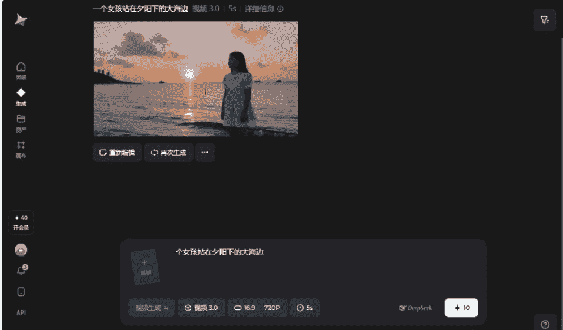

图1-6

#### 1.3.3 图像生成类工具

在视觉至上的时代，一张图往往比一句话更有杀伤力。封面、头像、场景插图、内容背景，都能靠一张吸引人的画面提升点击率和停留率。但并非人人会设计，也没时间精修。图像生成类AI就是“视觉懒人包”，按提示词自动生成所需风格图像，效率高、质量稳、风格可控。

##### 1. Midjourney
先进的AI图像生成软件，基于深度学习，通过文本描述自动生成高质量图像。支持写实、抽象、卡通、复古等多种艺术风格，满足多样创作需求。

主要应用于数字艺术、设计、游戏开发、广告营销和教育等。用户加入Discord服务器后在聊天框输入详细描述即可生成，过程可交互，根据初版结果调整描述不断迭代。图1-7为Midjourney作品示例。

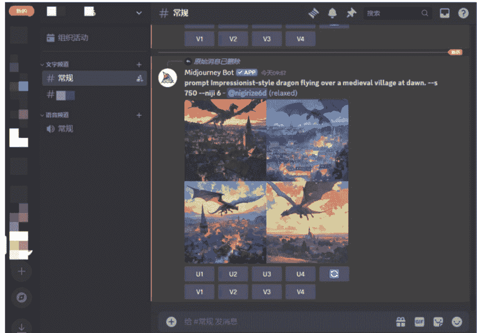

图1-7

生成速度快，通常数秒完成，极大提升效率。高质量输出保障细节和色彩，适合专业创作。也具备智能编辑功能，可调整布局、优化色彩、修正细节。此外支持点击、滑动等互动操作，增强观看体验。

##### 2. 文心一格
基于百度飞桨、文心大模型推出的AI艺术和创意辅助平台，如图1-8所示。面向有设计创意需求的人群，智能生成多样化AI创意图片，辅助设计，打破创意瓶颈。

图1-8

支持以图可控生成，按动作或线稿生成新图，提升可控性。持续升级模型，已推出海报创作、图片扩展、清晰度提升等功能，并提供多种生图服务。

##### 3. Canva AI
澳大利亚设计平台Canva推出的智能工具套件Magic Studio，通过生成式AI大幅提升设计效率，让非专业用户也能快速上手。

整合GPT-4用于文案生成与多语言翻译、DALL·E和Imagen用于图像生成，自研工具如智能抠图、图像扩展、尺寸适配等，覆盖图像生成、内容创作、设计编辑和品牌管理多个场景，如图1-9所示。

图1-9

## 章节总结

本章介绍了爆款短视频的逻辑、用AI提升工作效率以及市面上常用的AI工具，具体内容可参考下图。

# 爆款短视频创作逻辑与 AI 赋能创作

爆款短视频的基本逻辑

- 抓住观众的关键 3 秒
- 理解平台的推荐机制
- 视频节奏怎么把握

用 AI 提高效率

- 用 AI 找选题、挖热点
- 用 AI 写标题和文案
- 用 AI 辅助脚本创意和语言优化
- 用 AI 提升视频画面和封面的效果

主流 AI 创作工具解析

- 文案生成类 AI 工具
- 视频生成类 AI 工具
- 图像生成类 AI 工具

## 第2章 AI＋选题策划：选题决定流量的上限

在短视频创作中，好选题能最大化吸引目标受众。平台受众兴趣多样，选题若能精准切中共性需求，就能带来更多点击、观看和转发，具备广泛受众基础的选题更容易实现规模传播。DeepSeek恰好能精准分析受众数据，帮助创作者了解兴趣偏好，从而辅助创作。

如何利用DeepSeek进行选题策划？值得深入探讨。

### 2.1 用DeepSeek优化选题

是否常陷入“拍什么能火”的迷茫，随后出现盲目跟风、灵感枯竭、数据惨淡？这时DeepSeek就像一台“爆款透视仪”，能从海量数据中精准捕捉受众真正想看的内容。以下介绍如何用DeepSeek优化选题。

扫码看视频

#### 2.1.1 用DeepSeek确立选题方向

选题方向如同灯塔，指引内容定位，精准策划。合理方向能提升吸引力，增加播放量和互动。

##### 1. 明确选题类型
按内容属性和受众需求，选题大致分为需求型、热点型和搜集型。

（1）需求型选题。围绕受众实际需求或痛点展开，提供实用解决方案。用户关注的问题往往意味着潜在流量，精准满足能提高点击和完播。

例如：
- 《3分钟教你快速去除PPT水印》
- 《如何用5种方式缓解失眠？医生教你科学改善睡眠》
- 《手机拍照模糊？5个设置让你的照片秒变大片！》

（2）热点型选题。即“蹭热点”，利用当下流行事件、话题或趋势，结合自身创作方向借势，提升传播效果，能迅速吸引关注、增强互动。

例如：
- 《2024春晚最受欢迎的节目是它？网友热议不断！》
- 《ChatGPT 4.0到底有多强？亲测带你揭秘最新功能！》
- 《某品牌又翻车？全网热议的质量问题，你怎么看？》

（3）搜集型选题。专注信息整理归纳，帮助受众高效获取资料，减少搜索成本，提高实用性和收藏率。

例如：
- 《2024年全国各省公务员考试时间汇总！报考必看》
- 《职场新人必备！10个超实用的PPT模板免费下载》
- 《2024年热门国际旅游地推荐，预算、签证全攻略！》

短视频选题类型与细分领域可参考表2-1。

表2-1 短视频创作的选题类型与对应的细分领域

| 选题类型 | 细分领域 |
| --- | --- |
| 剧情类 | 搞笑情节、街坊邻里之间的相处、甜蜜爱情、幸福生活、朋友相处等 |
| 娱乐类 | 舞蹈表演、歌唱展示、明星艺人相关等 |
| 影视类 | 影视改编、影视混剪、综艺剪辑、电影解说、影评或影视推荐等 |
| 生活类 | 情感、美食、穿搭、美妆、母婴、育儿、养生等 |
| 知识类 | 技术流、独特手艺、知识分享等 |
| 文化类 | 书法、美术、国学、哲学、历史、二次元等 |
| 商业类 | 技能分享、讲述故事中穿插广告、测评带货等 |
| 资讯类 | 各行业资讯、时事热点、大众的实时关注等 |
| 三农类 | 与农民、农村、农业相关的产品或服务推荐等 |
| 科技类 | 科技产品分析、科技实验展示、科学术语讲解、科技创新等 |
| 军事类 | 军事新闻、军事解说、军事历史等 |
| 游戏类 | 网络游戏、竞技游戏、创意游戏、游戏解说、游戏分享等 |
| 宠物类 | 宠物日常、宠物表演等 |
| 体育类 | 体育赛事剪辑、体育新闻、体育解说等 |

##### 2. 确立选题方向
借助DeepSeek确立方向分两步。

（1）找到优势与兴趣。思考以下问题：
- 1 你擅长什么？如写作、演讲、摄影、剪辑、数据分析等
- 2 你对哪些话题感兴趣？如科技、职场、健康、美食、财经等
- 3 你的职业背景或经验能为观众带来哪些独特视角？

（2）向DeepSeek提问。将答案用简洁语言表达并提问，可得到更符合预期的结果。示例：

你是一个新手美食类短视频博主，擅长文案撰写与静态摄影，核心受众为18～35岁的年轻群体。现在需设计2个选题方向。要求：
- 1 结合自身图文创作优势与短视频媒介特性；
- 2 在避免盲目跟风的前提下，既契合平台流行趋势，又自然融入个人风格；
- 3 每个选题需包含内容框架简述、情绪共鸣点解析。

以下是2个符合要求的美食短视频选题方向设计。

##### 【选题一】《独居青年的厨房慢美学》
###### 1. 内容框架
- (1) 片头15秒，固定机位俯拍食材整理过程配白噪声。
- (2) 特写镜头组，黄油融化、面团发酵等微观变化。
- (3) 制作过程分镜，配合手写字体菜谱浮入。
- (4) 成品摆拍转场，从动态制作切换到静态摄影作品。
- (5) 结尾定格，餐桌光影摇曳的空盘配治愈系文案字幕。

###### 2. 情绪共鸣点
- (1) 满足独居青年“仪式感治愈孤独”的情感需求。
- (2) 慢节奏画面对冲职场压力，制造精神疗愈体验。
- (3) 食物变化特写带来解压爽感。

##### 【选题二】《菜市场盲盒料理挑战》
###### 1. 内容框架
- (1) 跟拍逛菜市场过程，抓拍摊主互动与食材纹理。
- (2) 盲选3种陌生食材特写，制造悬念。
- (3) 料理实验失败花絮，保留翻车镜头。
- (4) 成功菜品诞生时刻，升格镜头强调惊喜感。
- (5) 菜谱手账展示，扫描手写笔记作为结尾。

###### 2. 情绪共鸣点
- (1) 菜市场烟火气唤醒童年味觉记忆。
- (2) 不完美的真实感打破美食博主滤镜。
- (3) 盲盒机制激活Z世代猎奇心理。

DeepSeek给出的选题精准融合图文优势与短视频特性，兼具烟火气与年轻化，情绪共鸣点直击痛点，执行细节强化差异化，结构清晰，平衡了平台趋势与创作者个性。

#### 2.1.2 DeepSeek分析爆款选题的四大准则

DeepSeek 选题爆款四要素拆解

DeepSeek 在判断选题能否成为爆款时，会围绕四件事展开：看清观众要什么、抓住当下热度、做出不一样的表达、评估自己能不能做。吃透这套思路，就能更精准地向模型提要求，让它结合账号定位给出可落地的方向。

##### 1. 以用户需求为出发点
短视频是给人看的，合不合口味决定了是否产生共鸣和扩散。模型首先会勾勒目标人群的基础画像，比如年龄区间、职业背景、兴趣偏好，继而挖掘核心痛点并给出解决方案或情绪共鸣，最后通过评论区反馈做复盘，帮助创作者及时校准选题方向。

##### 2. 实时追踪热点脉搏
热点自带流量加成，能快速提升曝光。DeepSeek 会敏锐捕捉正在发酵的话题，并尝试与视频主题自然融合，在保证时效性的同时避免生硬蹭流。以春节档的年味内容为例，就是将节日情绪与账号调性做有机衔接的典型。

##### 3. 打造内容辨识度
同质化难以突围，具备独特视角的解读更容易被记住。模型善于为常见话题寻找新切口，补充背景细节并做深度拆解，再通过独特的表达方式或呈现形式包装，提升记忆点和可辨识度。

##### 4. 检验落地可行性
想法再好，资源不匹配也难执行。DeepSeek 会从人性化角度评估创作者现有时间、人力、资金能否支撑制作，协助合理排期、把控发布节奏，并提前预判执行中可能出现的问题并给出应对方案。

四者相互呼应，需求是根基、热点是助推、差异化是护城河、可操作性是保障。兼顾这四点，选题才更具备传播潜力。

#### 2.1.3 DeepSeek 对多元短视频的选题赋能路径

不同赛道对选题的关注点并不相同，比如搞笑类既要拿捏幽默尺度，也要及时捕捉网络流行梗和当下话题，才能让笑点被大多数人理解。DeepSeek 在辅助选题时，先拆解内容属性，再结合平台特性做匹配。

##### 1. 解析内容特质
视频的类型、叙事方式和风格决定了核心特质。模型会观察叙事是直给讲解还是故事化演绎，视觉调性如何体现在画面色温与剪辑节奏上，语言风格偏幽默、严肃还是亲和。可先给出大致风格，再让其细化拆解。参考提问如下。

你是一名做短途旅行的创作者，内容集中在1到3天城市周边游，受众主要是25到40岁的周末充电族和轻量化带娃家庭，核心诉求是“用最少时间成本换取最大治愈感”。请拆解轻松向短途游视频的共性特征，要求涵盖用户情绪触发方式、内容结构规律、不同平台算法偏好，并用通俗语言输出。

基于当下平台趋势和用户心理，轻松向短途游的创作可围绕以下特征展开。

###### 一、用户情绪触发机制——精准击中都市人的情绪刚需

####### 1. 逃离感营造
通过高铁窗外掠过的风景、骑行时风拂发梢的镜头暗示物理距离的抽离，让观众瞬间代入短暂逃离日常的想象。比如拍摄晨雾郊区农场时，穿插城市早高峰对比画面，强化“两小时切换生活场景”的爽感。

####### 2. 低门槛获得感
呈现无需费力的微小确幸，如妈妈单手抱娃采草莓、上班族午休去美术馆打卡。重点突出零装备、零攻略的轻松属性，降低行动顾虑。

####### 3. 情感代偿点
营造城市人群稀缺的体验：深夜书房配白噪音雨声、亲子拓印叶子的指尖特写，唤起对慢节奏和高品质亲子时光的渴望。核心公式是“熟悉的日常+1%的诗意改造”。

###### 二、内容结构惯性——让观众无脑跟随的节奏设计

####### 1. 开篇三秒抓眼
直接抛出结果，例如“原来上海周边藏着这个小京都”，或“带娃两小时找到宫崎骏森林”。避免“大家好，今天我们来到了”这类冗长开场。

####### 2. 中段模块化组合
采用“一个治愈场景+两个轻体验+一个隐藏彩蛋”的结构。例如民宿窗景10秒→喂鹿互动20秒→后院摘到野草莓15秒彩蛋。每个模块独立，也便于算法拆条传播。

####### 3. 结尾行动催化
用“刚回市区又想订下周”替代“点个关注”。更有效的是展示手机订票界面或导航缩略图，暗示决策链路不超过三步。

……
注：因篇幅限制仅展示部分内容，后续同类情况不再赘述。

DeepSeek 的回答精准提炼了观众情绪需求，以结构化方式呈现创作框架，并针对平台特性给出差异化建议，语言通俗、实操性强，案例鲜活契合治愈感核心。

##### 2. 解读平台特质
各平台推荐逻辑和用户偏好不同。比如抖音用户偏年轻，覆盖一线到四线城市，女性略多，偏爱娱乐性强、节奏快、视觉冲击力强的作品，流行音乐、舞蹈、搞笑、颜值和热门挑战参与度高；小红书用户以年轻女性为主，90后00后集中，注重生活方式分享，美妆、时尚、旅行内容受欢迎；快手用户更下沉，三四线及以下占比高，男女比例均衡，偏爱真实接地气的内容，如日常生活、乡村生活、手艺展示，对本地化和同城社交需求强。

你可以让 DeepSeek 研究各平台的热门内容类型与用户互动习惯，推荐合适的发布渠道。下面是一个示例提问。

你是一名主攻5分钟中视频的短途休闲旅游创作者，目标人群是周末治愈型都市人，请解析抖音、哔哩哔哩、小红书三平台特性，要求包含用户对5分钟旅游视频的差异化互动行为，结合平台特性给出内容微调方案，无需罗列数据。

以下是三大平台解析及调整方案。

###### 一、抖音：快节奏强曝光的“情绪放大器”
(1) 用户互动特征。3秒决定去留，用户习惯快速滑动，高光画面如日出云海、森系咖啡厅需前置；评论区常问“定位”“攻略”，对氛围感背景音乐敏感。
(2) 内容调整方向。
1. 前15秒密集输出治愈场景，航拍空镜结合人景互动，用沉浸式白噪音替代人声解说。
2. 在2分10秒黄金分割点插入“城市逃离”主题字卡，引发共鸣。
3. 结尾用悬念话术引导关注：“下期揭秘这个秘境民宿的隐藏玩法”。

###### 二、哔哩哔哩：沉浸式陪伴的“精神栖息地”
(1) 用户互动特征。接受慢节奏叙事，弹幕偏好“截图当壁纸”“求同款滤镜”；收藏集中在完整路线图和物品清单。
(2) 内容调整方向。
1. 采用章节式结构，如“10:00茶园漫步→14:30手作体验”，用时间戳提升完播。
2. 加入无台词行走片段营造陪伴感，适时抛出“你此刻想和谁来这里”等互动提问。
3. 片尾设置“设备揭秘”小环节，自然引导三连。

###### 三、小红书：实用主义的“生活灵感库”
(1) 用户互动特征。关键词搜索导向，“人均200元”“宠物友好”等标签易触发收藏；评论区高频求穿搭链接和拍摄机位。
(2) 内容调整方向。
1. 封面强化信息密度，地点名称加治愈元素图标，首帧叠加“含隐藏打卡点”文字。
2. 穿插可复刻场景，特写民宿早餐摆盘、书店选书逻辑等生活细节。
3. 置顶评论预埋穿搭品牌和修图参数，引导用户晒同款治愈周末笔记。

……
DeepSeek 精准概括了三大平台特性和差异化策略，实操性强。通过场景前置、章节式叙事、标签植入等技巧适配受众心理，提供可落地的创作公式，契合短视频传播需求。

### 2.2 借助 DeepSeek 获取选题灵感
2.1 节介绍了如何用 DeepSeek 优化选题，你还可以借助它从社会热点、时事新闻中挖掘选题，分析竞品找到突破点，或通过评论分析发现账号适配的选题灵感。

扫码看视频

#### 2.2.1 结合社会热点与时事挖掘选题
借助 DeepSeek 从热点中找选题大致分两步。

##### 1. 追踪社会热点和时事新闻
在账号定位明确后，可用 DeepSeek 检索当前热点话题和时事新闻。下面是一个示例。

你是一名科技类短视频创作者，擅长把前沿科技转化为大众易懂的视觉化内容，通过场景化叙事降低理解门槛，核心受众是18到35岁的科技爱好者和泛知识人群。请筛选两条2025年3月1日前后具有高传播潜力的科技热点，要求具备时效性与技术突破性、可视化空间大、可延展社会议题讨论、适配短视频互动玩法。

###### 选题一：私人月球着陆器“蓝色幽灵”号首登月面（3月2日）
（1）核心看点：全球首个由民营航天公司主导的月球着陆器成功着陆，回传4K月面影像并演示机械臂采样全流程。
（2）互动玩法：模拟着陆器视角的月球蹦极第一视角动画；对比中美探测器着陆区地质；评论区发起“月球资源开发用途竞猜”。
（3）议题延伸：太空商业化加剧是否导致月球圈地？民营公司如何平衡商业利益与太空伦理？

###### 选题二：硅基显示AI眼镜引爆“元宇宙入口”革命（3月26日）
（1）核心看点：上海CDC大会演示硅基显示眼镜的AR导航、实时翻译、全息会议，对比传统OLED参数断层式领先。
（2）互动玩法：上线未来眼镜AR贴纸特效；发起“你最期待的AI眼镜功能”投票；技术悬念“冰块散热实验”挑战发热量。
……

DeepSeek 紧扣需求，精准筛选前沿热点，用场景化叙事降低理解门槛，兼顾时效与社会价值，将技术突破转化为大众可感知的视觉符号，并通过互动玩法激发参与。

##### 2. 洞察趋势
了解热点后，可提供自身视频主题让 DeepSeek 做未来趋势分析，增强内容实时性。下面是一个示例。

你是一名科技类短视频创作者，擅长把复杂技术概念转成趣味可视化内容，核心受众是18到35岁科技爱好者与泛知识人群，要求平衡专业深度与大众接受度。请解析2025年3月1日前后AI眼镜搜索趋势，要求挖掘与技术突破相关的社会热议焦点、分析平台用户行为差异、结合搜索数据提炼可转脚本的议题，无需罗列数据。

2025年AI眼镜搜索趋势解析与创作指南。

###### 一、技术突破与社会热议焦点
####### 1. “手机替代论”与隐私攻防战
争议核心在于L4级AI眼镜的无屏交互技术引发解放双手的期待，但续航焦虑与隐私泄露成为舆论焦点。可设计街头实验对比手机与AI眼镜效率，并模拟眼镜偷拍场景触发伦理讨论。
技术暗线则是Meta、小米、三星搭载的高通AR1芯片与紫光展锐W517的算力博弈，可用芯片拆解动画加场景演示呈现实力。

####### 2. 工业级应用的破圈狂欢
Rokid防爆眼镜在核电站检修、医疗AR辅助手术等B端场景实录引发好奇。建议以工程师第一视角揭秘眼镜如何识别设备故障，结合AI大模型远程协作的科幻感。

####### 3. “科技配饰”的身份认同冲突
社交裂变上，多数用户把Meta Ray-Ban眼镜当潮玩，但多摄像头叠加被吐槽赛博累赘。可制作AI眼镜穿搭红黑榜，讽刺功能堆砌vs极简设计。

###### 二、平台用户行为差异与内容适配
####### 1. 抖音：感官刺激+即时种草
爆款要素是产品颜值测评和生活场景实测。脚本公式可用15秒快剪“戴上AI眼镜逛漫展”，结尾埋梗“社恐秒变社交悍匪”；挑战赛“盲测千元vs万元眼镜”引导评论押注并关联购物车。

####### 2. 哔哩哔哩：技术深挖+生态批判
硬核选题如光波导彩虹纹解决方案、端侧大模型算力对比。内容策略可用拆机评测解剖雷鸟X2的Micro OLED屏，或行业观察“百镜大战幸存者游戏”分析厂商博弈。

####### 3. 小红书：情感共鸣+圈层渗透
隐藏热点是AI眼镜与时尚单品搭配法则、极客妈妈的育儿监控种草。创作方向可用OOTD教程“机能风穿搭+AI眼镜”，或情感叙事“AI眼镜帮我记住阿尔茨海默病外婆的笑容”。

###### 三、高潜力视频议题
……

DeepSeek 全面概括了技术突破、用户关注点及行业挑战，并结合平台特点给出脚本创意，既有科技深度又贴近生活，部分专业术语对普通观众理解略有门槛。

#### 2.2.2 分析竞品账号找选题突破
通过分析竞品账号可节约选题时间并提升新颖度。先分析竞品，再找突破点。

##### 1. 分析竞品账号
分析竞品可对比同类账号热门内容，发现自身不足并调整发布时间、内容类型或互动方式。分为两步。

（1）确定竞品范围。先让 DeepSeek 了解账号情况再明确竞品。下面是一个示例。

你是一名美食类中部短视频创作者，主攻抖音、小红书，内容方向是可复制的精致生活，受众是22到35岁城市白领和轻亲子家庭，擅长场景化叙事降低烹饪门槛，粉丝2万、均赞1000。请筛选与当前量级相近但迭代能力更强的同赛道博主，重点考察差异化内容标签、粉丝互动质量、商业化潜力，排除头部顶流，聚焦可追赶对象。

基于双平台筛选，推荐以下5个具备追赶潜力的对标账号（粉丝1.5万至5万，互动率≥8%）。

###### 一、××的治愈厨房（小红书）
差异化标签：主打15分钟职场妈妈晚餐，将亲子辅食与成人简餐结合。
内容亮点：一锅出系列、植入职场时间管理技巧。
互动质量：收藏率32%，评论区高频“跟着做成功”。
商业化潜力：已合作生鲜与家电品牌。

###### 二、××刺客（抖音）
差异化标签：办公室小家电创意吃法，聚焦都市独居。
内容亮点：空气炸锅、养生壶非常规用法，植入轻喜剧剧情。
互动质量：平均停留时长38秒，粉丝发起#刺客挑战赛。
商业化潜力：与九阳、摩飞建立长期合作，星图任务完成率高。

……

###### 五、××研究所（小红书）
差异化标签：专注冷冻食材精致改造，解决备餐痛点。
内容亮点：速冻饺子升级吃法，标注备餐冷冻周期。
互动质量：粉丝黏性指数8.9，单篇笔记引发386条作业打卡。
商业化潜力：与冷冻品牌洽谈共创，笔记自然流量占比高。

DeepSeek 推荐的博主定位清晰，内容实用且具创意，分析兼顾特色亮点与可模仿点，适合普通创作者学习追赶。

（2）分析竞品账号特点。在确定竞品后，可让 DeepSeek 分析其数据与特点。下面是一个示例。

你是一名中部美食短视频创作者，专注早餐垂直赛道，核心卖点是3分钟复刻网红早餐，受众是25到40岁都市上班族，擅长场景化教学降低烹饪难度，视频平均完播率35%。请解析竞品账号××研究所的选题策略，重点挖掘选题刚需性、缩短观众决策链路的能力，要求提炼可迁移方法论而非罗列数据。

××研究所选题策略解构与可迁移方法论。

###### 一、选题刚需性的三维穿透：痛点场景化+营养符号化+情绪寄生化
####### 1. 都市生存场景的精准切割
针对地铁口排队焦虑，开发便利店食材极速改造系列，如用关东煮汤底复刻日式茶碗蒸，把便利店SKU转化为创作素材库，解决快与便宜的双重刚需。

短视频内容重构实战指南

- 厨房空间受限的切口：聚焦租房族“锅具不足”这一痛点，推出“靠一口锅搞定”系列，例如用同一把平底锅实现煎蛋接力烤面包的连贯操作，以“器具极简主张”降低开拍门槛。
- 育儿时间挤压的切口：抓住职场妈妈“化妆同时做早餐”的双任务压力，设计“冷冻半成品变形术”，例如把速冻饺子皮改造成拇指煎包，用可囤食材绑定育儿效率刚需。

####### 2. 营养焦虑的符号化表达
- 蛋白质焦虑的具象化：把鸡蛋定义为“万能粘合剂”，策划“鸡蛋十二折”玩法，像溏心蛋瀑布叠厚蛋烧三明治，通过食材高复用缓解采购负担。
- 膳食纤维的场景化：借“排便节律梗”串起燕麦杯分层美学，用奇亚籽、酸奶、水果做纵向构图，以肠道健康痛点撬动上班族关注。

####### 3. 情绪价值的寄生式植入
- 治愈感嵌入：教程里混入ASMR音效与蒸汽特写，比如热牛奶拉花的慢镜头，把烹饪升华为对抗空虚的仪式；再配周一到周五主题色餐盘，周一用蝶豆花给酸奶调蓝，以视觉符号驱动连续打卡。

###### 二、缩短决策链路的钩子搭建：认知简化→行动减负→共谋闭环
####### 1. 认知转译：把专业变生活
- 将“米其林摆盘逻辑”转成“叠叠乐三步”：吐司垫底→酱料用勺背抹匀→配料自由落体撒落，通过动作拆解消除畏难心理。

####### 2. 行动减压：打造零失误环境
- 工具承诺：提出“手掌计量法”，如拇指盖盐约2克，解决无厨房秤时的精准焦虑。
- 时间承诺：设计“180秒沙漏进度条”，用可视化时长增强掌控感，如煎饺时同步语音倒数。

####### 3. 食材共谋：最小采购单元复用
- 推出“一物三吃公式”，如酸奶可作涂抹酱、腌料、奶油替代品，靠多形态使用降低囤货压力。
- 建立“便利店二创手册”，如把关东煮汤底改作茶碗蒸基底，对接都市人高频采购场景。

###### 三、可复用内容心法：从功能供给到情绪搭建
####### 1. 负面营销前置
- 标题反向操作：用“允许吃难看但好吃的早餐”这类反精致宣言，吸引被美食博主内卷的普通观众。
- 场景对比剪辑：左侧呈现博主精致厨房动线，右侧还原打工人真实现场，如灶台堆满快递箱，制造情感共鸣。

####### 2. 决策颗粒度切割
- 把“明天就试”拆成“今晚必做的三件事”：冷冻室腾空10立方厘米、马克杯挪到床头柜、闹钟改名“煎蛋倒计时”，用具体动作跨越计划到行动的鸿沟。
- 失败补偿机制：把煎糊的面包片改造为牛肉饼夹心，降低试错心理负担。

####### 3. 私域闭环设计
- 视频末尾埋“早餐暗号”：特定摆盘触发粉丝群表情包，如溏心蛋戳破动图，把观看转为社交互动。
- 发起“周挑战”：集齐五种蛋形态解锁免单福利，用游戏化提升粘性。

该模型从选题刚需、决策链路压缩、可迁移心法三维度拆解竞品特征并提炼方法论。

##### 2. 找选题突破点
完成竞品基础分析后进入选题突破，分两步。

（1）找创意空白点。以博主××研究所为例，借助该模型拆解其创意盲区。

你是中部做美食短视频的创作者，聚焦早餐赛道，定位“通勤场景+高颜值快手早餐”，完播率38%，受众25~35岁都市白领，需破同质化。请拆解竞品××研究所选题架构，找出空白与短板。要求：聚焦未覆盖突破口，结合“办公室三明治36变”等爆款挖掘选题惯性盲区，按“选题惯性—潜在需求—创新解法”展开。

###### 一、选题惯性：“办公室三明治36变”系列爆款逻辑
- 核心靠食材重组视觉冲击，如彩虹吐司、熔岩芝士。
- 聚焦单一场景器具限制，仅限微波炉、烤箱。
- 默认用户有基础食材储备，吐司、奶酪常备。

###### 二、潜在需求：都市早餐行为洞察
- 跨场景衔接：地铁进食，27%用户存在手持早餐场景；步行通勤需防洒设计。
- 健康管理前置：体检倒逼控糖，32%白领存在糖前期；健身增肌需求。
- 社交货币：可展示早餐盒美学，便当分层；亲子互动彩蛋。

###### 三、创新解法：跳出三明治形态
####### 1. 健康监测型早餐
- 空白：未绑定健康指标。
- 方案：“糖友友好早餐”系列，如魔芋蛋糕替代碳水；“体检前七天攻略”系列。
- 差异：附赠《早餐—体检指标对照表》，引用三甲医院膳食指南。

####### 2. 通勤场景强化
- 惯性：忽略行进间进食痛点。
- 创新：开发单手操作早餐，如防漏手卷。
- 示例：“被安检拦五次的早餐，我找到了合法携带方案。”

####### 3. 预制菜改造
- 盲区：抵触预制食材的原教旨倾向。
- 破局：推出便利店预制菜改造，如711溏心蛋新吃法。
- 支撑：建立预制菜营养成分库，引用食药监备案数据。

####### 4. 情绪价值绑定
- 薄弱：缺乏情感触点。
- 路径：“早餐暗号社交实验”，呼应厦门早餐车公益模式。
- 落地：发起“带两份早餐”活动，一份留给陌生同事，记录善意传递。

####### 5. 科技赋能
- 空白：未挖掘智能厨具场景。
- 建议：创作“通勤包黑科技”系列，如车载加热饭盒实测。
- 亮点：接入可穿戴数据，按手环睡眠数据推荐早餐类型。

###### 四、【执行避坑指南】
- 警惕过度追求颜值导致实操下降，参照失败案例分子料理煎饼。
- 拒绝伪健康概念，“超级食物”需临床验证。
- 平衡商业植入与体验，参考厦门早餐车公益初心保持内容纯净度。

该模型针对创意空白给出实用策略，结合健康管理与通勤痛点，既有场景创新又规避过度美化陷阱，可行性强。

（2）寻求实操建议。找到突破点后继续向该模型要落地建议。

你是深耕都市白领快手早餐垂类的创作者，完播率38%，受众25~35岁一线职场人，需破同质化。请基于前期创意空白分析，提出可落地选题突破方案，要求：场景延展、文化赋能、强互动。

以下是选题突破方案。

###### 一、古法早餐复刻计划
(1) 场景延展：针对白领亚健康，复刻清代曹廷栋《老老恒言》乾隆同款八珍糕，解决“脾胃虚寒+赶时间”矛盾，设计微波炉速成古方。
(2) 文化赋能：每期结尾加入“早餐文物小剧场”，用动画讲解古代食器，如战国铜鼎蒸糕，绑定#古人上班带饭智慧#。
(3) 互动机制：发起“养生早餐七日挑战”，用户晒早餐盒+健康App截图，前三名获非遗糕点礼盒。

###### 二、城市早餐暗号行动
(1) 场景创新：借鉴厦门早餐车公益模式，在公司电梯间设“早餐补给站”，拍摄“带两份早餐”实验，留一份贴手写便签给陌生同事。
(2) 文化表达：挖掘地域食俗，如武汉热干面“过早”仪式感、高邮阳春面搪瓷盆烫碗古法，在写字楼还原市井摊位氛围。
(3) 互动设计：每周三发布地铁站暗号，如“煎饼要双蛋”，凭暗号到合作早餐车领特制低卡版，拍摄领取过程参与早餐基金抽奖。

###### 三、办公室节气食育
(1) 需求绑定：结合体检季控糖，推出“立夏清肝早餐盒”，用枸杞叶鸡蛋卷替代三明治，附中医穴位按摩教程。
(2) 文化深化：复刻《山家清供》“梅花汤饼”，用模具把全麦面包压成花瓣，讲解宋代文人早餐美学。
(3) 参与激励：发起“早餐汉字挑战”，用食材摆出节气汉字如“谷雨”，点赞过千送节气食谱手账本。

###### 四、通勤装备革命企划
(1) 场景突破：开发防泼洒早餐手袋，内嵌可拆餐盘+温控袋，实测挤地铁时酸奶杯稳定性。
(2) 技术赋能：联名智能厨具品牌，拍摄“通勤包黑科技”系列，演示车载加热饭盒三分钟出餐，绑定#移动早餐研究所#。
(3) 用户共创：征集“最奇葩通勤早餐容器”故事，获选者定制3D打印早餐盒，印公司Logo及营养刻度。

###### 五、早餐盲盒社交实验
(1) 刚需：解决选择困难，推出“蛋白质盲盒”，随机组合溏心蛋、即食鸡胸肉，测试两周后体检指标变化。
(2) 文化融合：复刻唐代“烧尾宴”点心匣，用现代食材做古风盲盒，每期解密升职宴典故。
(3) 裂变机制：设“早餐暗号社交链”，首位破解本周食材密码的观众解锁全家便利店早餐周卡，并指定下期挑战者。

通过竞品空白分析，该模型融合传统美食与现代需求，既解决通勤痛点又融入地域文化，还通过互动挑战增强粘性，创意实用接地气。

#### 2.2.3 用该模型分析评论，挖掘选题灵感
分析评论是了解需求优化策略的重要环节。该模型可按性质分类并提出新方向，分两步。

##### 1. 提炼用户需求
以美食教学博主为例，要求该模型依据五条评论挖掘痛点。

1. “这个菜看起来好简单，适合新手！”
2. “博主能出详细教程吗？有些步骤没看懂。”
3. “这个酱料在哪里买？求链接！”
4. “想起了妈妈做的味道，好怀念！”
5. “视频太长了，能不能缩短一点？”

以下是评论洞察与内容需求。

###### 一、受众痛点及需求分析
####### 1. 操作门槛焦虑
- 痛点：新手怕复杂步骤。
- 需求：持续推出“三步完成”“无工具版”极简教程，标题突出新手友好。

####### 2. 步骤细节模糊
- 痛点：关键步骤因剪辑过快被忽略。
- 需求：拆分为特写慢镜头+字幕标注，同步提供图文分步详解置评论区或主页。

####### 3. 食材获取障碍
- 痛点：网红调料工具难买，影响复刻成功。
- 需求：提供材料平替方案，如豆瓣酱替代韩式辣酱，高频食材附电商链接。

####### 4. 情感共鸣
- 痛点：怀旧需求未挖掘。
- 需求：策划“复刻童年味道”系列，如校门口炸串、老式鸡蛋糕，开头加入妈妈厨房实拍情怀。

####### 5. 观看效率
- 痛点：长视频不符合碎片习惯。
- 需求：主视频控制在六十秒内，仅保留核心；复杂菜品拆“30秒极简版”+“三分钟详解版”；添加进度条章节标记。

###### 二、执行建议
- 封面添加“新手必看”“材料清单见置顶评论”等提示。
- 定期发起“复刻交作业”互动，收集反馈优化教程。
- 与调料品牌合作推出复刻套餐，解决找料痛点并变现。

该模型能针对每条评论归纳需求并给出解决思路与执行建议。

##### 2. 挖掘亮点选题
基于需求洞察设计选题。

你是一名中小体量美食教学创作者，主攻零门槛复刻网红美食，受众22~35岁新手及怀旧爱好者，请设计三個兼具实操与传播亮点的选题，要求入门级操作、具象化情感共鸣、含“选题内核—痛点解法—视觉钩子”结构。

###### 【选题一】
(1) 内核：用五毛零食情怀撬动成年味觉记忆。
(2) 痛点解法：市售辣条添加剂多且油腻→用腐竹+微波炉复刻甜辣油润口感，调味仅需豆瓣酱、孜然粉、辣椒面三样家常料。
(3) 视觉钩子：成品装入九十年代铝饭盒，包装纸用红白塑料袋+圆珠笔手写Logo，BGM用《童年》八音盒版。

###### 【选题二】
(1) 内核：给独居青年制造不尴尬的仪式感出口。
(2) 痛点解法：网红泡面吃法需要大量配菜→用午餐肉+鸡蛋+番茄打造“三要素万能公式”，全程宿舍电煮锅完成。
(3) 视觉钩子：全程搪瓷盆作容器，角落放大头贴相册、诺基亚手机，背景音插入《流星花园》经典台词。

###### 【选题三】
(1) 内核：重建“妈妈味道”的味觉坐标。
(2) 痛点解法：家常菜教学总讲火候玄学→隔夜饭+冷冻蔬菜粒+生抽老抽1:1黄金比，电磁炉也能炒出焦香颗粒感。
(3) 视觉钩子：起锅用荷叶边老陶瓷盘盛装，特写边缘细微磕痕，片尾座机铃响画外音：“妈，我学会你那个炒饭了”。

该模型给出的选题贴近受众，操作简单、情感具体，并加入怀旧视觉符号。

### 2.3 该模型助力选题策划与热点分析

#### 2.3.1 用该模型进行选题策划
选题策划分三步。

##### 1. 明确选题方向
依据账号定位明确大方向。

你是一名科技类短视频创作者，主攻前沿科技生活化解读，受众18~35岁科技发烧友，需突破术语堆砌同质化。请策划两个兼具专业深度与传播力的科技选题方向，要求追踪热点、解析生活场景、技术验证、避免纯产品评测。

###### 选题方向一：脑机接口如何操控生活？意念开灯背后的生物电秘密
（1）核心：追踪马斯克Neuralink进展，解析脑机接口通过捕捉脑电波实现意念控制。结合家庭智能场景，展示如何用肌电传感器，观众可用手机+铝箔纸自制简易传感器捕捉肌肉电信号操控台灯，解释神经信号-电信号-机械指令转化原理。
（2）互动实验：观众用湿纸巾包裹手指接触铝箔纸，连接手机传感器App观察肌肉收缩电信号波动，直观感受意念操控底层逻辑。

###### 选题方向二：量子计算离你有多近？冰箱里的液氮藏着宇宙级密码
（1）核心：解析室温超导突破对量子计算机小型化推动，结合家用液氮冰淇淋机演示超导悬浮，液氮冷却后磁悬浮。深挖量子隧穿效应在芯片运算价值，对比经典二进制与量子比特叠加态差异。
（2）互动实验：观众可用液氮或干冰冷却钇钡铜氧超导材料，观察磁铁悬浮，同步用磁力线可视化App模拟量子纠缠。

该模型将尖端科技融入日常，通过低门槛互动让抽象原理可视可感，既满足硬核求知欲又用参与感破圈。

##### 2. 细化关键词
明确方向后细化关键词。

你是一名科技类创作者，擅长把复杂理论转化为可视沉浸体验，受众18~35岁科技爱好者，需突破概念悬浮与生活脱钩。请把“量子计算与液氮”拆解为具象内容关键词，要求构建技术与生活桥梁，含“技术突破点—视觉钩子—情感共鸣层”三维要素，避免抽象术语。

基于技术关联与生活场景，提炼关键词。

###### 1. 生命冷藏库：液氮疫苗守护者&量子算法破译病毒密码
- 技术破壁点：液氮冷冻保存生物样本+量子计算模拟蛋白质折叠加速药物研发。
- 视觉钩子：液氮冷藏库白雾升腾&病毒3D模型被量子算法拆解重组的粒子动画。
- 情感共鸣：“让癌症疫苗不再遥远”——普通人可感知的科技守护力。

###### 2. 零碳发电厂：液氮储能矩阵&量子智慧电网调度
- 技术破壁点：液氮储能系统无地理限制储能+量子算法优化城市能源分配。
- 视觉钩子：巨型液氮储罐与风力发电机工业美学&城市电网动态负荷的量子态光点流动。
- 情感共鸣：“你的空调电费由量子比特决定”——节能降碳与钱包强关联。

###### 3. 超算冰工厂：液氮散热黑箱&量子芯片极寒进化论
- 技术破壁点：液氮冷却超算芯片提升算力+低温量子电路突破半导体工艺瓶颈。
- 视觉钩子：液氮喷涌包裹服务器的冰封科技感&芯片纳米级结构量子隧穿显微成像。
- 情感共鸣：“手机游戏帧率翻倍的幕后英雄”——从极低温实验室到指尖娱乐链路拆解。

###### 4. 未来食材库：液氮速冻锁鲜术&量子供应链预测
- 技术破壁点：液氮超低温食品保鲜+量子优化生鲜物流路径。
- 视觉钩子：草莓瞬间凝结冰晶微观摄影&全球生鲜运输网络量子粒子路径模拟。
- 情感共鸣：“北极甜虾到你餐桌的量子护航”——科技让新鲜触手可及。

###### 5. 时空折叠仪：液氮锁时与量子即联
- 技术跃迁点：借助液氮低温环境延长量子存储单元的保真时长，并以量子纠缠实现超远距即时通信。
- 视觉记忆点：液氮罐内悬浮的时光胶囊造型，以及两地量子比特同步闪烁投射出的星空。
- 情感入口：“给百年后的自己寄一封量子情书”，硬核技术与浪漫想象发生化学反应。

DeepSeek 把科技议题拆成产品、企业沿革、发展脉络、生活应用、实验演示五大类，并在每个大类下继续细化关键词并给出示例。

##### 3. 筛选可落地的选题
前两步准备完成后，就可以从关键词库里挑出感兴趣的方向做深挖，用简明清晰的描述把关键词和创作诉求输入 DeepSeek，让它产出可执行的选题，再按自身能力与时间成本筛选。沿用之前的提问方式，本次以“液氮速冻锁鲜&量子供应链预测”为切入点，要求 DeepSeek 给出具体方案，示例如下。

你是一名科技短视频创作者，擅长把前沿技术转译成生活化表达，能把晦涩概念变成可感知的场景体验，粉丝集中在25到35岁对科技感兴趣的人群及新中产家庭，请以“液氮锁鲜&量子供应链”为核心关键词，策划一个具体的选题方案，要求：

1. 搭建“超速冷冻—细胞保鲜—智能调配”的完整叙事链；
2. 挖掘“分子级保鲜”与“预测式物流”之间的科技美学张力；
3. 设计能驱动用户参与的互动钩子；
4. 避免堆砌专业术语。

###### 【选题方案：量子冷链革命——餐桌正被未来科技提前预判】
标题：液氮按下暂停键，AI 预判味蕾：这份鲜嫩背后藏着多少硬核科技？

###### 一、叙事主线
####### 1. 极速冷冻：为食材按下“量子暂停键”
- 场景化开场：深夜渔船刚起网的帝王蟹，对比内陆家庭餐桌上的刺身拼盘——以30秒倒放镜头呈现“时间倒流”，抛出疑问“相隔3000公里的海鲜为何比楼下菜市场的更鲜”。
- 技术比喻：液氮锁鲜并非普通冷冻，而是以-196℃的“时空裂缝”封存食材的细胞呼吸，可参考小龙虾存放3个月外壳仍泛粉红的案例。类比科幻片里的冬眠舱，让观众直观体会“分子级时间停滞”。

####### 2. 细胞保鲜：微观世界的极限较量
- 视觉对比：显微镜下传统冷冻产生的破坏性冰晶与液氮锁鲜形成的完整冰晶矩阵对比，音效上前者似玻璃碎裂，后者如水晶风铃。
- 生活共情：“这块牛排解冻后流出的不是血水，而是你多付的68元”——通过家庭牛排煎制对比实验，量化汁液保留率超95%的价值。

####### 3. 智能调度：量子级供应链的“未来预知”
- 数据美学：卫星地图上闪烁的“鲜度光点”，涵盖三文鱼洄游路线、荔枝产区降雨量、社区团购数据，AI像拼乐高般组合物流方案，引出预测式冷链——在你下单芒果前，液氮锁鲜包已从海南出发。
- 现实反差：对比祖辈“看天吃饭”的腌菜缸与当下都市人手机里的生鲜App，用祖孙对话体现科技温度，“现在冰箱都会自己思考了”。

###### 二、科技美学冲突塑造
- 视觉对照：实验室电镜下的冰晶分形结构理性之美，对比无人机俯拍的冷链物流网络秩序之美，背景音渐变为交响乐《波莱罗》，呈现科技精密与人性欲望的共舞。
- 文案张力：“我们既要分子级的绝对掌控，也要天文级的不可控博弈！”——以生鲜电商“今夜达”承诺拆解现代人既要极致新鲜又要即时满足的矛盾心理。

###### 三、用户互动钩子
- 悬念实验：片尾呈现三组密封盒，液氮速冻、家用冰箱、常温放置，邀请观众投票“48小时后哪盒草莓还能做蛋糕”，三天后在评论区公布显微镜对比图。
- 生活任务：发起#我家冰箱会预言#挑战，拍摄用冷冻食材复刻“记忆中的味道”，如外婆的鲜笋汤、初恋约会的冰淇淋，优质作品可获“量子鲜度检测仪”，实为便携式食材新鲜度测试笔。

该选题层次分明，以冷冻技术、细胞原理、物流革新三幕递进，串联科技逻辑与生活场景；冲突通过微观宏观视觉对比强化张力，形成悬念—原理—互动的闭环体验，契合短视频强节奏需求。

#### 2.3.2 用 DeepSeek 做热点分析，提升选题策略
优质短视频选题既要吸睛也需紧跟时事，只有结合热点曝光与播放才会提升。因此在确定选题后，可要求 DeepSeek 结合相关热点对选题做优化。提示时最好选用“联网搜索”，因基础模型给出的时事信息不够精确，示例如下。

你是一名科技类短视频创作者，受众为25到35岁科技爱好者及数码产品用户，请把基础议题“手机充电发热”升级为具时效性的热点选题，要求：

1. 结合2025年3月1日前发生的真实热点事件；
2. 关联公众情绪触点。

2025年热点选题：“××品牌手机充电爆炸风波背后：你的手机也在‘发火’吗？2025防烫指南！”

##### 一、选题拆解
###### 1. 结合2025年3月真实热点事件
“××品牌手机用户集体维权持续发酵，3月26日××充电线爆炸致万元手机烧毁案例引发全网热议快充安全隐忧。我们将拆解旗舰机发热真相，并实测2025年主流机型温控表现。”

###### 2. 关联公众情绪触点
- 安全焦虑：“充电发烫等于定时炸弹？”呼应3月爆炸事故引发的群体恐慌。
- 旗舰信任危机：“万元手机为何集体‘发烧’”承接充电爆炸事件引发的质量质疑。
- 技术求解需求：“快充迭代背后的散热博弈”满足科技爱好者深度求知欲。
- 解决方案渴求：“实测2025年降温黑科技——液态散热膜vs石墨烯贴片”。

###### 3. 时效性强化
“就在上周！工信部发布《移动终端温控新国标》，时间为2025年3月29日，我们将抢先解读新规对行业的影响，并告知哪些在售机型已不符合安全标准。”

##### 二、情绪化标题备选
“紧急！你的充电习惯正在损毁手机：2025年必须关闭的2个致命设置。” “实测触目惊心：45℃充电竟让电池寿命折损70%！这些机型风险较高。”

经 DeepSeek 打磨后的选题紧扣时事事件与政策热点，直击受众安全焦虑，并以实测对比满足求知欲。

## 章节总结
本章旨在解决短视频创作前选题无从下手的困扰。包括如何确定选题、如何策划选题、如何借助 DeepSeek 获取选题灵感，具体内容可参考下图。

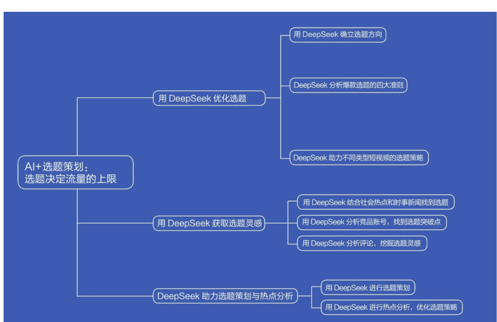

## 第3章 AI＋脚本策划：开拍前看见你的镜头画面
脚本策划是短视频创作的核心，它能帮助创作者明确主题与目标，避免跑偏；同时为拍摄提供清晰指引，涵盖场景安排、镜头设计、演员台词等，降低拍摄不确定性。详尽脚本可实现多部门高效协作，节省时间与成本。

不同类型短视频在脚本策划上的侧重点不同。本章将介绍剧情类、测评类、科普类、Vlog 类四类短视频脚本创作流程，以及利用 DeepSeek 优化脚本的三大黄金方法。

### 3.1 用 DeepSeek 生成各类型爆款脚本
剧情类短视频重故事性与情感共鸣；测评类侧重真实产品体验与实用参考；科普类强调知识通俗化传播；Vlog 类以生活记录体现创作者个性。基于不同类型特点，可借助 DeepSeek 生成相应脚本。

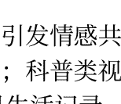

扫码看视频

#### 3.1.1 剧情类短视频脚本
剧情类短视频篇幅精炼，需在短时间内完整传递故事并引发情感共鸣，同时设置创意反转，通过场景化叙事增强戏剧性并激发讨论。借助 DeepSeek 撰写剧情类脚本的步骤如下。

##### 1. 找准账号定位
剧情类题材形式多样，题材涵盖情感、悬疑、甜宠等，形式可为第一、第二、第三人称叙事。向 DeepSeek 说明账号具体定位，有助于其快速理解创作需求，示例如下。

你是一名剧情类短视频创作者，聚焦情感叙事，粉丝约2万，风格偏向情感叙事与生活化表达。请提炼能引发深度共情的爆款作品共性特征，要求涵盖情感锚点设置技巧、叙事节奏把控、视听语言情绪渲染手法、观众互动心理契合度以及正能量价值观隐性植入策略。

情感叙事类短视频爆款作品的共性特征及创作策略。

###### 一、情感锚点设置技巧：触发记忆与共鸣的“钩子”
1. 生活化细节切入。以具体场景，如外卖单留言、深夜奶茶订单作为触发点，将宏大主题转译为可感知的个体故事。例如，通过“被疫情困住的外卖员主动做志愿者”的戏剧转折，将平凡事件升华为人性光辉的缩影。
2. 符号化心锚设计。重复使用特定视觉符号，如旧物件、固定手势，或听觉符号，如标志性背景音，通过重复剪辑与场景关联强化情绪记忆。例如，用“21千克台账”的物理重量隐喻工作负担，将抽象概念具象化。
3. 反差与意外制造。柔弱者展现坚韧，如瘦弱女孩搬运重物；日常行为中暗藏反转，如外卖员被困后成为义工，利用身份与行为反差打破预期，形成心理落差。

……
###### 五、正能量价值观的隐性植入策略：润物细无声的引导
1. 日常场景解构宏大叙事。通过“不准出去丸”等趣味化政务通知、社区台账称重等生活细节，将政策语言转化为通俗表达。
2. 传统文化当代转译。借历史人物故事，如苏东坡、嵇康映射现代困境，用大白话拆解古文智慧，实现古今情感共通。
3. 非说教式榜样塑造。以“普通人高光时刻”，如疫情志愿者、孝老爱亲日常替代英雄叙事，通过长尾细节，如磨破的鞋底、反复使用的饭盒传递坚韧品质。

DeepSeek 给出的爆款特征与策略总结结构清晰，覆盖创作全链路，策略具备实操性，案例具象，整体符合剧情类短视频情感共鸣核心逻辑。

##### 2. 提供参考案例，总结脚本特点
在明确账号定位后，DeepSeek 可归纳爆款视频特性与策略，但缺乏主题方向或案例脚本时难以给出具体建议。此时需提供具体案例脚本供其学习并总结特征，示例如下。

你是一名剧情类短视频创作者，专注情感叙事，粉丝稳定在2万左右，风格偏向情感叙事与生活化表达。我会给你一个脚本内容，请你学习并总结这个脚本的特点。以下是脚本内容。

###### 《雨中的信》
时长：1分30秒
风格：抒情、治愈
叙事视角：第一人称
画面：（黑白画面）雨滴打在窗户上，模糊了窗外的景色。
台词：（内心独白）“又是一个雨天，我记得你最喜欢下雨天。”
……

这个情感叙事类短视频脚本《雨中的信》具有以下值得学习的创作特点。

####### 1. 视觉意象系统
- 通过黑白与彩色的色彩切换构建双重时空，黑白现实与彩色回忆形成强烈情感对比。
- 雨水作为贯穿性意象，窗上雨痕、雨中奔跑、雨后彩虹，既承担转场功能又隐喻情感状态。
- 重要道具“信”的细节刻画，泛黄纸张、泪痕模糊字迹，增强生活真实感。

####### 2. 叙事结构设计
- 采用经典三段式情感递进：追忆美好→直面现实伤痛→自我治愈。
- 现实与回忆交替剪辑形成情感节奏，两次“现实—回忆—现实”循环。
- 首尾呼应的雨天场景构成叙事闭环，开篇阴雨、结尾放晴。

####### 3. 台词创作技法
- 内心独白保持克制留白，以意象化表达替代直白抒情，如“雨声像针扎心”。
- 关键记忆点金句设置，如“看遍世界的雨”→“勇敢前行”形成情感锚点。
- 书信文字与独白形成互文叙事，拓展故事想象空间。

####### 4. 情感唤醒机制
- 感官通感运用，雨声→钢琴曲→针扎的痛感。
- 微观特写镜头聚焦，泪滴落在信纸、手指折信动作。
- 音乐情绪曲线与剧情高度同步，钢琴曲渐起→高潮→淡出。

####### 5. 主题升华技巧
- 将个人情感叙事升华为普世成长主题，自我救赎与希望。
- 通过自然意象转换完成情绪转折，暴雨→彩虹→阳光。
- 字幕与画面形成互文关系，避免说教感。

DeepSeek 对案例脚本的结构、台词、情感进行了多方面客观评价与总结。

##### 3. 提出撰写要求，生成脚本
当 DeepSeek 掌握所需脚本特点后，可按上述要点撰写脚本，示例如下。

你是一名剧情类短视频创作者，主攻情感叙事视频，账号粉丝稳定在2万左右，风格偏向情感叙事与生活化表达。请你按照前面总结的脚本特点，围绕“学生时代的遗憾”主题，创作一个剧情类短视频脚本。要求：
1. 视频时长1～2分钟；
2. 紧密贴合账号定位；
3. 剧情要引发观众共鸣，增强代入感。

###### 《未寄出的夏末》
时长：1分45秒
风格：青春怀旧/遗憾美学
叙事视角：第一人称
画面：（冷色调）成年女主打开老式铁皮铅笔盒，抖落出泛黄信封，封口处还贴着学生时代流行的星星贴纸。
台词：（轻声）“2009年6月11日，这封信在书包里磨出了毛边。”
……
结合案例特点与视频主题后，DeepSeek 给出的脚本校园元素精准，时间对比巧妙，双面字迹制造惊喜，结尾纸飞机升华主题，留白引发共鸣，完美契合“学生时代的遗憾”主题。

#### 3.1.2 测评类短视频脚本
测评类短视频以产品体验为核心，真实展示使用感受，呈现产品优缺点，帮助观众全面了解产品并提供决策参考。借助 DeepSeek 撰写测评类脚本可遵循以下步骤。

##### 1. 找准账号定位
测评类短视频更注重产品本身，侧重使用体验，聚焦测试与客观评价，而非单纯推销。测评产品类型多样，如美妆、美食、数码、日用品等，目标群体也有差异，因此创作前需向 DeepSeek 说明账号定位，让其总结该类账号爆款脚本结构特点，示例如下。

你是一名女性美妆领域测评类短视频博主，目标受众为18到30岁年轻女性，视频以轻松活泼语调呈现，常融入年轻化元素，并设计问答挑战、产品盲测等互动环节以提升参与感。请总结这类短视频爆款内容的关键特征，要求：
1. 结合目标受众对美妆产品的核心关注点与短视频平台传播特性；
2. 涵盖脚本结构特点。

以下是符合要求的可直接复用的美妆类短视频爆款内容关键特征总结。

###### 一、选题策略
1. 精准匹配用户核心诉求：聚焦“抗初老/持妆/性价比”三大流量密码，结合季节/节日热点打造“开学元气妆”“情人节斩男妆”等场景化选题，通过“油皮救星”“黄黑皮逆袭”等痛点关键词唤醒用户需求。
2. 内容垂直再细分：针对“敏感肌/学生党/通勤族”等标签群体定制“平价替代”“三分钟通勤妆”等专属内容，善用“产品测评+教程+好物分享”内容组合拳。

###### 二、脚本结构黄金公式
####### 1. 0～3秒：视觉冲击篇
1. 特写产品质地流动/妆容前后对比冲击画面。
2. 抛出“90%的女生都不知道的遮瑕误区”等悬念话术。

####### 2. 3～15秒：痛点直击+方案推荐
1. 模拟用户场景：“戴口罩脱妆导致亲妈不认？”
2. 展示产品核心成分，如“含××%玻尿酸”。

####### 3. 15～30秒：沉浸式验证

美妆短视频爆款拆解与 AI 协作实战手记

1. 真人实拍验证：以全天带妆打卡形式呈现妆效维持情况。
2. 操作细节放大：以微距镜头呈现粉底刷呈四十五度角晕染的施妆手法。

####### 4. 30～45秒：情感共鸣与转化引导
1. 引入“校园群体大量种草”之类的信任背书表达。
2. 设计评论区抽取同款的轻互动机制。

###### 三、内容呈现技巧
1. 视觉表达：选用 1:1 分屏对比、动态贴纸标注成分，并叠加刷具摩擦声增强沉浸感。
2. 人格化塑造：穿插翻车现场等真实片段增强陪伴感，通过敲击粉饼盒等固定开场动作建立记忆点。
3. 平台适配：开篇三秒呈现口红试色骤变画面以提升完播，文案遵循先给结论后展开的倒金字塔逻辑。

该模型对爆款脚本的开场、中段、收尾及整体风格细节进行拆解后，归纳出各环节的功能定位与呈现方法。

##### 2. 明确单品后归纳产品特质
在账号定位明确后继续追问，可让模型提炼脚本共性。若未说明具体品类，则难以给出针对性建议。下一步需提供产品方向。示范如下。作为一名聚焦女性美妆测评的短视频创作者，面向18至30岁女性分享彩妆真实体验。请围绕唇妆产品提炼核心卖点与主要槽点。要求：1.结合社交媒体真实使用反馈；2.涵盖显色、滋润、持妆等维度；3.避免参数罗列。

###### 一、唇妆核心优势与用户真实反馈
####### 1. 显色出众，自带氛围感
- 多个热销色号被称赞薄涂柔和厚涂有气场，其中蓝调正红与烂番茄系尤其被认为对黄皮友好，上唇即显高级。
- 强调温感变色的植物系唇膏主打个体差异化上色，体温影响呈现方式，素颜使用也能提亮气色。

####### 2. 滋润表现成为加分项，干唇用户好评
- 含维 E、玫瑰精粹的精华型唇膏被形容为“双唇被滋养”，秋冬不易卡纹，部分反馈保湿度超过润唇产品。
- 晶冻质地如某品牌 507 号因水润通透被封为早起神器，部分用户直接当作日常润唇使用。

###### 二、唇妆主要槽点：避坑清单
####### 1. 拔干起皮：美妆雷区提示
部分哑光质地如某美系品牌被吐槽像砂纸摩擦嘴唇，唇纹明显的用户表示使用后显老，北方地区用户称出门一小时即显死皮。

####### 2. 色素残留：卸除困难
低价网红韩系唇釉因色素沉积被嘲唇周发黑，有用户反馈连续使用三天唇色发灰。

##### 3. 提出撰写要求，生成脚本
当模型已掌握脚本结构与产品特征后，可给出明确单品指令，要求其按总结要点创作。示范如下。担任女性美妆测评类短视频博主，受众为18至30岁年轻女性，请围绕“夏季适用唇妆”创作约三分钟脚本。要求：1结合前述脚本结构与唇妆特性；2符合账号定位；3时长约三分钟；4客观真实，重在体验感。

开场画面博主戴草编遮阳帽手持冰镇西瓜入镜背景伴随海浪与蝉鸣

“哈喽姐妹们夏日能量补给站上线啦～”屏幕弹出夏日限定动态贴纸
“最近私信都被问爆：夏天涂唇妆总粘头发吸管还容易花怎么办？今天用三支全网热销的夏日唇妆做硬核实测！”打响指镜头切换至摆满唇妆的工作台

###### 一、镜头推至第一支唇妆特写
“先看这支被韩剧女主带火的镜面唇釉色号是蜜桃乌龙奶茶。”

挤压管身展示水润质地
“上嘴像涂果汁成膜后基本蹭不掉！”快剪博主涂色吸冰饮纸巾按压对比
“看！吸管几乎不留痕戴口罩也不尴尬。提醒一下唇色深的宝宝先打底否则显色不均。”皱眉摇头加哭脸包

###### 二、插入素人试用片段
素人闺蜜对镜头说：“我涂镜面唇釉总像猪油嘴……” 
“试试夹心涂抹法！”加速演示：润唇膏打底→点涂唇釉→纸巾抿掉浮色
“现在是不是清透自然？黄皮闭眼入2号色素颜都嫩到掐出水！”素人点头点赞

模型给出的唇妆测评脚本控制在三分钟内采用“痛点引入—产品 PK—悬念测试—福利引导”四幕结构契合短视频黄金五秒法则。

#### 3.1.3 科普类短视频脚本
科普短视频以知识传递为核心需把复杂内容通俗化。借助模型创作科普脚本的步骤如下。

##### 1. 找准账号定位
科普领域众多创作前需向模型说明账号方向和风格。示例：作为一位做儿童历史文化启蒙的科普创作者擅长卡通角色扮演和趣味实验单条约1分钟受众为学龄前到小学低段儿童。请总结爆款作品共性。要求：1基于儿童认知规律结合《如果故宫会说话》《甲骨文游乐园》等标杆；2涵盖15秒注意力锚点；3涵盖知识点与生活场景连接；4涵盖家长转发动机。

模型提炼出爆款公式。

###### 一、15秒注意力锚点设计
- (1) 开篇用“萌化文物+魔性音效”组合如青铜面具眨眼特效配气泡音“猜猜我藏了多少秘密呀”。
- (2) 设置悬念钩子。“如果书包会说话”用橡皮擦拟人开场。
- (3) 动态知识切片。青铜纹饰拆成“会跳舞的小怪兽”配节奏音乐。

###### 二、认知适配的知识魔法连接
- (1) 文物功能生活化类比。用乐高车轮演绎甲骨文“车”字衔接到共享单车。
- (2) 历史场景情境迁移。故宫屋脊兽变“房顶护卫队”对照小区保安日常。
- (3) 传统技艺参与式还原。用橡皮泥复刻活字印刷引导孩子盖手印做姓氏卡。

###### 三、家长主动转发驱动力
- (1) 植入育儿价值提示。青铜鼎讲解结尾给“专注力小贴士”。
- (2) 设计亲子互动彩蛋。甲骨文动画片尾设亲子肢体猜字游戏。
- (3) 打造教育成就展示。文物修复类比玩具手术引导家长拍修复前后对比。

###### 四、认知心理学适配策略
- (1) 多模态刺激。20秒切换讲解形式维持多巴胺节奏。
- (2) 具象化记忆。将丝绸之路转成骆驼快递员闯关游戏。
- (3) 即时反馈。弹幕问答配对错表情特效。

###### 五、标杆案例升级要素
- (1) 《如果故宫会说话》可增“文物悄悄话”环节。
- (2) 《甲骨文游乐园》可设“汉字积木”挑战。

##### 2. 提供参考案例总结脚本特点
账号定位清晰后可提供参考脚本让模型学习并归纳特征。示范...

《神奇甲骨文：龟甲上的画画大赛》...

模型总结出该脚本的五大核心点：高概念低门槛选题、卡通 IP 加趣味实验结构、极致视听与互动、精准知识转化、成熟运营思维。

##### 3. 提出撰写要求生成脚本
在明确定位风格和脚本特征后可下达主题创作指令...

《秦始皇的超级秘密！》...

模型新脚本融合萌化叙事与生活化类比社交货币设计触发家长传播。

#### 3.1.4 Vlog类短视频脚本
Vlog以记录真实生活为主强调互动与多场景拍摄。创作步骤如下。

##### 1. 找准账号定位
示例：作为一名做大学生学习生活与平价美食探店的 Vlog 博主风格轻松活泼受众18至25岁大学生内容聚焦时间管理校园趣事高性价比探店。请总结爆款共性涵盖人设与情绪价值结合互动机制碎片化节奏把控。

###### 一、真实人设与情绪价值结合方式
####### 1. 标签化身份锚点
打造“00后考研特种兵”“省钱课代表”“食堂扫雷员”等人设通过宿舍书桌排队打饭等场景强化记忆结合备考焦虑选择困难等共鸣情绪。

####### 2. 第一视角沉浸代入
手持拍摄打饭抖动画面配吐槽用延时记录自习时长口语化文案增强可信度。

####### 3. 反差感情绪传递
深夜赶论文切入泡面开箱学习严肃结尾放室友搞怪表情通过反转传递积极不完美态度。

###### 二、互动机制设计
####### 1. 场景化任务触发
片尾放“明日学习目标投票”探店后评论区猜价格并置顶公布。

####### 2. 养成系参与激励
创建“30天食堂不重样挑战”每期展示粉丝推荐菜品并@贡献者点赞最高评论决定下期探店地。

####### 3. 梗文化双向共创
把“早八困成狗”“期末破防周”等黑话做成表情包贴纸收集粉丝学习姿势投稿做合集。

###### 三、碎片化节奏把控技巧
####### 1. 3秒定帧法则
开场用菜品特写加价格字幕或闹钟响课本飞入镜等动态贴纸快速锚定预期每15秒插入信息爆点。

####### 2. 模块化叙事结构

节奏把控与信息叠加方法

采用“焦虑开场、沉浸纪实、清单打卡、松弛共情”四段式结构，每段控制在二十秒以内。转场选用半秒黑场叠加翻书音效或食堂铃声，为整体带来呼吸感。

####### 3. 画面信息叠加思路
同一画面承载多重信息：主画面呈现背书特写，上方以跑马灯形式滚动时间管理要点，下方挂载倒计时进度条。美食探店类片段可采用镜头连击：先一秒全景环境，半秒价格牌特写，两秒拉丝慢动作收尾，一秒主观视角表情捕捉。

基于账号画像与爆款案例的归纳，模型提炼的传播逻辑为：真实人设易引发共鸣、互动设计提升参与度、快节奏剪辑维持完播、差异化避免同质化。具备上述特质的短视频更易获得传播与爆款。

##### 2. 向模型申请补充要素
承接前文提问，先提供大致定位，模型即可归纳出爆款分镜的共通特征。但生活记录类内容个性较强，拍摄中存在不少不可控因素，创作者很难完全照搬模型输出。所以更稳妥的路径是先锁定主题，再让模型列出需要补充的素材清单，而非直接喂案例让其总结再创作，这样可保留生活化、个性化与真实感。

你现在运营一个聚焦大学生校园日常与平价美食探店的Vlog账号，整体调性轻松活泼，主要受众在18到25岁的学生群体。计划做一期“一天学习结束后会做什么”的记录，需要先搭建拍摄框架。框架要求：
- 1. 保持生活化、个性化与真实感；
- 2. 包含可触发代入感的行为设计；
- 3. 采用年轻化的视听表达。请问需要补充哪些信息？

以下是“下课后的去向”分镜策划所需的素材清单。

###### 一、时间线与场景模块

- (1) 精确到分钟的时间节点：例如18:00下课去食堂排队、19:30图书馆归还书包、21:00操场夜跑，需写清每段的典型动作，比如“边吃包子边刷校园卡”。
- (2) 核心场景清单：宿舍瘫倒、食堂抢餐、社团活动室闲聊、操场漫步等真实校园场景，需补充细节，比如“宿舍桌面堆满未拆快递与半包辣条”。
- (3) 意外触发点：偶遇同学约夜宵、临时被拉去打游戏等突发情节，需写出互动对话，比如“舍友忽然掀开床帘喊‘烧烤第二份半价，快来！’”。

###### 二、代入感行为设计模块

####### 1. 观众互动触发机制

- 提供3~5条可让观众同步操作的指令，比如“拍下今晚桌面的零食搭配发弹幕”、“猜我书包里最先拿出的物品”。
- 设计1个可复制的学生行为符号，比如“单手解帆布鞋带同时刷手机”的特写。

####### 2. 情绪共鸣锚点

- 明确3个压力释放细节，比如“把高数作业甩向床铺的慢镜头配纸张飘落声”。
- 提供2个校园专属暗语，比如“比画奶茶‘吨吨吨’手势表示续命成功”。

###### 三、年轻化视听语言模块

####### 1. 背景音乐分段需求

需指定不同场景的配乐风格，比如食堂嘈杂环境用蒸汽波混剪、夜跑用电子卡点音乐。

####### 2. 镜头语言设计

- 确认3个标志性运镜，比如“从书堆俯拍切换到仰拍天花板哀嚎”。
- 提供2个特效需求，比如“单词本甩出画面时加入‘咻’的漫画音效”。

####### 3. 快剪节奏模板

需标注加速片段，比如2倍速展示收拾书包；慢动作重点，比如0.5倍速奶茶吸管插入瞬间。

###### 四、真实生活素材模块

###### 五、转化引导模块

(1) 结尾互动话术：需确定号召行动的指令，比如“评论区第88楼送同款寝室懒人支架”。
(2) 下期预告梗：需设计1个校园悬念，比如“下期揭秘如何在查寝前5分钟把卫生打到90分+”。

模型给出的五大模块补充清单，有助于条理化、全面化地整理素材。

##### 3. 补充要素，生成分镜

紧接上文，现在可依据模型要求补充信息，补充时结合过往视频风格与账号定位，避免脱离调性；无法具体描述的项可暂跳过，下面是示例。

你是一名专注在校生学习生活与平价美食探店的记录博主，风格轻松活泼，受众18~25岁在校生。请为“结束一天学习后会做什么”撰写Vlog分镜。相关信息如下。

1. 核心主题：分享一天学习后的放松方式。
2. 个人习惯与风格：学完先吃饭，饭后通常散步，视频需体现真实、活泼、接地气的气质。
3. 关键场景：吃饭、操场散步、朋友聊天、回宿舍追剧。
4. 时长划分：吃饭1分钟、散步1分钟、聊天1分钟、追剧1分钟。
5. 配乐与镜头：偏舒缓叙事风格、轻快配乐、画面清新。

以下是按4分钟设计的分镜方案。

标题：“‘早八人’续命手册：当代大学生下课后都在做什么？”

封面设计：九宫格拼接学习资料、食堂餐盘、操场跑道、宿舍零食，荧光笔标注副标题“图书馆→食堂→操场→被窝全记录”。

###### 片头暴击 (00:00—00:15)

- 镜头：书本合上特写，纸张摩擦声放大+手机锁屏显示18:00。
- 画外音：“下课铃响，当代大学生会触发哪些隐藏行为？”背景音效校园广播《回家》钢琴前奏。
- 0.5秒黑屏后弹出标题，搭配《阳光宅男》前奏卡点。

###### “干饭人”实录 (00:16—01:15)

(1) 场景：食堂档口排队。
(2) 镜头语言。
- 2倍速拍摄挤食堂脚步，帆布鞋踩水坑特写。
- 俯拍餐盘：12元两荤一素，筷子敲击铁盘，“这肉量够我再背50个单词”。
- 怼脸拍吃播：“阿姨今天手稳的秘密——我贡献了本学期第108个乖巧微笑”。
(3) 互动设计。
- 弹幕框叠加：“猜猜我书包里第一个掏出来的是什么？A——充电宝，B——校园卡，C——没吃完的早餐。”（下个镜头切到掏校园卡特写）

###### 操场散步（01:16—02:15）

(1) 场景：操场跑道/樱花道。
(2) 镜头语言。
- 手持镜头边走边拍：“带你们解锁教超冰柜隐藏款——3元绿豆沙能承包整个夏天的快乐”。
- 0.5倍速拍踢石子动作，石子入水波纹特效。
- 仰拍路灯与飞鸟：“这个时间操场都是熟人——夜跑社牛、背单词卷王，还有像我这样的散步哲学家”。
(3) 背景音乐：《夏天的风》轻音乐版，口哨声混入。
(4) 细节彩蛋：路过羽毛球场地时突然入镜的球，配合“咻”漫画音效闪避。

###### 闺蜜茶话会（02:16—03:15）

(1) 场景：宿舍楼下长椅。
(2) 原生对话。
- “体测800米是我这辈子最大的坎！”（狂吸奶茶动作）
- “救命！我好像把校园卡忘在二教了……” （翻包时辣条掉落的慢镜头）
- 突发彩蛋：路过同学扔来橘子，“请你吃狗粮——刚在小树林捡的”。（镜头晃动跟拍笑闹场景）
(3) 运镜技巧。
- 环绕运镜展示奶茶/零食/帆布包。
- 用剪映“九宫格”构图突出人物表情。

###### 宿舍躺平（03:16—04:00）

(1) 场景：宿舍书桌+床铺。
(2) 行为设计。
- 甩飞运动鞋特写，0.5倍速+“咻”音效。
- 翻出皱巴巴的《传播学教程》当手机支架：“知识就是力量——字面意义”。
- 零食袋撕开声放大，配合满屏弹幕：“此刻需要@全体室友投喂”。
(3) 结尾悬念。
- 镜头扫过桌角四级真题：“下期揭秘如何在查寝前5分钟把宿舍变成样板房”。（《卡农》钢琴版渐弱）
- 黑屏文字：“评论区第88楼送同款追剧神器——会发光的手机支架！”

可以看出，模型输出的分镜结构清晰、模块化切换流畅、时间卡点精准；生活化细节与悬念钩子穿插，符合短视频强节奏特性，真实感与网感平衡得当。

### 3.2 优化分镜的三大黄金方法

3.1节已演示如何借助模型生成四类短视频分镜，若成稿未达预期，可用三大优化法则进一步打磨：分镜结构自检法、关键词锚定法、对比迭代法。

扫码看视频

#### 3.2.1 分镜结构自检法

借助模型自检分镜结构，可按以下流程操作。

以第3.1.4节生成的Vlog分镜为例，请模型进行优化。

##### 1. 询问优秀分镜结构的标准

成稿后可要求模型统计同类高表现短视频分镜优点并提炼设计标准，便于后续优化。示例提问：

你是一名以在校生日常学习与平价美食探店为核心的Vlog创作者，受众18~25岁。请系统梳理此类Vlog分镜结构共性优势，并提炼适配校园生活记录与城市美食探索双主题的设计标准。需涵盖开场吸引力、叙事节奏、场景衔接、互动策略等维度。

###### 一、开场吸引力构建标准

黄金3秒法则如下。

- 采用疑问/反差开场：快速闪现食堂排队、课堂笔记、美食特写，文案“当‘早八人’书包里藏着麻辣烫，会碰撞出什么火花？”
- 高光前置：用视频高潮片段如食堂阿姨颠勺、图书馆熄灯作前3秒画面，字幕悬念“原来这才是大学城的隐藏菜单…”
- 身份共鸣：手持学生证/校园卡入镜，台词“今天带你们解锁大学生特种兵的24小时——从课堂到苍蝇馆子，全程高能”。

###### 二、叙事节奏把控标准

####### 1. 双线并行结构
- 学习线：早课准备→课堂片段→自习室场景→社团活动，时长占比40%。
- 美食线：食堂探秘→课后小吃摊→平价网红店→宿舍自制夜宵，时长占比60%。
- 节奏公式：前15秒快剪0.5秒/镜头+中间2分钟舒缓叙事2~3秒/镜头+结尾20秒加速1秒/镜头。

####### 2. 情绪峰值设计
每2分钟设置一个“小爆点”，如教授金句、食堂暗黑料理试吃、偶遇校园萌宠，增强记忆点。

###### 三、场景衔接逻辑标准

####### 1. 转场技巧
- 遮挡物过渡：用课本/笔记本电脑遮挡镜头后切入图书馆场景，或用美食热气模糊画面切换至小吃摊。
- 动作连贯性：拍合上笔记本的动作衔接打开外卖盒的动作，笔尖书写特写转场至菜单勾选。
- 空镜承接：拍摄校园落日衔接“下课觅食倒计时”，菜市场人流空镜引出探店路线。

####### 2. 时空关联逻辑
- 时间线：早八课程→午间食堂→下午自习→傍晚探店→宿舍夜聊。
- 空间线：宿舍→教学楼→校内美食街→校外500米商圈→跨校区打卡。

###### 四、互动设计策略标准

####### 1. 沉浸式参与
- 抛出选择题：“三食堂的烤冷面vs北门大叔的煎饼果子，你站哪队？评论区蹲结果！”
- 设置任务挑战：“挑战100元吃遍大学城，点赞过千直播翻车现场！”

####### 2. 情感共鸣触发
- 学习场景中插入“考试周破防瞬间”花絮，美食环节提问“你们学校有没有这道黑暗料理”？
- 结尾固定话术：“今日校园生存进度条加载完毕！下期想看揭秘食堂阿姨手不抖的秘诀，还是自习室卷王作息？弹幕决定！”

###### 五、增值内容模块

####### 1. 信息干货穿插
- 学习线插入“课堂笔记排版技巧”“图书馆选座攻略”，美食线标注“人均15元”“隐藏吃法”。

####### 2. 文化价值延伸
- 探店时讲述小吃摊主的故事，自习场景关联校园历史建筑，强化“青春记忆载体”属性。

模型按五维度归纳优秀分镜标准，条理清晰。

##### 2. 对照标准检测分镜问题

紧跟前面的提问，了解优秀分镜的结构标准后，就可以将需要修改的分镜发送给模型，要求它对比标准，检测分镜是否存在逻辑漏洞、前后矛盾等问题，下面是相关示例。

你是一名优秀的Vlog类短视频博主，接下来我会发送一个分镜给你，请你按照上面总结的优秀分镜结构标准，检测该分镜存在哪些不符逻辑、前后矛盾的问题，指出问题即可，无须提出修改建议。以下是分镜内容（即第3.1.4节中最终生成的Vlog分镜，此处省略）。

根据你提供的Vlog分镜与优秀分镜结构标准对比，存在以下不符逻辑和前后矛盾的问题。

###### 一、开场吸引力构建问题

高光前置缺失：片头暴击部分未截取视频高潮画面（如食堂阿姨颠勺、操场夜跑高燃片段），仅用书本合上特写和手机锁屏构建悬念，冲击力不足。

###### 二、叙事节奏把控问题

####### 1. 双线并行结构失衡
全片聚焦课后生活（美食线占比90%），学习线仅通过《传播学教程》和四级真题零星提及，未体现“课堂→自习室”等核心学习场景，与标准要求的双线40%学习占比不符。

####### 2. 情绪峰值密度不足
1分钟干饭人实录仅用“猜校园卡”互动支撑，缺乏“教授金句”“暗黑料理试吃”等爆点设计；闺蜜茶话会的对话内容平淡（体测吐槽、丢校园卡），未触发观众的强共鸣记忆点。

###### 三、场景衔接逻辑问题

####### 1. 转场技巧单一
食堂→操场、操场→宿舍楼场景切换依赖黑屏和背景音乐过渡，未使用遮挡物（如餐盘遮挡镜头转场）或动作连贯性（如筷子敲击铁盘接踢石子动作）等设计。

####### 2. 时空关联断裂
宿舍躺平环节突然插入四级真题查寝悬念，与当前“课后放松”主题割裂；教超冰柜隐藏款美食与食堂干饭场景未形成探店动线闭环。

###### 四、互动设计策略问题

####### 1. 沉浸式参与断层
弹幕互动仅集中在干饭人环节，操场散步、闺蜜茶话会等场景缺乏选择题或任务挑战（如“猜绿豆沙销量”“投票最离谱宿舍物品”），互动频率不连贯。

####### 2. 情感共鸣薄弱
食堂阿姨手抖秘密用“乖巧微笑”轻描淡写，未深挖大学生与食堂阿姨的日常互动故事；宿舍躺平环节“知识就是力量”台词缺乏“考试周破防”等真实情绪触点。

###### 五、增值内容模块问题

####### 1. 信息干货缺失
食堂12元套餐未标注“人均消费”“隐藏吃法”；教超绿豆沙未说明具体店铺位置和季节限定属性，削弱了其实用价值。

####### 2. 文化价值悬浮
操场路灯飞鸟空镜未关联校园历史建筑，闺蜜茶话会辣条掉落细节未延伸大学生社交文化观察，导致内容深度不足。

模型对照优秀分镜结构标准，针对性地指出了该分镜在5个维度上存在的问题。我们可以发现，它十分注重细节上的问题。

##### 3. 对照标准修改分镜

紧跟前面的提问，现在可以向模型发出指令，要求它根据前面的标准和问题，对该分镜进行优化，下面是相关示例。

你是一名以大学生日常学习生活与平价美食探店为核心内容方向的Vlog类短视频创作者，受众主要为18～25岁的年轻群体。现在请你结合账号定位以及前面总结的优秀短视频的脚本结构标准，对这个分镜进行修改，将修改后的分镜发给我。要求：主要针对开场吸引力不足、叙事节奏把控、转场技巧单一、情感共鸣薄弱的问题进行修改。

以下是根据账号定位及优秀分镜标准修改后的Vlog分镜，重点优化了开场吸引力、叙事节奏把控、转场技巧与情感共鸣模块。

标题：“‘早八人’生存图鉴：从图书馆到苍蝇馆子的24小时高能循环。”

封面设计：动态分屏呈现食堂餐盘（左）与课堂笔记（右），荧光箭头贯穿画面标注路径“教室→天台→食堂→夜市”。

###### 一、片头暴击（00:00—00:12）

####### 1. 镜头
- 0.5秒黑屏后闪现3段高燃片段：食堂阿姨颠勺（酱汁飞溅慢镜头）→自习室翻书特写（纸张声+倒计时音效）→夜市烧烤摊火焰升腾。
- 叠加震动字幕：“当早八人书包里装着考研真题和辣条，会发生什么？”

####### 2. 音效
- 《Pacific Sun》前奏卡点+校园广播碎片化混音。
- 结尾0.3秒黑屏后弹出动态标题。

###### 二、学习线 (00:13—01:15)
场景：阶梯教室→图书馆→天台。

####### 1. 镜头语言
- 推镜头拍黑板板书：“传播学议程设置理论。”（粉笔字抖动特效）
- 遮挡转场：课本合上后露出图书馆书架（镜头从书缝推进）。
- 手持跟拍天台背书：“用三个知识点换一份烤冷面值不值？”（风吹头发特写）

####### 2. 互动设计
- 弹幕投票：“早八必备三件套你带齐了吗？A——咖啡，B——充电宝，C——小毛毯。”
- 知识点彩蛋：笔记特写标注“食堂阿姨手抖治愈术→下期揭秘”。

###### 三、美食线 (01:16—02:35)
场景：食堂→校门口煎饼摊→夜市烧烤摊。

####### 1. 镜头语言
- 食堂段：筷子敲击铁盘声接煎饼摊面糊摊开声。（动作连贯转场）
- 煎饼摊：0.8倍速拍煎饼摊主撒葱花，“这手法比我写论文还丝滑”。（热气模糊转场）
- 夜市段：环绕运镜拍烧烤架，火焰升腾时切入自习台灯特写。（光影相似转场）

####### 2. 情感共鸣
突发彩蛋：煎饼摊主递食物时突然发问，“同学你校园卡又忘带了”？（翻包，辣条掉落慢镜）
价格标注：食堂窗口叠加“12元两荤一素+隐藏吃法：米饭淋卤汁”。

###### 四、情绪峰值（02:36—03:20）
场景：操场长椅夜聊。

####### 1. 原生对话
“体测800米时我在想——终点有没有冰镇绿豆沙？”（吸管戳破塑封特写声）
突发事件：路过同学扔橘子“请你吃狗粮——刚在小树林捡的”。（跟拍笑闹虚焦镜头）

####### 2. 运镜技巧
九宫格构图聚焦人物表情。（左脸打光模拟月光）
空镜承接：飞鸟掠过路灯→切至宿舍台灯光晕。

###### 五、宿舍收尾（03:21—04:00）
场景：宿舍书桌+床铺。

####### 1. 行为设计
运动鞋甩飞慢镜接《传播学教程》压泡面（书本标注“知识就是力量·字面意义”）。
撕零食袋声音放大，弹幕满屏：“@全体室友速递AD钙奶！”

####### 2. 悬念闭环
镜头扫过桌角“四级真题+夜市地图”，画外音：“下期挑战——用查寝倒计时5分钟清空螺蛳粉味。”
黑屏文字：“评论区第66楼送同款发光手机支架，第88楼点播下期主题！”

在上一次稿件的基础上，通过模型对开头做了重新梳理，过渡节奏也被提速，叙事策略改成以三组燃点镜头配合悬念字幕的形式推进；新增了板书讲解衔接天台背书等关键情节点，学习相关的叙事权重明显提升；文案侧也补上了菜品的具体标价以及隐藏吃法的说明。

#### 3.2.2 关键词锚定法
骨架确定之后，可以借助模型来梳理并打磨脚本关键词。关键词一方面能把结构钉住，让后续创作始终围绕主线展开，避免跑偏；另一方面有助于分发效率，让平台更精准地匹配用户兴趣。围绕关键词的优化通常分为提炼和优化两个环节。

##### 1. 提炼关键词
在让模型抽取关键词前，先要把对词的要求说清楚，比如词长2到6字、选用口语化名词、贴合视频主题等。要求明确后即可发出指令，下面是相关示范。

请扮演美妆赛道电商短视频创作者，账号以约1分钟快节奏为主，受众为18到35岁的年轻女性。请为下方脚本提炼5个关键词，

关键词要求：
1. 字数2到5字；
2. 体现所属领域；
3. 与视频内容主题相符；
4. 与近期热点挂钩；
5. 使用通俗性名词；
6. 瞄准核心受众群体。

以下是脚本内容。

###### 开头吸引注意（0:00—0:03）
画面：快速切换模特使用遮瑕膏前后的对比画面（黑眼圈、痘印、斑点消失）。
字幕：大字幕弹出，“黑眼圈、痘印、斑点，一键消失”！
配音：“还在为脸上的瑕疵烦恼？彩棠××无瑕三色遮瑕膏，一盘解决所有问题！”

###### 核心优势展示（0:04—0:10）
画面：展示遮瑕膏的三色盘，手指蘸取遮瑕膏，分别遮盖黑眼圈、痘印、斑点。
字幕：“三色双质地设计。”“奶油质地，滋润遮黑眼圈。”“生巧质地，强力遮痘印。”
配音：“三色双质地设计，奶油质地滋润遮黑眼圈，生巧质地强力遮痘印，一盘搞定所有瑕疵！”

###### 使用效果展示（0:11—0:20）
画面：模特使用遮瑕膏快速展示遮盖黑眼圈、痘印、斑点的过程，搭配前后对比图。字幕：“精准遮瑕，适合亚洲肤色。”“持妆8小时，不脱妆不暗沉。”
配音：“精准遮瑕，适合亚洲肤色，持妆8小时不脱妆，滋润不卡粉，妆感自然又服帖！”

###### 用户口碑背书（0:21—0:30）
画面：快速切换用户评价截图（如“遮瑕效果绝佳”“质地滋润不卡粉”）。
字幕：“用户真实评价，遮瑕效果绝佳！”“质地滋润不卡粉，回购率超高！”
配音：“很多用户反馈‘遮瑕效果绝佳’‘质地滋润不卡粉’，甚至用完小样立刻回购正装！”

###### 优惠活动强调（0:31—0:45）
画面：展示产品的包装、赠品（手指粉扑、双头遮瑕刷、点彩遮瑕刷），叠加“限时优惠”字样。
字幕：“活动价159元！”“赠送价值超高的遮瑕工具套装！”
配音：“现在购买仅需159元，还赠送手指粉扑、双头遮瑕刷和点彩遮瑕刷，性价比超高，赶紧抢购！”

###### 行动号召（CTA）（0:46—0:55）
画面：模特使用遮瑕膏完成精致妆容，点击链接的动画效果。
字幕：“点击下方链接，限时优惠！”“手慢无，赶紧下单！”
配音：“点击下方链接，限时优惠；手慢无，赶紧下单！”

###### 结尾互动（0:56—1:00）
画面：模特对镜头微笑，展示完美妆容。
字幕：“你最喜欢哪款色号？评论区告诉我！”“关注我，解锁更多美妆好物！”
配音：“你最喜欢哪款色号？评论区告诉我！关注我，解锁更多美妆好物！”

……

根据脚本内容和近期美妆赛道热点，结合搜索结果中的产品卖点与受众需求，提炼以下5个关键词。

###### 1. 遮瑕黑科技
（呼应产品“三重研磨粉体扒脸”“双质地设计”等科技感卖点，贴合国货美妆技术创新趋势。）

###### 2. 三文鱼色矫正
（突出彩棠核心色号对黑眼圈的针对性方案，契合“色彩矫正”热门技法，且“三文鱼色”为美妆圈高频词。）

###### 3. 妈生好皮
（呼应脚本中多次强调的“自然妆效”卖点，契合年轻女性对伪素颜妆效的追求，近期社交平台流行用语。）

###### 4. 早八持妆
（绑定打工人核心场景，强化“带妆8小时不斑驳”的实测效果，符合打工人痛点与“早八妆”热点话题。）

###### 5. 国货之光
（彩棠作为明星化妆师创立的国货品牌，在搜索结果中多次被强调“中式美学”“销量霸榜”，贴合国潮消费趋势。）

模型给出的5个关键词基本覆盖了受众痛点、融合了产品核心优势与卖点、捆绑了近期热点，贴合视频主题，但表述不够精炼、情绪化不足，还需继续打磨。

##### 2. 优化关键词
紧随上一步的提问，可以先让模型总结同类高表现短视频关键词的特点，再要求其基于产品核心卖点和总结出的特点对上述5个词进行优化，使之更贴合内容，下面是相关示范。

请扮演美妆赛道电商类短视频创作者，账号内容以1分钟左右快节奏为主，核心受众是18到35岁的年轻女性。请你简要总结同类型高表现短视频提炼出的关键词的特点，并对上面提炼出的5个关键词进行优化。关键词要求：
1. 体现优惠活动；
2. 突出产品功效；
3. 关键词不要重合；
4. 关键词要简洁明了、具有情绪价值。

结合搜索结果中同类型高表现短视频的关键词特征（痛点场景化、热点捆绑、情绪驱动、口语化表达）与本次优化要求，重新提炼关键词如下。

###### 一、同类型高表现短视频的关键词特征解析

1. 痛点场景化：优秀案例多用“泪沟/油痘”等具体问题词，而非泛泛而谈“遮瑕”。
2. 热点捆绑：高曝光视频常借势“早八妆”“成分党”等平台热点词。
3. 情绪驱动：采用“必冲”“消失”等对抗性词汇，激发观众购买欲。
4. 口语化表达：用“焊脸”“原地”等网络热词降低理解成本。
5. 优惠可视化：直接标明金额“98元”比百分比更刺激。

###### 二、优化后的关键词

1. 买1得4（强化赠品价值优势，直接呼应脚本中“买1得4血赚”的促销策略）。
2. 黑眼圈克星（突出核心功效，比“三文鱼色矫正”更通俗直观）。
3. 8小时焊脸（具象化持妆卖点，比“早八持妆”更具情绪冲击力）。
4. 妈生裸肌（在“妈生好皮”基础上升级，突出自然裸妆效果）。
5. 限时省30（激活价格敏感度，比“国货之光”更促转化）。

针对反馈的问题，模型完成了优化，优化后的关键词绑定了优惠活动、将专业术语转化为结果导向表达，符合用户搜索习惯，强化了情绪价值。

#### 3.2.3 对比迭代法
如果模型提供的视频脚本不合心意，可以通过持续反馈问题信息让其不断优化，最终得到符合预期的脚本。运用对比迭代法优化脚本有以下两个步骤。现在以3.1.1节中最终生成的脚本为例，通过迭代式提问，筛选出最适配创作者要求的脚本内容。

##### 1. 反馈问题
反馈时不仅要给出明确具体的问题，还要提供与问题相关的信息，这样模型才能精准把握需求，提供更适配的答案。若模型未理解问题，可重新组织语言再次提问，直到满意为止，下面是相关示例。

请扮演剧情类短视频创作者，主攻情感叙事类视频，账号粉丝量稳定在2万左右，作品风格偏向情感叙事与生活化表达。下面这个脚本画面切换过于频繁，请你优化该脚本，要求：简化画面切换，以1到2个画面为主。以下是脚本内容（即第3.1.1节中最终生成的脚本，此处省略）。

根据你的创作风格和优化需求，我将从情感浓度聚焦和视觉符号强化两个维度重构脚本，运用长镜头美学与关键意象叠加，减少场景跳跃感。以下是优化版。

###### 《未寄出的夏末》（优化版）
时长：1分45秒
核心画面：教室空间（承载80%的叙事）+信封特写（20%的情绪支点）

####### 画面1：泛黄的信封与流动时空（冷/暖色调交替）
镜头1（60秒）如下。
1. 起幅：铁皮铅笔盒特写（冷蓝调），手指抖落信封时带出粉笔灰，飘散在空中。
2. 运动轨迹：镜头随信封滑落轨迹缓推，背景虚化中浮现教室窗框的轮廓→穿过窗玻璃时自然过渡为暖黄滤镜（手持镜头轻微晃动模拟记忆质感）。
3. 核心调度：信封飘落过程中，玻璃反光闪现碎片化记忆（不切换镜头，通过焦点转换呈现）。
   - 钢笔晕染字迹（焦点前移/信封变透明）。
   - 撞落作业本时男生球鞋入画（右下角1/4构图，3秒后虚化）。
   - 天台影子覆墙（左下角逆光剪影，与信封折痕形成对角线呼应）。
4. 台词：（混响处理）“2009年的倒计时……是梅雨季永远晾不干的校服褶皱”（同步信封触地声）。

####### 画面2：黑板隐喻系统（单场景多情绪层）
镜头2（45秒）如下。
1. 固定机位：教室后排视角（延续初始空间），黑板从写满公式渐变为空白。
2. 光影叙事。
3. 阳光位移：窗帘波动造成光斑游移，在黑板投射动态蒙太奇。
   - 09:15光斑掠过值日生擦黑板动作（半句公式消失）。
   - 11:30铅笔字“今天你好像有话要说？”浮现（逆光透纸效应）。
   - 16:50暴雨阴影漫过爱心符号（粉笔迹遇潮变模糊）。
4. 道具参与：课桌洞内《5年高考3年模拟》书页自动翻动，露出樱花标本（配合风扇声制造“风翻阅记忆”的错觉）。
5. 台词：（哽咽）“没说完的……都成了摩斯密码般的陈年墨迹。”
6. 终镜：时空折叠仪式（突破物理逻辑）。

镜头3（30秒）如下。
1. 超现实长镜：女主将信纸折成飞机（现实动作）→飞出窗框瞬间变成90°竖屏分镜。
   - 左屏：2009年，纸飞机穿越教室吊扇（樱花标本随气流旋转）。
   - 右屏：2025年，飞机落回铅笔盒（盒内浮现男生铅笔字倒影）。
2. 音乐处理：钢琴音阶与粉笔书写声形成卡农式对位。
3. 字幕：“我们终将学会，把未寄出的信折成穿越时空的坐标。”

这个版本的脚本按要求将画面场景集中于教室，但重点画面、字幕、台词、道具等的展现不够清晰明了，我们可以紧跟前面的提问，要求模型继续优化脚本，下面是相关示例。

请扮演剧情类短视频创作者，主攻情感叙事类视频，粉丝稳定在2万左右，作品风格偏情感叙事与生活化表达。请你再次优化上面的脚本，要求：严格按画面、字幕、台词、配乐等关键要素进行区分。

基于情感叙事与生活化表达的核心诉求，我将严格拆分脚本元素进行重构，强化视觉符号的闭环系统与情感递进层次。以下是优化后的分项脚本。

###### 《未寄出的夏末》终极版（1分45秒）
核心意象：信封流动线（贯穿始终）+黑板呼吸感（时空锚点）

####### 画面1：记忆启封（0:00—0:28）
1. 特写：生锈铁皮铅笔盒（冷蓝调，10秒），盒内泛黄的信封印有钢笔洇染的蓝斑（微距镜头抖动模拟呼吸感）。
2. 运动：信封滑落轨迹（18秒慢动作），穿过玻璃窗时暖黄滤镜渗透（焦点从信封转至窗框倒影中的教室轮廓）。
3. 字幕：黑底白字（手写体）“2009年的心事，总带着钢笔墨水的潮气”。
4. 台词：混响女声（0:15切入）“后来才懂，青春是封不敢贴邮票的信”。
5. 配乐：《送别》吉他版（前奏单音循环，0:00—0:28）。

####### 画面2：时空折叠教室（0:29—1:05）
1. 固定机位：教室后排全景（暖黄调持续）。
   - 黑板倒计时从“30”渐变至“0”（光影流动制造伪时间轴）。
   - 右下角1/4画幅闪现记忆碎片（不切换镜头，通过光影投射）：
     - 0:35撞落作业本（男生球鞋入画3秒后退场）；
     - 0:48天台影子覆墙（逆光剪影与黑板反光重叠）；
     - 1:00暴雨冲刷玻璃（雨痕与黑板粉笔字交融）。
2. 字幕：透明水印（黑板右上角）“有些默契，是错位的钟摆”。
3. 台词：画外音哽咽（0:50切入）“其实信里只抄了半阙《钗头凤》……”。
4. 配乐：铅笔书写声渐强（0:30—0:45）；雨滴撞击铁皮声（1:00—1:05）。

####### 画面3：信笺超维穿越（1:06—1:30）
1. 俯拍长镜：信封被折成纸飞机（现实冷调）。
   - 飞出窗框时分裂为双时空（90°竖屏切割）。
   - 左屏：2009年，纸飞机穿越教室吊扇（樱花标本随气流旋转）。
   - 右屏：当下飞机坠入《5年高考3年模拟》书页（钢笔字与铅笔字重叠投影）。
2. 字幕：蓝底烫金字（1:15切入）“未寄出的信，都成了时光的坐标”。
3. 台词：释然轻笑（1:20）“现在说‘当年’，是不是太老了？”。
4. 配乐：钢琴音阶逆流（1:06—1:20）；磁带倒带声（1:25—1:30）。

####### 画面4：终极符号闭环（1:31—1:45）
1. 微距变焦：黑板倒计时数字“30”，数字贴纸被风掀起，露出粉笔描的极小爱心（与开场信封折痕同构）。
2. 字幕：白字浮空（1:40切入）“那些没说完的，都留给了夏末的风”。
3. 配乐：蝉鸣混入吉他扫弦（渐弱收尾）。

这样反复地和模型反馈问题信息，就能得到一个符合预期的短视频脚本了。

##### 2. 转换形式
通过反复反馈问题、提出需求，我们得到了一个场景和人物描绘细腻的脚本，为了方便后续拍摄、剪辑等环节，我们可以紧跟前面的提问，要求模型整理出脚本中的几个关键因素，包括但不限于景别、场景、镜头内容、台词、演员等，并以表格形式输出，下面是相关示例。

请扮演剧情类短视频创作者，为了便于后期拍摄、剪辑，请你整理出上面这个脚本的关键要素，要求：
1. 包括景别、场景、台词、演员等关键要素；
2. 以表格形式输出。

模型整理出来4个关键要素，这些要素类别分明，条理清晰。以表格形式展示出来后，需要准备的各项工作、拍摄注意事项等均一目了然地展示出来了。整理结果如表3-1所示。

###### 表3-1
| 镜号 | 景别 | 场景描述 | 台词内容 | 演员调度 |
| :--- | :--- | :--- | :--- | :--- |
| 1 | 特写→全景 | 冷蓝调铁皮铅笔盒特写，信封滑落时暖黄滤镜渗透窗框，玻璃反光闪现教室轮廓 | “后来才懂，青春是封不敢贴邮票的信”（混响女声） | 成年女主手部特写，学生时代女主侧影在玻璃倒影中虚化呈现 |
| 2 | 全景→中景 | 固定机位教室后排，黑板倒计时光影流动，右下角闪现球鞋/剪影/暴雨冲刷等记忆碎片 | “其实信里只抄了半阙《钗头凤》……” | 女主始终位于画面左1/3处凝视黑板，男生仅以球鞋/剪影的形式局部入画 |
| 3 | 俯拍→分屏特写 | 现实冷调纸飞机分裂为双时空：左屏为2009年纸飞机穿越吊扇，右屏当下纸飞机坠入《5年高考3年模拟》书页 | “现在说‘当年’，是不是太老了？” | 成年女主手部动作特写，学生时代女主以发丝飘动细节在左屏闪现 |
| 4 | 微距特写 | 黑板倒计时数字“30”贴纸被掀起，露出粉笔爱心符号，与开场信封折痕形成视觉闭环 | 无台词 | 女主指尖触碰黑板特写，学生时代校服衣角在画面边缘飘动 |

## 章节总结
本章节集中讨论了如何借助模型生成不同类型短视频的脚本以及优化脚本的方法，具体内容可参考下图。

## 第4章 AI+文案策划：大数据训练过的文案更戳人
只有打动人心的文案才能引发观众的情感共鸣和认同感，当观众在短视频文案中看到与自己相似的情感或经历时，更容易认同并产生代入感。因此，具有真实情感表达的短视频，能让观众更愿意关注和互动。

大数据训练过的短视频文案之所以更能引发观众情感共鸣，是因为大数据能够精准捕捉观众的情感需求、行为习惯和心理特征，从而生成更有针对性和吸引力的内容，能让创作者在短时间内和观众建立深刻的情感连接。

### 4.1 用DeepSeek重新定义文案结构
短视频文案的结构可以分为4个部分，即标题、开头、内容、结尾。本节主要谈一下如何借助DeepSeek来生成短视频文案的这4个部分。

扫码看视频

#### 4.1.1 标题：给观众一个无法拒绝的理由
标题是观众对视频的第一印象，决定了他们是否会点击视频，因此标题需要快速传递视频的核心信息并引发观众的好奇，而一个经过大数据优化的标题恰恰能提高视频被平台推荐的概率。运用DeepSeek生成一个令观众无法拒绝的标题有以下两个步骤。

##### 1. 总结平台特点
不同短视频平台观众的喜好大不相同，短视频标题的风格也有差异，只有符合平台特点的标题，才能有效吸引观众的注意力。你可以依靠DeepSeek快速了解不同短视频平台的标题风格，现在分别以抖音、小红书、B站为例，训练DeepSeek总结不同平台的短视频标题特点，下面是相关示例。

（1）抖音平台示例。
你是一名抖音测评短视频博主，拥有2万粉丝，平时主要分享美妆产品，目标受众主要是18～35岁的年轻女性。请你根据以下5条抖音爆款短视频标题，提炼这些标题的共性特征。

1. 这个遮瑕我用了好多年，只要方法到位真的太好用了！
2. 一杯奶茶的价格就能拥有的遮瑕膏！！真是“永远的神”！一盘在手！瑕疵统统消失不见！
3. 我宣布，本痘肌的本命遮瑕膏终于找到了！
4. 遮瑕膏好不好用，还得上脸实测才知道！
5. 太润的遮不住瑕疵，遮瑕力高的又太干！这个小众遮瑕膏给我满满惊喜感！

以下是5条抖音爆款美妆短视频标题的共性特征提炼。

###### 1. 情感化表达与个人体验背书
标题高频使用强烈主观评价词（如“太好用了”“永远的神”“本命”）；通过第一人称真实分享增强可信度；结合“我用了好多年”“终于找到了”等时间维度，暗示产品经过长期验证。

###### 2. 直击痛点+解决方案
精准抓取目标人群核心需求，如痘肌遮瑕需求（标题③）、滋润度与遮瑕力之间的矛盾（标题⑤）、使用方法困惑（标题①）等；通过“痛点描述+产品优势”结构引发共鸣。

###### 3. 场景化价值强调
用“一杯奶茶的价格”“上脸实测”等具象化类比，降低观众的决策成本；通过“瑕疵统统消失不见”“惊喜感”等结果导向描述营造使用场景联想。

###### 4. 网络热词制造记忆点
融入“永远的神”“本命”“小众”等Z世代流行语，强化传播力；密集使用感叹号“！”制造情绪张力，符合短视频观众快节奏的阅读习惯。

###### 5. 悬念与对比反差
通过“遮瑕膏好不好用，还得上脸实测才知道”（标题④）、“太润的遮不住瑕疵/遮瑕力高的又太干”（标题⑤）等对比句式激发观众的好奇心，引导完播。

三大短视频平台标题规律与实操方法论

模型先从几条抖音走红标题里归纳出更易获得点击的倾向。

（2）小红书社区案例
假设你运营一个粉丝约两万的小红书美妆测评号，内容聚焦彩妆，核心人群是18至35岁的年轻女性。请基于下面5条热榜短视频标题，归纳共性特征。

1. 遮瑕膏选购指南！黑眼圈、痘印、斑点全搞定，平价和贵价都有！
2. 平价遮瑕膏的天花板！20元也能遮出无瑕肌，学生党必入！
3. 遮瑕膏排行榜TOP5！从×××到×××，哪款最值得买？
4. 遮瑕膏选错色号=白花钱！教你根据肤色选对遮瑕膏，告别假面感！
5. 遮瑕膏+遮瑕刷搭配使用，效果翻倍！×××爆款神器实测！

对这5条标题的共性梳理如下。

###### 1. 痛点前置，后续给解法
标题开头就锁定核心烦恼，如黑眼圈、假面感、挑色困难等，用感叹号强化紧迫，后半段直接给出应对思路，符合痛点类表达逻辑。
###### 2. 人群标签精准锁定
借助“学生党”“肤色”等限定词，用身份标签触发年轻群体或新手的共鸣，属于身份代入策略。
###### 3. 数字背书叠加榜单感
使用“TOP5”“20元”等具体数字提升可信度，配合“天花板”“排行榜”等榜单用语，增强数据冲击力。
###### 4. 好物横评兼比价
刻意设置“平价对贵价”“×××到×××”的对照，用价格落差制造性价比预期，契合种草笔记的爆款基因。
###### 5. 组合使用借势热词
突出“遮瑕刷”“×××爆款”等工具或关联词，既体现专业度又借势流量，属于场景化进阶用法。

从人群、商品、价格等多个角度看，模型归纳出小红书走红标题如何抓住目标注意力。

（3）哔哩哔哩平台案例
假设你运营粉丝约两万的哔哩哔哩美妆测评号，受众同样为18至35岁年轻女性。请依据下面5条热榜标题提炼共性。

1. 21支爆款遮瑕红黑榜！垃圾也能行？全靠短视频！（内含黑眼圈、泪沟、痘印遮瑕大法）
2. 无广总结38款遮瑕膏的优缺点！不说废话！
3. 23款遮瑕膏无废话总结！
4. 20多款热门遮瑕一句话总结！
5. 我又来种草啦！学生党必备50元左右平价遮瑕膏推荐！

共性提炼如下。

###### 1. 用数量说话，直指使用困扰
标题均以具体测评量如“21只”“38款”搭配“红黑榜”“优缺点”等词，用数据展示测评体量，满足观众获取避坑清单的需求。
###### 2. 强调快速高效，无废话
高频出现“无广总结”“不说废话”“一句话总结”等表述，突出省时，回应信息筛选痛点。
###### 3. 场景细分，利益明确
突出细分场景如“黑眼圈、泪沟、痘印遮瑕大法”、价位如“50元左右”或人群标签如“学生党”，精准定位提升点击。
###### 4. 口语化表达拉近距离
使用“垃圾也能行？”“种草啦！”等口语表达和感叹号，营造博主真实吐槽或热情推荐的人设，增强亲切感。
###### 5. 反差冲突制造好奇
部分标题借助矛盾表述如“垃圾也能行？全靠短视频！”制造戏剧冲突，激发对结论的好奇。

归纳可见，哔哩哔哩走红标题与抖音、小红书差异明显，更强调效率、实用与承诺。

##### 2. 给出主题，撰写标题
厘清平台特性后，可让模型按传播规律创作标题。示例如下。

###### (1) 抖音平台示例
假设你是粉丝两万的抖音美妆测评博主，受众18至35岁女性。请依据前述爆款特征，围绕“眼线笔推荐”写5条标题。

围绕主题生成的5条高传播标题。
1. 手残党狂喜！本命眼线笔被我挖到了！！笔尖细过头发丝还能一整天不晕妆！！
2. 一杯奶茶钱的眼线笔测评，从早到晚火锅局都没晕妆……这性价比我按头安利！
3. 油皮亲妈眼线笔救命了！暴汗健身2小时居然纹丝不动……（附卸妆实测）
4. 细的容易断，粗的显脏眼……这支小众眼线笔居然两头都搞定！！（回购5次版）
5. 测评50支眼线笔后……这支居然扛住了喷水测试！！（手抖也能画出丝滑线条）

与前述抖音特点对比，5条均具备“痛点冲突+产品优势+视觉结果”结构，通过“回购5次/测评50支/暴汗健身2小时”等数据表达强化可信度。

###### (2) 小红书平台示例
假设你是粉丝两万的小红书美妆测评博主，受众18至35岁年轻女性。请依据前述爆款特征，围绕“眼线笔推荐”写5条标题。

为小红书用户定制的5条高互动标题并附策略解读。
1. 油皮姐妹看过来！18款眼线笔出汗测试，这三支大哭都不晕妆！
2. 眼线笔色号怎么挑？保姆级瞳色匹配公式，画出×××同款小猫眼！
3. 新手避坑指南！5支50元内超顺手眼线笔，手抖也能画流畅线条！
4. 眼线笔卷王争霸，从×××到×××，30秒告诉你哪支回购10次！
5. “早八人”必备！1支眼线笔画全眼妆教程，肿内双秒变×××眼型！

> “早八人”精准场景化+多功能亮点+明星妆容借势，符合小红书审美偏好

这些标题遵循小红书爆款逻辑，突出“测试/公式/回购”等实证关键词，结合×系妆容标签，植入“早八人/学生党/肿内双”等高频痛点词。

###### (3) 哔哩哔哩平台示例
假设你是粉丝两万的哔哩哔哩美妆测评博主，受众18至35岁年轻女性。请依据前述爆款特征，围绕“眼线笔推荐”写5条标题。

按哔哩哔哩用户偏好创作的5条标题。
- (1) 实测30支眼线笔翻车现场！9.9元逆袭专柜货？油皮学生党闭眼抄作业。
- (2) 18款眼线液笔无废话横评！15小时持妆暴击测试。（油眼皮看完少花300元冤枉钱）
- (3) 新手避雷指南！20支极细眼线笔保姆级测评。（手抖也能画出女团同款眼线的3支在这里）
- (4) 50元内眼线笔红黑榜！暴力揉眼测试后国货居然吊打某大牌？(附眼尾上扬秘技)
- (5) 全网吹爆的12款眼线胶笔翻车实录！12小时实测找到真·不晕染救星！(手残党速存)

对照前述归纳，哔哩哔哩标题在抖音基础上增加技术流测评、技能教学、长尾搜索词，通过括号补充提升信息密度，同时保持数字冲击与悬念钩子，契合对深度内容的需求。

#### 4.1.2 开头：3秒，喊停陌生人
信息过载环境下，3秒内抓住注意决定完播。借助模型写强钩子开头可按以下步骤。

##### 1. 明确视频风格
先确定主题与目标受众，明确想传达的信息与情绪。需让模型了解该类账号爆款开头的风格。

你是一名专注美妆推荐的短视频创作者，核心受众18至35岁女性，完播率稳定在35%，内容强调“快节奏种草+真实体验”，需解决开头吸引力不足导致前3秒跳出率高的问题。请简要分析同类型账号爆款开头的文案特征。

要求：分层展开，逻辑清晰，语言简洁。

美妆类爆款短视频开头特征分层分析。

###### 1. 悬念制造（黄金3秒法则）
- 痛点提问：直指高频焦虑，如“30岁还没抗老的人后来怎样了？”，用痛点+解决方案公式快速关联产品。
- 结果前置：隐藏卖点，用未完成句制造好奇，如“千万别轻易尝试这个美白精华，除非你想……”。
- 对比反差：素颜/问题肌画面开场，配合“形象大改造”“1秒换头”等视觉冲击。

###### 2. 视觉暴击（强质感+场景化）
- 产品特写：放大质地和使用效果，搭配轻快音乐和字幕强调参数如“持妆24小时实测”。
- 场景代入：绑定高频场景如“早八人通勤急救妆”，通过教程自然带出产品。

###### 3. 情感共鸣（身份认同+社交货币）
- 精准圈定：用“你是不是也……”引发共鸣如“油敏皮不敢化妆的姐妹看过来！”，强化专业人设。
- 热点借势：结合节日或流行梗如“不是大牌买不起，而是国货更有性价比”。

###### 4. 利益诱惑（低决策门槛）
- 价值锚点：突出价格优势如“价值800元课程免费送”或稀缺性。
- 效果承诺：用数据强化信任如“99%的人不知道的淡斑技巧”，配合实验对比。

模型归纳出爆款开头需满足信息密度高+情感共鸣强的公式，先用悬念钩子抓注意，再用视觉场景构建价值，最后用利益点降低决策成本。

##### 2. 输入具体指令，生成开头
明确主题与风格后，紧跟前文提问，输入具体指令和细节，可提供字数限制等要求。

你是一名专注美妆推荐的短视频创作者，受众18至35岁女性，请创作一个短视频文案开头，要求结合前面总结的爆款开头特征，以“眼线笔推荐”为主题，快速吸引注意，提供2个版本供选择。

眼线笔推荐短视频开头双版本。

###### 版本一：悬念制造+痛点直击
**1. 画面**
前0.5秒：快速切换“画眼线手抖”的画面，线条歪斜、蹭花眼影，配夸张音效。
第1到3秒：镜头特写手指捏住眼线笔，笔尖贴合睫毛根部一笔流畅，字幕：“防抖黑科技！手残党也能3秒驯服眼线！”
**2. 口播**
“手抖画眼线像蚯蚓爬？这支笔自带防抖效果！连闺蜜的‘帕金森手’都能救！”
**3. 核心爆点**
痛点+解决方案，直击手抖，用防抖黑科技制造悬念，产品特写增强可信度。

###### 版本二：情绪共鸣+反差人设
**1. 画面**
前1秒：女拳击手击打沙袋，汗珠飞溅到眼部特写。
第2到3秒：镜头推进眼部，汗液流过完整眼线，字幕：“暴汗三回合都不花的眼线？”
**2. 口播**
“运动女孩的作弊神器！0.01mm极细芯，顶着暴汗画内眼线，出汗再多也不怕变‘熊猫眼’！”
**3. 核心爆点**
抗汗验证，汗珠滚落不晕染。

两个版本各有侧重，版本一适配干货账号，版本二适配娱乐人设账号，评论区可引导互动。

##### 3. 反馈问题，优化开头内容
获取开头后可检查，根据创意反馈要求修改，确保语言流畅、逻辑合理、更具吸引力并符合节奏。

你是一名专注美妆推荐的短视频创作者，受众18至35岁女性，请进一步优化版本一的开头，要求语言通俗亲切、真实真诚不夸张，开头控制在10到15秒。

优化方案。

###### 一、画面优化
**1. 0到3秒**
真实翻车场景：女生对镜画眼线，手部轻微抖动导致线条歪斜。字幕：“画眼线总手抖？99%女生都踩过这坑！”镜头聚焦歪曲眼线，文字气泡“结块、分叉、蹭花底妆”。
**2. 4到8秒**
产品特写+对比：手部稳定持笔，笔尖贴合睫毛根部一笔成型，字幕：“0.01mm极细笔尖，手抖也能一笔成型！”穿插2秒水滴划过眼线不晕染画面。

###### 二、口播优化
“姐妹们，这支眼线笔真的救了手残的我！以前画眼线像描心电图，现在3秒就能勾出丝滑线条。重点是出汗出油都不怕晕妆，早上画好到晚上还像刚画完！”

模型对版本一语言进行了修改，更贴合视频要求。

#### 4.1.3 内容：信息价值、情绪价值、娱乐价值
文案内容可提供知识技巧、故事情感、轻松体验等价值。借助模型写好内容可参考以下步骤。

##### 1. 传递核心思想
不同类型视频核心思想不同，需先明确。

你是一名专注穿搭分享的短视频创作者，受众18至35岁女性，内容主打“实用美学+场景化种草”，现有视频存在“场景割裂”“代入感不足”问题，需重构“场景痛点—解决方案—氛围营造”链条。请撰写一段短视频文案，要求时长约2分钟，以海边旅游穿搭为主题，引导观众发现旅游与海边穿搭特点，融入实用技巧。

【开场画面：海浪轻拍沙滩，阳光洒在飘逸裙摆，镜头上移露博主侧脸】
“姐妹们，去海边还在为穿搭发愁吗？明明带了十套衣服，结果不是晒到脱妆就是拍照显胖？今天教你三招穿出海风感，让你从出门到出片都赢麻了！”

【痛点场景：烈日下女孩拉扯闷热长袖，裙子被风吹贴身】
“先划重点！海边穿搭三大雷区：防晒衣变蒸笼、长裙变紧身衣、搭配淹没在人群。别急，解决方案来了——”

解决方案1：防晒不闷汗叠穿法则
展示防晒衣+比基尼、雪纺罩衫+短裤等。“记住黄金公式：外透内紧！外层选网眼针织或雪纺罩衫，内搭修身吊带或比基尼。选带拇指扣的防晒袖，抬手拍照不滑落。”

解决方案2：海风专属配色心机
对比灰色调与蓝白配色效果。“海边显白王炸：治愈系蓝白像把蓝天穿在身上，元气橙粉黄直接化身反光板。小个子试上下分体撞色，160cm秒变170cm海风少女！”

解决方案3：氛围感配饰
“草编包侧插鸡蛋花、3cm宽檐草帽绑飘带、丝巾变发带腰带比基尼罩衫。拍照小心机——侧身45度迎风站，让配饰和裙摆一起飞。”

【氛围营造：日落博主回眸，丝巾裙角飞扬慢镜头】
“最后送出片密码：清晨穿白拍清冷感，正午用亮色当视觉焦点，傍晚选裸粉色和晚霞共舞。记住，海风是最好的造型师，与其摆拍，不如抓拍风吹裙摆的松弛瞬间！”

【结尾引导：博主赤脚走向海浪，回头眨眼】
“收藏这份海边穿搭指南，下次旅行打开行李箱就像拆海风来信。还想看大理古镇穿搭？点关注，下期解锁民族风叠穿大法！”

针对主题，模型提供了穿搭与拍摄建议，但重点不够突出，需继续优化。

##### 2. 结合视频内容修改文案
模型生成的文案不一定完美贴合核心画面，需描述视频大致内容要求其依据修改。

你是一名专注穿搭分享的短视频创作者，受众18至35岁女性，你为海边旅游穿搭视频撰写的文案存在重点不突出问题，请继续优化，要求依据视频时长调整字数，视频时长2分15秒，其中开头10秒，结尾5秒；

海岛穿搭五套灵感

【开场镜头：模特赤足踏浪后撤，镜头沿裙摆上移至草帽阴影】（10秒）

(轻快曲入) “三秒盘点衣橱缺口，五组从清晨到夜空的造型全覆盖，看到就等于白嫖灵感！”

###### 第1套：浅米长裙加宽檐草帽（24秒）

（环绕镜头捕捉裙摆随风扬起的弧度）

“身形较丰的可以照搬，米调自带柔和提亮。选腰部可调节收紧的款式，既能塑形也能遮掩腹部。挑帽檐比肩线宽的款式，能遮阳也能让面部视觉更小——低头拾贝时也不露颈部赘肉。”

###### 第2套：蓝白扎染连衣（24秒）

（俯视浪花轻抚脚面裙摆律动）

“营造海岛气质的关键单品。相较纯色更能弱化身形，选V字领口配合侧面高开衩，露锁骨与脚背更显修长。扎一束蓬松的发辫，风起时发丝随动。”

###### 第3套：棉质上衣加短裤加网眼凉鞋（24秒）

（演示上衣下摆系结或塞入腰线的两种处理方式）

“玩水必备。棉质上衣挑深开口领，拉长颈部线条，袖口折起两折立刻有肩部线条。网眼凉鞋别只挑素色，插一朵小花点缀，走动时还能当道具。”

###### 第4套：黄调连衣加防晒薄衫（24秒）

（演示薄衫系腰、披肩、翻转穿的三种变化）

“黄色连身与蓝天相搭自带提亮。防晒薄衫挑隐扣款，拍摄时解开瞬间变为露肩，奔跑抓拍也不易下滑。再教一个细节：把薄衫袖口在后背打结，能立刻抬高腰线。”

###### 第5套：红色吊带迷你裙（24秒）

（逆光捕捉裙摆飘扬的剪影）

“入夜拍片的首选。红裙挑带衬里的小A剪裁，风大也不易透。搭配金属流苏饰品，转身时饰品与裙摆同步摇摆，成片如大片。”

【收尾镜头：五套衣物排成彩虹状，模特抛起配饰并眨眼】（5秒）

“五套方案直接套用！记得点赞，后续带你用单件白上衣演绎七种海岛造型！”

(曲子结束，画面定格为手账式穿搭板)

扫码看视频

《DeepSeek 驱动短视频文案实战手册》

赵强和朋友在酒吧小坐，服务员记得最清楚的是他中途起身接电话时碰翻了盐罐。酒店监控拍到张伟穿着麂皮外套在深夜返回；死者指甲缝里留下的细线，与后院捡到的纽扣在色泽上完全吻合。警员刚把那枚纽扣按回张伟外套的破口，楼上书房便传来一声沉闷的重物落地声。

###### 三、血色信笺
书桌上盖着一层落灰的绿丝绒桌布，雕花抽屉缝隙里斜插着半张信纸：“当年孤儿院的那场火……”字迹在泛黄纸面上洇开，形状竟像别墅外墙上爬山虎的阴影。李明抬头望向阁楼通风口，一根银白色的发丝随气流晃动，远处隐约传来野猫撕扯的声音。

DeepSeek 将整段情节用极简的表述做了归纳，并挖出了其中的悬疑关键。

2. 指令细化，生成脚本
在故事框架被确认后，可以结合时长、调性等信息，在上一轮对话的基础上给出更精确的创作指令，下面的悬疑短片就是一个典型做法。

你是一名专注悬疑剧情短视频的创作者，主要观众是25到40岁的城市人群，请为一部约两分钟的微悬疑作品写一个分镜脚本，要求如下：
1. 以前面归纳的故事为底稿；
2. 文案总量要适配两分钟时长；
3. 开头要有悬疑张力，快速抓住好奇心；
4. 语言口语化，整体基调严肃中带点微恐；
5. 画面、台词、字幕等要素要清晰分开。

###### 一、暗夜钟摆
（画面：自上而下拍摄老式座钟近景，指针停在11:59并剧烈颤动）
（音效：电话占线声与座钟齿轮卡滞声混合）
管家（画外音颤抖）：“警长……书房的黄铜台灯倒了……”
（镜头快速推进：李明手电光切开薄雾，蛛网碎屑粘在沾露的皮鞋鞋底）

###### 二、红酒渍里的秘密
（画面：俯视地下室全景，酒窖木地板上的血迹蔓延成枯叶脉络）
李明（蹲下戴手套）：“怀表停得太巧，刚好在老爷断气前一分钟。”
（特写：镀金表链勾着半片枯叶，叶脉间嵌着暗红血斑）
（字幕弹出：死亡时间00:01）

###### 三、盐罐与纽扣
（画面：酒吧监控快进，赵强打翻盐罐的特写，盐粒里混入白色晶体）
警员（画外音）：“服务员袖口上的‘王’字，已经开始褪色了。”
（镜头跳切：证物袋里带血的纽扣特写，内侧刻着的‘1912’在反光）
（音效：老式留声机卡带的噪音忽然炸响）

###### 四、墙缝呼吸声
（画面：绿丝绒桌布被掀起，泛黄信纸边缘焦黑）
李明（画外音）：“七岁……孤儿院的火……”
（镜头推进：霉斑在‘火’字旁晕开，隐约浮现孩童手印）
（音效：阁楼木板吱呀声渐近，夹杂野猫撕咬声）
（特写：通风口垂落的银白发丝突然飘走，墙缝爬山虎投下人形暗影）

###### 五、终幕·镜中人
（画面：李明转身瞬间，镜面反射出他黑色的轮廓）
（字幕血红渐现：他在看着你）
（音效：怀表秒针重新走动，混着渐远的麂皮靴脚步声）

DeepSeek 返回的脚本把单镜头控制在三到五秒，采用快切节奏，开场用钟摆异象迅速建立悬念，中段用盐罐、纽扣等实物证据替代专业刑侦术语，结尾用镜面反射做留白呼应经典悬疑手法。

#### 4.2.3 知识科普类脚本
科普短视频要兼顾准确性、易懂性和整体策划。借助DeepSeek创作可分为两步。

1. 主题明确、资料收集
科普内容必须符合科学原理，避免伪科学。因此写作前需先搜集并筛选权威资料，下面以天空颜色为例。

你是一名擅长把复杂原理生活化的自然科学科普创作者，粉丝以10到18岁青少年为主，现要为“天空为什么是蓝色的？”这一主题准备核心素材，目前缺少专业知识点和生活衔接，请收集相关资料，要求：
1. 优先选用权威专业的知识；
2. 内容真实可靠并标明来源；
3. 有逻辑地分类整理。

以下是对“天空为什么是蓝色？”的资料整理，兼顾专业与通俗，分类如下。

##### 一、科学原理：瑞利散射
###### 1. 光的组成与波长
太阳光由红橙黄绿蓝靛紫七色组成，其中蓝光波长约450～495纳米，红光约620～750纳米。波长越短散射越强，瑞利散射规律指出散射强度与波长四次方成反比，所以蓝光散射更明显。

###### 2. 大气分子的作用
地球大气中的氮气和氧气分子远小于可见光波长，阳光穿过时蓝光与分子碰撞被散射到天空各处。红光穿透力强散射少直达地面，故太阳看起来偏黄橙。

###### 3. 为什么天空不是紫色的
紫光波长更短散射更强，但人眼对紫色敏感度低，且高空大量紫光已被散射掉，剩余蓝光成为主导。

##### 二、天空颜色变化的奥秘
###### 1. 时间与角度的影响
正午：阳光近乎垂直，路程短，蓝光散射强，天空呈现深蓝。
日出日落：阳光斜射，穿过更厚大气，蓝光被消耗，红光穿透形成火烧云。

###### 2. 环境因素
污染地区：尘埃增多产生米氏散射，所有波长被散射，天空发灰或发黄。
高海拔极地：空气洁净，瑞利散射更纯，天空呈更深蔚蓝。

##### 三、生活化类比与互动实验
###### 1. 类比：教室里的手电筒
用手电筒模拟太阳，照射加了几滴牛奶的清水模拟大气，侧面可见蓝光，迎面可见黄光。

###### 2. 日常观察任务
对比晴天与雾霾天的天空色并记录，拍摄不同时段天空延时视频直观展示变化。

##### 四、权威来源与延伸知识
###### 1. 科学理论验证
瑞利散射由英国物理学家瑞利勋爵提出，经实验与天文观测验证。
###### 2. 参考资料
*Journal of Geophysical Research* 关于冰与光相互作用的论文；美国国家科学基金会关于大气散射的科普资料。

DeepSeek给出的资料既涵盖了天空呈蓝色的基本原理，也拓展到为何不是紫色、为何会出现红色等，信息丰富、有据可查、条理清晰。

2. 提出要求、生成文案
在明确主题并收集资料后，可据此向DeepSeek下达文案指令，例如控制字数、匹配受众风格等。下面以天空颜色为例。

你是一名擅长生活化表达的自然科学科普创作者，粉丝为10到18岁青少年，现需制作“天空为什么是蓝色的？”主题视频。请生成短视频文案，要求：
1. 基于前述资料展开，包含画面、台词等要素；
2. 时长1分30秒，文案字数按此控制；
3. 以提问式开场吸引注意；
4. 语言活泼通俗，符合青少年口味；
5. 结尾结合动画讲解并与观众互动。

短视频文案：《蓝天背后的科学蹦迪！原来天空是个“调色盘”？》
(时长：1分30秒 | 风格：活泼轻快+动画特效)

###### 一、开场（5秒）
(镜头：无人机冲向蓝天，音乐骤停)
配音（神秘）：“每天抬头就能看到的蓝天，真的只是‘因为有大气层’这么简单吗？”
(画面闪现问号+弹幕特效：“我妈说天空是海倒过来！”)

###### 二、原理篇（30秒）
(动画：太阳光化身彩虹战队冲向地球，蓝光小人疯狂蹦迪)
配音（加快）：“真相藏在光的‘蹦迪法则’里！太阳光其实是七彩战队。
蓝光波长超短，比头发丝细千倍，撞上空气分子就像碰弹簧，疯狂弹射到整片天空！”
(画面：红光淡定穿过大气，蓝光被弹成光点覆盖屏幕)
配音：“红光腿长跑得远，直奔你眼睛，所以太阳是咸蛋黄色！”

###### 三、互动转折（15秒）
(画面骤变紫色，观众瞪眼表情包弹出)
配音（疑惑）：“等等！紫光波长更短，为啥天空不变紫？”

###### 四、场景对比篇（25秒）
（动画切换：正午vs日落，污染城市vs拉萨）
配音（热血）：“天空还是变色龙！中午太阳走直线，蓝光蹦迪最嗨→天超蓝！日落太阳绕远路，蓝光累趴，红光逆袭→晚霞燃烧！”
（画面切到污染城市灰蒙天）
配音：“空气脏了……所有光一起蹦迪→天空直接摆烂变灰！”

###### 五、实验+结尾互动（15秒）
（动画：透明水杯+手电筒模拟实验，弹幕飘过“今晚就试！”）
配音（欢快）：“动手时间到！拿手电筒+滴牛奶的水杯，侧面看蓝光，正面看黄光。”
（黑屏，文字跳动）作业来啦！拍下你所在城市的天空色，评论区对决谁的最蓝！
（结尾镜头：夕阳下创作者挥手）
> “科学从不无聊——因为世界本就是个魔法盲盒！”

在尊重科学事实的前提下，DeepSeek给出了生动贴合受众的文案。

#### 4.2.4 哲理口播类文案
哲理口播需有启发性，避免晦涩生僻词。借助DeepSeek可分三步。

##### 1. 明确主题
先选一个有深度的话题，如人生意义、幸福本质、人际关系等，再让DeepSeek扩展相关论据，确保主题准确且不堆砌概念。下面以挫折为例。

你是一名哲理口播类短视频博主，现需收集“挫折如何以独特方式重塑思维模式和价值观”为主题的素材，目前缺少哲理内容和事实论据，请适当拓展，要求：
- 1 紧扣主题；
- 2 加入支撑观点的名人名言或事例。

视频文案：挫折如何以独特方式重塑人的思维模式和价值观。

###### 一、思维模式的重构：从“线性逻辑”到“非线性创造”
####### 1. 观点
挫折打破常规路径，激发多维思考。
####### 2. 案例
（1）贝多芬失聪后创作《第九交响曲》。听觉丧失本应终结生涯，他却以骨传导感知振动，用想象重构旋律，创下音乐史巅峰。他说：“我要扼住命运的咽喉，它绝不能使我屈服。”
（2）爱迪生实验千次失败后将失败视为排除错误路径的积累，最终找到钨丝。他说“我没有失败，只是找到了一万种行不通的方法”。
####### 3. 哲理升华
巴尔扎克说：“苦难对天才是一块垫脚石，对能干的人是一笔财富，对弱者是万丈深渊。”挫折迫使大脑跳出惯性，用非线性思维把困境转为创新契机。

###### 二、价值观的重塑：从“自我中心”到“利他共情”
####### 1. 观点
极端困境消解个人主义，催生对人类命运的关怀。
####### 2. 案例
（1）诺贝尔的“炸药反思”。实验室爆炸夺走亲弟后，他将发明所得设立诺贝尔奖，推动科学发展。
（2）张海迪高位截瘫后自学针灸外语，翻译16万字著作并投身公益。她说：“即使跌倒一百次，也要一百零一次站起来。”
####### 3. 哲理升华
尼采说：“那些杀不死你的，终将使你更强大。”在此被赋予新解：挫折不仅强化韧性，更把价值观从小我推向大我。

###### 三、认知边界的突破：从“有限经验”到“哲学性觉醒”
####### 1. 观点
绝境倒逼人类直面存在本质，形成超越认知。
####### 2. 案例
（1）司马迁受宫刑后在《史记》中提出“究天人之际，通古今之变”，开创纪传体。
（2）居里夫人丈夫车祸身亡后，发现镭元素并两获诺贝尔奖，用科学信仰对抗无常。
####### 3. 哲理升华
苏轼写道：“莫听穿林打叶声，何妨吟啸且徐行。”当确定性被击碎，挫折成为叩问生命本质的钥匙。正如罗曼·罗兰所说：“真正的英雄主义，是在认清生活真相后依然热爱它。”

DeepSeek拓展的内容紧扣核心思想，名言事例支撑力强，但语言略显生硬。

##### 2. 提出具体要求，生成文案
在初稿不理想时可进一步细化指令。

你是一名哲理口播类短视频博主，现要做“挫折如何以独特方式重塑思维模式和价值观”主题短视频，请生成文案，要求：
- 1 基于上述拓展内容生成；
- 2 主题明确，表达深刻哲理；
- 3 时长1分钟，按此控制字数；
- 4 受众20～30岁年轻人，治愈风格；
- 5 语言通俗，句子简短；
- 6 适当运用比喻增强感染力。

视频标题：当裂痕成为光的入口。
（画面：沙漠百岁兰叶片在晨雾中舒展，晨露折射彩虹）
> 旁白（字幕同步）：“生命最坚韧的纹理，总在干涸处生长。”
（转场：碎裂陶器被金漆修补，裂纹化作金色脉络）
> 旁白：“贝多芬的耳朵关上了，却让灵魂听见星辰震颤；张海迪被轮椅困住双脚，却让思想走向群山之巅。”
（画面：失业者张涛深夜学编程，笔记本红笔圈改渐成绿芽）
字幕：“失业像一把刻刀，凿碎虚妄的安全感，雕刻出新的生存维度。”
（转场：单亲妈妈李薇擦玻璃幕墙，幕墙浮现注册会计师证书）
旁白：“苦难是最高明的雕塑家——它击碎‘我本可以’的傲慢，却用疼痛教会我们，‘真正的强大，是把砂砾含在口中，等时间将它磨成珍珠的光泽！’”
（画面：沙漠裂缝涌出清泉，仙人掌绽放白花）
字幕：“所有被击穿的自尊，都是光照进来的入口；所有被重塑的价值观，都是命运馈赠的导航图。”
旁白：“愿你珍藏那些灼烧过灵魂的裂痕，它们不是失败的印记，而是未来星辰投射在生命里的坐标。”
（结尾：星空下金色裂痕交织成星座，苏轼词句浮现）
黑屏字幕：“钻石的璀璨，始于精准的破碎。”

DeepSeek按要求生成的内容运用了修辞，感染力提升，但部分表达偏繁琐。

##### 3. 精修文案
哲理类需要简洁通俗，前后衔接自然，可要求精修。

你是一名哲理口播类短视频博主，现要做“挫折如何以独特方式重塑思维模式和价值观”主题短视频，你撰写的文案存在语言烦琐问题，请优化，要求：
- 1 用简洁直接的语言表达深刻哲理；
- 2 避免复杂晦涩句式；
- 3 结构清晰，过渡自然。

###### 标题：裂痕里长出的光。
（画面：沙漠裂缝涌出清泉，仙人掌在月光下绽白花——慢镜头）
> 旁白（字幕同步）：“你以为的伤疤，可能是命运给你开的另一扇窗。”
（转场：破碎花瓶被金漆修补，裂纹化作金色纹路）
> 旁白：“贝多芬用骨传导‘听’见宇宙震颤，张海迪用轮椅丈量思想高度——有些门关了，但天花板会裂开星光。”
（画面：失业者张清深夜计算机界面，笔记本红叉渐成绿芽）
字幕：“失业是刻刀，削掉虚妄的壳，雕刻出新的生存维度。”
（转场：年轻女孩雨中奔跑，伞被风吹翻后甩开双臂大笑）
> 旁白：“疼痛是最好的老师——它击碎‘我本可以’的傲慢，教会我们，‘珍珠，是砂砾含在时间里磨出的光’。”
（画面：星空下裂痕交织成星座）
字幕：“所有被击穿的自尊，都是光照进来的入口。”
（结尾：苏轼手书《定风波》在宣纸晕染，墨迹化作流星轨迹）
旁白：“钻石的璀璨始于精准的破碎，下次跌倒时，记得看看掌心的裂痕——那里有星星在生长。”

DeepSeek简化语言，把“非线性思维”等术语转化为“天花板会裂开星光”等具象比喻，用“砂砾含在时间里磨出的光”替代原文论述；每15秒设置记忆点，符合短视频黄金法则；结尾“记得看看掌心的裂痕”形成动作暗示，提升参与感。反复优化后文案语言简洁，哲理清晰，衔接自然。

## 章节总结
本章主要解决如何利用DeepSeek进行短视频文案策划的问题，具体内容可参考下图。

## AI + 文案策划：大数据训练过的文案更戳人

用 DeepSeek 重新定义文案结构
- 标题：给观众一个无法拒绝的理由
- 开头：3 秒，喊停陌生人
- 内容：信息价值、情绪价值、娱乐价值
- 结尾：你与观众的连接起点

用 DeepSeek 生成标志性文案
- 影视解说类文案
- 情景短剧类文案
- 知识科普类文案
- 哲理口播类文案

## 第5章

## AI＋绘画生成：快速生成视频素材

随着 AI 技术的发展，其在创作领域的应用已打破传统边界，尤其在绘画与视觉艺术方面极大提升了视频内容创作效率与多样性。对创作者而言，视频素材制作不再只依赖摄像、剪辑与人工设计，AI 绘画生成技术，尤其是与 DeepSeek 的结合，正为内容创作提供新思路。

### 5.1 四大主流AI绘画工具

在众多 AI 绘画工具中，有4款因功能强大、操作友好脱颖而出。本节将详细介绍目前四大主流 AI 绘画工具，它们在技术、功能与应用场景上各具特色，能满足不同创作者需求。分析这些工具后，创作者可选择最适合自己视频风格与需求的工具，提升效率，推动艺术进步。

#### 5.1.1 Midjourney

在AIGC绘画赛道里，Midjourney的热度长期保持在上游。它的核心吸引力在于成图迅速、操作轻便，能让用户在保持想象空间的同时获得顺畅的创作体验。只要给出关键词，底层的深度网络就能在不足一分钟内把描述转化为画面。

风格层面支持指定多位名家的笔触作为参照，例如安迪·华荷、达·芬奇、萨尔瓦多·达利、巴勃罗·毕加索等，也能识别镜头用语和摄影术语。与Google的Imagen、OpenAI的DALL·E相比，Midjourney可算是最早把快速成图能力放开给公众申请使用的项目之一。

以“一棵长满立方体桃子的大树”为示例输入，系统会一次性返回四张不同构图的成果供挑选，如图5-1所示。

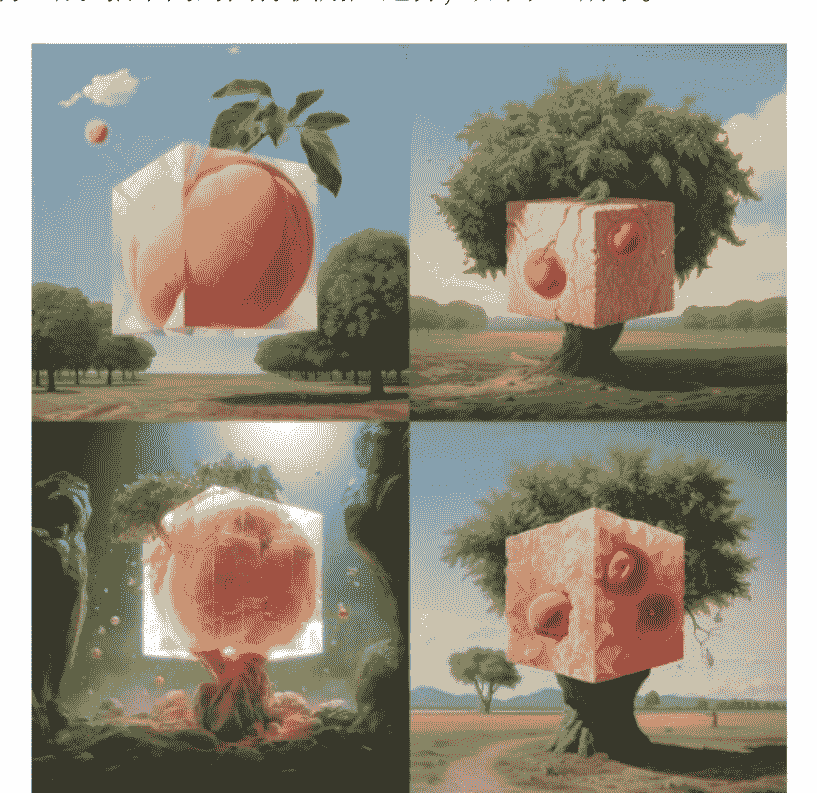

图5-1

用过Photoshop、Painter、Illustrator、3ds Max、Maya等软件的创作者都清楚，传统图像制作多要靠数位板在软件里手绘，或通过三维建模渲染完成，从想法到成品链路较长。Midjourney改变了这一路径。平台上的画面并非手工绘制，而是由已训练好的神经网络推算而成，每个像素都是模型计算的结果。创作者无需掌握繁复的软件操作，也能迅速拿到高质量的视觉素材。

当然，传统软件在可控性与精细度上仍有优势，Midjourney在某些场景下难以实现像素级的精准，实际使用时仍需学会提示词的编写方式和关键词的运用。即便如此，其成图速度快、表现形式丰富的特点，仍使其成为不可忽略的选择。

#### 5.1.2 可灵AI

短视频与直播行业持续升温，市场对创意强、质感好的视频内容需求在不断抬升。2024年6月，可灵AI视频生成大模型的官网正式上线，产品面向公众发布。快手作为国内头部短视频平台，在视频技术上积累深厚。可灵AI正是依托这些在处理、分析、生成方面的储备，由快手AI团队自主研发而成，如图5-2所示。

图5-2

近年AI视频生成进展很快，从ChatGPT面世到Sora发布，都在业界引发广泛讨论。这些进展为可灵AI的研发提供了重要参考。快手AI团队紧跟技术潮流，在生成视频方向持续寻求突破。

研发过程中团队完成多项自研创新。可灵AI大模型采用3D时空联合注意力机制，有助于捕捉视频中复杂的时空运动；同时结合自研架构与Scaling Law驱动的建模能力，能在虚拟场景中还原接近真实世界的物理特性。这些创新为可灵AI在成片质量、创意表现和物理仿真方面提供了支撑。

#### 5.1.3 即梦AI

即梦AI由字节跳动推出，是一款AIGC创作工具，可把简短文字描述转为生动的图片与视频，网页版界面如图5-3所示。输入描述后系统会自动生成对应视觉内容，并提供编辑功能，可对成片进行个性化调整。

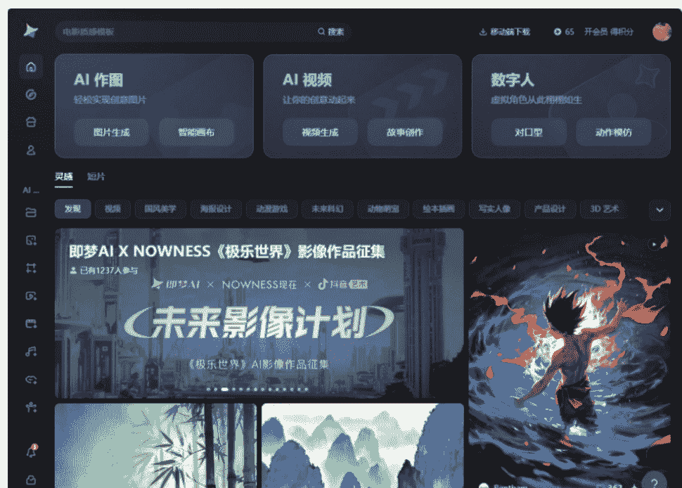

图5-3

即梦AI的图片生成基于字节跳动的豆包大模型，视频生成则采用自研的DIT架构，即Dynamic Integration Transformer。相较传统U-Net，DIT在分辨率、时长和动态流畅度上提升明显，使其能呈现更自然的人物动画与微表情。

目前平台每日提供66积分，约可免费生成66张普通图片。该工具对内容创作者、短视频创作者及AI艺术爱好者都很友好，有助于明显提升创作效率。

#### 5.1.4 文心一格

文心一格是百度推出的AI艺术与创意辅助平台，如图5-4所示，依托文心大模型与飞桨技术，支持文本生成图像。平台于2022年8月正式发布，可生成国风、油画、水彩、水粉、动漫、写实等十余种风格的高清画作。用户涵盖专业设计师、艺术家、媒体从业者及普通绘画爱好者，可用于创意启发、内容制作与个人娱乐。

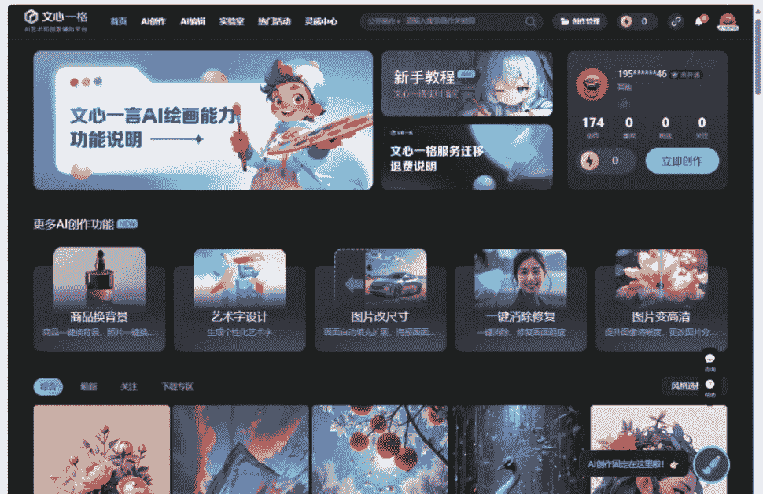

图5-4

文心一格的优势在于高效的AI绘画能力，能依据文本描述生成符合预期的高质量图像。平台采用免费加增值模式，用户可通过签到、分享作品等方式获取免费电量，也可付费购买额外电量以生成更多图片。

对专业设计师而言，文心一格可辅助早期草图生成与灵感搜集；对非专业用户而言，只需用简单文字描述即可得到精美的个性化画作。

### 5.2 DeepSeek+即梦AI将文字生成视频

本节介绍如何借助DeepSeek优化AI绘画提示词，使画面更贴合视频需求，并结合即梦AI完成从文字到视频的高效转换，产出高质量AI视频内容。

#### 5.2.1 用DeepSeek生成AI绘画提示词

DeepSeek作为智能语言模型，能精准理解用户意图并生成高度契合主题的提示词，提升AI绘画的可控性与创造力。

借助DeepSeek，用户可按特定风格如二次元、赛博朋克、油画风等，主题如未来城市、梦幻森林、历史人物等，以及细节描述如光影效果、色彩氛围、构图方式等，生成专业级绘画提示词，具体操作如下。

01 打开DeepSeek，进入主页，在文本框中输入需求，如图5-5所示。

图5-5

02 按【Enter】键或点击发送按钮，DeepSeek将给出对应的回复内容，如下所示。

广告片标题：解放双手，智享洁净——××智能扫地机器人，您的生活管家

##### 一、开场画面

（镜头缓缓推进一个忙碌的早晨：玄关处散落着宠物毛发，茶几旁洒落着饼干碎，阳光透过窗户洒在地板上）

旁白：“早晨7点，咖啡香弥漫，而你的时间不该浪费在弯腰扫地上。”

##### 二、产品登场

（镜头俯拍：××智能扫地机器人从充电座优雅滑出，蓝光雷达旋转，机身显示屏亮起智能路径规划图）

字幕：“360°智能扫描，3秒建图”

旁白：“××智能扫地机器人，雷达导航精准绘制全屋地图，复杂户型也能应对自如。”

##### 三、核心功能展示

###### 场景1：手机智控

（女主人在办公室滑动手机屏幕，App界面显示“一键启动”“分区清洁”，智能扫地机器人应声工作）

字幕弹幕：“上班族救星 | 远程操控 | 定时预约”

女主人微笑语音指令：“小×，打扫儿童房。”

（智能扫地机器人灵敏转向，直奔目标区域）

###### 场景2：强力清洁

（特写：滚刷高速旋转卷起宠物毛发，5000Pa飓风吸力瞬间吸入果壳，边刷贴合墙缝清扫）

动态数据条弹出：“99.9%微尘清除率 | 3cm超薄机身钻入床底 | 2.5L大尘盒7天不倒垃圾”。

###### 场景3：智慧避障

（智能扫地机器人遇到散落的玩具车，红外感应后减速绕行；爬上高2cm的门槛轻松自如）

趣味音效：“滴——发现障碍，优雅避开。”

##### 四、省时省力对比

（分屏画面：左侧传统打扫——女主人弯腰扫地、清理缠绕的毛发、清洗拖布；右侧智能扫地机器人自主工作——女主人读书/逗猫/练瑜伽）

旁白：“每天为您抢回2小时，把时间留给热爱的事。”

##### 五、收尾升华

（夜幕降临，智能扫地机器人自动返回充电，女主人赤脚踩过光洁的木地板，手机收到“清洁报告”：58m²完成，耗时35分钟）

广告语：“××智能扫地机器人，不是替代你的劳动，而是重置生活的定义。”

##### 六、行动号召

（屏幕闪现产品Logo，二维码与语音指令浮出）

字幕：“即刻唤醒你的智能管家！”

语音订购“小×，我要下单！”或扫码领1000元新品券！

##### 七、文案亮点

- 痛点开场：用真实生活场景引发观众共鸣。

- 技术可视化：用雷达动效、数据弹幕强化科技感。

- 对比营销：用分屏画面直击“省时”核心卖点。

- 情感绑定：将产品升华为“生活重置者”，超越工具属性。

·创新互动：支持语音指令下单，深化智能体验记忆点。

#### 5.2.2 用即梦AI添加提示词生成视频素材

即梦AI是先进的生成工具，能依据需求快速产出多样化、高质量的视频素材，从静态图到短视频均可覆盖，大幅提升创作效率。

扫码看视频

具体操作步骤如下。

01 进入即梦AI首页，选择“视频生成”，打开视频生成编辑界面，如图5-6所示。

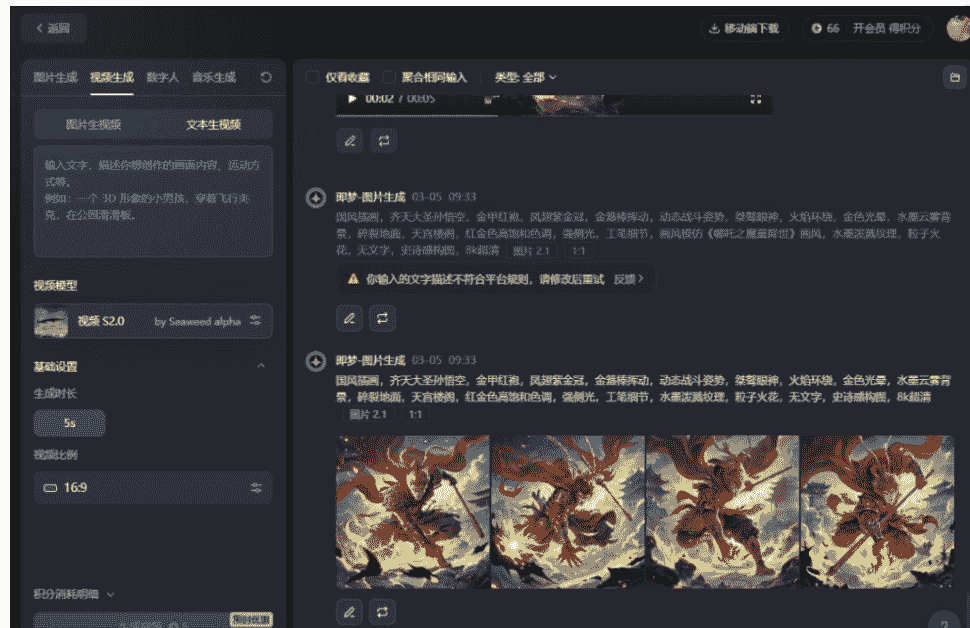

图5-6

02 将DeepSeek生成的“开场画面”描述“镜头缓缓……洒在地板上”复制粘贴到“文本生视频”输入框，视频模型设为“视频S2.0”，视频比例选“16：9”，如图5-7所示。

图片生成 视频生成 数字人 音乐生成

仅看收藏 聚合相同输入

▶ 00:02 / 00:05

图片生视频 文本生视频

镜头缓缓推进一个忙碌的早晨：玄关处散落着宠物毛发，茶几旁洒落着饼干碎，阳光透过窗户洒在地板上

即梦-图片生成 03-05 09:33

国风插画，齐天大圣孙悟空，金甲，碎裂地面，天宫楼阁，红金花，无文字，史诗感构图，8k超高清

⚠ 你输入的文字描述不符合

视频模型

视频 S2.0 by Seaweed alpha

即梦-图片生成 03-05 09:33

国风插画，齐天大圣孙悟空，金甲，碎裂地面，天宫楼阁，红金

基础设置

生成时长

图片 2.1 1:1

5s

视频比例

16:9

积分消耗明细

生成视频 5 限时优惠

图5-7

03 点击“生成视频”按钮，等待片刻即可得到对应素材，如图5-8所示。

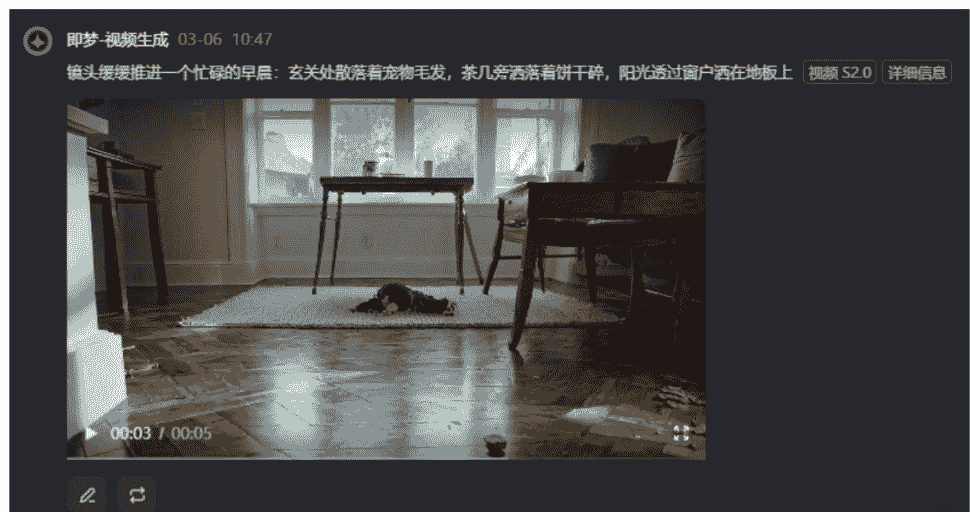

图5-8

04 将鼠标移至视频上方右键，选择“下载视频”，即可保存到本地，如图5-9所示。

图5-9

05 按照后续分镜头描述，依次把文本转为视频，就能获得完整的素材集，如图5-10所示。

图5-10

### 5.3 DeepSeek+可灵AI将图片生成视频

图片生视频是指可灵AI以用户提供的图片为基础，通过AI智能技术生成相关视频片段。用户上传一张图片后，系统会依据其内容、色彩、构图等信息，智能合成对应的动态片段。

#### 5.3.1 用DeepSeek生成AI绘画提示词

在图片生视频场景下，使用DeepSeek生成提示词更应聚焦于对画面本身的描述，而非最终视频。操作步骤如下。

扫码看视频

01 打开DeepSeek，进入主页，在文本框输入提示词，如图5-11所示。

图5-11

02 按【Enter】键或点击发送，得到回复如下。

水墨风格的山峰，湖面飘着薄雾，小船上站着穿蓑衣的人，白墙青瓦的房屋在云雾间半遮半掩，有飞鸟从松树边飞过，深蓝天空挂着橘色夕阳。

#### 5.3.2 用可灵AI依据提示词生成图片

可灵AI的图片生成功能是强大的创作工具，可根据文本描述或参考图生成符合要求的图像。具体步骤如下。

扫码看视频

01 打开可灵AI，在首页选择“AI图片”，进入编辑界面，在“创意描述”框中输入提示词，如图5-12所示。

图5-12

02 执行后，将“图片比例”调整为“3：2”，点击“立即生成”，片刻后即可获得一组图片，如图5-13所示。

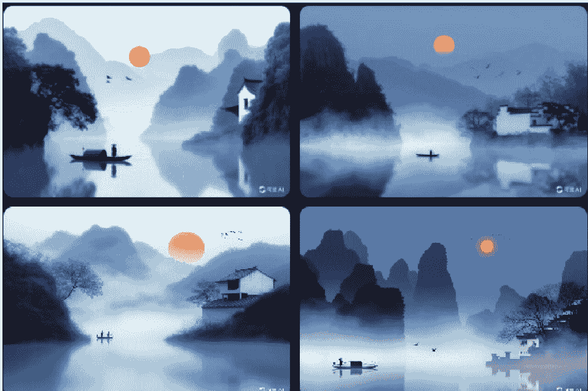

图5-13

03 将指针移到满意的图片上，点击“下载”按钮，即可保存到本地，如图5-14所示。

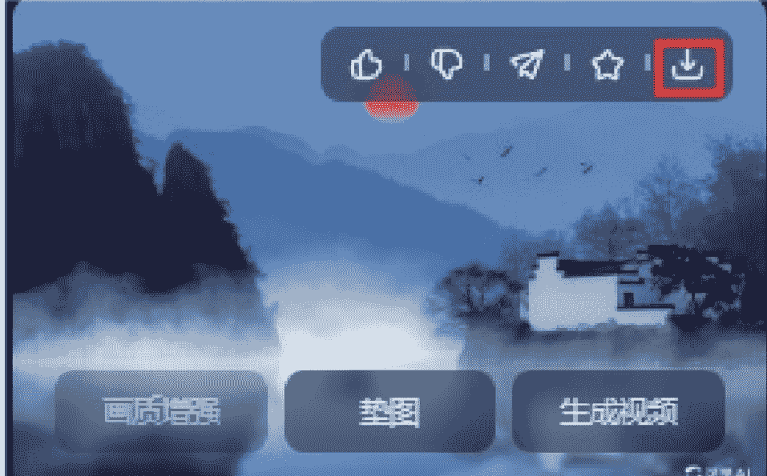

图5-14

#### 5.3.3 用可灵AI将图片转化为视频内容

使用可灵AI进行图片生视频的具体流程如下。

扫码看视频

01 打开可灵AI首页，点击“AI视频”按钮，或在左侧工具栏选择“AI视频”，进入视频生成界面，如图5-15所示。

图5-15

02 在图片上传区，可通过点击、拖拽或粘贴方式上传素材，目前仅支持JPG/PNG格式，文件不超过10MB，分辨率不低于300px，如图5-16所示。

图5-16

**提示：** 图5-16中“点击/拖曳/粘贴”下方还有“从历史创作选择”选项，可将此前用可灵AI生成的图片直接导入生成视频，打开后界面如图5-17所示，可任选一张上传。

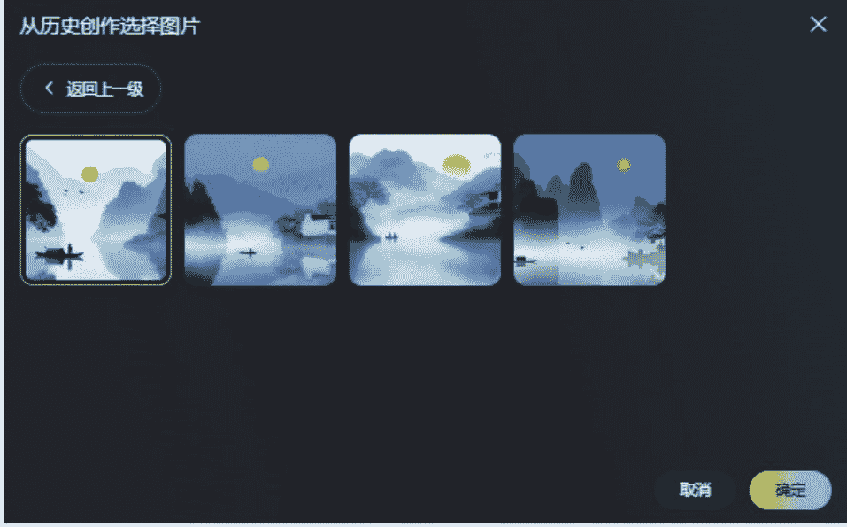

图5-17

03 图片上传完成后，点击“立即生成”，可灵AI会自动合成对应视频，如图5-18所示。

图5-18

## 章节总结

本章主要讲解了如何利用DeepSeek生成AI绘画提示词，并通过AI绘画工具制作视频素材，内容概览如下。

# AI + 绘画生成：快速生成视频素材

四大主流 AI 绘画工具

- Midjourney

- 可灵 AI

- 即梦 AI

- 文心一格

DeepSeek+ 即梦 AI 将文字生成视频

- 用 DeepSeek 生成 AI 绘画提示词

- 用即梦 AI 添加提示词生成视频素材

DeepSeek+ 可灵 AI 将图片生成视频

- 用 DeepSeek 生成 AI 绘画提示词

- 用 可灵 AI 依据提示词生成图片

- 用 可灵 AI 将图片转化为视频内容

# 第6章

# AI＋视频生成：利用AI功能快速出片

在短视频时代，高效产出优质内容已成为创作者的核心竞争力。AI技术的融入，不仅大幅降低视频制作门槛，更让“文案创作-视频生成”流程实现无缝衔接。本章将聚焦如何通过DeepSeek与主流视频生成工具如剪映、腾讯智影等的联动，快速生成创意文案并一键转化为完整视频。

### 6.1 常用的视频生成工具

在AI技术加持下，视频制作正从专业剪辑软件走向“平民化”智能工具时代。无论新手还是资深创作者，都能借助智能工具迅速落地创意。以下解析当前主流的视频生成工具——剪映、腾讯智影、秒创和即创，剖析其核心功能与适用场景。

#### 6.1.1 剪映

剪映是一款功能全面且易用的视频编辑软件，其“图文成片”功能为用户带来极大便利。该功能允许用户自定义输入脚本，系统会自动将脚本转化为生动有趣的视频内容。例如图6-1所示为剪映图文成片的效果。

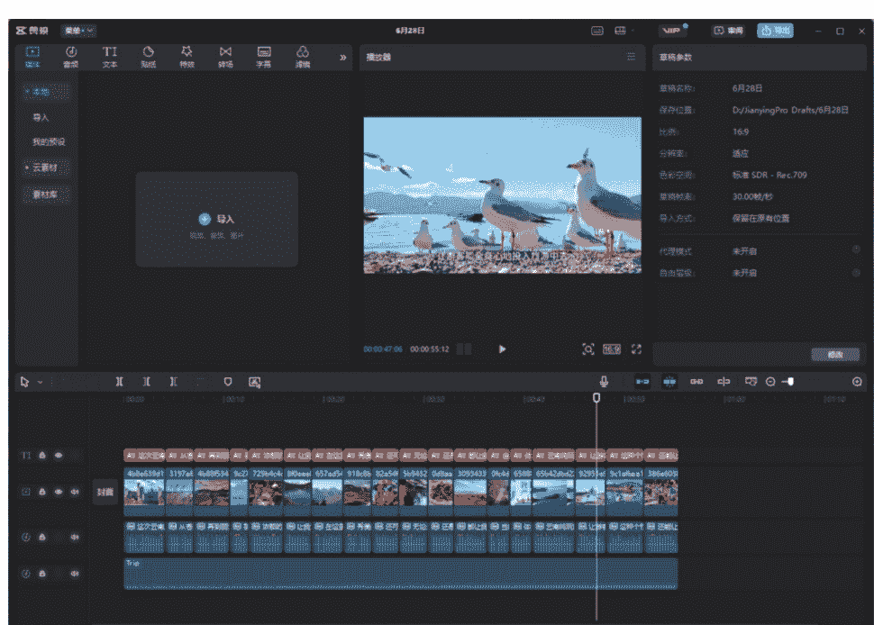

图6-1

通过图文成片，用户无需掌握复杂剪辑技巧，即可将文字与图片、视频素材结合，快速生成专业水准的视频作品。该功能的推出显著提升了制作效率，也提供了更多样化的创作方式。

#### 6.1.2 腾讯智影

腾讯智影是一个集素材收集、视频剪辑、后期包装、渲染导出和发布于一体的在线剪辑平台，为用户提供“端到端”的一站式视频制作服务。例如图6-2所示为腾讯智影的智能创作工具。

图6-2

腾讯智影是一款集成AI创作功能的智能工具，具备数字人播报、文本配音、字幕识别、文章转视频、智能抹除等功能。其数字人在形象、语音、语调、唇动等方面均高度逼真，如图6-3所示。

图6-3

#### 6.1.3 秒创

秒创由新壹（北京）科技有限公司开发，是一个AI智能内容生成平台，专注于通过AI技术简化视频创作流程，尤其擅长将图文内容快速转化为视频，适用于自媒体、企业营销、教育科普等多种场景。该平台基于秒创AIGC引擎，整合智能语义分析、素材匹配、AI语音合成等核心技术，用户无需专业剪辑经验即可快速生成高质量视频，如图6-4所示。

图6-4

#### 6.1.4 即创

即创由抖音所属的字节跳动推出，是面向短视频、电商及直播创作者的整合型智能创作套件，示意图见图6-5。系统将视频制作、图文编辑、直播辅助三类模块收敛为一体，底层接入抖音自研的大模型如云雀大模型，目标是把制作门槛降下来，让创作节奏更快。

图6-5

产品设计以零基础可用为主线，只需用抖音或巨量引擎账号登录网页端即可操作。以带货短片为例，输入商品信息后系统会自动检索匹配素材并合成完整成片，同时保留手动调整片段顺序与配音细节的空间，参考图6-6。平台还内置素材库管理与投放数据分析能力，帮助用户持续优化投放效果。

### 6.2 剪映+DeepSeek生成原创视频

DeepSeek擅长在短时间内产出贴合短视频调性的文案，剪映的图文成片则可把文字直接转为成片。两者联动后，脚本撰写到成片输出形成闭环，内容生产效率明显提升。

#### 6.2.1 用DeepSeek快速生成文案

想用较低成本快速做出有质感的原创，常见做法是先让DeepSeek产出脚本与文案，再用剪映图文成片把文字变视频。流程被压缩，同时借助DeepSeek的信息整合与分析能力，能快速搭建条理清晰、更具吸引力的内容骨架，实现效率与质量兼顾。

扫码看视频

下面是剪映+DeepSeek生成原创视频的具体操作步骤。

01 启动DeepSeek回到首页，在输入区填写提示词，如图6-7所示。

图6-7

02 按【Enter】键或点击发送按钮，将提示词提交给DeepSeek，即可获得对应的回复内容，如下所示。

《橘子洲头·湘江诗画》宣传片脚本。

时长：3分钟

##### 核心主题：自然与人文交织的千年诗篇

###### 一、开场（0:00—0:15）

####### 1. 镜头

航拍湘江晨曦（0:00—0:05）：朝阳升起，金光穿透薄雾洒向橘子洲头，青年毛泽东艺术雕像轮廓渐显。

特写江浪击石（0:06—0:10）：慢镜头捕捉浪花飞溅，水珠折射彩虹光斑。

推近雕像面部（0:11—0:15）：镜头沿雕像肩部上升，定格于毛泽东坚定的眼神之中。

####### 2. 背景音乐

Two Steps From Hell公司的Victory（高潮段落）

####### 3. 旁白（浑厚男声，混响处理）

> “独立寒秋，湘江北去，橘子洲头——这里是诗与历史的交点，是山河与热血的交响。”

###### 二、自然画卷（0:16—1:00）

####### 1. 镜头

移动镜头穿越橘园（0:16—0:25）：阳光透过绿叶，金橘果实挂满枝头，露珠滑落特写。

航拍橘子洲头全貌（0:26—0:35）：橘子洲形似长舰劈开湘江，两岸现代高楼与古树相映。

微观镜头（0:36—0:45）：蝴蝶停驻望江亭雕花栏杆，蜻蜓点水掠过江面。

慢镜头推移（0:46—1:00）：江面涟漪泛金，柳枝随风轻拂，白鹭掠水飞向远天。

####### 2. 背景音乐

Yiruma的*River Flows in You*（钢琴版）

####### 3. 对话场景（年轻情侣倚栏远眺）

女（惊叹）：“你看江面的波光，像不像撒了一把钻石？”

男（轻笑）：“不如说，是太阳照得江水闪闪的。”

###### 三、历史脉搏（1:00—2:00）

####### 1. 镜头

黑白历史影像穿插（1:00—1:10）：特写翻滚的湘江浪花，空镜头的橘子洲头，叠加现代大学生朗诵《沁园春·长沙》。

特写书法墙（1:11—1:20）：苍劲毛体诗词随镜头移动逐句显现。

黄昏剪影（1:21—1:30）：老者执毛笔在江边石板上书写，孩童蹲坐模仿。

群像镜头（1:31—1:45）：游客驻足凝视青年毛泽东艺术雕塑，目光庄重；镜头切换至湘江浪潮奔涌，叠印历史资料中革命者行走的身影。

现代与历史交融（1:46—2:00）：夕阳下，朗诵声渐强，青年群体举旗前行，画面色彩由黑白渐变为暖金，寓意薪火相传。

####### 2. 背景音乐

S.E.N.S. 的《故宫的记忆》（改编缩短版）

####### 3. 旁白（沧桑男声）

> “百年前，一句‘问苍茫大地，谁主沉浮’在此留下了回响；百年后，江风依旧传诵着觉醒的回声。”

###### 四、活力新生（2:01—2:45）

####### 1. 镜头

快切市民生活（2:01—2:15）：晨练的老人、写生的美院学生、拍摄婚纱照的新人。

夜景延时摄影（2:16—2:30）：橘子洲头灯光渐次点亮，江面游船划过金色光轨。

第一视角镜头（2:31—2:45）：手持稳定器穿越烟火夜市，糖油粑粑、臭豆腐的特写，摊主笑问：“恰杯芝麻豆子茶不？”

####### 2. 背景音乐

Alan Walker的*Faded*（二胡改编版）

####### 3. 对话场景（父亲抱着女儿看雕像）

女儿（稚气地）：“爸爸，这个大石头叔叔是谁呀？”

父亲（郑重地）：“他是告诉我们‘敢教日月换新天’的人。”

###### 五、尾声升华（2:46—3:00）

####### 1. 镜头

全景旋转镜头（2:46—2:55）：从雕像头顶俯拍，橘子洲头、湘江、城市天际线次第展开。

定版Logo（2:56—3:00）：水墨晕染出“橘子洲头”篆刻印章，下方浮现“一洲观万象，千载汇风流”。

####### 2. 背景音乐

回归Victory尾声乐章

####### 3. 旁白（男女声交替）

男：“这是江河写给大地的情书。”

女：“这是历史留给未来的请柬。”

合：“橘子洲头——等你续写新的诗篇。”

###### 执行建议

- (1) 设备要求：

  ·航拍使用DJI Inspire 3（8K电影级镜头）；

  ·微观镜头搭配Laowa 24mm探针镜头。

- (2) 服装设计：历史场景人物着民国学生装，现代游客服装需色彩明快（避免黑、白、灰色）。

- (3) 特效处理：诗词显现采用AR特效，让毛体字如烟云浮现在实景中。

###### 创意亮点

- (1) 时空对话：通过黑白/彩色画面交替、古今人物动作镜像衔接（如旧时渡江与现当代游船）形成时空纵深感。

- (2) 五感营销：刻意收录江浪声、蝉鸣、夜市吆喝等环境音，增强沉浸感。

- (3) 情感锚点：以“诗”贯穿全片，从毛泽东诗词到普通人的诗意生活。

该脚本通过“自然—历史—人文—未来”的叙事逻辑，兼顾视觉震撼与情感共鸣，可有效吸引文旅爱好者、历史研学群体及年轻打卡族。

#### 6.2.2 用剪映“图文成片”功能生成视频

剪映的图文成片是基于人工智能的自动化出片工具，输入文字后系统会自动匹配画面、音乐、字幕动画并完成成片。适用于短视频、品牌推广、教学等场景，能显著降低剪辑门槛。生成后可换模板并调整排版、配色与字体等细节。

扫码看视频

下面是使用“图文成片”功能生成视频的具体操作步骤。

01 打开剪映电脑版，进入“图文成片”入口，如图6-8所示。

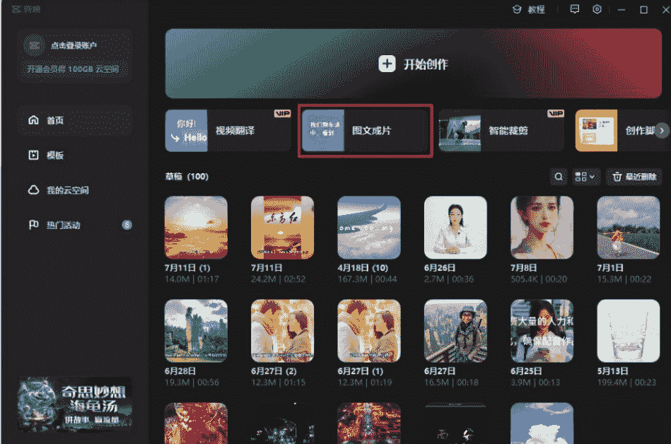

图6-8

02 将DeepSeek刚刚产出的文案复制后粘贴到文本框内，如图6-9所示。

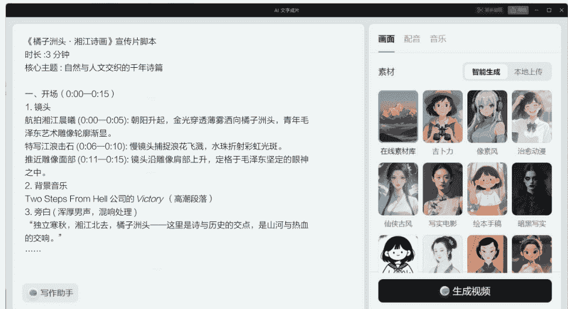

图6-9

03 在文本框里删去脚本中的镜头语言等无关描述，仅保留旁白和对话内容，如图6-10所示。这样可避免剪映把镜头指令也进行朗读。

### 6.3 腾讯智影+DeepSeek生成数字人视频

腾讯智影是一款由人工智能驱动的视频制作平台，其数字人播报功能配合DeepSeek的文案产出能力，可快速制作专业水准的数字人视频。先用DeepSeek生成文案，再导入智影数字人模块，即可完成配音、表情与口型同步，常见于短视频营销、课程讲解、品牌宣传等用途。

#### 6.3.1 用DeepSeek生成口播文案

DeepSeek基于自然语言处理与深度学习，可理解视频主题并自动撰写口播稿。

使用时需注意以下要点，以保证质量和效果符合预期。

- （1）润色语言风格。人工智能产出的内容常偏正式，缺乏温度。使用前需结合观众和直播情境做口语化改写，加入情感共鸣或幽默，提升亲近感。
- （2）聚焦核心卖点。文案要把产品的关键优势与差异化价值明确点出。从人工智能给出的全面描述中提炼重点，用简练有力的表达传达。
- （3）核查用语与逻辑。人工智能稿可能出现错句或逻辑跳跃，发布前应仔细校对，确保通顺准确。
- （4）坚守真实可信。所有产品特性与优势必须属实，杜绝夸大或虚假宣传，以维护品牌信任。

总体而言，使用DeepSeek生成直播带货口播文案时，需结合实际灵活优化，确保质量、真实性和吸引力。操作步骤如下。

01 打开DeepSeek回到主页，在输入框输入提示词，如图6-13所示。

02 发送指令后，按【Enter】键或点击按钮，即可获得回复内容，如下所示。

以下是直播口播文案。

家人们！“3-2-1”上链接！今天给你们炸的这款宝贝，绝对是你2025年想抢的喝水神器——Lucky保温杯！听好了，这杯子能让你一整天“喝水开挂”，现在手慢的真的会～后～悔！

第一炸，巨无霸容量！680mL超大肚量！早上灌满它，上班、健身、接娃、露营一整天不用找水喝！别人跑三趟茶水间，你稳坐工位当“喝水大王”，咖啡、果茶、养生汤，连煮好的银耳羹都能直接往里倒！宝妈放包里，孩子放学路上都不用买奶茶！

第二炸，锁温王中王！进口不锈钢+真空锁温黑科技，保热24小时烫嘴，保冷12小时挂冰碴！早上灌的滚烫豆浆，下午开会喝还烫舌头！夏天塞满冰块，晚上回家直接嚼冰沙！普通保温杯叫“温水杯”，这杯子才配叫“移动小冰箱+随身电饭煲”！

第三炸，轻到能起飞！别以为大容量就死沉！单手一拎比手机还轻，磨砂防滑腰身+可提可挂的便携环，爬山塞背包侧袋，逛街甩手里像潮搭单品！地铁过安检都不用掏出来，空姐看了都想问链接！

最关键，原价199元的保温杯天花板，今天直播间破价两位数！99元秒杀！再送硅胶杯套+网红杯刷！前50名下单的宝子加送折叠茶漏！这价格我都想举报老板！库存就300个，抢完立刻下架！把“想要”打在公屏上！“3-2-1”——给我炸！

（敲桌+镜头拉近特写）倒数5秒！没付款的姐妹直播间喊话，运营再加20单！错过今天，明天超市卖299元同款别来找我哭！

脚本设计逻辑如下。

- 痛点场景化：将保温杯的大容量绑定职场、育儿、户外高频场景，用“一整天不用找水喝”“不用买奶茶”直击懒人消费降级痛点。

- 数据具象化：24小时保温强调“烫嘴”“挂冰碴”等感官词，对比普通保温杯制造技术碾压感。

- 价格紧迫感：用“破价两位数”“举报老板”等话术暗示低价反常，结合库存倒数、赠品分层，刺激秒杀冲动。

> （提示：实际直播中可手持杯子演示装冰、倒沸水等动作，以增强可信度）

#### 6.3.2 用腾讯智影数字人功能生成数字人视频

腾讯智影的数字人功能是其人工智能创作助手的亮点之一，提供了智能化、便捷化的数字人制作体验。具体操作如下。

01 打开腾讯智影首页，选择“数字人播报”，进入编辑界面。

02 将DeepSeek生成的口播文案复制粘贴到右侧“播报内容”文本框中，如图6-15所示。

03 在左侧工具栏点击“数字人”，按喜好挑选形象，确认后系统会自动播报文本内容，可预览效果。

04 在左侧工具栏选择“背景”|“纯色背景”，此处选用绿色背景，便于后期抠像处理，如图6-17所示。

05 将“字幕”开关关闭，如图6-18所示，避免剪辑时出现重复字幕。

06 点击顶部“合成视频”，将数字人、背景等元素整合成完整文件，可在左侧“我的资源”中查看成片，如图6-19所示。

07 将鼠标移至成片上，点击“下载”按钮，即可保存至本地，如图6-20所示。

## 章节总结

本章重点介绍先用DeepSeek生成脚本，再通过视频工具完成成片的完整做法，具体流程可参考下图。

## AI + 视频生成：利用 AI 功能快速出片

- 常用的视频生成工具

  - 剪映

  - 腾讯智影

  - 秒创

  - 即创

- 剪映 +DeepSeek 生成原创视频

  - 用 DeepSeek 快速生成文案

  - 用剪映 “图文成片” 功能生成视频

- 腾讯智影 +DeepSeek 生成数字人视频

  - 用 DeepSeek 生成口播文案

  - 用腾讯智影数字人功能生成数字人视频

## 第7章

## DeepSeek＋各大前沿视频软件：AI影像创作时代全面来临

短视频与影像创作正被人工智能技术重塑，从动态特效到风格化转换，创作者越来越多借助人工智能工具提升质量、缩短周期，呈现更丰富的视觉效果。DeepSeek提供强大的文本生成能力，配合各类人工智能视频软件，可让风格化视频创作变得更轻松，为行业带来新可能。

### 7.1 DeepSeek+即梦AI，制作穿越视频动画

即梦AI由字节跳动推出，属AIGC创作工具，可把文字描述转成图片与视频。输入文字后系统自动生成视觉素材，并提供编辑手段以便个性化修改。搭配DeepSeek使用可制作穿越风格动画，关键在于其首尾帧功能。

首尾帧功能允许用户上传起始画面与结束画面，人工智能据此生成连贯流畅的视频片段。具体操作步骤如下。

01 打开DeepSeek回到主页，在输入框输入提示词，如图7-1所示。

02 发送指令后，按【Enter】键或点击按钮，获得回复内容如下。

以下是为您设计的AI绘画提示词，包含场景细节和动态元素，适用于生成侧面视角的车辆穿越动画：一辆车行驶在路上，汽车侧面，春天的森林、树木、花朵，商业摄影，中景。

03 打开即梦AI首页，选择“图片生成”进入对应界面，如图7-2所示。

04 在文本框内输入DeepSeek生成的提示词“一辆车行驶在路上，汽车侧面，春天的森林、树木、花朵，商业摄影，中景”，如图7-3所示。

05 将“精细度”调至“50”，“图片比例”设为“16：9”，点击“立即生成”，即可得到图片，如图7-4所示。

06 将鼠标放在右侧高清图上，在浮窗中点击“局部重绘”按钮，如图7-5所示。

07 用画笔工具涂抹车辆以外的区域，如图7-6所示。

08 在文本框内输入“夏天的森林，茂密的树木”，如图7-7所示。

09 再次点击“立即生成”，完成重绘。得到夏天场景如图7-8所示。

10 重复步骤04～步骤09，分别生成秋天和冬天场景，如图7-9所示。

11 点击“视频生成”进入视频生成界面，如图7-10所示。

12 勾选“使用尾帧”，上传春天与夏天的场景图，如图7-11所示。

13 在文本框内输入提示词，将“运镜控制”设为“随机运镜”，“运动速度”设为“适中”，“模式选择”设为“标准模式”，生成时长设为“3s”，如图7-12所示。

14 点击“生成视频”，即可得到春天到夏天的穿越动画，如图7-13所示。

15 重复步骤10～步骤14，生成夏天到秋天、秋天到冬天的穿越动画，如图7-14所示。

16 将鼠标移至生成视频上，点击右上角“下载”按钮，如图7-15所示，将三段视频下载到本地。

17 打开剪映，将三段素材依次导入轨道，合成完整视频，如图7-16所示。

18 点击剪映右上角“导出”按钮，如图7-17所示，即可导出完成的穿越动画。

### 7.2 DeepSeek+可灵AI，制作爆款萌宠走秀视频

可灵AI由快手人工智能团队研发，专注视频生成领域，依托深度学习技术、3D时空联合注意力机制和Diffusion Transformer架构，能够生成高质量、逼真且符合物理规律的视频。

爆款萌宠走秀视频以拟人化方式呈现动物走秀，主角可以是穿戴不同服饰的猫狗，亦可为虚拟生成的独特动物形象，以增强趣味性。具体操作步骤如下。

01 打开DeepSeek回到主页，在输入框输入提示词，明确动物品种、颜色、性别等信息，可多生成几组备选，如图7-18所示。

02 执行操作后，按【Enter】键或点击按钮发送指令，即可获得回复内容，如下所示。

以下是5组符合要求的AI绘图中文提示词，结合了英短猫与5岁男孩的特征进行拟人化设定。

##### 1. 英伦复古·小绅士走秀
一只黑白英短被拟人化为五岁男童，正从容地踏上T台。他套着复古英伦小西装，深蓝色上衣布满细腻暗纹，内搭白衬衫，领口系一条酒红色蝴蝶结，脚蹬亮面黑皮鞋。每一步都稳健淡定，双手轻微摆动，头微微抬起，挂着温润自信的笑，目光坚定地望向前方。身后金色灯光洒落的华丽舞台，观众席闪光灯此起彼伏，整体气质高贵典雅。

##### 2. 街头潮流·酷盖小子
同一只黑白英短化身五岁男孩，霸气登场。身穿oversize黑色卫衣，胸前印着涂鸦字母，下搭浅色破洞牛仔裤，配高帮运动鞋，头戴歪斜棒球帽，帽下露出灵动的猫耳。步伐轻快洒脱，双手插兜，肩膀微后倾，嘴角挑起痞帅笑意，眼神带点淡定自信。背景是霓虹闪烁的潮流秀场，交错灯光凸显炫酷街头氛围。

##### 3. 机能未来·科技少年登场
黑白英短拟人成五岁男孩，仿佛从未来而来，稳步走秀。他穿银白金属质感机能夹克，内衬黑色高领紧身衣，下身是科技感修身战术裤，脚踩带LED光效的智能运动鞋，猫耳上挂着迷你通讯装置。步伐坚定有力，双臂随节奏轻摆，目光冷静专注，嘴角微微上扬。T台为赛博朋克风格，环绕蓝色全息投影，灯光投射出科幻流光。

##### 4. 童话梦幻·小王子亮相
黑白英短化作五岁男童，如童话里的小王子般优雅走台。身着奶白色宫廷小礼服，胸前别金色王冠徽章，腰间系淡蓝丝带，脚穿精致白绣花小皮鞋。步伐轻盈，双手自然摆动，脸上是甜美自信的笑，目光温柔看向远方，尾巴轻轻摇摆添了活泼感。背景是缀满星空的T台，柔光洒下，梦幻泡泡在空中飘浮，画面温馨动人。

##### 5. 国风华服·小侠客风姿
黑白英短化身五岁男孩，身姿如翩翩侠客稳稳走秀。他着墨蓝锦缎汉服，袖口衣摆绣祥云暗纹，腰系玉佩流苏，脚下黑绣花布鞋，猫耳别一枚精巧玉簪。步伐轻快流畅，双手微摆，眼神沉稳自信，嘴角带从容微笑。背景古色古香，红灯笼高挂，金色光影交错，营造出浓郁东方韵味。

以上五组提示词把萌宠拟人化走秀的场景做了差异化拆解，精准刻画了黑白英短化身五岁男孩的台步、神态、服饰细节与舞台氛围，拿来直接生成拟人化走秀视频，能让作品更具爆发力。

03 可任选其一，这里以第1组为例，打开可灵AI，进入AI图片-文生图模块，把提示词粘贴到创意描述框内，参考图7-19。

04 将图片比例设为4：3后点立即生成，稍等片刻即可得到与描述相符的一组图片，见图7-20。
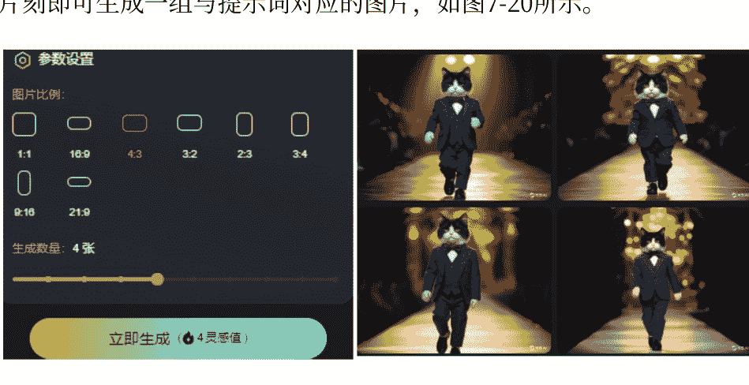
05 在生成结果中点中喜欢的一张，浮层里点击生成视频，即可自动跳转到AI视频编辑页，见图7-21。
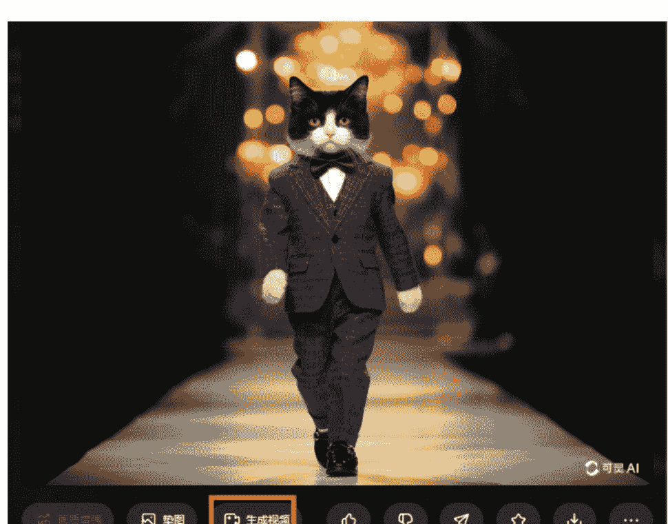
06 在图片创意描述框里再次粘贴提示词，把生成模式调成高品质，生成时长设为5s，如图7-22所示。
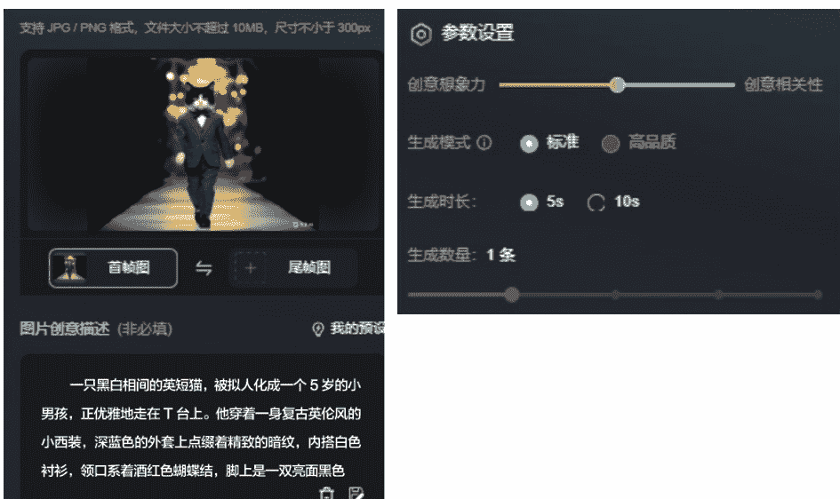
07 完成设置后点击立即生成，就能得到对应的视频内容，见图7-23。
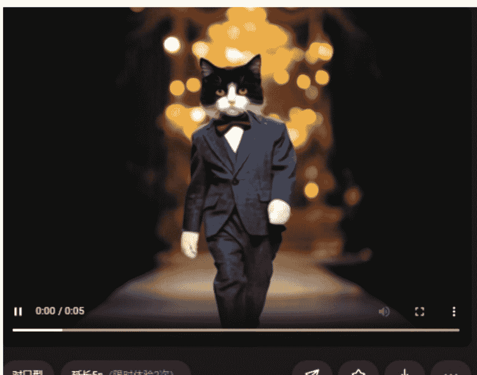

### 7.3 DeepSeek + 即梦AI + 剪映 打造风景大片
过去做震撼风景大片需要昂贵器材和繁复后期，如今借助DeepSeek辅助创作、即梦AI生图生视频、剪映高效剪辑，普通创作者也能产出接近专业纪录片水准的作品。本节详解三者联动的完整流程。

01 打开DeepSeek主页，在输入框里填入提示词，如图7-24所示。

02 按Enter或点发送后，DeepSeek会给出相应回答，示范如下：

##### 1. 云海日出·雪峰秘境
巍峨雪山被金色晨曦点亮，山脚厚重云海翻腾，阳光穿透云层化作圣洁光柱。一名登山者立于山脊仰望远空，背影渺小却具力量。广角低角度仰拍，空气清澈，冷暖对比强烈，呈现壮阔神秘。

##### 2. 惊涛灯塔·风雨海上
狂风怒号，巨浪拍打孤立深海灯塔，乌云天际闪过一道电光，瞬间照亮海面。灯塔在风暴中心屹立不倒，顶端光束划破黑暗指引航线。广角低角度，暗调为主，冷蓝海浪与暖黄灯光强对比，彰显自然震撼。

##### 3. 霓虹都市·未来之城
霓虹点亮的高楼林立，悬浮车穿梭高空，街道行人如织，电子广告投射五彩光影。采用广角俯拍，霓虹色调为主，湿滑路面反射灯光，薄雾弥漫，构建科技感科幻都市。

##### 4. 水墨江南·烟雨古镇
群山环绕的江南水乡，清晨薄雾笼罩河面，小舟缓行，渔夫撑篙立于船头，远处青瓦白墙古朴，细雨飘洒。远近虚实结合，层次分明，水墨青灰色调，营造诗意古典意境。

##### 5. 星河沙漠·夜空奇景
广袤沙漠在银河映照下闪烁微光，流星划破夜空留下一道璀璨痕迹。沙丘连绵，驼队缓行，篝火泛出温暖橙光。广角低角度仰拍，冷暖对比强烈，展现神秘震撼的夜间景观。

03 复制其中一组，这里选第1组，进入即梦AI的视频生成-文本生视频，把提示词粘贴进去，如图7-25所示。

04 把视频比例调成4：3，点击立即生成，片刻后可获得5秒视频，见图7-26。
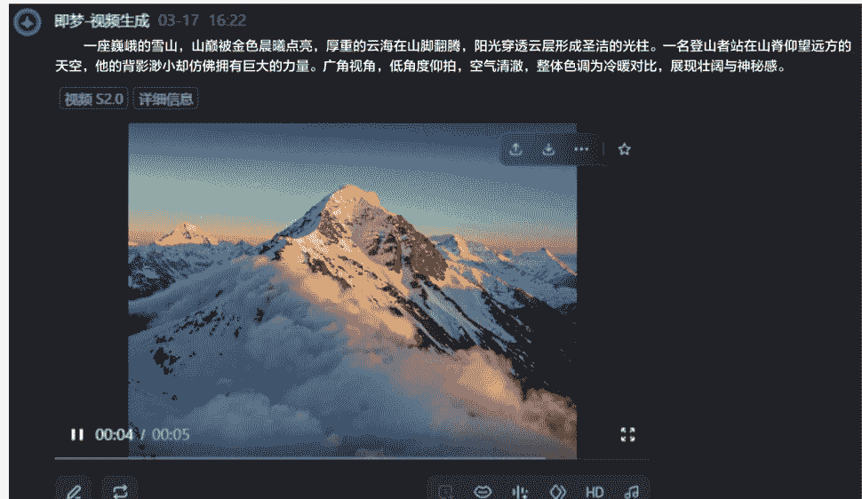
05 悬停视频上方，点击右上角下载，可保存到本地，见图7-27。

06 重复03-05，把后续风景场景全部生成并保存，如图7-28所示。
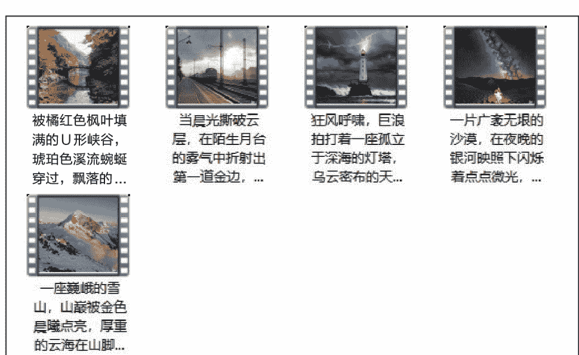
07 打开剪映App，点击下方剪同款进入模板页，如图7-29。

08 在搜索框输入旅行开场，选定合适短视频模板后进入预览页，点击右下角剪同款，导入即梦AI生成的素材，如图7-30至7-32所示。
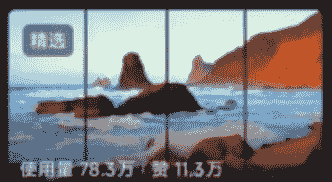

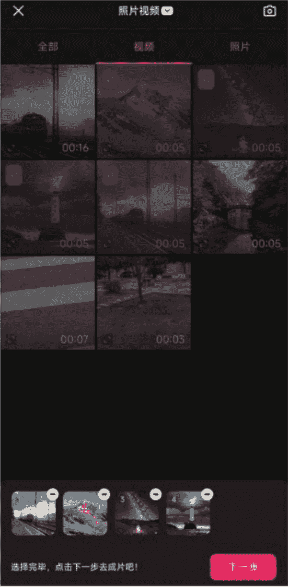
09 点击下一步进入编辑界面，可对素材做二次编辑，如加文字贴纸等，如图7-33。
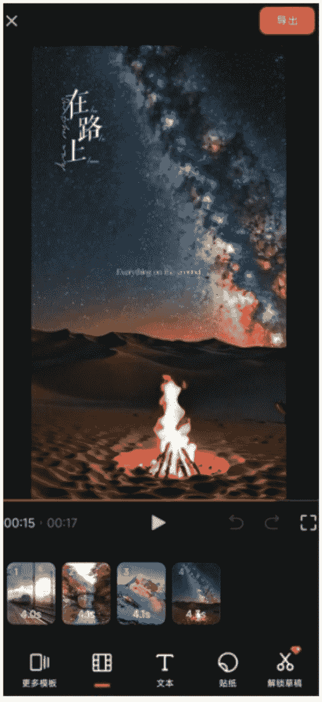
10 编辑完成后点右上角导出，在导出设置里点左下角保存，即可本地保存，见图7-34、7-35，最终效果见图7-36。
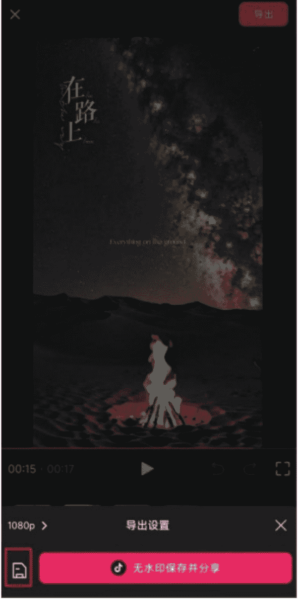
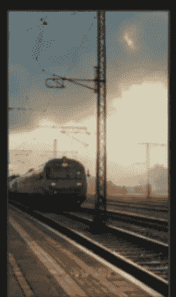
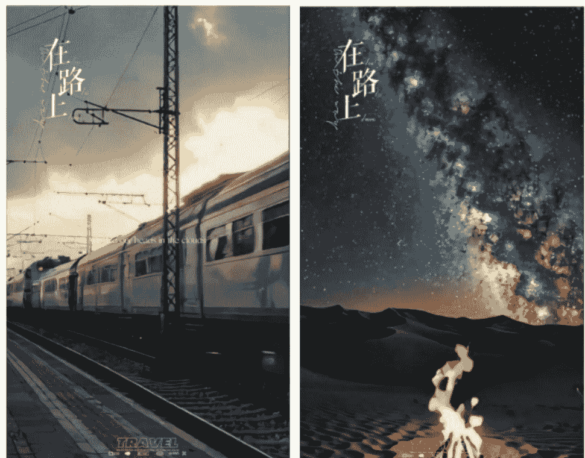

### 7.4 DeepSeek + 可灵AI + 剪映 制作AI绘本动画
绘本以精美插画与简洁文字构建幻想世界，对儿童阅读、观察、共情、创造与思维提升都有帮助。下面介绍用DeepSeek、可灵AI、剪映制作AI绘本动画的方法。

01 打开DeepSeek，在输入框输入提示词，如图7-37。

02 发送后，DeepSeek会生成绘本大纲及逐页描述，示例如下，注意内容可能存在瑕疵需自行甄别。

绘本标题：小狐狸与小兔子的冒险之旅

##### 一、页面结构
面向儿童的友情冒险故事，插画为主，每页配短句。

###### 第1幕
插画：阳光早晨，森林小河旁，小狐狸与小兔子背靠背坐着，笑容满面。
文字：在一片宁静森林里，小狐狸和小兔子是最好的朋友，每天一起玩耍分享快乐。

###### 第2幕
插画：两人望向林深处的小路，路尽头是神秘远方。
文字：某天他们决定踏上通往森林深处的冒险之路，想找传说中的彩虹瀑布。

###### 第3幕
插画：进入林深处，树木高耸，鸟儿歌唱，远处传来风声。
文字：森林愈发幽密，两人互相扶持，虽有点害怕却相信彼此在一起无惧危险。

###### 第4幕
插画：面前出现宽阔波光粼粼的河，河上无桥。
文字：他们被大河阻挡，小兔子害怕，小狐狸提议一起想办法，于是用树枝藤条搭了小桥。

###### 第5幕
插画：穿过茂密花丛，善良蜜蜂指向远山。
文字：穿越花海后遇到友善蜜蜂，它说彩虹瀑布在山那边，快去吧。

###### 第6幕
插画：两人爬上高山，远处隐约可见彩虹光芒。
文字：继续前行，艰难攀爬后登顶，远眺到阳光下闪耀七彩的彩虹瀑布。

###### 第7幕
插画：瀑布近在眼前，水花飞溅，七彩光环绕两人，他们兴奋跳起。
文字：终于抵达彩虹瀑布，这是他们见过最美景色，水花飞溅，彩虹如丝带环天。

###### 第8幕
插画：夕阳西下，彩虹仍挂瀑布，两人手拉手踏上归途。
文字：夕阳落下，他们带着美好回忆回家，知道只要有彼此，每一天都有新冒险。

##### 二、故事总结
该故事传递勇气、团结与探索精神，告诉孩子与朋友同行能克服困难找到美好。

03 对第1幕插画描述做提示词优化。因画面主要包含小狐狸和小兔子，可把第1幕提示词改为“早晨，一只小狐狸和一只小兔子，在森林小河旁背靠背坐着”，如图7-38。

提示：绘本面向儿童，可用卡通、皮克斯、迪士尼、涂鸦、水墨、极简、扁平、儿童绘本等风格词，也可加入艺术家姓名进一步控制风格，如齐白石、吴冠中、安迪·沃霍尔等。
04 优化后加入风格设定，如图7-39。

05 点击立即生成，得到对应图片后选一张下载到本地，如图7-40。
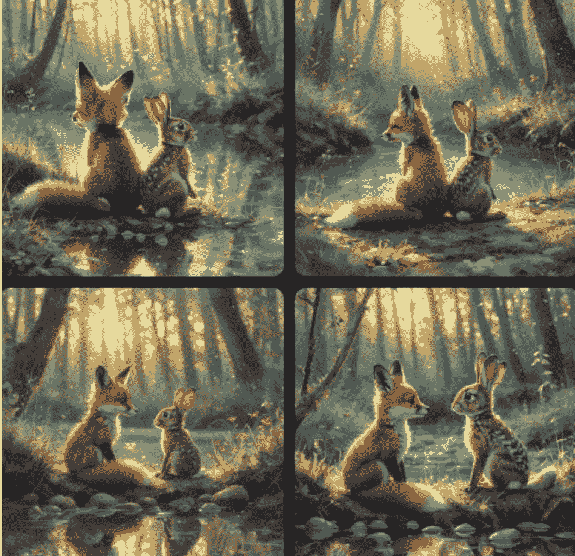
06 重复01-04，把后续7张图全部绘制并按顺序编号，避免混淆，如图7-41。
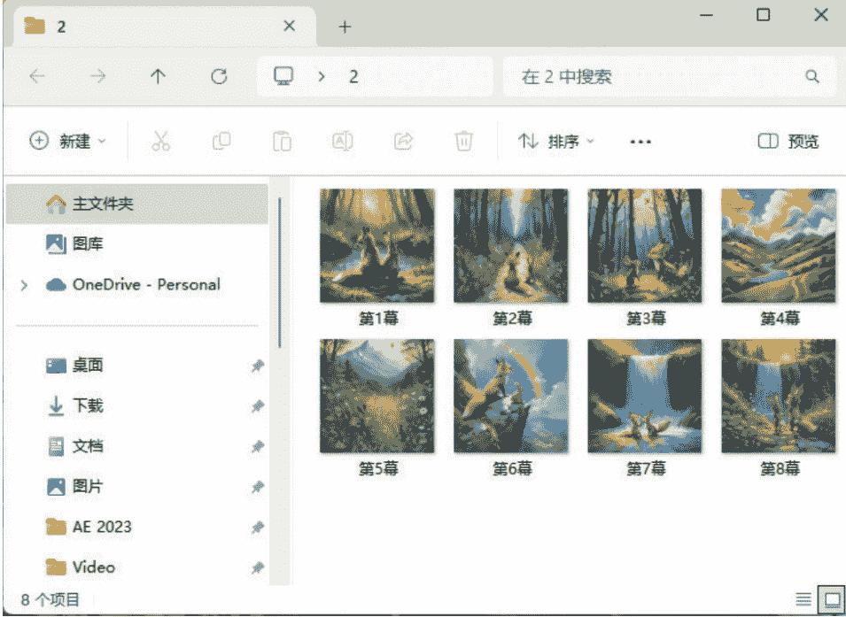
07 打开可灵AI主页，选择AI视频进入图生视频，上传第1幕图片，如图7-42。
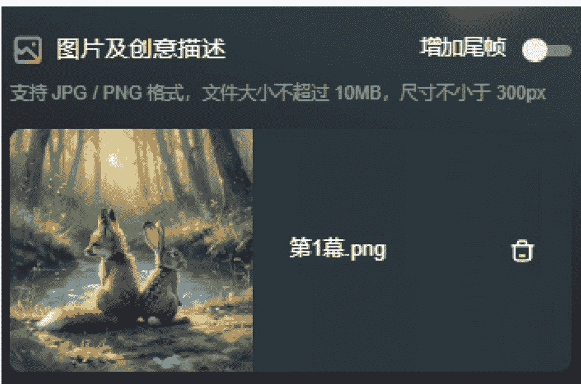
提示：可灵活使用图片创意描述、运动笔刷、参数设置等调节生成效果，如图7-43。

08 点击立即生成，即可自动得到对应视频，如图7-44。
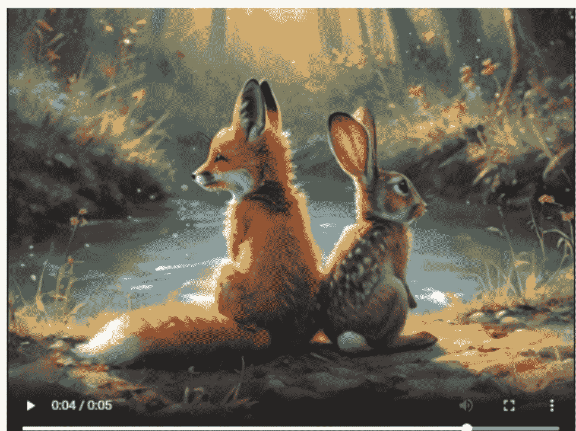
09 重复07-08，把其余7张图转为视频，如图7-45。
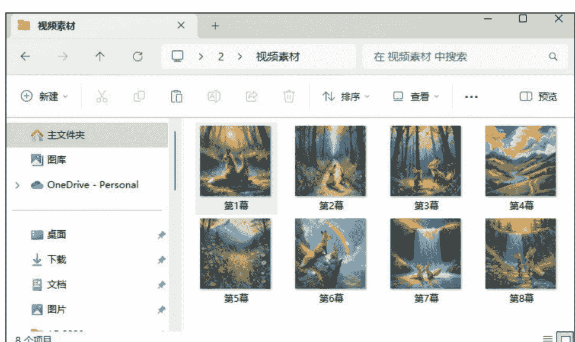
10 打开剪映网页版，导入视频并按故事顺序排列，完成剪辑后在左上角工具栏选文本-新建文本-默认文本，如图7-46。

11 依据画面输入匹配字幕。例如第一段讲述两人是好朋友，可输入“在一片宁静的森林中，小狐狸和小兔子是最好的朋友”，调整样式并置于合适位置，如图7-47。
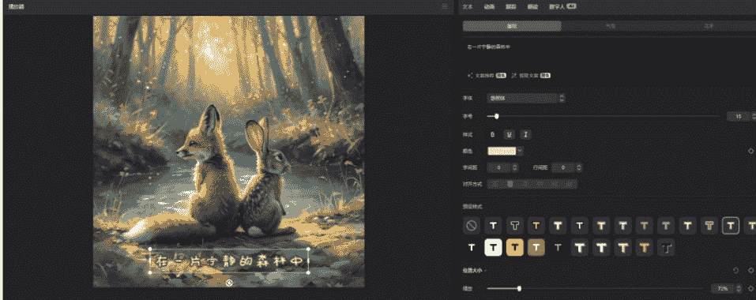
12 重复10-11，为后续片段逐一添加字幕，部分展示见图7-48。
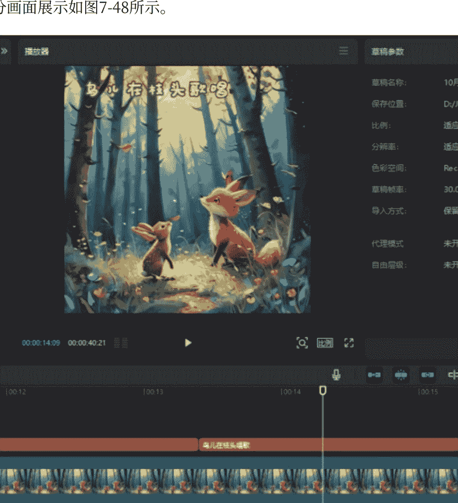
13 在时间轴上选中一段文本，如图7-49。
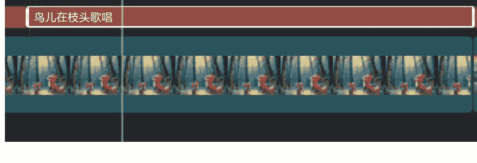
14 右上角选朗读，选择少儿故事音色后点开始朗读，剪映会自动生成旁白，如图7-50。
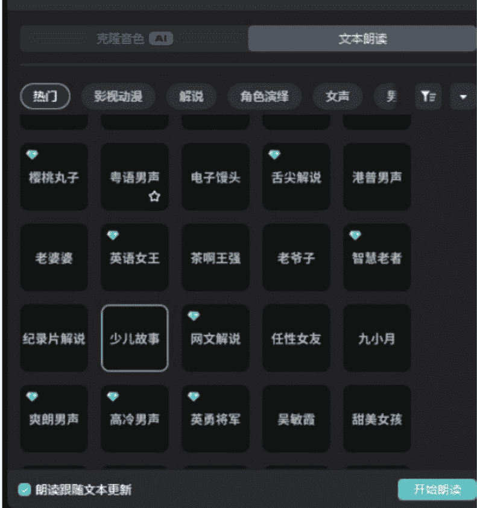
15 对旁白做剪辑微调，确保声音、画面、字幕同步，如图7-51。
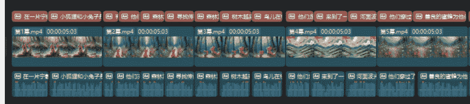
16 把时间线拖至两段素材中间，左侧选转场效果-幻灯片-翻页，如图7-52。
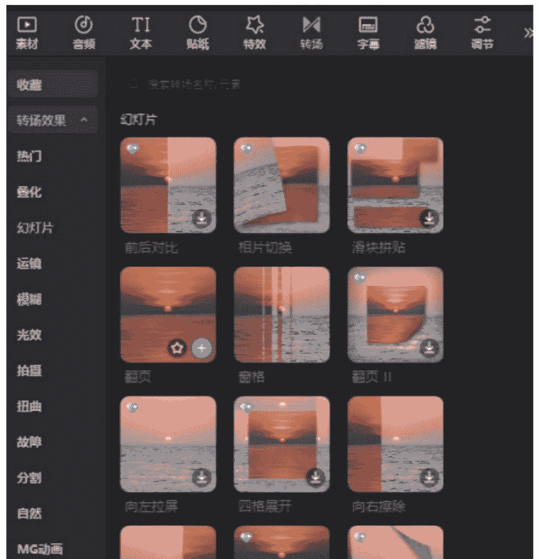
17 将翻页转场时长调至1s，效果见图7-53，按同样方式为后续素材添加转场。
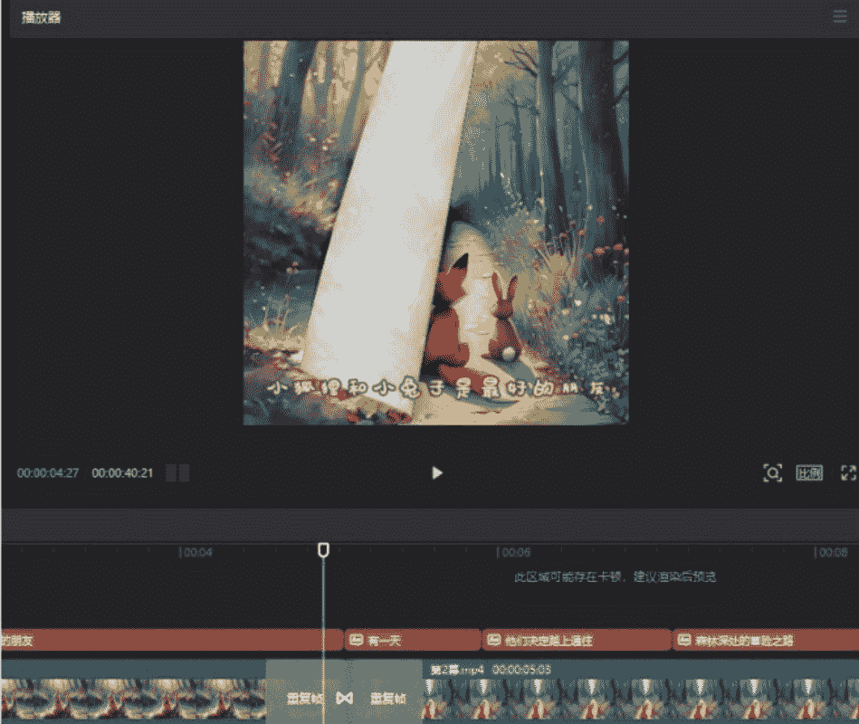
之后可加入喜欢的背景音乐提升吸引力，完成剪辑后导出即可。

### 7.5 DeepSeek + 即梦AI + 剪映 制作AI哪吒动画
动画电影《哪吒2：魔童闹海》票房突破150亿元，成为国产动画新里程碑，引发大量品牌与创作者跟进。本节将演示如何用DeepSeek+即梦AI+剪映组合制作爆火的哪吒风格动画，详细操作步骤如下。

演示视频入口

01 启动 DeepSeek，进入首页，在上方输入框填写指令词，参考图7-54。

图7-54

02 回车或点发送后，DeepSeek 会给出对应回复。下面是面向四个日常场景撰写的皮克斯风格绘画提示词，均保留哪吒经典形象要素。

##### 1. 起床
皮克斯三维动画质感，哪吒顶着黑眼圈梳着双丸子头，颈戴金圈腰缠混天绫，身着条纹睡衣配毛绒熊猫拖鞋，躺在雕花古木床上揉眼哈欠，莲花纹窗棂透进的晨光落在凌乱被褥，床头竖着火焰纹乾坤圈，整体呈现慵懒萌感与东方奇幻的碰撞，布料超写实，柔焦灯效，景深分明。

##### 2. 躺沙发吃零食
皮克斯式卡通渲染，烟熏妆加红绳双髻的哪吒瘫进云朵造型的懒人沙发，混天绫随意搭在青花瓷仿古茶几上，手里抓着超大袋虾片往嘴里倾倒，碎屑撒在绣莲花纹绸缎坐垫上，现代客厅与传统法器摆件并置，画面特写腮帮夸张鼓起，哑光质感搭配霓虹光晕，氛围诙谐。

##### 3. 跳芭蕾
迪士尼皮克斯风格动感画面，黑眼圈双丸子头的叛逆哪吒身着粉色蓬蓬芭蕾裙，混天绫化作渐变丝绸缎带缠绕臂间，在木质舞台上单脚旋转，金项圈铃铛随之作响，背景是水墨海浪幕与欧式水晶灯的拼接，表情由倔强过渡到惊喜，动感模糊凸显舞姿灵动，柔光粒子在周身环绕。

##### 4. 写作业
皮克斯夸张喜剧调性，经典造型的哪吒把迷你乾坤圈当橡皮用，趴在蟠桃木案桌前，毛笔杆被咬出牙痕，宣纸作业本堆满三头六臂涂鸦，混天绫委屈蜷在砚台边充当镇纸，窗外太乙真人探头的影子落在山水屏风上，痛苦的卡通表情配上炸开的丸子头，仿古宫灯暖黄光与气泡字“不想修炼！”碰撞出跨次元笑料。

每个场景均保留以下要点。

- 形象核心：黑眼圈、双丸子头、混天绫、金项圈。
- 风格融合：皮克斯式夸张面部表情结合中式纹样肌理。
- 材质刻画：三维渲染下的布料、金属、发丝细节。
- 光影处理：柔和体积光配合戏剧性高光。

可依生成效果调整混天绫晃动幅度或传统纹样的疏密。

03 打开即梦AI，选择“作图”或“图片生成”，把 DeepSeek 输出的提示词复制粘贴到创意描述框内，如图7-55所示。

图7-55

04 设置好图片比例和生图模型后点击“立即生成”，即可得到与提示词匹配的图片，如图7-56所示。

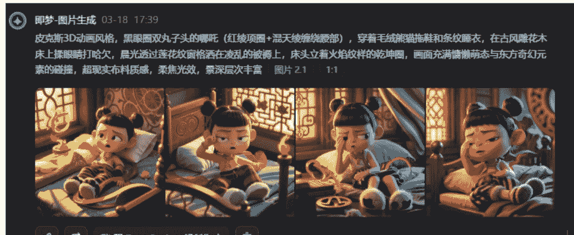

图7-56

05 将鼠标移至满意图片上方，点击“生成视频”按钮，如图7-57所示。

图7-57

06 再次把提示词粘贴到创意描述文本框，点击“生成视频”，即可产出对应视频，如图7-58所示。

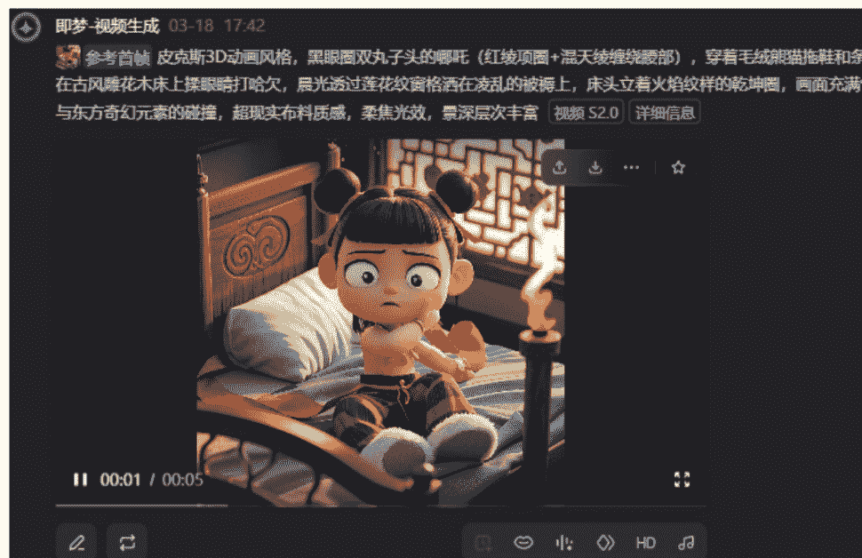

图7-58

07 把光标移到视频上，点击右上角“下载”，即可保存到本地，如图7-59所示。

图7-59

08 重复步骤03到步骤07，将其余三个场景的文字分别生成图片并转成视频，整理后的成片见图7-60。

图7-60

09 打开剪映网页版，导入刚生成的四个视频素材并拖到时间轴上，如图7-61所示。

10 进入“音频”→“音乐库”→“我命由我不由天”，为片子添加背景音乐，如图7-62所示，并裁剪、分割多余片段。

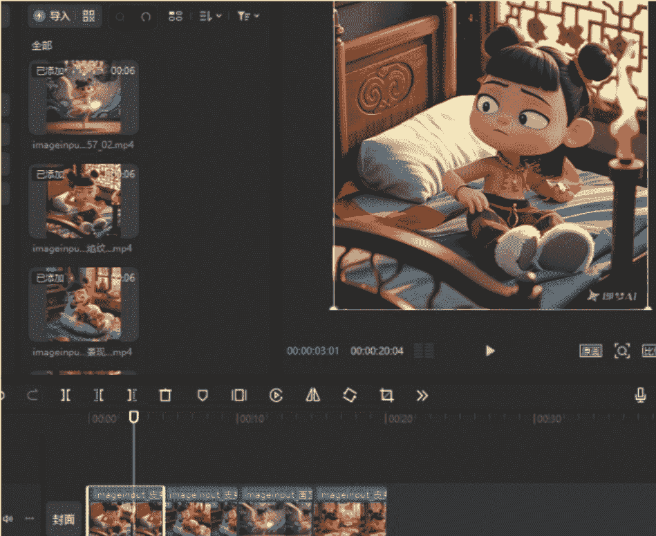

▲图7-61

▲图7-62

11 完成后点击界面右上角“导出”，即可把成片保存到本地，如图7-63所示。

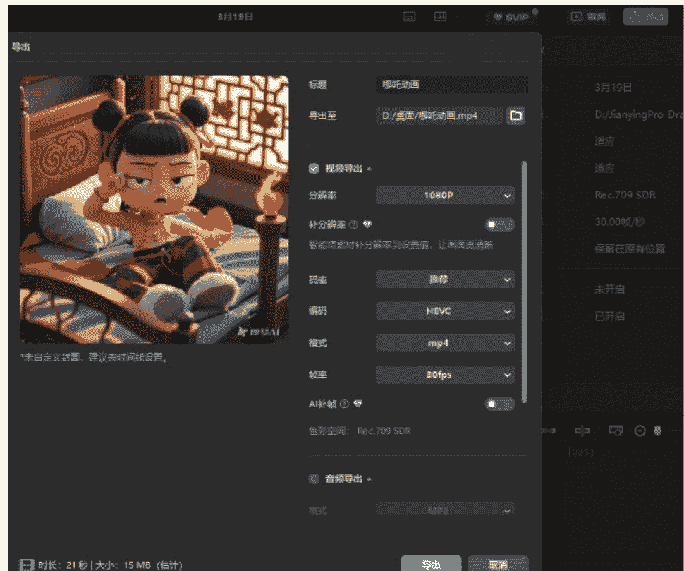

图7-63

## 章节总结

本章聚焦如何借助 DeepSeek 配合剪映、可灵AI、即梦AI 等新锐视频工具完成爆款短视频的制作，详细流程见下图。

▲扫码添加企业微信

回复关键词167791

免费领取视频、PPT课件、素材文件等资源