# AI公文写作

### 从提笔犯难到高效成文

许晓波 著

赠送
六大工具包

## 典型公文+AI加速+思维迭代

- 20种公文
  满足多场景需求
- 20多种国产AI工具
  对比测评与组合妙用
- 学会底层逻辑
  应对工具更新

中国人民大学出版社

# 推荐序

## 拥抱AI时代，开启公文写作新范式

当我们还在惊叹于ChatGPT的思考魔力、DeepSeek的学习潜力时，一场关于办公效率与职业技能的革命已悄然渗透到职场的每个角落。公文写作，这个曾被视为"笔杆子"专属的传统领域，也在AI技术的赋能下迎来了前所未有的变革机遇。许晓波先生的新作《AI公文写作》，正是在这样的时代背景下应运而生，为职场人破解公文写作难题提供了一份兼具前瞻性与实操性的行动指南。

## AI重构职场：从"笔耕不辍"到"人机协同"的必然跃迁

职场公文写作的核心，是信息的高效传递与价值的精准表达。

传统公文写作中，从业者往往要将七成的时间用于格式调整、数据核对与资料查阅，真正用于深度思考的时间不足三成。这种"重机械劳动、轻创意输出"的工作模式，在AI时代面临颠覆性挑战。

正如书中所言，以DeepSeek为代表的AI工具，不仅能快速生成高质量公文初稿，还能根据场景自动调整语言风格，甚至通过数据深度学习优化内容。这意味着，那些曾被视为"护城河"的技能，正在被技术攻破。

但AI的价值绝非简单替代人类劳动，而是推动"人机协同"新范式的诞生。在公文写作领域，AI正成为解放生产力的新工具——它帮我们完成格式规范、语句润色等基础工作，让我们得以腾出精力深耕政策理解、逻辑建构与思想表达。

这种转变，不是对传统的颠覆，而是"人尽其才"职场哲学的回归。AI时代，真正的核心竞争力，在于用技术赋能思考，让文字成为思想的容器。

## 深耕细作：一本展现匠心的公文写作"破局之书"

作者许晓波先生身为资深"笔杆子"，既有行政工作中高频公文写作的实战经验，又具"秋叶写书私房课"系统训练的专业功底。为打磨这部作品，他阅读了市面上诸多同类公文写作图书，在网上浏览大量AI应用资料，深入研究20种职场常用公文类型，最终构建起完整体系。

本书并非浅述AI工具的简单应用，而是先为读者夯实传统写作根基——从通知的要素表单到通报的结构解析，从工作计划的任务分解逻辑到工作总结的数据提炼技巧，均以场景化案例拆解写作密码。

唯有扎深传统之根，方能辨清AI工具的应用边界，避免被"算法幻觉"误导。更值得称道的是，作者注重对AI工具特性的研究。书中精选多种AI工具，针对不同文种匹配最佳应用方案：用Kimi办公室笔杆子生成通知初稿，以讯飞文书完成通报智能核验，借通义实现工作计划的语音转写与PPT转化……这种"工具特性、文种需求、职场场景"三维匹配，展现出对AI生态的深度驾驭能力。

## 实战致用：20种公文写作的"AI赋能全图谱"

翻开本书，仿佛打开一本职场公文写作的"AI应用百科全书"。作者以"基础应用—沟通表达—规划执行"为逻辑主线，精选20种高频公文，构建起覆盖职场全场景的写作指南。

每一种公文均遵循"传统技巧解析—AI工具操作—闭环思维优化"的模型，辅以"情境体验""任务卡""小试牛刀"等实战环节，让读者在模拟训练中掌握"人机协同"的核心技法。

以通知写作为例，作者先解析标题、发文字号、主送对象、正文等七大要素，再通过职工技能培训会议通知案例演示"定标题—列对象—写正文—提要求—明身份"五步法，随后引入Kimi办公室笔杆子与讯飞文书的对比，最后以"技能加油站"强化目标导向思维与创新呈现技巧。这种"理论—案例—工具—思维"的四层递进结构，使读者既能掌握"怎么写"的操作细节，又能领悟"为什么这样写"的底层逻辑。

书中的案例具有示范价值。在会议纪要生成中，通过AI工具进行语音转写并提取关键决策，再以闭环思维让AI生成任务分解表与跟进节点……这些场景化应用，让抽象的AI技术转化为可复制、可迁移的职场技能。

无论你是初入职场的新人，还是深耕多年的"笔杆子"，这本书都能带给你颠覆性启发。当公文遇上新质生产力，不变的是对思想深度的追求，可变的是抵达目标的路径。

这是一本职场生存手册，更是一份办公范式指南，帮助你实现从公文撰写者到职场价值创造者的跃迁。

秋叶

# 前言

## 当公文遇上新质生产力

二十多年前，电脑第一次走进我的生活。我盯着电脑屏幕，用手指一个键一个键地敲打出文字，看见网页上的每一张图片、每一段文字时，内心充满惊奇。互联网像一扇突然打开的窗户，让我看到了一个全新的世界。但当时的我并不知道，当手写信变成了电子邮件，当商场搬上了网络，无数人的生活悄然转变。如今，站在AI时代的入口往回看，这场景似曾相识——新技术的出现如同春雷般，唤醒万物，促成新生。

从几年前ChatGPT诞生到如今的DeepSeek火爆出圈，AI的浪潮早已不是"一般将来时"，而是"现在进行时"。当DeepSeek以更低的成本、更高的效率和更强大的学习能力出现在我们的面前，我们处理信息和解决问题的方式也随之改变。

这段时间，我注意到许多行业的从业者开始重新思考自己的角色，他们中有律师，有作家，也有教师。一位律师朋友使用了一段时间DeepSeek之后发出感慨："自己从业多年积攒的案例库，本以为是护城河，如今只需几秒钟就可能被跨越了。"这种正在发生的变化，既能使效率提升，也是一种不得不应对的挑战。AI正在让知识的获取变得更加便捷，但这也意味着，可能需要重新评估许多曾经被视为"护城河"的技能的价值。

作为一名有着多年公文写作经验的创作者，我自然深知这种变化带来的冲击力有多猛。公文写作，历来被视为"笔杆子"们的专属领域，需要严谨的逻辑、精准的表达，以及对政策、数据的深刻理解。然而，AI的出现，正在重新定义这一领域。以DeepSeek为代表的AI工具，不仅能够快速生成高质量的公文初稿，还能根据不同的场景和受众，调整语言风格和表达方式。更重要的是，它能够通过你提供的数据进行深度学习并不断按照你的提示优化内容。

或许你很忧虑：照这样发展下去，我的"饭碗"还能保得住吗？但忧虑有什么用呢！不如调整好心态去积极拥抱变化。当你把过去的重复劳动交给AI工具，自己不断提升创造力与洞察力时，就是新质生产力带给你的转变契机——让你的工作不仅高效，还能创造出新的可能。

新质生产力不仅仅代表着技术的飞跃，也预示着"人机结合"的工作方式将成为一种常态，并通过转化渗透进我们生活的方方面面。它体现在我们如何利用AI优化工作流程、提高生产效率，甚至创造全新的商业模式。比如，在制造业中，AI驱动的智能生产线正在大幅提升产能；在医疗领域，AI辅助诊断系统通过积累的数据，让医生更准确地判断病情；在公文写作领域，AI工具可以帮助我们更快地完成高质量文稿的撰写，从而让我们有更多时间思考和调研。

"拥抱AI，拥抱变化"不是一句随便喊喊的口号。本书要教会你用AI写公文，教会你如何充分利用AI工具实现工作效率的快速提升，绝不是教你偷懒；本书不会停留在列举指令和生成内容上，而是精炼传统技巧、适当融入创意，尝试让你理解公文，让你去靠近它，更好地去优化它，甚至改造它。

本书中的"闭环思维"特指公文写作过程中规划层、生成层、精修层之间的定向信息反馈机制。根据文种特性，拓展层可作为可选模块接入闭环。整个过程通过每一层级的优化，逐步提升公文质量，直到最终完成，而非机械循环。这一闭环过程具有动态性，可根据实际情况灵活调整，确保公文写作的高效性和适配性。

写这本书时，我念兹在兹者是"无论技术怎么变，掌握方法就是以不变应万变"。AI时代，技术的更新速度无疑是飞快的。但在公文写作领域，只要你掌握了"闭环思维"这个法宝，任凭工具千变万化，你不至于茫然，清晰的思路能让你的写作"稳如泰山"。就像哪吒闹海时用的混天绫，看似柔软却能搅动乾坤——我们要练的，正是这种以柔克刚的真本事。

当公文遇上新质生产力，时代这本厚重的书翻开新的一页。或许你还在校园中憧憬未来，或许你刚刚踏入职场，或许你正在成长为"笔杆子"的路上奋力前行。无论你处于哪个阶段，扮演什么角色，持续学习都是应对这个快速变化时代的不二法门。

为了让你的学习之路更加顺畅，我精心准备了一份实用的附赠资源包，其中包含AI公文模板库、标题急救包、AI提示词实战补充包、公文写作常见雷区、效率工具包以及实战互动问答库等内容。这些资料是我多年经验的结晶，希望能给你的写作带来实实在在的帮助。

关注微信公众号"晓波者也"，并在对话框中输入"AI公文写作"，即可免费获取附赠资源包的下载链接。

虽然本书AI部分的操作指南力求捕捉最新状态并融入了应对变化的"闭环思维"设计，但是未来某个AI工具的界面变化或细节功能调整很可能发生。别担心！这个微信公众号会及时应对此变化。如果你在实际操作时恰好遇到因某AI工具更新带来的困扰，可以在这里查找我视情况整理并分享的更新动态。也欢迎你在微信公众号中交流遇到的挑战，希望能帮你更顺畅地跨过这些小门槛。

这个微信公众号还会定期分享写作干货和最新资讯，欢迎随时与我交流，分享你的学习心得和写作故事。

愿未来，我们携手共进，一起探索，在人工智能时代，用文字书写无限可能。

# 第一部分 开启你的高效AI公文写作之旅

## 第1章 传统在左，智能在右

### 引子

还记得你第一次写公文时的样子吗？或许你满怀期待，想着用一份条理清晰的报告赢得上级的认可，用一份扎实的方案理顺工作思路，用一封规范的函解决部门间的难题。可现实总爱给深夜加班的你当头一棒——盯着电脑屏幕，你一遍遍调格式、对数据、改措辞，直到文档左下角的字数统计变成一种折磨，直到最初的灵感和热情被消磨得所剩无几。

这种感受，你应该不会感到陌生。被领导批注"重点不突出"时的无奈，因格式问题被打回重写时的尴尬，还有那些被灵感枯竭折磨得身心俱疲的时刻，曾困住无数公文写作者。

但今天，事情或许有了转机。当AI工具走进公文写作，我们是不是终于可以减少重复劳动，多点时间留给真正的思考？是不是终于能让文字回归本质，让创意不再被琐碎之事束缚？

#### 1. 加班夜的内心独白

深夜的办公室，键盘声敲碎了寂静。你盯着屏幕上的报告材料，无奈地摇着头："这已经是第三版了，可还是没通过。"领导的批注很具体——"主送单位格式不对""政策依据需要补充附件"……这些反馈像一盆盆冷水，就快要浇灭你初写公文时的热情。

白天的会议上，同事分享的报告让你印象深刻——结构清晰、数据精准，甚至用几段话就说清了半年的工作趋势。那一刻，你既羡慕又焦虑，心情复杂。

事实上，这并非代表你能力有问题。相关调查显示，在传统公文写作中，新人往往将70%的精力用于格式调整、数据核对和资料查阅，真正用于深度思考的时间不足三成。

"我该怎么办？"这是很多公文写作新手常挂在嘴边的一句话。对时间的焦虑，对格式的恐慌，对灵感匮乏的苦恼，全都化作了实实在在的"加班"与"熬夜"。

#### 2. 当公文写作遇上DeepSeek

转折发生在你遇见AI的那个下午。DeepSeek火爆出圈，你抱着试一试的心态，将一篇报告的写作要点输入对话框。十几秒钟后，屏幕上出现了一份格式工整的报告。你读了读，感觉写得还不错，于是你在此基础上做了部分语句的替换及细节的补充。这让你按时下了班。

但这只是开始。当你尝试用DeepSeek的R1模型进行深度思考以分析工作数据时，它不仅能给出明确建议，还会提示你在撰写时可能遇到的问题。而你不点"深度思考"，DeepSeek的V3模型能帮你快速生成结构完整且不乏金句的初稿，让你顿感"眼前一亮"；当你起草项目汇报时，它会根据领导的阅读偏好，自动调整"精简版"与"详细版"的结构。那些曾让你熬夜的机械劳动，正在被技术悄然接手。

不过，真正的惊喜藏在细节里。某天，你提交的工作总结被领导称赞"有深度"，其实那是你在AI梳理的框架基础上，加入了对工作内容的创新思考；某次紧急会议上，你快速拿出应对方案，背后是AI替你完成的实时数据分析。你忽然明白：AI不是取代你的对手，而是让你腾出时间雕琢思想的一把刻刀。用好它，能将你的工作雕出花，为你"锦上添花"。

#### 3. 清醒与博弈

技术往往具有两面性。有人沉迷于AI生成的所谓"完美文本"，却逐渐忽略了其局限性：它可以写出"把握稳的要求，找准进的方向，盯住高的目标，谱写新的篇章"这般的金句，却难以捕捉到"陪新员工一起吃饭"这样的温暖鼓励与细腻关怀；它可以罗列"用户满意度提升10%"这样的数据，却无法洞察"客服响应太慢"这条差评背后隐藏的实际管理漏洞。

这正是职场人必须面对的课题——在机器的高效与人类的温度之间，找到平衡的支点。

一位已熟练运用AI的资深"笔杆子"曾分享过经验：每次用AI生成初稿后，他总会对着文档问自己三个问题——这组数据想要传递什么信号？领导最关心的核心问题是什么？落地执行时可能会卡在哪里？正是这三个问题，让他经过人工优化后的报告兼具"快、狠、准"的特点。

AI能够整理会议纪要，但只有你清楚会议室里那句未被记录的叹息背后的深意；它能生成政策摘要，但只有你亲自走访过现场，才知道文件里"优化流程"这四个字需要拆解成多少具体动作。

#### 4. 改变

"苟日新，日日新，又日新。"这本书将带着上述思考，以全新的视角陪伴每一位想写好公文的读者，开启三段全新的体验旅程。

第一段旅程——放下恐惧。毛主席说过，在战略上要藐视敌人，在战术上要重视敌人。如果把公文写作当作一项艰巨的任务，那么AI工具就是你手中的一件新式武器。它可以快速统一全篇格式，短时间内生成并优化文稿，但真正决定成败的，始终是你的思想。当读完本书，"格式规范""表达精准""创新立意"这"三驾马车"成为你可以驾驭的工具，你原本的恐惧就会转化为从容。

第二段旅程——拿起笔杆。这本书为你精心挑选了20种职场常用公文类型，并匹配了多种AI公文写作工具。针对每种公文特点，为你量身设计了"闭环思维"和代入感十足的"情境体验"，让你直观理解公文的实际应用。不仅如此，一些章节的"技能加油站"部分还专门设置了"职场思维启蒙"专栏，为你提供除技巧以外的启发性思维。

第三段旅程——创造价值。每一项公文写作的任务，除了领会精神，吃透政策，更离不开实际调研。陆游有诗云："汝果欲学诗，工夫在诗外。"当你选择拥抱AI，写好公文的要义就是你要在AI浪潮之中依然保持勤勉的思考与对写作意图的深入探索。"路漫漫其修远兮，吾将上下而求索。"要写一篇好的公文，不是将任务全部交给AI，而是要将你的思想"融进去"，让文字既能"开花"，也能"结果"，"花"是你的文字，"果"是你的思想，两者统一，才能创造出价值。

#### 5. 写在出发前

如果你在面对领导批注时仍自我怀疑，如果你在截稿日期前仍焦虑不安，如果你在对比他人文稿时仍心生羡慕，那么请记住：职场写作的终极意义，从不在"写完"，而在"写透"——写透政策的深意，写透问题的本质，写透解决方案中的人性考量。

这本书不会给你速成的捷径，但会赠你两把钥匙：一把是传统写作的根基，让你在不断变化的技术浪潮中站稳脚跟；另一把是AI工具的高效助力，助你摆脱重复劳动的枷锁。让我们共同启程，在AI时代的公文写作中，找到属于自己的节奏与方向。

开启你的AI公文写作之旅。此刻，正当其时！

## AI公文写作：你必须知道的事！

公文写作，并不容易；公文写作，有方法可循。在AI时代，提升公文写作效率已是"箭在弦上，不得不发"。但我们在使用AI工具辅助公文写作的同时，应该思考一个问题：如何更好驾驭AI，实现人机协同，既要确保AI不成为"脱缰野马"，也要充分发挥其优势，让其成为公文写作的"称心小助理"。

这本书中提及20种常用公文类型，总共分为三大类，即基础应用、沟通表达与规划执行。这本书的设计思路，可通过以下三个关键词来简要说明，这也是你进行AI公文写作时必须知道的事！

第一个关键词是"根"。这个"根"是扎实的写作技巧。你想让AI辅助写好公文，第一步不是在对话框直接提问，而是掌握传统技巧。只有学好这些技巧，打牢基础，你才能清晰辨别什么是对，什么是错，才不至于被"AI幻觉"带偏。

传统技巧部分占本书的一半篇幅，正是出于上述原因。你可以从基础学起，掌握公文写作规范。从公文格式的严谨规范到公文用词的贴切表达，只有将"根"扎得深，你才能在AI时代更好地辨清方向。

第二个关键词是"变"。AI时代，其局面的变化唯有用"快"字来形容。比如一个AI工具的大模型现在是1.0版本，用不了多久就会出现2.0、3.0甚至4.0版本。因此，这本书里面的公文写作"闭环思维"应运而生。我们针对每一种公文的特点进行工作流的闭环设计，比如：一份通知可以调整为不同风格，一份工作总结需要配套一份PPT。从单一文本到多元呈现的闭环设计，从思维聚焦到落地实操的全流程规划，是应对快速变化的简便方法。

当你能够基本掌握传统技巧并结合"闭环思维"来撰写公文，无论AI工具如何变化，你都能厘清思路，做到"以不变应万变"。

第三个关键词是"新"。"新"既体现在内容的新意上，也体现在公文写作与职场结合的创新思考中。"职场思维启蒙"专栏完全跳出了传统的写作技巧，转而聚焦职场思维启发。它不再局限于文字表达，而是尝试从更宏观的视角，帮助读者理解职场中的思维方式与公文写作之间的部分内在联系。公文写作应用于职场，其核心目标是更好地完成任务，实现既定目标。职场环境复杂多变，公文写作不能仅仅停留在文字层面，它更需要与实际工作紧密结合，展现出更多的灵活性与实用性。

AI时代，在通过AI工具辅助公文写作的同时，你最应该做到的是保持自己的独立思考。你可以让AI去完成那些重复性、规律性强的事情，而将精力专注于更复杂、更具创造性的部分。唯有如此，你才能在AI时代锻造出真正的职场核心竞争力，让自己不可替代。

# 第二部分 基础应用类公文：职场关键技能

## 第2章 通知与通报

### 如何写出让人秒懂的通知？

在快节奏的工作环境中，信息的传递必须迅速且准确。作为职场新人，你可能已经发现，一份清晰、简洁的通知不仅能提升工作效率，还能减少误解和重复劳动。那么，如何才能写出让人秒懂的通知呢？秘诀其实很简单：抓住重点，简化语言，确保每个字都有价值。

#### 从0到1掌握通知撰写的关键方法

根据《党政机关公文处理工作条例》，通知是15种法定公文之一，发文数量最多，使用最频繁。在日常工作中，发布、转发、批转、指示、事务及任免类通知均为常见类型，尤其是事务类通知，占比最高，是绝对重点。

为了让你迅速把握通知的核心要点，并知道下一步该怎么做，我精心准备了一份简化版的通知要素表单（见表2-1），作为你撰写通知时的备忘清单。

| 通知要素 | 描述 |
|---------|------|
| 标题 | 简洁明了，直接点出核心主题（例如："关于[具体事项]的通知"） |
| 发文字号 | 服务于文件的归档、检索和管理（样式如下：发文机关代字〔××××〕×号） |
| 主送对象 | 指定接收通知的具体人员或群体 |
| 正文 | 分段落撰写，每段围绕一个中心思想；重要信息可采用分层结构清晰列出 |
| 行动要求 | 具体说明收件人需要采取什么行动，包括截止日期等关键信息，别忘了提醒携带必要的物品或材料 |
| 联系方式 | 提供至少一种联系方式，以便读者有问题时可以咨询 |
| 落款 | 包括发布单位/部门和发布日期，清晰标注发布者身份及通知发布的具体时间 |

表2-1 通知要素表单

掌握了这些基本要素后，你会发现，写通知其实并不复杂。但要真正做到秒懂，还需要一些额外的小窍门。接下来，我们将通过一个实际的任务来展示如何运用这些技巧。

#### 情境体验

你是甲单位办公室的一名行政助理，领导交给你一项任务：在最短时间内撰写一份关于即将举行的职工技能培训会议的通知。这是你入职后的第一个重要任务，必须全力以赴，确保所有职工都能及时了解并做好准备。主任特别强调要提醒参会人员带好笔记本电脑或其他记录工具，准备好发言材料；提供联系方式以解答疑问。

面对这个任务，作为新手的你可能会觉得有些不知所措。不用担心，接下来，我将教你用上述通知要素表单拆解出的通知撰写五步法，让你快速写出一份让人秒懂的通知。

- 第一步：定标题。选择一个简洁明了的标题，直接反映通知的核心主题。
- 第二步：列对象。明确指出接收通知的具体人员或群体。
- 第三步：写正文。分段落撰写，每段围绕一个中心思想。关键信息可以分层列示，使内容条理清晰，易于阅读。
- 第四步：提要求。提供具体的行动要求，明确告知需采取的行动，包括截止日期、需携带的物品及联系方式等。
- 第五步：明身份。落款处标明发布单位/部门，并注明发布日期，确保来源清晰可信。

有了这五步，你可以更有条理地组织通知内容，确保每个部分都达到理想效果。现在，让我们回到先前的情境中，借助表2-2，一起来看看五步法的实际运用。

| 步骤 | 说明 | 通知内容 |
|:---|:---|:---|
| 定标题 | 直接反映核心主题 | 关于举行职工技能培训会议的通知 |
| 列对象 | 指定接收通知的对象 | 主送对象：全体职工 |
| 写正文 | 分段落撰写，包含时间、地点及其他重要信息 | 一、时间：20××年××月××日（星期×）上午××； 二、地点：甲单位二楼会议室； 三、培训内容介绍：主题、主讲人等。 若设有互动提问交流等环节，也可在此处展现 |
| 提要求 | 明确告知需采取的行动并附上联系方式 | 可添加注意事项，然后将要点在此处列明： 1. 请携带笔记本电脑或其他记录工具； 2. 请提前准备好发言材料并确保能在会议上分享。 有任何疑问请联系综合办公室，附上联系电话 |
| 明身份 | 落款处标明发布单位和日期 | 发布单位/部门：甲单位办公室 发布日期：20××年××月××日 |

表2-2 通知撰写五步法的实际运用

学到这里，相信你对撰写通知已经有了清晰的思路和方法。让我们通过一个小贴士，再次梳理撰写通知的要点，帮助你稳步向前。

#### 小贴士

- 1. 保持简洁：避免冗长的句子和复杂的表达，直入主题。
- 2. 检查细节：确保所有信息准确无误，特别是日期、时间和地点。
- 3. 明确行动事项：通过清晰的表述来传达需要采取的行动，让读者一目了然。
- 4. 测试可读性：找一位同事阅读你的通知，确保他能快速理解并采取行动。
- 5. 建立模板库：建立常用通知的模板库，以实现高效撰写。

#### 手把手教你用AI写通知

掌握了通知的基本要素和写作技巧后，你已经为高效撰写一份通知打下了坚实的基础。接下来，我们将探索如何利用AI进一步优化通知写作过程，让你能够更快、更准确地完成任务。相信你会对AI在日常工作中带来的便利感到惊喜。让我们一起看看它是如何做到这一点的吧！

在开启AI撰写通知的旅程之前，我们有必要先厘清公文传统撰写与AI辅助撰写之间的差异。

传统技巧部分，我们以清晰的步骤式讲解为核心，如同搭建一座房子，先筑牢地基，再逐步向上构建每一层，每一步都承载着明确的任务与目标。这种线性流程，确保了撰写的条理性和可操作性，让你能够稳扎稳打，迅速掌握要领。

而在AI辅助撰写部分，我们借助AI的力量，将撰写过程拆解为多个层级，涵盖规划、生成、精修，在某些公文中还会触及拓展层。这些层级形成一个持续优化的智能循环，宛如一个高效运转的"工作闭环"，因此我将其命名为"闭环思维"。

借助表2-3，你可以更直观地理解闭环思维的构成。

| 层级名称 | 定义说明 | 核心功能 |
|:---|:---|:---|
| 规划层（定位） | 明确写作目标和核心信息，梳理需求 | 收集信息、设定框架、锁定关键要素 |
| 生成层（创作） | AI生成内容并调整风格，完成核心创作 | 文本生成、调节语气/风格、优化逻辑 |

表2-3 AI辅助公文撰写"闭环思维"

| 层级名称 | 定义说明 | 核心功能 |
|:---|:---|:---|
| 精修层（校准） | 对可直接使用的基础成果进行基础质检及内容优化 | 校对格式、基础排版、智能润色 |
| 拓展层（增值） | 提供延伸服务，凡事"多想一步"，提升成果价值 | 生成PPT/演讲稿、风险预案、思维导图 |

续表

简单来说，规划层解决"要写什么"的问题，生成层解决"怎么写出来"的问题，精修层解决"怎么改"的问题，拓展层解决"还能做什么"的问题。

不同公文类型的操作方法虽各有差异，但其底层逻辑保持一致。在某些公文类型中，为了适应特定的撰写需求，会将某些步骤紧密结合起来。例如，在请示的撰写中，生成初稿与多方案构思结合，形成了生成层的内容。这种结合有助于兼顾结构的清晰性和内容的灵活性，从而更好地满足特定需求。

通过这种层级化的结构，AI辅助撰写不仅能够高效完成基础任务，还能在特定场景下输出更优质的内容，帮助你更好地应对复杂的公文撰写需求。

回归正题。日常工作中，撰写通知是发生概率极高的任务项，所以当我们接到领导任务，要以最短时间完成一份质量上乘的通知时，你可以让AI充当助理角色，助你一臂之力。撰写通知的关键在于理解并运用规划层、生成层、精修层三个核心层级，从而形成高效的闭环思维（见图2-1）。

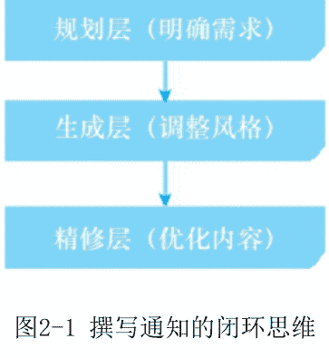

图2-1 撰写通知的闭环思维

规划层（明确需求）：让AI深入理解具体需求，包括通知的类型、目标受众、关键信息等。

生成层（调整风格）：让AI根据需求分析的结果，选择合适的风格和语气。

精修层（优化内容）：利用AI工具对生成的公文进行多方面的优化，包括语法、创新元素、内容准确性等。

那么，具体该如何操作呢？通过领取任务卡，了解你的通知任务详情，再让我们的AI小助理闪亮登场，带来AI工具的实际操作演示，让你轻松掌握使用技巧。

##### 任务卡

公司因人才发展战略需要，决定对部分员工的岗位进行调整。领导要求你立即起草一份关于岗位调整的通知。

为了帮助你更直观地了解目前市场上的AI公文写作工具，在综合类和专业类中本书各选取了一种——Kimi办公室笔杆子和讯飞文书。

###### Kimi办公室笔杆子

登录Kimi官方平台，选择办公室笔杆子选项（在"Kimi+"界面的"辅助写作"中找到"办公室笔杆子"），输入指令：

- 你是一名办公室笔杆子，现在需要完成一份岗位调整的通知。

获取的要素信息见图2-2。

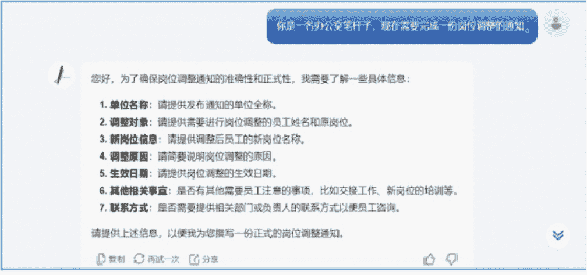

图2-2 岗位调整通知信息要素采集模板

此时，Kimi办公室笔杆子会自动帮你分析需求，你只需按照提示填入相应信息即可。

以下是Kimi办公室笔杆子的回答。

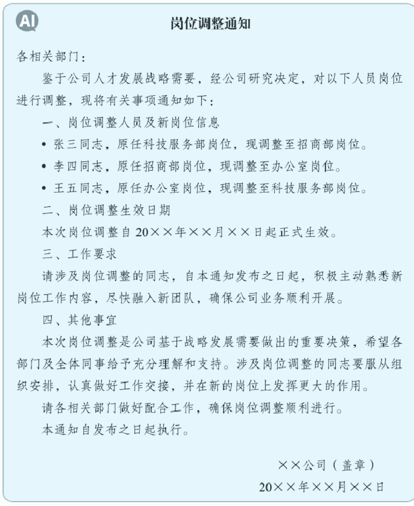

乍一看，Kimi办公室笔杆子给出的答案已经不错，只需要人工微调即可完成任务，但我们可以提出风格和语气方面的调整要求，如要求风格更正式，语气更积极。

以下是Kimi办公室笔杆子的回答。

###### 关于岗位调整的通知

公司各部门：

为进一步落实公司人才发展战略，优化人力资源配置，经公司研究决定，对部分员工岗位进行调整。现将有关事项通知如下：

####### 一、调整人员及新岗位信息

- 1. 张三同志，原任科技服务部岗位，现调整至招商部岗位。
- 2. 李四同志，原任招商部岗位，现调整至办公室岗位。
- 3. 王五同志，原任办公室岗位，现调整至科技服务部岗位。

####### 二、调整原因

本次岗位调整是根据公司人才发展战略需要，旨在更好地发挥员工的专长和潜力，促进公司业务的持续发展和创新。

####### 三、生效日期

本次岗位调整自20××年××月××日起正式生效。

####### 四、其他相关事宜

请上述同志在调整生效后，以积极主动的态度熟悉新岗位工作，尽快融入新团队，确保公司业务顺利开展。同时，各部门要积极协助调整人员做好工作交接，保证工作连续性和稳定性。

公司对各位同志在新岗位上的表现充满期待，相信通过大家的共同努力，我们能够实现公司的发展目标，共创辉煌。

本通知自发布之日起执行，未尽事宜，由人力资源部负责解释。

××公司人力资源部（盖章）

20××年××月××日

通过对比，可以明显看出这一版和前一版在细节方面存在显著区别，重新生成的通知在语气措辞方面更胜一筹。

如果你选用经过风格和语气调整的版本，还可以进一步优化内容。例如，通知虽然要求正式，但并不妨碍你在细节方面进行微创新，为这份通知增添更多亮点。为了让人一眼看出这份通知的核心内容——岗位调整信息，我们可以借助Kimi办公室笔杆子进一步优化。输入需求信息后，它会巧妙利用醒目元素，比如表单（见图2-3），让人一眼就关注到重点信息。

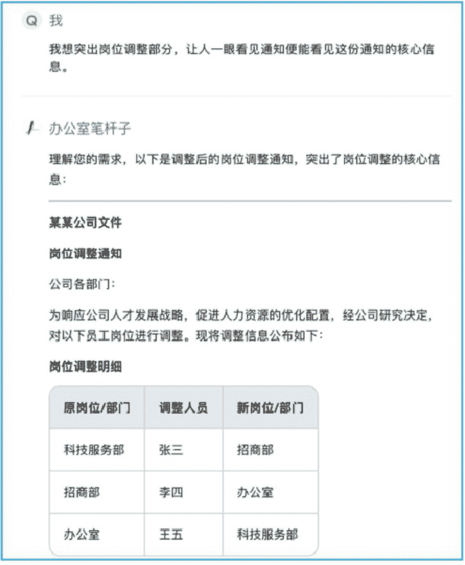

图2-3 Kimi办公室笔杆子的智能优化

对于常用的公文类型，从实际工作出发，仍建议你进行人工审核并微调（目前AI工具生成的公文在格式、语句等方面并不能做到尽善尽美），这并不会占用你太多时间。

###### 讯飞文书

登录讯飞文书官方平台，选择成文质量更高的"深度创作"，按照页面提示进行公文类型的选择，并按提示输入相应内容。讯飞文书的页面采用固定模块化设计，你需要按照提示填入对应内容。当然你也可以通过"AI帮填"选项进行智能润色，再人工修改，以使内容更符合实际需求。

以下是讯飞文书的回答。

###### 关于张三等三位同志岗位调整的通知

各部门：

根据公司的人才发展战略需要，经过认真考虑和评估，决定对张三、李四、王五等三位同志进行岗位调整。具体安排如下：

####### 一、调整对象

本次岗位调整涉及的对象为张三（原科技服务部）、李四（原招商部）和王五（原办公室）。

####### 二、新岗位信息

张三同志调至招商部，李四同志调至办公室，王五同志调至科技服务部。

####### 三、调整原因

本次岗位调整是为了更好地发挥员工的专业技能和工作经验，提高工作效率，促进公司业务的发展。

####### 四、生效日期

本通知自发布之日起执行。

####### 五、其他相关事宜

请各位同事积极主动地熟悉新的工作内容和环境，尽快融入新的团队，确保公司的业务能够顺利开展。同时，也希望各位同事能够以积极的态度对待这次岗位调整，为公司的发展贡献自己的力量。

####### 六、联系方式

如有任何疑问或需要帮助的地方，可以随时联系人力资源部。

特此通知。

××公司人力资源部

20××年××月××日

在风格和语气调整方面，你可以选择"以稿写稿"功能，通过平台接入的AI模型来做结构或内容的调整；也可以选择"素材参考"，对照"素材库"和"知识库"进行手工润色。

在智能优化方面，讯飞文书无须你输入任何指令，可以帮你进行语句、错别字、标点符号等内容的修改，也可以帮你检测敏感词（见图2-4）。

如果你需要融入创新元素，可以尝试同时使用两个平台，将讯飞文书生成的内容输入Kimi办公室笔杆子，让Kimi办公室笔杆子帮你优化和增添创新元素。同理，也可以把Kimi办公室笔杆子生成的内容复制至讯飞文书，让讯飞文书进行智能审稿核稿。

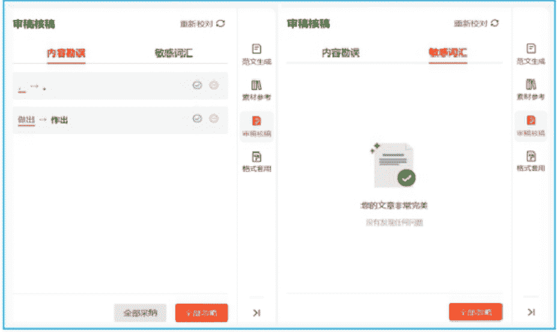

图2-4 讯飞文书审稿核稿界面

#### AI工具"论剑"

从上面的操作中可以看出，就通知这一公文类型而言，AI工具已经基本能够覆盖所有的应用场景。在实际的公文写作中，如果你能够掌握通知的核心要素，AI工具可以成为你的得力助手。

在语感及生成词的润色方面，Kimi办公室笔杆子的"智慧"程度更高；在专业属性及人工仿写方面，聚焦公文领域的讯飞文书是可以尝试的辅助工具。

对于职场使用率高的通知的撰写，我们切忌做"懒人"，人工审核仍是重要一环，尤其在确保格式规范无误与语句措辞精准得体方面，需要进行精益求精的处理。

#### 技能加油站

##### 1. 职场思维启蒙

写通知看似简单，实则大有学问。每次动笔前，先问自己一个问题："这份通知要传达的核心信息是什么？"这种以终为始的思考方式，恰恰是职场人必须具备的目标导向思维。例如在安排会议的通知中，你需要确保时间、地点、议程、参会准备等关键信息清晰无误，使读者一眼就能抓住重点。领导往往期望通知简明扼要，同时不失全面，这正是职场中"既要"与"又要"的典型场景——需要在多重条件限制中寻找最优解。

尽管通知是一种正式文体，但这并不意味着它不能包含创新元素。职场中的创新思维往往体现在对常规事务的突破上。尝试用新颖的方式呈现信息，可以让通知更加吸引人。比如优化措辞、使用图表或列表来简化复杂的信息，都能让通知更加生动、易于理解。创新不仅能让你写的通知以"吸睛"的方式更好地传达信息，更有助于职场人在标准化工作中展现个人价值。

主动思考是提升通知质量的关键。让自己快速提升职场能力的关键就在于比他人多想一步。不要满足于简单的信息罗列，试着站在信息接收者的角度思考：他们最关心什么？如何能让信息更贴近他们的需求？好的通知不仅能准确传达信息，还能引导行动，为后续工作打下良好基础。

最后，我想说的是，所有的技能都是练出来的。"无他，但手熟尔。"职场成长本质上是认知迭代的过程。多练习、多总结，你会发现这种结构化思维能迁移到汇报、工作沟通与协调等各个工作场景。从基础的通知开始，如果你愿意花时间边练习边思考，你很快就会发现自己的进步远超预期。

##### 2. 练一练，更出色

通知就像是做好职场信息沟通的"交通信号灯"，既要能够做到清晰传递信息，又要避免引起误解。不用怕写得直白，在确保格式、措辞符合规范的前提下，明确就是高效，精准就是专业。现在轮到你上场了！结合上述指导，开始撰写你的通知吧。不要担心初稿不够完美，因为每一次练习都是学习的机会。

#### 小试牛刀

请结合本节所学，用"AI写作+人工优化"的方法起草一份《关于调整夏季办公时间的通知》。

场景设置：公司决定6月1日起实行夏季办公时间，工作时间调整为8:30—17:30，午休1小时。

提示：

- （1）可从明确调整起止日期、具体时间、适用范围三部分着手；
- （2）可考虑增加人性化关怀，如弹性条款、温馨提示等；
- （3）重点检查是否遗漏了执行细节。

通知要保证的职场沟通效果，实际上是减少反复确认。你需要预判可能出现的疑问并提前做好解答。在条件允许的情况下，还可以通过加入人性化关怀，让这份通知的效果更好。

### 如何高效撰写通报？

在职场中，虽然通报并不如通知那样被频繁使用，但它在特定情况下扮演着至关重要的角色。对于职场新人来说，第一次接触和撰写通报时可能会感到困惑。你或许会问："什么是通报？它和通知有什么区别？我该怎么写才能让同事们都明白？"别担心，接下来我将带你深入了解通报的要点与技巧。

#### 从要素提炼到成稿落地

简单地说，通报是用来表彰优秀职工、指出问题或传达重要消息的一种正式文件。它主要有三大类别——表彰性通报、批评性通报、事务性通报。表彰性通报在日常办公中较常用到。通报就像是一个"公告牌"，不仅能快速有效地传播组织内部的重要信息，还可通过精心设计的结构确保每位相关人员都能轻松理解信息并积极响应。

通过表2-4，我们可以基本掌握通报的核心构成，这份表单将在你撰写和审核通报时提供实用的帮助，让你笔下的每一个字更加精准有力，确保信息传递顺畅无误。

| 通报要素 | 描述 |
|:---|:---|
| 标题 | 直接反映通报的核心主题。例如："关于[具体事情]的重要通报" |
| 主送对象 | 清晰指明接收通报的具体人员或群体，也可称为"主送机关" |
| 缘由 | 简短说明事件背景或决策原因，解释为什么这很重要 |
| 正文 | 分段落详细描述关键信息，关键事项可以分层列明要点，确保逻辑清晰 |
| 行动要求 | 提供具体的行动要求，明确告知收件人需要采取的具体行动，包括时间节点和准备事项 |
| 落款 | 写上发布单位/部门名称及日期，确保信息来源透明且可信 |

表2-4 通报要素表单

熟悉了这些通报的基本要素后，你会发现撰写通报有章可循。接下来，让我们通过总结规律与技巧，让你对撰写通报更加得心应手。

#### 情境体验

不久之后，主任再次交给你一项新的任务：撰写一份关于表彰优秀职工的通报。主任特别强调要突出优秀个人及团队的具体事迹，明确表彰的意义，并鼓励全体员工向他们学习。

有了之前撰写通知的经验，相信你会更加自信地迎接这个挑战。我们可以根据表2-4，得出通报撰写五步法。

- 1. 第一步：定标题。选择一个简洁明了的标题，直接反映通报的核心主题。
- 2. 第二步：列对象。明确指出接收通报的具体人员或群体。
- 3. 第三步：写正文（重缘由）。简短说明事件背景及其重要性，随后分段落详细描述关键信息，关键事项可分层列明要点，确保逻辑清晰、易于阅读。
- 4. 第四步：提要求。提供具体的行动要求，明确告知主送对象需要采取的具体行动及时间节点。
- 5. 第五步：明身份。标明发布单位或部门名称及日期，确保信息来源透明可信。

通过以上五个步骤，你可以轻松地将通报的要领尽数收入囊中。现在让我们借助表2-5，一起看看通报撰写五步法的实际运用。

| 步骤 | 说明 | 通报内容 |
|:---|:---|:---|
| 定标题 | 选择一个简洁明了的标题，直接反映通报的核心主题 | 关于表彰[具体事迹]优秀职工的通报 |
| 列对象 | 明确指出接收通报的具体人员或群体 | 主送对象：全体职工 |
| 写正文（重缘由） | 简短说明事件背景及其重要性，随后分段落详细描述关键信息，关键事项可分层列明要点，确保逻辑清晰、易于阅读 | 缘由：为表彰在[具体项目]中表现卓越的个人和团队，激励全体员工提升工作质量和效率，特此通报表彰  正文：在过去的一年里，我们单位涌现出了一批杰出的个人和团队，他们在工作中展现了非凡的责任感和创新能力特别是[姓名/团队]，在[具体项目]中克服了重重困难，成功完成了[具体成果] |
| 提要求 | 提供具体的行动要求，明确告知主送对象需要采取的具体行动及时间节点 | 1. 希望全体职工以他们为榜样，学习他们的敬业精神和创新意识 2. 积极参与到各项工作中来，为实现我们的共同目标而努力 |
| 明身份 | 标明发布单位或部门名称及日期，确保信息来源透明可信 | 发布单位/部门：××单位办公室 发布日期：20××年××月××日 |

表2-5 通报撰写五步法的实际运用

当你学会了撰写通报的技巧之后，你就掌握了如何高效准确地传达信息。下面的小贴士会帮助你了解如何让通报更有魅力。

#### 小贴士

- 1. 语言得体：用正式且通俗易懂的话来讲事情，避免难懂的专业术语，内容清晰明了，便于理解。
- 2. 强调意义：不仅要告诉大家发生了什么，还要解释这对大家有什么重要影响。

- 3. 换位思考：写一份好的通报，要懂得换位思考，从受众角度出发，清楚地解释信息对他们的具体影响。

- 4. 视觉清晰：应遵循公文的格式规范，通过结构化的内容安排和清晰的段落划分来突出重点，让关键信息能被一眼看到。

- 5. 审核把关：完成初稿后，请经验丰富的同事或朋友阅读，确保没有遗漏或错误。

#### 手把手教你用AI写通报

掌握通报的传统写作技巧，是利用AI工具高效写通报的基础。撰写通报在内容深度、逻辑严谨性等方面有着严格的要求，且在公文写作中占据重要地位。在熟练掌握撰写通报要点的基础上，我们将一同探索如何巧用AI工具助你高效地写出一份通报。

通报与通知在结构上部分相似，却不完全相同，各自服务于不同的信息传达目的和场景。接下来，我们将借助闭环思维，运用AI高效撰写通报（见图2-5）。

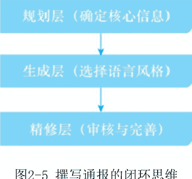

图2-5 撰写通报的闭环思维

规划层（确定核心信息）：识别通报的核心信息和主要目的，确保AI理解通报的主要内容和需要传达的关键点。

生成层（选择语言风格）：根据通报的目的和受众，选择一个合适的语言风格，确保通报的语气和正式程度符合预期。

精修层（审核与完善）：对AI生成的通报内容进行审核，确保信息的准确性和逻辑性，并对内容进行必要的调整和完善。

现在，我们进入下一个环节。通过领取任务卡，你将详细了解此次通知任务的具体要求。随后，AI小助理将登场，展示如何利用AI工具进行实际操作，确保你能熟练掌握撰写通报的每一个步骤。

##### 任务卡

公司在最近的安全检查中发现了若干安全隐患，管理层决定立即采取整改措施并加强安全培训。领导要求你立即起草一份关于安全整改与培训的通报。

这里我们同样选用两个不同的AI工具进行操作演示。一个是智谱清言，另一个是撰写通知表现出色的Kimi办公室笔杆子。

##### 智谱清言

登录智谱清言官方平台，选择智能体中心并创建智能体。智谱清言智能体可专注于公文写作的格式、内容、风格，助你持续跟踪和优化写作效果（见图2-6）。

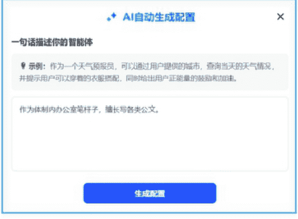

图2-6 智谱清言智能体创建界面

进入智能体后，我们可以输入指令，让智能体帮你列出本次撰写通报的核心要点，让你能够做出判断与调试，这是写好通报的基础一环（见图2-7）。

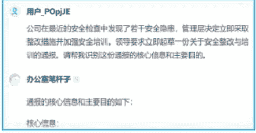

图2-7 智谱清言智能体解析任务

以下是智谱清言智能体的回答。

通报的核心信息和主要目的如下：

核心信息：

- 1. 安全检查发现的安全隐患概述：简要列举在最近的安全检查中发现的主要安全隐患。
- 2. 整改措施：详细说明公司将采取的具体整改措施，包括但不限于修复设施、更新设备、完善制度等。
- 3. 安全培训计划：阐述即将开展的安全培训内容、时间、地点、参与人员及培训目标。

（受限于篇幅，以下内容略。）

在确认好给出的重点内容是否合适后，我们可以让智能体帮我们匹配语言风格并生成一份完整通报（见图2-8）。

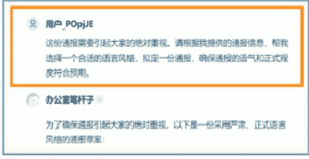

图2-8 语言风格智能匹配界面

以下是智谱清言智能体的回答。

###### 【公司名称】关于安全整改与培训的通报

各部门、全体员工：

根据公司近期开展的安全检查，发现以下安全隐患：

- 1. 消防设施存在老化、损坏现象。
- 2. 部分生产设备未按规程操作，存在操作风险。
- 3. 安全管理制度不完善，部分员工安全意识薄弱。

为保障公司安全生产，防止安全事故的发生，公司管理层决定立即采取以下整改措施：

####### 一、整改措施

- 1. 立即对消防设施进行全面检查、维修和更换，确保消防设施正常运行。
- 2. 对生产设备进行风险评估，加强设备操作规程培训，规范员工操作行为。
- 3. 完善安全管理制度，强化安全生产责任制，对违反规定的行为进行严肃处理。

####### 二、安全培训计划

- 1. 培训时间：20××年××月××日
- 2. 培训地点：公司会议室
- 3. 培训内容：消防安全知识、生产设备操作规程、安全管理制度解读
- 4. 参与人员：全体员工
- 5. 培训目标：提高员工安全意识，掌握基本安全操作技能

请各部门高度重视，严格按照通报要求执行整改措施，并确保全体员工参加安全培训。公司将对整改情况进行跟踪检查，对未按要求落实整改的部门和个人，将严肃追究责任。

> 安全生产，人人有责。让我们共同努力，共创安全、稳定的工作环境，为公司的发展贡献力量。

特此通报。

［公司名称］

［发布日期］：20××年××月××日

请各部门负责人签收并传达至每位员工。

附件：安全整改与培训实施细则

从智能体生成内容来看，这份初稿已经写得有模有样，基本符合要求。然而，为了确保内容更贴合实际需求，我们仍需人工审核并进一步加以完善（见图2-9）。在内容完善方面，智能体的优势十分明显，它能够在你设置的角色与情境中持续输出专业性内容。

图2-9 内容持续优化功能界面

###### Kimi办公室笔杆子

你可以采用撰写通知中运用的方法，让Kimi办公室笔杆子进行智能需求分析，在它生成框架后填入具体内容；你还可以让它帮你识别出要完成的通报的核心信息和主要目的。两种方法的对比如图2-10所示。

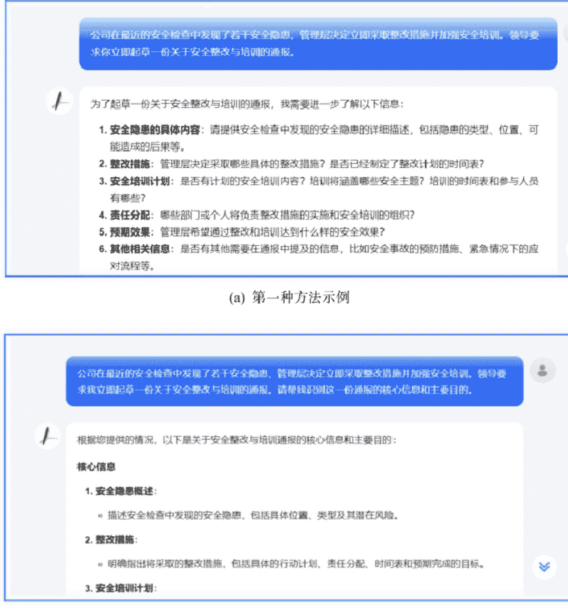

接着，你可以让它帮你选择语言风格。比如，我的需求是引起大家的绝对重视（见图2-11）。

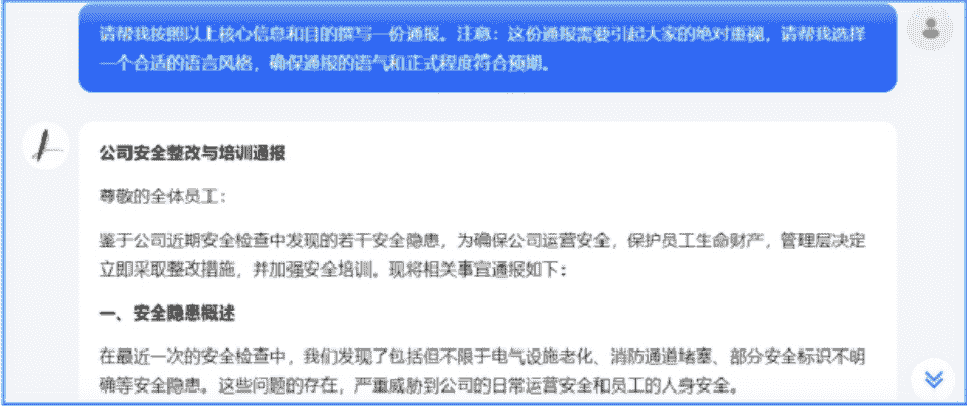

图2-11 语气风格调节界面

以下是Kimi办公室笔杆子的回答：

###### 一、安全隐患概述

在最近一次的安全检查中，我们发现了包括但不限于电气设施老化、消防通道堵塞、部分安全标识不明确等安全隐患。这些问题的存在，严重威胁到公司的日常运营安全和员工的人身安全。

###### 二、整改措施

为彻底消除安全隐患，管理层已制定以下整改措施：

- 1. 电气设施整改：立即对所有电气设施进行全面检查，并在两周内完成必要的维修和更新工作。
- 2. 消防通道清理：确保所有消防通道畅通无阻，并于本周内完成清理工作。
- 3. 安全标识更新：对所有安全标识进行全面检查，并在三日内完成更新工作。

整改工作由安全管理部门负责监督执行，各相关部门需全力配合，确保整改措施按时完成。

（以下内容略。）

从以上文字可以看出，Kimi办公室笔杆子生成的内容从结构到措辞表达基本能够符合要求，但从通报的实际运用角度，仍需进一步完善。我们可以采用"角色＋命令"的方法让Kimi办公室笔杆子进行优化工作。

- 如果你是出版社资深公文写作类图书编辑，请帮我检查上述通报格式是否准确，是否存在错别字，并帮我缩减篇幅，让这份通报更精练。

AI工具能够依据你的提示词，持续优化和完善内容。同时，你也可以借助专业AI工具，对错别字等问题进行智能核验，确保内容的准确性与规范性（见图2-12）。归根结底，持续学习与实践是保持良好学习状态的"妙方"。

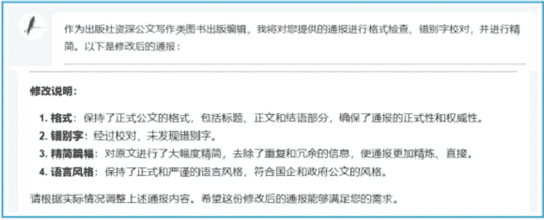

图2-12 AI智能优化界面

#### AI工具"论剑"

在撰写通报的过程中，两款AI工具的表现都令人印象深刻，它们的"智慧"程度显著提升了撰写效率。从格式规范到专业润色的细节处理，智谱清言的智能体表现尤为突出，能够持续跟踪并保持高质量的专业内容生成。而在界面操作的舒适性方面，Kimi办公室笔杆子则表现出色，尤其在电脑端使用时，操作流畅，为用户提供了较大的便利。

尽管AI工具已经能够提供高效且高质量的内容生成，但人工完善仍然是必不可少的环节。对事件背景的深刻洞察、语言表达的精准把握，以及符合领导具体要求的细节处理，都需要我们亲自动笔。毕竟，AI是工具，而人类的智慧和经验才是赋予内容灵魂的关键所在。

#### 技能加油站

- 1. 职场思维启蒙

写通报，看似简单，实则讲究。要撰写一份高质量的通报，既要讲清楚事实，又要参透"将心比心"的核心要点，如同照镜子一般。

开头很重要，它恰似文章的脸面。在职场发通报不是自说自话，第一句话就要让读者知道"这事和我有什么关系"。比如"关于××项目进度延误的通报"，后面紧跟"涉及所有使用A系统的部门"，这种写法背后是职场人可借鉴的"用户视角"——先说对方关心的，再说你想说的。

正文部分，要说清三个关键点：发生了什么（事实）、为什么发生（根源）、接下来怎么办（行动）。特别是分析原因时，职场高手都懂得"对事追到底，对人留台阶"。比如"未执行双人查验"后面补充"当时夜班只有一人可调配"，这不是找借口，而是让整改措施能真正落地。

结尾不要放狠话，而在于把"要你改"变成"我们一起改"。比如尽量不说"质检部限期三天整改"，而是"质检部在本周调整排班表，同时向办公室申请增加夜班人手储备"。这种写法藏着职场智慧——让人承担责任时，也要给足支持。

通报的用词的确要追求精准，但并不妨碍你保留应有的温度。公文虽讲求正式，但从来都不是冷冰冰的教条。适当加入一些人性化的表达，能拉近彼此间的距离。比如，涉及表扬时，不妨多几句鼓励；涉及批评时，可以附上改进的方向。

只要心中有温度，你的文字就不会显得干巴巴。加油！别怕写不好，请记住一句话：好通报不是用笔写的，是用同理心"熬"出来的。相信通过不断练习，你一定能写出高质量的通报。

##### 2. 练一练，更出色

用事实说话，用方案开路，既能警示问题所在，也能凝聚受众共识——这是一份优秀通报的"制胜之道"。通报这一部分的内容已经讲完了。现在，就看你的发挥了。请将所学知识付诸实践，尝试写一份通报。

#### 小试牛刀

请结合本节所学，用"AI写作＋人工优化"的方法拟定一份《关于项目进度延误的通报》。

场景设置：某项目因需求变更未及时同步，导致整体延期两周。

提示：

- （1）可按照"延误原因＋影响范围＋整改措施"的结构写；
- （2）可酌情增加正向引导内容，如"给予提前完成'补救'的团队奖励"；
- （3）整改事项要明确具体，如"三日内提交修正版本"。

一份好的批评性通报应做到"对事不对人"。避免使用定性表述，如"态度不端正"等，聚焦事实与解决方案。在职场上，批评性通报应体现出"以危机换改进"，即以问题的出现为契机，全面做好优化和改进工作。这样既能清晰地说明问题，有效避免不必要的猜疑，又能展示出积极主动的态度，为后续的发展奠定坚实基础。

## 第3章 工作计划与工作总结

### 工作计划快写小妙招

在公文的世界里，工作计划尽管不是一种独立的公文类型，但它是职场人士不可或缺的"办公利器"。它不仅帮助我们明确目标、规划时间，对于培养个人高效的工作习惯也是至关重要的，并且它在我们撰写年终总结时会发挥巨大价值。对于职场新人而言，能够学会快速撰写工作计划，在起跑阶段就可以占据先机。

实用计划究竟是怎样炼成的？

个人工作计划可以报告、请示等形式出现，或者作为年度总结的一部分，它可以按照实用程度调整为文字与表单两种展现形式。在平时的办公环境中，工作计划更多以表单形式呈现，这份表单也将成为你快速撰写工作计划的"秘密武器"。

无论何种形式，工作计划都要求清晰展现你的具体工作思路。你可能要问："是否有方法可循呢？"答案是肯定的，在写工作计划时，你可以遵循表3-1所示的要素清单，确保工作计划的全面性和可执行性。

在撰写工作计划时，每一个要素都设有密码，而破解密码的关键就在于你清醒的头脑。工作事项有轻重缓急之分，因此在实际运用工作计划时，你可以根据具体情况灵活删减或变通。掌握这一技巧，就能快速撰写"直击核心"的工作计划。

| 要素 | 描述 |
|---|---|
| 明确目标 | 要清楚了解项目的总体目标是什么 |
| 分解任务 | 将大目标拆分成具体的、可管理的小任务 |
| 时间规划 | 为每个任务设定合理的时间范围，确保任务能够在规定的时间内完成 |
| 资源评估 | 考虑完成任务所需的资源，包括人力、物力和财力，并确保这些资源的可用性 |
| 风险评估 | 识别可能影响计划实施的风险，并确定相应的应对方法 |
| 责任分配 | 明确每个任务的责任人，确保每个人都清楚自己的职责 |
| 设定关键节点 | 为每个阶段设定关键的检查节点，以便跟踪进度 |
| 沟通机制 | 建立定期会议或其他形式的沟通渠道，保持信息流通 |

表3-1 工作计划的要素清单

接下来，让我们通过情境体验，进一步感受如何运用这一方法。

#### 情境体验

你坐在办公室里，刚完成一份关于表彰优秀职工的通报。这时，主任走了进来，交给你一项新的任务：为即将举办的一场大型庆典活动撰写一份初步的工作计划。主任特别强调这次活动的重要性，要明确活动的步骤、时间安排及责任分配。本周将召集各部门开会，将在会上展示这份计划。

这时候，一份清晰的工作计划模板将助你高效地完成这次任务。

第一步：选模板。选择合适的工作计划表单模板，确保其涵盖关键要素，如事项、内容、时间节点、负责人和主要责任部门等。可以参考表3-2的结构，根据具体任务灵活调整表单内容。

| 序号 | 事项 | 内容 | 时间节点 | 负责人 | 主责部门 |
|:---:|:---|:---|:---|:---|:---|
| 1 | 活动场地细节环境 | 舞台区域音响、灯光、话筒等设备 | 设定好完成时间范围 | 具体个人 | 具体部门 |
| 2 | 物料设计、制作 | 邀请函、席位卡、舞台背景、签到墙、入户地毯等 | 设定好完成时间范围 | 具体个人 | 具体部门 |
| 3 | 舞台搭建 | 立式演讲台包边、舞台鲜花、舞台屏幕等 | 设定好完成时间范围 | 具体个人 | 具体部门 |

表3-2 庆典活动前期工作计划表

注：模板仅展示部分内容（下表同）。

运用表单模板的方法，可根据实际任务灵活变通。如果你有每周撰写工作计划的习惯，那么撰写工作总结时将事半功倍，因为重要事项和节点都已被记录，所谓"好记性不如烂笔头"（见表3-3）。

| 序号 | 上周工作完成情况 | 序号 | 本周工作事项 |
|:---:|:---|:---:|:---|
| 1 | 具体事项 | 1 | 具体事项 |
| 2 | 具体事项 | 2 | 具体事项 |

表3-3 周工作计划表模板

注：如需精简表单，具体事项可按大类划分，每一大类下介绍具体工作。

第二步：填内容。根据实际工作任务，逐项填写表单中的关键要素。例如，明确事项的具体内容、时间节点、负责人和主要责任部门。确保每一项内容清晰、具体，避免表述模糊。

第三步：调结构。根据工作的重要性和紧急程度，对表单中的事项进行排序和调整。复杂的任务可以进一步拆分为多个小任务，确保计划的可执行性。同时，检查表单的完整性和逻辑性，确保没有遗漏关键信息。

通过以上三个步骤，你可以快速撰写一份"直击核心"的工作计划，既清晰又实用。

#### 小贴士

- 1. 模板先行：使用现成的工作计划模板，直接填充具体内容，节省时间并确保结构清晰。
- 2. 简明扼要：避免冗长描述，直入主题，用简洁语言表达关键信息，确保内容清晰明了。
- 3. 用表单记录周计划：每周使用表单记录任务和进展，为年底总结提供数据支持，也便于跟踪已开展工作的进度。
- 4. 灵活应对变化：保持计划灵活性，允许适时调整，以适应不断变化的情况，确保计划的现实可行性。
- 5. 获取反馈：与上级、同事讨论初步方案，听取意见和建议，完善细节，确保计划全面且实用。

#### 手把手教你用AI写工作计划

掌握通过表单来撰写工作计划是一项重要的技能，它不仅关乎于计划的撰写技巧，更是一种需要在日常工作中不断培养和完善的习惯。当我们需要以书面形式呈现工作计划，或是在要求高逻辑严密性的情况下向领导做汇报时，我们可以充分利用AI工具来辅助完成这项工作。

在运用AI工具辅助撰写工作计划时，融入精练的方法至关重要，这能帮助你构建完整的工作计划闭环。撰写工作计划的闭环思维见图3-1。

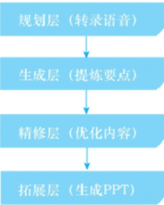

图3-1 撰写工作计划的闭环思维

规划层（转录语音）：使用语音识别AI工具将口头指令、想法或讨论实时转换为文本，确保所有语音信息被准确捕捉并形成初步工作草稿。

生成层（提炼要点）：利用AI工具提取关键要点，如任务、时间等信息，整理成结构化的工作计划。

精修层（优化内容）：根据实际需求通过精准指令优化内容。

拓展层（生成PPT）：如需进行汇报演示，让AI工具将工作计划转化为PPT。

具体如何操作呢？让我们先领取任务卡，再通过AI小助理的帮助，来完成一份定制版的工作计划。

##### 任务卡

公司为打造学习型组织，计划开展内部读书会活动，领导跟你初步沟通思路后，让你拟定一份关于读书会的工作计划并向他汇报。

本次我们选择功能丰富的通义和讯飞旗下的讯飞听见、讯飞星火。

###### 通义

在通义主界面点击"实时记录"开始录音。有了这个功能，你只需要手机或电脑在手，随时随地都可以将自己的想法说出来，通义将变身你的"贴身秘书"，帮你实时记录（见图3-2）。

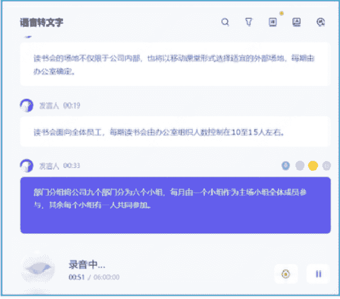

图3-2 语音实时转写界面

语音录制完成后，可以生成语音记录的要点内容（见图3-3）。

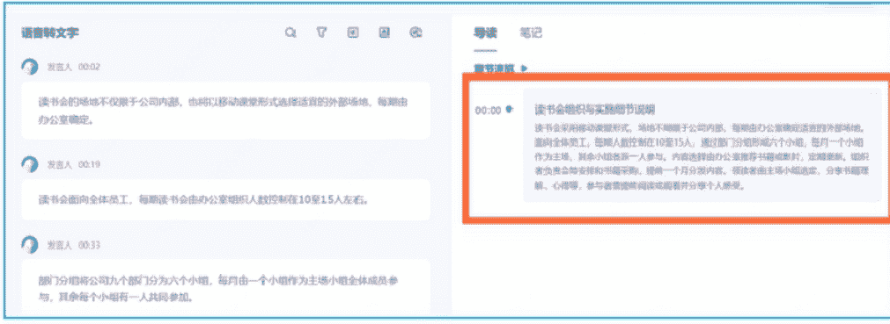

图3-3 智能要点提取界面

要点内容可全部复制至文档中。接下来，我们可以通过通义的阅读助手功能（支持word、pdf、jpg等格式）对文档进行智能分析，将其提取的要点整理成结构化的工作计划（见图3-4）。比如你可以提出要求：

- ► 请按照上面的内容，帮我写一份向领导汇报的工作计划，要求简洁明了，抓住重点。

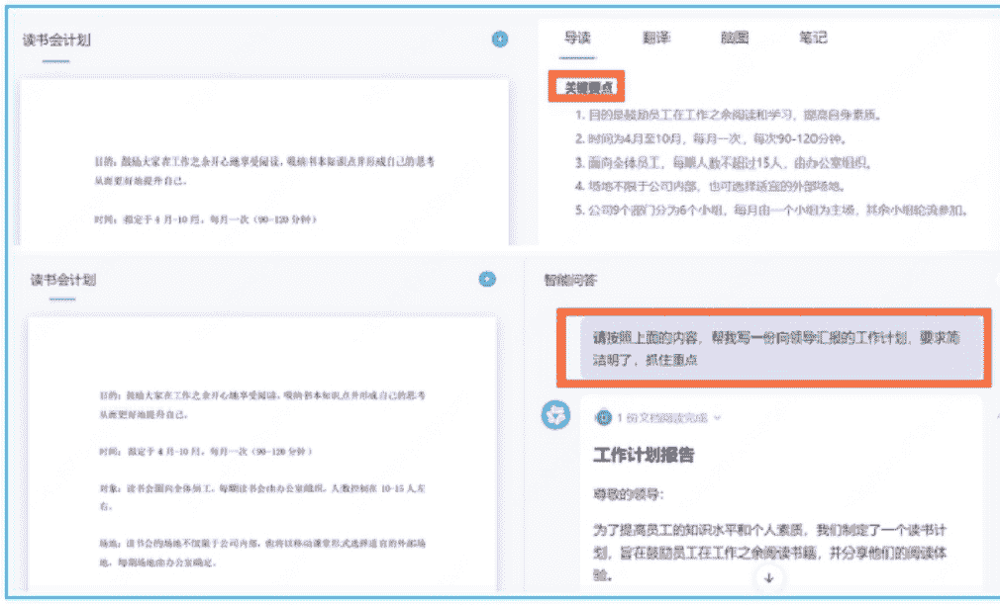

图3-4 工作计划智能生成界面

以下是通义的回答。

尊敬的领导：

为了提高员工的知识水平和个人素质，我们制订了一个读书会计划，旨在鼓励员工在工作之余阅读书籍，并分享他们的阅读体验。

以下是我们的具体计划：

- 每月举办一次读书会，每次持续 90～120 分钟，面向全体员工，每期人数控制在 10～15 人。
- 读书会的场地不限于公司内部，还将以移动课堂形式选择适宜的外部场地，每期场地由办公室确定。

…………

读书会将在每年的 **4—10** 月举行，每月一次。

活动的具体时间和地点将在每月初公布。

我们相信这个读书计划将会对员工的成长和发展产生积极的影响。

接下来，就是通过给AI精准指令或人工审核的方式对内容进行优化，直至工作计划达到心中的理想效果。如果撰写的工作计划不仅用于向领导书面或口头汇报，还需要用于会议讨论，这时候，我们就需要一份汇报PPT。通义的"PPT创作"功能可以实现PPT的一键生成（见图3-5），并且支持导出及在线演示。

图3-5 通义的PPT一键生成界面

当我们完成一键生成PPT的任务后，接下来的关键步骤便是进行人工审核与调整。尽管AI工具已经极大地提升了工作效率，但最终的质量把控仍然离不开我们的专业判断和细致打磨，只有这样才能完成那关键的"点睛之笔"，确保PPT在内容和形式上都达到最佳效果。

##### 讯飞听见、讯飞星火

首先登录科大讯飞的智慧办公SaaS平台，选择讯飞听见。在实时语音录制并进行同步文字记录后，讯飞听见将自动生成语音文字的要点信息（见图3-6）。

在智能分析这一步，我们可以进入讯飞写作，输入指令：

- 请根据上述要点，写一篇向领导汇报的书面工作计划，要求简洁明了，抓住重点。

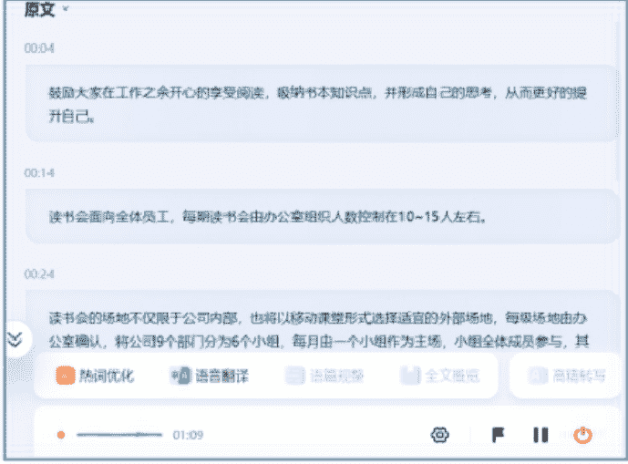

图3-6 语音转写与智能摘要界面

以下是讯飞写作的回答：

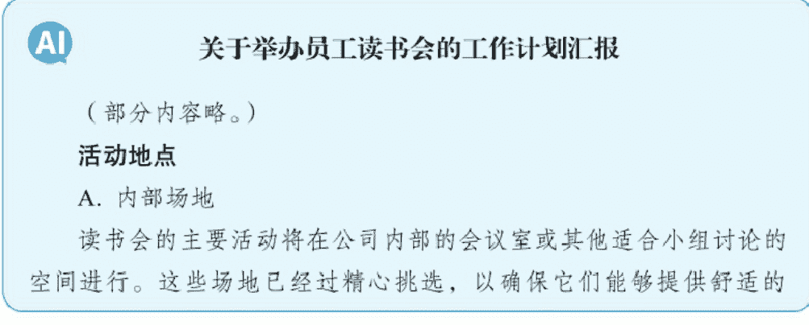

环境，支持长时间的集中讨论。例如，我们的多功能厅配备了先进的音响设备和投影仪，适合进行大型讲座和小组研讨。此外，考虑到部分员工可能需要安静的环境进行深度阅读，我们也会提供一些小型的阅览室作为备选场地。

###### B. 外部场地（移动课堂）

除了内部场地，我们还计划利用外部空间来增加读书会的多样性和趣味性。我们将探索与当地图书馆、咖啡馆或书店合作的可能性，举办户外或半户外的读书会活动。

###### 分工安排

####### A. 组织者职责

办公室将承担起读书会的主要组织工作，包括策划活动流程、确定参与人员名单、采购推荐书籍以及提前一个月向所有参与者分发阅读材料。

####### B. 领读者角色

领读者是读书会的核心人物，他们将在活动前一个月自行阅读所选书籍，并在活动中围绕对书籍的理解、阅读心得和推荐理由等内容进行分享。

####### C. 分享者任务

分享者是指参加读书会的所有成员，他们在活动中除了听取领读者的讲解外，还需要提前阅读书籍或观看相关影片，并在活动中分享个人的感受与想法。

与通义不同，讯飞写作在处理内容时更注重扩写，其中不乏一些能够启发思路的句子。接下来，我们可以对内容进行优化。讯飞写作的"AI工具"选项中提供了"全文缩写"等多种功能（见图3-7），为你的优化工作带来便利。

最后我们来看下PPT生成。此时，我们需要进入讯飞星火的官方平台，选择PPT生成，按提示选择PPT模板后输入你的指令即可。讯飞星火免去了你设计PPT模板的工作，且帮你支起了"骨架"，但"灵魂"注入需要凭借你自己的思考。

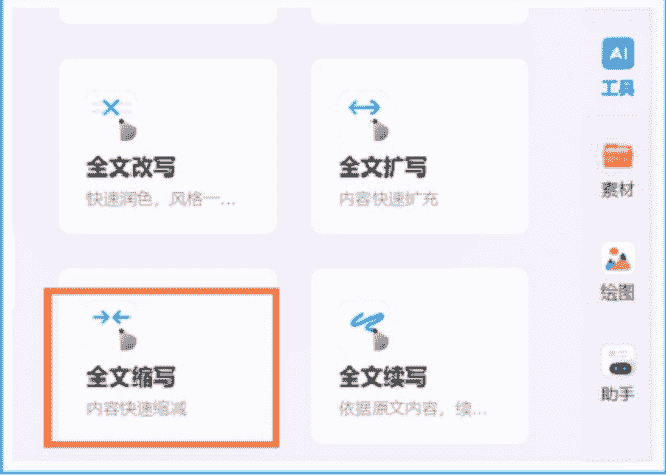

图3-7 多维度智能优化功能面板

#### AI工具"论剑"

从闭环的起点——语音同步转文字，到闭环的终点——PPT生成，AI工具让我们的日常办公变得更加高效，面对任务也更加从容。本节介绍的通义和讯飞听见、讯飞星火，智能化程度都很高，堪称"九段秘书"，能全方位满足工作需求。

具体来看：在语音同步转文字方面，讯飞听见专注于会议录音，生成的内容更偏向纪要，可能需要更多时间进行优化；而通义的使用场景更广泛，适用性更强。在智能分析及优化方面，讯飞写作功能丰富，工具性更强；通义生成的内容则更贴合实际工作场景，实用性更突出。在PPT生成方面，通义提供的模板选择更多，灵活性更高。从节省时间和高效的角度来看，两者都能很好地满足基本需求。

总之，无论是通义还是讯飞系工具，都能为工作带来显著的效率提升，可以根据个人的工作场景和偏好来进行选择。

#### 技能加油站

- 1. 职场思维启蒙

写工作计划不只是简单列明已完成事项及待办事项，而是帮自己明确目标，做好工作事项的跟踪与闭环。就算领导没要求，坚持每周写计划的人，往往能够更好地把控工作节奏并且在写工作总结时更胜一筹。

- （1）先看清手头有什么。

别急着写宏伟目标，不妨先坐下来想三件事：做这件事需要用多长时间？需要哪些同事配合？最大的困难是什么？尽可能从自己可把控的事项着手，切忌列出高于自己能力或并无相关资源的工作计划。职场新人最聪明的做法，就是用自己权限内的事练手。

- （2）给常规工作加点新意。

别把"创新"想得太复杂，试着把"完成领导交代的任务"变成"每次多做一个小尝试"。比如整理文件时顺带做分类标签，收集数据时多记一笔"同事常问的问题"。好的计划就应该从小处着眼，通过融入新意，让你越做越有干劲。

- （3）学会拆解大目标。

许多人撰写计划时容易陷入两种极端：要么只盯着琐碎的日常事务，要么被大目标压得喘不过气。真正的职场高手，会把年度目标拆解成一个个"看得见摸得着"的节点。比如你负责一个需要三个月完成的项目，可以先列出关键节点——第一周完成调研框架，第二周输出初版方案，第三周协调部门意见……每完成一个节点，就用不同的颜色在你的计划表上标记进度。这样的做法，不仅能让你清晰感知到目标推进的节奏，还能在遇到突发情况时快速定位问题环节。

列工作计划时，需谨记：再宏大的目标也可拆解，关键是把"我要做到"变成"我现在能做什么"。工作计划的本质不是进行自我约束，而是帮助我们在职场忙碌中疏通思路。当写计划成为一种习惯，你会发现自己不再焦虑于"还有多少事没做"，而是能专注享受"每一步都在靠近目标"的踏实感。这种思维转变，才是你最珍贵的成长印记。

- 2. 练一练，更出色

在职场中，坚持撰写每周甚至每日的工作计划，堪称卓越习惯。不能简单地将工作计划视为是给领导看的，它是你掌握工作进度的关键辅助工具。当你学到新的知识时，将其为你所用的最好办法就是多做练习。接下来，大展身手、尽情练习吧！

#### 小试牛刀

请结合本节所学，用"AI写作＋人工优化"的方法撰写一份《客户答谢会筹备计划》。

场景设置：计划于9月举办客户答谢会，需明确预算、流程、分工及应急预案。

提示：

- （1）可按照目标、预算、流程、分工、风险预案这五个模块撰写计划；
- （2）也可按任务拆解（负责人＋时间）、进度跟踪（重要事项标注）、汇报结构（已完成/进行中/待解决）三步走，确保计划可执行、可跟踪；
- （3）记得添加备选方案，如"如遇暴雨，备用场地为 2楼 201大会议室"；
- （4）记得设置关键节点，如"××月××日前完成嘉宾邀请"。

工作计划的核心是可执行、可跟踪，把脑子里的想法变成可落实的行动。需要确定具体责任人、时间节点与风险预案，细化到"谁在什么时间做什么"。

### 如何撰写让人印象深刻的工作总结？

在职场中"进修"时，撰写工作总结是不可或缺的一环。无论是月度、半年度还是年度总结，都是衡量工作成果的重要标尺，也都是展现个人职业能力和成长轨迹的常用文书。工作总结不仅仅是对过去工作的回顾，更是对未来发展的规划。

有不少职场人士认为在撰写工作总结时，容易陷入一种固定的模式，导致内容千篇一律，缺乏新意。这种观点存在误区。大多数人在总结中能够把握工作中的共同点，如完成的任务、达成的目标等共性要素，但常常忽略了每个个体的独特价值，即总结中的个性。

一份真正出彩的工作总结不仅应具备条理清晰、重点突出的特点，更应融入个人的独到见解和深刻体会，反映出你在面对挑战时的思考过程和解决方案，以及你从中获得的成长与进步。

#### 避开误区，掌握全流程

要写出一份让人印象深刻的工作总结，避免一些常见的误区至关重要。这些误区可能会削弱总结的影响力，甚至给领导留下不专业的印象。因此，在撰写之前，了解并警惕那些容易出现在工作总结中的常见问题很有必要。表3-4为工作总结中的常见误区。

| 常见误区 | 示例 | 改进建议 | 正确示范 |
|---|---|---|---|
| 过于口语化 | "这周我做了好多事情，感觉特别累。" | 使用正式语言，避免使用日常对话中的词汇和句式 | "本周完成了多项任务，包括但不限于：对项目A的初步调研、对客户B的需求分析等。" |
| 缺乏具体细节 | "参与了几次会议。" | 提供详细的活动描述，包括会议主题、讨论内容及达成的共识 | "参加了三次部门会议，重点讨论了项目进展，并提出了优化建议，达成了下一步行动计划。" |
| 忽略成果与影响 | "负责了一个项目。" | 强调任务完成的具体成果及其对公司或组织的积极影响 | "成功完成项目A，提前两天交付，提升了客户满意度，为公司赢得了良好口碑。" |
| 没有自我反思 | "这个月工作很顺利。" | 对工作中遇到的问题进行客观分析，提出改进措施 | "尽管本月整体进展顺利，但在时间管理方面仍有提升空间，未来将更加注重效率，合理规划每日任务。" |
| 过度强调个人贡献 | "所有的工作都是我一个人做的。" | 平衡个人贡献与团队合作，强调集体力量的重要性 | "在团队的支持下，共同完成了任务Y，确保了项目的按时交付，体现了团队协作的重要性。" |
| 忽视改进建议 | "没有遇到什么问题。" | 针对工作中遇到的问题，提出切实可行的改进建议 | "针对此次工作中沟通不畅的问题，建议引入更高效的沟通机制，如每周固定时间召开进度汇报会，提升工作效率。" |

表3-4 工作总结中的常见误区

| 常见误区 | 示例 | 改进建议 | 正确示范 |
|---|---|---|---|
| 忽略数据支持 | "今年业绩增长了不少。" | 使用具体的数据和指标来支持结论，增强说服力 | "财务报表显示，今年销售额同比增长了 15%，达到 5 000 万元。" |
| 不重视格式规范 | 文字排版随意，无段落划分 | 使用合适的字体、字号和行距，分段清晰，标题明确 | 第一段综述，然后分段落，每一段就具体事项简要描述，如：一、主要工作完成情况；二、存在问题及改进方式；三、下一步工作思路与计划 |

续表

接下来，本书将带你结合具体的情境体验，探讨如何在实际工作中灵活应用这些建议，帮助你写出更加个性化、让人印象深刻的工作总结。

#### 情境体验

你端着咖啡，坐在办公桌前，将刚刚完成的大型庆典活动初步工作计划放入文件夹。这时，你的视线不经意间扫到了角落里堆放的工作文件——那是你在过去半年中撰写的各类文件，有入职后的第一份职工技能培训会议通知、表彰优秀职工的通报，还有刚完成的活动计划等。于是，你决定趁热打铁，撰写一份半年度工作总结。

当你开始在空白文档上敲下第一个字的时候，你想起了一位办公室"笔杆子"给你的建议。你闭上眼睛，在脑海中努力回忆着他给你的经验分享。

"笔杆子"给你的经验分享见表 3-5。写出一份令人印象深刻的工作总结，30%依赖于你能搭建起清晰的架构，剩下的 70%取决于深入的分析、具体的数据支持和锦上添花的创新方式。

| 关键步骤 | 说明 |
|---------|------|
| 第一步：理思路 | 在开始撰写总结之前，先回顾一下这半年的工作历程。创建一个新的文档，列出主要的工作节点，并为每个节点简要描述当时的情景、遇到的挑战以及取得的成绩。这样可以帮助你更有条理地组织信息 |
| 第二步：抓重点 | 强调几个关键项目，使用具体的数据和事实证明工作的成效。例如，如组织了一次规模空前的培训会议，吸引了超过300名员工参与，或是在社交媒体平台上获得了超过5万次互动，这些都是值得突出的成果 |

表3-5 工作总结的关键步骤

| 关键步骤 | 说明 |
|---------|------|
| 第三步：看问题 | 分析工作中遇到的问题及解决方案。比如，在筹备活动时遇到供应商交货延迟的问题，事后重新审视流程，制定了更严谨的筛选标准。这种反思不仅展示了你的解决问题能力，也为未来工作提供了宝贵的经验 |
| 第四步：精表达 | 在总结中，尝试运用图表、数据可视化工具或简短的案例分析来增强说服力。例如，通过图表展示项目进度、关键数据的变化，或用简短的案例说明工作成果的实际影响。如果需要插入图片或讲述故事，确保这些内容与总结的主题紧密相关，并保持语言简洁、专业。例如，插入活动现场的照片时，可以附上简短的说明，突出其与工作成果的关联。这种表达方式不仅能吸引领导的兴趣，还能更好地传达情感价值，同时保持专业性 |
| 第五步：核细节 | 写完初稿后，仔细检查每一句话，删除不必要的修饰词，确保语言简单明了且易于理解。特别关注段落之间的逻辑连贯性，确保整篇文档读起来流畅自然 |

续表

掌握了关键步骤，工作总结的"骨架"和"灵魂"就兼具了。在我们的日常工作中，写好一份工作总结应该成为你的基本功。当你想让领导了解并尝试记住你在单位做的那些事时，一份让人印象深刻的工作总结便是你可以充分利用的"秘密武器"。

#### 小贴士

- 1. 挑战与创新：除了描述解决问题的过程外，重点突出你在面对困难时展现出的创新能力。可以提及尝试的新方法，以及这些改变为团队或公司带来的积极变化。
- 2. 成长与学习：强调个人成长的同时，关联到对公司或行业的理解加深。说明这些新获得的知识如何转化为实际行动，并且对未来的工作计划有何指导意义。
- 3. 批判性自我评估：诚恳地分析自己的不足之处，并提出具体的改进措施。展示自己愿意接受批评的态度以及持续进步的决心。
- 4. 积极正面的语言：即使讨论的是挑战或失败经历，也要保持建设性的语气。比如，可以说"这个教训教会了我们……"而不是"我们犯了一个错误"。
- 5. 结尾展望：以对未来的展望作为总结的收尾，包括个人职业规划和对公司的期望。这样的结尾既能体现你的雄心壮志，也能表达对公司发展的信心。

#### 手把手教你用AI写工作总结

通过上文，我们了解了写工作总结时易踩的"坑"，掌握了让工作总结出彩的方法。接下来我们探究如何利用AI工具来高效完成工作总结的撰写。

在讲解操作方法前，我们先来一起练习闭环思维。当领导需要你完成一份工作总结时，你能想到哪些可以去做的事？首先，我们要回顾和整理过往的工作内容。接下来就涉及怎么写的问题，即如何组织并润色条理清晰、论证有力的书面文字。你以为到这里就结束了？其实并没有。万一领导要让你当面报告，还需要准备PPT及演讲稿。图3-8展示了撰写工作总结的闭环思维。

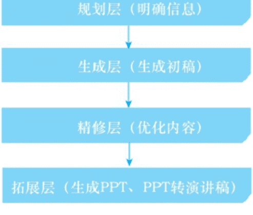

图3-8 撰写工作总结的闭环思维

规划层（明确信息）：根据AI提供的模板填入相应信息。

生成层（生成初稿）：AI自动生成一份工作总结的草稿模板。我们可以根据这个模板来整理琐碎的工作事项信息。

精修层（优化内容）：将整理后的工作事项反馈给AI，让AI帮你智能润色，并就调整语言风格、增强逻辑连贯性、突出重点等方面进行优化。

拓展层（生成PPT、PPT转演讲稿）：确认工作总结内容优化完成后，可以生成PPT，自动匹配模板和设计元素，将文本内容转换为幻灯片。AI根据PPT内容，辅助生成演讲稿，提供每个幻灯片的要点说明，帮你提前做好逐字稿的准备工作。

以上四步你看懂了吗？具体要怎么做呢？请领取任务卡，并在AI小助理的帮助下，完成这节内容的挑战吧！

##### 任务卡

一年一度的公司总结大会即将召开，现在你需要提前完成一份工作总结，这份总结不仅需要提交给领导，还需要向领导做总结报告。

本次登场的两个AI工具是WPS AI和通义。

###### WPS AI

在电脑端下载并安装WPS Office，确保具备相关功能。最便捷的操作方式是新建一个 WPS文档，打开后会看到"AI帮我写"字样。点击进入后，你可以选择公文类型。如果需要寻找更多公文类型，可以在"灵感市集"中进行搜索查找。

在"灵感市集"的搜索框中输入"工作总结"后，可以选择"写年终总结初稿"。点击"使用"后，按提示输入详细需求，让AI帮你完成总结初稿（见图3-9）。

值得注意的是，在WPS文档中有一个"公文模式"按钮，非常容易被忽略。生成内容前要记得点击它，从而进入"公文模式"，确保你的内容更加正式、严谨（见图3-10）。

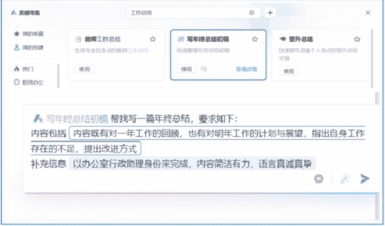

图3-9 公文框架快速搭建界面

图3-10 公文模式选择提示界面

以下是WPS AI的回答。

####### 一、工作回顾

######## 1. 日常行政管理

在过去的一年中，我负责了办公室的日常行政管理工作，包括但不限于文件的整理归档、办公用品的采购与管理、会议室的预订与布置等。通过有效的组织和管理，确保了办公室的高效运转和良好的工作环境。

####### 2. 会议与活动组织

我参与组织了多次公司内部会议和对外活动，从前期的策划到后期的执行，我都确保了每个环节的顺利进行。通过精心的安排和协调，这些活动均取得了预期的效果，得到了公司领导和参与者的认可。

…………

###### 二、挑战与反思

####### 1. 挑战

在过去的一年中，我面临了多项挑战。例如，在组织大型活动时，需要协调多个部门和外部供应商，这要求我具备出色的沟通能力和项目管理能力。此外，随着公司规模的扩大，行政管理工作也变得更加复杂和多样化。

####### 2. 反思

在反思中，我意识到自己在时间管理和优先级划分方面还有待提高。有时候，面对紧急且重要的任务，我未能及时调整工作计划，导致工作效率受到影响。

###### 三、改进方法

####### 1. 时间管理

为了提高工作效率，我计划采用更加科学的时间管理方法，例如使用时间管理工具和技巧，合理安排工作优先级，确保重要任务能够优先完成。

............

###### 四、展望与规划

####### 1. 个人发展

在新的一年里，我将致力于个人能力的提升，包括提高工作效率、增强沟通协调能力以及扩展专业知识。我相信，通过不断学习和实践，我能够更好地适应工作需求，为公司的发展做出更大的贡献。

####### 2. 工作目标

在工作上，我设定了明确的目标，包括优化行政管理流程、提高会议和活动的组织效率、加强人力资源支持以及协助财务部门提高预算管理的精确度。通过实现这些目标，我希望能够进一步提升办公室的整体运作效率。

###### 五、总结

回顾过去一年的工作，我感到既充实又充满挑战。我感谢公司给予的机会和同事们的支持，让我在行政助理的岗位上不断成长和进步。面对未来，我充满信心，相信通过不断学习和改进，我能够更好地适应工作，为公司的发展贡献自己的力量。在此，我也期待与公司共同迎接新的挑战，实现新的目标。

如果对生成的文字不满意，我们可以利用底部菜单栏进行调整，可同时实现智能润色、扩写与缩写等功能。对于每一段需要润色的文字，WPS会给出具体建议（如图3-11）。

接下来就是利用WPS AI的一键生成PPT功能，我们可以上传文档，也可以直接操作。软件会生成PPT大纲，待确认后就可以挑选PPT模板并一键生成PPT，并可对PPT进一步美化（见图3-12）。

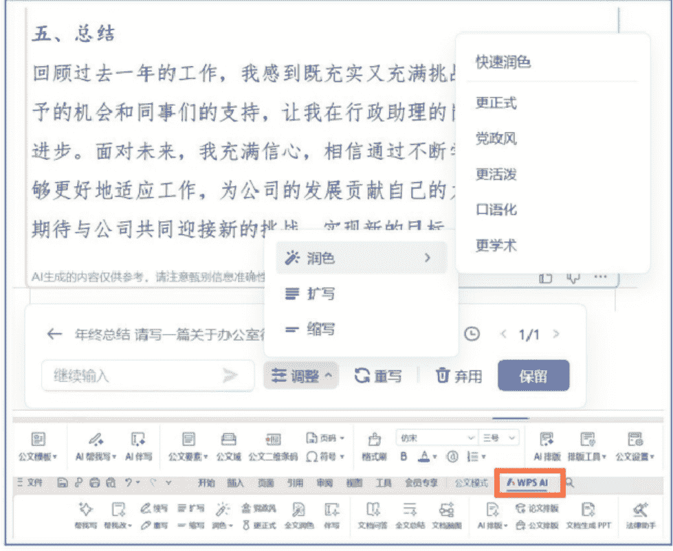

图3-11 内容智能优化界面

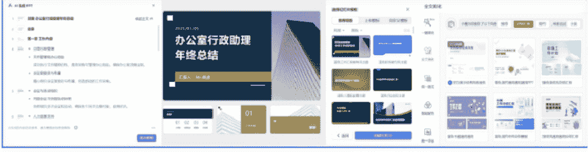

图3-12 PPT智能生成与美化界面

待完成PPT后，我们的最后一步便是生成演讲稿以备不时之需。WPS AI支持通过AI界面对话框一键生成PPT备注栏文字。如果你想在领导面前表现得更加出色，可通过AI功能界面的"帮我写"进行演讲稿的生成与润色，要比通过PPT自动生成的文字更加细腻（见图3-13）。

通过以上步骤，我们就可以高效完成一份工作总结。AI搭建框架方便我们疏通思路、整理材料；AI润色助力我们对内容进一步优化；PPT及演讲稿的智能生成，让我们可以将更多时间用于加强内容的深度及创新。

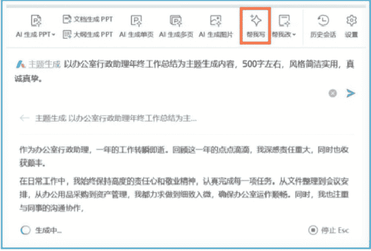

图3-13 演讲稿一键生成功能界面

###### 通义

登录通义的官方平台，在对话框输入指令（见图3-14）：

- 请以办公室行政助理身份，撰写一份约500字的年终工作总结，要求风格简洁实用、真诚真挚。内容包括日常行政管理、文件整理、会议安排、用品采购等。

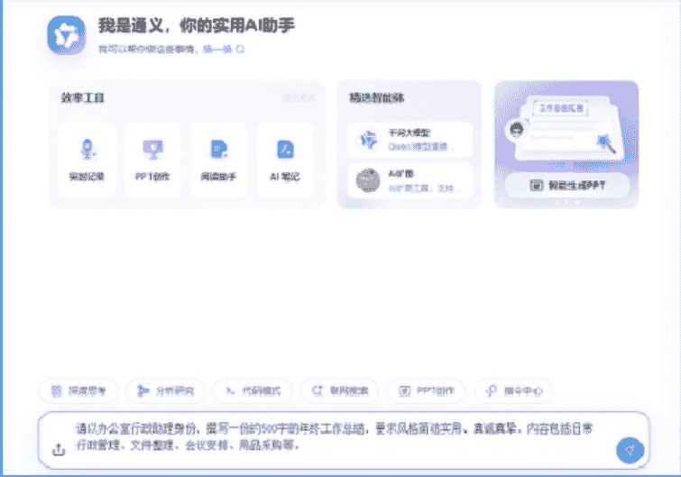

图3-14 输入指令界面

也可以将整理好的工作事项以文档形式上传，再输入指令，这样生成的工作总结初稿的内容更具体。

以下是通义的回答。

###### 个人总结

时光荏苒，转眼间一年的工作即将结束。在这一年里，我在行政助理的岗位上经历了许多，收获颇丰。现将过去一年的工作情况进行总结，并对未来的工作做出规划。

####### 一、工作回顾

######## 1. 日常行政管理

在过去的一年中，我肩负起了办公室日常行政管理的重任。文件的整理归档工作是确保公司信息有序存储和快速检索的关键环节，我制定了详细的文件分类标准和归档流程，使得各类文件都能得到妥善的整理和保存，方便了同事们的查阅和使用。

办公用品的采购与管理也是一项琐碎却重要的工作。我定期对办公用品的库存进行盘点，根据实际需求制订采购计划，在保证办公用品充足供应的同时，避免了浪费。我还与多家供应商建立了良好的合作关系，通过比较价格和质量，为公司节省了采购成本。

会议室的预订与布置工作同样需要细心和耐心。我根据会议的性质和规模，提前做好会议室的预订安排，并精心布置会场，确保会议环境整洁、舒适，设备齐全。通过有效的组织和管理，办公室得以高效运转，为同事们创造了良好的工作环境。

（以下内容略。）

生成了工作总结的初稿只是第一步，我们需要通过精准优化提升初稿质量。

在对话框中继续输入定制指令：

- ①将模糊表述转化为量化成果；②检查是否存在口语化表述，对口语化表述进行专业修正；③补充 1～2项具体反思；④给出修改注释。

我们可以在对话框上方找到"指令中心"，将指令保存，方便之后调用（见图3-15）。

图3-15 指令快捷调取界面

通过通义的"PPT创作"可实现PPT生成。通义可以完成从模板选择、PPT大纲到PPT生成及演示的各项工作，能显著提升工作效率（见图3-16）。

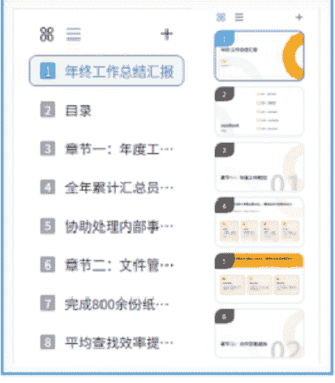

图3-16 PPT创作界面

最后，我们将导出的PPT（需要转为PDF格式）反馈给平台，通义可以智能解析并提取PPT中的要点内容。我们可以在对话框中输入如下指令：

- 请帮我根据工作总结要点写一篇演讲稿，用于向领导的现场报告，字数500字左右，语言真诚真挚，内容言简意赅。

一篇演讲稿就此生成，我们只需进一步优化即可（见图3-17）。

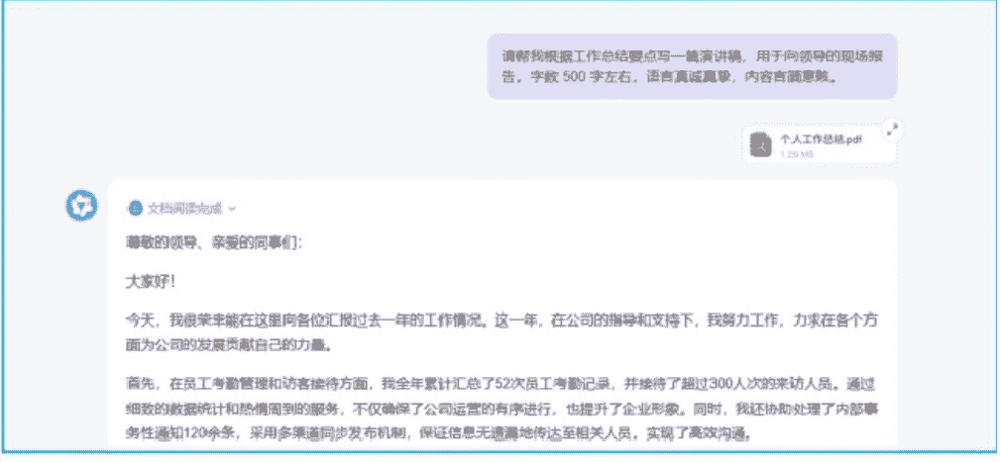

图3-17 演讲稿内容生成界面

通过AI撰写工作总结，从闭环思维的角度看，我们可以更加灵活地进行调整和优化，从而达到事半功倍的效果。然而，工作的个性化方面，要靠我们自己进行思考与补充。

#### AI工具"论剑"

WPS AI和通义界面简洁直观、操作逻辑清晰、用户友好性较强。在内容生成方面，两者均支持通过模板和指令输入实现智能生成，提升了写作效率。但在优化侧重点上各有不同：WPS AI更注重办公场景下的文档处理与格式兼容性，而通义在公文写作方面的能力突出，具备用词严谨、结构清晰等优势。

#### 技能加油站

- 1. 职场思维启蒙

刚入职场的你，或许正在为工作总结发愁：既担心写得太平淡，写不尽自己的努力，又害怕使用过多修饰语，被领导认为爱表现。其实大可不必担心，只要记住这四个朴素的道理，你就能写出既有温度又有价值的工作总结。

##### （1）真实是最好的名片。

工作总结不需要虚构完美人设，你摔过的跤、流过的汗，都是职场上宝贵的经历。有位同事在季度总结中这样写道："前两个月常因流程不熟加班到深夜，后来整理了常见问题的清单，现在能提前两小时完成周报。"这份坦诚不仅让领导看到了她的成长轨迹，还为她争取到了更多学习培训的机会。事实证明，真实的记录比华丽的修饰更能打动人心，因为你的领导从不要求你一开始就完美，而是希望看到你不断进步。

##### （2）用细节丈量成长。

工作总结不是罗列成绩的流水账，而是用具体的细节呈现你的价值。比如，把"完成客户调研"写成"走访了15家客户，收集到 20条产品改进建议"，把"协助项目推进"改为"协调3个部门完成5次方案对接，节省了30%的沟通时间"。这些看得见、摸得着的细节，比空洞的"积极努力"更有说服力。当你的文字能让读者看到真实的工作场景，那些认真付出的时光便有了意义。

##### （3）在反思中找到方向。

工作总结不仅需要记录成绩，也需要反思不足。与其把失误刻意隐藏，不如坦然展现。比如："本月项目因需求确认不充分导致延期，现已建立双人复核机制，确保类似问题不再发生。"承认不足不是示弱，而是展现你解决问题的能力和成长的决心。每一次反思，都是为下一次出发做好准备。

##### （4）总结也可以传递出温暖。

工作总结里最动人的部分，往往不是冷冰冰的数据，而是那些温暖的瞬间。试着把"感谢同事帮助"写成"特别感谢李姐陪我在办公室逐页核对数据到凌晨"。具体的时间、地点和事件，会让你的感谢更有画面感和温度。职场不是一个人的战场，那些帮助过你的人都值得被真诚记录。

写工作总结从来都不是应付差事，而是梳理成长的过程。学会用真实的经历说话，用具体的细节证明，用反思的态度进步，用感恩的心记录。当你回首过往时，你就能发现：职场上的踏实与努力，早已在不知不觉中为自己搭好了继续向上的阶梯。

如果现阶段的你把工作总结当作一项任务，那么试着换一种心态，调整一下思路，或许你会在其中发现更多的意义和价值。

##### 2. 练一练，更出色

工作总结是职场任务中不可或缺的组成部分。就像有人形容的那样："写一份工作总结不是为了交差，而是努力给自己营造一个'颁奖典礼'，让自己的每一份付出都能被看见。"你学习了撰写工作总结的技能，也通过AI拓宽了思路，来做一下专属练习吧。

#### 小试牛刀

请结合本节所学，用AI写一份让人印象深刻的个人半年度工作总结，向身边朋友演示PPT并进行讲解。

场景设置：回顾半年度工作开展、团队协作、问题改进等情况，需要突出亮点与反思。

提示：

- （1）可参考"已完成工作事项＋取得成绩＋成果展现＋提出问题＋改进计划+下一步行动方向"的分层设计撰写；

- （2）可用"动作＋数据＋对比"的格式来优化成果，增强说服力，如"新增5家客户，同比增加40%"；

- （3）可在总结中加入反思细节，如"未能实现对100家企业的实地走访，导致供需信息资料库更新不及时"；

- （4）可通过 AI工具生成 PPT，每页聚焦一个核心点，可配数据图表与简短金句。

一份令人印象深刻的工作总结可以"用数据夯实成绩，用故事打动人心"。加入具体案例与可引发情感共鸣的要点内容，使工作总结达到最佳效果。在职场中，工作总结被形容为"用过去看未来"。它不仅仅是对已完成工作的简单罗列，更是一种价值的传递。通过总结，我们不仅回顾了过去的工作成果，还向领导和团队展示了自己的潜力与价值。

## 第4章 会议纪要与工作汇报

### 如何写出高水平的会议纪要？

"会议纪要"的"纪"是记载、整理的意思，而"要"指的是要点、重要事项。"会议纪要"顾名思义，就是记载会议的核心要点。作为法定公文，会议纪要在正式场合中扮演着不可或缺的角色，它是单位内部沟通、决策跟踪和责任落实的重要工具。你是否好奇，那些高质量的会议纪要背后究竟蕴含着怎样的关键要素？今天，我们将深入剖析，揭示其背后的奥秘。

破局：精准捕捉与高效传达

撰写高质量的会议纪要，离不开对格式和内容的精准把握。每一个细节，从标题到文号，从主持人到参会人员名单，都是构成一份完整会议纪要的重要部分。现在，让我们通过表4-1，明确会议纪要的格式和内容及注意事项，掌握提升会议纪要质量的关键要点。

| 要素 | 格式和内容 | 注意事项 |
|:---|:---|:---|
| 标题 | "会议名称+纪要"（如："20××年度工作总结会议纪要"） | 标题应简洁明了，准确反映会议主题 |
| 文号 | [单位简称]+[年份]+[序号]（如：××字〔20××〕×号） | 文号用于标识公文的唯一性，便于归档和查询。具体视使用单位情况而定，要特别注意括号的使用 |
| 会议时间 | 20××年××月××日××时××分至××时××分 | 使用24小时制，确保时间清晰准确 |
| 会议地点 | 完整的会议室名称或地址 | 地点描述要具体，便于日后查询 |
| 主持人 | 主持人姓名及职务 | 写明姓名及职务，以体现权威性 |
| 参会人员 | 列出所有参会人员姓名及职务 | 按照职务级别或姓氏笔画排序 |
| 缺席人员 | 列出缺席人员姓名及原因 | 如有缺席，注明原因，以便了解情况 |
| 会议议程与讨论内容 | 按照会议实际进行顺序列出议题及讨论要点 | 简洁明了地记录每个议题的讨论重点，避免冗长 |
| 决定事项 | 列出会议形成的决定事项 | 使用动词开头，表述具体，如："批准××项目实施方案。" |
| 责任落实 | 明确责任人、执行期限、验收标准等 | 详细记录，如："由张三负责，20××年2月底完成，验收标准为……" |
| 其他事项 | 记录会议中提及但未形成决策的事项 | 简要记录，以备后续参考 |
| 结尾 | 会议总结或号召性语句 | 简洁有力，提出期望或号召。如："本次会议对单位下一阶段的工作方向和重点任务进行了明确部署。我们期待各部门严格按照会议决策事项执行，共同努力实现年度目标。感谢各位同事的积极参与和宝贵意见，让我们携手并进，共创美好未来。" |
| 附件 | 相关文件、资料等 | 如有附件，注明名称和数量，并在纪要中说明如何获取 |

表4-1 会议纪要要素

明确了这些关键要素，即使是职场新人，也能在撰写会议纪要时做到心中有数、游刃有余。如何将这些知识迅速转化为实际操作技能，让你在撰写会议纪要时更加得心应手呢？接下来，我们将通过情境体验，帮助你轻松掌握这些技巧。

#### 情境体验

新的一天开始了，你早早来到办公室，整理好桌面，准备迎接新的挑战。主任把你叫到他的办公室，安排你下午参加一场由领导组织的部门沟通会议并做好会议记录，撰写一份关于项目进展的跨部门协调会议纪要。主任要求这份纪要需详略得当，要点突出，便于各部门之间传阅，领会会议精神。

主任给了你—个锦囊，并嘱咐你："写好会议纪要没那么难，如果心里没底就打开它。"走出主任办公室，你深吸一口气，心里不停默念"我能写好这份会议纪要"，但最终你还是决定打开这份锦囊，想看看里面到底写了什么内容。

你打开主任的锦囊，里面的内容是如表4-2所示的六大步骤，这些步骤就是主任想分享给你的技巧。

| 步骤 | 说明 |
|------|------|
| 第一步：做准备 | 提前阅读会议议程及相关文件，了解会议目的、议题和参会人员名单。这有助于你在会议中更好地捕捉关键信息 |
| 第二步：备模板 | 根据公司标准或个人习惯，提前准备好一个简洁而全面的模板，确保涵盖所有必要信息点。模板应包括标题、文号、时间地点、主持人、参会人员、缺席人员、会议议程与讨论内容等要素 |
| 第三步：抓要点 | 参考表 4-1 中的会议纪要要素，确保涵盖所有必要信息点。特别注意记录会议的主要议题、讨论重点、达成的共识以及任何具体行动 |
| 第四步：勤记录 | 在会议期间保持高度专注，使用简洁明了的语言快速记录每一个讨论要点，尤其是领导强调的内容及相关重要决定。对于重要事项，立即标记出来，确保不会遗漏 |
| 第五步：填内容 | 会议结束后立即整理笔记，比如可以设计思维导图，趁记忆新鲜时捕捉更多细节。按照之前设计的模板格式化文档结构，逐一填充每个部分的内容 |
| 第六步：核细节 | 确保语言表达清晰流畅，逻辑严密。对于不确定的地方，及时联系相关负责人确认细节，力求做到精准无误。确保纪要格式符合公司标准，各层级字体、行距、编号等保持一致，保证专业性 |

表4-2 会议纪要的关键步骤

主任还提供了一份参考样例：

#### ××项目进展协调会会议纪要

时间：20××年××月××日

地点：××会议室

主持人：×××

出席人：×××、×××、×××、×××、×××

记录人：×××

为××，更好××，助力××项目顺利开展。20××年××月××日，××项目进展协调会在××会议室召开。会上着重讨论了××。××（职位＋名字）认真听取汇报并对本次会议进行总结，具体纪要如下：

- 一、××项目开展情况（略）

- 二、下一步工作思路（略）

…………

××（职位＋名字）对××项目开展工作表示肯定，他指出××，他强调××，最后××提出××。（结尾部分要做升华，如：××希望各部门默契配合，各负责人严格把关，保障××项目的顺利开展，努力推动××工作朝着更好、更高的方向阔步迈进。）

有了技巧和充分准备，当你将完成后的会议纪要提交给主任审核时，主任给予了高度评价。主任还给你分享了九种会议纪要的表述性提示词用法（见表4-3），便于你之后撰写会议纪要时做好区分并能够准确使用。

| 提示词 | 使用说明 | 适用场景 | 示例 |
|--------|----------|----------|------|
| 会议认为 | 用于表达会议对某一事项或问题的共识性判断。适用于需要对议题进行评估和决策的场合 | 决策会议、评估会议 | "会议认为，基于市场分析，扩大产品线是公司未来发展的正确方向。" |
| 会议指出 | 用于强调会议中提到的关键信息、问题或事实。适用于需要提醒注意或解决问题的场合 | 问题分析会议、工作汇报会议 | "会议指出，生产部门的效率低下是影响整体业绩的主要原因。" |

表4-3 九种会议纪要的表述性提示词用法

| 提示词 | 使用说明 | 适用场景 | 示例 |
|--------|----------|----------|------|
| 会议强调 | 用于突出会议中的重点指示、原则或要求。适用于需要重申重要事项或原则的场合 | 工作部署会议、政策宣贯会议 | "会议强调，所有项目必须严格遵守环保法规，确保可持续发展。" |
| 会议决定 | 用于记录会议做出的决定或决议。适用于需要做出明确决策的场合 | 决策会议、董事会会议 | "会议决定，将于下月启动新产品的研发项目。" |
| 会议要求 | 用于提出会议对相关方的要求或指令。适用于需要分配任务或提出具体要求的场合 | 工作分配会议、管理会议 | "会议要求，各项目经理必须在下周一前提交项目进度报告。" |
| 会议建议 | 用于提出会议的建议或推荐措施。适用于需要提出改进意见或建议的场合 | 改进会议、策划会议 | "会议建议，通过增加员工培训来提升客户服务技能。" |
| 会议审议 | 用于记录会议对报告、计划或提案的审查过程。适用于需要对文件进行审查和批准的场合 | 审批会议、规划会议 | "会议审议并通过了下一财年的市场营销预算。" |
| 会议通报 | 用于传达会议中的重要信息或通知。适用于需要分享信息或更新动态的场合 | 信息分享会议、全体员工大会 | "会议通报了公司即将实施的新员工福利政策。" |
| 会议总结 | 用于概括会议的主要内容和成果。适用于会议结束时，需要总结会议成果和下一步行动的场合 | 总结会议、年度会议 | "会议总结了本季度销售业绩，并制定了下季度销售目标。" |

续表

#### 手把手教你用AI写会议纪要

无论是职场新人还是职场"老江湖"，参加会议都是日常工作中的必选项，而能够写出一份高质量的会议纪要无疑是你的加分项。从会议纪要的"宝箱钥匙"到会议纪要的"撰写锦囊"，当你把这些内容融会贯通后，就可以更好地利用 AI工具来提升写作效率，让一场会议成为推动工作进展和团队协作的有效工具。

当你坐在会议桌旁记录会议内容，一份会议纪要的轮廓逐渐清晰起来。然而，如何将这些信息高效地转化为一份详尽、准确的会议纪要呢？这就是AI工具可以发挥作用的地方。在会议纪要撰写过程中，如何运用AI工具来优化会议纪要的撰写过程，从而提升记录的质量和速度，是值得我们探究的关键问题所在。接下来，我们一起来看看闭环思维（见图4-1）。

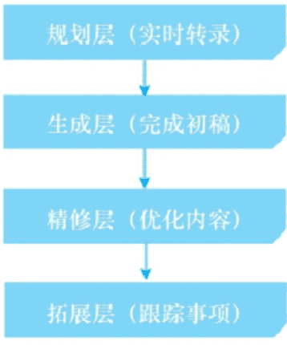

图4-1 撰写会议纪要的闭环思维

规划层（实时转录）：会议开始时，使用语音识别AI工具将口头讨论实时转换为文字。会议结束后，立即保存生成的文字记录作为初步草稿。

生成层（完成初稿）：对第一步生成的文本进行深度处理。通过利用AI技术，自动分析会议记录中的关键点，包括但不限于任务分配、决策节点、重要日期等，并自动生成简洁明了的会议纪要。

精修层（优化内容）：利用 AI工具对会议纪要进行语法、风格上的优化，同时检查内容的一致性和完整性。这一步保证了最终文稿的专业性，并确保包含所有必要的信息。

拓展层（跟踪事项）：这是我们可以多想的一步。会议纪要的目的是领会会议精神并记录任务事项，确保其落地执行。因此，我们可以使用AI工具自动识别会议纪要中的任务项，并将其分配给相关责任人，跟踪落地执行。

属于你的任务卡已准备好，AI小助理正等候你的指令，让我们立刻开始本章节的AI挑战吧！

### 任务卡为了对齐公司、部门和个人目标，推动公司战略落地，领导让你组织一场多部门人员参加的目标对齐头脑风暴会议，需要整理发言并形成一篇可供落地执行的会议纪要。

本次登场的两组AI工具，属于"工作流组合"。

##### 飞书妙记+DeepSeek+飞书多维表格

我们为了方便实时语音记录，可以使用飞书，登录后选择工作台中的飞书妙记。此时我们就可以点击话筒图标进行实时录音，飞书妙记可以将录音同步转为文字记录，并且自动生成会议关键词（见图4-2）。

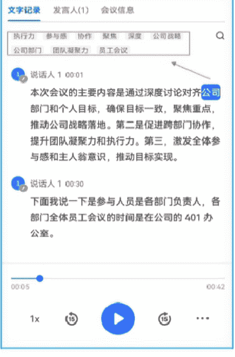

图4-2 语音实时转写与同步记录界面

待记录完成形成全部文字稿后，我们可将其复制到本地文档中（便于备份）。然后就轮到DeepSeek登场了。我们将文档上传到 DeepSeek，并给出清晰指令，让其生成一份规范的会议纪要（见图4-3）。需要注意的是，DeepSeek有两种模型可以选择，如果点击"深度思考"，为 R1模型，其更擅长复杂问题推理；不点击"深度思考"，为 V3模型，其更适合文本类任务。

我们不点击"深度思考"，DeepSeek很快按照我们的指令生成了一份完整的会议纪要初稿。

图4-3 DeepSeek操作界面

##### 目标对齐头脑风暴会议纪要

会议时间：20××年××月××日（星期六），上午 9:00—12:00

会议地点：401 会议室

主持人：朱总

参会人员：各部门负责人及全体员工

####### 一、会议目标

- 1. 通过深度讨论，对齐公司、部门和个人目标，确保目标一致，聚焦重点，推动公司战略落地。
- 2. 促进跨部门沟通协作，提升团队凝聚力和执行力。
- 3. 激发全体参与感和主人翁意识，推动目标实现。

（以下内容略。）

然后，我们需要优化文字，这时候我们继续给 DeepSeek下达清晰的指令：

- 我需要对这份纪要进行优化。首先是确保格式符合规范，其次内容风格请以为务实为主，开篇加一段过渡语。

DeepSeek优化后的内容如下。

##### 目标对齐头脑风暴会议纪要

会议时间：20××年××月××日（星期六），上午 9:00—12:00

会议地点：401 会议室

主持人：朱总

参会人员：各部门负责人及全体员工

###### 一、会议背景

为贯彻落实公司战略规划，确保公司、部门及个人目标的一致性，资产管理部、企业服务中心、科技服务部于 20××年××月××日联合召开了目标对齐头脑风暴会议。会议旨在通过深入讨论，明确未来一年的工作重点，推动公司战略落地，并促进跨部门协作，提升团队执行力。

###### 二、会议目标

- 1. 目标对齐：确保公司、部门及个人目标一致，聚焦核心工作，推动战略落地。
- 2. 跨部门协作：促进部门间的沟通与协作，提升团队凝聚力和执行力。
- 3. 全员参与：激发员工的主人翁意识，推动目标实现。

（以下内容略。）

优化后的版本确实显著提升了内容质量。需要特别强调的是，无论何种AI工具生成的公文，我们都必须从风格、语句、规范等方面进行细致优化，以确保其符合公文写作的高标准和专业要求。

到目前为止，我们已经顺利完成了前三步。接下来的最后一步，是使会议纪要中的任务项有效落地执行，并确保能够实时跟踪进度。该如何实现呢？我们可以通过飞书多维表格来实现这一目标。

进入飞书的工作台，选择多维表格，点击新建多维表格，或者直接选择AI模板一键智能生成任务项表单（见图4-4）。

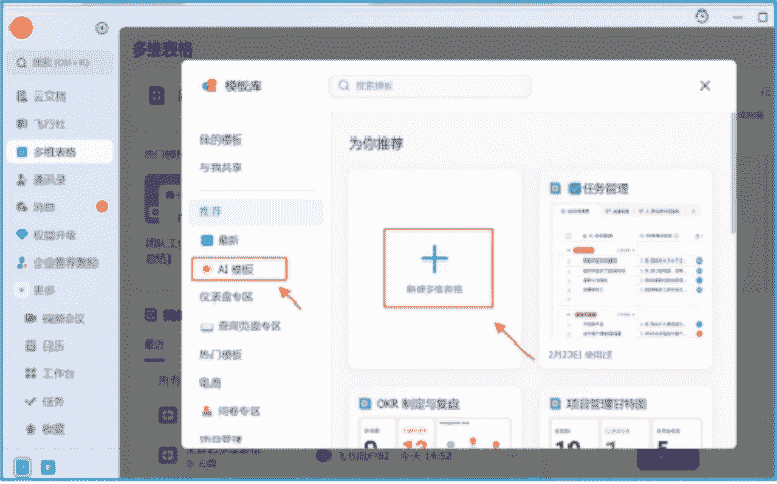

图4-4 任务项表单智能生成界面

目前飞书多维表格已经接入DeepSeek R1大模型，这也意味着它可以帮你批量生成你需要的任务项，并且帮你分析痛点难点，给出具体建议。比如我们的任务项是需要将会议纪要里面的要点内容生成后落地，我们在输入待办事项后，可以在表格中点击查看详情后，在探索字段捷径选项下拉菜单中选取接入DeepSeek R1大模型（见图4-5），实现待办事项的智能化跟踪及操办。

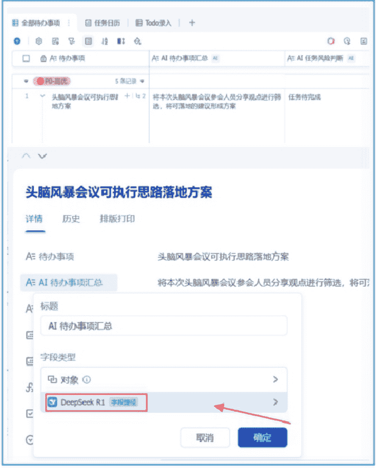

图4-5 批量任务处理工作界面

通过飞书多维表单，我们可以很好地将会议纪要任务项进行分配，设置好时间节点进行有效监督，且遇到难点问题时直接让DeepSeek帮你深入分析，很好地实现会议纪要在职场应用上的完整闭环。

##### 钉钉闪记+豆包+钉钉多维表

打开钉钉的工作界面，选择新建文档，并在文档右上角下拉菜单选择"闪记（语音速记）"，进入后在界面右侧选择"开始录音"（见图4-6）。闪记可以实现实时语音录入并同步文字稿。

进入豆包官方平台，我们同样将文字稿上传并给出明确指令，豆包可以快速识别会议要点，并生成一份会议纪要的初稿。

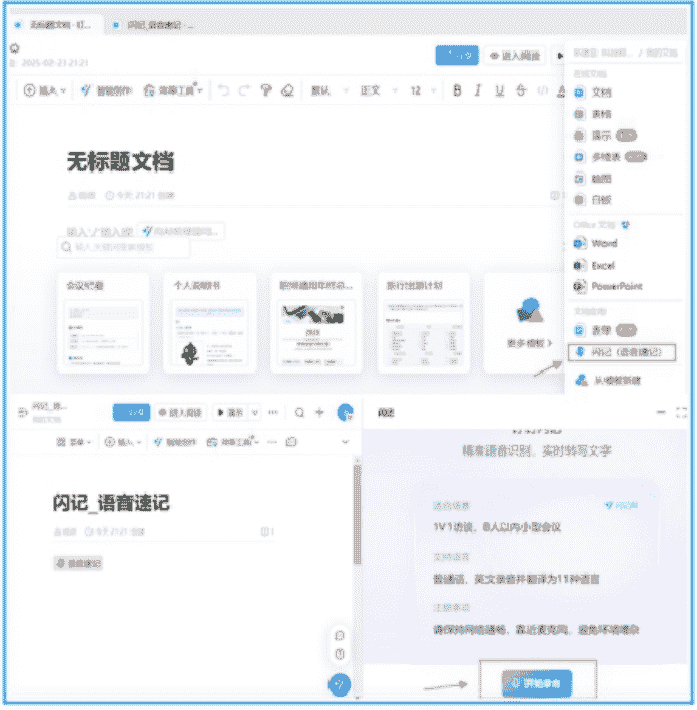

图4-6 语音速记功能启用界面

由于任务卡内容是一样的，所以生成的会议纪要内容就不多展示了。这里重点提一句：豆包的界面是支持语音输入的，你可以口头输入指令。另外，如有涉及保密性质的会议内容，你在撰写会议纪要前没有思路，建议选择用AI生成一个基础框架，豆包写作可以实现会议纪要框架的一键生成（见图4-7）。

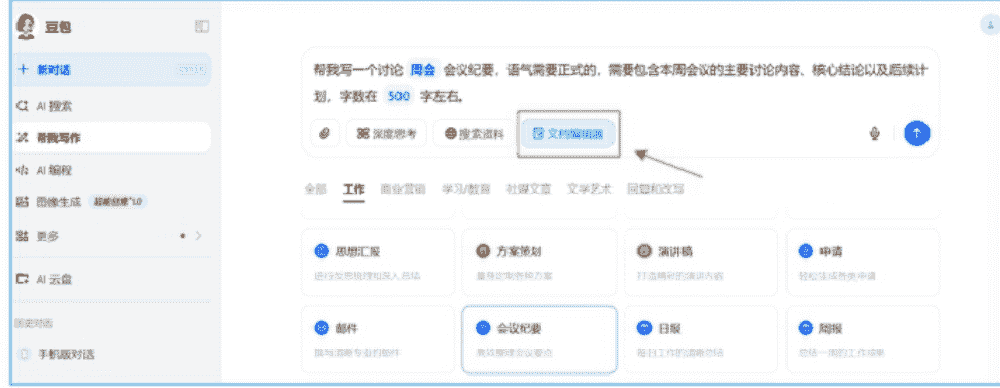

图4-7 会议纪要快速生成界面

如图4-7所示，当选择"会议纪要"后，按照提示框输入对应的内容，就可以一键生成会议纪要的模板。需要注意的是：记得勾选底部"文档编辑器"，在生成模板后，你依然能够在编辑器里进行"全文润色"和"调整长度"的一键优化。

对于复杂的带有明确任务项的会议纪要，建议可以先用AI工具生成，再进行人工优化。优化过程中可通过AI工具来完成部分语句的润色。

会议纪要完成后，我们还可以通过钉钉多维表来完成任务项的跟进执行。进入钉钉，选择"多维表"后点击"新建"，我们可以看到每一个待完成项都可接入DeepSeek R1模型，实现对任务的深度思考（见图4-8）。

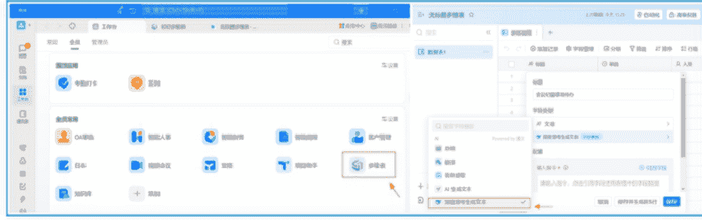

图4-8 智能数据管理界面

从语音实时录入到生成会议纪要再到待办事项的跟进执行，组合AI工具可以帮助我们更高效地完成对应公文的撰写任务。

#### AI工具"论剑"

对于会议纪要这一公文类型的撰写，AI工具的组合应用备受关注，尤其是生成质量方面。从文字内容来看，DeepSeek V3模型（不点"深度思考"）能够出色地完成既定任务，精准提炼会议核心要点，并生成清晰的待办事项，极大地简化了撰写流程。与此同时，飞书妙记与飞书多维表格的组合也表现出色，二者配合流畅，尤其在接入DeepSeek R1模型后，以往耗时费力的任务如今都能在短时间内轻松完成，大大提升了工作效率。

从隐私保护的角度来看，豆包的"一键生成纪要模板"功能能够快速搭建出完整的框架，还能帮助你优化框架结构。你只需要进行"内容填充"即可。

事实上，钉钉和飞书都是常用的办公软件，它们的部分功能较为相似，且都接入了DeepSeek R1模型。你可以根据个人需求来进行选择。

#### 技能加油站

##### 1. 职场思维启蒙

无论体制内外，写出一份好的会议纪要都是职场人士基本生存技能。领到写会议纪要的任务时，你是否总在纠结什么该记，什么不该记？满脑子都是"领导金句"却找不出重点？其实掌握以下三个要点，你就能轻松写出部署领导决策，推动工作落地的高价值纪要。

- （1）开会前有目标。

你需要提前让自己静下心，多做准备。比如提前搜集资料，看看会议主题涉及哪些部门、会议讨论事项当前问题在哪儿。可以尝试列一份清单——把议题拆解成"要解决什么问题""谁有意见分歧""有哪些数据可以支撑"等多个部分。

- （2）开会时做筛选。

领导拍桌子的话未必是重点，反复强调的才是关键（记住"必须""加快""务必"等关键词）。在记录会议内容时，在笔记本上把领导反复强调的关键词标上星号，方便突出重点；对模糊表态做好标注，待会议结束后再想办法确认。

- （3）开会后促转化。

别以为记完就结束了！建议用两种颜色的笔将记录分成两类：黑色写事实（谁说了什么），红色写结论（接下来做什么）。第二天趁热打铁整理成"落实清单"，给每个任务标上截止日期和负责人。在这里，我分享一个独家秘诀——用手机备忘录随手记下灵感，晚上回家梳理时，那些零散的想法可用来拼成完整的解决方案。

最后，是给新人的暖心建议：别怕写不好！刚开始可以按"会议目标＋达成的共识＋需要跟进的事"这个公式练手。

一份高质量的纪要能帮团队省时间、少走弯路。当你能够做到会前、会中、会后带着思考去执行任务，你的会议纪要写作能力就已经迈过及格线了。

##### 2. 练一练，更出色

通过此前学习，相信你已经掌握了撰写会议纪要的核心要点。接下来，我们要留一点时间巩固学习成果。

#### 小试牛刀

请结合本节所学，用"AI写作＋人工优化"的方法工具撰写一份员工季度培训计划讨论会纪要。

场景设置：部门开会讨论下季度员工培训安排，需明确课程、讲师、预算等事项。

提示：

- （1）可参考"培训主题＋参与人员＋达成共识＋待办事项"结构来撰写；
- （2）待办事项记得加入负责人和截止时间（如"张三负责联系讲师，××月××日前确认"）；
- （3）忌用模糊表述，内容避免笼统，要具体，如"尽快落实"可以调整为"××月××日前完成××事项"；
- （4）记得检查是否遗漏关键信息（如预算金额、培训地点）。

会议纪要的最终目的是将会议决定转化为能够具体落实的行动步骤。巧用AI抓取关键任务，人工确认责任人和时间，这份纪要才能真正推动任务的执行。

### 怎么写工作汇报，才能让你的努力被看见？

每一位辛勤工作的员工都渴望自己在职场中的付出能够得到认可与关注。然而，仅有默默耕耘是远远不够的，如何将这些努力有效地传达给上级，成为职场成功的关键一步。工作汇报，正是这一关键环节的载体。它不仅是一个专业的信息传递工具，更是一个展现个人价值、推动工作进展的重要书面文件。那么，究竟如何撰写工作汇报，才能确保自己的努力被看见呢？

#### 破解无效汇报

写好一份工作汇报的要点在于掌握它的写作格式及灵活运用它的逻辑框架。我们首先来说格式。工作汇报的格式其实很简单，一般包括标题和正文两部分。

标题的构成，我们只需要记住一个简单的公式，即"主题名称＋核心内容＋文种"。如：关于××项目阶段性工作情况的汇报。

接下来就是正文部分，正文部分要重点突出，确保逻辑通畅，包括要写清楚汇报目的、当前工作情况概述、存在问题、原因分析、改进措施及建议、下一步工作计划及结语。以下是一个样例模板。

##### 一、标题

###### 关于××项目阶段性工作情况的汇报

##### 二、正文

汇报目的：根据上级部门关于项目推进的工作要求，现将项目执行情况汇报如下。

###### （一）当前工作情况概述

- 1. 项目进展情况：
  - （1）完成了××任务；
  - （2）实现了××目标；
  - （3）取得了××成效。

- 2. 工作亮点：
  - （1）创新了××工作方法；
  - （2）提高了××工作效率；
  - （3）加强了××方面的合作。

###### （二）存在问题

- 1. ××方面存在不足；
- 2. ××资源配备有待加强；
- 3. ××政策支持尚需进一步明确。

###### （三）原因分析

- 1. ××因素影响；
- 2. ××条件限制；
- 3. ××协调机制不够完善。

###### （四）改进措施及建议

- 1. 加强××方面的工作力度；
- 2. 优化××资源配置；
- 3. 积极争取××政策支持。

###### （五）下一步工作计划

- 1. 完成××任务；
- 2. 达到××目标；
- 3. 确保××成效。

结语：请领导给予批示，并对我们的工作提出宝贵意见。

当你熟悉了汇报的格式，接下来的重点就是掌握汇报的逻辑框架。这个逻辑框架可以在你写汇报时作为重要参考。表4-4所示的四个维度及"公式＋样例应用"能帮助你在不同场合选择合适的方式进行表达，确保每一次汇报都能达到最佳效果，让人眼前一亮。

通过理解工作汇报的结构和逻辑框架，你可以确保每一项努力都能清晰地传达给上级。然而，掌握了这些基础之后，如何迅速提升你的汇报质量，使之更加专业、高效？接下来，我们将通过"情境体验"揭示一些工作汇报快速上手的技巧，帮助你在实际应用中脱颖而出。

| 维度 | 说明 | 公式 + 样例应用 |
|:---|:---|:---|
| 站位准确 | 了解你的汇报对象的需求和偏好，调整汇报的层次和风格，以确保你的报告不仅能传递信息，还能赢得认可 | 公式：背景 + 重点 + 建议  样例应用： 1. 背景：根据最新政策； 2. 重点：我们部门的重点工作是提升服务效率； 3. 建议：今年特别加强了在线服务平台建设，显著提高了用户满意度。建议在接下来的工作中进一步扩大该平台的服务范围 |

表4-4 工作汇报的四维逻辑框架

| 维度 | 说明 | 公式 + 样例应用 |
|:---|:---|:---|
| 量化成果 | 用具体的数据和指标来证明你的工作成果。不要只是讲述做了什么，更要展示这些工作带来的具体变化和进步 | **公式：数据 + 分析 + 展望**  样例应用： 1. 数据：本年度共完成了 100 个项目，其中 85%按时交付，群众满意度达到 92%； 2. 分析：项目完成量较去年增长了 15%，主要得益于优化审批流程、引入新的服务管理工具以及加强部门间协作； 3. 展望：预计明年通过持续改进服务流程和进一步提升团队服务水平，能够将项目完成数量提升到 120 个，并保持或提高群众满意度至 95%以上 |
| 细化内容 | 深入挖掘工作中的细节，分享你在解决实际问题时的经验和心得 | **公式：任务 + 经验 + 启发**  样例应用： 1. 任务：针对以往审批流程冗长的问题，我们启动了审批流程优化项目； 2. 经验：通过引入自动化审批系统和简化不必要的审批环节，成功将平均审批时间从原来的 5 个工作日缩短到 2.5 个工作日，减少了 50%的时间； 3. 启发：这一经验不仅提升了内部工作效率，也为其他部门提供了宝贵参考 |
| 创新思考 | 提出新的想法和建议，展现你的前瞻性思维，并提供切实可行的实施方案 | **公式：想法 + 论证 + 实施**  样例应用： 1. 想法：考虑到信息技术的发展趋势，目前正在评估引入智能化管理系统； 2. 论证：初步测试显示，这将使工作效率提高约 30%； 3. 实施：下一步计划选择几个关键部门作为试点，验证其长期效益后逐步推广 |

续表

#### 情境体验

两天前，你出色完成了主任布置给你的会议纪要任务，主任的锦囊也让你信心倍增。当主任再次把你叫到办公室的时候，你心里默想："这次我一定能做得更好。"

主任拿出了一份文件夹，放在办公桌上，缓缓地说："今天我们有一个新的任务，同样重要。"他解释道："明天将举行一次高层管理会议，而你需要在会上做一个简短但精准的工作汇报。"这个汇报将围绕上周跨部门协调会议的主要内容展开，重点在于项目进展、遇到的问题以及提出的解决方案。主任希望能通过你的这次汇报，让高层管理者们更清楚地了解当前项目的实际情况以及办公室团队做出的努力。

主任把任务交给你的同时，给你的邮箱发送了邮件，叮嘱你仔细查看。

撰写一份高质量的工作汇报，不仅需要清晰的逻辑框架，还需要掌握一些实用的写作技巧。当你打开邮件，才发现主任在四维逻辑框架的基础上，帮你提炼出了六种写作技巧（见表 4-5）。接下来，我们将通过具体的步骤，结合主任的指导，逐步解析工作汇报的撰写全流程。

| 写作技巧 | 说明 | 你的应用 |
|:---|:---|:---|
| 背景设定法 | 开篇介绍工作的背景和目的，为后续内容铺垫基础 | 为了确保汇报能够有效地传达信息并引起关注，你决定从介绍项目的最新背景和目标开始： "各位领导，在过去的一周里，我们召开了关于[项目名称]的跨部门协调会议，讨论了项目目前的进展情况。此次会议汇聚了各部门的意见和建议，旨在加强协作效率，解决现存问题，并为未来的发展规划奠定坚实的基础。" |
| 主旨提炼法 | 明确全文的核心思想，提供清晰指引 | 使用"主旨提炼法"来明确全文的核心思想： "我们的团队始终秉持'高效、透明、责任'的原则，致力于每一个细节的优化，以确保项目的顺利推进。今天的汇报将展示我们在推进项目方面所做出的努力，并提出具体的改进措施。" |
| 成效对比法 | 通过前后变化或横向比较，突出成就与挑战 | 为了让汇报更有说服力，你收集了相关数据，展示了项目实施前后的变化： "尽管面临一些困难，但我们通过精细化管理和技术创新，实现了项目进度加快10%，成本节约8%。具体来说，[列举几个关键指标或案例]。" |
| 焦点提示法 | 强调报告的重点内容，引导关注核心议题 | 考虑到汇报可能涉及多个复杂议题，你在每个小节开头强调关键点，确保听众能够迅速抓住核心信息： "针对近期出现的服务质量问题，我们迅速成立了专项工作组，具体措施包括加强培训和引入新的考核机制。" |
| 案例展示法 | 使用具体事例支持观点，使抽象概念具体化 | 为了让汇报更加生动形象，你还计划分享一些具体的成功案例： "例如，招商部通过组织多场活动，提升了项目品牌知名度；技术部解决了长期困扰我们的系统稳定性问题，显著提升了工作效率。" |

表4-5 工作汇报的六种写作技巧

| 写作技巧 | 说明 | 你的应用 |
|:---|:---|:---|
| 规划收尾法 | 结尾处提出下一步的工作设想和规划，展现前瞻性思考 | 最后，你精心设计了汇报的结尾，提出了下一步的工作设想和规划："未来一年，我们将继续深化数字化转型，探索更多智能化应用场景，为用户提供更加便捷的服务体验；同时，计划推出一系列新的服务举措，进一步提升用户满意度。" |

续表

第一步：定框架。在开始撰写之前，先回忆工作汇报的格式及逻辑框架。一个清晰的框架能够帮助你更好地组织思路，确保汇报内容条理清晰、重点突出。

第二步：用技巧。结合表4-5中六种写作技巧，逐一对汇报内容进行优化。这些技巧不仅能提升汇报的专业性，还能增强其说服力和吸引力。

第三步：理脉络。将优化后的内容进行整合，确保每个部分都紧密围绕核心主题展开，逻辑连贯，重点突出。检查各部分内容是否相互呼应，避免冗余或遗漏。

第四步：核细节。完成初稿后，仔细检查每一部分内容，确保语言简洁明了，数据准确无误，格式规范统一。

当你将精心准备的文字稿发送给主任后，很快便收到了主任的肯定回复。在高层管理会议上，你顺利完成了工作汇报，清晰地传达了项目进展和团队努力，赢得了领导的高度评价。

汇报结束后，主任给你出了一道难题："你已经出色完成了工作总结和工作汇报，现在请说说它们之间的区别。"你深吸一口气，迅速整理思路，表 4-6展示了你的回答。主任听完后满意地点点头，认为你的回答非常到位。

| 维度 | 工作总结 | 工作汇报 |
|:---|:---|:---|
| 目的 | 当工作进行到一定阶段或告一段落时，回头分析研究，梳理成绩，找出问题，归纳经验教训，提高认识，明确方向，以便进一步做好工作 | 针对特定对象，对一定时期内或某项工作的具体进展情况进行归纳并报告，通常是为了请示、通报或寻求指导 |

表4-6 总结和汇报的区别| 维度 | 工作总结 | 工作汇报 |
|------|----------|----------|
| 时间 | 阶段性（如项目结束、年末、完成重要任务后），通常在特定的时间点进行 | 定期（如每周、每月）或不定期（如项目关键节点），通常根据需要而定 |
| 对象 | 不一定有特定的对象，用于自我提升或内部沟通 | 有特定的目的和对象，一般是下级对上级，目的是让对象了解最新动态并获得反馈 |
| 格式写法 | 更加灵活，注重深度分析和反思 | 结构化，明确列出关键点，便于快速阅读和理解，更侧重说明 |

#### 手把手教你用AI写工作汇报

在工作汇报的传统技巧部分，你需要着重掌握汇报的四维逻辑框架。条理清晰、重点突出是决定汇报质量的关键所在。但在实际写作过程中，我们难免会遇到头脑空白的时刻。此时，学会巧用AI工具助力工作汇报，或许能为我们打开一些新的思路。

我们已对工作汇报的传统技巧进行了深入学习，明确了其重要性和基本要求，并了解了工作汇报与工作总结之间的区别。下面将重点介绍如何运用AI工具进一步提升工作汇报的效率与质量。我们同样借助闭环思维来串联工作汇报的撰写要点（见图4-9）。

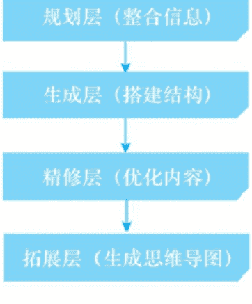

图4-9 撰写工作汇报的闭环思维

规划层（整合信息）：将手头现有的各项工作数据、进展、问题等信息反馈给AI，并让AI进行梳理，形成汇报的基础素材。

生成层（搭建结构）：根据汇报目的和实际需求给出清晰的指令，让AI生成合适的汇报框架，如总分总结构等。

精修层（优化内容）：AI根据你的清晰指令或按照汇报风格要求，对内容进行整体润色，添加必要的连接词等，使表达更流畅。

拓展层（生成思维导图）：让AI将汇报内容转化为层级清晰的思维导图，这是为现实工作多想的一步，思维导图可以帮助你清晰地记忆汇报要点，有效防止因紧张而忘词。

如何具体操作呢？接下来领取任务卡，让AI小助理助你写好一份工作汇报。

##### 任务卡

公司目前正在准备一个重大项目，你在项目筹备组，需要向领导汇报近期工作进展，包括已完成的工作、存在的问题及下一步计划。

两位即将登场的小助理分别是DeepSeek与腾讯元宝，通过两个AI工具生成内容，并利用Xmind生成思维导图，实现撰写工作汇报的任务闭环。

##### DeepSeek＋Xmind

首先，我们登录DeepSeek官方平台，在命令框中不点击"深度思考"（R1模型）按钮，我们选择更适合文本任务的V3模型完成信息梳理任务。

可以使用前文介绍的AI语音工具进行记录，不受时间和空间限制，并同步输出文本。记录下来的文字，哪怕有些杂乱也没关系，可直接通过DeepSeek的任务框输入指令：

- 我现在要写一份现阶段的工作汇报，需要让领导迅速了解重点，以上是我目前工作的基本情况，请帮我梳理出核心要点。

以项目A、任务B为例，以下是DeepSeek根据随手记录的内容，梳理出的核心要点。

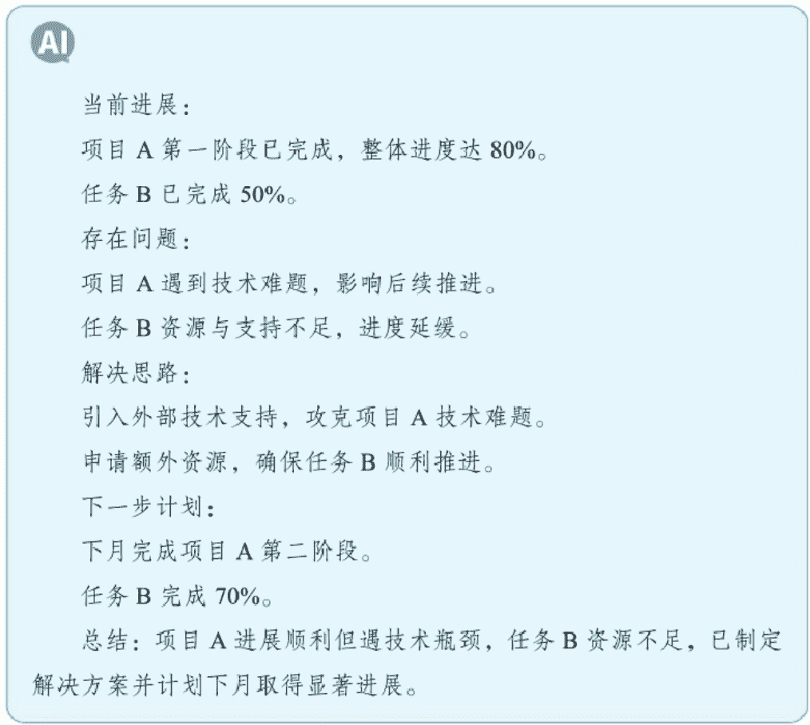

当我们敲定核心要点之后，就可以进入第二步，让DeepSeek帮我们搭建汇报的整体框架。这里需要说明一点：在准备工作汇报时，建议在框架基础上进行人工优化。不是简单地依赖AI自动生成全部内容，而是在框架基础上，有针对性地加入详细的分析和见解。此外，人工优化也是为应对突发情况而保留灵活性，确保即使在面对复杂多变的任务时，也能写出一份有"情感温度"、能够打动人心的工作汇报。

我们可以继续在对话框中输入指令：

- 请根据当前内容做调整和优化，保留核心要点，生成工作汇报框架，确保符合公文规范和标准。

DeepSeek很快就搭好了框架。

###### 工作汇报框架

**标题**：关于项目A及任务B进展情况的汇报

**正文**：

**一、工作进展情况**

项目A：

第一阶段工作已完成，整体进度达80%。

现阶段正按计划推进第二阶段工作。

任务B：

已完成50%的工作任务，但因资源不足，进度有所延缓。

**二、存在的问题**

项目A：

遇到技术难题，影响后续工作推进。

任务B：

资源与支持不足，导致进度延缓。

**三、解决思路**

项目A：

计划引入外部技术支持，集中力量攻克技术难题。

任务B：

申请额外资源，优化资源配置，确保任务顺利推进。

**四、下一步计划**

项目A：

计划于下月完成第二阶段工作。

任务B：

力争将任务B完成70%。

**五、总结**

当前项目A和任务B总体进展符合预期，但存在技术难题和资源不足的挑战。已制定针对性解决方案，并计划下月取得阶段性成果。后续将继续加强协调与资源调配，确保工作按计划完成。

我们可以根据框架补充具体数据和细节。我们在进行人工优化时，可以向DeepSeek提出精准指令，让它给出我们需要注意的事项。比如：

- 我需要这份汇报既能在短时间内说清楚核心要点，也能打动人心。

DeepSeek给出了七点注意事项并给出了一个参考示例。下面展示两点DeepSeek给出的注意事项：

> **AI**
>
> 强调解决方案的可行性：
> 在"解决思路"部分，补充具体措施的执行细节（如已联系的外部技术支持团队、申请资源的具体需求），展现行动力和解决问题的决心。
> 例如："已与××技术团队达成初步合作意向，预计下周开始技术攻关。"
>
> 总结部分画龙点睛：
> 在总结中简要回顾核心内容，并表达对未来的信心和决心，给领导留下深刻印象。
> 例如："当前工作虽面临挑战，但团队已制定切实可行的解决方案，并全力推进。我们有信心在下一阶段取得突破性进展。"

第三步，我们通过DeepSeek对汇报内容进行整体润色，确保语句凝练、表达生动流畅、逻辑清晰。以"项目A第一阶段完成，项目A进度为80%，任务B完成50%"这一句话为例，我们给DeepSeek清晰指令，让它帮我们润色为"情感共鸣"的风格。我们通过对比来看看效果。

- 原句：项目A第一阶段完成，项目A进度为80%，任务B完成50%。

- AI润色后：目前，项目A第一阶段已顺利完成，整体进度达到80%，展现了团队的高效执行力；任务B也已完成50%，尽管面临资源不足的挑战，但团队依然稳步推进，为后续工作奠定了坚实基础。

通过润色得到我们想要的汇报风格后，最后一步就是利用Xmind生成思维导图，让我们轻松应对现场的汇报工作。

这一步，我们依然需要借助DeepSeek帮我们实现思维导图的一键生成。操作方法也很简单，我们在对话框中输入指令：

- 帮我将上面的工作汇报生成思维导图，以markdown格式输出。

然后，我们直接点击DeepSeek给出的markdown格式内容的右上角的"复制"。接下来，我们需要在本地新建一个"记事本"文件，将后缀"txt"改为"md"。当跳出确定是否要改变文件扩展名的提示框时，我们直接点击"是"，并将复制内容直接粘贴在记事本文件中。

完成上述操作，我们可以打开Xmind的官方网站，然后选择导入文件按钮，直接选择刚刚粘贴内容的记事本（见图4-10）。

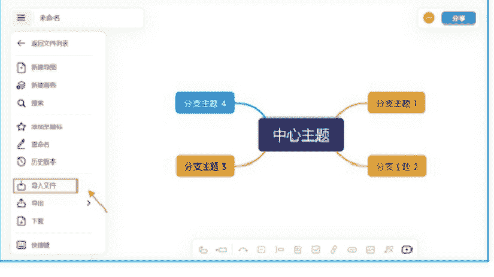

图4-10 Xmind支持导入md格式的思维导图

导入后，我们就可以实现思维导图的一键生成。一起来看看具体效果（见图4-11）。

DeepSeek与Xmind可以实现覆盖工作汇报的四大步骤，具有很强的适用性和实用性，不仅可以提升你的写作效率，还能更好地启发你。

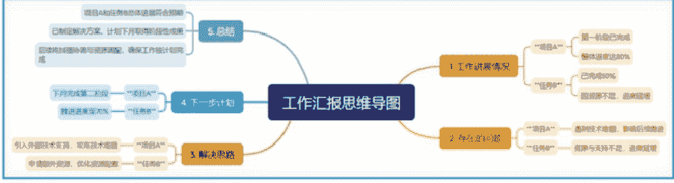

图4-11 思维导图生成效果

##### 腾讯元宝＋Xmind

登录腾讯元宝官方平台，我们可以看到元宝提供了两个模型：一个是其开发的混元模型Hunyuan，另一个就是接入的DeepSeek（见图4-12）。我们选择Hunyuan进行演示。

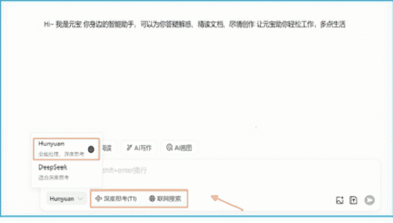

图4-12 腾讯元宝的AI模型选择界面

输入指令：

- 我现在要写一份现阶段的工作汇报，需要让领导迅速了解重点，以上是我目前工作的基本情况，请帮我梳理出核心要点。

以项目A、任务B为例。选择"深度思考（T1）"与不选择"深度思考（T1）"的对比情况如图4-13所示。

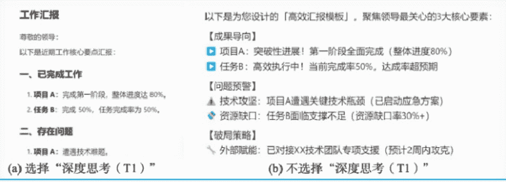

图4-13 生成内容对比

"深度思考（T1）"模式更善于推理，给出解决方案；不选择"深度思考（T1）"，生成的文本更能满足实际需求。

为了让工作汇报更具说服力，我们可以使用SWOT分析，借助它来优化数据，更好地提炼核心要点。我们可以给出精准指令：

- 请基于以下工作背景生成SWOT分析框架，要求分"优势、劣势、机会、威胁"四部分，每部分包含两个具体条目，语言风格保持客观严谨。

项目A：已完成第一阶段（进度80%），存在技术难题。

任务B：完成率50%，面临资源不足问题需突出阶段性成果价值、问题解决思路，并预测潜在影响。

参考格式：

优势1. 项目推进成果（具体说明）；

优势2. 问题应对能力（具体策略）。

腾讯元宝的回答如下。

###### 优势

项目推进有一定成果：项目A已完成第一阶段，整体进度达到80%，任务B也已完成50%，说明团队具备一定的项目执行能力和专业技能，在前期的工作中取得了阶段性的成绩，为后续工作奠定了基础。

应对问题的思路明确：针对项目A的技术难题和任务B的资源不足问题，已经有了清晰的解决思路，即引入外部技术支持和申请额外资源。这种积极主动的态度和解决问题的方法有助于克服当前的困难，确保项目继续推进。

###### 劣势

技术难题影响进度：项目A遇到技术难题，可能导致后续阶段的开发难度增加，开发周期延长，影响整个项目的交付时间。如果技术难题无法及时解决，还可能引发连锁反应，对其他相关任务和项目产生负面影响。

资源与支持不足：任务B所获资源与支持不足，后续开展进度延缓。资源短缺可能会限制团队的工作能力和效率，导致任务无法按照计划完成，影响项目整体进度和质量。

（以下内容略。）

不难看出，通过SWOT分析有助于提升工作汇报的深度，并具备前瞻性。我们可以在对话框中输入指令：

- 请以这份SWOT分析为参照，帮我生成工作汇报框架，要符合公文规范和标准。

腾讯元宝给出的答案如下。

###### 关于项目A、任务B工作情况的汇报

**一、工作进展概述**

**（一）项目A**

截至目前，项目**A**已完成第一阶段，且整体进度达到**80%**。各项前期任务均按计划顺利推进，为后续阶段的开展奠定了坚实基础。

**（二）任务B**

任务**B**已完成**50%**，完成率达到一半，取得了阶段性的成果。

**二、优势分析**

**（一）成果基础扎实**

项目**A**和任务**B**的阶段性成果表明团队具备良好的执行能力、专业素养和项目推进能力，为后续工作提供了有力支撑。

（以下内容略。）

这份基于SWOT分析生成的框架，从内容翔实角度看无疑质量更佳。从高效角度，通过精准指令生成的框架基本够用；但从精益求精的角度，经过SWOT分析后的框架更经得起推敲。

接下来，我们就可以直接对基于SWOT分析生成的框架进行人工优化，灵活添加你需要的内容。之后选择以下方式之一完成润色：如果你使用的腾讯元宝有"文本润色"功能，可在"AI写作"菜单中直接使用该功能（见图4-14）；若无此功能，可在对话框中输入精简版指令：

- 请结合原文特点和公文写作规范进行润色，重点关注语言的简洁性、逻辑的连贯性和信息的完整性，使最终文本专业、规范、实用、高效传达信息。

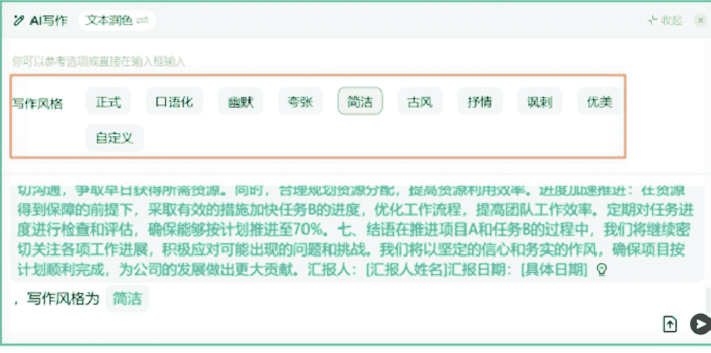

图4-14 优化功能操作界面

值得一提的是，可点击腾讯元宝生成文本底部的"分享"图标，将文本转为腾讯文档，即可在线编辑。

在一键生成思维导图时，建议切换到DeepSeek的V3模型，因为Xmind在识别某些markdown格式时可能出现兼容性问题。

#### AI工具"论剑"

DeepSeek和腾讯元宝是目前很受欢迎的两大AI工具，拿它们来写工作汇报很合适。DeepSeek的V3模型对于文本型任务更加友好，无论是框架生成还是语句润色，都表现出色，唯一需要你注意的是对公文格式和指令的精准性的把控。腾讯元宝接入了DeepSeek，并且和自己研发的混元模型放置在一起，供用户自由选择。在混元模型的对话框界面增加了AI写作、AI阅读等功能，可以对文本进行更细致的优化，从而让你的汇报更加精细。

#### 技能加油站

- 1. 职场思维启蒙

同工作总结一样，除了完成文字稿，在准备工作汇报时，我们可以做一份搭配汇报用的精致PPT来为自己赢得印象分。但比做PPT更重要的事情是，汇报前，你要想清楚三个关键问题：

  - （1）领导最关心什么？（如总经理关注民生工程，副总经理重视流程创新。）

  - （2）这次汇报要解决什么问题？（千万别写成流水账。）

  - （3）潜在的延伸需求是什么？（提前思考这次汇报能争取哪些资源支持、可能被问到的敏感问题等。）

我们可以记住一个应急的万能公式：当前进展＋存在问题＋解决建议＋需要支持。如果你一时半会儿没有任何灵感，就借用这个公式来填充内容。

正式汇报前，还有两个细节需要留意，它们可能改变结果。

  - （1）防止忘词。在PPT备注栏添加注释，或把PPT中每页的核心数据写在便签纸上。

  - （2）充分准备。当领导说"再想想"时，可回应"您看是否需要补充这几个方面的分析？我整理了详细资料"，即做好内容的"多手准备"。

最后提醒：特别重要的汇报，提前打印几份精简版材料放在手边。当领导突然提出"再报一遍具体数据"或"把刚才说的方案拿给我看看"时，提前准备的材料会为你赢得信任分。

- 2. 练一练，更出色

工作汇报要避免应付任务式地交作业。不要害怕数据不够漂亮，用对方法，就算工作普通，也一样能讲出价值感。通过学习，我想你已经掌握了其中的奥秘。接下来的练习，正好是你小试牛刀的好机会。

#### 小试牛刀

请结合本节所学，用"AI写作＋人工优化"的方法撰写一份你所在部门的月度工作汇报。

场景设置：向上级汇报你目前手头重要工作事项的进展及下一步计划。

提示：

- （1）可参考"核心成果＋问题分析＋下一步计划＋工作需求"的结构来准备；

- （2）核心成果可以采用"动作＋数据"的公式来撰写，如"举办3场××活动，新增20家客户"；

- （3）添加对比数据以增强说服力，如"较上月客户转化率提升12%"。

汇报的职场暗语是"用上级关心的数据，换你想要的资源"。通过AI工具整理基础信息后，在人工优化时记得突出"我多做了什么"，而不是"我做了什么"。

## 第5章 规章制度与管理法

### 揭开规章制度的"面纱"

在任何组织或企业中，规章制度与管理办法都是确保高效运作、维护秩序和促进发展的基石。然而，在许多人的印象里，这些文件似乎充满了复杂的术语和冗长的规定，让人望而却步。本节将带你深入了解规章制度的本质与核心，一步步揭开这层"面纱"，让你清晰地看到其背后的逻辑与价值。

#### 如何制定有效的规章制度？

当你领到起草规章制度的任务时，首先要熟悉规章制度的构成要素（见表5-1）。随着你对这些内容的理解加深，那层"面纱"将被揭开，你会发现规章制度并非想象中那样令人生畏。

| 构成要素 | 说明 |
|---------|------|
| 总则 | 包含规章制度的主旨、目的、适用范围等概述性信息。确保语言简洁明了，避免使用过多的专业术语 |
| 职业道德 | 明确规定员工应当遵循的职业操守，如诚信、保密、尊重同事等 |
| 分则 | 按照不同主题（如财务管理、人事管理、行政管理、安全管理等）或部门划分的具体规则。每一条款都需具体明确，便于理解和执行 |
| 表扬与处罚 | 设定奖励措施激励积极行为，同时定义违反规定的后果。奖惩机制应该公正合理，鼓励正确的行为 |
| 附则 | 包括规章制度的生效日期、变更程序和其他补充条款。确保规章制度能够随着时间和需求的变化而更新 |

表5-1 规章制度的构成要素

当你了解了规章制度的构成要素之后，需要明白，规章制度的设计与文字表达的合理性将在很大程度上影响其能否有效试行。但无须忧虑，通过牢记以下写作要点，你可以使规章制度更具吸引力和可操作性，让它达到理想效果。

要点一，语言简洁明了。使用简单直接的语言，避免过多的专业术语，确保非专业背景的读者也能轻松理解。

要点二，行动导向的表述。推荐使用动词开头的句子，如"禁止""要求""指导"，使规章更加明确且易于执行。

要点三，保持一致性。确保整个文档的语言风格一致，包括字体大小、格式等，以提升专业性和连贯性。

要点四，突出重点。明确描述关键内容，确保读者能迅速抓住要点，避免冗长的叙述。

要点五，明确时间点。清晰指明规章制度的生效日期及修订程序，确保其时效性和灵活性。

下面我们通过一份初稿及经过润色后的版本，来看看上述构成要素和要点的具体应用效果。

##### 初稿

**总则**

- 1. 本规定适用于公司所有正式员工。

- 2. 员工必须遵守公司的机密信息保护政策，不得泄露给无关人员。

- 3. 财务报销需提交原始发票，并填写费用报告表。

- 4. 对于表现优秀的员工，公司将给予表彰和奖励；违反纪律者可能被解雇。

- 5. 本规定自发布之日起生效，如有变动需提前通知全体员工。

看到这份初稿，你感觉如何？运用我们前面所学，规章制度的构成要件及写作要点，你会发现如下问题：

- （1）缺乏明确的结构和分段：所有内容都挤在一起，没有明确的分段或标题，导致阅读体验不佳。

- （2）语言不够简洁明了：某些句子过于冗长或使用了不必要且复杂的表达方式。

- （3）缺乏行动导向的表述：某些句子开头缺少明确的动词，不够直接。

- （4）一致性不足：语言风格和格式不一致，例如有些地方用"正式员工"，有些地方用"员工"。

- （5）突出重点不足：关键内容不够突出，读者可能难以迅速抓住重点。

- （6）时间点不够明确：对于生效日期和修订程序的描述较为模糊。

下面是润色后的版本。

##### 润色后版本

**第一章 总则**

**第一条 主旨**

为维护公司和员工双方的合法权益，营造正面、激励性的工作环境，根据××等相关法规，特制定本规章制度。

**第二条 适用范围**

本规定适用于本公司全体员工。

…………

**第二章 职业道德**

一、员工应诚实守信，保守公司秘密，不得以任何形式向外界泄露机密信息。

二、尊重同事，禁止任何形式的歧视和骚扰行为。

............

###### 第三章 行政管理制度（分则部分）

- 一、工作时间：严格遵守上班时间，迟到早退按规定处理。

- 二、着装要求：工作日需穿着得体，符合公司形象。

- 三、行为准则：保持办公区域整洁，爱护公共设施。

............

###### 第四章 财务管理制度

- 一、财务报销：所有费用报销需提交原始发票，并详细填写费用报告表，以便审核。

............

###### 第×章 表扬与处罚

####### 第×条 表扬

- 一、对于连续三个月表现优异的员工，公司将给予公开表彰和适当的物质奖励。

............

####### 第×条 惩处

- 二、违反公司规定者，视情节轻重予以警告直至解除劳动合同。

............

###### 第×章 附则

####### 第×条 本规章的修订

公司保留对本规范进行修订的权利，修订内容将及时通知员工。

####### 第×条 本制度的实施

本制度于20××年××月××日起实施。

现在你应该掌握规章制度的核心要义了吧！接下来我们一起通过"情境体验"来巩固知识点，并学习快速上手规章制度的技巧。

#### 情境体验

主任来到你的办公桌前，递给你一杯咖啡，说道："今天我们有新任务，需要起草一份全新的职工行为规范，这份规范需要便于理解与执行。"

你的心跳开始加速，感到些许压力。主任有所察觉，微笑着补充道："我知道这是一项艰巨的任务，但我相信你能够胜任。而且我会亲自指导你，一步步教会你如何撰写高质量的规章制度。"

主任拿出纸笔，耐心地将自己的经验心得分享给你。

**第一步：定范围。** 主任希望你起草一份适用于公司所有员工的行为规范。首先，你需要明确这份规章制度的目的，比如建立和谐的工作环境、促进员工间的良好关系。同时，定义其适用范围，确保覆盖所有正式员工及非正式员工。

**第二步：搭框架。** 为了确保规章制度逻辑清晰，你需要构建一个完整的结构框架。这不仅有助于你组织思路，也能让读者更容易理解规章制度的各个部分。

**第三步：编总则。** 作为开篇部分，总则应以简洁明了的语言描述规章制度的主要目标和适用对象。这部分有助于读者初步理解规章制度，也是主任指出的重点之一。

**第四步：写分则。** 你需要逐条详细说明每个分则的内容，包括职业道德标准和具体规则。这些规定将约束员工日常行为，确保他们的行为契合公司的价值观。

**第五步：立机制。** 为了激励积极行为并维护纪律，必须设立明确的表扬与处罚机制。这不仅能提高员工的积极性，还能营造公平透明的工作环境。

**第六步：拟附则。** 附则部分涵盖规章制度的生效日期、变更程序以及其他补充条款。这确保了规章制度能够随着时间和需求的变化而更新。

**第七步：核细节。** 完成初稿后，邀请法律专家、管理层进行审查，确保规章制度合法合规且符合实际情况。根据反馈意见做出必要的修改，这是确保规章制度准确无误的重要步骤。

学会了技巧，你满心欢喜，很快便完成了这份规章制度的初稿……

这是你在办公室接触到的第七种公文类型，你也对接下来的挑战充满期待。

#### 手把手教你用AI写规章制度

规章制度，是企业实现管理目标的重要工具。通过前面的学习，想必你已经掌握了设计规章制度的实用方法，从总则、分则再到附则，各层内容紧密相连。你或许会问："规章制度需要更多思考，如果我在撰写时大脑一片空白，该怎么办？"其实大可不必忧虑，这就是AI发挥作用的时候。接下来，我们将探讨如何借助AI来高效完成规章制度的整体撰写。

要写好一份规章制度，很多人的想法是套用模板。现在有了AI工具，我们就不仅仅停留在简单的模板套用层面。AI工具不仅可以快速生成符合逻辑和规范的规章制度框架，还能根据实际需求、行业特点和管理目标，提供定制化的内容，并初步帮你完成内容的合规性审核。

在规章制度的设计中，我们完全可以运用闭环思维，不仅能够覆盖从规划到实施的全过程，还可以为后续工作提前做好铺垫，确保制度的可持续性和适应性（见图5-1）。

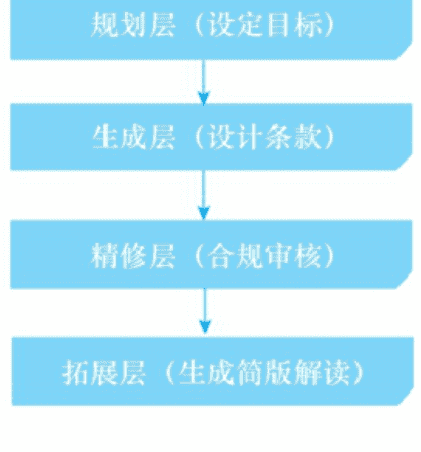

图5-1 撰写规章制度的闭环思维

**规划层（设定目标）**：让AI对制定规章制度的使用情境进行深入分析，明确其具体目的、适用范围及预期效果。

**生成层（设计条款）**：让AI根据分析结果编写具体的条款内容，并优化文档结构以增强逻辑性和易读性。

**精修层（合规审核）**：利用AI工具的资源库，检查所有条款是否符合现行法律法规及相关政策要求。

**拓展层（生成简版解读）**：利用AI工具生成规章制度简版解读，便于培训或快速了解。

你的任务卡已经准备好，AI小助理也在等待你的指令。我们开始用AI工具完成一份规章制度吧！

##### 任务卡

公司需要制定一套新的办公用品使用规章制度，以规范办公用品的使用和管理。

鉴于规章制度设计具有借鉴与创新相结合的特点，本次登场的两位AI小助理分别是搜索功能强大的秘塔AI搜索和能够深度思考的纳米AI。

###### 秘塔AI搜索

进入秘塔AI搜索的官方平台，我们在三种模式中选择"研究"模式，再选择其中的"先想后搜"（见图5-2），这时秘塔AI搜索会帮我们先思考框架，再整合资料。然后我们可以在对话框输入清晰指令。

- 目前我需要为公司制定一份办公用品的使用规章制度，请结合使用情境进行分析，明确这一规章的具体目的、适用范围及预期效果并给出目前可以作为案例的对应制度模板作为参考。

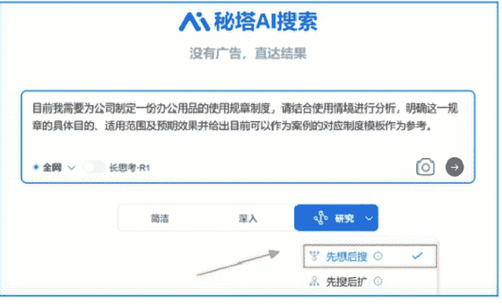

图5-2 AI智能检索界面

需要说明的一点是：秘塔AI搜索默认为全网搜索，"长思考·R1"是采用的DeepSeek R1模型，所以我们在文本任务中，可以不勾选"长思考·R1"。三种模式中，"简洁"模式生成的内容过于简单，相较而言，"研究"模式生成的内容更全面，也更具深度，就规章制度这一公文类型而言，实际效果更佳。

以下是秘塔AI搜索的回答。

####### 办公用品使用规章制度制定方案（基于情境分析）

######## 一、制度制定的核心目的

**成本控制与资源优化：**

通过统一采购、预算审批、库存监控等手段，实现年度办公用品费用降低15%～20%（案例参考：某地市局通过精益管理实现持续降本）。

避免因个人囤积、私用导致的隐性浪费，如某医疗健康机构因未规范按摩椅采购导致非必要开支。

............

######## 五、情境化实施建议

**初创企业适配版：**

- **简化分类：** 仅分"设备/耗材"两类，采购权限下放至部门经理。
- **云采购模式：** 接入××企业购、××办公等平台，实现48小时到货。

**生产制造企业特别条款：**

- **车间专用品：** 如防油污笔记本、抗静电文件夹，需单独建账。
- **安全管控：** 涉及图纸打印的部门，硒鼓回收需粉碎处理。

（以下内容略。）

我们从上述内容可以看到，AI结合情境帮我们做了全面分析，给出搜索到的参考资料，并提出针对性建议。通过思考过程（见图5-3），我们可以发现秘塔AI搜索会将搜索到的资料进行需求适配，为你提供参考资料。

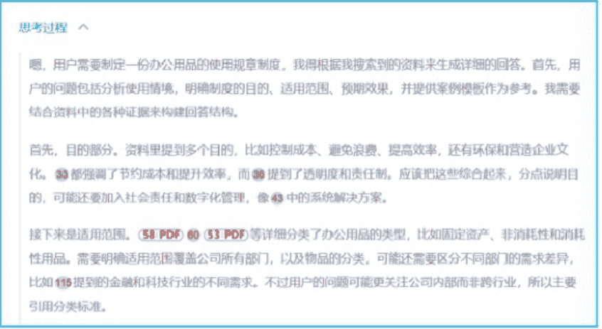

图5-3 秘塔AI搜索的思考过程展示

接着，我们使用"追问"功能（见图5-4），在"追问"对话框内输入清晰指令：

- 现在我需要补充具体条款，并撰写完整的办公用品管理规章，请你润色和调整上面的分析与制度模板框架，这份管理规章需要包括总则、职业道德、分则、表扬与处罚、附则。

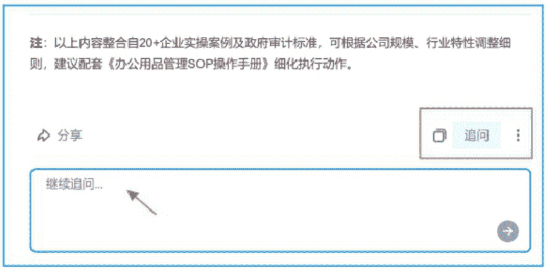

图5-4 智能追问功能界面

秘塔AI搜索给出的回答如下。

####### ××公司办公用品管理规章

######## 第一章　总则

…………

######## 第二条　适用范围

适用对象：公司全体员工（含正式员工、实习生、外包人员）、各分支机构及关联部门。

适用物品：固定资产（单价≥2000元）、低值易耗品、IT专用耗材等12大类（详见附件1《分类清单》）。

…………

######## 第二章　职业道德

######## 第四条　行为准则

员工在使用办公用品时须遵守以下道德规范：

1. 禁止私用公物：不得将公司物资用于私人事务（如打印个人文件、携带文具回家等）。

2. 数据真实性：严禁虚报采购需求、伪造领用记录或篡改库存数据。

…………

######## 第三章　分则

######## 第十一条　绿色办公

1. 推行无纸化办公，非必要文件双面打印，单面废纸需二次利用为草稿纸。

2. 电子设备下班后必须断电，违反三次以上者通报批评并取消年度评优资格。

…………

######## 第四章　表扬与处罚

######## 第十三条　奖励机制

1. 节约标兵奖：年度办公成本节省超标的部门，按节省金额的10%发放团队奖金。

2. 合理化建议奖：员工提出管理优化方案并被采纳的，给予500~2000元奖励。

…………

######## 第五章　附则

######## 第十五条　生效与修订

1. 本制度自20××年××月××日起执行，旧版制度同时废止。

2. 每年由行政部牵头修订，修订稿需经职工代表大会审议通过。

我们可以看到，秘塔AI搜索帮我们生成的内容质量相当不错，并且具有一定的创新性。到这一步我们就需要人工介入，根据实际情况进行补充与修改，并适当根据自己需要的风格进行措辞方面的微调。

在修改完条款内容后，让秘塔AI搜索帮我们做一个初步的合规审核，比如是否符合相关法律规定，是否涉及敏感性内容。

先来看AI给出的结论：现行规章在采购程序、处罚权限、合同管理等方面存在五项高风险条款，需按建议修订以确保合法性。修订后版本应提交法务部、人力资源部、审计部三方会签，并在职工代表大会公示后生效。

从实际工作考量，我们可以根据AI的审核建议做初步修改，然后再通过专业部门或专业人员进行全方位的规章审核。

最后一步，是为后续培训或快速介绍规章制度做准备。不妨回顾一下工作汇报部分讲解的用DeepSeek生成markdown格式，然后导入Xmind一键生成思维导图的方法。这种方法不仅高效，还能帮助我们快速梳理信息。事实上，这一步骤的逻辑完全可以借鉴到其他场景中，因为很多方法本质上是通用的。不过，这一次，我们可以直接借助秘塔AI搜索，让整个过程更加便捷高效。

在秘塔AI搜索的"追问"对话框，我们输入清晰指令：

- 请帮我生成简版解读，便于员工培训或新人快速了解。

秘塔AI搜索给出的回答令人眼前一亮（见图5-5）。

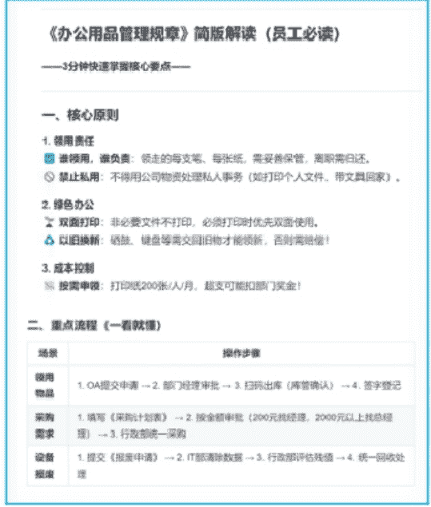

图5-5 秘塔AI搜索生成的简版解读

###### 纳米AI

进入纳米AI的官方平台，在左侧模块栏选择"大模型"，默认为DeepSeek R1模型（见图5-6）。此处，我们就以默认模型来操作，在对话框中输入指令：

- 目前我需要为公司制定一份办公用品的使用规章制度，请结合使用情境进行分析，明确这一规章的具体目的、适用范围及预期效果并给出目前可以作为案例的对应制度模板作为参考。

图5-6 纳米AI的深度思考及联网搜索界面

纳米AI新增了"知识库"选项。你可以将生成的答案一键添加到个人知识库中，方便随时管理和调用。个人知识库是你专属的知识宝库，无论平台后续如何更新，你都可以从中快速找到之前整理过的内容，灵活应对各种需求。

纳米AI的回答如下。

####### 一、使用情境分析与制度设计要点

**高频场景与风险管控**

- 日常领用：笔、纸张等易耗品易出现超额领取，建议采用月度配额制（如每人每月限领三支笔）。

- 设备借用：投影仪、移动硬盘等需建立"借用登记—归还验收"流程，避免资产流失。

- 跨部门协作：打印机等共享设备需明确费用分摊规则，按部门使用量核算成本。

**具体制度目的**

- 减少年度办公费用10%～20%（通过采购比价、以旧换新等机制实现）。

- 实现资产全生命周期管理，建立"采购—领用—维护—报废"闭环。

- 杜绝私人用途消耗，如限制打印纸张单日领取量。

**适用范围**

- 人员：全员覆盖，包括外包人员（领用需额外审批）。

- 物品：明确区分消耗品（如纸杯）与固定资产（如碎纸机），执行不同管理标准。

（以下内容略。）

纳米AI从使用情境分析与制度设计要点、制度核心框架（整合多案例优化）、配套实施工具三大方面给出了建议。接着，我们在对话框中输入指令：

- 帮我生成一份完整的管理规章，按照总则、职业道德、分则、表扬与处罚、附则的框架来呈现。

我们一起来看看纳米AI给出的答案。

####### 办公用品管理规章

（20××年××月××日生效）

######## 第一章　总则

…………

######## 第三条　管理原则

- 统一采购、分级审批。
- 谁使用、谁保管、谁负责。
- 节约优先，环保可追溯。

…………

######## 第二章　职业道德

######## 第四条　员工义务

1. 严禁将办公用品用于私人事务（如打印个人文件、携带回家等）。

2. 主动维护设备正常使用，发现故障24小时内报修。

3. 离职前需完成资产交接，未归还物品按原价1.5倍赔偿。

…………

######## 第三章　分则

######## 第六条　采购管理

1. 申购流程：
   - 每月25日前提交《月度申购单》（含品名/数量/用途）。
   - 行政部门比价后选择三家及以上供应商竞价，建立黑名单淘汰机制。

…………

######## 第四章　表扬与处罚

######## 第九条　表彰机制

1. 年度节约奖：部门办公费用同比下降15%以上，奖励预算结余的20%。

2. 创新提案奖：优化用品管理方案被采纳者，奖励500～2000元。

…………

######## 第五章　附则

######## 第十一条　解释与修订

1. 本规章由行政部负责解释，修订需经总经理办公会审议。

2. 生效日期：20××年××月××日

只要指令精准，纳米AI给出的答案可以作为人工优化的调整框架。当你没有任何想法的时候，可借助纳米AI取得完整框架，再进行人工优化与调整，使这份规章制度更贴合你的实际工作需要。

此处需注意：一定要让AI工具帮你核查敏感内容及相应风险（见图5-7）。

######## 1. 劳动关系相关风险

- **问题条款：**
  - 第十条处罚标准中"扣除当月绩效20%"未明确绩效基数计算方式，可能违反《工资支付暂行规定》第16条（扣款不得超过月工资20%）
  - 员工离职时"未归还物品按原价1.5倍赔偿"未考虑折旧，与《民法典》第1184条（财产损失按实际价值赔偿）冲突

- **修订建议：**
  - 明确绩效扣减以基础工资为上限，且总额不超过月收入的20%
  - 赔偿标准改为"按物品采购价×（1-已使用年限/折旧年限）"，固定资产折旧年限参考《企业所得税法实施条例》

####### 二、敏感内容规避建议

**1. 数据安全：**

- RFID定位追踪条款需补充"仅限办公区域使用，下班时间自动关闭定位功能"
- 删除"全公司通报批评"等可能侵犯名誉权的表述，改为"书面警告并记入档案"

**2. 劳动权益：**

- 外包人员领用审批条款需与劳务派遣单位签订补充协议，明确管理权责
- 增加异议申诉通道："员工对处罚决定有异议可向工会申请复核"

**三、关键条款修订对照表**

| 原条款 | 风险点 | 修订后条款 | 法律依据 |
|--------|--------|-----------|---------|
| "未归还物品按原价1.5倍赔偿" | 赔偿标准过高且未考虑折旧 | "按采购价×（1-使用年限/5）" | 《民法典》第1184条 |
| "扣除当月绩效20%" | 未明确计算基数 | "扣减额≤基础工资的20%" | 《工资支付暂行规定》 |
| "制度修订需经总经理办公会" | 程序不合法 | "修订草案公示5日并征集意见" | 《劳动合同法》第4条 |

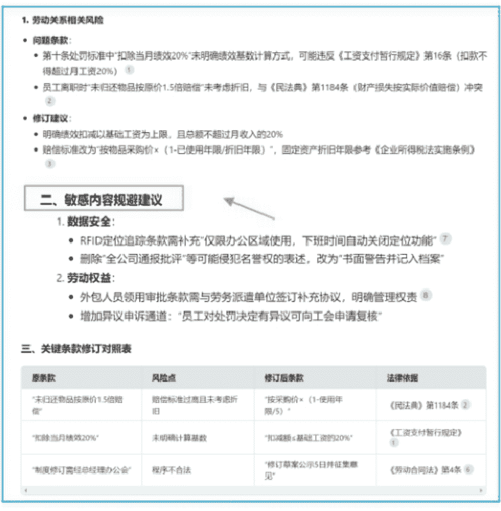

图5-7 敏感信息智能筛查界面

根据给出的指令，纳米AI借助DeepSeek R1模型，从法律合规性审核要点、敏感内容规避建议、关键条款修订对照表、合规性增强方案等方面给出了审核建议。从初步审核的角度看，已经较为全面。

最后一步是生成简版解读（见图5-8）。

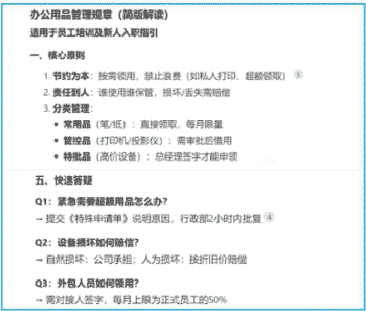

图5-8 纳米AI生成的简版解读

纳米AI生成的简版解读更正式，也融入了更多创意设计，例如新增了快速答疑功能。

#### AI工具"论剑"

规章制度闭环思维的四个步骤，秘塔AI搜索和纳米AI可以实现全覆盖。当然，纳米AI不仅接入DeepSeek R1模型，还接入了文心一言、通义等，使用起来更为便捷。但从搜索角度看，秘塔AI搜索深耕于这一细分领域，所以给出的参考资料更加多样和准确，也便于后续人工打磨内容。

综合而言，通过纳米AI可以高效完成普通的规章制度任务，需要更多个性化调整的复杂的规章制度任务则可以通过秘塔AI搜索来完成。

#### 技能加油站

##### 1. 职场思维启蒙

我还记得初拟考勤制度时，写下"严禁迟到早退"等硬性条款，却遭领导反问："这和把法条贴墙上有什么区别？"多年后我才顿悟，优秀的规章制度需要刚柔并济——既要筑牢管理底线，更要铺设人性化"缓冲带"。

当你在设计某份规章制度时，建议通过双重视角来审视这份规章制度的合理性。

一是用户视角：如通过场景还原模拟新员工入职、项目紧急采购等典型场景来测试条款合理性；不要全篇都使用"禁止""必须"等高压词汇，可以适当加入"鼓励"等引导性表述。

二是管理视角：如标注制度可能引发的争议点，明确各环节审批权限。如果有条件的话，提前为每项条款注明好相应依据。

一份"刚柔并济"的规章制度，可以通过设置柔性条款来体现温度，如在"严禁吸烟"后补充"指定吸烟区设在B栋楼下"。

当接到撰写规章制度这一公文任务时，我教你一个应急办法——使用"4W1H"的思维框架，你可以根据这个框架来引导思路并逐步填充内容。

- why（目的）：为什么要制定本制度？
- what（内容）：规范哪些具体事项？
- who（主体）：涉及哪些部门和岗位？
- when（时限）：何时开始实施？过渡期多久？
- how（执行）：如何监督落实？违规如何处理？

我很喜欢彼得·德鲁克的一句话："制度的终极价值是唤醒自律。"这似乎也印证了他的管理哲学。事实上，职场上的"笔杆子"都应具备一项重要能力——共情。能共情的公文将助你在职场走得更远。

##### 2. 练一练，更出色

很多人一听到规章制度就感到"头疼"。但千万别被看似烦琐的条款吓退。用对方法，AI工具将帮你把复杂的问题简单化。此时，请回忆前文撰写规章制度的闭环思维，然后开始实战吧！你会发现，写好规章制度没有想象的那么难！

#### 小试牛刀

请结合本节所学，用"AI写作＋人工优化"的方法起草一份新版《员工考勤管理制度》。

场景设置：公司推行弹性工作制，需明确打卡时间、迟到处理、外勤登记等规则。

提示：- （1）可以考虑将该制度设计为"弹性打卡""迟到处理""外勤报备"三个重点部分，内容可采用条款式；

- （2）酌情添加人性化表述，如将"迟到三次扣款"调整为"月度迟到超过三次启动绩效面谈"；

- （3）整体考量是否遗漏执行细节，如"出外勤需提前一天审批"。

规章制度作为职场管理的一部分，在条件允许的情况下可以做到刚柔并济。加入更多人性化内容，可以有效避免执行僵化。

### 管理办法撰写实战：从框架到细节

"职场如战场"这句话道出了职场的忙碌与紧张。每天，无数的文件和任务如同潮水般涌来，管理办法的撰写任务或许就是其中之一。你是否曾被一份复杂的管理办法搞得头昏脑胀？是否在面对密密麻麻的条款时感到无从下手？别担心，这正是我们这一节要攻克的难题！接下来，我将用最简单、最直接的方式，带你迅速掌握管理办法的写作精髓。无论何时在职场中遇到它，你都能应对自如。

#### 轻松搞定管理办法撰写全流程

在这个信息爆炸、节奏飞快的时代，职场人士面临着不断学习新技能和知识的挑战。"时间短就是效率高"成为许多人的工作信条。面对"五分钟掌握管理办法的写作精髓"这个标题，你或许会心生疑问："真的可以在短短五分钟内学会吗？"其实只要你掌握了门道，一切皆有可能！

接下来的五分钟，将是一次高效的学习之旅，将为你揭开写好管理办法的奥秘，帮助你构建起草这类文书所需的自信与能力。

第一分钟：快速浏览表5-2，了解管理办法的构成要件。这是基础，也是关键。

第二分钟：通过表5-2，记住管理办法构成要件的速记公式。掌握这个公式，你就能在任何时候迅速组织思路，写出高质量的管理办法。

第三分钟与第四分钟：需要高效掌握如表5-3所示的"撰写地图"。它将为你指明每一步的具体方向，告诉你该怎么写以及如何写得出色。

第五分钟：在最后这一分钟，我们按照"撰写地图"完成初稿。你会清晰地看到，这份初稿的每一个部分都与"撰写地图"中的指引完全契合，结构完整、逻辑清晰，每一个要点都得到了精准的呈现。

以下是用管理办法的"撰写地图"完成的《××公司财务报销管理办法》正文部分样例。

| 构成要件 |  | 说明 | 速记公式 |
| --- | --- | --- | --- |
| 标题 |  | 简洁明了，直接反映管理办法的核心内容 | 管理对象 + 管理内容 + 办法 |
| 发文机关、时间 |  | 用于正式发文，表明管理办法的正式性和权威性（在标题下方用括号注明） | 发文机关 + 成文日期 |
| 正文 | 总则 | 概述管理办法的基本原则和适用范围，为后续的具体条款提供指导 | 基本原则 + 适用范围 |
| 正文 | 分则 | 详细规定具体的操作流程、职责分配、标准要求等，是管理办法的核心部分 | 操作流程 + 职责分配 + 标准要求 |
| 正文 | 附则 | 说明管理办法的生效时间、解释权归属等，确保管理办法的权威性和可操作性 | 生效时间 + 解释权归属 |

表5-2 管理办法的构成要件

| 导航定位 | 目的地 | 导航点 | 地图备注 |
| --- | --- | --- | --- |
| 起点（总则） | 第一步：概述基本原则 | 基本原则 | 强调公平透明、简化流程、确保合规性 |
| 起点（总则） | 第二步：定义适用范围 | 适用范围 | 指定适用对象和特殊情况 |
| 路段 A（分则） | 第一步：详述操作流程 | 提交申请 | 规范提交时间和材料要求 |
| 路段 A（分则） | 第一步：详述操作流程 | 审批流程 | 明确各层级审批步骤 |
| 路段 A（分则） | 第一步：详述操作流程 | 支付处理 | 描述支付的时间和方式 |
| 路段 B（分则） | 第二步：明确职责分配与标准要求 | 员工责任 | 清晰列出各关联方责任，条理清晰，言简意赅 |
| 路段 B（分则） | 第二步：明确职责分配与标准要求 | 主管责任 | 清晰列出各关联方责任，条理清晰，言简意赅 |
| 路段 B（分则） | 第二步：明确职责分配与标准要求 | 财务责任 | 清晰列出各关联方责任，条理清晰，言简意赅 |
| 终点（附则） | 第一步：确定生效时间 | 生效时间 | 规定具体的生效日期 |
| 终点（附则） | 第二步：声明解释权归属 | 解释权归属 | 指明最终解释权的归属部门 |

表5-3 管理办法的"撰写地图"

##### 《××公司财务报销管理办法》正文部分样例

###### 总则部分

**基本原则：**

公平透明、简化流程、确保合规性。

**适用范围：**

适用于[公司名称]全体员工因公产生的各项费用报销，包括但不限于差旅费、会议费、培训费、办公用品采购等。

###### 分则部分

**操作流程：**

- **提交申请：** 员工应在费用发生后的×个工作日内填写《费用报销申请表》并附上所有原始票据。

- **审批流程：** 依次经过直接主管签字初审、财务部门签字复审，高层领导签字终审。

- **支付处理：** 经终审通过后，将申请表及相关票据递交财务部，由财务部进行现金或转账支付。

**职责分配与标准要求：**

- **员工责任：** 确保报销事项真实有效，按时提交申请及相关材料。

- **主管责任：** 审查报销项目的合理性和必要性，及时反馈审核意见。

- **财务责任：** 检查报销单据的合法性和完整性，确保支付过程安全准确。

###### 附则部分

**生效时间：** 本办法自发布之日起正式施行。

**解释权归属：** 本办法的最终解释权归[公司名称]财务部所有。

你是否已经掌握了管理办法的写作精髓？如果你还有任何疑问，别担心，实践才是最好的老师。通过实际操作和反复练习，你将很快熟练并掌握这些技巧。

#### 情境体验

一天下午，主任来到了你的办公桌前，拍拍你的肩膀，笑着说："新的任务又要开始了。办公室接到通知，需要立刻起草一份职工考勤管理办法，思来想去，还是让你来接受本次挑战。"

你点了点头，心里虽有些紧张，但已经有了更多信心。主任接着说："别紧张，我们一步步来，就可以快速地写出管理办法。"

主任首先让你温习了一遍管理办法的构成要件和管理办法的"撰写地图"，接着跟你分享了他屡试不爽的快速上手管理办法的技巧。

- 第一步，明原则。确保你清楚管理办法的目的和核心价值观。

- 第二步，调模板。"不要重新发明轮子。"找到合适的模板并根据实际情况进行调整。

- 第三步，搭架子。先建立基本框架，然后逐步添加具体内容。

- 第四步，定流程。详细描述每一步骤，并明确规定各方的责任。

- 第五步，精语言。让不同的利益相关者参与审核，并确保最终版本的语言简洁明了。

最终你按照这个技巧，高效地完成了职工考勤管理办法的起草，我们一起来看看你的作品。

#### 职工考勤管理办法

##### 第一条 总则

为提高公司工作效率，严格工作纪律，保证各项工作有序、高效开展，特制定本办法。

##### 第二条 工作时间

工作日：周一至周五

工作时段：

上午：8:30—11:30

下午：13:00—17:00

##### 第三条 出勤规定

1. 员工必须按时上下班，不迟到、不早退，工作时间内不得擅自离岗。

2. 如遇特殊情况不能及时到岗，应提前电话请假，并事后提交书面解释至办公室备案。

##### 第四条 迟到、早退与旷工

1. 迟到：上班开始后5分钟至30分钟内到岗者按迟到处理；超过30分钟者按旷工半天论。

2. 早退：提前30分钟以内离岗者，按早退处理；超过30分钟者，按旷工半天论。

3. 迟到、早退及旷工记录将影响年度绩效考评。

##### 第五条 禁止行为

工作时间内禁止打游戏、打牌、炒股等与工作无关或不利公司形象的行为。

##### 第六条 活动参与

参加公司组织的会议、培训等活动时，如有事应提前向组织者或带队者请假。

##### 第七条 因公外出

员工因公外出需事先报告部门领导并获得同意；出差、调休、事假等需按规定提前获得批准，并交办公室登记。无记录者按旷工处理。

##### 第八条 处罚措施

违反第五条和第六条规定者，取消本年度先进个人评比资格。

##### 第九条 附则

本办法自发布之日起试行。

让我们通过以下精心整理的小贴士，全面掌握管理办法中关键部分的写作技巧，从而更好地将其应用到我们的工作中去。

#### 小贴士

1. 明确目标与定义原则：在第一条中明确了管理办法的目的和核心价值观——提高工作效率、严格工作纪律。

2. 借鉴模板并调整定制：参考现有考勤管理规范，简化语言，使其更符合公司实际情况。

3. 先搭架子再填细节：先构建整体框架（总则、工作时间、出勤规定等），然后逐步添加具体内容。

4. 详述流程与明确责任：详细描述每一步骤（如迟到、早退的具体界定），明确规定各方的责任（如请假流程）。

5. 多方审阅与优化表达：确保语言简洁明了，避免冗长表述，便于理解和执行。

#### 手把手教你用AI写管理办法

相较规章制度而言，管理办法更具弹性，它在明确管理目标和流程的前提下，允许根据实际情况灵活调整，而规章制度则更侧重于明确、固定的行为规范和约束。写好一份管理办法的关键在于明确目标，并结合实际工作场景精准抓取痛点。因此，当我们利用AI工具进行管理办法的设计时，需要构建一个完整的闭环思维：从设定目标出发，搭建清晰框架，到填充具体内容，再到优化完善（见图5-9）。其中，优化部分尤为关键，相当于多想一步。我们还可以通过AI模拟管理办法在不同实际场景下的执行效果，从而发现潜在问题，并据此进行针对性优化，确保管理办法在实际运用中更加高效、实用。

图5-9 撰写管理办法的闭环思维

规划层（明确目标）：通过AI明确管理办法要达成的管理目标，如效率提升、风险防控等，让AI提供参考意见。

生成层（生成初步框架+定制内容）：输入管理目标和关键问题，让AI生成管理办法的初步框架。例如，使用AI写作工具生成大纲，包括目标、适用范围、主要流程、责任分配等。根据企业的文化、规模、行业特性，对AI生成的内容进行调整。例如，调整语言风格、增加特定条款或流程。

精修层（模拟与优化）：利用AI工具模拟管理办法在不同场景下的执行效果，预估可能出现的问题并进行优化。

至此，我们完成了一系列的准备工作，领取下方任务卡，AI小助理已待命。接下来，就让我们立刻开启AI辅助撰写管理办法的实战体验吧！

##### 任务卡

公司需要制定一套新的项目管理办法，以规范项目流程、提升项目执行效率、防控项目风险。

针对管理办法的特点，经过一番精挑细选，我们选定的两个AI工具分别为文心一言和智谱清言。

###### 文心一言

登录文心一言的官方平台，勾选"文心大模型4.5 Turbo"。我们输入清晰的指令：

- 我现在需要制定一套新的项目管理办法，以规范项目流程、提升项目执行效率、防控项目风险。请明确项目管理办法要达成的管理目标，并提供参考意见。

文心一言很快就给出了参考意见。

> 一、管理目标
> 1. 规范项目流程
>    - 确保项目从启动、规划、执行、监控到收尾的每一个环节都有明确的操作标准和流程。
>    - 减少因流程不清导致的误解、延误和错误。

####### 二、参考意见

######## 1. 绘制详细的项目管理流程图

- 绘制项目从启动到收尾的全流程图，包括各个阶段的关键活动、责任人、时间节点等。

- 将流程图作为项目管理手册的一部分，供团队成员参考和执行。

######## 2. 建立风险管理体系

- 成立风险管理小组，负责识别、评估、监控和应对项目风险。

- 制订风险应对计划，包括风险规避、减轻、转移和接受等策略。

######## 3. 实施质量控制计划

- 制订详细的质量控制计划，明确质量检查点、验收标准和责任人。

- 定期进行质量审查和质量会议，及时发现并解决质量问题。

（以下内容略。）

可以看到，按照指令要求，文心一言给出了具体参考意见，有过项目管理经验的人一看就知道很有价值。接下来，我们要做的就是让它继续生成管理办法的框架。按照前文所述，框架需要包括总则、分则和附则。

我们在对话框中输入指令：

- 请你对上面的参考意见进行润色和调整，帮我生成一份项目管理办法的框架，可以用填空方式让我灵活进行内容补充。这份项目管理办法需要包括总则、分则、附则，明确各部分细节，确保无遗漏。

文心一言生成的框架如下。

####### 项目管理办法框架

######## 总则

第一条 为______（明确目的，如规范项目流程、提升执行效率、防控风险等），特制定本项目管理办法。

第二条 本办法适用于______（适用范围，如公司所有项目的管理工作），是项目团队必须遵循的基本准则。

第三条 项目管理应遵循______（管理原则，如科学、规范、高效、风险可控）的原则，确保项目按时、按质、按量完成。

######## 分则

######### 第一章 项目流程规范

第四条 项目从启动、规划、执行、监控到收尾，应遵循以下操作流程和标准：

- 项目启动阶段：______（如明确项目目标、范围、预期成果，组建团队，制订计划）。

- 项目规划阶段：______（如细化任务、分配资源、制定时间表、识别风险）。

- 项目执行阶段：______（如按计划执行任务、定期汇报进度、调整计划以应对变化）。

- 项目监控阶段：______（如跟踪进度、监控风险、确保项目按计划进行）。

- 项目收尾阶段：______（如完成项目成果交付、进行总结、评估绩效）。

…………

######## 附则

######### 第二章 其他规定

第十四条 本办法由______（如公司项目管理部门）负责解释和修订。

第十五条 本办法自______（如发布之日起）实施，原有相关项目管理规定与本办法不符的，以本办法为准。

因为在指令中，我并没有交代任何背景资料，所以文心一言给出的框架并不细致。但让文心一言以填空的方式展现框架，有利于人工进行灵活调整，让你在时间紧且无任何头绪的时候更加高效地完成任务。

人工调整后，我们可以就风格及行业特性等元素让文心一言提供定制化内容。比如，现在我们需要在确保正式的情况下，保持管理办法"刚柔并济"的特点，我们可以继续让文心一言帮我们润色和调节。在对话框中输入指令：

- 这个项目目前主要针对AI，我希望保持管理办法"刚柔并济"的特点，请帮我优化和调整。

文心一言调整后框架如下。

####### 项目管理办法框架（针对AI项目，刚柔并济版）

######## 总则

第一条 为规范AI项目的流程、提升执行效率、防控风险，同时保持管理的灵活性与创新性，特制定本项管理办法。

第二条 本办法适用于公司所有AI项目的管理工作，是项目团队必须遵循的基本准则，同时鼓励团队在遵循框架的基础上，积极探索和创新管理方法。

第三条 项目管理应遵循科学规范、高效、风险可控的原则，同时注重团队的协作、沟通与激励，确保项目按时、按质、按量完成，并促进AI技术的持续进步。

######## 分则

######### 第一章 项目流程规范

第四条 项目从启动、规划、执行、监控到收尾。应遵循以下操作流程和标准，但鼓励团队根据实际情况进行适度调整和优化：

- 项目启动阶段：明确项目目标、范围、预期成果及AI技术的应用方向，组建跨学科团队，制订初步计划。

- 项目规划阶段：细化任务，分配资源，制定详细时间表，识别技术、市场、法律等潜在风险。

- 项目执行阶段：按照计划执行任务，定期汇报进度，及时调整计划以应对技术变化或市场需求。

- 项目监控阶段：跟踪项目进度，监控风险，确保项目按计划进行，同时关注技术前沿动态。

- 项目收尾阶段：完成项目成果交付，进行技术总结，评估项目绩效，总结经验教训。

…………

######## 附则

######### 第一章 项目复盘与持续改进

第十二条 建立项目复盘机制，对项目执行过程中的经验教训进行总结和分析，同时注重复盘的深入性与前瞻性：

- 项目结束后，组织项目团队举行复盘会议，回顾项目过程，总结成功经验和不足之处。

- 根据复盘结果，制订改进计划，不断优化项目管理办法和流程，为未来的项目提供借鉴和参考。

######### 第二章 其他规定

第十三条 本办法由公司项目管理部门负责解释和修订，同时鼓励团队提出改进意见和建议。

第十四条 本办法自发布之日起实施，原有相关项目管理规定与本办法不符的，以本办法为准。对于特殊或创新性的AI项目，可经项目管理部门批准后，适度调整本办法的相关规定。

最后一步，就是我们在确定好条款内容后，让文心一言进行场景化模拟，预估可能出现的问题。输入指令：

- 请模拟以下项目管理办法在不同场景下的执行效果，并预估可能出现的问题。

附上最终确认的项目管理办法。

文心一言模拟了三个工作场景，并分别给出了执行效果及可能出现的问题，我们简单看一下可能出现的问题。

图5-9 撰写管理办法的闭环思维

######## 场景一：常规AI项目

可能出现的问题：

1. **流程僵化**：虽然办法鼓励团队根据实际情况进行适度调整，但团队可能过于依赖规定的流程，导致在某些环节上缺乏灵活性。

2. **工具使用不当**：项目管理工具的选择和使用可能不完全符合团队的需求，导致效率提升有限。

3. **风险识别不全**：在风险防控方面，团队可能未能全面识别所有潜在风险，特别是技术风险和市场风险。

######## 场景二：创新性AI项目

可能出现的问题：

1. **调整过度**：团队在调整流程时可能过于灵活，导致项目缺乏统一的管理和规范，增加了项目的不确定性。

2. **创新风险**：创新性项目往往伴随着较高的技术风险和市场风险，团队可能未充分预估和应对这些风险。

3. **资源分配不均**：在追求创新的同时，团队可能忽视了资源的合理分配，导致关键任务无法得到优先处理。

######## 场景三：跨部门合作的AI项目

可能出现的问题：

1. **部门间利益冲突**：各部门在项目过程中可能存在利益冲突，导致协作不畅或决策延误。

2. **沟通障碍**：尽管有有效的沟通机制，但部门间的文化和工作习惯差异可能导致沟通障碍。

3. **责任不清**：在跨部门合作中，可能出现责任不清或推诿的情况，影响项目的顺利进行。

我们对上述问题进行针对性调整，从而让这份管理办法更具实用性。

##### 智谱清言

登录智谱清言官方平台，我们点击左边栏中的AI搜索图标。然后，我们可以输入指令，让它帮我们明确目标并提供意见参考。智谱清言的AI搜索界面可以在右侧显示关键词（见图5-10）。点击关键词后，它可以结合搜索到的资料，给出更多的资料分析。比如点击"行业最佳实践"，它会从资料中找到典型代表并给出参考意见。

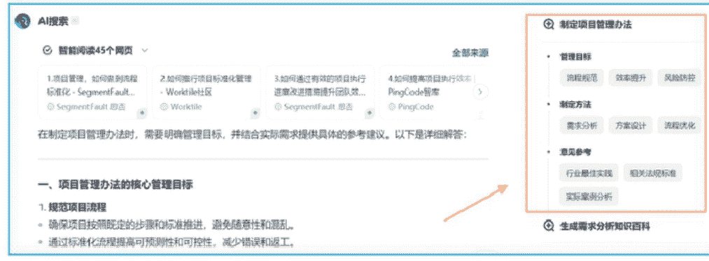

图5-10 便捷资料搜索界面

我们有了具体思路，接下来就可以根据实际需要，生成项目管理办法的框架。例如给出指令：

- 请根据以下管理目标生成项目管理办法的初步框架：

1. 提升项目执行效率，确保项目按时交付。

2. 防控项目风险，降低项目失败的可能性。

3. 规范项目流程，提高项目管理的透明度和可追溯性。

智谱清言可以很快生成框架，并在右侧附上可提供资料及意见参考的关键词（见图5-11）。

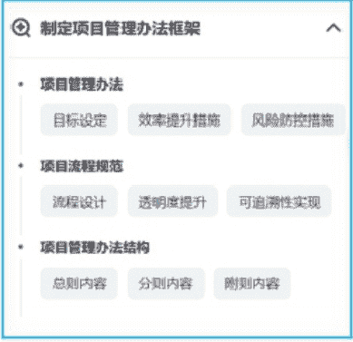

图5-11 智谱清言生成的关键词

接下来，我们可以进行内容的优化。还是以 AI行业及"刚柔并济"风格为例。

以下是智谱清言给出的答案。

数据安全及伦理规范，特制定本办法。

####### 2. 适用范围

本办法适用于公司内部所有 AI 项目，包括研发、应用及服务类项目。

............

####### 第二章　项目启动

######## 1. 立项审批

- （1）项目需经过伦理委员会的初步审查，确保符合伦理规范。

- （2）立项申请需明确项目目标、预期成果、技术路线及资源需求。

............

####### 第三章　项目执行

######## 1. 动态调整机制

- （1）项目团队可根据实际进展，对目标、计划或资源配置进行动态调整。

- （2）调整需遵循"风险可控、资源适配"的原则。

............

####### 第四章　项目监控与评估

######## 1. 绩效监控

- （1）建立项目绩效监控机制，定期跟踪项目进度、质量及成本。

- （2）监控结果应及时反馈给项目团队，以便调整管理策略。

............

####### 第五章　项目收尾

######## 1. 复盘与总结

- （1）项目结束后，项目团队需进行复盘，总结经验教训。

- （2）复盘结果需形成文档，供后续项目参考。

............

####### 第六章　伦理与合规

######## 1. 伦理审查

- （1）设立伦理委员会或引入第三方伦理审查机制，确保 AI 项目的开发和应用符合伦理规范。

- （2）伦理审查需贯穿项目全生命周期，覆盖数据采集、模型训练及成果应用等环节。

……

####### 第七章　附则

######## 1. 变更管理

（1）项目管理办法的变更需经过审批流程，确保变更的合理性和必要性。

（2）变更需及时通知相关方，并做好宣贯工作。

######## 2. 解释权

本办法由公司项目管理办公室负责解释。

以上生成的内容较为全面，鉴于AI的特点，不仅提供了项目启动、执行及收尾的基础条款，还设计了伦理与合规的风险防控条款。你需要做的，就是结合实际项目，添加更多细节。

最后，我们需要进行模拟。可以借助智谱清言的AI搜索功能，获取几个真实案例作为参考（见图5-12）。

图5-12 智谱清言给出的模拟执行效果及典型案例

借助 AI工具的力量，我们在制定管理办法时拥有了更广阔的创新空间。在过去，仅凭人脑思考时，很多想法往往受限于经验和思维定式。但如今，AI工具不仅能突破这些局限，更能启发我们的思维，为我们带来全新的视角和解决方案。

通过以上操作，我们不仅可以高效撰写管理办法，还能确保管理方法兼具时效性与实用性。

#### AI工具"论剑"

从智能分析、生成框架、定制化内容到场景模拟，文心一言和智谱清言不仅都能覆盖上述步骤，还都暗藏"绝技"。比如，文心一言的指令识别更精确，可以生成填空式框架，让你使用起来更加省心；而智谱清言的便捷资料搜索功能，可以更全面地提供参考资料，让你获得更多创新式思考。

在最后的模拟环节，文心一言和智谱清言给出的场景略有不同，如果条件允许，你可以从中选择最适合实际情况的内容。需要特别强调的是，对于管理办法的实用性而言，人工优化是必不可少的。我们不能完全依赖AI生成的结果，而应充分发挥"人机协作"的优势，通过人工的细致打磨和专业判断，确保管理办法既符合实际需求，又能高效落地执行。

#### 技能加油站

##### 1. 职场思维启蒙

当你初次接触单位的管理办法，可能会觉得这些密密麻麻的规定离实际工作很遥远。但请试着换个角度阅读——这些看似刻板的规定里，藏着一些你需要了解的职场思维。

- （1）系统思维。

任何管理办法都有清晰的流程设计和责任分工，这提醒我们在日常工作中建立整体视角：处理事务时不仅要完成自己的环节，还要思考上下游如何衔接。比如筹备会议时，除了确认议程，还要提前检查设备调试、资料打印、通知传达等关联环节。这种思维方式能让你养成工作的全局观。

- （2）边界意识。

我们新入职时总想通过超额完成任务证明自己，但管理办法中明确的责任划分给了我们重要启示：专业的工作需要清晰的边界。当同事临时增加需求时，不必勉强答应，可以这样回答："我正在处理 A项目的方案，您需要的材料是否需要调整优先级？"适度的自我保护不是冷漠，而是对工作质量的负责。

- （3）主动意识。

部分管理办法最后的"解释权条款"往往被忽略，但这恰恰是职场中的重要课题。当部门推行新制度引发同事困惑时，有位新人没有跟着抱怨，而是收集了大家的疑问点，结合自己的操作体验整理成具体建议。结果这份建议最终被采纳，该制度也进行了完善。与其被动接受规则，不如主动参与规则的完善。

在公文写作中培养的规则意识，最终会转化为你的"职场铠甲"。它可以让你在繁忙中保持清醒，在压力下守住底线，在约束中找到更好的下一步行动方向。当你真正理解它、运用它时，自然会在通往专业化的道路上走得更稳更远。

##### 2. 练一练，更出色

通过前面的学习，你在看到规章制度与管理办法时就不会"傻傻分不清楚"了。不要害怕将管理办法写得太细，清晰的规则设计能够在一定程度上减少误解和争议。下面是学以致用的时刻，请尽情发挥你的创造力吧！

#### 小试牛刀

请结合本节所学，用"AI写作＋人工优化"的方法拟定一份《部门报销管理办法》。

场景设置：规范差旅、办公用品等报销流程，需明确标准、对应审批人及审批时限。

提示：

- （1）对应报销的细节内容，可拆分为"费用标准""审批流程""违规处理"三大部分；

- （2）避免描述模糊不清，内容需严格细化，如"特殊情况特殊处理"可以调整为"超标准费用需附书面说明，经分管领导签字"；

- （3）明确禁止事项要在条款内容中体现，如"餐饮发票不得连号"。

管理办法的设计是职场的一门管理艺术：既要"堵漏洞"，确保管理的规范性与安全性；也能"开绿灯"，激发员工的积极性与创造力。

# 第三部分 沟通表达类公文：让你的职场影响力更上一层楼

## 第6章 请示与批复

### 请示怎么写才能畅通无阻？

在职场中，向上级提出请示是常有的事。不管是希望获得更多资源，还是遇到难题寻求解决办法，抑或是想要学习经验，都离不开请示。请示，顾名思义是一种请求性公文，通过这一"公文桥梁"能让上级清晰了解下级的工作情况、面临的难题及需求，进而做出针对性的指导和决定。一份好的请示，既能把事情说清楚，还能使上下级关系融洽。

然而，写好请示并非易事。想让请示顺利通过，需要具备两方面能力，一是文笔要过关，二是要掌握一些小技巧。接下来我会将那些实用的"通关秘籍"分享给你，相信会让你写起请示来更加得心应手。

#### 请示获批关键细节全公开

要想让你的请示更易获批，首先你需要吃透请示的基本构成（见表6-1）。标题规范，主送机关精准，正文中的请示事由清晰、请示事项分明，结语得体，落款完整。要素齐备，搭建起请示的框架，再通过精修文字，突出重点，为你的请示加分。

| 要素 | 说明 |
|:---|:---|
| 标题 | 发文机关名称+事由+请示，如《××局关于×××的请示》 |
| | 事由+请示，如《关于×××的请示》 |
| 主送机关 | 指明接收请示的直接上级机关或部门，使用规范且正式的名称，如"××省××厅" |
| 正文 | 请示事由：具体描述请求的原因和依据，提供必要的事实、数据或政策支持，解释请求的重要性及必要性 |
| | 请示事项：清晰列出请求的具体内容，确保事项明确无误。注意：请示应遵循"一文一请"，避免一份请示出现多个主题不同的事项内容 |
| | 结语：常用句，如"特此请示，请批复"或"以上请示妥否，请批示" |
| 落款 | 发文机关名称+成文日期（20××年××月××日） |

表6-1 请示的基本构成

接下来，让我们聚焦于请示的关键核心——正文部分。表6-2展示了请示的撰写要点，可以让请示正文精准传达诉求。

| 错误写法示例 | 关键点 | 正确写法示例 |
|:---|:---|:---|
| "鉴于目前公司对人才招聘工作的重视，以及为了更好地满足未来业务发展的需求，我们打算在新的一年启动一个针对新入职员工的系统性培训方案，这将有助于提升团队整体素质。根据初步估算，该项目可能需要额外的资金支持，大约10万元。" | **言简意赅，直入主题** 每一句话都应为请示的主要目的服务，去掉与请求无关的信息或背景资料 | "我们计划在新的一年开展新员工培训项目，预计需要追加预算10万元。" |
| "我们希望成立一个新的部门来处理市场相关的工作，可能会涉及一些新员工的招募，具体的薪资水平还在讨论中。" | **具体明确，一目了然** 对于请求事项，提供足够的具体信息，如时间、地点、人物、金额等，使上级无须进一步询问即可理解。不要使用模棱两可的词语，如"一些""大概""可能"，而是给出确切的数据和事实依据 | "申请设立市场拓展部，负责开拓华东地区的新客户资源，预计招聘3名专员，每人年薪12万元。" |
| "这是我们绝对不能错过的绝佳机会！我们必须不惜一切代价拿下这个项目！" | **表达预期，展示信心** 在不影响正式性的前提下，适当表达对请示事项的信心，或者展示解决问题的决心。这可以帮助建立信任感，并使上级更愿意考虑你的请求。但应保持客观理性，切忌过度情绪化 | "我们相信该项目能够为公司带来积极变化。预期通过该项目的实行，能够提升工作效率，为公司的品牌打造奠定坚实基础。" |

表6-2 请示的撰写要点

现在，我们通过"情境体验"，试着将上述要点融入实际操作中，让你在实践中真正掌握高效获批的精髓。

#### 情境体验

在完成职工考勤管理办法的草拟任务后，你已经展现出能写得一手好公文的潜力，完成了从"菜鸟"到"新秀"的转变。就在你以为可以暂时松一口气时，新的挑战旋即到来。

一天下午，主任突然叫住你。他说："我们遇到了一个亟待解决的问题。最近收到多位同事抱怨，现有的打印机频繁出现故障，严重影响了日常办公效率。作为办公室负责人，我希望你能牵头解决这个问题，提出切实可行的解决方案。"

你迅速整理思绪，意识到问题的核心在于设备维护和耗材管理。你决定立即着手调查，收集相关数据，包括设备故障频率、维修成本以及耗材使用情况。随后，你准备了一份简明扼要的请示。

想要撰写一份高质量的书面请示，关键在于抓住核心要点并准确无误地表达出来。以下是具体拆解的内容，能够帮助你快速上手请示的撰写任务。

- 第一步：明目的。开门见山地说明请示的主要目的，避免冗余信息，使领导迅速抓住要点。

- 第二步：炼要点。提供具体的数据和事实依据，精准描述当前存在的要点信息。

- 第三步：提问题。列出需要解决的问题点，确保问题描述具体、明确，便于领导理解。

- 第四步：给方案。针对问题，提出切实可行的解决方案，如有必要可提供细节，使领导可以直接参考执行。

- 第五步：修结尾。可在结尾处客观理性地表达解决问题的决心和信心。千万记住，要在最后写上请示的规范结语。

我们来看一份根据上述步骤拟定好的内部工作任务请示单（见表6-3）。

| 呈送 | ××公司领导 |
|:---|:---|
| 部门 | ××公司办公室 |
| 事由 | 关于更换办公打印机的请示 |
| 具体内容： | |
| 近期，办公室现有打印机频繁出现故障，严重影响了日常办公效率。（明目的）经初步统计，现有打印机每月故障×次，平均维修成本达×元，耗材浪费率达×%。（炼要点）现有设备老化，维修成本过高，耗材使用缺乏规范，浪费现象严重。（提问题）为有效解决这一问题，办公室提出以下建议。（给方案） | |
| 1. 更换部分老旧设备，预计费用×元； | |
| 2. 优化耗材采购流程，预计节省成本×元； | |
| 3. 增加设备维护频次，减少故障发生率。 | |
| 解决现有设备故障问题对公司日常运营至关重要。我们预期，通过上述措施，能够显著提升办公效率，减少成本浪费，为公司创造更高效的工作环境。（修结尾） | |
| 附件：《打印机故障及解决方案明细表》 | |
| 以上请示妥否，请批示。（规范结语） | |
| 报告人： | 日期： |
| 部门负责人意见： | |
| 领导批示： | |
| 签名： | 日期： |

表6-3 内部工作任务请示单

在单位日常工作中，内部请示的使用频率较高，它是我们沟通协调、解决问题的重要工具。通过一份规范的内部请示单，我们可以清晰地呈现请示的全貌，从而快速厘清思路，流畅起笔。这份内部请示单仅供参考，但无论是内部请示还是外部请示，都要严格遵循表6-1中所列的请示写作规范。我们可以在确保规范的前提下，进行适度的创新，以提升请示的针对性。

当你掌握了本节的全部内容，一份请示就已经完成了80%。你可能会问："那剩下的20%是什么呢？"请看小贴士。

#### 小贴士

其实，这剩余的20%，一半靠"胸有成竹"，另一半靠"时机精准"。

所谓"胸有成竹"，就是要做好充分准备。对请示事项的基础情况、背景信息、相关法规政策等内容要做到心中有数。提前预判领导可能提出的问题，确保自己"问不倒"。

而"时机精准"，是要把握好请示的最佳时机。比如，在领导关注相关议题时或有足够时间讨论时提交请示，往往能事半功倍。因为这时候领导的关注度更高，也更可能批准。

在书面请示前，还有一个小技巧：不妨先与领导身边的工作人员沟通，了解领导对相关工作的了解程度与态度。这样，你就能根据实际情况对请示内容进行精炼和优化，确保请示事项紧扣单位的核心任务，精准对接领导的关注重点。这样一来，不仅能让领导快速抓住重点，还能让请示的通过率大幅提升。

掌握这个细节小贴士，你的请示就能从"八分熟"迈向"十分稳"。

#### 手把手教你用AI写请示

我们已经了解了一份请示获批的关键要素。除了精准把握领导意图、清晰阐述事情的来龙去脉、提出合理且可行的解决方案等基本要点之外，让AI来助力完成请示报告，会让我们更高效和出色地完成任务。无论是从精准提炼核心信息，还是从优化语言表达，AI工具都能为你提供全方位的支持。巧用AI工具，不仅能帮助你快速梳理思路，还能根据不同的场景和需求生成贴合实际的文字内容。

在开始前，我们先来思考一个问题："写一份让领导审批的请示的真正目的是什么？"无疑，是为了获得领导支持、指导与批准，推动工作顺利进行。或许你以为，请示不过是"套套模板，轻松搞定"，但实际上，一份让领导赞许的请示，往往需要经过查阅政策、梳理依据、构思方案、调整语气、检查格式等一系列复杂环节。这些环节相互关联，紧密衔接，任何一个环节出现疏漏，都可能影响请示的质量和效率，甚至让原本清晰的诉求变得模糊不清。

幸运的是，在AI技术飞速发展的今天，我们可以借助AI工具，将任务化繁为简。具体如何实现？图6-1是撰写请示的闭环思维。

图6-1 撰写请示的闭环思维

规划层（收集数据）：使用 AI工具查询相关政策、规定和前期工作依据，为请示提供数据支撑。

生成层（生成初稿）：让AI生成请示初稿，包括事由、依据等。

精修层（构思多个方案+调整语气）：通过AI工具，不只是提出一个单一的解决方案，而是提供两个或更多可行的方案，并分析不同方案的优缺点。做到多想一步，让领导有选择的余地。根据实际需要调整请示的语气并检查格式是否符合公文规范，如缺少"妥否，请批示"等必备句。

接下来，让我们领取任务卡，AI小助理已在等待。

##### 任务卡

你接到一项重要任务：需要向上级部门请示关于开展AI培训项目，以提高办公效率。

针对请示的撰写，这次我们来使用好评率较高的针对公文写作的AI工具——文小言和CueMe。

###### 文小言

文小言目前有电脑版和App版两种，均需下载使用。我们在此处使用电脑版。打开文小言电脑版，在对话框底部勾选模型时，推荐使用"自动模式"，这样可以让文小言自动识别需求，选择最合适的模式。在对话框输入指令：

- 请查询关于开展 AI培训的行业趋势、前期工作依据，为请示提供数据支持。

文小言的回答如下：

####### 一、行业趋势

######## 1. 市场需求激增

（1）产业快速发展：随着AI技术的不断成熟和应用领域的不断拓展，全球AI市场规模持续增长。据预测，2025年全球教育AI市场规模约为173.2亿美元，到2034年将达到1105.5亿美元，复合年增长率（CAGR）为22.87%。

（2）人才需求旺盛：企业对AI专业人才的需求日益迫切。为了提升员工的技能水平，增强企业竞争力，越来越多的企业开始重视并投资于AI培训。

（3）培训赛道崛起：AI培训赛道有望成为所有培训赛道中的最大赛道，取代之前的领导力、沟通能力等通用课程。

...........

####### 二、前期工作依据

######## 1. 政策支持

（1）国家战略引领：我国高度重视AI技术的发展，将"深入实施科教兴国战略，提升国家创新体系整体效能"列为十大任务之一，并推进"人工智能+"行动。

（2）地方政策推动：各地政府积极响应国家号召，出台了一系列政策措施推动AI培训的发展。例如，北京市教育委员会发布了《北京市推进中小学人工智能教育工作方案（2025—2027年）》，要求从2025年秋季学期开始，全市中小学校开展人工智能通识教育，每学年不少于 **8** 课时。

（以下内容略。）

从文小言给出的回答中，我们可以看到，通过联网搜索，AI所提供的答案能够为我们提供一些有价值的数据和参考信息（请注意对数据进行核查，确保其严谨可靠）。在此基础上，如果我们能够进一步融入自己搜集到的资料，请示的内容也将更加丰富且更具说服力。

将回答输入文小言中，请求它生成请示初稿。例如："请根据以下行业趋势、前期工作和数据，生成关于开展AI培训项目的请示初稿。"（输入行业趋势、前期工作和必要的数据。）此时，文小言可以生成一份详细版的请示初稿。如果根据实际需要，希望保留核心要点，生成一份更加清晰明了的请示，则可以让文小言进行内容精简。拿到请示初稿后，我们仍需进行人工调整，以确保请示更契合实际需要。

紧接着，就是请示的"重头戏"——多想一步，为领导提供多个方案。我们可以在对话框中输入：

- 请根据以下行业趋势、前期工作和数据（输入具体信息），生成两个或更多关于开展AI培训项目的可行方案，并分析各自的优缺点。

我们还可以补充一句：

- 以上内容我将放入完整的请示报告中，请注意表述符合公文规范。

我们来看看文小言的回答。

>  **方案一：全方位 AI 技能培训方案**

####### 一、背景概述

随着 **AI** 技术的迅猛发展，其在各行各业的应用日益广泛。为了提升企业竞争力，培养适应新时代需求的高素质人才，本企业决定开展全方位 AI 技能培训方案。该方案旨在通过系统化的培训，提升员工对 AI 的认知水平，掌握 AI 相关技能，提高创新能力和解决问题的能力。

####### 二、培训必要性

- 1. 技术更新迭代快。AI 技术日新月异，员工需要不断学习新知识、新技能，以保持竞争力。
- 2. 市场需求旺盛。随着智能化转型的加速，企业对掌握 AI 技术的专业人才需求日益增长。
- 3. 提升员工素质。通过培训，提升员工的专业技能和综合素质，为企业发展提供人才保障。

####### 三、培训计划

- 1. 使员工了解 AI 的基本原理、应用场景和发展趋势。
- 2. 使员工掌握 AI 相关技能，如数据分析、机器学习、深度学习等。
- 3. 培训方式：
  - 线上课程：利用网络平台，提供丰富的在线课程资源。
  - 线下培训：邀请专家进行面对面授课，组织实操演练。
  - 企业内训：根据企业需求，定制化开展内训课程。
- 4. 时间安排：培训周期为×个月，每周安排×次课程，每次课程时长为×小时。
- 5. 费用预算：
  - 线上课程开发与购买费用：××万元。
  - 线下培训场地租赁与设备费用：××万元。
  - 讲师费用（包括内部讲师与外部专家费用）：××万元。
  - 管理与运营费用（如平台维护费用、资料印刷费用等）：××万元。
  - 总计：××万元。

###### 方案二：重点领域 AI 技能培训方案

####### 一、背景概述

随着 AI 技术在医疗、金融、教育等领域的深度应用，这些领域对掌握 AI 技术的专业人才需求日益迫切。为了提升员工在特定领域的应用能力，本企业决定开展重点领域 AI 技能培训方案。该方案旨在通过针对性的培训，使员工能够熟练掌握 AI 在特定领域的应用技能。

####### 二、培训必要性

- 1. 行业需求明确。医疗、金融、教育等领域对人工智能技术的应用需求明确，员工需要掌握相关技能以应对工作挑战。
- 2. 提升服务质量。通过培训，提升员工在特定领域的应用能力，从而为客户提供更优质的服务。
- 3. 保持竞争优势。掌握 AI 技术在特定领域的应用能力，将使企业在市场竞争中保持领先地位。

####### 三、培训计划

- 1. 使员工了解 AI 在特定领域的应用场景和发展趋势。
- 2. 使员工掌握在特定领域的 AI 应用技能，如医学影像分析、金融风险评估、智能教学等。
- 3. 培训方式：
  - 线上课程：利用网络平台，提供丰富的在线课程资源。
  - 线下培训：邀请专家进行面对面授课，组织实操演练。
  - 企业内训：根据企业需求，定制化开展内训课程。
- 4. 时间安排：培训周期为×周，每周安排×次课程，每次课程时长为×小时。
- 5. 费用预算：
  - 线下培训场地租赁与设备费用：××万元。
  - 行业专家讲座费用：××万元。
  - 线上辅助学习材料开发与购买费用：××万元。
  - 项目实施所需资金（如合作项目开发费用、测试费用等）：××万元。
  - 总计：××万元。
- 6. 预期效果：
  - 员工在特定领域的应用能力得到提升。
  - 企业的服务质量和客户满意度得到提高。
  - 企业在市场竞争中保持领先地位。

我们可以看到，在给文小言提供基础信息后，文小言生成了两个方案，由背景概述、培训必要性、培训计划组成。

值得一提的是，如果你给文小言的基础信息模糊，文小言给出的方案不够具体，我们可以通过文小言自动生成的提示问题来寻求解决方案（见图6-2）。

图6-2 文小言的提示问题

完成了多方案的调整后，我们就可以将最终版本的方案"嵌入"请示中。接下来，我们可以通过文小言继续优化请示，例如：调整语气，确保语气正式、谦逊、得体；检查格式，确保请示格式符合公文规范，包括标题、主送机关、正文、结尾、落款等部分。

文小言提供的请示如下。

###### 关于开展全方位及重点领域 AI 技能培训方案的请示

××公司（或××部、××厅，根据实际情况填写）

随着 AI 技术的快速发展与广泛应用，其在提升企业竞争力、优化工作流程、创新服务模式等方面发挥着日益重要的作用。为积极响应时代变革，培养适应新时代需求的高素质人才，我公司（或本部门）拟开展全方位及重点领域 AI 技能培训。现就如下相关方案向上级机关请示：

####### 一、培训背景及必要性

######## （一）全方位 AI 技能培训

- 1. 技术更新迭代迅速，员工需不断学习新知识、新技能以保持竞争力。
- 2. 市场需求旺盛，企业对掌握 AI 技术的专业人才需求日益增长。

…………

######## 四、预期效果

- 1. 员工的专业技能和综合素质将得到全面提升。
- 2. 企业的创新能力和市场竞争力将得到显著增强。
- 3. 形成良好的学习氛围，促进知识共享和技能互补。

综上，我公司（或本部门）认为开展全方位及重点领域AI技能培训方案对于提升企业整体竞争力、满足市场需求、培养高素质人才具有重要意义。

妥否，请批示。

（公司/部门名称）

（日期）

图6-3 CueMe的操作界面

我们可以看到，从语气调整到规范审核，文小言形成了一份完整的请示报告。我们可以根据实际情况进行调整，比如将方案放入附件或者对文字做进一步优化。提到文字的优化，就不得不提文小言与学习强国的合作。用户在文小言App版中可以便捷地搜索学习强国的资料，获取相关信息。

我们可以在文小言App版的工作台中找到"智能体"选项，进入学习强国智能体。

然后，我们就可以在对话框输入指令，比如：

- 想要让这份请示更加"精益求精"，让它找到关于AI的具有权威性的参考资料。

学习强国智能体很快就搜索出了相关资讯，包括政策、重要讲话、指示精神等内容。

我们根据这些重要参考，对请示的文字进一步"加固夯实"。这样，在日常工作中，不管遇到什么样的请示任务，你都可以做到"心中有数，笔下有策"。

###### CueMe

登录CueMe官方平台，我们就可以看见它的操作界面（见图6-3）。这时候，我们只需要跟CueMe对话，输入清晰的指令：

- 现在我需要写一份请示，请查询关于开展AI培训的行业趋势、前期工作依据，为请示提供数据支持。

CueMe很快生成了内容。我们可以利用它的联网搜索功能，追加指令：

- 我需要可靠的数据来支撑这份请示报告，提高通过率。

CueMe通过搜索数据库，给每一段内容都加入了相应数据。我们来看下前后对比（见图6-4）。

图6-4 调整前后的部分内容对比

这时候，我们就直接让它生成一份请示的初稿，作为我们人工优化的基础。比如你可以在对话框中输入：

- 请结合以上内容，写一份关于开展 AI培训项目的请示初稿，包括事由、依据，这次培训的目的主要是提高办公效率。

以下是CueMe生成的初稿。

####### 关于开展人工智能培训项目的请示

[具体部门名称]：

######## 一、事由

随着 AI 技术的快速发展，其在提升办公效率方面的应用日益广泛。为了提高我司员工的办公效率，优化工作流程，我司计划开展一次针对全体员工的 AI 培训项目。此次培训旨在通过系统化的教学和实践，使员工掌握 AI 的基本理论和实际操作技能，从而有效提升工作效率，降低运营成本，增强我司的市场竞争力。

…………

######## 四、预期效果

- 1. 提升员工利用 AI 工具进行数据分析、自动化办公的能力。
- 2. 增强团队协作效率，优化决策流程。
- 3. 培养内部 AI 专业人才，为公司长远发展奠定基础。
- 4. 提高工作效率，降低运营成本，提升整体竞争力。

######## 五、结语

开展 AI 培训项目对于我司适应技术发展趋势，提升办公效率具有重要意义。我们恳请上级部门批准本项目，并提供必要的支持和指导。我们将确保培训项目的顺利进行，以实现预期的目标和效果。

妥否，请批示。

请示单位：[单位全称]

请示日期：[具体日期]

然后，我们让CueMe给出两份方案。因为我的指令并不涉及详细背景资料，所以CueMe按照其搜索的资料生成了一份可行方案框架，我们可以在该框架基础上进行调整。

####### 关于开展 AI 培训项目的可行方案框架

######## 方案一：全面综合型培训方案

######### 1. 方案概述：

- 提供全面、综合的 AI 培训，覆盖从基础理论到高级应用的各个方面。
- 结合线上与线下教学，确保理论与实践相结合。

######### 2. 费用构成：

- 课程开发费用：包括教材编写、课程设计等，预计××××元。
- 师资费用：聘请行业专家及讲师，预计××××元。
- 设施与设备费用：包括教室租赁、电脑设备等，预计××××元。
- 平台使用费：在线学习平台及相关技术支持，预计××××元。

######## 方案二：定制化模块培训方案

######### 1. 方案概述：

- 采用模块化培训，根据学员需求定制个性化的学习内容。
- 学员可根据自身兴趣和职业规划选择相关模块。

######### 2. 费用构成：

- 模块化课程设计费用：根据模块数量和复杂度，预计××××元。
- 按需配置的师资费用：根据所选模块的专业需求，预计××××元。
- 特定模块教材与设备费用：针对每个模块的特殊需求，预计××××元。
- 灵活的学习平台支持费用：适应不同模块的学习平台维护，预计××××元。

当我们调整后，将其嵌入前面已完成的请示中，我们可以让CueMe给我们生成两个版本。例如，在对话框中给出指令：

- 请将方案放入前面已完成的请示中并提供两个版本。一个版本将方案作为附件，在文字里简要说明；另一个版本是将方案嵌入请示中，形成一份详细版的请示。最后请以资深"笔杆子"身份检验请示的措辞及格式是否符合公文规范，确保不出错。

以下是CueMe的回答（限于篇幅，仅展示部分关键内容）。

######## 版本一：方案作为附件的请示

######### 二、培训方案概述

我们已制定了一份全面的 AI 培训方案（见附件），该方案包括以下几个核心部分：

- 1. 培训内容：涵盖基础理论、前沿技术、实践操作及案例分析。
- 2. 培训对象：主要面向我司技术开发人员、产品经理及相关部门的骨干员工。
- 3. 培训方式：结合线上线下资源，采取讲座、工作坊、项目实操等多种形式。
- 4. 预期成果：提升员工专业技能，增强团队协作能力，推动实际项目的实施与发展。

（以下内容略。）

######## 版本二：方案嵌入请示的详细版请示报告

######### 二、详细培训方案

########## （一）培训内容

- 1. 基础理论：包括机器学习、深度学习、自然语言处理等基础理论知识的讲解。
- 2. 前沿技术：介绍计算机视觉、强化学习等前沿技术的发展现状与应用。
- 3. 实践操作：通过实际项目操作，提升员工的编程能力和问题解决能力。
- 4. 案例分析：分析行业内成功案例，探讨 AI 在不同业务场景中的应用。

########## （二）培训对象

- 1. 技术开发人员。
- 2. 产品经理。
- 3. 相关部门的骨干员工。

########## （三）培训方式

- 1. 线上线下结合：利用在线平台进行基础理论教学，结合线下工作坊和实操训练。
- 2. 专家讲座：邀请行业专家进行专题讲座，分享最新研究成果和实践经验。
- 3. 项目实操：组织团队参与实际项目开发，通过实战提升技能。
- 4. 小组讨论与分享：促进员工间的交流与协作，分享经验和心得。

（以下内容略。）

通过展示两份版本中培训方案的部分，可以清晰看见在生成内容及语言表达方面都有区别。在最终的检验环节，根据指令，CueMe给出了具体检验结果（见图6-5）。

图6-5 CueMe的检验结果

通过清晰的指令，你可以用自己的思路指导CueMe完成一份你想要的请示报告。从明确目标到完善细节，每一个环节都可以借助AI的力量，确保内容精准、逻辑严谨。面对不同AI工具，以底层逻辑为纲领，灵活微调，从而让最终的请示报告契合你的期望，满足实际需求。

#### AI工具"论剑"

从资料查找作为请示的数据支持到生成初稿，再到让AI给出多方案对比及最终的润色调整、格式检查，文小言和CueMe都能实现全流程的全面覆盖。

从内容生成质量及专业度看，具备公文属性的文小言优势明显，尤其需要权威资料作为参考时，其学习强国智能体能够为你迅速找到称心资料。

从便捷式操作角度及应对简单的请示任务看，CueMe 基本能够完成任务，也自带资料搜索功能。

综合而言，文小言凭借其精准、规范的输出，高度契合体制内"笔杆子"的喜好，能够为公文写作提供有力支持。而CueMe则凭借其灵活多变的特性，能够应对各种不同的写作任务，是一个极具实用性的工具。

#### 技能加油站

##### 1. 职场思维启蒙

其实，撰写请示的技巧在本节已经讲得非常细致了。比如"情境体验"中的更换打印机任务报告单，以及"小贴士"中提到的请示要点，除了文字要精练、规范外，还必须做到胸有成竹和时机精准。

在工作中，请示是最常用的公文类型之一，其使用频率与通知不相上下。它看似简单，但绝不能对它掉以轻心，因为只有把握住每一个细节，才能让请示达到目的。那么，如何把握这些细节呢？以下是一个简单易记的方法，以更换打印机为例：当你需要写一份请示时，首先要明确核心诉求（例如更换打印机），然后牢记"2W＋1H"原则，即：

- （1）why（为什么）：为什么要换？
- （2）how（会怎样）：不换会有什么后果？
- （3）who（谁受益）：谁会从中受益？

这样，你的思路会非常清晰，写出的请示往往能够一针见血。

接下来，我想分享三个细节优化建议。

- （1）不要让领导"猜谜语"，请示内容必须明确。比如，不要写"拟优化办公设备"，而要写清楚"拟更换财务部高频故障打印机"。
- （2）不要写成"悬疑剧"，避免模糊不清的问题描述。比如，不要写"存在效率问题"，而要具体描述"每个工作日下午的打印高峰期，打印文件的平均等待时长为30分钟"；不要只写"经常卡纸"，而要写"日均卡纸5次"，指明痛点。
- （3）明确展示更换设备后的实际好处。比如，可以计算并说明"新设备每年节省A4纸8 000张"，让领导看到实实在在的效益。

优秀请示的本质是"需求转化"——将基层诉求转化为领导层关心的"战略语言"。掌握这种转化能力的人，往往能在日常事务中悄然积累起"靠谱"的职业口碑。

写出一份"畅通无阻"的请示，是说起来容易，做起来难。但正如老话所说："只要功夫深，铁杵磨成针。"只要用心琢磨，你就是领导眼中的"请示高手"。

##### 2. 练一练，更出色

不要把写请示当成是"求人办事"，而是争取支持，推动工作进展的好机会。某种意义上来说，请示是职场沟通中的重要工具。当你学会严谨的数据分析，为领导提供多种可供选择的解决方案时，你的需求就有可能变成领导的优先事项。如果你仍对如何完成一份通过率高的请示感觉有点茫然，请再次翻看前文，重温一遍关键要点。

#### 小试牛刀

请结合本节所学，用"AI写作＋人工优化"的方法起草一份关于采购会议设备的请示。

场景设置：部门需更换老旧投影仪和音响设备，预算3万元。

提示：

- （1）建议提供两种或两种以上方案作对比分析，制定最优解并可供上级参考与选择；
- （2）原因描述需要具体场景化，清晰呈现痛点；
- （3）通过展现预期效果，可以显著增强说服力。

请示在职场上是极为重要的向上沟通工具，也是常用的公文种类。写好一份请示，千万不要不动脑筋"套模板"，而要学会"借力"，即通过你的方案对比，使读者产生"花小钱办大事"的感觉。当你能够有意识地在方案里突出投入产出比，那么你在这份请示的"沟通"中已取得主动。

本章所述"批复"特指基层人员为上级机关/单位代拟的批复初稿，其内容经领导签发后方可正式下发。

### 什么样的批复才能赢得领导信任？

在职场中，批复是上级机关对下级机关请示的正式答复。作为一种下行公文，批复通常是针对下级机关的请示而做出的回应，具有较强的针对性和指导性。一份精准、清晰的批复，不仅能有效解决棘手问题，还能让下级机关感受到上级机关的专业与可靠，从而增强团队的相互信任与协作能力。那么，什么样的批复才能让大家心服口服呢？接下来的内容将为你揭晓答案。

#### 批复拟写"快车道"

在深入了解如何拟写一份高质量的批复之前，我们先来了解一下批复的不同种类。在工作中常见的批复大体有三种，即指示性批复、表态性批复和审批性批复。这三种批复各有侧重，但并不互相排斥，需要根据不同情境和需要灵活运用。你需要牢牢记住表6-4中的内容。

| 批复类型 | 说明 | 应用场景 | 速记公式 |
|---------|------|---------|---------|
| 审批性批复 | 对下级机关请示的具体事项进行正式批准的答复，不仅表达同意与否的态度，还包含具体的执行条件和要求 | 项目立项、资金划拨、机构设置、人事任免等具体事项的审批 | 批示意见+具体执行要求及条件 |
| 指示性批复 | 对下级机关请示的政策性或原则性问题进行答复，并提出具体的指导意见和操作要求 | 政策执行、工作方法、业务流程等需要指导的事项 | 批示意见+具体指导意见(要求)和操作步骤 |
| 表态性批复 | 对下级机关请示的事项表达明确态度（同意或不同意），通常较简短，不涉及具体的执行要求或操作步骤 | 对重大决策、人事任命等事项表达明确态度 | 批示意见+简要理由(如不同意) |

表6-4 常用批复类型的区别

虽然批复在日常工作中用得不算多，但是掌握它绝对能让你在职场上加分不少！它不仅能帮你轻松应对各种请示，还能让你展现出专业能力。拟写批复其实没你想的那么复杂。接下来，我会给你一份超实用的批复要素表（见表6-5），这是一张"写作地图"，能帮你快速找准方向。

| 要素 | 格式 | 要求及注意事项 |
|:---|:---|:---|
| 标题 | 发文机关名称+事由+批复（文种），如：××局关于×××项目立项的批复 | 1. 简洁明了，反映批复的核心内容； 2. 表态性批复需前置决定意见（如：××局关于同意×××事项的批复） |
| 主送机关 | 请示或报告的发文单位全称，如：××市××局 | 1. 使用主送机关的全称； 2. 不得使用"贵单位"等口语化表述 |
| 正文-引述来文 | "你单位《关于×××的请示》收悉" | 1. 简要引述来文内容，明确批示对象，语言简洁，避免冗长； 2. 审批性批复需注明收文日期，如"你单位《关于×××的请示》（××〔20××〕×号）收悉"） |
| 正文-批示意见 | 表态性批复（同意），如"同意你单位提出的×××事项，请按计划执行"  表态性批复（不同意），如"经研究，不同意你单位提出的×××事项，理由如下：……"  指示性批复，如"原则同意，但需注意以下几点：……"  审批性批复，如"经审查，符合×××规定，准予审批/许可/备案""根据《×××办法》第×条，同意核发×××资质" | 1. 语言简洁、语气正式，内容明确； 2. 同意或不同意都要明确表达，不同意时需说明理由； 3. 审批性批复需引用法规依据 |
| 正文-具体要求 | 指示性批复，如： 1. 同意×××事项； 2. 请加强×××方面的管理； 3. 定期汇报工作进展 | 指示性批复的具体内容需分条列明，逻辑清晰；列明的要求具体、可操作，避免模糊表述 |
| 正文-具体要求 | 审批性批复，如： 1. 请于×日内到××部门领取批准文件。 2. 定期提交××报告 | 审批性批复需明确后续程序（如领证时间、公示要求等） |
| 正文-结语 | 常规通用型，如"此复"或"特此批复" 复杂需跟进型，如"请于××月××日前书面反馈落实情况" | 1. 简单结语必须使用规范结语； 2. 需后续跟进的要直接写明要求； 3. 涉及政策实施的加"请认真抓好贯彻落实" |
| 落款 | 发文机关名称+成文日期，如： ××市人民政府 20××年××月××日 | 1. 成文日期使用阿拉伯数字； 2. 落款应规范，确保格式统一 |

表6-5 拟写批复的核心要素

注：本表所列内容为批复代拟稿的相关要求，实际批复经领导签发后以机关/单位名义正式下发。

其实，当你掌握了批复的类型及核心要素之后，就具有拟写出一份令领导满意的批复的基本能力了。让我们通过情境体验，再来巩固一遍所学内容。

#### 情境体验

今天11:30，你收到OA系统弹窗提醒——三天前提交的《关于更换办公打印机的请示》已进入批复流程，领导已签批"请办公室牵头落实"。而你作为经办人，领导需要你在今天14:00前完成批复拟稿。

时间紧迫，你凝神思索并快速识别该批复属于审批性批复（速记公式：批示意见+具体执行要求及条件），需明确审批结果并下达操作指令。

你试着按照既定的步骤开始拟写。

第一步：审请示。仔细阅读请示文件，明确核心问题和请求事项。了解请示的背景、依据和重要性并做出批复类型的判断。

第二步：明态度。根据请示内容，明确同意或不同意的态度，如不同意需简要说明理由。

第三步：提要求。根据需要，提出具体的执行要求或指导意见，确保下属能够清晰理解并执行。

第四步：调语气。根据事项性质和对象层级，灵活调整批复的语气，既体现权威，又避免过于强硬或随意。（如对下级单位使用"请按上述意见执行，确保工作顺利完成"，对重大事项使用"请务必严格执行，确保万无一失"。）

第五步：核细节。检查批复的格式、标点、用词等是否规范，确保内容准确无误，符合公文写作规范。

我们一起来看看具体效果。

#### 总经办关于同意更换办公打印机事项的批复

××办公室：

《关于更换办公打印机的请示》（××〔20××〕×号）收悉。（审请示：明确请示的核心问题）经总经办会议研究，现批复如下：

一、同意更换故障率最高的两台打印机。（明态度：给出明确态度）

二、设备采购纳入第三季度固定资产购置计划，单台限价不超过10 000元，须通过公开采购平台实施招标。（提要求：要求明确，便于执行）

三、新设备应于20××年××月××日前完成安装调试，旧设备经信息科核验后，提交《固定资产报废鉴定书》（模板见附件）至资产管理部按《××固定资产处置办法》第×条规定进行报废。

四、请参照现行《办公设备管理办法》认真落实日常维护工作。（调语气：根据内容调试表达措辞）

附件：固定资产报废鉴定书模板

此复。（核细节：整体检查）

××公司（印章）

202××年××月××日

相信通过以上内容的学习，你已经掌握了批复的拟写要义。也许你会感觉到批复看起来简单，但细细剖开却"内有乾坤"。没关系，下方小贴士为批复相关口诀，让你记得舒心、写得安心。

#### 小贴士

#### 批复拟写五步口诀：

审阅请示明问题，明确态度表同意，提出要求要具体，调整语气要得体，审核完善保规范。

#### 三种批复类型口诀：

审批性批复：批示意见要明确，执行要求需具体，条件清楚不模糊。

指示性批复：指导方向要清晰，操作步骤需详细，重点突出易执行。

表态性批复：回应问题要精准，内容表述要简洁，态度友好显诚意。

#### 手把手教你用AI写批复

我们已经详细探讨过如何运用AI工具撰写请示报告，帮助你在工作中高效表达需求、争取支持。流程并非到此为止——请示有去必有回，而批复就是这一流程中的关键环节。

批复，作为对请示的回应，承载着重要的功能。掌握批复的拟写技巧，不仅能帮助你更好地理解上级意图，还能提升你在团队中的协作能力和执行效率。

接下来，我们将深入探索如何高效利用AI工具来拟写高质量的批复。无论你是初学者还是希望提高批复拟写效率的职场老手，闭环思维都将为你提供清晰的方法指引（见图6-6）。

图6-6 批复拟稿的闭环思维

规划层（解读意图）：借助AI工具，深入理解批复的核心意图和具体诉求，确保批复内容准确回应请示。

生成层（判别权限与生成内容）：用AI工具检查批复是否有相应权限，并依据权限范围生成初步内容，确保批复内容的合法性和合规性，避免超越权限的批复。

精修层（调整文体）：用AI工具按照批复的文体要求规范语言表达，调整文体风格，使批复内容符合公文写作规范，提升文本的专业性和正式性。

拓展层（评估风险）：借助AI工具的资源库进行风险评估，提出后续的行动建议。这一步旨在增强批复的前瞻性和实用性，为领导提供更全面的参考。

理解了核心要点之后，领取下方任务卡，同AI小助理开启实战演练。这不仅会让你深入理解闭环思维，更能帮助你熟练掌握具体的操作方法。

##### 任务卡

有部门向总经办提交了一份《关于开展AI培训项目的请示》，总经办要求你就此请示拟写批复。

本次登场的两位AI小助理在公文写作领域都有着亮眼发挥——一位是文心一言，另一位是新华妙笔。

###### 文心一言

登录文心一言官方平台，选择最新的4.5 Turbo模型。我们首先要让其迅速帮我们提炼出请示的核心要点（见图6-7）。

图6-7 文档要点智能提取界面

我们将一份请示文件（优先确保文件非涉密）上传，然后输入指令：

- 请深入理解关于开展AI培训项目的请示，分析其核心意图和具体诉求。

文心一言以极快的速度解读了请示的核心内容，并从核心意图、具体诉求方面清晰展现（见图6-8）。

图6-8 文心一言总结出的请示核心意图

接下来，我们需要让文心一言检查批复是否有相应权限（这一步对于新人而言非常重要，如果你能交代清楚背景，让AI帮你分析批复权限及相关注意事项，可以让你避免"踩雷"），并依据权限范围生成初步内容，确保批复内容的合法性和合规性，避免超越权限的批复。你可以给出如下指令：

- 请根据给出的核心意图和具体诉求，检查批复权限，并生成一份完整的批复。

文心一言会给出批复权限分析（见图6-9），接着它会根据核心意图和具体诉求，生成一份完整的批复。

####### 批复权限分析

1. **权限范围：**
   - 批复者需要评估自己是否有权对提出的请求或申请做出决定。
   - 这通常基于组织结构、职位职责和权限分配。
2. **政策与规定：**
   - 批复者需要考虑组织的相关政策、规定或流程，以确保批复符合组织标准。
   - 例如，预算增加可能需要符合财务政策和预算管理流程。
3. **资源可用性：**
   - 批复者需要评估是否有足够的资源（如资金、人力、时间）来满足具体诉求。

图6-9 文心一言对于批复权限的智能分析

文心一言生成的批复如下。

###### ××公司总经办关于同意开展全方位及重点领域AI技能培训方案的批复

××部门：

《关于开展全方位及重点领域AI技能培训方案的请示》（××〔20××〕×号）收悉。经总经办会议认真审阅并研究，现批复如下：

####### 一、明确请示核心问题

针对请示中提出的关于开展全方位及重点领域AI技能培训的需求，总经办认为，随着AI技术的快速发展，提升员工在AI领域的专业技能对于增强企业竞争力具有重要意义。因此，总经办同意实施该培训方案。

####### 二、给出明确态度

为积极响应时代变革，培养适应新时代需求的高素质人才，总经办全力支持开展全方位及重点领域的AI技能培训，并期待此次培训能够取得显著成效。

######## 三、提出具体要求

1. 培训方案应涵盖全方位及重点领域的AI技能培训，确保员工能够全面了解AI的基本原理、应用场景和发展趋势，并掌握相关技能。

2. 培训对象应包括企业内部全体员工及从事医疗、金融、教育等领域工作的员工，以提升整体团队的专业素质和应用能力。

3. 培训方式应灵活多样，结合线上课程、线下培训、企业内训等多种方式，确保培训效果。

4. 培训费用应控制在预算范围内，单项费用需经过严格审核，确保资金使用的合理性和效益。

5. 请××部门在培训结束后，对培训效果进行全面评估和总结，形成书面报告报送我单位备案。

此外，针对培训方案中的时间安排、费用预算等具体细节，总经办提出以下要求：

1. 全方位AI技能培训的时间安排应合理，确保员工能够在不影响日常工作的前提下参与培训。

2. 重点领域AI技能培训应注重实践应用，通过项目实战等方式提升员工的应用能力。

3. 费用预算应详细列明各项支出，并经过财务部门审核确认，确保预算的合理性和准确性。

######## 四、后续行动与监督

请××部门严格按照本批复的要求执行培训方案，加强培训过程中的管理和监督，确保培训质量和效果。同时，要加强与参训员工的沟通与交流，及时了解他们的需求和反馈，不断优化培训内容和方式。

此复。

××公司（印章）

20××年××月××日

从批复的内容来看，文心一言将批复分解为四个模块并进行了标注，包括明确请示的核心问题、给出明确态度、提出具体要求和后续行动与监督。然而，这些模块的标题需要进一步优化，部分措辞也不符合公文规范。例如"积极响应时代变革""期待显著成效"等表述，不符合公文的严谨风格。

再次强调：无论使用哪一款AI工具生成公文，都难免存在一些"瑕疵"。因此，人工介入是绝对不可或缺的环节，这也是本书在内容安排上，传统技巧部分占比一半以上的原因所在。

当然，这里还有一个小妙招：将前面传统技巧章节中的模板"喂"给AI，并给出清晰的指令，AI生成的内容会比未提供模板时更接近规范要求。

接下来，我们可使用文心一言来调整语气，检查批复格式是否符合公文规范。输入指令：

- 请帮我优化这份批复的措辞，使其既体现权威，又避免过于强硬或随意。并以二十年公文笔杆子身份检验以上批复内容是否符合公文规范，不能出现任何纰漏。

这里顺带提一下：文心一言有快捷"创建指令"功能（见图6-10），输入指令后点击"保存"，即可重复使用，节约后续同类事项的思考时间。

图6-10 自定义指令管理界面

经过文心一言优化后的批复内容如下：

###### ××公司总经办关于同意开展全方位及重点领域AI技能培训方案的批复

××部门：

《关于开展全方位及重点领域AI技能培训方案的请示》（××〔20××〕×号）收悉。经总经办会议认真审阅并研究，现批复如下：

一、原则同意你部门开展全方位及重点领域AI技能培训方案。当前，AI技术发展迅猛，开展此项培训对于提升员工专业技能、增强企业竞争力意义重大。

二、具体要求

（一）培训内容应全面且突出重点，既要涵盖AI的基本原理、应用场景和发展趋势，又要针对医疗、金融、教育等重点领域进行深入培训，使员工能够系统掌握相关技能。

（二）培训对象应广泛，包括企业内部全体员工，尤其要注重对从事医疗、金融、教育等领域工作的员工进行培训，以提升整体团队的专业素质和应用能力。

（三）培训方式应灵活多样，可结合线上课程、线下培训、企业内训等多种方式，确保培训效果。同时，要合理安排培训时间，确保员工能够在不影响日常工作的前提下参与培训。

（四）培训费用应严格控制在预算范围内，单项费用需经过财务部门审核确认，确保资金使用的合理性和效益。

（五）培训结束后，××部门应对培训效果进行全面评估和总结，形成书面报告报送总经办备案。

三、后续行动与监督

××部门要严格按照本批复的要求执行培训方案，加强培训过程中的管理和监督，确保培训质量和效果。同时，要加强与参训员工的沟通与交流，及时了解他们的需求和反馈，不断优化培训内容和方式。

特此批复。

××公司（印章）

20××年××月××日

大家可以对比优化调整前后的批复，经过优化后的批复明显更加规范。接下来，我们将进行批复的"多想一步"环节，通过文心一言进行风险评估（见图6-11）。我们可以给出指令：

- 请对以上批复内容进行风险评估，并提出可能的后续行动建议，避免宏观描述，要具体可落地。

图6-11 文心一言生成的风险评估及后续行动建议

根据以上内容，我们可与领导进一步沟通，为领导决策提供参考依据，进一步优化批复内容，确保其符合实际需求并更具可操作性。

###### 新华妙笔

进入新华妙笔中的"热门工具"板块，按照平台推荐选择"场景写作"。在"写作场景"中，先在分类中选择"许可"，再在类型中选择"批复"（见图6-12）。

图6-12 新华妙笔的公文写作界面

我们按照提示进行操作，填入相关内容，也可上传请示文档，点击"开始生成"按钮后，一篇批复初稿就此完成。

一起来看一下新华妙笔给出的批复内容（仅展示正文部分）。

> 鉴于××公司对提升员工技能，适应科技发展趋势，以及解决好人民最关心最直接最现实的利益问题的高度重视，总经办在深入研究并充分讨论了关于全方位及重点领域AI技能培训方案后，决定予以批准并全力支持。这不仅是对党的二十届三中全会精神的积极响应，也是以实际行动践行以人民为中心的发展思想，推动公司高质量发展，培育和发展新质生产力的重要举措。
>
> 我们理解到，AI培训是当前企业提升核心竞争力，实现数字化转型的关键途径。通过开展全方位及重点领域的AI技能培训，能够帮助员工掌握前沿技术，提高工作效率，从而更好地服务广大用户，解决他们在数字化时代的需求，真正实现守正创新，奋发有为。
>
> （以下内容略。）

我们可以看到作为专业属性强的公文写作平台，新华妙笔生成的内容深度与其他AI工具生成的内容有显著区别。这份生成的批复中存在较多的专业术语，如"守正创新，奋发有为"等。综合对比而言：文心一言生成的批复在具体操作上更优，但需人工优化结构，增强规范性；新华妙笔生成的批复语言高深，但实用性不足，不适合作为指导文件，尤其对新人而言。

因此，对于新人而言，建议通过新华妙笔平台中接入的DeepSeek来优化内容（见图6-13）。步骤如下：

首先，借助DeepSeek来生成批复初稿。

然后，基于DeepSeek生成的批复初稿，通过新华妙笔的AI润色和AI校对功能来实现整体内容的优化。如图6-14所示，可将右侧DeepSeek生成的批复初稿复制到左侧文档进行编辑。左手专业公文优化，右手DeepSeek智能分析，不仅可以确保你的批复专业规范，也能保证批复内容更符合实际需要。

接下来，无须输入指令，直接通过AI润色来进行逐句的语言润色（见图6-15）。

图6-13 AI智能辅助界面

图6-14 双模式协同工作界面

图6-15 一键式文本优化界面

我们可以根据优化方向、语言风格、长度要求进行文字润色。操作便捷，润色效果表现出色。

同样，我们也可以一键完成对批复格式的校对（见图6-16）。

最后，我们通过DeepSeek进行风险评估。

图6-16 智能格式校对界面

#### AI工具"论剑"

文心一言的4.5 Turbo模型在公文写作方面对新手更加友好，界面简洁、操作便捷，能够快速生成基础框架和内容，帮助新手快速上手；而新华妙笔是资深笔杆子的"福音"，在专业度与深度方面无疑更胜一筹。需要注意的是，新华妙笔是付费工具，读者可以根据自身需求和预算来判断是否使用。

通过上面的手把手教学，我们可以利用闭环思维，通过单一平台或平台组合的方式，完成高质量批复的写作任务。在语言润色及格式校对方面，新华妙笔更为出色，也更显专业；在功能选项上，文心一言提供了更多样化的选择。

综合而言，文心一言适合新手写作，而新华妙笔与DeepSeek有潜力成为公文写作的"黄金搭档"，适合进阶人员使用，这种组合既兼顾了专业性与深度，又能在语言表达和格式规范上做到精益求精。

#### 技能加油站

1. 职场思维启蒙

批复思维是新人培养决策视角的隐形阶梯。就像棋手研究棋谱不一定成为大师，但能看懂棋局走势一样，掌握批复思维能让你快速理解组织决策的深层逻辑，这是你提升公文立意，培养自己大局观的途径之一。以下是你能用得上且能落地操作的两种训练方法。

方法一：政策对照练习。在政府官网找一份批复和对应的请示文件，试着对比两文差异，标注新增、删减、保留的内容。

方法二：文件溯源训练。选取批复中出现的政策文件，找到原始文件，重点阅读被引条款，思考"为什么此条款适用该事项"。

最后，作为"过来人"，我想将撰写批复的三种练习思维分享给你。

（1）从阅读者进阶为解读者：把收到的每份批复都作为教学案例，标出决策关键词（原则同意、暂缓实施）、约束条件（不得超过、应当符合）、创新空间（鼓励探索、试点开展）。

（2）建立政策敏感度：每天花五分钟记录上级文件中的高频词、领导讲话中的新提法、兄弟单位被驳回的请示类型，这些积累会让你逐渐看懂批复背后的"密码"。

（3）在常规工作中找切口：写材料时，如涉及"相关要求"，可尝试在"相关要求"部分引用上级批复表述，用"参照××批复精神"替代模糊表述，将长篇要求转化为言简意赅的核心要义。

分享一个真实发生的案例：有位实习生是一位职场"有心人"，他在一次评审会上指出："这个方案可能触及××月××批复中的限制条款。"当时全场惊讶于该实习生的政策敏锐度——你看，这就是批复思维的职场应用，看似平淡无奇却能在关键时刻推你一把，让你赢得关注。

##### 2. 练一练，更出色

"光说不练，假把式。"现在轮到你亲自上场了，试着站在领导的角度去思考问题吧！

#### 小试牛刀

请结合本节所学，用"AI写作＋人工优化"的方法批复《关于采购会议设备的请示》。

场景设置：领导同意采购，但要求优先选择本地供应商。

提示：

- （1）开头切记明确批复结果，如"同意采购"；
- （2）明确执行细节，如将"请尽快办理"调整为"请于××月××日前完成比价"；
- （3）做好监督机制说明，如"验收时需工程部参与检测"或"由办公室全程做好把控"；
- （4）可在结尾处以合规的语气鼓励高效执行。

如果以职场思维拆解批复，那么批复的本质可以是"授权＋管控"。明确态度的同时一定要考虑好执行细节与监督机制，形成职场闭环思维。

## 第7章 函与公文书信

### 撰写函的关键所在

在公文的世界里，函无疑是一位"沟通使者"。它不像请示那样带着强烈的上下级色彩，也不像报告那样侧重于单向的信息传递。函是一种平行公文，主要用于平级单位、无隶属关系单位，以及存在业务主管关系的单位之间的沟通与协调。它就像公文领域的"轻车快马"，以简洁明快的语言风格，迅速完成沟通任务，高效且实用。

或许你曾对写函感到无从下手，担心格式不对、措辞不当。但别担心，我们将一起揭开函的"面纱"，从"不敢写"迈向"流畅写"。我会为你揭示那些隐藏在简洁文字背后的秘密，助你在撰写函时能够驾轻就熟，高效应对日常工作中的各类沟通场景。现在，让我们满怀信心地开启这段探索之旅吧！

#### 从"不敢写"到"流畅写"

在开启这一节的学习之前，我们先来梳理一下函的种类。在公文领域，函的种类丰富多样，包括商洽函、询问函、答复函、告知函、请求批准函、邀请函、感谢函等。这些函各具特色，适用于不同的场景。而在我们日常工作中，最常用到的通常是前四种。这四种函不仅使用频率高，而且涵盖了大部分的沟通需求。接下来，让我们通过表7-1，深入了解这四种函的具体用途和应用场景。

| 类型 | 用途 | 应用场景 |
|:---|:---|:---|
| 商洽函 | 协商合作、征求意见 | 跨部门协调资源、联合发文 |
| 询问函 | 咨询政策、请求解释 | 向上级单位问流程、问标准 |
| 答复函 | 回复询问、反馈意见 | 回答其他单位的问题 |
| 告知函 | 通知事项、说明情况 | 告知合作方变更事宜、活动安排 |

表7-1 常用函类型及应用场景

知道了常用的四种函，你或许会问："我该怎么写呢？"别着急，我整理了函撰写要素表，如表7-2所示。只要掌握了表中相关要素，就能轻松应对各种函的撰写，差异仅体现在具体内容上。

| 要素 | 核心要求 | 注意事项 |
|:---|:---|:---|
| 标题 | 发函机关+事由+函（文种） 事由+文种（函） | 标题应完整、规范且精练，如"关于申请资金的函"之中的"关于"绝对不能少 |
| 主送机关 | 全称或规范化简称 | 使用全称或规范化简称，如"××公司财务处"，避免使用模糊的称呼，如"财务处" |
| 正文 | 缘由 | 简要说明写函的背景或依据，如"根据我单位与贵单位签订的合作协议……"或"鉴于当前项目进展情况……" | 确保有充分的背景或依据，避免直接提出要求而无说明 |
| 正文 | 事项 | 具体阐述请求或事项，如"现特向贵单位申请资金支持……" | 语言应清晰、具体，避免模糊表述 |

表7-2 函撰写要素表

| 要素 | 核心要求 | 注意事项 |
|:---|:---|:---|
| 正文 | 结语 | 商洽函 | 恳请研究函复 | 有些简洁函使用"谢谢支持"等礼貌用语作为结语，也存在没有结语的情况。一旦使用结语，应保持规范、得体，避免使用不恰当的表达 |
| 正文 | 结语 | 询问函 | 请予函复为盼 | |
| 正文 | 结语 | 答复函 | 特此函复 | |
| 正文 | 结语 | 告知函 | 特此函告 | |
| 落款 | 发函机关名称+成文日期 | 日期应使用"20××年××月××日"的格式，避免出现"20××.××.××" |

续表

借助表7-2，你能够迅速掌握撰写函的核心要点，使"时间短就是效率高"真正成为你的优势，而非负担。或许你会问："如果任务紧急，有没有更快的办法？"答案是肯定的！接下来，我将为你展示四种常用函的模板。这些模板基于实际工作场景精心设计，能够帮助你在最短的时间内完成常用函的撰写。

#### 常用函模板（可按需调整）

##### 1. 商洽函

关于【事由】的商洽函

【主送机关】：

根据我单位与贵单位签订的合作协议（简要说明背景或依据），现商请贵单位协助办理【具体事项】。

恳请研究函复。

【发函机关名称】

【成文日期】

##### 2. 问询函

关于【事由】的问询函

【主送机关】：

我单位在【场景】中遇到【问题】，现特向贵单位咨询【需求】。

请予函复为盼。

【发函机关名称】

【成文日期】

##### 3. 答复函

###### 关于【事由】的答复函

【主送机关】：

贵单位《关于【具体事项】的函》收悉。经研究，现将有关情况答复如下：

【答复内容】

特此函复。

【发函机关名称】

【成文日期】

##### 4. 告知函

###### 关于【事由】的告知函

【主送机关】：

根据【具体依据】，现就【具体事项】函告如下：

【具体内容】

特此函告。

【发函机关名称】

【成文日期】

凭借要素表和常用函模板的双重助力，相信你遇到函类的写作需求时将更有信心。接下来，我们通过"情境体验"进一步巩固所学，让"流畅写作"成为你的职场新技能。

#### 情境体验

还记得前两周你拟写的那份批复吗？批复中明确指出，同意更换故障率最高的两台打印机，并要求办公室负责具体实施。

在总经办下发批复后，办公室迅速行动并公正合理地确定了供应商。面对马上要进行的安装调试工作，你迅速意识到需要起草一份告知函，向中标供应商说明情况，确保其了解相关安排并做好准备。

此时，你迅速看了一眼表7-2，在脑海中拆解出了函的写作步骤。

- 第一步：定标题。首先需要确定函的类型，然后定好标题，千万别漏写"关于"字样，确保简洁明了，避免冗长。
- 第二步：写缘由。简要说明撰写函的背景或依据，确保有充分的背景或依据，避免直接提出要求而无说明。
- 第三步：明事由。具体阐述请求或事项，语言应清晰、具体，避免模糊表述。
- 第四步：选结语。根据函的类型选择合适的结语，确保规范得体。
- 第五步：核细节。仔细审核函的内容，确保语言简洁明了，逻辑清晰，格式规范。

> 关于办公打印机更换安排的告知函
>
> ××公司：
>
> 根据我单位总经办的批复，我单位已通过公开招标确定贵公司为办公打印机的供应商，现将具体安装和调试安排告知贵公司，以便贵公司做好相关准备：
>
> 1. 新打印机的型号和功能：【具体型号及功能描述】。
> 2. 安装调试的具体时间：【具体日期】。
>
> 请贵公司在指定时间内完成新打印机的交付、安装和调试工作。
>
> 特此函告，顺祝商祺！
>
> ××公司（印章）
> 20××年××月××日

依据这五步，一份完整的告知函就能轻松撰写。当然，你也可以根据给定的模板进行快速撰写，并进行合理调整。

图7-1是一份"实用工具"——函的简化记忆图。掌握它，你就能轻松驾驭"流畅写作"的技巧。

图7-1 函的简化记忆图

#### 手把手教你用AI写函

在日常办公中，很多人在撰写函时，常常依赖于模板。在前面的章节，我为大家提供了多种类型的模板，这些模板可以用于应急，帮助大家快速完成任务。然而，从公文的质量角度来说，仅靠模板是不够的，你应当在细节方面下功夫。也许你会说："函不就是格式化的文本吗？"但有了AI工具，你完全可以突破模板的局限，让函写得更生动，让函看起来更有"亮点"。巧用AI工具，将技术与创意相结合，可以让每一份函看起来专业且"独有韵味"。

在开启AI工具的"实战演练"之前，我们不妨先回顾一下日常办公中常见的商洽函、询问函、答复函、告知函。熟悉每一种函的基本功能及结构组成，是高效撰写函的重要基础。如果你在实际操作中仍然对它们的区别感到困惑，不用担心，AI工具可以帮你识别并做好定位。

按照撰写函的闭环思维（见图7-2），我们可以将整个过程拆解为四个部分——分析、初稿撰写、语言润色、经验积累，环环相扣，确保每一步都精准到位。

图7-2 撰写函的闭环思维

规划层（判定关系）：输入相关信息，让AI分析双方关系，明确函是用于询问、答复、请求、告知还是其他目的，即判定函的类型。

生成层（生成内容）：AI根据第一步确定的关系性质和函的类型，生成函的主体内容。亦可让AI帮忙梳理出关键要点，确保所有必要的信息都已涵盖，没有遗漏。

精修层（润色语言）：使用AI工具对函进行语言润色，检查并调整用语，使其准确、清晰、得体，同时符合函的特定格式和要求。

拓展层（积累素材）：将生成的优质函存储到模板库，或保存于AI平台，以便后续复用和调整。最简单的办法就是将函保存于AI平台，并为其设定一个便于你查找的名称或标签。在后续需要撰写类似函时，可以直接在AI平台的对话框中输入相关关键词或选择相应标签，快速找到并复用之前的函。

以上四步操作起来并不复杂。接下来，领取下方任务卡，同AI小助理一起努力实践。

##### 任务卡

定期组织员工健康体检是关爱员工、保障员工健康的重要举措。现在，单位需要你向合作医疗机构发送函，沟通举办年度员工健康体检活动的相关事宜。

针对函的特点，本次登场亮相的两位AI小助理分别是Kimi办公室笔杆子和WPS AI。

###### Kimi办公室笔杆子

这一次我们将展现Kimi办公室笔杆子容易被忽略的两个功能——常用语功能和快捷指令功能。

第一步要做的是判定关系。我们可以通过Kimi办公室笔杆子的对话框发出清晰指令：

- 请分析以下信息，判定双方关系，并明确目的及告知我需要写哪一种函。
- 1. 我单位计划举办年度员工健康体检活动。
- 2. 我单位希望与贵医疗机构合作，了解体检套餐和安排。

Kimi办公室笔杆子通过分析，判定了这是一份商洽函（见图7-3）。

图7-3 智能分析判别函种

接着，我们让Kimi办公室笔杆子根据第一步确定的关系性质和目的，生成商洽函主体内容，并梳理出关键要点，确保所有必要的信息都已涵盖，没有遗漏。

以下是Kimi办公室笔杆子生成的完整版商洽函。

####### 关于开展年度员工健康体检活动的商洽函

贵医疗机构：

您好！

为切实关心员工身体健康，增强员工凝聚力，我单位计划于近期举办年度员工健康体检活动。鉴于贵医疗机构在医疗专业领域内的卓越表现和良好声誉，我单位希望与贵方建立合作关系，共同开展此次体检活动。现就相关事宜与贵方进行商洽，具体如下：

######## 一、体检对象

我单位全体员工，预计参与人数为××人。

######## 二、体检时间

初步计划安排在××月××日至××月××日，具体日期可根据贵方的实际工作安排进行协商确定。

######## 三、体检套餐

希望贵方能提供适合不同年龄段、不同岗位员工的多样化体检套餐，并详细列出各套餐所包含的体检项目、费用标准以及对应的检查科室等信息，以便我单位根据员工实际情况进行选择。

######## 四、体检安排

- 1. 请贵方提供体检流程的详细说明，包括员工到达体检地点后的报到流程、各体检项目的先后顺序以及注意事项等，确保体检活动能够高效、有序地进行。
- 2. 为保障体检工作的顺利开展，希望贵方能安排专业的医护人员和先进的医疗设备，并提前做好相关准备工作，确保体检结果的准确性和可靠性。
- 3. 对于体检过程中发现的异常情况，希望贵方能及时为员工提供专业的医学建议和后续的跟踪服务，如需要进一步检查或治疗的，能给予相应的指导和协助。

######## 五、费用结算

请贵方明确体检费用的结算方式和付款时间，我单位将按照双方协商一致的结算方式按时支付相关费用。

贵方的专业医疗服务是我单位选择合作的重要考量因素，我们期待与贵方建立长期稳定的合作关系，共同为员工的健康保驾护航。恳请贵方研究函复，并于××月××日前与我单位联系，就上述事宜进行进一步沟通和协商，以便我们尽快确定合作细节，推动体检活动的顺利开展。

感谢贵方的支持与配合！

××公司（盖章）

20××年××月××日

我们可以看到，Kimi办公室笔杆子生成了一个模板，且梳理出了要点信息（见图7-4），我们可以根据要点检查是否有遗漏项，确保商洽函的周密性。

图7-4 要点提炼与智能推荐

接下来使用Kimi办公室笔杆子对商洽函进行细节上的修饰，如语言润色，检查并调整用语，使其准确、清晰、得体，同时符合商洽函的特定格式和要求。

在语言润色方面，我们可以提出要求：

- 请对以上内容进行语言润色，需要更好地满足正式且亲切友好的风格，确保用语准确、清晰、得体，并符合函的格式要求，修改部分请加粗展示。

Kimi办公室笔杆子的回复见图7-5。

在格式检查方面，我们可以提出要求：

- 请以专业笔杆子身份，检验以上函的格式是否符合公文规范，是否遗漏关键信息。

Kimi办公室笔杆子进行检验并反馈结果见图7-6。

图7-5 加粗展示修改内容

######## **信息格式规范性检验**

- 1. **标题**：明确、简洁，准确概括函件主题，符合商洽函的标题格式要求。
- 2. **称谓**：使用"贵医疗机构"，符合公文写作中对对方的尊称，体现出礼貌和尊重。
- 3. **正文**：
  - **开头**：简要说明举办年度员工健康体检活动的目的和合作意向，引出商洽内容，符合商洽函的开头写法。
  - **主体**：采用分条列项的方式，清晰、详细地阐述了体检对象、时间、套餐、安排及费用结算等关键信息，逻辑严谨，层次分明，便于对方阅读和理解，符合商洽函主体部分的写作规范。
  - **结尾**：使用"恳请贵方研究函复"这一礼貌用语，表达了对对方回复的期待，同时明确了回复的时间要求和沟通意愿，符合商洽函结尾部分的写法。
- 4. **落款**：包括发函单位名称、日期及盖章，符合公文落款的格式要求。

######## **信息完整性检验**

根据商洽函的写作要求和此次合作事项的实际情况，该函件涵盖了以下关键信息：

- 1. **合作意向**：明确表达了与贵医疗机构合作开展年度员工健康体检活动的意愿。
- 2. **合作细节**：详细列出了体检对象、时间、套餐、安排及费用结算等关键合作细节，为双方进一步沟通协商提供了明确的基础。
- 3. **沟通要求**：明确了回复的时间要求和沟通意愿，便于双方及时开展后续工作。

综上所述，该商洽函信息格式规范，未遗漏关键信息，能够满足商洽合作事项的需求。

图7-6 从规范到完整性的智能分析截图

最后，就是模板库的建立。这是"多想一步"，主要是为了便于后续撰写函时更加高效。这一环节，必须提一下Kimi办公室笔杆子的两个"隐藏技巧"。

第一是常用语功能。通过添加常用语，比如设置一个开头问候语，等下次写函的开头时，可以有效节省时间，一键即可调用（见图7-7）。

图7-7 添加常用语界面

第二是快捷指令功能。实现这个功能的前提是储存当前对话框页面。这样，每次撰写函时，可以直接调用已储存的界面。

例如，将一份调整好的商洽函复制进对话框，然后向Kimi办公室笔杆子发出清晰指令：

- 当我说"调用商洽函模板"时，请直接生成以上内容。

在当前页面进行下一次任务时，你只要输入指令，Kimi办公室笔杆子就会直接给你调出这份模板（见图7-8）。

图7-8 模板的快捷调用

从智能分析到模板快捷调用，Kimi办公室笔杆子能被用于撰写函的全流程。但是，对于撰写函这一充满细节的任务，人工的介入并非多余，而是画龙点睛之处。我们需要做的，是在细节之处精心把控与打磨，让函摆脱模板化的"呆板"，变得"生机勃勃"。

###### WPS AI

我们可以通过新建WPS文档来快捷使用WPS AI功能（见图7-9）。我们输入指令：

- 请分析以下信息，判定双方关系，并在明确目的后告知我需要写哪一种函。①我单位计划举办年度员工健康体检活动。②我单位希望与贵医疗机构合作，了解体检套餐和安排。

图7-9 WPS AI快捷操作界面

可以点击图7-10中箭头指向的图标，WPS AI会自动优化指令，让其给出的答案更精准。

图7-10 WPS AI的一键优化指令功能

WPS AI根据优化后的指令给出的分析如下。根据提供的信息分析，双方关系为潜在的商业合作伙伴关系，即我方（委托方）与贵医疗机构（服务提供方）。函的目的是表达我方希望与贵医疗机构合作，了解并商讨年度员工健康体检活动的体检套餐及安排事宜。基于上述分析，需要写一封商洽函或合作意向函。

我们让WPS AI根据提供的简要信息帮我们生成一份商洽函。

####### 商洽函

致：贵医疗机构（请填写具体名称）

自：我方单位名称（请填写具体名称）

日期：20××年××月××日

主题：关于年度员工健康体检活动合作商洽

尊敬的贵医疗机构负责人：

您好！

我方单位（请填写具体名称），鉴于对贵医疗机构在医疗服务领域的专业能力和良好口碑的认可，特此致函，就我方计划举办的年度员工健康体检活动，寻求与贵方的合作。

######## 一、我方单位基本信息

单位名称：（请填写具体名称）

联系人姓名：（请填写联系人姓名）

联系电话：（请填写联系电话）

电子邮箱：（请填写电子邮箱）

######## 二、合作事宜

1. 我方计划于 20××年××月××日（请填写具体时间）举办年度员工健康体检活动，旨在关爱员工健康，提升团队凝聚力。

2. 我方希望与贵医疗机构建立合作关系，了解贵方提供的体检套餐内容、价格、预约及体检流程等相关安排。

3. 双方可就体检项目、时间、地点（建议在我方单位或贵方医疗机构进行，具体可协商）等细节进行深入沟通，以确保体检活动的顺利进行。

######## 三、期望回复

我方期待贵方能在收到此函后，尽快回复并提供详细的体检套餐信息、报价单及合作流程，以便我们进一步商讨合作事宜。

接下来，可以通过WPS AI进行润色和公文排版。点击文档顶部菜单栏或者快捷菜单栏中的"润色"，即可进行润色（见图7-11）。

图7-11 WPS AI润色界面

在润色方面，可以选择多种风格，WPS AI会根据选择的风格调整措辞。另外值得提一下的是全文润色功能。点击"全文润色"，WPS AI可以在文档里进行修改和批注（见图7-12）。

图7-12 WPS AI的全文润色功能展示

在排版方面，如果我们希望函的版式更为严谨正式，可以选择顶部菜单栏的公文排版（见图7-13）。

####### 图7-13 WPS AI功能菜单选项

点击"公文排版"后，会弹出选择界面，选择对应的公文类型即可。WPS AI会根据模板来排版（见图7-14）。

####### 图7-14 WPS AI的公文排版功能

最后一步，建立函的素材库。WPS AI可以直接将修改好的文档进行保存，也可以输出为PDF或图片格式，甚至可以一键生成思维导图或PPT。

对于函而言，我们直接选择保存文档即可，以方便我们下次查阅或调用。

#### AI工具"论剑"

从确定函的类型到建立模板库，我们选择的两款AI工具基本可以覆盖全流程。Kimi办公室笔杆子在公文写作领域表现全能，且生成的内容质量较好，并且暗藏一些"小技能"，可以让我们更为高效地完成任务；WPS AI在润色和排版方面更加便捷，由于与文字处理软件绑定，所以在使用时更为流畅。

综合来看，两款AI工具各具特色，完全可以结合使用以发挥最大优势。在撰写函时，我们可以先借助Kimi办公室笔杆子精准确认函的种类并生成优质内容，再通过WPS AI进行一键式润色与排版，让函在专业性与可读性之间达成较好的平衡。

#### 技能加油站

##### 1. 职场思维启蒙

还记得刚接手写函的任务时，我总疑惑为何有经验的同事能把商洽函写出温度，把告知函写出力度。直到有次看到领导对我起草的函的修改，将"务必于三日内回复"改为"诚盼贵单位于5月20日前指导反馈"时，才惊觉函于细微处见真章。写函就像是在组织间的关系舞池跳舞——既要有制度的背景音乐，也要有情感的舞步动作。

从职场新人角度出发，你需要掌握两大思维。

- （1）解构往来函：建议用笔标记礼貌性修饰词（承蒙、谨致）、实质性要求（务必、原则上）及弹性空间（可视情况、另行商定），你会发现，某份看似强硬的催办函，其实在某一段埋着协商的暗线。

- （2）建立函的金句库：做一个职场"有心人"，建立一个函的资料库，记录一些函用语：比如日常表达"急着要"，函用语为"时效要求较高"；再比如"不能让步"，函用语为"需严格遵循××规定"。这一习惯能让你在跨部门沟通时变得更为专业。

最后，从职场实际出发，我需要为你列出两个函的注意事项。

- （1）时间要留有余地：规定完成时间要按实际所需时间的约 1.5倍来考虑。如需三天完成，要写"请于五个工作日内反馈"。

- （2）抄送要有策略：新人易犯"漏抄"或"滥抄"的毛病，请记住涉及跨部门协作，函必抄送双方分管领导，敏感函只抄送直接相关方。

愿你能跳好这支舞！

##### 2. 练一练，更出色

函的主要功能是沟通。做好跨部门、跨单位间的沟通非常考验职场智慧。相信你已经有能力可以通过函这部分最终的考验。

#### 小试牛刀

请结合本节所学，用"AI写作＋人工优化"的方法起草一份《关于联合举办客户沙龙活动的商洽函》。

场景设置：公司计划与合作伙伴共同举办客户沙龙，需明确活动时间、分工、费用分摊等事项。

提示：

- （1）可采用"开头说明合作意向，分点列明我方建议，结尾询问对方意见"的逻辑框架来写这份商洽函；

- （2）可适当增加柔性化描述，显示商洽诚意，如"若有调整需求，可随时沟通协商"；

- （3）做好商洽函的敏感内容筛查，如不宜出现"我方预算上限"等敏感性内容。

写商洽函的精髓是"明确需求，留有余地"。对于不同的函，我们在职场应用的思维方法是保持专业与礼貌，依据场景进行灵活变通，直击要点。写好一份函的过程，其实也是一次提升沟通表达能力的机会。人在职场，沟通能力可贯穿工作的各个环节，是职场非常重要的核心技能。

### 探寻公文书信中的密码

从古代的"飞鸽传书"到现代的电子邮件，书信一直是人类沟通的重要载体。公文书信，作为一种特殊的书信形式，兼具正式性和灵活性，它在公务往来中扮演着不可或缺的角色，不仅是信息传递的桥梁，更是情感交流的纽带。

我们要把公文书信的撰写看作是一门艺术，它要求写作者不仅要有清晰的逻辑，还要有恰当的表达。每一个字、每一句话都可以承载重要的信息或情感。细节是公文书信的密码，掌握了细节，公文书信就能以简洁明了的方式精准地传达你的意图。

在这一节中，我将带你一步步解开这些密码，带你深入探索公文书信的奥秘。

#### 三把钥匙攻克公文书信痛点

我们的日常工作中常用到三种公文书信，分别是感谢信、慰问信和介绍信。然而，很多职场新人都会面临一个难题——如何轻松驾驭这些公文书信的写作？答案其实就藏在细节之中，让我们先看表7-3，来了解常用公文书信的用途和注意事项。

| 类型 | 用途 | 注意事项 |
|:---|:---|:---|
| 感谢信 | 用于表达对个人或集体的帮助、支持、关心、服务等的感激之情，增进彼此的感情和友谊 | 1. 语气要诚恳，感情要真挚，避免夸大或言不由衷； 2. 重点突出，具体说明感谢的原因和事件，避免笼统 |
| 慰问信 | 用于向遭受困难、挫折、不幸或在特殊时期的人们表达关心、问候和鼓励，给予精神支持 | 1. 语言要亲切、温暖、富有感染力，让收信人感受到真诚的关怀； 2. 注意分寸，避免过于煽情或使用不当的言辞 |
| 介绍信 | 用于介绍本单位、本组织人员身份、任务、权限等信息，以便对方单位或个人了解情况并给予配合 | 1. 内容要真实、准确，不得虚构或夸大事实； 2. 如涉及重要事项，有效期要明确，避免过期使用或滥用 |

表7-3 常用公文书信的用途和注意事项

我们可以进一步探索，去发现那些细节中的"关键钥匙"。

我们首先来看感谢信。感谢信的三把钥匙是什么呢？请你通过一份完整的示例，找出其中的答案。

#### 感谢信

××公司：

贵公司在××项目中提供了关键技术支持，累计解决12个技术难题，项目效率提升30%，为项目按时交付提供了有力保障。贵公司的专业精神和高效协作，不仅确保了项目的顺利进行，也为我公司积累了宝贵的经验。

衷心感谢贵公司对我公司事业发展的支持与厚爱！我们期待未来能有更多的合作机会，共同创造更多的价值！

××公司

20××年××月××日

此刻，感谢信的奥秘已然揭开，其行文的三把钥匙可以用一个简洁而精妙的公式来概括：**感谢信＝事件＋数据＋致谢**。在实际应用中，这三把钥匙分别对应清晰的要素。

- （1）事件：贵公司在××项目中提供了关键技术支持；

- （2）数据：累计解决12个技术难题，项目效率提升30%；

- （3）致谢：衷心感谢贵公司对我公司事业发展的支持与厚爱。

正是这种结构，让感谢信既有事实支撑，又有情感温度。接下来，让我们把目光转向慰问信。通过一个完整的示例，我们将找到属于慰问信的三把钥匙。

#### 慰问信

尊敬的××单位全体抢险员工：

惊悉贵单位在××事故中遭受重大损失，我局深感关切。在此，向贵单位全体员工表示诚挚的慰问。

为支持贵单位的抢险工作，我局已紧急调拨200顶帐篷（附清单），希望这些物资能为贵单位的抢险工作提供帮助。全体员工的坚守和努力彰显了国企的担当和责任，令人钦佩！

期望贵单位上下齐心，共同努力，早日克服眼前的困难。我局将不遗余力地提供必要的支持和协助，让我们共同迎接胜利的曙光。

××市××局

20××年××月××日

通过示例，我们可以发现慰问信的温暖与力量同样可以通过三把钥匙来解锁，其公式可以总结为：**慰问信＝关怀＋举措＋鼓励**。具体来看：

- （1）关怀：惊悉贵单位在××事故中遭受重大损失，我局深感关切；

- （2）举措：我局已紧急调拨200顶帐篷；

- （3）鼓励：全体员工的坚守和努力彰显了国企的担当和责任，令人钦佩。

正是这三把钥匙，让慰问信的行文充满力量。

最后，让我们把目光锁定介绍信。

#### 介绍信

××市××区××局：

兹介绍我单位××部门的××同志（职务：项目负责人；身份证号：××××××××××××××××××××）前来贵单位办理××调研相关事宜。

××同志此次前来，主要是查阅2018—2023年的相关档案资料，以便更好地开展××调研工作。望贵单位予以接洽和支持，提供必要的协助。

此介绍信有效期为×天，自签发之日起计算。

××市××局

20××年××月××日

介绍信，作为身份与权限的"通行证"，在工作和生活中扮演着重要角色。介绍信的三把钥匙可以总结为如下公式：**介绍信＝身份＋权限＋时效**。具体展开如下：

- （1）身份：姓名＋职务＋身份证号；

- （2）权限：可查阅2018—2023年档案；

- （3）时效：有效期×天。

通过这三把钥匙，介绍信能够准确地完成其使命，成为沟通与协作的重要工具。

掌握三种常用书信各自的三把钥匙后，相信你已经跃跃欲试，想要亲自体验一番。现在，就让我们进入情境体验环节，将所学知识运用到实践中，让公文书信的魅力在真实场景中充分绽放。

#### 情境体验

在你完成告知函后，供应商在规定时间内顺利完成两台打印机的安装调试，其工程师还额外帮助单位处理了一些笔记本电脑的故障问题。

打印机在使用了一段时间后，办公室收到使用部门反馈：新设备基本达到零故障率，打印效率较之前提升 2倍。主任要求你起草一封感谢信。

你迅速整理了思路，回忆了感谢信的三把钥匙并详细拆解了感谢信写作的六大步骤。

第一步：定标题。标题应直接反映感谢的对象或事由，也可直接用"感谢信"三个字，确保读者一目了然。

第二步：列对象。明确指出接收感谢信的具体人员或群体，即感谢谁。

第三步：记事件。详细说明感谢的具体事件，包括时间、地点和相关细节，使读者能够快速了解背景情况。

第四步：呈数据。通过具体的数字或数据展示对方所做的贡献，不仅增加了信件的可信度，也突显了对方的重要作用。

第五步：表感谢。用真挚的语言表达对对方支持和帮助的感激之情，并提及对未来合作的美好期待。

第六步：明身份。包括发信单位名称或个人姓名职务以及成文日期，确保感谢信的形式完整且正式，也让接收方清楚发信人的身份。

有了这六个详细的步骤，你就可以毫不费力地写出一份令领导满意的感谢信。实际运用参考表7-4。

| 步骤 | 说明 | 感谢信内容 |
|:---|:---|:---|
| 定标题 | 确定感谢信的标题，可以直接用"感谢信"，也可简洁明了地写出感谢的主题 | 感谢信 |
| 列对象 | 明确展示感谢谁 | 尊敬的××公司 |
| 记事件 | 明确感谢的原因和背景 | 在最近完成的两台打印机安装调试过程中，贵司不仅按时完成了任务，还额外帮助我们解决了数台笔记本电脑的故障问题 |
| 呈数据 | 增强感谢信的事实依据 | 自新设备投入使用以来，设备运行稳定，打印效率较之前提升2倍，极大地提高了我们的工作效率 |
| 表感谢 | 表达感谢 | 衷心感谢贵司的支持。感谢不是形式，而是对每一次支持的真实回应，期待未来能有更多合作机会，共同推动双方事业的发展 |
| 明身份 | 落款处标明发布单位和日期 | ××公司 20××年××月××日 |

表7-4 感谢信拆解步骤的实际运用

随着一份感谢信的完成，你应该对撰写公文书信有了更多信心。其实，只要灵活运用技巧，写好公文书信并非难事。牢记"三要三不要"，就能让公文书信撰写更加得心应手。

#### 小贴士

##### 三要：

- 1. 要像专家做调研——目标明确

明确公文书信的写作目的，根据不同类型，突出核心内容。

- 2. 要像建筑师建桥梁——结构严谨

保持公文书信结构清晰、逻辑连贯，确保信息传递准确无误。

- 3. 要像律师写诉状——事实准确

确保公文书信中的每一句话都有事实依据，避免主观臆断。

##### 三不要：

- 1. 不要写成散文——简洁明了

避免冗长和华丽的辞藻，直接、简洁地表达核心内容。

- 2. 不要写谜语——表述清晰

避免模糊不清的表述，确保读者能够迅速理解你的意图。

- 3. 不要自我感动——客观中立

避免过多的主观评价，保持客观和中立，让事实说话。

#### 手把手教你用AI写公文书信

在公文领域，我们平时接触较多的往往是感谢信和慰问信。提到书信写作，很多人第一反应是追求感情的真挚。毕竟，书信是一种承载情感与心意的文字工具，它的一大特点就在于能够触动人心。尽管AI无法像人类那样流露真情实意，但它的优势在于能够为你提供坚实的写作框架和多样化的语言表达。在使用 AI工具生成的公文书信初稿的基础上，你可以进一步融入自己的情感，将那些只有你能感受到和动容的瞬间用文字记录下来。

接下来就让我们一起探索如何利用AI工具写出一封真挚的公文书信。看看当技术与情感结合，会发生哪些奇妙的反应！

在前面的章节中，重点介绍了三种公文书信类型：感谢信、慰问信和介绍信，并用三把钥匙来描绘每种公文书信的写作技巧。撰写公文书信的闭环思维见图7-15。

图7-15 撰写公文书信的闭环思维

规划层（选取风格）：根据书信类型和情感/目的，选取合适的风格，并构建书信的内容框架。

生成层（补充细节）：利用 AI工具补充完善称呼、落款等书信细节，并根据发信人的个性和读者偏好进行个性化调整。

精修层（审核＋优化）：对书信进行全面审核和优化。

拓展层（使用金句模板库）：利用金句模板库提升书信的表达效果和个性化程度。

你或许还有一点茫然，但没关系，领取任务卡吧！AI小助理会为你提供具体的指导和帮助。通过实际操作，你会逐渐熟悉整个流程，清晰地看到每一步如何落地。

##### 任务卡

你接到撰写感谢信的任务：需要向长期合作的业务伙伴发送感谢信，表达对其多年支持与帮助的感激之情。

我们不妨来一点创意，将公文领域专业度高的两款 AI工具进行组合，不知它们会擦出怎样的火花？它们能否帮助我们更高效、更出色地完成书信撰写呢？

接下来，我们尝试用文小言完成书信撰写的前两部分操作，再借助新华妙笔完成后续步骤，看看这种组合能否带来意想不到的效果。

###### 文小言

我们在请示部分，用到了文小言的电脑版。这次我们选择使用文小言 App版（文小言电脑版和 App版的数据可互通）。

进入 App，找到底部"助手"，在对话框输入指令：

- - 请根据以下书信类型、情感色彩和撰写目的，选取合适的风格，并构建书信的内容框架。①书信类型：感谢信；②情感色彩：感激、尊重；③撰写目的：感谢长期合作的伙伴多年来的支持与帮助。

文小言很快就写好了感谢信的初稿（见图7-16）。

图7-16 文小言App操作界面

生成初稿后，我们有两种润色方法：一种方法是通过文小言自带的导出功能，导出后进行人工编辑（点击任意文字，跳出界面中选择"导出文档"）。另一种方法是通过"智能体"中的"公文润色助手"，进行全文的一键润色（见图7-17）。"公文润色助手"可以根据清晰的指令，帮你快速调整初稿，且使其符合公文规范。

我们点击进入公文润色助手后，将之前生成的感谢信复制到对话框中，补充如下指令：

- - 请润色这封感谢信，使其在正式性基础上增加文采，情感真挚饱满！

点击"确认"后，智能体会按你的要求迅速进行全文优化（见图7-18）。

图7-17 公文润色助手智能体

图7-18 公文润色助手操作界面

至此，文小言已高效完成了前两项任务，充分展现了其出色的效率。文小言App的最大优势在于其灵活性——可以随时随地进行写作，完全不受时间和空间的限制。

###### 新华妙笔

接下来，该轮到新华妙笔登场了。

登录新华妙笔官方平台，我们选择AI校对功能，对文稿进行智能检查，涵盖语言是否贴切、格式是否规范等（见图7-19）。可以选择上传文件，也可以直接将内容复制到文档中。

图7-19 新华妙笔的AI校对工作界面

核对后，我们可以在校对结果界面看见校对结果及对应问题、建议（见图7-20）。

图7-20 新华妙笔的校对结果界面

最后，我们进行人工优化，补充细节内容，并借助新华妙笔的素材库，给这封感谢信"点睛"。在新华妙笔首页左侧的"妙笔文库"中找到"素材库"，并搜索"感谢信"，会自动跳出各种类型的金句（见图7-21）。如果看到合适的金句，我们直接复制即可。

图7-21 新华妙笔的素材库

当然，我们也可以借助新华妙笔的丰富公文范文资源，找到优秀的感谢信范文作为参考。这些范文不仅能为我们的书信写作提供清晰的思路和规范的格式，还能帮助我们寻找灵感。

#### AI工具"论剑"

这次，我们创新性地将两个AI工具进行组合，而非简单对比，探索"强强联手"的实际效果。事实证明，这种组合的效果非常出色。在撰写不同类型的公文时，我们需掌握其闭环思维，并巧妙利用不同AI工具的独特优势，构建高效的工作流程，实现高效写作，从而高质量完成任务。

文小言与新华妙笔强强联合，从权威的资料搜索到高效的公文润色，表现优秀。尤其是新华妙笔，凭借其深厚的公文功底、丰富的模板库以及AI校对功能，为公文的精细打磨提供了多样化的选择。它们可以成为你从新手到高手的有力助推器。

#### 技能加油站

- 1. 职场思维启蒙

刚踏入职场那会儿，我最不明白的是：明明打电话就能解决的事，为何要用公文书信？我想你也会有一样的疑问。直到某次替领导起草致客户的感谢信，对方负责人特意将信件复印装裱，在年会现场展示给所有供应商看。那一刻我才明白，有些温度，只有文字才能永远保持。

公文书信像一面镜子，照见职场的真实模样。那些看似普通的文字，往往藏着最真实的职场密码。如果要以笔杆子的身份给新人一些特别的建议，那么我有两个小妙招可以助你培养写公文书信的感觉。

第一招，建立公文书信档案夹：收集3～5封让你眼前一亮的正式书信，思考哪里让你觉得感动及被尊重，信里面是否藏有具体的细节描述。这样做，可以让你在思考中培养对情感的观察力。

第二招，每周做一次"感知细节"练习：假设你要感谢保洁阿姨，试着用两种方式表达。

- （1）普通版："感谢您一直以来的辛勤工作。"

- （2）细节版："上周暴雨天，您特意把防滑垫放在大厅入口，这份细心让我们安心。"

这种训练能让你逐渐分辨哪些文字是泛泛之谈，哪些文字更触及人心。

公文书信最动人的力量，在于它能让你感知细节，能够很好地锻炼你的职场沟通与协调能力。那些看似平平淡淡的文字，也能散发出"独特的光芒"，它会让你在职场有"好人缘"，跨部门办事能够更加顺畅。

- 2. 练一练，更出色

公文书信不仅需要传递信息，也是关系的"润滑剂"。当你学会了感谢信、慰问信等公文书信的写作方法，你就可以在公文书信这一公文领域独当一面。现在，让我们一起来练习吧！

#### 小试牛刀

请结合本节所学，用"AI写作＋人工优化"的方法撰写一封给团队成员的感谢信。

场景设置：项目成功上线，需感谢团队成员的辛苦付出。

提示：

- （1）在开头点明感谢原因，结尾表达对未来的期待，可以用具体事例来描述团队中每一位成员的贡献；

- （2）增加个性化表达，避免套用模板，如"在此表达衷心感谢"可以改为"深夜办公室仍然亮着的灯光，映照着你们的努力与坚持"；

- （3）避免使用夸张表述，如"史上最优秀的团队"。

感谢信的核心思维是"具象化才能保有温度"。除了描述事实，更应补充真实细节，如果你感谢的是团队，要让每个名字都有故事。这才是一份职场优秀感谢信该有的模样。

## 第8章 发言稿与致辞

### 如何撰写让领导眼前一亮的发言稿？

发言稿是领导在特定场合传递思想、部署工作、凝聚共识的核心工具。一篇优秀的发言稿需兼具思想高度、逻辑深度与表达温度，既可以精准落实组织的战略部署，又可以促成思想共鸣，凝聚奋进力量，推动工作落实。然而，许多职场新人在撰写发言稿时，常常感到无从下手：要么内容空洞，无法抓住受众的注意力；要么结构混乱，难以清晰表达核心观点；要么语言生硬，缺乏感染力。这些问题不仅削弱了发言稿的效果，也让领导直摇头，多次要求返工修改。于是，加班、熬夜慢慢成为常态，工作效率大打折扣，身心疲惫不堪。

面对这些痛点，应该采用什么方法解决？如何才能撰写出符合领导要求的发言稿，实现"一稿过"？本节将带你探讨其中的技巧与要点，帮助你把文稿质量从"合格"提升到"精彩"。

#### 打造发言稿的"高光时刻"

在面对一份用于重要场合的发言稿撰写任务时，很多人常常会陷入困境，难以突破平庸。尤其是在时间紧、任务重的情况下，这种压力更是如影随形。一份出色的发言稿，不仅需要扎实的文字功底，更需要掌握一些关键的写作技巧，才能真正令领导眼前一亮，让任务完成得既高效又出色，避免反复修改、返工的尴尬。那么，破局的点究竟在哪里呢？

首先，我们先来修炼第一层。这一层解决的问题是：当你领到撰写发言稿的任务时，你该如何快速搭起框架？通过表8-1，你能够做到心中不惧。

| 要素 | 核心方法 | 示例 | 避坑提示 |
|:---|:---|:---|:---|
| 标题 | 关键词叠加法：场合+主题+动作（如：在××会议上的讲话） | 《在20××年营商环境优化推进会上的讲话》《××项目开工仪式致辞》 | 避免使用"某领导讲话稿"等模糊表述 |
| 开场白 | 三步定位法：（1）致敬听众；（2）点明主题；（3）阐明价值 | "今天我们把大家请来，就是要面对面解决政策落地'最后一公里'问题，让惠企政策直达企业！" | 忌用"下面我简单讲几句"等无效开场 |
| 主体内容 | 模块拆解法：现状分析+问题剖析+对策部署+总结展望 | 现状："当前我区市场主体同比增长15%，但企业满意度仅68%"对策："开展'三减一优'专项行动（减环节、减材料、减时限、优服务）" | 避免问题与对策比例失衡，将过多篇幅集中在某一部分 |
| 数据引用 | 故事化包装法：数据+类比+主题关联 | "把4.2亿元研发经费分解到一年中的每一天，相当于每天投入115万元。正是这种持续投入，让我们平均每10天诞生1项专利，每项专利带动产业链增收超千万元。" | 忌堆砌原始数据且不加解读，应通过类比和主题关联，让数据更有说服力和感染力 |
| 过渡句 | 上下衔接法：上段关键词+下段核心词 | "解决上述问题，必须打好三场攻坚战：第一战，制度创新突围战……" | 避免用"接下来""另外"等词过渡 |

表8-1 发言稿速通指南

| 要素 | 核心方法 | 示例 | 避坑提示 |
|:---|:---|:---|:---|
| 结尾号召 | 行动号召法：时间节点+量化目标+情感共鸣 | "同志们，到今年底，我们要实现'三个百分之百'：惠企政策知晓率100%、符合条件企业兑现率100%、企业诉求回应率100%，用实际行动赢得企业的'五星好评'！" | 慎用"让我们共同努力"等空泛口号 |

续表

有了发言稿速通指南的引导，你在实际写作过程中便不会毫无头绪了。此时，我们需要更进一步，修炼第二层，通过表8-2列出的常见问题及破解方法，你能够做到"笔下无误"。

| 常见问题 | 破解方法 | 错误示例 | 优化示例 |
|:---|:---|:---|:---|
| 站位不准 | 三查定位法： （1）查上级最新文件关键词； （2）查领导近期批示高频词； （3）查会议主题核心诉求 | "我们要抓好安全生产。"（空泛表态） | "对照省委'十五条硬措施'，以'四不两直'方式开展为期30天的隐患清零行动。"（具象化落实上级部署） |
| 结构混乱 | 模块化组装： （1）问题分析（为什么）； （2）任务部署（干什么）； （3）保障机制（怎么干） | 工作部署与问题分析交叉混杂，段落间无过渡句 | 当前面临三大矛盾（为什么）→今年重点实施四大工程（干什么）→建立三项机制（怎么干） |
| 语言违和 | 风格适配三步走： （1）分析三篇领导的历史讲话稿； （2）统计句式/词汇使用频率； （3）提炼个性化表达标签 | 给务实型领导写："在历史与现实的交响中谱写新篇章。"（抽象化） | "用三张清单说话：任务清单每周晒进度，问题清单每月复盘记录，成绩清单季度评估考核。"（量化表述） |
| 数据堆砌 | 数据故事化公式： 数字+类比+价值提炼 | "全年招引项目37个，总投资280亿元"（像总结） | "引进的37个项目，相当于为每个乡镇新增1个亿元级'产业引擎'，可带动超2万人就业。"（场景化解读） |

表8-2 发言稿常见问题及破解方法

- （1）对于"站位不准"问题，需要注意不要泛泛而谈，要结合上级的要求和具体措施来写，让内容更有针对性。

- （2）对于"结构混乱"问题，要把内容分成三个部分，先说问题，再说任务，最后说保障措施，这样逻辑更清晰。

- （3）对于"语言违和"问题，切记根据领导的风格来写，如果领导务实，就用具体、量化的内容，避免抽象的词汇。

- （4）对于"数据堆砌"问题，不要只是罗列数字，要把数字变成故事，说明这些数字的意义和价值。

解决了这四个常见问题后，你是否已经掌握了撰写发言稿的核心要义？如果你还有些犹豫，别担心，我们还有更高一层的修炼。我为你精心准备了一份不同类型发言稿及其应用场景的框架拆解（见表8-3）。

| 类型 | 适用场景 | 核心特点 | 示例框架拆解 |
|:---|:---|:---|:---|
| 部署型 | 工作推进会、专题协调会 | **重指令性：** 为什么干 + 干什么 + 怎么干 | 形势判断 具体任务 明确解决办法 |
| 动员型 | 攻坚行动启动会、誓师大会 | **重鼓动性：** 危机感 + 使命感 + 奖励机制 | 典型案例 目标任务解读 奖惩措施 |
| 总结型 | 年度总结会、阶段表彰会 | **重对比性：** 数据化呈现进展 + 可视化经验提炼 | 指标完成情况 3~5条经验总结 具体案例 下阶段计划 |
| 座谈型 | 企业家/专家座谈会 | **重回应性：** 问题导向 + 现场互动 + 承诺背书 | 感谢贡献 直击焦点问题 解决措施 后续跟进 |
| 应急型 | 突发事件发布会、抢险调度会 | **重权威性：** 事实通报 + 措施透明 + 情绪安抚 | 事件定性 已采取措施 后续安排 沟通方式 |

表8-3 发言稿类型与应用场景指南

在我们实际写作时，可以按以下三个步骤进行。

第一步：先定位场景类型。根据实际写作场景，确定是哪种类型的发言稿（如部署型、动员型、总结型等）。

第二步：对照"核心特点"校准方向。根据表8-3中的"核心特点"，确保写作内容符合该类型的要求。例如，动员型讲话要突出鼓动性，总结型讲话要注重对比性。

第三步：套用"示例框架"搭建结构。按照表8-3中示例框架的结构，逐步填充具体内容。例如，总结型讲话的框架是"指标完成情况—经验总结—具体案例—下阶段计划"。

一份发言稿从"合格"到"优秀"，绝非一蹴而就，而是需要层层打磨、精雕细琢。正所谓"磨刀不误砍柴工"，技巧固然能帮你快速掌握写作要义，但要写出真正契合领导心意、直击听众痛点的思想金句，需要你沉下心来，扎扎实实地搜寻材料、开展调研。只有这样，才能在有限的篇幅中，精准传递核心思想，让发言稿不仅有"形"，更有"魂"。

接下来，我们一起通过情境体验来夯实已学到的知识点。

#### 情境体验

上周，你凭借出色的能力完成了感谢信的撰写任务。今天主任把你叫到办公室，对你给予了表扬和鼓励，然后递给你一份材料。

你疑惑地翻开材料，原来是领导即将参加的"智改数转"分享交流会的相关资料。这场会议大咖云集，汇聚了行业内的专家、企业家以及政府相关人员，旨在共同探讨智能化改造与数字化转型的经验与未来发展方向。领导作为企业代表，要在会议上发表讲话，分享企业在这方面的实践与见解，同时表达对政策支持的感谢以及对未来发展的展望。主任把这个重要任务交给你，既是对你能力的认可，也是你练习的好机会。

你结合上文讲解的发言稿类型与应用场景指南，对发言稿进行步骤拆解，思路逐渐清晰。你可以按照以下六个步骤撰写发言稿（见表8-4）。

第一步：定标题。通过"场合＋主题＋动作"的关键词叠加法，确保标题清晰传达核心信息。

第二步：开好头。采用"致敬听众、点明主题、阐明价值"的三步定位法，迅速抓住听众的注意力。

第三步：明现状。通过现状分析，明确当前的情况和存在的问题。

第四步：剖问题。深入剖析问题，找出根本原因，为后续对策提供依据。

第五步：提对策。提出具体可行的对策措施，确保逻辑严密、层次分明。

第六步：要行动。通过"时间节点＋量化目标＋情感共鸣"的行动号召法，激发听众的积极性。

| 步骤 | 说明 | 发言稿内容 |
|:---|:---|:---|
| 定标题 | 采用"场合＋主题＋动作"的关键词叠加法，确保标题清晰传达核心信息 | ××"智改数转"分享交流会发言稿 |
| 开好头 | 致敬听众、点明主题、阐明价值 | "尊敬的各位领导、专家、企业家朋友们：大家好！今天，我们围绕'智改数转'这一热门话题展开交流。在数字化浪潮中，'智改数转'已不单单是'选择题'，而是一门'必修课'……希望通过今天的交流，我们能够共同探索'智改数转'的新思路、新方法，为企业的发展注入新的动力。" |
| 明现状 | 描述当前"智改数转"的整体情况，包括政策支持、企业探索成果及面临的挑战 | "近年来，随着科技的飞速发展，数字化转型已经成为各行各业的必然趋势。……然而，整体来看，企业在'智改数转'过程中还存在不少问题，如技术应用不够深入、人才短缺、资金压力大等。" |
| 剖问题 | 深入分析问题根源，如企业规划不足、政策支持不够精准等 | "深入剖析这些问题，我们可以发现，部分企业在推进'智改数转'过程中，面临着方向不明确、信心不足等问题。……此外，市场竞争的加剧、技术更新换代的加快，也给企业带来了巨大的压力，使得企业在'智改数转'过程中犹豫不决。" |
| 提对策 | 提出具体可行的对策，如企业制定规划、政府加大政策支持、加强人才培养等 | "针对以上问题，我们可以从以下几个方面提出对策：1. 企业应加强学习和交流，积极借鉴先进经验，结合自身实际，制定清晰的'智改数转'规划。……4. 推动产学研合作，促进企业与高校、科研机构的深度合作，共同开展技术研发和创新，为企业'智改数转'提供技术支撑。" |

表8-4 发言稿拆解步骤的实际运用

| 步骤 | 说明 | 发言稿内容 |
|:---|:---|:---|
| 要行动 | 明确行动时间节点、量化目标和情感共鸣 | "接下来的一个阶段，我们希望企业能够积极行动起来，按照制定的规划，逐步推进'智改数转'工作。……**让我们携手共进，共同迎接数字化时代的机遇和挑战，为企业发展创造更加美好的未来！**" |

续表

注：表中的加粗文字是思路启发部分，有助于你将学到的技巧灵活运用。

从发言稿速通指南到发言稿常见问题及破解方法，从发言稿类型与应用场景指南到撰写发言稿的六步拆解，只要你细细研究，就能发现其中的要点。

最后，我送给你一个发言稿小贴士，希望你真正做到"不惧""不误""不慌"。

#### 小贴士

标题定调子，开场抓耳朵，主体讲逻辑，数据会说话，过渡如螺钉，结尾留烙印，类型先辨明，场景绘底色。

#### 手把手教你用AI写发言稿

很多人听到"发言稿"几个字时就会感觉到恐慌，他们往往感到灵感枯竭。这种压力，几乎使撰写发言稿成了一道难以逾越的坎。

有了AI工具，你曾经的困惑与苦恼都有了更为有效的解决方法。接下来，我们一起探索如何巧用AI工具写出一份高质量的发言稿。

考虑到发言稿在职场中的重要性，我对整个写作流程的闭环思维进行拆解（见图8-1）。

规划层（明确目的与背景）：提供发言的场合（如会议、庆典、项目启动等）、主题、目标受众以及领导希望传达的核心信息，让AI帮你分析这篇发言稿怎么写才能更具效果。

收集层（收集资料）：利用AI工具自动搜索相关报告、新闻、政策文件等，作为发言稿的准备材料。注意要对收集到的信息进行筛选和验证，确保数据的准确性和时效性，特别是涉及敏感信息或数据时。

生产层（生成初稿）：根据输入的信息和收集的资料，让AI生成发言稿的初稿，包括开场白、主体内容、结尾部分。

精修层（润色语言）：让AI对发言稿进行语法检查、句式优化，使语言更加流畅、专业并根据领导的个性和风格，调整语言风格，如正式、亲切、幽默等。

拓展层（准备应急方案）：即准备备用稿。利用AI工具准备不同长度的发言稿版本，以应对实际发言时的时间调整。在准备备用稿时，可以考虑不同时间长度下的重点内容呈现方式，确保无论时间如何调整，都能准确传达核心信息。

领取任务卡吧！同AI小助理一起实践，看看以上方法如何助力我们写出一篇优秀的发言稿。

##### 任务卡

公司领导需要在某重大项目启动大会上发言，表达对区政府、项目团队和合作伙伴的感谢。你需要按以下要求撰写发言稿：介绍清楚项目背景和目标，需展望未来的发展并至少提供三个版本的发言稿以备不时之需。

在公文书信部分我们已充分领略到"黄金组合"的威力后，对于难度稍高的发言稿的撰写自然也要考虑"黄金组合"。一份优质的发言稿需要权威数据的支持以及适当的背景分析，我们采用文小言与讯飞文书的组合，来看看它们之间搭配的默契度如何。

###### 文小言

我们首先通过文小言来完成智能分析和收集材料，然后让讯飞文书生成初稿和润色语言，再让文小言准备应急方案。

我们首先选择文小言App。打开App后，我们需要做的第一件事是对发言稿进行一次全面分析，厘清写作思路。可以这样给出指令：

- 发言场合：项目启动大会。

主题：新项目启动与展望。

目标受众：区政府领导，公司全体员工及合作伙伴。

核心信息：介绍项目背景、目标、预期成果及团队信心。

请帮我分析这份发言稿如何写出高度与立意，请给我具体落地的建议。

文小言迅速根据提供的信息做出了分析与建议（见图8-2）。

在对话界面的底部，大多数AI工具会根据你的指令智能推荐优质的提问。我们可以点击推荐提问，查看优秀的发言稿范本，寻找灵感。

图8-2 文小言的智能分析界面

接下来，非常重要的一项任务就是收集资料。对于绝大部分用于正式场合的发言稿而言，相关政策及权威数据的支持非常关键。首先要确保这些资料准确无误，然后才是想办法将其融入发言稿，使其能够自然地支撑观点，增强说服力。文小言的学习强国公文助手智能体，在公文政策方面的优势明显。如果你不知道该怎么搜索关键词，可以这样问文小言：

- 本次重大项目是关于AI算力方面的，需要提及政策支持，我想在学习强国公文助手中寻找，你能否给出明确的搜索关键词。

文小言给出了四个关键词，分别是AI算力政策支持、AI算力发展政策、算力基础设施建设政策、国家AI算力政策。

请注意，文小言可以提供搜索关键词和相关政策参考，并根据推荐，给出部分政策内容（见图8-3）。

图8-3 文小言的资料搜索界面

接下来，我们需要将相关资料整理和分类，并将其整理为一份完整的文档。我们来看看讯飞文书的表现如何。

###### 讯飞文书

登录讯飞文书的官方平台。讯飞文书的"深度创作"操作界面采用固定模块化设计，我们只需根据它的提示输入相应内容即可。值得一提的是，目前讯飞文书已接入DeepSeek模型，并支持联网搜索。

然后，让讯飞文书依据已有信息帮我们生成大纲。这一功能对于追求文稿质量的用户而言尤为实用。

如果我们对大纲内容满意，就可以直接点击"生成全文"。我们可以对比一下文小言和讯飞文书生成内容的开头部分。

####### 文小言的开头

尊敬的各位领导、同事们、合作伙伴们：

大家好！在这个充满机遇与挑战的新时代，我们齐聚一堂，共同见证一个关于 AI 算力重大项目的启动。这个项目不仅承载着我们对未来的美好憧憬，更承载着推动社会进步、促进产业升级的历史使命。

####### 讯飞文书的开头

尊敬的各位领导、各位同事、合作伙伴朋友们：

大家上午好！今天，我们齐聚一堂，共同见证××集团 AI 算力项目的正式启动。在此，我谨代表集团公司，向莅临指导的××市委、市政府领导，向长期奋战在一线的全体员工，向给予鼎力支持的合作伙伴，致以最诚挚的感谢！当前，国家正深入实施《新一代人工智能发展规划》，将算力基础设施建设列为新型基础设施建设的重点工程。我们启动的这个项目，正是贯彻落实党中央决策部署的具体行动，是把握数字经济时代机遇的战略选择，更是推动人工智能技术与实体经济深度融合的重要实践。

语言润色可以借助讯飞文书的"素材库"（见图8-4）。

图8-4 讯飞文书的素材库

此外，还能通过"审稿核稿"功能完成内容勘误与敏感词汇检测（见图8-5）。讯飞文书的这一功能是"加分项"。

图8-5 讯飞文书的审稿核稿界面

最后，准备三个版本的发言稿以备不时之需。我们从讯飞文书复制已润色好的发言稿，放入文小言的对话框中，并在对话框中输入如下指令：

- 请根据我提供的发言稿，再准备两个版本，分别是精简版（保留核心要点，缩减字数）、创意版（适当设计一些互动）。

文小言很好地完成了任务（见图8-6），设计了一份精简版和一份带有互动内容的创意版。

图8-6 文小言生成的不同版本发言稿

至此，AI的任务就全部完成了。别忘了人工优化与调整，根据与领导沟通情况，理解其想法，领会其精神，补充和完善细节。

#### AI工具"论剑"

这次的公文写作组合，我们选择了文小言和讯飞文书，通过每一步的细致操作，实际使用效果令人满意。尤其是讯飞文书，不仅生成的内容有深度，还能提供金句作为参考，并且具备敏感词检测功能。从专业度和实操效果来看，表现出色。

文小言已在其他类型的公文写作中经过多次实际运用。在政策搜索和权威内容把握方面，它的学习强国公文助手智能体能力很强。经过文小言的分析与资料搜索，以及讯飞文书的专业化写作、语言润色和审稿核稿的辅助，再进一步进行人工优化，发言稿完全可以达到高水准。

#### 技能加油站

##### 1. 职场思维启蒙

- （1）建立角色转换意识。

在接到撰写发言稿任务时，不要急于动笔。你需要系统梳理三个关键要素：领导近期会议批示中的高频词、本次会议的背景与核心诉求（是汇报成绩、凝聚共识还是争取支持）、参会人员的构成与关注点。比如某次筹备科技创新座谈会时，我提前研读了参会院士近期发表过的文章，在发言稿中特意加入"突破卡脖子技术需要容忍试错成本"的表述，这句话最终成为现场互动的重要切入点。

- （2）锤炼全局思维。

全局意识是发言稿的灵魂。我曾为年度总结会准备过两份截然不同的发言稿：一份是侧重成绩展示的激昂版本，一份是突出改进方向的务实版本。直到会议前一天确认参会人员构成后（上级单位领导占比超过60%），才确定采用后者。这种随时切换视角的能力，能够让你逐渐具备管理者的思维格局。

- （3）平衡好表达思维。

在处理敏感问题时，建议你尝试使用"虽然……但是……"的黄金结构。如"虽然上半年指标完成度达到98%，但是我们要清醒地看到剩余2%正是攻坚重点"。这种表达既展现成绩又不回避问题，恰如职场中的"向上管理"—— 既要展现执行力，又要争取资源支持。

- （4）果断"去套话"。

需要特别提醒的是：发言稿需要"去套话、重实务"。举一个简单的例子，某次乡村振兴座谈会上，"笔杆子"将原本的"畅通农产品销售渠道"修改为"上周走访时，老乡拉着我说'路修好了，但山货还在窖里堆着'，接下来我们要重点解决运输车进山后的'最后一公里'—— 冷链仓储建设"，一下子拉近了与听众的距离，也让现场气氛多了一些温情。这种人性化表达不是技巧，而是真正深入业务现场的思维转化。

当你能够精准把握分寸感，学会做好视角的切换，并对组织文化有了深刻理解，你写出的发言稿就具备了"含金量"。而发言稿带给你的最珍贵的礼物，是让你能够快速成长并站在更高的维度去思考问题。

##### 2. 练一练，更出色

一篇流传度广的发言稿往往既要言之有物，也要立意深远；既要"接地气"，也要有"巧思"。经过发言稿这一节的深入学习，相信你已经有信心驾驭这一文体。接下来，不妨试着从领导的视角去构思与撰写一篇发言稿。

#### 小试牛刀

请结合本节所学，用"AI写作＋人工优化"的方法写一份部门季度总结会发言稿。

场景设置：作为部门领导向部门全员汇报季度成绩、问题及下阶段目标，并感谢团队、展望未来，要求既有高度又接地气。

提示：

- （1）可以采用"回顾成绩＋分析问题＋宣布计划＋激励团队"的思路撰写；

- （2）避免空话减少套话，如"再创辉煌"等较为笼统的描述；

- （3）可量化具体目标，如"××月前完成××目标"；

- （4）可增加细节性内容，增强感染力，如"张三为做好信息调研工作，在休息日冒雨挨户走访"。

一篇出彩的发言稿，一定要让人听得下去，而不是让人昏昏欲睡。借助AI工具整理素材，生成初稿后务必进行人工优化。加入故事、数据"内容双核"，结尾加入行动号召或设置一些互动元素以增强感染力。这样做可以有效吸引听众注意力，也能产生达到或超出预期的沟通效果。

### 如何撰写富有感染力的致辞？

致辞是一种在正式场合中表达感谢、祝贺或欢迎的公文类型，常用于庆典、会议、仪式等活动。一篇优秀的致辞不仅要语言得体、情感真挚，还要体现发言者的高度和格局。然而现实情况是，许多致辞如果稍不留意或没有把握好立意，往往沦为千篇一律的"套话"，语言空洞、情感生硬，自然也就写不进听众的心坎里。致辞怎么写？该如何驾驭它？它与发言稿到底有什么区别？我们将逐步寻找答案。

#### 从"套话连篇"到"声入人心"

在正式场合中，致辞往往承载着表达感谢、祝贺或欢迎的重要使命。如果致辞缺乏新意和深度，往往难以给人留下深刻印象。如何让致辞从"套话连篇"转变为"声入人心"呢？关键在于把握好致辞的核心要素，运用巧妙的撰写方法，让语言充满温度和力量。接下来，我们将通过一篇智能制造产业园开园致辞，来拆解致辞的撰写密码，帮助你掌握如何写出一篇既有高度又有温度的致辞（见表8-5）。

| 要素 | 写作方法 | 应用示例（智能制造产业园开园致辞） | 说明 |
|:---|:---|:---|:---|
| 标题 | 公式1：场合+性质 | 《在智能制造产业园开园仪式上的致辞》 | 标题要简洁明了，能概括致辞的核心内容和愿景 |
| 标题 | 公式2：主题+愿景 | 《携手智造新时代 共创产业新未来》 | 标题要简洁明了，能概括致辞的核心内容和愿景 |
| 开场 | "三感"法则：亲切感（问候）+现场感（细节）+价值感（意义） | "各位领导、嘉宾、企业家朋友：孟夏时节，万物竞发。走进会场时，我注意到两侧智能机器人正以灵动的姿态、精准的操作向我们展示着智能制造的无限魅力，这不仅体现了盛夏的热情，更体现了智能制造蓬勃发展的向'新'力。" | 开场要迅速拉近与听众的距离，引起听众的兴趣 |
| 主体 | 谢：感谢贡献方、参与方 | 感谢领导的关心与园区建设者们的付出 | 主体部分要围绕主题展开，逻辑清晰，重点突出 |
| 主体 | 讲：背景介绍及阐述核心价值 | 介绍产业园的三大政策优势和两项技术突破 | 主体部分要围绕主题展开，逻辑清晰，重点突出 |
| 主体 | 盼：展望合作方向 | 提出打造"三个一百"目标（百名专家、百家企业、百亿产值） | 主体部分要围绕主题展开，逻辑清晰，重点突出 |
| 结尾 | 双驱动收尾：情感共鸣+行动号召 | "最后，请大家看向东侧的智慧园区模型——那里亮起的不只是灯光，更是中国智造的未来之路，期待与各位并肩同行！" | 结尾要简短有力，总结重点，激发听众的情感并号召大家行动起来 |

表8-5 致辞撰写要素表

我们可以看到，标题的精准定位、开场的亲切感营造、主体的清晰逻辑和结尾的情感共鸣，能让致辞实现华丽蜕变。那么，有没有什么妙方能让不同类型的致辞都熠熠生辉呢？其实，这个"妙方"就藏在表8-6中。

| 类别 | 内容 | 示例 | 说明 |
|------|------|------|------|
| 温度破冰 | 用"三个一"开场：一句问候+一个场景细节+一组数据 | "今天走进会场时，我看到签到处一百多位嘉宾的签名，大家的热情让我倍感温暖。" | 用简单的问候、场景细节和数据开场，拉近与听众的距离 |

表8-6 致辞差异化写作技巧

| 类别 | 内容 | 示例 | 说明 |
|------|------|------|------|
| 适配场景 | 商务致辞：突出"利"（经济效益） | "今天的合作将为双方带来巨大的经济效益，开启新的篇章。" | 根据不同场合突出重点，让致辞更贴合场景 |
| 适配场景 | 政务致辞：突出"责"（使命担当） | "我们肩负着为人民服务的使命，必须勇于担当。" | 根据不同场合突出重点，让致辞更贴合场景 |
| 适配场景 | 庆典致辞：突出"情"（人文关怀） | "在这个值得纪念的时刻，我们共同分享这份喜悦。" | 根据不同场合突出重点，让致辞更贴合场景 |
| 打磨金句 | 巧用排比 | "我们要有坚定的信念，要有明确的目标，要有扎实的行动。" | 增强语言节奏感，使表达更有气势 |
| 打磨金句 | 妙用比喻 | "团队合作就像一台精密的机器，每一个零件都不可或缺。" | 使抽象概念更形象，增强听众的理解和共鸣 |
| 打磨金句 | 善用经典 | "不积跬步，无以至千里；不积小流，无以成江海。奋斗之路，始于足下，成于积累。" | 借鉴经典语句的智慧，提升语言的文化底蕴和感染力 |
| 打磨金句 | 活用动词 | "我们要闯出新路子，跑出加速度，干出新业绩。" | 使用动词串联表达行动的决心 |
| 余韵收尾 | 展望式 | "当明天的太阳升起时，我们将迎来新的希望。" | 用展望未来的方式结束致辞，给人留下深刻印象 |
| 余韵收尾 | 引用式 | "正如古人所说，'天行健，君子以自强不息'，让我们在新的征程中不断奋进。" | 引用经典语句，增强结尾的深度和感染力 |
| 余韵收尾 | 互动式 | "最后，我提议：让我们共同举杯，为我们的健康快乐干杯！" | 用互动的方式结束致辞，增强现场氛围 |

#### 续表

想必你已经摩拳擦掌、跃跃欲试了。不过别急，先来检验一下你的记忆力吧！我们来做一个小测试。

接下来，让我们趁热打铁，通过情境体验进一步巩固我们的学习成果。

#### 情境体验

你为领导撰写的"智改数转"交流会发言稿，领导非常满意。在会上的发言也赢得了满堂彩。接下来领导要去参加一家重点投资的高科技企业的全球新品发布会，需要在发布会上致辞。领导给了你一份详细资料清单，让你在两天内完成致辞稿的撰写。你翻阅资料时看见这家企业的标志是一艘正在航行的船，突然有了灵感。

你决定以航海为线索，明确致辞的立意和方向，并结合致辞撰写要素表来展开撰写。撰写致辞的四个步骤就此清晰呈现，跃然纸上（见表8-7）。

- 第一步：标题明。确保标题能够准确反映致辞的主题和场合，给听众留下深刻的第一印象。

- 第二步：开场暖。使用"三感"法则，通过问候表达亲切感，描述现场细节增强现场感，强调活动的价值感，迅速拉近与听众的距离。

- 第三步：主体实。主体部分围绕感谢、背景介绍和展望未来展开，确保内容丰富且有层次感。

- 第四步：结尾响。结尾要简洁有力，总结重点，打动人心并号召大家行动起来。

| 步骤 | 说明 | 致辞内容 |
|------|------|----------|
| 标题明 | 确保标题准确反映主题和场合 | 《智启新航程 共绘数字海图——在××科技公司全球伙伴大会上的致辞》 |
| 开场暖 | 通过问候表达亲切感，描述现场细节增强现场感，强调活动价值感 | 问候："尊敬的各位来宾、合作伙伴：很荣幸受邀参加此次大会，我谨代表××公司向这场盛会的召开表示诚挚的祝福……" |
| | | 细节："此刻站在这个充满科技浪潮的甲板上，看着大屏上跃动的'数字之帆'，让我想起一句名言——'真正的发现之旅不在于找寻新的天地，而在于拥有新的眼光'。" |
| | | 意义："在这个万物智能化的初夏扬帆季，我们共同开启的不仅是一款新品的发布，更是一场重塑产业航道的远征！" |

表8-7 致辞拆解步骤的实际运用

| 步骤 | 说明 | 致辞内容 |
|------|------|----------|
| 主体实 | 围绕感谢、背景介绍和展望未来展开（内容可根据实际情况进行调整） | 感谢/成果："作为××科技公司产品研发的见证者，我们清晰看见：三年前战略投资签约时那艘小船，如今已成长为拥有12项专利、服务超2000家客户的数字旗舰。" |
| | | 背景介绍："今天亮相的××产品，正如船舵上的自动驾驶系统……这套'软硬协同、全域智控'的解决方案，正在重构传统产业的航海日志！" |
| | | 展望："当工业互联网遇上生成式AI，我们迎来的不是平静的港湾，而是充满暗礁与宝藏的新海域。此刻更需要：以生态为舰队，共抗惊涛骇浪。" |
| 结尾响 | 简洁有力总结重点，号召行动 | "让我们共探互联网AI生态，共享机遇，共创美好明天！祝本次大会和新品发布会圆满成功！祝各位幸福安康，万事如意！" |

续表

在公文写作的众多类型中，致辞与发言稿的文字内容较多。这两种公文的撰写是职场新人需要重点掌握的核心技能。无论是迎接新挑战、总结过往经验，还是在重要场合表达观点、传递情感，致辞和发言稿都扮演着至关重要的角色。

对于职场新人而言，掌握这两种公文的写作技巧，不仅是提升自身竞争力的必要条件，更是快速融入团队、赢得信任的重要途径。你可能会有疑惑："致辞和发言稿的区别究竟是什么？"通过表 8-8，我们就能清晰地梳理出它们之间的关键差异。

| 区别维度 | 致辞 | 发言稿 |
|---|---|---|
| 使用场景 | 主要用于庆典、仪式、宴会等场合，目的是表达感谢、祝贺、欢迎或告别 | 主要用于会议、报告、演讲等场合，目的是传达信息、分析问题或提出建议 |
| 语言风格 | 语言风格偏庄重、温暖，注重情感表达和文采 | 语言风格偏正式、严谨，注重逻辑性和实用性 |
| 内容侧重点 | 内容以情感、祝福、展望为主，强调感染力和共鸣感 | 内容以事实、数据、分析为主，强调逻辑性和条理性 |

表8-8 致辞与发言稿核心区别表

| 区别维度 | 致辞 | 发言稿 |
|---|---|---|
| 结构安排 | 结构通常为"开场白 + 核心内容 + 结尾"，核心内容注重情感表达 | 结构通常为"开场白 + 主体 + 结尾"，主体部分注重逻辑层次 |
| 表达技巧 | 语言技巧注重文采和感染力，常用修辞手法（如排比、比喻）和情感词汇 | 语言技巧注重逻辑性和说服力，常用数据、案例、政策作为论据 |

续表

如果你觉得区别表的内容稍显繁杂，难以快速记忆，别担心！我为你准备了一个速记口诀："致辞情，发言理；致辞短，发言长；致辞暖，发言刚。"这个口诀涵盖了致辞与发言稿在情感表达、篇幅长短和语气风格上的主要区别，帮助你快速记忆和区分。

#### 手把手教你用AI写致辞

在发言稿部分，我们通过灵活运用AI工具的组合，取得了令人满意的结果。接下来，对于如何使用AI工具来撰写致辞，相信你已充满期待。

关于致辞，我们同样利用闭环思维进行拆解（见图8-7）。

图8-7 撰写致辞的闭环思维

规划层（构建大纲）：输入相关致辞的背景信息，让AI自动梳理致辞的逻辑结构，划分清晰合理的段落层次，生成包含开场、主体内容要点、结尾等方面的致辞大纲。

生成层（生成初稿）：使用AI工具生成一份完整的初稿。

精修层（设计亮点金句）：对致辞内容进行适当升华，提炼核心观点，根据大纲中的要点和场合需求，强化致辞的深刻意义，利用AI工具创作出吸引人且能给人留下深刻印象的亮点金句。同时，检查整体内容在措辞、语法和逻辑上的准确性，提升致辞的流畅性。

拓展层（模拟后续）：基于已生成的内容，让 AI以更具高度、更前沿的视角审视致辞，比如考虑可能出现的不同的观众反应或突发状况，补充应对话术，确保整个致辞无懈可击。

##### 任务卡

公司刚刚成功交付了一个重要项目，将举办项目庆祝会。领导需要在项目庆祝会上进行致辞，表达对团队和合作伙伴的感谢，庆祝项目成功，激励团队未来继续努力。

本次撰写致辞的任务，再次进行"强强联合"。这次我们挑选了DeepSeek与新华妙笔，看看它们会擦出什么样的火花。

在撰写致辞时，我们首先使用DeepSeek进行规划，生成致辞大纲和初稿。接着，借助新华妙笔进行内容润色和优化。最后，回归DeepSeek进行深度分析，确保致辞的完整性和严谨性。

###### DeepSeek

登录DeepSeek官方平台，在对话框输入清晰指令：

- ▸ 现在我需要写一份致辞，请依据以下信息帮我创作致辞大纲。致辞场合：项目成功交付庆祝会。

参与人群：项目团队成员、合作伙伴、公司领导。

基调：欢快、感激、激励。

目的：庆祝项目成功，感谢团队和合作伙伴，激励未来继续努力。

非深度思考（V3模型）更适合生成大纲。

以下是DeepSeek的部分回答。

如果我们对于大纲满意，就可以指令让DeepSeek V3模型生成一份致辞初稿。我们可以这样给出指令：

- ▸ 请根据上面确认好的提纲写一份完整的致辞，要符合公文规范，风格正式。

####### 项目成功交付庆祝会致辞稿

尊敬的各位领导、各位合作伙伴、亲爱的项目团队成员：

大家好！

今天，我们隆重举行项目成功交付庆祝会，共同见证这一重要时刻。在此，我谨代表公司，向为项目付出辛勤努力的全体团队成员、给予大力支持的合作伙伴，以及始终关心指导项目进展的各位领导，致以诚挚的感谢和崇高的敬意！

本项目自启动以来，历时200余天，历经需求分析、方案设计、开发实施、测试验收等多个阶段。在此期间，项目团队克服了时间紧、任务重、技术要求高等诸多困难，始终秉持精益求精的工作态度，确保了项目高质量交付。合作伙伴充分发挥专业优势，提供了强有力的技术支持与资源保障。公司领导层高度重视，为项目顺利推进提供了坚实的后盾。

（以下内容略。）

从生成内容质量上看，这是一份还算不错的初稿。这个时候，我们就需要利用新华妙笔加入一些细节及金句，让这份致辞更生动。

###### 新华妙笔

我们将DeepSeek生成的初稿输入新华妙笔，进行整体润色。如何加入金句呢？有两种方法。

第一种方法是通过新华妙笔金句素材功能，进行逐句润色，并逐句添加，如果不满意，还能进行一键润色（见图8-8）。

第二种方法是在新华妙笔的妙笔AI选项中，通过"AI润色"中的改写或仿写来实现。

新华妙笔可以添加完整诗句或其他修饰词语。如果你觉得不满意，可以反复生成，每次生成的内容都会保存为历史记录，方便你再次选择（见图8-9）。

当我们完成所有任务后，回到DeepSeek界面。这次，我们让DeepSeek模拟场景并分析问题，因此勾选"深度思考"。

DeepSeek按照致辞稿帮我们做了场景模拟，并进行了详细描述（见图8-10）。

图8-8 新华妙笔的金句素材界面

图8-9 新华妙笔的改写功能界面

图8-10 DeepSeek R1模型的致辞场景模拟

通过场景模拟，我们可以更好地对致辞稿进行调整，提前考虑可能出现的情况及应对方案。借助AI工具的模拟分析功能，我们能做好更充足的准备。

#### AI工具"论剑"

撰写致辞时，我们选择了DeepSeek与新华妙笔的组合。一方是"全能选手"，另一方是"专业选手"，两者强强联合，能够出色完成任务。

DeepSeek V3模型适合完成写作任务，R1模型适合分析问题，帮助我们梳理思路。新华妙笔的金句素材功能可以对文稿进行逐句润色，改写功能可以将各种类型的金句巧妙融入文稿，提升致辞的立意与文采。

或许你会有疑问："作为'全能选手'的DeepSeek既然可以覆盖撰写致辞的全流程，为什么还要组合使用AI工具？"这就好比一把多功能的瑞士军刀能应对多种场景，但在某些特定任务中，专业的工具往往能提供更精准、更高效的支持。从公文的专业角度，尤其是立意深度和金句润色方面，新华妙笔能够发挥其专业优势，提升内容的整体质量和表现力。

#### 技能加油站

##### 1. 职场思维启蒙

在致辞的传统技巧部分，我详细讲解了致辞的写作技巧。我想强调的是，大多数致辞的本质，其实是搭建组织与受众的价值桥梁。优秀的致辞既要完成组织赋予的仪式使命，又要实现隐性的价值传递。

写好致辞的关键并不是刻意堆砌华丽辞藻，而是进行一场平衡多重张力的思维训练。

第一重张力：从"单项表达"到"唤醒共识"。

某次为领导修改答谢致辞时，我把初稿的"感谢各位支持"调整为"今天在场的掌声，让我们感受到这座城市对创新的渴望"。这一改动的核心在于转换视角——不再陈述事实，而将听众转化为价值共创的主体。职场中的高阶沟通，往往需要跳出事务性语言，用具体场景唤醒集体共鸣。

第二重张力：从"完整闭环"到"开放思考"。

在某次大会闭幕致辞中，我尝试设计过留白式提问："当我们讨论智能工厂时，是更关注机器替代人工的比例，还是人在新生产模式中的创造力？"这一设计并非偷懒，而是主动留出思想延伸的空间。后来多家参会企业将此话题作为内部研讨会主题。职场中的表达智慧在于，不是给出全部答案，而是激发持续思考的动力。

最后，分享两点实战中总结而来的小诀窍，帮助你打开思路。

- （1）平衡好语言风格：收集领导近半年会议讲话，用不同颜色标注两类内容——体现价值观的核心词（如务实、突破等）和反复出现的场景化表达（如跑出加速度、啃硬骨头等），这会帮你找到公文规范表达与个人风格的平衡点。

- （2）做文字的"断舍离"：初稿完成后，建议删除30%的形容词及任何自我感动的抒情段落。你会发现，删减后的致辞反而更有穿透力。

一篇好的致辞，绝不是展示你精心准备的华丽辞藻或修辞，而是提供精准的价值连接。致辞的底层逻辑可以用一句话来形容——把组织的战略或价值观转化成普通人听得懂、愿意听的"人间烟火"。

##### 2. 练一练，更出色

致辞常见于庆典活动。作为暖场工具的一部分，致辞需要平衡好仪式感的高度与亲和力的温度，一份优秀的致辞是学习如何打造职场感染力的"教学模板"。是时候将所学付诸实践了。你可以尝试撰写一份致辞，将仪式感的高度与亲和力的温度巧妙融合。

#### 小试牛刀

请结合本节所学，用"AI写作＋人工优化"的方法为领导撰写《公司十周年庆典祝酒词》。

场景设置：庆典晚宴开场，领导需致祝酒词，要求简短有力，富有感染力，同时传递企业价值观。

提示：

- （1）可用"以贴切引用开场＋以故事细化内容＋以金句展望未来＋以短句美好祝愿"的写作思路；

- （2）致辞去模板化，如"艰苦奋斗"可改为"熬过的夜、流过的汗"等个性化表达方式；

- （3）避免使用专业术语，增强氛围感，如用"家书"替代"员工福利计划"；

- （4）结尾可适当选择短句递进，如"敬过往！敬当下！敬未来！"。

在职场思维中，大部分致辞的本质是"传递价值观＋美好祝愿"。既要立足于事实，用真实的成绩和案例作为支撑，展现工作成果与团队努力；也要适当展现文采，用生动的语言和富有感染力的表达，让致辞更具吸引力。

---

## 第9章 招商稿与宣传稿

### 如何让招商稿更有说服力？

招商稿，是政府或企业为吸引投资、促进合作而撰写的公文，其核心目标是通过精准数据、政策优势和合作愿景，激发潜在投资者的决策行为。招商稿虽不属于法定公文文种，但在体制内外的工作场景中，你都极有可能会遇到。招商，作为连接资源与机遇的关键桥梁，其重要性不言而喻。而将公文写作能力融入招商业务，更是一项能够为你赢得先机、创造价值的核心技能。

那么，如何让你的招商稿脱颖而出，具备强大的说服力呢？接下来，我们将深入探讨这一问题。

#### 六步打造招商稿说服力

在招商领域，一份极具说服力的招商稿往往是成功的关键。它可以开启投资者的心门，为合作奠定坚实的基础。你可能会问："这样的招商稿究竟是如何炼成的呢？"有一套行之有效的方法等待你去掌握。

在撰写招商稿的过程中，有三层锤炼。第一层锤炼，要做到心中有"物"。这"物"，便是招商稿的"黄金三角"。所谓"黄金三角"，即亮身份、秀实力、表诚意，这三者相辅相成，共同构成了招商稿的核心框架。为了更清晰地呈现这一概念，我总结了表9-1，它将为你提供一份高效的招商稿写作指导。

| "黄金三角" | 构成 | 说明 | 写作要点 |
|:---|:---|:---|:---|
| 亮身份 | 明确招商主体的定位，比如是面向新能源产业还是智能制造产业，同时突出政策优势，比如惠企、科技创新、人才政策等 | 行业关键词 + 政策定位 |
| 秀实力 | 用核心数据说话，比如GDP增长率、土地资源、相关人才政策等，让企业看到实实在在的潜力 | 量化数据 |
| 表诚意 | 从企业入驻审批到运营的全周期，提供全方位的服务保障，让企业没有后顾之忧 | 政策包 + 服务清单 |

表9-1 招商稿的"黄金三角"

有了这个"内核"作为招商稿的写作指导，我们便可以轻松构建清晰的写作框架。无论是针对产业招商、政策解读，还是项目推介，只要牢牢抓住"黄金三角"的核心思路，就能因地制宜、灵活应变，真正做到有的放矢。

接下来，我们进入第二层锤炼——"见招拆招"。招商稿有很大概率是为领导在招商推介会上使用而准备的。遇到这样的任务时，千万不要慌张。我们要依据"黄金三角"，结合具体的写作技巧，让招商稿更具实用性和吸引力。写作时要注意语言表达的正式性，避免过于随意或口语化。切记不可为了追求华丽的辞藻而忽视内容的实质，导致招商稿空洞无物。因此，在第二层锤炼中，你需要掌握招商稿写作指导清单（见表9-2）。

| 要素 | 要点 | 示例 |
|:---|:---|:---|
| 标题 | 提炼金句，明确主题思想，避免空泛表述 | 可直接点明主题，如"在××招商推介会上的致辞"或可在前面加提炼句，如"向'新'而行，以'质'致远" |
| 开篇定位（亮身份） | "抛砖引玉"，简要介绍"我是谁"，用数据开篇，引用政策文件，强化战略站位 | "这里区位得天独厚，交通网络四通八达。20分钟可直达火车站……"  "这里百业兴旺，产业生态多元且活力充沛。20××年，本地区规模以上工业增加值同比增长15%，高新技术产业增加值占工业增加值比重达到30%，形成了以××为主导的产业集群……"  "这里政策红利叠加，机遇无限：根据××政策，本地被列为××重点发展区域，享受多重政策支持……" |
| 正文 | 精炼优势（秀实力） | 分维度量化呈现优势（政策、科技、人才、配套等），切忌堆砌形容词，如"条件优越""潜力巨大"，要展现实打实的优势 | 政策："入驻企业将享受便捷的一站式服务，从项目审批到落地运营，全程专人跟踪、专业指导，确保企业办事无忧……"  科技："我们高度重视科技创新，积极搭建产学研合作平台。由行业专家牵头，与入驻企业共建联合实验室，聚焦前沿技术，助力企业破解技术难题，提升核心竞争力……"  人才："我们地处人才聚集的高地，每年培养和输送毕业生2.8万余人……" |
| | 明确措施（表诚意） | 逻辑顺畅，有条理展开，每一点后面需要加上具体措施，确保语句简明扼要、凝练畅达 | "一、高度重视，全力推进…… 二、精心组织，扎实推进…… 三、创新方法，提升效能……" |
| 结尾 | 强调优势 | 展望未来，增强吸引力，提升印象分 | "随着××战略的有力推进，这片土地正焕发出前所未有的蓬勃生机与无限活力。如今，这里已然成为一片极具发展潜力、充满无限机遇的投资热土……" |
| | 发出邀请 | 展开行动，明确邀请，表达合作诚意 | "我们诚挚地邀请各位来此投资兴业，共同开启合作发展的新篇章。" |
| | 表达祝愿 | 一般用于招商推介会中领导致辞的结尾，其他形式的招商稿中可选择性删减 | "衷心希望本次推介会取得圆满成功，也祝愿各位领导、嘉宾身体健康，家庭美满，事业蒸蒸日上。" |

表9-2 招商稿写作指导清单

第三层锤炼是"画龙点睛"。如果说第一层锤炼"言之有物"是通过"黄金三角"夯实招商稿的核心内容，第二层锤炼"见招拆招"是借助招商致辞的写作技巧灵活应对各种场景，那么第三层锤炼需要为招商稿注入"灵魂"，让其更具感染力和传播力。这层锤炼，能够在瞬间吸引受众的注意力，传递出核心信息。通过精心设计的亮点句式，为招商稿增添更多亮点和记忆点，使其在众多同类文稿中脱颖而出。

表9-3呈现了六种可以常用的亮点句式，希望这些句式能为你提供灵感，让你完成"点睛之笔"。

| 公式 | 示例 |
|:---|:---|
| 具象场景+集体记忆 | 站在这片充满活力的土地上，仿佛能听见历史与未来的对话 |
| 对比反差+哲理思考 | 曾经的荒芜之地，如今已蜕变为创新的摇篮，见证着时代的变迁与发展 |
| 数据支撑+实际成果 | 每年新增投资超过10亿元，带动地区生产总值增长15%，为区域经济注入强劲动力 |
| 个人故事+社会价值 | 从普通创业者到行业领袖，无数人的奋斗成就了这片土地的辉煌 |
| 愿景展望+情感共鸣 | 展望未来，我们将携手共创更加繁荣的明天，让梦想在这里生根发芽 |
| 政策红利+发展机遇 | 依托国家"十四五"规划的支持，这里将成为最具潜力的投资热土 |

表9-3 招商稿亮点句式

在掌握了招商稿的"三层锤炼"之后，我们已经具备了撰写一份极具说服力的招商稿的核心技能。然而，理论与实践相结合才能真正提升我们的写作能力。接下来，我们将进入情境体验环节，通过实际操作来巩固所学知识，灵活运用这些技巧。

#### 情境体验

两天前，你完成了领导在重点投资企业新品发布会上的致辞稿。这篇致辞稿以航船为比喻，既贴合主题又有立意、新意，让该企业负责人印象深刻。该企业负责人直接找到领导，想要为新产品在特定区域内的推广设计一份合适的招商方案。这个任务落到了办公室。主任早已把你作为办公室重点培养对象，决定把这项任务交给你来完成。

领到这个任务，你内心有些忐忑，因为你此前从未写过招商方案。但当你想到招商稿的三层锤炼后，心情逐渐平静了下来。

根据以上的写作指导，你顺利地提炼出招商稿的六大步骤，而且这六大步骤基本可以实现对于招商稿不同任务项的灵活转换。

- 第一步：提金句。提炼简洁有力的标题，明确主题思想，避免空泛表述。

- 第二步：亮身份。简要介绍"我是谁"，用数据和政策文件开篇，强化战略站位。

- 第三步：秀实力。分维度量化呈现优势（政策、科技、人才、配套等），避免堆砌形容词。

- 第四步：表诚意。逻辑顺畅，有条理地列出具体措施，确保语句简洁明了、凝练畅达。

- 第五步：展未来。展望未来，增强吸引力，提升整体印象分，展示发展潜力和无限机遇。

- 第六步：邀合作。展开行动，明确邀请，表达合作诚意，鼓励听众参与并采取实际行动。通过明确的邀请和合作诚意，促使潜在投资者采取下一步行动。

通过巧妙运用上述六个步骤，无论是撰写招商致辞，还是制定招商方案，都能轻松应对。请参考表9-4中的实际应用。

| 步骤 | 说明 | 招商稿内容 |
|:---|:---|:---|
| 提金句 | 用一句话说清合作价值 | 主标题：共掌舵·齐破浪·同赢未来 副标题：××科技开放10大核心技术接口 |
| 亮身份 | 三句话讲透企业基因 | 作为智能硬件领航者（工业和信息化部认证），我们已护航200余家企业完成数字化转型，累计创造市场价值超50亿元 |
| 秀实力 | 用"三个一"量化优势 | 一套系统：物联网开发平台日均处理数据1亿条 一队专家：30名国家级认证工程师驻场 一笔基金：每年投入2000万元扶持生态伙伴 |
| 表诚意 | 给出"看得见"的保障 | 1. 前3个月免技术服务费 2. 共享200家渠道商名录 3. 联合参展补贴最高5万元 |
| 展未来 | 明确未来合作方向和目标 | 2026年：建成人工智能物联网开发者社区 2027年：培育10家亿元级伙伴 2028年：启动海外技术灯塔计划 |
| 邀合作 | 提供合作方式和行动入口 | 扫码领取《业务合作指南》 选择合作模式： 1. 技术赋能 2. 渠道共享 3. 联合研发 |

表9-4 招商稿拆解步骤的实际运用

记住，清晰的逻辑、具体的数据和诚挚的态度是关键。在撰写招商稿的过程中，要始终以投资者的需求为导向，突出合作的潜在价值。招商稿要始终围绕"为什么选择这里"构建说服逻辑。为了方便你记忆，下方小贴士为你总结了使招商稿具有说服力的"三字诀"。

#### 小贴士

- 准：对标目标企业核心需求；
- 实：每个优势配可验证案例；
- 诱：设置差异化的具体措施。

### 手把手教你用AI写招商稿

在传统技巧部分，我们了解了招商稿的写作方法。当然招商稿在不同的场合下，其写作方法会根据实际需求而略有不同。但万变不离其宗，其"黄金三角"是提升招商稿说服力的"内核"。有了传统技巧的基础，我们就可以通过AI工具来帮我们更高效地完成招商稿的撰写工作，比如更好地做分析，更好地提炼内容，等等。接下来让我们一起来看看，如何借助AI工具写出一篇高质量的招商稿。

撰写招商稿是一项复杂而系统的工作。它不仅需要你熟悉政策，精准把握政策导向，还需要你深入实地调研，全面了解招商目标的方方面面。一组组数据、一个个案例，都是建立在你对招商目标的深度熟悉与全面了解基础之上的。当你需要撰写一份招商稿时，可以参考以下闭环思维（见图9-1）。

图9-1 撰写招商稿的闭环思维

规划层（分析政策）：首先，我们需要让AI分析相关政策，并为我们梳理出要点。然后，利用AI梳理出招商项目的核心信息，包括项目的背景、规模、定位、发展前景，以及项目的亮点、特色和合作条件等。

生成层（撰写初稿）：有了明确的目标、受众和核心信息后，我们可以让AI开始撰写初稿。AI会根据我们的要求，将项目的基本情况、亮点和特色、合作邀请等核心要素融入文稿中。

精修层（润色优化）：通过AI提炼语言，使表达更加精练、生动，同时优化文稿的结构，确保各部分内容衔接自然，逻辑严密。

拓展层（生成PPT）：让AI根据招商稿的内容，生成一份简洁明了的PPT。PPT可以包含招商项目的核心信息，如项目介绍、优势亮点、合作条件等。

有了以上方法的"助力"，接下来我们领取任务卡，通过具体任务和图文操作，详细展现一份招商稿是如何"诞生"的。

##### 任务卡

一个新的商业项目即将落地，你需要为领导撰写一份招商稿，吸引潜在商家和投资者，详细介绍项目背景、优势和合作条件。

这次我们经过精心选拔，将文心一言与智谱清言进行组合来完成撰写招商稿的任务。文心一言将完成分析政策、撰写初稿和润色优化工作，而生成PPT就交给智谱清言来完成。

###### 文心一言

首先，我们登录文心一言的官方平台，选择文心X1 Turbo模型。我们选择上传一份已公开且不涉密的政策文件作为分析对象，让文心一言梳理并提取其中的要点，作为撰写招商稿的辅助参考。

我们可以选择上传附件，然后在对话框中输入指令：

- 请帮我分析并提取文件中可用于招商推介的相关信息。

记得在底部需勾选"联网搜索"和"调用工具"（使用代码解释器、文档阅读、图片理解、图片生成等工具）选项，让其更好地进行分析与对比（见图9-2）。

图9-2 文心一言的对话框操作界面

很快文心一言就利用深度思考，帮助我们提取了要点信息，从重点支持领域、政策竞争力分析、招商话术建议等几个不同维度给出了解读（见图9-3）。

图9-3 文心一言给出的多维度分析

接下来，我们可以梳理核心信息，并且通过文心一言生成初稿。我们可以这样输入指令：

- 请结合上面梳理出的核心信息，帮我写一份招商稿。背景信息如下：这是一个用于新的商业项目落地时领导使用的招商稿。这份招商稿需要包含以下几个部分——提金句、亮身份、秀实力、表诚意、展未来、邀合作。

以上提到的六个模块，正是我们在前文介绍的招商稿撰写要点。从图9-4可以看出，文心一言能够对你提供的详细提示内容进行智能分析，并精准识别你的需求。

图9-4 文心一言的部分思考过程

以下是文心一言回答的部分内容。

##### 提金句

> "新机遇、新政策、新未来——携手共创商业新辉煌！"

##### 亮身份

尊敬的各位企业家、投资者：

大家好！我是【领导姓名】，代表【项目名称】招商团队，向您推介这一由【政府/机构名称】重点支持的商业项目。作为【区域名称】产业升级的战略核心，我们致力于打造一个开放、创新、共赢的投资环境。

##### 展未来

远景规划清晰：未来【具体年数】年，我们将重点发展【具体产业领域】（如 AI、物联网），打造【具体目标】（如千亿级产业集群、国际级科技创新中心），与您共享发展红利。

合作潜力无限：随着【区域名称】在【具体领域】（如科技创新、国际贸易）的快速发展，您的投资将在这里获得无限的合作潜力与增长空间。

（以下内容略。）

图9-5 文心一言的润色界面

从以上文字中，我们可以看出文心一言按照提示词做了模块拆解，并放入了整理好的相关信息。这时候，我们可以使用更擅长文本创作的文心4.5 Turbo模型来完成整体文稿的润色。

进入文心4.5 Turbo模型后，选择"创意写作"中的"文章优化"，再选择"润色"（见图9-5）。然后输入如下指令：

- 帮我将这份招商稿整体润色，避免不恰当的语句描述，符合公文规范性，适当增加一些金句，让这篇招商稿更具吸引力。

目前我们还可以通过"一言百宝箱"中的"创建指令"功能来建立自己的指令模板库。你可以根据不同的招商需求，编写更加详细、精准的指令并将其保存在模板库中，以便随时调用（见图9-6）。

图9-6 文心一言"创建指令"界面

文心一言给出了润色后的文稿，我们挑选"亮身份"这一模块做直观对比。

> **润色前：**
> 大家好！我是【领导姓名】，代表【项目名称】招商团队，向您推介这一由【政府/机构名称】重点支持的商业项目。作为【区域名称】产业升级的战略核心，我们致力于打造一个开放、创新、共赢的投资环境。
>
> **润色后：**
> 大家好！我是【领导姓名】，谨代表【项目名称】招商团队，满怀诚意地向您推介这一由【政府/机构名称】鼎力支持的商业瑰宝项目。作为【区域名称】产业升级的战略引擎，我们矢志打造一个开放包容、创新驱动、互利共赢的投资热土。

下一步，需人工优化，如加入更多细节，让招商稿更具吸引力。

##### 智谱清言

当我们完成定稿后，就需要制作一份PPT作为招商推介的辅助工具。登录智谱清言官方平台，在界面中选择"清言PPT"。

粘贴文本或上传文件皆可。然后，按提示选择内容格式及输入其他要求（见图9-7）。

图9-7 清言PPT生成要求界面

接下来，就是大纲生成及PPT的一键制作。一般大纲会显示在界面左侧，右侧有对话框（见图9-8），确认后我们点击右上角的"生成 PPT"按钮即可。

图9-8 清言PPT制作界面

制作PPT时，只需选择对应模板即可。此外，完成后的PPT还可以进行编辑，编辑界面提供大纲编辑、模板替换及插入元素等功能。

事实上，完成一份招商稿，最难的部分在于政策分析。政策的复杂性、多变性以及不同地区之间的差异，使得这一环节极具挑战性。我们需要从海量的政策文件中精炼关键信息，并进行综合对比，以突出项目的政策优势和吸引力。这一关键环节，除了借助AI工具的高效辅助外，更需人工介入。其他部分的内容相对容易，可通过使用AI工具进一步提升效率。

#### AI工具"论剑"

在招商稿撰写领域，文心一言与智谱清言的组合表现十分"靠谱"。或许在不久的将来，文心一言也会推出一键生成PPT功能。智谱清言凭借其智能体和清言PPT，已充分展现了其在公文写作领域的综合性与多样性。

对于招商稿的撰写而言，最具挑战性的环节在于政策分析。文心一言X1 Turbo模型通过"联网搜索"和"调用工具"，能够实现文档阅读、图片理解等功能，从而帮助我们快速抓取政策要点，并智能生成对比分析。在智能润色方面，文心一言能够实现一键润色，并将润色指令模板化，方便随时调用，极大地提升了写作效率。

#### 技能加油站

- 1. 职场思维启蒙

初写招商稿时，我以为简单罗列政策、数据就能打动人心。直到某次随团拜访企业，投资人指着材料问："你们写的'区位优势'，隔壁城市也在用同样的词，我凭什么选这里？"这个问题让我意识到：写招商稿不是写说明书，而要如写情书般释放最大的真诚。下面分享三个思维提升点，希望能够让你得到启发。

- （1）从"证明自己"到"理解他人"。

新人常陷入"自说自话"的陷阱，而资深"笔杆子"却懂得删掉招商稿里所有类似"我们最专业"的表述，换成如"我们知道您需要平衡短期回报与长期布局"。这种转变看似简单，实则需要放下自我视角，例如某园区招商团队在方案中增加"企业员工通勤时间调研"章节，意外打动了一家犹豫半年的生物公司。职场中真正的说服力，始于对他人处境的感同身受。

- （2）把数据变成故事。

当你在材料里写"租金优惠 15%"时，投资人看到的是冰冷的数字。但若补充一句："去年某企业用这笔钱多招了 2名工程师，研发周期缩短30%。"数字就会瞬间变成温暖的火光。

- （3）把担忧化作真诚的台阶。

一位资深"笔杆子"曾告诉我："越是光鲜的方案，越要主动撕开一道口子。"于是，在招商稿中，我们可以这样写："为预防市场波动导致产能低于预期，我们已经准备了三套应急预案。"这种坦诚非但不会削弱信任，反而让合作方看到你的周全。职场中最大的安全感，往往来自敢于直面不完美的勇气，就像主动说明方案局限性的新人，反而比遮掩问题的同事更快获得提携的机会。

掌握这些思维后，你会发现自己不再是机械地"写材料"，而是透过文字与潜在合作伙伴对话。招商稿的本质是传递出"我懂你的焦虑，也备好了解决方案"的诚意。写好一篇招商稿并不容易，但你的思维可以决定这篇招商稿的"上限"。

##### 2. 练一练，更出色

要写好一篇优秀的招商稿，你需要学会巧妙运用数据与案例。作为你职场前行路上"锦上添花"的一项技能，写出一份优质招商稿，意味着你不仅能够熟悉政策、了解需求及痛点，还能在沟通能力上凸显专业与价值。现在请你试着写一篇招商稿，看看你能否让你的"目标客户"从"好奇"迈向"行动"。

#### 小试牛刀

请结合本节所学，用"AI写作＋人工优化"的方法撰写一份关于××商业街商铺的招商稿。

场景设置：××商业街新开业，需要吸引餐饮、零售品牌入驻，突出地段优势和政策优惠。

提示：

- （1）开头可直接点明地段优势，如"毗邻地铁口，日均客流量 2万人次"；

- （2）可将主体内容部分拆分为三个模块，即租金优惠、扶持政策和入驻流程；

- （3）结尾部分可附成功案例，如"已签约品牌：××咖啡单月营业额破20万元"；

- （4）政策介绍需具体，忌模糊，如"优惠力度大"修改为"前三个月免租，第四个月起租金减免30%"；

- （5）添加数据支持，如"方圆3公里内常住人口10万，拥有极强的消费潜力"。

招商稿并非法定公文文种，但却是你职场的"加分项"。写好一份招商稿的前提是你能够熟悉并了解相关政策，挖掘痛点和需求，善做数据分析，而这些能力又恰恰是职场的核心竞争优势。当相关政策、痛点和需求、数据与案例被诚意串联时，一篇富有感染力和说服力的招商稿就完成了。

### 如何写出真正实用的宣传稿？

从政府部门到事业单位，从社会组织到各类企业，宣传稿都是传递信息、推广理念、凝聚力量的关键工具，其实用性超乎你的想象。在众多文稿体裁中，宣传稿有着独特的地位。它虽不属于法定公文范畴，却凭借其独特魅力与实用价值，在体制内外发挥着不可替代的作用。跟招商稿一样，能够写出一份高质量的宣传稿是你的加分项。

本节内容将通过创意设计带你掌握宣传稿的三重境界，解锁其超乎想象的实用性，让你在职场中轻松应对各种信息传递与理念推广的挑战，成为你职业发展的得力助手。

#### 宣传稿的三重境界

王国维在《人间词话》中以三句词生动描绘了追求目标的心路历程。"昨夜西风凋碧树，独上高楼，望尽天涯路"，此为第一重境界，象征着在迷茫中寻找方向，确立目标；"衣带渐宽终不悔，为伊消得人憔悴"，此为第二重境界，体现了为追求理想而执着努力、无怨无悔的精神；"众里寻他千百度，蓦然回首，那人却在灯火阑珊处"，此为第三重境界，揭示了经过不懈探索后突然领悟的豁然开朗。这一理论同样适用于宣传稿的写作。

一篇优秀的宣传稿既能精准传递信息，又能激发受众共鸣。宣传稿的写作逻辑可分为三重境界，从认知层的精准传递，到架构层的逻辑说服，最终抵达升华层的情感共鸣。表 9-5 清晰地展示了宣传稿写作的三重境界。

| 境界层级 | 核心目标 | 说明 |
|:---|:---|:---|
| 第一重：认知层 | 清晰传递信息 | 直击核心事实，用简洁明了的语言传递关键信息，避免冗长和复杂的表述。确保读者能够快速抓住重点，如同站在高处，望尽天涯路，明确方向 |
| 第二重：架构层 | 逻辑严密说服 | 采用"问题+对策+成效"的逻辑结构，使文章结构清晰，逻辑严密，如同在追求目标的过程中，不畏艰难，层层推进 |
| 第三重：升华层 | 引发情感共鸣 | 通过建立情感共鸣的方式产生互动，引导升华，如同在经历了一番探索后，最终找到答案，实现目标 |

表9-5 宣传稿写作的三重境界

在宣传稿的创作中，达到第一重境界意味着完成基础的信息传递任务，确保读者能够清晰地了解核心内容；达到第二重境界则是实现逻辑上的说服，通过严密的结构和有力的论证，让读者接受并认同宣传的观点；而达到第三重境界，便是引发情感共鸣，实现情感上的互动，使读者在情感上与宣传内容产生共鸣，从而达到最佳的宣传效果。这种层层递进的过程，就如同我们在工作中从完成任务到追求卓越，再到实现突破的过程一样。表 9-6以"老厂区改造"的宣传稿为例，展示了如何在每个境界中运用具体的写作技巧。

| 要素 | 提炼公式 | 示例 |
|:---|:---|:---|
| 标题 | 核心信息+情感连接 | 《从"工业锈带"到"生活秀带"！××老厂区改造惊艳收官》 |
| 导语 | 冲突/数据开篇+核心价值 | "曾经机器轰鸣、钢花四溅的老厂区，一度因产业转移而沦为荒废之地；如今，这里摇身一变成为集艺术展览、创意工作室于一体的新兴文化地标——老厂区如何实现华丽转身？" |
| 正文 | 问题+对策+成效 | 问题："过去，××老厂区由于传统产业的衰退，导致大量厂房闲置，区域环境恶化，居民生活质量下降……"  对策："通过政府引导与社会资本合作的方式，启动了老旧厂房改造计划，引入文化创意产业，并对公共空间进行了全面升级……"  成效："盘活闲置厂房共计12万平方米，成功吸引53家文创企业入驻……" |
| 结尾 | 升华价值+行动邀请 | "昔日作为工业废弃地的××老厂区，如今宛如城市中心的文化绿洲，散发着独特的魅力。来吧，漫步其间，你可以欣赏由废旧工厂改造成的艺术展厅，品味创意工作室的手工艺品韵味，深入体会文化创意与历史沉淀的完美融合……" |

表9-6 宣传稿写作技巧

在掌握了宣传稿写作的三重境界之后，我们已经能够较好地完成基础的信息传递、逻辑说服和情感共鸣。然而，一篇真正出彩的宣传稿，往往还需要一些亮点句式来"画龙点睛"。这些金句不仅能够增强宣传稿的感染力，还能帮助写作者在第三层境界中更好地引发情感共鸣，甚至在第二层境界中加强逻辑说服力。下面，我还是以"老厂区改造"为例，通过表9-7展示一些金句公式，这些公式可以辅助你在宣传稿中创造出令人印象深刻的亮点。

| 公式 | 示例 |
|:---|:---|
| 具象场景 + 集体记忆 | 曾经的烟囱林立，如今的艺术殿堂，这里承载着几代人的工业记忆 |
| 对比反差 + 哲理思考 | 曾经机器轰鸣，今日静谧如画，岁月流转中见证的是城市的心跳 |
| 个人故事 + 社会意义 | 李阿姨的手作工作室不仅为她带来了收入，也为这片土地注入了新的活力 |

表9-7 宣传稿亮点句式创作指南

| 公式 | 示例 |
|:---|:---|
| 细节描绘 + 共同愿景 | 走进创意园区，每一个角落都散发着艺术的气息，每一步都是对未来生活的憧憬 |
| 历史回顾 + 未来展望 | 从"工业锈带"到"生活秀带"，我们见证了历史的变迁，也迎来了更加美好的明天 |

续表

接下来，我们将开启情境体验的奇妙之旅，检验宣传稿的撰写水平，看看你究竟掌握了几成功力。

#### 情境体验

还记得你几天前用心写的招商方案吗？企业负责人很满意，他表示只需技术部加一点技术细节就可直接定稿。这时主任又把你叫去办公室，沙发上坐着本地知名杂志社的主编。主任跟你说道："本次的约稿重任，交给你来完成。"

你从主任给你的任务单中得知，这次需要寻找反映单位女性员工坚韧与智慧的典型案例并写一篇宣传稿，这篇宣传稿旨在通过真实的故事，展示女性员工在平凡工作岗位中做出的努力与贡献。

根据宣传稿的三重境界及其写作技巧，你做了灵活变通，将宣传稿的撰写拆解成五个步骤（见表9-8）。

第一步：定主题。确定宣传的核心信息，使用简洁明了的语言传达关键点。

第二步：搭框架。按照"挑战＋行动＋成果"的结构（根据应用场景，灵活调整）组织内容，分模块小标题引导，确保逻辑严密。

第三步：讲故事。通过具体案例或人物故事增强文章的真实性和感染力，让读者产生共鸣。

第四步：炼金句。提炼简洁有力的语句，关联社会价值，激发情感共鸣，增强文章的吸引力。

第五步：升价值。总结主要成就，提升至更广泛的社会意义层面，鼓励读者思考并采取行动。

| 步骤 | 说明 | 宣传稿内容 |
|:---|:---|:---|
| 定主题 | 用主副标题点明核心价值 | **主标题**：柔肩担重任，智慧破困局 **副标题**：××公司"半边天"工作纪实 |
| 搭框架 | 按"挑战＋行动＋成果"结构分层 | **挑战**：20××年初，当行业面临技术升级与突发公共事件的双重考验时……  **行动＋成果**： 1. 技术攻坚组：7位女工程师暴雨夜抢修系统 2. 客户守护者：客服团队48小时搭建远程服务平台 3. 爱心接力站：自发组建互助资源网络 |
| 讲故事 | 选取典型人物/场景增强感染力 | "晚上十点，李姐在医院照顾生病的孩子，同时用手机远程修改方案。'孩子生病让我心急如焚，但想到团队都在攻坚，我不能掉链子。'这位研发二部主管，最终带领小组提前两周完成智能系统升级。" |
| 炼金句 | 提炼3～5条易传播的激励语句 | 1. 数据里有温度，细节处见担当 2. 左手托起责任，右手织就希望 3. 没有天生的超能力，只有不甘落后的行动力 |
| 升价值 | 连接企业发展与社会价值 | "这些闪耀时刻不仅推动着公司技术革新，更印证着：当女性智慧深度参与产业发展，传统职场边界正在被重新定义。每一份坚守都在为行业生态注入柔性力量。" |

#### 表9-8 宣传稿拆解步骤的实际运用

在升价值部分，我们还可以视具体情境与读者互动。比如：宣扬人物事迹时，可以用"为巾帼力量点赞"这样的句式收尾；宣传地方旅游时，可以用"来吧，踏入这片天地，揽山川秀色入怀"这样的句式。

最后，我们总结出"三真两感"，告诉你一篇好的宣传稿是如何"破圈"的。

小贴士

#### "三真两感"

真实数据：提供具体数字或统计结果来证明成效，如"改造后游客量增长了50%"。

真实案例：讲述具体的人物故事或成功案例，如"李阿姨的手作工作室月收入突破2万元"。

真实情感：用真诚的语言传达情感，如"这片土地承载着无数人的回忆与希望"。

共鸣感：描绘具体的场景或回忆，如"推开窗见青山，家门口有乡愁"，引发读者共鸣。

行动感：鼓励读者参与并描述预期感受，如"欢迎前来探索这片重生的土地，感受文化创意与历史沉淀的完美融合"。

#### 手把手教你用AI写宣传稿

当你理解了宣传稿的三重境界，也就掌握了写好宣传稿的核心要义。从清晰传递信息，到增强说服力，再到引发情感共鸣，一篇优秀的宣传稿不仅能客观描述发生的事实，也能流露情感，触动读者的内心。

有时候，宣传稿往往有实效性要求。当你面临时间压力，又想写出一篇高质量的宣传稿时，就到了AI工具"展示身手"的时间。借助 AI 工具，你可以激发创意灵感，快速梳理思路；也可以利用它对生成的初稿进行进一步优化。无论是哪种方式，AI工具都能帮你提升写作效率，让你在忙碌中抽出时间，专注于思考如何让这篇宣传稿更具吸引力、更能打动人心。

从认知、架构到升华，写好一篇宣传稿有着独特的闭环思维（见图9-9）。

##### 图9-9 撰写宣传稿的闭环思维

规划层（收集资料）：使用AI工具精准确定宣传稿的目标及注意事项，确保契合体制内外宣传需求，并且可利用AI工具从新闻资讯、过往案例等渠道收集相关素材，为宣传稿创作提供丰富内容。

生成层（生成初稿）：利用 AI工具智能提炼宣传内容的亮点和特色，用准确、生动的语言进行表述，生成初稿，确保内容具有吸引力和说服力。

精修层（排版美化）：在实际工作场景中，宣传稿多用于公开宣传，通过微信订阅号或服务号进行宣传发文是常见的方式。当内容审校完毕后，可利用AI工具的一键排版功能，自动完成对宣传稿的排版，便于在平台展示。

了解了上述方法，接下来我们就要开始实操，看看一篇宣传稿到底需要经过哪些锤炼，才能凸显其宣传价值。

##### 任务卡

你需要为即将举办的"绿色生活，美好家园"环保宣传活动撰写宣传稿，并通过微信公众号进行推广，吸引大家参与活动。

本次撰写宣传稿的任务，我们依然选择AI工具进行组合。由于本次任务涉及排版，我们将迎来一位"新面孔"。本次我们选用在公文写作领域口碑不错的通义，搭配在美化排版领域表现出色的96编辑器。通义能够帮助我们高效完成内容创作，而96编辑器能在排版设计上大显身手，二者强强联合，将为我们的宣传稿撰写提供全方位的支持。

###### 通义

登录通义的官方平台。针对宣传稿这种运用广泛的文体，比较好的"人机合作"模式是"喂"给AI工具一份样稿或示例，让AI工具进行分析并照着这份样稿或示例构建宣传稿的框架。

接下来，我们一起来看一看具体操作过程。首先，我们通过对话框上传整理好的材料，然后输入指令：

- 我需要为即将举办的"绿色生活，美好家园"环保宣传活动撰写一篇宣传稿，请分析给你的材料结构，让这篇宣传稿能达到极佳的宣传效果。

这时候，通义就会分析材料，分析图片中的文字并按要求生成一份宣传稿的大致框架（仅展示部分内容）。

> 在这个快速发展的时代，我们享受着科技带来的便利，也面临着环境问题的严峻挑战。空气污染、水体污染、垃圾围城……这些问题不仅影响着我们的生活质量，更威胁着地球生态系统的平衡。因此，倡导绿色生活方式，保护我们共同的家园，已经成为每个人的责任。

1. 减少使用一次性塑料制品：选择可重复使用的购物袋、餐具等，减少塑料垃圾的产生。

2. 节约用水用电：养成随手关灯、合理使用水资源的习惯，减少能源浪费。

3. 垃圾分类：正确分类垃圾，促进资源回收利用，减轻环境污染。

4. 绿色出行：尽量选择公共交通工具或步行、骑行等方式出行，减少碳排放。

5. 参与植树造林活动：通过种植树木，为地球增添一抹绿意，改善空气质量。

（以下内容略。）

接下来，我们需要搜索与环保相关的信息，比如政策、新闻等内容，更好地激发写作创意，丰富写作素材。点击通义的联网搜索按钮，通义根据你的要求理解问题、进行全网搜索并整理答案（见图9-10）。

图9-10 通义的联网搜索界面

完成搜索资料后，我们可以对信息进行人工梳理和整合，并将整理后的信息输入对话框，然后让通义根据信息，生成一份完整的宣传稿（见图9-11）。这里需要强调：宣传稿一定要符合公文规范的要求，并严格按照你之前提供的资料进行内容的生成。

图9-11 通义给出的完整版宣传稿

在这篇完整版的宣传稿基础上，我们再进行人工优化，加入一些细节性内容，提升宣传稿的情感细腻度。

###### 96编辑器

一般对外的宣传稿会发布于网站或者官方微信公众号上。因此，我们还需要完成美化排版的工作。此时，我们登录96编辑器官方网站，进入AI排版界面（见图9-12）。

图9-12 96编辑器的AI排版界面

接着，我们可以将已经完成的文稿粘贴到左侧对话框，并点击一键生成。然后，我们就可以根据平台提供的模板进行选择（见图9-13）。

图9-13 96编辑器AI排版的模板选择界面

选择好合适的模板后，可以勾选智能配图，通过已有资料图自动配对合适的图片。这时候，我们可以看见完整的排版内容，不仅可以通过手机预览（见图9-14），也可以同步进行图片或文字的调整与修改。

图9-14 96编辑器AI排版后的预览

完成所有的美化排版后，即可点击右侧的"微信复制"（见图9-15），实现一键复制。

展望未来，"绿色生活"将成为社会的主流价值观。随着环保意识的不断提高和政策法规的逐步完善，我们有理由相信一个更加清洁、美丽的地球将会呈现在世人面前。

图9-15 96编辑器的微信复制功能

最后，登录微信公众号后台，在草稿箱中选择"写新图文"并粘贴（见图9-16），按照提示上传封面照片及输入标题，即可完成宣传稿美化排版的全部操作。

图9-16 微信公众号后台界面

从收集资料、生成初稿到排版美化，一篇宣传稿历经层层打磨后，终于可以以崭新的面貌展现在大众眼前。

#### AI工具"论剑"

通义完成了大部分工作。从分析数据到收集资料，再到生成初稿，通义可以很好地应对公文中的不同任务。此外，通义还具备实时记录、PPT创作、阅读助手等功能，这些功能的集成，让我们看到了AI助力公文写作的无限可能。

当要美化排版宣传稿时，这一任务需要交由专业的编辑器来完成。在新媒体时代，宣传稿的呈现形式变得更加多样化，视觉效果的重要性日益凸显。过去排版往往需要耗费大量时间，但随着技术的不断进步，接入DeepSeek的96编辑器的高效排版能力令人眼前一亮。

#### 技能加油站

##### 1. 职场思维启蒙

写宣传稿常被看作一项"技术活"。但在职场中，要写出一篇真正有效的宣传稿，离不开对职场思维的深刻理解。前面我们已经聊过技巧，现在我们只谈如何用职场思维让宣传稿"活"起来。

- （1）先做"听众"，再动笔。

许多宣传稿生硬难懂，是因为作者只顾着"输出"，却忽略了关键问题："这篇稿子到底给谁看？"如果是面向内部员工，重点应聚焦于任务目标或团队价值；如果是面向客户的对外材料，则要突出产品优势或合作诚意。职场思维的核心在于"换位思考"——想象自己是读者，思考他们真正想从这篇稿子里获取什么信息。只有精准抓住对方的核心需求，内容才具有实际意义。

- （2）把"冗长拖沓"变成"精简有力"。

职场人常抱怨："领导讲话三小时，PPT却只有一页。"宣传稿也需要删繁就简，去除冗长的背景介绍，直接点明核心行动或成果；突出重点，借助短句、小标题或关键词，让读者迅速抓住关键信息。职场如战场，时间就是资源。能用一句话说明白的事，绝不用三句话。

- （3）用"故事力"代替"说教感"。

宣传稿并非说明书或会议纪要，它需要让读者产生共鸣，甚至被触动。举例来说：公司年会宣传稿，与其罗列活动流程，不如描述一位员工在活动中的感动瞬间。同时，用数据说话更具说服力，例如"项目提前两周完成，为客户节省成本50万元"，比空喊"我们很努力"更能打动人心。

职场思维告诉我们：理性需要感性辅助，冰冷的数字和事实，加上一点温度，才能让人记住。

- （4）"主动思考"比"被动执行"更重要。

许多宣传稿沦为"领导要求的材料"，内容空洞、缺乏亮点，这背后是思维的惰性在作祟。撰写前，多问一句"为什么"：为什么要写这篇稿子？它的目的是传递信息、激励团队，还是吸引合作？

写完后，提前预判效果：能否引发读者行动，比如点击链接、参与活动，甚至朋友圈转发？职场中，主动思考的人总比被动执行者走得更远，宣传稿的价值也藏在你的深度思考里。

一篇好的宣传稿，能折射出写作者的职场能力——是否懂得换位、是否注重效率、是否具备洞察力。它不仅是文字的表达，更是思维能力的体现。希望这些思路能帮你跳出"写稿"的惯性思维，在职场中写出真正有价值的宣传稿。

##### 2. 练一练，更出色

宣传稿的应用范围很广，从旅游推介到相关会议都可以通过宣传稿来增加曝光度。某种意义上来说，宣传稿可以是政策的"翻译器"，也可以是信息的"放大镜"，需要让读者能够看得懂、看得明、记得住。接下来，让我们练习写出一篇优质的宣传稿，让文字传播出更大的价值。

#### 小试牛刀

请结合本节所学，用"AI写作＋人工优化"的方法撰写一篇关于推进社区直饮水设施建设的宣传稿。

场景设置：民生工程，需向社区居民说明直饮水站点建设规划、水质保障措施及惠民意义。

提示：

- （1）可采用"背景（交代清楚基本信息）＋内容（打造说服力）＋价值（创造情感共鸣）"的结构设计搭建好写作思路；

- （2）可引用相关政策作为权威依据；

- （3）避免使用纯概念描述，细节内容可结合数据、案例，增强说服力；

- （4）尽量不使用专业术语，让文字更加通俗易懂，如"水质COD检测"可直接调整为"水质检测报告"。

无论体制内外，宣传工作都是不可或缺的。写好一篇宣传稿，就相当于做了一次精准高效的"发声"。有了AI工具的助力，对于宣传稿的撰写而言，就如同是为你的笔杆子装上了"创意接收器"。但请一定要注意：一篇广为流传的经典宣传稿不可能是AI写出来的，一定是建立在你对内容的深度理解与独特表达之上。"真实＋共鸣"，是写好宣传稿的"制胜利器"。

# 第四部分 规划执行类公文：塑造职场竞争力

## 第10章 意见与决议

### 如何让你的意见成为决策的关键？

意见是一种极具分量的建议性文书，它承载着为重大问题"精准把脉"与"开出药方"的关键使命。意见的适用范围极为广泛，无论是向上级机关呈递的上行文，向下级机关发布的下行文，还是与同级单位交流的平行文，都能看到它的身影。

在职场这个充满竞争与机遇的舞台上，提出有深度、有见地的意见，无疑是展现个人能力与价值的绝佳途径。然而，问题的关键在于，如何让你的意见在众多声音中脱颖而出，成为决策的关键参考？本节将从公文规范的专业视角出发，深入剖析撰写有影响力的意见的实用技巧，为你揭开撰写意见背后的职场思维秘密。

#### 穿越三重门，写出有影响力的意见

想要让你的意见具备影响力，就如同要跨越三重至关重要的门。首先映入眼帘的是基础框架之门，它决定了意见的基本结构与布局，是意见的根基所在。紧接着是写作技巧之门，掌握增强影响力的具体方法，能让你的意见在众多文稿中脱颖而出。最后则是核心要义之门，"靶向准、方案实、语言稳"，这三个要点是意见的灵魂，也是让意见真正"落地生根"的关键。

我们首先来看第一重门，通过表10-1，带你深入了解意见的各个构成部分，尤其需要重点掌握正文部分的要素。

| 要素 | 说明 |
|:---|:---|
| 标题 | 发文机关名称+事由+意见（文种），如《××部关于×××的意见》 |
| | 事由+意见（文种），如《关于×××的意见》 |
| 正文 | 引言：简要介绍背景、目的和重要性，明确发文的目的和意义 |
| | 主体：**问题分析**：详细阐述问题的现状和影响 |
| | **解决方案**：提出具体的解决方案，并说明其优势 |
| | **实施计划**：说明解决方案的具体实施步骤和时间表 |
| | 结语：总结全文要点，强调意见的重要性，可选择是否写结语 |
| 落款 | 发文机关名称+成文日期（20××年××月××日） |

##### 表10-1 意见要素表

顺利穿越第一重基础框架之门后，我们已搭建起意见的基本骨架。但要让意见真正具备强大的影响力，还需穿越第二重门——写作技巧。这就好比为意见注入"灵魂"。表10-2为你揭示如何运用巧妙的语言技巧，让意见的表达更具感染力和说服力，进一步提升意见的影响力，让其在决策的舞台上大放异彩，而这些技巧都是建立在前面提到的意见要素表的基础之上的。

| 写作技巧 | 说明 | 示例 |
|:---|:---|:---|
| 使用数据 | 确保数据来源可靠，引用权威机构发布的统计数据，避免使用模糊数据 | "根据最新统计，改进后的审批流程缩短了30%，提高了服务效率。" |
| 引用案例 | 选择与目标受众相似的成功案例，详细描述背景、措施和结果，增加可信度 | "在××市的实践中，该方案使得公共服务满意度提升了25%，投诉率下降了20%。" |

##### 表10-2 撰写意见的语言技巧

| 写作技巧 | 说明 | 示例 |
|:---|:---|:---|
| 突出利益 | 明确指出意见对整体战略目标的支持作用，强调短期利益和长期利益 | "这项改革不仅能减少运营成本，还能提高员工的工作满意度，从而降低人员流动率。" |

#### 续表

当我们熟练掌握了写作技巧，成功开启第二重门后，便来到了第三重门——撰写意见的三大要点（见表10-3）。这三大要点是意见写作的核心精髓，它们是对前面写作技巧的进一步深化与升华，犹如意见的"定海神针"，确保意见在传达过程中保持精准。接下来，我们将深入探讨这三大要点，它们将与第二重门的写作技巧相辅相成，让你的意见在关键时刻发挥关键作用，成为推动事情发展的核心力量。

| 要点 | 说明 | 示例 |
|:---|:---|:---|
| 靶向准 | 明确指出问题所在，避免泛泛而谈 | "基层重复填表现象突出，导致工作效率低下。" |
| 方案实 | 提出具体的解决方案，并将其分解为不同层次的操作步骤 | **政策级：**"建议出台统一的数据共享平台政策。" **执行级：**"各相关部门应按月度汇报数据更新情况。" **监督级：**"设立专项小组定期检查数据共享落实情况。" |
| 语言稳 | 用词表达需正式严谨，避免过于绝对化的表述 | **原句：**"建议探索减少重复填报的工作机制，原则上应逐步取消不必要的重复填报。" **优化后：**"建议建立并完善减少重复填报的工作机制，逐步取消不必要的重复填报流程。" |

##### 表10-3 撰写意见的三大要点

在深入学习了意见的写作技巧和三大要点之后，我们已经掌握了撰写有影响力的意见的理论知识。但知识只有在实践中才能真正转化为能力。接下来，让我们进入情境体验环节，实践所学知识，将所学的写作技巧和三大要点运用到具体的情境中，看看一份有影响力的意见是如何打磨成形的。

#### 情境体验

当你写的《柔肩担重任，智慧破困局》这篇宣传稿在杂志发表后，领导安排你做一场针对全体职工如何提升写作能力的内部培训。接到任务后，你非常重视，准备查看之前的文件资料，却发现很难找到。

恰好这时，主任找你商量一件事，计划以办公室名义给领导写一份《关于规范电子文件存档管理的意见》。原来，近期在办公室内，大家频繁抱怨文件管理问题，诸如"找份合同要翻好几个文件夹，太麻烦了""上周的采购资料传着传着就丢了"的怨言屡屡出现。文件管理问题严重影响了工作效率。于是，你和主任沟通了思路，主动揽下了撰写意见的任务。

回忆让意见有影响力的三重门：第一重基础框架之门，第二重写作技巧之门，第三重核心要义之门。通过梳理便能轻松拆解出撰写意见的核心步骤（如表10-4所示）。

第一步：定标题。确定意见书的标题，通常包括发文机关名称、事由和文种。标题应简洁明了，直接点明主题。

第二步：写引言。简要介绍背景、目的和重要性，明确发文的目的和意义。引言部分应清晰传达意见的核心意图。

第三步：找问题。详细阐述问题的现状和影响，分析导致问题的根本原因。这部分内容应具体且有数据支持，具有说服力。

第四步：提方案。提出具体的解决方案，并说明其优势。解决方案应具有可操作性，并能有效解决问题。

第五步：订计划。说明解决方案的具体实施步骤和时间表，确保措施能够有效落地。建议详细列出各阶段的任务和时间节点。

第六步：作结语。结语部分强调意见的重要性，可以进一步呼吁相关部门或人员重视并采取行动。

第七步：明身份。在结尾明确发文单位和日期，以确保意见书的正式性和权威性。

| 步骤 | 说明 | 意见内容 |
|:---|:---|:---|
| 定标题 | 建议采用"单位名称+问题+意见"的公式 | 《××公司办公室关于规范电子文件存档管理的意见》 |

##### 表10-4 意见拆解步骤的实际运用

| 步骤 | 说明 | 意见内容 |
|:---|:---|:---|
| 写引言 | 建议分三部分撰写： 1. 用数据说明问题严重性 2. 关联公司战略 3. 明确发文目的 | 数据：根据20××年二季度OA系统日志统计，员工周均文件检索耗时3.2小时，因版本混乱导致的业务延误累计37小时  关联：为落实《公司数字化转型三年行动纲要》 目的：现就规范电子文件存档管理提出如下实施意见 |
| 找问题 | 用事实和数据说话，建议采取"数据量化+具体案例"形式陈述痛点 | 1. 文件命名不规范导致查找困难 2. 多个版本文件同时流传 3. 缺乏统一存档位置 |
| 提方案 | 给出具体解决办法，建议分三级撰写： 1. 定制度 2. 明规则 3. 设检查 | （一）制度层面 修订《电子文件管理规范》，新增命名规则条款。 （二）操作层面 1. 命名标准：20××0801-工程部-安全生产检查报告 2. 存储路径：NAS系统/部门名称/年月 （三）办公室按月抽查10%文件，结果纳入绩效考核 |
| 订计划 | 建议列出时间表、明确责任分工，做好进度管控 | 一、责任分工 1. 办公室：8月1日前完成手册编印 2. 后勤部：8月5日完成NAS系统测试 3. 各部门：8月10日前指定文件管理员 二、进度管控 1. 每周五17:00前提交进展简报 2. 办公室于8月20日开展首轮抽查 |
| 作结语 | 可以突出利益点，建议算两笔账： 1. 省多少时间/钱 2. 对公司战略的帮助 | 参照招商部20××年电子合同管理试点数据，本方案实施后可实现文件检索效率提升40%，此系落实《数字化转型三年行动纲要》第×章第×条规定，建议自20××年××月××日起实施 |
| 明身份 | 明确发文单位和日期 | ××公司办公室 20××年××月××日 |

#### 续表

通过情境体验与步骤拆解，相信你已有所收获。其实，一份有影响力的意见不仅可以精准指出问题，更能为解决问题提供切实可行的方案。为了帮助你更顺畅地穿越三重门，下面的小贴士为你呈现了撰写意见"三字经"，不仅便于你轻松记忆，也能在你撰写意见时提供实用的指导。

#### 小贴士

#### 撰写意见"三字经"

- 标题明，引言精。
- 问题清，对策细。
- 计划全，结语重。
- 数据真，案例实。
- 利益显，语言稳。

#### 手把手教你用AI写意见

我们通过三重门的比喻，逐步深入地剖析了意见的格式、写作技巧及核心要点，使大家对意见撰写有了更为系统、清晰的认识。写好意见看似不容易，但只要你能够沉下心来掌握技巧规律，完全可以将一个想法变为一份条理清晰、逻辑严谨、内容充实的书面报告材料。掌握传统的写作技巧似乎还不够，如何学会巧妙利用AI工具，是你接下来要面临的重要课题。

请思考一个问题："如果让你利用AI工具来写一份意见，你需要经过哪几个环节？"有人说："直接通过指令生成。"还有人说："先整理资料，再让AI润色。"但真正高效且规范的AI辅助意见撰写过程并非如此简单。下方是撰写意见的闭环思维（见图10-1）。

图10-1 撰写意见的闭环思维

规划层（定位问题）：精准锁定核心议题，确保意见有的放矢。输入相关背景资料，通过AI工具分析并提炼问题的关键矛盾点及影响因素。

生成层（生成多元方案与初稿）：通过精准提示，让AI工具列出3～5个具体解决办法，并结合实际情况筛选出最符合实际、能落地的最优方案。依据定位的问题和选定的解决方案，生成初稿。

精修层（智能校对与优化）：利用AI工具对意见稿进行全面校对，检查语法、拼写、格式等基础错误，确保文稿的准确性。

让我们领取任务卡，借助AI工具撰写出一份高质量的意见。

##### 任务卡

社区垃圾分类问题严重，居民投诉率高，需针对"垃圾分类管理不规范"问题撰写一份关于加强社区垃圾分类管理的意见，这份意见需结构规范、措施可行。

我们此次选择腾讯元宝和通义这两款AI工具，并采用协作模式，充分发挥它们各自的优势，以进一步提升意见的专业性和质量。接下来，让我们一起见证这种创新搭配的具体效果。

###### 腾讯元宝

首先，我们登录腾讯元宝的官方平台。为了撰写一份有深度的意见，我们需要快速分析背景资料，提取核心矛盾和影响因素，所以推荐进行SWOT分析。

我们首先需要输入背景资料，例如，社区垃圾分类现状：居民分类意识薄弱，混投率超60%；垃圾桶分布不合理，部分区域无分类标识；督导员仅白天工作，夜间无人监管。可以上传详细附件，也可以在对话框里面直接打字。

接着，我们可以输入指令：

- 请基于SWOT分析法，从"优势、劣势、机会、威胁"四个维度，分析以上社区垃圾分类问题。

输出要求：

- ①核心矛盾（保持精练，20字内）；
- ②影响因素（分多层面）；
- ③改进机会点（分多维度）。

很快，腾讯元宝用一句话总结了核心矛盾：分类体系各环节协同失效导致执行效果差。关于影响因素的回答见图10-2。

图10-2 腾讯元宝基于SWOT的分析结果

接着，我们可以通过AI工具来提供方案并拓宽思路。我们可以尝试以"要求＋分列项"来写指令，更具针对性。

- 根据上述问题，提出3～5个低成本、可落地的解决方案，需包含：①具体措施（如增设标识）；②成本估算（如2万元）；③预期效果（如混投率降至30%）。要求分点列出，措施需具体。

腾讯元宝根据指令很快给出了四种解决方案，每一种都包括具体措施、成本估算和预期效果。图10-3为其中一种解决方案。

图10-3 通过AI工具给出解决方案示例

###### 通义

对于AI生成的方案，我们可以先不急着做优化，而是通过AI工具来帮我们"多想一步"——筛选方案。

筛选方案这一步，我们交给通义来处理。操作方法可以利用地区的相关政策法规来对照分析。例如输入指令：

- 根据以下方案（输入前面生成的方案），结合《××市垃圾分类管理条例》，筛选2个最优方案。

政策要求：①标识必须全覆盖；②督导需覆盖夜间。

请给出：①筛选结果；②政策合规性分析。

通义会根据你给出的相关条例做对照分析（见图10-4），并结合分析，对比优势，给出明确答案。

####### 图10-4 通义的部分方案分析内容

接下来，我们可以生成初稿。将之前生成的"核心矛盾"和经筛选后的"推荐方案"粘贴到通义。我们可以这样输入指令：

- 根据以下信息，生成《关于加强社区垃圾分类管理的意见》，要求：①使用"意见"文体，分点陈述；②引用《××市条例》条款；③针对"社区居委会"这一对象，语气正式但易懂；④添加时间节点（如20××年××月前完成）。

通义很快完成了意见的初稿，包括参考条例的依据等内容，语气表达上更贴近要求。

尊敬的社区居委会：

鉴于当前社区内垃圾分类管理不规范的问题，导致居民投诉率居高不下，严重影响了社区环境及居民生活质量，为切实改善这一状况，依据《××市生活垃圾分类管理条例》的相关规定，特提出以下意见，以期通过具体措施强化社区内的垃圾分类管理工作。

####### 一、优化垃圾桶设施布局及标识（依据条例第十七条）

1. **全面评估与调整**：对社区现有垃圾桶分布进行全面评估，并根据实际需求合理调整垃圾桶位置，确保每个居民聚集区均设有方便投放的垃圾桶，2025年6月前完成。

2. **专题讲座**：每月组织一次垃圾分类知识讲座或现场演示活动，邀请专业人士讲解垃圾分类知识，并设置互动环节解答居民疑问。从2025年4月开始，定于每月最后一个周末举行。

…………

####### 四、引入智能垃圾分类设备作为试点（视条件而定）

考虑到成本因素，建议在条件允许的情况下，在社区部分区域试点安装智能垃圾分类设备。这些设备具有自动识别垃圾种类、语音提示等功能，可以引导居民正确分类投放垃圾。同时安排专人负责设备的维护和管理，确保其正常运行。此方案可根据社区实际情况适时推进。

我们相信，通过上述措施的有效实施，能够显著提升社区垃圾分类管理水平，减少居民投诉，共同营造一个更加清洁、美丽的生活环境。希望社区居委会积极支持并配合以上建议的落实，共同努力推进垃圾分类工作的顺利开展。

最后，是智能校对与优化。我们可以通过通义来操作。我们可以这样输入指令：

- 请检查这篇公文：①修正错别字和标点；②确保符合"意见"的公文格式规范；③确认政策条款引用无误并将修正后的内容说明并列出。

当确保格式、内容无误后，我们可以进行人工优化与细节补充，让这篇意见更加完善、更具针对性和可操作性。

意见最重要的是在撰写之前确定好方案。一份好的方案无疑是需要经过细致分析和充分论证可行性的。现在，借助AI工具，你可以更加高效地完成这一过程。

#### AI工具"论剑"

从定位问题、生成方案到完成初稿及校对优化，腾讯元宝和通义都能实现全部流程。但它们各自有其优势。将二者作为工作流组合，正是为了充分发挥它们的互补作用。

腾讯元宝适合快速分析和生成框架，通义擅长政策合规检查和深度优化。因此，在意见中最关键的方案生成部分，结合它们各自的优点，可以实现辅助工作的最优化。在方案生成阶段，腾讯元宝能够迅速梳理问题、提炼要点，快速生成初步方案框架，为后续工作提供高效起点；随后，通义凭借其对政策法规的精准理解和深度优化能力，对初步方案进行合规性审查和细节打磨，确保方案在符合政策要求的基础上更具专业性和可操作性。

将AI工具组合运用，相比较运用单一AI工具而言，更能确保公文的内容深度。但前提是，你需要充分了解每一种AI工具的功能及优势，以便合理安排它们在工作流程中的角色，发挥出"1＋1＞2"的协同价值。

#### 技能加油站

##### 1. 职场思维启蒙

还记得意见的三重门吗？撰写意见的诀窍是穿越三重门，而意见的职场思维启蒙则是掌握三个"破"。以下内容，尤其在体制内工作的朋友，一定要认真看完。

在机关单位工作中，提意见的本质是突破思维舒适区的修行。身在职场，要想提出好的意见，让自己产生职场影响力，一定要注意思维方法。

###### （1）破"绝对正确"的执念

工作中常出现观点冲突，本质上是不同岗位立场的差异。例如审批流程优化时，业务部门关注风险控制，窗口部门侧重办事效率。成熟的职场思维不是非此即彼的争论，而是找到平衡点。建议养成思考习惯：先认可现有方案的合理性，再补充"特殊场景下的补充措施"或"可优化的衔接细节"。

###### （2）破"完美方案"的困局

如意见涉及改革内容，需讲究循序渐进。与其追求面面俱到，不如聚焦可操作的突破点。例如推进信息化项目时，可将复杂方案拆解为基础数据整理、核心功能开发、试点运行反馈三个阶段。先集中资源完成基础模块，通过阶段性成果争取支持，再逐步完善整体方案。记住：能落地的建议往往是从一个具体抓手切入的。

###### （3）破"即时反馈"的焦虑

有价值的意见需要政策环境与执行条件的配合。例如某预算改革方案历经三年终获实施，关键在于第三年政策导向与方案高度契合。建议建立"动态储备"机制：对暂时未被采纳的意见，定期结合新政策、新数据进行优化，形成可快速调用的方案库。

在职场中，提意见的本质是思维能量的定向释放。即重要的不是意见本身被采纳，而是通过持续的意见表达，在组织中建立起可识别的影响力。这种影响力会成为你职业成长的隐形路标，当遇到重大机遇时，领导层自然会联想到："这个问题，该找那个有独到见解的同志谈谈。"这种思维影响力的积累，往往比某次意见被采纳更具长远价值。

##### 2. 练一练，更出色

在职场，提意见并非挑刺，而是推动问题解决或改变现状的机会。学会利用事实"开路"，利用方案"搭桥"，你的声音完全可以被更高层听到。在完成相关内容的学习后，你需要练习如何将细微观察或问题反馈转化为书面意见。

#### 小试牛刀

请结合本节所学，用"AI写作＋人工优化"的方法起草一份关于优化报销流程的意见。

场景设置：员工反映报销流程烦琐，应当简化步骤，缩短审批周期。

提示：

- （1）可按照"现状问题＋解决方案＋实施计划或预期效果"的结构撰写意见；
- （2）可用数据说明痛点，如"平均报销耗时五天"；
- （3）解决方案需具体，如"优化审批"修改为"小额报销（500元以下）免部门领导签字"；
- （4）忌出现指责用语，如"财务部效率低下"。

在职场，学会思考并提出问题只是第一步。如果你能将问题转化为书面意见，那你就有了一把开启职场影响力的"钥匙"。提意见的秘诀在于"用问题换答案，用数据换信任，用方案换支持"。当你以清晰的问题为导向，用翔实的数据支撑观点，并附上切实可行的解决方案时，你的意见将更具说服力，也更容易被高层采纳并付诸实践。

### 如何撰写有效的决议文件？

在工作与生活的诸多场景中，我们常常需要凝聚众人的力量来达成目标，而决议就如同一把关键的钥匙，能够开启集体行动的大门。它是一种法定公文，承载着集体的共识性，将大家的共同意见汇聚成文字，形成明确的行动方向，更具备强大的执行力，为后续工作的推进提供坚实依据。

然而，很多小伙伴却对撰写决议感到迷茫，不清楚它究竟有何用处，也不明白为何要掌握这项技能。其实，在团队协作、项目推进等过程中，一份有效的决议能避免分歧、提高效率，让每个人都朝着同一个目标稳步迈进，也能让你在领导面前彰显专业能力。那么，怎样才能跨越从"不会写"到"精准写"的鸿沟，实现决议写作零失误呢？

#### 做到零失误的关键细节

对于许多职场新人来说，决议就像是一片陌生的海域，充满了未知。由于缺乏了解，在撰写决议时很容易出现错误。决议由多个规范要素构成。不熟悉这些要素的新手稍有不慎，就可能让整个决议文件偏离正确的方向。那么，如何才能避免这些错误呢？我们可以通过表10-5来对决议的核心要素进行拆解，深入了解从标题到结语各要素的写作要求。

| 要素 | 说明 | 示例 |
|------|------|------|
| 标题 | 会议名称＋事由＋决议（文种），如《××市人民代表大会关于×××的决议》 | 避免缺少会议名称，如《关于经济工作的决议》，应补全会议名称，如《××常委会关于经济工作的决议》 |
| 成文日期 | 在标题下方居中位置用括号注明，如（20××年××月××日××市第×届人民代表大会第×次会议通过） | 避免使用模糊表述，如"近日通过"，应当使成文日期精确到日，并注明会议名称及届次 |
| 正文 | 主体 | 决议依据：应简明扼要，突出会议审议的主要内容和通过程序 | 避免混淆"会议认为""部分代表建议"等讨论性内容，应当仅保留结论性表述，如："会议听取并审议了《××市数字经济发展报告》……" |
| 正文 | 主体 | 决议事项：应分条或分段列明，具体明确，便于执行和监督 | "一、设立数字经济专项基金……" |
| 正文 | 结语 | 应明确执行要求，具有可操作性，确保工作落实到位 | "全市各级机关单位应将此项工作纳入年度考核，确保工作落实到位。" |

表10-5 决议核心要素拆解

了解了决议的核心要素，这只是基础。常见决议有三种，分别是批准性决议、公布性决议和工作部署性决议。它们各自承担着不同的职责，帮助我们处理各种事务。那么，这三种决议有何特点？又该如何正确运用它们呢？表10-6为我们揭示了这三种决议的内涵，让我们了解它们的作用以及在实际工作中的应用方法，帮助我们更好地运用它们来完成各项任务。

通过表10-6，我们对三种常用决议有了清晰的认识。批准性决议如同给方案盖上"官印"，但要注意避免使用绝对化表述，如"必须百分百完成"，应留有一定的弹性空间，以应对可能出现的特殊情况。公布性决议像是法规生效的"官宣帖"，明确告知大家某项法规或重要事项的生效时间，让所有人都能及时了解并遵守。工作部署性决议像是一份任务分解的"军令状"，它有着黄金结构，即目标量化、责任到人和节点管控，通过明确具体的目标，将任务分配到具体的负责人，并设定时间节点，确保工作的有序推进和有效完成。

| 决议类型 | 作用 | 应用指南 |
| --- | --- | --- |
| 批准性决议 | 对某项议案、报告或工作事项表示肯定或否定意见，公布审议的具体进程和结果 | 依据段可提及相关法规或授权，结语段可提出执行要求或期望，避免使用绝对化表述。示例：根据《××条例》相关规定，批准设立…… |
| 公布性决议 | 用于公布某种法规、提案或重要事项，明确其生效时间 | 事项段可简要说明公布内容，结语段标注具体生效时间。示例：现公布《××管理办法》，自20××年××月××日起实施…… |
| 工作部署性决议 | 对某项工作进行具体部署，明确操作步骤、责任分工和时间节点 | 事项段明确责任单位和具体任务，结语段设定完成时限，确保任务可执行。示例：由市××局牵头负责，相关单位配合，20××年××月底前完成…… |

表10-6 常用决议的应用指南

当你了解了上述这些内容，是不是就可以做到撰写决议时零失误了？其实，还有一个很容易出现的错误，那就是在撰写决议时，将决议与会议纪要混淆，导致出现个人化表述，例如"张书记强调"。需谨记，决议乃集体决策之权威表达，应以"会议"作为主语，以彰显其共识性与执行力。表10-7清晰展示了决议与会议纪要的核心区别。

| 区别维度 | 决议 | 会议纪要 |
| --- | --- | --- |
| 定义与性质 | 经会议讨论通过的重大决策事项，具有法定效力 | 记录会议情况和议定事项，侧重过程性、纪实性 |
| 使用场景 | 党代会、人代会等正式会议对重大事项的表决结果 | 任何正式会议的记录（如办公会、专题会） |
| 成文日期标注位置 | 标题下方括号内 | 正文末右下角 |
| 人称表述 | 必须使用"会议"作为唯一主语 | 可用"会议认为""与会同志指出"等多元表述 |
| 核心内容 | 决策结论＋执行要求（无须记录讨论过程） | 讨论过程＋议定事项（应记录不同意见及结论） |

表10-7 决议与会议纪要的核心区别

学习完以上这些，事实上你对决议已经掌握得差不多了。从决议的核心要素到决议的不同类型，再到决议与会议纪要的区别，好好消化这些内容，你就可以确保在撰写决议时更加得心应手，大大降低出错的概率，甚至做到零失误，让你所写的决议更具影响力。

想必你已经迫不及待，想要亲自动手实践了。下面我们就进入情境体验，把所学知识用起来！

#### 情境体验

当你将《关于规范电子文件存档管理的意见》递交给主任时，他满意地点了点头，脸上露出赞许的神情。他随即说道："本周五，你和我一起去参加总经理办公会。你还没写过决议吧？这次正好是个锻炼的好机会。撰写决议是管理层必备的技能之一，以后你会用得上。"

你回到办公桌前，仔细浏览此次办公会的相关资料。这次会议的主题是当下热门的AI场景应用。意识到撰写决议的重要性，你开始收集决议撰写的相关资料，认真思考如何将会议内容精准地转化为一份规范、高效、零失误的决议文件。通过查阅决议的核心要素表，你很快拆解出了撰写决议的"五步法"，为这份决议的撰写做好了充分准备（见表10-8）。

- 第一步：定标题。确保标题准确反映会议名称、事由和决议类型。
- 第二步：标日期。在标题下方居中位置用括号注明成文日期及会议名称、届次。
- 第三步：写依据。简明扼要地说明会议审议的主要内容和通过程序。
- 第四步：列事项。具体明确地列出决议事项，便于执行和监督。
- 第五步：明要求。明确执行要求，具有可操作性，确保工作落实到位。

| 步骤 | 说明 | 决议内容 |
|------|------|----------|
| 定标题 | 会议全称＋事由＋决议 | 《××公司20××年第×次总经理办公会关于推进智慧服务AI场景应用的决议》 |
| 标日期 | 标题下括号＋精确日期＋会议届次 | （20××年××月××日××公司20××年第×次总经理办公会通过） |
| 写依据 | 审议动作＋核心结论＋通过程序 | 会议审议了《智慧服务AI场景应用建设方案》，认为其符合××部门（领导机关）"数字化转型三年行动"工作要求，现决议如下：…… |
| 列事项 | 目标＋责任＋时间 | 一、成立AI场景应用专项工作组（组长：××；责任部门：××；完成时限：20××年××月××日前）。二、制定《AI服务数据安全管理规范》（牵头单位：××；配合单位：××；完成时限：20××年××月××日前提交审议） |
| 明要求 | 考核绑定＋监督机制＋兜底条款 | 本决议执行情况纳入年度绩效考核，负责部门每月10日前向总经理办公会书面汇报进展，办公室全程监督数据安全合规性 |

表10-8 决议拆解步骤的实际运用

通过本节的学习，撰写决议对你而言就不再陌生，也不再是难点。为了方便你记忆，我将撰写决议的要点总结为"三大铁律"：

第一，主语唯一性。决议中只认"会议"不认"人"，要将内容结论化，以体现集体决策的权威性。

第二，讨论过程不上台面。决议只呈现最终的决策结果，无须记录会议中的讨论细节，保持简洁明了。

第三，执行量化。将时间、数字、责任主体绑定，明确具体的执行要求，让决议更具可操作性和执行力。

请牢记下方小贴士中的自检清单，将决议逐项核对，确保万无一失。

#### 小贴士

#### 自检清单

- 1. 标题是否包含完整会议名称？
- 2. 成文日期是否为会议通过当日？
- 3. 正文是否仅用"会议"作主语，无个人化表述？
- 4. 决议事项是否分条或分段列明？
- 5. 是否删除讨论过程（如"部分同志建议"）？

#### 手把手教你用AI写决议

决议常常容易与会议纪要发生概念混淆，所以无论是新手还是老手，只要你稍不注意，就容易造成决议内容的"瑕疵"。

当你熟练掌握"决议零失误"的各个要点后，写出一份高质量的决议已非难事。事实上，当你能够写出一份脉络清晰的会议纪要，写好决议也是顺理成章的事情。然而，随着AI技术的发展，我们有了更高效、更精准的工具来进一步提升决议撰写的质量。接下来我将手把手教你利用AI工具写好决议，让你在传统技巧的基础上，借助AI工具，完成一份"零失误"的决议文件。

当你开始撰写决议时，头脑中最先想到的或许是会议中的那些关键讨论点。这些碎片化的信息如何才能被高效、准确地转化为一份清晰、完整的决议文件呢？过去，传统的手动记录和整理方式往往耗时费力，且容易遗漏关键信息。现在有了AI工具的帮助，只要你掌握正确的方法，很多环节都能轻松、高效地完成。接下来，让我们一起探索如何利用闭环思维来实现这一目标（见图10-5）。

**规划层（转录文字）：**利用AI工具进行会议实时记录，准确捕捉会议讨论的关键点和决策过程。会议结束后，利用AI工具将录音转为文字，作为决议初稿的基础。

**生成层（生成初稿）：**利用AI工具提炼出决议的核心事项及关键要点，并基于这些要点生成决议的初稿。

**拓展层（生成思维导图）：**提炼出决议的核心事项及关键要点，并根据这些要点生成决议内容的思维导图，帮助厘清决议的逻辑脉络。

**精修层（智能润色）：**利用AI工具对决议初稿进行整体语言方面的润色，确保用词准确、严谨。特别关注决议中的关键条款和决定事项，确保表述清晰、明确，无歧义。

图10-5 撰写决议的闭环思维

看完了以上内容，相信你已经迫不及待领取任务卡了。现在，让我们开始应对这一挑战，将理论转化为实践。

##### 任务卡

由于社区垃圾分类混投率长期居高不下，需召开居民代表会议，就会议事项撰写一份《关于加强垃圾分类管理的决议》。

此次撰写决议的任务，落在了新组合身上，组员分别是通义和WPS灵犀。这两个工具的结合，将为决议撰写带来全新的体验和更高的效率。

###### 通义

考虑到会议记录的便捷性，我们在这里使用通义App进行会议转录操作。

打开通义App后，在底部点击"实时记录"按钮，就可以随时随地进行语音的记录（见图10-6）。

图10-6 通义App的实时记录功能开启界面

通义可以随时将语音转录为文字。在录制过程中或录制结束后，可以根据个人需要进行模板的套用，通义会根据模板内容进行智能化的内容梳理并提炼核心要点。

在通义提炼出会议的核心要点后，我们可以让其生成一份决议初稿。尝试输入如下指令：

- 请提炼会议中的核心决策事项，生成决议初稿，要求分点陈述，包含决策依据和责任部门。

通义App很快生成了决议初稿。

###### WPS灵犀

我们也可以借助 WPS灵犀电脑端的"AI文书"菜单中的"决议"功能（见图10-7）进行专业化的决议内容撰写，从而确保公文的正式性与规范性。

图10-7 通义App生成的决议初稿

我们可以对初稿进行人工细节优化，确保这份决议内容在格式、逻辑、语言和政策合规性等方面都符合要求。

当决议内容敲定之后，我们就可以通过WPS灵犀来完成思维导图的生成及润色。

登录WPS灵犀电脑端，我们可以在对话框的上部菜单中找到"生成思维导图"选项（见图10-8）。

图10-8 WPS灵犀生成思维导图功能开启界面

将已经调整完成的决议粘贴进对话框并输入指令：

- 请将初稿内容转化为思维导图，要求：①一级节点——设施、监管、宣传；②二级节点——责任部门、时间节点、具体措施。

WPS灵犀的"生成思维导图"功能可根据你的指令，一键生成思维导图。在决议执行过程中，思维导图有助于清晰梳理任务逻辑，明确分工与责任，确保每项工作有序推进。在生成思维导图后，点击图10-9右上角的下载图标，可以将思维导图下载并保存为图片格式。

最后，我们可以通过WPS灵犀对话框，进行文稿的整体润色和优化。我们可以输入如下清晰指令：

- 优化以下决议文件，确保：①用词正式严谨（如"建议"改为"决定"）；②关键条款无歧义；③添加时间节点（如"20××年××月××日前完成"）并标示出修改部分。

WPS灵犀根据清晰指令对决议文件进行逐句优化并提供优化前后的对比参照，帮助用户直观地看到改进效果（见图10-10）。

- **原内容**：全面评估与调整：社区居委会应立即对现有垃圾桶分布进行全面评估，并根据实际需求合理调整垃圾桶位置，确保每个居民聚集区均设有方便投放的垃圾桶。2025年6月底前完成。
- **优化内容**：设施布局调整：社区居委会须于2025年6月30日前完成全社区垃圾桶分布评估，并按照居民密度及投放需求重新规划设置标准化分类投放点。
- **原内容**：清晰标识：在所有垃圾桶上张贴清晰、醒目的分类标识，采用图文并茂的方式标明各类垃圾的具体范围，尤其是对于易混淆的垃圾类型提供详细说明。2025年7月底前完成。
- **优化内容**：标识规范工程：所有分类垃圾桶须张贴标准化标识，采用红（有害）、蓝（可回收）、绿（厨余）、黑（其他）四色体系，标注具体可投放物示例及禁止混投说明，2025年7月31日前完成全部更新。
- **原内容**：定期检查维护：制定定期检查计划，确保垃圾桶及其标识处于良好状态。如发现损坏或标识不清的情况，及时进行更换或修复。自2025年8月起每季度至少检查一次。

通过AI辅助撰写决议文件的全流程就是这样。从会议记录、转录到生成思维导图，再到最终的优化润色，每一步都衔接紧密，形成了一个高效的撰写闭环，确保了决议文件从无到有、从粗到精的蜕变。当然，最后一定不要忘记前面传统技巧部分讲述的要点，确保做到"零失误"，让这份决议文件在内容和形式上都无可挑剔。

#### AI工具"论剑"

从会议记录到转录，通义的实时记录功能非常实用。通过通义 App，会议记录不再受条件约束，随时随地都能轻松完成，确保会议内容完整、准确地被记录下来。而在初稿撰写方面，WPS灵犀的 AI文书功能覆盖了法定公文、规范文书、常用文书等多种类型，能够根据用户的需求快速生成高质量的初稿，大大提高了工作效率。

值得一提的是，虽然WPS灵犀能够更加快捷地生成思维导图，但是从专业程度而言，我们前面章节学到的"DeepSeek+Xmind"的组合更具优势。

这次全新的AI工具组合，同样是结合了两者优点，展现出强大的综合能力。在公文写作方面，巧用AI工具组合比使用单个AI工具更能深度挖掘内容潜力，进一步提升初稿的撰写质量。

#### 技能加油站

- 1. 决议的职场思维启蒙

当你参与起草决议文件时，可能会被各种意见碰撞搅得头疼。但正是这个过程，藏着职场人最需要的系统决策思维——不是简单做选择题，而是把不同立场转化为可执行的路线图。

- （1）在矛盾中找平衡点。

某单位讨论年度培训方案时，年轻干部提议引入AI应用课程，老同志坚持保留传统理论教育。看似对立的诉求，其实都指向"提升培训实效"这个共同目标。成熟的解决方案是将前沿课程打包成线上选修模块，保留线下老同志擅长的案例研讨。关键要弄明白一个问题：所有意见背后的核心诉求是什么？

- （2）在框架内保留创意空间。

起草决议时，先确定不可动摇的底线，比如对照最新政策标注必须保留的条款（如安全生产相关要求）。然后要为更多合理可能性留出弹性空间，比如某园区改造方案中，在遵守消防规范的前提下，把"不得占用通道"转化为"设置可移动式展示柜"，既守住了底线，又留出了创意空间。真正的职场智慧，往往体现为约束条件下的创新。

- （3）强化落地执行。

决议的生命力在于落地执行。我们可以把每项任务分解成具体的执行步骤和支持措施，比如一项市场推广活动，既要有广告投放的执行步骤，也要有市场调研的支持措施。在确定负责人时，要综合考虑能力和意愿，避免出现能力强但意愿低或者意愿高但能力不足的情况。同时，设定关键的进度检查节点，及时了解任务的进展情况，发现问题并及时解决。比如，可以每周召开一次项目进度会议，让团队成员汇报工作进展，及时解决遇到的问题。

起草决议的过程，其实是在培养"决策者思维"。在不同意见中找到核心问题，在政策框架内创新突破，这种将碎片整合成系统的能力，正是职场进阶的核心竞争力。

决议的真正价值，在于它把无数个"我该怎么做"的困惑，变成了"我们共同行动"的具体方法。作为职场新人，你或许暂时不在决策席上，但每份经过你手的文件、每次参与讨论的会议，都是培养决断力的训练场。你要相信：那些你默默观察、仔细研读的决议文件，完全可以变成明天你从容掌控工作节奏的底气。

- 2. 练一练，更出色

在前面的章节，你已经学会如何做到撰写决议"零失误"。写好一份决议的关键就在于细节，在于内容的可执行性。下面看你如何将这些要点转化为实际操作。

#### 小试牛刀

请结合本节所学，用"AI写作＋人工优化"的方法拟定一份《关于实施远程办公试点的决议》。

场景设置：公司计划试行远程办公，需明确适用条件、考勤要求和设备支持。

提示：

- （1）决议内容可以"适用对象＋考勤规则＋设备支持＋监督机制"展开；

- （2）分条表述，如"一、试点部门；二、考勤规则"；

- （3）限制性内容需表达清晰，如"单次连续远程办公不得超过五天"；

- （4）事项标注执行责任人，便于落地，如"办公室张三负责月度效果评估"。

决议在职场中的应用虽不如会议纪要那么高频，但其重要性不容小觑。决议虽然是"群体智慧的结晶"，但其权威来自"可执行性"。利用 AI工具生成框架后，人工优化时需确定责任人与时间节点，确保每一项任务都有人跟进、有期限约束，从而避免让决议沦为一纸空文。

## 第11章 调研报告与方案

### 揭开调研报告撰写的"秘籍"

在实际工作场景中，调研报告的撰写并非易事。调研报告的生成逻辑是"先有调研，后有报告"，这正契合了"没有调查，就没有发言权"的原则。调研是报告的根基，只有深入实地，广泛收集信息，精准剖析问题，才能为报告撰写提供坚实支撑。

然而，有了调研得来的材料，只是迈出了第一步。调研报告不是一份简单的材料汇总，而是推动领导决策的关键推手。它既可以成为问题的"放大镜"，让模糊的症结清晰可见；也可以成为方案的"黄金搭档"，让建议变成可落地的行动。

在现实中，很多人接到调研报告这一任务时总愁眉不展，不知如何落笔。就算勉强写出了一份调研报告，也存在诸多问题。这样的报告，不仅无法推动问题解决，反而会让辛苦调研付诸东流。写好调研报告，需要职场进阶的硬核能力——精准定位问题、用数据支撑观点、提出可行方案。

接下来，我将为你提供调研报告撰写的"实战秘籍"，带你从"一团乱麻"中解脱出来，迈向"条理清晰"，写出一份能让领导眼前一亮、推动决策落地的调研报告。

#### 破解调研报告撰写难题

撰写一份优质的调研报告，虽然难度高，但只要掌握正确的方法和技巧，就能化繁为简，让复杂问题迎刃而解。为了便于你更轻松地理解和掌握，我将以一个案例作为本章的"连接线"，串联起写好调研报告的绝对重点，带你从基础框架、写作流程、常见问题这三个维度来破解调研报告撰写难题。

社区工作者小文最近很头疼。她花了半个月调研"停车难"问题，收集了200份问卷、10小时访谈录音，信心满满地提交报告，却被领导三次退回。

- 初稿1.0反馈意见：数据罗列，像一本"数字流水账"，看不出重点；

- 初稿2.0反馈意见：问题描述模糊，通篇提到"停车难"，却说不清"难在哪""多严重"；

- 初稿3.0反馈意见：建议全是"加强管理""提高意识"，无法落实。

小文遇到的困境并非个例。许多人在写调研报告时，往往存在"有调研，无分析；有数据，无结论；有问题，无方案"的情况。

要破解小文面临的困境，首先需掌握调研报告的基础框架（见表11-1）。

| 模块 | 核心要点 | 注意事项 |
|:---|:---|:---|
| 标题 | 公文式：单位名称+事由+调研报告，如：《××街道关于缓解××社区停车难问题的调研报告》  主题式：核心结论+调研范围，如：《车位缺口，路在何方？——××社区停车问题调研》 | 避免模糊表述，如"某问题调研"  切忌标题过长（尽量不超过20字）或出现结论与范围脱节 |

表11-1 调研报告基础框架

| 模块 | | 核心要点 | 注意事项 |
|:---|:---|:---|:---|
| 正文 | 引言 | 交代背景+写清目标+说明方法 | 避免背景无数据支撑、方法描述模糊，如"多种方式调研" |
| | 主体 | 现状（客观呈现事实数据）+原因（剖析问题根源）+对策（针对性解决方案） | 三部分篇幅占比建议为3:3:4，避免重问题轻对策 |
| | 结语 | 建议+预期效果 | 建议要具体可行 |

续表

框架搭建后，需通过标准化流程将素材转化为具体写作思路。表 11-2中所总结的写作流程已在实际工作中被验证有效，能够帮助你高效梳理思路，确保撰写的调研报告条理清晰、逻辑严谨。

相信你已经能够基本掌握写好一份调研报告的关键要点。但若想将调研报告打造成精品，还需规避表11-3中的几类典型问题。

| 步骤 | 模块 | 关键动作 | 应用示例 |
|:---|:---|:---|:---|
| 定方向 | 标题 | 明确三个问题： 1. 什么调研？（如"解决居民投诉"。） 2. 给谁看？（如"街道办领导"。） 3. 要什么结果？（如"争取改造资金"。） | 标题： 《××街道办事处关于缓解××社区停车难问题的调研报告》 |
| 定方向 | 引言 | 明确三个问题： 1. 什么调研？（如"解决居民投诉"。） 2. 给谁看？（如"街道办领导"。） 3. 要什么结果？（如"争取改造资金"。） | 引言： "20××年本社区车辆保有量达×辆（背景），本次调研旨在了解停车难题（目标），采用问卷调查和实地走访（方法）……" |
| 搭框架 | 主体 | 按"现状+原因+对策"结构展开 | 快速列出提纲 一、现状：车位缺口38%，居民投诉多 二、原因：规划不足，管理不到位 三、对策：增加车位，优化管理 |
| 填内容 | 主体 | 观点+数据+案例 | 观点："停车难已成为××社区治理痛点……" |
| 填内容 | 主体 | 观点+数据+案例 | 数据："据20××年街道专项调研显示，80%受访居民日均找车位时间超20分钟，较20××年上升40%……" |
| 填内容 | 主体 | 观点+数据+案例 | 案例："居民李先生（45岁，社区常住业主）反映，每日需开车绕行3～4圈才能停车，近半年因找车位导致……" |

表11-2 调研报告实战写作流程

| 步骤 | 模块 | 关键动作 | 应用示例 |
|:---|:---|:---|:---|
| 提建议 | 结语 | 建议+预期效果，其中建议包含： 1. 谁来做？（责任单位。） 2. 怎么做？（具体措施。） 3. 何时完成？（时间节点。） | 建议： "建议由××街道办牵头，20××年底前完成： 1. 协调周边商场开放夜间停车位…… 2. 扩建社区停车场……" |
| 提建议 | 结语 | 建议+预期效果，其中建议包含： 1. 谁来做？（责任单位。） 2. 怎么做？（具体措施。） 3. 何时完成？（时间节点。） | 预期效果： "预计可缓解60%的停车压力……" |

续表

| 问题类型 | 具体表现 | 对应步骤 | 典型案例修正 |
|:---|:---|:---|:---|
| 堆积数据 | 罗列原始数据，无分析 | 填内容 | 错误：直接展示200份问卷数据 正确："早晚高峰车位缺口达38%" |
| 问题模糊 | 定性描述，缺乏量化 | 定方向 | 错误："很多居民反映停车难" 正确："80%受访者日均找车位超20分钟" |
| 建议空泛 | 缺乏执行要素 | 提建议 | 错误："加强停车管理" 正确：参照表11-2中的"提建议"部分 |
| 结构失衡 | 重问题，轻对策 | 搭框架 | 错误：现状描述占80%篇幅 正确：问题、原因、对策篇幅占比为3:3:4 |

表11-3 调研报告常见问题对照表

从基础框架、实战流程到常见问题，你应该认识到了前面案例中小文写调研报告时的症结所在。掌握方法只是起点，真正的能力提升来自实战演练。接下来通过"情境体验"，我们趁热打铁，巩固所学，确保这些技巧能够转化为你实际工作中的硬核能力。

#### 情境体验

领导交给你一项新任务——开展"AI工具助力企业提质增效"专项调研。走访第一家企业时，企业负责人直言："我们花费重金买的AI设计系统，现在成了摆设！"这一言论让你立即调整方向，从单纯统计"用没用AI"，转向深入挖掘"怎么用好AI"。

随着调研推进，你敏锐地发现：大企业追求定制化系统，小企业需要开箱即用的工具。这个关键发现促使你连夜重构报告框架，最终形成按企业规模和应用阶段分类的解决方案体系。现在，你需要运用前期掌握的调研报告撰写方法，将这些宝贵发现转化为一份优质的调研报告。

通过回忆表11-2，你可以迅速梳理出调研报告的写作步骤（见表11-4）。

第一步：定方向。明确调研的核心问题和目标读者，确定报告的使用场景和预期成果，这是整个调研工作的基础。

第二步：搭框架。按照"现状＋原因＋对策"的三段式结构搭建报告主体框架。

第三步：填内容。用"观点＋数据＋案例"的方式充实每个部分的内容，确保论述有据可依、有例可证。

第四步：提建议。提出具体可行的解决方案，明确责任主体、实施步骤和预期效果。建议要具有可操作性。

| 步骤 | 说明 | 调研报告内容 |
|:---|:---|:---|
| 定方向 | 1. 明确调研主题：企业 AI 工具应用实效性 2. 确定目标读者：相关部门分管领导 3. 设定预期成果：制定分类指导方案 | **标题：** 《××单位关于企业 AI 工具应用实效性问题的调研报告》  **引言：** "根据区××局 20××年数字化转型评估数据显示，区内企业 AI 工具平均使用率不足 40%（交代背景）。本次调研重点分析应用实效性问题（写清目标），采用'实地走访＋效果评估＋对比分析'的方法（说明方法），旨在为不同类型企业提供精准化 AI 应用指导……" |
| 搭框架 | 1. 按"现状＋原因＋对策"黄金结构展开 2. 三部分篇幅占比 3∶3∶4 3. 突出问题导向性 | **框架提纲：** 一、现状分析 1. 应用覆盖率：规上企业 68%，小微企业 23% 2. 使用效果：32%企业反映投入产出比不达标 二、核心问题 1. 需求错配：83%小微企业需要开箱即用方案 2. 人才缺口：平均每家缺 1 名 AI 应用专员 三、分类建议 1. 规上企业：定制化系统＋专项培训 2. 小微企业：轻量化工具＋场景化案例 |

表11-4 调研报告拆解步骤的实际运用

| 步骤 | 说明 | 调研报告内容 |
|:---|:---|:---|
| 填内容 | 1. 每个观点必须配数据支撑 2. 典型案例要有时效性、代表性 3. 分析要能做到层层深入 | **观点** "AI工具'水土不服'现象突出，亟须建立适配评估机制……"  **数据** "调研显示： 1. 采购成本20万元以上的系统中，47%处于半闲置状态…… 2. 72%的企业表示现有工具与业务场景匹配度不足60分（满分100分）……"  **案例** "典型个案：某中型制造企业（员工300人）20××年投入×万元引进AI质检系统，因缺乏定制化训练，误判率高达18%，后经专业团队二次开发降至3.5%，印证了专业适配的重要性……" |
| 提建议 | 1. 建议需包含"主体+措施+时限"三要素 2. 预期效果需量化、可评估 3. 配套保障措施需明确 | **建议** "由××部门牵头，20××年××月底前完成： 1. 开展十场分规模AI工具实操培训…… 2. 编制《企业AI应用指南》……"  **预期效果** "实施后预计可实现： 1. AI工具使用率提升至65%以上…… 2. 企业平均应用成本降低20%……" |

续表

相信你已经系统地掌握了撰写调研报告的全过程，也了解了撰写过程中常见的问题及其解决方法。为了进一步巩固这些要点，最后为你送上一份调研报告的"三字诀"，帮助你在实际撰写过程中清晰地呈现调研成果。

小贴士

### 三字诀一看"准"：

- 问题定位准（直击核心问题）。
- 数据用得准（实地调研，有来源）。

二看"实"：

- 建议措施实（谁来做、怎么做、何时做）。
- 案例素材实（调研的真实反馈记录）。

三看"清"：

- 逻辑条理清（现状＋问题＋对策）。
- 表达语言清（通俗易懂，不说术语）。

#### 手把手教你用AI写调研报告

通过前文的案例讲解，你会发现，经过系统梳理，一旦掌握了方法，其实调研报告写起来也并非想象中那么困难。

调研报告，是先有调研后有报告，前期的调研需要人工进行，AI并不能替代。然而，AI可以在调研的多个环节提供辅助，帮助提升效率和质量。但需要注意的是，AI提供的只是工具和辅助，最终的判断、分析和决策仍然需要人工来完成。人工的参与能够确保调研报告的深度、准确性和实用性，特别是在对复杂问题的理解和对数据背后含义的解读上，AI难以完全替代人类的智慧和经验。因此，将AI与人工相结合，发挥各自的优势，才能真正写出一份高质量的调研报告。

对于调研报告，我们确实要以敬畏的心态来对待。这种心态既能促使我们认真对待每一个环节，确保报告的质量，又能避免我们因畏难情绪而裹足不前。一方面，我们要从心理上克服对调研报告的恐惧和抵触，认识到尽管撰写过程复杂，但通过系统的方法和工具，我们是可以驾驭它的。另一方面，我们要善于寻找规律，找到撰写的切入点，就像庖丁解牛那样，"以无厚入有间"，精准地把握关键点，高效地完成任务。撰写调研报告的闭环思维如图11-1所示。

图11-1 撰写调研报告的闭环思维

规划层（定位主题与整理素材）：借助AI工具输入背景资料，明确调研主题，识别核心问题，提炼关键影响因素。利用AI工具广泛收集素材，进行初步筛选和整理，为后续分析做好准备。

生成层（分析数据与生成报告）：通过AI工具对收集到的素材进行深度分析，提炼出关键结论和趋势。使用AI工具生成调研报告初稿，确保格式规范，内容完整。

精修层（优化内容）：借助AI工具进行润色和修改报告，结合人工审核优化内容。

了解了如何使用AI辅助调研报告的撰写，现在就让我们动手实践，将这些方法应用到具体任务场景中。

##### 任务卡

随着养宠家庭增多，社区普遍面临"宠物随地大小便""噪声扰民""卫生清理难"等问题。需撰写《社区宠物饲养管理调研报告》，要求分析居民养宠行为与管理难点，并提出可操作的解决方案。

结合调研报告的难度与撰写特点，本次将选取两个AI工具组成"工作组合"。它们分别是秘塔AI搜索与文小言。前者凭借其强大的资料库和搜索能力，能够快速收集与调研主题相关的素材；后者则在公文写作方面表现出色，能够高效生成高质量的调研报告文本。考虑到调研报告资料收集的便捷性，我们将使用这两个工具的App进行操作演示。

###### 秘塔AI搜索

在秘塔AI搜索App首页对话框中输入指令：

- 分析"社区宠物饲养管理"的常见问题，提取高频关键词（如"卫生清理""噪声投诉"）及通用案例（如"宠物活动区设置""社区公约制定"）。

秘塔AI搜索给出的答案较为全面。不仅包含了高频词汇，如卫生清理、噪声投诉等，还包括相关案例，如宠物粪便清理规定与专用收集箱设置、投诉与调解机制等。

####### 社区宠物饲养管理常见问题及高频关键词分析

######## 一、高频关键词提取与问题解析

######### 1. 卫生清理

核心问题：宠物粪便未及时清理导致公共环境恶化，成为社区矛盾的主要诱因。部分养宠者缺乏环保意识，随意丢弃宠物排泄物，引发细菌滋生和异味扩散。

相关案例：济南某社区通过制定公约强制要求宠物主人清理粪便，并设置专用收集箱；英国某社区通过法规明确清理责任，减少卫生纠纷。

######### 2. 噪声投诉

核心问题：犬类吠叫、宠物活动声等干扰居民正常生活，尤其夜间噪声成为投诉焦点。部分宠物因孤独或缺乏训练导致异常行为。

解决方向：训练宠物减少吠叫、限制活动时间、使用隔音材料；深圳试点文明养犬小区，规定遛狗时段以减少噪声。

######## 二、通用案例与解决方案

######### 1. 社区公约制定

案例：

- 武汉百步亭社区通过民主协商制定《宠物管理公约》，规定遛狗时间、粪便清理、禁止遗弃等条款，并成立"文明养犬志愿服务队"监督执行。
- 泰州南山社区在法院指导下制定《宠物饲养管理公约》，明确饲养资格、数量限制及纠纷处理流程。

关键要素：

- 居民参与制定：通过议事会、问卷调查等形式收集意见，平衡养宠与非养宠者权益。
- 奖惩机制：对违规者罚款或限制养宠权利，对合规者提供奖励（如宠物活动区使用权）。

…………

######## 四、总结与建议

社区宠物管理需兼顾"人性化"与"规范化"：

1. 立法先行：完善法规覆盖所有宠物种类，明确饲养责任与处罚标准。
2. 科技赋能：利用智能系统提升监管效率，减少人力成本。
3. 多元共治：构建"政府引导+社区自治+居民参与"模式，平衡不同群体诉求。
4. 长效教育：将宠物知识纳入社区教育体系，培养文明养宠文化。

通过上述措施，可逐步实现"宠物友好型社区"目标，促进人与动物的和谐共生。

如果你想分享搜索到的信息，可以通过一键生成海报的方式，将关键信息以海报形式呈现出来（见图11-2）。

图11-2 秘塔AI搜索的一键生成海报功能

接下来是非常重要的一步，就是素材的收集与整理。在秘塔AI搜索的对话框中输入详细指令：

- 收集宠物饲养管理相关素材，要求包含：①行业报告（如《2025年中国宠物行业白皮书》）；②案例数据（如"某社区宠物友好设施试点效果""宠物行为培训课程参与率"）；③通用解决方案（如"宠物活动区划分""社区公约制定"）。

秘塔AI搜索给出了相关素材并进行了智能整理（见图11-3）。

图11-3 秘塔AI搜索的资料收集与整理

接着，我们可以继续要求秘塔AI搜索将上述素材分类整理，生成分析表单，包含数据来源、关键数据、解决方案可行性评分（1～5分）。

秘塔AI搜索可以很快生成分析表单，并给出使用建议，同时支持一键导出功能。从实际操作的便捷性来看，将内容复制到文小言生成的表单中效果类似。不过，文小言支持表格的一键导出功能，这在实际使用中更为便捷。

最为关键的分析数据环节，我们可以选择秘塔AI搜索或文小言来完成。综合考虑前面的数据整理情况，我们决定选用秘塔AI搜索来执行这一任务，并给出以下详细指令：

- 分析整理后的素材并提取对应结论：①管理难点（如"居民责任意识不足""设施不完善"）；②成功案例的共性（如"社区公约＋硬件设施"）。

这时候，我们需要将AI分析得到的结论与我们实地调研得到的信息相结合，确保内容周全与详细。建议人工提炼调研报告的核心观点，以确保报告的准确性和深度。

图11-4 文小言生成的调研报告初稿

###### 文小言

最后的内容生成与优化，全部交给文小言来完成。在文小言的对话框中输入如下指令：

- 根据输入的背景、问题、数据及结论，生成《社区宠物饲养管理调研报告》初稿，要求分章节（背景、现状、问题、建议）。

文小言很快完成了调研报告的初稿（见图11-4）。

然后，我们在智能体中选择"公文润色助手"，将初稿文件粘贴进其对话框，并在对话框中输入指令：

- 优化报告语言，确保符合公文规范。

"公文润色助手"将检查全文并按要求完成润色（见图11-5）。

图11-5 智能体中心的"公文润色助手"

借助AI工具完成调研报告的撰写后，剩余部分仍需人工优化。一份优秀的调研报告极具影响力，它可能影响上层决策，也可能引发对问题的深入探讨。因此，AI工具辅助我们完成分析和初稿撰写后，我们需要不断打磨内容，使其更具深度、准确性和可操作性。

#### AI工具"论剑"

秘塔AI搜索与文小言的组合实现了数据采集与结构化整理的互补，既能确保信息的权威性，又能提升工作效率。秘塔AI搜索的核心功能是数据检索、政策分析、案例挖掘，擅长快速获取零散的文本信息，而文小言的核心功能是文本生成、结构化整理、格式优化。

在调研报告这一颇具挑战性的公文面前，AI的价值主要体现在可以补充更多资料，提供更多观点的支撑，并帮助整理并分析手头的资料。我们可以利用秘塔AI搜索完成资料的搜集，也可以让文小言智能分析资料并提炼要点。它们相得益彰，如"双剑合璧"，能够显著提升调研报告的质量和撰写效率。尤其在你一筹莫展时，只要你问题问得精准，无论秘塔AI搜索还是文小言都可以提供关键的启发和解决方案，帮助你突破瓶颈，继续前进。

#### 技能加油站

1. 职场思维启蒙

把一件工作做深入的最好方法就是实事求是地做好调研。因此，对于任何职场人士而言，调研报告不仅仅是一篇文字报告那么简单，重要的还有它带来的思维方式转变。

调研的起点不是做问卷或访谈，而是学会在工作中观察到容易被人忽视的细节。比如在休息室听见实习生小声嘀咕"流程太绕"，在周会上发现业务部门反复提及"审批卡点"，这些都是值得记录的信息。但观察不等于下结论——某次我发现市场部同事经常加班，原以为是效率问题，后来跟着他们开完项目复盘会才知道，症结在于部门间信息的不同步。

职场中的有效观察要经历三个验证步骤：记录问题—追溯原因—最后确认影响。这三个步骤紧密关联，相互依存。没有调查就没有发言权，一定要基于充分的调研和分析，才能真正抓住问题的核心，而不是凭借主观臆断或片面之词。

好的调研思维会改变你看待问题的方式。以前看到同事频繁出现在打印机旁，可能只会想"他们真的很辛苦"，现在会多问一句"这背后的原因是什么"。这种思维方式的转变会让你更好地了解存在问题的底层逻辑。当你能够透过现象看本质，你就容易抓住问题的主要矛盾点。比如当你把领导的喜好与习惯摸清楚，你就很容易抓住最佳的请示时间；当你把部门间的利益梳理清晰，你就容易组织好跨部门之间的沟通与协作。这些将问题通过实际调研具象化呈现的方法明显比任何抽象的泛泛空谈更具说服力。

真正的调研从来不是什么高深学问，而是一种日常的行为习惯养成。从发现问题、剖析问题到最终提出解决问题的思路，调研思维的核心就是你的勤奋与努力。调研的本质是"不怕麻烦，追求真理"，多看、多做、多思考，不要让"我觉得""我认为"这样的主观臆断占据你的思维，而要学会用调查和研究的方法让事实说话。在实际工作中，这种基于事实的做事方法不仅能让你的分析更加精准，从而做出前瞻性判断，也能帮你在职场更进一步，赢得领导的认可与信任。

2. 练一练，更出色

调研报告如果要用一个传神的比喻，那就是决策的"指南针"。数据是你的底气，细节是你的筹码。写好一份调研报告需要你会观察，会分析，会总结。别让你的调研报告淹没在简单的数据罗列中，而是要用数据加故事，让调研报告更具感染力，为决策提供清晰的方向和有力的支持。

#### 小试牛刀

请结合本节所学，用"AI工具＋人工优化"的方法撰写一份员工满意度调研报告。

场景设置：匿名调研显示员工对食堂和晋升机制不满，需分析原因并提出改进建议。

提示：

（1）可采用"调研背景＋问题分析＋改进建议"的结构；

（2）可采用图表展示满意度分布，如"食堂满意率仅45%"；

（3）痛点可以具象化，如将"晋升困难"改为"70%以上的员工认为晋升标准模糊"。

调研报告的"灵魂"就在于调研。调研得到的结果不仅要有数字化的呈现，还要有生动的故事可讲。尤其是一些细节的处理，往往能够为报告增添说服力和感染力。在职场中，关注细节、深入挖掘数据背后的故事，能够让你的调研报告更加全面、深刻，从而为决策提供更有价值的参考。

### 撰写方案的创新思维

方案是一种具有明确目标和具体实施步骤的计划性公文，它对某项工作或活动进行全面部署和安排，通过清晰的规划确保任务的高效推进和目标的顺利达成。你或许会问："学会撰写方案很重要吗？"答案是肯定的，因为在职场中，无论是项目管理、活动策划还是日常工作的推进，一个清晰、可行的方案往往是决定成败的关键。

如果将调研报告形容为"诊断书"，那么方案就是"处方单"——前者用数据揭示问题，后者用行动解决问题。然而，许多新人常陷入"模板依赖"的误区：要么照搬上级文件，要么罗列空泛口号。这样的方案不仅缺乏针对性，也难以真正解决问题。那么，如何让方案既符合规范又体现创新呢？下文将给你答案。

#### 写出让领导点赞的可行方案

小文刚完成了一份关于社区停车难的调研报告，领导肯定了报告的数据分析，但提出了新要求："三天内拿出具体实施方案。"这让小文很困惑：方案和调研报告到底有什么区别？是把调研报告的建议部分重写一遍吗？

事实上，调研报告和方案虽然密切相关，但功能定位完全不同：前者重在"诊断"，通过数据分析找出问题根源，提出改进方向；后者重在"治疗"，将诊断结果转化为可执行的具体措施。

这是一份典型的工作部署方案，小文该如何落笔？别急，让我们层层剖析。首先需要了解一个完整方案的基础框架（见表11-5）。

| 模块 | 核心要点 | 说明 |
|:---|:---|:---|
| 标题 | 发文机关名称+事由+方案 事由+方案 | 标题应简洁明了，直接点明方案的核心内容，让读者一眼就能了解方案的主题 |
| 正文 | 引言 | 交代背景、目的、依据 | 简要说明为什么要制定该方案，依据是什么，为后续主体内容的展开奠定基础 |
|  | 主体 | 目标明确 | 清晰阐述方案期望达成的具体目标 | 目标应明确、具体、可衡量，为任务拆解和执行提供方向 |
|  |  | 任务拆解 | 将工作任务细化为具体步骤或阶段，明确各项任务的执行流程、时间节点和责任人 | 明确每个任务的具体内容，确保方案按计划推进，避免延误 |
|  |  | 保障措施 | 提出确保方案顺利实施的支持措施（资源、监督等） | 确保方案能够顺利执行，避免出现意外情况 |

表11-5 工作部署方案基础框架

在此基础上，你还需要知道如何把这些内容组织成一个可操作的方案。具体的写作流程见表11-6。

| 步骤 | 关键动作 | 应用示例 | 速记口诀 |
|:---|:---|:---|:---|
| 定目标 | 量化核心指标：明确行动方向、预期成果及完成时限 | "20××年底前新增车位200个（量化指标），居民停车投诉量同比下降50%（效果评估）……" | 目标不定量，落实无保障 |
| 拆任务 | 模块化分解任务：划分实施领域、明确责任主体及节点 | "一、硬件改造：××部门负责6月底前完成边角地改造（新增车位80个）……二、管理优化：××部门负责9月底前签订错峰停车协议（释放车位120个）……" | 任务不分解，执行易脱节 |
| 配资源 | 统筹保障要素：预算来源、人员配置、制度支撑 | "总预算×万元（街道自筹×万元+区财政补贴×万元），成立专项工作组（成员：张三、李四），建立月度联席督办机制……" | 资源不匹配，方案成空谈 |

表11-6 方案实战写作流程

| 步骤 | 关键动作 | 应用示例 | 速记口诀 |
|:---|:---|:---|:---|
| 防风险 | 预判矛盾隐患：针对性制定风险应对预案 | "风险：居民反对施工噪声。措施：提前公示方案并召开听证会，施工时段限定于工作日9:00-17:00。" | 风险不预控，实施阻力大 |
| 排进度 | 设计推进节点：设置阶段性目标及验收标准 | "3月底前完成方案审批，6月底前完成场地硬化，9月底前完成设备安装，12月底前组织竣工验收。" | 进度不明晰，成效难保障 |

续表

写作流程清晰展现了撰写方案的细化程度与创新点。值得注意的是，在按照这个流程撰写方案时，新手经常会犯一些典型错误。表11-7总结了这些常见问题及其改进方法。

| 问题类型 | 原文 | 改进方法 |
|:---|:---|:---|
| 目标虚化 | "解决社区停车难问题" | 采用"目标倒推法"来明确任务，并设置具体、可衡量的目标效果。例："20××年底前新增车位200个，投诉量同比下降50%" |
| 责任泛化 | "由相关部门协调推进" | 明确责任主体与分工。例："××部门负责硬件改造，××部门负责商户协调" |
| 预算笼统 | "需约×万元经费支持" | 细化资金来源与用途。例："总预算×万元（街道自筹×万元+区财政补贴×万元）" |
| 进度模糊 | "按计划尽快完成" | 制定阶段性节点。例："20××年6月底前完成场地硬化，9月底前完成设备安装" |

表11-7 工作部署方案常见问题及其改进方法

现在，我们已经了解了方案的基础框架、写作流程和常见问题。这时候，你可能会心生疑问："实际工作中，除了工作部署方案，不是还有活动方案吗？"确实如此，活动方案和工作部署方案在写作流程上是相通的，区别在于细节和侧重点。我们可以通过表11-8来了解。

| 对比维度 | 工作部署方案 | 活动方案 |
|:---|:---|:---|
| 核心目标 | 解决长期复杂问题（如新增车位） | 完成短期专项任务（如办一场活动） |

表11-8 工作部署方案与活动方案对比

| 对比维度 | 工作部署方案 | 活动方案 |
|:---|:---|:---|
| 重点模块 | 任务拆解、资源保障、风险预案 | 流程设计、人员分工、应急预案 |
| 时间跨度 | 数月到数年 | 数天到数周 |
| 评价标准 | 是否可执行、可督查（如"每月新增20个车位"） | 是否可落地、可复制（如"参与人数达标"） |
| 细节调整 | 强调任务的阶段性、资源的长期调配、风险的持续监控 | 强调活动的流程设计、人员的即时协调、紧急事件的快速响应 |

续表

相信通过上面的一套"组合拳"，你已经掌握了方案的撰写要领。接下来的情境体验将为你提供一个实际操作的机会，让你在实践中进一步巩固所学，确保在实际工作中能够游刃有余地应对各种任务。

#### 情境体验

在完成"AI工具助力企业提质增效"专项调研后，领导将更具挑战性的任务交给你——制定《企业AI应用推广活动实施方案》。这次的任务要求更高：不仅要把调研发现转化为可执行方案，还要设计出能让企业真正参与的活动形式。

你创新性地策划了"AI应用体验月"活动，包含三个核心环节：工具市集、案例工坊、专家诊断。

工作部署方案与活动方案在写作流程上可以相通，你很快就确定了清晰的写作步骤（见表11-9）。

- 第一步：定目标。确定活动的核心目标与预期成果，制定可衡量的关键指标，同时规划主要流程框架，为活动开展提供明确指引。

- 第二步：拆任务。将总体目标拆解为具体执行任务，细化各环节流程，明确责任分工与时间节点，确保执行过程职责清晰、衔接顺畅。

- 第三步：配资源。统筹安排活动所需资源，包括预算、人员和制度支持，确保资源在活动周期内高效匹配执行需求。

- 第四步：防风险。预判活动可能面临的潜在风险，并制定针对性的应对预案，降低风险对活动的影响。

第五步：排进度。制定活动执行的时间表，明确各阶段工作目标与关键节点，确保活动有序推进。

#### 表11-9 活动方案拆解步骤的实际运用

| 步骤 | 说明 | 活动方案内容 |
|:---|:---|:---|
| 定目标 | 量化核心指标：明确活动方向、预期成果及完成时限 | **标题** 《××单位关于开展"AI应用体验月"活动的实施方案》 |
| 拆任务 | 细化分解任务时，强调角色分工，包括流程设计及人工分工 | **一、活动目的** 为落实《关于加快推进企业数字化转型的指导意见》部署，切实解决企业AI工具"不会用、用不好"的问题，特制定本方案  **二、活动目标** 1. 组织规模：参与企业100家（其中：规上企业30家、小微企业70家） 2. 转化效果：现场签约率≥40% 3. 长期成效：6个月内工具日均使用率提升50%  **三、执行明细** （一）工具市集 1. 工作内容：精选10款工具（3天/场） 2. 责任部门：×× 3. 完成时限：××月××日前完成厂商合作协议签订 （二）案例工坊 1. 工作内容：邀约5家标杆企业 2. 责任部门：×× 3. 完成时限：××月××日前确定议程 （三）专家诊断 1. 工作内容：组织AI领域专家提供一对一"问诊服务" 2. 责任部门：×× 3. 完成时限：××月××日前完成专家邀请 |
| 配资源 | 统筹保障：预算来源、人员配置、制度保障等 | **四、保障措施** 1. 经费保障：×万元（含场地/宣传/专家费） 2. 人员保障：组建10人专项小组（组长：王五） 3. 制度保障：实行"每日17:00工作简报"制度 |
| 防风险 | 预判矛盾隐患：制定针对性风险应对预案 | **五、风险防控** 1. 风险事项：企业参与积极性不足 2. 应对措施： （1）开展需求调研（20××年××月××日前完成） （2）提供个性化邀请方案 （3）设置"最佳应用案例"评选环节 |
| 排进度 | 设计推进节点：设置阶段性目标及验收标准 | **六、实施步骤** （一）筹备阶段（20××年××月） ××月××日前：完成方案报批 （二）实施阶段（20××年××月） ××月××日前：举办主会场活动 （三）总结阶段（20××年××月） ××月××日前：形成总结评估报告 |

想必你已经能够将抽象的想法转化为具体的行动，将规划落实到每一个环节。方案，是本书的最后一个公文类型，这也意味着你从简单的通知撰写起步，一路披荆斩棘，直至掌握了复杂综合性方案的制定。这一路的成长，不仅是你专业能力的提升，更是你坚持不懈、勇于挑战自我的生动写照。下方小贴士中，有助你写好方案的"三要三不要"。

#### 小贴士

##### 三要三不要

- 痛点要扎得深：用数据说话，精准定位问题。
- 路径要画得准：明确步骤和责任部门，确保可操作性。
- 资源要算得清：清晰列出经费、人员、时间等资源需求。
- 不要空喊口号：避免使用"高度重视"等虚词，务实表达。
- 不要纸上谈兵：每项任务都要有具体的落地措施。
- 不要主次不分：聚焦核心问题，突出重点，兼顾全面性，避免杂乱无章。

#### 手把手教你用AI写方案

无论是体制内外，但凡开展活动就需要撰写活动方案。我们已经学习了工作部署方案的撰写，也练习了活动方案的撰写。对于方案这种具有灵活度和创新性元素的公文，我们往往需要保持思考，融入创意，将目标明确化、步骤具体化，同时结合实际情况灵活调整。

在撰写方案时，一方面，可以利用之前积累的经验和模板库，快速搭建框架；另一方面，可以借助AI工具进行资料收集、数据分析和内容优化，提升方案的综合性和可行性。左手经验，右手AI，方案的巧思与创新在此交汇。

写出一份高质量的方案，需要掌握好要领，也需要保有一定的创意思维。在撰写方案时，可以先问自己两个问题：为什么要写方案？这份方案要达到什么目的？当你很快能找出答案时，就说明你对方案的核心目标有了清晰的认识，这是成功撰写方案的关键一步。

过去，方案的撰写往往依赖于个人的经验和团队的集体智慧，需要花费大量的时间和精力。现在AI工具的助力大大节省了撰写时间，让我们可以将更多的精力放在方案的优化和创新上。如何利用AI工具辅助方案的撰写呢？图11-6所示的闭环思维可以给你一些参考。

图11-6 撰写方案的闭环思维

规划层（收集资料）：通过AI工具分析收集到的资料，提取创新点和灵感，为方案注入新的思路。

生成层（分解目标与规划任务）：确定方案的总体目标。利用AI工具将总体目标分解为具体的子目标，确保每个子目标清晰、可衡量。借助AI工具，为每个子目标规划具体任务和步骤，明确任务的先后顺序和时间节点。确定每个任务的责任人，确保任务的执行有明确的分工。

精修层（打磨细节）：利用AI工具生成具体方案，细化每个任务的具体细节，包括所需资源、执行标准等，使方案更具可操作性。通过AI工具优化任务流程，确保每个环节高效衔接。

接下来，就轮到你亲自上阵，借助AI工具来撰写一份高质量的方案了。

##### 任务卡

随着"双碳"目标的推进，社区二手物品回收率低、资源浪费严重，需设计《社区二手物品智能回收系统推广方案》，要求：（1）利用AI技术提升回收效率；（2）激发居民参与热情；（3）确保方案可落地、可复制。

在公文写作领域，尤其是方案撰写环节，合理运用AI工具能够显著提升工作效率。对于富有创意的方案撰写，我们本次特别选取了文心一言，使用其文心X1模型。其"联网搜索"功能能够实时获取前沿信息，而"调用工具"功能则让操作更加便捷高效，使模型"更聪明"。而在撰写方面，我们选择实用性强的WPS AI，其在文本编辑、格式优化等方面表现出色。接下来，我们将探索文心一言的文心X1模型与WPS AI之间的协同搭配，看看它们的组合会产生怎样的反应，为方案撰写带来怎样的新突破。

###### 文心一言

我们可以将整理的资料上传至文心X1模型，在对话框中输入指令：

- 根据"社区二手物品智能回收"需求，生成创意方案，要求：①结合AI技术（如"智能识别物品""自动估价"）；②提出激励机制（如"积分换购""碳积分兑换"）；③生成三个创新方案框架。

通过勾选"联网搜索"和"调用工具"，文心一言不仅给出了方案框架，而且提供了方案对比与落地建议（见图11-7）。

图11-7 文心一言提供了方案对比与落地建议

接着，我们进入方案撰写的目标分解与任务规划阶段。我们确定好总目标并将目标分解，便于落地执行。假如我们确定好的总体目标是"6个月内实现社区二手回收率提升50%"。在对话框中，我们继续输入指令：

- 将"6个月内回收率提升50%"分解为子目标，要求：①每个子目标包含"时间""责任人""衡量标准"；②生成表格格式。

文心一言很快生成了可分阶段执行的表格，并给出了具体建议（见图11-8）。

图11-8 文心一言给出的分解表及行动建议

文心一言将给出的指令拆解为了理解回收率提升的需求、确定关键子目标、分配时间和责任人、设定衡量标准、生成表格这五个部分，算是把握住了任务的核心要点。

接下来需要做的就是细致的任务规划。这一步，我们仍然选择文心一言的文心X1模型来完成。我们不仅可以让AI工具生成任务清单还能直接生成图表，便于理解和记忆。

在对话框中输入指令：

- 根据目标分解表，生成任务清单与甘特图，要求：①每个子目标对应3个任务；②明确任务顺序、时间节点和责任人；③输出甘特图。

文心一言调用了代码解释器工具，可以智能写代码并生成你需要的图片（见图11-9）。

图11-9 文心一言调用代码解释器工具

生成的图片支持下载，之后文心一言会附上关键说明（见图11-10）。

图11-10 文心一言生成的甘特图

从目标分解到任务规划，文心一言的文心X1模型不仅能够进行智慧分析，也能灵活调用工具，为方案的撰写创造了有利条件。

###### WPS AI

到了打磨细节这一阶段，该轮到WPS AI大显身手了。别看打磨细节只是一个步骤，其实它涵盖了内容生成、润色与细化等多个环节。我们点击"AI帮我写"，选择"去灵感市集探索"，并搜索"方案"相关关键词，就能轻松找到对应的模板（见图11-11）。

图11-11 WPS AI按提示输入信息后可一键成稿

在方案的打磨细节阶段，建议以人工操作为主。当WPS AI为我们生成一份方案初稿后，我们可以结合之前的创意与内容，对初稿进行人工修正和补充，确保方案的核心内容精准且富有创意。然后，将修正后的方案整体放入WPS AI中，让其进行风格调整及智能润色，进一步提升方案的表达效果。最后，通过WPS AI的智能排版功能，对方案进行公文格式的排版优化，使其符合公文的规范要求。完成这些步骤后，方案即可直接以文本格式保存，供后续使用。

#### AI工具"论剑"

在方案撰写过程中，灵感的激发和资料的收集往往是起点。文心一言的X1模型能够凭借"联网搜索"能力和数据分析功能，快速梳理海量信息，精准提炼出有价值的创意点，为方案撰写注入活力。

我们选择将文心一言与WPS AI形成工作组合，主要是为了在方案撰写的不同阶段让它们发挥各自的优势，打开更广阔的思路。在方案初稿生成后，拥有公文智能排版、风格调整、一键润色等功能的WPS AI便能大显身手。这些功能使用起来都较为便捷，只需简单操作，就能让方案在格式规范、语言风格和表达流畅度等方面得到显著提升。

当然，作为一份方案的"灵魂"，人工的精心雕琢不可或缺。在AI辅助生成方案的基础上，人工的深度参与能够确保方案更加契合实际需要，更具针对性和可操作性。通过人机协作，既能发挥AI的高效优势，又能保留人类智慧的深度与温度，让一份方案"落地"有声，真正从创意走向实践，推动目标的实现。

#### 技能加油站

##### 1. 职场思维启蒙

在日常工作中，方案属于有难度的公文之一。无论是工作部署方案还是活动方案，都需要你保持思维的活跃。前文已为你揭示了方案的写作技巧，在这里，我想为你打开"一扇窗"，让你看到方案写作中蕴藏的三种职场能力。

- （1）用提问整理思路。

写一份方案，你首先需要详细了解背景目的，然后进行深入思考，最终还得考虑能否实际落地的现实性问题。从某种意义上来说，撰写方案实际上也是你梳理思路的过程。如果你一开始思路不清晰，不妨试着通过提问来梳理，比如，你可以问自己：这个问题的核心是什么？目前最紧急的任务是什么？哪些部分是关键环节？当你把复杂的问题拆解开来时，你就离解决问题更近了一步。

- （2）学会系统性思考。

写一份活动方案不仅需要考虑活动的流程，还要考虑场地、人员、物资等方方面面，最终的目标是让活动能够顺利落地执行。这就要求我们在思考问题时，不能孤立地看待每一个部分，而要将它们视为整体。在职场工作中，学会系统性思考能帮助你更好地理解工作的全貌，而不是只看到眼前的那一点，比如当领导提出一个新想法并问你意见时，你首先要做的不是快速应答，而是通盘思考。学会从整体出发，是你应当培养的职场好习惯。

- （3）培养灵活应变的能力。

方案虽然有固定的框架，但在实际执行中，可能会遇到突发状况。比如，在一个活动方案中，可能会遇到天气不好、人员临时有事无法到场等情况，这就需要我们在方案中提前做好预案以备不时之需。当你接到领导布置的任务时，首先整理思路，系统性思考，接着要准备应急预案，这样在面对突发状况时，你能够从容应对，而不是手忙脚乱。

好的方案不需要你勾画完美蓝图，而是要将你的思考想方设法落地。从方案中得到的工作启示就是——会提问，抓全局，想周全。从"小处着手"，把每一步都走得踏实，把每一个环节都考虑清楚，事情自然就会朝着好的方向发展。

##### 2. 练一练，更出色

方案就像是将想法落地的施工图，既要大胆创新，又要步步为营。别让方案只飘在空中，通过实际操作，用细节和预案证明你对问题考虑得周全。

#### 小试牛刀

请结合本节所学，用"AI写作＋人工优化"的方法制定一份周年庆活动执行方案。

场景设置：公司成立10周年，需策划客户答谢会，包含流程、预算、应急预案等。

提示：

- （1）可将方案拆分为"活动目标、流程安排、预算明细、应急预案"四个模块；
- （2）内容需细化、精确化，如"定制500个保温杯，9月1日前到货"；
- （3）别忘记添加应急预案，如"如遇暴雨，启用B场地并群发短信通知"；
- （4）检查是否已标注各环节负责人，如"签到组：王五+2名志愿者"。

方案的价值在于"让意外可控"，方案需预设最坏情况并绑定应对措施。在职场上，无论撰写何种类型的方案，你都需要全面考虑各种可能性，确保在面对突发状况时能够迅速调整。学会制定详细且具有弹性的方案，是提升职场竞争力的关键技能之一。

# 附录

## 附录1 AI公文写作常用工具

| AI工具名称 | 辅助公文写作亮点 | 可应用公文类型 |
|:---|:---|:---|
| Kimi办公室笔杆子 | 万能公文助手 | 通知、通报、函 |
| 讯飞文书 | 专业公文写作、智能格式、敏感词校对，金库模板库 | 通知、发言稿 |
| 智谱清言 | 生成PPT、资料搜索、创建公文智能体 | 通报、管理办法、招商稿 |
| 通义 | 语音转文字、生成PPT、文档提炼 | 工作计划、工作总结、宣传稿、意见、决议 |
| 讯飞听见 | 语音转文字 | 工作计划 |
| 讯飞星火 | 生成PPT | 工作计划 |
| WPS AI | 基础公文写作、公文排版、生成PPT | 工作总结、函、方案 |
| WPS灵犀 | 基础公文写作、生成思维导图 | 决议 |
| DeepSeek | 专业公文分析与建议 | 会议纪要、工作汇报、致辞 |
| 豆包 | 快速阅读、基础公文写作 | 会议纪要 |
| 飞书妙记 | 语音转文字 | 会议纪要 |
| 钉钉闪记 | 语音转文字 | 会议纪要 |
| 腾讯元宝 | 专业公文分析与建议 | 工作汇报、意见 |
| Xmind | 专业思维导图 | 工作汇报 |
| 秘塔AI搜索 | 资料搜索、信息来源核验 | 规章制度、调研报告 |
| 纳米AI | 资料搜索 | 规章制度 |
| 文心一言 | 文档分析、公文润色 | 管理办法、批复、招商稿、方案 |
| 文小言 | 专业公文写作、权威资料查询、公文润色、图片转文字 | 请示、公文书信、发言稿、调研报告 |
| CueMe | 基础公文写作 | 请示 |
| 新华妙笔 | 专业公文写作、智能润色、校对、金句模板库 | 批复、公文书信、致辞 |
| 96编辑器 | 公众号美化排版 | 宣传稿 |

## 附录2 AI公文写作常用指令

### 1. 基础指令

逻辑公式：角色＋文体＋关键信息＋表达方式＋限制条件。

| 公文类型 | 指令 | 要点提示 |
|:---|:---|:---|
| 通知 | 作为办公室文员，撰写一份关于【具体事件】的通知，明确【通知对象】、【通知事项】、【时间地点】及【注意事项】，语言简洁明了，字数【××字】 | 对象明确，事项清晰，时间地点准确，注意事项简洁 |
| 通报 | 作为办公室笔杆子，撰写一份关于【事件/人物】的【表彰/批评】通报，说明【基本情况】、【影响分析】、【处理决定/学习建议】，附【具体案例数据】，语言【权威严厉/积极正向】，字数【××字】 | 事实清楚，分析透彻，决定明确，语言得体 |
| 工作计划 | 作为项目负责人，制订一份【项目名称】的工作计划，涵盖【工作目标】、【任务分解】、【时间节点】、【资源分配】及【风险评估】，语言条理清晰，字数【××字】 | 目标明确，任务具体，时间合理，资源清晰，风险全面 |
| 工作总结 | 作为部门主管，撰写一份【时间段】的工作总结，总结【工作成果】、【工作方法】、【问题与不足】及【改进措施】，语言客观真实，字数【××字】 | 成果突出，方法具体，问题实事求是，措施可行 |
| 会议纪要 | 作为会议记录员，整理一份关于【会议主题】的会议纪要，记录【参会人员】、【会议时间地点】、【会议议题】、【讨论结果】及【下一步分工】，语言简洁准确，字数【××字】 | 记录完整，重点突出，分工明确 |
| 工作汇报 | 作为基层工作人员，撰写一份关于【工作内容】的工作汇报，汇报【工作进展】、【已完成任务】、【待解决问题】及【下一步打算】，语言清晰流畅，字数【××字】 | 进展清晰，任务明确，问题具体，打算可行 |
| 规章制度 | 作为企业管理专家，制定一份【公司名称】的【规章制度名称】，明确【适用范围】、【具体条款】、【奖惩措施】及【生效日期】，语言严谨规范，字数【××字】 | 范围明确，条款具体，奖惩合理，日期清晰 |
| 管理办法 | 作为管理顾问，制定一份【单位名称】的【管理办法名称】，涵盖【管理对象】、【管理流程】、【监督机制】及【评估标准】，语言清晰易懂，字数【××字】 | 对象明确，流程清晰，监督完善，标准科学 |
| 请示 | 作为基层单位负责人，撰写一份关于【请示事项】的请示，说明【请示缘由】、【具体请求】及【可行性分析】，语言谦虚诚恳，字数【××字】 | 缘由充分，请求明确，分析合理 |
| 批复 | 作为上级领导，撰写一份关于【下级单位请示事项】的批复，明确【批复意见】、【理由依据】及【具体要求】，语言权威明确，字数【××字】 | 意见明确，理由充分，要求具体 |
| 函 | 作为单位负责人，撰写一份致【收函单位】的【函类型（商洽/询问/答复等）】函，说明【函事由】、【具体内容】及【期望回复】，语言礼貌得体，字数【××字】 | 事由明确，内容具体，回复清晰 |
| 公文书信 | 作为办公室文员，请撰写一份关于【主题】的公文书信，收信人是【具体对象】，需表达【具体事项】、【诉求/建议】及【期望回复】，语言正式规范，字数【××字】 | 格式规范，语言正式，内容清晰，诉求明确，礼貌得体 |
| 发言稿 | 作为办公室人员，为领导撰写一份关于【会议主题】的发言稿，阐述【发言观点】、【论据支撑】、【呼吁行动】及【结束语】，语言生动有力，字数【××字】 | 观点明确，论据充分，行动具体，结束语有力 |

#### 续表

| 公文类型 | 指令 | 要点提示 |
|---|---|---|
| 致辞 | 作为办公室人员，为领导撰写一份在【活动名称】上的致辞，表达【欢迎/感谢】、【活动意义】、【期望与展望】及【祝福语】，语言热情洋溢，字数【××字】 | 表达热情，意义明确，展望具体，祝福温馨 |
| 招商稿 | 作为招商专员，撰写一份关于【项目名称】的招商稿，介绍【项目优势】、【投资回报】、【政策支持】及【合作方式】，语言吸引眼球，字数【××字】 | 优势突出，回报明确，政策具体，合作清晰 |
| 宣传稿 | 作为宣传专员，撰写一份关于【宣传主题】的宣传稿，突出【宣传重点】、【亮点特色】、【行动号召】及【联系方式】，语言通俗易懂，字数【××字】 | 重点突出，亮点鲜明，号召力强，联系方式清晰 |
| 意见 | 作为政策研究专家，撰写一份关于【政策主题】的意见，分析【现状问题】、【提出建议】、【实施步骤】及【预期效果】，语言专业权威，字数【××字】 | 问题透彻，建议具体，步骤清晰，效果合理 |
| 决议 | 作为党组织负责人，撰写一份关于【会议主题】的决议，明确【决议事项】、【通过情况】、【执行要求】及【监督机制】，语言严肃认真，字数【××字】 | 事项明确，通过清晰，要求具体，监督完善 |
| 调研报告 | 作为专业调研员，撰写一份关于【调研主题】的调研报告，涵盖【调研目的】、【调研方法】、【调研结果】、【分析建议】及【结论】，语言科学严谨，字数【××字】 | 目的明确，方法科学，结果准确，建议合理，结论清晰 |
| 方案 | 作为项目策划师，制定一份【项目名称】的方案，明确【项目目标】、【实施步骤】、【资源需求】、【风险评估】及【预期成果】，语言清晰完整，字数【××字】 | 目标明确，步骤清晰，资源合理，风险全面，成果明确 |

#### 续表

### 2  升级指令

| 类别 | 指令 |
|------|------|
| 通用检验 | 检查公文整体格式是否符合规范，字体、字号、行距、页边距等是否统一且符合公文标准；标题是否准确恰当，能够概括公文主要内容，且位置居中；公文结构是否完整，包括开头、主体、结尾等部分，各部分之间逻辑是否连贯；段落是否分明，每段首行是否缩进 2 字符，标点符号使用是否准确无误；文中是否有错别字、语法错误或表述不清的语句；数字、数据、时间等信息是否准确无误，引用是否规范并注明来源；结尾处是否注明发文单位和日期，单位名称和日期是否居右对齐，日期格式是否正确；有无附件等其他辅助信息，附件名称是否准确，内容是否与正文相关；公文长度是否符合实际需求，有无冗长或过于简略的情况；公文语气是否符合文体要求，如通知是否简洁明了、报告是否客观翔实等。 |

| 类别 | 指令 |
|------|------|
| 公文优化 | 对公文进行优化，使其表达更加精准流畅，逻辑更加严谨。具体要求如下：检查公文用词是否准确，有无歧义或模糊的词汇，将其替换为更恰当的词语；调整句子结构，使句子更加简洁明了，避免冗长复杂的句式；梳理公文逻辑，确保各段落之间过渡自然，逻辑连贯；根据公文内容的重要程度，合理调整篇幅，突出重点信息；检查公文是否符合受众的理解水平，如有存在过高专业门槛的内容，应当进行适当解释说明；优化公文格式，使其更加美观、规范，提升可读性。 |
| 公文风格调整 | 将公文调整为【指定风格】（如正式严肃、活泼亲切、简洁明快等）的写作风格。具体要求如下：调整公文用词和句式，使其符合指定风格的语境和语气；修改公文的表达方式，如增加或减少情感色彩、调整描述角度等；根据风格需求，对公文内容进行适当增删，确保整体风格的统一性；检查公文格式是否与风格相匹配，如有需要，进行相应调整。 |
| 合规性审查 | 检查公文内容是否符合相关法律法规、政策制度及行业规范。具体要求如下：核对公文中涉及的法律法规、政策条款等信息是否准确无误，引用是否规范；检查公文是否违反任何法律法规、政策制度及行业规范的要求，如有，明确指出并提出修改建议；确保公文内容不包含任何违法违规、违背公序良俗或可能引发不良影响的信息；检查公文的发布程序和权限是否符合相关规定，如有需要，提出合规性审查意见。 |

续表

# 后记

深夜的窗外万籁俱寂，当我埋头在台灯下写完本书最后一个字时，竟感些许恍惚。回想起多年前，刚毕业的我因为面试走错办公室而与记者结缘，自此文字就成了我生活中的一部分。从新闻报道到公文，从诗歌散文到致辞，十年光阴流转间，"笔杆子"成为别人对我的最深印象。

我在产业园区工作，公文是我处理日常事务的重要工具。在工作中，我策划并落地了许多企业服务品牌，也见证了科技与传统交融的无数精彩瞬间。当AI工具初现时，我便开始思考这一科技变革将会给公文写作带来怎样的影响。此后，我完成了关于新质生产力的相关内容调研，我的心中就有了较为清晰的答案。

人有三立——立德、立功、立言。写一本书，无疑是立言的好机会，我很幸运，能够将我工作多年来的思考和总结的经验写进这本书里，希望能让更多想学写公文的人上手练习，从中受益。但我也诚惶诚恐，怕自己能力不足，不能给予读者更好的指导与启发。写好公文，从来不是一件容易的事，即使有了AI工具的加持，也依然如此。我们的实地调研，我们的深入思考，我们对于情感的细腻感知才是公文的"灵魂"。

在写作本书的过程中，我时常回忆过往。在多年的公文写作生涯里，有加班熬夜，推敲字词的苦恼；有被要求重写，始终找不到感觉的失落；更有出差途中，突然迸发灵感的惊喜。与文字打交道，有苦有甜，当你把它作为一种记录工作或生活、抒发心情的方式时，很多的恐惧与烦恼将随之消散。就如同当年我第一次写公文，并没有将其想象得多么可怕，而是作为一种尝试与体验，因而一步步坚持到现在。

这本书能够出版，首先要感谢中国人民大学出版社的厚爱。当然，在这本书从无到有的过程中，我也得到了很多人的帮助。

要特别感谢中国人民大学出版社的魏文老师，她的信任与支持，给予我前行的勇气。感谢秋叶老师，他的出现如同一束温暖的光，让我感受到热爱与坚持的意义。我还要感谢可白老师、胡翰林老师、刘慧老师，他们的帮助是对我的一种肯定，这既是我的福气，也是我努力的动力。

当然，更要感谢我的家人。若没有他们的理解与支持，我不可能在繁忙的工作之余，还有时间来完成这本书的创作。他们是我最坚实的后盾，让我能够无惧风雨，勇往直前。

给予我帮助的人还有很多，他们的名字或许未能一一提及，但他们的支持与鼓励，我都铭记在心。我将所有的感谢化作书中实实在在的文字，以表达我最真挚的感激之情。

还有一份最特别的感谢——那就是感谢手捧这本书，正在阅读的你。亲爱的读者，当你选择购买它，阅读它，让它陪伴你成长时，你带给我的不仅仅是无声的鼓励，还有春风拂面的温暖。我是一个普通人，过着平凡的生活，能够通过文字与大家相识，是我的荣幸。

前不久重读《西游记》，对取经团队走了十万八千里忽然有了新的体会。公文写作何尝不是一场长途的修行？从格式规范到语调措辞，从最新政策掌握到数据分析，步步艰辛，公文写作者如同唐僧师徒那般，未曾停下脚步。或许这本书里记录的，不过是取经路上某个歇脚时分写下的淡淡一笔，但这一笔有作者经验的提炼，有作者成长路上打拼、挣扎的痕迹。如果能对你产生一丝触动，有一点帮助，提供一次正向的指引，便已足够！

特别想对翻开这本书的你说：也许我们终其一生也不会拿到诺贝尔文学奖或茅盾文学奖，但并不能妨碍我们享受写作带给我们的那一份快乐。公文写作或许是工作，但当写作成为一种习惯，我们就能够更好地感知生活，更好地记录这个时代。并非每一个文字工作者都需要成为文学巨匠，但每一个用心写作的人通过文字记录下的喜怒哀乐、梦想与困惑、成长与坚持，都是自己的人生长河中翻涌的浪花。

这本书可能并不完美，因为技术更新太快，公文写作纷繁复杂而又灵活多变。但这本书里精练的公文写作技巧、细琢的公文写作闭环思维及职场思维启蒙，一定会带给你不一样的启发与思考。

文章千古事，得失寸心知。愿你有进步，也愿你在写作中找到属于自己的那一份欢喜。

谨以此书献给所有在平凡岗位上书写不凡的人们！

许晓波

于江苏无锡