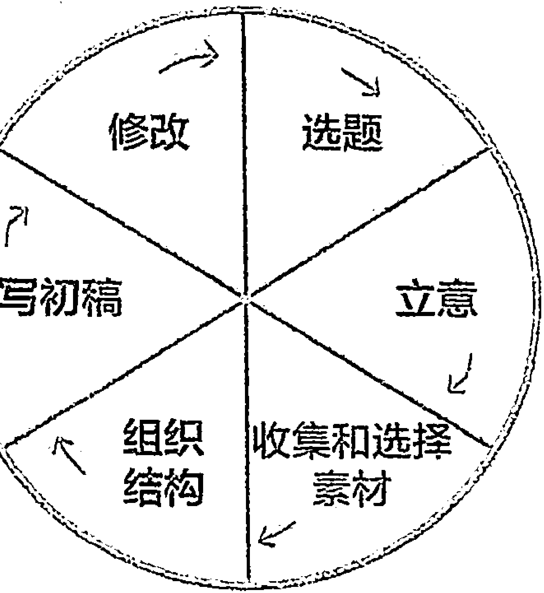
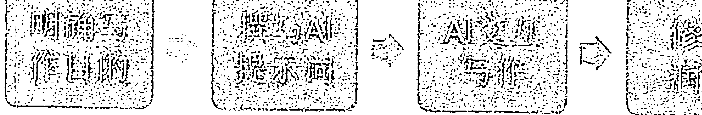
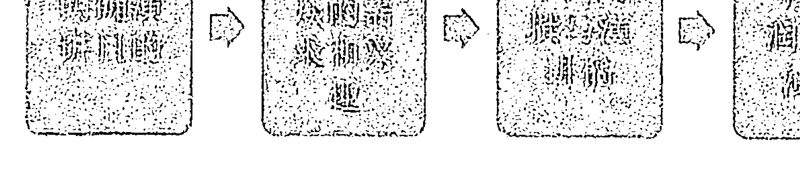
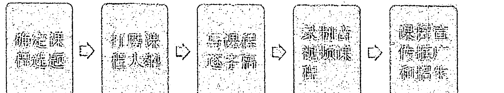
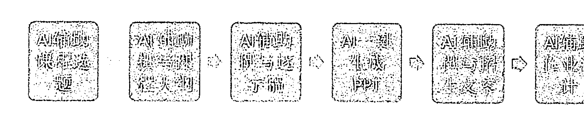

# AI写作宝典：如何成为AI写作高手

弘丹◎著

掌握AI写作关键技术
100倍提升内容创作效率

+   书评书单文
+   小红书笔记
+   公众号文章
+   短视频脚本
+   小说散文诗歌
+   演讲稿工作总结

AI写作四步法 ┊ RRBE提示词模型 ┊ 100个常用提示词 ┊ 200个AI写作案例

台海出版社

图书在版编目（CIP）数据
AI写作宝典:如何成为AI写作高手 / 弘丹著. — 北京:台海出版社,2023.10
ISBN 978-7-5168-3682-8
I .① A… II .①弘… III .①计算机应用一写作
IV .① H05-39
中国国家版本馆 CIP 数据核字 (2023) 第 201335 号

# AI写作宝典 : 如何成为AI写作高手

| 著 者:弘 丹 |
|---|
| 出版 人:蔡 旭 封面设计:异一设计 责任编辑:姚红梅 |
| 出版发行: 台海出版社 地 址: 北京市东城区景山东街20号 邮政编码:100009 电 话:010－64041652（发行,邮购） 传 真:010－84045799（总编室） 网 址:www.taimeng.org.cn/thcbs/default.htm E－mail : thcbs@126.com |
| 经 销: 全国各地新华书店 印 刷: 河北盛世彩捷印刷有限公司 本书如有破损、缺页、装订错误，请与本社联系调换 |
| 开 本:710 毫米 ×1000 毫米 1/16 字 数:223 千字 印 张:14.5 版 次:2023 年10月第1版 印 次:2023 年10月第1次印刷 书 号:ISBN 978-7-5168-3682-8 |
| 定 价:59.00 元 版权所有 翻印必究 |

# 序

# 如何抓住AI写作红利，成为AI写作高手

# 01

2023年，ChatGPT¹突然爆火，成为人们关注的焦点。以ChatGPT为代表的新一代人工智能在内容创作领域的突破，引起了很多创作者的焦虑和担忧。

许多人开始思考，AI（人工智能）时代，我们会不会失业？

+   - AI能够自动生成高质量的文章，写作者的优势是什么？
- 写作者会不会被AI替代？
- 未来内容创作的竞争是否会更加激烈？
- AI都能写作、画画和写程序了，我还有必要学习写作吗？

这些问题使很多内容创作者陷入了迷茫和恐慌。

AI不仅带来了焦虑和担忧，也带来了巨大的机遇和红利。

这也是我创作本书的原因：带着大家抓住AI写作时代的机遇和红利。

我是一名畅销书作家，累计出版了4本书：分别是《读书变现：如何成为一名读书博主》《精进写作：如何成为一名写作高手》《从零开始______

① ChatGPT 是人工智能技术驱动的自然语言处理工具，它能够基于在预训练阶段所见的模式和统计规律，来生成回答，还能根据聊天的上下文进行互动，真正像人类一样来聊天交流，甚至能完成撰写邮件、视频脚本、文案、翻译、代码等任务。

# 02·AI写作宝典

学写作：个人增值的有效方法》《时间的格局：让每一分钟为未来增值》。

我连续3年获得当当的年度影响力作家的称号。我也是多平台签约作者，写出过百万级阅读量的文章，被人民日报、十点读书等大号转发。

除了写作，我还是弘丹写作的创始人，累计指导帮助了10多万学员走上写作之路。我的很多学员，在学习完我的课程之后，都有意识地通过写作投稿来变现，或者建立个人品牌，实现了商业价值和个人的快速发展。

AI的爆火，让我看到了自己在AI写作上的优势。

我之前并不是文字工作者，而是一位IT女工程师。我本科专业是自动化，在浙江大学的控制科学与工程学院读的研究生，这是一所该领域在全国排名前列的学院。我的很多同学，都是非常出色的工程师和程序员，在知名的互联网公司或科技公司工作。

2015年我跨界从零开始写作，至今已有8年的新媒体写作经验，我开发了多门爆款写作课程，全网学员10万多人。我累计开设100多期写作训练营，连续6年开设年度写作社群，帮助很多人

实现了写作梦想。

我有理工科的背景，同时又有新媒体写作的实战经验，还有丰富的新媒体写作的教学经验。在AI时代，能将本硕所学的专业和自己的兴趣爱好相结合，这是意外的惊喜。

> 就像乔布斯在斯坦福大学演讲时所说：“人生所有的经历，就像一颗颗珍珠，当你在未来某一天找到了那根线，你就会把它们全部串联起来，变成美丽的项链。”

# 02

很多人好奇，作为工科生，我是如何开启写作，并把写作变成自己的事业的？

我开启新媒体写作，是机缘巧合，无心插柳柳成荫。

2015年1月3日，我看了朋友写的一篇文章，文章的主人公想要用写作来记录自己的所想所思。我被这个初心深深打动，第二天早上就早起1小时，在书桌前写下了400字的日记。

从400字日记，到成为简书签约作者；从出版第一本书，到成为当当网的年度影响力作家，在内容创作这件事上，我坚持了8年时间。

很多人问我，为什么能坚持8年？很多曾经一起在平台创作的作者，早就不写作了。

我的回答是：唯有热爱可抵岁月漫长。我喜欢内容创作，看到自己的思想通过文字记录下来并传播出去，影响更多生命，并让他们变得越来越好，是一件非常有成就感的事。 .

过去的8年里，我写下千万字，发表百万字，出版4本书。从2020年至今的1000天内，我用搜狗输入法打字，字数累计达631万。

在写第4本书《读书变现：如何成为一名读书博主》时，我曾一天连续写作11小时。我在小黑屋云写作上的最高纪录是一天写了3万多字，而且是用纯键盘打字的方式，不是AI写作或语音写作。

躬身入局内容创作，也让我抓住了不同的风口。过去7年里，我抓住了6次风口。

+   1.2015—2016年，抓住简书红利期，成为简书签约作者；

# 04·AI写作宝典

+   2.2015—2018年，抓住公众号红利期；
3.2019—2022年，抓住知识付费和在线教育红利期；
4.2016—2022年，抓住私域流量的红利期；
5.2020—2022年，抓住视频号和直播红利期；
6.2023年，抓住AI红利期，推出AI产品体系。

我总结了一个“王炸”组合的公式：热爱+科技+风口红利。

在热爱的领域深耕，就不会觉得坚持很难。因为躬身入局，所以能感知到风口和抓住风口。同时也要拥抱科技，因为科技是第一生产力。

很多人会说，等自己厉害了再开始。我一直跟学员分享这样一句话：
不是厉害了才开始，是开始了才厉害。只有先行动，抓住机会，才能变得越来越厉害；而不是等自己厉害了，才开始行动。

《为什么伟大不能被计划——对创意、创新和创造的自由探索》一书里提到“踏脚石模型”，因为热爱而持续做事情，在做的过程中，下一块踏脚石自然就会出现。

先踏出第一步，然后跟随你的热爱坚持到底，你始终都能看见下一块踏脚石，成绩自然而然就会到来。

当你躬身入局后，不仅可以抓住风口，还可以引领风向和超前发展。
我们一定要成为行动力强的人，因为这个世界会狠狠奖励行动力强的人。

# 03.3

开启AI写作，我经历了四个阶段。从一开始的漠不关心到后来的奋起直追，我在短时间内发生了巨大的转变。

第一阶段，认为AI跟自己没有关系。

2023年3月，ChatGPT爆火的时候，我并没有立马行动，也没有开启

# 序·05

AI写作，而是作为一个旁观者，心想这跟自己有什么关系。

可能很多人现在对于AI写作也是这样的想法：跟自己有什么关系？也许当你看到这本书的书名，或者试读序言部分时，依然会有这样的想法。

很很多时候，我们没有去行动，是因为我们觉得这件事跟自己没有关系。

我当时看到很多平台和个人推出了AI相关的产品，而且销量暴涨，有的在短时间内就有超过1万人报名。

当时没有行动，有两个原因。第一是认知不到位，不知道自己可以用AI干什么，也没有想到将AI和写作相结合。第二是“怕麻烦”，不知道如何开启第一步。所以，面对AI的爆火，我冷眼旁观，没有真正的行动。

# 第二阶段，好后悔。

2023年4月，我参加一位大咖老师的线下课程。这个课程跟ChatGPT无关，是商业类的课程。在课程结束后，这位老师说了这样一句话：“大家一定要重视ChatGPT，它带来的变革和影响，不亚于第二次工业革命。”

我当时被这句话深深震撼了，原来它会带来这么大的变革和影响。回去之后，我立马就开启了AI写作。

然后我发现，原来AI写作这么简单、这么强大。我为自己“怕麻烦”而不愿意踏出舒适圈的行为感到深深的后悔。

# 第三阶段，好幸运。

4月，我开启AI写作。5月，我推出了“AI写作训练营”，很快就爆火。在5天之内，就有200多人报名。

我一边研究AI写作，一边教大家如何高效开启AI写作。以教为学的方式，让我在很短时间内掌握了AI写作。

6月，我萌生了写一本关于AI写作的书的念头。在炎热的7月，我几

# 06 · AI写作宝典

乎每天坐在电脑前写作10小时以上，用整整一个月的时间完成了书稿的撰写。并在8月一遍遍修改，修改了十几遍才定稿。这是我目前出书速度最快的一本书。

我觉得自己好幸运，虽然一开始没有立马就行动，但在认识到重要性后，立马行动并取得了成果，也算是赶上了风口。

通过这件事，我有两个认知想跟大家分享。

第一，如果你认为跟自己没有关系，那么就真的跟你没关系。

很多人错失风口的核心原因，就是觉得跟自己没有关系。所以没有去尝试，也没有去行动。

我们在面对新生事物时，要先以开放的心态去尝试，即使暂时觉得跟自己没什么关系，也可以先去体验，在行动的过程中，也许就发现了机会，抓住了风口。

第二，人永远赚不到自己认知之外的钱。

认知没有改变的时候，即使金矿在你的面前，你也无法识别。

改变认知以后，才有可能改变行动。我之所以开始行动，就是因为在线下听到了一句令我深深震撼的话。

学习不仅仅是为了提升技能，更重要的是改变自己的认知。认知改变了，才会进入一个完全不一样的世界。

个人品牌创业8年，我深刻认识到：不要做一个旁观者，要躬身入局不嫌麻烦。很多人因为嫌麻烦而不愿行动。其实很多事情没有自己想象的那么难，也没有那么麻烦。

就像AI写作，其实没有那么难，认真看完本书，你一定能学会AI写作。认真去践行，你就能成为AI写作的高手。

AI写作只是AI强大功能的冰山一角，AI可以运用到各个领域、各个行业。

可以把AI和自己所在的行业，以及自己的专业相结合，让自己成为行业里的AI高手。就像我的专业是写作，我把AI和写作相结合，成为AI写作高手。你也可以将AI和HR相结合，成为人力资源方面的AI高手；或者将AI和编程相结合，成为AI编程高手等。

"互联网+" 是将互联网思维和传统产业相结合，进行跨界和融合。
"AI+" 是用AI的方式，与各行各业相结合，用人工智能赋能产业的升级。

AI会越来越强大，因为AI在不断地迭代和升级。未来一定是人机合一的时代，人工智能的应用会越来越广泛。

勇气是最重要的品质，不要害怕尝试，也不要害怕失败，只有勇敢地踏出舒适区，才会拥有全新的天地。

# 04!

2023年对我来说是重新出发的一年，因为AI写作有了新的机遇，抓住了新的风口。

很多内容创作者面对AI写作，是充满恐惧和担忧的，因为害怕自己被取代。我自己经常使用AI写作，AI在写作速度和素材利用的丰富度上，是超越大部分内容创作者的。

打不过就拥抱，我不觉得自己会被取代，反而觉得这是难得的机遇。所以，我火速研究，并开发了"AI写作训练营”，短短两个月就有400多人报名。

很多人说，有了AI写作，就不用自己写作了，也不用自己读书思考了，AI会不会让自己变笨？

我的观点是：你强，它则更强，要强强联合，人机合一。

很多人面对AI时不知道提什么问题，就把它当搜索引擎用。如果没

# 08 · AI写作宝典

有积累和思考，都不知道如何有效提问。只有让自己变得更强，有更多的思考，才能更好地使用AI。

未来，不是AI淘汰内容创作者，而是会使用AI的人淘汰不会使用AI的人。

在AI赋能内容创作方面，可以用AI来创作小红书笔记；用AI来开发课程，写课程逐字稿；用AI来准备演讲稿等。

AI还可以成为我们的私教、创业导师、育儿导师、导游、个人品牌顾问等。每个人都应该有自己的智囊团，一群各个领域的顶级高手给自己辅导和共同讨论，便于自己做出更好的决策，而AI就是最强的智囊团。

让我们一起拥抱AI写作，强强联合，实现人机合一；通过AI写作，提升内容创作效率，增加个人的财富并扩大影响力。

弘丹

2023年7月26日于上海

# 目录

# 第一章

# 认识AI写作，掌握AI写作四步法

+   - 1.1 AI写作四大优势，又快又好创作 / 002
+   - 1.2 AI写作四步法，轻松写出好文章 / 007
+   - 1.3 AI写作四阶段，实现人机合一 / 013
+   - 1.4 AI时代，内容创作者的六项精进能力 / 015
+   - 1.5 AI写作的局限，人类创作者的优势 / 018

# 第二章

# AI写作提示词，创作高效精准的指令

+   - 2.1 提示词核心方法，RRBE提示词模型 / 024
+   - 2.2 RRBE提示词在各行业的运用 / 029
+   - 2.3 AI提示词的四大作用和四大原则 / 031
+   - 2.4 提示词公式，学会高效提问 / 035
+   - 2.5 提示词中提供样稿，精准生成内容 / 037
+   - 2.6 创建AI提示词库，成为提示词高手 / 044

# 第三章

# 掌握AI写作技能，成为AI写作高手

+

第三，AI可以给我们提供无限创意和灵感。

写作时，很多人的痛点就是没有灵感。没有灵感就无法下笔，所以写作常常拖延。

有了AI写作的助力，你可以把要写的关键词发给AI，它就可以给你生成不同的创意和灵感。这么多不同的创意和灵感，总有一个能激发你的创作欲。

比如，你要写一篇科幻小说，但你不知道如何规划故事情节，这时就可以让AI生成故事梗概和大纲。你对AI给出的创意进行修改和优化，就能创作出科幻小说的大纲。

第四，AI可以24小时随时在线辅助你写作。

有些人喜欢早起写作，有些人喜欢深夜写作。当你想找个人讨论下写作内容时，别人可能还在睡梦中。

而AI不需要睡觉，可以24小时随时在线。不管你什么时候需要它的辅助，它都可以立马回应。比如，你要在深夜写一篇文章，第二天清晨提交，这时你就可以借助AI写作快速高效地完成。

AI写作还有很多其他的优势等你去探索。开启AI写作后，你会发现它的无穷魅力。

有人说，AI写作这么强大，我们还需要学习写作吗？当然还是需要的。你掌握了写作的基本技巧后，就可以写出更加精准的提示词，并知道如何对AI生成的文章进行修改。

这本书的优势，就是融合了AI和新媒体写作的技巧，可以同时帮助你提升这两项写作能力，并融会贯通。借助AI写作的力量，我们能够又快又好地创作。

AI时代的角色转变，与AI强强联合

AI的应用范围已远超写作领域，它的影响力已深入我们工作和生活的方方面面。AI在编程、绘画、设计、文案等方面都可以发挥巨大价值，适用于教育、医疗、商业、艺术、娱乐等各个领域。

AI会带来挑战，但更要看到它带给我们的机遇、商业的价值和事业创新的可能性。有些人会觉得AI非常强大，也有一些人们觉得AI也就那样而已。AI具体能发挥多大的价值，是由使用它的人来决定的。

如果你的能力强，AI就会发挥出更多的价值，强强联合。如果你的能力不够强，或者你不够重视，那么AI带给你的改变，也许是非常小的。关键不在于工具，而在于你自己。

让自己变得强大，是让AI发挥出更大价值的关键。AI时代，我们要做哪些转变，才能更好地与AI强强联合呢？

第一，角色转变，从执行者到创新者和决策者。

很多人在工作中扮演的是执行者的角色，要根据领导的指令和任务来做事。现在，很多事情可以交给AI来执行，让AI给我们打工。我们成为给AI下达任务的人。

我们要从执行者升级为创新者和决策者。我们要用创新的思维打开“脑洞”，然后让AI来助力落地和执行。我们要擅长做决策，并把决策转化为清晰的任务，给AI下达清晰的指令。

第二，能力转变，提出问题比解决问题更重要。

在过去，我们非常强调解决问题的能力。但在AI时代，提出问题比解决问题更重要。我们可以提出正确的问题，然后引导AI去寻找问题的解决方案。

我们提出问题，AI负责解决问题，这就是强强联合。如果你不知道如何提出问题，给AI下达精准的指令，那么即使AI非常强大，它也没有办法发挥价值。

第三，编程方式转变，从编程语言到自然语言编程。

编程是程序员、工程师群体所掌握的能力，门槛是比较高的。笔者在大学本科和研究生期间，就学过C++、Java等编程语言。

而在AI时代，编程的门槛大幅下降，我们可以使用自然语言来编程。我们跟AI的交互对话，其实就是自然语言编程的一种方式。我们用平日使用的语言，告诉AI要做什么任务，AI就会根据我们的指令去执行。

第四，学习方式转变，从记忆理解到跨界创新。

传统的学习方式重视记忆理解和背诵。经常有学员问，看一本书总是记不住怎么办？

在AI时代，学习方式会发生巨大的改变，会更注重跨界和创新。AI可以帮助我们处理大量的信息和知识，有什么不懂的都可以问AI。

在AI的辅助下，我们可以在多领域自学，掌握多领域的专业知识，并融会贯通。我们要学会从多个领域获取灵感，进行跨界创新。

完成这四个转变，可以帮助我们更好地适应AI时代，并抓住时代的风口和红利，从而创造新的商业价值。

# 第一章 认识AI写作，掌握AI写作四步法·005

# 1.2 AI写作四步法，轻松写出好文章

从事新媒体写作8年，笔者一直在探索轻松高效写作的方法。

笔者出版的第2本书《从零开始学写作：个人增值的有效方法》的第三章详细介绍过写作的六个步骤。

+   - 第一步，选题；
- 第二步，立意；
- 第三步，收集和选择素材；
- 第四步，组织结构；
- 第五步，写初稿；
- 第六步，修改。

# 写作六步骤

# 006 · AI写作宝典

在这六步骤中，很多作者会卡在选题、立意、收集和选择素材等某个环节，不知道写什么，不知道选什么素材来写，因此写作总是拖延。在AI时代，我们可以采用更简化的步骤，高效地写出优质的文章。

笔者总结了AI写作四步法，可以帮助你轻松高效地写出精彩的文章。

AI写作的步骤会更加简单，而且写作的难度也会大幅下降。

对于AI写作，关键是撰写AI写作提示词，而提示词一般就是几句话或几段话，还可以参考提示词模板，是比较容易写的。

接下来，详细介绍AI写作四步法的每个步骤。

# 第一步，明确写作目的。

在开始写作之前，要先明确写作目的。不同的写作体裁，写作的方式是不同的。

同时，也要明确文章发布的平台，因为不同的平台，写作风格是不一样的。明确了发布平台后，就可以让AI按照指定的风格来写作。比如，模仿小红书爆款笔记的风格，写一篇小红书的笔记，那么AI就会按照我们的指令，用小红书的“种草”风格来创作。

# 第二步，撰写AI提示词。

AI写作时，撰写精准的提示词是关键，提示词就是引导AI生成文章的指令。AI写出来的文章如果不符合要求，大概率是因为提示词写得不够精准。

AI写作时代，拼的不是知识储备，而是精准的提示词。提示词越精准，AI写出来的内容就越符合要求。

结合AI写作实战经验，笔者提出了RRBE提示词创作法，能够帮助大家快速创作出优质的提示词。

提示词是AI写作的关键，第二章会向大家详细介绍提示词的创作方法，以及提示词的模板。

# 第一章 认识AI写作，掌握AI写作四步法。009

第三步，AI交互写作。

有了精准的提示词后，就可以让AI来写作了。可以选择不同的AI写作工具，如ChatGPT、文心一言、Notion AI¹等。本书的AI写作，是基于ChatGPT来创作的。

在AI写作工具里输入指令，让AI生成文章的段落或一篇完整的文章。

在AI写作的过程中，不一定只通过一次提问就能生成我们想要的文章，也许需要多次提问。这个过程被称为“AI交互写作”，是人机共创，共同打造出一篇优秀的文章。

在AI交互写作的过程中，可以不断调整和补充提示词，以便AI能更好地理解你的意思，并生成更符合预期的文章。

第四步，修改润色。

AI生成的文章需要一定的修改和润色。这一步需要仔细审查和调整AI生成的内容，确保语句流畅、逻辑清晰，并且符合你想要的写作风格，满足目标受众的需求。你可以加入自己的故事和观点，使文章更具独特性和感情色彩。同时，也要审查AI创作的内容，确保没有出现错误的信息。修改和润色后，配上相应的图片，就成功创作出一篇新媒体文章了，可以把文章发布到各大平台。

下面以创作一篇小红书的笔记为例，说明如何运用AI写作四步法来

__________

> ① Notion AI是Notion在2023年2月推出的一项功能，利用大规模的语言模型和数据收集，能帮助用户自动整理笔记、改正错别字、列出文章重点、翻译、制作表格等。

# 010·AI写作宝典

创作内容。

# 第一步，明确写作目的。

这次的写作目的，是撰写一篇小红书的爆款笔记，主题是关于自律的话题。这篇笔记会发布在弘丹的小红书账号上。让AI来辅助写一篇关于自律的小红书笔记。

# 第二步，撰写AI提示词。

明确了写作目的、写作主题和发布的平台，接下来就是撰写AI写作提示词。

我撰写的提示词：你是一位小红书博主，请你模仿小红书爆款笔记的风格，写一篇“自律一年，让我脱胎换骨，重获新生”的笔记。可以加一些表情符号，在学习、工作、早起、理财方面如何自律，推荐10本好书，推荐10部电影。

输入提示词后，AI很快就生成了一篇小红书的笔记，内容还挺不错的。

# 第三步，AI交互写作。

输入提示词后，很快就生成了小红书的笔记，而且AI有联系上下文的功能。前面跟AI聊天时，提到了10本书。这次AI生成的笔记就直接采用了这10本书。10部电影是AI自动生成的，这10部电影刚好每一部我都看过。

AI生成的内容可能会有错误的信息。推荐的10本书里有好几本书的作者名字写错了，在发布之前，要进行修改和润色。

在进行AI交互写作时，可以多次提问，不断优化。这篇笔记的输出质量还可以，因此没有让AI继续优化。

# 第一章 认识AI写作，掌握AI写作四步法·011

# 第四步，修改润色。

接下来，结合AI生成的内容，进行修改和润色。

# 一、修改错误的信息。

AI生成的10本书中，有好几本书的作者名字写错了。比如《纳瓦尔宝典》的作者是埃里克·乔根森、《小狗钱钱》的作者是博多·舍费尔等。笔者对这几本书的作者信息进行了更正。

# 二、增加个性化的内容或自己的经历和故事。

在笔记的开篇，笔者修改了开头，让开头更有吸引力。同时增加了跟自己相关的自律的故事。

马上就到2023年下半年了。敢不敢用6个月的时间，挑战彻底改变自己！

我是弘丹，曾经非常迷茫和焦虑，做着自己不喜欢的工作，每天工作家庭两点一线，生活看不到希望。

我用了半年时间挑战自己，彻底改变了自己，并找到了自己全新的事业方向。我的自律，就是从早起读书和写作开始的。我每天早上6点起床，读书写作两小时，坚持了7年，出版了4本书。

# 三、修改标题、结尾等，让内容更有吸引力。

修改结尾：坚持6个月，你会发现自己焕然一新、脱胎换骨，生活也会给予你丰厚的奖励。2023年，让我们一起狠下心、铆足劲，逼迫自己一把，你远比想象中更强大！

修改标题：《自律6个月，让我脱胎换骨，重获新生》

通过以上步骤，这篇笔记就修改好了。

用AI生成小红书笔记时，AI生成的内容是符合小红书的排版要求的，会有表情符号，1、2、3、4……这些样式也是小红书的风格。

修改后，可以直接发布，几乎不需要花时间排版，这一点是非常高效的。通过这个例子，相信大家已经了解了AI写作四步法。

# 012 · AI写作宝典

借助AI写作，内容创作者可以提升内容创作的效率，节省大量的时间和精力，同时还能提高文章的质量和效果。但AI写作并不是要完全取代人类创作，AI是一种强大的辅助工具，人类在AI写作过程中，依然发挥着重要作用，如提供创意、观点、故事等。

# 1.3 AI写作四阶段，实现人机合一

使用AI写作，会经历以下四个阶段。

第一阶段：探索期。

探索期是指刚开始使用AI时，了解这个工具及其功能的阶段。这个阶段要不断尝试各种提示词，跟AI一起互动交流。

在探索期，我们会发现AI有很多好玩的功能，通过尝试不同的提示词，AI会帮助我们解决各种各样的问题。因为好奇AI的功能，所以这个阶段充满了乐趣和新奇感。

第二阶段：磨合期。

经过探索期的摸索，我们跟AI越来越熟悉，这就进入了磨合期。

在磨合期，我们会发现，AI生成的有些答案并不是自己期待的。AI生成的文章可能读起来过于呆板、枯燥，有时甚至会有错误信息。

在磨合期，我们跟AI会有一些“摩擦”，即对AI生成的答案不满意。但是我们掌握AI写作的必经阶段，是与AI互相理解，深入了解彼此的过程。

第三阶段：熟练使用期。

磨合期相对来说有点难熬的。可能很多人会在磨合期就与AI写作分道扬镳，觉得AI写作不适合自己。如果熬过了磨合期，就会进入一个新的阶段，那就是熟练使用期。

经过磨合期的斗智斗勇，你和AI彼此了解，你逐渐掌握了让AI生成

# 014 · AI写作宝典

令你满意的内容的提示词方法。你会发现AI越来越懂你，越来越明白你的需求。

在熟练使用期，AI已经成为你每天必不可少的工具，你越来越离不开AI。

# 第四阶段：人机合一期。

经过高频和长时间地使用AI，你积累了丰富的经验。你有机会会进入最后一个阶段，那就是人机合一期。在这个阶段，你跟AI强强联合，各自发挥自己的天赋和优势，创造无限的可能。

你贡献作为人类的创造力和想象力，而AI能够把你的想法和想象力转化为实际的产出，去执行和落地。达到人机合一的状态后，AI就如同你的外脑，无比强大。

这就是AI写作的四个阶段，从探索期到磨合期，再到熟练使用期，最后达到人机合一期。这个过程不是一蹴而就的，需要坚持和耐心。

你现在处于哪个阶段？你希望达到哪个阶段？很多人一开始会非常兴奋，然后热情逐渐下降，遇到困难就放弃。经过一段时间的“躺平”后，又觉得自己不能这样，又开始学习一个新的技能，如此循环往复。

能坚持到底的人，终究是少数人，希望你能够成为那个坚持到底的人。只有坚持到底，才能笑到最后。期待你能够成功进入人机合一的阶段。

# 第一章 认识AI写作，掌握AI写作四步法·015

# 1.4 AI时代，内容创作者的六项精进能力

AI时代，如何成为优秀的内容创作者，成为AI写作高手？

笔者总结了AI时代内容创作者的六项精进能力，每一项都是优秀内 容创作者的必备能力。我们可以不断提升这六项能力，让自己在AIGC （生成式人工智能）时代脱颖而出。

# 第一，拆解力。

想要快速提升自己的写作能力，一定要多拆解优秀的文章。先模仿， 后超越。这里所说的模仿，是模仿写作方法，而不是模仿文章内容。

在AI写作时代，拆解力就更加重要了。筛选爆款文章，拆解这些文章，用AI进行模仿和训练，学习爆款文章的写作方法。

拆解时，可以拆解文章的选题、结构、素材、写作风格、金句等。 认认真真拆解几篇文章，就可以迅速提升自己的写作能力。而且还可以 训练AI，让它也掌握爆款文章的写作方法和底层逻辑。

# 第二，选题力。

我们可以借助AI辅助创作，但具体写什么选题的文章，还是要创作 者自己来确定。选题是一篇文章的重中之重，会影响一篇文章的阅读量。

在AI写作时代，选题力会变得更加重要，好的选题自带流量，要 培养对选题的敏感度。优秀的创作者，要能够敏锐地捕捉时事热点、 社会问题、行业趋势等选题，并挖掘出独特的写作角度，创作出爆款 的文章。

# 第三，提问力。

爱因斯坦曾说：“提出一个问题往往比解决一个问题更重要。” 提出一个好问题，问题往往就已经解决了一半。

提问力是AI写作的关键能力。撰写精准的提示词，是AI生成令你满意的文章的关键。如果不能准确地提出问题，AI再强大，也无法写出满足我们要求的文章。

在AI写作过程中，我们要不断刻意练习，提升自己

# 020·AI写作宝典

人类创作的内容，能够引起读者的情感共鸣，甚至读完之后让人印象深刻。AI写作很难在情感共鸣方面取代人类创作者。

第三，人类的想象力、创造力和独特的创作灵感。

写文章时，作者本人的思考及观点是非常重要的。在创作内容时，不是直接把主题丢给AI工具，让它去写，而是要融入自己的一些思考，融入自己的观点。

人类的想象力、创造力是非常强的，像刘慈欣的《三体》，构建了庞大而复杂的宇宙观，对外星文明的描绘，无不展现了作者丰富的想象力和创造力。《三体》不仅是科幻故事，还涉及对深刻哲学和人类命运的探讨，体现了作者独特的创作灵感和深度的思考。

人的创造力、想象力、创新性，以及独特的创作灵感，是AI写作很难取代的。

未来，内容创作一定是内容创作者和AI强强联合，发挥各自的优势。

人类的优势是想象力、情感共鸣，还有真实的体验。AI写作的优势就是写作速度快、资料丰富、逻辑严谨等。强强联合，人机合一，是未来内容创作的趋势。

同时，我们也要认识到AI写作的局限性。

第一，没有清晰的引用来源。

AI写作的内容来自训练的模型，大量使用了互联网上的公开文本数据进行训练。这些数据包括维基百科、新闻文章、电子书等各种来源。

AI写的内容是生成式的，它的内容无法标注引用的来源。AI模型的回答可能是基于对多个来源的信息进行组合和概括，难以追溯到具体的原始数据源。所以，如果要写比较严谨的学术论文，就要对AI写的内容进行验证和审核。

# 第一章 认识AI写作，掌握AI写作四步法·021

第二，可能会存在错误信息或杜撰的信息。

AI写的内容，是会有错误的。AI还有可能会杜撰信息、创造不存在的知识，或者主观猜测提问者的意图，也就是我们说的“一本正经地胡说八道”。

比如，我撰写提示词时，让AI推荐有关时间管理的5本书，它给我推荐的一本书是《精进时间管理》，实际上并没有这本书。

AI写的内容不能直接原封不动地使用，而是要进行修改、润色，并核对信息的准确性。关于医学、法律等专业内容，信息的准确性非常重要，一定要认真核对AI生成的内容是否有错误。

第三，不是最新的信息。

目前的AI模型没有实时搜索功能，它是基于之前训练数据的统计模型，生成的回答是根据之前接触的文本数据和模式进行的预测。

ChatGPT3.5模型，最新的训练数据截止到2021年9月。所以，它无法提供2021年9月之后的信息。

在创作热点内容时，可以把AI工具和搜索引擎搭配使用，因为搜索引擎可以提供最新的资讯和信息。

第四，可能会有数据泄露或者隐私泄露的风险。

AI爆火后，有不少关于机密资料外泄事件的报道。有一些公司已经限制员工使用外部的AI工具。我们在进行AI写作时，也要注意保护个人信息，防止隐私泄露。

未来，一些有实力的公司可能会开发内部使用的AI工具，来应对数据泄露和隐私泄露的风险。

我们要做到优势互补，发挥技术和人类创作者的优势，强强联合，实现人机合一。

随着AI的普及，未来AI会成为基础设施，就像现在互联网是基础设施一样。很多公司已经开发了基于AI的产品。微软的必应植入了AI的聊天功能，WPS结合AI推出新产品，讯飞推出星火认知大模型。

AI是基础设施，我们要学会相关的技能。就像现在不会上网会给自己的生活带来很多的麻烦，失去很多的机会一样，未来，不会使用AI也会让你失去很多机会。

# 022 · AI写作宝典

# 第二章

# 02

AI写作提示词，创作高效精准的指令

# 2.1 提示词核心方法，RRBE提示词模型

要想成为AI写作高手，就要先成为AI提示词撰写的高手。撰写精准的提示词，是驾驭AI写作的关键。

结合AI写作实战经验，笔者提出了RRBE提示词模型。提问时可以采用这个模型来撰写提示词，让AI生成我们想要的内容。

+   - Role（角色）：AI充当什么角色。
- Request（要求）：提出明确具体的需求或要求。
- Background（背景）：提供相关的背景信息或情境。
- Expectation（期望）：表达对结果或效果的期待。

这就是RRBE提示词模型，包含四个要素，分别是角色、要求、背景和期望。

下面具体介绍一下RRBE模型的四个关键要素。

第一，Role（角色），AI充当什么角色。

赋予AI一个特定的角色，让它明白自己是什么角色，你期待它做什么。你可以赋予AI各种各样的角色，可以是自媒体博主、小红书美妆达人、优秀的记者、资深的心理咨询师、工程师、科幻作家等。

设定角色可以帮助AI更好地理解我们的要求，并生成符合要求的内容。

通过赋予AI角色，来训练AI输出与角色相匹配的表达方式和语言风格。

比如，我们让AI扮演一位富有激情的体育评论员，那么AI的回应可能更富有热情和活力，使用更多体育领域的专业术语，贴近“体育评论员”这个角色的特质。或者让AI扮演唐代的诗人，要求它用唐代诗人的风格撰写内容，AI生成

给AI设定角色，就相当于AI会扮演这个角色，拥有这个角色的专业能力，采用这个角色的语言风格等。

第二，Request（要求），提出明确具体的需求或要求。

向AI提出具体的要求，是对AI下达任务说明。AI写作的要求，包括写作主题、写作的视角、特定的写作技巧等。比如，让AI帮你写一篇小红书的爆款笔记，要求是：请参考小红书的爆款笔记，写一篇关于“读书变现的5大方式”的小红书笔记。

为什么要给AI提出明确具体的要求？AI是以指令为基础进行操作的。如果要求模糊不清，AI可能会根据它自己的理解去生成内容，那么就有可能无法满足我们的要求。明确具体的要求，能让AI更准确地理解我们的意图，从而生成我们期望的内容。

第三，Background（背景），提供相关的背景信息或情境。

背景信息可以帮助AI更全面地理解我们的需求和情境。如果想让AI创作一个微小说，可以给它提供一些背景信息。

比如，小说发生在上海，男主人公是落魄的中年男子，女主人公是上海富家千金小姐，他们一见钟情，但最后没有在一起。

这就是简单的背景信息，提供给AI这些信息后，AI就知道故事发生的地点和梗概。

再比如，要让AI协助写一份简历，背景信息要详细介绍要在简历中

# 2.2 RRBE提示词在各行各业的运用

RRBE提示词不仅仅适用于AI写作，各行各业都可以参考RRBE模型来创作提示词，如旅行攻略、职场写作、个人简历、论文写作、代码生成、健身指导、翻译练习、给朋友送礼物、职业探索等。

下面举5个不同行业和角色的提示词模板案例，大家也可以结合这些模板创作自己的提示词。

1.你是一位旅行专家（角色），请为即将去云南旅行的我提供一份详细的5天4晚的旅行攻略（要求及背景），让我能深入地体验和了解云南的风土人情（期待）。

2.你是一位职场写作高手（角色），请帮我写一封跟老板提出加薪的邮件（要求）。我在公司工作了3年，近期完成了几个重要项目并取得了明显的业绩提升（背景）。我希望这封邮件语言得体，理由充分，能有效地传达我的需求和决心（期待）。

3.你是一位软件工程师（角色），请帮我生成一段Python代码（要求）。我需要创建一个能够抓取网站信息并导出为CSV文件的网页爬虫（背景）。我希望这段代码能够有效地完成任务，而且易于理解和修改（期待）。

4.你是一位小学语文老师（角色），请帮我批改这篇小学生的作文（要求）。这是我儿子的作文，题目是“我和我的小伙伴”（背景）。我希望你能给出具体、有建设性的反馈，帮助我儿子提升写作能力（期待）。

5.你是一位购物顾问（角色），请帮我选一份送给朋友的礼物（要求）。我的朋友是一名摄影爱好者，即将过生日（背景）。我希望能送他一份他喜欢的有关摄影的礼物（期待）。

不管是用AI写作，还是让AI帮助你完成其他任务，都可以采用RRBE提示词模型。赋予AI角色，描述具体要求，并提供给AI相关的背景信息，以及期待的结果。通过撰写RRBE提示词，让AI生成你期望的内容。

这里也给大家布置一个作业：请结合RRBE提示词模板，创作5个不同的提示词，来解决你的真实问题。

# 2.3 AI提示词的四大作用和四大原则

AI提示词，本质上就是对AI下达指令，向AI精准传达你的要求。可以把它看作对AI的一种“指挥”，告诉AI你想要什么，希望AI以什么样的方式为你提供服务。

随着AI的爆火，Prompt Engineering（提示工程师）这个职位的市场需求量非常大。因为AI能发挥多大的价值，跟提示词的关系非常大。

如果AI没有生成你想要的答案，那么很可能是因为你给AI的指令不够精准。你给AI的指令越清晰，AI生成的内容就越接近你想要的。AI写作时，一定要在提示词的撰写上下功夫，力求精准。

AI提示词有什么作用呢？下面是AI提示词的四大作用。

+   第一，引导AI理解意图。

提示词可以让AI明白我们需要它干什么，我们的目的和要求是什么。精准详细的提示词，可以明确指示AI生成与你预期相符的内容。

+   第二，限定AI生成范围和指定风格。

提示词可以限定AI生成的范围，生成的内容聚焦在特定的主题或写作角度。可以通过设定提示词，控制文章的写作风格和表达方式，让AI撰写的内容更贴近要求。比如，设定AI用“简洁清晰，接地气，人性化的风格”来创作。

+   第三，激发AI的创造性。

优秀的提示词能够激发AI的创造性，让AI从不同的角度思考和生成

# 2.4 提示词公式，学会高效提问

不同的人用同样的AI工具，写出来的内容却千差万别，原因就是提问的方式和提问的水平不同。

有些人可以借助AI写出满意的文章，有些人却总觉得AI生成的内容不是自己想要的。

如果AI生成的内容不是你想要的，就需要优化和提升自己创作提示词的能力，不断训练你的AI，让它越来越懂你。

AI提示词分为两种类型。第一种是简单提问，把问题直接抛给AI，让它生成答案。这种提问方式简单直接，提问的形式就是一个问句。

第二种提问方式，是给AI更多的背景信息，以及具体的要求，让它按照你的要求来生成内容，就是前面详细介绍RRBE提示词。

这里重点给大家介绍一下如何简单提问，以及简单提问的提示词公式。

# 简单提问的举例

+   1. 请给我推荐5本关于写作的书籍

+   2. 请给我制定上海2天1夜的旅行攻略

+   3. 请给我介绍罗宋汤的制作步骤和原材料

+   4. 请介绍一下如何佩戴隐形眼镜

+   5. 如何提升自己的写作效率

+   6. 孩子的暑假如何安排

简单提问的方式就是一个问句，把问题直接发给AI，让它生成答案。

对于一些不需要背景信息的提问，就可以采用简单提问的方式。

# 下面是一些简单提问的公式。

# 第一，疑问词+具体要求。

使用疑问词引导AI提供相关信息。疑问词包含“为什么”“如何”“是否”“有哪些”等。比如，“为什么健康饮食对我们的身体很重要？”“如何制作一个美味的巧克力蛋糕？

# 第二，列举和描述。

要求AI列举或描述特定的内容，以获取更多细节或丰富的信息。提示词包括“列举”“描述”“解释”“说明”等。比如，“列举3种有效的沟通技巧”“描述一下你最喜欢的旅行目的地。

# 第三，建议或解决方案。

向AI寻求建议、意见或解决问题的方法。提示词包括“有何建议”“怎样处理”等。比如，“如何克服写作拖延，请给我一些建议。”“有什么建议可以帮助我提高自信心？

# 第四，特定情境或特定条件。

通过设定特定条件或情境，引导AI生成相关的内容。提示词包括“在……情况下”“在……场景中”“设想”“考虑”等。比如，“面试时如何给人留下深刻的印象？”“设想想实现一个重要目标，你会如何克服困难？

# 第二章 AI写作提示词，创作高效精准的指令·037

# 2.5 提示词中提供样稿，精准生成内容

如果想要AI生成的内容更符合特定的要求及风格，在提示词里可以给AI参考的模板或者样稿，AI就可以结合模板来生成内容。

尤其是在新媒体写作的时候，可以给AI一些爆款文章的内容作为模板，让AI参考这些风格进行创作。给到的模板可以作为写作风格的参考，在具体的内容方面，AI会结合主题进行新的创作。

很多人想训练AI生成跟自己风格相符的内容，也可以用这样的方式。在提示词里给AI自己写的内容，让AI进行学习和参考，这样AI生成的内容会更符合自己的要求。

下面举例说明。

# AI创作金句

> ⓵ 请参考以下金句的形式，用对比法创作3个关于自律的金句。
采用对比法的参考金句：
1. 悲剧将人生的有价值的东西毁灭给人看，喜剧将那无价值的东
西撕破给人看。
2. 理想很丰满，现实很骨感。

[PAGE 52]

+   1. 自律如一杯清水，平淡却清醒；放纵如烈酒，短暂却迷离。

+   2. 自律是通向成功的阶梯，虽坎坷却实实在在；放纵是通向虚无的滑梯，虽有快感却空洞。

+   3. 自律是生活的调色板，可以涂抹出美丽的色彩；放纵则是人生的消磨剂，让繁华的光芒逐渐黯淡。

也可以采用改写名言警句的方式来创作金句。

请改写以下金句，创作关于写作的金句。

> 尼采说：“每一个不曾起舞的日子，都是对生命的辜负。”

> 每一个不曾写作的日子，都是对心灵的辜负。

这句话改写得挺贴切的，我曾经改写成的金句是“每一个不曾写作的日子，都是对生命的辜负”。

给AI一些参考的句子，AI创作的金句会更符合我们的要求。

# AI模仿我们的写作风格

可以让AI模仿我们的写作风格进行创作。在提示词里，给AI我们创作的内容，让AI学习和模仿。

请模仿下面的小红书视频脚本文案，创作一篇主题为“敢不敢用一年彻底改变自己”的脚本文案，字数在600字左右，要求内容

[PAGE 53]

# 第二章 AI写作提示词，创作高效精准的指令 · 039

有吸引力，能引起读者的共鸣。短视频脚本文案可以参考以下写作风格。

遇到我，就是在提醒你该努力了。

大四的我，放弃本校保研资格，每天学习十几个小时，用半年时间考上浙大。

浙大毕业后，进入500强外企，但我不甘于两点一线的生活，用业余时间早起写作。

一开始写作，没有人点赞，也很少有人关注，但我并没有放弃。

如今我出版了4本书，成为当当的年度影响力作家，并举办全国线下签售会，全网收获30多万粉丝。

这期视频，我会分享一个让你短期内快速改变的无痛逆袭法，如果你想2023年彻底改变自己，变好变优秀，却又无从下手，那么按我说的做，1个月后，你一定会惊讶于自己的改变。

遇到我，就是宇宙在告诉你，改变，其实并不难。

大二的我，面对艰难的专业选择，毅然决定自学编程，每天学几个小时，仅用一年时间，成为校内的编程能手。

毕业后，我没有选择安逸的工作，而是勇敢地自主创业，利用休息时间自我“充电”，加深业务理解。

一开始创业，遇到了许多困难，看不到希望，但我并没有选择退缩。

如今，我创办的技术公司已经成为业内的佼佼者，获得了30多万用户的支持和喜爱。

这期视频，我要和你分享一个能让你在一年内彻底改变的秘诀，

[PAGE 54]

如果你想在2023年挑战自我，破茧成蝶，而不知道如何开始，那么按照我说的做，一年后，你一定会惊讶于自己的蜕变。

AI生成的内容、文字风格和写作方式，都是比较接近给的参考样稿的。可以把我们写得比较好的文章给AI，让AI进行模仿和学习，熟悉我们的写作风格，不断训练AI。

> 以下是弘丹写的短视频脚本的文章，请模仿她的写作风格，创作“30岁养成这5个习惯，人生逆袭”的短视频脚本，字数在1000字左右。（附上短视频脚本的文案内容）

> 遇到我，这是命运的召唤，告诉你，该开启人生新篇章了！在我30岁时，我已经积累了丰富的人生经验，有过疲惫、迷茫，也有过欣喜、成长。而今我要告诉你的是，只要你养成这5个习惯，那么你的人生也可以逆袭！这期视频，我会分享5个改变你未来的习惯。如果你想 在2023年彻底改变自己，变得更加出色，那就继续看下去。第一，保持好奇心。如果说人生是一场马拉松，那好奇心就是我们内心深处的动力源泉。好奇心使我们始终保持对未知世界的探索欲望，正是这样的好奇心，让我们有勇气跨过每一个困难，开启新的人生阶段。……

[PAGE 55]

# 第二章 AI写作提示词，创作高效精准的指令·041

可以给AI自己的样稿内容，然后让AI来创作完全不同的主题，AI也会结合我们给的样稿，模仿样稿的写作风格，创作新的主题。最后我们对AI创作的内容进行修改，就可以输出一篇符合自己要求的文章。

# AI模仿名人作家的写作风格

可以让AI模仿某些作家的风格进行创作，在提示词里给AI提供这些作家创作的文章，让AI进行学习和模仿。对于家喻户晓的作家，就不需要给AI样稿，可以直接说明让它模仿某作家的写作风格。

> 你知道张爱玲吗？请总结张爱玲爱情小说的特点。

> 张爱玲是20世纪华语文学中的一位重要作家，她的爱情小说深受读者喜爱，其独特的风格和主题在华语文学中有着独树一帜的地位。以下是张爱玲爱情小说的一些特点：
写作风格：张爱玲的写作风格独特，语言美丽、富有诗意。她善于使用隐喻和象征，其文字充满了艺术性。她的句子精炼、锐利，充满了智慧和独特的人生见解。
……

> 请模仿张爱玲的写作风格，写一篇发生在上海的爱情小说，要求是故事有吸引力，带有悬念。男女主人公一见钟情，但最后没有在一起。

[PAGE 56]

一切始于8月的一个清晨，在上海这座充满繁华与尘埃的城市，阳光斜洒在破旧的骑楼下，那里，罗明遇见了何瑶。

罗明是从乡下赶来的乡巴佬，一颗简朴的心藏在修长的身躯中。

他带着梦想和对未来的蓝图，渴望在上海找到生活的脚步。何瑶是上海的名媛，穿着名贵的丝绸旗袍，手捧精致的铜镜，她的眼里是上海最灿烂的光芒，是对自由的渴望。

他们相遇在上海的老弄堂里，她的细腻与他的粗犷交汇，是如此不协调，又如此引人入胜。一个目光，一个微笑，让他们的心灵瞬间碰撞，那是一种雷电般的感觉，是一种说不出的痛快。

……

请模仿朱自清《背影》的写作风格，写一篇端午回家父母送自己离开的散文，要求有真情实感，表达父母对孩子的不舍。

端午的阳光充满了沉甸甸的热意，整个村庄都沉浸在粽叶与糯米的香气中。家，就在那些熟悉的风景与乡音之中，温暖而亲切。

母亲已经早早地起来，噼啪的炉火，搓揉的粽叶，那是一种情感的流淌，都寄托在那一粽一粽的包裹中。

午饭后，家的气息似乎弥漫得更浓了。我从未如此感受过这份沉甸甸的情感，像是一锅熬得恰到好处的糖粽，甜蜜而沉甸甸。

"要早点回来。" 父亲突然说，话语中带着一份沉痛与不舍。

[PAGE 57]

# 第二章 AI写作提示词，创作高效精准的指令 · 043

> "嗯，我知道." 我轻轻回答，心中涌动着难以名状的情感。
我收拾好行李，挥手告别。那一刻，家的影子在我的视线中缓缓拉长，像是要牵住我，不让我离开。
……

给AI提供详细的模板及参考的样稿，AI会结合样稿的风格进行创作，
生成的内容会更加精准，更符合我们的要求。

所以，平常在写作的时候，要多收集一些爆款文章的模板和样稿，
然后进行拆解，并作为样稿让AI进行学习和模仿。

也可以把自己的文章作为样稿，“投喂”给AI，让AI学习和模仿，这样写出来的文章会更贴近自己的写作风格。

[PAGE 58]

# 2.6 创建AI提示词库，成为提示词高手

我们可以创建自己的AI提示词库，收集常用的提示词。

经常使用AI写作，就会积累很多AI提示词。这些提示词中，有些提示词生成的内容比较好，而有些提示词可能效果没有那么好。

我们可以筛选那些效果好的提示词，放到自己的提示词库里。就像传统的写作，需要去创建自己的素材库，而AI写作则需要打造自己的提示词库。

打造提示词库，能够提高AI写作的效率。我们写某个领域的文章时，可以去提示词库找到相应的提示词，进行简单的修改后就可以发送指令给AI，让它生成文章。如果能提供精准的提示词，AI就能更快、更准确地生成我们想要的内容。

接下来，跟大家分享创建AI提示词库三步骤。

+   步骤一：明确提示词库的目标。

首先，要明确为什么创建提示词库，以及目标是什么。比如，想要通过创建提示词库，收集自己用过的精准提示词，以及收集别人的比较好看的提示词。

可以列出自己常用的AI写作的领域，具体可再细分，如发布平台有公众号、小红书等，写作的应用场景有短视频脚本、职场写作等，创作的体裁有小说、散文等，内容上有生活、育儿、旅行等。把经常使用的

[PAGE 59]

# 第二章 AI写作提示词，创作高效精准的指令。045

提示词写到提示词库里，然后每个分类下，再去收集相应的提示词。

我们可以用石墨文档、腾讯文档、印象笔记和有道云笔记等在线文档来搭建自己的提示词库，便于随时在线查阅。

# 步骤二：收集并创建提示词。

结合自己的提示词分类，可以随时收集提示词。平常在使用AI写作时，可以把效果较好的提示词随时放到相应的分类下。也可以通过搜索等方式，收集他人的提示词。

比如，要写一篇书评，提示词可以是“请写一篇标题为《高效能人士的七个习惯》的书评文章，要介绍下作者，介绍下这本书，以及举一些具体的例子”，可以把这个提示词放到“书评影评”的分类下面。

比如，想要做一份罗宋汤，提示词可以是“你是一名米其林的大厨，请为我详细介绍做罗宋汤的关键步骤，以及要采购哪些食材”，可以把这个提示词放到美食的分类下面。

# 步骤三：给提示词分类。

创建完提示词后，要为它们进行分类，方便进行检索。可以用在线文档来创建提示词库，它是有检索功能的，结合关键词进行检索，能够很快找到对应的提示词。

为提示词分类，有不同的方法，这里介绍几种常用的分类方法。

+   1.基于主题分类：根据提示词的内容主题进行分类。如果提示词库包括多个领域，如健康、学习、旅行等，可以根据这些主题进行分类。

+   2.基于频率分类：根据提示词的使用频率进行分类。常用的提示词和不常用的提示词可以分别存放，便于快速查找。

+   3.基于具体任务分类：根据完成特定任务的需求，将相关的提示词聚集在一起。比如，写一篇关于需要写作的提示词、筛选素材的提示词、

[PAGE 60]

修改语言的提示词等，可以把这些提示词放在一起，形成一个写作任务的提示词分类。

打造自己的提示词库是一个持续的过程，并不是一次就可以做到的事情，需要持续更新和维护自己的提示词库，让它成为自己AI写作的最强助手。

我整理了AI写作常用的100个提示词，并进行了分类，大家可以参考这个样式来整理自己的提示词库。我把AI写作工具表和常用的100个提示词的内容做成了小册子，随书赠送给大家。

[PAGE 61]

# 第三章

# 03

掌握AI写作技能，成为AI写作高手

[PAGE 62]

# 3.1 AI写作全流程, 写出满意的文章

我在《从零开始学写作：个人增值的有效方法》一书中，跟大家详细介绍了新媒体文章写作的六个步骤，分别是“选题”“立意”“收集和选择素材”“组织结构”“写初稿”“修改”。

只要其中某个步骤出现卡壳，写作就很难进行下去。所以，很多人会拖延写作。

有了AI工具的辅助，每一个步骤都可以跟AI一起共创，创作的门槛大幅下降，同时也更容易写出让自己满意的文章。

这一节会总结新媒体写作的核心方法，与AI写作相结合，并向大家详细讲解。这不仅可以帮你提升AI写作能力，还能帮助你提升新媒体写作能力。

在写一篇新媒体文章之前，我们要思考以下几个问题：

+   - 写一篇什么类型的文章？
- 写作的选题立意是什么？
- 采用什么样的结构来创作？
- 筛选什么样的素材来论证观点？
- 用什么样的方式来开头？
- 用什么样的方式来结尾？

结合以上思考，可以对文章各个要素进行梳理。笔者设计了AI写作构思表，拆解写作的各个步骤，以及相应的写作方法。结合这张表，就

[PAGE 63]

# 第三章 掌握AI写作技能，成为AI写作高手。049

能初步构思文章，明确自己想要采用的写作方法。也可以结合这张表，让AI辅助你构思文章。

| AI 写作构思表 |
| --- | --- |
| 文章类型 | ☑ 个人成长文 ☐ 名人故事文 ☐ 亲子育儿文 ☐ 书评书单文 ☐ 热点干货文 ☐ 情感文 |
| 主题 | 100 天改变自己 |
| 文章结构 | ☑ 总分总 ☐ 并列式 ☐ 黄金圈法则 ☐ SCQA ☑ 递进式 ☐ 正反对比 |
| 素材类型 | ☑ 热点素材 ☑ 个人经历 ☑ 故事/案例 ☑ 名人名言 ☐ 书籍影视 ☐ 网络素材 ☐ 数据/调研报告 ☐ 其他类型 |
| 语言风格 | ☐ 通俗易懂 ☑ 简洁清晰 ☐ 有趣幽默 ☐ 温暖 ☐ 犀利 ☐ 其他 |
| 开头方式 | ☐ 热点引入 ☐ 生活情景 ☑ 故事引入 ☐ 开门见山 ☐ 提问引入 ☐ 反差对比 |
| 金句 | ☐ 改写名言警句 ☑ 套用固定句式 ☐ 类比法 ☐ 排比法 ☐ 其他 |
| 结尾方式 | ☑ 总结点题 ☑ 金句结尾 ☐ 名人名言 ☐ 引导行动 ☐ 提问结尾 |
| 标题方式 | ☑ 热点法 ☑ 数字法 ☐ 疑问法 ☐ 名人法 ☐ 悬念法 ☐ 福利法 ☐ 其他 |

[PAGE 64]

AI写作，并不是通过一个提问，就能让AI写出让我们满意的文章。

我们需要逐步

# 第三章 掌握AI写作技能，成为AI写作高手

# 3.2 策划选题，创作读者爱看的内容

选题是一篇文章的起点，选题一定程度上决定了文章的阅读量。有吸引力的热门选题会让读者有兴趣点击阅读，而普通的选题则可能淹没在信息海洋中无人问津。

很多人写作时不知道该写什么，在策划选题环节，耗费了很多的时间和精力，导致写作拖延。可以借助AI来辅助自己进行选题策划，确定选题后，还可以让AI给我们提供写作的角度。

常见的选题可分为三种类型：日常选题、热点选题和书影视剧选题。

每一个选题分类下，还可以找到不同的选题方向。比如，日常选题可以分为职场、生活、育儿、个人成长、人物等方向。每个人都能找到源源不断的合适的选题。

笔者整理了选题分类表，这个表格列举出了不同的选题分类及选题方向，把这张表格收藏好，你就有了不同的选题方向。

| 选题分类       | 方向     | 方向举例                              |
|------------------|----------|---------------------------------------|
| 职场             | 职场干货 | 职场沟通、工作效率、技能、升职加薪     |
|                 | 职场现象 | 996加班、企业文化                     |
|                 | 职场焦虑 | 求职、裁员、裸辞、工资、失业、跳槽      |
| 生活             | 生活常识 | 居家、健康、营养、饮食、安全            |
|                 | 生活经历 | 旅行经历、校园生活、育儿经历、感情经历    |
|                 | 生活态度 | 习惯、压力、家庭、情感                  |
| 个人成长和感悟    | 认知学习 | 学习方法、自律、专业知识、自我成长        |
|                 | 思维方式 | 认知、思维、心理、心态                  |
|                 | 感悟     | 观点、道理、人生经验、阅历              |
| 朋友/同事/陌生人   | 圈层     | 身份（妈妈）、行业（程序员）、地域（东北人）、年龄（90后） |
|                 | 身边人   | 家人、朋友、同事、邻居                  |
|                 | 陌生人   | 名人、话题人物、热搜人物                |
| 书籍、影视        |         | 书籍影视推荐、读书笔记、书评/影评、书单     |
| 热点话题         | 突发热点  | 热搜、娱乐热点                        |
|                 | 可预期热点 | 节日、重要赛事、热门活动              |

用AI来写作时，可以从这张选题表上筛选合适的选题进行创作。

## AI辅助日常选题提示词

写作拖延，很多时候是因为不知道写什么，也就是没有选题方向。有了AI之后，我们可以轻松确定选题方向。即使不知道要写什么主题，也可以让AI来辅助你找到主题，你只要会提问就可以。

比如，你是一名职场博主，写作领域跟职场相关，想要写一篇职场相关的文章，但不知道写什么选题时，就可以结合RRBE提示词模型来写提示词。

> 你是一名职场博主，想要写一篇职场相关的文章，请结合职场相关的爆款选题，生成10个不同的选题，以及写作思路。要求是接地气，有吸引力，有爆款潜质。

+   职场话题常常能引发大家的共鸣和讨论。以下是我为你生成的10个与职场相关的选题，以及相应的写作思路。
1. 选题：打造职场人脉：网络对职业发展的影响
写作思路：分析人脉对职场进步的重要性，提供建立和维护人脉的方法。
2. 选题：如何提高职场沟通能力
写作思路：提供具体的沟通技巧和策略，帮助读者提升职场沟通效率。
……

AI生成的选题还挺不错的，如果有感兴趣的选题，可以让AI结合选题来生成写作大纲。然后按照前面分享的AI写作全流程，让AI辅助你写出一篇有吸引力的职场文章。

育儿领域、个人成长领域、情感领域等都可以采用这样的方式，即使不知道要写什么，也可以让AI辅助策划选题。以育儿领域举个例子。

> 你是一名育儿博主，想要写一篇关于育儿的文章，请结合育儿类的爆款选题，生成10个不同的选题，以及写作思路。要求是接地气，有吸引力，有爆款潜质。

> 非常好，育儿类的文章总是充满了亲情和热度。以下是我为你生成的10个育儿相关的选题，以及相应的写作思路。

+   1. 选题：你真的懂你的孩子吗？如何有效地与孩子交流
写作思路：探讨父母与孩子之间的交流难题，提供实用的沟通技巧。
2. 选题：如何理解孩子的情绪
写作思路：提供理解和应对孩子情绪的策略，帮助父母更好地理解孩子的感受。
……

如果有初步的选题方向，可以让AI结合你的选题方向，给你更加具体的选题指导。

> 你是一名育儿博主，想要写一篇育儿的选题，关于如何不吼不叫教育孩子，请结合这个方向，生成10个不同的选题，以及写作思路，要求是接地气，有吸引力，有爆款潜质。

很好，关于如何不吼不叫教育孩子的话题非常实用，也是大部分父母都面临的问题。以下是我为你生成的10个相关的选题，以及相应的写作思路。

1. 选题：从咆哮到平静：如何保持冷静教育孩子

写作思路：分享如何在应对孩子的问题行为时保持冷静，以平和的态度进行教育。

2. 选题：非暴力沟通：如何有效地解决孩子的问题行为

写作思路：分享非暴力沟通的理念和技巧，帮助父母更好地解决孩子的问题行为。

……

日常的选题有源源不断的写作方向，可以让AI辅助策划相关的选题。

## AI辅助书籍影视类选题提示词

我们可以把自己看过的书、影视剧，都变成笔下的素材，让其发挥出更大的价值。这样就可以找到源源不断的写作素材。

可以结合RRBE提示词模型来写提示词。

你是一个读书博主，想要写一篇关于《爱的五种语言：创造完美的两性沟通》的书评，请结合这本书及爆款选题的特点，生成10个不同的选题，以及写作思路。要求是接地气，有吸引力，有爆款潜质。

《爱的五种语言：创造完美的两性沟通》是一本非常受欢迎的书，

它解析了人们在爱情中的不同沟通方式。根据这本书的内容和流行度，以下是我为你生成的10个不同的写作选题，以及对应的写作思路。

+   - 1. 选题：揭秘《爱的五种语言》：如何解读你的爱情密码
  写作思路：深入分析这五种语言的内涵，以及它们在日常生活中的具体表现形式。
- 2. 选题：《爱的五种语言》：如何用正确的方式爱另一半
  写作思路：解析如何用“爱的语言”正确表达自己的爱。

……

你是一名影评作者，想要写一篇关于影片《肖申克的救赎》的文章，请结合这部电影及爆款选题的特点，生成10个不同的选题，以及写作思路。要求是接地气，有吸引力，有爆款潜质。

《肖申克的救赎》是一部深受观众喜爱的电影，其剧情深入人心，角色鲜明。以下是我为你生成的10个不同的写作选题，以及对应的写作思路。

+   - 1. 选题：《肖申克的救赎》：从绝望中找到希望
  写作思路：分析电影中的主角如何在困境中依然坚守希望，分享对人生态度的感悟。
- 2. 选题：关于《肖申克的救赎》，你可能忽视了这些细节
  写作思路：提取电影中的精彩细节，分析它们是如何丰富剧情和人物性格的。

……

也可以策划书单、影单相关的推荐类选题。

回 你是一名读书博主，想要给读者推荐一个书单，请结合书单推荐及爆款选题的特点，生成10个不同的选题，以及写作思路。要求是接地气，有吸引力，有爆款潜质。

+   1. 选题：逃离舒适区：10本挑战思维的书籍

写作思路：推荐一些能挑战读者现有观念、视角的书籍，鼓励读者走出舒适区。

+   2. 选题：闲暇时光的陪伴：10本温馨感人的小说

写作思路：推荐一些感人的小说，让读者在闲暇时光中感受到温馨和感动。

……

如果明确了推荐哪个方向的书籍，也可以让AI生成相应的书单。

回 你是一名读书博主，想要给读者推荐提升亲密关系的书单，请推荐10本与亲密关系相关的书籍，并生成5个不同的选题，以及写作思路。要求是接地气，有吸引力，有爆款潜质。

当然，推荐一份关于提升亲密关系的书单对读书博主来说是个很好的主题。首先，我会为你推荐10本与亲密关系相关的书。

+   1.《爱的五种语言：创造完美的两性沟通》

+   2.《亲密关系》

……

接下来是关于提升亲密关系书单的5个选题及其写作思路。

1. 选题：打造亲密关系：10本让你关系升级的书籍

写作思路：从提供的书单中挑选10本书，解释它们如何帮助读者提升亲密关系。

……

> 你是一名影评作者，想要给读者推荐10部经典的爱情电影，要简单介绍推荐理由，最终写成一篇精彩的影单文章，字数在2000字左右。

# 标题：穿越时光的爱情：10部经典爱情电影

对于人类来说，爱情是无尽的追求，是永恒的主题。不论时代如何变迁，爱情故事总是能够引起我们的共鸣。

下面，我将为您推荐10部经典的爱情电影，这些影片无论是在对爱情的深刻理解方面，还是在对人性的

## AI辅助寻找热门话题

对新媒体写作者来说，写热点文是非常重要的能力。一方面，热点话题读者关注度高，阅读量也会更高；另一方面，热点话题的写作素材也比较多，更容易写。同时热点事件往往自带流量，读者也更关注，看到标题，就会点击阅读，比较容易成为爆款文章。追热点是写作者的基本能力。

热点选题，可以分为两类。

一类是可预见的热点选题。比如各种节日，像春节、情人节、中秋节等。还有重要赛事和活动，如女足亚洲杯比赛、北京冬奥会等。

对于可预见的热点，可以提前确定写作主题。可以在日历上提前圈出本月或者下个月的热点事件，提前搜集素材，写好文章，做好准备。发布文章时，结合当天的情况，做一些修改就可以。

另一类是突发的热点事件选题。比如各种热搜上的话题，某个运动员得了某项比赛的冠军等。对于突发的热点，要争分夺秒，抢占时间，尽快发文。

热点会带给我们源源不断的选题素材，只要持续关注热点事件，就能挖掘出适合自己的热点选题，热点结合自己的观点，就是一篇不错的热点文章。

AI可以为我们寻找热门的话题，也能帮助我们挖掘选题的写作角度，激发我们的创作灵感。

我们可以通过一些平台指数或平台的热门推荐来追踪热门话题和关键词。推荐以下几个平台和工具：百度指数、微博热搜、知乎热榜、小红书热门标签。

+   1. 百度指数

百度指数是一个很好用的工具，可以用它来查看特定关键词在过去一段时间内的搜索量，从而判断这个话题的热度。只需要在百度指数的搜索栏中输入你关心的主题或关键词，就可以查到相关的数据。

+   2. 微博热搜

微博热搜可以查看当前微博用户关注的热门话题，这是一个发现热点的好地方。每一条热门话题下面都会有大量的讨论，这些讨论也会带给你一些灵感。从微博热搜可以了解到最近的社会热点、流行话题、娱乐八卦等热点信息。

+   3. 知乎热榜

知乎热榜提供了一份用户关注的热门问题列表，这里面的问题往往代表了人们普遍关心的话题。可以关注这些问题，并从中获取写作灵感。

+   4. 小红书热门标签

小红书App中有一个“发现”页面，里面列出了热门标签和话题，这些标签和话题可以给你一些选题灵感。你可以进一步查看每一个标签或话题下的内容，了解用户的关注点。

我们去这些平台浏览热门话题，就可以找到大量跟热点相关的信息。通过筛选和分析这些信息，可以更好地理解当前的热点和趋势，找到吸引人的热点选题。

AI辅助可预测热点的选题创作。如节假日、重要赛事等可预测的热点，可以结合往年的爆款文章，让AI进行学习并创作。

## AI辅助创作突发热点事件

热点事件，很多时候是不可预测的，是突发事件。对于突发热点事件，因为目前版本的AI还没有联网的功能，无法获得最新的热点事件的信息。如果想让AI来助力写突发热点事件，就要给AI提供热点事件的来龙去脉，以及一些背景信息，让AI结合这些背景信息进行创作。

## 突发热点事件的提示词

采用RRBE提示词模板：在背景信息方面，简单介绍一下热点事件的来龙去脉，让AI了解热点事件的情况。

# 3.3 构思大纲，写出逻辑清晰的文章

确定好选题之后，就可以用AI辅助来确定写作大纲了。在确定写作大纲时，可以提前确定文章的写作结构。比如，是用总分总的结构，还是并列结构，抑或是黄金圈法则的结构等。

《精进写作：如何成为一名写作高手》一书里详细介绍了不同写作结构的特

# 072 · AI写作宝典

为什么（Why）：这是文章的核心，要明确告诉读者，为什么需要提升亲密关系。

怎么做（How）：这部分可以提供具体的建议和步骤，以提高亲密关系。

有什么效果（What）：最后，要具体描述提升亲密关系的结果和效果。

在撰写文章时，应确保内容接地气，语言简单易懂，尽量用具体的故事和案例来吸引读者，并通过文章展示如何在生活中实践这些策略。

确定好写作大纲后，就可以让AI结合写作大纲来撰写初稿。新媒体文章的整体框架基本都可以总结为：开头+小标题1+小标题2+小标题3+结尾。每一个小标题下面分别有素材和金句，以支撑小标题的观点。修改时可以参考这个框架进行润色。

# 第三章 掌握AI写作技能，成为AI写作高手·073

# 3.4 提供素材，拥有源源不断的素材

用AI生成文章时，AI会结合观点筛选相应的素材。如果觉得素材不够丰富，可以单独结合主题，让AI生成相关的素材和案例。

新媒体文章的内容，基本就是素材+观点组合形成的。一篇文章，一般需要个人经历或身边故事等第一手独特的素材。也需要一些间接的素材，如名人名言、名人故事、书籍影视剧、新闻资讯、数据研究类素材等，用这些素材来提升文章的可靠性和准确性，更有说服力。

结合一篇文章的结构，笔者把不同类型的素材整理成了详细的表格，在写文章的时候，可以结合表格来搜集和筛选素材。

| 文章结构 | 素材类型 |
| --- | --- |
| 开头 | 1.名人名言、金句、问句 |
| 2.简短的故事、热点、数据、案例等 |
| 观点一 | 1.故事、案例、方法、步骤 |
| 2.金句 |
| 观点二 | 1.故事、案例、方法、步骤 |
| 2.金句 |
| 观点三 | 1.故事、案例、方法、步骤 |
| 2.金句 |
| 结尾 | 1.金句、名人名言 |

# 074 · AI写作宝典

以学员的文章《女人最高级的活法：慢、清、静》为例，来看看一篇优秀的文章，一般需要哪些素材。

|---|---|
| 文章结构 | 素材类型 |
| --- | --- |
| 开头 | 名人名言、金句、问句 |
约翰·列侬曾说：“当我们正为生活疲于奔命的时候，生活已经离我们而去。”
简短的故事、热点、数据、案例等
新闻素材：女诗人出家的新闻
热点素材：《乘风破浪的姐姐》的热播 |
| 观点一 | 核心观点：慢下来，活出自己。
故事素材：上帝和蜗牛的寓言故事。
名人名言：蒋勋曾说：“只有慢，才能发现生活的美。”
林海音的老师说：要学骆驼，沉得住气。
书籍素材：《宁静的力量》慢下来的七步法 |
| 观点二 | 核心观点：清空自己，找回初心。
名人名言：李小龙曾说：清空你的杯子，方能再行注满，空无以求全。
电影金句：《干与干寻》中有句经典台词：去吧，不要回头！
书籍素材：书籍中的故事 |
| 观点三 | 核心观点：静下来，成为更好的自己。
名人名言：作家亦舒曾说：“做人凡事要静：静静地来，静静地去，静静努力，静静静收获，切忌喧哗。”
日常生活素材：刚生二孩的朋友调节自己情绪的故事
名人故事：时尚博主卡卡的故事 |
| 结尾 | 金句：越优秀的人越喜欢静静地努力，看好方向往前冲。

# 第三章 掌握AI写作技能，成为AI写作高手 - 075

# AI辅助筛选素材的提示词

你是一位情感博主，要写一篇提升亲密关系的文章。请给我生成一些提升亲密关系的方法，以及名人故事。素材的要求是真实、有趣，不要虚构的素材。

下面是一些可以提升亲密关系的方法，以及一些真实的名人故事和名言。

方法一：理解并实践“爱的五种语言”

根据心理学家盖瑞·查普曼的研究，人们有五种不同的方式表达和接受爱意，分别是：肯定的言辞、服务的行动、接受礼物、精心时刻、身体接触。理解自己和伴侣爱的语言，然后用这种方式表达爱，能够有效提升亲密关系。

方法二：积极倾听

真正的倾听不仅仅是听见对方的话，更是理解对方的感受。积极倾听可以增强对方的被理解感和被重视感，从而增进亲密感。

...

名人故事：

扎克伯格和普莉希拉·陈，他们在大学时期相识，并在扎克伯格创立Facebook后，一起经历了很多。他们的秘诀是每周都有一次夫妻约会，保持精心时刻。扎克伯格曾在一次采访中说，好的婚姻需要仪式感。

可以让AI生成名人故事、金句等素材，也可以让AI生成跟我们主题相关的实用方法，让文章有更多的干货内容和价值。

# 076 · AI写作宝典

你是一位新媒体博主，要写一篇关于早起的文章。请给我生成一些关于早起的名人故事。素材的要求是真实、有趣，不要虚构的素材。

当然，我会提供一些真实、有趣的名人早起故事。以下是一些例子。蒂姆·库克：作为苹果公司的CEO，蒂姆·库克也是个早起的人。他通常在凌晨3点45分左右起床，然后开始处理电子邮件，接着去健身房健身，最后才开始工作。他坚持早起是因为他认为这让他有足够时间处理日常事务并保持健康。……

AI生成的素材，要确保素材的准确性和真实性。

搜索得来的素材或者让AI生成的素材，不是直接照搬使用，而是要进行优化和改写，变成自己的素材内容。

可以从三个维度来优化素材。

第一，缩写和删减素材。

文章里每个素材的篇幅不能太长，要不然文章就会超过字数，也会比较啰唆。我们要对素材进行缩写，删减素材的一些细节，提炼素材的核心骨架。比如，删除一些故事细节、对话描述、心理描写、相似重复内容等，只提炼核心的事实。

第二，用自己的语言讲述。

写热点文章时，经常会引用热点事件，但要注意，不能直接把热点事件或新闻摘录到文章里，而是要进行总结提炼和改写，用自己的语言来讲述来龙去脉。

# 第三章 掌握AI写作技能，成为AI写作高手。077

第三，注明素材的来源。

有一些摘录和引用的素材，一定要注明出处，尤其是书籍里的一些素材。

| 素材自检清单 |
| --- | --- | --- |
| 选题要素 | 自检关键点 | 检查结果 |
| 是否与主题相关 | 素材跟主题相关，能说明核心观点 素材能说明标题的观点 | □通过 □没通过 |
| 是否具有新意 | 新鲜的、有新意的素材 有热点素材 | □通过 □没通过 |
| 是否具有代表性 | 典型的，有代表性 有普世性，而非特例的素材 | □通过 □没通过 |
| 是否真实有依据 | 来源可靠 真实的素材 | □通过 □没通过 |

搜集好素材后，还要结合文章的主题和小标题观点对素材进行先后顺序的安排。

在一篇文章中，如何搭配使用素材呢？

技巧一，正反素材使用对比。

确定选题和观点后，要论证某一个观点时，可以采用搭配正反素材来论证这个观点。

比如，你的观点是“陪伴和教育孩子，就是在赚钱”，那么先举一个反面素材，接着再写一个正面素材。通过正反素材的对比，来强调自己的观点。

正反素材的对比在情感文和亲子文中应用得比较多，正反对比能更清晰地表达出要论证的观点到底好在哪里。

# 078 · AI写作宝典

# 技巧二，两个例子叠加。

这个既可以是两个正面素材叠加，也可以是两个反面素材叠加。目的是强调核心观点。两个例子叠加的方式在情感文、观点文和亲子文中都经常用到。

# 技巧三，多种素材搭配使用。

同一种类素材不要一直使用，这样会影响文章的阅读效果。论证一个观点，一般会搭配使用2—4个不同种类的素材，如一个金句+直接素材+间接素材，来增强观点的说服力。

素材和素材之间需要衔接几句过渡的讨论，不能选了3个素材，直接堆到文章里就结束了，要发表对素材的理解和感想，对素材进行讨论，再过渡到下一个素材，这样文章逻辑才是流畅的。

# 第三章 掌握AI写作技能，成为AI写作高手·079

# 3.5 写出精彩标题，提高阅读量

标题非常重要，标题决定了文章的打开率。好的标题一方面要与文章的内容及风格相符，另一方面要吸引读者的注意力，让读者忍不住点开阅读。

《精进写作：如何成为一名写作高手》一书中总结了10种爆款标题的写作方法，笔者把常用的6种方法总结在下面的表格里。写标题时，就可以参考表格里的方法。

| 标题方法总结表 |
| --- | --- |
| 方法 | 标题案例 |
| 结合热点 | 《长津湖》厉害的才不是顶配阵容 |
64岁陈道明再度爆红：人性最大的善良，是换位思考 |
| 带上数字 | 写作选题没灵感？这5个方法可以模仿 |
聪明孩子会做的7件事，看看你家中了几个 |
| 借助名人 | 莫言：人生最坏的结果，不过是大器晚成 |
汪曾祺：人活着，一定要热爱点什么 |
| 提出疑问 | 如何才能摆脱又穷又忙，过真正有意义的人生 |
如何通过写作打造个人品牌？送你6个锦囊 |
| 设置悬念 | 如何假装成为一个好妈妈 |
那些不陪娃写作业的妈妈，后来都怎么样了 |
| 提供福利 | 他刷了10遍《老友记》，总结出一套万能口语公式，请自取 |
书单：想要提升写作能力，我推荐这7本书（内含福利） |

写标题的王炸组合，是多个方法组合使用，打造爆款标题。并不是只能用上面介绍的某一种方法来写标题，更常见的是将好几种方法组合使用，这样的标题会更有吸引力。比如数字和其他方法组合，名人效应和其他方法组合，疑问法和其他方法组合等，这些都是常见的组合方法。

在写标题时，要把核心的关键词前置，放在前半句。因为读者阅读时是从左到右阅读，标题的前半句比后半句更重要。

我们可以让AI来辅助写标题，在提示词里写采用哪一种方法，并给一些爆款标题的案例让AI来学习和模仿。

# AI生成爆款标题提示词

> 我正在写关于自律的文章，请生成10个爆款标题，标题可以用提问的方式引起读者的好奇，并加入数字。

+   想知道如何提高自律力吗？揭秘7种方法
如何在30天内成为自律高手？这里有5个关键步骤
干货：5种培养自律习惯的方法，让你更高效
告别拖延症，6个步骤帮你提升自律力
自律的力量：揭秘10种习惯，让你每天都能活得充实
……

也可以让AI参考爆款标题来生成新的标题。

# 第三章 掌握AI写作技能，成为AI写作高手·081

我正在写关于高效学习的文章，请生成10个爆款标题，标题可以用提问的方式引起读者的好奇，并加入数字。

可以参考以下的标题形式。

+   1. 写作选题没灵感？这5个方法可以模仿
2. 聪明孩子会做的7件事，看看你家中了几个

以下是我为你创作的关于高效学习的文章的10个爆款标题。

+   1. 你的学习方法高效吗？揭秘8种科学的高效学习技巧
2. 如何在30天内成为高效学习者？尝试这7个步骤
3. 你想变成学霸吗？试试这10种高效学习的方法
4. 告别低效学习，这7个步骤教你如何成为高效学习者
……

# 与标题相关的更多提示词

1.结合热点法：我正在写一篇关于最近热门的“AI写作”的文章，请生成10个有吸引力的爆款标题，这些标题要紧扣热点，引起读者的兴趣。

2.数字法：我正在写一篇关于时间管理的文章，请提供5个包含数字的标题，让数字帮助我清晰地表达信息，并吸引读者。

3.借助名人法：我正在写一篇关于鲁迅的写作故事的文章，请生成10个带有名人名言且吸引人的标题。

4.提出疑问法：我正在写一篇关于自我提升的文章，请生成7个以提问形式来吸引读者的标题，用问题来引发读者的思考。

5.设置悬念法：我正在写一篇关于探险的文章，请帮我想出10个设

# 开头的方法

我们被一篇文章的标题吸引后，开始点击阅读这篇文章，那么首先看到的就是文章的开头。如果开头写得没有吸引力，读者很可能看了两三句就直接不看了。

我们作为读者，经常会因为对开头不感兴趣而放弃阅读整篇文章，同样，我们的读者也是如此。哪怕后面的内容写得再精彩，读者也看不到。所以，文章的开头非常重要，肩负着重要的使命和任务，那就是吸引读者读下去。

开头会影响文章的完读率，好的文章需要有“凤头”。那么如何写出精彩的开头呢？笔者总结了开头的6种写作方法，把每个方法的要点总结在下面的表格里。你在写文章开头的时候，可以参考这些方法。

# 第三章 掌握AI写作技能，成为AI写作高手。083

| 方法       | 具体介绍                                                                                     |
| ----       | ----                                                                                         |
| 热点引入   | 开头讲述热点引入主题的方式
热点可以是新闻事件、热点人物、热门影视作品、热门话题等。
方法的关键在于选择切入的这个热点需要有比较高的知名度和热度，能够引起读者共鸣。 |
| 戳中痛点   | 开头戳中读者痛点引起共鸣的方式
开头戳中读者的痛点，引起读者的情绪共鸣，读者感同身受，就有了读下去的兴趣。
这个方法的关键在于你要比较了解读者有哪些痛点，并且能够提炼这些痛点并在开篇中直观表达。 |
| 故事引入   | 开头讲述故事吸引读者兴趣的方式
很多读者都喜欢看故事，可以用故事作开头。故事可以是自己的亲身经历，也可以是听来的故事，或者是网络搜索的故事等。重要的是，故事能引起读者的兴趣，而且契合文章的主题。 |
| 开门见山   | 开头直接表明观点或态度的方式
开门见山就是在文章的一开篇就说出自己的观点，直截了当，不拖泥带水。读者看完开头，就知道作者的态度，以及这篇文章的核心观点。 |
| 提问引入   | 开头提出问题引发思考的方式
在开头提出一个问题，引起读者的好奇心及思考，然后在文章中回答开篇的问题。用提问的方式开

结尾方法总结表

| 方法       | 具体介绍                                                                                     |
|------------|----------------------------------------------------------------------------------------------|
| 总结点题    | 结尾呼应开头升华主题的方式 这是经常用到的结尾方法，在文章的结尾要对全篇内容进行总结，重申文章的核心观点，进行升华和拔高，让主题更有深度，让文章更有说服力。 |
| 金句结尾    | 结尾金句总结升华主题的方式 在文章的结尾使用金句，更能激发读者去转发和分享。很多读者阅读完文章，想要引用文章中的句子转发朋友圈，这时候结尾的金句就派上用场了。读者在转发金句时，就能把文章的核心思想传播出去。 |
| 名人名言    | 结尾借用名人名言强调观点的方式 我们经常会在一些文章的结尾看到作者引用某位名人说的话，借用名人的力量来增强自己文章的说服力。同时，用名人名言来结尾，也会让读者觉得这篇文章很有格调和高度。
需要注意的是，引用的名人名言一定要跟主题相关，能够证明文章的核心观点，而不是随便选一句话来引用。 |
| 引导行动    | 结尾呼吁行动激发共鸣的方式 引导行动法在情感文中比较常见，主要是用在结尾，起到呼吁的作用，引导读者如何去做。我们写文章，是希望读者能真正发生一些改变，所以在结尾就可以呼吁读者去行动和改变。 |

# AI生成精彩结尾的提示词

借助AI来写精彩的结尾。写结尾的提示词时，可以明确告诉AI用哪种方式来写结尾。

# 第三章 掌握AI写作技能，成为AI写作高手·089

> 我正在写关于自律的文章，请用引导行动的结尾法来写文章的结尾，要求能够引起读者的情感共鸣，给读者留下深刻的印象，并激发读者的行动。要求结尾不要太长，几句话结束。

在我们的生活中，自律是通向自由的桥梁。

现在，就从这一刻起，让我们一起握紧这把自律的钥匙，去打开自由的大门。勇敢地行动，不再等待，不再犹豫，向那个更美好的未来迈进。

相信每个人都有能力创造自己的生活，每个人都可以成为自己人生的主人。那么，你准备好迎接自由的挑战，体验自律带给你的生命之美了吗？

# 与结尾相关的更多提示词

+   1.总结点题法：我正在写一篇关于最近热门的“AI写作”的文章，请用总结点题法来写结尾，升华文章的核心思想，让读者认识到“AI写作”的重要性和巨大价值。

+   2.金句结尾法：我正在写一篇关于压力管理的文章，请用金句法来结尾，创作一个跟缓解压力相关的金句，引发读者的共鸣，让读者能放下压力，享受生活。

+   3.名人名言法：我正在写一篇关于创业的文章，请用名人名言法结尾，引用一个跟创业相关的名人名言作为结尾，给读者信心、勇气和力量。

+   4.引导行动法：我正在写一篇关于环保的文章，请用引导行动法结尾，在结尾号召读者行动，一起为环保做贡献。

# 第三章 掌握AI写作技能，成为AI写作高手·091

# 3.6 五步修改AI生成文章，打磨优质文章

AI生成的文章，不一定百分之百满足要求，需要进行修改和润色。

好文章不是写出来的，是改出来的。花在修改上的时间，远远比写初稿的时间多。最终修改完的书稿，跟第一遍的初稿差别非常大。

很少有人能第一遍就写出完美的文章，我们看到的发布出来的文章，都是经过很多次修改和打磨后才发布出来的。

AI生成的内容并不是百分之百正确，会有错误，所以一定要核对名人故事、作者的名字、名人名言等。AI还有可能“一本正经地胡说八道”，对不相关的内容，可以进行删除和简化。

结合AI生成的内容，给大家分享下五步法修改AI生成的文章。

第一步，修改观点，确保观点跟主题相关。

修改文章时，首先要确认文章的观点是否跟主题相关，是不是自己想要表达的观点。

如果你不认可AI生成的文章的观点，或者你认为跟主题关联度不大，就可以让AI修改观点及该观点下的素材。

给AI发提示词，比如，请替换观点二为：拆解目标，制定行动方案，从微习惯开始。并替换相关的素材和案例，来说明新的观点。

在修改文章时，可以调整提示词，让AI根据提示词来修改。

第二步，修改素材，或增加自己的故事案例。

确定好观点后，接下来要看文章的素材。我们要看文章中的素材是

# 092 · AI写作宝典

否跟主题相关，是否能够说明观点，并删除与主题无关的素材。

AI生成的文章里很多素材可能跟自己的个人经历不相关。如果想的文章中写自己的故事，可以手动加入自己的案例，或者写提示词让AI把你的故事加到文章里。

给AI发提示词，比如，请在观点二下增加一个我自己的素材：我在刚刚开始写作时，就是用微习惯的方式养成了写作的习惯。我从每天早起写400字日记开始，坚持了6个月，然后开始在新媒体平台上创作。现已写作400小时，成为简书签约作者，出版了自己的第一本书。请把这个故事写到观点二的素材里。

AI会把新增的素材加到文章里。修改时可以针对每一部分进行修改，这样会更加精准。

# 第三步，修改文中的错误信息。

观点和素材都修改好了，接下来，要通读全文，检查是否有错误的信息。

AI生成的文章里可能会有错误的信息，AI对于人名、地点、书名、年份等是有可能出现错误的。一些案例也要核对真实性，看是真实存在的还是AI自己虚构的。

素材的真实性是非常重要的，针对AI生成的内容，一定要进行真实性的核对。

# 第四步，修改标题、开头和结尾。

文章的标题、开头和结尾非常重要，在修改文章时，要重点修改这三个部分的内容。AI生成的文章的开头、结尾和标题不一定能满足要求，要进行专门的修改。

修改时可以站在整篇文章的角度来思考，怎么写标题才能让读者有点击的欲望，怎么写开头更有吸引力，怎么写结尾能给读者留下深刻印象，使读者愿意主动转发。

# 第三章 学握AI写作技能，成为AI写作高手·093

文章的标题是重中之重，可以结合文章的主题，让AI多生成几个标题。如果自己没有把握哪个标题更有吸引力，可以筛选3—5个标题，发起投票。在投稿时，也可以多写几个备用的标题，供编辑选择。

第五步，修改措辞，让文章贴近自己的写作风格。

前面的步骤修改好了，才到措辞和文风的修改。

AI生成的文章相对来说偏向说明文的风格，所以要修改文章的措辞，

让文章贴近自己的写作风格。

在AI进行写作之前，可以把自己的文章“投喂”给AI，让它进行学习，然后模仿自己文章的风格进行创作。这样，AI生成的文章就更贴近自己的写作风格了。

对于文辞和语言的修改，可以调整一些句子的表达方式。AI生成的文章里啰唆、重复表达的地方可以大刀阔斧地删除。

最后要修改一下文章的排版，比如文章的段落安排是否合理。新媒体文章的段落不要过长，一般一段话尽量在50字以内。

修改时也可以大声朗读，在朗读的过程中，会发现写得不通顺、啰唆、用词不精准的地方，一边朗读，一边修改。修改的时候，也会调整一些语序，删减一些句子，增加一些金句等，同时也要检查自己的文章中是否有错别字。

下面这张表是修改自检清单表，写好文章后可以结合这张表进行检查和核对，确保文章的各个部分都符合要求。

# 修改自检清单

| 检查项目 | 检查关键点 | 检查结果 |
| --- | --- | --- |
| 文章的标题 | 1. 标题有吸引力
2. 标题使用了取爆款标题的方法
3. 标题能概括文章的中心思想 | 通过 / 没通过 |
| 文章的开头 | 1. 开头有吸引力
2. 开头铺垫的长度合适
3. 开头有代入场景，能引发读者共鸣 | 通过 / 没通过 |
| 文章的内容 | 1. 内容与主题相关
2. 文章的素材、案例有 3 个以上
3. 文章的素材能论证核心观点 | 通过 / 没通过 |
| 文章的结构 | 1. 结构清晰
2. 每部分用小标题标出
3. 小标题的顺序合适 | 通过 / 没通过 |
| 文章的结尾 | 1. 结尾有力，给读者希望
2. 结尾能激发读者转发
3. 结尾引导读者留言和点赞 | 通过 / 没通过 |
| 文章的金句 | 1. 引用了名人名言
2. 有 3 句以上原创金句
3. 金句加粗 | 通过 / 没通过 |
| 文章的配图 | 1. 配图与文章相关
2. 配图与文章的搭配合适
3. 配图为免费正版图片（避免侵权） | 通过 / 没通过 |
| 文章的排版 | 1. 排版清晰易读
2. 行间距、段间距合适
3. 重点的关键句加粗变色
4. 文章结束后，有作者简介
5. 文章发布时，有标注原创
6. 文章的封面图清晰，有吸引力 | 通过 / 没通过 |

# 第四章

# 04

小红书短视频AI创作，快速涨粉变现

# 4.1 运营小红书，抓住机遇红利

小红书是用户活跃度比较高的社交电商平台。截至2022年，小红书有超2亿的月活用户，其中72%的用户为90后，50%分布在一、二线城市，有4300万以上的分享者。

小红书已经成为年轻人不可替代的生活方式展现平台和消费决策的入口。所以，很多品牌都通过小红书拓展市场，触达精准用户。

作为内容创作者，一定要入局小红书平台。笔者给2022年度会员和2023年度会员都开设了小红书训练营，带着学员从0到1运营小红书，有很多学员的账号粉丝量超过了1万，还有很多学员通过广告实现了变现。

小红书对素人是比较友好的，即使只有几百粉，也有机会写出上万阅读量的爆款笔记，也能实现变现。也就是低粉爆款，低粉变现。

用户在哪里，注意力就在哪里，我们就要跟着去那个平台创作。如果想要打造个人品牌，建议一定要运营小红书的账号。

小红书的创作主要是图文笔记和视频笔记，可以借助AI进行创作。小红书的内容有自己独特的风格，在用AI写作时，可以要求AI用小红书的风格来创作。

在小红书上创作内容时，一定要有清晰的定位，也就是你想成为哪个类型的博主，如美妆博主、穿搭博主、育儿博主、读书博主、旅行博主、知识博主等，可以从中选择一个自己热爱且擅长的定位，持续创作，打造个人品牌。

# 第四章 小红书短视频AI创作，快速涨粉变现·097

定位会影响变现，越垂直的定位，越容易实现变现。如接广告、品牌植入、开设专栏、直播带货、引流到私域等。

打造个人品牌时一定要清晰自己的定位，笔者在辅导学员打造个人品牌时，就会给学员做一对一的咨询，辅导他们找到自己的精准定位，发挥自己的专长和优势。

# 4.2 AI辅助小红书创作的四大价值

在小红书创作的过程中，AI可以发挥哪些价值？

# 一、AI辅助做爆款选题。

小红书的选题非常重要，选题在一定程度上决定了笔记的阅读量。我们可以借助AI来做小红书的爆款选题，用AI来拆解爆款选题，总结爆款笔记的特点，并创作出新的爆款笔记。

# 二、AI辅助创作爆款标题和封面文案。

小红书的标题和封面文案是重中之重，决定了笔记的点击率。我们可以借助AI来创作爆款标题和封面文案，让AI来学习爆款标题和封面文案的风格，并生成新的标题和封面文案。

# 三、AI辅助笔记内容创作。

小红书的笔记正文不能超过1000字。小红书的笔记有自己独特的风格，我们可以让AI学习小红书的创作风格，以及爆款笔记的特点，创作爆款笔记的正文内容。

# 四、AI辅助笔记排版。

小红书的笔记排版有自己独特的风格，比如，要适当加入一些表情

# 第四章 小红书短视频AI创作，快速涨粉变现·099

符号，排版要简洁清晰等。

我们可以在提示词里要求AI生成的内容要符合小红书笔记的排版要求。这样可以直接复制内容，不需要再额外花时间去排版。借助AI实现自动化排版，笔记看起来会更加整洁美观。

AI可以结合我们的要求快速生成小红书的笔记，然后结合自己的风格进行修改，最后发布。很多人想要实现小红书的日更，但是时间和精力又不够用。用AI来助力小红书创作，就可以做到日更小红书。

# 4.3 爆款笔记的三要素和底层逻辑

创作小红书笔记之前，一定要去拆解爆款的笔记，而不是自己闭门造车，按照自己的想法来创作。

爆款都是重复的，爆款会产生更多的爆款。很多选题是可以做到跨平台爆火的，因为这些内容符合人性，很容易引起读者共鸣。创作小红书笔记时，一定要去收集和分析平台上的爆款笔记，并进行详细的拆解。

只有见过大量的爆款，才能做出爆款笔记。如果想做某一领域的内容，就要去看这个领域最火的50篇笔记。找到出现频率很高的头部选题，发布与爆款笔记类似的选题，才有可能做出爆款。

怎么去选择爆款的笔记呢？可以筛选点赞量在5000或者1万以上的笔记，点赞和收藏是判断爆款笔记的参考要素。

我们可以从拆选题、拆内容、拆封面、拆标题等多个维度进行拆解，让自己了解小红书爆款笔记的创作方式，也让AI了解小红书爆款笔记的风格。

爆款笔记最重要的三个要素：标题，封面图片，封面文案。

如果你的标题和封面吸引不了读者，读者根本就不会点击，正文写得再好，读者也不会阅读。

可以让AI来拆解小红书爆款标题和封面文案的特点。

小红书的爆款标题有一些共同的特点和底层逻辑。

+   1.吸引眼球：爆款标题通常会使用引人入胜的语言来吸引用户的注意

# 第四章 小红书短视频AI创作，快速涨粉变现·101

力，包括使用生动形象的词汇、独特的形容词等。

2.简洁明了：标题应该简洁明了，能够在短时间内传达出主要的信息。用户在浏览内容时通常会非常快速，因此，能够迅速抓住用户注意力的标题更有可能成功。

3.具有价值：无论是教用户新的技能、提供有用的信息，还是分享有趣的故事，用户通常会被那些能够提供某种价值的内容所吸引。因此，标题应该清楚地表明内容的价值。

4.引发好奇心：好的标题能够引发用户的好奇心，让用户想要点击进去了了解更多。标题可以提出问题，提供惊人的信息，或者暗示有趣的故事。

5.符合平台风格：小红书的用户群体主要是年轻的女性，因此，爆款的标题通常会使用更加轻松、亲切和女性化的语言风格。

6.使用关键词：为了让内容能够被更多的用户发现，标题通常会包含一些热门的关键词或者标签。

7.引发情感共鸣：好的标题能够引发用户的情感共鸣，如让用户感到快乐、激动或者感动，这种情感的共鸣更有可能吸引用户点击和分享内容。

总的来说，小红书爆款标题的底层逻辑是：吸引用户的注意力、提供价值、引发好奇心和情感共鸣、优化搜索和发现。

> 请参考小红书爆款标题的以上特点，并按照这些特点来生成小红书的爆款标题。请为“敢不敢用一年改变自己，无痛逆袭”取10个有吸引力的标题，添加适当的表情符号。

> 以下是我根据小红书爆款标题的特点和底层逻辑，为“敢不敢

# 102 · AI

# 小红书短视频AI创作，快速涨粉变现

### 解决问题的焦点

这篇笔记关注的是一个普遍存在的问题——如何走出低谷期，这种解决问题的焦点使得内容更具吸引力。

### 结构清晰

笔记的结构清晰，每个段落都有明确的主题，读者可以更容易地理解和记住内容。

### 请增加两个特点：

+   1. 适当的表情符号：一篇笔记有相应的表情符号，让笔记看起来更加生动有趣，也能让重点内容更加突出。

+   2. 清晰简洁的排版：笔记大多是短句，内容之间可以用空行或者“——”来分割，或者用1、2、3这样的数字来分割，让排版更加清晰。

### 请参考以上小红书笔记的特点，并且按照这些特点来生成小红书的爆款笔记内容。请以“敢不敢用一年改变自己，无痛逆袭”为主题，写一篇小红书的爆款笔记，要融入个人的经历和故事，并推荐一些相关的书籍和电影。

### 📌 敢不敢用一年改变自己，无痛逆袭？

两年前的我，是一个普通的上班族，每天过着朝九晚五的生活，没有目标，没有激情。但是，我决定改变，我给自己设定了一年的时间，我要逆袭，我要成为想成为的人。现在，我想和你分享我的经验和故事。

### +   ①设定目标

我设定了想要达到的目标：提升专业技能、保持身体健康、提升人际关系。有了明确的目标，我就知道要向哪个方向努力。

### +   ②制订计划

我列出了我需要做的事情的事情，我需要学习的技能、改变的习惯。我每天都按照计划行动，一步一步地接近目标。

### +   ③坚持不懈

在这个过程中，我遇到了很多困难，有时候我甚至想要放弃。但是，我告诉自己，只有坚持下去，才能达到目标。所以，无论遇到什么困难，我都没有放弃。

### +   ④反思和调整

每个月，我都会反思，看看是否接近目标，是否需要调整计划。这让我能够及时发现问题，并及时进行调整。

### +   ⑤享受过程

虽然改变是困难的，但是我看到了自己的进步，我正在成为想成为的人，我感到非常满足和快乐。

在这个过程中，我读了一本对我影响非常大的书——《原子习惯》。这本书教我如何一点一点地改变自己的习惯，如何一步一步地接近目标。我还看了一部名为《当幸福来敲门》的电影，非常鼓舞人心。这部电影告诉我，只要有决心，有勇气，就能够改变自己的生活。

### 所以，我想问你，敢不敢用一年改变自己，无痛逆袭？只要你有决心，有勇气，一定可以做到。

### 这篇笔记的内容还是写得挺不错的。如果对这篇笔记有不满意的地方，还可以让AI进行优化和迭代。

### # AI优化迭代提示词

请修改一下这篇文章的开头，讲述一名普通的上班族，通过一年时间改变自己，成为自律的自己，并跨界写作，成为新媒体博主、畅销书作家。

这里需要注意，笔记最后要带话题。建议在发布笔记时，结合笔记主题对小红书的话题进行挑选。目前AI工具没有联网功能，无法获得平台的数据，不能判断这些话题的流量大小。

结合小红书爆款笔记的特点，以及对笔记各个要素的梳理，笔者设计了AI小红书创作构思表，拆解写作的各个步骤，以及相应的写作方法。结合这张表，你就能初步构思小红书笔记，也可以明确想要采用的写作方法，还可以让AI辅助创作小红书的笔记。

### # AI 小红书创作构思表

| 文章类型       | 种草文 | 干货文 | 测评文 | 清单体 | 推荐类 | 其他 |
| 笔记主题       | 分享读书变现的方法                     |
| 标题           | 靠读书变现百万，我总结了5个读书变现方法   |
| 封面文案       | 手把手教你读书变现的5种渠道我靠读书月入6位数 |
| 文章结构       | 总分总 | 并列式 | 黄金圈法则 | SCQA | 递进式 | 正反对比 |
| 素材类型       | 热点素材 | 个人经历 | 故事 / 案例 | 名人名言 | 书籍影视 | 网络素材 | 数据 / 调研报告 | 其他类型 |
| 开头方式       | 热点引入 | 生活场景 | 故事引入 | 开门见山 | 提问引入 | 反差对比 |
| 金句           | 改写名言警句 | 套用固定句式 | 类比法 | 排比法 | 其他 |
| 结尾方式       | 总结点题 | 金句结尾 | 名人名言 | 引导行动 | 提问结尾 |
| 标题方式       | 热点法 | 数字法 | 疑问法 | 名人法 | 悬念法 | 福利法 | 其他 |
| 带标签         | 读书博主 | 读书 | 读书变现 | 女性成长 | 副业 | 自媒体 | 写作赚钱 | 

### # 4.4 小红书笔记创作，轻松出爆款

在小红书笔记创作的过程中，AI可以辅助完成小红书笔记的选题、标题、封面文案、笔记正文内容、排版等。接下来举例说明AI具体如何辅助小红书的笔记创作。

### # AI辅助小红书选题策划

平常自己要多刷小红书，去收集爆款的选题和笔记。小红书的“发现”页面会经常推荐一些爆款的笔记，我们要结合热门的笔记和自己的定位来策划选题。

> 你是一位小红书博主，想要写一篇关于自律的小红书爆款笔记，请生成5个可供参考的选题方向。

下面是5个关于自律的可供参考的选题方向，供你撰写小红书的爆款笔记。

+   - 自律的秘诀：掌握成功人士的自我管理技巧
- 构建自律的日常习惯：从早晨到晚上，每个环节都充满自控力
- 自律与幸福的关系：如何通过自律创造更美好的人生
- 突破拖延症：战胜惰性，迈向高效自律的道路

### # 5. 自律的心理学：了解自我意志力，成就自律的心灵力量

策划选题时，可以给AI相应的关键词，或者一些可供参考的选题，让AI明白选题的方向和思路。AI辅助小红书选题策划的方法跟第三章介绍的AI选题策划的方法类似，这里不再赘述。

### # AI辅助小红书爆款标题

第三章介绍了AI辅助创作爆款标题，小红书的标题创作也可以借助AI的力量。

> 你是一位小红书博主，想要写一篇关于自律的小红书爆款笔记，请n请生成10个关于自律的小红书爆款笔记的标题，并配上表情符号。

> 下面是10个关于自律的小红书爆款笔记的标题，每个标题都附带了一些表情符号。
1. 打造自律力：成为自己的超级英雄
2. 激发内在动力：掌握自律的秘诀
3. 从现在开始：打破惯性，迈向自律人生
4. 持之以恒：每天进步一点点，迈向自律巅峰
5. 时间管理术：合理利用时间，成就自律之路
……

### # 第四章 小红书短视频 AI 创作，快速涨粉变现 · 111

问 请模仿小红书爆款笔记的风格，起10个小红书的爆款标题，标题加一些表情符号。可以参考以下小红书爆款标题。

干货：读书博主如何从零开始实现月入过万

读一本书就小赚几千，你会变得爱读书吗

12种写作变现方法 阅读变现干货：月入破万的读书笔记赚钱法

AI 小红书爆款笔记的风格通常以干货、赚钱经验和读书笔记为主题，同时会使用一些吸引人的表情符号。以下是可供参考的10个小红书爆款标题。

《干货攻略|零基础也能月入过万！读书博主分享的成功之路》

《读一本书，变身千元赚手！你还在等什么？快来赚钱啦！》

《揭秘赚钱秘籍（表情符号）|如何成为一位成功的读书博主？坦白局来袭！》

《将书籍变现（表情符号）|12种写作技巧帮你把读过的书变成金钱的机器！》

《阅读改变命运（表情符号）|月入破万的读书笔记赚钱法大揭秘！（表情符号）》

……

小红书的标题非常重要，标题决定了笔记的打开率。标题的字数不要超过20个字。标题也可以加一些表情符号，排版好看，并吸引读者。对于用AI辅助生成的爆款标题，可以从中选择一个合适的标题，或者综合几个标题的优点，自己重新起一个标题。

### # AI辅助创作小红书笔记

很多人不知道小红书的正文笔记应该写什么内容，或者不知道怎么写。我们可以让AI来辅助创作正文笔记的内容。

### # AI撰写小红书读书笔记

> 请模仿小红书爆款笔记的风格，结合《把时间当作朋友》，写一篇爆款的小红书笔记，可以加一些表情符号，笔记包含作者简介、书籍介绍，以及时间管理的方法，标题是《好书推荐，这是一本值得读10遍的书》。

> 好书推荐，这是一本值得读10遍的书
《把时间当作朋友》是一本关于时间管理的经典之作，它深入探讨了如何高效利用时间，成就更有意义的生活。在这篇小红书笔记中，我将为大家介绍这本书，并分享其中的时间管理方法，让你的时间变得更有价值。
……

### # AI撰写小红书书单文

> 请模仿小红书爆款笔记的风格，写一篇推荐好书的爆款小红书笔记，可以加一些表情符号，笔记包含作者简介、书籍介绍。推荐以下8本书：《把时间当作朋友》《纳瓦尔宝典》《被讨厌的勇气》

[省略部分内容]

# 124 · AI写作宝典

在直播间里分享。

如果你经常做直播，可以借助AI来做直播的内容创作，这样就不怕直播的时候无话可讲了。

如果你做直播带货，也可以让AI生成直播带货的一些话术。

> 你是一位视频号的百万粉丝主播，要进行一场直播带货，给用户推荐好书，如《读书变现》《精进写作》《论语》等30多种图书。直播的优惠是全场5折包邮，满99元还额外赠送礼物。直播带货时间为2小时，请结合带货的主题，设置直播卖书的话术，话术要有吸引力，能够吸引直播间更多用户下单买书。

> 以下是一个结合带货主题，为直播卖书设置的有吸引力话术的例子。
1. 引言（0—5分钟）
“欢迎大家！我是你们的主播，很高兴能够在今天这个特别的直播中与大家见面。今天，我们不只是唠嗑，更是在共享智慧的宝藏！你们知道吗，一本好书可以改变一个人的人生轨迹。而今天，我将为你们带来超过30本精选好书，而且全场5折包邮！每单满99元还有精美礼物赠送哦！”
……

如果你经常做直播，可以结合AI来进行直播的准备。直播带货，也是非常火的个人品牌变现的方式。可以让AI辅助我们打磨带货直播的逐字稿内容，并不断优化和迭代，提升带货的成交率。

# 第五章

AI写作多领域实战，创作不同类型文章

# 5.1 公众号文章，吸引精准用户

第三章详细介绍了AI写作的全流程，公众号文章的创作，可以根据AI写作全流程的步骤来创作。

公众号文章一般比较长，可以根据AI写作全流程的步骤进行分段创作和优化。想要通过一次提问，就生成让自己满意的文章，这是有难度的。

公众号的文章，可以结合自己的人生故事和感悟观点来创作，因此在借助AI写作时，可以融入一些自己的个人故事和观点，让文章具有个性化，体现公众号博主的个人特质，吸引精准用户。

第一步，AI辅助选题。

> 你是一位公众号博主，想要写一篇关于“100天改变自己”的文章，写作角度跟自律有关，通过100天自律，彻底改变自己。
请生成10个不同的写作选题和思路，要求是有吸引力，跟读者相关，有趣，个性化。

1. 100天自律挑战：重塑早起习惯
探讨如何通过早起来培养自律的能力，分享具体的步骤和经验，鼓励读者在100天内建立起早起习惯。

2. 如何在100天内通过自律改变学习习惯
分享一些有效的学习策略和时间管理技巧，指导读者通过自律来提升学习效率。
……

# 跟选题相关的AI提示词

1.你是一位新媒体博主，请结合如何提升写作能力这个方向，生成10个具体的选题。

2.请结合读书变现的5大变现方式这个选题，生成5个不同的写作大纲和写作思路。

3.请结合职场996的“内卷”现象，以员工的压力为选题，生成写作大纲和写作思路。

4.你是一位职场博主，请结合AI在职场办公中的运用这个方向，生成10个不同的选题方向。

第二步，AI辅助写作大纲。

对于AI生成的选题，如果有比较满意的选题方向，可以让AI结合选题生成写作大纲。

# AI辅助写作大纲提示词

我对第一个选题“100天自律挑战：重塑早起习惯”挺感兴趣，想要写一篇关于100天早起自律的公众号文章。请结合这个选题，拟定写作的大纲。要求：用总分总的结构，提炼3个核心观点，每个观点可以举例说明，并介绍操作步骤。

# 128 · AI写作宝典

AI会生成相应的写作大纲，如果对写作大纲有不满意的地方，可以让AI来修改和优化大纲内容。

# 优化大纲提示词：

文章的开头可以举自己早起的例子来说明早起带给我的改变。早起让我实现了自己的梦想，从一名工科生成为出版4本书的畅销书作家，早起让我有自己的独处时间，可以去阅读写作。

+   第一个：如果你想改变自己，就从早起开始

+   第二个：坚持100天早起，培养自律的能力

+   第三个：100天自律早起的挑战步骤

请结合这些内容，重新生成写作大纲。

# 第三步，AI辅助撰写初稿。

将AI生成的写作大纲修改满意之后，可以让AI结合大纲的内容，生成一篇公众号文章。

# AI辅助撰写初稿提示词

请结合以上的写作思路和大纲，写一篇名为“100天自律挑战：重塑早起习惯”的文章，我会发布在自己的公众号上。

请用有趣、温馨、人性化的风格来写这篇文章，用总分总的结构，每个核心的观点要举具体的例子来说明，文章中可以多引用一些名人的故事、名人名言，并创作一些金句，让文章更有吸引力。

要详细介绍具体的方法，有详细的操作步骤，字数在2000字左右。

AI会生成相应的文章，如果对文章有不满意的地方，可以让AI来修改和优化，也可以自己修改。

# 第四步，AI辅助修改文章。

AI生成的文章里可能会有错误的信息，也会有啰唆的地方，或者是

# 第五章 AI写作多领域实战，创作不同类型文章·129

不符合要求的内容，要进行修改和润色。

# AI辅助修改文章提示词

对于每个核心观点，请分别举两个例子，结合例子来阐述自己的观点，请用其他名人的例子来替换第二个核心观点的例子。

第三部分的步骤，可以在介绍之后，举一个例子来说明如何操作，说明坚持100天之后会发生的改变。文章目前有1100字，请再补充内容，文章字数要求是2000字。

第五步，AI辅助爆款标题、开头、结尾和金句的修改。

将正文的内容修改好之后，要针对标题、开头、结尾和金句进行专门修改，让文章变得更有吸引力。

# AI辅助修改开头提示词

请优化文章的开头，可以讲述自己的亲身经历。

曾经的我非常迷茫，做着自己不喜欢的工作，不知道自己的人生方向在哪里，每天就是工作、家庭两点一线。

而一切的转机发生在2015年1月4日，我早起1小时，在书桌前写了一篇400字的日记。

早起使我的人生发生了巨大的改变，我从一个工科生成为出版4本书的畅销书作家。

结合这些信息，重新优化下文章的开头。

# AI辅助修改结尾提示词

请优化文章的结尾，用名人名言和金句结尾，讲述早起和自律对自己的好处，然后原创一个金句，激发大家行动。

# AI辅助修改标题提示词

请修改文章的标题，标题可以用提问的方式引起读者好奇心，并加入数字。

可以参考以下标题的形式，创作10个不同的标题。

你敢不敢用100天彻底改变自己，从“躺平”到自律

100天如何彻底改变自己？一个方法实现逆袭

结合AI生成的内容，进行修改和润色，加入自己的观点、人生经历和故事，让文章更贴近自己的写作风格，同时也能够跟读者建立更强的连接。

最后，分享一下AI写公众号文章的注意事项。AI生成的内容并不是百分之百正确，会有错误，所以一定要核对名人故事、作者的名字、名人名言等。AI生成的内容，有可能“一本正经地胡说八道”。所以，对于不相关的内容，可以进行删除和简化。AI写作是人机共创，要融入自己的观点和故事，并符合自己的写作风格。

# 5.2 书评文章，实现看书自由

书评文章也是很多创作者经常写的一种文体。看完一本书，可以写一篇读后感或者书评文章。通过写书评文章，可以实现看书自由。

我们跟不同的出版社有合作，向作者免费赠书，写书评，很多创作者实现了看书自由，一年领到了几十本书。如果你对写书评文章以及读书变现感兴趣，可以阅读一下《读书变现：如何成为一名写作高手》。

AI写书评文章的挑战是，AI工具不一定看过你要写书评的那本书。因此在写书评文章时，要先问下AI，是否知道你要写书评的那本书，如果不知道就简单介绍下。

一些经典的书籍，像《高效能人士的七个习惯》，AI写的书评文章信息还是比较准确的。如果是最近几年出版的作品，AI就不一定能了解其内容。

所以，我们在写书评的时候，尽量给AI书籍和作者的基本信息，以及你想要写的核心观点，跟AI一起共创。

下面分享下书评文章写作的六步法，可以按照这个框架让AI来写书评文章。

+   第一，开头引入主题。

开头要引起读者的阅读兴趣，引入书的主题。引入主题可以采用以下几种方式：故事法、案例法、亲身经历法、提问法、名人名言法等。常用的方式是讲故事或亲身经历来吸引读者的兴趣，或者用提问的方式，

# 132。AI写作宝典

引发读者的思考。

+   第二，一段话概括全书。

引入主题后，用一段话概括书的核心内容，即此书主要讲了什么内容，核心观点是什么。概括全书的精华，让读者对书有整体的了解。

+   第三，一段话介绍作者。

用一段话简单介绍作者的概况。作者是谁，在专业领域有什么建树，有什么经历等。还可以介绍下书的评分，以及读者对书的评价。

+   第四，提炼三个小标题，讲解三个核心观点。

一本书有十几万字，写书评时，很难面面俱到，不可能把整本书的所有观点都呈现在文章里。由于篇幅的限制，写作时重点阐述三个核心观点或者方法，切忌贪多求全。

每一个观点要展开阐述，要把观点讲透。在讲述观点时，可以举一些例子。讲述方法时，可以具体讲述如何使用这些方法。这样可以让没有读过这本书的读者掌握书的.core观点，并且能够将书中介绍的方法运用到自己的实际生活中。

+   第五，简单讲述自己的感悟和收获。

讲完书中的核心观点之后，可以简单讲述自己的收获和感悟。篇幅不要太长，不要写成读后感类的文章。在结尾部分，对文章做一个简短的总结和概述，用金句或者名人名言结尾。

+   第六，起一个有吸引力的标题。

文章写完之后，可以用“书名+观点”的方式起一个有吸引力的标题，同时，也要让读者看到标题就知道是哪一本书。可以直接采用爆款标题的技巧，起一个更有吸引力的标题。

以上就是写一篇书评的6个步骤。在AI写作过程中，可以参照这6个步骤来构思全文。

# AI辅助书评提示词

可以让AI来辅助我们写书评，这里以写书评相关的AI写作提示词为例，结合书评的写作步骤，来一步步拆解每个步骤的提示词，最终创作一篇符合要求的书评文章。

> 你是一位读书博主，非常擅长写书评文章，请结合《高效能人士的七个习惯》一书，写一篇书评文章，请生成5个不同的写作选题和思路，要求选题有吸引力，跟读者相关，有趣，个性化。

> 这是一本非常有影响力的书，在生活和工作上给读者提供了许多有益指导。以下是生成的5个有关《高效能人士的七个习惯》的写作选题和思路。

+   1.《高效能人士的七个习惯》：我的亲身实践之旅
从第一人称的角度出发，分享你是如何将这本书中的七个习惯应用到生活和工作中的，并分享自己的变化和收获。
2. 重塑个人和职业生活：《高效能人士的七个习惯》的启示
从个人和职业发展的角度，详细解析书中的七个习惯，帮助读者构建更好的人生和职业规划。
……

> 我对这个选题“重塑个人和职业生活：《高效能人士的七个习惯》的启示”感兴趣，想要写一篇关于这个主题的文章。请结合这个

# 133。AI写作宝典

选题，拟定写作的大纲。要求：用总分总的结构，分成三个核心观点，要有具体的案例来说明。

# 一、引言

简述《高效能人士的七个习惯》对自己的影响和改变，同时预告文章的核心内容：如何通过实践这七个习惯来重塑个人和职业生活。

# 二、正文

第一个核心观点：自我管理与成长。

详细介绍如何通过“积极主动”和“以终为始”两个习惯来更好地管理自我，提升个人能力，并达成自身的目标。可以分享一些成功人士如何积极主动预先规划，从而在职场或个人生活中取得成功的案例。

……

这个大纲的思路是可以的，请结合以上的写作思路和大纲来创作一篇文章。要求举一些案例，国内或国外的都可以。我会发布在自己的公众号上，请用有趣、温馨、个性化的风格来写，用总分总的结构，字数在2000字左右。

# 《高效能人士的七个习惯》：重塑你的个人与职业生活

一个小小的习惯，有时就能照亮人生的道路。今天，我想和大家

# 135。AI写作宝典

分享的就是史蒂芬·柯维的经典之作《高效能人士的七个习惯》。

这本书向我们揭示了如何通过实践七个习惯，重塑个人与职业生活。就让我们一起走进这七个习惯的世界，看看它们如何影响我们的生活和工作。

第一，自我管理与成长。

积极主动：在遇到问题，尤其是那些看似无法解决的问题时，我们往往会感到无助。而书中的第一个习惯就告诉我们，要积极主动去面对问题，而不是被动等待。让我们看看一位知名企业家，在遭遇业务困难时，是怎么积极面对并找到解决之道的。

……

让AI来修改和润色标题、开头、结尾及金句，与公众号文章的步骤是类似的，这里不再赘述。

需要注意的是，AI生成的书评文章的内容，可能会有错误的地方，也可能会有杜撰的内容。所以，在修改书评文章的时候，要核对信息及书籍的核心要点，确保文章的内容是准确的。

还有一些书籍，AI不一定了解其核心内容，我们可以给AI相关的信息，并结合自己的观点和对书籍内容的了解，跟AI共创书评。

# 5.3 朋友圈文案，有趣又吸睛

微信早已成为我们生活必备的社交软件，我们也经常在朋友圈里展现自己的工作和生活。朋友圈可以发文字、图片、视频、链接等不同形式的内容，还可以选择是否让特定的好友看到自己的动态。

打造个人品牌，除了经营公域流量，还要吸引更多用户关注自己，经营私域流量和朋友圈也非常重要。

常见的朋友圈内容可以分为以下几种类型。

+   1.生活类。分享自己的生活、感受和最近的动态，内容领域包括旅行、家庭、宠物、美食等。

+   2.知识类。分享自己的专业知识、观点或者视频号内容。包括学习心得、文章分享、书籍推荐、专业方法等。

+   3.带货类。分享自己用过的好物，或者是自己的课程、产品。包括好物推荐、课程推荐、产品推荐等。

发朋友圈时，要抓住黄金时间，这样阅读朋友圈内容的人会更多一些。一般发朋友圈的黄金时间，就是大家刷手机比较多的时间段。

比如，7:30--9:00，早高峰时间，大部分人都在挤公交和搭地铁，上班族会在这段时间刷朋友圈。

11:30--13:00，吃饭和午休时间，很多人都会边吃饭边刷朋友圈，或者饭后休息的时候刷一会儿朋友圈。

17:30--20:00，晚高峰时间，跟早高峰一样的道理，上班族会在挤

# 137。AI写作宝典

公交和搭地铁时刷朋友圈，很多课程的推广会选择在晚上8点这个时段。

21：30—23：00，睡前放松时间，这个时间段大都已经吃完晚饭或者回到家，躺在床、沙发上准备休息，很多人也会刷朋友圈。晚上睡前，人相对白天而言会更感性一些，对营销信息不会那么反感，做得好的营销产品反而会受到喜欢，用户会下单购买。

很多人想发朋友圈，但总是不知道发什么内容，以及怎么发可以获得更多好友的点赞。我们可以结合AI来进行朋友圈的创作。

什么样的朋友圈有吸引力呢？

有吸引力的朋友圈通常具备以下特点。

1.真实性和个性化：朋友圈内容展现出真实的自己，不刻意迎合他人，展示个性化的观点、兴趣和生活方式。这样的内容更容易引起朋友们的共鸣和兴趣。

2.多样性和多元化：朋友圈包含多种类型的内容，涵盖生活、知识、娱乐、文化等领域，让朋友们在浏览你的朋友圈时能够获得丰富的信息和

# 第五章 AI写作多领域实战，创作不同类型文章

## 5.4 小说创作，实现小说梦想

很多人都有写小说的梦想。在我的写作社群，经常有人提问如何写小说。比如一位小伙伴提问：“弘丹老师好，我想学写小说，但不知道具体的写法，应该如何开始？” 这是很多小伙伴的共同痛点，想要写小说，但不知道如何开始写。

之前给大家推荐过《30天写小说》一书，我在2016年阅读了这本书，用30天时间写了人生的第一本10万字的小说。我还组织过30天写小说的活动，带领了20多位零基础且从未写过小说的新手作者，在30天内完成了人生的第一本小说。

现在，有了AI写作，写小说再也不是一件困难的事情，每个人都可以轻松开启小说的创作。

如何借助AI进行小说创作？（以下是与AI对话得出的答案）

作为一位小说作家，使用AI辅助创作可以提供灵感、拓宽创作思路，并加快创作的速度。以下是一些方法和步骤。

+   1.确定创作目标和主题。明确创作目标和要讲述的故事主题，这样在使用AI辅助创作时更有针对性。

+   2.使用AI写作工具。借助AI写作工具，输入创作问题、情节概要、人物描述等信息，AI将根据提供的内容生成一些文字作为创作的灵感和起点。

+   3.阅读和分析AI生成的文本。仔细阅读AI生成的文本，并提取其中有趣或有用的部分，可以是对话、描写、情节发展等方面的内容。

+   4.融入AI生成的文本。将AI生成的内容与自己的创作进行结合。你可以选择直接采用AI生成的文本，或者对其进行修改、拓展，以符合自己的创作风格和故事需要。

+   5.组织和修改。整理和组织好创作的内容，确保故事结构合理、情节连贯。进行必要的修改、润色和完善，以保证作品质量。

+   6.循环反馈。在创作过程中多次使用AI反复进行反馈和修正。这样可以不断改进和优化故事，使其更加精彩。

+   7.人工润色和创作。AI只是一个工具，最终的润色和创作工作仍需要自己来完成。要用自己的思维和创意来发展故事，注入个人风格和情感。

+   8.人工编辑和审校。完成初稿后，进行人工编辑和审校，确保文笔流畅、语法正确，同时注意情节逻辑和人物形象的一致性。

## AI辅助生成小说的提示词

> 你是一位小说作家，请写一篇微小说，讲述一个发生在上海的爱情故事。“男主人公是富豪家的少爷，女主人公是清贫的女大学生，他们一见钟情，但最后没有在一起”，请结合这个信息，写一篇故事情节曲折，带有一些悬疑色彩的爱情微小说。

> 那是一个繁华喧嚣的上海夜晚，高楼大厦灯火辉煌，仿佛星星闪烁的海洋。富豪家族的少爷陈启辰独自坐在豪车内，望着车窗外熙熙攘攘的人群，心中却孤独而空虚。
与此同时，清贫的女大学生叶蓉蓉独自步行在街头，背着她那陈旧的书包，拖着疲惫的双脚。她尽管辛勤学习，却无法摆脱生活的拮�据和压力。她眺望着闪烁的高楼大厦，对着星空许下一个渺茫的愿望。
……

AI生成的小说，可读性还是挺好的，故事情节曲折带有悬疑，而且AI写小说的速度非常快。如果你喜欢看小说，就可以让AI生成自己喜欢的小
欢的小说类型，跟AI共创，阅读自己写的小说。

有许多小说网站和平台允许作者自行发布小说，并从中获得收益。可以让AI辅助你来写小说，并发布到这些平台上。很多小说网站都会要求日更，有了AI写作，日更就有了保证。可以通过写小说实现AI写作变现。

需要注意的是，AI创作的小说，需要人工审查和润色。AI生成的文本可能存在不够自然、连贯性差或不准确的问题，需要创作者进行修改，
以确保内容的质量、可读性和原创性。同时，作者要遵守各个平台的规定和版权要求，以避免可能出现的违规行为。

## 5.5 散文诗歌创作， 记录美好生活

很多人都有作家梦想，希望自己能够创作出文笔优美的散文和诗歌。这个梦想借助AI写作很容易就可以实现。

AI辅助生成的散文和诗歌还挺不错的，我们也可以在创作的过程中融入自己的情感和人生经历，这样创作出的作品和自己的相关度会更高。

## AI辅助创作散文的提示词

> 你是一位散文作家，请采用《背影》这篇散文的风格，写一篇目送孩子回老家的文章。
放暑假后，爷爷奶奶带着孩子回老家，我和先生一起送孩子去车站。先生拉着行李箱，我牵着孩子，一起走出家门。孩子坐上高铁，我们看着高铁离去，目送孩子离开。心里舍不得孩子的离开，但每一次的分离都会带来彼此的成长。
请写一篇散文，字数在1500字左右，表达对孩子的思念、不舍。

在这个提示词里，背景信息比较详细，告诉了AI是一个什么样的场景，以及自己是什么样的情绪。

## 5.6 日记和复盘文，成长有迹可循

很多人想要写日记，记录自己的生活，但又觉得自己写得很平淡，就像流水账一样，食之无味，弃之可惜。因此，很多人写了一段时间之后，就不想写了，放弃了写日记的习惯。

写日记对自己有什么价值和帮助?

+   第一，认识自我。

写日记能帮助我们更好地了解自己的想法、情感和行为等。通过写日记，我们可以更好地认识自己，了解自己的优缺点。

+   第二，情绪管理。

写日记是一种非常有效的情绪管理方式。它可以帮助我们把心中的困扰和压力释放出来，达到减压的效果。很多专业的心理咨询师都建议患者通过写日记来舒缓压力。

+   第三，思考深化和复盘。

写日记可以引导我们进行深度思考。在写下经历和想法的过程中，我们可以从不同的角度去再度理解和思考。

写日记也是复盘的方式，我们可以了解自己做对了什么，以及有哪些地方需要改进，通过复盘让成长有迹可循。

+   第四，目标设定与追踪。

日记还可以用来设定、追踪以及反思我们的目标。通过将目标写在日记中，我们能更好地关注目标，追踪目标的进度，并在实现目标的过

## 5.7 亲子共创故事，会讲故事的妈妈

让AI讲故事，这对很多妈妈来说，是非常有吸引力的。

我家孩子非常喜欢听故事，经常问我：“妈妈，你能给我讲一个故事吗?”我就是行走的故事机。

出去玩的时候，有时候走累了，孩子想要大人抱。如果问他：“你是想大人抱，还是自己走？如果自己走的话，妈妈会给你讲故事。”他会毫不犹豫地选择自己走，一边走，一边听故事，便也不觉得累了。

孩子们都喜欢听故事，让AI来辅助我们成为一个很会讲故事的妈妈。

> 请给5岁的小朋友，讲一个小兔子冒险记的故事。

我将为你编一个适合5岁小朋友听的小兔子冒险记的故事。

从前，有一只可爱的小兔子叫小咪咪。小咪咪生活在一片美丽的森林里，她有一颗充满勇敢和好奇的心。

有一天，小咪咪为探索森林的奥秘而决定展开一次冒险之旅。她跳跃着，跑进了一片茂密的树林。她穿过高高的草丛，穿越繁茂的树林，来到了一片草原。

## AI辅助创作故事

借助AI创作故事时，可以让小朋友和AI一起共创，小朋友先确定故事的主题、故事的主角，再确定发生了什么故事。

然后家长可以把小朋友讲的内容用文字的形式发给AI，让AI结合小朋友的要求来创作，最终把AI生成的故事讲给小朋友听。这个过程可以锻炼小朋友的表达能力、想象力、讲故事能力，这是非常好的亲子共创的机会。

以下是我家5岁的小朋友讲的故事，笔者把这些内容作为背景信息发给AI，然后由AI生成一个完整的故事。

> 你是一个很擅长讲故事的老师，请给5岁的小朋友讲一个植物大战僵尸的故事。
这个故事的主角是迷糊菇，迷糊菇先是咬了气球僵尸，气球僵尸就迷糊了，一个个走向仙人掌，结果被仙人掌刺，气球僵尸就爆炸了。
但是迷糊菇一不小心，被飞贼僵尸抓走了。植物学校里的植物打败了僵尸，花盆校长清点人数时，发现少了迷糊菇。
然后大家兵分三路去找迷糊菇。原始豌豆去僵尸的老巢，火爆辣椒去抓僵尸博士，坚果去垃圾桶找僵尸。最后，坚果在垃圾桶里找到了迷糊菇。
请给一个5岁小朋友讲这个故事。

> 我会给你编一个适合5岁小朋友听的植物大战僵尸故事。
从前有一所可爱的植物学校，里面有许多勇敢的植物朋友。其中有一朵迷糊菇，它经常会做出一些搞笑的事情。

## AI辅助写诗歌

出去旅行，或者在城市里漫步时，都可以把自己看到的风景、自己的感受分享给AI，让AI写一篇文笔优美的散文或诗歌，记录我们的美好人生和独特的感悟。

AI也可以辅助创作诗歌，给AI背景信息，以及具体的写作要求，AI就可以创作出诗歌。

## AI辅助创作诗歌的提示词

你是一位诗人，请结合云南旅行的感悟，写一首诗来记录和表达自己的心情。

+   - 云南之旅，心灵的徜徉,
  - 石林奇观，大自然的雕刻。
  - 洱海边的民宿，天空之境，
  - 大理古城，古老文明的踪迹。
  - ……

请结合以上内容，写一首云南旅行的五言绝句。

+   - 石林映古韵,
  - 洱海洗心尘,
  - 雪山皑皑白,
  - 丽江映真我。

## AI辅助写诗歌

让AI模仿某些作家的写作风格，或者某些诗歌的风格来创作作品。

## 请写一篇像戴望舒《雨巷》类型的诗歌。

在静谧的夜晚，我漫步在狭窄的巷弄间,
阴雨蒙蒙，雨滴落在石板上，发出微弱的声响。
独自一人，我步入这个寂静的雨巷，
默默地感受着雨水带来的沁人心脾的湿润。
……

## AI辅助写日记

很多人想要写日记，记录自己的生活，但又觉得自己写得很平淡，就像流水账一样，食之无味，弃之可惜。因此，很多人写了一段时间之后，就不想写了，放弃了写日记的习惯。

写日记对自己有什么价值和帮助?

+   第一，认识自我。

写日记能帮助我们更好地了解自己的想法、情感和行为等。通过写日记，我们可以更好地认识自己，了解自己的优缺点。

+   第二，情绪管理。

写日记是一种非常有效的情绪管理方式。它可以帮助我们把心中的困扰和压力释放出来，达到减压的效果。很多专业的心理咨询师都建议患者通过写日记来舒缓压力。

+   第三，思考深化和复盘。

写日记可以引导我们进行深度思考。在写下经历和想法的过程中，我们可以从不同的角度去再度理解和思考。

写日记也是复盘的方式，我们可以了解自己做对了什么，以及有哪些地方需要改进，通过复盘让成长有迹可循。

+   第四，目标设定与追踪。

日记还可以用来设定、追踪以及反思我们的目标。通过将目标写在日记中，我们能更好地关注目标，追踪目标的进度，并在实现目标的过

## AI辅助写日记提示词

> 你是写日记高手，请辅助我一起完成我今天的日记。
今天是2023年7月1日，周六，早上我6点早起，开启AI写书，专注写了两个多小时。
从9点半开启直播，一直到11点多下播。今天的直播主题是：AI时代下，如何成为一名AI写作高手。在直播期间，有十几位同学报名了AI写作训练营。
直播结束后，跟家人一起，带着孩子去了失重餐厅，孩子非常喜欢。这是一个科技感很强的餐厅，菜是由小汽车经轨道送下来的，孩子看到汽车送餐，非常开心。
……

> 2023年7月1日，周六
今天早上6点，当大部分人还在梦乡之中，我已苏醒，并开始了一段深度的AI写作之旅。那种全然投入、尽情释放智慧的感受，让我仿佛触摸到了知识的边界。对于我来说，每一个黎明都是新的开始，也是创作的源泉。
我不仅是一名AI写作的工作者，也是一名分享者。上午9点多，我开始准备今天的直播，主题是 “AI时代下，如何成为一名AI写

## AI辅助写日记提示词

> 你是写日记高手，请辅助我一起完成我今天的日记。
今天是2023年7月1日，周六，早上我6点早起，开启AI写书，专注写了两个多小时。
从9点半开启直播，一直到11点多下播。今天的直播主题是：AI时代下，如何成为一名AI写作高手。在直播期间，有十几位同学报名了AI写作训练营。
直播结束后，跟家人一起，带着孩子去了失重餐厅，孩子非常喜欢。这是一个科技感很强的餐厅，菜是由小汽车经轨道送下来的，孩子看到汽车送餐，非常开心。
……

> 2023年7月1日，周六
今天早上6点，当大部分人还在梦乡之中，我已苏醒，并开始了一段深度的AI写作之旅。那种全然投入、尽情释放智慧的感受，让我仿佛触摸到了知识的边界。对于我来说，每一个黎明都是新的开始，也是创作的源泉。
我不仅是一名AI写作的工作者，也是一名分享者。上午9点多，我开始准备今天的直播，主题是 “AI时代下，如何成为一名AI写

## AI辅助写日记提示词

> 你是写日记高手，请辅助我一起完成我今天的日记。
今天是2023年7月1日，周六，早上我6点早起，开启AI写书，专注写了两个多小时。
从9点半开启直播，一直到11点多下播。今天的直播主题是：AI时代下，如何成为一名AI写作高手。在直播期间，有十几位同学报名了AI写作训练营。
直播结束后，跟家人一起，带着孩子去了失重餐厅，孩子非常喜欢。这是一个科技感很强的餐厅，菜是由小汽车经轨道送下来的，孩子看到汽车送餐，非常开心。
……

> 2023年7月1日，周六
今天早上6点，当大部分人还在梦乡之中，我已苏醒，并开始了一段深度的AI写作之旅。那种全然投入、尽情释放智慧的感受，让我仿佛触摸到了知识的边界。对于我来说，每一个黎明都是新的开始，也是创作的源泉。
我不仅是一名AI写作的工作者，也是一名分享者。上午9点多，我开始准备今天的直播，主题是 “AI时代下，如何成为一名AI写

## AI辅助写日记提示词

> 你是写日记高手，请辅助我一起完成我今天的日记。
今天是2023年7月1日，周六，早上我6点早起，开启AI写书，专注写了两个多小时。
从9点半开启直播，一直到11点多下播。今天的直播主题是：AI时代下，如何成为一名AI写作高手。在直播期间，有十几位同学报名了AI写作训练营。
直播结束后，跟家人一起，带着孩子去了失重餐厅，孩子非常喜欢。这是一个科技感很强的餐厅，菜是由小汽车经轨道送下来的，孩子看到汽车送餐，非常开心。
……

> 2023年7月1日，周六
今天早上6点，当大部分人还在梦乡之中，我已苏醒，并开始了一段深度的AI写作之旅。那种全然投入、尽情释放智慧的感受，让我仿佛触摸到了知识的边界。对于我来说，每一个黎明都是新的开始，也是创作的源泉。
我不仅是一名AI写作的工作者，也是一名分享者。上午9点多，我开始准备今天的直播，主题是 “AI时代下，如何成为一名AI写

## AI辅助写日记提示词

> 你是写日记高手，请辅助我一起完成我今天的日记。
今天是2023年7月1日，周六，早上我6点早起，开启AI写书，专注写了两个多小时。
从9点半开启直播，一直到11点多下播。今天的直播主题是：AI时代下，如何成为一名AI写作高手。在直播期间，有十几位同学报名了AI写作训练营。
直播结束后，跟家人一起，带着孩子去了失重餐厅，孩子非常喜欢。这是一个科技感很强的餐厅，菜是由小汽车

# 第三, AI撰写初稿。

明确了写作目的和了解了读者及受众后，就可以借助AI来撰写初稿。

我们可以结合RRBE的提示词模型，给AI下达明确的指令来生成内容。在背景信息部分，要给AI详细的背景介绍，但注意不要泄露个人和公司的隐私及机密资料。

职场写作，逻辑是很重要的。逻辑清晰的文字，同事阅读起来，能更加高效获得核心信息。我们可以要求AI用总分总或者金字塔结构来生成内容。

总分总的结构，第一段结论先行，先告诉对方你的结论是什么，中心思想是什么，然后介绍细节，以及提供一些案例或者证据。最后再总结下前面讲过的内容，强调对方需要跟进的事情。

# 第四步, 修改润色。

AI生成的文章需要一定的修改和润色。需要仔细审查和调整AI生成的的内容，确保语句流畅、逻辑清晰，符合自己的写作风格，能够满足目标受众的需求。

在发送之前，一定要检查发送的文字是否清晰、正确，尤其不要犯一些低级错误，比如忘记添加附件、忘记写邮件标题等。

我刚入职场时，有一位职场前辈跟我说，邮件发出去之前，自己一定要多读几遍，确保无误之后再发送。因为你发的每封邮件都代表着你的做事风格。这个习惯我一直保持到现在，也用在我的写作中。文章写完之后，我会多次修改，并且在发布之前，会再次检查核对，减少错误。

可以列一个检查清单，这样就不会遗漏环节。在发送之前，先对着检查清单核对一遍。长期保持这个好习惯，会为你的职场带来很多隐形的优势。

# 6.2 高效写邮件，轻松搞定沟通

对于职场人士来说，写邮件是基本的能力，而且写邮件和回复邮件是每天都需要做的事情。

写邮件的基本原则是简洁清晰地把事情说清楚，符合写邮件的基本礼仪。《精进写作：如何成为一名写作高手》一书里介绍的写作方法，比如写作主题、标题、文章结构等，也可以用在邮件写作中。写作能力强的人，在职场中会有更大的竞争力。

职场中写邮件的方法，也可以运用到私人邮件写作中，如投稿的邮件撰写。

下面简单介绍下如何写邮件。

第一，用一句话概括邮件内容作为标题。

我们收到邮件时，首先会看到名字和标题。一般公司里的邮件名字都是真名，这就不用强调了。对于自己的私人邮箱，可以设置下自己的邮件显示名。

邮件的标题很重要，决定了对方是否会打开并阅读邮件，也决定了处理邮件的优先级。如果邮件标题不清晰，别人通过标题无法预测邮件内容，自然不会把邮件优先处理。

什么样的标题是好的标题？就是用简短的句子概括邮件的内容，对方一看标题，就知道是什么事情。比如，给领导写的一封邮件的标题：“××公司××项目策划方案”，领导看到这个标题就知道是什么内容。

另外需要注意，有些人发邮件时会忘记写邮件标题，希望大家不要这么粗心。

# 第二，邮件正文采用总分总的方式来写。

邮件开头先称呼对方，英文邮件一般这样开头：“Hi Jimmy” 或者 “Dear Jimmy”。中文邮件可以写“尊敬的王总”。

然后开始写正文的内容。正文的内容可以采用总分总的方式来写。

结论先行，邮件开头可以先讲这封邮件的核心内容，写这封邮件的目的，然后讲具体的事情。讲事情的时候，要注意分段，一个段落只讲一件事。

在写的时候，要多用短句，少用长句，多用简单词汇，少用复杂词汇。

如果需要对方协作，可以列出具体的任务及截止日期，这样对方可以清楚知道自己要做什么。在邮件的结尾，要再总结下邮件的全文，强调下对方需要跟进的事情，并写下美好的祝愿语。在正文中，重要的信息也可以加粗，比如截止日期等，让对方一眼就能注意到。

# 第三，简单清晰的排版。

每个职场人的时间都非常宝贵，我们可以设计邮件的模板，这样不仅可以节省时间，还能体现自己的专业性。

回复邮件的字体、字号、颜色、行间距等可以根据自己的喜好来设置。

笔者一般设置思源字体、12号、黑色。在邮件的最后会写“顺祝商祺”，英文邮件一般会写“Best Wishes”。然后添加署名、公司名称、手机号码、公司logo等。设置好模板之后，每封邮件自动套用模板，每次只需要添加具体的内容即可。

AI时代，我们可以借助AI工具来提升写邮件的效率。AI可以帮助我们快速生成准确、专业的邮件内容，大大节省时间。AI工具还可以进行语法检查，提出修改建议，帮助我们调整语气，确保邮件得体。

以下是利用AI快速撰写高质量邮件的步骤。

第一步，明确邮件的目的和受众。

我们要告诉AI写这封邮件的目的，以及这封邮件的收件人，这样AI可以结合这些信息来调整写作风格。

我们要赋予AI身份，告诉它作为发件人是什么角色或者职位。然后明确告诉AI这封邮件的目的是什么，收件人是谁。这样可以高效指导AI生成合适的内容。

比如，AI写邮件的提示词：你是一名人力资源专员，要给新员工写一封邮件，通知新员工入职的时间和地点，并对新员工表示欢迎。

# 第二步，撰写精准的提示词。

对于AI来说，好的提示词就是明确具体的指令。我们可以撰写精准的提示词，让AI来辅助撰写邮件。

比如，可以输入这样的提示词：写一封邮件给我的团队，概述下周的项目会议安排，并通知大家提前做好会议准备。

如果邮件内容比较长，那就不需要让AI一次性生成整封邮件的内容。可以先生成一段，进行调整后再生成下一段。通过逐步提问的方式，让AI撰写出符合要求的高质量邮件内容。

# 第三步，注意邮件的语气和礼貌度。

AI可以保持一致的语气，同时提供礼貌且正式的表达方式。这对于商业邮件来说非常重要。

许多AI写作工具还提供了校对功能，可以检查语法错误、拼写错误，甚至能提供更好的表达方式。使用这些功能可以让邮件看起来更专业。

接下来，举几个例子来说明不同场景下的邮件提示词，以及AI生成的邮件内容。

# 第六章 AI职场写作，提升10倍工作效率·163

角色：工程师

场景：项目经理向工程师询问项目的进度。

提示词：写一封邮件回复项目经理，更新项目进度，同时说明遇到的问题和解决方案。

尊敬的×××，

我想通过这封邮件，对当前项目的进度进行更新。目前，我们已完成了大约70%的工作。然而，我们在进行系统集成测试时，遇到了一些技术挑战。

我们正在积极寻找解决方案，预计需要额外的两天时间。我将在找到解决方案并恢复正常进度后，立即向您更新。

感谢您的理解和支持。

顺祝商祺

×××

角色：行政部门员工

场景：公司某位员工向行政部门询问关于年度假期的政策。

提示词：写一封邮件回复员工，概述年度假期政策，并指引员工查阅详细的政策文件。

亲爱的×××，

已收到您的询问。根据公司的政策，全职员工每年有××天的年

# 第六章 AI职场写作，提升10倍工作效率。165

假。年假可以在任何时间段内使用，只需提前通知直线经理并得到批准就行。

关于年假政策的更多细节，您可以查阅我们的员工手册，或者在内网的“人力资源”部分查找相关信息。

如果您有任何其他问题或需要更多的帮助，随时与我联系。

Best Wishes!

×××

下面介绍下10大不同场景的邮件提示词的模板。

1.请求邮件。写一封向 [收件人角色] 请求 [具体内容] 的邮件，同时解释这个请求的原因和优点。

2.回复询问邮件。写一封回复 [收件人角色] 的邮件，他询问的是 [具体内容]，提供详细的答案并附带相关资源或建议。

3.更新状态或进度的邮件。写一封向 [收件人角色] 更新 [具体状态或进度] 的邮件，同时提出遇到的问题和可能的解决方案。

4.安排或更改会议的邮件。写一封邮件给 [收件人角色]，安排或更改 [会议的时间、地点或议程]，并说明理由。

5.向多人发送的群发邮件。写一封群发邮件，通知所有人 [收件人群体] 关于 [通知内容]，并告知他们下一步需要做什么。

6.向上级汇报工作进度的邮件。写一封向[上级姓名]汇报当前工作进度的邮件，包括已完成的部分、遇到的挑战，以及解决的方法。

7.向团队成员布置任务的邮件。写一封给[团队成员]的邮件，布置[具体任务]，并说明任务的目标、预期完成的时间，以及如何报告完成情况。

8.向客户回复询问的邮件。写一封回复[客户姓名]的邮件，他们询问了[具体问题]，提供详细、专业、友好的回答，并欢迎他们提出更多问题。

9.邀请某人参加会议或活动的邮件。写一封邀请[对方姓名]参加[会议或活动]的邮件，包括活动的时间、地点、议程，以及他们参加的原因和价值。

10.向合作伙伴发送项目更新的邮件。写一封向[合作伙伴]更新项目进度的邮件，包括已完成的部分、下一步的计划，以及任何需要他们关注或参与的部分。

# 6.3 工作总结，让你脱颖而出

很多职场人士遇到要写工作总结的时候，非常头疼，不知道怎么写。然后不断拖延，总是想着明天再开始，不到截止日期就不开动，到最后可能是草草写了一份就提交了。

其实，写工作总结不仅仅是完成领导交付的任务，还是一个总结和回顾的机会。写工作总结能让我们有机会静下心来，审视过去的工作，回顾自己做成了哪些事情，遇到了哪些挑战，自己是如何完成的，接下来的工作目标是什么。

工作总结可以帮助我们对工作过程中的效率进行量化评估，从而找出哪些方法或技巧在实践中有效，哪些需要改进，或者哪些任务和项目实际上没有产生预期的结果。

一份优秀的工作总结能让领导看到你在工作中的成绩，以及你的工作能力，这是非常重要的加分项。

如果你想高效完成一份优秀的工作总结，可以让AI来辅助自己。

# A I辅助撰写工作总结的技巧

这里以一个人力资源（HR）专员的半年工作总结为例。

以下是使用AI辅助编写工作总结的步骤。

1. 确定总结的目标：明确需要总结的目标。是对项目的总结，还是对个人工作表现的总结，确定这点可以帮助您设定正确的框架。

2. 收集信息：收集和总结相关的所有信息，包括项目的关键里程碑、重要的决策、工作成果、收到的反馈等。

3. 使用AI工具：利用AI工具，将收集到的信息输入，让AI生成初稿。如果有特殊的要求，如使用特定的格式或风格，要把这些要求告知AI。

4. 修订和完善：AI生成的初稿可能需要修改和微调，以确保内容的准确性、完整性和连贯性。

5. 再次使用AI工具：在对初稿进行修改和调整后，可以再次使用AI工具，如语法检查工具或者文本优化工具，对文本进行最后的精炼和润色。

下面讲解下逐步提问和撰写的过程。

首先，要明确这份工作总结的目标，即向上级领导展示过去半年的工作成绩和成长。

可以将这个目标简化成一个主题句或提示词，比如撰写一份关于过去半年在人力资源部门的工作总结，包括主要成就、学习和挑战。

然后，可以将工作总结分成几个部分，并为每个部分提供详细的提示词。例如：

引言部分：写一段简短的引言，概述过去半年的工作。

主要成就部分：描述自己在招聘、员工培训和员工关系管理等方面的主要成就。

学习和成长部分：谈论自己为处理工作中遇到的挑战学到的新知识和技能。

未来规划部分：概述自己未来半年的工作计划和期待。

我们可以使用AI来生成这些部分的内容。

最后，可以使用AI进行语法检查和修订。AI可以帮助我们找到并修复可能的语法错误，优化语言表达，甚至发现可能的逻辑问题。

回 你是一位社群运营的操盘手，请结合项目总结的模板，写一份详细的项目总结，跟B端合作公司汇报合作的训练营的项目情况。
项目概述：跟B公司合作《爱的五种语言》训练营，招募200+人参加，在训练营期间，大家积极参与，收获满满。
……
请结合以上信息，写一份项目总结。

AI 标题：训练营项目总结
尊敬的B公司，
我们十分荣幸与您一起组织《爱的五种语言》训练营，这是一次十分宝贵的合作机会，期待将我们的合作效益最大化，并祝我们的成果能够为彼此带来实质性的改变。以下是我们对此次

# 一、项目概述

我们一起成功举办了《爱的五种语言》训练营。本期训练营招募到200+的参与者，大家在训练营期间积极参与并获益良多。

# 二、项目成果

本期训练营共报名220人，活动打卡人数达到180人，打卡率高达81%，体现出学员们的积极性和持久性。

# 三、使用的策略和方法

在这次训练营中，我们采用了提前规划和执行的策略。我们提前编写了全套的SOP（标准作业程序）和社群话术，总计3万多字，以便运营过程能顺利进行。此外，我们每天都会向学员发送私信，以激发他们的学习积极性。

# 四、遇到的挑战和解决方案

一个主要的挑战是如何吸引更多的人参与，以及如何更好地传播贵公司的文化。针对这一挑战，我们正在寻求新的宣传方式和传播策略。

# 五、项目的收获

在与贵公司的合作过程中，我们感受到了贵公司的专业性、专注精神以及利他主义的企业文化，这深深地激励了我们，让我们坚定了要为学员们提供最好的学习环境的信念。

# 六、对未来项目的建议

在未来，我们建议可以提前规划训练营的全年活动，并进行提前招募。在宣传和招生方面，我们应利用更多的渠道，扩大影响力。在训练营期间，我们可以进一步介绍贵公司的文化以及举办训练营的目的。
此次合作，我们不仅为学员提供了丰富的学习资源，也为我们的团队提供了宝贵的经验。我们期待与贵公司继续深化合作，共同为更多人提供优质的学习环境和资源。

以上工作汇报，就是我们跟B端公司合作的 项目总结，由该项目的负责人跟合作公司汇报。在写汇报时，可以借助AI的力量，把工作汇报写得更有吸引力引力。

AI可以极大地提升我们撰写工作总结的效率。同时，我们也要进行审核和修改，确保AI生成的内容能够准确地反映自己的工作成绩。也要注意保护隐私，不要泄露个人和公司的隐私信息。

# 6.4 工作简历，轻松打动HR

很多人觉得写简历很痛苦，不知道怎么写简历。还有一些人，投出去的简历总是石沉大海，收不到回应，因为他们写的简历，HR看了一眼就直接筛选掉了。我们可以采用前面介绍的职场写作四步法来写一份有吸引力的简历。

写简历的目的是让HR能够快速了解自己的情况，包括教育背景、工作经历、技能等，从而获得面试的机会。

简历的读者和受众是各个企业的HR，所以要了解HR的需求是什么，HR是如何阅读简历的。作为HR，一天要阅读上百份简历，他们阅读每篇简历的时间可能只有15秒，然后就要迅速做出判断，是否给面试机会。

所以我们在写简历的时候，要站在HR的角度来写，帮助HR迅速获得核心的信息，做出判断。HR在看简历的时候，不是一个字一个字阅读的，是模块化阅读，通过阅读关键词快速获得信息。所以写简历的时候，要有模块化和关键词思维，这样可以更好匹配HR的阅读习惯和要求。

下面简单说明下写简历时需要注意的细节。

刚才讲到，HR会重点关注不同模块的关键信息，所以简历排版要符合HR的阅读习惯。

简历的排版要美观，格式要统一，不仅颜色、字体、字号要统一，每行字都要对齐，注意行间距和段后距。专业的简历模板可以让你高效

# 第六章 AI职场写作，提升10倍工作效率·173

完成高质量的简历，不同公司的简历在这个模板上更新就可以了，而且排版美观专业，HR也很喜欢。

简历模板应该基于一页A4纸设计，不要写多页，不管多少内容，都尽量缩减到一页纸里。简历的文件名也是一个很重要的细节，简历文件名建议改成：岗位—名字—电话，目的是方便HR整理候选者名单。

简历的基本模块包含以下四部分。

首先是基本信息。

# 第六章 AI职场写作，提升10倍工作效率

问题一：你可以简单自我介绍一下吗？包括教育背景、工作经验，以及你对应聘职位的理解。

……

模拟面试可以让我们提前进行面试的演练，同时AI还会给我们一些专业的反馈，我们可以结合AI给的反馈进行调整。这样，当正式面试时，可以减轻紧张的情绪，让自己表现得更加专业和从容。

# 6.5 精彩演讲稿，开口就圈粉

很多职场人士特别害怕的一件事，就是公众演讲。当需要在同事、领导、客户面前演讲时，就会倍感压力。在职业生涯中，当众分享的场合还是挺多的，比如，在公司会议上发表意见，在重要的商业会议上演讲，或者跟客户洽谈，给员工培训等。

无论你是否害怕演讲，都不能忽视演讲的力量。一场优秀的演讲不仅可以传达你的思想和观点，还可以给他人留下深刻的印象，提升你在职场中的影响力和职业地位。擅长演讲的人，在职场中会获得更多展示自己的机会，也更容易获得贵人相助，抓住宝贵的晋升机会。

那害怕演讲，不知道怎么准备一场精彩的演讲，该怎么办呢？可以借助AI的力量来筹备演讲稿，让AI辅助我们打磨演讲稿。

AI辅助撰写演讲稿，可以参考职场写作四步法。

第一步，明确演讲目的。

不管是什么场合的演讲，都需要明确演讲的目的，如为什么要做演讲，演讲是为了达成什么样的目标。

比如，业务演讲的目的是介绍公司的业务或者产品信息，让客户了解公司产品的特点和优势。

培训演讲的目的是传授知识或技能，比如，给新员工做培训，介绍公司的企业文化或者专项技能培训。

启发性演讲的目的是激发听众的内驱力，激励员工追求卓越。比如，作为公司的领导，需要在年度会议上讲话，鼓励员工在未来一年里不断自我突破，自我超越。

不同的演讲场合，不同的演讲目的，演讲内容也要根据演讲目的来准备。

# 第二步，了解听众的需求和兴趣。

明确演讲目的后，接下来要了解听众的需求和兴趣，要思考以下问题。

+   - 听众是谁？他们的年龄、职业、教育背景是什么样的？\- 听众希望从演讲中获得什么？他们的需求和兴趣是什么？\- 希望听众在听完演讲后有什么行动或改变？\- 演讲如何打动和影响听众？

只有了解了听众，并根据他们的需求和兴趣来定制演讲内容，你分享的内容才能吸引听众的注意力。演讲最重要的是与听众有关，要给听众带去价值和共鸣，而不是只关注自己想要讲什么。

# 第三，AI辅助撰写演讲稿。

明确了演讲目的和了解了听众的需求及兴趣后，就可以借助AI来撰写初稿。

我们可以结合RRBE的提示词模型，给AI下达明确的指令来生成内容。在背景信息部分，要给AI详细的演讲背景介绍，如演讲的主题、听众的情况、演讲的时长等，让AI结合具体的要求来生成演讲内容。

# 第四步，修改润色并演练。

AI生成的演讲稿，要结合自己的情况，以及自己想要讲的内容，进行修改和润色，并最终定稿。

演讲稿写好之后，可以多朗读几遍，让自己熟悉演讲的内容，并多模拟演练。

我们可以把演练的过程拍摄下来，观察自己的演讲，从表情、语音语调、肢体语言等角度进行调整。也可以把演讲视频发给有演讲经验的朋友，让他们帮忙指导一下自己的演讲。

每一次演讲，都是对自己过往经历的梳理，也是跟听众的互动，每一次演讲都会让我们更上一层楼。

# AI辅助写演讲稿

接下来，以“AI引爆个人品牌”为演讲主题，详细介绍用AI辅助撰写演讲稿的过程。

# 第一步，确定演讲主题。

问 你是一名演讲教练，要做一个“AI引爆个人品牌”的线下演讲，
现场有100多人，都是对个人品牌感兴趣的听众，我想起一个有
吸引力的演讲标题，主题类似于“个人品牌创业8年，抓住6次风
口，AI时代的个人品牌创业”。
可以参考以下几个演讲者的标题：

+   自媒体7年，我的超级商业个体核心方法论
从0到1，我的个人品牌成长之路

根据你的背景和主题，我为你设计了一个线下分享会的演讲标题：
“AI引爆个人品牌: 8年创业, 6次风口, 揭秘成功背后的关键策略”。
这个标题强调了你在个人品牌创业领域的经验和成功，特别关注
了在AI时代如何抓住机遇，以及取得成就背后的关键策略。
通过分享你的故事和经验，这个演讲可以激发观众对个人品牌创
业的兴趣，并提供实用的策略和方法。

问 谢谢你的建议，我的演讲主题参考为“A I引爆个人品牌：8年抓住6次风口，实现持久变现的核心心法”，帮我缩减下标题，控制
在20—25字，并且要有吸引力。

A I引爆个人品牌：8年6风口，持久变现的核心心法。

最后我的演讲主题是：AI引爆个人品牌，8年抓住6次风口，持久变现
的秘诀。听众对这个主题特别感兴趣，演讲的效果特别好。

# 第二步，打磨演讲大纲。

确定好演讲主题后，就可以跟AI一起来打磨演讲的大纲。

> 你是一名演讲教练，请辅导我完成“AI引爆个人品牌”的演讲。首先，请结合我过往个人品牌方面的经历，以及这个演讲主题，帮我梳理演讲大纲，演讲的时间为30—40分钟，要结合英雄之旅的模型，讲述自己个人品牌创业的故事，并总结核心心法，给读者带去信心、勇气和力量。……

我可以帮助你梳理出以下演讲大纲，以展示你创业的故事和核心心法。这个大纲将结合英雄之旅的模型，使你的演讲有一个有吸引力的叙事结构。
演讲大纲：

+   1. 引言
A. 开场引入：以一个引人入胜的故事或情境开始，吸引听众的注意力。
B. 演讲目的和主题介绍：简要介绍个人品牌创业的故事和主题，激发听众的兴趣。
2. 第一幕：从迷茫到笃定，IT女工程师的转型之路
A. 描述迷茫时期：分享个人迷茫的经历和挑战，引出转型的契机。
B. 决定创业的原因：阐述为什么决定转型并追求个人品牌创业。
C. 转型过程和学习：介绍如何克服困难、学习新技能，并找到自己的定位。

# 第六章 AI职场写作，提升10倍工作效率·179

这个演讲大纲写得挺好的，根据时间线和英雄之旅的模型，梳理了个人品牌创业的历程，并总结了个人品牌创业的心法。

第三步，生成演讲稿的初稿。

确定了演讲大纲后，可以让AI来生成演讲稿的初稿。

AI提示词：

你是一名演讲教练，请结合前面梳理出来的大纲，以“AI引爆个人品牌：8年抓住6次风口，实现持久变现的核心心法”为题，生成一篇4000字左右的演讲稿。

请结合我在个人品牌打造方面的经历，我对未来AI引爆个人品牌方面的思考，以及普通人如何通过AI来打造个人品牌，10倍提升效率等内容，来撰写演讲稿。

对于字数，AI并不一定能准确达到要求，AI生成的内容只有1000多字。你可以给它反馈：演讲稿的字数太少了，我需要3000字以上的演讲稿，请再详细补充每一部分的内容，完成3000字的演讲稿。

AI会再补充一些内容，但也不一定能够达到要求的字数。

第四步，修改演讲稿，不断打磨。

AI生成的演讲稿不一定完全符合要求，需要结合自己的实际情况进行打磨和修改。

有了初稿之后，就可以在初稿的基础上不断打磨。也可以跟AI一起打磨演讲稿，写具体的指令，告诉AI怎么修改、要补充哪些内容等。

最后，我们可以对AI生成的内容进行朗读和润色，使演讲稿符合个人演讲风格，内容独特，观点精彩。

# 6.6 自动翻译，轻松搞定多国语言

很多职场人士都是在全球化这个大背景下办公的，需要与来自不同国家和地区的同事合作，使用不同的语言办公。

我毕业后进入一家外企工作，邮件几乎全部是英文的。看起来还有些吃力，需要借助翻译工具。

现在有了AI工具，就可以借助AI轻松进行翻译，不管是邮件、报告、会议记录还是文档等都可以轻松搞定。借助AI翻译，可以更加顺畅地与全球同事进行沟通和合作。

AI翻译的步骤非常简单，在AI工具里输入原文，然后撰写提示词，注明翻译成哪个语言，AI就会自动生成结果。AI翻译的内容要进行审核和修改润色。

以下是一些典型的AI翻译应用案例。

# 英文邮件的翻译

收到了一封英文邮件，内容如下：“Dear team, please remember that the deadline for the project submission is next Monday. Make sure you complete all tasks on time.”

在AI翻译工具中输入这段英文后，它会将这段邮件翻译为：“亲爱的团队，请记住项目提交的截止日期是下周一。请确保你们按时完成所有任务。”

# 产品说明的翻译

正在看一个英文的产品说明，内容如下：“This advanced laptop features an Intel Core i7 processor, 16GB of RAM, and a 512GB SSD.”

输入AI翻译工具后，翻译的结果可能是：“这款高级笔记本电脑配备了英特尔Core i7处理器，16GB的内存和512GB的固态硬盘。”

# 新闻报道的翻译

读到的一篇英文新闻：“Apple Inc. announced its latest iPhone model at an event yesterday, featuring a significantly improved camera and faster processor.”

输入AI翻译工具后，可能会被翻译为：“苹果公司在昨天的活动中发布了最新款的iPhone，配备了性能显著提升的摄像头和

# 学术论文的翻译

在一篇英文学术论文中，看到这样的句子：“The experiment demonstrated a clear correlation between the level of physical activity and mental health.”

在AI翻译工具中，它可能会被翻译为：“实验明确显示了体育活动水平和心理健康之间的关联。”

# 社交媒体帖子的翻译

在社交媒体上，一段英文是：“Had a great time at the beach today. The weather was perfect!”

输入AI翻译工具后，可能会被翻译为：“今天在海滩上玩得很开心。天气真是太完美了！”

如果对翻译的语言风格有要求，也可以在提示词里说明。

# AI提示词：

你是一位翻译专家，请将以下英文翻译为中文，要求翻译的意思要准确，注意中文的表达方式，要通俗易懂。

中文的表达要流畅，多用短句，如果一个句子太长，就分成几个中文句子来表达。

# 翻译的提示词模板

你是一位翻译专家，请你把[××]语翻译成[××]语，要求翻译的意思要准确，表达要地道，容易理解。

也可以把中文翻译成英文，提示词如下。

你是一位出色的同传，请把以下中文内容翻译成英文，要求翻译的意思要准确，表达要地道，容易理解。

我们也可以把法语翻译成英语或者中文。

# AI提示词：

你是一位翻译专家，请把以下法语内容翻译成英文，要求翻译的意思要准确，表达要地道，容易理解。

# 更多提示词举例

+   1. 我正在准备GRE（美国研究生入学考试）考试，请给我提供100个高频出现的GRE词汇，要附上中文，并告诉我如何记忆和使用。

+   2. 我在学习英语，需要掌握一些IT类的英语词汇，请给我提供一些与IT有关的单词和短语，并告诉我如何记忆和使用。

+   3. 我想提高德语词汇量，请给我提供一些生活中常用的德语单词和短语，并告诉我如何记忆和使用。

+   4. 我想提高在职场中的英语口语能力，请你扮演客户，与我进行一次模拟商务会议，讨论有关市场营销的话题，请你用英文跟我对话。

+   5. 我想提升韩语口语表达能力，请跟我进行韩语对话练习，例如问候、介绍自己或讨论韩国文化等，我们开始用韩语来对话吧，你先跟我打招呼。

+   6. 我要出国旅行，想了解一些国外餐厅菜单上的常见词汇，可以给我提供一些中英文对照的菜名和食材吗？

# 第七章

# 07

AI引爆个人品牌，成为超级个体

# 7.1 批量创作，提升10倍创作效率

很多人想要打造自己的个人品牌，但一直没有行动。因为内容创作对很多人来说，是有难度的一件事。现在有了AI的辅助，内容创作的门槛大幅度下降，我们可以借助AI打造自己的个人品牌。

内容即流量，你能创作优质的内容，就能吸引用户关注你。

对于超级个体，一定要不断输出优质的内容，在各个平台更新内容。我们可以借助AI快速生成吸引用户的内容，并进行全平台的分发。

前面五章的内容，都是在教大家如何借助AI快速生成高质量的内容，提升内容产出的效率。

很多创作者是有了灵感后再创作作品，但写作灵感总有贫乏的时候，因此更新频率就不固定。

我们可以借助AI的力量，进行批量创作，提升内容创作的效率。可以集中时间进行批量创作，比如，一个星期选择一天的时间，集中做选题，然后集中创作文章，再进行集中修改。一天把一周的内容提前写好后，按频率发布内容。

批量创作尤其适合短视频，可以集中时间创作短视频的脚本，然后批量进行拍摄。每次拍摄视频都要化妆、搭配衣服等，前期的准备很花时间，所以可以一次拍5—10个视频，一次就把1—2周内要发布的内容拍摄完，这样会节省很多时间。

批量拍好视频，再用碎片化的时间来剪辑。推荐用剪映、秒剪、快

# 第七章 AI引爆个人品牌，成为超级个体·189

影等工具调整视频尺寸，设置视频的背景颜色，剪掉不合适的片段，配上字幕和背景音乐等，剪辑好视频后，再逐个发布到各大平台上。

有了源源不断的优质内容，就可以吸引源源不断的用户来关注。有了更多的用户关注，就会带来更多的财富和影响力。

# 7.2 打造爆款课程，实现个人品牌变现

实现个人品牌变现，成为超级个体，其中的一条路径，就是开发自己的课程，或者运营自己的社群。

从2016年上线第一期21天写作营，到现在我已经累计开设了100多期不同主题的训练营。从2018年开设年度写作社群到现在，我累计共开设了6年的年度社群。

2021年开设个人品牌高端课程，如个人品牌私董会、个人品牌私教班、个人品牌闭门会等，孵化超级个体。2023年，我抓住AI写作的红利，开设了“AI写作训练营”，短短两个月，就有超过400人报名。

同时，我还在荔枝微课、千聊、喜马拉雅等头部平台上线爆款写作课程，全网的学员10万多人。在课程研发方面，我积累了丰富的经验。

很多人都需要开发自己的课程，但不知道如何下手。有了AI的辅助，开发课程的难度大幅度下降。本节会跟大家分享如何开发一个课程，以及如何借助AI提升课程研发的效率。

写文章、写书、制作课程，都是内容创作。内容创作的底层逻辑是相通的，掌握其中一个方面，就能迁移到另一个领域。如果你擅长写文章，在写书和制作课程方面也会很有优势的。

下面详细介绍打造爆款课程的方法。

跟写文章一样，制作课程也是需要确定选题的。在确定选题的时候，要选择能够解决用户实际痛点，同时又是自己专业所长的选题。

在做课程之前，一定要做用户调研，再来确定选题，要挖掘用户真实的需求，而不是自己假想出来的用户需求。选题是非常重要的，选题一定程度上决定了课程的销量。需求决定市场，对于热门的选题，感兴趣的用户会更多，销量也会更大。

我上线的爆款写作课，包含《18节易上手的读书变现课》《26堂轻松易上手的写作变现课》等。其中读书

除了课程宣传素材，还要准备课程的文案，如公众号招生文案、朋友圈的短文案等。把课程做起来是一回事，把课程卖出去是另一回事。很多人只专注做课程，把课程做出之后，觉得自然就会有很多人来报名，而不想去推广。酒香也怕巷子深，做出来的好课程，一定要去宣传和推广，这样才能有更多的用户知道我们的课程，进而来购买。

了解了课程研发的具体步骤后，就可以结合AI来辅助课程的研发。AI在课程研发中，可以发挥不同的作用。

## 第一，AI辅助课程选题。

AI可以辅助做课程的选题，比如，我们想要开发某个领域的课程，可以让AI给具体的课程开发方向和选题。

> 你是一位课程主讲老师，想要开发“小学生写作”的课程，请生成5个细分的选题方向和课程标题。要求课程有吸引力，能够帮助小学生提升语文写作能力。

> 1. 让我们一起绘制故事：创意写作训练
在这个课程中，学生将被鼓励用想象力来创作自己的故事。这不仅可以提高学生的写作技巧，也可以让学生学习如何使用语言来表达自己的想法和情感。

+   2. 一起走进名著：儿童文学阅读与欣赏
这个课程会让学生深入阅读和讨论各种儿童文学作品，如《神笔马良》《哈利·波特》等，帮助他们提高阅读理解能力，增加文学鉴赏能力，同时激发他们对阅读的兴趣。

……

这几个选题方向都挺不错的，我们可以结合AI给出的选题方向进行思考和筛选，并确定自己要开发的课程选题。

## 第二，AI辅助撰写课程大纲。

确定好课程选题后，我们可以借助AI来进行课程大纲的撰写。课程大纲非常重要，它决定了课程的内容以及学员的报名率。如果课程大纲能够满足用户的需求，用户会有可能下单购买。

## AI辅助撰写课程大纲的提示词

你是一位课程主讲老师，请结合“让我们一起绘制故事：创意写作训练”这个课程选题，生成10节课程大纲，要求通俗易懂，有吸引力，能帮助小学生提升写作能力。

AI会生成10节课的大纲。我们可以结合AI生成的大纲和写作思路进行调整和优化，并确定最终的写作大纲。

## 第三，AI辅助撰写逐字稿。

确定好课程大纲后，就可以开始撰写每节课的逐字稿。我们可以先让AI给出课程逐字稿的写作思路，确定后再让AI来撰写课程逐字稿。

可以把课程逐字稿当作一篇文章来撰写，注意课程逐字稿的结构和内容有一定的规范。

## 常见的课程逐字稿的结构如下

+   1.固定开篇语
2.开头痛点引入
3.本节课内容概括，三个核心要点
4.详细介绍三个核心要点
5.本节课的总结
6.布置作业或固定结束语

## AI辅助撰写逐字稿的提示词

你是一位课程主讲老师，请以“小学生如何提升语文学习能力”为主题，撰写一篇课程逐字稿。

要求包含以下三个方面的内容：第一，为什么语文学习很重要；第二，语文学习的底层逻辑是什么；第三，如何让小学生爱上语文学习。

请结合以上三个方面的内容，撰写一篇课程逐字稿，要求生动有趣，能够让小学生听懂，并举一些具体的案例来说明。

AI生成的逐字稿要结合自己的情况进行修改和打磨，并融入自己的独特观点、教学经验，以及总结的学习方法。

## 第四，AI一键生成PPT。

写好逐字稿后，我们还可以借助AI工具，把逐字稿一键转化为PPT。目前有不少工具都有文字一键转为PPT的功能，如MindShow、WPS AI等。

## 第五，AI辅助撰写招生文案。

课程开发好后，还要进行宣传和招生，可以让AI来助力我们撰写课程的招生文案，以吸引目标用户来报名课程。

## AI辅助撰写招生文案的提示词

你是一位课程文案写作高手，请给“小学生创意写作”这个课程写一篇招生文案。要包含以下内容：为什么要开设这门课，这门课的讲师介绍，这门课的课程大纲和内容，课程的亮点，通过这门课能学到什么，为什么要报名这门课，具体的报名方式，以及现在报名有哪些优惠活动。

请结合以上信息，写一篇详细的招生文案，字数在2000字以上，要有吸引力，能够吸引目标用户下单报名。

除了课程招生文案，还需要设计课程的海报。设计海报时，也可以借助AI工具，帮助我们快速设计出一张符合要求的课程海报。

## 第六，AI辅助作业设计

为了达到更好的学习效果，以及提升学员对于课程的吸收率，我们要针对课程内容设计相应的作业。学习一段时间后，还可以设计测试题，让学员完成测试，了解学员的学习效果。

AI也可以帮助我们设计课后作业，以及设计测试问卷。如果要调研学员的学习满意度，也可以让AI来辅助设计调研问卷。

## AI辅助设计课后作业

你是一位课程主讲老师，要给“小学生如何提升语文学习能力”这节课设计课后作业，让三年级的小学生听完课程后，完成相应的作业来巩固学习的内容。

请设计一份课后作业，要求简单、有趣，三年级的学生能够独立完成，作业大概10—15分钟就可以完成。

## AI辅助设计考试卷

你是一位小学三年级语文老师，请给学生出一张考试的测试题，要有10道填空题，10道选择题，一道作文题，请出题。

通过以上步骤，我们在AI的辅助下，完成了一门课程的研发。

以上介绍的是开发录播课程的步骤。我们也可以用这样的方式来开发直播课程。直播课程可以跟学员现场互动，可以结合学员的学习情况调整授课的内容。具体的步骤是类似的，这里不再赘述。

借助AI工具，我们开发课程的效率可以大幅度提升。用更短的时间，可以开发出更加高质量的课程。通过课程实现个人品牌的变现。

## 7.3 高效写书，出版自己的畅销书

很多人都有出书的梦想，希望能够出版自己的作品。特别幸运，我在写作1000天后，在2017年出版了第一本书《时间的格局：让每一分钟为未来增值》，现在你正在阅读的是我的第五本书。

虽然我已经创作了五本书，但创作一本新书的过程依然不轻松。这也是为什么很多作者想要出书，但迟迟没有达成目标的原因。还有不少作者，跟出版社签约了出书的合同，但迟迟没有动笔，拖延了好几年的时间。

在AI时代，如何借助AI写书，这是很多人感兴趣的。

书籍出版对内容的原创度和准确度要求非常高，所以AI只能起到辅助的作用。

下面介绍撰写一本书的流程和步骤。

第一步，确定选题，准备大纲和样章。

要写一本书，不是一上来就直接开始写，而是要先确定选题，确定要写哪个领域的书籍，选题是什么。在确定选题之前，可以先调研同类选题，并思考自己的优势和差异化亮点。

确定好选题后，就可以开始准备书籍的大纲。大纲就是书的拟定目录，准备写多少个章节，每个章节写什么内容。确定好大纲后，就可以先写1—2节的内容，大概3000—4000字，以此作为样章。

准备好选题、大纲和样章后，就可以主动跟出版社编辑沟通，提交自己的资料，看是否能通过出版社的审核。

发给出版社的选题申请资料，要包含以下内容。

+   1.作者简介。包括作者写作能力、专业能力、各平台拥有的粉丝数量等。

+   2.选题和书籍的目标群体。选题的目录、特色、亮点、目标群体，以及本书能给哪些读者带去哪些价值。

+   3.书籍的样章。方便编辑了解你的写作水平和书籍内容。

选题通过后，编辑会跟作者签订出版合同。作者签署出版合同时，一定要仔细阅读合同里的条款，如版税、交稿日期、违约责任等。

## 第二步，结合大纲，撰写初稿。

签完出版合同后，接下来就是根据大纲来撰写书稿内容。之前报选题时提交的是拟定大纲，在写作的过程中，可以根据产生的新想法调整大纲。

正式创作之前，最好能把大纲初步确定下来。大纲确定之后，再开始创作具体的内容。当然即使我们打磨了很多遍大纲的内容，在正式开始创作之后，大纲还是会变化。因为在创作的过程中，会产生新的灵感。

在撰写大纲时，不要过于追求完美，也不要觉得大纲确定了，就不能再修改了。大纲是可以一边创作一边调整的。等整本书创作好，再重新梳理目录。目录跟书名是书籍非常重要的部分，名字起得好能增加读者下单买书的概率。

很多人会觉得写书很难，经常写着写着就写不下去，或者是以没有时间为借口，一直拖延。写书难度确实比较大，写一篇文章要2000字左右，写一本书则要10万字以上，而且这10万字是关于某个主题的体系化内容。

下面介绍两种写书的方式。

第一种方式是集中时间创作。

抽出整块的时间，比如一个月的时间，集中时间创作初稿。

第二种方式是把写书融入日常中。

利用早起的1—2个小时来写书，或者利用晚上下班后的时间来创作，再或者是平常有空的时候来创作。

有些人可以用100天完成一本书的创作，有些人则需要几年的时间。这要看每个人的创作速度和每天投入创作的时间。

## 第三步，修改润色书稿。

写完初稿后，并不代表书就写好了。写书的重头戏是修改，花在修改上的时间比写初稿的时间要多。因为图书出版对书稿的质量要求比较高，所以要不断打磨和优化。

我采用的方式是集中时间创作初稿后，再集中时间修改。很多人会一边写，一边修改，这样的方式往往会让自己写不下去。因为一边写一边审校自己的文字，会让自己觉得写得太差了，从而打击自己的写作自信心。

修改包括目录的调整，章节内容的调整，正文字词、语句和表达方式的修改等。一本书至少要修改七八遍，多的话甚至要修改二十多遍。

## 第四步，提交出版社三审三校。

修改好书稿之后，就可以把终稿提交给出版社的编辑。经过三审的流程，编辑会反馈一些修改的建议，尤其是内容上的修改。编辑审稿通过后，再经过编辑加工整理、三校等流程，才能最终定稿出版。

以上就是写书的流程，虽然大体就四个步骤，但每个步骤下都是大量的工作，而且需要花费大量的时间，远远没有大家想象的那么容易。

出书之后还要配合新书的推广和营销活动，并不是新书上市就大功告成了。出书之后的营销、宣传更加重要，酒香也怕巷子深，把书卖出去是关键。

## AI辅助写书的流程

在写书的过程中，遇到卡点的时候，可以借助AI的力量来辅助自己创作。

在大纲创作、素材收集、内容创作等方面，AI都可以提供一些帮助。比如，在撰写大纲时，可以让AI输出一些大纲的提示。

## AI辅助写作提示词

你是一位畅销书作家，要写一本以“小学生创意写作”为主题的书籍，请结合这个主题，创作书籍的目录和大纲。

整本书分为7个章节，请你列出7个章节的一级目录、二级目录和三级目录，可以参考以下的形式。

……

AI会结合你的要求，生成目录。AI生成的目录，肯定与自己要写的内容有一定的差距。可以把自己的一些想法和思路发给AI，让它融入目录里；也可以结合AI生成的目录，根据自己的想法亲自修改，最终确定目录的内容。

## AI辅助书稿的撰写

在撰写书稿的过程中，AI也可以提供一些帮助。比如，让AI生成相应的素材和案例，给我们写作的思路。

> 你是一位畅销书作家，正在写“用五感体验描写法创作”的内容，请你结合这个主题，给我一些写作的思路。

## 写作思路：用五感体验描写法创作

引言：在创作中，充分利用五感体验描写是让作品更加生动、真实和感人的关键。通过细致入微地描述角色的视觉、听觉、嗅觉、味觉和触觉体验，读者可以更深刻地投入故事情节中，产生共鸣。本小节将介绍如何运用五感体验描写法来创作出吸引人的场景和角色。

## 一、视觉描写.

+   - 用形象细节绘制画面：描写周围环境、人物外貌和动作细节。

+   - 比喻和隐喻：通过形象生动的比喻和隐喻来增强读者对场景和角色的感知。

+   - 色彩描绘情绪和氛围：运用色彩描述来烘托气氛，引导读者感受情感。

……

如果你觉得这个写作思路不错，就可以让AI结合这个写作思路，生成文稿，提供一些写作的参考。

> 请你结合以上的写作思路，写一篇3000字的文稿，详细介绍“用五感体验描写法创作”的方法和步骤，并举具体的例子来说明。

## 要求方法简单易懂，小学生能轻松学会。

## 用五感体验描写法创作：让你的故事充满生动细节！

引言：故事创作是一门奇妙的艺术，而五感体验描写法正是让故事更加生动细腻的关键。通过细致入微地描述角色的视觉、听觉、嗅觉、味觉和触觉体验，让读者沉浸其中，代入故事的角色。

在这篇文章中，我们将详细介绍用五感体验描写法创作的方法和步骤，并通过具体的例子来说明，让小学生轻松学会这一技巧。

## 视觉描写法：绘制缤纷画面

在五感体验的学习之旅中，小学生首先来到了视觉描写法的花园。在这里，他们将学会如何用形象细节来描绘画面，让故事场景更加生动。

教师：在这个花园里，可以看到各种各样的花朵，你们能用形象的词语描述一下这些花朵吗？

小明：我看到了一朵盛开的玫瑰，红得像火焰，花瓣边缘泛着粉红的颜色，像是用粉笔轻轻描绘的。

通过视觉描写法的学习，小学生学会了用形象细节来描绘画面，让故事场景更加生动。

……

AI辅助写书，能帮助作者拓宽写作的思路，以及提供丰富的写作素材，也能够提高作者写作的速度。

## 这里再次提醒作者要谨慎使用AI来辅助写书。因为图书出版对书稿内容原创度和准确性要求非常高。我们在写书的时候，尽量要写得生动有趣，能够吸引读者读完整本书。而AI创作的内容，会比较偏向说明文的风格，因此在语言风格上也要进行优化和修改。

## 7.4 低风险创业，成为超级个体

开启内容创作，就相当于开启了低风险的内容创业。

内容创业并没有大家想的那么难，每个人都可以尝试。不需要辞去工作，利用下班后的时间来创作内容就行，不管是图文还是视频，抑或是直播都可以。

内容创业几乎是零成本的，需要付出的只是时间、精力，以及创意。现在借助AI，可以更快更好地生成内容。

我辞职做内容创业有3年，算上正式辞职前，有5年多做内容相关副业的经历，共有8年的内容创业经验。

我的低风险内容创业，经历了三个阶段。

第一个阶段：养成系博主，从零到副业收入百万。

很多人觉得自己没有拿得出手的兴趣爱好，或者没有特别突出的技能。其实，我也是如此。

我们可以从零开始培养一个兴趣爱好，并把培养兴趣爱好的过程，分享给更多人，这个过程就是在打造自己的个人品牌，这就是养成系博主。

让用户见证你的改变和成长，你也陪伴了用户的成长。养成系博主往往能够跟用户建立比较强的信任感，因为用户是一步步看着博主成长起来的。

我自己就是从零开始培养了写作的兴趣爱好，并不断在各个平台上分享自己是如何提升写作能力的，因此吸引了很多喜欢写作的用户。

很多人很好奇，我为什么会开启写作？为什么我一个工科生，一个女工程师，会跨界到写作领域，并把写作当成

# 210 · AI写作宝典

3年，2023年签了年度的合作协议。

跟B端主要是三个方面的合作。

+   1. 原创文章或直播的合作。包括公众号、小红书、书评等新媒体原创文章的合作；听书稿、拆解稿等读书类稿件的合作；还包括直播的合作，比如线上读书会直播等。

+   2. 线上课程或线下培训的合作。线上的课程、训练营、讲座分享、企业内训等合作。

+   3. 线上社群操盘。如果企业有读书会、线上训练营等需要操盘，也可以一起合作。我们有专业的运营团队，操盘过多期训练营，社群的活跃度和学员口碑都很不错。

B端合作，专业和团队非常重要，而且结果要可视化，要让对方清晰看到合作后的成果。我们跟B端合作操盘训练营，一个7天训练营的SOP都会写几万字，每天的运营动作和运营话术都会提前写好，发给对方审核。我们在社群运营方面，也收到了合作企业的一致好评，因此收获了长期合作。通过深耕C端，拥抱B端，实现了两条腿走路和稳健持续地发展。

# 第三个阶段：全面拥抱AIGC，AI赋能超级个体。

2023年，是个人品牌创业的第8年，也开启了创业的2.0版本。

刚好2023年AI写作非常火，我火速开设AI写作训练营，并结合AI全面升级自己的产品体系。

全面拥抱AIGC的时代，升级自己的内容创作体系。AI助力完成小红书笔记、公众号文章、短视频脚本、直播逐字稿、演讲稿，以及课程研发等，让内容创作效率大幅度提升，创作者能用更短的时间创作更多优质的内容，并实现多平台运营。

我把自己的AI实战经验，赋能AI写作训练营和个人品牌私董会，赋能大家提升数倍内容创作效率，通过AI引爆个人品牌。

2023年是AI写作的元年，未来AI写作会发挥更大的价值，创造更多的可能性。

2016—2023年，在个人品牌创业方面，实现了持续的变现。做个人品牌创业，我们想要的不是一时的爆红，而是能够持续经营。

什么成就了自己，我就用它来成就更多人，并相信更多人可以被成就。跟大家分享4条我自己做事的底层心法。

第一，提高标准，成为1%的少数人。

你认为自己是什么样的人，你就是什么样的人。我们要不断提高自己的标准，相信自己一定可以成为1%的少数人。

提高标准，意味着要全力以赴做好自己应该做的事情。比如，在学生时代，我做好学生应该做的事情，通过读书改变自己的命运。毕业后入职一家500强外企，获得领导的认可，实现升职加薪。跨界写作后，通过400小时写作成为简书签约作者，并不断在写作领域深耕，创作优秀的作品。

如果你想要成为一个厉害的人，想要在自己的领域做出成绩，一定要提高标准，用高标准要求自己，成为所在领域的头部。

我有自己的目标和梦想，但我也不是一个空想家，我会逐步把自己的目标和梦想实现。我在仰望天空的同时，也在脚踏实地，扎扎实实地做好自己的事情。

第二，成功会带来更多的成功，积小胜为大胜。

> 不要总是想着憋大招一举实现逆袭，而是要一步一步一个脚印，踏踏实实把事情做好。《道德经》里说：“天下难事，必作于易；天下大事，必作于细。”天下的难事，都是从容易的地方做起，天下的大事，都是从细微的小事做起。

就像我一开始写作，是从写400字日记开始的，这很容易做到，也很容易坚持。写400字日记给我带来的成就感和正向反馈，让我在写作的道路上越走越远。

高手都非常擅长积小胜为大胜。先做好一件小事，取得成功后再去做更大一点的事情，一点点积累经验。成功会带来更多的成功，你终究会取得想要的成绩。

# 第三，成长产品化而不是卖课程或产品。

《纳瓦尔宝典》里有讲到，积累财富的方式是把自己产品化。你要找到自己的独特性，还要拥有自己的专长。

成长产品化跟自己产品化是类似的，把自己做到的事情开发成产品。比如，我自己提升了新媒体写作能力后，开发了写作训练营；我学会了AI写作后，开设AI写作训练营；我自己通过内容创作打造个人品牌后，开设个人品牌私董会。

打造个人品牌，就是不断挖掘发展自己的过程，把自己做到的事情的经验教给更多人，赋能更多人改变。

用户是因为喜欢你，才想要靠近你，才给你付费，而不仅是因为你的课程或者产品。我们要先活出内心丰盛的生命状态，才能去影响更多人。

# 第四，我们一定要看重自己。

不管身处什么样的环境，都要看重自己。不用介意外界环境的声音，做好自己应该做的事情就好。

在个人品牌创业的过程中，你虽然会听到很多的声音，甚至有负面的声音，但你要看重自己，坚守自己的初心。在取得成绩时，不要骄傲；在低谷时，不要自我放弃；当别人没有看重你时，你依然要看重自己。

在我过往的人生中，有很多次没有被他人看重的经历，但我自己看重自己，我并不在乎别人怎么看我。你无法改变别人，你只能改变自己。

打造个人品牌，是一个不断发展的过程。我们自己要不断成长，不断突破自我。同时，要拥抱科技，拥抱风口红利，顺势而为。打造个人品牌，会让你变得越来越好。你会更有生命力，会不断自我精进。

如果你也想开启低风险创业，可以借助AI的力量，提升自己的内容创作效率，成为一个超级个体。用生命影响生命，相信你的内容，可以影响更多的生命变得越来越好。

人生是一趟旅程，享受生命的每一个美好时光，你值得拥有自由而怒放的生命！

# 后 记

# 拥抱AI写作，实现写作梦想

在写后记的过程中，我又重新回顾了之前出版的4本书，每一本都见证了我的成长和蜕变。

然后我又回看了在2016年用30天写的一部10万字的小说。当时是看了《30天写小说》一书后突发奇想，“要不我也用30天写一部小说?”

7年时间过去，我偶尔还会去回看这部小说。虽然故事情节和文笔有待提高，但每一次阅读都会被深深打动。

创作有时需要一些冲动。当你的内心激起创作的渴望时，一定要赶紧行动，这恰恰也是人类创作者的优势。人之所以跟AI不同，是因为我们有情感的共鸣，思想的创新性，独一无二的人生经历，这使得我们创作的作品也是独一无二的。

每个人的内心，都有表达的渴望和冲动。我们都渴望被看见，都希望自己的声音被人倾听。即使你工作非常忙碌，即使你照顾家庭非常劳累，在夜深人静，或者一个人独处时，你依然也渴望表达。借助AI的力量，我们每个人都可以自由表达自己的想法，而且文章可以写得又快又好。

AI写作，可以帮助我们实现写作梦想。比如，你心中有写小说的梦想，可你总是不知道如何下笔，或者觉得自己的小说写得不够好。现在，你可以跟AI一起共创小说。写散文也没有那么难，我们可以把日常的生活，写成优美的散文。

在《从零开始学写作：个人增值的有效方法》的后记中，我写了这样的一句话：光阴易逝，岁月易老，何不拿起纸笔，写一本属于自己的书？

以前，很多人觉得自己写一本书很难。现在有了AI的辅助，我们写一本书并不难。我们可以跟AI共创，书写自己的生命故事。我们还可以借助AI绘画工具，为自己的书配图。

我用AI写作和AI绘画的方式，给孩子制作了原创绘本，孩子非常喜欢。我还把制作原创绘本的方法，教给了AI写作营的学员，大家也都制作了自己的原创绘本。

AI技术的迅猛发展和AI写作的崛起，让写作进入全新的时代。通过这本书，我希望与大家一起探索AI写作的更多可能性，望我们都能成为AI写作高手。

AI技术是一把双刃剑，它带来了巨大的便捷和可能性，同时也带来一定的风险。我们要谨慎使用，并保持谦虚和敬畏之心，避免滥用和盲从AI。

作为人类，AI越强大，我们越要回归到“人”本身。记忆、背诵、重复性的工作，AI做得比我们好。

我们要在AI所不能取代的领域里深耕，发挥人类的优势。比如，体验是无法取代的，未来线下体验会越来越重要。人与人的情感联结也会越来越重要，陪伴是顶级的奢侈品。

AI时代，做自己变得更加重要。每个人都是独特的自己，拥有独特的品质，独一无二的经历。我们不用追求跟别人一样，或者像别人一样优秀。我们要勇敢做自己，活出属于自己的无限可能的人生。

爱是人类及一切生命得以延续的力量。爱的能量非常强大，爱可以化解很多的矛盾，爱可以疗愈所有的创伤。AI时代，人类爱的能力，获得快乐的能力，变得更加重要。学会爱自己，爱家人，爱更多的人。学会让自己快乐，让身边人快乐，给更多人带去快乐。

完成了《AI写作宝典》这本书，接下来，我会开启孩子们的创意阅读和创意写作之旅。未来也许会教孩子们学会精准提问，开启AI写作，并培养孩子们的好奇心，爱上写作，借助AI自由表达自己的想法。

AI写作的时代才刚刚开始。未来AI写作会有更多的应用场景，会发挥更大的价值。AI写作在不断发展，因为AI本身也在不断地更新迭代。

我们要成为掌握AI写作的人，发挥人类创作者的优势，跟AI强强联合，又快又好创作内容，从而避免被AI替代。

最后，祝大家拥抱AI写作，成为AI写作高手，不断探索AI写作的更多可能性，实现自己的写作梦想。

# 致 谢

这本书的完成，离不开在各个方面给予我支持和帮助的人，请允许我在这里向他们表示感谢。

首先，要感谢 “AI写作训练营”“弘丹写作社群”“弘丹个人品牌私董会”的所有学员，感谢你们的支持和信任，你们对写作的热爱，对AI写作的探索，驱动我不断创新和迭代。

感谢我的先生，这些年一直支持我的写作事业，为家庭无条件付出。感谢我的孩子，你对故事的热爱，让我开启AI讲故事的尝试。感谢我的公公婆婆，帮助我一起照顾孩子，让我有更多的时间创作。

感谢本书的编辑们，给这本书提出了宝贵的意见，让这本书更加完善。

最后，我要感谢阅读这本书的你，感谢你的信任和支持，希望这本书能带给你收获和成长。期待AI写作可以提升你的内容创作效率和工作效率，让AI成为你的最强助手。