# AI大模型与智能体企业级实战：DeepSeek+Dify驱动企业智能化转型


DeepSeek+Dify
驱动企业智能化转型

曹剑平 杨俊产 主编

深度解析企业级智能体实战案例，揭秘AI赋能商业变革的一站式指南。

从构建到落地，全方位实战。

机械工业出版社 华章公司

## 目 录

- 版权信息
- 作者简介
- 内容简介
- 前言
- 第1章 AI大模型时代的企业新机遇
  - 1.1 AI新范式：从传统AI到大模型的跃迁
  - 1.2 AI大模型对企业的核心价值分析
  - 1.3 企业引入AI大模型的战略考量
  - 1.4 AI大模型应用的典型场景速览
  - 1.5 本章小结
- 第2章 大模型技术概览：能力、局限
  - 2.1 揭开面纱：大模型的核心定义与关键特征
  - 2.2 能力边界：大模型能做什么
  - 2.3 理性看待：大模型的局限与挑战
  - 2.4 本章小结
- 第3章 探源究底：大模型核心技术简史与原理
  - 3.1 技术演进：从统计语言模型到深度学习
  - 3.2 基石架构：Transformer架构与自注意力机制
  - 3.3 语言的数学表示：Embedding的奥秘
  - 3.4 学习的艺术：预训练与微调范式
  - 3.5 本章小结
- 第4章 DeepSeek模型家族全解析与核心技术揭秘
  - 4.1 DeepSeek的崛起之路
  - 4.2 DeepSeek核心模型矩阵详解
  - 4.3 DeepSeek的核心技术“杀手锏”
  - 4.4 技术创新总结
  - 4.5 本章小结
- 第5章 提示词工程：与大模型对话的艺术
  - 5.1 理论基础：深刻理解提示词为何如此关键
  - 5.2 结构化提示：设计高效提示词的核心要素
  - 5.3 零样本和少样本
  - 5.4 思维链、思维树与自我反思
  - 5.5 企业级提示词设计实战模板
  - 5.6 本章小结
- 第6章 RAG：让大模型掌握私域知识
  - 6.1 RAG架构与原理
  - 6.2 核心组件1：Embedding与向量数据库
  - 6.3 核心组件2：知识库构建与文档处理
  - 6.4 本章小结
- 第7章 扩展模型边界：赋予AI“行动”能力
  - 7.1 函数调用：赋予大模型连接并驱动外部世界的能力
  - 7.2 函数调用的关键技术细节深度剖析
  - 7.3 DeepSeek函数调用功能
  - 7.4 本章小结
- 第8章 AI Agent：迈向真正自主的智能体
  - 8.1 从被动式助手到具备自主决策能力的智能体
  - 8.2 以大模型为“智能大脑”的协同系统
  - 8.3 主流智能体开发框架的技术选型与比较
  - 8.4 本章小结
- 第9章 Dify平台入门：加速AI应用开发
  - 9.1 Dify平台简介
  - 9.2 Dify平台核心概念的详解
  - 9.3 环境准备
  - 9.4 本章小结
- 第10章 Dify平台实操：构建第一个AI应用
  - 10.1 创建AI应用与基础配置
  - 10.2 AI应用的可视化编排
  - 10.3 AI应用与知识库的集成
  - 10.4 AI应用的发布
  - 10.5 本章小结
- 第11章 Dify平台企业级智能体实战案例
  - 11.1 案例一：Dify+DeepSeek搭建智能客服机器人助手
  - 11.2 案例二：Dify+DeepSeek搭建数据智能分析助手
  - 11.3 案例三：Dify+DeepSeek搭建需求智能预测引擎
  - 11.4 案例四：Dify+DeepSeek搭建出行规划助手
  - 11.5 案例五：Dify+DeepSeek搭建合同审查助手
  - 11.6 本章小结

## 版权信息

书名：AI大模型与智能体企业级实战：DeepSeek+Dify驱动企业智能化转型
作者：董超华 林振杰
排版：小阅
出版社：电子工业出版社
出版时间：2025-10-01
ISBN：9787121513749

## 作者简介


### 董超华

产品专家、公众号及视频号“董超华｜赢AI找华仔”主理人。“人人都是产品经理”年度优秀作者、全国中台战略大会暨互联网架构峰会优秀演讲嘉宾。曾任上市公司科大讯飞、富力集团产品负责人；现任头部新能源汽车企业产品总监。著作有《向上突破》《数据中台实战》，均入选京东/当当新书销量排行榜TOP10。


### 林振杰

腾讯音乐大数据技术前负责人、头部新能源企业大数据总监。专注于将AI技术深度融入企业级应用场景，2013年便完成了首个AI模型与大数据技术深度整合的项目，推动企业决策从经验驱动转向数据智能驱动。此后主导完成了多项“AI大模型+大数据”的核心技术工程化落地，获得多项企业级奖项和发明专利。

## 内容简介

告别理论空谈，直击智能化实战痛点！本书由资深大厂产品与技术专家联袂撰写，旨在为企业决策者、技术负责人提供从战略到落地的AI转型指南，同时为开发者、创业者和个体AI爱好者破解“大模型+智能体”的高价值应用密码。深度聚焦企业级实战，系统解析AI大模型核心技术，详解如何通过提示词工程、Agent框架和Dify平台，高效构建智能客服、数据分析等应用，直击基于Dify平台从0到1构建AI应用，详解RAG架构、函数调用、多Agent协同等关键技术在企业场景中的精准应用，覆盖知识库构建、提示词设计、服务集成的全生命周期管理等关键场景。

本书对于企业用户和个人用户具有独特价值。对于企业用户（如管理者、CTO、工程师、产品经理），本书是降本增效、业务创新与体验升级的必备指南。对于个人用户（如开发者、创业者、个体AI爱好者），本书提供了掌握构建智能体的核心工程能力，有助于解锁职业跃迁的新机遇；同时提供了可直接复用的企业级解决方案框架，有助于读者高效打造个人AI生产力工具。

本书可赋能企业智能化转型，同时为个人AI实践提供高浓度的“实战弹药”！本书将帮助你在AI浪潮中抢占先机，让你成为智能体生态的构建者与受益者。

## 前言

#### 一本写给实干家的AI落地真经

##### 一、这本书为什么非写不可

你是不是正被卷在这样的场景里：

作为老板/CEO：每天被网络上的 AI 新闻轰炸——某个模型融资百亿美元、某项技术能力超越人类……看着眼热，扭头就在会议上问“我们公司能用大模型干点儿什么？必须马上跟上！”“效率能提升多少？”“什么时候能看到效果？”

作为技术负责人/CTO：一边要研究 DeepSeek 模型、LlamaIndex、各类 Agent 框架，一边要回答“RAG怎么部署最省钱？”“Dify平台到底能不能解决所有问题？”“安全和成本应该怎么平衡？”等一系列“灵魂拷问”，头发日益稀疏。

作为产品经理/业务骨干：每天都要思考“需求如何从业务中挖掘？”“价值如何量化？”“方案如何设计才能让技术人员理解？”最让人害怕的是，忙活大半年，最后搞出个“高级玩具”，雷声大雨点小，业务不“买单”。

作为独立开发者/个体AI爱好者：没少看“3分钟搭建AI应用”的噱头教程，在真正想开发能解决实际问题的智能体时，却发现企业级方案和个人项目间隔着认知鸿沟；想用DeepSeek模型、Agent框架搞点儿副业，却被部署成本、RAG优化、多Agent框架协同等硬核问题卡住，代码运行顺畅却难见收益。

我们憋不住了，这事儿必须得有人说清楚、讲明白。

市面上与AI有关的书很多：讲理论的，高深莫测，读完感觉脑子里被强行灌了一本厚词典；讲概念的，术语满天飞，一到落地就找不到北；只讲单个工具操作的，读完感觉学会了，但一结合真实业务却发现八竿子打不着。

企业或个人搞AI，最缺的恰恰是从“知道”到“做到”的那个关键环节！

我们提供的是一套能把“高精尖”的大模型拉下神坛的，能实实在在塞进企业流程里的“操作说明书”、“避坑指南”和“真话实录”的结合体。

这，就是我和我的技术搭档林振杰熬了无数个夜晚，死磕出这本书的全部初心。

书名为《AI大模型+智能体企业级实战：DeepSeek驱动企业智能化转型攻略》。听着有点儿唬人？但我向你保证，这本书不讲“玄学”，只求实战。它就是你桌上那本可以磨出卷边、随手翻开就能找到答案的“AI落地宝典”。

##### 二、这本书到底能帮你干什么

别慌，我们不是让你从零开始学算法。这本书的结构就像是一张清晰的导航地图，会带你一步步攻克AI落地的核心战场。

- 把脉与布局（第1章）：AI是良药还是兴奋剂？先别上头。让我们来带你建立价值评估框架，想清楚“为什么干”“干什么”“怎么干”，别让项目沦为“烧钱机器”。
- 拆解核心技术（第2～4章）：大模型、RAG、函数调用、DeepSeek模型……这些听着让人头晕的词儿到底是什么意思？厉害在哪儿？该怎么选？我们用“人话”给你掰开揉碎了讲，专治“不明觉厉”。
- 掌握对话的艺术（第5章）：提示词工程不是玄学，而是与AI高效沟通的科学。我们将教你如何从“你问AI答”变成“指哪儿打哪儿”。
- 构建私域知识大脑（第6～8章）：这部分是本书的精华！如何让大模型使用你们公司的知识回答问题？RAG是关键。如何让它调用外部工具？函数调用是核心。如何让它自主规划、执行任务？智能体才是终极形态！我们把智能体的思考、规划、记忆、工具使用等逻辑写得明明白白，让你可以看清AI在企业中真正的“代理人”是如何工作的。
- 亮出落地神器Dify（第9～11章）：搞AI应用真能像拼乐高一样吗？是的！Dify平台就可以做到！我们手把手教你使用这个强大的LLMOps平台，通过可视化拖拽，把前面学到的能力“组装”成型，同时结合使用DeepSeek模型，落地效果非常好。智能客服、合同审查、数据分析助手……我们直接对最常用、最有效的企业案例进行现场解剖，看需求、拆步骤、讲实现、避大坑。

这本书，就是要把你从AI的“旁观者”变成“实干家”，让你少趟80%的浑水，多省90%的力气。

##### 三、这本书是谁写的

董超华：大厂出身，在“独角兽”公司当过产品总监，在写书这件事上算是有点儿经验（《向上突破》讲产品心法，《数据中台实战》捅破了数据项目的“窗户纸”）。日常喜欢在公众号“董超华赢AI找华仔”中码字，聊大模型、谈产品、扯业务，运气好的时候“蒙”出过几篇10万+篇浏览量10万+的文章，也“蒙混”过“人人都是产品经理”的年度优秀作者，站上过“全国中台战略大会暨互联网架构峰会”的讲台。干产品这行的最明白一个道理：一切技术，最终都得为业务服务！做AI应用也一样，能不能解决问题，有没有商业价值，怎么讲清楚话让老板拍板、让业务买单、让用户叫好……这“翻译”的活儿我熟。在写书过程中，死磕的点就是：让你看完，真能动手干出点儿名堂。

林振杰：大厂数据总监出身，正经科班技术大佬。技术选型的门道、工程落地的雷区、性能调优的细节、成本控制的艺术，这些都是他的战场。在这本书里，他负责把最前沿、最硬核的AI技术（DeepSeek模型、RAG、Agent框架、Dify集成）“掰开”，改写成你能“消化”的、照着就能实践的“技术指南”。他确保书里的技术是真干货，真能用，而不是纸上谈兵。

我负责讲人话、抓价值、想场景；林振杰负责保技术硬核、能落地、防跑偏。我们两个搭档，一个是产品视角，一个是技术视角，互相拉扯，但是目标只有一个：写一本企业AI落地不注水、不忽悠、能救急的“硬核攻略”。我俩在大厂踩过的坑、走过的路，都尽量凝练在这本书里了。

##### 四、必须“隆重鸣谢”

头号功臣——林瑞和编辑。瑞和老师是我们这本书的“定海神针”兼“首席催稿官”。我们无数次想躺平摆烂，是他一遍遍催进度、审稿件、理逻辑、抠字眼、打磨封面和标题……甚至在我们抓狂的时候担任“心理按摩师”。没有他的“残酷鞭策”和“温和引导”，这本书铁定“烂尾”！这本书能有现在的模样，瑞和老师功在首位！

最坚实的后盾——我们的家人。写书这件事，看似风光，实则“见缝插针”“熬更守夜”。无数个本该陪伴家人的周末和深夜，都被查资料、做验证、激烈争论和反复修改所占据。谢谢我的爱人，谢谢林振杰的家人，是他们无条件的包容和默默承担，才让我们能安心奔赴这场孤独的长跑。这本沉甸甸的书，是我们给他们的一份“答卷”和一个大大的拥抱。

所有的读者朋友：最后，最真诚的感谢要给你们——正在读这篇前言，并考虑翻开这本书的你们。你们的信任无比珍贵，你们的期待是我们最大的动力。我们倾尽全力，希望能不负所望。

##### 写在最后

这本书凝结了我们太多的思考、实践与经验，也充满了我们对所有企业和读者最朴实的祝愿：

希望你们真的能用起来，少走弯路，让好的AI技术真正在中国企业的土壤里生根发芽，开花结果。

如果你拿到了这本书，别供着，快翻！别怕弄脏，书角卷边、页面折痕，这是我们最乐于见到的，那是它被用过的证明。

AI落地的征途，道阻且长。愿这本书成为你前进路上的“地图”与“食粮”。

出发吧！

董超华
谨录于广州
一个夜深人静的交稿夜


## 读者服务

- 微信扫码回复：51374
- 获取本书赠送的大模型产业上中下游整合架构图和企业级AI产品架构图
- 加入本书读者交流群，与作者互动
- 获取【百场业界大咖直播合集】（持续更新），仅需1元

## 第1章 AI大模型时代的企业新机遇

人工智能技术正在经历从规则驱动到智能涌现的范式革命，大模型以其千亿级参数和自监督学习（Self-supervised Learning，SSL）能力，突破了传统AI的局限，开启了企业智能化的新纪元。本章将聚焦大模型重构企业创新路径与商业生态的方法，从技术范式跃迁、核心价值释放到战略落地路径层层剖析，揭示大模型是如何将效率革命与体验升级转化为商业价值，为企业在“智能体经济”浪潮中提供战略导航的。

### 1.1 AI新范式：从传统AI到大模型的跃迁

从传统AI到大模型的跃迁不仅颠覆了技术底层逻辑，更重构了企业创新路径与商业生态。本节将从技术范式革命、应用场景跃迁、企业转型路径三个维度出发，分析大模型是如何开启企业智能化新纪元的。

#### 1.1.1 技术范式革命：从“手工作坊”到“智能工厂”

传统AI与新一代大模型的差异，本质是工业化生产与手工作坊之间的“鸿沟”。传统AI依赖领域知识构建规则库，需人工标注数据并设计特征工程，其能力边界受限于开发者的先验认知。例如，早期的客服机器人仅能通过关键词匹配响应固定话术，在面对复杂语义时便会束手无策。而大模型通过海量参数（千亿级神经元连接）与自监督学习能力，实现了从“机械执行”到“认知理解”的质变突破。大模型的技术革命主要体现在以下三方面。

- （1）算法架构革新：基于Transformer的注意力机制，大模型可以动态捕捉数据间的潜在关联。
- （2）数据驱动范式：训练数据量级从GB跃升至PB，能够覆盖多模态信息。
- （3）智能涌现特性：当模型参数量突破临界阈值（如百亿级）时，会自发产生逻辑推理、跨模态联想等高阶能力。

#### 1.1.2 应用场景跃迁：从“工具赋能”到“生态重构”

大模型正在重构企业价值链，其影响深度远超传统AI的局部优化。这种变革体现在以下两方面。

**1.核心业务智能化升级**

**1）生产流程重构**

例如，某智能制造工厂通过大模型优化机械臂运动轨迹，将芯片装配的间隔时间缩短至0.3秒，良品率提升至99.87%。这种实时决策能力使生产线具备自优化特性。

**2）组织形态变革**

目前，已经有很多大型公司将大模型深度嵌入采购、销售、财务等流程，代替人工识别合同风险，大大提升了审核速度。

**3）决策机制颠覆**

例如，某零售企业用大模型分析百万级消费数据，实时调整货架陈列与促销策略，实现销量周增长超30%，决策效率大幅提升。

**2.商业模式创新突破**

**1）服务形态延伸**

例如，某头部公司基于DeepSeek开发的金融大模型，通过自然语言处理自动生成结构化交易数据，实现处理效率提升40倍。这种能力使金融机构可以提供智能投顾等增值服务。

**2）价值网络拓展**

例如，某大型科技公司构建的“1+N”生态（1个底座模型+N个行业应用），在医疗领域已实现辅助诊断、药物研发、健康管理等全链条服务，单病种服务成本大大降低。

**3）用户体验革命**

教育大模型通过个性化学习路径规划，大大提升知识吸收效率，同时支持虚拟教师“7×24小时”答疑，重构教育服务交付方式。

#### 1.1.3 企业转型路径：构建智能体生态体系

面对技术范式跃迁，企业需从以下三个维度构建新型竞争力。

**1.基础设施层：混合架构部署**

- （1）云端协同：云端大模型可提供万亿参数级计算能力，端侧模型可保障隐私与实时响应，混合架构可大大提高云端大模型的推理效率。
- （2）算力突破：大模型采用存算一体的芯片优化能耗比，相比于传统GPU集群，可大大降低训练成本。

**2.能力中台层：动态知识进化**

- （1）联邦学习机制：例如，某金融企业通过跨机构数据协作训练反洗钱模型，在保护数据隐私的前提下使风险识别覆盖率大大提升。
- （2）微调适配体系：例如，某零售企业基于通用大模型微调商品推荐算法，使转化率较传统协同过滤模型大幅度提升。

**3.应用生态层：人机协同创新**

- （1）智能体平台：例如，某集团公司部署50余个业务智能体，支持非技术人员通过自然语言指令创建数据分析工具，使开发效率大大提升。
- （2）组织能力重构：以开发者的角色转向AI协同工程师需要掌握提示词（Prompt）工程、模型调优等新技能，推动企业向“开发即服务”模式转型。

从传统 AI 到大模型的范式跃迁，其本质是企业认知革命。在 AI 时代，每个公司都要有使用AI的能力，企业唯有将大模型深度融入战略内核，方能在“智能体经济”浪潮中完成从追赶者到领跑者的蜕变。正如科大讯飞董事长刘庆峰所言：“如果今天不让自己的企业和生命运行在大模型之上，大概率现在所有靠人力和市场的商业模式都会在一两年内被彻底颠覆。”这场变革已然启幕，而驾驭变革的关键在于，理解跃迁的本质，构建面向未来的智能体生态。

### 1.2 AI大模型对企业的核心价值分析

大模型的出现，标志着人工智能技术进入了一个新阶段。它不仅仅是技术上的突破，更是对企业运营、行业竞争乃至整个商业生态的重塑。从提效、创新到体验升级，大模型的潜力正在被逐步释放，并深刻改变着各行各业的运行逻辑。

#### 1.2.1 提效：从“人力密集型”到“智能自动化”

大模型最直接的价值在于提升效率。在传统企业运营中，许多环节依赖大量人力，尤其是重复性、规则性较强的任务，如客服、文档处理、数据分析等。大模型通过自然语言理解、生成和推理能力，能够大幅减少人工干预，甚至实现完全自动化。

**1.流程自动化**

大模型可以替代或辅助人类完成大量的文本处理工作。例如，在金融行业，合同审核、财报分析等任务通常需要专业人员花费大量时间才能完成，而大模型可以快速提取关键信息并生成摘要，甚至识别潜在风险点。在法律领域，大模型可以辅助律师检索案例、撰写法律意见书，减少基础性工作的时间消耗。

**2.决策优化**

大模型的另一大优势是数据驱动的智能决策。在供应链管理中，企业需要综合考虑市场需求、库存、物流等多维度信息，传统方法依赖人工经验或简单算法，而大模型则可以整合海量数据，提供更精准的预测和优化建议。例如，零售企业可以利用大模型分析消费者行为，动态调整库存和定价策略，降低滞销和缺货风险。

**3.知识管理**

企业内部的知识往往分散在不同的文档、邮件或数据库中，员工需要花费大量时间来查找信息。大模型可以作为企业的“智能知识库”，通过语义理解快速检索相关内容，甚至自动生成知识图谱，帮助员工更快地获取所需信息。

#### 1.2.2 创新：从“渐进式改进”到“范式突破”

##### 1. 产品与服务创新

大模型的生成能力使得企业可以快速开发新产品。例如，在内容创作领域，大模型可以辅助生成广告文案、视频脚本，甚至完整的短篇小说，大幅降低创意生产的门槛。在教育行业，大模型可以充当个性化辅导助手，根据学生的学习进度和学习兴趣生成定制化的练习题和讲解内容。

##### 2. 交互方式变革

传统的人机交互依赖固定的界面和指令，而大模型则使得自然语言成为新的交互范式。例如，在医疗领域，患者可以通过对话式AI描述症状，系统不仅可以提供初步诊断建议，还可以生成易于理解的健康指导。在智能家居场景中，用户可以通过自然语言控制设备，而无须记忆复杂的操作指令。

##### 3. 跨领域融合

大模型的通用性使得跨行业创新成为可能。例如，制造业可以结合大模型和物联网数据，实现设备故障的智能预测和维护；零售行业可以融合线下门店的智能摄像头数据与大模型，通过分析客流、顾客停留区域、商品互动，实时优化店内布局、商品陈列和促销策略，提升转化率和顾客体验。

#### 1.2.3 体验升级：从“标准化服务”到“个性化体验”

在消费者需求日益个性化的今天，大模型为企业提供了规模化和定制化服务的能力。

##### 1. 个性化推荐与营销

传统推荐系统主要依赖历史行为数据，而大模型可以结合上下文、用户意图，甚至情感状态，提供更精准的推荐。例如，电商平台可以利用大模型分析用户的实时对话或浏览行为，动态调整推荐策略，而不仅仅是依赖过去的购买记录。

##### 2. 智能客服与用户支持

传统客服系统通常依赖预设的问答对，难以处理复杂问题，而大模型可以理解用户的实际需求，提供更人性化的响应。例如，在银行业，用户可以通过自然语言查询账户信息、申请服务，甚至获得理财建议，而无须反复切换菜单或等待人工客服。

##### 3. 沉浸式体验

大模型与AR/VR技术的结合，可以创造更加沉浸的用户体验。例如，在旅游行业，游客可以通过对话式AI获取实时导览，系统不仅可以回答常见问题，还可以根据游客的兴趣推荐个性化路线。在游戏领域，大模型可以动态生成剧情和对话，使每个玩家都拥有独一无二的游戏体验。

### 1.3 企业引入AI大模型的战略考量

在充分认识到大模型所拥有的巨大潜力之后，企业的决策者，尤其是技术管理者和业务负责人，需要冷静而系统地思考如何将这一新兴技术有效地引入并融入自身的业务体系之中。这绝非一次简单的技术采购行为，而是一项需要周密战略规划和精细化执行的系统工程。

#### 1.3.1 价值评估框架：成本、收益与风险

在投入宝贵的资金、人力和时间资源之前，进行一次全面而客观的价值评估是至关重要的第一步。企业需要从成本、收益和风险三个核心维度进行细致的考量与权衡。

**1. 企业使用大模型的相关成本**

**1）模型获取与使用成本**

- （1）API调用费用：使用如OpenAI API、DeepSeek API等商业化大模型服务的费用，通常按照输入输出的Token数量计算，对于大规模、高频次的应用场景，这部分成本可能相对较高。
- （2）模型许可费用：购买特定预训练模型或定制模型的商业使用授权。
- （3）自建或微调成本：企业如果选择自行训练基础模型或对现有开源模型进行深度微调，则将面临巨大的硬件投入（如大规模GPU集群）、高质量数据获取与处理成本、顶尖AI人才招募成本，以及漫长的时间成本。

**2）基础设施成本**

- （1）计算资源：即便是调用第三方API，应用端也可能需要一定的处理能力。但如果选择私有化部署模型，则需要购买或租赁昂贵的GPU服务器，用于模型的在线推理服务。
- （2）向量数据库与存储：对于RAG（检索增强生成）等应用，需要引入向量数据库进行知识的存储和高效检索，这会带来额外的数据库采购、部署、运维及存储成本。
- （3）AI应用开发与运行平台成本：使用类似Dify的大模型应用开发平台可能会涉及云服务托管费用或自建部署的运维管理成本。

**3）数据相关成本**

- （1）知识库构建与维护：整理、清洗、切分、向量化企业内部文档和数据，构建高质量知识库需要大量的人力投入和时间周期。
- （2）高质量标注数据：如果需要对模型进行微调以适应特定任务，则获取和标注高质量的训练数据成本可能非常高昂。

**4）人才与团队成本**

- 招聘、培养或外聘具备大模型相关技能的人才（如提示词工程师、AI应用开发者、模型运维工程师等）的薪酬与福利成本。

**5）集成与二次开发成本**

- （1）将大模型应用与企业现有的业务系统（如CRM、ERP、OA等）进行深度集成的工程开发投入。
- （2）基于大模型能力进行具体应用逻辑的开发、测试、部署和迭代优化的成本。

**6）运维与持续监控成本**

- 保障AI应用“7×24小时”稳定运行、监控模型性能与服务质量、处理突发故障、持续迭代模型与应用的成本。

**7）合规、安全与伦理审查成本**

- 进行数据安全审计、用户隐私保护评估、算法偏见审查、满足行业监管与法律法规要求所需投入的专业咨询与内部管理成本。

**2. 企业使用大模型的相关收益**

**1）可量化的直接经济收益**

- （1）成本显著节约：通过自动化人工任务降低人力成本；通过优化业务流程缩短处理时间，从而减少运营成本；通过智能调度，优化计算资源使用。
- （2）运营效率大幅提升：员工个体生产力提升（如开发者编码效率、营销人员内容生成效率的提升）；关键业务流程的处理速度加快，周转率提高。
- （3）直接收入增长：通过改善用户体验提升客户的转化率和复购率；通过个性化推荐与精准营销增加交叉销售和向上销售额；通过AI驱动的新产品或服务创造新的收入来源。

**2）定性或战略性的间接收益**

- （1）客户满意度与忠诚度提升：提供更快、更准、更个性化、更具情感关怀的客户服务。
- （2）员工满意度与敬业度改善：将员工从烦琐、重复、低价值的工作中解放出来，使其能够专注于更具创造性和战略意义的任务。
- （3）企业创新能力与速度增强：大模型作为强大的创新引擎，能够加速产品研发与迭代进程，激发跨界融合的新思路、新模式。
- （4）品牌形象与市场声誉提升：积极拥抱并成功应用前沿AI技术，有助于企业树立创新、领先的品牌形象。
- （5）构建差异化竞争优势：率先且有效地应用大模型的企业，可以在运营效率、成本控制、客户体验或产品创新等方面获得显著的领先优势。

**3. 企业使用大模型的相关风险**

**1）技术与性能风险**

- （1）模型表现不及预期：大模型固有的“幻觉”、偏见、知识滞后等问题可能严重影响应用的实际效果和用户信任度。
- （2）系统集成复杂性高：将大模型应用与企业现有的复杂IT架构和业务系统进行无缝集成可能面临诸多技术挑战。
- （3）可扩展性与稳定性瓶颈：在生产环境下部署大规模、高并发应用时，大模型的推理速度、服务的稳定性和资源消耗可能面临严峻考验。

**2）数据安全与隐私风险**

- （1）敏感数据泄露：在模型训练、RAG知识库构建或用户与AI的交互过程中，企业内部的敏感数据或用户个人隐私存在泄露风险。
- （2）提示词注入攻击：恶意用户可能通过精心构造的输入来操控大模型的行为，绕过安全限制，获取未授权信息或执行恶意操作。
- （3）模型自身或API接口安全漏洞：大模型系统本身可能存在被黑客攻击或滥用的安全隐患。

**3）伦理、合规与法律风险**

- （1）算法偏见与社会歧视：如果模型的训练数据或设计存在偏见，那么可能导致AI应用产生不公平或歧视性的结果，从而损害品牌声誉或引发社会问题。
- （2）违反相关法律法规：不严格遵守所在国家或地区关于数据保护（如GDPR、个人信息保护法）、内容安全、人工智能伦理等方面的法律法规，可能面临高额罚款或法律诉讼。
- （3）知识产权与版权风险：AI生成内容的版权归属问题尚不完全明确；使用未经授权的受版权保护数据进行模型训练或RAG知识库构建，可能引发侵权纠纷。

**4）财务与投资回报风险**

- （1）投资回报的不确定性：大模型项目的实际收益可能远低于初期预期，导致投入无法有效收回，甚至造成财务损失。
- （2）运营成本失控：API调用费用、GPU资源消耗或人力维护成本，可能随着应用规模的扩大而急剧上升，超出预算控制。

**5）组织与人员适配风险**

- （1）内部技能缺口巨大：企业内部可能缺乏足够数量和质量的AI专业人才来主导和支持大模型应用的开发、部署、运维和持续优化。
- （2）组织变革阻力重重：员工对于新技术带来的岗位调整、技能重塑甚至失业风险，可能产生抵触情绪和消极行为。
- （3）用户接受度与信任度不足：目标用户群体可能因为不理解、不信任或使用体验不佳而不愿或无法有效使用AI应用。

进行全面细致的价值评估，需要企业内部多个部门的紧密协作与共同参与，力求客观、全面地分析潜在的成本、收益和风险，为后续的战略决策提供坚实的数据支持和理论依据。

#### 1.3.2 关键决策点：自建、合作与采购

在对引入大模型的潜在价值与风险有了清晰认知之后，企业需要进一步决策如何获取所需的大模型核心能力。这并非一个简单的“非黑即白”的选择题，而是一个需要在控制力、成本、速度、风险和定制化程度之间进行综合考量的战略决策。主要路径如下。

**1. 自建：从零开始训练或深度定制基础大模型**

企业投入极其庞大的资源（包括世界顶级的AI研究与工程人才、海量的专属高质量数据、超级计算集群等），从头开始训练专有的大型基础模型，或者对现有的顶级开源基础模型进行持续的、大规模的、深度的预训练或领域自适应预训练。

**1）主要优点**

自建大模型对模型的架构设计、训练数据选择、能力演进方向、安全与隐私策略等拥有完全的自主控制权，可能形成独特的技术优势和难以复制的知识产权，构筑长期竞争“护城河”。自建可以针对企业自身特定的业务领域、数据特性或战略需求进行极致优化，获得最佳性能。

**2）主要缺点**

自建大模型通常需要数千万美元甚至数亿美元的研发投入，以及持续的维护与迭代成本，需要拥有世界顶级的AI研究团队、算法工程师、系统工程师和数据科学家。训练和精调一个高质量的大型基础模型往往耗时数月甚至数年，技术路线选择风险、人才流失风险、资金链断裂风险等都非常高，成功率不确定。

**3）适用对象**

自建大模型的方式仅适用于极少数拥有雄厚财力、顶尖AI人才储备、明确且宏大的战略需求，并愿意承担巨大风险的全球性大型科技公司，以及类似DeepSeek在该领域有着深厚技术积累和长期战略投入的专业AI模型公司。对绝大多数传统企业和中小企业而言，这通常不是一个现实且理性的选择。

**2. 合作：与专业的AI公司、研究机构或云服务提供商携手共建**

企业与具备大模型技术实力的外部伙伴（如AI模型公司、AI技术服务商、顶尖科研院所、大型云平台等）共同开发、联合定制或合作应用大模型。合作形式非常多样，可以与类似DeepSeek的AI模型公司合作，在其提供的通用基础模型之上，利用企业自身的行业数据进行针对性的领域微调或联合开发特定行业解决方案；也可以与大型云服务提供商合作，利用其提供的AI平台、模型即服务、开发工具链和基础设施进行应用构建。

**1）主要优点**

合作构建大模型可以弥补企业自身在AI顶尖人才、核心算法、训练经验或基础设施方面的短板。相较于完全自建，初始投入和失败风险通常较低，并且有机会获得比通用API调用更贴合自身业务需求、数据特性和安全合规要求的模型或服务。

**2）主要缺点**

在合作构建大模型时，需要谨慎选择合适的合作伙伴，清晰界定合作模式、双方的责任与权利、知识产权归属、数据安全保障等关键问题。尤其是深度定制化的合作项目，企业仍可能需要投入大量的资金、数据和人力资源。企业在技术路线、模型迭代、服务支持等方面可能会对合作伙伴产生一定程度的依赖。

**3）适用对象**

合作构建大模型的方式适用于希望获得一定程度的定制化AI能力、愿意投入相应资源进行深度合作，并且具备良好项目管理和合作伙伴关系管理能力的企业。

**3. 采购：直接利用成熟的商业化API或集成平台**

采购大模型是目前绝大多数企业开始接触和应用大模型时，最普遍、最快捷、门槛最低的方式。企业直接调用成熟的、商业化的大模型API服务（如DeepSeek API、OpenAI API、Google Gemini API等），或者使用集成了这些API能力的低代码/无代码AI应用构建平台（如本书后续重点介绍的Dify平台），快速开发和部署AI应用。

**1）主要优点**

在使用采购大模型时，企业无须关心底层模型的复杂训练、部署和维护工作，就可以迅速开始应用场景的探索、原型验证和产品开发。大模型主要通过应用层的技术来充分发挥和调度自身能力，对企业的AI算法研发能力要求不高。企业通常基于API的实际调用量（如Token消耗）进行付费，初期投入较小，成本相对灵活、可控，但需警惕应用规模化后的潜在高额费用。这种方式直接受益于模型提供商持续投入研发带来的模型版本迭代和能力提升。

**2）主要缺点**

企业无法干预大模型的底层行为、训练数据细节、更新节奏和内部机制。应用系统与特定供应商的API深度绑定后，如果未来想迁移到其他模型或平台上，那么可能会面临较高的技术改造成本和业务中断风险。将企业内部数据或用户数据发送给第三方API进行处理，可能引发数据隐私泄露和网络安全问题。对于高并发、大流量的应用场景，API调用费用可能随着使用规模的增长而迅速累积，成为沉重的成本负担。通用API模型可能无法完美满足企业高度专业化、个性化的业务需求和场景。

**3）适用对象**

采购大模型的方式适用于绝大多数企业，特别是对于初次探索和应用大模型的企业，这是首选路径。这种方式尤其适合进行快速的产品原型验证、构建常见的通用AI应用场景（如智能客服、内容生成、基于文档的RAG问答系统等），或者希望将AI能力快速集成到现有业务流程中以实现降本增效的企业。

> 注意：企业在上述三条路径之间进行选择时，应结合自身实际情况，综合评估以下关键因素。

- （1）AI对核心业务的战略重要性：大模型应用是企业核心竞争力的关键组成部分，还是仅仅作为辅助性的效率提升工具？
- （2）所需的定制化程度与性能要求：通用大模型的能力是否能够满足业务需求，是否必须针对特定领域、特定数据进行深度优化和适配？
- （3）企业内部的技术实力、人才储备与资金预算：企业是否拥有足够的AI研发人才、高质量的自有数据及充裕的资金投入？
- （4）应用上线的时间要求与市场窗口期：需要多长时间才可以将AI应用推向市场，以抓住机遇或应对竞争？
- （5）数据安全、隐私保护与合规性要求：企业对数据的控制权、隐私保护等级及行业监管合规性的要求有多高？
- （6）风险承受能力与试错意愿：企业愿意承担多大的技术风险、财务风险和市场风险？

通常情况下，企业并不会选择单一路径，而是会根据不同的应用场景、业务需求和发展阶段，灵活组合使用这些路径。例如，对于关系到核心竞争力、需要高度定制化和数据安全保障的应用，可能会优先考虑合作开发或（极少数有条件的情况下）尝试自建部分能力；而对于通用性较强、需要快速上线验证效果的应用，则更倾向于选择采购/使用成熟的API或AI应用平台。

#### 1.3.3 关键准备：夯实数据基础、人才队伍与合规体系三大基石

无论企业最终选择哪条路径来引入和应用大模型，在内部都必须提前做好充分的准备工作，夯实数据基础、人才队伍和合规体系这三大基石。

**1. 数据准备：“喂养”AI的优质“食粮”**

全面盘点企业内部拥有的各类数据资源，如结构化的业务数据库、非结构化的产品文档、技术手册、客户服务记录、市场营销数据、历史交易数据、内部知识库、代码库等，评估哪些数据对于构建有价值的AI应用（特别是用于RAG的知识增强或模型微调的数据资源）至关重要。建立完善的数据管理规范和流程，低质量、不一致、有偏差的“垃圾数据”只会导致“垃圾AI应用”。努力打破企业内部各系统之间的数据孤岛，确保经过授权的AI应用或开发团队能够便捷、安全、高效地访问和利用所需的数据资源。严格遵守数据隐私与安全规范，对企业数据进行科学的分类分级管理，对涉及个人隐私或商业机密的敏感数据，在收集、存储、处理、使用和销毁的全生命周期中，严格执行数据脱敏、匿名化、加密等保护措施，确保数据使用行为完全符合相关的隐私保护法律法规要求。

**2. 人才储备：驱动AI创新的核心引擎**

客观评估企业现有技术团队和业务团队的技能状况，清晰识别在AI应用规划、设计、开发、部署、运维和管理等环节所需的关键技能，并分析与现有能力的差距。大力开展企业内部的培养与赋能活动，制订系统性的AI素养和专业技能培训计划，提升现有员工对大模型的认知水平和应用能力。根据企业AI战略和业务发展的实际需要，有针对性地从外部招聘或引进在AI算法、模型工程、数据科学、AI产品管理等领域的关键岗位人才。建立敏捷的、跨职能部门的协作机制和沟通流程，确保AI项目能够得到各方的充分支持，技术方案与业务需求紧密对齐。

**3. 合规准备：保障AI应用行稳致远的“安全网”**

密切关注并深入理解与人工智能、大模型、数据隐私保护、内容安全、算法透明度与公平性等信息相关的国内外最新法律法规、行业标准和监管政策。结合企业自身情况，制定明确的企业内部AI应用伦理准则、数据安全与隐私保护操作规程、模型风险管理制度及员工AI使用行为规范。在AI应用正式上线部署前，必须建立一套严格的风险评估、伦理审查和合规审批流程，确保潜在风险得到有效识别和控制。在必要时，应主动寻求专业的法律顾问或第三方合规咨询机构的帮助，确保企业的AI战略和实践活动始终在合法合规的轨道上运行。

提前进行并持续夯实这些基础准备工作，将为企业顺利引入、成功应用并持续优化大模型技术奠定坚实基础，有效避免在项目推进过程中仓促应对关键障碍的问题，从而最大限度地发挥AI的赋能价值。

### 1.4 AI大模型应用的典型场景速览

为了让你能够对大模型在企业中的具体应用建立一个更直观、生动的初步认识，本节将简要列举一些当前已经相对成熟或展现出巨大潜力的典型应用场景，如表1-1所示。

**表 1-1 大模型在企业中的典型应用场景**

| 场景分类 | 核心价值 | 关键技术 | 行业案例 |
| :--- | :--- | :--- | :--- |
| 智能客服 | “7×24小时”服务响应，降低人力成本 | NLP意图识别、多模态交互技术 | 电商平台应用大模型后的日处理咨询量超100万次 |
| 数据分析决策 | 提升预测准确率，缩短决策周期 | RAG增强，时序预测模型 | 金融机构基于大模型实现毫秒级风控拦截，准确率提升数倍 |
| 流程自动化 | 提升文档生成效率，降低错误率 | 多模态引擎(OCR+RPA+规则引擎) | 某企业将合同审查耗时从8小时压缩至15分钟 |
| 知识管理 | 缩短知识检索响应时长，提升知识库准确率 | 语义索引、知识图谱构建 | 医疗集团建立“200万+”病例的结构化知识库 |
| 合规风控 | 拦截风险，提升审计效率 | 联邦学习、对抗样本检测 | 银行通过大模型审查规避3.6亿元潜在损失 |
| 产品创新 | 缩短研发周期，提升爆款产出率 | 生成式设计、参数化建模 | 汽车企业通过大模型构建流体模型，实现秒级风洞实验模拟 |
| 供应链优化 | 提升库存周转率，降低缺货率 | 需求预测算法、网络优化模型 | 零售企业通过基于大模型的预测算法，实现大幅度降低区域仓配成本 |
| 数字营销 | 降低获客成本，提升转化率 | 用户画像生成、个性化推荐算法 | 大模型将新消费品牌小红书爆款笔记的产出周期大幅压缩 |
| 智能运维 | 提升故障预测准确率，降低运维成本 | 异常检测模型、根因分析技术 | 运营商通过大模型将网络故障自愈率提升至92% |
| 组织协同 | 提升会议效率，提升任务响应速度 | 语音助手、智能日程管理 | 制造企业通过大模型助手实现跨部门协作，效率翻倍 |

### 1.5 本章小结

本章系统阐述了大模型时代企业的机遇与行动框架。在技术层面，大模型凭借算法革新与智能涌现，突破了传统AI的规则边界；在应用层面，大模型从流程自动化延伸至生态重构，催生了个性化教育、智能投顾等跨界创新；在战略层面，企业需通过价值评估模型来权衡成本收益，选择适配的引入路径，并夯实数据治理、人才储备与合规体系三大基石。未来竞争的关键在于，将大模型深度融入战略内核，以智能体生态实现从“追赶者”到“领跑者”的变革。

## 第2章 大模型技术概览：能力、局限

在数字化转型浪潮中，大模型技术正重构企业创新的底层逻辑。上一章揭示了技术革新带来的商业模式变革，而理解其技术本质是把握机遇的关键前提。本章将深入解剖大模型技术的内核，从Transformer架构突破带来的“智能涌现”现象，到千亿级参数触发的认知推理能力；从多模态交互构建的跨领域解决方案，到安全伦理引发的系统性风险。这种技术解构将为企业构建“知其然更知其所以然”的战略认知框架，并在AI赋能与风险防控之间建立理性决策基线。

### 2.1 揭开面纱：大模型的核心定义与关键特征

大语言模型（Large Language Model，LLM，又称大模型）的本质突破不在于简单的参数堆砌，而在于通过新型架构与训练范式实现对“智能涌现”这一现象的工程化控制。本节从核心定义、关键特征与认知革命三个层面展开深度解析。

#### 2.1.1 核心定义：从统计模型到认知引擎

大模型可定义为：基于Transformer架构，通过自监督预训练在超大规模文本语料上学习语言概率分布的深度神经网络系统。其数学表达式为：

> $P(w_t | w_{1:t-1}; \Theta) = \text{Softmax}(E \cdot \text{Transformer}(w_{1:t-1}))$

其中，$\Theta$代表模型参数（通常包含数百亿个至数万亿个参数），$E$为词嵌入矩阵，$w_{1:t-1}$为输入序列。与传统大模型的本质差异在于以下两点。

(1) 参数空间的相变临界点：当参数量突破$10^{11}$阈值时，模型将表现出相变现象，其表征能力从单纯的语言模式匹配跃升至认知推理层次。

(2) 动态上下文建模：通过自注意力机制，每个Token表征向量$h_t \in R_d$都是全局上下文的函数。其数学表达式为：

> $h_t = \sum_{i=1}^{n} \alpha_{ti} W_V x_i$

其中，$\alpha_{ti}$是注意力权重，实现了对长程依赖的显式建模。

这种架构特性使大模型摆脱了传统AI系统的“封闭世界假设”，能够在开放域问题中展现出近似人类的知识重组能力。

#### 2.1.2 关键特征：突破传统AI范式的四维革命

1. 大规模：从量变到质变的规模化法则

参数量的对数增长带来了表征空间的指数扩展，使模型自身可编码更复杂的语言规律。每个参数单元存储的知识片段呈现超线性增长，千亿级参数模型的知识点交叉链接次数可达10^15量级。参数超限引发的突现行为（如思维链推理）无法通过缩小模型复现，这证明其并非训练目标的简单外推。当训练Token数超过10^13量级时，大模型开始掌握语言背后的认知模式而非表层统计规律。此时，增加数据量带来的性能提升遵循幂律分布。其数学表达式为：

$L(N) = L_\infty + (N_0/N)^a$

其中，L为损失函数，N为训练Token数，α≈0.35为实证常数。

2. 预训练范式：知识蒸馏

通过掩码语言建模、下一句预测等自监督任务，将世界上的知识编码为神经网络的连接权重。此过程可视为对全人类文本知识的非结构化压缩。使用指令数据集（如FLAN）进行对齐训练，将隐式知识转化为可控的生成策略。该过程通过强化学习的策略梯度方法来实现价值函数优化。

研究表明，大模型中的知识存储呈现分布式量子态特性——单个事实并非存储于特定神经元，而是通过多个注意力头的干涉模式共同表征。这种特性赋予大模型强大的抗噪能力，即使部分参数受损仍能保持知识的完整性。

3. 通用性：从狭义任务到元能力

大模型通过预训练构建了高维任务嵌入空间，任何新任务都可表示为该空间中的线性变换。例如，文本摘要可被视为“长文本→压缩向量→生成投影”的路径操作。给定新任务T的描述D，模型通过语义解析将其映射到预训练阶段学习过的任务原型T'上。其数学表达式为：

$\text{Sim}(E(D), E(T')) > \tau$

其中，E为文本编码器，τ为相似度阈值。这种能力依赖于大模型在预训练中接触过的足够多的任务范式。

4. 涌现能力：智能的相变临界现象

当大模型的参数量突破临界规模（约620亿个参数）时，将在以下维度中突现新能力。

1. 元推理：无须微调即可理解任务规范，如“请用苏格拉底式对话分析此论点”。
2. 类比迁移：从代码生成能力迁移到数学公式推导。
3. 上下文学习：通过提示词的隐式指令调整生成策略。

这些能力无法通过训练目标的梯度下降路径直接解释，其出现遵循复杂系统理论中的“More is Different”定律。例如，思维链推理能力的准确率在参数量达到阈值后呈现阶跃式提升。

#### 2.1.3 认知革命：认知的重构

大模型的本质是构建了一个可微分的知识引擎——它将人类文明积累的文本知识转化为连续的向量空间，并通过梯度下降实现知识的动态重组。这种转变带来了三重认知革命。

**1. 知识获取范式的颠覆**

传统专家系统需要人工编码知识规则，而大模型可以通过自监督学习直接从数据中抽取知识模式，实现了知识获取的自动化。

**2. 问题求解路径的迁移**

从基于逻辑符号的确定性推理，转向基于概率分布的生成式推理。这种转变使得系统能够处理模糊性、矛盾性等真实世界的问题特征。

**3. 人机交互界面的升维**

自然语言成为人机协作的通用协议，通过提示词工程可将非结构化需求直接映射到复杂的计算过程中。

### 2.2 能力边界：大模型能做什么

#### 2.2.1 核心能力：文本生成、理解、推理与对话

大模型的核心能力源于其在预训练阶段对海量文本数据的深度编码与模式提取，这种能力并非简单的“记忆输出”，而是通过参数化建模实现对语言本质规律的抽象。其核心能力可以从以下四个维度进行介绍。

1. 文本生成

生成能力的基础是自回归机制与概率分布建模。模型通过注意力机制捕获上下文依赖关系，逐词预测时并非选择“最正确”的选项，而是在高维向量空间中计算候选词的概率分布。这种机制赋予生成结果动态平衡性，既遵循训练数据中的统计规律，又能在温度参数调节下引入可控的随机性。这项技术本质上是将人类语言的组合性转化为参数化的生成策略，这使得模型不仅可以完成续写、摘要等任务，还可以通过提示词工程实现风格迁移、结构化输出等复杂需求。

2. 语义理解

传统NLP（Natural Language Processing，自然语言处理）的语义理解依赖特征工程与规则设计，而大模型通过Transformer架构实现了真正的上下文感知。其理解能力体现在以下几方面。

(1) 词义消歧：基于动态上下文生成词向量。
(2) 意图识别：通过注意力权重聚焦关键语义单元。
(3) 篇章级推理：构建跨句子的语义依赖图。这种深度理解使得大模型能够处理模糊查询，并在法律文书分析、科研文献解读等专业场景中展现巨大潜力。

3. 逻辑推理

大模型推理能力的实现并非依靠显式的符号运算，而是通过参数网络隐式编码的关联推理。研究表明，千亿级参数的大模型能够形成类比的链式推理，在数学解题、事件因果推断等任务中，通过逐步生成中间推理步骤来逼近正确答案。这种能力的关键在于预训练数据中蕴含的逻辑关系模式被编码为神经网络的连接权重，在特定提示下可被有效激活。

4. 对话系统

对话能力的突破在于实现了多轮交互中的状态维护。通过位置编码与注意力掩码机制，大模型能够跟踪对话历史，维持话题连贯性。值得注意的是，通过指令微调与角色设定提示，大模型可以模拟特定的人格特质，如客服的专业性、教育助手的引导性等。这种人格一致性不是简单的应答模板匹配，而是通过价值对齐在生成过程中动态调整响应策略。

#### 2.2.2 涌现能力：Few-shot/Zero-shot学习的魔力

涌现能力是指大模型在参数规模突破临界点后突然展现出的新能力，这些能力未在训练目标中显式定义，却成为大模型区别于传统AI的核心特征。其本质是大模型通过预训练形成了通用的问题解决范式。

1. 元学习机制的觉醒

当参数规模超过百亿级时，大模型将展现出强大的任务自适应能力。在Few-shot（少样本）场景中，模型通过少量示例即可捕捉任务模式，这种能力源于在预训练阶段接触过的海量任务范式。例如，给出“中文→文言文”和“英文→古英语”的对照样本后，大模型可以自动泛化到“现代日语→古典日语”的翻译任务中。在技术层面，这是通过注意力机制对示例间的模式关联进行快速编码来实现的。

2. Zero-shot推理的突破

在没有任何示例（零样本）的情况下，大模型仅凭任务描述就可以生成合理输出。例如，输入“请将以下商品描述改写为吸引‘Z世代’消费者的文案”，大模型会自动调用在预训练阶段积累的营销文本特征与“世代文化”特征进行创作。这种能力依赖于大模型对自然语言指令的深度解析，将抽象的任务要求映射到隐式的文本生成策略中。

3. 思维链的涌现

当大模型被要求“逐步思考”时，其推理准确性将显著提升。例如，在解答数学题时，强制大模型输出中间推导步骤可使最终答案的正确率提升40%以上。这种现象揭示了大模型具备隐式的推理过程，通过显式生成思维链可以引导大模型激活更深层的逻辑关联。在技术层面，这是通过注意力机制在时间维度上的递归增强实现的。

4. 跨任务泛化的实现

传统AI模型需要单独训练每个任务，而大模型展现出了强大的跨任务迁移能力。例如，在训练数据中，在未明确标注“情感分析矛盾、情感识别”任务的情况下，模型仍旧可以通过组合已有的积极或消极情感识别模式处理复杂情感分析。这种泛化能力的理论基础是“任务空间连续性假说”——足够大的模型可以将离散任务映射到连续的特征空间上。

涌现能力的商业价值在于降低AI应用的门槛，企业无须为每个细分场景收集标注数据，通过提示工程即可快速部署解决方案。但需警惕其不确定性——涌现能力的可靠性随任务复杂度的增加而下降，关键业务场景仍需设计验证层。

#### 2.2.3 多模态交互：超越文本的世界

多模态能力标志着大模型从语言认知向跨模态智能的进化，其技术突破源于统一的语义表示空间构建。

**1. 跨模态对齐技术**

通过对比学习，大模型可将文本、图像、音频等模态映射到同一语义空间中。例如，“狗”的文本向量与其图像特征在隐空间中相邻，这使得跨模态检索（用文本搜索图片）、跨模态生成（用文本生成图片）成为可能。关键技术突破在于大规模弱监督学习——利用互联网天然存在的图文对数据进行训练，以对齐模型。

**2. 多模态联合推理**

在医疗领域，大模型可同时分析CT影像和患者病史文本，给出诊断建议；在工业质检中，大模型可结合产品图像与工艺参数文档进行缺陷分析。这种推理能力依赖于多模态注意力机制，可动态分配不同模态信息的权重。例如，在自动驾驶场景中，大模型需实时融合摄像头图像、激光雷达点云和导航指令文本。

**3. 生成式多模态交互**

新一代多模态大模型已实现跨模态的连续对话，用户可上传图片并询问“图中设备的第三项参数是什么？”，大模型将通过OCR识别、图表解析等方式给出回答。更前沿的探索涉及视频时序理解，如分析手术视频并生成操作要点报告。

**4. 具身智能的萌芽**

通过连接机器人控制系统，多模态大模型正在突破数字世界边界。例如，家庭服务机器人可以理解“请把茶几上的白色杯子放到左边第二个抽屉”的指令，通过视觉定位、空间推理、动作规划完成任务。这需要大模型建立三维空间表征，并将自然语言指令分解为可执行的动作序列。

多模态交互面临如下三重挑战。

(1) 计算复杂度呈指数级增长，需设计高效的模态融合架构。
(2) 数据隐私与伦理风险加剧，特别是在生物特征处理场景中。
(3) 评估体系缺失，现有指标难以全面衡量跨模态的任务性能，企业需建立多模态数据的质量管理体系。

### 2.3 理性看待：大模型的局限与挑战

#### 2.3.1 技术挑战：幻觉、偏见、知识滞后与可解释性

大模型的技术挑战源于其底层机制与人类认知的本质差异，这些缺陷并非进行简单的工程优化即可消除，因为其触及了当前AI范式的理论边界。

1. 幻觉的生成机制

(1) 概率建模的必然产物：自回归生成本质上是基于概率分布的采样过程，大模型追求的是“语义合理性”而非“事实正确性”。当输入超出训练数据分布范围时，大模型会通过模式补全生成看似合理实则虚构的内容，这种现象在开放域问答中尤为显著。

(2) 注意力机制的局限性：多头注意力机制擅长捕捉局部关联，但缺乏全局事实核查能力。例如，在生成医学建议时，大模型可能将不同病症的疗法错误组合，形成逻辑自洽但实际危险的输出。

(3) 训练数据噪声的放大：互联网语料中混杂的错误信息（如伪科学内容）被编码为模型知识，导致幻觉具备“数据支撑的虚假性”。

2. 偏见的系统性困境

数据偏差的三种来源如下。

(1) 语料分布偏差：如互联网文本中男性、发达国家、主流文化的内容占比过高。
(2) 标注者偏差：人类在反馈强化学习阶段引入了标注者的主观价值判断。
(3) 架构偏差：Transformer架构对高频模式的过度拟合导致少数群体特征被边缘化。

大模型也可能通过链式推理将微小偏差呈指数级放大。例如，在招聘场景中，初始性别倾向可能通过“男性更擅长领导力→领导力需要决断力→决断力对应特定行为模式”的推理链路形成歧视性筛选。

3. 知识滞后的根源

(1) 静态知识库困境：大模型的本质是对训练时数据分布的静态快照，无法自主更新知识。即便通过检索增强引入外部信息，核心推理仍依赖过时的世界模型。
(2) 持续学习的悖论：大模型微调新知识时会产生灾难性遗忘，而扩大训练则会导致计算成本失控。当前最优解——混合专家系统（MoE）——仅能延缓而非解决此问题。

4. 可解释性的理论壁垒

(1) 高维空间的黑箱特性：单个预测结果是数十亿个参数非线性相互作用的结果，现有解释方法（如注意力可视化、特征重要性分析）只能揭示其相关性而非因果性。
(2) 知识表征的量子化特性：事实知识并非存储于特定的神经元，而是以干涉模式分布在多个注意力头中，使传统归因方法失效。
(3) 价值观对齐的不可观测性：大模型的安全约束通过隐式奖励函数实现，无法追溯特定安全响应的决策路径，从而导致合规审计缺乏技术基础。

解决这些挑战需发展新一代认知对齐技术，如通过动态知识图谱约束生成空间、构建价值观可验证的奖励模型、开发基于因果推理的解释框架。但在理论突破前，企业必须建立人工审核与规则引擎的混合系统。

#### 2.3.2 工程与成本挑战：训练、推理与部署

大模型的工程化落地面临“规模成本效率不可能三角”（规模大、成本低、效率高），其挑战远超传统软件系统。

1. 训练阶段的成本黑洞

(1) 计算复杂度超线性增长：训练千亿级参数模型需要10^24的FLOPs量级的算力，成本超过1000万美元。更严峻的是，模型性能遵循Chinchilla定律——最优训练Token数与参数量呈线性关系，迫使企业在数据效率与模型容量间艰难权衡。
(2) 能源消耗的生态代价：单次千亿级参数模型训练约产生300吨CO_2，相当于5辆汽车的终身排放量。
(3) 基础设施的军备竞赛：需部署超万卡 GPU 集群，引发显存墙问题。3D 并行训练（数据/模型/流水线并行）使代码复杂度指数上升，仅有少数科技巨头具备实施能力。

2. 推理阶段的效率瓶颈

(1) 内存带宽制约：即使使用INT8量化，175B参数模型仍需350GB显存，远超单卡容量。参数卸载会带来延迟激增，在实时场景中，响应时间可能超过5秒。
(2) 自回归生成的串行陷阱：生成每个Token都需要完整遍历模型，输出100字的响应时间约为1秒（A100GPU），无法满足高并发需求。尽管推测解码等技术可提速2-3倍，但会牺牲生成质量。
(3) 服务成本的规模诅咒：API调用成本中的70%来自KVCache的显存占用。服务百万日活用户需使用数千张GPU，边际成本下降空间已逼近物理极限。

3. 部署阶段的适配难题

(1) 硬件生态碎片化：边缘设备（如手机、IoT）的异构计算架构（CPU、GPU、NPU）迫使模型需针对不同平台进行二次优化，开发成本占项目总预算的40%以上。
(2) 模型压缩的保真问题：知识蒸馏可使模型缩小为原来的$\frac{1}{2}$，但关键推理能力（如思维链）丢失率高达60%。当量化为4bit时，数值误差将导致事实召回率下降35%。
(3) 动态更新的运维问题：模型微调后需重新部署，服务中断时间与模型大小成正比。千亿级参数模型的热更新需要小时级的维护时间，严重制约业务连续性。

#### 2.3.3 安全与伦理风险：数据隐私、内容安全与滥用

大模型的安全风险具备自我进化特性——模型能力提升反而可能扩大攻击面，形成"智能水平与风险等级呈正相关"的悖论。

1. 数据隐私的链式泄露

(1) 训练数据还原攻击：通过具有针对性的提示词诱导，大模型可能逐字输出训练语料中的个人信息，如电子邮箱、家庭住址等。
(2) 成员推断攻击：攻击者可通过分析响应统计特征，判断特定数据是否存在于训练集中，这对医疗、金融等敏感领域构成合规威胁。
(3) 参数泄露的隐蔽通道：模型参数采用隐式编码方式训练数据特征，联邦学习中的恶意参与者可通过参数梯度反推原始数据分布。

2. 内容安全的不可控性

(1) 通过组合符号替换、语义分割（分步提问，规避敏感词过滤）等手段，系统性地突破内容安全防护。
(2) 大模型可能隐式传播意识形态偏见，如在历史问答中美化特定国家的殖民行为。这种倾向难以通过关键词过滤消除，需构建价值观向量空间进行多维检测。
(3) 文生图模型可能被用于伪造证件，语音合成模型可能被用于模仿特定人物的声纹，形成跨模态的复合攻击手段。

3. 滥用风险的指数级扩散

(1) 自动化社会工程攻击：大模型可批量生成钓鱼邮件、伪造视频通话，攻击成功率较传统手段提升数倍。
(2) 深度伪造工业化：结合Stable Diffusion（一种文生图工具）与大模型，单人可以日均生产1000条定制化虚假新闻，但检测成本是生成成本的数倍。
(3) AI赋能的犯罪升级：大模型提供的化学合成指导、网络渗透代码生成等能力，正在降低犯罪技术门槛，如AI辅助的勒索软件攻击同比增长数倍。

面对以上挑战，企业需要在模型输入层建立多模态内容威胁情报库，实时检测多类攻击模式。在模型层开发基于强化学习的动态防御模型，对越狱尝试进行对抗训练；在模型输出层部署可解释性审计接口，对高风险响应实施熔断机制，降低大模型为企业带来的风险。

但终极难题在于价值对齐的哲学困境：如何定义“安全”的普适标准？谁来掌控大模型的道德决策权？这已超出技术范畴，需建立跨学科的治理框架。企业必须认识到，部署大模型不是单纯的技术决策，而是对组织伦理能力的重大考验。

### 2.4 本章小结

本章系统解构了大模型的技术特征与能力边界。在技术层面，基于Transformer架构的自监督预训练范式，通过超大规模参数实现语言规律的向量化表征，突破传统AI的封闭世界假设；在能力层面，文本生成、逻辑推理等核心能力与元学习、思维链等涌现特性，正在重塑人机协作范式；在局限层面，幻觉生成、训练成本、安全伦理构成三重技术天花板。值得关注的是，大模型展现的“知识引擎”属性，既为企业提供了零样本任务迁移的创新工具，又带来了价值观不可解释的深层隐患。这种技术特质的双重性启示我们：企业既要善用大模型的认知重构能力突破业务边界，又要建立技术风险的全生命周期管理体系。

# 第3章
## 探源究底：大模型核心技术简史与原理

前两章介绍了大模型为企业带来的战略机遇、核心商业价值及其广泛的应用场景，我们初步了解了其能力边界与潜在挑战。然而，要想真正驾驭这一变革性技术，尤其是对技术研发、运维和管理人员而言，深入理解其“如何工作”的内在机制与“为何如此”的根本原理至关重要。本章旨在系统梳理大模型关键技术的演进历程，深入剖析其核心架构与工作原理。

我们将从早期的统计语言模型（N-gram）出发，回顾深度学习在序列建模（以RNN/LSTM为代表）方面的突破，最终聚焦于奠定现代大模型基石的Transformer架构及其核心的自注意力机制。同时，我们将探讨语言的数学表示——Embedding技术，解读“预训练&微调”（Pre-training&Fine-tuning）这一高效学习范式，并初步介绍指令微调与基于人类反馈的强化学习（Reinforcement Learning from Human Feedback，RLHF）是如何使大模型更好地对齐人类意图的。深入理解这些基础原理的目的并非要求你必须成为顶尖的算法设计专家，而是因为这种理解能够帮助你建立一个坚实的认知框架，从而更深刻地把握当前大模型技术的独特优势及其固有挑战。在此基础上，当面临复杂的技术选型和方案评估时，我们就可以做出更为精准的判断。此外，对核心原理的掌握，也将直接指导我们更有效地进行提示词工程设计、RAG系统构建等高级别的实践操作。从长远来看，这种深厚的理解还能培养我们对未来技术发展趋势的敏锐洞察力。

### 3.1 技术演进：从统计语言模型到深度学习

大模型的横空出世并非一蹴而就，而是建立在一系列关键技术不断演进、突破，以及对前人经验教训深刻总结的基础之上。

#### 3.1.1 早期探索：统计语言模型的贡献与局限

在深度学习的浪潮席卷自然语言处理领域之前，统计语言模型曾是该领域的主流研究方法。其中，统计语言模型凭借简洁的思想和直观的实现，成为最为经典和基础的研究方法。统计语言模型的核心思想基于一个朴素的统计假设：一个词在文本序列中出现的概率，仅仅与它前面紧邻的 N -1个词有关。例如，当 N 为1时（Unigram），假定每个词的出现概率相互独立；当 N 为2时（Bigram），词的出现概率仅依赖于前一个词；当 N 为3时（Trigram），词的出现概率依赖于前两个词。大模型的训练过程便是通过统计大规模语料中，不同长度 N 的词序列（N-gram）的出现频率来估计这些序列的条件概率。统计语言模型简单、直观，在早期的机器翻译解码、语音识别语言模型部分及输入法等领域中取得了实际应用效果，它首次成功地将严谨的数学方法引入了看似难以捉摸的自然语言建模问题中。

然而，统计语言模型的局限性制约了技术的进一步发展，排在首位的便是严重的数据稀疏性问题。随着 N 值的增大，许多在实际中可能合理出现的N-gram序列，在有限的训练语料中可能从未出现，这将直接导致概率估计不准确，产生所谓的“零概率问题”。尽管平滑等技术能够在一定程度上缓解该问题，但无法从根本上解决。其次，统计语言模型无法有效捕捉长距离依赖关系，其固定的、通常非常短的上下文窗口，使其完全无法建模句子中那些在语义或语法上相互关联、但位置上相隔较远的词语之间的依赖关系。再次，统计语言模型完全缺乏深层次的语义理解能力。因为它本质上是基于词语共现频率的浅层模式匹配的，不理解词语背后的真实含义，也无法感知不同词语间可能存在的语义相似性。最后，模型规模与存储也面临巨大挑战，随着 N 值和语料库的增大，N-gram 表的存储需求会呈指数级增长。这些根本性的局限清晰表明，仅靠浅层统计难以真正实现对自然语言的深层理解。

#### 3.1.2 序列建模突破：RNN与LSTM的兴衰

为克服统计语言模型的缺陷，研究者们将目光投向了深度学习领域，特别是擅长处理序列化数据的循环神经网络（Recurrent Neural Network，RNN）。RNN的核心在于其独特的循环结构，引入了“隐藏状态”作为一种内部“记忆单元”。这使得网络在处理序列中的每一步时，都能整合当前输入和前一步的隐藏状态信息，从理论上来说，这种做法赋予了 RNN捕捉任意长度上下文依赖的能力。RNN 在文本、语音等序列数据处理上展现出了巨大的潜力，效果显著优于统计语言模型。

然而，基础型RNN在实际训练中很快就暴露出了严重的梯度消失问题——在反向传播长序列的梯度时，梯度值可能呈指数级衰减，导致模型无法学习远距离的依赖关系，即“长期记忆”。与此相对的是梯度爆炸问题，即梯度呈指数级增长导致训练不稳定。虽然梯度裁剪等技术可以缓解梯度爆炸，但梯度消失更为棘手。为了有效解决这一核心难题，长短期记忆网络（LSTM）应运而生。LSTM的核心创新在于其内部引入了精巧的门控机制，通过遗忘门、输入门和输出门这三个特殊的“门”结构，以及一个核心的“细胞状态”，LSTM 能够智能地控制信息在记忆单元中的流动和存留，从而很大程度上缓解了梯度消失问题，使得网络能够学习并有效利用更长的上下文依赖关系。门控循环单元是LSTM的一个流行变体，其结构更为简洁，参数量更少，计算效率通常更高，在许多任务上与LSTM表现相当。

LSTM和GRU的出现极大地推动了自然语言处理及其他序列建模领域的发展，在2014至2018年间，几乎成为处理各类序列数据的标准配置。尽管如此，它们依然存在固有的局限性。最主要的是顺序计算带来的并行化瓶颈：RNN 的计算过程在本质上是顺序依赖的，难以充分利用现代GPU等并行计算硬件的强大能力，这在处理非常长的序列时导致训练效率低下。此外，对于那些长度极长的序列，信息在逐级传递中仍可能因多次门控操作而逐渐丢失或模糊，即对于超长距离依赖的捕捉能力仍然有限。这些瓶颈，特别是并行化难题，促使研究者寻求全新的网络架构。

### 3.2 基石架构：Transformer架构与自注意力机制

2017年，Google研究者发表的论文“Attention Is All You Need”引入了Transformer架构，这标志着自然语言处理领域的一次革命。Transformer 架构彻底摒弃了 RNN 的循环结构，完全依赖于一种更为直接和高效的机制——注意力机制，特别是其核心创新自注意力机制（Self-Attention Mechanism），可进行序列建模，为后续所有大模型的研发奠定了坚实的架构基础。

Transformer 架构之所以具有划时代的意义，源于其核心贡献。首先，它证明了一个完全基于 Attention 的架构足以胜任复杂的序列到序列学习任务，而无须使用传统的循环或卷积结构。其次，Transformer架构展现了卓越的并行计算能力。在其核心的自注意力层中，对序列中所有位置的元素的处理几乎可以完全同时进行，这极大地提高了模型的训练效率，使得训练超大规模模型成为可能。再次，它具备更强的长距离依赖捕捉能力。通过自注意力机制，大模型可以直接计算并建立序列中任意两个位置之间的依赖关系强度，信息传递路径理论上可以缩短一步。最后，Transformer 架构不仅仅是一个具体的模型，更提供了一种全新的、可扩展的模型设计范式，其各种变体（如仅编码器、仅解码器、编码器-解码器）成为后续几乎所有主流大模型的基础，如图3-1所示。

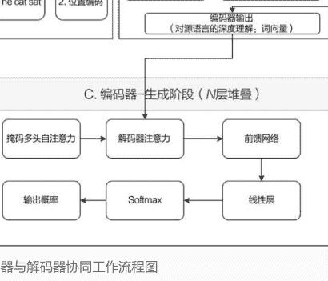

图3-1 Transformer核心部件：编码器与解码器协同工作流程图

#### 3.2.1 自注意力机制：理解上下文的关键

自注意力机制是Transformer架构的灵魂。它允许模型在处理输入序列中的每一个元素时，都能够动态地“关注”序列中的所有其他元素（包括该元素本身），并根据这些元素与当前元素之间的相关性（注意力权重）计算当前元素的加权表示。这样，每个元素的最终表示都能充分融入其全局上下文的信息。

在自注意力机制中，为了计算序列中各元素间的依赖关系，每个输入元素的向量都会分别与三个不同的、可学习的权重矩阵相乘，由此派生出三个关键向量，用于发起信息检索的查询（Query, Q）、匹配查询的键（Key, K），以及承载实际信息的值（Value, V）。对于序列中的某个特定元素，其自注意力计算过程大致如下。

首先，通过计算该元素的 Query 向量与序列中所有元素的 Key 向量的点积（同时进行缩放，如除以Key向量维度的平方根）来得到相似度得分。然后，通过Softmax函数将这些得分进行归一化，转换为一组注意力权重，这些权重表示当前元素对其他各元素对应Value的“关注度”。最后，将这些注意力权重分别与对应的 Value 向量进行加权求和，得到该元素融合了全局上下文信息之后的全新表示。

为了使模型能从不同角度和表示子空间学习信息，Transformer 架构采用了多头注意力机制（Multi-Head Attention）。它并非只执行一次自注意力计算，而是并行地运行多个独立的自注意力“头”，每个“头”都有其独立的QKV权重矩阵，可以学习输入序列在不同表示子空间中的依赖关系。多个“头”的输出会被拼接并通过一个线性层融合，从而构建出对原始输入更为全面和鲁棒的表示。

自注意力机制的核心在于计算序列中元素间的相互关系，但其本质上是无法感知元素的排列顺序的，即具有“位置无关性”。如果直接应用自注意力机制，则大模型将无法区分词序。例如，无法分辨“A作用于B”与“B作用于A”的语义差异。为解决此关键问题，Transformer架构在Input Embedding阶段引入了位置编码（Positional Encoding）。位置编码是一个与Word Embedding维度相同的向量，它被添加到每个词的Embedding向量上，为序列中的每个位置赋予了独特的、可区分的信号。一种经典方法是利用不同频率的正弦和余弦函数生成这些位置向量。如此一来，位置编码的引入，巧妙地弥补了自注意力机制本身对序列顺序不敏感的固有特性。当携带了位置信息的Word Embedding向量被输入模型后，注意力权重的计算过程便能间接地、有效地利用词语的顺序信息，从而使大模型具备理解和生成依赖于顺序的复杂语言结构的能力。

#### 3.2.2 并行计算优势：规模化的基石

Transformer架构相对于传统RNN/LSTM模型最显著的优势之一便是其无与伦比的并行计算能力。在Transformer架构每一层的内部，针对输入序列中所有位置元素的核心运算——自注意力机制的计算及随后的前馈神经网络处理——均可高度并行化执行。这种架构层面的并行性与现代 GPU、TPU 等大规模并行计算硬件的设计理念不谋而合，使其强大的算力得以充分释放，进而显著缩短了模型训练的周期。更为关键的是，正是这种计算效率的革命性提升，使得在包含数万亿 Token 的海量数据集上训练参数规模同样达到万亿级别的超大规模语言模型从设想变为了现实。因此，可以说Transformer架构的并行计算优势是奠定当今大模型辉煌成就的基石，若无此突破，则我们今天所见证的AI盛景将难以企及。

### 3.3 语言的数学表示：Embedding的奥秘

计算机直接处理自然语言符号是困难的，因此必须将文本符号转换为机器可计算的数值形式，这一过程的核心技术即为Embedding。其目标是将语言的基本单元（如单词、子词等）映射到一个相对低维的、稠密的向量空间中，并期望在这个空间中，所有语义上相似或相关的语言单元所对应的向量在空间距离上也能够彼此靠近。

#### 3.3.1 从词语到向量：让机器理解语义

早期的词语表示方法如独热编码（One-Hot Encoding），将每个词表示为一个高维稀疏向量，其中只有该词对应的维度为1，其余为0。这种方法存在严重的维度灾难问题（词汇量大导致向量维度极高）和语义鸿沟问题（任意两个不同词汇的向量正交，无法体现语义相似性）。为了克服这些缺陷，稠密词嵌入（Dense Word Embedding）技术应运而生，代表性工作包括Word2Vec、GloVe和FastText。这些技术通过在超大规模文本语料上训练神经网络，将词语映射到维度较低（通常几百到几千维）的稠密向量上，使得语义相近的词（如“国王”与“王后”）在向量空间中也能彼此靠近。这些预训练Word Embedding，因其蕴含的丰富语义信息，迅速成为早期深度学习NLP模型处理文本的基础。

#### 3.3.2 上下文感知：动态变化的语义

传统的静态Word Embedding方法为每个词都分配了一个固定不变的向量表示，这无法处理自然语言中普遍存在的一词多义现象（如“bank”可指银行或河岸）。现代的大模型，特别是基于Transformer架构的大模型，通过其核心的自注意力机制，能够自然地为同一个词在不同语境中生成上下文感知的动态 Embedding 表示。在这些大模型中，一个词的最终表示是其初始静态Embedding经过多层Transformer块处理后的结果。在每一层中，自注意力机制都会根据当前词与句子中所有其他词的交互关系，动态调整和更新该词的表示。因此，同一个词在不同上下文中会获得不同的、融入了相应上下文信息的向量表示，这是大模型深刻理解语言细微差别和复杂歧义的关键。

基于Transformer架构的模型在Embedding技术上实现了重大突破，它们能够提供动态的、感知上下文的向量表示，从而更精确地捕捉词语在不同语境下的细微含义。这种将文本转化为富含语义信息的向量的能力，是许多现代自然语言处理任务（如RAG系统）得以实现的基础。

#### 3.3.3 分词：文本预处理的关键步骤

大模型通常不直接处理原始单词或字符，而是先将文本分割成一系列被称为Token（词元）的单位。选择合适的分词（Tokenization）策略，对于模型性能、效率及处理未登录词的能力至关重要。现代大模型普遍采用各种子词分词算法，它们将文本分割成介于单个字符和完整单词之间的有意义的片段，常见词汇保留为完整Token，罕见词或新词则拆分为更小、更常见的子词单元序列。

主流的子词分词算法包括字节对编码（Byte Pair Encoding，BPE），它从单个字符（或字节）的初始词汇表开始，迭代地合并语料中出现频率最高的一对相邻子词，直至达到预设的词汇表规模，GPT系列模型广泛采用此方法。WordPiece算法与BPE类似，但其合并标准是选择能够使整个训练语料库在使用当前词汇表编码时总似然最大化的子词对，BERT等模型常采用此方法，并在子词前缀中以特殊符号（如“##”）表示其非独立词。另一种是Unigram Language Model Tokenization，它从一个较大的候选子词集合开始，基于Unigram语言模型估算子词概率，并迭代移除对整体语料库编码总似然贡献最小的子词，直至达到目标词汇表大小，在对新文本进行分词时，会寻找概率最大的子词序列。这些子词算法有效地控制了词汇表规模，同时增强了大模型处理未登录词的能力，并能在一定程度上保留词语的形态学信息。

#### 3.3.4 多模态：表示图像、声音等信息

人工智能正迅速向多模态智能发展，需要处理和理解文本、图像、声音等多种信息模态。多模态 Embedding 技术致力于将来自不同信息模态的数据映射到一个统一的、共享的语义向量空间中。其核心目标是学习能够将不同模态的原始输入（如一张图片和一段描述该图片的文本）分别编码并映射到同一个高维共享语义空间的表示函数。在这个向量空间中，描述同一概念或事物的不同模态的表示，应该在向量距离上彼此靠近。例如，CLIP（Contrastive Language-Image Pre-training）模型通过对比学习对齐图像和文本的表示。这种跨模态语义对齐为执行各种复杂的跨模态任务（如看图说话、文生图/视频、视觉问答）奠定了坚实基础，预示着大模型正超越纯文本处理，向更全面的智能迈进。

### 3.4 学习的艺术：预训练与微调范式

现代大模型之所以能展现出如此强大和通用的能力，很大程度上归功于一种被广泛采用且极其高效的“预训练&微调”学习策略。这种“先通用，后专用”的方法论，使得大模型能从海量的无标签数据中学习广泛的通用知识和核心语言能力，随后根据特定下游任务进行适配。

#### 3.4.1 预训练：奠定通用知识基础

预训练是构建强大的大模型的第一步，也是计算成本最高、对数据量要求最苛刻的阶段。其核心目标是让大模型在规模极其庞大、来源广泛且内容多样化的无标签文本数据上，通过自监督学习的方式，自主学习广泛的语言结构规律、世界知识及初步的逻辑推理能力。自监督学习意味着大模型从输入数据本身智能地生成学习所需的“伪标签”，而无须外部人工标注。

在大模型的预训练中，常见的自监督学习任务包括掩码语言模型（Masked Language Model，MLM），BERT所采用的就是该模型。该任务会随机遮盖输入文本中的部分Token，之后要求大模型根据周围未被遮盖的双向上下文来预测这些被遮盖的Token。另一种是下一词预测（Next Token Prediction，NTP）或称因果语言模型（Causal Language Model，CLM），GPT系列所采用的就是该模型。该任务要求大模型根据已有的上文（从左到右的单向上文）预测下一个Token。这种方式天然契合各类文本的生成需求。通过长时间在海量数据上执行这些任务，大模型被迫深入学习并内化了精细的语法、丰富的语义、广泛的世界知识和初步的推理能力，最终形成一个具备通用能力的“基础模型”。

#### 3.4.2 微调：适配特定任务与领域

尽管预训练的基础模型已具备强大的通用能力，但通常不能直接完美适用于所有细分的下游应用任务。此时就需要进入学习范式的第二阶段——微调。微调的核心思想是利用一个规模相对较小、但与目标下游任务或特定领域高度相关的、通常带有精确标签的专门数据集，在已预训练好的基础模型之上继续进行有监督的训练，从而将其通用知识和能力“迁移”并“适配”到当前的目标任务上。

“预训练&微调”范式的主要优势在于显著提升学习效率、降低对大规模标注数据的依赖门槛，并且通常可以在下游任务上获得更优异的性能。同一基础模型可以通过在不同微调数据集上适配，灵活应用于多种任务。然而，微调也面临着一定的挑战，如仍需高质量标签数据、可能发生“灾难性遗忘”（模型在适配新任务时丢失部分预训练知识），以及全参数微调（更新所有模型权重）带来的较高存储和计算成本。为应对最后一个挑战，参数高效微调（Parameter-Efficient Fine-Tuning, PEFT）技术应运而生，如LoRA和提示词微调等，它们旨在通过只调整大模型的一小部分参数来大幅降低微调成本。

#### 3.4.3 对齐人类：指令微调与RLHF的作用

即使经过预训练和标准微调，大模型本质上仍是基于统计模式生成内容，其输出可能并不完全符合人类的真实期望或社会规范，可能生成无用信息、有害信息，或者难以准确遵循复杂指令。为了让大模型更好地理解人类意图、遵循复杂指令并生成更有用、更诚实、更无害的内容，研究者引入了一系列对齐技术。

其中，指令微调至关重要。其核心目标是教会模型理解并准确遵循各种形式的人类自然语言指令，这通常通过在一个包含大量（指令，期望输出）配对的数据集上对预训练模型进行进一步微调来实现。经过充分指令微调的模型能显著提升理解用户复杂意图的能力，是模型从“文本预测器”转变为“智能助手”的关键。

然而，构建覆盖所有指令类型和人类偏好的大规模高质量指令数据集成本极高。基于人类反馈的强化学习技术提供了更灵活的方式，它直接利用人类对模型不同输出结果的偏好判断作为学习信号来优化模型行为。基于人类反馈的强化学习的典型流程如下。

首先，收集人类对大模型生成内容的偏好数据（如哪个回答更好），并利用这些数据训练一个奖励模型（Reward Model, RM），使其能预测人类对模型输出的评分。然后，将语言模型视为一个智能体，使用训练好的奖励模型作为环境反馈（奖励信号），通过强化学习算法，如近端策略优化（Proximal Policy Optimization, PPO），调整语言模型的参数，使其生成的文本能获得更高的奖励分数，从而更符合人类偏好。

指令微调和基于人类反馈的强化学习（通常结合使用）对于提升大模型的可用性、可靠性和安全性至关重要。

### 3.5 本章小结

本章系统性地“探源究底”，回顾了支撑现代大模型崛起的关键技术演进脉络。我们从N-gram统计语言模型出发，经历了引入“记忆”机制的RNN与LSTM，最终聚焦于奠定现今所有大模型基石的Transformer架构及其灵魂——自注意力机制。在此基础上，我们深入剖析了将语言符号转化为机器可理解的向量表示的核心技术，理解了从静态到上下文感知动态Embedding的重大进步，并探讨了分词的关键作用。最后，我们解析了“预训练&微调”这一高效学习范式，以及指令微调与RLHF是如何使大模型更好地对齐人类意图与价值观的。通过对这些核心原理的梳理，我们不仅理解了大模型“为何如此强大”，以及“它们是如何工作的”，也为后续深入学习DeepSeek模型特性、掌握提示词工程、RAG、函数调用与智能体等高级应用技术，奠定了坚实的理论基础。深刻把握技术演进的脉络，将使我们更从容地驾驭日新月异的AI工具，并将其成功应用于企业实践，创造更大的商业与社会价值。

## 第4章 DeepSeek模型家族全解析与核心技术揭秘

在前一章中，我们一同系统性地梳理了大模型技术从早期的统计语言模型，一路演进至现代基于Transformer架构的复杂系统的宏伟脉络，并深入剖析了诸如Embedding表示、预训练、微调及对齐等一系列核心技术原理。这些坚实的理论基础，为我们深刻理解任何一个具体的大模型的内部运作机制和能力来源，提供了必不可少的理论支撑与认知框架。

现在，我们将研讨的焦点从普适性的技术原理，精准地转向特定的实践主体——DeepSeek AI。作为近年来在全球人工智能领域迅速崛起并展现出强大竞争力的一股重要新兴力量，DeepSeek凭借其独特的技术实现路径、一系列令人瞩目的高性能模型产品，以及积极的开源策略，已经在异常激烈的全球大模型市场竞争中成功占据了一席之地。深入且全面地了解DeepSeek的模型体系构成、其背后一以贯之的技术哲学，以及其各项核心技术的优势与创新实践，无疑具有至关重要的战略意义和实践价值。本章的核心目标便是为你精心绘制并呈现一份关于DeepSeek模型家族及其技术内核的全面且深度解析的图谱。

### 4.1 DeepSeek的崛起之路

在全球大模型技术群星璀璨的竞技场之上，既有像Google、OpenAI、Meta这样凭借深厚技术积累和雄厚资本实力长期领跑的国际科技巨头，又有如国内的百度、阿里巴巴、腾讯等依托庞大用户基础和丰富应用场景积极布局的互联网行业领军企业。在这样强手如林的环境中，DeepSeek作为一家相对而言更为年轻和专注的公司，能够在短时间内快速发展并取得一系列令业界瞩目的技术成就，其背后必然有一套独特的发展轨迹、清晰的战略聚焦及一以贯之的核心技术理念。

DeepSeek虽然在名义上成立于2023年，看似是一家新兴的初创公司，但其核心创始团队与技术骨干，实际上与国内知名的量化私募投资公司幻方量化有着深厚的渊源。幻方量化在高性能计算集群的构建与运维、大规模并行计算优化，以及尖端算法研究等方面拥有长期的技术积累和实践经验。这些经验为DeepSeek在大模型研发所需的庞大算力基础设施和复杂算法工程方面，提供了得天独厚的先天优势。正是依托于这样的深厚积累，DeepSeek得以在成立之初便专注于大模型核心技术的突破。

从2023年下半年开始，DeepSeek开始密集地向外界公开发布其在大模型领域取得的一系列重要研究成果，迅速引起了业界的广泛关注。其发展历程中的几个关键节点如下。

首先是DeepSeek LLM系列的发布。2023年11月，DeepSeek正式发布了首款参数规模达670亿（67B）的通用大模型，提供了基础模型和对话优化模型两个版本。根据多项国际权威的公开NLP基准测试结果显示，DeepSeek LLM 67B在综合性能上表现优异，尤其是在中英文双语的理解、生成和推理能力方面，已经可以与像Llama 2 70B这样的国际顶尖开源大模型相媲美，甚至在某些单项能力上有所超越。紧接着，DeepSeek在代码智能领域也展现了其强大的技术实力，推出了DeepSeek Coder系列模型。该系列模型在各种复杂的代码生成、代码补全、代码解释、代码翻译及Bug修复等专业代码任务上，均展现了极其强大的能力。特别是在HumanEval（评估代码生成能力）、MBPP（评估基础编程问题解决能力）等国际公认的权威代码能力评测榜单上，DeepSeek Coder（尤其是其33B版本）的得分名列前茅，甚至超越了一些参数规模远大于它的通用大模型，在开源代码模型领域达到了世界领先水平。

DeepSeek的技术哲学可以概括为“技术驱动、追求极致、开放共赢”。他们坚信通过在核心算法、数据工程和系统优化等方面持续投入和创新，就能够打造出性能卓越的大模型。同时，DeepSeek积极拥抱开源，向社区开放大部分核心模型和技术成果，致力于与全球开发者共同推动大模型技术的进步和应用落地。

### 4.2 DeepSeek核心模型矩阵详解

DeepSeek当前已经构建并向业界提供了一个覆盖从通用自然语言理解与生成，到专业代码智能，并在多模态交互等新兴方向上积极探索的、既强大又具有显著差异化竞争优势的模型矩阵。其核心模型均可通过官方API进行调用，并且多个模型已开源。

#### 4.2.1 通用大模型

DeepSeek-V3是DeepSeek在通用大模型领域的重要产品，它并非传统意义上的稠密模型，而是通过创新的架构设计实现了性能与效率的平衡。DeepSeek-V3采用了混合专家（Mixture-of-Experts, MoE）架构。根据官方发布的信息，DeepSeek-V3的总参数量达到了6710亿，但在推理时，每个Token仅激活370亿参数。这种稀疏激活的特性使得DeepSeek-V3能够在保持极高性能的同时，显著降低推理所需的计算资源和成本。

DeepSeek-V3的核心技术特性可以归纳为以下几点。

首先，在极致的效率设计方面，DeepSeek-V3引入了多头潜在注意力（Multi-Head Latent Attention, MLA）机制。MLA通过引入固定数量的潜在查询向量作为中间表示层，有效地将长序列注意力计算的复杂度从二次方降低到线性级别，这使得模型能够高效处理更长的上下文窗口，官方称支持高达128K Token的上下文。同时，DeepSeek-V3在MoE架构的负载均衡方面也进行了优化，采用了如无辅助损失的负载均衡策略，旨在更均匀地分配计算负载到各个专家模块，避免传统MoE架构中可能出现的性能瓶颈。

其次，在超强的性能表现方面，DeepSeek-V3在多个基准测试中展现了可与顶尖闭源模型相竞争的实力，特别是在数学、代码、推理和多语言处理等多个维度上均有出色表现。例如，在一些公开的数学和代码评测集上，其性能接近甚至超过了一些知名的闭源模型。其中文处理能力也尤为突出，在如C-Eval等中文权威评测中取得了优异成绩。DeepSeek-V3的GitHub官网给出的基准测试成绩如图4-1所示。长上下文处理能力使其能够胜任超长文档分析、复杂多轮对话等以往难以处理的场景。

再次，在开源与商业化兼容方面，DeepSeek-V3的基础模型已经开源，并采用了对商业应用友好的许可证（如MIT License），这极大地鼓励了社区的二次开发、私有化部署及在此基础上的应用创新。同时，DeepSeek也提供了极具竞争力的API服务，其定价策略旨在大幅降低企业使用高性能大模型的门槛，如其API的输入成本（按百万Token计算）远低于市场上的主流闭源模型。

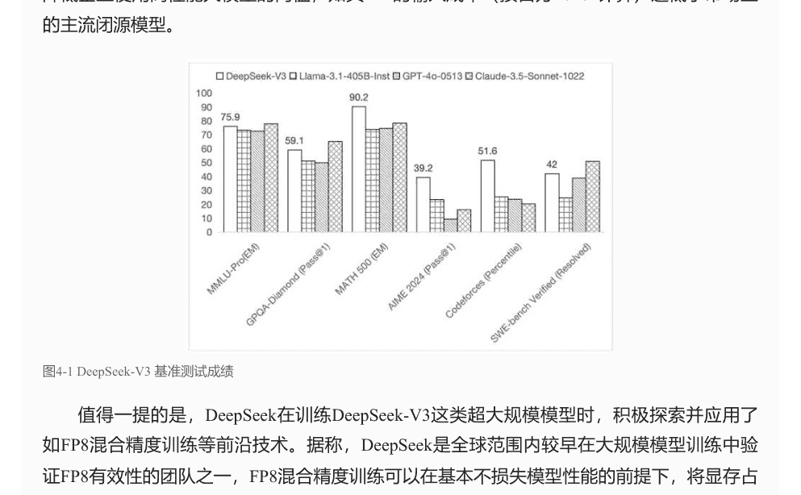

值得一提的是，DeepSeek在训练DeepSeek-V3这类超大规模模型时，积极探索并应用了如FP8混合精度训练等前沿技术。据称，DeepSeek是全球范围内较早在大规模模型训练中验证FP8有效性的团队之一，FP8混合精度训练可以在基本不损失模型性能的前提下，将显存占用减少约一半，训练速度提升近两倍，这对于控制大模型训练成本、加速模型迭代具有重大意义。

#### 4.2.2 代码语言模型

DeepSeek Coder系列是DeepSeek在其模型矩阵中，专门针对代码理解、生成、补全、解释、调试和转换等一系列与软件开发和编程相关的核心任务，而进行深度优化和精心打造的专业代码大模型。其目标是成为全球软件开发者的强大AI编程助手，通过其在代码处理方面的卓越能力，显著提升软件开发全生命周期的效率，有效保障最终产出代码的质量。

DeepSeek Coder的卓越性能源于其坚实的数据基础和针对性的训练策略。该系列模型在超过2万亿个Token的、覆盖了全球主流的80多种编程语言（包括Python、Java、C++、JavaScript、Go、Rust等）的、经过精心筛选和处理的高质量专业代码数据之上进行预训练。这些数据不仅来源于开源代码库，还可能包括代码注释、版本控制信息（如Git提交日志中的上下文信息）、技术问答社区内容（如Stack Overflow）等多源异构数据，从而使大模型能够学习到代码背后的真实意图和开发流程中的隐形知识。

为了更好地适应真实开发场景中对代码中间补全的需求（如在IDE中编写代码时），DeepSeek Coder在训练过程中特别强调了填充中间（Fill-in-the-Middle，FIM）能力的培养。FIM训练通过将代码片段拆分为前缀、待补全的中间部分和后缀三部分，让模型学习根据已有的前后文准确生成中间缺失的代码。这种针对性的训练使得DeepSeek Coder在代码补全任务上表现尤为出色，准确率和实用性均得到显著提升。

在包括HumanEval、MBPP等在内的多个国际公认的、权威的代码能力评测基准测试集上，DeepSeek Coder系列模型（尤其是其较大参数规模的版本，如33B模型）均取得了极其优异的成绩，其性能表现达到了全球开源代码大模型的顶尖水平，甚至在某些指标上超越了一些参数规模远大于它的通用大模型。DeepSeek Coder的开源进一步推动了代码智能领域的发展，为开发者提供了强大的工具。

#### 4.2.3 推理模型

除了通用大模型和专业的Coder模型外，DeepSeek也在探索针对特定能力进行优化的模型。DeepSeek-R1曾作为其探索提升长链逻辑推理能力的专用模型被提及。这类模型的研发通常旨在解决通用大模型在需要多步骤、复杂逻辑推演的任务上可能存在的不足。

DeepSeek-R1-Zero、DeepSeek-R1是DeepSeek的第一代推理模型，R1-Zero版本是通过纯强化学习进行训练的版本，该版本尝试不经过监督微调阶段，而是通过精心设计的规则驱动的奖励函数直接优化模型的推理路径，以验证纯强化训练大模型在特定任务上的可行性。后续R1版本则引入高质量的冷启动数据，以解决纯强化训练可能带来的可读性或语言混合问题，同时保持其核心的推理性能。DeepSeek-R1基准测试成绩如图4-2所示。

在强化学习算法层面，DeepSeek也在持续探索，如其提出的群组相对策略优化（Group Relative Policy Optimization，GRPO）算法。GRPO旨在改进传统的近端策略优化算法，如在无须使用显式价值函数模型的情况下进行优化，从而降低计算开销，提升强化学习训练的效率和稳定性，这对于优化需要复杂决策过程的推理模型具有潜在价值。

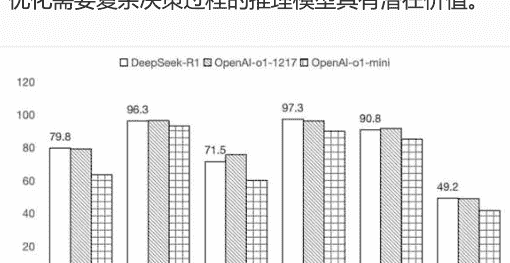

图4-2 DeepSeek-R1基准测试成绩

这类专用推理模型在数学推理（如解决数学竞赛题目）、复杂编程问题（如算法竞赛题目生成与解答）及需要深度理解和多步骤规划的长上下文推理任务（如分析复杂技术文档、进行科学文献的逻辑链提取等）上，被期望展现出超越通用大模型的卓越能力。同时，为了更广泛地部署和应用，这类模型也可能发展出参数规模较小的蒸馏版本，以在保持核心推理能力的同时，适应更多硬件环境，并与现有的开源生态（如Llama、Qwen等）兼容。

### 4.3 DeepSeek的核心技术“杀手锏”

DeepSeek之所以能在短时间内取得令人瞩目的成就，除了清晰的战略定位和优秀的人才团队，还离不开其在核心技术上的持续创新和深度打磨。这些技术“杀手锏”系统性地提升了其模型的性能、效率和实用性。

#### 4.3.1 数据驱动：构建卓越能力的基石

数据是人工智能的“燃料”，DeepSeek深谙此道，并将数据驱动的理念贯穿模型研发的始终。尤其是在构建业界领先的DeepSeek Coder系列模型时，超大规模且高质量的代码数据集是其成功的关键。如前所述，DeepSeek Coder的训练使用了超过2万亿个Token的专业代码数据，这一数据规模本身就有显著的优势。更重要的是数据的质量和多样性：覆盖全球超过80种主流及新兴编程语言，确保了大模型的广泛适用性；整合代码注释、版本控制信息、技术问答社区内容等多源数据，使得大模型能够学习代码的深层语义和真实开发场景中的上下文。

在数据质量控制方面，据称DeepSeek采用了严格的清洗流程，基于静态分析工具的自动化筛选，以去除语法错误和逻辑缺陷的代码；利用语义去重算法消除冗余数据，以保留代表性样本；严格审查开源许可证，以确保数据的合规性，仅保留允许商业使用的代码。

除了原始代码数据，DeepSeek还特别强调了项目级上下文和FIM训练对于提升代码理解和生成能力的重要性。为了让大模型理解真实软件项目中的复杂依赖关系，DeepSeek Coder支持如16K Token的超长上下文窗口。在训练时，分析代码库中的导入语句等依赖关系，将多个相互关联的源文件拼接成所谓的“超级样本”，并可能通过特殊标记显式标注文件边界和路径信息，从而帮助大模型捕捉跨文件的变量作用域、函数调用和模块依赖。针对IDE等开发工具中代码中间补全的核心需求，FIM训练通过将代码片段系统地拆分为前缀、待补全的中间部分和后缀三部分，并使大模型根据上下文生成中间内容，显著提升了大模型在实际编程场景中的实用性和准确率。

#### 4.3.2 架构创新：追求性能与效率的极致平衡

在模型架构层面，DeepSeek也展现了其追求性能与效率平衡的智慧。一个显著的示例便是，在其通用大模型（如DeepSeek-V3）中成功应用的MoE架构。MoE架构通过将大模型的参数分散到多个“专家”子网络中，并在推理时仅稀疏地激活其中少数几个（如Top-2）与当前输入最相关的“专家”，从而在大幅增加模型总参数规模（提升模型容量和性能上限）的同时，保持推理时的计算量相对可控。这种设计使得大模型能够在保持高性能的同时，显著降低实际部署和运行的成本。在训练MoE架构模型时，如何有效进行专家路由和保持负载均衡至关重要，DeepSeek在这方面也进行了优化。例如，采用无辅助损失的负载均衡策略，以确保各个“专家”可以得到充分且均匀的训练。

另一个重要的架构创新是针对长上下文处理的MLA机制。传统的Transformer架构注意力机制在处理长序列时，其计算复杂度会随序列长度的平方增长，成为性能瓶颈。MLA通过引入固定数量的潜在查询向量作为一种中间摘要层，首先将输入序列的关键信息压缩到这些潜在向量中，然后使原始的查询与这些浓缩后的潜在向量交互。这种方式有效地将长序列注意力的计算复杂度降低到近似线性级别，使得大模型能够经济、高效地处理极长的上下文窗口（如128K Token），这对于理解和生成涉及长篇文档或复杂对话的任务至关重要，显著提升了大模型的推理速度和吞吐量。

#### 4.3.3 训练策略优化：提升效率、稳定性与对齐效果

除了数据和架构，高效且精妙的训练策略也是DeepSeek模型成功的关键。在预训练阶段，DeepSeek采用了如多令牌预测（Multi-Token Prediction，MTP）这样的技术来加速模型的学习和提升对局部结构的理解。传统的语言模型通常只能预测下一个Token，而MTP允许大模型一次性预测未来多个Token。通过设计并行的预测头和可能的动态掩码机制，MTP不仅可以提升训练的并行度和整体吞吐量，还有助于大模型更好地学习和理解文本序列中的短语结构和局部依赖关系，这对于代码生成等任务中代码块的连贯性尤为重要。

在提升大模型与人类意图和偏好对齐效果方面，DeepSeek也在积极探索和应用新型的强化学习算法。例如，其提出的GRPO算法，旨在结合直接偏好优化和近端策略优化等现有主流对齐算法的优势。GRPO算法可能通过直接利用人类标注的成对偏好数据来优化策略网络，同时引入更有效的机制（如动态调整信任域或改进奖励建模）来提升训练的稳定性和最终的对齐效果。这类算法的创新对于提升大模型的有用性、诚实性和无害性，减少大模型产生不当输出的风险至关重要。

此外，为了进一步提升大规模模型训练的效率及降低硬件成本，DeepSeek在业界较早地探索并成功实践了FP8混合精度训练。FP8是一种比FP16/BF16精度更低的浮点数表示格式。在训练过程中策略性地对大模型的权重、激活值和梯度使用FP8格式，并结合动态损失缩放等技术来维持数值的稳定性和大模型的收敛精度，可以在不显著牺牲模型性能的前提下，大幅减少训练所需的显存占用（理论上可减半）并提升计算速度，现代GPU对FP8的吞吐量远高于FP16。DeepSeek在其H100 GPU集群上成功实施了FP8混合精度训练，为超大规模模型的经济高效训练提供了宝贵经验。

### 4.4 技术创新总结

DeepSeek之所以能够在竞争激烈的大模型领域迅速崛起并占据一席之地，是因为其构建了一套系统性的、多维度协同的技术创新体系，从而形成了独特的差异化竞争力。

首先，DeepSeek的核心竞争力源于其强大的数据壁垒和精细的数据工程能力。尤其在代码智能领域，通过构建并持续优化包含2万亿级别Token、覆盖80多种编程语言、并融入项目级上下文信息的超大规模高质量代码训练数据集，DeepSeek为其Coder系列模型奠定了坚实基础。其严格的数据清洗、去重和合规过滤流程，确保了训练数据的质量，这直接转化为大模型在理解和生成复杂代码时的卓越性能。这种在特定领域进行数据纵深挖掘和精细化处理的能力，构成了难以被快速复制的“护城河”。

其次，DeepSeek在模型架构设计上展现了对效率和性能极致平衡的追求。通过成功应用并优化混合专家架构，DeepSeek能够在大幅扩展模型总参数规模、提升模型容量的同时，将推理时的激活参数和计算量控制在合理水平，实现了“大而经济”。同时，创新的MLA机制有效突破了传统Transformer架构在处理超长上下文时的性能瓶颈，使得大模型能够高效处理128K甚至更长的序列，这在代码理解、长文档分析等复杂任务中表现突出。这些架构层面的创新，使得DeepSeek模型在保持高性能的同时，也具备了更好的实用性和部署可行性。

再次，DeepSeek在模型训练策略和算法优化方面持续走在前沿。无论是通过多令牌预测等技术加速预训练收敛并提升对局部结构的理解，还是通过自研的新型强化学习对齐算法（如GRPO）更高效、更稳定地提升模型与人类意图的对齐效果，抑或是率先在超大规模模型上成功实践FP8混合精度训练以大幅降低训练成本和周期，这些技术创新都直接提升了DeepSeek模型研发的效率和最终产品的质量。这种快速迭代和应用前沿训练技术的能力，是其保持竞争力的关键。

综合来看，DeepSeek的差异化定位日益清晰。它不仅力求成为代码智能领域的领导者，凭借其在数据和架构上的独特优势，其Coder系列模型在代码生成、补全等核心任务上已展现出超越同类开源模型的强劲实力。同时，它是大模型效率优化的积极探索者和实践者，通过MoE、MLA、FP8混合精度训练等一系列技术的创新应用，努力在大模型的高性能与低成本之间取得最佳平衡点，这对于推动大模型技术的广泛落地至关重要。更重要的是，DeepSeek

### 4.5 本章小结

积极拥抱开源生态，致力于成为重要的技术推动者，通过开放其核心模型、架构思想甚至训练工具，降低了企业和开发者应用先进大模型技术的门槛，促进了整个行业的共同进步。

DeepSeek凭借其在通用大模型（特别是以DeepSeek-V3为代表的MoE架构模型）、代码语言模型（DeepSeek Coder系列）等多个核心方向上的卓越技术实力、前瞻性的战略布局及积极的开源贡献，无疑为全球范围内的广大企业用户和开发者社区提供了一套极具吸引力、高性能、高性价比且富有未来潜力的AI大模型解决方案。深刻理解并善用DeepSeek模型家族的强大能力及其背后的核心技术创新，将有效帮助企业在当前波澜壮阔的人工智能技术浪潮中，抓住核心机遇，构建差异化竞争优势，并成功开启其智能化转型与创新发展的辉煌新篇章。在接下来的章节中，我们将进一步学习如何通过提示词工程、RAG、函数调用及智能体等核心技术，来真正驾驭和发挥这些强大AI引擎的惊人潜力。

## 第5章 提示词工程：与大模型对话的艺术

在上一章深入解析DeepSeek模型家族的技术架构与核心原理后，我们认识到大模型的强大能力源自其海量数据的预训练与精密的算法设计。然而，如何让这些“沉默的巨人”精准响应人类需求，并转化为实际的业务价值呢？这正是提示词工程的核心使命。本章将揭示与大模型高效对话的艺术：从理解提示词是如何激活大模型的模式识别与序列预测能力的，到拆解结构化提示词的核心要素；从零样本指令的直击要点，到少样本示例的精准引导；从思维链的逐步推理，到企业级模板的实战应用。通过系统地学习提示词的设计逻辑与实践策略，你将解锁大模型的深层潜力，实现从技术原理到业务落地的关键跨越。

### 5.1 理论基础：深刻理解提示词为何如此关键

#### 5.1.1 大模型是“模式识别与序列预测”大师

回顾本书第3章对大模型核心技术原理的探讨，我们可以知道，现代的大模型主要在海量的、多样化的文本数据上进行自监督学习。通过在数万亿级别的海量文本序列上进行这种看似简单的预测任务的反复训练，大模型实际上已经极其深入地学习并内化了人类语言的各种复杂语法结构规则，如常见的词语搭配习惯，词语与词语之间丰富的语义关联，乃至蕴含在这些海量文本数据背后的、大量关于我们这个世界的事实性知识及一定程度上的逻辑推理模式等。

因此，当用户向大模型输入一个提示词时，大模型的核心任务就是，基于其在预训练阶段所学习的所有语言模式、知识储备和推理能力，预测并生成那个在统计上最有可能的、在语义上最连贯的、在逻辑上最合理地接续在这个提示词之后的后续Token序列。

提示词扮演着至关重要的“引导信号”的角色。在接收到这个信号后，大模型会努力在其庞大的、由神经网络参数构成的知识库中，搜寻并激活那些与用户设定的起点最为匹配、最为相关的已有模式和知识，之后沿着这些被激活的模式路径继续向前生成后续内容。

如果用户输入了一个非常明确的片段，如“中国的首都是”，则大模型一定会接续生成“北京”。这是因为它在海量的训练数据中，已经无数次地遇到并学习了“中国的首都是北京”这个极其常见且稳定的语言模式。

如果用户输入了一个更复杂的指令，如“请以一位经验丰富的客户关系经理的专业口吻，起草一封关于近期产品[某型号]出现延迟发货情况的道歉邮件，收件人客户的姓名是张三先生”。此时，大模型首先在其内部同时激活并组合运用学习到的“专业商务沟通口吻”“标准道歉邮件结构”“处理客户投诉的策略”“根据变量（如产品型号、客户姓名）进行信息替换”等多种相关的语言模式和知识技能，然后综合这些被激活的模式，生成一封符合要求、内容具体、格式恰当、语气专业的道歉邮件。

#### 5.1.2 指令微调让大模型“听从指挥”

需要注意的是，仅仅是经过大规模预训练的基础模型，虽然可能已经拥有了极其渊博的知识储备，但它在行为上可能还不太“听话”。因为它最原始的训练目标仅仅是预测下一个最可能的词，所以有时它可能会在接收输入后，随意地进行文本续写，而不一定能够很好地理解并严格执行用户所提出的具体任务指令。

为了有效解决这个问题，现代主流的对话式大模型通常会在完成大规模预训练之后，额外经历一个非常关键的指令微调阶段。在这个指令微调阶段，大模型会被专门喂养大量由人类精心构建或收集的“指令，期望输出”格式的样本对。

大模型通过指令微调学会了遵循指令的全新“模式”。通过接触和学习这些海量的、多样化的样本对，大模型逐渐学会了如何准确识别用户输入中表达意图的“指令”，并能够根据指令的具体要求来组织信息、调用知识，最终生成符合指令规范的输出内容，而不仅仅是像基础模型那样简单地进行文本续写。可以说，指令微调让大模型掌握了执行各种具体“技能”的模式。例如，执行问答、进行翻译、撰写摘要、生成代码、扮演特定角色进行对话等。

#### 5.1.3 自注意力机制使大模型聚焦于关键信息

正如我们在第3章深入探讨过的，现代Transformer架构的核心与灵魂在于其强大的自注意力机制。这个机制允许大模型在生成输出序列中的每一个Token时，都能够动态地、智能地评估输入序列（我们提供的提示词及大模型自身已经生成的部分内容）中所有Token对于当前预测步骤的重要性或相关性，并给予那些被认为更相关、更重要的 Token 以更高的“关注度”。

精心设计的提示词能够有效引导大模型进行注意力分配。在提示词中所使用的关键词、所构建的整体结构、所提供的具体示例及所明确强调的约束条件，都会直接且深刻地影响大模型在后续生成内容的过程中，将其宝贵的“注意力资源”集中分配到关键的信息片段之上。一个经过精心设计的，结构清晰、重点突出的提示词，可以有效帮助大模型“抓住问题的核心要点”，忽略那些可能存在的干扰信息或无关细节，从而生成更为精准、切题、高效的输出结果。

提示词之所以能够对大模型的行为产生如此关键和有效的影响，是因为它直接作用于并深刻影响着大模型最为核心的内部工作机制——基于概率的序列预测本质、通过指令微调获得的指令遵循能力、赖于理解上下文的注意力分配机制。精心设计和构造提示词，实际上是在为大模型提供最清晰的初始语境信息、最明确的任务指令导航及最有效的注意力焦点引导。只有这样，才能够最大限度地激发大模型所蕴含的巨大潜力，从而稳定获得符合用户真实期望的高质量、高价值的输出结果。深刻理解提示词有效性的底层逻辑之后，用户自然就更有动力去系统地学习和努力实践，从而真正构建出堪称优秀的、能够实现人机高效协作的卓越提示词。

### 5.2 结构化提示：设计高效提示词的核心要素

在我们深刻理解了提示词对于引导大模型行为至关重要的底层原理之后，接下来的核心问题自然就转变为：究竟如何才能设计出一个好的、能够真正驱动大模型产生理想输出结果的提示词呢？实践经验反复证明，仅仅是简单地、随意地向大模型提出一个问题或给出一个模糊的指令，往往难以稳定获得令人满意的结果。一个真正高效、可靠的提示词，通常是结构化的，它像一篇精心构思的文章或一份严谨的技术文档一样，包含多个相互关联、协同作用的关键组成要素，共同为大模型提供清晰、全面且无歧义的引导。

虽然我们必须承认，并不存在一个适用于所有模型、所有任务、所有场景的，所谓“万能”的完美提示词模板，但是，通过对大量成功提示词案例的分析与总结，我们可以归纳出一个结构化的、高效的提示词通常包含以下几个核心的关键要素。

**1. 设定明确的“角色”**

在提示词的开头，明确地为大模型赋予一个具体、清晰的身份或角色定位，可以极其显著地影响其后续输出内容的语气风格、专业程度、知识领域侧重，乃至思考问题的角度。这主要是因为，当大模型被赋予一个特定角色时，它会更有倾向性地去调用和激活其内部知识库中与该角色高度相关的知识储备、语言习惯和表达方式。赋予大模型的角色定义应该尽可能地具体化、场景化，避免过于宽泛和模糊。例如，“一位精通Python且熟悉金融量化交易领域的高级程序员”通常会比“你是一个程序员”带来更精准、更符合需求的输出效果；同样地，“一位专注于研究儿童早期认知发展与语言习惯的教育心理学专家”也会比“你是一位教育专家”更能引导大模型调用相关专业知识。

**2. 下达清晰、具体的“指令”**

这是整个提示词中最为关键的部分，它必须清晰、准确且毫无歧义地告诉大模型，我们到底希望它具体完成什么样的工作或任务。指令的质量直接决定了大模型能否准确理解我们的核心需求。通常应该使用明确的、具有行动指示性的动词来开头，并尽可能详细、具体地描述任务的内容、范围、目标和关键要求。

**3. 提供“上下文”信息**

为大模型提供与当前任务紧密相关的背景信息、必要的输入数据或明确的约束条件。充分且相关的上下文信息，能够有效帮助大模型更好地理解任务所处的具体环境，消除潜在的语义歧义，聚焦于核心的处理对象，并最终生成出更为相关、更为准确，也更符合实际需求的输出结果。

**4. 提供高质量的“示例”**

在提示词中，明确提供一个或多个完整的、高质量的输入/输出任务完成示例，可以直接、形象地向大模型展示我们所期望的输出内容的具体格式、语言风格、所需达到的质量标准，甚至在解决问题时应遵循的特定推理过程或思考步骤。对于那些任务本身比较复杂、指令难以用语言完全精确描述，或者对输出格式有严格要求的场景，提供高质量的示例往往比仅仅依靠冗长的指令描述更为直观、有效。

### 5.3 零样本和少样本

#### 5.3.1 零样本提示：不给示例，仅凭指令

零样本（Zero-shot）提示是指用户在向大模型提出任务请求时，完全不提供任何与该任务相关的、具体的输入/输出完成示例，而仅仅依靠清晰、准确的自然语言指令和必要的上下文信息来要求大模型直接执行任务。这种方式之所以有效，是因为其依赖于现代大模型超大规模的预训练阶段及后续关键的指令微调来理解用户提出的新任务指令，并尝试将其“映射”到已知的能力范围内。

对于那些相对简单、常见且在模型训练数据中可能已经大量出现过类似模式的任务，经过充分指令微调的、能力较强的大模型通常都能够很好地处理零样本提示，并给出令人满意的结果。以下示例可以帮助你理解零样本提示。

任务1：请将以下这段用户评论文本准确地分类为正面、负面或中性三种情感倾向之一。

评论：虽然这款手机的价格有点小贵，但它的拍照效果和电池续航能力都让我感到非常惊艳！

分类：正面

任务2：请用通俗易懂的语言向一个非技术背景的人解释什么是“云计算”技术？

**1. 零样本提示的主要优点**

零样本提示的实现方式最为简单直接，无须花费额外的时间和精力去构思、编写和验证任务示例，显著降低了提示词的设计成本。如果大模型本身就已经对某类任务非常擅长，那么零样本提示通常是最快、最便捷的交互方式。

**2. 零样本提示有以下主要缺点与局限**

对于那些任务本身比较复杂、定义较为新颖独特或需要大模型的输出遵循某种特定格式，抑或是需要进行非常细微和微妙的判断的任务，仅仅依靠零样本指令，大模型可能难以准确、完整地理解用户的真实意图，或者其生成的输出结果可能在格式、风格或内容精度上不符合预期。即使大模型能够大致完成任务，其输出结果的风格、格式或稳定性也可能不如提供了示例的少样本提示那样可控和一致。

#### 5.3.2 少样本提示：提供示例，引导大模型进行模仿

少样本（Few-shot）提示是指用户在向大模型发出核心任务指令的同时，先在提示词中额外提供一个或多个完整的、高质量的任务完成示例。然后，给出实际需要大模型处理的新的输入，并期望大模型能够通过“观察”和“模仿”用户所提供的示例，更准确、更符合要求地完成当前任务。

现代大模型具备一种令人惊叹的能力，它们能够仅仅通过在当前输入的上下文中“看到”这些任务完成的示例，就能够快速地“学习”或者说“适应”这个特定任务所蕴含的模式、所要求的输出格式，以及所期望的语言风格，而完全无须对其自身的内部网络参数进行任何实际的更新或调整。

示例能够以一种极其直观、具体的方式，向大模型清晰地展示出用户到底期望它做什么，以及如何做。相比于仅仅依靠可能存在多种解释的自然语言指令，高质量的示例能够更有效地帮助大模型消除对任务要求的模糊理解。如果我们对大模型输出的格式或语言风格（例如，是需要正式严谨的还是活泼有趣的语言风格）有明确的要求，那么提供符合这些要求的示例，往往是引导大模型产生相应输出的最为有效和可靠的方式之一。以下示例可以帮助你理解少样本提示。

任务：请将以下用户评论准确地分类为积极、消极或中性三种情感倾向之一。

示例1：

评论：这本书写得太精彩了！故事情节跌宕起伏，人物刻画入木三分，强烈推荐！

分类：积极

示例2：

评论：快递送达的速度还可以，比预期的早一天。外包装看起来也很完好。

分类：中性

示例3：

评论：这个软件更新之后反而变得更难用了，很多以前常用的功能都找不到了，界面也变得很混乱。

分类：消极

现在，请对以下评论进行分类。

评论：这款新出的降噪耳机的音质确实超出了我的预期，而且佩戴起来也非常舒适，长时间佩戴也不会觉得累。

分类：积极

**1. 少样本提示的主要优点**

少样本提示能够显著提升大模型在处理复杂、模糊或新颖任务时的性能表现和输出准确性，能够让用户对大模型输出的最终格式和语言风格拥有更强的控制力。相较于需要准备大量标注数据并进行大模型重新训练的微调方法而言，少样本提示的实现成本要低得多，并且具有更高的灵活性和更快的迭代速度。

**2. 少样本提示的主要缺点与注意事项**

少样本提示需要用户花费额外的时间和精力去精心设计、筛选和验证高质量的任务完成示例。示例的质量直接决定了少样本提示的效果。引入示例会显著增加整个提示词的长度，这可能会消耗更多的计算资源（Token），并且对那些具有严格上下文长度限制的大模型而言，需要特别注意是否会超出其处理能力上限。所选择的示例内容、示例的数量，甚至示例在提示词中出现的顺序，有时都可能会对大模型的最终输出效果产生微妙甚至显著影响。

#### 5.3.3 如何在实践中选择使用零样本还是少样本策略

对于任何一个新的任务或应用场景，总是应该首先尝试使用清晰、明确的指令来进行零样本提示，评估模型是否能够直接、准确地理解并完成所提出的要求。如果其输出结果已经能够满足基本需求，那么就无须再花费额外的精力去构造和添加示例了。当零样本提示效果不佳时，应果断转向少样本提示：如果用户发现零样本提示的效果并不理想，那么就应该毫不犹豫地引入少样本示例作为改进的主要手段。

示例的数量并非越多越好，通常从“一”开始：在引入少样本示例时，建议从只提供一个高质量的示例开始尝试，随后评估加入一个示例后的效果是否有显著提升。如果效果仍然不够理想，那么可以逐步增加示例的数量，如增加到两个、三个，通常情况下，提供三到五个精心挑选的示例就足以应对大多数任务了。需要注意的是，并非示例数量越多效果就一定越好，过多的示例不仅会增加提示词的长度和成本，有时甚至可能因为引入了噪声或冲突信息而干扰大模型的判断，反而导致效果下降。

示例的质量是决定少样本提示成败的关键：这一点无论如何强调都不为过。用户所提供的示例必须确保其自身的准确性、代表性、与最终目标任务的高度一致性，以及其输入输出格式的清晰度与规范性。使用低质量、包含错误，或者与目标任务不完全匹配的示例，不仅无法帮助大模型，反而会严重误导大模型，导致最终输出结果更差。

### 5.4 思维链、思维树与自我反思

#### 5.4.1 思维链：让大模型像人一样“思考”

思维链提示技术的核心思想非常直观，它借鉴了人类在解决复杂问题时通常会采用的“一步一步来”的思考方式，即不再直接向大模型索取那个最终的、唯一的答案，而是明确地要求大模型在给出最终答案之前，先解决这个问题的中间思考过程、逻辑推导步骤或关键的计算环节，并以自然语言文本的形式清晰地、逐步地展示出来。通过这种方式，我们期望能够引导大模型将其内部可能存在的、但原本是“隐藏”的推理过程“外化”出来，从而使推理过程更符合逻辑、更易于验证，并最终提高得出正确答案的概率。

思维链提示技术要求大模型展示思考步骤，实际上是在隐式地引导大模型将一个原本看起来很复杂、需要多个步骤才能解决的大问题，分解为一系列更小、更易于处理、也更易于验证的子问题或子步骤。大模型在生成每一个中间推理步骤时，其所产生的文本内容本身就成了后续步骤可以利用的、丰富的上下文信息。这有助于大模型在进行后续推导时能够基于更坚实、更明确的基础，从而减少错误的累积。大模型本身极其擅长根据已有的上文内容，连贯地、有逻辑地生成后续的文本序列。思维链技术恰恰巧妙地利用了大模型的这一核心优势，将其引导到生成一个有意义的、逐步推进的“推理链条”序列上来。以下示例可以帮助你理解思维链技术。

**问题：** 一个杂货店老板先进购了15个新鲜苹果，随后又进购了12个橙子。在当天晚上，他成功卖掉了其中的8个苹果和5个橙子。请问，现在这家杂货店里总共还剩下多少个水果？

**回答（包含思维链）：**

首先，我们需要计算出老板最初总共进购了多少水果。进购的苹果数量是15，橙子数量是12。所以，总进购水果的数量=15+12=27。

接下来，我们需要计算出老板当天总共卖掉了多少水果。卖掉的苹果数量是8，橙子数量是5。所以，总卖掉水果的数量=8+5=13。

最后，我们用最初总共进购的水果数量减去当天卖掉的水果数量，就能得到剩下的水果数量。剩下水果的数量=27-13=14。

因此，最终答案是，现在店里还剩下14个水果。

现在，请按照同样的思维链方式，回答以下问题。

**问题：** 小华同学原本有5个漂亮的玩具弹珠，后来他的好朋友小明又送给了他一些新的弹珠，现在小华总共拥有了11个弹珠。请问，小明送给了小华多少个新的弹珠？

#### 5.4.2 思维树：企业决策的“多线程推演”

思维链提示技术通常引导大模型沿着一条单一的、线性的推理路径进行思考和推导，而思维树技术则试图打破这种线性束缚，允许大模型在推理过程中的每个关键步骤或决策节点，都能够同时探索多个不同的“思考分支”或“推理可能性”，从而在逻辑上形成一个树状的探索结构。大模型可以在这个“思维树”中对不同的推理分支进行评估（如合理性、可行性或潜在价值），并且可以根据评估结果进行回溯或者选择最有希望达到最终目标的路径继续深入探索。这就像一个专业棋手在下棋时，并不会只考虑一种走法，而是会同时思考多种可能的落子方案，并对每种方案后续可能引发的多种局面进行预判和评估。

实现思维树通常需要设计更为复杂的提示词结构，如明确要求大模型在某一步生成多个不同的下一步方案，并对这些方案进行自我评估和排序，或者需要借助外部的控制逻辑，如通过编写专门的代码来管理和引导大模型对不同推理路径进行生成、评估和选择。

对于那些没有唯一正确答案、需要进行广泛探索和权衡评估的复杂问题，如复杂的规划任务、开放式的创意写作或需要找到多种可能解决方案的难题，思维树技术可能比线性的思维链提示技术更具优势。

#### 5.4.3 自我反思：让大模型学会“审视”和“改进”

提示词的自我反思机制的核心思想是让大模型对其初步生成的答案或推理过程进行一次“反思性”的审视、评估和校验，并尝试在此基础上进行自我改进和修正，以期提高最终输出结果的准确性、逻辑性和可靠性。通常可以通过设计一个多轮的提示交互流程来实现。

**第一轮：生成初步答案。** 首先，让大模型针对原始问题生成一个初步的答案或解决方案。在这一步中，可以结合使用思维链等技术来生成包含推理过程的初步答案。

**第二轮：引导自我反思与修正。** 接下来，设计一个新的提示词，明确要求大模型对其在第一轮中所生成的答案或推理过程进行一次“批判性”的“反思”或“检查”。可以引导模型审视其答案中是否存在事实性错误、计算步骤是否有误、逻辑推理是否连贯、是否存在更简洁或更优的解法、是否遗漏了某些重要的考虑因素等；也可以向大模型提供一些明确的评估标准或检查清单来辅助其进行反思。

**第三轮：** 要求大模型根据其反思结果，生成一个经过修正和改进的新版本答案。

以下示例可以帮助你理解自我反思提示技术。

##### 5.4.4 如何在实践中选择和应用这些推理技术

“请仔细回顾并审视你针对[原始问题 X]所给出的解答过程和最终答案。请检查其中的每一个计算步骤是否都准确无误？整个逻辑推导过程是否完全连贯且没有跳跃？是否存在任何可能被忽略的边界条件或特殊情况？是否有比你给出的方法更简洁、高效的解题思路？请基于你的自我反思和评估，提供一个经过修正和改进的、更为完善的版本。”

自我反思技术有助于显著提高大模型输出答案的准确性、可靠性和鲁棒性，尤其是在减少由大模型自身“幻觉”或推理疏漏所导致的错误方面，具有重要的应用价值。

思维链是一个基础且首选的策略。对于绝大多数需要大模型进行一定程度推理才能完成的任务，思维链因其简单、通用且已被广泛验证的有效性，是你首先应该尝试和掌握的核心推理激发技术。

像思维树、自我反思等更为高级和复杂的推理技术，它们的实现通常也更为复杂，可能需要更精心的提示词设计、更多的交互轮次，甚至需要结合外部的代码逻辑来进行辅助控制。因此，它们通常更适合解决那些特定类型的、难度极高的，且对最终结果质量要求也极其苛刻的复杂问题（如数学定理证明、复杂系统设计、多目标优化规划等），或者是在那些允许进行多轮深度交互，并且时间成本相对不敏感的应用场景中使用。在大多数常规应用中，可能并不需要动用这些“重型武器”。

通过熟练掌握并灵活运用类似思维链的核心推理激发技术，你将能够更有效地引导大模型去应对更为复杂、更具挑战性的认知任务，从而真正解锁并释放其所蕴含的更深层次的智能潜力。

### 5.5 企业级提示词设计实战模板

在系统地学习了提示词工程的理论基础、核心构成要素、基础与进阶技巧、迭代优化方法及至关重要的安全考量之后，最终的目标还是要将这些知识有效地应用到企业面临的各种实际业务问题之中。本节内容旨在针对几个在企业中非常典型、具有广泛代表性的AI应用场景，为你提供一系列结构清晰、要素齐全且具有较强实践指导意义的提示词设计实战模板。

这些模板有机融合了本章前面各小节所介绍的核心概念、设计原则和实用技巧，可以作为你在为自己的具体应用设计场景和优化提示词时的一个良好起点和重要参考。但请务必注意，这些仅仅是示例性模板，而非可以直接复制粘贴的“万能公式”。在实际应用时，必须根据所面临的具体业务需求细节、需要处理的输入数据特性、所选用的特定大模型的能力特点与行为偏好，以及期望达到的具体效果目标，进行细致的、有针对性的调整、修改和深度优化。

#### 5.5.1 智能客服提示词实战模板

**设定角色**
你是一位具备[公司名称]官方认证资格的、经验丰富、耐心细致且表达友好的高级产品客服代表。你对公司的核心产品“[具体产品名称]”的所有功能特性、使用方法、常见问题及其解决方案都了如指掌，并且能够以专业、清晰、易于用户理解的方式进行解答。

**核心指令/任务**
你的核心任务是：根据用户在“用户问题”区域提出的、关于“[具体产品名称]”产品功能的具体问题，提供准确、清晰、简洁且易于非技术用户理解的专业解答。

- 如果用户的提问描述不够清晰或存在歧义，你应该主动进行1到2次礼貌性的追问，以确保完全理解用户的真实疑问点。
- 如果用户的问题超出了你所了解的产品功能范围，或者涉及更高级别技术支持或个性化解决方案的情况，你应该礼貌地向用户说明你无法直接回答，并清晰地引导他们联系我们的人工技术支持团队（如提供联系电话或在线服务链接：[此处填写人工客服联系方式或链接]）或查阅更详细的官方产品文档（如提供文档链接地址：[此处填写官方文档链接地址]）。

在整个回答过程中，请始终保持积极、热情且乐于助人的专业服务态度。

**（可选）提供相关的上下文信息（Context）**：可以是预设的常见问题与解答（FAQ），或者通过RAG动态检索提供。

关于"[具体产品名称]"产品的FAQ片段：

```json
[
  {
    "question": "如何在XX平台中导入CSV格式的数据文件？",
    "answer": "您可以通过单击界面左上角的'数据源管理'按钮，选择'本地文件上传'，并按照指引选择您的CSV文件完成导入。导入过程中请注意检查文件的编码格式是否为UTF-8，以及第一行是否包含有效的列标题。"
  },
  {
    "question": "XX平台支持哪些类型的图表可视化？",
    "answer": "XX平台目前支持包括折线图、柱状图、饼图、散点图、热力图、地图等在内的十余种常用图表类型，能够满足多样化的数据可视化分析需求。您可以在'可视化仪表盘'模块中，根据数据特点和分析目标选择合适的图表进行创建和配置。"
  },
  ...... （此处可以继续插入更多相关的FAQ条目或产品功能说明文档的关键片段）
]
```

**待处理的用户问题（User_question在此处为占位符，在实际应用中会被替换为真实的用户输入）**

用户问题："{user_question}"

**指定输出格式（OutputFormat）**

请直接生成面向该用户的、可以直接展示或发送的回答文本内容，确保语言自然、流畅、符合客服沟通规范，避免使用过于生硬或技术化的术语。

#### 5.5.2 市场营销文案创作提示词实战模板

**设定角色**

你是一位极富创意、紧跟潮流且深谙社交媒体传播规律的顶级营销文案策划专家，尤其擅长为面向[目标用户群体，如年轻、时尚的都市白领]的新产品撰写能够引发关注、产生共鸣并促进转化的推广文案。

**核心指令/任务**

请为我们公司即将隆重上市的全新产品——"[具体产品名称，例如：悦动智能降噪耳机X1]"——精心创作三条高质量的、适用于在[指定目标社交媒体平台，如小红书、抖音、微博]上发布的推广帖子文案。

具体创作要求如下。

1.  精准聚焦核心卖点：每条文案都必须清晰、有力地突出该产品的1到2个核心竞争优势或独特卖点。产品的核心卖点包括：[此处清晰列出产品的核心卖点。例如：a) 领先的主动降噪技术，有效隔绝环境噪音；b) 超长24小时续航能力，满足全天候使用；c) 采用亲肤环保材质，佩戴极其舒适；d) 支持AI语音助手智能交互]。
2.  语言风格精准定位：文案的整体语言风格必须是[此处选择并明确风格要求。例如：活泼有趣、富有网感、能够引发年轻人共鸣；凸显科技感、专业性与未来感；强调温馨治愈、情感关怀与生活品质]。
3.  巧妙融入热门话题标签：每条文案的末尾必须包含至少一个与产品特性或目标用户兴趣高度相关的、当前热门的社交媒体话题标签（# hashtag）。
4.  严格控制内容长度：每条独立的文案（不含标签）的总长度应严格控制在[此处设定具体的字数或字符数限制。例如：120个汉字]以内，以适应社交媒体平台的阅读习惯。
5.  （可选）建议搭配表情符号：可以在文案中适当使用一些符合内容和风格的表情符号（emoji），以增强文案的生动性、吸引力和情感表达力。

**提供必要的上下文信息（Context）：关于产品和目标用户的详细资料**

- 产品全称：[例如：悦动智能降噪耳机X1]。
- 核心目标用户画像：[例如：年龄在20～35岁之间，生活在城市中，注重生活品质和个人体验，对新鲜科技产品感兴趣，经常需要在通勤、工作或旅行中使用耳机的年轻白领和学生群体。]
- 产品核心卖点详细描述：[此处可以对前面列出的核心卖点进行更详细、更具吸引力的描述。]
- （可选）产品官方介绍页面链接：[此处可以提供产品的官方网站链接，供模型参考更多细节]
- （可选）期望的营销侧重点：[例如：本轮推广希望重点突出其卓越的降噪效果和超长续航能力。]

**指定输出格式（OutputFormat）**

请以一个无序列表（使用Markdown的"-"或"*"符号）的形式，清晰地输出你创作的三条独立的推广帖子文案。每条文案为一个列表项。

例如：
- [此处是文案内容1] # [相关热门标签1]
- [此处是文案内容2] # [相关热门标签2]
- [此处是文案内容3] # [相关热门标签3]

### 5.6 本章小结

本章系统剖析了提示词工程的理论根基与实践方法。提示词通过激活大模型的模式识别、指令遵循与注意力分配机制，成为人机协作的“对话密码”。结构化提示词需融合角色设定、清晰指令、上下文信息与示例引导，以提升输出质量；零样本与少样本策略需根据任务复杂度灵活选择，前者高效直接，后者通过示例降低歧义。思维链提示技术外化推理过程，而自我反思机制则赋予大模型迭代优化的能力。最终，企业级模板为客服应答、营销文案等场景提供了可复用的设计范式。掌握这些策略后，开发者就能够更高效地驾驭大模型，将其转化为解决实际问题的智能引擎。

## 第6章 RAG：让大模型掌握私域知识

在解锁大模型对话艺术后，我们将面临更深层的挑战：如何让大模型掌握企业专属知识？本章将分析RAG系统的核心架构，揭秘Embedding模型是如何将知识转化为机器语义空间的，探讨向量数据库选型策略与知识库持续进化机制，为企业打造“常学常新”的智能知识引擎。

### 6.1 RAG架构与原理

大模型虽具备广泛的知识储备，但在企业应用中面临以下三大核心痛点。

（1）知识滞后性：模型训练数据往往滞后于企业实时数据更新，无法响应最新业务需求，如政策变动或产品迭代。

（2）私有知识盲区：企业专有文档（如合同、工艺手册等）未被预训练覆盖，导致大模型无法准确回答相关问题。

（3）上下文限制：大模型的上下文窗口有限，难以处理超长文档或复杂知识图谱。

RAG 是一种融合检索机制与生成模型的混合架构，旨在通过外部知识库增强大模型的生成能力。与传统生成模型仅依赖参数化知识不同，RAG 通过动态检索相关文档片段，显著提升了生成内容的准确性和事实一致性。RAG典型架构如图6-1所示。

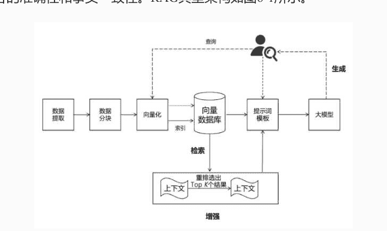

图6-1 RAG典型架构

RAG 通过检索、增强、生成三阶段机制突破了上述限制。检索是指从向量数据库中实时匹配用户查询相关片段，增强是指将检索结果注入提示词，构建上下文增强的输入，生成是指基于增强后的上下文生成精准回答。

### 6.2 核心组件1：Embedding与向量数据库

#### 6.2.1 文本向量化：选择合适的Embedding模型

在3.3节中，我们已经了解了文本Embedding的基本原理和发展历程。当我们将这些原理应用于构建RAG系统时，选择一个最优化的Embedding模型就显得至关重要。这个选择将直接影响知识库检索的准确性，进而影响大模型增强生成内容的质量。优秀的文本向量化模型能够将人类语言从离散的符号系统转化为连续的数学空间，捕捉文本的深层语义特征，而不仅仅是表层词汇匹配，这使得RAG系统能够突破关键词匹配的局限，实现真正意义上的语义理解。

在RAG系统中，Embedding模型的质量直接决定了检索系统的认知边界。我们应从以下五个核心维度来系统评估和选择合适的Embedding模型。

**1. 语义理解深度**

现代Embedding模型已从早期的静态词向量（如Word2Vec）发展到基于Transformer架构的上下文感知模型。这类模型的网络层数、注意力机制设计及预训练数据的规模与质量，共同决定了其解析复杂文本语义的深度。对RAG系统而言，这种深层次的语义理解能力至关重要，它确保模型能够准确把握用户查询的真实意图，进而从知识库中召回高度相关的文本片段。其核心优势在于，检索不再局限于关键词匹配，而是能够识别出与查询内容在语义上等价或相关的不同表述。例如，一些领先的开源 Embedding 模型通常采用动态上下文窗口技术或针对特定任务进行优化，使其在处理长文本或特定领域文本时能够自适应调整注意力范围，既保持局部语义的精确聚焦，又不失全局上下文的连贯性。

**2. 维度空间的构建**

Embedding向量的维度并非越高越好，常见的Embedding模型输出的向量维度从几百到几千不等（如768维、1024维甚至更高）。高维度通常意味着更强的语义表达能力，能够编码更丰富的信息，但也可能带来更高的存储成本、更慢的检索速度，并可能在数据量不足时遭遇“维度灾难”。对于RAG系统，企业需要根据知识库的数据特性、数据量大小和预期的检索性能来权衡选择：技术文档、法律条文等包含大量精确细节的文本可能适合更高维度的Embedding，以捕捉细微差异；而社交媒体文本、日常对话等内容可能使用中等维度即可达到良好的效果，同时保持较高的检索效率。

**3. 多模态兼容能力**

随着 AI 技术的发展，许多企业知识库中不仅包含纯文本，还可能包含图像、图表、表格等多种模态的信息。如果 RAG 系统需要理解和利用这些多模态内容，那么选择一个具备跨模态对齐能力的 Embedding 模型至关重要。例如，CLIP 及其后续发展出的模型，能够将文本和图像映射到统一的语义空间中。在 RAG 应用中，这意味着用户可以用文本查询来检索相关图片，或者系统在回答问题时可以结合文本和图片信息。当知识库包含大量图文丰富的技术手册或产品说明时，统一的多模态向量空间能显著提升检索质量和用户体验。

**4. 计算效率的平衡法则**

Embedding模型的推理速度（将文本转换为向量的速度）和运行所需的硬件资源，直接影响RAG系统的两个关键阶段：知识库的初始构建/更新（大规模文本的批量Embedding）和用户查询的实时响应（对用户输入进行 Embedding）。企业需要在大模型的语义表达效果与计算成本之间找到一个务实的平衡点。对于需要低延迟响应的在线RAG系统，可能会倾向于参数量较小、推理速度更快的轻量级Embedding模型（例如，一些为边缘设备或高效推理优化的模型）。而对于可以离线构建索引且对检索精度要求极高的场景，则可以考虑使用更大、更强的模型，即使其计算成本较高。

**5. 领域适应性的进化**

通用的 Embedding 模型虽然在大量通用语料上进行了预训练，但在处理特定专业领域（如医疗、法律、金融、特定工程领域等）的文本时，由于术语体系、表达习惯和知识结构的差异，其表现往往会打折扣。为了提升RAG系统在特定业务领域的检索效果，进行领域自适应或微调通常是一种常见的做法是，在选定了一个高质量的通用预训练 Embedding模型的基础上，使用企业自身积累的领域相关文本数据对其进行进一步的微调。这个过程能够使Embedding模型更好地学习特定领域的语义模式，从而在RAG检索时更精准地匹配领域内的查询和文档。

在实际选择Embedding模型时，查阅如MTEB等公开的评测基准，可以为初步筛选提供有价值的参考，这些基准通常会对大量主流 Embedding 模型在多种任务上的性能进行横向比较。理论指标和公开评测结果固然重要，但大模型的最终选择，更应基于在企业自身的知识库数据和典型查询场景下的实际测试效果。因为不同的数据分布和应用需求，可能导致不同模型在特定环境下的表现各异。此外，选择那些拥有活跃社区、提供良好文档支持且易于集成的模型，有助于降低后续的开发和维护成本。同时，除了模型本身的性能，还需要全面评估其在规模化部署时的潜在API调用成本（如果采用商业模型）、所需的硬件资源及与所选向量数据库的兼容性和集成顺畅度，这些都是确保RAG系统能够经济、高效、稳定运行的关键因素。

文本向量化模型的选择，本质上是企业知识管理战略在技术层面的具体映射。它不仅决定了企业知识资产以何种数字化形态存在，更深远地影响着从数据治理到智能应用全链条的价值转化效率。一个明智的决策者，不会仅仅追求单一的技术指标，而会综合考量Embedding模型与业务场景知识结构的契合度、与RAG系统整体架构计算特性的匹配度，以及与组织未来发展和学习能力的对齐。

#### 6.2.2 向量存储与检索：数据库选型

在企业级大模型应用中，向量数据库的选型会直接影响RAG系统的性能、扩展性和成本效益。需从以下维度综合评估。

**1. 数据规模与维度适配性**

小规模场景（百万级以下）可采用轻量级数据库，如Chroma、Faiss等，支持快速原型搭建，内存占用低。十亿级场景需支持分布式架构，如 Milvus 通过动态分片实现 PB 级扩展，Qdrant采用一致性哈希分片策略。高维数据（512个以上维度）优先选择支持PQ（Product Quantization）压缩算法的数据库，如Pinecone S1存储优化方案可大大降低内存消耗。

**2. 查询性能与实时性要求**

在低延迟场景（< 50ms）下，HNSW索引在Qdrant中表现优异，在百万级数的前提下实测延迟低于15ms。在高吞吐场景下，Milvus通过异步IO和多级缓存可实现1050QPS，适用于电商实时推荐等场景。在混合查询场景下，Weaviate支持向量相似度与倒排索引联合检索，在元数据过滤场景下召回率可大幅度提升。

六大主流向量数据库的差异化定位如表6-1所示。

表6-1 六大主流向量数据库的差异化定位

| 数据库 | 核心优势 | 适用场景 | 企业级案例 |
| :--- | :--- | :--- | :--- |
| Milvus | 分布式扩展性最强，支持 8 种索引算法 | 超大规模多模态数据（如短视频检索） | 某电商平台 1 亿件商品向量库 |
| Pinecone | 全托管服务，开箱即用 | 快速上线且无运维团队的企业 | 金融行业实时风控系统 |
| Qdrant | Rust 开发，延迟最低 | 实时推荐、对话式 AI | 智能客服知识库 |
| Weaviate | 原生知识图谱支持 | 复杂语义推理场景 | 医疗文献关联分析 |
| pgvector | 与 PostgreSQL 深度集成 | 存量关系型系统改造 | 传统 ERP 系统升级 |
| Chroma | 轻量级嵌入式设计 | 本地化开发测试 | 中小型企业内部知识库 |

#### 6.2.3 向量存储与检索：索引策略

在RAG系统中，索引策略是连接向量存储与高效检索的关键桥梁。合理的索引设计能够在不显著损失检索精度的前提下，将查询速度提升数十倍甚至上百倍。接下来，我们将从技术原理到实践策略，系统讲解向量索引的核心要点。

**1. 索引类型的选择逻辑**

当前主流的向量索引算法可分为三大类，每类都有其独特的适用场景。

**1）精确检索型索引**

精确检索型索引采用暴力搜索（Brute-force）方式，通过计算查询向量与数据库中所有向量的距离来返回结果。这种索引的优点是能保证100%的召回率，但时间复杂度为 O（N），仅适用于数据量在百万级以下的场景。在实际应用中，常使用精确检索型索引FLAT作为评估其他索引算法召回率的基准。

**2）聚类加速型索引**

基于“倒排文件”（Inverted File）思想，先对向量空间进行聚类划分（常用k-means算法），查询时只需要在最近的几个簇内搜索即可。例如，当设置nlist=1000时，可将搜索范围缩小到1/1000。这类索引的时间复杂度可降至 O（N /nlist），但需要权衡聚类质量和搜索精度。典型参数nlist的建议取值为 **4√N** （N为总向量数）。

**3）图结构索引**

采用“层级可导航小世界图”算法，构建多层图结构实现快速导航。其核心优势是搜索路径长度仅以对数级增长，时间复杂度约为 O（log N），在千万级数据量下仍能保持毫秒级响应。HNSW的构建参数efConstruction（通常设为200～400）将直接影响索引质量和内存消耗。

**2. 向量数据库的量化技术**

**1）标量量化（SQ）**

将原始float32类型向量转换为int8类型，存储空间将直接减少75%。由于向量间的相对距离保持不变，因此精度损失通常小于5%。这种轻量级方案适用于对精度要求较高的场景。

**2）乘积量化（PQ）**

将高维向量分割为多个子空间分别量化，通过笛卡儿积组合实现更高压缩比。例如，将1024维向量分为8个子空间（每个子空间128维），压缩比可达32倍。虽然会引入10%～15%的精度损失，但在移动端等资源受限的场景中极具价值。

在实际部署时，建议先使用FLAT索引验证数据特性，再根据性能需求逐步尝试IVF+PQ或HNSW+SQ等组合方案。同时要建立完善的评估体系，定期检查召回率和响应延迟等核心指标，确保索引策略持续适配业务需求。

### 核心组件2：知识库构建与文档处理

#### 6.3.1 数据准备：文档解析、清洗与分块策略

企业内部的宝贵知识和信息，通常以各种各样的形式散落在不同的系统和角落之中。例如，它们可能存在于大量的PDF格式的技术白皮书或研究报告中；可能是Word文档形式的产品手册或操作规程；可能是Excel表格中存储的结构化业务数据；可能是公司官方网站或内部Wiki系统上的HTML页面；可能是开发者常用的Markdown格式的技术笔记或项目文档；或者是存储在版本控制系统中的大量源代码文件；甚至是沉淀在各种业务系统后台数据库中的交易记录、客户信息等。

要将这些来源多样、格式各异的原始数据，成功地转化为能够被RAG系统有效利用的、格式化的、内容纯净的、大小适中的文本块，我们需要经历一个细致且关键的数据准备流程，通常包括以下几个核心步骤。

**1.文档加载**

在实践中，我们通常会利用一些专门设计用于处理不同文档格式的第三方库或框架。例如，在Python生态系统中，像LangChain和LlamaIndex这样的主流LLM应用开发框架，都提供了极其丰富的、开箱即用的文档加载器组件。这些加载器能够非常方便地帮助我们读取和解析各种常见格式的文件，如处理PDF文件、HTML网页、Markdown文件、JSON/CSV结构化数据，甚至可以直接连接并读取来自关系数据库或NoSQL数据库中的数据。

企业内部可能存在着历史遗留的，甚至是罕见的各种文件格式，因此加载器应尽可能广泛地支持文件类型。许多文档格式（特别是PDF和Word）可能包含复杂的布局结构。例如，多栏排版、嵌入的表格、浮动的图片、页眉页脚、修订历史标记等。这些非文本元素或结构信息，在进行纯文本内容提取时，都可能对结果产生干扰。同样地，HTML网页中通常包含大量的脚本代码、CSS样式信息、广告内容等，这些都需要被有效过滤。对于那些由纸质文档扫描生成的，或者本身就是图片格式的PDF文件，我们无法直接从中提取文本内容，必须先使用光学字符识别（Optical Character Recognition，OCR）技术将其转换为机器可读的文本，再进行后续处理。OCR的准确率会直接影响最终提取内容的质量。

**2.文档解析与深度清洗**

在成功加载原始文档内容之后，需要对其进行深入的解析和细致的清洗，旨在从中提取出最为纯净、最为核心的文本信息流，并最大限度地去除所有可能干扰后续语义理解和向量表示的无关信息、格式噪声或冗余内容。以下是常见的清洗与处理操作。

（1）去除页面结构性元素：例如，可靠地识别并移除文档中常见的页眉、页脚、页码等。

（2）规范化文本格式：如处理异常的或多余的换行符、制表符、连续空格。

（3）过滤非文本内容标记：对于从HTML或XML等标记语言文档中提取出的内容，需要彻底移除所有的HTML/XML标签、JavaScript脚本代码、CSS样式定义等非内容部分。

（4）智能处理表格数据：对于文档中嵌入的表格，需要根据具体需求决定如何处理。一种方式是尝试将其内容线性化为自然语言描述（例如，表格显示，产品A在第一季度的销售额为100万元）；另一种方式是保留其结构化的信息，并将其作为元数据（Metadata）与表格周围的文本块关联起来。或者，在某些情况下，如果表格内容与主要问答场景无关，则可以选择直接将其忽略。

（5）处理图像、图表等多媒体元素：除非RAG系统计划结合先进的多模态模型来同时理解文本和视觉信息，否则在进行纯文本RAG时，通常需要将文档中的图片、图表、公式等非文本元素忽略。

（6）修正潜在的OCR错误：如果输入文档经过了OCR处理，则需要意识到OCR过程本身可能引入了一些识别错误（如字符混淆、断字错误等），此时可以考虑采用一些后处理规则或语言模型来进行初步的自动纠错。

（7）去除其他可能的噪声：例如，去除文档背景中可能存在的水印文字、处理扫描引入的页面倾斜或背景噪声等。

文档清洗工作的彻底性和准确性，对于后续步骤（特别是文本嵌入Embedding和向量检索Retrieval）的效果至关重要。如果清洗不彻底，导致大量的格式噪声、无关内容或错误信息被一同向量化并存入知识库，那么它们将会严重干扰语义相似度的计算，显著降低检索结果的准确性和相关性，最终导致RAG系统“答非所问”或提供错误信息。

**3.文本分块**

将经过清洗的、可能非常冗长的原始文档内容，智能地分割为一系列大小适中且在语义上尽可能保持相对完整和连贯的文本块。这些文本块将作为后续进行向量化和存储到向量数据库中的基本单元。受Embedding模型输入长度的限制，当前绝大多数主流的文本嵌入模型，对其能够一次性处理的输入文本长度都有一个明确的上限。过于冗长的文本段落无法被直接输入这些模型中进行有效的向量化表示。如果用户将一篇包含多个不同主题，或者涵盖大量细节的冗长文档作为一个整体单元来进行Embedding，那么其最终得到的向量表示很可能会是整个文档内容的一个高度概括化的、相对“平均”的语义表示。当用户提出的查询仅仅是针对文档中某个非常具体、非常细微的知识点时，使用这个“平均”的文档向量进行相似度匹配，很可能难以实现精准定位。在RAG流程的生成阶段，需要将检索到的相关文档块内容，与用户的原始查询共同放入大模型的提示词中，作为其生成答案的上下文依据。然而，大模型本身对其能够处理的输入提示词的总长度（上下文窗口大小）也是有限制的。如果检索到的每个文档块都非常大，那么可能会很快占满大模型的上下文窗口空间，从而限制能够同时为大模型提供的参考信息块的数量，这可能会影响大模型生成答案的全面性和准确性。

如何选择一种最优的分块策略，是RAG系统中一个非常关键且需要仔细权衡的设计决策。核心的考量因素包括如何确定合适的块大小和采用哪种具体的分块方法。块大小是指期望每一个最终生成的文本块大致包含多少内容，通常可以用字符数或更常见的Token数来衡量。常见的分块（切分）方法有以下几种。

（1）固定大小分块：这是最简单、最直接的一种方法，即不考虑文本的任何语义或结构信息，简单粗暴地按照预先设定的固定字符数或Token数，将长文本切割成等长的块。其最大的缺点是极易在句子的中间，甚至在一个单词的中间将文本切断，严重破坏了语义完整性。除非原始文档本身结构就非常混乱且没有明显的分隔符，否则一般不推荐使用。

（2）基于特定字符的分块：这种方法会尝试首先根据一些预先定义好的、具有一定语义分隔意义的特殊字符或字符串来进行初步的文本切分。如果按照这些分隔符切分后得到的片段仍然超过了预设的最大块大小，那么再在这些过长的片段内部，按照字符数或Token数进行强制的二次切分。这种方法通常比固定大小分块更能保留句子的完整性。

（3）递归字符分块：这种方法在基于字符分块的基础上进行了改进，采用了递归的思想，并预设了一组按优先级排列的、不同粒度的分隔符。算法首先会尝试使用最高优先级的分隔符（如段落标记）来对整个文本进行切分；然后，对于切分后得到的每个片段，如果其长度仍然超过了设定的最大块大小，那么算法会在该片段内部，递归地尝试使用次一级优先级的分隔符（如单个换行符）来进行进一步的切分；如此反复递归，直到所有最终生成的块的长度都满足要求为止。这种递归分层切分的策略，旨在尽可能地在更高级别的、更具语义意义的边界（如段落、句子）上进行切分，从而最大限度地保留文本的原始结构和语义连贯性。

（4）语义分块：这是一类更高级、更智能化的分块方法。它不再仅仅依赖于简单的字符分隔符，而是尝试利用更先进的自然语言处理技术（例如，通过计算相邻句子或文本片段之间的句子嵌入向量相似度，检测语义发生突变或主题发生转换的边界点）或者利用文档本身固有的结构化信息来进行层级化的切分；对于代码文件，可以按照函数或类的定义边界来进行切分，以识别出文本中那些真正构成独立语义单元的边界，并在这些边界处进行切分。理论上，语义分块能够产生在语义上最为内聚、与其它块区分度最高的文本块，从而可能带来最佳的检索效果。但其实现的复杂度通常也更高，可能需要针对不同类型的文档结构进行专门的规则定制或模型训练，通用性相对较差。

#### 6.3.2 知识库管理：元数据、更新与维护

仅仅将原始文档成功地处理成一系列带有向量表示的文本块，并将其存入向量数据库，对构建一个真正实用、可靠且易于维护的企业级RAG系统来说，只是完成了第一步。一个真正成熟的RAG系统，还需要对其核心知识库进行持续的、高效的管理和维护。

**1.为文档块附加元数据**

在将每一个经过处理和向量化后的文档块存入向量数据库的同时，可为其附加一组结构化的，描述其来源、属性和上下文信息的元数据。通过为每个文档块附加清晰的元数据，用户可以非常方便地在后续需要对知识库进行更新、修改或删除操作时，快速、准确地定位所有与某个特定来源文档、某个特定类型或某个特定时间范围相关的文档块及其向量表示。以下是常见的元数据内容示例。

- （1）source：指示该文本块来源于哪个原始文档，可以是文件名（如"product_manual_v3.pdf"）、文件在服务器上的绝对路径，或者网页的URL地址。

- （2）page_number：如果原始文档是PDF或Word等具有页码概念的格式，则可以记录该文本块大致对应原始文档的第几页。

- （3）document_type：标识原始文档的类型或类别。例如，可以是“产品手册”“技术白皮书”“公司规章制度”“常见问题解答（FAQ）”“新闻稿”“法律合同”“会议纪要”等。

- （4）creation_date/last_modified_date：记录原始文档的创建日期或最后修改日期，用于判断信息的时效性。

- （5）author/department：记录文档的作者或所属部门信息。

- （6）chapter_title/section_header：记录该文本块所属原始文档中的章节标题或小节标题，提供更细粒度的上下文信息。

- （7）access_control_tags/security_level：用于实现访问权限控制的标签或安全级别标记。

**2.知识库的动态更新与持续维护**

企业内部的知识体系几乎永远处于动态变化之中。RAG系统如果不能及时地反映这些知识的变化，那么它所提供的答案很快就会过时、不准确，甚至产生误导。因此，建立一套健壮、高效的知识库更新与维护机制是RAG系统长期保持实用价值的关键。以下是常见的知识库更新策略。

- （1）全量重建策略：这是最简单、直接的一种方法。设定一个固定的更新周期，届时系统会先将向量数据库中现有的所有内容（向量、元数据、索引）完全清空，然后重新对整个企业知识库的源文档进行完整的数据处理流程（加载、清洗、分块、Embedding），最后将新生成的全部内容重新批量导入向量数据库中并构建全新的索引。这种方法的优点是实现逻辑简单、不容易出错，能够确保每次更新后数据的完全一致性。但其最大的缺点是，对规模庞大、文档数量众多的企业知识库而言，全量重建的成本极高且效率非常低下，无法满足对知识时效性要求较高的场景。

- （2）增量更新策略：这是一种更为高效和常用的方法。其核心思想是，系统只需处理那些自上次更新以来实际发生了变化的源文档（包括新增的文档、被修改的文档和被删除的文档），而对于那些没有发生变化的文档则保持不动。

- （3）高效的变更检测机制：要想成功实现高效的增量更新策略，一个最为关键的前提就是有一套可靠、高效的机制来准确地检测出知识库的源文档究竟发生了哪些变化。实现变更检测的方法有多种，可以根据企业知识库的具体存储方式和管理方式来选择。例如，可以基于文件系统中文件的最后修改时间戳、版本控制系统（如Git）提供的文件变更历史记录、数据库系统自身的触发器或变更数据捕获机制、消息队列接收的来自上游知识管理系统的变更通知事件等内容来判断。

- （4）确保数据的一致性：在进行增量更新的过程中，需要特别注意确保向量数据库中的内容状态与原始的知识库源数据状态保持最终的一致性，避免因为更新过程中的延迟、失败或逻辑错误而导致向量库中包含过时的、错误的或已被删除的信息。这可能需要引入事务管理、重试机制，以及定期的数据校验与同步流程来保障。

#### 6.3.3 知识库的增量索引策略

知识库的增量索引策略通过仅处理新增或更新的数据，避免全量重建的开销，大幅降低了计算资源和时间成本。增量索引可实时捕捉内容变动，确保检索结果的时效性，尤其适用于高频更新的动态知识库。相比全量索引，它减少了索引延迟，维持了服务可用性，同时降低了对存储和算力的持续性消耗，是实现高效检索与系统稳定性的关键技术。图6-2展示了较为常见的知识流处理引擎架构。

这个知识流处理引擎就像是一个智能快递分拣站，专门处理各种新来的知识包裹。整个过程分为五个步骤。

- （1）筛垃圾：所有新到的知识（如新闻、文件、数据）都要先过一个“智能筛子”，把重复的、无用的、格式错误的知识全部过滤掉。

- （2）分急缓：把剩下的知识分成三档——加急件、普通件和大件。加急件（如股票价格变化）直接进入“临时工作区”（内存索引池）立刻处理；普通件（如新增的产品说明）送去“小修补车间”（增量索引构建器）逐步更新；大件（如整本年报）则到“大件处理区”（全量重建队列）排队等待晚上统一处理。

- （3）独立工作：三个处理通道同时开工。“临时工作区”用内存直接操作，像使用便笺纸快速记录一样方便；“小修补车间”用增量更新，像打补丁一样局部调整；“大件处理区”则像重新整理书架一样，整体翻新。

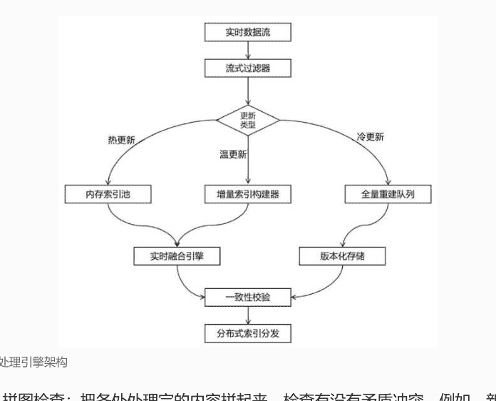

图6-2 知识流处理引擎架构

- （4）拼图检查：把各处处理完的内容拼起来，检查有没有矛盾冲突。例如，新输入的医疗指南与旧版的内容有出入，系统会自动判断哪个版本的医疗指南是最新版且更权威。

- （5）送货上门：确认无误后，把更新好的知识打包分发到各个需要的位置，重要且常用的知识会提前送到离用户近的“储物柜”，不常用的知识会存储在大仓库，保证每个人都能最快拿到最新鲜的知识包裹。

整个系统就像一个24小时运转的智能物流中心，既能秒级处理紧急消息，又能稳扎稳打地更新数据量较大的知识，让知识库永远保持最新状态。

### 6.4 本章小结

RAG技术通过“检索-增强-生成”三阶段架构，构建了大模型与动态知识库的协同认知系统。本章深入剖析了Embedding模型在语义空间构建中的核心作用，揭示了文本向量化从词表映射到多模态对齐的技术跃迁。在向量数据库选型层面，系统化地梳理了索引算法与量化技术的工程实践，平衡了检索精度与计算效率的黄金法则。知识库构建方法论覆盖文档智能分块策略、元数据体系设计和增量更新机制，可确保企业知识资产的持续活化。这些技术要素的有机整合，使RAG系统既能突破大模型的静态知识边界，又具备实时响应业务变化的进化能力，为构建企业级认知中枢奠定了技术基石。

## 第7章 扩展模型边界：赋予AI“行动”能力

在本书前面的章节中，我们一同深入探索了与大模型进行高效沟通的艺术——提示词工程，并且在上一章掌握了如何利用RAG技术来有效扩展大模型的知识边界，使其能够精准掌握并灵活运用来自企业外部或内部的、动态更新的，甚至是高度私有的知识信息。可以说，通过RAG技术的加持，我们已经成功地将大模型从一个仅仅依赖内部静态知识库的“书呆子”，转变为了一位能够引经据典、基于最新事实进行回答的、更为博学且更值得信赖的“知识顾问”。

然而，在复杂多变的真实企业应用场景中，我们对AI助手的期望并不仅仅停留在提供准确的知识问答或高质量的文本生成方面。我们迫切地希望AI能够主动地采取行动，真正地参与到我们的业务流程之中，替我们完成各种具体的操作任务。例如，我们可能需要它实时查询一个动态变化的数据库，以获取最新的库存状态；或者需要它调用一个企业内部的业务系统API来为客户创建一个新的服务订单；可能希望它帮助我们预订一个下周二下午的会议室，或者按照我们的指令发送一封格式规范的电子邮件；甚至，我们希望它能够控制一些智能化的办公设备，或者与其他不同的软件工具、在线服务，乃至其他的AI大模型进行智能化的协作，共同完成一项更为复杂的综合性任务。

所有这些“采取行动”的需求，都已远远超出传统大模型仅仅处理和生成文本信息的固有能力范畴。如何才能打破那层无形的“数字壁垒”，让原本被“禁锢”在纯粹语言世界中的大模型，能够真正地伸出感知外部世界并与之进行有效交互的“双手”呢？这正是我们本章将要深入探讨的核心主题——如何有效扩展大模型的行为边界，赋予其采取实际行动的能力。

我们将重点聚焦于当前业界实现这一目标所依赖的两种关键技术范式。第一种是工具调用机制，它更为人熟知的名称是函数调用（Function Calling）。它能够让大模型智能地识别出用户请求中隐含的、需要借助外部工具或API来完成的意图，并生成结构化的调用指令。我们将深入了解其核心定义、关键价值、内部实现原理、业界主流的技术方案，并且将重点学习和探讨大众所关注的DeepSeek系列模型在函数调用功能上的实现、潜在优势及其在企业级场景中的具体实践方法。第二种是模型上下文协议（Model Context Protocol，MCP），这是一种相对新兴的交互范式探索，它旨在为AI大模型与应用程序或者在其他大AI模型之间设置更为复杂、结构化并且能够有效管理交互状态的底层通信框架。我们将对其核心设计目标、相比传统API交互的潜在优势、关键概念构成，以及当前的发展现状与挑战进行初步的探讨和了解。

熟练掌握并有效运用以函数调用为代表的工具调用技术，意味着我们能够成功地将大模型从一个被动的“文本信息处理器”或“知识搜索引擎”，革命性地转变为一个能够主动驱动实际业务流程运转，智能连接不同信息系统孤岛，高效实现各种操作任务自动化的、真正意义上的“智能执行者”或其核心大脑。这对构建能够真正深入企业核心业务流程、显著提升自动化水平、有效赋能员工提高工作效率的高价值AI应用而言，具有至关重要的、不可或缺的战略意义。本章的核心目标，就是为你提供一套关于如何赋予大模型以强大“行动能力”的系统性知识体系和具有高度实践价值的指南。无论你在实际工作中使用的是DeepSeek模型，还是来自其他顶尖提供商的、同样支持类似功能的先进模型，本章所阐述的核心原理、关键技术和实践方法，都将为你在设计和构建下一代智能化应用时，打开全新的想象空间和无限的应用可能。

### 7.1 函数调用：赋予大模型连接并驱动外部世界的能力

函数调用——在不同的技术平台或学术文献中，它也可能被称作工具调用，但其本质思想与核心机制是高度类似的——是当前业界让大模型能够与其所处的外部数字或物理世界进行有效交互，并能够根据指令执行具体操作的最为核心、应用最为广泛、也最为成熟的关键技术机制。

#### 7.1.1 函数调用的核心定义与关键价值

从核心定义上来看，函数调用是指大模型具备的一种特殊能力，使其能够在与用户进行交互的过程中，准确地识别出用户自然语言请求中那些隐含的、需要借助外部工具、函数或API才能完成的特定意图。基于这种识别，大模型能够智能地选择出最合适的函数进行调用，并准确地从用户请求中提取出执行该函数所必需的各项参数。这里需要特别强调的是，大模型本身并不直接执行这些外部函数，它的角色更像一个智能的“调度员”或“指令生成器”，会以一种标准化的、结构化的数据格式（如JSON对象）返回其调用意图和参数信息。实际的函数执行过程，完全由调用大模型API的外部应用程序（开发者构建的客户端或后端服务）来负责完成。应用程序在执行完函数后，通常还需要将执行结果反馈给大模型，以便大模型能够基于这些结果生成最终的、面向用户的、连贯的回复。

引入函数调用这一关键机制，为基于大模型的应用程序带来了多方面的、极其重要的核心价值，极大地拓展了其应用的可能性和实用性，使其从一个单纯的“对话者”或“写作者”转变为一个“行动者”。

首先，函数调用最根本的价值在于彻底打破大模型自身能力的边界限制。我们知道，大模型的核心优势在于对自然语言的深度理解和高质量生成，但它们天然地不具备执行精确的数学计算、访问实时的外部数据源（如天气预报、股票行情、新闻动态）、直接操作其他计算机系统（如数据库、CRM、ERP）或物理设备等能力。通过函数调用机制，用户可以将这些大模型自身不具备的、但对实际应用至关重要的外部能力，巧妙地“嫁接”到大模型的应用流程之中。大模型能够间接地“指挥”和“利用”这些外部能力来完成任务。例如，通过定义调用天气API的函数来使大模型获取最新天气预报，或者定义调用股票行情API的函数查询实时股价，或者连接企业内部数据库的接口函数，使大模型能根据自然语言查询数据。大模型甚至可以借助专业的领域工具与库（如调用Wolfram Alpha进行知识计算）或调用科学计算库进行分析。

其次，函数调用实现了从非结构化自然语言请求到结构化机器操作的智能转换。用户在与AI交互时，通常使用自然流畅但可能模糊的语言表达需求。大模型凭借其强大的自然语言理解能力，能够深入解析这些请求，准确识别用户的真实意图，并将其智能地转换为对特定外部函数或API的结构化、机器可执行的调用。这个调用指令中会包含清晰、明确的函数名称，以及被精准提取的、符合格式要求的参数键值对。这一能力极大地降低了普通用户使用那些原本接口复杂、参数繁多的外部工具或 API 服务的门槛，使得他们可以通过简单的自然语言对话驱动复杂的操作。

再次，通过函数调用，用户可以更可靠、更可控地获取结构化数据输出。虽然现代大模型在理论上具备直接生成JSON或XML等结构化数据的能力，但在实践中，其直接生成的结构化数据有时可能不够稳定、容易出现格式错误或包含不准确的“幻觉”信息。通过定义一个专门的函数（例如，一个名为extract_customer_information的函数，其内部使用更专业的文本信息提取技术），并让大模型调用这个函数来处理输入文本并返回结果，用户可以更稳定地获得格式完全规范、内容真实可靠的JSON对象，这对于需要精确数据输入的下游系统至关重要。

此外，函数调用机制对于那些需要精确性或外部事实支撑的任务，能够显著提升其可靠性与准确性。对于结果精确性要求极高（如数学计算、财务数据分析）或依赖实时外部事实信息（如当前股价查询、航班状态跟踪）的任务，依赖一个经过充分测试和验证的外部函数或API来获取结果，通常远比依赖大模型自身可能存在知识滞后、计算错误或产生“幻觉”的“内部知识”更为可靠和准确。

最后，也是极为重要的一点，函数调用机制是构建能够执行多步骤复杂任务、需要与外部环境进行持续交互，并能够根据环境反馈调整自身行为的高级AI智能体的绝对基础和核心构件。一个智能体的核心“大脑”通常是一个大模型，它负责进行任务规划、状态理解和决策制定。而在需要获取外部信息或需要对环境产生实际影响时，它会通过调用预先定义好的各种工具（函数）来实现。我们将在后续章节对智能体进行更深入的探讨，但理解函数调用是理解智能体工作方式的前提。

综上所述，函数调用技术是打通大模型这个强大的“认知引擎”与广阔的外部数字及物理世界之间的连接的关键核心桥梁。它赋予了大模型超越文本处理的“行动”能力，使其能够真正融入并驱动现实世界的业务流程和应用场景，从而释放出巨大的应用潜力。大模型函数调用架构如图7-1所示。

##### 7.1.2 函数调用的核心实现原理

要理解函数调用的魔力，关键在于认识到大模型本身并不会、也不能真正地去“执行”任何外部的代码或API调用。它在这个过程中的核心职责，实际上是进行高度智能化的“意图识别”和精准的“信息提取”。整个函数调用的完整过程，通常至少需要涉及两次应用程序与大模型API之间的核心交互。我们可以将其大致分解为以下几个关键步骤，这个流程体现了大模型与应用程序之间的协同工作模式。

**1.第一次交互：从用户请求到大模型决策是否调用函数**

这个阶段的目标是让大模型理解用户需求，并判断是否需要以及如何利用外部工具来满足这个需求。

第一步，开发者需要为大模型提供一份清晰的“函数清单”，这是整个机制得以运作的前提。开发者必须为每个计划供大模型使用的外部函数，编写一份结构化的描述文档。目前，业界广泛采用JSON Schema作为描述函数参数的规范。这份描述需精确定义函数的名称、功能用途，以及其接收的所有参数，包括每个参数的名称、数据类型、是否必须和自然语言描述等。

第二步，应用程序将用户请求与工具描述打包，一同发送给大模型。当用户发起自然语言请求后，应用程序需将该请求（作为messages的核心内容）与上述定义好的所有工具描述（通过tools参数）封装在同一次API调用中。

第三步，大模型进行深度的分析与智能决策。大模型会同步处理两方面信息：一方面，它会对用户的请求文本进行深入的语义分析，以把握其真实意图；另一方面，它会“阅读”并理解开发者提供的函数描述，特别是每个函数的功能和参数定义。通过将用户意图与函数功能进行语义匹配，大模型会自主判断：当前请求是否能通过调用某个函数来更好地满足？如果需要，应调用哪个函数？调用所需的参数能否从当前对话的上下文中提取？

第四步，大模型返回其决策结果。API的响应会呈现两种主要形态：

情况一：决策调用函数。大模型如果认为需要调用函数，则将返回一个结构化的函数调用指令，通常包含在响应的 tool_calls 字段中。每个调用指令会明确指出要调用的函数名称及一个包含所有已提取参数的 JSON 字符串。此时，直接回复用户的 content 字段通常为空。

情况二：决策直接回答。大模型如果认为无须调用函数，或者用户意图与所有可用函数均不匹配，则将像处理普通对话一样，直接生成一段文本回复。此时，tool_calls 字段则为null或不存在。

**2.第二次交互：将函数执行结果反馈给大模型以生成最终回复**

如果第一次交互的结果是大模型要求调用某个函数，那么应用程序将进入执行与反馈阶段。此阶段的目标是调用指定函数，并将执行结果返回给大模型，以便整合信息并生成最终答复。

第五步，应用程序解析调用指令并安全地执行函数。应用程序需解析大模型响应中的tool_calls指令，提取出函数名与参数。这包括将参数字符串反序列化为程序内部对象，并验证其类型、格式及内容是否合法，以防范注入风险并确保系统稳定性。校验通过后，应用程序在自身环境中实际执行该函数。

第六步，获取函数的实际执行结果。被调用的函数在执行完毕后将返回一个结果。这个结果可能是成功获取到的数据（如JSON格式的天气信息），一个表示操作状态的确认信息，或者在执行过程中遇到的错误信息。

第七步，将执行结果结构化地反馈给大模型。应用程序需要将上一步获取的函数执行结果，按照大模型 API 所要求的特定格式构造成一个新的对象，并将其添加到当前的对话历史（messages列表）之中。该消息对象的role属性值必须设置为tool，以表明其内容是工具的输出。同时，消息中需包含与请求对应的tool_call_id，以及一个包含函数返回结果（通常序列化为JSON字符串）的content字段。

第八步，再次调用大模型 API 以生成最终回复。应用程序将包含 tool 消息的完整对话历史再次发送给大模型。这是一个闭环的关键：大模型现在不仅知道用户的原始问题和自己先前的决策，还接收到了工具的实际执行结果。

第九步，大模型整合所有信息并生成最终的面向用户的回复。大模型在接收到了包含了函数执行结果的完整对话历史后，就拥有了完成用户请求所需的全部信息：用户最初问了什么问题，之前判断应该调用的是哪个函数并提取了哪些参数，函数实际执行后返回的结果是什么。基于完整的上下文信息，大模型最终会生成一段自然、流畅且能直接回答用户原始问题的文本回复。

大模型在这个过程中的“智能”体现在哪里？我们可以看到，大模型在整个函数调用流程中所展现出的核心“智能”，主要集中在第一次交互的第三步，即它能够深度理解用户可能模糊、口语化的自然语言请求中的真实意图；能够将其理解到的用户意图，与开发者所提供的、关于各可用函数的功能描述进行高效的语义匹配，从而智能地选出最适合用于满足当前意图的函数；并且能够在其所理解的用户语句中，精准定位并抽取符合所选函数参数定义（包括名称、类型、格式要求等）的具体数值信息，形成结构化的参数。这种从非结构化输入到结构化输出的转换能力，是大模型作为“智能调度员”的关键。

在这里，必须再次强调一个非常重要的概念：在整个函数调用机制中，大模型本身绝对不会、也不能够去直接执行任何外部的函数代码或调用任何远程的 API 接口。它所扮演的角色，仅仅是一个极其聪明的“决策者”和“指令生成者”。它负责理解用户的需求，判断应该使用哪个函数，并生成调用该函数所需的指令和参数。

### 7.2 函数调用的关键技术细节深度剖析

要想成功且高效地实现和应用函数调用功能，开发者需要深入理解其背后的一些关键技术细节。这包括如何精确地向大模型描述可用函数，大模型内部进行函数选择和参数生成的决策机制是怎样的，应用程序在执行函数和返回结果时应承担哪些责任，以及如何设计健壮的错误处理和重试机制。

#### 7.2.1 函数的精确描述与规范

为了让大模型能够准确地理解并调用外部函数，开发者必须提供一份结构化的、机器可读的“函数说明书”。在当前的技术生态中，JSON Schema成了这一领域的标准规范。它扮演着开发者与大模型之间沟通的桥梁，其核心作用是清晰地定义、调用某个函数时，必须以怎样的JSON格式来组织其所需的全部参数。

大模型正是通过解析这份JSON Schema，来精确获知一个函数的所有细节的。

- (1) 需要哪些参数：通过properties对象定义所有可用参数。
- (2) 参数的类型与格式：每个参数的type（如string、number、boolean等）及其具体格式约束（如format、pattern等）。
- (3) 哪些参数是必需的：通过required数组明确声明必须提供的参数。
- (4) 参数的可选值与范围：通过enum限定可选值列表，或者通过minimum、maximum等关键字约束数值范围。
- (5) 参数的语义含义：每个参数的description字段都至关重要，它用自然语言向大模型解释了该参数的实际意义和用途，是大模型能否从用户对话中正确提取信息的关键。

可以说，一份高质量的、描述清晰的JSON Schema定义，是确保大模型能够正确理解函数意图并成功生成有效调用指令的绝对前提。

下面，我们介绍一个天气查询函数 `get_current_weather` 的JSON Schema示例，这个示例包含了丰富的约束和清晰的描述，能够很好地展示如何精确定义一个函数供大模型使用。

```json
{
  "type": "function",
  "function": {
    "name": "get_current_weather",
    "description": "获取指定城市或地区的实时天气信息，包括温度、天气状况等。",
    "parameters": {
      "type": "object",
      "properties": {
        "location": {
          "type": "string",
          "description": "需要查询天气的城市名称，例如：'北京市', 'London', 'San Francisco Bay Area'。这是必需参数。"
        },
        "unit": {
          "type": "string",
          "description": "温度单位，如果用户未指定，则默认为摄氏度('celsius')。",
          "enum": ["celsius", "fahrenheit"]
        },
        "forecast_days": {
          "type": "integer",
          "description": "可选参数，指定需要查询未来多少天的天气预报（包含今天）。如果省略，则只查询当天天气。最大支持查询未来7天的天气情况。",
          "minimum": 1,
          "maximum": 7,
          "default": 1
        }
      },
      "required": ["location"]
    }
  }
}
```

在这个示例中，

#### 7.2.2 函数选择与参数生成的内部决策机制

当大模型接收到了包含了用户请求文本和一组可用函数的结构化描述之后，它是如何在内部进行决策，判断是否需要调用函数、应该调用哪一个函数，以及如何从用户的自然语言中准确地提取出所需参数值的呢？这背后并没有一个简单的、固定的规则引擎，而是主要依赖于其在超大规模数据上进行预训练和后续指令微调的过程中，所学习到的强大的模式匹配、语义理解和信息提取能力。

关于函数的选择决策过程，大模型通常会综合考虑以下几方面。最核心的是基于语义相似度的匹配。大模型会将用户的请求文本在语义层面上，与开发者所提供的每一个可用函数在其描述对象的 description 字段中进行比较。它会倾向于选择那个功能描述与用户当前表达的意图在语义上最为匹配、最为相关的函数。例如，如果用户说“帮我查一下北京明天的天气”，而工具列表中有一个函数的描述是“获取指定城市和日期的天气预报”，那么大模型很可能会选择这个函数。其次，大模型在做决策时，并不仅仅是看当前对话的用户请求。如果应用程序在调用 API 时提供了之前的多轮对话历史，则大模型会结合上下文语境进行综合理解，以更准确地判断用户的真实意图和潜在需求，从而做出更合理的函数选择。例如，如果用户先说“我下周要去伦敦出差”，然后说“那边的天气如何？”，则大模型可以结合前文知道“那边”指的是伦敦。同时，大模型也存在“不调用任何函数”的选项。如果大模型经过分析后认为，当前用户的请求可以通过内部知识直接回答（例如，用户问“你是谁？”），或者用户的意图与所有可用函数的功能描述都不匹配，那么它就不会生成任何函数调用指令，而是会像处理普通对话一样，直接生成一段文本回复。

关于函数参数的生成过程，一旦大模型确定了需要调用哪个具体的函数之后，它就会仔细地“阅读”该函数所对应的参数JSON Schema定义，特别是properties字段中为每个参数所编写的详细的description描述。大模型会基于这些参数描述进行精准信息提取，它会在用户的原始请求文本及可能相关的历史对话内容中，主动搜寻那些在语义上与各个参数的description描述相匹配的信息片段。例如，如果location参数的描述是“城市名称”，那么大模型会在用户输入中寻找地名。在提取信息时，大模型会努力严格匹配参数的类型与格式要求，确保所提取的值符合该参数在JSON Schema中定义的type（如字符串、数字、布尔值）和可能的format（如日期时间格式）要求。对于那些在JSON Schema中被明确标记为required的必需参数，大模型必须能够成功地从用户输入中找到并提取对应的值。如果在用户输入中确实找不到满足必需参数要求的信息，或者用户提供的信息不符合该参数的类型或格式约束，则大模型通常会选择放弃生成该函数的调用指令。对于那些没有被列在required 数组中的可选参数，如果用户的请求中没有明确提供相关信息，则大模型通常会选择在生成的参数中省略这个参数，使应用程序在后续执行时使用其默认值。如果某个参数在其 JSON Schema 中定义了枚举值，则大模型会尝试从用户输入中提取与该枚举列表中的某个值完全匹配或语义最接近的那个值。接着，大模型会将所有成功提取到的参数名称和对应的值，构造成一个符合JSON Schema规范的JSON对象。最后，它通常会将这个JSON对象序列化为字符串，并将其填充到API响应体tool_calls部分的arguments字段中，返回给应用程序。

尽管大模型在函数选择和参数提取方面表现出了惊人的智能，但在实践中也可能面临一些潜在的挑战与可能导致失败的关键点。首先，自然语言的固有歧义性是一个持续的挑战。用户请求的自然语言表述本身可能就存在多种解释，或者开发者编写的函数或参数描述不够清晰、存在歧义，这都可能导致大模型在进行意图理解或函数选择时产生偏差。其次，用户输入信息不完整或缺失也是常见问题。用户在提出请求时，可能并没有提供调用目标函数所必需的所有信息，特别是那些被标记为required的参数，这需要大模型或应用程序进行后续处理。再者，参数提取错误或不准确也时有发生。尽管大模型很强大，但它在从非结构化文本中提取结构化信息时也并非百分之百完美，有时可能会错误地提取了文本中不相关的信息作为参数值，或者提取出的值的格式与预期不符。最后，如果一个函数的参数Schema结构设计得极其复杂（如包含多层深度嵌套的对象，或者非常复杂的依赖关系），则可能会增加大模型准确理解和成功提取所有参数的难度。因此，在设计函数接口时，也应尽量保持参数结构的清晰和简洁。

#### 7.2.3 函数的实际执行与结果的准确返回

正如我们反复强调的，外部函数的实际执行过程发生在调用大模型 API的应用程序端，而非大模型内部。这是函数调用机制中一个至关重要的职责划分，它确保了外部操作的安全性和可控性。当应用程序从大模型的响应中解析出函数调用指令（包含函数名和参数）后，它需要承担起以下关键职责。

首先，严格的参数校验是第一道防线。在将从大模型处获取的参数（通常是一个JSON字符串，需要先反序列化为程序内部的数据结构）传递给实际的函数执行逻辑之前，应用程序必须进行彻底的校验。这包括但不限于：检查参数的数据类型是否与预期一致；对于有数值范围、长度限制或特定格式（如正则表达式、日期格式）要求的参数，要验证其是否符合这些约束；对于枚举类型的参数，要确保其值在合法的枚举列表之内；尤其重要的是，要对所有字符串类型的参数进行安全检查，防范潜在的注入攻击。只有在所有参数都成功通过了上述严格验证之后，应用程序才应该继续执行下一步。

其次，根据函数名安全地调用本地实现或外部 API。应用程序需要根据解析出的function.name，调用其在后端代码中预先实现的、与之对应的本地函数逻辑，或者构造并发送请求给一个外部的第三方API接口。在调用本地函数时，应确保函数本身是健壮的，能够处理各种可能的输入情况的。在调用外部API时，需要正确处理网络通信、认证授权、超时等问题。

再次，准确捕获并规范化函数的执行结果。被调用的函数在执行完成后，会返回一个表示其执行结果的数据。这个结果可能是成功获取的数据（如一个JSON对象、一个字符串、一个数字等），也可能是一个表示操作状态的信息（如“订单创建成功”），抑或是在执行过程中遇到了错误而抛出的异常或者返回的错误代码或信息。应用程序需要捕获这个结果，并将其转换为一种大模型能够理解的、标准化的格式，通常是JSON字符串格式。

此外，将执行结果结构化地反馈给大模型。应用程序需要将上一步获取并规范化后的函数执行结果，构造成一个符合大模型 API 规范的消息体。这个消息体必须包含一个`tool_call_id`字段，其值应该与大模型在第一次响应中返回的`tool_calls`对象中的`id`完全一致，这样大模型才能将这个结果与之前的调用请求关联起来。同时，消息体中还需要包含一个`name`字段，其值为被调用的函数名和一个`content`字段，其中存放着函数执行结果的JSON字符串。将这个新构造的tool消息连同之前完整的对话历史，一起再次发送给大模型API，以请求大模型基于这个新的信息来生成最终的、面向用户的回复。

最后，妥善处理函数执行过程中可能发生的各种错误。如果函数执行失败（如因为无效参数、外部API不可用、网络问题、权限不足等原因），那么应用程序不应该简单地崩溃或者将原始的技术性错误信息直接暴露给大模型或用户。而是应该捕获这些错误，并将其转换为一个对大模型有意义的、结构化的错误反馈。例如，可以返回一个包含错误代码和错误描述的JSON对象作为tool消息的content字段，告知大模型函数调用失败的原因。大模型在接收到这样的错误反馈后，可能会尝试以不同的方式重试或向用户解释问题并请求更多信息，或者优雅地结束当前尝试。

##### 7.2.4 函数的异常处理与重试机制

在实际构建和运行基于函数调用的大模型应用时，我们必须清醒地认识到，整个交互流程中的每个环节都有可能出现各种预期之外的错误。一个真正能够在生产环境中稳定运行的系统，必须设计有完善、健壮的错误处理及在必要时能够智能地进行重试的机制。这对于保证应用的可靠性、提升用户体验及维护业务流程的连续性至关重要。

可能发生的错误类型多种多样，可以大致归纳为以下几类。首先是大模型API本身可能返回的错误，应用程序需要能够正确解析HTTP状态码和响应体中的错误信息，并根据错误类型采取适当的措施。其次是应用程序自身逻辑中可能出现的错误，通常需要通过严谨的编程和充分的测试来预防和捕获。再次是网络通信相关的错误，这些错误通常具有瞬时性，适合采用重试策略。最后，也是最复杂的一类，是被调用的外部函数在执行过程中发生的错误，可能包括由于参数无效、依赖的外部服务不可用、权限不足、资源耗尽或函数内部发生未捕获的异常等多种情况。

针对这些潜在的错误，开发者需要设计一套周密的错误处理和重试策略。核心的策略应该包括：首先对大模型返回的调用指令进行严格校验，然后进行更细致的业务校验。在函数执行层实现全面的错误捕获和规范化反馈，并通过tool消息反馈给大模型。实现智能的重试机制，对于那些可能由网络波动、外部服务临时不可用等原因导致的瞬时性错误，应用程序可以尝试进行有限次数的重试。建立完善的日志记录和监控告警体系，记录整个函数调用流程中的关键步骤、输入输出数据、发生的错误及重试情况，对于问题排查、性能分析和系统优化都至关重要。通过监控关键指标（如函数调用成功率、平均响应时间、错误率等）并设置合理的告警阈值，可以帮助运维团队及时发现并处理潜在问题。

总之，构建一个真正能够在生产环境中稳定、可靠运行的、基于函数调用的大模型应用系统，健壮的错误处理机制和智能的重试策略是绝对不可或缺的关键组成部分。它不仅能够显著提升用户体验，还能够使整个系统具备一定的自愈能力，能够从一些常见的、临时性的或可恢复的故障中自动恢复，从而保障业务流程的连续性和稳定性。

### 7.3 DeepSeek函数调用功能

现在，让我们将讨论的焦点具体地集中到DeepSeek AI的模型之上。与OpenAI等主流大模型提供商类似，DeepSeek也为其实先的对话模型提供了强大的函数调用能力，使得开发者能够将其模型与外部工具和API进行集成，从而扩展模型的应用场景。DeepSeek的函数调用机制在设计上通常会遵循与OpenAI API相似的规范，这为熟悉OpenAI函数调用的开发者降低了迁移和学习成本。

以下是一个通过与OpenAI兼容的Python SDK来实现获取天气信息功能的简化示例代码。请注意，在实际使用时，你需要将“<your api key>”替换为从DeepSeek官方获取的有效API密钥。

```python
from openai import OpenAI  # DeepSeek API 通常兼容 OpenAI SDK 的用法

# 假设这是开发者在应用程序中实现的函数，它内部可能调用真实的天气API
def get_current_weather_implementation(location: str, unit: str = "celsius"):
    """获取指定地点的当前天气信息（模拟实现）"""
    if location:
        # 在真实应用中，这里会调用外部天气服务API
        if location.lower() == "hangzhou" or "杭州" in location:
            return {"temperature": "24", "unit": unit, "description": "多云"}
        elif location.lower() == "beijing" or "北京" in location:
            return {"temperature": "28", "unit": unit, "description": "晴朗"}
        else:
            return {"error": "Location not supported or unknown."}
    else:
        return {"error": "Location parameter is missing."}

# 初始化 DeepSeek API 客户端
# 你需要从 DeepSeek 官方获取正确的 base_url 和 api_key
client = OpenAI(
    api_key="sk-xxxxxxxxxxxxxxxxxxxxxxxxxxxxxxxx",  # 替换为你的 DeepSeek API Key
    base_url="https://api.deepseek.com/v1"  # 请你补全网址
)

# 定义可供大模型调用的工具（函数）列表
tools = [
    {
        "type": "function",
        "function": {
            "name": "get_current_weather",
            "description": "获取指定城市或地区的当前天气信息。用户应首先提供一个地点。",
            "parameters": {
                "type": "object",
                "properties": {
                    "location": {
                        "type": "string",
                        "description": "城市和省/州, 如 San Francisco, CA 或北京市",
                    },
                    "unit": {
                        "type": "string",
                        "enum": ["celsius", "fahrenheit"],
                        "description": "温度单位，摄氏度 (celsius) 或华氏度 (fahrenheit)。如果未指定，则默认为 celsius。"
                    }
                },
                "required": ["location"]
            }
        }
    }
]

# 用户的初始请求
user_query = "请问现在杭州的天气怎么样？"
print(f"用户> {user_query}")
messages = [{"role": "user", "content": user_query}]

# 第一次调用大模型 API，期望大模型返回函数调用指令
try:
    response = client.chat.completions.create(
        model="deepseek-chat",  # 替换为 DeepSeek 提供的具体模型名称
        messages=messages,
        tools=tools,
        tool_choice="auto"  # 让大模型自动决定是否调用函数，以及调用哪个函数
    )
    assistant_message = response.choices[0].message
    messages.append(assistant_message)  # 将助手的回复（可能包含 tool_calls）添加到对话历史中

    if assistant_message.tool_calls:
        print(f"模型决策> 需要调用工具：{assistant_message.tool_calls[0].function.name}")
        print(f"模型提取参数>{assistant_message.tool_calls[0].function.arguments}")

        # 应用程序执行函数调用
        tool_call = assistant_message.tool_calls[0]
        function_name = tool_call.function.name
        function_args_str = tool_call.function.arguments

        if function_name == "get_current_weather":
            import json
            try:
                args = json.loads(function_args_str)
                location = args.get("location")
                unit = args.get("unit", "celsius")  # 提供默认值

                # 在实际应用中，这里应该有更严格的参数校验
                if not location:
                    function_response_content = json.dumps({"error": "Location is required but was not extracted."})
                else:
                    # 调用开发者自己实现的函数
                    weather_data = get_current_weather_implementation(location=location, unit=unit)
                    function_response_content = json.dumps(weather_data)

            except json.JSONDecodeError:
                function_response_content = json.dumps({"error": "Invalid JSON format in function arguments."})
            except Exception as e:
                function_response_content = json.dumps({"error": f"Error executing function: {str(e)}"})
        else:
            function_response_content = json.dumps({"error": f"Unknown function: {function_name}"})

        # 将函数执行结果构造成tool消息，添加到对话历史中
        tool_message = {
            "tool_call_id": tool_call.id,
            "role": "tool",
            "name": function_name,
            "content": function_response_content
        }
        messages.append(tool_message)
        print(f"应用执行结果 (反馈给模型)> {function_response_content}")

        # 第二次调用大模型API，将函数执行结果传回，获取最终回复
        final_response = client.chat.completions.create(
            model="deepseek-chat",  # 确保使用相同的大模型
            messages=messages
        )
        final_assistant_message = final_response.choices[0].message
        print(f"模型最终回复> {final_assistant_message.content}")

    else:
        # 如果大模型没有要求调用函数，则直接打印其回复
        print(f"模型直接回复> {assistant_message.content}")

except Exception as e:
    print(f"与DeepSeek API交互时发生错误: {e}")
```

上述代码完整地模拟了函数调用的核心交互流程。该流程首先通过JSON Schema定义了可用的get_current_weather函数。当用户提出天气查询请求时，应用将请求和工具定义一并发送给DeepSeek模型。大模型分析后若决定调用工具，则返回包含函数名和参数的tool_calls指令。随后，应用程序解析此指令，执行本地的get_current_weather_implementation函数，并将执行结果封装成一个tool响应的消息。最后，应用将这个包含执行结果的tool消息连同完整的对话历史再次发送给大模型，大模型便能基于所有上下文，生成最终的自然语言回复。

需要注意的是，示例中的get_current_weather_implementation函数是一个模拟实现。在真实应用中，开发者需要在这里编写实际调用外部天气服务API的逻辑，并处理可能发生的各种网络请求错误、API限流、数据解析错误等。同时，对于从大模型获取的参数，在传递给实际执行函数之前，进行严格的业务逻辑和安全校验是必不可少的步骤，以防止潜在的风险和非预期行为。我们强烈建议开发者在实际集成时，始终以DeepSeek官方文档为准，获取最新、最准确的API参考和使用指南。

## 本章小结

本章深入探讨了如何赋予大模型超越文本处理的“行动”能力，其核心是函数调用机制。我们系统地学习了其核心价值：它不仅能扩展模型边界，实现与外部API和系统的交互，更能将用户的自然语言请求智能地转化为结构化的、机器可执行的指令。我们剖析了其“智能决策+安全执行”的实现原理，重点掌握了使用JSON Schema精确描述函数，以及在应用程序端安全执行、处理错误和返回结果的最佳实践方法。通过掌握函数调用，我们不仅获得了构建更复杂、更可靠应用的强大工具，更为下一章将要深入探讨的、能够自主规划与行动的AI智能体，奠定了至关重要的技术基石。这标志着我们从利用AI生成信息，迈向了驱使AI完成实际任务的全新阶段。

## 第8章 AI Agent：迈向真正自主的智能体

经过本书前序章节的铺垫，我们已掌握了驱动先进人工智能应用的核心技术组件：深度理解与生成文本的大模型、高效沟通的提示词工程、扩展知识边界的检索增强生成（RAG），以及赋予模型行动能力的函数调用机制。现在，我们将整合这些组件，构建更高级、更自主的智能系统——智能体（AI Agent）。智能体能够围绕用户设定的高层目标，自主规划、调用工具、获取信息、反思进展，并最终达成目标，这代表了人机交互从被动响应到主动执行的革命性转变。

本章旨在深入探索智能体的前沿领域。我们将首先界定其核心概念与特征，辨析其与普通大模型应用的本质区别。接着，剖析以大模型为“大脑”的智能体核心架构，解读规划、记忆、工具使用、反思与自我修正等关键组件的设计理念与协同方式。我们还将考察LangChain、LlamaIndex、Microsoft AutoGen等主流智能体开发框架，为技术选型提供参考。最后，展望智能体在企业应用中的潜力、典型案例，并分析其面临的挑战与未来趋势。理解和掌握智能体技术，对期望在企业内部实现更高层次自动化、深度融合AI于核心业务流程的企业而言，具有重要的战略意义。

### 8.1 从被动式助手到具备自主决策能力的智能体

在构建智能体之前，清晰界定其核心概念至关重要。智能体可定义为：能够持续感知环境，通过内部决策机制处理信息，并根据决策结果执行行动以影响环境，从而达成预设目标的计算实体或系统。智能体架构图如图8-1所示。

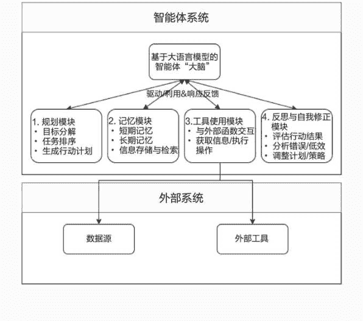

图8-1 智能体架构图

一个典型的智能体具备以下核心特征：首先是目标导向性，智能体的所有行为均由一个或多个清晰的高层目标驱动，其行动旨在最大化达成目标的可能性。其次是环境感知能力，智能体通过调用工具（如搜索引擎API、文件读取工具、数据库接口等）从所处环境（数字或物理环境）中获取信息和状态变化。再次是高度的自主性，这是其区别于传统AI助手的核心。智能体能主动进行任务规划、路径选择并持续推进任务执行，无须人类步步干预。此外是对环境变化的反应性，智能体能敏锐感知环境变化，并及时调整自身的行为、计划或策略，以适应环境、克服障碍。最后是采取行动的主动性，优秀的智能体不仅能被动反应，还能主动寻找达成目标的新机会或根据预设策略采取行动。

构建智能体的终极目标是创造足够智能的系统，以有效代替或辅助人类完成复杂的、多步骤的、需要与外部环境大量交互的任务，从而提高效率、扩展人类能力，并在各领域实现更高程度的自动化与智能化。

智能体与普通大模型应用（如聊天机器人、RAG系统、简单函数调用助手）存在本质区别。在核心驱动方式上，前者由用户发送指令直接驱动，行为受限于当前指令；而后者由高层的、可能模糊的长期目标驱动。在核心行为模式上，前者被动响应用户请求；而后者主动规划并持续执行一系列动作，以达成宏观目标。最关键的区别在于自主性程度和规划与决策能力。前者的自主性低，依赖人类提供的每步指令；而后者追求高自主性，能独立决策和行动。普通大模型应用几乎不具备规划能力，而规划能力是智能体的灵魂，需将高层目标分解为具体的可执行步骤。在与环境的交互模式方面，前者多为一次性的或短期的“请求-响应”序列；而后者是持续的“感知-思考-行动”闭环。在状态管理与记忆方面，前者通常无状态或仅有短期记忆（依赖大模型上下文窗口）；而后者必须依赖复杂的多层次记忆系统（短期工作记忆和长期经验记忆），以跟踪任务进展、环境状态并从经验中学习。在处理目标的复杂度上，前者擅长处理单一、明确的任务；后者设计用于处理更复杂、开放式、需多步骤协作的宏观目标。

智能体的概念并非始于大模型时代，其思想根源可追溯至人工智能早期，深受经典AI规划、强化学习及机器人学的影响。然而，大模型的革命性能力（如上下文学习、指令遵循、初步推理）为构建更通用、灵活、强大的智能体提供了前所未有的“智能大脑”，极大地推动了LLM-based AI Agent的发展。回顾其发展，几个关键技术里程碑值得关注：首先是早期基于规则系统或传统符号AI的探索，这些智能体在特定封闭环境中展现智能，但缺乏泛化能力。其次是强化学习的兴起与影响，强化学习为智能体学习与决策提供了强大的数学框架，AlphaGo/AlphaZero是其在封闭领域成功的典范，但将其直接应用于开放通用任务仍面临挑战，如样本效率低、奖励设计难等。

真正的转折点是大模型的涌现能力为智能体提供了强大的“大脑”。随后，2022年提出的ReAct（Reason+Act）框架成为LLM-based AI Agent发展史上的里程碑。ReAct让大模型交错生成“思考”和“行动”的迭代循环：大模型接收目标和初始观察，先生成“思考”文本（分析、理解、计划），再生成具体的“行动”指令（通常是调用外部工具）。工具执行结果作为新的“观察”反馈给大模型，大模型继续下一轮的“思考”和“行动”，直至达成目标。ReAct证明了大模型能够通过显式“思考”指导行动选择和工具使用，并利用外部反馈动态调整。

2023年初，AutoGPT与BabyAGI等现象级开源项目的涌现，引爆了公众对自主智能体的兴趣。它们的核心思想是构建完全自主运行的智能体：接收高层目标并自主分解为任务列表，在排序后选择优先级最高的任务执行（智能选择工具），根据结果自主生成新任务并迭代，直至完成。尽管早期版本在可靠性、成本等方面存在局限，但其展现的核心思想和潜力极具启发性。为了降低构建复杂智能体的工程难度，一系列专业化智能体开发框架（如LangChain、LlamaIndex、Microsoft AutoGen）应运而生并迅速发展，它们提供模块化组件和预置逻辑，简化了智能体的开发、测试和部署。当前，LLM-based AI Agent技术仍处在快速发展同时面临挑战的探索阶段，但其巨大潜力预示着它将是未来AI应用的核心方向。

### 8.2 以大模型为“智能大脑”的协同系统

构建一个功能完备且能有效执行复杂任务的智能体，通常需要整合几个不同但相互依赖的关键技术组件，并使它们高效协同。在这个复杂系统中，强大的大模型扮演着核心的“大脑”或“中央认知与决策引擎”角色。理解这些组件的功能定位、相互作用及其如何共同支撑智能体的自主行为，是后续设计、实现和优化智能体的基础。

在典型的 LLM-based AI Agent 架构中，大模型居于中央控制地位，负责最高层次的认知、推理、规划和决策。它接收环境感知信息（通常通过调用外部工具获取）、访问内外记忆、根据目标规划任务、决策当前行动（调用工具或生成文本），并在行动后处理结果与反馈，为下一轮“感知-思考-行动”循环提供依据。其他关键组件则围绕大模型的“大脑”提供支持与能力扩展。

#### 8.2.1 大模型：智能体的认知与决策核心引擎

大模型是智能体的“智能大脑”，负责理解任务与环境、复杂逻辑推理、制定策略与决策，以及生成所有必要的自然语言输出。大模型的强大自然语言理解能力、上下文理解与长程依赖建模能力、指令遵循能力、知识与常识运用能力及生成能力（包括结构化指令，如JSON），在很大程度上决定了智能体的智能水平和应用效果。

#### 8.2.2 规划模块：实现任务分解与生成行动计划的核心

规划模块负责将用户设定的高层次且可能模糊的最终目标，智能地分解为一系列具体的、逻辑关联的、可执行的子任务或行动步骤序列。强大的规划能力是智能体自主决策和有效行动的关键。

常见的规划类型包括单步规划（或反应式规划），智能体可根据当前状态和目标直接决策并执行下一步单项行动，适合环境变化迅速或目标明确的短期任务。更高级的是多步规划，智能体预先或动态生成包含未来多个连续步骤的完整行动计划序列，可以更好地预见行动的长期后果，优化整体效率，处理复杂策略任务。

在大模型智能体中，规划可利用大模型的自身能力实现。一种方式是通过精心设计的提示词，要求大模型根据高层目标自主生成详细步骤计划，即利用其预训练知识中蕴含的任务分解和流程规划模式来生成计划。另一种方式是ReAct框架，它将“思考”（规划）与“行动”（执行）紧密结合、交错进行。大模型每步都会显式生成与分析当前情况和下一步行动规划的“思考”过程，随后生成具体的“行动”指令，使规划过程透明且能根据行动的实际结果动态调整。此外，还有如任务列表维护（如AutoGPT思路，智能体不断地从列表中选取任务执行，并动态地增删改排任务）、层次化规划（高层目标先分解为中层子目标再到具体行动）及先生成象征性计划或代码片段后再由外部执行器执行等更高级技术。

#### 8.2.3 记忆模块：维持智能体行为的连贯性、实现经验学习的关键

记忆模块负责存储和管理智能体在任务执行过程中接触、产生或学习到的各种重要信息。良好的记忆模块对确保智能体行为和对话的上下文连贯性、避免重复错误，并从经验中学习进化至关重要。大模型本身受限于上下文窗口长度，超出窗口则“失忆”。独立于大模型上下文窗口的、更持久和结构化的记忆模块是克服此限制，实现处理复杂长期任务和持续学习能力的关键。

智能体的记忆模块通常分为以下3个层次。

（1）短期记忆或工作记忆：负责存储与当前任务执行相关的即时信息，需要能够被大模型快速访问和更新。常见实现是将最近的对话历史、工具调用记录、中间“思考”过程等组织并包含在发送给大模型的提示词中（在上下文窗口限制内），或者维护“暂存器”记录中间结果。

（2）长期记忆：负责存储具有持久价值的、可供智能体在未来任务中反复参考和学习的信息，如用户偏好、过去成功/失败的完整任务执行经验（“思考-行动-观察”序列）、从外部文档或知识库中学习到的重要知识片段等。因长期记忆的信息量较大，所以需要高效存储和检索。目前，流行且有效的方式是利用向量数据库和Embedding技术，将需要长期存储的信息（文本、对话片段、结构化数据）通过文本Embedding模型转换为高维向量，连同原始信息存入向量数据库。在智能体需检索时，将当前查询或上下文也转为查询向量，在向量数据库中执行相似度搜索，找到最相关的历史记忆片段后，重新注入大模型当前上下文，为其决策提供依据。

（3）结构化记忆：除了基于向量的语义记忆，智能体有时也需要处理和存储高度结构化的信息。结构化记忆正是因此而生，它利用传统的数据库或图数据库来精确地管理和查询信息。例如，以知识图谱的形式存储实体间的复杂关系（如公司组织架构），或者以关系数据库表的形式存储用户配置、任务状态、产品目录等。智能体要利用这类记忆，就必须具备与这些结构化存储系统交互的能力，这通常是通过为其配备专门的“工具”（如SQL查询工具、GraphQL查询工具）来实现的。

#### 8.2.4 工具使用模块：赋予智能体与外部世界交互和行动的能力

工具使用模块让智能体能有效与外部环境实际交互，并利用外部能力弥补大模型自身的不足，如无法精确计算、无法访问实时数据、无法操作外部系统等。工具是智能体能力的“放大器”和“延伸器”，使其从封闭思考的语言模型变成能感知世界、获取信息并对世界产生实际影响的“行动者”。

上一章详细探讨的函数调用机制正是实现智能体工具使用的基础。在智能体语境下，每个工具通常对应一个或多个可被大模型（通过其“大脑”决策）选择并要求执行的外部函数或API。工具种类繁多，如信息获取类（如搜索引擎、百科API、天气/股票API、文件读取、数据库查询等）、代码执行类（如Python REPL、SQL执行引擎等）、外部系统交互类（如日历/邮件API、CRM/ERP系统API、智能家居控制等），甚至包括与其他AI模型交互的工具（如图像生成模型、语音识别模型等）。大模型负责决策何时使用何种工具及参数，应用程序负责实际执行工具调用并将结果反馈给大模型。

#### 8.2.5 反思与自我修正模块：赋予智能体从经验与失败中学习和进化的能力

反思与自我修正模块赋予了智能体在执行任务的过程中，对其行为、结果和计划进行动态、批判性评估，并根据评估结果主动识别错误、低效或与目标有偏差之处，之后尝试有针对性地自我修正和改进的能力。这是实现更鲁棒、更智能、更具适应性的高级智能体不可或缺的关键环节。

反思与自我修正能力使智能体可以从过往成功或失败的经验中学习。通过反思经验，智能体可以理解失败原因、识别计划缺陷或发现更优行动策略。要实现此功能通常也需要大模型深度参与。常见方法是在智能体执行完行动或出错时，通过特殊提示词引导大模型“反思”：回顾最近行动、分析现状与目标差距、判断计划是否仍然有效、提出修正方案。大模型生成的反思与修正建议可以被智能体用来更新计划、调整行动或修改对任务/环境的理解。更高级的智能体甚至可能引入更复杂的自我学习机制，如将成功的“反思-修正-成功”经验存入长期记忆，或者利用强化学习思想根据任务最终成败，调整内部规划或决策模型参数。

综上，一个功能强大、行为可靠、具备智能进化潜力的智能体系统，是其核心智能大脑（大模型）与规划、记忆、工具使用及反思或自我修正等关键支持组件高效协同、有机互动的产物。深刻理解各组件的核心功能、在智能体整体架构中的定位及其相互作用和依赖，是后续智能体设计、构建、调试和优化的基础。

### 8.3 主流智能体开发框架的技术选型与比较

从零开始完全手动实现一个具备所有核心组件的智能体系统，无疑是项极其复杂、耗时、技术门槛高的工程。幸运的是，为降低智能体开发难度、加速创新应用落地，全球开发者社区和领先AI研究机构已涌现出一系列优秀的、专门构建和运行智能体的开源开发框架。这些框架通常提供预构建的、模块化的核心组件、标准化接口及开箱即用的智能体执行逻辑，使开发者能更专注于核心业务逻辑实现和智能体独特能力创新。

#### 8.3.1 LangChain Agents：通用智能体构建框架

LangChain 是一个开源框架，旨在简化基于大模型的应用程序的开发。帮助开发者将大模型的强大能力与其他计算资源、知识源和工具结合起来，构建出更复杂、更实用、更具上下文感知能力的智能体应用。其智能体模块是核心功能的亮点，为构建、运行和管理各类智能体提供了强大的支持。LangChain设计哲学是模块化和可组合性，开发者可以像搭积木一样灵活地组合不同组件（大模型、工具、记忆、提示词等），构建智能体。LangChain架构图如图8-2所示。

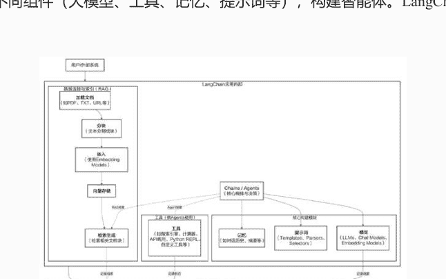

核心架构与组件方面，LangChain提供统一的大模型/Chat Model封装器，便于与各种来源的大模型交互。在工具定义与管理上，内置大量预定义工具（如搜索引擎、计算器、第三方API封装、Python REPL、SQL数据库交互等），并支持开发者轻松将自定义Python函数或外部API封装为符合规范的工具。提供多种即插即用记忆模块（如ConversationBufferMemory、ConversationBufferWindowMemory、VectorStoreRetrieverMemory、ConversationSummaryMemory等）。其核心的智能体执行器负责协调大模型、工具和记忆模块，实现“感知-思考-行动”循环。为此，框架提供了多种预构建的智能体类型，包括经典的ReAct智能体、高效的原生函数调用智能体，以及集成了对话记忆的会话式智能体等，以满足不同任务的需求。还有强大且灵活的提示词模板管理功能，用于构建发送给大模型的完整提示词，框架运行时会自动动态替换占位符。

在 LangChain 中使用智能体的基本步骤通常包括：首先，初始化一个大模型实例；其次，定义或加载一个包含所有智能体可用工具的列表；再次，根据需要初始化一个记忆模块实例；此外，根据任务特性和大模型能力选择并初始化一个合适的智能体执行器（例如，通过指定大模型、工具列表和智能体类型来创建）；最后，调用智能体执行器的运行方法，将用户的原始输入或需要智能体达成的高层目标作为参数传递给它，智能体便会开始自主进行“思考-行动”循环，直至任务完成或达到预设的终止条件。

LangChain的主要优点在于功能极其全面且强大，支持的模型和工具种类繁多，拥有一个非常庞大、活跃且贡献丰富的全球开发者社区，官方文档和学习资源也相对来说较为丰富，整体架构设计高度模块化且具有良好的可扩展性。然而，也正因为其功能非常强大且抽象层次较多，对初学者而言，学习曲线可能会相对比较陡峭。在构建非常复杂的智能体时，有时其内部的调用链和调试过程也可能会显得比较复杂和难以追踪，需要开发者对其内部机制有较深的理解。

#### 8.3.2 LlamaIndex Agents：数据管理和检索专家

LlamaIndex（前身为GPT Index）是另一个广受欢迎和高度评价的大模型应用开源框架。不同于LangChain追求通用性，LlamaIndex从一开始就聚焦于帮助开发者更高效、便捷地将大模型与各种外部数据源进行深度智能连接与交互。因此，其智能体功能设计更侧重于使大模型智能选择和利用不同数据索引结构或查询引擎作为核心“工具”，高效回答需依赖从大量异构内外数据中检索整合信息才能解决的复杂问题，在构建高级RAG应用和数据驱动智能体方面独具特色。LlamaIndex架构图如图8-3所示。

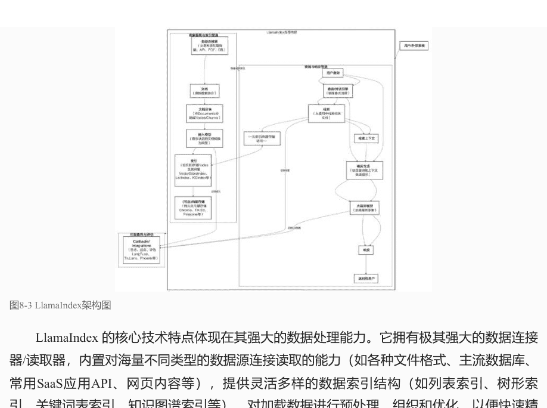

LlamaIndex 的核心技术特点体现在其强大的数据处理能力。它拥有极其强大的数据连接器/读取器，内置对海量不同类型的数据源连接读取的能力（如各种文件格式、主流数据库、常用SaaS应用API、网页内容等），提供灵活多样的数据索引结构（如列表索引、树形索引、关键词表索引、知识图谱索引等），对加载数据进行预处理、组织和优化，以便快速精准检索。基于索引提供一系列高性能查询引擎，使大模型或智能体能高效地从索引数据中查询出检索信息（RAG 流程核心）。其智能体设计理念更侧重于智能体与数据索引/查询引擎的智能交互，让智能体能根据用户问题类型动态选择最合适的数据索引或查询引擎作为核心“工具”来获取信息。除核心数据交互工具之外，LlamaIndex 同样支持通用外部工具（搜索引擎、计算器等）并与LangChain工具良好集成。

LlamaIndex Agent尤其适用于那些数据驱动、需要与海量异构数据源进行深度交互的智能体场景。无论是构建能够精准检索公司内部产品文档、技术手册或法律合同的高级 RAG应用，还是开发一个能跨越多个数据库和业务系统、响应自然语言查询的智能数据分析助手，抑或是搭建一个基于知识图谱的问答系统，LlamaIndex都能提供强大的支持。

LlamaIndex和LangChain框架是当前大模型应用开发领域中最为知名的两大开源框架，它们之间既存在一定的功能重叠和竞争关系，又存在许多可以相互借鉴和协同合作的方面。总的来说，可以认为LlamaIndex在与外部数据源的连接、索引与组织，以及构建高效RAG查询引擎这些“数据层”的抽象和能力上，可能做得更为深入和专业，是构建数据密集型智能体的理想选择。而 LangChain 则可能在通用智能体的执行逻辑、支持的智能体类型丰富度，以及与各种通用型外部工具的集成方面，更为全面和成熟，适合构建更广泛类型的智能体应用。在实践中，两者常被结合使用。例如，使用LlamaIndex构建复杂的数据检索引擎，随后将其作为一个工具集成到LangChain的智能体中。

#### 8.3.3 Microsoft AutoGen：构建多智能体协同工作的框架

AutoGen 是由微软研究院开发的一个开源框架，旨在简化并赋能基于大模型的多智能体 (Multi-Agent) 应用程序的开发。其核心创新在于，它颠覆了传统的单智能体工作模式，转而构建一个由多个智能体组成的“虚拟团队”。在这个框架下，开发者可以创建出具备不同角色、能力，甚至由不同大模型驱动的多个智能体。这些智能体通过相互之间进行自然语言的“对话”和“讨论”，像一个高效、结构化的人类专家团队一样协同工作，从而应对那些在复杂性和深度上远超单个大模型调用所能处理的宏大目标。

AutoGen的架构围绕可对话智能体这一核心概念构建，其中的两个基础角色至关重要。

- 用户代理智能体：该智能体不仅代表用户向AI团队发起对话、提出问题，更关键的是，它能够接收来自其他智能体的代码执行请求。当团队需要调用本地函数或执行一段代码时，UserProxyAgent会在用户的安全环境中自动执行，并将结果返回到系统中。这一机制巧妙地将人类用户的代码执行能力和工具访问权限，安全地赋能给了整个多智能体系统。
- 助手智能体：该智能体通常由强大的大模型驱动，负责处理需要深度认知的任务。例如理解复杂需求、制订行动计划、提出创新解决方案、编写代码，以及与其他智能体进行方案的探讨与完善等，其工作流程如图8-4所示。

AutoGen将传统的人机交互提升到了一个全新的维度：人与一个自主协作的AI团队进行交互，从而为解决高度复杂的现实世界问题提供了强大的新范式。

- AutoGen的典型工作模式：开发者根据任务需求，设计并初始化一系列具有不同角色定位和特定能力的智能体实例，如工程师智能体、测试员智能体、产品经理智能体、用户代理智能体等，将其组织到一个或多个群组聊天中，并设定期望的交互模式或协作流程，如通过群组聊天管理器协调发言。在初始任务提交后，各智能体开始通过相互对话来进行信息共享、任务分配、问题讨论、方案评审、结果整合，直至共同完成目标。
- AutoGen框架的主要优点：能够更自然地模拟真实世界人类团队的分工协作模式；能够更有效地分解复杂任务，让最擅长的“角色”去处理最专业的部分；能够更灵活地定义团队的构成和负责的对话协助流程。
- AutoGen的缺点与面临的挑战：协调多个智能体的交互，比控制单个智能体更为复杂；多轮对话频繁，以至于大模型API调用可能增加通信开销与延迟；如何确保团队成员对目标的理解是一致的，以及如何解决可能出现的“意见分歧”，是需要考虑的设计难题。
- AutoGen的典型应用场景：需模拟真实团队的协作流程，涉及多专业领域的知识融合，或者需要不同角色相互配合制衡才能更好完成的复杂任务，如自动化软件开发流水线、多学科交叉研究AI科研团队、模拟商业谈判或复杂决策多方博弈系统等。

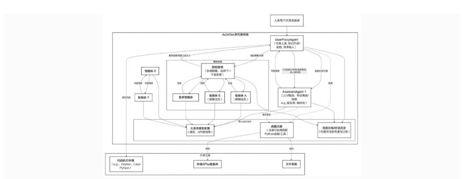

#### 8.3.4 选择合适的智能体框架

面对市场上日益增多的、各具特色的智能体开发框架，企业或开发者在进行技术选型时，应该如何根据自身的具体需求和项目特点，来做出最科学、最合理的选择呢？这并没有一个万能的答案，但可以根据一些核心的考量因素和建议来进行权衡。

若主要目标是构建通用单个智能体应用，则需丰富预置工具和灵活执行逻辑控制。LangChain凭借其全面的功能，庞大、成熟的社区生态，以及对各种大模型和工具的广泛支持，成为首选的智能体框架。

若应用核心在于让智能体与大量复杂的异构外部数据源（尤其是企业内部的私有数据）深度智能交互，则 LlamaIndex 在数据层（数据连接、索引、查询引擎构建）的抽象设计和专业能力上可能更具优势。

若需构建包含多个不同角色且需要它们通过对话进行复杂任务协同与工作流自动化的多智能体系统，则微软 AutoGen 以其独特且专注于多智能体对话与协作的核心设计理念，提供了极具创新性和潜力的选择。

还应考虑团队对技术栈的熟悉程度，选择团队已了解或能快速上手的框架可降低学习成本，缩短开发周期。框架社区活跃度、文档完善度及长期维护更新前景也十分重要。

对初学者而言，若希望快速理解智能体自主运行的核心机制，则可以先学习基于LangChain框架的ReAct智能体或原生函数调用智能体的教程。另外，部分更轻量级的智能体库也是一个不错的选择。通过这些相对简单的实践，可以快速建立对智能体基本工作原理的直观认识，为后续探索更复杂的框架功能打下坚实基础。

这些框架并非完全互斥，它们之间存在互操作性和集成可能性，如 LlamaIndex 数据查询引擎可作为 LangChain Agent 工具，或者在 AutoGen 多智能体系统中可使用 LangChain/LlamaIndex构建的单个能力型智能体作为角色。根据不同的模块需求，灵活组合不同的框架优势组件，也可能有效。关键在于深刻理解各框架核心的设计理念和优势领域，并结合项目的具体需求做出明智的选择。

### 8.4 本章小结

本章深入探索了代表AI向更高级自主性迈进的关键领域——智能体。首先，我们从其核心定义、关键特征及技术演进历程出发，辨析了它与普通大模型应用在自主性和规划能力上的本质区别。然后，我们详细剖析了以大模型为“大脑”，并由规划、记忆、工具使用、反思与自我修正等关键组件协同构成的智能体核心架构。在此基础上，我们考察并比较了LangChain、LlamaIndex、AutoGen等主流开发框架，为技术选型提供了参考。最后，在展望其广阔应用前景的同时，我们也正视了智能体在可靠性、成本和安全性等方面走向规模化应用所面临的挑战。对智能体技术的探索，标志着我们从“使用 AI”迈向了构建能自主“行动”与“学习”的真正 AI 系统的全新阶段，这要求我们对现有 AI 技术进行更深层次的整合。在未来，AI技术也必将为企业和社会的智能化转型带来深刻变革。

## 第9章 Dify平台入门：加速AI应用开发

经过前面章节对大模型基础原理、DeepSeek 模型体系及核心应用技术的深度探索，我们已具备构建下一代AI应用的理论知识与技术“积木”。然而，将这些“积木”从零搭建为生产级AI应用系统，仍要面临烦琐的工程挑战：处理大模型API接入、实现RAG流程、设计迭代提示词、编写函数调用后端逻辑、开发应用前后端等。这些复杂的工程可能阻碍AI技术在企业内部的快速落地。

为解决此问题，LLMOps 平台或 AI 应用开发平台应运而生，Dify 平台凭借其强大功能、友好体验及活跃开源社区成为其中的佼佼者。Dify平台的核心价值在于提供可视化的、一站式的高效解决方案，允许用户通过直观操作，将所学核心 AI 技术快速低代码地组装为完整可运行的 AI 应用，同时一键发布为 Web 应用或 API 服务。可将 Dify 平台理解为面向 AI 应用开发的“IDE”或高度封装的“BaaS”平台，它极大地简化了底层 LLM 技术栈相关的复杂性。

本章旨在引领你全面了解Dify平台。我们将深入理解什么是Dify平台，什么是其核心价值主张及其在AI技术栈中的产品定位。详细解读Dify平台的核心概念，包括应用、知识库、模型提供商、提示词编排、工具等。最后，同时也是最关键的实践环节，我们将详细指导你选择部署方式，搭建 Dify 平台环境，并重点演示如何将 DeepSeek 模型安全有效地接入Dify，为后续实战打下坚实基础。

### 9.1 Dify平台简介

Dify是一个以开源为核心驱动力，致力于显著简化和加速新一代生成式AI应用创建、部署、管理和持续迭代全生命周期的 LLMOps 平台。它提供高度集成且对用户友好的可视化工具集和稳定可靠的后端服务支撑，旨在让开发者聚焦于应用业务逻辑创新和用户体验打磨，无须过多分心处理烦琐复杂的底层AI基础设施搭建、多模型API接口适配集成，以及后端服务开发维护等技术细节。Dify平台试图通过其独特的设计理念和强大的功能集，重新定义AI应用的开发范式，使其更敏捷、高效和易于普及。

#### 9.1.1 Dify平台的核心理念：可声明式的定义AI应用

Dify平台的核心吸引力在于为AI应用构建者和使用者带来多方面显著且具有颠覆性的核心价值，直击当前AI应用开发的痛点。

首先，Dify平台带来了革命性的可视化提示词和复杂的应用逻辑编排能力，提供了强大直观的图形化应用逻辑编排画布，用户可通过简单拖拽预设功能模块（大模型调用、知识库检索、条件判断、工具调用等），并连接线组织，清晰定义整个 AI 应用执行流程和数据流向。这种可视化编排使复杂AI逻辑设计更直观易懂，极大地简化了后续的调试、迭代和维护等操作。

其次，Dify平台追求极致的易用性并显著降低了开发门槛。Dify平台将企业AI应用中常见的核心功能模式预封装为开箱即用的应用模板、标准化的功能组件和可复用的逻辑节点。开发者多数情况下只需在Dify Web用户界面中进行选择模型、上传知识库文档、配置提示词变量、设置工具参数等简单配置，即可快速搭建功能相对完善、可直接测试或使用的AI应用，显著降低了AI应用开发技术的门槛。

再次，Dify平台具备强大的外部集成能力与灵活的系统可扩展性，对企业级应用来说至关重要。在真实的企业环境中，AI应用常需与现有IT系统（CRM、ERP、数据库等）有效数据集成和流程联动，企业也可能希望灵活接入不同提供商或特定能力更优的大模型/嵌入模型。Dify 平台内置对全球多种主流大模型和 Embedding 模型提供商的直接支持，并提供通用 OpenAI API兼容接口，允许用户方便地接入其他符合规范的第三方模型API服务。在知识库集成方面，Dify平台内置从文档上传、自动化内容处理到向量化数据存储与高效索引等一整套完整的知识库构建管理功能。在智能体应用方面，Dify 平台支持开发者通过工具/插件系统，将企业自定义的外部 API 服务或本地功能函数，封装为可供大模型通过函数调用机制智能调用的外部能力。此外，Dify 平台本身通常也提供完整的 API 接口，允许将其上构建和发布的AI应用方便地嵌入企业其他已有的业务系统、移动应用或网站中。

最后，Dify平台在很大程度上提供了类似“后端即服务”的便捷体验。Dify平台不仅有助于快速构建AI应用前端逻辑和交互流程，更在底层提供了一套相对完善的、支撑应用稳定运行的后端服务基础设施，通常包括用户身份认证与权限管理、API密钥安全存储管理、详细应用调用日志记录分析、应用版本控制与发布管理，甚至基础应用托管部署能力（如一键发布为Web App）等。这意味着开发者在多数情况下，无须花费大量精力从头搭建和长期维护这些生产级应用必不可少的基础后端服务。

##### 9.1.2 Dify平台的产品定位：AI应用开发与LLMOps平台

Dify平台的功能特性使其可以在多个AI技术领域中扮演重要角色，它并非单一的功能工具，而是提供了综合性解决方案。

首先，Dify平台可被视为一个实用的LLMOps平台，它可以有效解决大模型应用开发、部署与运维生命周期中多个关键环节的挑战。其次，Dify平台是一个强大的智能体构建与运行平台，其可视化应用逻辑编排画布可直观设计、实现智能体复杂决策流程。它使不具备强大编程能力的用户也能通过简单配置和少量代码（甚至无须代码）快速创建实用应用，如智能知识问答机器人、自动化文本内容生成器（如营销文案、邮件草稿）、能执行特定任务的简单AI Agent等，并直接获得可供最终用户访问和使用的Web应用界面或者可供其他系统集成的API接口。

综合来看，Dify平台可精准定位为一个以“加速AI应用快速构建与便捷部署”为核心目标的，深度融合现代LLMOps核心理念，并原生集成强大AI Agent开发与运行能力的综合性、创新型、开源驱动的平台级解决方案，特别适用于期望快速开发、敏捷迭代和高效部署各种主要面向最终用户交互的、基于大模型的智能化应用场景。

##### 9.1.3 Dify平台的发展历程与社区生态

Dify 平台的快速发展和广泛影响力，与其以开源为核心驱动力的战略选择密不可分。Dify平台从一开始就秉持开源理念，核心代码对全世界公开，任何开发者均可自由下载、使用、学习、修改其源代码，并能积极向项目贡献代码、修复Bug或提供新的功能建议。其开发者社区活跃度持续提高，新功能特性以较快速度迭代发布，以适应快速变化的大模型技术和市场需求。

对选择开源技术的用户和企业来说，一个活跃的社区生态至关重要。它不仅为用户带来了丰富的学习资源和及时的社区支持，还汇聚了海量的集体智慧。众多贡献者共同推动着平台的功能改进、缺陷修复和生态扩展，并不断探索实现创新。这种集体智慧和协作力量使开源项目比封闭商业软件能更快地适应市场变化和用户需求。

Dify平台额外提供付费增值服务或商业版本，如功能更强大、性能更稳定、支持更高级别企业级特性的商业付费版，或者官方免运维云托管SaaS服务，以满足不同的用户的需求，并为项目的长期可持续发展提供资金支持。

### 9.2 Dify平台核心概念的详解

在正式使用Dify平台构建和管理AI应用前，熟练掌握并深刻理解其用户界面、官方文档及社区讨论中反复出现的核心概念至关重要。

#### 9.2.1 应用：构建和交付的AI服务实例

在Dify平台中，“应用”是最核心、最顶层的抽象概念。每个“应用”都代表一个可具体实现某种特定AI功能、可独立运行并对外提供服务的AI应用程序实例，可理解为在Dify平台中创建和管理的独立AI项目或AI助手。

Dify平台通常支持创建并配置多种不同类型的“应用”，以适应不同业务场景的交互模式和核心任务需求。常见的类型可能包括：对话型应用，旨在创建可与用户进行多轮自然语言对话的 AI 助手或聊天机器人，通常利用大模型对话能力、记忆模块及可能 RAG 和函数调用功能实现；文本生成型应用，其核心目标是根据用户输入（主题、关键词、不完整文本）自动生成符合要求的高质量的文本输出（如文章、邮件草稿、产品描述、代码片段等）；工作流型/智能体型应用，通常代表更高级、更复杂的 AI 能力，用户可通过 Dify 平台强大的可视化应用逻辑编排画布定义包含多步骤、复杂条件判断分支、可能需循环处理，并可智能调用多种外部工具的应用，使其能自动化执行更复杂的任务，接近于AI Agent的概念。

应用构建配置完成后，Dify平台通常提供便捷的方式发布集成，如自动生成独立可公开访问的Web应用界面，让最终用户直接通过浏览器交互；生成标准化API接口，方便嵌入企业的其他已有业务系统、移动App或网站。

#### 9.2.2 知识库：RAG的关键数据管理模块

在Dify平台中，“知识库”是专门管理和组织将被用于实现检索增强生成功能的核心知识源的关键模块。每个“知识库”均代表一组被结构化处理和索引过的、可供AI应用在运行时进行高效语义检索的文档集合或知识条目。

Dify“知识库”模块通常会提供一整套从数据接入到最终可供检索的完整处理流程和功能。首先，提供便捷文档上传与多种格式支持，用户可方便地从本地上传多种常见格式的原始文档（如PDF、TXT、Markdown、Word、Excel等），高级实现甚至可能支持从URL链接抓取网页内容或连接在线知识管理平台的同步数据。

文档上传后，Dify平台通常会在后台自动异步对文档进行一系列复杂的预处理，其中包括文本分块，即将长文档内容智能分割为语义相对完整、长度相对适中的片段；向量Embedding，即利用预选文本Embedding模型将每个文本块转化为高维语义向量。用户通常可以在Dify界面中配置关键处理参数，如分块大小、重叠大小、选择哪个Embedding模型等。

在Dify平台中创建或编辑AI应用时，开发者可将一个或多个预创建的“知识库”明确关联到特定应用上。在应用实际运行时，其内部提示词编排逻辑可以自动智能地从已关联数据集中，根据用户的当前查询或上下文，通过语义相似度计算检索最相关的知识片段，并将检索内容作为增强信息注入并发送到大模型的提示词中。

总结，“知识库”模块是Dify平台实现强大RAG功能，是大模型有效掌握并运用企业私域知识或特定领域知识的绝对关键核心所在。

#### 9.2.3 模型提供商：模型的统一管理

在Dify平台中，“模型提供商”是专门集中配置、安全管理和统一接入，来自各种不同第三方AI模型供应商API接口凭证与相关参数的核心管理模块，可看作Dify平台与各种外部核心AI模型能力之间安全可靠连接的“官方指定通道”或“统一适配器”。

其核心作用与价值在于，使用户无须在每个AI应用配置中重复填写管理敏感API密钥等信息，也无须关心不同模型API的具体调用细节。用户只需在“模型提供商”模块中一次性配置好与各模型服务商相关的连接凭证和基本参数，即可在平台上的任何AI应用中方便地选择并使用这些已配置模型。

总结，“模型提供商”管理模块是将外部核心AI驱动能力安全可靠地引入Dify平台内部，并使其可以被平台上构建的各种AI应用便捷调用的关键入口和基础保障。

#### 9.2.4 提示词编排：强大的可视化画布

这是Dify平台最具特色也最具创新性的核心功能之一，是其实现“低代码/无代码AI应用开发”理念的关键所在。“提示词编排”或称“应用逻辑编排”，为用户提供了强大且直观的图形化交互界面，使用户可以通过简单拖曳、连接和参数配置等操作，直观灵活地设计构建AI应用复杂的内部逻辑流程，动态生成最终发送给大模型的核心提示词内容。

可视化编排画布核心构成是所见即所得的交互式在线编辑区域，用户可自由组织连接各种功能节点。构成画布的基本构建块的是节点，它代表整个AI应用逻辑流程中需执行的具体步骤、特定操作或决策分支。Dify平台通常内置多种常用功能节点，如“开始”节点、“LLM”节点、“知识检索”节点、“工具”节点、“条件分支”节点、“代码执行”节点、“结束”节点等。

在画布上，用户可通过从一个节点输出端口拖拽连接线至另一个节点输入端口，清晰定义数据和控制流在不同功能节点间的传递方向与依赖关系。流程中的流动核心是变量，是不同节点间数据交换、信息传递的核心方式。在开始节点中定义输入参数为初始变量，每个节点的执行结果均可赋给新变量或覆盖现有变量，这些变量可在后续节点配置中被引用。

Dify 平台的这种强大可视化提示词编排与应用逻辑构建能力，其核心价值与意义在于极大地简化了那些原本需要编写大量复杂代码才能实现的、含动态RAG上下文注入、多轮工具调用与结果整合、复杂条件逻辑判断等高级功能AI应用的设计、开发、调试和迭代过程。使整个应用逻辑流程一目了然，便于团队协作和知识传递，更重要的是，使编程经验相对较少的非专业程序员，也能通过直观的图形化操作，设计出构建功能相当复杂且强大的AI应用流程。

#### 9.2.5 工具与插件：与外部世界交互的“手脚”

“工具”代表可被大模型智能选择并调用的外部功能、服务或API接口。Dify平台利用大模型的函数调用能力，分析用户请求和对话上下文内容，智能判断何时需要调用何种工具，并生成调用该工具的所需参数。

Dify平台中的“工具”可分为几种主要类型。一是平台内置工具，Dify平台本身就预内置了一些常用的开箱即用工具，如简单网页内容获取、基本代码解释器或与 Dify 平台自身功能交互的内部工具。更重要的是用户自定义的工具，Dify平台通常提供一套机制，允许开发者将企业自身内部私有的API服务接口、任何希望被大模型调用的第三方外部API服务，甚至本地实现特定功能函数，方便地封装为可供 Dify 平台上的 AI 应用调用的标准化“工具”。这通常涉及为每个自定义工具提供清晰的名称、详细描述其功能自然语言文本及符合JSON Schema规范参数的定义。在大模型节点的执行过程中，根据其对用户意图的理解和对可用工具的描述匹配，决策需调用某个特定工具时，流程控制权将会传到画布中对应的“工具”节点上。该节点负责生成调用指令，安全执行对外部 API 的调用，并将 API 返回的执行结果作为其自身的输出变量，传递给后续流程节点使用。

总结，Dify平台中的“工具”机制，是将AI应用与企业现有各种内部IT系统、核心业务服务及广阔外部第三方 API 生态，有效连接并深度集成其关键核心的桥梁。它赋予了在Dify平台上构建的智能体应用，感知外部世界、获取实时信息，并采取实际行动改变环境或完成任务的“手和脚”。

### 9.3 环境准备

系统学习 Dify 平台的核心理念与关键概念后，进行实际环境准备与平台部署。本节的核心目标是详细指导你根据自身需求和条件，选择合适的部署方式，成功搭建可用的 Dify平台运行环境。更关键是，如何将本书重点关注的 DeepSeek 系列 AI 模型安全有效地接入Dify平台，使其能作为后续构建各种AI应用的核心“智能引擎”。

#### 9.3.1 Dify平台的部署选型

Dify平台作为开源项目，为满足不同用户的多样化需求和技术能力差异，提供了多种部署方式。

一是官方提供云版本，便捷易上手，用户在线注册后即可使用核心功能，而无须关心底层运维。核心优势是“即开即用，免运维”。适合个人开发者快速学习原型验证、初创小团队敏捷MVP构建及数据隐私要求不严苛的非核心业务应用。缺点是费用较高、数据主权和定制化可能受限。

二是基于Docker的本地/私有云容器化部署，目前对希望自主控制数据和有一定技术能力的团队最为推荐。Dify官方提供基于Docker Compose标准化、容器化的部署方案，允许用户在企业自控的服务器上运行预构建的Docker容器镜像，快速、便捷地部署运行整个Dify平台及其依赖的服务组件，其核心优势是能兼顾数据私有与便捷部署、维护。用户可完全掌控数据，以满足合规要求，Docker化部署也大大简化了环境配置的复杂性。在本书后续的实践操作中推荐使用此方式。

三是基于源代码的完全手动编译与部署，技术门槛最高、最复杂。要求开发者从Dify官方GitHub代码仓库或其他源码分发渠道中完整拉取全部源代码，随后完全手动配置本地开发运行环境，逐一安装所有必需的依赖库，可能需要手动编译前端静态资源文件，并分别启动管理后端 API 服务、Web 服务及所有相关数据库服务等。其主要优势在于提供最高的灵活性与深度定制化能力，开发者可直接修改源代码，以满足特殊的业务需求或二次开发。但其复杂性显而易见，需要具备资深的软件开发与系统运维能力。对于大多数普通用户或仅需使用Dify核心功能的企业通常不推荐此方法。

本章后续将重点详细介绍如何采用最常用的基于 Docker Compose 本地/私有云容器化部署方式搭建Dify运行环境。

#### 9.3.2 Dify平台的部署步骤

首先，在部署前，核心前提条件的准备至关重要，需准备一台合适的服务器或本地开发机，确保目标机器已正确安装最新稳定版Docker引擎及Docker Compose工具。为流畅运行Dify平台及其依赖服务容器，强烈建议目标机至少含有2核CPU、4G物理内存，以及确保服务器的外网访问环境，以便从Docker Hub或其他指定的镜像仓库中成功拉取Dify平台所需的各Docker容器的镜像，以及访问外部大模型API服务接口。

接下来是具体Docker Compose的部署步骤。

第1步通常是获取Dify平台的Docker Compose部署文件，从Dify官方GitHub仓库中克隆或直接从其发布页面下载。

```
# 假设当前的最新版本为 0.15.3（请检查 Dify 官方仓库，以获取最新的稳定版本进行替换）
git clone https://github.com/langgenius/dify.git --branch 0.15.3
```

第2步是配置环境变量，Dify Docker Compose部署通常依赖.env文件设置关键环境变量（如数据库用户名密码、Redis密码、Dify自身配置对外服务端口域名等）。需根据官方文档指引复制.env.example为.env，仔细检查修改配置项。

```
cd dify/docker
cp .env.example .env
```

第3步是拉取Docker镜像并启动服务，在包含docker-compose.yaml文件的目录终端下运行。

```
## 首次执行可先拉取镜像
docker compose pull
## 启动服务
docker compose up -d
## 若版本是 Docker Compose V1，则使用以下命令
## docker-compose up -d
## 若成功启动服务，则应该可以看到类似的输出
[+] Running 11/11
 ✔ Network docker_ssrf_proxy_network Created 0.1s
 ✔ Network docker_default Created 0.0s
 ✔ Container docker-redis-1 Started 2.4s
 ✔ Container docker-ssrf_proxy-1 Started 2.8s
 ✔ Container docker-sandbox-1 Started 2.7s
 ✔ Container docker-web-1 Started 2.7s
 ✔ Container docker-weaviate-1 Started 2.4s
 ✔ Container docker-db-1 Started 2.7s
 ✔ Container docker-api-1 Started 6.5s
 ✔ Container docker-worker-1 Started 6.4s
 ✔ Container docker-nginx-1 Started 7.1s
```

##### 9.3.2 Dify平台部署与访问

此命令会根据 `docker-compose.yaml` 文件定义，自动从指定镜像仓库中拉取所有需要的服务镜像，并在后台创建、启动这些服务容器。

第4步是检查服务启动状态。

```bash
docker compose ps
```

查看所有相关容器的运行状态，确保都是 `Up` 或 `Running` 状态。

```bash
docker logs -f <service_name>
```

实时查看特定服务容器的启动日志，排查问题。

第5步是访问 Dify 平台。在所有服务成功启动后，即可通过 Web 浏览器访问 Dify 平台，地址通常是 `.env` 中配置的 Dify 服务域名或许可 IP 及指定端口。默认配置下 Dify 平台监听 80 和 443 端口。

```
#### 初始化
##### 本地环境
http://localhost/install

##### 服务器环境
http://your_server_ip/install

#### 访问 Dify 平台
##### 本地环境
http://localhost

##### 服务器环境
http://your_server_ip
```

部署过程中可能遇到的常见潜在问题及排查思路。例如，端口号冲突，需编辑 `.env` 或 `docker-compose.yaml` 文件更改冲突端口；Docker 相关权限不足，需确保当前用户有权运行 Docker 命令，以及 Docker 守护进程对宿主机数据卷映射目录有正确的读写权限；服务器硬件资源不足，需检查资源使用情况并考虑升级或优化；Docker 容器镜像拉取失败，需检查网络或配置 Docker 镜像加速器；数据库初始化失败或连接问题，可能是因为 `.env` 文件中的数据库凭证与 `docker-compose.yaml` 文件中的不一致、数据卷映射目录权限不正确或磁盘空间不足；后端 API 服务无法成功连接数据库或 Redis 缓存，需仔细检查 `.env` 文件中的相关连接参数是否正确及网络的连通性。仔细阅读分析各服务容器启动日志是排查这些问题的关键。

##### 9.3.3 Dify平台大模型配置

成功部署 Dify 平台并通过 Web 浏览器正常访问其管理界面后，最关键的一步是将本书重点关注的 DeepSeek 系列 AI 模型安全有效地接入 Dify 平台，使其能作为后续构建各种 AI 应用的核心“智能引擎”。

核心前提条件是，必须拥有有效的 DeepSeek AI API Key。此 API Key 是调用 DeepSeek 模型服务的身份凭证。请务必参考 DeepSeek AI 官网或开发者文档了解如何申请获取 API Key，并妥善保护，如图 9-1 所示。

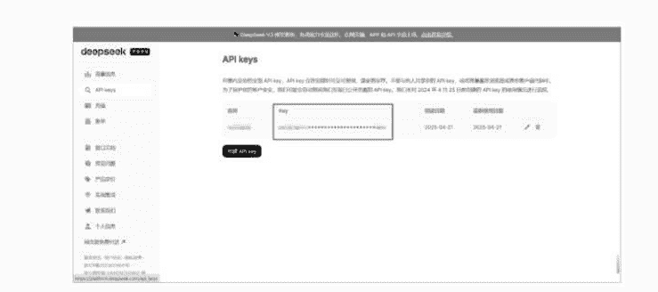

在模型提供商管理界面中，可以看到已支持的模型列表及添加新模型提供商的按钮。一是，通过“深度求索”添加 DeepSeek 模型，如图 9-2 所示。二是，因 DeepSeek API 通常被设计为与 OpenAI API 规范兼容，故可通过“Open AI Compatible”方式添加。


在配置表单中，需准确填写所有必要信息。最为重要的是 API Key 和 API 接入点 URL，在 Open AI Compatible 方式中，可能还有模型类型：明确指定当前配置模型主要属于哪种类型（如“大模型 LLM”或“文本 Embedding 模型”）。模型名称：为配置项指定 Dify 平台内部易识别的名称，更重要的是填写“API endpoint 中的模型名称”，此名称需与 DeepSeek API 实际接收的模型标识符一致。其他可选参数：根据 Dify 平台和 DeepSeek 模型的具体要求，可能还需要配置其他参数，如模型支持最大上下文长度、是否原生支持函数调用/工具调用等特性。

### 9.4 本章小结

本章引领我们正式踏入了对 Dify 平台的探索之旅，这是一个旨在显著加速 AI 应用开发的创新型 LLMOps 平台，为后续利用 DeepSeek 模型进行实战开发铺平了道路。我们首先从宏观层面理解了 Dify 平台的核心价值与产品定位，并系统掌握了其关键概念，包括应用、知识库及模型提供商的配置管理。随后，通过详细的步骤指引，我们重点实践了如何选择合适的部署方式，并成功以推荐的 Docker 容器化方案搭建起了 Dify 运行环境。通过本章的学习与实践，我们已为 AI 应用的构建做好了充分准备。在 Dify 这一强大的“AI 应用梦工厂”中，核心的“智能引擎” DeepSeek 模型也已配置就绪，蓄势待发。在下一章中，我们将充分运用 Dify 平台的可视化能力，结合前面所学的各项核心技术，亲手构建基于 DeepSeek 模型的实用 AI 应用，直观感受其在加速 AI 创新方面的独特魅力。

## 第10章 Dify平台实操：构建第一个AI应用

在圆满完成第9章的学习与实践之后，我们已经成功地在自己的本地服务器或私有云环境之中，顺利搭建并运行了功能强大的 Dify 平台，并且已经将 DeepSeek 系列的大模型成功接入。核心概念的理解和关键的运行环境准备工作，至此已全部就绪。现在，我们已具备将理论知识转化为实际应用的基础。

本章的核心目标，就是带领你从零开始，一步一个脚印地，充分利用 Dify 平台所提供的各种核心功能模块和便捷的可视化操作界面，亲手构建几个实际可用的、基于 DeepSeek AI 能力的 AI 应用程序。我们将不再仅仅局限于抽象的理论探讨或概念学习，而是要深入 Dify 平台的真实操作界面之中，通过一系列具体的鼠标单击、参数配置、逻辑编排和效果预览，将我们在本书前面所有章节中系统学习的关于大模型的原理、DeepSeek 模型特性、提示词工程、RAG、函数调用及智能体等核心知识与技能，有效地转化为一个个看得见、摸得着、能互动、可验证的实际应用成果。

首先，我们将重点探索和实践 Dify 平台最具特色、最具吸引力的核心功能——可视化的提示词与应用逻辑编排。我们将学习如何熟练地运用其强大的编排画布，通过拖曳、连接和配置各种不同功能的节点，直观地设计和实现复杂的智能交互逻辑，学习如何有效管理和传递流程中的各种动态变量与上下文信息，并掌握如何利用其便捷的实时预览与调试功能快速验证和优化我们的设计。

然后，我们将亲自动手实践构建一个包含 RAG 核心流程的 AI 应用。我们将在 Dify 平台上创建一个专门的知识库，学习如何方便地上传企业内部的文档资料，理解并配置 Dify 后台自动进行的文本分块与向量化处理过程，最终将这个构建好的知识库有效地集成到我们的 AI 应用之中，从而让强大的 DeepSeek 模型也能够基于我们所提供的、独特的私有知识来进行精准的回答与智能的分析。

在此基础上，我们还会进一步学习，如何利用大模型的函数调用能力，在 Dify 平台上定义和使用外部工具，从而赋予我们所构建的应用系统以能够与外部世界进行真实交互、获取实时信息，甚至执行具体操作的强大“行动能力”。

最后，当我们的 AI 应用在 Dify 平台上被成功构建并经过充分测试之后，我们还将一起了解如何将其进行便捷的发布、安全的分享，或者无缝嵌入企业其他已有的网站或业务系统之中，以及如何通过 Dify 平台提供的标准化 API 接口，与我们亲手构建的 Dify 应用进行更深层次的、程序化的集成与交互。

本章的全部内容都将通过大量的、详细的实操步骤描述和具体的、贴近实际业务需求的示例场景来进行贯穿和讲解，力求让你在仔细阅读并跟随操作之后，能够独立地、自信地在 Dify 平台上进行各种 AI 应用的探索与构建。我们将以循序渐进的方式，尝试一同构建一个基础的智能问答助手、一个能够基于企业私有知识进行精准回答的 RAG 应用，并通过这些实践案例来全面地、系统地覆盖 Dify 平台最为核心和常用的各项功能。

在开始本章的实践之旅前，请务必再次确认你的 Dify 平台已经能够正常运行，并且你所配置的 DeepSeek AI 模型 API Key 均已正确无误并成功通过平台的连通性测试。这是确保后续实操顺利进行的关键前提。

### 10.1 创建AI应用与基础配置

在成功登录自己部署的 Dify 平台之后，首先映入眼帘的是平台的“工作室”，用于展示已创建应用的应用列表页面，如图 10-1 所示。无论是初次接触的初学者还是已有经验的开发者，开始构建 AI 应用的第一步，都是创建一个全新的应用实例。

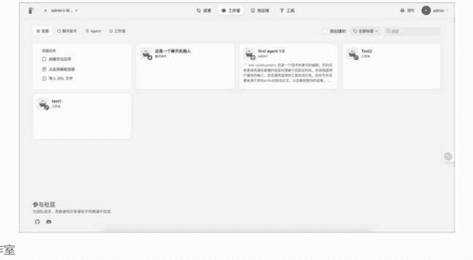

图10-1 Dify工作室

#### 10.1.1 应用类型的选择

在单击“创建应用”按钮后，Dify 平台通常会允许在创建新应用时，从几种预先设定好的、针对不同核心交互模式的应用类型之中进行选择。常见的应用类型包括聊天助手、文本生成应用、智能体（Agent）、对话流（Chatflow）和工作流。

-   (1) 聊天助手：这是构建对话式交互 AI 最常用的类型。它基于大模型的对话能力，可以进行多轮问答，非常适合构建客服机器人、智能伙伴等。
-   (2) 文本生成应用：此类应用主要面向文本创作类任务，如撰写故事、生成文章摘要、进行文本分类或翻译等。它更侧重于大模型的单向文本生成能力。
-   (3) 智能体：这是一种更高级的应用类型，旨在构建能够分解复杂任务、进行推理思考，并能调用外部工具来与现实世界交互的对话式智能体。
-   (4) 对话流：适用于需要定义复杂、多轮对话流程的场景，特别强调对话的记忆和上下文管理，通常通过可视化编排实现。
-   (5) 工作流：更侧重于自动化、批处理等单轮生成类任务的场景，如批量处理文本、按固定流程生成报告等，也可通过可视化编排实现。

选择合适的应用类型是后续设计和开发的基础。对初学者而言，从“聊天助手”或“文本生成应用”开始是一个不错的选择，它们可以帮助我们快速熟悉 Dify 平台的核心交互和提示词设计。

#### 10.1.2 应用的基础设置

选定应用类型后（例如，我们选择创建一个“聊天助手”），Dify 平台会引导进行应用的基础设置，这个过程通常非常直观，如图 10-2 所示。

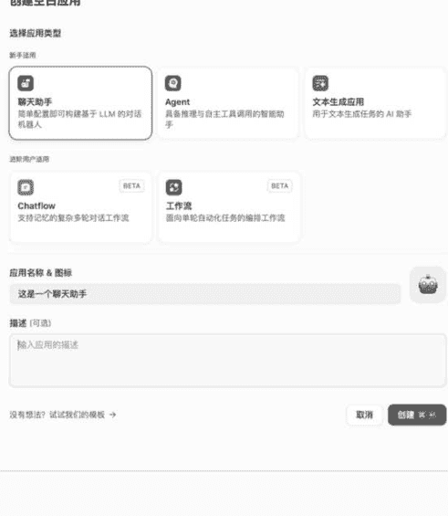

图10-2 应用的基础设置

首先是应用名称。为新应用设定一个清晰、简洁，且能够准确反映其核心功能或用途的唯一名称。例如，DeepSeek 企业产品问答助手。一个好的名称有助于后续的管理和识别。

其次是可选的应用图标和应用描述。图标可以帮助用户在众多应用中快速识别目标应用，而描述则简明扼要地说明了应用的主要功能、用途和目标用户，这对于团队协作和应用分享都很有帮助。

最为关键的一步是选择核心的语言模型。在 Dify 平台的模型选择下拉菜单中，应该能看到在第9章中配置好的 DeepSeek 模型，可选择它作为当前特定应用的驱动引擎。在此之后，Dify 平台可能会允许对所选模型的默认生成参数进行初步调整，如温度参数，它控制模型生成内容的随机性。对于需要准确答案的问答应用，建议设置较低温度（如 0.1℃~0.3℃）；对于需要创造力的内容生成应用，建议设置较高温度（如 0.7℃~0.9℃）。其他高级参数如 `top_p`、存在惩罚、频率惩罚等，也可在此处或后续编排中调整。初次创建时，若不确定，则可保持 Dify 平台提供的默认值，如图 10-3 所示。

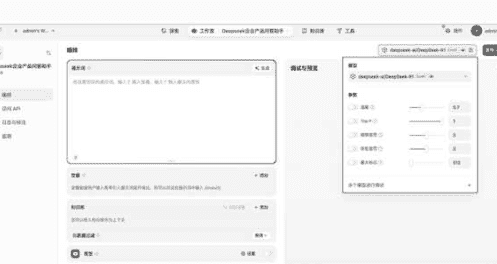

图10-3 DeepSeek企业产品问答助手

#### 10.1.3 快速上手体验

为了帮助新用户更快地熟悉平台功能并快速体验构建 AI 应用的价值，Dify 平台通常会提供一系列精心设计的、针对特定常见应用场景的预设应用模板。这些模板往往已经预设了一套基本可用的提示词结构、核心的逻辑流程，甚至可能预设了一些示例性的数据集或工具集成。

使用预设模板的核心优点在于，能够实现极速上手与快速体验，而无须从完全空白的状态开始设计，几乎可以立刻拥有一个基本可运行的 AI 应用原型。同时，这些官方模板也是宝贵的学习与参考示例，通过研究其内部配置，可以直观地学习构建高质量 Dify 应用的经验和最佳实践。

例如，Dify 社区或官方可能提供一个名为“DeepResearch”的模板，如图 10-4 所示，其目标是在用户输入研究主题后，系统反复执行搜索并生成报告。其流程可能包括：用户输入初始问题和研究深度；大模型分析问题，提取搜索主题；根据设定深度迭代搜索（如使用 Tavily 搜索引擎）；大模型判断是否继续搜索；最后，使用另一个大模型对收集结果进行分析总结，并生成 Markdown 格式报告。在本书案例中，我们可以将模板中默认的大模型替换为我们配置的 DeepSeek 模型，从而快速创建一个基于 DeepSeek 的复杂对话流应用，并在此基础上进行修改和学习。

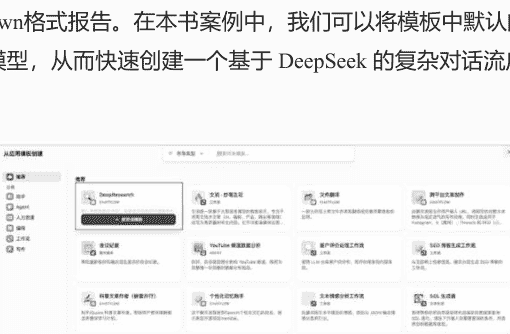

图10-4 从应用模板创建应用

无论是从零构建还是利用模板，你现在都有了一个 Dify 应用实例。接下来，我们将深入讨论 Dify 平台最为核心和有魅力的功能——可视化的提示词与应用逻辑编排。

### 10.2 AI应用的可视化编排

在成功创建一个 Dify 应用之后，对于那些需要进行深度自定义逻辑设计和实现的 AI 应用，一个通常被命名为“编排”的页面，将成为后续进行 AI 应用“灵魂注入”的“主战场”。在这个核心功能区域中，Dify 平台呈现了一个功能强大且操作直观的可视化编排画布。图 10-5 为“DeepResearch”模板的编排画布。

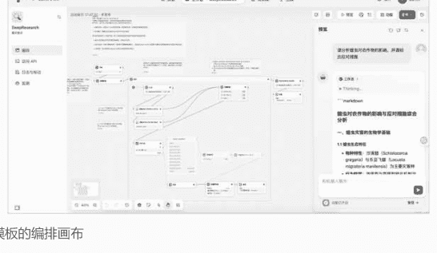

图10-5 “DeepResearch”模板的编排画布

#### 10.2.1 深刻理解Dify可视化编排画布的核心构成与各类功能节点

Dify 平台的可视化应用逻辑编排画布是其产品设计的核心与创新所在。它提供图形化、所见即所得的工作区域，可通过直观的拖拽、连接和参数配置操作，清晰设计、构建和管理 AI 应用运行时的复杂内部逻辑流程。

画布中通常包含一个核心画布区域，我们可以从侧边工具栏中将代表不同处理功能或操作步骤的各种功能节点添加到此区域，并进行布局组织，如图 10-6 所示。功能节点间的数据交换和信息传递是核心。上游节点执行完毕的输出结果可定义为一个或多个具有特定名称的变量，这些变量可在后续节点配置中通过特定语法动态引用，如图 10-7 所示。


图10-6 将功能节点添加到画布区域

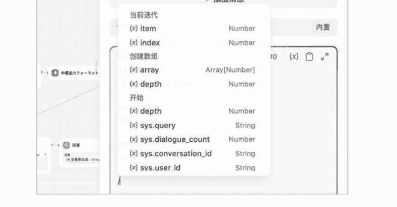

图10-7 变量引用

Dify 编排画布中常见的核心功能节点类型在前一章中已对其概念进行了介绍，这里我们回顾其在实操中的意义。

-   1. “开始”节点：定义应用流程的起点与核心输入变量，如用户查询。
-   2. “LLM”节点：与 DeepSeek AI 等模型进行核心交互的关键，在此处配置提示词模板、模型参数等。
-   3. “知识检索”节点：实现 RAG 的核心步骤，从关联知识库中检索信息。
-   4. “工具”节点：连接外部 API 与服务的“执行器”，让智能体能采取行动。
-   5. “条件分支”节点：根据条件（如变量值、大模型输出判断）实现应用流程的智能分叉。
-   6. “代码执行”节点：进行数据的灵活处理、转换或执行简单代码片段。
-   7. “结束”节点：标志应用流程的终点与最终输出结果的定义。

#### 10.2.2 有效运用指令、变量与上下文管理

在 Dify 平台的可视化应用逻辑编排画布之中，那些“LLM”节点内部所包含的提示词模板的设计与编写是整个 AI 应用构建过程中最为核心、也是最具“灵魂”的部分。它直接决定了我们最终是如何与所选用 DeepSeek 模型进行具体交互的，也深刻影响着大模型能否准确理解我们的意图，能否有效利用上下文信息，最终生成符合我们期望的高质量输出。

在大模型节点中高效地编写提示词模板，首先要像编写普通的高质量提示词一样输入核心指令内容。你可以运用本书前序章节所学的提示词工程最佳实践和核心要素：明确设定模型的角色（例如，你是一位专业的[某领域]顾问……）；下达清晰具体的任务指令（例如，请分析以下文本并提取关键信息……）；提供必要的背景知识或约束条件（例如，基于我们公司最新的规定……）；若适用，则可包含高质量的少样本示例（例如，输入：[示例 A] 输出：[期望结果A]），并明确指定期望的输出格式（例如，请以 JSON 格式返回结果）。

实现动态提示词的关键在于灵活、准确地使用“变量”。你需要在提示词模板的文本内容中，使用 Dify 平台所规定的特定语法来动态地引用和嵌入那些来自流程中的其他上游节点（例如，“开始”节点、“知识检索”节点、“工具”节点等）所输出的变量值。

通过熟练运用这些变量引用机制，你可以构建出高度动态化和情境感知的提示词，使大模型能够根据流程中不同阶段的实时数据和上下文来生成最合适的输出。

#### 10.2.3 从开场白到多轮交互的智能管理

对于对话型 AI 应用，除了单次交互的提示词设计，整个对话流程的体验也至关重要。Dify 平台的编排画布为设计复杂对话流程提供了强大支持。

首先，设定一个引人入胜的开场白。对于需要与最终用户直接交互的 AI 应用，一个友好、清晰且能准确介绍应用核心能力的开场白，对于提升用户第一印象和引导其后续进行有效交互至关重要。在 Dify 平台中，通常可以在整个应用的基础设置中直接配置一个固定的开场白文本，或者在编排画布的“开始”节点之后连接一个专门的大模型节点来动态生成开场白。这个大模型节点的提示词通常不需要依赖任何用户输入，它只是简单地生成一段预设的或略带变化的问候文本，作为整个对话的起点。

然后，我们需要运用 Dify 平台的编排能力，设计能够应对不同复杂度的多轮对话交互逻辑。

首先是基础对话流程。对于一个纯粹基于大模型内置知识进行问答的机器人，其核心交互逻辑可以被简化为一个清晰的循环：流程从“开始”节点接收用户的当前输入（query），接着将该输入（通常会结合由平台自动管理的对话历史变量 `chat_history`）传递给“LLM”节点。该节点负责生成回复，并最终通过“结束”节点输出给用户。在此类基础场景中，Dify 平台通常会自动完成对话历史的维护与传递，极大地简化了开发工作。

其次是包含 RAG 的增强对话流程。当应用需要利用私有知识时，典型的对话流程会更为复杂：在接收到用户查询（query）后，流程会先将其传递给一个“知识检索”节点。该节点将从关联的数据集中检索出最相关的上下文信息，随后，用户的原始查询、检索到的上下文及对话历史，将一同被送入“LLM”节点。此时，大模型能够基于这些完整的增强信息，生成更为精准的回复，并通过“结束”节点输出。

再次是集成外部工具的行动对话流程。若要赋予 AI 应用执行具体操作的能力，其对话流程通常会包含至少两个“LLM”节点和一个“工具”节点，并可能引入条件判断。典型的流程如下：第1个“LLM”节点负责分析用户意图，判断是否需要调用外部工具，并生成结构化的调用指令。紧接着，一个“条件分支”节点会根据是否存在 `tool_calls` 来决定流程走向。如果无须调用工具，则流程可直接结束；反之，流程将进入“工具”节点，该节点负责执行外部 API 并获取结果。最后，这个执行结果将连同之前的上下文信息，被送入第2个“LLM”节点，由它来理解并整合工具的反馈，生成最终的、面向用户的回复。

在 Dify 平台的编排画布上，通过灵活运用“条件分支”等逻辑控制节点，我们可以根据用户意图、知识库检索置信度或工具调用状态等动态条件，智能地引导对话走向。这种方式使得构建能够从容应对各种情况、具备真正复杂多轮交互能力的 AI 应用成为可能。

### 10.3 AI应用与知识库的集成

让 AI 应用能准确理解并灵活运用企业内部私有知识或特定领域专业信息，是 RAG 技术的核心价值，也是 Dify 平台在设计方面提供的一项强大便捷的核心功能。本节我们将亲自动手实践，在Dify平台中一步步完成RAG核心流程，为基于DeepSeek AI构建的应用注入“私域知识大脑”。

我们将构建一个示例应用“基于知识库的文档修订助手”：由用户上传一份与企业内部管理制度相关的文档（如计算机系统操作手册），应用将基于我们预先加载到知识库中的官方最新政策法规（如本案例的《计算机化系统（征求意见稿）》），对用户上传的文件给出修订建议，从而辅助用户完成内部文档修订任务，如图10-8所示。

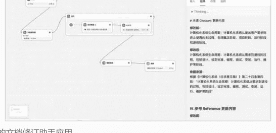

#### 10.3.1 创建并管理知识库

首先，我们需要在Dify平台上创建一个专门用于存储官方政策法规的知识库。进入Dify平台的“知识库”管理界面，单击“创建知识库”按钮并为其命名，如“附录-计算机系统-征求意见稿”，选择上传知识库文档，如图10-9所示。

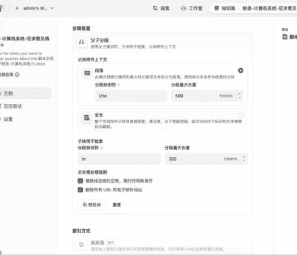

图10-9 创建知识库

接下来，需要配置文档的分段与向量化处理设置。在文档上传后，Dify后台会自动进行预处理，核心是将长文档智能切分成大小适中的文本块，并为每个文本块生成语义向量表示。我们需要关注以下几个关键配置。

（1）选择分段模式：Dify官方文档通常会介绍不同的分段模式。例如，在通用模式下，系统将按用户自定义规则（如固定长度、标点符号）将内容拆分为独立分段。当用户提问时，系统将分析问题关键词，计算与知识库各分段的相关度，并选择最相关的分段为大模型提供辅助回答。更高级的是父子模式，采用双层分段结构平衡检索精确度和上下文信息。父区块保持较大文本单位（如段落），提供丰富的上下文，子区块是较小文本单位（如句子），用于精确检索。系统先通过子区块进行精确检索，再获取对应父区块的补充上下文，可自定义分隔符和最大长度。

（2）选择Embedding模型：在此选择已经在模型供应商处完成配置的、可用的Embedding模型。选择合适的Embedding模型对于后续检索质量至关重要。

（3）选择文档处理模式（索引方式）：Dify平台可能提供不同的文档处理模式，如高质量模式和经济模式。在高质量模式下，使用Embedding模型将已分段文本块转为数字向量，更能有效压缩存储大量文本信息，使用户问题与文本匹配更精准。在经济模式下，可在各区块内使用少量关键词检索，降低准确度，但无须减少 Embedding费用，仅提供倒排索引方式选择最相关的区块即可。若经济型索引效果不佳，则可在知识库设置界面中升级为高质量索引。

（4）配置检索设置：知识库在接收用户查询问题后，按预设检索方式在已有文档内查找相关内容，提取高度相关信息片段供大模型生成高质量答案。在高质量索引方式下，Dify平台可提供向量检索、全文检索与混合检索设置。向量检索将用户问题向量化并与知识库文本向量比较距离；全文检索通过明文关键词匹配；混合检索同时执行两者，或者使用 Rerank模型从查询结果中选择最佳匹配。

完成这些配置后，Dify平台会启动文档处理流程。这个过程可能需要一些时间，具体取决于文档大小、数量及所选Embedding模型的处理速度，通常可以在Dify界面上看到处理进度。处理完成后，这个知识库就准备好了。

#### 10.3.2 配置知识库的检索策略

现在，回到我们之前创建的“基于知识库的文档修订助手”应用。在其编排画布中，我们需要添加一个“知识检索”节点。在该节点的配置中，首先要明确选择需要检索的目标知识库，即我们刚刚创建的“附录-计算机系统-征求意见稿”。

然后，需要合理设定期望返回的Top K（召回数量）文档块，如图10-10所示。这是指在执行相似性检索后，希望系统从知识库中返回与当前用户查询最相关的前 K 个文档块作为上下文。 K 值的选择需要权衡，太小可能遗漏重要信息，太大可能引入过多无关噪声并增加大模型处理的负担和成本。可以从3～5范围内开始尝试，并根据实际效果调整。

Dify 平台可能还会允许你为检索结果设定相关性得分的过滤阈值。只有用户查询计算出的相似度得分（如余弦相似度，越接近1越相似）高于此阈值的文档块才会被采纳。这有助于过滤弱相关或不相关结果，但阈值设定需小心，过高可能过滤有用信息，过低则无效。合理范围与Embedding模型、距离度量方式及知识库内容特性相关，需实验评估。

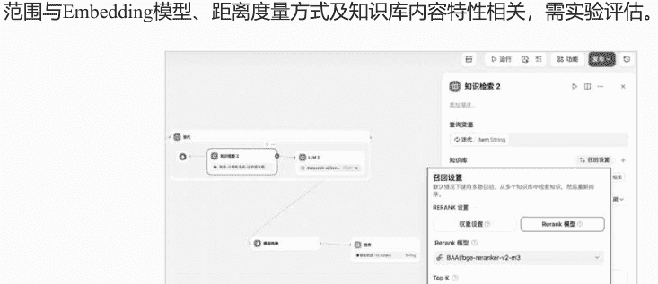

如果RAG流程包含专门的重排阶段，那么相关配置也需在此处或后续重排节点中进行。

#### 10.3.3 引用和利用知识库检索到的上下文

成功配置“知识检索”节点后，最关键的一步是如何将该节点检索到的文档块上下文信息，有效、准确地注入下游紧邻的“LLM”节点的提示词模板中。

首先，确保编排画布中“知识检索”节点的输出端口已正确连接“LLM”节点的输入端口。然后，需要明确“知识检索”节点输出的包含检索结果的变量名称。在大模型提示词中加入检索结果，如图10-11所示。

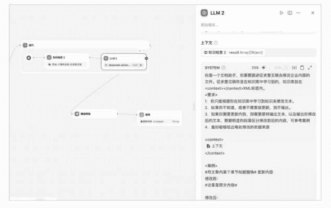

通过以上步骤，我们就成功在Dify平台上构建了一个基础但功能完备的RAG应用。当用户上传文档时，应用会从知识库中检索相关政策法规，随后将这些信息连同用户文档一起“喂”给DeepSeek模型，让其基于这些“事实证据”生成更准确、可靠、更具针对性的高质量修订建议。

### 10.4 AI应用的发布

当你在Dify平台上通过精心设计、细致配置及充分预览调试，对所构建AI应用的整体功能和表现基本满意后，关键一步是将其成功发布，以便最终目标用户能真正访问并体验使用，或者将其无缝集成到企业其他现有业务系统或工作流程中。

#### 10.4.1 发布前的全面预览与深度调试

在单击“正式发布”按钮前，强烈建议务必再次利用 Dify 平台提供的应用预览或在线调试功能，对整个AI应用进行最终全面的、覆盖各种典型及边界场景的深度测试与验证。这包括测试不同类型的用户输入、检查知识库检索的准确性、验证工具调用的正确性，以及评估多轮对话的连贯性和鲁棒性等。确保应用在各种情况下都能给出合理且符合预期的响应，是提升用户体验和应用可靠性的关键。

#### 10.4.2 应用的公开分享或嵌入代码

Dify平台通常会为每个成功创建和配置的AI应用，自动地生成一个可以即时访问和使用的Web应用程序界面。这是将应用快速交付给最终用户的一种非常便捷的方式。

在Dify平台的应用管理或发布设置区域中，通常可以找到以下几种分享和嵌入选项。

- **获取公开分享链接**：Dify平台会为Web App生成一个唯一的公开URL链接。你可以将这个链接直接发送给同事、客户或测试用户，他们只需在浏览器中打开这个链接，就可以立即开始与你的AI应用进行交互，而无须进行任何额外的安装或配置。
- **获取HTML嵌入代码**：如果你希望将这个AI应用（如一个聊天机器人窗口）无缝地嵌入企业已有的官方网站、产品介绍页面或内部知识门户之中，Dify平台通常会提供一段预先生成好的HTML `<iframe>`嵌入代码。只需要将这段代码复制并粘贴到目标网页的HTML源代码中的合适位置，就可以将Dify应用的交互界面直接嵌入网页之中，为用户提供原生的使用体验。

#### 10.4.3 应用的API访问与集成

除了直接发布为可交互的Web App，Dify平台通常也支持将构建的AI应用发布为一个标准化的API接口。这意味着，你可以让企业其他现有的业务系统、移动应用程序或自定义的前端界面，通过调用这个Dify应用提供的API接口，程序化地与其进行交互，获取其AI能力的支持。

在Dify平台的应用设置或API管理部分，通常可以找到关于如何调用该应用API的详细说明，包括：API的端点URL；API密钥（API Key）的管理与获取方式，用于进行调用认证；API请求的格式，包括如何传递输入参数；API响应的格式，包括如何解析输出结果和处理可能的错误。通过这种方式，你可以将Dify平台上构建的AI能力，更为灵活和深度地集成到企业整体的IT架构和业务流程之中。

通过有效地利用 Dify 平台提供的这些应用发布、分享、嵌入及版本管理功能，你可以更自信、更可控地将精心构建的AI应用成功交付给最终用户，并能对其进行持续的、稳健的迭代优化与生命周期管理。

### 10.5 本章小结

在本章中，我们亲身实践并全面掌握了运用Dify平台构建与部署AI应用的核心流程，成功地将先前所学的理论知识转化为实际可用的 AI 能力。我们从创建第一个 Dify 应用入手，学习了如何选择应用类型并将DeepSeek模型设置为核心引擎。接着，我们深入探索了Dify平台最具特色的可视化编排功能，通过拖拽节点和管理变量，高效地设计出包含RAG、工具调用和复杂判断的智能交互逻辑，并利用实时预览功能进行调试优化。此外，我们还实践了创建和管理知识库，实现了让DeepSeek模型基于私域知识进行精准应答。最后，我们学习了如何将构建完成的应用便捷地发布、分享、嵌入或通过API进行集成。通过本章系统性的实操，相信你已具备了运用Dify平台和DeepSeek模型快速构建实用AI应用的基础能力。Dify平台极大地降低了AI应用开发的门槛，使我们能更专注于业务创新。下一章，我们将在此基础上，通过更深入的企业案例来进一步提升你的实战开发技能。

## 第11章 Dify平台企业级智能体实战案例

在上一章中，我们系统学习了 Dify 平台的基础功能与核心操作，完成了从零开始搭建AI应用的入门实践。本章将深入企业级场景，通过五大实战案例展现Dify平台与DeepSeek模型的深度结合能力，每个案例均聚焦行业痛点。通过 Dify 平台的可视化编排、知识库融合及工具链集成，你将掌握如何将大模型能力无缝嵌入企业核心业务流程，实现“自然语言即服务”的智能化升级。

### 11.1 案例一：Dify+DeepSeek搭建智能客服机器人助手

智能客服机器人助手是大多数公司的刚需，但目前市面上的客服助手普遍存在如下问题。

- (1) 意图识别弱：传统规则引擎无法处理用户的多轮复杂问法。
- (2) 知识更新滞后：活动政策变更需手动更新知识库，存在时间差。
- (3) 数据安全隐患：第三方SaaS平台存在客户对话数据泄露风险。

本节将通过Dify平台搭建一个基于大模型（DeepSeek模型）的、可以调用本地知识库的电商客服助手，搭建步骤可分为3步。

1. 搭建本地化电商常见问题知识库。
2. 通过Dify平台编排智能客服助手应用。
3. 发布智能客服应用并嵌入业务系统。

#### 11.1.1 搭建本地化电商常见问题知识库

第1步是进入Dify平台的主页面后选择知识库菜单，并单击“创建知识库”按钮，如图11-1所示。


图11-1 创建知识库

第2步是选择导入已有文本。Dify平台支持主流的格式如TXT、WORD、XLS等，其知识库也支持直接同步Notion、Web站点的内容，如图11-2所示。


图11-2 知识库导入文件

第3步是设置知识库针对资料分块的规则及索引方式，图11-3中的分段最大长度是指知识库切割资料时的单段文本最长限制（如每段最多1000字，防止溢出）。分段重叠长度是指相邻两段内容重复的字数（如第1段结尾是“天气很好，适合_”，第2段开头重复“_适合_出去玩”，避免上下文断裂），此处按照默认设置即可。


图11-3 知识库的分块规则

第4步是设置对知识库的检索规则，倒排索引就是用关键词查找文档（如搜“苹果”即可显示相关文章），如图11-4所示。Top K：从结果中按权重（如热度、相关性）快速挑选前 K 个最优解，类似“显示前10条最优结果”。


图11-4 知识库的索引规则

完成这些步骤后，我们就创建好了一个可以供大模型检索的简单知识库，如图11-5所示。

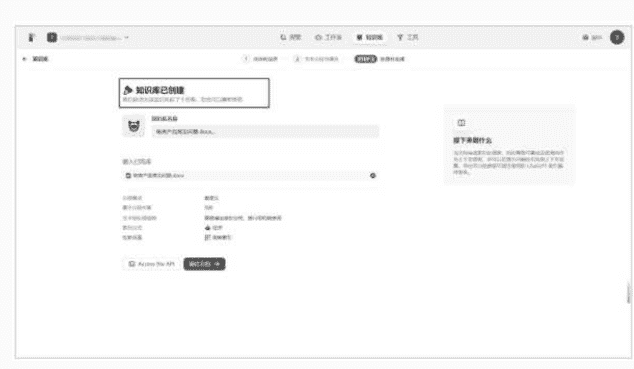

图11-5 知识库创建完成

#### 11.1.2 通过Dify平台编排智能客服助手应用

首先看一下智能客服助手的整体逻辑。

1. 当用户向智能客服助手询问问题时，首先要在私有知识库“电商产品常见问题”中检索相关答案。
2. 然后把检索到的答案交给大模型（配置的是DeepSeek模型）去推理。
3. 最后将大模型推理出的内容回复给用户。

智能客服助手的整体逻辑如图11-6所示。

第1步是配置知识检索环节，即配置知识库，选择已经建立好的“电商产品常见问题”知识库，如图11-7所示。

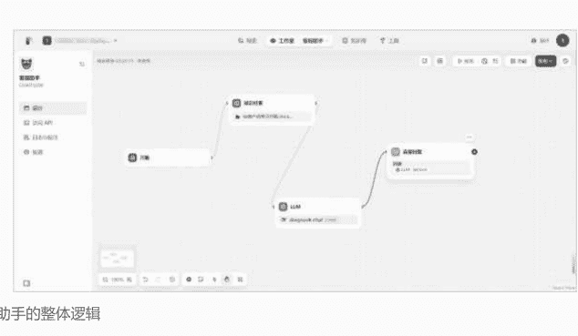

图11-6 智能客服助手的整体逻辑

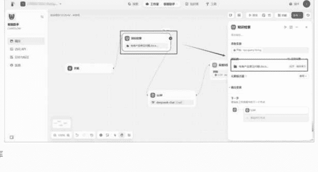

图11-7 选择知识库

第2步是选择大模型，这里配置的是DeepSeek模型。我们可以在SYSTEM中增加一些提示词，如敏感词的过滤等，如图11-8所示。

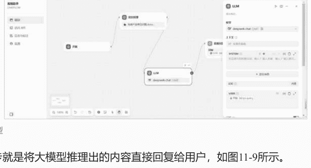

图11-8 选择大模型

最后一步就是将大模型推理出的内容直接回复给用户，如图11-9所示。

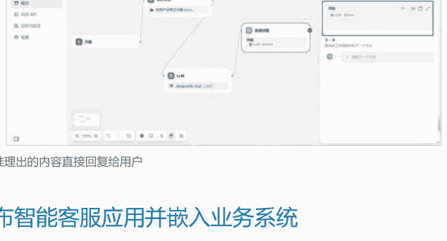

图11-9 将大模型推理出的内容直接回复给用户

#### 11.1.3 发布智能客服应用并嵌入业务系统

在智能客服的流程编排完成后，单击“发布”按钮，在弹出的页面中选择“运行”选项就可以看到智能客服机器人的效果，如图11-10所示。

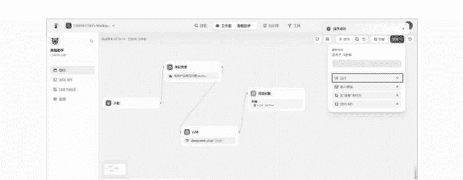

图11-10 发布智能客服机器人

编排的智能客服机器人的效果如图11-11所示。图中展示的是用户询问“我们都销售哪些品类”，大模型基于私有知识库回答的结果。


图11-11 编排的智能客服机器人的效果

图11-12是上传的“电商产品常见问题”知识库的内容，可以看到大模型还是对我们所建立的知识库的回答做了一定的优化，如电子产品增加了细类智能手机、平板电脑等，查询我们自己建立的知识库并未出现智能手机、平板电脑等字眼，这说明大模型自我发挥产生了“幻觉”，也就是编造内容。我们可以在配置的SYSTEM中针对大模型的回复增加一些要求，如禁止编造内容、需要严格基于知识库回答等提示词，这样就可以降低大模型“幻觉”出现的概率。


图11-12 上传的知识库的内容

最后针对聊天助手类的智能体，Dify 平台还提供了嵌入业务系统的方法，可以直接将Dify平台生成的代码嵌入公司产品网页的前端页面，如图11-13所示。

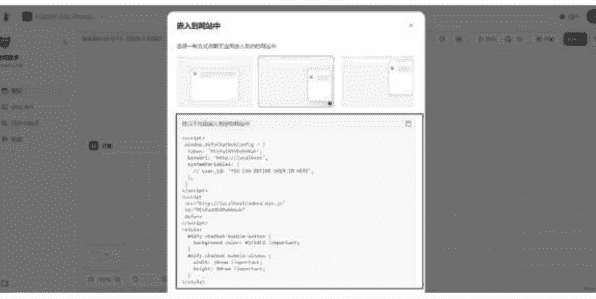

图11-13 将智能问答助手嵌入企业内部产品

如图11-14所示是嵌入业务系统后的效果。


图11-14 嵌入业务系统后的效果

### 11.2 案例二：Dify+DeepSeek搭建数据智能分析助手

企业数据分析模式正在经历革命性的演进。在传统模式下，企业需围绕业务部门的需求构建数据仓库并定制开发报表系统，这种单向响应机制存在两大核心痛点：其一，业务人员需通过IT部门实现数据诉求，形成“需求、提报、排期、开发、测试、上线”的冗长流程，单个需求响应周期长达数日；其二，报表开发涉及ETL、数据建模、可视化等复杂环节，边际成本居高不下。

大模型的突破性应用正在重构这一范式。通过自然语言交互界面，业务人员可直接以口语化指令（如“请分析华东区 Q3 客户流失原因”）发起数据请求，大模型依托其多模态理解能力和企业知识图谱，可自动完成数据抽取、关联分析、趋势预测及可视化呈现。这种变革实现了三重跃升：业务方面获得实时响应的数据服务能力，需求转化效率得到提升；IT部门从重复开发中解放，专注于数据资产治理；企业整体实现从“预设式分析”向“探索式分析”的质变，数据驱动决策的敏捷性发生数量级提升。

本次我们搭建的是基于自然语言的数据智能分析助手，主要有以下3个步骤。

1. 搭建能够解释数据库关键字段的知识库。
2. 通过Dify平台编排基于自然语言的数据智能分析助手。
3. 发布基于自然语言的数据智能分析助手。

#### 11.2.1 搭建能够解释数据库关键字段的知识库

第1步是直接将数据库及数据表的创建SQL及针对创建SQL的解释内容上传到知识库中，这里创建了一个名为hz-test的数据库，其中包含两张表，第1张表是department部门表，第2张表是employee职员表，如图11-15所示。

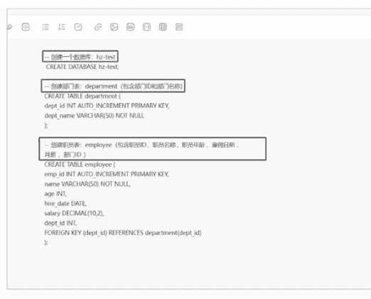

图11-15 创建数据库和数据表

第2步是建立知识库并将该文件上传到知识库中，如图11-16所示。


图11-16 创建知识库并上传文件

#### 11.2.2 通过Dify平台编排基于自然语言的数据智能分析助手

基于自然语言的数据智能分析助手的整体逻辑如下。

1. 用户输入数据分析需求。
2. 基于用户需求在知识库中检索相关内容。
3. 把用户的输入内容及数据库中检索到的内容交给大模型（DeepSeek 模型）生成数据库能识别的SQL语句。
4. 通过SQL查询工具找出用户需要的数据。
5. 将查询到的数据回复给用户。

数据智能分析助手的整体逻辑如图11-17所示。

第1步需要创建一个聊天助手应用，如图11-18所示。

图11-17 数据智能分析助手的整体逻辑

图11-18 创建聊天助手应用

第2步是从知识库中检索用户输入的内容，如图11-19所示。

第3步是将内容输入大模型，并为大模型预设一个指令：通过用户输入的内容及在知识库中检索到的内容生成数据库可以识别的SQL语句，如图11-20所示。

图11-19 检索用户输入的内容

图11-20 将内容输入大模型并预设指令

第4步是将大模型生成的SQL输入SQL查询工具，SQL查询工具可在Dify工具市场中找到。安装完成后配置数据库的地址及登录数据库的账号、密码和数据库的名称，如图11-21所示。

第5步是将SQL查询工具检索到的内容直接回复给用户，如图11-22所示。

图11-21 SQL查询工具配置

图11-22 回复配置

##### 11.2.3 发布基于自然语言的数据智能分析助手

我们需要向基于自然语言的数据智能分析助手提出两个数据分析需求。

第1个是一共有几个部门？大模型生成的SQL语句如图11-23所示。

图11-23 大模型生成的SQL语句（1）

第2个是哪个职员的工资最高？大模型生成的SQL语句如图11-24所示。

图11-24 大模型生成的SQL语句（2）

基于自然语言的数据智能分析助手回答效果如图11-25所示。

数据库中实际预设的部门表的demo数据如图11-26所示。一共有10个部门，基于自然语言的数据智能分析助手回答正确。

图11-25 基于自然语言的数据智能分析助手回答效果

图11-26 数据库中实际预设的部门表的demo数据

职员表中预设的demo数据如图11-27所示。其中，黄晓明的工资最高为32000元，基于自然语言的数据智能分析助手回答正确。

图11-27 数据库中的职员表

以上给大家展示的只是利用大模型进行数据分析的智能体的“玩具版”，就像乐高说明书中的示例模型一样。要想在企业中应用，需要把它改造成“工业级装备”，这里有几个关键步骤。

- （1）数据大扫除。先把散落在各部门的Excel表、系统报表整理成统一格式，然后为数据打标签，如哪些是过期报表需要淘汰，哪些需要重点保护。
- （2）权限开关系。设置查看权限，如销售总监可以查看全公司的数据，而区域经理只能查看自己所管辖的片区。敏感信息需要自动马赛克，如遇到“把董事长工资发我看看”这种请求，系统会自动屏蔽。
- （3）傻瓜式操作升级。加装语音功能，如不会打字的市场部王姐，直接说“帮我查上周爆款商品的退货原因”，智能体就可以直接语音回答。让智能体自动理解行业黑话，如在采购时说“那批水货”，智能体要明白指的是“海关特殊渠道商品”而不是山寨货。
- （4）安全防护网。给智能体安装警报器，当遇到“把客户名单发到外网”这类危险指令时，系统会像踩急刹车一样立刻停止操作。定期“体检”就像给智能体打疫苗，防止它吸收过多奇怪的信息。

### 11.3 案例三：Dify+DeepSeek搭建需求智能预测引擎

通过大数据做需求预测是各行各业的一个普遍需求。比如，在电商行业，需求预测主要有以下3个作用。

- 1. 库存优化：通过分析历史销售数据和用户行为，预测商品需求波动，避免库存积压或短缺，降低仓储成本并提高周转率。
- 2. 精准营销：结合消费者偏好预测结果，制定个性化推荐策略和促销活动，提升转化率。
- 3. 供应链管理：预测区域性需求差异，优化物流配送路径和生产计划。

新能源汽车换电行业对需求预测也有很强的依赖性，主要有以下两个作用。

- 1. 动态资源调度：预测高峰期的充电需求，通过分时电价或智能调度算法平衡电网压力，让大部分电池可以波谷充电，从而降低充电成本。
- 2. 电池调度：预测用户换电需求。当预测的准确性达到一定程度时，就可以在换电高峰期，把换电需求较低的换电站的电池调度至高峰期换电需求较高的换电站内，从而更好地满足用户的补能需求。

本次我们搭建的是基于Dify+DeepSeek的需求智能预测引擎，主要有以下两个步骤。

- 1. 通过Dify平台编排需求智能预测引擎。
- 2. 通过Dify平台发布需求智能预测引擎。

#### 11.3.1 通过Dify平台编排需求智能预测引擎

需求智能预测引擎的整体逻辑如下。

- 1. 用户提出数据分析需求。
- 2. 利用SQL查询工具从数据库中查询特定数据。
- （3）大模型（DeepSeek模型）基于用户的输入及从数据库中检索到的数据完成数据分析需求。
- （4）将大模型数据分析的结果回复给用户。

需求智能预测引擎的整体逻辑如图11-28所示。

图11-28 需求智能预测引擎的整体逻辑

第1步是建立一个空白的聊天应用。如图11-29所示。

图11-29 建立空白聊天应用

第2步在流程节点上增加SQL查询工具，需设置数据库的地址、账号、密码、数据库和SQL查询语句（这里为了方便演示直接预设了一个特定数据查询的SQL），如图11-30所示。

图11-30 SQL查询工具配置

图11-31是demo4_csv的数据结构及内容，h1字段代表消费时段，num字段代表消费次数。

图11-31 demo4_csv的数据结构及内容

接下来为大模型预设指令，为了方便演示，此处直接告知大模型提取到的内容的数据结构，如图11-32所示。

图11-32 告知大模型数据结构

最后，将大模型数据分析的结果直接返回用户，如图11-33所示。

图11-33 配置最终回复内容

#### 11.3.2 通过Dify平台发布需求智能预测引擎

图11-34所示是需求智能预测引擎的运行效果，用户提出了一个数据分析需求，同时给出了需求准确性的定位，最后为了方便演示，要求大模型以HTML格式输出数据分析结果。

图11-35所示是大模型给出的分析报告的第1部分，它首先告知用户大模型抓取到的数据特征及数据分析的方法。

图11-36所示是大模型给出的分析报告的第2部分，它展示了需求预测的结果，并与实际值进行了对比。

图11-37所示是大模型给出的分析报告的第3部分，它展示了大模型对预测结果的分析，给出了这次预测的整体准确率和改进建议。

图11-37 大模型输出的分析报告的第3部分

图11-38所示是大模型给出的分析报告的第4部分，它展示了大模型针对此次数据分析给出的明确结论和建议。

图11-38 大模型输出的分析报告的第4部分

大模型需求预测成绩单的判断方向是正确的，但准确率偏低。然而，我们这次只“喂”了两天的数据，它能做成这样已经很不容易了，要想让智能体的预测结果基本准确，至少需要两年的数据。数据越丰富，大模型能调用的高级算法就越多，预测准确度就更高！

有了大模型之后公司就不需要培养算法团队了，大模型实际上就是一个全能的AI算法大神，只需写明类似“帮我用时间序列分析下数据趋势”的提示词即可，效果堪比技术纯熟的算法工程师。简单来说，大模型就是一个可以24小时待命的算法顾问，我们需要做的，就是学会用简单的语言指挥这个超级外脑。

### 11.4 案例四：Dify+DeepSeek搭建出行规划助手

MCP（Model Context Protocol，模型上下文协议）使AI能够直接连接用户电脑中的文件、手机中的App，甚至网络上的各种工具，可以像真人助手一样干活。比如，以前让AI订机票的时候，它只能告诉我们“应该去XX网站订票”，剩下的得靠自己操作。但现在有了MCP，AI就可以像真人助手一样帮我们操作：首先直接打开日历查找空闲时间，然后自动查看天气预报选择合适的出行日期，接着打开订票网站比价下单，最后发微信与我们确认行程。

整个过程完全自动化，就像雇了个数字“秘书”一样。

这背后的原理很简单，传统AI就像是个“书呆子”，只会背书不会操作，而MCP给“书呆子”配备了“手脚”，让它能够读取电脑中的文件、控制浏览器、发送邮件等。相当于在AI和现实世界之间搭建了一座桥。

目前这个协议由开发Claude的公司Anthropic提出，现在很多大厂都在跟进，如谷歌、Cursor编程工具等，估计很快就会成为AI连接现实世界的标配。

本节我们将通过一个实战案例搭建一个基于高德MCP的出行规划助手，实现步骤分为以下三步。

- （1）配置高德出行服务MCP准备。
- （2）通过Dify平台编排高德MCP的出行规划助手。
- （3）通过Dify平台发布高德MCP的出行规划助手。

#### 11.4.1 配置高德出行服务MCP准备

先登录高德开放平台，如果没有开发者账号，则需注册成为开发者，如图11-39所示。

图11-39 登录高德开放平台

进入“应用管理”界面，单击页面右上角的“创建新应用”按钮，在“新建应用”对话框中填写应用名称和应用类型即可创建新应用，如图11-40所示。

进入“应用管理”界面，在“我的应用”列表中选择需要创建Key的应用，单击“添加Key”按钮，在“为「测试」添加Key”对话框的“服务平台”单选按钮组中选择“Web服务”单选按钮，如图11-41所示。

图11-40 高德开放平台-创建应用

图11-41 高德开放平台-为应用添加Key

创建成功后，可获取Key和安全密钥，如图11-42所示。

图11-42 高德开放平台-获取Key和安全密钥

接着，在Dify平台的应用市场中安装两个有关MCP的插件，如图11-43所示。

图11-43 安装有关MCP的插件

两个插件的说明如下。

- （1）Agent策略（支持MCP）：提供Function Calling和ReAct的Agent策略集合（支持MCP SSE/Streamable HTTP发现和调用工具）。
- （2）MCPSSE：通过HTTP with SSE或Streamable HTTP传输方式使用MCP协议来发现和调用工具。

#### 11.4.2 通过Dify平台编排高德MCP的出行规划助手

高德MCP的出行规划助手的整体逻辑如下。

- （1）用户输入出行需求。
- （2）大模型收到需求后通过MCP调用合适的智能体。
- （3）智能体完成任务后将结果回复给用户。

出行规划助手的整体逻辑如图11-44所示。

图11-44 出行规划助手的整体逻辑

首先配置Agent策略。ReAct策略可以让智能体像人类一样，先分析问题（Reasoning）再调用工具（Acting），最后根据工具返回的结果调整下一步行动。接下来需要完成提前安装好的MCPSSE和Agent策略（支持MCP）这两个工具的配置与MCP服务配置，如图11-45所示。

```json
{
    "mcpServers":{
        "amapamapsse":{
            "url":"https://mcp.amap.com/sse?key=你在高德官网上申请的 Key"
        }
    }
}
```

图11-45 给大模型配置MCP服务

接下来为大模型预设相关指令，告诉大模型它是一个出行规划专家，并让大模型基于用户的需求及我们预设的MCP工具选择合适的Agent完成用户布置的任务，如图11-46所示。

图11-46 给大模型预设指令

最后直接将智能体输出的内容回复给用户，如图11-47所示。

图11-47 将智能体输出的内容回复给用户

#### 11.4.3 通过Dify平台发布高德MCP的出行规划助手

下图是用户对高德 MCP 的出行规划助手提出的问题，大模型通过 MCP 调用高德出行服务给出的答案如下，如图11-48所示。

图11-48 大模型回答演示

MCP通过标准化接口让大模型实时连接高德出行、天气API等数据源。在传统模式下，大模型只能基于网络爬虫的碎片化信息推荐酒店，误差率较高，而接入MCP后，大模型能动态获取位置、价格等实时数据，推荐精准度大幅度提升。

其核心价值在于“一次开发，全域通用”。企业只需部署MCP服务器，就能让多个 AI应用安全调用。在未来，MCP或成AI时代的HTTP协议，不仅支持跨会话记忆，还能让不同厂商的模型共享工具生态，2025年注定是“开口就能办成事”的AI普惠元年。

### 11.5 案例五：Dify+DeepSeek搭建合同审查助手

之前介绍的案例基本上都是给业务部门用的，在为财务、法务这些职能部门培训AI时，需要注意一个关键问题——防止AI泄露数据！对于公司内部的合同、简历、报表等文件，业务部门特别想使用大模型进行分析，但将机密资料上传至外网的AI是有一定风险的，如若泄露则会产生巨大的损失。

在本节中，我们要解决的就是这个问题：使用 Dify 平台搭建本地版合同审查助手，这样既能将数据封锁在公司内部，又能通过大模型的能力解析合同。搭建合同审查助手分为以下两大步骤。

- （1）通过Dify平台编排合同审查助手。
- （2）通过Dify平台发布合同审查助手。

#### 11.5.1 通过Dify平台编排合同审查助手

合同审查助手的整体逻辑如下。

- （1）用户输入要求以便上传文件。
- （2）文档提取器基于用户的要求将上传的文件转化为大模型更好理解的文本。
- （3）大模型基于文档提取器输出的内容在完成推理后才可以回答用户的问题。合同审查助手的整体逻辑如图11-49所示。

图11-49 合同审查助手的整体逻辑

创建好空白聊天应用后，单击“预览”按钮，开启聊天对话框的文件上传功能，如图11-50所示。

图11-50

功能开启后可以设置允许上传的文件的格式类型、最大上传份数等信息，如图11-51所示。

图11-51

接着，插入Dify平台预置的节点文档提取器。Dify文档提取器主要是将上传的文件转化为平台能理解的文本，如把图片、音频等转化成文本。输入变量选择要上传的文件。如图11-52所示。

图11-52

接下来选择大模型。这时一定要把 Dify 平台的模型供应商设置为本地部署的大模型，以免上传的文件暴露给外部，另外，需要为大模型预设提示词，告知大模型它是一个合同审查专家，精通各种法律知识，使大模型基于用户提出的要求及上传文件的内容，提出相关的优化建议，如图11-53所示。

图11-53

#### 11.5.2 通过Dify平台发布合同审查助手

下图是合同审查助手的运行效果。上传一个软件采购模板，大模型推理后给出了相关风险提示和建议，如图11-54所示。

图11-54

合同审查助手的编排流程不仅是法务工具，更是一套可复用的企业级智能中枢，其底层技术框架能快速适配多部门文档处理需求。

- （1）人力筛选简历：自动提取学历/证书/工作履历，可同步接入背调数据识别造假风险。
- （2）财务审核报表：OCR 识别票据信息，自动钩稽科目数据，内置准则库预警违规操作，大幅度提升财务报表的处理效率。
- （3）行政审核文件：移植合同审批流逻辑，实现公文格式校验，提升审批效率。

(4) 营销优化文案：采用敏感词检测技术，规避广告法风险，并基于大模型生成多版本创意。

这套流程是为职能部门定制的带锁AI工具箱，既省时省力，又不用担心数据泄露，可以大大提升职能部门的工作效率。

### 11.6 本章小结

本章通过5个典型的企业级应用案例，完整呈现了Dify平台与DeepSeek模型的协同价值。案例中特别强调了工程化落地的关键要素：知识库的语义化处理、提示词工程对“幻觉”抑制的作用、工具链的安全接入机制。这些实践不仅验证了低代码平台与大模型结合的可行性，更为企业提供了“AI即生产力”的标准化实施路径——以自然语言为交互界面，以前沿技术为引擎，以业务流程为轨道，推动智能化转型进入“人人可参与”的新阶段。