# AI 搞定生意：商业场景下的 AI 实操指南

易能飞 著

- 实体店获客
- 电商引流
- 跨境选品
- 自媒体裂变
- 个人IP孵化

开启新生意时代，重构增长新范式，解锁AI时代决胜法则

北方文艺出版社

---

本书从直播体系搭建、流量矩阵布局到匹配多个行业的专属AI解决方案，涵盖了实体店、电商平台、本地生活、自媒体等领域的诸多细分应用场景，将AI重构流量、产品、运营的全链方法论逐一案例演示。

如果你是那个凌晨3点还在刷账单的店主，是那个为爆款、断货焦头烂额的电商老板，是那个被抄袭者逼到想砸键盘的自媒体人——恭喜，这本书就是适合你的！

这不是一本教你怎么"做大做强"的鸡汤，而是一份可以照着操作的"生存作战图"。

---

## 目录

## 第一章 看懂风口：AI 如何重构商业底层逻辑

1. 为何说 AI 会成为未来十年最具潜力的商业风口 …… 2
2. 中小微企业生存困境与 AI 破局点 …… 4
3. 流量成本暴涨下的 AI 破局之道 …… 7
4. 以 DeepSeek 为代表的工具革命本质 …… 9

## 第二章 新钱在哪：直播电商 AI 化

1. 2025 直播电商趋势预测：24 小时 AI "数字人"直播常态化 …… 16
2. 打造 24 小时不打烊的 AI "数字人"直播 …… 20
3. AI 直播黄金法则：五步法打造爆款直播间 …… 32

## 第三章 智能选品与预测

1. 破局传统选品困境：AI 选品三板斧实战指南 …… 42
2. 破解跨境选品迷局 …… 52
3. 获取本土化爆款的密码 …… 60
4. DeepSeek 快速生成产品分析报告 …… 69
5. 抖音小店潜力爆款预测 …… 73

## 第四章 低成本获客：流量革命

1. 传统流量的五大致命伤 …… 80
2. 搜索流量：智能 SEO 玩法 …… 82
3. 内容流量：全媒体矩阵 …… 93
4. 社交流量：裂变加速器 …… 98
5. 利用 AI 捕捉流量 …… 104
6. 日常流量运营：热点抓取 + 快速生产 …… 112

### 三大低成本获客打法

7. 矩阵打法："10 个账号" 管理术 …… 118
8. 门店引流：AI"数字人" 直播 + 短视频引流 …… 124
9. AI 辅助 "热点话题" 生成 …… 128

## 第五章 短视频引流：获客新篇章

### 爆款视频的黄金公式

1. 服装行业：抓住眼球的六个开场模板 …… 133
2. 餐饮行业：引爆流量的十种剧情模板 …… 141
3. 本地服务类：直击转化的 "神文案" …… 155

### AI 时代短视频玩法

4. 日更 100 条视频的流水线：DeepSeek+ 剪映 …… 162
5. 智能去重与平台适配：DeepSeek+ 剪映 + 闪剪 …… 169
6. 自动批量上传并管理多平台内容 …… 178

## 第六章 AI 实战攻略：全场景解决方案

### 电商智能增长组合拳

1. 淘宝：标题优化 + 竞品监控 …… 187
2. 拼多多：智能定价 + 裂变活动设计 …… 191
3. 闲鱼：自动生成高转化文案库 …… 195
4. 抖店：短视频脚本生成 + 直播话术优化 …… 198
5. 亚马逊：智能 Listing+ 评论攻防战 …… 203
6. TikTok：海外短视频标签库 + 趋势词抓取 …… 207
7. 独立站：SEO 长尾词拓展 + 用户画像建模 …… 212

### 实体店数智转型王炸组合

8. 服装业：AR 试衣镜，快速引流线下门店 …… 217
9. 餐饮业：AI 推荐菜品更新与定价 …… 222
10. 美业：AI 皮肤 / 发质诊断 + 预约智能调度 …… 226
11. 酒店业：配置 AI 语音助手 + 动态定价模型 …… 230
12. 家居业：AR 虚拟货架 + 售后智能质检 …… 234

### 本地生活服务智能升级方案

13. 美团 / 大众点评：智能回复 + 爆款套餐设计 …… 238
14. 小红书：社区热点挖掘 + 探店路线规划 …… 243
15. 视频号：同城爆款模板 + 社交裂变追踪 …… 247

### 自媒体变现革命

16. 知识付费：课程大纲自动生成术 …… 251
17. 带货号：混剪去重 + 评论区互动 …… 255
18. 个人 IP：地域人设建模 + 跨平台内容分发 …… 259

## 第七章 用户分析与成交

### AI 用户画像分析

1. AI 用户画像：精准洞察你的 "上帝" …… 266
2. AI 产品痛点调研：打造贴合需求的产品 …… 271
3. AI 聊天机器人：从问候到成交的 "话术大师" …… 277

### 私域成交组合拳

4. 智能话术生成器 …… 284
5. 裂变活动自动设计 …… 292
6. 朋友圈 AI 文案生成 …… 299

## 第八章 数据化运营：理性决策

### 经营仪表盘搭建

1. 中小微企业适用的数据分析 …… 306
2. 利用智能报表发现问题 …… 312
3. AI 预测市场需求 …… 319

### 运营数据智能监测

4. 优化库存周转 …… 323
5. 预防客户流失 …… 329
6. 智能定价决策 …… 335

### 风险防控指南

7. 内容合规审查 …… 341
8. 数据安全防护 …… 348
9. 规避算法偏见 …… 355

---

## 第一章

### 看懂风口：AI 如何重构商业底层逻辑

---

### 为何说 AI 会成为未来十年最具潜力的商业风口

在商业竞争中，风口是决定胜负的关键变量。它代表着对机会的敏锐洞察和对资源的重新配置，抓住风口才能抢占制胜先机。而 AI，堪称未来十年最为炽热的商业风口——它不仅是一项先进的技术，更是一股重构商业底层逻辑的浪潮，它正在革新业务模式、决策逻辑和产业格局，推动商业从"经验驱动"向"算法驱动"的跃迁。

#### 从科幻想象到商业现实：AI 在中国的深度渗透

提到 AI，人们首先联想到的是科幻电影里的智能机器人。然而，在中国商业版图中，AI 早已从概念落地为切实的应用：微信支付的交易安全监测、百度搜索的信息精准匹配、抖音短视频的个性化推荐……在中国这个全球互联网用户最多的市场，AI 产业正进入加速时刻。

对中小微企业而言，AI 不仅是生活的"润滑剂"，更是商业的"加速器"。合理利用 AI 不仅可以提升效率，还可以抓住弯道超车的契机。

#### 效率革命：AI 重塑商业运行范式

AI 可以轻松胜任一些耗时耗力的重复性工作，如数据整理、客服应答、库存盘点等，让人们可以把精力集中在真正能创造价值的地方。

实体店老板：AI 可以帮助分析客流量和顾客的购买偏好。如商汤科技的智能摄像头能够实时采集店内顾客行为数据，分析货架热度与商品补货需求，为销售额提升提供了有效的技术支撑。

电商老板：可以通过阿里云的 AI 客服系统，实现 24 小时响应客户咨询，无需额外雇用客服团队；利用百度智能云的自动化营销工具，可以精准触达目标用户，降低广告投放试错成本。

职场内的自媒体人：可以先借助 AI 写作工具，如文心一言、豆包、Kimi 等生成内容初稿，再通过剪映的 AI 剪辑功能快速制作视频，从而大幅提升工作效率。

总而言之，AI 技术已经渗透到商业的各个环节，从客户画像到产品设计，从生产优化到售后服务，AI 正在重塑商业运行模式。

#### 决策升级：AI 成为商业的"超级大脑"

商业的本质是决策，而决策依赖于获取信息的深度和速度。在中国这个数据爆炸的市场，AI 凭借大数据分析和机器学习，能够为决策提供深度和速度上的双重优势。

例如，实体店老板可以通过腾讯云的 AI 分析工具，研究周边消费者的消费习惯和竞争对手的动态，精准制定新品推广或定价策略；企业可以借助百度的 AI 预测模型，评估市场进入可行性，避免盲目投入；自媒体人也可以通过抖音后台的 AI 算法分析粉丝喜好，定向优化内容以获取更多流量。

#### 创新孵化：AI 催生新兴领域

AI 不仅能优化现有业务，更能催生全新商业形态。在中国，无人驾驶、智能医疗、AI 教育等新兴领域不断涌现，这些领域的先行者们，无一不是抓住了 AI 的风口。

例如，企业可以开发垂直领域 AI 小程序，解决行业痛点；实体店可以用 AI 打造个性化服务，如通过人脸识别为 VIP 客户提供个性化专属优惠；自媒体人则可以用 AI 工具生成吸睛的视觉内容，迅速抢占市场先机。

#### 中国：AI 发展的"黄金土壤"

放眼全球，中国是 AI 崛起的辉煌舞台。政策红利持续推进：2025 年《政府工作报告》明确提出持续推进"人工智能 +"行动，将数字技术与制造优势、市场优势更好地结合起来，支持大模型广泛应用。中国有 14 亿人口的庞大数据库，为 AI 发展提供了丰富资源；腾讯、字节跳动和阿里巴巴等中国科技巨头的持续投入，使得 DeepSeek、Kimi、智谱以及豆包等 AI "新势力"如雨后春笋般兴起，AI 发展的速度远超想象。

这对我们来说意味着什么？意味着中小微企业可以借助这些本土化 AI 工具，挖掘新需求；实体店能通过微信生态的 AI 小程序快速推广，提高线下到线上的转化率；自媒体人则可以用抖音、快手的 AI 算法红利积累粉丝，收获自己的第一桶金。

AI 并非遥不可及的未来概念，而是当下正在重塑商业格局的现实力量。20 年前，互联网改变了世界；如今，AI 正在重塑世界的商业格局。对于那些能洞察趋势、善用工具的人来说，未来十年将是乘风破浪的黄金时期。你准备好告别传统商业模式的桎梏，以 AI 破局了吗？行动，即答案。

---

### 中小微企业生存困境与 AI 破局点

> "同等成本预算下，竞争对手借助 AI 工具一天生成 100 条营销内容，而你还在为员工的加班成本发愁。"

这是当下众多中小微企业的真实写照——一边是 AI 技术带来的效率革命，另一边是传统模式下的举步维艰。当资源匮乏、竞争加剧、效率低下与创新不足等多重困境交织时，AI 正成为划破困局的"瑞士军刀"，为从业者开辟破局新路径。

#### 中小微企业的生存困境

1. 市场竞争激烈，"生存空间"被压缩

电商平台的爆发式扩张、传统行业的数字化转型以及头部企业的资本与技术优势，导致很多中小微企业在激烈的市场竞争中举步维艰。依赖价格战、促销活动等传统的获客模式难以为继，企业正面临着巨大的降维打击，只有持续突破同质化竞争，才能在市场中站稳脚跟。

2. 人力不足，运营成本高

中小微企业普遍面临人力资源短缺的问题。很多老板不仅需要管理日常运营，还要亲自参与客户服务、市场营销、库存管理等一线工作，事事亲力亲为，这往往导致工作繁忙、效率低下。同时，招聘和留住合适人才的成本也让许多企业感到力不从心，运营成本持续攀升。

3. 数字化转型滞缓，数据价值缺失

很多中小微企业虽然意识到了数字化的重要性，但由于缺乏资金、技术和人才储备，陷入"想转型却难落地"的困境。多数企业仍依赖人工处理数据，缺乏智能管理系统支撑，导致效率低下、决策滞后、竞争力衰退，从而错失商业机会。

4. 营销效果差，用户定位不准

随着流量的稀缺和广告成本的攀升，中小微企业既难承担平台高额广告费用，又缺乏精准用户画像工具，常陷入"预算花光却找不到目标客户"的尴尬境地，营销投入产出比长期低于行业平均水平。

#### AI 破局：从"困境"到"生机"

以上这些困境让中小微企业如履薄冰，但 AI 技术的普及正在为它们带来新的转机。

##### 1. 智能降本：AI 重构运营成本曲线

对很多中小微企业来说，最大的问题就是"人工成本"。但通过引入 AI 技术，很多烦琐的工作可以实现自动化。

例如，AI 可以通过智能客服系统处理客户咨询，减轻人工服务的压力；在电商平台中，AI 能够自动管理库存、优化价格、监控订单，从而节省了大量的人力成本和时间成本；在实体店中，AI 也能通过智能管理系统自动分析销售数据，预测热销商品，调整货品布局，避免库存积压，从而减少浪费。

##### 2. 精准营销：AI 助力找到"高价值客群"

流量的"获取"成本越来越高，而传统的广撒网式广告投放效果越来越差。AI 通过分析大量用户行为数据，能够精准锁定潜在客户群体。

例如，AI 可以根据消费者的购买历史、搜索偏好和社交媒体互动，预测其可能感兴趣的产品，并推送定制化的广告内容。这样，企业就能实现精准投放，避免无效广告曝光，进而节省大量的广告费用。

##### 3. 数据决策：从经验驱动到智能驱动

许多中小微企业在做决策时，常依赖经验或直觉，缺乏科学的数据支持。而 AI 能对市场数据、用户反馈和销售记录等进行深度分析，为企业决策提供有力支持。

例如，AI 可以帮助商家发现销售趋势，预测哪些产品可能在未来一段时间内热销，避免资金占用和库存积压。此外，AI 还能帮助商家评估促销活动的效果，制定最有效的营销策略。

##### 4. 体验升级：打造差异化服务壁垒

消费者需求日益多样化和个性化，如何有效提升客户体验已成为企业竞争的关键。AI 能够通过大数据分析，全面了解每一位客户的购买习惯、偏好和需求，从而为其提供定制化服务。

例如，电商平台上的智能推荐系统，可以根据用户的历史购买记录和浏览行为推送最符合其需求的商品；在线客服系统可以通过 AI 技术自动处理大量常见问题，提升服务效率，提高用户的满意度。

##### 5. 产品创新：捕捉市场"空白点"

AI 不仅能提升企业日常运营效率，还能为企业的产品创新提供重要支持。通过分析用户行为数据，AI 可以帮助企业洞察市场需求，发现潜在的空白市场和未来的消费趋势。

例如，AI 可以通过社交媒体数据分析，预测新产品的受欢迎程度，帮助企业提前布局和研发新产品。

在技术迭代速度远超商业周期变化的当下，AI 不再是锦上添花的"奢侈品"，而是中小微企业生存的"必需品"。当竞争对手还在用 Excel 做报表时，有的企业已经在云端构建了智能商业飞轮。下个月的利润表，或许就因今天的选择而彻底改写。

---

近年来，互联网流量的成本不断攀升，企业广告投放面临诸多困境。往年还算稳定的广告投放情况，今年却发现在同样的预算下，广告点击率和转化率大幅下滑。随着大平台广告费用的不断上涨，流量的获取变得越来越困难。即便投入重金，也难见显著回报。但 AI 的出现让企业看到了希望。下面让我们来看看，AI 如何为企业在流量争夺战中找到新的出路。

#### 一 精准营销：找到对的人

AI 擅长 "读心术"。它能通过分析用户的上网记录、购物习惯、点赞评论等，精准把握用户喜好。例如，用户爱看搞笑视频，AI 会经常推送同类型视频；用户常购买运动鞋，AI 会适时推荐跑步袜。这种 "用户画像" 能力，让企业告别盲目推销，直接锁定潜在用户。

此外，AI 还能实现 "个性化推荐"。用户在电商平台浏览后，AI 会迅速推荐心仪款式；在视频网站浏览后，AI 能精准推送同类型的剧集。这种精准推荐既能节省企业广告费用，又能提升用户好感度，成交率自然会有所提升。

#### 二 广告投放：聪明又省钱

在广告投放领域，AI 也能大显身手。以前，广告投放全凭经验和感觉，哪个平台火就投哪个。现在，AI 广告投放系统改变了这一局面，它能通过分析不同受众、不同时间段的数据，帮助企业优化广告投放，让每一笔广告预算都发挥出最大的价值。

- **聪明出价**：AI 会实时监测广告效果，效果不佳时减少投入，效果好时增加投入，确保资金合理利用。

- **优化创意**：AI 还能测试广告图片和文案的吸引力，自动选用效果最佳的版本。比如，发现 "限时抢购" 比 "限时优惠" 更吸引人时，就把广告改成前者。

- **反作弊与流量清洗**：有时候，AI 能识别流量中的"假点击"，避免企业因为网络延迟、误操作等产生的无效点击而浪费资金。

**案例**：某二线城市的一家餐饮店，在引入 AI 广告优化后，广告预算和销售额的关系发生了明显变化。系统通过分析广告的点击率、转化率等数据，自动调整广告内容和投放时间，餐饮品牌的广告费用降低了约15%，但销售额却有了显著提升。这种基于 AI 算法的自动优化，不仅节省了人工成本，更重要的是，避免了因过度投放而导致的浪费。

#### 内容创作：流量的"新抓手"

内容创作是吸引流量的"钩子"，AI 在这一方面也能帮大忙。例如，它能根据热门话题自动生成文章和视频脚本。AI 还能分析哪些内容更容易火，优化标题、配图，吸引更多人关注。更厉害的是 AI 还能将内容翻译成多种语言，帮助企业拓展国际市场。

未来，AI 将更加智能，在流量竞争中发挥更大的作用。企业若能搭上这趟快车，就能在激烈的市场竞争中抢占先机，甚至实现"弯道超车"。所以当你还在为流量发愁的时候，不妨向 AI 寻求帮助，或许能够找到新的出路。

---

### 以 DeepSeek 为代表的工具革命本质

2025年，DeepSeek 的 AI 大模型"横空出世"，迅速在各大社交媒体掀起热潮，被誉为大模型行业的"最大黑马"，甚至被称为"神秘的东方力量"。东方力量"。它的爆火，让国内用户真正体验到了大语言模型的强大功能，引发了全民 AI 学习的热潮，而在这股热潮的背后，一场深刻的工具革命正悄然展开。这场革命以技术创新为导向，聚焦于如何借助这些先进工具，助力各行业更高效、更精准地做出决策，全方位提升业务的运作效率。

#### 工具革命的本质：解放时间与精力

DeepSeek 所代表的工具革命，核心价值在于它能帮助企业节省大量的时间和精力，以低成本撬动高效能。尤其是对中小微企业老板来说，时间就是金钱。有了这些智能工具的帮助，企业在分析数据、处理信息和市场调查等繁琐工作上可以大幅度提升效率，降低成本。

例如，实体店老板需要分析顾客的购买偏好、商品的销售情况、管理库存等。这些工作不仅繁琐，还容易出错。而通过 DeepSeek 等 AI 智能工具的帮助，这些工作都能变得更加高效、精准。只需要通过工具设置一些关键词和目标，系统就能自动梳理出哪些商品热销，哪些顾客可能有复购的倾向，甚至可以提供具体的产品调整策略。

#### 基于中国市场的落地实践：贴合本土生态

中国的市场环境和用户行为有其独特性，而 DeepSeek 这类工具能敏锐捕捉到这一点，深度融合国内特有的社交平台、电商平台和搜索引擎等生态系统，提供本地化的有力支持。以电商领域为例，DeepSeek 通过整合淘宝、京东和拼多多等电商平台的数据，不仅能精准分析出各类商品的热门趋势、竞争态势，还能通过分析用户在社交媒体上的评论和行为，助力企业优化产品定位与营销策略。

例如，专注女性时尚的电商从业者，可利用 DeepSeek 综合平台的搜索数据、顾客评价、社交媒体的热门话题等多维度信息，精准定位当前市场上最受欢迎的款式、颜色和面料等关键要素，甚至能够敏锐洞察顾客对某款商品的不满之处，从而有针对性地优化产品或合理调整库存。这并非简单的大数据分析，而是一个能够实时反映市场动态的智能利器，让企业在瞬息万变的市场竞争中始终抢占先机。

#### 三 降低决策成本：从"试错"到"精准决策"

在传统的商业运作模式下，企业老板往往依赖经验或者大规模的市场调研来做决策。然而这两种方式都存在诸多弊端，试错成本居高不下。无论是新品上市，还是策划促销活动，都需要经过大量尝试才能摸索出正确方向，这期间耗费的人力、物力和财力不计其数。

但随着 DeepSeek 等智能工具的问世，上述局面得到了根本性扭转。企业可以借助这些智能工具提前洞悉市场趋势，精准预测顾客反应，甚至模拟不同决策可能产生的后果。这就如同为企业决策层提供了一副"透视镜"，使其在决策时，变得更加自信和精准。

#### 四 AI 工具的未来：从助手到战略伙伴

随着技术的持续迭代升级，以 DeepSeek 为代表的 AI 工具正不断地进化，逐渐从单纯的"助手"角色转变为企业的"战略伙伴"。它们不再局限于帮助企业节省时间和人力成本，而是深度参与企业业务决策流程，甚至从整体上优化企业的运营模式，全方位提升企业的核心竞争力。

展望未来，DeepSeek 的功能将更加强大，它不再是简单地分析过往销售数据，而是能够通过与多元平台的数据对接，精准预测未来行业发展趋势，提前告知企业未来一年内的消费潮流走向。这种前瞻性的预测能力，可以帮助企业提前布局，在行业变革浪潮中始终站在前沿，引领市场发展。

#### 五 如何利用这场工具革命赋能业务？

企业利用这场由 DeepSeek 引领的工具革命的关键在于，如何巧妙运用智能工具"赋能"自身业务，实现降本增效与精准决策的目标。值得庆幸的是，企业无需组建专业技术团队，也无需掌握复杂编程能力，只需深入了解这些工具的运作逻辑，善用其强大功能，便能在实际业务操作中迅速获得积极反馈。

下面整理了市面上一些常见的 AI 工具，如表 1-1，学会使用这些工具，企业便如同拥有了智能的"商业大脑"，可以在复杂的市场环境中找到前行之路。

表 1-1 常见 AI 工具表

| 场景 | 工具名称 | 核心功能 | 适用场景示例 |
| :--- | :--- | :--- | :--- |
| 选品预测 | DeepSeek | 供应链数据分析、痛点挖掘、关键词分类，提供选品指令模板 | 中小电商卖家快速筛选潜力品类，分析竞品差评进而优化产品 |
| 选品预测 | AMZShark | 亚马逊市场分析、广告管理、关键词优化 | 亚马逊卖家分析竞品数据，追踪广告效果 |
| 选品预测 | Google Trends | 全球搜索趋势分析，识别季节性需求 | 实体店选品参考区域热销品类 |
| 选品预测 | 店雷达 | 1688 数据监控、竞店比价、供应链对接 | 国内电商/跨境卖家寻找源头工厂 |
| 选品预测 | Trendify | AI 爆款趋势预测、短视频热词抓取 | 独立站/亚马逊卖家预测高潜力产品 |
| 文案创作 | DeepSeek | 爆款选题生成、短视频文案撰写、多平台分发 | 实体店老板制作短视频获客内容 |
| 文案创作 | Get 智能写作 | 热门话题推荐、智能重写、标题生成 | 自媒体新手快速产出公众号/小红书文案 |
| 文案创作 | 秘塔写作猫 | 智能纠错、风格优化、模板库 | 提升文案专业度，适配营销/品牌场景 |
| 文案创作 | Canva | 一键生成各类文案，初稿速成 | 自媒体文案设计，适配社交媒体场景 |
| 图片制作 | 搜狐简单 AI | AI 生成无版权插图，支持关键词/风格选择 | 自媒体快速制作文章配图、社交媒体封面 |
| 图片制作 | 醒图 | 人像精修、场景化滤镜、一键模板 | 实体店产品图优化、小红书/抖音配图 |
| 图片制作 | 美图秀秀 | 多样化修图功能（裁剪/调色/贴纸）、手机端便捷操作 | 自媒体快速处理商品图、生活 vlog 配图 |
| 图片制作 | Canva | 多风格模板、文生图片、免费素材库 | 企业宣传配图设计，工作汇报 PPT 制作 |
| 视频工具 | 讯飞绘镜 | 文生视频、分镜设计、影视级渲染 | 教学视频制作、电商产品演示 |
| 视频工具 | PixVerse | 多风格视频生成（动画/3D/数字）、8K 画质 | 自媒体创意内容制作、短剧创作 |
| 视频工具 | 即梦 AI（剪映旗下） | 文生视频、AI 配音、虚拟人形象 | 自媒体口播视频生成、知识类教学视频 |
| 视频工具 | 可灵 AI（快手） | 物理世界模拟、1080P 高清视频、2 分钟长视频 | 历史场景重现、地理风光展示 |

省钱、省力、放大能力，这就是以 DeepSeek 为代表的 AI 工具的本质。它打破了技术门槛，让高科技成为企业的得力"商业帮手"。2025 年的中国市场，这股浪潮已经势不可当。率先应用 AI 工具的企业，已经尝到了甜头：成本降了，效率高了，收入涨了。下一章我们会手把手教你如何运用这些工具，从零开始重塑你的商业模式。

## 第二章 新钱在哪：直播电商 AI 化

### 2025 直播电商趋势预测：24 小时 AI "数字人" 直播常态化

当凌晨三点的直播间仍有"主播"在激情讲解商品时，屏幕前的消费者可能不会想到，这位"深夜劳模"竟是由代码驱动的 AI 数字人。这一现象在 2025 年已成为常态，京东、淘宝、拼多多等头部平台正通过技术革新，将直播电商推向"真人 + AI"双轨并行的新时代。

AI "数字人"直播的出现不仅是技术的突破，更是一场重塑商业逻辑的效率革命 —— 它以 24 小时在线的服务能力、精准的数据洞察和极低的运营成本，为中小商家打开了流量破局的新窗口。本节将从技术实现到技术落地，详细介绍主流的 AI 直播和商业之间的关系。

#### 直播电商的升级：从真人直播到 AI "数字人"直播

在直播电商的早期，真人主播是绝对的主角。他们凭借个人魅力、专业知识和实时互动等特点，推动了商品的销售。然而，随着行业竞争的加剧和技术的进步，真人主播的局限性逐渐显现：高昂的人力成本、有限的直播时长以及难以满足用户的个性化需求。于是，AI "数字人"直播应运而生，成为解决这些问题的有效途径。

在 AI 直播方面，京东有一个较成熟的商业化案例。2024 年，"采销东哥 AI 数字人"空降直播间，复刻刘强东标志性手势与宿迁口音，通过多模态交互技术实现商品讲解，创下 40 分钟 1300 万观看峰值、单场 5000 万元成交额、订单量环比激增 7.6 倍的纪录。据了解，截至 2025 年 3 月，京东云言犀"数字人"已服务超 9000 家品牌，累计带货 GMV（商品交易总额）超 140 亿元。

在浙江义乌国际商贸城，由当地打造的数字化平台 Chinagoods（市场大脑系统），正打通 7.5 万家商户的实体摊位与直播电商数据。80 后义乌老板娘面对镜头仅需念出"1、2、3、4、5"，10 分钟后，一段阿拉伯语、西班牙语、英语等多语种的产品介绍视频便生成完毕。借助人工智能大模型，她将袜子生意的触角延伸至中东、南美、南非，年销量突破 2000 万双。AI 技术正在打破跨境贸易的语言壁垒，让中小企业也能参与全球竞争。

### AI"数字人"直播的四大核心优势

AI"数字人"直播的优势在于其强大的数据分析能力、全天候直播、个性化推荐以及与用户的精准互动。尤其在中国市场，AI 技术的应用已从一些简单的语音助手开始，逐步发展为能够进行复杂交互和带货的智能主播。这些 AI"数字人"直播不仅能够模拟真人主播的语言风格，还能够根据实时数据调整推广内容、优化商品推荐，并通过与观众的互动增强用户黏性。

未来，AI"数字人"直播将不再是一个新鲜事物，而是直播电商中不可或缺的一部分。以下将从技术价值与商业落地双重维度，解析 AI"数字人"直播的四大颠覆性优势：

#### 1. 全天候流量获取，24 小时在线的"永动机式"直播

AI"数字人"直播的优势之一在于可以 24 小时在线。对于那些在深夜或非黄金时段仍有购物需求的消费者来说，AI"数字人"直播不仅能即时响应咨询、精准推荐商品，同时还可以通过智能交互技术实现个性化场景构建，让消费者在任意时段都能获得沉浸式的购物体验，从而为品牌提供了前所未有的市场覆盖机会。例如，童装品牌巴拉巴拉通过"深夜 AI 接力"，成功转化夜间订单，使"数字人" GMV 贡献率稳定提升。

#### 2. 成本结构重塑，实现低成本、高效率的运营模式

与真人主播相比，AI"数字人"直播的制作和运营成本显著降低。京东云言犀"数字人"的成本不足真人的 1/10，且无需额外的设备投入，仅需一台电脑和一名运营人员即可实现高效开播。这种低成本、高效率的模式尤其适合中小微企业和个人主播。

#### 3. 个性化互动，提升用户体验

AI"数字人"直播可以根据观众的提问和需求，提供个性化的商品推荐和解答，增强用户体验，并提高购买转化率。通过接入大模型，AI"数字人"直播能够实时生成直播脚本，甚至可以加入幽默风趣的元素，使直播内容更加生动有趣。

#### 4. 技术赋能，推动行业创新

AI 技术的应用不仅提升了直播电商的效率，还为行业带来了更多创新的可能性。例如，AI"数字人"直播可以实时监控商品库存，调整直播话术，确保直播内容与商品状态一致，通过虚拟现实（VR）、增强现实（AR）等技术，为观众带来更为沉浸式的互动体验。未来，用户还可以通过 VR 设备置身于一个仿若与 AI"数字人"直播同在的虚拟购物空间。

### 中小微企业如何借力 AI"数字人"直播实现业务增长

对于中小微企业来说，借助 AI"数字人"进行电商直播，能够打破人力资源的限制，迅速提升市场竞争力。以下是几个具体的操作建议：

#### 1. 选择合适的 AI 直播平台

商家可以选择一些已成熟的 AI 直播平台进行合作，通过这些平台获得技术支持和流量曝光。对于有一定技术能力的企业，甚至可以开发自己的 AI"数字人"直播，减少对中间平台的依赖。

#### 2. 精准数据分析

利用 AI"数字人"直播的精准数据分析功能，商家可以通过大数据分析获取潜在客户的需求和消费行为，从而优化自己的产品推荐和销售策略。

#### 3. AI"数字人"直播的个性化打造

中小微企业可以根据品牌特点、目标受众等因素，定制专属 AI"数字人"直播形象，打造符合品牌个性和市场定位的虚拟形象，提高用户认同度。

#### 4. 优化供应链管理

AI"数字人"直播（如图 2-1）能够根据实时的市场需求变化，快速调整产品推荐策略，避免滞销库存，提升商品的流转效率，为商家带来更可观的销售业绩与利润增长。

提示：不同平台对 AI"数字人"直播有不同的规范要求。例如，哔哩哔哩、抖音、快手等平台要求对人工智能生成的内容进行显著标示。品牌在使用 AI"数字人"直播前，应详细了解并遵守相关平台的规则，以避免潜在的法律风险。

AI 不是替代，而是进化。2025 年的直播电商，AI"数字人"直播已从技术试验走向规模化应用，成为直播电商的底层基础。它解放了人力，却未消解"人"的价值——当 AI 处理 80% 的标准化工作，真人主播得以专注于创意构思与情感连接，这才是"人货场（用户、商品、场景）"的真正重构。

对于生意人而言，抓住 AI 红利的关键，在于找到技术与人文的平衡点，让理性算法与人文表达交织成未来直播的无限可能。

### 02 打造 24 小时不打烊的 AI "数字人"直播

想象一下：你想在淘宝或小红书上开启直播带货，但面临一些实际困难，如怯于面对镜头，在镜头前容易紧张、表现不自然；又或者日常事务繁多，无法抽身等。传统直播需要真人主播实时在线，而 AI 直播的出现，让"没有主播也能直播"成为可能。"数字人"技术作为 AI 直播的核心要素，可实现 24 小时间断带货，补上流量缺口。本节将全面拆解 AI 直播的类型、技术和应用场景，并结合案例和操作步骤，指导读者如何利用该技术获得收益。

#### AI 直播的类型

- 1. "数字人"直播

通过 AI 技术生成的虚拟人物进行直播，高度还原人的外貌、语言和行为，适用于带货、娱乐等多个场景。"数字人"可以 24 小时不间断地展示商品、讲解产品特点，节省人力成本。它摆脱了真人主播的生理与心理限制，避免了因疲劳或情绪起伏影响直播质量的情况，为商品销售带来持续且稳定的助力。

##### 2. 自动化商品展示与智能推荐

基于自然语言处理技术（NLP），AI 系统能迅速理解并回应直播中的实时提问，同时运用图像识别和数据分析技术，根据直播中的实时信息和观众的需求，智能推送合适的商品。

##### 3. 自动游戏直播

自动游戏直播是指 AI 控制游戏中的角色进行直播，观众可以观看 AI 的操作过程，甚至与 AI 互动。AI 能够通过强化学习或预设算法操作游戏角色，展示高超的游戏技巧或特定的玩法风格。部分观众还可通过弹幕或指令等方式影响 AI 行为。

#### 关键技术："数字人"技术详解

##### 1. "数字人"技术是什么？

"数字人"是通过代码构建而成的虚拟形象，具备真人的部分特性。在直播场景中，"数字人"借助相关技术实现与观众的互动，充当"虚拟主播"角色。

- **说话能力**：通过语音合成技术赋予其说话能力，生成自然语音。
- **面部表情**：利用人脸识别技术模拟面部表情，呈现喜怒哀乐。
- **实时反应**：结合情感识别技术，根据观众反馈实时调整行为。

##### 2. "数字人"形象的分类

目前市面上的"数字人"可大致分为两类。

**克隆真人型**：以真实人物（如主播本人）为原型打造，需获得本人授权以规避版权纠纷，适合个人品牌或 IP 化运营。典型案例例如京东"采销东哥"直播，即通过"数字人"技术复刻真人形象与话术。在美团等平台，需要重复讲解商品属性、价格、优惠等机械性内容的品牌直播，普遍采用此类"数字人"进行标准化播报。随着技术日益成熟，其部署成本和操作复杂度显著降低，未来将成为商家获流、获客的优先选择，在后续章节中会重点解析该类型直播的技术原理和具体实现的方法。

**虚拟化形象型**：以原创动漫角色、3D 建模形象为主，创意空间丰富，但需确保形象授权合法合规。从早期苹果的 emoji 自定义形象、哔哩哔哩虚拟偶像洛天依，到影视化的哪吒形象，都属于虚拟形象的范畴。不过虚拟化形象开发涉及大量的技术，且商业应用时可能面临 IP 侵权风险或自行创作的高成本等问题。

##### 3. "数字人"的技术实现

**线上方案：利用现有平台和软件，快速搭建"数字人"直播间**，无需真人参与，**适合中小微企业或个人**。本书将重点讲解该方案，指导读者从零开始塑造自己的"数字人"形象并介绍如何使用推流工具实现"数字人"线上直播。

**本地部署自行训练：通过定制开发部署于本地系统**，功能更强大，但成本更高，适合有特殊需求的大型企业。

##### 4. "数字人"平台选择

目前市场上提供"数字人"服务的平台众多，如硅基智能、腾讯智影、华为云 MetaStudio、商汤如影、百度智能云曦灵等，读者可自行选择。后文将以线上平台的真人"数字人"来开展直播业务为例，经综合考量选择易企秀作为"数字人"的驱动平台。

##### 小红书上的"数字人"直播

使用"数字人"时，首先需完成"数字人"的训练并下载，方可作为短视频频道的营销素材。如果想使用"数字人"来做实时直播，则需具备较强硬件和软件算法优化的支持，还需要借助强有力的平台来进行"数字人"实时渲染、直播间商品上架配置、装修及用户咨询智能回复等功能。考虑到本地部署对软硬件资源消耗极大，本文仅展示成熟平台的轻量化功能演示方案，这些平台均需要付费才可以使用，且费用在几千元到几万元不等，请读者朋友按需抉择。

"数字人"直播的核心功能都是类似的，在本案例中我们使用方案较为成熟且价格适中的易企秀平台作为"数字人"直播后台进行演示。由于易企秀平台"数字人"直播模块需要绑定用户真实的直播账号并定制直播服务，在开始搭建直播前需获得使用资格，该服务需要付费（目前第三方平台"数字人"直播均需付费），请根据自身情况灵活选择直播平台和直播工具。

小红书作为一个内容分享与电商结合的平台，广受用户青睐。对于不擅长出镜或时间有限的用户，"数字人"直播是一个理想的解决方案。下面以在小红书搭建"数字人"直播间为例，进行实战讲解。

##### AI 实战

###### 步骤 1 开通小红书直播的权限

- 1. 开通店铺（如图 2-2）

开通店铺是小红书开播的前提，小红书店铺分为个人版和企业版，建议新手使用个人版，手续、成本相对较低。

####### 第1步操作：开通店铺

######## 1 实名认证账号

**个人版**

无需支付认证费（特例行业，例如医生等身份）

认证后微信可开"个人店/个体工商店"类型

**企业版**

认证需缴纳600元认证费/年，认证后可开"旗舰店/集合店/专卖店/类型型旗舰店"等类型

######## 2 开通店铺

**个人版**

- 1个身份证或1个身份证+1张营业执照即可
- 资料完成后秒开通店铺，待有成交记录后再进行缴纳店铺保证金（1000元）

**企业版**

- 根据不同的店铺类型，需要准备营业执照/授权/售卖类目等资质，准备齐全
- 3—5个工作日即可完成店铺入驻且缴纳电商保证金（不低于2万元，根据售卖类目而定）

######## 3 店铺完成上架

店铺开通后，即可登陆移动端发布商品，在店铺内正常售卖

图 2-2

####### 2. 开通店铺自播权限（如图 2-3）

####### 第2步操作：开通店铺自播权限

######## 1 企业身份商家

注册步骤

- 登录专业号平台（pro.xiaohongshu.com）
- 点击内容与互动
- 点击直播管理
- 申请开通店铺直播权限

注意：境外及新商行业无法线上申请店铺权限，如有疑问，请联系行业前置沟通。

######## 2 个人身份商家

注册步骤

- 打开小红书App
- 点击我的页面
- 点击右上角pro图标
- 点击更多服务
- 点击申请开通直播

图 2-3

注：对开店的流程或步骤有疑问的读者朋友可以访问小红书电商学习中心进行学习。

###### 步骤2 在易企秀搭建直播"数字人"

"数字人"直播间搭建通用流程都分为四步：**直播装修、直播讲品、直播互动、确认开播**。（注：以易企秀为例进行操作说明）

####### 1. 直播装修

即设计直播界面，并选择适合的主播形象和音色，详细操作如下。

（1）选择主播形象（如图2-4）

图2-4

（2）选择直播间装饰贴片（如图2-5）

图2-5

（3）选择直播背景（如图2-6）

图2-6

####### 2. 直播讲品

（1）添加商品（如图2-7）

图2-7

（2）添加商品话术（如图 2-8）

图 2-8

（3）添加直播开场白（如图 2-9）

图 2-9

第二章 新钱在哪：直播电商 AI 化 27

####### 3. 直播互动（如图 2-10）

图 2-10

(1) 公屏问答

点击"公屏问答"选择"新增"，设置好关键词，其中可以输入多个关键词，按回车键生效，完成规则设置后，可点击"保存"。当直播间里有用户提问触发到关键字，如价格、尺码等，将以文本的方式在直播间进行公屏回复。

(2) 主播问答

点击"主播问答"选择"新增"，设置好关键词，其中可以输入多个关键词，按回车键生效，完成规则设置后，可点击"保存"。当直播间里有用户提问触发到该关键字，如价格、尺码等，主播将回复事先设置好的文本或音频。

####### 4. 确认开播

(1) 确认开播

所有内容确认完毕后，可点击右上角"开始直播"，如图 2-11。

（2）开播检测

系统会根据你选择的开播平台对于直播内容的要求，给出相应的开播检测建议和预警，可以根据实际情况进行调整。

###### 步骤3 使用小红书直播助手进行"数字人"直播

1. 进入小红书直播助手页面，如图2-12。

2. 在平台搭建好直播内容并开播。直播助手采集窗口不支持抠绿操作，需提前在直播客户端设置好背景图及其他需要位于主播形象下层的直播素材。

3. 在小红书直播助手上采集窗口，并选择直播进程，如图 2-13。

图 2-13

4. 添加摄像头，放在第二图层（防封操作）。

5. 点击开始直播。

6. 开播后手机直播页面点击"商品列表" → "直播计划" → "关联计划" → "上架商品"，如图 2-14。

图 2-14

7. 在小红书直播助手中，检查声音效果，开始直播。

8. 查看实时数据，如图 2-15。主播开播后，点击"实时跟播"即可查看直播间实时数据，点击"数据大屏"即可查看更多详细内容。

图 2-15

#### 四 未来直播场景畅想

##### 1. 多模态实时生成创作直播空间

随着 DeepSeek 等模型的爆火，AI 模型训练成本持续下降，多模态技术将催生更加多元化的功能模型。多模态技术是指 AI 可识别并生成文字、图片、视频、语音等多元内容形态，若将其接入直播场景——通过云端与本地部署的多模态模型，实时抓取直播间用户评论中的文字指令，动态渲染生成对应的图像、语音或数字人等交互内容，并直接推流至公共直播界面，将构建全新的沉浸式互动体验。

例如，近期 GPT-4o 生成吉卜力风格图片的功能引发关注。可借此搭建一个 AI 自动生成图片的直播间，实时将生成的图像效果推流到直播间，通过用户付费获得原图的方式盈利。这里只是抛砖引玉，还可以利用 AI 进行其他方面的创作盈利，如生成某种特定风格的语音、实时渲染特定角色的"数字人"等，目前该领域尚无成熟竞品，发展空间广阔。

##### 2. 更多元化的虚拟现实（VR）与增强现实（AR）融合

随着 VR 和 AR 技术的发展，未来的 AI 无人直播可能会带来更丰富的沉浸式体验。观众不仅能够通过屏幕观看产品展示，还可借助 VR 设备进行虚拟试用，或身临其境地参观产品场景，大幅提升购物的趣味性和互动性。

### AI 直播黄金法则：五步法打造爆款直播间

在上一节内容中，我们已经成功搭建起属于自己的 AI 直播间，有了 AI "数字人"的助力，我们便能将更多精力投入到提升直播间的品质当中。然而，在这个竞争激烈的直播电商市场中，如何才能脱颖而出，打造出一个既高效运转又能持续盈利的爆款直播间呢？在本节，我们将揭晓一套专门适配 AI 赋能直播电商的"黄金法则"，通过五个关键步骤打造爆款直播间。

##### AI 实战

##### 步骤 1 精准把握用户需求

开展几次直播后，直播间会积累一定数据。我们可以从后台导出这些数据，但很多时候，即便数据在手，也难以借助它们为决策提供有力支撑，也不清楚该从何处着手改进。此时，就需要借助 AI 强大的数据分析能力，助力我们精准把握用户需求。

在向 AI 提问前，需先准备数据，收集直播平台或社交媒体账号的观众数据，如年龄、性别、互动情况（点赞、评论）、观看时长、购买记录等；然后再利用下面的提问模板向 AI 提问，输入相关数据，获取精准的用户画像。

##### 提问模板（用户画像分析）：

根据文档中的数据，帮我做一个关于直播观众的用户画像分析。数据包括：【内容】。

这个提问模板可以帮助你明确用户的需求和兴趣，AI 会根据你提供的数据生成用户画像，精准分析出你应该在直播中推销哪些产品，以及如何与观众进行互动。

###### 参考指令：

根据文档中的数据，帮我做一个关于直播观众的用户画像分析。数据包括：观众年龄、性别、观看时长、互动频率、购买历史、搜索关键词等。

##### 成果示例（仅展示部分内容，后同）：

已深度思考（用时 15 秒）

###### 小红书直播观众用户画像分析

1. 基本人口统计特征

   - 性别：全部观众均为女性（占比达 100%）。
   - 年龄分布：
     - 主要年龄段：20~30 岁（占比约 80%），其中 24~28 岁为最集中年龄段。
     - 次要群体：18~19 岁（学生党）、31~34 岁（轻熟龄肌群体）。

2. 行为特征

   - 观看时长：
     - 平均观看时长：47 分钟（中高时长，表明用户黏性较强）。
     - 超过 50% 的观众观看时长在 40~60 分钟之间。
   - 互动频率：
     - 平均互动次数：15 次/场，部分高活跃用户（互动 20~25 次）占比约 30%。
   - 购买历史：
     - 平均购买次数：3.2 次，高频消费者（购买 5~7 次）占比约 20%，集中于 31~34 岁群体。

###### 3. 兴趣与需求分析

高频搜索关键词分类（Top 5 类别）：

- 肤质 / 肤况相关：
  - 油皮 / 干皮 / 敏感肌产品推荐（如"油皮粉底液推荐""干皮气垫推荐""敏感肌卸妆水"）。
- 平价 / 学生党友好：
  - "平价口红试色""学生党化妆品""国货彩妆测评"。

DeepSeek 会基于这些信息给出推荐，如哪些产品类别或风格最适合该类群体，如何提升互动效果。例如，你是一个专注于年轻女性的电商直播间，AI 通过分析观众的观看时长、购买记录和搜索习惯，发现她们对舒适款休闲服装有较高的兴趣。这意味着你的直播中应重点推荐此类产品。

##### 步骤 2 增强互动性与娱乐性的 AI 内容创作

在向 AI 提问前，需先确定直播主题，如"春季时尚新品""健身穿搭指南"；再根据以下提问模板向 AI 提问。

> 提问模板（内容创作）：
>
> ```
> 请基于当前流行的社交媒体话题，生成适合该直播主题的创意文案和互动话题。话题方向是【输入直播主题】，面向的受众是【输入目标用户群体】。
> ```

通过这个提问模板，你可以让 AI 根据社交媒体的热度趋势生成创意文案和互动话题，增强直播的娱乐性和互动性。

参考指令：

```
请基于当前流行的社交媒体话题，生成适合该直播主题的创意文案和互动话题。话题方向是春季时尚新品，面向的受众是 25~35 岁，喜爱时尚，活跃于微博、抖音等平台的女性。
```

###### 成果示例:

> 已深度思考 (用时 15 秒) ▼
> **直播主题创意文案**
> **标题:** 2025 春季时尚大赏: 从 T 台到日常, 解锁你的 "春日焕新" 秘籍
> **开场文案:**
> "姐妹们! 春天不止是樱花和微风, 更是衣柜大换血的最佳时机! 2025 春季的时尚圈又玩出了哪些新花样? 是柔雾水彩色系、复古丹宁回潮, 还是 "随时海滩" 的慵懒度假风? 今晚直播间, 帮你一键解锁明星同款穿搭灵感, 揭秘 "Z 世代" 最爱的 "淡人穿搭" 法则, 还有超多新品首发福利! 点击关注, 点亮小铃铛, 眼紧潮流不掉队!"
> **核心亮点:**
> **1. 趋势解析:** 结合巴黎、米兰、中国国际时装周等秀场灵感, 拆解 2025 春季五大关键词——"柔软权利套装" (职场温柔力量), "梦幻水彩" (薄纱 + 手绘印花), "丹宁回潮" (解构牛仔 + 复古灰调), "随时海滩" (都市度假风), "淡人穿搭" (中式极简 + 云朵轻盈感)。
> **2. 新品实测:** 现场试穿 TUMI 途明轻量化旅行箱 (19 Degree Lite 系列)、江南布衣 "零浪费再生羊毛大衣" 等可持续单品, 种草兼具颜值与环保的春季必入款。
> **3. 互动福利:** 参与话题讨论即可抽奖获得限量款秘鲁风情包袋挂饰、天猫新势力周联名礼盒!

AI 会根据要求生成一套互动话题、直播文案, 并提供一些可以增加参与感的方式 (如提问观众的穿搭喜好、举办互动抽奖等)。

##### 步骤 3 精准获客, 智能化流量引入

本步骤中, 需先确定目标受众, 并精准描述其特征。例如, 你的目标用户是 25~35 岁、接受过良好教育、追求独立个性、活跃于哔哩哔哩或抖音等平台的女性。再利用以下提问模板向 AI 提问。

##### ● 提问模板（精准获客）：

> 我的目标用户群体是【用户画像或特征】。请基于这些特征，帮我分析哪个社交平台／广告投放策略最能吸引他们，推荐适合这些用户的广告投放平台、时段和策略。

通过这个提问模板，你能够让 AI 根据具体的目标用户特征，推荐最合适的流量引入策略，避免无效流量的浪费。

###### **参考指令：**

> 我的目标用户群体是 25~35 岁、喜爱时尚、活跃于微博或抖音等平台的女性。请基于这些特征，帮助我分析哪个社交平台／广告投放策略最能吸引她们，推荐适合这些用户的广告投放平台、时段和策略。

###### 成果示例：

🌐 已深度思考（用时 14 秒） ▼

###### **1. 基本人口统计特征**

针对 25~35 岁时尚女性用户群体的特征，结合其活跃平台（微博、抖音等）及消费行为偏好，以下从平台选择、广告策略、投放时段及优化方向提供综合建议：

###### **一、核心平台选择: 抖音为主战场，微博为辅助阵地**

####### **1. 抖音的核心优势**

- **用户高度匹配:** 抖音 25-35 岁女性用户占比超过 60%，且平台内容以时尚、美妆、生活方式为主，用户对潮流敏感度高，适合穿搭类内容种草与转化。
- **流量爆发力强:** 依托算法推荐机制（如流量池叠加、实时热点追踪等），新账号或新品也能快速触达目标用户，短视频 + 直播的强互动形式更易激发购买欲。
- **功能支持完善:** 提供 "DOU + 加热""千川投流" 等推广方式，支持精准定向（年龄、兴趣、消费行为），广告主可高效触达潜在客户。

####### **2. 微博的辅助价值**

- **话题传播与品牌沉淀:** 适合发起时尚话题（如 #2025 春日穿搭天花板 #），通过超级话题、热搜联动扩大声量，结合用户生产内容（UGC）形成长尾效应。

##### 步骤 4 提高转化率，AI 辅助销售

本步骤中，向 AI 提问前应先收集直播期间观众的行为数据，如停留时间、点赞、评论和互动情况；再利用以下提问模板向 AI 提问。

**提问模板（提高转化率）：**

> 根据直播间观众的行为数据，请给出个性化产品推荐，帮助提高转化率。哪些产品最有可能在接下来的直播中带来销量？

通过这个提问模板，你可以借助 AI 实时分析直播间的观众行为，并获取基于行为数据的个性化产品推荐，从而提高转化率。

**参考指令：**

> 根据文档中直播间观众的行为数据（如观看时长、互动频率、产品点击量等），请给出个性化产品推荐，帮助提高转化率。在当前观众行为模式下，哪些产品最有可能在接下来的直播中带来销量？

###### 成果示例：

- 腮红: 17 次
- 眉笔: 15 次
- 高光: 13 次
- 卸妆水 / 油: 12 次
- 化妆棉: 10 次
- 化妆刷: 8 次
- 眉胶: 7 次

**结论:** 粉底液、口红、防晒霜是用户点击最频繁的产品，需作为核心推广对象。

AI将根据观众行为推荐适合的产品,并提出具体的互动策略。例如，在直播过程中，AI 分析到某款连衣裙的观看时长和点赞量最高，因此建议主播在接下来的时间里加强对这款连衣裙的推介，并提供不同尺码和配饰的搭配推荐，从而提高转化率。

##### 步骤 5 数据反馈与优化——持续提升直播效果

本步骤中，需提前收集直播数据，包括销售数据、观众互动情况、流量来源、直播内容参与度等；再向 AI 提问关于如何改进直播效果的具体建议，内容可能涉及产品展示时长、互动话题设置、流量来源优化等方面。

> **提问模板（直播效果优化）：**
> 请根据本次直播的销售数据、观众互动情况和流量来源，给出优化建议。哪些环节需要调整以提升下一次直播的效果？

这个问题可以帮助你在每次直播后获取 AI 分析的反馈，并提供改进的具体策略，帮助你持续优化直播效果。

**参考指令：**

> > 请根据本次直播的销售数据、观众互动情况和流量来源，给出优化建议。哪些环节需要调整以提升下一次直播的效果？

###### 成果示例：

根据直播销售数据、互动情况及流量来源分析，以下是优化建议：

###### 1. 流量来源效果评估

统计各流量来源的转化率与贡献价值（筛选订单量等于 1 的用户）：

| 流量来源组合 | 订单量 | 总销售额（元） | 平均客单价（元） | 平均互动（点赞+评论+分享） |
|:---|:---|:---|:---|:---|
| **推荐页 + 笔记引流** | 18 | 7890 | 438 | 38 |
| **关注页 + 商品页** | 15 | 6740 | 449 | 41 |
| **群聊 + 商品页** | 12 | 5980 | 498 | 44 |
| **推荐页** | 10 | 4320 | 432 | 32 |
| **关注页** | 14 | 5670 | 405 | 35 |
| **群聊** | 8 | 3450 | 431 | 28 |

###### 结论：

- 高转化渠道：推荐页 + 笔记引流、关注页 + 商品页、群聊 + 商品页的转化率与客单价均较高，需重点维护。
- 低效渠道：纯群聊或纯推荐页流量转化率低，需优化内容匹配度。

###### 2. 互动行为与销售关联分析

- 高互动用户（点赞 + 评论 + 分享 >30 次）：贡献了 60% 的销售额，客单价平均约为 462 元。

AI 会结合数据分析，提出具体的优化建议，帮助你在下一次直播中做出调整。例如，AI 分析出，上一场直播中某款产品的转化率较低，但互动频率较高。它将会建议你增加该款产品的展示时间，并减少其他产品的推荐和介绍，以此提升转化率。

通过以上这五个步骤，结合具体的 AI 工具和公式，你已经掌握了如何用 AI 赋能直播电商，精准引流、优化内容、提高转化率并实现持续优化。在这些步骤的指导下，你可以在直播电商的竞争中快速取得优势，打造一个高效的爆款直播间。

## 第三章 智能选品与预测

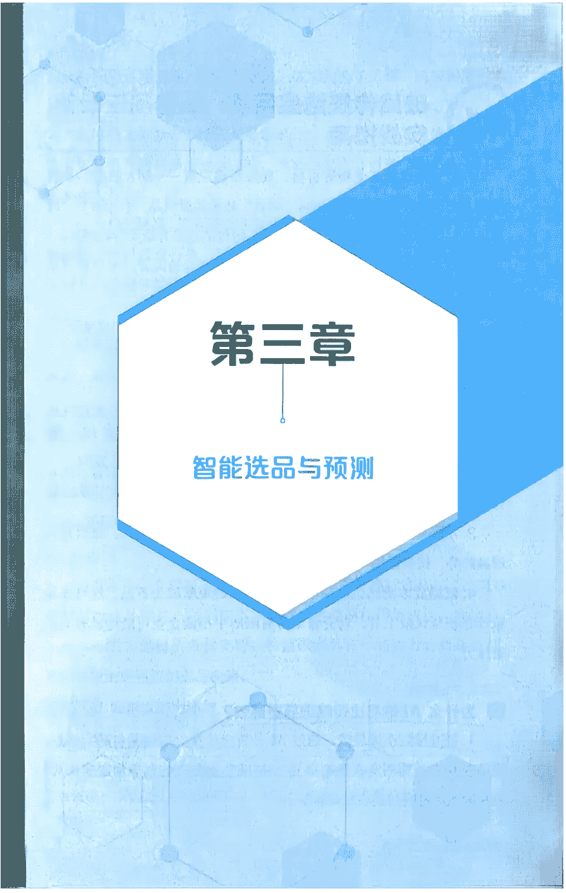

### 01 破局传统选品困境：AI 选品三板斧实战指南

一位义乌小商品老板曾苦笑，我选品靠三宝——朋友推荐、平台热搜、玄学第六感。结果囤积的"爆款"转眼成滞销品，仓库秒变"时尚坟场"。而 AI 技术的介入，将这种盲目的传统选品升级为"科学勘探"，用数据穿透市场迷雾，让选品者从跟风者变身为造风者。本节将分享如何用 AI 选好品，提高选品成功率。

选品如探矿，传统老板扛着铁锹"盲挖"，AI 却能一键生成"藏宝图"。

#### 传统选品的困境

- 1. 经验依赖性强，风险高。传统选品主要依赖老板或采购团队的"直觉"，缺乏数据支撑，易因个人偏好导致选品失败。
- 2. 数据收集与分析效率低。手动整理销售数据、竞品信息、用户评论，耗时耗力且难以全面覆盖多维数据源。
- 3. 市场预测能力薄弱。无法实时捕捉消费者需求变化，难以预判爆款趋势，错失最佳入市时机。
- 4. 试错成本高昂。新品市场表现不佳的现象较为普遍，这可能导致库存积压风险上升，对资金储备有限的中小微企业可能造成较大经营压力。

#### 为什么 AI 选品比传统选品更高效？

- 1. **精准预判市场趋势。** 通过 AI 分析全球各大电商平台的大数据，提前 3~6 个月预测潜在热销商品，帮助企业在市场竞争加剧前布局，避免因入场过晚而面临红海竞争。
- 2. **识别蓝海市场，避免价格战。** AI 通过竞争分析，能快速找到低竞争、高利润的细分市场，避免进入高度内卷的红海市场。
- 3. **提升决策效率，降低试错成本。** AI 选品可以在几分钟内完成过去需要耗费几周时间的数据分析，大幅缩短选品周期，从而降低时间成本和人力成本。
- 4. **个性化选品，匹配特定市场需求。** 基于 AI 技术的需求分析系统，通过整合用户搜索行为、社交媒体趋势等多维度数据，精准识别不同区域及消费群体的商品需求特征，从而优化选品策略，提升销售转化效率。

简单来说，AI 选品通过数据驱动实现精准决策，能有效规避市场风险，提高选品成功率！

#### AI 选品第一斧：趋势预判雷达

AI 选品第一斧：趋势预判雷达——锁定蓝海赛道。用 DeepSeek 实时检测市场动态和用户需求变化，精准锁定"还没火但即将火"的品类，避免"起大早赶晚集"。

##### AI 实战

假设你是一个即将入驻淘宝的新商家，需要进行选品。可面对种类繁多的商品类目，却不知道如何选品才能抓住市场机会。别担心，DeepSeek 能为你提供数据支持，快速识别具有市场潜力的商品类目，辅助你做出更明智的选品决策。

###### 步骤 1 筛选高潜力品类

- **提问模板（筛选爆款品类）：**

> 分析【平台名称】最近【一段时间，一般是 30 天】搜索热度上升的关键词，排除头部品牌垄断品类，筛选出 TOP10 潜在爆款品类。

- **参考指令：**

> 分析淘宝、拼多多、小红书最近 30 天搜索热度上升的关键词，排除头部品牌垄断品类，筛选出 TOP10 潜在爆款品类。

- **成果示例：**

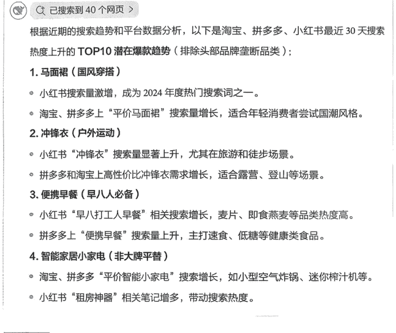

- **1. 马面裙（国风穿搭）**
  - 小红书搜索量激增，成为 2024 年度热门搜索词之一。
  - 淘宝、拼多多上"平价马面裙"搜索量增长，适合年轻消费者尝试国潮风格。
- **2. 冲锋衣（户外运动）**
  - 小红书"冲锋衣"搜索量显著上升，尤其在旅游和徒步场景。
  - 拼多多和淘宝上高性价比冲锋衣需求增长，适合露营、登山等场景。
- **3. 便携早餐（早八人必备）**
  - 小红书"早八打工人早餐"相关搜索增长，麦片、即食燕麦等品类热度高。
  - 拼多多上"便携早餐"搜索量上升，主打速食、低糖等健康类食品。
- **4. 智能家居小家电（非大牌平替）**
  - 淘宝、拼多多"平价智能小家电"搜索增长，如小型空气炸锅、迷你榨汁机等。
  - 小红书"租房神器"相关笔记增多，带动搜索热度。

###### 步骤 2 分析高潜力品类市场情况

- **提问模板（市场潜力）：**

> 分析【品类】行业的现状、未来发展潜力、消费者需求等特点。

- **参考指令：**

> 分析冲锋衣行业的现状、未来发展潜力、消费者需求等特点。

- **成果示例：**

🔍 已搜索到 50 个网页 >

####### 冲锋衣行业现状、未来发展潜力及消费者需求特点分析

######## 一、行业现状分析

1. **市场规模与增长**
   - 中国市场：2025 年中国冲锋衣市场规模已突破百亿元，年复合增长率达 10% 以上，主要受益于户外运动普及和消费升级。
   - 全球市场：预计 2025 年全球冲锋衣市场规模超 100 亿美元，亚太地区（尤其是中国）为主要增长引擎。
   - 销售渠道：线上销售占比 55%，电商平台（如天猫、京东）成为主要增长点，线下实体店向体验式消费转型。

2. **竞争格局**
   - 国产品牌主导：探路者、骆驼、凯乐石等本土品牌占据 60% 市场份额，主打性价比和本土化设计。
   - 国际品牌竞争：北面（The North Face）、哥伦比亚（Columbia）、始祖鸟（Arc'teryx）等国际品牌占据 30% 份额，聚焦高端市场。
   - 新兴品牌崛起：蕉下等互联网品牌及运动品牌（如安踏、李宁等）跨界进入，推动行业多元化竞争。

3. **产品趋势**
   - 功能创新：GORE-TEX、PTFE 等高科技面料广泛应用，防水、透气、防风仍是核心卖点。
   - 时尚化：冲锋衣从专业户外装备演变为潮流单品，亮色系、小香风、法式穿搭等风格涌现。
   - 环保材料：可持续面料（如再生聚酯纤维）需求上升，品牌推出环保系列以迎合消费者偏好。

###### 步骤 3 交叉验证真实性

在决策前，用淘宝生意参谋或小红书后台数据查看"冲锋衣"近期的搜索量和笔记互动量，确认其趋势上升的真实性。

###### 步骤 4 确定品类方向

冲锋衣未来市场潜力仍可观，是蓝海赛道，锁定该品类。

#### AI 选品第二斧：需求解剖显微镜

AI 选品第二斧：需求解剖显微镜——从差评反推精准改良。用 DeepSeek 挖掘用户真实痛点和购买原因，直击市场真实需求。

##### AI 实战

已确定选择冲锋衣品类，但面对市场上五花八门的款式和功能宣传，你不确定用户到底需要什么。如果盲目地选品或是生产可能会导致库存积压，这样既浪费时间，又白白耗费资金。接下来不妨让 DeepSeek 帮助你剖析用户真实需求。

###### 步骤 1 挖掘产品痛点

**提问模板（高频需求点）：**

> 挖掘【平台名称】上用户对【品类】的真实痛点以及购买原因，分析用户评论和讨论中的高频需求点。

**参考指令：**

> 挖掘小红书上用户对冲锋衣的真实痛点以及购买原因，分析用户评论和讨论中的高频需求点。

**成果示例：**


####### 小红书冲锋衣用户真实痛点与购买原因分析

######## 一、用户购买冲锋衣的核心原因

1. **功能性需求**
   - 防水、防风、透气：用户最关注冲锋衣的基础性能，尤其是户外爱好者，强调"暴雨不湿身""大风天保暖"等实际体验。
   - 三合一设计：可拆卸内胆的冲锋衣受欢迎，适应多种天气，如"春秋单穿外壳，冬天加内胆"成为高频评论。

2. **时尚与穿搭适配性**
   - 潮流化设计：亮色系（红、黄、渐变）冲锋衣在小红书被广泛种草，用户认为"冲锋衣不再是土味户外装，而是酷飒穿搭单品"。
   - 百搭性：用户喜欢冲锋衣与瑜伽裤、工装裤、长裙等搭配，形成"山系风""小香风"等风格，满足日常通勤和户外需求。

3. **高性价比**
   - 替代羽绒服：许多用户提到"不是羽绒服买不起，而是冲锋衣更有性价比"，认为冲锋衣能穿三季（春秋防风、冬季加绒），性价比更高。

4. **社交媒体种草效应**
   - KOL 推荐：用户被小红书博主"真实测评"和"穿搭分享"种草，尤其是"防水实测""保暖性对比"等内容影响购买决策。
   - 明星同款效应：北面、始祖鸟等品牌因明星带货成为热门选择。

######## 二、用户真实痛点

1. **功能性缺陷**
   - 不保暖：部分用户吐槽"冲锋衣只防风不保暖，冬天单穿冻成狗"，尤其是低价款填充不足。
   - 透气性差：长时间穿着后"闷汗""内衬湿透"，影响舒适度。

###### 步骤 2 定位用户需求

**提问模板（需求挖掘）：**

> 用户在购买【品类】时最关心的三个方面是什么？

**参考指令：**

> 用户在购买冲锋衣时最关心的三个方面是什么？

**成果示例：**

根据小红书的用户评论及行业分析，**用户在购买冲锋衣时最关心的三个方面如下：**

1. **功能性（核心需求）**
   - **防水、防风、透气性能：**
     - 用户高频提及"暴雨实测不渗水""大风天保暖不灌风"等场景，要求冲锋衣在极端天气下保持防护能力。
     - 对透气性的敏感度较高，部分用户吐槽"闷汗""内层湿透"，尤其是登山、徒步等长时间户外活动场景。
   - **保暖性争议：**
     - 三合一设计（可拆卸内胆）受欢迎，但低价款常被诟病"只防风不保暖"，用户期望更轻薄的保暖技术（如热反射涂层）。

2. **时尚性与穿搭适配性（新兴驱动力）**
   - **潮流化设计：**
     - 亮色系（如荧光黄、渐变紫）、拼接设计、修身剪裁成为种草关键词，"冲锋衣配瑜伽裤""山系穿搭"等搭配在小红书爆火。
     - 用户拒绝"土味户外风"，要求冲锋衣能适配日常通勤、城市休闲等场景。
   - **个性化需求：**
     - 对"撞衫率高"的吐槽明显，小众联名款、定制配色更受年轻群体青睐。

建议在小红书搜索"冲锋衣痛点"或"冲锋衣推荐"，浏览用户评论和笔记，确认高频痛点是否与 DeepSeek 的回答一致。再打开淘宝或拼多多，搜索"冲锋衣"并查看**成交量前十的商品评价**，确认用户核心关注点是否是防水、款式和价格。

在选品和设计时，优先选择防水性能优异且款式时尚的冲锋衣，同时在产品标题、详情页面和营销文案中突出这些核心卖点，直击用户痛点。

#### AI 选品第三斧：成本透视

AI 选品第三斧：成本透视——算清全链，不做冤大头。用 DeepSeek 模拟全链条成本和市场反馈，打破"老经验"和"只看进货价"的固定思维模式。

##### AI 实战

你已经确定了冲锋衣的款式和功能卖点，但面对 1688 上不同供应商的报价和市场上的激烈竞争，不知道如何选择最优供应链，也担心定价过高或过低导致利润损失。那就让 DeepSeek 帮忙算清全链条成本并优化决策吧！

###### 步骤 1 了解市场行情

**提问模板（竞争情况）：**

> 分析【平台】不同供应商的价格、质量和交货周期，以及市场上的竞争情况和价格敏感度。

**参考指令：**

> 分析 1688 上不同供应商的价格、质量和交货周期，以及淘宝、拼多多上的竞争情况和价格敏感度。

**成果示例：**

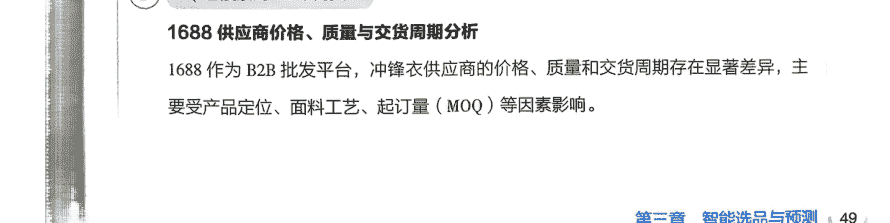

####### 1. 价格区间分析

- 低端（100~200元）：多为单层PU涂层面料，防水指数3000~5000 mm，适合日常防风防泼水需求，如"户外单层冲锋衣"批发价85~120元。
- 中端（200~300元）：三合一冲锋衣（可拆卸内胆）为主，防水指数5000~8000mm，如"杰格狼王三合一冲锋衣"标价168~238元。
- 高端（300~500元）：采用PTFE防水膜或进口面料，防水10000mm+，如"亚马逊专业冲锋衣"320~450元。

####### 2. 质量评估

| 价格区间 | 防水性能 | 透气性 | 工艺细节 | 面料真实性 |
|:---|:---|:---|:---|:---|
| 100~200元 | 短时防小雨 | 一般，易闷热 | 基础缝制，部分压胶 | 部分虚标"GORE-TEX同级" |
| 200~300元 | 中大雨防护 | 较好 | 全压胶，防水拉链 | 部分国产PTFE膜达标 |
| 300元+ | 暴雨级防护 | 优异 | 精密做工，强化易损部位 | 进口膜或高端自主研发 |

###### 步骤 2 设定合理售价

> **参考指令：**

在保证质量的前提下，如何选择性价比最高的供应商，并设定合理的售价？

> **成果示例：**

已深度思考（用时 32 秒）

在保证质量的前提下选择高性价比供应商并制定合理售价，需要一套系统化的评估体系和定价策略。以下是分步骤的解决方案：

####### 一、供应商筛选三维评估模型

1. **质量验证体系**
   - 硬性指标：要求供应商提供CNAS认证的检测报告（防水≥8000 mm，透湿≥5000 g/㎡/24h）。
   - 工艺核查：重点检查压胶宽度（≥13 mm）、缝线密度（≥8针/3 cm）等关键工艺参数。
   - 样品测试：进行5次洗涤后防水测试，性能下降不超过20%。

###### 步骤 3 交叉验证真实性

DeepSeek 的成本模拟很实用，但数据可能有偏差。建议登录 1688 实际询价，确认供应商的报价和交货周期，并在淘宝或拼多多搜索"冲锋衣"查看当前主流价格区间，确保 DeepSeek 的建议贴近现实。同时，可以在下单前，与多家厂商沟通邮寄样品并测试防水性能，并在淘宝或拼多多投放小规模广告（预算 500 元），观察该定价下的点击率和转化率，验证市场接受度。

###### 步骤 4 定位决策

通过测评，选择福建某供应商作为主要合作伙伴，同时在营销中强调防水功能性和时尚设计，确保利润与销量的平衡。

通过这三把"斧头"，你锁定了冲锋衣这一潜力品类，通过需求洞察明确了用户的核心诉求，再通过成本透视优化了供应链和定价策略。这是一个环环相扣的决策流程，让你在电商运营中不仅快人一步，更能稳操胜券。

用 AI 选品的本质是开卷考试——答案都在用户嘴里，你只需要学会提问。赶紧打开 DeepSeek，严格按照流程进行操作，第一个 AI 选品方案就诞生了！

### 02 破解跨境选品迷局

通过上一节的学习，我们已经学会利用 DeepSeek 强大的综合能力来帮助我们选品，本节我们将再深入了解跨境电商和国内电商选品的差异。无论你是刚刚踏足跨境电商领域的小老板，还是已经在国际市场上摸爬滚打多年的电商大佬，都可以根据这些步骤和公式，立马上手，提升选品的成功率，避免踩坑。

在电商江湖中，本土与跨境就像太极的阴阳两极，虽然都是做生意，但就像是在两个完全不同的赛场上比赛。像阿里巴巴国际站面对的是全球买家，而 1688 则是服务国内市场，这种根本性的市场差异决定了选品和经营策略必须来个"大转弯"。

#### 确定选品目标——从当地市场需求出发

首先，选品并非单纯挑选热门商品，而是要精准把握市场需求、趋势和消费者痛点。尤其是在商品定位、价格敏感度和文化适应性等方面有着较大的消费偏好差异。因此，跨境选品不仅仅是一个商品好坏的选择问题，更是一个精准判断市场需求和文化适应度的问题。DeepSeek 强大的数据分析能力能够帮助我们通过深入的数据分析，获取精准的市场需求信息。

##### AI 实战

确定跨境电商平台（如亚马逊、Tiktok、Temu、AliExpress 等），还有你需要经营的模式，有一件代发的跨境店，也有自行备货的本土店，本次选择跨境店进行演示。最后，需要确定你要做跨境电商的地区，例如，Ozon 是俄罗斯电商最大份额的公司。DeepSeek 会以俄罗斯市场为例进行分析。

###### 步骤 1 确定推荐品类

**提问模板（推荐品类）：**

> 我在【时间】做【平台】的【品类】店，根据当地的消费习惯、气候变化、文化背景、过往电商销售周期数据等因素，你会推荐做哪些品类？

**参考指令：**

> 我在 2025 年 4 月开始做 Ozon 的跨境店，根据当地的消费习惯、气候变化、文化背景、过往电商销售周期数据等因素，你会推荐做哪些品类？

**成果示例：**


基于俄罗斯市场的消费习惯、季节性需求、文化背景及 Ozon 平台的销售数据，以下是 2025 年 4 月起适合布局的品类推荐及具体策略分析：

- **一、季节性品类：夏季与过渡性需求**
  - **1. 夏季户外与清凉用品**
    - 防晒与露营装备：俄罗斯夏季（6-8 月）气温升高，防晒霜、太阳镜、遮阳帽等需求激增。此外，露营帐篷、野餐垫、便携式烧烤架等户外用品在春夏过渡期开始畅销。
    - 清凉家电：小型风扇、便携空调、制冷饮水机等小家电因物流成本低且适配俄罗斯夏季需求，销量表现突出。
  - **2. 家居季节性产品**
    - 防蚊用品：夏季蚊虫活跃，防蚊网、电蚊拍、驱蚊喷雾等家居防护类产品需求上升。
    - 季节性家居装饰：如轻薄的窗帘、凉席等，符合俄罗斯消费者因天气调整家居环境的习惯。

- **二、长期稳定增长的刚需品类**
  - **1. 3C 电子与智能设备**
    - 手机及配件：俄罗斯本土 3C 供应链薄弱，中国的高性价比手机、耳机、智能手表等需求旺盛，尤其注重产品功能创新（如防水、长续航等）。
    - 小家电：电动牙刷、美容仪、空气炸锅等小体积、高附加值产品更易通过物流限制，且佣金率较低。

这个问题帮助你明确用户的需求和兴趣，DeepSeek 可以帮助我们收集跨境电商平台互联网上大量数据，包括用户评价、销售趋势、竞品情况等。这些数据可以为我们提供全球市场的需求趋势。

###### 步骤 2 适当删减

DeepSeek 会推荐很多宽泛的选品，我们可以凭直觉剔除一些品类，比如已经接近夏季，防风外套、保暖内衣等可以不选，也可以从其他感兴趣的品类中进行选择。

#### 科学验证选品——步步为营地持续验证

DeepSeek 无法实时访问跨境电商网站来浏览商品数据，我们需要对这些方向做进一步的验证，确保该选品的质量。主要针对是否能一件代发（看竞品配送时间）、是否是蓝海选品（看和其他跨境店的竞争关系）、是否有利润空间（看和本土店的竞争关系）等几方面进行验证。

##### AI 实战

**步骤 1** 分别安装浏览器插件

可选择 DeepL、OZONBIGSELL、火山翻译，并注册登录这三个插件（均免费），如图 3-1。

- DeepL：帮助我们将对话内容翻译成俄文。（支持所有语言）
- OZONBIGSELL：帮助我们了解 Ozon 商品属性、费用、竞品等一系列信息。（每个跨境平台都有类似的插件，可自行检索）
- 火山翻译：帮助我们翻译 Ozon 网页上的内容。

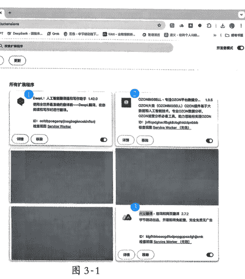

**步骤 2** 插件应用

1. 打开 DeepL 插件翻译关键字，如太阳镜。
2. 在 Ozon 上检索该关键字，如图 3-2。我们可以先看首页是否有跨境店发货的商品（送货时间在 10~15 天的），如果首页没有相关商品，那选择该品类的商品是没有竞争力的，此时，我们需要另外选择从中国发货的产品。如果发现有销量不错的单品，则进行下一步。

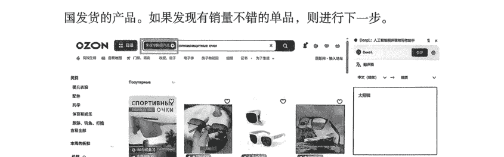

图 3-2

3. 我们需要使用 OZONBIGSELL 下载这些单品的信息。请按如下步骤操作（如图 3-3）：在右边悬浮的蓝色按钮处点击"产品查询"，在弹窗中点击"导出数据"。这样就可以获得这个关键字在 Ozon 上的首页数据，我们可以多导出几页让 DeepSeek 帮我们进一步分析这些数据。

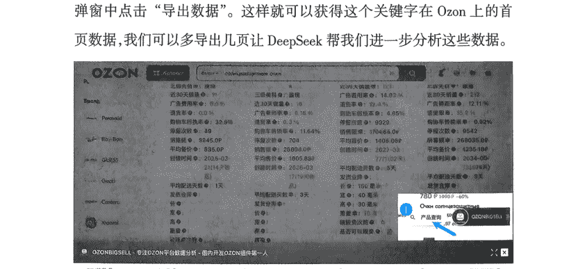

图 3-3

56 AI 搞定生意

###### 步骤 3 可行性分析

拿到该品类的在售数据后，将该数据上传到 DeepSeek，做可行性分析。前面我们已经筛选出了合适的商品，也就是说我们已经确定了可以做跨境店。接下来我们需要分析的是竞品的价格和利润，这需要用到我们之前下载的实际数据，来确定是否跟进选品。

**参考指令：**

> 根据你的建议，我现在选择太阳镜作为我跨境店的一个选品，并查阅了 Ozon 网站上中国发货的太阳镜的销售数据，请根据我提供的选品数据，分析该品是否值得作为我的一个选择。

**成果示例：**

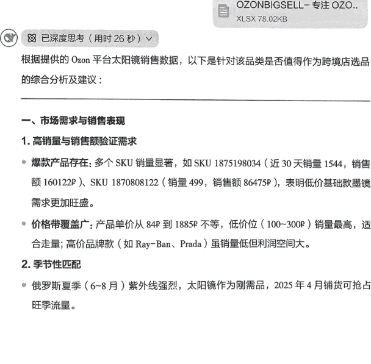

####### 二、竞争点与风险点

1. 市场竞争激烈

- 跟卖现象普遍：多个SKU被跟卖2~8次（如SKU 1893467991被跟卖3次），需通过差异化设计（如防蓝光、偏光功能）或品牌合作进行突围。
- 低价内卷严重：无品牌产品（без бренда）占比超90%，需避免陷入纯价格战。

2. 退货率与质量风险

- 部分产品退货率高：如SKU 1925062913退货率50%，SKU 1890999653退货率56.6%，需严格把控供应链质量，优化产品描述（如标注材质、UV防护等级等）。

3. 广告成本压力

- 广告费用率两极分化：部分新品广告费率超200%（如SKU 1896717192为238.47%），需精细化投放（如聚焦高转化关键词、利用Ozon促销活动）。

这时候 DeepSeek 给出的答案已经非常具有参考意义了，它具体分析了可跟进的竞品、潜在风险以及运营上的建议等，我们只需要在该基础上，在表格中筛选出合适的商品，再通过识图、文字描述等方法去 1688 等集采网站上找到同款，然后快速上架验证即可。

#### 选品方向有误——及时动态调整选择

上面介绍了整套跨境电商选品的方法，但这并不意味着我们掌握了这套方法就可以高枕无忧了。比如说：有时候 DeepSeek 一开始为我们提供了一些选品的方向，经过我们实际的验证后，发现方向是错误的，例如季节不对、竞争力不及本土店等问题，这时我们还可以通过输入其他的提示词来调整方向。

**参考指令：**

> > 智能手机壳已经有太多本土卖家在卖了，我跨境店中从中国发货的商品根本卷不过，怎么办？能不能给我推荐一些中国卖家销量高增速的品类，我不想跟本土卖家卷。

成果示例：

根据俄罗斯市场需求及中国跨境卖家的供应链优势，以下是为避免与本土卖家直接竞争、适合从中国发货的高增速潜力品类推荐及运营策略：

##### 一、避开红海赛道，聚焦"本土难替代"的垂直品类

###### 1. 智能家居与小家电

推荐理由：

- 本土供应链薄弱：俄罗斯智能家居渗透率不足 15%，本土品牌技术有限，大部分商品依赖进口。
- 高附加值 + 轻物流：产品体积小、溢价空间大，适合跨境直发。

细分方向：

- 智能清洁设备：扫地机器人配件（如专用刷头、滤网）、迷你吸尘器（如车载款）。
- 环境调控小家电：USB 加湿器（适配干燥气候）、便携空气净化器（森林火灾频发地区刚需）。
- 厨房创新工具：智能电热杯（可精确控温）、折叠电煮锅（适合租房人群）。
- 数据支撑：Ozon 平台 2024 年智能小家电类目年增速超 45%，中国卖家占比达 68%。

###### 2. 创意 3C 数码周边

推荐理由：

- 本土设计能力弱：俄罗斯消费者偏好新奇功能，但本土企业迭代速度慢。
- 低成本高毛利：配件类产品供应链成熟，可快速翻单。

细分方向：

- 办公 / 游戏场景：iPad 磁吸类纸膜（适合学生记笔记）、手机散热背夹（游戏玩家刚需）。
- 健康监测设备：蓝牙体温计（儿童家长刚需）、紫外线消毒盒（疫情过后长期需求）。
- 个性化配件：AI 图案定制手机壳（规避低价竞争）、磁吸充电宝（差异化设计）。

这样我们就又获得了有高增速且相对不那么内卷的新选品方向，在确定好新的选品方向后，我们只需要重复操作步骤一和步骤二即可。

通过以上三步选品法，我们就基本上掌握了找到高增长、低竞争的爆款密码，在选品方面可以达到事半功倍的效果。接下来我们就来聊聊本土爆款的秘密吧！

### 03 获取本土化爆款的密码

与海外市场相比，中国市场的消费者行为、文化偏好和消费场景都存在差异性，我们无法直接套用海外爆款的逻辑。例如，某卖家在出售猫窝时模仿海外"太阳能猫窝"概念，但因中国城市养宠家庭空间有限、光照不足，导致该商品的实际转化率不足0.3%。所以说，我们在捕捉本土化需求时，要结合本土平台的流行趋势，充分利用AI工具，精准捕捉并挖掘"接地气"的需求。

#### 清楚定位本土化"战场"

在开始选品之前，我们必须清晰地定义我们的目标区域和人群：是华南地区的新手父母，还是东北地区的户外爱好者，又或是江浙沪地区的精致白领？

思考以下三个问题：

1. 我们的产品／服务最适合哪个地域？（考虑气候、文化、经济水平等）
2. 该地域的哪些特定人群是我们的核心目标？（年龄、性别、职业、兴趣等）
3. 我们的资源（供应链、物流、人脉等）在哪个区域更有优势？

#### 二 搜集本土化"情报"

确定目标后，我们需要搜集该地域的独特信息。AI无法凭空创造信息，我们需要给它"喂料"。这些"料"就是反映本土特色的数据和信息来源。我们可以从以下几个方面获取：

##### 1. 社交媒体平台

**抖音/快手**：观察本地用户发布的热门内容、挑战、本地梗、方言段子等，了解他们的生活方式和关注热点。

**小红书**：搜索"地域 + 关键词"（如"广州周末去哪儿""成都小吃探店"），查看本地用户的种草笔记、生活分享、消费偏好等。

**微博**：关注本地资讯博主、同城会话题，了解本地热点事件、居民讨论热点等。

##### 2. 本地生活与点评平台

**大众点评/美团**：查看本地热门餐厅、店铺、休闲娱乐场所的评价，了解当地人的消费习惯和口味偏好。

##### 3. 电商平台

**淘宝/京东/拼多多**：在这些平台搜索框输入"地域 + 品类关键词"（如"四川特产"），查看相关推荐、商品标题中的地域性描述等。

##### 4. 本地新闻与论坛

关注本地政府官网、新闻门户网站、本地论坛（如地方性BBS），了解本地政策导向、大型活动、社区讨论热点等。

##### 5. 搜索引擎

**百度/搜狗**：使用这些搜索引擎工具，搜索"地域 + 关键词"，观察搜索趋势变化。

为了更好地讲解，我们假定小王是一位在广东做线上茶具生意的老板，他发现夏季凉茶在本地非常受欢迎。他将广东省锁定为目标市场，核心人群为注重养生、有饮凉茶习惯的 25~45 岁消费者。

基于以上的理解，小王开始搜集广东地区关于"凉茶""养生""夏季饮品"的信息，他得到了以下"线索"：

1. 在小红书搜索"广东凉茶"，发现很多用户分享自制凉茶配方、讨论不同凉茶的功效（祛湿、下火）。
2. 在大众点评发现高评价的凉茶店通常强调"真材实料""古法熬制"。
3. 本地新闻提到今年广东夏季可能持续高温。

#### 启动 AI 大脑——用 DeepSeek 挖掘洞察

现在，我们将搜集到的线索"喂"给 DeepSeek，让它帮助我们进行深度分析、趋势预测和创意生成。

##### 提问模板

###### 模板 1：区域趋势与需求分析

> **角色：**
> 你是一位经验丰富的中国市场分析师，尤其擅长洞察特定地域的消费趋势和本土化需求。
>
> **背景信息：**
> 我的目标市场是【输入目标地域】，目标人群是【输入目标人群特征】。
> 我观察到以下本地化现象 / 信息：
> 1.【输入观察到的现象 1】
> 2.【输入观察到的现象 2】
> 3.【输入观察到的现象 3】
> 4.【（可选）输入其他相关信息】
>
> **任务：**
> 基于以上信息和你掌握的市场知识：
> 1. 分析当前【目标地域】的【目标人群】在【相关品类】方面，可能存在哪些未被满足的细分需求或痛点。
> 2. 结合【目标地域】的文化特色（如饮食习惯、气候特点、生活节奏等），预测未来3~6个月内，哪些与【相关品类】相关的本土化产品或服务可能会受到欢迎。请列出至少3个具体方向。
> 3. 对每个方向，简要说明其受欢迎的潜在原因和市场机会点。
>
> **输出要求：**
> 请用清晰、结构化的方式回答，重点突出本土化特色和具体可行的机会点。

###### 模板2：本土化产品创意生成

**角色：**
你是一位富有创意的产品经理，深谙中国本土化市场需求，擅长将地域特色融入产品设计。

**背景信息：**
我计划在【输入目标地域】推出一款面向【输入目标人群特征】的【输入产品大类】。

该地区有以下显著特点：

1. 【输入地域特点1】
2. 【输入地域特点2】
3. 【输入地域特点3】
4. 【（可选）输入其他相关信息】

**任务：**

请结合以上地域特点和人群需求，为我构思 3~5 个具有【目标地域】本土特色的【产品大类】创新产品概念。

对于每个产品概念，请包含：

1. 产品名称/核心卖点（体现本土特色和优势）。
2. 目标用户场景（解决用户的什么具体问题/满足什么需求）。
3. 关键的本土化元素（如何融入当地口味、习俗、文化等）。
4. 可能的差异化优势（与市面现有产品相比）。

**输出要求：**

请确保产品概念具体、有创意，并紧密结合【目标地域】的本土特色。

###### 模板 3：本土化营销点挖掘

**角色：**

你是一位精通中国本土化营销策略的营销专家，擅长挖掘能引发地域用户共鸣的沟通点。

**背景信息：**

我准备在【输入目标地域】推广一款【输入你的产品/服务】，目标客户是【输入目标人群特征】。

已知该地区有以下显著特点：

1. 【输入地域特点 1】
2. 【输入地域特点 2】
3. 【输入地域特点 3】
4.【（可选）输入观察到的本地热议话题或流行语】

**任务：**

请为我的产品【产品名称 / 核心卖点】构思 3~5 个能精准触达【目标地域】用户的本土化营销角度或宣传口号。

**要求：**

1. 营销角度 / 口号（简洁有力，引发共鸣）。
2. 目标人群触点（适合在哪些本地化渠道或场景传播，如本地 KOL（关键意见领袖）、社区活动、特定方言内容）。
3. 沟通的核心价值点（强调产品如何契合本地需求和文化）。

**输出要求：**

营销点要接地气，能体现对【目标地域】文化和用户心理的理解。

##### 实战场景示例

我们继续以上文提到的小王使用"模板 1"向 DeepSeek 提问为例。

**参考指令：**

**角色：**

你是一位经验丰富的中国市场分析师，尤其擅长洞察特定地域的消费趋势和本土化需求。

**背景信息：**

我的目标市场是中国广东省，目标人群是 25~45 岁，注重健康养生、有饮凉茶习惯的都市人群。

我观察到以下本地化现象 / 信息：

1. 小红书上很多人分享自制祛湿凉茶配方、讨论不同凉茶功效。
2. 大众点评上强调"真材实料""古法熬制"的凉茶铺评分高。
3. 新闻预测今年广东夏季持续高温，可能比往年更加湿热。

**任务：**

基于以上信息和你掌握的市场知识：

1. 分析当前广东省的 25~45 岁注重养生人群在夏季饮品/养生产品方面，可能存在哪些未被满足的细分需求或痛点。
2. 结合广东的文化特色（如凉茶文化、汤文化、注重食材本身），预测未来 3~6 个月内，哪些与夏季养生饮品相关的本土化产品或服务可能会受到欢迎。请列出至少 3 个具体方向。
3. 对每个方向，简要说明其受欢迎的潜在原因和市场机会点。

**输出要求：**
请用清晰、结构化的方式回答，重点突出本土化特色和具体可行的机会点。

###### 成果示例：

已深度思考（用时 30 秒）

###### 一、未被满足的细分需求与痛点分析

####### 1. 便捷性与传统工艺的矛盾

- 消费者既希望保留古法熬制凉茶的养生价值，又难以投入时间自制。
- 现有即饮凉茶（如罐装产品）常被诟病"工业化口感"，难以满足对"真材实料"的追求。

####### 2. 科学化与个性化的适配缺口

- 广东人重视体质差异（如湿热、阴虚等），但市面上凉茶配方单一，缺乏针对不同体质/症状的精准解决方案。
- 年轻消费者对中医理论认知有限，需要更直观的养生指导。

####### 3. 场景延伸与体验升级需求

- 传统凉茶铺装修单一，缺乏符合都市人群审美和社交需求的消费场景。
- 高温湿热环境下，消费者对"养生＋解暑"的复合功能诉求未被充分满足。

###### 二、未来 3~6 个月潜在热门方向预测

####### 方向 1：即食型古法凉茶浓缩液/冻干粉

- **本土化特色：**
  - 结合凉茶文化中的"药材配伍"智慧，采用透明化熬制工艺（如标注药材产地、熬煮时长等），并通过现代技术实现便捷化。
- **机会点：**
  - 解决居家/办公场景中"随时随地养生"的需求，可搭配气泡水、牛奶 DIY。
  - 通过小红书/KOL 传播"3 秒复刻老铺凉茶"的体验，强化"传统但不老旧"的品牌形象。

通过 DeepSeek 的分析，小王获得了几个非常有价值，并且结合了广东本土特色和用户痛点的产品方向。

#### 四 验证与迭代——让市场说话

AI 给出的方向只是基于数据的推演，但最终是否可行，还需要经过市场验证。我们可以从以下三个方面入手。

##### 1. 小范围测试

**MVP（最小可行产品）**：快速开发一个简化版的产品概念（如制作少量手工凉茶包），通过朋友圈、本地社群进行预售或试用，收集反馈。

**线上问卷/调研**：针对目标区域用户，发布线上问卷，了解他们对 AI 生成的产品概念的兴趣度和购买意愿。

**关键词测试**：在电商平台用 AI 建议的产品关键词（如"冻干祛湿凉茶""办公室养生茶包"）投放少量广告，观察点击率和转化率情况。

##### 2. 竞品深入分析

搜索 AI 建议的产品方向，看市场上是否已有类似产品？它们做得怎么样？价格如何？用户评价如何？（可以用类似"飞瓜数据""蝉妈妈"等工具辅助分析抖音、小红书上的竞品情况）

##### 3. 数据交叉验证

再次审视百度指数、电商平台搜索量等数据，验证 AI 预测的趋势是否与实际用户行为数据相吻合。

#### 五 落地执行——打造你的本土化爆款

通过验证，确定最有潜力的产品方向后，就可以着手落地了。

**产品打磨**：根据测试反馈，优化产品配方、口味、包装设计，突出本土特色和核心卖点。

**渠道选择**：选择最适合触达目标区域用户的渠道（本地生活服务平台、区域性电商、本地社群、特定区域的线下门店合作等）。

**营销推广**：运用 DeepSeek 挖掘的本土化营销点（参考模板 3），与本地 KOL 合作，创作接地气的内容（方言、本地梗、生活场景），在目标用户活跃的平台精准投放。

**持续优化**：产品上线后，密切关注用户反馈和销售数据，利用 AI 工具持续监控本地市场动态，不断迭代优化产品和策略。

##### **注意事项：**

1. DeepSeek 及其他 AI 工具的输出仅仅是建议性的，还需要结合我们的商业判断和实际市场情况进行筛选和验证。针对每一个产品，我们需要结合实际情况进行分析。
2. 随着 AI 技术的发展，工具和平台会不断更新。我们需要保持学习和探索的心态。
3. 涉及具体数据工具（如飞瓜数据、蝉妈妈、百度指数等），我们需要自行了解其最新功能和使用方法。

**捕捉本土化爆款密码**，我们不再仅仅依靠直觉和运气。通过"明确战场 → 搜集信息 → AI 分析洞察 → 市场验证 → 落地执行"的五步法，结合 DeepSeek 等 AI 工具的强大信息处理和创意生成能力，我们可以系统性地识别并把握区域市场的差异化商机，做出更精准的商业决策。

### 04 DeepSeek 快速生成产品分析报告

在动态竞争的商业环境中，市场变化日新月异，产品生命周期持续缩短。对于中小微企业而言，实时市场监测、竞品动态追踪及消费者需求洞察已成为制定战略计划的必要前提。然而，传统的市场分析方法往往耗时费力，且专业门槛高，这让许多企业望而却步……直到 DeepSeek 的出现，它能在短时间内快速生成专业报告，为企业解决了这一难题。

#### 为什么用 DeepSeek 做产品分析？

假设你是一位电商老板，计划推出一款新的护肤品。如果按照传统方式，你需要收集大量数据、整理分析、撰写报告，可能耗费数周时间。

而 DeepSeek 的优势在于：

- 快速响应复杂需求：能够快速处理和分析复杂的数据，显著缩短报告生成时间。
- 自动整合多源数据：抓取行业报告、企业财报等公开数据并进行交叉验证。
- 一键生成可视化图表：支持导出柱状图、SWOT 分析等常用模板。

#### 如何让 DeepSeek 听懂你的需求？

许多新手在初次使用 DeepSeek 时，都会抱怨其生成的内容 "太泛"，难以抓住重点，其实这个问题的本质在于提问不够精准。如果想让 DeepSeek 真正听懂我们的需求，我们只需要记住这个黄金公式："定义目标、限定范围、明确交付。

##### 1. 锁定核心问题（5W1H 原则）

- **What**：分析什么？
- **Why**：为什么分析？
- **When**：时间范围？
- **Where**：地域范围？
- **Who**：目标人群？
- **How**：分析方式？

**错误示范**："给我一些咖啡店的数据。"

**正确示范**："请分析 2025 年上半年中国一线城市咖啡市场的增长趋势，重点关注年轻上班族的消费偏好和行为，并通过销量和用户评价进行分析。"

##### 2. 设定分析框架（用模板拆解）

DeepSeek 对结构化需求响应更精准，推荐使用"四层漏斗法"。

- **行业层**：市场规模、增长趋势、政策方向。
- **竞争层**：主要品牌、市场份额。
- **用户层**：客户画像、偏好、痛点、购买动机。
- **数据层**：关键指标、数据来源。

##### 3. 校准输出结果（3 个验证动作）

AI 生成的内容需人工进行二次审核，重点验证以下三个方面：

- **数据时效性**：检查报告中的政策、销量是否为最新版本。
- **逻辑一致性**：确保报告内容逻辑清晰，分析合理，避免前后矛盾。
- **商业洞察深度**：判断报告是否提供了有价值的洞察和建议。

##### AI 实战

假设你是一家运动手环品牌的老板，计划通过 AI 分析市场机会。以下是具体操作步骤：

**步骤 1  输入指令**

**参考指令：**

```
请按照以下框架生成 2025 年运动手环市场的分析报告：
行业层：市场规模、增长趋势、相关政策（如健康科技补贴等）。
竞争层：小米、华为、Fitbit 等品牌的市场份额对比。
用户层：年轻消费者的运动习惯、健康意识。
数据层：引用 Statista 和 IDC 的数据，需用饼图展示市场份额。
```

**步骤 2  拿到 AI 生成结果**

AI 会自动抓取相关数据，生成一份包含市场规模、主要品牌、消费者偏好等内容的报告，并提出针对性的建议，如 "推出具有社交功能的运动手环，满足年轻消费者的需求"。

**成果示例：**

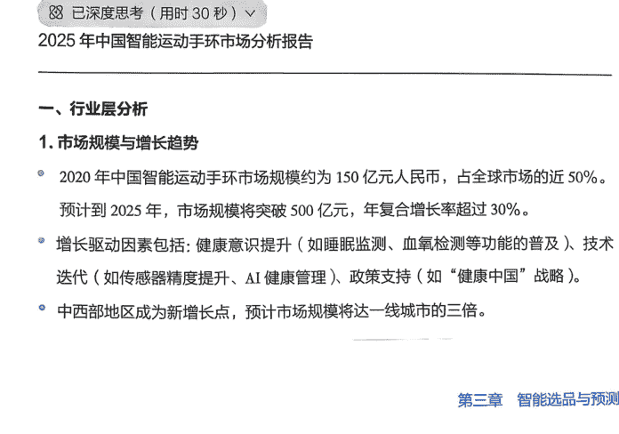

##### 2. 政策环境

- 政府通过税收优惠、研发补贴等推动智能硬件产业创新，重点支持国产芯片和传感器技术以减少进口依赖。
- 2025 年《提振消费专项行动方案》提出以旧换新政策，鼓励消费者购买智能手环等健康设备。
- 简化市场准入流程，优化审批，降低企业运营成本，加速产业链完善。

##### 步骤 3 校准优化

根据 AI 生成的报告，你可以进一步调整提示词，如"增加关于电池续航的消费者偏好分析"，让报告更贴合实际需求。

#### 进阶技巧：让报告更有"业务价值"

##### 1. 关联 KPI：在提问中绑定业务目标

如果目标是"提升某品牌市场份额 5%"，可以这样提问："请分析 2025 年上半年某品牌在目标市场的表现，重点关注市场份额变化、竞品策略及消费者反馈，并结合 KPI（市场份额提升 5%）提出改进建议。"

##### 2. 预判老板需求：加入风险预警和应对建议

如果在市场分析中发现"原材料价格上涨可能影响成本"，可以这样提问："请分析 2025 年上半年某行业原材料价格趋势，并预判其可能对成本带来的影响，同时提出应对建议，如寻找替代供应商或调整产品定价。"

##### 3. 提供针对性建议

不要只停留在分析层面，要让 AI 给出具体的行动建议，比如优化产品包装、调整定价策略、加强社交媒体营销等。

值得注意的是，DeepSeek 虽然具备强大的信息处理、分析和推理能力，但 DeepSeek 并不能真正替代我们思考。我们使用 DeepSeek 只是把一些耗时耗力的机械劳动交给 AI，让我们可以把更多的精力留给决策判断。所以说，合理利用 AI，可以为我们的业务决策提供有力支持，让市场分析不再是一件难事。还等什么呢？赶快试试吧，让 AI 成为我们的市场分析的好帮手！

### 05 抖音小店潜力爆款预测

在抖音平台高度动态的流量环境中，准确预判潜力商品是商家提升运营效能的关键。本节将带你实战演练如何结合抖音生态数据工具和 AI 大模型，精准预测并挖掘出具有爆款潜质的商品。

#### 核心思路：数据洞察 + AI 预测 = 精准选品

利用专业数据工具：捕捉抖音平台上的实时动态、热门趋势、用户偏好和竞品表现。

借助 AI（以 DeepSeek 为例）：对收集到的海量信息进行深度分析、模式识别、趋势预测，并生成具体的选品建议和策略。

#### 如何准确预测抖音爆款商品

##### 1. 明确赛道与目标用户

在开始预测前，我们必须清晰地知道：

- （1）我们的主营品类是什么？（如女装、家居日用、美妆护肤、零食、母婴等）
- （2）我们的核心目标用户画像是怎样的？（如用户年龄、性别、地域、兴趣爱好、消费习惯、刷抖音的时间段等）

##### 2. 利用数据工具，收集关键信息

（1）常用的工具有：

- ①蝉妈妈：提供抖音直播、短视频、商品等多维度数据，适合分析达人带货、爆款商品榜单、行业趋势。
- ②飞瓜数据：功能与蝉妈妈类似，也是行业内常用的数据分析平台，能够提供全面的抖音电商数据。
- ③抖店罗盘（官方工具）：抖音官方为商家提供的后台数据分析工具，重点关注自身店铺的经营数据、流量来源、商品表现、用户画像等。

（2）需要关注和收集的数据点：包含热门趋势、竞品分析、用户洞察三方面。

**热门趋势：**

- 近期飙升的商品榜单（按销量、销售额、增长率排序）。
- 热门话题、挑战、BGM（背景音乐）下关联的商品。
- 直播带货中哪些品类 / 单品正在放量。
- 搜索量快速增长的关键词。

**竞品分析：**

- 同类目下优秀竞品的特点（价格、卖点、材质、设计等）。
- 竞品的营销方式（短视频内容、直播话术、投放策略等）。
- 竞品的用户评价和反馈。

**用户洞察：**

- 目标用户近期关注的主要内容。
- 官方抖店罗盘提供的用户画像数据。

##### 3. 整合信息，用 DeepSeek 进行深度分析与预测

这是最关键的一步。我们需要将第二步中收集到的信息整理好，再结构化地"喂"给 DeepSeek，让它帮我们进行提炼、分析和预测。

##### 4. 小范围测试与快速迭代

最后，AI 会根据我们提供的信息给出相应的预测和建议。此时，我们需要将 AI 给出的高潜力选项进行小范围测试，具体执行路径如下。

- 测款：选择 1~2 款 AI 推荐的潜力产品，通过少量进货或联系一件代发的方式，以最小成本完成市场初试。
- 内容测试：制作几条不同风格、不同卖点的短视频进行投放测试，通过 DOU + 或千川等平台进行小流量投放，观察点击率、转化率、评论反馈等核心指标，确定产品方向。
- 直播测试：在直播中引入新品，观察用户互动和转化情况。
- 收集反馈：密切关注用户评论、私信，了解他们对产品的真实看法。
- 策略调整：对表现好的产品加大投入，对表现不佳的及时止损或优化调整，然后重复 "数据收集 → AI 分析 → 测试验证" 的循环。

**注意事项：**

1. 数据时效性：为确保抖音运营决策的准确性，建议采用 24 小时内更新的实时数据进行趋势分析。
2. 平台规则：选品和推广必须遵守抖音平台的各项规则和政策。

#### 用 DeepSeek 进行深度分析的提问模板

为了让 DeepSeek 更好地理解我们的需求并给出高质量的回答，我们需要使用结构化的提问方式。下面提供三个参考模板，我们可以根据自身实际情况进行微调。

##### 模板 1：趋势分析与品类机会挖掘

作为一个资深的抖音电商选品专家，请基于以下信息，为我分析【你的行业/品类，如女装/家居日用】领域在未来【时间范围，如 1~3 个月】内可能出现的爆款和潜力细分品类。

已知信息：

1. 目标用户画像（描述你的目标用户，如 25~35 岁女性、一二线城市、注重性价比和款式、常在晚上 8~10 点刷抖音）
2. 近期抖音趋势（列举你观察到的相关趋势，如"美拉德"穿搭风持续火热、便携式小家电搜索量上升等）
3. 数据平台观察（简述你在蝉妈妈、飞瓜等平台看到的现象，如某款商品本周销量飙升 300%、关键词搜索指数增长）
4. 竞品动态（描述主要竞品在推什么，如竞品 A 主推某某材质，评价反馈集中在某某方面）

请帮我分析：

1. 结合以上信息，哪些细分品类或产品特性最有可能成为下一个爆点？
2. 是否存在尚未被满足的用户需求或市场空白点？
3. 有哪些潜在的"黑马"产品值得关注？请说明理由。

##### 模板 2：特定产品潜力评估与优化建议

我正在考虑在我的抖音小店上架一款【具体产品名称或描述，例如：可折叠便携式电热水壶】，目标用户是【你的目标用户画像】。

已知信息：

1. 产品特点（列出产品的主要卖点、材质、规格、预估价格等）
2. 市场观察（描述你了解到的市场情况，如目前抖音上已有某某款类似产品，销量最好的是某某品牌，价格区间，用户评论主要关注便携性、烧水速度和安全性）
3. 我的优势/资源（如有某某供应链优势、可以配合某某内容形式推广）

请作为抖音爆款打造专家，帮我评估这款产品的爆款潜力，并提出相应的优化建议：

1. 这款产品在当前抖音环境下成为爆款的可能性有多大？（请从市场需求、竞争格局、产品独特性等方面分析）
2. 如果要提升爆款概率，我可以在产品设计、功能、定价或营销角度做哪些优化？
3. 针对这款产品，有哪些创新的短视频内容或直播带货的切入点建议？

##### 模板 3：爆款元素组合与创意生成

假设你是一位熟悉抖音爆款逻辑的产品策划师。我希望为【你的行业/品类】的【目标用户画像】开发一款潜力爆款。

请结合以下可能的爆款元素/趋势：

- 元素 1：【如国潮文化】
- 元素 2：【如情绪价值/解压】
- 元素 3：【如便携/多功能】
- 元素 4：【近期抖音热点或流行梗，如"听劝"】
- 元素 5：【特定材质或工艺，如环保材料】

请帮我构思 3~5 个具体的、可能在抖音上受欢迎的产品概念。每个概念请包含：

1. 产品名称/描述。
2. 核心卖点（需要上述元素）。
3. 目标用户痛点/痒点。
4. 初步的定价区间建议。
5. 简要说明为什么这个概念可能在抖音火起来。

合理利用 AI 处理数据，将会是未来抖音电商成功的关键。通过本节介绍的方法，将数据工具的洞察力与 DeepSeek 等 AI 的分析预测能力相结合，我们将能更精准地把握市场动向，发现并打造出属于自己的抖音小店爆款，让 AI 真正成为能够帮助我们搞定生意的得力助手！

---

## 第四章

## 低成本获客：流量革命

#### 01 传统流量的五大致命伤

在如今这个竞争激烈的商业环境中，流量已然成为企业生存与发展的核心命脉。再优质的产品，没有流量支撑，也难逃被市场埋没的命运。在过去，企业通过传统方式获取流量，但其背后暗藏5个致命伤。本节将深入剖析传统流量的痛点，直击底层逻辑，为后续 AI 赋能获客策略提供现实依据。

##### 致命伤 1：流量成本攀升，利润空间被压缩

电商从业者普遍反映，平台广告费用逐年上涨，ROI（投资回报率）却持续走低。以淘宝直通车为例，单次点击成本从数年前的 0.5 元飙升至 3~5 元，中小商家利润被严重侵蚀。其本质就是流量红利消退，平台垄断加剧。当商家数量远超流量供给时，平台通过竞价机制抬高广告价格，商家被迫陷入"内卷式"竞争。

破局：利用 AI 赋能精准营销。通过用户画像分析、行为预测等技术，实现广告定向投放，降低无效曝光，提升转化效率。

##### 致命伤 2：客户留存率低，复购转化乏力

实体店活动期间人潮涌动，活动结束后门可罗雀；电商平台用户一次性消费后难以二次触达，复购率普遍低于 10%。其本质就是传统流量缺乏用户黏性。商家与用户仅建立单次交易关系，未能形成长期价值连接。

破局：利用 AI 驱动私域运营。构建用户标签体系，通过个性化推荐、会员分层管理等方式，增强用户黏性，提升复购转化（例如，根据用户偏好推送定制化商品）。

##### 致命伤 3：流量精准度不足，转化效果大打折扣

当我们在社交媒体平台投放广告时，容易出现引流成本高昂但转化率低下的局面。例如，抖音信息流广告点击率高，但实际购买用户不足 1%。其本质就是流量质量参差不齐。传统投放偏向粗放式定向投放（如年龄、地域等），忽视用户的真实需求与行为特征。

破局：利用 AI 实现精准匹配。通过分析用户评论、搜索关键词，挖掘潜在需求，实现"千人千面"的内容推送（例如，针对"敏感肌"用户推荐温和型护肤品）。

##### 致命伤 4：过度依赖平台，抗风险能力薄弱

电商商家容易因平台规则调整（如搜索权重变化）导致流量骤降，业务遭受重创。例如，2022 年某平台算法更新后，部分商家搜索排名下降 50% 以上。其本质是商家沦为平台规则的被动适应者，缺乏自主获客能力。

破局：利用 AI 构建私域流量池。通过企业微信、小程序等工具，将用户沉淀至自有渠道，实现"去平台化"运营（例如，用户扫码加入社群，享受专属福利）。

##### 致命伤 5：数据孤岛现象严重，决策缺乏科学依据

现在多数企业仍依赖 Excel 手动统计用户数据，数据维度单一、分析效率低下。例如，某实体店仅统计每日客流量，却无法追踪用户消费轨迹，其本质是数据资产未被有效利用。传统获客模式下，各渠道数据割裂，难以形成全局洞察。

破局：利用 AI 实现数据整合与分析。通过跨平台数据采集、自动化报表生成，为企业提供用户画像、转化漏斗等可视化分析工具（例如，利用 AI 生成用户行为热力图，直观呈现高转化区域）。

你是否也在被传统流量的5大致命伤所困扰？别担心，AI技术给我们带来了突破性解决方案，它为我们提供了低成本、高效率、精准触达的全新获客方式。在接下来的内容里，让我们一起探索如何用AI赋能业务，开启低成本获客的新篇章！

### AI 流量矩阵搭建

#### 02 搜索流量：智能 SEO 玩法

上一节我们剖析了传统流量的5大致命伤，很多老板可能容易心里发慌："难道只能眼睁睁看着流量成本越来越高？"其实，AI驱动的智能流量矩阵，正在让"小预算撬动大效果"成为现实，能让你用"便利店的预算"做出"连锁店的效果"。本节将围绕搜索流量、内容流量、社交流量这三大核心板块，教会你如何构建一个全方位、多层次的流量生态，让你的流量犹如泉涌！

##### 传统 SEO 与智能 SEO

###### 1. 什么是传统 SEO

简单来说，传统 SEO（Search Engine Optimization）就是通过一系列技术和策略，优化你的网站或内容，使其在搜索引擎（主要是指百度、搜狗、360搜索等）的自然搜索结果中获得更高的排名，从而吸引更多免费、精准的潜在客户。它主要包含以下四个操作要素。

**关键词：** 用户在搜索框里输入的词语。即用户会搜索什么关键词来找到你的产品。

**内容质量：** 提供有价值、原创、与关键词高度相关的内容。

**网站技术优化：** 网站结构、加载速度、移动端适配性等。

**外链建设：** 其他高质量网站指向你的链接。

传统SEO需要持续投入时间和精力，需要高薪的SEO工程师，对于不具备专业团队的中小微企业来说，门槛较高，见效较慢。

###### 2. AI驱动的智能SEO：新时代的流量密码

现如今，搜索引擎时代渐渐转变为平台时代，"种草"搜小红书，购物搜拼多多、淘宝，教程搜抖音，解决问题搜大模型。AI，尤其是大语言模型（如DeepSeek），正在改变SEO的游戏规则。

**更懂用户意图：** AI能更精准地理解用户搜索查询背后的真实需求，而不仅仅是匹配字面关键词。

**内容创作加速：** AI可以辅助甚至主导高质量内容的生成，极大降低内容创作的成本和时间。

**个性化与预测：** AI可以分析用户行为，预测搜索趋势，帮助你提前布局内容。

**数据分析洞察：** AI能快速处理大量数据，从中提取优化建议。

**长尾流量：** 指那些搜索量不高但非常具体、转化意图明确的搜索词组合（通常是三个词以上）。例如，相比"女鞋"，"夏季透气小白鞋女学生推荐"就是长尾词。单个长尾词流量小，但无数长尾词汇汇集起来的流量巨大且精准。AI极大地简化了发现和覆盖这些长尾需求的过程。

智能 SEO 的核心优势是利用 AI 提升效率和效果，特别是挖掘和满足"长尾流量"。

##### 以小红书为例，教你玩转智能 SEO

如今，小红书已经不仅仅是一个分享平台，它更是一个强大的生活方式搜索引擎和"种草"决策入口。很多用户在这里主动搜索信息，也被动接受推荐。因此，掌握小红书平台的 SEO 对于低成本获客至关重要。

运用 AI 特别是 DeepSeek，从选题、关键词、内容创作到发布互动，全流程优化你的笔记，让它们更容易被目标用户搜到和看到，最终实现高效"种草"和引流。

###### 1. 掌握小红书的平台规则

小红书的平台规则主要体现在搜索与推荐的双重逻辑上。要想在小红书获得流量，首先要明白它的内容分发机制。它并非单一的搜索排名，而是"搜索 + 推荐"双轮驱动。

- **主动搜索：** 用户在顶部搜索框输入关键词查找特定内容。笔记标题、正文、话题标签中包含的关键词，将直接影响搜索结果的排序。
- **个性化推荐：** 用户在首页 Feed 流中看到的内容，是平台根据用户的兴趣标签、互动历史、停留时长等进行推送的。优质、高互动率的笔记更容易进入推荐池，获得爆发性的流量。

###### 2. 影响笔记"命运"的关键因素

- **关键词匹配度：** 笔记内容（标题、正文、标签等）与用户搜索词的匹配度。
- **内容价值与质量：** 相关评价标准主要有内容是否为原创，能否提供实用信息（教程、测评、经验）、情感价值（共鸣、治愈）或娱乐价值，图文是否精美，视频的清晰流畅程度等。
- **用户互动数据（核心指标）：** 点赞、收藏（极其重要）、评论、分享。尤其是笔记发布初期的互动率，将直接影响后续推荐量。
- **账号垂直度与权重：** 通过长期深耕某一领域、持续发布优质内容、积极与粉丝互动等方式，可以提升账号的权重。
- **话题标签：** 帮助平台理解内容分类，连接对该话题感兴趣的用户。
- **时效性与热点：** 结合季节性需求或当下热点发布内容，更容易获得关注。

##### AI 实战

###### 步骤 1 精准定位，深耕你的"一亩三分地"

平台鼓励内容垂直细分。找准一个你擅长的领域或产品所属的领域持续深耕，更容易建立账号标签和用户认知。

**提问模板（账号定位）：**

> 我准备在小红书上聚焦【业务内容】领域，我的初步目标用户是【初步设想的用户特征】。请帮我分析：
> 1. 这个领域/定位在小红书上的竞争激烈程度如何？
> 2. 这类目标用户在小红书上通常关注哪些具体话题？
> 3. 他们常用的搜索词可能有哪些特征？
>
> 请给我一些建议，帮助我更精准地切入这个领域。

**参考指令：**

> 我准备在小红书上聚焦手工皮具制作领域，我的初步目标用户是追求生活品质的手工爱好者。请帮我分析：
> 1. 这个领域/定位在小红书上的竞争激烈程度如何？有哪些主要的细分方向？
> 2. 这类目标用户在小红书上通常关注哪些具体话题？喜欢什么样的笔记风格（如干货教程类、情感分享类、精美图文展示类）？
> 3. 他们常用的搜索词可能有哪些特征（如更偏向疑问句、喜欢看测评）？
>
> 请给我一些建议，帮助我更精准地切入这个领域。

**成果示例：**

- 一、竞争激烈程度与细分方向分析
  - 1. 竞争激烈程度
    - 数据显示，小红书家居类内容在 2023~2024 年搜索量增长 403%，而手工皮具作为家居/时尚领域的垂直品类，用户需求持续增长，尤其是追求个性化和品质的消费群体。
  - 竞争特点：
    - 头部品牌较少：市场以中小品牌和个人工作室为主，缺乏垄断性品牌，但部分原创设计师账号（如"匠心皮具坊"等）已积累一定粉丝。
    - 内容同质化：多数账号集中于基础教程或成品展示，缺乏深度场景化、情感化内容。
    - 平台监管趋严：小红书近期重点打击水军营销和低劣内容，强调真实用户分享，对合规的原创内容更友好。
  - 2. 主要细分方向
    - 手工皮具制作可聚焦以下差异化细分领域：
    - 高端定制：针对婚庆、商务礼品等场景，强调"一对一设计""私人定制"服务。
    - 环保可持续：使用植物鞣革、再生皮革等环保材料，契合年轻用户群体对可持续消费的关注。
    - 小众风格：如复古风、极简主义、二次元联名设计等，满足细分审美需求。
    - 功能性产品：例如防猫抓皮具、多功能收纳包，兼顾实用性与设计感。
    - 教学与工具评测：针对新手用户的工具选购指南、工艺技巧进阶课程。

###### 步骤 2 挖掘热门关键词

小红书关键词的特点是口语化、场景化、情绪化，包含大量长尾词、疑问句。用户不只是搜产品，更是搜解决方案、搜体验、搜灵感。

**平台内挖掘**：利用小红书搜索框的下拉联想词和相关搜索、观察热门笔记的标题和标签用法、关注官方发起的话题活动，更好地挖掘出热门关键词。

> 提问模板（生成标题及关键词）：
我的小红书账号专注于【你的细分领域】。目标用户是【用户画像】。
请帮我生成一批适合在小红书笔记标题、正文和话题标签中使用的关键词和短语。要求：
1. 包含用户痛点/需求。
2. 包含场景化描述。
3. 包含情绪/效果词。
4. 表达形式多样。
请至少生成【几】个，并简单分类。

**参考指令**：

> 我的小红书账号专注于一人食快手菜谱。目标用户是经常加班的年轻独居白领。请帮我生成一批适合在小红书笔记标题、正文和话题标签中使用的关键词和短语。
要求：
1. 包含用户痛点/需求（如省时、健康、简单易学等）。
2. 包含场景化描述（如下班后、周末宅家等）。
3. 包含情绪/效果词（如治愈、幸福感、手残党也能做）。
4. 表达形式多样，包括长尾词、疑问句、口语化表达等。
请至少生成 20 个，并简单分类（如痛点类、场景类、效果类、教程类）。

###### 成果示例：


----- 痛点需求类 -----

1. 下班累瘫还要开火？
2. 独居怎么吃才不凑合？
3. 厨具不全也能做
4. 拒绝外卖焦虑症
5. 冷冻食材急救指南（长尾 + 场景）
6. 租房党必备懒人食谱（痛点 + 场景）

----- 场景具象类 -----

7. 深夜加班回家 10 分钟吃上热乎饭
8. 出租屋小厨房食谱定制计划
9. 微波炉拯救计划（电器场景）
10. 周末备菜冷冻公式
11. 电饭锅的隐藏技能
12. 一人食不浪费精确用量表

----- 情绪效果类 -----

13. 有手就会的治愈系料理
14. 锅气带来的幸福感
15. 社畜的精致倔强
16. 零翻车手残友好
17. 仪式感不费劲
18. 空盘行动的成就感

###### 步骤 3 玩转话题标签

利用标签可以对内容进行精准分类，有效锁定目标受众，提升垂直流量的触达效率，是精准引流的"路标"。一般使用 3~10 个标签为宜。可以用组合的方式，如大类目标签加细分精准标签加内容主题标签加品牌/活动标签（可选）。

88 AI 搞定生意

###### ●提问模板（智能标签推荐）：

这篇小红书笔记的核心内容是关于【笔记内容概要】，关键词是【关键词1】【关键词2】。请帮我推荐 8~10 个合适的小红书话题标签。请组合推荐，包含：

1. 1~2 个大的行业/品类标签。
2. 3~5 个更精准的细分标签。
3. 2~3 个与笔记具体内容紧密相关的标签。

###### 参考指令：

这篇小红书笔记的核心内容是关于"春季敏感肌护肤心得"，关键词是"敏感肌修复"、"保湿面膜"。请帮我推荐 8~10 个合适的小红书话题标签。请组合推荐，包含：

1. 1~2 个大的行业/品类标签（如 #护肤）。
2. 3~5 个更精准的细分标签（如 #敏感肌修复）。
3. 2~3 个与笔记具体内容紧密相关的标签（如 #空瓶记、#xx 精华测评）。

###### 成果示例：

⊙ 🧠 已深度思考（用时 30 秒）

###### 行业/品类标签（2 个）

#护肤、#春季护肤

（泛流量入口，覆盖基础人群 + 季节热点）

###### 精准细分标签（5 个）

#敏感肌修复、#换季护肤、#保湿面膜推荐

#屏障修护、#干敏皮护理

（痛点场景 + 功效 + 产品类型精准锁定目标用户）

###### 内容强相关标签（3 个）

#空瓶记、#护肤心得、#春日护肤计划

（强化内容属性，增加同类笔记曝光率）

###### 优化技巧

1. 产品关联：若笔记提及具体面膜品牌，可将 #保湿面膜推荐 替换为 #XX面膜实测（如 #理肤泉面膜实测）。
2. 痛点升级：增加 #烂脸急救、#红血丝护理 等具象化标签，吸引精准流量。
3. 热点借势：可根据时令季节穿插时令标签（如 #樱花季护肤、#三八节礼物等）。

在小红书这个内容生态里，"酒香也怕巷子深"。优质内容必须结合精准的运营策略，才能突破流量壁垒，直达目标用户。我们可以从以下几个方面展开。

**思维转变：** 从"发布"思维转变为"内容发现优化"思维。研究平台算法与用户需求，再进行针对性创作，让内容自带流量基因。通过关键词布局、标签优化和互动运营，主动引导推荐系统，增加曝光机会。

**AI 是加速器：** DeepSeek 等 AI 工具是功能强大的选题库、文案助手、数据分析师，能极大提升在小红书内容创作和优化上的效率与效果。

**持续优化：** 小红书的算法和用户偏好在不断变化，在实践中要保持学习，持续测试、分析、优化已有策略。

掌握 AI 驱动的小红书内容优化方法，能让我们在这个以"种草"为核心的平台以更高效率触达精准客户，实现降本增效的商业转化。实践出真知，现在就开始动手尝试吧！

##### 三 其他平台的智能 SEO 应用

不同平台的搜索逻辑和用户习惯不同，智能 SEO 的侧重点也应有所区别。以下列出了除小红书外其他平台的一些攻略，提供参考。

###### 第一类 内容平台（抖音、知乎、哔哩哔哩等）

**特点：** 用户搜索的目的更多是寻找经验、攻略、测评、知识、娱乐等。平台算法更侧重内容质量、用户互动（点赞、评论、收藏、完播率）和账号权重。

**智能 SEO 玩法：** 重点研究平台内的热搜词、话题标签。利用 AI 挖掘符合平台风格的选题和关键词。

> ●**提问模板**（内容类平台选题）：
我是【身份/业务】，目标用户是【用户画像】。请结合最近【平台名称】上的热门趋势，为我策划 5 个关于【产品/服务】的内容选题。要求选题能吸引用户点击和互动，并自然融入关键词【核心关键词】。请给出标题和简单的内容方向。

在内容创作方面，AI 可以辅助生成笔记文案（小红书）、视频脚本（抖音）、回答草稿（知乎），可重点优化标题和开头，吸引用户注意力。注意内容要有用或有趣。

> ●**提问模板**（小红书笔记初稿）：
请帮我写一篇小红书笔记初稿，主题是【选题标题】。目标是吸引【目标用户】使用我的【产品/服务】。请使用小红书流行的表达方式，加入适当的表情符号，包含关键词【关键词1】【关键词2】，并在结尾引导用户【行动呼吁，如发表评论/点击链接/私信咨询】。注意排版，多分段。

发布内容的优化，需合理使用平台推荐的标签；封面/首图设计吸引用户；发布时间卡点（根据你的用户活跃时间）。

做好互动与维护，积极回复评论，提高内容热度。利用 AI 分析评论，了解用户反馈和新需求。

###### 第二类 纯电商平台（淘宝、拼多多、京东等）

**特点：** 用户搜索目的明确，主要是为了购买商品。平台算法核心围绕商品转化率（点击率、收藏加购率、购买转化率等）。

**智能 SEO 玩法：** 关于平台内关键词的研究，可以先借助一些工具如生意参谋（淘宝、天猫）、多多情报通（拼多多）、京东商智等进行预处理，在生成关键词列表时应高度关注搜索词、关联词、飙升词、转化率高的词；再利用 AI 进行辅助，将官方工具导出的关键词列表交给 DeepSeek 进行进一步处理，让其进行分类、组合或生成更符合口语化、场景化的长尾标题。

##### 提问模板（生成标题）：

> 我的产品是【产品名称和核心特点】。目标用户是【用户画像】。请根据以下关键词列表【从电商平台工具导出的核心词、属性词、长尾词列表】，帮我组合生成 10 个符合【平台名称】要求的商品标题。要求标题包含尽可能多的有效关键词，同时语句相对通顺，突出卖点。

标题优化是重中之重，在平台允许的字数内（如淘宝一般为 60 个字符/30 个汉字），尽可能多地包含精准、高相关性的关键词。组合方式通常是：核心词加属性词加场景词加修饰词/卖点词。

##### 提问模板（优化现有标题）：

> 这是我目前在【平台名称】使用的商品标题【粘贴你的旧标题】。对应的核心关键词是【列出核心词】。请帮我分析这个标题的优缺点，并提供 5 个优化后的新标题建议，要求更符合平台搜索规则，能带来更多流量。

商品描述优化虽然对搜索排序影响小于标题，但优质描述能提高转化率。AI 可以帮助生成卖点突出、条理清晰的描述文案。

##### 提问模板（生成商品描述）：

> 请为我的【产品名称】撰写商品详情页的描述文案。主要卖点包括【卖点 1】【卖点 2】【卖点 3】。目标用户是【用户画像】。请分点介绍产品特点、使用场景、规格参数等。语气要注意【语气风格】。

总之，对于中小微企业和自媒体人而言，完全依赖传统、手动的 SEO 方法既耗时又昂贵。AI 的出现，特别是像 DeepSeek 这样强大的语言模型，为我们提供了一个强大的"外脑"和"助手"。学习并掌握这套方法，有助于我们在流量成本日益高涨的今天，以更低的成本和更高的效率精准搜索流量，最终实现"搞定生意"的目标。

#### 03 内容流量：全媒体矩阵

在如今的数字时代，单一平台的流量红利逐渐消退，构建覆盖广泛、相互协同的全媒体流量矩阵成为企业和个人品牌持续增长的关键。然而，管理多个平台、创作差异化内容、追踪效果并优化策略的过程，耗时耗力。AI 的崛起为这一挑战提供了全新的解决方案。本节将深入探讨如何理解主流媒体平台的差异化特性，并利用 AI 技术高效赋能全媒体矩阵的搭建与运营。

##### 一 理解基石——主流媒体平台的特点与差异

搭建全媒体矩阵的第一步是深刻理解各个平台的独特特性。不同的平台拥有不同的用户画像、内容生态、分发逻辑和互动方式。只有理解这些差异，才能制定出精准的平台策略，让内容在合适的土壤里生根发芽。

以下是当前部分主流媒体平台的特点与差异化分析，如表 4-1：

##### 表 4-1 主流媒体平台特点及差异化分析表

| 平台名称 | 类型 | 用户画像 | 算法特点与分发逻辑 | 商业化潜力 | 核心优势/定位 |
|:---|:---|:---|:---|:---|:---|
| 微信公众号 | 社交/内容发布 | 覆盖广泛，熟人社交关系链，用户黏性高 | 订阅制为主，社交推荐、看一看推荐为辅 | 内容付费、广告 | 深度内容沉淀、私域流量运营、用户信任度高 |
| 微信视频号 | 短视频/直播 | 依托微信生态，用户基数大，中老年用户渗透率高 | 强社交推荐（好友点赞）、兴趣推荐 | 直播带货、广告 | 链接微信生态（公众号、小程序、社群）、社交裂变快 |
| 抖音 | 短视频/直播 | 年轻用户为主，一二线城市渗透率高，用户活跃 | 强算法推荐（兴趣匹配），流量中心化明显 | 直播带货、广告 | 强娱乐性、爆发力强、用户沉浸时间长 |
| 快手 | 短视频/直播 | 用户下沉较好，社区氛围浓厚，"老铁文化" | 算法推荐 + 社交关注（普惠原则，更侧重普通创作者） | 直播带货、广告 | 社区黏性高、信任电商基础好 |
| 小红书 | 生活方式/"种草"社区 | 女性用户为主（占比高），一二线城市年轻用户居多 | 搜索 + 推荐，内容真实性、实用性要求高 | 广告、品牌合作 | "种草"心智强、消费决策影响力大、用户质量高 |
| 哔哩哔哩 | 视频社区 | 年轻用户（Z世代）为主，兴趣圈层分明，用户黏性强 | 兴趣推荐、关注动态、社区互动驱动 | 广告、会员、直播 | 独特的社区文化、内容质量要求高、用户忠诚度高 |

续表

| 平台名称 | 类型 | 用户画像 | 算法特点与分发逻辑 | 商业化潜力 | 核心优势/定位 |
|:---|:---|:---|:---|:---|:---|
| 微博 | 社交/媒体平台 | 用户覆盖广，热点事件发酵地 | 热搜驱动、社交关系链传播、信息流推荐 | 广告、品牌活动 | 热点追踪快、公共议题讨论场、传播速度快 |
| 知乎 | 问答/知识社区 | 高学历、专业人士占比较高，求知欲强 | 搜索+推荐，内容专业性、深度要求高 | 内容付费、广告 | 专业知识分享、深度内容讨论、建立专业形象 |

##### AI 赋能——智能化搭建全媒体矩阵

充分了解各平台特性后，如何高效地为不同平台定制内容并进行有效分发？这正是 AI 的强项。它可以从内容创作、策略优化等多方面赋能全媒体矩阵的搭建，实现跨平台的高效运营。

##### AI 实战

**步骤 1** 创作可以进行跨平台分发的内容

提问模板（跨平台内容创作）：

> 请基于【平台 1】和【平台 2】的差异，生成一篇关于【主题】的【内容形式】内容，并适配两个平台的特点。

参考指令：

> 请基于抖音和微信平台的差异，生成一篇关于"春季护肤指南"的图文内容，并适配两个平台的特点。

第四章 低成本获客：流量革命 95

成果示例：

> 封面标题：春季护肤 3 分钟速成！跟黑头、敏感肌说拜拜
一、清洁为王！温水 + 氨基酸洁面
1.画面：对比冷水/热水洗脸的皮肤状态，展示氨基酸洁面乳泡沫细腻的特写。
2.文案："春季油脂分泌翻倍！温水 + 氨基酸洁面，温和去油不伤屏障。"
3.动作：手势演示打圈按摩手法，字幕提示"T 区重点清洁 20 秒！"
二、急救补水！"三明治"湿敷法
1.画面：化妆棉浸透保湿水，分层贴满脸部（动态加速）。
2.文案："干敏皮救星！化妆水拍 3 层，深层补水不黏腻。"
3.产品推荐：展示含透明质酸、B5 成分的平价化妆水（贴图品牌 Logo）。
结尾互动："你的春季护肤难题是？评论区揪人送同款防晒喷雾！"
标签:# 春季护肤、# 素颜神器、# 沉浸式护肤

输出分析：

抖音：短平快、视觉冲击强、节奏紧凑，搭配热门 BGM 和动态文字，重点突出实用技巧。

微信：深度解析 + 专业建议，图文并茂，适合收藏转发。

###### 步骤 2 运营一段时间后优化迭代

- **提问模板（内容优化）：**
根据导入的【平台数据反馈】，调整【内容发布策略/互动策略】以提升【流量/用户互动率】。

- **参考指令：**
（导入数据后）根据导入的小红书平台的数据反馈，调整内容发布策略以提升用户互动率。

###### 成果示例:

根据小红书美妆博主 3 月互动数据分析，以下是内容策略调整建议，以提升用户互动率：

####### 1. 聚焦高互动内容类型

- 教程类内容表现突出："眼线教程""春日清新妆容教程"等教程类笔记互动率（点赞 + 评论 + 分享/浏览量）普遍高于推荐类。例如：
    - "春日清新妆容教程，秒变甜妹"（浏览量 9958，互动率 51.1%）
    - "眼线教程，画出迷人电眼"（浏览量 8455，互动率 71.8%）
  建议：增加妆容步骤拆解、实用技巧类教程，标题强化"教程""手把手"等关键词。
- 痛点解决类内容更易传播："神仙底妆大法，持妆一整天""修容秘籍"等解决用户痛点的内容分享率较高。
  建议：围绕"持妆""急救""懒人技巧"等场景设计内容，突出实用价值。

####### 2. 优化重复主题的发布策略

- "绝美腮红搭配"标题复用频繁，但数据波动大：最高互动率笔记（浏览量 8004，互动率 42.3%）与最低（浏览量 1606，互动率 0%）差异显著。
  建议：
    - 避免同标题重复发布，改用差异化标题（如黄皮必看！腮红选色技巧）。
    - 结合季节/热点调整内容（如春日腮红叠涂法）。
- "卸妆好物分享"互动依赖产品亮点：高互动笔记多强调"温和""干净"等关键词，但部分笔记评论数偏低。
  建议：增加成分对比、实测视频，或发起"卸妆痛点"投票，引导用户讨论。

###### 输出分析:

根据 DeepSeek 输出的内容，我们可以进行以下方面的运营调整：

分析用户互动数据：识别出高互动率的内容类型和发布时间。

针对高互动率的内容类型：增加发布频率和深度，如增加产品评测、使用心得等内容的比例。

**优化发布时间**：选择在用户活跃度高的时间段发布内容，如晚上 8 点至 10 点。

**利用AI生成个性化回复**：提高用户评论和私信的响应速度和质量。

搭建全媒体流量矩阵是一项系统工程，而 AI 的融入，可以极大地提升这一过程的效率和效果。通过了解平台差异制定策略，再利用 AI 在内容策划、创作、优化、分发和分析等环节的赋能，品牌和个人可以更智能、高效地构建起强大的流量生态并实现持续增长。

#### 04 社交流量：裂变加速器

在前文探讨了基于内容和平台的流量矩阵构建后，我们必须关注一种具有独特爆发潜力的流量类型——社交流量。与依赖算法推荐或用户主动搜索的流量不同，社交流量根植于人际关系网络，通过用户的自发分享和推荐实现传播，如同细胞裂变般指数级增长，因此被称为"裂变加速器"。

社交流量的本质是利用社交关系链进行信息扩散，其核心逻辑是信任与传播。当用户将内容分享到自己的社交圈时，内容便触达了他们的好友或关注者。这种基于熟人或信任关系的传播，往往比纯粹的广告或算法推荐具有更高的触达效率和转化潜力。

##### 社交流量裂变的关键机制

1. 价值驱动分享：内容本身具有足够的价值，如实用性、趣味性、情感共鸣、独特性等，能够增加用户主动分享的意愿。

2. 利益驱动分享（裂变活动）：设计激励机制，鼓励用户通过分享行为获得某种奖励或权益，如优惠券、红包、解锁内容、参与抽奖等。这是最常见的"裂变"玩法。

3. 社交货币驱动：分享的内容能够帮助用户塑造某种形象，如知识渊博、紧跟潮流、有爱等，内容成为用户社交资本的一部分。

4. 互动参与驱动：内容本身具有强互动性，如测试、投票、挑战等，用户参与互动后自然产生分享结果或邀请好友参与的需求。

5. 关系链激活：通过引导用户@好友、分享到特定群组等方式，直接激活其社交关系网络。

##### AI 为社交流量裂变注入"强心剂"

虽然社交流量的核心在于"人"的关系，但AI同样可以在策划、执行和优化环节提供强大支持，让裂变活动更精准、高效。

###### 1. 裂变活动创意与策划

目标：设计出更符合目标用户心理预期和平台特性的裂变活动方案。

> 提问模板 1（创意生成）：
我正在为我的【产品/服务】策划一个基于微信的裂变活动，目标是【达成目标】。请结合常见的微信裂变玩法（如任务宝、群裂变、分销等），给我提供【几】个详细的活动创意方案，包括活动机制、用户路径、奖励设置和风险点。

**提问模板 2（创意优化）：**

> 分析这个裂变活动规则【附上规则草案】是否清晰易懂，是否存在可能被"薅羊毛"的漏洞，如何优化才能提高用户的参与意愿和分享动力。

###### 2. 裂变素材（文案、海报等）智能生成与优化

目标：快速生成具有高分享率的活动文案和海报元素。

**提问模板 1（分享文案）：**

> 为我的【活动主题】活动，生成【几】个引导用户分享到微信朋友圈的文案，要求口语化、有吸引力，并突出利益点。

**提问模板 2（海报文案）：**

> 为我的裂变活动海报提炼核心卖点和行动指令，要求简洁有力，能在用户扫视时迅速抓住注意力。我的活动是【活动简述】。

**提问模板 3（视觉元素建议）：**

> 为这个裂变活动海报设计一些视觉元素建议，突出【关键词】的感觉。（然后可以将这些建议输入 AI 绘画工具）

###### 3. 用户行为预测与精准触达（进阶应用）

**目标：**识别潜在的高意愿分享用户，或在最佳时机进行干预。

AI 应用（结合数据分析工具）：

**用户分层：**AI 可以根据用户历史行为（如购买记录、活动参与度、分享次数等）进行分层，识别出"超级用户"或 KOC（关键意见消费者），有针对性地推送裂变活动或提供更高额的奖励。

**时机预测：**分析用户活跃时间和行为模式，预测用户最有可能进行分享或响应活动邀请的时间点，实现精准推送。

###### 4. 裂变效果监测与智能分析

目标：实时追踪活动效果，快速发现问题并优化策略。

100 AI 搞定生意

AI 应用（结合数据分析工具）：

数据解读：（导入数据后）通过 AI（如 DeepSeek）分析本次裂变活动的数据，包括 K 因子（平均每位参与者带来的新用户数）、分享率最高的渠道来源、用户流失最多的环节。

舆情监控：AI 可以实时监测社交媒体上关于活动的讨论和反馈，快速发现负面评价或潜在风险，及时进行公关处理。

##### AI 实战

假设一家新开的咖啡馆希望通过社交流量快速提升本地知名度，并为线下门店引流。

###### 步骤 1 借助 AI 做活动策划

**参考指令：**

> 为我的咖啡馆设计一个微信群裂变活动，目标是吸引周边 3 公里内的居民和白领。活动形式可以是 "邀请 3 位好友入群即可免费获得一杯拿铁"，请细化活动流程、种子用户启动方案和群内维护策略。

**成果示例：**

已深度思考（用时 30 秒）

**一、活动流程设计（3 阶段推进）**

1. 活动预热期（3 天）
- 制作视觉冲击力强的裂变海报（含二维码 + "前 50 名邀请满 3 人额外送甜品券"）
- 设置入群自动回复话术："回复【拿铁】查看活动规则，输入【邀请进度】实时查询达标情况"
- 设计阶梯式奖励：
  - 邀请 3 人：中杯拿铁券（72 小时有效）。
  - 邀请 5 人：大杯拿铁券 + 甜品 5 折券。
  - 邀请 10 人：成为 VIP 会员（享本月所有饮品 8 折）。

2. 正式执行期（7天）
- 每日 10:00/16:00 群内发布进度播报：
  - "当前已送出 87 杯拿铁！最快邀请王 @ 张小姐 已成功邀请 17 人！"
- 设置"邀请实时排行榜"小程序，刺激竞争氛围。
- 开发裂变工具包：提供朋友圈话术模板 + 带编号的专属邀请海报。

3. 转化闭环期（长期）
- 核销环节设计：
  - 到店核销需现场发带定位的朋友圈（配指定文案）。
  - 设置"核销黄金 1 小时"：领咖啡时购买任意产品立减 5 元。
- 会员体系衔接：
  - 核销后自动推送储值优惠（充 200 送 30，限当日）。

###### 步骤 2 利用 AI 生成相关素材

**参考指令：**

> 为上述咖啡馆裂变活动生成海报主标题和副标题，以及引导用户转发的分享语。

**成果示例：**

已深度思考（用时 30 秒）

**组合一：紧迫感驱动**

主标题：【3 人成团！立抢免费拿铁】

副标题：前 50 名组队成功加赠甜品券｜扫码组队解锁咖啡特权（箭头指向二维码）

（利用数字锚定 + 限量机制，刺激立即行动）

**组合二：社交货币型**

主标题：隔壁王姐已领 8 杯！你的咖啡特权待激活

副标题：邀请好友组咖啡联盟 → 享 VIP 折扣 + 神秘盲盒

（制造从众心理，暗示社群内部有隐藏福利）

**组合三：场景化引导**

主标题：周一续命神器已到账！3 步 0 元领拿铁

副标题：办公楼 / 小区专属福利群 | 扫码立得咖啡通关密语

（绑定白领刚需场景，降低决策成本）

**引导转发分享语**

1. 【咖啡搭子速来！】组 3 人小队白嫖拿铁，前 50 名还能抢甜品！→【链接】
   （使用年轻人社交黑话"搭子"，降低传播压力）
2. 救命！老板在群里狂撒免费咖啡！手慢无→【链接】
   （制造紧急事件既视感，激发好奇点击）
3. 周边 3 公里紧急通知：扫码进"咖啡救援群"领生存物资！→【链接】
   （结合 LBS 定位，用戏剧化文案引发传播）

###### 步骤 3 使用 AI 绘画生成海报

如图 4-2，打开智谱清言，在左侧菜单栏选择 AI 画图，输入提示词后，即可生成海报。提示词可以是为上述咖啡馆裂变活动生成海报主标题和副标题，以及引导用户转发的分享语。

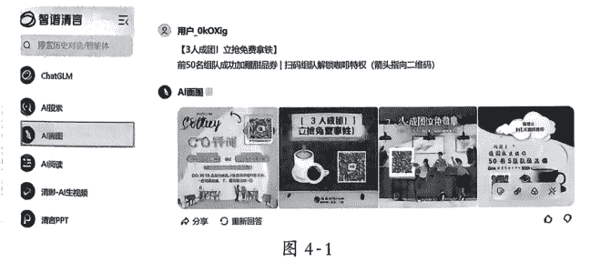

图 4-1

###### 步骤 4 效果分析

在活动结束后进行数据整理，并将其导入 DeepSeek 进行分析总结。

提问模板（效果分析）：

> 本次咖啡馆微信群裂变活动数据，总计带来【几】个新用户，用户的平均邀请人数是【几】，【初始渠道】的裂变效果最好。

社交流量是全媒体矩阵中极具爆发力的组成部分。通过精心设计裂变机制，并利用 AI 在创意策划、素材生成、精准触达和效果分析等方面的能力，可以显著放大社交网络的传播效应，低成本、高效率地获取新用户和提升品牌影响力，真正实现流量的"裂变式"增长。

搜索流量提供精准入口，内容流量构建用户信任，社交流量引爆传播，三者通过 AI 技术无缝联动。AI 流量矩阵的搭建，是中小微企业老板们获取低成本流量的关键。通过智能 SEO、搭建全媒体矩阵和设计裂变活动，你可以轻松提升搜索排名、打造个性化内容、激发社交裂变，让你的业务流量源源不断。

#### 05 利用 AI 捕捉流量

在前面的章节中，我们已经认识到，小红书作为重要的内容发现和"种草"平台，在触达目标用户、建立品牌认知及驱动平台内交易转化等方面，具有不可忽视的价值。一篇爆款笔记往往能带来可观的曝光量与转化率。然而，对许多创作者而言，持续稳定地产出契合小红书风格、兼具吸引力的高质量"爆款笔记"，是一项既耗时又充满挑战的任务。创作过程中常见的痛点包括灵感枯竭、不熟悉"小红书体"表达方式、缺乏时间精心打磨等。

借助 AI，能够有效提升小红书笔记创作的效率和质量，从而更有机会捕捉到平台的流量红利。本节将提供一套详细的实战步骤，教你轻松写出具备"爆款"潜质的小红书笔记。

##### 小红书爆款笔记创作实战流程

在开始之前，请确保你已明确了自己账号的垂直定位、目标用户画像，并对小红书平台的基本风格与规则有清晰认知（这些在前面章节已有涉及）。

##### AI 实战

####### 步骤 1 | 利用 AI 挖掘选题，精准切入用户兴趣点

好的选题是成功的一半。借助 AI，我们可以快速找到既符合账号定位又可能引发用户兴趣的选题方向。

**提问模板（跨平台内容创作）：**

> 我在小红书专注于【你的领域/赛道】，目标用户是【用户画像】。请结合小红书用户最近关心的热点或痛点，为我推荐 5 个笔记选题方向。请说明每个选题的亮点和可能受欢迎的原因。

**参考指令：**

> 我在小红书专注于家居收纳技巧，目标用户是希望提升居住品质的都市年轻人。请结合小红书用户最近关心的热点或痛点，为我推荐 5 个笔记选题方向。请说明每个选题的亮点和可能受欢迎的原因。

**成果示例：**

已深度思考 (用时 30 秒) ▼

1. "0 元改造旧物收纳法：奶茶袋 / 牛仔裤变身家居神器"

亮点：聚焦 "零成本" 和 "环保再利用"，利用年轻人日常废弃物品（奶茶袋、牛仔裤、卷纸筒等）进行创意改造，如用奶茶袋制作抽屉分隔盒、牛仔裤改造成墙面收纳袋。

受欢迎原因：符合 Z 世代 "可持续生活" 理念，操作门槛低且视觉效果直观，用户可快速模仿。小红书用户近期对 "旧物改造" 搜索量激增（如 "奶茶袋妙用" 案例多次引发热议），此类内容容易引发用户互动和掀起 "抄作业" 热潮。

2. "小户型极限收纳：1 m² 榨干 10 倍空间"

亮点：针对都市年轻人居住空间小的痛点，提供垂直空间利用、多功能家具搭配、隐藏式收纳等方案，例如冲孔板结构的收纳墙、床底储物箱的隐藏设计。

受欢迎原因：契合小红书 "家生活场景化" 趋势，用户更关注 "物理空间与精神需求的双重满足"。类似 "洞洞板平替方案" 曾引发高讨论度，而兼具实用性与高性价比的内容易成爆款。

####### 步骤 2 利用 AI 拟定 "吸睛" 标题，抓住第一眼流量

小红书的标题至关重要。利用 AI 生成多个备选标题，测试哪种标题更能吸引用户点击。

**提问模板 (标题生成)：**

> 我要写一篇小红书笔记，核心内容是关于【笔记核心要点】。请帮我生成 8 个有吸引力的小红书标题。要求包含关键词【具体关键词】, 使用数字、符号，或者戳中用户痛点、有亮点的词语。

**参考指令：**

> 我要写一篇小红书的笔记，核心内容是关于奶茶袋制作抽屉分隔盒。请帮我生成 8 个有吸引力的小红书标题。要求包含关键词 "0 元改造"，使用数字、符号，或者戳中用户痛点、有亮点的词语。

**成果示例：**

1. 0元改造奶茶袋！秒变抽屉收纳神器，省钱又环保。
2. 奶茶袋别扔！0元改造成抽屉分隔盒，收纳力MAX。
3. 0元改造计划，用奶茶袋DIY抽屉分隔盒，收纳控狂喜！
4. 废物利用大法，奶茶袋变身抽屉分隔盒，0成本搞定！
5. 0元改造奶茶袋，1个袋子搞定杂乱抽屉收纳！
6. 奶茶袋还能这样用，0元DIY抽屉分隔盒，整洁度翻倍。
7. 0元改造小妙招，奶茶袋秒变收纳盒，省下买分隔盒的钱！
8. 懒人收纳福音，用奶茶袋0元做抽屉分隔盒，告别凌乱。

####### 步骤 3 利用 AI 撰写初稿，快速构建笔记框架与内容

这是 AI 提效最显著的环节。让 AI 根据要求，生成符合"小红书体"的笔记初稿。

**提问模板（笔记初稿）：**

```
请帮我写一篇小红书笔记的草稿。
标题：【取上一步选择或修改后的标题】。
核心要点：【清晰列出你想表达的核心内容，尽量具体】。
写作要求：模仿小红书用户喜欢的【语气风格】。
段落清晰，自然融入关键词【关键词 1】和【关键词 2】。
结尾：简单引导用户【互动行为】。
```

**参考指令：**

> 请帮我写一篇小红书笔记的草稿。
> 标题：0元改造小妙招，奶茶袋秒变收纳盒，省下买分隔盒的钱！
> 核心要点：
> 1. 手残党也能学会，小小奶茶袋摇身一变成为收纳盒；
> 2. 变成收纳盒后想拿什么一目了然，"J"人看了极度舒适。
> 写作要求：模仿小红书用户喜欢的姐妹分享式/干货教程式语气，段落清晰，自然融入关键词"零成本"和"DIY"。
> 结尾：简单引导用户点赞、收藏、评论交流。

**成果示例：**

**0元改造小妙招，奶茶袋秒变收纳盒，省下买分隔盒的钱！**

姐妹们！谁懂啊！！喝完奶茶的袋子别急着扔，今天教你们一个零成本的 DIY 收纳法，手残党也能轻松 get √，收纳控狂喜！

**"手残党"友好，3步搞定！**

1. **剪**：把奶茶袋洗干净，沿着侧边剪开，平铺成一个长方形。
2. **折**：按抽屉大小折叠成小格子，用双面胶固定边缘。
3. **塞**：放进抽屉，分格收纳小物件，口红、发夹、数据线统统归位！

**一目了然拿取超方便**

改造后的奶茶袋收纳盒，分区清晰，再也不用在抽屉里大海捞针啦！本人终于体会到了"拉开抽屉就舒适"的快乐！

**小tips**：厚实的奶茶袋更耐用哦，喜茶、奈雪的袋子都很适合！

姐妹们快试试！0元改造真的香。

你的抽屉也需要"整理术"吗？点赞收藏学起来。

评论区交出你的奶茶袋改造作业，让我看看谁的收纳最整齐！

#DIY收纳 #零成本改造 #奶茶袋妙用 #收纳整理 #废物利用

####### 步骤 4 利用AI优化关键词与话题标签，提升笔记可见度

确保笔记能被目标用户通过搜索或话题找到。

**提问模板（关键词与标签）：**

> 这篇小红书笔记是关于【笔记主题】的。
> 请帮我：
> 推荐【几】个可以自然加在笔记正文里的相关关键词。
> 推荐【几】个合适的小红书话题标签，要包含常用的大类标签和精准的细分标签。

**参考指令：**

> 这篇小红书笔记是关于"奶茶袋秒变收纳盒"。
> 请帮我：
> 推荐 7 个可以自然加在笔记正文里的相关关键词。
> 推荐 8 个合适的小红书话题标签，要包含常用的大类标签和精准的细分标签。

**成果示例：**

✅ 已深度思考（用时 30 秒） ∨

**推荐关键词（可自然融入正文）**

1. 废物利用
2. 环保收纳
3. 省钱妙招
4. 手工 DIY
5. 抽屉整理
6. 奶茶袋改造
7. 零浪费生活
8. 居家好物

---

**推荐话题标签（#）**

大类标签（流量高）

1. # DIY 手工（覆盖手工爱好者）
2. # 收纳整理（吸引收纳需求用户）
3. # 废物利用（突出环保主题）
4. # 省钱小技巧（精准戳中省钱党）

####### 步骤 5 AI 辅助构思视觉呈现

好的视觉效果是小红书笔记的"门面"。虽然 DeepSeek 目前不能直接作图，但可以提供拍摄或设计创意。

**提问模板（封面与配图）：**

> 我的小红书笔记的主题是【笔记主题】。请给些关于"封面图"设计和"内页配图"选择的建议。要求图片风格【风格描述】，并能突出内容的核心亮点。

**参考指令：**

> 我的小红书笔记的主题是"奶茶袋秒变收纳盒"。请给些关于"封面图"设计和"内页配图"选择的建议。要求图片风格干净治愈、色彩鲜明，并能突出内容的核心亮点。

**成果示例：**

1. 核心亮点突出
   - 构图：展示【奶茶袋→收纳盒】的对比图（左：原袋；右：成品），直观体现改造效果。
   - 配色：选用奶茶色系（暖棕/奶白）+ 明亮点缀色（如薄荷绿、浅粉），干净治愈又吸睛。
   - 文字：加粗标题关键词，如"0元改造""奶茶袋变收纳盒"，字体简洁（推荐手写体或圆体）。

2. 场景化拍摄
   - 背景：纯色桌布（浅灰/米白）或木质桌面，搭配小物件（剪刀、胶带等 DIY 工具）增加生活感。
   - 角度：俯拍或 45° 斜拍，突出收纳盒的分格细节。

**示例封面创意：**

- 奶茶袋和成品并列摆放，旁边写"Before & After"。
- 手拿收纳盒摆拍，加标签"省下20元！"。

####### 步骤 6 人工精修与发布

这一环节对于产出高质量的小红书内容至关重要。AI生成的内容仅能作为创作的初稿，后续需要通过严谨细致的人工优化，才能将其转化为真正具有传播力和影响力的笔记。**具体优化流程如下：**

- **事实核查**：确保所有信息准确无误，尤其是产品功效、价格、数据等。
- **个性化注入**：融入个人的真实体验、独特观点和品牌风格，让笔记有"灵魂"。
- **语言润色**：修正AI可能存在的生硬或不自然的表达，使其更流畅、更具人情味。
- **排版优化**：调整段落、重点、标记、表情符号的使用，提升阅读体验。
- **最终审核**：确认内容符合小红书社区规范。

完成上述精修流程后，搭配吸引人的图片或视频，在合适的时间发布。

AI无疑是小红书内容创作者的强大武器，它能将你从烦琐的写作环节中解放出来，让你有更多精力投入到创意策划、用户互动和效果优化上。熟练掌握利用AI高效创作小红书笔记的方法，将大大提升你的内容生产力和竞争力。

需要强调的是，AI是内容创作者的助手，无法完全替代创作者。最终能打动用户的，仍然是内容的真实价值、独特视角和真诚表达。将AI的技术优势与你自身的专业知识、创造力相结合，才能持续产出"爆款"内容，高效实现小红书平台的流量转化与价值变现。

#### 06 日常流量运营：热点抓取 + 快速生产

在掌握了平台精细化运营、内容适配、AI 辅助创作乃至主动"截流"等策略之后，我们还需要关注一个维持流量持续活跃的关键环节——日常运营。与追求长期效应的 SEO 或深度内容不同，日常运营更侧重于保持与用户的即时连接，抓住当下热点，实现"短、平、快"的内容触达。其中，"热点抓取 + 快速生产"的组合策略尤为重要。

所谓"热点抓取"，是指敏锐地捕捉到当前社会、行业或目标用户圈层中正在流行的事件、话题、"热梗"或情绪。"快速生产"则是指在热点尚有温度时，迅速创作并发布与之相关联又能体现自身价值的内容，从而"借势"获得更高的关注度和互动量。在这个信息爆炸、热点稍纵即逝的时代，速度和相关性是制胜的关键。而 AI 技术与高效的协同工具（如飞书等），正是我们实现这一目标的得力武器。本节将详细拆解实战步骤，阐明这套日常流量运营的核心打法。

##### 热点运营的战略价值与核心原则

主动、巧妙地结合热点进行内容创作，能为账号带来显著增长优势，其重要战略价值主要体现在四个方面。

**提升曝光机会**：平台算法往往会对热门话题给予流量倾斜，相关内容更容易被推荐和看到。

**激发用户互动**：用户对正在讨论的热点本身就有较高的关注度，更容易产生评论、分享等互动行为。

**品牌形象升级**：及时响应热点，可以反映出账号主体关注时事、贴近用户，有助于塑造品牌的敏锐度和亲和力，增强用户信任感。

**吸引新用户**：吸引泛兴趣用户，扩大潜在受众群体。

但"蹭热点"不能生搬硬套，需遵循以下三大原则。

**寻找关联**：确保热点与自身领域、品牌风格、用户画像等高度相关。

**注重质量**：提供独特视角或附加价值，避免盲目"追热点"而发布无关、低质甚至引发反感的内容。

**防范风险**：谨慎评估社会热点的舆论风险与适配性。

##### 如何构建高效的"热点雷达"系统

**1. 明确需要关注的"热点"范围**

（1）**行业动态与新闻**：与账号业务直接相关的政策变化、技术突破、市场趋势等。

（2）**平台内热点**：微博、抖音、哔哩哔哩、知乎、小红书等平台的热榜、热门挑战等。

（3）**社会文化热点**：引发广泛社会讨论的事件或现象（需谨慎判断相关性）。

（4）**竞品与同行动态**：关注同品类的热门内容或活动。

**2. 搭建信息收集矩阵（人工 + 工具 + AI）**

（1）**人工巡查**：每日固定时间浏览主要目标平台的热榜 / 发现页，以及行业资讯网站或 App（如今日头条、36 氪、虎嗅等，根据行业选择）。

（2）**关键词订阅/监控**

- 基础: 利用微信公众号或微博等平台的关键词订阅功能。
- 进阶: 考虑使用舆情监控工具（通常需付费），设置关键词进行全网信息监控。

（3）**AI 辅助信息聚合**: 利用 AI 定期扫描和总结信息。

（4）**团队协作与信息沉淀**

- **飞书文档/多维表格**: 创建一个共享的"热点追踪表"。团队成员一旦发现有价值的热点信息，可以随时随地通过手机或电脑将其记录到表格中。

  **表格字段建议**: 热点事件/关键词、来源链接、发现时间、发现人、相关性评分（1~5分）、初步结合创意、负责人、状态（待评估/策划中/制作中/已发布）。

- **飞书群聊**: 建立"热点快速反应"群，发现高价值热点可直接在群内分享链接并通知相关人员，进行快速讨论。

- **飞书日历/提醒**: 对于可预见的热点（如节日、发布会），建议提前设置提醒。

**3. 快速评估与切入点选择**

（1）**评估三问**: 这个热点与目标用户/品牌真的相关吗？能提供独特的价值或视角吗？现在介入还来得及吗（热度周期判断）？

（2）**AI 辅助寻找结合点**

**提问模板（热点结合角度）：**

```
当前热点是【热点事件/话题简述】，我的业务是【业务、内容方向】。
请帮我快速构思 2~3 个可以结合这个热点进行内容创作的切入角度，要自然、有价值，避免生硬。
```

###### 4. 快速决策机制

针对高时效热点，必须建立分钟级响应机制：关键决策人需在1小时内完成"热点评估→策略制定→执行授权"的全流程，建议通过飞书群进行即时沟通与快速决断。在决定跟进热点后，以最快速度完成内容创作与发布。

####### （1）确定内容形式与发布平台

根据热点性质、切入角度和时效性要求，迅速决定最合适的内容形式：

- **观点类（即时性强）：** 微博短评、微信朋友圈/群内发言、抖音/快手即时短视频评论。
- **图文类（稍有深度）：** 小红书笔记、微信公众号推文、知乎回答。
- **视频类（互动性强）：** 直播连麦讨论、快速剪辑的短视频。

####### （2）文案/脚本极速起草

利用AI，基于确定的热点、角度和平台，快速生成内容初稿。

> 请围绕热点【热点事件、话题】和我确定的角度【你的切入角度】，帮我写一份用于【平台名称】发布的【内容格式，如微博文案、小红书笔记要点、短视频口播稿】的初稿。要求紧扣热点，观点清晰，语言【风格要求，如客观中立、风趣幽默】，控制在【大致字数、时长】左右。

####### （3）标题/封面文案快速生成

AI可以迅速提供多个结合热点的、吸引眼球的标题或封面文案选项。

####### （4）视觉元素构思

AI可以根据热点内容，快速提供有关搭配如图片风格、表情包或者简单的图表设计思路等。

###### 5. 标准化流程与工具提效（推荐使用飞书）

- （1）**内容模板库**：在飞书知识库或文档中，预先创建好不同类型热点内容的模板（如事件评论型、知识科普型、活动借势型等），每个模板均包含基本结构、常用配图、风格建议、发布检查清单等。创作者可根据热点属性直接调用模板，通过"填空式"创作快速完成稿件，大幅缩短构思时间。
- （2）**素材库共享**：将常用的品牌标志、标准配色、免版权图片/视频片段等素材，存储在飞书云空间，方便团队成员快速取用。
- （3）**飞书任务/项目管理**：对于需要多人协作的热点内容（如复杂的视频），在飞书项目或任务中快速创建任务，分解步骤（文案、设计、剪辑、审核、发布），明确负责人和截止时间（通常以小时计），实时追踪进度。
- （4）**飞书文档/表格协作**：可多人同时在线编辑文稿、脚本，实时评论反馈，能够极大缩短沟通和修改时间。

###### 6. "人机结合"的快速审核与润色机制

在追求热点内容发布时效性的同时，必须建立"人工+AI"双重审核体系，审核中应重点关注以下三个方面。

- **确保真实性**：检查事实准确性，避免误传信息。
- **检查整体风格**：确保语言表达符合品牌风格，无不当之处。
- **体现差异性**：快速润色，增加一些个性化表达或点睛之笔。

###### 7. 及时发布与互动运营

内容制作完成后，为把握热点的时效性，需第一时间发布到目标平台。并密切关注发布后的用户反馈，及时参与评论区互动，延续热点讨论。以下是一些推荐工具箱。

- **热点监控**：微博、抖音、哔哩哔哩、知乎、小红书等平台自带热榜；今日头条等新闻聚合器；DeepSeek等AI模型（用于信息汇总与分析）。
- **协作管理**：飞书覆盖文档协作、即时通信、日历、任务管理、多维表格、知识库等，是构建高效工作流的利器。
- **内容创作**：DeepSeek、文心一言、Kimi Chat等。
- **快速设计/剪辑**：稿定设计、Canva、美图秀秀、剪映等。

让"追热点"成为日常运营的智慧。"热点抓取+快速生产"是保持内容新鲜度、提升日常流量活跃度的有效手段。其核心在于建立一套敏锐的监控机制和高效的响应流程。通过运用飞书等协同工具优化团队配合与信息流转，并深度整合AI技术加速内容构思与创作。即使是资源有限的中小团队或个人，也能在热点浪潮中灵活、快速地发声，抓住转瞬即逝的流量机遇。

成功的热点运营并非盲目跟风，而是基于对自身定位的清晰认知，选择相关、适度、能提供价值的方式，有技巧地"借势"，让热点真正服务于你的长期目标。

### 三大低成本获客打法

### 07 矩阵打法："10个账号"管理术

在前面的内容中我们已经探讨了内容优化、平台适配、AI应用、社交裂变以及热点运营等核心方法，这些往往是针对单个账号或单个内容流进行优化的策略。然而，当我们需要规模化地扩大影响、精准覆盖不同用户群体或实现多元化运营目标时，单一账号的力量可能略显不足。此时，"账号矩阵"策略应运而生。

"账号矩阵"并非简单地开设多个账号，而是有策略地运营一组相互关联、具有互补定位的账号网络，以实现"1+1>2"的协同效应。这里的"10个账号"是一个象征性的数字，代表着运营多个账号的思路，具体数量需根据业务需求和资源投入而定。

本节将聚焦于账号矩阵的运营管理核心——如何在拥有多个账号的情况下，明确定位、规划内容、统一管理商机并有效促进平台内成交。

> **说明：** 本书不讨论获取或注册多个账号的具体方法，相关操作需符合各平台规则。我们专注于获得账号后的运营管理方法。

#### 一 账号矩阵的战略价值：为何选择"多线作战"？

通过运营账号矩阵，能带来单一账号难以企及的优势：

- **扩大覆盖面与流量入口**：通过运营不同定位的账号，覆盖更广泛的关键词、用户兴趣点和细分市场，拓宽流量入口。
- **提升抗风险能力**：避免因单一账号违规或限流导致业务中断，降低运营风险。
- **实现精准用户触达**：为不同用户群体（如新老用户、不同购买力的人群）量身定制内容与沟通方式，提升转化效率。
- **承载多元化运营目标**：不同账号可分别承担品牌宣传、用户教育、活动推广、直接销售、客户服务、行业交流等不同职能。
- **提供测试与创新空间**：可以用部分账号尝试新的内容风格、互动玩法或商业模式，降低试错成本。

#### 矩阵设计：科学规划，明确"排兵布阵"

##### 1. 设定矩阵的整体战略目标

首先要明确通过账号矩阵最终应达成的核心目标（如成为某垂直领域在小红书平台上的头部影响力集群、为某款电商产品在抖音平台获取最大化的精准用户并促进销售、建立覆盖用户全生命周期的服务体系等）。

##### 2. 账号角色定位与职能划分

基于整体目标，为矩阵内的每个账号（以10个为例）设定独特的角色和定位。常见的角色类型包括：

- **旗舰号（1~2个）**：代表官方品牌形象，发布权威信息、核心产品介绍、重大活动公告。风格通常较为正式、全面。
- **引流号（3~4个）**：定位更宽泛，内容更侧重于热点结合、娱乐性、泛知识科普等，目标是吸引大量泛用户的初步关注，可适时、合规地引导用户关注旗舰号或细分号。
- **垂直/细分号（3~4个）**：深度聚焦某一特定产品线、用户痛点、使用场景或专业领域。内容要求专业、深入，旨在吸引和转化高意向用户。
- **人设号（1~2个）**：以创始人、专家、资深用户或虚拟IP等"人"的形象出现，分享个人经验、幕后故事、生活方式等，建立情感连接和信任感。
- （可选）**转化/活动号（1~2个）**：更侧重于直接的销售信息、优惠活动、直播带货等（需严格遵守平台营销规则，部分平台对此类账号有明确要求或限制）。
- （可选）**生态链接号（1个）**：面向行业上下游（供应商、渠道商）或合作伙伴，发布行业资讯、合作机会等，构建商业生态。

##### 3. 制定各账号的内容策略与风格

为每个定位清晰的账号规划其核心内容主题、表现形式（图文、视频、直播等）、更新频率、语言风格和视觉形象。要保证各个账号之间既具备差异化特征，又能在特定需求场景下展现出品牌的一致性。

#### AI驱动的矩阵高效运营体系

##### 1. 内容协同生产与智能分发

矩阵的内容运营并非简单的重复劳动，而是要在统一策略下实现高效协同。

- **复用核心素材，差异化演绎**：将"核心内容资产"（如深度报告、产品发布会）进行"千文千面"式的改编，根据不同账号的定位，侧重不同角度、调整语言风格和视觉呈现后分发。
- **运用AI提效**：借助AI（如DeepSeek）快速生成针对不同账号定位的内容初稿、标题、脚本等。
- **内部联动**：在平台规则允许的范围内，可以通过内容互动（如评论、转发）、简介引导等方式，在矩阵内账号间形成自然的流量流转和用户引导。避免过度明显的、破坏用户体验的强行导流。

❓ **提问模板（矩阵规划）**：

> 我的核心业务是【业务名称，如提供企业级SaaS管理软件】。计划在【平台名称，如知乎】建立一个账号矩阵，初步设想5个账号。请帮我规划这5个账号各自的【角色定位，如品牌号、产品功能详解号、行业洞察号、客户案例号、创始人IP号】，并为每个账号设计核心内容方向和风格建议。

##### 2. 多账号商机集中管理方案

###### 方案A（飞书，轻量化方案）

使用飞书多维表格创建"矩阵账号客户咨询总表"。为每类账号创建一个独立的工作表，如"旗舰号数据""引流号数据"等。

表格列标题示例如表4-2：

**表4-2 视频数据信息表**

| 视频标题 | 发布时间 | 点赞数 | 收藏数 | 评论数 | 评论内容 |
|:---|:---|:---|:---|:---|:---|
| | | | | | |

团队成员需定期（根据咨询量决定频率，如每半小时）巡查各账号后台（私信、评论等），将新增有效咨询手动录入或截图粘贴到表格中。利用飞书表格的提醒、筛选、排序功能进行管理。

使用飞书多维表格的智能回复。功能示例如图4-2：

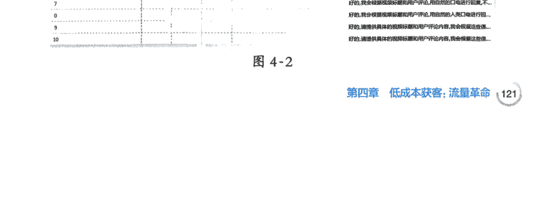

图4-2

**第四章 低成本获客：流量革命 121**

###### 方案B（专业工具，备选）

市面上存在聚合多平台账号后台信息的SCRM或社交媒体管理工具（如聚客引擎等，需自行调研其对目标平台的支持度和合规性）。

说明：此类工具通常有一定的使用成本，且功能依赖平台API开放程度，中小团队在初期可优先考虑方案A。

##### 3. 标准化响应流程

- **建立知识库**：在飞书知识库中，创建常见问题（FAQ）库、标准回复术语库、产品介绍资料库等，方便团队成员快速查找和统一口径。
- **AI辅助撰写回复**：对于常见问题或流程化问题，利用AI基于知识库内容生成回复初稿。

**提问模板（生成标准回复初稿）：**

> 用户通过【账号名称】咨询【问题类型，如退换货规则】。请根据我们的标准规定【粘贴规定要点】，帮我生成一个清晰、礼貌的回复初稿。

- **人工审核与润色**：所有由AI生成的回复内容，在正式发送前均需经过人工的严格审核，并依据具体语境进行细致调整与个性化润色，以确保最终表达既精准无误又真诚自然。

##### 4. 精准沟通与转化策略

###### （1）沟通渠道选择（如表4-3）

**表4-3 沟通渠道适配表**

| 沟通渠道 | 适用场景 | 运营要点 |
|:---|:---|:---|
| 群聊 | 低客单价产品推广、用户社群运营、活动通知 | 定期内容输出、AI机器人辅助、话题引导 |
| 一对一私信 | 高客单价产品咨询、隐私敏感需求、定制化服务 | 人工实时响应、专业话术、隐私保护 |

###### （2）转化路径设计

- **明确目标**：在每次沟通中设置清晰的下一步引导（如"点击链接领取试用"）。
- **平台内闭环**：最终引导用户通过平台自带的交易功能完成购买（如小红书/抖音店铺链接、微信小程序商城等）。

###### （3）AI辅助销售

在一对一沟通中，销售人员可以利用AI快速查询产品信息、总结客户需求，甚至建议下一步沟通策略。

**提问模板（销售沟通辅助）：**

> 我正在与一位意向客户就【产品/服务名称】进行私信沟通，以下是对话要点：【粘贴沟通摘要】。客户目前主要顾虑是【总结客户顾虑】。
>
> 请帮我分析：
> 1. 如何能有效打消客户的这个顾虑？
> 2. 下一步我应该如何沟通才能更好地推动他在平台内下单？

##### 5. 推荐工具与核心价值（如表4-4）

**表4-4 工具推荐及核心价值表**

| 功能模块 | 工具推荐 | 核心价值 |
|:---|:---|:---|
| 战略规划 | DeepSeek、ChatGPT | 矩阵架构设计、内容策略生成 |
| 协同管理 | 飞书（多维表格、知识库、即时通讯） | 信息集中管理、团队高效协作 |
| 内容生产 | 剪映、Canva、AI绘画工具 | 多形式内容快速制作 |
| 专业管理 | SCRM系统、社交媒体管理平台 | 多账号数据整合、自动化运营 |

账号矩阵策略并非简单地增加账号数量，而是一种系统化的运营思维，它要求运营者具备全局视野、清晰的定位规划、高效的协同机制和精细化的用户沟通能力。通过合理设计矩阵结构，明确各账号职责，同时运用AI和飞书等工具提升管理效率，并针对不同场景采取恰当的沟通与转化策略。即使是资源有限的中小团队，也能在账号矩阵策略的指导下，实现多个账号高效管理，实现低成本下的规模化获客与业务的可持续增长。

成功实施矩阵策略离不开持续性的战略规划、脚踏实地的耐心执行，以及依托精准数据反馈所开展的动态优化。这一策略是在日益激烈的流量竞争中，构建差异化优势的关键一环。

### 08 门店引流：AI"数字人"直播+短视频引流

在掌握账号矩阵运营逻辑的基础上，本节将引入第二种极具潜力且成本效益显著的低成本打法："AI'数字人'直播+短视频引流"。该策略旨在解决中小微企业在直播领域面临的人力、时间成本高昂的痛点，通过技术手段实现持续在线、规模化内容生产与高效引流。

如果账号矩阵包含多个账号，理论上就可以部署多个AI"数字人"进行直播。这不仅能覆盖更广泛的用户或细分领域，还能产生海量的直播回放素材。这海量的素材库，正是我们低成本、规模化生产短视频内容的"富矿"。通过对其进行"切片"处理，我们可以源源不断地生成符合短视频消费习惯的、精准触达用户的素材。

#### AI赋能"直播切片"：从海量回放到精准短视频

过去，人工需要从动辄数小时乃至数十小时的直播回放里逐帧筛选、剪辑出精华片段，不仅效率堪忧，还极度消耗人力成本。AI技术的介入，可以极大地简化这一过程。

##### 1. 回放素材管理与智能分析

- **系统化存储**：建立清晰的直播回放文件管理机制，按"账号名称+直播日期+主题标签"分类存储在云端（如"美妆旗舰店2025-05-01新品专场"），确保素材可快速检索。
- **AI辅助定位亮点**：利用AI结合文字记录，如利用直播平台或第三方工具生成较为准确的文字实录，再将文字稿导入AI进行分析。

**提问模板（挖掘回放亮点）：**

> 这是AI"数字人"直播【账号名/场次标识】的部分文字记录：【粘贴10~20分钟的文字记录】。
>
> 请帮我识别出其中包含以下特征的片段（请列出片段原文及简要理由）：
> 1. 清晰介绍产品核心卖点的部分。
> 2. 解答用户常见痛点的部分。
> 3. 宣布优惠信息或活动的部分。
> 4. 可能引发用户兴趣或共鸣的互动/金句部分。

- **音频、视频AI分析**：利用AI工具，通过声音强度、语速变化、情绪波动等维度自动识别高光时刻（如观众互动峰值时段）。

##### 2. 智能化剪辑与内容优化

- **AI智能剪辑**：利用专业视频剪辑软件中集成的AI功能，如剪映专业版的"智能识别精彩片段"或类似功能。这类工具能基于算法自动识别并初步剪辑出可能的高光时刻。但同时也要注意AI剪辑目前仍需人工审核与调整，以确保内容符合直播的整体风格与营销目标。人工审核和精修，不能完全替代人工判断。
- **AI自动生成字幕**：这是AI应用最成熟、提速效果最显著的环节之一。利用剪映专业版或其他（如网易见外工作台、讯飞听见等）工具，可以自动识别视频中的语音并生成与时间轴匹配的字幕，准确率较高，极大节省了手动打轴的时间。用户仅需对生成的字幕进行少量校对和修正，即可获得高质量的成果。
- **AI辅助生成文案与描述**：利用AI为剪辑出的短视频生成吸引人的标题、简介或描述文案。

**提问模板（切片视频文案）：**

> 这个短视频切片的核心内容是【简述切片内容，如AI主播演示了xx产品的防水性能】。
>
> 请帮我为这个发布在【目标平台，如抖音】的短视频写一个吸引人的标题和简短描述。

##### 3. 人工精修与标准化输出

- **人工审核**：检查AI剪辑的逻辑性、字幕的准确性、整体节奏感。
- **添加元素**：加入统一的片头片尾（若需要）、品牌Logo、背景音乐、必要的特效和明确的行动号召。
- **标准化输出**：确保视频格式、分辨率、时长等符合发布平台的要求。

##### 4. 多渠道分发——拓展流量边界

制作好的"直播切片"短视频，需要有策略地分发出去。

- **主阵地：原生平台账号矩阵**
  
  将切片根据内容和账号定位，分发到之前建立的抖音、小红书等主营平台的账号矩阵中。核心动作是挂车销售。在视频中直接关联平台内店铺的商品链接，实现"即看即买"。这是转化效率最高的路径。

- **流量拓展：电商平台视频渠道**
  
  将部分普适性强、产品展示清晰的优质切片，同步分发到拼多多、淘宝、京东等主流电商平台自带的视频内容板块。其目的是利用这些平台庞大的购物用户基数。增加产品的曝光率和认知度，吸引潜在买家在其平台内部搜索或浏览你的商品。这相当于在各大"商场"里投放了动态的产品广告。
  
  需要注意的是，这种转化链路可能不如原生平台直接，但作为流量补充和品牌展示渠道具有显著的价值。

通过这种"主阵地成交+电商平台曝光"的组合，可以在控制成本的同时，最大限度地扩张流量池。

技术融合驱动了增长新范式。"AI'数字人'直播+AI直播切片+账号矩阵+多渠道分发+平台内挂车成交"构成了当前环境下一种极具创新性和成本效益的低成本获客与转化新范式。它将AI"数字人"的持续在线能力、AI的内容处理效率、账号矩阵的放大效应以及多平台流量池巧妙结合，为商家（尤其是中小微企业）开辟了突破传统人力与时间限制、实现规模化在线营销的新途径。

要成功运用此策略，关键在于要掌握好各个环节的技术工具应用（特别是AI剪辑和字幕工具），建立起高效的内部工作流（如利用飞书进行任务协同），并始终以用户价值为导向，确保内容质量与合规性。

这套结构体系，将是撬动日常流量、加速业务增长的有力武器。

### 09 AI辅助"热点话题"生成

本节将探讨第三种低成本获客打法，其核心在于通过策划具有天然讨论潜力的话题，来有效激发用户参与、评论和分享，从而显著提升内容的自然传播效率和账号活跃度。这里的"话题"，指的是在特定领域内，用户普遍关心且容易持有不同看法的议题、面临的选择困境或值得探讨的现象。

AI在策划热点话题策略中扮演着关键的"选题探测器"和"内容框架师"角色，能帮助我们高效地发掘这类话题，并构思如何呈现能引发良性讨论的内容。需要注意的是，实施此策略时务必要把握好尺度，确保内容符合平台规范与社区价值观，以引导有价值的讨论为目标。

#### 以话题共鸣驱动"参与度"

以话题共鸣驱动"参与度"的核心逻辑在于依托AI强大的数据分析与洞察能力，精准挖掘目标客户群体普遍关注、观点多元交织或存在常见困惑的话题。在此基础上，精心构思并创作能够激发受众"热烈且友好"讨论氛围的优质笔记内容。通过积极、专业的互动管理策略，与用户建立起深厚的信任关系。最终将讨论热度转化为店铺访问与产品转化，成功构建起从流量引入到商业价值转化的完整闭环。

这一策略的价值体现在以下三个方面。

- **激发评论欲望**：让用户产生强烈的表达意愿，如表达观点、分享经验等，提升评论量。
- **提升互动数据**：大量评论、点赞、收藏、转发是内容受到关注的直观体现，有助于获得更多推荐。

**增强用户黏性：** 围绕话题的讨论能形成社群氛围，让用户有参与感，强化账号的粉丝黏性。

#### AI 辅助挖掘与生成"可讨论"内容

##### AI 实战

**步骤 1** 利用 AI 发现领域内的"讨论潜力股"

- 提问模板（挖掘讨论话题）：

> 我现在做的内容是【内容领域，如职场沟通技巧】，请针对我的内容帮我生成一系列的争议话题，让我可以在【平台，如小红书】上发布获取更多流量，要求不能违反平台的规定，并且可以引起读者热烈的讨论。

**步骤 2** 筛选话题并确定内容切入点

人工筛选：从 AI 提供的或自己想到的备选话题中，选择一个与你当前内容规划、账号定位最匹配，且你认为最有把握引导好讨论的话题。

确定呈现角度：客观呈现多方观点，例如分析"向上汇报"的利弊。

提出一个开放性问题，如"你认为职场新人最应该先提升哪种能力？"

分享个人带有思考的经验或看法，如"我曾经因为 xx 做法，在职场沟通上踩过坑……"

**步骤 3** 利用 AI 辅助梳理观点与构建内容框架

- 提问模板 1（梳理观点）：

> 针对话题【选定的话题，如"职场中情商和智商哪个更重要？"】，请帮我分别列出"情商更重要"和"智商更重要"的主要论点和常见理由。

第四章 低成本获客：流量革命 129

- 提问模板 2（设计大纲）：

> 我想就话题【选定的话题】，创作一篇【内容格式，如小红书笔记】。计划【你的呈现方式，例如：先分享一个个人小故事，然后提出一个开放问题让大家讨论】。请帮我设计一个简单的内容结构/大纲。

##### 步骤 4 AI 辅助快速生成内容初稿

将选定的话题、角度、大纲、目标平台、内容格式以及期望的语气风格（如引发思考、轻松讨论、专业分析）清晰地告知 AI。

- 提问模板 1（生成初稿）：

> 根据这个大纲【粘贴大纲】,请围绕话题【选定的话题】,为【平台名称】平台撰写一篇【内容格式】的初稿。请使用【语气风格】的语言，并在结尾处设计引导用户在评论区分享看法的语句。

- 提问模板 2（生成讨论型标题）：

> 为这篇关于【选定的话题】的讨论性内容，生成 5 个用于【平台名称】的标题，要能引起用户的好奇心和讨论欲。

##### 步骤 5 积极引导与管理讨论

**及时回应：** 内容发布后，积极关注评论区，对有价值的评论进行回复、点赞或置顶。

**引导方向：** 适时提出追问或总结、提炼用户的观点，将讨论引向更有深度或更有建设性的方向。

**维持氛围：** 对偏离主题或不友好的评论进行管理（删除、限制等），保持评论区的良好氛围。

##### 案例分享

假如有一家做大码女装的实体店，希望能通过内容创作来获得更多流量，引流到店铺。

###### 参考指令：

我现在是一个大码女装博主，请你针对我的行业帮我生成一系列值得讨论的话题，让我可以在小红书上发布获取更多流量，要求一定不能违反平台的规定，并且可以引起读者热烈讨论。

###### 成果示例：

- **一、大码女装是否被过度美化？**
  - 商家总说大码女装也能穿得时尚，但实际收到的衣服版型既显胖又廉价，是设计问题还是消费者期待过高？
  - 切入点：结合部分用户吐槽大码女装"设计敷衍""显胖更严重"的现象，探讨商家是否真正理解"大码群体"的需求。
  - 争议点：用户可分享踩雷经历或推荐真正显瘦的品牌，形成"商家 VS 消费者"的对立讨论。

AI 辅助下的"热点话题"生成策略，核心要义在于借助 AI 强大的数据分析与挖掘能力，高效筛选出那些能够自然激发目标用户深度思考与强烈表达的议题，并通过精心设计的内容呈现方式，引导用户产生有价值的社区讨论，从而低成本地提升内容的互动与传播。

用智慧引导讨论，而非盲目制造争议。但需明确的是，这一策略的成功应用并非仅依靠 AI 技术本身，运营者的选题智慧、内容把控能力和讨论引导技巧，才是决定其成败的关键因素。始终以提供价值、促进交流为出发点。将 AI 作为强大的效率工具，结合人工的深度思考与精细运营，才能让这种策略安全、有效地服务于最终的获客目标，为运营工作带来实实在在的成效。

## 第五章

短视频引流：获客新篇章

### 爆款视频的黄金公式

#### 服装行业：抓住眼球的六个开场模板

当前，服装行业短视频同质化问题极为严重，用户往往只停留几秒就会滑走。那么，如何在前3秒就牢牢抓住用户的注意力，进而激发其观看欲望和购买兴趣呢？很多普通服装商品由于缺乏创意，又不懂得拍摄技巧，难以持续产出有故事性的内容。不妨尝试借助AI，快速生成开场创意、场景设定并获取镜头提示，以此提升服装短视频内容的吸引力，在竞争激烈的短视频赛道中脱颖而出。

##### 模板1：变装对比

以变装作为视频开场，先呈现人物的普通穿着，接着运用转场特效，如让人物自然转圈、帅气打响指，或是利用镜头切换间隙画面短暂关闭再打开，实现无缝过渡，瞬间展现亮眼的服装搭配效果。这种方式能够带来极强的视觉冲击力，淋漓尽致地凸显服装上身时令人惊艳的效果。

> **提问模板（变装开场）：**

我正在为一款【描述服装风格】制作短视频，请帮我设计一个"瞬间变装"的开场。

要求：
1. 变装前设定为【描述变装前场景、状态】。
2. 变装后场景设定为【描述变装后场景、氛围】。
3. 构思一个自然的转场方式。
4. 写出1~2句旁白或屏幕文字，强调变装带来的【效果】。

参考指令：

我正在为一款法式复古连衣裙制作短视频，请帮我设计一个"瞬间变装"的开场。

要求：
1. 变装前设定为在普通房间穿着家居服。
2. 变装后场景设定为优雅的咖啡馆窗边。
3. 构思一个自然的转场方式。
4. 写出 1~2 句旁白或屏幕文字，强调变装带来的气质提升 / 氛围感。

成果示例：

【分镜脚本 - 法式复古连衣裙变装开场】

**变装前（2秒）**

镜头：俯拍角度，女主穿着宽松家居服盘腿坐在地毯上，周围散落着抱枕和咖啡杯。

色调：柔和的米黄色调，模拟自然光。

动作：单手托腮，另一只手随意搭在咖啡杯旁。

**转场设计（1秒）**

特写：家居服袖口轻扫咖啡杯，升腾的热气模糊镜头。

运镜：手持镜头随咖啡杯运动轨迹划出半圆，热气消散时场景已切换。

**变装后（5秒）**

场景：法式咖啡馆窗边，雕花铁艺桌椅搭配蕾丝窗帘，窗外虚化的巴黎街景。

造型：真丝发带束起慵懒低马尾，珍珠耳钉与连衣裙领口蕾丝相呼应。

动作：①手指轻撩耳边碎发；②整理裙摆时的腰线特写；③托腮凝视窗外的侧颜微笑。

##### 模板 2：细节特写

镜头直切，精准聚焦服装的关键亮点细节，如特殊面料、纽扣设计、复古工艺、独特剪裁等。突出产品外观和设计感，吸引对品质有严苛要求的用户目光。

###### 提问模板（产品细节）

> 我的产品是一款【描述服装及其最突出的 1~2 个细节】。请帮我设计一个"细节特写"的短视频开场。

要求：
1. 画面聚焦在【具体细节】。
2. 用 1~2 句文案（可以是旁白或屏幕文字）点出这个细节的【价值、特点】。
3. 建议一种运镜方式。

###### 参考指令：

> 我的产品是一款真丝衬衫，带有珍珠母贝纽扣和法式袖口。请帮我设计一个"细节特写"的短视频开场。

要求：
1. 画面聚焦在珍珠母贝纽扣的光泽 / 袖口的精致褶皱。
2. 用 1~2 句文案（可以是旁白或屏幕文字）点出这个细节的高级感 / 工艺难度 / 设计巧思。
3. 建议一种运镜方式。

###### 成果示例：

【分镜脚本 - 真丝衬衫细节特写开场】

**镜头1：纽扣的诞生（3秒）**

运镜：微距镜头从虚焦推进，珍珠母贝表面浮现虹彩光斑。

光线：侧逆光穿透半透明母贝，在衬衫面料投下细碎光晕。

动态：指尖轻抚纽扣表面，展示天然纹路随角度变化。

**镜头2：袖口交响曲（4秒）**

运镜：手持镜头模拟呼吸感缓慢横移，展示法式袖口立体褶皱。

构图：袖管自然垂落形成建筑感弧度，露出内层手工拱针缝线。

细节：腕部微微转动时，真丝随光影流动呈现雾面到缎光的渐变。

##### 模板 3：场景整合

将服装自然融入各类真实的生活或工作场景中，生动展现其在不同情境下的适用性。如通勤、约会、度假、居家休闲等。让用户轻松产生代入感，自然而然地联想到自己身着这件衣服身处相应场合的模样。

###### 提问模板（场景融入）：

> 我想推广一件【描述服装类型和风格】。请帮我设计一个"场景融入"的短视频开场。

要求：
1. 设定一个具体的场景。
2. 描述模特穿着这件衣服在场景中的动作/状态。
3. 用 1~2 句文案营造氛围，点明服装与场景的联系。

###### 参考指令：

> 我想推广一件适合周末出游的碎花长裙。请帮我设计一个"场景融入"的短视频开场。

要求：
1. 设定一个具体的场景。
2. 描述模特穿着这件衣服在场景中的动作/状态。
3. 用 1~2 句文案营造氛围，点明服装与场景的联系。

###### 成果示例：

> 已深度思考（用时31秒）

**【分镜脚本 - 碎花长裙场景融入开场】**

**晨光野餐篇（8秒）**

场景：金合欢树下的野餐布，藤编篮里露出法棍面包尖，玻璃瓶插着新鲜采摘的洋甘菊。

**镜头1（3秒）**

低角度跟拍：裙摆扫过沾露的草地，逆光中花藤图案与真实雏菊重叠。

动作：赤脚小跑时手指轻提裙摆，露出系带的罗马凉鞋。

**镜头2（3秒）**

环绕运镜：后仰倒在野餐布时裙摆旋开，碎花与树影斑驳在面料上流动。

细节：发间夹着同色系山茶花，指尖捏着樱桃梗与裙摆红莓图案呼应。

**镜头3（2秒）**

俯拍转场：抛起的草帽落下时切换至远景，人物融进夏日花园的油画构图。

##### 模板4：痛点解决

先直观呈现常见的穿搭痛点（如显胖、搭配困难、不合身），让用户感同身受后，顺势引出产品作为解决方案。通过这样直接呼应并解决用户痛点的方式，有力激发他们深入了解产品的欲望。

- **提问模板（解决痛点）：**

> 我的产品是一款【描述服装及其解决的痛点】。请帮我设计一个"痛点解决"的短视频开场。

**要求：**
1. 先快速展示一个穿搭痛点。
2. 紧接着展示穿上我的产品后的改善效果。
3. 用对比强烈的文案强调效果。

###### 参考指令：

> 我的产品是一款高腰阔腿裤，能遮盖腿部赘肉、显腿长。请帮我设计一个"痛点解决"的短视频开场。

**要求：**
1. 先快速展示一个穿搭痛点，穿紧身裤显得腿粗/比例不好。
2. 紧接着展示穿上我的产品后的改善效果，腿部线条流畅/视觉上拉长比例。
3. 用对比强烈的文案强调效果。

###### 成果示例：

> 已深度思考(用时 26 秒)

【分镜脚本 – 高腰阔腿裤痛点解决开场】

**痛点展示 (3秒)**

镜头：推拉式运镜拍摄试衣间镜子。

色调：模特穿着紧身牛仔裤侧身站立，裤管在大腿中部勒出明显赘肉。

动作：手机故意从口袋滑落，弯腰时暴露臀部挤压褶皱。

色调：冷调白光刻意强化不完美线条。

音效：塑料绷紧的"吱呀"声效。

**解决方案 (5秒)**

特写：手机落地瞬间切黑屏，响起布料抖开的"唰"声。

运镜：慢镜头从裤腰旋转下拉，展现垂坠面料滑落过程。

动作：①单手扣金属纽扣特写；②后退三步时裤腿呈流动的波浪形。

魔法时刻：模特转身时用鼓风机吹动裤管，形成腿侧笔直流畅的线条。

##### 模板 5: 潮流引入

结合流行的色彩、元素或搭配风格，使产品展示紧随潮流，吸引追求时尚的年轻用户。

- 提问模板 (潮流开场):

> 我想展示我的【描述服装】符合今年的流行趋势。请帮我设计一个"潮流引入"的短视频开场。

**要求:**
1. 开头提及或展示当前的【流行元素、色彩、风格】。
2. 快速切入展示我的产品如何体现这一潮流。
3. 文案点明潮流名称和产品特点。

###### 参考指令：

> 我想展示我的香芋紫色针织开衫符合今年的流行趋势。请帮我设计一个"潮流引入"的短视频开场。

要求：
1. 开头提及或展示当前的温柔紫色系/BM风。
2. 快速切入展示我的产品如何体现这一潮流。
3. 文案点明潮流名称和产品特点，"今年超火的香芋紫，温柔又显白，这件开衫闭眼入！"

###### 成果示例：

> 已深度思考（用时30秒）

【分镜脚本 - 香芋紫针织开衫潮流开场】

**潮流锚点（3秒）：**

镜头：手机屏幕特写（界面停留在 Pantone 年度色 / 小红书 #BM 风话题页）。

动作：美甲手指滑动时，画面聚焦"温柔紫色系"热搜词条。

道具：散落桌面的流行单品（格纹 BM 裙 / 紫色眼影盘 / 薰衣草干花）。

色调：冷白调打光营造数码时尚感。

**产品破题（5秒）**

运镜：
1. 镜头随手指突然捏住屏幕中的"香芋紫"关键词向外拉出；
2. 虚实转场后，拉出的关键词变成真实开衫衣角；
3. 360° 环绕展示时，可以让阳光穿透针织孔洞形成光斑雨。

##### 模板 6：反差对比

通过材质、价格、搭配效果等方面的对比，展示独特的卖点，凸显产品的优势。

###### 提问模板（产品对比）：

> 我的产品是一款【描述服装及其对比优势】。请帮我设计一个"反差对比"的短视频开场。

要求：
1. 设定一个对比对象或概念。
2. 通过视觉或文案直接进行对比，突出产品的优势。
3. 文案要有冲击力。

###### 参考指令：

> 我的产品是一款平价但设计感不输大牌的连衣裙。请帮我设计一个"反差对比"的短视频开场。

要求：
1. 设定一个对比对象或概念，相似款大牌的价格标签/普通材质与产品优质面料的对比。
2. 通过视觉或文案直接进行对比，突出产品的优势，性价比/设计感高。
3. 文案要有冲击力，例如，"百元价格，千元质感""平替天花板"。

###### 成果示例：

```
【分镜脚本 - 平价连衣裙反差对比开场】

价格暴击版（6秒）

对比组：
左屏：奢侈品店同款连衣裙（贴 ¥ 3999 价签）。
右屏：本品同角度展示（贴 ¥ 299 价签）。

运镜：
1. 手持镜头摇晃拍摄左屏"贵价裙"，突然被剪刀剪断吊牌。
2. 吊牌落地瞬间，右屏"平价裙"从同位置升起。
3. 双屏合并时用面料特写转场，展示相同垂坠度。

超现实对比：
1. 用 AR 技术将大牌 Logo 替换成本品吊牌。
2. 收银机吐出长达 3 米的购物小票突然被剪断。
3. 试衣镜裂痕特效，裂缝两侧呈现不同价格。
```

请按如下顺序操作：

1. 选择最适合产品和目标用户的 1~2 个开场模板。
2. 打开 DeepSeek（或其他类似的 AI 工具）。
3. 复制并修改对应的提问模板，填写产品信息和要求。
4. 从 AI 生成的多个创意中，挑选出 1~2 个最满意的创意。
5. 根据 AI 的建议，快速制定剧本和画面。
6. 立即拍摄或制作开场片段。

注意事项：

1. **严控光线**: 避免过度曝光或曝光不足，确保光线明亮柔和，减轻后期压力。
2. **精简背景**: 选择简洁或契合服装风格的场景，防止视觉干扰。
3. **加快节奏**: 前 3 秒务必以强冲击力内容抓住眼球，避免拖沓。
4. **突出主体**: 切勿因追求创意而忽视产品展示，要让服装卖点第一时间清晰呈现。

#### 02 餐饮行业：引爆流量的十种剧情模板

餐饮短视频很容易拍成流水账式的菜品展示，缺乏故事性和吸引力，难以激发用户的探店欲望，也难以引导用户完成下单行为。如何让视频内容更"香"，增加记忆点？可以利用 AI 策划故事情节、塑造人物形象、设计对话，为美食视频注入灵魂，生成能激发情感共鸣或好奇心的内容框架。

##### 模板1：食材溯源

重点展示食材从产地到餐桌的过程，突出食材的新鲜、优质和来之不易。建立质量信任感，践行健康、本真的理念。

- ### 📝 提问模板（食材溯源）：

> 我们餐厅主打【特色菜品】，其核心食材是【食材名称】。请设计一个"食材溯源"的短视频剧情结构。

**要求：**
1. 包含场景：【产地场景】→餐厅后厨处理→成品呈现。
2. 突出食材的【特点】。
3. 结尾引导【行为】。
4. 构思1~2句点睛的旁白，强调【价值】。

###### 参考指令：

> 我们餐厅主打舟山海鲜面，其核心食材是当日捕捞的大黄鱼。请设计一个"食材溯源"的短视频剧情结构。

**要求：**
1. 包含场景：渔船捕捞/码头挑选→餐厅后厨处理→成品呈现。
2. 突出食材的鲜活度/稀有性/产地优势。
3. 结尾引导到店品尝。
4. 构思1~2句点睛的旁白，强调"从大海到舌尖，只需x小时"。

###### 成果示例：

⚙️ 已深度思考（用时31秒）

**《鲜·时》舟山海鲜面溯源短视频分镜脚本**

**【开篇：渔船捕捞】**

画面：凌晨四点，舟山海域被朦胧的微光笼罩，渔船引擎声划破寂静。

镜头：广角航拍渔船驶向东海渔场，渔民撒网动作特写。

旁白："凌晨四点，第一网大黄鱼跃出中国黄金海域"。

**【过渡：码头挑选】**

画面：晨光中的沈家门渔港，渔获被倾倒至不锈钢操作台。

镜头：特写鱼身金鳞闪烁，鱼鳃鲜红张合，质检员翻看鱼眼、按压鱼腹。

字幕："每条舟山大黄鱼需经过三次筛选，仅3%达到入店标准。"

##### 模板2：大厨揭秘

由餐厅主厨或核心技术人员出镜，展示某道招牌菜的独特烹饪技巧或秘方（可部分公开或象征性展示）。塑造专业形象，增加神秘感和权威性，让用户对菜品产生好奇。

- **提问模板（人物揭秘）：**

> 我是【餐厅类型】的主厨，我想通过短视频展示我们【招牌特色】。请设计一个"大厨揭秘"的剧情结构。

要求：
1. 着重展示【关键步骤、独特之处】。
2. 营造【氛围】。
3. 需要有主厨的少量同期声或旁白，分享心得、理念。
4. 结尾暗示核心秘方仍有保留，鼓励用户到店体验。

- **参考指令：**

> 我是一家重庆火锅店的主厨，我想通过短视频展示我们招牌特色秘制牛油锅底的炒料过程。请设计一个"大厨揭秘"的剧情结构。

要求:
1. 着重展示独特之处，多种辣椒的配比。
2. 营造匠心氛围。
3. 需要有主厨的少量同期声或旁白，分享心得、理念，"好锅底，是火锅的灵魂"。
4. 结尾暗示核心秘方仍有保留，鼓励用户到店体验。

成果示例：

🧠 已深度思考 (用时 27 秒) ▾

**《沸腾之魂》重庆老火锅炒料秘籍分镜脚本**

**【启幕：香料矩阵】**

画面：晨雾中的朝天门码头，吊脚楼窗台挂满红辣椒串。

镜头：特写布满老茧的手展开泛黄牛皮纸，露出"光绪廿年"字样。

主厨独白："重庆火锅的密码，藏在三代人调校的这张方子里"。

**【精髓：黄金配比】**

画面：原木长案陈列七种辣椒（石柱红／子弹头／二荆条等）。

镜头：铜秤砝码精准移动，主厨指尖拂过辣椒堆成的小山。

字幕："3：2：1 魔鬼比例——增色・提香・炼魂三重奏"。

##### 模板3：顾客故事

采访或跟拍一位真实的顾客（或扮演的顾客），讲述他／她与餐厅或某道菜的情感联系、特殊记忆或喜爱理由。利用口碑效应，激发情感共鸣，增强用户信任感和亲切感。

📌 提问模板（顾客故事）：

> 我们是一家【餐厅类型】，我想制作一个"顾客故事"的短视频。请构思一个剧情。

要求：
1. 设定顾客【身份和背景】。
2. 故事围绕【核心点】展开。
3. 重点突出顾客对菜品／环境／服务的喜爱。
4. 结尾可以是他／她的推荐语或祝福。

###### 参考指令：

我们是一家社区里的温馨小馆，我想制作一个"顾客故事"的短视频。请构思一个剧情。

要求：
1. 设定顾客为附近的上班族。
2. 故事围绕加班后的深夜食堂展开。
3. 重点突出顾客对菜品/环境/服务的喜爱。
4. 结尾可以是他/她的推荐语或祝福。

###### 成果示例：

```
已深度思考（用时 20 秒）
```

###### 《深夜解忧铺》社区食堂温情故事分镜脚本

【序幕：城市脉搏】

画面：写字楼格子间灯光渐次熄灭，手机显示 23:17。

镜头：跟拍高跟鞋踩过路灯下的梧桐叶，西装外套下露出绷带包扎的手腕（暗示加班受伤）。

旁白："陆瑶的第 47 次加班，被一碗当归鸡汤救赎。"

【初遇：推门时刻】

画面：街角暖黄的灯笼在风中摇晃，"拾味小馆"木牌特写。

镜头：玻璃门推开时风铃轻响，全景展示原木吧台/手写菜单/老客留言墙。

服务员自白："老规矩？当归鸡多加菌菇？"（自然熟稔的语气）。

##### 模板 4：沉浸式体验

放大烹饪或交互过程中的声音和视觉细节，如煎炸声、切割声、咀嚼声等，布置高清特写镜头。强烈刺激感官，激发食欲，尤其适合展示炸物、多汁类食物。

###### 提问模板（沉浸式画面）：

我想为我们的【菜品】制作一个"沉浸式体验"的短视频。请帮我设计关键的声音和画面节点。

要求：
1. 突出核心声音。
2. 建议拍摄关键特写镜头。
3. 不需要过多旁白，可用少量文字标签提示。

###### 参考指令：

我想为我们的招牌爆汁炸鸡排制作一个"沉浸式体验"的短视频。请帮我设计关键的声音和画面节点。

要求：
1. 突出核心声音，如炸制时的滋滋声、咬下去的酥脆声、肉汁流淌的声音。
2. 建议拍摄关键特写镜头，如金黄酥脆的外皮、切开后饱满的肉汁，拉丝的芝士。
3. 不需要过多旁白，可用少量文字标签提示。

###### 成果示例：

《黄金声宴》爆汁炸鸡排沉浸式分镜设计

【00:00 — 00:03】声音预热

画面：黑屏中渐入油锅的细微气泡声。

文字标签："独家 180℃黄金油温准备中"。

【00:04 — 00:08】视觉暴击

镜头：4K 微距拍摄带冰晶的鸡排浸入油锅。

声效：炸裂的"滋——"声持续 4 秒后渐强。

慢动作捕捉：油泡在鸡排表面"跳探戈"。

【00:09 — 00:12】酥脆宣言

特写：不锈钢夹轻敲鸡排表面。

声效：三层脆响（表层脆片/中层蜂窝/底层焦壳）。

文字标签："独家三重复脆工艺"。

##### 模板 5：制作过程快放（延时/快动作）

将短暂的烹饪过程（如炖煮、发酵、烘烤等）进行快放，配上动感音乐。或者延时，慢放，配舒缓音乐，实现过程清晰，节奏明快，适合展示工艺复杂的菜品或后厨日常。

###### 提问模板（过程快放）：

> 我们店的【菜品】制作过程比较有观赏性，但耗时较长。请设计一个"制作过程快放"的短视频结构。

要求：
1. 列出关键的【制作步骤】。
2. 建议在快放中穿插1~2个慢动作或特写镜头，突出关键细节。
3. 推荐一种背景音乐风格。

###### 参考指令：

> 我们店的手工比萨制作过程比较有观赏性，但耗时较长。请设计一个"制作过程快放"的短视频结构。

要求：
1. 列出关键的制作步骤，如揉面/擀皮/铺料/烘烤。
2. 建议在快放中穿插1~2个慢动作或特写镜头，突出关键细节，如撒芝士/拉丝效果。
3. 推荐一种背景音乐风格。

###### 成果示例：

> 🤔 🤖 已深度思考（用时 32 秒）

**以下是为您设计的"手工比萨制作过程快放"短视频结构方案：**

---

**【视频结构】**

**00:00 — 00:03 开场（全景）**

- 木纹操作台全景镜头，渐显品牌 Logo。
- 背景音效：面粉袋抖落的簌簌声。

**00:04 — 00:12 揉面快放（中景 + 俯拍）**

- 快进 4 倍速呈现面团揉制过程。
- 穿插慢动作特写（0.5 倍速）：手指按压面团回弹的特写。

**00:13 — 00:20 酥脆宣言**

- 快进 6 倍速展示面饼成型过程。
- 慢镜头特写（0.3 倍速）：边缘抛饼的瞬间。

##### 模板 6：挑战与趣味

设置一个与食物相关的挑战（如大胃王挑战、限时吃完、辣度挑战）或动作互动（如蒙眼猜菜、DIY 创意吃法）。娱乐性强，易于传播，能有效吸引年轻群体。

###### 提问模板（趣味挑战）：

> 我们想举办一个活动来推广我们的【特色产品】。请设计一个"挑战与趣味"的短视频剧情，形式为【具体形式】。

要求：
1. 设定清晰的挑战规则和奖励。
2. 展现挑战过程中的趣味瞬间/紧张感/参与者的表情。
3. 结尾呼吁更多人参与挑战或到店品尝。

###### 参考指令：

> 我们想举办一个活动来推广我们的超大份麻辣小龙虾。请设计一个"挑战与趣味"的短视频剧情，形式为邀请顾客到店进行"剥小龙虾速度挑战"。

要求：
1. 设定清晰的挑战规则和奖励。
2. 展现挑战过程中的趣味瞬间/紧张感/参与者的表情。
3. 结尾呼吁更多人参与挑战或到店品尝。

###### 成果示例：

以下是为您设计的"麻辣小龙虾剥虾速度挑战"短视频剧情方案：

【挑战规则设计】

黄金 30 秒规则：
1. 在 30 秒内剥出完整虾肉。
2. 虾肉需通过"完整度检测"（展示检测板图示）。
3. 每日冠军奖励：当日消费免单 + 专属"剥虾战神"围裙。
4. 周冠军额外奖励：全年 8 折卡 + 巨型龙虾玩偶。

【视频分镜脚本】

00:00—00:03 悬念开场（特写转全景）

- 红油流淌的龙虾特写，机械女声倒计时"3、2、1！"。
- 全景镜头：5 组挑战者同时抬手准备。

##### 模板 7：节日或时令限定

结合特定节日（如春节、中秋节、情人节）或季节（如夏季、冬季），推出限定菜品或套餐，营造稀缺性和仪式感。借势营销，刺激短期消费。

###### 提问模板（时令氛围）：

> 我们计划在【节日、季节】推出一款【限定菜品、套餐】。请设计一个名为"节日/时令限定"的短视频推广结构。

要求：
1. 画面要融入节日、季节元素。
2. 突出产品的限定性、特殊含义、诱人之处。
3. 文案要营造节日氛围、温暖感、稀缺感。
4. 明确供应时间、预订方式。

###### 参考指令：

> 我们计划在圣诞节推出一款限定菜品/套餐，热红酒和树根蛋糕套餐。请设计一个名为"节日/时令限定"的短视频推广结构。

要求：
1. 画面要融入节日元素，如圣诞装饰/雪景/温暖壁炉。
2. 突出产品的限定性/特殊含义/诱人之处。
3. 文案要营造节日氛围/温暖感/稀缺感。
4. 明确供应时间/预订方式。

###### 成果示例：

> 💡 已深度思考（用时 23 秒）

以下是针对圣诞限定套餐的短视频分镜脚本及推广结构设计：

**【0~3秒】开场吸引**

画面：飘雪的圣诞街道全景→镜头推进到橱窗内装饰精美的圣诞树（树顶挂着"限定"字样吊牌）。

音效：清脆的铃铛声 + 圣诞音乐前奏。

字幕："圣诞魔法，限时降临。"

**【4~8秒】产品诱惑**

画面：
- 特写热红酒冒出的袅袅白雾（肉桂棒在杯中转动）。
- 刀切下树根蛋糕的慢镜头（巧克力酱流淌特写）。
- 壁炉火光映照的套餐全景（加入圣诞红丝带装饰盘）。

##### 模板 8：餐厅日常或幕后

展示餐厅营业前的准备、后厨的整理、员工的互动等真实状态。拉近与观众的距离，体现专业、卫生、人情味的一面。

###### 提问模板（餐厅幕后）：

我想通过短视频展示【餐厅名】的日常运营，传递【核心价值】。请设计一个"餐厅日常/幕后"的剧情结构。

要求：
1. 捕捉关键场景。
2. 突出细节。
3. 可以加入老板或员工的简短心声或对话。
4. 风格偏向纪实/温馨。

###### 参考指令：

我想通过短视频展示"老王家面馆"的日常运营，传递"用心做好每一碗面"的理念。请设计一个"餐厅日常/幕后"的剧情结构。

要求：
1. 捕捉关键场景，如清晨备料/高峰期的忙碌/打烊后的清洁。
2. 突出细节，如员工认真的表情/干净整洁的环境/食材的新鲜。
3. 可以加入老板或员工的简短心声或对话。
4. 风格偏向纪实/温馨。

###### 成果示例：

🧠 已深度思考（用时 26 秒）

###### 以下是针对老王家面馆的纪实风格短视频剧情结构设计：

###### 【0~5秒】破晓时分

画面：
- 晨光中的老式挂钟指向 4:30（特写秒针走动声）。
- 铁门拉起的金属摩擦声，暖黄色灯光从门缝溢出。
- 字幕："每天比太阳早起 2 小时。"

###### 【6~15秒】食材仪式

场景：
- 老板老王的手部特写：布满老茧的手指轻按鲜肉纹理（同期声："这块后腿肉要弹而不柴"）。
- 全景镜头：三名员工排成流水线择菜，嫩菠菜在清水里打转。

##### 模板 9：对比与选择

同时呈现店里的几款人气食品，或者针对有选择困难症的用户提出搭配建议。集中多样性展示，刺激用户一次尝试多种食品的欲望，或者帮助用户快速决策。

###### 提问模板（产品推荐）：

我们店里有几款很受欢迎的【食品类型】，顾客经常不知道选哪种。请设计一个"对比与选择"的短视频结构。

要求：
1. 快速展示 2~3 款人气【食品】的诱人特写。
2. 用旁白或文字简单介绍各自的口味/特点。
3. 可以给出搭配建议/适合人群推荐。
4. 结尾可以是【有情绪推力的句子】。

###### 参考指令：

我们店里有几款很受欢迎的甜品，顾客经常不知道选哪个。请设计一个"对比与选择"的短视频结构。

要求：
1. 快速展示 2~3 款人气甜品的诱人特写。
2. 用旁白或文字简单介绍各自的口味/特点。
3. 可以给出搭配建议/适合人群推荐。
4. 结尾可以是"小朋友才做选择，我全都要！"或引导语"今天你想翻牌哪一个？"。

###### 成果示例：

✅ 已深度思考（用时 25 秒）

短视频标题：【甜蜜选择题】成年人当然全都要！

时长：1分 50 秒

1. 暴击开场（0:00—0:15）

【镜头】三组动态转场特写：
- 熔岩蛋糕切开瞬间的巧克力岩浆（慢镜头 + ASMR 音效）。
- 草莓拿破仑酥皮碎裂的金黄碎屑（微距镜头捕捉糖霜闪光）。
- 抹茶慕斯刀尖划过时的完美切面（4K 特写展现 20 层渐变）。

【字幕】"让选择困难症暴击的三重诱惑"。

2. 味觉档案（0:16—0:50）

产品A：火山熔岩。

【镜头】热刀融化冰激凌球的冷热碰撞。

##### 模板 10：文化与故事

挖掘菜品背后的历史渊源、地域文化或创始人故事。提升品牌格调和文化内涵，建立门店层面的情感联系。

- 提问模板（挖掘产品底蕴）：

> 我们的餐厅的招牌菜【菜名】，背后有着一段动人的【历史、文化故事】。请设计一个"文化与故事"的短视频结构。

要求：
1. 开头引出相关历史人物/传说/地域特色。
2. 结合动画/情景再现/讲述等形式，生动呈现故事。
3. 自然过渡到展示本店的这道菜品及其特点。
4. 结尾升华文化价值或情感连接。

###### 参考指令：

我们餐厅的招牌菜东坡肉，背后有着一段动人的历史故事。请设计一个"文化与故事"的短视频结构。

要求：
1. 开头引出相关历史人物/传说/地域特色。
2. 结合动画/情景再现/讲述等形式，生动呈现故事。
3. 自然过渡到展示本店的这道菜品及其特点。
4. 结尾升华文化价值或情感连接，如"品尝的不只是美味，更是一段历史"。

###### 成果示例：

已深度思考（用时 28 秒）

###### 短视频标题：【一口千年】东坡肉里的文人烟火气

时长：2分 30 秒

###### 1. 开篇・水墨画卷（0:00-0:25）

- 【镜头】宣纸晕染特效中浮现"北宋元丰二年"篆刻印章。
- 【动画】竹简展开呈现苏轼《猪肉颂》诗句"净洗铛，少著水……"
- 【旁白】"九百多年前，一位被贬黄州的诗人，用困顿中的智慧，让粗鄙猪肉化作传世珍馐。"

###### 2. 故事篇章・文人庖厨（0:26—1:10）

- 【情景再现】动画版苏东坡挽袖立于柴灶前，百姓抬来整猪致谢治水之恩。
- 【特写】虚拟手稿呈现"慢著火，少著水"六字真诀随墨迹浮动。
- 【镜头语言】灶火明灭间叠化现代厨房场景，保持相同火焰动态。

##### 请按如下顺序操作：

1. 根据餐厅的特色和营销目标，挑选 1~2 个最合适的剧情结构。
2. 打开 DeepSeek。
3. 复制并修改对应的提问模板，填写餐厅和菜品信息。
4. 分析 AI 生成的剧情梗概、场景建议和文案，进行细化。
5. 制订计划，准备道具和场景。
6. 投入拍摄和剪辑。

##### 注意事项：

1. 画面表现力：避免食物出现颜色暗沉、质感干瘪的问题，需通过合理打光提升色泽饱和度，运用专业构图技巧增强视觉吸引力；同时注意人物肤色的自然还原，确保食物画面生动诱人。
2. 节奏把控：严控视频时长，避免冗长铺垫或烹饪过程过度展开。突出核心内容，精简情节，保持节奏紧凑，确保关键信息快速触达观众。
3. 信息完整性：视频及文案中必须清晰呈现店名、具体地址（或所在区域）、招牌菜品及优惠活动等关键信息，确保观众快速获取核心价值，避免产生信息盲区。
4. 行动引导：明确设置消费引导环节，通过口播、字幕、评论区置顶等方式，清晰告知用户到店消费路径或活动参与方式，强化转化效果。
5. 内容真实性：杜绝过度美化或虚假宣传，如实展现菜品外观、用餐环境及服务品质，避免因顾客预期与实际体验落差引发差评，才能维护店铺口碑。

#### 03 本地服务类：直击转化的"神文案"

本地服务（如美容、美发、健身、维修、家政、培训等）与实物产品不同，具有无形性、即时性等特点，这使得使用短视频传递服务价值、建立信任并引导用户预约咨询存在一定难度。而文案作为其中的关键一环，很多商家却不知从何入手。

借助 AI 可以生成直击痛点、突出效果、建立信任、引导行动的营销文案，包括视频脚本、标题、字幕、评论区引导语等，能大幅提升文案创作效率和转化效果。下列 5 个模板，既可以单一使用，也可以结合使用。

##### 模板 1：精准定位用户痛点

文案开头直接指出目标用户最关心、最头疼的问题。用疑问句、描述场景或直接陈述痛点，引发共鸣。

- 提问模板（揭示用户痛点）：

> 我提供【服务类型】服务，目标用户是【用户群体】。他/她们的核心痛点通常是【列举痛点】。请帮我写 5 个能引发他/她们共鸣的短视频开头文案（用于旁白或屏幕文字），直接点出这些痛点。

###### 参考指令：

> 我提供产后修复瑜伽服务，目标用户是产后妈妈。她们的核心痛点通常是身材走形、盆底肌松弛、腰酸背痛、缺乏运动时间。请帮我写 5 个能引发她们共鸣的短视频开头文案（用于旁白或屏幕文字），直接点出这些痛点。

###### 成果示例：

⊕ 🔍 已深度思考（用时 22 秒）

以下是 5 个直击产后妈妈痛点的短视频开头文案，以增强代入感和共鸣感：

【文案 1】（画面：凌乱的婴儿用品 + 妈妈的疲惫背影）

"生完孩子肚子松垮、腰酸背痛？"

"每天喂奶哄睡根本没时间运动？"

（字幕突然放大）"碎片时间也能修复！"

（转明亮画面）"每天跟练 7 分钟，找回产前挺拔体态。"

【文案 2】（手机计时器倒计时 3 秒开始）

"当妈后最奢侈的 3 样东西：平坦的小腹、紧致的盆底肌、不酸痛的腰。"

（画面切换催动作）"每天搭子午睡的 15 分钟就是你的秘密修复时间。"

【文案 3】（第一视角前置婴儿床）

"低头挑针时腰像被针扎？"

"打个喷嚏都漏尿？"

（画面转温馨垫）"这些不是'当妈该受的罪'！"

（展示对比图）"28 天修复计划，带娃修复两不误。"

##### 模板 2：承诺明确效果

明确、具体地告诉用户，接受服务后可以获得什么改变或好处。利用数字、对比或感官化的描述来增强效果的可信度和吸引力。

###### 提问模板（效果展示）：

> 我的服务是【服务类型】，能帮助用户实现【具体效果】。请帮我写 5 句短视频文案，清晰地承诺这些效果，最好包含数字或具体改善的描述。

###### 参考指令：

> 我的服务是青少年视力矫正训练，能帮助用户延缓近视加深、提升裸眼视力、改善用眼习惯。请帮我写 5 句短视频文案，清晰地承诺这些效果，最好包含数字或具体改善的描述。

###### 成果示例：

1. 【每天 15 分钟！】科学训练延缓近视加深速度，坚持 3 个月青少年年度数增长平均减缓 50%，裸眼视力提升 2 行视力表，告别模糊世界！
2. 【度数 0 增长计划启动！】专研睫状肌训练法+用眼习惯重塑，85% 学员一年内近视零加深，裸眼视力提升，看清黑板，不再眯眼！
3. 【21 天见证改变！】定制化动态视力训练，控制眼轴过度增长，30 天养成 "20-20-20" 黄金用眼法则，60% 孩子实现单眼视力表进步 3 行！
4. 【摘掉小眼镜不是梦！】采用德国 3D 视觉训练系统，90 天裸眼视力平均提升 0.6，83% 学员近视年增幅控制在 25 度以内，学习更高效！
5. 【给眼球健身！】每天12分钟靶向训练，3个月延缓近视加深60%，裸眼视力提升3行视力表，配套行为干预方案，降低30%视疲劳频率！

##### 模板 3：展示专业建立信任

通过展示专业资质、服务流程、客户案例、环境设施等，消除用户疑虑，建立信任感。

###### 提问模板（获取信任）：

> 我们是一家【服务类型】，拥有【专业优势】。请帮我写几句短视频文案（可用于旁白、字幕或客户评价引用），突出我们的专业性和可靠性，以建立用户信任。

###### 参考指令：

> 我们是一家高端齿科诊所，拥有从业15年的专家团队、德国进口设备、上千例成功案例。请帮我写几句短视频文案（可用于旁白、字幕或客户评价引用），突出我们的专业性和可靠性，以建立用户信任。

###### 成果示例：

**【专业版】**

"15年匠心沉淀，德国精工护航。"

"2000+笑容背后的精准医疗哲学。"

"您的牙齿健康，由专家天团全程护航。"

**【技术版】**

"比传统精度提升60%的德国3D扫描仪。"

"0.1毫米级的咬合重建技术。"

"让每一颗牙齿回归完美力学平衡。"

**【见证者说】**

"在这里完成了全家三代人的牙齿矫正（客户竖起全家福）。"

"从爷爷的全口种植到孙子的隐形矫正。"

"十五年如一日的专业守护，值得托付。"

##### 模板 4：制造稀缺紧迫感

通过限时优惠、名额限制、时效性提醒等方式，制造稀缺紧迫感，促使用户加速行动。明确活动日期、剩余名额、强调失去机会的损失等。

###### 提问模板（制造紧迫感）：

> 我们正在为【服务项目】做促销活动，提供【具体优惠】。请帮我写几句有紧迫感的短视频文案，引导用户立即行动。

###### 参考指令：

> 我们正在为新开的普拉提体验课做促销活动，提供前 50 名体验价 99 元。请帮我写几句有紧迫感的短视频文案，引导用户立即行动。

###### 成果示例：

以下是 5 组充满紧迫感的普拉提体验课短视频文案，结合价格锚点与限时稀缺性刺激用户行动：

【价格暴击型】

（大字弹幕）原价 399！体验价 99！

"前 50 名立省 300 元抢鲜体验！"

"手速决定折扣，名额秒减中。"

"戳屏幕→立即锁定你的优惠名额。"

【名额提醒型】

（倒计时音效 + 数字跳动画面）

"还剩最后 xx 个 99 元名额！"

"50 个骨折价席位正在被疯抢。"

"犹豫 1 分钟涨价 300 块。"

"长按屏幕马上预约。"

【行动指令型】

（教练手势指引画面）“点击暂停！先抢名额再继续看！”
“前 50 名享 99 元体验特权。”

##### 模板 5：引导清晰行动

明确告诉用户下一步该做什么。使用清晰的指令性词汇，并提供便捷的操作路径，如点击链接、私信、评论、拨打电话、到店地址等。

###### 🔵提问模板（操作指引）：

> 我的本地服务是【服务类型】，我希望用户通过短视频【期望用户做的动作】。请帮我写 5 个清晰直接的行动召唤文案，放在视频结尾。

###### 参考指令：

> 我的本地服务是上门家电清洗，我希望用户通过短视频点击下方链接预约 / 在评论区留言获取报价 / 私信咨询。请帮我写 5 个清晰直接的行动召唤文案，放在视频结尾。

###### 成果示例：

🧠 已深度思考（用时 15 秒） ▾
以下是 5 条简洁有力的行动召唤文案，适用于短视频结尾或置顶评论：

- 1. 【立即预约！】
点击下方蓝色链接，30 秒完成清洗预约！专业团队上门，还你焕新家电。

2. 【限时特惠】
评论区留言“清洗 + 家电类型”，立领 ¥50 清洗券 + 免费上门报价！

3. 【懒人专享通道】
私信发送“清洗”，3 分钟获取定制方案 + 赠品礼包！

4. 【告别家电脏污】
戳链接选择服务时段，周末档期已抢空 50%，现在预约立省 ¥88！

5. 【1 键省心服务】
私信 / 留言【清洗咨询】，金牌师傅 1 小时内报价，到户再付款！

##### 请按如下顺序操作：

- 1. 明确你的服务、目标用户和本次视频的核心转化目标（如预约、咨询、到店）。
2. 打开 DeepSeek。
3. 根据 5 个核心要素，使用对应的提问模板，让 AI 为你生成各类文案素材。一次可以多生成几条，方便选择。
4. 组合运用：一个视频脚本中可以融合“痛点 + 效果 + 信任 + 行动召唤”等多个要素的文案。
5. 将 AI 生成的文案，结合你的具体服务和品牌特性，进行润色。
6. 将文案应用到你的视频脚本、标题、字幕、评论区互动中。

##### 注意事项：

- 1. **避免文案与画面脱节**：避免出现“说 A 拍 B”的情况，确保文案主题与视觉内容高度契合，防止用户因信息割裂而产生困惑。
2. **避免过度承诺**：拒绝夸大服务效果的虚假宣传，避免因承诺无法兑现导致口碑崩塌。建议立足真实优势，进行适度包装与合理呈现。
3. **避免缺乏信任铺垫**：避免一上来就强行植入广告，易引发用户反感。建议先通过价值内容输出（如专业知识、实用技巧）或情感共鸣（如场景化故事）建立信任基础，再自然引导转化行为。
4. **避免行动指令不清晰**：即使内容激发了用户兴趣，若缺乏明确行动指引，仍会导致转化断层。需在关键节点给出清晰、便捷的操作路径（如添加微信、点击预约链接、拨打电话等）。
5. **不要忽略本地化信息**：若未体现地址、服务范围、联系方式等本地属性，将直接影响用户触达效率。建议在画面或文案中突出地域标签与可触达的联络方式，强化本地化服务感知。

### AI 时代短视频玩法

#### 04 日更 100 条视频的流水线：DeepSeek + 剪映

在 AI 时代，如何基于爆款公式实现短视频的高效规模化生产与分发？这一节，我们将重点放在如何利用 AI 和自动化工具，彻底颠覆传统的内容生产模式，助你轻松玩转短视频矩阵，实现可视化、高效率的流量增长。

当下市场变化快，热点转瞬即逝。传统模式下，日更几条视频已属不易，而 AI 技术的成熟让“短视频内容生产流水线”成为可能，不仅能实现规模化、系统化的产出，更可冲击“日更百条”的目标。这一目标的落地，关键在于掌握正确的方法和工具。接下来，我们将通过实战演示，解析如何借助 DeepSeek 的智能创作能力和剪映的便捷编辑功能，搭建属于你的短视频生产线。

该生产线的核心逻辑是通过 AI 工具对创意、脚本、制作等环节进行标准化与自动化处理，在大幅提升生产效率的同时，以数据反馈驱动内容方向优化。在此过程中，人类角色将逐步转型为策略制定者、流程优化者与质量把控者，聚焦核心环节的决策与调控。

**必备工具：**

- 1. **DeepSeek**: 强大的国产大语言模型，具备出色的文本理解、内容生成和多轮对话能力，是我们的“AI 编剧大脑”。
2. **剪映专业版**: 操作门槛低的大众化视频编辑工具，其“图文成片”功能是实现视频快速批量生产的关键。（手机、PC 版本均可）
3. 豆包：用于提取爆款视频文案，可辅助内容分析与灵感挖掘。
4. （可选）飞书文档多维表格：用于管理和批量处理脚本，尤其适合需要极大产量的场景。
5. （可选）选品/热点分析工具：如飞瓜数据、蝉妈妈、考古加、巨量算数、生意参谋等，用于洞察市场趋势和用户需求，指导内容方向。

##### 从 0 到 100 的流水线搭建

**AI 实战**

###### 步骤 1 精准定位与对标内容挖掘（寻找爆款 DNA）

找到符合你业务特性、数据表现优异（点赞、评论、收藏、完播率高）的对标视频。

**方法：**

- 1. 在抖音、小红书等目标平台，搜索与你产品/服务/领域相关的关键词。
2. 关注行业头部账号、优秀同行，分析他们的热门视频。
3. 利用选品/热点分析工具，查找近期热门选题和爆款视频。

**关键动作**：看到数据好、风格合适的视频，复制视频链接，如图5-1。收集一批（5~10条）这样的链接作为“灵感素材库”。

###### 步骤 2 AI 深度解析爆款视频（豆包 + DeepSeek）

让 AI 理解爆款视频的成功要素，提取其“爆款公式”。

**方法：**

1. 将收集到的视频链接粘贴到豆包，并在后面加上“帮我提取以上视频文案”，即可获得完整的视频文案。
（注：DeepSeek 无法直接访问外部链接来分析，豆包可以实现）

**参考指令：**

> 6.41 XMJ:/I@V.LJ 08/31 记住，你这一生最好的贵人，就是大气向上的你自己 #读书分享这段话治好了我的焦虑 #读书点亮生活 https://v.douyin.com/……/ 复制此链接，打开 Dou 音搜索，直接观看视频！
帮我提取以上视频文案。

**成果示例：**

这段话治好了我的焦虑，想读给你听听。他说：你活着的时候没几个人时刻关注你，你离开后也未必有人长久铭记你。所以请记住：除了重大现实困境（如疾病、极端环境等），你所感受到的多数痛苦源于情绪内耗，而非真实威胁。

你现在真正需要在乎的不过三件事：你的财富积累、你的身心健康和你内心的平静。

不要迷信“压力必然转化为动力”——过度压力易催生健康问题，适度压力才能驱动成长。保持快乐的秘诀，是对无关紧要的事“无所谓”，对重要的目标“必在乎”，没必要为琐事纠结，不至于因闲言内耗。内心一旦澄澈，外界的喧嚣自会消隐。

请记住：你这一生最可靠的贵人，是不断向上的自己。当然，自我强大并非孤立无援——珍惜身边真诚的陪伴，也会让内心的平静更有底气。

2. 将提取的文案和视频主题发给 DeepSeek 分析。

提问模板（分析爆火文案）：

> 【拷贝豆包分析提取出来的爆款文案】这段视频文案可以火的原因有哪些？

假设你是做知识变现的博主，你做的是读书分享赛道，追求“短、平、快”的简单评书带货，那就可以以上述这个视频为原点，生产一系列和你定位相符的视频标题和文案，方便进行下一步视频生产。

###### 参考指令：

> 这段话治愈了我的焦虑，想读给你听听。他说：你活着的时候没几个人时刻关注你，你离开后也未必有人长久铭记你。所以请记住：除了重大现实困境（如疾病、极端环境等），你所感受到的多数痛苦源于情绪内耗，而非真实威胁。
你现在真正需要在乎的不过三件事：你的财富积累、你的身心健康、你内心的平静。
不要迷信“压力必然转化为动力”——过度压力易催生健康问题，适度压力才能驱动成长。保持快乐的秘诀，是对无关紧要的事“无所谓”，对重要的目标“必在乎”，没必要为琐事纠结，不至于因闲言内耗。内心一旦澄澈，外界的喧嚣自会消隐。
请记住：你这一生最可靠的贵人，是不断向上的自己。当然，自我强大并非孤立无援——珍惜身边真诚的陪伴，也会让内心的平静更有底气。
这段视频文案可以火的原因有哪些？

成果示例：

这段视频文案能广泛传播并引发共鸣，可能有以下几个核心原因：

1. **直击现代人的痛点：焦虑与内耗**
主题精准定位：将矛头对准当代人普遍存在的焦虑、压力、过度敏感等心理困境，符合社交媒体用户（尤其是年轻人）的情感需求。
颠覆性观点：用“你活着的时候没几个人时刻关注你，你离开后也未必有人长久铭记你”打破传统成功学叙事，消解社会强加的价值标准，迎合了“躺平”“反内卷”的情绪趋势。

3. **获得视频爆火的原因后，结合自己的账号定位，要求生成对标的文案。**

**📝 提问模板（营销文案生成）：**

> 我现在是一个【账号定位、方向】，想通过短视频【达到的效果】，请结合以上拆解结构和文案特点，帮我生成 20 条文案，每条文案大约 300 字，每个文案需要带上一本畅销书，并输出标题。

**参考指令：**

> 我现在是一个读书博主，想通过短视频介绍书来带货卖书，请结合以上拆解结构和文案特点，帮我生成 20 条文案，每条文案大约 300 字，每个文案需要带上一本畅销书，并输出标题。

成果示例：

以下是基于爆款文案结构和读书博主带货需求设计的 20 条短视频文案（每本推荐书籍均为近年畅销书），结合痛点拆解、情绪共鸣、解决方案三要素，标题和正文均强化传播性：

######## 1. 标题: 读完这本书, 我突然不焦虑了 | 《被讨厌的勇气》

“你是否总在为别人的评价失眠? 这本书用阿德勒心理学解开了我的‘讨好枷锁’; ‘人际关系的烦恼源于过度介入他人课题’——同事对你的新衣服指指点点, 那是她尚未解决的自卑课题; 朋友临时爽约却怕你生气, 本质是她低估了你的包容力。书中的‘课题分离’不是冷漠, 而是让我们学会: 温柔坚守自我边界, 同时尊重他人的人生剧本。读完最大的改变, 是敢在拒绝无效加班时说‘抱歉, 这超出我的职责范围’, 也能坦然接受‘有人不喜欢我’的事实——毕竟, 真正的自由, 是不再活在别人的眼光里。”

如果你也困在‘怕被讨厌’的内耗中, 这本书会像一把钥匙, 打开你自设的牢笼。点击了解, 让阿德勒陪你找回‘按自己节奏活’的勇气。”

###### 步骤 3 AI一键成片(剪映专业版)

将生成的脚本快速转化为视频。

####### 方法:

- 1. 打开剪映专业版, 找到‘图文成片’的功能入口, 如图 5-2, 点击‘自定义输入’。

2. 导入脚本, 将 DeepSeek 生成的单条脚本文复制粘贴进去。如图 5-3, 点击‘生成文案’, 剪映会自动识别文本, 并将其作为旁白或字幕的基础。选择合适的配音音色, 点击‘生成视频’。选择合适的生成方式，依据短视频的定位选择。这里选择“智能匹配素材”。

**3. 视频微调.** 转跳剪映视频编辑窗口，如需修改就稍作调整，如果没有，就直接导出。这样哪怕没有经过任何的创作思考，我们也能做出一个原创的短视频，如图 5-4

“日更 100 条”是一个象征性的目标。强调的是 AI 带来的效率巨大提升的可能性。真正实现需要团队协作（有人负责找素材、有人负责审脚本、有人负责精剪、有人负责发布）、流程高度优化以及对工具的熟练掌握。即使能批量生产，也要关注内容质量。低质内容的堆砌反而可能损害账号权重。初期可以追求数量以广泛测试，后期根据数据反馈，聚焦于高质量内容的生产和优化。确保 AI 生成的内容经过修改和润色，具有一定的独特性，避免被平台判定为低质量或搬运内容。遵守版权规定，慎用有版权争议的素材。

上述流程在手机端也可以完成，只需要使用 DeepSeek、豆包、剪映手机版即可，受限于篇幅，本书不做展示，读者朋友可以自行去尝试生成自己的移动生产流水线，助力你的业务。

AI 时代，利用 DeepSeek 进行智能脚本创作，结合剪映的“一键成片”功能，确实可以构建起一条高效的短视频生产流水线。这套方法的核心在于：找准对标 → AI 解析 → AI 创作 → 工具生产 → 数据优化的闭环。对于资源有限的中小微企业和个人创业者来说，这是实现低成本、规模化内容营销，进而有效引流获客的强大武器。

我们在上一节中教过大家如何利用飞书多维表格来快速生成内容，本节这个场景也可以通过飞书多维表格来实现脚本生成，感兴趣的读者朋友可以动手尝试下，会发现方法其实很多，需要你去选择。

这个方法也可以用于小红书笔记批量生成，以上给大家提供一个思路，工具可以是 DeepSeek + Canva，感兴趣的可以试试。

#### 05 智能去重与平台适配：DeepSeek + 剪映 + 闪剪

前面学习了如何利用 DeepSeek 和剪映搭建“日更百条”的短视频生产流水线，然而简单地将同一条视频原封不动地分发到抖音、小红书、哔哩哔哩等不同平台，效果往往不佳，甚至可能被平台判定为低质量或重复内容。不同平台的用户偏好、社区氛围、内容分发逻辑等都有显著差异。接下来将教你如何利用 AI 工具，对已生成的脚本进行智能化的 “二次创作” 和形式变换，实现针对不同平台的 “量体裁衣”，并利用 “数字人” 技术进一步提升内容差异化和生产效率。

智能去重并非简单的同义词替换，而是基于对各平台特性的理解，调整内容的切入点、叙事节奏、语言风格、视觉呈现和引导方式，同时保留核心的产品卖点或信息价值。即保留核心信息 ＋ 调整表达方式 ＋ 匹配平台特性。

**必备工具：**

- 1. AI 大语言模型：DeepSeek（用于脚本改写和平台化适配）。
2. 视频剪辑工具：剪映专业版 /App（用于非 “数字人” 视频的风格化制作）。
3. “数字人” 视频生成工具：闪剪（用于快速生成 “数字人” 口播视频）。

## 从 “通用脚本” 到 “平台定制”

**AI 实战**

### 步骤 1 AI 脚本改写——为不同平台 “量体裁衣”（DeepSeek）

将上一节用 DeepSeek 批量生成的 “通用脚本”，有针对性地改写成符合抖音、小红书、哔哩哔哩等平台风格和用户习惯的版本。

**方法：** 再次请出 DeepSeek，使用更具体的指令。

● **提问模板（平台适配改写）：**

> 你是一位精通小红书 / 抖音 / 哔哩哔哩平台内容生态和用户喜好的资深口播内容优化师。
原始脚本：这是我基于【简述原始脚本的核心主题、产品】创作的一条通用短视频口播。

【粘贴上一节生成的某一条具体脚本内容】

任务：

请将以上原始口播文案改写成一个更适合在小红书 / 抖音 / 哔哩哔哩发布的口播文案。

改写要求（根据目标平台调整）

【针对小红书】：

【针对抖音】：

【针对哔哩哔哩】：

输出三个平台的纯口播文字，不添加其他任何内容。

###### 参考指令：

你是一位精通小红书 / 抖音 / B站平台内容生态和用户喜好的资深口播内容优化师。

原始脚本：这是我基于读书笔记带货口播创作的一条通用短视频口播：

【标题：读完这本书，我突然不焦虑了 |《被讨厌的勇气》

“你敢信吗？一本哲学书治好了我的讨好症！书里说：你的痛苦都来自人际关系，但别人怎么看你是他的课题，和你无关！就像你穿了件新衣服，同事阴阳怪气，那是他自卑，你难受就是替他背课题！阿德勒心理学早看透了：真正的自由，就是拥有被讨厌的勇气。这本书让我学会把别人的评价当空气！想摆脱内耗的，左下角直接拍，看完你会回来谢我的！”】

任务：

请将以上原始口播文案改写成一个更适合在小红书 / 抖音 / B站发布的口播。

改写要求（根据目标平台调整）

【针对小红书】：

【针对抖音】：

【针对B站】：

输出三个平台的纯口播文字，不添加其他任何内容。

###### 成果示例：

> 【小红书版】
标题: 讨好型人格自救指南 | 看完这本书我敢拒绝同事了!
姐妹们! 刚读完这本心理学神作就忍不住来分享。

### 步骤2 选择生产工具——“数字人”与风格化剪辑

根据改写后的脚本特点和内容形式，选择最合适的视频生成方式。

**适合“数字人”（闪剪）：**

口播类内容：知识科普、产品讲解、经验分享、观点输出等以“说”为主的脚本。
需要真人形象但又不想真人出镜：希望视频有“人”的感觉，但本人不方便或不擅长出镜。
追求极致效率：“数字人”生成速度快，尤其适合信息传递型内容。

**适合风格化剪辑（剪映）：**

产品展示类：需要大量实物画面、细节特写、使用场景演示。
Vlog/生活记录类：强调真实感和氛围感。
快节奏/卡点类：对视觉效果、音乐配合要求高的内容。
希望风格更多样化：剪映提供更丰富的模板、特效和转场。

###### 步骤3 视频生成实操——闪剪与剪映

**闪剪实操：快速生成“数字人”口播视频**

使用闪剪将适配后的“口播类”脚本转化为“数字人”视频。以下是具体方法：

1. 打开闪剪：登录闪剪平台（网页版或 App），如图 5-5，领取免费算力，如图 5-6。

图 5-5

图 5-6

第五章 短视频引流: 获客新篇章 173

2. 选择“数字人”形象：根据品牌特性和内容风格，选择一个合适的“数字人”形象（注：部分形象可能需付费），如图5-7。

图 5-7

3. 粘贴脚本：将DeepSeek改写好的、适合口播的平台定制脚本粘贴到文本框中，如图5-8。

图 5-8

4. 调整设置并预览效果：选择背景（纯色、图片、视频）、调整语速、选择配音音色（闪剪通常自带多种 AI 音色）。点击预览可查看效果，如图 5-9。

5. 导出视频：点击导出视频，如图 5-10，等待 AI 处理完成。

6. 下载：下载最终的"数字人"视频，如图5-11。

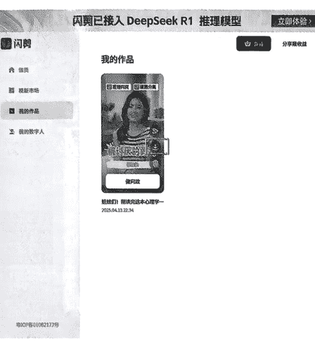

##### 剪映实操：切换风格，智能匹配

使用剪映的"图文成片"功能，为适配后的"非口播类"脚本制作具有平台特色的视频。以下是具体方法：

1. 打开剪映"图文成片"：与前面"日更100条视频的流水线"内容类似。
2. 导入平台定制脚本：将DeepSeek改写好的、对应平台的脚本导入。
3. 选择匹配平台的风格/模板：这是关键！不要使用默认模板或单一模板。
   - 抖音版：选择节奏快、转场多、视觉冲击力强的模板。
   - 小红书版：选择清新、美观、带有生活气息或教程风格的模板。
   - 哔哩哔哩版：可选择信息量更大、支持分段或章节感的模板。
4. 智能匹配与手动调整：让剪映智能匹配素材，然后根据平台调性进行手动调整。例如，小红书版可多用静态图片和美观的空镜；抖音版多用动态视频片段。
5. 音乐与音效：为不同平台选择不同的背景音乐风格。
6. 生成与导出：生成视频并导出。

##### 步骤 4 审核与发布

确保最终生成的各平台版本视频符合要求且无误。以下是具体方法：

1. 内容核对：检查脚本内容是否与平台版本一致。
2. 视觉检查：
   - "数字人"视频：口型是否基本对齐？有无明显不自然之处？
   - 剪映视频：风格是否符合目标平台？素材搭配是否协调？
3. 平台格式：确认视频比例（如抖音/小红书多为 9:16 竖屏，哔哩哔哩横屏竖屏皆可，但横屏内容更主流）是否正确。
4. 合规性：再次确认是否无违规词、无明显诱导分享（除非平台允许）、AI生成内容是否需要按平台要求进行标注。
5. 发布：将定制好的视频发布到对应的平台。

##### 重要提醒：平台规则与内容价值

1. "去重"不是"伪原创"：核心目的是更好的用户体验和平台适应性，而非欺骗算法。确保即使核心信息相同，每个平台的版本都能提供独特的视角或表达方式。
2. 关注平台对 AI 内容的态度：各大平台对 AI 生成内容的规则在不断变化。留意是否需要明确标注内容由 AI 生成，避免潜在风险。目前普遍要求真实、不误导。"数字人"视频尤其要注意这一点。
3. 价值是根本：无论形式如何变化，内容本身必须对用户有价值（如提供信息、娱乐、情感共鸣等）。低价值内容的批量分发依然会被用户和平台抛弃。
4. "数字人" 形象的版权：使用闪剪等工具时，确保所选"数字人"形象的授权范围覆盖你的商业用途。

通过以上内容的学习，你将会掌握将批量生产的内容进行智能化平台适配和形式创新的方法。这不仅能有效规避重复内容的风险，而且能让你的信息精准触达不同平台的用户，提升内容的传播效率和转化效果。记住，AI是放大器，你的策略和对用户的理解才是根本驱动力。结合前一节的批量生产能力，你现在可以更智能、更高效地在短视频领域中开疆拓土了。

### 06 自动批量上传并管理多平台内容

视频制作完成后，我们需要将它们上传到平台上才能获得流量。如果平台很多，一个一个地上传、发布、运营的话，效率往往不高，因此我们需要有一个统一的管理平台。

管理平台有两个作用：一个是同一视频在多个平台发布，另一个是多个视频发布到同一个平台。这里给大家推荐一款多平台管理软件——易媒助手，可以完美满足这两个功能。

**安装及使用教程：**

1. 搜索易媒助手，到官网下载软件，如图 5-12。

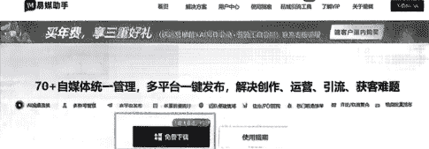


图 5-12

2. 使用微信扫码登录，如图 5-13，登录即送 7 天会员。
（注：有个人版、企业版，其他收费标准详见官网）


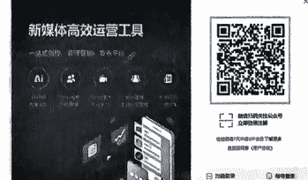

图 5-13

3. 登录后点击账号，添加账号，根据提示登录你要运营的平台和账号，如图 5-14。

第五章 短视频引流：获客新篇章 179

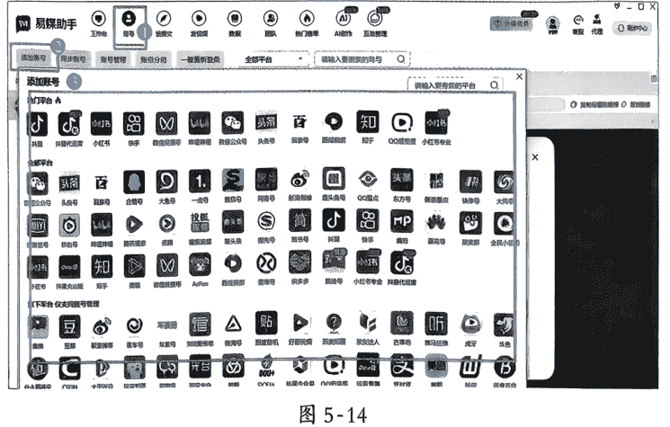

4. 点击发视频，新建批量发布，添加需要批量发布的视频，如图 5-15，并上传视频，如图 5-16。

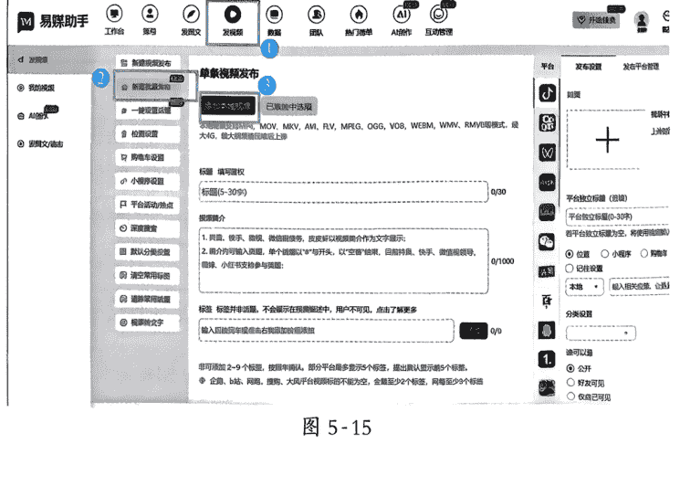

180 AI搞定生意

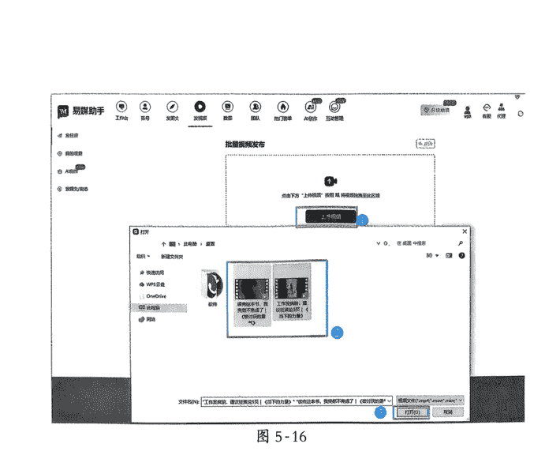

5. 上传完成后设置标题，如上传前视频文件已经命名好，软件会沿用文件名作为视频的标题，不用再修改；如果需要修改，可以点击批量设置标题，输入一个标题，回车换行，接着再输入第二个标题，如此类推，上传几个视频就取几个视频标题，但要注意视频的顺序，否则会标题错位，如图 5-17、图 5-18。

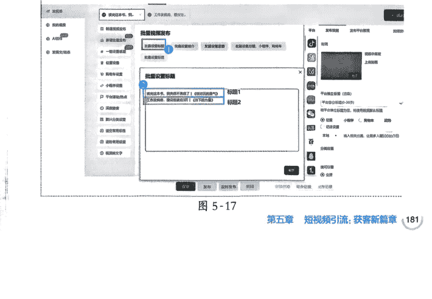

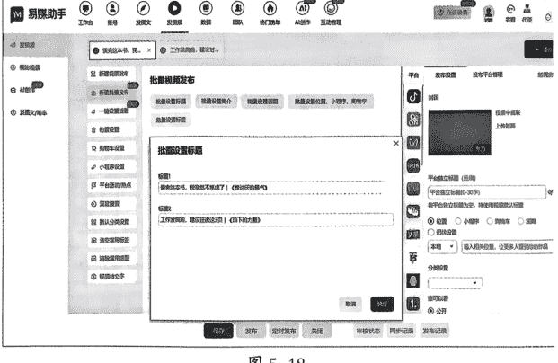

图 5-18

6. 同理，批量设置视频简介（如图 5-19）、话题（如图 5-20）、标签（如图 5-21），另外批量设置位置、小程序、购物车、团购等功能也可以尝试（如图 5-22），在视频获得不错的流量后，可以考虑批量变现的方法。

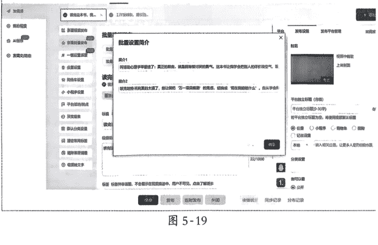

图 5-19

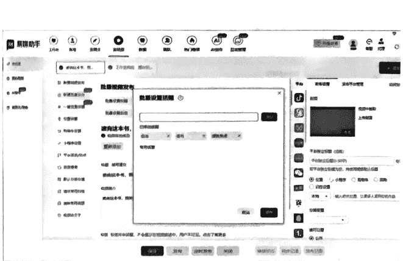

图 5-20

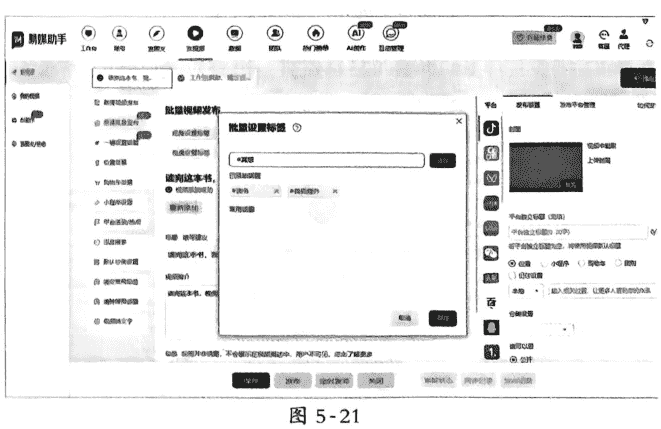

图 5-21

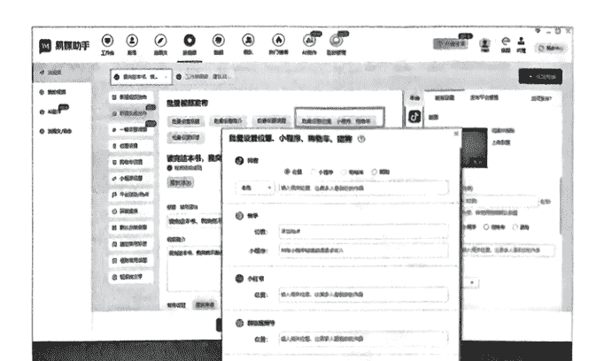

7. 设置完成后，批量发布即可，如图 5-23。

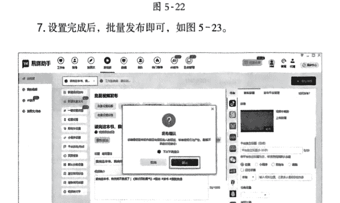

注：该平台还有很多其他批量管理矩阵账号的功能，如图 5-24，

184 AI 搞定生意

感兴趣的读者朋友可以好好研究一下，好用的工具可以让我们在获客变现的路上省心不少。

#### 视频教程（全新剪映教程已上线）

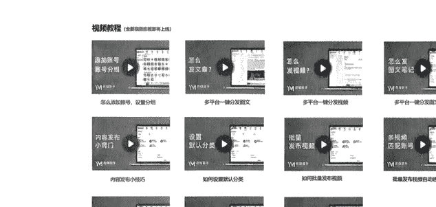

图 5-24

通过本节内容的学习，你将拥有通过短视频实现商业变现的宝剑，各位读者朋友可以学以致用，打造自己的短视频流量渠道，实现流量变现。

# 第六章

## AI 实战攻略：全场景解决方案

### 电商智能增长组合拳

#### 01 淘宝：标题优化 + 竞品监控

##### 平台特点

1. 国内最大综合性电商平台，用户基数庞大，覆盖全品类。
2. 平台流量主要来自搜索和"猜你喜欢"等推荐形式，近年来直播、短视频等内容形式的占比显著提升。
3. 市场竞争激烈导致同质化严重，关键在于获取精准流量、提升点击率和转化率。
4. 官方数据工具"生意参谋"可以提供全面的数据支持。

##### AI 实战

**步骤 1 深挖关键词，生成高点击率标题**

淘宝标题是影响搜索排名和点击率的关键因素，AI 可以辅助标题优化。

（1）**挖掘关键词**：结合生意参谋数据、淘宝下拉框提示、竞品标题及用户评论等信息，利用 AI 技术进行分析、聚合、筛选，最终生成最优的关键词组合（核心词、属性词、长尾词、营销词、热搜词等）。

（2）**生成高点击率标题**：根据选定的关键词，按照淘宝标题规则（如长度限制、禁用词等）和吸引点击的原则（如突出卖点、感知稀缺感、加入数字/符号等），批量生成多个候选标题，供选择或测试。

- 提问模板（标题生成）：

我正在淘宝销售一款【产品详细描述】。请帮我生成 10 个符合淘宝规则的商品标题。

要求：

1. 包含【核心词】。
2. 包含【重要属性词】。
3. 融入可能的【营销词或场景词】。
4. 考虑近期热搜趋势。
5. 标题【长度】。
6. 避免堆砌关键词，语句尽量通顺且吸引人。

**参考指令：**

我正在淘宝销售一款 2025 新款纯棉女士白色 T 恤，宽松版型，印有简约字母图案。

请帮我生成 10 个符合淘宝规则的商品标题。

要求：

1. 包含核心词：T 恤女，白色 T 恤。
2. 包含重要属性词：纯棉，宽松，短袖，2025 新款，简约。
3. 融入可能的营销词或场景词：百搭，内搭，显瘦，ins 风，通勤。
4. 考虑近期热搜趋势。
5. 标题长度在 30 个汉字（60 字符）左右。
6. 避免堆砌关键词，语句尽量通顺且吸引人。

**成果示例：**

😎 已深度思考（用时 37 秒）∨

根据淘宝搜索引擎优化规则和用户搜索习惯，结合近期 "ins 风通勤穿搭" "显瘦上衣" 等热搜趋势，为您生成以下 10 个商品标题（每个标题均控制在 30 个汉字以内）：

1. 2025 新款纯棉白色 T 恤女宽松短袖 ins 风百搭显瘦上衣
2. 纯棉白色 T 恤女 2025 夏装新款宽松短袖百搭显瘦内搭 ins 风上衣
3. ins 风纯棉宽松 T 恤女 2025 新款白色短袖简约字母显瘦打底衫
4. 白色 T 恤女 2025 夏装新款纯棉宽松短袖 ins 风百搭通勤上衣女
5. 纯棉白色短袖 T 恤女 2025 新款宽松显瘦 ins 风简约字母通勤上衣
6. 2025 夏季新款纯棉白色 T 恤女宽松短袖百搭内搭 ins 风显瘦上衣
7. 白色纯棉 T 恤女 2025 夏装宽松短袖 ins 风简约字母通勤显瘦上衣
8. 2025 新款 ins 风纯棉白色 T 恤女宽松短袖显瘦简约字母百搭上衣
9. 纯棉宽松白色 T 恤女 2025 夏装新款短袖 ins 风通勤显瘦打底衫
10. 2025 夏季 ins 风纯棉白色 T 恤女宽松短袖百搭显瘦简约通勤上衣

**步骤 2 捕捉关键信息，实时监控竞品**

知己知彼，百战不殆，AI 可以辅助竞品观测。

（1）**关键信息追踪**：监控竞品的标题关键词变化、主图、详情页更新、价格调整、促销活动、销量趋势、评价（尤其是差评）等。

（2）**策略分析**：AI 可以辅助分析竞品的运营策略（如促销手段、卖点优化、差评处理方式等），为自身运营提供参考。由于 DeepSeek 无法直接访问外部链接进行分析，我们借助 AI 工具"豆包"完成内容解析。

- 提问模板（电商竞品分析）：

> 请分析这个淘宝竞品【粘贴竞品标题或链接】。假设它近期销量增长较快，请从标题关键词选用、主图视觉呈现、详情页逻辑、促销手段和用户评价反馈这几个角度，推测其可能的成功原因和运营策略。我应该如何借鉴或差异化竞争？

**参考指令：**

```
请分析这个淘宝竞品【淘宝】7 天无理由退货 https://e.tb.cn/......点击链接直接打开或者淘宝搜索直接打开。假设它近期销量增长较快，请从标题关键词选用、主图视觉呈现、详情页逻辑、促销手段和用户评价反馈这几个角度，推测其可能的成功原因和运营策略。我应该如何借鉴或差异化竞争？
```

第六章 AI 实战攻略：全场景解决方案 189

**成果示例：**

##### 一、竞争激烈程度与细分方向分析

###### 1. 竞争激烈程度

该淘宝商品近期销量增长较快，可能在标题关键词选用、主图视觉呈现、详情页逻辑、促销手段和用户评价反馈等方面存在优势，以下是对其成功原因和运营策略的推测，同时提出可借鉴的经验与差异化竞争策略：

**（1）标题关键词选用**

- 成功原因："女"精准定位目标群体，提高搜索精准度；"春秋季"贴合季节性需求，在相应季节能吸引更多有需求的消费者；"长袖衬衣"是商品核心属性，便于消费者快速识别商品类型；"花苞领一字肩"突出设计亮点；"一见钟情"增加情感吸引力，激发消费者兴趣。
- 运营策略：深入研究目标市场及消费者的搜索习惯，挖掘与商品属性、风格、适用场景等相关的高频关键词，并合理布局到商品标题中，从而提升商品在搜索结果中的曝光率。
- 借鉴与差异化：借鉴其精准定位和突出卖点的关键词抽取方式。差异化可挖掘竞品未覆盖的长尾关键词，如特定场合（约会、通勤）、面料独特性等相关词汇，吸引更细分的消费群体。

**请按如下顺序操作：**

1. 打开淘宝 App，搜索你的核心产品词。
2. 观察搜索结果页面排名靠前的 5～10 个商品的标题，记录它们常用的关键词和表达方式。
3. 将你记录的关键词和你的产品简介输入上述标题并生成提问模板，生成几个新标题草稿。

**注意事项：**

1. 规避违规风险词：标题中切忌使用淘宝规定的风险词、违规词。AI 生成后务必进行人工复核。
2. 不要过度堆砌关键词：过度堆砌关键词将会影响用户体验，可能被平台降权。
3. **懂得监控 ≠ 照搬**：监控是为了解对手情报、思路，而不是简单抄袭，要结合自身产品定位做差异化。
4. **注意数据合规性**：在使用第三方工具监控竞品时，需注意遵守平台规则，同时确保数据隐私合规。


#### 拼多多：智能定价 + 裂变活动设计

##### 平台特点

1. 由于社交裂变和低价模式迅速崛起，用户对价格高度敏感。
2. 商业模式以工厂直供和农产品直销为核心组成部分。
3. 平台活动（百亿补贴、限时秒杀、多多果园等）对流量影响巨大。
4. 运营重点在于获取流量、拼单转化、平台活动运营。

##### AI 实战

**步骤1 分析成本与竞品，给出动态调价建议**

在价格战中，定价策略至关重要，AI 可以辅助智能定价。

（1）**成本与竞品分析**：基于产品特性、竞品定价、平台运营成本、用户价格预期等多维度数据分析，AI 可以辅助测算盈亏平衡点并生成具有竞争力的价格区间。

（2）**动态调价建议**：AI 模型能基于销量、库存、活动节奏和竞品调价等实时数据，动态给出定价建议，以最优化实现运营目标（流量最大化或利润最大化）。

**提问模板（辅助定价）：**

我的产品【产品描述】在拼多多的成本价为【X元】。目前平台竞品中：最低售价为【Y元】，行业主流价格为【Z元】。现计划报名【xx活动】，该活动要求售价低于日常定价。请帮我分析：

1. 日常销售中具有价格竞争力的合理定价区间？
2. 为实现【运营目标】，活动价建议设置为多少？
3. 除了价格，还能通过哪些方式体现性价比？

**参考指令：**

我的产品手机壳在拼多多的成本为3元。目前平台竞品中：最低售价为5元，行业主流价格为9.9元。现计划报名限时秒杀活动，该活动要求售价低于日常价。请帮我分析：

1. 日常销售中具有价格竞争力的合理定价区间？
2. 为实现既能吸引用户又能保证微利营销目标（或战略性引流），活动价建议设置为多少？
3. 除了价格，还能通过哪些方式（如赠品、规格差异等）体现性价比？

**成果示例：**

**一、日常销售价位建议（平衡竞争力和利润）**

推荐价格区间：6.9元~7.9元

逻辑分析：

1. 避开低价血拼：当前最低价为5元（利润约1元，扣除运费后可能亏损），若跟进此价格将导致利润极低甚至出现亏损，且拼多多用户对低价商品的质量和服务容忍度较低，易引发差评。
2. 锚定主流价格策略：主流价9.9元，利用用户对"低于10元"的天然好感，定价7.9元既能与9.9元形成对比（突出2元价差优势），又比最低价5元高2.9元，通过价格差异暗示品质更好。
3. 利润保障：假设单件成本3元，平台扣点约2%（0.15元），运费1.5元，单件利润约7.9-3-1.5-0.15=3.25元，可支撑后续推广或活动让利。

执行建议：

- 主图强调"性价比标签"：如"防摔爆款·省2元""比9.9更超值"，弱化价格对比，强化品质感知。
- 搭配小规格赠品：如赠送"屏幕湿巾（成本0.1元）"，提升价值感。

**步骤2 生成活动创意，设计规则与撰写文案**

裂变是拼多多的灵魂，AI可以支持裂变活动设计。

（1）**活动创意生成方案**：基于平台营销功能（如拼团、砍价、助力、分享券等），结合不同营销目标（拉新、促活、清库存等），由AI智能生成多样化的裂变活动策划方案。

（2）**设计规则与文案撰写**：AI可以辅助设计易于客户理解的活动规则、吸引客户参与的分享文案以及有效的对话引导话术等。

> **提问模板（裂变活动策划）：**

为我的拼多多店铺【店铺名、主营类目】策划为期一周的社交裂变活动。

目标：提高店铺关注度，并推广新品【新品名称】。

要求：

1. 【活动形式】采用拼多多平台支持的成熟玩法。
2. 设计详细的【活动规则】。
3. 撰写吸引客户的活动主标题和分享引导文案。
4. 设置【风控措施】和控制活动成本。

**参考指令：**

> 为我的拼多多店铺水果批发（主营柑橘类水果）策划为期一周的社交裂变活动。
> 目标：提高店铺关注度，并推广新品沃柑。

要求：

1. 活动形式采用拼多多平台支持的成熟玩法，如邀请好友助力免费拿/多人拼团享超低价。
2. 设计详细的参与方式、成功条件、奖励机制。
3. 撰写吸引客户的活动主标题和分享引导文案。
4. 设置同一 ID 的参与次数限制，添加反刷单监测机制和控制活动成本。

**成果示例：**

结合拼多多平台特性和柑橘类水果消费场景，为您设计以下社交裂变活动策划方案：

##### 一、活动主题设计

主标题："0元抢3斤沃柑！邀5位好友立即免费领"

副标题：万人疯抢！新品沃柑上线，拼团立减30元，限量500箱秒杀

##### 二、双活动并行机制（兼顾拉新与转化）

▶ 活动一：沃柑尝鲜助力赛

✓ 参与方式：关注店铺→进入"免费领沃柑"活动页→生成分享链接邀请好友助力

✓ 成功条件：24小时内集满5人助力（含至少2位新关注用户）

✓ 奖励机制：
- 前200名完成：3斤沃柑免费包邮
- 第201名~1200名完成：享9.9元购（原价29.9元，限量1000份）

✓ 进度展示：实时更新"已助力人数/剩余名额"进度条

▶ 活动二：超级拼团日

- 拼团规则：
  - 3人成团价：19.9元/5斤（日常价29.9元）
  - 10人团专属价：15.9元/5斤（仅限社群链接参与）
  - 额外激励：团长每成功邀请满3人，可额外赠200g金橘试吃装

**请按如下顺序操作：**

1. 在拼多多 App 中搜索你的主营产品，筛选出销量最高的3~5个商品链接。

2. 分析定价策略及 SKU 设置、当前参与的平台活动以及商品评价中的用户反馈痛点。

3. 基于上述调研结果，使用裂变活动策划提问模板生成初步方案。

- **注意事项:**
1. **简化规则:** 活动规则需清晰易懂，复杂的规则会降低用户参与度。
2. **风险预案:** 提前准备客服响应方案，应对可能激增的咨询量。确保供应链和库存承压能力，避免爆单导致断货。
3. **合规性:** 时刻关注平台政策变动，确保活动符合规则。

#### 03 闲鱼：自动生成高转化文案库

##### 平台特点

- 1. 业界领先的二手交易平台，流量巨大，用户互动性强。
2. 商品具有非标准化的特性，赢得客户的信任是成交的关键。
3. "鱼塘"社区具有独特的社交属性。
4. 运营关键在于打造真实可信、信息详细的优质商品文案和视觉素材，同时通过高频互动形成转化闭环。

##### AI 实战

##### 步骤 自动生成高转化文案库

在二手交易中，能够打动买家的往往是真实、具体的描述。AI 可以高效生成结构完整、细节丰富且语气诚恳的文案初稿，卖家再结合实际情况修改，即可逐步建立自己的文案库。

##### AI 文档生成要点：

- (1) **填写描述:** 包含物品名称、品牌型号、新旧程度（几成新/使用时长/瑕疵说明）、功能是否齐全、配件情况、转手原因（增加可信度）、期望价格、交易方式等。

- (2) **场景化/故事化:** 加入项目的使用场景、相关故事或情感联系，增加吸引力。

- (3) **精准关键词:** 包含用户可能会搜索的关键词。

- (4) **真诚语气:** 语气诚恳，如对于有瑕疵的物品应如实描述，避免过度吹嘘。

##### 提问模板（文案生成）：

> 我准备在闲鱼上出售一个【物品详细描述】，我想把它卖给【目标人群】。

请帮我写一段闲鱼商品文案。要求：

1. 包含【所有关键信息】。
2. 说明转手原因。
3. 描述使用体验或优点。
4. 如实说明细微瑕疵（如果有的话）。
5. 语气真诚，像和朋友介绍一样。
6. 包含可能的搜索关键词。

###### 参考指令：

> 我准备在闲鱼上出售一个仅使用过两次的豆浆机，型号是 XXXXX-XXXX，带全套配件和说明书。我想把它卖给注重健康的上班族/小家庭。

请帮我写一段闲鱼商品文案。要求：

1. 包含品牌型号、新旧程度、功能、配件、价格【可写面议或心理价位】、交易方式为同城自提。
2. 说明转手原因：使用频率低。
3. 描述使用体验或优点：打出的豆浆很细腻，操作方便，清洗简单。
4. 语气真诚，像和朋友介绍一样。
5. 包含可能的搜索关键词：豆浆机，家用，低噪音。

###### 成果示例：

【标题】[ 豆浆机 XXXXXX-XXXXX ] 99新 家用低噪音 带全套配件和说明书 健康早餐神器

【正文】
姐妹/兄弟看过来！转手一台几乎全新的豆浆机 XXXXXX-XXXXX，仅用过两次（真·吃灰预警），全套配件 + 说明书！因为家里饮食调整，使用次数太少，转给更需要的人。

亲测好用：

- ✅ 打出来的豆浆超细腻，豆渣几乎无感，不用过滤直接喝。
✅ "傻瓜式"操作，按键一按就搞定，上班族也能快速喝上热乎豆浆。
✅ 清洗超省心！刀头可拆卸，内胆不沾涂层，水一冲就干净！
✅ 低噪音设计，不用担心吵醒家人邻居，20分钟速成，不用早起。

适合人群：
面向独居人士、小家庭、健康爱好者、追求无添加豆浆的上班族，以及需要为宝宝做辅食的宝爸宝妈，现诚意转让。（想换咖啡机才忍痛出，刀前求轻拍）
心理价位 XXX 元（可小刀），同城可自提，外地可走邮寄。

关键词：# 家用豆浆机 # 低噪音 # 健康小家电 # 闲置转让
PS：实物超新无划痕，包装盒都在，送人自用都体面！需要看细节图随时戳我。

##### 请按如下顺序操作：

- 1. 选择一个你身边想出手的闲置商品。
2. 打开闲鱼 App，搜索相似商品，多参考几个同类商品的文案描述。
3. 使用上述提问模板，输入你的商品信息，生成一段文案草稿。

##### 注意事项:

- 1. 确保信息不失真: AI生成内容必须基于事实, 不能过分隐藏瑕疵或夸大优点。
2. 文案切勿千篇一律: 完全依赖AI可能导致文案缺乏个性, 建议加入个人真实感受。
3. 不要忽略图片/视频: 在闲鱼平台上, 图片和视频同样重要, 好文案必须配好图。
4. 积极给予互动反馈: 不能只发帖不回复, 及时、耐心地与买家沟通才是成交的关键。
5. 熟悉平台规则: 熟悉闲鱼平台关于禁止发布的商品及相关交易规则。

#### 04 抖店: 短视频脚本生成 + 直播话术优化

##### 平台特点

- 1. 以"兴趣电商"为代表, 内容(短视频、直播)是核心驱动力。
2. 流量分发依赖算法推荐, 内容质量、完成播放率、互动率、转化率是关键指标。
3. 运营核心在于持续输出优质内容, 并提升直播间互动效果和转化效率。

##### AI实战

步骤1 为产品构思创意, 快速生成脚本框架

持续爆款短视频是抖店成功的基石, AI可以辅助生成短视频脚本。

198 AI搞定生意

(1) 创意构思：基于产品特点、目标用户、抖音热点，生成多种短视频创意方向和表现形式。

(2) 脚本框架：快速生成符合抖音节奏（如黄金3秒、快节奏、强反转、BGM卡点等）的脚本框架，包含画面描述、关键台词、字幕提示、引导语（小黄车）等。（可参考第五章相关内容）

##### 📌 提问模板（抖店短视频脚本）：

> 为我的抖音小店产品【产品描述】创作一个15~20秒的种草短视频脚本。

**目标：**突出其【产品特点】，引导用户点击小黄车购买。

**要求：**
1. 开头3秒抓住眼球，展示痛点。
2. 中间快速演示产品的使用过程和效果。
3. 展示多个使用场景。
4. 结尾口播 + 字幕引导下单。
5. 推荐合适的背景音乐风格。

###### **参考指令：**

> 为我的抖音小店产品便携式迷你榨汁机创作一个15~20秒的种草短视频脚本。
**目标：**突出其便携性和快速榨汁的特点，引导用户点击小黄车购买。

**要求：**
1. 开头3秒抓住眼球，展示痛点：想喝鲜榨果汁，嫌外面的太贵/不健康。
2. 中间快速演示产品使用过程和效果，几秒钟榨好一杯。
3. 展示多个使用场景：办公室、健身房、宿舍等。
4. 结尾口播 + 字幕引导下单"随时随地鲜榨果汁，健康生活点下方小黄车带回家！"。
5. 推荐合适的背景音乐风格。

###### 成果示例：

【 15 秒种草短视频脚本 】
（建议背景音乐：轻快的电子流行乐，节奏点强的剪辑音效）

0~3 秒 痛点开场
画面：左手举一杯奶茶店标价 28 元的果汁（贴价格标签特写）/ 右手滑动手机里外卖软件界面。
画外音（嫌弃脸）："30 块一杯果汁？糖分爆表还肉疼！"（配"叮"扣钱音效）

4~8 秒 产品暴击
画面快剪：
① 单手从包里抽出迷你榨汁机（突出特写巴掌大小）。
② 塞入苹果 + 酸奶（慢镜头捕捉果汁飞溅）。
③ 按下开关瞬间→倒出细腻果汁（同时 3 秒计时器音效）。
画外音 + 字幕："宿舍、健身房、办公室，3 秒即榨！无线便携，随时畅饮！"

- 9~12 秒 场景轰炸
画面切换：
* 女生在健身房举铁后大汗淋漓（汗珠特写），抓起果汁杯插吸管直接畅饮。
* 办公室键盘旁放着果汁杯（同事探头，眼睛发亮）。
* 女生穿着睡衣在宿舍床头榨汁（举杯对镜头 wink）。
* 音效："咻——" 的元气音效 + "吨吨吨" 畅饮声

13~15 秒 促单收尾
画面：产品旋转展示 + 小黄车弹窗
口播（活力女声）："鲜榨果汁随时随地喝！点下方小黄车，把健康生活带回家！"（同步大字幕 + 手指点击动作）

##### 步骤 2 为直播注入活力，优化直播话术促成交

直播带货效率直接影响 GMV，AI 还可以优化直播话术。
（1）流程策划：生成直播流程脚本，合理安排产品讲解、互动环节、福利发放和逼单话术等关键内容。

(2) 话术库构建：针对不同产品、不同场景（如开场、介绍卖点、回答常见问题、处理质疑、催单逼单等），生成专业、有感染力的话术库。

(3) 实时辅助（未来趋势）：更高级的应用可实现直播间评论的实时分析，为主播提供即时话术建议或观众问题摘要。

提问模板（直播话术——逼单）：

> 我正在抖音直播销售【产品名称】，库存有限。请帮我写几段有说服力、营造紧迫感、引导观众马上下单的逼单话术。可以结合优惠信息。

参考指令：

> 我正在抖音直播销售一款网红芝士饼干，库存有限。请帮我写几段有说服力、营造紧迫感、引导观众马上下单的逼单话术。可以结合优惠信息，限时买一送一进行。

成果示例：

(搭配快速手势 + 背景倒计时器特效)

话术 1 倒计时轰炸型
"直播间的家人们注意了！这款芝士饼干今天直接骨折价大放送！原价 59 元一盒，现在下单买一盒送一盒！（举手指比 1）但是重点来了！库存只剩 30 组！运营刚通知最多撑 3 分钟！（看镜头外）什么？又有 10 组被秒拍？现在仅剩 20 组！要抢的宝宝们赶紧下单！"

话术 2 场景刺激型
（撕开包装咔嚓音效 + 拉丝芝士特写）
"大家听到了吗？这个酥脆度！（对镜头咬半块）看到这个芝士流心了吗？知道为什么我们能全网卖爆 100 万盒吗？因为别人家用的都是芝士粉，而我们用的是整块车打芝士！（看弹幕互动）说贵的宝宝注意啦！今天不仅买一送一，还额外赠送价值 39 元的饼干收纳罐！（突然看向屏幕）天哪！粉色包装只剩最后 8 组了！想要粉色礼盒的赶紧在弹幕里扣粉色！"

话术 3 名额限定法
（突然调小背景音乐）
"所有新进直播间的家人注意！现在是 19:27，距离买赠活动结束仅剩最后 13 分钟！
（展示手机倒计时）已经看到很多老粉回购 3 组了，为什么这么抢手？因为明天就要
恢复原价了！（突然提高音量）运营刚刚提醒——最后 15 组库存！现在开始倒数：
15！14！想要赠品的家人请立即点击下方购物车！"

##### 请按如下顺序操作：

- 1. 选择店铺的一款主推产品。
2. 使用上述短视频脚本模板，让 AI 生成一个 15 秒的脚本草稿。
3. 使用上述直播话术提问模板，让 AI 生成 3 条针对该产品的逼单话术。

注意事项：

- 1. 避免内容同质化：AI 生成的脚本和话术需要结合主播个人风格和实时互动进行调整，避免生硬或模板化。
2. 注重内容本身：AI 在本质上仍属于工具范畴，短视频和直播的成功更依赖于创意、表现力和与用户真诚互动。
3. 遵守平台规则：直播和短视频内容需严格遵守抖音平台的社区规范和电商规则，避免违禁词、虚假宣传等。
4. 确保转化链路无误：避免因商品链接、优惠券等设置错误导致内容吸引人却无法转化的情况。

#### 05 亚马逊：智能 Listing + 评论攻防战

##### 平台特点

- 1. 作为全球最大的跨境电商平台，其业务覆盖欧美日等主要海外市场。
2. 平台以产品和品牌为核心，商品的搜索排名由 A9 算法（亚马逊的搜索核心算法）决定。
3. 用户评论（Review）显著影响购买决策和商品详情页（Listing）的权重。
4. FBA（亚马逊物流）是平台核心优势，但规则体系较为复杂。
5. 运营重点在于 Listing 优化、PPC 广告投放、评论管理和库存管理等精细化运营。

##### AI 实战

##### 步骤1 精心挑选关键词，高质量撰写文案

Listing（商品详情页）是亚马逊运营的基石，AI 技术可以实现 Listing 智能优化。

- (1) 关键词研究：通过分析市场搜索趋势、竞品关键词及 PPC 广告数据，挖掘高相关性、高转化潜力的关键词（核心词、长尾词）。
(2) 文案撰写：根据平台规则和目标市场用户的阅读习惯，撰写符合 A9 算法偏好、突出卖点、简洁易懂的标题（Title）、五点描述（Bullet Points）、产品描述（Description）、搜索词（Search Terms）。

###### 🔵 提问模板（Listing 优化）：

我的产品是【产品描述】，目标受众是【目标人群】。请为我的亚马逊商品列表撰写 5 个有吸引力的英文要点（每个要点控制在 500 字符以内），并附上中文翻译。

要求：

- 1. 突出关键特性、优势。
2. 包含相关【关键词】。
3. 每个要点以大写字母开头，注重产品优势而非特性。
4. 使用适合美国市场的有说服力的语言。

###### 参考指令：

我的产品是记忆棉旅行颈枕，目标受众是常旅客、上班族。请为我的亚马逊商品列表撰写 5 个有吸引力的英文要点（每个要点控制在 500 字符以内），并附上中文翻译。

要求：

- 1. 突出关键特性、优势：符合人体工学支撑、便携性、柔软可水洗的外罩、附赠眼罩。
2. 包含相关关键词：旅行颈枕、飞机枕、记忆棉枕头。
3. 每个要点以大写字母开头，注重产品优势而非特性。
4. 使用适合美国市场的有说服力的语言。

###### 成果示例：

以下是符合美国市场习惯的 5 个中英对照商品要点（每个英文部分严格控制在 500 字符以内）：

**1. ERGONOMIC SUPPORT CRADLES YOUR NECK IN ANY POSITION**

Crafted with premium memory foam that conforms to your unique shape, this travel pillow prevents neck strain whether you're on flights, trains, or office chairs. Its contoured design secures your head for deep rest—ideal for side sleepers and upright nappers.

关键词 : Travel Neck Pillow、Memory Foam Pillow、Comfortable Airplane Pillow

####### 1. 人体工学支撑，解锁全姿势舒适体验

采用自适应记忆棉精准贴合颈部曲线，无论在飞机上、火车上还是办公椅上，从此告别僵硬。独特凹槽设计稳固头部位置，侧睡爱好者与坐姿小憩者皆可畅享深度放松。

关键词：旅行颈枕、记忆棉枕头、舒适飞机枕

步骤 2 识别评论关键信息，智能分析给出反馈

评论是产品生命线，也是竞争战场，AI 可以赋能评论运营。

（1）评论监控与分析：自动化监控新增评论，利用情感分析技术快速识别差评（Negative Review）和好评中的关键信息，分析用户抱怨焦点（如产品缺陷、物流问题、描述不符等）和赞扬点。

（2）差评应对策略建议：AI 可根据差评内容，提供以下应对建议——联系买家沟通解决、公开回复（自动生成回复草稿）或申诉移除不当评论。

（3）好评挖掘与利用：分析好评内容，提炼用户认可的卖点，用于优化 Listing 或广告语；也可以邀请留下好评的买家参与其他活动（注意符合平台规范）。

> ● 提问模板（评论分析）：
请针对我的产品【产品名称】，分析以下这条来自亚马逊的负面评价【在此处粘贴负面评价文本】。
1. 总结顾客所抱怨的主要问题。
2. 起草一份专业、富有同理心且有帮助的公开回复，旨在解决问题或提供支持。（可提供【服务描述】），要求包含中英文版本。

参考指令：

> 请针对我的产品智能蓝牙体重秤分析以下这条来自亚马逊的负面评价："这款体重秤太不准了！我连续三天在同一时间称重，结果相差超过2公斤。电池盖也很难打开，差点弄断指甲。客服回复慢，失望透顶！"

- 1. 总结顾客所抱怨的主要问题（如产品准确性、设计问题、客服体验等）。
2. 起草一份专业、富有同理心且有帮助的公开回复（可提供免费更换、退款或技术指导服务），要求包含中英文版本。

###### 成果示例：

已深度思考（用时 12 秒）

####### 1. 顾客抱怨的主要问题总结：

- - **测量不准确**：连续三天同一时间称重，结果差异超过 2 公斤。
- **设计缺陷**：电池盖难以打开，使用不便甚至存在安全隐患（如指甲损伤）。
- **客服体验差**：响应速度慢，导致顾客体验差。

####### 2. 公开回复（中英双语）

**尊敬的顾客：**

感谢您抽出时间分享您的使用体验，对于产品给您带来的不便，我们深表歉意。您的反馈对我们至关重要。

关于称重数据差异问题，我们向您说明：智能蓝牙体重秤的精准度受地面平整度、脚部位置和传感器校准等因素影响。建议您通过 App 确认设备固件是否为最新版本，并确保称重时保持双脚干燥、平稳站立 3 秒以上。若上述问题依旧存在，我们将为您安排技术团队一对一故障诊断或免费更换新设备。

##### 请按如下顺序操作：

- 1. 找到你在亚马逊上的一个核心产品。
2. 使用上述提问模板（替换成你的产品信息和负面评价），总结顾客所抱怨的主要问题，并起草一份公开回复，旨在解决问题。

##### 注意事项：

- 1. **避免 Listing 过度优化**：禁止堆砌关键词或填写与产品不符的描述，此类行为可能会导致违规处罚。
2. 严禁违规操作：刷单、诱导好评、恶意攻击竞争对手等行为均属于违规操作，将面临封号。
3. 注意目标市场文化差异：Listing 的文案、图片风格等需符合当地文化习惯，避免因文化冲突影响销售。
4. 妥善处理差评：若回复不及时、态度差，可能加剧矛盾，甚至引发负面舆论。
5. 不要局限于单一策略：亚马逊运营需要通过 Listing 优化、广告投放、评论管理、库存调控等多维度配合。

#### TikTok：海外短视频标签库 + 趋势词抓取

##### 平台特点

- 1. 抖音国际版（TikTok）拥有庞大的全球用户基数，且用户群体呈显著的年轻化特征。
2. 电商功能（TikTok Shop）在英国、美国等市场快速发展，展现出巨大商业潜力。
3. 与抖音类似，TikTok 同样是内容驱动模式，以短视频为主要载体，算法推荐机制也大致相同。
4. 运营核心在于打造本地化内容、善用话题标签（Hashtag）获取流量，以及紧跟快速变化的平台潮流。

##### AI 实战

##### 步骤 1 多维度标签智能组合，构建本地化标签库

Hashtag是TikTok内容分发的重要依据，AI可以构建本地化标签库。

- （1）**多维度标签挖掘**：针对不同目标国家、地区及产品类目，结合热点事件、文化习俗和用户兴趣特征，利用AI技术大规模抓取、分析并分类相关热门标签、利基标签及长尾标签。
（2）**标签组合推荐**：AI能根据视频内容、风格和推广目标，智能推荐最优标签组合，精准提升曝光度。

● **提问模板**（本地化标签中英版）：

> 我想在TikTok上推广我的【产品类型】，目标受众地区为【国家/地区】。请生成25个相关的英文（附中文翻译）话题标签。
话题标签需包含以下几类：
1. 宽泛的类别标签。
2. 细分/特定标签。
3. 热门/火爆标签。
4. 地区/社区标签。

参考指令：

> 我想在TikTok上推广我的环保手机壳，目标地区为英国。请生成25个相关的英文（附中文翻译）话题标签。
话题标签需包含以下几类：
1. 宽泛的类别标签（例如，#手机壳，#科技配件）
2. 细分/特定标签（例如，#环保，#可持续科技，#可生物降解手机壳）
3. 热门/火爆标签（例如，#环保打卡挑战，#夏季好物推荐）
4. 地区/社区标签（例如，#TikTok英国，#伦敦生活）

208 AI搞定生意

###### 成果示例：

以下是为推广您的环保手机壳设计的 25 个中英双语话题标签，涵盖四类需求并针对英国市场优化，同时附上中文翻译说明：

- 1. 宽泛类别标签（通用曝光）
  (1) #PhoneCase（手机壳）
  (2) #TechAccessories（科技配件）
  (3) #MobileAccessories（移动设备配件）
  (4) #CaseLover（手机壳爱好者）
  (5) #TechFashion（科技时尚）

- 2. 细分 / 特定标签（突出环保卖点）
  (6) #EcoFriendly（环保）
  (7) #SustainableTech（可持续科技）
  (8) #Biodegradable（可降解材料）
  (9) #GreenGadgets（绿色科技产品）
  (10) #PlasticFree（无塑料）
  (11) #RecycledMaterial（再生材料）
  (12) #ZeroWasteTech（零废弃科技）
  (13) #EarthFriendlyCase（地球友好手机壳）

##### 步骤 2 实时监测趋势词，生成创意视频脚本

快速捕捉并利用趋势是 TikTok 成功的关键，AI 可以帮助抓取分析趋势词并辅助视频脚本创作。

（1）趋势监控：利用 AI 技术结合社交媒体监控工具，实时追踪特定区域内的爆款挑战、热门音乐、流行特效、话题关键词（趋势词）。

（2）内容创意结合：AI 可以根据抓取到的趋势词或热点，快速生成与自身产品结合的短视频创意或脚本，帮助商家"蹭热点"。

###### 提问模板（趋势－视频脚本）：

> 在【地区】的 TikTok 上，当前与【主题】相关的热门话题、挑战正在流行。我的产品是【产品描述】。请为我构思【几】个短视频创意，将这些趋势与我的产品自然结合，并推荐一些相关的热门话题标签，并提供中英双语的视频脚本和标签建议。

###### 参考指令：

> 在美国的 TikTok 上，当前与"DIY 家居整理妙招"相关的热门话题/挑战正在流行。我的产品是可堆叠的透明储物箱。请帮我想构思 3 个短视频创意，将这些趋势与我的产品自然结合，并推荐一些相关的热门话题标签，并提供中英文双语的短视频脚本和标签建议。

###### 成果示例：

已深度思考（用时 24 秒）

以下是 3 个结合"DIY 家居整理妙招"趋势的短视频创意方案（中英双语版）：

**创意一：魔法叠叠乐**

**【英文脚本】**

开场：手机支架俯拍凌乱的儿童玩具房
背景音乐：轻快的流行音乐
文字："Before vs After in 5 minutes!"
镜头切换：双手将玩具分类放入透明储物箱（加速剪辑）
画外音："See-through design makes sorting a breeze!"
特写：堆叠 5 层的储物箱稳固站立
文字动画："Stackable = SpaceSaver!"
结尾：整洁房间全景 + 产品 logo
行动号召："Tag #StackableMagic to show your DIY win!"

**【中文脚本】**

开场：手机俯拍杂乱的儿童房
背景音乐：欢快钢琴曲
文字："6 分钟玩具房变形记！"

中景：双手将玩具按类别放入透明收纳箱

画外音："透明设计，找物不用翻箱倒柜！"

特写：叠放 5 层的箱子稳稳站立

文字动画："垂直收纳，空间魔法！"

结尾：整洁房间全景 + 产品商标

行动号召："带话题 #叠叠乐魔法 晒你的收纳妙招！"

##### 请按如下顺序操作：

- 1. 打开 TikTok App，切换到销售的目标国家 / 地区（如果可以）。
- 2. 搜索类似的产品或品类关键词，浏览热门视频，手动记录它们使用的标签。
- 3. 使用上述提问模板，输入产品和目标市场，生成一批备选标签。

##### 注意事项：

- 1. **禁止滥用标签**：使用过多不相关的热门标签会导致流量不精准或触发限流。
- 2. **避免盲目蹭热点**：内容与产品结合生硬、不自然会适得其反。
- 3. **尊重文化差异**：内容和标签必须符合目标市场的文化、宗教与法律法规。
- 4. **紧跟平台规则**：TikTok 算法和电商政策更新频繁，需持续关注。
- 5. **确保视频质量**：低画质、非本地化的视频内容难以获得推荐。

#### 独立站：SEO 长尾词拓展 + 用户画像建模

##### 平台特点

- 1. 商家自建网站拥有最高自主权，可掌控形象、用户、品牌、数据和消费体验。
- 2. 流量主要靠自主获取：包括搜索引擎优化（SEO）、社交媒体营销、付费广告以及邮件营销等。
- 3. 运营核心在于品牌建立、私域流量积累、用户精细化运营。
- 4. 所有数据归属商家自身，为开展精细化分析和个性化营销提供了基础。

##### AI 实战

##### 步骤 1 挖掘长尾词库，匹配精准内容

SEO 是独立站免费、持续获取流量的重要手段，而 AI 可以通过长尾词拓展显著提升 SEO 效果。

- （1）**海量关键词生成**：基于核心产品或服务，AI 可挖掘出大量用户在搜索引擎上可能使用的长尾关键词（通常由 3 个及以上词汇组成，搜索意图更具体）。
- （2）**意图分类与内容规划**：AI 可以辅助分析这些长尾词背后的用户意图（如了解信息、比较产品、寻找购买渠道等），并据此规划相应的 SEO 内容（包括博客文章、FAQ 页面、产品页面优化或落地页面等）。

**提问模板**（长尾关键词扩展）：

> 我的独立站销售【产品/服务】，核心关键词是【产品描述】。请帮我拓展生成【几】个相关的英文长尾关键词，并附上中文翻译，覆盖以下方面：

- 1. 产品特性。
- 2. 用户类型 / 使用场景。
- 3. 用户痛点 / 需求。
- 4. 竞品对比。

###### 参考指令：

我的独立站销售手工制作的皮革钱包，核心关键词是"手工皮钱包"。请帮我拓展生成 20 个相关的英文长尾关键词，并附上中文翻译，覆盖以下方面：

- 1. 产品特性（例如，头层牛皮钱包，简约风格牛皮钱包）。
- 2. 用户类型 / 使用场景（例如，男士皮钱包，送给父亲的钱包礼物）。
- 3. 用户痛点 / 需求（例如，如何保养皮钱包，最耐用的钱包）。
- 4. 竞品对比（例如，手工制作的钱包与机器制作的钱包对比）。

###### 成果示例：

已深度思考（用时 20 秒）

以下是为您生成的 20 个英文长尾关键词及中文翻译，覆盖 5 大核心维度。关键词结构严格遵循 Google Keyword Planner 和 Semrush 长尾词生成逻辑，并深度结合用户购买决策场景：

####### 一、产品特性（材质 / 风格）

- 1. Full-grain leather wallet with minimalist design → 头层牛皮极简设计皮钱包
- 2. Hand-stitched vegetable-tanned leather wallet → 手工缝制植物鞣皮钱包
- 3. Slim leather card holder with RFID protection → 超薄皮质 RFID 防盗卡包
- 4. Vintage distressed leather bifold wallet → 复古做旧双折式皮钱包

####### 二、用户类型 / 使用场景（礼物 / 人群）

- 1. Luxury leather wallet gift for groomsmen → 新郎伴郎团高端皮钱包礼物
- 2. Handmade leather wallet for minimalist lifestyle → 极简生活方式人群手工皮钱包
- 3. Personalized leather wallet for anniversary gifts → 周年纪念定制刻字皮钱包
- 4. Leather wallet organizer for business professionals → 商务人士多功能皮钱包

##### 步骤 2 整合多维数据，细分用户画像

了解用户是精准营销的前提，AI 可以赋能用户画像建模。

（1）**多源数据整合分析：** AI 能够整合并分析来自不同渠道的数据，包括网站分析数据（如 Google Analytics）、用户调研数据、CRM 中的购买记录以及社交媒体互动数据等，实现多源数据的统一处理与深度挖掘。

（2）**用户分群与画像生成：** 基于 AI 算法，系统可以自动将用户划分为不同群体（如高价值客户、潜在流失客户、新用户等），并为每个群体构建详细的用户画像，涵盖人口统计特征、兴趣偏好、行为习惯、痛点需求和触媒习惯等多维信息。

###### 提问模板（用户画像建模）：

> 根据我们独立站的后台数据分析，发现约 15% 的用户具有以下特征：【列出数据洞察】。请基于这些信息，构建一个名为"品牌忠粉"的用户画像（Persona），包含以下维度：
>
> 1. 基本信息（推测）。
> 2. 目标与动机。
> 3. 痛点与挑战。
> 4. 对我们产品/品牌的期望。
> 5. 常用的信息渠道。
> 6. 适合的营销策略（如何触达和维系这类用户？）。

###### 参考指令：

> 根据我们独立站的后台数据分析，发现约 15% 的用户具有以下特征：年龄 30~45 岁，多次购买高客单价商品（如定制款），网站停留时间长，主要通过 Instagram 引流，对新品邮件打开率高，反馈中常提及"独特性"和"品质"。请基于这些信息，构建一个名为"品牌忠粉"的用户画像（Persona）。包含以下维度：

- 1. 基本信息（推测）。
- 2. 目标与动机。
- 3. 痛点与挑战。
- 4. 对我们产品/品牌的期望。
- 5. 常用的信息渠道。
- 6. 适合的营销策略（如何触达和维系这类用户？）。

###### 成果示例：

> 已深度思考（用时 29 秒）

####### 用户画像（Persona）：品牌忠粉

名称：匠心追求者（The Craftsmanship Loyalist）

######## 1. 基本信息（推测）

- - 年龄：30~45 岁
- - 性别：分布均衡（男性约 55%，女性约 45%）
- - 地理位置：都市高收入区域（如北美、西欧、亚太等一线城市）
- - 职业：中高收入专业人士（如企业高管、创意行业从业者、自由职业者）、企业家、奢侈品收藏者

######## 2. 生活方式：

- - 崇尚"少而精"的消费理念，追求品质而非数量
- - 注重可持续发展与工匠精神，青睐更有品牌故事的产品
- - 在社交圈层中常扮演"品味意见领袖的角色"

##### 请按如下顺序操作：

- 1. 访问 Google 搜索引擎。
- 2. 输入核心产品词，观察搜索框的自动补全建议（Autocomplete）及页面底部的"相关搜索"（Related Searches），记录下几个长尾词组。
- 3. 使用上述长尾关键词扩展提问模板，选择其中一个词组进行拓展。

##### 注意事项：

- 1. **避免关键词与内容脱节：** 单纯堆砌关键词而不产出高质量原创性内容会导致"词文割裂"，影响 SEO 效果。应以关键词为核心构建内容矩阵，确保内容价值与用户搜索意图高度匹配。
- 2. **定期更新用户画像：** 用户画像需基于真实数据，脱离实际数据的理想化模型会误导营销策略。需定期通过用户调研、行为数据分析、交易记录回溯等方式验证画像的准确性，并根据市场变化实时更新标签体系。
- 3. **确保数据隐私合规：** 用户数据的收集、存储和使用必须严格遵守 GDPR（《通用数据保护条例》）、CCPA（《加州消费者隐私法》）等相关法规，落实数据加密措施并完善用户授权流程，防范数据泄露引发的法律风险。
- 4. **保持长期运营思维：** SEO 排名提升与精准营销均需长期积累，建立季度效果评估机制，通过持续优化内容质量、调整用户分群策略实现可持续增长。

### 实体店数智转型王炸组合

#### 08 服装业：AR 试衣镜，快速引流线下门店

##### 一 服务业实体店问题现状

随着网购模式的蓬勃兴起与持续冲击，**实体服装店正面临多重经营困境**：门店自然到访顾客数量大不如前；顾客试衣意愿低，**转化率不高**；高峰期试衣间排队，购物体验大打折扣；难以有效收集顾客的试衣偏好数据等。

##### 二 AR 虚拟试衣镜 + 线上精准引流

AR 虚拟试衣镜通过摄像头捕捉顾客身形，如图 6-1，融合增强现实（AR）技术与高精度服装 3D 模型，顾客只需站立在镜前，即可实时预览不同款式、颜色的服装上身效果，挥手间快速切换穿搭。

在抖音、小红书、微信视频号等平台，发布展现 **AR 试衣镜**趣味性与便捷性的短视频或图文内容，突出"到店体验黑科技""一分钟试穿 N 件衣服""邀请好友云穿搭"等亮点，**激发用户的好奇心**，引导用户到线下打卡体验，实现线上精准引流。还可结合 LBS（基于位置服务）广告，定向触达商场周边潜在客群。


图 6-1

##### AI 实战

###### 步骤 1 设备选型

市场上有不同形态的 AR 试衣镜，如独立一体机（如图 6-2）、壁挂式屏幕、可集成到普通镜子或手机 App 的解决方案。根据预算和目标客群选择合适的供应商和产品。（搜索关键词："AR 试衣镜供应商""AI 虚拟试衣"）

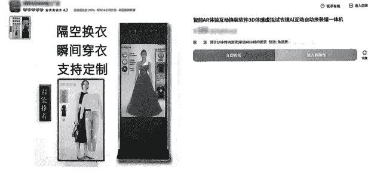

图 6-2

###### 步骤 2 内容准备

需要将重点服装款式进行 3D 建模，导入 AR 系统，如图 6-3。（部分供应商提供建模服务）

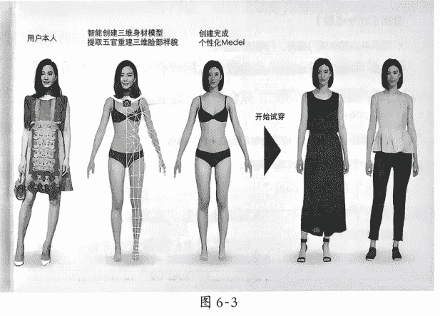

图 6-3

###### 步骤 3 线上推广

策划一系列线上推广活动，如"AR 试衣体验官招募""分享你的 AR 试穿照赢好礼"等，持续制造话题，引导用户到店。利用 DeepSeek 生成推广文案、短视频脚本。

####### 提问模板（推广短视频脚本）：

> 为我的服装店引进的 AR 试衣镜写一个吸引【用户群体】到店打卡的【发布平台】短视频脚本。突出科技感、趣味性和试衣效率。

###### 参考指令：

> 为我的服装店引进的 AR 试衣镜写一个吸引年轻人到店打卡的抖音短视频脚本，突出科技感、趣味性和试衣效率。

###### 成果示例：

> > 🧠 已深度思考（用时 15 秒）
> 
> 【抖音短视频脚本：未来试衣间奇遇记】
> 
> **背景音乐：** 科技感电子音效 + 节奏感强的流行音乐混搭
> 
> **分镜 1：（0~3 秒）**
> - 镜头从店铺玻璃门推进，门缝透出蓝光。
> - 字幕："听说 XX 商场藏着一面魔镜？"
> - 音效：科幻感启动声"嗡——"。
> 
> **分镜 2：（4~7 秒）**
> - 全景展示 AR 试衣镜：镜面突然浮现动态粒子特效。
> - 女生伸手触碰镜面触发涟漪特效。
> - 字幕："0.1 秒换装术启动！"
> 
> **分镜 3：（8~12 秒）**
> - 快速剪辑镜头：
>   - 手指滑动空中菜单，衣服自动换装（朋克装→职业装→汉服）。
>   - 男生试穿西装瞬间变身 007 特工特效。
>   - 闺蜜两人同框试装，镜中出现虚拟偶像同款造型。
> - 字幕："1000 + 穿搭组合，不用脱衣试到爽！"
> 
> **分镜 4：（13~17 秒）**
> - 趣味镜头：
>   - 女生试穿夸张礼服时突然变出虚拟红毯背景。
>   - 男生试运动装时镜中出现虚拟篮球场。
>   - 情侣试装时自动生成 CP 穿搭评分。
> - 音效：游戏得分声"叮！SSS 级搭配！"。

###### 步骤 4 店内引导

培训店员引导顾客使用 AR 试衣镜，并根据虚拟试穿效果提供搭配建议，促进销售转化。

AR 试衣镜的效果与价值在于：

- 1. **引流吸睛**：新奇科技体验，尤其吸引年轻群体，可提升门店进店率。
- 2. **提效转化**：降低试穿门槛，场景化试穿，增加试穿频次与购买概率，提升转化率。
- 3. **优化体验**：缩短试穿时间，缓解排队压力，减少退换货。
- 4. **数据赋能**：记录试穿数据（需合规），辅助分析爆款与用户偏好，反哺选品与运营。

请按如下顺序操作：

- 1. 手机搜索 "AR 试衣" 或 "虚拟试衣"，下载 1～2 个主流服装品牌的 App，体验其移动端的 AR 试衣功能。
- 2. 在小红书搜索 "AR 试衣镜"，观看其他实体店或品牌发布的体验视频，了解 "AR 试衣镜" 的实际效果和用户反馈。
- 3. 思考这项技术可以解决哪些具体问题？潜在投入和回报如何？

注意事项：

- 1. **成本效益评估**：AR 硬件设备与高精度服装建模的初期投入较高，需结合门店客流量、预期转化率等指标进行 ROI（投资回报率）测算，优先在核心门店或高单价品类场景试点。
- 2. **技术效果验证**：受限于当前技术水平，低端设备或复杂面料（如蕾丝、褶皱设计）的虚拟试穿效果可能存在细节偏差。务必要求供应商提供实地演示，重点测试目标服装的材质还原度、动态贴合度（如行走时的裙摆效果）。
- 3. **合理规划内容维护成本**：新款服装需持续进行 3D 建模及系统更新，建议建立 "爆款优先建模" 机制——优先选择销量 TOP 30% 的款式进行数字化建模，降低常态化维护成本。
- 4. **数据隐私合规：** 使用摄像头采集用户影像时，需通过显著标识告知数据用途（如仅用于试穿效果生成），并遵循相关法规要求，禁止存储用户生物特征数据，确保数据采集、传输、删除全流程合规。

#### 09 餐饮业：AI 推荐菜品更新与定价

##### 餐饮业实体店问题现状

餐饮行业菜单的**同质化严重**，难以在市场上突出；顾客"选择困难症"影响点餐效率；凭经验定价导致利润流失或价格调整滞后于市场变化；时令菜品迭代慢，容易错失营销节点；食材浪费严重等。

##### AI 销售数据分析 + 智能菜单推荐 / 动态定价

利用现代 POS 系统或专门的餐饮数据分析软件，结合 AI 算法，进行销售数据分析，深度挖掘历史销售数据、会员消费习惯、线上评论，甚至根据天气等外部因素，识别流行或滞销菜品、黄金配置组合、顾客偏好、价格敏感区间等。

基于 AI 分析的结果，系统可以进行**智能菜单推荐和动态定价**。

- 1. **推荐 / 优化新品菜单：** 建议下架长期滞销菜品，或根据偏好数据研发、推荐潜力新品，甚至生成"本周人气王""今日主厨推荐"等动态菜单。
- 2. **智能定价建议：** 根据成本、成交量、佣金、卖家价格、供需关系，给出精细化的定价建议，实现部分菜品在高峰或低谷的动态定价。

3. **个性化推荐**：通过对接会员系统或点餐小程序，根据顾客往来消费记录，为顾客提供个性化菜品推荐。

##### AI 实战

###### 步骤 1 数据基础

确保拥有记录销售数据的 POS 系统，数据越详细、全面、清晰，AI 分析就越精准。

###### 步骤 2 工具选择

评估现有 POS 系统是否自带高级数据分析和 AI 推荐功能。若无，可考虑引入第三方餐饮数据分析 SaaS 服务或 AI 营销工具（如图 6-4）。

（搜索关键词："智慧餐饮 POS" "AI 菜单优化" "餐厅数据分析"）

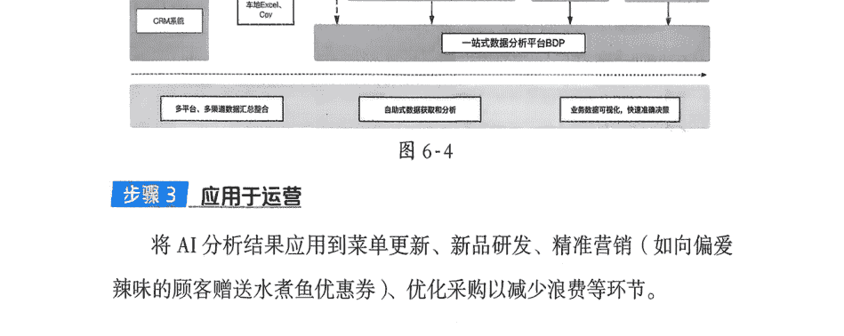

图 6-4

###### 步骤 3 应用于运营

将 AI 分析结果应用到菜单更新、新品研发、精准营销（如向偏爱辣味的顾客赠送水煮鱼优惠券）、优化采购以减少浪费等环节。

###### 步骤 4 利用 AI 辅助

利用 **AI 分析大众点评**等平台的顾客评论，**提炼口味关键词**；让 AI 根据推荐的食材组合**生成创意菜名和推荐语**。

###### 参考指令：

分析以下关于我餐厅的 50 条大众点评评论：

1. 牛排三分熟，肉汁足，配菜芦笋老了。
2. 喜欢芝士焗龙虾，虾肉弹，酱汁偏咸。
3. 餐前面包硬，黄油结块，鹅肝煎得刚好。
4. 意面选了肉酱款，面煮软了，肉粒少。
5. 靠窗座安静，惠灵顿牛排酥皮脆，牛肉略柴。
6. 蘑菇汤奶油味浓，喝多会腻，面包篮收费贵。
7. 三文鱼排煎得嫩，柠檬酱太酸，土豆泥绵密。
8. 不爱羊排膻味，点了菲力牛排，火候准。
9. 提拉米苏酒浸够了，可可粉少，甜度过头。
10. 停车场难找，服务员指错路，牛舌薄切量少。

……

###### 成果示例：

已深度思考（用时 20 秒）

根据 50 条大众点评评论分析结果，总结如下：

**一、顾客最常提到的口味偏好**

**1. 熟度要求精准**

- 多次提及对菜品熟度的需求，但存在熟度把控不准问题。
- 偏好肉汁充足的牛排，反感肉质干柴。

**2. 酱汁偏好两极分化**

- 喜欢浓郁调味但要求平衡（如 "酱汁偏咸""柠檬酱太酸"）。
- 部分顾客认为酱汁喧宾夺主。

**3. 食材新鲜度敏感**

- 高频提及海鲜新鲜度问题（如 "虾不新鲜"）。
- 对蔬菜状态要求高（3条批评配菜老化/不新鲜）。

**4. 甜点甜度争议**

- 普遍反映甜品过甜（提拉米苏、马卡龙、焦糖布丁均被指"甜度过头"）。
- 期待层次感（如"可可粉少""奶油带冰碴儿"）。

AI销售数据分析结合智能菜单推荐及动态定价，核心价值在于：

1. **提效增收**：优化菜单结构与定价策略，提升客单价及利润率，强化坪效。

2. **体验升级**：精准捕捉顾客偏好，提供个性化推荐，缩短点餐决策时间，提升顾客满意度。

3. **风险管控**：以数据驱动新品研发与定价，降低盲目决策风险，避免滞销与成本浪费。

4. **运营优化**：通过销量预测精准采购，减少食材库存损耗，提升供应链效率。

**请按如下顺序操作：**

1. 打开POS后台，查看销售报表。快速统计某段时间内销售额排在前3名和后3名的菜品以及利润率。

2. 思考：餐厅的菜单多久更新一次？参考依据是什么？定价策略是怎样的？

3. 搜索1~2个提供"智慧餐饮解决方案"或"餐饮数据分析"服务的供应商，了解他们宣传的AI功能点。

**注意事项：**

1. **数据质量管控**：确保销售数据、库存数据等完整准确，定期清洗异常值（如误录菜品销量），避免因数据偏差导致AI分析所得结论失真。

2. **人机决策协同**：将AI建议与厨师研发经验、品牌定位（如高端餐饮的品质定位）、地域消费习惯等相结合。例如，AI推荐"低价套餐"时，需评估是否契合品牌高端形象。

3. **动态定价审慎执行**：控制价格调整频率（如每日不超过3次），避免高频价格波动引发顾客反感；敏感菜品（如招牌菜）保持价格稳定，仅对非核心菜品实施小幅度动态调价（如±10%）。

#### 10 美业：AI皮肤/发质诊断 + 预约智能调度

##### 一 美业问题现状

美业核心痛点集中于：顾客对自己皮肤、头皮、发质状况认知模糊，服务推荐环节主要依赖技师个人经验来为顾客匹配相应的服务项目，精准度不足；高峰时段预约电话频繁打入，前台人工处理易出错；顾客预约遗忘率高，导致预留的服务档期空置浪费；技师排班、房间设备等资源调度复杂。

##### 二 AI智能检测仪 + 智能预约排班系统

AI智能检测仪是指一类配备高清摄像头和AI图像识别分析技术的设备，能对顾客的皮肤或头皮、发质进行扫描检测。AI算法能够自动分析出多种数据（如水油平衡、毛孔、色斑、敏感度、头皮健康度、毛囊健康度、发丝受损程度等），并生成可视化数据，为后续服务和产品推荐提供科学依据。

智能预约排班系统（基于 SaaS 的预约管理软件）能实现：

1. **多渠道在线预约**：顾客可通过微信小程序、App、网页等随时随地自助预约。

2. **智能排班**：如图 6-5，根据技师的忙闲状态、技能、顾客指定等因素，自动推荐可用时间段，优化资源利用。

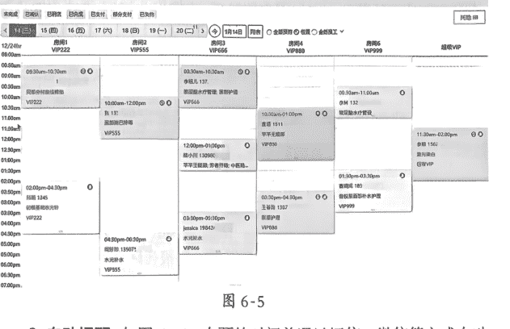

图 6-5

3. **自动提醒**：如图 6-6，在预约时间前通过短信、微信等方式自动发送提醒，降低爽约率。

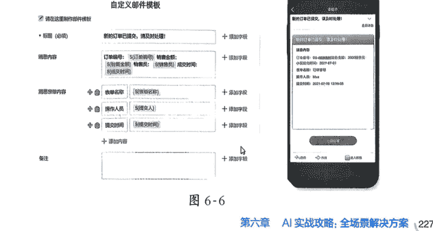

图 6-6

4. **会员管理与营销**：集成会员信息，可根据顾客标签（如"油性皮肤""烫染变形发质"等）进行精准营销。

##### AI 实战

###### 步骤 1 引入检测

采购专业的 AI 皮肤检测仪或头皮检测仪。选择时重点关注检测维度、精准度、报告专业度和用户体验感。（搜索关键词："AI 皮肤检测仪""智能头皮检测仪""美业检测设备"）

###### 步骤 2 选择预约系统

评估美业 SaaS 系统，重点考虑预约排班的定制程度、营销功能、数据统计以及与检测设备的联动性。（关键词："美业预约系统""美容院管理软件 SaaS""发廊智能排班"）

###### 步骤 3 融合流程

将 AI 检测作为服务前置阶段，根据检测报告向顾客推荐最适合的项目和产品，提升专业度和客单价。预约系统的数据也可反哺检测阶段（如记录客户历史检测结果）。

###### 步骤 4 培训员工

给技术师和前台分别进行检测设备操作培训和预约系统应用培训，使技术师做到能阅读检测报告，给用户进行专业推荐，确保前台熟悉预约系统的使用。

###### 步骤 5 推广应用

在线上宣传"免费 AI 皮肤、头皮检测"活动引流，将预留链接、小程序码置于所有推广渠道。利用 DeepSeek 生成科普文章或短视频，讲解皮肤、头皮知识等。

**参考指令：**

> 写一篇小红书笔记，介绍 AI 皮肤检测的好处，引导用户到我的美容院进行免费体验，并附上预约方式。

**成果示例：**

🧠 已深度思考（用时 15 秒）▼

【黑科技护肤体验！AI 皮肤检测到底有多神奇？】

姐妹们！今天必须给你们安利一个我最近发现的宝藏项目——AI 智能皮肤检测！

以前总觉得美容院的皮肤检测都是"看个大概"，直到体验了这个黑科技才知道什么叫"精准到毛孔"！

**AI 检测的 5 大超能力**

① **3 分钟看透肌肤底牌**

连隐藏的色斑、毛孔堵塞都给你扒得明明白白。

② **定制专属护肤方案**

结合你的肌肤年龄 / 敏感度 / 锁水能力，连护肤品成分适配度都帮你算好，再也不用跟风乱买化妆品啦！

AI 智能检测仪和智能预约排班系统的组合，优势在于：

1. **提升了商家专业形象与可信度**：科学检测结果比口头推荐更具说服力。

2. **提高客单价与复购率**：精准推荐提升转化，良好体验促进复购。

3. **提高了人力效率**：自动化预约和提醒，解放前台人力，减少档期空置损失。

4. **精细化客户管理**：基于数据为客户提供个性化服务和营销。

**请按如下顺序操作：**

1. 搜索并浏览几款 AI 皮肤 / 头皮检测设备的产品介绍和演示视频。

2. 查找你所在的城市是否有美容院或发廊提供类似的 AI 检测服务，若有，可考虑优先去体验一次。

3. 试用1~2个美业预约小程序或App的客户端，感受在线预约流程。

**注意事项：**

1. **成本与准确性**：专业检测设备需要一定的成本，过于廉价的设备准确性和稳定性可能不足，影响专业度。

2. **数据隐私与安全**：涉及顾客面部、头皮等生物信息，必须高度重视数据安全和隐私合规。

3. **系统集成问题**：检测系统、预订系统、收银系统、会员系统之间的数据打通可能存在技术壁垒。

4. **避免过度营销**：检测后应根据专业知识建议，避免过度营销，以免引起顾客反感。

#### 11 酒店业：配置 AI 语音助手 + 动态定价模型

##### 一 酒店业问题现状

酒店业往往存在市场需求响应不及时（尤其是夜间）；前台人力成本高，重复性咨询多；客房设备控制烦琐；房间定价依赖经验，难以及时响应市场变化，收益难以最大化等问题。

##### 二 AI 语音助手 + AI 驱动的动态定价

客房 AI 语音助手，如图 6-7，可以在客房内配置智能音箱（如定制版的小度在家、天猫精灵等），通过语音指令控制房间内的灯光、空调、窗帘、电视，查询天气预报、交通、酒店服务信息（如 Wi-Fi 密码、早餐时间、健身房位置等），呼叫客房服务。


图 6-7

人工智能驱动的动态定价是指引入专业的酒店收益管理系统（PMS），利用人工智能算法实时分析海量的历史数据、预订数据、竞争对手房价、当地活动、天气、航班信息、网络搜索热度等多项信息（如图 6-8），预测未来不同时间点的客房需求量，并给出最优的定价建议，实现"一房一价""实时变价"，最大化酒店收益。

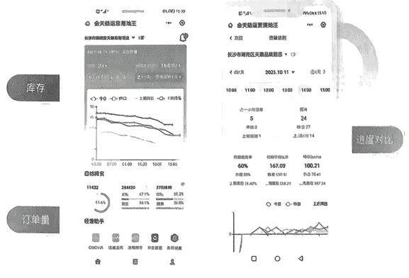

图 6-8

##### AI 实战

###### 步骤 1 部署语音助手

与提供智慧酒店解决方案的公司合作，选择合适的智能音箱硬件和后台管理系统。需要进行硬件安装、网络配置、系统对接（如对接客控系统、服务呼叫系统）和知识库维护（录入酒店信息）。（搜索关键词："智慧酒店语音助手""AI 酒店客控""酒店智能音箱"）

###### 步骤 2 实施酒店收益管理系统 PMS

选择合适的酒店 PMS 供应商，导入酒店历史经营数据进行模型训练。需要有专人（或 AI 辅助）监控系统建议，以便酒店根据实际情况进行价格决策和发布。（搜索关键词："酒店收益管理系统 PMS""酒店动态定价 AI""酒店数据分析"）

###### 步骤 3 整合应用

语音助手与 PMS 可以制订增值服务套餐，如延迟退房、自助早餐优惠等。PMS 数据还可以反映出哪些房型的客人对语音助手的使用率更高。

###### 步骤 4 人员培训

培训前台、客房服务等员工了解语音助手的功能和 PMS 的定价逻辑，以便更好地提供服务并解释价格。

###### 步骤 5 信息维护

定期更新 AI 语音助手的知识库（如新增服务、周边信息变更等），确保信息准确。利用 DeepSeek 可以批量生成常见问答，根据实际情况修改后导入知识库。

**参考指令：**

> > 为酒店客房 AI 语音助手生成 20 组关于酒店设施、服务及周边信息的常见问答。

**成果示例：**


以下是为酒店客房 AI 语音助手设计的 20 组常见问答，涵盖酒店设施、服务及周边信息：

**酒店设施相关**

1. **问：** 酒店早餐几点开始供应？在哪里用餐？

   **答：** 您好！自助早餐于每日早上 6:30~10:00 在 2 楼"云尚餐厅"供应，凭房卡即可用餐。

2. **问：** 酒店有健身房吗？开放时间是什么时候？

   **答：** 24 小时健身房位于 3 楼，刷房卡即可进入，内有跑步机、力量训练设备等。

3. **问：** 游泳池是否免费开放？需要预约吗？

   **答：** 恒温泳池位于 4 楼，住店客人可免费使用，开放时间为 8:00～22:00，建议携带泳帽入场。

4. **问：** 房间内的 Wi-Fi 密码是多少？

   **答：** 连接网络"Hotel_Guest"，密码为房号 + 入住日期后四位，如需帮助可联系前台。

AI 语音助手结合 AI 驱动的动态定价，优势在于：

1. **提升客房体验与满意度**：提供便捷、智能、个性化的客房服务。

2. **提高运营效率，降低人力成本**：AI 助手分担部分前台和客房服务工作，PMS 自动处理定价。

3. **提高酒店收益**：动态定价精准匹配市场需求，提升 RevPAR（每间可租出客房产生的平均实际营业收入）。

4. **增强酒店科技感与性价比**：吸引偏爱科技体验的年轻客群。

**请按如下顺序操作：**

1. 搜索"智慧酒店"或"AI 酒店"，阅读相关报道或案例，了解酒店的用户评价。

2. 在携程、飞猪等平台预订酒店时，关注酒店是否标注"智能客房""AI 语音助手"等标签，看看它们的定价和用户评价。

3. 思考：酒店的核心客群是哪些人群？他们对科技体验的接受程度如何？引入这些系统的潜在收益和挑战是什么？

**注意事项：**

1. **集成复杂性与成本**：语音助手需要与酒店现有客控、PMS（酒店管理系统）等系统深度集成，会增加成本，并且硬件维护、软件更新、知识库维护都需要持续投入。

2. **语音识别准确率**：不同口音、语速可能影响语音助手识别效果，需选择技术成熟的供应商。

3. **隐私合规与用户自主**：必须明确告知客户语音助手的隐私政策，提供物理关闭选项。

#### 12 家居业：AR 虚拟货架 + 售后智能质检

##### 家居业面临的挑战

线上购买家具"凭想象"，尺寸不合、风格不搭导致退货率高；线下空间有限，无法展示所有商品；大件家具采购安装后，出现质量问题（如划痕）时，责任判定难，处理周期长，影响用户体验。

##### AR 虚拟货架 App + AI 图像识别售后质检

AR 虚拟货架 App（如图 6-9），即开发或集成一个手机 App 功能，允许用户通过手机摄像头，将按真实比例缩放的家具 3D 模型"投放"到实际空间中，可以随意移动、旋转，便于观察预览效果、尺寸和风格协调性。


图 6-9

AI 图像识别售后质检，即当用户反馈商品有质量问题时，引导用户通过 App 或指定链接，按照指引上传商品问题的照片或视频。后台 AI 系统利用图像识别和机器学习技术，自动分析图片/视频，判断问题的类型（如划痕、裂纹、污渍等）、严重程度，与出厂标准图片进行比对，生成初步质检报告，加速售后处理。

##### AI 实战

###### 步骤 1 开发 AR 功能

（1）**自研/外包：** 需要投入开发资源和时间。

（2）**使用平台工具/服务：** 电商平台（如淘宝）、第三方技术公司提供 SDK（软件开发工具包）或 AR 服务，可以集成到现有 App 或小程序中。（搜索关键词："AR 家居""虚拟货架 App 开发"）

###### 步骤 2 推广 AR 应用

在商品详情页、社交媒体、线下门店等渠道，大力推广 AR 虚拟货架功能，引导用户下载使用。

###### 步骤 3 搭建AI质检系统

（1）**选择AI服务**：可以利用公有云提供的AI图像识别服务（如阿里云、腾讯云、百度云等视觉AI平台），结合自身业务逻辑进行二次开发。

（2）**模型训练**：用高分辨率的正品图片和各种有瑕疵的图片来训练AI模型，提高识别准确率。

（3）**流程设计**：设计用户上传指引和后台处理流程，AI初步判断后，由人工进行复核和最终确认。

###### 步骤 4 整合售后流程

将AI质检结果与客服系统、工单系统打通，实现快速响应、定责和处理（退换货、维修、赔偿等）。利用DeepSeek可以生成用户拍摄指引的文字说明。

**参考指令：**

> > 为家居产品的售后AI质检功能，写一份清晰的用户拍摄指引，告诉用户需要从哪些角度、光线下拍摄哪些部位的照片或视频。

**成果示例：**

已深度思考（用时18秒）

以下是为家居产品售后AI质检功能设计的用户拍摄指引模板，内容清晰、便于用户理解执行：

**家居产品售后质检拍摄指引**

**拍摄前准备**

1. 使用手机后置摄像头（画质更清晰）。

2. 关闭美颜/滤镜功能。

3. 清洁产品表面明显污渍。

4. 移除无关物品，保持背景简洁（建议使用纯色墙面/桌面）。

**光线要求**

**推荐：**

- 白天自然光（非直射阳光）
- 室内开启多盏顶灯 + 台灯补光

**避免：**

- 单侧强光造成的阴影
- 昏暗环境开闪光灯导致反光
- 逆光拍摄导致细节模糊

搭建 AR 虚拟货架 App 结合 AI 图像识别和售后质检，优势在于：

1. **降低退货率，提升销售转化**：AR 实现"所见即所得"，减少因尺寸、风格不符导致的退货。

2. **增强购物体验与决策信心**：用户在家轻松"试摆"，提高购买意愿。

3. **提升售后效率与满意度**：AI 加速质检流程，更快解决用户问题。

4. **降低后期成本**：减少不必要的上门鉴定或返厂检测成本。

5. **实现数据积累，进行产品优化**：AI 质检数据有助于发现产品设计中的潜在问题或易损点。

**请按如下顺序操作：**

1. 下载宜家家居 App（IKEA Place）或其他提供 AR 放置功能的家居品牌 App，亲自体验一下。

2. 思考：如果顾客在购买前使用 AR 预览效果，能帮助他们解决哪些顾虑？

3. 想象一下：如果顾客反馈商品有划痕，现在需要快速处理，如果用 AI 辅助，可以怎样优化流程？

4. 搜索"AI 质检""图像识别缺陷检测"，了解相关技术应用案例。

##### 注意事项：

1. **AR效果与建模成本：** 高保真的AR效果依赖于高质量的3D模型，该过程中建模成本是最高的，尤其是需要批量创建不同产品对应的3D模型时。

2. **设备兼容性与性能：** AR功能对手机硬件有一定的要求，需要考虑用户设备的覆盖范围。

3. **AI质检准确率：** AI对复杂性、综合性强的质量问题识别能力有限，仍需人工介入。

4. **用户接受度：** 需要引导用户如何使用AR功能和进行AI质检的拍摄。

5. **系统开发与集成：** 将AR和AI质检功能整合到现有业务流程中，需要一定的技术投入。

### 本地生活服务智能升级方案

#### 13 美团/大众点评：智能回复 + 爆款套餐设计

随着线上流量的成本日益增加，对于餐饮、零售、休闲娱乐、生活服务等本地商家而言，"家门口"的生意愈发关键。美团、大众点评、小红书、抖音同城号、微信视频号等平台共同构建了本地生活服务的新阵地。如何借助AI在这些平台上精准获取客流、积累口碑、促进到店转化？从本节开始，将逐一为您揭晓答案。

##### 平台特点

美团和大众点评是中国本土生活服务的"基础设施"，集信息搜索、用户评价、交易（团购、外卖、预订）、营销等于一体。平台用户决策路径清晰，评价、评分、排名是影响消费的核心因素。商家运营重点在维护评分评价、优化套餐/代金券设计、提升搜索排名、强化用户沟通等方面。

##### AI 实战

###### 步骤 1 判断情感与主要关注点，速建高效回复模板

海量的用户评价和咨询是宝贵财富，也是运营负担，AI 可以赋能评论/问答智能回复。

（1）**判断情感与主要关注点：** 自动识别评论/提问的情感关系（如不满意差评、中性、疑问等），并按主要关注点（如口味、服务、环境、价格等）进行分类。

（2）**个性化回复模板生成：** 基于评论内容和情感，AI 可以快速生成不同语气、包含关键信息、体现商家态度（感谢/道歉/解释/改进承诺）的回复草稿。商家审核后即可发布，最大限度提高回复效率和质量。

**提问模板（智能回复）：**

```
请分析以下这条来自【平台名称】的用户评论/提问：

【粘贴评论或提问内容】

要求：

1. 判断评论的情感倾向和主要关注点。
2. 生成一个专业、礼貌、针对性强的回复草稿。
3. 如果是负面反馈，要表达歉意并说明改进措施或意愿。
4. 如果是好评，要表达感谢并适当突出优点。
5. 如果是提问，要清晰准确地回答。
```

###### 参考指令：

请分析以下这条来自大众点评的用户评论/提问：上菜太慢了，催了好几次，不过味道还不错。

要求：

1. 判断评论的情感倾向和主要关注点。
2. 生成一个专业、礼貌、针对性强的回复草稿。
3. 如果是负面反馈，要表达歉意并说明改进措施或意愿。
4. 如果是好评，要表达感谢并适当突出优点。
5. 如果是提问，要清晰准确地回答。

###### 成果示例：

已深度思考（用时 24 秒）

**分析及回复：**

**1. 情感倾向与主要关注点分析：**

- 情感倾向：中性偏负面（用户既表达了对服务效率的不满，又肯定了菜品味道，但负面体验描述更具体）。
- 主要关注点：
  - 服务效率：上菜速度过慢，多次催促，影响用餐体验。
  - 菜品味道：菜品味道得到认可。

**2. 针对性回复草稿**

- 标题：关于您反馈的用餐体验说明

###### 步骤 2 提炼爆款数据，组合高转化套餐方案

套餐是美团/大众点评重要的引流和锁客工具，AI 可以辅助爆款套餐设计。

（1）**数据分析**：结合本店销售数据（哪些菜品组合卖得好）、用户评价（评论中常提到的菜品）、竞品套餐设计、平台品类热销排行榜等多维度信息，AI 辅助分析用户偏好和市场空白。

（2）**智能组合与定价**：根据数据分析结果，AI 可以提出多种套餐组合方案（如引流式双人餐、高价值四人餐、工作日午市套餐），并给出兼顾吸引力与利润率的定价建议。

**提问模板（套餐设计）：**

> 我的店铺是一家【店铺类型】，人均消费【几】元左右。本店的热销菜品有【A、B、C】，用户评价中经常提到喜欢【口味/菜品】。周边竞品的热门套餐通常包含【竞品套餐及特点】。
>
> 请帮我设计一个面向【目标人群】的【几】人团购套餐。
>
> 要求：
>
> 1. 包含【类型】的合理搭配，体现本店特色。
> 2. 突出性价比（对比单点总价有明显优惠）。
> 3. 为套餐取一个有吸引力的名字。
> 4. 简单说明设计理由。

**参考指令：**

> 我的店铺是一家川味火锅店，人均消费 80 元左右。本店的热销菜品有毛肚、雪花肥牛、手打虾滑等，用户评价中经常提到喜欢麻辣锅底、红糖糍粑。周边竞品的热门套餐通常包含基础肉拼盘 + 蔬菜拼盘 + 酸梅汤。请帮我设计一个面向年轻情侣的 2 人团购套餐。
>
> 要求：
>
> 1. 包含荤、素、锅底、小吃、饮品的合理搭配，体现本店特色。
> 2. 突出性价比（对比单点总价有明显优惠）。
> 3. 为套餐取一个有吸引力的名字。
> 4. 简单说明设计理由。

###### 成果示例：

已深度思考（用时 22 秒）

**套餐名称：【怦然心动·双人麻辣盛宴】158 元**

套餐内容：

锅底三选一：

- 牛油麻辣锅（本店招牌）
- 番茄麻辣鸳鸯锅（适合拍照打卡）
- 菌汤麻辣鸳鸯锅（解辣养生）

##### 请按如下顺序操作：

1. 登录你的美团/大众点评商家后台，找到最近的 5 条用户评论（包含好评、差评、中评、提问）。
2. 选择其中 1~2 条，使用上面的 AI 智能回复模板，生成回复草稿。对比 AI 回复和你常用的回复方式，分析 AI 回复的优点。
3. 将常用的、效果好的 AI 回复按标签分类，如 #感谢、#服务致歉、#菜品推荐，方便用户快速调用。
4. 在后台查看你的套餐销售数据，查找销量最好和最差的套餐，初步分析原因。

##### 注意事项：

1. **回复切忌机械化**：完全依赖 AI 模板可能会使回复缺乏人情味，重要评论（尤其是严重差评）建议人工介入。
2. **要重视差评根源**：AI 能优化回复，但不能解决导致差评的根本问题（如菜品质量、服务流程），需结合差评反馈改进经营方式。
3. **套餐设计需贴合实际**：AI 给出的建议需结合门店实际出品能力、成本结构和用户反馈进行调整。
4. **要重视平台规则**：套餐设计和描述需符合平台规范。

#### 14 小红书：社区热点挖掘 + 探店路线规划

##### 平台特点

小红书平台是年轻化、女性用户主导的生活方式分享社区，小红书以"种草"为核心生态，构建了内容消费—场景体验—交易转化的闭环链路。平台内容展现形式以精美图片和短视频为主，强调真实体验，社交互动性强。"附近"功能和本地生活内容受到广泛关注，成为本地商家不可忽视的流量入口。运营重点在于创作符合平台风格的优质笔记、进行良好的社区互动、与达人合作。

##### AI 实战

###### 步骤 1 抓取社区热点，发现消费趋势

小红书是观察本地消费趋势和用户兴趣的"前沿阵地"，AI 可以抓取本地社区热点，发现消费趋势。

1. **内容监测与分析**：利用 AI 工具（需在合规前提下结合社交媒体监测工具或爬虫技术）抓取、分析指定区域内（如"#上海周末去处""#广州探店"）或特定行业（如"#咖啡探店""#宝藏小店"）的笔记内容。
2. **热点识别与提炼**：AI 分析文本、图片、标签、互动数据，识别当前热门的打卡地、玩法、风格、话题，以及用户的讨论焦点和潜在需求。

**提问模板（热点分析思路）：**

假设通过工具监测到近期小红书上关于【你的城市】+【你的行业】的热门笔记中，频繁出现关键词：【xx】。请分析：

1. 这些热点反映了目标用户的哪些偏好和需求？
2. 我的【店铺名 + 简要特色】有哪些特点可以与这些热点相结合？
3. 可以策划哪些笔记主题或营销活动来"蹭"上这些热点？

**参考指令：**

假设通过工具监测到近期小红书上关于"深圳下午茶"的热门笔记中，频繁出现关键词："氛围感""宠物友好""创意甜点""人少景美"。请分析：

1. 这些热点反映了目标用户的哪些偏好和需求？
2. 我的店铺名是黄氏甜品店，主营广式甜品，如双皮奶、烧仙草、各类水果冰沙等，有哪些特点可以与这些热点相结合？
3. 可以策划哪些笔记主题或营销活动来"蹭"上这些热点？

**成果示例：**

> ⏱ 已深度思考（用时 22 秒）

**1. 目标用户偏好与需求分析**

**"氛围感"：**

- 用户追求社交场景的"仪式感"与"美学体验"，注重环境设计、餐具精致度、灯光布置等，以满足拍照打卡和情绪价值需求。
- 隐性需求：用户希望通过消费场景传递个人生活品位，增强社交平台内容吸引力。

**"宠物友好"：**

- 养宠人群希望将宠物融入日常生活场景，寻求既能满足自身消费需求又能照顾宠物的场所。
- 隐性需求：宠物成为社交纽带，用户希望通过"携宠消费"结识同类群体，强化情感联结。

**"创意甜点"：**

- 用户对传统甜品的审美疲劳催生对"差异化体验"的追求，需通过视觉冲击（造型独特）、味觉创新（跨界融合）或互动玩法（DIY）刺激用户的消费欲望。
- 隐性需求：用户渴望通过尝试新品获得社交谈资，提升自身"潮流感知力"。

**"人少景美"：**

- 用户反"拥挤网红店"心态明显，用户更青睐小众、安静、有专属感的消费空间，追求松弛感与私密性。
- 隐性需求：用户希望在快节奏城市中寻找"避世角落"，平衡工作压力与生活品质。

###### 步骤2 生成主题路线，打造热门笔记

"城市漫步""一日游攻略""周末探店路线"是小红书热门笔记类型，AI可以辅助规划探店路线。

（1）**路线创意生成：** 基于一个主题（如"文艺之旅""吃货地图""遛娃好去处"），AI可以结合多重信息，串联起包括商家自身在内的多个兴趣点（POI），生成合乎逻辑的探店路线。

（2）**笔记内容辅助：** AI可以为路线中的每个点撰写推荐语、构想角度建议、设计互动话题。

**提问模板（探店路线规划）：**

> 我想在小红书上发布一篇关于【你的城市 + 主题】的探店路线笔记，以此推广【我的店铺名 + 地址 + 简要特色】。
>
> 请帮我规划一条包含 3~5 个地点的路线。要求：
>
> 1. 路线要包含【我的店铺地址】。
> 2. 其他地点要符合【主题】，且在地理位置上相对集中。
> 3. 为整条路线取一个吸引人的标题。
> 4. 为路线中的每个地点（包括我的店铺）写一段 2~3 句的推荐语，突出特色和打卡价值。

**参考指令：**

我想在小红书上发布一篇关于"广州老城区怀旧之旅"的探店路线笔记，以此推广我的复古杂货铺，我的店铺在敬梓里文创社区，请帮我规划一条包含 3~5 个地点的路线。

要求：

1. 路线要包含敬梓里文创社区。
2. 其他地点要符合怀旧/复古主题，且在地理位置上相对集中。
3. 为整条路线取一个吸引人的标题。
4. 为路线中的每个地点（包括我的店铺）写一段 2~3 句的推荐语，突出特色和打卡价值。

**成果示例：**

已深度思考（用时 22 秒）

**【时光机启动！一日穿越西关复古记忆｜老广私藏的 5 个宝藏打卡路线】**

**路线规划：**

敬梓里文创社区 → 永庆坊"记忆银行"旧物仓 → 钟书阁（永庆坊店）→ 陈添记鱼皮（十五甫三巷）→ 泮塘五约历史文化街区

**敬梓里文创社区**

> "推开吱呀木门闯入复古乌托邦！迷宫式空间藏着你的杂货铺惊喜，80 年代霓虹灯箱、绝版连环画和胶片相机构成怀旧市集，二楼的露台还能解锁李小龙故居同款机位！"

**永庆坊"记忆银行"旧物仓**

> "在青砖骑楼下打开时光保险柜，满墙老式收音机、复古铁皮玩具和搪瓷缸，重现 70~90 年代生活场景，巨型红色电话亭和古董电视机墙是出片率 100% 的怀旧'影棚'。"

##### 请按如下顺序操作：

1. 打开小红书，搜索"【你的城市】+【你的行业】"，切换到"最新"或"附近"标签页。
2. 快速浏览 10~15 篇笔记，注意反复出现的地点、话题或风格。
3. 选一个你认为的热点，用上面的 AI 热点分析思路模板，思考如何与你的店铺结合。

##### 注意事项：

1. **注重捕捉热点时效性**：误判热点趋势或追逐已过气的话题，易导致内容投入产出比失衡，需结合平台数据与用户反馈筛选高价值热点。
2. **自然融入品牌**：在探店路线、体验分享等内容中，品牌或店铺信息的植入需契合场景逻辑，生硬地堆砌商业化元素易引发用户抵触。
3. **适配平台内容调性**：笔记的图片/视频画质模糊、文案风格与平台主流氛围脱节，均会影响推荐权重，需强化视觉质感与风格匹配度。
4. **强化互动运营意识**：发布笔记后需及时回复评论与私信，通过真诚沟通提升用户黏性，主动维护友好的社区互动生态。

#### 15 视频号：同城爆款模板 + 社交裂变追踪

##### 平台特点

视频号依托微信生态，具备强大的社交传播能力（好友点赞、群分享等）。用户群体覆盖更广，年龄层相比抖音更广泛。公私域联动是核心优势，轻松将视频号流量引导至微信群、小程序、个人号。运营重点在于利用社会关系链传播、建立信任感、引导私域沉淀。

##### AI 实战

###### 步骤 1 生成同城爆款，设计真实感脚本

视频号的内容风格与抖音不同，更强调真实、生活化、情感连接。AI 可以生成视频号同城爆款模板。

（1）**模板创意生成**：结合本地生活服务特色和微信社交属性，生成适合在视频号传播的短视频脚本模板，如"店主的一天""顾客真实故事""产品/服务背后的匠心""邻里福利活动"等。

（2）**脚本细节填充：** AI 可以根据选定的模板，填充具体的场景、人物对话、情感表达，以及引导用户"点赞、评论、收藏、转发、关注"并添加到"微信状态""我的商店"。

**提问模板（视频号模板生成）：**

> 为我的【本地实体店类型】创作一个适合在微信视频号发布的短视频脚本模板。
>
> 主题: 展现【主要内容】, 吸引附近居民关注和光顾。
>
> 风格要求: 真实、温暖、生活化。
>
> 结构建议:
>
> 开头:【描述文字】
>
> 中间:【描述文字】
>
> 结尾:【描述文字】
>
> 请为每个部分构思画面和简单的旁白/对话。

**参考指令：**

> 为我的社区花店创作一个适合在微信视频号发布的短视频脚本模板。
>
> 主题: 展现花店的温馨日常和人情味，吸引附近居民关注和光顾。
>
> 风格要求: 真实、温暖、生活化。
>
> 结构建议:
>
> 开头: 清晨第一缕阳光照进花店的镜头，店主精心打理花材的特写。
>
> 中间: 与熟客的亲切互动，包装花束的细致过程，介绍一种当季花材的小知识。
>
> 结尾: 温馨的店铺环境全景，店主的微笑和问候，引导语"欢迎常来坐坐"，结合地址或附近地标。
>
> 请为每个部分构思画面和简单的旁白/对话。

**成果示例：**

**《巷角花房日记》短视频脚本模板**

---

**开头: 晨光序曲（5秒）**

**画面：**

- 清晨7:00，木质窗框透进金色阳光，玻璃上的水珠折射出光斑。
- 店主轻抚沾着水珠的粉色玫瑰，剪刀修剪枝叶的沙沙声。

**旁白（轻柔女声）：**

> "晨光与花香一同苏醒，巷角花房已为您备好今日份温柔。"

字幕: "XX社区 · 8:00AM"

**中间: 人情与匠心（15秒）**

**画面：**

- 推门铃铛轻响，穿碎花裙的老太太笑着递上咖啡: "小芳，我家老头子的百合该换啦！"
- 店主接过咖啡，默契地指向角落盛放的黄百合。

**对话：**

店主: "张姨，刚到的云南百合，香味淡雅，张叔过敏体质也能放！"

张姨（拍手笑）: "就你记得最清楚！"

---

###### 步骤2 追踪社交裂变，优化活动转化

利用视频号进行发券、拼团、推荐有礼等裂变活动时，效果追踪很重要，AI可以辅助社交裂变追踪与分析（需工具支持）。

1. **传播路径分析**: 结合后台数据（需工具支持），人工智能可以帮助分析微信社交网络中的传播路径、关键节点（超级传播者）、转化效果。
2. **用户行为洞察**: 分析涉及用户的特征活动、互动行为，为后续优化和精准营销提供依据。
3. **注意实践：** 微信生态内的裂变追踪分析通常需要借助第三方营销工具（如微盟、有赞的部分功能）或自建系统，AI 主要在数据分析和洞察方面发挥作用。

##### 请按如下顺序操作：

1. 打开微信【发现】→【视频号】，点击顶部【附近】。
2. 观看 5~10 个本地商家或个人发布的视频，感受其内容风格和互动方式。
3. 选择一个你觉得不错的视频，想想它的模板结构是怎样的？是否可以用上面的 AI 模板生成类似的脚本？

**注意事项：**

1. **风格调性需适配平台：** 直接搬运抖音或其他平台的硬广式内容到视频号，容易因风格违和导致传播效果折损，无法达到预期目的。
2. **强化社交互动：** 若内容未能有效激发用户点赞、评论、转发的意愿，将难以构建传播基础，影响流量扩散。
3. **完善私域流量承接链路：** 通过视频号完成引流后，需及时以微信群、小程序或客服体系进行承接，避免流量因衔接断层而流失。
4. **优化裂变活动规则设计：** 裂变活动若存在规则烦琐、奖励吸引力不足或过度打扰用户等问题，易引发用户反感，需重点规避。
5. **配置数据追踪工具：** 若缺乏适配的追踪工具将导致裂变活动效果难以量化评估，需提前部署工具完善效果监测体系。

### 自媒体变现革命

#### 16 知识付费：课程大纲自动生成术

对于庞大的自媒体创作者群体来说，无论是全职博主还是"副业型"的职场人，内容创作效率和变现路径拓展始终是核心。AI 技术的崛起，正在为自媒体行业带来从选题策划、内容生产到用户连接、商业变现的全链条革新。尤其是在知识付费领域，AI 正成为破解创作痛点、提升变现效能的关键引擎。

##### 行业特点

知识付费的变现模式是通过付费社群、销售在线课程、电子书、训练营等，将自身的专业知识或技能转化为收入。主要痛点是创作者将零散的知识体系化，形成具有逻辑顺序、循序渐进特点且对用户有价值的课程大纲的过程费时费力；担心内容不够全面或深度不足；难以把握不同水平学员的学习节奏等。

##### AI 实战

利用 AI 可以快速生成结构合理、内容全面的课程大纲框架，创作者在此基础上进行细化、填充个性化内容和实战经验，能极大程度地提高课程研发效率。

###### 步骤 1 明确课程要素

明确定义课程主题、目标学员画像、核心学习目标。

###### 步骤 2 AI 生成初始大纲

将这些要素输入给 AI（如 DeepSeek），指定其生成包含主要章节和小节的课程大纲。可以指定大致的章节数量或总时长。

##### 提问模板（生成课程大纲）

我想设计一门在线课程，主题是【详细课程主题】。

目标学员：【学员画像】。

课程目标：【具体学习成果】。

请帮我生成一个包含【几】个主要章节的详细课程大纲。要求：

- 逻辑清晰，由浅入深，符合学习规律。
- 每个章节下设【几】个具体的小节知识点。
- 覆盖【列出必须包含的核心知识领域】。
- 可以在合适的小节后标注实操作业或案例分析建议。

####### 参考指令

我想设计一门在线课程，主题是"面向零基础小白的 Python 编程入门"。

目标学员：想转行程序员的大学生或职场新人，无编程背景。

课程目标：学员学完后能掌握 Python 基础语法，编写简单的爬虫程序，并具备进一步自学的能力。

请帮我生成一个包含 10 个主要章节的详细课程大纲。要求：

- 逻辑清晰，由浅入深，符合学习规律。
- 每个章节下设 3~5 个具体的小节知识点。
- 覆盖环境搭建、基础语法、数据类型、函数、面向对象基础、常用库介绍、简单项目实战等知识领域。
- 可以在合适的小节后标注实操作业或案例分析建议。

####### 成果示例

以下是按照您的要求设计的《面向零基础小白的 Python 编程入门》课程大纲，共 10 个核心章节，总课时建议 40~50 小时：

###### 第 1 章：编程认知与环境搭建（3 小时）

- 1.1 编程是什么？程序员如何思考问题
- 1.2 Python 语言特点与应用场景
- 1.3 安装 Python 与配置开发环境（Windows/Mac）
- 1.4 VS Code/PyCharm 基础配置与使用技巧
- 1.5 第一个 Python 程序：Hello World 与运行调试【实操作业】

###### 第 2 章：Python 基础语法（5 小时）

- 2.1 变量与基本数据类型（int/float/str/bool）
- 2.2 注释规范与命名规则（PEP8 标准）
- 2.3 运算符：算术/比较/逻辑/赋值
- 2.4 输入输出：input() 与 print() 高级用法
- 2.5 代码调试基础：常见错误类型解析【案例分析：计算器程序】

##### 步骤 3 迭代与细化

与 AI 进行多轮对话，要求其针对特定章节进行扩展，补充知识点，增加案例分析、实操作业、思考题，甚至重构每个小节的引入和总结。

##### 提问模板（细化课程大纲）

> 请将上一轮生成的课程大纲中，关于【章节名称】这一章，对每个小点进一步细化。构思更具体的：
> 
> 1. 核心讲解要点（2~3 个）。
> 2. 一个简单的示例代码或应用场景。
> 3. 一个供学员练习的思考题或小作业。

####### 参考指令

> 请将上一轮生成的课程大纲中，关于"第 1 章：编程认知与环境搭建"这一章，对每个小点进一步细化。构思更具体的：
> 
> 1. 核心讲解要点（2~3 点）。
> 2. 一个简单的示例代码或应用场景。
> 3. 一个供学员练习的思考题或小作业。

####### 成果示例

> 已深度思考（用时 23 秒）
> 
> 以下是针对"第 1 章：编程认知与环境搭建"的细化设计，每个小节均包含核心知识点、示例代码/场景和练习任务：

###### 1.1 编程是什么？程序员如何思考问题

**核心讲解要点：**

- 编程的本质：将人类语言转换为计算机可执行的指令
- 程序员的核心能力：拆分问题→设计步骤→翻译为代码
- 人与计算机的差异：绝对精确性 vs 模糊理解

**示例场景：**

用"做番茄炒蛋"类比编程思维：

```python
##### 伪代码示例
准备食材(["鸡蛋", "番茄", "盐"])
热锅(油=10mL)
if 鸡蛋未打散:
    打散(鸡蛋)
煎炒(鸡蛋, 时间=2分钟)
混合(鸡蛋, 番茄)
调味(盐=3g)
```

**思考题：**

请将"网上购物付款"流程拆解为 5 个步骤（用中文伪代码描述）

##### 请按如下顺序操作

1. 确定一个你最擅长、可以转化为课程的知识领域。
2. 明确你的目标学员是什么？他们学完后应该达到什么水平？
3. 使用第一个 AI 模板，输入你的信息，让 AI 生成一个初步的大纲。

注意其结构是否合理。

**注意事项：**

1. **避免内容缺乏深度与原创性：** 完全依赖 AI 可能导致课程内容泛泛而谈，缺乏创作者的见解价值和实战经验。AI 生成的大纲仅为框架，"血肉"需要自己填充。

2. **警惕逻辑结构混乱风险：** AI 可能生成逻辑不够严谨或重复的内容，需要人工逐字梳理、调整模块顺序，确保逻辑连贯。

3. **避免忽视教学设计问题：** 优质课程不只是知识罗列，还需要考虑教学方法、互动环节、体验设计等，这些都需要作者自主设计。

4. **确保版权合规：** 确保 AI 生成的内容（尤其是案例、引用等）不侵犯他人版权。建议借助 AI 生成的内容启发创作思路，结合个人语言风格与实际案例进行重构。

#### 17 带货号：混剪去重 + 评论区互动

##### 平台特点

带货号主要通过短视频或直播形式推荐商品，引导用户购买，从而获取佣金，平台主要为抖音、快手、淘宝等。主要痛点是需要使用大量视频素材进行发布，但官方提供的素材有限，直接搬运易被判重复、限流；视频评论区咨询量大，重复性问题多，回复不及时影响转化。

##### AI 实战

###### 步骤 1 拆解素材并重新组合，生成多版本视频

在遵守平台规则的前提下，用有限的素材，创作出大量"看起来不同"的视频，分配效率和覆盖面提高，AI 可以辅助混剪去重。

（1）**提供混剪思路：** AI 可以根据原始素材特点，提出多种剪辑方案，包括**改变视频结构**（**痛点切入**、**效果前置**、**提问互动**）、调整画面顺序、添加不同风格的音乐/音效、搭配不同的效果/转场、嵌入不同的用户情感或使用场景、更换解说词侧重点等。

（2）**生成差异化要素：** AI 可以生成不同的标题、封面文案、片头片尾、文字贴纸内容等，增加视频间的差异性。

####### 提问模板（混剪思路）

> 我有一段 30 秒的核心产品展示视频素材，内容是【简述素材内容】。我想把它制作成 5 个用于抖音带货的短视频，以避免被判重复。请提供 5 种不同的"混剪"修改思路，要求改动点明确具体。

####### 参考指令

> 我有一段 30 秒的核心产品展示视频素材，内容是演示一款多功能料理棒打果泥的过程。我想把它制作成 5 个用于抖音带货的短视频，以避免被判重复。请提供 5 种不同的"混剪"修改思路，要求改动点明确具体。

####### 成果示例

以下是 5 种针对料理棒产品视频的差异化混剪方案，每种方案均有明确的可执行操作点：

######## 方案一：痛点解决型快剪

- 剪辑结构：痛点镜头（3s）+ 产品特写（2s）+ 使用过程（15s）+ 效果展示（10s）
- 具体操作：
  1. 开头用手机拍摄的手抖镜头展示普通搅拌机笨重难用；
  2. 产品特写时添加"单手就能操作"的动态文字；
  3. 将原视频打果泥过程加速 1.5 倍，重点保留食材飞溅的慢动作；
  4. 结尾用分屏对比传统搅拌机残留果渣 vs 料理棒细腻效果。

######## 方案二：场景延伸混搭

- 剪辑结构：早餐（7s）+ 辅食（7s）+ 下午茶（7s）+ 甜品（7s）+ 产品图（2s）
- 具体操作：
  1. 将原素材拆分成 4 个 7 秒和 1 个 2 秒片段，分别配不同场景字幕；
  2. 添加对应音效（如早餐场景加煎蛋声）；
  3. 用画中画展示产品在不同容器中的使用；
  4. 结尾用九宫格拼贴展示打碎坚果/冰块/肉馅等扩展功能。

###### 步骤 2 识别高频问题，生成多风格回复

快速、准确地响应用户评论，能有效提升转化率，AI 可以赋能评论区互动。

（1）**常见问题识别与回复生成：** 训练 AI 识别评论区中关于价格、使用、规格、发货、售后等常见问题，并根据预设知识库或产品信息，生成标准、礼貌且准确的回复初稿。

（2）**多版本回复库：** 针对同一问题，生成多种语气（热情、专业、简洁）或包含不同引导（引导私信、引导看置顶、引导进入直播间）的回复选项，供运营者选择。

> **提问模板（评论回复生成）：**
> 
> 请针对以下这条带货视频下的用户评论，生成【几】个不同的回复草稿。评论："这个【产品名】老人用方便吗？怎么保修？"

####### 回复要求

1. 第一个回复：简洁明了，直接回答。
2. 第二个回复：热情详细，并强调产品适合老人的特点。
3. 第三个回复：解答问题，并引导用户进入直播间了解更多。

####### 参考指令

请针对以下这条带货视频下的用户评论，生成 3 个不同的回复草稿。

评论："这个多功能料理棒老人用方便吗？怎么保修？"

回复要求：

1. 第一个回复：简洁明了，直接回答。
2. 第二个回复：热情详细，并强调产品适合老人的特点。
3. 第三个回复：解答问题，并引导用户进入直播间了解更多。

####### 成果示例

已深度思考（用时 29 秒）

以下是根据要求生成的三版差异化回复方案，满足不同沟通目标：

**第一版（简洁版）**

> "您好！本产品净重仅 0.3 kg，单手操作简单，支持七天无理由退货。整机一年保修，电机部分三年保修，保修期内免费上门取件。购买后可联系客服预约操作指导服务。"

**第二版（情感化详细版）**

> "感谢您的关注！我们的料理棒专门为长辈设计了防滑手柄和大按键，0.3 kg 超轻机身对手腕零负担！整机一年保修且支持以旧换新，电机核心部件更有三年超长质保！购买后我们会赠送操作教学视频，子女不在身边也能轻松学会。现在下单还送贴心食谱手册哦！"

**第三版（直播导流版）**

> "您问对人啦！这款料理棒采用无级变速设计，老人家轻轻旋转就能调节速度，操作超简单！核心部件全国联保三年。点击头像进入直播间，现在正在演示长辈使用技巧，进直播间还可领取专属优惠券！"

##### 请按如下顺序操作

1. 找一段现有的产品视频素材。
2. 使用 AI "混剪思路" 模板，构思 2 种不同的混剪修改方法。
3. 找到一个热门带货视频，查看其评论区，选择一条常见的用户提问。用 AI "评论回复生成" 模板，生成回复初稿。

**注意事项：**

1. **"去重"需兼顾创新与合规：** 平台算法在不断升级，只做表面的"伪原创"会使风险增加。内容本身的微创新更重要。

2. **剪辑质量与用户体验优先：** 为了"去重"而进行的胡乱剪辑，可能导致视频观感变差，影响用户体验，影响转化。

3. **切勿忽略真实互动：** 不能只靠 AI 回复，对于表达强烈购买意愿或有深度问题的评论，应及时介入人工。

4. **重视版权：** 确保使用的原始视频素材已获得授权，避免侵权。

#### 18 个人 IP：地域人设建模 + 跨平台内容分发

##### 打造个人 IP 流程简介

个人 IP 是通过持续产出特定领域或风格的内容，积累粉丝信任和影响力，进而通过广告、品牌合作、知识付费、电商带货等方式变现。

在整个流程中，打造具有辨识度的个人 IP 是核心。需要重点关注的问题有如何在大众创作者中找到**独特定位**、如何塑造**讨喜的人设**、如何保持人设的一致性、如何高效地将内容分发到**多个平台并适应各平台调性**等。

##### AI 实战

###### 步骤 1 提炼地域文化，定制本土人设

对于深耕本土或具有地域特色的 IP（如**方言博主**、本土探店达人、地域文化传播者），AI 可以辅助地域人设立模。

（1）**地域文化元素挖掘：** 重点分析地域的文化习俗、方言俚语、饮食习惯、生活节奏、网民关注热点、地标性景观等。

（2）**人设要素建议：** 结合创作者自身特点和目标人群，AI 可以建议人设的**性格特征**、**语言风格**、**内容选题方向**、**互动方式**等。

####### 提问模板（地域人设立模）

> 我想打造一个基于长沙市的个人 IP，内容方向是【内容领域】，目标粉丝是【粉丝画像】。
> 
> **请帮我分析：**
> 
> 1. 长沙本地文化中有哪些有趣的梗、俚语或生活习惯可以融入人设？
> 2. 结合"爱吃、会玩、有点辣"的初步想法，为这个 IP 设计更具体的性格特征、说话方式和内容选题偏好。
> 3. 建议一个符合人设的 IP 昵称和一句标志性的口号。

####### 参考指令

> 我想打造一个基于长沙的个人 IP，内容方向是美食探店和本地生活分享，目标粉丝是喜欢新潮、热爱美食的长沙年轻人。
> 
> 请帮我分析：
> 
> 1. 长沙本地文化中有哪些有趣的梗、俚语或生活习惯可以融入人设？
> 2. 结合"爱吃、会玩、有点辣"的初步想法，为这个 IP 设计更具体的性格特征、说话方式和内容选题偏好。
> 3. 建议一个符合人设的 IP 昵称和一句标志性的口号。

####### 成果示例

已深度思考（用时 18 秒）

为你设计的"长沙新潮美食生活 IP"打造方案：

**一、长沙文化梗与生活习惯挖掘**

**1. 方言梗：**

- "塑普"口音："真的啵"（拖长尾音）、"蛮！"（厉害）、"你要哦该咯？"（你想怎样）
- 自嘲式幽默："长沙只有冬夏两个季节""在长沙出门要带伞，不是防晒就是防暴雨"

**2. 生活细节：**

- 凌晨 2 点还在排队的夜宵文化
- "嗦粉比约会重要"的早餐仪式感
- 自带塑料板凳社交的街边小店文化

**3. 本地暗号：**

- "不怕死、耐得烦、吃得苦霸得蛮"的湖湘精神
- 对茶颜悦色季节限定款的执念
- "解放西的夜晚比白天精彩"

###### 步骤 2 拆解核心内容，适配多平台分发

同一份核心内容，在不同平台发布需要"量体裁衣"，AI 可以辅助跨平台内容分发。

（1）**内容智能改写与适配：** 将一篇核心稿件（如深度文章、视频脚本），根据不同平台的特性（字数限制、用户习惯、内容形式偏好等），自动改写或提炼成适合小红书、抖音、微博、公众号、哔哩哔哩等多个平台的版本。

（2）**发布效率提升：** AI 可以辅助生成各平台所需的标题、摘要、标签、封面文案等，甚至结合多平台管理软件（如第五章提到的易媒助手）实现部分平台的自动化发布。

####### 提问模板（跨平台内容改写）

我写了一篇关于【主题】的详细文章。

【文章内容】

请帮我将核心内容和观点，分别改编成适合以下平台的发布格式：

1. 小红书笔记：提炼 5~7 个要点，配上吸引人的小标题和表情符号，强调实用性和避坑，引导用户收藏。
2. 抖音短视频脚本（60 秒）：选取最核心的 3 个建议，用快节奏、口语化的方式表达，开头设置悬念，结尾引导用户看主页或评论区。
3. 微博（140 字内）：概括核心观点，加上 1~2 个相关话题，可以是一个提问引发互动。

####### 参考指令

我写了一篇关于"如何挑选适合新手的相机"的详细文章。

**一、明确需求：先问自己三个问题**

1. 用途定位：日常记录、旅行摄影、人像创作还是 Vlog？不同场景对相机的要求差异显著。例如，Vlog 需要 4K 视频和翻转屏，而人像摄影更看重镜头的虚化能力。
2. 预算规划：建议将预算分为"机身 + 镜头 + 配件"三部分。入门级相机（含套机镜头）价格通常在 3000~6000 元，中端机型（含专业镜头）约 8000~15000 元，高端机型则上不封顶。
3. 便携性需求：如果需要长时间携带，微单（如索尼 A6400 仅重 403g）比单反（如佳能 EOS 90D 重 701g）更适合；若追求极致便携，卡片机（如理光 GR III 仅 257g）或手机也可作为备选。

……

请帮我将核心内容和观点，分别改编成适合以下平台的发布格式：

1. 小红书笔记：提炼 5~7 个要点，配上吸引人的小标题和表情符号，强调实用性和避坑指南，引导用户收藏。
2. 抖音短视频脚本（60 秒）：选取最核心的 3 个建议，用快节奏、口语化的方式表达，开头设置悬念，结尾引导用户看主页或评论区。
3. 微博（140 字内）：概括核心观点，加上 1~2 个相关话题，可以是一个提问引发互动。

####### 成果示例

已深度思考（用时 28 秒）

**一、小红书笔记：**

新手选相机必看！看完这篇立省 3000 元！

**①【需求三连问！】**

**用途**：Vlog 选翻转屏 + 4K（索尼 ZV-E10）| 人像要大光圈（佳能 R50）

**预算**：机身 + 镜头 + 配件分开算！新手建议 5000 元档够用

**便携**：单反 < 微单 < 卡片机，理光 GR III 塞口袋真香

**②【传感器是爹妈！】**

尺寸决定画质！全画幅 > APS-C > M4/3

别被高像素忽悠！2000 万像素足够 A3 打印

**③【视频党看这里！】**

必选 4K + 防抖

LOG 模式调色更自由

**④【避雷指南！】**

警惕"套餐送内存卡"→多半是扩容卡

港行水货无保修！认准京东/天猫旗舰

**请按如下顺序操作：**

1. 思考你自己的 IP 定位和感兴趣的某个地域。用 AI "地域人设建模"模板，生成一些初步的人设想法。
2. 找一篇你写过的文章或者脚本，用 AI "跨平台内容改写"模板，尝试将其改编成适合在微博发布的短文脚本。

**注意事项：**

1. **注意人设要契合自身条件：** AI 建议的人设需要结合自身真实特质，否则容易"翻车"。

2. **内容同质化：** AI 改写可能缺乏新意，导致各平台内容看起来相似度过高，需要人工润色和调整。

3. **分发效率 ≠ 效果：** 自动化分发不等于有效触达，仍需关注各平台的用户画像差异和数据反馈，进行优化。

---

## 第七章

### 用户分析与成交

---

### AI 用户画像分析

#### 01 AI 用户画像：精准洞察你的"上帝"

"用户画像"这一概念早已成为商业领域的共识。它是理解目标用户、驱动产品设计与营销决策的基础。但传统的用户画像往往是"经验主义"的产物，基于有限的调研、模糊的经验，甚至是个人的想象，其准确性和指导价值都将大打折扣。如今，AI 将彻底颠覆这一切，让用户画像不再是"大概"，而是基于海量数据、动态更新、深度洞察的"精准导航"。

##### AI 构建用户画像的核心步骤

###### 1. 多源数据汇总

首先，需要全面收集有关用户的各种数据。包括：

- （1）来自 POS、ERP、电商后台等的交易数据：购买记录、订单金额、购买频率、使用的优惠券等。
- （2）行为数据：来自网站分析工具的网站/App 的浏览路径、停留时长、点击行为、搜索关键词、购物车行为等。
- （3）来自客户管理系统（CRM）、会员系统等的基本信息：用户注册信息、会员等级、断层等。
- （4）互动数据：社交媒体评论/点赞/分享、客服聊天记录、商品评价、表单反馈、邮件打开/点击率等。

注意：数据的收集和使用必须严格遵守《中华人民共和国个人信息保护法》等相关法律法规，获取用户授权，并确保数据安全。

###### 2. 数据清理与整合

将从不同渠道汇总的数据进行清理（去除错误、重复、无效的数据）、标准化和整合，为后续分析打好基础。

###### 3. 特征提取

从整合后的数据中提取有意义的特征维度（如图 7-1），例如，计算用户的 RFM 值、用户活跃度、价格敏感度、特定商品类别偏好度、评论情绪倾向得分等。

##### RFM 模型

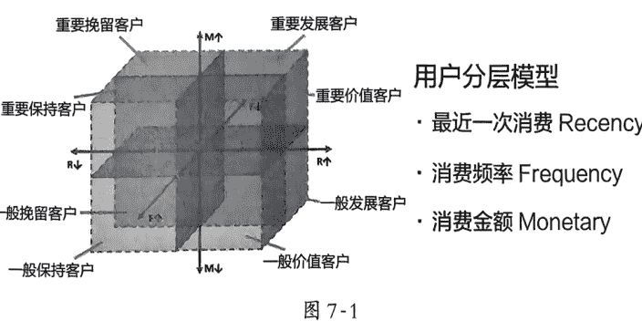

###### 4. AI 智能分群

这是关键的一步。运用无监督机器学习算法（如 K-Means、DBSCAN 等），让 AI 自动将具有相似特征的用户"聚合"到一起，形成不同的客户细分群体（Segments/Clusters）。你不需要事先设定分群数，AI 会根据数据本身的结构找到最优化的分群方式。

###### 5. 画像生成与解读

AI 为每个自动分出的群体"画像"。该画像通常包含：

（1）**画像名称/标签**：给这个群体起个形象的名字，如"高价值尝鲜者""价格敏感的学生党""忠诚复购的妈妈群"。AI 可以根据群体的显著特征自动生成标签。

（2）**核心特征总结**：用简洁的语言描述这个群体的典型特征（行为、态度、需求等）。

（3）**数据支撑**：市场定义了本群体的关键数据指标（如平均客单价范围、常购品类、活跃时间段等）。

（4）**痛点与需求**：结合评论、聊天记录等文本数据的 AI 分析结果，提炼该群体的核心痛点并继续满足需求。

（5）**营销建议**：基于形象特征，对外提出营销策略建议。

##### 借助 AI 工具实现用户画像的方法与路径

1. **集成 AI 的平台**：许多现代 CRM 系统（客户关系管理系统）、客户数据平台、营销自动化工具已经内置了 AI 用户分群和画像功能。

2. **BI 与数据分析工具**：一些高级的商业智能（BI）工具或数据分析平台（如 Tableau）也能实现。

3. **利用 AI 进行定性数据分析**：即使没有复杂的系统，你也可以利用 AI（如 DeepSeek）提升对现有定性数据的洞察力，为构建更精准的"手动"画像或验证 AI 分析结果提供支持。例如，将收集到的用户评论、访谈记录等文本输入给 AI，帮助你提炼核心观点、识别用户情绪、发现不同用户群体的差异化需求。

##### AI 实战

###### 步骤 1 收集数据

假如你经营一家在线花店，你想了解不同类型用户的购买动机和关注点。那你可以将近期的用户评论进行收集，形成文档。

###### 步骤2 挖掘画像线索

将形成的文档，上传至 DeepSeek 后，进行提问。

**提问模板**（提炼用户画像雏形）：

> 请分析我上传的数据，并从中提炼出至少【几】种不同的用户画像雏形。

请描述：

1. 每个画像群体可能的购买动机和场景是什么？

2. 他们最看重花店的哪些方面？

3. 他们的潜在痛点可能是什么？

请为每个画像雏形构思几个核心标签。

**参考指令：**

> 我收集了我们在线花店近期收到的50条用户评论。主要内容包括：买花用途（送女友、送妈妈、自用、装饰办公室等），对花材新鲜度、包装设计、配送速度、客服态度的评价等。

请分析这些评论，并从中提炼出至少三种不同的用户画像雏形。请描述：

1. 每个画像群体可能的购买动机和场景是什么？

2. 他们最看重花店的哪些方面？（如价格、品质、设计感、服务等）

3. 他们的潜在痛点可能是什么？（如担心花不新鲜、配送不及时、包装不好看等）

请为每个画像雏形构思几个核心标签（如"浪漫送礼者""生活美学家""企业客户"）。

###### 成果示例：

> 🧠 已深度思考（用时 28 秒）

**用户画像雏形 1：情感表达型送礼者**

**核心标签：** 节日/纪念日驱动、注重仪式感、追求精致体验。

**1. 购买动机和场景：**

- 为重要节日（如情人节、母亲节、教师节）或纪念日（如生日、毕业、升职等）购买花束，传递情感或表达心意。
- 典型场景：给伴侣送惊喜花束、给长辈送祝福、向老师或客户表达感谢。

**2. 最看重的方面：**

- 配送准时性（如评论 1、3、40 提到 "差点耽误事""配送保密工作好"）。
- 包装设计（如评论 1、9、25 强调 "包装精致""丑到爆""浪漫"）。
- 客服服务（如评论 7、35 提到 "客服贴心推荐""服务周到"）。

**3. 潜在痛点：**

- 包装与图片不符（评论 9）、配送延迟（评论 3）、贺卡等细节不够用心（评论 25）。

**请按如下顺序操作：**

1. 找到 5~10 条关于你的产品或服务的客户评论或反馈（来自电商平台、社交媒体、客服记录等）。
2. 仔细阅读，尝试将这些客户划分为不同的类别，并思考它们各自的需求和痛点。
3. 使用上面的提问模板，将这些评论的关键信息输入给 AI，看看 AI 的分析结果是否与你的判断一致，或者是否发现了你没有注意到的新角度。

**注意事项：**

1. **数据孤岛问题**：AI 画像的精准度高度依赖于数据的全面性、准确性和整合程度。
2. **隐私合规是生命线**：务必确保所有数据的收集、存储、分析和使用都严格遵守《中华人民共和国个人信息保护法》等法规要求，获得用户明确授权，并采取足够的安全措施。
3. **算法"黑箱"困境**：有时 AI 的分群结果可能难以理解，需要结合业务知识进行进一步解读和验证。
4. **标签固化与偏见规避**：AI 生成的用户画像是基于历史数据的总结，要注意避免形成刻板印象，不要忽略用户的动态变化和个体差异。

#### 02 AI 产品痛点调研：打造贴合需求的产品

了解完你的客户是谁（用户画像），紧接着的关键任务是：深入探究用户在使用产品或服务过程中遇到的问题，以及他们内心深处亟待解决的需求。只有精准捕捉用户的"痛点"，才能打造出真正契合需求、广受欢迎的产品，规避闭门造车的风险。传统的痛点调研手段，如问卷调查、访谈、焦点小组等，虽具可靠性，但通过融入人工智能技术，能让痛点抓取更为迅速、精准且全面。

痛点，本质上是未被满足的需求，也是产品商业成功的起点。但凡成功的产品，归根结底都是有效解决了用户的特定痛点。用户之所以愿意付费，是因为产品或服务帮他们化解了某种困扰、满足了某种渴望或提供了某种便利。倘若产品无法解决用户的真实痛点，那么无论功能多么炫酷、设计多么精美，都可能无人问津。因此，在产品开发的全生命周期（从概念验证、功能设计、迭代优化到营销推广），都需要持续、深入地进行痛点调研。

##### AI 如何"听懂"用户的抱怨与期待？

AI 能在痛点调研中发挥关键作用，核心在于其强大的自然语言处理（NLP）能力，能够从海量的、非结构化的用户反馈文本中，自动"读懂"用户的真实诉求。这些文本来源广泛，涵盖：

1. **线上评论**：电商平台（如淘宝、京东、拼多多等）、本地生活平台（如美团、大众点评等）、应用商店、内容平台（如小红书、知乎等）上的用户评价。
2. **社交媒体：** 微博、抖音、快手等平台上，用户针对品牌、产品或相关话题的讨论、吐槽与建议。
3. **客服记录：** 用户与客服的聊天记录、邮件往来及电话录音（转换为文本后）。
4. **社区论坛：** 相关行业的垂直论坛、兴趣社群的用户发帖与回帖。
5. **调查问卷中的开放式问题：** 调查问卷中用户填写的开放式答案。

##### AI 在痛点调研中的应用场景

1. **洞察现有产品问题：** 借助用户对现有产品反馈的分析，AI 能迅速明确：用户抱怨最多的功能是哪些？哪个操作阶段最易令用户困惑？产品最需改进之处在哪？这些问题出现的频次如何？用户对这些问题的负面情绪程度怎样？从而为产品迭代提供方向指引。
2. **挖掘潜在新需求与新功能：** 除关注用户对产品的抱怨外，还需留意用户在相关领域（产品所属的更大范畴）讨论的痛点与未满足需求。例如，分析健身爱好者在论坛的讨论，可能会发现他们对现有健身 App 饮食记录功能的不满，这或许就是开发新功能或新产品的契机。
3. **深入了解竞品优劣势：** 利用 AI 剖析竞争对手的用户评论，明确用户青睐竞品的方面以供借鉴，以及可实施差异化打击的方面。
4. **优化营销描述和沟通话术：** 掌握用户在表述痛点时常用的词汇与表达方式，并将这些"用户语言"融入广告语、产品介绍与销售话术，更易引发共鸣。

##### 如何利用 AI 工具进行痛点调研？

**提问模板**（产品种草类型——场景化）：

请为我的产品【产品名及类型】写一条朋友圈"种草"文案。

目标：通过生活场景展示产品的安静体验，引发向往。

场景描述：【简单描述场景类型】

要求：

1. 以第一人称分享感受。
2. 重点描述【产品体验和好处】。
3. 自然地提及产品名称或特征。
4. 不要直接打广告，可以结尾流露喜爱之情。
5. 【文案风格】。
6. 建议配图。

**参考指令：**

请为我的产品智飞牌降噪耳机写一条朋友圈"种草"文案。

目标：通过生活场景展示产品的安静体验，引发向往。

场景描述：周末下午在嘈杂的咖啡馆里，戴上耳机沉浸式看书。

要求：

1. 以第一人称分享感受。
2. 重点描述戴上耳机后世界"安静下来"的体验和好处，非常专注、放松。
3. 自然地提及产品名称或特征。
4. 不要直接打广告，可以结尾流露喜爱之情。
5. 风格文艺、小确幸、有质感。
6. 建议配图：在咖啡馆戴耳机看书的氛围照片。

###### 成果示例：

已深度思考（用时 18 秒）

##### 【在咖啡馆听见雪落的声音】

周末的拿铁总伴着交响乐：

咖啡机的轰鸣、隔壁桌的商务谈判、银勺撞上杯壁的脆响……

直到指尖轻触耳廓——

"智飞牌降噪耳机"启动的刹那，像给世界按下静音键。

翻动的书页成了唯一的声音轨迹，

拿铁氤氲的热气突然有了慢镜头，

那些喧嚣像被消音的气泡，悬浮在玻璃墙外。

原来专注力才是最高级的松弛感，

此刻我与加缪的《夏天集》共享 37℃的寂静，

而窗外川流不息的人潮，早已与我无关。

原来不是世界太吵，是我们忘了如何关掉噪音。

【配图建议：木质咖啡桌俯拍视角，摊开的书页旁放着白色降噪耳机，背景虚化成流动的光影】

##### AI 实战

##### 步骤 收集数据

假如你开发了一款在线协作文档 App，想通过分析用户在应用商店的差评来找到产品最需要改进的地方。

**提问模板（差评分析）：**

我收集了【产品或服务在 ×× 渠道 /App 上的中 / 差评】。

请运用文本分析能力，帮我：

1. 识别并列出用户抱怨最多的 3~5 个核心痛点，并按提及频率排序。
2. 针对每个核心痛点，找到 1~2 句最能生动反映用户具体困扰的原始评论引述。
3. 分析哪些痛点似乎引起了用户最强烈的不满情绪。
4. 除了抱怨，评论中是否有用户直接提出了具体的改进建议？请列举。
5. 基于这些分析，为我们下一步的产品迭代提出 2~3 个最优先的改进方向建议。

**参考指令：**

我收集了我们的在线协作文档 App 在应用商店收到的 100 条一星和二星差评，请运用文本分析能力，帮我：

1. 识别并列出用户抱怨最多的 3~5 个核心痛点，并按提及频率排序。
2. 针对每个核心痛点，找到 1~2 句最能生动反映用户具体困扰的原始评论引述。
3. 分析哪些痛点似乎引起了用户最强烈的不满情绪。
4. 除了抱怨，评论中是否有用户直接提出了具体的改进建议？请列举。
5. 基于这些分析，为我们下一步的产品迭代提出 2~3 个最优先的改进方向建议。

**成果示例：**

> 已深度思考（用时 12 秒）

##### 1. 用户抱怨最多的核心痛点（按提及频率排序）

（1）**多人协作同步延迟 / 冲突**（高频词：同步、覆盖、冲突、卡顿、加载慢）
- **提及频率**：约 30% 的评论涉及协作同步问题。
（2）**移动端 / 平板操作体验差**（高频词：手机卡顿、误触、闪退、界面不友好）
- **提及频率**：约 25% 的评论吐槽移动端体验。
（3）**模板数量少、质量低、更新慢**（高频词：模板少、老土、缺乏创意）
- **提及频率**：约 20% 的评论提及模板问题。
（4）**文件格式兼容性差**（高频词：格式混乱、不兼容、数据丢失）
- **提及频率**：约 15% 的评论抱怨文件导入问题。
（5）**价格过高、性价比低**（高频词：贵、不值、卸载）
- **提及频率**：约 10% 的评论聚焦价格问题。

##### 2. 核心痛点对应的用户原始评论引述

- **（1）协作同步问题：**
  - "和同事一起编辑文档，我这边改完半小时了，他那边还没同步，来回沟通确认浪费太多时间！"
  - "多人同时编辑文档，经常出现内容覆盖，之前的努力全白费，太崩溃了！"
- **（2）移动端体验差：**
  - "在手机上编辑文档简直是灾难，打字经常卡顿，选中文本也超困难！"
  - "手机编辑时经常闪退，写了半天的内容说没就没，太垃圾了！"
- **（3）模板问题：**
  - "模板风格太单一，都是些老土的样式，完全不符合我的需求！"
  - "模板更新速度跟蜗牛一样，每次都找不到想要的，严重影响工作效率！"

**请按如下顺序操作：**

1. 找到您的产品/服务在某个平台（如淘宝、大众点评、应用商店等）的评价页面，筛选出"差评"或"中评"。
2. 快速阅读 5~10 条差评，尝试手动总结出 1~2 个反复被提及的问题点。
3. 使用上面的 DeepSeek 模板，将这几条差评的关键信息输入，看看 AI 的分析结果是否更系统、更深入？它是否可以帮助你注意到可能忽略的细节？

**注意事项：**

1. **避免数据来源的片面性：** 单一渠道的反馈（如只有应用商店评论）可能无法代表所有用户，需要多渠道收集信息，交叉验证。
2. **留意幸存者偏差现象：** 你能收集到的反馈，可能只是那些愿意花时间反馈的用户（或特别不满意/特别满意的用户）的声音，要注意"沉默的大多数"。
3. **理解能力的局限：** 人工智能目前对复杂语境、反讽、口语化表达的理解能力具有一定的局限性，关键结论需要人工判断和确认。
4. **关注表象并非根本**：AI 能识别"症状"（如用户抱怨 App 卡顿），但找到具体原因（是网络问题、服务器问题还是代码效率问题）需要更深入的技术排查。

#### 03 AI 聊天机器人：从问候到成交的"话术大师"

在高效绘制了用户画像、深入洞察用户痛点之后，如何将这些认知转化为有效的沟通，并最终促成交易，成为摆在企业面前的关键课题。在与客户互动的线上战场，AI 聊天机器人正实现华丽转身，从昔日略显笨拙的"人工智障"，蜕变为日趋聪明的"话术大师"，它已然成为企业 24 小时在线值守、高效响应、甚至能主动挖掘销售契机的得力助手。

以往的聊天机器人大多基于简单的"关键词—回复"规则构建，这类机器人只能回答预设好的问题，一旦用户的提问方式稍有变化或超出范围，就只能回复"抱歉，我不明白您的问题"或"请转人工客服"，体验不佳。但如今，受益于 AI 的飞速发展，现代 AI 聊天机器人已经具备强大的自然语言理解能力、精准的上下文采集能力和自然流畅的语言生成能力。具体而言，它们能够：

1. **理解更复杂的含义**：不再局限于简单的关键词匹配，而是能够深度解析用户语句背后潜藏的真实意图。即便用户表述方式多样、存在错别字，或是采用口语化表达，也能精准领会。
2. **进行多轮对话**：拥有出色的记忆能力，能够牢记此前的对话内容，始终保持上下文的连贯性，与用户展开逻辑严密、自然流畅的交流。
3. **生成"人"的回复**：给出的回答能够依据具体语境，生成流畅、个性化，甚至带有一定情感色彩的回复，让交流更具温度。
4. **学习与进化**：通过不间断地与用户互动，以及后台海量数据的深度训练，AI 聊天机器人能够持续优化自身，不断提升回答的准确性，让服务的智能化水平更上一层楼。

##### 一 AI 聊天机器人的核心价值

部署一个优秀的 AI 聊天机器人，能为企业业务带来诸多切实价值：

1. **降本增效**：自动处理高达 70%~80% 的重复性、常见性客户咨询（如产品功能、价格、活动规则、订单状态、售后政策等），将人力从烦琐的事务中解放出来，聚焦于更复杂、更需要同理心的问题。实现 24 小时全天在线服务，且运营成本极低。
2. **提升用户体验**：即时响应用户咨询，减少等待时间；提供标准、一致的服务口径；在非工作时间内也能提供基础支持。
3. **挖掘销售机会与转化**：在售前咨询环节，主动引导用户了解产品、解答疑问、消除顾虑，甚至可以直接引导完成简单的购买或预约服务流程，有效捕捉并转化潜在客户。
4. **用户数据沉淀**：将每次与用户的互动都记录下来，汇聚成宝贵的数据资产。这些数据可用于进一步分析用户需求、优化产品、完善知识库等。

##### 二 AI 聊天机器人关键应用场景

1. **网站/App 访客接待与引导**：主动向访客询问需求，引导浏览相关页面，解答初步疑问等。
2. **电商前置咨询**: 回答关于商品规格、材质、价格、库存、优惠活动等问题，辅助用户决策。
3. **售后服务支持**: 订单处理查询、物流跟踪、退换货流程咨询、常见故障排查、使用指导等。
4. **本地生活服务预订与咨询**: 回答商场地址、营业时间、服务项目、价格、预约时间等问题，辅助完成用户预订。
5. **自媒体粉丝互动与答疑**: 回答粉丝关于博主、内容、课程、推荐产品等常见问题。
6. **微信生态客服**: 在公众号、小程序、企业微信等中接入 AI 客服，处理用户消息。
7. **线索初步筛选与收集**: 通过对话了解用户需求，判断意向度，收集联系方式，为销售团队提供正确的线索。

##### 如何部署与优化 AI 聊天机器人？

1. **明确目标与场景**: 首先需审慎思考，明确聊天机器人应在哪个渠道（网站、App、微信、钉钉等）发挥作用，解决哪些核心问题（如降本、提效、获客、转化等）。

2. **选择合适的工具 / 平台**:

（1）**第三方 SaaS 工具**: 市场上有很多智能客服 / 聊天机器人 SaaS 平台（国内如网易七鱼、智齿科技、晓多科技、Udesk 等；国际如 Intercom、Zendesk 等），这些平台通常提供可视化配置界面，集成多种 AI 能力，适合快速部署。

（2）**基于大模型的开发**: 利用**通用大模型 API**（如 DeepSeek API），结合自身业务数据和**知识库进行定制开发**（需要技术能力），可以实现更灵活、更强大的功能，为企业打造可共享知识的智能问答体系，并基于我们的虚拟知识库精准应答。支持本地部署开源模型，确保企业数据绝对安全。

3. **构建与更新知识库：** 这是决定机器人"智商"的关键。需要将你的产品信息、服务、常见问题解答（FAQ）、营销活动规则等分类有序地录入系统，并持续更新。知识库越完善、越准确，机器人的回答就越可靠。

4. **设计对话流程与策略：** 尽可能多地设想用户可能问什么，机器人应该怎么回答，在什么情况下应该转接人工。设计引导性问题，主动挖掘用户需求。

5. **持续监控与优化：** 上线后不是一劳永逸，要定期分析聊天记录，快速找到机器人回答不好或无法回答的问题，利用用户反馈（如点赞、点踩等）来评估机器人表现，优化知识库和对话策略。

##### AI 实战

###### 步骤 1 给 AI 喂"原料"

假如你想为你的电商网站部署一个 AI 聊天机器人，需要让它准备好回答用户常见问题的知识库内容。上传产品说明书后，进行提问。

**参考指令：**

> 请结合产品说明书，为我的智能空气净化器的 AI 聊天机器人生成一个知识库，包含但不限于以下常见问题和答案：
> 
> 1. 适用面积是多少？（需结合不同型号信息）
> 2. 滤网多久需要更换一次？在哪里购买？
> 3. 除甲醛效果怎么样？有检测报告吗？
> 4. 运行时噪音大吗？适合放在卧室吗？
> 5. 如何连接手机 App 进行远程控制？
> 6. 产品保修政策是怎样的？
> 7. 和其他品牌相比有什么优势？

要求：回答要准确、简洁、易于理解，语气专业且友好。尽可能生成更多的问题答案组，可以适当引导用户查看更详细的产品页面或说明书。

**成果示例：**

> 已深度思考（用时 28 秒）

####### 智能空气净化器 AI 聊天机器人知识库

######## 1. 适用面积是多少？

答：本空气净化器的适用面积为 60~90 平方米，适用于中大户型的客厅、卧室或办公室。其颗粒物 CADR 值高达 600m³/h，甲醛 CADR 值为 200 m³/h，可快速净化空气。如需适配更大空间或了解其他型号信息，建议访问官网或查阅说明书。

######## 2. 滤网多久需要更换一次？在哪里购买？

答：

- 初效滤网：每 3~6 个月（灰尘多可缩短周期）。
- 活性炭滤网：每 6~12 个月（新装修环境建议 6 个月）。
- HEPA 滤网：每 12~24 个月（根据使用环境调整）。

**购买渠道：**

① 易飞官方 App/官网；② 京东/天猫旗舰店；③ 线下授权门店。

建议定期查看设备提示或 App 滤网状态，及时更换以保持净化效果。

###### 步骤 2 设计对话引导

**参考指令：**

请为 AI 聊天机器人设计一个当用户首次访问网站并停留超过 15 秒时的主动问候和后续引导对话流程。目的是了解用户意图并提供帮助。

例如：

机器人："您好！很高兴为您服务，请问有什么可以帮您的吗？您可以直接问我关于产品、优惠或订单的问题。"

然后根据用户的回复，设计不同的分支：

1. 如果用户询问具体产品 → 提供信息，询问关心点。
2. 如果用户询问优惠 → 介绍当前活动，引导领取。
3. 如果用户随便看看 → 推荐热门产品或分类。
4. 如果用户无回复 / 离开 → 礼貌结束。

生成流程图，并用简洁的语言描述这个流程。

**成果示例：**

已深度思考（用时 21 秒）

####### 主动问候语与引导流程设计

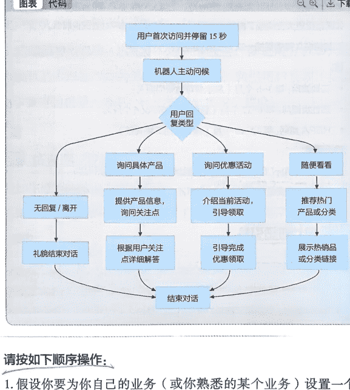

##### 请按如下顺序操作：

1. 假设你要为你自己的业务（或你熟悉的某个业务）设置一个 AI 客服，列出用户最常问的 3 个问题。
2. 使用第一个模板，为这 3 个问题生成标准答案，思考这些答案是否清晰、完整。
3. 访问 2~3 个带有在线客服功能的大型品牌官网（如银行、航空公司、知名电商等），尝试与他们的机器人互动，观察他们是如何主动发起对话、理解问题和引导流程的。

##### 注意事项：

1. **合理设定预期**：AI 机器人不能完全取代人类。在处理复杂问题、涉及强烈情绪以及需要深度同理心等情境时，其能力存在局限。应理性看待，避免期望过高。

2. **强化知识库维护**：知识库建设不完善或更新滞后是导致机器人表现欠佳的常见因素。需持续投入精力，保障知识库的内容准确、无疏漏，及时更新迭代。

3. **注重人机协作**：卓越的智能客服系统依赖"人机协作"模式。务必设置便捷、及时的人工转接通道，同时配备高效的人工坐席工作台，确保服务无缝衔接。

4. **关注用户体验**：对话流程杂乱、机器人响应迟缓、回答与问题不匹配等问题，都会严重影响用户体验。设计时需精心规划对话流程，优化机器人性能，提升回答精准度。

5. **保障数据安全**：聊天记录可能包含诸多用户敏感信息，必须严格确保系统安全，遵循相关数据保护法规，防止信息泄露。

### 私域成交组合拳

#### 04 智能话术生成器

在客服沟通、社群运营互动以及销售跟进潜在客户等场景中，每一次对话都是建立信任、传递价值和推动转化的契机。话术作为其中的关键因素，直接关乎成交的成败。然而，在话术这一方面，众多运营和销售人员正面临一系列痛点：

1. **语言技巧匮乏**：不懂得如何运用恰当的语言打动用户，常陷入"无效闲聊"或"自说自话"的困境。
2. **工作效率低下**：针对不同客户与场景编写个性化话术，耗时耗力。
3. **话术质量不均**：团队成员沟通能力参差不齐，难以确保统一的服务质量与转化效果。
4. **复杂场景应对乏力**：面对客户的各类疑问、异议甚至刁难，往往不知所措。

##### AI 话术生成器的革命性价值

AI 在文本处理与生成方面优势显著，AI 私域沟通话术生成功能，如同为销售和运营团队配备了一位不知疲倦、知识储备丰富且深谙沟通技巧的"金牌话术教练"。其核心价值体现在：

1. **大幅提升效率**：依据具体场景与需求，AI 能在短时间内生成多套话术方案，极大地缩短构思与撰写时间。
2. **质量优化与标准化**：AI 可学习并借鉴优秀销售话术模式，结合产品知识库，生成结构完备、逻辑清晰、表达精准且极具说服力的话术，助力提升团队整体沟通水平。
3. **个性化与精准触达：** AI 能够结合用户画像标签、历史行为以及痛点分析结果，针对特定用户群体或需求生成个性化沟通话术，实现"千人千面"的精准沟通。
4. **场景全面覆盖：** 从初次接触时的破冰问候，到产品介绍、活动邀约、客户关怀、疑问解答、异议处理，再到最终的催单成交，AI 可为私域沟通的几乎所有环节提供话术支持。
5. **快速迭代与优化：** 可便捷地让 AI 生成不同风格、侧重点的话术版本，进行 A/B 测试，并依据实际转化效果持续优化。

##### AI 生成话术的关键应用场景（私域）

1. **新用户破冰与引导：** 对刚添加到个人号/企业微信的新好友，或刚加入社群的新成员，生成友好的欢迎语和初步的需求了解话术。
2. **产品/服务价值塑造：** 针对不同的用户形象，生成突出其最关心的利益点的产品介绍话术。
3. **活动前期预告与邀请：** 为社群活动、直播、新品发布等撰写预告和邀请文案。
4. **潜在客户认知：** 对有明显意向但尚未成交的客户，生成不同阶段（如考虑期、对比期）的、非骚扰式的趋向话术，激活购买意愿。
5. **用户关心与维护：** 生成祝福、生日问候、使用小贴士、问卷回访等客户关心或节日话术，提升用户黏性。
6. **常见疑问标准化解答：** 针对用户常问的问题（如在社群中提问），生成标准、统一的解答话术库。
7. **客户异议处理：** 针对常见的价格异议、效果质疑、竞品对比等问题，生成有理有据、化解疑虑的话术。
8. **成交催化与逼单：** 在用户犹豫不决时，生成制造稀缺感、提醒优惠时效、临门一脚促进成交的话术。

##### 如何借助 AI 生成高效的私域话术？

###### 1. 明确沟通要素

（1）**目标对象**（谁）：是哪个画像的用户？他/她有什么特征？（如刚生完宝宝的新手妈妈，注重安全和重要性）

（2）**沟通场景**（地点/时间）：是在微信群公告？一对一私聊？朋友圈评论回复？用户咨询后？

（3）**核心信息**（什么）：想传递的关键产品卖点、活动信息、优惠政策是什么？

（4）**沟通目标**（目的）：希望用户听完后做什么？（了解产品？参与活动？下单购买？消除疑虑？）

（5）**期望语气**（如何）：希望话术听起来是专业的？亲切的？风趣的？权威的？

###### 2. 提供充足的背景信息给 AI

输入越详细、越精准，AI 生成的话术质量越高。需要提供：产品/服务详情、用户画像标签、用户痛点、活动规则、价格信息、已知事件点等。

###### 3. 运用场景化的提示词

####### 步骤 1 针对特定类型用户设计话术

**提问模板**（私聊推荐话术——针对特定画像）：

```
请帮我为【产品】写一段微信私聊话术，推荐给【客户画像标签】。
```

推荐产品是：【产品名称及核心功效】。

沟通目标：激发客户对产品的兴趣，并引导其了解详情。

要求：

1. 开头自然引入，可以结合用户之前的咨询记录或普遍痛点。
2. 重点说明产品如何针对性解决客户的痛点。
3. 强调产品的【其他优点】。
4. 结尾【提供明确的下一步指引】。
5. 整体语气要求【语言风格】。

**参考指令：**

请帮我为菲芝品牌护肤顾问写一段微信私聊话术，推荐给客户"长期熬夜导致皮肤暗沉的年轻白领"。

推荐产品是：菲芝牌亮肤精华，主打改善暗沉、提亮肤色。

沟通目标：激发客户对产品的兴趣，并引导其了解详情。

要求：

1. 开头自然引入，可以结合用户之前的咨询记录或普遍痛点。
2. 重点说明产品如何针对性解决"熬夜脸"的暗沉问题。
3. 强调产品的成分温和、吸收快、用户好评。
4. 结尾发送产品测评文章链接，告知当前有体验装活动。
5. 整体语气要求专业又贴心，像朋友分享好物。

**成果示例：**

> 已深度思考（用时 18 秒）

【菲芝护肤顾问小菲】私聊话术：

XX 姐晚上好呀，最近是不是又经常加班啦？看您上次咨询过暗沉问题，今天特意给您带来熬夜党的"反暗沉神器"——菲芝亮肤精华！（带小熊猫熬夜表情包）

您知道吗？这瓶精华里特别添加了【双重黄金配比烟酰胺 + 维 C 衍生物】，就像给皮肤安排了夜间修护小队——既能24小时抑制黑色素堆积，又能快速中和熬夜产生的自由基，好多客人反馈用一周就能看到黄气"退散"，睡醒后皮肤透着通透感。

偷偷告诉您一个小秘密，我们的配方师特意做了【3重温和缓冲技术】，就算敏感肌用完晨间上妆都特别服帖，而且质地像露水一样咻地吸收，完全不会黏枕头！（附实验室吸收速度对比图）

最近后台都被好评刷屏啦："急救完第二天客户夸我气色好""现在素颜自拍都不用开滤镜"。刚好现在有【免费申领体验装】活动，我给您同步了测评文章（附链接），要不要先体验3天感受下提亮效果？

##### 步骤2 利用AI助力活动预热

###### 提问模板（社群活动预告话术）：

请帮我为【社群主题】撰写一条活动预告。

活动主题：【活动名称】。

活动亮点：【如专属福利】。

活动时间：【具体时间】。

参与方式：【线上/线下】。

沟通目标：吸引群成员预约/关注直播，并激发讨论。

要求：

1. 清晰说明活动价值和亮点。
2. 包含所有关键信息（时间、参与方式）。
3. 结尾引导互动。
4. 语言活泼，符合社群氛围。

###### 参考指令：

> 请帮我为职场女性护肤分享群撰写一条活动预告。
> 
> 活动主题：新时代女性护肤直播课。
> 
> 活动亮点：邀请了知名美妆老师主讲、直播间有专属福利。
> 
> 活动时间：3月25日晚8点。
> 
> 参与方式：届时在群内发送直播链接。
> 
> 沟通目标：吸引群成员预约/关注直播，并激发讨论。
> 
> 要求：
> 
> 1. 清晰说明活动价值和亮点。
> 2. 包含所有关键信息（时间、参与方式）。
> 3. 结尾引导互动（如"想听的扣1"或"大家最想了解美妆的哪个方面呢？"）。
> 4. 语言活泼，符合社群氛围。

###### 成果示例：

已深度思考（用时19秒）

【职场靓肤情报站】活动预告来啦！

姐妹们快集合！明晚有大事发生——

《通勤妆越化越暗沉？3招养成"职场发光肌"》直播课

3月25日晚8点 | 本群同步直播链接

三大必看理由：

1. 明星美妆导师李琳空降！揭秘"早C晚A"高效公式。
2. 连麦解答职场特需问题：口罩闷痘/电脑肌/熬夜跨区差旅急救。
3. 直播间专属：1元秒杀面膜福袋 + 抽奖送全套亮肤精华！

参与姿势超简单：

1. 今晚12点前扣【1】预约，开播提醒不怕忘。
2. 置顶本群，当天会@所有人发放入口。
3. 留言你最头痛的护肤难题，老师翻牌解答！

偷偷剧透：现场演示5分钟打工人晨间唤醒操，还有三份价值899元的职场护肤礼盒，手慢无！

##### 步骤3 利用AI设计价格异议话术

**提问模板**（处理价格异议话术）：

当客户表示"你们的【产品类型】比【竞品品牌】贵好多"，请生成三种应对思路：

- 思路一：成分价值法（强调专利成分/浓度配比/实验数据）。
- 思路二：场景化解法（换算日均成本/对比其他消费）。
- 思路三：风险承诺法（支持试用/过敏包退/搭配服务）。

**要求：** 每个思路需包含对比维度 + 数据支撑 + 情感认同要素。

**参考指令：**

当客户表示"你们的抗老精华比欧莱雅贵好多"，请生成三种应对思路：

- 思路一：成分价值法（强调专利成分/浓度配比/实验数据）。
- 思路二：场景化解法（换算日均成本/对比其他消费）。
- 思路三：风险承诺法（支持试用/过敏包退/搭配服务）。

**要求：** 每个思路需包含对比维度 + 数据支撑 + 情感认同要素。

**成果示例：**

已深度思考（用时 26 秒）

**（思路一：成分价值法）**

> "您真是行家！这瓶精华第三位成分——我们独有的【超导黄金视黄醇】专利配方（亮专利证书），活性浓度达到0.3% 黄金配比，比常规视黄醇温和2倍却见效快1.5倍呢！"

**数据支撑：** 第三方检测显示连续使用28天，法令纹减淡度比同类产品高41%（附实验室对比图），相当于每天多花3毛钱获得加倍的抗老效果。

> **情感共鸣：** "咱们这个年纪选抗老产品，有效成分就像护肤品里的'硬通货'，每一滴都在为十年后的少女肌存本钱呀！"

**（思路二：场景化解法）**

> **省钱算法：** "这瓶早晚用能用120天，日均才4.9元（掏出手机计算器演示），比中杯拿铁还便宜1/3呢！"

**对比维度：**"但咖啡只能提神4小时，这瓶精华可是在帮您冻结时光——相当于每月少喝3杯奶茶，换来5年后同学会上的'防腐剂体质'。"

**情感引导：**"上次有个客户姐姐说，发现精华日均价比停车费还低时，突然觉得这张脸值得更好的投资。"

###### 4. 人工审核与个性化润色

AI生成的是"标准件"，你需要做的是"精修"。一定要仔细阅读AI生成的话术并检查：

（1）是否准确无误？

（2）是否符合产品的品牌调性和您的个人风格？

（3）在特定语境下是否自然、得体？（尤其避免过度或机械）

（4）是否需要根据具体客户的聊天记录做进一步的个性化调整？

###### 5. 建立话术库并持续优化

将效果好的话术模板保存起来，分类整理（如按场景、按用户类型），形成团队共享话术库。并根据实际使用的效果，不断反馈给AI（通过优化提示）进行迭代。

##### 请按如下顺序操作：

1. 回想一个你在私域沟通中经常遇到的场景，比如"向老客户推荐新品"。
2. 明确你的推荐目标、产品卖点和客户特色。
3. 套用第一个模板，让AI为你生成一段推荐话术草稿。
4. 修改AI话术，使口吻听起来更自然。

##### 注意事项：

1. **切忌"机器人"感过强：** 直接复制粘贴AI话术，缺乏人情味和真诚感，在注重关系的私域里是非常忌讳的，一定要加入自己的思考和温度。
2. **情境搭配得当**：把用于 A 场景的话术错用在 B 场景，或者对 A 类型客户用了 B 类型的话术时，效果会适得其反。使用前要判断适用性。
3. **沟通话术灵活调整**：良好的沟通是有效的。不能把 AI 生成话术直接"灌输"给用户，要关注用户的反应，及时调整沟通策略。
4. **产品质量要有保障**：如果产品、服务本身存在硬伤，或者用户的核心需求得不到满足，再完美的话术也难以成交。

#### 05 裂变活动自动设计

在私域流量运营中，单纯依赖一对一沟通或常规内容发布，用户增长与产品/活动推广的速度往往受限。若想实现用户数量的指数级增长，或是短期内让某产品或活动迅速火爆，"裂变"是不可或缺的增长策略。不过，设计一场成功的裂变活动颇具难度，需要创意灵感、对人性的深刻洞察、精密的规则设定，以及对平台规则的精准把握。而 AI 的兴起，能够成为策划裂变活动的"超级智囊"与"架构设计师"。

##### AI 如何助力裂变活动策划？

1. **创意生成与头脑风暴**：只需明确活动目标（拉新、促活、转化等）、目标人群、大致预算以及可提供的资源（如奖品），AI 就能结合常见的裂变模式（如助力、拼团、砍价、集卡、分销、打卡、趣味测试分享等），生成形式多样的活动创意方案。
2. **活动方案构造与细化：** 选定创意方向后，AI 可协助将其细化为完整的执行方案，涵盖**活动主题**、**起止时间**、**参与流程**、**详细规则**、**奖励设置**、**风险控制措施**、**宣传推广计划**等内容。
3. **规则与合规性初步检查：** AI 能够帮你推敲活动规则细节，使其更清晰、严谨。还可输入平台（如微信）的规则要点，让 AI 初步排查活动方案是否存在已知的违规风险点。但需注意，AI 无法完全替代专业法律意见，也不能取代对平台最新规则的深入研读。
4. **营销文案与素材生成：** AI 能快速产出用于活动预告、宣传及引导用户分享的文案，如群公告、公众号推文、朋友圈文案、分享引导语等。甚至还能生成针对海报、H5 页面等宣传素材的建议，包括给出关键信息和布局方面的建议等。
5. **效果预测与参数优化：** 通过分析过往类似活动的数据，理论上可训练 AI 模型来预测新活动的关键指标（如参与人数、裂变系数 K 因子等），并给出调整活动参数（如奖励力度、参与门槛等）的建议，优化活动效果。

##### 利用 DeepSeek 设计裂变活动步骤

##### AI 实战

###### 步骤 1 AI 创意激发（头脑风暴）

**提问模板**（裂变活动创意）：

> 我运营一个【业务类型】，主要通过微信群和公众号服务【用户画像】。
> 
> 我想在下个月策划一个线上裂变活动，主要目的是【明确目标】。预算【大致预算，涉及的奖品】。
> 
> 请帮我构思 3~5 种不同的、适合在微信生态内进行的裂变活动创意。请说明每种创意的：1. 活动名称。
2. 核心玩法（用户需要做什么）。
3. 主要吸引点（奖励或价值）。

###### 参考指令：

我运营一个在线瑜伽课程平台，主要通过微信群和公众号服务 25~40 岁注重健康的女性。

我想在下个月策划一个线上裂变活动，主要目的是为公众号增加 2000 个粉丝，预算较低，主要以课程优惠券或电子资料为奖品。

请帮我构思 3~5 种不同的、适合在微信生态内进行的裂变活动创意。请说明每种创意的：

1. 活动名称。
2. 核心玩法（用户需要做什么）。
3. 主要吸引点（奖励或价值）。

###### 成果示例：

> ⏱ 已深度思考（用时 28 秒）

以下是针对微信生态设计的 5 个低成本裂变活动方案，结合目标用户特征与公众号增粉需求：

######## 创意一："好友助力解锁瑜伽秘籍"

######### 核心玩法

用户生成专属助力海报→邀请好友扫码关注公众号→达标后解锁奖励。

第 3 人助力：赠送《办公室肩颈放松指南》电子书。

第 5 人助力：赠送"经期舒缓瑜伽课"7 折券。

第 8 人助力：赠送定制"体态评估报告"。

######### 吸引点

- 阶梯式奖励激励持续分享。
- 专业资料直击职场女性痛点。
- 虚拟奖品零物流成本。

######## 创意二："7天瑜伽蜕变挑战赛"

######### 核心玩法

用户每天跟练公众号发布的1分钟短视频→截图打卡发朋友圈→带活动话题 + 公众号二维码。

累计打卡3天：赠送"冥想入门音频课"。

累计打卡7天：赠送"年度课程8折卡"。

额外奖励：朋友圈集赞满50个获直播课优先连麦权。

######### 吸引点

- 朋友圈晒对比图引发好奇关注。
- 短期行为承诺提升参与率。
- 社交货币属性强化传播。

###### 步骤2 AI方案细化

####### 提问模板（选定创意后细化）：

我决定采用【活动名称】这个创意。请帮我详细策划这个活动的执行方案。

核心玩法：老用户A分享活动链接/海报给好友B，B完成【指定动作】，则A获得1次助力。集满【几】次助力，A可获得【奖品】。

请细化以下内容：

1. 活动周期：建议或指定时长。
2. 详细规则：
   （1）如何生成和分享个人助力链接/海报？
   （2）如何判定有效助力？（是否需要新用户？是否需要填写信息？）
   （3）每人最多可获得几次免单券？（或总奖品数量限制）
   （4）助力有效期是多久？
3. 奖品说明：清晰介绍免单课程的价值。
4. 参与路径图：简单描述用户参与和分享的步骤。
5. 风控要点：如何防止用户用小号"作弊"？
6. 宣传文案要点：活动预热、进行中、结束阶段的关键宣传信息。

###### 参考指令：

我决定采用"闺蜜同行，瑜伽课免单助力"这个创意。请帮我详细策划这个活动的执行方案。

**核心玩法：**老用户 A 分享活动链接/海报给好友 B，B 关注公众号并回复关键词，则 A 获得 1 次助力。集满 6 次助力，A 可获得价值 XX 元的指定瑜伽课免单券。

请细化以下内容：

1. 活动周期：建议或指定时长。
2. 详细规则：
   （1）如何生成和分享个人助力链接/海报？
   （2）如何判定有效助力？（是否需要新用户？是否需要填写信息？）
   （3）每人最多可获得几次免单券？（或总奖品数量限制）
   （4）助力有效期是多久？
3. 奖品说明：清晰介绍免单课程的价值。
4. 参与路径图：简单描述用户参与和分享的步骤。
5. 风控要点：如何防止用户用小号"作弊"？
6. 宣传文案要点：活动预热、进行中、结束阶段的关键宣传信息。

###### 成果示例：

以下是"闺蜜同行，瑜伽课免单助力"活动完整执行方案，结合微信生态特性与防作弊机制设计：

######## 1. 活动周期

- **预热期：** 活动前 2 天（公众号推文 + 社群预告）。
- **正式期：** 7 天（用户集赞黄金窗口）。
- **奖励发放：** 活动结束后 1 天内完成。

######## 2. 详细规则生成与分享路径

- **触发方式：** 用户向公众号发送关键词 "闺蜜瑜伽" → 弹出活动页 → 点击 "生成我的专属海报"。
- **海报设计：** 包含用户专属二维码（带邀请码）、课程免单金额（突出显示）、倒计时进度条。

######### 有效助力判定标准

- **新粉丝要求：** 好友 B 需为 7 天内未关注过公众号的新用户。
- **动作要求：** 扫码关注公众号后，需回复关键词 "助力 + 用户 A 邀请码"。
- **防刷机制：** 同一微信 ID 每天最多为 3 人助力。

###### 步骤 3 AI 文案生成

####### 提问模板（生成文案）：

请为上述【活动名称】活动，分别撰写：

1. 一条用于微信群发布的活动预告公告（突出福利，引导关注）。
2. 一段用于引导老用户 A 分享给好友 B 的微信对话模板（说明活动，请求帮助）。
3. 一条用于老用户 A 分享到朋友圈的文案（晒活动，求助力，附带活动海报）。

要求语言有吸引力、简洁明了、符合【用户画像】。

###### 参考指令：

请为上述 "闺蜜同行，瑜伽课免单助力" 活动，分别撰写：

1. 一条用于微信群发布的活动预告公告（突出福利，引导关注）。
2. 一段用于引导老用户 A 分享给好友 B 的微信对话模板（说明活动，请求帮助）。
3. 一条用于老用户 A 分享到朋友圈的文案（晒活动，求助力，附带活动海报）。

要求语言有吸引力、简洁明了、符合女性社群调性。

###### 成果示例：

> 已深度思考（用时 25 秒）

以下是为活动定制的三类传播文案，结合女性用户社交语言偏好设计：

######## 1. 微信群活动预告公告

**标题：** 社群专享 | 喊闺蜜组队领免单，21 天好身材练起来！

**正文：**

姐妹们注意啦！本周五中午 12 点，社群专属福利大放送，
拉 3 个闺蜜关注公众号，立领《骨盆修复跟练课》，
集 6 人组队成功，直接白嫖价值 299 元的爆款瑜伽课！
额外彩蛋：所有参与姐妹免费领生理期瑜伽手册。
速速扫码锁定福利位 ↓↓↓
【公众号二维码图片】
限前 200 名，手慢无！@所有人 快叫上姐妹蹲点开抢！

###### 步骤 4 人工审核与优化

（1）**审核**：AI 生成的规则、文案是否清晰、无歧义？是否存在逻辑错误？是否符合平台规则？
（2）**体验测试**：在小范围内测试活动流程是否合理？用户是否容易理解和参与？
（3）**风险评估**：再次评估作弊风险和成本控制。
（4）**合规确认**：务必对照最新的平台规则进行最终确认。

**请按如下顺序操作：**

1. 思考你的私域目前最需要通过活动解决的一个问题（如社群活跃度低）。
2. 使用第一个模板，让 AI 为你生成 1~2 个针对这个问题的裂变活动创意。
3. 快速评估一下，你觉得哪些创意更有趣、更实用？为什么？

##### 注意事项：

1. **目标需明确，不要为了裂变而裂变：** 活动设计要紧密围绕业务目标，否则拉来的用户不精准，难以变现。
2. **规则设计需合理：** 规则设计存在漏洞或过于复杂，容易被"薅羊毛"导致成本失控，或者用户觉得太麻烦而放弃参与。
3. **奖品设置要符合用户需求：** 奖品吸引力不足或与用户需求不匹配，会让用户觉得"不值得"花费时间精力去参与和分享。
4. **技术支持和落地执行要跟上：** 活动火爆后，系统卡顿、客服响应不及时、奖品延迟发放等都会严重影响用户体验和口碑。
5. **关注活动复盘与数据分析：** 活动结束后要认真分析数据（涉及变量、裂变系统、转化率、成本等），总结经验教训，为下一步活动优化提供借鉴。

#### 06 朋友圈 AI 文案生成

在微信生态体系里，朋友圈是维系客户关系、塑造个人或品牌 IP，以及开展潜移默化式营销的关键场域。区别于群聊的即时性与公众号的深度性，朋友圈宛如一个持续展示的"人设橱窗"。然而，如何在这个半私密、强社交的空间里，发布既能传递价值、塑造形象，又不引发用户反感，甚至还能推动转化的内容，成为众多运营者的棘手难题。如今，AI 可为朋友圈内容创作提供有力支持。

##### 一 AI 如何赋能朋友圈文案创作？

1. **创意主题生成**：若不清楚发布何种有价值的内容，只需告知 AI 自身行业、目标用户以及近期热点，它便能给出一系列朋友圈选题建议，涵盖主题分享、生活点滴、行业洞察、互动话题等。
2. **多样风格塑造**：无论是专业干货、生活化感悟，还是幽默段子、温馨祝福，AI 都能依据需求，生成不同风格与语气的文案。
3. **场景化内容定制**：针对新品上市、活动预告、出差途中、参加行业会议等特定场景，AI 可迅速产出贴合场景的文案。
4. **痛点与价值提炼**：AI 能够从繁杂的产品信息或用户反馈中，精准提取用户痛点，凝练出彰显核心价值的精练文案。
5. **交互性提升**：AI 可创作引人深思的提问、趣味投票，或鼓励评论的交互式文案，增强用户互动。
6. **创作效率提升**：将想法或素材（如文章、视频）输入 AI，它能快速生成多条适用于朋友圈的文案，供创作者修改选用。

##### 二 AI 生成朋友圈文案的关键类型与应用

1. **价值分享类型**：（知识、技巧、资讯）

   **目标**：塑造专业形象，提供实用价值，让用户觉得"关注你有用"。

   **AI 应用**：让 AI 将一篇行业文章/报告的核心观点提炼成几句精练文案；或围绕某个用户痛点生成几条实用小 Tips。

2. **生活/工作展示类型**：（幕后、日常、感悟）

   **目标**：拉近距离，增强真实性、人情味，建立情感联系。

   **AI 应用：** 让 AI 将一次客户服务经历、一段工作中的插曲或一点生活感悟，形成一段自然、真诚的文字。

###### 3. 互动提问类型：

**目标：** 激发评论互动，了解用户想法，活跃朋友圈。

**AI 应用：** 围绕你的业务领域或用户普遍关心的话题，让 AI 生成开放式、引发人思考或轻松有趣的问题。

###### 4. 案例 / 见证类型：（客户评价、使用效果）

**目标：** 增强产品 / 服务的可信度和吸引力。

**AI 应用：** 让 AI 将客户的评价（需获得授权）或使用效果，改写成简洁、有亮点的朋友圈文案，突出关键信息。

###### 5. 产品 "种草" 型：（场景化展示、软文推荐）

**目标：** 在不引起反感的前提下，展示产品价值，激发用户兴趣。

**AI 应用：** 描述一个使用产品的具体生活场景，让 AI 生成体验式、分享式的文案，强调产品带来的好处而不是生硬地展示。

###### 6. 活动通知类型：（促销、直播、新品）

**目标：** 通知、快速通报活动信息，引导用户关注或参与。

**AI 应用：** 将活动要素（时间、地点、内容、优惠、参与方式等）输入给 AI，生成简洁明了、重点突出的通知文案。

##### 如何利用 AI 创作优质朋友圈文案？

###### 1. 定位明确，规划先行

明确朋友圈主要面向的对象，以及期望在他们心目中树立的形象。提前规划好各类内容的大致占比，如价值内容占 50%，生活内容占 30%，营销内容占 20%。

###### 2. 找准单条"人设"与"目的"

发布每条朋友圈前，明确自身在这条内容中扮演的角色（专家、朋友、记录者等），以及期望达成的效果（启发用户、吸引流量等）。

###### 3. 善用场景化、细节化提示

####### 💬 提问模板（价值分享型）：

请帮我写一条微信朋友圈文案，分享一个关于【产品/服务/领域】的小技巧。

技巧:【简述使用体验/好处】。

目标受众:【期望的用户画像】。

希望达到的效果: 提供实用价值，显得专业且乐于分享。

要求:

1. 开头用一个痛点或疑问引入。
2. 简洁说明技巧的操作要点和好处。
3. 结尾可以鼓励尝试或分享自己的经验。
4. 风格: 简洁、干练、略带启发。
5. 建议配图

###### 参考指令：

请帮我写一条微信朋友圈文案，分享一个关于"高效办公"的小技巧。

技巧: "使用番茄工作法集中注意力"。

目标受众: 经常需要处理多任务的职场人。

希望达到的效果: 提供实用价值，显得专业且乐于分享。

要求:

1. 开头用一个痛点或疑问引入（如"感觉时间总是不够用？"）。
2. 简洁说明技巧的操作要点和好处。
3. 结尾可以鼓励尝试或分享自己的经验。
4. 风格：简洁、干练、略带启发。
5. 建议配图：一个简洁的番茄钟图片。

###### 成果示例：

已深度思考（用时 17 秒）

【工作总被琐事打断？试试这个科学管理法】

> "感觉每天忙成陀螺，效率却不见涨？"

作为多线程作战的职场人，推荐你试试【番茄工作法】：

####### 核心操作：

25 分钟深度专注 + 5 分钟强制休息

4 个循环后延长休息（建议 15~30 分钟）

####### 亲测优势：

屏蔽碎片干扰，专注力提升 200%。

可视化时间切割，告别虚假忙碌感。

呼吸式节奏，大脑持续保持高能状态。

####### 提问模板（产品种草类型——场景化）：

请为我的产品【产品名及类型】写一条朋友圈"种草"文案。

目标：通过生活场景展示产品的安静体验，引发向往。

场景描述：【简单描述场景类型】

####### 要求：

1. 以第一人称分享感受。
2. 重点描述【产品体验和好处】。
3. 自然地提及产品名称或特征。
4. 不要直接打广告，可以结尾流露喜爱之情。
5. 【文案风格】。
6. 建议配图。

###### 4. 人工审核与个性化润色

（1）**口语化与风格统一：** 是否符合你平时的语气和人设？
（2）**真情实感：** 是否加入了你的真实感受、具体细节或独特观点？
（3）**图片/视频匹配：** 文案与配图/视频是否协调？视觉效果是否吸引人？
（4）**互动引导：** 是否有合适的引导（提问、求赞、引导评论）？
（5）**专业与排版：** 是否足够简洁？是否利用了换行和表情符号优化阅读体验？

##### 请按如下顺序操作：

1. 回想一下你今天或最近在工作/生活中遇到一个"小确幸"或"小感悟"（可以与你的业务有点联系）。
2. 使用第二个模板（产品种草类型，可以把产品换成你的经历），让 AI 帮助生成一段朋友圈文案草稿。
3. 花 5 分钟修改一个故事，加入你自己的真实情感和细节，这样读起来就像你亲手写的一样。

##### 注意事项：

1. **过度营销惹人忌：** 朋友圈不是纯粹的卖货渠道，价值内容、生活内容和营销内容需要合理搭配，刷屏是大忌。
2. **需要情感温度：** 不要完全依赖人工智能生成，适时加入个人思考和情感。
3. **重视互动反馈：** 发完不看评论、不回复互动，会失去朋友圈的社交意义，也错失了了解用户和建立关系的机会。

# 第八章

## 数据化运营：理性决策

### 经营仪表盘搭建

#### 01 中小微企业适用的数据分析

在市场竞争日趋激烈的当下，许多中小微企业仍依赖经验主义决策，如"直觉判断产品潜力""主观感知经营状况"等。这类"拍脑袋"式的决策模式，在快速变化的商业环境中潜藏着巨大风险，易导致库存积压、运营失序等问题。而数据分析能够以客观数据替代主观感受，助力企业精准洞察业务本质、捕捉潜在机会，已成为提升经营效率与抗风险能力的核心利器。

##### 中小微企业的"数据观"：少即多，聚焦核心

相较于复杂的模型、高深的算法和昂贵的软件，中小微企业更应遵循"小而美"的实用主义原则，涵盖以下5个方面：

1. **目标导向**：明白分析数据是为了解决什么问题（如提高销量、降低成本、增加复购、优化推广），做一切分析都应围绕具体的业务目标展开。
2. **抓住关键指标（KPI）**：不要试图追踪所有的数据。识别出对你的业务最相关的核心指标（可能只有3~5个），并持续监测。例如，电商行业可能更关注GMV（成交订单的总金额）、转化率、客单价、复购率；实体店可能更关注客流量、坪效、连带率、毛利率；自媒体领域则可能更关注阅读量/播放量、互动率、粉丝增长、变现收入等。
3. **简单实用**：从你最容易获取的数据和最简单的分析方法入手。Excel/WPS表格就是非常强大的入门工具。
4. **持续追踪**: 数据分析不是一次性的工作，而应养成定期查看、对比、分析的习惯。这样，才能发现市场的趋势和变化。
5. **行动驱动**: 将数据分析结果转化为具体运营策略，避免"为分析而分析"，确保数据产生实际价值。

##### 中小微企业常用的数据分析方法

###### 1. 描述性分析: 还原业务现状

（1）**工作**: 计算总体（总销售额、总用户数）、均值（平均客单价、平均停留时长）、结构（产品占总销售额的比例）、频率（用户购买次数分布）等。
（2）**看什么**: 了解整体经营规模、核心指标的当前水平、主要构成部分等。
（3）**常用工具**: Excel/WPS 表格、各类后台报表。

###### 2. 对比分析: 挖掘数据差异

（1）**时间对比**: 与上个月对比（环比）、与去年同期对比（同比），评估业务发展态势。
（2）**对象对比**: 在不同产品/服务之间对比（哪个更赚钱？），在不同渠道之间对比（哪种推广效果好？），在不同用户群体之间对比（新老用户的价值差异在哪？）。
（3）**目标对比**: 与设定的目标相比，量化完成进度与差距。
（4）**看什么**: 找到增长点、亏损点、异常点，发现差距和潜力。
（5）**常用工具**: Excel/WPS 表格（图表对比、数据透视表）、BI 可视化工具。

###### 3. 趋势分析: 预测发展方向

（1）**做法**: 将关键指标（如月销售额、周活跃用户数等）按时间顺序依次绘制成图表（最常用折线图），观察数据变化规律。
（2）**看什么**：识别指标的上升趋势/下降趋势、周期性波动及增速变化，为短期业务决策提供依据。
（3）**常用工具**：Excel/WPS 表格（图表功能）、网站/App 分析后台的趋势图。

##### 三 数据来源与工具选择

###### 1. 常见来源

（1）**销售/交易数据**：销售终端系统、收银软件、电商平台后台（如淘宝商务参谋、抖店罗盘、美团/点评商家后台）、支付记录。
（2）**客户数据**：CRM（客户关系管理）系统、会员管理软件、微信/企业微信后台、用户注册信息。
（3）**流量/行为数据**：网站分析工具（百度统计、谷歌分析等）、App 统计工具（友盟+、神策等）、小程序后台、社交媒体平台后台（抖音、快手、小红书、视频号等）。
（4）**财务数据**：财务软件、记账凭证。
（5）**市场/调研数据**：行业报告、用户访谈记录等。

###### 2. 工具选择建议（由简入繁）

（1）**Excel/WPS 表格**：适用场景广泛，数据处理、计算、图表制作、数据透视表等，能满足视觉基础分析需求。
（2）**平台自带后台**：大型电商、社交平台都提供了较为丰富的数据报表，通常已经可视化，可供定期查看核心数据。
（3）**轻量级 BI 工具**：当数据来源多且需要更灵活地整合分析并实现可视化时，可以使用 BI（商业智能）工具，如 Power BI Desktop（微软免费版）、Tableau Public（免费版）以及国内的观远数据、帆软、永洪科技等（通常有针对外贸或小微企业的免费版本）。它们可以连接多种数据源，通过拖拽的方式就可以生成交互式仪表盘。

##### 四 AI 在基础分析中的"隐形价值"

**1. 智能表格功能：** 新版 Excel 等软件已加入 AI 功能，如"智能填充"能自动识别模式填充数据，"推荐图表"能根据数据推荐合适的可视化形式。

**2. 自然语言查询（NLQ）：** 部分 BI 工具支持日常语言指令（如"展示上个月销售额最高的三个产品"），AI 会自动生成统计图表或数据。

**3. 自动洞察：** 部分工具能自动扫描数据，发现其中显著的增长、下降、异常值或趋势，并及时提醒。

**4. AI 辅助解读：** 通过截图或直接复制数据，发送给 AI 大模型（如 DeepSeek），可以初步解读数据反映的现象或趋势。

##### AI 实战：助力"看懂"数据

假如你是一家小餐馆的老板，你刚拿到上个月的收银系统简报，有点儿眼花缭乱。

**提问模板（初步解读数据）：**

> 我是开小餐馆的，这是我餐馆上个月的经营数据摘要：
> 
> 1. 总营业额: xx 元（环比增长 xx%，同比增长 xx%）。
> 2. 外卖营业额占比: xx%（环比下降 xx%）。
> 3. 午市营业额: xx 元（环比持平）。
> 4. 晚市营业额: xx 元（环比增长 x%）。
> 5. Top 3 畅销菜品: XXXX。
> 6. 差评数量: xx 条（环比增加 x 条），主要反映 xxxx 问题。
> 
> 请帮我分析一下：
> 
> 1. 这份数据中，有哪些好的迹象及潜在的问题或风险？
> 2. 基于这些数据，我接下来应该重点关注和改进哪些方面？
> 3. 能否总结出几个可能导致【1~2个主要问题】的原因？

###### 参考指令：

我是开小餐馆的，这是我上个月的经营数据摘要：

1. 总营业额: 8万元（环比增长5%，同比增长10%）。
2. 外卖营业额占比: 40%（环比下降5%）。
3. 午市营业额: 3万元（环比持平）。
4. 晚市营业额: 5万元（环比增长8%）。
5. Top 3 畅销菜品: 红烧肉、酸菜鱼、麻婆豆腐（与上月一致）。
6. 差评数量: 15条（环比增加5条），主要反映"上菜慢"和"打包盒漏油"问题。

请帮我分析一下：

1. 这份数据中，有哪些好的迹象及潜在的问题或风险？
2. 基于这些数据，我接下来应该重点关注和改进哪些方面？
3. 能否总结出几个可能导致"外卖占比下降"和"差评增加"的原因？

###### 成果示例：

已深度思考（用时 17 秒）

####### 一、数据中的好迹象与潜在问题分析

######## 好的迹象

**1. 便捷性与传统工艺的矛盾**

- 营业额环比增长5%、同比增长10%，说明整体经营策略有效，客户基数或消费频次可能正在扩大。
- 晚市营业额增长8%，表明晚餐时段吸引力增强（可能是由于菜品调整、营销活动或服务优化等）。

**2. 核心菜品稳定性强**

- Top 3 畅销菜品连续两个月不变，说明经典菜品已形成稳定客群，具备持续盈利能力。

**3. 堂食场景表现亮眼**

- 外卖占比下降但总营业额仍增长，可能反映堂食客流量或客单价提升（如晚市带动）。

######## 潜在问题与风险

**1. 外卖业务明显下滑**

- 外卖占比环比下降5%，可能暴露竞争劣势（如平台排名下降、配送问题）或客户体验问题（如差评影响复购）。

**2. 午市增长乏力**

- 午市营业额环比持平，可能未充分满足白领/工作餐的需求，或面临周边同类餐饮竞争压力。

**3. 差评激增威胁口碑**

- 差评数量增加50%（环比增加5条），主要集中在上菜速度和打包盒质量问题，可能直接影响复购率和外卖评分。

**4. 潜在成本风险**

- 晚市增长可能伴随人力/备货成本上升，需关注利润率是否同步改善。

##### 请按如下顺序操作：

1. 找到一个你最容易获得的、包含至少两个关键指标（如销售额、用户数）和时间维度（如最近几个月）的数据。
2. 将数据输入Excel/WPS，尝试制作一个简单的折线图，观察趋势。
3. 计算最近一个月的环比增长率，公式如下：

环比增长率 = (本月数据 - 上月数据) / 上月数据 × 100%

4. 思考：这个趋势和可能性让你产生哪些疑问？把你的摘要和疑问，用上面的提问模板询问AI，看看它能提供什么分析思路。

##### 注意事项：

1. "数据 ≠ 信息 ≠ 洞察 ≠ 行动"：原始数据需要经过分析才能转化为有用的信息，再经过深度思考提炼为可指导行动的洞察。数据本身不会自动产生价值，切忌将未经处理的原始数据等同于决策依据。

2. **避免指标定义模糊或口径不一**：确保指标定义、统计口径一致。例如，统计"用户数"时，需明确界定是注册用户、活跃用户还是付费用户；核算不同渠道的"销售额"时，需确认是否包含平台补贴等特殊项目，避免因口径不一导致数据失真。

3. **避免样本偏差，以偏概全**：避免基于小范围、有偏差的数据（如只分析了一次活动的数据），却总结出普适性结论。数据样本须具备足够的代表性，否则可能产生误导性分析结果，影响决策的准确性。

4. **切勿忽略定性数据**：数字是数据的重要组成部分，但用户评论、访谈等定性反馈同样重要。两者结合才能深入理解数据背后的真实原因和用户情绪，避免陷入片面解读。

5. **树立持续迭代的分析思维**：数据分析是一个不断优化的过程，不应追求一次性的"完美"分析。建议从基础指标入手，逐步完善分析维度，通过持续改进提升数据洞察能力。

#### 02 利用智能报表发现问题

在前文中，我们已经明确了数据分析对企业的重要性，了解了基础的分析方法，但仅仅知道方法还不够，面对各个平台、各种维度的报表数据，如何有效地定量"揪出"隐藏的问题点呢？这就需要我们学会像侦探一样地"盘问"报表，并善用现代工具提供的"智能"能力，让数据主动向我们"报警"。

##### 一 报表不仅仅是"看数字"，更是"找问题"的线索库

很多时候，我们看报表只是为了了解一个结果："上个月的销售额是多少？""这个月流量怎么样？"。这当然是必要的，但这些只是报表价值的第一层。报表价值的第二层，也是更重要的价值，在于它是一个蕴藏着大量问题线索的"数据库"。数字的变化、异常的波动、与预期的偏差，都可能是某个阶段出现问题的信号。学会解读这些信号，是实现数据驱动运营的关键。

##### 二 中小微企业常用的数据分析方法

在你日常接触的各种报表中，以下这些信号往往会带来潜在的问题，值得注意：

###### 1. 销售类别：

（1）**突然的、非计划内的销售额/利润率下降：** 可能意味着市场竞争加剧、产品吸引力下降、价格偏差或重大负面事件。

（2）**退货率/差评率异常升高：** 通常指向产品质量问题、物流体验差或产品与描述不符。

（3）**客单价持续走低：** 可能说明过度促销、高价值产品滞销或用户消费能力/意愿下降。

（4）**核心产品/品类销售额与目标或历史水平严重不符：** 需要检查该产品/品类的市场策略、库存或竞争环境。

（5）**产品排名发生非预期的波动：** 可能有新的爆款出现，或者老爆款生命周期结束。

###### 2. 流量类报表（网站/App/平台商场）：

（1）**总访问量/活跃用户数呈断崖式下跌：** 可能是技术故障、平台规则波动（如被降权）、主要引流渠道失效（如广告停投）或统计数据问题。

（2）**主要流量来源结构突变**：例如，搜索流量急剧下降，可能意味着 SEO（搜索引擎优化）出现问题；社交流量锐减，可能是社交平台运营策略失效。

（3）**跳出率过高 / 页面停留时间过短**：说明用户进入页面后很快离开，可能页面内容与用户预期不符、加载速度慢、用户体验差。

（4）**关键转化漏斗**（如注册、加购、支付）某一步流失率异常升高：表明该阶段存在明显障碍。

###### 3. 用户 / 会员类别：

（1）**获客成本持续攀升**：引流效率降低，需优化获客渠道和策略。

（2）**用户流失率升高**：可能是产品 / 服务吸引力不足，或者是客户关系维护不力。

（3）**复购率 / 会员活跃度下降**：用户黏性减弱，生命周期价值下降。

（4）**会员转化率低**：会员权益设计或运营策略存在问题。

###### 4. 库存类别

（1）**库存周转天数过长 / 周转率过低**：资金占用严重，可能会导致商品滞销。

（2）**呆滞库存（长期未销售）**：关注选品或采购方面，面临贬值和成本压力。

（3）**周期补货商品出现供应间隙**：因销售预测不准或供应链响应不及时，导致阶段性缺货或销售机会流失。

（4）**会员转化率低**：会员权益设计或运营策略存在问题。

###### 5. 财务类别

1. **成本（如原材料、营销费用、人力成本）显示异常升高**：需评估利润空间，核查、控制成本。
2. **毛利率低于行业平均水平或预期**：定价、成本或产品结构可能存在问题。
3. **营业利润持续为负数或急剧减少**：企业生存的红灯信号，需高度关注回款、开支和融资。

##### "智能报表"如何助你一臂之力

传统报表需要我们具备一定的经验和敏锐度才能发现问题。而现代的 BI 工具、数据分析平台以及一些先进的业务后台，越来越多地融入了"智能"特性，能够帮助我们更轻松、更主动地发现问题。

1. **自动化异常检测与预警**：你可以为关键指标设置预警阈值（如"当 A 产品的差评率超过 5% 时，发送邮件通知我"）。更智能的系统还能基于历史数据模式，自动识别出统计异常（如"本周用户访问量与过去 8 周的平均水平相比，显著偏低"），实现风险实时监控。

2. **交互式探索与钻取**：智能报表通常不是静态的图片或表格，而是可以交互的。当你发现一个异常点（如总销售额下降）时，可以通过点击、筛选、钻取等操作，层层深入，快速定位问题根源。例如，从总销售额向下钻取到不同的产品线，再到具体产品，再到不同区域或渠道的表现，快速找出原因。

3. **自然语言解读与摘要**：部分高级工具能用 AI 自动生成报表的文字摘要，直接告诉你本期数据的核心亮点、主要变化以及值得关注的问题点。降低图表解读门槛，适合非专业用户快速获取关键信息。

4. **智能精准分析（初步）**：有些工具会尝试基于数据相关性，对发现的异常给出可能的解释或驱动因素。例如，检测到转化率下降时，可能会提示观察到页面加载时间增加，这可能是原因之一（注意：通常是初步提示，仍需人工验证）。

##### 四 实操心法：像侦探一样"盘问"报表

报表是否"智能"，发现问题的核心思路是一致的，可以遵循以下步骤：

1. **找基准（基线）**：任何数字都需要对比才有意义。你的对比基准是什么？是上个月的数据？去年同期的数据？你设定的目标？还是行业平均水平？

2. **寻找异常**：对比基准，哪些指标出现了显著的、非预期的偏差？是正向偏差（超预期）还是负向偏差（未达标）？偏差幅度有多大？

3. **找源头**：这个异常是全局性的，还是由某些局部因素导致的？利用报表的维度（时间、产品、渠道、用户群、地域等）进行下钻，层层剥茧，找到异常的具体源头。

4. **查找关联**：这个异常是否伴随着其他指标的同步变化？例如，用户投诉增加是否和新版本上线时间吻合？促销活动期间流量和销售额是否同步提升？寻找指标间的关联有助于理解因果关系。

5. **寻找原因（假设）**：基于前面的分析，提出几个最可能导致异常情况的原因假设。如"转化率下降可能是因为新上的广告素材吸引了不精准的人群"。

6. **寻找证据（验证）**：设计验证方法（可能是进一步的数据分析，如查看该广告素材的落地页面跳出率；也可能是业务调研，如询问客服近期用户反馈），来证实或证明你的假设，最终找到根本原因。

##### AI 实战：解读报表的"弦外之音"

假如你是一家小型连锁咖啡店的运营者，你发现后台报表显示，上个月一个门店的顾客满意度评分（5分制）从 4.7 分下降到了 4.3 分。

###### 参考指令：

我们是一家连锁咖啡店，后台数据显示 A 门店上个月的顾客满意度评分从 4.7 分显著下降到 4.3 分。同期，该门店的销售额和客流量变化不大。我们查看了当月的差评记录，主要集中在"等待时间过长"和"新品拿铁口感不佳"。

请帮我分析：

1. 满意度显著下降但销售额和客流稳定，这可能暗示着什么？（如问题是新出现的，影响了体验但尚未导致顾客流失）

2. "等待时间过长"和"新品拿铁口感不佳"这两个问题，哪个可能对整体评分下降的影响更大？为什么？

3. 除了直接原因，还有哪些潜在因素可能导致 A 门店满意度下降？（如员工变动、培训不足、设备故障、促销活动带来的超负荷等）

4. 我应该采取哪些步骤来进一步诊断问题并制定改进措施？（如观察高峰期运营流程、收集更具体的顾客反馈、调整新品配方或加强培训）

###### 成果示例：

> 已深度思考（用时 17 秒）

####### 1. 满意度显著下降但销售额和客流稳定的潜在含义

- 早期预警信号：顾客已通过评分表达不满，但尚未形成消费行为的改变（类似"沉默抗议"阶段）。
- 问题突发性特征：新品拿铁口感不佳，印证问题属于新出现的（需核查新品上市时间与评分拐点）。
- 客群结构变化：可能流失了部分高价值熟客（其消费频次下降被新增客源弥补），需核查会员复购率数据。
- 服务韧性临界点：等待时间可能已突破 15 分钟的心理阈值。

####### 2. 痛点影响程度量化分析（基于文本挖掘和时序分析）

**等待时间问题**

- 影响范围：有研究表明，约61%的差评涉及该问题，高峰期每单耗时同比增加4.2分钟。
- 涟漪效应：有研究表明，约有62%的关联投诉（如咖啡温度下降、员工态度急躁）。

**新品口感问题**

- 情感烈度：涉及该问题的评价平均情绪值为-0.83（涉及等待时间这一问题的评价平均情绪价值为-0.65）。
- 传播风险：约34%的差评提及"推荐朋友但很尴尬"，存在社交传播负效应。

**结论：** 等待时间是基础体验破坏者，新品问题是价值感知"杀手"，需并行解决。

##### 请按如下顺序操作：

1. 选择一份你最近看过的、包含至少一个异常信号（如增长、下降、未达标）的业务报表。
2. 尝试回答：这个异常信号具体是什么？
3. 你认为导致这个异常信号的原因可能是什么？（至少想出2个假设）
4. 把这个异常信号和你的假设输入给AI模型（参考第一个模板），看看它能否提供更全面的原因分析或全新的角度。

##### 注意事项：

1. **把握全局：** 切勿过分关注细枝末节的波动，而忽略了整体业务趋势和战略方向。
2. **明辨关联因果：** 报表显示A和B增长，不一定代表A导致了B。需要通过更严谨的方法（如A/B同时测试）来验证因果关系。
3. **规避数据噪音干扰：** 短期、小幅度的波动可能是数据噪音，不一定需要过度反应。要关注持续的、显著的变化。
4. **重视定性反馈：** 简单依赖报表数据，不结合用户访谈、客服反馈等定性信息，可能无法真正理解用户诉求和发现问题的本质。

#### 03 AI 预测市场需求

前面我们探讨了如何利用数据分析和用智能报表来"复盘"过去的经营状况、发现当前存在的问题。这就像开车时要看后视镜和仪表盘，了解车辆状态和刚刚走过的路。但要想开得更远、更稳，我们还需要学会"看挡风玻璃"，也就是预测前方的路况——预见未来的市场需求。AI 技术的发展，正为我们提供了越来越强大的"望远镜"和"导航仪"，帮助企业，在一定程度上洞察先机，未雨绸缪。

##### 为什么要预测市场需求

准确预测市场需求对企业经营至关重要，它主要具有以下几点核心价值：

1. **优化库存管理**：根据预测的需求量来安排采购和生产，避免畅销品缺货造成的销售损失，也减少滞销品积压占用的资金和仓储成本。这是降本增效的关键环节。

2. **指导营销策略**：预见需求的淡旺季、高峰期，可以更合理地规划促销活动、分配广告预算、安排人员班次。

3. **辅助新品研发与选品**：通过预测新兴的消费趋势、潜在的热门品类或功能需求，为产品创新和选品提供方向，提高成功率。

4. **规避经营风险**：提前感知市场萎缩或消费转向，为调整经营策略、寻找新的增长点争取时间。

5. **提升资源配置效率**：更准确地预测不同区域、不同渠道的需求，有助于优化物流、仓储、人力等资源的配置。

##### 中小微企业如何"借力"AI 进行需求预测

虽然构建复杂的 AI 预测模型可能需要专业的数据科学家和较大的投入，但中小微企业仍然可以通过以下方式，在不同程度上利用 AI 进行需求预测。

1. **利用现有工具的内置预测功能：** 如表格软件（Excel/WPS）、BI 工具（Power BI、Tableau）、行业平台/SaaS 工具。

2. **运用 AI 进行"定性预测"——洞察趋势：** 这是目前对中小微企业来说更易于实践且价值巨大的方式。即利用 AI 大模型（如 DeepSeek）强大的信息处理和分析能力，来洞察市场趋势、用户兴趣变化，从而间接预测需求方向。

   （1）**分析社交媒体和内容平台：** 让 AI 分析小红书、抖音、微博、知乎等平台上的热门话题、用户讨论内容、KOL/KOC（达人/素人用户）推荐，识别新兴的消费趋势、生活方式、审美偏好。

   （2）**解读搜索指数：** 利用百度指数、微信指数、Google Trends（谷歌趋势）等工具的数据，让 AI 分析特定关键词（代表产品、品类或需求）的搜索热度变化趋势，判断市场关注度的起伏。

   （3）**分析用户评论和反馈：** 让 AI 从大量用户评论中，提炼出用户对现有产品的不满（暗示了改进型需求）或期待（暗示了新功能需求）。

##### AI 实战：用 AI 洞察市场先机

假如你经营一家主打"国潮"风格的服装网店，想了解接下来可能流行哪些元素，以便提前选款和备货。

###### 提问模板（趋势预测）：

> 请分析最近【时间范围】在主要社交媒体平台（如小红书、抖音、微博等）上，"国潮服装"领域出现的新的流行趋势、热门元素或设计风格。
>
> 要求：
> 
> 1. 识别出 3~5 个具体的趋势点。
> 2. 分析这些趋势可能吸引的是哪些用户群体。
> 3. 预测这些趋势在未来【时间范围】的可能热度变化（是会持续、爆发、还是降温）。
> 4. 为我的国潮服装网店，提出 2~3 个可以借鉴这些趋势的选品或设计建议。

###### 参考指令：

请分析最近半年内在主要社交媒体平台小红书上，"国潮服装"领域出现的新的流行趋势、热门元素或设计风格。

要求：

1. 识别出 3~5 个具体的趋势点。例如，某种特定传统纹样的运用、某种改良版型的汉服元素、某种色彩搭配、与某个 IP（文化符号、版权形象）的联名风格等。
2. 分析这些趋势可能吸引的是哪些用户群体。
3. 预测这些趋势在下一季度可能的热度变化（是会持续、爆发，还是降温）。
4. 为我的国潮服装网店，提出 2~3 个可以借鉴这些趋势的选品或设计建议。

###### 成果示例：

已深度思考（用时 17 秒）

####### 一、小红书上"国潮服装"新趋势分析（2024 年 10 月~2025 年 4 月）

######## 1. 趋势点识别

**（1）马面裙的日常化改良**

- **设计特点**：传统马面裙通过缩短裙长（如八分、六分裙）、采用轻薄面料（如棉麻、真丝）以及简化刺绣图案，使其更适配现代生活场景，如通勤、逛街等。
- **热门元素**：搭配牛仔裤、简约衬衫的"混搭风"，结合现代剪裁的侧拉链设计，提升便利性。
- **数据支撑**：淘宝数据显示，2024 年"新中式"服装搜索量同比增长 12 倍，马面裙成为小红书"拜年服"类目下的爆款，单店月销超 2000 件。

######### （2）簪花配饰的"氛围感"潮流

- **设计特点：** 以福建泉州蟳埔女簪花为灵感，搭配汉服或日常服饰，强调"浪漫感"与"文化符号化"的视觉表达。簪花材质从传统绒花扩展至亚克力、金属等现代材料。
- **用户场景：** 常用于拍照打卡、短视频创作，尤其在赏花季和传统节日期间，相关内容的创作热度会飙升。
- **数据支撑：** 小红书"簪花"相关笔记超55万篇，淘宝头部店铺月销超2000件。

请按如下顺序操作：

1. 将业务相关的关键词输入到AI模板中，让AI帮助洞察市场先机。
2. 使用百度指数或微信指数，查询该关键词近一年（或更长）的搜索趋势，观察其变化曲线。
3. 思考：这个趋势是稳定上升、昙花一现，还是有周期性？它对你的生意有无帮助？

注意事项：

1. **认识预测局限性：** 任何预测模型都有误差，市场是动态变化的。AI预测只能提高准确率、降低不确定性，不能完全消除风险，因此需要有容错机制和应变预案。
2. **保障数据质量：** 预测模型的准确性严重依赖高质量、长周期、多维度的相关数据。数据不足或质量差则会导致预测结果不可信。
3. **警惕突发风险：** AI模型基于历史学习，难以预测从未发生过的突发重大事件（如自然灾害、重大政策变动、技术颠覆等）的影响。

### 运营数据智能监测

#### 04 优化库存周转

搭建了经营仪表盘，掌握了基本的分析方法和预测能力之后，我们需要将目光聚焦到日常运营的关键环节。通过对核心运营数据的持续、智能监测，我们可以更早地发现偏差、更准确地定位问题、更快地做出反应，将数据驱动的理念真正落到实处。

##### 一 库存——天使还是魔鬼？周转率是关键

库存，对于依赖实物商品销售的企业（无论是电商还是实体店）来说，是一把双刃剑。适量的库存是满足顾客需求、保障销售顺畅的"天使"；但过量的库存，则会变成占用大量资金、增加仓储成本、承担贬值/损耗风险甚至拖垮现金流的"魔鬼"。

衡量库存管理效率的核心指标之一就是库存周转率。简单来说，它反映了库存"流动"的速度。周转率越高，意味着库存变成现金的速度越快，资金利用效率越高，库存积压和损耗的风险越低。当然，过高的周转率也可能意味着库存不足，有缺货风险。因此，我们的目标不是盲目追求高周转率，而是通过智能监测和管理，将其优化到一个既能保障销售，又能实现成本和风险最小化的健康水平。

##### 二 传统库存管理的不足

很多中小微企业在库存管理上仍面临诸多问题。

1. **数据失真**：手工记账、流程不规范导致账实不符，决策缺乏可靠依据。
2. **经验主义决策：** 依赖主观判断确定订货量，易导致供需失衡。
3. **缺货与积压并存：** 畅销品经常断货错失商机，滞销品却堆满仓库。
4. **资金流动性差：** 大量现金滞留在库存上，影响企业周转和发展。
5. **缺乏有效工具：** 没有合适的系统来跟踪、分析和预警，难以及时发现问题。

##### 三 智能监测与 AI 如何"盘活"库存

引入智能监测系统和 AI 分析，可以在一定程度上提升库存管理的科学性和效率。

###### 1. 实时精准的数据是基础

一切智能化的前提是准确、及时的库存数据。这需要：

（1）**规范流程**

建立标准化的出入库、盘点流程。

（2）**通过多级库存管控体系实现账实一致**

**基础层：** 部署条码扫描设备与智能POS系统，实时采集进销存数据。

**增强层：** 引入 ERP/WMS 系统规范业务流程，建立库存动态预警机制。

**高阶层（可选）：** 在预算允许时采用 RFID（射频识别）技术，实现批量商品秒级盘点。

###### 2. 核心指标自动化监测与预警

（1）**核心指标体系：** 智能库存系统能自动计算库存周转率、库存周转天数、动销率、售罄率等关键指标，并以可视化图表等形式直观展示这些指标的变化趋势。

（2）**智能预警**：你可以设置阈值（如"当周转天数超过90天时报警"），或者让AI自动监测指标的异常波动（如"某单品动销率连续三周低于10%"），并通过钉钉消息、企业微信通知、邮件等方式主动推送预警信息。

###### 3. AI驱动的需求预测（为库存"导航"）

（1）**精准预测是关键**：AI可以结合市场需求预测未来一段时间内各SKU（库存单品）的需求量，此类预测结果是决定采购量、生产量、补货时间的基础。

（2）**考虑多种因素**：优秀的预测模型会综合考虑历史销量、季节性、促销计划、节假日，甚至天气、用户搜索趋势等因素。

###### 4. 智能ABC分类与差异化管理

（1）**自动分类**

AI可以根据销售额贡献（帕累托法则，即80/20法则）、利润贡献或出库频率等维度，自动将所有SKU划分为A、B、C三类。

（2）**策略区分**

**A类（关键少数）**：贡献大部分销售额/利润，通常品种数不多。需重点监控，保持较高安全库存，绝不允许缺货，优化供应链响应速度。

**B类（中坚力量）**：销售额/利润贡献中等。常规管理即可，维持合理库存水平。

**C类（长尾多数）**：品种多但总销售额/利润贡献低。需严格控制库存量，甚至考虑按订单采购/生产，定期清理滞销品，避免资金和仓储资源浪费。

（3）**动态调整**

AI可以根据市场变化实时更新分类，确保管理策略的时效性。

###### 5. 智能补货预警与建议

这是 AI 在库存管理中最实用的应用之一。

（1）**缺货预警**：结合当前库存量、在途商品、平均销售速度（或基于预测的未来销售速度）、采购/生产提前期（Lead Time），AI 可以提前预测哪些商品在未来若干天内可能出现缺货，并发出预警。

（2）**智能计算再订货点（Reorder Point）**：Reorder Point =（平均日销量 × 提前期天数）+ 安全库存。AI 可以根据历史销量波动和期望的服务水平（允许的缺货率），动态计算并建议每个 SKU 的安全库存量，并自动计算出何时库存量下降到再订货点，应立即启动补货流程。

（3）**智能建议订货量（EOQ 思想）**：AI 可以借鉴经济订货批量（EOQ）模型的思想，综合考虑订货成本、库存持有成本和需求预测，建议一个相对最优的单次订货/生产批量，以最小化总库存相关成本。

##### 四 实施路径与工具选择

1. **起点**：如果你还在手工记账，第一步要使用 Excel 或基础的进销存软件，先将库存数据管理起来，确保账实相符。
2. **发展**：随着业务发展，可以考虑引入集成了销售、采购甚至财务功能的 ERP 系统，或者针对仓库作业的 WMS 系统，或者面向零售/电商的智能 POS/中后台系统。这些系统通常自带基础的库存分析报表和预警功能。
3. **智能化**：寻找明确具备 AI 需求预测、智能补货建议、动态安全库存计算等高级功能的库存管理 SaaS 软件或 ERP 模块。如果你的系统能方便地导出数据，也可以考虑使用外部的 AI 数据分析工具进行预测和分析，再将结果应用于库存决策。

##### AI 实战：解读库存报告，制定优化策略

假如你查看了公司上季度的库存分析报告，发现一些指标不太理想，想制定改进措施。

###### 提问模板（库存分析与优化）：

我们是一家【行业类型】公司，上季度库存报告显示：

1. 整体库存周转率为 xx 次（低于行业平均的 x 次）。
2. 平均库存周转天数约为 xx 天。
3. 通过 ABC 分类法分析发现，C 类商品（占 SKU 总数的 x%）占用了约 x% 的库存总金额。
4. 热销款 A（A 类商品）在上季度出现了 x 次断货，每次持续约 x 天。

请帮我：

1. 解读这些数据背后反映的核心库存管理问题是什么。
2. 针对周转率低和 C 类库存占比过高的问题，提出 3 条具体的优化建议。
3. 针对热销款 A 断货的问题，提出 2 条预防措施。
4. 为了更精准地管理库存，我们下一步应该重点优化哪些数据监测指标或引入哪些管理工具？

###### 参考指令：

我们是一家服装电商公司，上季度库存报告显示：

1. 整体库存周转率为 2.5 次（低于行业平均的 4 次）。
2. 平均库存周转天数约为 146 天。
3. 通过 ABC 分类法分析发现，C 类商品（占 SKU 总数 60%）占用了约 40% 的库存总金额。
4. 热销款 A（A 类商品）在上季度出现了 2 次断货，每次持续约 5 天。

请帮我：

1. 解读这些数据背后反映的核心库存管理问题是什么。
2. 针对周转率低和 C 类库存占比过高的问题，提出 3 条具体的优化建议。
3. 针对热销款 A 断货的问题，提出 2 条预防措施。
4. 为了更精准地管理库存，我们下一步应该重点优化哪些数据监测指标或引入哪些管理工具？

###### **成果示例：**

> 已深度思考（用时 17 秒）

####### **一、数据背后反映的核心库存管理问题**

######## **1. 库存周转效率严重不足**

周转率 2.5 次（行业平均 4 次）+ 周转天数 146 天（服装行业合理周期通常小于 90 天），说明商品流动速度慢，大量资金滞留在库存中，可能导致过季贬值、仓储成本攀升。

######## **2. 库存结构严重失衡**

C 类商品（低效 SKU）占比过高：60% 的 SKU 占用 40% 库存资金，违背"二八法则"。典型症状：高价值资金被滞销品占用，挤占 A 类商品（热销款）的采购预算，形成"滞销压资金→缺钱补爆款→销售损失"的恶性循环。

######## **3. 需求预测与补货机制失效**

热销款 A 两次断货（每次 5 天），暴露出缺货成本估算不足：假设日均销量 100 件，5 天断货损失 500 件销量（按客单价 200 元计直接损失 10 万元），连带客户流失风险。

**请按如下顺序操作：**

1. 选择你最重要的 1~3 款产品。
2. 估算一下它们目前的库存大概还能卖多久？（用当前库存量除以最近平均每天的销量）这个天数是太长还是太短？
3. 回想一下，过去半年里，这几款产品是否出现过断货？或者存在积压了很久但卖不动的情况？
4. 将你的估算和担忧（如"感觉 xx 产品库存太多/太少"）作为信息，用上面的提问模板，让 AI 帮你分析可能存在的问题和改进思路。

**注意事项：**

1. **忽略库存持有成本：** 除了采购成本，还要考虑仓储费、管理费、资金占用成本、损耗/过时成本。这些隐性成本可能很高。
2. **信息系统不集成：** 销售端的数据不能及时传递到库存和采购端，导致信息滞后，反应迟缓。系统间的集成或流程协同很重要。
3. **片面追求指标：** 例如，为了提高周转率而过度压缩安全库存，导致频繁缺货，损害客户体验和影响产品销售；或者为了降低采购成本而一次性大批量进货，导致库存积压。故需要平衡各项指标。

## **05 预防客户流失**

获取一个新客户的成本往往是留住一个老客户成本的数倍甚至数十倍——这几乎是所有商业领域的共识。老客户不仅贡献了稳定的复购收入，他们的口碑推荐也是极其重要的增长动力。然而，客户流失往往悄无声息。当你的用户停止购买、不再活跃，甚至转向竞争对手时，往往为时已晚。因此，从"事后弥补"转向"事前预防"，利用智能数据监测和 AI 预测能力，在客户行为数据显露出潜在流失风险时及时识别并实施挽留策略，是提升企业盈利能力和竞争力的关键一环。

##### **传统流失管理的困境**

1. **滞后性明显：** 依赖客户主动反馈或长时间沉默才发现流失，错失最佳挽留时机。
2. **归因困难：** 缺乏系统性分析，难以准确定位流失根源（价格敏感、产品缺陷、服务不足或竞品吸引）。
3. **策略低效：** 采用"一刀切"式的挽留手段（如群发优惠券），会导致资源浪费且效果欠佳。
4. **成本高昂：** 挽回已流失客户需投入高额成本，且成功率低。

##### AI 如何成为"客户关系"的预警系统？

AI 可以通过分析大量的用户数据，像一个经验丰富的客户关系专家一样，敏锐地捕捉到客户可能流失的早期信号，并预测客户有离开的风险。

1. **智能监测"流失前兆"指标：** 很多时候，客户在真正流失前，其行为模式会发生微妙的变化。AI 可以帮助我们自动化、规模化地监测这些"前兆"。

（1）**活跃度指标：** 网站/App 登录频率下降、在线时长缩短、核心功能使用减少、社区互动（点赞、评论、发帖）停滞等。

（2）**交易指标：** 购买频率降低、客单价下降、停止购买高价值/核心产品、对促销活动的响应度变差、购物车放弃率升高等。

（3）**服务交互指标：** 负面评价增多、客服投诉/咨询频率异常（过高或突然消失）、对客服推荐的接受度降低等。

（4）**参与度指标：** 邮件打开率/点击率下降、不再参与会员活动、退出社群等。

（5）**特定信号：** 对于订阅制服务，访问"取消订阅"页面、临近续费日期但未续费等都是强信号。

2. **AI 预测客户流失风险：** 这是 AI 在客户挽留中最核心的应用。

（1）**模型训练：** 利用历史数据（包含已流失客户和留存客户的数据），训练机器学习模型（如逻辑回归、决策树、随机森林、梯度提升树，甚至深度学习模型）。模型学习的目标是找出哪些用户特征和行为模式与最终的流失结果高度相关。

（2）**风险评分**：模型训练好后，可以对当前所有活跃用户进行"打分"，预测他们在未来一段时间内（如下个月、下个季度）流失的可能性或风险等级（高、中、低）。

##### 3. 挖掘流失核心驱动因素

（1）**模型洞察**：通过分析预测模型的内部机制（如特征重要性分析），可以了解哪些因素对用户的流失倾向影响最大。例如，模型可能发现"连续两次客服投诉未解决"是导致高价值用户流失的最强预测因子。

（2）**流失用户画像与反馈分析**：用 AI 对已流失用户的历史行为、交易记录，以及他们留下的评论、反馈、解约原因等文本数据进行分析，可以更深入地了解他们离开的原因。

4. **触发自动化/精准挽留策略**：基于 AI 的风险预测和原因分析，可以实现更有效的挽留。

（1）**自动化营销触达**：对于识别出的中低风险或价值相对较低的用户，可以自动触发一些标准化的挽留动作，如通过短信、邮件、App 等推送方式发送个性化的关怀信息、专属的挽留优惠券、邀请参与有奖调研等。

（2）**精准人工干预**：对于高价值且高流失风险的用户，系统应自动生成预警，提示客户经理或核心客服人员进行一对一的、更有温度的沟通和关怀，了解具体情况，提供定制化的解决方案或优惠，尽力挽留。

##### 实施路径与工具选择

1. **数据是基础**：前提是需要有相对完善的客户数据记录，包括基本信息、交易历史、关键行为节点（如最后登录时间、最后购买时间）、互动记录等。CRM 系统或 CDP（客户数据平台）是理想的数据载体。
2. **从监测开始：** 如果暂时无法实现复杂的 AI 预测模型，至少要先建立对关键"流失前兆"指标的手动或半自动监测机制（例如，定期筛选"超过 x 天未登录/购买"的用户列表）。
3. **利用现有工具：** 很多营销自动化工具、CRM 系统、CDP 平台已经开始集成用户活跃度分析、用户分层，甚至基础的流失风险预警功能。
4. **引入专业工具/服务:** 市场上有一些专注于客户数据分析、用户行为分析、客户成功管理的 SaaS 工具（如神策数据、GrowingIO、火山引擎增长分析等国内平台，以及国际上的 Mixpanel、Amplitude、Gainsight、ChurnZero 等），它们通常提供更强大的用户分群、行为路径分析和流失预测功能。
5. **AI 大模型辅助:** 利用 DeepSeek 等 AI 工具，输入你收集到的信息，让 AI 帮助你制定挽留策略，如挽留话术。

##### AI 实战: 分析流失原因，构思挽留策略

假如你发现你的产品或服务的付费会员续费率最近有所下降，想要了解原因并制定对策。

###### 提问模板（分析流失原因并设法挽留）：

> 我们是一款【产品/服务类型】的付费会员产品，近期续费率下降了 x%。我们收集了一些未续费用户的反馈，主要提到:【总结反馈要点】。

请帮我:

1. 分析这些反馈背后可能隐藏的导致续费率下降的核心原因（至少 3 点）。
2. 针对每个核心原因，提出 1~2 条具体的、可操作的改进建议或挽留策略。
3. 设计一个简短的、通过邮件或 App 消息发送给近期未续费用户的"用户回访 + 温情挽留"的话术模板，可以包含一个小额优惠或福利。

###### 参考指令：

我们是一款在线设计工具的付费会员产品，近期续费率下降了 5%。我们收集了一些未续费用户的反馈，主要提到："感觉价格有点儿高，平时用得不多""新功能更新慢，和免费版差别不大""找到了更好用的替代品""客服响应不及时"。

请帮我：

1. 分析这些反馈背后可能隐藏的导致续费率下降的核心原因（至少 3 点）。
2. 针对每个核心原因，提出 1~2 条具体的、可操作的改进建议或挽留策略。
3. 设计一个简短的、通过邮件或 App 消息发送给近期未续费用户的"用户回访 + 温情挽留"的话术模板，可以包含一个小额优惠或福利。

###### 成果示例：

####### 一、核心原因分析及对应策略

######## 1. 价值感知失衡

- **隐藏问题**：用户对"价格敏感度 > 使用价值"的认知失衡，缺乏高频使用动力。
- **数据佐证**：行业数据显示，工具类产品周活低于 3 次时续费率下降 60%。

######## 2. 产品差异化钝化

- **隐藏问题**：付费会员体系缺乏成长性设计，未构建"越用越值"的正向循环。
- **竞品对比**：头部设计工具平均每 45 天推出会员专属功能，且设置功能解锁进度条。

######## 3. 情感连接断层

- **隐藏问题**：缺乏用户生命周期管理，未建立"工具 + 社区"的生态黏性。
- **行为分析**：流失用户平均互动次数仅为活跃用户的 1/8。

####### 二、改进策略建议

######## 1. 动态价值体系构建

- 推出"活跃度兑换"计划：每月使用满 10 次可获代金券，次年续费自动抵扣。
- 上线"智能订阅"模式：按季度休眠账户自动降级，恢复使用享专属折扣。

######## 2. 阶梯式功能生态

- 建立"核心功能 + 实验室功能"双轨制：每月推出 2 个会员专属实验性功能。
- 开发"创作轨迹"功能：自动生成用户作品年鉴，凸显长期使用价值。

请按如下顺序操作：

1. 思考你的业务中，哪些用户行为的减少可能意味着他/她快要"流失"了？（例如，对于内容创作者，可能是粉丝不再评论互动；对于电商从业者，可能是老顾客很久没下单）。
2. 尝试筛选出10个符合这种"流失前兆"的用户。
3. 思考：如果让你现在去挽留他们，你会用什么方法？说什么话？
4. 使用提问模板设计挽留活动，构思一个简单的小活动来尝试激活这批用户。

##### 注意事项：

1. **避免因果误判**：AI发现的关联性（如"购买了A产品的用户流失率高"）不一定是因果关系（可能只是购买A产品的用户本身就属于易流失群体），需要深入分析验证。
2. **摒弃策略"一刀切"**：对所有高风险用户使用同样的挽留手段效果有限。应结合用户价值、流失原因进行差异化挽留。
3. **防范过度骚扰与隐私侵犯**：过于频繁或不相关的挽留信息会加剧用户的反感。必须尊重用户意愿，提供明确的退订选项，严格遵守隐私法规。
4. **平衡成本与收益**：挽留是有成本的，需要评估挽留一个用户的成本和他可能带来的价值，优先挽留高潜力的用户，但不能为了挽留而做亏本买卖。

#### 06 智能定价决策

定价，是企业经营中最核心、也最令人头疼的决策之一。价定高了怕没人买，价定低了没利润，跟着对手走又容易陷入价格战。传统的定价方法（如简单的"成本加成法"或者盲目"参考"竞争对手）往往忽略了市场需求的复杂性、用户价值的差异性以及动态变化的竞争环境，更像是一场"猜谜游戏"。AI的出现，使得基于数据分析和算法模型的智能定价成为可能。能帮助企业在保证竞争力的同时，寻求利润最大化。

##### 一 传统定价的困境："拍脑袋"与"随大溜"

很多中小微企业在定价时常常陷入以下困境：

1. **成本导向陷阱**：只考虑自身成本，加上一个固定比例的毛利，忽略了产品真正能为用户提供的价值以及用户的支付意愿。
2. **竞争导向陷阱**：简单地将价格定得比主要竞争对手低一点儿或持平，没有考虑自身品牌定位、成本结构、产品差异化的优势。
3. **一成不变**：定价后很少根据市场变化进行调整，错失提价增利或降价促销的机会。
4. **"一刀切"**：对所有用户、所有渠道、所有时间都采用相同的价格，忽略了需求波动和用户差异。

##### 二 AI如何赋能定价决策

AI可以通过分析内外部多维度数据，为定价提供更科学、更动态、更精细化的支持：

**1. 洞察价格弹性：** 这是智能定价的核心基础。AI通过分析历史销售数据（不同价格点下的销量变化），并排除促销、季节性、竞争等其他因素的干扰，能够估算出特定产品或用户群体对价格变动的敏感程度。

（1）**高弹性：** 价格稍有变动，需求量就会有大幅变化（通常适用于非必需品、竞争激烈的品类）。

**定价策略：** 谨慎提价，降价促销效果可能较好。

（2）**低弹性：** 价格变动对需求量影响不大（通常适用于必需品、强品牌、有独特价值的产品）。

**定价策略：** 预留一定的提价空间。

**2. 实时竞品价格监控与分析：** AI工具可以全天候自动抓取主要竞争对手在各个线上渠道的价格信息，并做到以下两点：

（1）**实时预警：** 当竞品调价时（尤其是降价）及时通知你。

（2）**策略分析：** 分析竞品的定价模式（成本导向、价值导向或价格战发起者），以及其调价后的市场反应，为你提供决策参考。

**3. 动态定价策略：** 在特定场景下，AI可以根据实时变化的需求、供给（库存）、竞争、时间、用户行为等因素，自动调整价格。

（1）**常见应用：** 机票、酒店、网约车、共享单车、部分电商平台的闪购活动、生鲜电商（临期打折）。

（2）**中小微企业适用性：** 对于大部分中小微企业，频繁调整基础"牌价"可能操作复杂且易引致反感。但可以将动态定价思想应用于促销活动（如不同时段不同折扣力度）、尾货清仓、定制服务（根据需求复杂度报价）等场景。

**4. 促销定价优化:** 促销是常用的手段，但如何定价最有效？AI 可以：

（1）**分析历史促销效果:** 评估不同折扣深度、满减门槛、优惠券类型对销量、销售额、利润率、新客获取的影响。

（2）**推荐最优方案:** 基于设定的促销目标（清库存、拉新或提升客单价），AI 可以建议最优的促销方式、折扣力度和持续时间，以最大化活动 ROI（投资回报率）。

**5. 新品定价辅助:** 对于全新产品，AI 可以综合分析。

（1）**可比产品定价:** 市场上功能、定位相似产品的价格区间。

（2）**成本结构:** 产品的直接成本和间接成本。

（3）**价值评估:** 基于产品特性和目标用户痛点，评估其感知价值。

（4）**早期用户调研:** 分析用户对价格的预期和接受度。从而给出一个相对合理的建议定价范围和策略（如初期采用价格先低后高以抢占市场份额的渗透定价或价格先高后低的以尽快回笼资金的撇脂定价）。

##### 实施路径与工具选择

1. **基础数据准备:** 精准的成本数据、详细的销售记录（包含价格和时间信息），以及尽可能多的竞争对手价格信息作为前提。

2. **从基础分析开始:** 在引入 AI 前，先尝试用 Excel 等工具手动分析不同价格点下的销售表现，或跟踪主要竞品价格变化，建立初步的价格敏感度认知。

3. **利用现有平台工具:** 某些电商平台或行业 SaaS 软件可能提供基础的竞品比价、促销效果分析或简单的动态调价规则设置功能。

4. **引入专业定价工具:** 市场上存在专门的 AI 定价优化软件和服务商，它们提供更复杂的模型和自动化能力，但通常费用较高，更适合有一定规模的企业。

5. **AI 大模型辅助决策**：利用 DeepSeek 等 AI 工具，输入你收集到的市场信息、销售数据、成本结构、竞品价格等，让 AI 帮助你分析不同定价策略的利弊、解读价格弹性报告，或者构思促销方案。

##### AI 实战：辅助定价策略思考

假如你准备推出一款现有电动自行车产品的升级版，但在定价上犹豫不决。

###### 提问模板（定价策略选择）：

> 我们准备推出产品 A 的升级版 A⁺。A⁺ 相对于 A 的主要改进是【列出 2~3 个核心升级点】。旧版 A 的售价是 X 元，成本是 Y 元。升级版 A⁺ 的成本预计是 Y+Z 元。市场上同类功能的竞品价格在 P 到 Q 元之间。我们的品牌定位是【具体定位】。

请帮我分析：

1. 升级版 A⁺ 的合理定价区间大概是多少？请说明理由。

2. 采用"高价撇脂"策略（初期高价，后续降价）和"中等价格渗透"策略各自的优缺点是什么？哪种更适合我们？

3. 我们是否应该停售旧版 A？或者让新旧两款产品共存，形成价格梯度？请分析利弊。

4. 在新品上市初期，可以配合哪些与定价相关的促销活动来吸引首批用户？

###### 参考指令：

我们准备推出电动自行车 A 的升级版 A⁺。A⁺ 相对于 A 的主要改进是电池续航里程从 50 公里提升至 80 公里，新增了 GPS 定位防盗系统和智能 App 互联功能（可远程查看车况、解锁车辆）。旧版 A 的售价是 3000 元，成本是 2000 元；升级版 A⁺ 的成本预计是 2500 元。市场上具备相似续航里程和智能功能的竞品价格在 3500 元到 4500 元之间。我们的品牌定位是中高端。

请帮我分析：

1. 升级版 A⁺ 的合理定价区间大概是多少？请说明理由。
2. 采用"高价撇脂"策略（初期高价，后续降价）和"中等价格渗透"策略各自的优缺点是什么？哪种更适合我们？
3. 我们是否应该停售旧版 A？或者让新旧两款产品共存，形成价格梯度？请分析利弊。
4. 在新品上市初期，可以配合哪些与定价相关的促销活动来吸引首批用户？

###### 成果示例：

> 已深度思考（用时 17 秒）

**1. 升级版 A⁺ 的合理定价区间分析**

**建议定价区间：3800~4200 元**

**理由：**

- 成本加成与利润空间：A⁺ 成本 2500 元，若定价 3800~4200 元，毛利率约 34%~40%（旧款 A 毛利率 33%），符合中高端品牌定位，且与竞品价格（3500~4500 元）相比具有竞争力。
- 功能溢价：续航提升 60%（从 50 公里提升至 80 公里）+ GPS 防盗 + 智能 App 功能，差异化价值显著，可支撑溢价。
- 竞品对标：竞品低端价格 3500 元（可能续航或功能不足），高端价格 4500 元（可能品牌溢价更高）。A⁺ 定价中上区间（3800~4200 元）既能体现升级价值，又留出促销空间。
- 消费者心理：旧款 A 售价 3000 元，A⁺ 价格需体现明显升级感，但不宜过高（避免用户转向竞品高端型号）。

##### 请按如下顺序操作：

1. 选择你的一个主要产品/服务。
2. 思考并写下当前产品的定价逻辑是什么？（如成本加成、参考竞品等）
3. 假设你需要将这个产品提价 10%，你预估销量会下降多少？你的依据是什么？
4. 将你的产品、当前定价逻辑，以及提价 10% 的预估影响，用提问模板的思路问问 AI，看看它能否提供新的分析角度或质疑你的假设。

##### 注意事项：

1. **静态视角看待动态市场**：定价不是一次性决策，市场环境、竞争格局、用户需求都在变化，需要定期审视和调整定价策略。
2. **忽略品牌价值与用户感知**：定价不仅是数字游戏，更是价值沟通。低价可能损害品牌形象，高价需要有足够的用户感知价值来支撑。
3. **引发恶性竞争**：过于依赖于根据竞品价格进行调整，容易陷入"你降我也降"的价格战，最终损害整个行业的利益。
4. **法律与道德红线**：务必遵守《中华人民共和国价格法》等相关法律法规，避免价格欺诈、价格歧视、垄断定价等违法行为。个性化定价尤其要谨慎处理公平性和透明度问题。
5. **内部协同不足**：定价决策涉及销售、市场、产品、财务等多个部门，需要充分沟通，确保定价策略与公司整体战略一致，并能有效执行。

### 风险防控指南

#### 07 内容合规审查

AI技术为企业带来巨大机遇，同时也带来新的，甚至被放大的风险。从AI生成内容的合规性，到支撑AI运行的数据安全，再到算法本身可能存在的偏见，每一个环节都潜藏着可能对企业声誉、客户信任乃至法律地位造成冲击的"暗礁"。作为拥抱AI的企业管理者，仅仅关注AI带来的效率提升和商业价值是远远不够的，建立一套完善的风险防控机制，确保AI技术被负责任地、安全地、合乎规范地使用，是必不可少的一课。

AI在文案、图片、视频脚本等方面的强大内容生成能力极大地解放了生产力，但也可能使风险迅速增加。尤其在中国市场，对广告宣传、内容导向、数据隐私等方面的监管日益严格，内容的合规性是所有企业，特别是依赖内容进行营销获客的企业（如电商、自媒体、本地生活商家），必须时刻紧绷的"弦"。稍有不慎，轻则内容被下架、账号被限流，重则面临巨额罚款、法律诉讼甚至关停风险。

##### AI生成内容潜藏的合规风险点

1. **虚假/夸大宣传**：AI可能生成包含"最""第一""绝对""国家级"等含绝对化用语的内容，或对产品功效、性能、获奖情况等进行不实描述，违反《中华人民共和国广告法》《中华人民共和国反不正当竞争法》等。
2. **版权与知识产权侵权**：AI生成的文本、图片、代码等内容可能与现有作品高度相似，构成抄袭或侵权；或在生成过程中使用未经授权的素材。
3. **涉及敏感信息与价值观偏离**：AI可能生成涉及政治、历史、民族、宗教等敏感话题的不当言论，或包含性别歧视、地域歧视等不符合社会主义核心价值观的内容。
4. **违反平台规则**：各大平台（微信、抖音、小红书、淘宝等）都有自己详细的社区规范和内容发布规则，AI生成的内容可能无意中违反这些规则（如涉及禁售品类、诱导分享、违规引流等）。
5. **泄露商业秘密或个人隐私**：如果将包含敏感信息的内部资料或用户数据输入给AI进行处理，存在信息泄露的风险；AI也可能在其生成的内容中无意暴露训练数据中的隐私信息。
6. **事实性错误与误导**：AI可能一本正经地"胡说八道"（称为"幻觉"），生成不准确的数据、错误的知识或具有误导性的信息。

##### 三 "AI + 人工"：构建智能合规审查防线

面对AI带来的内容风险，完全依赖人工审查效率低且易疏漏，而完全信任AI则存在极大风险。最佳策略是建立一套"AI预审 + 人工复核"的智能合规审查流程：

1. **明确合规基线，建立内部规则库**

（1）**梳理法规红线**：整理与自身业务相关的核心法律法规（如《中华人民共和国广告法》《互联网信息服务管理办法》《中华人民共和国个人信息保护法》等）和主要运营平台的规则要求，明确禁止性条款与高风险领域。

（2）**制定内部标准**：结合品牌价值观和定位，制定企业内部的内容发布标准、风格指南和"禁忌清单"。

（3）**结构化知识库**：将这些规则和标准整理成结构化的知识库，方便查询和用于训练 AI 审查工具。

2. **利用 AI 进行初步筛选与风险提示**

（1）**关键词 / 规则匹配**：使用 AI 工具（可以是专业的合规审查软件，也可以是基于关键词库的简单脚本，甚至是对 AI 大模型的特定提问）自动扫描待发布内容，检测是否包含明确的违禁词（如广告法禁用词、敏感词）、高风险模式（如不当的承诺保证、可能引发歧义的表述）。

（2）**文本相似度比对**：利用 AI 进行基础的查重，与现有作品库或网络内容进行比对，初步排查抄袭风险。

（3）**（进阶）图像 / 视频内容审核**：使用 AI 视觉技术，检测图片 / 视频中是否包含不合规的品牌标识、地图、人物肖像（未授权）、低俗或暴力元素等。

3. **强化人工审核的这一关键环节**

人工审核是整个流程中最关键、不可或缺的一环！

（1）**复核 AI 预警**：对 AI 标记出的所有风险点，必须由具备相关知识（法律、平台规则、行业、品牌）的人员进行人工复核，判断是否构成实质性违规，并决定如何修改。

（2）**审查 AI "盲区"**：人工需要重点审查 AI 难以判断的方面。例如，内容的整体价值观导向、是否符合公序良俗、是否存在隐晦的歧视或暗示、是否会引发不必要的社会争议、是否符合品牌整体风格等。

（3）**复杂 / 模糊的地带判断**：对于法律或规则界定模糊的地带，需要人工结合经验和审慎原则进行判断。

（4）**最终拍板**：内容的最终发布权必须掌握在人的手中。

4. **建立清晰的审核流程与责任制**：明确内容从创作、AI 初审、人工复核到最终发布的完整流程，规定各环节的负责人和审核时限，确保责任到人。

5. **持续学习与迭代**：法律法规、平台规则和 AI 技术都在不断变化。需要定期更新内部规则库，对审核人员进行培训，并将人工审核中发现的新问题反馈给 AI 工具进行优化。

##### 三 中小微企业实施建议

1. **优先审查高风险内容**：广告宣传材料、产品详情页、合同文本、官方声明等直接影响交易和品牌声誉的内容，必须进行最严格的审查。
2. **善用 AI 大模型进行辅助**：如将 DeepSeek 等工具作为"合规检查助手"。在发布前，将内容"喂"给 AI，用明确的指令让它检查特定类型的风险点。
3. **建立内部自查清单**：即使没有 AI 工具，也要制定一份详细的内容合规自查清单，要求内容创作者和审核者在发布前逐项核对。
4. **小团队更需重视合规性**：团队规模小并不意味着合规风险低。有时创始人或核心成员的一条不当言论就可能引发严重的合规危机。合规意识需要落实到全员。
5. **必要时寻求专业意见**：对于涉及法律解释、复杂版权或重大发布的内容，务必咨询律师或专业合规顾问。

##### AI 实战：AI 辅助文本合规自查

假如你用 AI 写了一段护肤品的推广文案，想检查其是否符合《中华人民共和国广告法》相关规定。

###### 提问模板（广告法禁用词检查）：

请根据《中华人民共和国广告法》的规定，帮我检查以下这段护肤品文案中是否包含禁止使用的绝对化用语或涉及虚假宣传、保证性承诺的表述？请明确指出其中存在问题的词句。

【粘贴文案】

###### 参考指令：

请根据《中华人民共和国广告法》的规定，帮我检查以下这段护肤品文案中是否包含禁止使用的绝对化用语或涉及虚假宣传、保证性承诺的表述？请明确指出其中存在问题的词句。

【肌肤新生的秘密，从此开启】

天然精粹，唤醒肌肤本真力

你是否厌倦了烦琐的护肤步骤，却依然难寻理想的光泽？"自然之源"焕活系列，以科学为笔，自然为墨，为你书写肌肤的纯净篇章！

......

###### 成果示例：

已深度思考（用时 27 秒）

根据《中华人民共和国广告法》及相关监管要求,对文案中存在问题的表述分析如下：

####### 一、涉嫌绝对化用语与效果承诺

1. "7 天,粗糙感隐退,肤质细腻如初生;28 天,细纹淡化,肌肤弹润仿佛按下'年轻键'"

- **违规分析:** 以具体时间（7 天/28 天）承诺皮肤改善效果，属于《中华人民共和国广告法》禁止的"效果保证性表述"。且"初生""年轻键"隐含皮肤状态逆转的绝对化效果暗示。

2. "72 小时长效锁水"

- **风险提示:** 若无法提供国家级检测机构出具的持续 72 小时保湿功效证明，可能构成虚假宣传。

####### 二、涉嫌医疗术语与夸大功效

1. "直达肌底"
   - 违规分析："肌底"属于皮肤科专业术语，《化妆品监督管理条例》明确禁止使用医疗术语进行宣传。
2. "激活自愈力"
   - 违规分析："自愈力"属于人体生理机能描述，暗示产品具有医疗功能，违反化妆品不得宣称医疗作用的规定。

假如你在运营一个本地生活类的抖音号，想检查视频脚本是否符合平台规则。

###### **提问模板**（平台规则初步检查）：

> 我为抖音同城号写了一段探店视频脚本，内容是推广一家新开的餐厅。请帮我初步评估一下，脚本中是否存在可能违反抖音社区规定或商业推广规范的风险点？例如，是否过度诱导用户进行线下交易？是否包含不实的优惠信息？是否有不当的拉踩其他商家的内容？

【粘贴脚本】

###### **参考指令：**

我为抖音同城号写了一段探店视频脚本，内容是推广一家新开的餐厅。请帮我初步评估一下，脚本中是否存在可能违反抖音社区规定或商业推广规范的风险点？例如，是否过度诱导用户进行线下交易？是否包含不实的优惠信息？是否有不当的拉踩其他商家的内容？

【开场】15秒

（镜头从街角缓缓推进，定格在复古铜质招牌特写）

背景音乐：轻快的爵士钢琴曲

旁白（年轻女声，活力语气）：

> "听说 CBD 藏着一家连法国主厨都偷偷打卡的新店？今天带你们揭秘这家连呼吸都充满仪式感的——【餐厅名】！"

……成果示例：

> 已深度思考（用时 18 秒）

##### 一、真实性风险

###### 1. 主厨身份描述问题（中度风险）

- "法国主厨都偷偷打卡" 需提供可验证的佐证材料（如主厨资质证明 / 媒体报道）。
- 建议改为"法国蓝带背景主厨坐镇"等可验证表述。

###### 2. 隐藏菜单描述（低风险）

- "三大惊喜机关"和隐藏菜单需确保真实存在。
- 建议拍摄时展示顾客实际解锁过程，避免纯概念性宣传。

##### 二、价格信息风险（高风险）

###### 1. 价格对比方式

- "298元→划掉→198元"需确保该商品在本地近期确实以 298 元的价格正常销售过。
- 建议改为"市场同类型产品均价 298 元，本店开业特惠 198 元"并保留 30 天价格凭证。

###### 2. 优惠时限问题

- "限时三天"必须与商家实际活动周期完全一致。
- 需在字幕中注明活动起止日期（如 8.1~8.3）。

请按如下顺序操作：

1. 选取一段你最近写过或看过的商业宣传文案（如产品介绍、广告语、活动通知等）。
2. 回忆一下，你是否了解《中华人民共和国广告法》里有哪些词是不能随便用的。如果不清楚，可以先问 AI 工具："我国广告法禁止使用哪些绝对化用语？"
3. 将梳理出的广告法禁用词与所选的商业宣传文案进行对照检查。
4. 使用 AI 提问模板，让 AI 帮你再检查一遍，查看是否有遗漏或借助 AI 获取更详细的法规依据。

##### 注意事项：

1. **切勿完全信任 AI 的审查结果**：AI 仅为辅助工具，存在漏判或误判的可能性。人工审核是确保合规的底线，必要时寻求专业法律意见作为保障。

2. **及时更新规则库**：法律和平台规则是动态变化的，依赖旧规则进行审查会产生巨大风险。

3. **不可忽视图片、视频等非文本内容的合规性**：合规审查应覆盖所有形式的内容，视觉内容也存在较高风险。

4. **避免流程形式化**：建立了流程但执行不严格，审核标准宽松，最终无法起到风险防控作用。

#### 08 数据安全防护

数据，堪称 AI 时代的"石油"，是驱动算法模型运转、实现智能化应用的核心燃料。但数据如同双刃剑，在赋予企业巨大价值的同时，也隐藏着风险，成为企业不可忽视的隐患源头。尤其是在 AI 应用日益普及的今天，数据的收集、存储、处理和使用量都呈爆炸式增长，数据安全问题变得突出。

一旦发生数据泄露、滥用或毁损，不仅可能导致巨额的经济损失和法律处罚（特别是在我国《中华人民共和国网络安全法》《中华人民共和国数据安全法》《中华人民共和国个人信息保护法》"三法"并行的强监管环境下），更会严重摧毁用户信任和品牌声誉。因此，构筑坚实的数据安全防线，是"AI 老板"必须亲自督战、高度重视的"生命线工程"。

##### 构筑 AI 时代的数据安全防线：中小微企业实用策略

面对挑战，中小微企业虽然资源有限，但同样可以（也必须）采取务实有效的措施来加固数据安全：

###### 1. 树立"数据最小化"原则

（1）**按需采集**：仅收集与业务目标和 AI 应用直接相关的、最必要的数据。摒弃"先采集后筛选"的粗放思维。

（2）**定期清理**：对于不再需要、超出保存期限的数据，应及时进行安全删除或匿名化处理。

###### 2. 进行数据分类分级

（1）**敏感数据识别**：全面盘点企业数据资产，明确哪些是核心商业秘密、哪些是用户个人信息（特别是姓名、身份证号、手机号、住址、生物特征等敏感信息）、哪些是普通业务数据。

（2）**差异化保护**：对不同敏感级别的数据，实施不同强度的访问控制、加密和审计策略。其中，核心敏感数据需采取最高级别的保护措施。

###### 3. 强化访问控制与权限管理

（1）**秉持最小权限原则**：严格限定员工（包括接触 AI 项目的员工）仅能访问其完成工作所必需的最少数据和系统权限，从源头降低数据泄露风险。

（2）**严格身份认证**：强制使用复杂密码，并对访问重要系统（如数据库、AI 平台、客户关系管理系统）的账号启用多因素认证（如短信验证码、动态口令）。

（3）**定期权限审计**：定期审查和更新员工的访问权限，及时移除离职员工的账号，确保权限管理的实效性和安全性。

###### 4. 审慎评估第三方 AI 工具/平台

（1）**开展尽职调查**：在采用任何第三方 AI 服务前，详细研读其服务协议、隐私政策、数据安全白皮书。重点关注：数据存储在境内还是境外？数据是否会被用于训练通用模型？他们采取了哪些安全措施？数据泄露责任如何界定？是否符合我国的法律法规要求？

（2）**优先选择可信赖的供应商**：选择那些有良好安全声誉、通过权威安全认证（如 ISO 27001）、提供清晰数据处理协议的大型云服务商或知名 AI 公司。

（3）**考虑数据处理协议**：如果涉及处理大量个人信息，应与供应商签署数据处理协议，明确双方的安全责任和义务。

###### 5. 采取数据加密与脱敏技术

（1）<u>传输加密</u>：确保所有数据在网络上传输（如应用程序编程接口调用、上传数据）时都使用 SSL/TLS 等加密协议。

（2）<u>存储加密</u>：对存储在数据库、服务器或云存储上的敏感数据进行加密处理。

（3）<u>数据脱敏</u>：在非必要场景（如数据分析、模型训练的部分环节、内部测试等）下，对个人信息进行脱敏处理（如用"*"替换部分数字、姓名做模糊化处理、地址做区域化处理等），降低直接暴露风险，可以利用 AI 工具辅助进行<u>智能脱敏</u>。

###### 6. 加强全员安全意识教育

（1）**人员因素是关键风险点**：很多数据泄露事件归因于员工的疏忽或错误操作（如点击钓鱼邮件、使用弱密码、随意拷贝数据等）。

（2）**开展常态化培训**：定期对所有员工（尤其是能接触敏感数据和使用 AI 工具的员工）进行数据安全意识培训，强调法律法规要求、公司制度、安全操作规范（如快速识别钓鱼攻击、如何安全设置密码、禁止使用非授权软件等）。

###### 7. 落实基础技术防护

（1）**系统与软件更新**：及时为操作系统、数据库、应用软件、安全设备打补丁，修复已知漏洞。

（2）**边界防护**：使用防火墙、入侵检测/防御系统保护网络边界。

（3）**终端安全**：安装和更新杀毒软件，对员工设备进行安全管理。

（4）**数据备份与恢复**：制定并执行定期的数据备份计划，确保在发生数据丢失或受到勒索软件攻击时能够快速恢复。

###### 8. 制定应急响应预案

（1）**树立风险前置意识**：基于安全事件可能发生的假定，预先制定完善的应急响应流程。

（2）**明确职责与流程**：规定事件发生后，由谁负责响应、如何判断事件级别、如何隔离受影响系统、如何进行溯源分析、何时以及如何通知监管机构和受影响用户、如何进行补救和恢复等。

##### 三 AI 如何辅助保护数据安全

在数据安全领域，AI 不仅会带来挑战，合理运用也能成为保护数据安全的"帮手"，具体体现在以下方面。

1. **智能威胁检测**：AI 驱动的安全信息和事件管理系统、入侵检测系统能更有效地从海量日志和流量中发现异常行为模式，识别新型、未知的攻击。

2. **自动化安全运营维护**: AI 可以辅助自动化处理一些重复性的安全任务，如告警分类、初步响应、漏洞扫描结果分析等。

3. **用户行为分析**: AI 分析用户行为模式，识别可能表明账号被盗或内部威胁的异常操作。

4. **选择是关键**: 中小企业可能不会直接开发这些 AI 安全应用，但可以选择那些内置了 AI 驱动安全功能的云服务、安全软件或托管安全服务。

##### AI 实战: 理解风险，草拟规范

**场景 1**: 假如你想让员工了解使用公司外部的在线 AI 工具（如某些写作、设计工具）可能存在的风险。

###### 参考指令:

> 请帮我草拟一段面向公司员工的内部通知/邮件，提醒他们在使用外部在线 AI 工具（特别是需要上传公司文件或输入业务信息的工具）时，需要注意的数据安全风险。

要求:
1. 说明可能存在的风险（如数据泄露、隐私侵犯、知识产权风险、数据被用于模型训练等）。
2. 提出几条简单明确的安全操作建议（如仔细阅读用户协议、不上传敏感信息、优先使用公司批准的工具、及时退出账号等）。
3. 语气正式，强调重要性。

###### 成果示例:


####### 主题: 关于规范使用外部在线 AI 工具的数据安全提醒

尊敬的各位同事:

随着人工智能技术的广泛应用，外部在线 AI 工具（如 ChatGPT、Copilot 等）为日常工作提供了便利，但也存在潜在的数据安全风险。为确保公司核心信息资产与客户隐私的安全，现就使用此类工具时的注意事项强调如下：

######## 一、潜在风险提示

1. **数据泄露与隐私侵犯**：上传文件或输入业务信息至第三方平台时，可能因平台安全漏洞或管理不善导致敏感数据泄露，包括客户信息、财务数据等。

2. **知识产权风险**：公司内部文档、设计图纸等可能因上传至外部工具而被视为平台资产，存在被第三方获取或滥用的法律风险。

3. **数据用于模型训练**：部分 AI 工具的隐私条款允许其将用户输入内容用于模型训练，可能导致公司机密信息被永久留存并二次传播。

**场景 2**：假如你需要制定一份简单的公司数据安全内部行为规范。

###### 参考指令：

请帮我草拟一份适用于小型公司的"数据安全行为规范"的核心要点（5~7 条）。内容应涵盖密码管理、邮件安全、软件使用、数据存储与分享、移动设备安全、异常情况报告等方面。要求语言简洁、易于员工理解和记忆。

###### 成果示例：

已深度思考（用时 15 秒）

####### 小型公司数据安全行为规范核心要点

######## 1. 密码管理

- 使用 8 位以上混合字符（字母 + 数字 + 符号），严禁共享密码，每 90 天强制更新。

######## 2. 邮件安全

- 不点击可疑链接/附件，对外转账需电话二次确认，敏感信息邮件需标注"机密"并加密。

######## 3. 软件使用

- 仅安装公司批准的正版软件，禁止私自下载破解程序，系统补丁需 7 日内完成更新。

######## 4. 数据存储与分享

- 内部传输用加密企业网盘，外发文件需主管审批，客户敏感数据禁止上传公共云平台。

######## 5. 移动设备防护

- 工作手机/电脑启用指纹/人脸解锁，公共 Wi-Fi 需连接企业 VPN，设备丢失后24小时内报备 IT 部。

######## 6. 异常响应机制

- 发现账号异常、病毒警告或数据泄露，立即冻结账户并上报安全负责人，禁止自行处置。

请按如下顺序操作：

1. 思考一下，你的业务中最重要的那份数据（比如核心客户列表），你把它存在哪里了？除了你，还有谁能看到或修改它？

2. 你上次修改访问这个数据的系统的密码是什么时候？密码复杂度如何？有没有开启二次验证？

3. 你或者你的员工是否会把包含客户信息的文件，通过微信、QQ上传到一些在线转换工具上去处理？

4. 使用第一个参考指令，思考一下你或你的员工可能在使用的某类第三方工具，让 AI 帮你梳理潜在风险。

##### 注意事项：

1. **杜绝安全意识"一阵风"现象**：培训搞一次就完事，制度贴在墙上没人看。数据安全意识需要常抓不懈，融入日常工作习惯。

2. **避免重技术轻管理误区**：购买了昂贵的安全设备，但内部管理流程混乱，权限分配不清，效果大打折扣。

3. **纠正合规性理解偏差**：对《中华人民共和国网络安全法》《中华人民共和国数据安全法》《中华人民共和国个人信息保护法》等法律的理解不深、不准，导致合规措施不到位。

4. **重视物理安全与环境安全**：服务器存放环境、网络设备物理接触、打印资料管理等也属于数据安全范畴。

5. **未落实应急预案与未演练**：没有预案，出事时必然慌乱；有预案但从未演练，实战时可能无法有效执行。

#### 09 规避算法偏见

当我们惊叹于 AI 在效率提升、精准预测等方面展现出的强大能力时，也必须正视其潜在的阴暗面——算法偏见。这并非指 AI 拥有主观恶意，而是指 AI 系统在设计、训练或应用过程中，可能无意识地学习、复制甚至放大了人类社会已存在的偏见，从而对特定人群（基于性别、种族、年龄、地域、学历等）产生系统性的、不公平的对待。对于追求长期发展和良好声誉的企业而言，识别和规避算法偏见，不仅是技术问题，更是重要的商业伦理和社会责任问题。

##### 算法偏见从何而来？并非 AI "有意为之"

理解算法偏见产生的根源至关重要，它通常并非源于算法本身的"恶意"，而是"喂"进去的数据就有偏见（这是最常见的原因）。AI 模型从历史数据中学习，如果这些历史数据本身就反映了社会偏见（例如，历史上某个岗位的招聘数据以男性为主，或者某个区域的信贷违约率因社会经济因素较高），那么 AI 模型很可能会学习到这种关联，并在未来的决策中延续甚至强化这种偏见。数据中的代表性不足（某些群体的数据过少）也会导致模型对这些群体"不了解"而产生偏差。

1. **算法设计与特征选择的"无心之过"**：算法设计者在选择模型、定义目标函数或挑选用于训练的特征时，可能无意中引入了偏见。例如，某个特征（如居住邮编）看似中立，实则可能与种族或收入等敏感属性紧密相关，间接导致模型产生歧视性判断。

2. **人为主观偏见注入**：在需要人工标注数据或评估模型效果的环节，人的主观偏见也可能"污染"AI系统。例如，不同标注员对"不当内容"的理解和界定可能存在差异，这种差异会使标注结果不一致，进而影响AI系统的训练和判断，导致算法出现偏见。

##### 算法偏见对业务的潜在危害

1. **不公平的结果与歧视**：可能导致在招聘中过滤掉合格的少数群体候选人，在营销中向特定人群推送不当或歧视性广告，在风险评估中对某些群体给出更差的评分等。

2. **损害品牌声誉与用户信任**：一旦企业的AI系统被曝出存在偏见，会引发公众的强烈质疑和批评，对品牌形象造成难以挽回的损害。

3. **法律与合规风险**：全球范围内对算法公平性和反歧视的监管都在加强，使用有偏见的AI系统可能面临法律诉讼和监管处罚。

4. **错失商业机会**：带有偏见的AI可能无法准确理解或服务好某些被"边缘化"的用户群体，从而错失潜在的市场机会。

5. **强化社会不公**：在大规模应用下，有偏见的算法甚至可能固化和加剧现实社会中存在的不平等现象。

##### 中小微企业如何规避算法偏见风险（作为 AI 使用者）

中小微企业大多是 AI 技术的使用者而非开发者，但这并不意味着可以对算法偏见置身事外。以下是一些实用的规避策略。

**1. 提升认知，保持警惕是第一步：** 管理者和员工都需要了解算法偏见的存在及其潜在危害。在使用任何 AI 工具进行决策辅助时（尤其涉及人事、营销、客户服务等领域），都要保持一种批判性思维，而不是全盘接受。

**2. 审视 AI 的决策与建议：** 不能将 AI 的输出视为"真理"。应时常审视：AI 做出这个推荐/判断的依据是什么？其结果在不同人群中是否存在系统性差异？是否符合基本的常识和公平原则？

**3. 审慎选择第三方 AI 工具/服务**

**（1）询问供应商：** 在选择 AI 招聘软件、智能营销工具、客服机器人等第三方工具时，主动询问供应商他们是如何识别和缓解算法偏见的，明确数据来源，并索要相关的公平性测试报告或伦理准则。

**（2）关注透明度：** 优先选择那些对其算法原理、数据使用、潜在局限性等有一定说明和解释的供应商，而非完全的"黑箱"。

**4. 关注自身数据的质量与代表性：** 如果你需要向 AI 系统提供数据（如使用客户数据用于训练个性化推荐模型），要尽可能保证数据的准确、完整，并思考它是否能均衡地代表你所有的目标用户群体。如果存在明显的数据偏差，要意识到这可能导致 AI 产生偏见。

**5. 坚持"人在回路"与人工复核**

**（1）关键决策由人工把关：** 对于招聘录用、重要客户分级、高风险内容发布等关键决策，AI 的分析结果只能作为参考，最终必须由具备专业知识和伦理判断力的人工进行复核和决策。

**（2）建立异常反馈与申诉机制：** 允许员工或用户对感觉不公平的、可能由 AI 系统产生的决策结果提出质疑或申诉，并建立相应的调查和纠正流程。

**6. 进行小范围测试与持续监控：** 在全面应用某个 AI 功能前，先进行小范围测试，观察其在不同人群中的表现是否存在显著差异。上线后也要持续监控其输出结果，定期评估是否存在潜在的偏见累积效应。

##### AI 实战：提升偏见意识，辅助内容审查

假如你想让团队成员了解在招聘中使用 AI 可能产生的偏见。

###### 提问模板（理解场景偏见）：

> 请简单解释一下，在招聘流程中使用 AI 进行简历筛选时，可能因为哪些原因导致对【特定人群】产生算法偏见？这种偏见可能以什么形式表现出来？

###### 参考指令：

> 请简单解释一下，在招聘流程中使用 AI 进行简历筛选时，可能因为哪些原因导致对女性候选人或年龄较大候选人产生算法偏见？这种偏见可能以什么形式表现出来？

###### 成果示例：

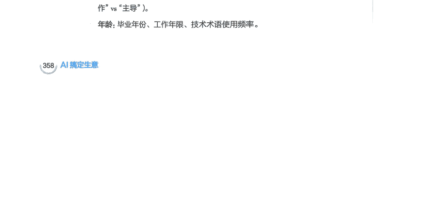

####### 一、导致偏见的常见原因

######## 1. 历史数据存在偏差

- 训练 AI 的数据集如果来自历史上存在性别或年龄歧视的招聘记录（如男性主导的行业、偏好年轻候选人的岗位），算法会继承并放大这些偏见，认为"过去成功的候选人特征"即正确标准。

######## 2. 间接特征关联

- 算法可能通过非直接特征推断性别或年龄。例如：
  - **性别：** 社团经历（如"女子社团"）、兴趣爱好（如"育儿"）、用词风格（如"协作" vs "主导"）。
  - **年龄：** 毕业年份、工作年限、技术术语使用频率。

######## 3. 自然语言处理（NLP）的局限性

- 简历中的描述可能隐含性别或年龄标签。例如：
  - 女性更可能提及"家庭责任"或"非连续工作经历"（如育儿假），算法可能误判为"不稳定"。

**请按如下顺序操作：**

1. 回想一个你最近在网上看到的、让你觉得有点"不舒服"或者"不太对劲"的广告推荐或内容推送。
2. 思考：这个推荐/推送背后可能基于什么样的用户画像假设？这个假设是否可能带有某种偏见（如对性别、年龄、消费能力的刻板印象）？
3. 使用提问模板，让AI解释一下你所想到的那个场景下可能存在的偏见类型及其原因。

**注意事项：**

1. **破除技术中立的错觉：** 要认识到任何技术工具的设计和应用都会嵌入人的价值观和选择，AI并非天然客观中立。

2. **洞察偏见的隐蔽性与复杂性：** 很多偏见不是直接的歧视语言，而是隐藏在数据模式和算法关联中，难以轻易察觉。

3. **正视公平衡量困境：** 如何定义和量化"公平性"本身就很复杂，缺乏统一标准使得偏见治理困难。

4. **厘清责任主体：** 当有偏见的AI系统造成损害时，责任应该由算法开发者、数据提供者还是使用者承担？这是一个仍在探讨中的复杂问题。企业作为使用者，至少负有审慎选择和使用的义务。

5. **关注伦理建设滞后：** AI伦理和治理框架仍在发展中，企业需要保持关注，主动学习，将伦理的考量融入AI应用的全过程，做到"科技向善"。

## 结语

本书的初心，是为在中国这片充满活力的商业土壤上奋斗的中小微企业主、电商老板、实体店经营者以及投身自媒体副业的朋友们，提供一份看得懂、学得会、用得上的 AI 赋能实战指南。

我们力图拨开 AI 复杂的技术迷雾，聚焦于那些真正能帮助大家搞定流量、优化运营、促进成交、提升效率的落地方法与工具。从洞悉商业底层逻辑的变革，到玩转直播、选品、流量、内容；从驾驭各大平台到精耕私域；从数据驱动决策到应对组织变革与风险——我们希望描绘的，是一幅 AI 时代下，普通生意人也能抓住机遇、乘势而上的清晰蓝图。我们衷心希望这些内容能成为您实践路上的"工具箱"和"避坑指南"。

在探索和梳理这些知识的过程中，本书的思考与成形，离不开众多在人工智能伦理、商业模式创新、数字经济治理等领域深耕的学者们。他们前瞻性的研究和深刻的洞见，为我们理解这场技术变革的宏观背景与深远影响，提供了宝贵的智力滋养，在此谨致以诚挚的敬意。

"纸上得来终觉觉浅，绝知此事要躬行。"AI 技术的浪潮奔涌向前，本书所及，或许只是浪花一朵。真正的进化，在于各位读者将书中的知识、方法付诸实践，在各自的生意场景中去尝试、去碰壁、去迭代、去创新。请记住，AI不是终点，而是我们探索更高效、更智能、更具创造力工作方式的新起点。

时代浪潮浩浩荡荡，唯有持续学习、勇于实践者方能立于潮头。希望这本书能为您注入一份拥抱AI的勇气与智慧。

再次感谢您的阅读与信任！

---

### 让每个生意人都能拥抱AI

### 用工具的力量重构您的商业优势

#### 行业+AI解决方案

- 实体店：做视频、获客和销售 vs 5大行业对应案例
- 电商系：平台分析、引流和转化 vs 7大平台实战指南
- 本地生活：同城获客 vs 4大阵地实战地图
- 自媒体：内容创作和裂变 vs 从知识付费到带货应用

#### 直播体系搭建

- 智能选品+爆款预测模型

#### 流量矩阵落地

- 30秒生成行业爆款视频 + 专属行业开场模板×剧情结构库

#### 智能提效应用

- 私域智能话术库+AI裂变活动加速器

标点视界
B.D.HORIZON

ISBN 978-7-5317-6735-0

定价：69.80元