# AI知识库：个人与企业的智慧玩法

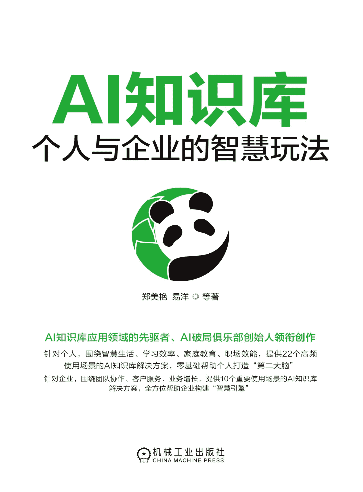

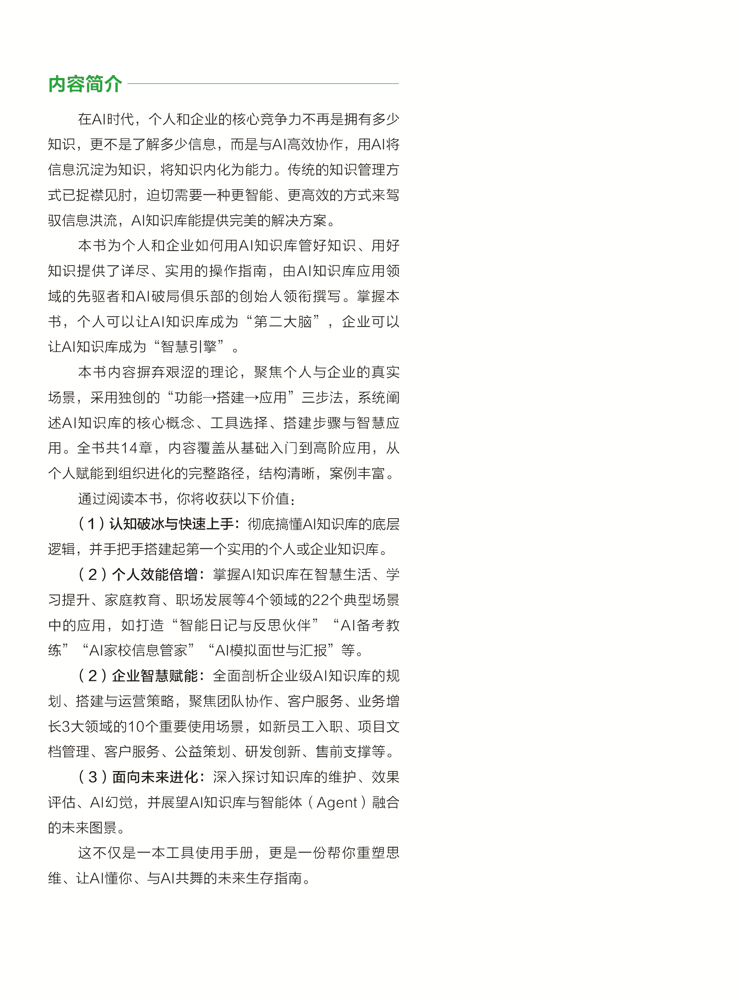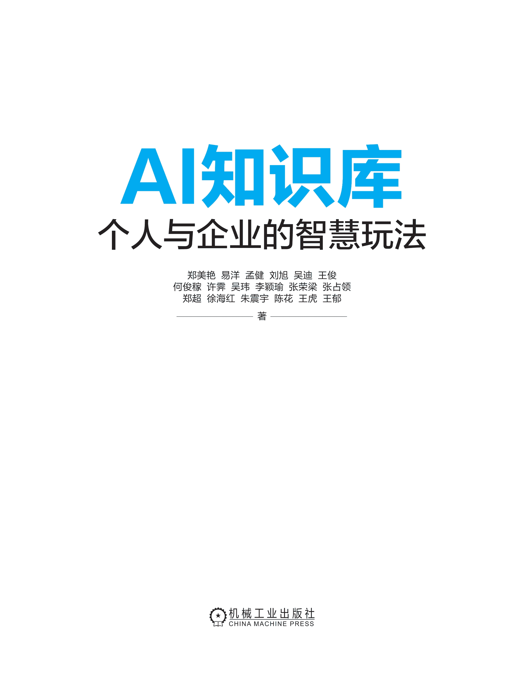

# **序**

我们正处在一个波澜壮阔的 AI 时代，大模型、AIGC 的浪潮以前所未有的力量席卷而来，正在深刻重塑认知与改造世界的方式。这股浪潮既是百年一遇的巨大机遇，又带来了前所未有的挑战——信息过载令人焦虑，知识飞速迭代更让人应接不暇。传统的生存法则和竞争优势正在被迅速改写。

破局的关键在于认知升级与工具革新。

本书主创和 AI 破局俱乐部的众多先行者们在一线实践中发现，AI 知识库正是驾驭这股浪潮、实现认知突围的强大引擎。它不再是简单的信息存储，而是用户专属的“第二大脑”和“智慧中枢”——一个能够深度理解、高效赋能并共同进化的智能伙伴。

AI 知识库的核心价值是什么？它能将脑中零散的智慧、经验与洞察，以及外部海量的信息，系统化地沉淀为可随时调用的“战略资产”；它能让 AI 真正“为你所用”，基于专属知识进行思考和行动，提供高度个性化的解决方案；它能助力打破“知行合一”的壁垒，将“知道”快速转化为“做到”，将“认知”高效兑现为“价值”。

本书是由一群在 AI 浪潮中率先“下水”并摸索出一些门道的实战派倾力打造的一份“AI 知识库实战地图”与“认知升级指南”。本书不谈玄奥空洞的理论，只聚焦最能解决痛点、最具实战价值的方法与场景。

1）认知破冰与快速上手：带读者彻底搞懂 AI 知识库的底层逻辑，并手把手搭建起第一个实用的个人或企业知识库。

2）核心场景深度赋能：从个人学习成长、家庭智慧生活，到职场效能跃迁、企业组织进化，精选最具代表性的应用场景，提供可复制的实操方法论。

3）未来趋势与持续进化：与读者一同展望 AI 知识库与智能体（Agent）融合的未来图景，探讨如何在智能时代保持领先，实现个人与组织的持续进化。

这不仅是一本工具书，更是一次思维的迭代，一场面向未来的认知远征。

AI 时代，个体崛起，组织重塑。谁能率先构建并活用 AI 知识库这个“智慧引擎”，谁就能在激烈的竞争中掌握主动权，将信息转化为洞察，将知识转化为力量，最终将潜力兑现为卓越的成果。

未来已至，唯有躬身入局，方能与时代共舞。现在，让我们一起开启这场激动人心的 AI 知识库探索与赋能之旅，共同迎接一个因智慧而更加强大的未来！

易洋（AI 破局俱乐部创始人）

2025 年 5 月 28 日

# **前言**

**为何写作本书**

当前，人们正处在一个信息以前所未有的速度和体量汹涌而来的时代。无论是个人学习、职场发展，还是企业运营、行业创新，海量的信息如同奔腾的洪流，既带来了前所未有的机遇，又带来了巨大的挑战。人们每天都在努力学习、拼命吸收，渴望将这些信息转化为真正的知识与能力，但常常事与愿违：

❑信息过载与知识焦虑：收藏夹里的文章越来越多，真正内化的却寥寥无几；购买的课程堆积如山，行动上却常常感到力不从心。

❑知行鸿沟难以逾越：大家似乎“知道”了很多，但在面对具体问题时，依然感到茫然和低效，从“知道”到“做到”的路径漫长而曲折。

❑隐性知识难以传承：无论是个人宝贵的经验教训，还是组织内部的核心智慧，这些“隐性知识”往往难以被系统地捕捉、沉淀和复用，随着时间的推移或人员的流动而流失。

这些问题不仅是大多数人的困扰，更是这个时代许多组织普遍面临的瓶颈。传统的知识管理方式在 AI 浪潮的冲击下已显得捉襟见肘，此时迫切需要一种全新的、更智能、更高效的方式来驾驭信息洪流，将知识真正内化为能力，并转化为推动个人成长与组织发展的核心动力。

AI 知识库，正是应对这一时代挑战的关键答案。它不再是少数技术专家的专属工具，而是正在迅速成为每个人、每个组织都不可或缺的“第二个大脑”和“智慧引擎”。它能够系统地收集、智能地理解、高效地连接并创造性地应用知识，真正打通从“知道”到“做到”的“最后一公里”。

本书的写作初衷正是希望将 AI 知识库这一强大的赋能工具，以最通俗易懂、最贴近实践的方式介绍给每一位渴望在 AI 时代提升自我、赋能组织的读者。

作者希望通过本书帮助大家揭开 AI 知识库的神秘面纱，掌握其核心的构建与应用方法，让 AI 不再是遥不可及的技术概念，而是真正能够为大家所用、点亮智慧生活的得力伙伴。

**本书主要内容**

本书是一本全面、实用的 AI 知识库实战指南，旨在帮助个人与企业深入理解并高效运用这一强大的时代工具。全书共 14 章，内容覆盖从基础入门到高阶应用，从个人赋能到组织进化的完整路径，结构清晰，案例丰富。

第 1～2 章为基础篇，系统阐述 AI 知识库的核心概念、工具选择，以及如何构建 AI 知识库，帮助读者建立正确的认知，为后续实践打下坚实基础。

第 3～6 章为个人篇，通过大量生动的场景案例深入探讨 AI 知识库在个人成长、学习、家庭生活与职场效能提升中的创新应用。内容涵盖如何利用 AI 知识库写日记以实现自我成长、如何与书籍进行“主动对话”式深度阅读、如何搭建“家校信息管家”助力智慧育儿，以及如何将其打造为优化工作流程、辅助内容创作、模拟面试的职场利器等。

第 7～11 章为企业篇，将视角拓展至组织层面，全面剖析企业级 AI 知识库的规划、搭建与运营策略。本篇聚焦于企业实际业务场景，详细阐述了 AI 知识库如何赋能团队高效协作、重塑客户服务体系、驱动市场营销与销售增长、加速新员工入职与人才发展，并探讨了与企业微信等办公平台深度融合的应用模式。最后简要介绍了 AI 知识库对教育及教育工作者的赋能。

第 12～14 章为未来篇，首先深入探讨知识库建成后的“后半生”——如何进行持续的维护、优化与效果评估，确保其永葆活力并持续创造价值。接着聚焦 AI 时代的核心挑战，讨论如何构建 AI 知识库的“信任基石”，并有效对抗 AI 幻觉，特别是在专业领域中。最后展望 AI 知识库的下一站，探讨智能体时代的新范式和发展趋势，并建议读者以拥抱变革、持续学习的心态，迎接智能高效的新纪元。

**读者对象**

❑在校学生与终身学习者：希望系统管理学习资料，提升学习效率，构建个人知识体系。

❑职场人士与管理者：寻求优化工作流程，提升个人与团队效能，积累组织智慧。

❑内容创作者与知识工作者：渴望高效管理灵感与素材，提升创作质量与效率。

❑教育工作者与家长：希望利用 AI 工具辅助教学，为孩子打造个性化的学习支持系统。

❑企业决策者与 IT 负责人：思考如何利用 AI 知识库提升组织智能，赋能业务发展。

❑对 AI 和知识管理充满好奇心的探索者：渴望了解这一新兴领域的前沿动态与实践方法。

**本书内容特色**

❑通俗易懂，轻松上手：本书力求用最平实的语言、最贴近生活的案例，将 AI 知识库这一看似高深的技术概念讲清楚、说明白，确保即使是零基础的读者也能轻松理解并快速上手实践。

❑实战导向，即学即用：本书强调理论与实践的结合，提供了大量可操作的步骤、技巧和真实案例（特别是以腾讯 ima 等主流工具为例），让读者不仅能“知其然”，更能“知其所以然”，并将所学快速应用于实际工作与生活中。

❑社群共创，智慧众筹：本书的诞生是一次 AI 知识库理念的社群共创实践，我非常荣幸地邀请到 AI 破局俱乐部以及其他社群中在各自领域深耕多年的 AI 专家、实践者和爱好者共同参与创作。他们的智慧、经验和案例如涓涓细流汇入本书，使其内容更加丰满、视角更加多元。读者会在书中看到他们的真知灼见。

❑面向未来，启发思考：本书不仅关注当下的应用，更着眼于 AI 知识库的未来发展，希望能启发读者对 AI 时代个人与组织如何持续学习与进化进行更深入的思考。

**资源和勘误**

AI 技术日新月异，书中的工具和案例或许会随着时间的推移而更新。作者已尽力确保所提供信息的准确性和代表性。书中若有任何疏漏或不足之处，恳请读者朋友们不吝赐教。读者可以通过微信公众号“海的女儿爱上 AI”与作者联系，获取最新的资源更新或提交勘误信息。非常期待与读者交流和共同成长。

**致谢**

本书的诞生凝聚了众多师长、同道、亲友及读者的深厚情谊与鼎力支持，在此一并致以最诚挚的谢意。

首先，特别感谢 AI 破局俱乐部的创始人易洋（Findyi）。在我对能否胜任此重任心存忐忑之际，是洋哥的坚定鼓励，以及他承诺倾注 AI 破局俱乐部的资源全力支持，给了我莫大的勇气，让我敢于接下这份挑战与荣耀并存的任务。

其次，要感谢畅销书《DeepSeek 极简入门与应用》的作者孟健老师。孟健老师不仅给予了我许多宝贵的写作建议与精神鼓舞，他的欣然加盟与专业背书更是让我消除了诸多顾虑，使我更有信心邀请和聚集众多领域的专家学者，共同参与到本书的创作中来，从而极大地丰富了本书的深度与广度。

在此，还要特别致敬本书的 16 位共创伙伴。我们素未谋面，仅凭对 AI 技术的热忱与对知识共享的认同，便在网络一线牵的机缘下走到了一起。他们都是在各自领域深耕多年的 AI 实践者，却毫无保留地信任我，毅然加入了本书的共创之旅。正是这份跨越山海的信任与无私奉献，使得这种新颖的共创模式得以成功实践，为本书注入了多元的智慧与鲜活的生命力。每一位共创伙伴的真知灼见与辛勤付出，都是本书不可或缺的宝贵财富。

感谢我的爱人，他早在一年前便以前瞻性的眼光为我指明了知识库这一充满潜力的研究与创作方向，这份远见卓识为我今日的写作奠定了坚实的基础。

在这段紧张而充实的创作时光里，家人的支持是我最温暖的港湾。尤其要感谢我的大姐，她默默承担了许多家务，悉心照料我的饮食起居，让我能够心无旁骛地投入写作。同样感谢我的公公、婆婆和孩子，他们的理解、支持与鼓励，是我坚持不懈的强大动力。

最后，我还要向所有关注我的粉丝朋友们、AI 俱乐部的圈内好友们，以及每一位“破局行动家”表达我深深的谢意。是大家提出的一个个富有启发性的问题，激发了我更深入的思考；是大家在各自领域取得的卓越成就，鞭策我不断学习与进步。正是因为有了这么多人的智慧碰撞与共同努力，本书才得以顺利问世，与广大读者见面。

在本书的写作过程中，我深感个人学识之浅薄，是每一位我曾遇到并给予我帮助和启发的人，共同成就了这部作品。这份感谢难以言尽，唯有将这份感恩铭记于心，并努力在未来的工作与创作中回馈大家的厚爱和期待。

郑美艳

2025 年 6 月

# **基础篇**

# **为什么需要一个 AI 知识库**

——信息洪流中的“诺亚方舟”

信息时代，每个人都渴望驾驭知识、提升效率，将海量数据转化为真正的智慧与洞察。AI 知识库，这一曾看似遥不可及的技术概念，正迅速融入日常生活与工作中。它不再是少数技术专家的专属工具，而是赋能个体与组织，助其应对信息爆炸挑战、实现认知升级的关键引擎。把握 AI 知识库的本质与趋势，意味着能够主动构建属于自己的“数字第二大脑”，在纷繁复杂的信息世界中保持清醒与高效。这不仅是提升个人竞争力的核心技能，更是拥抱智能化未来的必然选择。

本篇将首先揭开 AI 知识库的神秘面纱，带领读者理解其核心价值与运作原理，破除常见迷思。随后，将以腾讯 ima 等主流工具为例，完成从明确目标、选择工具、内容入库、智能交互，到初步配置与激活的完整搭建流程，轻松迈出构建与应用 AI 知识库的第一步，感受它带来的便捷与惊喜。

## **CHAPTER 1**

## **第一章 告别门槛：AI 知识库，原来如此简单有趣**

在现代社会中，人们仿佛置身于信息瀑布，常常感到时间与精力捉襟见肘，在海量信息中“大海捞针”的窘境也时常发生。面对如何有效管理和运用知识的共同难题，AI 知识库无疑是应对挑战的“秘密武器”。本章将真正揭开 AI 知识库的面纱，带领读者轻松入门，“悦读者”刘旭老师对本章内容的构思给予了重要启发。

本章将初探“智能知识管家”的奥秘，破除大众对 AI 知识库常见的几大迷思，了解 AI 究竟是如何“读懂”纷繁复杂的资料并实现个性化服务的。此外，还将探讨在着手搭建自己的知识库之前进行需求定位的重要性，并对市面上主流的 AI 知识库工具进行初步了解。希望通过本章的引领，大家可以轻松推开 AI 知识库的大门，感受它为工作与生活带来的智慧和便捷。

### **1.1 破除迷思：它不是高科技玩具，而是人人可用的效率工具**

大家是否常常感觉被信息淹没？想找去年的重要工作方案，却在计算机里“大海捞针”；准备分享总结时，相关资料又散落各处。如果感同身受，那么你并不孤单。在这信息爆炸的时代，如何有效管理和运用知识是许多人都会遇到的痛点。下面介绍一个能应对挑战的“秘密武器”——AI 知识库。

**1.1.1 初识 AI 知识库：“智能知识管家”，其实没那么神秘**

“AI 知识库”，一听这名字，是不是脑海里立刻浮现出复杂的代码、冰冷的服务器机房，感觉这是科技巨头或者专业研究人员才能玩得转的高深工具？其实，抛开技术术语，AI 知识库的核心理念非常简单：它是一个能够更好地收集、整理、理解和智能运营信息的“伙伴”或“管家”。

❑理解存进去的东西：不管是文字、图片还是网页，它都能读懂其中的意思。

❑整理和连接：它能发现信息之间的关联，把零散的点串成线、织成网。

❑交流互动：用户可以用自然语言向它提问，让它查找、总结，甚至基于资料进行简单的推理和创作。

例如，支付宝的智能客服能对答如流，正是依靠 AI 在庞大的“服务问答知识库”中快速检索、理解并生成答案。大家其实每天都在不知不觉中与各种形态的“AI 知识库”互动。

它们“隐藏”在便捷服务的背后，“润物细无声”地改善着大家的数字生活体验。这恰恰说明，利用信息和知识提供智能服务，早已不是什么遥不可及的未来科技，而是深度融入日常生活与工作的现实。

那么，由自己构建的用于提升学习和工作效率的 AI 知识库（比如后续会重点介绍的腾讯 ima 这类工具），自然也就不是什么“高科技玩具”了。它更像一个顺应时代潮流、人人都可以轻松掌握和使用的强大效率工具。

**1.1.2 破除三大迷思：放心拥抱“第二大脑”**

既然 AI 知识库这么有用，又不神秘，那为什么很多人还是对它心存疑虑呢？可能还是源于一些常见的误解。别急，下面让我们一步步把这些迷思的“浪花”一一拍散。

**迷思 1：太难了！不是技术专家，肯定用不了**

现代 AI 知识库工具，尤其是面向普通用户的，其操作已极其简单、友好，设计理念就是“人人可用”。用户无须懂编程或复杂算法，只要会用计算机或智能手机，基本就能上手。许多工具（包括腾讯 ima）的界面非常直观，核心操作与常用软件无异。因此，别让对技术的“刻板印象”阻碍大家拥抱高效工具。

**迷思 2：不就是个数据库，冷冰冰的，没什么意思**

如果只把 AI 知识库当成高级“网盘”或“数据库”，就太小看它了！它的魅力在于“智能”和“生命力”，在于它能“连接”和“思考”。它不仅能存储信息，还能：

❑动态学习用户的习惯与偏好。

❑智能关联信息，发现隐藏联系，激发新洞察和创意。

❑在思路卡壳时，与 AI 交流以获得启发。

所以，它更像一个有智慧、有温度、能与用户共同成长的“第二大脑”或“贴心助手”。

**迷思 3：东西不多，用不着这么“高级”的工具吧**

这个想法可以理解，但在 AI 知识库上可能不太适用。无论信息量大小，它都能提供独特的价值。若信息少，则重在“精耕细作”：AI 知识库能将信息整理得井井有条，通过智能搜索和关联，让它们在需要时更容易被找到和利用。若信息多，则重在“化繁为简”：AI 知识库强大的信息处理、智能检索和知识组织能力，能从信息的“汪洋大海”中快速、精准地定位所需信息，避免知识的“死海效应”。它是一个人人可用、非常实用且充满智慧的效率伙伴。

### **1.2 魔法背后：AI 如何“读懂”万千资料**

有没有一种方法能让沉睡的资料“醒”过来，让冰冷的文件变成有智慧、能互动、能为人们服务的知识伙伴呢？答案就是 AI 知识库。它的核心能力在于 AI 可以“读懂”资料，让万千信息变成一个真正为人们服务的“智慧大脑”。

**1.2.1 AI 的“火眼金睛”：读懂各种格式的资料**

AI 知识库施展“魔法”的第一步是拥有像“火眼金睛”一样的能力，能够理解和处理各种不同格式的资料。无论是会议记录、语音备忘录、网络文章、PDF 报告，还是手写的读书笔记的图片，AI 知识库都能尝试“阅读”和“理解”。

1）自然语言处理（NLP）。大模型能快速“阅读”并理解文字资料（如 Word 文档、笔记、网页内容）的核心意思，识别关键词、句子结构、段落大意，抓住核心概念和主题。

2）光学字符识别（OCR）。OCR 技术能识别图片或扫描件（包括部分手写体）中的文字，并将其转化为可编辑、可搜索的文本，让随手拍的笔记、截图中的重点信息也能被 AI“看懂”。

3）语音识别（ASR）。强大的 ASR 技术能将会议录音、语音笔记等音频转化为文字，提高处理音频信息的效率。

有了这些识别和处理能力，无论提供何种形式的信息，AI 知识库基本都能将其“吃”进去，并转化为可进一步理解和处理的“通用语言”。

**1.2.2 AI 的“智慧联想”：让知识相互连接**

AI 知识库不仅能“读懂”单个文件，还能理解资料的内在含义，并发现不同资料之间的相互关系，就像一个拥有超强联想能力的图书馆管理员。它会深入分析文档内容，识别共同概念、人物、时间点、核心观点，默默建立起一张巨大的“关系网”，即知识图谱（Knowledge Graph）。

这张“关系网”的神奇之处在于：

❑智能关联：阅读某篇笔记时，AI 可能会自动推荐其他相关资料，就像大脑联想到相关知识点一样。

❑智能筛选：面对长篇报告或书籍时，AI 能快速阅读并提炼核心观点、关键数据和重要结论，并生成精简摘要，节省筛选信息的时间。

❑智能问答：可以使用自然语言向 AI 提问，AI 会基于对内容的理解来回答，而非简单的关键词匹配。

AI 知识库不再被动等待搜索，而是主动理解资料，构建相互连接、充满智慧的知识网络。

**1.2.3 AI 的“越用越懂用户”：个性化与持续进化**

最让人惊喜的是，优秀的 AI 知识库还会像一个贴心的私人助理一样，随着使用次数的增加，逐渐了解用户的偏好和需求，从而提供更加个性化的服务。它是如何做到的呢？

它通过学习用户经常查看的资料类型和关注的主题，在用户导入新资料时，更准确地打标签或推荐相关内容。在提问时，它会结合用户个人资料、历史搜索记录及通用知识，给出更符合用户语境的答案。

与 AI 知识库的互动（提问、修改 AI 回答、反馈）越多，它学习和调整得越快，服务也越精准。因此，理解 AI 工具背后的逻辑比掌握具体操作更重要，这能让大家在快速变化的技术浪潮中保持定力。

### **1.3 智慧核心：让知识库“越用越懂用户”的个性化奥秘**

有没有想过，如果这个 AI 知识库不仅“聪明”，还能“认识”用户、了解用户，甚至随着时间的推移，“越用越懂用户”，那会是怎样一番光景？这恰恰是 AI 知识库最迷人的“魔法”之一，也是它真正成为“智慧核心”的关键。

**1.3.1 告别“千人一面”，知识库的个性化密码**

传统工具多是“千人一面”，无法根据个人信息提供贴心服务。与此不同的是，AI 知识库能捕捉并学习用户的个性化信息和使用习惯，构建用户专属的“数字画像”和“思维模型”。它不仅能存储资料，还能持续记录和学习用户与资料互动的方式。

**1.3.2 学习用户的“数字足迹”：知识库的被动观察者**

AI 知识库开始了解用户，是通过被动地“观察”用户的“数字足迹”来实现的。用户留在知识库里的每一个痕迹，都在无声地告诉 AI：用户是谁、在关注什么。

（1）存了什么资料

这些资料的类型、主题分布直接描绘出用户的主要关注领域和知识结构。

（2）给资料打了什么标签

用户为知识打上的“记号”（如#重要、#待办）是 AI 理解用户的分类逻辑和重要性偏好的直接线索。

（3）资料本身的特征

AI 会分析用户资料中的关键词、核心主题，甚至情感倾向。

**1.3.3 理解用户的“互动信号”：知识库的主动学习者**

AI 知识库真正变得“越用越懂用户”，关键在于它能通过用户与它的互动来学习。用户的每个操作和反馈都是在“教”AI 如何更好地进行服务。

❑用户的搜索和提问揭示了用户的需求：用户搜索的词汇、提问的内容和方式，准确反映了用户的知识需求和思维方式。提问越多，AI 越能理解用户需要何种帮助。

❑用户对 AI 回答的反馈是最好的老师：用户对 AI 回答的反馈（精准或偏题、接受或修改、赞或踩）是训练 AI、使其回答更精准的最直接、最有效的依据。

❑用户对生成内容的修改塑造了它的风格：AI 会学习用户对其生成内容的修改，记住用户的表达偏好（如简洁短句或逻辑长句、专业术语或通俗比喻），使未来生成的内容更符合用户的个人风格。这是一个持续优化的闭环，用户使用得越多、反馈越多，它学习得越快，服务越贴心。

**1.3.4 “猜用户所想”的魔法：个性化服务的显现**

当 AI 知识库积累了足够多关于用户的信息后，“越用越懂用户”的效果开始显现。

（1）更精准的搜索结果

搜索时，AI 会优先推荐用户最近查看过、标记过的重要文档，或与当前任务更相关的文档。

（2）更智能的主动推荐

在阅读某篇文章时，AI 可能会主动推荐知识库中相关的笔记或总结，因为它“猜测”用户可能需要。

（3）更定制化的内容生成

AI 生成的初稿（如总结或报告）会越来越符合用户在内容侧重、语言风格和文章结构方面的偏好，使用户修改时事半功倍。

这种“猜用户所想”的能力让 AI 知识库成为能够参与用户工作和思考流程的智能伙伴，通过深入了解用户，更好地赋能用户。

**1.3.5 团队的“集体智慧”：企业级知识库的个性化**

“越用越懂用户”的魔力也适用于企业，可扩展为“越用越懂团队或组织”。企业级 AI 知识库会学习团队的集体行为模式，例如哪些文档被频繁查阅、哪些项目产生了知识沉淀、不同部门在哪些主题上存在信息协同等。通过分析这些集体信息，知识库能够构建反映组织知识结构、协作模式和业务重点的“集体思维模型”。这将帮助新员工快速学习，促进跨部门协作，并确保客服等岗位提供一致且精准的答案，从而提升组织整体效率和智慧水平。

### **1.4 绘制蓝图：搭建前必须思考的个人/企业需求定位**

在搭建 AI 知识库时，清晰的需求定位比研究工具更关键，它能帮助指明方向，避免盲目投入；聚焦核心，提升使用效率；解锁潜力，发挥 AI 的最大价值。

**1.4.1 蓝图初绘：从“我”和“我们”出发找需求**

需求定位不需要复杂的报告，只需真诚地问自己或与团队讨论几个简单的问题。

1）“痛点”是什么？

❑个人层面：哪些信息查找困难？哪些资料整理头疼？哪些重复性信息处理耗时？在学习或创作中，最希望助手做什么？

❑企业/团队层面：信息传递效率如何？资料查找是否困难？新员工培训效率和周期如何？客户问题是否重复且回答标准不一？销售赋能效率如何？知识经验共享复用情况如何？会议效率和决议落地追踪情况如何？

找到这些痛点，它们是 AI 知识库能够发挥价值的地方。

2）想通过知识库达到什么“目标”？

❑个人层面：学习效率提高多少？节省多少查找资料的时间？完成了什么著作？

❑企业/团队层面：协作效率提升了多少？新员工上手时间缩短了多少？客户满意度提升了多少？销售查找资料的时间减少了多少？是否能降低沟通成本？对于这些目标，都应尽可能地量化或具体化。

3）哪些“场景”是知识库的“主战场”？

❑个人层面：个人学习、工作项目管理、日常生活管理、内容创作。

❑企业/团队层面：内部项目管理、客户服务支持、销售赋能、内部培训、特定部门专业知识管理。

确定主要应用场景，能够更清晰地规划 AI 知识库的核心内容和功能。

**1.4.2 画好这张蓝图：将需求转化为具体的知识库规划**

明确痛点、目标、场景后，需将其转化为具体的 AI 知识库规划。具体来说，需要思考以下几个方面。

（1）梳理核心内容类型

明确知识库的核心内容类型是文档、图片、音视频、网页链接还是纯文本笔记，这将影响工具的选择和数据导入方式。

（2）规划核心功能需求

知识库须具备哪些关键功能？比如基础存储与查找、智能问答、自动总结、内容关联推荐、团队协作、权限管理、对外共享等。同时，还需规划期望的互动“内容”和“目的”。

（3）进行优先级排序

需求和想实现的功能有很多，但资源（包括时间、精力、预算，即使是免费工具也有学习成本）总是有限的。

❑哪些功能是最紧急、最重要的，能够最快帮助用户解决最突出的痛点？（比如，如果查找信息困难是最大痛点，那么强大的搜索和问答功能的优先级就最高）

❑哪些功能可以放到第二阶段或未来实现？

❑抓住核心需求，先小步快跑起来，这是成功应用任何新工具或新方法的关键。

（4）考虑使用者和权限（尤其是针对团队或企业）

多人使用时，需提前思考主要使用者、不同角色的内容可见性和编辑权限等，为安全管理和知识共享打下基础。

完成以上这些思考，就为 AI 知识库绘制了初步但至关重要的“蓝图”，它将指引后续的工具选择、内容导入和使用方式。

**1.4.3 避开哪些“坑”：需求定位时要擦亮眼**

在进行需求定位和规划时，热情和憧憬是好的，但也要保持头脑清醒。根据观察和经验，有几个常见的“坑”需要提前知道并尽量避免。

**1.需求大而全，什么都想要**

❑表现：看到 AI 知识库功能强大，就想把所有能想到的资料都放进去，把所有听起来很酷的功能都用上。

❑后果：摊子铺得太大，导入和整理工作变得异常烦琐，难以管理，最终因过于复杂而放弃，反而影响了效率。

❑避坑指南：先抓住 1～2 个核心痛点小范围使用，见效后再扩展。少即是多，先易后难。

**2.只看功能列表，忽略实际体验**

❑表现：被某个工具宣称的“功能齐全”列表所吸引，但没有实际测试它在处理特定类型资料时的效果，或操作流程是否符合用户习惯。

❑后果：工具买回来（或者开始投入使用后）才发现不好用，实际效果并不理想，或者使用起来非常别扭，最终被弃用。

❑避坑指南：基于自己的核心需求，实际体验几个候选工具。导入少量真实且具有代表性的资料（比如最让你头疼的文档），亲手测试其核心功能（比如搜索、问答、总结）在资料上的实际效果。耳听为虚，眼见为实，手试为真。

**3.需求停留在“存”，没到“用”和“活”**

❑表现：很多人潜意识里还是把 AI 知识库当作一个更高级的“网盘”或“文件柜”，主要解决了“存”的问题，却没有充分规划和利用 AI 的智能能力来解决“用”（高效查找、理解）与“活”（关联、洞察、生成）的问题。

❑后果：知识库变成一个信息“坟墓”，资料存进去后很少再被利用，AI 的价值大打折扣。

❑避坑指南：在规划阶段，就要明确思考如何利用 AI 的问答、总结、关联，甚至内容生成等功能来解决之前定义的痛点（比如查找困难、理解费时等），而不仅仅是满足存储的需求。要用 AI，而不只是存资料。

**4.在企业中，脱离员工实际需求**

❑表现：知识库的规划和功能选择通常由管理者决定，或者完全照搬其他公司的模式，缺乏针对一线员工的调研和沟通。

❑后果：建好的知识库可能不符合员工的实际工作习惯和工作流程，没人愿意使用，最终被闲置。

❑避坑指南：让一线员工参与到 AI 知识库的需求讨论和规划中。通过问卷、访谈或者小范围的研讨会，了解他们在日常工作中的真实痛点和需求，确保知识库的设计以人为本，而不是以技术或管理者的想象为本。

**1.4.4 AI 不是万金油：认清 AI 知识库的边界**

最后，还需要保持一份理性。虽然 AI 知识库的功能很强大，但它也不是能解决所有问题的“万金油”。

比如，它不能替代独立思考和批判性思维。AI 可以帮助总结信息、提炼观点，但最终的判断和决策仍需自己来完成。

**1.4.5 从蓝图到实践：为下一站做准备**

需求定位是搭建 AI 知识库最重要的一步。明确“为什么建”“为谁建”“建什么”，才能确保后续的工具选择和内容投入更有效。这张“蓝图”不求完美，可在实践中调整，但没有它容易迷失方向。其最终目的不仅是高效管理知识，更是借助精心规划的 AI 知识库赋能个人与组织。

### **1.5 工欲善其事：主流 AI 知识库工具介绍与选型**

**1.5.1 琳琅满目的工具：AI 知识库的“车库”**

AI 知识库的工具众多，各有侧重。国内工具如腾讯 ima，与微信生态深度融合；飞书知识库（原飞书问答）则与飞书办公套件集成良好。

企业级方面，腾讯乐享、阿里云百炼等提供了更全面的解决方案。国际上，Notion 以其灵活性著称，Obsidian 则以本地优先和双向链接为特色。这些工具可类比为不同类型的“车辆”，用于满足不同的需求。

**1.5.2 选择指南针：如何找到那辆“对的车”**

根据 1.4 节的“蓝图”来匹配工具。关键“指南针”包括：

❑核心场景与功能匹配度：工具的核心功能是否能满足主要需求？例如，对于重度微信用户，腾讯 ima 的优势非常明显。

❑易用性与上手门槛：操作界面是否友好？学习曲线是否陡峭？对普通用户来说，上手简单、操作直观非常重要。

❑AI 能力与个性化潜力：AI 的角色定位、处理特定资料的效果以及是否支持互动优化。

❑数据隐私与安全性：资料敏感度、存储方式（云端/本地）、加密与权限管理，以及企业是否支持私有化部署。

❑生态集成与扩展性：是否能够与常用工具（如微信、钉钉、飞书等）打通？数据导入/导出是否便捷？

❑成本预算：免费版是否有限制？付费版的功能与价格如何？企业还需考虑订阅、部署及维护成本。

结合“蓝图”和“指南针”，实际体验几款工具，导入真实资料进行测试。记住，没有最好的工具，只有最适合的工具。

选择工具如同选船，知识是海洋，工具是航行的舟。AI 的加入使舟更智能，不仅能载人前行，还可助人探索、捕捞，甚至构建专属“鱼塘”。

正如“悦读者”刘旭老师所倡导的：“AI 时代，让每个普通人用 AI 创造价值，成就超级个体。”选择并善用 AI 知识库这个工具，正是迈向这个目标的重要一步。

希望这份“工具导购”能帮助读者找到最适合的“智慧座驾”。有了蓝图，选好了工具，接下来就可以真正启动引擎，开始搭建和使用 AI 知识库，开启智能、高效的新旅程！

## **CHAPTER 2**

## **第二章 轻松起步：手把手搭建第一个 AI 知识库**

上一章揭开了 AI 知识库的神秘面纱，了解到它并非遥不可及的“高科技玩具”，而是每个人都可以轻松驾驭的“第二个大脑”。现在，一听到搭建 AI 知识库，是否会担心过程复杂、不易上手？别担心！现代 AI 知识库工具的操作已非常友好。

本章将手把手带大家明确构建目标，上手选择并初步配置一款合适的工具（以腾讯 ima 为例），掌握内容入库的关键技巧，并初探 AI 问答、总结与关联等核心智能功能，一步步搭建起能真正为自己所用的第一个 AI 知识库。

### **2.1 明确目标：为学习、生活还是创作而建**

在选择工具、导入第一条笔记之前，有一个极其重要但又常常被忽略的步骤——明确搭建 AI 知识库的目标。这听起来是不是有点像老生常谈？请相信“懒”但追求效率的人，磨刀不误砍柴工。

**2.1.1 想清楚“为什么建”，远比“直接上手”重要得多**

这就像盖房子之前得先有建筑图纸一样，知道是盖来自住、出租还是开店，这样，其结构和侧重点肯定不一样。

普通人搭建个人 AI 知识库，主要可能出于以下几种核心驱动力：

（1）为了更好地“学习”

你是否喜欢看书、阅读文章、上网课，但看过就忘，知识点零零散散难以形成体系？

希望有一个地方能高效收集、整理学习资料（如笔记、网页、PDF、视频链接等），并方便回顾、检索，甚至让 AI 总结要点、建立联系。

若主要目的是提升学习效率、构建个人知识体系，AI 知识库则应侧重信息快速导入、深度处理（笔记、标签）、智能检索和知识关联功能。

（2）为了更轻松地“生活”

你是否觉得生活中的琐碎信息（如家庭菜谱、旅行攻略、购物清单、缴费记录、孩子通知、健康数据等）太多？信息散落各处，是否觉得查找非常麻烦？

希望有一个“生活总管”归拢日常信息，快速查找，甚至设置提醒。

若主要目的是整理生活信息、提高生活效率，AI 知识库则应具备便捷的信息收集（如微信导入、拍照识别）、简单分类标签和可靠提醒功能。

（3）为了更高效地“创作”

你是否需要写公众号文章、做分享、准备课件，或者从事其他需要持续输出内容的工作？是否常常觉得灵感来了抓不住，素材散乱难整理，写东西时总要到处翻找资料，效率不高？

希望有一个“创作素材库”和“灵感孵化器”，用于收集灵感、积累素材、整理思路，甚至在卡壳时，让 AI 激发创意并辅助写作。

若主要目的是提升创作效率、管理创作素材，知识库应具备强大的信息收集、灵活组织（如卡片笔记、双向链接）、便捷素材调用以及与 AI 深度互动的能力。

（4）为了更敏捷地“职场协作”

知识库的价值不仅限于个人应用，在企业环境中，如知识管理、团队协作、客户服务以及内部培训等方面，其作用也至关重要，这部分内容将在企业篇中详述。企业级知识库的构建虽然更复杂，但与个人知识库的原理相通。理解个人知识库的构建原则将为理解企业应用奠定基础。无论是个人还是企业，明确目的和价值，能够让构建过程更高效。

**2.1.2 为什么要先明确目标**

这些场景好像都需要，能不能全都要？当然，很多时候需求是复合的。但是，明确一个主要目标至关重要，因为它会直接影响后续几个关键决策。

（1）选择合适的工具

市面上 AI 知识库工具各有侧重。明确主要目标，才能更快地找到“对味”的工具。

（2）设计合理的结构

不同目标对应不同的知识库组织结构。学习型按学科主题构建；生活型按场景时间分类；创作型则需更灵活的标签链接系统。

（3）养成有效的使用习惯

只有目标清晰，才知道应放什么信息、怎么放、怎么用，才能让它发挥价值，而不是变成信息“垃圾堆”。

**2.1.3 想一想，出发点是什么**

在正式开始搭建之前，请花几分钟时间问问自己：“现阶段最想通过 AI 知识库解决什么问题？达成什么愿望？是想让学习更系统？还是让生活更有条理？或者让创作更高效？”

找到那个最核心、最迫切的需求点，把它作为搭建第一个 AI 知识库的主要目标。当然，这不意味着不能兼顾其他目标，只是有一个主攻方向，能够起步更稳，见到成效更快。

### **2.2 工具上手：选择并配置个人 AI 知识库**

市面上的笔记软件、知识管理工具琳琅满目，许多集成了 AI 功能，新手容易陷入“选择困难症”。

但是，工具是为目标服务的。无论最终选择了哪个工具，在刚开始配置时都记住一个原则：保持简单。

❑熟悉核心：先掌握最基本的功能，如创建笔记、导入内容、简单分类（建几个顶层文件夹）、打标签、搜索等。

❑别造“摩天楼”：不要一开始就设计过于复杂的文件夹层级或标签系统，容易导致放弃。等到积累了一定量的笔记，需求更清晰时再逐步优化。

❑关键：用起来！让信息先流动起来，让工具先为自己服务。在使用的过程中自然会发现需要调整和优化的地方。

本书后续案例将主要以腾讯 ima 知识库为例，因为它简单易用，且与日常核心的微信生态紧密结合，非常适合作为 AI 知识库的入门工具。

### **2.3 内容入库：让数字资产“安家落户”的关键技巧**

**2.3.1 万能基础招：复制粘贴与直接编辑**

**1.怎么做**

对于不成文或需重新梳理的文字信息（如会议记录草稿、灵感、聊天对话），最直接的方法是在 AI 知识库新建笔记，直接输入或复制粘贴。许多 AI 知识库编辑器支持 Markdown 格式，能够带来良好的排版体验。

**2.关键技巧**

❑化整为零：长内容可拆分或用标题、分隔线结构化，方便查找和 AI 理解。

❑即时记录：把 AI 知识库当作“第二大脑”，随时记录想法和感悟，避免遗忘。

**2.3.2 文件批量搬：本地上传不可少**

**1.怎么做**

多数 AI 知识库支持直接上传本地文件（如 PDF、Word、图片等），界面上通常有“上传”或“添加附件”按钮，如图 2-1 所示。

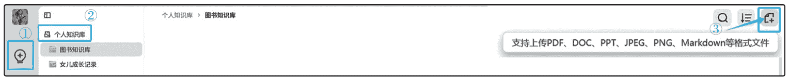

**图 2-1 腾讯 ima 知识库文件上传界面**

**2.关键技巧**

❑合理命名：上传前给文件取清晰规范的名称，包含关键信息，方便搜索。

❑批量处理：在文件较多时，可利用工具的批量上传或拖拽文件夹功能（ima 支持批量上传）。

❑OCR 功能：有些知识库（或其配合的 AI）具备 OCR 功能，能识别图片或扫描版 PDF 中的文字，使其内容可被搜索和利用。

**2.3.3 网海拾贝：网页剪藏与文章收藏**

**1.网页剪藏器**

（1）怎么做

腾讯 ima 支持浏览器功能。在 ima 首页输入网址即可访问网页，并可一键将内容存入指定知识库，如图 2-2 所示。

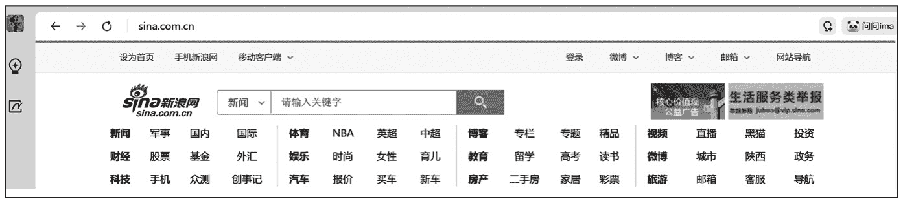

**图 2-2 浏览器一键剪藏网页内容**

（2）关键技巧

❑选择性剪藏：优先保存正文或手动选择，避免无关信息。

❑及时归类：剪藏后立即选择保存位置或添加标签。

**2.微信公众号文章收藏**

（1）怎么做

对于微信公众号文章，可在文章页面单击右上角的“...”，滑动图标找到“在小程序工具中打开”，选择“ima 知识库”转存，如图 2-3 所示。

**图 2-3 微信内容发送至 ima 知识库操作**

（2）关键技巧

养成看到好文章就随手收藏到知识库的习惯。

**2.3.4 生态联动：无缝衔接是王道**

以腾讯 ima 为例，它与微信生态的无缝集成是核心优势。微信中的文件、公众号文章、腾讯文档等，通常可通过“在小程序工具中打开”并选择 ima，便捷地导入知识库。对于聊天记录等特定类型的信息，其导入方式可能有所不同或需要特定操作，详见 2.5.3 节的相关说明。应善用此功能，将微信中的零散重要信息及时归档，让微信专注于沟通，知识沉淀则交由知识库。

### **2.4 激活智能：初探 AI 问答、总结与关联**

**2.4.1 智能问答：专属“知识顾问”**

这是 AI 知识库最直观且最常用的一个功能。像与人聊天一样，可以用自然语言向 AI 提问，AI 会基于知识库中的内容给出精准的回答。

**1.怎么玩**

在 ima 中，与 AI 交流的入口有 4 个。

❑在 ima 首页界面下方的 AI 对话框中输入问题即可，如图 2-4 所示。

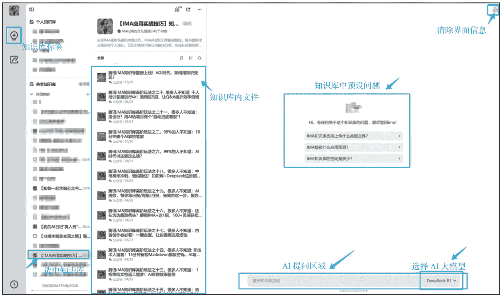

**图 2-4 ima AI 问答入口及对话界面**

❑在任意一个“笔记”的右上角都有一个小熊猫“问问 ima”图标。

❑ima 浏览器的右上角也有一个小熊猫“问问 ima”图标。

❑在 ima 笔记中输入“/”，可快速呼出 ima 帮助写作。

**2.可以问什么（关键在于基于库里的内容）**

❑查找具体信息：“帮忙找找上次关于‘项目复盘会’的会议纪要。”或“之前存的那个‘红烧肉’菜谱在哪篇笔记里？”

❑理解复杂概念：“用大白话解释一下笔记里提到的‘卡片笔记法’是什么意思？”或“对比一下两篇关于‘A 工具’和‘B 工具’的文章，它们各自的优缺点是什么？”

❑获取操作步骤：“根据《××软件使用手册》，说明如何设置邮件自动转发？”

**3.关键技巧**

❑问题尽量具体：问题越清楚，AI 回答越精准。

❑指定信息范围：允许用户限定 AI 仅在某个知识库、特定笔记或特定范围内进行回答。

❑追问与澄清：若 AI 回答得不够清晰或不完整，则可以继续追问。

**4.效果**

AI 能快速查找并给出答案，通常会标明出处，极大地提升信息获取的效率。

**2.4.2 智能总结：长文秒变“核心摘要”**

面对长文，是否会害怕错过重点？AI 的总结能力可派上用场。打开需要总结的文档或笔记，找到 AI 助手功能的入口（如 ima 右上角的“问问 ima”图标），选择“总结”或“生成脑图”，AI 能在短时间内抓住核心内容，省去大量的阅读时间（图 2-5）。

**2.4.3 智能关联：发现知识的“隐藏链接”**

AI 知识库与传统笔记软件的关键区别之一是它能发现不同笔记、文档之间的潜在联系，让知识“串珠成链”。但是，不同工具的实现方式各有不同。

❑自动关联推荐：腾讯 ima 这类 AI 知识库，在用户查看某篇笔记时，能够基于内容进行分析，自动推荐知识库内其他相关的笔记或资料，帮助发现潜在的知识连接。

❑AI 主动提示关联：AI 助手在问答或总结时可能会主动提示相关笔记。

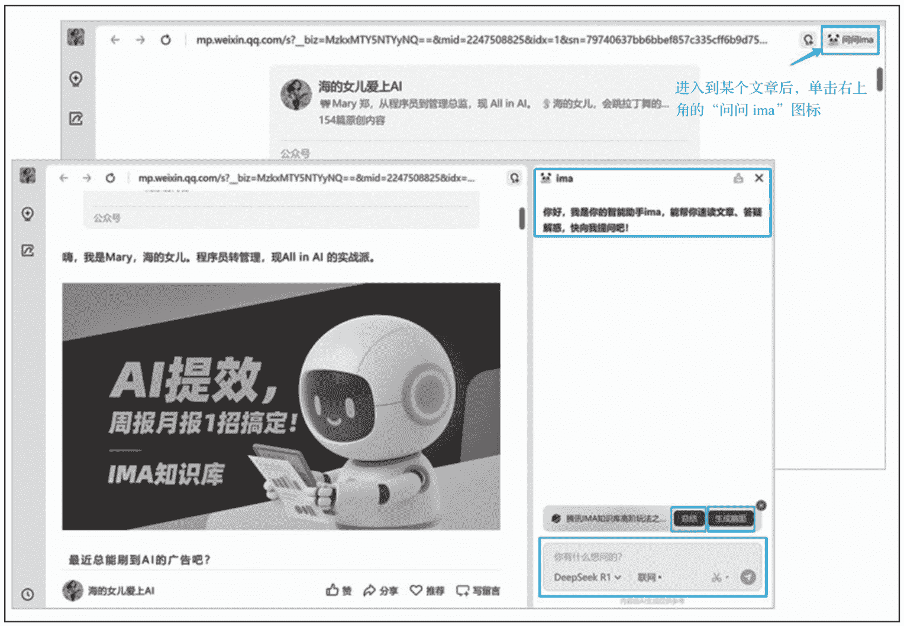

**图 2-5 ima“总结”和“生成脑图”入口**

通过初步的问答、总结和关联互动，已能感受到 AI 知识库的智能魅力。当然，这只是冰山一角，AI 知识库的能力远不止此，其表现也取决于“喂”给它的“料”（知识库内容量与质量）及 AI 模型本身。别期望 AI 一开始就无所不能，把它当作学习成长的助手，多互动、多“投喂”高质量信息，就会发现它越来越懂自己，能帮自己的地方也越来越多。

### **2.5 实战演练：搭建一个多用途个人知识中心**

纸上得来终觉浅，绝知此事要躬行。本节将从理论走向实践，手把手带大家用腾讯 ima 搭建第一个多用途个人知识中心。ima 与微信生态无缝集成且内置强大的 AI 能力，非常适合入门。如果是技术小白也不用担心，过程比想象的更加简单、有趣。关键在于迈出第一步，让信息流动起来，让工具为自己服务。准备好了吗？

**2.5.1 启程：初识与准备自己的 ima**

在构建“数字花园”之前，先熟悉“园艺工具”——腾讯 ima，并做好基础准备。

**1.访问入口：多种方式触达 ima**

1）微信小程序：是最便捷的入口之一。在微信中搜索“腾讯 ima 知识库”小程序，即可找到并开始使用。

2）Windows/Mac 客户端：官方提供了适用于 Windows 和 macOS 系统的桌面客户端。可以通过 ima 官网（https://ima.qq.com）或应用商店下载安装，如图 2-6 所示。

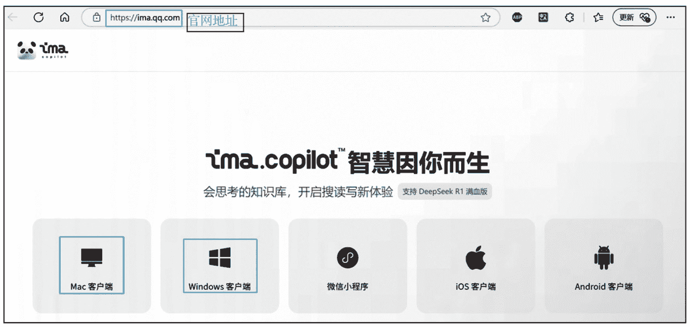

**图 2-6 腾讯 ima 官网客户端下载界面**

3）移动 App（iOS/Android）：其功能比小程序更全面，适合手机端深度使用，界面如图 2-7 所示。

**图 2-7 腾讯 ima 移动 App 下载安装界面**

**2.界面概览：快速熟悉新“工作室”**

ima 主界面的功能区包括左侧导航栏（设置、知识库、笔记、历史记录）、顶部工具栏（首页、添加新首页）和主编辑区（提出问题/输入网址、文档解读、智能写作），如图 2-8 所示。初次接触时不必掌握所有的细节，有一个大致印象即可。

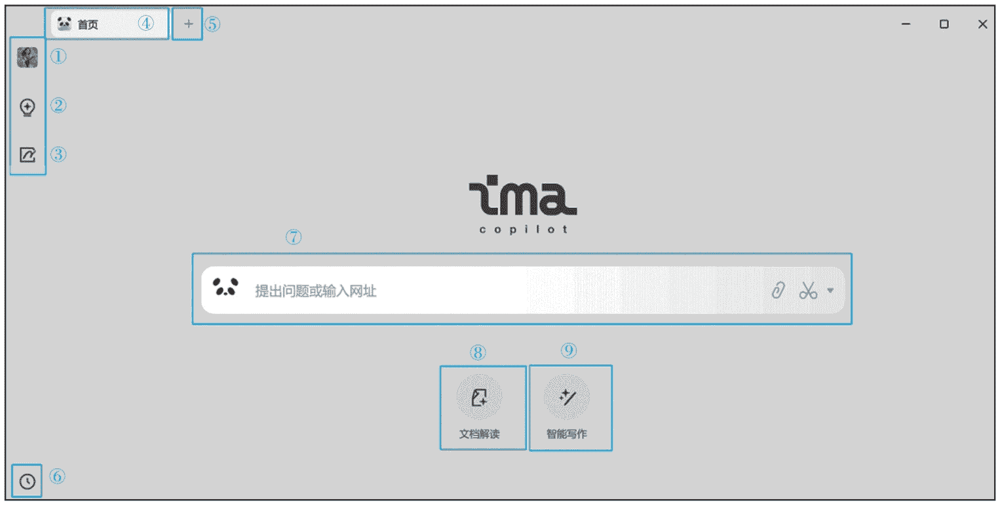

**图 2-8 腾讯 ima 主界面的功能区**

**3.账号与设置：个性化体验**

通常可使用微信账号登录 ima。首次登录后，可访问“设置”进行一些基础功能的设置，如外观主题、编辑器偏好、同步设置等，如图 2-9 所示。

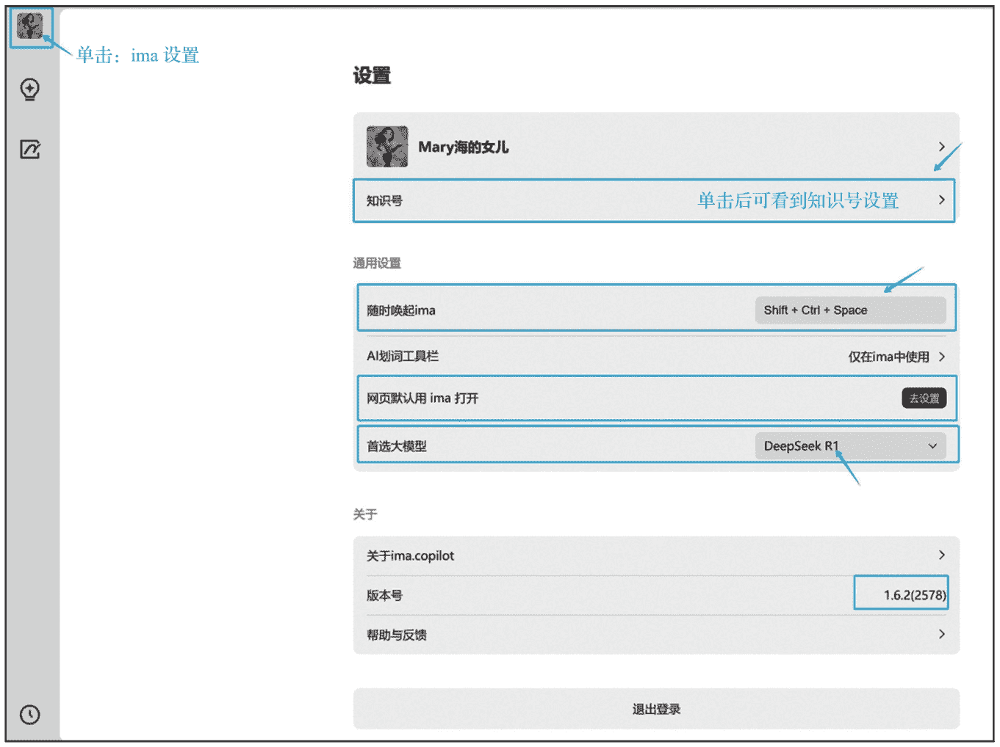

**图 2-9 腾讯 ima 个性化设置选项**

**2.5.2 奠基：创建第一个知识库**

知识管理的第一步是为信息构建一个安全有序的“家”——在腾讯 ima 中，这个“家”就是知识库。ima 提供个人知识库（私密空间）和共享知识库（协作空间，可邀请成员并设置权限）。

**1.创建个人知识库：构筑数字“私宅”**

现在，动手创建第一个个人知识库。具体操作为：在 ima 主界面（图 2-10）中，单击“灯泡”形状的“知识库”入口标识（图 2-10 中的①），选择创建“个人知识库”（图 2-10 中的②）。建议创建不同的文件夹进行管理，以使个人知识库保持清晰整齐。在“个人知识库”列表区右击，选择“新建文件夹”（图 2-10 中的③），命名后即创建成功。

创建的文件夹可以进行重命名、移动或删除操作，如图 2-11 所示。

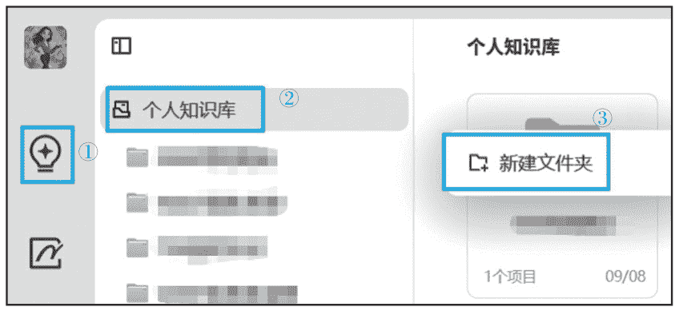

**图 2-10 腾讯 ima 创建个人知识库界面**

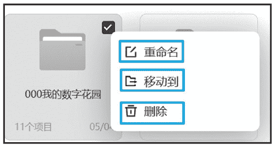

**图 2-11 腾讯 ima 个人知识库文件夹操作界面**

至此，数字“私宅”就建好了。

**2.创建共享知识库：搭建团队的“共建空间”**

步骤与创建个人知识库类似，主要区别在于选择创建“共享知识库”（图 2-12），并需填写名称、描述及选择封面。创建后需设置成员权限和推荐问题。

这样，一个可以邀请他人共建的“协作空间”就搭建完成了。

**3.管理知识库：让“房间”井井有条**

ima 提供重命名、修改信息、更换封面、查看信息、删除知识库等基本管理功能，图 2-13 所示为管理选项。

基础已打好，接下来开始“搬东西”。

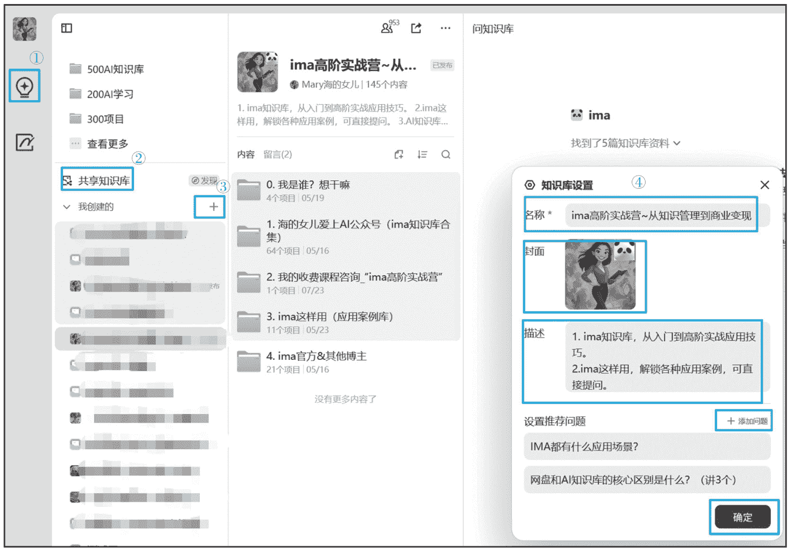

**图 2-12 腾讯 ima 创建共享知识库流程**

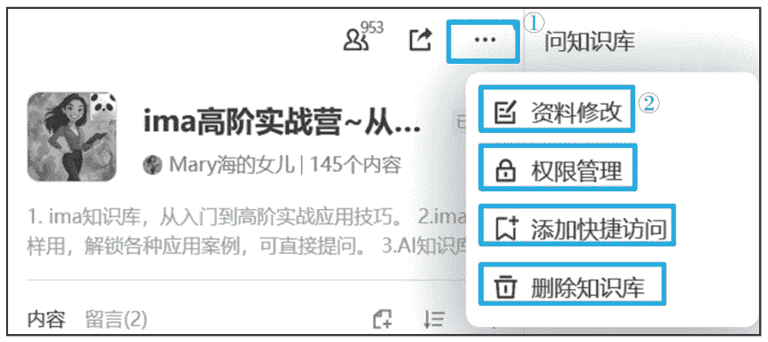

**图 2-13 腾讯 ima 知识库的管理选项**

**2.5.3 添砖加瓦：多渠道收集信息与内容入库**

知识库“地基”已打好，现在开始填充内容。本节介绍最常用且高效的信息入库方法。

**1.笔记：思想画布与信息载体**

笔记是知识库最核心的内容单元，承载灵感、学习摘要、会议记录等。在 ima 主界面中或知识库内单击“笔记”图标，再单击“新建笔记”即可编辑，支持 Markdown 等各种丰富的格式。图 2-14 为 ima 笔记编辑器界面。

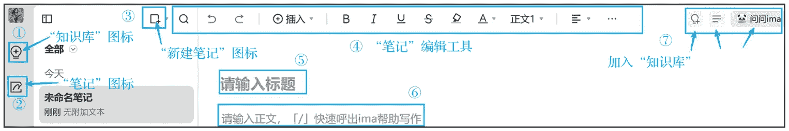

**图 2-14 腾讯 ima 笔记编辑器界面**

写好的笔记需要归档到知识库。在笔记编辑界面的右上角菜单中找到“添加到知识库”的标识（一个带加号的小灯泡图标），选择目标知识库并确认即可（图 2-15 为操作步骤截图）。养成随手归档的习惯，有助于保持知识库的整洁有序。

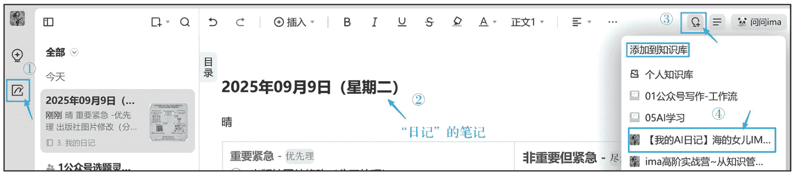

**图 2-15 ima 笔记归档至知识库操作**

**2.文件批量搬家：本地文件上传不可少**

计算机和手机里积累了大量的宝贵资料，如工作文档、学习课件、扫描件、照片等。除了直接撰写笔记，将这些本地文件导入知识库同样至关重要。ima 支持多种格式导入，如 PDF、Word、PPT、图片等。

上传本地文件的操作很直观，图 2-16 为 ima 从本地上传文件的界面。进入想要存放这些文件的目标知识库（图 2-16 中的②）。在知识库界面中，寻找“上传”图标按钮（图 2-16 中的③），选择文件确认上传。

其中，关键的技巧是规范与效率并重。

❑合理命名：上传前为文件进行清晰、规范的命名。

❑批量处理：文件较多时可批量选择上传。

**3.微信生态无缝衔接（ima 的核心优势）：信息流转的“高速公路”**

对微信重度用户，ima 的无缝整合能力极大地简化了信息收集操作。

❑单击收到的文件，如微信中的文件、图片、公众号文章、网页链接，将其打开预览。

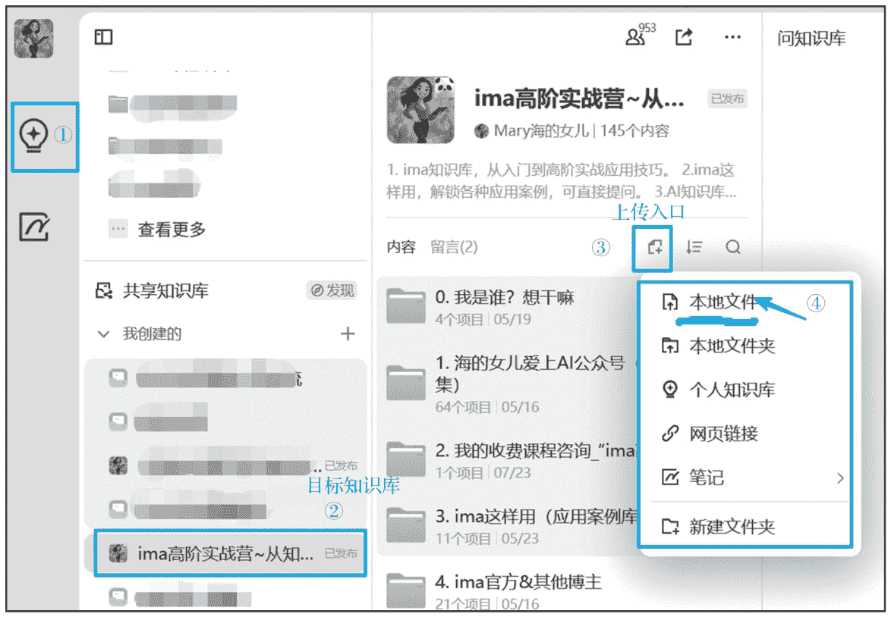

**图 2-16 ima 从本地上传文件的界面**

❑在文件预览界面的右上角会有一个“...”或“更多”按钮。

❑在弹出的菜单中找到并选择“用小程序工具打开”（可能需要向左滑动以查找更多应用）。

❑在应用列表中找到并选择“ima 知识库”或类似的应用标志。

❑选择目标知识库并确认：ima 会被唤起，提示选择要存入哪个知识库，确认即可。

这个功能极大地简化了微信工作文件的归档，强烈推荐大家熟练掌握。ima 收藏微信公众号文章操作如图 2-17 所示。

对于一些特别重要的微信聊天记录（如项目讨论、客户沟通的关键节点），如果担心后续查找困难或记录丢失，则可利用 ima 进行保存，但 ima 目前需要借助其他工具或手动复制粘贴来实现。如果未来支持直接导入，这将是备份和复盘关键对话的利器（注：聊天记录涉及隐私，导入需谨慎，并遵守相关规定）。

**4.网页收藏（浏览器端）：捕获网络世界的珍珠**

腾讯 ima 本身可作为 AI 浏览器，在 PC 端搜索框或特定入口处输入网址即可访问。对于知名网站（如小红书、抖音、知乎等），输入名称即可进入。在 ima 打开的网页界面右上角有“加入知识库”标识（带“+”号的小灯泡），单击即可将网页内容保存到目标知识库。图 2-18 为操作示意，熟练掌握这些方法，知识库能快速充实起来。

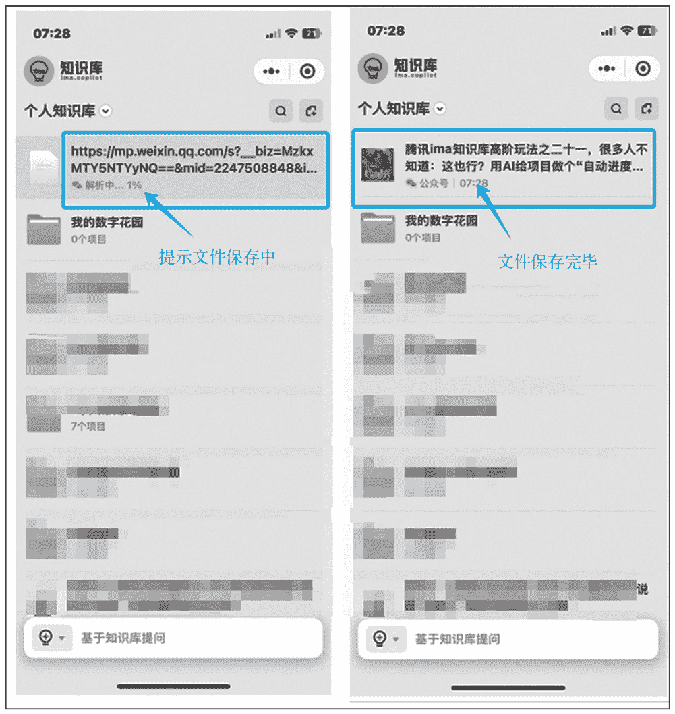

**图 2-17 ima 收藏微信公众号文章操作**

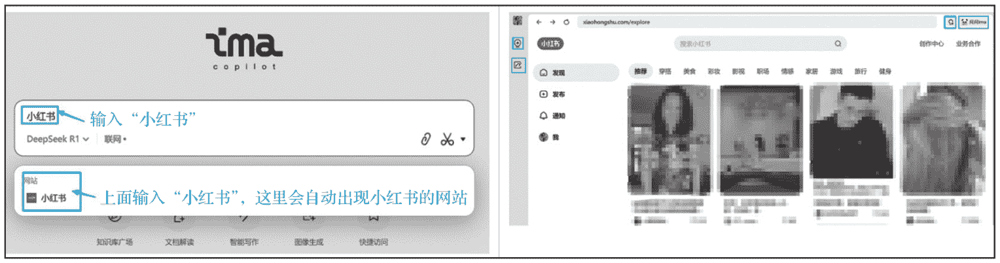

**图 2-18 ima 内置浏览器收藏网页内容**

**2.5.4 井然有序：组织与管理知识**

信息“搬入”知识库后，需有序地组织才能激活其潜能。AI 知识库提供多种灵活且强大的组织管理工具。

**1.建立层级：文件夹与子文件夹的妙用**

这是最传统、直观的组织方式。当内容涉及多个独立主题或项目时，利用文件夹分类的方法非常有效。例如：工作项目下设 XX 项目、YY 项目，兴趣爱好下设旅行攻略、摄影技巧等。

在腾讯 ima 中，可在知识库根目录或任一文件夹内右击找到“新建文件夹”选项，并将笔记或文件拖拽至对应文件夹，操作示意如图 2-19 所示。注意，文件夹的层级不宜过深，建议控制在 3～4 层以内。

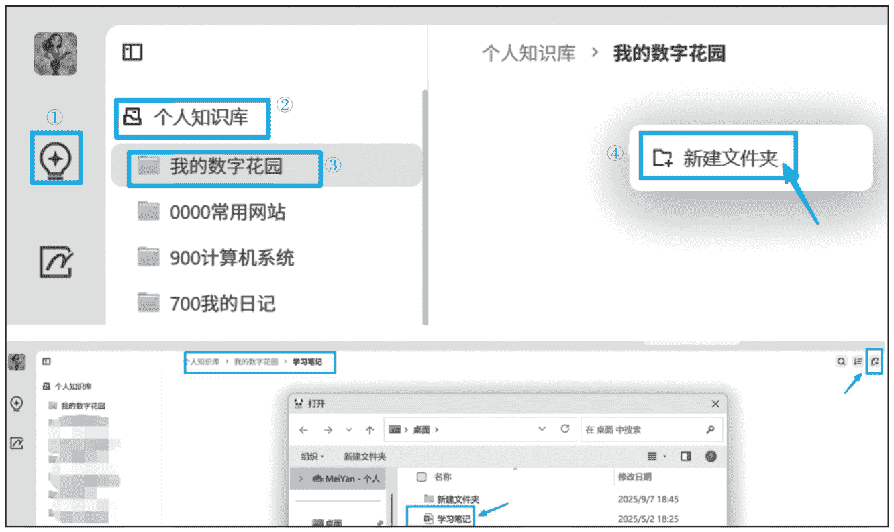

**图 2-19 ima 知识库创建文件夹操作**

**2.精准定位：打上专属标签——最核心的组织方式**

标签是知识库的“神经网络”，赋予知识组织极大的灵活性和关联性，也是 AI 理解内容的关键线索，是最核心的组织方式。一篇笔记或文件可拥有多个标签，实现多维度交叉分类和快速筛选。在腾讯 ima 中，可在笔记或文件属性界面添加标签，或批量添加，或在笔记正文中输入“#标签名”自动识别。操作示意如图 2-20 所示。

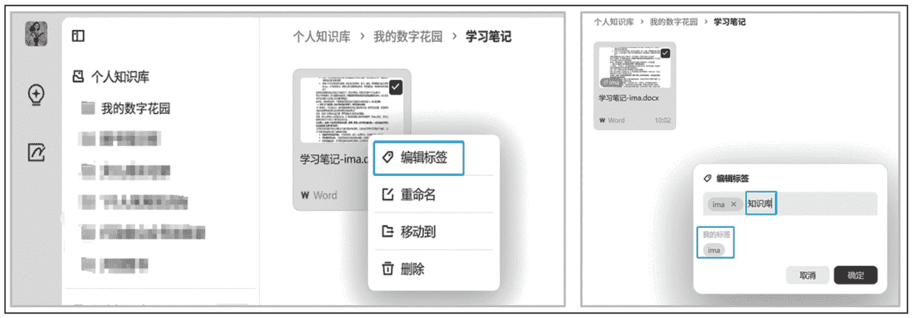

**图 2-20 ima 为笔记或文件添加与管理标签**

**3.构建标签体系**

❑一致性：同一个概念尽量使用统一的标签，避免同义词混淆。例如，用#人工智能还是#AI，选定一个并统一。

❑层级性（可选）：有些工具支持标签层级，例如#科技/AI/大模型。这有助于更精细的分类，但也会增加复杂度，可按需使用。

❑维度化：从不同维度打标签，如主题/领域（#市场营销）、内容类型（#学习笔记）、状态/进度（#待办）、来源（#微信收藏）、项目/关联方（#××项目）。

❑定期回顾与优化：定期审视标签列表，合并同义标签，并删除无用标签。

清晰一致的标签体系能极大地帮助 AI 理解内容，提供更精准、靠谱的问答。

**4.内容排序与置顶：让重要信息触手可及**

随着内容的增多，快速找到常用的重要信息显得尤为关键。腾讯 ima 目前支持按“上传时间”“大小”“名称”等方式进行排序，如图 2-21 所示。期待未来能支持更多灵活排序，如“手工排序”“置顶”等。

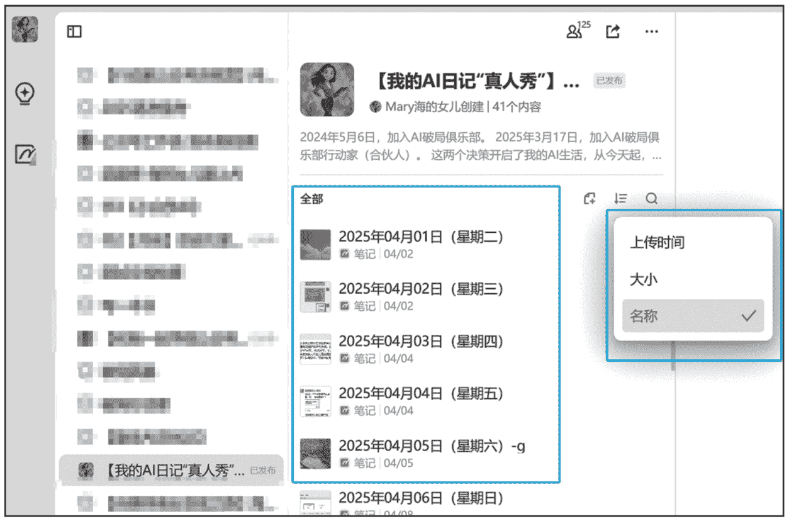

**图 2-21 ima 笔记或文件的排序功能**

通过合理的组织管理，再结合文件夹、标签和链接，知识库将变得有条理且充满活力。

**2.5.5 智慧激活：与 AI 助手对话**

信息“搬入”新家并建立秩序后，就该请出 AI 助手了。它让知识库从静态存储升级为能互动、思考、助力成长的“智慧中心”。

**1.基础 AI 问答：专属“知识顾问”随时待命**

（1）如何发起对话

在 ima 知识库或笔记界面中有明显的 AI 对话入口：ima 首页对话框、页面右上角图标（ima 熊猫头像+“问问 ima”），或者笔记编辑器中的快捷键（如 ima 的“/”）。图 2-22 为多种启动方式的示意图。

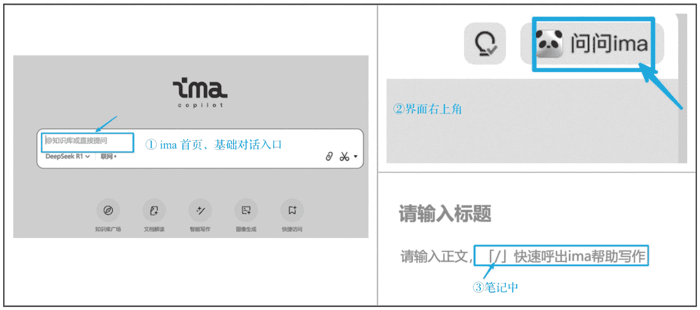

**图 2-22 腾讯 ima AI 助手对话启动方式**

（2）可以问什么（关键在于库里的内容）

可以尝试这样问：查找具体信息（“上次项目复盘的会议纪要”）、理解复杂概念（“卡片笔记法是什么意思？”）、获取操作步骤（“××软件如何设置邮件自动转发？”）。

（3）如何获得更好的回答

❑问题尽量具体：提问越清楚，AI 回答得通常越精准。例如，问“××软件如何设置邮件自动转发到外部邮箱？”就比问“××软件怎么用？”更有效。

❑指定信息范围：ima 允许 AI 仅在某个知识库、某篇笔记、某个文件夹或带有特定标签的内容范围内回答，这能提高回答的相关性。

❑追问与澄清：如果 AI 的回答不够清晰或不完整，那么可以继续追问。就像和真人交流一样，通过几轮对话来澄清细节，直到满意为止。

例如，图 2-23 展示了针对“用 AI 写周报的提示词怎么写？”这一问题的回答，在分别指定文章和不指定文章的情况下，AI 的回答内容具有显著差异。

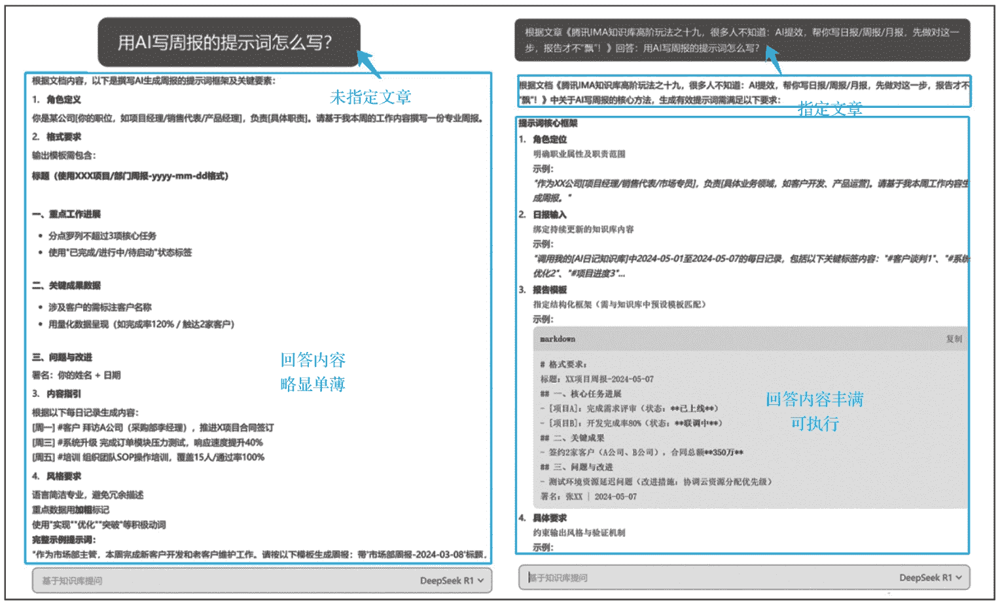

**图 2-23 ima 基于知识库的 AI 智能问答示例**

**2.针对性提问与处理：让 AI 聚焦特定内容**

除了全库问答，还可让 AI 聚焦特定笔记或文件进行深入处理，例如总结、翻译、提取要点等。

（1）如何操作

选中文字后，会出现浮动工具栏（如“AI 帮写”“配图”“翻译”“AI 解读”等），用户可选择相应的 AI 指令，或者通过笔记或文件界面的 AI 入口（顶部工具栏中的“问问 ima”按钮）进行操作。

（2）应用场景

通常应用于快速理解长文（生成摘要、思维导图）、翻译外文资料、提取复杂文档关键信息、内容改写润色等场景。

**3.AI 辅助创作：灵感伙伴与写作助手**

AI 不仅能处理已有信息，还能在用户从零开始创作时提供帮助。

（1）如何调用

在笔记中，输入特定符号“/”后，会自动调出 AI 进行续写、改写、润色、检查等。单击 ima 首页的“智能写作”按钮，或选中已有内容后自动调出“AI 帮写”进行续写、改写等，如图 2-24、图 2-25 所示。

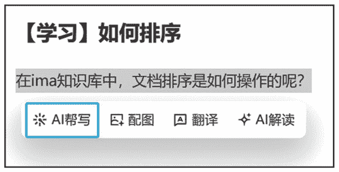

**图 2-24 ima 在笔记编辑中的 AI 辅助应用场景**

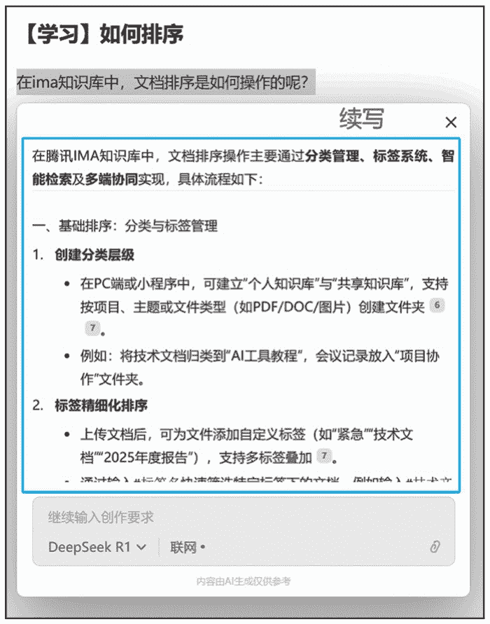

**图 2-25 ima 在笔记编辑中调用 AI 辅助创作**

（2）能做些什么

AI 辅助创作能够续写、扩写、润色、改写、头脑风暴、生成大纲，甚至根据文字内容生成配图，有效地降低了写作门槛，激发创意，同时显著提升效率与质量。

**4.选择与切换 AI 模型：找到最适合的“大脑”**

一些知识库工具（包括 ima）可能集成多个 AI 大模型（如腾讯混元、DeepSeek 等），或允许用户接入 API Key。不同的模型在理解能力、创作风格、知识范围等方面略有差异，可按需选择在 ima 中可选择的 AI 模型如图 2-26 所示。

通过这些方式，成功“唤醒”了 AI 助手，它从被动存储工具变为强大的“知识顾问”“阅读助手”和“创作伙伴”。熟练运用这些 AI 交互功能，个人知识中心将充满智慧和活力。

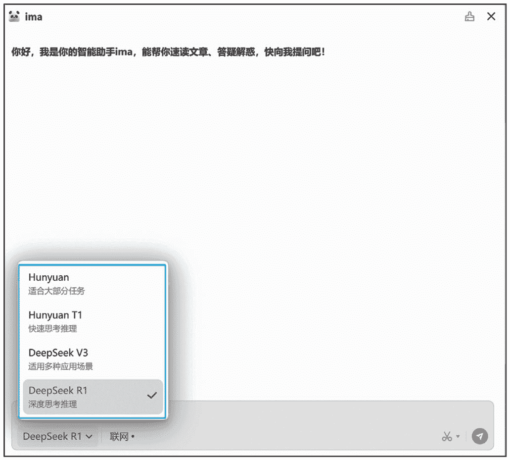

**图 2-26 ima 中可选择的 AI 模型**

**2.5.6 分享与发现：连接他人与世界**

精心构建的个人知识中心不仅是思考、学习和创作的“私密花园”，也可以成为连接他人、分享智慧、发现新知的桥梁。让知识流动，既助人，又能在交流碰撞中完善自身的知识体系。

**1.共享知识库：开放“主题展馆”**

当积累了某一主题的丰富资料和深入见解，或者需要与团队、家人朋友共享特定信息时，共享知识库是一个高效的选择。

（1）设置共享权限：精准控制谁能看、谁能改

共享知识库的核心在于权限管理。ima 提供不同层级权限设置：管理员（最高权限）、默认（链接/二维码分享，不在广场中发现）、发布到广场（更多人发现，不占个人容量）、转为私密（仅自己可见）。ima 共享知识库权限设置界面如图 2-27 所示。

可以根据分享对象和目的选择合适的权限组合。例如，与项目组成员共享时，可将“成员可查看文件内容”设置为“打开”；若不希望访问者看到内容，则设为“关闭”；若文件安全级别较高，可将“成员加入需确认”设置为“打开”。

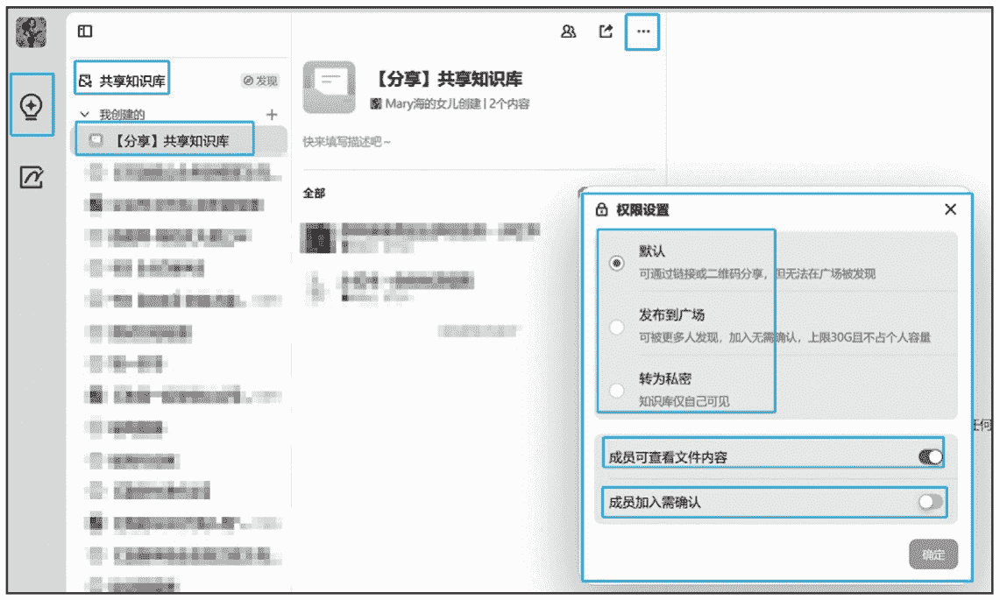

**图 2-27 ima 共享知识库权限设置界面**

（2）邀请协作者：让伙伴加入自己的“共建空间”

ima 提供了链接邀请和微信二维码邀请两种方式。邀请时或邀请后可为新成员分配合适权限。图 2-28 为邀请协作者示意图。

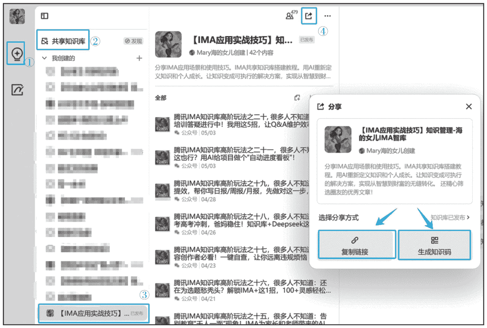

**图 2-28 ima 邀请协作者加入共享知识库**

通过共享知识库，团队协作、家庭信息同步、学习小组资料共享等场景都能更加高效、透明。

**2.分享单篇笔记/文件：精准投递“知识卡片”**

有时只需要分享单篇笔记或文件，操作与分享知识库类似。打开目标内容，在菜单中找到“分享”按钮，选择生成分享链接或二维码等方式。单篇笔记或文件的分享比较灵活，适合快速分享会议纪要、文章草稿等。

**3.知识广场：公开分享与学习的“大舞台”**

腾讯 ima 独特的“知识广场”是一个公开的知识分享和发现平台，不仅可以让自己的知识触达更广泛的人群，还能从他人的分享中汲取养分。

（1）发布到广场：让自己的知识发光

若愿将精心整理的知识库（如学习笔记、工具教程、行业报告）公开分享，可将其发布到知识广场中。在知识库设置的“权限管理”中找到“发布到广场”选项，完善信息（描述、封面、推荐问题）后确认发布即可，如图 2-29 所示。公开分享不仅助人，还能带来关注、反馈，甚至连接到志同道合的朋友。

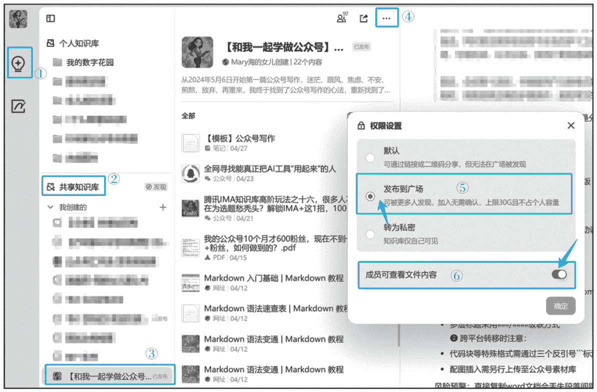

**图 2-29 ima 知识库发布到广场**

（2）探索广场：发现他人的智慧宝藏

知识广场也是学习和发现的沃土。在 ima 主界面或“知识库”的“共享知识库”旁有“发现”入口，如图 2-30 所示。可按分类浏览或搜索关键词查找他人的分享，对感兴趣的知识库选择“加入知识库”即可查看和持续关注。

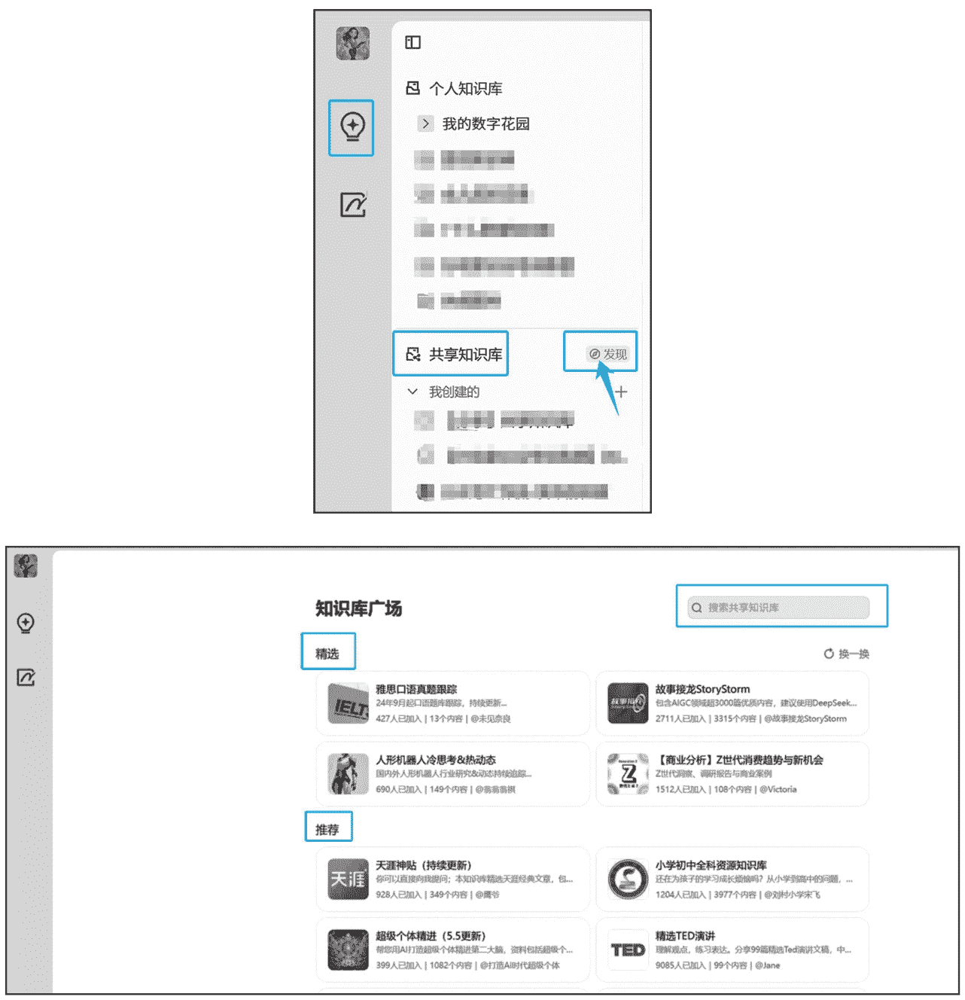

**图 2-30 ima 知识广场探索与订阅知识库**

知识广场打破了个人知识库的封闭性，构建共建共享的知识社区。灵活运用分享与发现功能，个人知识中心将与更广阔的知识世界连接，实现价值传递和倍增。

**2.5.7 维护与进阶：让知识库保持活力**

以上成功搭建了个人知识中心并掌握核心操作，但这并非终点，而是持续生长优化的新起点。如同打理花园需定期维护，数字知识库也需持续养护才能保持活力，成为长期可靠的“第二大脑”。

（1）定期整理：“打扫房间”保持清爽

这是基础且易被忽视的一环。建议定期（如每周或每月）快速浏览新增的笔记和文件，并进行整理。同时，优化标签体系，合并相近标签，删除无用标签；清理过期信息，释放存储空间，避免干扰检索。

（2）跨设备同步：确保信息随时随地可用

现代知识库的核心优势之一是云同步，确保多设备信息实时一致。ima 自动完成同步，不需要用户额外设置。需注意检查网络连接和同步状态提示，确保无误。

（3）存储空间管理：为知识增长预留空间

多数知识库工具提供免费的存储空间，初期够用。我们需要了解 ima 版本（目前仅免费版，个人空间 30GB）的空间额度及限制。共享到知识广场的知识库是不占个人存储空间的。定期检查存储空间的用量，优化存储策略，如清理大文件、用外部链接代替部分文件（适用时）。图 2-31 为管理存储空间的操作示意图。

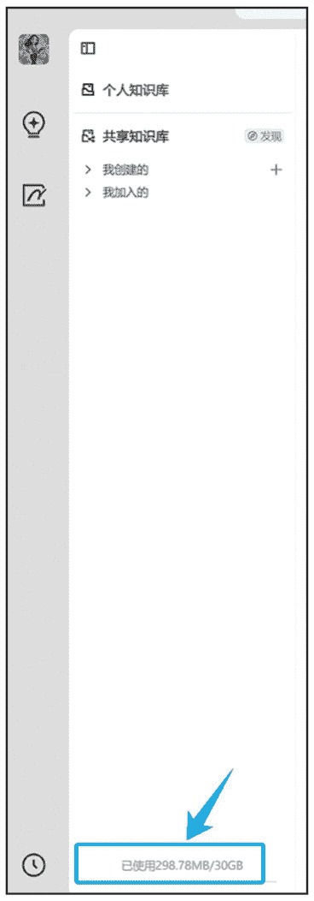

**图 2-31 ima 知识库的存储空间管理**

（4）探索进阶功能：不断解锁新技能

熟练掌握基础操作后，不妨探索 ima 可能提供的进阶功能，如模板、自动化规则（若支持）、API 与集成（关注官方更新）、更高级 AI 能力（高级问答、创作、关联推荐等）。持续学习探索工具的新功能，是让知识库保持高效、满足需求的关键。

至此，搭建和初步使用多用途个人知识中心的实战演练告一段落。记住，知识库的价值在于利用它提升思考、加速学习、赋能行动。“数字花园”已播下种子，请享受耕耘和收获的乐趣吧！

# **个人篇**

# **构筑“第二大脑”，激发潜能，提升价值**

在 AI 技术日益融入日常的今天，个人如何有效管理信息、加速学习、提升效率并激发创造力，已成为塑造个体竞争力的核心议题。AI 知识库作为强大的“第二个大脑”，提供了前所未有的赋能路径。它将散落的灵感、学到的知识、生活的点滴系统化、智能化地管理起来，从而在信息洪流中游刃有余，不断提升个人价值。

本篇将聚焦于 AI 知识库在个人学习、生活及工作创意场景中的智慧应用，探索如何运用 AI 知识库轻松规划旅行、管理家庭菜谱、记录心路历程、整理家居物品；如何将其打造成学习效能的倍增器，实现知识的高效阅读、消化与备考冲刺；以及如何让它成为职场与创作的强大引擎，捕捉灵感、管理素材、升级思考方法，甚至赋能自媒体运营与个人表达，全方位激发人的潜能，点亮智慧人生。

## **CHAPTER 3**

## **第三章 生活智慧管家：告别混乱，尽享从容人生**

完成了第一个 AI 知识库的基础搭建，是时候让它在日常生活中大显身手了。信息时代的快节奏常常让人在处理生活琐事时感到力不从心：散乱的旅行攻略、遗忘的菜谱步骤、无处安放的家庭备忘——这些都可能悄悄偷走时间和好心情。

本章探索如何将 AI 知识库打造成为贴心的“生活智慧管家”。从利用它高效规划每一次轻松的旅行，到构建属于家庭的“智慧厨房”管理纷繁菜谱，再到开启智能日记辅助记录与反思，乃至通过它整合家居物品信息告别“找不到”的烦恼……AI 知识库将以其独特的方式，帮助人们告别生活中的混乱无序，尽享从容有序、充满智慧的人生。

### **3.1 旅行规划“神助理”：行程攻略与在地信息一库搞定**

你是否有过这样的经历：心心念念想去一个地方旅行，结果却常常陷入信息的海洋，越查越晕。手机相册、微信收藏夹、计算机桌面堆满各种资料，找个酒店电话得翻半天。这种“大海捞针”式的规划常让人未出发先疲惫。AI 时代，怎能让信息牵着鼻子走？下面来分享一些“小秘籍”。

关于如何运用 AI 知识库高效进行旅行规划，“悦读者”刘旭老师有着非常实用且高效的经验分享，本节的核心内容便主要提炼自此。用 AI 知识库做旅行规划，高效又有趣，它不仅是信息收集的工具，更是专属的旅行“神助理”。

**3.1.1 功能：专属智能旅行“大脑”**

传统旅行规划常常导致信息“碎片化”：攻略、预订邮件、地图截图、餐馆笔记等散落各处，整合起来耗时费力。AI 知识库能将这些碎片信息转变为一个能思考、能整合的“智能旅行大脑”，其核心能力如下：

❑一站式信息汇聚中心：一站式信息汇聚（各种来源信息统一入口详见 2.3 节）。

❑结构化整理与分类：按目的地、交通、住宿等建立文件夹，并用标签进行细化。

❑AI 智能提取与总结（快速提炼长攻略的关键信息）：这是最酷的功能之一。不再需要逐字逐句地阅读长篇攻略来寻找关键信息，只需将网页或文档交给 AI，就可以直接输入“请总结这篇酒店介绍中关于入住和退房时间的内容。”或者“这篇游记里提到的所有推荐餐厅在哪里？”AI 便会快速提炼所需信息，省时省力。

❑AI 行程辅助与建议：把想去的景点、想吃的餐厅都收集好了，接下来怎么安排路线最合理？距离远不远？坐什么车方便？把这些信息交给 AI，它可以基于所收集的内容，梳理行程逻辑，甚至给出路线优化建议，让行程更顺畅。

❑随时随地的智能问答：旅行途中遇到问题怎么办？打开旅行知识库，直接问 AI：“从酒店到××景点打车大概多久？”或者“昨天收藏的那家餐厅周二营业吗？”它就能像专属旅行小秘书一样，快速从收集的信息中找到答案。

❑多设备访问与实时同步：无论是在计算机上还是手机上，都可以实现多设备访问与实时同步，信息始终在线，永不掉链子。

❑便捷分享与协作：如果是和家人朋友一起出行，可以轻松地将整个知识库或其中的部分内容分享给同行伙伴。大家信息同步，规划和旅途中也能更默契（共享功能可参考 2.5.6 节）。

**3.1.2 搭建：为下一次旅行构建信息堡垒**

搭建一个好用的旅行知识库，如同为出行准备一个坚实、可靠的数字行囊。

（1）创建专属的旅行知识库或文件夹

在 AI 知识库工具（如腾讯 ima）中为旅行计划建一个“家”。可以选择创建一个独立的个人知识库；如果信息量较大，或需要与多人共享，那么创建一个共享知识库会更方便，如图 3-1 所示（其创建方法参见 2.5.2 节）。给它取一个清晰、容易辨识的名字，比如“我的旅行计划格里拉之旅 2025 年国庆”。

（2）设计信息分类结构与标签体系

“家”建好后，就需要设计内部布局。清晰的结构和标签能让 AI 更精准，自己也一目了然。可规划文件夹结构如图 3-2 所示，包括通勤信息、实用信息、购物清单等。同时，设计常用标签，例如#预订确认、#已支付、#门票信息、#开放时间、#地址、#联系方式、#当地习俗、#待筛选、#重要等。清晰的结构和标签是知识管理的核心。

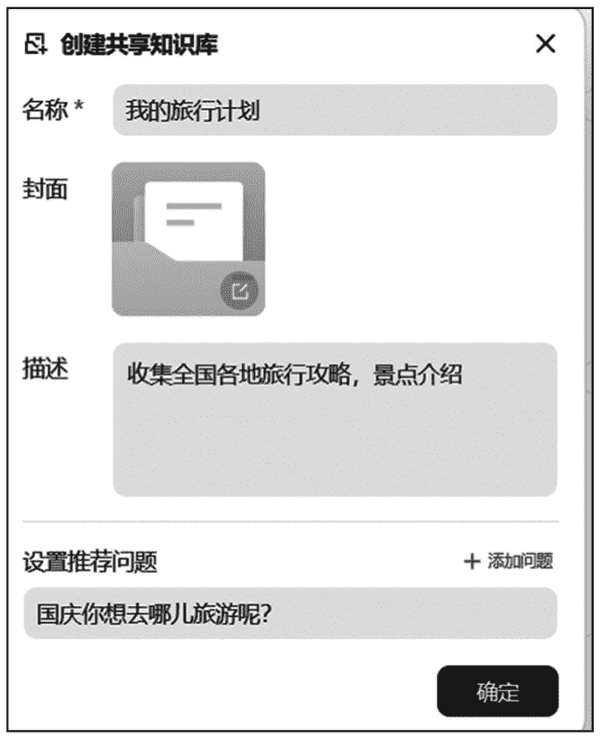

**图 3-1 ima 创建旅行计划知识库**

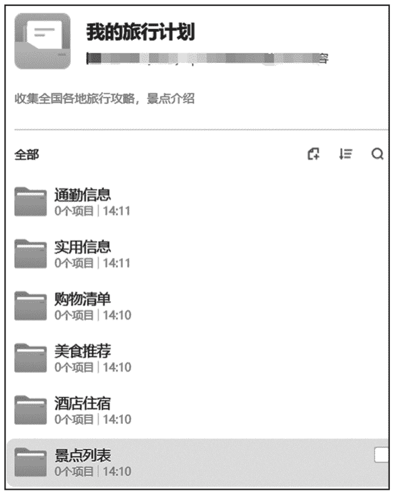

**图 3-2 ima 旅行计划文件夹**

（3）整合各类信息，打通信息收集入口

打通信息“通道”，让信息可便捷流入。例如使用腾讯 ima，可利用其浏览器功能收藏网页攻略（参见 2.3.3 节），通过微信转存功能快速保存朋友推荐的内容或公众号文章（参见 2.3.3 节）。机票、酒店确认邮件可复制内容或截图保存。本地 PDF 攻略、行程单等可通过上传功能导入（参见 2.3.2 节）。

**3.1.3 应用：从碎片到完美的旅程**

搭建好“智能旅行大脑”后，它便可贯穿旅行规划的全过程，甚至在旅途中也能提供帮助。

**场景 1：海量信息初步收集与整理（初期规划阶段）**

例如，在旅游网站看到游记或餐厅测评时，可用 ima 的浏览器功能或分享功能将它们保存至对应文件夹，如图 3-3 所示。微信群中朋友的分享可复制或截图保存到 ima 中。

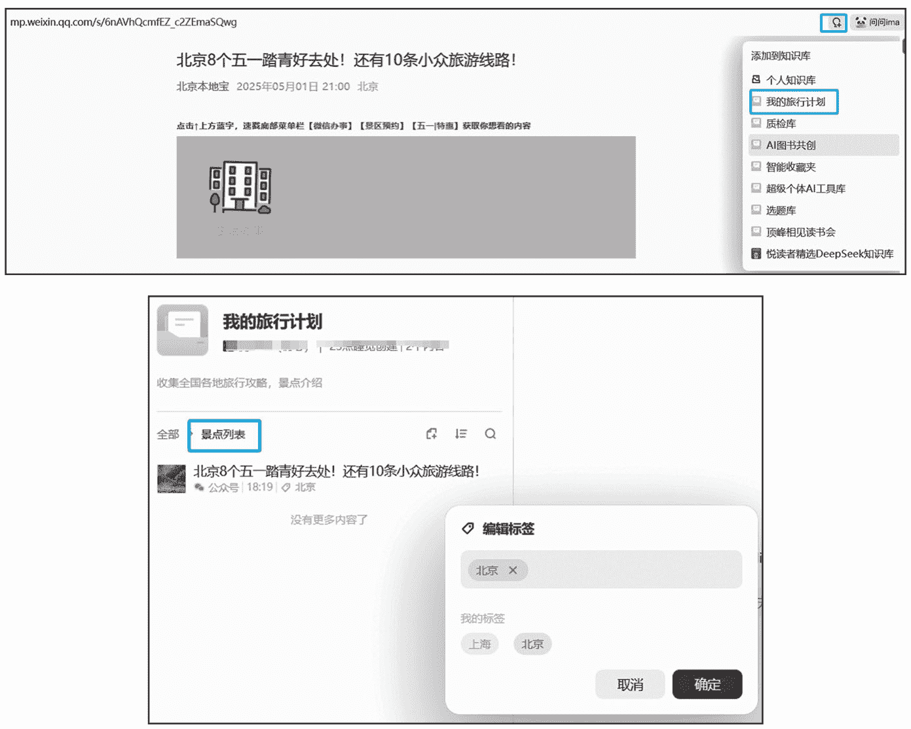

**图 3-3 ima 收藏旅行相关网页并添加标签**

需要注意的是，记得随手给新收藏的信息加上标签，比如#待筛选、#攻略、#餐厅等，方便后续查找和 AI 理解。

**场景 2：利用 AI 筛选和提炼关键信息（信息整理阶段）**

信息收集进来后，其中可能包含不少冗余内容，需要快速提取核心信息。例如，对比几篇酒店测评，可选中后向 AI 输入“请总结这几篇测评中关于酒店位置和早餐的评价。”对于长游记，可向 AI 输入“请提取此游记中所有的餐厅名称和推荐菜。”AI 能瞬间找出关键信息，以供快速浏览和判断。操作示例如图 3-4 所示。

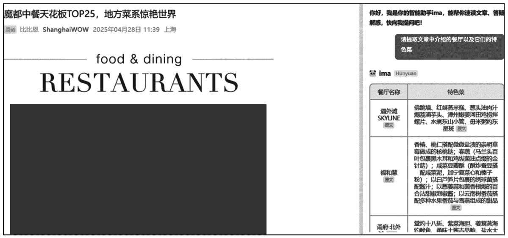

**图 3-4 AI 从游记中提取关键信息示例**

**场景 3：构建并优化每日行程（行程规划阶段）**

信息提炼后，开始串联形成每日行程。在“行程总览”文件夹中新建笔记，例如“Day 1：××城市探索”，将计划前往的景点、餐厅、活动内容拖拽或复制粘贴进去。如果担心路线不顺，则可选中笔记向 AI 提问：“此笔记中的景点的交通是否方便？建议游览顺序是什么？需要多久？”AI 可结合地理信息和笔记内容提供合理建议，帮助调整出更顺畅、省时的路线。图 3-5 为 AI 对行程规划给出的优化建议对话截图。

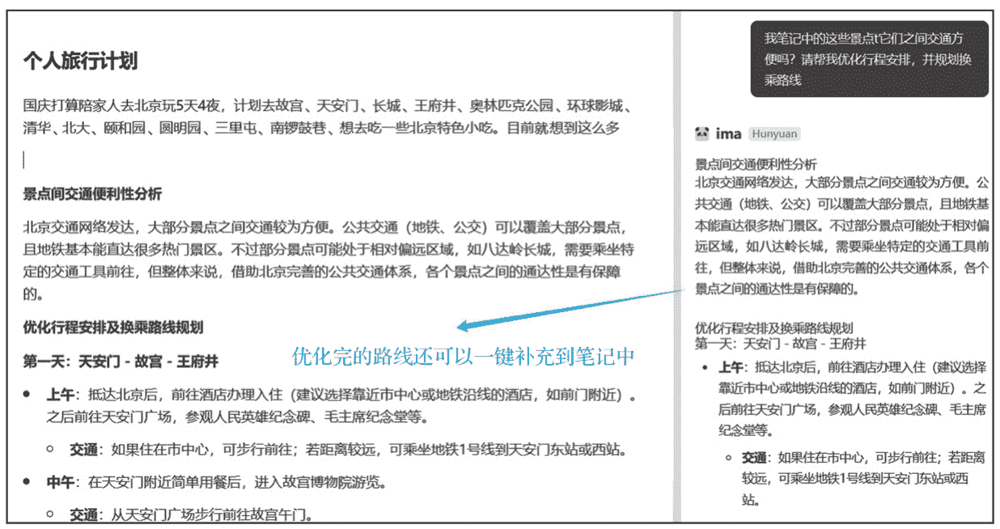

**图 3-5 AI 辅助优化旅行行程规划**

**场景 4：旅途中实时信息查询与记录（旅行进行阶段）**

AI 知识库在旅途中也是“贴身助理”，可即时查询酒店地址、寻找火车票二维码及确认餐厅营业时间。只需打开手机上的 ima 知识库 App，搜索关键词，AI 即可快速找到相关信息。可随手记录遇到的意外惊喜，如一家特别的咖啡馆或特色小店，拍照上传并添加至当日的行程笔记中，如图 3-6 所示，或者新建一篇笔记并加上标签（如#惊喜、#咖啡馆、#实用）。

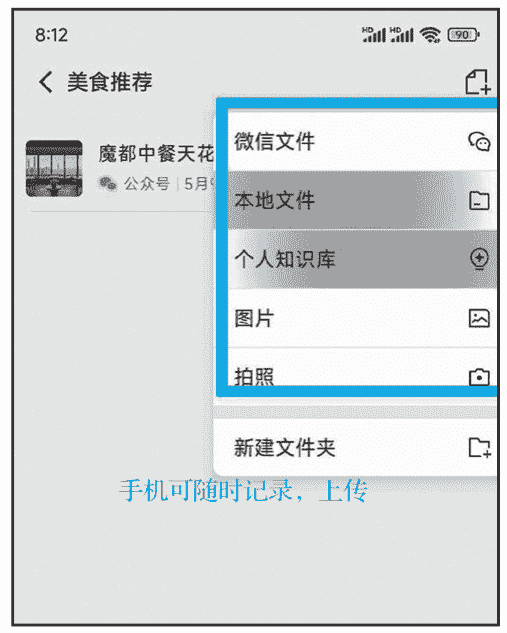

**图 3-6 ima 手机端拍照上传至旅行笔记**

在旅行知识库中创建“备忘与当地人建议”的笔记，用以记录临时的想法、当地人提供的实用贴士（如景点的排队情况、商家的优惠活动等），并用#紧急、#实用等标签标记重要信息。在管理旅行预算时，也可以新建表格笔记来记录开支。AI 知识库借助其 AI 能力提升信息处理效率和决策质量，完成信息的“预处理”和“智能助理”工作，从而让人更专注于更高价值的事务——感受文化、体验生活、享受共度时光。这是一种更高效、“智慧”的出行模式，让人成为旅行的主角，而非信息的仆人。

用 AI 知识库规划旅行能带来翻天覆地的变化。从信息收集、智能提炼、构建优化行程，到途中查阅记录，AI 知识库都能成为得力助手，将零散信息组织成有序、智能、随时可用的“旅行大脑”。它像“神助理”一般打理琐碎细节，旅行者只需尽情享受旅程即可。

下次出行前，试试使用 AI 知识库进行规划，旅途的轻松喜悦从决定目的地时便已开始。

### **3.2 家庭主厨的“智慧厨房”：从菜谱收集到 AI 智能配餐**

热爱美食的朋友常常遇到这些烦恼：收藏夹里的菜谱链接无数，用时却难以查找；家传好菜的步骤全凭记忆，难以传授；看到诱人的菜谱图片，实际操作时却手忙脚乱；以及那经典的难题——“今晚吃什么？”AI 知识库就能够解决这些“家庭主厨”的困扰！它不仅可以打造专属、永不丢失、懂口味的“私家菜谱库”，还能化身“智能小助手”，甚至帮助解决“吃什么”的难题。

本节关于如何运用 AI 知识库打造“智慧厨房”的许多实用方法和心得，主要来自共创伙伴、视频号“小鹿 AI 生活”的主理人郑超老师的精彩分享。

**3.2.1 打造“私家菜谱库”：让美味永不迷路**

（1）创建“菜谱”知识库

首先，在 AI 知识库工具中为收集的美食灵感和拿手好菜安一个“家”。打开 ima，单击形似“小灯泡”的“知识库”图标，创建一个新的共享知识库（或个人知识库），如图所示，并将其命名为“我的菜谱”。选择合适的封面和描述，并设置一些推荐问题，例如“鸡肉怎么做？”。

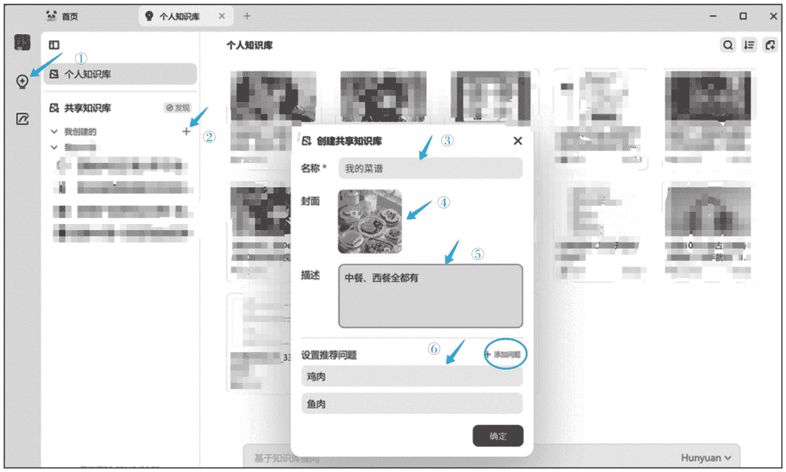

**图 3-7 ima 创建“我的菜谱”知识库**

（2）将拿手好菜“录入”知识库

往知识库中录入内容的方式如下：

1）自己动手写/整理菜谱笔记：在 ima 中新建笔记，命名如“宫保鸡丁”，记录食材、步骤、技巧，越详细越好。写好后单击“添加到知识库”，选择“我的菜谱”库归档，如图 3-8 所示。

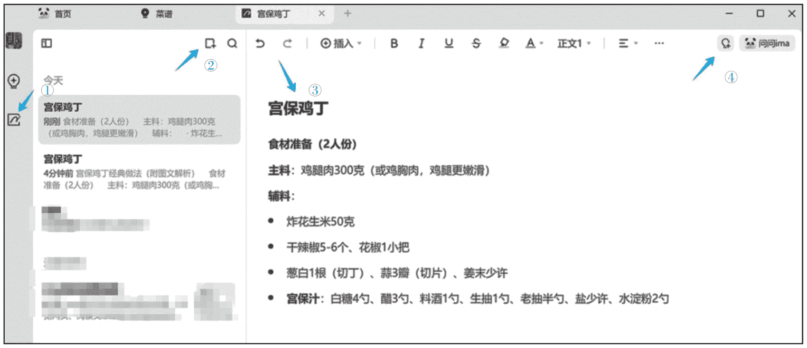

**图 3-8 在 ima 中手动录入“宫保鸡丁”菜谱笔记**

2）AI 写菜谱：新建一篇笔记，输入“/”触发 AI 助手，然后输入要求，例如“帮我生成一篇宫保鸡丁的制作方法”。AI 生成草稿后，可以将其内容插入到这篇笔记中，编辑完善后再归档至菜谱库，如图 3-9 所示。

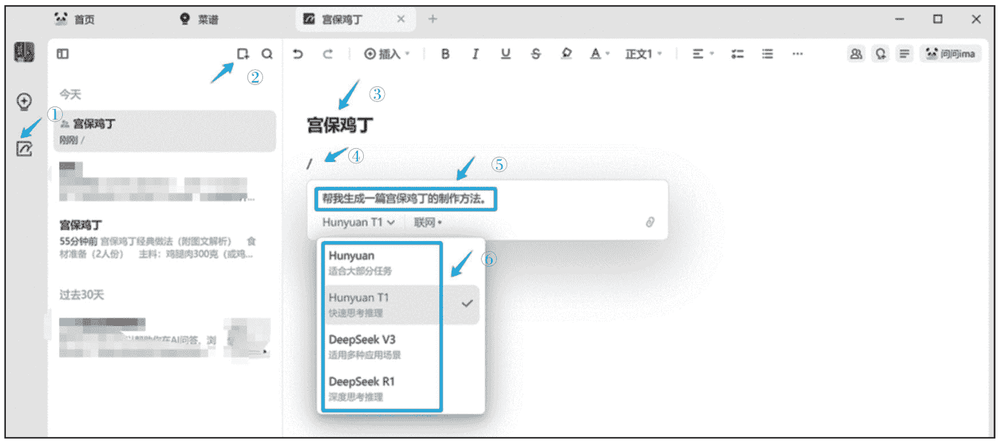

**图 3-9 在 ima 中生成“宫保鸡丁”菜谱**

**3.2.2 让菜谱“活”起来：图文并茂与智能问答**

文字菜谱缺少灵魂怎么办？图片是其中不可或缺的要素。

**1.图文并茂，让菜谱更诱人**

打开相应的菜谱笔记，将光标定位到想要插入图片的位置，单击编辑器工具栏中的“插入图片”按钮，从计算机或手机中选择准备好的菜品图片插入即可，如图 3-10 所示。这样，菜谱就能图文并茂，更显“色香味俱全”了。

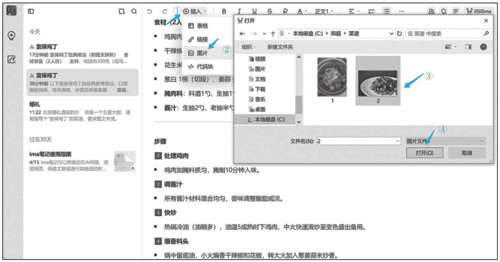

**图 3-10 ima 菜谱笔记插入成品图**

**2.AI 智能问答，厨房小助手**

AI 智能问答是 AI 知识库最厉害之处。菜谱存入后，它就成为“美食大脑”。搜索“鸡肉”，所有包含“鸡肉”的菜谱都会被找到。

（1）智能理解与计算

可以这样提问：“做 4 人份的米饭，水和米的比例应该是多少？”AI 能够根据常规知识或笔记中记录的比例进行推算，过程如图 3-11 所示。

（2）步骤与技巧问答

如果忘记步骤了，则可直接问 AI：“宫保鸡丁的炒制顺序是什么？”或“调味汁怎么配比？”AI 会根据笔记快速给出答案，如图 3-12 所示。

**3.2.3 更多玩法：链接收藏与外部搜索**

**1.收藏外部链接**

收藏外部链接可以直接使用 ima 的浏览器功能（在 ima 首页即可操作），比如在浏览小红书时看到了感兴趣的做菜教程，便可单击浏览器界面右上角的“添加到知识库”图标 ，将其归档至“我的菜谱”库中。这样，菜谱库也能成为外部美食资源的快捷入口（图 3-13）。

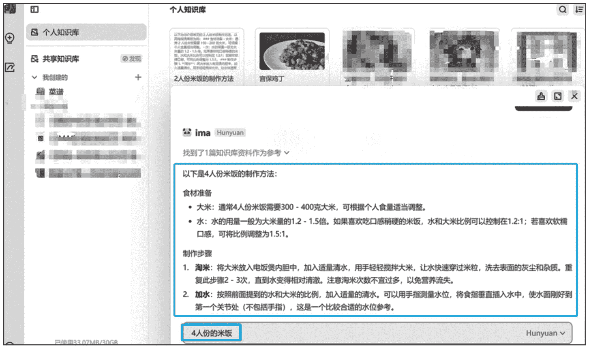

**图 3-11 在 ima 中 AI 问答辅助调整食材用量**

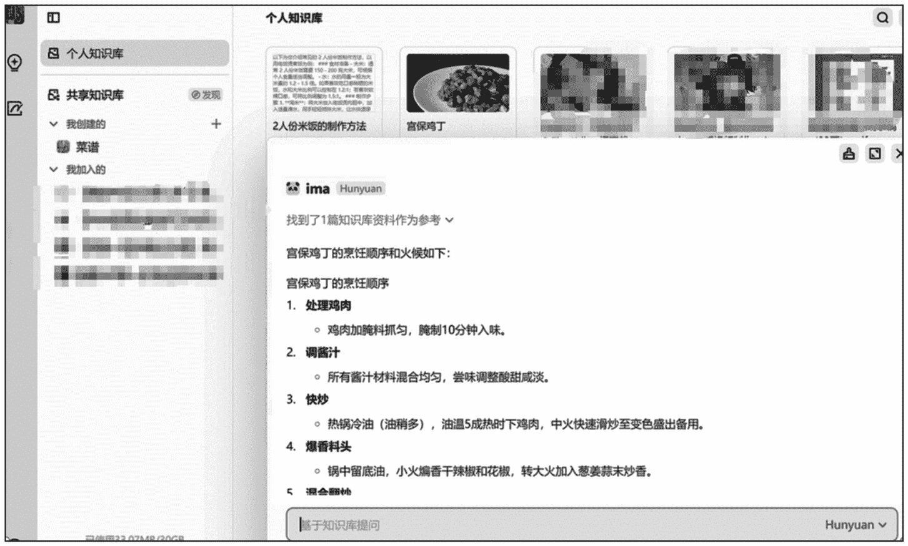

**图 3-12 AI 问答提供“宫保鸡丁”制作步骤**

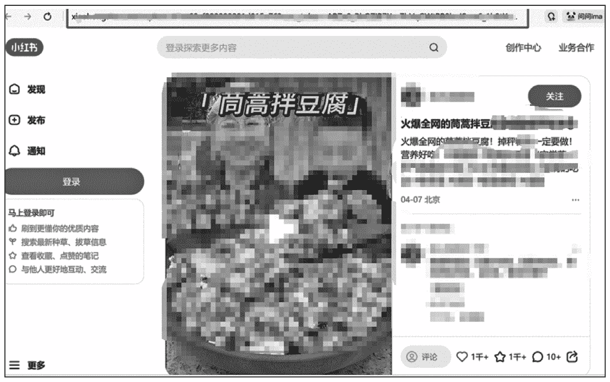

**图 3-13 在 ima 笔记中收藏外部美食教程链接**

**2.利用全网搜索发现新菜谱**

如果自己的知识库里没有想要的菜谱，那么可以直接在 ima 中进行搜索。选择“基于全网”搜索选项后，ima 会查找网络上的相关菜谱文章。找到合适的内容后，就可以将其收藏到自己的知识库中，如图 3-14 所示。

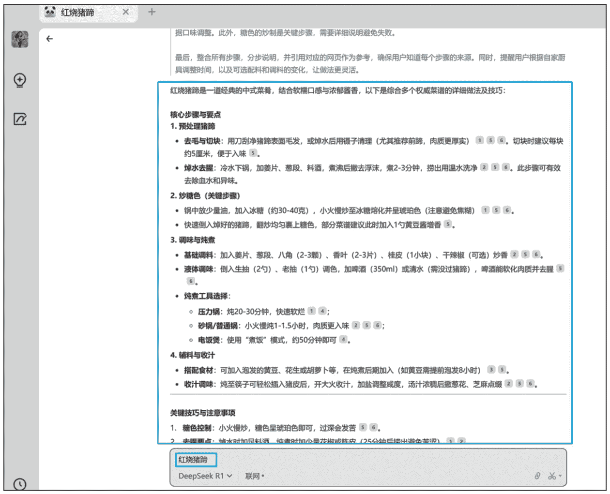

**图 3-14 在 ima 中利用 AI 进行全网菜谱搜索**

小提示：

❑勤整理并善用标签（如#家常菜、#川菜等），方便查找和管理。

❑巧用图片，让菜谱更吸引人、更直观。

❑常用 AI 问答功能，无论是查询步骤还是获取灵感。

❑尝试了新菜或对旧菜谱有所改良后，及时更新到自己的知识库中。

学会了吗？用 AI 知识库这个“智慧厨房”神器，管理菜谱不再难，做饭也更有趣。快去打造自己的“私家菜谱库”吧！

### **3.3 智能日记与反思伙伴：记录、复盘与心智成长**

你是否也曾下定决心“坚持记录”，但精美的日记本最终成了抽屉里的“睡美人”？传统日记存在不便坚持、查找困难、回顾低效等问题，但 AI 时代为“写日记”这件事注入了新的活力。利用 AI 知识库，可以将日记从简单的记录本升级为专属的智能日记与反思伙伴，帮助轻松记录、思考复盘，从而加速心智成长。

**3.3.1 功能：智能日记与反思伙伴能做什么**

**1.对抗遗忘，构筑个性化记忆宫殿**

AI 知识库安全、有序地存储海量信息（文字、图片，未来可能包括音视频），强大的搜索功能能够随时精准定位所需的记忆片段。

**2.训练专属 AI，让 AI“懂你”**

这是 AI 知识库在此场景下的核心价值功能之一。用户记录的思考模式、常用语汇、关注领域、情绪表达等，都会成为训练个人专属 AI 的宝贵“语料”。让 AI 通过日记“读懂”用户，未来它才能更好地提供个性化的建议、支持和创作辅助。目标是让 AI 成为增强版的自己，而非拙劣的模仿者。

**3.赋能复盘，加速心智成长**

AI 的总结、提问、关联能力，将日记从简单回顾变为深度复盘工具，帮助快速梳理脉络、发现思维盲点、连接不同时期的思考，使反思更高效、成长更迅速。

**4.从私密记录到价值分享与连接**

在确保隐私的前提下，AI 知识库能够方便地将部分思考和经验转化为有价值的分享内容，与志趣相投的人建立连接，甚至成为创作素材或知识产品的基础。

**3.3.2 搭建：三步拥有 AI 日记“真人秀”**

搭建这样一个智能日记伙伴，其实比想象的要简单得多，只需三步即可完成：

（1）选择工具与创建“家”

首先，选择一个顺手的 AI 知识库工具。因为日常信息主要沉淀在微信生态中，所以此处采用了腾讯 ima，它与微信无缝连接且内置了强大的 AI 能力。选定工具后，创建一个新的知识库专门用于日记和反思，例如，将其命名为“【我的 AI 日记“真人秀”】海的女儿 ima 智库”，如图 3-15 所示。

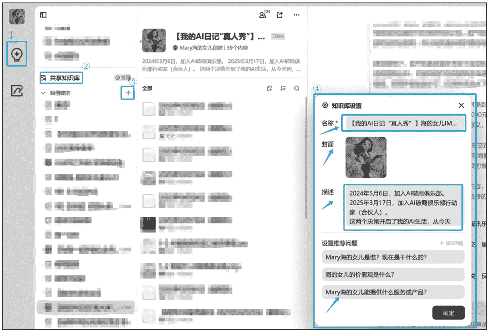

**图 3-15 创建“我的 AI 日记‘真人秀’”知识库**

（2）明确“初心”与原则——“5 个小心思”

记录前想清楚“为什么写”和“想达成什么”，能让过程更有方向。这便是开始 AI 日记实践时的“5 个小心思”，也是搭建和使用这个知识库的指导原则：

❑化整为零：将写日记作为积累写作素材、降低“写一本书”难度的一种方式。

❑分享经验避坑：记录 AI 探索历程，为社群伙伴提供真实的经验参考。

❑展示真实的自己：超越标签，建立真诚连接。

❑训练专属 AI：用真实的记录“喂养”AI，让它更懂你。

❑社交监督坚持：利用平台的分享功能邀请外部监督，克服惰性。

明确主要目的，有助于后续更好地组织内容和利用 AI 功能。

（3）开始记录

有了“家”和“初心”，关键是开始填充内容。行动起来是让智能伙伴运转的前提。

**3.3.3 应用：玩转智能日记的核心场景与价值**

搭建好框架只是开始，真正的魔力在于如何应用。AI 知识库日记不仅是记录，更是动态、可交互、能带来深刻价值的工具。以下核心应用场景体现了 AI 时代写日记的“三大变革”。

**场景 1：便捷记录与多维互动（变革 1：从单一记录到多维互动）**

1）痛点解决：解决了传统日记的记录方式单一、易中断以及缺乏反馈的问题。

2）如何应用：

❑随时随地记录想法与感悟（如文字、图片、录音、附件等）。

❑与 AI 对话激发思考（如遇卡壳或想深入探讨，可向 AI 提问，或让 AI 扮演角色进行头脑风暴）。

❑让 AI 智能格式化整理草稿或转为语音。

3）价值体现：极大地降低了记录门槛，让日记从“独白”变成与 AI 的“对话”，丰富了记录维度，更能激发深层思考。图 3-16 展示了在 ima 笔记中与 AI 交互的示例：可以一边写日记，一边单击右上角的“ima 问问”与 AI 进行交互。

**场景 2：智能关联与知识串联（变革 2：从碎片记忆到系统知识）**

1）痛点解决：解决了传统日记内容孤立、难以发现知识之间联系的问题。

2）如何应用：

❑AI 自动推荐关联：当写新的笔记时，部分 AI 知识库（如 Obsidian、Logseq，ima 也在发展类似能力）能自动分析内容，并在侧边栏推荐可能相关的过往笔记。

❑主动提问关联：比如“关于‘知识复利’，之前日记还提到过哪些相关的思考或案例？”

❑利用标签：有意识地使用标签（#），主动构建知识网络，这能帮助 AI 更好地理解和利用这些关联。

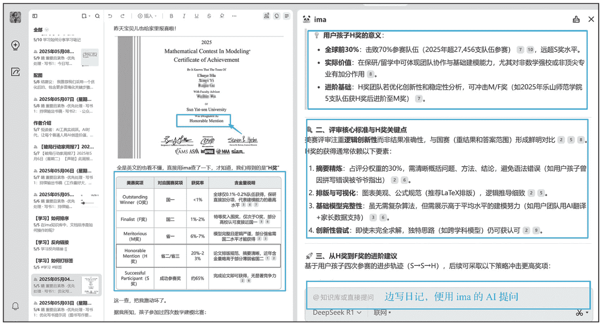

**图 3-16 在 ima 笔记中利用 AI 辅助日记的写作与思考**

3）价值体现：打破了信息的孤岛，让过去的思考“活在当下”，促进知识的融会贯通，从而更容易产生新的洞见和创意火花。图 3-17 展示了利用 AI 对日记进行定期归纳总结和引发思考的示例。

**场景 3：高效复盘与深度反思**

1）痛点解决：解决了传统日记回顾费时费力、反思不够深入的问题。

2）如何应用：

❑AI 智能总结：AI 智能总结某段时间的日记要点、情绪变化和关键进展。

❑主题式回顾：比如“请梳理上个月在‘学习 AI’方面的主要记录与反思”。

❑引导性提问：让 AI 基于日记内容提出引导性问题，促进更深层次的反思。例如：“多篇日记提到时间管理困扰，根本原因是什么？尝试过哪些方法？效果如何？”

3）价值体现：将复盘从“苦差事”变为高效、智能的对话，极大地提升反思的效率和深度，使日记成为个人成长的“镜子”和“教练”。

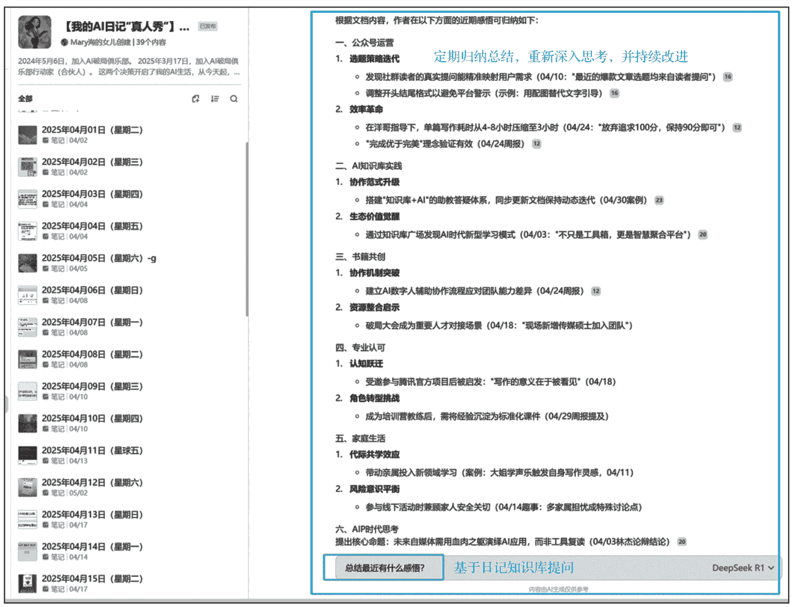

**图 3-17 AI 辅助下的日记内容归纳与知识串联**

**场景 4：社交督促与价值转化（变革三：从私密走向社交与分享）**

1）痛点解决：解决了传统日记缺乏外部激励、内容难以分享和转化的问题。

2）如何应用：

❑选择性分享：将部分非隐私的学习心得、实践总结、避坑经验等分享给朋友、社群或发布到社交媒体。

❑利用知识广场（如 ima）：将愿意公开的日记放入共享知识库或知识广场，接受他人的点赞、评论和监督，形成正向激励。

❑素材积累与再创作：将日记作为个人知识产品（如文章、课程甚至书籍）的素材库，利用 AI 辅助整理、提炼并进行再创作。

3）价值体现：增加坚持记录的外部动力，促进知识传播与交流，为知识的二次转化和价值变现创造可能。

AI 知识库日记借助 AI 的“智慧”，让记录、关联、反思和分享变得高效、智能，真正成为记录生活、复盘思考、加速成长的强大伙伴。

### **3.4 “AI 智慧家居”：备忘、常用信息与物品收纳整合**

家里东西太多，需要使用的时候却总找不到——这个问题曾困扰多年，直到发现可以用腾讯 ima 知识库打造专属的“AI 智慧家居”。

**3.4.1 家庭收纳的常见痛点**

（1）物品太多，找不到的困境

随着生活水平的提高，家中的物品逐渐增多。这些物品在不需要使用时占据空间，而真正需要使用时却常常找不到。

（2）传统 Excel 方案的局限性

Excel 记录物品存放有几点不便：需要打开计算机，较为麻烦；分类复杂；查询不便；物品位置常变，难以坚持维护；家庭成员难以实时共享。

**3.4.2 AI 知识库解决方案**

**1.“AI 家庭管家”概念介绍**

用腾讯 ima 知识库打造“AI 家庭管家”，核心在于利用其强大的功能灵活、便捷地管理家庭物品。相比传统的 Excel 方案，其优势在于：可以随时随地用手机记录；支持文本、照片、标签等多种记录方式；能通过自然语言智能搜索物品的位置；家庭成员可以共享同一个知识库；更新记录简单，从而提高长期维护的可能性。

**2.家庭储物编号系统设计**

为了使“AI 家庭管家”更高效，设计了一套简单、实用的家庭储物编号系统。以常规的三室两厅两卫户型为例：设定房间编号（如主卧为 A、次卧为 B、书房为 C、客厅为 D 等）；再设定储物位置编号（如衣柜为 1、床下为 2、书柜为 3、抽屉为 4 等，还可根据需要进一步细分）。此编号系统简单易记，便于标记和查询，各家也可根据实际情况灵活调整。

**3.3 种记录方式及其优势**

在实际使用中，以下 3 种记录方式特别实用，可根据不同情况灵活选择：

❑简单描述物品及存放位置，如“皮羽绒服主卧床下（A2）”，适合快速记录。

❑图片+标签：照片记录外观，标签说明属性和位置（如“存放位置：小阳台（I）”），适合外观特征明显但名称可能记不清的物品。

❑图片+文字+标签：结合前两者优点，最全面，适合记录重要或需详细说明的物品。

**3.4.3 实际应用案例**

**1.知识库建立过程**

按上述思路建立家居物品存放记录知识库的步骤如下：

1）在 ima 中创建新知识库“AI 智慧家居”。

2）设计储物编号系统。

3）采用前文介绍的 3 种方式之一记录物品信息，添加标签，并定期更新维护。

具体建库操作可参考第二章。

**2.物品查询实例**

知识库建立后，查询物品变得非常简单。例如，当问 ima：“DeepSeek 图书存放在哪里？”系统便会返回：“DeepSeek 图书存放在次卧书柜（B3）的第二层。”这比翻箱倒柜高效得多。

**3.提示词优化技巧**

为使 AI 更准确地理解，设计了提示词以指导其解读知识库的方式：

❑文本笔记按“物品名称+内容+存放位置”格式。

❑图片+标签方式，图片命名为物品名，标签包含物品名、属性及存放位置。

AI 可据此查找并反馈。

**3.4.4 扩展应用场景**

**1.日常生活中的其他应用**

“AI 智慧家居”还可以应用于：

❑重要文件管理（记录房产证、保单等的存放位置）。

❑保修信息管理（记录家电购买日期、保修期、售后电话）。

❑家庭药品管理（记录药品存放位置、用途及有效期）。

❑食材管理（记录冰箱内食材的存放位置和保质期）。

❑借出物品追踪。

**2.家庭理财与重要信息管理**

“AI 智慧家居”还可扩展至如下方面：

❑账单提醒（记录水电费等缴纳时间和方式，并设置提醒）。

❑家庭预算（记录收支，分析消费）。

❑重要日期提醒（家人生日、纪念日）。

❑家庭会员（会员卡、积分卡）信息管理。

“AI 智慧家居”是腾讯 ima 知识库在家庭场景中的一个实用应用。通过简单的设置和维护，它能帮助解决家庭物品管理的痛点，让生活更有序、更高效。在 AI 时代，可以借助 AI 的力量让生活变得更轻松愉快。“AI+知识库=效率起飞”这一理念同样适用于家庭生活。

## **CHAPTER 4**

## **第四章 学习效能倍增器：学得更快、记得更牢、用得更好**

大家是否常常陷入“知识囤积”的困境——收藏了海量资料，购买了众多课程，却发现真正能够消化吸收并学以致用的寥寥无几。信息爆炸让知识的获取空前便捷，但如何将信息高效内化为个人能力，已成为这个时代学习者面临的新挑战。AI 知识库正是应对这一挑战的“超级消化酶”与“智慧学习引擎”。

本章将聚焦于 AI 知识库如何全方位提升学习效能，进而达到“学得更快、记得更牢、用得更好”的效果：探索 AI 辅助下的深度阅读与笔记新方法，体验“让 AI 先懂自己、再让书开口说话”的个性化读书范式，学习如何高效“消化”在线课程与知识付费内容的核心精髓，并最终了解如何运用 AI 知识库打造个性化的“备考教练”，为重要考试与认证冲刺保驾护航。

### **4.1 AI 知识库辅助阅读与深度笔记：实现知识的“吸星大法”**

不知道你有没有过这样的经历：面对一份非常重要但又长又枯燥的文档，比如一份厚厚的行业报告、一本专业书籍的章节，甚至是像政府工作报告这样的“大部头”，感觉眼花缭乱、无从下手。读完后仍然云里雾里，抓不住重点，更别提深入理解和有效利用了。信息爆炸时代，这几乎是学习和工作中常遇到的痛点。渴望快速吸收知识精华，但往往事倍功半。AI 知识库就像一个超级智能阅读助手，能够实现知识的“吸星大法”。

本节讨论如何运用 AI 知识库实现目标，如“吸星大法”般高效吸收和内化知识的核心思路与实践方法。这些内容主要来源于资深期货投机专家“不二随喜”的精彩分享。不二随喜老师每天需要处理大量复杂信息并快速决策，因此对如何借助工具提升深度思考、高效吸收和内化知识有着特别强烈的需求和独到的实践经验。无论在哪个领域，AI 知识库都能成为强大的“第二大脑”。这里的“吸星大法”指的是借助 AI，高效吸收、理解和内化复杂信息，并真正将其化为己用的能力。

**4.1.1 AI 知识库在阅读与深度笔记方面能做什么**

AI 知识库工具（如腾讯 ima）在辅助阅读和进行深度笔记方面，主要能够完成以下任务。

（1）快速“瘦身”，秒懂长文主旨

ima 能在几秒或几十秒内总结核心内容和关键要点，迅速把握文章脉络，告别“读了半天不知所云”的窘境。

（2）深度“拷问”，精准答疑解惑

若对文档中的任何细节、概念或逻辑有疑问，则可直接用自然语言向 ima 提问。它能基于原文内容进行精准回答，甚至用更通俗的语言解释专业术语，就像请了一个随身专家。

（3）提炼“金矿”，挖掘核心概念

ima 能自动识别并提取出文档中最核心、最高频出现的概念和主题，一眼看透知识的“骨架”，为深入学习打下基础。

（4）关联“织网”，激活知识网络

ima 甚至能发现当前文档与知识库中其他笔记、文档的潜在联系，打破知识孤岛，促进跨领域思考。

其核心价值在于彻底改变被动、低效的阅读方式，解放个人精力，让人们能够更专注于理解、思考和应用，从而极大地提升学习和工作的效率与深度。这就是 AI 时代赋予的阅读“超能力”！

**4.1.2 两步搞定，开启“智能阅读”之旅**

想要启动这个“超能力”，只需以下简单两步：

1）将“阅读材料”放入 AI 知识库。无论是 PDF 报告、Word 文档、网页链接，甚至图片文字，都可轻松放入 AI 知识库（如腾讯 ima），让 AI 能“看见”并理解内容，如图 4-1 所示。

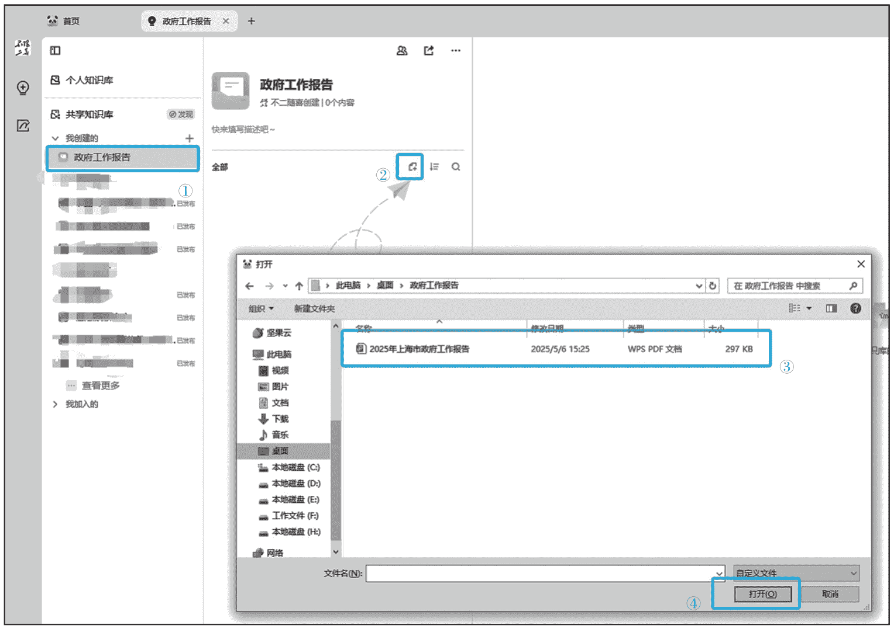

**图 4-1 将阅读材料导入 ima 知识库**

2）在知识库中打开文档，并“唤醒”AI 助手。打开想要阅读的文档，找到代表 AI 功能的图标（如腾讯 ima 里的熊猫图标或类似的 AI 对话/分析按钮），开始与文档“深度对话”，如图 4-2 所示。

**图 4-2 ima 知识库中打开文档并调用 AI 助手**

**4.1.3 实战演练：看 AI 如何轻松“啃”下万字报告**

为了让大家有更直观的感受，此处列举了一个可能让很多人“望而生畏”的材料——《上海市政府工作报告》。别看它好像离普通人生活有点远，但其内容权威、信息量大、结构复杂，恰恰是检验 AI 阅读理解能力的“试金石”。

**1.场景痛点**

假如用户是一位希望到上海发展的外地人，想快速了解上海的整体情况、发展重点和未来机遇。直接阅读几万字的政府工作报告可能会让人望而却步，难以抓住重点，甚至可能因此放弃。

**2.AI 如何应用与解决**

（1）告别“通读”，先来个整体印象

将报告导入知识库后，直接询问 ima：“我是一个不了解上海的人，请基于这个报告的核心概念和观点，用普通人都能够明白的方式介绍一下上海。”于是，ima 在几秒钟内就给出了一份全面且易懂的上海概览，内容涵盖经济、科技、城建、民生等关键方面，其效率远超自己通读数小时，如图 4-3 所示。

**图 4-3 ima 对政府工作报告进行初步解读**

（2）深入挖掘，抓住“核心密码”

为了了解报告重点，可以继续提问：“对这个报告进行文本分析，找出最核心的 10 个概念并且用普通人都能够听得懂的语言解释这 10 个概念。”于是，ima 迅速提炼出“五个中心”“新质生产力”等 10 个核心概念并通俗解释，抓住报告“龙骨”，理解上海发展方向，解决了传统阅读“抓不住重点”的痛点，如图 4-4 所示。

ima 不仅能找出高频词或政策重点，还能结合上下文给出易懂的解释并阐明其重要性，同时贴心地进行总结并提出深入挖掘的建议。用户可以单击这些建议继续询问，也可以直接提出其他问题。

（3）追问细节，疑难之处逐个击破

对“新能源汽车产业”等概念模糊，继续问：“报告里关于发展新能源汽车产业的议题，具体提到了哪些措施？”于是，ima 将基于原文详实易懂地进行深入解读，如图 4-5 所示。这种交互式阅读改变了单向接收模式，让深度理解成为可能。

**图 4-4 ima 提炼报告核心概念并解释**

**图 4-5 ima 针对特定细节进行深入解读**

（4）角色扮演，让知识“活”起来

假设让 ima 进行角色扮演：“如果你是上海市的招商人员，严格基于这份文件，要怎么样向客商介绍上海，才能够把他们留下来呢？”于是，ima 迅速切换角色，从政策优势、营商环境等多角度整理出一套有吸引力的“招商话术”，将静态报告信息转化为可指导行动的方案。如图 4-6 所示，ima 还能贴心地给出应对顾虑的建议。

**图 4-6 ima 基于报告内容进行角色扮演式应用**

通过与 ima 对话，在十几分钟内不仅了解了报告的核心内容和关键概念，解决了疑问，还得到了可实际应用的“话术”，实现了颠覆性的效率提升和认知深化，解决了“读不懂、抓不住、用不上”三大痛点。

**4.1.4 从“吸星大法”到“内功心法”**

通过此例，已感受到“AI 辅助阅读与深度笔记”的威力。其背后遵循高效学习原理：

快速学习=①找出核心概念+②理清逻辑结构+③应用解决问题

传统学习耗时费力，AI 知识库凭借对话式分析、信息提炼和内容生成能力，极大地加速了学习过程，实现学习效率指数级的跃升。

这不仅适用于解读政府工作报告，也适用于学习新课程、进行行业分析、阅读专业书籍、处理工作中的长文档等场景。当然，AI 是强大的工具，但它不能替代独立的思考和批判性的判断。AI 给出的总结和回答仍需结合原文和自身理解进行审视。

无疑，AI 提供了强大的杠杆，让人们能够更从容、深入地探索知识世界。拥抱 AI，让阅读不再是负担，让思考更加自由。

### **4.2 AI 读书新范式：让 AI 先懂用户，再让书“开口”说话**

买了好书来认真学习，画满了重点，写满了笔记，可过一段时间再回想，内容却大多模糊不清。热爱收集知识的人，硬盘和网盘里塞满了资料，但真正消化吸收的又有多少呢？传统阅读是被动接收信息，效率不高，且难以与自身的实际问题有效结合。

在 AI 时代，读书方式经历着深刻的革命。借助 AI 知识库，可以实现一种全新且具有颠覆性的阅读范式，这对于以解决问题为导向的阅读而言，堪称“神来之笔”。

**4.2.1 功能：AI 如何颠覆传统阅读**

（1）从被动吸收到主动交互

在传统阅读中，阅读者是信息的接收者。而在 AI 知识库中，用户可以直接向书本“提问”，针对书中的任何概念、观点、案例进行追问，就像与作者（或者说，一个深度理解这本书的 AI）面对面交流一样，实现前所未有的深度交互。

（2）从通用知识到个性化应用

这或许是其最核心也最具价值的一点：让 AI 先“读懂”用户（用户的处境、困惑、问题等），再带着用户的“上下文”去解读和应用书中的智慧，从而为用户量身定制解决方案或提供针对性的启发。

（3）从信息孤岛到知识连接

AI 不仅能帮助读懂一本书，还能将其与知识库中的其他笔记、文章以及过往的思考进行智能关联，从而打破知识孤岛。

（4）从耗时费力到高效精准

AI 能够快速抓住长文的“干货”，迅速总结核心观点，甚至生成思维导图，从而极大地提升阅读效率。简单来说，AI 知识库就像是用户与书籍之间的一位智能“翻译”和一座智能“桥梁”，它能将书本中的普适智慧精准地转化为解决个人问题的“钥匙”。

**4.2.2 搭建：开启 AI 读书之旅的准备工作**

体验新的阅读方式，准备工作很简单，核心是让 AI 能够同时“看到”你和书：

1）选择一个 AI 知识库工具：需要选择一个具备 AI 问答和分析能力的知识库工具，本书将以腾讯 ima 为例进行说明。

2）将书籍内容“喂”给 AI：这是关键一步。

❑方法一：利用 ima 与微信读书等平台联动，直接在 ima 首页输入微信读书的书籍地址（如 weread.qq.com）来进行添加，如图 4-7 所示。

❑方法二：本地 PDF、Word 等文件直接上传。

❑方法三：网络文章或无法直接导入的书籍，可手动复制关键章节或笔记至知识库。

**图 4-7 ima 导入微信读书书籍示例**

**4.2.3 应用：让 AI 带着问题去读书**

下面通过一个真实的案例来看看如何应用“AI 先懂用户，再读书”的方法。

前段时间，公众号“海的女儿爱上 AI”遇到了瓶颈：粉丝数量增长停滞，尽管尝试了多个方向的内容，也未能实现持续突破。虽然在得到“小师兄”的指导后情况有所好转，但这让我反思：如果没有“小师兄”的帮助，该如何突破这个瓶颈呢？能否通过 AI 和知识库实现类似“导师辅导”的效果？于是，我想到了《最重要的事，只有一件》这本书，并决定运用 AI 读书的新范式来进行一次实践。

（1）先让 AI“懂”困境

我并没有直接向书本寻求答案，而是在将这本书添加到腾讯 ima 知识库后，先向 ima 清晰地描述了自己的处境和问题（核心是说明自媒体发展遇到的瓶颈、已尝试的方向、当前的状态，以及期望 ima 能结合这本书给出分析和建议，具体问题描述可参考图 4-8 中的示例）。

**图 4-8 向 ima 提问个人困境并指定参考书籍**

（2）让书通过 AI“开口”说话

提交问题后，ima（实际上是其背后的 AI 大模型）会基于对《最重要的事，只有一件》的“授权”（已将其加入知识库），结合刚才提出的具体困境和上下文，“阅读”和“理解”这本书，然后以书中作者加里·凯勒的视角和逻辑回应提出的问题。

（3）收获个性化的“导师级”建议

惊喜的是，“作者”（ima）给出的建议与“小师兄”的指导在很多方面有相似之处。它精准地指出了核心问题在于精力分散、缺乏聚焦，并结合书中的理念给出了一些具体可行的建议，例如识别“最重要的事”、将 80%的精力聚焦于此、学会拒绝次要的事情、建立保护“最重要事情”的专属时间段等，如图 4-9 所示。这种方式完美地模拟了“导师辅导”的效果。ima 将书中的智慧精准地应用于个人所处的独特情境，给出了高度个性化的解决方案——这正是 AI 读书新范式的核心魅力所在。

**图 4-9 ima 结合书籍内容提供个性化建议**

**4.2.4 拓展与思考：从“解决问题”到“知识内化”**

这种“让 AI 先懂你，再读书”的方法，不仅适用于寻求解决方案，还可以拓展至更广泛的学习应用场景。

❑学习新技能（先告知 AI 目标水平，再让 AI 结合教程规划路径、解释难点、设计练习题）。

❑理解复杂概念（先说明疑惑和知识背景，再让 AI 基于权威著作进行讲解和类比）。

❑提升决策质量（陈述目标、方案、顾虑，让 AI 结合报告或理论书籍分析利弊）。

AI 读书的新范式通过“让 AI 先懂用户，再让书‘开口’说话”的机制，改变了与书籍知识互动的方式，将阅读从单向输入转变为双向交互、个性化应用的动态过程。它虽然不能完全替代真人导师，但作为一种强大的辅助手段，能够极大地提升解决问题、学习新知、深化思考的效率和效果。在 AGI 时代，重要的或许不再仅仅是拥有多少知识，更是与 AI 协作共创的能力。这种全新的 AI 读书方法正是提升这种能力的关键一环，而个人知识库则是未来与 AI 共舞的核心基础。这种具有颠覆性的阅读方法已经展现在面前，大家都应该尝试一下。

### **4.3 在线课程与知识付费“消化器”：快速掌握核心精髓**

本节内容来自“悦读者”刘旭老师的实践经验。

**4.3.1 功能：让学习资料“活”起来**

AI 知识库在此场景中如同智能学习的“消化系统”和“随身家教”。它的核心功能是帮助用户从“信息接收者”转变为“知识管理者”，让学习资料从“死文件”变成“活知识”。

❑全格式“胃袋”：轻松收纳各种学习资料。无论是老师发的 PDF 讲义、PPT、Word 文档，还是自己的文字笔记、听课时的语音速记（转写成文本）、课程链接，甚至截图，它都能“吃”下并保存好。

❑智能“分类器”与“关联器”：AI 能初步理解存入内容的含义，可以给内容打上标签（例如：课程名、讲师名字、主题词、难度级别），还能找到不同资料之间的联系，看到知识的全貌。

❑AI“消化酶”与“提炼器”：可直接向知识库里的课程内容提问，让 AI 解释概念、总结章节要点或提取重要名词解释。它能帮助快速抓住重点，省去大量的阅读时间。

❑“记忆引擎”与“快速检索”：告别文件夹和在笔记 App 里翻来翻去。可以像与一个懂自己的学习伙伴说话一样，用自然语言问它：“请找一下在[××课程]里提到[××概念]的笔记”或者“[某老师]讲过的那个[案例]在哪里？”AI 会迅速帮助定位到相关内容。

❑“学习地图绘制者”（进阶）：通过不断与知识库中的内容互动和提问，AI 能够逐渐了解用户对哪些知识点较为熟悉，哪些知识点是盲区，甚至可以帮助梳理知识结构，有点像绘制个性化学习地图。

AI 知识库把人们从烦琐的资料整理中解放出来，使更多精力能够集中于理解和思考。

**4.3.2 搭建：为在线学习资料建一个“智能书房”**

用腾讯 ima 搭建学习“消化器”很简单，就像整理书桌一样，只需简单几步。

（1）创建专属学习知识库

打开 ima，创建共享知识库，命名为“我的 AI 学习助手”或“××（课程名）知识库”，如图 4-10 所示。

**图 4-10 ima 创建“我的 AI 学习助手”知识库**

（2）将学习资料“搬”进知识库

接下来，就是把囤积的各种学习资料“搬”进来。ima 支持多种便捷的入库方式，让这个过程变得不那么痛苦：

1）文字笔记或课程文件（PDF、DOC、图片等）：

❑对于在其他地方做的文字笔记，可直接复制内容，然后在 ima 知识库里新建“笔记”并粘贴。

❑也可直接使用 ima 的文件上传功能，导入下载的 PPT 课件、PDF 讲义、重要课程截图等。

2）课程链接、网页文章或公众号文章：

❑微信里收到或看到的：打开课程链接或公众号文章，单击右上角的“…”图标，选择“在其他应用打开”或类似选项，找到并选择“ima 知识库”，最后选择存入学习知识库。

❑其他平台看到的：如果是网页，可将 ima 作为浏览器打开，一键收藏或直接复制网址粘贴至 ima 笔记。

（3）用标签提升智能效率

资料入库后，打标签是让其“活”起来、方便 AI 理解和查找的关键。可为每份资料或笔记添加相关标签，如：#AI 基础、#机器学习、#概念；#Python、#编程、#实战；#沟通、#软技能、#××老师。标签越精准，AI 越能快速定位和理解。

小技巧：初始阶段不必设计复杂的标签体系，可在使用过程中逐步调整。每周花几分钟回顾新资料，补充标签，并检查已有标签是否足够。

**4.3.3 应用：让 AI“嚼碎”知识，真正吸收**

有了“智能书房”，便可享受 AI 的高效学习体验了。

**场景 1：快速回顾与定位知识点**

如需回顾某课程的技术细节，以往可能要翻阅文件夹和笔记。现在，打开腾讯 ima，向“我的 AI 学习助手”知识库提问：“帮我找[××课程]里讲的[××技术]关键点”或“[××案例]在哪节课讲的？”ima 会迅速提供相关笔记或文件，甚至直接提炼内容，如图 4-11 所示。

**场景 2：理解复杂概念或对比知识点**

某些课程内容抽象或涉及多个相似概念，可能难以完全理解。此时，可将相关讲义笔记导入知识库，问 ima：“请通俗解释知识库中[某个复杂概念]的内容”或“知识库中[概念 A]和[概念 B]的主要区别是什么？”ima 会像耐心的助教一般梳理逻辑，并清晰呈现，如图 4-12 所示。

**场景 3：高效总结课程要点**

学完课程或模块后，可将相关笔记和讲义交给 ima，让其生成精炼总结、要点列表，甚至思维导图大纲（若工具支持）。这种方式比手动整理更快，并且能够宏观回顾课程内容。

**图 4-11 ima 在学习库中定位特定知识点**

**图 4-12 ima 学习库中就复杂概念与 AI 进行多轮探讨**

**场景 4：构建个性化的知识网络**

不断向知识库提问、导入新内容时，ima 会帮助连接看似孤立的知识点。可能发现不同课程中的相似观点、不同视角，或某知识点是另一知识点的拓展。AI 知识库就是为用户构建的“知识连接器”。作为公众号博主，写书时对 RAG 技术的理解、不同工具特点的对比，均得益于 ima 中存放并“盘活”的学习资料。

注意：工具是辅助，真正的消化在于主动地思考和“用”，但一个好工具能极大加速此过程。

搭建好这个学习知识库后，可尝试结合其他 AI 工具，如 AI 写作助手基于知识库内容起草学习心得。最重要的是，将学到的知识用于实践。

无论是写文章、做项目，还是解决工作中的实际问题，都是检验和巩固知识的最佳方式。AI 学习助手随时为大家提供“弹药”。希望这个 AI 学习“消化器”能帮助大家告别“囤课焦虑”，让每次学习都物超所值。

### **4.4 备考与认证冲刺：AI 助力构建个性化“备考教练”**

本节介绍如何用 AI 知识库打造专属且高度个性化的“AI 备考教练”。这种方法不仅有助于系统整理海量备考资料，更能精准定位薄弱环节，智能规划学习路径，最终实现高效备考，从容应战。本节的核心内容与实战案例主要来自 AI 跨界公益人、资源链接践行者李颖瑜（五灵）老师在备考“社会工作师”时的宝贵经验。

**4.4.1 功能：“AI 备考教练”能做什么**

备考时常遇到以下痛点：知识点零散难以体系化、重要信息查找效率低、政策法规更新频繁容易遗漏、错题反复出现却找不到症结等。“AI 备考教练”知识库则能有效解决这些痛点，其核心功能如下：

（1）个性化知识地图构建与导航

❑痛点：备考资料通常散落在教材、真题、网课、笔记等各个角落，难以形成清晰的知识脉络。

❑AI 赋能：整合不同来源的知识点，按考纲模块分类关联，通过标签（高频考点、易错点等）构建个性化知识地图。

（2）动态信息追踪与智能对比

❑痛点：许多认证考试（尤其是政策法规类）的内容更新非常频繁，考生很容易因信息滞后而“踩坑”。

❑AI 赋能：导入新旧政策文件或考纲后，可直接向 AI 提问：“对比 2023 年和 2024 年版的《社会救助暂行办法》，主要修订了哪些内容？”AI 便可以快速生成修订内容的对比表，并说明差异点，轻松掌握最新动态，避免做无用功。

（3）智能化错题管理与归因分析

❑痛点：做了大量题目，错题反复出现，但往往只知道答案，却不清楚错在哪里，知识盲区依然存在。

❑AI 赋能：将做错的题目（无论是截图、照片还是文本）导入知识库并打上“错题”标签，同时备注正确答案和解析。更进一步地，可以引导 AI 对错题进行归因分析，例如提问：“关于‘社区治理’的这道案例分析题做错了，请分析一下，原因是概念理解模糊，还是应用方法错误？”AI 可以结合知识库中的相关学习资料，给出更具针对性的分析和学习建议，甚至智能生成针对薄弱考点的专项训练卷。

（4）高效学习辅助与记忆强化

❑痛点：面对海量知识点，记忆和理解压力巨大。

❑AI 赋能：AI 知识库可以成为“记忆卡片生成器”“重点内容提炼器”。例如，可以让 AI“从《社会工作综合能力》第七章提取近 5 年高频考点”，或者“将这段关于‘社会工作伦理’的复杂描述，用更简洁的语言概括一下”。这种互动式的学习能有效提升学习效率和记忆效果。

AI 知识库的核心价值是将大家从繁杂的资料整理和盲目的题海战术中解放，聚焦理解知识、攻克难点、提升应试能力。

**4.4.2 搭建：三步打造专属“AI 备考教练”知识库**

搭建的过程并不复杂，关键在于思路清晰和持续迭代。以腾讯 ima 为例，主要通过以下三步即可完成基础搭建。

（1）创建“AI 备考教练”专属知识库

打开腾讯 ima 客户端或网页版。在知识库管理界面，单击“新建共享知识库”（共享知识库通常更为灵活，但如果完全是个人使用，选择个人知识库亦可），并为知识库命名，例如“AI 社工备考教练”或“考研冲刺营”等。图 4-13 为“AI 社工备考教练”知识库概览示例。

**图 4-13 “AI 社工备考教练”知识库概览**

（2）系统化录入备考核心资料

高质量、结构化的备考资料是 AI 教练发挥作用的基石。

1）创建核心文件夹体系。根据考试科目和资料类型建立清晰的文件夹层级。如图 4-14 所示，五灵老师备考社工师时新建了一个“AI 社工备考教练”文件夹体系。

**图 4-14 “AI 社工备考教练”知识库核心文件夹示例**

2）高效录入各类备考资料。将电子教材、讲义、真题、模拟卷、错题集、网课重点等通过 ima 多种方式导入对应文件夹。计算机端可直接上传或拖拽。

❑计算机端操作：可以直接在 ima 客户端内单击“上传文件”到指定位置。

❑微信文件导入（ima 的“神技”）：这是特别推荐的高效采集方法。例如，在微信中收到老师发送的“中级社工《综合》预测卷一 2024.pdf”文件时，可以长按该文件，选择“用其他应用打开”→“腾讯 ima 知识库”，然后选择将其存入“AI 社工备考教练”知识库下“中级模拟题”文件夹的“综合能力”子文件夹中。图 4-15 所示为导入资料示例，展示 PC 端导入方法，并提及结构化存放，如模拟题下再分子目录。

**图 4-15 ima 备考知识库导入资料示例**

（3）构建智能标签体系，激活知识关联

标签是知识库“神经网络”，助力信息多维度关联，提升 AI 理解和检索效率。为资料打标签，可在 ima 中长按文件，选择“编辑标签”，然后输入或选择预设标签。

1）核心标签维度设计。可以从以下几个核心维度构建标签体系：

❑考试属性维度：例如#中级社工、#综合能力、#2024 真题、#模拟预测 A 卷、#高频考点、#易错题。

❑科目分类维度：例如#社会工作综合能力、#政策法规、#社会工作实务（此分类也可通过文件夹实现，标签则作为补充或用于更细致的划分）。

❑知识点主题维度：例如#社区治理、#社会救助、#社会工作伦理、#个案工作技巧。

2）为资料打标签。在 ima 中为每一份导入的资料或笔记打上相关的标签。

通过以上三步，结构清晰、资料充实、标签智能的“AI 备考教练”知识库就初步完成了。它已经准备好随时响应指令，成为备考路上的得力助手。

**4.4.3 应用：与“AI 备考教练”互动，实现高效提分**

知识库搭建完成只是第一步，价值在于应用。下面看看“AI 备考教练”如何在具体的备考场景中发挥“黑科技”般的提分效果。

（1）考点提取术：精准定位复习重点

❑场景痛点：教材内容繁多，难以快速抓住核心考点。

❑AI 应用：直接向 ima 输入，“从《社会工作综合能力》第七章‘社区工作’中，提取近 5 年出现频率最高的 5 个考点。”

❑价值体现：AI 基于知识库中的教材和真题数据快速定位高频考点，使复习更有针对性，避免在非重点内容上浪费时间，如图 4-16 所示。

**图 4-16 AI 从备考资料中提取高频考点**

（2）政策法规对比神器：轻松掌握新旧变化

❑场景痛点：政策法规更新快，逐条对比新旧文件费时费力。

❑AI 应用：上传新旧政策文件后，向 AI 输入，“对比 2023 年和 2024 年版的《社会救助暂行办法》，总结主要差异点，并以表格形式列出。”

❑价值体现：AI 自动文本比对，生成清晰修订对比表，一眼看懂政策变化，如图 4-17 所示。

**图 4-17 AI 对比新旧政策文件并总结差异**

（3）案例模拟训练与智能反馈：提升实战应用能力

❑场景痛点：实务案例题灵活多变，难以把握答题思路与得分点。

❑AI 应用：输入一个模拟的青少年社会工作案例，并向 AI 提出要求，“请根据《社会工作实务》中关于青少年危机干预的知识，分析此案例，并给出包含危机干预步骤的完整处理流程。”之后，还可以将自己的答案输入，让 AI 进行对比分析“这是我的答案，请看看是否符合专业要求，有哪些需要改进的地方？”

❑价值体现：AI 不仅提供规范的案例分析框架流程，还能初步评估答案，指出不足，帮助提升案例分析应用能力，如图 4-18 所示。

**图 4-18 AI 辅助进行案例模拟训练与反馈**

（4）个性化学习计划与进度追踪（进阶应用）

❑场景痛点：在备考中尝试制订 30 天冲刺计划（图 4-19），并将每日任务、重点章节、复习进度等记入腾讯 ima 笔记中。

**图 4-19 ima 笔记记录 30 天备考冲刺计划**

❑AI 应用：虽然目前 ima 未必能完全自动地生成并追踪复杂的学习计划，但可以通过向 AI 提问来辅助计划的制定和调整。例如：“请根据我 30 天的备考计划以及《综合能力》各章节的权重，为我规划第一周详细的学习内容及对应时长。”或者“我今天学习了《社会工作理论》，请帮我出 5 道相关的选择题来检验掌握程度。”

❑价值体现：AI 知识库通过智能化信息组织、精准问答、深度内容分析，真正成为备考路上的“个性化教练”和“提分黑科技”。它帮助用户从海量信息中快速定位核心，解放精力，更重要的是引导更深层次思考和针对性练习。当然，AI 教练水平取决于“教材”质量和互动“教练技术”。用心构建和使用，AI 知识库定能为备考带来前所未有的助力。

大家是否也正为某项考试努力？“AI 备考教练”是否带来新启发？不妨思考一下，AI 知识库这一强大的“第二个大脑”还能在哪些环节为自己赋能？

## **CHAPTER 5**

## **第五章 AI 家教新帮手：用知识库智慧辅导孩子成长**

AI 时代的教育正在经历前所未有的变革。本章将探索 AI 知识库如何在教育领域发挥关键作用，从个性化评语生成到智能答疑系统，从智能判卷到教育资源管理，全方位提升教学效率和学习体验。

### **5.1 家校信息“管家”：汇集通知、反馈，搭建孩子专属的校园档案**

现在的父母都经历过微信群里被各种“@所有人”支配的“恐惧”，老师通知、作业、活动照片、投票、健康打卡、腾讯文档……海量信息扑面而来，刚处理完一条，新的信息又来了。更抓狂的是，收藏了一堆信息，用时却找不到。“上周三的数学练习 PDF 在哪？”“家长会是什么时候？”这么多繁杂的事情，是不是觉得当家长比当年自己上学还累？别担心，问题不在记忆力，而在于缺乏一个高效的信息管理系统。

下面分享如何用 AI 知识库为孩子的校园信息安一个“智慧的家”，打造专属的“家校信息管家”。它就像一个随叫随到的数字档案柜，告别混乱，让一切井井有条。

**5.1.1 功能：不仅仅是个数字抽屉**

“家校信息管家”应具备以下核心功能：

❑全面汇集：收集学校、老师、班级群的各类信息。

❑有序整理：按学科、类型、重要程度等对信息进行分类并打标签。

❑即时访问：支持简单搜索或提问，快速精准地找到信息。

❑智能辅助：能够理解信息，并进行简单的总结、提醒或内容关联。

❑安全分享：方便与家庭其他成员共享，协同育儿。

**5.1.2 搭建：三步轻松搞定**

使用 AI 知识库工具（如腾讯 ima）搭建这样一个“管家”很简单，只需以下三步。

（1）创建“家”，给信息一个专属空间

在 AI 知识库工具中，为孩子创建专属知识库。

操作步骤：打开 ima，在“知识库”界面中单击“创建”或“+”号按钮，然后输入名称，如“（孩子名字）的家校信息管家”，如图 5-1 所示。

**图 5-1 在 ima 中创建“家校信息管家”知识库**

（2）收集关键信息，“搬家”进行时

哪些信息是需要重点管理的呢？可以根据孩子的实际情况来调整。

❑学校/班级通知：开学、放假、家长会、缴费等通知。

❑作业与学习要求：各科作业、项目要求、复习重点等。

❑学习资料与反馈：老师分享的资料、试卷、成绩单和评语。

❑活动与成长记录：活动照片、视频、奖状、作品、成长点滴。

❑联系方式与重要提醒：老师、学校、重要家长的联系方式，以及特殊事项的提醒（如过敏信息等）。

总之，一切重要、需查找或想为孩子留存的校园相关信息都应放入知识库中。

（3）多种方式轻松“入库”，让信息“自己走进来”

把信息放进知识库的方式如下：

❑复制粘贴法（文字类）：微信群文字通知、作业要求等，复制后在 ima“家校信息管家”知识库中新建“笔记”并粘贴，如图 5-2 所示。

**图 5-2 在 ima 中为“家校信息管家”新建笔记**

❑微信一键转存法（文件类，为 ima 的核心优势）：在微信中打开文件后，单击右上角的“...”按钮，选择“用其他应用打开”，找到并选择“ima 知识库”，然后选择存入“家校信息管家”知识库。

❑文件上传法（本地文件）：手机或计算机里已保存的照片、扫描试卷、资料等，可在 ima“家校信息管家”知识库界面中单击“+”或“上传”按钮，选择文件即可完成上传（如图 5-3 所示）。

❑在 ima 内搜索添加（网页/文章）：在 ima 首页中搜索发现的网页或文章，可直接添加至知识库。

**图 5-3 在 ima 中向“家校信息管家”上传文件**

**5.1.3 应用：让信息“活”起来，智慧管理初体验**

信息存入后需“活”用，关键在于用好标签和智能搜索。

**场景 1：告别“大海捞针”，信息查找精准定位**

❑痛点：还记得“上周三的数学练习 PDF 在哪？”“家长会是什么时候？”的窘境吗？

❑解决方案：打标签+智能搜索=精准定位。

❑打标签（核心习惯）：为每条笔记或文件添加标签，这能帮助 AI 理解和组织信息。例如，家长会的通知可以打上#学校通知、#重要等标签；数学作业可以打上#数学、#作业等标签。一篇内容可以有多个标签，标签打得越细致，后续的查找和关联就越方便。

❑智能搜索显神通：打好标签后，腾讯 ima 智能搜索就能大显身手了。直接在搜索框中用自然语言提问，如“帮我找上周的数学作业”“家校中心里关于‘家长会’的通知”，AI 就能根据提问和标签快速找到相关信息。

❑价值体现：极大地节省了查找信息的时间和精力，重要信息不再石沉大海。

**场景 2：家庭内部信息同步，协作育儿更轻松**

❑痛点：爸爸记着这事，妈妈记着那事，信息不同步，容易遗漏或重复沟通。

❑解决方案：家庭共享，信息透明。“家校信息管家”知识库可共享给家人（爸爸、爷爷、奶奶等），全家方便了解孩子的情况，信息同步，分工协作（如提醒作业、准备活动物品）。

❑价值体现：减少了家庭内部的沟通成本，提升了协同育儿效率。

**场景 3：（谨慎使用）变身“信息枢纽”，邻里互助**

❑可能性：对公开无隐私的学校通知或通用资料，可生成分享链接，分享给班级群中其他有需要的家长，互帮互助。

❑重要提醒：务必注意信息安全和隐私保护！孩子个人信息、成绩、老师评语等敏感内容，绝对不能对外分享。

❑价值体现：在确保隐私安全的前提下，促进家长间的资源共享，营造互助氛围（此场景需谨慎使用）。

小技巧（信息管理原则）：

❑定期整理标签：建议每周花 10 分钟检查标签，进行删除或合并。

❑清理过期信息：定期删除失效的通知等，以释放存储空间（目前腾讯 ima 单个知识库的免费空间为 30GB，合理使用非常重要）。

工具是死的，用法是活的。当使用此方法并展示给孩子，教他如何用 AI 管理信息时，也在潜移默化地培养他解决问题的思维以及建立知识体系的能力。这或许是 AI 时代最好的家教方式：不替孩子奔跑，而是教他们制造自己的“滑板车”，从而在信息浪潮中滑得更稳、更远。

### **5.2 个性化学习“导航仪”：与孩子共创学习计划与进度追踪**

哪个父母没给孩子制订过学习计划？大到学期需要掌握的内容，小到每晚的作业时间，都可能为孩子做过计划。但这些计划往往是“一厢情愿”的设计，孩子多是被动执行，导致计划缺乏“生命力”。图 5-4 展示了传统方式下贴满墙的学习计划。

**图 5-4 传统方式下贴满墙的学习计划**

AI 时代，关键在于如何运用工具来改变这种单向输出的教育模式。未来的亲子学习，更应该是家长和孩子一起使用智慧工具，共同描绘并走过他们的学习“旅程图”。

本节探讨如何使用 AI 知识库将制订学习计划和追踪进度的过程变成有趣、可视化且能互动共创的体验，让孩子从“被计划者”变成“计划者”，从“被追踪者”变成“自我管理者”。这就如同给他们的学习旅程安装一个个性化学习“导航仪”，父母则是帮助设定目的地和规划路线的“副驾驶”。本节中不少实操的灵感和建议都是与“悦读者”刘旭老师共同讨论的结果。

**5.2.1 功能：不只是计划表，更是成长路线图**

传统学习计划多为静态时间表或任务清单，缺点是不够灵活、难以实时反映进度、难以关联资源、难以激发孩子的内在动力。AI 知识库之所以能成为强大的个性化学习“导航仪”，是因为它具备以下功能。

（1）目标可视化与智能拆解：把“牛”切成“牛排”

它能帮助用户将大目标（如“学期数学成绩提升 15 分”）分解成具体可执行的小步骤，并清晰呈现，使目标不再模糊，如图 5-5 所示。

**图 5-5 ima 辅助设计学习规划示例**

（2）资源整合与高效关联：学习资料不再“裸奔”

集中管理学习资料（如课本、讲义、视频等），与计划的具体步骤直接关联，实现“计划到哪，资料到哪”。

（3）进度记录与可视化呈现：让努力被看见

当孩子完成一个小任务或攻克一道难题后，可以简单标记任务的完成状态、记录心得体会或遇到的困难。通过打标签（如#未开始、#进行中、#已完成）或在笔记中记录完成比例等方式实现进度可视化，这既能鼓励孩子，又能帮助家长掌握情况。

（4）反思与智能调整支持：及时“校准方向”

根据进度和问题反馈数据，以及 AI 辅助分析（如哪类题型总出错），帮助调整学习方法或计划。

（5）亲子共创的透明空间：把孩子拉进“驾驶舱”

这是最重要的功能之一。AI 知识库可以提供一个共享空间，让家长和孩子都能访问、查看、编辑计划和记录。当孩子参与到计划的制订、资源的收集、进度的记录中时，他们会产生一种“这是我的事”的主人翁意识。这种透明的协作也增进了亲子之间的沟通和理解。

（6）AI 问答与辅助：触手可及的“智慧助手”

当遇到不理解的概念或需要鼓励时，可以直接与 AI 互动。AI 能够快速解答问题、推荐相关资料，或提供个性化的学习建议。AI 知识库是连接目标、资源、进度、反思和 AI 智能的“中枢”，能使个性化学习计划变得鲜活、可执行、可追溯，并且能够“一起完成”。

**5.2.2 搭建：三步构筑亲子学习空间**

搭建个性化学习“导航仪”有几个关键步骤，可以和孩子一起动手完成。在搭建前，先思考这些问题：孩子目前的主要学习目标是什么？他的学习习惯如何？希望通过知识库收集哪些信息（如作业、试卷、课外阅读材料等）？这些思考将有助于更好地规划知识库的结构。

（1）创建专属知识库或文件夹

在 AI 知识库工具中为孩子创建独立的共享知识库，或在个人库中建立主文件夹，如“[孩子名字]的学习地图”。

操作步骤：打开知识库应用，新建知识库或文件夹，并输入一个合适的名字。如果创建的是共享知识库，记得设置好共享权限。图 5-6 展示了创建名为“[孩子名字]的成长驾驶舱”的知识库示例。这就如同给孩子的学习建立了一个专属的“数字房间”。还可以邀请孩子加入，让孩子知道这个空间是共同拥有和管理的。

**图 5-6 在 ima 中创建个性化学习知识库“成长驾驶舱”**

（2）确定核心组织结构与标签体系

与孩子商量按学科、时间或项目划分文件夹并规划文件夹结构（如图 5-7 所示）。建立标签体系，为学习进度、内容类型等设置简单标签（如#未开始、#进行中、#已完成、#错题集等）。清晰的标签有助于 AI 检索和管理。

**图 5-7 ima 个性化学习知识库文件夹结构示例**

（3）邀请孩子加入（如果使用共享知识库）

若使用共享知识库且孩子有设备账号，可正式邀请他们加入。

操作步骤：在知识库的设置中找到“成员管理”或“分享”功能来邀请孩子，如图 5-8 所示。这种邀请不仅是一个操作，更是在传递“这个学习空间由孩子和家长一起拥有与打理”的信息，让孩子感受到自己是“学习地图”的共同创作者和使用者。

**图 5-8 在 ima 中邀请孩子加入共享知识库**

**5.2.3 应用：与孩子一起“导航”学习旅程**

家长并非“监工”，而是“导航员”和“啦啦队”。要让孩子参与决策，并感受其价值，从而激发他们内在的学习驱动力。AI 和知识库虽然能节省精力，但亲子之间的有效沟通和共同行动才是让“导航仪”真正发挥作用的核心引擎。

以下是和孩子用 AI 知识库进行学习规划与追踪的实操经验。

**场景 1：一起制订计划——绘制地图**

与其由家长单方面做决定，不如将这个规划过程变成一次有趣的地图绘制活动。

1）具体操作：打开知识库中为孩子学习建立的文件夹，新建笔记，标题就叫“[学科名称]学习计划”。

❑一起讨论大的目标（比如“期中考试数学争取达到××分”），并将其写在笔记的开头处。

❑利用笔记的层级列表或待办事项清单（就像 Word 中的多级列表一样），把大目标一步步分解。比如，要掌握“分数应用题”，可能需要完成“复习分数的加减乘除、理解单位‘1’、分析典型题型、独立练习、错题分析”等事项，每一项都可以作为一个层级或一个待办事项。

2）AI 辅助：如果对于拆解知识点没有头绪，可以利用 AI 辅助。例如，向 AI 提问：“请列出小学五年级英语下册的重点知识点，并给出每周学习计划的建议框架。”图 5-9 展示了 AI 辅助设计学习规划的示例，AI 会给出初步参考，大家可以结合实际情况进行调整。

**图 5-9 利用 ima 辅助制订学习计划**

3）建议：这如同项目管理中的 WBS（工作分解结构）一样，将大项目层层分解。若应用于学习，可以使计划更有条理，便于执行和检查。让孩子理解这一思路，对培养他们未来的做事方式会有所帮助。

**场景 2：填充资源——备好行囊**

地图绘制好了，得把“补给”放进去。学习计划中的每一步都需要相应的学习资源。

1）具体操作：将课本、练习册、电子资料、优秀网课链接、科普文章视频链接等分门别类地上传或保存至知识库。在对应学习计划的笔记中插入资源链接或引用，或者给上传的资源文件加标签（如#关联计划-小数乘法），以便于通过搜索或关联功能找到，如图 5-10 所示。

**图 5-10 在 ima 中为学习资源添加关联标签**

2）功能：腾讯 ima 支持一键将微信、浏览器中的内容转存到知识库。这种方式让学习资源不再散落各处，而是能够被学习计划有效地串联起来，方便随时查找和使用。

**场景 3：追踪进度——查看导航**

只有计划是不行的，还得看是否在按“导航”走。和孩子一起追踪进度，目的是了解孩子的学习情况，及时发现问题，而不是“抓住”孩子偷懒。

1）具体操作：定期（如每日做完作业后或每周末）与孩子打开学习计划笔记。

❑在待办事项清单中勾选完成项。

❑用笔记记录一下“已完成 XXX 部分”和“今天遇到的困难 YYY”。

❑用标签标记进度（#进行中、#改、#已完成）。

图 5-11 为在笔记中勾选待办事项的示例，可考虑鼓励孩子自己记录，以培养自我管理和反思能力。

**图 5-11 在 ima 笔记中更新学习任务完成状态**

2）AI 辅助：记录一段时间的进度后，可以问 AI：“根据[学科名称]的学习计划笔记，孩子最近在哪些知识点上花费的时间最多？或者在哪些部分遇到的问题最多？”AI 能快速从笔记中提取关键信息，提供一个客观的视角。

**场景 4：定期复盘与调整——校准方向**

计划不是一成不变的。学习过程中可能会遇到比预想更难的知识点，或者孩子对某个领域产生新的兴趣。因此，定期复盘和调整是必要的。

1）具体操作：每周或每月抽出时间与孩子一起回顾知识库中的学习计划和进度记录。

❑一起看看哪些目标已经完成，哪些目标尚未完成，未完成的原因是什么。

❑翻阅记录困难的笔记，讨论解决方法。

❑根据实际情况商量后续计划是否需要修改、难度是否需要调整、时间安排是否合理等。

2）AI 辅助：复盘时，AI 也能提供参考意见。可向 AI 提问：“根据本月数学的学习进度和错题类型，建议下个月在哪方面加强练习？”或“困难是[某概念]理解不清，能否推荐更简单易懂的讲解资源？”

此过程是教孩子认识自己、分析解决问题的重要机会。让孩子感受到该计划是与家长共同完成的作品，并且可以优化，让孩子拥有主动权。

**场景 5：激发兴趣与鼓励——加油站**

学习不是苦行僧般的煎熬，也需要乐趣和成就感。知识库不仅是存放计划和资源的地方，也是记录闪光点、激发兴趣的“加油站”。

1）具体操作：

❑记录成就。在知识库中创建笔记或文件夹，记录孩子的每项进步与成就，例如今天独立完成的一项任务、优秀作品的照片或表扬的话语，类似成长荣誉室，为孩子提供鼓励。

❑收集有趣资源。如果看到与学习内容相关但更生动的资源（如科学实验视频、历史纪录片、编程游戏链接），可存入知识库并与学习计划或知识点关联。在计划执行之余可打开查看，让学习更有趣。图 5-12 为在 ima 知识库中记录孩子的“闪光时刻”或收集趣味学习资源的示例。

**图 5-12 在 ima 知识库中记录孩子的“闪光时刻”或收集趣味学习资源**

2）AI 辅助：可利用 AI 发现更多有趣资源。例如，可以向 AI 提问：“孩子最近在学习昆虫的相关知识，能否推荐适合小学生的有趣的昆虫纪录片或科普网站？”回复如图 5-13 所示。

**图 5-13 ima 推荐适合小学生的昆虫科普资源**

3）建议：可在知识库中设置“学习寻宝任务”。例如，在某知识点资源中隐藏“彩蛋”（如笑话、科学常识），或布置任务“找到关于此概念的 3 个不同例子”，完成后给予小奖励或虚拟“探险家徽章”。学习过程游戏化能够显著提升孩子的积极性。

让 AI 知识库成为亲子学习的“智慧伙伴”。家长利用 AI 知识库搭建并应用了个性化学习“导航仪”，它能够将模糊目标变得清晰可见，将分散的资源整合集中起来，将枯燥的追踪过程变得有趣。更重要的是，它提供了一个平台，让家长和孩子能够真正地平等协作，共同进行学习规划和管理。AI 知识库在其中扮演着“智慧伙伴”的角色，负责处理信息、分析数据并提供建议，但“方向盘”始终掌握在家长和孩子手中。最重要的并非工具的高级性或计划的完美性，而是是否利用这一工具建立起与孩子共同面对学习、解决问题的亲子协作模式，以及是否培养了孩子自主规划和自我管理的习惯。

AI 是“导航仪”，孩子是“驾驶员”，家长是“副驾驶”。目标是让孩子最终能够自信、独立地踏上自己的学习之旅。

### **5.3 “十万个为什么”AI 版：满足好奇心，拓展知识边界**

“妈妈，天为什么是蓝色的？”“爸爸，恐龙真的存在过吗？”孩子如同行走的“十万个为什么”，对世界充满了无穷的好奇。父母并非“全知全能”，面对孩子层出不穷的提问，有时难免会卡壳，或者发现网络信息零碎复杂，难以转化为孩子能理解的答案。久而久之，孩子的好奇心火苗可能会因为得不到满意的回应而渐渐微弱。那么，AI 知识库能否成为孩子专属的“《十万个为什么》AI 版”，一个总能耐心解答并有助于拓展他们知识边界的“智慧百科全书”呢？

本节的核心思路与实践方法主要借鉴了“悦读者”刘旭老师的宝贵经验。下面将探讨如何巧妙运用 AI 知识库，将回答孩子问题的过程从单纯地“给答案”，升华为一次次有价值的知识拓展和思维引导，使 AI 成为孩子探索未知世界的得力助手。

**5.3.1 功能：从信息仓库到智慧伙伴**

传统的百科全书厚重且难以查找，但网络搜索信息又庞杂难辨，这对孩子来说，筛选和理解信息本身就是挑战。AI 知识库将“十万个为什么”带入智能化、个性化新纪元，成为孩子探索世界、满足好奇心的“智慧百科全书”，其关键能力如下。

（1）优先基于已有知识回答

当向 AI 知识库提问时，它会首先在家长为孩子收集和整理的知识库内容（如上传的课本、科普读物、看过的纪录片脚本等）中寻找答案。这意味着 AI 的回答可以与孩子已有的知识体系自然关联，更贴合其认知水平，有助于巩固旧识、连接新知。

（2）将复杂概念转化为儿童语言

AI 具备强大的语言理解和生成能力，能将复杂的科学概念或抽象知识，用更简单、生动、形象化的语言（甚至比喻）解释给孩子听，真正实现“听得懂，才能真明白”的效果。例如，在解释“万有引力”时，它可能不会直接给出公式，而是用“地球妈妈拉着我们，所以我们不会飘走”这样的比喻。

（3）支持追问与深度探索

孩子的好奇心往往不止于一个问题。AI 能够理解对话上下文，允许孩子围绕主题进行多轮提问，持续提供相关信息，引导层层深入。

（4）多模态答案呈现

知识的传递不应仅限于文字。优秀的 AI 知识库能够结合文字、图片（甚至未来可能包括声音、简单动画）进行多模态应答。当孩子问“恐龙长什么样？”时，AI 可以直接调出知识库中的恐龙图片或生成简笔画，让知识“活”起来。

（5）沉淀问答过程为知识

AI 与孩子的每一次有价值的问答互动，本身就是宝贵的学习过程和资料。很多 AI 知识库工具允许将对话记录一键保存为笔记，形成孩子专属的“问题解决记录”或“探索日志”，方便日后回顾和深化理解。

（6）提供相对纯净的探索空间

与开放的网络环境相比，在 AI 知识库中进行问答，信息来源更可控（主要基于库内信息或经过筛选的外部知识），能够在一定程度上避免孩子接触到不适龄或无关的广告等信息。

因此，AI 知识库已远超一个简单的“问答机”的角色。它是一个能够理解孩子、关联知识、引导探索并促进知识积累的“智慧伙伴”。

**5.3.2 搭建：为“智慧百科”注入灵魂与养料**

要让 AI 知识库成为孩子得力的“智慧百科”，关键在于为其提供充足的“养料”，并引导孩子养成有效的使用习惯。

**1.充实知识库内容（关键准备）**

AI 回答的质量很大程度上取决于知识库内容的质量和相关性，因此需要有意识地收集并导入与孩子年龄、兴趣及学习内容相关的基础知识。

❑内容来源：科普读物、绘本、纪录片文字稿、学校的学习资料、兴趣班笔记、优质在线科普文章或视频链接等。

❑导入方式：利用 AI 知识库的文件上传、笔记编辑、网页剪藏等功能，导入科普读物，如图 5-14 所示。

**图 5-14 在 ima 知识库中导入科普读物示例**

**2.结构化组织信息**

利用文件夹和标签分类整理知识。清晰的结构和精准的标签能帮助 AI 更快、更准确地定位信息。

例如，可以创建一个“科普知识”主文件夹，下设“动物世界”“植物王国”等子文件夹。对具体内容打标签，如#恐龙、#光合作用、#引力、#小学科学等。图 5-15 为知识库内“科普知识”文件夹结构；图 5-16 展示了为一篇恐龙笔记/文件添加#恐龙、#史前生物、#科普等标签的界面。

**图 5-15 ima“科普知识”文件夹结构**

**3.引导孩子有效提问**

这是发挥 AI 知识库价值的关键一环。需要鼓励和引导孩子进行以下操作。

❑大胆提问：让孩子知道，AI 是一个非常耐心、不会嘲笑任何问题的“老师”，有任何好奇都可以尽情提问。

❑清晰表达：引导孩子尝试使用更清晰、具体的语言提问。如果问题过于笼统，AI 可能难以准确理解，从而导致回复不够准确。

❑追问探索：鼓励孩子在得到初步答案后继续追问，从不同角度（是什么、为什么、怎么样、与什么有关联）进行深入探索，培养批判性思维和联想能力。AI 知识库的多轮对话能力恰好支持这种发散性提问。

**图 5-16 在 ima 中为科普内容添加主题标签**

**5.3.3 应用：和 AI 一起探索未知世界**

AI 是辅助工具，父母则是引导和鼓励的伙伴。以下分享一些常见的应用场景。

**场景 1：解答突发奇想的问题——随时随地满足好奇心**

❑情景：孩子可能在玩耍时、看动画片时，或者阅读中突然冒出一个问题：“妈妈，为什么猫头鹰的头能转那么多圈？”

❑示范：此时，无须立刻中断活动去搜索或翻书。家长可以和孩子一起打开专属的亲子学习知识库，进入 AI 对话界面（或者直接在相关的“动物世界”文件夹中提问），直接问 AI：“猫头鹰的头为什么能转动很大的角度？”

❑AI 表现：AI 会优先从知识库中（如果已存入相关动物知识）或结合通用知识，用孩子能理解的语言（例如，“猫头鹰脖子里的骨头特别多，像搭积木一样灵活，所以能转很大圈！”）来解释其特殊的颈椎结构，如图 5-17 所示。

**图 5-17 用 ima 解答“猫头鹰头部转动”的科普问题**

❑价值：这种即时、个性化的解答能最大限度地保护和激发孩子在那一瞬间迸发的好奇心。

**场景 2：基于已有知识的深入追问——引导深度探索**

❑情景：假设孩子最近在知识库里阅读了不少关于火山的资料，他已经知道火山喷发与地下岩浆有关，现在想进一步了解更多的内容。

❑示范：家长可以引导孩子进入知识库中“火山”相关的文件夹或标签下，鼓励他继续向 AI 提问：“岩浆是从哪里来的？”在 AI 回答后，可以进一步引导：“那为什么有的火山会喷发，有的不会呢？”

❑AI 表现：AI 会基于知识库中已有的地质知识进行回答，并能根据孩子的连续追问，提供更深层次、更相关的解释。它就像一位极富耐心的老师，一步步引导孩子探索问题的根源。图 5-18 展示了在特定兴趣文件夹中与 AI 进行多轮追问，AI 回答体现上下文关联和逐步深入的界面。

**图 5-18 ima 就“火山知识”进行多轮深入问答**

❑思考引导：引导孩子提问时，不仅要问“是什么”，更要鼓励问“为什么”“怎么样”“与什么有关联”。例如，问完“为什么天是蓝的？”，可以追问“白天和晚上的天颜色为什么不一样？”“如果去了月球，看到的天是什么颜色？”这种多角度、发散性的提问，能有效培养孩子的批判性思维和联想能力。AI 知识库的多轮对话和知识关联能力可以很好地支持这种探索。

**场景 3：沉淀有价值的问答——构建专属知识档案**

❑情景：孩子与 AI 就“行星为什么会绕着太阳转”进行深入对话，AI 的解释清晰明了，孩子完全能理解。

❑示范：若这段对话非常有价值，则可以利用 AI 知识库工具的“保存对话为笔记”功能，将精彩的问答保存下来，命名如“行星为什么会绕着太阳转”，并将其归类至“浩瀚宇宙”文件夹或打上#天文学、#行星运动等标签。图 5-19 为在 AI 对话界面单击“记笔记”按钮的示意图。

**图 5-19 在 ima 中将 AI 问答对话保存为笔记**

❑价值：在孩子日后复习这个知识点时，不仅能查阅资料，还能回顾当时与 AI 的完整问答过程，加深理解。将这些问答沉淀下来，就是在为孩子构建个性化的知识体系。

AI 知识库绝非一个问答工具，它应是家长与孩子之间连接好奇心和广阔知识世界的桥梁。它创造了一个安全、便捷的环境，让孩子可以：

❑随时提问：无惧打扰，即时满足求知欲。

❑获得懂他的答案：得到个性化、易于理解且与已有知识相关联的解答。

❑深入探索：在 AI 的引导下进行多轮追问，享受探索的乐趣。

❑积累知识：将探索过程沉淀为自己独特的知识财富。

父母的角色并非“全知者”，而是好奇心火苗的“守护者”。父母的任务在于引导孩子善用 AI 知识库等工具，点燃探索未知的热情。AI 是孩子耐心的“老师”和“向导”，家长则是陪伴探索的“点火者”。

### **5.4 兴趣培养“资源库”：收集资料，激发探索欲与创造力**

孩子是否对某些事物特别着迷，比如恐龙、汽车、太空、画画或编程？“兴趣是最好的老师”，当孩子对这些事物有浓厚的兴趣时，学习动力和效率都会更高。然而，相关资料常因散落各处而难以系统化，家长想支持却常感力不从心。AI 知识库能否成为孩子兴趣探索的“资源宝库”，一个能汇集资料、激发灵感的“智慧宝藏盒”呢？

本节关于如何运用 AI 知识库为孩子的兴趣构建“资源图书馆”的核心思路与方法，主要借鉴了“悦读者”刘旭老师的实践经验。我们将一同探讨如何让这些资源“活”起来，点燃孩子更深层次的探索欲与创造力。

**5.4.1 一站式资源汇集：把“散珠”串成“项链”**

无论是什么类型的资料——关于恐龙的纪录片链接、艺术家作品的图片、编程教程的 PDF、自己对某个物理现象的思考笔记、一次实验的记录照片……所有与孩子某个兴趣相关的零散信息，都可以方便地收集并汇集到 AI 知识库的同一个地方。这就像给孩子的每一个兴趣都建立了一个专属的“文件柜”。

**5.4.2 结构化组织与关联：让知识体系化**

光把东西堆在一起还不够，还得让它们有条理。在知识库中，可以为每个兴趣建立清晰的文件夹结构（比如按恐龙的种类分、按绘画的技法分），用标签来标记内容的属性（比如#白垩纪、#食草恐龙、#水彩画、#风景、#Python 入门），还可以在笔记里通过链接关联不同的资料（文件夹与标签的使用可参考第二章）。这种结构化的组织能让孩子在探索某个兴趣时看到知识之间的联系，构建自己的知识网络，而不是处理零散的碎片信息。这对于构建个人知识体系至关重要。

**5.4.3 AI 辅助内容发现与推荐：发现更多“宝藏”**

当在知识库中积累了一定量的兴趣资料后，AI 就可以发挥作用了。它可以分析已有的内容，推荐相关的外部信息源（比如“孩子好像对太空探索很感兴趣，这篇关于火星移民的文章也许也喜欢”），或者帮助发现收集的资料之间可能存在的隐含联系。

**5.4.4 AI 激发创意与项目想法：把“知识”变成“作品”**

基于孩子在知识库中收集的某个兴趣领域的资料，可以请 AI 协助激发创意。例如，可以向 AI 提问：“我收集了很多关于蒸汽机的资料，能建议几个利用这些资料可以做的有趣项目吗？比如手工模型或者小发明”AI 可能会提出制作简易蒸汽船、撰写一篇关于蒸汽机时代的故事，或者设计一个利用蒸汽机原理驱动的小装置等创意点子。这种方式能够让孩子的兴趣从单纯的知识吸收，延伸到实践与创造。

**1.兴趣成长记录：记录每一步的“足迹”**

知识库本身就是孩子的兴趣探索过程的忠实记录者。上传的资料、添加的笔记、保存的问答、完成的项目记录……所有这些都构成了孩子在这个兴趣领域成长的“足迹”。日后回顾，孩子会看到自己投入了多少努力，取得了哪些进步，这对他们是巨大的鼓励。

**2.便捷的分享与展示：让热爱被看见**

当孩子在知识库里整理出一个精彩的兴趣专题时，他们可以方便地将其分享给朋友、家人或老师，展示自己的学习成果和热爱。这不仅为孩子提供了表达和分享的平台，还能增强他们的自信心（共享功能可参考 2.5.6 节）。

有了这些功能，AI 知识库就不仅仅是一个文件柜，它成为一个能陪伴孩子、启发孩子、记录孩子兴趣成长的“智慧伙伴”。

**5.4.5 搭建：为孩子的兴趣建造一座“图书馆”**

为孩子的兴趣建立资源库，就像是为他们建造一座专属的、不断生长的“图书馆”。搭建过程也很简单，可以与孩子一起完成。

（1）创建专属兴趣文件夹或子知识库

❑在已经建立好的亲子学习主知识库下（或者专门为一个特别集中的兴趣创建一个独立的共享知识库），为孩子的每一个核心兴趣建立一个一级文件夹。比如，知识库里就有“[女儿名字]的动物世界”“[儿子名字]的编程基地”“家庭小科学”这样的文件夹，如图 5-20 所示。

**图 5-20 ima 为孩子创建专属兴趣文件夹**

❑名称要有趣、个性化，让孩子一看就知道这是他们自己的“宝藏区”。

（2）规划兴趣内的子分类与标签

❑进入这个兴趣文件夹，与孩子一起讨论子分类（例如，恐龙按时期还是按食性分类？绘画按画家还是按题材分类？），据此建立二级甚至三级文件夹。

❑同时，为该兴趣设计一套标签体系，比如“恐龙”文件夹可用#侏罗纪、#霸王龙、#植食性等标签，使资源分类更细致，如图 5-21 所示（标签设置参考第二章）。

**图 5-21 ima 兴趣文件夹内的子分类与特定标签示例**

（3）持续收集和导入资源

这是最需要坚持的部分，也是最有乐趣的部分。鼓励孩子（或家长协助）将所有看到、听到、学到的、与这个兴趣相关的任何内容，都“扔”进对应的文件夹里。

❑看到一篇关于宇宙黑洞的好文章，一键收藏到“浩瀚宇宙”文件夹中。

❑拍了一张自家花盆里植物发芽的照片，上传到“植物王国”文件夹中，并写下观察笔记。

❑找到一个教画漫画的视频链接，存入“绘画灵感库”。

❑利用标签将这些新加入的资源与已有的内容关联起来。

这样，通过持续地向这个“图书馆”添加内容并保持其结构清晰，它就会像一个活物一样，不断地生长和丰富。

**5.4.6 应用：点燃好奇心，让创意飞扬**

“图书馆”建好了，资源也放进去了。是时候让这些资源“活”起来，让 AI 帮助孩子进行更深入的探索和更有趣的创造了。

利用 AI 让收集的资源发挥最大价值，使资源不再是孤立的“死知识”，而成为激发孩子思考和创造的“引爆点”。

以下是几个实战应用场景：

**场景 1：系统学习某个子主题——从概览到细节**

❑情景：孩子对“鸟类迁徙”特别感兴趣。家长已将相关的纪录片、科普文章，甚至一些鸟类图鉴的电子版都存入“动物世界”→“鸟类”文件夹中。

❑示范：打开这个文件夹。可先让 AI 帮忙概览，如提问：“请总结此文件夹资料中鸟类迁徙的主要原因和路线特点。”AI 会快速整合信息给出总结。接着，若想深入了解具体的知识点，如“候鸟迁徙靠什么导航？”，可在文件夹内或指定相关文章继续向 AI 提问。

❑展示：AI 基于提供的资料，详细解释候鸟利用地磁场、星辰、太阳等导航的方法。这比孩子自己一篇篇看文章找信息效率高多了，也更容易建立全局观。图 5-22 为在特定兴趣文件夹内与 ima 的对话场景。

**图 5-22 ima 整合文件夹内资料解答“鸟类迁徙”的问题**

**场景 2：激发创意项目——把知识转化为行动**

❑情景：孩子收集了很多关于未来交通工具的资料（高速列车、飞行汽车、太空电梯等）。

❑示范：现在想鼓励他把这些知识转化为一个创意项目。向 AI 提问：“请根据收集的关于未来交通工具的资料给些建议，可以设计一个什么样的模型？或者写一个关于未来交通的故事？请提供一些具体的想法。”

❑展示：AI 会分析知识库中的资料，可能会建议孩子设计一个“地下真空管道列车”的模型，或者写一篇“乘坐太空电梯去月球旅游”的科幻故事大纲，甚至提供一些关于未来交通的插画创意点子。图 5-23 为 ima 基于兴趣资料提供创意项目建议的界面。

**图 5-23 ima 基于兴趣资料提供创意项目建议**

这让孩子知道，收集资料不只是为了“知道”，更是为了“创造”。构建自己的知识体系，利用 AI 知识库激发创意，正是将知识体系转化为实际产出的重要一步。

**场景 3：记录兴趣实践过程——让努力看得见。**

❑情景：孩子尝试用知识库里找到的一个教程制作了一个简易的火箭模型。

❑示范：将制作过程拍成照片上传到“科学小实验”文件夹中。创建一个笔记，记录模型的制作过程、使用的原理、遇到的困难，以及最终是否成功完成模拟发射（确保安全），还可以链接到参考的教程资源。

❑展示：图 5-24 展示上传孩子手工模型照片，并在笔记中添加了制作过程描述和心得。这种记录让孩子的每一次实践都有迹可循，能够看到自己的动手能力和解决问题的能力在进步。

**图 5-24 ima 笔记记录孩子火箭模型制作过程与心得**

❑建议：在知识库中为孩子的兴趣设定“探索任务”。例如，在“恐龙”文件夹的“恐龙探秘任务卡”笔记中列出小任务，如“找出三种不同时期的恐龙并关联其信息”“记录关于霸王龙食性的两种不同观点”，完成后可给予小奖励或虚拟徽章。这样，将兴趣探索游戏化能大大提升孩子的参与度和积极性。

AI 知识库为孩子提供了一个系统化、便捷的兴趣探索平台。它将分散在各处的兴趣资料汇集起来，结构化地呈现，并通过 AI 的辅助，帮助孩子更深入地理解内容，激发他们的好奇心和创造力。

这个“兴趣宝藏盒”记录着孩子成长的轨迹，承载着他们对世界的热爱。AI 在其中是发现者、推荐者和创意激发者，而父母则是陪伴孩子挖掘宝藏、分享喜悦的同行者。

别让散乱的信息扑灭了孩子兴趣的小火苗。用 AI 知识库，和孩子一起，把他们的兴趣变成一座座等待挖掘的宝藏，让他们在探索中找到属于自己的小宇宙吧！这个过程本身就是送给孩子最好的礼物。加油，点亮孩子眼中闪烁的星光！

### **5.5 阅读理解“深化器”：AI 提问与总结，提升分析能力**

人们常说“开卷有益”，也鼓励孩子多读书。但孩子真的“读进去”了吗？读完课文故事，是否能说出主要内容、理解作者情感，并对书中观点有自己的思考判断？很多孩子虽能读完全书，但阅读理解能力跟不上，抓不住重点，对复杂的长段文字头疼，遇到生僻词或概念时容易卡住。传统的阅读理解练习（课后习题或家长提问）有时枯燥且程式化。有没有办法让孩子阅读时大脑跟着“动”起来，真正地理解、分析和思考？有没有工具能成为孩子阅读的“智慧伙伴”，帮助他们把书“读薄”也“读厚”呢？答案就是 AI 知识库。其强大的文档处理和智能问答能力，仿佛为提升阅读理解量身定制，能成为孩子阅读的“深化器”，帮助他们把文本从表面读到深处，从记住信息到理解思想。本节将探讨如何用 AI 知识库让孩子与文本深度互动，把阅读变成充满智慧的对话，从而显著提升其阅读理解和分析能力。本节内容主要参考了“悦读者”刘旭老师的经验。

**5.5.1 功能：让阅读从“读完”到“读懂读透”**

孩子在阅读时，最常见的困难就是抓不住重点、理解不了复杂内容或者无法独立思考。AI 知识库如同“阅读私教”一般，提供强大功能助其克服阅读困难。

（1）上传与管理阅读材料：把书装进“数字书包”

无论是学校发的电子课本、老师分享的文章 PDF、网上找到的科普读物、扫描保存的绘本故事，还是孩子自己喜欢的电子书，都可以方便地上传并保存在 AI 知识库中。这意味着孩子的所有阅读材料都可以集中管理，随时随地多设备访问，不用再担心书本遗失或不方便携带的问题。

（2）基于文档的 AI 问答：直接向文本提问

这是一项核心且实用的功能。让 AI 直接“阅读”上传的文档，孩子遇到不理解的地方可以直接选中文字提问，或者在对话框中指定文档并向 AI 提问：“这篇文章中‘[某个生词/概念]’是什么意思？”或“故事里的主人公为什么要这么说？”（AI 对话的入口及界面可参考第二章）。AI 会根据文档内容给出解释，这比跳出当前阅读去搜索引擎查找再返回要高效得多，并且能确保答案基于当前文本。

（3）智能总结与提取要点：快速抓住核心

AI 可快速对长文进行总结，提炼核心思想、主要人物、事件脉络、论点论据等，帮助孩子在阅读后迅速回顾并把握整体结构和关键信息，从而提升阅读效率。

（4）生成理解性问题：引导主动思考

AI 不仅能回答问题，还能提出问题。它可以根据上传的文本自动生成不同难度层次的理解性问题：有事实性的（“故事发生在什么时间？主人公是谁？”），有推断性的（“主人公当时是什么心情？为什么？”），还有评价性的（“赞同作者的观点吗？为什么？”）。这些问题能够引导孩子主动思考文本的细节、内涵和观点，将被动阅读转化为主动探索。

（5）概念解释与背景拓展：扫清阅读障碍

当遇到生僻词、历史典故或科学术语时，AI 可快速解释，并关联库中已有的相关信息，提供更广阔的背景知识，帮助实现文本的无障碍理解。

（6）辅助比较分析：看到更广阔的世界

若库中有多篇主题相似但观点不同的文章（比如关于环保的不同看法、对历史人物的不同评价），AI 可辅助比较分析，帮助孩子看到问题的不同侧面，培养批判性思维。高效的信息处理能力是构建高质量认知体系的基础，而 AI 的文本分析和比较能力恰能极大地提升孩子在这方面的效率。

这些功能组合起来，让阅读不再是孤立地面对文字，而是与文本、AI 甚至与自己的知识库进行一场多维度的“智慧对话”。

**5.5.2 搭建：准备好“阅读材料库”**

要让 AI 成为阅读理解的“深化器”，首先需要将阅读材料输入知识库，并确保 AI 能够“读懂”。

（1）创建“阅读材料”文件夹

❑在亲子学习知识库中，创建一个专门存放阅读材料的文件夹，例如可以命名为“我的阅读图书馆”或“[孩子名字]的书架”（文件夹创建方法可参考第二章）。

❑在这个主文件夹下，还可以根据需要设置子文件夹，按书籍类型（如故事书、科普文）、学科（如语文课文）或阅读状态（如待读、正在读、已读完）进行分类。图 5-25 为知识库主文件夹及子文件夹结构的示例。

（2）上传可被 AI 识别的文档

将阅读材料上传至对应文件夹。最适合 AI 处理的格式通常是 PDF、Word、Markdown、纯文本等（图 5-26）。

（3）培养边读边“存”的习惯

看到好的文章、老师发的课文电子版，或者孩子感兴趣的某个文本片段，养成随手存到知识库对应文件夹的习惯。这就像是建立一个不断扩充的个性化“数字图书馆”。

**图 5-25 ima“阅读材料”文件夹结构**

**图 5-26 ima 向“阅读材料库”上传不同格式的文档**

**5.5.3 应用：与文本进行一场“智慧对话”**

“阅读材料库”已备好，现在可以带孩子进入“智慧阅读”模式，将枯燥的阅读理解练习变成与 AI 的有趣互动。

让 AI 成为引导孩子与文本主动交互的催化剂。在这个过程中，孩子是阅读的主体，AI 则是强大的辅助工具。

以下是几个实战场景：

**场景 1：快速掌握文章主旨——抓住“骨架”。**

❑情景：孩子读完长篇科普文章或历史故事后，可能只记住零散的细节。

❑示范：打开知识库中的这篇文档。使用 AI 的总结功能提问，例如：“请总结这篇文章的核心内容，用不超过三句话概括。”或者问：“这篇文章最主要的观点是什么？”（AI 总结功能的使用方法可参考第二章）

❑展示：AI 快速分析文本，提炼主旨关键信息，帮助孩子快速回顾并确认对文章整体的理解。

可以先让孩子自己尝试口头或书面总结，然后再与 AI 的总结进行对比，看看自己抓住了多少重点，哪些内容有所遗漏。这是一个很好的自我检查和学习的过程。

**场景 2：深入理解细节与概念——不留“死角”。**

❑情景：孩子在读一篇关于古代丝绸之路的文章时，对“粟特人”这个名词不理解，或者不明白为什么丝绸之路对东西方交流如此重要。

❑示范：打开文档，可直接选中“粟特人”并提问：“‘粟特人’此文何指？”或在对话框中问：“请结合此文内容，解释丝路为何重要？”

❑展示：AI 会根据文章内容和知识库中可能存在的相关背景知识，给出清晰的解释，甚至可以追问：“除了丝绸，丝绸之路上还运输了哪些东西？”AI 会继续从文本中寻找答案。

这让孩子不再因为一两个不理解的地方而卡住，也能更深入地挖掘文本中的信息。

**场景 3：自主生成理解性问题——变被动为主动。**

❑情景：孩子读完一篇课文，老师可能没有留习题，家长也不知道该如何提问。

❑示范：打开这篇课文的文档，向 AI 提问：“请根据这篇课文的内容生成 5 个不同类型（如事实类、推断类、感受类）的理解性问题，来检测我是否读懂了。”

❑展示：AI 会生成一系列问题，让孩子尝试自己回答这些问题，然后可以请 AI 验证答案或一起讨论。

若库中有多篇同主题文章（如不同版本的童话，或不同作者撰写的同一历史事件），可用 AI 进行对比分析。可以向 AI 提问：“请对比这两篇关于[某主题]的文章，它们在观点或叙述方式上有何不同？”这样能够帮助孩子学习比较阅读和批判性思考，发现事物的多面性。

这种方式让孩子从“被动回答问题”变成“主动提问自己”，极大地增强了他们的阅读积极性和自我检测能力。

阅读理解是孩子学习最重要的基础能力之一。AI 知识库通过强大的文档处理和智能问答能力，为孩子提供前所未有的深度互动平台。孩子可以像与耐心的智者交流一样，随时向文本提问、请求总结或要求解释。这不仅让阅读变得更加主动有趣，更重要的是帮助孩子真正“读懂”文字背后的信息、思想和情感，显著提升分析和理解能力。AI 是强大的阅读助手，但引导孩子主动思考、享受与文本的深度对话，仍是父母的重要使命。AI 知识库就像为每个孩子请了一位“随身家教”，可以随时针对课文进行提问和讨论。阅读理解不再是枯燥的“考试题”，而是与优秀文章进行“智慧对话”。让孩子爱上阅读、读懂阅读，是给予他们一生的宝贵财富！

### **5.6 智慧使用的艺术：引导孩子自主学习，而非依赖答案**

AI 的出现为家庭教育带来了便利，但也让家长和老师担忧：AI 太方便，会不会让孩子习惯“抄答案”，从而丧失独立思考的能力？如果仅仅把 AI 当作“搜索引擎”或“答案生成器”，它就可能成为孩子求知路上的“甜蜜陷阱”，让他们跳过学习过程中最宝贵的思考环节。然而，正如本书共创伙伴、资深媒体人吴玮（悠妈）所洞察的那样，如果用得好，AI 完全可以成为帮助孩子深度学习、爱上思考的“神队友”！这就如同练习拉丁舞，仅仅知道动作名称是不够的，必须理解发力方式、重心转移等“底层逻辑”，才能跳出其韵味。AI 辅助学习也是同样的道理，不应止步于答案本身，更要引导孩子理解“答案是如何得来的”以及“答案背后的原理”。那么，在 AI 时代，如何引导孩子进行“智慧学习”，而非简单地“获取答案”呢？答案或许就隐藏在 AI 知识库的巧妙运用之中。本节将跟随吴玮（悠妈）的思路，探索如何用 AI 知识库，引导孩子走向自主学习与深度思考的智慧之路。

**5.6.1 功能：AI 知识库如何成为引导“智慧学习”的秘密武器**

读到这里，你可能已经了解到，AI 知识库能把各种文档资料整理得井然有序，并能让 AI 基于这些特定内容进行对话。这正是它能够引导“智慧学习”的一项核心能力。它在辅助孩子学习时最“智慧”之处在于，它不再漫无边际地从互联网上抓取信息，而是在上传并筛选过的“学习宝库”范围内进行互动。这一特性带来了关键的教育价值。

（1）学习内容可控，营造“干净”的学习环境

上传了什么学习资料（课本、讲义），AI 就会基于这些“干净”、与学习目标高度相关的材料与孩子互动，从而有效地避免孩子在开放的互联网搜索中接触不相关、不准确甚至不适宜的信息，确保学习专注度和内容适宜性。

（2）聚焦学习深度，鼓励“刨根问底”

AI 知识库会引导孩子围绕上传的特定课本、讲义或文章提问学习。孩子需先对特定资料内容有一定理解，才能更有效地向 AI 提问并理解 AI 的回答。此机制天然驱动着孩子对特定知识进行更深入的钻研，而非浅尝辄止。

（3）启发式互动，培养“探究精神”

基于限定的知识库，AI 在回答孩子问题时更倾向于结合资料内容进行解释和引导，而非直接给出标准答案。它更像一位耐心的虚拟助教，引导孩子回到原文寻找线索，或提示他们思考知识点之间的关联。这种启发式互动有助于培养孩子的探究精神和独立解决问题的能力。因此，AI 知识库的功能不仅是“存储”和“回答”，更重要的是提供一个可控、可聚焦、可启发的智慧学习平台。它将 AI 从可能导致依赖的“答案提供者”转变为辅助孩子“在圈定知识范围内主动探索”的学习伙伴和“思考教练”。

**5.6.2 搭建：给孩子搭建一个“听话”的专属学习宝库**

既然 AI 知识库在引导智慧学习方面潜力巨大，第一步自然就是把孩子学习所需的“精神食粮”精心“装”进专属“学习宝库”。以腾讯 ima 为例，为孩子创建专属的 ima 知识库，并将相关的电子版学习资料系统地上传并组织起来。

具体步骤如下：

1）登录腾讯 ima 并进入知识库，创建专属“学习宝库”。打开腾讯 ima，进入知识库管理界面，新建知识库。命名可参考吴玮（悠妈）的建议，如“悠悠数学闯关库”，以增添亲切感，如图 5-27 所示。

**图 5-27 ima 创建孩子专属学习知识库**

2）上传精心准备的学习文件。学习文件主要包括课本教材（各科电子课本、练习册等）、老师的讲义（PPT、Word 文档等）、整理的笔记（包含重点难点），以及相关的科普文章或读物（如优质科普短文或电子书）等。推荐使用 PDF、DOCX 等易于 AI 处理的格式。图 5-28 是进入孩子专属知识库后单击“上传文件”选项的截图；图 5-29 则是选择好学习资料上传或将文件拖拽至指定区域的截图。

**图 5-28 ima 向学习知识库上传文件**

**图 5-29 ima 选择学习资料文件进行上传**

3）等待 AI 处理完成，学习宝库“开张”。文件上传后，腾讯 ima 后台进行处理，让 AI 能够“阅读”并理解内容。整个过程可能需要几分钟，具体时间取决于文件的大小和数量。处理完成后，文件会清晰地显示在库中。此时，完全基于孩子的学习材料、内容可控的 AI“学习宝库”就搭建完成了。AI 小助手也已准备好基于这些“教材”与孩子互动。是不是很简单？关键在于用心准备并筛选学习资料，确保投喂给 AI 的是“干净”且有价值的内容。

**5.6.3 应用：将“AI 小助手”融入孩子的学习日常**

有了专属学习知识库和“AI 小助手”，便可在孩子遇到学习挑战时随时请它帮忙。吴玮（悠妈）描绘了几个贴近二年级孩子学习日常的应用场景，看 AI 小助手如何帮忙。

**场景 1：读课文遇到生字或不理解的句子**

❑痛点：在读语文课文或做阅读理解时，遇到不认识的字，或者一句话读起来不顺，不明白意思。

❑AI 小助手的用法：让孩子（或由家长代劳）向 AI 提问，请 AI 根据课本内容进行解释。

提问示例：

●“AI 小助手，语文书中‘忽然’是什么意思？请用课文中的意思解释。”

●“在这篇《小马过河》的故事中，‘河水既不像老牛说的那样浅，也不像松鼠说的那样深’这句话是什么意思呢？”

❑智慧之处：AI 会基于上传的这篇课文进行解释（如图 5-30 所示），从而确保其解释更准确地对应孩子当前的学习内容和语境。这比孩子自己查字典（可能会查到多个不相关的义项）或在网上搜索（可能会搜到不准确或不合适的解释）更为快捷和精准。孩子因此能快速扫清阅读障碍，继续流畅地阅读和理解。

**图 5-30 ima AI 基于课文内容解答疑问**

**场景 2：做数学应用题理解困难**

❑痛点：数学应用题文字较长，孩子读完后不理解题目要求计算什么，或者不知道该使用加法还是减法。

❑AI 小助手的用法：请 AI 小助手根据数学书中的内容，帮助孩子拆解题目或理解数学概念。

提问示例：

●“AI 小助手，这道题说‘小明有 5 个苹果，小红有 3 个苹果，他们一共有几个苹果？’，是让我们算加法还是减法呀？”（引导孩子判断运算类型，并回顾书本概念）

●“请根据数学书里关于‘周长’的内容，用简单的话说说什么是周长？”（解释数学概念）

❑智慧之处：AI 会结合上传的数学书内容进行回应（如图 5-31 所示），帮助孩子理解题目中的“关键词”及其数学含义和运算逻辑。它并非直接告知答案，而是引导孩子理解“题意”，这是培养数学思维和解决问题能力的关键第一步。

**图 5-31 ima 分析数学应用题解题思路**

**场景 3：复习简单的科学或常识知识**

❑痛点：学习动物、植物、天气或生活常识小知识后，如何巩固所学知识？

❑AI 小助手的用法：让 AI 扮演“小老师”，根据上传的资料内容进行简单问答或概括。

提问示例：

●“AI 小助手，根据那篇关于‘昆虫’的资料，可以判断出昆虫有几条腿呀？”（直接考查资料中的事实信息）

●“雨水最后去了哪里？资料中是怎么说的？”（概括简单的自然现象过程）

❑智慧之处：此问答方式如同与朋友聊天，让复习轻松有趣。AI 回答严格来源于上传资料，确保知识的准确性和学习范围聚焦。

**场景 4：想把学习变成小游戏**

❑痛点：想让孩子主动复习，但他们觉得枯燥，怎么办？

❑AI 小助手的用法：让 AI 根据知识库内容生成简单的互动小测试。

提问示例：

●“AI 小助手，请根据这周学的语文生字表，随机生成一道选择题，考考我哪个字是正确的。”（考查生字，游戏化形式）

●“根据数学书里‘认识图形’的内容，能描述一个图形，让我猜猜是什么吗？”（通过描述猜概念，增加趣味性）

❑智慧之处：这是将 AI 用于学习的“外化”方式，让学习过程像玩游戏一样，有效激发学习的积极性。AI 可根据设定范围（知识库内容）出题，灵活且确保测试的针对性。

在这些具体的学习场景下，AI 知识库里的“AI 小助手”不再是简单的“答案机器”，而是能够听懂问题，并根据“上传的书本资料”提供个性化帮助的“学习伙伴”。它能帮助孩子快速定位信息，用他们能懂的语言解释概念，简单概括内容，甚至陪他们玩知识小游戏。更重要的是，每一次互动都在无形中训练孩子“带着问题去资料里寻找答案”的思维模式，这对培养孩子的自主学习能力和信息素养非常宝贵！

对家长而言，AI 知识库可以将孩子的课本练习册及相关学习资料精心整理，并配备随时待命的“智能辅导老师”。它在一定程度上解放了家长反复“讲解知识点”的时间和精力，使其能够将更多的温暖和鼓励给予孩子，同时将学习的主动权和探索的乐趣逐渐交还到孩子手中。

## **CHAPTER** **6**

## **第六章** **职场效能与创意引擎：激发潜能，提升个人价值**

当掌握了 AI 知识库在个人生活与学习中的应用后，是时候将其强大的能量注入职场与创作领域了。在快节奏的现代工作中，如何高效捕捉转瞬即逝的灵感、系统管理繁杂的创作素材、运用科学方法深化思考，并将个人知识与经验转化为持续的价值输出，是每一位职场人士和内容创作者提升核心竞争力的关键。

本章将聚焦于 AI 知识库如何化身为强大的“职场效能与创意引擎”，探索运用 AI 知识库捕捉与编织碎片灵感的方法，学习搭建智能写作素材库，并了解如何通过“卡片笔记法”的 AI 升级促进深度思考与知识串联。

此外，本章还将展示 AI 知识库在赋能私域运营、模拟面试与汇报、高效筛选 AI 工具、辅助学习专业技术（如 DeepSeek）以及快速创作知乎回答等多元场景中的应用，全方位激发潜能，提升个人在职场中的综合价值。

### **6.1** **碎片灵感“捕捉与编织”：让好点子不再流失**

“灵感就像调皮的猫咪，需要及时抓住！”大家是否有过在走路、洗澡或快睡着时，脑中突然闪现绝妙点子，却来不及记录的遗憾？这种“灵感流失”之痛，对于内容创作者或经常需要创新思考的朋友们来说肯定深有体会。传统的记录方式往往不及时或过于分散，导致许多珍贵的碎片灵感最终消散。本节的核心思路与方法主要借鉴了“悦读者”刘旭老师的实践经验。

**6.1.1** **功能：不错过任何一个“尤里卡”时刻**

AI 知识库在此场景的核心价值在于提供极为便捷且智能化的灵感捕捉和管理平台，确保灵感出现的第一时间就能“抓住”，并为后续“编织”打好基础。其功能特点如下：

❑全天候“捕手”：随时随地快速记录入口。

❑智能“速记员”：支持文字转写、语音转写和图片识别。

❑“随身同步”：多设备同步。

❑智能“标签”与“关联”：帮助用户快速为灵感打上标签，AI 还能辅助发现其与知识库中已有信息的潜在联系。

❑“线索组织者”：有助于碎片灵感后续补充、编辑、连接相关主题笔记。AI 知识库让灵感捕捉不再是“碰运气”，而是“撒下随时待命的网”。

**6.1.2** **搭建：为突发奇想建一个“灵感抽屉”**

用腾讯 ima 搭建“灵感捕手”很直观，核心是利用其笔记功能和知识库、标签体系。

（1）利用 ima 笔记功能作为“即时捕手”

在腾讯 ima 的主界面中有醒目的“笔记”入口。在灵感来时，无论多么琐碎，都可以利用 ima 的笔记功能快速记下，甚至可先只写关键词。此过程要求速度快捷，不被格式所打断。图 6-1 为 ima 手机端快速创建笔记捕捉灵感的示意图。

**图 6-1** **ima 手机端快速创建笔记捕捉灵感**

（2）设置专门的灵感存放区域（知识库或标签）

选择创建专门知识库（如“我的灵感捕手”），或更推荐在主知识库（如“个人知识库”或“写作素材库”）中用固定标签（如#灵感）标记灵感笔记，方便后续筛选集中查看。记录笔记时随手添加此标签。

（3）利用多种方式“喂养”灵感库

“喂养”灵感库的方式包括文字（直接写下想法）、语音（若 ima 支持语音转写，则可直接说话让 AI 转为文字）、图片（拍摄或截图激发灵感的画面、文字、图表，添加至笔记）、链接（在手机上看到激发灵感的文章或视频，收藏至 ima 并加上“#灵感”标签）等。

（4）初步整理与补充（可选，但比较推荐）

若时间允许，记录灵感后花几十秒快速补充一下背景信息：关于什么？当时情境是什么？用途是什么？补充背景信息能让碎片灵感更有价值。

**6.1.3** **应用：从“捕捉”到“编织”，让灵感生根发芽**

捕捉只是第一步，“编织”才是让灵感发挥价值的关键。AI 知识库在以下场景中能提供强大的助力。

**场景 1：定期回顾，激活沉睡的灵感**

每周五下午花 10 分钟，打开腾讯 ima，筛选“#灵感”标签下的所有笔记，快速浏览。此过程本身就能激发新联想，许多快忘记的点子也会重新“活”起来。

**场景 2：让 AI 串联碎片**

❑这是 AI 知识库的一种高阶玩法，可让 AI 在灵感库里进行智能关联。例如，可以向 AI 提问：“在我的灵感库里，有没有与‘时间管理和提效’相关的灵感？”

❑AI 会扫描灵感笔记，找出关键词、主题相似的内容，将孤立的点串联成线。图 6-2 为在笔记中与 AI 对话的示意图。

**场景 3：为大项目提供创意燃料**

在开始重要写作、设计新方案或解决棘手问题之前，先去“灵感捕手”库搜索相关关键词，浏览相关灵感笔记。可能会发现解决问题的关键或文章最精彩的切入点，早就被自己记录下来了。别再让好点子溜走！从今天起，用 AI 知识库把它们通通“捕捉”起来，为未来“编织”做好准备。

**图 6-2** **ima** **AI 基于灵感库进行问答与内容关联**

### **6.2** **写作与内容创作“素材库”：智能关联与调用**

写作如同“炒菜”，厨艺（文笔、思想）固然重要，但若无好的食材（素材），巧妇也难为无米之炊。传统的“写作厨房”可能是塞满文档、链接、截图的计算机文件夹，或是堆满剪报、笔记的实体抽屉。每次“炒菜”（写作）前，都需要在混乱的厨房中“寻宝”，费力地寻找“食材”（如数据、案例、观点引用）。更令人苦恼的是，明明记得曾见过某份适合主题的资料，却想不起它的具体位置，最终可能只能放弃，或者花费大量时间重新搜索，这大大降低了创作效率。本节将探讨如何运用 AI 知识库打造一个能够智能关联与调用的写作“素材库”，其核心思路与方法主要借鉴了“悦读者”刘旭老师的实践经验。

**6.2.1** **功能：ima 知识库让素材库“会思考”**

AI 赋能的写作素材库不仅是文件仓库，更是懂自己创作需求的智能伙伴。其核心价值在于让素材库“活”起来，甚至“会思考”，极大提升写作效率和内容质量。其功能特点如下：

❑“全能冰箱”：容纳各类“食材”——文章、网页、笔记、PDF 报告、图片、数据表格、采访记录等，统一存放和管理。

❑“营养分析仪”：ima 不仅能保存素材，更能理解其内容，帮助用户提取关键信息、识别核心观点，甚至分析素材的情绪立场。

❑“智能菜谱索引”：无须记住素材存放位置或文件名，可用自然语言向素材库提问，例如“有没有关于[某主题]的数据？”“帮我找有没有[某案例]的详细资料？”ima 能迅速定位并检索。

❑“配料推荐器”与“关联助手”：在开始新主题的写作时，ima 可根据主题主动从素材库推荐相关素材和之前捕捉的灵感，甚至发现不同素材之间的潜在关联，提供新的写作视角。

❑“初步烹饪助手”：基于素材库内容，ima 可助力生成文章初步大纲、为某观点提取支持论据，甚至起草某段落草稿，更快进入写作状态。

智能素材库让写作从“苦苦寻找”变为“轻松调用”，甚至“素材找上门”。

**6.2.2** **搭建：为创作搭建一个“智能素材库”**

用 ima 搭建写作“智慧厨房”简单、高效，关键在于汇集和组织。

（1）创建专属写作知识库

在 ima 新建知识库，并进行清晰命名，如“写作素材库”或“我的内容创作百宝箱”（将其放在“和我一起学做公众号”知识库的子目录下）。图 6-3 为 ima 创建“写作素材库”知识库示意图。

**图 6-3** **ima 中创建“写作素材库”知识库**

（2）批量导入和持续更新素材

将现有的、分散在各处的写作相关素材导入到这个知识库中。

❑批量导入：如果计算机中有许多文档或图片素材，可以直接使用批量上传功能。

❑持续积累：这是更重要的日常习惯。看到好文章、新闻、研究报告，立即用 ima 跨平台收藏功能存入；读到一本好书，记下精彩片段，将笔记或截图导入；听讲座、看视频时捕捉到的重要信息，整理成笔记导入。之前捕捉的灵感若打算拓展，补充资料后也放入。一直持续积累，让素材库成为一个不断生长的有机体。

（3）构建有效的标签体系

标签是素材库的“索引”和“分类系统”，对写作尤为重要。建立一个逻辑清晰的标签体系，能帮助 AI 快速找到所需素材。

❑主题/领域标签：如#AI 工具、#个人成长、#职场效率等，这些标签应与主要创作领域相对应。

❑内容类型标签：如#数据引用、#案例分析、#金句等。

❑写作状态/用途标签：如#待整理、#可用素材、#已引用等。

❑来源标签（可选）：如#××公众号、#××书籍等。

为新素材认真打标签，开始可能麻烦一点，习惯后回报巨大。

**6.2.3** **应用：从“寻找素材”到“素材找上门”**

素材库建好并填充内容后，写作过程会更加高效、流畅。

**场景 1：前期资料搜集和主题探索**

确定写作主题后（如“AI 辅助写作”），打开“写作素材库”。向 ima 提问：“素材库有哪些关于‘AI 辅助写作’的文章或笔记？”或“找找与‘AI 写作工具’相关的数据或案例。”ima 会立刻呈现相关素材，快速了解已有“弹药”，甚至从素材中激发出新的写作角度。

**场景 2：构建文章框架和填充细节**

可以将文章主题或初步想法告知 ima，并关联素材库，然后让 ima 帮助进行以下操作：

❑生成基于素材库内容的初步大纲。

❑为大纲的每个要点从资料库中提取相关支持素材。

❑在撰写某一观点时，请求 ima 从素材库中找到恰当的案例或数据进行支撑。

以上这些功能能极大地简化“搭框架”和“填充内容”的过程。

**场景 3：确保内容的严谨性和丰富性**

有了素材库，引用数据和案例时会更有底气，可以直接从库中调取以确保准确性。写完初稿后，可让 ima 对照主题检查素材库中是否有重要未被引用的相关内容，避免遗漏。

这个智能素材库对写公众号的帮助非常显著：以前，一篇关于 AI 工具的文章可能需要花费数小时查找资料和案例；现在，由于多数素材已存储在库中，只需向 ima 提问，它就能快速呈现相关内容。这样，作者可以更专注于构思文章结构、打磨文字和分享独特的洞察。这让人从“素材收集癖”转变为“素材活用家”。写作不再是从零开始的艰难过程，而是与“智慧厨房”——智能素材库协同创作的愉快体验。

### **6.3** **“卡片笔记法”AI 升级：促进深度思考与知识串联**

信息爆炸时代，每天都会接触海量的知识资讯。许多人常常陷入“知识囤积陷阱”——读了很多书，收藏了不少文章，但这些信息如同散沙一般，难以形成体系，更谈不上转化为真正的智慧与能力。正如共创伙伴、致力于用认知科学重塑学习基因的 AI 教育实践者徐海红（“学而智习”）所指出，传统线性阅读的遗忘率可能高达 80%，而真正的学习高手早已掌握了“认知复利”的底层逻辑。这种模式与近年备受推崇的“卡片笔记法”（Zettelkasten Method）不谋而合。

那么，在 AI 时代，如何将这一经典的思考方法与现代 AI 知识库相结合，以实现“卡片笔记法”的 AI 升级，从而更有效地促进深度思考与知识串联呢？本节的核心思路与实践方法主要源自徐海红老师的深入研究与分享。

**6.3.1** **功能：为何它能促进深度思考**

传统卡片笔记法依赖手写卡片和复杂编号索引，虽然有效，但在信息检索、多媒体融合和智能关联方面存在局限性。AI 知识库为其带来了革命性升级。

1）痛点：传统笔记的“孤岛化”与“低效连接”。

❑信息孤立：传统笔记线性孤立，难以发现知识点之间的深层联系。

❑检索困难：随着笔记数量的增加，查找特定信息变得耗时耗力。

❑内化不足：仅仅记录不等于真正的理解和内化。碎片化的阅读很容易导致“看过即忘”。

❑输出障碍：从零散笔记到结构化输出（文章报告）的鸿沟难以跨越。

2）核心功能需求：AI 赋能卡片笔记的“理想画像”。

❑原子化记录与精准提炼（AI 辅助）：便捷记录“原子化”知识卡片（一卡一核心观点或信息），AI 助力快速提炼书籍文章的核心观点，制成卡片。

❑智能双向链接与知识网络构建：不仅支持手动创建卡片链接，更能借助 AI 智能推荐关联卡片，自动或半自动构建动态可视化的知识网络。

❑深度互动与个性化学习（AI 驱动）：基于已有知识卡片网络，与 AI 深度对话，启发思考，发现新连接，甚至推荐个性化学习路径。

❑持续输出与认知复利（AI 辅助）：方便从知识卡片网络中提取并重组信息，辅助用户结构化输出（如撰写读书笔记、思维导图、文章草稿等），实现知识持续输出和认知能力“滚雪球式增值”。

**6.3.2** **搭建：为思想构建“智慧网络”**

实现“卡片笔记法”AI 升级，关键在于选择合适的 AI 知识库工具并掌握核心搭建方法。搭建“卡片笔记智慧网络”的具体步骤如下。

（1）建立“卡片盒”——创建专属知识库与分类

1）创建主知识库：在腾讯 ima 中创建专门用于“卡片笔记”的主知识库，如“我的智慧卡片盒”。

2）初步分类（可选）：根据主要学习和思考的领域，在库内创建顶层的分类文件夹，例如“财富积累”“幸福哲学”等。但卡片笔记法的核心在于链接而非严格的层级分类，因此初期不必划分过细。图 6-4 所示为创建“我的智慧卡片盒”知识库及初步分类文件夹。

（2）制作“原子化”知识卡片（AI 辅助提炼）

这是卡片笔记法的核心单元。每张卡片聚焦于一个独立的想法、概念或引用。

1）手动创建卡片：在 ima 中新建笔记，将自己的思考灵感和日常学习笔记按照“一事一卡”原则进行记录。

2）ima 辅助提炼书籍/文章精华：方法同阅读《纳瓦尔宝典》时的做法。

3）导入书籍/文章：将书籍（如通过微信读书链接）或文章添加至腾讯 ima 知识库。图 6-5 所示为添加学习书籍或资料至 ima 中。

**图 6-4** **ima 创建“我的智慧卡片盒”知识库及初步分类**

**图 6-5** **将学习资料《纳瓦尔宝典》导入 ima**

4）利用 AI 精准提炼：启动 ima 的 AI 功能（如单击右上角小灯泡，或使用 ima“文档解读”功能），让 ima 将书籍核心观点、精华内容精准提炼，制成简洁明了的知识卡片。图 6-6 所示为 ima 将《纳瓦尔宝典》核心观点“如何利用杠杆积累财富”提炼成知识卡片。

**图 6-6** **ima 提炼《纳瓦尔宝典》核心观点生成知识卡片**

（3）建立卡片间的“网状联结”（手动与 AI 智能辅助）

这是卡片笔记法区别于传统笔记的关键，也是实现“认知复利”的核心。

1）手动添加链接。在制作或回顾卡片时，主动思考此卡片与其他卡片可能的联系（相似概念、相反观点、因果关系、案例印证等），并在腾讯 ima 笔记中通过[卡片标题]或其他链接方式手动创建链接。

2）利用 AI 智能推荐关联（如果有的话）：一些先进的 AI 知识库（腾讯 ima 也在发展类似能力）可能在编辑或查看卡片时，智能推荐其他可能相关的卡片，帮助发现潜在连接。

3）使用标签辅助关联：为卡片精准打标签（如#认知偏差、#投资原则、#心流体验），通过标签系统也能间接实现知识点的关联与聚合。

**6.3.3** **应用：激活“第二大脑”，实现认知复利**

当“卡片笔记智慧网络”初具规模时，它不仅是信息存储库，更是能够互动、激发思考、辅助创作的“第二大脑”。

**场景 1：互动学习，深化理解（AI 对话与知识探索）**

❑与 AI 就卡片内容进行深度对话：ima 知识库具备强大的互动功能。用户可以随时选中某张知识卡片，与 AI 或其他读者就卡片内容进行交流、提问或反思。例如，读到“把自己产品化”卡片时，可以问 ima：“‘把自己产品化’这一概念在个人成长中有哪些具体应用场景？”或“如何将此理念运用到学习中，打造独特学习方法？”

❑AI 辅助知识漫游与发现：通过单击卡片间的链接，或让 ima 基于当前卡片推荐相关内容，可以在自己的知识网络中“漫游”，发现不同知识点的奇妙碰撞，产生新的洞见。

❑价值：从被动“线性输入”转向主动“网状探索”和“深度互动”，让知识真正“活”起来，实现深度内化。

**场景 2：个性化推荐，满足多元认知需求（AI 驱动的精准推送）**

❑AI 根据卡片网络和互动行为进行个性化推荐：ima 知识库依托大数据分析，能够根据阅读习惯、兴趣偏好及已有知识卡片内容，个性化推荐可能感兴趣的新卡片、书籍或主题内容。例如，如果用户制作了很多“投资理财”相关的卡片，ima 可能会推荐相关的财经文章或书籍章节；而如果用户经常思考“如何保持良好心态”，ima 可能会推荐相关的心理学或哲学卡片。

❑价值：让学习更具针对性，在有限时间内获取最有价值的知识，将阅读与自身需求紧密结合。

**场景 3：持续输出，巩固成果并创造新价值（AI 辅助创作）**

❑AI 辅助整理与结构化输出：当需要就某主题思考或创作时，可利用 AI。

●撰写读书笔记/总结：让 ima 基于某本书的一系列相关卡片，自动生成结构化的读书笔记或核心观点总结。

●制作思维导图：串联相关知识卡片，利用 ima 辅助生成思维导图，可视化思考脉络。

●生成文章初稿或大纲：围绕某一主题，选取相关知识卡片，通过 ima 辅助组织思路，生成文章初稿的大纲甚至段落草稿。

●分享与交流，实现知识的社会化增值：平台支持将学习成果（如读书笔记、思维导图）分享至社交平台，与更多人互动交流。

❑价值：输出不仅是检验学习成果的最佳方式，更是加深理解、巩固记忆，甚至创造新知识的过程。AI 辅助能够大幅降低输出门槛，让“认知复利”的雪球越滚越大。

还可用第三方工具输出 SVG 格式的、真正具有卡片形式的读书卡片（图 6-7），让学习过程更有意思。

**图 6-7** **生成 SVG 格式的知识卡片**

认知复利的关键在于将知识深度内化并持续输出。传统的卡片笔记法提供了优秀的框架，而 AI 知识库（如腾讯 ima）为其插上了智能的翅膀。通过 AI 辅助精准提炼、智能链接、深度互动和便捷输出，可以更高效地构建个性化知识网络，打破“知识囤积陷阱”，让每一个独立思考的火花汇聚成燎原之势。这不仅是学习方式的升级，更是深度思考能力的提升，是实现认知复利的强大引擎。

### **6.4** **AI 赋能私域运营与内容营销：打造高价值“流量池”**

在信息爆炸、流量获取成本日益高昂的时代，“私域流量”已成为商家和内容创作者眼中的“香饽饽”。然而，如何有效地运营私域、通过精准的内容营销来激活并留住用户，是一门精深的学问。AI 知识库能否在这个新战场助一臂之力呢？本节的核心内容与实战策略主要提炼自特邀共创伙伴、深谙 AI 的私域裂变发售操盘手郁言的宝贵经验与独到见解。

**6.4.1** **功能：AI 知识库如何为私域运营与内容营销“充电续航”**

在私域运营的复杂体系中，知识库不仅是信息存储的容器，更像是一个智能的“运营中枢”和“内容引擎”，能够从多个维度为相关工作“充电续航”。

**1.个性化内容生产的“灵感源泉”与“效率引擎”**

通过整合用户互动数据、购买记录、反馈信息等（需确保数据获取合规），ima 知识库助力构建更精准的用户画像（如分析哪些文章最受欢迎、用户常提的痛点需求等）。

基于对用户画像的理解，ima 辅助生成内容创意、撰写初稿、优化文案，甚至针对不同用户群定制个性化的内容版本。将过往的优质内容、用户好评、产品资料、营销案例等存入 ima 知识库，ima 助力快速检索复用素材，极大地提升内容生产效率。

**2.精细化用户运营的“智能参谋”**

❑常见问题智能问答（FAQ）：将用户常问的问题及标准答案整理入库，ima 化身 7×24 小时在线智能客服，快速解答用户问题，提升用户体验，从而解放人工。

❑个性化互动与关怀：结合用户标签和互动历史，利用 ima 辅助生成个性化欢迎语、节日祝福、活动提醒，让用户感受到更贴心的关怀。

❑用户行为分析与预测（高级应用）：ima 可分析用户在私域内的行为路径，预测潜在需求或流失风险，提供更精准的运营策略建议。

ima 知识库在私域运营中的核心价值在于更好地“理解用户”和“服务用户”。通过数据沉淀和 AI 智能分析，更深入地了解用户的真实需求，提供更精准的个性化内容服务，最终实现从“流量”到“留量”再到“增量”的转化。

**6.4.2** **搭建：构建私域运营与内容营销“智慧大脑”**

要让 ima 知识库在私域运营与内容营销中发挥强大功能，关键在于为其构建高质量、高相关的“智慧大脑”，即专门服务此目标的 ima 知识库。

操作的核心在于：系统地收集、整理并导入与私域用户、产品/服务、营销内容及策略相关的各类信息，从而形成一个结构化、易于 AI 理解和调用的知识体系。具体步骤如下：

（1）明确知识库的核心定位与服务目标

此私域运营知识库主要用于提升内容生产效率、优化用户互动体验或辅助营销决策。明确核心目标，有助于后续更有针对性地收集和组织信息。

（2）规划知识库的核心信息模块

根据核心目标，规划知识库需包含核心信息模块。核心信息模块至少包括如下几个部分：

❑用户画像与标签库：包括用户调研报告、分群标准、典型画像及标签体系等。

❑产品/服务知识库：包括详细的产品介绍、功能特点、使用说明、价格体系、常见问题解答、用户案例等。

❑内容素材库：包括过往优质文章、短视频脚本、海报设计稿、用户好评截图、KOL 合作案例及营销活动策划案等。

❑营销策略与数据分析库：包括市场调研报告、竞品分析、行业趋势、历次营销活动数据、A/B 测试结果等。

❑互动 SOP 与话术库：包括不同场景的标准操作流程和沟通话术。

（3）选择合适的 AI 知识库工具并进行初始化配置

创建知识库，并根据规划好的信息模块组织和上传文件内容，以方便后续的信息归类和 AI 理解。例如，可以添加自己沉淀的方法论、案例，以及用户的“产品介绍”“专业内容”“用户证言”等相关文件。图 6-8 所示为使用腾讯 ima 私域运营和内容营销知识库结构。

（4）系统化导入与结构化处理核心信息

❑批量导入：将已有的电子资料批量导入知识库并添加标签。

❑结构化处理：对于非结构化的信息（如聊天记录中的用户反馈、散乱的笔记），需要进行整理和结构化处理（例如提炼关键问题、总结核心观点、统一格式），再导入知识库，以便 AI 更好地理解和利用。例如，可将用户常见问题整理成 Q&A 对话形式。

❑持续更新：知识库的搭建并非一蹴而就的，需要持续更新，定期补充用户数据、内容素材、营销信息等，保持“活性”和时效性。

**图 6-8** **ima 私域运营与内容营销知识库结构**

**6.4.3** **应用：AI 知识库在私域运营与内容营销中的实战场景**

“智慧大脑”搭建完毕，即可在私域运营内容营销的各个环节大显身手。下面来看看具体的实战场景。

**场景 1：快速生成具有成交力的销售信/推广文案**

❑用户提问/指令：“请根据知识库中‘AI 智能写作助手’的产品特点，学习‘某某老师爆款文案写作公式’（假设库内已有此素材），并参考‘高转化率用户群画像’，生成一篇吸引宝妈群体购买该产品的推广邮件初稿。”

❑AI 知识库的应用：ima 会调用库中该用户群画像（如关注点、痛点、偏好语言）和产品信息，智能生成针对性强、转化潜力高的营销文案初稿。运营人员只需少量修改润色即可快速发布。图 6-9 所示为 ima 的基于知识库信息为特定产品用户群生成营销文案。

❑价值：极大地提升了内容生产效率，实现更精准的内容触达，提高营销活动 ROI。

**场景 2：智能辅助社群用户互动与答疑**

❑用户提问/指令（社群运营人员或 AI 机器人直接调用知识库）：例如：“用户在群里问‘这款产品的保修政策是怎样的？’”或者“新用户加入社群，需要发送一条欢迎语并介绍核心福利。”

**图 6-9** **ima 基于知识库生成营销文案**

❑AI 知识库的应用：

●对常见问题，ima 可直接从“产品百科”或“互动 SOP 与话术库”调取标准答案进行快速回复。

●在欢迎新用户时，ima 可根据预设模板话术，结合新用户标签（若可获取），生成个性化欢迎信息。

❑价值：提升用户的响应速度和满意度，规范服务标准，减轻人工客服压力，让运营人员有更多精力进行深度互动和关系维护。

**场景 3：朋友圈营销文案的智能规划与生成**

❑用户提问/指令：“ima，请根据知识库里‘AI 绘画工具’产品的核心优势，学习‘7 天朋友圈爆款文案框架’（假设库内有此方法论素材），直接生成一个为期 7 天的朋友圈推广文案的布局思路，内容应简洁明了，不需要花里胡哨的格式或表情代码。”

❑AI 知识库的应用：ima 会理解学习库中的方法论素材，基于该方法论生成高黏性、高转化的朋友圈发售布局，节省时间，让精力更集中于用户互动与转化。图 6-10 所示为 ima 基于知识库信息规划 7 天朋友圈产品发售文案。

**图 6-10** **ima 辅助规划 7 天朋友圈产品发售文案**

❑价值：让文案营销策略更高效，持续沉淀可复用的方法论，提升营销效果。

在私域运营内容营销领域，ima 知识库不仅是工具的升级，更是运营思维和工作方式的革新。它帮助用户从烦琐重复的工作中解放出来，将更多精力投入到策略思考、创意策划和深度用户关系维护中。通过系统构建并应用私域运营与内容营销 ima 知识库，可以更懂用户、更快响应、更优决策，真正实现私域流量的精耕细作，将其打造成持续创造价值的“战略资产”。

### **6.5** **AI 模拟面试与汇报：将专业知识自信地表达出来**

你是否曾经历过这样的情况：为重要面试、答辩或汇报精心准备，专业知识细节了然于心，但临场却大脑空白或表达磕绊，无法充分展现实力？这种现象在应届生毕业面试、职场晋升答辩或重要项目汇报中尤为常见。尽管投入了大量精力研究、撰写报告或论文，积累了丰富的静态知识储备，但从“知道”到在压力下清晰、自信且有逻辑地“说出来”，两者之间似乎存在一道无形的鸿沟。传统的准备方式（如反复阅读、脑中模拟或简单问答）往往作用有限，缺乏针对性和系统性，难以模拟真实场景的压力与互动。结果可能是对潜在问题缺乏预判，知识的灵活运用不够熟练，最终难以在关键时刻发挥应有水平。

AI 知识库作为“第二个大脑”，不仅是信息存储和检索的工具，更能化身为高度个性化、不知疲倦的“智能教练”，为面试、答辩和汇报提供前所未有的模拟演练平台。尤其是对于应届生，那份可能束之高阁的毕业论文，在 AI 的助力下，完全可以成为面试场上的“专业弹药库”。本节将探讨如何利用 ima 知识库的强大的文档理解、智能问答和内容生成能力，将毕业论文、项目报告或其他核心专业资料打造成专属动态的“面试/汇报弹药库”，助力在关键场合所向披靡，展现专业自信。

**6.5.1** **功能：ima 知识库如何变身“面试/汇报智能教练”**

ima 知识库在此场景的核心价值如下。

（1）激活静态知识，弥合“知行鸿沟”

ima 知识库能够对“阅读理解”类的毕业论文、项目报告等静态文档进行深层内容解析，将“沉睡”资料转化为可随时调用的动态问答素材，有效弥合“知道”和“能清晰表达”之间的鸿沟。

（2）个性化问题生成，精准模拟实战

传统模拟面试中的问题往往针对性有限。ima 知识库则可基于用户上传的具体资料（如毕业论文），结合设定的目标场景（如特定岗位面试、主题汇报等），生成高度个性化且极具针对性的模拟问题，从而精准触及知识体系的关键点、潜在难点甚至薄弱环节。

（3）深度交互与即时反馈，加速能力提升

ima 不仅能够提问，还可以基于资料进行理解并展开多轮对话，甚至初步评估反馈回答（如指出逻辑不清或与原文不符之处）。通过即时反复交互练习，极大地加速知识的熟练掌握和口头表达能力的提升。

（4）打破时空限制，实现高效备战

不再需要协调他人的时间来进行模拟面试。ima 知识库这位“智能教练”7×24 小时在线，随时待命。无论是在深夜还是在通勤路上，都可以利用碎片时间进行高效的模拟演练。

**6.5.2** **搭建：为“智能教练”准备专属“教材库”**

要让 AI“智能教练”发挥最大效能，前提是为其提供高质量且高度相关的“教材”，即核心专业资料。搭建专属“教材库”是准备过程的基础。操作的核心在于：将所有与目标场景（如面试或汇报）相关的核心文档和辅助材料，系统地导入 ima 知识库的专门知识库或文件夹中。具体步骤如下：

（1）创建专属空间

在 ima 知识库工具中创建知识库或一级文件夹，专门存放面试或汇报准备材料，清晰命名，例如“××公司[岗位名]面试准备库”（参考第二章知识库或文件夹的创建方法）。

（2）上传核心文档

将最关键的专业资料上传。对于应届生，通常包括毕业论文完整文档、论文参考的重要文献、实验数据图表，以及任何可能被问到的专业知识点笔记，且须确保上传的是完整且最终的版本。

（3）补充辅助材料

除核心文档之外，相关辅助材料也非常重要，它们能够提供更丰富的上下文，帮助 ima 更全面地理解专业背景和研究成果。这些材料可能包括与论文相关的课程设计报告、研究中记录的思考片段和问题解决方案，以及目标岗位的描述或面试要求。

（4）质量与全面性原则

此步是基础。“ima+知识=起飞”，知识的质量和全面性直接决定 ima 辅助的上限。投入时间整理并上传高质量、高相关性的资料，是后续所有智能应用的前提。例如，为“智能教练”精心准备优质全面的教材，它才能更好地理解并提供最有价值的指导。图 6-11 为经过知识库存放公众号 ima 相关文章示意，这些文章精心书写，质量符合标准。

**图 6-11** **ima 知识库中存放的面试准备资料示例**

**6.5.3** **应用：与 AI“智能教练”一起模拟实战**

“教材库”准备好后，就开始与 AI“智能教练”一起开始高强度的模拟实战。操作的核心在于：通过与 ima 进行多轮、有针对性的问答交互，模拟真实场景来检验知识掌握度和锻炼口头表达，并根据 AI 的反馈迭代优化。具体步骤如下：

（1）设定场景与角色

首先明确 ima 的角色和当前任务场景。使用清晰具体的指令（Prompt）至关重要。例如（基于毕业论文进行面试）：“请作为一名专业的[××专业领域]行业面试官，基于知识库中的毕业论文《[××毕业论文完整题目]》和其他相关资料，提出 10 个最可能在面试中被问到的专业问题。”图 6-12 所示为请 ima 给应聘 ima 产品经理出 10 个问题的提示词。

**图 6-12** **ima 中向 AI 输入面试场景的提示词**

（2）获取定制化问题

ima 会根据指令和提供的资料（如毕业论文）生成一系列高度相关的模拟问题。仔细阅读后会发现，这些问题通常比预想的更深入和专业，直击论文核心。图 6-13 所示为针对 ima 产品经理应聘给出的模拟面试问题。

（3）反复模拟与反馈

这一步是最关键的练习环节。

❑逐一回答：尝试以口头或书面形式清晰、有条理地回答 AI 提出的每个问题。

❑请求评价：回答完毕，可请求 ima 评价：“请评价刚才对[某具体问题]的回答，并指出优缺点。”

❑获取建议：ima 或指出回答中逻辑不清、与论文原文细节不符之处，或可更深阐述，并提供具体的改进建议。

❑多轮迭代：针对 ima 反馈，调整回答思路和表述，再次模拟，如此反复，直至对每个问题的回答都满意且自信。

图 6-14 所示为与 ima 模拟交互完整流程，包括向 ima 提问、用户回答记录、请 ima 评价、ima 给反馈建议等。

**图 6-13** **ima 生成模拟面试问题**

**图 6-14** **与 ima 模拟交互完整流程**

（4）语音模拟，提升真实感

为了获得更接近真实场景的体验，可将 ima 生成的问题导出，使用支持语音交互的 AI 工具（如腾讯元宝、豆包等）进行语音模拟。这能更好地锻炼在压力下的口语表达和反应速度。当然，如果未来腾讯 ima 的语音输入功能能够尽快上线，那就更方便了。

（5）应用拓展：不止于应届生求职面试

请注意，这种利用 AI 知识库进行模拟演练的方法，其应用范围远不止于应届生求职面试。它几乎适用于所有需要清晰、自信地展示专业知识和思考能力的场合。

❑职称晋升答辩。

❑年终述职或工作汇报。

❑重要项目评审或路演。

❑学术会议报告。

❑专业资格考试的口试环节。

只要拥有相关的核心专业资料，就可以将其构建成专属“教材库”，让 AI 成为特定场景下的“智能教练”。

拥抱 AI，自信表达专业价值。AI 知识库通过激活沉淀的专业知识（如毕业论文），提供个性化模拟演练环境，搭建从“深度理解”到“自信表达”的桥梁。

通过智能化交互反馈取代思考，帮助更好地组织思想、锤炼表达、发现盲点、提升专业自信。在知识能力越来越需要被有效“表达”的时代，掌握这种 AI 高效利用的方法，无疑将成为重要的个人竞争力。

现在就开始将重要的毕业论文、项目报告或专业资料转化为专属 AI“智能教练”或“教材”。通过反复地模拟实战，你会惊喜地发现，在关键场合自信展现专业知识，竟如此容易。

### **6.6** **自媒体人的 AI 工具：找工具不必东翻西找**

“工欲善其事，必先利其器。”这句古训在 AI 时代尤为贴切。对于渴望在自媒体创作、内容生产乃至日常工作中提升效率的朋友来说，找到并善用合适的 AI 工具，是撬动生产力杠杆的关键。然而现实通常是迷失在层出不穷的 AI 工具海洋中，不知从何选起。作为 AI 博主，在指导初学者入门 AI 及使用相关工具的过程中，也深切体会到大家在“找工具”这个问题上普遍存在的痛点。AI 工具的爆发式增长虽然带来了无限可能，但也常常伴随着信息过载和选择困难等问题。这就像走进一个琳琅满目的巨型超市，货架上摆满了各式各样的“AI 神器”，但不知道哪一款才是真正适合自己的“趁手兵器”。

下面分享一个个人认为极具价值的解决方案——运用 ima 知识库，帮助大家从烦琐的工具搜寻和信息筛选中解放出来，让 AI 成为人们精准定位并高效获取 AI 工具的“智能神探”。本节的部分内容组织得到了共创伙伴、“小虎 AI 生活”公众号主理人王虎（小虎）的协助。这不仅仅是一项技巧的分享，更是一种思维方式的转变，它将有望彻底改变人们与 AI 工具信息交互的方式。

**6.6.1** **AI 工具选择的“痛点”：为何总是“东翻西找”**

选择 AI 工具时常遇到如下难题：

（1）工具太多，眼花缭乱，无从选择

AI 工具如雨后春笋（写作类如 ChatGPT、文心一言；绘画类如 Midjourney、Stable Diffusion；视频制作类则种类繁多）。单一细分领域往往有几十种甚至上百种选择，功能各异，特点不同，宣传语更是令人眼花缭乱。面对庞大的工具库，许多人常感到迷茫和纠结：到底哪个才是真正需要的？好不容易找到几个看似不错的工具，又担心错过更适合自己的“沧海遗珠”。这种选择过程犹如在迷宫中寻找出口，既耗时耗力，又可能徒劳无功。

（2）信息分散，真伪难辨，难以决策

即便锁定几款备选，想深入了解时，又发现相关信息分散各处：了解核心功能，需去官网细读介绍；想知道具体用法，得去各论坛视频平台搜教程；想看其他用户的真实评价，还得去社交媒体评论区搜罗反馈。

整理这些信息如同拼凑一幅巨大的残缺拼图。不仅耗费大量时间，还可能因信息不完整或不准确，最终无法做出最明智的选择。这些痛点，相信每位积极拥抱 AI 的朋友或多或少都曾经历。那么，有没有办法告别“东翻西找”的窘境呢？

**6.6.2** **解决之道：从静态“AI 工具箱.xlsx”到智能 ima 知识库的进化**

为解决这些痛点，曾尝试过一种传统且有效的方法——创建一个详尽的 Excel 表格“AI 工具箱.xlsx”，用以系统整理各类 AI 工具的信息，为初学者提供清晰的导航。该表格包含以下关键栏目：

❑分类：AI 工具按写作、绘画等功能细致分类，大类下再细分子类。这样做的目的是方便用户快速定位到自己感兴趣的领域。

❑名称：准确记录官方名称，避免用户因名称错误而走弯路。

❑标签：描述性标签如“高效”“易用”“免费版强大”，突出特点和适用人群。

❑链接：附上工具的官方网站链接或可信的下载地址，方便用户一键直达体验。

❑国内是否能访问：明确标注国内网络的可访问性。

❑免费/收费：清晰标明使用成本。

❑星级推荐：根据综合性能、口碑和个人体验进行评分评级。

❑描述：用简洁明了的语言详细介绍工具的核心功能、主要应用场景和独特优势。例如，一个写作工具可以描述为“适合撰写商业文案，能快速生成吸引人的标题和营销内容，广泛应用于广告、公关等领域”；一个绘画工具可以描述为“擅长生成奇幻风格的插画，可用于动漫创作、游戏美术设计等场景”。

❑备注：记录一些额外的注意事项、使用技巧或与其他软件的配合建议，以提升用户的使用体验和效率。

图 6-15 是“AI 工具箱.xlsx”内容节选。

**图 6-15** **“AI 工具箱.xlsx”内容节选**

曾一度认为，维护好这份详尽的 Excel 并分享，能够在很大程度上解决大家选择 AI 工具的难题。但很快意识到，这种方式仍然存在局限性。对于用户来说，面对包含几百种工具的庞大表格，即便分类清晰，查询和筛选也依然是一个挑战。更重要的是，这份静态列表无法根据用户的个性化需求进行智能推荐。真正的变革发生在将这份“AI 工具箱.xlsx”导入腾讯 ima 知识库之后。

图 6-16 所示为用 ima 建立了一个共享知识库，起名为“【‘Mary 海的女儿’的 AI 工具箱】”。

**图 6-16** **ima 创建“‘Mary 海的女儿’AI 工具箱”共享知识库**

在将这个“AI 工具箱.xlsx”导入腾讯 ima 知识库后（说明：当前腾讯 ima 暂不支持直接导入 Excel，可先将 Excel 转为 PDF 格式再导入知识库。请大家持续关注官方的功能更新），奇妙的事情发生了：

❑从“死”数据到“活”知识：Excel 结构化数据在 ima 中被 AI 理解和“消化”，变成可被智能调用的“活知识”。

❑从“手动查”到“智能问”：用户无须费力逐行查找表格。在需要某类 AI 工具时，只需用自然语言直接向 ima 提问，例如：“我需要一款适合初学者的免费 AI 绘画工具，国内可用，有何推荐？”

❑精准匹配与个性化推荐：ima 能够迅速理解用户需求，并基于“AI 工具箱.xlsx”中的信息（如分类、标签、描述、国内可访问性、收费情况等），智能筛选并推荐最符合用户要求的工具，甚至可以根据用户的追问提供更详细的信息。图 6-17 为 ima 基于导入的“AI 工具箱.xlsx”数据的问答示例。

**图 6-17** **ima 基于“AI 工具箱.xlsx”数据的问答示例**

这种转变是革命性的。它将作为 AI 博主的专业知识经验，通过 ima 这个智能载体，以前所未有的高效、便捷的方式赋能给每位用户。用户不再面对冰冷、静态的工具列表，而是在与懂用户需求的“AI 工具顾问”交流。

**6.6.3** **应用：让 ima 成为 AI 工具“私人顾问”——典型用户场景演示**

“AI 工具箱”知识库搭建完毕，即成为专属 AI 工具“私人顾问”。无论何种 AI 工具需求，都可直接向腾讯 ima 提问，它将基于构建的知识库提供精准建议。以下是典型的用户场景。

**场景 1：寻找特定类型的 AI 工具**

用户提问：“最好用的 AI 绘画工具是什么？想画一些插画风格的作品。”或“想找一款最好用的 AI 视频工具，主要是用来做短视频剪辑和加字幕的，操作简单一点的。”或“开会的时候，有没有什么 AI 工具可以直接记录会议纪要？”

ima 的智能响应（基于“AI 工具箱.xlsx”知识库）：

对于“最好用的 AI 绘画工具”，腾讯 ima 会结合库中“绘画”分类下的“标签”（如“插画风格”“用户推荐”）和“星级”等信息，推荐匹配度高的工具，并附上链接及核心功能描述。例如：“根据知识库信息，对于插画风格的 AI 绘画工具，用户评价较高且适合新手的有[工具 C]，它支持多种艺术风格，且国内可流畅访问。另外，[工具 D]在专业用户中口碑亦佳，功能更强，但可能存在学习曲线，可根据需要进行选择。”对于“AI 视频工具”及“会议纪要工具”，腾讯 ima 同样会根据分类、标签及其他信息进行推荐。图 6-18 所示为用户提问“最好用的 AI 绘画工具是什么？”，ima 基于知识库将几款工具进行对比的回复内容。

**图 6-18** **ima 基于“AI 工具箱.xlsx”知识库的问答示例（一）**

**场景 2：美食自媒体小白寻找创作辅助（保留并强化原有案例）**

用户提问：“我想做美食自媒体，需要一些 AI 工具写美食文案和制作美食图片。最好适合新手，国内能用，如果有免费的就更好了。你有什么推荐吗？”

ima 的智能响应：

ima 首先理解用户的核心需求是“美食文案”“美食图片”“新手友好”“国内可用”“免费优先”。

然后，基于导入“AI 工具箱.xlsx”中的信息（在“写作-美食文案”和“绘画-写实风格/食物摄影”等子分类下，结合相关标签），智能推荐最符合用户要求的工具组合。推荐如下：对于美食文案，可尝试[工具 A]，它在“写作-美食文案”分类下，标签包括“易用”“免费版够用”，且国内可访问。官网链接：[链接 A]。对于 AI 生成美食图片，[工具 B]较为适合，它在“绘画-写实风格”分类下，用户反馈显示其对食物的呈现效果不错，同时提供免费试用额度，国内网络访问流畅。链接：[链接 B]。

若用户追问“[工具 A]的主要特点是什么？”，可以依据表格中“描述”和“备注”栏目内容进行更详细的解答。图 6-19 展示了用户在腾讯 ima 中提问美食自媒体 AI 工具需求，以及 ima 基于知识库推荐具体工具的对话。

**图 6-19** **ima 基于“AI 工具箱.xlsx”知识库的问答示例（二）**

即使用户的提问较为宽泛，腾讯 ima 也能结合知识库中的“星级”“标签”等信息，给出相对更优的选择建议。

❑精准高效：用户无须了解复杂的工具分类逻辑，只需直接表达需求或想解决的问题，腾讯 ima 便能从海量工具中精准匹配。

❑信息聚合：腾讯 ima 将工具名称、核心功能、适用场景、访问链接、优缺点等关键信息一次性呈现，极大地方便用户决策。

❑个性化体验：由于知识库是博主构建的，工具评价标准带有博主的专业筛选和判断，腾讯 ima 的推荐更像这位 AI 博主的“亲口推荐”。

由这些场景可见，将专业 AI 工具信息结构化导入腾讯 ima 知识库后，它真正成为能理解并响应用户多样化需求的“智能工具顾问”。

### **6.7** **告别学习焦虑：巧用 DeepSeek 知识库，让学习事半功倍**

在 AI 浪潮中，人们时常感到“信息过载”的焦虑，尤其在面对像 DeepSeek 这样日新月异的技术时，海量的教程和资讯令人眼花缭乱，不知从何学起。幸运的是，大家并非孤军奋战。本节为公众号“孟健 AI 编程”主理人、AI 全栈专家孟健老师的经验总结。

自 2025 年 1 月 DeepSeek R1 问世以来，它便迅速点燃了全网的学习热情。然而，在传统的学习模式下，人们常常被铺天盖地的教程、资讯和广告所淹没，难以有效地筛选和吸收真正有价值的知识，从而陷入学习焦虑。知识库的出现提供了一个优雅的解决方案。通过将全网的优质资料汇集于一处，用户可以利用知识库进行系统学习、实践应用，甚至量身定制学习计划，从而达到事半功倍的效果。

**6.7.1** **知识库：学习 DeepSeek 的新范式**

一个 DeepSeek 知识库可以汇集网络、证券分析、高校研究、企业实践、专业教培及各类书籍中的优质资料，从而构建一个全面而系统的学习生态。它不仅是静态的资料存储库，更是一个智能化的学习平台，能够根据每个人的学习需求和背景，提供个性化的学习路径和资源推荐。

**1.知识库的核心价值**

此类知识库的核心价值主要体现在如下几个方面：

❑信息聚合：系统整合散落的 DeepSeek 资料，形成结构化知识体系，方便一站式获取。

❑智能筛选：AI 算法对海量资料进行质量评估和相关性分析，确保接触最优质、最适合的内容。

❑个性化推荐：洞察学习进度、兴趣点和专业背景，智能推荐最匹配的学习材料路径。

❑实时更新：随着 DeepSeek 技术的飞速发展，知识库同步更新最新研究成果和应用案例，让大家始终站在技术前沿。

**2.知识库的目标用户**

此类知识库的目标用户广泛，几乎涵盖所有希望了解并应用 DeepSeek 的人群。

❑初学者：系统学习基础知识的新手，知识库提供清晰指引和丰富的入门资源。

❑开发者：需深入了解 DeepSeek API 开发框架的技术人员，可参考详尽的文档和实践代码。

❑研究人员：关注 DeepSeek 最新研究进展，研究人员可通过知识库获取最新的论文研究成果。

❑企业决策者：通过案例分析报告，可深入了解 DeepSeek 在商业应用中的价值。

知识库是应对信息爆炸、高效学习新技术的利器。如何动手搭建这样一个属于自己的 DeepSeek 学习知识库呢？下面介绍详细步骤。

**6.7.2** **亲手搭建 DeepSeek 知识库**

搭建过程并不复杂，主要分为以下几个步骤：

（1）创建知识库

新建知识库，命名为“DeepSeek 学习知识库”，如图 6-20 所示。

（2）搜集并上传资料

创建好“容器”后，就需要填充“内容”了。可以将本地收集的各种与 DeepSeek 相关的优质文件资料上传到知识库，如教程文档、研究报告、技术文章等。上传操作通常很简单，选择文件后单击“上传”按钮即可完成。

（3）开始智能学习

资料上传完毕，DeepSeek 知识库初具规模。在知识库交互界面的聊天区，选择相应 AI 模型（如 DeepSeek 提供的模型或其他兼容模型），通过提问与知识库进行对话，让 ima 理解学习资料（图 6-21）。

简单三步，个性化 DeepSeek 学习知识库即搭建完成。下面是几个实际案例，展示 AI 驱动知识管理如何在学习和工作中发挥巨大作用。

**图 6-20** **ima 创建“DeepSeek 学习知识库”**

**图 6-21** **在 ima 中与 AI 对话学习 DeepSeek**

**6.7.3** **AI 驱动的知识管理与实际应用案例**

搭建知识库不仅是资料的堆砌，更重要的是通过 AI 驱动实现知识的高效管理与应用。下面介绍在实际场景中的几个生动案例，了解 DeepSeek 知识库如何帮助不同用户群体提升效率、加速成长。

**案例 1：高校学生的 AI 学习加速器**

小王是一名某大学人工智能专业的研究生。他巧妙地利用自己搭建的 ima 知识库中的“入门指南”和“高校研究报告”等板块，系统地梳理了 AI 的理论与应用知识。更厉害的是，他还结合知识库中“提示词专区”的科研模板，极大地提升了他的论文写作和项目研究效率。

例如，小王可以这样向 ima 知识库提问：“我是一名人工智能专业的研究生，想系统学习 AI 基础理论和最新研究进展。请推荐适合入门和进阶的学习资料，并结合高校研究报告，给出学习路径建议。”

知识库在理解小王的需求后，能够从海量资料中精准提取信息，并结构化地返回学习路径建议和相关资料推荐：

根据文档内容，以下是针对人工智能专业研究生的学习路径建议和推荐资料：

一、基础理论学习阶段（入门）

推荐资料：

《人工智能引论》（吴飞、潘云鹤著）：教育部计算机领域“101 计划”核心教材，涵盖人工智能基础模型、知识表达、机器学习等十大模块。配套资源：浙江大学人工智能教育教学研究中心提供的 63 个知识点教学体系。

人工智能通识课程：浙江大学构建的“AI+X”课程体系，包括理工类《人工智能基础（A）》、社科类《人工智能基础（B）》、人文艺术类《人工智能基础（C）》。

三大主义基础：连接主义（如 McCulloch-Pitts 神经元模型）、行为主义（如强化学习）、符号主义（如达特茅斯会议原始研究问题）。

二、进阶研究阶段

核心学习资源：

Transformer 架构专题：精读《Attention Is All You Need》（Google 2017），结合清华大学课件学习位置编码、多头注意力机制。实践：复现“预测下一个 Token”的文本生成任务。

大模型技术栈：研究 DeepSeek 技术报告，包括强化学习 R1 架构和知识蒸馏技术。开源代码：https://github.com/deepseek-ai/DeepSeekR1。

行业前沿研究：关注最新论文，如多模态学习（浙大“智海-敦煌”文物修复模型）、因果推理（清华《从知其然到知其所以然》研究报告）、具身智能（北大机器人行为控制研究）。

三、研究工具与平台

必备工具链：

AI 科研平台：元知 AI 综述工具（清华开发）、中国科学院 PubScholar、51CTO 企业学堂。

开发框架：硅基流动、火山引擎 ARK、HuggingFace Transformers。

（知识库返回结果可能更详细，此处为摘要示例。）

通过这种方式，小王能够快速定位学习资源，并获得个性化的学习指导，学习效率自然大大提升，详见图 6-22。

**图 6-22** **研究生与 AI 互动学习**

**案例 2：企业团队的知识协同平台**

知识库在企业团队中同样价值巨大。例如，某科技公司数据分析团队将腾讯 ima 知识库作为团队知识协同核心平台，团队成员通过库中“技术解析”与“行业应用”板块，迅速获取最新技术报告和行业案例。同时结合“实用工具与教程”部分，成功在团队内部署本地知识库，不仅提升团队整体的创新能力，也显著加快项目交付速度。

比如，团队成员可以向知识库提出这样的问题：“我们是数据分析团队，正在研究 AI 在金融和制造行业的应用。请检索相关的行业应用案例和技术解析报告，并推荐适合团队协作学习和知识沉淀的实用工具或教程。”图 6-23 所示为知识库返回的部分内容。

**图 6-23** **ima 基于知识库提供 DeepSeek 企业应用信息**

知识库返回的详细内容如下：

根据文档内容，以下是针对金融和制造行业的 AI 应用案例、技术解析及团队协作工具的推荐：

一、AI 在金融行业的应用案例与技术解析

1.应用案例：

❑智能合同质检：江苏银行部署 DeepSeek-VL2 多模态模型，合同审核效率提升 300%。

❑信贷审核优化：苏商银行利用 DeepSeek 多模态技术，将影像资料识别准确率提升至 97%。

❑风控管理：东方证券通过 DeepSeek 进行舆情判别和私募尽调。

2.核心技术：知识图谱增强、多模态模型（DeepSeek-R1）、强化学习。

二、AI 在制造行业的应用案例与技术解析

1.应用案例：

❑缺陷检测：LG CNS 使用 AutoML Vision Edge 提升 LCD 屏幕缺陷检测率。

❑机器人协同作业：富士康引入 DeepSeek 技术，实现机器人毫秒级调度。

❑供应链优化：某机械制造企业通过 DeepSeek 搭建智能管理平台，库存周转率提高 30%。

2.核心技术：高通量实验+强化学习、预测性维护、数字孪生。

三、团队协作学习与知识沉淀工具推荐

1.协作学习资源：《DeepSeek 入门宝典》《DeepSeekV3 搭建个人知识库教程》《15 天指导手册》及各类技术报告。

2.工具推荐：知识库管理（AnythingLLM 结合 DeepSeek-V3）、流程自动化（影刀 RPA）、协作平台（腾讯 HAI）。

（知识库返回结果可能更详细，此处为摘要示例。）

这种共享知识、协同学习的方式使团队能快速响应市场变化，保持竞争力。

**案例 3：内容创作者的灵感源泉**

内容创作者持续保持灵感和高质量素材至关重要。自媒体博主小李经常需要查找前沿科技教育领域的内容进行创作。她发现，通过库中的“提示词专区”获取内容创作模板，再结合“专家观点与发展趋势”中的行业分析报告，可以快速生成高质量选题和深度内容，极大地丰富创作素材库。

例如，小李可以这样向知识库寻求帮助：“我是一名自媒体内容创作者，想了解 AI 领域的最新趋势和热门话题。请推荐适合内容创作的提示词模板和专家观点报告，并给出选题和写作的灵感建议。”

知识库可以像一位经验丰富的编辑一样，提供 AI 领域最新趋势、热门话题、内容创作提示词模板、专家观点报告及选题写作建议。图 6-24 所示为 ima 基于 DeepSeek 知识库提供内容创作灵感。

**图 6-24** **ima 基于 DeepSeek 知识库提供内容创作灵感**

知识库返回的详细内容如下：

根据文档内容，以下是 AI 领域内容创作指南：

1.内容趋势选题建议

AI 生成式技术商业化应用（参考《清华大学 104 页报告》）：选题方向包括 AI 在数字营销、工业 4.0、智慧医疗等领域的落地案例。

❑短视频 AI 创作实战（参考抖音章节）：选题方向如 3 秒黄金开场的神经科学原理。

❑教育领域 AI 革新（参考厦大内容）：选题方向如虚拟讲师如何重塑课堂体验。

2.专家观点整合

❑清华大学报告强调：77.3%的头部内容团队已建立提示词评估体系；优质提示语可使内容互动率提升 200%。

❑北京大学课程验证：角色扮演提示法提升输出专业度 56%；示例驱动型提示减少无效内容产出 82%。

3.推荐模板工具

❑深度推演模板（清华大学策略）

❑争议话题模板（B2B 手册案例）

❑数据可视化模板（厦大应用场景）

4.创作锦囊

❑热点预测：利用《公众号运营模板》结合行业日历。

❑爆款密码：专业内容娱乐化包装提升传播效果 380%。

❑风险警示：避免使用未授权的商业数据。

（知识库返回结果可能更详细，此处为摘要示例。）

这些案例清晰展示了 DeepSeek 知识库在不同场景中的强大赋能作用，它不仅是学习工具，更是工作创作中的得力助手。

**6.7.4** **知识库：个人成长与知识管理的基石**

无论对个人还是团队，DeepSeek 知识库都具有不可估量的价值。其核心价值主要体现在如下几个方面：

❑极大提升学习效率：优质内容聚合与智能检索，帮助以最少时间获取最有价值的信息，告别大海捞针式学习。

❑促进知识结构化：用知识库的分类、标签、笔记等功能将零散的知识点系统化，构建个人条理清晰的知识网络。

❑助力终身学习与成长：库中持续更新的内容如同不知疲倦的导师，激励人们不断学习新知、拓宽视野，更好地适应快速变化的时代。

❑增强团队知识协同：团队层面，成员可共同维护和使用知识库，实现宝贵知识的有效沉淀与传承，进而提升组织整体的创新能力和协作效率。

的确，通过搭建使用 DeepSeek 学习知识库，大家可以更从容地面对新技术挑战，不再为学习焦虑。这不仅是掌握一项新技能，更是在 AI 时代提升个人竞争力、把握时代机遇的关键一步。

### **6.8** **基于 ima 快速创作知乎回答，让创作不再是瓶颈**

日常浏览知乎，或许大家都曾遇到过这样的情况：看到热门问题有心回答，却一时不知从何下笔；或者花费大量精力撰写，发布后却反响平平。这往往并非不够努力，而是创作方法有待改进。在知乎的传播规律中，内容质量固然重要，但“效率”与“精准”同样关键。AI 知识库正为此带来改变。本节的核心内容与实践经验主要源自 AI 领域有深度实践的共创伙伴泽安的分享。

**6.8.1** **ima 知乎素材库的功能与价值**

基于 AI 的知乎素材库具有以下核心功能与价值：

（1）降低幻觉：强化专业价值

ima 通过其结构化的知识库，并结合对用户此前输出观点的核查，可以有效规避 AI 常见的“无依据臆测”问题，从而确保内容的可信度和深度，更符合知乎社区“专业讨论”的调性。

（2）风格克隆：实现个性化表达适配

一些 AI 工具内置了风格学习算法，能够解析目标大 V 的用词习惯、句式结构、行文节奏等。用户可以指定模仿特定风格，系统便能生成兼具个人特色与主题一致性的文本。

（3）语义关联：构建内容认知网络

ima 关联引擎能突破关键词匹配，构建多维语义图谱。用户输入某主题（如“AI 工具”），系统不仅推荐直接相关产品，还会关联衍生话题，帮助创作者快速搭建内容框架，增强信息密度。

**6.8.2** **ima 知乎素材库的搭建步骤**

搭建 ima 知乎素材库主要有以下 3 个步骤：

（1）创建知识库

在腾讯 ima 中创建名为“知乎素材库”的知识库。

（2）遵循内容运营三大黄金原则

构建运营知识库时，内容筛选管理至关重要，应遵循以下 3 项核心原则：

❑沉淀个人优质内容：将各平台发布的高质量原创文章同步至知识库，复用已有成果，降低重复创作成本。

❑把握高价值趋势：俗话说“火过的内容还会火”，因此应注意收录高赞回答、爆款话题的关键结构、核心观点以及高互动元素，以确保在未来的创作中能够快速复用这些“爆款基因”。

❑强化个人 IP 属性：知识库应沉淀个人写作风格、个人案例、用户反馈等元素，使其成为个人品牌资产库。

（3）素材入库与管理

在知识库中可以创建文件夹来分类管理素材，例如可以创建“高赞回答内容”“个人历史优质内容”“个人 IP 属性”等文件夹，如图 6-25 所示。

**图 6-25** **创建分类文件夹**

具体入库方式如下：

❑优质文章入库。以公众号优质文章入库为例，通过腾讯 ima 小程序等工具即可导入，具体可参考第二章。

❑知乎高质量回答入库。可通过手动积累或 RPA（机器人流程自动化）进行采集。手动积累主要从高赞回答内容、神评论素材、行业金句库等层面进行收集。RPA 采集则适合批量操作，可通过指定目标话题范围和采集规则，实现定时自动抓取并分类存储。

❑个人 IP 属性素材入库。系统化整理个人职业履历、高光时刻、专业特质等标识性信息，建立个人 IP 档案文档，并定期更新。

**6.8.3** **ima 知乎素材库的应用：快速创建知乎回答**

素材库搭建完成后，便可以应用它来快速创作知乎回答。例如，针对问题“AI 大火，有哪些真正可提高办公效率的 AI 软件或工具呢？”，可以使用如下提示词向腾讯 ima 提问：

我是一个 AI 博主，现在需要回答一个知乎问题：“AI 大火，有哪些真正可以提高办公效率的 AI 软件或工具呢？”请模仿×××的写作风格，并基于知识库内容生成一个 800 字的回答。

图 6-26 为提问和回答示例。

**图 6-26** **向 ima 知识库提问和回答**

之后，只需在 AI 生成初稿的基础上进行调整和补充即可。

最后提醒，知识库并非替代思考的工具，而是放大专业优势的工具。善用这一智能外脑，可在内容创作的效率和质量上实现双重突破。

# **企业篇 驱动团队智慧涌现，业务赋能——加速增长与创新**

在数字化浪潮席卷全球的商业竞争中，知识已成为企业最核心的战略资产和驱动创新发展的根本动力。然而，如何有效地管理、激活并规模化应用这些宝贵的知识，使其转化为生产力、竞争力与创新力，始终是困扰现代企业的重大课题。AI 知识库的出现，为此提供了前所未有的智能化解决方案，它正成为企业沉淀智慧、提升效能、驾驭变革的强大引擎。

本篇将深入探讨 AI 知识库如何为企业发展注入强大的“智慧动能”。从企业级 AI 知识库的战略规划与构建入手，系统展示其在优化团队协作（如新员工入职、项目文档管理、内部流程规范）、升级客户服务（如智能客服、座席辅助、专业咨询），以及加速业务增长与专业深化（如赋能公益策划、研发管理、售前支撑）等关键环节的应用价值与实践方法。此外，还将专门探讨 AI 知识库在教育领域的创新应用，分析其如何化身“超级助教”，为企业管理者和实践者提供一套系统性的实施方略，助力企业实现智能化转型与可持续发展。

## **CHAPTER 7**

## **第七章 组织智慧启航：规划与构建企业级 AI 知识库**

企业若想在汹涌的 AI 浪潮中稳操胜券，构建一个能够沉淀智慧、赋能决策的企业级 AI 知识库已不再是可选项，而是关乎未来核心竞争力的战略布局。然而，从宏伟的构想到切实的落地，这条路并非坦途。如何精准定位目标，避免“大而全”的陷阱？怎样科学规划技术蓝图与内容体系，确保“好用”又“管用”？又该如何通过有效的试点与推广，让知识库真正融入组织血脉，从“盆景”生长为茂密的“森林”？

作为企业 AI 知识库建设的“导航图”与“施工手册”，本章将深入探讨企业级 AI 知识库从战略规划到成功实施的全流程关键要素，包括明确战略目标与核心应用场景，设计合理的技术架构与内容策略，以及如何通过小步快跑的试点验证模式，最终实现知识库在组织内的有效推广与价值落地。通过本章的指引，可为企业的“智慧启航”奠定坚实的基础。本章的核心内容主要提炼自共创伙伴、在企业培训与 AI 项目实施方面经验丰富的王俊老师的系统分享。

### **7.1 战略先行：明确目标、关键场景与衡量指标**

在企业级 AI 知识库的建设中，战略规划是首要环节。对于企业而言，明确引入 AI 知识库的核心目标、关键应用场景以及衡量其价值的指标，是确保项目成功的基石。接下来，我们将探讨这些战略层面的关键问题。

（1）明确目标的重要性

无论是决策者还是执行者，让公司全员对引入 AI 知识库的目标达成共识至关重要。因为 AI 知识库的服务对象几乎涵盖企业运转的各个环节的每一位成员，包括从高层到一线员工，从内部团队到外部代理人员，乃至终端客户。

（2）企业 AI 知识库的核心目标分类

企业引入 AI 知识库通常希望达成一个或多个核心目标：

❑赋能决策层：优化战略调整的准确性与及时性。

❑赋能执行层：明确目标，优化流程，提升效率。

❑赋能渠道端：确保政策准确理解，提升协同效率。

❑赋能客户端：提升服务体验，增强客户满意度与忠诚度。

**7.1.1 赋能决策层：AI 知识库成为企业战略的“北斗导航系统”**

决策层如同企业的舵手，在瞬息万变的商业环境中，企业决策正从“经验驱动”向“数据智能驱动”发生深刻转变。对于企业的决策层而言，AI 知识库应扮演“战略智慧中枢”的角色，整合并每日更新行业政策与国家法规、市场动态、最新技术进展、竞品情报、客户反馈等关键资讯。决策层成员在战略会议前，可以通过 AI 知识库快速获取其分管领域的最新资讯和分析，结合专业经验进行判断，从而在会议讨论时，基于更全面、及时的数据洞察，做出更科学、精准的战略调整。

企业 AI 知识库正通过以下功能共同构成了决策层的“智慧中枢”：

❑多维情报雷达系统：实时抓取分析政策动向，生成竞品动态图谱。

❑决策沙盘推演平台：模拟战略选择的市场反应，量化评估风险与收益。

❑高管智能工作台：个性化推送深度分析报告，智能生成会议预审报告。

例如，某新能源电池企业借助类似系统提前预判原材料价格上涨；某零售集团通过模拟推演避免巨额损失。

AI 知识库能实现“战略-执行”实时反馈闭环。例如，某家电品牌发现三、四线市场增长乏力，决策层可通过 AI 知识库即时调取竞品策略、渠道库存、用户反馈等，快速制定应对方案。

未来，AI 知识库在战略预警方面的潜力正逐步显现，能够监测早期信号，帮助企业“防患于未然”。

**7.1.2 赋能执行层：AI 知识库让“战略落地”不再是猜谜游戏**

执行层是企业高效运转的动力源。然而，在企业管理实践中，最昂贵的成本常常源于信息传递和理解偏差导致的执行损耗。

AI 知识库正重塑执行层的运作方式，员工不再仅依赖上级口头指令或层层转发文件，而是可以直接与 AI 知识库交互对话，获取清晰、准确的目标信息。AI 知识库还能辅助拆解目标，梳理达成目标的步骤和方法。

AI 知识库通过以下三大核心场景重塑执行层：

❑目标智能拆解系统：自动分解 KPI 为具体行动计划，智能推荐同岗位历史优秀案例。

❑流程动态导航仪：根据当前任务进度自动推送下一步操作指南或规范，并实时预警潜在流程风险。

❑跨部门协作中枢：自动识别任务依赖关系，智能建议或创建虚拟协作小组，智能匹配推荐内部相关领域专家。

AI 知识库让执行过程可视化，每位员工能随时清晰地看到当前工作如何贡献于整体目标、任务所处阶段及潜在风险。此高度透明化机制不仅根本解决传统管理信息层层衰减问题，更创造自下而上改进动能。员工的优秀工作方法和经验通过知识库被采纳推广时，成就感激励远胜于单纯奖金。

未来，执行层 AI 知识库将进化为每位员工的“数字教练”，不仅提供答案，还能通过持续个性化对话，引导员工反思、学习与成长。

**7.1.3 赋能渠道端：AI 知识库破解“政策理解鸿沟”，打造共赢生态**

渠道端（如代理商、经销商等）是企业拓展市场、增长销售的核心武器，素有“渠道为王”的说法。然而，在企业与渠道伙伴的合作中，最容易产生摩擦和纠纷的环节往往是政策的理解。

新产品上市，渠道伙伴需准确理解其特性、目标客户、销售政策、返佣规则等。现实中因信息不及时、政策解读不一、沟通不到位等问题，常导致误解和分歧。

例如，某知名家电品牌曾因促销政策传达不清，引发全国经销商的抵触情绪和消极压货行为，最终导致严重的渠道冲突，造成惨重损失。这一事件印证了在渠道管理中，信息透明与对称甚至比单纯的经济让利更为重要。

AI 企业知识库的引入为这一难题带来以下三大变革：

❑政策智能解读：AI 知识库能够自动将复杂的合同政策转化为可视化的流程图或关键点摘要，并支持多语言实时翻译和解读。

❑动态利益模拟器：渠道伙伴输入预期的销售数据后，系统可根据返利政策实时生成 3D 可视化的返利模拟结果（需配合第三方工具），并自动预警政策执行中的潜在偏差。

❑知识协同网络：建立从总部到大区再到各级经销商的三级知识共享体系，自动抓取并分享各区域渠道的最佳实践案例。

当渠道商打开手机就能实时查看销售利润、学习成功案例、模拟经营策略时，其经营行为会更加自然，与企业整体战略保持一致。

未来，AI 知识库将推动企业与渠道伙伴的关系从“博弈”转向“共生”。当每个渠道商都成为企业感知市场、响应变化的“神经末梢”时，市场拓展将不再是零和游戏，而是高效、精准的协同作战。

**7.1.4 赋能客户端：服务铸就忠诚，体验决定成败**

客户端是企业生存与发展的根本。在产品日益同质化的今天，要赢得客户的“死心塌地”，除了过硬的产品，优质的服务体验已成为决定性因素。

传统客户服务模式的痛点是响应慢、信息不统一、个性化不足，AI 企业知识库通过 7×24 小时智能客服、全渠道信息同步、个性化推荐与服务提升客户体验能有效破解。

更关键的是，AI 知识库能够持续学习客户的反馈数据，从而不断优化其服务策略和知识内容。

例如，某家电品牌通过 AI 分析发现“安装指导”是高频投诉咨询问题，主动在知识库中嵌入清晰的安装视频教程和智能排障指引，相关投诉率显著下降。AI 知识库通过赋能，让客户服务更智能、精准、个性化，最终目标是将客户“满意”提升为“忠诚”。

### **7.2 蓝图设计：平台选型、技术架构与集成考量**

**7.2.1 平台选型：自建还是采购**

企业知识库平台选型首要面对的是自建还是采购的抉择。

**1.数据的保密性**

知识库是自建还是采购，其选择的关键在于数据的性质，而非企业的规模。若数据涉及高度保密甚至国家机密（如军工、核心金融业务、电信运营商核心网络数据、涉国家安全高科技领域等），则需要自建知识库以确保数据完全掌握在自己手中，这是唯一的选择。

对于多数一般制造、贸易或服务型企业而言，数据敏感性相对较低，直接采购成熟的云端或本地化知识库产品通常更为明智，既能投入少、见效快，又能获得专业服务支持，从而节约人力成本。

**2.团队的稳定性**

自建知识库不仅需要初期的技术投入，还需要一个长期稳定的团队负责后续的维护、迭代与运营。如果企业内部缺乏这样的稳定专业团队，自建系统容易因人员变动或技术脱节陷入困境，最终成为“烂尾工程”。而采购成熟产品则可以将维护和升级的责任交给专业服务商，企业自身能够更专注于知识内容的建设、应用与推广。那么，如果企业内部无法长期稳定地组建负责知识库建设与维护的团队，采购成熟产品通常是更稳妥的选择。

**7.2.2 可替换性与延展性：避免被“卡脖子”**

平台选型的另一核心考量是可替换性与延展性，关乎企业未来发展是否会被单一供应商或技术“锁定”，以及系统是否能灵活适应业务变化和技术进步。

企业在选择知识库平台时，必须进行长远规划，充分考虑系统的可替换性与延展性。无论是采购或自建，都应尽可能采用开放的标准架构，以确保未来有更换供应商、集成新工具或进行自研扩展的可能性。

同时，在合同谈判中（尤其与 SaaS 服务商），应特别注意价格锁定、数据迁移、服务解约等条款，以保护自身权益。在企业的发展过程中，适时启动关键环节的自研工程，或采用多供应商、混合云等策略，让系统更加适用，往往能更好地发挥其价值并保障企业的长期自主性。

**7.2.3 技术架构：选择合适的“骨架”**

（1）数据层建设：知识的“原材料”管理

数据是 AI 知识库的基石，须确保输入数据高质量且标准化。

数据层的建设需要由专人负责，并与专业人员（如内部 IT 团队或外部数据治理专家）充分沟通，以确定统一的数据标准（包括文字、图片、视频等各类内容的格式规范），且此标准应得到严格执行。

（2）技术层实现：专业的事交给专业的人

系统搭建、模型选择、集成开发等工作应交由专业服务商或内部 IT 团队负责。企业负责人主要负责明确需求、协调资源、组织用户测试（UAT）和最终验收。

（3）应用层集成：关注“最后一公里”

在架构设计时，不能只关注核心功能，还需特别重视一线用户的实际应用场景集成需求，避免“主干道宽敞，小胡同堵塞”。关键在于邀请各部门资深一线员工参与架构评审测试，模拟真实场景，发现潜在问题，确保系统好用且实用。

（4）架构层开放：拥抱变化，预留未来

技术架构须具备良好的开放性和兼容性，方便未来集成新工具、接入新数据源或进行功能扩展。关键在于尽可能采用开放标准接口，避免技术锁定，为未来发展预留空间。

**7.2.4 实用考量：确保知识库好用、管用、有人用**

AI 知识库的最终价值在于使用。无论技术多先进、架构多完美，若员工不用或用不好，一切皆空谈。因此，蓝图设计须始终贯穿“实用性”主线，充分考量不同层级用户的需求与体验。

（1）基层落实当下：解决一线痛点，提升日常效率

❑核心关注：是否简单易用、能否解决实际问题。

❑设计要点：界面直观，操作便捷，功能实用，切实提升一线员工查找信息和执行流程的效率。

（2）中层着眼协同：打通部门壁垒，促进横向联动

❑核心关注：如何促进高效协同、系统是否能够支持近期的业务流程优化。

❑设计要点：考虑长远发展，预留技术升级和功能优化的空间，关注日常数据安全、流程合规以及与现有系统的集成，做到未雨绸缪。

（3）高层展望将来：支撑战略决策，预见未来发展

❑核心关注：能否适应未来业务变化、是否具备前瞻性和扩展性。

❑设计要点：考虑长远发展，预留战略技术升级和前瞻功能空间，关注整体数据安全、重大风险合规及新兴技术集成，做到未雨绸缪。

### **7.3 内容为王：知识的收集、清理与标准化**

“巧妇难为无米之炊”。要让 AI 知识库这个“智能大脑”真正发挥作用，输入其中的知识“原料”必须高质量。

很多企业一听到要建知识库，就一股脑地把手头所有的资料都往里扔，以为越多越好。这种做法不仅无法发挥知识库的潜力，还可能因为引入了混乱甚至错误的信息，从而造成反作用，甚至带来难以估量的损失。

2023 年 6 月，某三甲医院联合 AI 医疗科技公司因未能有效清理知识库中错误药品数据，导致 AI 推荐系统向有青霉素过敏史的患者推荐含氨苄西林的治疗方案。患者出现严重过敏性休克，虽经抢救脱险，后果仍然严重。科技公司被罚，医院声誉也受极大影响。

这个沉痛的教训告诉大家，AI 知识库的内容建设绝非易事，必须给予高度重视。一个高质量且能真正赋能的 AI 知识库，其内容建设应严谨遵循以下 3 个核心环节：

❑知识的收集：确保来源可靠，覆盖全面。

❑知识的清理：剔除糟粕，保证准确。

❑知识的标准化：建立规范、统一的“语言”。

**7.3.1 知识的收集：源头活水，精准引入**

企业知识收集非“大水漫灌”，需有策略选择地进行。可从几个关键方面系统开展，为 AI 知识库注入有价值的“源头活水”。

**1.员工经验：隐性知识显性化**

一线销售人员、客服人员、技术专家、工程师等日积月累的实践经验、解决问题的诀窍、对业务的深刻理解，是企业最宝贵且独特的“隐性知识”。企业需要通过访谈、案例总结、操作录屏、内部知识竞赛等方式对其进行“挖掘”，并将其转化为结构化的知识内容（如操作指南、最佳实践案例、FA Q 等）输入知识库。

例如，某家电品牌面临核心技工退休导致技术断层的危机，因此启动了“老师傅金库”计划。为经验丰富的老师傅配备 AR 眼镜，录制操作视频，并通过数据化处理形成详细的 SOP 和质检规范。这样，生产效率大幅提升（UPPH 从 25 台/人·时提升至 34 台/人·时），产品质量得到改善（售后维修率下降了 3.7%），新人培养效率显著提高（技工上岗培训周期从 25 周缩短至 11 周，操作考核一次通过率从 70%提升至 90%）。

**2.客户反馈：来自市场的真实声音**

企业的另一个宝贵的知识来源是客户，尤其是提出投诉建议的客户，他们的反馈往往直接指出企业运营中的真实短板和改进机会。

例如，某茶饮品牌曾面临大量客户投诉管理压力，为此启动了名为“雪王智脑”的知识库升级工程。该工程整合了多渠道数据，利用 AI 模型进行深度分析，并据此重建了知识库。基于数据洞察，品牌进行了精细化的运营改进，例如调整店员交接班时间、根据南北口味差异调整糖分标准等。此项目成功入选“中国连锁经营协会 2023 智慧门店最佳案例”，说明该案例在当时具有代表性。

**3.订单与运营数据：沉默中蕴藏的降本增效密码**

企业日常运营产生的海量订单、物流、生产等数据是“沉默金矿”，蕴藏着巨大的降本增效潜力。

例如，某快递公司对其历史运单数据进行深度清洗和分析，筛选出关键信息。基于这些数据重构知识库后，AI 算法匹配出最优干线配送路径以及常见异常处理的标准化方案。表 7-1 为优化配送路径示例，表 7-2 为异常处理方案示例。这样，日均准时率提升，异常事件平均处理时效缩短。该项目获评国家发改委示范项目，物流路径优化方法纳入国家标准并输出至东南亚。

**表 7-1 某快递公司 AI 优化配送路径示例**

**表 7-2 某快递公司 AI 异常处理方案示例**

**4.政策与市场动态：保持对外部环境的敏锐感知**

任何企业都需密切关注行业最新动态、市场行情及国家相关政策法规。应有专人负责整理汇编这些外部动态信息，按预定分类体系输入知识库。

注意：在收集新政策动态的同时，绝不能忽略对过时信息的及时清理。让过时或错误信息保留在知识库中，其危害性甚至大于信息缺失。知识“保鲜”至关重要。

**7.3.2 知识的清理：为知识库“排毒瘦身”**

收集大量信息后，不能直接导入知识库。未经清理的知识入库，无异于往干净的水库“投毒”。混乱、冗余甚至错误的知识，不仅不能赋能，反而会对用户产生误导，造成危害。

知识清理主要包括去重（清除重复冗余信息，可借助数据处理与集成平台辅助）、纠错（修正错别字、过时数据、逻辑矛盾等，可利用智能文档处理工具初校，但人工审核，尤其是专业知识的人工审核，仍然是关键环节）、补全（补充缺失关键信息，可利用知识图谱技术辅助发现知识缺口，但内容补充仍需领域专家来完成）。

知识清理的重点应针对已过时的政策以及易混淆的专业术语和名词。

例如，某一跨境电商因未及时清理过时汇率数据蒙受巨额损失，损失构成见表 7-3。另有电商平台因未清晰区分“买家”“客户”与“用户”概念，导致促销补贴系统被黑产套利，损失近 900 万。这些案例说明知识清理和定义明确性至关重要。

**表 7-3 跨境电商汇率损失构成**

**7.3.3 知识的标准化：为知识建立“通用语言”**

知识在收集和清理完成之后，实现其标准化同样至关重要。只有对知识进行标准化处理，才能确保其在组织内部高效流转，并被 AI 准确理解，从而有效避免歧义和误操作。

知识标准化可采取“双轨制”策略，即刚性标准与柔性适配相结合。

**1.刚性标准：建立不可动摇的基石**

❑统一术语：对核心概念，特别是“指向性名词”，进行全球统一的术语定义，并建立企业级术语库。

❑版本铁幕：对政策性、规范性文件强制设定版本号管理，并启用严格的旧版本自动失效机制。

**2.柔性适配：兼顾本地化与创新**

❑构建核心骨架：明确企业知识管理核心原则底线，如内容审核的若干禁令（三条红线）、数据安全的若干基本准则（四不原则）。

❑允许有限调整与创新：在不违背核心骨架的前提下，允许各区域业务单元根据本地实际特殊需求，在受控范围内（如地域时间限制）添加特定条件、特殊内容或操作规范。可遵循“20-60-20 法则”进行管理：20%的核心标准要求绝对统一；60%的操作规范允许在遵循核心原则的前提下，进行有限且可追溯的调整，以适应本地情况；剩余的 20%则鼓励本地知识的自由创新与沉淀。

### **7.4 试点找错：小步快跑，赢得内部支持的关键步骤**

2022 年四季度，某港交所上市综合零售集团急于求成，未充分试点验证便强制全集团 2300 家门店同时上线新知识库系统。结果，系统上线即引发运营灾难：前台业务因无法查询商品价格导致效率大幅下降，后台管理失控致店长无法下载最新运营手册，数据污染迅速扩散……

最终，这次失败经历导致该集团直接销售额损失惨重，总损失触目惊心，股票市值也大幅下跌。这个代价高昂的教训告诉大家，推行 AI 知识库，尤其是在企业范围内进行推广时，科学有效的试点是不可或缺的关键一步。试点能帮助企业识别风险、验证方案、优化系统，并赢得内部用户的理解与支持。

**7.4.1 试点选择：找准“试验田”的“三要三不要”原则**

2021 年三季度，国内某上市车企为推动数字化转型，选择将新能源事业部作为知识管理系统的试点部门。看似合理，但忽略了几个关键问题：该部门成立时间短，员工数量、客户数据、订单数据都非常有限；其业务（如电池研发、三电系统测试）又高度依赖传统燃油车事业部的数据和接口支持。结果，在知识库架构设计上产生了偏差，只部署了新能源专属节点，未能打通与传统部门的 API。

最终导致生产端电池包组装错误率从 0.3%飙升至 7.2%；研发端三电系统测试报告无法关联历史数据；售后端客服甚至误将燃油车保养方案推荐给电动车车主。这次失败的试点，不仅造成了数千万元的直接经济损失（废品、产线停产、售后赔偿等），还严重打击了公司数字化转型的信心。

虽然是几年前的案例，但其揭示的试点选择原则至今仍然适用。试点的选择绝不能“拍脑袋”，必须综合评估业务独立性、数据完备性与变革意愿（或紧迫性）三个维度，从而选择最优的“试验田”。这三个维度也正是选择试点时需要遵循的“三要三不要”核心原则。

“三要”原则如下：

❑要选业务相对独立的部门：优先选择业务流程相对闭环、不严重依赖其他部门数据或接口的团队。这样便于小范围验证、快速迭代，也更容易衡量试点带来的独立价值，避免因外部协调问题导致项目受阻。

❑要选数据相对完备的部门：AI 知识库的威力源于高质量的数据“喂养”。应选择那些已经有一定信息积累（如客户数据、订单数据、流程文档、历史案例等）的部门，这样知识库一经搭建便有“料”可依，能更快发挥作用，让试点团队迅速感受到价值。

❑要选变革意愿强、有改进痛点的部门：优先选择那些现状痛点最突出、最渴望通过新技术提升效率和解决问题的团队。这些团队有强烈的内在驱动力去拥抱和使用新系统，更容易成为知识库应用的“铁杆粉丝”，并在公司内部推广中发挥“样板间”的作用。

“三不要”原则如下：

❑不要选流程依赖严重、需大规模跨部门协调的“枢纽”部门：避免一开始就选择需要打通多个核心系统、协调多个关键部门的团队作为试点，这会极大地增加项目初期的复杂度和失败风险。

❑不要选数据基础薄弱、缺乏历史积累的“新兴”部门：避免选择一个全新的、数据和流程都处于空白状态的部门。这会导致知识库“空转”，无法发挥 AI 的分析和赋能作用，试点效果难以体现。

❑不要选安于现状、缺乏改进动力的“舒适区”部门：避免选择那些业务稳定、人员对现有工作方式非常满意且无明显痛点的团队。这类团队缺乏使用新工具的动力，可能会导致知识库被“束之高阁”，无法获得真实的反馈。

**7.4.2 快速迭代：用“五步拆弹法”小步快跑**

选定试点部门，并不意味着可以高枕无忧。试点过程本身就是一个发现问题、解决问题、持续优化的动态过程。因此，通常会采用更为主动和快速的迭代方法，可以形象地称为“五步拆弹法”。

（1）主动暴露问题

在试点环境中故意设置一些“知识陷阱”（例如，暂时保留部分过时政策，或者放入一些描述相似但细节有差异的流程）。

（2）关键指标监测

试点期间密切关注关键量化指标（知识调用量、用户停留时长、纠错/反馈提交数），以评判知识库的“健康程度”。

（3）快速响应修复

一旦发现问题，测试团队或服务商必须与试点部门紧密配合，展现快速响应和修复问题的能力。

（4）模拟压力测试

在系统相对稳定之后，需要进行压力测试，以模拟极端场景下系统的表现（例如，日均访问量或工作量急剧增加 3 倍，临时切断与主数据库的连接等）。

（5）形成免疫记忆

对于暴露并已解决的问题，不能“好了伤疤忘了疼”，需要将解决方案、预防措施等转化为防御性的知识，预先植入到知识库系统或相关的培训材料中，从而形成系统的“免疫记忆”。

这种“五步拆弹法”并非一次性完成，而是一个循环往复的过程。通过不断地暴露问题、监测、修复、测试和加固，让 AI 知识库在试点阶段得到充分的“实战演练”和优化，直至达到预设的成功节点。

**7.4.3 成功节点与风险阈值：何时暂停，何时庆祝**

在快速迭代的同时，需要设定明确的成功节点（用于表明试点达到预期效果）和风险阈值（用于警示试点出现严重问题，需要暂停或重新评估）。

1）成功节点示例（根据具体业务场景定义）：

❑客服部门试点：“知识库首次应答准确率达 85%以上”。

❑研发部门试点：“重复技术问题查询次数下降 30%”。

2）风险阈值示例：

❑“僵尸用户”激增：连续两周，试点部门用户登录但未进行有效操作的比例超过 50%。

❑内容重复泛滥：用户重复创建或上传相似或相同知识内容的比例超过 15%。

当试点达到预设的成功节点时，可以庆祝阶段性的胜利，并规划更大范围的推广。一旦触及风险阈值，则必须暂停当前的迭代或推广计划，启动复盘程序，找出根本原因并加以解决，以避免将问题带入更大范围的推广中。

### **7.5 推广执行：从“盆景”到“森林”的进化论**

**7.5.1 推广策略：“三阶跃迁”进化蓝图**

企业 AI 知识库的推广执行，可以看作一个从“盆景”到“森林”的进化过程。这一过程需要遵循循序渐进、逐步扩展的原则，可概括为“三阶跃迁”战略：

1）第一阶段：盆景培育。

❑核心目标：解决从 0 到 1 的问题，验证可行性。

❑资源投入：集中火力攻坚。

❑评估指标：重点关注功能完备性和基础用户满意度，例如系统是否稳定、核心功能是否满足需求、首批用户是否愿意使用。

❑典型耗时：1～3 个月。

2）第二阶段：苗圃扩展。

❑核心目标：验证可复制性和测试适应性。

❑资源投入：区域资源配置与支持。

❑评估指标：重点关注文化适配度和用户接受度，例如不同部门或区域的员工是否能够适应新的工作方式，以及知识库是否能融入现有的工作流程。

❑典型耗时：3～6 个月。

3）第三阶段：森林共生。

❑核心目标：实现生态化和自运行迭代。

❑资源投入：建立自运行机制与赋能体系。

❑评估指标：重点关注知识流动效率和业务价值贡献。例如知识是否能够在组织内部顺畅流动和复用，知识库是否对业务决策、效率提升、创新产生实质性贡献。

❑典型耗时：长期循环演进。

表 7-4 为 AI 知识库推广“三阶跃迁”战略概览。

**表 7-4 AI 知识库推广“三阶跃迁”战略**

**7.5.2 破解阻力：推广执行中的“攻心计”**

除了清晰的战略步骤之外，还需要提前准备用以应对抵触情绪、化解潜在阻力的策略。通常可以从以下几个方面着手：

❑政策颁布：奠定决心基石，明确性与权威性。

❑奖惩手段：软硬兼施引导，超越金钱，例如荣誉激励、责任驱动。

❑领导作用：榜样力量无穷，率先垂范、分享心得。

**7.5.3 落地执行：从理解到行动，再到习惯**

任何变革的落地执行，都需要经历一个从“理解”到“行动”，并最终内化为“习惯”的过程。仅仅依靠政策宣导和领导推动是不够的，还需要在执行层面进行精心的设计和引导，从而让知识库真正融入员工的日常工作。

**1.思想渗透：润物细无声的文化建设**

企业可结合实际举办仪式化活动，以强化员工对 AI 知识库的认知与认同。

❑单次针对性活动：例如项目启动会、成果展示会等，可以集中资源，制造声势，传递决心，让员工直观地感受到项目的价值和进展。

❑周期性日常活动：例如，每月或每季度的“知识之星”评选、定期的 AI 知识库应用案例分享会等，有助于知识库的使用融入日常工作，并形成持续的正向反馈。

**2.流程嵌入：让使用成为“不得不”的选择**

最有效的方式是将 AI 企业知识库嵌入员工的日常工作流程之中，让使用知识库成为完成工作的自然环节，甚至是“必经之路”。

❑故障申报流程：从“直接报工程师处理”改为“先查知识库→未解决再申报”。

❑新人入职流程：将“参加线下培训/读纸质手册”改为“须完成知识库指定模块学习，学习时长计入试用期考核”。表 7-5 为某车企知识库嵌入业务流程前后效果对比。

**表 7-5 某车企知识库嵌入业务流程前后效果对比**

流程嵌入的目的是让员工在具体的工作场景中感受到知识库的价值。如果员工在使用嵌入流程的知识库时感到“别扭”或“不舒服”，则恰恰说明知识库本身的设计或内容存在问题，需要立即进行调整和优化。

**7.5.4 衡量指标：量化进展，指引方向**

推广效果、进展阶段、优化重点都需要通过可量化的衡量指标进行客观评估。由于不同行业、不同公司的具体情况以及知识库应用的重点各不相同，具体的衡量指标也会有所差异。以下提供一些通用的、可供参考的节点性衡量指标，可根据自身情况进行调整和选择。

❑用户活跃度指标：用户每周主动登录率＞X%，X 的具体数值视企业情况而定，反映用户是否养成了常态化使用的习惯。

❑知识关联与复用指标：知识平均被引用次数＞3 次/条，即平均每条知识被其他知识（通过链接、标签、引用等方式）引用的次数。这反映了知识网络的构建情况和知识复用的程度。

❑问题响应与解决指标：平均纠错/反馈响应时间＜4 小时，反映知识库运维团队对用户反馈的响应速度。

❑管理与维护指标：管理员操作占比＜40%，指管理员进行的维护性操作（如内容修改、权限调整等）占所有用户操作的比例。该比例过高可能意味着系统不够自动化，或者用户参与度不足。在建设初期，该比例可能因集中配置而阶段性偏高，其后应逐步下降。

❑用户反馈与满意度指标：负面评价中建设性意见占比＞30%，指在收集到的用户负面反馈中，有多少是具体的、可操作的改进建议，而不是纯粹的情绪抱怨。这反映了用户对知识库的期望以及参与改进的意愿。

这些指标并非一成不变，需要在推广的不同阶段有所侧重。定期追踪和分析这些指标，能够帮助及时了解推广进展、发现问题，并为下一步的优化工作提供数据支持。

### **7.6 参考蓝图：企业知识库成功实施的关键要素清单**

经过前述探讨，已深入了解企业引入和推广 AI 知识库的战略意义、实施路径及潜在挑战。为了帮助读者更系统地把握全程，确保项目顺利落地并取得实效，王俊老师凭借其丰富的企业培训和 AI 项目实施经验，精心提炼了“企业知识库成功实施的关键要素清单”。此清单如同一张导航蓝图，从战略定位、内容体系、技术实现、运营推广和持续优化等多个维度梳理了确保项目成功的关键要素、可供参考的达标标准以及常用的工具和方法，可以将其作为实用的自查手册或项目规划的参考框架。清单详情参见表 7-6。

**表 7-6 企业 AI 知识库成功实施关键要素清单**

（续）

（续）

这份清单从战略高度到底层技术，再到运营推广和持续优化，全面覆盖了知识库项目的整个生命周期，并在每个层级下提炼了影响项目成败的核心要素。清单为每个要素提供了可量化且具有行业参考价值的衡量标准（注意：这些标准值仅供参考，企业应根据自身情况进行调整），同时列举了达成相关标准可能需要用到的工具或管理方法。“说明”一列旨在用更通俗的语言解释每个关键要素和达标标准背后的重要性，以帮助读者更好地理解其价值和必要性。

如何使用这份清单？

❑项目启动前的检查表：评估基础准备，识别风险。

❑项目规划的参考框架：确保计划涵盖关键要素。

❑项目过程中的指标度量：对照清单中的标准评估项目进展和实施效果。

❑持续优化的路线图：指引知识库未来迭代升级的方向。

当然，这份清单并非一成不变的。最重要的是结合企业的具体情况，灵活运用其中的原则和方法，从而找到最适合自身企业的成功之路。

## **CHAPTER 8**

## **第八章 团队协作“润滑剂”：打破壁垒，提升内部协同效率**

在企业高效运转的背后，流畅的团队协作与无障碍的信息共同扮演着至关重要的角色。然而，部门墙、信息孤岛、知识经验难以共享等问题，常常成为制约组织效能提升的“隐形壁垒”。AI 知识库的出现，为打破这些壁垒、优化内部协同提供了强大的技术支撑，它如同一剂高效的“润滑剂”，能够显著提升团队的整体战斗力。

本章将探讨 AI 知识库如何助力企业提升内部协同效率。通过几个典型场景，包括为新员工打造快速学习与融入组织的“加速通道”，构建项目文档管理的“中央枢纽”以确保信息同步与版本清晰，实现内部流程与规范的即时智能速查，以及探索“数字克隆”专家经验以促进隐性知识的显性化与高效传承，系统展示 AI 知识库在优化团队协作、赋能员工方面的具体应用与实践价值。

### **8.1 新员工入职“加速通道”：快速学习与融入组织**

新员工入职时常面临信息过载与求助无门的双重困境，导致 HR 与老员工疲于重复解答。AI 知识库的出现，通过提供即时、准确的信息支持，将传统“问不完”的被动局面，转变为新员工主动“自助学”的高效模式，从而重塑入职体验的第一站。本节将探讨这一转变的具体实现路径。

**8.1.1 传统入职培训的困境：信息孤岛与效率瓶颈**

传统的新员工入职培训的痛点如下：

❑培训材料分散混乱：公司制度、员工手册、操作指南、部门介绍……各种资料可能散落在邮箱、共享盘、纸质文件甚至老员工的计算机中，新员工查找困难，信息获取效率极低。

❑重复回答基础问题：“五险一金怎么缴？”“年假如何申请？”“绩效考核周期是多久？”新员工总有这些相似的疑问，导致 HR 或老员工需要反复解答，占用了大量宝贵时间。

❑培训内容更新滞后：政策调整、流程优化后，相关的 PPT 和文档需要逐一更新，容易遗漏，导致新员工获取的信息不一致甚至过时。

❑培训效果难以追踪：传统集中培训后，很难确认员工是否真正理解和记住关键信息，后续仍有大量咨询。

❑人力资源过度消耗：每次入职培训都需要 HR 部门投入大量的时间和精力全程参与（包括准备材料、现场讲解、答疑等环节），使其无法专注于人才发展战略、员工关怀等更核心的工作。

这些问题不仅导致 HR 团队疲于应付，也因新员工信息获取不畅影响其融入速度和工作效率，成为组织发展的隐性成本。

**8.1.2 AI 知识库破局：构建企业级的“入职智能导航”**

AI 知识库通过集中化信息存储、智能化问答、便捷化更新、个性化学习等方式，有效解决传统入职培训的核心痛点。表 8-1 所示为传统入职方式与使用 ima 知识库后的对比。

**表 8-1 传统入职方式与使用 ima 知识库后的对比**

最关键的变化在于：AI 知识库能将 HR 从“重复回答机器”的角色中解放出来，使其转变为“人才发展顾问”，从而可以更专注于新员工关怀、融入计划设计以及后续人才培养等更具战略价值的工作，这也提升了 HR 部门自身的价值和专业性。

**8.1.3 三步打造企业培训知识库：为新员工铺设信息高速路**

打造高效的企业培训知识库，需遵循以下 3 个核心步骤：

（1）内容为王——精心整理与规划培训材料

系统梳理并整合新员工入职的核心信息：

1）基础类文档。

❑公司简介与发展历史。

❑组织架构与部门职责。

❑企业文化与核心价值观。

2）政策类文档。

❑员工手册与公司规章制度。

❑薪酬福利政策（包括五险一金、补贴、奖金制度等）。

❑休假制度与申请流程。

3）操作类指南。

❑办公系统（如 OA、邮箱、内部沟通工具）使用教程。

❑考勤打卡、门禁等行政事务操作指南。

❑报销流程与表格填写说明。

4）常见问题。

❑系统性整理：梳理新员工最常问的问题（如福利政策、办公环境、IT 支持、部门接口等），并提供标准答案。

❑实用小技巧：持续记录新员工提出的问题（例如，可重点关注近 1～3 个月内出现的问题），按提问频率排序，优先整理 Top 20 高频问题的标准答案。此举遵循“二八法则”，能快速解决大部分常见疑问。

（2）知识入库与结构优化——让信息有序安家

整理好内容后，就需要将其有序地“搬入”AI 知识库中。在企业培训场景下，有以下几个关键点需要注意：

❑创建专属知识库：建议创建一个专属的共享知识库（例如，可命名为“××公司员工培训知识库”），专门用于存放员工培训相关的所有资料。在库内，可根据部门或主题建立清晰的子知识库或文件夹结构。

❑支持多种格式上传：确保将整理好的各类文档（如 Word、PDF、PPT、Excel、图片，甚至视频教程链接等）都上传到对应的知识库或文件夹中。

❑优化知识结构与呈现：为知识条目打上精准的标签（例如#入职必读、#福利政策），方便检索；将重要或常用的文档设置为置顶显示；确保文件名清晰、规范、易于辨识；对于复杂的流程或信息结构，建议使用流程图或思维导图进行可视化呈现，并作为附件或内嵌图片存入知识库，以辅助理解。

（3）权限设置与使用引导——确保安全，推广应用

知识库搭建好后，需合理设置权限并有效引导使用，才能确保其安全、合规地发挥最大价值。

1）精细化权限设置。根据内容的敏感程度和员工角色（如新员工、部门主管、HR 等），设置不同的访问与操作权限。例如，腾讯 ima 等主流知识库平台通常支持对共享知识库进行灵活的权限配置，如图 8-1 所示。

2）有效的分享与引导。

❑入职邮件/欢迎套件：在新员工的入职欢迎邮件或官方发放的入职资料包中，清晰地包含 AI 知识库的访问链接或二维码。

❑系统/群内置顶：在企业内部系统（如 OA）、企业微信工作台或相关工作群中，将知识库入口置顶，方便员工随时访问。

❑简易使用指南：制作一页简易的 PDF 或一个短视频，快速教会新员工如何访问知识库、提问问题以及查找信息。

❑入职培训环节介绍：在新员工入职培训的第一天，花少量时间（例如 30 分钟）专门介绍 AI 知识库的使用方法和价值，鼓励他们优先通过知识库查询信息。

❑建立分享文化：在公司内部创建知识分享与反馈机制，例如，可以设立一个专门的“AI 知识库使用技巧与心得”板块，或定期组织小型的应用分享会，鼓励员工（尤其是新员工）分享他们使用知识库解决问题的技巧和成功案例，从而形成积极互动的学习氛围和良性循环，加速知识库在组织内的应用与普及。

**图 8-1 腾讯 ima 共享知识库权限设置界面**

**8.1.4 知识库赋能：三大典型应用场景**

搭建好的 AI 培训知识库可以在多个关键场景中显著提升效率和体验：

**场景 1：新员工入职培训**

❑痛点：HR 准备 PPT，集中培训 2～3 小时，由于信息量较大，员工听完容易遗忘，后续问题较多。

❑ima 知识库方案：

●入职首日：HR 仅需 30 分钟介绍知识库用法，新员工可按照自己的节奏随时随地自主学习。

●遇到疑问首先求助 AI：引导新员工养成遇到标准化问题时，优先向 AI 知识库提问的习惯。AI 能够解答大部分常见的、有标准答案的问题，HR 只需专注处理 AI 无法解答的个性化或复杂疑难问题。

❑实践预期（基于真实案例）：某科技公司引入 AI 知识库，HR 入职培训时间从月均 40 小时锐减至 5 小时，新员工平均适应期从 2 周缩至 1 周。

**场景 2：政策更新与传达**

❑痛点：政策调整后，通过邮件、公告或会议宣讲，信息传递易衰减，仍有员工不知晓或理解有误，导致执行有偏差。

❑ima 知识库方案：HR 只需在知识库中更新相关政策文档。通过内部通讯工具提醒员工，政策已更新。员工可随时在知识库中查阅最新政策原文。更重要的是，员工可以直接向 AI 提问，例如：“最新的报销政策调整了哪些关键点？这些调整对出差申请的具体影响是什么？”AI 知识库（如腾讯 ima 的智能问答功能）能够基于更新后的文档，定位并提炼政策变化的核心内容，甚至结合上下文给出针对性的解读。

❑实践预期（基于真实案例）：某公司调整报销政策，通过 AI 知识库更新和 AI 问答支持，相关人工咨询量减少 90%，报销单填写错误率降低 70%。

**场景 3：跨部门协作培训**

❑痛点：各部门各自准备培训材料，信息可能不一致；需要协调多方进行重复培训，效率低下。

❑ima 知识库方案：

●各部门可在共享知识库中维护各自专业知识标准流程（设好权限）。

●新员工或需要进行跨部门协作的员工，可以通过知识库方便查询和了解其他部门的主要职责、标准协作流程以及关键接口人信息。

●AI 可基于整合知识回答跨部门协作相关问题，减少沟通壁垒和信息不对称。

❑实践预期（基于真实案例）：某制造企业将生产、质检、物流三个核心部门的工作流程 SOP 整合至 AI 知识库后，新员工理解跨部门协作时间从平均 1 个月缩至 1 周。

**8.1.5 效果衡量与持续优化：让知识库永葆活力**

AI 知识库的真正价值在于通过持续应用和优化所带来的长远收益。根据实践经验和行业案例，企业在引入 AI 知识库后，通常能在 HR 工作效率、新员工适应速度以及企业整体运营效益等方面获得显著提升。

以下数据为部分优秀实践案例参考，具体提升幅度因企业和实施情况而异。

（1）HR 工作效率提升

❑回答重复问题的时间减少约 80%。

❑培训准备时间减少约 60%。

❑文档更新和维护时间减少约 50%。

（2）新员工适应加速

❑入职培训时间缩短约 50%。

❑政策理解正确率提高约 40%。

❑自主解决问题的能力提升约 70%。

（3）企业整体收益

❑人才发展聚焦：HR 团队可将更多时间用于员工发展、组织文化建设等战略性工作。

❑信息一致性：培训内容标准化，确保全员接收准确、一致的信息。

❑知识资产沉淀：将隐性知识显性化、流程化，形成宝贵的企业无形资产。

正如一位 HR 朋友形象地总结：“以前我是‘答题机器’，现在我是‘人才教练’，这种转变太令人兴奋了！”

当然，知识库的搭建并非一劳永逸，持续的维护和优化才是保持其活力的关键。

❑定期更新与维护：建立有效机制，确保知识库内容（尤其是政策、流程类信息）始终与最新状态同步。例如，可以设定每月或每季度进行一次全面的内容审查与更新。

❑反馈收集与优化：主动收集员工（特别是新员工）的使用反馈，了解他们的实际痛点和改进需求。通过分析员工高频提问、搜索关键词等数据，持续优化知识库的内容组织、标签体系和 AI 问答效果。

❑深化应用与集成：在基础功能之上，还可探索更多进阶技巧，如将知识库入口深度集成到企业 OA、内部通讯工具等常用系统中，或在关键业务流程（如入职、审批）中设置知识库学习或查阅为必要环节，并通过数据驱动的方式定期举办“知识库优化工作坊”，共同探讨改进方向，从而最大化知识库的价值。

**8.1.6 常见问题解答**

在推广和使用 AI 企业培训知识库的过程中，可能会遇到一些常见的疑问：

Q1：公司有机密信息，放在知识库安全吗？

A1：腾讯 ima 等成熟知识库工具常提供严格的权限控制。高度机密信息可选择不上传，或创建独立的、访问受限的知识库。数据安全始终第一。

Q2：如果 AI 回答的内容有误怎么办？

A2：AI 的回答质量高度依赖于上传到知识库的源文档内容的准确性和完整性，因此，确保源头信息的质量是关键。同时，目前 AI 的回答准确率并非 100%，需要明确告知员工，AI 的回答主要作为参考，尤其对于重要的业务决策或涉及合规性的复杂问题，仍需咨询相关领域的专业人士或进行人工核实。此外，应建立便捷的反馈机制，鼓励员工在发现 AI 回答有误或不准确时及时上报，以便管理员快速修正和优化知识库内容及 AI 模型。

Q3：HR 团队人手少，没时间维护知识库怎么办？

A3：知识库的初期建设确实需要投入一定的时间和精力，但从长期来看，它所节省的重复性工作时间将远超初期投入。可以采取分阶段建设的策略：首先，集中力量上传和配置那些能够解决最高频问题、覆盖最核心政策文档的“救火型”内容，快速缓解 HR 的压力；后续再根据实际需求和资源情况，逐步扩展和完善知识库的覆盖面与深度。同时，知识库的维护不应仅仅是 HR 部门的责任，可以建立“共建共享”机制，发动各业务部门共同参与相关领域知识的维护与更新，或者在资源允许的情况下，阶段性利用实习生资源进行辅助。

### **8.2 项目文档“中央枢纽”：确保信息同步与版本管理**

在工作中，尤其是参与项目协作时，是否曾遇到过这样的情景：急需一份文件，却不得不在个人计算机、电子邮件和各种群聊中“翻箱倒柜”，最终找到多个不同版本，难以确定哪个才是最新、最准确的？或者，团队成员因为信息未能对齐而各自为战，导致大量无用功，甚至项目方向跑偏？这些信息不同步和版本管理混乱等问题，看似是“小事”，实际上是团队协作中隐藏的“效率杀手”与“风险地雷”。尤其是在节奏快、压力大的咨询项目中，这种混乱状态可能导致严重的后果。本节将介绍如何利用 AI 知识库破解这一难题，打造项目信息的“中央枢纽”。本节的核心思路与实践方法主要借鉴了资深咨询顾问吴迪老师的深刻洞见与经验分享。

**8.2.1 咨询项目中的“隐形杀手”：被信息差和版本错乱拖垮的效率**

“最新版在哪？”“这事儿我原以为你已经知道了！”“到底改了什么？怎么又改回去了？”……在咨询工作中，这些由信息不同步和版本管理混乱引发的“小事”，实则构成了项目中真正的“隐形杀手”。它们不仅侵蚀团队的工作效率，显著增加沟通成本，甚至直接威胁项目的交付质量和客户满意度。

**8.2.2 腾讯 ima 知识库登场：打造项目信息的“定海神针”**

以腾讯 ima 知识库为代表的现代知识管理平台，正日益成为众多咨询项目文档管理的“中央枢纽”与“定海神针”。这类工具的核心价值在于抓住了项目协作的最关键痛点——实现信息的集中存储与统一共享。即便只是充分发挥其基础而强大的存储共享能力，再结合有效的团队规范和协作流程，也能精准解决信息同步不畅和版本管理失控这两大难题。

**1.告别“信息差”，让团队时刻“同频共振”**

在咨询项目中，确保每个人都掌握最新的、一致的信息至关重要。腾讯 ima 知识库的核心价值在于提供一个集中、统一的存储和共享平台。大家要做的就是围绕这个平台建立起让信息高效流动的规范。

1）核心原则：所有项目文档“入库管理”，打造信息的“唯一出口”。

❑怎么做才有效？项目启动伊始，团队内部必须形成一条“铁律”：所有与项目相关的正式文档、重要参考资料以及过程性文件，都必须且只能存储在指定的腾讯 ima 知识库项目空间之内。严禁团队成员将工作文档分散存放在个人计算机、私人网盘，或通过电子邮件等非集中化方式进行传递。如此，腾讯 ima 知识库便能成为团队成员获取项目信息的唯一、可信赖的官方入口。

❑知识库实践：充分利用腾讯 ima 知识库清晰的文件夹结构功能，为每个项目建立规范目录，使信息查找更加便捷。

2）主动通报，辅以规范：让关键更新“有人说、有处查”。

❑怎么做才有效？必须强化人工主动通报机制，并始终以腾讯 ima 知识库中的信息作为核实的最终依据。

●规范一：“重要更新，群内告知”。团队成员在腾讯 ima 知识库上传新文档或对关键文档进行重要修改后，必须在常用即时通讯群简要通报，并指明腾讯 ima 路径。

●规范二：“会议决策，纪要入库”。项目会议结束后，形成的会议纪要（尤其是包含重要决策、行动项的内容）要第一时间整理并上传至 ima 知识库的指定位置。同时，在群内通报纪要已上传。

❑知识库实践：在此场景下，腾讯 ima 知识库的核心作用是稳定、可靠地承载项目信息。团队成员在企业微信、钉钉等即时通讯群组中，通过发送指向 ima 知识库内具体文档的明确路径或链接，就能帮助其他成员快速定位和获取所需信息。成功的关键在于建立并严格执行“人的行为规范”和“团队沟通纪律”。

**2.终结“版本乱”，让文档管理“井井有条”——基础工具也能玩转版本控制**

ima 知识库虽然在自动化版本控制上功能可能相对基础，但只要掌握正确的方法，并严格遵守团队规范，依然能够有效管理项目文档的版本。

1）核心原则：文件夹结构是生命线，命名规范是导航灯。

❑怎么做才有效？

●精细化的文件夹规划。为每个项目，甚至每个重要的交付物或模块，建立清晰且层级分明的文件夹结构。

●严格的版本命名规范。团队必须统一版本文件的命名规则。一个简单有效的规则可以是：[文档核心名称]_v[版本号]_[状态/日期/修改人简拼].扩展名。例如：项目 A 营销方案 _v1.0_ 初稿 _20250326_XZ.pptx。

●巧用 ima 的“保留两者”功能：当上传一个已有文档的新版本时，如果 ima 询问，可选择“保留两者”。然后，立即手动将新上传的文件按照团队的命名规范进行重命名。

❑知识库实践：可充分利用腾讯 ima 文件夹的创建与文件重命名功能，将文件夹命名规范制定并执行，提升至项目管理核心规范层面。

2）“人工版本说明”：在文件名或独立“更新日志”中备注关键修改。

❑怎么做才有效？

●文件名中体现核心状态。在上述命名规范中，“_[状态]”部分可以用来简要说明版本性质，如 _ 初稿、_ 评审稿、_ 客户反馈修改、_ 最终版等。

●独立的“版本更新日志”文档。在存放主要文档的文件夹内（例如“/项目 A/方案 PPT/”文件夹内），可以创建一个专门的 Word 文档或 TXT 文本文件，命名为“方案 PPT_ 版本更新日志.docx”（或“方案 PPT_Version_History.txt”）。每次发布一个重要的新版本（即一个按规范命名的新文件）时，项目负责人或主要修改人就在这个日志文档中手动记录版本号、更新日期、修改人、核心修改内容摘要。

样例如下：

**1** 1 文档名称：项目 A 营销方案

**2** 2

**3** 3 v1.1（文件名：项目 A 营销方案 _v1.1_ 客户反馈修改稿 _20250328_LW.pptx）

**4** 4 更新日期：2025-03-28

**5** 5 修改人：老王

**6** 6 核心修改内容：

**7** 根据××客户 03 月 27 日电话反馈进行修改。

**8** 8-调整了第三章市场规模预测数据，数据来源更新为××报告。

**9** 9-增加了竞品分析 B 公司的案例。

**10** 10

**11** 11 v1.0（文件名：项目 A 营销方案 _v1.0_ 初稿 _20250326_XZ.pptx）

**12** 12 更新日期：2025-03-26

**13** 13 修改人：小张

**14** 14 核心修改内容：

**15** 15-完成方案初稿。

❑知识库实践：创建并维护好“版本更新日志”文档，并确保团队成员了解其存在和用途。可将其作为项目交付物的一部分。

3）明确“最新版”和“归档”机制：多重策略避免误用旧版本。

❑怎么做才有效？需要采取以下变通策略：

●策略一：通过命名和文件夹结构进行“软隔离”与强调。

■ 指定“最新工作版本”文件夹/标识：在存放某个文档所有版本的文件夹内，可以创建一个名为 _Current_Working_Version（或“当前最新工作版”）的子文件夹。团队成员约定，只有这个文件夹内的文档才是当前正在编辑和迭代的版本。

■“最终交付版”文件夹的醒目标识：同样，可以创建一个名为 _FINAL_DELIVERABLES（或“最终交付成果”）的文件夹。当一个文档被确认为最终版后，将其复制到这个文件夹中。文件夹的命名本身就起到了强烈的警示作用。

■ 文件名强化最终状态：在命名规范中，对于最终版本，务必使用明确的标识，如 _Final_、_ 交付版 _。

●策略二：（如果条件允许）利用“独立的归档知识库”实现间接“只读”保护。

●策略三：强化“版本签发”流程与人工确认。

❑知识库实践：成功的核心在于建立清晰的规范并进行有效的团队沟通。根据项目需求和团队规模，审慎评估采用“多知识库”（例如，工作区库与归档库分离）方案的可行性与管理成本。务必将所有版本管理相关的规范清晰地文档化，并对所有团队成员进行充分的培训和引导。

**8.2.3 落地建议：让腾讯 ima 知识库真正为项目协作赋能**

工具虽好，但用好才是关键。要在咨询项目中真正发挥腾讯 ima 知识库在信息同步和版本管理上的强大作用，以下几点实践心得供参考：

❑统一平台标准：确保团队内部对 ima 知识库的使用方式、目录结构、命名规范等达成共识并严格执行。

❑项目启动即规划：在项目启动阶段，明确知识库的用途、结构和管理责任人。

❑小步快跑持续优化：从核心功能和关键痛点入手，逐步推广使用，并根据实践反馈持续优化知识库的设置与规范。

❑培训引导改变习惯：对团队成员进行充分的 ima 知识库使用培训，并通过持续引导和鼓励帮助大家建立规范使用知识库进行文档管理和信息共享的新习惯。

**8.2.4 从“文档之苦”到“协同之翼”：善用基础工具，规范创造价值**

当团队能够围绕统一的信息源高效协作，每一个文档的版本都变得有序可控、清晰可溯时，团队的整体协作效率将得到显著提升，项目风险也将随之大幅降低。腾讯 ima 知识库若能与清晰、有效的团队规范和工作流程相结合，便能真正成为驱动项目高效运转的“中央枢纽”，为团队的无间协作提供坚实有力的支撑。

### **8.3 内部流程与规范速查：让制度“活”起来，随时可问**

本节的核心思路与解决方案主要借鉴了资深咨询顾问吴迪老师的深刻分析与实践经验。

**8.3.1 是不是也经历过这样的“抓狂”时刻**

是否也曾经历过以下这些令人“抓狂”的日常办公瞬间：

❑报销“大作战”：面对烦琐的发票要求、不断变化的报销标准以及复杂的系统操作，常常令人感到焦头烂额。

❑请假“猜谜游戏”：不同类型的假期（年假、事假、病假等）申请流程各不相同，生怕填错一项信息或漏掉一个审批环节。

❑办事“跑断腿”：新入职时遇到计算机蓝屏，却不知道公司标准的 IT 设备报修流程和求助渠道，急得团团转。

**8.3.2 为什么会这么“囧”：制度规范管理的“老大难”**

这些看似琐碎的“小麻烦”，日积月累下来，不仅会严重拖累员工的工作效率和影响工作心情，同时也增加了公司的管理成本和潜在的合规风险。这些现象是企业制度规范管理中普遍存在的“老大难”问题，具体表现为：“藏得深”，员工找不到相关制度；“看不懂”，制度条文晦涩难理解；“记不住”，细节繁多易出错；“问不对”，问了一圈也得不到准确答案，效率低下；最终导致员工“怕踩坑”，凡事小心翼翼，心力交瘁。

**8.3.3 AI 知识库登场：给规章制度请一个“智能小秘书”**

AI 知识库的出现，为解决这些“老大难”问题提供了全新的可能。想象一下，如果公司所有的规章制度和办事流程都有一个“超级大脑”能帮助全部记牢，并且这个“大脑”还具备以下特质：7×24 小时全天候在线服务；拥有超凡的记忆力；具备强大的理解能力；对待提问耐心无限；甚至还能“举一反三”地提供关联信息。这个任劳任怨、无所不知的“超级大脑”，正是由 AI 技术武装起来的内部知识库。

**1.基础玩法——从“大海捞针”到“一搜即达”**

最基础的应用是将制度规范放入 AI 知识库，员工通过 AI 提问寻找答案。

❑“知识投喂”：公司将所有的规章制度文件上传至 AI 知识库。

❑“AI 消化吸收”：AI 自动阅读理解文件内容，提取关键信息，打标签，建立索引。

❑“大白话提问”：员工可以直接在对话框用自然语言提问，例如：“北京出差的住宿标准是多少？”“婚假可以休几天？”“打印机坏了应该找谁修？”

❑“精准定位答案”：AI 快速理解问题，从海量文件中找到最相关规定并直接展示，说明关键信息。图 8-2 所示为 ima 精准定位规章制度条款的回复内容。

**图 8-2 ima 精准定位规章制度条款**

**2.进阶玩法——让 AI“想用户所想，答用户所需”**

希望 AI 能更懂自己，给出的答案更贴心、更实用。这需要 AI 知识库具备更深层次的理解与推理能力。

（1）“私人定制”式解答（告别“看不懂”）

AI 不再死板匹配关键词，而是能理解问题的具体场景。例如，用户询问：“我刚入职半年，想请 5 天事假，工资会怎么扣？”AI 会结合多项规定，提供针对用户情况的计算结果、流程指引和风险提示。

（2）“傻瓜式”办事流程导航（告别“记不住”“流程复杂”）

AI 能将分散各处的流程步骤自动串联起来，形成清晰的行动指南。例如，当有人问：“访客来公司拜访，需要办理哪些手续？”AI 会整合多项流程，逐步告知，甚至提供系统链接和表格。图 8-3 展示了 ima 根据“访客拜访流程”提问，生成含清晰步骤和可点击链接的导航式回答。

**图 8-3 ima 提供“访客拜访流程”导航**

（3）新旧规定“找不同”，相似规定“辨差别”

制度总在变化，相似规定容易混淆，AI 能够快速帮助理清。

如提问：“最新差旅费报销标准和旧版相比主要改了哪些地方？”AI 自动对比新旧文档，清晰列出差异。或提问：“‘加班调休’和‘年假’在使用上有何区别？”AI 会列出主要区别。

**8.3.4 落地心得：让 AI 知识库真正“好用”起来**

读到这里，是不是也觉得 AI 知识库在内部流程规范查询方面非常实用呢？的确，AI 知识库的潜力巨大，但如果用不好，其价值也难以充分发挥。要使其真正有效地运转起来，以下几点实践心得或许能带来启发：

（1）“好米”才能煮“好饭”：制度清晰是前提

在引入 AI 知识库之前或与之同步时，务必对公司现有的规章制度进行系统性的梳理、修订和完善。确保制度内容本身准确无误，用通俗易懂的“大白话”进行表述，明确各个流程的关键步骤和责任人。只有高质量的“知识原料”，AI 才能输出有价值的“智慧佳肴”。

（2）“新鲜血液”不断供：更新维护要及时

建立一套可靠、高效的内容更新机制至关重要。任何新制度的发布、旧制度的废止、业务流程的优化等，都必须第一时间同步到 AI 知识库中。同时，要明确标注文档的最新版本及已失效版本，确保员工随时获取的都是最准确、及时的信息。

（3）“王婆卖瓜”也要吆喝：推广引导不能少

积极有效的推广是提升知识库使用率的关键。要通过多种渠道“广而告之”，让员工了解知识库的价值和便利；通过简洁明了的教程和友好的用户界面“降低使用门槛”；在企业常用办公平台设置便捷的“访问入口”；通过组织活动或设立激励机制“鼓励员工尝试使用”；并建立畅通的反馈渠道，“认真听取用户心声”，持续改进。

（4）“AI 不是万能的”：明确边界，人机协同

要清醒认识到 AI 知识库的局限性。目前，AI 主要基于已有的规则和数据提供信息检索与指引，它并非“法官”或决策者。特别是在涉及复杂判断、人性考量或重大责任的关键决策时，仍需结合人的经验、智慧进行综合判断。可以在 AI 的回答中适当加入提示语，引导员工在参考 AI 建议的同时，进行必要的独立思考和人工核实。

**8.3.5 告别“制度囧境”，拥抱“智慧工作”**

有了 AI 知识库这位任劳任怨的“智能小秘书”，那些曾经让人抓狂的内部流程查询、规章制度理解等难题，正变得前所未有的简单和高效。它仿佛将那些“僵硬”的制度文本变成了“鲜活的”、可以随时与之对话并提供指引的智慧向导。这不仅极大地节省了员工的时间，更显著降低了因信息不对称或理解偏差而导致的出错风险，全面提升了日常办事的顺畅度和操作合规性，最终让人们能够更专注于自身的核心工作。主动拥抱 AI，让工作因为“懂规矩、不费力”而变得更加轻松、愉悦和高效！

### **8.4 专家经验：“数字克隆”——实现隐性知识显性化与传承**

AI 知识库不仅在企业运营中展现出巨大潜力，也在赋能个人、实现专家智慧普惠化方面带来了令人兴奋的想象空间。本书的共创伙伴、AI 创新应用架构师何俊稼（大河）老师分享了一个极具前瞻性的实践案例：他为知名商业顾问刘润老师打造了“数字克隆”的探索。刘润老师的知识输出极为丰富，但个体在遇到具体问题时，常常难以从海量信息中快速找到针对性的解决方案。

为此，大河老师深入思考：能否运用 AI 知识库技术将专家的核心思想、方法论与实践经验进行“数字克隆”，从而让智慧能够更便捷、更精准地服务于每一个有需要的人？他的探索实践揭示了 AI 知识库在“隐性知识显性化与规模化传承”这一重要命题上所取得的突破性进展。

**8.4.1 传统方式的局限：智慧宝库前的“迷雾”**

传统学习方式（购书、翻公众号）虽有价值，但在解决即时具体问题时常遇挑战：信息检索如“大海捞针”、知识内化门槛高、隐性经验难获取、个性化指导缺失。

**8.4.2 AI 时代的破局：打造刘润老师的“数字克隆”**

AI 技术发展提供全新解决方案。大河老师的核心想法是：通过构建专属刘润老师的精华知识库，并将其与强大的 AI 智能体结合，打造刘润老师的“数字克隆”。

此“数字克隆”并非简单地复制文字，而是：

❑深度学习与理解：让 AI 学习并掌握刘润老师的核心思想、分析框架、方法论及大量案例。

❑模拟思维模式：AI 在一定程度上模拟刘润老师分析和解决商业问题的思路。

❑实现智能交互：用户可像与“数字版刘润老师”对话一般，就具体问题提问，获得基于刘润老师智慧的结构化、可操作建议。

这个“数字克隆”的核心目标就是实现刘润老师“隐性知识的显性化与传承”，让他的智慧全天候（7×24 小时）在线，随时随地答疑解惑。

**1.实战演练：“数字克隆”的应用场景探秘**

通过几个具体的场景来看看刘润的“数字克隆”是如何运作的。

**场景 1：创业初期，如何设计商业模式**

1）“数字克隆”应用。可直接向 AI 提问：“我打算开一家线上健身课程平台，目标用户是忙碌的上班族。请根据刘润老师的商业模式理论，分析此项目的关键要素，比如价值主张、客户群体、渠道、收入来源等，并提供一些他可能提及的类似案例作为参考。”AI 会运用商业模式画布等框架，结合刘润老师的观点进行分析，并可能提及相关案例，如图 8-4 所示。

**图 8-4 AI 基于刘润知识库分析“社群电商平台”商业模式**

2）核心价值：“框架赋能，案例启发”。不再需要从零开始学习复杂的商业理论，AI 直接套用成熟的分析框架，并提供相关案例，大大提升商业模式设计的效率和质量。

**场景 2：重要商务谈判，如何制定策略**

1）“数字克隆”应用。用户可以向 AI 咨询，例如：“我明天要和客户谈一个合作项目，需要争取更有利的条件。刘润老师在沟通和谈判方面有哪些核心建议？比如如何判断对方的底线？如何在保持关系的同时坚定立场？”AI 会根据谈判准备、了解对方、设定底线、创造价值、有效沟通等方面的建议，结合刘润老师的沟通博弈思想提供具体的回答。AI 会从知识库中提取刘润老师的核心观点，生成谈判准备清单、技巧、原则及策略建议，如图 8-5 所示。

**图 8-5 AI 基于刘润知识库提供商务谈判策略建议**

2）核心价值：“策略支持，临场不乱”。在关键谈判前，快速获得基于顶级商业智慧的策略指导，使用户更有准备、更有底气。

**场景 3：如何理解新兴的“社区团购”商业模式**

1）“数字克隆”应用。可问 AI：“最近很火的“社区团购”模式，用刘润老师的视角来看，它的核心竞争力是什么？可能面临哪些挑战？它符合哪些商业规律？”图 8-6 为 AI 从效率、成本、用户体验、供应链等角度，运用刘润老师商业分析框架解读的回答示意。AI 会调用刘润老师的核心商业要素分析框架进行深入剖析。

**图 8-6 AI 基于刘润知识库深度分析“社区团购”模式**

2）核心价值：“穿透表象，洞察本质”。借助 AI 对专家知识体系的结构化理解，能够更快、更深入地把握复杂商业现象背后的核心逻辑。

**场景 4：个人职业发展遇到瓶颈，如何寻求突破**

1）“数字克隆”应用。可向 AI 请教：“我感觉自己在工作中遇到了瓶颈，不知道该如何提升自己。根据刘润老师关于个人成长的理念，我应该重点关注哪些方面？比如学习新技能还是提升软实力？”图 8-7 为 AI 结合刘润老师关于复利、能力圈、人生商业模式、终身学习等理念，给出思考方向和行动建议的回答示意。AI 会结合刘润老师的核心理念，引导审视职业状态，提供思考方向和行动建议。

**图 8-7 AI 基于刘润知识库提供个人职业发展建议**

2）核心价值：“智慧引路，加速成长”。将专家的普适性成长智慧，通过 AI 的个性化解读，转化为更贴合个人情况的行动指南。

**2.“数字克隆”的核心价值：让顶级智慧普惠化**

通过以上场景可见，刘润老师“数字克隆”的核心价值是革命性的。

❑隐性知识的显性化与规模化传承：AI 通过对刘润老师海量知识的深度学习，成功将其分析问题、解决问题的思维模式和底层逻辑进行了有效的“编码”和显性化，使这些宝贵的隐性知识能够被更广泛、更高效地传承和应用。

❑信息获取与应用效率的指数级提升：不再需要花费大量时间在海量信息中搜寻、筛选、理解和总结。通过与“数字克隆”的直接对话，信息获取与智慧应用的效率得到了前所未有的提升。

❑顶级商业智慧的普惠化与民主化：曾经只有少数人才能接触到的顶级商业咨询和指导，现在通过 AI 技术，变得人人皆可触及。这极大地降低了获取高质量商业智慧的门槛。

❑激发深度思考与启发创新应用：AI 提供的不仅仅是答案，更是基于专家思想框架的分析和引导。它能够促使用户进行更深入的思考，并启发用户如何将这些智慧应用到具体的实践中。

❑全天候的个性化陪伴与支持：“数字克隆”永不下线，通过提供及时支持，成为个人成长和事业发展道路上可靠的伙伴。

当然，我们必须清醒地认识到，这个“数字克隆”的智慧主要来源于刘润老师本人已公开发表的著述、演讲和经验分享的积累。当前的 AI 模型尚无法创造全新的、完全超越其学习材料认知边界的原创思想，更不能替代每个人的独立思考、批判性思维以及最重要的——亲身实践。它更像一个极其强大的学习辅助工具和应用加速器，而非思考本身的替代品。

顶级专家的精华知识与经验，通过构建 AI 智能体的方式，得以向更广泛的人群开放，这不仅是一项技术创新，更是知识共享与智慧普惠理念的生动体现。它打破了传统学习方式的诸多壁垒，让更多人有机会更高效、更便捷地从顶级的智慧沉淀中汲取养分。

对于每一位渴望在商业和人生道路上不断成长与精进的朋友而言，类似刘润老师“数字克隆”这样的 AI 应用，无疑打开了一扇通往顶级智慧的“任意门”。它让隐性的经验得以显现，使知识的壁垒逐渐消融，赋予更多普通人站在“巨人”肩膀上看得更远、思考更深的机会。不妨积极拥抱这类新兴的 AI 工具，让这位特殊的“数字版商业顾问”成为口袋中的智囊，在需要的时候答疑解惑，助力个人成长和解决实际问题。这正是 AI 技术为这个时代所带来的令人振奋的巨大价值，让智慧因此能够更好地流动与传承。

## **CHAPTER** **9**

## **第九章** **客户服务“升级引擎”：提升满意度与服务效率**

本章将探讨 AI 知识库如何成为客户服务的“升级引擎”，提升响应效率和客户满意度。典型的应用是智能客服与 FAQ（常见问题解答）系统，它能提供 7×24 小时的即时响应。此外，AI 知识库还能在专业咨询领域扮演“智能大脑”的角色，让服务更专业、更高效。

### **9.1** **智能客服与 FAQ 系统：提供 7×24 小时即时响应**

本节内容主要由 AI 创新应用架构师何俊稼（大河）老师提供，他以香港中文大学（深圳）本科招生 AI 知识库为例，展示了 AI 如何成为 7×24 小时在线的“智能升学顾问”。

**9.1.1** **传统升学信息获取的“痛点”**

传统升学信息获取的痛点如下：

❑大海捞针式的搜索：升学信息常常高度碎片化，官方与非官方的信息混杂在一起，导致真伪难辨。

❑信息辨别困难：网上信息鱼龙混杂，需要耗费大量精力进行辨别和核实。

❑时间成本高昂：查找特定答案耗时甚久。

❑咨询渠道受限：招生办电话难以接通，邮件回复存在延迟，无法即时获取答案。

**9.1.2** **AI 时代的新曙光：专属升学“智能大脑”登场**

为解决这些痛点，大河老师利用 AI 技术为香港中文大学（深圳）搭建了一个专属的本科招生 AI 知识库，并在 Coze 广场免费开放。该知识库整合了学校官方的招生章程、专业介绍、录取数据、校园生活、申请流程、FAQ 等权威信息，成为一个 7×24 小时在线的官方答疑顾问，能够提供即时、准确、权威的信息响应。

**1.实战演练：专属“智能大脑”如何搞定升学困惑**

下面模拟几个场景，看看 AI 知识库如何成为“超级助理”。

**场景 1：夜深人静，突然对某个专业产生了浓厚兴趣**

❑传统方式：需要等待次日查询官网或联系招办。

❑AI 知识库应用：随时向 AI 提问，例如“香港中文大学（深圳）计算机科学与技术专业的培养特色、对数学的要求及就业方向是什么？”AI 能即时从知识库中提取官方信息并清晰呈现，如图 9-1 所示。

**场景 2：家长对学费和奖学金政策有疑问，但工作很忙**

❑传统方式：工作间隙匆忙查找，或周末联系学校，效率低且容易遗漏。

❑AI 知识库应用：家长可随时提问，例如“香港中文大学（深圳）本科生的学费是多少？有没有针对内地学生的奖学金政策？如何申请？”AI 迅速调取最新官方标准及申请信息，回复如图 9-2 所示。

**场景 3：申请截止日期临近，需要核对申请流程和材料清单**

❑传统方式：需要仔细阅读冗长文件，容易出错。

❑AI 知识库应用：可向 AI 提问，例如“请列出申请香港中文大学（深圳）本科需要提交的所有材料清单。”或者“内地学生申请香港中文大学（深圳）的具体流程是怎样的？关键时间节点有哪些？”AI 将结构化整理出清晰步骤与清单，如图 9-3 所示。

**图 9-1** **AI 知识库解答“香港中文大学（深圳）的计算机科学与技术专业”问题示例**

**图 9-2** **AI 知识库解答“香港中文大学（深圳）本科生的学费与奖学金”问题示例**

**图 9-3** **AI 知识库解答“香港中文大学（深圳）本科申请流程与材料”问题示例**

**场景 4：对校园生活、住宿条件、社团活动感到好奇**

❑传统方式：信息分散，依赖非官方渠道，内容不系统且主观。

❑AI 知识库应用：可向 AI 提问，例如“香港中文大学（深圳）的宿舍条件怎么样？”AI 根据官方介绍提供信息，如图 9-4 所示。

**图 9-4** **AI 知识库解答“香港中文大学（深圳）宿舍条件”问题示例**

**2.“智能大脑”的独特价值**

这个招生 AI 知识库的独特价值在于：

❑提供 7×24 小时的即时响应。

❑确保官方信息源的权威性，避免误导。

❑完全免费，实现信息资源普惠。

❑通过自然语言提问，提供高效、便捷的用户体验。

将招生 AI 知识库公开发布，不仅提供了新的咨询渠道，更体现了信息获取方式的变革，展现了开放共享精神、技术赋能教育及以用户为中心的理念。

### **9.2** **专业咨询“智能大脑”：让顾问思路更清晰，出方案更快**

本节主要介绍 AI 知识库如何赋能咨询顾问，尤其是在咨询行业最常见的一项工作——“可行性研究报告”（简称“可研报告”）的撰写方面。本节内容主要来自吴迪，他是一位在咨询领域深耕多年的资深专家。

**9.2.1** **传统可研编制：一场信息与时间的“攻坚战”**

传统咨询行业在编制可研报告时，常面临信息获取难且慢、信息处理效率低、分析深度受限、知识复用难以及报告撰写耗时等痛点。顾问需耗费大量精力搜寻政策、数据、案例，同时还担心信息过时或不准确。

过去，顾问撰写可研报告，那真是得“上知天文，下知地理”，还得加上“跑断腿、磨破嘴、熬干眼”。需要翻箱倒柜找资料，浏览政府网站查政策，参考过去的旧报告，还得时刻担心信息过时、数据不准、前后矛盾。用一句话总结就是：费时、费力，还容易出错。

那么，在 AI 时代，更高效的方法是什么呢？

**9.2.2** **实战演练：看 AI 知识库如何赋能项目可研报告**

AI 知识库如同为咨询顾问配备了“外接大脑”与“超级助理”。它能快速学习新行业知识，高效搜集整理信息，提供分析模型建议和数据参考，辅助生成报告初稿，甚至激发创新火花。

以一位新顾问小王为某市筹建“阳光社区邻里中心”项目撰写可研报告为例，展示 AI 知识库的应用。

（1）搞清楚“为什么要建”——项目背景与必要性分析

❑AI 知识库应用：

小王向知识库提问，“请找出近三年来国家、省、市层面关于支持社区邻里中心建设的政策要点，尤其是针对‘一站式服务’和‘智慧社区’方面的。”几秒后，AI 便整理出相关的政策、关键条款，甚至包含解读内容，并推送给他，或者根据项目特点初步生成关于项目建设必要性的文字草稿。

❑价值体现：省时省力，且抓得准。小王只需在此基础上进行修改完善即可。

（2）看看“大家需要什么”——需求分析

❑AI 知识库应用：小王向知识库提问，“‘阳光社区’周边三公里内，常住人口结构、居民对社区服务的潜在需求（参考类似已建项目数据）大概如何？”AI 快速调取库中关联公开人口数据、调研报告及过往类似项目案例数据，给出清晰需求画像。

❑价值体现：数据支撑，更靠谱。基于数据的需求分析，比凭感觉或零散信息判断可靠得多。

（3）想想“具体怎么建”——建设方案规划

❑AI 知识库应用：小王向知识库提问，“根据需求分析，邻里中心需含日间照料、社区食堂、儿童活动区、便民服务站。请找出相关建设标准、面积建议，重点标记强制性内容。”知识库快速匹配库中相关规范，列出各功能区最低面积要求、无障碍设施规范等强制性条款。

❑价值体现：专业规范，不遗漏。小王能在 AI 提供的专业建议基础上，结合场地实际情况，更快形成合规且靠谱的建设方案。

（4）算算“要花多少钱”——投资估算与资金筹措

❑AI 知识库应用：小王向知识库提问，“请参考本地区近两年类似规模社区中心的造价指标，请估算一下‘阳光社区邻里中心’在土建、装修、设备购置方面大概需要多少资金？另外，请查查目前有哪些政府专项资金或补贴政策可能适用于此项目？”知识库会基于其存储的项目成本数据库和政策库，给出相对准确的投资估算区间，并列出可能的资金来源渠道及申请条件。

❑价值体现：预算有底，渠道清晰。大大减轻了小王做预算和寻找资金支持的压力。

（5）评评“划不划算”——财务与经济效益分析

❑AI 知识库应用：小王将估算的投资、预计运营成本及可能的少量收入输入知识库，并指示“请套用标准政府投资项目财务评价模型计算主要指标，并生成基础财务报表草稿。”知识库快速完成计算，生成规范表格和指标结果，同时提示哪些参数对结果影响最大（敏感性分析）。

❑价值体现：计算精准，还有分析。小王只需复核和调整关键假设，大大提高了财务分析的效率和准确性。

（6）想想“有什么风险，如何应对”——风险评估与控制

❑AI 知识库应用：小王向知识库提问，“结合类似社区中心项目常见风险，请分析‘阳光社区邻里中心’项目可能面临的主要政策、市场、管理风险，并提供一些通用应对建议。”知识库基于其庞大的案例库和风险数据库，列出常见风险点，并提供相应的风险应对措施供小王参考选择。

❑价值体现：预见风险，有预案。帮助小王全面识别和评估风险，并提前思考应对策略。

（7）汇总成文，检查校对

❑AI 知识库应用：小王将整合报告初稿上传知识库，并提问，“请审查这份可研报告草稿，是否符合标准格式？是否符合知识库中相关规范要求？”知识库能够辅助检查报告格式是否规范，并进行初步“合规性”检查。

❑价值体现：质量把关，更专业。提高了报告的规范性和专业性，减少低级错误。

通过 AI 辅助，小王不仅缩短了报告的撰写时间，报告质量也更有保障，从而使他能更专注于思考项目核心问题。

**9.2.3** **AI“智能大脑”的独特价值：赋能而非取代**

AI 知识库在辅助顾问完成可研报告时，主要带来以下价值：

❑效率提升：AI 快速处理信息查找、计算和初稿撰写等事务。

❑质量提升：AI 接触信息更广、更新，减少疏漏和错误，保证规范性。

❑能力增强：新手也能在 AI 辅助下快速掌握复杂报告的撰写，促进知识共享与传承。

## **CHAPTER 10**

## **第十章 业务增长与专业深化“加速器”：赋能多元角色**

本章将探讨 AI 知识库如何赋能更多元的角色，成为他们业务增长与专业深化的“加速器”。从公益策划到专业咨询的优化，从研发管理到售前支撑，AI 知识库正以其独特的方式，为各行各业的专业人士开启提效赋能的新可能。通过一系列实践案例，展现了 AI 知识库在不同专业领域的具体应用与深远价值。

### **10.1 AI 赋能公益策划，激活公益智库**

本节内容主要由 AI 跨界公益人、资源链接践行者五灵（李颖瑜）老师提供。她将结合实践经验，分享如何利用 AI 知识库（以腾讯 ima 为例）打造公益项目的“智慧锦囊”。

在公益策划过程中，公益人常面临政策信息查找耗时、成功案例借鉴有限、资源对接渠道不畅、综合专业知识要求过高，以及组织经验难以有效沉淀与传承等挑战。AI 知识库通过集中管理信息、智能检索案例、辅助内容生成等方式，为应对这些挑战提供了新的思路。

**10.1.1 三步搭建专属“公益智库”**

利用腾讯 ima 搭建“公益智库”的简明三步法如下：

（1）创建知识库

在腾讯 ima 中新建一个共享知识库，例如命名为“公益项目智慧锦囊”。选择共享知识库可以方便团队成员分享内容并实现多设备访问。

（2）建立知识结构

根据公益项目常见需求创建合理的文件夹体系，如政策法规库、优秀案例库、工具方法库、合作伙伴资源库和内部经验沉淀库。

文件夹设置样例如下：

❑政策法规库

❑优秀案例库

❑工具方法库

❑合作伙伴资源库

❑内部经验沉淀库

（3）系统化录入核心资料——充实知识粮仓

将公益策划相关的各类核心资料，通过腾讯 ima 提供的多种便捷方式（如计算机文件拖拽上传、微信公众号文章一键导入等）导入对应文件夹。再根据文件的具体情况，将各类资料打上合适的标签，方便 ima 识别。

**10.1.2 AI 智库的应用：提升公益策划效率的实践探索**

**场景 1：辅助搭建逻辑框架——AI 助力快速梳理思路**

面对复杂项目，可向 ima“公益智库”提问以快速梳理思路。例如，在策划“破茧之声——校园霸凌心理剧场项目”时，ima 基于库内已有资料，总结项目申报书核心内容并生成思维导图。具体效果可参考图 10-1，图中展示了项目目标、主要活动、预期成果等关键模块及其联系。这为后续撰写提供了清晰的指引。

**图 10-1 ima 辅助生成公益项目申报书思维导图**

**场景 2：辅助精准匹配政策方向——AI 导航政策信息**

公益项目需紧密对接政策导向。可直接在 ima 知识库首页向 AI 提问，例如：“请查找广东省深圳市关于困境儿童帮扶的最新政策文件。”AI 会迅速从库内筛选并呈现最相关内容，方便一键添加至“政策法规库”作为参考。

**场景 3：辅助系统化案例积累——AI 汇聚行业经验**

借鉴优秀案例是提升策划水平的重要途径。可向 ima 提问：“请查找近年来获得‘中国公益慈善项目大赛’TOP10 的项目方案特点”。分析结果如图 10-2 所示。还可将优秀案例范本系统整理入库，随时通过 AI 问答学习其策划思路与执行细节。

**场景 4：辅助内容创作构思——AI 启发撰写思路**

在撰写策划案，尤其在构思创意性内容时，可使用 ima 基于知识库中的相关资料，生成包含活动目标、内容形式、推广策略和预期效果等部分的方案初稿。生成内容示例可参考图 10-3。AI 生成的初稿虽需人工专业审核与优化，但可作为良好起点，启发创作思路。

AI 知识库能系统化整合与管理公益领域的信息、经验与智慧，将其转化为可增值的知识资产。应用 AI“公益智库”，公益策划工作有望在多层面获得效能提升，并可能间接促进项目成功率及组织声誉。持续的维护更新、用户反馈驱动的优化及组织内知识共享文化的建设，将使 AI“公益智库”更好地为公益事业创新与发展提供支持。

**图 10-2 ima 分析公益项目大赛获奖案例特点**

**图 10-3 ima 辅助生成项目方案初稿**

### **10.2 激活创新源动力：AI 知识库赋能研发全周期管理**

本节内容主要由吴迪老师提供，他在咨询行业深耕多年，对 AI 知识库如何赋能研发创新有着深刻的洞察。

**10.2.1 功能：AI 知识库——从“资料存储盘”到“智慧赋能平台”**

传统研发知识管理常因信息孤岛、经验难传承、知识难复用等壁垒，导致灵感易流失、协同效率低、决策依据弱。AI 知识库通过智能检索、问答、推荐等功能，实现了从“资料存储盘”到“智慧赋能平台”的跃升，能够赋能从创意萌发到经验传承的研发全周期。

**10.2.2 搭建：为研发创新打造 AI 知识库“智慧中枢”**

构建研发创新的 AI 知识库“智慧中枢”，主要包括技术文档管理和外部情报收集两部分。

**1.技术文档的“智慧中枢”：加速方案迭代与知识复用**

1）构建标准化的“数字档案室”。利用 ima 知识库的三层文件夹结构和统一命名规范（如项目 A_API 设计 _V1.2_20250506.docx）系统管理各类技术文档。

2）标签系统与全文搜索的高效检索。通过多维度标签（如#核心算法、#数据库设计）和 ima 的全文搜索功能快速定位信息。

3）版本管理的实践方法。

❑明确“最新版”与“归档”：建议结合文件夹管理，设置“最新版”和“历史归档”两个文件夹。

❑文件名体现版本：文件名中明确标注版本号（如 _v1.0），有重大更新时，手动将旧版本移至“历史归档”，确保“最新版”文件夹中始终保存当前最有效版本。

❑借助 AI 问答辅助理解变更：如果团队约定在文档的特定位置记录版本变更摘要，可以通过 AI 问答总结不同版本的关键差异点。

4）共享标准化的技术文档模板。在 ima 知识库中共享常用技术文档模板，提升规范性与效率。

5）AI 问答加速技术方案理解。

❑快速定位关键信息：研发人员若需快速了解某复杂技术方案的特定细节，可直接向 ima 提问，如：“项目中用户认证模块的实现原理是什么？”或“××接口超时重试机制如何设计？”

❑辅助新人学习：新人可通过 AI 问答快速理解项目中的技术架构关键设计，缩短上手时间。

**2.外部智慧的“情报雷达站”：洞悉趋势，辅助决策**

1）构建“动态情报知识库”。

❑系统化收集与归档：鼓励团队成员将在日常工作和学习中发现的有价值的外部信息（如行业研究报告、技术博客、竞品分析资料、开源项目动态、用户调研数据等）及时上传至 ima 知识库的特定情报区。

❑明确分类与来源：同样用文件夹标签对情报分类，如#前沿技术追踪、#行业趋势分析，并注明信息来源和获取时间。

2）“初步加工”与多维度标签。对重要的外部资料进行解读和摘要提炼，标注核心观点，并增加时效性、来源、重要性等标签。

3）AI 问答提升情报处理效率。通过 AI 问答快速获取报告核心摘要或特定主题信息点，辅助信息比对。例如：“总结最近这份《AI 行业发展趋势报告》中关于自然语言处理技术的主要观点。”

**10.2.3 应用 1：AI 知识库驱动研发协同与洞察，加速创新**

**1.竞品分析的“智能作战室”：知己知彼，差异化创新**

1）建立系统化的“竞品档案库”。在 ima 中为核心竞品建文件夹，归档产品说明、技术文档、市场报告等多维度信息，并打上精准标签（如#竞品 A_ 核心优势 _ 算法）。

2）推行模板化的“竞品解剖与对比”。在 ima 中共享“竞品功能对比矩阵”“用户体验 SWOT 分析表”等模板。团队成员基于模板分析进行横向比较。

3）AI 问答提供“智能参谋”。快速获取竞品信息。直接向 AI 提问，如：“总结竞品 A 用户体验优缺点”或“对比竞品 A 和 B 在 AI 技术应用上的差异”。AI 助手快速给出初步分析结论，让团队聚焦深度洞察。

4）沉淀分析成果与应对策略。将每次竞品分析报告、研讨会纪要、应对方案创新点子存入 ima 中，为后续迭代优化提供历史参考。

**2.创意孵化的“数字碰撞空间”：点燃灵感，加速转化**

创新常始于微小的灵感火花，如何让火花碰撞出更耀眼的火焰并转化为价值？

1）构建团队共享的“创新火花池”。利用 ima 便捷笔记创建文件上传功能，鼓励成员记录任何关于产品改进、技术突破等“奇思妙想”。

用标签如#体验优化、#降本增效等进行分类。

2）创造“多视角激发”与“主题研讨”。围绕特定挑战，借鉴创新方法（如“六顶思考帽”）发起研讨，成员从用户、技术、商业等视角贡献观点与方案雏形。

3）AI 问答成为创意拓展的“催化剂”。针对初步点子，向 AI 提问以深化思考。例如，对于“VR 改进用户培训体验”的点子，可以问 AI：“有哪些潜在行业应用场景？”或“技术挑战与成本考量？”AI 的回答能够提供意想不到的视角和关联信息。

4）系统化追踪与培育潜力创意。创建专门跟进文档，为有潜力的创意记录评估过程、调研结果、技术分析、原型验证及行动计划，确保价值创意得到有效培育。

**3.研发协同的“透明驾驶舱”：信息同步，高效攻关**

1）打造项目知识的“唯一可信源”。核心资料（项目计划、需求文档、API 文档等）在 ima 中标注最新版本，通过共享与权限管理，确保相关成员准确获取最新信息。

2）确保关键节点与决策的“数字档案”完整清晰。技术选型、架构评审等会议纪要、讨论关键点、决策结论及依据完整存入 ima 中，便于复盘与传承。

3）AI 问答降低信息获取门槛。开发人员可直接向 AI 提问项目文档细节（如“项目 X 最新支付接口回调参数说明？”），减少打扰，提升协同效率。

**10.2.4 应用 2：AI 知识库实现研发经验传承与价值倍增**

**1.经验与教训的“智慧沉淀池”：传承最佳实践，避免重复“挖坑”**

1）推行并固化标准化的“项目复盘机制”。在项目关键节点或结束后组织系统复盘，将复盘报告存入 ima 的“项目复盘与最佳实践库”，并打上项目类型、关键技术等标签。

2）有意识地打造“技术攻关案例库”。鼓励成员将典型的技术难题解决方案、创新设计整理成结构化案例或指南，详细描述问题背景、解决方案及效果，并存入 ima 中。

3）创建“避坑指南/FAQ 知识库”。团队成员将日常工作中遇到的问题、易错点、验证过的解决方案以问答对或结构化文档形式录入 ima 中，同事（尤其是新人）遇类似问题可直接问 AI。例如：“连接××数据库超时的常见原因及解决方法是什么？”

**2.新人赋能与团队成长的“学习加速器”：激活知识流动，激发人才潜能**

1）规划“入职导航与知识地图”。为新员工在 ima 中规划了解公司组织、研发流程、技术规范等的学习路径，链接核心资源，帮助其快速熟悉环境。

2）打造“内部学习与分享社区”。成员将学习笔记、优质文章摘要、培训心得等存入 ima 的共享学习区，用标签分类，并定期组织技术分享会等。

3）AI 问答成为“随时待命的导师”。新老员工均可向 AI 提问技术概念或内部实践问题，如“解释微服务 CAP 理论及其权衡”或“内部××模块单元测试最佳实践”，提升自主学习效率和意愿。

**10.2.5 行动与展望：让 AI 知识库成为研发创新的“不竭动力源”**

要让 AI 知识库在企业研发创新中成功落地，需文化引领（倡导知识共享、鼓励试错）、制度护航（配套激励机制、明确维护责任人）、工具赋能（充分利用 ima 功能）、流程优化（与现有研发流程融合）、专人运营（负责规划、推广、审核）、全员参与（培训、宣传、竞赛鼓励），并持续迭代改进（从小处着手、收集反馈、关注数据）。

AI 知识库能有效打破研发过程中的信息壁垒，将“信息孤岛”联结并激活，蝶变为孕育创新的“智慧热土”。但这需要企业在文化、流程及团队能力上协同进化和持续投入。

### **10.3 咨询行业“知识资产库”：痛点、破局与实战**

谈到 AI 知识库在企业环境中的应用，咨询行业无疑是极具代表性的领域。本节内容由在咨询行业深耕多年的资深顾问吴迪提供，分享 AI 知识库如何赋能此类知识密集型组织。

**10.3.1 知识管理的“多米诺骨牌”：常见的痛点分析**

咨询行业的核心资产是知识，包括顾问的经验、方法论、案例等。然而，许多公司在发展过程中都面临一个共同的“烦恼”：这些宝贵的“知识金矿”因管理不善而难以有效利用，反而成了发展的瓶颈。

知识管理疏漏，常如推倒多米诺骨牌般引发连锁反应。行业内普遍的痛点如下：

**痛点 1：“新项目卡壳”——投标响应慢，错失良机**

市场部争取到重要投标机会，却因难以快速找到相关成功案例匹配专家信息，导致方案缺乏亮点，错失关键订单。

**痛点 2：“重复发明轮子”——知识复用难，效率低下**

项目团队耗费大量时间从零开始设计，却不知公司内部已有更完善的标准流程模板，只因这些知识沉睡在庞大且分散的存储系统中，无法便捷查找和复用。

**痛点 3：“新人‘放羊’”——培养周期长，成本高企**

新员工难以快速融入学习，缺乏系统知识引导和便捷查阅途径，导师精力有限，导致人才培养周期延长，成本增加。

**痛点 4：“专家‘流失’”——核心经验带走，损失巨大**

资深顾问离职，其宝贵的隐性经验和行业洞察未能有效沉淀为组织资产，导致公司核心能力受损，造成难以估量的损失。

**10.3.2 破局之路：AI 知识库，咨询行业的“智慧”转型**

AI 知识库以其自然语言交互、深度内容理解、智能知识串联和主动智能推荐等核心能力，为咨询行业的知识管理带来解决方案。

**1.“安家”有道：为 AI 知识库选择合适的部署模式**

引入 AI 知识库的第一步是选择合适的部署模式，就像为这个“智能大脑”安家。常见的选择如下：

（1）公有云 SaaS 方案（“豪华公寓”）

❑含义：购买云服务商提供的成熟产品。

❑优缺点：部署快、成本灵活、功能先进，但可能存在数据安全顾虑和定制化限制。

❑适用：大多数中小型咨询公司或希望快速见效的企业。

（2）私有化部署方案（“私家别墅”）

❑含义：将系统部署在公司自有服务器上。

❑优缺点：数据安全可控、定制化程度高，但投入巨大、建设周期长。

❑适用：大型、有严格数据保密要求且 IT 实力雄厚的公司。

（3）混合云部署方案（“联排别墅”）

❑含义：结合公有云与私有云。

❑优缺点：兼顾安全、灵活与成本，但管理复杂，技术要求高。

❑适用：对数据安全有分级需求且具备一定 IT 整合能力的大中型公司。

**2.咨询行业的部署方案选择**

企业需根据自身规模、预算、数据敏感性、IT 能力和对速度的要求，审慎选择最适合的部署方案。通常，与服务商签订严格的数据保密协议是采用公有云方案的重要前提。

**10.3.3 实战见真章：AI 知识库的应用场景与价值**

理论的魅力最终要在实践中展现。当 AI 知识库成功部署后，在咨询公司的日常工作中究竟能带来哪些实实在在的改变呢？以下典型应用场景生动地展示了 AI 知识库的赋能价值。

**场景 1：投标“神助攻”**

销售人员在 AI 知识库中使用自然语言查询相关案例专家信息，几秒即可获得精准、全面的结果，甚至包括案例摘要、关键数据以及负责人的联系方式，大幅提升了投标材料准备的效率和质量。

**场景 2：工作“不走弯路”**

顾问在启动新项目时，可以通过 AI 知识库快速找到公司标准的最佳实践方法论模板，并参考相关优秀案例，从而有效地避免重复劳动，提高项目启动的效率和规范性。

**场景 3：新人“快速上手”**

新员工可通过 AI 知识库自主学习，搜索公司文化、咨询方法、项目案例等信息。AI 还能根据其学习进度和背景推荐相关知识及内部专家，大幅缩短新人的成长周期。

**场景 4：知识“留得住，传得开”**

即使核心专家离职，其参与项目的报告、方法总结等知识也已沉淀于 AI 知识库。AI 能够通过理解关联，将隐性经验“显性化”，使其他团队成员得以学习借鉴，促进组织知识传承。

**10.3.4 从“工具”到“文化”：成功应用 AI 知识库的关键原则**

AI 知识库的成功应用绝非仅仅引入一个工具那么简单，它更关乎组织观念和工作方式的转变。要真正用好 AI 知识库，以下几点原则至关重要。

**原则 1：摆正心态——既不神化，又不矮化**

认识到 AI 是强大的辅助工具，而非万能药或简单的存储器，核心仍在于人的思考与创造。

**原则 2：打好地基——“垃圾进，垃圾出”**

重视基础工作，建立规范，确保输入知识库的源头信息高质量、标准化。

**原则 3：尊重付出——营造共享氛围与激励机制**

培养开放、信任的文化氛围，建立合理的激励机制，鼓励知识贡献与分享。

**原则 4：持续投入——这不是“一锤子买卖”**

将其视为长期战略投资，在技术、内容、文化上持续投入资源进行维护、更新和推广。

**原则 5：小步快跑——迭代优化，持续改进**

从试点开始收集反馈，逐步推广，在使用中不断发现问题并持续优化。

**10.3.5 小结：拥抱 AI，重塑知识竞争力**

咨询行业的故事告诉大家，在知识经济时代，有效管理和活用组织的知识资产，是保持持续竞争力的关键。AI 知识库作为强大的技术手段，正扮演着“智慧引擎”的角色，帮助企业将沉睡的“知识金矿”转化为驱动增长的动力。它带来的不仅是效率和质量的提升，更是对组织核心能力和知识管理文化的深刻重塑。

拥抱 AI，拥抱变化，才能在激烈的市场竞争中保持领先，赢得未来。

### **10.4 售前支撑“利器”：快速生成请求建议书与解决方案框架**

在探索 AI 知识库企业应用场景中，在咨询行业深耕多年的资深顾问吴迪分享了一个极具价值的领域：售前团队如何用 AI 知识库提升竞争力。此视角让大家看到了知识库如何直接转化为企业的商业价值。

**10.4.1 功能：售前团队的“弹药库”与“作战指挥中心”**

企业竞争日益激烈，售前团队面临着一系列挑战：客户需求越来越复杂，响应时间要求越来越短，而方案质量的要求却越来越高。传统的售前工作方式已难以应对这些挑战，其痛点主要集中在以下 4 个方面：

❑信息碎片化：有价值的资料散落，难以快速找到。

❑重复劳动：类似方案反复撰写，浪费大量时间和精力。

❑经验难以传承：优秀售前的经验和教训未能有效沉淀。

❑协作困难：团队成员间信息不对称，版本管理混乱。

AI 知识库恰好能够解决这些痛点，它不仅是一个存储资料的仓库，更是售前团队的“弹药库”和“作战指挥中心”。它具备以下核心功能：

❑集中存储与智能检索：分散资料集中管理，AI 实现语义化搜索，快速找到内容。

❑知识沉淀与复用：将个人经验转化为组织资产，实现“一次投入，多次收益”。

❑智能辅助与创新激发：能够将个人经验转化为组织资产，从而实现“一次投入，多次收益”的效果。

❑团队协作与版本管理：提供统一的信息源协作平台，避免混乱和重复劳动。

当 AI 与售前团队积累的知识结合时，能够产生惊人的效率提升和质量飞跃。

**10.4.2 搭建：打造高效的售前“弹药库”**

要建立一个真正有用的售前知识库，不能简单地把文件堆在一起就完事，需要遵循“全面收集、结构化处理”的原则。

**1.全面收集核心资料**

首先，需要系统性地收集以下几类核心资料：

❑标书模板与方案框架：涵盖不同行业、不同规模项目的标准化模板和框架。

❑产品与技术资料：产品手册、技术白皮书、参数规格表等。

❑成功案例库：按行业、规模、痛点等维度整理成功案例。

❑竞品分析资料：主要竞争对手的产品、方案特点及优劣势分析。

❑行业知识与趋势：行业政策、发展趋势、标准规范等。

这些资料可能分散在公司各部门和系统中，需要有计划地收集整理。建议先从最常用、最有价值的内容入手，逐步扩展完善。

**2.结构化处理与标签设计**

收集资料后，关键是进行结构化处理，建立清晰的分类体系和标签系统。这直接决定了后续检索的效率和准确性。对于售前知识库，多维度标签体系尤为重要：

❑内容类型标签：如#标书模板、#方案框架、#产品资料、#成功案例、#竞品分析。

❑行业标签：如#金融、#制造、#零售、#医疗、#教育。

❑客户规模标签：如#大型企业、#中型企业、#小微企业。

❑解决方案标签：如#数据中台、#智能客服、#供应链优化。

❑痛点标签：如#效率提升、#成本降低、#安全合规。

这种多维度标签设计能让售前人员从不同角度快速定位所需资料。比如，当需要为一个中型零售企业准备数据中台方案时，可以组合使用“#零售、#中型企业、#数据中台”标签，快速找到最相关的内容。

**10.4.3 应用：售前全流程的效率倍增器**

有了结构良好的知识库，接下来就是如何在实际工作中充分发挥其价值。AI 知识库可以在售前工作的流程中发挥关键作用。

**1.快速响应请求建议书：从“天”到“小时”的蜕变**

传统上，响应一份复杂的请求建议书（RFP）可能需要数天时间，而有了 AI 知识库，这个过程可以缩短到几小时。

具体做法如下：

❑智能分析需求：将 RFP 文档上传至知识库，让 AI 协助分析客户的核心需求和关注点。

❑精准调取资料：基于分析结果，快速从知识库中调取最相关的产品资料、方案模板和成功案例。

❑自动生成初稿：利用 AI 将调取的资料整合成 RFP 响应初稿，然后由人工进行优化和个性化调整。

这种方式不仅大大提高了响应速度，也确保了内容的准确性和针对性。在竞争激烈的市场中，谁能更快地提供高质量的响应，谁就更有可能赢得客户的青睐。

**2.高效构建方案框架：AI 辅助的“骨架”搭建**

方案框架是整个解决方案的“骨架”，决定了方案的逻辑性和完整性。AI 知识库可以帮助售前人员快速构建高质量的方案框架。

❑模板推荐与组合：基于客户行业、规模和需求，AI 可以推荐最适合的方案框架模板，或组合多个模板形成定制框架。

❑结构化思考辅助：AI 不仅提供模板，还能帮助售前人员从更全面的视角审视问题，避免遗漏关键环节。

❑创新思路激发：通过分析知识库中的成功案例和最新趋势，AI 可以提供一些创新的思路和组合，帮助方案脱颖而出。

即使是经验丰富的售前专家，在使用 AI 辅助构建框架时，也常常能获得新的启发和思路。这正是 AI 与人类智慧结合的魅力所在。

**3.精准填充方案内容：调取“知识积木”，丰富细节**

有了框架后，需要填充具体内容。此环节往往最耗时且容易出现质量参差不齐的问题。AI 知识库通过“知识积木”的概念，可大大提升此环节的效率和质量。

所谓“知识积木”，就是将知识库中的内容颗粒化，便于组合和复用。

❑“点菜式”调取内容：针对框架中的每个模块，售前人员可以像“点菜”一样，从知识库中精准调取相关的“知识积木”。

❑案例支撑，增强说服力：根据客户的行业痛点，快速匹配最相关的成功案例，提升方案的说服力。

❑竞品分析，知己知彼：调取竞争对手的分析资料，有针对性地突出自身优势，应对潜在的竞争压力。

这种方式不仅提高了效率，也确保了方案内容的准确性和一致性，避免了因个人能力差异而导致的质量波动。

**4.团队协同与版本迭代：告别“找不到最终版”的噩梦**

售前工作往往是团队协作的结果，如何确保信息同步和版本一致是一个常见的挑战。AI 知识库可以作为团队的“指挥中心”来解决这一问题。

❑集中存储，信息透明共享：所有与项目相关的文档、素材、讨论记录都集中存储在知识库中，确保团队成员基于同一份信息开展工作。

❑明确的版本管理机制：建立清晰的版本命名和管理规则，确保团队能够轻松识别最新版本。

❑实时更新与通知：当内容有更新时，相关人员能及时收到通知，避免使用过时的信息。

这种协同方式，有效地避免了传统邮件传来传去、本地文件散落各处导致的混乱和错误，大大提升了团队的协作效率。

**10.4.4 持续优化：让售前“利器”越磨越亮**

AI 知识库不是一劳永逸的工程，需持续投入和优化，才能保持其价值和活力。以下几个方面的持续优化尤为重要。

**1.“胜败皆复盘”机制：经验教训的沉淀**

每一个项目，无论成功还是失败，都蕴含着宝贵的经验和教训。建立“胜败皆复盘”的机制，可以持续丰富知识库的内容。

❑中标项目：总结成功经验，提炼可复制的亮点，并更新至知识库中。

❑失标项目：分析失败原因，记录教训，避免在未来项目中重蹈覆辙。

这些一线实战经验往往比理论知识更有价值，是知识库中的“珍品”。

**2.内容时效性管理：保持“弹药”的鲜活性**

市场在变，产品在变，客户需求也在变。定期检查和更新知识库内容的时效性，是确保其持续有用的关键。

❑定期巡检：每季度或每半年检查一次知识库内容，更新过时的信息。

❑责任到人：为不同模块指定负责人，确保内容准确和时效性。

❑新知识及时注入：当公司有新产品、新技术或新案例时，第一时间更新到知识库中。

**3.全员参与的知识共享文化**

知识库的成功离不开团队成员的积极参与和贡献。营造全员参与的知识共享文化，是知识库持续发展的土壤。

❑建立激励机制：对积极贡献的成员给予适当的表扬或奖励。

❑简化贡献流程：确保团队成员能够方便、快捷地分享知识和经验。

❑高层重视与推动：将知识库的使用和贡献纳入团队日常工作流程和考核体系。

AI 知识库正成为越来越多售前团队的“增长引擎”。它不仅帮助团队快速响应客户需求，提升方案的专业性和中标率，还能将个体经验与智慧沉淀为组织的核心能力，实现知识的复用与创新。在“AI+知识=起飞”这一公式中，售前团队或许是最能直接感受到“起飞”效果的群体之一。因为在这一领域中，知识价值可以直接转化为商业成功，而 AI 则是释放这一价值的催化剂。如果所在企业拥有售前团队，构建 AI 赋能的售前知识库将成为团队的“弹药库”和“作战指挥中心”，帮助企业在激烈的市场竞争中占据先机，赢得未来。

## **CHAPTER** **11**

## **第十一章** **AI 超级助教：赋能智慧教育新篇章**

AI 时代的教育正在经历前所未有的变革。本章将探索 AI 知识库如何在教育领域发挥关键作用，从个性化评语生成到智能答疑系统，从智能判卷到教育资源管理，全方位提升教学效率和学习体验。

### **11.1** **学生个性化评语“妙笔生花”：基于数据生成针对性反馈**

AI 时代的教育变革已是共识，但 AI 深度融入教学评价，会否让教育更冷漠、更千篇一律，磨平孩子的个性，导致“千人一面”？这是许多人心中的疑问。大家普遍担心，AI 在提升效率的同时，是否会牺牲教育应有的个性化与温度。

直到亲历一件小事，借助常用的腾讯 ima，惊喜地发现，AI 用对了地方，不仅不冰冷，反而能帮助教育重拾宝贵的“个性化”与“温度”。下面就把这个发现与启示分享给各位家长和老师。

**11.1.1** **一位班主任的“暖心”与“无奈”：个性化评价的困境**

和我一起跳拉丁舞的同学，同时也是一位经验丰富、特别关爱学生的高中地理老师，并常年担任班主任。

一次闲聊，她跟我谈起每到学期末撰写学生评语时的“拧巴”状态，那种既充满暖心关怀又深感无奈的复杂情绪，让人感触颇深。

（1）心里装着每个学生，笔下却常常“词穷”

她班上有几十个学生，每个学生在她眼中都有独特的可爱之处和点滴进步。哪个学生偷偷努力了，哪个学生默默帮助了同学，她都细致入微地看在眼里，记在心里。然而，真要落笔凝练成给每个学生的评语时，往往因为时间紧、任务重，常常搜肠刮肚半天，最终还是不得不套用那些“通用句式”。她总觉得，这样的评语特别对不起孩子们的努力与闪光，也辜负了自己这份细致的观察与用心的付出。

（2）细节最动人，却最易“溜走”

那些真正能体现学生独特个性与成长的“小事儿”，比如一个内向的孩子终于鼓起勇气在课堂上发言，一次考试失利后偷偷抹眼泪又很快重新振作起来，这些瞬间往往最能打动人心，也最应该被郑重记录。可惜，日常教学工作实在太过繁忙，这些珍贵的“珍珠”般的细节，很容易就在记忆的长河中遗忘了。等到写评语时绞尽脑汁也想不起来，最后输出的往往还是那些“表现尚可”“有待提高”之类的“大路话”。

（3）想拥抱技术，又怕丢了“人情味”

她也曾想过借助一些工具来提高撰写评语的效率，但内心又充满了顾虑。她害怕 AI 生成的评语会像机器一样冷冰冰，缺乏真情实感，从而丢失师生之间那份微妙而温暖的情感连接。在她看来，教育的核心终究是人与人之间的深度影响和情感共鸣。

听到这些，心里特有感触。这不正是许多优秀的老师、用心的家长共同面临的困境和内心的期盼吗？既渴望教育的效率，又珍视那份能真正“看见”孩子独特之处的“懂得”，以及源自内心的那份真挚“关怀”。

**11.1.2** **ima 知识库：搭一座“看见”与“记住”的桥梁**

面对老师的困惑，脑海中灵光一闪，想到了 ima 知识库，于是对她说：“也许可以试试让 ima 知识库来帮助‘记住’那些日常观察到的美好瞬间和专业经验，再让 AI 打个下手，自己来做最后的‘点睛’之笔，赋予评语灵魂。”

方法的逻辑其实非常简单，核心就是为老师的经验和观察搭建一个专属的、智能化的“记忆辅助系统”。

（1）沉淀“经验”——构建专属评语智慧库

老师可以将自己多年积累的、经过实践检验、既精准又充满鼓励的评语词句和教育感悟，分门别类地存储进 ima 知识库。这是将教育智慧进行结构化沉淀，形成可随时取用、持续迭代的“活”的经验库，如图 11-1 所示。

**图 11-1** **ima 中创建“学生评语素材库”示例**

（2）记录“看见”——打造永不遗忘的“观察日记”

这是整个方案的关键环节。老师可以随时用手机或计算机在 ima 知识库中记录观察到的学生“闪光点”或需关注的“小细节”，并添加学生姓名等标签。ima 操作便捷，不打断思路，成为老师的“永不遗忘的学生观察日记”，如图 11-2 所示。

**图 11-2** **ima 笔记记录学生日常表现并添加标签**

**11.1.3** **AI 赋能个性化：从智能初稿到灵魂注入**

当老师的经验和日常观察都在 ima 知识库中安家落户后，AI 的赋能便有了坚实的基础。在学期末撰写评语时，这个“智慧大脑”就能发挥巨大作用了。

（1）AI“搭把手”——智能生成评语初稿

在 ima 知识库中，老师可以请 AI 基于存储的评语素材和学生观察记录，为每个学生生成带有具体事例的评语初稿（图 11-3）。AI 能理解标签，关联信息，将零散观察点串联成完整描述。

**图 11-3** **ima 基于学生数据智能生成评语初稿**

（2）老师来“注入灵魂”——实现真正的个性化与人文关怀

AI 提供的只是“骨架”，评语的“灵魂”必须由老师亲自赋予。老师拿到 AI 生成的初稿后，结合对学生的真挚情感与理解，进行修改、润色，加入只有师生之间才懂的“梗”和温度。这份人情味的个性化表达，是 AI 永远无法替代的。

成果如何呢？

老师后来特别开心地说，采用这个方法后，她写评语的时间大大缩短了。更重要的是，每一份评语都变得“有血有肉”，不再是空泛的套话，而是充满了对学生个体具体细节的描述和真诚的鼓励。

孩子拿到这样的评语，眼睛都是闪闪发光的，因为他们真切地感受到了自己被老师“看见”、被“懂得”。老师自己也觉得，这份曾经让她“拧巴”的工作，重新充满了创造性和幸福感。而且，有了 AI 的助力，这些充满个性与温度的评语，甚至不必等到整个学期结束，每个月都可以进行一次，从而更及时地给予学生反馈和激励。

老师只需单击右下角的“新建笔记”（图 11-3），就可以在初稿上进行编辑，非常方便。老师可在评语初稿上编辑最终评语，如图 11-4 所示。

**图 11-4** **老师在 ima 中编辑和完善 AI 生成的评语初稿**

**11.1.4** **AI 时代的教育启示：温暖科技，赋能个性**

这个小小的故事让人们看到了 AI 在教育领域展现出的一种特别美好的可能性。它给予了深刻的启示，值得每一位家长和老师深思。

**1.致敬爱的老师**

AI 并非要取代老师或让教育变冷。像 ima 知识库这样的工具，更像一个懂老师的“教学秘书”，帮助分担重复性、机械性工作，让老师能投入更多时间和精力到真正有价值、有温度的事情上——细致观察、耐心倾听、深度理解，与学生建立更深厚的情感连接。AI 让老师更有力量来实践“看见每一个学生”的教育理想。

**2.致亲爱的家长**

技术发展并不必然导致教育“标准化”和“去人文化”。用对方法，AI 能成为强大助手，帮助家长更好地了解、关注每个独特的孩子，记录他们成长的点滴与闪光。这意味着未来“因材施教”“个性化发展”将不再是遥不可及的口号，而是拥有了实现的路径和可能。

**3.AI 只是工具**

归根结底，AI 只是工具，教育的智慧与温度源自人心。

当把自身的经验、细致的观察、深刻的思考（也就是常说的“个人知识库”）与 AI 的高效处理能力巧妙结合起来，就能创造出 1+1＞2 的协同效应。这使得技术真正服务于“人”的成长，服务于更有温度、更能洞察个体需求的教育。

本节分享的 ima 知识库在个性化评语撰写中的应用，仅仅是 AI 赋能教育的冰山一角。它背后蕴含的是技术如何赋能“个性化关怀”这一深刻的教育命题。

### **11.2** **AI 智能答疑库：十分钟搭建，数倍提升教学效率**

作为 AI 破局行动家培训营的助教，我亲身参与了一场近千名学员的线上培训。在这场实战中，深刻体会到，无论是老师还是助教，在面对海量学员提问时，都面临着巨大的挑战——明明很多答案就在手册里，但大家似乎更习惯直接刷屏提问。这不仅占用了教学团队大量时间，也影响了学员的体验。

幸运的是，利用腾讯 ima 知识库快速搭建并运营一个 AI 智能答疑系统，极大地缓解了这个问题。这个经历让人们坚信，在 AGI 时代，善用 AI 工具，特别是 AI 知识库，能够数倍提升教学和培训的效率。本节就将结合这次千人培训的实战经验，分享如何快速搭建 AI 智能答疑库，并持续运营它以实现教学效率的大幅提升。

**11.2.1** **功能：为何它是 AGI 时代教学的“刚需”**

在深入学习搭建方法之前，先理解为什么 AI 智能答疑库对当今教师、培训师及任何知识传递岗位如此重要。

**1.痛点：解放重复劳动，回归教学核心**

在教学过程中，老师常面临以下挑战：

❑重复性问题占据大量时间：同样的问题被不同学生反复提出，老师需要反复回答相同内容。

❑答疑时间分配不均：简单问题占用太多时间，复杂问题反而得不到充分关注。

❑知识点覆盖不全面：依靠人工答疑容易遗漏重要的知识点，或因时间限制无法深入解释。

❑答疑效率低下：特别是在大班教学或在线培训中，师生比例失衡，无法及时响应所有问题。

**2.价值：AI 智能答疑库的三大核心价值**

AI 智能答疑库能有效解决上述痛点，为教学带来三大核心价值：

❑24×7 全天候服务：学生可随时提问，不受时间和地点限制，获得即时回应。

❑标准化与个性化并重：确保知识点解释的准确性和一致性，同时根据学生具体问题提供个性化回答。

❑教师角色升级：从重复性的答疑中解放出来，专注于更有价值的教学环节，如课程设计、深度讨论和个性化指导。

**11.2.2** **搭建：三分钟，ima 助力轻松搞定**

搭建 AI 智能答疑库听起来很复杂，但利用腾讯 ima 知识库实际上只需 3 个简单步骤即可完成。

（1）准备核心答疑资料

这是 AI 能否精准回答的基础，需要提前准备好以下资料：

❑培训手册：包含课程大纲、课件获取路径、作业提交规范、评分标准等学员最关心的基础信息。

❑常见问题文档（Q&A 文档）：梳理学员近期（如近 30 天）提问频率最高的 TOP10～20 问题，并给出标准答案，整理成常见问题文档。这是 AI 回答的核心“弹药”。

❑其他辅助资料（可选）：例如关键知识点的思维导图、重要通知等。

图 11-5 展示一份简洁的“常见问题文档”片段。

（2）上传资料至 ima 共享知识库

打开 ima，创建“共享知识库”（因为答疑库通常需要多人访问），将其命名为易于识别的名称，如“××课程 AI 答疑库”。

❑设计基础结构：根据课程内容创建合理的文件夹结构，如“基础概念”“操作指南”“常见问题”等。

❑导入核心资料：将第（1）步中准备好的课程大纲、教材、PPT、操作手册、答疑等核心资料直接上传到知识库。

**图 11-5** **AI 智能答疑库的“常见问题文档”示例**

（3）一键分享，开启自动答疑

❑设置共享权限：进入共享知识库的设置界面（通常在知识库右上角有“...”或设置图标）进行设置。

❑获取分享链接/二维码：选择合适的共享方式。对于学员答疑，通常选择“默认（通过链接或二维码分享，但不在广场显示）”即可。

至此，一个基础的 AI 智能答疑库就搭建完成了。

**11.2.3** **应用与运营：5 个降本增效秘诀，让 AI 持续“打工”**

搭建只是开始，真正的价值在于持续的应用和运营。结合这次“90 天千人培训实战”的助教经验，总结了 5 个利用 AI（特别是腾讯 ima）进行 Q&A 文档维护和答疑，从而实现降本增效的核心秘诀。

**秘诀 1：引导优先，鼓励学员首先求助 AI**

❑操作：将 AI 答疑库的链接或二维码通过群公告置顶、放入课程引导手册等方式展示给学员，并明确告知：“遇到问题，请先尝试咨询 AI 小助手！”

❑价值：这是降低人工答疑工作量的第一道防线。AI 完全可以解决很多基础问题，减轻工作量的同时也能培养学员自主解决问题的习惯。

**秘诀 2：人工兜底与 AI 协同，动态更新 Q&A 知识库**

在实战中，回答问题的基本流程如下：

❑学员提问（群内或私下）。助教首先尝试在 ima 知识库中提问，然后将学员的问题复制到 ima 中，查看 AI 是否能给出满意答案。

❑如果 AI 能回答，则将 AI 的回答复制到社群中，并告知这是知识库的回答，鼓励大家也去体验。

❑如果 AI 无法回答或回答不准确：

●助教如果知道答案，则直接回答学员，并立即将这个问题和标准答案补充到 Q&A 文档中，更新知识库。这是最关键的一步。

●助教如果不知道或不确定答案，则可以求助主讲老师或其他资深助教，获得准确答案后，同样更新到 Q&A 文档和知识库中。

❑价值：形成了一个“学员提问→AI 尝试回答→人工校验/补充→知识库迭代升级”的良性循环。知识库越用越聪明，人工答疑压力持续降低。

**秘诀 3：利用 AI 辅助 Q&A 文档的格式转换与优化（DeepSeek 实战）**

在培训过程中会积累各种格式的 Q&A 记录，比如 Excel 表格。但对于 AI 来说，结构化的文本（如 Word 中的 Q&A 格式或 Markdown）通常更容易理解。

❑实践记录：之前整理了一份 Excel 格式的答疑记录，感觉归纳和阅读都不太方便，而且 ima 当时还不支持直接上传 Excel。于是，利用 DeepSeek 对 Excel 内容进行了格式转换和内容优化。原始 Excel 格式的答疑记录详见图 11-6。

**图 11-6** **原始 Excel 格式的答疑记录**

❑AI 转换与优化：笔者将 Excel 内容复制给 DeepSeek，并给出指令，要求其转换为更适合阅读和 AI 理解的 Q&A 格式（例如，将每个问题和答案作为独立的段落，或用特定标记区分）。图 11-7 是 DeepSeek 辅助转换后的答疑库截图。

**图 11-7** **DeepSeek 辅助转换后的答疑库**

❑价值：AI 不仅能进行简单的格式转换，还能辅助内容的初步归纳和提炼，使 Q&A 文档更规范，从而提升 AI 在知识库中检索和回答的准确率。

**秘诀 4：分层协作，让知识库成为团队的“共享大脑”**

对于大型培训或有多个助教或老师参与答疑的场景，AI 知识库可以成为高效协作的平台。

❑实践：在千人培训营中，与另外 3 位助教约定，定期（比如每天或每两天）将各自负责解答过程中遇到的新问题和好答案，共同更新到共享的 Q&A 文档和 ima 知识库中。

❑分工：初级助教主要利用知识库回答已知问题；高级助教或主讲老师则侧重于解答知识库尚未覆盖的、更深入或个性化的问题，并负责审核和完善 Q&A 内容。

❑价值：避免了信息孤岛，保证了答疑口径的一致性，分摊了知识库的维护压力，让每个人都能从集体的智慧中受益。

**秘诀 5：持续迭代，将 Q&A 沉淀为宝贵的组织级资产**

AI 智能答疑库的价值不仅在于即时回答问题，更在于其持续积累和迭代的能力。

❑实践目标：给自己的定位不仅仅是回答学员当下的问题，更重要的是在 3 个月的培训结束后，将这期间积累的所有有价值的 Q&A 文档整理成一份高质量、可复用的组织级资产。

❑如何实现：通过前面提到的动态更新机制，确保每一个有价值的问答都被记录和优化。培训结束后，这份经过实战检验的 Q&A 文档可以作为下一期培训的基础资料，或者开放给更多人学习。

❑价值：将一次性的答疑工作转化为可持续增值的知识资产，这才是真正的降本增效，也是 AI 知识库赋能组织学习的核心价值所在。

### **11.3** **智能判卷“评分加速器”：AI 辅助批改，减轻重复劳动负担**

在教育领域，老师除了日常教学，还有一项非常耗时耗力的工作——批改作业和试卷。特别是当面对大量主观题或需要细致核对的客观题时，重复性的劳动不仅容易让人疲惫，也可能因精力不济而出现疏漏。

那么，AI 知识库能否在这方面为老师分忧解难呢？答案是肯定的。最近，随着 AI 技术的飞速发展，特别是像腾讯 ima 知识库这样集成了强大 AI 能力的工具的出现，AI 辅助智能判卷已经从一个美好的设想逐渐变为触手可及的现实。

下面就来和大家分享如何利用 ima 知识库这个“评分加速器”，帮助老师减轻重复劳动的负担，更高效地完成判卷工作。

**11.3.1** **功能：它能为老师做什么**

AI 智能判卷系统主要解决以下痛点：

❑时间成本高：传统批改耗时较长，尤其是在大班教学或开放性题目中。

❑评分一致性难以保证：同一位老师在不同时间的评分标准可能存在差异，不同老师之间的评分标准也可能不一致。

❑反馈不及时：批改周期长，学生无法及时获得反馈，影响学习效果。

❑数据分析困难：传统批改难以系统性地收集和分析学生答题数据。

AI 智能判卷系统的核心功能如下：

❑自动评分：根据预设标准，对客观题及部分主观题进行自动评分。

❑提供评分建议：对开放性题目提供评分参考和关键点分析。

❑生成个性化反馈：为每位学生提供针对性的改进建议。

❑数据统计与分析：自动汇总班级的整体表现，识别共性问题。

**11.3.2** **搭建：为 AI 判卷准备“教材”和“评分标准”**

要让 AI 成为可靠的判卷助手，关键在于构建高质量的判卷知识库。

（1）创建“智能判卷”专属知识库

在腾讯 ima 中，创建一个专门用于存放判卷相关资料的知识库或文件夹。例如，可以命名为“三年级数学期中测试判卷”或“××课程作业批改”。

（2）上传核心“判卷素材”

这是 AI 辅助判卷的基础，需要将以下几类核心文件上传到专属知识库中：

❑空白试卷/题目文档：空白试卷或题目文档可以上传，以便 AI 更好地理解题目结构。

❑标准答案与评分细则文档：这是 AI 进行比对和评价的最重要依据，务必确保这份文档清晰、准确、结构化。例如“××测试地理题判卷标准.docx”，内容应包含每道题的标准答案，以及详细的得分点、扣分点和常见错误等。

❑学生答卷（图片或 PDF 格式）：将学生完成的答卷通过扫描或拍照的方式，生成图片（如 JPG、PNG）或 PDF 文件，并上传到知识库。

❑命名规范：为了方便 AI 识别和后续管理，建议学生答卷文件名包含学号或姓名等关键信息，例如“张三 _ 地理答卷.jpg”“李四 _ 地理答卷 _001.jpg”“李四 _ 地理答卷 _002.jpg”（如果有多页）。

❑AI 判卷提示词文档：准备一份清晰的指令文档，告诉 AI 如何进行判卷。这份提示词是“指挥”AI 工作的关键，例如“AI 判卷提示词.docx”。

图 11-8 所示为在 ima“智能判卷”知识库中上传核心判卷素材。

**11.3.3** **应用：从“人工批改”到“人机协作”**

AI 智能判卷不是完全替代老师，而是实现人机协作的新模式。

（1）发出“判卷指令”（训练 AI）

打开之前准备好的“AI 判卷提示词.docx”文档，将其中的指令复制到 ima 的 AI 对话框中（或直接在对话框中输入）。这份提示词是整个 AI 辅助判卷流程的“总指挥”，需要清晰地告诉 AI 以下信息。

**图 11-8** **在 ima“智能判卷”知识库中上传核心判卷素材**

❑角色：例如“你是一位经验丰富的地理老师”。

❑任务目标：例如“请根据提供的标准答案和评分细则，对以下学生答卷进行批改”。

❑核心依据：明确告知 AI 标准答案文档的名称，例如“请参考‘××测试地理题判卷标准.docx’”。

❑待批改对象：明确告知 AI 需要批改哪些学生答卷，例如“请批改名为‘张三 _ 地理答卷.jpg’和‘李四 _ 地理答卷 _001.jpg’的答卷。”

❑输出要求：希望 AI 以什么形式给出判卷结果，例如“请针对每位学生的每道题目给出得分和简要评价”“如果答案错误，请指出错误点”“最后给出每位学生的总分”。

❑文件名规范的重要性：如果学生答卷的文件名不规范，AI 可能无法准确识别。在提示词中可以强调：“请注意，学生答卷的文件名可能包含姓名或学号，请以此区分不同学生的答卷。”

❑判分规则的明确性：例如，选择题“一道题 2 分，漏选或选错，则整题不得分”，这样的规则需要在评分细则中明确，并在提示词中提醒 AI 严格遵守。

图 11-9 所示为 ima 辅助智能判卷的指令（提示词）示例。

**图 11-9** **ima 辅助智能判卷的指令示例**

（2）AI 执行批改与结果反馈

当发出指令后，ima 的 AI（如 DeepSeek）会开始“阅读”知识库中的标准答案和学生答卷，并根据指令进行批改。

❑AI 的初步反馈：AI 会以文本形式给出初步的判卷结果。这可能包括每道题的判断结果（对/错）、初步分数以及可能的错误点分析。

❑可能出现的“小瑕疵”：AI 的初次判卷可能并不完美，会因为文件名不完全规范、手写字体识别的细微差异，或者对复杂主观题理解的局限性，导致一些判断偏差或信息遗漏。

图 11-10 所示为 ima 对学生答卷的初步判卷结果。

（3）人工复核与“灵魂注入”（关键环节）

AI 的初步判卷结果为老师提供了一个高效的起点，但最终的评判和“温度”的注入依然需要老师来完成。

❑核对与修正：重点审核 AI 标记的疑难点和边界情况。

❑补充个性化评价：AI 的评价可能相对刻板，老师需要结合对学生的了解，补充更具针对性、鼓励性和启发性的评语。这正是教育“温度”的体现。

❑最终确认与记录：经过人工复核和完善后，形成最终判卷结果。

**图 11-10** **ima 对学生答卷的初步判卷结果**

判卷成功的要素包括正确的文件命名、完整的判分标准、有效的提示词（清晰的指令）、学生答题较为工整以及老师的最终把关。

（4）数据分析与教学反馈（进阶）

利用 AI 判卷数据优化教学：

❑错题分析：自动识别高频错误与典型误区。

❑学情报告：生成班级整体表现与个人能力分析报告。

❑教学调整：根据数据分析结果，调整教学重点与方法。

图 11-11 所示为 AI 辅助下学生卷面得分的统计分析示意。

实践证明，采用 AI 辅助判卷后，老师的批改时间可减少 50%以上，同时评分一致性和反馈质量都有显著提升。这不仅减轻了老师的工作负担，也为学生提供了更及时、更全面的学习反馈。

**图 11-11** **AI 辅助下学生卷面得分的统计分析示意（第三方工具）**

### **11.4** **告别资料“满天飞”，AI 知识库为教育工作者减负增效**

本节将基于教育工作者南星老师的 AI 实践，探讨 AI 知识库如何帮助教育工作者管理日益庞大的教学资源，实现资料的集中管理、智能检索和高效利用。

**11.4.1** **教学资源的“一站式”管理平台**

教师日常面临的资料管理挑战如下：

❑资料分散：教案、课件、习题、参考资料散落在各处，查找困难。

❑版本混乱：同一种资料存在多个版本，难以确定最新版本。

❑共享困难：在团队协作时，资料传递与权限管理复杂。

ima 知识库提供的解决方案如下：

❑集中存储：将所有教学资源统一存储在知识库中，分类清晰。

❑版本控制：自动记录更新历史，确保使用最新版本。

❑灵活共享：根据需要设置不同的共享范围和权限。

**11.4.2** **搭建教育资源“知识库”**

（1）在 ima 中为自己建立一个或多个专属的“知识库”

根据自己的习惯来命名，比如“我的教学资料库”“高三语文备课库”“小学数学资源中心”等。

单击知识库图标，再单击个人知识库，右击右边空白区域，选择“创建文件夹”，如图 11-12 所示。

**图 11-12** **在 ima 教育资源库中创建分类文件夹**

（2）轻松“搬家”，把散落的宝贝都请进来

❑文件上传：无论是 PPT 课件、Word 教案、PDF 文献、图片素材，还是 Markdown 文件，都可以轻松上传到知识库中。

❑复制粘贴/直接编辑：临时记录的教学反思、优秀范文、知识点笔记，可以直接在知识库中新建笔记并粘贴进去，或者直接在线编辑。

❑微信内容一键转存：微信群里的通知、文件，公众号里的好文章，统统都可以纳入知识库。

❑跨平台同步：无论是在办公室的计算机上，还是在通勤路上用手机和平板收集或编辑的资料，AI 知识库都能自动同步，确保随时随地访问的资料都是最新版本。

别担心技术门槛，这些操作流程都设计得非常直观，跟着提示走，使用几次之后就能熟练掌握。

**11.4.3** **共享与协作，让智慧流动起来**

**1.智能备课助手**

利用 AI 知识库可以辅助备课：

❑资料智能推荐：根据教学主题推荐相关教案、课件和习题。

❑教案优化建议：基于历史教学经验，提供教案改进建议。

❑跨学科关联：发现知识点的跨学科关联，丰富教学内容。

**2.教研协作平台**

利用 ima 的共享知识库、共享笔记功能促进教师团队的协作与成长：

❑集体备课：多位教师可在同一知识库中共同编辑和完善教学资源。

❑经验分享：记录并分享教学心得、课堂观察及改进建议。

❑教研活动记录：将教研活动的过程和成果存入知识库，形成持续积累。

**3.个人成长档案**

为教师的个人专业发展提供支持：

❑教学反思记录：记录每节课的教学反思和改进计划。

❑专业学习笔记：整理专业书籍阅读、培训学习的心得体会。

❑成长轨迹分析：通过长期积累的数据，分析个人教学风格和成长轨迹。

❑爱好与学习社群：知识库的“知识广场”还支持关注同行、加入学习社群，帮助教师发现更多优质资源，拓宽视野。

# **未来篇**

# **精进与持续优化**

随着人工智能技术的持续高速演进，AI 知识库作为重要的应用领域，其未来的发展充满了无限的想象。更强大的认知智能、更自然的人机交互、更深度的跨领域知识融合，预示着 AI 知识库将成为人类认知能力的延伸与增强。然而，技术的飞速发展也如同一枚硬币的两面，在带来巨大便利与机遇的同时，也必然伴随着一系列不容忽视的伦理挑战与潜在社会风险。

本篇旨在引导读者以发展的眼光和审慎的态度，共同探索 AI 知识库的“精进与持续优化”之道。首先，将探讨如何通过有效的维护、优化与价值评估，确保已建成的知识库能够永葆活力并持续创造回报；随后，聚焦于构建 AI 知识库的“信任基石”，探讨在专业领域如何对抗“AI 幻觉”，提升其可靠性；最后，展望 AI 知识库与智能体（Agent）等前沿技术融合的未来，并思考如何在智能浪潮中保持清醒思辨，拥抱变革，实现个人与组织的可持续发展。

## **CHAPTER 12**

## **第十二章 维护、优化与效果评估：让知识库永葆活力**

当亲手搭建起自己的 AI 知识库，并开始在学习、工作和生活中体验到它的便利时，一个重要的问题也随之而来：如何才能让这个“第二大脑”持续焕发活力，而不是虎头蛇尾，最终又变回一个沉睡的“资料库”呢？本章重点聊聊知识库建成后的“养护之道”，包括日常的维护、持续的优化，以及如何科学地评估它带来的真实回报，确保“智慧伙伴”能够真正“永葆青春”，持续赋能。

### **12.1 知识库的“后半生”：建好只是起点，养护方能致远**

知识库的建成仅仅是其漫长生命旅程的开端，真正的挑战与机遇在于之后的“养护”之道。知识库并非静止的博物馆，而是生机勃勃的生态花园，需要持续浇灌、修剪和施肥，才能让知识之花常开不败。一个优秀的知识库，其核心在于构建一个“活水系统”，这意味着知识库需要动态维护、优化与效果评估。水不流则腐，知识库亦然。

维护是确保知识库内容准确性、时效性和完整性的基础保障。它如同花园的日常清扫与除草，及时清除过时信息，修正错误条目，补充缺失内容。

优化是提升知识库易用性、智能性和用户体验的关键手段。它就像对花园进行精心布局与品种改良，通过优化分类标签、改进搜索算法、引入智能推荐，使用户能够更快速、精准地获取所需知识。

效果评估则是衡量知识库价值、指导维护与优化方向的“导航仪”。它通过数据分析，告知哪些知识最受欢迎、哪些内容无人问津、用户遇到了哪些问题，为下一步优化提供指引，形成良性反馈闭环。

### **12.2 价值衡量：如何评估 AI 知识库带来的真实回报**

**12.2.1 个人价值的“三重奏”：省时、增智与创收**

对于每个人而言，AI 知识库的价值首先体现在对最宝贵资源——时间的增益上，其次是认知能力的提升，最后甚至可能开辟出全新的创收途径。

**1.时间的“炼金术”：让每一分钟都更有价值**

AI 知识库是解决信息查找耗时、整理烦琐等痛点的“时间炼金师”。例如，家长可以将学校的各类通知、作业要求等信息便捷地交由 AI 知识库管理。当需要时，通过简单提问即可迅速找到答案，有效地节省了原本用于和信息玩“捉迷藏”的时间。

**2.认知的“催化剂”：加速学习与知识内化**

AI 知识库不仅是信息的存储器，更是认知升级的强大“催化剂”。它能帮助用户系统梳理知识，构建个性化知识体系，加速学习进程，深化对复杂事物的理解。

**3.影响力的“放大器”：知识变现与个人品牌塑造**

当个人知识库积累到一定程度时，它便可能成为对外输出价值、塑造个人品牌，甚至实现知识变现的“前沿阵地”。通过分享，不仅能帮助他人，还能逐步建立个人影响力，从而吸引合作机会并实现知识付费等。

**12.2.2 企业回报的“多棱镜”：效率、智慧与文化**

**1.运营加速器：流程优化与成本控制的利器**

在企业运营中，效率是生命线。AI 知识库通过标准化流程、沉淀最佳实践、减少信息孤岛，显著提升各项工作效率，有效控制成本。

**2.创新孵化器：沉淀集体智慧，驱动业务发展**

企业最宝贵的财富之一是员工头脑中的隐性知识和集体智慧。AI 知识库能有效将这些宝贵的“无形资产”显性化、结构化，并加以传承和复用，为企业决策支持和业务创新提供源源不断的动力。

**3.文化塑造场：构建学习型组织的核心引擎**

一个优秀的企业必然是一个乐于学习、善于分享的组织。AI 知识库的推广和深度应用有助于在企业内部营造持续学习、知识共享的文化氛围，提升员工的整体素质和组织应变能力。

**12.2.3 价值评估的“导航图”：从何处着眼，如何衡量**

**1.告别“感觉良好”：为何需要科学评估**

很多时候，当引入新技术或工具时，初期可能因新鲜感或解决了某个痛点而感觉效果不错。但这种“感觉”往往模糊、主观，难以准确反映真实价值，也无法为后续优化提供指导。科学评估能够帮助清晰认识 AI 知识库带来的实质改善和后续的提升空间，从而做出更明智的投入决策。

**2.量化与质化并重：构建评估指标体系**

评估 AI 知识库的价值需要将量化指标与质化分析相结合，构建一个多维度的评估体系。许多价值，尤其是认知提升、文化塑造等方面的价值，难以简单地用数字来衡量。

（1）对于个人而言

❑量化指标：每天或每周通过知识库节省的时间；知识库的词条数量、笔记数量、调用频率；通过知识库辅助完成的文章、项目数量；利用知识库获得的额外收入等。

❑质化指标：学习新知识、掌握新技能的效率提升；解决问题的能力增强；个人影响力或专业认可度提高；使用知识库后焦虑感降低、掌控感增强等。

（2）对于企业而言

❑量化指标：特定业务流程处理效率提升百分比；降低的相关运营成本；知识库用户活跃度、知识贡献量、知识复用率；降低的员工错误率；创新项目或合理化建议增长的数量等。

❑质化指标：员工满意度和敬业度提升；客户满意度提升；跨部门协作顺畅度提高；组织应对市场变化更敏捷；企业知识管理成熟度提高；通过案例分析展现知识库在关键项目或决策中的作用等。

**3.持续追踪与迭代：让评估驱动知识库“活”起来**

价值评估并非一劳永逸的任务，而是一个持续且动态的过程。更重要的是，评估结果应能够反过来指导知识库的优化和迭代，使其价值不断提升，真正成为“活水系统”。可以定期（如每季度或半年）进行价值评估，分析数据，收集反馈，找出知识库在内容、结构、功能或应用中存在的问题。随后进行针对性改进，例如补充缺失的关键知识、优化分类标签和搜索体验、开展更有针对性的使用培训等。通过“评估-反馈-优化”闭环，AI 知识库能够在实践中不断进化，越来越懂用户，越来越能满足需求，其价值也能持续螺旋式上升。

## **CHAPTER** **13**

## **第十三章** **AI 知识库的“信任基石”：专业领域如何对抗 AI 幻觉**

AI 知识库在专业领域的应用日益广泛，其精准性与可靠性至关重要。然而，AI 偶尔产生的“幻觉”（即虚构信息）不容忽视，尤其在金融风控、法律咨询、医疗健康等高风险领域，错误的 AI 输出可能导致严重后果。人们不禁要问，如何才能构建并使用值得信赖的 AI 知识库，使其成为可靠的“专业伙伴”呢？

本章将聚焦于为 AI 知识库筑牢“信任基石”。首先剖析 AI 幻觉在专业领域不容忽视的原因，随后借鉴循证医学等严谨领域的方法，从数据源头的质量控制、动态更新与版本管理、知识结构的优化、人机协同的强化以及 AI 可解释性的提升等多个维度，系统探讨构建和使用“可信 AI 知识库”的关键原则与实践路径，旨在帮助读者最大限度地消除“一本正经地胡说八道”，确保 AI 知识库在专业工作中安全、有效地发挥作用。本章主要借鉴了在医疗领域有深入研究的许霁医生的相关专业文档与独到见解。

### **13.1** **专业领域的“高标准”：为何 AI 幻觉不容忽视**

在专业领域，对信息和决策的要求远超日常闲聊。一个微小的偏差可能导致巨大的影响。AI 幻觉在这里之所以不容忽视，主要原因如下：

❑决策影响深远：专业决策往往涉及重大利益、安全责任或法律后果。

❑知识要求精准：专业知识体系复杂、严谨且更新迅速，模糊或错误的信息不可接受。

❑容错率极低：许多专业领域不允许“试错”。

在医疗领域，任何可能影响诊断或治疗的决策都必须建立在坚实的证据基础上。这种对“证据”和“可靠性”的极致追求恰恰是人们在所有专业领域中应用 AI 知识库时应有的态度：必须追求“高度可信”。

那么，AI 幻觉从何而来？主要原因在于 AI（尤其是大语言模型）本身的技术特点。

❑数据质量问题：AI 学习的数据若含有错误或偏见，其输出结果可能会产生偏差或错误。

❑模型能力的边界：面对复杂或罕见问题时，AI 可能会“编造”答案。

❑知识更新滞后：专业知识日新月异，AI 难以及时更新。

### **13.2** **构建“信任基石”：从源头到应用，让 AI 知识库更靠谱的方法**

要让 AI 知识库在专业领域可靠工作，需要从数据源头到用户交互进行全方位设计。本节借鉴循证医学等严谨领域的方法，提炼出以下五大关键原则。

**原则 1：严把“证据”质量关，从源头提升可信度**

❑核心思想：知识库如同菜肴，原料的品质至关重要。

❑实践路径（借鉴循证医学）：

●只用权威来源：官方标准、同行评议文献、验证过的最佳实践。

●建立信息等级：明确标注不同来源的可信度级别。

●注意适用范围：避免将特定场景的经验错误推广。

**原则 2：动态更新与版本管理，确保知识“保鲜”**

❑核心思想：过时的知识可能比无知更危险。

❑实践路径：

●建立定期更新机制：及时跟踪最新的研究与变化。

●完善版本控制：确保使用最新版本，并且能够追溯历史。

**原则 3：结构化与逻辑化，让 AI 不仅能“看懂”，更能“理解”**

❑核心思想：帮助 AI 从表面文字理解进化到深层逻辑推理。

❑实践路径：

●构建知识图谱：将知识转化为有关联的网络，明确概念之间的逻辑关系。

●处理信息冲突：当不同来源的信息存在矛盾时，系统应能辅助识别这些冲突，并提供处理或决策支持。

**原则 4：人机协同是关键，AI 是辅助而非替代**

❑核心思想：AI 是助手，不是决策者。

❑实践路径（人机协同深化）：

●明确 AI 角色：明确 AI 是信息提供者还是方案建议者，最终决策权还是在人手中。

●设置人工审核：关键环节必须由人把关。

●重视用户反馈：让用户能够方便地报告 AI 错误。

**原则 5（进阶）：让 AI 说清楚“为什么”，不做“黑箱决策”**

❑核心思想：了解 AI 为什么给出某个建议，与建议本身同样重要。

❑实践路径：

●引用来源：在 AI 回答问题时，应明确告知用户信息的来源。

●简明解释：AI 应能用通俗语言解释其推理过程，就像医生解释诊断依据一样。

AI 知识库正在改变使用知识的方式，但其“幻觉”风险不容忽视。在专业领域，必须以更高的标准构建可信赖的 AI 知识库。借鉴医学等领域的严谨方法，从源头把控信息质量，保持知识更新，优化知识结构，强化人机协作，提升可解释性——这些都是让 AI 知识库更可信的关键步骤。AI 知识库只有建立在“信任基石”上，才能真正成为专业工作的得力助手，使决策方式从“凭经验”迈向“靠证据”。

## **CHAPTER 14**

## **第十四章 未来展望：AI 知识库的下一站**

本章系统回顾了 AI 知识库从初识到精通的旅程，深入探索了其在个人成长与企业赋能中的多样化应用场景。若将目光投向更远的地平线：AI 知识库的下一站将呈现怎样一番激动人心的景象？它如何与日新月异的人工智能技术深度融合，进而为用户的工作与生活带来更深刻的变革？

### **14.1 智能新范式：AI+知识库如何重塑工作与生活**

AI 与知识库的结合，正在催生一种全新的智能范式，从根本上重塑处理信息、获取知识、执行任务乃至进行决策的方式。这种重塑的力量体现在工作效率的飞跃、个性化体验的极致以及创新模式的涌现等多个维度上，而其核心正是 AI 知识库赋予的“让信息为我所用，让智能为我赋能”的全新能力。

在工作场景中，AI 知识库的深化应用将远超想象。试想，未来的项目管理不再是烦琐的表格与手动的进度追踪。一个集成了项目知识库的 AI 助手能够实时分析项目数据、智能预测潜在风险、自动生成详尽的进度报告，甚至根据团队成员的特长与当前负荷智能分配任务，从而优化资源配置。对于知识工作者而言，AI 知识库将成为不可或缺的“第二大脑”。它不仅能高效梳理和存储海量信息，更能根据用户的研究方向和写作需求主动推送相关的学术论文、行业报告，甚至辅助用户完成初稿的撰写与润色。

目光转向个人生活，AI 知识库同样展现出巨大的赋能潜力。它不再是只能记录生活点滴的数字日记本，而是一位全方位的智能生活管家。想象一下，AI 知识库掌握了用户的健康数据、饮食偏好、运动习惯，能为用户提供个性化的健康建议、定制化的食谱，甚至在用户身体出现异常时及时预警。它还能根据用户的兴趣爱好推荐相关的书籍、电影、课程，或者规划一次完美的旅行。

从更深层次来看，AI 与知识库的结合正在催生全新的创新模式。过去，许多创新受限于信息不对称、知识壁垒和协作效率低下，而 AI 知识库通过促进知识的共享、流动与碰撞，为跨界合作和集体智慧的涌现创造了前所未有的条件。例如，一个开放的科研知识库平台可以让全球科学家共享研究数据、实验方法和最新成果，并通过 AI 进行智能分析与匹配，加速科学发现的进程。在商业领域，企业可以通过构建行业知识库整合产业链上下游的信息与资源，利用 AI 进行市场趋势预测和用户需求洞察，从而孵化出更具竞争力的产品和服务。这种以知识为核心、以 AI 为引擎的创新范式，将极大地激发社会整体的创新活力，推动各行各业持续进步。

### **14.2 趋势前瞻：更懂用户、更自主、更融合的智能体时代**

**14.2.1 什么是 AI 智能体：不只是助手，更是伙伴**

首先，用通俗易懂的方式来理解什么是 AI 智能体（Agent）。可以把它想象成一个拥有独立思考能力，能够感知环境、自主做出决策并采取行动的智能实体。它不再是被动地等待指令，而是能主动理解用户的目标，并像一个真正的伙伴一样，为用户规划路径、调动资源、克服障碍，最终达成目标。

例如，对 Siri 说“明天天气怎么样”，它会输出天气预报。但如果告诉一个高级的旅行 Agent“想在下个月去一个温暖的海岛度假，预算一万元，喜欢安静人少的地方”，这个 Agent 就不仅仅是提供信息了。它可能会主动搜索符合条件的多个海岛，比较机票和酒店价格，参考用户评价，甚至结合用户知识库中记录的过往旅行偏好推荐几个最优方案，并在用户确认后自动完成预订。这就是 Agent 与传统助手的核心区别——从“信息提供者”升级为“任务执行者”和“目标达成者”。

推动 AIAgent 发展的核心技术，正是近年来飞速进步的大语言模型（LLM）。强大的 LLM 赋予了 Agent 前所未有的自然语言理解能力、逻辑推理能力和知识整合能力，使其能够更好地理解复杂指令，进行多轮对话，并生成合理的行动计划。可以说，LLM 为 Agent 装上了智慧的“大脑”。

**14.2.2 更懂用户：个性化知识库如何喂养专属智能体**

一个真正强大的 AI Agent 必然是一个“懂用户”的 Agent。而让 Agent“懂用户”的关键就在于个性化知识库。正如前面一直强调的，“用户的知识库决定了 Agent 有多懂用户。”每个人的经历、偏好、知识结构、工作习惯都是独一无二的，这些宝贵的个性化信息，正是训练专属 Agent 的最佳“养料”。

当持续地将自己的思考、笔记、项目资料、沟通记录，甚至生活感悟存入个人知识库，并进行有效的组织和打标签时，知识库就如同一个不断学习和进化的“数字自我”。当 AI Agent 与这个知识库深度连接后，它能够逐渐学习和模仿用户的思维方式、决策逻辑与行为模式。例如，一个智能学习 Agent 如果能够访问用户记录了学习笔记和薄弱环节的知识库，就能更精准地为用户推荐学习资料，规划复习进度，甚至模拟用户的口吻生成学习总结。这完美诠释了“让 AI 懂用户，AI 才能更好地帮用户”。

人们不再是被动地适应通用型 AI 工具，而是通过主动构建和优化个人知识库，亲手打造出真正符合个人需求的、独一无二的 AI Agent。这不仅能极大地提升工作效率和生活品质，更能让人们在与 AI 的协作中，保持个体的独特性与创造力。

**14.2.3 更自主：从被动查询到主动服务的知识赋能**

传统的知识库更像一个静态的图书馆，需要用户主动去查找和提取信息。而 AI Agent 的引入则彻底改变了这一模式，它让知识库从“被动的信息存储”转变为“主动的知识服务引擎”。Agent 能够基于对环境的感知和对用户需求的理解，主动调取知识库中的信息，并提供前瞻性的服务。

想象一下这样的场景：知识库 Agent 主动监测用户所关注的行业动态，一旦有重要新闻或报告发布，它不仅会第一时间推送，还会结合用户知识库中已有的相关背景知识，为用户生成一份简明扼要的解读和潜在影响分析。在项目管理中，一个与项目知识库连接的 Agent 能够根据项目计划和实时进展，主动识别潜在风险，并向相关成员发出预警，甚至自动调整任务优先级，推荐解决方案。

这种从“人找知识”到“知识找人”甚至“知识替人行动”的转变，是 AI Agent 赋能知识库的核心价值所在。它将极大地解放人们的时间和精力，使人们能够更专注于那些需要创造力、情感投入和战略思考的核心任务。

**14.2.4 更融合：多智能体协作与知识共享的未来**

随着技术的发展，我们还将看到从单一 AI Agent 向多智能体协作（Multi-Agent Collaboration）的演进。这意味着，未来不再是单个 Agent 孤军奋战，而是多个拥有不同专长和知识的 Agent，像一个高度协同的团队一样，共同完成复杂的目标。而在这个多智能体系统中，知识库的角色将更加关键，它不仅服务于单个 Agent，还将成为支持 Agent 之间知识共享、冲突消解和协同进化的“共享知识中枢”。

例如，在一家企业内部，可能会有负责销售的 Agent、负责生产的 Agent、负责客服的 Agent、负责研发的 Agent 等。这些 Agent 各自拥有其领域的专业知识库。当需要处理一个跨部门的复杂任务时，比如根据市场反馈快速调整产品设计并优化生产流程，就需要这些 Agent 进行高效的协同。它们需要通过一个共享的企业级知识中枢交换信息、同步认知、协调行动。

这种“更融合”的趋势将使 AI 知识库的应用场景从个体赋能拓展到组织赋能乃至社会赋能。它预示着一个更加智能、更加协同的未来，在这个未来中，知识的壁垒被打破，智慧的力量在连接与协作中得到指数级的放大。

**14.2.5 智能体时代的机遇与挑战：如何准备**

AI Agent 时代的到来，无疑为人们带来了前所未有的机遇。它有望引发新一轮的生产力革命，将个性化服务推向极致，并催生出无数全新的商业模式和应用场景。对个人而言，掌握与 Agent 高效协作的能力，利用 Agent 提升个人效率和创造力，将成为未来职场的必备技能。对企业而言，率先拥抱 Agent 技术，构建智能化运营体系，将可能获得巨大的竞争优势。

然而，机遇往往与挑战并存。Agent 技术的成熟度、大规模应用的成本、数据安全与隐私保护、算法的透明度与可解释性，以及潜在的伦理法规问题和社会影响（如对就业结构的冲击），都是需要认真思考和应对的挑战。例如，当 Agent 自主做出错误的决策并造成损失时，责任应该如何界定？如何防止 Agent 被恶意利用？如何确保 Agent 的决策过程不带有偏见和歧视？

### **14.3 拥抱变革：在智能浪潮中持续学习与进化的心态**

**14.3.1 技术变革的“双刃剑”：挑战与机遇并存**

AI 技术的飞速发展，无疑对现有的知识结构、技能体系乃至思维模式提出了全新的挑战。过去引以为傲的某些专业技能可能因 AI 的出现而被部分替代或彻底颠覆。重复性、流程化的工作将越来越多地交由 AI 处理，这可能让部分人感到压力。信息过载的问题也将更加突出，在 AI 生成的海量内容中快速筛选、辨别、吸收有价值的信息，将成为一项重要能力。

然而，正如一枚硬币有两面，挑战的背后往往也孕育着巨大的机遇。AI 技术的普及将极大地降低许多专业技能的门槛，让更多人能够借助 AI 的力量从事过去难以企及的创造性工作。例如，不懂编程的人可以通过自然语言与 AI 协作开发应用，不擅长数据分析的人可以利用 AI 工具洞察商业趋势。AI 还将催生许多全新的职业和岗位，例如 AI 训练师、Agent 交互设计师、AI 伦理师等。更重要的是，AI 能够将人们从烦琐的重复劳动中解放出来，让人们有更多的时间和精力去从事那些更具人文关怀、更需要情感交流、更能体现人类独特价值的工作。AI 技术应重在解决问题、释放人力，让人们有更多时间做温暖的事。

**14.3.2 拥抱变革的心态：从“固守”到“弄潮”**

面对变革，最可怕的不是变革本身，而是固守僵化的思维和拒绝学习的心态。如果只是消极地抱怨技术的冲击，或者盲目地抵触新事物的出现，那么很可能就会被时代的浪潮所淘汰。相反，如果能够以积极、开放的心态去理解变革、适应变革，甚至主动去引领变革，那么就能够化挑战为机遇，成为时代的“弄潮儿”。

这首先需要培养一种“成长型思维模式”：首先，相信自己的能力可以通过学习和努力不断提升，将遇到的困难和挫折视为成长的机会，而不是对自己能力的否定。其次，要保持对新事物的好奇心和探索欲。不要害怕尝试新的 AI 工具，也不要畏惧学习新的技术知识。行动胜于空想，只有亲身去体验、去实践，才能真正理解新技术的价值，并找到它与自己工作和生活的结合点。

**14.3.3 持续学习的路径：构建与 AI 共舞的核心能力**

在智能浪潮中保持竞争力的关键在于持续学习，不断迭代和升级自己的能力体系。这不仅是指学习新的 AI 技术本身，更重要的是培养那些能够与 AI 高效协作并驾驭 AI 的核心“元能力”。

❑提升与 AI 协作的能力：未来的工作将越来越多地呈现为人机协作的模式。需要学会如何清晰、准确地向 AI 表达需求，如何理解和评估 AI 的输出结果，如何利用 AI 的优势来弥补自身的不足。这需要学习提问的艺术、批判性思维以及跨学科的知识整合能力。

❑主动构建和更新个人知识库：正如本书反复强调的，个人知识库是人们与 AI 共舞的核心。需要养成持续记录、整理、反思和分享知识的习惯，不断丰富和优化自己的知识库。一个高质量的、动态更新的知识库不仅能提升自身的专业水平，更是训练个性化 AI Agent、让 AI 更懂用户的基础。

❑培养批判性思维和信息素养：AI 可以为用户提供海量的信息和多样的观点，但并非所有信息都是准确和可靠的。用户需要具备独立思考和批判性辨别的能力，能够从纷繁复杂的信息中筛选出真知灼见，避免被算法偏见或虚假信息所误导。

❑强化人类独特的优势：在 AI 日益强大的今天，更应该关注和发展那些 AI 难以替代的人类独特优势，例如创造力、想象力、情感智能、同理心、复杂的社会交往能力以及伦理判断能力等。这些能力将是未来价值的核心所在。

**14.3.4 “不下牌桌”的智慧：在长期主义中进化**

朋友们，拥抱变革、持续学习是一个长期的过程，不可能一蹴而就。在这个过程中，可能会遇到困惑，可能会遭遇挫折，甚至可能会暂时落后。但是，不怕慢、就怕停，不下牌桌才是王道。我们需要有足够的耐心和韧性，以一种长期主义的心态来看待自身的成长和进化。

# **结语**

朋友们，AI 知识库的探索之旅暂告一段落。从构建“第二大脑”，到赋能生活、学习与工作，再到展望与 AI Agent 融合的未来，我们共同见证了 AI 知识库的无限潜能。

我始终坚信“AI+知识库=起飞”。在信息时代，管理、运用、创造知识的能力至关重要，AI 知识库正是实现这一点的强大引擎。它能将信息串联成知识，将经验转化为洞察，将积累汇聚为创新力。

“未来属于有知识库的人，有了知识库才能和 AI 共舞。”我们应积极拥抱 AI，学习与其协作的方法，让 AI 成为得力伙伴。其前提正是构建一个能让 AI“懂用户”的专属知识库——思想、经验、独特价值的沉淀，都是驾驭 AI 的坚实底座。

理论终需实践。我衷心希望本书能点燃大家的行动热情，从今天开始，构建或优化自己的 AI 知识库。每一次微小的行动，都在为智能、高效的新纪元添砖加瓦。

请记住，自己就是宝藏，AI 知识库是挖掘和展示宝藏的利器。我们应当勇于尝试、积极探索、持续创造。在这个 AI 时代，让我们用好 AI 知识库，让智慧照亮前路，即刻开启属于每个人的智能、高效、美好的新纪元。

感谢阅读，期待再会！

