# AI设计助手：引爆商业广告未来

安佳 著

THE FUTURE OF COMMERCIAL ADVERTISING

- 专业技术指导
- 提升设计水平
- 快速掌握AI设计核心技能

江西科学技术出版社

## AI设计助手：引爆商业广告未来

1. 版权信息
2. 序
3. 第1章 AI破局：给商业广告带来新活力
   1.1 AI设计大模型
   1.2 AI设计的应用场景
   1.3 常用的AI设计工具
   1.4 该如何看待AI设计
4. 第2章 AI提速：提高生产力
   2.1 简单了解AI商业广告制作的流程
   2.2 如何与AI沟通：提示词
   2.3 AI设计如何简化传统广告的创作
5. 第3章 妙笔生花：生成商业广告文案
   3.1 ChatGPT的文案创作能力
   3.2 精细分析：提高文案质量
   3.3 根据不同的需求调整文案内容
6. 第4章 文生图片：巧用Midjourney生成广告图片
   4.1 Midjourney的运行核心
   4.2 关于Midjourney的基础介绍
   4.3 Midjourney的指令讲解
   4.4 简单演示：生成4种不同种类的商业广告图片
   4.5 关于修图的秘籍
7. 第5章 如何生成企业独特标志
   5.1 利用ChatGPT为logo生成关键词
   5.2 利用Midjourney生成企业logo
   5.3 创作升级，完善细节
   5.4 精雕细琢：Photoshop
8. 第6章 打造商业广告的背景音乐
   6.1 AI音乐工具：Suno
   6.2 利用ChatGPT获取歌词以及关键词
   6.3 利用Suno进行音乐生成
   6.4 关于Suno音乐版权的讲解
9. 第7章 即梦AI：打造AI商业广告视频
   7.1 利用文字内容生成
   7.2 利用图片内容生成
   7.3 实战进阶：即梦AI生成商业广告
10. 第8章 完整设计：一条完整的商业广告诞生
    8.1 文案的打造
    8.2 背景音乐的打造
    8.3 商业广告视频内容的制作
    8.4 AI商业广告的版权归属
    8.5 对于AI商业广告的预测
11. 结语

AIGC 人人都能做设计

## AI 设计助手

安佳◎著

## 引爆商业广告未来

THE FUTURE OF COMMERCIAL ADVERTISING

- ✅ 专业技术指导
- ✅ 提升设计水平
- ✅ 快速掌握AI设计核心技能

江西科学技术出版社

## 版权信息

书名：AI设计助手：引爆商业广告未来
作者：安佳
排版：小阅
出版社：江西科学技术出版社
出版时间：2025-04-01
ISBN：9787539094892

本书由河北优盛文化传播有限公司授权掌阅科技电子版制作与发行

版权所有·侵权必究

## 序

AI（人工智能）已成为推动商业广告领域创新的重要力量，从个性化推荐到自动化创意生成，AI不仅改变了广告的传播方式，更是革新了广告的生产过程，使之成为更高效、智能和互动性强的营销工具。与传统广告相比，AI赋予了广告更具针对性和实时反馈的特性，使得广告不仅在千人一面的传播中脱颖而出，还能随着用户需求的变化而灵活调整。可以说，AI赋能的广告已经不再是单向的信息传递，而是与消费者之间的一场实时、智能的对话。

AI在广告中的应用首先体现在数据分析上。通过深度学习和机器学习技术，AI可以从海量数据中洞悉用户行为和偏好，帮助品牌更精准地锁定目标人群。传统的市场调研往往依赖于抽样调查，而AI则能够实时分析社交媒体、购物记录和浏览数据等各类用户行为数据，从而绘制出精准的用户画像。这种数据驱动的方式让广告主可以更有效地设计和投放广告，不再只是泛泛而谈的推广，而是真正触达用户内心的需求。这种精准营销的背后，正是AI强大的数据处理和分析能力，使得品牌能够预判消费者的需求和行为，进而实现更高的转化率。

其次，AI使广告创意的生成变得前所未有的多样化和个性化。以前，广告创意往往需要由专业团队经过漫长的头脑风暴和创作过程才能完成，而如今AI能够基于对用户偏好的理解，生成具有个性化的创意内容。无论是图像生成、视频制作还是文案撰写，AI都能依据不同用户的喜好提供量身定制的内容，甚至在短时间内生成多种创意方案，帮助广告主快速找到最佳的广告表现形式。例如，通过自然语言处理技术，AI可以自动生成广告文案，使其不仅符合品牌调性，还能精准地传达产品信息。这种自动化创意不仅提升了广告制作的效率，更使广告内容更具吸引力和说服力。

最后，AI将广告的实时互动提升到了一个新的高度。如今的消费者不再满足于被动地接受广告，而是期待能够与品牌互动。AI通过增强现实、虚拟现实等技术，赋予了广告更强的沉浸感和互动性。例如，通过AI驱动的虚拟助手，消费者可以在广告互动中体验产品，进行虚拟试穿或试用，仿佛亲临现场般了解产品特性。此外，AI还能够根据用户的反馈及时调整广告内容，使广告成为一场与用户互动的体验，而不仅仅是信息的单向输出。这种实时互动性还表现在广告的动态优化上。AI能够通过实时监测广告效果并根据数据反馈调整策略，使得广告在不同平台、不同受众之间不断优化。以往广告的效果评估往往是在投放后进行总结，而如今，AI可以在广告投放过程中不断迭代，通过实时数据反馈进行优化。例如，当一个广告在某个渠道的效果不佳时，AI能够迅速调整投放渠道或改进广告创意，从而最大化广告投放的效果。这种实时调整和优化的能力，使得广告主能够在最短时间内发现问题并及时应对，极大地提升了广告的投资回报率。

在这种AI赋能的广告模式下，广告不仅仅是一个展示信息的工具，更成了品牌与消费者之间的沟通桥梁。AI使广告更富有情感温度，不再是冷冰冰的品牌宣传，而是通过数据驱动与用户产生共鸣的个性化交流。尤其是在品牌打造情感连接的过程中，AI可以通过情感分析技术理解用户的情绪变化，从而定制出触动人心的广告内容。比如，在情人节期间，AI可以识别出用户的情感状态，提供温馨的广告文案，使品牌信息更具感染力。这样的情感共鸣不仅提高了广告的点击率，也帮助品牌在消费者心中建立更深层的情感连接。

AI与商业广告的结合不仅实现了广告的智能化和个性化，更开启了品牌与消费者之间的全新互动方式。未来，随着AI技术的不断进步，我们可以预见广告将更加个性化、智能化、情感化，成为品牌与消费者之间日益紧密的纽带。AI将继续推动广告行业向前发展，将消费者体验放在首位，创造出更具互动性、趣味性和有效性的广告，带动整个商业生态的创新和变革。

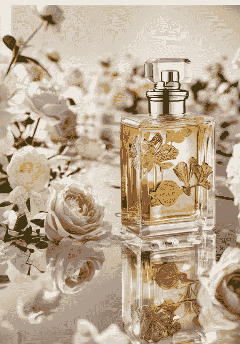

## 第1章 AI破局：给商业广告带来新活力

目前，商业广告的传播方式、内容形式和用户互动都在不断发生革新，传统的广告模式正面临前所未有的挑战。随着信息的爆炸式增长，用户获取信息的渠道和内容偏好愈加多元，广告需要更加精准、个性化和具有创造力。面对这一切，AI技术的应用恰逢其时，为商业广告注入了全新的活力，使得这一领域焕然一新。无论是从广告创意生成、传播精准度，还是消费者互动体验方面，AI的应用都在全面重塑广告行业的未来。

AI的介入大幅提升了广告创意的效率与多样性。在以往，广告的创意主要依靠人类的直觉与灵感，受时间与资源的限制，创造性输出的速度和质量难以满足市场的高速需求。而通过AI的自然语言处理与生成能力，广告从文案到视觉呈现都可以实现快速生成，满足不同市场、不同消费者的多样化需求。同时，AI的学习能力不断进步，通过对大量成功广告的学习与分析，它能总结出有效的创意模式并在内容中进行创新，实现广告内容的持续优化。在这种技术的支持下，企业不仅可以减少成本，更能通过新颖的创意设计吸引更多消费者的关注与兴趣。

AI在数据分析与精准投放上的应用极大提升了广告的传播效果。在过去，广告的投放主要依靠传统的用户画像和市场调查，难以准确抓住目标消费者的实际需求。而AI凭借其强大的数据处理与分析能力，可以从大量的用户行为数据中挖掘出隐藏的消费倾向和偏好，为广告投放提供更科学的依据。通过机器学习与算法优化，广告可以在合适的时间、通过合适的渠道精准触达潜在用户，避免资源浪费，同时提升广告的转化率。此外，AI还可以根据实时数据反馈对广告投放策略进行调整，实现更为灵活和智能化的广告投放模式，从而提升品牌的市场影响力和用户黏性。

AI技术还在改变消费者与广告之间的互动方式。借助语音识别、图像识别等技术，广告可以实时识别用户的情绪与需求，进而推送更具针对性的内容，增强互动体验。AI驱动的聊天机器人、个性化推荐系统等也为消费者提供了更多参与广告的机会，增强了广告的互动性和趣味性。同时，虚拟现实（VR）和增强现实（AR）技术的结合使得广告从传统的二维平面呈现转变为身临其境的体验式广告，消费者在参与过程中不仅能更好地理解品牌理念，还能感受到品牌带来的独特体验。AI的不断创新和发展让广告不再是单向的信息传递，而是成为与消费者情感联结、交流沟通的一种全新方式。

AI在商业广告中的应用无疑为行业注入了新活力，使其在创意生成、精准投放和用户互动上都实现了跨越式发展。AI的强大优势不仅提升了广告的传播效果，更让广告逐渐脱离传统模式的桎梏，成为引领市场、吸引消费者的核心力量。未来，随着AI技术的进一步成熟，商业广告的表现形式和沟通方式也将继续突破创新，不断适应并引领市场潮流。AI与广告的深度融合，不仅是商业广告行业的变革之路，更是品牌与消费者互动的新篇章。

### 1.1 AI设计大模型

AI领域涌现出多款专注于图像和视频生成的大模型，推动了视觉内容创作的革新。以下是一些知名的AI图像和视频生成大模型：

#### 1.1.1 图像生成大模型

- **DALL·E 3**：由OpenAI开发的文本生成图像模型，能够根据文本描述生成高质量、复杂的图像。
- **Midjourney**：于2022年7月发布的文本生成图像模型，以其独特的艺术风格和高质量输出而闻名。
- **Stable Diffusion**：于2022年8月发布的开源文本生成图像模型，支持用户在本地运行，生成多样化的图像内容。

#### 1.1.2 视频生成大模型

- **Sora**：OpenAI于2024年2月发布的文本生成视频模型，能够生成长达一分钟的高质量视频，标志着AI视频生成领域的重要突破。
- **PixelDance**：字节跳动推出的AI视频生成模型，采用DiT结构，支持文本和图像生成视频，能够生成长达10秒的连贯视频片段，涵盖多主体交互和时序性动作。
- **Vidu**：由生数科技与清华大学联合发布的AI视频生成模型，基于原创的U-ViT架构，支持一键生成长达16秒、1080P分辨率的高清视频。
- **可灵大模型**：快手推出的AI视频生成模型，具备卓越的图像理解能力，可将静态图像转化为生动的5秒视频，支持多种运动效果的生成。
- **Video-LLaVA**：北京大学ChatLaw课题组开源的视觉语言大模型，能够同时处理图片和视频输入，在视频问答任务中表现出色。

以上这些模型在图像和视频生成领域展现出强大的能力，被广泛应用于影视制作、广告传媒、短视频创作等多个场景，极大地提升了视觉内容的创作效率和质量。

### 1.2 AI设计的应用场景

这些AI大模型在图像和视频生成领域的应用场景广泛而深入，极大地推动了视觉内容的创新与创作效率提升。在图像生成方面，模型如DALL·E 3、Midjourney和Stable Diffusion，通过将文本描述转化为高质量的图像内容，为广告设计、品牌推广、产品包装等创意行业提供了新工具。广告创意人员可以输入产品特性或品牌理念的描述，生成视觉效果图来辅助设计，帮助构思创意。此外，在游戏和动画制作领域，设计师们可以借助这些图像生成模型快速生成角色设定、场景概念等初步设计，节省时间和资源成本。艺术家和插画师也利用这类模型进行作品创作，通过文本输入快速获得灵感图，实现跨界创作。Stable Diffusion作为开源模型，还可以在本地运行，允许用户根据自己的需求微调模型，从而在视觉创作中更具自主性和多样性，满足个性化需求。

在视频生成领域，Sora、PixelDance、Vidu等视频大模型使得创作者能够通过简短的文字描述生成动态视频，大幅减少视频制作时间。Sora通过生成高达一分钟的高质量视频，在影视制作和短视频平台上应用广泛，可以在前期规划阶段生成视频草案，用于测试观众反馈或呈现创意效果，从而帮助创作者在正式拍摄前节省成本。广告公司还可以利用Sora生成产品宣传视频，快速制作出符合品牌调性的视觉内容，用于营销传播。PixelDance则通过图像或文字生成短视频片段，这种连贯的动态生成使得多主体交互视频和复杂场景的生成成为可能。在教育领域，PixelDance可以生成教学场景的动态视频，增强在线学习的互动性和视觉体验，让学生对学习内容产生更直观的理解。

Vidu通过U-ViT架构生成1080P的高清视频，不仅可以满足在线短视频的制作需求，还可以在高质量广告片、微电影创作等对清晰度要求高的场景中应用，极大地减少视频编辑人员的工作量和时间。可灵大模型通过将静态图像生成生动的动态效果，可以在影像修复、历史影像还原等领域应用，使得老照片“活”起来，展示出过去场景的生动画面。这一技术广泛用于博物馆、档案馆等领域，通过对历史人物或场景进行视频化呈现，让观众沉浸式体验历史事件。Video-LLaVA作为一种视觉语言大模型，能够处理视频中的复杂语义关系，在视频问答和视频内容理解等场景中具有独特的应用优势。在社交平台上，用户可以通过视频问答功能，与短视频内容进行实时互动，提升了观众参与感。在智能家居、智能安防等领域，Video-LLaVA则可以帮助识别视频中的关键场景和事件，实现更高效的视频监控与安全管理。

这些图像和视频生成大模型在广告设计、影视制作、教育培训、文创艺术、智能安防等多个领域都有广泛应用，为创作者带来了新的可能性，大幅度提升了视觉内容创作的效率与质量，推动了各行业视觉内容需求的创新与升级。

### 1.3 常用的AI设计工具

上文讲述了设计AI大模型及其常用的应用场景，本节会介绍一些常用的AI设计工具及其优势和应用方面：

#### 1.3.1 图像生成工具

**DALL·E 3和Stable Diffusion：** OpenAI的DALL·E 3（图1-1）和开源的Stable Diffusion（图1-2）被广泛用于根据文本描述生成高质量图像。它们常用于广告设计、海报创作、视觉概念图绘制等场景，设计师可以通过输入关键词快速获得创意图像。

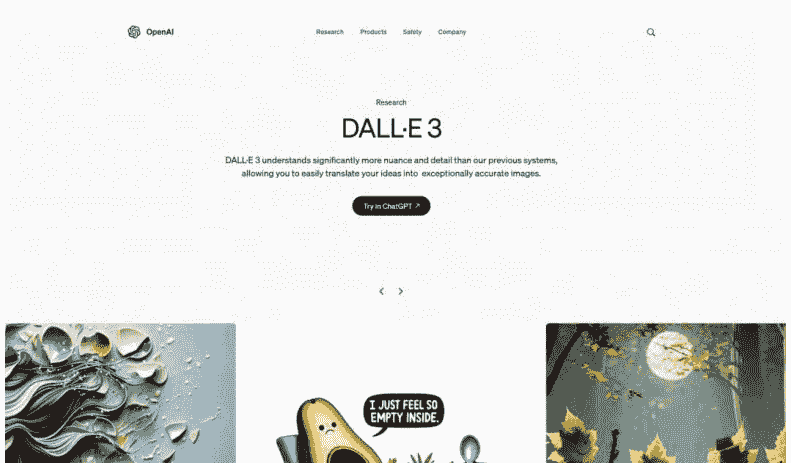

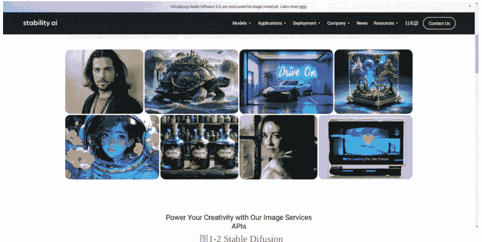

Power Your Creativity with Our Image Services APIs

图1-2 Stable Diffusion

**Midjourney：** 这个工具以其艺术性图像生成效果出名，适合品牌推广、产品包装、插画设计等需要独特视觉风格的项目，能提供高质量的图像输出（图1-3）。

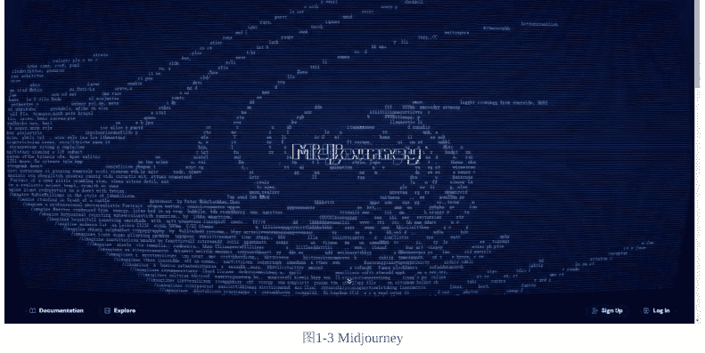

图1-3 Midjourney

**Artbreeder：** 这是一个基于GAN（生成对抗网络）的平台，允许用户通过混合不同图像生成新图像，适合角色设计、概念艺术、插画等应用（图1-4）。

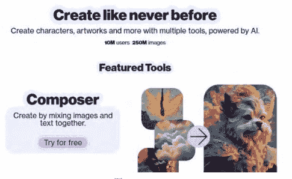

图1-4 Artbreeder

#### 1.3.2 视频生成工具

**Runway ML:** 这是一款强大的AI设计平台，提供了图像、视频生成和编辑的多种AI模型支持，适合短视频制作、广告视频创作等多种场景。其工具如“Text to Video”功能，可以快速将文本描述转化为短视频片段（图1-5）。

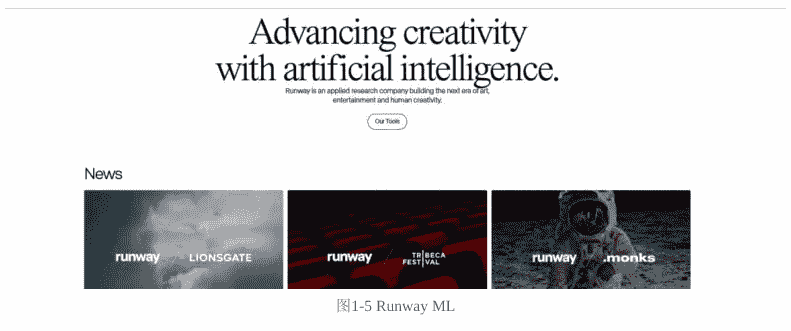

**Synthesia:** 主要用于生成视频中的虚拟角色口述内容，适合企业培训、在线课程、营销视频等领域。用户可通过输入文本，生成虚拟角色朗读内容的动态视频（图1-6）。

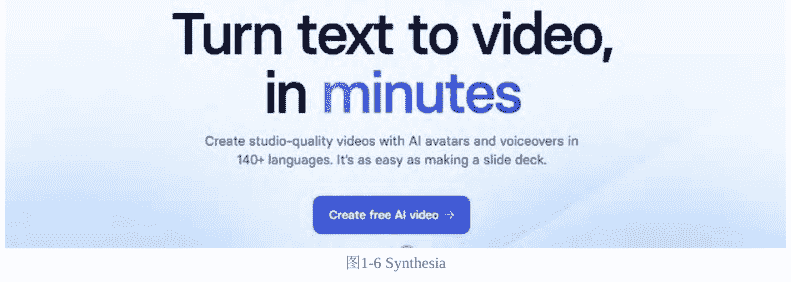

**DeepBrain AI:** 这是一款视频生成工具，支持输入文本并自动生成包含虚拟人物的叙述性视频，适用于新闻播报、视频简报等场景（图1-7）。


**即梦AI:** 即梦AI是由字节跳动推出的一站式AI创作平台（图1-8），它支持用户通过自然语言或图片输入生成高质量的图像和视频。其目标是降低创作门槛，激发用户创意，为创意爱好者提供一个AI表达平台。它适用于艺术创作、内容创作、教育领域以及广告与宣传等多个场景。

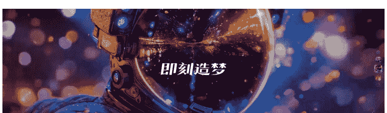

图1-8 即梦AI

#### 1.3.3 图像编辑和处理工具

**Adobe Photoshop和Adobe Firefly：** Adobe引入了AI工具Firefly，提供生成性填充和生成性扩展等功能，帮助设计师快速修复图像、补充背景或创建新图像元素（图1-9）。

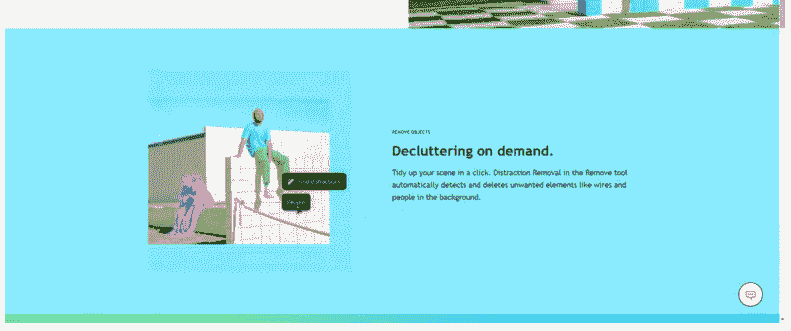

图1-9 Adobe Photoshop和Adobe Firefly

**Canva：** Canva中集成的AI工具，如Magic Resize、背景去除器等，能快速编辑和调整图像，适合社交媒体内容设计、广告海报制作等（图1-10）。

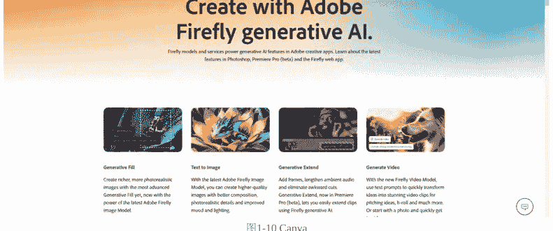

图1-10 Canva

**Remove.bg：** 这是一个AI背景移除工具，可以快速去除图像背景，适用于电商图像处理、社交媒体内容制作等（图1-11）。

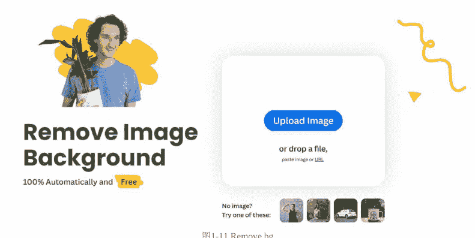

图1-11 Remove.bg

#### 1.3.4 文案与创意辅助工具

**ChatGPT和Jasper：** 这些AI写作工具可帮助创作者快速生成广告文案、内容创意，提升内容创作效率，特别适合需要文字和视觉结合的项目（图1-12、图1-13）。

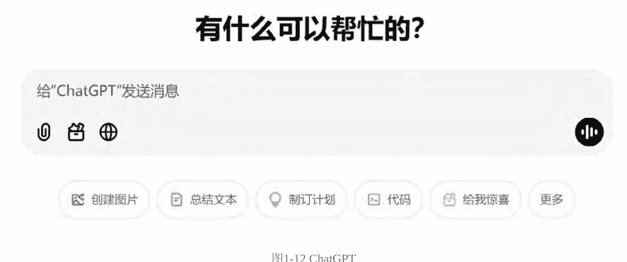

图1-12 ChatGPT

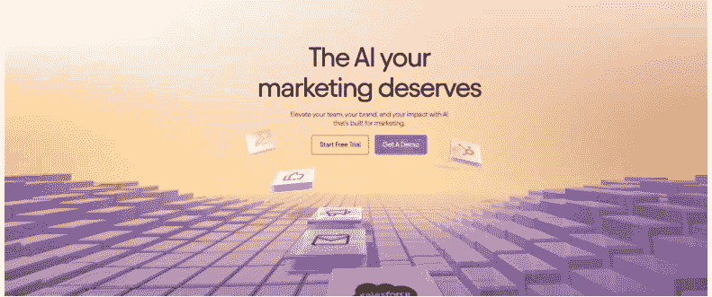

图1-13 Jasper

#### 1.3.5 动画和角色生成工具

**Character.ai：** 这是一个AI生成角色平台，适合游戏设计、动画制作等项目中需要定制化虚拟角色的场景，能够让设计师为不同项目生成角色和互动对话（图1-15）。

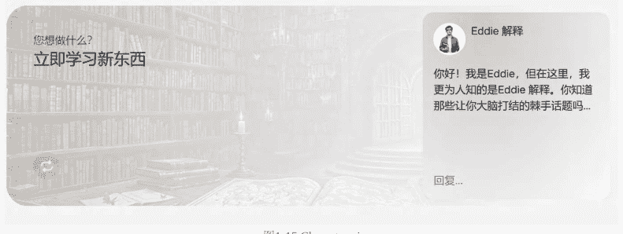

图1-15 Character.ai

**Puppet by DeepMotion：** 这款工具通过AI进行动作捕捉，生成动画人物的动态效果，适用于虚拟主播、游戏开发、动画视频等（图1-16）。

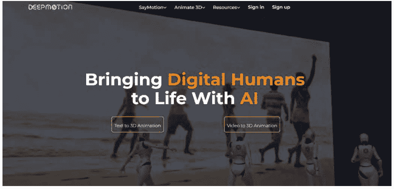

图1-16 Puppet by DeepMotion

#### 1.3.6 综合性生成工具

**Cohesive AI：** 这是一个基于人工智能的多功能平台，旨在帮助用户进行文本创作、内容生成、数据分析和协作管理等。其核心理念在于通过先进的自然语言处理和机器学习技术，简化内容创作过程并提升工作效率（图1-17）。

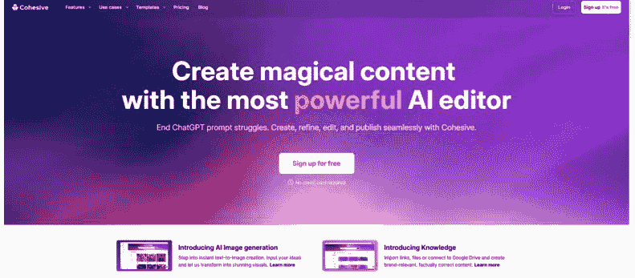

图1-17 Cohesive AI

### 1.4 该如何看待AI设计

AI设计的快速发展正在为创意领域注入前所未有的技术活力。从智能排版到图像生成，AI工具已经成为广告设计的重要组成部分。然而，尽管AI展现了强大的能力，但它并不是设计师的替代品，而是一种极具潜力的协作工具。如何看待AI设计，需要从人机协作的角度去理解，才能全面认识其在商业广告中的角色与价值。

AI设计的核心优势在于其高效性与数据驱动能力。它可以通过学习海量的视觉素材与用户偏好，在短时间内生成具有吸引力的设计作品。例如，AI能够在数秒内生成数百个广告方案，让设计师从中挑选和调整。这种效率是人类难以企及的，尤其是在商业广告需要快速响应市场需求时，AI的作用显得尤为突出。然而，这些高效的成果背后，并不意味着AI能独立完成整个设计过程。真正优秀的广告设计，不仅仅是算法堆叠的结果，更需要情感表达、文化理解和创意联想，而这些能力是AI所无法完全掌握的。

人类设计师的核心价值在于其创造性和对设计目标的深刻洞察力。AI的工作基于数据和模式，虽然擅长识别趋势和重复某种风格，但它无法捕捉复杂的文化语境或解读消费者的情感共鸣。例如，一则广告可能需要体现品牌的核心价值，同时融入当下社会热点。AI可以帮助生成素材，但对广告整体的情感张力和叙事结构的把控仍需要人类的创造性决策。

在商业广告中，人机协作是未来的最佳模式。AI承担了烦琐、高效的基础工作，而人类设计师则负责对创意方向进行把控。例如，在一场全球品牌推广活动中，设计团队可能需要制作大量多语言、多文化版本的广告。AI可以快速生成不同语言和风格的初稿，而设计师则可以在此基础上，针对每个市场的文化特性进行调整，确保广告既具备统一性，又具有本地化的吸引力。

人机协作的另一个重要性体现在创新和灵感的激发上。AI生成的设计方案有时会提供全新的创意视角，为设计师突破思维局限提供助力。例如，某服装品牌在广告设计中利用AI生成了数百种独特的图案设计，这些设计为创意团队带来了新灵感，使他们最终在其中选择并优化了最能体现品牌精神的元素。这种协作不仅提高了设计效率，也拓展了创意可能性。

AI设计的核心价值在于其协助性而非替代性。它让设计工作更高效、智能化，同时为创意的实现提供了强有力的技术支持。但无论技术多先进，人类的创造性和对情感与文化的理解始终是不可或缺的。AI和设计师的结合，不仅是技术与艺术的碰撞，更是未来广告行业迈向新高度的必然选择。在这个过程中，如何平衡AI的高效性与人类的创造性，将成为广告行业发展的重要命题。

## 第2章 AI提速：提高生产力

在当前竞争激烈的商业环境中，企业始终在探索提高广告生产效率的方法，以更快、更具吸引力地触达消费者。人工智能（AI）的出现为广告行业带来了前所未有的变革。AI技术不仅能辅助广告创意的生成，还能够精准分析用户数据，实现个性化内容推荐，从而显著提升广告的生产力。传统的广告创作通常需要大量的时间与人力投入，从策划、设计到投放，各个环节都面临复杂的流程和反复的修改，而AI的引入有效简化了这些步骤，使广告的生成与调整更为高效。

AI在广告中的应用可以通过智能生成工具、大数据分析和自动化流程极大地缩短制作时间。例如，借助自然语言处理和生成式AI，品牌可以快速生成符合自身风格的文案或图像，且这些内容可以实时根据市场反馈进行调整，从而实现广告的快速迭代。此外，AI还能通过数据分析精确识别用户需求，自动优化广告的投放策略，使广告内容更加符合目标受众的兴趣偏好。这种“量体裁衣”的广告模式不仅提高了广告的效率，还减少了资源浪费，提高了投入产出比。

更重要的是，AI不仅能够提升生产效率，还推动了广告创意的创新与多样化。AI生成的内容超越了传统广告思维的局限，使得企业可以在短时间内产生大量的创意概念，进一步丰富品牌的表达方式与风格。随着AI不断发展，这些智能生成的广告作品也更加贴近人类创意，使得品牌能够通过更个性化、情感化的内容吸引消费者，从而建立更加紧密的品牌关系。

AI驱动的广告创作模式加速了整个行业的生产力变革，使得企业可以以更低的成本、更快的速度、更高的质量完成广告生产。这不仅是广告效率的提升，更是广告创意和品牌传播方式的重新定义。通过有效利用AI技术，广告行业将迎来新的发展契机，为品牌创造出更多充满活力和创意的内容，以满足快速变化的市场需求。

### 2.1 简单了解AI商业广告制作的流程

在现实中，大家会在各大平台中看到各式各样的商业广告。但是将AI加入商业广告制作在当下可能是一片空白的内容，大家会对AI如何制作商业广告较为好奇，在这一节中，会对AI商业广告的制作流程进行一个简单的讲解，方便大家更好地了解AI商业广告的制作。

#### 2.1.1 明确需求与构思创意

需求分析：首先要与客户沟通，深入了解品牌定位、广告目标、受众特点等信息。明确广告的主题和核心信息，以便为后续创意和内容生成打下基础。

创意构思：在需求明确后，可以借助ChatGPT进行初步的创意发散和概念探讨。ChatGPT能够生成多个广告概念、文案主题或情境设想，帮助团队找到符合品牌调性的创意方向。

创意讨论：通过与ChatGPT的多轮对话，不断优化创意，直到获得一个清晰的概念和故事框架。这一步骤可以确保创意贴合客户需求，内容具有吸引力和独特性。

这里进行一个举例，比如笔者想要制作一个关于儿童玩具的广告，希望能够分析需求，同时为我设计海报创作一个创意大纲，可以这样去询问ChatGPT：

> 提问：
> 我希望制作一个关于儿童玩具的广告，可以先帮我分析一下用户需求吗。

ChatGPT回答：
当然，制作儿童玩具广告的用户需求分析是广告策划的关键一步。以下是一些核心的需求和目标分析，帮助您更好地确定广告的方向：
（1）目标用户群体
主要受众：儿童玩具的直接使用者是儿童，主要年龄层可能集中在3-12岁之间。根据年龄层的不同，需求会有所差异，例如学龄前儿童更关注玩具的趣味性和感官刺激，学龄儿童则可能偏向益智类、互动性强的玩具。
次要受众：玩具购买决策者通常是父母或监护人。因此广告需要同时吸引儿童和家长，既要展示玩具的吸引力，又要突显玩具的教育性、安全性和性价比。
（2）核心需求分析
安全性：父母在选择儿童玩具时，通常将安全性放在首位。广告中需要强调玩具的安全材质、结构设计是否符合标准，是否无毒无害。
教育性：家长越来越倾向于为孩子选择能够帮助他们成长的玩具，如益智类、动手操作类、逻辑推理类玩具。这些玩具不仅能够娱乐，还能促进孩子的智力、创造力和社交技能的发展。
娱乐性：对儿童而言，玩具首先要具备趣味性，能够引起孩子的兴趣，满足他们的好奇心和探索欲。广告需展示玩具的互动性、亮眼设计和趣味玩法，让孩子感到玩具“好玩”。

（3）情感诉求
幸福的亲子时光：广告可以突出玩具在家庭中促进亲子互动的功能。让家长意识到玩具不仅是孩子的专属物品，也是全家共享的体验。这样可以吸引家长产生购买的情感驱动力。
满足孩子的成长需求：广告可以展示玩具如何陪伴孩子成长，提供学习、探索和欢乐的空间，强化家长的认同感和责任感。

（4）用户痛点
质量问题担忧：家长关注玩具的耐用性、环保性，广告中可以强调玩具的坚固和安全认证。
学习效果不明显：家长担心玩具是否真正对孩子有帮助。广告可以展示玩具的教育设计理念，说明其对孩子成长和技能培养的积极作用。
使用周期：家长会担心玩具的“短期吸引力”，即玩具很快被孩子厌倦。广告中可以展示玩具的多样玩法或与其他玩具的组合性，让家长觉得玩具可以长时间使用。

（5）广告内容建议
视觉展示：用生动的场景展示玩具的使用方式和孩子的快乐反应，以视觉化的方式让家长和孩子都能感受到玩具的吸引力。
互动体验：可以展示孩子在玩具陪伴下探索、学习、互动的片段，让家长看到玩具在孩子生活中产生的价值。
家长评价：可以加入家长对玩具安全性、教育性、趣味性的评价，使其看起来更具可信度。

#### 2.1.2 脚本撰写和文案生成

文案撰写：在创意确定后，进入脚本撰写环节。ChatGPT可辅助编写完整的广告文案，包括场景描写、台词、情感传达等。其强大的自然语言生成能力，确保文案风格统一、逻辑连贯，并符合品牌调性。

脚本优化：与客户进一步确认脚本内容，进行必要的修改。ChatGPT可以根据反馈快速生成不同的文案版本，提高迭代效率。

视觉元素建议：ChatGPT还可以提供初步的视觉建议，例如广告中应该突出的品牌元素、产品特写和场景氛围等。

这里依旧以上文中的儿童玩具广告为例，这里要求ChatGPT帮助笔者创作关于儿童玩具广告的文案：

> 提问：
> 这里是一个吸引人的儿童玩具广告文案示例，符合家长的购买需求又能引起孩子的兴趣：

ChatGPT回答：
这里是一个吸引人的儿童玩具广告文案示例，符合家长的购买需求又能引起孩子的兴趣：
标题：
“让孩子的笑声填满家，让成长伴随每一个欢乐时刻！”

正文：
你是否希望孩子不仅玩得开心，还能在游戏中学到知识？我们的玩具不只是玩具，更是孩子成长的伙伴！
安全无毒材料，给孩子最贴心的保护
我们知道，安全是每个父母最关心的事。选用符合国际标准的环保材料，精心设计的圆滑边角，确保每一次接触都安全无虞。让家长放心，让孩子自由探索！
益智互动，激发孩子的无限潜力
我们的玩具鼓励孩子在动手、动脑中成长，通过互动和思考培养他们的逻辑推理、创造力和动手能力。每一次玩耍都是一次学习，每一个玩具都是一位启蒙老师！
多样玩法，持久陪伴孩子的成长之路
担心玩具“玩腻”？不用愁！丰富的组合玩法，让孩子每天都能发现新乐趣，不仅耐玩，还能培养他们的专注力。给孩子带来不一样的玩乐体验！
全家一起玩，增进亲子间的幸福时光
不仅是孩子的玩具，更是家庭的桥梁！我们设计的玩具不仅适合孩子独自玩乐，还能为家庭时光增添温馨和笑声。在互动中拉近亲子距离，让每一次陪伴都温馨美好。
结尾语：
让孩子的笑容更灿烂，让他们的童年更丰富！立即选购我们的益智玩具，为您的孩子打开一扇通往快乐和智慧的门！
这个文案在强调安全和教育性的同时，还展示了玩具的趣味性和亲子互动的价值，能够有效吸引家长的关注和兴趣，同时让孩子期待玩具带来的快乐时光。

#### 2.1.3 视觉设计与效果图生成

视觉概念化：在文案和脚本定稿后，可以利用Midjourney生成广告所需的视觉效果图。例如，通过输入品牌特征、广告场景、风格描述等关键词，Midjourney可以生成具有真实感或艺术风格的广告场景。

角色和场景设计：Midjourney擅长生成高度逼真的角色和场景图像，可以模拟出广告中需要的人物或背景。通过不断调整描述词，反复尝试生成合适的角色、产品和背景组合，确保符合品牌的视觉需求。

风格一致性：对于多场景广告，确保生成图像风格一致至关重要。Midjourney支持在相似参数设置下生成具有连续性的图像效果，为整个广告提供视觉上的连贯性。

#### 2.1.4 整合与优化

广告测试：在广告初稿完成后，可以进行观众小范围测试，收集反馈意见。ChatGPT可以根据反馈优化广告内容、脚本或其他细节，进一步提升广告的吸引力和效果。

视觉调整：根据反馈对图像细节进行微调，例如色彩、构图或背景等。利用Midjourney重新生成或优化特定场景，确保视觉表现更具吸引力。

整体效果检查：确保脚本、配音和视觉效果完美融合，形成一致、连贯的视觉和听觉体验。

格式处理：确保最终广告文件格式适应不同发布渠道（如社交媒体、电视等）的需求。

发布与追踪：广告发布后，可用AI工具分析广告表现，如观众反应、点击率等数据。ChatGPT还可以用于生成广告后期宣传策略或观众互动的自动回复内容，进一步增强品牌与用户之间的互动效果。

音频和配音：ChatGPT可以为广告制作合适的旁白脚本，并生成配音需求，甚至指导如何优化音频的情感表达。借助AI语音生成工具，生成符合广告情境的配音，增强广告的情感表达效果。

短视频生成：在短视频广告制作中，可结合ChatGPT和Midjourney生成的图像和脚本内容，借助其他视频合成工具将多媒体元素整合成完整的广告视频。

### 2.2 如何与AI沟通：提示词

在AI商业广告设计中，利用关键词调整设计是十分重要的一个步骤。关键词的准确性关乎AI商业广告图片的生成，如果新手用户的描述较为模糊则会导致图片生成不准确并且浪费许多时间。其实关于AI商业广告图片的生成可以交给ChatGPT来完成，利用ChatGPT生成AI商业广告的关键词，可以事半功倍并且避免自身词穷的问题出现。在这一节中，笔者将详细地讲解AI商业广告的关键词。

#### 2.2.1 快问快答：直接对话获取关键词

设计AI商业广告的过程中，在不清楚使用哪些关键词的时候，可以通过向ChatGPT提问来要求其帮助用户描绘具体的场景，下面笔者会做一个简单的演示。

首先，打开ChatGPT（图2-1）。

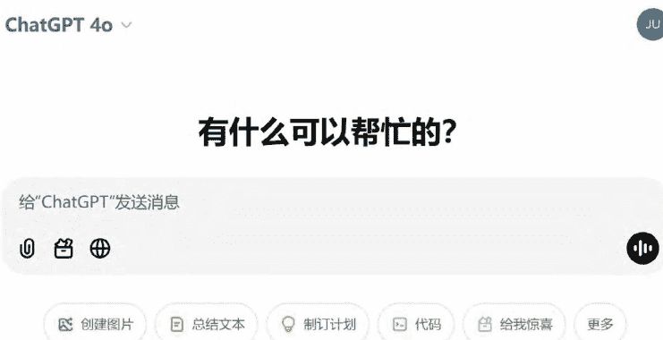

其次，在对话框中输入：“你好，请帮我形容一种饼干，较为适合青少年作为饭后甜点或者下午茶来食用。”

当然ChatGPT给出的回答也是非常的详细（图2-2）。

你好，请帮我形容一种饼干，较为适合青少年作为饭后甜点亦或者下午茶来食用

这款饼干被设计成一种适合青少年食用的健康美味，它拥有酥脆的口感和丰富的营养，十分适合用作饭后甜点或下午茶的小食。饼干外表呈金黄色，散发出诱人的香气。它的主要成分是优质小麦粉，配以天然蜂蜜和少许黑巧克力碎，使得甜味适中，不会过于甜腻。

这款饼干还添加了少量的坚果和燕麦片，带来微炒的坚果香气和富含膳食纤维的营养，帮助青少年补充能量并保持健康的消化。入口酥脆，而后慢慢融化在口中，带来层次丰富的味觉体验。无论是搭配牛奶还是茶饮，都是一次愉悦的味蕾享受。

图2-2 ChatGPT的回答

再次，需要ChatGPT对饼干的特点进行关键词总结，可以继续对ChatGPT进行提问：“我希望可以将这种饼干的特点进行总结，整理成关键词。”等待ChatGPT回答后，可以看出ChatGPT对饼干的特点总结得十分全面（图2-3）。

我希望可以将这种饼干的特点进行总结，整理成关键词

好的，这款饼干的特点关键词可以总结为：

**酥脆**：口感酥脆、松脆易嚼

**天然健康**：使用天然蜂蜜、优质小麦粉

**适度甜味**：甜而不腻

**营养丰富**：含坚果、燕麦，富含膳食纤维

**适合青少年**：适合作为饭后甜点或下午茶

**多层次口感**：入口酥脆，味觉层次丰富

**搭配性佳**：适合搭配牛奶或茶饮

图2-3 饼干的特点

最后，如果希望将饼干的特点描述与总结得更为细致，可以继续向ChatGPT进行提问：“希望可以对饼干的特点进行更为细致的描述。”等待ChatGPT回答，ChatGPT将对饼干进行细致描述，借此可以获得更多的关键词（图2-4）。

希望可以对饼干的特点进行更为细致的描述

这款饼干的特点在细节上体现了对口感和营养的精心平衡，适合青少年日常食用：

(1) **酥脆口感**：饼干的烘烤时间和温度经过严格控制，呈现出轻盈酥脆的质感，咬下去时能听到清脆的响声，细细咀嚼后却在口中柔和地融化，带来独特的酥软口感。
(2) **天然健康配方**：采用优质小麦粉，保留了小麦的天然香气，且不含添加剂；蜂蜜作为天然甜味剂，既增添了饼干的香甜味道，又减少了对精制糖的依赖，更加健康，适合青少年的成长需求。
(3) **适度甜味**：甜味控制得恰到好处，不会过于甜腻，反而带有天然的香甜感，这种微甜口感不仅讨人喜欢，而且让人不会产生负担感，适合作为餐后甜点，搭配茶饮或牛奶皆宜。
(4) **营养丰富**：饼干中加入少量的杏仁、核桃等坚果碎，以及燕麦片，为青少年提供了膳食纤维、优质蛋白和健康脂肪，帮助满足日常的营养需求，同时让饼干的口感更加多样化。
(5) **层次丰富的味觉体验**：每一口都能品尝到不同的风味，起初是饼干的酥脆感，随后坚果的微微坚韧和燕麦的轻柔质感层层展现，使整体口感丰富而不单调，满足不同味觉偏好的青少年群体。
(6) **高适配性**：这款饼干既适合搭配牛奶，为青少年提供更多能量，也适合搭配果茶或草本茶，清爽的茶香可以平衡饼干的甜味，带来清新的享受。

这款饼干的特点集营养、美味和口感于一身，特别为青少年设计，是兼具美味与健康的理想选择。

图2-4 细致描述

以上，便是通过直接对话来获取关键词的方式。

#### 2.2.2 准确指定：在对话中指定具体数字

在使用ChatGPT提问之前，可以在问题中指定具体的数字来进行更为精准的描述，从而获得准确的答案。

下面是笔者的操作演示：

打开ChatGPT，在输入框中输入：“你好，请给我3个关于滑板广告的标题文案”。

其中，“3个”是具体的数目，“滑板广告”是具体的内容，以下是ChatGPT给出的回答（图2-5）。

你好，请给我3个关于滑板广告的标题文案

(1) 「脚下的自由，风中的舞者——点燃你的滑板激情！」
(2) 「速度与创意的碰撞，让滑板带你飞跃平凡！」
(3) 「滑出个性，板上人生——解锁属于你的酷炫时刻！」

图2-5 滑板广告文案

### 2.3 AI设计如何简化传统广告的创作

在快速发展的数字时代，人工智能正在以极大的创新和效率改变广告创作的传统方式。传统广告制作的流程涉及策划、设计、拍摄、后期制作等多个复杂环节，每个环节都需要投入大量的人力和时间。相比之下，AI技术不仅缩短了创作周期，还能提供更加个性化和数据驱动的内容，使广告更高效地触达目标受众。AI设计的引入，正在彻底改变广告创作的每一个环节，使品牌能够更加灵活、快速地响应市场变化。

AI设计通过自动化和智能化流程简化了广告策划的初始阶段。在传统广告创作中，策划团队需要进行大量的市场调查、数据分析，以确定目标受众、市场趋势以及广告的主要方向。AI技术能够迅速分析海量数据，识别出消费者行为模式和市场动态。例如，通过自然语言处理技术，AI可以分析社交媒体上大量的用户评论和反馈，从中提取出消费者的需求、喜好和痛点。这种高效的数据分析能够帮助品牌更精准地定位目标人群，并为广告创作提供清晰的方向。

在设计环节中，AI图像生成和图像识别技术极大地提升了创意实现的效率。传统的广告设计往往需要依赖于专业设计师的创意构思与美术功底，而AI设计工具可以在短时间内生成大量的设计方案供团队选择。基于生成式对抗网络（GAN）等技术，AI能够根据设定的风格、色调和主题快速生成符合品牌形象的视觉效果。品牌可以输入一些关键词，AI便能生成高质量的图像素材，甚至是复杂的3D建模，这样不仅提高了创意的实现效率，还让非专业设计人员也能轻松进行视觉内容的创作。此外，AI能够通过深度学习技术分析历史数据，提取出品牌一贯的设计风格，并自动调整生成的图像，使之与品牌形象保持一致。这种能力使得品牌可以在短时间内更新广告素材，保持视觉内容的新鲜感与一致性。

AI还在视频广告的制作中展示出巨大的优势。传统的广告视频制作通常需要专业的拍摄设备、导演、演员等，成本高昂且耗时。AI视频生成工具则可以通过现有的素材库和图像合成技术，快速生成符合需求的视频内容。对于短视频广告来说，AI可以在几分钟内生成动态效果，甚至实现简单的特效和动画。通过自然语言生成技术（NLG），AI能够根据脚本自动生成字幕、配音，并添加音乐，使视频内容更加丰富生动。尤其是对于产品展示类视频，AI可以通过3D建模和虚拟现实技术，使产品在虚拟环境中呈现出真实感，从而吸引消费者的注意力。通过这些手段，广告视频的制作成本大幅降低，创作时间也显著缩短，品牌得以快速响应市场变化，实现即时营销。

在个性化广告方面，AI设计的价值尤为显著。传统的广告创作模式难以满足每位消费者的个性化需求，而AI通过分析用户的浏览习惯、消费记录和兴趣偏好，可以生成符合用户特定需求的广告内容。利用推荐算法，AI能够根据不同消费者的喜好调整广告内容的风格、文字和视觉元素，使广告更具针对性。例如，一位喜欢户外活动的消费者在浏览户外用品时，AI能够自动为其推荐相关的户外装备广告，并且配以户外场景的视觉设计。这种高度个性化的广告不仅增加了广告的点击率，还显著提升了用户的体验，形成更高的品牌黏性。AI设计使得品牌可以实现大规模的个性化广告创作，满足不同消费者的需求，从而在竞争激烈的市场中脱颖而出。

AI还可以在广告的实时监测和优化上发挥重要作用。在传统广告投放中，数据的收集和分析往往滞后，难以及时调整广告的内容和投放策略。AI设计工具可以通过机器学习算法，实时分析广告投放效果，包括点击率、转化率和用户留存时间等指标，快速找到效果最佳的广告内容和样式。通过数据反馈，AI可以自动优化广告的设计，选择更符合受众偏好的配色、文案和布局，从而提升广告效果。这种实时的优化能力，使得广告创作不再是一次性的，而是一个不断迭代、逐步改进的过程，使品牌能够及时回应市场的变化。

#### 2.3.1 反复多次：多次对话获取关键词

在上文中，可以看出ChatGPT的总结分析能力十分到位，仅通过对话即可获得想要的AI商业广告关键词。在这一节中，笔者将以“生日聚会”为主题，向读者讲解该如何通过多次对话来获取关键词。

打开ChatGPT，在输入框中输入：“你好，我需要你帮我详细描述一个生日聚会的画面，将描述中的修饰词使用逗号分隔开，要求描述的画面风格是喜庆的（图2-6）。”

> 你好，我需要你帮我详细描述一个生日聚会的画面，将描述中的修饰词使用逗号分隔开，要求描述的画面风格是喜庆的

在一间布置得温馨、明亮、色彩缤纷的房间里，生日聚会热闹非凡。墙上挂着五颜六色的气球，缤纷的彩带在空中轻轻飘荡，充满节日的氛围。桌子上摆放着一个精致、层层叠叠、奶油柔滑的生日蛋糕，蛋糕顶上点着几根闪闪发光的蜡烛，发出温暖、柔和的光芒。周围的朋友们脸上洋溢着灿烂、真挚的笑容，手里拿着色彩艳丽的纸杯蛋糕和饮料，彼此欢笑着，举杯庆祝。

房间的角落里有一个小小的礼物堆，包装纸明艳、装饰精美，礼物的缎带在灯光下闪烁着耀眼的光泽。孩子们穿着色彩鲜艳、精心挑选的衣服，兴奋地围绕着寿星跑来跑去，笑声在空气中回荡，充满了欢乐、轻松的气氛。大人们则在一旁愉快地交谈着，背景音乐欢快、轻柔，为整个聚会增添了活力。

当大家围聚在一起，唱起生日歌时，房间里充满了温暖、和谐、幸福的氛围。寿星闭上眼睛，带着一丝微笑，虔诚地许下心愿，然后吹灭了蜡烛，赢得了热烈、响亮的掌声和欢呼声。整个生日聚会画面充满了喜庆、温馨的气息，充满了爱和友情的温度。


ChatGPT给出的回答较为详细，但是略显冗长，笔者希望将描述精简一些，只需要在对话框中输入“请将上面的描述精简一些，保留10个画面关键词即可”。

如图所示，以下是ChatGPT的回答（图2-7）：

> 请将上面的描述精简一些，保留10个画面的关键词即可

房间、气球、蛋糕、蜡烛、笑容、礼物、孩子、笑声、生日歌、掌声。


这里需要注意的是，如果想要将描述和关键词放入设计AI中，就需要将描述和关键词翻译成英文，这样生成才会更为准确。

在这里，可以继续向ChatGPT提出要求：“将上述的描述和关键词转换为英文（图2-8）。”

将上述的描述和关键词转换为英文

**Description:**
In a warm, bright, and colorful room, the birthday party is lively and full of joy. Balloons hang on the walls, and a beautiful birthday cake with glowing candles sits on the table. Friends smile warmly, holding colorful cupcakes and drinks as they celebrate.

Gifts wrapped in vibrant paper with ribbons shimmer in the corner. Kids, dressed in bright clothes, run around the birthday star, filling the air with laughter. Adults chat happily, with cheerful music playing in the background. Everyone gathers around to sing the birthday song, and the birthday star makes a wish and blows out the candles, greeted by enthusiastic applause and cheers. The whole scene is festive, cozy, and full of friendship and happiness.

**Keywords:**
room, balloons, cake, candles, smiles, gifts, kids, laughter, birthday song, applause.

图2-8 转换为英文

以上便是通过多次对话获取AI商业广告设计的关键词的方式，在下面的内容中将会用到这一步骤，并且生成画面。

#### 2.3.2 精华总结：生成表格整理关键词

在与ChatGPT对话中，可以利用ChatGPT生成表格来总结整理所需要的关键词，同时还可以进行区分。

在这一小节中，笔者以生成商业广告的图片需要几部分为题，在对话框中输入：“请帮我创作一幅商业广告图片，利用表格来详细地表达出这幅商业广告的图片构成部分（图2-9、图2-10）。”

请帮我创作一幅商业广告图片，利用表格来详细地表达出这幅商业广告的图片构成部分

以下是商业广告图片的构成表格，用于详细描述每个部分的内容、位置及设计特点。此广告图的主题为“庆祝活动”，以适合青少年生日聚会的场景呈现出活泼、喜庆的氛围。

| 图片构成部分 | 描述 | 位置 | 设计特点 |
|---|---|---|---|
| 背景色 | 明亮、暖色调，偏向浅黄色或浅粉色，营造温馨、愉悦的氛围 | 整体背景 | 色彩柔和，轻微渐变效果，使整体更有层次感 |
| 墙面装饰 | 五颜六色的气球和缤纷的彩带 | 背景中间和顶部 | 气球分布错落有致，彩带弧形垂下，增加立体感 |
| 中心焦点：蛋糕 | 多层蛋糕，顶层插有闪亮的蜡烛 | 图片中央偏下 | 蛋糕设计精美，奶油装饰，顶部的蜡烛亮着温暖的光芒，吸引视线 |
| 聚会人物 | 微笑的青少年，手持小蛋糕或饮料 | 中心偏右或偏左 | 人物表情喜悦，穿着色彩鲜艳，手持小甜点，增添活泼气氛 |
| 礼物堆 | 色彩丰富的礼物盒，缎带装饰 | 图片右下角或左下角 | 礼物包装明艳，有闪光效果，增加吸引力 |

图2-9 商业图片的构成表格（1）

| 标题文字 | “生日派对大促销”或“为你的特别日子增添更多欢乐” | 图片顶部或中心上方 | 使用大字体，色彩对比鲜明，突出节日主题，吸引眼球 |
| 促销信息 | 优惠信息，如“全场礼品8折优惠”或“特价套餐” | 标题下方或图片底部 | 字体较大，使用亮色背景块突出，增加视觉冲击力 |
| 背景音乐元素 | 音符图标点缀，营造音乐氛围 | 图片四周，散落分布 | 音符较小，轻微透明，提升画面的活泼感 |
| 联系方式或二维码 | 公司的联系方式或优惠码二维码 | 图片右下角 | 小图标或二维码，设计简洁，方便用户联系或扫码 |

这种布局使得广告图片整体协调，重点突出，能够引导观众的视线，同时展示产品信息和促销内容。

图2-10 商业图片的构成表格（2）

再继续向ChatGPT提问，让其给出具体的提示词。笔者在输入框中输入：“我想创作一幅美食街商业活动的广告，请问可以用哪些视觉元素来吸引顾客，请用表格将其中的视觉元素关键词总结出来，并最后描述内容。”

如图所示，ChatGPT给出了相应的关键词，以下便是关键词信息（图2-11、图2-12）：

我想创作一幅美食街商业活动的广告，请问可以用哪些视觉元素来吸引顾客，请用表格将其中的视觉元素关键词总结出来，并最后描述内容

以下是适合美食街商业活动广告的视觉元素关键词表，通过这些元素来吸引顾客，营造热闹的氛围和诱人的美食场景。

| 视觉元素 | 关键词 | 说明 |
| --- | --- | --- |
| 背景色 | 热烈、明亮、温暖色调 | 使用红色、橙色、黄色等温暖色彩 |
| 美食图片 | 精美、诱人、多样化 | 各类美食近距离拍摄，细节丰富 |
| 装饰物 | 霓虹灯、灯笼、小彩旗 | 增加节庆感，吸引夜晚的注意 |

图2-11 关键词信息（1）

| 视觉元素 | 关键词 | 说明 |
| --- | --- | --- |
| 人群 | 欢笑、互动、热闹 | 展现顾客享受美食的场景，吸引人流 |
| 促销信息 | 折扣、买一送一、特惠 | 突出活动优惠，醒目展示 |
| 动态元素 | 烟火、气泡、火花 | 增加画面动感，吸引目光 |
| 标题文字 | 大字体、对比鲜明 | 例如“美食狂欢节”，快速传递信息 |
| 标志性美食 | 烧烤、串串、小吃 | 各类热门小吃吸引人群目光 |
| 地点标识 | 美食街名称或地图 | 突出位置，方便顾客定位 |
| 气氛烘托 | 香气效果、烟雾特效 | 模拟美食香气，带来沉浸体验 |

**广告内容描述：**
广告采用温暖、热烈的红橙色调背景，中心区域是各类精美的美食图片，展示串串、烧烤、甜点等特色小吃。背景加入霓虹灯、小彩旗和灯笼，营造出热闹的夜市氛围。广告中展示欢笑的人群享受美食的情景，吸引路人也想加入体验。标题文字如“美食狂欢节”，采用醒目的大字体展示，下面突出优惠活动信息，如“全场折扣，买一送一”。广告四周用烟火、气泡等动态元素点缀，给人视觉冲击。底部则附上美食街的位置标识和二维码，方便顾客获取更多信息。

图2-12 关键词信息（2）

然后在输入栏中输入：“上面的美食街商业广告中的文字内容可以分为哪些类型，请总结关键词，以表格形式表示（图2-13、图2-14）。”

上面的美食街商业广告中的文字内容可以分为哪些类型，请总结关键词，以表格形式表示

以下是美食街商业广告中常见的文字内容类型及其关键词总结表：

| 文字内容类型 | 关键词 | 说明 |
|---|---|---|
| 标题文字 | 美食节、狂欢、美食街、聚会 | 用于吸引眼球，快速传递广告主题，突出活动氛围 |
| 活动名称 | 美食狂欢节、夜市美食节 | 活动的具体名称，强化广告记忆点 |
| 促销信息 | 折扣、优惠、买一送一、特惠 | 吸引顾客关注活动优惠，激发消费欲望 |
| 美食名称 | 烧烤、串串、奶茶、小吃、甜点 | 具体美食的名称，展示多样化，吸引不同顾客群体 |
| 地点信息 | 美食街、地址、地标、导航 | 提供活动的具体位置，让顾客易于找到 |
| 时间信息 | 日期、时间、营业时间 | 活动的具体日期和时间段，方便顾客安排前往 |
| 参与方式 | 扫码、关注、转发 | 引导顾客参与活动，如扫码获取更多优惠或活动信息 |
| 情感用语 | 欢迎光临、尽情享受、狂欢时光 | 营造亲切、热情的氛围，增强活动吸引力 |
| 安全提示 | 卫生保障、消毒措施、限流人数 | 提供活动的安全保障信息，增加顾客信任感 |
| 联络信息 | 电话、微信、网站、客服 | 提供联系方式，便于顾客咨询或获取更多活动信息 |

图2-13 表格形式表示（1）

图2-14 表格形式表示（2）

这些文字内容类型在广告中形成层次分明的信息布局，有助于顾客快速理解广告信息并产生兴趣。

如果感觉ChatGPT给出的信息不够具体，可以继续提问，针对相关的主题、背景以及提示进行详细的提问，在不断的提问中，ChatGPT给出的提示会更精准。最后将这些所需要的关键词信息放到AI设计工具中。

以上就是如何利用AI生成表格来总结整理关键词的方法。

## 第3章 妙笔生花：生成商业广告文案

如今，消费者的注意力越发分散，广告文案创作迎来了全新的挑战。品牌不再仅仅依靠传统的文字打动消费者，而是需要在极短的时间内，通过创新且精准的文案传递价值和情感。然而，高质量文案的产生过程是耗时且复杂的，涉及创意、语言艺术和市场洞察等多个方面。随着人工智能的崛起，这一过程正变得更高效和智能化。AI文案生成技术不仅打破了时间和创意的限制，更为文案创作赋予了新的可能，使品牌可以在复杂多变的市场中更敏捷地吸引和留住消费者。

AI生成文案的优势在于它可以快速生成大量富有创意、个性化和数据驱动的内容。在传统文案创作中，创作者需要深入研究消费者的需求和市场趋势，并投入大量时间进行构思和编辑。AI文案生成工具则能够通过深度学习和自然语言处理技术，从大量数据中快速提炼出用户需求，生成符合品牌定位和受众口味的文案。这不仅提高了创作效率，也保证了文案内容的精准度。无论是电商产品描述、社交媒体广告还是电子邮件营销，AI可以迅速响应需求，生成极具感染力的文字，以吸引消费者的注意。

此外，AI文案生成技术还带来了更强的个性化能力。通过分析用户的消费行为、浏览记录和偏好，AI可以自动调整文案的风格和内容，使其更加贴近不同用户的心理。这种个性化的能力不仅提升了用户的体验，还增加了广告的点击率和转化率。AI生成的文案能够适应不同场景和风格的需求，在广泛的应用场景中，为品牌带来更好的市场表现。

“妙笔生花：AI生成商业广告文案”将为您揭示AI如何助力品牌的文案创作，探索其在效率提升、个性化呈现和市场响应中的无限潜力。让我们一同走进这场数字化的文案革命，见证AI如何为广告业注入新的活力。

### 3.1 ChatGPT的文案创作能力

商业广告文案的创作愈加复杂。品牌需要在短暂的注意窗口内吸引消费者，传递价值主张、情感共鸣和品牌特性。然而，传统文案创作需要大量时间和资源，从市场调研到创意策划，再到撰写和修改，这一过程耗费成本且难以快速响应市场需求。ChatGPT的出现为广告创作带来了前所未有的转变：借助强大的自然语言处理和生成能力，ChatGPT能够快速、高效地为品牌提供创意十足、精准切题的文案内容。

ChatGPT在广告文案创作中的一大亮点在于其对多种风格和语气的把握能力。从正式严谨的专业用语到轻松活泼的幽默语言，ChatGPT能够根据品牌调性和目标受众需求自动调整文案风格，使内容更具吸引力。例如，在时尚品牌广告中，ChatGPT可以生成兼具创意和美感的文字来展示产品特性；在科技产品的广告中，它能用精练而专业的语句传递产品的技术优势。通过这种灵活的语气转换，ChatGPT帮助品牌在不同场景和受众中实现了更快的语言适应性。

更重要的是，ChatGPT通过学习和整合大量的市场数据和语言模型，不断优化和完善自身的广告创作能力。这种数据驱动的方式让它能够快速适应市场动态，生成贴近消费者需求的内容。例如，在分析消费者趋势时，ChatGPT能够迅速提炼出当前流行的关键词、情感倾向和表达方式，使生成的文案具有更强的时效性和亲和力。这种高效且灵活的创作方式，帮助品牌实现了更高的市场响应速度，提升了消费者的点击率和参与度。

总之，ChatGPT的广告文案创作能力展示了未来智能创作的可能性。它不仅可以为品牌带来内容创作的效率提升，还在精准传达、个性化呈现等方面为品牌提供了新的解决方案。借助ChatGPT，品牌将更容易在竞争激烈的市场中脱颖而出，为消费者带来耳目一新的体验。这一技术的进步无疑将推动广告创意行业迈入更加智能化、数据化的新时代。

#### 3.1.1 创作电商推广文案

商业广告文案大多数用于产品推广、宣发、营销等商业活动的文字内容，是为了能够通过文字吸引消费者眼球，提高消费者购买欲望从而达成销售的目的。电商广告文案主要是为了能够概括产品的特点并且展示产品的优势，这类文本可以通过ChatGPT快速生成，利用此类推广文案，可以让产品的销量和影响力都得到提高。

在这一小节中，笔者将会利用ChatGPT进行对话来进行操作演示：

首先，打开ChatGPT，在对话框中输入提示词：“我希望销售一款冰箱，这款冰箱的特点是三分区格局、保鲜冷冻、一级能耗、可以通过手机APP控制，请结合此款冰箱的特点来分析出这款冰箱的卖点。”（图3-1、图3-2）

> 我希望销售一款冰箱，这款冰箱的特点是三分区格局、保鲜冷冻、一级能耗、可以通过手机APP控制，请结合此款冰箱的特点来分析出这款冰箱的卖点

这款冰箱的独特卖点可以通过其智能功能、能效等级和贴心设计来突出，为消费者带来更加便捷和高效的生活体验：

(1) **三分区格局**：冰箱内部设计了三分区格局，具备冷藏、冷冻和保鲜分区，让不同食材在适宜的温度环境中存储，避免交叉串味，保持食材的新鲜口感。用户可以轻松分类储存日常食材、冻品和蔬果，满足不同的储存需求，优化了空间利用率，特别适合喜欢囤货和家庭用餐频繁的用户。

(2) **保鲜冷冻技术**：搭载先进的保鲜冷冻技术，能够根据食材的种类和储存需求，自动调节冷藏区和冷冻区的温湿度，确保肉类、蔬菜和水果都能在最佳状态下储存。这种设计不仅延长了食材的新鲜期，也让家庭在减少食物浪费方面获益，尤其适合追求健康生活的用户。

(3) **一级能耗，环保节能**：作为一级能耗的高效冰箱，这款产品在节能表现上尤为突出。低能耗设计不仅可以显著减少家庭的用电成本，长期使用也更加环保。对于注重节能环保的消费者而言，这款冰箱兼具经济效益和环保优势，是减少碳足迹的理想选择。


(4) **智能APP控制**：冰箱支持通过手机APP进行远程控制，用户可以实时查看冰箱温度，随时调整冷藏、冷冻设置，甚至接收食材管理提醒，让存储变得智能化和便捷。无论是在上班途中还是外出购物时，都能一键掌控冰箱状态，保证食材新鲜，避免误买重复食材。这一功能尤其贴合现代快节奏的生活方式，帮助用户更高效地管理家居生活。

结合以上卖点，这款冰箱不仅以功能完善、分区科学的设计满足了日常储存需求，还通过智能化、节能性和便捷性为用户提供了更高质量的生活方式。这些特点为用户带来了更贴心的使用体验，使得这款冰箱成为现代家庭的优质之选。


其次，在输入框中输入提示词，这里笔者输入的是“请根据这款冰箱的卖点，写出一篇产品的推广文案，要求中英文各一篇。”（图3-3、图3-4）

请根据这款冰箱的卖点，写出一篇产品的推广文案，要求中英文各一篇

##### 中文推广文案：

想让生活更轻松，更高效？这款智能冰箱为您带来全新的储存体验！三分区格局设计，冷藏、冷冻、保鲜三大区域精细划分，确保每种食材都有最适宜的存放环境。无论是肉类、蔬果，还是速冻食品，都能在这里找到专属的“储藏空间”。

搭载保鲜冷冻技术，这款冰箱智能调节温湿度，锁住新鲜，延长保质期，让您时刻享受健康美味。更棒的是，它还具备一级能耗，既节省电费，又更环保，帮助您轻松实现节能生活。

作为现代家庭的理想伴侣，这款冰箱支持手机APP远程控制。无论您在何时何地，都可以通过手机随时查看温度、调节设置，甚至还能管理食材库存，避免浪费。让生活更智能，这就是我们为您带来的便捷！

选择这款冰箱，体验新时代的智能储存，让每一口都充满新鲜与健康。

图3-3 中文推广文案

##### English Promotional Copy:

Looking for an easier, more efficient way to manage your kitchen? Discover a new level of convenience with this smart refrigerator! With a thoughtfully designed three-zone layout, you get dedicated spaces for refrigeration, freezing, and freshness preservation. Each zone is tailored to provide the ideal environment for meats, fruits, vegetables, or frozen goods, keeping your food fresher for longer.

Equipped with advanced freshness-freezing technology, this refrigerator intelligently adjusts humidity and temperature levels to lock in freshness, ensuring every bite tastes as good as the day it was stored. Plus, with its top-tier energy efficiency rating, this eco-friendly choice helps you save on electricity bills while reducing your carbon footprint.

Perfect for the modern home, this refrigerator also offers remote control through a mobile app. Wherever you are, you can check and adjust temperature settings or even manage your food inventory from your phone, helping you avoid food waste and stay organized. Smart living has never been so easy!

Choose this refrigerator for an elevated storage experience, where freshness and health are just a tap away.

#### 3.1.2 创作体育用品文案

体育用品广告文案一般是户外运动产品的宣传、推广以及对于参与运动的呼吁。体育用品广告通常是在广告牌上展示，在这一节中，笔者将会用ChatGPT进行对话来进行体育用品文案的创作。

接下来，将会是具体的操作流程：

依旧是打开ChatGPT，然后笔者在输入栏中输入：“我想为一个体育用品的户外广告牌创作文案，希望可以帮我总结文案有哪些特点。”（图3-5）

> 我想为一个体育用品的户外广告牌创作文案，希望可以帮我总结文案有哪些特点

体育用品的户外广告牌文案通常具有以下几个特点，以确保能快速吸引注意并传递品牌信息：

- (1) **简洁有力**：文案通常精炼，字数少，以便快速传达品牌信息。短句或口号能抓住路人注意力，并迅速传递核心卖点。
- (2) **鼓舞人心**：体育用品的文案多带有激励性，使用充满能量的词语，激发消费者的运动热情，鼓励他们追求更高目标或挑战自我。
- (3) **行动导向**：文案通常包含鼓励行动的词语，如“出发”“挑战”“突破”等，促使观众立即产生行动的欲望，与产品产生情感关联。
- (4) **视觉化语言**：广告文案善于使用形象生动的语言，使观众能够立即联想到运动场景或身体的活力，比如“冲刺”“跃动”“极速”等词，增强代入感。
- (5) **品牌或产品关联**：文案会直接或间接提到品牌或产品的特性，比如“专业”“轻盈”“耐用”等，突出体育用品的优势或卖点，增强品牌记忆。
- (6) **情感共鸣**：通过情感化的语言，让消费者产生共鸣，帮助他们建立对品牌的积极情感。例如，强调与“胜利”“坚持”“自我挑战”等主题相关的情感，以吸引热爱运动、追求突破的目标用户。
- (7) **视觉配合**：广告牌的文案与视觉元素相辅相成，通常会与运动员的形象、运动场景或品牌标志性产品结合，以增强整体的冲击力和吸引力。

一个有效的体育用品户外广告文案通常会通过这些特点来吸引消费者注意，快速传递品牌的精神和产品价值。

在生成完毕之后，继续在同一个输入框中继续输入提示词：“请帮我根据上述体育用品的特点提供一些健身餐产品的文案，能够结合户外运动，优点是方便食用。”（图3-6）

请帮我根据上述体育用品的特点提供一些健身餐产品的文案，能够结合户外运动，优点是方便食用

以下是几组结合户外运动、方便食用的健身餐产品文案，突出便捷、营养与活力感：

- (1) “突破体能，随时随地！”
无论攀登山巅还是畅跑林间，携带方便的健身餐，为你补充足够能量，随时迎接每一次挑战！
- (2) “无负担的力量，装进你的背包！”
健身餐轻盈便携，富含高能营养，给你轻装上阵的活力，随时随地补充体力，让运动更自由！
- (3) “每一步前行，都有能量相伴！”
小小健身餐，满满营养支持，为户外运动量身打造，补充活力，助你勇敢前行，享受自然与挑战。
- (4) “出发吧！营养在手，活力随行！”
健身餐轻松装进口袋，不论徒步、跑步还是骑行，每一口都是对你的支持，简单便捷，让运动更轻松！
- (5) “能量随身，尽享运动快感！”
精致包装，随取随食，充足的蛋白质与纤维给你持久活力，伴随你在每段户外旅程中轻松进发！
- (6) “轻便健身餐，挑战无极限！”
快速补充体能，健康、便捷，为户外爱好者设计，每一个运动瞬间都更轻松、更充实！
- (7) “便携美味，与你一起向前！”
健身餐小巧而强大，不论山巅还是赛道，随时为你补充能量，畅享每一次运动的酣畅淋漓。

这些文案通过简洁有力的语言传达出健身餐产品的便携、营养优势，与户外运动的场景相结合，鼓励消费者在运动中轻松补充能量。

图3-6 健身餐产品

在此节做一个进阶操作，接着在输入框中输入提示词：“请帮我给上述的健身餐产品出10条广告文案。”（图3-7）

请帮我给上述的健身餐产品出10条广告文案

以下是10条适合健身餐产品的广告文案：

- (1) “你的运动拍档，随时随地补充活力！”
轻便健身餐，装进口袋，带上营养，一路随行！
- (2) “无惧高峰，每一步都是新起点！”
便携营养助力，让健身餐成为你登山、跑步的必备伴侣。
- (3) “一口能量，迎接户外挑战！”
高蛋白、低热量，轻松带走，随时加满活力。
- (4) “自由奔跑，无需担心能量不足！”
健身餐速享营养，完美适配你的每次运动冒险。
- (5) “快速补能，享受每一公里的畅快！”
健身餐在手，能量无忧，助你轻松突破运动极限。
- (6) “无负担的力量，让你越走越远！”
健身餐轻便好带，运动路上，随时随地轻松补给。
- (7) “只需一口，便能刷新活力值！”
健身餐满足日常运动需求，让你无惧每个挑战。
- (8) “户外营养新选择，便携能量伴你行！”
高效补充，轻松无负担，助你在每次运动中大放异彩。
- (9) “高效能量，快速回馈你的每一份努力！”
轻便健身餐，随时随地恢复体能，助你从容应对每一段路。
- (10) “户外、健身、补能，一步到位！”
健身餐让你享受美味与便捷，轻松携带，营养随时随地到位！

图3-7 10条广告文案

#### 3.1.3 创作电视广告文案

在如今的媒体领域，电视是能够直观地提供信息以及让用户感受信息的重要媒介，用户能够通过电视看到很多的商业信息，利用电视助力产品的销售。

在这一节中，会利用ChatGPT来生成电视广告文案，笔者依然会用实践操作来进行ChatGPT创作电视广告文案：

打开ChatGPT，在输入框中输入提示词：“假设你是一位经验丰富的室内设计师，希望你可以为我提供一些关于地板的广告语。”（图3-8、图3-9）

假设你是一位经验丰富的室内设计师，希望你可以为我提供一些关于地板的广告语

当然！作为一位经验丰富的室内设计师，我会根据不同的地板特点和广告语的需求，提供一些创意广告语。以下是几种不同风格的广告语：

##### (1) 高端奢华系列

- “一步步走进奢华，地板也能品味生活”
- “尽享优雅与舒适，地板之选，品味如你”
- “每一寸地板，都是品味的延伸”
- “奢华与舒适并存，让每一个脚步都充满温暖”

##### (2) 环保健康系列

- “自然之选，健康之道”
- “绿色环保，让地板也呼吸新鲜”
- “与大自然亲密接触，给家一个健康的空间”
- “从脚下开始，呵护您的每一步”

##### (3) 耐用实用系列

- “经得起时光考验的地板，承载每一个家庭的故事”
- “坚固耐用，随心所欲的每一个空间”
- “为生活增添力量，让地板陪你走得更远”
- “从不妥协，只为给你更长久的陪伴”

##### (4) 现代简约系列

- “简约之美，地板从容”
- “设计源于生活，优雅在每个细节”
- “简洁舒适，演绎现代家居之美”
- “轻松打造现代感空间，地板是关键”

图3-8 地板的广告语（1）

##### (5) 艺术创意系列

- “将艺术带入每一步，地板也是一幅画”
- “步步惊艳，地板与空间的完美融合”
- “每一块地板，都是一件艺术品”
- “设计源于灵感，地板让空间更有故事”

图3-9 地板的广告语（2）

然后在输入框中输入提示词：“请为我根据地板的舒适的触感写一个广告词，同时为这段广告语创造一个情景以及生活画面，最好能够引人入胜。”（图3-10）

请为我根据地板的舒适的触感写一个广告词，同时为这段广告语创造一个情景以及生活画面，最好能够引人入胜

##### 广告语

> “每一步，都是轻柔的拥抱；每一次触碰，都是温暖的记忆。”

##### 情景与生活画面

在清晨的阳光洒满客厅的时刻，一个小女孩赤脚从房间里跑出来，开心地追逐着她的宠物小狗。她的脚轻轻踩在温暖的地板上，露出了幸福的笑容。小狗欢快地在阳光下打滚，地板上的触感仿佛是他们最温柔的舞台。

远处，妈妈正在厨房准备早餐，爸爸手捧一杯咖啡，站在窗前感受早晨的清新。一家人相聚的每一个时刻，都离不开这块地板带来的柔软与舒适。

画面切换到夜晚，奶奶坐在地板上的软垫上，和孩子们一起拼着积木，笑声洒满整个屋子。地板不仅是他们游戏的场所，更是承载亲密记忆的温暖陪伴。

**旁白（画外音）：**

> “它不仅是一块地板，更是您与家人共享温馨时光的起点。让生活从脚下开始，感受舒适的触感，创造爱的瞬间。”

这个情景和画面旨在通过生活的细节和情感连接，将地板的舒适触感与家庭温暖联系起来，吸引消费者的情感共鸣，同时突出产品的核心价值——舒适、温暖与亲密的陪伴。

图3-10 广告词

### 3.2 精细分析：提高文案质量

上一节中笔者通过几个实例讲述了如何利用ChatGPT来进行商业广告文案创作，这一节笔者将会讲述如何利用ChatGPT来进行详情文案的编写，给商品进行一个详细的描述，其中包括产品的设计、功能、规格、使用方式以及注意事项等详细的信息以便消费者可以全面地了解产品的情况。

用户可以借助ChatGPT来获取一些产品的详情内容文案，不但可以提高效率，而且可以减少人为错误的出现。

接下来笔者会利用ChatGPT来进行操作演示：

打开ChatGPT，在输入框中输入：“现在你是一位资深甜品师，对于甜点十分的了解。我希望你可以为我出一个关于生日蛋糕的方案，但是我不清楚蛋糕的详情，所以我需要提供哪些信息？”（图3-11、图3-12）

> 现在你是一位资深甜品师，对于甜点十分的了解。我希望你可以为我出一个关于生日蛋糕的方案，但是我不清楚蛋糕的详情，所以我需要提供哪些信息？

作为一位资深甜品师，我可以为您设计独特且美味的生日蛋糕方案！为了确保蛋糕符合您的需求并让庆祝活动更特别，您需要提供以下关键信息：

#### (1) 蛋糕的基本信息

- **人数：** 蛋糕需要满足多少人食用？（影响蛋糕的大小和层数）
- **预算：** 您的预算范围是多少？（影响设计复杂度和材料选择）


#### (2) 风格和主题

**整体风格：** 想要的主题风格（如浪漫、可爱、个性、简约、奢华等）。
**特别元素：** 是否有特定的主题或设计？例如卡通形象、特殊文字、花卉装饰等。
**颜色喜好：** 是否有主色调偏好？例如粉色、蓝色、金色或多彩。

#### (3) 蛋糕的口味

**蛋糕胚：** 是否有偏好的蛋糕类型？例如海绵蛋糕、戚风蛋糕、奶油蛋糕、慕斯蛋糕或裸蛋糕。
**夹心口味：** 喜欢的内馅，比如巧克力、草莓、抹茶、芝士、奶油、坚果或其他风味。
**甜度偏好：** 是否偏好清淡、普通或浓郁的甜度？

#### (4) 装饰和细节

**外部装饰：** 是否喜欢鲜花、水果、翻糖、公仔、喷砂、巧克力淋面等装饰。
**文字内容：** 是否需要特定的祝福语、名字或日期？
**层数设计：** 需要几层？或者是小型单层蛋糕？

#### (5) 特殊需求

**饮食限制：** 是否有饮食偏好或禁忌？如素食、无麸质、低糖等。
**年龄与喜好：** 送给谁？如儿童、青年、长辈，或有特别的爱好（如喜欢某种运动、艺术或兴趣）。

#### (6) 交付细节

**日期和时间：** 需要何时完成？
**运输方式：** 是上门自取还是需要配送？

图3-12 蛋糕的详情（2）

此时，笔者根据ChatGPT提供的信息来进行生日蛋糕详情文案的描述的创作，向ChatGPT提供相应的信息。这里笔者提出的是“希望要巧克力口味的，要求带冰激凌，同时能够加一些草莓做点缀。设计需要三层，甜度要五分甜，最好使用动物奶油，然后交付日期为10月30日，运输方式选择为商家配送”。（图3-13、图3-14）

请根据我的要求，来写蛋糕的详情页，希望要巧克力口味的，要求带冰淇淋，同时能够加一些草莓做点缀。设计需要三层，甜度要五分甜，最好使用动物奶油，然后交付日期在10月30日，运输方式选择为商家配送

##### 生日蛋糕详情页：巧克力冰淇淋草莓蛋糕 🍫🍓🎂

**产品名称**
「三层巧克力冰淇淋草莓梦」

**产品描述**
为您的庆祝增添一份甜蜜的惊喜！这款三层巧克力冰淇淋草莓蛋糕，以浓郁的巧克力与清爽的草莓完美结合，再搭配丝滑动物奶油，带来入口即化的极致享受。层层叠加的设计，不仅提升了视觉冲击力，更让每一口都充满惊喜。适合特别的日子，与亲朋好友一起分享甜美时光。

**蛋糕规格**
- (1) **层数**：三层经典设计
- (2) **口味**：
    - **蛋糕胚**：松软的巧克力海绵蛋糕，带来浓郁的可可香气。
    - **夹心**：每层夹入巧克力冰淇淋和新鲜草莓碎，丰富口感。
    - **外层装饰**：使用轻盈的动物奶油，低甜度，健康又美味。
- (3) **甜度**：五分甜（中甜，适合大多数人群）。

图3-13 蛋糕详情（1）

##### 设计亮点

- (1) 外观设计：
巧克力淋面从顶层缓缓流下，打造高级质感。
每层点缀鲜红的草莓，搭配巧克力片装饰，尽显浪漫与活力。
- (2) 顶部装饰：
中心摆放一颗大颗草莓玫瑰，象征甜蜜与幸福。
冰淇淋球镶嵌其中，为蛋糕增添一丝清凉惊喜。
- (3) 细节雕琢：
每层蛋糕周围撒上薄薄的可可粉，提升质感。

##### 食材说明

**动物奶油**：100%天然动物奶油，低脂肪，口感清爽，健康之选。
**巧克力**：选用高品质黑巧克力，浓香而不腻。
**草莓**：每日采购新鲜草莓，保证果香与甜美。
**冰淇淋**：自制巧克力冰淇淋，入口丝滑。

##### 交付与配送

**交付日期**：2024年10月30日
**运输方式**：由专业配送团队全程冷链送达，确保蛋糕新鲜、完美。

##### 价格与服务

**定价**：请联系客服获取具体报价，享受节日特惠！
**定制化**：支持文字或额外装饰的个性化定制。

##### 温馨提示

**存储建议**：请在0°C至4°C保存，建议尽快享用以确保最佳口感。
**食用说明**：蛋糕从冷藏取出后静置10分钟，即可享受最佳风味。

立即预订，为特别的日子送上甜蜜礼物！🎂❤️

图3-14 蛋糕详情（2）

### 3.3 根据不同的需求调整文案内容

#### 3.3.1 熟悉ChatGPT提问方式

在向ChatGPT提问时，需要掌握正确的关键词提问方式，并且对于一些话术的注意事项也是值得重视的。读者对于不同的提问方式带来的创作结果的不同可能不是很清楚，下面笔者将会以实操来展示：

打开ChatGPT，然后在输入框中输入内容（这里笔者以创作海洋环保活动的海报为内容）：“你好，我准备制作一个关于海洋环保活动的海报，希望你可以帮我想一些广告文案。”（图3-15、图3-16）

> 你好，我准备制作一个关于海洋环保活动的海报，希望你可以帮我想一些广告文案

当然可以！以下是一些适合海洋环保活动的广告文案，结合不同的风格与情感，力求引人注目并传递环保理念：

##### (1) 呼吁行动型

- “捡起一片垃圾，守护整个海洋！”
- “保护海洋，不只是今天的承诺，而是世代的责任。”
- “每一滴海水，都承载着生命的希望。”
- “海洋无声，但需要你的声音。”

图3-15 海报文案（1）

##### (2) 视觉冲击型

- “当塑料袋成为鱼的家，你是否愿意改变？”
- “蓝色的海洋，还是灰色的垃圾场？选择在你手中。”
- “还给大海一片蓝，还给生命一片净土。”
- “一瓶塑料，可能是鲸鱼的最后一餐。”

图3-16 海报文案（2）

可以看出生成的文案十分普通，可以说这段文字在搜索引擎中随便都可以搜索到。这种生成的文案其实就是无效内容。

读者们应该会对如何进行高效的提问产生疑惑，笔者这里依旧以上述的内容为例，这里对提问进行详细的描写：“你好，我希望帮一个公益活动创作一个海洋环保活动内容的海报，希望侧重于保护海洋生物，同时能够激发人们对于海洋保护的意识，最后要加入一些醒目的关键词。”（图3-17、图3-18、图3-19）

> 你好，我希望帮一个公益活动创作一个海洋环保活动内容的海报，希望侧重于保护海洋生物，同时能够激发人们对于海洋保护的意识，最后要加入一些醒目的关键词

###### 海洋环保公益活动海报内容设计

**主标题（醒目标题）**

- “守护蓝色星球，保护海洋生命”
- “拯救海洋生物，从你我做起！”

**活动宣传语**

- “每一片珊瑚，每一只海龟，都值得我们的守护。”
- “保护海洋生命，就是保护我们的未来。”

图3-17 海报的内容（1）

###### 核心内容

####### 🌊 活动简介

我们的海洋孕育了无数生命，却正在面临前所未有的威胁：塑料垃圾污染、海洋过度捕捞、气候变化……

每年，有超百万只海洋生物因塑料废弃物而受伤或死亡。让我们行动起来，为海洋生物撑起一片安全的蓝天。

####### 🎯 活动目标

- 清理海滩，减少塑料污染
- 宣传海洋保护知识
- 促进人们关注濒危海洋生物
- 推动更环保的生活方式

####### 📅 活动时间与地点

- 时间：2024年10月30日
- 地点：xx市xx海滩

###### 视觉亮点

####### 关键词（醒目）

- “救救海龟！”
- “海洋不能失去它的声音！”
- “蓝色的海洋，需要绿色的行动！”

####### 激发参与意识的号召语

“每一个行动都能改变大海的未来。”
“加入我们，让生命在海洋中自由游弋！”
“你的参与，是海洋生命最需要的保护。”

图3-18 海报的内容（2）

###### 设计建议：

- 使用醒目的蓝色和白色为主色调，点缀绿色，象征环保与生机。
- 加入海洋生物如海龟、鲸鱼、珊瑚等形象，传递生命的力量。
- 图像搭配塑料垃圾与干净海洋的对比，形成强烈视觉冲击，引发思考。

希望这版设计能完美传达活动主题，如需更多细节或调整，可随时沟通！ 🌟

图3-19 海报的内容（3）

#### 3.3.2 能够给予ChatGPT身份

ChatGPT在对话中可以扮演许多种角色，各行各业都可以进行扮演。因此，在大家跟ChatGPT进行对话的时候可以先给其一个特定的身份，比如珠宝设计师，要求其设计一款项链的宣传广告文案，提出特定的要求，此时ChatGPT能够生成相应的文案。下面，笔者将会演示如何利用给予ChatGPT身份来进行广告文案的设计。

这里以山地自行车设计师为例，在输入框输入：“你好，现在假定你是一位有着20年工作经验的山地自行车设计师，我希望你帮我设计一份山地自行车海报的文案，希望你可以向我寻求一些关于山地自行车的需求问题。”（图3-20、图3-21）

> 你好，现在假定你是一位有着20年工作经验的山地自行车设计师，我希望你帮我设计一份山地自行车海报的文案，希望你可以向我寻求一些关于山地自行车的需求问题

为了设计一份能够吸引人的山地自行车海报文案，我需要了解一些关于您的需求和目标的具体信息。以下是几个关键问题，这将帮助我为您创作精准的内容：


##### (1) 目标受众

您的山地自行车主要面向谁？（如初学者、专业骑手、户外探险爱好者等）
受众的年龄范围、骑行经验以及偏好是什么？

##### (2) 产品特点

您希望突出山地自行车的哪些特点？（如轻量化、耐用性、避震性能、越野能力等）
是否有特别的技术亮点或独家设计？（如车架材质、变速系统、刹车类型）

##### (3) 骑行场景

您的产品适合哪种地形或环境？（如山地、林道、泥泞路、碎石路等）
是否针对特定的骑行体验设计？（如长距离骑行、快速爬坡、极限越野）

##### (4) 设计风格

海报的整体风格偏向什么？（如专业、酷炫、自然、户外冒险等）
是否需要加入品牌标志、标语或宣传语？

##### (5) 关键词和宣传语

是否有特定关键词需要体现？（如“极限挑战”、“轻量化科技”、“探索自然”）
您对广告语是否有初步构想，还是需要完全从头设计？

##### (6) 附加信息

产品是否有特殊促销活动或发布会需要展示？
海报投放场景是线上宣传（如社交媒体）还是线下展示（如户外展览、店面广告）？

图3-21 赋予身份（2）

然后继续向ChatGPT输入：“首先强调产品面向初学者，适用年龄是14岁以上，耐用性和车辆稳定性是亮点，非常适合山地道路并且能够适应多种路况，海报内容要强调专业性，并且文案内容简练吸引人眼球。”（图3-22、图3-23）

首先强调产品面向初学者，适用年龄是14岁以上，耐用性和车辆稳定性是亮点，非常适合山地道路并且能够适应多种路况，海报内容要强调专业性，并且文案内容简练吸引人眼球

###### 山地自行车海报文案设计

主标题（醒目吸引）
“开辟新路，从这里开始！”
“初次越野，不妥协的选择！”

宣传语（简练、专业）
“为初学者打造，驾驭每一种地形！”
“稳如磐石，越野路上的最佳拍档！”
“多路况适应，专业级耐用保障！”
“14岁以上即可轻松上手，助力越野梦想！”

产品特点（简明亮点）
【超强稳定性】专业设计的车架与避震系统，带来稳健的骑行体验。
【耐用材质】高强度车架，适应山地、泥泞、碎石等多种路况。
【便捷操控】轻松掌控刹车与变速，无需繁杂操作。
【适合新手】从越野骑行的第一步到无限探索的可能，全程护航。

图3-22 文案设计（1）

###### 视觉引导语（简短有冲击力）

“稳踏征途，迎接挑战！”

“你的第一辆专业越野车！”

###### 设计建议

**背景画面：** 真实山地场景，展现车辆在复杂路况上的表现（如碎石路、林间小道）。

**产品展示：** 近景展示山地自行车的结构细节，如车架、轮胎纹路、避震系统。

**色彩搭配：** 使用对比强烈的色调，如绿色和黑色，象征自然与力量，同时强化年轻活力感。

**品牌标志和联系信息：** 放置于海报底部，确保便于识别和获取产品信息。

如果您希望进一步调整或有特定要求，请告诉我！

图3-23 文案设计（2）

以上便是如何给予ChatGPT身份来进行文案创作，这也是一个非常重要的技巧。

#### 3.3.3 润色文案，创作升级

一般情况下，ChatGPT生成的文案是十分专业严谨的，并且语言风格上较为单调，并没有那种十分风趣幽默的语言。广告文案不可能是一成不变的，在语言上也是十分的多变。如果希望ChatGPT生成的文案能够吸引眼球，可以尝试在提问中加入一些关于语言风格描述的关键词。

在这一小节中，笔者将会以加入语言风格描述的关键词的操作进行演示（以毛绒公仔玩具为例）：“你好，请为毛绒公仔玩具写一段广告文案。”（图3-24）

你好，请为毛绒公仔玩具写一段广告文案

##### 广告文案：毛绒公仔玩具

“一抱入心，满满的幸福感！”
每一只毛绒公仔，都是爱的化身！
柔软的触感、萌趣的造型，不仅是孩子的贴心玩伴，更是大人舒缓压力的小治愈。
无论是生日礼物、节日惊喜，还是为自己留下一份童趣，这里都有最适合你的选择。

- 【产品亮点】
- 超柔面料：细腻亲肤，安全无害，适合全年龄使用。
- 卡通设计：可爱、独特，带来无法抗拒的视觉治愈感。
- 高弹填充：每一次拥抱，都是蓬松的幸福体验。
- 定制专属：支持定制文字与形象，打造独一无二的专属公仔！

带上一只毛绒公仔，陪你度过每一个温暖时光。
**赶紧行动！**数量有限，心动要快哦！❤️

图3-24 广告文案

紧接着，在输入框中输入：“请为毛绒公仔玩具创作一段广告文案，文字要风趣幽默，适合儿童看，最好展现的情节有感染力。”（图3-25）

请为毛绒公仔玩具创作一段广告文案，文字要风趣幽默，适合儿童看，最好展现的情节有感染力

##### 广告文案：毛绒公仔玩具

它们叽叽喳喳，计划着第二天怎么陪我玩——兔子说要教我跳高，考拉决定抱着我看动画片，而企鹅……它说要和我比谁跑得快！😂
**你信吗？有了这些超级可爱的毛绒公仔，每一天都像童话故事！**
它们柔软得像棉花糖，抱起来好舒服，还会守护我的小秘密，是我最好的朋友。😊
❤️
快来选一只，加入我们的“公仔俱乐部”吧！我们一直在等你呢——派对开始了！🎉

图3-25 创作升级

这里再用另外一个进行举例（这里用的是手办），在输入框中输入：“请为手办产品写一段广告文案，希望文字风格上符合动漫爱好者这个群体，并且能够展示手办精致的特点。”（图3-26）

请为手办产品写一段广告文案，希望文字风格上符合动漫爱好者这个群体，并且能够展示手办精致的特点

##### 广告文案：精致手办，点亮你的次元梦想

> “次元壁太薄了，TA直接走进了我的世界！”

每一个手办，都是用心雕琢的艺术品。
从指尖的微妙弧度到服饰的褶皱纹理，从发丝的渐变光泽到神态的细腻刻画，TA不只是模型，而是你热爱世界的具象化呈现。✨

###### 【为什么选择TA？】

- 👁️ **超精细还原**：每一处细节都忠实于原作，角色灵魂一览无遗！
- 🖌️ **匠心工艺**：多层喷涂、精致手工上色，让每个角度都宛如动画重现。
- 📐 **立体姿态**：动态造型、真实比例，仿佛下一秒就会跃出展示柜！
- 🌟 **专属陪伴**：它不是静止的玩具，而是你的热爱伙伴，与你一同分享二次元的每分感动。

无论是展示柜的C位，还是桌面的最佳搭档，让这款手办成为你动漫收藏中不可或缺的一部分。❤️

**快来带TA回家，让热爱触手可及！** 🛒

图3-26 手办文案

## 第4章
文生图片：巧用Midjourney生成广告图片

在当今数字化的商业环境中，视觉传播已成为品牌竞争的重要手段。一幅引人注目的广告图片不仅仅是一种装饰，更是一种能够传递品牌价值、打动消费者内心的强大工具。过去，制作一幅专业的商业广告图片需要借助设计团队和专业设备，投入大量的时间与成本。而随着人工智能技术的飞速发展，图像生成工具如Midjourney正悄然改变这一格局，为企业提供了一种高效、创新的解决方案。

Midjourney作为一款先进的AI生成工具，以其卓越的文本生成图像技术和多样化的艺术风格，迅速成为设计领域的明星产品。通过简单的文本描述，Midjourney可以快速生成富有创意且质量极高的视觉作品。从场景构思到风格调整，用户可以利用Midjourney的灵活性，将品牌诉求转化为精准的视觉表现。这种技术的优势不仅体现在创意效率上，更在于它能轻松实现传统设计方法难以完成的视觉效果，突破了创意表达的边界。

对于商业广告领域，Midjourney的价值尤为显著。在传统广告设计中，企业往往需要多次修改与沟通，才能最终达成满意的效果。而使用Midjourney，创意人员可以通过反复调整文本描述，实时生成多种方案，从中选取最贴合品牌调性的设计。这种即时性大幅缩短了创意实现的时间，同时降低了制作成本。无论是产品推广海报、品牌宣传画面，还是活动邀请函，Midjourney都能为企业提供快速而优质的视觉解决方案。

更重要的是，Midjourney的强大功能为广告设计注入了更多可能性。通过多样化的风格选择和场景构建能力，品牌能够在视觉表现上更加个性化，从而吸引特定受众的注意力。例如，奢侈品品牌可以利用Midjourney生成充满艺术氛围的高端视觉图，而主打年轻市场的品牌则可以通过活力四射的画面强化吸引力。AI的参与使得广告设计不再局限于传统的模板化思维，而是开启了一种更加自由、多元的创意旅程。

当然，尽管Midjourney为广告设计带来了诸多便利，但如何合理运用这项技术，使之与品牌形象深度融合，仍然是需要思考的问题。成功的广告设计不仅依赖于工具的强大，更需要设计者对品牌内核的深刻理解和对创意表现的准确把控。因此，Midjourney并不是取代传统设计师的工具，而是赋能创意人员的一种新方式，帮助他们更高效地实现创意表达。

本章节将以Midjourney为核心，探索如何利用这一工具生成高质量的商业广告图片。通过实际案例和操作指南，我们将剖析Midjourney在不同场景中的应用潜力，帮助读者充分挖掘这一技术的优势。希望本书能为设计师、营销人员以及企业提供全新的灵感，共同推动广告设计迈向智能化与高效化的新阶段。

### 4.1
Midjourney的运行核心

Midjourney的运行基于先进的深度学习技术，能够将用户输入的文本描述转化为精美的图像，其背后依赖于自然语言处理和文本到图像生成模型的高度集成。当用户输入一段描述性文本时，系统首先通过自然语言处理模型解析输入信息。这一过程不仅关注单词本身的意义，还通过上下文关系理解用户的需求，提取关键词并建立语义关联。例如，描述中的“一个宁静的森林小溪”会被系统分解为“森林”“小溪”“宁静”等要素，结合描述意图构建完整的语义图谱。

解析完成后，Midjourney会将这些语义信息传递到图像生成模块，利用扩散模型或生成式对抗网络（GANs）生成图像。扩散模型通过逐步去噪的过程，将随机噪声转化为符合文本描述的高质量图像。这种方法通过一系列细化步骤生成丰富的细节，从而保证图像的精度与一致性。生成式对抗网络则通过生成器和判别器的协作来优化生成结果，其中生成器依据文本生成图像，判别器则对图像的真实性和文本匹配度进行评价，两者在不断的对抗中提升生成质量。

Midjourney的核心优势在于对风格和细节的控制能力。用户可以通过文本指令指定特定的艺术风格、色彩方案和场景构建，这一切都依赖于条件生成机制的强大支持。通过对文本和图像特征的多模态嵌入，Midjourney能够将抽象的描述转化为直观的视觉效果，同时在生成过程中灵活调整构图、纹理和光影，使结果更加符合用户的审美预期。无论是复古油画风格，还是赛博朋克场景，Midjourney都能以精准而富有创意的方式展现。

在图像生成的过程中，系统还支持多次迭代优化。初步生成的图像会提供多样化的方案供用户选择，用户可以根据自己的需求提出修改意见，例如调整色调、强化某些细节或改变构图方式。系统会利用这些反馈优化生成过程，逐步完善图像质量，直到用户满意。这种高度互动的生成方式，不仅大幅提升了图像创作的效率，还增强了用户的参与感和掌控力。

Midjourney的强大功能得益于其背后的大规模模型训练。通过海量图像和文本数据的训练，系统建立了广泛的视觉与语言关联知识。这些数据涵盖了多样化的场景、风格和主题，为生成模型提供了丰富的基础信息。结合自身的监督学习技术和迁移学习策略，Midjourney能够在通用模型的基础上针对特定领域进行优化，从而进一步提升在特定场景的生成表现。

Midjourney将生成的图像以高分辨率形式输出，用户可以根据需求调整细节或直接下载使用。作为一款高度智能化的文本到图像生成工具，Midjourney不仅简化了传统创意流程，也为艺术创作、品牌设计和商业广告提供了无限可能。它的运行原理展现了人工智能技术在视觉领域的深度应用，将复杂的生成过程转化为简单而高效的用户体验，为创意行业注入了全新的动力。

### 4.2
关于Midjourney的基础介绍

创作商业广告不光要有好的文案，还要有优秀的图片来给予消费者最为直观的视觉感受。在本节中，笔者要向大家教学Midjourney如何使用，要学会Midjourney必须先了解其基础操作以及细节步骤，下面跟随笔者的脚步来进行Midjourney的学习吧。

#### 4.2.1 Midjourney的注册与绑定

首先大家要了解Midjourney是架设在Discord平台上的软件，运行Midjourney依托于Discord的运行，而Discord是一款专为社群和团队设计的即时通信平台，最初面向游戏玩家，但现已广泛应用于多个领域，如学习社群、兴趣小组、企业协作等。它集成了文字、语音、视频聊天功能，同时支持文件共享和屏幕共享。用户可以通过创建或加入服务器（Server）来参与不同主题的讨论组，并进一步细分为多个频道（Channel），以便组织不同的话题。

要想使用Midjourney，就要先注册Discord。首先打开Discord的官网，进行Discord的下载，然后进行安装（图4-1、图4-2）。

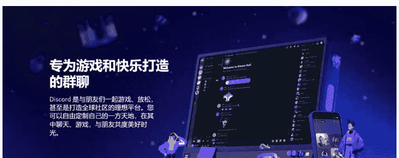

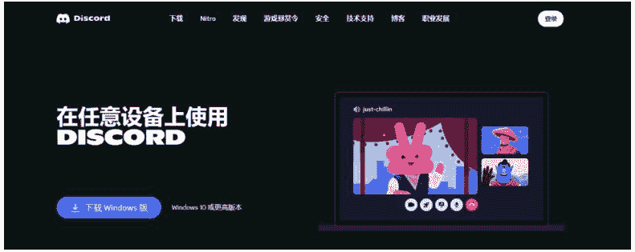

图4-2 Discord的下载
一次冒险之旅在等着你哟。在我们的桌面APP上和你的好友消遣娱乐，同时在移动设备上谈天说地吧。

安装完毕后，打开Discord，然后点击注册，在填写好信息后，即可登录（图4-3）。


图4-3 Discord的登录

要想绑定Midjourney的账号，首先要登录Midjourney的官网，下拉到首页底部，点击Join the Discord。最后，只需要按照提示绑定Discord账号即可（图4-4）。

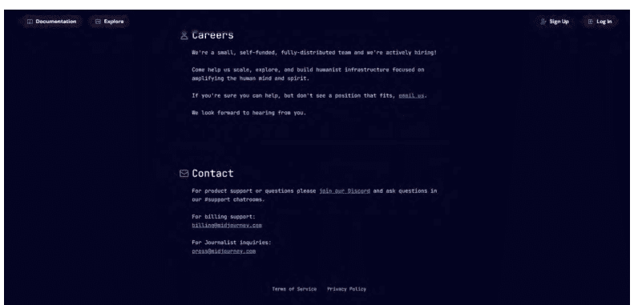

图4-4 绑定Midjourney

#### 4.2.2 Midjourney会员订阅

关于Midjourney的订阅也是非常重要的，Midjourney需要会员才能够进行创作，其中分为三个档次：基础会员、标准会员、专业会员。其中基础会员是每个月8美元，可以出200张图。标准会员与专业会员是按照服务器使用时长来计算的，标准会员每个月花费30美元，有15个小时的服务器使用时间。专业会员是每个月花费60美元，有30个小时的服务器使用时间（图4-5）。


当然，如果年付的话，是有一定的优惠的（图4-6）。


要注意的是，标准会员和专业会员的图片生成是有优先级的，用通俗的话来说就是标准会员和专业会员在生成图片的时候，会用专业的服务器进行生成，无须等待即可开始工作。

不过，服务器使用时间会和生成的图片质量以及要求相关，如果创作者的要求更高，那么在特定的时间内，图片生成的数量会更少。

#### 4.2.3 如何创建个人服务器

在一般情况下，进入Midjourney的频道主页时，使用的服务器基本是公用服务器，这类服务器操作起来相当困难，并且生成效率十分低下。频道内参与创作的人数过多，会导致用户不方便找到自己的作品。因此，搭建一个服务器是十分重要的一个操作。

下面，笔者将会以实际操作来进行演示：

首先打开Midjourney，然后在Midjourney的主页中点击左边的“添加服务器”（图4-7）。


图4-7 Midjourney主页

在点击之后，会弹出一个新的界面，选择“亲自创建”这个按钮（图4-8）。

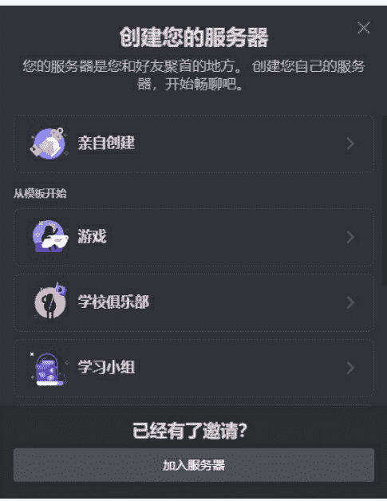

图4-8 创建服务器

点击之后，会出现一个新的界面，在这里选择“仅供我和我的朋友使用”（图4-9）。

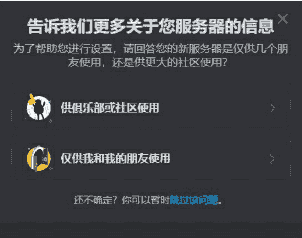

图4-9 服务器信息

点击创建之后，会弹出一个新的窗口“自定义您的服务器”。这里可以输入服务器的名称，输入完毕后，点击创建（图4-10）。


图4-10 输入服务器名称

在点击创建后，依旧会弹出新的窗口，显示出“欢迎来到×××（自定义名称）的服务器”，这里就已经证明创建服务器成功（图4-11）。

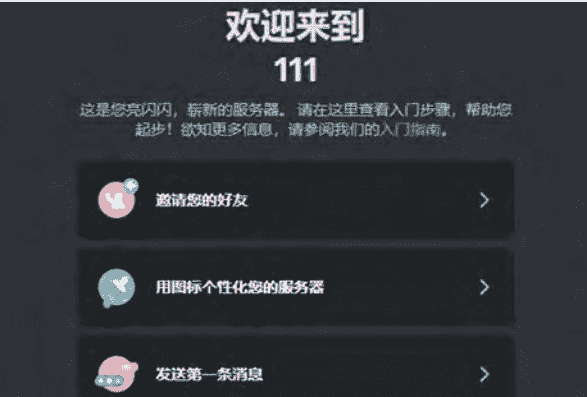

图4-11 创建完毕

#### 4.2.4 在服务器中添加机器人

在服务器中添加机器人是一个必要的操作，利用机器人来进行交互，提交指令给机器人从而生成图片。这本小节，笔者将会以实际操作来进行演示：

首先，点击主页左上角的“寻找或开始新的对话”（图4-12）。

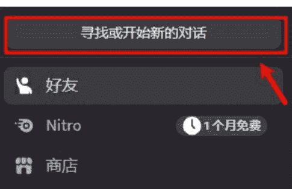

图4-12 寻找或开始新的对话

点击之后，在对话框中输入Midjourney Bot，然后选择相应的选项，选择好后按回车键（图4-13）。


图4-13 Midjourney Bot

添加完毕后，左侧会出现Midjourney Bot的对话框，然后移动光标到对话框主题上，右击鼠标打开新的弹窗（图4-14）。

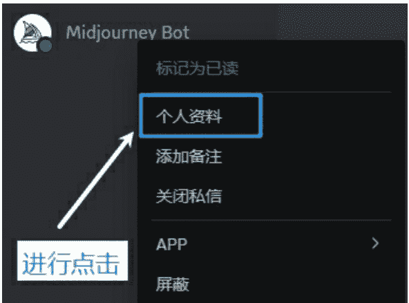

出现新的弹窗之后，点击“个人资料”，然后跳转到新的界面（图4-15）。


这里点击“添加APP”，然后会弹出一个新的界面，这里点击添加我的服务器（图4-16）。


图4-16 添加到我的服务器

点击之后，会弹出一个新的对话框，这里选择刚才创建的服务器（图4-17）。

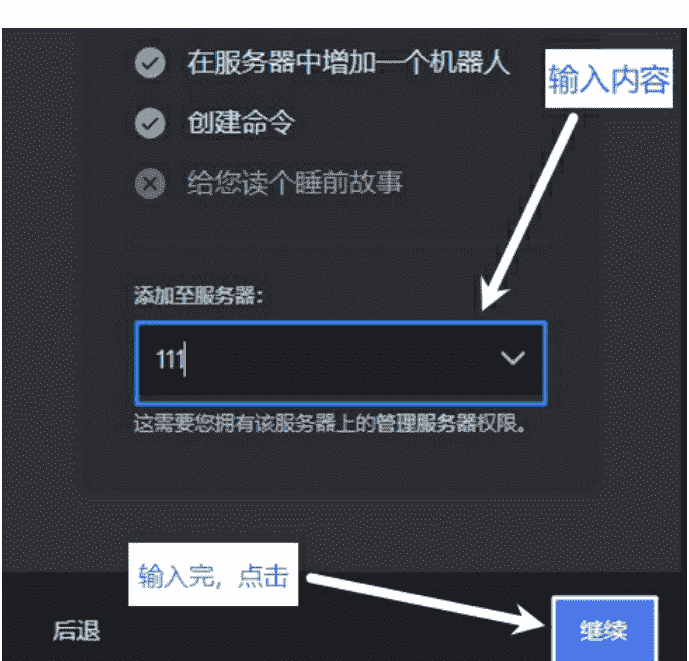

图4-17 绑定服务器

点击继续后，会出现一个授权界面，这里只需要点击授权即可（图4-18）。

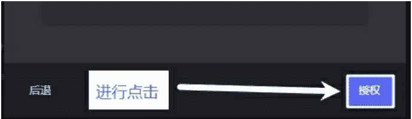

图4-18 进行授权

在授权完毕后，只需要进行人机验证即可，以上即如何在服务器中添加机器人的步骤。

### 4.3
Midjourney的指令讲解

利用Midjourney去创作图片并没有想象中那么简单，其中需要关键词以及对Midjourney的指令的熟悉程度，在本节中，笔者将会讲述一些生成技巧，便于大家更好地掌握Midjourney的使用。

#### 4.3.1 利用imagine指令进行生成操作

Midjourney想要生成商业广告绘画操作，可以使用imagine指令。要注意的是，要使用英文关键词，但是Midjourney对于英文关键词的大小写并没有严格的要求。

以下是笔者的具体操作演示：

首先，在Midjourney的输入框中输入“/”，在弹框中选择“/imagine”这个指令（图4-19）。

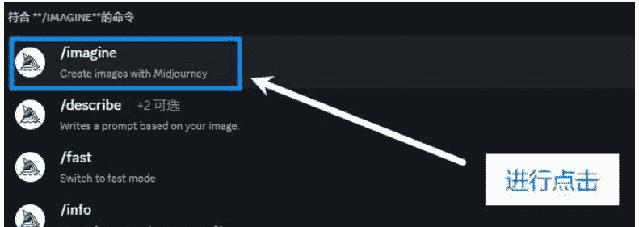

然后在下方的对话框中输入关键词（图4-20）。


比如这里笔者希望生成“An old gentleman in a suit（一个穿着西装的老绅士）”（图4-21）。


图4-21 关键词生成

然后按回车键进行生成，这时Midjourney就已经开始工作了（图4-22）。


图4-22 开始运转

等待稍许，Midjourney即可生成相应的图片（图4-23）。

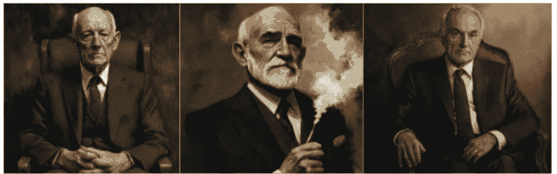

图4-23 生成图片

以上便是Midjourney利用imagine指令进行生成操作的具体内容。

#### 4.3.2 U按钮的功效—图片放大

在上一节中利用imagine生成了4张图片，这一节要讲述U按钮的作用，可能用户对于自己生成的某一张照片非常感兴趣，所以想放大仔细来看，这就涉及U按钮这个知识了。

这里以上面的四张图为例，这里点击图片下方的U1（图4-24）。

#### 4.3.3 V按钮的功效—重新构造

上文中说到了U按钮的功效，这一小节要讲的是V按钮，V按钮的作用是让选中的图片样式重新生成，从而让图片产生变化。

以下是笔者的实际操作演示：

依旧是利用上文中生成的图片，这里以第二张图为例，点击V2（图4-26）。

点击完毕后，Midjourney会对第二张图片进行重新生成，从而产出新的图片（图4-27）。

#### 4.3.4 Vary按钮—再次生成

在生成图片的放大图时，可以点击Vary按钮来重新生成变化后的图片或者来对图片的某一部分进行调整。

在这一节笔者将会对图片进行调整，下面是操作演示：

依旧以上文中的图片为例，这里在放大图下点击Vary按钮进行再次生成（图4-28）。

点击后会进行二次生成，其实可以将Vary（Subtle）和Vary（Strong）理解为微弱变化和强烈变化即可，参考图4-28，笔者点击的是Vary（Strong）按钮，生成结果如图4-29所示。

上面讲述了如何全图二次生成，现在讲述如何对图片的局部进行二次调整。

这里依旧是利用上面的图，这里选择点击的按钮是Vary（Region），这个按钮的作用就是可以对图片的某个部分进行调整（图4-30）。

框选完毕后点击回车按钮，等待局部重新生成就可以了（图4-31）。

可以看出，重新生成的四张图与之前的那张图相比也是有脸部的变化的。

#### 4.3.5 Upscale按钮—提高像素

在这一节中笔者将会讲述如何提高图片的像素，在一般情况下，Midjourney生成的图片像素是1024×1024。如果用户想要提高图片的像素就需要用到Upscale这个按钮。

这里笔者重新生成了一张图片（新春的灯笼），用这张图片来进行讲解（图4-32、图4-33）。

这里点击Upscale（Subtle），这个按钮的作用是细微地提高像素（图4-34）。

然后以原图为例，点击Upscale（creative），可以理解为精致地提高像素（图4-35）。

值得注意的是，提高像素不论是细微还是精细，最后的结果都不会修改图片本身的内容，所以不必担心图片的主题会改变。

### 4.4 简单演示：生成4种不同种类的商业广告图片

上文讲述了如何使用Midjourney，在这一节中笔者将会讲述如何利用Midjourney来进行四种不同商业广告的设计。

#### 4.4.1 利用Midjourney辅助设计服装

首先打开ChatGPT对其进行提问：“我想用midjourney来进行服装设计，请从服装设计概述以及不同的服装关键词还有不同服装部位的关键词等方面给出内容。”

以下为ChatGPT给出的回答：

> （1）服装设计概述
> 使用Midjourney进行服装设计是一种高效且富有创意的方式，利用AI的图像生成能力，可以快速构思不同风格的服装，并可视化复杂的设计概念。从高级定制到街头时尚，从传统民族服饰到未来科幻风格，Midjourney能够生成符合特定主题和需求的服装设计草图。通过准确的文本提示和关键词描述，设计师可以轻松探索布料质感、剪裁风格、配色方案等，甚至用于快速生成服装系列的概念图。

（2）常用服装关键词分类

①风格关键词
- 现代简约：minimalist, contemporary, sleek
- 街头潮流：streetwear, urban, oversized, graphic print
- 复古经典：vintage, retro, 80s style, classic chic
- 高级定制：haute couture, elegant, luxurious
- 运动休闲：athleisure, sporty, breathable
- 未来科技：cyberpunk, futuristic, techwear, metallic
- 民族传统：cultural, traditional, embroidered, ethnic

②性别和年龄
- 女性服饰：women’s wear, feminine, soft lines
- 男性服饰：men’s wear, masculine, tailored fit
- 中性风：unisex, gender-neutral, androgynous
- 儿童服饰：kidswear, playful, colorful

③布料和质感
- 柔软面料：silk, satin, chiffon, velvet
- 硬挺面料：denim, canvas, leather, tweed
- 纹理效果：textured, quilted, embroidered, woven
- 未来感：metallic, reflective, holographic, synthetic

④图案和颜色
- 图案：floral, geometric, stripes, polka dots, abstract
- 配色：monochrome, pastel, vibrant, gradient

（3）服装部位关键词

①上身
- 上衣：blouse, shirt, T-shirt, crop top, hoodie
- 外套：jacket, blazer, trench coat, parka
- 颈部设计：high neck, V-neck, round neck, square neck

②下身
- 裤装：trousers, jeans, cargo pants, culottes
- 裙装：mini skirt, midi skirt, pleated skirt, A-line skirt

③全身
- 连衣裙：gown, cocktail dress, maxi dress, slip dress
- 连体服：jumpsuit, romper, overalls

④配饰
- 帽子：beret, bucket hat, wide-brim hat
- 鞋子：boots, sneakers, loafers, heels
- 手套：lace gloves, leather gloves, fingerless gloves
- 围巾：silk scarf, chunky knit scarf

⑤细节设计
- 袖子：puf sleeves, bell sleeves, cap sleeves, long sleeves
- 腰部：belted, high-waist, fitted, cinched
- 裙摆：flared, asymmetrical, tiered, pleated
- 装饰：lace, buttons, sequins, fringe

（4）组合示例

①现代简约风格的连衣裙
“minimalist long slip dress with silk fabric, soft pastel tones, clean lines”

②复古风格的上衣
“vintage blouse with puf sleeves, lace collar, floral embroidery”

③街头风格的外套
“oversized hoodie with graphic prints, vibrant colors, urban style”

④民族传统风格连衣裙
“traditional Chinese qipao with intricate embroidery, red silk, high collar”

这里以设计中山装为例，根据上述关键词内容，设计给Midjourney的关键词为“Mao suit, Zhongshan suit, traditional Chinese menswear, tailored fit, classic formal attire”。

将关键词输入Midjourney，最后生成下图（图4-36）：

#### 4.4.2 利用Midjourney辅助设计背包

打开ChatGPT对其进行提问：“我想用Midjourney来进行背包设计，请从背包设计概述以及不同的背包关键词还有不同背包部位的关键词等方面给出内容。”

以下为ChatGPT的回答：

> （1）背包设计概述
> 背包不仅是日常生活的实用物品，也是一种兼具功能性与时尚感的设计载体。使用Midjourney，您可以快速生成符合特定需求的背包设计概念，从材质、风格到结构细节，都可以通过文本描述实现高度定制化。不论是户外登山包、城市通勤包、时尚单肩包，还是多功能旅行包，Midjourney的AI图像生成能力为设计师提供了无限可能。

（2）背包设计关键词分类

①按用途分类
- 城市通勤包：urban backpack, minimalist, lightweight, compact
- 户外登山包：hiking backpack, rugged, waterproof, large capacity
- 旅行多功能包：travel backpack, expandable, ergonomic, organized compartments
- 时尚潮流包：fashion backpack, chic, streetwear, leather details
- 运动健身包：gym backpack, breathable fabric, separate compartments

②按风格分类
- 现代简约风：minimalist, sleek, clean lines
- 复古怀旧风：vintage, retro, canvas, leather straps
- 未来科技风：futuristic, techwear, metallic, reflective materials
- 自然户外风：rustic, earthy, rugged, durable
- 潮流街头风：streetwear, bold colors, graphic prints

③按材质分类
- 防水面料：waterproof nylon, coated polyester
- 耐用面料：canvas, cordura fabric, leather
- 轻便面料：lightweight mesh, ripstop nylon
- 未来感材质：holographic fabric, reflective material, carbon fiber

④按颜色分类
- 经典色：black, navy blue, olive green, gray
- 鲜艳色：neon green, bright orange, red, yellow
- 渐变效果：gradient tones, ombre, dual color
- 个性图案：camouflage, geometric patterns, abstract prints

（3）背包部位关键词

①主体结构
- 背包正面：front panel, sleek design, large pocket, zippered compartment
- 背包侧面：side pockets, mesh pockets, water bottle holder
- 背包底部：reinforced bottom, abrasion-resistant material

②背包功能区
- 主仓：main compartment, expandable storage, padded laptop sleeve
- 隔层设计：organized compartments, hidden pocket, quick-access pocket
- 安全性：anti-theft design, RFID blocking pocket

③背负系统
- 背带：adjustable shoulder straps, padded straps, ergonomic fit
- 背部：ventilated back panel, breathable mesh, cushioned support
- 其他配件：sternum strap, hip belt, load lifters

④装饰与附加元素
- 装饰：leather details, metal buckles, reflective strips
- 标志：embossed logo, embroidered badge, branded patch
- 配件：external straps, carabiner loops, bungee cords

（4）组合示例关键词与Midjourney提示词

①城市通勤背包
“sleek urban backpack, minimalist design, waterproof nylon, laptop compartment, quick-access front pocket, black with subtle branding, ergonomic padded straps, modern and stylish, clean lines, studio lighting”

②户外登山背包
“rugged hiking backpack, large capacity, waterproof, durable cordura fabric, multiple compartments, adjustable shoulder straps, hip belt, side mesh pockets, earthy tones, professional outdoor gear aesthetic”

③时尚潮流背包
“streetwear-inspired backpack, bold graphic prints, vibrant colors, leather details, metallic zippers, compact size, reflective strips, designed for young urban lifestyle, chic and trendy”

④多功能旅行背包
“expandable travel backpack, ergonomic design, anti-theft compartments, water resistant fabric, laptop sleeve, luggage strap, olive green, practical and stylish, versatile for short trips”

（5）Midjourney参数建议

- 风格参数
  - v 5：最新版本，支持精细化设计
  - ar 2：3：适合全身效果展示
  - q 2：高画质，细节丰富
  - style 4a或4b：时尚或复古风格选择

②材质和质感优化
添加“high-quality render, realistic texture, studio lighting”，确保图像呈现精致细腻的材质效果。

结合上述内容，得出的关键词是“rugged hiking backpack, large capacity 60L, waterproof cordura fabric, multiple compartments, padded shoulder straps, ventilated back panel, adjustable hip belt, reflective safety strips, olive green with black accents, modern outdoor gear aesthetic, high-quality render, studio lighting”。

将关键词输入进去，等待生成（图4-37）：

#### 4.4.3 利用Midjourney辅助设计香水瓶

打开ChatGPT对其进行提问：“我想用Midjourney来进行香水瓶设计，请从香水瓶设计概述以及不同的香水瓶关键词还有不同香水瓶的关键词等方面给出内容”。

接下来是ChatGPT的回答：

> （1）香水瓶设计概述
> 香水瓶设计是一项兼具实用性和艺术性的任务，它不仅需要保护香水本身，还需通过外观传递香水的气质与品牌的独特风格。通过Midjourney，设计师可以快速生成具有创意和细节丰富的香水瓶概念图。无论是现代简约风格、高级定制的奢华设计，还是复古经典的艺术造型，Midjourney都能通过关键词描述和参数调整帮助实现理想设计。

（2）香水瓶设计关键词分类

①按风格分类

现代简约风：minimalist, clean lines, sleek, contemporary
奢华高端风：luxury, elegant, opulent, gold accents, crystal bottle
复古艺术风：vintage, baroque, ornate, antique glass, handcrafted
未来科技风：futuristic, sci-fi inspired, metallic, holographic
自然灵感风：organic, floral motifs, nature-inspired, earthy tones

②按瓶身形状分类
几何形状：cylindrical, square, rectangular, hexagonal, pyramid
流线造型：curved, oval, hourglass, teardrop, asymmetrical
雕塑感造型：abstract, sculptural, artistic, figurative

③按材质与质感分类
玻璃：frosted glass, clear glass, tinted glass, textured glass
金属：polished metal, gold-plated, brushed steel, copper details
自然材质：ceramic, wood accents, stone details, shell-inspired
特殊质感：matte finish, glossy finish, pearized, holographic

④按装饰与功能细节分类
瓶盖设计：crown-shaped cap, magnetic closure, crystal stopper, floral cap
喷头与颈部：fine mist sprayer, engraved neck, metallic collar
装饰细节：embossed logo, engraved patterns, ribbon or tassel, gemstone accents

⑤按色彩与主题分类
经典配色：clear and gold, black and silver, white and pastel tones
大胆配色：vibrant red, electric blue, neon yellow
渐变色调：gradient shades, ombre, dual-tone glass
自然主题：earthy green, oceanic blue, floral pink

（3）Midjourney提示词示例
①现代简约香水瓶
“sleek minimalist perfume bottle, cylindrical shape, frosted glass, metallic silver cap, clean lines, modern design, subtle branding, studio lighting, high-quality render”

②奢华高端香水瓶
“luxurious perfume bottle, crystal glass, gold-plated details, crown-shaped cap, ornate patterns, premium fragrance packaging, high-end aesthetic, elegant and opulent design, cinematic lighting”

③复古艺术香水瓶
“vintage-inspired perfume bottle, antique glass, intricate baroque details, bronze accents, hand-blown glass, floral engraving, nostalgic and timeless, soft shadows”

④自然主题香水瓶
“nature-inspired perfume bottle, organic shape, earthy tones, floral motifs, wooden cap, frosted green glass, eco-friendly design, natural and refreshing aesthetic, warm lighting”

⑤未来科技香水瓶
“futuristic perfume bottle, metallic and holographic finish, angular and geometric shape, sci-fi inspired design, reflective surfaces, modern tech aesthetic, bold lighting”

（4）Midjourney参数建议
①技术参数
v 5：最新版本，细节表现更强
ar 1：1：适合瓶身特写效果
q 2：高质量渲染，突出细节与质感
style 4a或4b：可选择写实或艺术化风格

②额外细节与光影优化
添加“high-quality render, realistic texture, cinematic lighting”，强调瓶身材感和材质细腻度。
使用“soft shadows, dynamic lighting, reflective surfaces”增强立体感和高级感。

（5）扩展关键词（可选）
主题装饰：butterfly motif, floral patterns, gemstone-encrusted, minimalist logo
背景环境：placed on marble table, surrounded by flowers, in a luxurious setting
系列设计：matching body lotion bottle, luxury packaging box, complementary colors

结合上述内容，得出的关键词是“frosted glass perfume bottle, soft gradient from pink to gold, cylindrical shape, smooth surface, metallic silver cap, subtle engraved logo, elegant and feminine, luxurious design, cinematic lighting”（图4-38）。

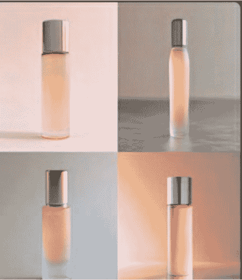

图4-38 香水瓶

#### 4.4.4 利用Midjourney辅助设计汉服

在这一节中，笔者将对利用Midjourney辅助设计汉服进行演示，利用AI软件对中华文化进行发扬光大，这也是对中华传统文化的一种传承。

在ChatGPT中进行提问：“我想用midjourney来进行汉服设计，请从汉服设计概述以及不同的汉服关键词还有不同款式汉服的关键词等方面给出内容。”

> （1）汉服设计概述
汉服，作为中华传统服饰的代表，具有深厚的文化底蕴和独特的美学价值。其设计通常围绕宽衣博带、层次丰富的剪裁以及绚丽多样的纹样展开，通过Midjourney，可以快速生成符合传统与现代结合的汉服设计图。无论是优雅的明制汉服、飘逸的唐制汉服，还是融入创新元素的新式汉服，Midjourney都能以高精度还原设计需求，助力传承与创新。

（2）汉服设计关键词分类
①按朝代与款式分类
汉制汉服：Han Dynasty hanfu, long flowing robes, wide sleeves
唐制汉服：Tang Dynasty hanfu, high-waisted, bell sleeves, ruqun（裙）
宋制汉服：Song Dynasty hanfu, straight cut, delicate patterns, simplicity
明制汉服：Ming Dynasty hanfu, stand collar, mamian skirt（马面裙），structured look
新式汉服：modern hanfu, fusion design, minimalist, contemporary elements

②按款式与部件分类
上衣：
衣裳 (robe):long robe, cross-collar, straight collar
短褂子 (short outer garment):jacket, flowing sleeves, lightweight fabric
披帛 (shawl):draping, embroidered edges, transparent material
裙子：
馆裙 (pleated skirt):structured, geometric pleats
马面裙 (mamian skirt):wide pleats, front and back panels
绣裙 (embroidered skirt):floral patterns, intricate details
配件：
绶带 (belt):embroidered sash, knotted, brocade fabric
发饰 (hair accessories):jade hairpins, tassels, floral ornaments
鞋履 (footwear):embroidered shoes, flat, platform soles

##### ③材质与颜色

面料：
丝绸 (silk):soft, flowing, shiny finish
棉麻 (linen):lightweight, natural texture
纱 (gauze):translucent, airy, layered
颜色与渐变：
单色：ivory, jade green, cherry blossom pink, imperial yellow
渐变：sunset orange to red, midnight blue to violet
图案：floral motifs, phoenix embroidery, geometric patterns

##### ④主题与装饰

季节主题：
春：spring hanfu, floral embroidery, light pastels
夏：summer hanfu, breathable fabrics, vibrant colors
秋：autumn hanfu, warm tones, layered designs
冬：winter hanfu, thick fabrics, fur trims
文化主题：
富贵：luxurious hanfu, gold embroidery, dragon motifs
自然：nature-inspired hanfu, bamboo patterns, mountain landscapes
仙气：ethereal hanfu, flowing fabrics, dreamlike hues

##### （3）Midjourney提示词示例

①唐制汉服
“Tang Dynasty hanfu, high-waisted ruqun, wide bell sleeves, flowing silk fabric, vibrant red and gold embroidery, phoenix and floral patterns, luxurious and elegant, cinematic lighting, high-quality render”
②明制汉服
“Ming Dynasty hanfu, stand collar, mamian skirt with intricate pleats, brocade fabric, deep blue with silver embroidery, structured and formal, soft shadows, studio lighting”
③新式汉服
“modern hanfu, minimalist design, cross-collar blouse with gradient from jade green to white, lightweight gauze skirt, floral embroidery on the hem, ethereal and contemporary style, soft natural lighting”
④四季汉服
春：“spring hanfu, pastel pink and green, cherry blossom embroidery, lightweight gauze fabric, flowing design, romantic and fresh aesthetic”
夏：“summer hanfu, vibrant yellow, lightweight linen fabric, sleeveless ruqun with embroidered lotus patterns, breathable and elegant”
秋：“autumn hanfu, warm orange and brown tones, layered design, maple leaf motifs, soft and cozy”
冬：“winter hanfu, thick silk with fur trims, deep red with gold embroidery, warm and luxurious, phoenix motifs”

##### （4）Midjourney参数建议

①技术参数
v 5：生成最新版本，细节表现更佳
ar 2：3：适合全身设计图
q 2：高分辨率，突出面料与装饰纹样
style 4b：适合复古且优雅的风格
②额外优化描述
添加“realistic fabric texture, intricate embroidery, cinematic lighting”确保设计的细节精致且真实。
使用“soft shadows, ethereal lighting, dynamic composition”强化汉服的柔美与立体感。

（5）扩展关键词（可选）
场景背景：“hanfu in a traditional Chinese garden, surrounded by cherry blossoms, under soft sunlight”
动态效果：“hanfu fabric flowing in the wind, graceful and elegant motion”
配套设计：“matching embroidered shoes and jade hairpin accessories”

综上，可以总结出的关键词是“Tang Dynasty hanfu, high-waisted ruqun, wide bell sleeves, flowing silk fabric, vibrant red and gold embroidery, phoenix and floral patterns, luxurious and elegant, cinematic lighting, high quality render”（图4-39）。

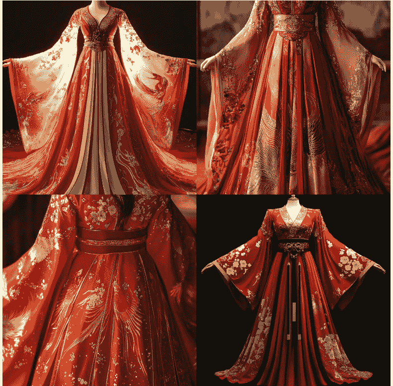

以上便是利用Midjourney辅助设计汉服的流程，在下文中会有更为详细的传承中华优秀传统文化的设计。

### 4.5 关于修图的秘籍

在上文中讲述了如何生图，而这一节要讲述如何修图已经成为提升作品视觉效果和表达力的重要环节，而MidJourney的引入为这一过程带来了全新的可能性。这款以AI驱动的创意工具，彻底改变了传统修图的操作模式，通过强大的智能算法和独特的艺术风格生成能力，使修图变得更高效、更富创造力。对于设计师、摄影师和数字艺术爱好者而言，MidJourney不仅是一款技术工具，更是实现创意突破的得力助手。

修图的核心在于细节处理与整体风格的把控，这需要创作者既有精准的技术，又具备丰富的艺术敏感性。然而，传统修图工具往往需要大量的手动操作，不仅耗费时间，还要求用户具备高超的技能。MidJourney通过深度学习技术，能够理解用户上传的图像内容，并根据需求快速生成改进版本。无论是调整色调、增强细节，还是改变整体风格，MidJourney都能以出色的效率完成，同时保持创作的个性化和独特性。

MidJourney修图的意义不仅在于提升效率，更在于激发创意。它可以为用户提供多样化的风格选择，让每一张图片都成为艺术表达的载体。此外，它还能够超越简单的技术优化，深入挖掘图像潜在的艺术价值，为创作者带来新的灵感。通过MidJourney，修图不再是单纯的后期调整，而是创作流程中的一个艺术探索环节。

#### 4.5.1 图片尺寸的修正

一般情况下只能用Midjourney生成1：1尺寸的方图，如果用户希望更改图片尺寸，可以使用ar指令，以下是笔者的实战操作演示：

首先这里先使用Midjourney生成一张图片（内容是企鹅，图4-40）。

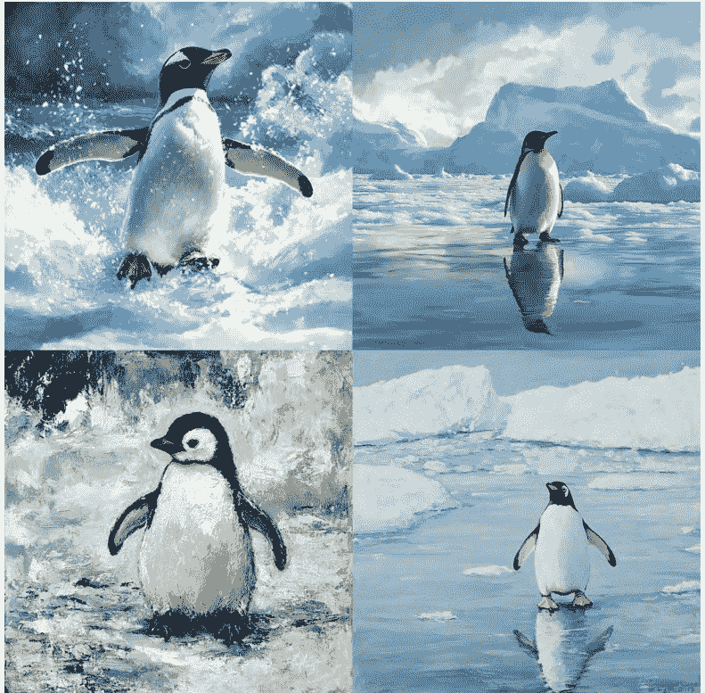

图4-40 企鹅

然后这里在关键词后输入“ar 4 : 3”（图4-41）。

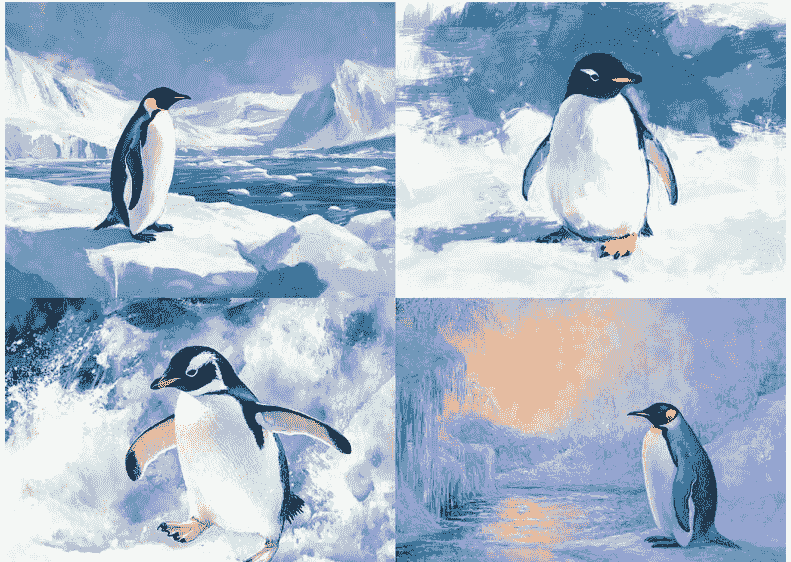

图4-41 ar 4 : 3

接着再以16：9的尺寸做一次演示，以汉堡为主题生成一组图片（图4-42）。

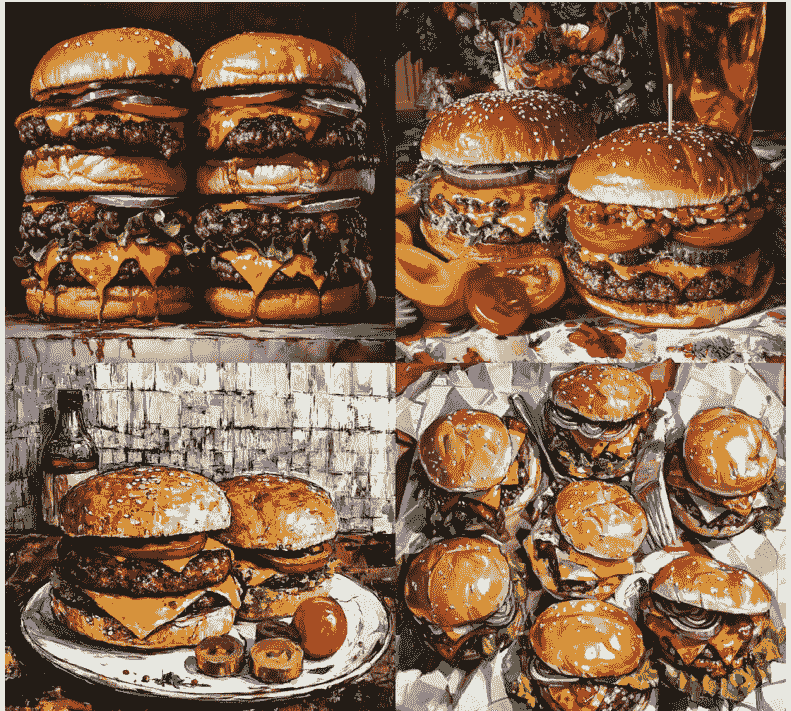

图4-42 汉堡

然后在关键词后边输入“ar 16：9”（图4-43）。

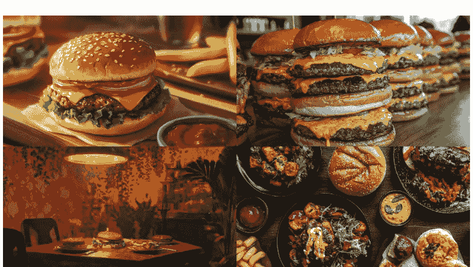

图4-43 ar 16：9

以上便是关于图片尺寸修正的教学，需要注意的是图片生成或者放大的过程中，最后的输出尺寸会有修改。

#### 4.5.2 图片场景的转移

图片的转移就是在图片下边编辑栏中的上下左右移动的按钮，可以通过这些按钮将这些图片中的场景进行移动。这里需要注意的一点是，在移动了图片中的场景之后，图片下方不会出现V按钮，无法进行重新构造。

笔者以实际操作来进行演示，内容主题是一轮明月（图4-44）：

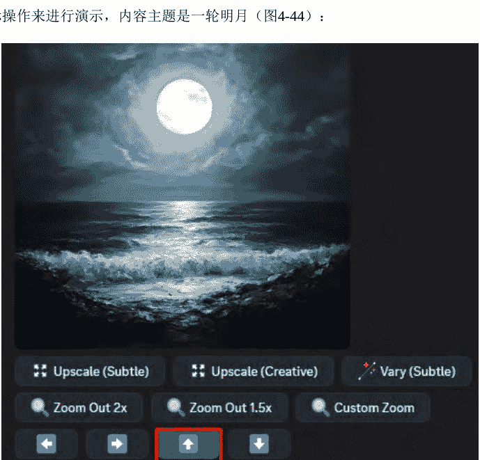

图4-44 一轮明月

这里点击向上移动，会得到新的图片（图4-45）。

#### 4.5.3 Zoom Out的妙用

这一节是为了针对制作缩放图片来讲解的操作，用户会因为需求需要缩放的方形图片，所以Zoom Out 也是一个非常重要的操作。

下面是笔者的具体操作步骤：

首先，以枫叶为主题生成一张图片（图4-48）。

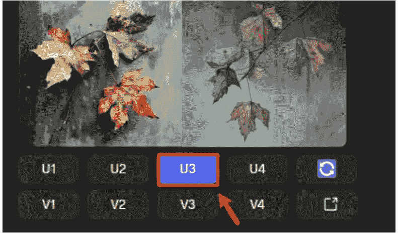

图4-48 枫叶

这里选择一张图片点击U按钮，这里选择的是第三张（图4-49）。

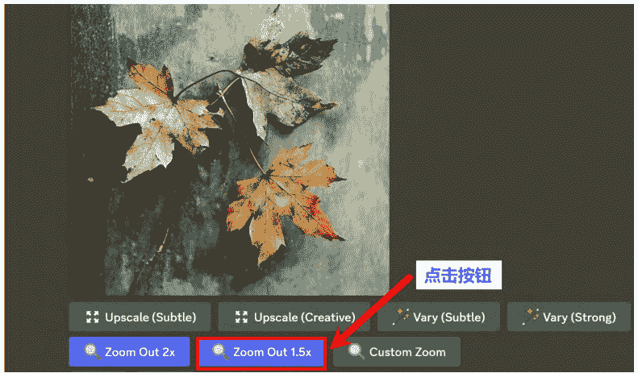

图4-49 Zoom out 1.5x

这是第三张放大的图片，这里点击图片下方的Zoom Out 1.5x（图4-50）。

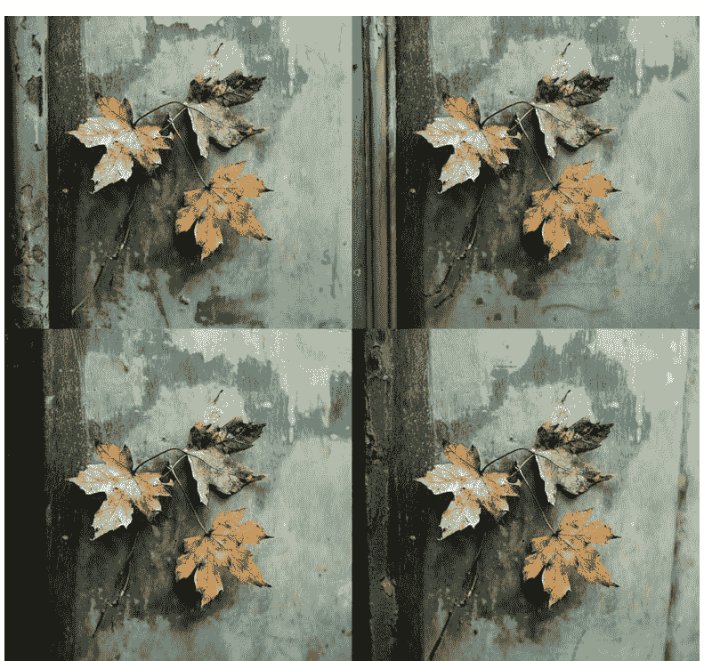

图4-50 效果图

然后还是根据第三张缩放的照片，点击下方的Zoom Out 2x（图4-51、图4-52）。

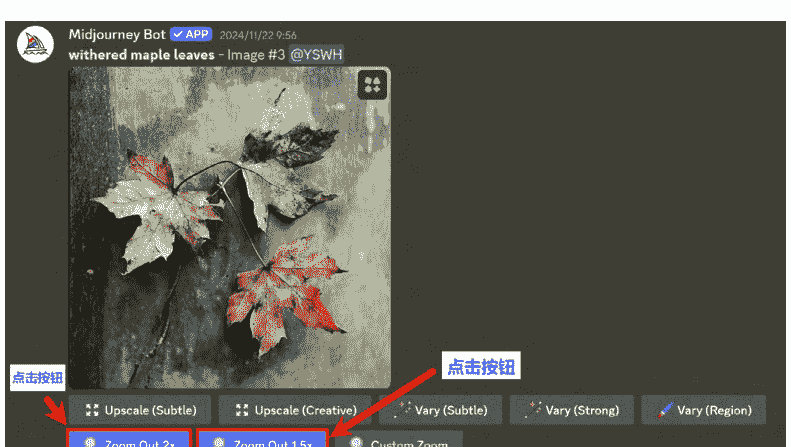

图4-51 Zoom Out 2x

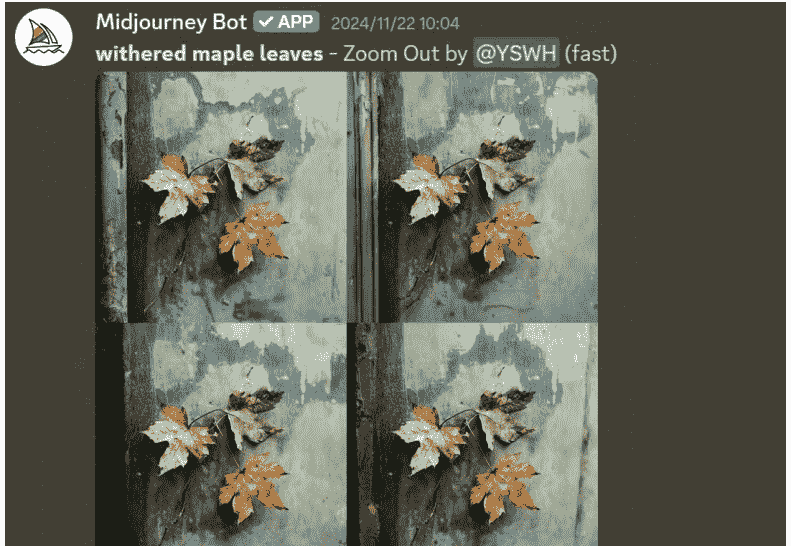

图4-52 效果图

这里要讲一下后面的Custom Zoom按钮，按钮是自定义缩放，这里笔者以实际操作进行展示。

还是以第三张图做演示，这里点击Custom Zoom。

点击后，会跳出新的窗口（图4-53），这里不光可以改比例，还可以进行缩放值的调整，笔者在这里选择的是1.8倍（缩放区间是1～2倍）。

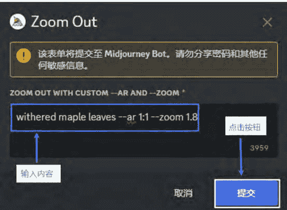

图4-53 修改比例

点击提交，等待图片缩放成功即可（图4-54）。

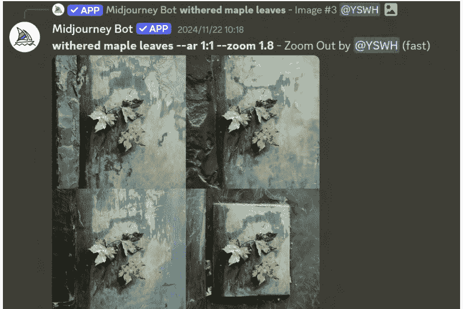

图4-54 效果图

这里也讲述一下在弹窗中也是可以修改图片比例的，这里依旧用第三张图片进行编辑，将图片的比例修改成4：3（图4-55）。

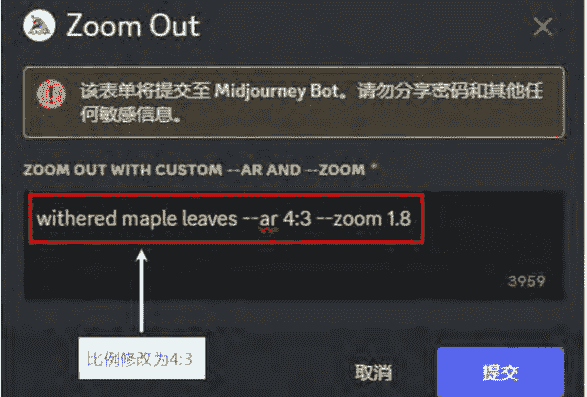

图4-55 修改比例

这里点击提交，等待图片的编辑生成（图4-56）。

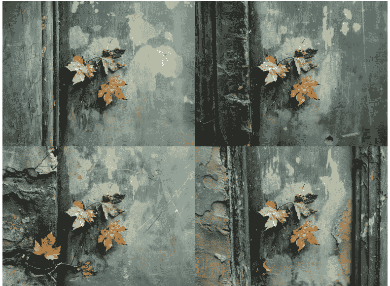

图4-56 效果图

这就是最后更改了尺寸比例以及缩放度的图片，用户不需要担心原图的内容是否会变化，以上便是Zoom Out的用法。

## 第5章 如何生成企业独特标志

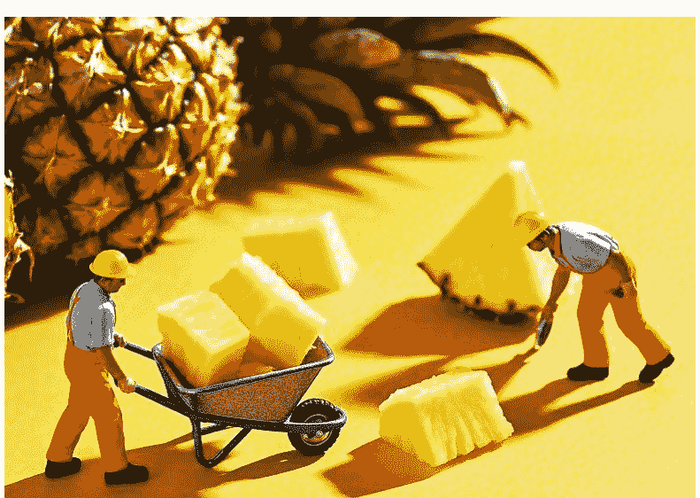

在现代商业环境中，一个企业标志不仅仅是一个符号，更是品牌形象的集中体现。它承载了企业的文化内涵、核心价值和市场定位，同时也是消费者认知和记忆品牌的重要视觉入口。一个成功的标志能让企业在竞争激烈的市场中脱颖而出，传递出品牌独特的个性和吸引力。而借助人工智能技术，特别是像Midjourney这样的AI图像生成工具，企业可以以前所未有的方式快速创作出高质量、极具创意的标志。

通过Midjourney，标志设计不再需要漫长的手绘草图阶段或复杂的设计软件操作。设计者只需输入文本提示，AI就能够根据描述生成多种独特的标志方案。这种高效的创作方式不仅降低了设计门槛，还为企业提供了更多的设计灵感。例如，您可以通过描述企业的核心业务、目标受众、品牌风格以及颜色偏好，Midjourney会基于这些信息生成一系列符合品牌定位的标志设计。您还可以进一步调整提示内容，例如强调某种图形元素、字体风格或特定的配色方案，以便获得更贴近品牌需求的结果。

企业标志的重要性不可低估。它不仅仅是品牌的视觉象征，更是企业与消费者之间建立信任和认同的桥梁。一个好的标志设计必须具备易识别性和独特性，同时能够在不同应用场景中灵活呈现，例如印刷品、数字广告、产品包装甚至移动应用界面。Midjourney的多样化风格生成功能，让设计者可以轻松尝试各种风格，如极简风、复古风、科技感或手绘感，从而为企业找到最契合的视觉表达方式。

AI的介入还为标志设计注入了更多创意可能。Midjourney不受传统设计思维的限制，能够根据输入提示生成新颖的图形组合、意想不到的色彩搭配或前沿的几何造型。这种技术优势不仅让标志设计更具个性化，还能帮助企业更好地与其目标受众建立情感连接，提升品牌的市场影响力。

在创作过程中，设计者可以实时调整和优化生成结果，快速探索不同的设计方向，而无须从零开始反复修改。这种高效性和灵活性，使Midjourney成为企业标志设计的强大工具，同时为设计师节省了时间和精力，让他们能够专注于更具战略性的创意决策。

通过Midjourney，企业不仅可以快速生成高质量的标志设计，还能够在技术的助力下打破传统设计的边界，为品牌注入更多的创意和活力。在市场竞争日益激烈的今天，一个独特的标志是企业立足市场的重要利器，而AI的加入，无疑为标志设计打开了一扇通往未来的大门。在本章中，笔者将会带领大家学习如何利用AI去生成独特的企业LOGO。

### 5.1 利用ChatGPT为logo生成关键词

在为一个企业或者品牌设计logo之前，都会有具体的目标、内容以及意义，一个好的logo可以帮助企业在竞争中变得更为亮眼，去吸引更多的客户。

这一节中，笔者以创造一个果汁品牌为例，来详细讲解企业品牌logo的设计方法。

首先需要利用ChatGPT生成logo关键词，以下是具体操作步骤：

先打开ChatGPT的官网（图5-1）。

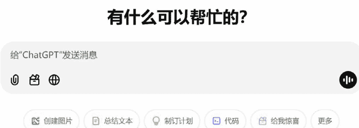

然后点击输入栏，根据上文讲述的内容，先赋予ChatGPT一个身份：经验丰富的品牌运营设计师（图5-2）。

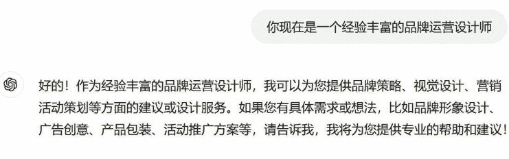

紧接着在输入框中输入关键词：“我希望设计一个果汁品牌的logo，主打的招牌是芒果果汁，logo的内容要阳光健康，希望你可以给我一个设计概念的建议。”（图5-3）

> 我希望设计一个果汁品牌的logo，主打的招牌是芒果果汁，logo的内容要阳光健康，希望你可以给我一个设计概念的建议

为您的果汁品牌设计一个阳光健康的Logo，可以围绕以下设计概念展开：

#### 设计概念：阳光芒果，健康活力

- (1) 核心元素：
    芒果：作为品牌的主打招牌，以黄金色或橙黄色为主，突显芒果的甜美与新鲜。
    阳光：通过光芒、太阳或者柔和的渐变线条，传达阳光的温暖与自然能量。
    绿色元素：使用新鲜的绿叶或滴露效果，表达健康、自然与环保的品牌理念。
- (2) 色彩方案：
    主色：橙黄色，象征芒果与阳光。
    辅色：绿色，体现自然健康。
    点缀：白色或淡蓝色，增加清新感。
- (3) 形状与图案：
    将芒果设计成太阳的形状，添加柔和的光芒线条，融入太阳和果实的形象。
    使用简约的线条和图形，结合果汁流动感，传递清爽和活力的感觉。
- (4) 字体选择：
    圆润而现代的无衬线字体，表现亲和力。
    可以带一点手写风格的字体，增加自然感。

图5-3 设计概念

同时，ChatGPT也给出了设计灵感的建议（图5-4）。

#### 示例设计灵感：

- 芒果被设计成太阳，中间是一个微笑的表情，传递品牌的友好与幸福感。
- 周围用绿色叶子环绕，像是一颗散发阳光的果树，象征品牌与自然的融合。
- 品牌名称可以设计成沿着芒果的曲线排列，整体活泼且自然。

图5-4 设计灵感

可能有些人对于ChatGPT的想法觉得不是特别符合自己的要求，当然可以继续向ChatGPT中输入关键词：“希望你可以帮我将创意提高一下艺术感，最好让logo的特色更为鲜明一点，最好能让消费者记忆犹新”（图5-5、图5-6、图5-7和图5-8）。

希望你可以帮我将创意提高一下艺术感，最好让logo的特色更为鲜明一点，最好能让消费者记忆犹新

要提升Logo的艺术感和独特性，同时让它能给消费者留下深刻印象，可以从以下几点入手：

#### 高级艺术创意方向：

- (1) 概念升华：将芒果与阳光融为一体
    设计亮点：将芒果设计成半剖开的形状，剖开的横截面采用“太阳升起”的放射图案。果肉的纹理可以设计成类似太阳光线的渐变条纹，芒果的形状同时暗示新鲜和温暖。
    艺术效果：果皮部分使用渐变的橙黄色，融入一些柔和的几何纹理（如波浪、圆点），象征自然的律动感。
- (2) 利用抽象几何艺术设计
    设计亮点：将芒果与一滴果汁结合，以流畅的几何线条表现。芒果外形是整体轮廓，内部用圆形、椭圆形等抽象图案表达果肉与阳光的放射感。

图5-5 提高艺术感

#### 艺术感增强策略：

- (1) 色彩创新
    打破传统的单一橙黄+绿的搭配，可以尝试：
    金属渐变：例如金色与深橙结合，表现阳光下成熟芒果的光泽。
    热带活力色系：加入清爽的薄荷绿、深蓝点缀，增加时尚感。
- (2) 创意字体设计
    字体可以设计为与Logo元素融为一体。例如：
    品牌名称的某些字母像芒果叶子形状延伸。
    字母的曲线设计模仿果汁的流动感。
- (3) 动态元素
    为Logo加入可视化动态特质：
    设计出Logo的动态变化版本，用于数字媒介，例如芒果裂开后露出果肉，阳光射出，配合果汁流动的效果。

图5-6 艺术感增强

#### 具体Logo设计提升方向：

- (1) 记忆符号化：
    将芒果设计成一个极简但独特的符号，例如仅用一个简单的轮廓线和内部借助3D立体效果或层叠光影，表现芒果的立体感，让Logo看起来更具现代艺术特质。
- (2) 文化与自然结合：
    借鉴热带风情或传统自然纹样，将Logo设计成具有故事性和情感共鸣的形象。例如，设计类似部落太阳纹样的元素融入芒果，体现自然与健康的和谐。

图5-7 具体的方向

> 麻烦你帮我把上文中的logo要点总结出来，我希望用其导入到Midjourney中来生成Logo

以下是总结出的Logo设计要点，适合导入MidJourney以生成艺术感更强的Logo：

#### Logo设计要点（MidJourney提示用语）

- (1) 核心主题：
    芒果果汁品牌Logo，突出阳光、健康、自然与活力。
- (2) 图形元素：
    半剖开的芒果形状，果肉呈现类似太阳的放射图案。
    流动的果汁滴，增强动态感和新鲜感。
    芒果形状与树结合，树冠由芒果和叶子组成。
- (3) 艺术风格：
    抽象几何风格，用流畅的线条和圆形、椭圆形等表现果肉与阳光。
    渐变色块与留白相结合，打造简约且层次分明的现代设计。
    带有自然纹理或热带风情纹样，增加文化与艺术感。

图5-8 总结关键词

这里较为贴心的是，ChatGPT为笔者准备了英文版本的关键词。所以至此，果汁品牌的Logo已经生成完毕（图5-9）。

#### MidJourney 生成参考指令

"Modern abstract mango juice brand logo, half-cut mango with radiant sunburst design, flowing juice drops, mango-shaped tree with green leaves, vibrant orange and yellow gradient with subtle metallic sheen, minimalist geometric lines, fresh and healthy tropical vibe, bold sans-serif font, white background, artistic and dynamic, highly memorable design --v 5 --ar 1:1 --q 2"

图5-9 英文指令

### 5.2 利用Midjourney生成企业logo

在上文中，笔者已经通过ChatGPT生成了果汁品牌的logo，紧接着打开Midjourney，将英文的关键词输入进去。

先调用/imagine指令，然后在输入框中输入“Modern abstract mango juice brand logo, half-cut mango with radiant sunburst design, flowing juice drops, mango-shaped tree with green leaves, vibrant orange and yellow gradient with subtle metallic sheen, minimalist geometric lines, fresh and healthy tropical vibe, bold sans-serif font, white background, artistic and dynamic, highly memorable design--v 5--ar 1 : 1--q 2”（图5-10）。

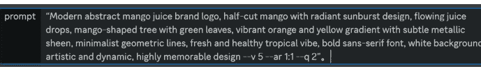

然后按回车点击确认，等待Midjourney生成（图5-11）。

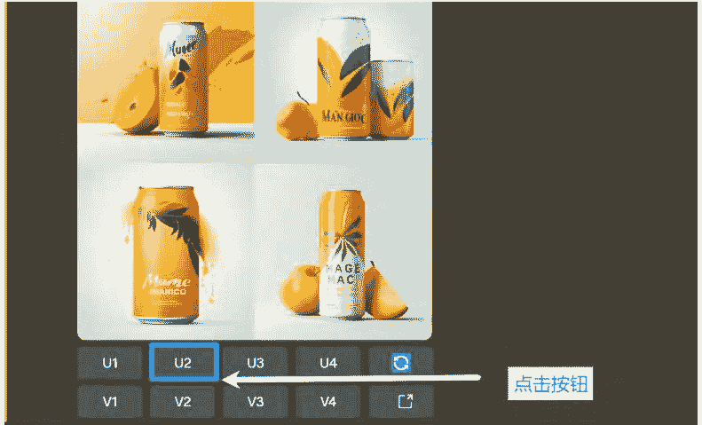

这里选择第二张图片，点击U2按钮，放大第二张图片的logo效果图（图5-12）。


图5-12 效果图

如果不喜欢这张图片，可以在生成的四张图中下点击重新生成（图5-13）。


图5-13 重新生成

这里点击提交按钮（图5-14），等待图片的重新生成（图5-15）。


图5-14 点击提交


图5-15 生成效果

### 5.3 创作升级，完善细节

在这一节中，要在关键词加入细节的描述，确定并增强Logo的图片的风格，让Logo的风格让人印象更为深刻。

这里要在Midjourney中使用/imagine这个调令，比如去掉（bold sans-serif font和white background）（图5-16）。


点击提交，等待Midjourney生成新的图片（图5-17）。


这时会发现，logo的样式更为鲜明，然后点击U1按钮，放大第一张图片的效果（图5-18）。


这里笔者认为图片需要缩放，此时需要使用Zoom Out 1.5x这个按钮，点击按钮，等待编辑生成（图5-19）。


图5-19 缩放

然后点击U4按钮（图5-20），生成第四张照片，对第四张图片进行保存（图5-21）。


图5-20 U4按钮


图5-21 保存图片

### 5.4 精雕细琢：Photoshop

本节需要使用到Photoshop，因为Midjourney虽然可以生成logo，但是如果想要满足特定的需求或者进行修改就需要用到Photoshop。

因为考虑到读者们对于技术的要求，所以本节会详细讲解操作步骤，对于Photoshop的安装会简略带过。

#### 5.4.1 Photoshop的下载与安装

首先打开Adobe Photoshop的网址：https://www.adobe.com/（图5-22），然后找到Photoshop软件下载，点击下载随后安装即可（图5-23）。


#### 5.4.2 处理Logo图片

在安装好Photoshop后，将之前保存的logo图片导入Photoshop中，会进入这个界面中。

点击界面的右上角的选择主体按钮。（图5-24）


图5-24 选择主体

然后在下方图像上创建一个主体选择区域。（图5-25）


图5-25 框选区域

然后按键盘上的Ctrl+J按钮，复制出一个新的图层（图5-26）。


图5-26 新的图层

然后按Ctrl+C，将此图层进行复制，点击左上角的“文件”，再点击“新建”，创建一个默认的Photoshop大小的画布（图5-27）。


图5-27 创建新的图层

点击创建，会出现一个白色的背景板，按Ctrl+V，将刚才复制的图层粘贴上去（图5-28、图5-29）。


图5-28 粘贴图层


图5-29 粘贴成功

右键点击左侧的选框工具，选择椭圆选框工具（图5-30）。

## 第6章 打造商业广告的背景音乐

在现代商业广告的创作中，背景音乐扮演着不可或缺的角色。它不仅仅是广告的陪衬，更是塑造情感氛围、强化品牌记忆、提升消费者情感共鸣的重要工具。一段贴合广告主题的音乐能够瞬间吸引观众注意力，使广告内容在听觉层面更加引人入胜，同时将品牌理念传递得更加鲜明。在以往的广告创作中，音乐的定制往往需要耗费大量的人力、时间和成本。然而，随着人工智能技术的发展，背景音乐的创作变得更加高效和智能化。Suno作为一款专注于音乐生成的AI工具，为广告创作者提供了前所未有的创意支持和制作便利。

利用Suno生成商业广告的背景音乐，创作者只需输入简单的提示即可获得多样化的音乐选项。无论是活泼欢快的旋律、富有科技感的节奏，还是舒缓优雅的背景音效，Suno都能够根据需求快速生成并调整音乐风格。相比于传统的音乐制作方式，这种基于AI的生成模式不仅缩短了创作周期，还极大地扩展了创作者的想象空间。通过实时调节音调、节奏、乐器搭配等参数，广告创作者能够快速迭代和优化音乐内容，确保与广告画面达到最佳的融合效果。

背景音乐在商业广告中的作用远远不止填补音效的空白，它是情感传递的关键纽带。在讲述品牌故事时，一段激昂的旋律可以渲染出自信与力量的氛围，一段柔和的钢琴独奏则能够唤起观众内心的温暖与亲切。通过Suno的AI技术，广告创作者能够更加精准地将品牌调性与音乐风格相结合，创作出既独特又贴合品牌形象的背景音乐。不仅如此，Suno还能帮助创作者快速尝试跨风格的音乐搭配，从而突破传统创作的局限性，为广告注入更多创意和活力。

在数字化商业时代，广告内容需要在短时间内抓住消费者的注意力，而音乐恰恰是快速建立情感联系的有效方式。AI技术的加入使得广告音乐的创作更加灵活，创作者不再受传统音乐资源的可用性或制作周期的限制。借助Suno的强大功能，广告创作者可以在几分钟内完成从音乐概念到成品的全过程，大幅提升效率的同时，也为品牌提供了更多定制化的音乐选择。

在此章节中，笔者会对Suno进行讲解，让大家对商业广告的背景音乐创作有一个更为清晰的认知。

### 6.1 AI音乐工具：Suno

Suno是一款基于人工智能的音乐创作工具，以其便捷性和高效性深受创作者的喜爱。无论是专业音乐制作人还是零基础的创作者，Suno都能通过其直观的操作界面和强大的生成能力，帮助用户轻松完成音乐创作。作为一款极具创新性的工具，Suno不仅降低了音乐创作的门槛，还让创意变得更加高效，让用户能够专注于表达和设计，而非复杂的技术操作。

Suno的操作方式十分简单，用户只需输入一些关键词或描述音乐风格的文本提示，例如“温暖的钢琴旋律伴随轻柔的弦乐背景”或“充满科技感的电子节奏”，Suno就能够根据这些提示生成多种符合描述的音乐片段。对于不熟悉乐理的用户，Suno的这种文本输入功能尤其方便，因为它完全摆脱了传统音乐制作中复杂的调试和编辑工作，而是让AI承担旋律生成、和声搭配和节奏控制等技术性任务。这种方式使音乐创作变得像聊天一样自然，不需要复杂的技术门槛即可产出高质量的音乐作品（图6-1）。

Suno的易上手性还体现在它的实时迭代功能上。用户可以在生成的音乐基础上，通过简单调整提示或修改参数来优化音乐效果，例如调整曲调的情感基调（欢快、悲伤、激昂等），改变使用的乐器类型（钢琴、吉他、电子合成器等），或是微调音乐的长度与节奏。这种快速反馈与修改的特性，让创作者在短时间内尝试多个方向，极大提升了创意探索的效率。对于需要快速生成背景音乐的商业广告、视频项目或游戏开发者来说，Suno是一款理想的高效创作工具。

在商业应用方面，Suno生成的音乐不仅质量高，还提供了清晰的版权归属政策。通过Suno生成的音乐，其版权通常归用户所有，这为商业用途提供了可靠的法律保障。这意味着，无论是用于广告、电影配乐、企业宣传，还是其他商业项目，用户都可以放心使用生成的音乐，而无须担心复杂的版权纠纷。这种清晰的版权政策，使Suno成为许多品牌和创作者的首选工具，尤其是在需要快速生成原创音乐且不想额外支付版权费用的场景中。

Suno的生成音乐具有极高的多样性和原创性，能够满足广泛的使用需求。从温暖抒情的旋律到充满未来感的电子节奏，Suno能够通过AI的深度学习算法捕捉不同音乐风格的精髓，为用户提供多样化的创意灵感。这不仅大幅降低了创作者寻找版权音乐的时间成本，也让他们能够轻松获得专属于自己项目的独特音乐作品（图6-2）。

### 6.2 利用ChatGPT获取歌词以及关键词

可能在歌曲创作之前，大家会对如何创作歌词有一个疑问。其实可以利用ChatGPT来进行歌词的创作。并且Suno创作音乐也需要关键词，利用ChatGPT也可以获得关键词。在这一节中，笔者将会教给大家如何利用ChatGPT来进行歌词创作并且获取关键词。

#### 6.2.1 获取歌词

首先打开ChatGPT的官网：https://chatgpt.com（图6-3）。

这里以上文中的芒果果汁饮料为主题，创作一个商业广告的背景音乐，笔者在ChatGPT中输入：“我希望为芒果果汁饮料创作一个商业广告的背景音乐，能否帮我创作歌词，内容积极向上，同时要展示健康生活。”（图6-4）

清晨阳光洒满了窗台，
一杯芒果汁唤醒了期待。
鲜甜滋味溢满了心怀，
健康活力伴你一路精彩。

##### [副歌]

芒果的芳香，自然的力量，
每一口都是幸福的能量。
健康生活，我们共同向往，
畅饮美味，绽放无限光芒。

##### [第二段]

忙碌时刻也需要关怀，
一杯果汁带来自在。
维生素C，让精神更澎湃，
活出精彩，心情更愉快。

##### [副歌]

芒果的芳香，自然的力量，
每一口都是幸福的能量。
健康生活，我们共同向往，
畅饮美味，绽放无限光芒。

##### [桥段]

阳光与果实的美妙结合，
每一天都充满新的颜色。

##### [副歌]

芒果的芳香，自然的力量，
每一口都是幸福的能量。
健康生活，我们共同向往，
畅饮美味，绽放无限光芒。

##### [结尾]

芒果果汁，陪伴你我他，
健康生活，快乐到天涯。

图6-4 生成歌词

这里创作完毕后，笔者感觉歌词的内容还不够好，要求ChatGPT进行改写，笔者在输入框中输入的是：“我认为歌词的内容不够好，将歌词中的芒果去掉，加强歌词中的阳光与积极向上的态度，进行改写，同时给歌词创作一个歌名”（图6-5）。

##### 歌名：阳光之路

[第一段]
清晨阳光洒满了窗台，
一缕暖意唤醒了期待。
新鲜空气充满了心怀，
健康活力伴你一路精彩。

[副歌]
阳光的力量，自然的能量，
每一步都是幸福的方向。
积极生活，我们共同向往，
拥抱美好，绽放无限光芒。

[第二段]
忙碌时刻也需要关怀，
片刻休憩带来自在。
深深呼吸让精神澎湃，
活出精彩，心情更愉快。

[副歌]
阳光的力量，自然的能量，
每一步都是幸福的方向。
积极生活，我们共同向往，
拥抱美好，绽放无限光芒。

[桥段]
阳光与微笑的美妙结合，
每一天都充满新的颜色。

图6-5 二次生成

经过ChatGPT的创作，这首《阳光之路》就已经创作完毕了。

#### 6.2.2 获取关键词

上文中利用ChatGPT生成了歌词，但是想让Suno更好地演绎歌词，是需要关键词的，关键词也就是提示词，可以让Suno更好地演唱歌曲。下面，笔者将会以实际操作来演示如何利用ChatGPT获取关键词。

这里依然是打开ChatGPT，在输入框中输入：“我希望为生成的歌词加入一些关键词，可以给出建议吗？”（图6-6）

我希望为生成的歌词加入一些关键词，可以给出建议吗

Thought, 持续 6 秒

当然，我很乐意为您提供一些可以加入歌词的关键词建议，以强化积极向上和健康生活的主题。以下是一些您可以考虑的关键词：

- **活力**：体现充满能量和生命力的状态。
- **清新**：带来新鲜感和舒适的感觉。
- **自然**：强调与自然环境的和谐。
- **健康**：直接突出健康生活的主题。
- **能量**：表现出动力和积极性。
- **快乐**：传递愉悦和幸福的情感。
- **自由**：表达无拘无束的生活态度。
- **新鲜**：强调产品或生活的新鲜感受。
- **纯净**：突出纯粹和无污染的特质。
- **舒爽**：带来身心放松的感觉。

图6-6 关键词

ChatGPT生成的关键词是比较笼统的，这里进行详细的提问：“我希望这些关键词可以加入歌词中，我要在Suno中使用，请结合歌词来用。”（图6-7）

[第一段]
清晨阳光洒满了窗台，
一缕暖意唤醒了期待。
新鲜空气充满了心怀，
活力满满，生活更精彩。

[副歌]
阳光的力量，自然的能量，
每一步都是健康的方向。
积极生活，我们共同向往，
拥抱美好，绽放无限光芒。

[第二段]
忙碌时刻也需要关怀，
片刻休憩带来舒爽自在。
深深呼吸让精神澎湃，
自由自在，心情更愉快。

[副歌]
阳光的力量，自然的能量，
每一步都是健康的方向。
积极生活，我们共同向往，
拥抱美好，绽放无限光芒。

[桥段]
阳光与微笑的美妙结合，
每一天都充满绿意的颜色。

[副歌]
阳光的力量，自然的能量，
每一步都是健康的方向。
积极生活，我们共同向往，
拥抱美好，绽放无限光芒。

图6-7 加入歌词中

生成关键词的同时，也要引出一个关于AI音乐的概念：元标签（Meta Tags）。元标签（Meta Tags）在AI音乐中扮演着关键角色，它是关于音乐文件的结构化信息，包括标题、艺术家、风格、情绪、节奏、关键字等。

利用元标签可以让Suno更好地演绎歌词中的情感，带来更好的听觉感受，笔者依旧是向ChatGPT提问：“请帮我总结出上述歌词的元标签，我希望这首歌可以有十分欢快的曲风，同时能够更好地表达积极阳光的情感”（图6-8、图6-9）。

请帮我总结出上述歌词的元标签，我希望这首歌可以有十分欢快的曲风，同时能够更好地表达积极阳光的情感

Thought, 持续 10 秒

当然，我很高兴为您总结这首歌的元标签，并确保歌曲拥有十分欢快的曲风，更好地表达积极阳光的情感。

##### 歌曲元标签

**标题:** 阳光之旅

**艺术家:** (您的名字或品牌名称)

**风格/类型:** 流行、流行摇滚、青春活力

**情绪:** 欢快、积极、阳光、充满活力、幸福感

**关键词:** 阳光、绽放光芒

**节奏/速度:** 中快板 (120-140 BPM)，适合欢快、振奋人心的节奏

**曲风:** 明亮、轻快、富有感染力，旋律易于传唱

**乐器:**

- 原声吉他 (增加温暖和亲和力)
- 钢琴 (提供明亮的旋律线)
- 鼓和打击乐 (强化节奏感)
- 弦乐 (如小提琴，增加丰富性)
- 管乐 (如长笛或萨克斯，增加轻快感)
- 电子合成器 (适度使用，增添现代感)

图6-8 元标签 (1)

**目标受众:** 年轻人、注重健康生活方式的人群、喜欢积极向上音乐的听众

**使用场景:** 饮料广告背景音乐、健身房、户外活动、晨间节目

**语言:** 中文

**主题:** 健康生活、积极心态、拥抱自然、享受每一天

**情感色彩:** 振奋、鼓舞人心、温暖、充满希望

**声音特质:** 清晰的男声或女声主唱，和声部分饱满，整体音色明亮

图6-9 元标签 (2)

#### 6.2.3 将关键词结合到歌词中

在这一节中要讲到ChatGPT一个进阶的用法，利用探索GPT来进行专业的歌词生成，以下是笔者的实际操作演示：

首先打开ChatGPT，然后点击左上角的探索GPT（图6-10）。

点开后，会跳转到一个新的页面（图6-11）。

这里在搜索栏中进行输入：Suno（图6-12）。

这里选择第一个“Suno Prompt”，然后点击该选项，跳转到新的页面（图6-13）。

##### Suno Prompt

创建者: Nikolai Ryzhkov

Generates detailed music prompts for Suno in the style of singers, bands, songs or movies / Creates negative prompts to exclude styles / Provides cover prompts based on your lyrics (v.4, upd. 10/24)

开始聊天

图6-13 Suno Prompt

出现这个页面的时候，点击开始聊天，会跳转到一个新的对话窗口（图6-14）。

在这里依旧以上文中的芒果果汁品牌的背景音乐为例，在对话框中进行输入：“你好，我希望你帮我创作一首芒果果汁饮料商业广告的背景音乐的歌词，要求内容健康阳光，不要在歌词中出现芒果”。

以下是Suno Prompt生成的含有Prompt的歌词（图6-15）：

[instrumental intro]

[Verse 1]
阳光洒满了窗台，
一杯清甜靠近心怀。
自然的味道轻轻漫开，
幸福感瞬间溢出来。

[Chorus]
每一滴纯净都是爱，
清新滋味让心盛开。
大自然的礼物常在，
为你带来美好时代。
（清新滋味，让心盛开。）

[Verse 2]
呼吸清晨的自在，
感受鲜活的每一拍。
阳光笑容轻轻飘来，
这一刻让生活更精彩。

[Chorus]
每一滴纯净都是爱，
清新滋味让心盛开。
大自然的礼物常在，
为你带来美好时代。

同时，AI也给出了关于音乐风格的意见，音乐风格将在Suno的使用讲解中提到具体的细节，这里给出的具体风格是：

> Pop, Cheerful, Joyful, Acoustic Guitar, Piano, 115 BPM, Key of C Major, bright and uplifting female voice

对于歌词，这里笔者具体讲解一下每段的意思：

> [Verse 1]
阳光洒满了窗台，
一杯清甜靠近心怀。
自然的味道轻轻漫开，
幸福感瞬间溢出来。
Verse 1表示的是主歌第一部分。

[Chorus]
每一滴纯净都是爱，
清新滋味让心盛开。
大自然的礼物常在，
为你带来美好时代。
（清新滋味，让心盛开。）
Chorus表示的是副歌。

[Verse 2]
呼吸清晨的自在，
感受鲜活的每一拍。
阳光笑容轻轻飘来，
这一刻让生活更精彩。
Verse 2表示的是主歌第二部分。

[Bridge]
无论在哪，总能感受它，
鲜活能量，点亮每个刹那。
陪你追逐未来的步伐，
清甜记忆是最美回答。
Bridge表示的是歌曲的桥段。

[Guitar solo]
Guitar solo表示的是吉他独奏。

[Outro]
自然流动的愉快，
让你的笑容更灿烂。
这一杯清甜的未来，
属于你我无限的期待。
Outro表示的是歌曲的结尾部分。

### 6.3 利用Suno进行音乐生成

随着人工智能技术的迅猛发展，广告行业正经历着一场深刻的变革。传统的广告制作方式通常需要大量的人力物力投入，特别是在背景音乐的创作上，更是需要专业的音乐团队耗费大量时间精心打造。然而，Suno作为一款先进的AI音乐生成工具，利用深度学习和算法技术，能够自动生成高质量、契合广告主题的背景音乐，为广告创作带来了革命性的改变。

Suno大大提高了广告制作的效率。在传统模式下，制作一段符合广告情感和主题的背景音乐可能需要数周甚至数月的时间。而Suno可以在短时间内根据输入的参数生成多样化的音乐作品，这种效率的提升使得广告创意团队能够更快速地响应市场需求，抓住商业机会。同时，快速生成的音乐还可以让团队有更多的时间进行调整和优化，确保最终的音乐作品完美契合广告内容。

Suno的使用降低了广告制作的成本。专业的音乐创作团队费用高昂，对于预算有限的企业来说，可能会成为一大障碍。Suno通过人工智能技术自动生成音乐，减少了对昂贵人力资源的依赖。这不仅让中小企业也有机会使用高质量的背景音乐提升广告效果，还能将节省下来的资金投入其他关键的市场推广活动中，从而获得更大的商业回报。

再次，Suno提供了高度的个性化和定制化服务。广告的成功与否往往取决于其能否与目标受众产生共鸣。Suno的AI技术可以根据广告的主题、风格和受众特征，生成独特的音乐作品。无论是激昂的旋律还是柔和的背景音，Suno都能精准地满足创意需求。这种个性化的音乐定制能力，增强了广告的感染力，使品牌形象更深入人心。

Suno的音乐生成技术为广告创意带来了创新的可能性。人工智能不受传统创作思维的限制，能够融合多种音乐元素，创造出新颖独特的声音体验。这种创新性有助于广告在同质化的市场中脱颖而出，吸引消费者的注意力。同时，AI生成的音乐还能不断学习和进化，根据市场反馈进行优化，保持广告内容的新鲜感和竞争力。

利用Suno进行音乐生成有助于广告的全球化传播。Suno支持多种音乐风格和文化元素，能够针对不同地区和文化背景的受众生成符合其审美的音乐。这对于跨国企业和全球品牌来说，能够更有效地进行本地化营销，增强品牌在全球市场的影响力。

利用Suno进行商业广告背景音乐生成在AI创作商业广告中具有重要的意义。它不仅提升了广告制作的效率，降低了成本，还为创意团队提供了高度个性化和创新的音乐解决方案。随着人工智能技术的不断进步，Suno将继续推动广告行业的发展，为企业的品牌传播和市场竞争力带来更大的价值。在这个瞬息万变的商业世界中，抓住AI技术带来的机遇，利用工具如Suno，已成为企业取得成功的关键因素之一。

#### 6.3.1 Suno的使用说明

在本节中，笔者将会向大家讲述如何使用Suno以及Suno的一些操作说明。

首先打开Suno的官网：https://suno.com/（图6-16）。

#### 6.3.2 使用suno创作一首歌

在这一节中，笔者将会用实际操作演示如何创作一首歌，这里用上文中的歌词来进行演示。

首先将歌词导入Lyrics中（图6-23）。

然后将曲风关键词导入Style of Music（图6-24）。

Title这里填写“阳光之旅”（图6-25）。

然后点击Create即可，等待歌曲的生成（图6-26）。

生成完毕后，会生成两种不同曲风的歌曲（图6-27）。

下面会放两首音乐的试听二维码（扫描二维码）。

阳光之旅第一版

阳光之旅第二版

#### 6.3.3 如何二次修改歌曲

可能有些用户在生成音乐之后对于音乐感觉不满意，这里笔者将会教给大家如何二次修改音乐的方法。以上文中生成的两首音乐为例，这里点击其中一首音乐的Extend按钮（图6-28、图6-29）。

点击之后，会出现音乐的片段编辑（图6-30）。

这里可以通过选择时间来进行编辑，比如笔者希望修改2：00的音乐内容，将时间修改为2:00（图6-31）。

修改完后，点击Extend等待重新生成。生成完毕后，就会出现两个新的片段（图6-32）。

然后可以点击歌曲后面的编辑，选择Create—Get Whole Song（图6-33）。

等待再次生成，完整的音乐即可获得（图6-34）。

### 6.4 关于Suno音乐版权的讲解

Suno音乐的版权问题是用户在创作和使用其生成内容时必须关注的重要议题。Suno是一款基于人工智能的音乐创作工具，其生成的音乐在版权归属和使用权限上有着明确的规定，而这些规定会因用户的订阅类型以及音乐的使用场景而有所不同。

Suno的版权政策主要分为免费用户和付费用户两类。对于免费用户而言，Suno生成的音乐作品的版权归属于平台本身。用户可以在非商业场景中使用这些音乐，例如个人欣赏、学习或其他非营利性质的用途。然而，这些音乐的商业化使用权并未授予免费用户。换句话说，免费用户若想将生成的音乐用于商业广告或其他营利活动，需要事先获得Suno的商用许可。

对于付费用户，Suno提供了更大的创作自由度和版权保障。通常情况下，在付费订阅期间生成的音乐，其版权归订阅用户所有。这意味着用户不仅可以自由使用这些音乐，还可以将其用于商业用途，包括广告、影视配乐等。然而，这种所有权的赋予仍以遵守Suno的服务条款为前提。例如，用户不得利用生成音乐进行非法活动，或者通过曲解音乐的创作来源谋取不正当利益。

在商业广告中使用Suno生成的音乐时，需要特别注意以下几个方面。首先是商用许可的获取。即便是付费用户，也需确保其订阅类型涵盖商业用途许可。如果音乐的使用超出了许可范围，则可能会引发版权纠纷。其次是对音乐归属的标注。在广告中明示音乐的创作来源是Suno，不仅是对平台知识产权的尊重，也有助于避免潜在的法律风险。

使用Suno音乐进行创作时，用户需要明确其生成内容的法律边界。尽管Suno通过技术手段生成音乐，但其输出内容的版权保护在全球范围内并不完全一致。例如，一些国家对人工智能生成内容的版权归属尚无明确法律定义。在这种情况下，用户可能需要咨询专业律师，以确保在本地法律框架下合规使用Suno生成的音乐。

Suno作为一种创作工具，其设计初衷是帮助用户高效生成音乐创意。然而，在生成音乐的过程中，用户上传到平台的素材或融入生成音乐的外部内容，例如歌词、旋律片段等，必须确保已获得合法授权。这一点对于避免侵权至关重要，也能保护用户和平台双方的权益。

Suno音乐的版权归属与使用政策因用户身份和使用场景的不同而有所区分。对于商业广告的使用者来说，遵守服务条款、合理获取商用许可并尊重音乐创作来源是确保合规的重要举措。同时，用户应对人工智能生成内容的法律风险保持敏感，结合专业建议合理使用，以最大限度地发挥Suno音乐的价值，总之要保障使用的Suno生成的背景音乐是在订阅会员后生成的，这样才不会出现复杂的版权问题。

## 第7章 即梦AI：打造AI商业广告视频

人工智能技术的飞速发展正在深刻改变着商业广告行业的面貌，而即梦AI正是这一变革浪潮中的一颗璀璨明星。作为一款专注于AI生成商业广告视频的创新平台，即梦AI通过高效的算法、卓越的创意生成能力以及便捷的用户体验，帮助品牌以更低的成本、更快的速度打造令人印象深刻的视频内容。我们正处于一个视觉优先的传播时代，人们对信息的接受更加依赖于视觉冲击力和故事传递力。在这样的背景下，即梦AI不仅提供了一种新的技术工具，更赋予了品牌用创意讲述故事的可能。

传统广告制作往往受到预算、时间和资源的限制。拍摄场景的布置、演员的选择、后期的剪辑，每一步都需要投入大量的人力和物力。然而，即梦AI的出现改变了这一局面。它以强大的AI驱动技术为核心，通过智能生成脚本、自动设计场景以及高效渲染等功能，大幅缩短了广告制作的周期，同时降低了创作门槛。无论是初创企业还是行业巨头，只需输入一些关键词或简单的创意方向，即梦AI都能快速生成富有表现力的广告视频。这种转变不仅使广告制作变得更加高效，还让更多拥有创意想法的人得以实现自己的创作梦想。

即梦AI的核心价值不仅在于技术的先进性，更在于其与品牌创意需求的深度融合。在如今高度竞争的市场中，品牌不仅需要吸引眼球，还需要通过广告传递核心价值和情感共鸣。即梦AI通过强大的数据分析能力和创意生成模型，能够根据不同的目标受众特点，定制化生成符合品牌定位的视频内容。比如，它能够分析受众的年龄、兴趣、行为偏好等数据，从而确保生成的广告在内容上更加贴合目标市场的需求。同时，即梦AI还能通过对海量视频素材的深度学习，捕捉最新的视觉趋势和叙事风格，为品牌提供前沿的创作灵感。

更值得一提的是，即梦AI不仅仅是一个工具，它还代表了一种全新的创作模式。这种模式打破了传统广告制作中创意与技术分离的壁垒，将创意过程与技术实现融为一体。创作者可以直接通过平台上的智能推荐功能获得灵感，同时还能实时调整生成的内容，以满足具体的需求。这种高度互动的创作体验，不仅让品牌能够快速响应市场变化，还能在动态调整中不断优化广告效果。与传统广告制作模式相比，即梦AI更加注重效率与结果的平衡，使广告内容从创意到呈现更加一气呵成。

即梦AI的广泛应用场景也使得它的潜力不可估量。从电商平台的产品推广，到社交媒体的品牌宣传，再到线下门店的动态展示，即梦AI生成的视频广告正在成为品牌与消费者之间沟通的桥梁。在电商领域，即梦AI可以帮助商家快速制作短视频，提高商品的转化率；在社交媒体上，它能帮助品牌捕捉用户的注意力，通过趣味性和互动性强的视频内容增加粉丝黏性；而在线下场景中，它又能通过高质量的视频输出，营造沉浸式的品牌体验。不论什么场景，即梦AI都能以其独特的技术优势，为品牌创造前所未有的传播机会。

技术的革新不仅仅是工具的演进，更是一场关于行业未来的全新思考。即梦AI的出现让我们不得不重新审视创意、技术与人类价值的关系。在人工智能的助力下，广告制作的效率得以大幅提升，但真正打动人心的仍然是背后的创意和故事。即梦AI并未取代创作者的角色，而是成了他们最强大的助手，为创意插上翅膀，让更多具有深度和温度的故事得以呈现在世人面前。这种技术与人性的结合，不仅增强了广告的表现力，也为品牌与消费者之间搭建了更为情感化的沟通桥梁。

即梦AI的愿景是让广告创作更加自由，让创意的边界更加广阔。在这个技术为王的时代，它提醒我们，无论技术如何进步，最终决定广告效果的依然是人与人之间的情感连接。通过赋能品牌、放大创意，即梦AI正在为每一个希望通过视频讲述故事的人，开创一个无限可能的未来。

这不仅是一场关于AI技术的革新，更是一场关于创意未来的探索。即梦AI将继续以技术为核心，以创意为导向，与时代同行，共同迎接商业广告视频领域的新纪元。

### 7.1 利用文字内容生成

在本节中，笔者将会教给大家如何利用即梦AI来进行视频创作，在了解即梦AI如何操作之后将会对打造AI商业广告视频有更好的帮助。

### 7.1.1 创作1：1的视频

1：1的视频在视觉上是十分出色的，一个完美的正方形在对称性上就能够让观众的注意力集中在画面中心里，很容易就把广告视频的情节和主题表达出去，而且细节方面也可以更好地展现出来。并且在当前很多的主流平台（TikTok、Youtube等），都支持1：1的视频，这样也可以让视频内容更好地展示。

1：1的视频的可以让观众的视线集中于视频中心，所以1：1的视频可以创作更利于个人观看的内容。

下面将会介绍笔者如何利用即梦AI进行创作：

首先打开即梦AI的官网（图7-1）。

然后点击右上角的登录，登录完毕后会进入创作主页（图7-2）。

点击主页左侧的视频生成（图7-3），等待跳转到新页面（图7-4）。

视频生成选择这里要选择文本生视频这个选项（图7-5）。

笔者在文本框输入（以创作一个向日葵的内容为例）：“向阳而开的向日葵，阳光洒下，四周都是灿烂的光辉，在中心构图，高细节品质，4k高清画质。”（图7-6）

同时，点开下方的视频比例，进行比例的选择（图7-7）。

这里选择1：1，然后整个设置页面是这样的（图7-8）。

最后点击生成视频按钮，等待视频内容的生成，同时会显示进度。等待生成完毕后，1：1比例的符合要求的视频就制作完成了（图7-9）。

### 7.1.2 创作16：9的视频

16：9的比例通常指的横幅视频，此类视频是在视觉上提供给观众更为宽阔的场景以及宽广视野的内容。这种比例相当适用于纪录片和电影等叙事类内容的片子，并且在观众视角上16：9要给人更符合人眼的视觉习惯的体验。

16：9的比例是现代显示设备和多媒体内容中最常见的宽高比，被广泛应用于电视、电影、电脑显示器以及手机屏幕。这一比例的流行不仅是技术发展的结果，更与其多方面的实用优势密切相关。

16：9的比例能够更好地满足人类视野的自然需求。人的双眼横向视野比纵向更宽，16：9比例的屏幕设计与这种生理特性高度契合，提供更沉浸的视觉体验，尤其是在观看电影、玩游戏或从事其他需要较强参与感的活动时。

16：9比例在分辨率上的表现尤为出色，它允许更高效地利用像素布局来展示画面细节。例如，常见的高清分辨率1920×1080（1080p）和超高清分辨率3840×2160（4K）都采用16：9比例，这种分辨率设置不仅提供了清晰锐利的画质，还能兼顾文件大小与传输速度的平衡，适合广泛消费者创作。

这一比例的普及性提高了设备和内容的兼容性。从智能电视到笔记本电脑，再到视频平台，16：9比例已经成为全球内容标准。这种统一性减少了不同设备之间内容格式的适配问题，为用户提供无缝的观看体验，同时降低了内容创作者的制作难度。

16：9比例以其视觉舒适性、高效分辨率和广泛兼容性，成为现代屏幕和内容创作的黄金标准（图7-10、图7-11）。

以上是两张16：9的图片的赏析，这里笔者将会教给大家如何生成16：9比例的视频。
依旧是进入即梦AI的视频生成页面，选择文本生视频的选项（图7-12）。

笔者这里在输入栏中输入的是“一只秋田犬缓慢地荡秋千”（图7-13）。

然后点击生成视频，等待视频生成即可（图7-14）。

### 7.1.3 创作3：4的视频

3：4的比例是一种较传统的屏幕和画面宽高比，在过去的显示设备和摄影作品中广泛使用。尽管现代设备更多采用16：9或其他宽屏比例，3：4比例仍然有其独特的优势，在特定的应用场景中展现出不可替代的价值。

3：4的比例在视觉上更加平衡和自然。相比于16：9的宽屏，3：4的画幅更加接近正方形，这种接近中性的比例有助于集中视线于画面中央，减少视觉分散。这在静态艺术创作、经典摄影，以及早期绘画中尤为重要，因为画面中央的主题更加突出，而边缘部分则起到辅助和背景作用。3：4比例的这种平衡性，也让它成为早期胶片摄影的主要比例之一。

3：4比例特别适合竖向内容的表现。比如在肖像摄影或人物绘画中，这种比例更契合人体的自然比例，可以更完整地捕捉主体的形态而不显得局促。这一特点使得3：4比例在传统肖像画、证件照以及人像摄影中被广泛采用。此外，在阅读或展示文本内容时，3：4比例的屏幕提供了更接近纸质书的视觉体验，让用户能够更舒适地浏览信息。

在数字内容创作中，3：4比例在需要精确控制内容显示的场景中仍然有优势。例如，许多手机和平板的屏幕会提供接近3：4比例的分辨率，这让这些设备在展示文档、表格，以及传统格式图片时表现得更加出色。同时，在教育、医疗等需要精确显示数据的领域，3：4比例的屏幕由于其显示空间分布均匀，更适合一些专业应用。

在设计和历史文化的延续中，3：4比例还具有经典的审美价值。许多老电影、电视节目，以及传统相机拍摄的照片都使用这种比例。它为现代内容创作提供了复古风格的选择，能唤起人们对过去媒介形式的怀念，同时赋予现代作品一种经典与时尚的融合感。

3：4比例凭借其视觉平衡性、适应多种场景的能力以及历史传承价值，依然在许多特定领域占据一席之地。它不仅是传统技术的产物，而且为创作者和观众提供了一种独特且具有文化韵味的视觉体验（图7-15、图7-16）。

### 7.2 利用图片内容生成

即梦AI以其独特的创新方式，为内容创作者提供了一种全新的视觉表达工具。通过将图片转化为动态视频，即梦AI赋予静态画面以生命力，让创意得以超越原有的边界。无论是个人创作者还是商业团队，这一技术的出现都让视频制作从复杂的流程化工作，转变为更加智能化和高效的体验。

即梦AI利用深度学习和视觉生成技术，通过分析输入图片的元素、结构与风格，将静态图像流畅地转化为生动的视频。这种方式不仅保留了原始图片的核心美感，还能通过动态化表现，让内容更具吸引力和感染力。从静态风景到动态叙事，从单帧艺术到多帧连贯，即梦AI让每一张图片都能讲述自己的故事。

这一技术的应用场景极其广泛。从社交媒体上炫目的短视频，到广告行业中引人注目的展示，即梦AI的潜力无穷。它不仅降低了视频制作的门槛，还重新定义了视觉内容创作的可能性，成为AI赋能创意领域的重要标志。即梦AI正以图片生成视频的方式，引领视觉创作的新未来。

#### 7.2.1 图生视频

图生视频即利用即梦AI通过图片来生成视频，将一张静态的图转化成一段动态的视频，在本节中，笔者将会向大家展现如何利用即梦AI使用单张图片来生成一段视频。

下面是具体的操作流程：

打开即梦AI，进入视频生成界面，然后点击图片生成视频（图7-19）。

这里视频模型以“视频1.2”为例，图片素材以上文4.5节中的月亮做素材（图7-20）。

这里选择上传图片，将图片素材上传上去（图7-21）。

上传完毕后，栏框中会显示图片上传完毕（图7-22）。

然后点击生成视频，等待视频生成即可，以下为视频效果展示（图7-23）。

#### 7.2.2 首尾结合

上文讲述了如何利用单图生成视频，在这一节中要讲到一个进阶的技术，利用首尾帧来进行视频的生成。这个操作是利用即梦AI中的“使用尾帧”这个开关来进行的，这个操作可以用来生成复杂的视频。

为了方便大家理解首尾帧，这里笔者先用即梦AI进行图片生成。（图片的内容为黄昏的街道，图7-24、图7-25）

以这两张图为准，第一张图为首帧，第二张图为尾帧。

打开即梦AI的视频生成，选择图片生视频，先上传图片（图7-26）。

等待图片上传完毕后，点击打开使用尾帧这个按钮（图7-27）。

将第二张图片上传到尾帧图片中（图7-28）。

这里提示词写的是：美好、唯美、高清（图7-29）。

设置完毕之后，点击生成，等待视频的生成（图7-30）。

#### 7.2.3 图文结合

利用图片与文字结合是更容易生成符合预期的创作方式。不光可以用文字来弥补图生图的缺陷，而且可以给予用户更多的创作自由度，从而生出更为优秀的作品。

下面以这张花的图片为例（图7-31）：

进入视频生成界面，然后点击上传图片，将图片进行上传。

这里的关键词设置的是：唯美，绽放，氛围感（图7-32）。

然后点击生成视频，等待视频的生成。加载完毕之后，相应的视频就生成好了（图7-33）。

### 7.3 实战进阶：即梦AI生成商业广告

在本节中，笔者将会带领大家以一个实战演示来制作商业广告，利用即梦AI为“双十一”做一个吸引消费者的活动广告。

#### 7.3.1 商业广告图片的制作

“双十一”是购物平台发起的购物活动，本质也是大型促销，而在“双十一”期间，平台和商家会打出一系列的广告来吸引消费者，从而促进商品的营销。

笔者希望绘制篮球鞋的产品图，下面是笔者的实际操作：

打开即梦AI，然后点击主页左侧的“探索”（图7-34）。

点击后进入探索的主页面（图7-35）。

这里选择产品设计这个选项，进入新的页面中。然后笔者选择的是以鞋为主题，这里将光标放在鞋的图片上，选择做同款。点击后右侧会出现编辑窗口（图7-36）。

笔者也希望制作一双篮球鞋的产品图，所以选择使用这张图进行同款制作，接着在右侧的编辑框中，对关键词进行修改（图7-37）。

点击生成，等待新的球鞋图生成即可（图7-38、图7-39）。

#### 7.3.2 商业广告视频的制作

上一节中讲述了如何创作商业广告图片，这一节笔者将会讲述如何创作商业广告视频。这里笔者将会以香水产品为例，采用图生视频的方式来进行创作。

首先打开即梦AI，点击图片生成。在描述栏中输入：“橘子味的香水，香水瓶在铺满花瓣的水面，瓶子旁有一瓣橘子，写实滤镜，高清”。生图模型选择图片2.0Pro模型。比例选择4：3（图7-40）。

设置完毕，点击生成（图7-41、图7-42）。

图片生成后，保存图片。然后打开视频生成，选择图片生成视频，将图片上传（图7-43）。

设置完毕，点击生成视频，等待视频生成（图7-44）。

## 第8章 完整设计：一条完整的商业广告诞生

传统广告的制作流程烦琐，从创意构思到最终成片，需要跨越策划、拍摄、后期制作等多个环节，耗费大量时间和成本。然而，AI的引入为这一领域注入了全新的活力，带来了更高效、更智能的解决方案。以“完整设计”为核心理念，AI技术让一条商业广告的诞生从构想到成片变得更具流程化、智能化和创造力。这不仅是技术的进步，更是效率与创意完美融合的体现。

一条完整的AI商业广告的设计过程，从最初的灵感生成到最终的落地展示，贯穿着人工智能的每一个技术环节。AI工具能够高效捕捉市场需求，通过分析消费者行为、数据趋势以及品牌定位，生成与目标受众高度契合的创意方向。这种技术赋予了广告创意更强的针对性和精准性，确保广告内容在设计之初就能与受众建立深度连接。同时，AI的自然语言处理和生成能力能够帮助广告策划人员快速构建广告文案，使得内容既符合品牌调性，又充满感染力。

在视觉设计阶段，AI通过图片生成、场景模拟和风格迁移等技术，将广告的创意概念转化为具体的视觉元素。无论是动态视频场景的搭建，还是产品细节的展现，AI工具都可以根据品牌需求提供多样化的选择，从而丰富广告的表达形式。在此基础上，AI还能通过自动化视频编辑技术，将生成的素材进行剪辑、配乐和特效处理，形成具有高表现力的广告作品。这种自动化的流程不仅缩短了广告制作的周期，还让创意团队能够将更多精力专注于创意本身，而非烦琐的技术细节。

在广告投放环节，AI的作用同样至关重要。通过深度学习和数据分析，AI能够精准预测目标受众的观看习惯和偏好，帮助品牌选择最佳的投放平台和时间。此外，AI还可以实时监测广告的投放效果，分析用户的反馈数据，进而对广告内容进行动态调整。这种基于实时数据的优化能力，显著提升了广告的传播效果，让每一条广告都能最大限度地实现其营销价值。

AI的介入不仅让商业广告的制作和投放变得更加智能化，也重新定义了广告创作的边界。过去，广告创意常常受到预算、资源和时间的限制，许多充满想象力的想法难以付诸实践。而在AI的加持下，即使是中小型企业也能轻松利用先进技术打造出媲美大品牌的广告作品。AI的广泛应用让创意不再是一项高成本的奢侈品，而是人人触手可及的工具，激发了更多个体和团队的创作热情。

AI还赋予广告更强的互动性和个性化表达能力。例如，通过语音识别和生成技术，广告可以与用户实时互动，打造沉浸式体验；通过图像识别技术，广告内容可以根据用户的环境或喜好进行个性化调整。这种灵活性使广告不仅是信息传递的媒介，更成为品牌与消费者之间沟通的桥梁，深化了用户对品牌的认同感和好感度。

完整设计一条AI商业广告，不仅是一次技术流程的实践，更是一次创意思维的革新。AI让广告从策划到制作再到传播的每一个环节都更加高效、有序，同时解放了人类创作者的思维，让他们能够专注于创造更具深度和感染力的作品。这种技术与艺术的结合，为广告行业开启了全新的篇章，也让我们看到了广告创作未来的无限可能。

随着AI技术的不断进步，我们有理由相信，商业广告的创作将变得更加智能、精准和个性化。而一条完整的AI商业广告的诞生，正是这一趋势的最佳见证。它不仅是技术发展的产物，更是创意与人性化体验在数字时代的一次深度融合。通过AI，我们不仅在改变广告的制作方式，更在重新定义广告的意义和价值。

在本章中，笔者将会制作一条关于汉服的商业广告，其中的内容是弘扬中华传统文化，让传统服饰走向现代化。

### 8.1 文案的打造

一条出色的商业广告少不了优秀的广告词进行点缀，依旧是使用ChatGPT来进行广告词的创作。

打开ChatGPT，在输入框中赋予ChatGPT一个身份（图8-1）。

这里笔者希望创作出唐朝汉服的广告文案，直接在输入框输入：“我希望为唐朝汉服创作广告文案，请帮我从特点优势方案进行设计，内容不要矫揉造作。”

以下是ChatGPT给出的回答：

> 唐朝汉服广告文案设计
> 特点：恢宏与优雅的融合
> 「大唐盛世，风华绝代」，唐朝汉服以其宽袍大袖、飘逸灵动的设计，展现了中国历史上最辉煌的文化自信。丝绸与锦缎的结合，细腻的刺绣花纹，配以经典的云肩与霞帔，既端庄大气，又流露出轻盈温柔的美感。
> 优势：传承与创新的双重体验
> （1）文化底蕴：唐朝汉服的设计灵感源自盛唐时期的开放与包容，兼容中西文化，让穿着者感受深厚的文化内涵。
> （2）优质材质：选用传统织锦工艺与现代环保面料结合，舒适耐穿，尽显华贵。
> （3）多样场景：无论是婚礼典礼、传统节庆，还是日常穿搭，唐制汉服都能让您成为最吸引目光的存在。
> （4）定制服务：提供个性化刺绣与配饰设计，满足不同需求，让每件汉服都独一无二。
> 方案：展现传统美，融入现代生活
> 主推系列：「雍容华贵唐制」系列，重现贵族女性的优雅与气度。
> 适合人群：热爱传统文化，追求高品质生活的您。
> 购买体验：支持试穿、量身定制，快速配送，提供贴心售后服务。
> 广告文案示例
> 千年传承，华美重现
> 穿上唐制汉服，走入盛唐的时光画卷。袖风飘然，步履生香，每一件汉服都讲述着盛唐的故事。
> 唐朝的宽袖翩然，是华夏文明的自信；霞帔的刺绣繁花，是匠心与艺术的极致结合。
> 让过去的辉煌，在今天的你身上焕发光彩。
> 大唐遗韵，属于你的美。
> 无论是婚宴华服，还是节日盛装，一袭唐制汉服，带您回归中华文化的怀抱。
> 广告语简短创意
> （1）「一袖盛唐风华，步步皆是传奇」
> （2）「穿越千年，与你相遇的大唐韵味」
> （3）「盛唐气象，华夏之美」
> （4）「云想衣裳花想容，唐制汉服梦重温」

笔者希望广告词可以更有意境，继续向ChatGPT进行提问：“我希望可以将广告词变得更有意境，同时内容上可以有创新”。

以下是ChatGPT的回答：

> 唐朝汉服广告文案（意境与创新结合版）
> 广告词示例：
> 「一袭霓裳，如梦大唐；衣袂飘然，风华万象」
> 盛唐的风，吹过千年的时光，在每一件唐制汉服中悄然复苏。层层罗绡间，蕴藏着诗与画，寄托着古人与今人同样的追求——优雅、自由与自信。
> 「袖藏花雨，步摇春光；在汉服中，遇见更好的自己」
> 当宽袍大袖在风中展翅，锦绣花纹与霞帔流苏交织出盛唐的繁华，这不仅是一件衣服，更是一场关于文化与美的深情对话。
> 「大唐遗韵，浮光掠影；一寸衣襟，承载千载芳华」
> 汉服的每一针线，都是对古老工艺的致敬；每一次飘动，都是文化灵魂的再次觉醒。
> 创新亮点：
> （1）意象营造
> 以「霓裳羽衣」「长安花月」「洛水流光」等盛唐文化符号为设计灵感，将汉服穿着体验提升至一种诗意化的文化旅程。每件唐制汉服不只是穿在身上的衣物，而是通往大唐风韵的「时光之门」。
> （2）生活化融入
> 提出「汉服日常化」的理念，让唐制汉服不仅出现在典礼中，更能点缀生活的美好。例如：
> 「晨起薄纱，素色如云；午后锦衣，温柔如诗；夜至广袖，伴星河入梦」
> 无论春夏秋冬，唐制汉服皆可融入您的每一天，给现代生活增添古韵风雅。
> （3）情感共鸣
> 通过故事讲述，让消费者感受到穿唐制汉服的情感升华。例如：
> 「那一年，她在洛阳的梨花树下，第一次穿上唐制汉服。广袖轻盈，像初春的风；罗裙摇曳，像她的笑。那一刻，她明白，自己也是一首诗」
> 「母亲说，她穿唐制汉服时最美，因为那是属于家的文化记忆，也是她的传承」
> 广告语创意（简短版）：
> （1）「霓裳羽衣传千载，今日与你共风华」
> （2）「衣袂生风，盛唐再现；步履生香，繁花归来」
> （3）「穿越盛唐的风，拾起华夏的梦」
> （4）「让唐制汉服，成为你日常的风雅与传奇」
> （5）「华裳入梦，衣带飘飘，是你的故事，也是大唐的诗篇」

生成完毕后，关于唐朝汉服的广告文案就已经准备就绪，就可以准备后续的内容了。

### 8.2 背景音乐的打造

出色的广告内容是无法缺少音乐伴奏的，少了音乐伴奏的广告是缺少灵魂的。在这一节中，笔者将会利用ChatGPT和Suno创作一首唐朝汉服广告的纯伴奏的背景音乐。

接着打开ChatGPT，根据上文生成的内容要求ChatGPT为创作一首纯音乐提供关键词（图8-2）。

> 根据上述内容，要创作一首古风纯音乐，请为我提供关键词

以下是用于创作一首古风纯音乐的关键词建议：

- **音乐流派**: Chinese Traditional, Ancient Style
- **音乐风格**: Ethereal, Poetic, Mystical
- **情绪**: Calm, Nostalgic, Elegant
- **乐器**: Guqin, Erhu, Xiao (Chinese Flute), Pipa, Guzheng, Chinese Percussion
- **节奏和BPM**: Slow to Moderate, 70-90 BPM
- **调性和和弦进程**: Pentatonic Scale (e.g., D Gong or G Shang Mode)
- **环境描述**: Imagine a moonlit bamboo forest, serene lakes, or a misty mountain trail.
- **声音设计**: Soft transitions with natural soundscapes like flowing water, rustling leaves, or distant bird calls.

然后打开Suno，进入创作界面，在创作页面打开Instrumental开关，将上方的关键词填入曲风中（图8-3）。

### 8.3 商业广告视频内容的制作

唐朝汉服广告文案已经有了，现在就需要一个实体，不光是产品图更需要一个视频广告来进行演示，这里要用ChatGPT和即梦AI来进行操作。

打开ChatGPT，进行提问：“我希望利用即梦AI创作唐朝汉服图片，希望你可以给我提供关键词”。

以下是ChatGPT的回答：

```
核心关键词：
唐朝汉服
霓裳羽衣
广袖流仙
锦绣罗衣
云肩霞帔
风华盛唐
古典优雅
唐韵华彩
视觉元素关键词：
大袖飘逸
刺绣祥云
繁花织锦
流光溢彩
轻纱半透
金线镶边
缎面丝绸
牡丹绽放
飞鸟与云纹
场景与氛围关键词：
长安夜景
庭院深深
梨花满园
烟霞晚照
月光笼纱
古韵幽幽
梦回唐朝
色彩关键词：
朱红
金色
玉白
青绿黛蓝
橙黄
樱粉
酒红
人物与动态关键词：
汉服仕女
步履轻盈
袖舞流光
发髻精致
妆容清雅
浅笑含情
手持团扇
簪花仕女图
```

完整关键词示例：
「唐朝汉服仕女，广袖流仙，云肩霞帔，金线刺绣祥云，背景为长安夜景，庭院灯笼点点，色彩朱红与玉白相映，气质典雅端庄」
「霓裳羽衣仕女，流光溢彩的锦缎罗裙，金色祥云刺绣，站在梨花满园中，月光柔和笼罩，画面色调黛蓝与樱粉，意境古典唯美」

在获得了关键词之后，打开即梦AI，然后进入图片生成。将完整关键词输入输入栏中，图片的尺寸设置为16：9（图8-5）。


图8-5 调参数

填写完毕后，点击Create进行生成（图8-6、图8-7）。


图8-6 生成的图片（1）


图8-7 生成的图片（2）

这只是商业广告的图片，下面还要进行视频的创作。在即梦AI中打开视频生成，这里选择图片生视频，将生成的两张图片上传到即梦AI（图8-8）。


图8-8 进行视频生成

设置完毕后，点击视频生成按钮，等待生成即可（图8-9）。


图8-9 生成完毕

以上便是商业广告的创作，在下方会放出广告视频来让大家观看效果。


霓裳羽衣仕女

### 8.4 AI商业广告的版权归属

从文案到图像生成，AI工具正深刻改变着广告的制作流程。然而，这种技术在带来便利的同时引发了关于版权归属的深刻思考。AI生成内容的版权归属问题，不仅涉及法律层面，还与技术属性、社会伦理息息相关。

在传统的广告制作过程中，作品的版权通常归属于创作者或创作团队。这一原则基于作者对作品的独创性贡献以及人类智慧的创造性表达。然而，在AI生成广告内容的背景下，情况变得复杂起来。AI工具并不具有独立的法律主体地位，它只是一个被使用的工具。因此，版权归属的关键在于明确AI创作过程中人类的参与程度以及对最终作品的贡献。

AI广告作品的版权争议集中在两个方面：AI工具提供者和内容使用者之间的权利分配，以及生成内容的原创性是否符合版权法的要求。对于AI工具提供者而言，他们在开发算法和训练模型上投入了大量资源，这种技术本身可能享有知识产权保护。然而，工具提供者是否对生成的广告内容享有版权，则取决于具体的合同约定和法律规定。相反，广告内容的直接使用者通常是AI工具的操作者，他们在设计输入、调整输出以及最终选择生成内容时，可能对作品的形成起到了主导作用。这种主导性也为其主张版权提供了依据。

问题并不止于此，在判断版权归属时，作品的原创性是一个重要的法律标准。如果AI生成的广告内容完全基于现有素材的拼接和调整，缺乏创造性表达，则很可能无法满足版权法对原创性的要求。在这种情况下，生成的内容可能不被视为受保护的作品，而是落入公有领域。这种情形可能带来意想不到的商业风险，例如竞争对手直接复制内容，而权利人无法主张侵权。

与此同时，AI生成广告作品的版权问题还涉及社会伦理。广告作品往往不仅仅是商业产品，还反映了文化价值观和社会情感。如果AI生成的广告内容因版权归属不清而被滥用，可能会产生更广泛的社会影响。例如，未经授权使用的生成内容可能会伤害特定群体的情感或引发文化争议。这提醒我们，在讨论版权归属时，不仅需要关注法律框架，还应考虑如何建立一个更加公平、透明和负责任的内容使用环境。

为了更好地应对这些挑战，行业需要采取多层次的解决方案。首先，法律层面需要进一步明确AI生成内容的版权规则。例如，可以根据AI生成内容的独创性和人类参与程度制定分级版权标准。其次，合同约定可以作为现阶段解决版权归属的主要工具，通过明确使用者与AI工具提供者之间的权利义务分配，减少潜在的纠纷。此外，技术提供者也可以通过建立生成内容的使用许可体系，让广告客户以更加灵活和透明的方式获取使用权。

AI商业广告的版权归属是一个复杂的问题，它不仅考验现有法律框架的适应性，也对商业伦理和技术实践提出了新的要求。在探索解决方案的过程中，我们需要平衡法律保障与技术创新，兼顾商业利益与社会责任，以促进AI广告行业的健康发展。

### 8.5 对于AI商业广告的预测

随着AI广告的智能化、个性化和互动性不断地加深与提高，不仅优化了广告的制作与投放流程，还为品牌与消费者之间建立起更紧密、更情感化的连接。可是AI广告的发展也面临着隐私保护、伦理规范和技术应用等多重挑战。

AI广告的最大优势在于数据驱动下的精准投放和内容生成。通过对用户行为、兴趣爱好、情绪偏好的深度分析，广告内容可以高度个性化，贴合每个消费者的需求。未来，广告将不再是被动的“推送”，而是主动参与到消费者生活中，甚至成为一种有价值的服务。例如，AI可以根据用户的地理位置、时间，甚至当下情绪实时生成动态广告，让消费者感到广告恰如其分而非干扰。

生成式AI技术的进步将为广告创意带来更多可能性。从静态图像到动态视频，再到沉浸式体验，如虚拟现实（VR）和增强现实（AR），AI使广告的表现形式变得更加丰富多样。例如，品牌可以利用AI设计虚拟代言人或生成用户专属的交互内容，让每一则广告都具有独一无二的吸引力。这种技术不仅提升了广告的视觉冲击力，还能通过实时调整来适应不同用户的需求，创造前所未有的互动体验。

AI广告将逐步实现从内容生成到投放优化的闭环智能化管理。通过实时数据监测与反馈，AI可以动态调整广告策略，实现资源最优配置与效果最大化。例如，AI不仅可以根据受众反应调整投放时间和地点，还能对创意本身进行优化，使广告始终保持高效。与此相应，广告内容也将更加自然地融入消费者的日常生活，与内容生态深度融合，模糊广告与内容之间的界限。例如，AI可以在影视剧或游戏场景中智能植入广告，使其成为叙事的一部分，从而增强品牌信息的感染力。

尽管AI广告的未来充满机遇，但也伴随着隐私保护和伦理问题的挑战。随着AI对用户数据的依赖程度加深，如何在满足个性化推荐的同时保护用户隐私，将成为行业发展的关键议题。此外，AI生成内容的真实性与版权归属问题，也需要进一步规范，以避免虚假信息传播或版权纠纷。这提醒我们，在推动技术创新的同时，也要注重规则的完善和消费者权益的保护。

现在可以看出AI广告在一些特定行业中展现出了巨大潜力。首先是电商行业，AI可以结合用户购买记录与偏好，生成高度个性化的推荐广告，为消费者提供精准的购物指导。同时，时尚与美妆行业也将受益于AI技术的应用，通过虚拟试衣和个性化造型建议，提升用户体验和购买转化率。其次，娱乐行业将借助AI广告创造更具沉浸感的体验，例如为电影或游戏量身打造互动式推广内容，增强品牌与用户之间的情感连接。此外，旅游与酒店业也将成为AI广告的热土，通过实时生成动态内容，展示不同目的地的独特魅力，为潜在游客打造个性化的旅程规划。

AI商业广告的发展正处于一个激动人心的转折点。技术的不断进步使广告从单纯的信息传播工具转型为情感沟通的桥梁，而精准投放与互动体验的结合，将使广告更具吸引力与实际价值。在特定行业的深度应用，将进一步释放AI广告的潜能，为品牌与消费者之间创造出更加紧密的纽带和共赢的未来。

## 结语

人工智能设计辅助工具的兴起正在为商业广告领域带来创新的创造力和效率。这些工具不仅优化了广告制作流程，还通过智能化和个性化的创意策略，重塑了广告行业的运作规则。AI设计辅助工具赋予广告专业人士更先进的技术手段，使品牌能够更精确地与消费者进行互动。展望未来，AI设计辅助工具不仅是创意领域的有力支持，更是推动广告行业创新的关键动力。

AI设计助手将继续拓展广告行业的边界，为品牌和消费者创造更多前所未有的可能性。它将不再仅仅是一个工具，而是贯穿广告创意、制作到投放全流程的协作伙伴。我们可以想象一个场景，当消费者正在浏览购物平台时，AI可以实时生成完全贴合其个人审美和需求的动态广告，无论是颜色选择、产品搭配，还是广告的背景与叙事风格，都能够精准呼应消费者内心的期待。这种高度个性化的体验，将让广告真正成为用户生活的一部分，而不是简单的信息传递。

未来的AI设计助手将更深入地与视觉技术结合，打造极富沉浸感的广告体验。无论是在虚拟现实中穿梭于品牌故事的世界，还是通过增强现实技术将广告元素带入真实生活场景，AI将让广告从二维的屏幕世界走向更立体、更触手可及的感官体验。品牌不再仅仅是一个标志或符号，而是通过这些互动形式，与消费者建立起情感的共鸣和记忆的联结。这种广告模式不仅能够提升品牌价值，也让消费者更主动地参与到品牌故事的构建中。

AI设计助手还将在公益和社会责任领域展现更深远的影响力。它不仅可以帮助品牌精准传达社会价值观，还能为社会议题带来更广泛的关注。例如，通过实时数据动态生成的气候变化可视化广告，能够以更加直观和感性的方式打动观众，让环境保护等议题的传播更加高效且富有温度。未来，AI设计助手将不仅服务于商业目标，还将成为推动社会积极变革的重要力量。

AI设计辅助工具不仅仅是一个技术工具，它更像是一个随时在线的创意伙伴，能够根据需求调整思路，提供无限的设计可能性。无论是传统行业的品牌推广，还是新兴领域的互动营销，AI设计辅助工具都在为广告行业带来革命性的变化。它以数据为基础，以创意为导向，使广告从单向的信息传播转变为消费者与品牌之间的情感互动。

相信随着AI技术的进一步发展，它将在更多行业中引领广告设计的新趋势。从运动品牌的个性化视频推荐，到时尚行业的虚拟试衣，再到公益组织的动态环保宣传，AI设计辅助工具已经成为广告未来的核心驱动力。它不仅使创意更高效、表达更精准，也让广告行业重新焕发生机，成为技术和艺术完美结合的典范。

在未来，利用AI协助创作商业广告会成为越来越多创作者们的选择，也相信AI会成为商业广告形式转变的破局者。