# AI赋能学术写作：从基础应用到进阶创新

陈靖 赵明远 著

AI-ENABLED ACADEMIC WRITING

从选题到发表
一本书教会你AI赋能学术全流程

从基础应用
到进阶创新

From Basic Applications
to Advanced Innovation

新华出版社

## AI赋能学术写作：从基础应用到进阶创新

1. 版权信息
2. 前言
3. 第一部分 AI辅助学术基础
4. 第一章 AI辅助写作工具概览
5. 第二章 AI工具的优势与局限
6. 第三章 AI学术伦理与规范
7. 第二部分 AI辅助学术写作实践
8. 第四章 研究选题与方案设计
9. 第五章 文献检索与管理
10. 第六章 论文写作与修改
11. 第七章 数据分析与可视化
12. 第八章 投稿与发表
13. 第三部分 AI辅助学术写作进阶
14. 第九章 个性化的AI写作助手
15. 第十章 AI辅助下的跨学科学术写作
16. 第十一章 未来趋势与展望
17. 参考文献

# AI赋能学术写作

陈晞 赵明达 著

AI-ENABLED ACADEMIC WRITING

从选题到发表
一本书教会你AI赋能学术全流程

From Basic Applications
to Advanced Innovation

从基础应用
到进阶创新

新华出版社

# 版权信息

书名：AI赋能学术写作：从基础应用到进阶创新
作者：陈晞 赵明达
排版：小阅
出版社：新华出版社
出版时间：2025-10-07
ISBN：9787516681428

本书由新华出版社有限责任公司授权掌阅科技电子版制作与发行

版权所有·侵权必究

# 前言

2022年11月底，美国人工智能（Artificial Intelligence，AI）实验室OpenAI推出聊天机器人ChatGPT，在全球范围内掀起了AI热潮。2025年1月20日，由杭州深度求索公司研发的DeepSeek再次吸引全球关注，这是国产AI首度登上国际舞台。在短短数年间，AI迅速从边缘技术成长为市值高达6233亿美元的庞大产业（中国信息通信研究院，2024）[1]。由于当前的AI技术首先是在自然语言处理（Natural Language Processing，NLP）上实现了持续发展，并取得重大突破，因此，各类AI工具也被率先运用到了知识生产领域中，以变革性的力量推动着知识领域生产力的提升和生产体系的重构。

知识是人类对包括自身在内的客观世界的认识的总和，人类发展史也是一部人类知识的进化史。但将知识作为一种生产力加以认识，或者说，知识生产（knowledge production）作为一个分析性概念的出现，标志着人类从纯粹关注“知识是什么”的本体论和“如何证明其为真”的认识论，转向关注其背后的社会建构机制，包括其形成的社会条件、权力动态和历史背景等。

在这一过程中集结了一批横跨社会学、经济学、哲学等多个学科领域的、具有代表性的学者及其研究。如马赫卢普对知识产业（knowledge industries）的量化研究（Machlup，1962）[1]；曼海姆在《意识形态与乌托邦》中提出的“知识社会学”（Mannheim，1929）[2]；贝格尔和卢克曼对社会互动如何构建日常知识的阐述（Berger和Luckmann，1966）[3]；福柯等对知识和权力关系的深刻洞察（Foucault和Kremer-Marietti，1969 [4]；Foucault，1977 [5]；Foucault，1961 [6]）；吉本斯等人对20世纪中期以来知识生产模式转型的观察和总结（Gibbons et al.，1994）[7]；以及在20世纪70年代后兴起的科学知识社会学（Sociology of Scientific Knowledge，SSK）和科学技术研究（Science and Technology Studies，STS），通过对实验室研究的民族志观察，为科学知识生产的社会属性提供大量经验性结论（如Latour等人，1979 [8]；Knorr-Cetina，1981 [9]）等。

这些深入的思考和观察使我们对知识生产力的基本构成要素有了较为全面的了解，它们包括但不限于：知识生产者、技术工具、协作网络、制度与环境、文化与政策。在AI技术浪潮席卷而来的此刻，我们更应该关注的问题或许是，在这样错综复杂的知识生产体系中，作为技术工具的AI对于其他要素，尤其是作为知识生产者的人，以及建立于人类社会结构之上的制度环境、文化政策、协作网络等隐含知识生产关系形态的其他要素将产生何种影响。而马克思对于在早期工业革命时期大规模出现的机器的讨论，或许对今天我们理解AI工具对于人类科学知识生产活动的影响仍有所启迪。

## 一、作为人的器官的AI

马克思曾在《政治经济学批判》中指出：“机器是人的产业劳动的产物，是转化为人的意志驾驭自然界的器官，或者说，在自然界实现人的意志的器官的自然物质。它们是人的手创造出来的人脑的器官，是对象化的知识力量。”[2]他用“人的意志的器官”和“人脑的器官”来隐喻机器，表明了机器作为人造的产物，是一种社会性的存在（王众威，2023）[3]。机器的出现既是人的智慧和知识发展的结果，是帮助人更好地认识和改造自然的有力工具，同时也受到人的智力和社会关系的制约，是特定智力水平和社会关系结构的物质表现。

AI作为新一代的智能机器，仍然是人的认知能力与知识体系的外部延伸。无论是自然语言处理、文献检索、逻辑推理，还是语言生成，这些技术和应用在本质上都是基于人类的逻辑思维模式和历史积累的语料构建起来的。因此，AI并非拥有自主意识的存在[10]，而是以算法形式凝结的人类社会智力的符号化系统。它和传统意义上的机器一样，是人脑的延伸性器官，是人类知识的工具化、程序化、模型化的表达。

但与传统机器不同的是，AI具备“类认知”的特征——它不仅能自动处理信息，还能生成符合语法、逻辑甚至文体风格的语言内容。2025年4月，美国加州大学圣地亚哥分校发布的一项研究成果，首次提供了“人工智能系统通过标准三方图灵测试[4]的实证证据”，该研究测试了数款主流AI模型，发现其中一部分在特定模式下均通过了图灵测试，表明这些机器可能已经具备了接近于人类的智能水平[5]。

已经极度逼近人类的语言生成能力，让AI迅速从辅助工具滑向了替代创作的边界，模糊了人与机器的分工界限。同时，人类对于机器所提供的便利性的依赖，也使其越来越多地让渡出思考和写作的核心权利，从而沦为指令设计者与语义审阅者。这实际上是一种知识劳动的异化——机器本应是人提升创造力的工具，而现在，知识从人脑中流出，通过平台、接口、模型等装配线被简单地拆装、重构成无创新附加的垃圾，人则成了供养机器生产的养料，并被侵蚀和剥夺了作为创作者的主体意识和主体身份。

## 二、作为竞争者的AI

知识劳动异化的形式之一是机器脱离人的控制，反而与人成为异己的、敌对的关系。正如马克思曾指出的，“劳动资料一作为机器出现，就立刻成了工人本身的竞争者”[6]；“随着机器的进步和机器经验的积累，劳动的速度和强度也会自然增加……机器生产使工人在就业上毫无保障，因而十足地表现为工人的竞争者。这种竞争者随时都可以用更廉价、更驯服的自然力来代替人力”[7]。

从最初的机械自动化，到电气自动化，再到智能自动化，自动化系统的不断迭代升级展现了人类对生产率提升和生产方式进步的极致追求。自动化技术发展的理想结果本应是解放人类劳动力，使人摆脱繁重的劳动，获得自由。但事实上在现代社会中，其结果却仅是有限度的解放，因为现代社会的异化劳动根源是私有制（刘伟兵，2022）[8]。因此，由机器替代所带来的失业风险和焦虑始终伴随着人类社会前行，在当下的AI时代依旧如此。

当代经济学研究和经验数据表明，自动化水平提升与失业之间并非简单的线性关系（如Bessen, 2019）[11]。AI带来的或许并非“失业潮”，更准确地说应是“转型潮”。根据世界经济论坛（World Economic Forum, WEF）发布的报告，预计到2027年，AI和自动化将取代全球8300万个岗位，但同时也会创造出6900万个新岗位，岗位数量净减少1400万个，约占全球就业的2%[9]；国际货币基金组织（International Monetary Fund, IMF）在近期的一份报告中也指出，AI可能会在短期内加剧失业风险，对全球近40%的工作产生影响，特别是部分高技能岗位产生影响，从长远来看，通过生产率提升和新岗位的创造，对总体就业市场的负面影响可能较为有限，但对劳动者而言，5～10年的过渡期仍会对其职业生涯产生巨大的冲击[12]。

可见，技术进步并未导致工作的终结，而是重塑了工作的性质和劳动力市场的结构。其中最明显的特征之一就是导致了“劳动市场的极化（polarization）”，即高、低技能端岗位的相对增长和中等技能端的萎缩（Goos和Manning, 2007）[13]。这一结构性的变化趋势同样在知识生产领域中有所对应。文献检索、数据整理、简单统计分析等低技能研究工作已经可以由AI工具高效完成，而对批判性思维、问题建构能力及综合分析能力等AI无法替代的高阶技能的需求则将愈加紧迫。因此，具备独立思考和创新研究能力，且具备人工智能素养，从而使AI工具在更大程度上能为其所用的研究者，将成为知识生产体系中不可或缺并难以被替代的劳动主体。

## 三、作为制度装置的AI

技术史研究领域的先驱梅尔文·克兰茨伯格（Melvin Kranzberg）曾提出“技术六律”，其中第一定律为“技术无好坏，也非中立（Technology is neither good nor bad; nor is it neutral）”。前半句“技术无好坏”旨在说明，技术本身不具有内在的、固有的道德属性，即技术的伦理价值并非由技术物自身决定，而是取决于其被应用的方式、意图及所处的具体情境。而后半句“也非中立”则是更具深意和批判性的部分，它指出，技术并非被动的、价值无涉的工具，而是以主动的方式介入世界，并产生各种预期的和非预期的后果。换言之，技术一旦被引入社会，就必然会与其所处的环境产生互动，从而塑造社会关系，改变权力结构，影响环境，甚至重新定义人类经验，克兰茨伯格称之为技术“与社会生态的互动（interaction with the social ecology）”[14]。

马克思对于机器的阶级属性的批判则更为尖锐。在马克思看来，由于机器在结构、功能上的日益完备，使其能够离开工人独立运作，不仅引发了生产方式的变革，更带来了一场深刻的社会关系革命。“机器成了镇压工人反抗资本专制的周期性暴动和罢工等等的最强有力的武器……使资本家能够粉碎工人日益高涨的、可能使刚刚开始的工厂制度陷入危机的那些要求。”[10] 这种工厂制度以“有组织的机器体系”为核心，以“兵营式的纪律”为支撑，打造工厂“装置”，把工人当作规训对象，为资本家提供了支配工人的“武器”（王众威，2023）[11]。由此，机器不再是普遍意义上的“人的意志的器官”，而是为资本的意志所占领，有了凌驾于人之上的地位，劳动者被迫接受机器体系的运转方式和各种规训，资本则通过这一体系实现了隐形的统治。

AI作为当下最具颠覆性的新生产工具之一，其发展亦不可避免地被嵌入现有的，以由国家和大企业资本主导（Slaughter和Leslie，1997）[12]、知识产权壁垒化（Heller，1998 [15]；Suber，2012 [16]）、评价标准功利化（De Rond和Miller，2005 [17]；Stephan，2012 [18]；张琳等，2024 [13]）和科研劳动关系异化（Lustig，2006 [19]；尚虎平等，2012 [14]）等为特征的知识生产关系体系之中。

一方面，大模型、大数据和强算力的竞争需要巨额资本投入，为少数科技巨头所垄断，零散的研究者个体、普通研究机构乃至欠发达国家的科研部门被排除在核心创新圈之外。在传统知识生产关系下，掌握海量数据与算力资源的一方通过AI加速科研、专利注册与技术垄断，进一步拉大差距，形成强者愈强的马太效应。另一方面，长期以来科研评价体系的功利化和固化，使得知识生产倾向于追逐短期效益。AI技术具有自我加速的特性，即通过算法优化和数据反馈不断提升自身能力。在“数量为王”的科研评价体系下，研究者更容易被诱导利用AI的这一特性去追求短期效益，加剧高产低质的劣质竞争。同时，AI普及下日益标准化、流程化的知识生产，也可能使得研究者与自己的劳动成果疏离，难以在异化劳动中获得自我认同和价值感。

总而言之，当前AI所具有的强大、高效的自然语言理解和生成能力使其成了知识生产活动中强有力的工具，对于解放和发展人类的知识生产力具有巨大的潜能。但与此同时，工具的革新也带来潜在问题，比如大规模消灭对中低等技能劳动的需求，倒逼劳动者尽快掌握与AI技术相关的高阶劳动技能。更重要的是，AI技术并非自然推动社会进步的力量，它必然在具体的社会关系中发挥作用，如果仍依附于旧有的生产关系，其巨大潜能不仅不能促进生产力的解放，反而可能加剧社会分化和劳动异化。因此，唯有变革科研知识生产关系，构建以共享、公益、合作为基础的新型知识生产体系，才能真正释放AI技术的生产力，推动人类社会整体迈向更高的发展阶段。而对于处在这一变革浪潮之下的个体来说，重拾知识生产者的主体意识和能动性，正确地理解工具、掌握工具、使用工具将是进入AI时代知识大生产洪流之中必须迈出的第一步。

本书旨在系统梳理AI工具在学术写作各个环节中的应用方法与实践技巧，既致力于提高写作效率与质量，又重视维护学术伦理与规范，帮助读者在AI时代提高学术素养与掌握必备的操作技能。全书共分为三个部分：

第一部分为“AI辅助学术基础”，介绍当前主流的AI写作工具及其优势与局限，深入探讨AI在学术领域应用所引发的伦理与规范问题，帮助读者建立正确的认知基础。

第二部分为“AI辅助学术写作实践”，围绕选题与方案设计、文献检索与管理、论文写作与修改、数据分析与可视化、投稿与发表等具体流程，详细讲解如何借助AI工具提升各环节的效率与质量，并辅以具体案例和操作指南，力求理论与实践相结合。

第三部分为“AI辅助学术写作进阶”，聚焦于个性化AI写作助手的训练、跨学科应用与未来趋势展望等，鼓励读者在掌握基础技能后，探索更具创造性和前瞻性的学术写作新模式。

通过系统梳理和实践指导，本书希望为广大高校研究生、科研人员和学者提供一套切实可行的AI辅助学术写作全流程方案，助力其在AI时代实现更高效、更规范、更有影响力的学术表达。

[1] Fritz Machlip.(1962). *The Public Opinion Quarterly* ,27(1),167-172.http://www.jstor.org/stable/2747301.
[2] Mannheim,K.(2013). *Ideology and utopia* .Routledge.
[3] Gustafson,J.M.(1968). *The social construction of reality : A treatise in the sociology of knowledge.*
[4] Foucault,M.,&Kremer-Marietti,A.(1969). *L'archéologie du savoir (Vol.1)*.Paris:Gallimard.
[5] Foucault,M.(1977). *Discipline and Punish /Foucault M.N.-Y.*
[6] Foucault,M.(1961).Folie et déraison: *Histoire de la folie à l'âge classique* (Vol.169).Paris,Plon[1961].
[7] Gibbons,M.,Limoges,C.,Scott,P.,et al.(1994). *The new production of knowledge : The dynamics of science and research in contemporary societies* .
[8] Latour,B.,Salk,J.,& Woolgar,S.(2013). *Laboratory life : The construction of scientific facts* .
[9] Knorr-Cetina,K.D.(1981).Social and scientific method or what do we make of the distinction between the natural and the social sciences?. *Philosophy of the Social Sciences* ,11(3),335-359.
[10] 主流科学界认为当前AI并无主体意识，但不排除未来强人工智能涌现意识的可能。可参阅Marcus，G.（2022）. *Deep Learning Alone Isn't Getting Us to Human-Like AI* .MIT Press.
[11] Bessen,J.(2019).Automation and jobs:When technology boosts employment. *Economic Policy* ,34(100),589-626.
[12] Brollo,Fernanda,et al.Broadening the Gains from Generative AI:The Role of Fiscal Policies.No.2024/002. *International Monetary Fund* ,2024.
[13] Goos,M.,& Manning,A.(2007).Lousy and lovely jobs:The rising polarization of work in Britain. *The review of economics and statistics* ,89(1),118-133.
[14] Kranzberg,M.(1986).Technology and history:"Kranzberg's laws". *Technology and culture* ,27(3),544-560.
[15] Heller,M.A.(1998).The tragedy of the anticommons:property in the transition from Marx to markets. *Harvard law review* ,621-688.
[16] Suber,P.(2012). *Open access* (p.256).The MIT Press.
[17] De Rond,M.,& Miller,A.N.(2005).Publish or perish:Bane or boon of academic life?. *Journal of management inquiry* ,14(4),321-329.
[18] Stephan,P.(2012). *How economics shapes science* .Cambridga Harvard University Press.
[19] Lustig,J.(2006).From art to alienated labor:The degradation of academic work. *Thought&Action* ,143.
[1] 中国信息通信研究院.人工智能发展报告（2024年）[R].2024.
[2] 马克思恩格斯选集：第2卷[M].北京：人民出版社，2012：784-785.
[3] 王众威.马克思关于机器的三个隐喻——基于人机关系视角的研究[J].理论月刊，2023（9）：16-22.
[4] 图灵测试（Turing Test）是英国科学家艾伦·图灵在1950年提出的一个思想实验，其目的是判断机器是否能展现出与人类不可区分的智能行为。在图灵测试中，人类裁判与两名隐藏的参与者进行对话——其中一人为人类，另一名为机器。如果裁判无法一致区分出哪个是人类参与者，哪个是机器参与者，那么机器就通过了图灵测试，说明其具备类似人类的智能水平。
[5] 人工智能系统首次通过图灵测试[EB/OL].Jones, C.R., & Bergen, B.K. (2025).Large language models pass the Turing test [Preprint].arXiv.https：//arxiv.org/abs/2503.23674.
[6] 马克思恩格斯文集：第5卷[M].北京：人民出版社，2009：495.
[7] 马克思恩格斯文集：第5卷[M].北京：人民出版社，2009：497.
[8] 刘伟兵.人工智能会实现劳动解放吗？[J].马克思主义与现实，2022（2）：126-133.
[9] WEF：新技术将引发未来就业产生重大变化[EB/OL].https：//cn-sec.com/archives/2004004.html.
[10] 马克思恩格斯文集：第5卷[M].北京：人民出版社，2009：501.
[11] 王众威.马克思关于机器的三个隐喻——基于人机关系视角的研究[J].理论月刊，2023（9）：16-22.
[12] Slaughter,S., & Leslie,L.L.(1997).Academic capitalism:Politics,policies,and the entrepreneurial university.
[13] 张琳，曹喆，徐干城.冲出重“唯”：学术资本视域下高校教师评价改革的困境、症结与出路[J].国家教育行政学院学报，2024（7）：12-19.
[14] 尚虎平，惠春华，叶杰.从绩效至上到科研消费主义——我国公共财政资助科研基金中科技观的异化与矫治[J].自然辩证法研究，2012，28（6）：82-86.

# 第一部分
AI辅助学术基础

在AI技术日益渗透科研工作和学术写作的背景下，AI辅助写作工具正在从新兴概念转变为研究者日常工作流的关键组成部分。本书的第一部分旨在为读者构建AI辅助学术写作的基础框架：第一章全面梳理了当前主流AI工具，涵盖文献管理、文本生成、翻译润色、数据可视化乃至代码辅助等多元功能，并介绍相关社群资源，旨在打造个性化的学术工具箱；第二章辩证审视了AI工具的双刃剑效应，既肯定其在提升效率、激发创意、跨越语言障碍等方面的显著优势，也直面其在准确性、伦理边界模糊及可能导致研究者能力退化等方面的潜在风险；第三章则聚焦于AI介入科研活动所引发的伦理挑战与规范议题，探讨在追求技术便利的同时，如何坚守学术诚信，明确人机责任，维护健康的学术生态。这三个章节从工具认知、效能评估到伦理规范，构成了理解和应用AI辅助学术写作的起点，为研究者在数智时代有效利用AI，同时保持批判性与主体性奠定了基础。

# 第一章
AI辅助写作工具概览

### 本章介绍

本章将详细介绍当前主流的AI学术写作工具，涵盖文献管理、文本生成、语言翻译、语法检查等多个方面。在此将逐一解析从EndNote、Zotero等文献管理软件，到DeepSeek、ChatGPT、Gemini等强大的文本生成工具，再到DeepL、Google Translate等翻译工具，以及Grammarly、ProWritingAid等语法检查利器的功能特点和使用场景。同时，本章还将介绍Tableau、Altair、ggplot2 等可视化工具，GitHub Copilot、Claude Code、DeepSeek Coder 等智能代码生成系统，并向读者介绍与AI学术写作密切相关的国内外社群与协作平台，帮助其建构完整的个人学术写作工具箱和资源库。

### 第一节 文献管理工具：EndNote、Zotero 和Mendeley

在长期的传统学术写作中，研究者往往需要手动整理文献卡片、抄录书目信息等。这种耗时、费力且容易出错的方式在20世纪90年代前后终于迎来了变革。1988年，全球最大的信息提供商之一汤森路透集团（Thomson Reuters）推出了文献管理软件EndNote，首次将文献数据库与文字处理软件集成，率先提出将文献管理与写作流程整合的解决方案，推动学术写作自动化进程。而于2006年问世的开源文献管理工具Zotero则以浏览器插件的形态出现，将文献采集场景从专业数据库延伸到了开放网络中。随后在2007年，由三名博士生开发的Mendeley则创新性地引入了PDF元数据解析和学术社交网络，标志着文献管理进入智能化阶段。

EndNote、Zotero和Mendeley作为三大主流的文献管理软件，分别代表了商业化、开源化和社交化三条技术路径，其功能演进深刻反映了学术界对知识管理的核心诉求，本质上是对效率优先、开放共享和知识联结等不同学术价值观的响应。

#### 一、EndNote：建制化科研的标准解决方案

作为历史最悠久的文献管理工具，EndNote（见图1-1-1）始终保持着对学术建制体系的深度适配。其核心优势体现在与Web of Science数据库的天然兼容性，研究者可直接导入来自原属汤森路透的科睿唯安（Clarivate Analytics）系统的题录数据，以确保期刊缩写、作者全称等元数据符合SCI/SSCI索引规范。在引文格式支持方面，EndNote内置的7000余种期刊模板覆盖了从《细胞》（Cell）到《美国社会学评论》（ASR）的各类风格要求，尤其针对医学领域复杂的作者署名规则，如集体作者处理、名字缩写转换等设计了精细化的配置选项。

对于大型科研团队来说，EndNote的企业级解决方案提供了多层级的权限管理系统。项目负责人可通过EndNote Web创建主文献库，设置不同成员的数据编辑权限，同时保留完整的版本修改记录。这种建制化特征也体现在其定价策略上，高校机构批量采购的站点授权模式使其在实验室、研究院等组织化场景中占据了主导地位。不过，这种专业化定位也存在使用门槛较高与跨平台兼容性不足的问题。具体而言，用户在掌握组别管理、术语列表配置等进阶功能前通常需要投入近20小时的学习时间。与此同时，由于该工具主要采用桌面端架构设计，其在移动设备上的运行效果尚未达到理想水平。

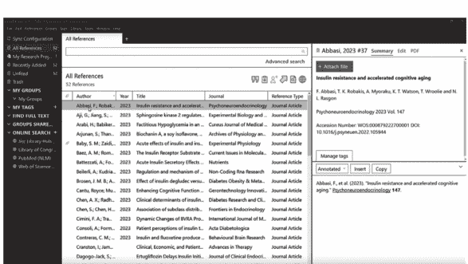
（图片来源：EndNote官方网站）

#### 二、Zotero：开放获取运动的实践先锋

诞生于美国乔治梅森大学（George Mason University, GMU）数字人文项目的Zotero（见图1-1-2），自设计之初就蕴含着开放获取（Open Access, OA）运动的基因。其革命性突破在于将文献采集范围扩展至整个互联网空间，包括亚马逊图书、arXiv预印本平台乃至普通新闻网页。用户只要激活Zotero Connector插件，系统不仅能抓取标准元数据，还能自动下载PDF全文并解析章节结构。这种去中心化的文献获取方式，特别适合数字人文、科技政策等跨学科领域的研究者，因其所需的资料往往分散在学术期刊、政府报告、行业白皮书等多种载体中。

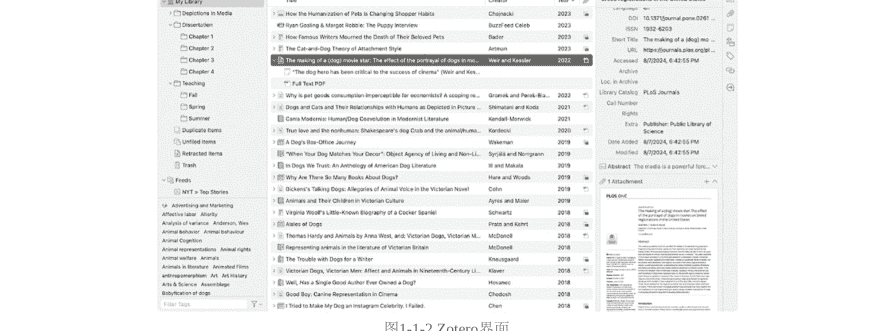
（图片来源：Zotero官方网站）

Zotero的开源特性催生了活跃的开发者社区，大量第三方插件构成了其强大的功能生态。例如，ZotFile插件可用于自动化管理PDF和其他文件的重命名、移动及阅读器同步；Better BibTeX扩展实现了与Overleaf平台的深度集成，可自动同步参考文献库，自定义引用键等；而Zutilo工具包则能提供额外的菜单项和快捷键，以支持用户个性化的工作流程。这种可扩展性使Zotero逐渐超越了单纯的文献管理工具，进化为个人知识中枢。这意味着用户可通过API接口将文献数据导入Notion AI个人知识库，或利用Markdown插件生成动态参考文献列表。不过这种高度自由化的配置也需要用户具备较高的技术素养，普通研究者或须通过专门的技能学习才能充分发挥其潜力。

#### 三、Mendeley：学术社交网络的数字枢纽

全球领先的学术出版商爱思唯尔集团（Elsevier）于2013年收购了Mendeley（见图1-1-3），这标志着学术出版巨头开始对科研社交网络进行布局。Mendeley的创新之处在于将文献管理工具转化为学术关系的连接器，当用户上传论文至个人资料库时，系统不仅能解析文献内容，还能通过作者识别算法建立合作者网络图谱。其推荐引擎会基于用户研究兴趣，推荐相关领域的文献资源与会议信息。这种知识发现机制能够帮助用户有效地缩短文献调研周期。

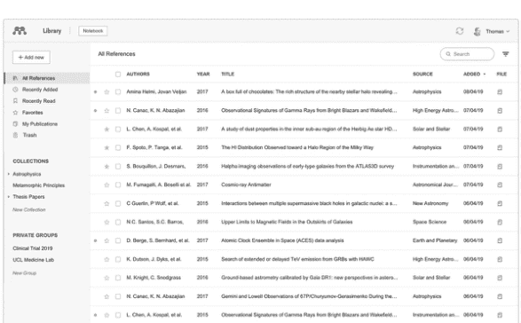
（图片来源：Mendeley官方网站）

在协作功能设计上，Mendeley开创了“批注社交化”的模式。研究团队可以创建私有群组，成员对PDF文献的标注会在群组内实时同步并显示批注者身份。这种透明化的交流方式尤其适合分布式科研团队的方案讨论。公共群组则对所有人可见，允许所有人添加条目，相当于形成一个独特的众包知识库。不过，这种高度的开放性也可能带来一定的潜在风险，因此更适用于公开讨论或者管理课题组的研究成果。部分隐私敏感型研究者则更倾向于选择本地化部署的替代方案。

#### 四、工具选择、伦理风险和未来图景

面对EndNote、Zotero和Mendeley三种工具的功能差异，研究者可建立“需求—场景—约束”的三维决策模型（见表1-1-1）。首先是评估自身的核心需求。如果是以期刊投稿为导向，EndNote的格式精准性具有不可替代性；如果侧重于知识图谱构建，则Zotero的扩展性更具优势；如果是追求学术网络的拓展，Mendeley或许是更优选择。其次是考虑使用场景。跨机构合作项目可以采用功能更加完善和丰富的EndNote的企业版，个人探索性研究适合采用轻巧的Zotero，而在研究生培养上则可利用Mendeley的指导功能。最后还需要权衡资源约束，包括预算限制（收费的商业软件和免费的开源工具）、技术能力（是否需要编程基础）、设备条件（是否依赖移动端）等要素。

表1-1-1 文献管理工具选择的比较框架

| 比较维度 | EndNote | Zotero | Mendeley |
| :--- | :--- | :--- | :--- |
| 满足的核心需求 | 引文格式权威性 | 跨平台知识整合 | 学术社交网络 |
| 典型应用场景 | 生物医学期刊投稿 | 数字人文研究 | 跨学科团队协作 |
| 主要约束条件 | 年度许可费用 | 免费；技术学习曲线 | 免费；数据隐私顾虑 |

随着AI技术在文献管理领域中的深度应用，学术界也开始关注在此类工具使用中的伦理规范。目前，上述三大软件均存在一些较为类似的问题：自动生成的参考文献可能存在DOI错误，特别是对非英语文献的元数据提取准确率相对较低；文献查重算法可能忽略概念剽窃等隐性学术不端行为。对此，建议研究者可以在论文方法章节声明所使用的工具及其版本号，对自动生成的文献列表进行人工复核，并在致谢部分标注工具开发者贡献。技术透明性原则将是数字时代学术诚信体系的新基石。

当前的文献管理工具正在经历第三代智能化技术变革。例如，EndNote X9版本引入的Manuscript Matcher功能可基于用户文献库，为其智能推荐投稿的目标期刊；Zotero 7可以接入ChatGPT、DeepSeek等AI助手，自动提取研究问题与方法论关键词等。这些创新预示着文献管理将从被动存储转向主动赋能，工具系统不仅能组织已有知识，还将参与研究问题的生成、方法论的设计、期刊发表的实现乃至学术影响力的预测。在此趋势下，研究者的核心能力也将在技术驾驭力和学术判断力的双重维度迁移，人机协同的深度与广度或将成为衡量学术生产力的新标准。

### 第二节 文本生成工具：DeepSeek、ChatGPT和Gemini

AI技术的突破性发展正在重塑学术写作的流程和底层逻辑。以DeepSeek、ChatGPT和Gemini为代表的大语言模型（Large Language Model, LLM）实现了从知识检索到内容生成的跃迁，成为文本生产的有力工具。这些工具不仅改变了传统写作的线性流程，更引发了关于学术原创性、知识所有权和认知边界的深层讨论。

文本生成工具的技术演进大致上可以分为三个阶段：一是规则驱动阶段，如早期的LaTeX排版系统；二是统计学习阶段，如基于循环神经网络（Recurrent Neural Network, RNN）的自动文本摘要模型；三是预训练大模型阶段，以OpenAI的GPT系列为标志。在当前的主流工具中，DeepSeek聚焦中文科研场景，ChatGPT代表了通用型生成能力，Gemini能整合搜索引擎提供实时数据。尽管技术路线各异，这些工具的共性在于通过注意力机制捕捉文本深层语义，进而辅助研究者完成从实验设计描述到理论框架建构的学术写作任务。研究者可借助AI突破思维定式，但同时也面临着内容可信度验证等新挑战。

#### 一、DeepSeek：中文语境下的科研写作辅助

作为由我国本土科技公司杭州深度求索研发的大模型产品，DeepSeek（见图1-2-1）凭借其开源特性和创新性的深度思考模式等，在2025年初一经推出就引发了行业震动和全社会的密切关注。数据分析平台QuestMobile发布的数据显示，自2025年1月20日DeepSeek-R1模型发布后，在一个月内没有广告投放的情况下，用户增长就高达1.25亿 [2] 。这款模型因其庞大的参数数量、巨大的模型体积以及对硬件资源的高要求，能够提供较为精确的回答，并且能够充分利用网络连接，获取最新的数据和资料，因此也被称为“满血联网版”模型。


DeepSeek作为科研写作工具，其核心竞争力主要体现在对中文科研语料的专业化处理能力上。DeepSeek采用了先进的自然语言处理技术，能够理解和生成高质量的学术文本。相比于其他工具，DeepSeek在中文语境理解和内容输出方面的表现尤为突出，它能够较好地理解复杂的学术语境，尤其是深度思考模式更能胜任复杂的逻辑推理和分析工作。同时，DeepSeek也支持多种语言的科研写作，无论是撰写中、英文还是其他语言的学术文章，DeepSeek都能提供流畅的文本生成服务，极大地提升了研究者的写作效率。此外，DeepSeek还可以为科研写作的全流程提供相应的辅助。它可以根据研究主题自动生成论文大纲，生成高质量的初稿，提供语言润色和语法检查功能，以及支持论文查重和降重等。这些功能不仅简化了写作过程，还提升了论文的语言质量，使研究者能够更加专注于学术内容的创新和研究深度。

不过，尽管 DeepSeek在通用学术写作中表现优异，但在某些高度专业化或小众化的科研领域中，其生成的文本可能缺乏足够的领域深度和准确性。同时，DeepSeek作为一款基于云端的AI工具，用户须将数据上传至服务器进行处理。对于一些涉及敏感数据的研究，可能会存在数据安全方面的隐忧。

#### 二、ChatGPT：通用型数字研究助理

ChatGPT（见图1-2-2）是由美国OpenAI公司开发的基于GPT系统的大模型，其本质是提高人类收集、整理、计算和分析各类信息资料能力的工具体系。ChatGPT强大的自然语言处理能力和多模态转化能力使之可被用于包括学术写作在内的多个场景和领域。截至2025年2月，OpenAI已更新至GPT-4.5版本。通过扩展无监督学习，GPT-4.5 提高了其识别模式、建立联系和无须推理即可产生创造性见解的能力。早期测试表明，GPT-4.5给人的交互感觉更自然，它拥有更广泛的知识库、更好地跟踪用户意图的能力以及更高的“情商”，可完成写作、编程和解决实际问题等任务，同时出现“AI幻觉”，即生成虚假或不准确的内容的频率或也更低 [21] 。此外，ChatGPT还提供了Deep Research，即增强功能，可以为更复杂的在线多步骤研究任务（如金融、科学、政策、工程等领域的研究）提供服务。

作为行业中的先行者和领头羊，ChatGPT作为学术写作的辅助工具也展现出了一些显著的优势。ChatGPT能够快速生成高质量的初稿，帮助研究者节省大量时间。ChatGPT还能够对已有内容进行扩展和补充，帮助研究者丰富论文的细节。例如，当研究者对某个概念或理论描述不够充分时，ChatGPT可以提供更详细的解释或补充相关背景信息。ChatGPT基于大量包括英语和其他语种在内的文本数据进行预训练，支持多种语言的文本生成和翻译，在英语写作上依然是目前最强大的大模型之一。此外，ChatGPT 还具备强大的语言润色功能，能够识别并修正文本中的语法错误、用词不当或表达不清的问题，使论文语言更加规范和流畅。这种多语言支持和语言优化能力特别适合需要发表国际期刊或参与国际会议的研究者。

不过，与DeepSeek相似，使用ChatGPT进行学术内容写作时，也容易遭遇专业深度和准确性，以及数据隐私安全方面的问题。


#### 三、Gemini：基于搜索的实时知识整合者

Google研发的Gemini（见图1-2-3）前身为Bard，是基于专为对话优化的LaMDA（Language Model for Dialogue Applications）模型形成的，能够处理简单或复杂的查询并提供不同版本的回答，2024年起全面升级为Gemini系列。相比于传统模型，基于LaMDA的Gemini更擅长理解上下文逻辑和生成连贯回复。例如，当用户提出需要多个步骤推理的学术问题时，Gemini能分解问题结构并给出阶段式的回答。同时，Gemini通过整合搜索引擎实时数据与学术数据库，构建了动态更新的知识网络，其核心优势体现在跨模态信息处理上。例如，当用户提出研究问题时，系统不仅能生成文字综述，还能自动关联统计图表、卫星影像甚至实验视频资料。这种多维度的信息呈现方式，特别适合需要融合定量分析与质性研究的学科。


截至2025年3月，Gemini已更新至2.5版本，在数据处理速度和精确度上相较前期版本均有提升。此外，Gemini也已上线Deep Research功能，其核心优势在于代理式研究能力，用户只需输入研究主体，Gemini即可自动制订研究计划，搜索资源并进行推理分析，生成结构化研究报告。

不过，Gemini在语言支持方面优先面向使用英语的研究者群体，在处理高度专业化的问题时，无法保证其有效性和准确性。

#### 四、工具选择、学术伦理和未来图景

从不同的比较维度来说，DeepSeek、ChatGPT和Gemini三大工具各有自身的优劣势（见表1-2-1）。在能够满足的核心需求方面，DeepSeek相较于后两者具有更强的中文语境理解和内容生成能力；而ChatGPT提供的发散性建议或许最具启发性；Gemini则凭借Google搜索引擎具有最佳的实时数据整合能力，同时也支持图像和文字的多模态形式。在适用场景方面，DeepSeek更适用于面向中文期刊发表等中文学术写作目的；ChatGPT则在研究设计与综述上具有较好的表现；而Gemini则更适用于需要生成大量图像的数据驱动型研究。在约束条件方面，DeepSeek和Gemini都可供用户免费使用，但是DeepSeek由于用户基数过于庞大，常有信息过载导致无法及时获得内容的倾向；而ChatGPT主要采取付费模式，个人和团体用户的月订阅费用在20美元和200美元之间，对个人研究者来说需要承担一定的经费开支。

表1-2-1 文本生成工具选择的比较框架

| 比较维度 | DeepSeek | ChatGPT | Gemini |
| :--- | :--- | :--- | :--- |
| 满足的核心需求 | 中文术语精准性 | 创新思维激发 | 实时数据整合；图文多模态 |
| 典型应用场景 | 中文期刊论文撰写 | 研究设计与综述 | 数据驱动型研究 |
| 主要约束条件 | 免费；信息过载倾向 | 付费；事实性错误风险 | 免费；跨语言能力局限 |

文本生成工具的普及已经使得学术界对于重新定义“原创性”标准的需求越来越迫切。目前，已经有包括《科学》和《自然》在内的大量学术期刊，以及如国际出版伦理道德委员会（Committee on Publication Ethics, COPE），国际医学期刊编辑委员会（International Committee of Medical Journal Editors, ICMJE），国际科学、技术和医学出版商协会（STM），泰勒·弗朗西斯出版集团（Taylor&Francis），爱思唯尔等学术出版机构都各自制定了如何在工作中使用生成式AI工具的规则。2024年11月28日，复旦大学发布的《复旦大学关于在本科毕业论文（设计）中使用AI工具的规定（试行）》中，对AI工具在本科毕业论文（设计）撰写过程中的使用进行了详细规范。但这些规范要求各不相同，形形色色的指导方针和判别标准常让研究者感到困惑。如何在更大程度上对生成式AI使用的学术伦理标准加以统一或许是学界亟待解决的问题。

就学术写作而言，下一代的内容生成工具将呈现出三个主要的发展方向。首先是更智能的内容生成与优化，能够理解更复杂的理论模型和实验设计，生成更符合规范的优质文本；其次是多模态协同，支持文本、图表、公式和代码的多模态生成；最后是科研领域自适应能力的提升，能够针对特定学科生成特定规范要求的文本，以及通过迁移学习和模型微调实现专属定制等。在生成式AI技术的推动下，学术写作或将形成从人类设定认知框架，到AI填充证据链，再到人机协同智能修订的全新流程，知识生产的效率边界和质量阈值也将被进一步打破和提升。

### 第三节 翻译工具：DeepL和Google Translate

AI翻译技术的革新正在逐步消除学术交流中的语言壁垒。20世纪50年代是机器翻译的早期发展阶段。当时，美国与苏联两个大国出于军事需要，投入了大量资金用于英文和俄文的机器互译，翻译的主要对象是科技文件。到了20世纪90年代，IBM开发了基于词对齐的翻译模型，标志着现代统计机器翻译方法的诞生。2006年，Google Translate作为免费翻译服务工具正式发布，掀起了统计机器翻译研究的一波热潮。自2013年开始，卷积神经网络（Convolutional Neural Networks, CNN）和循环神经网络被大量运用到了机器翻译研究中，使其进入了神经机器翻译（Neural Machine Translation, NMT）的新时代。

学术翻译的需求特殊性也推动了工具的功能分化。研究者不仅需要基础语义转换，更要求保持学科术语一致性、学术修辞规范性及引文格式完整性。DeepL与Google Translate作为两大代表性工具，分别以精准性与普适性重塑着跨语言研究的范式。

#### 一、DeepL：精准传递型的专业翻译工具

DeepL（见图1-3-1）成立于2017年，是一家总部位于德国的AI行业企业，专注于提供由AI驱动的高质量翻译服务。DeepL使用神经机器翻译技术提供免费的翻译服务，主要面向B2B市场，目前拥有包括爱思唯尔、富士通等在内的超过2万家企业客户。DeepL现能支持横跨欧亚大陆的33种语言。2023年，公司又推出AI写作助手DeepL Write，成功跻身独角兽行列。

2024年7月，DeepL宣布推出新一代面向翻译和编辑应用的大型语言模型。新的语言模型采用语言人工智能以及先进的翻译与写作技术，其翻译质量再次得到显著提升，进而减少了编辑次数，提高了用户的工作效率。DeepL宣称，自测表明，其译文受语言专家的青睐程度是谷歌翻译的1.3倍，ChatGPT-4的1.7倍，微软翻译的2.3倍。该自测还表明，与同类服务相比，DeepL翻译所需的编辑量更少，要达到同样的质量，谷歌翻译需2倍的编辑量，而ChatGPT-4则需要3倍的编辑量 [4]。有别于其他基于互联网上公开数据训练的通用模型，DeepL的新模型使用其在过去七年中积累的训练语料，专门针对内容创建和翻译。

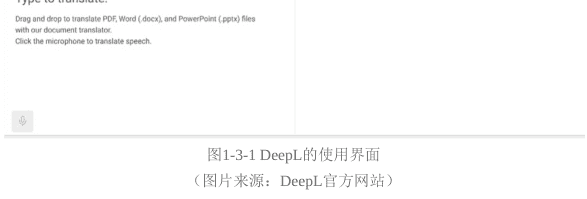

图1-3-1 DeepL的使用界面
（图片来源：DeepL官方网站）

然而，DeepL的学术适用性也存在显著的局限性。一是其只能支持直接输入或复制、粘贴的文字，以及PDF、docx、pptx格式文本内容的翻译，还不能翻译图片内容；二是其语种覆盖度（33种）远低于能够支持240多种语言的Google Translate，尤其缺乏对小语种学术共同体的支持。

#### 二、Google Translate：普惠服务型的学术翻译工具

Google Translate是谷歌公司于2006年开始提供的免费翻译服务工具，目前已经可提供249种语言之间的即时翻译，并支持任意两种语言之间的字词、句子和网页翻译。2022年9月，Google Translate由于“使用率低”退出中国大陆市场，这一变化也同时影响了中国用户曾经可以使用的Chrome浏览器内置翻译功能。

Google Translate提供即时翻译功能，用户可以在左边的输入字段输入文字，翻译结果会即时在右边的结果框显示。将鼠标移到翻译结果文字上可以看到其对应的原文。此外，Google Translate亦提供包括原文和译文在内的朗读功能，用户亦可查看中文拼音、日文罗马字等。2023年3月，网页版的Google Translate开始提供直接处理图片中文字的功能。用户只要找到新的图片翻译选项，点击后就能上传照片或屏幕截图，翻译出来的文字可以复制，也能保存显示翻译文字后的图像。该功能使用的是跟用于图像识别的Google Lens（见图1-3-2）一样的AR翻译技术，可以支持通过手机镜头实现的即时翻译。该工具的学术价值在文献速读场景中尤为突出，研究者可使用“镜头翻译”功能直接拍摄外文书籍段落，获得即时译文辅助理解。


图1-3-2 Google Lens Translate的使用界面
（图片来源：https://www.fonearena.com/blog/311727/google-lens-copy-to-computer-text-translation.html）

不过，Google Translate也有其自身的功能局限。Google Translate的质量与语种有关。例如，当源语言是一种欧盟国家语言，而目标语言是英语时，其翻译质量往往较好，而在翻译非同源语言时，则容易出现差错。此外，虽然Google Translate在大部分时候表现出色，但在某些特定学科领域，如法律、医学等的专业术语的翻译上准确性可能较低。

#### 三、工具选择、学术伦理和未来图景

DeepL和Google Translate两大工具在一些特性上呈现出了一定的互补关系（见表1-3-1）。在科技领域的技术文档翻译中，DeepL的术语精准性具有较高优势；而当涉及多语言比较研究或濒危语言文献处理时，Google Translate的语言覆盖广度是不可替代的。在使用场景方面，DeepL翻译所需的编辑更少，更适合技术论文与专利等的翻译；而Google Translate的即时摄像头翻译在田野调查中更具实用性。因此，在实际研究场景中，研究者可以采用混合工作模式，即使用Google Translate进行跨语言文献筛选和即时翻译，快速定位相关研究；对精选文献则采用DeepL进行精细翻译，并结合术语库进行人工校对。在使用成本和风险上，目前，DeepL和Google Translate都支持网页免费使用，离线的本地处理模式也更符合敏感数据的保密要求。

表1-3-1 语法检查工具选择的比较框架

| 比较维度 | DeepL | Google Translate |
| :--- | :--- | :--- |
| 满足的核心需求 | 专业术语精准性 | 语言覆盖广度与多语言文献速读 |
| 典型应用场景 | 技术论文与专利翻译 | 镜头即时翻译与田野调查辅助 |
| 主要约束条件 | 小语种支持不足 | 术语失真 |

张霄军等（2021）提出了构建可信赖机器翻译系统的七项原则：一是人本性，即支持人的能动性和基本权利，而不是减少或限制人类自治；二是鲁棒性，要求算法足够安全、可靠和稳健；三是私密性，必须保护用户隐私和数据安全，对含有偏见及错误的信息需要进行脱敏处理；四是可解释性，在译文产生争议时，机器翻译系统对翻译决策过程可以给出合理解释；五是公平性，寻求允许所有人都平等地使用机器翻译产品和服务的方式；六是可复现性，机器翻译系统必须是可复现且可靠的；七是可持续性，良好的机器翻译系统应该是兼具公平性与可持续性的 [5]。这七大原则或可为机器翻译中的学术伦理标准构建提供启发。

展望未来，在学术翻译领域应该建立起人与机器和谐共生的翻译生态系统。在这种未来的翻译生态中，人机交互将成为核心机制。翻译工具不仅支持多模态信息处理，还能根据研究者需求提供个性化文本转换方案。此外，AI翻译涉及大量用户数据，数据安全和隐私保护理应成为关注的重点。提供工具的企业需加强数据加密和访问控制，在政策层面也应推动相关法律法规的完善，进一步保障用户权益。

### 第四节 语法检查工具：Grammarly和ProWritingAid

目前，AI驱动的语法检查工具已经从基础的语言纠错系统演化为学术写作的智能协作者。传统的语法检查工具，如Microsoft Word中内嵌的拼写检查功能，基于规则库与有限语境匹配，常常只能识别显性的语言错误。2010年以后，由于深度学习技术在自然语言处理领域有了重大突破，新一代语法检查工具开始具备语义理解能力，并且逐步实现从单纯的语言纠错到写作助手的功能转向。在学术写作场景中，此类工具的核心价值主要体现在三个维度上：其一，降低非母语研究者的语言障碍；其二，维护学术文本的严谨性；其三，辅助建立学科写作规范。

作为该领域中的领先产品，Grammarly与ProWritingAid则分别代表了实时交互式辅助与深度文本分析两种不同的技术范式。二者的功能演进不仅体现了自然语言处理技术的进步，更折射出学术界对写作质量评估标准的范式转变——从单一的语法正确转向具备风格适配性、逻辑严谨性与学术规范性的多维评价体系。

#### 一、Grammarly：实时交互的智能编辑

Grammarly（见图1-4-1）由乌克兰裔技术团队于2009年在美国创立，目前总部设于旧金山，其联合创始人为Alex Shevchenko和Max Lytvyn，早期产品主要用于帮助用户检查和纠正英语拼写、语法和标点符号等方面的错误，以及提供更好的词汇选择和句子结构建议等功能。随着AI技术的进步，从2017年左右开始，Grammarly开始把深度学习融入产品之中，此后也成功筹集到了巨额融资用于AI技术的研发。

目前，仅从语法纠错的角度来看，Grammarly的AI技术已经取得了长足的进展。它不仅能够实时帮助用户分析文本中的语法结构，识别出诸如时态和词性误用、主谓不一致等常见的语法问题，而且还能提供详细的解释和正确的用法示例。对于许多非母语学术写作者来说，Grammarly就像是一个随时在线的私人语言教师。在AI技术的加持下，Grammarly也可以交互式地协助用户完成整个写作过程——从使用AI提示词进行概述和起草，到单击即可重写文本，再到校对文稿以确保文字的清晰度、简洁性和语气上的适宜和统一。而随着学界和社会对学术伦理和知识产权保护的日益重视，抄袭检测也成了Grammarly的AI技术的另一个关键的应用领域。Grammarly的AI系统可以通过对大量文本数据的学习和分析，识别出不同文本之间的相似性，从而识别出潜在的抄袭行为。它不仅可以检测出直接抄袭的段落，也能发现通过改写“借鉴”原文主旨思想的内容。


图1-4-1 Grammarly的使用界面
（图片来源：Grammarly官方网站）

Grammarly现在可通过浏览器插件、文字处理软件和移动端在多个平台使用，支持Google Docs、MS Word、Gmail等常见学术环境，使得用户可以编写文档、电子邮件等，而无须复制、粘贴或分散焦点。不过，和其他AI系统一样，尽管Grammarly的语法纠错和抄袭检测的准确性已经相当高，但仍存在一定的误判率。而随着语言的不断发展和演变，新的词汇、短语和语法结构也在不断涌现，Grammarly也需要及时跟上变化的步伐，以减少无法识别或错误处理新语言的情况。

#### 二、ProWritingAid：深度的文本错误诊断

ProWritingAid（见图1-4-2）于2013年成立于英国伦敦，由总部位于英国的独立软件公司Orpheus Technology Ltd运营。创始人Chris Banks是一名专业的商业作家，在计划创作一本与其以往的写作类型不同的旅行小说时，想到了创建ProWritingAid来辅助专业写作者们进行创作。

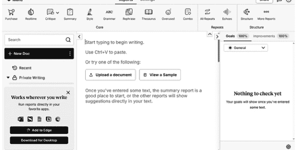

图1-4-2 ProWritingAid使用界面
（图片来源：ProWritingAid官方网站）

相较于Grammarly的实时性，ProWritingAid的一个突出特点是采用“全面体检”的模式，其量身定制的分析工具可在几秒钟内评估用户写作的各个方面，并指导如何加以改进。系统生成的写作检查报告涵盖了从词汇密度、句式变化到段落连贯性等方面的全方位评估，特别适合长篇学术写作者。例如，当系统监测到存在过度使用某些特定单词或短语的情况时，会通过提供替代词等方案帮助写作者减少对特定单词或短语的依赖，以改进写作；而一致性检查则着重检测写作者的标准化拼写、大小写和连词等。

同时，作为一家独立软件公司的产品，ProWritingAid强调不会迫于公司股东的压力，为了利润而违背商业道德，因此十分重视对用户隐私和知识产权的保护，保证绝不会将用户上传的文本内容分享给他人或用于其他目的。

#### 三、工具选择、学术伦理和未来图景

作为语法检查工具也好，写作辅助工具也好，Grammarly和ProWritingAid两套系统之间也存在一些明显的差异（见表1-4-1）。Grammarly的强项在于实时性与跨平台集成，如支持Google Docs、Evernote等多种不同环境，更适用于注重写作流畅度的场景，如论文初稿撰写与快速修订。而ProWritingAid的深度报告模式则需要研究者预留修订时间，但能提供更具策略性的改进建议，因此更适用于终稿优化以及针对不同期刊风格的适配性修改。具体到不同学科领域中，Grammarly的自然科学学科预设，允许较高比例的被动语态与公式化的表达，更受实验研究者的青睐；而ProWritingAid的叙事流分析功能，则能为诸如人类学、历史学这样的更注重论述逻辑的人文学科提供帮助。当然，对于跨学科研究者来说，则可以采用组合化策略，比如在灵感迸发阶段使用Grammarly保持写作的连贯性，在修改阶段则借助ProWritingAid进行系统性优化。在使用成本方面，Grammarly和ProWritingAid都有免费版，Grammarly的专业版约为每月30美元，而ProWritingAid的专业版则为每月10英镑。

表1-4-1 语法检查工具选择的比较框架

| 比较维度 | Grammarly | ProWritingAid |
| :--- | :--- | :--- |
| 满足的核心需求 | 实时交互与跨平台支持 | 深度文本结构与风格分析 |
| 典型应用场景 | 论文初稿撰写与快速修订 | 终稿优化与期刊风格适配 |
| 主要约束条件 | 复杂句式误判风险 | 功能相对有限 |

与前述的DeepSeek、ChatGPT等文本生成式AI系统相似，Grammarly和ProWritingAid这样的语法检查工具既然已经进化到了写作辅助阶段，那么不可避免地也会遭遇内容原创性上的学术伦理困境。同时，语法检查和文本优化通常需要用户上传全文，因此研究者对于尚未发表的学术原文在上传后是否会遭遇泄露和剽窃等问题的疑虑也将是阻碍此类工具使用的一个重要因素。

未来的语法检查工具或将呈现以下一些发展趋势：一是进一步强化内容生成和文本优化功能，甚至拓展ChatGPT等主流的文本生成式AI的功能边界；二是完善抄袭检测功能，不断提升检测的准确率和抄袭规避的智能化程度；三是加强对用户内容的隐私和产权保护，消除用户对科研成果泄露和剽窃等问题的顾虑。

### 第五节 其他工具：数据可视化和代码生成工具

除了上述文献管理、文本生成、语言翻译和语法检查外，AI技术也正在逐步渗透到学术研究的其他环节，如数据可视化与代码生成。数据可视化和代码生成工具不仅可以帮助研究者提高学术内容的表现力，提高学术共同体内部的沟通效率，也有助于减少机械的重复劳动，提升工作效率。

#### 一、数据可视化工具

数据可视化作为一种将数据以图形化的形式加以展现的方法，在各个学术领域中的重要性日益凸显。通过图表、图形和交互式展示等，数据可视化不仅提升了学术信息的传达效率，也增强了其可理解性。在过去数十年中，数据可视化技术经历了长足的发展，从最初的手工绘制图表到如今的自动化工具，可视化的方式不断丰富。从早期依赖于静态图形和图表以传达基本信息，到现在，数据可视化已逐渐向动态与交互式转型。以Tableau、Python的Altair库和R语言ggplot2为代表的工具，正在重塑学术图表生产的传统模式。

Tableau是一家美国的软件公司，于2019年被云计算巨头赛富时（Salesforce）收购。Tableau的主要优势就在于数据可视化。用户将各种数据源，如数据库、Excel文件等中的数据接入Tableau后，通过简单的拖拽操作，就能快速创建出包括柱状图、折线图、饼图等多种类型在内的各种直观的图表。目前，Tableau的免费版本是Tableau Public，允许任何人上传数据集并在线创建交互式可视化图表。此外，Tableau还提供Tableau Desktop Public Edition，这是专门为学生和教师设计的免费版本，用户可以通过简单的注册和下载过程获得许可证，用于学习和教学。

在Python生态系统中，也有许多优秀的数据可视化工具，其中之一就是Altair。这是一个基于Vega-Lite的声明式数据可视化库，它能使数据可视化变得更加容易和直观。Vega-Lite是一种用于描述图表的高级语法，它提供了一种直观的方式来定义数据可视化的外观和行为。Altair支持各种图表类型，包括散点图、折线图、条形图、直方图等，以及组合图表和多图表面板，也包含一些内置的示例数据集，可用于快速绘制示例图等。

R语言ggplot2包提供了一套基于图层语法的绘图系统，它允许用户通过声明式方式指定数据、美学映射和图形元素来灵活创建复杂美观的可视化图表。它弥补了R语言基础绘图系统里的函数缺乏一致性的缺点，将R语言的绘图功能提升到了一个全新的境界。ggplot2分层和模块化的方法使得用户可以灵活地创建复杂的图表，同时保持代码的可读性和易用性。借助ggplot2，用户可以创建散点图、折线图、直方图、条形图和箱线图等各类图表，并通过自定义选项调整图表细节，以适应具体的展示需要。

#### 二、代码生成工具

在软件开发的早期阶段，程序员必须依靠手动编写每一行代码来构建软件系统。这个过程不仅耗时费力，而且容易出现错误。随着技术的发展，一些自动化工具开始出现，如代码模板和代码片段库，为开发者提供了一些可重复使用的代码块，减少了部分重复性工作。随着AI技术的发展，代码生成技术也迎来了新的突破。智能代码生成工具利用深度学习算法，可以根据需求描述或示例代码自动生成高质量代码。这些工具不仅能够生成基本的代码结构，还可以进行优化和改进，大大提高了开发效率和代码质量，在科研领域也具有广泛的用途。目前，代表性的工具有GitHub Copilot、Claude Code和DeepSeek-Coder等。

2021年6月29日，微软与OpenAI共同推出了一款AI编程工具GitHub Copilot。2022年6月22日，GitHub Copilot正式上线。该工具基于GitHub及其他网站的源代码，可根据上文提示为程序员自动编写下文代码。它可以支持十几种语言，与Python、JavaScript、TypeScript、Ruby和Go等主流语言配合效果更佳；还可以将注释转换为代码，只需要写一条评论，描述想要的逻辑，系统就能自动理解并写出相应功能的代码，也能自动填充重复代码。2025年2月8日，GitHub Copilot推出了视觉功能，使得图片可秒变代码。

Claude Code是由Anthropic开发的智能编程工具，可以通过自然语言指令帮助开发者高效地编写代码。它可以直接在终端运行，理解代码库内容，简化开发过程，而无须复杂配置或额外服务器支持。其主要功能有：编辑文件并修复代码错误；回答关于代码架构和逻辑的问题；执行和修复测试、代码检查和其他命令；搜索git历史记录、解决合并冲突，以及创建提交和PR等。

DeepSeek-Coder是由DeepSeek推出的代码大模型，免费供用户使用，且完全开源。DeepSeek-Coder是一个支持多种编程语言，调试和数据分析任务的模型，并在HumanEval等编程基准测试中表现优异，超越CodeLlama等开源模型。它在代码补全、代码生成、代码解释以及代码纠错等方面表现出色，能够极大提高开发者的编程效率。DeepSeek-Coder的使用也非常便捷，用户可以通过简单的API调用实现模型的加载和代码生成。

表1-5-1为目前热门AI工具及其主要功能一览表：


| 名称 | 文献管理 | 文本生成 | 语言翻译 | 语法检查 | 可视化 | 编程辅助 | 数据分析 | 查重检测 |
| :--- | :---: | :---: | :---: | :---: | :---: | :---: | :---: | :---: |
| EndNote | √ | × | × | × | × | × | × | × |
| Zotero | √ | × | × | × | × | × | × | × |
| Mendeley | √ | × | × | × | × | × | × | × |
| ChatGPT | × | √ | √ | √ | √ | √ | √ | × |
| DeepSeek | × | √ | √ | √ | × | √ | √ | × |
| Gemini | × | √ | √ | √ | √ | √ | √ | × |
| Claude | × | √ | √ | √ | √ | √ | √ | × |
| Grok | × | √ | √ | √ | √ | √ | √ | × |
| DeepL | × | √ | √ | √ | × | × | × | × |
| Google Translate | × | × | √ | × | × | × | × | × |
| Grammarly | × | √ | × | √ | × | × | × | × |
| ProWritingAid | × | × | × | √ | × | × | × | × |
| Tableau | × | × | × | × | √ | × | × | × |
| Altair (Python) | × | × | × | × | √ | × | × | × |
| ggplot2 (R) | × | × | × | × | √ | × | × | × |
| GitHub Copilot | × | × | × | × | × | √ | × | × |
| CodeWhisperer | × | × | × | × | × | √ | × | × |
| Turnitin | × | × | × | × | × | × | × | √ |
| Copyscape | × | × | × | × | × | × | × | √ |
| NVivo | × | × | × | × | √ | × | √ | × |
| MAXQDA | × | × | × | × | √ | × | √ | × |
| RapidMiner | × | × | × | × | √ | × | √ | × |
| Provails Research | × | × | × | × | √ | × | √ | × |

## 第六节/AI学术写作社群和协作平台

随着AI工具在学术写作中的广泛应用，围绕这些工具所构建的使用社群与学术平台也愈加活跃。这些平台不仅是获取最新工具动态和写作技巧的重要渠道，更成为研究者进行跨区域、跨语言、跨学科协作的重要媒介。通过参与这些社群，学者能够接触到前沿的研究成果、实用的写作资源和具有启发性的同行反馈，在智能时代构建起以技术为纽带的学术共同体。

#### 一、国际平台和社群

在国际上，有多个开放科学平台正在引领AI学术写作的协作范式。Overleaf是当前最主流的在线LaTeX写作平台之一，集成了大量AI会议模板，如 NeurIPS、ICML、ACL等，支持多用户同步编辑与版本管理。Overleaf也可与Zotero、Mendeley等文献管理软件联动，实现从文献导入到写作完成的无缝衔接。另一颇具影响力的平台是 Papers with Code。该网站由Meta AI发起，致力于将学术论文与对应的开源代码进行配对，并建立基于任务的算法性能对比系统。研究者可以在该平台上快速查询某一领域的SOTA（state-of-the-art）结果，下载复现代码，从而提升自己的论文实验部分的可操作性与严谨性。此外，由OpenAI前研究总监安德烈·卡帕斯（Andrej Karpathy）创建的arXiv Sanity Preserver，为arXiv论文阅读与筛选提供了定制化服务。其界面简洁，支持按关键词、作者、热度等方式进行个性化推荐，尤其适合跟踪AI领域的最新研究动态。

除静态内容平台外，实时通信型社群也日益成为写作协作的新空间。Academic AI（Discord）社群围绕AI学术写作开展多频道讨论，包括Overleaf模板、LaTeX语法、论文润色建议等，支持实时问答与协作编辑。Slack上的ML Writing Group则倾向于小组型论文共写，适合熟人网络中的合作。Telegram频道如“AI Paper Weekly”推送精选顶会论文摘要及写作提示，另有面向写作技巧的频道分享英文句式、语言润色模板等内容，便于移动端随时获取灵感或引用例句。在Reddit平台上，r/MachineLearning社区用户常会发布写作心得、投稿历程及生成式写作工具测试结果；而r/LaTeX板块则长期聚焦学术写作排版技术，是LaTeX用户解决技术问题的重要社区之一。

近年来，多个围绕AI开源项目而兴起的社群也逐步开始涉足学术写作工具的开发与讨论。例如，Hugging Face社区论坛是开源模型交流的活跃场所，设有Research和Academic writing with LLMs等子板块，定期有开发者分享如何基于 Transformers等模型进行论文生成、摘要自动化或翻译质量优化的实践经验。同时，开源模型组织EleutherAI的Discord频道也聚集了大量LLM开发者与AI伦理学者，成员讨论从写作边界、AIGC（AI Generated Content，人工智能生成内容）的可追溯性，到AI工具在学术评审中可能带来的影响，是研究AI写作伦理的理想入口。

#### 二、中文社群和平台

在中文学术环境中，学术写作平台和社群以知识分享与投稿经验交流为主导。例如，知乎“人工智能”话题区聚集了大量AI方向的科研人员与在读研究生，讨论内容涵盖写作技巧、LaTeX排版、投稿经验与查重降重策略，形成了互动性较强的问答环境。

更具专业性的社区如小木虫论坛，设有AI写作与投稿专栏，是中国大陆科研人员特别是硕博士群体集中交流的老牌平台。平台中常见的主题包括基金标书撰写模板、SCI论文语言修改建议及国内外期刊评价动态等，适合系统性梳理写作流程的研究者参考。

AI研习社则以媒体平台的形式发布AI工具评测与学术写作课程，曾多次组织论文复现挑战赛与写作竞赛，具有较高的社群活跃度与培训价值，适合希望系统了解AI学术工具生态的用户。

另一个重要平台是Zotero中文社区，通过QQ群、公众号和用户自建教程系统，形成了以中文用户为核心的文献管理技术支持网络。社区分享内容涵盖参考样式定制、AI写作辅助插件安装与使用、引文格式纠错技巧等，是研究者构建文献写作基础能力的有力补充。

表1-6-1为上述国内外相关平台和社群网络链接一览表：

表1-6-1 AI学术写作相关的国内外平台与社群

| 类型 | 名称 | 链接 |
| :--- | :--- | :--- |
| 国际平台和社群 | Overleaf | https://www.overleaf.com/ |
| | Papers with Code | https://paperswithcode.com |
| | arXiv Sanity Preserver | http://www.arxiv-sanity.com/ |
| | Learn AI Together (Discord) | — |
| | AI Paper Weekly (Telegram) | — |
| | r/MachineLearning (Reddit) | https://www.reddit.com/r/MachineLearning/ |
| | Hugging Face | https://discuss.huggingface.co/ |
| | EleutherAI Discord | https://discord.gg/eleutherai |
| 中文平台和社群 | 知乎——“人工智能”话题 | https://www.zhihu.com/topic/19559424 |
| | 小木虫论坛 | http://muchong.com/bbs/ |
| | AI研习社 | https://www.leiphone.com/ |
| | Zotero中文社区 | https://Zotero-chinese.com/ |

### 本章小结

本章系统梳理了当前AI在学术写作中的基础性工具体系，涵盖了文献管理、文本生成、翻译辅助、语法校对、数据可视化与代码生成等关键环节，呈现了各类主流AI工具以及选择框架，并对学术伦理和未来发展做了初步讨论。同时，本章还特别提供了国内外相关社群与平台资源导引，帮助读者拓展写作生态链接，提升工具使用的效率与广度。随着技术的快速演化，AI写作已从工具层面走向认知支持层面，研究者在掌握工具功能的同时，更需理解其背后的学术逻辑与伦理边界。下一章将进一步探讨AI技术在写作效率、语言表达与研究创新等方面的优势与局限，回应AI时代学术写作的新挑战与新机遇。

- [1] DOI是“数字对象唯一标识符（Digital Object Identifier）”的英文缩写，主要用于对数字资源，如学术论文、数据集等进行永久性标识和定位。
- [2] DeepSeek走进深水区，破局在此一举[EB/OL].https://cj.sina.cn/articles/view/7806337813/1d14b4315019014gzy.
- [3] Introducing GPT-4.5[EB/OL].https://openai.com/index/introducing-gpt-4-5/.
- [4] DeepL推出新一代翻译LLM：译文受青睐度达ChatGPT-4的1.7倍[EB/OL].https://news.qq.com/rain/a/20240718A02S2H00.
- [5] 张霄军，邵璐.构建可信赖机器翻译系统的基本原则——一种基于工程伦理的观点[J].外国语文，2021，37（1）：1-8.

# 第二章 AI工具的优势与局限

### 本章介绍

本章将从理论与实践两个层面，深入分析AI在学术写作中的关键优势与潜在局限。一方面，ChatGPT、DeepSeek等内容生成式AI工具的出现和普及大幅提升了科研工作的效率，帮助研究者拓宽了研究视野和创意边界，并能够助力初学者快速跨越语言、风格等写作壁垒，增强其在全球学术舞台上的表达能力。但是另一方面，这些AI工具在使用过程中也暴露出信息准确性不足、学术伦理边界模糊、写作主体能力退化等问题，对科研学术生态的健康发展构成了无法忽视的威胁和挑战。

### 第一节/AI工具的三重优势

随着AI技术在语言理解和自然语言生成领域的迅猛发展，各类AI写作工具已经被不断地融入了学术研究和写作的日常实践中，凸显出其难以替代的优势。这些优势不仅体现在AI学术写作的速度上，更在于它在辅助研究者激发科研灵感和拓宽写作思路，帮助其跨越语言等写作障碍上带来的深层变革。本节将聚焦AI写作工具在效率提升、灵感激发与障碍跨越三大维度中的具体表现，并结合当前学术界的实际应用，梳理AI技术在现实学术写作情境中的典型作用与潜在价值。

#### 一、引发科研工作的效率革命

AI辅助工具在提升科研工作效率方面带来的影响，首先体现在其几乎可以无缝衔接地介入传统科研工作的全流程之中。Khalifa和Albadawy（2024）对PubMed、Embase和Google Scholar等数据库中自2019年以来出版的数百篇文献进行了系统性的评价，并根据AI在学术写作和研究中的应用的相关性，重点关注了写作辅助、语法改进、结构优化等方面，检索确定了24篇作为分析对象的学术研究论文，最终通过这些论文确定了AI目前在学术写作和研究领域中的六项核心功能：

- 一是协助生成研究创想和研究设计，包括通过头脑风暴、发现文献中的空白和形成假设来支持研究创想的形成，进行研究规划和研究设计；
- 二是改进论文内容和结构，包括进行文本扩展等写作辅助，通过大纲和情感基调搭建文本架构，支持视觉和多媒体整合；
- 三是支持文献综述和文献整合，包括提取和分析文献，合成文献述评汇总表；
- 四是加强数据管理和分析，包括数据集管理、数据分析和阐释；
- 五是支持编辑、审查和发布，包括文稿润色和校对，出版平台和期刊研究及内容定制等发表辅助和对评审反馈的支持和辅助；
- 六是协助沟通、展示和伦理合规，包括协助论文宣讲和演示，协助剽窃检测等伦理和诚信合规确认。

可以看到，这六项功能（见图2-1-1）几乎涵盖了从科研工作最初的创意形成到最终的成果展示的各个主要环节。

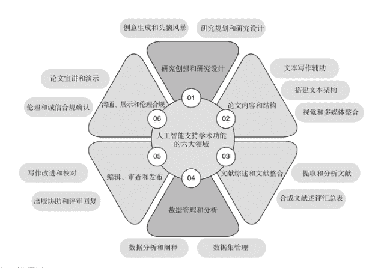

图2-1-1 AI辅助学术的六大功能领域
（图片来源：Khalifa, M., & Albadawy, M. (2024) .Using artificial intelligence in academic writing and research: an essential productivity tool. Computer Methods and Programs in Biomedicine Update , 5.）

其次，AI技术对科研效率的影响还表现为大大缩减了科研工作所需的人力和时间成本。一般科研项目往往需耗时数年，在缺乏智能科技辅助的时期，其中有大量人力成本需要被投入核心科研工作以及围绕其展开的设备和项目管理、行政和后勤、合作与交流等外围工作中。AI技术辅助科研首要的任务应是减少其中简单机械的重复劳动，如实验记录、文献管理、研究进度追踪等，缩减外围工作上的人力成本。当然，由于内容生成式AI在近年来的飞跃式发展，科研效率的提升首先反映在对科研人员的写作时间的成本优化中。大量学术写作任务原本需要耗时数周甚至数月，而现在借助AI系统，则可在数分钟内获得初稿。以ChatGPT为例，用户只需在界面中输入研究主题，即可调用内置模型快速生成摘要、方法与结论草案，大大缩短了从构思到初稿的完成周期。ChatGPT在科研和学术写作上的变革性作用也已经获得了不少研究结果的支持（如Al-Sofi, 2024 [2]; Sok和Heng, 2024 [3]; Altmäe等人, 2023 [4]; Imran和Almusharraf, 2023 [5]）。其次，一些平台还提供全流程效率工具链，例如Grammarly等系统提供检测语法、学术风格、句型重复与引用合规性等功能，帮助用户在极短时间内根据写作目的调整语气，使论文在语言表达的逻辑上更具一致性。

最后，AI技术对科研效率的影响还表现在人机协同对科研工作模式的颠覆性变革上。个性化的科研工作机制将是人机协同模式的主要亮点。它可以根据每个科研人员的特长、需求和研究方向，提供定制化的支持和资源，不仅有助于提升单体研究者的效率，还能激发创新和跨学科思维。由于每个研究领域的需求和方法都不同，AI可以通过分析研究者的研究方向、实验数据和研究方法，提供个性化的解决方案。研究者在工作中还需要不断地学习和积累新的知识，AI可以根据个人的研究兴趣和过往的研究历史，定期为研究者推荐相关的文献、课程、工具和前沿信息。此外，科研工作往往是一个协作性很强的过程，AI还可以帮助研究人员建立个性化的科研社交网络，推荐最合适的合作伙伴。通过人机协同，科研人员能够获得全方位的深度支持，涵盖从实验设计到数据分析，从文献推荐到合作机会的各个方面，AI系统可以根据个人需求进行精准定制，不仅提升了研究效率，也激发了研究创意，从而推动科研的发展。

#### 二、作为激发灵感的创意支持

灵感贫乏、逻辑卡顿与思路混乱是学术写作者面临的普遍难题。AI工具以其数据驱动、模式识别和算法推理的技术特性，为学术写作过程注入了新的可能。

首先，AI的创意生成主要是由数据驱动的。AI可以通过分析大量数据，从中提取规律和模式，从而生成新的创意内容。AI能够发现并挖掘出数据中未被充分利用的部分，使之成为创新研究的新来源。例如，AI可以分析不同来源的数据，如实验数据、临床数据、公开数据库中的数据等，整合数据并寻找其中潜在的价值。通过这种方式，AI能够帮助研究者发现新的数据集或数据源，从而推动形成新的研究问题或研究方向。此外，AI在整合和革新跨学科研究方面也具有巨大潜力，是连接不同领域的桥梁（Khalifa和Albadawy, 2024）[6]。AI可以通过整合和分析跨学科的知识和数据，帮助科研人员发现不同领域之间的潜在联系。例如，AI具备分析复杂生物数据的能力，可以通过整合遗传学、生物信息学和药理学的研究结果来助推医学研究的进步。

其次，AI具有通过识别模式形成创新联想的能力。AI擅长在复杂的、非线性的数据中识别出某些特定的规律和模式，这种能力使得AI在图像识别、语音识别、自然语言处理等任务中往往表现非常出色。它通过训练模型来识别输入数据的特征，并基于这些特征做出预测或决策。AI的这一技术特性也为科研人员提供了新的创意源泉。例如，AI的模式识别能力使其能够发现数据中的异常值或反常趋势，这些异常点往往是科研创新的源泉。在科研中，异常数据或结果有时能够为新发现提供线索，AI可以自动标记并突出这些异常点，帮助科研人员从不同寻常的结果中发现新的研究创意。

最后，AI的思维过程是基于算法的推理。其核心优势在于通过系统化、逻辑化的计算过程推断出潜在的规律、假设和创新方向。这一特性使其摒弃了人类决策模式中通过常识、情感或直觉做出判断的部分，减少了因个人好恶或社会偏见等而阻碍创意生成的可能。同时，AI的推理能力还可以用于创建复杂的仿真和模拟环境，帮助研究者测试不同的创意和假设。例如，在社会、物理、气候、生态学等领域，AI可以构建复杂的仿真模型，基于不同的输入参数推理出不同的结果，从而帮助科研人员测试和验证新的理论和实验设计。通过这些模拟，研究者可以快速发现可能的创意，从而高效地推动研究进展。

#### 三、实现突破壁垒的能力跨越

在学术写作中，由于受自身能力的限制和外部环境的影响，研究者常常面临一些在短时间内难以突破的壁垒，这不仅影响了他们的写作效率，还可能限制其研究成果的传播和交流。

首先是语言和表达障碍。对于以非英语为母语的研究者而言，语言一直是其进入国际学术发表体系的主要障碍之一。在过去十年间，机器翻译技术的长足进步，尤其是神经机器翻译的普及，使得这一隐形壁垒正在被加速打破。Selim (2024) 通过对EFL (English as a Foreign Language, 英语作为外语) 学生的访谈和问卷调查，发现Grammarly和ChatGPT等AI工具对学术写作技能的提升具有重要意义，强调AI工具是对传统写作技能的宝贵补充，提出了通过创建动态的、技术驱动的学习环境，可增强EFL学生的学术写作能力[7]。此外，学术写作有其独特的风格。与创意写作不同，学术写作的语言往往要求简洁、准确、严谨。如果不熟悉这种写作风格，往往会导致论文结构不清晰、表达模糊、逻辑松散。因此，对于研究生等学术新人来说，具备学术风格指引和调整功能的AI写作辅助工具也将是其尽快掌握学术语言的一件必备利器。

其次是学术规范和格式要求上的障碍。不同的期刊对文章的格式要求差异较大，包括引用格式、标题风格、文献列表等细节。如果不遵守这些规定，论文就很可能会被拒绝或需要重大修改（major revision）。这对于研究者来说，无疑是时间和精力上的极大浪费，也阻碍了研究成果获得及时的传播和交流。以文献列表格式来说，国内外存在多种不同的引文格式，如APA（American Psychological Association，美国心理学家协会）格式、MLA（Modern Language Association，现代语言协会）格式、GB/T 7714—2015[1] 等。正确引用文献是学术写作中的重要部分，但手动输入引用文献耗时费力又容易出错，EndNote、Zotero、Mendeley等AI文献管理工具的出现为破除此类型障碍提供了便利。

最后是同行评议和出版发表上的障碍。同行评议是学术写作中的一大难题，尤其是当评审对论文提出大量修改建议时，如何在返修期限内有效回应评审意见并修改文章，成为研究者需要面对的挑战之一。同时，研究者在面对较为消极的评审结果时，可能也会感到沮丧和困惑，甚至影响自信心。此时，Writefull、PaperRater等AI工具可以根据评审的反馈，自动分析评审意见，并提供有针对性的修改建议。此外，选择合适的期刊进行投稿也是科研写作中的一大实际问题。期刊的质量、审稿周期、影响因子等都会影响投稿的成功率。研究者可能因缺乏经验或有效信息，而难以找到最合适的期刊。此时，如爱思唯尔等出版商提供的期刊推荐工具Journal Finder等，能基于论文的摘要、标题、关键词等分析数据库中期刊的相关性，为研究者推荐最合适的期刊进行投稿，以提高投稿成功率。

### 第二节/AI工具的三重局限

AI工具在为科研工作和学术写作带来便利的同时，也显现出一系列不容忽视的局限性。研究者在使用此类工具的过程中，常面临内容真实性不明、引用不规范、责任界限模糊等问题。与此同时，对AI生成文本的过度依赖还可能削弱研究者自身的语言表达能力和批判性思维能力，造成学术写作风格上的同质化。因此，本节将从信息准确、学术伦理与使用依赖三个层面系统性地探讨AI工具的风险结构与应对思路。

#### 一、AI幻觉下的准确性隐患

尽管当前大语言模型已在自然语言生成方面取得显著突破，但“信息幻觉（hallucination）”问题依然是AI系统的结构性短板。目前，学术界还没有对AI幻觉的一致性定义（Maleki等人，2024）[8]。“幻觉”一词最早被用于AI领域是在2000年左右，当时幻觉仍然被视为计算机视觉研究中的宝贵资产，而不是一个需要规避的问题，因为它能使低分辨率图像变得更有用（Baker和Kanade，2000）[9]。Wiseman等人（2017）在一篇高被引文章中提到，当语言模型假定了可能性，但最终生成的内容却是不正确的，并且没有任何信息支持时，就出现了AI幻觉[10]。因此，所谓AI幻觉主要指的就是AI在文本生成过程中出现的虚构事实、错误引用、数据拼凑等情况。

OpenAI在2023年发布的技术报告中就已经明确指出，即使是 GPT-4，其在文本生成过程中仍可能出现虚构信息或事实错误的情况，特别是在自由生成类任务中仍存在幻觉现象 [2]。笔者在试用GPT-4.5等系列模型的过程中发现，其提供的文献信息如作者、年份、来源期刊等的准确率较高，但是在涉及论文的具体内容时，仍存在不少编造信息的情况。Schneider等人（2025）分析了2023—2024年在高影响力的神经外科期刊上发表的100篇随机选择的论文，发现大约有20%的论文都包含AI生成的部分。他们认为，在学术写作中必须采用和遵循更为严格的指导方针，以避免由于AI幻觉的存在使得论文中意外被引入虚假内容[11]。瑞典布罗斯大学学院研究人员在谷歌学术平台中发现了上百篇疑似由AI生成的文章，这些由AI生成的“垃圾科学”正在侵蚀学术平台，意味着恶意行为者能以更低成本制造和传播虚假科学，对社会和科研界来说都是一种危险情况 [3]。在中文环境下也存在类似问题。不少用户在使用DeepSeek生成文献综述段落时发现，工具虽然能够结合关键词生成逻辑清晰的叙述结构，但在具体引用中经常拼接年份、模糊作者姓名，甚至虚构并不存在的文献。

在某些专业学科中，信息错误带来的影响可能更为严重。例如，在医学或法律论文写作中，一条错误数据或概念解释可能误导整个研究推论，甚至产生伦理和法律后果。因此，研究者在引用AI工具生成的内容时，务必秉持实事求是、小心求证的谨慎态度，通过专业数据库人工核验文献信息和文献内容，确保文本中涉及的研究成果真实、可信、可追溯。

#### 二、责任归属和隐性剽窃的灰色地带

AI工具在学术写作应用中的普及引发了一个关键性问题——当学术文本不再完全由人类生成时，责任该由谁承担？根据《自然》杂志的报道，截至2023年，全球已有逾1万篇学术论文被撤回，其中有9408篇论文出自欣达维（Hindawi）旗下的出版社，除了“同行评审欺诈、论文工厂和出售作者身份”等常见撤稿原因外，“使用AI”正在成为撤稿的一大主因 [4]。目前，包括《自然》《科学》《细胞》（Cell）《柳叶刀》（The Lancet）和《美国医学会杂志》（JAMA）在内的世界顶级期刊均发表声明称，AI不具有作者资格，使用人工智能的研究人员应在稿件中加以说明。国内也有许多学术期刊已经提出将隐瞒AIGC在论文中的使用视为学术不端。例如，2023年2月10日，《暨南学报》发布《关于使用人工智能写作工具的说明》，称“暂不接受任何大型语言模型工具单独或联合署名的文章，如果在论文创作中使用过相关工具，需单独提出” [5]。目前，学术界对于AI是否能作为学术主体持有较为统一的观点，即AI无法履行如签署伦理声明、回应学术质疑等作者义务，出现学术不端时亦无法追责，因此不具备主体地位，不应被列为作者。

但除了责任归属外，在实践中还有更为复杂的“隐性剽窃”的问题。大多数AI模型都是通过海量数据训练的，但其在输出时并不会直接标注引用来源。因此，研究者可能会在有意无意间将AI生成的内容作为原创观点，而实际上这些内容可能来自其他已发表或未正式发表的论文或学术资料，如果未正确引用，就可能构成隐性剽窃。这种隐性剽窃不仅存在于文本形式的内容上，也可能存在于AI辅助生成的代码或图表上。例如，某AI工具在生成Python回归分析代码时，其核心逻辑可能高度近似于另一平台上一个公开仓库的算法，尽管变量名与注释已被修改，但其思想实质并未发生变化。当涉及此类“复制”行为时，应如何界定其原创性？在这方面，目前仍没有统一标准和有效规范。因此，多数出版机构、期刊以及高校均要求研究者合理披露在论文创作过程中使用相关工具的情况。例如，2023年9月20日，中国科学技术信息研究所与爱思唯尔、施普林格·自然（Springer Nature）、约翰威立国际出版集团（Wiley）三家国际出版集团共同发布的《学术出版中AIGC使用边界指南》（中英文版）中就提到，研究人员使用生成式人工智能（Generative AI, GenAI）直接生成的稿件文字等资料必须明确披露和发表声明，否则将构成学术不端行为。[6]

#### 三、工具依赖与能力退化下的主体性冲击

除了技术和伦理维度，AI写作工具带来的另一个重大隐忧是依赖性使用的蔓延。一旦研究者过度依赖AI进行段落扩写、结构生成，甚至引文编排，将不可避免地削弱其自身的语言表达与认知能力。

语言生成模型对惯用词汇和句型的高频使用，可能导致写作内容呈现出明显的同质化趋势。笔者在高校的实际教学中发现，学生在使用AI辅助写作时，论文在语言上存在结构雷同、表达模式趋同的现象，尽管查重率可能不高，但仍令人难以忽视其明显的机械拼接风格。如Marzuki等人（2023） [12]，Huang和Tan（2023） [13]以及Malik等人（2023） [14]对AI辅助学术写作的效果进行研究后发现，过度依赖这些工具可能会限制个人的创造力，并降低对写作标准进行自主评估的能力。这些研究者们均强调，AI工具应当作为学术写作的辅助工具而不是替代品。

以批判性思维、决策思维和分析思维能力为代表的认知能力是科学研究和高等教育中的关键能力（Soufi和See，2019） [15]。Dwyer（2023）将批判性思维能力定义为认知能力和批判性思维倾向的混合体，强调寻求真理、系统评估、推理和解决问题时的自我调节等技能，包括了解情况的愿望、考虑多种观点的能力、识别关系、反思性思考、寻求证据、怀疑、尊重他人的观点和宽容性 [16]。决策能力对于处理和分析包括研究和教育领域在内的复杂信息至关重要，研究和教育也反过来培养熟练的决策能力（Duhaylungsod和Chavez，2023） [17]。分析思维则体现了对数据的深入探索和批判性解读，这对于解决问题和做出明智的决策来说至关重要（Pokkakillath和Suleri，2023） [2]。人工智能系统在很大程度上改变了人们在研究和教育中进行批判、决策和分析的方式（Gao等人，2022） [18]。对AI系统的过度依赖也会损害这些关键认知技能，造成批判性思维的衰退（Dergaa等人，2023） [19]、决策思维的钝化（Duhaylungsod和Chavez，2023） [20]以及分析能力的下降（Grassini，2023） [21]，成为认知懒惰滋生的温床。

### 本章小结

从当前的研究和实践来看，各类AI工具在提升效率、激发创意与突破壁垒方面均发挥了明显的作用。它们不仅打破了传统的个人写作的模式，改变了写作者与文本之间的关系，也形成了人机协同的新型知识生产形态，预示着未来科研生产模式和流程的新的发展方向。然而，这种人机协作关系也需要设定边界。AI的任务是加速与辅助，而非僭越或取代。无论是构思还是论证，真正有价值的学术创作依然依赖于研究者的思辨能力与问题意识。AI不应腐蚀学术主权，而应成为促进学术解放的工具。正如目前学界主流所认为的，“发展人工智能包括发展AI4S（AI for Science，用于科学的人工智能）本身并不是目的，而是实现人类可持续发展目标的手段……人类必须掌握和驾驭AI4S” [8]。研究者在使用AI工具时，除了关注工具本身的功能差异与性能指标外，更应关注其与学术伦理、知识生成机制之间的关系，从工具使用者逐步转变为技术驾驭者，这也将是AI时代对研究者提出的新的能力要求。

[1] Khalifa,M.,& AlbadaW,M.(2024).Using artificial intelligence in academic writing and research:an essential productivity tool. *Computer Methods and Programs in Biomedicine Update*,5.
[2] Al-Sofi,B.(2024).Artificial intelligence-powered tools and academic writing:to use or not to use ChatGPT. *Saudi Journal of Language Studies*,4(3),145-161.
[3] Sok,S.,& Heng,K.(2024).Chatgpt for education and research:a review of benefits and risks. *SSRN Electronic Journal*.
[4] Altmäe,S.,Sola-Leyva,A.,& Salumets,A.(2023).Artificial intelligence in scientific writing:a friend or a foe?. *Reproductive biomedicine online*,47(1),3-9.
[5] Imran,M.,& Almusharraf,N.(2023).Analyzing the role of chatgpt as a writing assistant at higher education level:a systematic review of the literature. *Contemporary Educational Technology*,15(4).
[6] Khalifa,M.,& AlbadaW,M.(2024).Using artificial intelligence in academic writing and research:an essential productivity tool. *Computer Methods and Programs in Biomedicine Update*,5.
[7] Selim,A.S.M.(2024).The transformative impact of AI-powered tools on academic writing:perspectives of EFL university students. *International Journal of English Linguistics*,14(1),16.
[8] Maleki,N.,Padmanabhan,B.,& Dutta,K.(2024).AI hallucinations:A misnomer worth clarifying. *2024 IEEE Conference on Artificial Intelligence (CAI)*.IEEE.
[9] Baker,S.,& Kanade,T.(2000).Hallucinating faces. *Proceedings Fourth IEEE International Conference on Automatic Face and Gesture Recognition (Cat.No.PR00580)*,83-88.
[10] Wiseman,S.,Shieber,S.M.,& Rush,A.M.(2017).Challenges in data-to document generation. *Proceedings of the 2017 Conference on Empirical Methods in Natural Language Processing*.
[11] Schneider,D.,Mishra,A.,Gluski,J.,Shah,H.A.,Ward,M.,Brown,E.D.,Sciubba,D.M.,& Lo,S.L.(2025).Prevalence of Artificial Intelligence-Generated Text in Neurosurgical Publications:Implications for Academic Integrity and Ethical Authorship. *Cureus*,17.
[12] Marzuki,Widiati,U.,Rusdin D.,Darwin,& Indrawati,I.(2023).The impact of AI writing tools on the content and organization of students'writing:EFL teachers'perspective. *Cogent Education*,10(2),2236469.
[13] Huang,J.,& Tan,M.(2023).The role of ChatGPT in scientific communication:Writing better scientific review articles. *American Journal of Cancer Research*,13(4),1148.
[14] Malik,T.,Dwivedi,Y.,Kshetri,N.,Hughes,L.,Slade,E.L.,Jeyaraj,A.,Baabdullah,A.M.,Koohang,A.,Raghavan,V.,Ahuja,M.,Albanna,H.,Albashrawi,M.A.,Al-Busaidi,A.S.,Balakrishnan,J.,Barlette,Y.,Basu,S.,Bose,I.,Brooks,L.,Buhalis,D.,Wirtz,J.,Wright,R.(2023).Opinion paper:"So what if ChatGPT wrote it?"Multidisciplinary perspectives on opportunities,challenges and implications of generative conversational AI for research,practice and policy. *International Journal of Information Management*,71,102642.
[15] Soufi,N.,& See,B.H.(2019).Does explicit teaching of critical thinking improve critical thinking skills of English language learners in higher education? A critical review of causal evidence. *Studies in Educational Evaluation*,60,140-162.
[16] Dwyer,C.P.(2023).An evaluative review of barriers to critical thinking in educational and real-world settings. *Journal of Intelligence*,11(6),105.
[17] Duhaylungsod,A.V.,& Chavez,J.V.(2023).Chatgpt and other ai users:Innovative and creative utilitarian value and mind set shift. *Journal of Namibian Studies: History Politics Culture*,33,4367-4378.
[18] Gao,C.A.,Howard,F.M.,Markov,N.S.,Dyer,E.C.,Ramesh,S.,Luo,Y.,& Pearson,A.T.(2022).Comparing scientific abstracts generated by chatgpt to original abstracts using an artificial intelligence output detector,plagiarism detector,and blinded human reviewers. *BioRxiv*,2022.12.23.521610.
[19] Dergaa,I.,Chamari,K.,Zmijewski,P.,et al.(2023).From human writing to artificial intelligence generated text:Examining the prospects and potential threats of chatgpt in academic writing. *Biology of Sport*,40(2),615-622.
[20] Duhaylungsod,A.V.,& Chavez,J.V.(2023).Chatgpt and other ai users:Innovative and creative utilitarian value and mind set shift. *Journal of Namibian Studies: History Politics Culture*,33,4367-4378.
[21] Grassini,S.(2023).Shaping the future of education:Exploring the potential and consequences of AI and chatgpt in educational settings. *Education Sciences*,13(7),692.

[1] GB/T 7714—2015即《信息与文献——参考文献著录规则》是2015年12月1日实施的一项中华人民共和国国家标准，规定了各个学科、各种类型信息资源的参考文献的著录项目、著录顺序、著录用符号、著录用文字、各个著录项目的著录方法以及参考文献在正文中的标注法。
[2] OpenAI(2023).GPT-4 Technical Report.https://arxiv.org/pdf/2303.08774.
[3] 瑞典研究人员警告AI生成的“垃圾科学”正侵蚀谷歌学术平台[EB/OL].https://ecas.cas.cn/xxkw/kbcd/201115_146644/ml/xxhcxyyyal/202502/t20250221_5047724.html.
[4] More than 10,000 research papers were retracted in 2023:a new record.https://www.nature.com/articles/d41586-023-03974-8.
[5] 国内外多家知名期刊发表声明：严查人工智能生成论文[EB/OL].https://baijiahao.baidu.com/s?id=1788142444419463606&wfr=spider&for=pc.
[6] 中国科学技术信息研究所，Elsevier，Springer Nature，Wiley.学术出版中AIGC使用边界指南[R].2023.
[7] Pokkakillath,S.,& Suleri,J.(2023).Chatgpt and its impact on education.Research in Hospitality Management,13(1),31-34.
[8] 不只是“赋能”，人工智能如何影响科学研究？ [EB/OL].https://tech.cnr.cn/ycbd/20250220/t20250220_527077071.shtml.

# 第三章 AI学术伦理与规范

### 本章介绍

本章聚焦于生成式AI渗透科研工作和学术写作所引发的学术伦理挑战与规范重构，从科研诚信的核心价值出发，探讨在AI工具普及的背景下，真实性、责任性、透明性与尊重性等科研伦理基本原则所面临的冲击与再定义。通过梳理国内外在AI工具使用披露、引用标准、检测机制等方面的政策和实践，揭示了当前科研活动中技术可行性与伦理应然性之间的张力，强调在提升写作效率的同时，更应坚守学术规范，理清责任归属，推动形成AI时代下透明、合规与可信的科研学术生态。

### 第一节 科研诚信的内涵和基本原则

随着生成式AI的广泛应用，学术生产的运转流程和技术手段都在发生深刻变革。AI不仅重塑了知识的生成方式，也深刻影响着学术评价、科研协作与学术交流的形态。然而，无论工具如何演进，学术研究的本质从未改变。诚信依然是科研活动最根本的价值准则和制度基石。科研诚信不仅维系着学术共同体的信任秩序，也直接决定着知识生产者的公信力和影响力。在AIGC大规模融入科研实践的当下，我们亟须重新审视并强化对科研诚信的认识，理清技术可能性与伦理应然性之间的边界，构建科研新生态下的诚信治理体系。

#### 一、科研诚信的核心内涵

2009年，我国科技部、教育部等十部委联合发布《关于加强我国科研诚信建设的意见》，其中将“科研诚信”定义为“科技人员在科技活动中弘扬以追求真理、实事求是、崇尚创新、开放协作为核心的科学精神，遵守相关法律法规，恪守科学道德准则，遵循科学共同体公认的行为规范”[1]。2018年，中共中央办公厅、国务院办公厅印发《关于进一步加强科研诚信建设的若干意见》，重申“科研诚信是科技创新的基石”，进一步明确了“从事科研活动的各类企业、事业单位、社会组织等是科研诚信建设第一责任主体”[2]。2019年，中共中央办公厅、国务院办公厅又印发了《关于进一步弘扬科学家精神加强作风和学风建设的意见》，确立了中国科研诚信建设的总体战略思路及部署[3]。但上述文件中对科研诚信的定义仍然较为宽泛。

2020年，国家自然科学基金委员会正式启动实施了科学基金学风建设行动计划，面向科研人员等各类主体，采取措施和政策以构建风清气正的科研环境。随后，基金委组织编写了国家自然科学基金《科研诚信规范手册（2023）》，其中明确和细化了对科研诚信的界定，提出这一概念包括两层含义：一是基于诚实原则形成的一套系统性行为规范；二是从事科学研究和科研管理应当遵守的职业道德。[4] 科研诚信贯穿于科研活动的全周期，涵盖研究选题、数据采集与分析、研究成果的署名与发表、评审等关键环节。

#### 二、科研诚信的四大基本原则

根据国内外权威出版机构和监管部门发布的规范性文件，科研诚信的核心价值主要体现在四个维度，即科研诚信的四大基本原则：真实性（Truthfulness）、透明性（Transparency）、责任性（Accountability）、尊重性（Respect）。这些价值共同构成了学术共同体得以运行的信任机制和制度规范，是知识生产合法性和社会信赖的保障。

##### 1. 真实性

真实性是学术研究的基本底线，要求科研数据、实验记录、分析过程和研究结论必须基于事实，且能够被复核或验证。这一原则最常被用于防范数据伪造、结果杜撰和文献虚构等行为。例如，国家自然科学基金委员会在国家自然科学基金《科研诚信规范手册（2023）》中明确强调，不能“为了某种目的而有意进行选择性收集，或对原始数据进行篡改或不当的二次加工”或“为了符合预设杜撰根本不存在的数据，或者根本没有做实验，依据想象编造实验数据”[5]。

在AI工具辅助科研工作的场景中，AI的生成幻觉是目前研究者最需要警惕的问题之一。由于训练数据的局限性、生成机制导致的不确定性、AI对语境的理解不足等，AIGC经常存在信息不准确、不真实，甚至完全虚构的现象。在科研环境中，AI模型可能基于语义合理性编造看似可信，但实际上并不存在的引文、统计结果或图表。这些信息一旦未经人工核实直接被研究者采用，将严重影响研究结果的真实性和可靠性。而AI幻觉目前仍然是各主流大模型常见的一项问题，难以被完全规避，只有通过人工交叉验证才能确保AIGC的真实性。

目前，在国内外出版标准中，如中国科学技术信息研究所、约翰威立、爱思唯尔、IEEE等机构亦普遍规定，“作者应该对论文中的数据进行严格检查，确保数据的来源准确、完整且真实可靠……使用生成式AI辅助撰写的任何内容必须经作者本人审查并承担全部责任，不得包含任何未经验证的数据或结论”[6]。

##### 2. 透明性

透明性是科研工作中最基本的原则之一。科研透明性是指科学研究的整个过程，包括研究方法、数据、分析过程、结果和结论、作者贡献、资助背景等，都可以被公开、审查和复现。它是确保科学可信度、质量和公正性的一项重要原则。

科学的本质是可重复验证的。如果研究数据、方法和分析过程不透明，其他研究者就无法复现结果，科研成果的可靠性也会大打折扣。而共享数据和方法等则可以促进学术合作，加速科学发现。同时，科研透明性也可以防止数据造假、被篡改或选择性呈现结果，降低学术不端行为的风险。此外，在一些能够影响社会政策、医学发展、环境保护等的关键科研领域，提升科研透明性也能提高公众信任度，赢得社会支持。尤其是对于经费来自政府或公共基金的科研项目来说，科研透明性还可以确保资金被合理使用，防止浪费或滥用。

在AI介入学术研究的背景下，科研透明性显得尤为重要，这首先就体现在对AI使用情况的如实披露上。例如，《学术出版中AIGC使用边界指南》中就明确指出，“在学术研究到出版发行的过程中，所有参与者（包括研究人员、作者、同行评议人和读者）都应该了解并明确披露AIGC的使用情况，透明度应该包括数据透明度（包括底层数据集、数据来源和数据处理方法），以及知识产权和版权材料的使用情况”[7]。该指南还为作者提供了此类声明的模板（见图3-1-1）：

> 【模板】
> 声明：在本作品的准备过程中，作者使用了[AIGC具体工具/服务名称]来[使用目的：如文献调研/数据分析/图表制作等]。使用此工具/服务后，作者根据需要对内容进行了审查和编辑，并对出版物的内容承担全部责任。

图3-1-1 AIGC使用的声明模板
（资料来源：中国科学技术信息研究所，Elsevier，Springer Nature，Wiley. 学术出版中AIGC使用边界指南[R]. 2023：6.）

##### 3. 责任性

责任性要求研究者对研究过程和成果负有完全责任，包括内容的准确性、原创性、合规性以及伦理合法性。即便部分内容借助AI工具完成，但最终署名作者仍需承担全部学术与法律责任。

当前在作者署名问题上，国内外学术界和出版界对于AI工具的定位日趋明确——AI不能被列为作者，其原因主要就在于AI无法独立承担学术责任或进行学术交流，也不具备法律主体资格。以国际科研出版集团约翰威立的伦理准则为例，其在2024年的修订版本中明确指出：“作者必须披露所有AI工具的使用情况，明确其在研究中的作用，并对AIGC的准确性和合规性负责……AI工具不能作为署名作者，所有内容责任由作者本人承担。”[8]

这意味着，研究者不能利用AI工具来逃避或转移学术和法律责任。所有内容，无论来源于人还是机器，最终都须由作者承担伦理义务，包括数据的真实性、文本的准确性、引用的合法性等。同时，科研责任性原则也应延伸至所在机构层面。目前，部分高校和科研单位已建立了科研诚信委员会，其中就包含了对AI辅助研究过程进行技术合规审查的工作内容。例如，中科院道德委员会在2024年发布《关于在科研活动中规范使用人工智能技术的诚信提醒》，依据科研活动全流程的诚信管理要求提出了八大注意事项[9]。这种制度安排将有助于进一步理清个人与机构的责任边界，强化科研责任机制。

##### 4. 尊重性

尊重性原则要求研究者在科研工作的过程中应尊重他人劳动成果、尊重研究对象、尊重协作关系、尊重数据和工具的合法使用权限。例如，国家自然科学基金委员会在《国家自然科学基金科研诚信规范手册（2023）》中提及“尊重每一个合作者，包括他们的学术观点和价值取向……将参与者人身安全、健康权益放在优先地位，保证此项研究的必需性和不可替代性，并且研究目的和研究成果必须对社会有益……对于数据的不同所有者，其各自的使用权限应当严格按照相关规定或相互之间达成的协议执行”[10]等等。

在使用AI作为科研辅助工具时，科研的尊重性应体现在以下这些方面：尊重原始资料与数据提供者，不擅自将其用于AI训练或二次生成；尊重合作者贡献，避免出现“由AI替代真实作者”或“利用AI产出进行冒名顶替”等情况；尊重期刊、出版社、基金会对AI使用的具体政策，不规避AIGC使用的披露义务；尊重研究对象隐私权，避免将敏感的个人隐私信息输入第三方AI系统等。

总的来说，在AI技术与科研活动深度交织的今天，研究者可利用AI辅助工具更高效地完成学术写作、资料整理、数据分析等科研工作，但这并不意味着AI能取代研究者对内容的判断力、核查力与伦理意识。AI的参与并不免除研究人员对科研产出的全部责任，反而更需要明确界定AI与人类研究者的边界，确保研究活动符合既定的学术伦理规范。科研人员更需强化伦理意识，明确哪些行为属于合规使用AI，哪些行为已经触及学术不端的边界。

### 第二节 AIGC的正确使用与披露

随着AIGC在学术写作实践中的深入应用，如何妥善披露AI的使用方式、明确责任边界、制定引用标准已成为学术出版界亟待回应的伦理议题。相比于传统写作过程中作者与工具的界限相对明确的情况，AI工具在文本生成过程中的多重参与，使得责任归属、内容原创性、引用合法性等问题变得复杂而敏感。对此，许多国内外出版机构与伦理组织纷纷出台政策，对AIGC的使用与披露进行引导与规范。在此将首先梳理国内外相关机构在AIGC使用政策上的主要动向与共识，继而系统介绍当前国际主流引用风格（如APA、MLA、Chicago）对于AI文本的著录建议，并结合我国学术环境的实际情况，探讨中文语境下可能的发展趋势。

#### 一、AIGC使用政策分析

随着大语言模型（Large Language Models, LLMs）与生成式AI技术在学术写作中的应用日益广泛，国内外学术界迅速做出了伦理回应，形成了多维度、跨机构的政策指导框架。总体来看，发布这些政策的机构主要可归为三类：国际伦理组织、国际出版集团、国内科研与出版机构。

##### 1. 国外专业学/协会的AIGC使用政策

近年来，国际出版伦理委员会（COPE）、国际医学期刊编辑委员会（ICMJE）、美国心理学会（APA）等学术机构相继发布AIGC使用政策（见表3-2-1），明确反对将生成式AI列为论文作者。这些机构普遍要求，可将AI工具用于语言辅助，但不得用于研究设计、数据生成或结果分析。使用AI辅助写作的过程应在文中清晰披露，且所有内容的准确性与合规性由作者全权负责。此外，这些机构还对审稿流程提出限制，禁止评审人将未经授权的稿件输入AI系统。

表3-2-1 国外专业学/协会AIGC使用政策[11]

| 机构 | 相关内容 |
| :--- | :--- |
| 国际出版伦理委员会 | · AI工具不能被列为作者<br>· 作者必须在论文的材料和方法中透明地披露AI工具的使用方式和种类<br>· 作者应对其稿件的内容包括AIGC负全部责任 |
| 国际医学期刊编辑委员会 | · AI工具不能被列为作者<br>· 在投稿函和提交的稿件中须对AI工具使用情况进行描述<br>· 作者应审查AIGC是否真实正确，确保不存在抄袭行为、所引材料均有准确来源<br>· 作者不应引用以AI为作者的内容 |
| 世界医学编辑协会 | · ChatGPT等工具不能被列为作者<br>· 作者在使用ChatGPT等工具时应遵循透明性原则，提供使用方法、工具类型与应用程度<br>· 作者对论文中ChatGPT等提供的材料及准确性负责，杜绝剽窃、抄袭、捏造或伪造等学术不端行为<br>· 编辑和同行评审员如果在交流中使用了ChatGPT等，应解释使用的方法和注意违反机密性原则问题<br>· 相关机构应向编辑提供AIGC检测工具 |
| 美国心理学会 | · 使用了ChatGPT或其他AI工具的作者需要在论文的方法部分或其他相应部分进行描述<br>· 书写时要求在正文中给出使用ChatGPT的提示，然后提供生成的相关文本的部分作为回应，并在参考文献部分进行著录 |
| 英国皇家化学学会 | · AI工具（例如ChatGPT或其他LLM）不能被列为作者<br>· 作者如有使用AI工具，则需要在实验或致谢部分中详细描述<br>· 作者对其文章内容（包括AIGC）承担全部责任 |

##### 2. 国外出版集团/期刊的AIGC使用政策

目前，爱思唯尔、施普林格·自然和约翰威立、IEEE、PLOS等主流的国际出版集团均已制定了较为明确的AIGC使用政策（见表3-2-2）。这些出版机构通常允许作者在语言润色、结构调整等非实质性研究内容中使用AI，但禁止AI生成或替代实验设计、研究数据和学术观点等核心部分。多数学术期刊要求作者在投稿过程中提交AI使用说明，并保留编辑部对AIGC进行审查的权利。同时，一些出版社正在开发AI辅助写作的检测机制，以配合同行评审的透明化与安全管理。

表3-2-2 国外出版集团/期刊的AIGC使用政策

| 机构 / 期刊 | 相关内容 |
| :--- | :--- |
| 约翰威立 (Wiley) | · 生成式AI如ChatGPT和其他LLM不能被列为作者<br>· 如果作者使用了这类工具则必须在方法或致谢部分进行透明而详细的描述<br>· 作者对AIGC负有完全责任<br>· 在论文撰写过程中使用AIGC是否适当或被允许的最终决定权归属期刊的编辑或其他负责出版政策的一方 |
| 爱思唯尔 (Elsevier) | · 作者仅能使用AIGC和AI辅助技术来提高文本的可读性和语言质量，作者应仔细审查AIGC的正确性<br>· 不应将AI工具列为作者或合著者<br>· 作者必须在稿件末尾添加声明，披露AIGC和AI辅助技术在写作过程中的使用情况，并对相关内容负责 |
| 《自然》(Nature) | · ChatGPT等LLM不能被列为作者<br>· 作者应该在论文的方法部分或合适部分正确描述生成式AI的使用情况<br>· 不允许将由AI生成的图像用于出版 |
| 《科学》(Science) | · 未经编辑明确许可，AIGC不能被用于论文中，包括AI生成的图形、图像，生成式AI不能被列为作者<br>· 审稿人有责任撰写自己的审稿意见，不允许使用生成式AI |
| 《美国医学会杂志》(JAMA) | · 非人类AI、语言模型、机器学习或类似技术不符合作者资格<br>· 作者若使用了这些工具，必须对AIGC的完整性负责，也应在致谢部分或方法部分描述使用情况<br>· 除非是正式研究设计或方法的一部分，在其他情况下不鼓励使用AIGC |

##### 3. 国内相关机构与期刊的AIGC使用政策

近年来，我国国家互联网信息办公室、中国科学技术研究所等部门相继发布科研诚信和AI应用管理等相关政策，要求研究者不得借助AI工具实施虚假写作、数据伪造或不实引用等学术不端行为。国内部分学术期刊，如《中国科技期刊研究》《图书情报工作》等，也在探索建立AI内容使用披露制度，逐步推动形成AI使用的审慎、透明与责任共担的出版实践（见表3-2-3）。

表3-2-3 国内部分科研机构与期刊的AIGC使用政策

| 机构 / 期刊 | 相关内容 |
| :--- | :--- |
| 中国科学技术研究所等 | · 遵循透明度和问责制、质量和诚信、隐私和安全、公平、可持续发展的原则，从科学研究开展至论文发表的各个环节提供了符合道德伦理的AIGC使用框架<br>· 应对AIGC的使用情况进行充分、正确的披露和声明<br>· AIGC不能被列为作者 |
| 《暨南学报（哲学社会科学版）》 | · 暂不接受任何LLM（例如ChatGPT）单独或联合署名的文章<br>· 即使仅在论文创作过程中使用过相关工具，也需要单独列出并做解释说明，如有隐瞒将退稿或撤稿<br>· 对于引用AIGC的文章作为参考文献的，须提供详细的引用论证 |
| 《中国科技期刊研究》 | · 原则上不接受作者署名中包含AI工具的稿件<br>· 参考文献中也不应包含将AI列为作者的论文<br>· 一旦发现论文主要内容是利用AIGC，将以学术不端行为处理<br>· 论文写作中如果使用了AI工具和AIGC，须在论文的数据来源、方法设计或结语部分明确说明使用了何种AI工具、使用过程及其作用和贡献 |
| 《图书情报工作》 | · 原则上不接受作者署名中包含AI工具的稿件<br>· 参考文献中也不应包含将AI列为作者的论文<br>· 一旦发现论文主要内容是利用AI工具生成，将以学术不端行为处理<br>· 论文写作中如果使用了AI工具和AIGC，须在论文的数据来源、方法设计或结语部分明确说明使用了何种AI工具、使用过程及其作用和贡献 |
| 《天津师范大学学报（基础教育版）》 | · 倡导合理使用新工具、新技术<br>· 建议作者在参考文献、致谢等文字中对使用生成式AI（例如ChatGPT等）的情况予以说明<br>· 强调会加强对学术论文的审稿工作，坚决抵制学术不端行为，追求基础教育研究的科学性、准确性、完整性和创新性 |
| 《中国文艺评论》 | · 不接受AI工具参与投稿署名<br>· AI工具在写作与投稿中的应用，仅限于语言润色、文献检索、数据整理与分析、思路开拓等辅助研究环节<br>· 投稿须出具使用AI工具相关情况的书面说明，并签署作者承诺书 |

#### 二、AIGC内容的著录建议

##### 1. APA格式下的AIGC著录建议

美国心理学会于2023年和2024年陆续更新了其关于AIGC的引用与著录指南[12]。在APA格式中，AI工具如ChatGPT生成的文本并不被视为“个人通信（personal communication）”[13]，因为其并非源自特定作者的主观陈述，而是一种由算法自动生成的输出。因此，APA建议将其处理为“软件引用”，并以正式的文献格式列于参考文献列表中。

以使用ChatGPT作为科研辅助工具为例，研究者在引用时，应以开发方OpenAI为作者，标注其模型名称及使用的具体版本，并注明其为“Large language model（大语言模型）”，最后附上获取路径链接。在正文中可采用括号式引注，如“（OpenAI，2023）”，或叙述式引注，如“OpenAI（2023）指出……”。其标准参考文献格式示例如下：

```
[1] OpenAI. (2023). ChatGPT (Mar 14 version) [Large language model]. https://chat.openai.com/chat.
```

此外，APA还建议，在论文的“方法部分（Methods）”或“引言部分（Introduction）”说明AI工具的使用背景与方式，具体包括所使用的提示词（Prompt）与AIGC的用途。若AIGC较长或对研究起到关键作用，作者可将完整对话内容置于附录或在线补充材料中，并在正文中做出相应指引。

值得注意的是，由于ChatGPT生成结果在不同会话中不具备稳定的可复现性，APA强调应保留所使用的文本原文，并提醒作者对其输出内容进行核查，避免幻觉式引用或虚构文献出现在文中。此外，对于AIGC中所提及的参考文献，作者亦须亲自查证其真实性与学术来源，避免被AI编造的虚假资料误导。总的来看，APA风格对AIGC的著录既强调透明披露，也维护了学术引用的严谨性，体现出其对AI工具逐步规范化管理的谨慎、开放态度。

##### 2. MLA格式下的AIGC著录建议

美国现代语言协会针对生成式AI的引用制定了一套具备灵活性的指导模板，其核心方法是基于“核心要素模板”来组织引文内容 [14]。这一方法允许研究者在面对新类型信息源时，按通用框架进行分析、评价并形成著录项目，适应以ChatGPT等为代表的AIGC的快速发展。根据该指南，凡是在论文中引用、改写或纳入AI生成的文字、图像、数据等内容，都应予以明确标注，即使是仅将AI用于润色、翻译等功能性辅助，也建议在正文、脚注或致谢中做出适当说明。

在具体的著录实践中，MLA并不推荐将AI工具视作作者，而是强调通过“来源名称”“模型名称”“版本”“出版方”“时间”“位置”等字段清晰描述AI的参与过程。例如，在引用AIGC时，其著录形式可能为：

> "Describe the symbolism of the green light in the book *The Great Gatsby* by F.Scott Fitzgerald" prompt. ChatGPT, 13 Feb. version, OpenAI, 8 Mar. 2023, chat.OpenAI.com/chat.

在此例中，“来源名称”部分“"Describe the symbolism of the green light in the book *The Great Gatsby* by F.Scott Fitzgerald" prompt”描述了要求AI工具生成的内容，其提示词为“Describe the symbolism of the green light in the book *The Great Gatsby* by F.Scott Fitzgerald（描述菲茨杰拉德的小说《了不起的盖茨比》中绿灯的象征意义）”；“模型名称”为所使用的AI工具名称，即“ChatGPT”；版本信息则需具体到生成当日所使用的模型迭代，即“13 Feb. version”；“出版方”为工具的开发公司，即“OpenAI”；时间为内容生成的具体日期，即“8 Mar. 2023”；位置则为AI工具的网站地址，即“chat.OpenAI.com/chat”。以上元素构成了MLA引用中作品条目的关键结构。如果是引用AI生成的诗歌、图像等创意作品，也应采用类似模式。

MLA格式同样强调对于AIGC所引用的二手资料必须予以核实，避免将未经证实的信息错误地引入正式写作中。若AI引用了他人的学术资料，而研究者并未亲自查阅原始来源，则应在文本中注明系“间接引用”或“未验证资料”，以保持学术责任的透明与清晰。总体而言，MLA格式以务实和开放的姿态面对AIGC的学术使用，鼓励作者依据核心模板进行合理调适，以保证引文的可溯源性、可验证性与表达的学术严谨性。

##### 3. 芝加哥格式（Chicago Style）下的AIGC著录建议

在《芝加哥格式手册》（*The Chicago Manual of Style*）的最新版建议中，AIGC，尤其是来自ChatGPT等生成式AI工具的文本，应被明确标识来源并谨慎加以标注 [15]。该格式不主张将AI工具视为真正的作者，因此不应在参考文献或作者栏中出现将“ChatGPT”作为署名主体的情形。然而，为了保持学术写作的透明性和完整性，作者在使用AI生成的文本时，必须在正文或脚注中予以说明。

在日常写作或非正式文本中，使用者可以直接在正文中注明AI内容的生成来源，例如“以下段落由ChatGPT生成”。而在正式出版物、学术论文或学生作业中，则建议通过脚注或尾注进行补充说明，例如：

> Text generated by ChatGPT, OpenAI, March 7, 2023, https://chat.openai.com/chat.

如果未在正文中展示生成提示语，也可在脚注中一并补充其内容，如：

> ChatGPT, response to "Explain how to make pizza dough from common household ingredients," OpenAI, March 7, 2023.

此外，如果作者对AIGC进行了编辑，如删改文字、润色语义或重组表达，亦应在文中或脚注中注明“内容经过编辑”或“适当调整了语言风格和行文逻辑”。这类加工行为虽不影响引用的合法性，但出于学术诚实原则，仍需向读者明示内容的生成与修改过程。需要注意的是，若作者采用的是作者—日期（Author-Date）体例，则AIGC应以括注方式标识，如“（ChatGPT，2023）”。

需要强调的是，如果作者无法提供公开可访问的ChatGPT对话链接，如借助ShareGPT等工具生成的对话快照，则不建议将该引用列入正式的参考文献列表。此类内容更类似个人通讯，其引用应参照“电子邮件”“电话对话”等非公开材料的处理方式，仅限于正文或注释说明之中。

##### 4. 国内对AIGC的著录建议

在国内，关于AIGC的引用和著录，目前尚未形成统一的格式规范。部分高校和研究机构正在探索AI工具使用的披露制度，主要以“作者声明”或“致谢”等形式表明AI工具的参与，主张在“附录”或“贡献声明”页中说明AI工具的使用目的、内容范围和编辑程度。然而，对于具体的引用格式、参考文献是否列入AI输出内容，仍处于摸索和个别试行阶段。

由于标准未统一，建议在撰写中文学术论文时，遵循“诚实披露、谨慎标注”的基本原则。如确需引用AIGC生成文本，可参考国际主流格式（如APA、MLA、Chicago）进行适当调整，并主动向期刊编辑部或机构科研管理部门确认其对AI使用的具体要求，以避免学术不端风险。

### 第三节 AI写作的检测机制与风险意识

随着生成式AI特别是大语言模型在学术写作中的广泛应用，AI写作的可识别性问题逐渐成为学界关注的热点。建立有效的检测机制与提升研究者的风险意识，已成为保障科研诚信的必要手段。

#### 一、AI写作检测的原理和局限性

当前针对AI生成文本的识别方法主要可分为两大类：基于语言风格与结构的特征检测法和基于深度学习模型训练的分类判别法。

特征检测法依赖于AI生成文本在语言层面表现出的规律性和模式化。例如，大语言模型在生成文本时倾向于选择高频词汇，因而常出现句式重复、逻辑顺滑却缺乏深度的内容。这类文本往往存在语义空洞、论述肤浅、表达浮夸等特点。如“深入探讨”“毋庸置疑”“不可或缺的基石”等高频词，在AI文本中出现的概率要远高于人类写作。此外，AI写作常缺乏语气变化与风格个性，文本呈现出流畅但雷同的特征。

分类判别法则通过构建机器学习分类器，在大规模人类文本与AI文本数据的基础上进行训练，识别其潜在差异。目前广泛采用的模型包括支持向量机（SVM）、朴素贝叶斯（Naive Bayes）、逻辑回归（Logistic Regression）以及深度神经网络模型等。还有部分研究正在探索AI水印技术，即在AI文本生成过程中预埋特定的统计标记，以辅助后期检测。

然而，所有检测方法均存在两个核心局限。其一是误判率问题。AI检测工具在判断中往往基于语言的困惑度（perplexity）、重复度（repetition）、突变率（burstiness）等指标，但这些统计特征也可能存在于规范的人类文本中。例如，某些规范性极强的法律条文、新闻报道甚至古典文献，也常被误判为AIGC。其二是对人机协作型文本的识别乏力。越来越多的写作实践呈现出“人类主导、AI辅助”的协作趋势。研究者通过多轮提问、润色、重组AI输出，实现高质量内容生成。这类文本既非完全出自AI，也并非纯人工撰写，对此，检测工具通常判别不出，或机械性地打上高风险标签，反而误导评判者。

因此，现阶段AI检测的结果更多地用于间接参考，而非直接判定。在教育、出版、科研等正式场景中，必须结合人工审核、写作过程追踪、原始草稿比对等多种手段，方可做出较为准确的判断。

#### 二、AI写作检测的常用平台

为了维护学术诚信、保障科研成果的原创性，国内外多家科研信息服务机构纷纷推出了专门用于识别AIGC的检测系统。以下是当前较为主流的几种AI写作检测平台，它们在算法技术、检测精度、适用场景等方面各具优势。

##### 1. 知网AIGC检测系统

知网AIGC检测系统以知网结构化、碎片化和知识元化的高质量文献大数据资源为基础，基于预训练大语言模型算法逻辑，结合知识增强AIGC检测技术和若干检测算法，从语言模式和语义逻辑两条链路，用AI检测AIGC，实现快速、准确识别学术文本中的AIGC。知网平台的优势在于其广泛覆盖的学术数据库和成熟的查重技术，为检测结果的权威性提供了保障（见图3-3-1）。

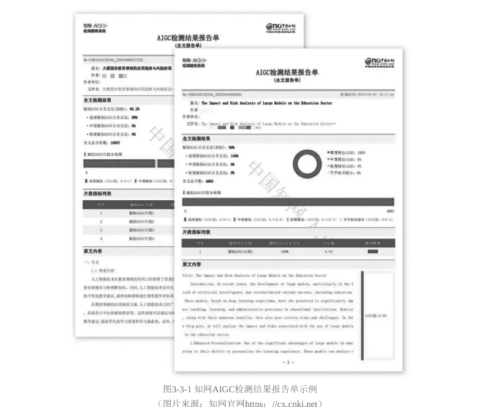
图3-3-1 知网AIGC检测结果报告单示例
（图片来源：知网官网https://cx.cnki.net）

##### 2. 维普AIGC论文检测系统

维普AIGC论文检测系统（https://vpcs.fanyu.com/）则是另一种在国内高等教育领域广泛应用的检测工具（见图3-3-2）。该系统支持上传多种格式的文档，可检测毕业论文、期刊文章、研究报告、项目方案等多类文献中的AIGC。其特点是检测范围全面，涵盖国内外多个主流语言模型所生成的文本，如ChatGPT、文心一言、通义千问等。该系统采用先进的神经网络识别机制，能精准判定人机撰写差异。此外，维普检测系统已集成至维普毕业论文管理系统、作业管理平台及科研诚信管理平台等，为教学与科研单位提供一体化的过程管理与文本检测服务。

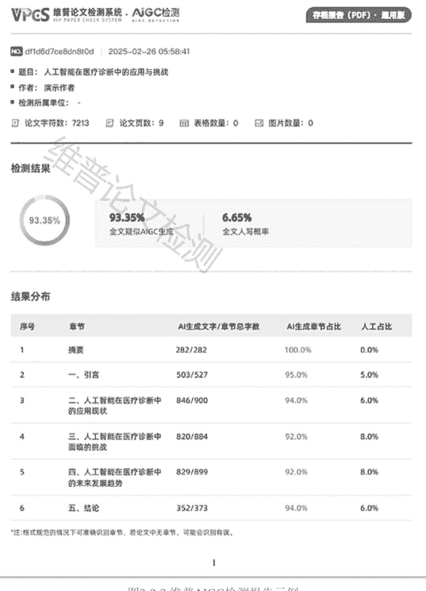
图3-3-2 维普AIGC检测报告示例
（图片来源：维普官网https://vpcs.fanyu.com/）

##### 3. 万方AIGC检测系统

万方AIGC检测系统（https://cx.wanfangdata.com.cn/aigc-check）依托其庞大的学术资源数据库以及科研诚信服务平台，提供多版本、多维度的AI文本检测功能。系统结合深度神经网络模型与语义分析算法，不仅能够检测文本是否由AI生成，还可以分析段落层级的生成概率，输出结构清晰的检测报告（见图3-3-3）。该平台适用于科研、教学、人事、出版等多种场景，支持中文、英文以及中英混合文本检测，服务于学术个体与机构的合规写作需求。其秉持“客观、公正、精准、全面”的服务原则，正在成为国内AIGC检测的重要一环。

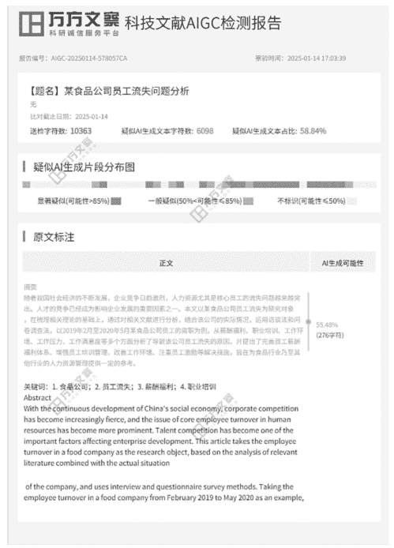
图3-3-3 万方AIGC检测报告示例
（图片来源：万方官网示例http://example.chachongz.com/wfaicheck/）

##### 4. Turnitin AIGC检测系统

在国际范围内，Turnitin（https://www.turnitincn.net.cn）是目前最具影响力的学术不端检测平台之一，其在近年来也推出了AI写作检测功能（见图3-3-4）。Turnitin利用专属的AI写作识别引擎，能够检测英文学术写作中是否存在由大语言模型生成的内容，在欧美高校中应用较为广泛。其检测逻辑主要基于语言流畅性分析、句法结构判断以及特定模型生成的语言特征提取，可对英文写作中的AI痕迹进行高概率标注。

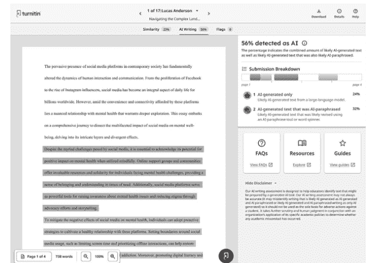
图3-3-4 Turnitin检测结果界面
（图片来源：Turnitin官网示例https://guides.turnitin.com/hc/en-us/articles/22774058814093-AI-writing-detection-in-the-new-enhanced-Similarity-Report）

##### 5. GPTZero AIGC检测系统

另一个影响力较大的国际平台是GPTZero（https://gptzero.me/），这是一个专门为识别AIGC而设计的轻量级平台。它利用突变性和困惑度等自然语言指标，评估文本是否符合人类写作的自然波动性，可以通过高级扫描的功能识别句子存在AI内容的可能性（见图3-3-5）。这种方法在识别ChatGPT类模型生成文本方面具有一定优势，特别适用于教育领域的快速初步筛查。GPTZero已被部分欧美中学及大学教师广泛使用，以识别学生作业是否由AI撰写。

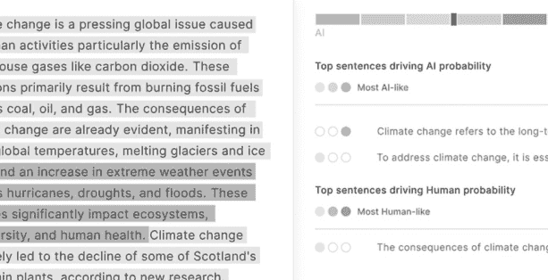
图3-3-5 GPTZero检测结果界面
（图片来源：GPTZero官网https://gptzero.me/）

总体而言，无论是在知网、维普、万方等本土平台，还是在Turnitin、GPTZero等国际系统中，AI写作检测技术正朝着精准化、系统化和多语种兼容的方向发展。随着AIGC工具的进一步普及，这些检测平台将持续发挥重要作用，为维护全球范围内的学术诚信保驾护航。

#### 三、提升AI辅助写作的风险意识

AI工具虽然在提高写作效率、拓展表达形式等方面展现出积极价值，但其带来的风险与伦理挑战亦不容忽视。尤其是研究生及本科生等处于学术训练阶段的群体，倘若缺乏足够的风险意识，极易陷入技术便利背后的伦理困境。因此，系统认知AI写作的潜在风险，树立理性使用意识，已成为构建科研诚信文化的重要组成。

为了规范AI工具的使用，国内多所高校已经陆续出台了专门规章。例如，2024年11月，复旦大学率先发布《关于在本科毕业论文（设计）中使用AI工具的规定（试行）》，明确禁止学生在论文的选题、研究设计、数据分析、核心内容撰写等六个关键环节中使用生成式AI，违者将面临包括取消成绩、禁止答辩、撤销学位在内的严厉处罚 [16]。媒体称其为“国内高校首个AI禁令”。西南大学紧随其后，在《关于开展2025届本科毕业论文（设计）检测、抽检及答辩工作的通知》中，首次明确提出论文须接受AIGC检测。此外，北京师范大学新闻传播学院、华东师范大学、中国传媒大学、天津科技大学等也陆续发布使用指引，要求对AIGC进行标注，或设定AI文本比例限制（如不得超过20%或40%），并纳入毕业审核标准 [17]。这些规定反映出高校在AI写作技术高速发展的背景下，正积极探索监管路径，以保护学术生态的纯洁性与公平性。

在这一背景下，对于研究者个体来说，应当及时树立风险意识，在提升写作效率与维护学术诚信之间找到自身的平衡点。

首先，应当形成责任归属的风险意识，明确AI在科研辅助中的工具属性，将其定位为科研工作和学术写作的智能助手而非“共同作者”，牢记研究者是研究成果的唯一责任主体，对成果负有学术伦理和法律上的责任。

其次，应当形成规范更迭的风险意识，及时掌握高校、研究机构和期刊等在学术规范和要求上的变化，严格遵守其最新的相关规定，合理披露和声明AI工具的使用情况，使用规范的著录格式，避免在不知情的情况下触碰科研伦理红线。

再次，应当形成工具依赖的风险意识，培养和提升自身的批判性思维能力，不盲目信任和依赖任何AI工具，对AI所提供的信息进行多来源的交叉验证，只让AI承担辅助性任务而非核心思考。

最后，应当形成主动存证的风险意识，利用技术性防护措施主动保留在科研工作和学术写作过程中的AI使用痕迹，如保留与AI系统的对话日志等以作为日后的取证依据。

### 本章小结

本章围绕生成式AI辅助写作中的学术伦理问题展开深入讨论，系统性地理清了科研诚信的内涵与原则，强调了真实性、透明性、责任性与尊重性在科研活动中的基石地位，梳理并介绍了国内外主流出版机构与学术组织对AI工具使用的政策导向和著录建议。同时，本章也揭示了滥用AI工具可能面临的学术不端风险，并对目前主流的AIGC检测工具及其作用进行了相关介绍。归根结底，生成式AI作为科研工作和学术写作的辅助工具，其价值取决于使用者的伦理判断与责任意识。未来的学术写作既要拥抱技术创新，更要坚守规范底线，唯有如此，方能在技术赋能与诚信科研之间实现平衡。

[1] 万钢 (2010) .为自主创新营造良好的学术环境[EB/OL].https://www.cas.cn/xw/zjsd/201004/t20100412_2817619.shtml。
[2] 中共中央办公厅国务院办公厅印发《关于进一步加强科研诚信建设的若干意见》 [EB/OL].https://www.gov.cn/zhengce/2018-05/30/content_5294886.htm。
[3] 中共中央办公厅国务院办公厅印发《关于进一步弘扬科学家精神加强作风和学风建设的意见》 [EB/OL].https://www.gov.cn/gongbao/content/2019/content_5404148.htm。
[4] 国家自然科学基金《科研诚信规范手册》编写组.科研诚信规范手册[EB/OL].2023：2。
[5] 国家自然科学基金《科研诚信规范手册》编写组.科研诚信规范手册[EB/OL].2023：7-8。
[6] 中国科学技术信息研究所, Elsevier, Springer Nature, Wiley.学术出版中AIGC使用边界指南[R].2023：5-6。
[7] 中国科学技术信息研究所, Elsevier, Springer Nature, Wiley.学术出版中AIGC使用边界指南[R].2023：2。
[8] Best Practice Guidelines on Research Integrity and Publishing Ethics[EB/OL].https://authorservices.wiley.com/ethics-guidelines/index.html。
[9] 关于在科研活动中规范使用人工智能技术的诚信提醒（中国科学院·2024年） [EB/OL].http://www.cas.cn/dj/gztz/202409/t20240911_7354257.html。
[10] 国家自然科学基金《科研诚信规范手册》编写组.科研诚信规范手册[EB/OL].2023：7-12。
[11] 表3-2-1、表3-2-2和表3-2-3均引用自：洪悦民，王景周.学术期刊出版中人工智能生成内容的使用规范及著录建议[J].编辑学报，2024，36（2）：149-153。本书作者做修改完善。
[12] 如需了解APA格式对ChatGPT等生成式人工智能引用的最新指导，请参阅APA Style Blog官方页面：https://apastyle.apa.org/blog/how-to-cite-chatgpt。
[13] 这里的“个人通信”是指学术稿件的作者对于从私人信件、备忘录、电子通信（电子邮件）、个人访谈或电话交谈等个人通信方式中获得的信息的标注类型。
[14] 如需了解更多MLA格式对生成式人工智能内容引用的具体规定与示例，请见MLA Style Center官网：https://style.mla.org/citing-generative-ai/。
[15] 有关芝加哥格式在AI文本引用方面的建议，请参考The Chicago Manual of Style官方问答页面：https://www.chicagomanualofstyle.org/qanda/data/faq/topics/Documentation/faq0422.html。
[16] 复旦大学发文规范毕业论文AI使用违者或受处分[EB/OL].http://edu.people.com.cn/n1/2024/1201/c1006-40372717.html。
[17] AI代写论文打假！查实或将撤销学位！[EB/OL].https://news.sohu.com/a/865044355_503494。

# 第二部分
AI辅助学术写作实践

本书的第二部分将深入探讨AI如何在学术研究的各个核心环节实现全流程赋能。在此将系统性地拆解科学研究和学术写作的基本流程——第四章聚焦研究的起点，解析AI如何在选题构思与方案设计中激发创新、优化路径；第五章深入文献工作，展示AI如何革新文献检索、管理与深度阅读范式，构建智能化知识网络；第六章切入核心的论文撰写与修改环节，探讨AI在结构规划、内容生成、语言润色及规范性检查等方面的辅助作用；第七章转向实证研究的关键，阐述AI在数据处理、分析建模与结果可视化方面的能力提升；第八章则关注研究成果的转化，介绍AI如何助力研究者高效导航投稿与发表流程。这五个章节紧密衔接，不仅描绘了AI技术融入学术研究各个阶段的实践路径，也揭示了其推动科研范式从传统模式向智能化高效协同模式演进的变革潜力。

# 第四章
研究选题与方案设计

### 本章介绍

本章聚焦AI在学术写作中的研究选题与方案设计阶段的应用价值，围绕研究方向确定、文献调研、问题构建、方案制定和可行性评估五个步骤，全面梳理了AI工具在主题聚焦、趋势分析、变量识别与方法建议等方面的辅助作用。通过引入选题评价的五项标准，结合传播学、社会学等实际研究案例与提示词示范，直观展示了AI在提升选题效率与完善研究设计上的应用价值。

### 第一节 选题：学术研究的第一道关

马克思曾在《政治经济学批判》（1869）的序言中说道，“学术的入口，也是地狱的入口” [1]，这句话既道出了他对科学的敬畏，也形象地说明了学术研究的不易。而作为学术研究第一道关的选题环节既是研究的起点，对于研究者而言，或许也是最具挑战性的工作之一。一个选题是否合理，是否具有潜力，不仅决定着后续研究工作能否顺利推进，也在很大程度上影响到学术写作的质量、学术发表的成功率以及研究者本人的学术影响力的高低。随着智能技术环境下知识生产方式的变革和学术生态的变迁，研究选题这项原本在很大程度上依赖于个人阅读思考以及导师指导来完成的任务，正在面临规模愈加庞大的信息体量和更为复杂的处理过程。对此，本节将先回答一个根本性问题——确立选题究竟难在哪里。

#### 一、选题缺乏问题导向

面对选题，刚入门的研究者最容易进入的误区是提出一些缺乏聚焦的宽泛命题，例如“人工智能在科研中的应用”。此类选题乍看之下迎合热点、易于查找资料，但实际上缺乏明确的研究对象、实践场景和方法边界，无法构成研究问题。那么究竟什么才是研究问题？

批判理性主义创始人卡尔·波普尔（Karl Popper，2009）曾指出，“我们研究的不是学科，而是问题……应当把科学设想为从问题到问题的不断进步——从问题到愈来愈深刻的问题” [11]。Schmidt（2011）认为，自然科学或社会科学研究都是“以问题为导向的，或更确切地说，是由问题决定的”，而问题通常包含“一个不被期望的初始状态（an undesired initial state），期望的目标状态（a desired goal state），以及状态转换之间的障碍（the barriers in getting from the one to the other）” [2]。这一定义表明，问题导向的本质应是立足现实的实践导向，而非纯粹形而上的概念导向。

徐飞（2019）进一步指出，作为学术研究对象的理论问题应包括：要求回答或解答的题目；需要研究讨论并加以解决的矛盾、疑难；造成差距的因素；关键或重要之点。[3] 这一定义更为全面地描述了研究问题的本质特征，即学科中那些存在悬而未决的矛盾、疑惑的，需要研究者对其寻根问因的重要问题。同样以“人工智能在科研中的应用”这一选题方向为例，“将人工智能用于科研会对研究者的学术创新能力形成什么样的影响”就是一个更符合上述定义的研究问题。

对于研究者来说，研究的问题导向要求其必先具备问题意识，即“不仅应该坚持从客观实际问题出发，洞察和发现问题并发掘问题的理论价值，还应该具备开展问题研究与解决问题的主动能力以及科学的研究方法和技术”，它是“抽象思维、具象思维，强烈的自我反思与批判性思维，理论创新性思维和注重研究实际效应的建设性思维的综合体现”（盛昭瀚，2019） [4]。研究的问题导向意味着研究者不仅要具备关注现象、识别问题的意识，还要具备分析问题和解决问题的能力，对其综合研究素质提出了极高的要求。

#### 二、选题高度同质化

选题同质化是当前学术训练中常被忽视，但也相当致命的问题。随着科研机构考核机制的僵化和学术发表渠道的拥挤，研究者追逐学术热点或是造成选题重复的首要原因。面对科研考核、项目评审及发表压力，许多研究者倾向于选择政策关心或社会中流行的热点领域，以提升学术成果发表的成功率。然而，这种跟风式研究往往缺乏深入的问题意识与创新意义，导致大量研究内容空泛、理论框架雷同、实践价值不足，不仅削弱了学术研究的原创性，也阻碍了对冷门但潜力巨大的问题的深入探索。

笔者以“AI 学术”为关键词，利用中国知网指数（CNKI Index）检索功能对该领域的研究热点趋势进行了分析，据此观察2018—2025年该主题的学术关注度变化情况。从图4-1-1中可以发现，“AI学术”相关中文文献数量与“AI学术”中文关注指数均在2023年之后显著上升，至2024年达到峰值，表明该领域研究在近两年呈现快速增长态势。同时，“AI学术”外文相关文献数量及其外文关注指数虽总体呈现稳步波动趋势，但涨幅不如中文文献明显，说明相较于国外，国内学术界在该领域的研究热情更为高涨。但在研究热情高涨的背后，或许也存在难以忽视的选题同质化的隐忧。

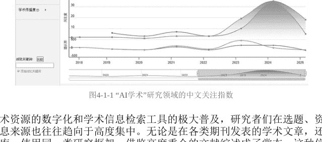

同时，随着学术资源的数字化和学术信息检索工具的极大普及，研究者们在选题、资料收集和文献综述阶段所使用的信息来源也往往趋向于高度集中。无论是在各类期刊发表的学术文章，还是硕博士论文中，引用相同数据库、使用同一类研究框架、借鉴高度重合的文献综述成了常态。这种信息源同质化的现象逐渐演变为学术研究主题和内容的趋同化，同样也制约了学术界的创新活力。

此外，当前高校中对青年研究者的学术训练也偏向于模板化，大量研究遵循统一的范式和写作路径，也造成研究逻辑和资源使用方式的结构性趋同。而随着AI工具在科研辅助中的逐渐普及，由于此类工具在训练数据和算法逻辑上的雷同，借助AI形成的研究选题往往存在高度的相似性。如果研究者不对备选问题做深入再加工、文献核查或创造性思考，很可能会导致选题与已有研究严重重合，缺乏创新价值。

#### 三、选题缺乏可行性

选题缺乏可行性往往意味着研究路径不明，研究者的资源不足或者能力不匹配。研究路径不明首先表现在选题过于庞大、宽泛上，如前所述，这也是研究者问题意识不足的体现。其次，研究路径不明也可能表现为研究领域尚未建立起稳固的理论基础，选题缺乏可依托的理论模型或分析框架，导致研究空泛。

研究资源不足，一是表现为研究资料和数据的不可获取性，例如，所需的数据或文献资料过于稀缺、机密或收费昂贵，尤其是当涉及政府、军工、企业机密或历史档案时，往往在短期内无法获取。二是研究对象或样本的不可接触性，如研究对象难以找到或数量过少，难以具有充分的代表性，可能影响到研究结论的有效性。三是研究时间与经费的不足，即研究周期或成本需求远超实际的承受限度，如调查周期长、需跨地区调研、实验成本高等。

研究能力不足则主要表现为技术或方法的支撑不足，比如研究方法过于复杂，超出研究者掌握的能力范畴，或者缺乏必要的技术支持等。

### 第二节 研究选题的五维评价模型

在学术研究中，一个优质的选题往往在很大程度上决定了研究项目的成功。为了系统评估选题的质量与发展潜力，研究选题的五维评价模型可以提供一个科学、全面的判断框架。该模型从研究价值、可行性、创新性、可结构化、伦理合规性五个维度出发，旨在帮助研究者在选题阶段做出理性判断（见图4-2-1）。

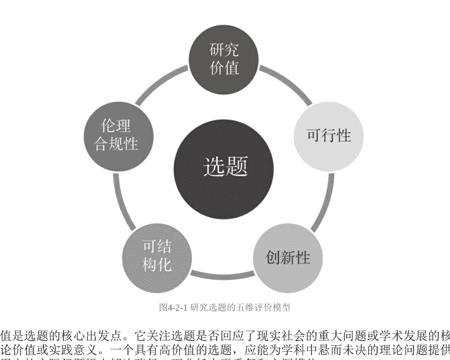

研究价值是选题的核心出发点。它关注选题是否回应了现实社会的重大问题或学术发展的核心命题，是否具有理论价值或实践意义。一个具有高价值的选题，应能为学科中悬而未决的理论问题提供新解释，或为学科应用中的实际问题提出解决路径，而非低水平重复和空洞模仿。

可行性体现了选题的实际操作能力，包括数据是否可得、方法是否匹配、时间和资源是否充足等。再有意义的课题，如果在操作层面难以实施，如样本难以获取、方法难以掌握、周期过长，都会严重影响研究的完整性和成果质量。

创新性则是科研生命力的体现，要求选题具有新颖的研究视角、独特的理论构建或方法突破。创新不等于天马行空，而是在已有研究基础上的合理突破，可以是对冷门领域的深入挖掘，也可以是跨学科的交叉融合。

可结构化强调研究主题是否可以拆解为明确的研究概念或变量、清晰的逻辑关系和完整的研究框架。这关系到研究是否具备严谨性和系统性。选题如果范围模糊或逻辑混乱，往往难以展开有效研究，也难以产出高质量成果。

伦理合规性则是研究的底线。选题必须符合法律法规和伦理规范，尤其是在涉及隐私调查、敏感信息、动物实验等领域，研究者需确保尊重受试者权益、保障隐私、避免学术不端行为等。

以下将对AI工具如何从这五个维度出发，帮助研究者确立研究选题进行详细阐述。

#### 一、研究价值：是否值得花时间深入？

研究价值是判断一个选题是否值得一做的第一道门槛。它不仅包括研究选题对学科体系的推进潜能，即学术价值，还涵盖其与现实议题、政策趋势的对接能力，即实践意义。在传统上，这往往取决于研究者的个人判断，但在AI工具的支持下，普通研究者也能更为便捷地获取趋势识别的能力，包括：

趋势追踪与热点判断。AI工具，如文献发现和评估工具Scite、Elicit、知网研学等，能够根据输入的关键词生成相关主题的热度变化图谱、高频术语与时间分布，帮助研究者初步判断该议题的活跃度与发展趋势。

文献语义挖掘。智能算法可以聚合并分析大量相关文献的摘要与关键词，从中提炼出主流研究焦点与尚未被充分研究的部分，帮助研究者判断研究议题是否仍具有延展空间。

政策与现实问题联结分析。AI系统通过对政策文献、新闻资料和数据库的聚合分析，可以辅助研究者发现研究主题与当下社会热点的连接点，从而提升研究的现实价值评估精度。

但要注意的是，AI在研究价值评估中具备一定的信息整合与趋势识别能力。它能够通过热度分析、关键词聚类与主题空白的辅助判断，帮助研究者在纷繁的资料中理清议题方向。然而，AI所依赖的模型与数据往往基于既有文献或公开信息，难以把握学术前沿的未知需求并做出未来预判。要使研究真正具备创新价值，仍有赖于研究者对本学科、社会变迁与现实问题的深度理解与判断。

#### 二、可行性：研究能否真正落地？

可行性强调一个选题是否具备在现实中实施的条件与基础。它不仅涉及研究者的时间、能力、资源，也包括数据的可得性、研究对象的可访问性，以及研究方法的可执行性。在实际的研究过程中，许多选题虽然富有理论意义，但由于执行难度高、调查难落地，研究者最终只能被迫放弃。对此，AI工具可以帮助实现：

变量结构识别与模型建议。AI可帮助研究者根据已有研究，提取出常见的变量、测量维度和研究框架，为设计问卷或研究模型提供基础支持。

数据来源推荐与可获取性判断。通过对开源数据库、问卷平台、开放资源的抓取分析，AI能辅助评估某一研究是否具备数据基础，是否能以合理成本取得有效样本。

能力匹配预警。当研究者提出过于复杂的分析方法时，如结构方程建模、文本情感识别等，AI可基于提问内容提示方法门槛，提供更易实现的替代路径，避免出现“方法选得高、能力跟不上”的尴尬局面。

研究者要注意的是，AI的可行性评估功能在协助研究设计初期具有实际价值，它能通过结构拆解、方法建议与资源匹配，帮助研究者建立对研究可行性的初步预判框架。尤其在对变量复杂度、样本获取难度与方法门槛的识别上，可为研究者提供多角度参考。然而，AI的建议往往基于理论最优路径，可能忽略现实中如权限限制、伦理审批、资源短缺等非理性变量。因此，最终判断仍需研究者以实践经验、项目资源与个体能力为核心进行综合权衡。

#### 三、创新性：研究是不是具备独特性？

创新性是选题能否在学术界产生影响的关键标准。它不仅关乎新不新，更重要的是新在哪儿、怎么新。常见的创新路径包括提出新的变量关系、构建新的分析框架、采用跨学科融合等新的视角、采用新颖的研究方法、聚焦尚未充分探讨的人群/区域/情境等。对此，AI的辅助功能包括：

已有研究结构快速概览。AI可以对某一研究主题的文献进行结构化归纳，展示主流研究方法、变量设计与样本类型，从而辅助判断“哪些角度已经被覆盖”。

争议点提取与盲区识别。通过引用图谱、“支持—反对”立场分析等功能（如Scite），AI能够揭示一个议题在学界的争议点、尚无定论的研究分歧或视角空白。

边缘变量/冷门人群的推荐。当研究者提供某一宏观主题时，AI可通过联想模型推荐冷门研究对象（如中职生、老年人群体）或边缘变量等尚未被充分关注的方向。

AI能以极高效率对主题结构、研究密度与变量组合进行反查式扫描，是发现研究缺口（research gap）、识别重复路径的重要工具，也是防止“撞题”或选题陈旧的有效手段。但值得注意的是，AI的创新性推荐多基于已有成果的逻辑重组，而非原创思想的自然生长。要形成真正具有突破性的选题，还有赖于研究者开展独立思考，进行多领域交叉融合，或对现实世界进行敏锐的观察。

#### 四、可结构化评估：研究能否成体系地展开？

可结构化评估的是一个选题能否被转化为完整的研究路径，包括明确的问题陈述、变量界定、研究假设、分析模型与预期结果。如果一个选题只是一个想法，无法具体落实为研究框架，那就无法支撑起一篇合格的学术论文。对此，AI工具可以做到：

结构模板生成与逻辑链梳理。通过提示输入主题，AI可以辅助生成“研究问题—假设—变量—方法—预期结果”的五段式结构，协助研究者理清逻辑脉络。

研究类型匹配建议。根据研究者描述的目的（探讨原因、验证效果、比较差异等），AI能推荐与之更契合的研究类型（如因果模型、比较研究、描述研究等），帮助其确定适配的研究策略。

变量与理论之间的对接指导。AI还能提示哪些变量适合对接某些理论模型，加大研究设计的理论支撑力度。

在结构化构思阶段，AI能够通过逻辑建模、变量建议与假设生成等方式，迅速搭建起一个看似合理的研究框架，能帮助研究者建立基础认知结构。然而，这种结构化输出常常缺乏对具体研究语境与方法论细节的深入贴合，存在过度模板化与假设空转的风险。使用者应谨防陷入表面逻辑通顺，但实际操作困难的陷阱，仅将AI产出作为参考建议，而非最终方案。

#### 五、伦理合规性：研究是否符合法规与规范？

伦理合规性是任何学术研究的底线要求。它包括研究对象的隐私保护、数据采集的合法性、对敏感群体的风险控制等。尤其是在涉及青少年、医疗数据、平台行为分析等研究时，若没有合法授权与伦理审批，将严重违反科研规范。对此，AI可以帮助研究者实现：

伦理风险预警与说明生成。当研究涉及可能敏感的对象或方法时，AI可基于语义识别自动提出预警，如“本研究是否获得受试者知情同意”，并协助撰写伦理声明初稿。

敏感数据与平台使用规范提示。AI可识别“是否存在未经授权使用平台数据”“是否采集位置/面部/账户信息”等违规点，协助研究者规避隐私风险。

合规写作规范辅助。在论文撰写环节，AI还能提供包括各类学术引述规范、数据引用格式、作者贡献声明等模板内容，确保学术全流程合规。

AI在伦理与合规方面，具备较强的风险识别与规范提示功能，能够帮助研究者识别敏感数据使用、受访对象隐私与合规引文等问题，尤其有助于新手树立科研道德意识。然而，需要强调的是，AI所提供的伦理建议多为普适模板与经验归纳，难以应对特定领域的深层伦理判断。真正的伦理责任不在工具，而在研究者本人，AI不能代替个人承担学术行为的全部后果，亦无权裁定研究是否合法合规。

### 第三节 明确方向：借助AI定位兴趣与学科焦点

五维模型为一个好的选题建立了系统化的判断标准。但要真正完成选题，还需要有条不紊地推进选题的具体流程。学术选题通常需要经过五个关键步骤：确定方向或领域、文献调研、确定研究问题、制定研究方案、可行性评估。这五个步骤构成了从兴趣到落地的完整的选题过程，也恰恰对应了研究者从“想要做什么”到“可以怎么做”的思维转换过程。本节将聚焦第一阶段中的明确研究方向与领域焦点，探讨如何借助AI工具快速从模糊的个人兴趣中提炼出具有研究潜力的学科主题。

#### 一、AI助力将“大话题”变为“小切口”

1. 多轮交互式压缩的选题逻辑

在研究刚起步时，研究者常常只有一个模糊的兴趣点，如“我对人工智能感兴趣”“我想研究社交媒体文化”“我关注社会不平等”……这类议题过于宏大或过于模糊，无法直接被视为论文题目或研究问题。借助AI工具，研究者就可以更加高效、便捷地将“大话题”逐步压缩为一个具体的研究方向，即“小切口”。

例如，当研究者对“AI与品牌传播”感兴趣，在使用生成式AI工具时，第一轮询问可以是：“在AI与品牌传播的交叉领域，有哪些值得研究的具体主题？”AI可能会列出若干个方向，如“生成式AI在品牌广告设计中的应用”“AI驱动的个性化推荐系统对品牌偏好的影响”“大语言模型生成品牌调性内容的可控性与一致性”等等。接下来，研究者可以选择一个或若干个最感兴趣的方向，继续加以追问：“就‘AI驱动的个性化推荐系统对品牌偏好的影响’的研究来说，有哪些尚未被充分探讨的子问题？”AI的回答将进一步聚焦，如“算法推荐是否强化了品牌偏好”“品牌信任感在算法推荐和品牌偏好之间起到何种作用”“不同平台的算法推荐系统对品牌偏好的影响是否存在差异”等。每一轮对话，都是一次思维压缩的过程。以下为这一压缩过程的具体示例：

**例4-3-1 “AI与品牌传播”交叉研究领域的思维压缩过程**

第一轮提问——

研究者问：

在AI与品牌传播的交叉领域，有哪些值得研究的具体主题？

DeepSeek 回答：

在AI与品牌传播的交叉领域，有许多值得深入研究的具体主题，涵盖技术应用、伦理挑战、消费者行为变化等多个维度。以下是一些关键研究方向，分为不同类别供参考：

- 1. AI 驱动的品牌内容创作与优化
  - 生成式 AI 在品牌内容中的应用
    研究如何使用ChatGPT、MidJourney等工具生成广告文案、视觉设计、视频脚本，并评估其效果与人工创作的差异。
  - 动态内容个性化
    基于用户数据的AI实时生成个性化广告（如动态文案、产品推荐），研究其对转化率的影响。
  - A/B 测试自动化
    AI自动优化广告投放的文案、图像、时机等变量，探索其效率提升的边界。
- 2. 消费者洞察与行为预测
  - 情感分析与舆情监控
    利用NLP技术分析社交媒体评论、用户评价，挖掘消费者对品牌的情感倾向及潜在危机。
  - 预测性消费者行为建模
    通过机器学习预测用户购买决策路径，优化品牌触达策略（如精准投放时机）。
  - 跨渠道用户画像整合
    AI整合线上线下行为。

……

第二轮提问——

研究者问：

就“AI驱动的个性化推荐系统对品牌偏好的影响”的研究来说，有哪些尚未被充分探讨的子问题？

DeepSeek 回答：

关于“AI驱动的个性化推荐系统对品牌偏好的影响”，尽管已有大量研究关注推荐算法的技术实现和短期转化效果，但仍有许多未被充分探讨的子问题，尤其是在消费者心理、长期品牌关系和社会文化层面。

以下是一些值得深入研究的空白领域：

##### 1. 长期品牌偏好的非线性影响
- 推荐系统的“回音室效应”
  长期接受AI推荐是否会固化消费者的品牌选择，减少探索新品牌的意愿？如何量化这种“信息茧房”对品牌多样性的侵蚀？
- 短期转化 vs 长期忠诚度
  个性化推荐带来的即时购买是否牺牲了品牌情感联结？例如，过度依赖折扣推荐的用户是否对品牌溢价更敏感？

##### 2. 消费者心理机制的深层矛盾
- 个性化与隐私悖论（Privacy Paradox）的交互作用
  用户虽然享受个性化推荐，但数据被使用的感知如何反向影响品牌信任？是否存在临界点（如推荐精准度超过某阈值反而引发抗拒）？
- 控制感缺失与品牌疏离
  当用户意识到品牌偏好被算法“预测”而非自主形成时，是否会产生心理抗拒（Reactance Theory）？如何设计“用户可控”的推荐界面（如允许调整推荐权重）？

##### 3. 文化与社会价值观的调节作用
- 集体主义与个人主义文化下的差异
  在东方文化中，社会认同（如“大家都在买”）是否比西方文化更显著地调节AI推荐效果？
- 小众品牌的社会信号价值削弱
  当AI过度推荐主流品牌时，是否会削弱用户通过小众品牌表达身份的需求（如“潮牌爱好者”群体）？

……

在以上压缩过程中，研究者可以采用多轮对话，不断追问AI，比如“这个方向有没有相关研究？有哪些文献？”“能不能再具体一点？”对话式追问的结果往往比单次输出更精准。

##### 2. 从兴趣引导到聚焦方向的提示词示例

表4-3-1所示为在若干不同应用场景下进行研究切口压缩时，可采用的提示词示例：

表4-3-1 不同场景下的研究切口压缩提示词

| 场景 | 提示词示例 |
| :--- | :--- |
| 初步主题压缩 | “我想研究[ 模糊兴趣主题 ]，可以帮我列出几个具体、可研究的方向吗” |
| 子议题细化 | “就其中一个方向，请列出 5 个有变量关系或研究方法建议的子问题” |
| 结构识别 | “这个主题能否转化为研究问题？请补全‘研究对象 + 变量 + 方法’” |

#### 二、AI辅助关键词再造与问题聚焦

在实际研究过程中，研究者常常在进入文献检索阶段时感到迷茫——不知道该如何准确表达自己的研究主题，不清楚哪些术语才是主流关键词，更难以系统组织关键词以适配数据库逻辑。而AI工具，尤其是像ChatGPT、Elicit这类生成式的大语言模型，恰恰在关键词再造与问题聚焦方面能够表现出独特的优势。

借助AI工具，研究者可以快速获得：核心关键词及其学术表达；方法相关术语，以用于限定研究技术路线；理论或模型名称，以用于构建分析视角；相似研究的关键词组合，以用于检索模版参考；等等。

以“短视频与注意力机制”这一研究主题为例，研究者往往面临如何精准表达研究意图与有效进入数据库检索系统的难题。此时，借助AI工具进行关键词再造与层次化结构分析，能够极大提升选题的专业性与可操作性。

##### 1. AI辅助关键词提炼

例如，在聚焦“短视频与注意力机制”这一主题时，AI可首先协助提炼出若干核心术语，如“注意力持续时间（attention span）”“TikTok（作为主要平台）”“媒体多任务处理（media multitasking）”，以及“认知负荷（cognitive load）”。这些关键词不仅精准捕捉了研究内容的核心焦点，同时也具备良好的跨数据库适配性。

其次，AI还可以进一步辅助生成与研究方法相关的术语，用以限定技术路径。例如在该主题下，常见的方法关键词包括“眼动追踪（eye tracking）”“问卷调查（survey）”“实验设计（experiment）”和“内容分析（content analysis）”等。这些术语的加入，不仅有助于文献检索的精度提升，也为后续研究设计提供了可借鉴的技术手段。

最后，在理论框架层面，AI工具能够根据语义共现与模型引用频次，推荐与该研究主题紧密相关的分析框架，如“媒介习惯理论（Media Habit Theory）”“信息加工理论（Information Processing Theory）”以及“认知过载模型（Cognitive Overload Model）”等。这些理论不仅拓展了研究的分析维度，也有助于搭建更加系统的论文逻辑结构。

总体来看，以上三层关键词体系“核心术语—方法术语—理论框架术语”可被直接用于文献数据库如CNKI、Web of Science、ProQuest等平台的高级检索，也能被进一步嵌入AI工具中，用于生成布尔逻辑结构的查询语句、构建关键词共现图谱、自动分类文献内容等操作，从而显著提升科研效率与信息聚合质量。

##### 2. 关键词与检索结构的提示词应用示例

本部分将提供几类最常用的AI提示词类型，适用于研究者在学术选题初期进行关键词生成、检索语句构建与趋势判断等操作。

- （1）关键词生成类提示词
  用途：帮助研究者从一个初步主题出发，提炼出核心术语、研究方法与理论框架，便于后续文献检索与结构搭建。
  示例：
  “我正在研究‘社交媒体使用与青少年心理健康’，请帮我列出该主题的核心术语、研究方法关键词和常用理论术语。”

- （2）数据库语句组合类提示词
  用途：生成结构化的检索语句，提升在Web of Science、CNKI、EBSCO等数据库中的查全率与查准率。
  示例：
  “请用AND/OR帮我组合一组适用于学术数据库的英文检索语句，主题是‘大学生使用短视频影响注意力’。”

- （3）对比分析类提示词
  用途：对相近关键词或概念在学术文献中的使用频次、时间分布、共现关系进行AI辅助分析，用于判断研究的热度与空白点。
  示例：
  “请对比‘media multitasking’与‘selective attention’关键词在近五年英文文献中的使用趋势，说明哪一个研究热度更高？”
  “哪些关键词经常与‘Tik Tok addiction’共同出现？请列出五个，并简要说明它们可能代表的研究方向。”

#### 三、跨学科选题的联结方式：语义场比对

不少研究者希望进行跨学科选题，比如“社会学与AI伦理”“传播学与算法推荐”等。对此，AI模型也可以协助进行学科语义对齐，即从两个领域中找出概念、议题与研究路径的交叉区域。表4-3-2所示为AI辅助发现若干不同学科之间研究交叉点的示例：

表4-3-2 AI辅助捕捉跨学科交叉点

| 学科 A | 学科 B | AI 协助发现的交叉点 |
| :--- | :--- | :--- |
| 教育学 | 计算机学 | 教育公平中的算法偏见；AI 写作工具对教学结构的冲击…… |
| 传播学 | 心理学 | 社交媒体对青少年心理健康的影响；媒介使用与自我认同建构…… |
| 社会学 | 技术哲学 | 技术排斥、算法治理、数字鸿沟的社会结构分析…… |

### 第四节 文献调研：借助AI提炼研究缺口与趋势图谱

在选题过程中，仅有研究方向还远远不够，要构成一个成熟的研究问题，还必须回答两个关键问题——“别人已经做了什么？”“我还能再做什么？”这正是文献调研阶段的核心任务。传统文献调研往往耗时长，需要大量查阅、比对与摘录，但在AI工具的辅助下，研究者可以更快速地完成文献的聚合、热点识别、研究差距提取乃至结构图谱绘制，显著提升调研效率与质量。

#### 一、AI辅助下的文献调研任务拆解

借助AI工具，文献调研阶段的任务可分为几个层次——聚合：快速查阅相关文献；分类：梳理研究主题与方法；趋势识别：判断发展动态；缺口识别：寻找尚未研究的领域（见表4-4-1）。

表4-4-1 不同调研任务下的AI赋能与工具示例

| 调研任务 | AI 赋能 | 工具举例 |
| :--- | :--- | :--- |
| 聚合：快速查阅相关文献 | 自动生成摘要、关键词提取 | Elicit、Research Rabbit |
| 分类：梳理研究主题与方法 | 文献主题聚类、研究方法提取 | Scite、Litmaps |
| 趋势识别：判断发展动态 | 关键词热度追踪、发表年份可视化 | 知网研学、Connected Papers |
| 缺口识别：寻找尚未研究的领域 | 引用网络分析、争议点检测 | Scite、Semantic Scholar |

#### 二、从文献中识别研究密集区与结构模板

在文献调研阶段，许多研究者都面临检索结果海量却不知道从何入手，每篇文献似乎都有所相关，但看完之后依旧抓不住核心问题和研究切入点等问题。这种文献堆积焦虑不仅拖慢了选题进程，也极易导致研究陷入重复、散乱或结构缺失的困境。此时，AI工具便能发挥结构识别的作用，通过聚合文献中的关键词、变量、引用关系等信息，帮助研究者迅速识别出研究密集区与结构模板，有效引导选题方向与研究路径设计。

##### 1. 研究密集区：热点问题的聚合地带

在这里，研究密集区是指在一个特定时期内，大量学术研究集中讨论的主题区域。研究密集区往往具有以下特征：高频关键词反复出现、核心变量反复被加以使用、研究路径趋于标准化。

AI工具如 Elicit、Scite、Dimensions、知网等平台，能够通过关键词共现分析、研究趋势图谱、论文引用网络，自动生成某一主题在近年内的研究热度图。这类信息可帮助研究者精准识别哪些方向已被高度开发，哪些区域仍有保留空间。

例如，在研究“短视频对大学生注意力的影响”主题时，AI可通过共现分析发现，“TikTok”“attention span”“cognitive fatigue”“media multitasking”等术语在相关英文文献中频繁共现，说明此路径是研究密集区。如果研究者也试图从这一方向切入，那么需要在变量、样本或方法层面做出差异化创新，避免重复他人研究。

##### 2. 结构模板：主流研究路径的提炼方法

结构模板指的是在某一主题下，研究者普遍采用的变量逻辑、方法组合与分析框架。许多研究者写论文的难点，并不在于想不到研究内容，而在于不知道怎么写。AI可以通过大规模语义分析、结构抽取、模型推荐等方式，为研究者提供清晰的结构蓝图。AI能提炼的结构模板主要包括：

- 研究路径：常见变量间的因果或关联路径，如“媒介使用→情绪波动→行为变化”；
- 方法组合：高频搭配出现的研究方法，如“问卷调查+回归分析”或“案例访谈+扎根”；
- 理论框架：主流分析视角与支撑理论，如“使用与满足理论”“认知负荷模型”。

以“大学生对AI写作工具的使用行为”的相关研究为例，经由AI分析20多篇同类研究后得出以下结构模式：

- 研究变量：使用频率、写作焦虑、学习自我效能感……；
- 方法设计：里克特（Likert）量表问卷+相关、回归等统计分析等；
- 分析路径：使用动机→使用行为→学业写作表现。

研究者可基于该结构模板，重新思考选择其中的关键变量，增加其他关键变量，进而完成自己的创新设计。

#### 三、如何发现文献缺口

大多数研究者在进行文献调研时，并不擅长找研究缺口。AI工具提供了以下几种方式帮助识别研究尚未覆盖的角度：

1. 利用“支持—反对”结构揭示争议点
   Scite提供的“supporting/contradicting/mentioning”标签功能，可以帮助研究者看到某一假设在学术界是否存在争议。例如对于“短视频损害注意力”这一问题，可能有相关文献支持，也可能有研究提供完全相反的实证依据。

2. 构建文献共引图谱，发现边缘议题
   使用Litmaps、Connected Papers等工具输入一篇中心文献，系统即可生成相关研究的邻近网络。研究者可以观察有哪些议题被反复引用，哪些却仍属孤岛。这类边缘领域往往是创新的突破口。

3. AI提示“尚未涉及的问题类型”
   ChatGPT通过大语言模型训练，可以基于已有文献的描述总结出“本研究尚未探讨……”“未来研究可尝试……”等句式，提示哪些变量、对象、场景尚未被系统研究。例如，在发现已有大量论文探讨“短视频使用频率”后，AI可能指出“内容偏好”“交互行为”“观看时段”是尚待开发的细分领域。

#### 四、借助AI辅助高效完成文献调研的提示词示例

以下是一些常见的提示词，适用于文献调研阶段的信息提取与空缺识别：

1. 研究地图式提示词
   示例：
   “请总结过去五年内关于‘[主题]’的代表性研究主题、方法与变量。”

2. 缺口识别类提示词
   示例：
   “在关于‘[主题]’的已有文献中，有哪些变量或研究对象尚未被充分探讨？”

3. 研究趋势预测类提示词
   示例：
   “从文献数据看，未来‘[领域]’研究可能发展的新方向有哪些？”

4. 文献争议扫描类提示词
   示例：
   “有关‘[变量1]与[变量2]关系’的研究中，存在哪些支持与反对的主要观点？”

这些提示词可直接用于ChatGPT、DeepSeek等生成式AI工具平台，也可以作为与如Scite、Semantic Scholar等文献分析平台配合使用的辅助语句。需要注意的是，AI无法替代研究者做研究价值的判断，尽管AI能提供关键词聚合、趋势判断与图谱分析，但对真正有价值的研究空缺的识别仍需要研究者基于背景、理论与实践逻辑进行自主判断。语境判断至关重要，相同的关键词在不同学科中含义可能完全不同，AI提供的结果还需要研究者结合专业背景做语义筛选。避免过度依赖AI完成自动文献综述，如Elicit、Scispace等平台虽然能生成自动综述摘要，但其内容结构尚难替代系统性文献综述的逻辑与深度，应作为初级材料而非最终成品。

### 第五节 构建问题：从话题到研究框架的转化路径

完成文献调研后，研究者往往已经积累了大量资料与灵感，但下一步将这些信息化整为零，精准构建一个可研究的问题，才是论文真正落地的关键。本节将引导研究者利用AI工具实现从感兴趣的领域到结构明确的研究问题的跨越，并通过模板、提示词与案例系统性地展示问题建构的路径逻辑。

#### 一、研究问题的四元结构

构建研究问题的目标，是将模糊的兴趣转化为具备变量逻辑与方法指向的研究问题，从而进入系统化的研究流程。因此，一个成熟的研究问题不应只是对某个话题的模糊描述，而应至少具备研究对象、核心变量、变量关系、方法路径四大要素（见表4-5-1）。

表4-5-1 研究问题的四大构成要素

| 构成要素 | 含义 | 示例（以“短视频与大学生注意力”为例） |
| :--- | :--- | :--- |
| 研究对象 | 研究中关注、分析或探讨的特定目标是谁或什么 | 大学生群体 |
| 核心变量 | 研究关注的因素或现象是什么 | TikTok 的使用频率、注意力持续时间 |
| 变量关系 | 因素之间的逻辑关系是什么样的 | TikTok 使用频率如何影响注意力持续时间 |
| 方法路径 | 采用什么方法和手段开展研究 | 实验 + 问卷调查、统计分析 |

#### 二、AI如何协助构建研究问题

AI在构建研究问题阶段的作用，主要体现在以下三个方面：

1. 转译式压缩与变量抽取
   ChatGPT、DeepSeek等AI大语言模型可以将用户输入的模糊话题转化为精练的研究设问，并自动提取其中可能的变量组合。例如，输入“我想研究短视频对学生学习的影响，请帮我组织语言，形成一个具体的研究问题”，AI可能输出“本研究拟探讨学生使用短视频平台的时间与其学习注意力之间的关系”。

2. 自动建构问题模型与逻辑结构
   借助提示词，研究可以让AI补全研究对象、变量、关系、方法四大要素，并进一步提出研究假设。

3. 结合理论，提升结构深度
   AI还能基于已有文献推荐理论框架，协助构建变量之间的因果路径（如：自变量—中介变量—因变量），从而帮助研究者构思假设模型。

##### 例4-5-1 “短视频对学生学习的影响”的研究问题建构

研究者问：
我对“短视频对学生学习的影响”的话题感兴趣，请帮我将它转化为包含研究对象、变量与方法的研究问题。

DeepSeek 回答：
以下是将“短视频对学生学习的影响”转化为研究问题的三种思路，分别针对不同的研究角度和研究方法：

###### 研究问题 1 ——问卷研究

研究对象：
- 中国某城市初中三年级学生（12～15岁）

变量：
- 自变量：短视频日均使用时长（分钟/天）
- 因变量：数学期末考试成绩
- 控制变量：性别、家庭经济水平、父母学历、课外补习时间

方法：
1. 通过问卷调查获取短视频使用数据
2. 收集学校提供的期末考试成绩
3. 使用多元线性回归分析控制混杂变量后，检验短视频使用时长与成绩的关联性

研究问题：
- 在控制社会经济背景的情况下，初中生每日短视频使用时长与数学成绩之间存在何种关系？

###### 研究问题 2 ——实验研究

研究对象：
- 某大学一年级心理学专业学生（18～20岁）

变量：
- 自变量：短视频干预类型（知识类短视频 vs 娱乐类短视频）
- 因变量：短时记忆测试得分（实验前后差值）
- 调节变量：被试的多任务处理倾向量表得分

方法：
1. 随机分配实验组（观看15分钟知识类短视频）和对照组（观看15分钟娱乐类短视频）
2. 实验前后分别进行数字记忆广度测试
3. 采用双因素方差分析检验短视频类型与多任务倾向的交互作用

研究问题：
- 知识类短视频与娱乐类短视频对大学生短时记忆的影响是否存在差异？这种差异是否受到被试多任务处理倾向的调节？

###### 研究问题 3 ——混合研究

研究对象：
- 某重点高中高二文科班学生（16～17岁）

变量：
- 核心变量：短视频使用模式（碎片化学习 vs 系统化学习）
- 关键结果：历史学科深度学习水平（概念联结度、批判性思维评分）
- 中介变量：注意力碎片化程度（课堂观察记录+眼动仪数据）

方法：
1. 通过App使用日志分析划分短视频使用模式
2. 采用课堂录像编码分析注意力持续性
3. 设计历史论述题进行批判性思维评分
4. 结合结构方程模型和深度访谈进行三角验证

研究问题：
- 碎片化的短视频使用模式是否会通过注意力分散的中介作用，对高中生的历史深度学习产生负面影响？

变量操作化建议：
1. 短视频使用强度：可细化为“日均使用次数”“单次最长连续使用时间”“主动搜索率”等维度
2. 学习效果测量：
   客观指标：标准化考试成绩、作业完成质量评分
   主观指标：学习自我效能感量表、元认知策略问卷
3. 影响机制：可加入“延迟满足能力”“信息加工深度”等中介变量

方法扩展方向：
- 纵向追踪：设计三个月的追踪研究，分析短视频使用行为与学习成绩的交叉滞后效应
- 神经科学方法：使用EEG检测短视频观看前后的α波变化，关联认知资源消耗
- 对比研究：对比短视频平台内置学习模块与传统MOOC课程的学习效果差异

#### 三、从话题到结构模型的构建指令的提示词示例

表4-5-2所示为相关的实用提示词模板，可用于构建结构化的研究问题：

表4-5-2 构建结构化研究问题的提示词示例

### 第六节 制定方案：AI协同设计研究计划与方法路径

在传统学术写作中，研究方案的构建往往依赖经验积累和导师指导，对于初学者而言充满陌生术语、设计盲区与方法焦虑。然而在AI技术的加持下，这一阶段正逐步走向人机协同的智能化模式。AI不仅可以辅助研究者理清研究计划的逻辑结构，制订清晰的时间表，还能根据研究目标匹配合适的方法路径、提供调研工具生成建议，甚至协助完成复杂的模型结构预设。这意味着研究从凭感觉规划走向结构驱动式设计，极大提升了可行性与操作效率。本节将围绕如何制定研究方案，从研究路径构建、方法选择到工具设计三方面展开，并结合提示词示例与实用场景，展示AI在这一环节的实际应用价值。

#### 一、研究设计的基本构成

所谓研究设计，是指研究者在实际进行资料收集与分析之前，围绕如何实现研究目的所做的系统规划。它包括研究目标的设定、研究对象的确定、变量与概念的界定、方法与技术的选择，以及资料的分析策略等，相当于开展研究的施工蓝图。

清晰严密的研究设计能够显著提升研究的科学性、逻辑性与可执行性；而设计不当，则极易造成数据不支持问题、变量混乱、方法不匹配等连锁问题。为了帮助理解并掌握研究设计的核心结构，在此将其拆解为以下几个基本构成要素（见表4-6-1）：

表4-6-1 研究设计的基本要素

| 构成要素 | 关键问题 | 示例（以“短视频与注意力”研究为例） |
| :--- | :--- | :--- |
| 研究目的 | 要解决什么问题 | 探讨短视频使用是否影响大学生的注意力水平 |
| 研究对象 | 研究中关注、分析或探讨的特定目标是谁或什么 | 某高校大一学生群体 |
| 研究变量 | 关注哪些因素 | 自变量：短视频使用频率；因变量：注意力测验得分 |
| 数据来源 | 数据从何而来 | 问卷调查、课堂观察、认知测试 |
| 研究方法 | 用什么方式获取与分析数据 | 调查研究 + 实验设计；分析方法为相关分析和回归分析 |
| 研究假设/模型 | 是否建立变量之间的关系假设 | 使用频率越高→注意力越低 |

通过以上维度进行逐一规划，研究者可以逐步将研究问题转换为一套可执行、可验证、可落地的研究行动路线。这为接下来的资料收集与实证分析打下了坚实的基础。

在研究设计阶段，AI工具的辅助作用不在于直接给出答案，而是帮助研究者理清思路、建构结构、选择方法。许多研究者并非缺乏想法，而是难以将想法系统化地落实为研究路径。此时，AI可为结构生成、方法建议和逻辑检查方面的研究设计提供多维度支持。

首先，AI可根据用户描述生成研究设计初稿。通过向ChatGPT或DeepSeek等生成式AI工具简要描述研究主题、对象或兴趣点，系统可以快速生成初步的研究设计草案，内容通常包括研究目的、核心变量、研究假设与方法建议。虽然仍需修改润色，但这一初稿为研究者提供了起步参考。其次，它能够根据语义理解自动匹配研究方法与变量，并推荐相应的数据类型、测量工具或问卷量表，辅助研究者提升技术匹配度。最后，AI还能协助识别研究设计中可能存在的结构问题，如变量闭环是否成立、数据能否获得、假设是否冗余，起到结构完整性预检的作用。

#### 二、社会科学研究中的常见方法概览

在完成研究设计前，研究者需要对研究方法有一个基本认知，包括对方法形式的了解，更涉及每种方法具体适合解决什么样的问题、数据从何而来、如何分析数据等细节问题。尤其在社会科学领域中，研究方法多样，路径十分丰富。借助AI工具，研究者可以快速识别适合自身选题的研究策略。以下将从方法类别、适用问题、数据来源、分析工具等维度，整理常见的社会科学研究方法。

##### 1. 定量研究方法

定量研究方法主要依赖量表等标准化工具对社会现象或抽象概念进行构念化的量化处理，并借助统计分析揭示变量之间的关系。它强调可重复、可比较的逻辑结构，常用于验证假设、探究因果机制和预测趋势等（见表4-6-2）。

表4-6-2 定量研究方法类型

| 方法类型 | 适用问题类型 | 常见数据来源 | 常用分析工具 | 应用示例 |
| :--- | :--- | :--- | :--- | :--- |
| 问卷调查 | 大样本现象、相关/因果关系等 | 线上问卷、实地问卷 | SPSS、AMOS、Jamovi等 | 研究大学生短视频使用与专注力之间的关联 |
| 实验法 | 因果关系 | 控制实验 | SPSS、R、Python等 | 比较娱乐型与知识型短视频对学习记忆效果的影响 |
| 内容分析 | 媒体文本、平台数据、定量特征统计 | 新闻报道、社交媒体内容 | SPSS、DiVoMiner等 | 分析抖音短视频中关于女性形象的呈现 |
| 二手数据分析 | 大样本现象、相关关系等 | 公共数据、平台开放数据 | Stata、R、Python等 | 利用微博舆情数据分析公众情绪波动趋势 |

##### 2. 定性研究方法

与量化思维不同，定性研究强调对社会现象的理解与阐释，关注个体经验、情境意义和互动过程。研究者往往需要通过访谈、观察、文本分析等方式，深入被研究者的语言、行为与价值观中，挖掘其背后的结构机制与文化逻辑（见表4-6-3）。

表4-6-3 定性研究方法类型

| 方法类型 | 适用问题类型 | 常见数据来源 | 常用分析工具 | 应用示例 |
| :--- | :--- | :--- | :--- | :--- |
| 深度访谈 | 理解主观经验、个体动机 | 半结构式访谈记录 | NVivo、ATLAS.ti等 | 访谈高校教师对AI写作工具的态度与适应策略 |
| 焦点小组 | 多人交流中观点分歧与协商过程 | 小组讨论录音、文字稿 | NVivo等 | 研究高校学生对算法推荐内容的接受与反感之间的张力 |
| 参与观察 | 社会实践场景、真实互动 | 实地观察笔记 | 手动编码、ATLAS.ti等 | 观察社区老年人在数字平台使用中的学习策略 |
| 文本分析 | 深度语义、价值导向、隐含框架 | 政策文件、媒体稿件、谈话记录等 | RQDA、手动分析等 | 解读主流新闻报道中的AI发展叙事框架 |

##### 3. 混合研究方法

混合研究方法（Mixed Methods）强调将定量与定性手段融合，既关注变量关系的测量，也重视背后深层原因的解释。这类方法在复杂社会现象研究中尤为常见，特别适用于跨层次、跨人群的分析（见表4-6-4）。

表4-6-4 混合研究方法类型

| 应用策略 | 分析逻辑 | 分析工具 | 应用示例 |
| :--- | :--- | :--- | :--- |
| 定性先行 | 先提取构念（变量），再探讨关系 | NVivo等定性分析工具 + SPSS等定量分析工具 | 先采用访谈了解算法厌恶的原因，再利用问卷探讨行为意愿与影响因素之间的关系 |
| 定量先行 | 先描述现象，再探索原因 | SPSS等定量分析工具 + NVivo等定性分析工具 | 大样本调查大学生对AI写作工具的使用方式后，访谈高频用户的使用动机 |
| 并行式 | 同步采集定性与定量数据 | Dedoose、MAXQDA等 | 同时分析TikTok用户评论情绪（量）与其视频创作动机（质） |

需要提醒的是，AI工具可以辅助理解、选择和组织方法结构，但对研究方法的选择仍依赖于研究者的学术素养与自主判断。尤其在分析过程、变量操作化与结果解释中，研究者仍需具备扎实的理论基础，避免生成即接受的盲目依赖。

#### 三、AI协助方法设计

##### 1. AI协助选择研究方法

一个科学合理的研究方法应当同时满足三个基本条件：符合研究问题的类型、在研究者能力范围内可行以及适配当前可获取的数据资源。AI工具通过语义分析与范式匹配，能够快速识别研究问题所对应的研究路径，并提供方法类型说明、数据采集建议以及实施的注意事项。

AI工具可识别用户提出的问题属于描述性、解释性、因果推断性或预测性等不同的研究范式，并据此推荐相应的主要方法，帮助研究者从范式逻辑出发选定路径。研究者在输入研究变量后，AI工具可辅助生成适配的测量工具建议，包括标准化量表、里克特量表题项、访谈提纲等，并对各类方法在适用情境、精度要求与资源消耗方面进行简要评估，协助研究者做出权衡判断。对于须整合多种资料类型的选题，AI工具还可生成“定性+定量”或“访谈+调查+内容分析”式的组合策略，特别适用于社会科学各学科领域中研究问题兼具机制探索与现象描述的场景。以下为相关的提示词示例：

> “请帮我为主题为‘大学生短视频使用与时间管理能力的关系’的研究生成一份包含研究目的、变量设定、研究方法建议、样本选择与测量工具推荐的研究方案草案。”

##### 2. AI辅助量表设计

量表作为最常见的定量研究工具之一，其质量直接影响数据的有效性与研究结果的可信度。传统上，获取合格的量表需要研究者具备对变量的精准理解和大量前期文献的梳理，而设计和开发量表更是一项繁重的工作。对于大多数研究者来说，这一过程往往费时费力，AI工具则可以为量表设计和获取提供支持。

第一类常见用途是量表的检索与推荐。AI可以根据用户输入的变量名称与研究主题，快速检索并推荐已有的成熟量表，包括量表名称、维度结构、题项数量、信效度指标及文献出处。以下为相关的提示词示例：

> “我正在研究大学生的‘社交媒体成瘾’，请帮我列出三个常用量表及其维度结构。”

第二类常见用途是条目的语言生成与翻译辅助。AI可以根据维度内容与测量目标，自动生成里克特量表题项，并根据需求控制语气、复杂度与文化语境适配。以下为相关的提示词示例：

> “请帮我就‘媒介时间管理’变量，设计一个包含三个维度、每个维度三条题目的里克特五点中文量表。”

第三类用途则体现在文献追踪与标准化量表推荐方面。许多常用变量已有大量成熟量表，AI工具可帮助快速定位经典版本、中文翻译版本及相关文献出处。研究者只需输入主题关键词与测量对象，AI即可返回3~5种主流量表建议，甚至附带评分机制与维度分类。

需要注意的是，AI在量表构建中只能作为语言与结构设计的辅助者，无法取代实际的量表开发和质量检验流程。研究者仍需遵循严格的量表开发程序，制作具备信效度的高质量量表。

##### 3. AI辅助访谈提纲设计

访谈作为质性研究的主要工具，其设计难点主要在于提问的有效性与提问结构的层级化。与问卷不同，访谈提纲不追求标准化的答案，重在引导受访者提供深度信息、反映真实经验、表达个体差异。

AI工具的引入，首先能帮助研究者构建一份逻辑清晰、语言适切、内容丰满的访谈提纲。以下为相关的提示词示例：

> “我正在进行一项关于‘大学生使用短视频平台对其时间管理能力的影响’的访谈研究。请根据以下信息生成一组完整的开放式访谈问题，共8~10个，要求能了解受访者从生活习惯到对短视频的看法，最后深入到对时间管理的认知和调节行为：
> 
> 研究对象：18~24岁大学生；
> 
> 研究目的：了解他们在日常生活中使用短视频平台的行为模式，是否影响学习和时间管理，以及他们对此的自我认知与调节策略；
> 
> 问题风格要求：避免使用封闭式问题（如‘你是否……’），优先使用‘请描述’‘你怎么看’‘有什么样的经历’等启发式语言；
> 
> 语言风格：口语化、具启发性、避免学术术语，适合青年学生自然回答；
> 
> 附加说明：请确保问题能够逐步引导，涵盖行为描述、态度认知、影响机制和应对方式等维度。”

其次，AI工具还可以辅助构建访谈问题的结构层级，包括从破冰问题（warm-up）到核心问题（core）再到追问问题（probe）（见表4-6-5）。这一结构化能力，能显著提升访谈的连贯性与回溯逻辑。

表4-6-5 访谈问题的结构层级

| 问题类型 | 示例提问 |
| :--- | :--- |
| 破冰问题 | “你最近使用短视频的频率大约是什么样的” |
| 核心问题 | “你觉得短视频内容是怎么影响到你的注意力或学习计划的” |
| 追问问题 | “关于这一方面，你能分享一个你印象特别深刻的经历吗” |

以下为相关的提示词示例：

> “我正在准备一份关于‘大学生短视频使用与时间管理研究’的深度访谈提纲，请帮我列出八个问题，按破冰问题、核心问题与追问问题分类。”

最后，AI工具还能根据研究对象的年龄、背景或文化特征，调整访谈语调与措辞，帮助研究者适配不同人群。例如，面对中学生，可建议使用更生活化、更轻松的语言风格；而在专家访谈中，则建议使用更学术化、更严谨的措辞。

当然，AI生成的访谈提纲仍需研究者根据具体的研究目的、样本特征与伦理边界进行适当调整和优化，并在试访过程中根据反馈不断迭代升级提纲内容。

### 第七节 可行性评估：AI辅助选题落地的预判机制

在完成了从兴趣收敛、文献梳理、问题建构到研究设计的过程后，选题的可行性评估也不容忽视。可行性分析通常包含数据是否可得、方法是否匹配、伦理是否合规、进度是否合理等多重判断维度。许多研究和学术论文最终“胎死腹中”，并非选题不够新颖，而是其落地成本被严重低估。在AI工具的辅助下，研究者可以将这些模糊判断具体化、结构化，提前对研究路径进行模拟演练，提升选题决策的科学性与现实性。以下将从数据、技术、伦理、时间四个主要维度介绍AI辅助下的选题可行性评估。

#### 一、AI辅助下的数据可获得性分析

学术研究数据通常被区分为一手数据和二手数据。一手数据（Primary Data）也叫原始数据，是指通过访谈、问卷、实验等方式由研究者直接获得的数据；二手数据（Secondary Data）则是那些并非为此研究而是为其他目的已经收集好的数据。一手数据的可获得性主要取决于样本的可接触性和填答意愿等，而二手数据的可获得性则在于已有数据是否公开，其购买或使用费用如何等。

AI工具可以帮助研究者快速进行数据资源的初步摸排与检索。借助如Elicit等智能检索工具，研究者可以在短时间内获取某一研究主题相关的数据源分布情况、主流使用的数据库，以及相关研究中常用的实证数据集。这种检索的情境化与结构化能力远超传统搜索工具，能够精准锁定是否存在可复用的公开数据或是否必须通过自主调研获取。同时，AI工具还能辅助研究者判断数据是否适用于特定研究问题。例如，AI可以基于研究者提出的研究设计与变量设置，判断现有数据是否满足分析要求，是否存在关键变量缺失、样本偏倚等问题，并提出可替代方案。以下为相关的提示词示例：

> “我想研究‘中国网民的短视频观看行为’，有哪些渠道的公开数据可以获取？以往的相关研究中是如何获取数据的？”

#### 二、AI辅助下的技术可行性分析

技术可行性评估是确保研究能够顺利实施的关键环节之一，尤其对于涉及复杂方法、交叉学科或高技术要求的研究而言。目前，AI工具正逐步成为评估研究技术可行性的有力辅助，能够从技术路径分析、方法选择到技能匹配与资源判断等多个维度，为研究者提供智能化支持。

首先，AI可以协助研究者进行技术方案的可行性分析。通过与AI模型进行交互，研究者可以将自己的研究目标、问题设计以及设想的方法表达出来，AI则可以基于其庞大的知识库反馈该技术方案是否合理、是否存在实施难点，或是否已有成功案例。比如，研究者如果要采用深度学习进行图像识别，AI可以判断该问题是否适合用该方法，是否需要迁移学习，现有数据量是否足够训练模型等，从而评估技术路径是否匹配研究目标。

其次，AI具备快速梳理与推荐替代技术路线的能力。当研究者原设想的技术路径存在技术壁垒或资源受限时，AI可以推荐其他可行的技术方案。例如，如果因计算资源不足无法使用大语言模型，AI可以建议使用轻量化模型或现有API工具包进行替代分析。

再次，AI可以帮助评估研究者自身的技术能力与研究所需技术之间的匹配程度。通过描述拟用的技术工具、编程语言、建模方法等，AI可以判断研究者是否具备实施这些技术的条件，并据此提供学习建议、推荐教程、开源代码或辅助工具，降低技术门槛，提高技术准备的效率。

最后，AI还可辅助技术资源评估，包括是否需要高性能计算设备、是否需要专业软件授权、技术支持是否易于获取等。这对于预算有限、软硬件条件受限的研究者来说尤为重要。

以下为相关的提示词示例：

> “我的研究计划使用[某种技术]，我所在的学校有[什么样的条件]和技术人员，该实验室有[什么样的条件]，请帮我做一份技术可行性评估，看看是否存在技术障碍？有什么样的方案可以替代？”

#### 三、AI辅助下的伦理可行性分析

在学术研究中，伦理可行性评估是确保研究合法、合规和尊重参与者权利的关键环节。特别是在涉及人类受试者、敏感数据、动物实验等领域时，伦理问题往往决定着研究能否立项和顺利推进。AI在辅助进行伦理可行性分析方面的作用包括：

首先，AI可以协助研究者进行伦理风险的识别与预警。通过输入研究计划或方法框架，AI能够基于内置的伦理指南库和先前的案例积累，分析研究中可能涉及的伦理敏感点，例如，是否涉及人类被试？是否收集敏感信息？是否存在隐私泄露风险？AI还能根据具体国家或机构的政策标准，如《赫尔辛基宣言》《中华人民共和国个人信息保护法》等，提醒研究者哪些方面需要伦理审查或补充说明。

其次，AI可辅助研究者设计更加合规的研究流程与数据处理方案。例如，在涉及用户隐私的数据采集研究中，AI可以建议采用“去标识化”“差分隐私”“最小必要原则”等合规策略，减少伦理争议风险。

再次，AI还能对研究涉及的社会伦理影响进行初步评估。比如，某关于AI推荐算法的研究可能强化某类偏见，AI可以帮助研究者分析其潜在的社会后果，包括算法歧视、强化刻板印象、信息茧房等，并提供相应的补救或控制措施，从而实现更具责任感的研究设计。

最后，AI还可以提供与伦理审查制度对接的智能辅助功能。研究者可以借助AI梳理申请伦理审批所需的材料清单、操作流程，或通过模拟问答方式预演伦理答辩，从而提高通过率。

以下为相关的提示词示例：

> “我想使用爬虫技术爬取[平台]上的用户信息，开展用户平台使用黏性的研究，是否会涉及学术伦理问题？请帮我做个伦理可行性分析，并给出合规的流程和处理方案。”

#### 四、AI辅助下的时间可行性分析

在学术研究项目的开展过程中，时间也是至关重要的一环，它直接关系到研究能否在限定时间内完成，各阶段是否安排合理，以及资源是否匹配。AI工具在这方面的作用包括：

首先，AI可以帮助研究者制定科学合理的时间规划表。通过输入研究的主题、预期成果、研究方法及周期要求，AI能够根据相似项目经验或最佳实践，生成一条初步的时间线，包括文献综述、数据收集、实证分析、写作与修改等阶段的合理时间分配。

其次，AI具备强大的任务分解与进度跟踪能力。利用AI驱动的项目管理工具如Notion AI等，研究者可以将整个研究目标细化为可操作的小任务，并设定完成节点、优先级与提醒机制。

最后，AI还能够对研究中存在的潜在时间风险进行预测和提醒。例如数据延迟、伦理审批周期、合作者协调难度等问题，AI可基于公开经验或流程模拟，提醒研究者提前预留时间缓冲，提升研究计划的抗不确定性能力。

# 第五章 文献检索与管理

### 本章介绍

本章聚焦AI在文献检索与管理环节中的实际应用与方法创新，围绕学术检索的策略优化、核心文献筛选、深度阅读、引用规范化以及个人文献数据库和知识图谱构建等方面展开。通过系统梳理AI在语义理解、逻辑组合、结构提取、格式规范等方面的能力，揭示了文献检索和管理从依赖经验到系统综合，从手工操作到智能高效的转向。第二节到第五节中的文献检索、筛选和推荐、深度阅读、引用管理主要面向特定单一工具的使用，更适合初学者；而第六节中的个人文献数据库的搭建和知识图谱的建构，则能更好地满足对于系统化组织和管理个人学术知识的进阶需求。

### 第一节 文献：学术写作的隐形门槛

在学术写作的过程中，文献检索和管理虽效力于无形处，却是每一项研究的起点。从选题定位、理论建构，再到方法设计与结果解释，几乎每一个环节都离不开有效、精准、系统性的文献支撑。对文献的收集和整理不仅是研究思路和方案设计的重要依据，也将直接形成学术论文中的文献综述部分。

文献综述（literature review）是对某一研究领域现有学术成果的梳理、评价与整合，旨在揭示研究现状、发现知识缺口，并为后续研究提供理论基础。传统的叙述性文献综述（narrative literature review）主要是对以往文献的定性总结，依赖于研究者的主观判断，缺乏规范的方法和标准，易产生偏倚与遗漏。自20世纪70年代开始，在循证医学（Evidence-Based Medicine, EBM）领域开始出现系统性文献综述（systematic literature review）的取向，以严格、透明的方法来识别、筛选和综合特定主题下的现有研究，并按照预定的格式（如PRISMA指南）报告研究过程和结果，确保透明度和可重复性 [1]。系统性文献综述包括定性综合和定量综合，前者依赖于研究者的经验和主观判断，强调批判性综述，后者如借助元分析（Meta-Analysis）等技术对不同研究结果进行定量分析。随着各学科对研究方法规范化的日益重视，系统性综述已经被逐步扩展到了教育、管理、心理等各个社会科学研究领域（如Booth, 2016 [2]；Snyder, 2019 [3]）。

系统性文献综述的核心功能包括：知识整合，即系统性收集、评估和综合现有研究，避免主观选择偏差；方法透明化，即通过标准化流程，确保结果的可重复性；研究缺口识别，即揭示领域内尚未解决的问题或方法缺陷，提示未来研究方向；证据分级，即根据研究质量评估结果的可靠性进行分级。其关键操作步骤包括检索（search）、评估（appraisal）、综合（synthesis）和分析（analysis）[4]。其中，文献检索是第一步，也是看似最为简单的环节。但正是这一步骤，在实践中却最容易成为被低估的隐形门槛。

首先，信息的爆炸性增长让查找资料从简单操作变为高度策略化的认知行为。数据库数量众多、分类复杂、入口不一，加之不同学科存在术语差异与方法范式上的隔阂，许多研究者常常陷入“检索—无果—放弃”的死循环之中。其次，文献获取的平台门槛也在悄然提高。从传统的手动查阅期刊，到如今需要熟练掌握文献数据库的检索语言与逻辑表达，不同数据库在字段设置、逻辑运算、过滤选项上的差异，使得检索策略本身成为一项需要训练的能力。例如，熟练使用布尔运算符（AND、OR、NOT）或通配符（*、?）等。

此外，在AI工具广泛介入科研工作的今天，新的挑战也随之而来。一方面，研究者越来越依赖AI生成选题建议、关键词列表甚至参考文献，却忽略了对文献背后系统结构与理论背景的理解，导致检索结果趋于模板化、碎片化；另一方面，AI工具虽然提高了初始搜索的便捷度，但也可能放大了信息过载的问题，研究者更需要具备去芜存菁、优中选优的鉴别能力。下一节将从优化关键词、构建检索式并匹配各类数据库逻辑开始，详细介绍如何借助AI工具大幅提升文献检索的效率与精准度。

### 第二节 关键词生成与检索式优化

在文献检索过程中，高质量的关键词组合不仅决定了研究者能够在海量数据库中精准捕捉到所需文献，也关系到研究后续问题设计、变量提炼与理论建构的顺利推进。本节将围绕关键词提取、逻辑语句构建与数据库适配三大步骤，系统展示AI工具在文献获取阶段的实际辅助功能。

#### 一、关键词生成：从主题表达走向语义结构

在传统的科研学术写作中，关键词的生成常依赖于研究者的直觉与经验，手动从主题中拆解出几个主要词组。但这一方式往往局限于表层表述，缺乏对语义深层结构的系统识别。尤其当面对多维度、跨领域的问题描述时，人工生成的关键词易出现遗漏、偏差，影响后续文献检索的覆盖度与精准性。借助大语言模型，研究者可以将自然语言形式的研究主题转化为结构化、语义化的关键词网络。AI工具不仅能够识别主题的核心术语，还能自动补全相关的行为逻辑、研究现象、数据平台等辅助维度，从而构建出更具延展性和操作性的关键词结构。

以“算法推荐与用户信息获取行为”这一研究领域为例，AI可帮助生成以下语义分层关键词：

- 核心概念：算法推荐、个性化推送、推荐系统……
- 用户行为：信息获取、选择性接触、平台参与度……
- 研究现象：信息茧房、过滤气泡、回音室效应……
- 数据平台：微博、抖音、知乎、今日头条……

这一关键词体系横跨概念定义、行为路径、认知机制与平台场景，既可直接用于知网、维普等中文数据库的检索式构建，也可在研究设计阶段为变量界定、问卷条目生成等提供结构支撑。以下为相关的提示词示例：

> “我准备研究‘微博平台的算法推荐如何影响用户的信息选择行为’，请帮我列出一组中文关键词，涵盖核心概念、用户行为、认知机制和数据平台四个层面。”

#### 二、检索式构建：从关键词到逻辑表达

有了关键词并不意味着就能检索到高质量的文献资源。许多初学者在数据库检索中遇到的常见问题并非找不到，而是找到太多。文献数量庞杂、命中不精准、重复率高，这些问题的出现往往源于检索式本身的逻辑设计不合理。因此，在文献检索环节，将关键词转化为结构化的检索语句，便成了提升查全率与查准率的关键步骤。

AI语言模型能在关键词的基础上，协助生成符合各大数据库格式要求的布尔逻辑检索语句（Boolean search expression），并根据用户输入的研究目标、平台偏好与语种需求，灵活调整组合方式与搜索字段，提升整体检索效率。仍以“算法推荐与用户信息选择”这一研究领域为例，AI可输出以下检索式建议：

- 中文数据库（如CNKI）检索式：“算法推荐”AND（“信息茧房”OR“过滤气泡”OR“信息获取”）AND（“微博”OR“抖音”）
- 英文数据库（如 Web of Science）检索式：（“algorithmic recommendation”OR“recommender systems”）AND（“information cocoon”OR“filter bubble”）AND（“user behavior”OR“information seeking”）AND（Weibo OR TikTok）

这类结构化检索语句不仅提升了命中效率，也能显著减少冗余结果与无关文献的干扰，在跨语种数据库检索中效果尤为明显。

除了基本的检索式生成，AI还能在多个层面提升检索表达的精度与适配度。例如，AI能够识别学科领域中的同义替换与概念变体，提示用户将“选择性暴露”与“选择性接触”一并纳入搜索当中，以避免遗漏核心文献。同时，它还能自动提供关键词的中英文对照，尤其适用于需跨语种检索的研究任务。在语法结构优化方面，AI可以针对不同数据库的检索规则进行格式调整，如针对ProQuest的字段限定、Dimensions的高级筛选参数等，输出符合平台规范的表达式。更为重要的是，AI可根据初轮检索结果反馈，分析命中项中的高频术语与空缺区域，辅助研究者迭代关键词组合，形成从搜索到判断再到优化的反馈式检索循环，显著提升查全率与查准率的平衡质量。

以下为相关提示词示例：

> “我希望在CNKI和Web of Science中检索‘算法推荐对用户信息行为影响’的相关文献，请帮我分别生成中文与英文检索式，要求包括同义词扩展与布尔运算逻辑。”

### 第三节 文献筛选与推荐

#### 一、AI辅助下的高价值文献识别

如果说文献检索是论文写作的开始，那么选准高价值文献则是决定写作质量的关键。面对热门领域中浩如烟海的文献检索结果，许多研究者常常会陷入选择困难——哪些论文值得精读？哪些可以泛读？在关于学术研究方法的教学中，这一过程多依赖于引用率等常规指标以及研究者的个人经验和阅读习惯。但在AI工具的辅助下，文献筛选正在变得更加高效、更加系统。本节将先从高价值文献的识别标准出发，结合AI工具在文献摘要提炼、引用结构分析、变量框架识别等方面的应用加以介绍。

##### 1. 什么是高价值文献

高价值文献并不能简单地被等同于高被引或权威期刊论文。真正对研究者有价值的文献，通常具备以下几个特征：

- 主题高度相关：研究对象、理论路径或方法设计与当前选题贴近，可为变量设定、框架建构等提供直接参考；
- 研究逻辑清晰：问题设定明确、变量操作规范、分析方法合理，便于借鉴结构与思路；
- 价值密度高：从摘要中即能提取出变量关系、样本背景、方法流程等核心信息，减轻反复阅读全文的负担；
- 发表来源可靠：来自权威期刊、权威专业会议或知名学位论文库，具有基本的学术可信度；
- 具有研究迁移潜力：虽非完全匹配本课题，但具备方法、模型或数据上的可借用价值。

##### 2. 高价值文献的识别流程

AI的核心优势在于其强大的语义抽取与内容结构分析能力。借助ChatGPT、DeepSeek等AI工具的自然语言理解（Natural Language Understanding, NLU）模块，研究者可以在短时间内完成原本需要大量精力的快速读透。常见的AI辅助方式包括：

- （1）自动提炼变量关系与研究结构

借助自然语言理解能力，AI能够在输入标题或摘要后，对文献内容进行结构化解析，自动识别研究对象、自变量、因变量及研究方法路径等。例如，对于“该研究探讨了微博平台上算法推荐频率与用户政治极化感知之间的相关性，采用问卷调查与回归分析方法”这一句，AI不仅能够拆解出变量及其逻辑关系，还可识别使用的分析技术，并据此判断其适配度与研究层级。以下为相关提示词示例：

> “请帮我从以下摘要中识别研究对象、自变量、因变量与研究方法：[文章摘要内容]。”

- （2）文献价值排序与推荐

在传统文献筛选中，研究者主要依赖期刊影响因子、被引量、下载数等指标判断文献质量。但这些指标往往滞后于研究热点的发展趋势，AI工具可基于语义相似度、结构匹配度与研究问题相关性，对检索结果进行智能排序，优先推荐在研究模型、变量设定或方法路径上与当前课题高度契合的文献，从而显著提升筛选效率与精准度。以下为相关提示词示例：

> “以下是20篇关于‘[研究主题]’的文献摘要，请先逐篇阅读，不需要立刻分析，仅用于后续理解，请逐段学习，并在完成后回复‘学习完毕’；
> [摘要1]；
> [摘要2]；
> ……
> （请在学习完毕后回复我。）
> 基于你刚才阅读的20篇文献摘要，请按结构匹配度由高到低进行排序，并说明每篇排序的理由，如变量高度一致、方法适配、研究对象相似等。”

尽管AI在文献筛选中已能提供摘要结构化、变量对照、方法匹配等多维支持，但其生成并不意味着可以全盘直接采用。对于高价值文献的最终确认仍需结合研究者的自身选题、阶段目标与已有认知进行筛选判断。其中，尤其要注意：AI可能无法准确识别方法适配性，如对“叙事分析”和“语义网络分析”的区分；对创新性与理论深度的评估仍主要依赖人工判断，AI对理论引用背景的理解存在局限；推荐结果应结合知网、Web of Science等数据库原始记录进行二次查证，避免误判“灌水”文献。因此，研究者应将AI看作文献筛选过程中的初步筛选工具或线索提供者，而非最终裁定者。人机协同的目标是提高判断效率，而不是替代人类的学术直觉。

#### 二、AI辅助下的自动化文献推荐

##### 1. AI推荐文献的来源和有限价值

随着AI智能搜索能力的增强，许多研究者也会要求生成式AI直接搜索文献，希望借助一条简单指令快速找到相关论文。然而，AI推荐文献这一功能本身，还远未达到可以替代学术数据库检索的程度。大语言模型的推荐文献行为，实际上并非对数据库的实时检索，而是对其训练语料中出现过的文献标题、作者与摘要信息进行模式识别与组合生成。简而言之，它的回答往往是基于“记忆+预测”，而非“事实+查询”。

在合适的提示下，AI工具仍然可用于辅助性文献检索启发，尤其在以下两类情境中具有一定实用性：

- （1）领域扩展与主题导航

例如，输入提示词“有哪些与‘信息茧房’相关的研究议题？”，AI可提供“算法偏见”“信息极化”“媒介多样性”等概念，为研究选题提供语义拓展参考。

- （2）初步构建文献图谱

例如，输入提示词“围绕‘算法推荐的负面影响’有哪些常见研究维度？”AI可列出“用户认知偏误”“信息过载”“注意力稀释”“平台依赖性”等路径，协助构思关键词与问题框架。

但要注意，这些回答本质上仍属于生成而非引用，可作为检索关键词、写作参考或思路拓展，但不应作为论文中的文献引用来源。

以下为相关的提示词示例：

> “我正在研究‘平台算法如何影响用户的信息行为’，请帮我列出五个该议题下常见的研究子领域，并为每个子领域提供一个代表性概念或变量。”

##### 2. AI文献推荐的常见误区与风险

在生成学术文献时，常出现看似真实但实际并不存在的幻觉现象。AI提供的推荐条目可能在标题、作者、期刊名称等方面都符合学术表达习惯，实际上却无法在正规数据库中检索到。这类内容通常是AI根据语义拼接逻辑，将真实文献的部分信息进行重新组合后生成的伪文献。当研究者缺乏数据库查验意识时，这些幻觉生成的伪文献很容易被混入文献综述甚至参考文献列表中，埋下严重的学术伦理隐患。

表5-3-1总结了当前使用AI进行文献推荐时的四种常见误区与风险：

**表5-3-1 AI文献推荐的常见误区与风险**

| 常见误区 | 说明 | 风险提醒 |
| :--- | :--- | :--- |
| 直接引用 AI 推荐文献 | AI 生成的条目中有较高比例并不真实存在 | 不建议用于文献综述或引文注释 |
| 混淆数据库来源 | AI 可能将不同数据库中的信息拼接组合 | 如将知网题目与爱思唯尔作者组合 |
| 过度依赖摘要风格推荐 | AI 容易根据话题联想而非学术真实出处 | 建议交叉验证是否为真实出版论文 |
| 将推荐误认为代表性成果 | AI 无引用数据支持，仅基于语言模式判断 | 无法替代“高被引 + 期刊等级”评估标准 |

为规避上述风险，建议研究者在使用AI工具进行文献推荐时采取以下策略：可将推荐结果输入 CNKI、Google Scholar 或Dimensions等正规数据库进行交叉验证，确认条目的真实性与出处；可将AI作为检索关键词生成器使用，从中提炼出可能被忽略的关键词或表达方式，拓宽搜索路径；可将AI文献推荐作为选题辅助的灵感来源，而绝不作为正式写作或引用工具使用。唯有在保持批判性判断的前提下使用AI工具，才能真正将其转化为科研助力而非误导陷阱。

### 第四节 文献深度阅读

文献阅读是学术研究的基本功。而真正的学术进步，并非只在于所阅读的文献的数量，而更在于能否消化、吸收所阅读的每篇文献。在面对一篇专业学术论文时，有的研究者常常止步于标题、摘要或结论，而缺乏对其理论基础、研究路径与逻辑结构的深入理解。要真正将一篇文献读深、读透，不仅需要强大的信息处理能力，更需要清晰的结构识别意识与批判性思维能力。

在当前的主流AI平台中，研究者可通过上传整篇论文（PDF或Word格式）或复制粘贴核心段落，实现AI辅助阅读。例如，在使用ChatGPT时，可通过对话框左下方的“上传文件”功能，将论文上传至对话窗口；也可使用插件模式，如ScholarAI或ChatPDF进行全文解析（见图5-4-1）。


在使用DeepSeek时，可通过对话框右下角的插件按钮的“上传文件”功能上传文献或将文献摘要或正文内容输入到对话框内，系统将基于其语义模型返回结构化结果（见图5-4-2）。


（图片来源：https://chat.deepseek.com/）

本节将围绕如何借助AI深度解读文献的实际流程展开，从四个步骤展示AI如何在学术阅读中发挥结构提炼、理论解读、批判引导和灵感触发的多重功能。

#### 一、结构识别：从信息表层到研究骨架

一篇论文的精髓往往可以被浓缩为五个基本要素：研究对象、核心问题、理论框架、研究方法、主要结论。AI工具的语言理解能力，可帮助读者在短时间内将自然语言还原为清晰的研究结构，跳脱表层的文献辞藻，直击深层的研究逻辑。以下为相关的提示词示例：

> “[上传文献文档]
> 请根据以上论文内容，提取研究五要素：①研究对象；②核心研究问题；③所用理论框架；④研究方法与数据来源；⑤研究主要发现（可分点列出）。”

#### 二、理论解读：将抽象术语转化为可操作构念

很多研究者在阅读文献时，常常会困于高频术语，如“信息过载”“社交媒体倦怠”“准社会交往”等。AI工具在此阶段可发挥理论解读的功能，将抽象表述转化为通俗表达，并补充典型应用场景与变量测量方式。以下为相关的提示词示例：

> “[上传文献文档]
> 请简要解释论文中出现的“沉浸理论”和“知觉负荷”两个概念，并提供一个传播学场景下的应用示例。同时说明其是否可作为研究变量，并简要列出常用测量维度和文献来源。”

#### 三、批判提问：从接受者转变为反思者

深度阅读的关键标志是能否“读出问题”。AI工具不仅能辅助解析文本逻辑，更可根据结构、方法与理论的匹配程度，引导研究者提出具有思辨性的批判性问题。以下为相关的提示词示例：

> “[上传文献文档]
> 请基于以上论文，生成三条具有批判性的学术提问，分别聚焦：①理论适配性；②研究方法合理性；③结论的外部效度与适用性。”

#### 四、灵感延伸：用旧研究生成新问题

一篇好文献不只是能提供基础概念和理论发现，更应激发起新的研究灵感。AI可帮助分析研究缺口、对象延伸路径与方法补充方案，从而帮助研究者从文献阅读过渡到选题生成。AI可以辅助完成的灵感延伸任务包括：

- 研究对象的迁移：同一变量关系是否可在不同的人群或平台中重测？例如，从“微博用户的信息茧房”延伸至“视频号用户的推荐信任感”；

### 第五节 文献引用规范

在学术写作过程中，文献引用管理虽不像理论建构、数据分析那样是决定研究质量的核心环节，但也是构筑学术规范的地基工程。一篇高质量的学术论文不是只由规范的文献引用构成，但是没有规范的文献引用，必然无法构成一篇高质量的学术论文。严谨的学术论文背后往往依赖着一套条理清晰、格式统一且可追溯的引用系统。随着AI工具在文献管理领域的快速渗透，传统依赖人工记录与格式调整的工作流程，正在向着智能整合、自动生成与语义识别的方向转型。本节将围绕AI驱动下的文献管理变革，从引用生成、格式规范、语义标注到风险防控，系统梳理当前AI工具在引用管理中的实际价值与使用建议。

#### 一、引用规范的学术意义与常见误区

规范的引用不仅体现了学术伦理，也是区分研究成果与知识借用的边界。它不仅承载着文献可溯性的技术功能，更承接者学术积累的逻辑链条。然而，在写作实践中，研究者尤其是初学者常常面临以下一些典型问题：

- 格式混乱：APA、Chicago、MLA、GB/T等格式要求差异巨大，仅脚注样式即可引发排版混乱；
- 信息缺失：作者、年份、卷期、页码等核心字段遗漏或错误，影响可追溯性；
- 重复引用：因版本管理混乱或手动插入，导致相同文献重复列出；
- 文献过时：引用数据滞后于研究进展，削弱论文的前沿性与说服力；
- 人工检索成本高：论文末尾整理上百条参考文献时，极易出现人工操作疏漏。

#### 二、功能再造：从整理文献到智能引用

传统的文献管理软件如EndNote、Zotero、Mendeley等，主要功能集中于文献条目的录入、归类、格式化与插入。随着AI的嵌入，这些工具逐步具备了自然语言识别和结构判断能力，使得文献管理从档案管理转向了写作协同辅助。

的引用格式。图5-5-1为Zotero最受欢迎的各类插件，能够提供诸如翻译、DOI管理、PDF预览等丰富的功能。

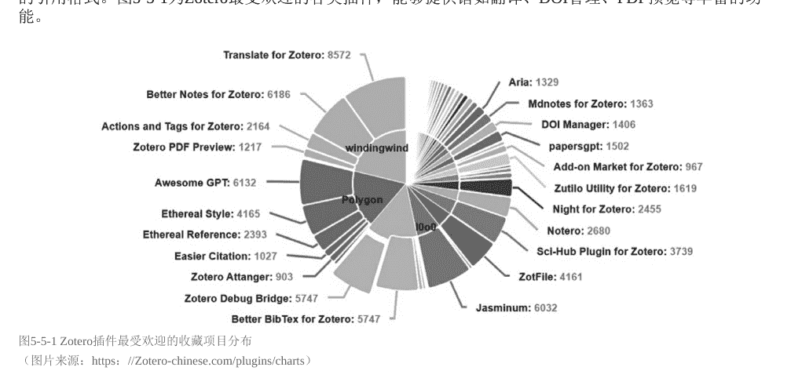

图5-5-1 Zotero插件最受欢迎的收藏项目分布
（图片来源：https://Zotero-chinese.com/plugins/charts）

当然，生成式AI也可以反过来与文献管理工具配合，生成引用语句，并按照APA、MLA、Chicago等常见引用格式体例进行格式化输出，同时校对语法逻辑与标点使用等。例如，在ChatGPT Pro版本中激活Scholar Plugin后，研究者可以通过以下提示词辅助引用管理：

> “请检查以下APA引用是否存在格式错误，并帮我转换为Chicago格式：Smith, J. (2022) .Social Media and Public Opinion.Journal of Media Studies, 21 (3) , 45-67. ”

AI将逐项识别问题，如期刊名未用斜体、作者年份顺序错误等，并返回对应格式的正确引文，大幅减少因格式不规范带来的审稿风险。

#### 三、质量把关：精准校对与语义比对

引用格式的标准化是学术写作的重要底线，然而在实际操作中，研究者常会因样式切换、条目丢失或手动修改造成误差。AI可通过语义比对与格式规范模块，识别如作者重复引用、格式残缺、出版信息遗漏等细节问题，并在批量检查中指出潜在风险。特别是在文献使用语言不一致，如中英混合引用，或引用来自动议PPT、博文摘要等非正式来源内容的场景中，AI也具备良好的模糊识别与格式修正能力。

以下为相关提示词示例：

> “以下参考文献是否有缺失信息？请补全出版年或页码，并统一格式为APA第七版。
[1]Wang,Y.Social media behavior in crisis.
[2]Liu, H. (2021) .数字传播伦理研究.中国新闻传播研究。”

在这个例子中，AI可结合数据库、知识库与规则库，补足不完整信息或给出缺失字段提示。

此外，AI也在一定程度上助力解决跨平台引用管理中的格式兼容问题。当前主流文献管理工具如Zotero、EndNote、Mendeley等，虽各有优势，但在数据结构、字段命名或编码格式上仍存在差异，研究者在平台间迁移时常出现条目不完整、元数据缺失等问题。对此，也可借助如Better BibTeX for Zotero等插件，对文献进行标准化导出（如BibTeX、CSL JSON格式），再通过AI工具进行字段比对与语义修复，辅助查验缺失信息并统一格式表达。

以下为相关提示词示例：

> “请检查以下BibTeX条目是否完整，并将其转换为APA格式，若有缺失字段请予以补全。”

需要强调的是，AI生成的参考文献仍需人工核实其真实性与数据库可检索性。大部分AI模型仍存在引用幻觉，将真实期刊名与虚构标题拼接生成看似可信但实际并不存在的文献条目。因此，研究者应始终将数据库核查作为最终引用的依据。

### 第六节 构建个人文献数据库和知识图谱

#### 一、个人文献数据库和知识图谱

##### 1. 什么是个人文献数据库和知识图谱

所谓个人文献数据库，是指研究者基于自身学术兴趣和研究领域，持续整理与归档的文献信息集合。它不仅包含文献本体，如PDF文件、出版信息、作者、关键词等元数据，还可扩展包括摘要、笔记、标签分类、引用关系、研究方法、理论框架等结构化信息。通过Zotero、Notion、EndNote 等工具，以及AI辅助标注和总结能力的加入，个人文献数据库已逐渐从存储工具发展为具备理解能力的动态知识库。

而知识图谱则是在此基础上的进一步抽象与重构。知识图谱是一种以图结构（graph）形式组织和标示知识的技术，通过节点（实体）和边（关系）构建语义网络，旨在将碎片化信息转化为可计算、可推理的关联性知识系统。在学术研究的语境下，知识图谱是通过AI技术对文献中的关键概念、理论模型、作者关系等进行提取，并以“实体—关系”的方式构建一个可视化、结构化的认知网络，可以帮助研究者发现知识之间的逻辑关系与演化路径。

##### 2. 个人文献数据库和知识图谱的关系

个人文献数据库是知识图谱构建的数据基础，而知识图谱则是对数据库内容的语义映射与结构表达，换句话说，个人文献数据库是原材料库，知识图谱是加工结构。前者强调信息的全面归集与整理，后者强调信息的理解、连接与认知建构。知识图谱不是对文献数据库的简单可视化，而是通过AI赋能后的主动知识建构工具，使原本碎片化的信息得以在宏观结构中有序组织。两者之间形成了“收集—提取—关联—演绎”的闭环机制，为AI写作提供了语境背景，也为研究者个人的学术成长搭建了系统性的知识平台。

##### 3. 可使用的相关AI工具

当前有多款AI工具可用于构建个人文献数据库与知识图谱，研究者可根据需求灵活组合使用。如EndNote、Zotero、Mendeley、Notion等文献管理工具都支持一键导入文献信息、自动生成引用、添加标签与笔记，并可以通过插件实现批注提取与笔记导出，可作为文献数据库的核心工具。

而Obsidian（可配合Zotero）、Connected Papers、Research Rabbit等软件则能够辅助研究者搭建个性化的知识网络，强化概念间的联结感与结构意识。相较于静态存储的数据库，知识图谱更强调认知建构，是知识深度理解与系统表达的重要支撑。

#### 二、建构个人文献数据库

Zotero作为一款开源、功能强大且使用门槛较低的文献管理工具，受到不少研究者的青睐。以下将结合Zotero的功能，介绍构建个人文献数据库的具体路径。

##### 1. 文献采集与导入

Zotero的主要优势之一是其浏览器插件Zotero Connector支持在主流学术数据库，如Google Scholar、CNKI、PubMed、Web of Science上一键抓取文献信息。在网页中浏览某篇文章时，只需点击插件按钮，Zotero就能自动保存该文献的题目、作者、摘要、期刊名称等元数据，并在允许条件下下载PDF全文。

- 文件夹（collection）系统：用于按研究主题、论文章节、项目分类等方式创建层级结构；
- 标签（tags）系统：用于多维度、交叉性标记。如为同一篇文献打上“批判研究”“跨学科”“定性研究”等标签，便于后续灵活检索。

为了细化管理文献，Zotero用户可启用颜色标签系统，将核心文献、高引用值文献、预备引用文献等加以视觉区分等。

##### 3. 笔记撰写与扩展

Zotero的“笔记”功能支持为每篇文献单独添加评论、摘要、思考等信息，支持附文本编辑。更进一步，可借助以下插件提高与拓展笔记效率与深度：

- Zotfile插件：可以自动提取PDF中的高亮标注和注释，生成清晰的结构化笔记；
- MDNotes插件：允许将文献信息与批注导出为Markdown文件，方便与Obsidian等双链笔记软件协同使用；
- Better Notes插件（可选）：允许在Zotero中构建卡片笔记系统，实现跨文献引用和卡片级整理。

##### 4. 数据库动态优化与智能检索

Zotero提供强大的搜索与筛选功能，可以支持按作者、标题、关键词、标签、年份等多维度快速定位文献。通过设置“Saved Searches”，可以持续追踪某一研究主题下的新进文献。此外，结合以下工具可以进一步增强Zotero的智能化和图谱化能力：

- Scite插件：在Zotero中显示文献被引用的语境，便于评估文献影响力；
- Zotero+Connected Papers：可以快速在外部可视化平台查看该文献的引用网络，识别知识图谱中的核心节点；
- Zotero+Obsidian/Notion同步：可以通过MDNotes等插件将笔记系统化输出，与个人知识库联动，构建可视化概念网络。

#### 三、整合式建构知识图谱

在众多知识管理工具中，Obsidian以其基于Markdown的笔记系统和强大的双向链接功能，成为构建个人化知识图谱的理想平台之一。在Obsidian的基础上，整合Zotero等文献管理工具，以及ChatGPT、DeepSeek等大语言模型工具构建知识图谱的做法如下：

（1）工具准备

准备Zotero、Obsidian、MDNotes插件（从Zotero将文献导出为Markdown笔记）；ChatGPT或其他大语言模型；DataView（数据查询）、Graph View（可视图谱）、Omnisearch（智能检索）等Obsidian插件（可选）。

（2）导入文献并初步整理

在Zotero中选定一批核心文献，进行高亮、笔记与标签标注；使用MDNotes插件将这些文献笔记一键导出为Markdown格式，导入至Obsidian；Obsidian会为每篇文献生成一个独立页面，包含标题、作者、笔记、引用等结构。

（3）借助AI提取核心知识节点

向ChatGPT等LLM工具输入一篇文献摘要或全文内容，要求其提取核心知识节点。以下为相关提示词：

> “请帮我提取该文献的核心概念、使用的理论模型、研究方法及其与其他理论的关系，列成清单。”

将AI输出结果整理为Obsidian页面，例如：

- [自我决定理论]
- [社会建构主义]
- [定性访谈法]

在文献笔记中主动链接这些概念，如：
该研究主要借助[自我决定理论]分析……采用[定性访谈法]。

##### （4）构建链接与结构化图谱

为每一个被链接的[概念]创建独立页面，在页面中整理：

- 概念定义（可由AI提供初稿）
- 核心学者或出处
- 被哪些文献引用过（建立反向链接）
- 与其他概念的关系

使用Obsidian的Graph View（见图5-6-1）查看节点网络，观察哪些概念最核心、哪些知识孤岛需要补充。还可用DataView插件提取“与某方法相关的全部文献”，形成专题子图谱。

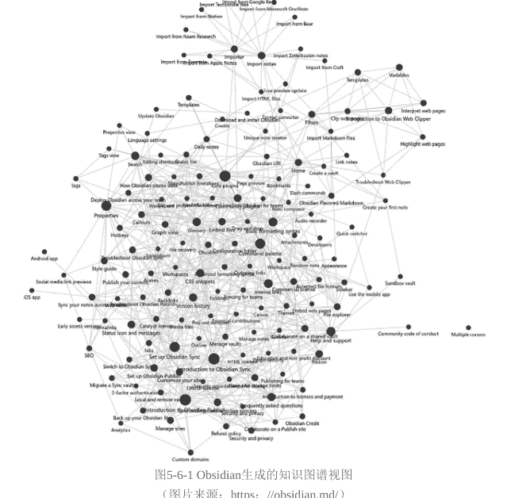

##### （5）动态维护与升级

持续向数据库中添加新文献，建立新链接。利用AI识别知识图谱中的结构薄弱区，相关提示词如下：
“请分析我的笔记库中，关于‘社会支持’主题还缺少哪些理论或研究路径？”

### 本章小结

本章全面展示了AI技术如何协助研究者排除冗余信息、理解结构逻辑、识别高价值研究，并规范引用格式。在关键词提取与检索式构建中，AI可弥补经验不足者的策略短板；在文献筛选、推荐与深度阅读中，AI可加速结构识别与灵感生成；在引用管理与格式规整中，AI则转化为学术规范的智能守门人；而结合文献和知识管理工具，以及LLM的语义提取能力，研究者可以更便捷地构建个人文献数据库，并以此为基础建立知识图谱。本章也指出了AIGC的幻觉风险与不可替代性，强调人机协同始终是文献工作的核心逻辑。AI可帮助研究者提高研究效率，降低研究成本，但唯有研究者自身的判断能力、方法意识与批判精神才能将技术之用转化为学术之质。

[1] 李珏，方平，胡德华.循证医学系统综述来源文献的分析研究[J].中华医学图书情报杂志，2004，13（4）：57-62.
[2] Booth,A.(2016).Systematic approaches to a successful literature review.Sage.
[3] Snyder,H.(2019).Literature review as a research methodology.Journal of Business Research,104,333-339.
[4] Booth,A.(2016).Systematic approaches to a successful literature review.Sage.
[5] Zotero中文社区插件商店：https://zotero-chinese.com/plugins/.

# 第六章 论文写作与修改

### 本章介绍

本章聚焦于AI在学术论文写作与修改中的实际应用，探讨AI工具如何帮助研究者在论文构思、撰写、修改和定稿的过程中提高效率、提升质量和确保规范，具体内容包括：如何使用AI协助生成清晰的写作框架，优化逻辑推理，提升语言表达，以及有效进行论文降重和查重等。通过展示实际的研究案例与高效的提示词，本章将帮助研究者掌握AI辅助论文撰写和修改的具体操作步骤，从而提升其写作质量，确保写作进度。同时，本章也强调，尽管AI能够提供强大的辅助功能，但学术表达最终仍要依靠研究者自身的思维与判断。AI能且只能作为辅助工具介入写作，而绝非替代研究者成为学术创作的主体。

### 第一节 双向互动模式下的学术写作工作流

在AI辅助写作日益普及的当下，若无法把握学术写作的基本逻辑与结构规律，即便有再先进的技术工具，也难以完成高质量的学术表达。论文写作既是知识生产的核心环节，也是学术思维的集中体现。如果仅从研究者视角的单向传播模式出发，学术写作无非是从提出研究问题，到收集资料以便回答问题的一个过程。但事实上，学术成果的发表往往是面向特定读者群体，如同行专家、期刊审稿人等的一种双向互动传播活动，其工作流的起点并非问题，而是读者（audience），即“读者关心什么样的问题”或“如何让读者关心我所关心的问题”。

在以读者为导向的双向互动模式下，学术写作被视为与学术共同体进行沟通与对话的过程。因此，研究者首先需要识别其目标读者群体，并理解他们的关注点、理论偏好与知识期待。随后，在选题与问题建构阶段，应融入问题回应意识，努力提出具有学术争议性与现实意义的研究问题。在写作过程中，研究者也要在结构安排、语言风格、论证方式上与读者建立对话感，预判可能引发的质疑与反驳，并对此加以回应。即使是在论文完成后，研究者也可以通过学术会议等平台实现进一步的交流与反馈，使知识在双向互动中继续生长发散。由此，学术写作不再是封闭的个人表达，而是嵌入学术共同体的一个持续协商过程（见图6-1-1）。

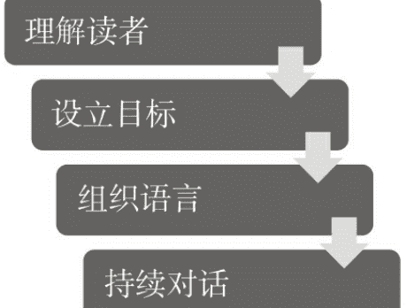

图6-1-1 双向互动模式下的学术写作工作流

#### 一、理解读者

在以读者为导向的学术写作中，理解读者是首要环节。研究者需要明确论文面向的对象是谁——是同一学科的专家、跨学科的审稿人，还是具有实务背景的政策制定者？不同读者的知识结构、理论偏好、关注焦点各不相同，这决定了研究者在写作中需采取的表达方式、论证深度和语言风格。同时，研究者还应分析目标期刊或平台的写作范式、常见议题和评价标准，判断读者可能持有的期待视野与潜在质疑。通过构建读者画像，研究者不仅能更有针对性地组织论证，还能提前建立起回应意识，使论文真正进入学术对话之中，而非自说自话。

#### 二、设立目标

在理解读者的基础上，研究者须进一步设立清晰的写作目标。这不仅包括基本的研究问题，还应涉及影响读者的方式——是希望挑战某一主流观点、提出新的理论路径，还是填补某一经验缺口？目标的设定应兼顾学术贡献与读者需求之间的契合度，找到有回应空间的切入点。同时，还要考虑篇章结构的功能安排。一篇标准的学术论文通常包括引言、文献综述和理论框架、研究设计、数据分析与讨论结论等主要部分。在这一通用模板的基础上，研究者要进一步思考在哪里提出核心观点、如何分布重点论证等，以便最大限度激发读者的兴趣与思考。

#### 三、组织语言

组织语言不仅是个人表达，更是与读者持续对话的通道。相较于其他写作类型，学术写作更强调逻辑上的严谨性，以及文字上的准确性、可读性和规范性。学术写作并非语言炫技，而是一种逻辑训练的延伸。研究者在写作中很容易出现主次不分、逻辑跳跃、概念混用、论据薄弱等问题，其实这大多来源于结构不清与逻辑不严。研究者要善于使用清晰的段落结构和过渡衔接，帮助读者顺利跟进论证逻辑。在关键论点处，应主动引入可能的反方观点或争议，引导读者思考与对话。还可以通过摘要、标题、小节导语等，提前释放关键信息，降低读者理解成本，使写作更具互动感和回应性。此外，在语言风格上应始终秉持“brief and strong（文约而事丰）”的原则，反对空泛堆叠和主观臆断。

#### 四、持续对话

学术写作并不以论文的完成为终点，而是进入更广泛的学术对话的起点。研究者应将论文置于既有学术讨论的脉络中，通过引用、回应或批判他人观点，表明自身立场与对话位置。在论文发表后，还可通过会议交流等方式，获取读者进一步的评价与补充。这些互动不仅有助于发现盲区与修正不足，也可能激发新的研究创意。

借助AI辅助工具，研究者可以更精准、高效地推进上述学术写作工作流。后续小节将紧密围绕设立目标和组织语言两大核心环节，探讨研究者如何运用AI工具形成有助于互动对话的论文结构和初稿，并使用准确无误、风格适配的学术语言。

### 第二节 论文结构构建与初稿撰写

论文结构布局的过程主要涉及选题拆解、章节组织和逻辑推演。在以往的学术写作训练中往往要借助大量写作模板，要求初学者从模仿开始进入写作实战。随着AI大语言模型的成熟，研究者可以在写作模板的基础上，借助AI高效地实现从结构搭建到段落填充的全流程起草辅助，从而大幅提升写作效率。本节将围绕三个关键环节展开讨论：结构生成、初稿起草与逻辑优化，并结合提示词示例，展示如何借助AI搭建论文结构并撰写初稿内容。

#### 一、AI辅助构建学术论文逻辑框架

学术论文的基本结构普遍采用“IMRaD”（Introduction, Methods, Results, and Discussion）框架，辅以摘要、参考文献、附录等补充部分。而不同学科、不同阶段的写作任务，如毕业论文、期刊投稿、研究提案等，对结构要求也有所不同。AI工具在论文结构确立方面的优势主要体现在它能够通过输入提示词，直接生成合理的写作大纲。以下为相关提示词示例：

#### 二、AI辅助撰写论文各章节草案

##### 1. 引言部分

引言是整篇论文的开场白，其主要作用是阐明研究的背景动因、核心问题、研究意义与结构预览。优秀的引言不仅要回答研究目标和内容，更应清楚说明研究价值，以此吸引读者的注意力，促使其继续阅读。以下为相关提示词示例：

> “请撰写一段1000字的中文核心期刊学术论文引言草稿，研究主题为‘微博平台的算法推荐对用户信息选择行为的影响’，具体包括研究背景、问题陈述、研究目的和结构概览。”

##### 2. 文献综述部分

文献综述的功能主要在于交代以往的研究概况。通过对已有研究进行综述和对比，不仅可以展示研究者对研究领域的掌握程度，还能为后续研究问题的提出和研究方案的设计提供学理支撑。文献综述最终的目的是找到研究缺口，并为本研究的价值正名。文献综述中关于文献的收集和整理的步骤已在前面章节加以介绍，在此不再赘述。这里主要是关于对文献收集和整理结果的文字呈现。以下为相关提示词示例：

> “请根据目前个人知识库中研究主题‘算法推荐对信息选择的影响’下的所有相关文献，生成一段2000字的中文核心期刊学术论文文献综述部分草稿，强调现有研究的理论视角与不足。”

##### 3. 方法部分

方法部分相当于科研工作的设计蓝图，它不仅关乎研究的技术可行性，也直接决定了结论的科学性与可信度。其核心任务是说明研究者是如何分析研究问题，采用何种数据和分析方法的。对于如何借助AI工具进行方法部分中的数据分析和可视化表达，将在后续章节中加以详细介绍，此处仅讨论其文字生成。以下为相关提示词示例：

> “请根据[数据]为以下研究生成符合中文核心期刊学术论文范式的1000字篇幅的研究方法描述，主要结构为：
- 研究方法和过程：采用问卷调查……；
- 样本：300名微博活跃用户，样本结构见[数据]……；
- 变量及测量：包括算法推荐频率、信息获取多样性、自主性评分……。”

##### 4. 结果部分

结果部分的功能在于如实呈现研究发现，但并不直接展开解释。对结果的解释通常在讨论部分加以展开。结果部分仅需要清晰、准确地将分析得到的数据结果以文字、表格或图的方式加以呈现，以便帮助读者了解数据所揭示的事实。以下为相关提示词示例：

> “请根据以下描述性统计和回归结果，生成一段符合中文核心期刊学术论文范式的1000字篇幅的结果部分文字，变量包括推荐频率、接触多样性、信息信任感。”

##### 5. 讨论与结论部分

讨论与结论部分的作用在于回答研究问题并解释研究发现的含义，连接已有理论与新数据，指出研究的学术与实践价值，并提出可能存在的局限性和未来研究方向。以下为相关提示词示例：

> “请根据‘算法推荐频率越高，用户信息选择多样性越低’的结果，着重讨论这一发现与以往信息茧房相关研究的异同。”

### 第三节 语言润色与语法检查

学术论文的写作不仅需要扎实的理论基础和严谨的研究方法，还需要准确、清晰和专业的语言表达。语言质量将直接影响到目标读者群体对论文的可读性、说服力以及研究者学术水平的评价。然而，语言表达上的细微错误，如语法不当、句子结构混乱、用词不准确等，往往难以被研究者自己所察觉。传统的语法检查和语言润色工作通常依赖于人工编辑或者传统的语法检查工具，如Microsoft Word自带的语法检查功能，但这些工具的功能和精准度有时会受到限制。随着AI自然语言处理技术的快速发展，集成了AI智能的语言润色和语法检查工具现已成为学术写作中不可或缺的助手，能够帮助研究者在写作过程中迅速发现并解决语言问题，从而提高论文的整体质量。

本节将围绕AI如何协助识别和修正语法错误、如何提升论文语言表达的流畅度和专业性两个方面，详细探讨如何借助AI工具进行智能语法检查、句型优化、用词精准化以及文章的整体润色，以帮助研究者在学术写作中提高语言的规范性和表达的清晰度。

#### 一、AI辅助识别和修正语法错误

语法是学术写作中最基本的语言规范之一。学术论文通常要求严谨、客观的学术语言，而语法错误的存在会严重影响论文的质量，甚至可能导致审稿人对研究者的专业水平产生怀疑。对于非母语写作者来说，语法问题往往是写作中的一大挑战，而AI技术的发展或能有效地解决这一困扰。

传统的语法检查工具虽然能够帮助检查一些基本的语法错误，但在复杂句型结构、学术语言的使用和语法细节等方面，往往无法做到完全准确。而基于深度学习和自然语言处理技术的AI工具，如Grammarly、ProWritingAid、LanguageTool等，已经能够提供更为精准和多层次的语法分析。AI语法检查工具的优势在于其智能化的错误检测和修复功能。AI能够基于上下文理解句子的结构和语法规则，自动识别出主谓不一致、动词时态错误、冠词缺失、拼写错误等问题，并提供修改建议。更重要的是，AI还能够处理复杂的句型结构，识别并修复冗长或拗口的句子，保证句子清晰且符合学术写作的标准。

除了上述专业性的语法检查工具外，如ChatGPT、DeepSeek等内容生成式AI工具也具备基本的语法检查功能。当出现无法确认的语言问题时，研究者使用生成式AI工具可以帮助明确具体的语法问题所在，并学会正确用法。以下为其使用实例：

**例6-3-1 生成式AI工具的语法检查功能使用实例**

研究者问：
请检查以下句子的语法并提供修改建议：“Although the study has a clear design, but the method is not fully explained.”

ChatGPT 回答：
句子“Although the study has a clear design, but the method is not fully explained.”中存在语法上的小错误，主要是使用了不必要的连词“but”。
修改建议：去掉“but”，因为“although”已经作为一个连词引导了条件状语从句，因此不需要再使用“but”。
修改后的句子为：“Although the study has a clear design, the method is not fully explained.”

修改完成后，句子的结构更符合英语的常规语法规则，也更加简洁流畅了。AI工具的语法检查能力不仅限于识别简单的语法错误，还能提供基于语境的修复建议，这将大大提升外文学术论文写作的效率和准确性。

#### 二、AI辅助提升语言流畅度与表达的准确性

学术论文写作不仅要遵循语法规范，还要在语言表达上追求精确性和流畅度。尤其是在复杂的学术领域中，表达的准确性尤为重要。对此，AI工具能够帮助研究者优化语言表达，使其显得更为清晰、简洁和专业。

**1. 句型优化和变换**

学术写作通常要求句子简洁明了，过长或过于复杂的句子往往使读者难以理解，进而影响论文的可读性。AI语言工具能够分析句型结构并提出优化建议。例如，对于过长的复合句，AI能够识别出其中的主旨，并将其拆分成更易理解的简单句；对于成分冗余的句子，AI也能够提供替代句型，使其更加直接、明确。以下为其使用实例：

**例6-3-2 生成式AI工具的句型优化功能使用实例**

研究者问：
请优化以下句子：“The study which was conducted by the authors aimed to examine the relationship between social media use and mental health outcomes, which has been a subject of considerable interest in recent years due to the increasing impact of digital technologies on society.”

ChatGPT 回答：
优化后的句子为：“The study conducted by the authors aimed to examine the relationship between social media use and mental health outcomes, a topic of increasing interest in recent years due to the growing impact of digital technologies on society.”

优化理由：删除了不必要的“which was”使句子更加简洁；用“a topic of increasing interest”代替了原句中重复的“which has been a subject of considerable interest”，使句子更加流畅且富有表现力；简化了“due to the increasing impact”改为“due to the growing impact”来提高表述的自然度。

**2. 专业术语的精准使用**

学术论文中的语言需要准确传达专业概念和理论。尤其是在跨学科的写作中，准确地使用领域内的术语更为重要。AI工具能够帮助检查并提供合适的术语，它们不仅能够识别术语误用，还能提供替代建议，以确保准确性和一致性。以下为其使用实例：

**例6-3-3 生成式AI工具的术语准确性检查功能使用实例**

研究者问：
请检查以下句子中的术语使用是否准确：“Social media platforms influence user behavior through various algorithms, including personalized recommendation systems that encourage selective exposure.”

ChatGPT 回答：
该句中的术语使用是准确的，并且符合学术写作的标准。以下是逐一分析：
- Social media platforms：正确使用，指的是社交媒体平台（如Facebook、Instagram等），这是学术写作中常用的术语；
- personalized recommendation systems：正确，指的是个性化推荐系统，这是一种常见的算法，广泛应用于社交媒体平台，目的是根据用户的兴趣和行为推荐个性化内容；
- selective exposure：这个术语用在传播学中也非常准确。它指的是个体倾向于选择符合自己观点或信念的信息，而避免接触与自己观点不一致的信息。这个概念在社交媒体和信息传播领域有广泛的应用。

AI还会检查所使用的术语是否符合当前研究领域的语境，并提供相关的术语替代建议。例如，如果“selective exposure”在某些文献中已有替代术语，AI会推荐这些词汇并进行语境对比。

**3. 文章的整体流畅度与连贯性**

除了单个句子的修正，AI还能根据全文的语境优化整篇文章的结构。AI可以帮助研究者分析段落之间的逻辑联系和过渡句的使用，确保论文整体结构流畅，论述层次清晰。以下为其使用实例：

**例6-3-4 生成式AI工具的文章流畅度与连贯性优化功能使用实例**

研究者问：
请优化以下段落过渡句：“On one hand, social media use can be beneficial for users' mental health. On the other hand, excessive use can lead to negative consequences. Therefore, it is crucial to examine both sides of the argument.”

ChatGPT 回答：
优化后的段落过渡句为：“While social media use can offer benefits for users' mental health, excessive engagement may result in detrimental effects. Given these contrasting outcomes, it is essential to explore both the positive and negative aspects of social media's impact on mental well-being.”

优化说明：
- 将“On one hand”和“On the other hand”用“While”替代，使句子更简洁、流畅；
- “can be beneficial”和“can lead to negative consequences”用“offer benefits”和“result in detrimental effects”替换，使语言更精练，并突出了影响的性质；
- 使用“Given these contrasting outcomes”增强了过渡句的连贯性，引导读者进入对两面观点的全面探讨。

#### 三、AI辅助语法检查与润色的应用实例

AI语言工具不仅能帮助研究者在论文的初稿中发现和修正语言错误，还能在后期的修订和润色过程中发挥重要作用。例如，当研究者已经完成论文初稿时，AI可以通过智能编辑和修正功能进一步优化论文内容，提升论文的语言表达质量。

**例6-3-5 生成式AI工具的语法检查和润色功能使用实例**

研究者问：
请检查并修改以下论文段落，确保语法正确并提升语言流畅性：“Social media platforms are being increasingly used by individuals to connect with each other and share information. However, these platforms have also been associated with negative consequences. It is important to understand the impact of social media on people's mental health, as it is increasingly influencing their well-being.”

ChatGPT 回答：
修改后的段落为：“Social media platforms are increasingly used by individuals to connect with one another and share information. However, these platforms have also been linked to negative consequences. Understanding the impact of social media on mental health is crucial, as it plays an increasingly significant role in influencing people's well-being.”

修改说明：
- 将“being increasingly used”简化为“increasingly used”以使表达更加简洁；
- 将“associated with”替换为“linked to”，以增强句子的流畅性和简洁度；
- 重新组织最后一句，使其更加紧凑并增强语言的严谨性。

### 第四节 论文查重和降重

在撰写学术论文的过程中，查重和降重是必不可少的环节。无论是毕业论文还是期刊投稿，维护论文的原创性和学术诚信始终是研究者的基本责任。传统的查重方法通过比对现有文献中的内容来识别是否存在抄袭或过度引用的风险。然而，这种方法在面对语义重复或变通表达时，往往存在一定的局限性。随着AI工具的普及，研究者可以在降重过程中获得强有力的支持，进而在减少重复内容的同时，保持文章的高质量表达。本节将详细探讨如何利用AI工具进行论文查重和降重，涉及理解查重的基本原理，如何通过AI进行语义优化，以及在实际操作中的技巧与注意事项。

#### 一、理解查重工具的工作机制

目前国内外有多个平台可以提供查重服务，如中国知网、维普、万方、Turnitin等。以中国知网查重系统为例，该系统基于多维度智能比对技术，其核心原理可归纳为以下六个维度：

1.  **字符连续比对机制**
    知网系统一般采用13字符连续为重复判定标准，无论中英文均以连续字符为检测单元。例如，中文6～7字连续重复即触发标记。同时，系统通过模糊算法支持跨标点符号识别，即使是存在逗号分隔的短句也可能会被判定为重复。

2.  **语义重构识别能力**
    通过自然语言处理语义分析技术识别文本深层逻辑，即使替换近义词或调整语序仍可能被检测。支持跨语种二次转译识别，如“中译英再译中”的改写文本仍可能引发语义关联风险。

3.  **结构敏感性规则**
    如目录顺序调整等文档结构上的变化会导致检测结果波动，同一内容在不同位置可能呈现差异化重复标记。同时，系统会自动进行分章检测，各章节独立计算重复率，但全文重复率仍是最终的判定依据。

4.  **引用鉴别阈值**
    系统设定5%段落引用阈值，超过该比例的引用内容无论是否标注均计入重复率。灰色标注的参考文献需严格符合格式规范，格式错误的将转为正文检测。

5.  **数据库覆盖范围**
    知网比对库中包含1200亿条数据指纹，涵盖期刊、专利、会议论文等11类资源，尤其提高了中文学术资源的覆盖密度。同时，系统还实时收录最新网络公开数据，包括主流学术平台及机构公开的预印本。

6.  **特殊内容处理**
    对于公式代码采用特征值提取技术，不同编排形式的相同算法可能会触发重复标记。表格数据通过数值矩阵分析对比，人工调整行列顺序无法规避重复检测[3]。

理解这些查重工具的工作机制后，研究者可以更有针对性地进行降重操作，优化论文表达方式，从而在不丢失学术内容的前提下降低重复率。

#### 二、降重的核心技巧

在进行论文降重时，研究者不仅要理解查重工具的工作原理，还需要掌握一定的技巧，以便高效、准确地降低重复率。以下是几种常见且有效的降重技巧：

**1. 重组句子结构**

重组句子结构是论文降重中最基础且最常见的技巧之一。通过调整句子中的主语、谓语和宾语的顺序，或者改变句子的语法结构，研究者能够有效降低与原文的相似度。句子重组不仅能避免字面重复，还能使表达更加清晰、逻辑更加流畅。例如，原文“社交媒体的使用改变了信息的传播方式，尤其是在青少年群体中”，可以通过调整句子结构改为：“在青少年群体中，信息传播方式的变化主要源于社交媒体的广泛应用。”

**2. 专业术语替换**

专业术语替换是在保证语义不变的前提下，使用不同的术语替换原文中的重复表达。这个技巧的关键是要理解每个术语的精确含义，并选择适当的同义词，以避免改变原文的核心意思。例如，原文中的“协同效应”可以替换为“跨系统耦合作用”。或对高频专业名词添加限定词，如将“基于某某模型的协同效应”修改为“采用某某框架的多主体交互增效”。需要注意的是，同义词替换不能盲目进行，必须确保所选词汇与原文的含义完全一致，否则可能会引起语义误差。

**3. 压缩冗余内容**

论文写作中，冗长的表达往往导致重复率过高。研究者可以通过简化句子、去除不必要的修饰词和重复信息来减少重复内容。例如，“这个技术不仅在该领域的应用取得了非常显著的进展，同时在多个其他领域也有广泛的应用”，可以简化为“该技术在多个领域内取得了显著进展”。压缩冗余内容有助于使论文更加简洁高效，同时降低与其他文献的相似度。

**4. 扩展讨论与引用**

如果某个观点或数据在文献中存在广泛引用，研究者可以通过适当引用相关的学术文献来避免被查重系统识别为重复，同时提高论文的学术深度。例如，当引用一项已广泛讨论的技术时，可以通过引用相关研究，来增强论文的学术性并避免被查重工具标记为重复[4]。

通过掌握这些核心降重技巧，研究者不仅能够有效降低论文的重复率，还能使论文的表达更加简洁、精准和具有学术性。尽管降重的过程中有时需要反复修改，但通过灵活运用上述技巧，研究者可以在保证论文质量的同时，降低与已有文献的相似度。

#### 三、AI辅助论文降重

为了最大化AI在降重中的作用，研究者应遵循一定的操作流程，以确保每个环节都能得到充分利用。以下是AI辅助论文降重的常见步骤：

**1. 准备工作**

在使用AI进行论文降重之前，研究者需要先进行查重，标注出重复率较高的部分，集中对这些部分进行修改。明确修改要求也是降重成功的关键，包括目标重复率、需要保留的关键词以及特定学术表达的要求。对修改要求的清晰理解，将帮助AI生成更加符合需求的内容。

**2. 编写高效的提示词**

**（1）语义改写**

重组句子结构是降低查重率的另一种常见方法，通过调整句子的语法结构和顺序，使其表达方式与原文有所不同。AI能够快速生成多种不同的句式表达，帮助研究者达到降重目的。以下为相关提示词示例：

> “请重组以下句子结构，使其与原句在语法结构上有明显区别，降低重复率，并保持原文意思不变：
[输入段落]”

##### （3）同义词替换

同义词替换要求研究者对每个词汇的精确含义有清晰的了解，以确保所选同义词与原文意思完全一致。以下为相关提示词示例：

> “请对下列段落中的关键词进行同义词替换，确保表达意思与原文一致，但使用不同的词汇进行替代，从而降低重复率：
[输入段落]”

##### （4）优化逻辑与简化表达

通过简化冗长的表达或优化段落的结构，研究者可以使论文内容更加精练且易于理解。AI能够帮助调整段落逻辑结构，去除不必要的修饰性语言，确保论文表达简洁而富有逻辑性。以下为相关提示词示例：

> “请对以下段落进行优化，简化其表达方式，使其逻辑更加清晰，去除多余修饰并确保论文的简洁性，同时降低重复率：
[输入段落]”

##### （5）压缩冗余内容

冗长的表达会导致查重工具标记为重复，尤其是当相同的内容出现多次时。AI能够通过去除冗余信息，简化表达，有效降低查重率。以下为相关提示词示例：

> “请将以下段落压缩为更简洁的形式，去掉不必要的冗余描述，同时保持原文的核心思想和学术性，并降低重复率：
[输入段落]”

##### （6）控制字数

控制段落的字数是降重中的重要技巧，尤其在查重工具将字数较多的段落标记为重复时，减少冗长描述可以有效降低重复率。AI能够帮助压缩不必要的内容，保留核心信息。以下为相关提示词示例：

> “请将以下段落缩减至[字数]以内，同时确保信息的完整性和原意不变，并降低重复率：
[输入段落]”

### 本章小结

本章介绍了AI在学术论文写作与修改中的各项功能，从论文结构的构建、初稿生成到语言的润色与语法检查，再到最终的降重与查重优化。AI能够帮助研究者在论文写作的多个环节中提高效率、减轻负担。在写作初期，AI能够通过生成清晰的论文框架和结构，帮助研究者完成完整的初稿；在后期修改阶段，AI可以通过语言润色、逻辑优化和降重功能，进一步提升论文质量，确保语言规范性和学术性。值得注意的是，尽管AI工具能够提供高效的写作辅助，但研究者的判断力和学术素养仍然至关重要。AI的作用在于为研究者提供思路启发和技术支持，最终的学术深度和论文质量依然需要依赖于研究者自身的思考与分析。本章强调人机协同的必要性，AI在学术写作中的辅助只有与研究者的创造性和批判性思维相结合，才能在提高写作效率的同时，保持论文的学术价值和独立性。

[1] Strunk, W. I. (1999). The elements of style (4th ed.). Pearson.
[2] Sollaci, L. B., & Pereira, M. G. (2004). The introduction, methods, results, and discussion (IMRAD) structure: a fifty-year survey. J Med Libr Assoc. 92(3): 364-367.
[3] 知网查重的这些规则及原理你了解吗？[EB/OL]. https://www.cnki.cn/write/903.html.
[4] 怎么看知网查重结果（详细解说）及降重方法[EB/OL]. https://www.cnki.cn/check/1775.html.

# 第七章 数据分析与可视化

### 本章介绍

本章聚焦AI在数据分析与可视化环节中的应用，探讨了AI工具如何协助研究者完成从数据预处理到模型建构，再到结果呈现的整个数据工作流程。具体内容包括AI在数据清洗、变量识别与自动编码、建模准备、图表生成与可视化表达等方面的实际应用与方法创新。AI技术不仅能通过自然语言处理帮助研究者简化烦琐的编程操作，还能通过智能化的数据分析与图表生成，提高表达的可视化和直观性。在AI技术的帮助下，数据分析将从传统的手工操作逐步转向智能化、自动化，极大地降低了非技术背景研究者的操作门槛。本章将通过具体的提示词示范与操作实例，帮助读者更好地发挥AI工具在上述方面的实用功能。

### 第一节 数据分析与可视化概述

#### 一、数据分析

在学术研究中，数据分析扮演着理论推演与实证检验之间桥梁的角色，是支撑研究结论，增强论文可信度和科学性的核心环节。在社会科学等学科领域，研究者需要借助科学的数据分析方法，对问题进行系统性探究和有力论证。从方法取向上来看，数据分析大致可分为两类：定性分析与定量分析。两者在研究目的、数据形态、技术手段与解释逻辑上各有侧重，但也可互为补充，构成混合研究方法范式。

##### 1. 定性数据分析

定性数据分析主要服务于理解“怎么样”与“为什么”的研究问题。它不依赖大规模的数字资料，而关注具体语境、意义与个体经验，强调深度理解、过程追踪和理论建构。定性分析更多应用于探索性研究、小样本研究、文化现象研究等场景，典型数据包括访谈文本、民族志观察笔记、政策文件、社交媒体内容等。常见的定性分析方法有：

- 主题分析（Thematic Analysis）：识别并归纳材料中反复出现的核心主题，用以建立理论概念体系；
- 扎根理论（Grounded Theory）：强调从田野资料出发，通过开放性编码、轴心编码、选择性编码逐步建立新的理论解释体系；
- 叙事分析（Narrative Analysis）：研究个体叙述中的意义建构过程，常用于教育、心理、女性主义等研究领域。

定性分析的基本流程包括数据收集、预处理、开放编码、主题抽取、理论建构。研究者需要在语义、语境和语用三个层面反复比对资料，通过归类、比较与对话式分析，生成具有概括性与解释力的概念结构。研究策略上一般强调分析与解释并行、数据与理论互动，要求研究者保持理论敏感性，同时避免先入为主。定性分析的优势在于能够深入复杂现象的内在机制，揭示变量背后的文化逻辑与社会意涵，但是也存在主观性较强，解释结构可能受到价值偏好影响，结论的可推广性和研究的透明性较弱等不足。

##### 2. 定量数据分析

定量数据分析致力于研究变量间的关系强度、变化趋势与因果路径等，主要适用于假设检验、问卷分析、政策评估、模型建构等研究情境。定量数据通常来自大样本问卷、实验记录、官方统计数据库或已公开的数据集等第一、第二手来源。常见的定量分析方法有：

- 统计分析（Statistical Analysis）：包括描述统计、推断统计、假设检验、回归分析等经典统计学方法；
- 计算方法/机器学习分析（Computational Methods）：如文本挖掘、聚类、分类器、神经网络等，强调算法与模型构建能力，常用于大数据场景；
- 社会网络分析（Social Network Analysis，SNA）：聚焦个体间的关系结构与网络模式，适用于组织研究、传播路径、关系强度研究等。

定量分析的优势在于其结果具有统计意义，研究过程具备操作规范性、逻辑严密性和可重复性。不过，模型设定、数据质量与变量选择的偏差都有可能影响结论的有效性。如果过度依赖于统计显著性，还可能会掩盖实际问题情境的复杂性。近年来，已经有越来越多学者主张采用混合研究法，即整合定性和定量方法，以便在深入理解现象的同时，保持分析的广度与代表性。在实际操作时，可以先通过定性分析识别关键变量和逻辑关系，再通过问卷或实验进行检验；或先通过定量分析筛查样本，再辅以深度访谈增强解释性等。

#### 二、数据可视化

如前所述，数据可视化（data visualization）是指通过图形、图表、动画等形式将抽象的数据转换为直观、易于理解的视觉信息的过程。在社会科学研究中，数据往往具有复杂的结构和丰富的维度，传统的文本叙述方式难以全面地呈现变量之间的关系。通过可视化，研究者就可以更清晰地识别数据中的模式、趋势和异常，提高数据说明和学术传播的效率。

数据可视化过程通常包括六个核心步骤：一是数据准备，包括数据清洗、格式统一、缺失值处理与变量转换等；二是图表设计，即根据研究问题和数据特征，选择最合适的信息表达方式，如条形图、柱状图等；三是图形生成，可通过R语言、Python等各类工具完成初步绘制；四是视觉优化，包括调整色彩搭配、图例标注、文字排版等；五是结果解释，撰写清晰的图注与描述，帮助读者理解图中信息；六是成果整合，即将图表合理嵌入论文正文、附录或展示平台中，与文字叙述形成互补关系。

根据可视化目的和数据属性，常见的数据可视化类型如下：

##### 1. 描述性数据可视化

描述性数据可视化主要用于呈现单变量或双变量的基本统计特征，帮助读者快速理解数据的分布、集中趋势与离散程度等。常见形式包括：

- 条形图（bar chart）：适用于对比不同类别变量的数量差异；
- 饼图（pie chart）：适用于显示组成比例，但不建议用于变量较多的场景；
- 直方图（histogram）：用于展示连续变量的频数分布；
- 折线图（line chart）：适合展示时间序列数据的趋势变化。

##### 2. 比较性与关系可视化

当研究涉及变量之间的关系、对比或聚类分析时，就需要用到关系型可视化工具，如：

- 散点图（scatter plot）：用于观察两个连续变量之间的相关性；
- 箱线图（box plot）：用于比较多个组别在一个连续变量上的分布特征及异常值；
- 热力图（heatmap）：通过颜色强度表示变量值的大小，用于揭示变量间的关联或数据集中热点区域。

##### 3. 时间序列与动态可视化

当数据涉及时间变化时，可以采用能呈现趋势和节奏变化的图表形式，如：

- 多序列折线图（multi-series line chart）：展示多个时间变量的同步变化趋势；
- 面积图（area chart）：强调累计趋势的可视化；
- 动态图表（dynamic chart）：通过动画展示变量随时间的演变，常用于大数据可视化平台，如D3.js。

##### 4. 网络与结构可视化

当探讨社会关系结构、传播路径或组织内部机制时，就需要用到结构化的网络可视化工具，如：

- 社会网络图（social network diagram）：用于展示个体或组织之间的互动关系；
- 流程图（flow diagram）：用于展示事件、信息或资源的流动过程；
- 层级图（hierarchy chart）：呈现组织结构或概念分类。

##### 5. 地理与空间可视化

地理与空间可视化能够帮助揭示数据的地理分布特征，常用于城乡研究、环境分析、人口流动等领域，常见的有：

- 热区图（choropleth map）：用不同颜色深浅表示区域变量值高低；
- 点密度图（dot density map）：以点的密集程度展示变量分布；
- GIS可视化（GIS visualization）：利用地理信息系统软件进行多层次地图叠加与空间建模。

根据分析难度与使用需求的不同，数据可视化工具大致可以分为以下三类：

- 统计软件类工具：如 SPSS、Stata，适合生成基础统计图表，操作门槛相对较低；
- 编程类工具：如R语言（ggplot2、Shiny）、Python（Matplotlib、Seaborn、Plotly）等，灵活性较高、可定制化强，适合制作复杂或交互式图表；
- 可视化平台类工具：如 Tableau、Power BI，支持拖拽式操作，便于快速生成图形并构建动态仪表板，适合教学、展示与跨部门沟通。

此外，网络分析可以采用的Gephi、Cytoscape、ArcGIS和QGIS等则在地理空间可视化中有较为广泛的使用。目前，AI工具已经被越来越多地运用到了数据分析和可视化过程中。以下将详细介绍如何借助AI提升数据分析和可视化的工作成效。

### 第二节 数据预处理与分析建模

大语言模型和数据智能工具的兴起，为数据处理带来了新的路径。借助如ChatGPT、Pandas AI、DataRobot、Jupyter Copilot等AI工具，研究者无须精通编程，也能完成数据清洗、格式规范、变量编码与初步建模等任务。这不仅极大地降低了数据分析的入门难度，也拓宽了定量研究的参与边界。本节将重点讨论AI如何协助研究者完成数据预处理与基本建模任务，具体包括数据清洗与规范、变量识别与转换、模型选择与建构等。同时，结合具体的提示词，帮助读者理解和掌握AI辅助下的数据分析方式。

#### 一、AI在数据清洗过程中的核心任务与优势

数据清洗（data cleaning）是数据分析中十分重要也是容易被忽视的环节。它指的是对原始数据集中的缺失值、异常值、格式不规范、冗余条目等问题进行处理，使数据达到分析所需的完整性与规范性。传统的数据清洗操作通常需要研究者熟练掌握编程语言和数据操作逻辑，对研究者来说使用门槛较高。

##### 清洗任务及AI辅助功能：

表7-2-1 常见数据清洗任务及AI辅助功能一览

| 清洗任务 | AI 辅助能力描述 |
| :--- | :--- |
| 缺失值处理 | 自动识别缺失字段，推荐填补策略（如均值填充、中位数插值、删除法等） |
| 异常值检测与处理 | 利用统计方法（如 IQR、Z-score）识别异常数据，并建议剔除或修正 |
| 字段统一与标准化 | 自动规范变量命名、转换数据格式（如统一时间格式）、修正单位不一致等 |
| 重复项识别与合并 | 识别重复记录并按设定逻辑（如首次填写、时间最新）进行合并 |
| 格式转换 | 将字符串转为数值、文本分类转换为编码形式，从文本中提取关键词等 |

当使用ChatGPT等大语言模型时，可使用的各类相关提示词如下：

##### 1. 缺失值处理

> “请对我上传的Excel数据文件进行缺失值分析，并为每一个包含缺失值的字段推荐恰当的填补策略。字段包括：[年龄]、[媒介接触时长]、[信息信任度]，请依据变量类型和数据分布说明填补依据。”

##### 2. 异常值识别与处理

> “请基于IQR和Z-score方法对‘社交媒体使用时长’变量进行异常值检测，并输出每种方法下的异常值记录列表。若方法间存在差异，请评估建议的处理方式，并输出剔除与保留后的对比分布图。”

##### 3. 重复数据识别

> “我上传的问卷数据中存在多个记录具有相同IP地址，请使用时间字段‘提交时间’识别可能的重复答卷。请保留最早提交的一条记录，并输出去重前后的记录数对比与变化明细。”

##### 4. 字段标准化与格式转换

> “请将我上传的Excel数据文件中的字段进行标准化处理，包括将所有变量名转换为小写、使用下划线连接多词变量，同时统一‘日期’字段的格式为YYYY-MM-DD，并将‘时长’字段单位从分钟统一转换为小时。”

上述所有操作均可通过自然语言提示词完成，而无须掌握编程语言或统计函数。研究者只需上传Excel等格式的数据文件，并明确所需任务的处理逻辑，AI即可智能解析字段类型、识别数据特征，并生成对应的处理策略与结果反馈。

#### 二、变量识别与自动编码

完成基础清洗之后，研究者面临的第二个关键任务是将原始观测数据转化为分析就绪格式。这一步不仅关乎变量的类型判断与结构编码，更涉及建模所需的数据规范性与逻辑一致性。在传统处理过程中，这需要研究者具备较强的统计认知与编程能力，而随着AI数据处理能力的增强，研究者可以借助智能工具，在变量识别、结构转换、类型匹配与异常识别等方面实现半自动化甚至全自动化处理。

##### 1. 自动识别变量属性

表7-2-2 各类变量测量水平及其特点

| 测量水平 | 定义说明 | 常见统计方法 | 示例变量 |
| :--- | :--- | :--- | :--- |
| 定类 (nominal) | 用于区分类别，仅表示“不同”，没有大小顺序之分 | 频数、众数、卡方检验 | 用户性别（男/女）、媒介平台类型（如微博/知乎） |
| 定序 (ordinal) | 具备顺序关系，可比较“大小”但间距不等 | 中位数、等级相关系数（如Spearman） | 教育程度（如高中/本科/硕士）、喜爱度排序 |
| 定距 (interval) | 数值间距相等，但没有绝对零点 | 平均数、标准差、皮尔森相关、t检验 | 媒介信任度评分（1~7）、新闻兴趣评分（1~7） |
| 定比 (ratio) | 拥有绝对零点，可进行加减乘除等算术运算 | 常规统计方法（回归、方差分析等） | 日均使用社交媒体时长、年龄、转发次数 |

AI大语言模型可以基于变量的取值、上下文描述以及历史数据样式，判断出变量的测量水平。例如，当上传的数据包含字段名称与对应样本值时，AI可以自动识别变量属于哪种类型，并输出推荐的预处理策略。

以下为相关提示词示例：

> “请分析以下字段的数据类型，并推荐适合的变量转换策略：[性别]、[学历]、[上网时长]、[媒体偏好]。研究目标为：探讨媒介使用行为对用户政治极化倾向的影响。”

##### 2. 分类变量自动编码

在多项选择题、文本标注或定类指标中，AI大语言模型不仅能识别变量的类别属性，还能输出符合建模要求的编码格式。其中最常用的两类方法为：

###### （1）哑变量编码（dummy encoding）

哑变量，也称虚拟变量，适用于那些没有顺序之分的分类选项，比如社交平台的使用偏好（如微博/知乎/B站……）。每一类独占一个位置，当该行属于该类时就标为1，否则为0，数据适用于线性回归、逻辑回归等统计模型。

以下为相关提示词示例：

> “请对以下分类变量进行哑变量编码：媒体使用平台（如微博、知乎、B站、抖音）。生成的编码形式应符合回归模型输入要求。”

###### （2）标签编码（label encoding）

当选项之间存在明显的顺序关系，例如“信息接触频率（从不<偶尔<经常<总是）”时，就可以使用标签编码，也叫顺序编码，可以使模型识别出等级差异。编码后的变量可直接用于有序回归、线性回归等。

以下为相关提示词示例：

> “我希望将变量‘信息接触频率（从不、偶尔、经常、总是）’映射为有序数值，用于有序logit回归模型，请给出合适的编码方案并解释理由。”

##### 3. 标准化、转换与建模准备

有些变量虽然是数字，比如“每天看抖音直播的时间”，但由于分布太偏（如大多数人用得少，少数人用得很多），如果不处理，模型可能会被极端值误导。表7-2-3所示为此类问题的常见处理方式：

表7-2-3 变量变换与标准化策略总览

| 方法名称 | 适用场景 | 操作说明 |
| :--- | :--- | :--- |
| 对数变换(log) | 某些变量偏态严重，值域跨度大 | 如看抖音直播时间分布不均，采用log(x+1)平滑 |
| 标准差标准化(Z-score) | 不同变量量纲不一致时 | 转化为“距离平均值几个标准差”的值 |
| 最小-最大标准化(Min-Max) | 值域差异大，但无偏态问题 | 缩放到[0, 1]区间，常用于机器学习模型输入 |
| 主成分转换(PCA) | 多个高度相关变量存在时 | 提取出主轴变量，避免共线性问题 |

以下为相关提示词示例：

> “我上传的字段包括：[每日抖音直播观看时长]、[信息选择多样性评分]、[信任媒体数]。请检测它们是否为偏态分布，并建议是否需要进行log变换或标准化处理。”

目前，AI不仅能帮忙跑代码，还能读懂变量语言，判断其数学特性，选择适合的编码方式，并提出前置性的建模准备建议，由此极大降低了数据分析过程中的试错成本。

### 第三节 图表生成与可视化表达

无论是论文中的结果展示、答辩时的PPT汇报，还是期刊中的图说摘要，图表的可视化水准直接决定了研究表达的逻辑性与专业性。传统的图表绘制往往依赖于专业软件，如Excel、R语言、Python等，不仅要求研究者熟悉语法规则，还需掌握配色、排版、标签控制等细节。而在AI大语言模型（如ChatGPT-4o）和可视化插件（如Plotly、Matplotlib插件、Code Interpreter）的支持下，研究者可以通过自然语言描述生成各类学术规范的图表，实现从写代码到写指令的转变。本节将介绍学术研究中最常见的五类图表，包括柱状图、折线图、散点图、箱线图与热力图。对每一类型图表均附原始数据结构说明、适用场景、生成提示词范式与实际可视化效果。

#### 一、柱状图

柱状图通常适用于比较群体、平台或区域等在某一变量上的表现差异，特别适用于研究高/低、多/少等的数值比较问题。以下为借助AI工具进行柱状图绘制的实例：

##### 例7-3-1 生成式AI工具的柱状图绘制功能使用实例

在一项关于社交媒体黏性的问卷调查中，研究者收集了用户在五大平台上的日均使用时长，意图探讨平台间的使用频率差异及其与媒介选择偏好之间的潜在联系。原始数据如表7-3-1所示：

表7-3-1 社交媒体黏性研究数据之各平台日均使用时长

#### 二、折线图

折线图是分析时间序列数据最基础、最直观的方式，适用于展示变量在不同时点的波动情况，常见于变化趋势、效果演进等研究中。以下为相关实例：

##### 例7-3-2 生成式AI工具的折线图绘制功能使用实例

表7-3-2为某用户在过去6个月中的社交媒体日均使用时长数据：

表7-3-2 社交媒体黏性研究数据之日均使用时长

| 月份 | 平均使用时长（小时） |
| :--- | :--- |
| 1月 | 2.5 |
| 2月 | 3.0 |
| 3月 | 3.4 |
| 4月 | 3.8 |
| 5月 | 4.1 |
| 6月 | 4.3 |

研究者输入：

请根据以上数据生成一张折线图，展示某用户群体在过去6个月中日均社交媒体使用时长的变化趋势。图表 x 轴为月份、 y 轴为平均使用时长（单位：小时），并在每个数据点标注具体值，线条须平滑，适用于学术论文插图。

ChatGPT-4o输出图形如图7-3-2所示：

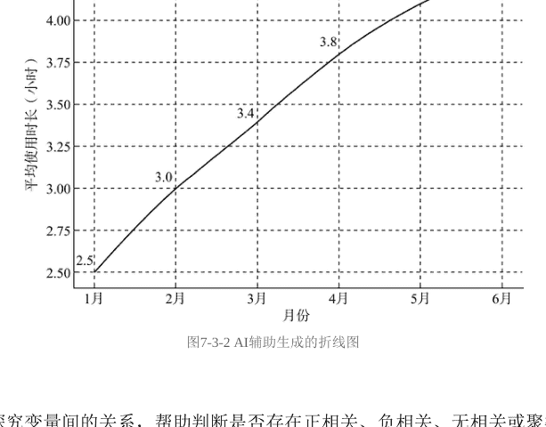

#### 三、散点图

散点图适用于探究变量间的关系，帮助判断是否存在正相关、负相关、无相关或聚类结构。以下为相关实例：

##### 例7-3-3 生成式AI工具的散点图绘制功能使用实例

在一项关于信息接触多样性与社交媒体日均使用时长的关系的研究中，原始数据如表7-3-3所示：

表7-3-3 社交媒体黏性研究数据之日均使用时长和信息接触多样性

| 受访者编号 | 日均使用时长（小时） | 信息接触多样性评分（1～10） |
| :---: | :---: | :---: |
| 1 | 3.2 | 8 |
| 2 | 1.5 | 6 |
| 3 | 4.1 | 9 |
| 4 | 2.3 | 5 |
| 5 | 3.8 | 7 |

研究者输入：

请根据以上数据生成一张散点图，用于展示社交媒体使用时长与信息接触多样性评分之间的关系。x轴为日均使用时长（单位：小时），y轴为多样性评分。请在图中添加趋势线，并区分每一个数据点，图表适用于回归分析前的可视化探查。

ChatGPT-4o的输出图如图7-3-3所示：

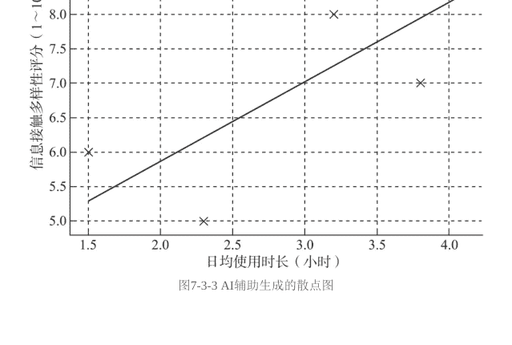

图7-3-3 AI辅助生成的散点图

#### 四、箱线图

箱线图，也称箱形图、箱须图、盒图，是社会科学数据分析中常用的分布可视化工具，可用于展示群体之间变量的集中趋势、波动性与极端值情况。以下为相关实例：

##### 例7-3-4 生成式AI工具的箱线图绘制功能使用实例

在一项关于微博、知乎、抖音、B站四个平台用户的日均使用时长比较研究中，研究者希望能够了解平台用户黏性强度的分布差异，识别高使用者集中的平台，了解是否存在异常行为模式。相关原始数据如表7-3-4所示：

表7-3-4 社交媒体黏性研究数据之多平台日均使用时长（小时）

| 受访者编号 | 微博 | 知乎 | 抖音 | B站 |
| :--- | :--- | :--- | :--- | :--- |
| 1 | 0.8 | 0.5 | 1.5 | 1.0 |
| 2 | 1.0 | 0.7 | 1.8 | 1.2 |
| 3 | 0.9 | 0.6 | 2.0 | 1.3 |
| 4 | 1.1 | 0.8 | 1.2 | 1.0 |
| 5 | 0.7 | 0.9 | 1.6 | 1.1 |

研究者输入：

请根据以上数据绘制一张箱线图，展示微博、知乎、抖音、B站平台用户日均使用时长的分布情况。每个平台绘制一组箱线，标注中位数、四分位数及异常值。该图适用于展示平台间使用习惯的差异性与稳定性。

ChatGPT-4o输出图形如图7-3-4所示：

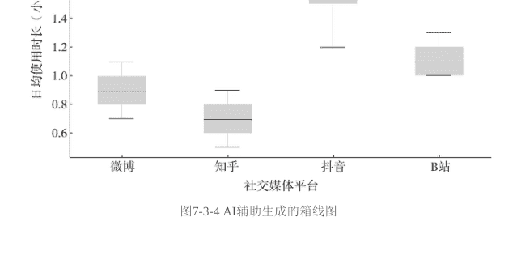

图7-3-4 AI辅助生成的箱线图

#### 五、热力图

热力图是对变量间关系进行全景分析的可视化手段，常用于变量筛选、因子分析或内容聚类前的探索性观察，能够呈现变量间所有配对关系。通过热力图，可以快速判断变量之间的强相关或负相关关系，判断是否存在影响路径或中介作用的可能性，为构建路径模型或结构方程提供可视化支持。以下为相关实例：

##### 例7-3-5 生成式AI工具的热力图绘制功能使用实例

研究者希望探索平台信任度、信息接触频率与意见极化倾向三者之间的相关性结构。表7-3-5所示为相关原始数据：

表7-3-5 社交媒体黏性研究数据之平台信任度、信息接触频率和意见极化程度的两两相关系数

| | 信任度 | 接触频率 | 极化程度 |
|---|---|---|---|
| 信任度 | 1.00 | 0.42 | -0.15 |
| 接触频率 | 0.42 | 1.00 | -0.33 |
| 极化程度 | -0.15 | -0.33 | 1.00 |

研究者输入：

请绘制一张热力图，展示以上数据中平台信任度、信息接触频率与意见极化程度三者之间的相关系数。热力图应使用蓝色到红色的色带反映负相关到正相关，图中需标注每个相关系数值，并配有图例。图表适用于论文中变量筛选与建模前的相关性可视化展示。

ChatGPT-4o输出图形如图7-3-5所示：

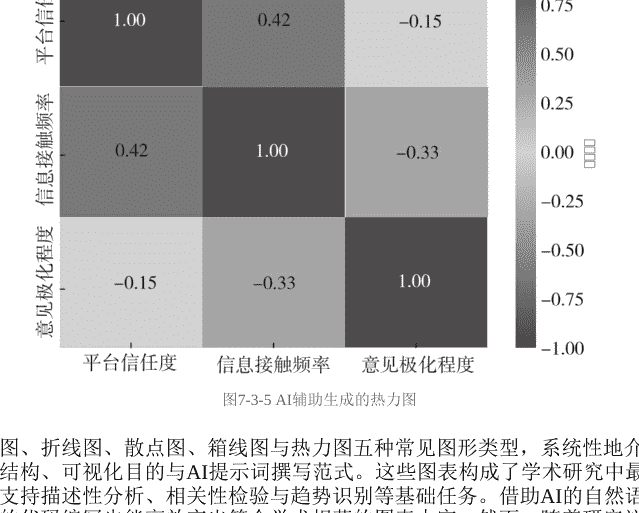

本节围绕柱状图、折线图、散点图、箱线图与热力图五种常见图形类型，系统性地介绍了其适用的研究场景、原始数据结构、可视化目的与AI提示词撰写范式。这些图表构成了学术研究中最常用的数据可视化形式，能够有效支持描述性分析、相关性检验与趋势识别等基础任务。借助AI的自然语言生成能力，研究者无须进行复杂的代码编写也能高效产出符合学术规范的图表内容。然而，随着研究议题的多样化与数据结构的复杂化，AI在图形生成方面的能力远不止于此，在实际中，研究者还可进一步探索更多的高级图形。

### 第四节 数据阐释与结果表述

在量化研究中，数据分析的目的并非止于呈现数值和图表，而是将这些统计结果转化为学术语言中的论据，以回应研究问题、验证假设，并提出理论洞见。结果阐释（interpretation）与表述撰写（articulation）不仅是研究者思想的凝结，更是其学术贡献的体现。本节将详细介绍AI工具在结果分析和撰写辅助中的三大功能：一是对数值结果的文字转述；二是对分析结果与理论建构的整合；三是适应多种学术风格的表达。以下将以中介效应、交互作用、路径分析等复杂模型结构为例，展示如何通过提示词帮助研究者生成规范、清晰且富有逻辑性的表述。

#### 一、对统计结果的文字转述

在统计分析完成之后，研究者通常需要将回归、t检验、方差分析统计结果等输出转化为符合学术规范的文字段落。这一过程并不只是简单地罗列指标数值，更涉及术语使用、语言规范、逻辑顺序与理论嵌入等多个层面。如 GPT-4o、Claude3、Gemini1.5 AI大语言模型，在自然语言处理和统计知识理解方面已经具备高度整合能力，能够依据输入的结构化数据，生成结构清晰、语言规范、术语准确的结果表述。这种从数据到语言的自动转述能力，在撰写论文的结果分析部分、整理研究简报、准备图说摘要等任务中均可发挥显著作用。以下将从两类最常见的统计——描述性统计和推断性统计的解释场景出发加以介绍。

##### 1. 描述性统计和推断性统计

描述性统计（descriptive statistic）旨在通过概括性指标和可视化工具对数据集进行系统性的描述。其主要功能包括：数据简化，如利用均值、方差等将复杂数据转化为易于理解的指标；模式识别，揭示数据中的分布规律、异常值或集中/离散趋势；推断支持，为后续推断统计等提供基础。对于离散数据来说，常通过频数分析来进行描述性统计；而对于连续数据来说，则可利用均值、中位数等集中趋势指标，方差、标准差等离散趋势指标，以及偏度、峰度等分布形态指标，结合直方图等可视化工具来理解并加以描述。

推断性统计（inferential statistic）的目的则是根据样本数据推断总体特征，即在无法对总体进行直接观测的情况下，通过对样本的分析推断总体的参数、分布或关系，并进行概率意义上的判断或决策。推断统计主要依赖于概率理论和假设检验等方法来进行推断和对推断结果的评估。其核心方法包括：参数估计，如点估计和区间估计；假设检验，如t检验、卡方检验等；相关分析，研究变量间的相关关系；回归分析，预测和发现变量间的相互依赖的定量关系；方差分析，比较两组以上样本的均值差异等。

##### 2. 对统计结果的语言转述

以下将通过实例展示如何借助AI工具实现对统计结果的语言转述：

###### 例7-4-1 生成式AI工具的统计结果转述功能使用实例1

在一项关于媒介接触对政治态度的影响的实验研究中，研究者将被试划分为两个组别：一组为近一月内频繁使用新闻类社交媒体的媒体使用组；另一组为极少接触此类媒介的非使用组。实验主要测量两组在政治兴趣评分（1～5分）上的差异。各变量均值（M）、标准差（SD）和t检验统计结果如表7-4-1所示：

表7-4-1 两组在政治兴趣评分上的差异

| | 均值（M） | 标准差（SD） |
|---|---|---|
| 媒体使用组 | 4.2 | 0.8 |
| 非使用组 | 3.6 | 1.0 |
| t检验结果 | t(198) = 3.45, p<0.001 | |

研究者输入：

请根据以上检验结果撰写一个符合社会科学期刊风格的结果描述。请保持语言规范、术语准确，变量含义如下：自变量为是否接触媒体（有/无），因变量为“政治兴趣评分”（1～5分）。请将统计显著性结果与研究假设进行语言衔接，并适度引入可能的社会心理解释，但避免绝对化语言。

ChatGPT 回答：

独立样本t检验显示，媒体使用群体的政治兴趣评分（M 使用 =4.2，SD 使用 =0.8）显著高于非使用群体（M 非使用 =3.6，SD 非使用 =1.0），该差异具有统计学意义，t（198）=3.45，p<0.001。该结果支持了研究假设，即媒介接触可能对个体政治兴趣的产生具有积极作用。这表明在信息丰富的环境中，媒介内容可能通过激发关注与参与意识，间接提升受众的政治关心程度。

量的独立预测效应。在这一过程中，标准化回归系数（β）是最主要的评价指标之一，其统计显著性构成了结果论述的核心逻辑。以下为相关使用实例：

###### 例7-4-2 生成式AI工具的统计结果转述功能使用实例2

在一项关于媒介信任度和信息接触对政治参与行为影响的量化研究中，研究者以政治参与评分为因变量，考察媒介信任度、信息多样性以及年龄对其的影响。相关统计结果如表7-4-2所示：

表7-4-2 政治参与研究的回归分析结果

| 变量 | β 值 | t 值 | p 值 |
|---|---|---|---|
| 媒介信任度 | 0.32 | 4.71 | <0.001 |
| 信息多样性 | 0.27 | 3.89 | 0.002 |
| 年龄 | -0.04 | -0.77 | 0.441 |

研究者输入：

请根据以上多元线性回归结果撰写结果描述段落。要求突出显著变量的预测作用，按标准化系数（β）大小排序呈现；对不显著变量予以说明但不夸大解释。语言规范，术语使用准确，避免绝对的因果表达，并适当联系研究假设或理论框架。

ChatGPT 回答：

多元线性回归分析显示，媒介信任度（β=0.32，t=4.71，p<0.001）在预测政治参与水平方面具有显著的正向效应。信息多样性也表现出显著的正向预测关系（β=0.27，t=3.89，p=0.002），表明接触渠道的多元化可能为政治参与行为的形成提供更多认知资源与态度激发机制。这一结果与认知动员模型的观点相契合，即政治参与行为不仅受限于动机，还取决于信息环境的开放性。相比之下，年龄变量的回归系数虽为负（β=-0.04），但未达显著水平（t=-0.77，p=0.441），说明在当前样本中，年龄对政治参与倾向的独立预测作用有限。这一发现揭示了在当代数字媒介环境中，信息相关因素可能在塑造参与意愿方面，具有比传统人口学因素更为直接的影响。

#### 二、对统计结果的理论嵌入

在学术写作中，数据分析的终点并不是发现关系，而是解释这种关系的理论意义。换言之，在结果部分不仅要描述发生了什么，更要回答这意味着什么。比如，发现能否支持假设，如何回应以往研究，以及是否揭示了新的机制或边界条件等。AI大语言模型在这一环节中展现出较强的逻辑连接能力和理论嵌入能力，能够在理解统计关系的基础上，生成符合学术逻辑的理论解释段落，帮助研究者将经验数据嵌入理论框架之中，完成从数值到意义的跃迁。

##### 1. 对于研究假设的回应

理论对话的基础是研究假设。AI可以根据假设内容、统计结果和理论背景，帮助生成表达支持或不支持的段落，并引用对应理论或以往的研究结果。以下为相关使用实例：

###### 例7-4-3 生成式AI工具对研究假设的回应功能使用实例

研究结果支持该假设，即信息接触频率与政治极化程度呈显著正相关关系（β=0.36，p<0.001）。这一发现与选择性暴露理论的观点相一致，说明高频的信息接触可能促使用户更多接触与自身立场一致的信息内容，从而加剧其原有政治偏好并提升极化程度。

##### 2. 跨理论的对照与解释

AI不仅能单一回应某一理论假设，还能帮助生成成本研究结果与前人研究的异同，便于研究者进行多理论视角的对照式解释。以下为相关使用实例：

###### 例7-4-4 生成式AI工具的对照与解释功能使用实例

研究者输入：

本研究发现：平台信任度对政治表达意愿具有正向预测作用（β=0.28，p<0.01）。请撰写一段解释段落，结合媒介依赖理论与媒介信任研究，并在下方列出所用的参考文献。

ChatGPT 回答：

根据本研究的结果，平台信任度对政治表达意愿具有显著的正向预测作用（β=0.28，p<0.01），表明受访者对平台的信任度越高，其在平台上表达政治观点的意愿越强。此发现可以通过媒介依赖理论和媒介信任研究来进行解释。

媒介依赖理论（Media Dependency Theory）认为，个体对媒介的依赖程度决定了媒介对个体社会行为的影响。信任是媒介依赖的重要维度之一。当用户信任某一平台时，他们更倾向于依赖该平台获取信息，尤其是在涉及政治议题时（Ball-Rokeach& DeFleur, 1976）。信任度越高，用户对平台的信息传递能力和公正性的认同度也随之提高，这增强了他们在该平台上参与政治讨论的意愿。

同时，媒介信任研究也指出，用户对平台的信任直接影响其信息加工过程及表达行为（Flanagin& Metzger, 2000）。对平台信任度较高的用户更可能认为该平台为传播真实和准确的信息提供了保障，从而在政治表达上更为积极。此研究进一步证实了信任对用户行为的决定性作用，并扩展了媒介信任和政治表达的关联。

参考文献：

Ball-Rokeach,S.J.,&DeFleur,M.L.(1976).A dependency model of mass-media effects. *Communication Research* ,3(1),3-21.

Flanagin,A.J.,&Metzger,M.J.(2000).Perceptions of Internet information credibility. *Journal of Mass Media Ethics* ,15(2),50-75.

##### 3. 生成机制解释与路径推断

在路径分析、结构方程或多层回归模型中，研究者不仅关注是否存在效应，还要进一步探讨为何会产生此效应。以下为相关使用实例：

###### 例7-4-5 生成式AI工具的机制解释功能使用实例

研究者输入：

本研究发现：信息多样性→政治兴趣（β=0.21，p<0.01），请结合认知刺激理论撰写解释机制段落，并在下方列出所用的参考文献。

研究中，信息多样性指的是个体在社交媒体平台或其他信息环境中接触到不同立场、来源、内容类型的政治信息。这种多元信息的输入有助于打破原有的认知定式，激发对政治话题的好奇心与探索欲，使个体更愿意进行思考、比较与判断，从而增强其对政治议题的关注与兴趣（Carpini & Keeter, 1996）。因此，在路径分析中所发现的信息多样性对政治兴趣的显著正向影响（β=0.21，p<0.01），可被理解为信息环境通过认知刺激机制间接提升了青年群体的政治参与意愿与动机（Eveland & Hively, 2009）。

参考文献：

Farmer, T.A., & Matlin, M.W. (2019). *Cognition*. John Wiley & Sons.

Carpini, M.X.D., & Keeter, S. (1996). *What Americans Know about Politics and Why It Matters*. Yale University Press.

Eveland, Jr. W.P., & Hively, M.H. (2009). Political Discussion Frequency, Network Size, and "Heterogeneity" of Discussion as Predictors of Political Knowledge and Participation. *Journal of Communication*, 59(2), 205-224. https://doi.org/10.1111/j.1460-2466.2009.01412.x.

#### 三、不同风格的多语体表达

随着科研成果传播渠道的多样化，不同类型的研究产出，如期刊论文、项目申报书、教学材料、政策简报、新闻报道等，对结果表达的风格、语调和可理解性提出了不同的要求。目前，AI已具备了较为出色的语体识别与风格迁移能力，能够根据用户指令或上下文，自主调整结果呈现的语气、结构、用词风格，生成多语体版本的段落。以下为相关使用实例：

##### 例7-4-6 生成式AI工具的多语体表达功能使用实例

在一项关于媒介接触频率对政治兴趣的影响的研究中，回归分析结果表明，媒介接触频率对政治兴趣具有显著影响（β=0.29，p<0.001）。据此，研究者可以根据需求选择合适的输出风格。不同的风格标签可以指导AI输出不同写作场景下的文字内容。表7-4-3为不同的风格类型和ChatGPT的输出内容汇总：

表7-4-3 AI在不同写作语境下的输出内容

| 风格类型 | 输出段落（由 ChatGPT 生成） |
| :--- | :--- |
| 学术论文 | 媒介接触频率显著预测了政治兴趣（β=0.29, p<0.001），该结果支持信息使用频率在政治态度形成中所发挥的关键作用。这一发现与政治社会化研究中的媒介效应路径模型相一致 |
| 课程教案 | 大家可以看到，数据显示接触媒体越多的人，对政治越感兴趣，这两个变量之间的关系非常显著。说明媒介参与可能提升人们对公共事务的关注度 |
| 政策建议 | 研究表明，提升公众媒介接触频率可能是一种增强政治兴趣的有效干预方式。建议相关部门在青年媒体素养教育中，系统引导多元信息接触行为的养成 |
| 社交媒体摘要 | 你每天刷多久社交平台？研究显示：刷得越多，越关心政治！#信息社会 #政治兴趣 |
| 科研项目申请书 | 本课题组在前期研究中发现，媒介接触频率对政治兴趣存在显著正向预测（β=0.29, p<0.001），为后续构建“媒介接触—政治认知—参与行为”模型提供了重要基础 |

从上表可以看出，AI不仅可以在词汇和句式上进行调整，更能够根据上下文任务，主动重构段落结构、调整因果语气、控制句长和信息密度。这种风格适应能力对于多任务型研究者极具价值。研究者若想实现高质量的语体迁移输出，需要掌握以下两个关键操作方式：

- 1. 明确风格目标+场景信息

提示词示例：

> “请将以下统计结果撰写为学术论文风格段落，用于硕士毕业论文中的结果解释部分。强调理论支持与实证一致性。”

或：

> “请将以下回归分析结果用教学讲义风格写一段文字，要求语言通俗、可用于传播学硕士研究生专业课程的课堂讲解。”

这一方式要求用户为AI提供明确的输出目标与使用场景，只有这样，AI才能自动调整专业术语、语气强度和语言可读性。

##### 2. 引入语境线索触发风格联动

若提示词较为模糊，还可在输入中加入上下文线索。例如：

- “这是给大学本科生写的讲义内容……”
- “本文为一份政策咨询简报……”
- “此为项目申请书中研究意义一节……”

AI会据此自动调取对应语料风格，实现对学术风格、行政风格、口语化风格等的迁移与嵌套控制。

#### 四、复杂模型与高级推论

在实际研究中，单一的相关性检验与回归分析往往已无法满足理论解释的复杂要求。为了更深入地揭示变量之间的因果路径与机制逻辑，研究者往往会采用中介模型、调节模型等复杂理论模型，以及结构方程模型（SEM）等高阶方法，不仅拓展了理论建构的深度，也对结果解释与语言表达提出了更高要求。本部分将聚焦复杂模型下的结果生成逻辑与语言表述方式，介绍AI如何帮助研究者完成中介效应、调节效应、交互效应、路径建模等结构性模型的自动转述任务。

##### 1. 中介效应表达

中介效应（mediation effect）是指一个自变量X对因变量Y的影响是通过一个中间变量M间接实现的。以下为借助AI工具进行中介效应表达的相关使用实例：

###### 例7-4-7 生成式AI工具的中介效应表达功能使用实例

表7-4-4所示为一项政治参与行为研究中的模型设定和统计结果：

表7-4-4 政治参与行为研究的中介模型统计结果

| 路径 | 变量间关系 | β 值 | 显著性 |
| :--- | :--- | :--- | :--- |
| X → M | 信息多样性→政治兴趣 | 0.40 | p < 0.001 |
| M → Y | 政治兴趣→政治参与 | 0.35 | p < 0.001 |
| X → Y | 信息多样性→政治参与（直接路径） | 不显著 | p = 0.221 |

研究者输入：

分析以下中介模型：信息多样性（X）→政治兴趣（M）→政治参与（Y）。路径系数：X→M=0.40，M→Y=0.35，X→Y不显著（p=0.221）。判断其中介类型、解释机制，并说明理论意义。

ChatGPT 回答：

路径分析结果显示，信息多样性对政治参与的影响主要通过政治兴趣这一中介变量实现。具体而言，信息多样性对政治兴趣的影响显著（β=0.40，p<0.001），而政治兴趣对参与度也具有显著预测力（β=0.35，p<0.001）。X→Y的直接路径未达到显著水平，表明政治兴趣在信息接触与政治参与之间构成完全中介。这一结构揭示了认知动因在媒介接触与参与行为之间的重要机制作用，验证了认知—行为路径中的间接效应假设。

##### 2. 调节效应表达

调节效应（moderation effect）指的是第三个变量W对自变量X和因变量Y之间关系强度的影响，即“当……时，X对Y的影响更强/更弱……”。具体来说，W会改变X与Y之间的关系或因果效应的方向、大小等。以下为相关使用实例：

###### 例7-4-8 生成式AI工具的调节效应表达功能使用实例

表7-4-5所示为一项政治极化研究中的模型设定和统计结果：

表7-4-5 政治参与行为研究的调节模型统计结果

| 路径关系 | β 值 | 显著性 |
| :--- | :--- | :--- |
| 主效应（媒介使用→政治极化） | 0.22 | p < 0.01 |
| 调节项（性别） | -0.15 | p < 0.05 |

研究者输入：

根据回归分析结果：媒介使用显著正向影响政治极化（β=0.22，p<0.01），但性别起负向调节作用（β=-0.15，p<0.05），解释调节效应的含义，并说明在不同性别条件下，媒介使用对政治极化的影响差异。

ChatGPT 回答：

多元回归结果显示，媒介使用显著正向预测政治极化（β=0.22，p<0.01）。同时，调节项性别的回归系数显著（β=-0.15，p<0.05），说明性别对媒介使用与极化之间的关系发挥了调节作用。进一步分析表明，该关系在男性群体中更为显著，而在女性群体中影响较弱，提示了媒介效应存在性别差异的边界条件。

当研究中包含交互项时，AI还可通过配合代码绘制斜率图或调节效应图，为结果解释提供可视化支持。此类图表可在论文中清晰展示调节变量对关系强度的影响方向。以下为相关使用实例：

###### 例7-4-9 生成式AI工具的交互效应可视化功能使用实例

研究者输入：

请生成一张调节效应图，展示媒介使用对政治极化的预测在不同性别下的差异。X轴为媒介使用，Y轴为极化评分，分别绘制男性与女性的斜率线，标注图例并添加标题。

ChatGPT输出图形如图7-4-1所示：

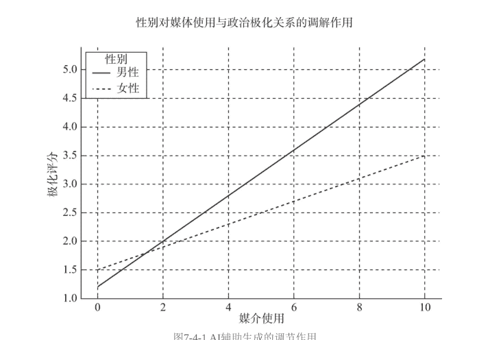

上图展示了性别对媒介使用与政治极化之间的关系发挥的调节效应：随着媒介使用程度的上升，男性群体的政治极化评分上升更快，斜率更大，说明媒介使用对男性的极化倾向影响更大；而女性的斜率较小，说明影响相对较小。

##### 3. 路径分析与结构方程

在结构方程模型或路径分析（path analysis）中，研究者往往需要同时报告多个变量之间的路径关系与模型拟合指标。AI可根据输入路径结构与拟合度指标（如CFI、RMSEA等），自动输出完整段落。以下为相关使用实例：

###### 例7-4-10 生成式AI工具的路径分析功能使用实例

以下为一项研究中的研究模型设定和统计结果：

- 结构路径：
  - 信息接触→媒介信任度（β=0.38，p<0.001）
  - 媒介信任度→政治极化（β=0.41，p<0.001）
  - 信息接触→政治极化（β=0.17，p<0.05）
- 模型拟合指标：
  - CFI=0.96, RMSEA=0.042, SRMR=0.038

研究者输入：

基于以上结构方程模型生成专业分析段落：1）结构路径：信息接触→媒介信任度（β=0.38），媒介信任度→政治极化（β=0.41），信息接触→政治极化（β=0.17）；2）模型拟合：CFI=0.96，RMSEA=0.042，SRMR=0.038。要求包含：模型拟合评价（参照常用标准），直接/间接效应解读，中介作用机制说明，理论意义阐释等。

ChatGPT 回答：

结构方程模型分析结果显示，整体模型拟合良好（CFI=0.96，RMSEA=0.042，SRMR=0.038），符合通行标准。路径系数结果表明，信息接触不仅直接影响政治极化（β=0.17，p<0.05），还通过媒介信任度间接作用于极化态度。其中，信息接触对媒介信任度的影响显著（β=0.38，p<0.001），媒介信任度进而正向预测政治极化（β=0.41，p<0.001）。该结构揭示了媒介变量在政治态度生成过程中的中介作用。

### 本章小结

本章详细展示了AI在数据分析与可视化中的多重功能，特别是在数据预处理、模型构建与图表生成等方面的应用。AI不仅能够帮助研究者处理繁琐的技术细节，如数据清洗、变量转换、标准化处理等，还提供了智能化的建模和可视化工具，大大提高了数据分析和结果的表达效果。通过智能化的辅助，研究者可以将更多精力集中于数据的逻辑分析和理论推导，减轻技术障碍带来的负担。当然，尽管AI在数据分析中能够解放人力，但研究者的专业判断和理论阐释能力仍是不可替代的。只有AI工具的使用与研究者自身的学术能力相结合，才能更好地推动研究的创新与深入。

# 第八章 投稿与发表

### 本章介绍

学术研究成果的发表是科研工作价值的重要体现，也是研究者融入学术共同体的主要途径，但当前的投稿环境和流程具有越来越高的复杂性与挑战性。本章将介绍如何借助AI工具提升学术论文投稿与发表环节的工作效率，说明AI在智能匹配目标期刊与会议，辅助撰写投稿文件，以及协助分析审稿意见并起草回复等方面的具体应用方法。同时，本章也将深入分析AI工具在这些应用场景下潜在的局限性、风险及重要的伦理考量，旨在帮助研究者在利用AI工具时，能够审慎行事，负责任地维护自身学术诚信，遵守学术规范。

### 第一节 借助AI精准匹配目标期刊

对于学术研究者而言，要使研究成果真正获得同行认可，还有赖于论文投稿和发表流程的顺利完成。在这一过程中，期刊选择在很大程度上决定了投稿的成功率。选对期刊，既可以提高审稿通过率，又能扩大研究的影响力；选错期刊，则可能陷入反复退稿，浪费时间和增加心理成本的窘境。在传统学术环境下，研究者往往依赖经验、人脉、领域口碑，或Web of Science、Scopus等检索平台进行期刊筛选。这种方式虽然有效，但对入门者而言仍有较高门槛。AI大语言模型，尤其是GPT-4o、DeepSeek-R1、Claude 3 和 Gemini 1.5等成熟模型的兴起和普及，使得期刊匹配这一流程具备了智能化、个性化和语言交互化的新特点。本节将系统介绍如何借助AI完成从论文信息提取、期刊智能匹配、投稿要求解析，到投稿策略优化的全流程操作。

#### 一、智能期刊推荐

不同于依赖关键词或所属学科的传统方法，AI工具能够通过更深度的语义理解和复杂的算法，综合分析论文的文本内容，如标题、摘要、引言、方法、结论，并结合其训练数据中包含的学术知识图谱，如期刊信息、学科分类、研究热点、引用关系等，从而实现更为精准和个性化的期刊推荐。这种智能推荐不仅考虑论文的主题词，更能理解研究问题的性质、所采用的具体方法、理论框架以及潜在的贡献类型，进而匹配那些在研究范畴、方法论偏好甚至理论取向上更为契合的期刊。以下为智能期刊推荐的使用实例：

##### 例8-1-1 生成式AI工具的智能期刊推荐功能使用实例

以下为一篇关于社交媒体对青年政治态度影响的定量研究学术论文摘要：

> 【摘要】本研究聚焦社交媒体平台中的算法推荐机制对青年用户政治态度形成的影响。基于对456名青年用户的在线问卷调查数据，通过多元线性回归和中介效应分析，检验了社交媒体使用频率、平台信任度与政治极化倾向之间的关系。结果显示，社交媒体平台信任度在算法推荐暴露与青年政治极化倾向之间起到了显著的中介作用。研究发现对于理解数字时代的政治信息传播和青年政治行为具有理论和实践意义。

研究者输入：

请根据以下研究主题和摘要，为我推荐五本适合投稿的SSCI传播学或政治学交叉领域的期刊。我的文章类型是定量实证研究。对于每本推荐期刊，请提供以下信息：1）期刊名称和官方网站链接（如果可以）；2）最新的影响因子（请注明年份或来源，如果已知）；3）大致的审稿周期和接收率（请注明信息来源或估计值）；4）该期刊近期发表的与我主题相关的代表性论文标题（如果可能）。

ChatGPT-4o 回答：

以下是五本非常适合您以“社交媒体算法推荐对青年政治态度影响”为主题的定量实证研究投稿的SSCI传播学与政治学交叉领域的期刊推荐。这些期刊都强调方法严谨性，并欢迎青年学者的投稿：

##### 1. Political Communication

官网链接：https://www.tandfonline.com/journals/upcp20

影响因子：6.8（2023年，Clarivate JCR）

审稿周期与接收率：平均审稿周期为8～12周；接收率为15%～20%（经验数据）

适配理由：本期刊聚焦传播技术与政治行为交叉领域，是社交媒体与政治极化、算法影响等议题的核心发表平台。特别偏好实证研究。

青年友好性：曾多次发表青年学者的博士论文成果，倡导高质量方法论，常组织青年学者研讨专刊。

##### 2. New Media & Society

官网链接：https://journals.sagepub.com/home/nms

影响因子：6.4（2023年）

审稿周期与接收率：平均审稿时间为3～4个月；接收率为10%～15%

适配理由：本期刊重点研究数字技术、算法推荐、青年数字文化和政治表达等主题，您的研究内容高度契合。

青年友好性：鼓励多样化方法，量化研究占据重要位置；为早期研究者设立“Editor's Choice”项目。

##### 3. Journal of Computer-Mediated Communication (JCMC)

官网链接：https://academic.oup.com/jcmc

影响因子：5.9（2023年）

审稿周期与接收率：审稿周期较短，通常为8～10周；接收率约20%

适配理由：本期刊擅长发表基于社交平台数据、算法机制、极化等的实证研究，尤其适合结构方程建模、回归分析等定量模型。

青年友好性：官方明确鼓励博士生与青年研究者投稿，强调透明的数据与方法。

##### 4. Information, Communication & Society

官网链接：https://www.tandfonline.com/journals/rics20

影响因子：5.5（2023年）

审稿周期与接收率：审稿周期为3～6个月；接收率约为15%

适配理由：本期刊专注于技术对社会结构与政治动态的影响，尤以社交媒体、政治传播为重点，近年多聚焦青年极化研究。

青年友好性：强调理论与方法的结合，曾专设“青年研究议题”专号，对实证量化研究十分友好。

##### 5. Social Media + Society

官网链接：https://journals.sagepub.com/home/sms

影响因子：3.9（2023年，Clarivate）

审稿周期与接收率：平均审稿时间为6～8周；接收率中等（经验估计约25%）

适配理由：本期刊明确关注社交媒体平台机制与社会影响，包括青年用户行为、算法推荐、极化等，是新兴热门期刊。

青年友好性：鼓励方法多样性，接受使用SPSS、R语言、Python等工具的量化实证研究，并支持开放数据与开放代码。

#### 二、局限性与注意事项

在使用AI进行期刊或会议推荐时，研究者应清醒认识到其局限性。首先是数据时效性问题。AI模型依赖其训练数据，关于期刊影响因子、审稿周期、接收率等都可能快速变化，AI提供的信息可能不够及时或不准确。其次是信息来源不透明。由于算法存在一定的随机性和不可解释性，AI的具体推荐依据往往是一个黑箱，用户难以完全理解推荐逻辑。最重要的是，AI推荐的结果只能作为初步参考，无法替代人工核实。研究者必须亲自访问期刊官网，查阅最新的期刊宗旨和范围（Aims & Scope）、投稿须知、索引情况、版面费、截稿日期等详细信息，才能做出最终决定。

### 第二节 借助AI识别相关学术会议

除了专业期刊，学术会议也是发布研究成果、获取早期反馈和进行学术交流的重要平台，尤其是对于处于早期阶段或进展中的研究来说。尽管目前专门用于会议推荐的通用AI工具相对较少，但部分数据库或出版商平台已开始整合AI推荐功能。例如，IEEE Publication Recommender（https://publication-recommender.ieee.org/home）就是一个同时覆盖IEEE旗下期刊和会议的智能推荐工具。用户输入论文摘要或关键词后，工具会推荐相关的IEEE期刊和即将召开的会议。图8-2-1展示了IEEE Publication Recommender的示例界面。

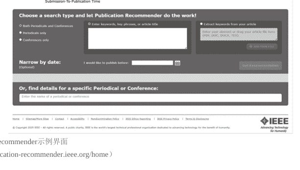

（图片来源：https://publication-recommender.ieee.org/home）

虽然通用AI模型在会议推荐方面的数据覆盖和推荐精度可能不如期刊，但它们仍能根据研究主题，结合互联网上的信息，提供潜在的会议线索。用户可以尝试通过提示词，让AI搜索特定领域、特定时间和地点的相关学术会议，但这往往仍需要后续人工筛选和核实。

### 第三节 借助AI处理投稿及回应评审

在选定目标期刊后，研究者还需要准备一系列投稿材料，其中投稿信（cover letter）是与期刊编辑正式沟通的第一道桥梁。而在稿件经历同行评审被返回后，如何专业、有效地回应审稿人的意见，撰写翔实的返修回复信（rebuttal letter），也是决定稿件最终命运的关键环节。AI在这些文书准备工作中也能提供一定的辅助，但其局限性和伦理风险同样不容忽视。

#### 一、AI辅助撰写投稿信

投稿信是研究者与期刊编辑的首次正式沟通，其目的是简洁有力地介绍论文、突出其核心价值与创新性，并说明该研究为何适合在该期刊发表。一封优秀的投稿信能给编辑留下良好的第一印象，从而提高稿件送审的概率。撰写投稿信肩负着多重任务：向期刊编辑正式介绍稿件；清晰阐述研究的核心发现及其重要性；有力论证该研究为何特别适合在本期刊发表，即是否与期刊的宗旨、范围和读者群高度契合；并可能包含一些必要声明，如伦理合规、利益冲突等。撰写一封优秀的投稿信需要作者具备良好的沟通技巧，对期刊的深入了解以及清晰的逻辑表达能力。

AI大语言模型可以为研究者在撰写投稿信的多个环节提供辅助。例如，它们可以根据投稿信的标准格式快速生成一个通用框架；可以基于用户提供的论文摘要、关键词、目标期刊信息等，起草投稿信的初步内容草稿；可以帮助检查并优化语言表达，使其更专业、正式和流畅；还可以尝试将论文的关键点与期刊的关注方向联系起来，帮助论证适配性。为了让AI生成更有用的初稿，需要提供清晰、具体的指令，以下为相关提示词示例：

> “请扮演一位向《[期刊名称]》投稿的学术作者。根据以下信息，为稿件《[稿件标题]》撰写一封约300字的投稿信初稿，语气须专业。摘要如下：[粘贴摘要]。请在信中强调研究发现（[简述核心发现]）与该期刊关注的[期刊范围]方向高度相关。突出研究的新颖性（[简述新颖之处]）以及对[目标读者]的潜在影响。”

> “请使用以下简历中的相关经验信息（[粘贴相关经验]）和《[期刊名称]》的期刊介绍（[粘贴期刊宗旨范围]），为稿件《[稿件标题]》起草投稿信的开篇段落。要求能引起编辑注意，并清晰陈述研究的主要贡献。”

> “请将以下投稿信段落改写得更自信，并清晰阐述我的研究对于《[期刊名称]》读者的重要性：[粘贴待修改段落]。”

必须反复强调的是，尽管AI能提供便利，但在使用其辅助撰写投稿信时必须高度警惕其局限性。AI生成的投稿信初稿往往缺乏个性化和深度，可能显得过于通用和模板化，难以真正传达作者对研究的热情、对期刊的深刻理解以及研究工作的独特性。它也无法代替研究者进行真正的批判性思考，来论证研究与期刊定位的深层契合度，或是提供具体的个人经历、逸事或成就来支撑论点。更严重的是，AI可能误解输入信息或期刊要求，甚至捏造事实，例如过度吹嘘研究成果的重要性。因此对AI生成的投稿信必须反复进行通读、人工修改。

#### 二、AI辅助回应审稿意见

同行评审是学术出版的核心环节，而撰写返修回复信来回应审稿人的意见，是决定稿件修改后能够被最终接受的关键一步。这个过程通常充满了挑战，研究者既要虚心接受合理批评，又要有力辩护研究的价值，还需要在不同审稿人之间可能相互矛盾的意见中找到平衡点。撰写回复信要求研究者仔细理解每一条审稿意见的实质；对合理的批评进行承认，并说明如何在稿件中进行了修改；对不认同的意见或误解进行清晰、有理有据的辩驳；保持专业、礼貌和建设性的沟通态度；最终说服编辑，稿件在经过修改后已经达到了发表标准。这需要投入大量时间和精力，并具备良好的学术沟通能力。

理论上，AI工具可在以下方面为研究者提供帮助：

##### 2.构建回复结构

AI可以根据逐点回应的原则，生成回复信的基本框架或模板。

##### 3.起草初步回复

对于一些相对直接、事实性较强的审稿意见，如要求补充某个细节、澄清某个术语、修正某个笔误，AI或能直接生成初步的回复草稿。

##### 4.润色语言与语气

AI可以帮助作者调整回复的语言，确保其措辞专业、礼貌、客观，即使在表达不同意见时也能保持建设性的口吻。

##### 5.生成反驳论点

某些AI工具声称能生成反驳性的论点，但这在回复审稿意见的场景下风险极高，因为AI缺乏对研究细节和学术背景的深入理解，其生成的反驳性论点很可能是无效甚至错误的。

此外，在考虑使用AI辅助撰写回复信时，严重违反保密性（confidentiality breach）是最核心的伦理红线。将包含未经公开的审稿人意见，或是修改中的稿件上传到公开的、第三方的AI工具，尤其是ChatGPT这样的通用模型中，是对同行评审保密原则的严重侵犯，并且极有可能违反期刊的明确规定。这些数据可能被用于AI模型的训练，甚至可能被泄露，危及研究的知识产权和发表优先权。虽然存在本地部署或机构内部的安全AI模型可能性，但许多期刊和资助机构（如NIH、NSF）的政策仍是完全禁止审稿人或作者将评审材料输入任何AI工具的[1]。

因此，对于涉及同行评审材料的处理，强烈建议研究者采取极度谨慎的态度。在绝大多数情况下，应避免将审稿意见和稿件内容直接输入第三方通用AI工具中进行处理，要优先采用人工处理。审稿意见的回应是一个高度依赖研究者自身对研究的理解、学术判断力和沟通能力的环节，应以作者亲自完成为主。即使使用，也仅限于那些基础性的、不涉及核心内容的辅助功能，例如仅使用AI进行回复信的语言润色或语法检查，或者要求AI生成一个通用的回复信模板框架，而绝不能将审稿意见内容直接输入AI以求生成具体回复。最重要的是，研究者还必须了解并遵守期刊和出版商关于AI使用的具体政策，对此已在前面章节进行详细介绍，不再赘述。

### 本章小结

本章探讨了AI工具在学术论文投稿与发表过程中的潜在应用，涵盖了从智能匹配目标期刊和会议、辅助撰写投稿信，到协助回应同行评审意见等多个环节。AI凭借其强大的文本理解和生成能力，可以在信息筛选、草稿起草和语言润色等方面提供便利，有望提高效率，特别是对于缺乏经验的研究者具有一定的辅助价值。然而，本章也深入分析了AI在这些应用中所固有的显著局限性、潜在风险以及重要的伦理挑战，包括但不限于AI提供信息的数据时效性和准确性问题，算法的黑箱特性，研究者过度依赖导致判断力下降，以及最为关键的——将未发表的保密信息输入第三方AI工具所带来的严重保密违反和伦理违规风险。因此，AI在学术投稿与发表中只能扮演辅助角色，研究者必须始终保持独立的主体身份，对AI生成或推荐的所有内容进行严格的审查和核实，在涉及审稿意见等机密信息时，更应极度谨慎，避免做出任何可能泄露敏感机密信息的行为。

[1] AI in Peer Review: A Recipe for Disaster or Success?[EB/OL]. https://asm.org/articles/2024/november/ai-peer-review-recipe-disaster-success.

# 第三部分 AI辅助学术写作进阶

在学术写作的智能化转型浪潮中，AI技术正从通用工具演化为深度适配研究者需求的专属伙伴。本部分将系统剖析AI写作技术的前沿发展：第九章通过构建个性化知识库与动态学习框架，揭示如何使AI助手成为真正理解研究者思维模式与学术风格的“数字分身”；第十章聚焦跨学科研究这一知识生产的战略高地，解析如何借助AI破解术语鸿沟、方法冲突和叙事适配等核心难题，搭建起连接不同学科范式的智能桥梁；第十一章则直面通用人工智能体（AI Agent）带来的范式变革，在技术狂飙中锚定人类研究者的主体坐标，从学术素养重构到人机责任边界，勾勒出人智与机智协同进化的未来图景。这三个章节层层递进，既呈现了AI重塑学术写作的技术肌理，又揭示了数智时代知识生产者的认知升级路径。

# 第九章 个性化的AI写作助手

### 本章介绍

本章将主要探讨如何通过智能化技术打造个性化的AI学术写作助手，以提升学术写作的效率与质量。首先是通过搭建个性化化学术知识库，允许研究者存储和管理与研究相关的文献、数据和写作素材，确保写作过程中的信息调用精准和高效。其次是通过写作画像分析和建立语言风格模型，深入分析和学习研究者的学术写作目的、习惯和偏好等，为个性化写作提供有力的支持。最后还探讨了如何建立长期学习与记忆机制，通过结合外挂数据库等方式，使得学术助手能够持续学习和更新。

### 第一节 搭建个性化的学术知识库

在AI工具日益成为科研工作和学术写作助手的背景下，搭建研究者个人的个性化化学术知识库成了提升AI写作助手有效性的重要基础。其重要性源于学术研究的多样性和研究者需求的差异性，需要同时平衡效率、伦理与普适性。

#### 一、个性化化学术知识库的概念与特征

个性化化学术知识库，指的是以研究者个体为中心，围绕其研究兴趣、知识结构和写作需求，动态整合并结构化其所掌握的学术信息资源的知识管理系统。它不仅是一个信息储存空间，更是一个具备语义理解、逻辑关联和智能推荐能力的个性化化学术语境引擎。个性化化学术知识库之所以能在AI辅助写作中发挥关键作用，核心就在于其高度契合研究者个人需求的结构与功能设计。它区别于通用型知识平台，具有内容相关性高、语义结构清晰、可智能调用、动态可进化四大核心特点。

首先，内容高度相关是其最本质的特征。个性化化学术知识库的构建围绕研究者所处的研究领域、具体方向和个人兴趣展开，不仅收录其阅读过的文献、笔记和写作成果，还聚焦其经常引用的理论框架、研究方法与术语体系。这种以用户为中心的信息组织方式，确保了知识库内容的精度与实用性，使AI在进行文本生成时能够获取最具相关性的背景知识。

其次，个性化化学术知识库具有语义结构清晰的特征。语义结构清晰使得知识库不仅是信息的堆叠，更是逻辑清晰的知识系统。通过关键词提取、主题聚类、引用路径分析等技术，知识库可以构建起完整的知识图谱，揭示各个概念之间的关联、演变与应用场景。这种结构化的信息组织便于AI理解学术脉络，也能帮助研究者更高效地检索和复用已有内容。

再次，可供AI调用是其智能化特征的体现。在与AI助手深度集成后，个性化知识库不仅能为生成式写作提供上下文补充，还能实时激发灵感、推荐文献、识别逻辑断点。它成为AI学术写作能力个性定制化的基础，使AI在撰写引言、综述或结论时更具逻辑统一性与学术风格一致性。

最后，动态可进化确保了知识库的长期活力与适应性。随着研究者阅读的新资料、完成的新项目的不断加入，系统可以自动进行内容标注、结构调整与主题优化，实现知识库的持续演进。它不仅记录已有资料，更为未知信息留下生长空间，形成与研究者共同进化的智能写作生态。

#### 二、个性化化学术知识库的搭建路径和关键步骤

##### 1. 个性化化学术知识库的搭建路径

目前，要搭建个人知识库有两种主要的解决方案：

一种是微调已有的大语言模型。这种方案通过在已有的大语言模型，如GPT系列、DeepSeek R1等的基础上进行微调，结合研究者的个人研究资料、文献库和笔记等数据，使得模型能够更加精准地生成符合其学术领域需求的内容。

微调大模型的优点包括：（1）定制性强，通过微调，可以将已有的LLM根据用户的特定研究领域、写作风格和知识结构进行优化，使其生成的学术内容更加贴合个人需求；（2）高效生成，微调后的模型能够直接生成高质量的学术写作内容，无须频繁依赖外部数据库，能够快速响应需求，提供相关理论、分析和总结；（3）独立性强，经过微调的模型不依赖外部知识库，可以在没有网络连接的情况下完成学术写作任务，增强了灵活性和可操作性。

但是微调大模型对技术能力的要求高，需要一定的深度学习和自然语言处理技术，涉及大量计算资源和数据准备，普通研究者较难独立完成。另外，微调模型的维护比较困难，随着学术领域的更新和变化，微调后的模型可能需要定期更新和再训练，以确保其内容的时效性和准确性，这增加了维护成本。此外还有数据隐私问题，在微调过程中，研究者的私有数据可能涉及敏感信息，这需要对数据的安全性和隐私保护有更高的要求。

另一种方案则是结合大模型与外挂知识库。这种方法将大语言模型与外部的知识库结合使用，通常是通过API接口等方式，使大模型可以访问研究者的个人知识库，如文献管理工具、数据库等，并在写作时通过查询知识库提供相关信息。

外挂知识库具有：（1）灵活性高的优势，外挂知识库可以随时更新和扩展，确保AI助手能够获取到最新的学术资源和研究成果，不必担心随着时间推移而失去相关性；（2）技术门槛低的优势，相比于微调大模型，结合外挂知识库的方案技术门槛较低，用户可以通过现有的文献管理工具或API接口轻松实现知识库的集成，适合没有深厚技术背景的用户；（3）信息精准的优势，外挂知识库可以提供有针对性的信息检索功能，帮助AI获取更精确的领域知识和数据，避免生成内容时产生知识误差或偏差。

但是外挂知识库在很大程度上依赖于外部资源，因此在没有网络或资源不可用时，AI助手的功能会受到限制，且可能面临访问权限或数据版权问题。其集成复杂度，将大模型与外部知识库进行有效集成可能需要一定的技术支持，尤其是在保证数据同步、精确检索和高效调用时，可能会增加实现难度。响应速度受限，每次生成内容时，AI需要从知识库中提取数据，这可能导致响应时间变长，尤其在面对庞大的数据库时，性能可能会受到影响。

总体来说，这两种方案各有优劣，研究者可以根据自身的技术能力、资源状况和对学术写作的个性化需求来加以选择。以下将以外挂知识库为例，介绍搭建个性化学术知识库的关键步骤。

##### 2. 搭建个性化学术知识库的关键步骤

利用外挂知识库搭建个性化学术知识库包括本地部署、API调用、使用一站式工具三种方式。以下以DeepSeek为例，介绍其各自的特点和优缺点（见表9-1-1）。

表9-1-1 利用外挂知识库搭建个性化学术知识库的三种方式 [1]

| 方式 | 优点 | 缺点 | 适用场景 |
| :--- | :--- | :--- | :--- |
| 本地部署 DeepSeek+ 知识库 | 无须联网；数据隐私性强；完全免费 | 对配置有一定要求；无法使用 DeepSeek-R1 满血版 | 数据隐私性要求较高的科研项目 |
| API 调用 DeepSeek+ 知识库 | 可以使用 DeepSeek-R1 满血版；使用便捷；可用大模型较多 | 需要消耗 Tokens，会产生一定费用；仅支持上传本地文件 | 预算充足的科研项目 |
| DeepSeek+ 知识库一站式工具 | 使用简单；支持 DeepSeek-R1 满血版；一键共享知识库 | PC 端仅支持上传本地文件；存在数据隐私风险 | 适合无技术支持的学术新人 |

本地部署DeepSeek搭建知识库，需要用到Ollama和Anything LLM，具体做法可参考相关网络教程 [2]。而一站式工具的使用更为简便，使用一些网络免费平台可以一键式创建个人知识库，不需要多种工具搭配使用，就可以直接对话DeepSeek-R1满血版。调用API的做法相对较为复杂，以下将对此进行更为具体的介绍。

通过API调用搭建个性化化学术知识库的关键步骤包括：收集与整理学术资源、数据结构化和语义处理、集成数据库与AI工具。

###### （1）收集与整理研究者的个人学术资源

文献不仅是学术研究的基础，也是AI学术助手生成相关内容的核心资源。在构建个性化化学术知识库的过程中，文献收集与整理是第一步，也是至关重要的一步。

在资料来源上，可以广泛使用CNKI、Web of Science、Google Scholar等权威数据库批量下载核心文献，也可以关注ResearchGate等学术社交平台和期刊推荐，捕捉前沿动态，还可以收集会议论文、项目报告、学位论文、预印本等灰色文献，丰富资料维度。

在管理工具上，可以使用 Zotero、EndNote、Mendeley 等文献管理软件，对资料进行主题分类、标签标注；按研究问题、方法、时间等维度建立目录结构；补充作者、年份、DOI、摘要、关键词等元数据，为后续结构化打好基础。

再是分类与标注。文献收集完成后，如何有效地整理这些文献是确保知识库有用性的关键。文献管理工具通常支持文献的分类、标注、标签化等功能：

- 标签化：通过为每篇文献添加标签，如关键词、学科领域、研究方法等，可以为后续知识库构建提供更有条理的结构。例如，对于一篇关于机器学习的文章，可以标注“机器学习”“算法”“神经网络”等标签，帮助AI根据关键词快速定位相关文献。
- 分类与分组：文献管理工具支持按学科、主题或研究方向对文献进行分类，这样AI可以更快速地识别和引用某一特定领域的文献，提高生成内容的精准度。
- 笔记与注释：在阅读文献时，研究者可以直接在文献中添加个人笔记或注释，记下关键观点、重要实验数据或自己的思考，这些笔记为后续学术写作提供了有价值的素材。

其后是同步与备份。随着时间的推移，研究者会不断收集更多文献，因此需要确保文献库的同步与备份，以防数据丢失或设备故障。大多数文献管理工具提供云同步功能，用户可以将文献库上传到云端，实现多设备同步，使得在不同地点或设备上都可以访问到最新的文献资源。还可以同步至Obsidian、Notion等知识管理平台，进行可视化连接与二次思考。

最后是自动化的文献引用与生成。一旦文献收集完成，文献管理工具通常还提供自动化的引用功能。通过与文字处理软件的集成，研究者可以轻松插入引用，自动生成参考文献列表。

###### （2）数据结构化和语义处理

这一步骤是为了将文献资源从人类阅读的文本转化为AI可理解的结构化数据，并通过语义处理提升其可调用性和上下文相关性，可借助自然语言处理工具完成。

首先是文本结构化处理。可以使用如Grobid等工具，自动将PDF转为结构化XML，提取文献标题、作者、摘要、引用等；用正则表达式或Python脚本识别论文的标准结构，如“导语—方法—结果（Introduction-Method-Results）”等；抽取文献中的引用信息，建立引用网络，增强知识的关联性。

其次是关键词与主题建模。可以采用KeyBERT、YAKE等关键词抽取工具，自动识别每篇文献的核心概念；采用LDA主题建模，提取知识库中存在的主线研究方向，辅助分类；建立概念词典与术语统一表，减少歧义，提高语义一致性。

最后是语义增强与向量化。可以利用Sentence-BERT等Embedding技术将文献片段转为向量，用于语义检索；使用NER（命名实体识别）标注人名、机构、模型、变量等关键信息；使用文本摘要算法，如T5、BART等生成简短文献概要，提高检索效率。

###### （3）集成数据库与AI工具

当数据资源已完成结构化和语义处理，最后一步是将其集成至数据库系统，并打通与AI写作工具的调用接口，从而实现AI助手语境感知、语义理解、个性响应的目标。

首先是构建本地或云端数据库。可将结构化文献数据存入如SQLite、Pinecone、Weaviate、FAISS等嵌入式或向量数据库；配置数据库索引，如关键词、时间、引用网络等，支持快速检索；还可将文献内容分段存储，如按论文结构分块，方便AI按需调用。

其次是外挂至DeepSeek、ChatGPT等AI工具。可使用Lang-Chain、LlamaIndex等开源框架，连接本地知识库与大语言模型；将文献片段转为向量嵌入，并通过语义匹配实现“提问—召回—生成”的流程；设置检索增强生成（Retrieval Augmented Generation，RAG）架构，让AI在回答时引用知识库内容，提高上下文贴合度。

最后是自动同步与更新机制。可定期抓取RSS、数据库API，更新知识库内容；利用脚本或AutoGPT等Agent自动分类、向量更新、内容清洗，实现动态维护；可配合任务型Agent设定写作助手、摘要生成器、论文推荐系统等具体的应用场景。

### 第二节 建立写作画像和语言风格模型

#### 一、学术写作画像和语言风格模型概述

##### 1. 学术写作画像的定义和分析维度

写作画像与语言风格模型是构建个性化AI学术助手的重要组成部分。用户画像（persona）是在产品设计、市场营销等相关领域中被广泛使用的一个术语，指的是通过抽象化用户特征并分析相应的数据形成高度凝练的标签 [1]。这里的写作画像指的是基于研究者以往的写作内容所提炼出的写作习惯、学术领域、常用术语、关注主题与表达偏好等多维度特征画像，它能够帮助AI理解研究者在写什么，以及是怎么写的。

在学术写作领域，对学术写作画像的确立可以重点围绕三个核心维度展开（见图9-2-1）。

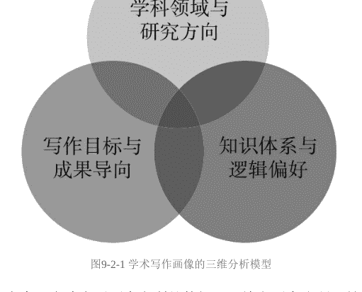

（1）学科领域与研究方向。它决定了研究者所处的知识语境和研究议题，是AIGC的主题基础，通过准确识别研究者所在的学科，以及经常研究的议题、方法和术语等，有助于实现专业上的匹配。

（2）知识体系与逻辑偏好。它体现了研究者常用的理论框架、引用文献、逻辑推理方式、方法论等，不仅会影响到写作内容的深度与广度，也决定了文献调取和论证模式的个性化配置。

（3）写作目标与成果导向。它明确了研究者写作的目标输出类型，例如是面向中文期刊还是英文期刊，是硕博士毕业论文还是政策报告，是追求学术理论性还是实践实用性，从而可以引导AI工具在写作风格、结构布局与表达策略上进行精细调整。

##### 2. 学术语言风格的主要类型

语言风格（language style）也叫言语风格，是在主客观因素制约下运用语言表达手段的诸特点综合表现出来的言语格调和气氛（程祥徽、黎运汉，1994）[3]。而这里的语言风格则是对研究者在句式结构、语气语调、词汇使用、逻辑表达等方面风格的捕捉和总结，目的是让AI工具输出的内容更贴近研究者自身的表达风格。通过建立这一模型，AI可以更精准地辅助撰写论文、生成符合语境的段落，并实现个性化写作的高阶定制。

按照上述三个写作画像维度，即学科领域与研究方向、知识体系与逻辑偏好、写作目标与成果导向，还可以将学术语言风格大致划分为几种不同类型。这种分类方式比传统上依据对语言风格的主观印象的分类更具结构性，也更利于对个性化AI工具的调用。

（1）理论建构型。这类风格以构建理论体系为核心，常见于哲学、社会学、文化研究等领域。这类风格在语言上更倾向使用抽象名词、高阶逻辑结构与复合句式，强调概念之间的内在关联，例如，“本研究尝试从某某视角对某某理论进行再阐释”。这种风格在写作中保持高密度抽象表达，并较为频繁地使用如范式、话语、意义结构等关键词。

（2）实证分析型。这一语言风格广泛分布于管理学、教育学与心理学领域，突出逻辑严密、结构规范，常用中性、客观的语言陈述研究过程。其标准语句模板如“本研究采用某某方法，数据来自某某样本”“结果显示……具有统计显著性”等，强调因果分析与方法透明。

（3）政策应用型。该风格注重现实问题导向和对策生成，在法学、传播学、公共管理中尤为常见。语言须简明有力、结论导向，常使用“应当”“建议”“亟须”类词语。此类写作风格更多使用结构紧凑的段落，突出问题诊断、对策逻辑与政策价值。

（4）技术呈现型。多见于计算机、工程、医学等技术密集型学科，强调实验步骤、系统结构与性能评估，语言高度规范，术语精准，常用被动语态与流程式表达。在写作时应突出操作步骤、系统指标、图表说明和结论精度。

#### 二、学术语言风格模型的构建

##### 1. 学术语言风格模型建构的通用方法

无论研究者的学术写作画像标签为何，偏好的风格类型为何，在建立AI辅助下的学术写作语言风格模型时都有一些通用的方法：

（1）语言风格采样

构建语言风格模型的第一步是对已有文本进行采样分析。研究者可以提供有代表性的写作样本，如已发表论文、开题报告、写作片段等，通过NLP工具，如文本嵌入、语法分析、词频统计等提取语言特征，如常用句式结构、关键词使用频率、句长分布、被动/主动语态倾向、学术连接词等。研究者可使用如spaCy、BERT、TextRazor等工具进行风格剖析，并据此形成写作语感画像。这一步是个性化建模的语言基础，决定后续AI生成能否贴合真实风格。

以下为一些典型的提示词：

> “请分析以下文本的写作风格，包括语体、句式、用词特点和语气倾向，并总结成五条风格特征。”

> “以下是我的学术论文片段，请提取其中常见的句式结构和关键词，以便构建语言风格模型。”

（2）写作偏好记录

在使用AI助手的过程中，应持续记录研究者的写作行为与修订偏好，包括研究者保留/删除哪些AI生成的内容；是偏好简洁句还是复合句；喜欢先说结果还是先引入铺垫；等等。这种行为数据的记录可通过写作插件、智能编辑器，如Notion AI、Zotero插件配合DeepSeek或ChatGPT API来实现。将这些反馈信息结构化后，可作为微习惯数据融入语言模型中，实现写作风格的动态学习和精细化匹配。

以下为一些典型的提示词：

> “请根据我对下列AIGC的修改，判断我更偏好哪种表达方式，并更新我的写作偏好画像。”

> “请记录以下写作中我删除或保留的内容，推测我的用语习惯和表达倾向。”

###### （3）语用微调机制

DeepSeek、ChatGPT等通用大模型虽然能力强，但往往风格平均化，不符合研究者个人的表达习惯。此时，可引入轻量微调机制，如LoRA、PEFT，或如前所述使用RAG框架将个人语料外挂作为上下文，进行语用级微调。例如，将研究者的若干篇论文作为few-shot训练材料，引导AI学会研究者常用的表达逻辑和术语选择。这种本地语境融合的方案既节省计算成本，又提升风格拟合度，是个性化AI助手开发的核心手段。

以下为一些典型的提示词：

> “请参考以下五篇我过往的研究论文风格，用于指导AI后续写作输出与此保持风格一致。”

> “请将以下生成内容调整为更贴近[学术语气/特定期刊风格/我以往使用习惯]的表达方式。”

###### （4）个性化句式库与表达习惯积累

通过长期使用，研究者可以积累一系列高频表达模板，如固定启发句、经典过渡句、常用引文句式等，构建属于自己的句式库与表达模组。这些素材可以存储在结构化模板中，供AI调用，比如“导入理论背景的常用写法”“提出研究问题的句型”以及“总结建议的语气控制方式”。研究者也可以手动添加或编辑，使其持续优化，成为写作过程中的语言辅助动力。

以下为一些典型的提示词：

> “请将我在过去文章中常用的过渡句、总结句、研究设计引入语句收集成我的个性化句式库。”

> “我喜欢在引出研究问题时使用‘然而，已有研究仍存在不足’这类表达，请将类似句式加入我的表达模板中。”

##### 2. 学术语言风格模型建构的基本流程

上述方法在实际运用中可以采用以下流程（见图9-2-2）：

（1）用户数据输入。接受用户上传的论文PDF、写作片段、反馈修改痕迹等；使用OCR/文本解析器（如pdfminer、PyMuPDF）提取纯文本内容。

（2）自然语言特征分析。使用spaCy、BERT、GloVe等对文本进行句法、词汇、结构分析，提取风格维度，如句式长度、动词密度、语气、语态等。

（3）写作偏好追踪。与写作界面如Word插件、Notion或Zotero等进行联动，实时记录用户的改写、删除、重写等行为，标注反馈以便于更新偏好数据库。

（4）风格微调或语境适配。选择LoRA/RAG微调方案，输入用户语料+模型输出对比结果，实现样式拟合的模型修正或上下文引导生成。

（5）建立个性化句式库。用户可手动编辑与分类存储，或与AI协同调用，按写作任务插入高频句式。

### 第三节 长期学习与记忆机制支持下的持续个性化

#### 一、AI的长期学习和记忆能力缺陷与突破

AI的长期学习和记忆机制（Long-term Learning and Memory Mechanism）是指AI系统如何在持续交互中不断积累用户的行为数据、语言偏好、任务反馈等信息，使后续响应更加符合用户的个性化需求，以及记住用户在过去使用过程中提供的内容，例如典型写作风格、术语使用、研究兴趣、项目进度等，在后续对话或任务中主动调用这些信息，实现上下文的一致性与个性延续。

尽管大语言模型的生成能力出众，但有一个关键的局限性是缺乏长期记忆，这在需要持续互动的情况下尤其明显。AI的长期记忆对于保持上下文连贯、确保有意义的交互和随着时间的推移了解用户行为至关重要，大模型缺乏长期记忆会阻碍其性能和用户体验。AI缺乏长期记忆的原因主要有以下几个方面：

首先是架构设计限制。传统的神经网络模型，如Transformer和GPT系列主要依赖固定长度的上下文窗口进行计算。这意味着模型只能记住当前输入的短期信息，无法存储和调用历史交互内容，从而缺乏长期记忆功能。

其次是灾难性遗忘。大多数AI模型在训练过程中存在“灾难性遗忘”的问题，即新知识的加入会覆盖或丢弃已有的知识。尤其是在增量学习过程中，AI模型难以有效地保留历史信息，而是倾向于更新现有的知识。

再次是内存管理机制欠缺。传统的AI系统通常不具备有效的记忆管理机制，缺乏动态更新和存储能力。这导致它们不能灵活地调整记忆内容，无法根据上下文变化进行记忆的增删改查。

最后是计算资源限制。长期记忆需要大量存储和计算资源，尤其是当涉及多轮对话或长时间的数据积累时。许多AI模型由于硬件或算法的限制，无法有效地支持长期记忆的处理和调用。

不过，目前已经有不少研究团队正在积极尝试建立具有长期语义记忆功能的架构（如Kynoch等人，2023）[2]，或者通过外挂外部数据库或记忆体来实现对用户历史交互和个性数据的持续调用（如Zhong等人，2024）[3]。

在实践方面也已有相关突破。例如，OpenAI宣布从2025年4月11日开始，ChatGPT的长期记忆功能“Memory”将向除欧洲经济区（EEA）、英国、瑞士、挪威、冰岛和列支敦士登之外地区的所有ChatGPT Plus和Pro用户推出。长期记忆功能可以帮助ChatGPT实现跨对话框记忆，让AI更像一个智能管家，通过长期对话了解用户的特点和偏好，进而对用户做出个性化回答[4]。据称OpenAI可能采用了类似检索增强生成（RAG）技术来实现长期记忆功能，使AI在生成回答时，能够参考之前所保存的相关信息，从而生成具有连贯性的回答[5]。

#### 二、AI助手长期学习与记忆的实现与注意事项

对于研究者来说，要使AI助手实现长期学习与记忆的能力，以更好地辅助持续性的科研工作和学术写作，最易实现的路径就是采用ChatGPT Plus或Pro等具有长期记忆的AI工具及其记忆服务。不过这些服务通常以付费形式出现，因此需要研究者具有一定的科研经费作为支撑。此外，研究者也可以通过外挂数据库的方式实现AI助手的长期学习和记忆能力，其主要的实现方式和操作过程与前述的个性化化学术知识库搭建较为相似，因此不再赘述。

在利用外挂数据库实现AI助手的长期学习和记忆功能时，研究者需要注意：

1. 数据安全与隐私保护问题
   首先是保护自身学术数据的隐私性。学术写作和研究往往涉及敏感数据或未公开的研究成果，研究者需要确保所使用的外挂数据库符合隐私保护和数据安全标准，如加密存储和传输机制。其次是确保合规性。遵守相关的法律法规，确保所有数据的收集、存储、使用和分享都符合要求，特别是在处理个人信息和研究数据时。

2. 数据质量和有效性问题
   一是确保数据准确性。外挂数据库中的数据必须保证高质量，避免过时、不相关或错误的文献和研究资料干扰学术写作和决策。二是定期更新和清理。随着时间的推移，新的研究成果和理论不断出现。研究者需要定期清理数据库中无效、冗余的资料，并更新相关信息，保持数据库的最新性和有效性。

3. 个性化与持续优化问题
   建立自我反馈机制，研究者应定期评估数据库的内容和AI写作助手的表现，根据自己的学术需求调整数据库内容或进行个性化优化。坚持实时更新和学习，随着研究的深入，数据库中的资料应随着研究者的进展进行实时更新。

4. 性能与资源消耗问题
   在资源管理上，随着外挂数据库存储的数据量不断增长，系统的资源消耗，如存储空间、计算能力等会增加。研究者需要确保数据库的管理能够有效控制资源使用，避免性能瓶颈。在成本控制方面，外挂数据库通常需要支付一定的服务费用，特别是在使用云服务时，研究者需要控制好数据库的规模和使用频率，确保不会超出预算。

### 本章小结

综上所述，通过搭建个性化化学术知识库，建立写作画像和语言风格模型，以及引入长期学习与记忆机制，能够打造研究者个人专属的个性化学术写作助手，显著提升学术写作效率和质量。然而，研究者在使用这些技术时，务必保持谨慎和理性，确保数据库中的资料质量和隐私安全，避免过度依赖AI的建议，始终保持学术思考的独立性。随着AI技术的飞速发展，研究者也应及时关注相关工具的更新和改进，确保AI学术写作助手始终保持高效、灵活和可持续的辅助能力。

[1] Wang, X. (2014). Personas in the user interface design. *University of Calgary*, Alberta, Canada.

[2] Kynoch, B., Latapie, H., & van der Sluis, D. (2023). RecallM: An Adaptable Memory Mechanism with Temporal Understanding for Large Language Models. *arXiv preprint arXiv*: 2307.02738.

[3] Zhong, W., Guo, L., Gao, Q., et al. (2024). Memory-Bank: Enhancing Large Language Models with Long-Term Memory. *Proceedings of the AAAI Conference on Artificial Intelligence*, 38(17), 19724-19731.

[1] 本表参考https://zhuanlan.zhihu.com/p/24436054065，由笔者修改制作。
[2] 如知乎相关教程：https://zhuanlan.zhihu.com/p/24436054065。
[3] 程祥徽，黎运汉.语言风格论集[M].南京：南京大学出版社，1994：78。
[4] AI管家要来了？ChatGPT推出长记忆功能[EB/OL].https://news.sina.com.cn/s/2025-04-11/doc-inesuhhc2752394.shtml.
[5] OpenAI ChatGPT记忆功能怎么实现？[EB/OL].https://zhuanlan.zhihu.com/p/682269637.

# 第十章 AI辅助下的跨学科学术写作

### 本章介绍

本章将主要探讨AI在跨学科学术写作中的应用及其赋能潜力。在第一节中，首先分析了跨学科研究的内涵，并指出跨学科研究日益成为解决复杂问题的重要途径，并可借助AI工具的智能化手段解决其中存在的各类难题。第二节深入分析了AI如何在跨学科认知协调方面提供支持，包括统一各学科术语、探索理论融合、消弭方法分歧以及消除学术协作障碍等。第三节则关注AI如何在跨学科写作中提升智能适配能力，以帮助跨学科研究满足不同读者群体的需求，突破传统学科分类带来的制度性壁垒。

### 第一节 AI赋能跨学科学术写作

#### 一、跨学科研究的内涵与发展趋势

跨学科（interdisciplinary）是建立在学科概念之上的一个复合概念。跨学科的出现在很长一段时期里代表了人类对世界的认识走向了一个专业化和系统化的过程，这是人类知识文明进步的象征。但是，正如福柯（Foucault, 1972）所说的，学科的组织不仅是认知行为（epistemological activity），更是政治行为（political activity），是权力和制度的产物 [1]。19世纪民族国家兴起后，各国都建立了教育部、科学院等研究机构，并通过学科目录等来实现对知识生产的标准化管理，学科的界限和相互独立性由此逐渐明晰并被确立了下来。这在一定程度上也固化了知识生产的方式，使学科成为限制问题理解的阻碍。随着时代的发展和知识生产模式的转变，对于学科边界跨越（boundary crossing）的需求日益强烈 [1]。

1972年，经济合作与发展组织（OECD）教育研究与创新中心首次明确提出跨学科的定义：“跨学科是两门或以上不同学科之间的相互联系，从思想的简单交流到较大领域内教育与研究的概念、方法、程序、认识论、术语以及组织之间的相互联系。”[2] 这一定义至今仍被广泛沿用。目前对跨学科的理解主要有知识论和组织论两种视角，即跨学科既是一个以既有知识体系结构为参照的复合型存在，也是一种新的知识组织形态、协同合作机制及组织发展战略 [2]。吉本斯等人（1994）提出了知识生产的新模式，认为知识生产方式将从以学科本位、认知驱动等为特征的传统模式，转向以应用情境驱动、跨学科、异质性和组织多样性等为特征的新模式（模式2）。他们指出，为了解决复杂问题，需要整合来自不同学科甚至非学科来源的理论视角和实践方法，这不仅仅是多学科合作，更是可能在解决问题的过程中形成新的、临时的认知框架，不一定导向新的稳定学科 [3]。

跨学科作为一种全球化的趋势，在世界各国都得到了广泛的实践探索，并取得了一些实质性进展。世界顶尖高校均在跨学科建设方面实现了推进。很多大学通过设立跨学科学院、跨学科研究中心、跨学科学习中心、跨学科实验室、跨学科研究院等将跨学科教学、科研和社会服务等加以整合。2024年11月，2025首届泰晤士高等教育跨学科科学排名（THE Interdisciplinary Science Rankings）被推出。在前十名中，美国高校独占七席，麻省理工学院和斯坦福大学分别列第一、第二位，排名第三的则是新加坡国立大学，我国的香港大学和复旦大学分别是第十三位和第十六位 [3]。

不少国家对跨学科教学和科研的投入也出现大幅增加，甚至将跨学科建设问题上升到国家发展战略的高度来看待。例如，我国2025年的《政府工作报告》明确提出，要“完善学科设置调整机制和人才培养模式”[4]。2020年11月，国家自然科学基金委员会成立了交叉科学部 [5]。2021年1月，国务院学位委员会、教育部印发通知，新设置“交叉学科”门类作为我国第14个学科门类，“集成电路科学与工程”和“国家安全学”作为下设一级学科 [6]。广受关注的中国科学院、工程院两院院士增选在近年来也向新兴和交叉学科倾斜，如《2023年度中国科学院院士增选指南》中给出了详细的名额分配方案，且每个学部都为包括信息科学与技术的数理基础、医工融合等在内的新兴交叉学科领域，留出一个名额 [7]。

《自然》杂志的一篇文章表明，自20世纪80年代中期以来，研究论文不仅在参考文献中越来越多地引用其他学科论文，以“跨学科”为标题的论文数量本身也出现了明显的增长趋势 [4]。笔者以“跨学科”为关键词，利用中国知网指数检索功能搜索了该领域的研究。从图10-1-1中可以发现，相关外文文献在2010年后数量明显增多，但在2020年左右出现一定回落；而中文文献自2000年以后数量稳步上升，并在2022年左右急剧增加，反超外文文献数量。这些数据也在一定程度上说明跨学科研究热度的变化轨迹和区域分化情况。

#### 二、跨学科学术写作的难点与AI赋能

然而，即便高校等科研机构和政府越来越重视跨学科的发展，跨学科研究者们仍然面临着巨大的生存和发展障碍。Berks等人（2024）通过分析15万名以上的生物医学领域研究人员的学术发表轨迹，发现一个残酷的现实——从事跨学科研究的青年研究者在职业生涯早期，会比专攻单一领域的人更有可能以停止学术发表的形式，提早结束学术生命。因为在学术圈“不发表就出局（publish or perish）”的现实环境下，以单一学科为基础的传统学术结构会阻碍青年跨学科研究者的早期发展 [5]。这也说明跨学科研究者或面临着更大的学术产出困境，跨学科学术写作显然也是其中的障碍之一。

##### 1. 跨学科学术写作难点

与传统的单一学科研究相比，跨学科的学术写作或面临更多的难点：

- （1）概念与术语不统一。不同学科往往有各自特定的术语体系和概念框架，同一个词在不同领域中可能含义不同，或者相同的概念表达方式完全不同。这会导致跨学科写作中的语义混淆、沟通障碍，影响读者的理解和论文的学术严谨性。
- （2）理论基础难以融合。由于学科化知识体系的长期发展，自然科学、社会科学和人文艺术等不同学科各自都拥有独立发展的理论体系。跨学科写作须在多个理论之间建立桥梁，要求研究者不仅要熟悉不同领域的理论，还须具备将其进行逻辑整合的能力。若整合不当，容易导致理论拼贴而非真正的理论建构，降低学术成果的理论价值。
- （3）方法论存在差异。自然科学与社会科学在样本选择、数据处理、因果推理等方面均存在较大差异。在跨学科研究中如何协调定量与定性、实证与思辨性研究方法，是写作时必须解决的问题，尤其当采用混合研究方法时在研究设计和结果呈现上将更为复杂。
- （4）作者间协作障碍。跨学科研究常常都是团队合作，不同学科成员在语言风格、逻辑思维、写作习惯上的差异，也容易造成沟通障碍，进而影响论文写作效率和质量。
- （5）传播对象不一。跨学科研究论文的读者群体内部可能存在更强的多样性。一篇跨学科学术论文要兼顾多个学科读者群体的阅读习惯，在语言风格和结构安排上就必须特别小心平衡，否则可能难以符合目标读者的特定学科语言风格期待。
- （6）制度壁垒高企。在仍以传统学科分类为主体的学术发表环境下，跨学科学术论文在投稿时常面临夹缝式的困境。由于评审专家的背景不一，可能会导致评价标准不一致的情况。或者由于无法找到知识背景完全符合评审需要的专家，可能使论文的交叉价值难以被完全理解和接受。

##### 2. AI工具的跨学科写作赋能

上述难点在本质上是不同知识生产主体之间的协作生产和跨界流通问题。其中，术语不统一、理论难融合、方法论差异以及作者间协作难属于知识生产端问题，是由不同学科的知识生产者之间缺乏统一的生产工具导致的，从研究思路和方法上对齐不同学科之间的认知框架是解决这些问题的核心关键。而读者的多样性以及期刊投稿和评审上的困难则是知识消费端的问题，挑战既来自学术市场的制度壁垒，也来自生产端对于消费者需求理解的偏差。制度壁垒或有赖于外部学术环境的进一步优化来加以解决，而理解偏差则可以从生产端入手，由研究者自身在知识传播层面上加以解决。

AI的赋能价值不在于替代人类思考，而在于搭建跨学科协同的底层基础设施，通过差异化的赋能策略为上述两类问题提供辅助性的解决方案：

（1）从知识生产端增强认知协同
知识生产端的核心矛盾在于学科间认知框架的不可通约性。AI工具首先可以帮助构建起认知对接系统，通过知识图谱技术，将分散的学科术语编织成动态语义网络，例如自动识别“弹性”等概念在物理学和经济学中的内涵差异。其次，基于深度学习的理论接口发现工具，能揭示跨学科理论的内在关联，如“社会网络分析”与“图论”之间的关系。再次，多模态学习方法则充当方法论之间的桥梁，例如，将质性访谈数据自动编码为量化模型可处理的数据。最后，针对研究者之间的协作障碍，AI协同平台可以实时监测团队成员之间的概念使用偏差，如当工程师讨论“算法优化”而伦理学家关注“价值优化”时，系统会自动提示术语歧义，并为此提供协商框架。

（2）在知识消费端提升智能适配
研究者个体要解决知识消费端的问题可以先从知识传播的效率和成本优化方面入手。AI可通过语言风格重构与多版本文本生成功能，帮助研究者将同一研究成果以不同学科可接受的表述方式呈现，提升不同类型读者的理解与接受度。AI还可辅助识别目标期刊在不同学科下的选题偏好与写作规范，智能推荐符合要求的期刊类型，并生成定制化投稿文案与格式转换，大幅降低因学科分类僵化所带来的制度性发表壁垒，从而提升跨学科成果的可见度与发表成功率。

AI工具在这两类问题上的赋能可以形成互补效应，知识生产端的认知协同能够确保研究的内在严谨性，知识消费端的智能适配能够提升成果的外在可推广性。这种分层解决方案，既尊重了学科本体的差异性，又打通了知识流动的管道，将有助于推动跨学科研究从艰难妥协走向流畅对话。表10-1-1为跨学科学术写作面临的主要问题以及AI工具的辅助性解决方案汇总。

**表10-1-1 跨学科写作难点及AI赋能方案**

| 主要难点 | AI工具赋能方案 |
| :--- | :--- |
| **知识生产端** | |
| 术语不统一 | 知识图谱技术促进学科间知识系统对接 |
| 理论难融合 | 深度学习揭示学科间的理论关联 |
| 方法差异性 | 多模态学习方法嫁接学科间方法论体系 |
| 作者协作难 | 协同平台提供学科间协商框架 |
| **知识消费端** | |
| 读者多样性 | 语言风格重构与多版本文本生成降低学科间知识传播成本 |
| 制度壁垒高 | 投稿辅助系统帮助规避发表上的学科制度壁垒 |

### 第二节 AI辅助下的跨学科认知协调增强

#### 一、基于术语对接学科间知识系统

由于科学技术的发展和国际科学技术交流的活跃，术语的标准化和规范化的重要性日益突出。术语（term）是表达一定专业知识领域概念的词或词组。术语与普通词的根本区别在于术语具有称名与定义的功能。术语总是与专业概念的命名分不开，这就决定了术语最主要的特点是语义上的单义性和运用上的系统性。单义性是指术语有着固定的内涵和外延，表示特定的概念，指向特定的对象，具有比普通词语更精确、更稳定的意义。系统性是指术语在运用上要受所属学科或行业体系的制约，即在言语组合中必须遵从一定的规范，术语的系统性只有在术语场内才能得到实现，超越这个场，就会失去系统性特征[8]。

然而在跨学科研究中，同一个术语在不同学科中往往指代不同概念。比如“模型”（model）一词在数学、计算机科学、社会科学中的含义差异较大。这种术语的多义化打破了其原有的单义性，造成跨学科交流中的歧义和误读。同时，术语的系统性依赖于其所在的学科体系和知识结构，而在跨学科环境下，术语脱离原有的语义场，难以保持其原有的使用规范。研究者往往将某学科内的术语代入另一个学科的语境，导致使用方式不一致，造成理解偏差或逻辑混乱。目前，由于术语使用不规范在跨学科研究中造成的主要问题包括：

##### 1. 术语标准不统一，缺乏共享的术语体系

不同学科有不同的术语规范与标准，尚未建立起统一或兼容的术语库，尤其是一些新兴交叉领域尚处于术语构建初期，导致研究者在合作或写作过程中难以对齐语言标准，缺乏共通的概念语言。

针对这一问题，AI工具可以通过自然语言处理与知识图谱构建技术，自动识别多学科文献中相似或等价的术语，并建立语义映射关系，辅助构建统一或可互操作的跨学科术语体系。同时，还可以利用语言模型对术语上下文进行语义聚类，生成跨学科术语解释数据库，实现术语的对齐与标准化。此外，AI还可作为术语桥梁，在跨学科写作中提供术语转换建议与多版本定义支持，提升术语理解与使用的一致性，从而减少因术语标准缺失导致的沟通障碍。

##### 2. 术语滥用和“伪跨学科”现象较为普遍

部分研究者在跨学科研究中机械套用其他学科术语或引入术语装饰观点，却未能深入理解其背后的理论背景，导致术语空转或误用，形成学术表达的伪装性，降低了跨学科研究的质量。

针对这一问题，AI工具可通过语义识别与上下文分析技术辅助研究者精准理解术语含义，避免空泛引用或错用。AI大语言模型可结合学科语境对术语使用进行语义校验，判断其是否真正嵌入目标学科逻辑。利用知识图谱与引用链分析，AI工具还能识别术语是否建立在该领域的真实研究基础上，协助筛查伪装式跨学科表达。此外，AI工具还可以提供跨学科写作模板与术语使用建议，引导研究者在内容逻辑、方法论和表达方式上实现真正的跨学科融合，而非仅借用术语进行形式上的拼贴。表10-2-1为不同场景下的提示词示例：

表10-2-1 术语标准化和术语体系构建的提示词示例

| 应用场景 | 提示词示例 |
| :--- | :--- |
| 文献分析 | “请提取以下学科文献中的关键术语及其定义”<br>“请对比 A 学科和 B 学科中关于 [ 术语 ] 的不同含义”<br>“请从这组文献中提取语义相近但术语不同的术语对” |
| 知识图谱与术语映射 | “请基于以下术语列表构建一个语义映射关系网络，展示不同术语间的关联性”<br>“请为 [ 术语 ] 在不同学科中的语义构建知识图谱”<br>“请帮我生成一套跨学科通用术语表，涵盖 A 和 B 两个领域” |
| 术语标准化建议 | “请判断以下术语中是否存在语义重复或标准不一致的问题，并给出优化建议”<br>“请将以下术语进行分类整理，并推荐每类中最适合作为通用术语的版本” |

#### 二、开拓学科间理论融合路径

根据Dubin（1978）的观点，一个完整的理论必须包含四个组成部分：要素（what），即理论所涉及的要素、构念、概念；关系（how），即要素之间的关系是什么；逻辑（why），即支撑变量选择与关系假设的深层机制，如心理学原理、社会动力学等；边界（who/when/where），即理论所适用的人群、时间范围与情境 [61]。Whetten（1989）指出，学术研究的理论贡献不是简单地增添新的变量，而最富成效，也是最困难的理论发展应该是来自逻辑重塑，这通常涉及从其他领域借用不同视角，从而对现有理论的基本原理形成挑战 [7]。可以说，跨学科研究是最容易产生突破性的理论贡献的学术富矿之一，但是要完成不同学科领域之间的理论借用或融合并不容易。

理论融合是指在跨学科研究中，将来自不同学科的理论、框架、概念和方法进行有机整合的过程。理论融合不仅是学科间的知识共享和相互借鉴，更是在学科边界之间架起理解和应用的桥梁。目前跨学科理论融合的难点包括：

##### 1. 理论范式冲突

不同学科的基本假设和认知框架可能存在根本性分歧。以经济学和心理学为例，经济学中的理性人假设认为人类在决策时能够做到完全理性，选择最优化的方案。然而，心理学中的有限理性理论却认为人类在决策时受到认知限制和情感因素的影响，无法做到完全理性，因此常常做出次优选择。两者在决策的基本假设上存在本质冲突，这使得在尝试将这两种理论结合时，难以找到一个统一的框架。这种范式冲突不仅局限于经济学和心理学，还广泛存在于其他学科之间。因此，如何在尊重学科差异的基础上找到共通点，构建一个融合不同理论的框架，是跨学科研究中的一大挑战。

AI工具可以通过模型对比、数据整合和多维度推理等方法帮助解决这一问题。AI可以分析不同学科的理论框架、基本假设和核心观点，进行自动化对比，帮助研究者识别不同学科间的冲突点和共性。AI可以通过机器学习和深度学习技术，创建综合多学科理论的混合模型，自动处理不同假设下的推理过程。这种方法能够在保持各学科独特性的基础上，提出潜在的融合路径。AI还可以帮助构建一个自适应的跨学科框架，支持不同理论的动态融合。例如，通过对大量跨学科数据的分析，AI可以推测出哪些理论元素可以协同工作，从而帮助学者在理论整合过程中避免不必要的冲突。

##### 2. 解释层级错位

包括宏观、微观层级的割裂和长期、短期视角的时间尺度差异。不同学科通常关注不同层级和时间跨度的问题。例如，社会学可能更侧重于宏观层面的结构性问题，如社会制度和阶层分化，而心理学则更关注个体的行为与认知过程。在时间尺度上，经济学研究可能侧重于短期市场反应，而生态学则关注长期的环境变化。这些差异导致了学科间在分析和解释问题时，往往难以在同一层级和视角下进行有效对接，阻碍了跨学科理论的融合。

对此，首先AI能够处理和整合来自不同学科的数据和模型，通过多层次、多尺度的建模方法，帮助宏观和微观层面的因素进行有效的结合。其次，AI可以通过模拟和预测，克服时间尺度差异，提供跨时间尺度的分析框架。例如，AI可以建立多维度时间序列分析模型，融合长期和短期的研究视角，提供更加综合的研究结论。最后，AI还可以通过知识图谱和语义网络，帮助跨学科领域发现潜在的联系，促进不同层级和时间尺度的统一视角。表10-2-2为不同场景下的提示词示例：

表10-2-2 推动跨学科理论融合的提示词示例

| 应用场景 | 提示词示例 |
| :--- | :--- |
| 理论范式冲突 | “对比 A 学科与 B 学科中关于 [ 问题 / 理论 ] 的理论框架，识别两者的主要冲突和潜在共性” |
| | “检测 A 学科与 B 学科中关于 [ 问题 / 理论 ] 的假设冲突，提供解决方案” |
| | “构建一个结合 A 学科 [ 理论 ] 和 B 学科 [ 理论 ] 的跨学科融合模型，分析两者的共同理论基础” |
| 解释层级错位 | “构建一个结合长期与短期视角的跨学科理论模型，分析 [ 变量 ] 和 [ 变量 ] 的长期与短期影响” |
| | “将 A 学科与 B 学科的 [ 数据 ] 进行整合，提出如何在一个统一的框架内进行解释” |
| | “构建一个分析框架，能够从不同学科收集的数据中提取宏观和微观层面的信息并进行整合” |

#### 三、推动消弭方法论分歧

不同学科采用的研究方法存在显著差异。例如，社会科学通常依赖质性研究，通过访谈、案例研究等方式探讨深层次的社会现象，而自然科学则倾向于采用量化方法，进行精确的实验控制和数据分析。数据标准不一致也常常导致方法论的冲突。例如，社会科学中的案例研究强调对特定情境的深度理解和解释，往往不追求样本的广泛性和可重复性，而自然科学则要求实验的结果具有高可重复性和数据的普适性。不同的标准和方法导致了学科间在研究过程中很难统一方法论框架，进而影响跨学科研究的有效性。

AI工具可以通过以下方式提供支持：首先，AI可以通过跨学科数据融合技术，将定量数据和定性数据进行有效整合，利用自然语言处理技术将质性数据转化为可以量化分析的形式，从而实现不同学科的方法整合。其次，AI可以提供自动化的数据验证工具，帮助解决数据标准不一致的问题。通过算法对数据进行质量检测、可重复性分析等，确保数据在不同学科标准下的适用性。最后，AI可以通过自适应学习模型，根据不同学科的需求调整研究方法，实现量化与质性、实验与田野调查等方法的兼容和协同。关于这一点已在混合方法研究部分做过类似介绍，不再赘述。

#### 四、辅助扫清作者间的协作障碍

作者间的协作是学术研究中的常态，在跨学科研究中尤其需要不同学科背景作者间的协力合作。但是在跨学科写作中，作者间的协作常面临沟通障碍与协同效率低的问题。不同学科背景的研究者往往在问题意识、表达习惯、数据处理方式等方面存在差异，导致写作节奏不同、版本冲突频发。同时，写作过程中角色分工不明、版本管理混乱以及难以实现内容的风格统一，也成为团队协作的瓶颈。此外，对文献引用、方法论描述等内容的理解偏差也会影响整体论文质量。在远程协作日益常态化的背景下，如何保障多作者之间的知识共享、写作风格统一与思路一致，成为跨学科团队面临的重要挑战。

AI工具可以为多作者协作提供智能中介支持。一是通过语义分析与风格识别，实现语言风格的自动统一与内容结构优化。二是基于协同编辑平台，实时总结各作者贡献、跟踪修改记录。图10-2-1为一款论文多人协作平台Overleaf。Overleaf是一个基于LaTeX的协作编辑平台，无须安装软件，只需使用网络浏览器即可开始写作和协作。Overleaf支持离线工作，并且可以在任何设备上访问文件，能够同步所有参与人员的修改，支持自动实时预览。三是通过知识图谱辅助不同学科间的术语标准化与概念对齐，减少理解歧义。四是提供智能写作分工建议与进度提醒，增强协作效率。

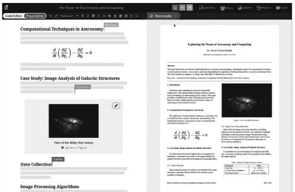
（图片来源：https://www.overleaf.com/）

### 第三节 AI辅助下的跨学科智能适配提升

#### 一、帮助满足多元读者群体的期待视野

与传统的单一学科研究相比，跨学科研究的目标读者更为多样。不同学科的读者对学术论文的“期待视野”（horizon of expectation），即作为接受主体的读者基于个人和社会的复杂原因，在心理上形成的既有结构图式 [81]，也各不相同。读者的期待视野决定了他们对论文结构、术语使用、理论框架和研究方法的预期。当跨学科论文偏离其所属学科的常规表达时，可能被视为是“不规范的”或“难以理解的”，从而降低接受度。

在跨学科研究成果的传播受众中，核心读者群体首先是各领域专家，如期刊审稿人、基金评审专家等。然而，不同学科背景的专家在知识结构、方法论偏好和价值评判标准上存在显著差异，往往导致传播障碍。专家可能对跨学科研究中引用的外学科理论和方法不熟悉，进而质疑其学术严谨性或相关性，也可能依据本学科的标准来判断研究的创新性与学术贡献，导致低估了跨学科成果的实际价值。此外，术语使用和写作风格的不匹配，也容易引发误解甚至误判，从而影响论文录用或项目立项。

同时，跨学科研究往往也有较强的政策导向和实践倾向，即立足于解决社会或行业中的某一现实问题，为政策或行业决策提供依据，此时，研究成果所面对的读者群体就包括政策制定者、企业管理者、大众媒体等。面对这一群体，跨学科研究须兼顾学术深度与可读性。这类读者更关注研究的应用价值、结论的可操作性及其对现实问题的响应能力。若论文表述过于抽象或专业，可能导致传播效果不佳，难以实现知识转化与政策影响。

对此，AI工具可以帮助实现以下目的。（1）多风格语言转换：借助大语言模型，AI可根据目标读者类型（如审稿人、政策制定者、大众媒体）自动调整语言风格与表述方式。例如，同一研究成果可生成学术严谨版、政策简报版与科普推广版，提升传播适配度。（2）语义适配与术语替换：AI可识别论文中专业术语与表达方式，对照目标学科或读者背景进行术语替换与语义优化，降低误读风险，增强论文的可理解性。（3）辅助写作视角平衡：通过训练模型识别不同读者的期待视野，AI可在文本生成与编辑过程中提示语言中存在的偏向性，引导作者进行视角整合与多维表达。（4）多版本文献摘要与图示输出：AI可自动生成面向不同受众的摘要与可视化表达。表10-3-1为不同场景下的提示词示例。

表10-3-1 满足不同读者群体期待视野的提示词示例

| 应用场景 | 提示词示例 |
| :--- | :--- |
| 多风格语言转换 | “将以下学术段落改写为面向政策制定者的通俗表达，保留关键信息但去除过于专业的术语”<br>“请用适合大众媒体传播的语言风格改写下文，并突出研究成果的社会意义” |
| 语义适配与术语替换 | “帮我将这段 A 学科术语翻译成 B 学科研究者也能理解的语言”<br>“请识别并替换段落中的[学科]专有术语，用跨学科读者更容易理解的通用术语或解释说明代替” |
| 辅助写作视角平衡 | “请重新组织这段文字内容，使其在 A 学科和 B 学科两个学科视角下都具备合理性”<br>“请帮助我调整这段论述结构，兼顾 A 学科和 B 学科的关注点，避免学科偏向” |
| 多版本文献摘要与图示输出 | “请为以下论文内容生成三种摘要：面向学术审稿人、面向政策制定者、面向行业从业者”<br>“请将以下研究结果可视化为一张图示，并附文字解释，适合在国际学术会议 PPT 中呈现” |

#### 二、协助规避传统学科的制度壁垒

如前所述，针对传统单一学科的研究成果，AI工具已经可以从期刊推荐、写作风格适配等各种角度实现智能发表辅助。与单一学科研究相比，跨学科研究发表面临的挑战更复杂、任务更多元，因而AI辅助也展现出不同的功能侧重与技术路径。

首先，目标期刊识别的复杂性更高。对于传统的单一学科论文，期刊选择往往相对直接，AI可以通过分析关键词、研究方法和主题内容，快速匹配出合适的期刊。然而，跨学科论文通常在多个学科领域之间穿梭，涉及的内容和方法跨越多个领域。因此，AI需要综合考虑这些学科差异，构建一个多维度的期刊匹配模型，既要了解每个学科领域的特点，又要考虑论文的交叉点，确保推荐的期刊在多学科背景下都能够接受该论文。此外，AI还需要分析不同学科领域的期刊接纳跨学科研究的历史和趋势，提升推荐的精准度。

其次，写作风格与结构适配需求更强。在传统学科内，论文写作通常遵循固定的规范和风格，AI能够较为简单地对文稿进行格式调整和风格优化。然而，跨学科研究涉及多学科的语言与表达习惯，每个学科的写作方式、研究框架和引用风格可能都有不同要求。AI在这时需要执行更加复杂的风格迁移任务，根据学科特点调整论文结构、用语、引用方式，甚至在多学科之间平衡写作风格。

最后，投稿策略制定更精细化。跨学科的研究成果面临的挑战是期刊是否会接受这种跨界论文，而AI可以通过数据分析，评估期刊的接受历史和跨学科研究的发表趋势，从而制定更精细的投稿策略。通过这种策略性推荐，AI可以帮助研究者避免因学科划分的壁垒导致论文被拒，从而提高论文的发表成功率。表10-3-2为不同场景下的提示词示例。

表10-3-2 协助跨学科研究发表的提示词示例

| 应用场景 | 提示词示例 |
| :--- | :--- |
| 目标期刊识别 | “结合论文中的关键词、研究方法和学科领域，智能推荐期刊，并考虑不同学科领域的发表趋势和接纳度”<br>“根据论文内容分析，提供一份期刊推荐清单，并提供每个期刊的具体选题偏好、审稿周期以及影响因子” |
| 写作风格与结构适配 | “根据论文涉及的多个学科，提供多种写作风格优化建议，确保论文符合[期刊]规范”<br>“优化论文中的引言、方法、讨论等部分的写作结构，使其符合[期刊]的要求” |
| 投稿策略制定 | “分析[期刊]的历史出版情况，评估该期刊是否偏向跨学科研究，并根据预估发表周期制定写作和投稿日程表”<br>“分析[期刊]的审稿标准和接受率，帮助研究者评估论文的接受概率，并为投稿策略提供数据支持” |

### 本章小结

通过将跨学科研究视为一种跨越不同社会部门的知识生产活动，笔者分别从知识生产端和消费端探讨了其中存在的主要难点，包括术语不统一、理论难融合、方法差异大、作者协作难，以及读者多样化和制度壁垒高企。AI工具在此背景下展现出了较强的辅助作用，能够通过自动化术语统一、理论融合、方法集成、协同合作等方式提高跨学科研究的效率，降低知识体系整合的难度。尽管如此，AI作为辅助工具，还是无法代替研究者本身的主体性和学术创造力。在进行跨学科研究时，研究者必须保持批判性思维、创新精神和学术独立性，才能确保跨学科研究的本真性，避免“伪跨学科化”倾向。

[1] Foucault, M. (1972). *The Archaeology of Knowledge and the Discourse on Language* (A.M. Sheridan Smith, Trans.). New York: Pantheon Books. (Original work published 1969).
[2] Apostel, L. (1972). *Interdisciplinarity: Problems of Teaching and Research in Universities*. Paris: OECD.
[3] Gibbons, M., Limoges, C., Scott, P., et al. (1994). *The new production of knowledge: The dynamics of science and research in contemporary societies*.
[4] Van Noorden, R. (2015). Interdisciplinary research by the numbers. *Nature*, 525 (7569), 306-307.
[5] Berkes, E., Marion, M., Milojević, S., et al. (2024). Slow convergence: Career impediments to interdisciplinary biomedical research. *Proceedings of the National Academy of Sciences*, 121(32), e2402646121.
[6] Dubin, R. (1978) *Theory development*. New York: Free Press.
[7] Whetten, D.A. (1989). What constitutes a theoretical contribution?. *Academy of management review*, 14(4), 490-495.
[8] Jauss, Hans Robert; Elizabeth Benzinger (1970). Literary History as a Challenge to Literary Theory. *New Literary History*. 2(1): 7-37. Viewed 15 March 2013.

[1] 朱丽·汤普森·克莱恩. 跨越边界——知识、学科、学界互涉[M]. 姜智芹译. 南京：南京大学出版社，2005：23+132.
[2] 田贤鹏，张应强. 跨学科研究的历史演变、推进方式和发展趋势[J]. 高等教育研究，2023（2）：51-59.
[3] 首届2025年泰晤士高等教育跨学科科学排名正式揭晓：麻省理工学院位居世界第一[EB/OL]. https：//www.eol.cn/liuxue/redian/yxpm20241121593797.html.
[4] 政府工作报告[EB/OL]. https：//www.gov.cn/yaowen/liebiao/202503/content_7013163.htm.
[5] 交叉科学部简介[EB/OL]. https：//www.nsfc.gov.cn/publish/portal0/tab1333/.
[6] 与哲学、经济学、理学、工学等传统学科并肩——我国新设置“交叉学科”门类[EB/OL]. http：//www.moe.gov.cn/jyb_xwfb/s5147/202101/t20210115_509892.html.
[7] 2023年中国科学院院士增选工作启动[EB/OL]. http：//www.xinhuanet.com/politics/2023-05/31/c_1212194151.htm.
[8] 孟令霞. 从术语学角度看术语翻译[J]. 中国科技翻译，2011，24（2）：28-30+44.

# 第十一章 未来趋势与展望

### 本章介绍

在AI迅猛发展的背景下，尤其是以通用人工智能体为代表的新一代技术系统，正深刻改变着学术研究与写作的方式。人工智能体一方面可以极大地提升科研工作和学术写作的效率与便捷性；另一方面也对人类知识生产的主体性地位构成挑战，带来潜在的学术本体论危机。面对这一变局，提升研究者的AI学术素养将成为应对挑战的一个关键切入点。本章首先梳理了人工智能体的发展趋势及其对学术写作的影响，随后聚焦AI学术素养的概念、核心维度与实践提升路径，力图为构建人机协同的未来学术生态提供启示。

### 第一节 通用人工智能体的发展趋势和影响

#### 一、从嵌入式AI到代理式人工智能体

Agent通常意为“代理”，也有“行动者/主体”的意思。亚里士多德在《尼各马可伦理学》中首次提出人类作为理性行动者的观点，强调人是有意图的自主决策主体 [1]。大卫·休谟在《人性论》中则否定了人的纯粹理性，提出行动者的本质是“激情主导，理性辅助”，隐含了有限理性论的雏形 [2]。因此“Agent”一词是主观行动能力的形式或体现，而非被动地对外界刺激做出反应。广义的Agent不仅仅指代人类，同样也包含物理世界或虚拟世界中的其他有行动能力的主体。

AI Agent，即人工智能代理，就是一种能够自主感知环境、进行决策和执行动作的智能实体。目前对于AI Agent还没有统一的译名，“AI代理”“人工智能代理”“智能体”等都可以对其进行指称，以下将主要使用“（人工）智能体”这一译名。不同于传统的AI，智能体具备通过独立思考、调用工具去逐步完成给定目标的能力，其核心在于结合大语言模型的推理能力与工具调用、长期记忆机制，实现从思考到行动的跨越，从而极大地解放人力，提升效率（见图11-1-1）。目前，通用人工智能体是AI技术和应用发展的一个主要方向。

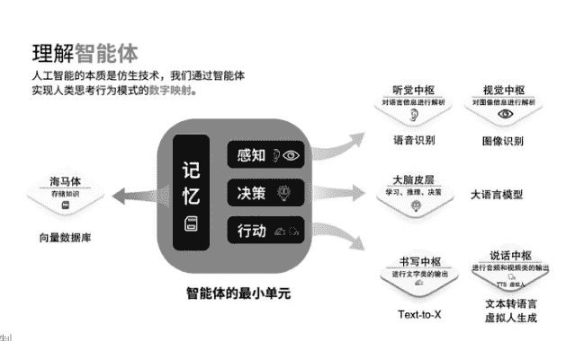

人类对于大模型的使用有三种主要模式或设想，一是嵌入（embedding）模式，将大模型作为后台组件集成到现有应用或服务中，但不直接向用户暴露全部功能。在这一模式下，仍然由人类承担大部分工作任务。二是副驾驶（copilot）模式，相比于嵌入模式更强调人机协作，大模型可以作为助手提供辅助或建议，但仍需要人类主导任务工作。三是代理（agent）模式，即赋予大模型高度自主性，使其能够独立分解任务、规划步骤并调用工具完成任务，在任务过程中可以完全解放人类劳动力（见图11-1-2）。

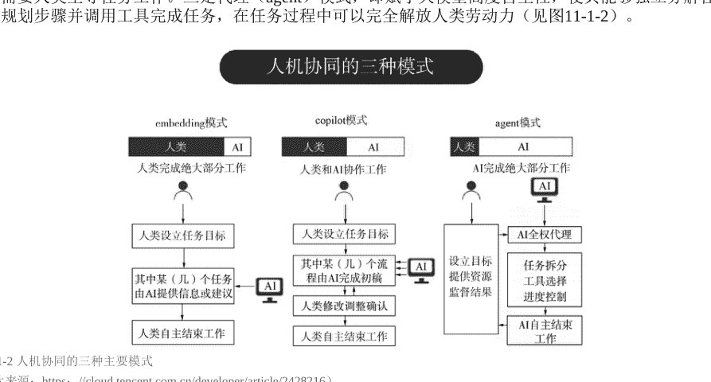

图11-1-2 人机协同的三种主要模式
（图片来源：https://cloud.tencent.com.cn/developer/article/2428216）

目前，大模型与人之间的交互仍主要停留在嵌入模式或副驾驶模式阶段，人机交互主要是通过提示词实现的，提示词是否清晰明确会影响回答的效果。而对于智能体，人类仅需给定其一个目标，它就能够针对目标独立开展思考并做出行动，根据给定任务拆解出详细的计划步骤，依靠来自外界的反馈和自主思考给自己创建提示词，最终实现目标。

以学术研究中的深度访谈活动为例，在大模型时代，研究者可以通过提示词要求大模型协助生成访谈提纲和访谈计划表等，然后由研究者本人据此邀请访谈对象参与访谈，再借助AI工具完成访谈记录的文本转化、资料整理和结论提取。而如果是在成熟智能体参与的情况下，研究者只需要向智能体提供访谈研究需要实现的目标，智能体就可以自动完成从生成访谈提纲、甄选和邀约访谈对象、开展并记录语音访谈，到转化书面材料、总结研究发现这个完整的过程。

根据艾媒咨询（iiMedia Research）的数据，全球人工智能体整体市场规模2023年约45亿美元，2025年有望迅速飙升至372亿美元，预计到2029年有望突破2407亿美元，呈现高速增长的态势 [3]。2025年3月，我国AI公司“蝴蝶效应”发布了一款名为Manus的智能体产品，这也是全球首款通用的人工智能体，一经推出就引起了市场的热烈反应 [4]。目前全球主要的AI科技公司都在加速布局智能体产品，如OpenAI、Google、Meta、微软、Anthropic等公司已在研发通用或垂直代理框架。国内平台如阿里通义、百度文心、智谱清言也正逐步推出代理相关功能，尤其在办公、教育、编程等方面快速演进。

#### 二、作为科研和写作助理的人工智能体

代理式的智能体作为一种具备自主感知、任务规划与工具调用能力的智能系统，正在从对话式AI进化为科研工作和学术写作中的主动型协作者。相较于传统的AI工具，智能体不仅具备执行具体任务的能力，更能够理解上下文、规划流程、持续适应用户偏好，在科研与写作过程中发挥更有深度、系统性的作用。

首先，与传统的AI工具相比，智能体最根本的特征在于其主动执行能力。一般的AI工具如语言润色器、翻译器、文献检索或内容生成式平台，通常只能在用户发出明确指令后完成单一操作，缺乏跨任务协调与长期目标感知能力。而智能体具备一定程度的自主判断力，能够在理解研究者研究目标的基础上，主动拆解任务、调用必要工具、组织执行流程。例如，在用户准备写作一篇学术论文时，智能体可以首先协助用户完成选题扩展与关键词提取，继而自动检索相关领域文献、组织知识结构、生成写作大纲，甚至在写作阶段持续提供语言优化与风格匹配建议，形成完整的从构思到完成的协作链条。

其次，与一般AI工具相比，智能体具有更好的多步骤式任务处理能力。科研写作通常是一个周期性强、任务链复杂的过程。智能体能够基于任务目标与时间节点，帮助研究者进行任务拆解、进度安排与流程跟踪。它可以自动设定写作节奏、提醒关键节点，如文献阅读、数据分析、初稿完成、投稿准备等，甚至通过与日程工具如Notion、Obsidian、Trello等集成，形成动态写作日历。对于同时推进多个课题的研究者而言，智能体有望成为真正的科研项目助理，实现任务状态可视化与进度协调。

最后，与传统工具用完即忘的缺陷不同，智能体正在向具备长期学习与用户记忆的方向发展。人类主要通过长期记忆来存储和提取各种经验和知识，智能体的长期记忆功能可以使其在一定程度上逼近人类的认知和记忆模式。通过基于Transformer架构的记忆机制，增加记忆模块，以及使用大规模、多样化且包含长期关系的训练数据与策略，智能体可以逐步积累用户的研究偏好、知识结构与写作风格，实现个性化服务。这一能力使得智能体不仅适用于单次任务，更适用于持续性科研项目与长期写作伙伴角色的塑造。

#### 三、通用人工智能体发展带来的冲击

但随着AI工具自主能力的不断增强，其科研和学术上的负面效应也可能随之增强。

首先是对研究者学术独立性和创新能力的削弱。智能体具有自主学习、情境感知、推理决策的能力，它能够在无人工干预的情况下生成内容、处理数据并推导结论，这使得传统上依赖学者独立思考的学术创作过程变得模糊。智能体的写作模型基于大量现有数据和模式，可能会导致研究者倾向于在已有知识框架内进行创新，忽视原创性和理论突破。而随着对智能体依赖的加深，研究者可能会逐步失去自主分析和独立构建知识体系的能力，最终导致丧失独立开展学术研究的能力。

其次是信息的高度碎片化和智能信息茧房的强化。智能体可以独立搜索和阅读新文献，收集和整理信息，这虽然意味着提高了文献和信息处理的效率，但同时也意味着研究者将可能在更大程度上脱离整篇文献和完整资料。一旦研究者不再主动深入阅读和批判性地理解文献，对文献的理解就会变得碎片化，从而逐渐丧失研究者全局性、系统性的观察和思维能力。同时，过度依赖智能体获取和整理研究资料信息，也意味着研究者将在更大程度上脱离田野和实际，陷入信息二手化的境地。而智能体往往根据历史数据和用户偏好提供推荐服务，可能形成封闭的智能信息茧房，限制了研究者创新性思维的运用和发展。

最后，随着智能体的发展和普及，科研和学术也将面临更大的本体论危机。学术创作强调主体性、创新性和独立性，而智能体在AI主体性、创新性和独立性上的大幅增强是否意味着对人类研究者在主体性、创新性和独立性形成全面压缩？通过智能体生成的学术创作是否还能被视为研究者个体智慧与创造力的体现？智能体生成内容的高度一致性和同质化，是否会导致学术界对于新知和创新研究定义的模糊？如果智能体在知识生成过程中占据主导地位，那么学术研究可能变成机器算法的产物，这是否会进一步直接影响到学术研究的归属问题？对于这些争议和担忧并没有完全的定论，更缺乏相应的预案。这也意味着，随着智能体逐步承担起知识发现与理论创新的任务，学术研究的本体论意义及其评判体系需要与时俱进，从而避免知识生产的去人性化和去创新化。

### 第二节 AI时代的学术素养提升路径

#### 一、从学术素养到AI学术素养

“素养”一词的来源可以追溯到《汉书·李寻传》和《后汉书·刘表传》，最初意指人的日常修养。经济合作与发展组织在2003年PISA（国际学生评估项目）测试中文版采用“素养”一词翻译“competency（胜任力）”，推动了这一概念的国际化。2005年，该组织将素养界定为“在特定情境中，通过利用和调动心理社会资源（包括技能和态度），以满足复杂需要的能力”[5]。

教育的学术素养的六维模型：权威的建构性与情境性、信息创造的过程性、信息的价值属性、研究即探究过程、学术即对话、检索即策略探索 [4]。

随着数字技术在学术研究中的广泛应用，数字学术素养概念也应运而生（如Goodfellow, 2011 [5]；Selwyn, 2016 [6]），这一概念将在线协作、数据管理、数字伦理、数字批判意识等都纳入了学术素养中。在AI时代，尤其是在AI技术向着通用人工智能体开发飞速发展的过程中，培养AI学术素养（AI Academic Literacy）也成了一项迫在眉睫的任务。

#### 二、AI学术素养的内涵和维度

由美国和国际高等教育机构等组成的非营利组织EDUCAUSE（2024）提出了教学与学习中的AI素养（AI Literacy in Teaching and Learning, ALTL），并总结了AI素养的几个主要方面：技术理解，即理解AI的基本原理；批判性评估，即能够评估AI工具在教学、研究和教育管理中的应用，并识别潜在的偏见和误用；实践应用，即有效地将AI工具整合到教学和研究实践中；伦理意识，即确保对AI工具的使用符合伦理标准，意识到其对社会的影响 [7]。

浙江大学人工智能教育教学研究中心在推出的《大学生人工智能素养红皮书（2024版）》中，将大学生AI素养区分为体系化知识、构建式能力、创造性价值和人本型伦理四个有机整体（见图11-2-1）。其中，知识为基、能力为重、价值为先、伦理为本，四者相辅相成、相互融合 [6]。

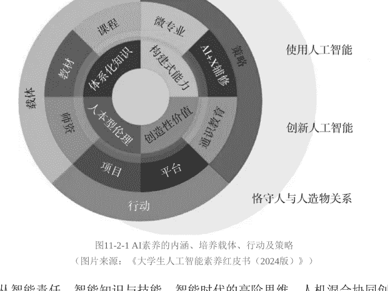

图11-2-1 AI素养的内涵、培养载体、行动及策略
（图片来源：《大学生人工智能素养红皮书（2024版）》）

Li（2022）则从智能责任、智能知识与技能、智能时代的高阶思维、人机混合协同创新四个维度构建了大学生AI素养框架，明确了各个维度的具体要求。其中，智能责任包括智能伦理和智能态度；智能知识与技能包括智能意识、智能知识、智能技能；智能时代的高阶思维包含计算思维、数据思维、批判性思维和编程思维；人机混合协同创新包括人机协同、团队合作以及智能创新（见图11-2-2）[8]。

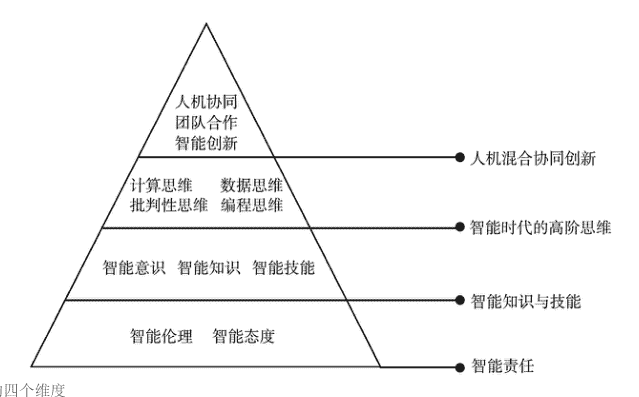

图11-2-2 大学生AI素养的四个维度
（图片来源：Li Jia. (2022) .The Definition and Framework Construction of College Students'Artificial Intelligence Literacy. *Science Innovation*，10（5），157-165）

Markus等人（2025）开发并验证了用于客观衡量AI素养的AI能力客观量表（The AI Competency Objective Scale，AICOS）。该量表具有模块化的六因素结构，从应用、创建、检测、伦理、生成和理解六个方面对AI素养进行综合测量。量表提供一种只包含18个题项的简短版本，更适合快速高效测量；同时还提供一个包含51个题项的完整版本，可以为更详细和深入的测量提供更多空间 [9]。

总的来说，目前学术界对于AI学术素养的内涵达成了一些基本的共识。AI学术素养被视为AI时代研究者必须具备的核心能力之一，它不仅仅是会使用AI工具，更是对AI在学术环境中使用、理解、评价与规范的综合能力。AI学术素养的核心维度包括三项基本能力和一项主要意识，即技术理解能力、批判使用能力、人机协作能力和学术伦理意识。表11-2-1为这四项核心维度的主要内涵：

表11-2-1 AI学术素养的四项核心维度

| 核心维度 | 主要内涵 |
| :--- | :--- |
| 技术理解能力 | 理解 AI 的基本原理、运行机制和功能边界，具备判断其适用范围的基础知识，能辨别其在不同学术场景中的价值与局限 |
| 批判使用能力 | 能够审慎评估 AI 生成内容的准确性、偏误与逻辑合理性，在学术写作和研究中保持独立思考，防止技术决定论和盲目依赖 |
| 人机协作能力 | 能够合理调动 AI 辅助工具参与科研任务，如文献检索、写作组织、语言润色等，形成“以我为主、AI 为辅”的协作性学术工作流 |
| 学术伦理意识 | 清晰把握 AI 在学术活动中的使用规范，遵守署名、引用与原创性原则，警惕 AI 引发的抄袭、伪造、误导等学术不端行为 |

#### 三、AI学术素养的提升路径

围绕上述AI学术素质的核心维度，将分别从技术理解能力、批判使用能力、人机协作能力与学术伦理意识四个方面探讨提升路径。

##### 1. 夯实认知基础，提升技术理解能力

提升AI学术素养的首要前提是具备基本的技术认知能力。这意味着研究者不仅要了解AI工具怎么用，更要理解它运作的基本原理。对此，可从以下三个具体方面入手：

（1）加强基础知识培训。AI学术素养培育最重要的途径之一就是系列课程的学习。高校和科研机构可开设与AI相关的通识课程、专业课程、学科交叉课程、微课程等，帮助不同专业和层级的学生和研究者理解诸如自然语言处理、机器学习、模型训练与微调等关键概念，学习AI工具应用的实践技能。

（2）借助线上线下资源进行自主学习。高校等研究机构会定期举办AI与教育、科研、伦理等交叉领域的公开讲座与工作坊，参与此类活动有助于研究者及时了解AI技术和应用的最新发展动态。此外大量线上课程等网络资源也可以帮助研究者提升AI工具的使用技能，比如OpenAI在2025年4月上线的 OpenAI 学院（OpenAI Academy）提供了大量免费活动和学习内容（见图11-2-3）。

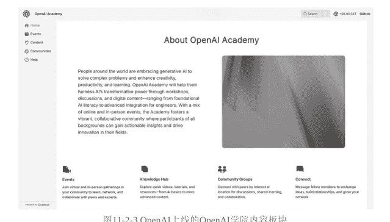

（3）自主参与开源社区与在线平台实践。如Hugging Face、OpenAI、Kaggle等平台提供了大量关于AI模型、工具应用、数据分析的实践资源与项目示例。研究者通过亲自操作模型、编写提示词或参与AI挑战赛，能够在现实语境中快速提升技术理解与应用能力。

##### 2. 保持学术主体性，提升批判使用能力

AI工具在学术写作中的便捷性，使得研究者极易被诱发工具依赖。因此，提升自身的批判性使用能力是维持学术独立性与提升自主研究能力的关键。

（1）训练批判视角的使用习惯。在使用AI工具时，不应将其输出视为结论，而应作为假设、参考或引发思考的原点。训练自身的提问与追问能力比直接调用答案更为重要。

（2）培养交叉验证的使用习惯。对AI提供的数据、文献或理论观点，主动检索来源、验证出处、核查逻辑。这可借助交叉平台（如结合Google Scholar与Scite）加以实现。

（3）培养参与式对话的使用习惯。研究者应当通过多轮提示词调试，引导AI生成符合研究背景、表达风格和逻辑需求的内容，避免一问一答的浅层调用。

##### 3. 构建有效的助研工作流，提升人机协作能力

AI工具不是人类研究者的替代品，而应成为其任务分工明确的协作伙伴。因此，研究者需要掌握人机协同的具体策略，建立适合自己的AI辅助写作与研究流程。比如：

（1）基于任务链的协作设计。明确哪些环节由人主导（如研究设计、逻辑结构建构），哪些环节由AI辅助（如语法优化、段落生成、图表绘制）。逐步形成标准化的学术写作工作流。

（2）学术工具生态整合。熟练组合使用Notion+ChatGPT、Zotero+Elicit、Word+Copilot等AI增强工具链，提升多环节协同效率。

（3）培养提示工程意识。学习如何设计有效的提示词，引导AI给出符合学术需求的内容，是实现深度协作的关键技术素养。

##### 4. 确立使用的底线与边界，提升学术伦理意识

最后也是最根本的一环是AI参与学术活动的伦理边界设定。在使用AI工具时，研究者应自觉遵守学术规范，维护学术诚信与透明。具体包括：

（1）熟悉所在机构与期刊的AI使用政策，了解哪些环节允许AI参与、哪些需要标注、何时应规避AI使用。

（2）明确署名与引用规范。AIGC若构成论文核心观点，需明确说明使用方式，并避免将AIGC冒充原创；如用于辅助，应在致谢或方法中说明工具种类与用途。

（3）树立负责任的用户意识。任何由AI生成的文本、数据或图表，最终责任仍由使用者承担。因此研究者须对AI辅助产出进行再判断、再验证，确保其准确性与伦理合法性。

总的来说，素养是一个融合了认知能力、实践技能和价值立场的复合概念，并不简单地等同于知识或技术，而是强调学习研究者的综合实践能力与价值自觉。在AI时代提出AI学术素养，正是要突出人类主体在技术辅助下如何更有意识地从事学术活动、维护学术伦理，并持续学习与适应变革。

### 本章小结

AI正呈现出多元化的发展趋势，除通用人工智能体外，多模态融合与垂直领域精细化也是技术的一些重要发展方向。越来越多的AI技术应用将不断拓展其在学术场景中的应用边界。在此背景下，仅依赖提升研究者的学术素养或也难以全面应对AI对科研生态的深层影响。研究者还需从制度体系建设、科研评价标准更新、人机协作伦理规范等多维度共同发力，形成既能保证学术质量，又善用AI工具的动态平衡机制。同时，推动跨学科合作、加强对AI模型本身的可解释性研究，也将是未来学术共同体应对AI技术带来的风险与挑战，构建人机协同的学术生态的关注要点。

[1] Belcher,D.(1994).The apprenticeship approach to advanced academic literacy:Graduate students and their mentors. *English for Specific Purposes*,13,23-34.
[2] Gibbons,P.(2012).SCAFFOLDING ACADEMIC LANGUAGE AND LITERACY WITH SCHOOL-AGED ENGLISH LANGUAGE LEARNERS. *The European Journal of Applied Linguistics and TEFL*,1(2),51-65.
[3] Wingate,U.(2015).Academic literacy and student diversity:The case for inclusive practice(Vol.42). *Multilingual Matters*.
[4] Board,A.C.R.L.(2016). *Framework for information literacy for higher education*.
[5] Goodfellow,R.(2011).Literacy,literacies and the digital in higher education. *Teaching in Higher Education*,16(1),131-144.
[6] Selwyn,N.(2016).Is technology good for education? *Polity Press*.
[7] Georgiva,M.,Kassorla,M.,&Papini,A.(2024). *AI Literacy in Teaching and Learning : A Durable Framework for Higher Education*.
[8] Li Jia.(2022).The Definition and Framework Construction of College Students'Artificial Intelligence Literacy. *Science Innovation*,10(5),157-165.https://doi.org/10.11648/j.si.20221005.13.
[9] Markus,A.,Carolus,A.,&Wienrich,C.(2025).Objective Measurement of AI Literacy:Development and Validation of the AI Competency Objective Scale(AICOS). *arXiv preprint arXiv*:2503.12921.

[1] 亚里士多德.尼各马可伦理学[M].廖申白，译.北京：商务印书馆，2011：1113b.
[2] 大卫·休谟.人性论[M].关文运，译.北京：商务印书馆，2016：441-452.
[3] 艾媒智库.2022—2030全球AI智能体整体市场规模及预测[R].2025.
[4] Manus：开启AI智能体的新时代[EB/OL].https：//cloud.tencent.com/developer/article/2503086.
[5] 褚宏启.核心素养的概念与本质[J].教育（周刊），2016（50）：1.
[6] 吴飞，李艳，陈静远，等.大学生人工智能素养红皮书（2024版）[J].科教发展研究，2024（2）：71-96.

# 参考文献

[1] 程祥徽，黎运汉. 语言风格论集[M]. 南京: 南京大学出版社，1994.

[2] 国家自然科学基金《科研诚信规范手册》编写组. 科研诚信规范手册[M]. 2023.

[3] 大卫·休谟. 人性论[M]. 关文运，译. 北京: 商务印书馆，2016.

[4] 马克思，恩格斯. 马克思恩格斯选集：第2卷[M]. 北京：人民出版社，2012：784-785.

[5] 马克思，恩格斯. 马克思恩格斯选集：第5卷[M]. 北京：人民出版社，2009：495.

[6] 马克思，恩格斯. 马克思恩格斯选集：第5卷[M]. 北京: 人民出版社，2009：497.

[7] 马克思，恩格斯. 马克思恩格斯全集：第13卷[M]. 中共中央马克思恩格斯列宁斯大林著作编译局，译. 北京：人民出版社，1998:11.

[8] 亚里士多德. 尼各马可伦理学[M]. 廖申白，译. 北京: 商务印书馆，2011.

[9] 朱丽·汤普森·克莱恩. 跨越边界——知识、学科、学界互涉[M]. 姜智芹，译. 南京: 南京大学出版社，2005.

[10] 褚宏启. 核心素养的概念与本质[J]. 教育（周刊），2016，34（1）：1-3.

[11] 洪悦民，王景周. 学术期刊出版中人工智能生成内容的使用规范及著录建议[J]. 编辑学报，2024，36（2）:149-153.

[12] 李珏，方平，胡德华. 循证医学系统综述来源文献的分析研究[J]. 中华医学图书情报杂志，2004，13（4）:57-62.

[13] 刘伟兵. 人工智能会实现劳动解放吗?[J]. 马克思主义与现实，2022（2）:125-133.

[14] 孟令霞. 从术语学角度看术语翻译[J]. 中国科技翻译，2011，24（2）:28-30+44.

[15] 尚虎平，惠春华，叶杰. 从绩效至上到科研消费主义——我国公共财政资助科研基金中科技观的异化与矫治[J]. 自然辩证法研究，2012，28（6）:82-86.

[16] 盛昭瀚. 问题导向:管理理论发展的推动力[J]. 管理科学学报，2019，22（5）:1-11.

[17] 田贤鹏，张应强. 跨学科研究的历史演变、推进方式和发展趋势[J]. 高等教育研究，2023，44（2）:51-59.

[18] 王众威. 马克思关于机器的三个隐喻——基于人机关系视角的研究[J]. 理论月刊，2023（9）:16-22.

[19] 吴飞，李艳，陈静远，等. 大学生人工智能素养红皮书（2024版）[J]. 科教发展研究，2024，4（2）:71-96.

[20] 徐飞. 管理理论研究中“问题导向”之问题[J]. 管理科学学报，2019，22（5）:12-14.

[21] 张琳，曹喆，徐干城. 冲出重“唯”:学术资本视域下高校教师评价改革的困境、症结与出路[J]. 国家教育行政学院学报，2024（7）：12-19.

[22] 张霄军，邵璐. 构建可信赖机器翻译系统的基本原则——一种基于工程伦理的观点[J]. 外国语文，2021，37（1）:1-8.

[23] 艾媒智库. 2022—2030全球AI智能体整体市场规模及预测[R]. 2025.

[24] 中国科学技术信息研究所，ELSEVIER，SPRINGER NATURE，et al. 学术出版中AIGC使用边界指南[R]. 2023.

[25] 中国信息通信研究院. 人工智能发展报告（2024年）[R]. 2024.

[26] Al-Sofi, B. (2024). Artificial intelligence-powered tools and academic writing: To use or not to use ChatGPT. *Saudi Journal of Language Studies*, 4(3), 145-161.

[27] Altmäe, S., Sola-Leyva, A., & Salumets, A. (2023). Artificial intelligence in scientific writing: A friend or a foe? *Reproductive Biomedicine Online*, 47(1), 3-9.

[28] Apostel, L. (1972). *Interdisciplinarity: Problems of teaching and research in universities*. Organisation for Economic Co-operation and Development.

[29] Association of College & Research Libraries Board. (2016). *Framework for information literacy for higher education*. Association of College & Research Libraries. https://www.ala.org/acrl/standards/ilframework.

[30] Back matter. (1963). *The Public Opinion Quarterly*, 27(1), 167-172. (Page numbers inferred from typical journal structure for “Back Matter” sections)

[31] Belcher, D. (1994). The apprenticeship approach to advanced academic literacy: Graduate students and their mentors. *English for Specific Purposes*, 13(1), 23-34.

[32] Berkes, E., Marion, M.R., Milojević, S., et al. (2024). Slow convergence: Career impediments to interdisciplinary biomedical research. *Proceedings of the National Academy of Sciences*, 121(32), e2402646121.

[33] Bessen, J. (2019). Automation and jobs: When technology boosts employment. *Economic Policy*, 34(100), 589-626.

[34] Booth, A. (2016). *Systematic approaches to a successful literature review*. Sage.

[39] Dubin, R. (1978). *Theory development*. Free Press.

[40] Duhaylungsod, A.V., & Chavez, J.V. (2023). ChatGPT and other AI users: Innovative and creative utilitarian value and mind set shift. *Journal of Namibian Studies: History Politics Culture*, 33, 4367-4378.

[41] Dwyer, C.P. (2023). An evaluative review of barriers to critical thinking in educational and real-world settings. *Journal of Intelligence*, 11(6), 105.

[42] Foucault, M. (1961). *Folie et déraison: Histoire de la folie à l'âge classique*. Plon.

[43] Foucault, M. (1972). *The archaeology of knowledge and the discourse on language* (A.M. Sheridan Smith, Trans.). Pantheon Books.

[44] Foucault, M. (1977). *Discipline and punish*. Pantheon Books.

[45] Foucault, M., & Kremer-Marietti, A. (1969). *L'archéologie du savoir* (Vol. 1). Gallimard.

[46] Gao, C.A., Howard, F.M., Markov, N.S., et al. (2022). *Comparing scientific abstracts generated by ChatGPT to original abstracts using an artificial intelligence output detector, plagiarism detector, and blinded human reviewers*. BioRxiv.

[47] Georgiva, M., Kassorla, M., & Papini, A. (2024). *AI literacy in teaching and learning: A durable framework for higher education*. Stanford Accelerator for Learning, https://acceleratelearning.stanford.edu/publication/ai-literacy-teaching-and-learning-durable-framework-higher-education.

[48] Gibbons, M., Limoges, C., Nowotny, H., et al. (1994). *The new production of knowledge: The dynamics of science and research in contemporary societies*. Sage.

[49] Gibbons, P. (2012). Scaffolding academic language and literacy with school-aged English language learners. *The European Journal of Applied Linguistics and TEFL*, 1(2), 51-65.

[50] Goodfellow, R. (2011). Literacy, literacies and the digital in higher education. *Teaching in Higher Education*, 16(1), 131-144.

[51] Goos, M., & Manning, A. (2007). Lousy and lovely jobs: The rising polarization of work in Britain. *The Review of Economics and Statistics*, 89(1), 118-133.

[52] Grassini, S. (2023). Shaping the future of education: Exploring the potential and consequences of AI and ChatGPT in educational settings. *Education Sciences*, 13(7), 692.

[53] Gustafson, J.M. (1968). The social construction of reality: A treatise in the sociology of knowledge.

[54] Heller, M.A. (1998). The tragedy of the anticommons: Property in the transition from Marx to markets. *Harvard Law Review*, 111(3), 621-688.

[55] Huang, J., & Tan, M. (2023). The role of ChatGPT in scientific communication: Writing better scientific review articles. *American Journal of Cancer Research*, 13(4), 1148-1155.

[56] Imran, M., & Almusharraf, N. (2023). Analyzing the role of ChatGPT as a writing assistant at higher education level: A systematic review of the literature. *Contemporary Educational Technology*, 15(4), ep467.

[57] Jauss, H.R. (1970). Literary history as a challenge to literary theory (E. Benzinger, Trans.). *New Literary History*, 2(1), 7-37.

[58] Khalifa, M., & Albadawy, M. (2024). Using artificial intelligence in academic writing and research: An essential productivity tool. *Computer Methods and Programs in Biomedicine Update*, 5, 100181.

[59] Knorr-Cetina, K.D. (1981). Social and scientific method or what do we make of the distinction between the natural and the social sciences? *Philosophy of the Social Sciences*, 11(3), 335-359.

[60] Kranzberg, M. (1986). Technology and history: "Kranzberg's laws". *Technology and Culture*, 27(3), 544-560.

[61] Kynoch, B., Latapie, H., & van der Sluis, D. (2023). *RecallM: An adaptable memory mechanism with temporal understanding for large language models* (arXiv:2307.02738). arXiv.

[62] Latour, B., Salk, J., & Woolgar, S. (2013). *Laboratory life: The construction of scientific facts*. Princeton University Press.

[63] Li, J. (2022). The definition and framework construction of college students' artificial intelligence literacy. *Science Innovation*, 10(5), 157-165.

[64] Lustig, J. (2006). From art to alienated labor: The degradation of academic work. *Thought & Action*, 22(2), 143-156.

[65] Malik, T., Dwivedi, Y.K., Kshetri, N., et al. (2023). Opinion paper: "So what if ChatGPT wrote it?" Multidisciplinary perspectives on opportunities, challenges and implications of generative conversational AI for research, practice and policy. *International Journal of Information Management*, 71, 102642.

[66] Mannheim, K. (2013). *Ideology and utopia*. Routledge.

[67] Marcus, G. (2022). *Deep learning alone isn't getting us to human-like AI*. MIT Press.

[68] Markus, A., Carolus, A., & Wienrich, C. (2025). *Objective measurement of AI literacy: Development and validation of the AI Competency Objective Scale (AICOS)* (arXiv:2503.12921). arXiv.

[69] Marzuki, M., Widiati, U., Rusdin, D., et al. (2023). The impact of AI writing tools on the content and organization of students' writing: EFL teachers' perspective. *Cogent Education*, 10(2), 2236469.

[70] Pokkakillath, S., & Suleri, J. (2023). ChatGPT and its impact on education. *Research in Hospitality Management*, 13(1), 31-34.

[71] Popper, K.R. (2009). *Vermutungen und Widerlegungen: Das Wachstum der wissenschaftlichen Erkenntnis* (Vol. 10). Mohr Siebeck.

[72] Schmidt, J.C. (2011). What is a problem?: On problem-oriented interdisciplinarity. *Poiesis & Praxis*, 7(4), 249-274.

[73] Schneider, D., Mishra, A., Gluski, J., et al. (2025). Prevalence of Artificial Intelligence-Generated Text in Neurosurgical Publications: Implications for Academic Integrity and Ethical Authorship. *Cureus*, 17(2).

[74] Selim, A.S.M. (2024). The transformative impact of AI-powered tools on academic writing: Perspectives of EFL university students. *International Journal of English Linguistics*, 14(1), 16-33.

[75] Selwyn, N. (2016). *Is technology good for education?* Polity Press.

[76] Slaughter, S., & Leslie, L.L. (1997). *Academic capitalism: Politics, policies, and the entrepreneurial university*. Johns Hopkins University Press.

[77] Snyder, H. (2019). Literature review as a research methodology: An overview and guidelines. *Journal of business research*, 104, 333-339.

[78] Sollaci, L.B., & Pereira, M.G. (2004). The introduction, methods, results, and discussion (IMRAD) structure: A fifty-year survey. *Journal of the Medical Library Association*, 92(3), 364-367.

[79] Soufi, N., & See, B.H. (2019). Does explicit teaching of critical thinking improve critical thinking skills of English language learners in higher education? A critical review of causal evidence. *Studies in Educational Evaluation*, 60, 140-162.

[80] Stephan, P. (2012). *How economics shapes science*. Harvard University Press.

[81] White, E.B., & Strunk, W. (2023). *The elements of style*. Open Road Media.

[82] Suber, P. (2012). *Open access*. MIT Press.

[83] Van Noorden, R. (2015). Interdisciplinary research by the numbers. *Nature*, 525 (7569), 306-307.

[84] Wang, X. (2014). *Personas in the user interface design* [Master's thesis, University of Calgary]. PRISM.

[85] Whetten, D.A. (1989). What constitutes a theoretical contribution? *Academy of Management Review*, 14 (4), 490-495.

[86] Wiley. (2024, February 2). *Best practice guidelines on research integrity and publishing ethics*. Wiley Author Services.

[87] Wingate, U. (2015). *Academic literacy and student diversity: The case for inclusive practice* (New Perspectives on Language and Education, Vol.42). Multilingual Matters.