# AI超神筆記術

NotebookLM 250 高效資料整理與分析 技

鄧君如 總監製／文淵閣工作室 編著

- NotebookLM
- ChatGPT
- Gamma
- Sora
- FlexClip


# 一鍵提升創意與決策力！

# 筆記 ↑ 知識管理 ↑ 簡報 ↑ 影音創作 ↑


- 資料整理：解析文件、YouTube 影片、音檔與網頁，摘要重點、心智圖與研讀指南
- 辦公助手：協助行政、會議記錄、市場調查、新品分析、簡報製作
- 旅行規劃：安排行程、快速比對選項、時序資料整理、整合 LINE 訊息

- 行動創意整理：錄製節目、協助思維梳理，將零散點子轉化為完整企劃
- Podcast 轉錄 x 影音創作：轉錄訪談，結合 Sora x FlexClip 生成高品質影片

蒼峯 www.gotop.com.tw

超值加贈 全書範例與素材 NotebookLM 提示詞 / ChatGPT 提示詞


版權聲明：本書圖片、文字及其他相關內容，未經相關著作權人許可，一概不得以任何形式或方法轉載使用

# 關於文淵閣工作室

常常聽到很多讀者跟我們說：我就是看你們的書學會用電腦的。
是的！這就是寫書的出發點和原動力，想讓每個讀者都能看我們的書跟上軟體的腳步，讓軟體不只是軟體，而是提升個人效率的工具。

文淵閣工作室創立於 1987 年，創會成員鄧文淵、李淑玲在學習電腦的過程中，就像每個剛開始接觸電腦的你一樣碰到了很多問題，因此決定整合自身的編輯、教學經驗及新生代的高手群，陸續推出「快快樂樂全系列」電腦叢書，冀望以輕鬆、深入淺出的筆觸、詳細的圖說，解決電腦學習者的徬徨無助，並搭配相關網站服務讀者。

隨著時代的進步與讀者的需求，文淵閣工作室除了原有的 Office、多媒體網頁設計系列，更將著作範圍延伸至各類 AI 實務應用、程式設計、影像編修與創意書籍。如果你在閱讀本書時有任何的問題，歡迎至文淵閣工作室網站或者使用電子郵件與我們聯絡。


- 文淵閣工作室網站 http://www.e-happy.com.tw
- 服務電子信箱 e-happy@e-happy.com.tw
- Facebook 粉絲團 http://www.facebook.com/ehappytw

總監製：鄧文淵
監　督：李淑玲
行銷企劃：鄧君如

責任編輯：鄧君如
執行編輯：熊文誠、鄧君怡、李昕儒

# 本書學習資源

本書精心規劃專屬學習地圖，讓讀者輕鬆上手 NotebookLM 筆記工具，透過整合關鍵資源與聚焦學習重點，全面提升應用能力。(內容以 Google Chrome 瀏覽器示範電腦操作並在「連接網路」的環境下進行說明；行動裝置則以 iPhone 介面為主要示範，並標註與 Android 系統的操作差異。)

### ✦ 學習地圖介紹

學習地圖頁面網址：https://bit.ly/e-happy-NotebookLM 以電腦瀏覽器開啟即可進入 (請注意！網址輸入時須確保字母大小寫正確，以避免無法正常開啟)。若使用行動裝置，可掃描右側 QR Code 進入。


- **各單元學習資源**：依各單元整理相關 AI 提示詞用句、主題範例的資源連結與聲音、文字、圖片...等檔案。


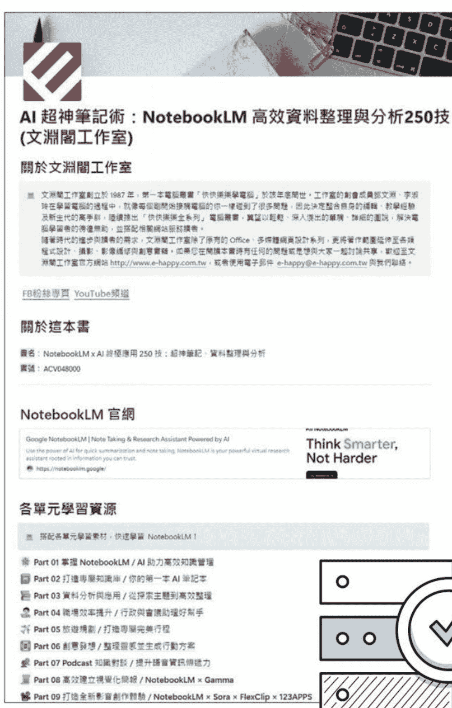


# 取得各單元範例 AI 提示詞與資料來源

於學習地圖 各單元學習資源 ，選按單元名稱即可進入該單元主頁，各單元會有 **ChatGPT 提示詞**、**NotebookLM 提示詞**、**資料來源** 三大主題，分別是章節中用到的 AI 提示詞與主題範例中需匯入的資料連結、檔案或文字。以 **Part 02** 為例：

- ■ AI 提示詞：可直接選取複製，再依章節說明，於 ChatGPT 或 NotebookLM 對話框中貼上。

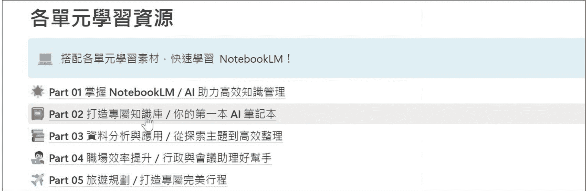

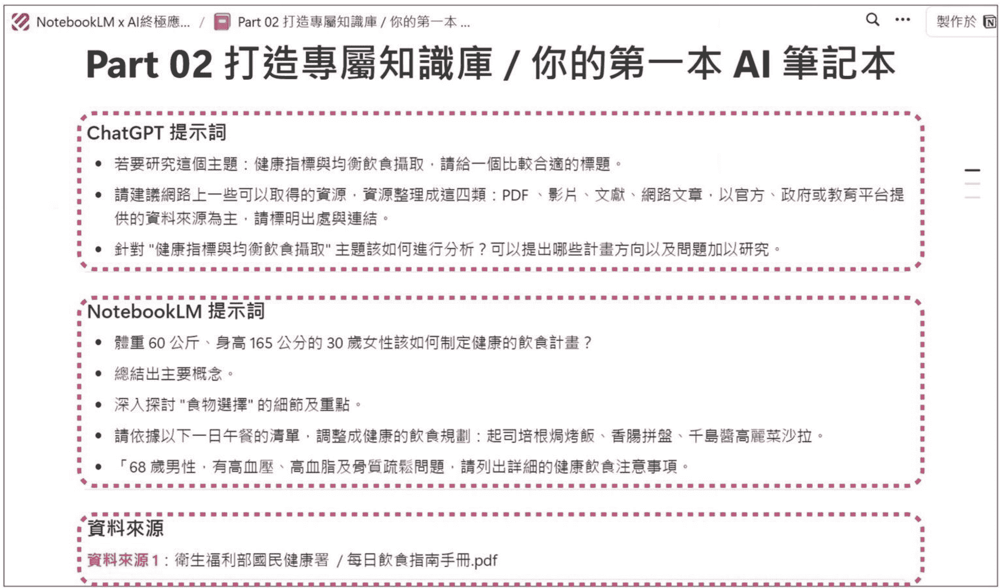

- ■ 資料來源：以 **資料來源 (編號)** 標註，以方便讀者於閱讀書中範例的同時，可以快速找到相對的資料內容下載並新增至 NotebookLM 的來源。

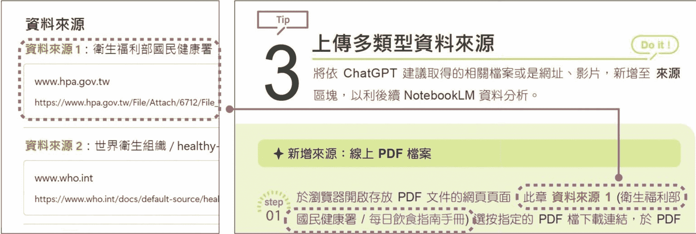

# ✦ 取得多媒體影音範例檔案

Part 04、Part 06 與 Part 09，這三個單元需運用影音檔案，讀者可使用自己錄製或生成的音檔，亦可下載本書提供的檔案進行練習。於學習地圖該單元選按資料來源，再依以下說明操作並取得所需檔案：

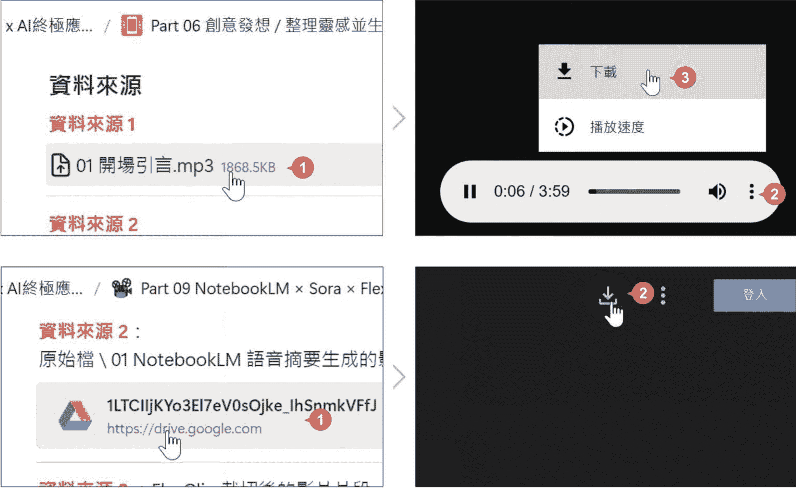

# 取得 Google 簡報雲端範例檔案

Part 04 會示範將 Google 簡報新增至 NotebookLM 來源，若欲使用書附檔案練習，請先於瀏覽器登入 Google 帳號 (需與登入 NotebookLM 的 Google 帳號相同)，於學習地圖該單元選按資料來源，再依以下說明操作並取得：

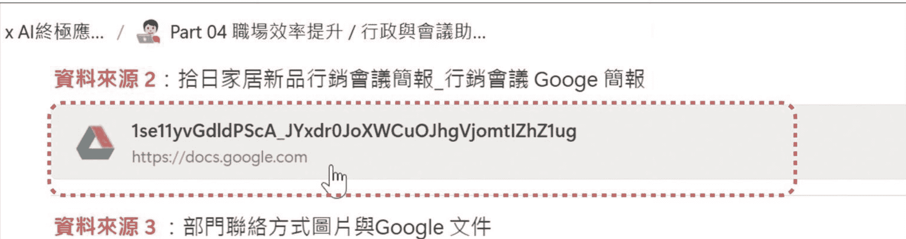

開啟 Google 簡報後，確認右上角是否已登入帳號，若仍未登入請選按 **登入** 鈕，指定正確的帳號登入。待登入後，此份 Google 簡報會自動存放於該帳號的 **與我共用** 清單中，於 NotebookLM 新增來源時即可看到此份簡報。

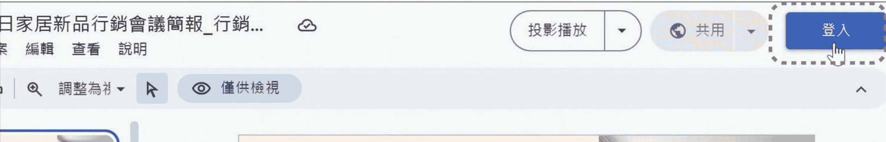

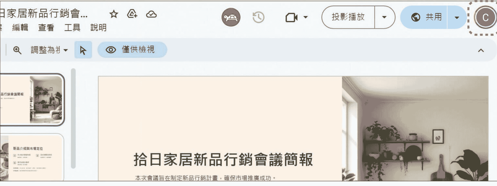

# 單元目錄

- ▶ 新手篇

# Part 1 掌握 NotebookLM
AI 助力高效知識管理


1. NotebookLM 開啟知識管理新時代 ........................................... 1-3
   - ◆ NotebookLM 能做什麼？ ......................................................... 1-3
   - ◆ NotebookLM 五大特色 .......................................................... 1-4
2. 誰適合使用 NotebookLM ....................................................... 1-6
3. 零經驗新手該如何開始........................................................... 1-8
4. 初次使用 NotebookLM........................................................... 1-9
   - ◆ 登入並開啟第一本筆記本 ........................................................ 1-9
   - ◆ 認識筆記本畫面 .................................................................... 1-10
   - ◆ 認識首頁畫面 ...................................................................... 1-12
5. NotebookLM 六大資料分析方式 ............................................ 1-13
   - ◆ 智能摘要：萃取關鍵內容，幫助掌握核心資訊 .................... 1-13
   - ◆ 研讀指南：筆記內容結構化 ................................................... 1-14
   - ◆ 簡報文件：適用於演示與分享 ............................................... 1-14
   - ◆ 常見問題：歸納關鍵問題與解答，快速獲取核心資訊 ....... 1-14
   - ◆ 時間軸分析：讓事件推演更清晰 ........................................... 1-15
   - ◆ 語音摘要：對話式語音，方便隨時收聽重要資訊 ............... 1-15
6. NotebookLM 常見問題........................................................... 1-16
   - ◆ NotebookLM 是否可免費使用？ ........................................... 1-16
   - ◆ NotebookLM 和 NotebookLM Plus 的差異 ........................... 1-16
   - ◆ NotebookLM 與其他 AI 工具有何不同？ ........................................................................ 1-17
   - ◆ NotebookLM 可以上傳的資料來源類型？ ........................................................................ 1-17
   - ◆ NotebookLM 來源檔案大小上限是多少？ ........................................................................ 1-17
   - ◆ 上傳的 PDF 檔無法辨識文字 ........................................................................................................ 1-17
   - ◆ Google 文件與 Google 簡報來源的限制........................................................................ 1-18
   - ◆ YouTube 來源的限制........................................................................................................ 1-18
   - ◆ 網頁網址來源的限制 ........................................................................................................ 1-19
   - ◆ 為何來源上傳作業會失敗？ ........................................................................................................ 1-19
   - ◆ 是否適用於行動裝置 ........................................................................................................ 1-19
7. 切換畫面為深色 / 淺色模式 ........................................................................ 1-20


## Part 2
打造專屬知識庫
你的第一本 AI 筆記本

1. 提取關鍵資料與分析方向........................................................................................................ 2-3
2. 建立筆記本 ........................................................................................................ 2-5
   - 首次建立筆記本........................................................................................................ 2-5
   - 回到首頁再次建立筆記本 ........................................................................................................ 2-6
   - 修改筆記本名稱 ........................................................................................................ 2-6
3. 上傳多類型資料來源 ........................................................................................................ 2-7
   - 新增來源：線上 PDF 檔案........................................................................................................ 2-7
   - 新增來源：YouTube 連結 ........................................................................................................ 2-9
   - 管理來源：重新命名來源 ........................................................................................................ 2-10
   - 管理來源：刪除來源 ........................................................................................................ 2-11
4. 閱讀所有資料的摘要 ........................................................................................................ 2-12
5. 閱讀每份資料摘要與重要主題 ........................................................................................................ 2-13
   - ✦ 閱讀每份資料來源的資料摘要........................................................................... 2-13
   - ✦ 理解重要主題與關鍵用詞................................................................................. 2-14
6. 閱讀每份資料內容與逐字稿......................................................................... 2-15
   - ✦ 閱讀文件資料內容......................................................................................... 2-15
   - ✦ 瀏覽影片逐字稿............................................................................................. 2-16
7. 常見的提問技巧與方法................................................................................. 2-17
   - ✦ 具體清晰的提問............................................................................................. 2-17
   - ✦ 循序漸進的解析............................................................................................. 2-18
   - ✦ 多種情境提問................................................................................................. 2-20
   - ✦ 由建議問題開始提問..................................................................................... 2-21
   - ✦ 刪除目前的對話重新開始............................................................................. 2-22
8. 將重要回覆儲存至記事................................................................................. 2-23
   - ✦ 儲存回覆至記事............................................................................................. 2-23
   - ✦ 重新命名記事名稱......................................................................................... 2-25
   - ✦ 刪除記事......................................................................................................... 2-26
   - ✦ 一次刪除所有記事......................................................................................... 2-26

### ▶ 實用篇

# Part 3 資料分析與應用
從探索主題到高效整理

1. 提取關鍵資料與分析方向............................................................................. 3-3

2. 建立筆記本..................................................................................................... 3-5
   - ✦ 新建筆記本..................................................................................................... 3-5
   - ✦ 修改筆記本名稱............................................................................................. 3-5

## Part 3 實戰應用：掌握學術研究、專案管理與報告撰寫

## 3 上傳多類型資料來源
- 新增來源：線上 PDF 檔案
- 新增來源：YouTube 連結
- 新增來源：網站連結

## 4 一鍵生成核心內容、總結與重點關注

#### 5 一鍵生成關鍵問題整理

#### 6 一鍵生成學習問題研讀指南

## 7 問答與分析
- 輸入問題提問
- 以建議問題提問
- 檢視引用來源
- 依指定來源資料提問

## 8 將重要回覆儲存至記事

#### 9 將記事轉換為來源

## 10 多層次重點摘要與完整筆記
- 整理摘要 (分段落、字數)
- 條列重點
- 整理出完整的筆記資料並解析、補充

#### 11 心智圖：讓思緒更清晰！

#### 12 論文資料整理與總結
- 指定重點、彙整摘要
- 調整引註格式
- 指定結構與階層式標題
- APA 7 格式輸出觀點的對比、闡述

## Part 4 職場效率提升
行政與會議助理好幫手

#### 1. 建立筆記本
- 新建筆記本
- 修改筆記本名稱

#### 2. 上傳會議錄音生成逐字稿

#### 3. 上傳會議簡報並整併錄音進行分析
- 上傳 Google 簡報
- 瀏覽簡報摘要
- Google 簡報與 Google 雲端硬碟保持同步
- 取得會議總結與特定人員報告事項
- 取得會議重點與後續安排建議

#### 4. 上傳 Google 文件讀取手寫筆記
- 開啟 Google 文件插入手寫筆記圖檔
- 上傳 Google 文件
- 提問並快速取得手寫筆記資訊

#### 5. 提取行銷問卷關鍵因素
- 提取關鍵資料與分析方向
- 上傳分析關鍵因素

#### 6. 行銷問卷製作與調查結果分析
- ChatGPT 快速生成 Google 問卷
- 上傳問卷調查結果
- 指定來源資料分析問卷結果

#### 7. 有效整理回覆的表格內容
- 將資料以表格格式整理
- 保留表格格式：記事轉換為資料來源
- 保留表格格式：整理至 Google 文件

## Part 5 旅遊規劃
打造專屬完美行程

#### 1. 提取關鍵資料與分析方向
#### 2. 建立筆記本
- 新建筆記本
- 修改筆記本名稱
#### 3. 上傳多類型資料來源
- 新增來源：線上 PDF 檔案
- 新增來源：網頁連結
- 新增來源：YouTube 連結
- 新增來源：ChatGPT 回覆的文字訊息
- 新增來源：Line 文字訊息
- 管理來源：重新命名來源
#### 4. 一鍵掌握旅遊規劃重點
#### 5. 一鍵生成關鍵的人事時地物
#### 6. 根據資料生成景點推薦與行程建議
- 依單一來源資料列項每日行程
- 依多個來源資料生成旅遊規劃
#### 7. 將重要回覆儲存至記事
- 將對話生成的訊息儲存至記事
- 手動新增記事內容
#### 8. 用 Google 地圖儲存景點並共享
- 將住宿與景點整理列項並存成記事
- 在 Google 地圖標記重要地點
- 將 Google 地圖分享給同行者

## Part 6 創意發想
整理靈感並生成行動方案

#### 1. 提取關鍵資料與分析方向
#### 2. 用行動裝置錄音
- 安裝手機應用程式
- 建立檔案夾並開始錄音
- 重新取代錄音內容
- 將錄音檔儲存至雲端或手機資料夾
#### 3. 建立筆記本
- 新建筆記本
- 修改筆記本名稱
#### 4. 上傳來源與生成音檔逐字稿
- 新增來源：上傳錄音檔並自動生成逐字稿
- 新增來源：上傳 PDF 檔案
- 新增來源：ChatGPT 回覆的文字訊息
#### 5. 檢討、改進並生成完整行動清單
- 分析節目內容並提出建議與改善
- 生成社群平台宣傳貼文
- 生成後續節目主題與規劃
- 設計與聽眾互動的 Google 表單
#### 6. 依指定風格生成文章
- 指定仿寫來源與了解風格
- 說明主題與規格開始仿寫
- 優化文章細節並調整語氣

# ▶ 提升篇

## Part 7 Podcast 知識對談
提升語音資訊傳遞力

#### 1. 生成關鍵資料與分析方向
#### 2. 建立筆記本
- 新建筆記本
- 修改筆記本名稱
#### 3. 上傳多類型資料來源
#### 4. 生成與管理語音摘要
- 檢視資料來源內容
- 自訂對話式語音摘要並生成
- 分享語音摘要
- 調整語音速度
- 刪除並重新生成語音摘要
#### 5. 下載語音摘要音訊檔
#### 6. 語音摘要音訊檔上傳並分析
- 新增來源：語音摘要音訊檔
- 生成語音摘要逐字稿
- 彙整受訪者的內容並列項摘要
- 摘錄精采語錄及可供社群宣傳的貼文金句
- 分析並建議合適的短影音片段
- 特定主題於語音摘要互動的建議
- 重新命名已儲存的記事
#### 7. 與語音摘要互動
#### 8. 用 Mixerbox AI 生成中文 Podcast 對話

## Part 8 高效建立視覺化簡報
NotebookLM × Gamma

#### 1. 用 NotebookLM 生成簡報大綱
- 新建筆記本
- 修改筆記本名稱
- 新增來源：本機 PDF 檔案
- 彙整簡報內容
- 指定簡報大綱格式與分頁
#### 2. Gamma 高效 AI 簡報設計
- 免費線上簡報 AI 生成編輯器
- 註冊並登入 Gamma 帳號
- 認識 Gamma 首頁畫面
#### 3. 簡報大綱快速生成簡報
- 貼上文字自動將簡報分頁
- 挑選主題並生成簡報
#### 4. 用 Gamma 編輯工具進階設計
- 修改文字與格式
- 透過 AI 調整指定文句的寫作方式
- 透過 AI 調整所有文句的寫作方式
- 插入 AI 圖片
- 新增空白卡片
- 透過 AI 新增卡片
- 從範本新增卡片
- 複製單張卡片
- 複製多張卡片
- 刪除卡片
- 移動卡片順序
- 插入影片與媒體
- 插入檔案
- 復原上一個動作
- 回復上一個版本
#### 5. 匯出與分享簡報
- 展示、播放簡報
- 分享簡報連結
- 匯出 PDF 或 PowerPoint 檔案
#### 6. 管理 Gamma 簡報專案
- 回到首頁
- 編輯簡報專案
- 複製、刪除或修改簡報專案名稱

## Part 9 打造全新影音創作體驗
NotebookLM × Sora × FlexClip × 123APPS

#### 1. 認識 Sora
- ◆ Sora 是什麼？
- ◆ Sora 影片生成優勢
- ◆ Sora 影片生成限制
#### 2. 開始使用 Sora
- ◆ 登入帳號
- ◆ 畫面與功能導引
#### 3. 用 Sora 為語音摘要生成相對影片
- ◆ 輸入提示詞生成影片
- ◆ Loop 生成無限循環影片
- ◆ 下載生成影片
#### 4. 用 FlexClip 結合畫面與聲音
- ◆ 全方位的線上影片編輯器
- ◆ 註冊並登入 FlexClip
- ◆ 認識 FlexClip 首頁畫面
- ◆ 剪輯音訊檔案
- ◆ 建立影片
- ◆ 上傳並插入影片
- ◆ 上傳並加入音訊
- ◆ AI 生成影片字幕
- ◆ 編輯生成的字幕
- ◆ 翻譯成中文字幕
- ◆ 下載影片
#### 5. 123APPS 合併影片

# Part 10
## 強化團隊知識整合力
### 筆記本共用協作

1. **邀請夥伴加入筆記本**
   - 邀請的限制
   - 分享筆記本與指定共用者
   - 設定共用存取權
   - 取得分享連結
   - 完成分享共用設定

2. **與協作夥伴共用筆記本**
   - 協作夥伴開啟共用筆記本
   - 檢視者角色
   - 編輯者角色
   - 識別共用筆記本與自己的筆記本

3. **變更共用存取權或移除協作者**
   - 變更共用存取權
   - 移除協作者

# PART 01
## 掌握 NotebookLM
### AI 助力高效知識管理

### 單元重點

資訊爆炸時代，NotebookLM 與 AI 成為高效知識管理的關鍵工具，助你整理、分析與應用資訊，提升決策力與工作效率。

- NotebookLM 能做什麼？
- NotebookLM 五大特色
- 誰適合使用 NotebookLM
- 零經驗新手來說該如何開始
- 初次使用 NotebookLM
- NotebookLM 六大資料分析方式
- NotebookLM 常見問題
- 切換畫面為深色 / 淺色模式

# NotebookLM 開啟知識管理新時代

NotebookLM 是 Google 在 2023 年底推出的 AI 筆記工具，專為知識管理而設計，幫助你更輕鬆整理、理解和運用資訊！

### ✦ NotebookLM 能做什麼？

結合 AI 的強大能力，NotebookLM 透過 "互動式問答" 的方式，幫助你深入理解匯集的資料，讓知識變得更直覺易懂。並且可自動生成摘要、分析內容關聯，大幅提升學習、研究與決策效率。

過去在準備專案簡報時，往往需要從各種文件、會議記錄和市場報告中蒐集資料，經常需耗費數天時間進行搜尋與比對。現在，只要將所有資料匯入 NotebookLM，透過提問即可快速獲取關鍵資訊，甚至發掘未曾思考過的觀點。

NotebookLM 常見的應用場景：

- **學術研究**：快速理解論文內容、生成筆記、分析關鍵資訊，提升學習效率。
- **內容創作**：整理靈感、歸納重點與大綱，產出優質內容。
- **行政管理**：整理會議記錄、擬定報告摘要、歸納重要資訊，讓工作流程更有條理。
- **企業決策**：彙整市場報告、競爭分析，幫助企業做出更精準的決策。

### ✦ NotebookLM 五大特色

NotebookLM 結合 AI 助力知識管理，超越傳統筆記工具，成為一款智慧型學習與知識分析助手。協助你高效整理資訊、快速理解內容，提升學習、研究與決策效率，打造智慧知識管理新體驗。以下是 NotebookLM 的五大核心特色：

- 智慧摘要與多元媒體支援：NotebookLM 可上傳 Google 文件、Google 簡報、PDF、YouTube 影片、純文字筆記…等多種媒體格式，不再受限於單一文件類型分析，並自動整合重點摘要，幫助使用者快速理解內容脈絡，節省大量閱讀時間。

- 內容關聯分析：能識別筆記本中每項資料之間的關聯，幫助使用者發掘隱藏的資訊脈絡，無論是學術研究、內容創作及市場分析…等應用，提升資料整理與分析的效率。

- 知識整理與語音摘要：會自動根據筆記中的資料，彙整成研讀指南、簡報文件、關鍵問題、人事時地物時間軸…等記事，方便使用者後續查找與引用，也能將資料轉換為雙人對話形式的 Podcast 語音摘要，讓學習變得更生動、靈活。

- 智慧問答降低 AI 幻覺風險，回應有依據：NotebookLM 能像 ChatGPT 一樣，與使用者一問一答互動。但不同的是 NotebookLM 僅會根據使用者上傳的資料提供回答，避免 AI 模型偏離主題或產生錯誤資訊，可確保內容的準確性與相關性。此外，回覆的內容會附上來源依據，讓使用者能夠追溯來源、理解脈絡。

- 探索新觀點，突破思維框架：NotebookLM 不僅可整理資訊，還能主動提出未曾思考過的問題或觀點，幫助使用者從不同角度思考內容，激發創意與靈感。這對於研究人員、內容創作者、企業決策者而言，都是不可多得的 AI 助力！

### ✦ 誰適合使用 NotebookLM

NotebookLM 的應用範圍非常廣泛，無論是學習、研究、創作或職場應用，都能幫助使用者更高效地達成目標。

NotebookLM 不只是筆記工具，更是一款全方位 AI 助手，能幫助你高效整理與應用資訊。來看看如何應用在不同領域，幫助使用者發揮更大潛能！

- **學生與研究人員**
  整理課程資料、生成複習大綱，快速理解學術內容。NotebookLM 透過 AI 生成筆記、摘要與研讀指南，提升學習與研究效率。

- **教師與教育工作者**
  幫助老師們整理教案、生成課程大綱，快速歸納重點內容。還可分析教材、設計測驗題目，甚至轉換教材為 Podcast，提供創新教學方式，提升課堂互動。

- **內容創作者與寫作者**
  NotebookLM 可為你整理靈感、優化寫作流程，生成文章大綱，分析資料，發掘新觀點，幫助創作者快速獲取靈感，提升寫作與策劃效率。

- **職場與專業人士**
  協助新進員工快速適應公司文化，行政人員整理會議記錄、提取重點，NotebookLM 優化資訊分類，提升商業管理、專案規劃與文件整理效率。

- **語言學習者**
  整合學習資源，快速查詢單字、語法、例句，生成學習指南，幫助使用者提升外語能力，優化語言學習體驗。

- **健身與健康愛好者**
  彙整訓練計畫、營養知識，打造個人健身指南。NotebookLM 分析健康資訊，協助規劃飲食與運動計畫，提升健康管理效率。

- **旅遊愛好者**
  整合旅遊資訊，NotebookLM 能幫助使用者規劃行程、管理攻略，整理當地美食與景點推薦，讓旅程更順暢。

- **美食達人與家庭料理愛好者**
  建立個人食譜資料庫，整理烹飪技巧與食譜，讓使用者輕鬆查找與學習新菜色，提升料理體驗與創意。

- **新手父母**
  彙整育兒知識、紀錄寶寶成長，快速查找解答日常育兒問題，NotebookLM 成為新手爸媽的貼心育兒助手。

- **家電與設備管理**
  整合各類家電、電子產品的說明書與操作手冊，NotebookLM 可幫助你快速查找使用方法、故障排除資訊，甚至自動摘要關鍵內容，讓設備管理更高效，維護與操作更方便。

- **多媒體內容發想與人物專訪**
  NotebookLM 可協助整理採訪資料、統整受訪者背景，快速擬定訪談提綱，生成重點摘要，讓專訪內容更具深度。適用於影片製作、Podcast、新聞報導...等，幫助創作者高效規劃多媒體內容。

### ✦ 零經驗新手該如何開始

NotebookLM 操作簡單直覺，只需上傳資料即可開始使用。透過 AI 生成摘要，無需擔心問錯問題，可大膽嘗試不同提問方式。

對零經驗的新手來說，NotebookLM 可能看起來有些複雜，但其實只要從熟悉的主題開始，再逐步探索更多功能，就能快速上手。以下是建議的入門方式：

- **從簡單的資料開始**
  選擇一篇短且熟悉的文章或是每日經常處理的文件，上傳 Google 文件或 PDF，透過 AI 生成摘要，熟悉操作介面與流程。

- **提問互動，像對話一樣探索內容**
  試著向 NotebookLM 提問，觀察 AI 的回應，嘗試使用 NotebookLM 建議的延伸問題，幫助深入理解內容，像與其他 AI 助理對話般探索資訊。

- **嘗試多份資料，學習跨文件分析**
  當熟悉基本功能後，試著上傳多份相關文件，請 AI 整合資訊、分析共同點或比較，讓 NotebookLM 幫助你快速串聯內容進行分析。

- **逐步探索功能，提升應用深度**
  試試 NotebookLM 的研讀指南、常見問題、簡報文件、時間軸...等功能，讓 AI 幫助整理學習重點，提升知識管理與資訊處理效率。

熟悉 NotebookLM 後，你會發現它直覺且高效，能大幅提升學習與工作效率。然而，NotebookLM 只是輔助工具，不能取代閱讀原始資料，僅依賴摘要可能錯過關鍵細節。善用 AI 並同時關注原始內容，才能真正發揮其價值！

### ✦ 初次使用 NotebookLM

只需使用 Google 帳號登入，即可免費體驗 NotebookLM 的各項服務，一起來試試吧！

#### 登入並開啟第一本筆記本

**Step 01** 開啟瀏覽器，於網址列輸入「https://notebooklm.google.com/」，首次進入會開啟 NotebookLM 官方歡迎畫面 (若未登入 Google 帳號，請先完成帳號登入。)，接著選按 **建立** 鈕。

**Step 02** 會開啟一本空白筆記本畫面，畫面左上角選取預設的名稱 **Untitled notebook**，再輸入合適的筆記本名稱，完成筆記本命名。

### ✦ 認識筆記本畫面

NotebookLM 的筆記本畫面設計簡潔，功能一目了然，讓你能輕鬆管理來源資料、提問問題、建立筆記。

- **分享筆記**：可與他人共享筆記。選按 **分享** 按鈕，即可透過電子郵件指定共享對象，並設定權限 (如：**檢視者** 或 **編輯者**)。這讓團隊協作變得更加高效，確保所有成員都能瀏覽與分析最新資訊。
- **相關設定與說明**：**NotebookLM** 說明查詢、提供意見、裝置顯示模式切換、升級至 **Plus**。
- **來源** 區塊：列出已上傳的所有參考資料，如：**PDF**、文字檔、聲音檔、**Google** 文件、**Google** 簡報、**Youtube** 影片、網頁...等。可以選按某份資料項目來檢視內容、逐字稿與摘要，或核選特定資料項目讓 **AI** 回答問題。
- **對話** 區塊：透過下方聊天對話框輸入提問，**AI** 會基於目前的資料項目內容回覆；在此區塊可以看到一問一答的記錄，亦可透過編輯或調整問題來獲得更精確的回覆。
- **Studio** 區塊：用於自動生成創作與分析，如：語音摘要、研讀指南、常見問題、簡報文件、時間軸或手動建立筆記...等。

上傳來源資料後，即可於聊天對話框進行提問，如：「AI 個性化設計對品牌行銷的影響？」，NotebookLM 的 AI 會依資料內容給予相對的回覆。

- **重新整理**：選按 **重新整理** 鈕，對話紀錄會刷新並消失。
- **儲存至記事**：選按 **重新整理** 鈕或回到首頁再重開筆記本時，對話紀錄會刷新並消失；如果想保留某則 AI 回覆內容，可選按 **儲存至記事** 鈕；會將該則回覆內容儲存為記事，整理於右側 Studio 區塊。
- **數字註腳**：將滑鼠指標移至回覆內容中的數字註腳，即可顯示引用的來源資料項目以及引用內容。

### ✦ 認識首頁畫面

於筆記本畫面左上角，選按 📓 NotebookLM 標誌可回到首頁，可由此進入其他筆記本或建立新筆記本；也可在此切換檢視模式與調整排序方式，方便使用者管理各主題筆記本。

- **+ 新建**：按 **+新建** 鈕，可建立新的筆記本。
- **筆記本**：每本筆記本以卡片形式呈現，顯示名稱、建立時間及來源數量；選按筆記本卡片可進入該筆記本畫面，進行編輯與互動。
- **檢視模式**：選擇合適的筆記本顯示方式，**網格模式** 以卡片方式排列；**列表模式** 以清單方式排列。
- **排序**：根據不同條件 (**最新**、**最舊**、**與我共用**) 調整筆記本顯示順序，以便快速找到所需筆記本。

### ✦ NotebookLM 六大資料分析方式

面對大量資訊時，NotebookLM 的 AI 分析功能能協助使用者迅速掌握關鍵內容，提升資料處理能力。

除了可透過 "互動式問答" 的方式分析資料，NotebookLM 還提供六種 AI 分析方式，包括摘要、研讀指南、簡報、常見問題、時間軸與語音摘要，幫助用戶高效整理與理解資料。

#### 智能摘要：萃取關鍵內容，幫助掌握核心資訊

NotebookLM 在來源資料上傳後，即會自動生成摘要，快速提取文件或影片、音檔的重點內容，去蕪存菁，讓使用者不需要逐字閱讀長篇資料，也能迅速理解主要資訊。這對於學術研究、報告分析、行銷策略擬定...等場景特別有幫助，不僅能提高閱讀效率，更能讓使用者在短時間內掌握重點。

#### 研讀指南：筆記內容結構化

根據主題自動分類內容，建立章節重點、關鍵概念，甚至提供測驗題目與解答，使學習者能循序漸進地理解知識，適合用於學術研究、備考或專業進修。

#### 簡報文件：適用於演示與分享

將來源資料整理成條理分明的專業簡報內容，並提供適當的標題、重點摘要，讓使用者無需手動整理繁瑣資訊，就能快速產出清晰的簡報文案，適合用於會議報告、學術發表、專案簡介...等場合，幫助使用者快速掌握核心內容。

#### 常見問題：歸納關鍵問題與解答，快速獲取核心資訊

提取重點和關鍵問題並生成解答，讓使用者能夠更直覺地理解資料。適合準備測驗題目的老師以及需閱讀長篇報告、產品手冊、政策文件...等的使用者，不僅能提升學習與查找效率，也能應用於客服、自動化知識管理...等場景。

### 時間軸分析：讓事件推演更清晰

根據資料內容中的時間資訊，整理事件的發展脈絡；除此以外，也會將人物、事件...等關鍵事項整理列項說明。這樣的分析文件，適用於歷史分析、新聞整理、專案管理...等場景，讓使用者輕鬆追蹤重點發展，將零散的資訊組織成結構化時間線。

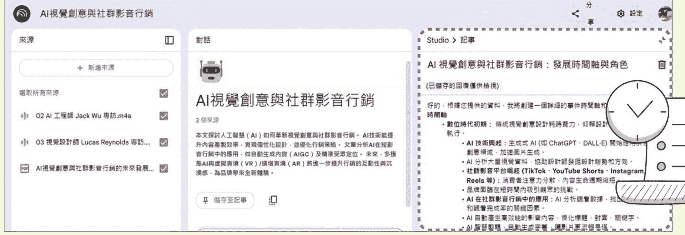

### 語音摘要：對話式語音，方便隨時收聽重要資訊

將來源資料整併後轉換為對話式語音 (目前僅能生成英文語音) 讓使用者能夠在通勤、運動或休息時隨時收聽重點資訊，提高學習與資訊吸收的便利性與靈活度。特別適合需要長時間閱讀的研究人員、商業專業人士，或是希望在碎片時間持續學習的使用者。

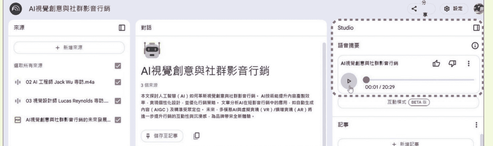

這六大 AI 分析模式，使 NotebookLM 不僅是一個筆記管理工具，更是強大的知識處理與內容優化助手，能有效提升學習、研究與資訊應用的效率。

## NotebookLM 常見問題

許多人對 NotebookLM 的免費權限、支援格式、隱私安全及使用方式...等仍有許多疑問，在此整理了最常見的問題與解答。

#### ✦ NotebookLM 是否可免費使用？

NotebookLM 目前只需擁有 Google 帳戶即可免費登入、使用。自 2025 年起，推出付費版 NotebookLM Plus，提供更進階的功能，滿足更多使用者的需求。

#### ✦ NotebookLM 和 NotebookLM Plus 的差異

下表可快速比較差異並了解免費版的限制。

| 功能項目 | NotebookLM | NotebookLM Plus |
| --- | --- | --- |
| 筆記本數量限制 | 每個帳號 100 本 | 每個帳號 500 本 |
| 每日對話次數 | 50 次 | 500 次 |
| 每本筆記本的來源數量 | 50 個資料來源 | 300 個資料來源 |
| 單一來源字數限制 | 500,000 字 | 500,000 字 |
| 每日語音摘要生成數 | 3 次 | 20 次 |
| 自訂回應風格與長度 | 不支援 | 支援 |
| 團隊筆記本共享與使用分析 | 指定對象共享 | 支援 |
| 隱私與安全保障 | 基本保護 | 企業級保護 |
| 適用對象 | 個人使用者 | 企業、學校、組織、高階需求個人使用者 |
| 取得方式 | 免費提供 | 透過 Google Workspace 或 Google Cloud 購買 |

即時資訊請參考官網「https://support.google.com/notebooklm」中 關於 NotebookLM \ 升級至 NotebookLM Plus 的詳細說明。

#### ✦ NotebookLM 與其他 AI 工具有何不同？

與其他 AI 工具相比，NotebookLM 最大的特色在於強調 "有憑有據" 的回答。只依據使用者上傳的資料進行回應，確保資訊的準確性，並提供明確的資料來源引用標註，方便使用者輕鬆驗證與參考，確保內容可信度。

#### ✦ NotebookLM 可以上傳的資料來源類型？

NotebookLM 支援多種資料來源，方便使用者整合與管理資訊。請確保擁有合法的上傳權限，避免上傳未經授權的內容。

- Google 文件與簡報：直接從 Google 雲端硬碟匯入。
- 本機或線上檔案：包括 PDF、純文字 (.txt)、Markdown (.md) 檔案。
- 網頁連結：網頁網址、公開影片的 YouTube 網址。
- 音訊檔案：上傳音訊檔內容以進行處理。


#### ✦ NotebookLM 來源檔案大小上限是多少？

每個來源的字數上限為 500,000 字，且上傳檔案的大小不得超過 200 MB，頁數則沒有限制。

#### ✦ 上傳的 PDF 檔無法辨識文字

部分 PDF 檔案會將內容轉換為圖片，使 NotebookLM 無法正確辨識文字，進而影響文件分析的準確性。自 2024 年 9 月起，NotebookLM 開始支援包含圖片的 PDF，並強化對 PDF 圖片內容的處理，但相較之下，仍以非圖片型態的文件能提供更完整的擷取資料內容。

#### ✦ Google 文件與 Google 簡報來源的限制

NotebookLM 取得 Google 雲端硬碟中的文件與簡報時，目前有以下限制：

- 無法刪除或自動更新檔案：NotebookLM 僅能檢視並存取當前登入 Google 帳號所擁有權限的 Google 文件與 Google 簡報。NotebookLM 會建立原始檔案的副本，但不會自動同步或追蹤原始檔案的變更。
- 手動同步更新：若原始檔案有變更，需在 NotebookLM 來源中選按 **按一下即可與 Google 雲端硬碟保持同步** 鈕即可重新整理並再次匯入原始檔案。

#### ✦ YouTube 來源的限制

NotebookLM 取得 YouTube 影片時，目前有以下限制：

- 僅支援含有字幕 (使用者上傳或自動生成均可) 的公開 YouTube 影片。
- 影片長度不限，但字幕內容不得超過 50 萬個字。
- 只能匯入影片的文字轉錄稿，不包含影像或其他資料。

可能無法取得的情況 (具體狀況會因 NotebookLM 版本變更而有所不同)：

- 近期上傳的影片 (72 小時內) 可能無法新增，建議稍後再試。
- 沒有語音的影片不支援匯入。
- YouTube 連結無效、影片遭到刪除或設為私人，其內容將於 30 天內自動從筆記本移除。
- 另外有：影片內容可能不安全、來源字幕檔案無法讀取、影片語言目前不支援...等原因。


#### ✦ 網頁網址來源的限制

NotebookLM 取得網頁資料時，目前僅能擷取指定網頁的文字內容，忽略圖片、嵌入影片或巢狀網頁。此外，對於設有付費牆或停用網路抓取功能的網頁，NotebookLM 無法支援。

#### ✦ 為何來源上傳作業會失敗？

目前免費可使用的 NotebookLM，如果來源長度超過字數上限 (每個來源 50 萬字)、檔案超過上限 (200 MB)、原始 PDF 檔案禁止複製，或是 YouTube 影片、網頁網址或 Google 文件與簡報權限...等限制因素 (參考此二頁說明)，均可能導致上傳失敗。

若上傳失敗，該項目會直接取消上傳操作，或呈粉紅色警告狀態，這時請確認來源是否符合 NotebookLM 支援條件，或嘗試更換其他符合要求的來源。

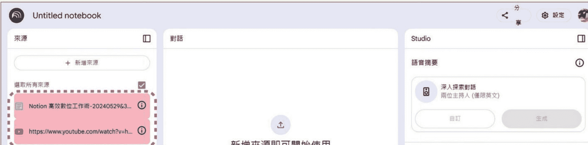

#### ✦ 是否適用於行動裝置

NotebookLM 主要適用於桌面瀏覽器，但仍可透過行動裝置的瀏覽器存取其功能。未來，Google 可能會擴展對行動裝置的支援，方便使用者更輕鬆地在手機和平板上使用 NotebookLM。

(更多常見問題資訊請參考 NotebookLM 官網詳細說明。)

### 切換畫面為深色 / 淺色模式

NotebookLM 畫面支援深色模式，可配合工作環境需求調整，提供使用者更舒適的視覺體驗與操作感受。

NotebookLM 畫面右上角選按 設定。

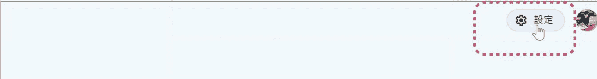

再選按 裝置 \ 深色模式，即可將介面切換為深色模式。

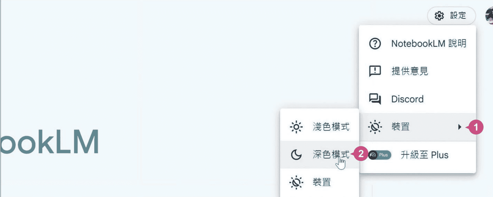

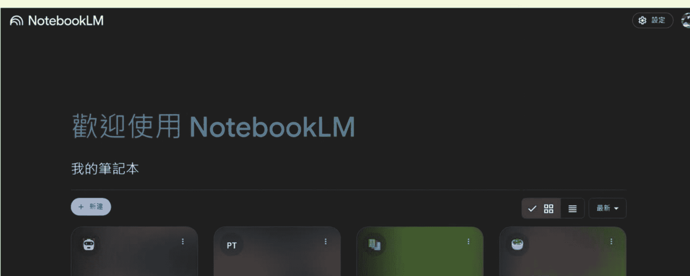

# PART 02

## 打造專屬知識庫
### 你的第一本 AI 筆記本


### 單元重點

在 NotebookLM 建立第一本筆記本，上傳資料來源自動產生摘要。透過精準提問，可獲得關鍵回覆，並將產生的重要回覆儲存至記事。

- [x] 提取關鍵資料與分析方向
- [x] 建立筆記本
- [x] 上傳多類型資料來源
- [x] 閱讀所有資料的摘要

- [x] 閱讀特定資料摘要與重要主題
- [x] 閱讀每份資料內容與逐字稿
- [x] 常見的提問技巧與方法
- [x] 將重要回覆儲存至記事

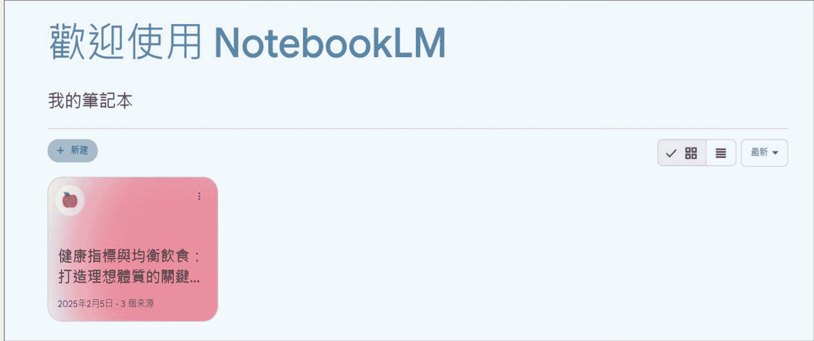

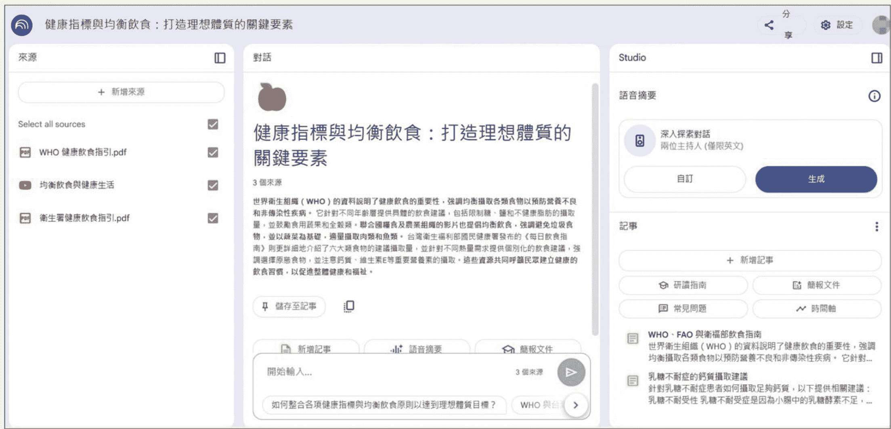

■ 2-2

## 1 提取關鍵資料與分析方向

要開始以 NotebookLM 整理資料之前，可以先用 ChatGPT 詢問標題名稱，並尋求相關資源的建議與分析。

開啟瀏覽器，於網址列輸入：「https://chatgpt.com/」進入 ChatGPT，可以選擇登入帳號，或直接於畫面中開始提問。

**step 01** 希望 ChatGPT 提供一個更具吸引力、專業性或精確性的標題，以概括此章要分析的 "健康指標與均衡飲食攝取" 這一研究主題。

> **提示詞**
> 若要研究這個主題：健康指標與均衡飲食攝取，請給一個比較合適的標題。

「 健康指標與均衡飲食：打造理想體質的關鍵要素 」

**step 02** 開啟 搜尋，希望 ChatGPT 整理並推薦可信賴的線上資源，以便更有效地研究 "健康指標與均衡飲食攝取" 這一主題或獲取相關資訊。

> **提示詞**
> 請建議網路上一些可以取得的資源，資源整理成這四類：PDF 、影片、文獻、網路文章，以官方、政府或教育平台提供的資料來源為主，請標明出處與連結。

1 請建議網路上一些可以取得的資源，資源整理成這四類：PDF 、影片、文獻、網路文章，以官方、政府或教育平台提供的資料來源為主，請標明出處與連結。

+ 搜尋 2 推理 3

開啟 **搜尋**，可獲取最新或更精確的資訊，如新聞、官方公告與特定網站內容，提升即時性與精確度。回覆內容會於每個項目提供參考資源連結，選按 **資料來源** 鈕可於右側開啟所有相關參考資料列項。

1. 健康飲食原則
    - 出處：香港衛生防護中心
    - 連結：健康署
    - 簡介：該文章介紹健康飲食的基本原則，包括健康飲食金字塔

2. 健康促進推動項目相關衛教素材參考網站
    - 出處：教育部學校衛生資訊網
    - 連結：教育部學校衛生資訊網
    - 簡介：該網站提供多種與健康促進相關的衛教素材，包括食安教學影片和資料。

希望以上資源能對您的研究有所幫助。

引用

高雄市政府衛生局
每日飲食指南手冊 - 衛生福利部國民健康署
本版每日飲食指南涵蓋六大類食物：全穀根莖類、豆魚蛋肉類、乳品類、蔬菜類、水果類、油脂與堅果種子類。

高雄市政府衛生局
資源下載 - 衛生福利部國民健康署
以下9部影片資源因應網站使用流暢度進行區移除。請大家可改由以下路徑找到相關資源。

兒童醫學及健康研究中心
[PDF] 健康生活型態第一節、營養與飲食
2019年5月30日 — 均衡營養是兒童健康的基石，我國兒童在飲食營養方面面臨許多挑戰。

國立屏東科技大學
[PDF] 營養教育應用於三年級學童飲食


**step 03** 希望 ChatGPT 針對研究主題建議可能的分析方向，以及拆解成具體的問題以利於 NotebookLM 探討。

> **提示詞**
> 針對 "健康指標與均衡飲食攝取" 主題該如何進行分析？可以提出哪些計畫方向以及問題加以研究。

在分析**「健康指標與均衡飲食攝取」**這個主題時，可以從生理數據、飲食模式、影響因素**等角度進行探討。以下是分析方法、計畫方向，以及可以研究的問題：

---

**1. 分析方法**

* **數據收集：**
    * 記錄 BMI、體脂率、血糖、膽固醇等健康指標。
    * 透過飲食紀錄收集碳水化合物、蛋白質、脂肪、維生素等營養素的攝取情況。
    * 進行問卷調查，分析飲食習慣與健康指標的關聯性。

***以下省略***

## 建立筆記本

NotebookLM 中，為筆記本精確命名有助於快速識別所需主題，輕鬆找到所需內容，節省時間並提高工作效率。

#### 首次建立筆記本

首次進入 NotebookLM，選按 **建立** 鈕，即可進入新的筆記本畫面。

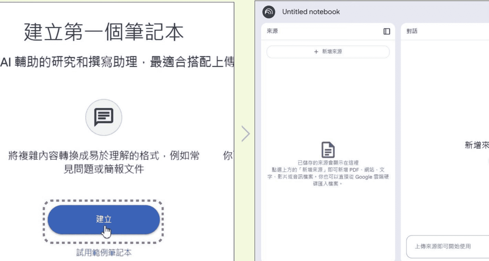

##### 小提示

出現 "上傳來源" 畫面
進入新的筆記本畫面，若出現如下 **上傳來源** 畫面，可先選按該畫面右上角的 × 關閉此畫面，待後續完成筆記本命名後再上傳來源。

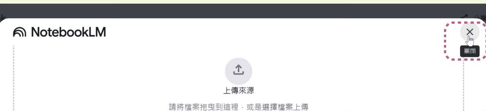

#### ✦ 回到首頁再次建立筆記本

筆記本左上角選按 🌐 返回首頁，選按 **+ 新建** 鈕，即可再次建立並進入新的筆記本畫面。

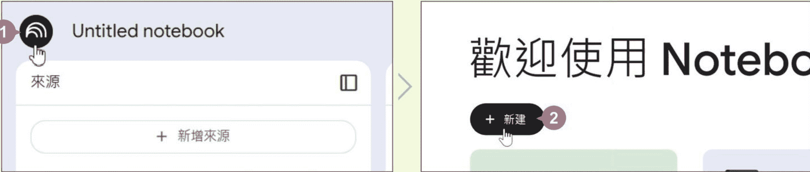

##### 小提示

出現 "上傳來源" 畫面

進入新的筆記本畫面，若出現如下 **上傳來源** 畫面，可先選按該畫面右上角的 × 關閉此畫面，待後續完成筆記本命名後再上傳來源。

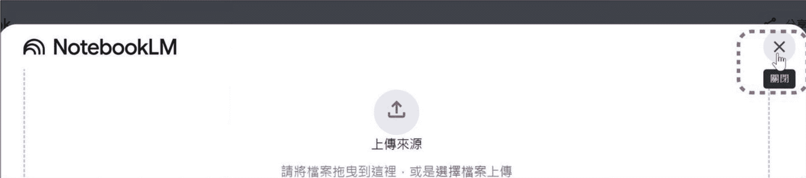

#### ✦ 修改筆記本名稱

於首頁選按任一筆記本，進入該筆記本畫面。左上角選取預設的名稱 **Untitled notebook**，再輸入合適的筆記本名稱，此範例輸入「健康指標與均衡飲食：打造理想體質的關鍵要素」。

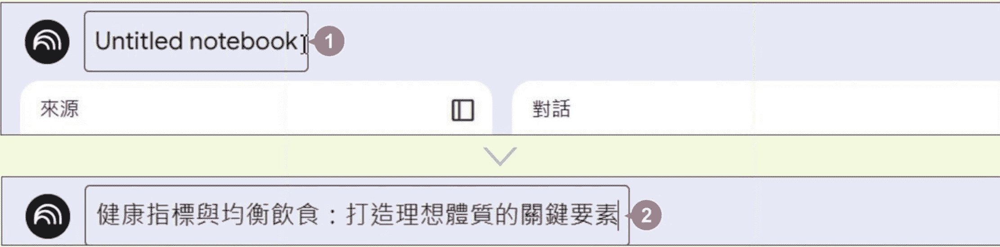

## 上傳多類型資料來源

將依 ChatGPT 建議取得的相關檔案或是網址、影片，新增至來源區塊，以利後續 NotebookLM 資料分析。

#### ✦ 新增來源：線上 PDF 檔案

於瀏覽器開啟存放 PDF 文件的網頁頁面，此章 資料來源 1 (衛生福利部國民健康署 / 每日飲食指南手冊) 選按指定的 PDF 檔下載連結，於 PDF 預覽畫面選按 ⬇，將 PDF 檔下載至本機電腦。

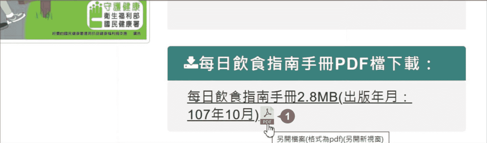


回到 NotebookLM 筆記本，於 來源 區塊選按 + 新增來源 鈕。

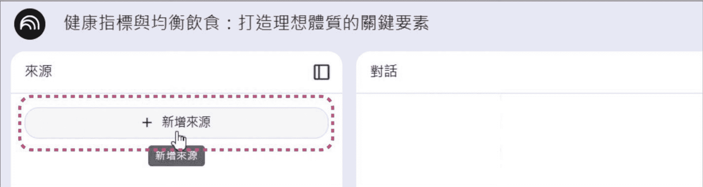

**Step 03** 新增來源 視窗選按 ↗ 開啟對話方塊，指定存放路徑並選按欲上傳的 PDF 檔案，再選按 **開啟** 鈕。

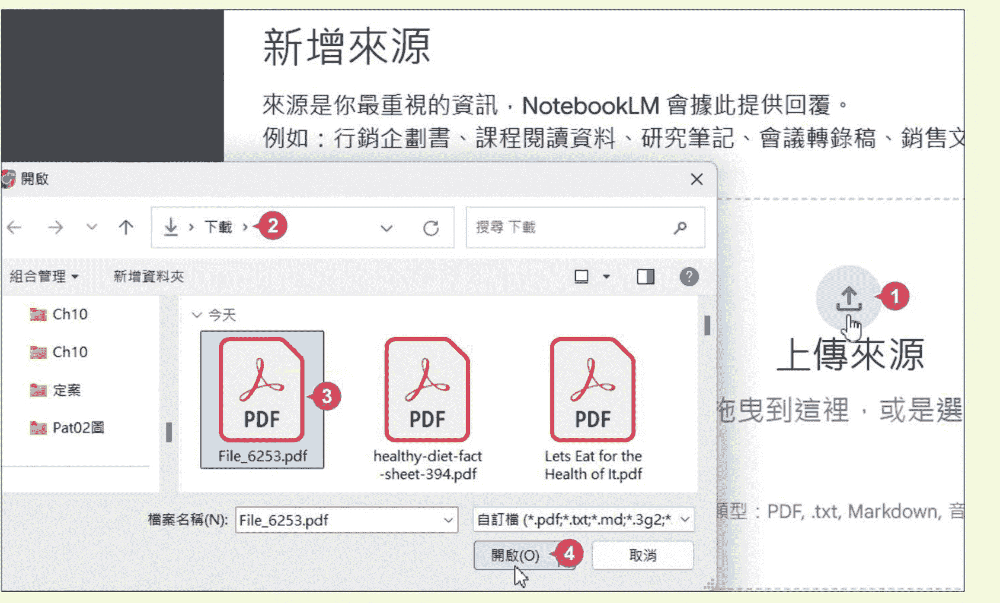

**Step 04** 待上傳完成後，**來源** 區塊會看到該 PDF 檔案項目，且呈核選狀態。

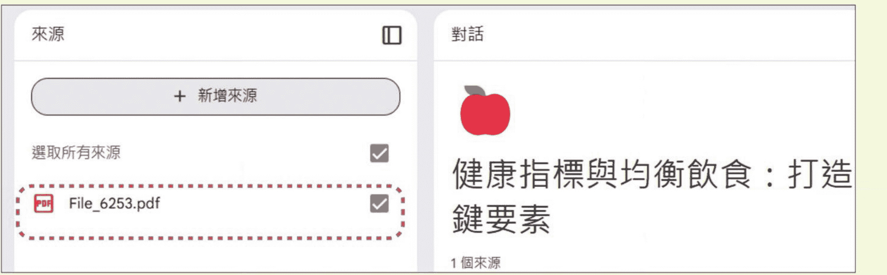

**Step 05** 再依相同方法，分別將其他欲參考的 PDF 檔加入至 **來源** 區塊。

> **小提示**
> 依相同方法新增其它參考資料來源檔案：
> 此章 **資料來源 2**：(世界衛生組織 / healthy-diet-fact-sheet-394.pdf)

#### ✦ 新增來源：YouTube 連結

於 來源 區塊上選按 + 新增來源 鈕。

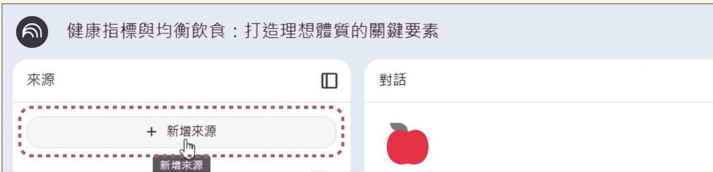

新增來源 視窗下方 連結 項目選按 YouTube，將在 ChatGPT 提問時取得或手邊收集且合適的網址貼入至欄位中，複製此章 資料來源 3 (FAO / A healthy diet is about balancing food) 的網址貼上，選按 插入 鈕。

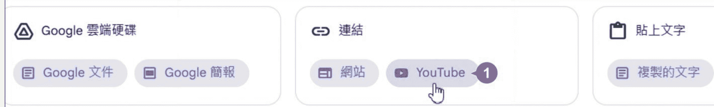

在下方貼上 YouTube 網址，即可上傳做為 NotebookLM 的來源

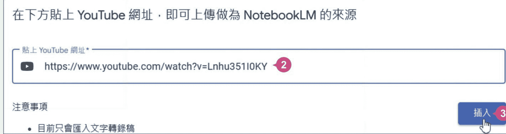

待上傳完成後，來源 區塊會看到該 YouTube 項目，且呈核選狀態。

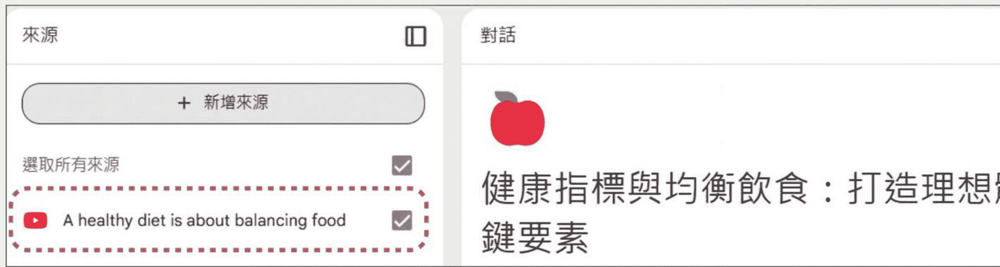

#### 管理來源：重新命名來源

NotebookLM 左側 來源 區塊，會列項所有來源項目，可針對項目重新命名，有助於資料來源的管理與查找，同時避免資料重複或混亂。

step 01
將滑鼠指標移至欲重新命名的項目上，選按 `⋮` \ 重新命名來源。

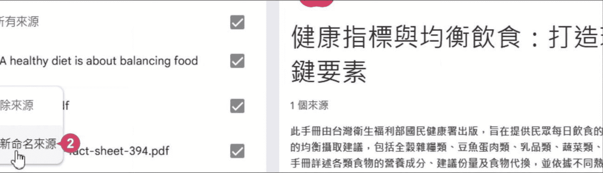

step 02
於 來源名稱 欄位刪除原名稱，再輸入欲變更的名稱，選按 儲存。

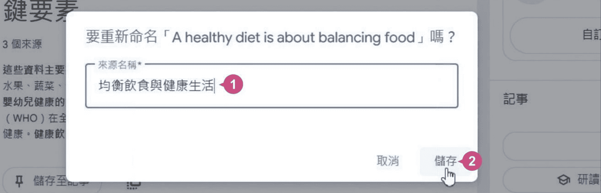

step 03
依相同方法，分別變更其他的來源名稱，方便後續在分析來源時快速辨識出需核選或是取消核選的項目。

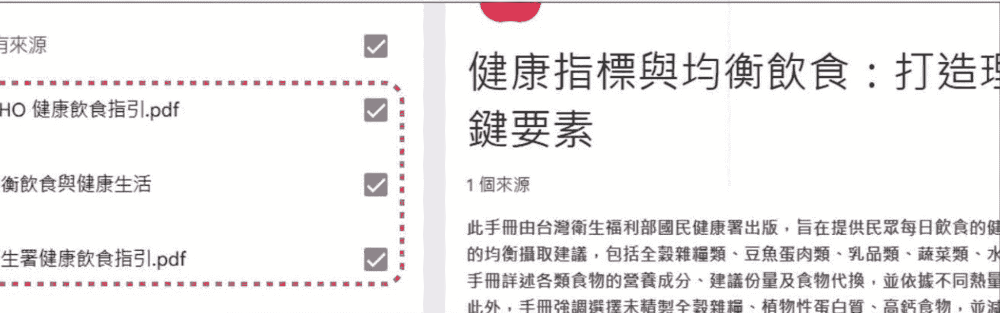

#### ✦ 管理來源：刪除來源

即時將影響 NotebookLM 資料分析準確度的來源刪除，避免在提問時出現誤導性的資訊，進而導致決策或最終研究結果的錯誤。

將滑鼠指標移至欲刪除的項目上，選按 ⁞ \ 移除來源。

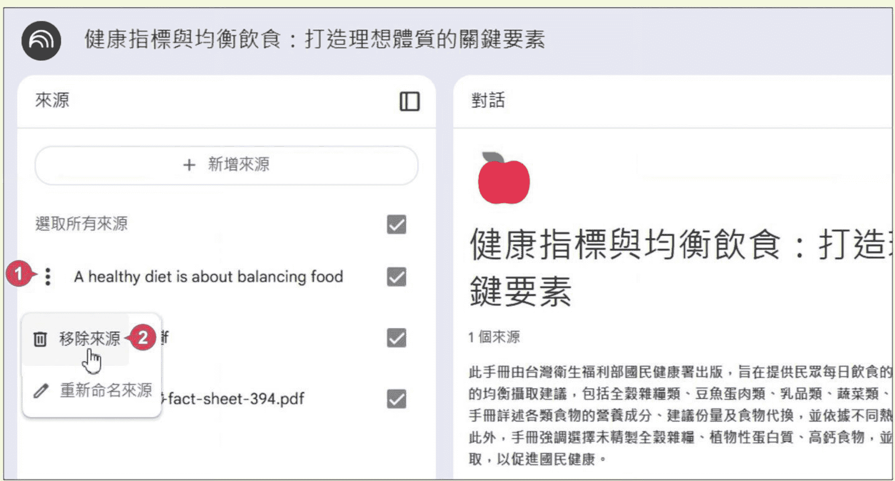

> 🟢 小提示 🟢

**提升資料分析的準確性與精確性**

上傳觀點偏頗、未經查實或過時...等的資料來源，會影響 NotebookLM 資料分析的正確性，以下為找尋資料需要注意的方向。

- **資料來源**：未經學術單位或專業性審核的資料來源，可能存在錯誤或偏見的資訊，建議參考可信的資訊來源機構或單位。
- **資料時效**：過時的資料可能不適用於最新或當下的情境，若未及時更新資訊，會導致對趨勢的判斷失去參考價值。
- **引用方式**：在引用原資料時有錯誤的理解，或是沒有仔細閱讀前後文便斷章取義，將在後續造成研究方向偏差。
- **觀點偏頗**：過度偏向某些論點或觀念，忽略多元觀點的深入探討，會導致研究方向偏差，建議參考多元的資料並交叉驗證，取得更全面的視野。

## Tip 4 阅读所有资料的摘要

新增资料来源后，会于 对话 区块显示目前所有的资料摘要，快速掌握研究方向。

将欲分析、研究的资料来源上传后，可于 对话 区块最上方显示所有来源资料的摘要（若没有出现摘要，于网页左上角选按 🔄 重新整理），方便快速掌握关键资讯，提升阅读与研究效率。

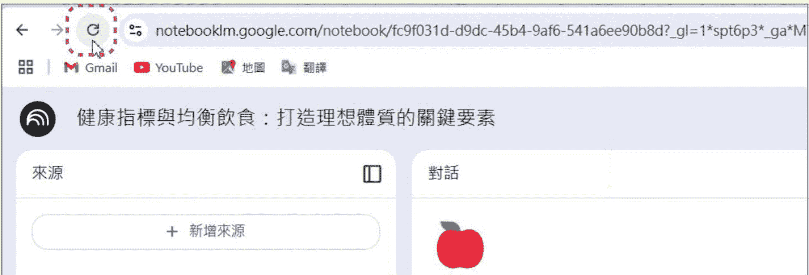

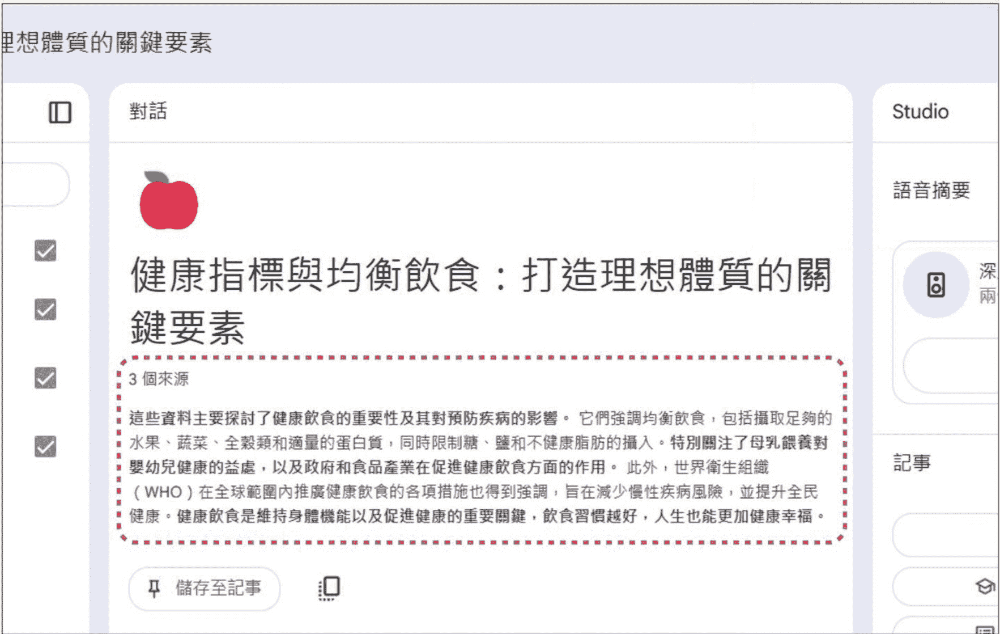

## 5 阅读每份资料摘要与重要主题

每份上传的资料都会自动生成摘要并提取重要主题，帮助使用者快速掌握核心内容，提升资料处理效率与决策精准度。

- ✦ 阅读每份资料来源的资料摘要

于 来源 区块选按如图 PDF 文件，会显示该文件生成的资料摘要。

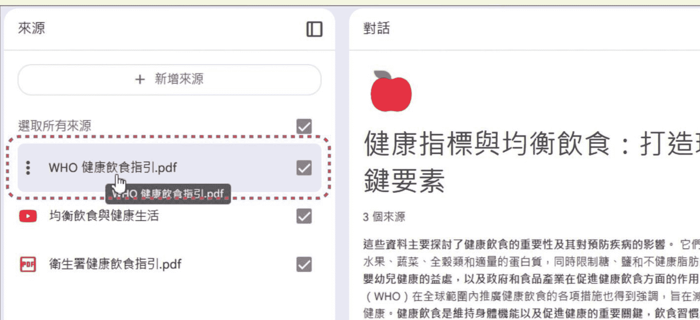

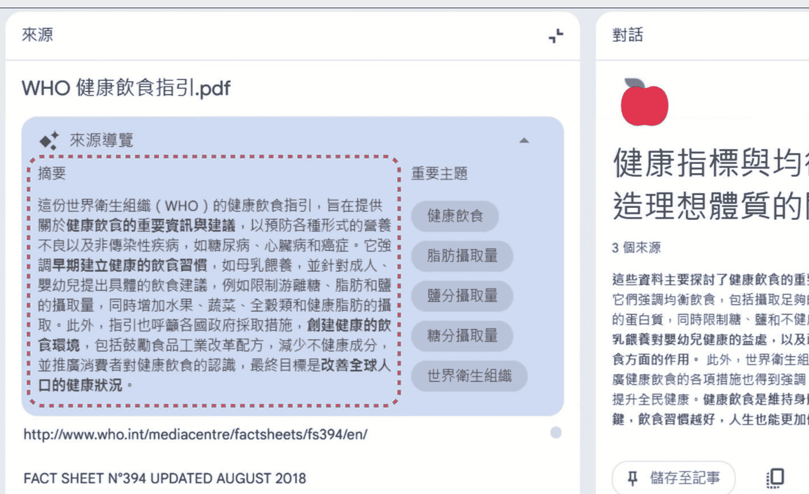

## ✨ 理解重要主题与关键用词

若想理解文件中的主题或关键用词，可于 **重要主题** 选按想要理解的关键字，会自动于 **对话** 区块提问并生成回复内容。

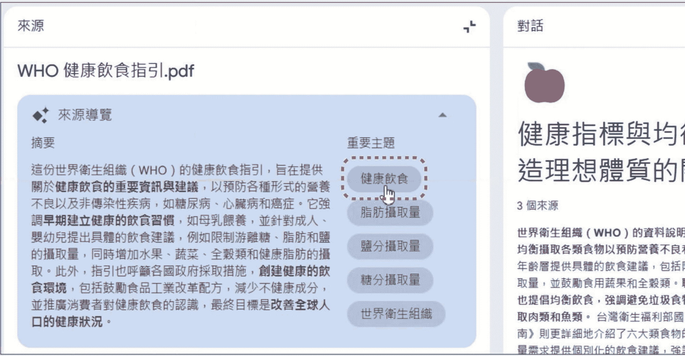

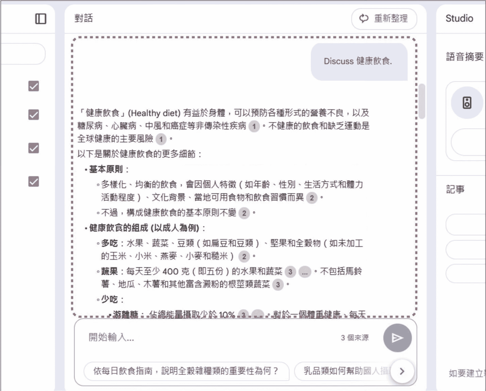

## 阅读每份资料内容与逐字稿

在提问前，先浏览来源资料内容，可确保获取关键资讯，同时加深对资料的理解，进而提升提问的精确度。

### ✦ 阅读文件资料内容

于 来源 选按如图 PDF 文件，下方会显示文件资料的文字内容，向下滚动可浏览全部内容；选按 来源 区块右上角 🗔 关闭特定来源浏览画面。

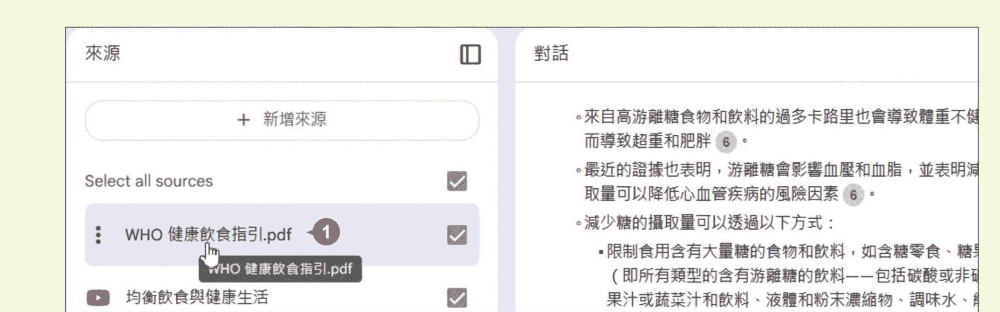

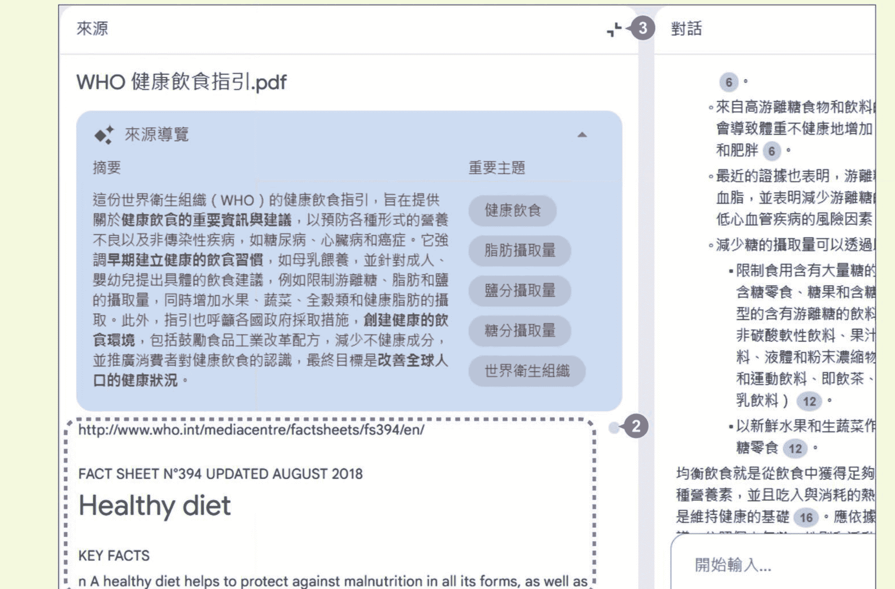

### ★ 浏览影片逐字稿

于 **来源** 选按如图影片来源，下方会显示影片及自动生成的影片逐字稿，向下滚动可浏览全部内容；选按 **来源** 区块右上角 ✚ 关闭特定来源浏览画面。

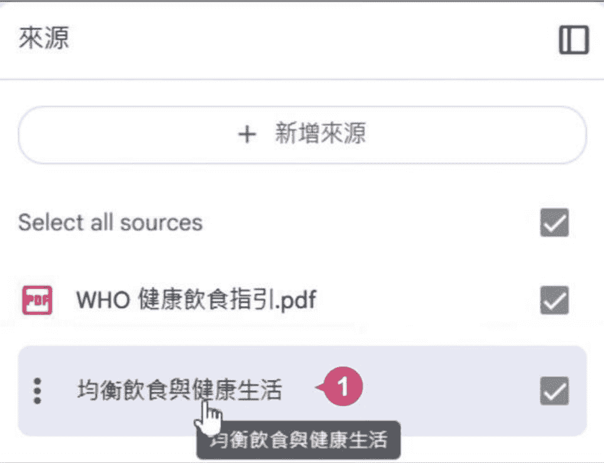

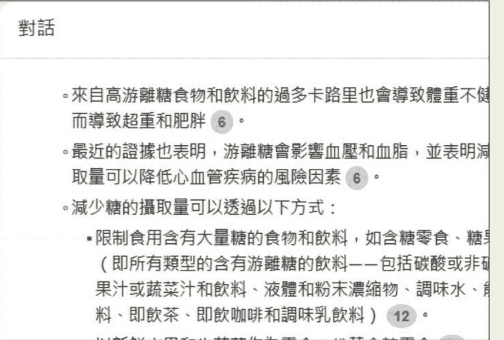

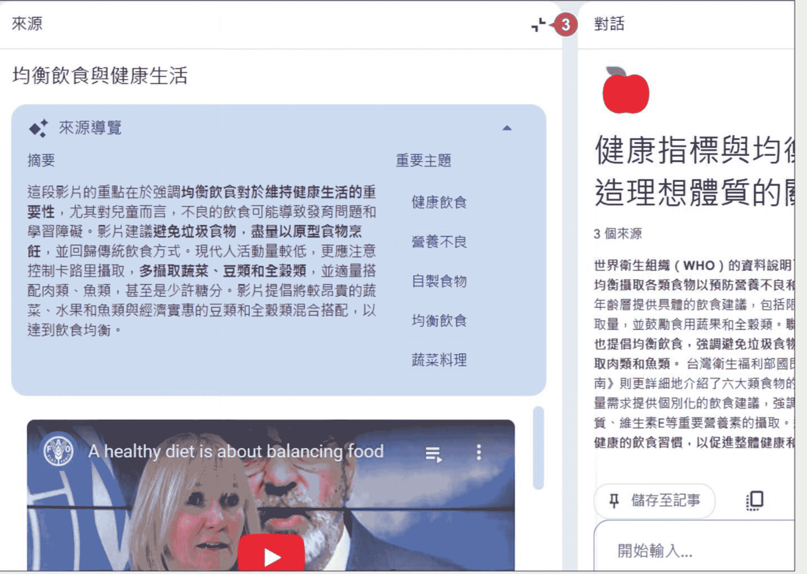


2-16

## 7 常见的提问技巧与方法

NotebookLM 提问技巧可帮助你在大量资料中精确掌握要点，深入探索并精确提问，从而快速获取关键资讯。

### ✦ 具体清晰的提问

与 AI 人工智能沟通时，“提问”指的是提供给 AI 的指令、提示词与各式描述，用来引导 AI 生成回答或特定内容。模糊的提问不仅会影响沟通，也会让 AI 工具无法提供正确的回应，为了让沟通更加顺畅，可以透过具体的指示、总结到细节提问，及多种情境提问来沟通。这些方法能有效帮助 NotebookLM 理解问题的本质，进而提供更准确的回答。

提问时，需给予 NotebookLM 具体的指示，避免使用模糊或不确定的描述。

「请制定一套健康的饮食计划」就是较模糊的提问，建议改成：「体重 60 公斤、身高 165 公分的 30 岁女性该如何制定健康的饮食计划？」。

于 **对话** 区块对话框输入后，选按 ▶ 钮送出提问，接着 **NotebookLM** 会依据 **来源** 区块中的资料进行分析并回复详细的内容。

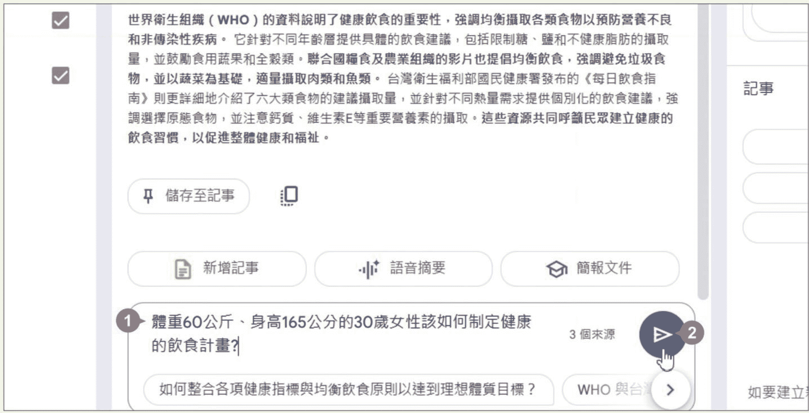

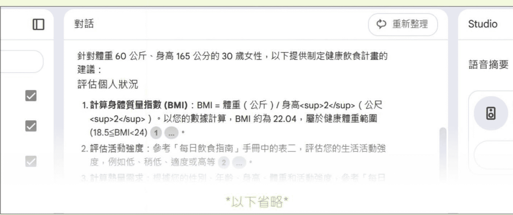

### 循序渐进的解析

从 **基础理解** → **比较分析** → **进阶应用** 的层次进行提问，不仅能获得更有脉络的回复，还能帮助聚焦核心问题，提升思考深度与发想效率。

**基础理解**：了解这个主题在来源资料中是如何被定义或相关基础知识。于 **对话** 区块对话框输入：「国民健康署的每日饮食指南主要建议了哪些食物摄取原则？」，选按 ▶ 钮送出提问，接着 NotebookLM 会开始分析并回复详细的内容。

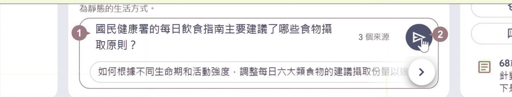

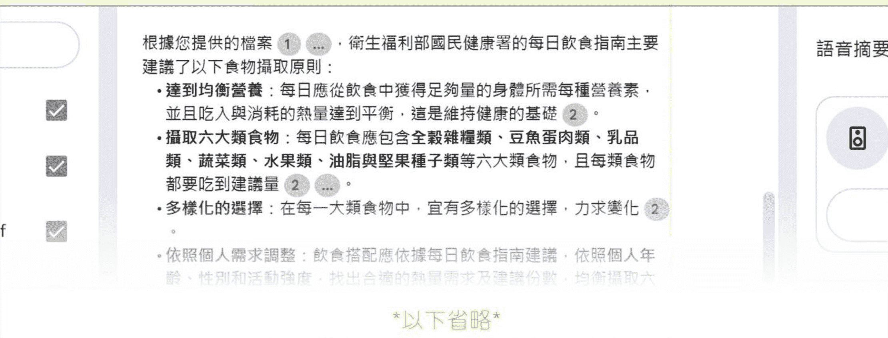

**比较分析**：当掌握基本概念后，进行深入比较；透过交叉比对，能理解背后的科学依据与文化影响。于 **对话** 区块对话框输入：「WHO 与国民健康署的饮食指南在建议上有哪些相似点和差异点？」，选按 ▶ 钮送出提问。

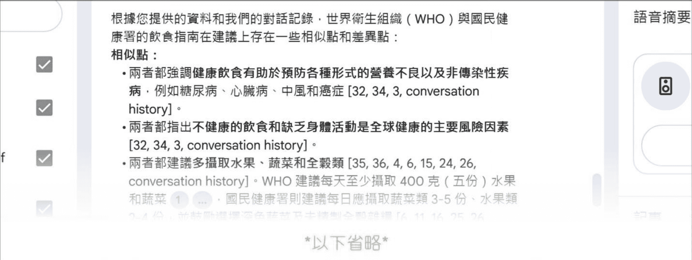

**进阶应用**：理解原则与异同后，如何实际应用。于 **对话** 区块对话框输入：「假如我要设计一款饮食追踪 APP，这资料中的哪些资讯最值得纳入？」，选按 ▶ 钮送出提问。

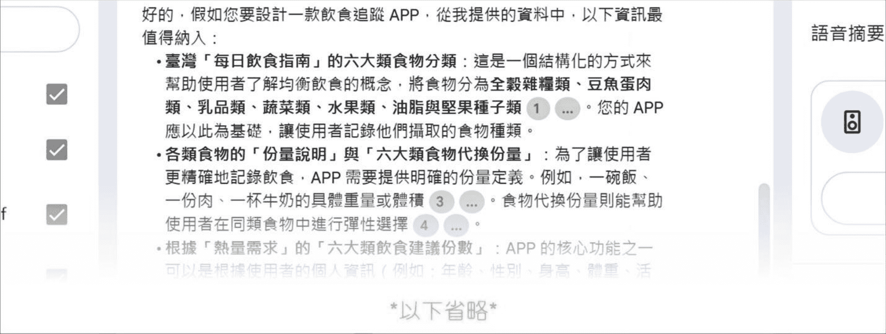

最后，可再依回复内容，进一步调整问题，或自行挑选欲延伸探讨的主题，以获取更精确或深入的资讯。

> **小提示**

**查看回复来源资讯**

将鼠标指标移至回复的文字最后方数字注脚上，会显示此段回复内容的参考来源。

### 多种情境提问

充分了解资料脉络及重点后，可以根据不同需求，灵活运用多种提问方式，帮助你更有效地分析资料，并加深对内容的理解。以下是几种常见的提问情境：

- 基础理解：适用于快速掌握概念，如「请简要说明这篇文章的重点」。
- 深入探讨：针对特定主题挖掘细节，如「深入分析食物选择的影响因素」。
- 比较与对照：比较不同观点或内容，如「对比 A 与 B 的优缺点」。
- 摘要与整理：请总结长篇内容，如「请将此文件摘要为 200 字」。
- 应用与推论：资讯转化为实际应用，如「如何将此策略应用于市场营销？」
- 创意发想：用于脑力激荡，如「基于这篇文章内容，发想 3 个创新点子」。
- 校对与优化：帮助改写或润饰内容，如「请将这段文字优化，使其更清晰流畅」。

针对 “应用与推论” 的情境应用，可于 **对话** 区块对话框输入：「请依据以下一日午餐的清单，调整成健康的饮食规划：起司培根焗烤饭、香肠拼盘、千岛酱高丽菜沙拉。」，选按 ▶ 钮送出提问，接着 NotebookLM 会开始分析并回复详细的内容。


针对 “深入探讨” 的情境应用，可于 **对话** 区块对话框输入：「68 岁男性，有高血压、高血脂及骨质疏松问题，请列出详细的健康饮食注意事项。」，选按 ▶ 钮送出提问，接着 NotebookLM 会开始分析并回复详细的内容。


### ✦ 由建议问题开始提问

当面对新主题或整理大量资料时，不妨参考对话框中的问题建议，这些问题能引导提问方向并启发更深入的思考。选按合适的建议，接着 NotebookLM 会开始分析并回复详细的内容。


### ✦ 删除目前的对话重新开始

若因为一连串的对话或多主题探讨，以至于回复愈来愈偏离主题，又或者欲重新开始新的研究方向，可于 **对话** 区块右上角选按 **重新整理** 钮 \ **继续** 钮，删除目前的对话纪录重新开始。


## 8 将重要回复储存至记事

关闭、离开笔记本或重新整理页面，对话 区块的对话纪录并不会被保留，若有重要回复，需即时储存于 记事，方便后续浏览及查看。

### ✦ 储存回复至记事

于 对话 区块，需要储存为 记事 的回复内容下方选按 储存至记事 钮，将该回复储存至 Studio 区块 \ 记事。


于 Studio 区块可看到刚刚储存的记事，选按该记事可浏览记事内容。


储存的记事仅能浏览内容，无法继续提问或编辑。


> **小提示**
> 
> **储存所有资料的摘要至记事**
> 
> 于 **对话** 区块最上方，所有资料的摘要下方选按 **储存至记事** 钮，同样的可将该摘要储存至 **Studio** 区块\记事。


### ✦ 重新命名记事名称

选按欲重新命名的记事，于记事名称上按一下鼠标左键，重新输入合适的记事名称，此范例输入「WHO、FAO 与卫福部饮食指南」。


选按 ✦ 返回笔记本主画面，显示修改后的名称。


### ✨ 删除记事

鼠标指标移至欲删除的记事，选按 `...` ＼ **删除记事** ＼ **删除** 钮，完成删除。


### ✨ 一次删除所有记事

于 **记事** 选按 `...` ＼ **删除所有记事**，再选按 **继续** 钮，即可一次删除所有记事。


# PART 03

## 资料分析与应用

从探索主题到高效整理


## 单元重点

NotebookLM 可协助整理论文或大量资料文件，透过 AI 解析、摘要重点、产生笔记与问答，让资料分析更高效。

- 提取关键资料与分析方向
- 建立笔记本
- 上传多类型资料来源
- 一键掌握核心内容
- 一键生成关键问题整理
- 一键生成学习问题研读指南
- 问答与分析
- 将重要回复储存至记事
- 将记事转换为来源
- 多层次摘要
- 论文资料整理与总结


## 提取关键资料与分析方向

要开始以 NotebookLM 整理资料之前，可以先用 ChatGPT 询问标题名称，并寻求相关资源的建议与分析。

开启浏览器，于网址栏输入：「https://chatgpt.com/」进入 ChatGPT，可以选择登入帐号，或直接于画面中开始提问。

希望 ChatGPT 提供一个更具吸引力、专业性或精确性的标题，以概括此章要分析的 “AI 影音多媒体应用” 这一研究主题。

> **提示词 💬**
> 
> 若要研究这个主题：AI 影音多媒体应用，请给一个比较合适的标题。

1. 「AI技术在影音多媒体应用中的创新与挑战」
2. 「人工智能在影音与多媒体领域的应用与发展趋势」
3. 「探索人工智能在影音多媒体产业中的应用场景」
4. 「AI驱动的影音多媒体创作与技术突破」

开启 **搜寻**，希望 ChatGPT 整理并推荐可信赖的线上资源，以便更有效地研究 “AI 影音多媒体应用” 这一主题或获取相关资讯。

> **提示词 💬**
> 
> 请建议网路上一些可以取得的资源，资源整理成这四类：PDF、影片、文献、网路文章，以官方、政府或教育平台提供的资料来源为主，请标明出处与连结。

开启 **搜寻**，可获取最新或更精确的资讯，如新闻、官方公告与特定网站内容，提升即时性与精确度。回复内容会于每个项目提供参考资源连结，选按 **资料来源** 钮可于右侧开启所有相关参考资料列项。


**Step 03** 希望 **ChatGPT** 针对研究主题建议可能的分析方向，拆解成具体的问题以利于 **NotebookLM** 探讨。

> **提问 💬**
> 
> 针对 “AI 影音多媒体应用的创新与发展” 主题该如何进行分析？可以提出哪些分析方向以及问题加以研究。


## 2 建立笔记本

由建立一本新的笔记本开始，再修改为合适的名称，将笔记本分门别类的清楚规划。

### + 新建笔记本

于 NotebookLM 首页，选按 + 新建 钮，即可进入新的笔记本画面。


> **小提示**
> 
> **出现 “上传来源” 画面**
> 
> 进入新的笔记本画面，若出现如下 上传来源 画面，可先选按该画面右上角的 x 关闭此画面，待后续完成笔记本命名后再上传来源。


### + 修改笔记本名称

于笔记本画面左上角选取预设的名称 Untitled notebook，再输入合适的笔记本名称，此范例输入「AI 影音多媒体应用的创新与发展」。


## 3 上传多类型资料来源

将依 ChatGPT 建议取得的相关档案或是网址、影片，新增至 **来源** 区块，以利后续 NotebookLM 资料分析。

### ✦ 新增来源：线上 PDF 文件

1. 于浏览器开启存放 PDF 文件的网页页面，此章 资料来源 1 (教育部全球资网 / 即时新闻)，选按指定的 **档案下载** 钮，于 PDF 预览画面选按 ↓，将 PDF 档下载至本机电脑。


2. 回到 NotebookLM 笔记本，于 **来源** 区块选按 **+ 新增来源** 钮。


**Step 03** 新增来源视窗选按 ⬆ 开启对话方块，指定存放路径并选按欲上传的 PDF 文件，再选按 开启 钮。


**Step 04** 待上传完成后，来源 区块会看到该 PDF 文件项目，且呈核选状态。


> **小提示**
> 
> 依相同方法新增其它参考资料来源档案：
> - 资料来源 2 (教育部全球资网 / 你不可不知的生成式 AI.PDF)
> - 资料来源 3 (财团法人中技社 / 教师培育与教材教法之探讨.PDF)

### ✦ 新增来源：YouTube 连结

**Step 01** 于 **来源** 区块上选按 **＋ 新增来源** 钮。


**Step 02** **新增来源** 视窗下方 **连结** 项目选按 **YouTube**，将在 ChatGPT 提问时取得或手边收集且合适的网址贴入至栏位中，复制此章 **资料来源 4** (BBC News) 的网址贴上，选按 **插入** 钮。


**Step 03** 待上传完成后，**来源** 区块会看到该 YouTube 项目，且呈核选状态。


> **小提示**
> 
> 依相同方法新增其它参考资料来源档案：
> 
> ■ 此章 **资料来源 5** (台湾事实查核中心 / AI时代，人类如何胜出？)

### 新增来源：网站连结

目前 **NotebookLM** 仅能撷取指定网页的文字内容，无法撷取图片、嵌入影片或巢状网页。

于 **来源** 区块上选按 **＋新增来源** 钮。


**新增来源** 视窗下方 **连结** 选项选按 **网站**，将在 ChatGPT 提问时取得或手边收集且合适的网址贴入至栏位中，复制此章 **资料来源 6 (国家教育研究院 / 国际脉动)** 的网址贴上，选按 **插入** 钮。


待上传完成后，**来源** 区块会看到该网页项目，且呈核选状态。


## 4 一键生成核心内容、总结与重点关注

**简报文件**功能是依所有来源资料，提取关键内容，方便使用者统整资讯、分享见解并高效准备简报。

**步骤 01** 于 Studio 区块选按**简报文件**钮。

**步骤 02** 待 AI 分析完成后，即会自动生成一份详细的笔记，选按该笔记可开启并浏览内容。（自动生成的笔记仅供检视，无法编辑。）

**简报文件**功能是依所有来源资料，自动整理为条理清晰的内容，列出重点摘要，适用于工作报告、提案、简报与会议摘要（不同来源资料生成的简报文件笔记架构会有所不同）。

于笔记名称上按一下滑鼠左键，可重新命名（建议可于名称前加上 “简报文件-” 用以识别笔记本生成方式）；选按 📌 即可收合此笔记。

## 一键生成关键问题整理

**常见问题**功能是依所有来源资料，自动生成重点、关键问题与答案，帮助使用者快速撷取主题和想法并理解内容。

**步骤 01** 于 Studio 区块选按**常见问题**钮。

**步骤 02** 待 AI 分析完成后，即会自动生成一份详细的笔记，选按该笔记可开启并浏览内容。（自动生成的笔记仅供检视，无法编辑。）

## 常见问题

**常见问题**功能是依所有来源资料，自动生成重点摘要、关键问题与对应答案，以协助使用者：

- **迅速理解内容**：自动提取资料中的重要资讯，减少逐字阅读的时间，提高理解效率。
- **捕捉核心概念**：针对主题提供关键问题与相关解答，引导使用者深入探索内容。
- **提升学习与研究效率**：自动整理复杂资讯，让使用者能专注于分析与决策，而非手动筛选内容。

常用于研究、报告撰写、内容整理等情境，确保使用者能在短时间内获取高价值的资讯，优化学习与工作流程。（不同来源资料生成的问题数量及架构会有所不同）。

于笔记名称上按一下滑鼠左键，可重新命名（建议可于名称前加上 “常见问题-” 用以识别笔记本生成方式）；选按 📋 即可收合此笔记。

## 一键生成学习问题研读指南

**研读指南**功能是依所有来源资料快速制作研读指南测验，包括简答题、答案、申论题及词汇表。

于 Studio 区块选按**研读指南**钮。

待 AI 分析完成后，即会自动生成一份详细的笔记，选按该笔记可开启并浏览内容。（自动生成的笔记仅供检视，无法编辑。）

## 研读指南

**研读指南**功能是依所有来源资料，建立章节重点、关键概念，甚至提供测验题目与解答，使学习者能循序渐进地理解知识，适合用于学术研究、备考或专业进修。（不同来源资料生成的题型数量及类型会有所不同）。

于笔记名称上按一下滑鼠左键，可重新命名（建议可于名称前加上 “研读指南-” 用以识别笔记本生成方式）；选按 📌 即可收合此笔记。

03 资料分析与应用／从探索主题到高效整理

Studio > 笔记

## 研读指南-AI教育与媒体素养：教学指南与测验

（已储存的回复仅供检视）

## AI 教育与媒体素养研究指南

测验

题型

简答题 (每题2-3句)

问题

1. 根据「AI 教师培育与教材教法之探讨」报告，目前中小学教师在推动 AI 教育时面临哪些主要挑战？
2. 「AI 教师培育与教材教法之探讨」中，建议如何加强教师学习AI的内在动机？
3. 根据「AI 教师培育与教材教法之探讨」，大学应如何设计AI课程以确保学生能熟练应用AI于其专业领域？
4. 根据「你不可不知的生成式AI_国小高年级学生版」，使用生成式AI时，学生应注意哪些事项？
5. 根据「数位时代媒体素养教育白皮书」，媒体素养教育的愿景为何？
6. 根据「数位时代媒体素养教育白皮书」，媒体素养教育的能力架构包含哪些？

答案

媒体应用的创新与，特别是生成式AI，在教育和职场的应用与推动AI教育的现况，包含中小学教师培因应生成式AI的教学策略。第二份文件则的生成式AI入门手册，说明生成式AI的原并强调批判性思考的重要性。最后一份文与机会，指出人类独有的创新力、敏捷力，将在与AI协作的未来职场中持续占据。

语音摘要

简报文件

*以下省略*

3-15

## 7 问答与分析

可依需求直接输入问题，或参考建议问题进行提问，并搭配合适的来源资料，使 NotebookLM 的回答更精准贴合你的需求。

### ✦ 输入问题提问

NotebookLM 提问可依需求输入问题，或使用建议提示词，如摘要、比较、应用、评估...等，引导 AI 提供更精确且有深度的回应。

于**对话**区块对话框输入：「请归纳出这些资料的三大核心观点」，选按 ▶ 键送出提问，接着 NotebookLM 会开始分析并回复详细的内容。

**步骤 02**

于**对话**区块对话框输入：「目前 AI 影片生成技术的局限性是什么？」，选按 ▶ 钮送出提问，接着 NotebookLM 会开始分析并回复详细的内容。（若提问的问题未在来源资料中提及，会出现 “由于目前提供的文件中没有直接定义 ****，因此无法直接回答这个问题，不过....” 的回复。）

目前 AI 影片生成技术的局限性是什么？

- **智慧财产权的侵害风险** ①：资料提到，生成式AI大量蒐集、学习与产出资料的过程中，可能涉及智慧财产权的侵害。这意味着，使用 AI 生成影片时，可能会有侵犯版权的风险，特别是当 AI 模型使用了受版权保护的素材进行训练时。
- **产出内容可能存在偏见、歧视或不正确** ②：资料指出，生成式AI会产生偏见、歧视、编造或不正确的资料。这也适用于影片生成，AI 可能会生成带有偏见、不真实或误导性的内容，使用者需要学习思辨、判断，并抱持批判态度，避免采用错误或不当的资料。
- **需要精准的提示词** ③ ...：根据资料，使用生成式AI产生文字或影音内容时，需要知道如何下达精准的提示词，才能获得符合期望的内容。这表示，使用者需要具备一定的提示词工程（prompt engineering）能力，才能有效控制AI生成影片的内容和风格。
- **使用者需为自身决策负责** ②：资料强调，不宜完全相信生成式AI提供的内容，使用者需要为自己的决定负责。这表示，使用者需要对AI生成的内容保持审慎的态度。

### ✦ 以建议问题提问

NotebookLM 内建多则建议问题，以目前的来源资料内容，提供不同角度的问题建议并明确的描述问题，以更有结构地询问或发掘新的见解。
于**对话**区块对话框下方选按建议的问题（选按右侧 > 键可以查看更多问题），接着 NotebookLM 会依照问题开始分析并回复详细的内容。

### ✦ 检视引用来源

于**对话**区块，提问的答复段落后方有灰色区块的数字，又称数字注脚，将滑鼠指标移到数字注脚上就会显示引用的来源出处与资料内容；于该视窗拖曳垂直卷轴，可以浏览更多内容。

选按数字注脚会于左侧**来源**区块开启引用的资料项目，并会上色选取目前引用的资料内容。

### 依指定来源资料提问

使用者可选择特定文件、影片或音讯来源资料作为回答依据。适用于深入研究、精准比对资讯或聚焦特定内容，确保 AI 回应更准确，避免与其他主题资料混淆。

**步骤 01** 于**来源**区块核选欲用来分析的来源项目（其他项目取消核选）。

**步骤 02** 于**对话**区块对话框，可看到来源由原本的 “6 个来源” 变成 “2 个来源”，接着输入：「请整理这些来源资料产生重点摘要」，选按 ▶ 钮送出提问。

3-20

## 8 将重要回复储存至笔记

在询问 AI 后，如果担心之后找不到该回复，可以把重要的回复内容储存到笔记，更容易统整资料。

**对话**区块回复的讯息需手动储存才能保存，否则只要重整页面、回到首页或是离开此笔记本回到首页，都会让回复的讯息消失。

**步骤 01** 于**对话**区块捲动至欲储存的回复内容下方，选按**储存至笔记**钮，将该回复储存至**区块 ＼ 笔记**。

**步骤 02** 于**区块**选按储存的笔记，可浏览存放的内容；笔记名称上按一下滑鼠左键，可重新命名笔记名称，选按 **** 即可回到笔记本主画面。（该笔记仅供检视，无法编辑。）

## 将笔记转换为来源

各式提问或 NotebookLM 生成的分析笔记，可以转换为来源资料，来源资料越多元化，越能有效提升内容分析的深度与准确性。

**步骤 01** 于**区块**，选按要转换为来源的笔记。

**步骤 02** 于笔记内最下方选按**转换成来源**，即可在左侧**来源**区块看到转换完成的笔记。

于**来源**区块核选由笔记转换过来的来源项目（其他来源取消核选），此处针对此来源提问。

AI 影音多媒体应用的创新与发展

7 个来源

这三份文件探讨人工智能，特别是生成式AI，在教育和职场的应用与影响。第一份文件分析台湾推动AI教育的现况，包含中小学教师培训、大学AI课程规划，以及因应生成式AI的教学策略。第二份文件则...

于**对话**区块对话框输入：「请列出此来源的八个重点，并加以说明。」，选按 ▶ 钮送出提问。

好的，以下为您整理的此来源的八个重点，并加以说明：
- **AI的发展与焦虑**：许多人对于AI的发展感到焦虑，担心在职场上被取代，例如作家等以文字为生的人...然而，AI的出现也带来新的机会，可以将繁琐的工作交给AI处理，让人们有更多时间做自己喜欢的事情。这意味着AI既带来了挑战，也提供了新的可能性。
- **与AI协作**：面对AI时代，重要的不是抗拒，而是学习如何与AI和平共处、协同合作。例如，在法律界，律师可以利用AI工具分析大量法律文件，然后再由律师验证评估，做出决策。这强调了人机协作的重要性，而非单纯的竞争。

*以下省略*

## 10 多层次重点摘要与完整笔记

当使用 AI 进行摘要整理时，可依文章长短或是格式需求，直接于对话中具体清晰的提问，省去后续编辑调整的时间。

### ★ 整理摘要 (分段落、字数)

于**对话**区块对话框输入：「**请将所有来源资料汇整并摘要，字数于300字内，分成二个段落。**」，选按 ▶ 钮送出提问，接着 **NotebookLM** 会开始分析并回复内容。

### ✦ 条列重点

于**对话**区块对话框输入：「请将所有来源资料，整理为条列式重点摘要。」，选按 ▶ 钮送出提问，接着 NotebookLM 会开始分析并回复内容。

### ✦ 整理出完整的笔记资料并解析、补充

于**对话**区块对话框输入：「请根据所有资料整理成详尽的笔记，撰写一篇对高中三年级学生易懂的内容，重要内容或其中涉及较复杂的观念，请适当解释补充。」，选按 ▶ 钮送出提问，接着 NotebookLM 会开始分析并回复内容。

## 心智图：让思绪更清晰！

NotebookLM 心智图，让想法更有条理。透过视觉化笔记，自动整理概念、建立关联，让复杂的资讯一目了然！

于**对话**区块最上方，选按**心智图**钮，会依目前于**来源**区块核选的资料项目快速生成；完成后**区块**下方会生成心智图笔记。

选按该心智图笔记可开启并浏览内容，由中心主题延伸出各个分支；透过层级式的分类与视觉化呈现，让使用者能够快速掌握主题发展。

选按心智图上各项目，可依该项目内容于**对话**区块提问并了解更多；选按项目右侧节点 ▶ 可开启下一层级或选按 ◀ 可收合层级；选按心智图画画面右上角的 ⬇ 可下载该心智图 PNG 格式图档。

## 11 论文资料整理与总结

论文资料整理与总结旨在系统化蒐集、分类与归纳研究内容，透过 NotebookLM 依需求统整观点，为论文撰写正确的摘要及调整格式。

### ✦ 指定重点、彙整摘要

第一个段落通常会说明该研究主题的背景与重要性，并概述相关研究重点，在此以上一个 Tip 生成的多项摘要内容彙整。接续前面摘要提问，于**对话**区块对话框输入：「请基于以上的摘要彙整，作为论文文献回顾的第一个段落，重点在于{AI 影音多媒体应用的创新与发展}，并将字数控制于500字以内。」，选按 ▶ 钮送出提问，接着 NotebookLM 会开始详细分析并回复内容。

### ✦ 调整引注格式

引注 (citation)，又称内文引注 (in-text citation)，以及参考文献 (reference)，其目的皆在于清楚标示文章中所引用或参考的资料来源。NotebookLM 预设以数字标注于句尾，点选可查看详情，又称为数字注脚，亦可调整为指定格式，以符合学术规范。

于**对话**区块对话框输入：「上方资料中资讯来源格式 [数字] 的格式可以调整吗？将上方回复的资料中，资讯来源 [数字] 的格式，改为论文的引用格式 (Smith, 2020)。」，选按 ▶ 钮送出提问，接着 **NotebookLM** 会开始分析并回复内容。

### 指定结构与层级式标题

层级式标题是依据内容结构，按层级区分主标、副标与次标，以清晰层次呈现论点。于**对话**区块对话框输入：「请整理以上资料与所有来源资料，从目录结构开始，整理重要知识点、研究方法、成果、结论。输出包含层级式标题、笔记内容。」，选按 ▶ 钮送出提问，接着 NotebookLM 会开始分析并回复内容。

### APA 7 格式输出观点的对比、阐述

APA 7 是指《美国心理学会 (APA)》第七版的引用格式，它是针对学术写作中的文献引用、参考文献、排版格式...等方面所设计的规范。APA 7 于 2019 年发布，作为 APA 格式的最新版本。于**对话**区块对话框输入：「请将资料透过 APA7 格式输出；将{文献内容}进行{议题观点}的对比、阐述。」，选按 ▶ 钮送出提问，接着 NotebookLM 会开始分析并回复内容。

请将资料透过 APA7 格式输出；将{文献内容}进行{议题观点}的对比、阐述。

AI 时代人类应如何发挥自身优势？ 中小学推动 AI 教育面临哪些挑战？

请将资料透过 APA7 格式输出；将{文献内容}进行{议题观点}的对比、阐述。

- • 效法之...
- • 之所...
- • pact...
- • 高年...
- • 工智...

针对AI时代的教育与人才培育，以下依据APA7格式，对来源文献的内容进行议题观点的对比与阐述：

AI时代教育与人才培育之议题观点对比与阐述

**AI融入教育的必要性与挑战**

正面观点：
- 教育转型：为适应AI技术对经济与产业的影响，各国政府积极关注AI教育，提升教学能量 ①。
- 技能培养：学生需习得未来职场所需的AI技能 ②。
- 辅助学习：生成式AI可视为辅助学习工具，提升学习动机与趣味性 ③...

挑战：
- 教师准备度：教师可能缺乏学习动机、时间与AI知识，难以投入AI教学 ① ...
- 课程设计：需将复杂AI概念转化为易懂教材，并与产业连结 ②。
- 学生差异：不同背景学生学习成效不一，需因材施教 ⑥...
- 资源限制：学校可能缺乏足够的软硬体资源支持AI教学 ⑤。

**人才培育目标与策略**

跨领域人才：
- 需求：AI应用广泛，需整合不同领域知识，培养跨领域人才 ①...

*以下省略*

- • 深入
- • 两位
- • 自
- • 研讨
- • 常见
- • AI时代：好的，根为您整理
- • 台湾AI教常见问题学和大学
- • 简介文件

##### 小提示

### 论文的引用格式

论文的引用格式有很多种，根据不同的引用风格而有所不同。常见的格式如：

- APA (美国心理学会格式) 适用于社会科学、心理学、教育学、企业管理...等领域。
- MLA (现代语言协会格式) 适用于人文学、语言学、文化研究...等领域。
- Chicago (芝加哥格式) 适用于历史学、艺术学...等领域。

3-30

# PART 04
## 職場效率提升
### 行政與會議助理好幫手

### 單元重點

透過 NotebookLM 上傳會議錄音檔、Google 簡報及手寫筆記圖片，快速整理會議大綱、擷取重點摘要，高效進行後續行政安排與規劃。

- [x] 建立筆記本
- [x] 上傳會議錄音生成逐字稿
- [x] 上傳會議簡報並整併錄音進行分析

- [x] 上傳 Google 文件讀取手寫筆記
- [x] 提取行銷問卷關鍵因素
- [x] 行銷問卷製作與調查與分析
- [x] 有效整理回覆的表格內容

| | 對話 | Studio |
|---|---|---|
| 內容 | 根據您提供的資訊，以下彙整 Alan 於會議中說明的事項，並列項摘要：... | 語音摘要 ... |

| | Facebook (FB) | Instagram (IG) |
|---|---|---|
| 特性 | ... | ... |
| 受眾行為 | 常見社群活動：瀏覽貼文、按讚、發限時動態、私訊... | 常見社群活動：瀏覽貼文、按讚、發限時動態、私訊... |
| 主要社群平台 | 各年齡層均有使用 | 各年齡層均有使用 |
| 內容偏好 | 未提及 | 短影音 (Reels) 觸... |
| 演算法 | 偏向社團與付費廣告 | 偏向短影音 Reels |
| 標籤影響力 | 關鍵字導向內容搜尋 | Hashtag (#) 影響... |
| 品牌互動方式 | 按讚、留言、分享、標註、私訊、收藏等 | 按讚、留言、分享、私訊、收藏等 |

## 建立筆記本

NotebookLM 中，為筆記本精確命名有助於快速識別所需主題，輕鬆找到所需內容，節省時間並提高工作效率。

#### + 新建筆記本

於 NotebookLM 首頁，選按 **+ 新建** 鈕，即可進入新的筆記本畫面。

> **小提示**
> 
> 出現 "上傳來源" 畫面
> 
> 進入新的筆記本畫面，若出現如下 **上傳來源** 畫面，可先選按該畫面右上角的 × 關閉此畫面，待後續完成筆記本命名後再上傳來源。

#### + 修改筆記本名稱

於筆記本畫面左上角選取預設的名稱 **Untitled notebook**，再輸入合適的筆記本名稱，此範例輸入「新產品行銷會議 / 社群平台用戶行為調查」。

## 上傳會議錄音生成逐字稿

將會議錄製的 MP3 檔案新增至 **來源** 區塊生成逐字稿，以利後續 NotebookLM 資料分析。

#### step 01
於 **來源** 區塊選按 **+ 新增來源** 鈕。

#### step 02
**新增來源** 視窗選按 ⬆️ 開啟對話方塊，指定存放路徑並選按欲上傳的 MP3 檔案，此章 **資料來源 1** (會議錄音.mp3)，再選按 **開啟** 鈕。

> **小提示**
> 
> 如何用手機錄製會議記錄？
> 
> 可參考 P6-6 用行動裝置錄音的詳細說明，從 APP 安裝、開始使用到將音訊檔上傳至 NotebookLM，幫你完整收錄會議內容。

待上傳完成後，**來源** 區塊會看到該音訊檔案項目，且呈核選狀態。選按檔案，會看到該音檔的摘要與沒有分段的逐字稿。

*以下省略*

#### step 04

沒有分段的逐字稿不易瀏覽內容，可藉由 NotebookLM 依講者分段整理。於 對話 區塊對話框輸入：「請將錄音中的語音轉為逐字稿，並依講者分段整理。」，選按 ▶ 鈕送出提問，接著 NotebookLM 會開始分析並回覆依照講者分段整理的逐字稿。(語音檔中若無法識別講者身份時，則只會依序分段整理。)

> *以下省略*

##### 小提示

MP3、M4A 檔案格式上傳

MP3 與 M4A 皆為音訊檔案類型，其中 M4A 常見於 Apple 產品的裝置與軟體，如：iPhone 錄音、音樂...等。兩種音訊檔案類型皆可於 NotebookLM 上傳並辨識錄製的語音。(行動裝置的錄音方式與相關操作，可參考 Part 06 說明。)

## 上傳會議簡報並整併錄音進行分析

上傳會議 Google 簡報作為來源並整合錄音內容進行分析，以快速取得會議大綱、關鍵重點、會後安排與建議...等資訊。

#### 上傳 Google 簡報

依前篇說明，取得此章 **資料來源 2** Google 簡報雲端範例，或使用自己建製的 Google 簡報進行後續操作。

回到 NotebookLM，於 **來源** 區塊選按 **+ 新增來源** 鈕。

**新增來源** 視窗下方 **Google 雲端硬碟** 項目選按 **Google 簡報**，選按取得的會議簡報，選按 **插入** 鈕。

#### 瀏覽簡報摘要

待上傳完成後，**來源** 區塊會看到該簡報檔案項目，且呈核選狀態。選按檔案，於 **來源導覽** 瀏覽簡報摘要。

#### Google 簡報與 Google 雲端硬碟保持同步

上傳至 NotebookLM 的 Google 簡報或 Google 文件檔，不會自動與 Google 雲端硬碟來源檔保持同步，必須於來源檢視器重新讀取已匯入的 Google 簡報或文件，才可進行資料同步。

於 **來源** 區塊選按欲同步的 Google 簡報來源，來源名稱下方選按 **按一下即可與 Google 雲端硬碟保持同步**，狀態轉變為 **同步成功** 即完成讀取。

#### 取得會議總結與特定人員報告事項

於 **對話** 區塊對話框輸入：「整理總結 summerize，以專業的方式說明，100 字以內。」，選按 ▶ 鈕送出提問，接著 NotebookLM 會開始分析並回覆會議總結。

於 **對話** 區塊對話框輸入：「彙整 Alan 於會議中說明的事項，並列項摘要。」，選按 ▶ 鈕送出提問，接著 NotebookLM 會開始分析並整理 Alan 於會議中說明的內容。

#### 取得會議重點與後續安排建議

於 **對話** 區塊對話框輸入：「 **整理關鍵重點。** 」，選按 ▶ 鈕送出提問，接著 NotebookLM 會開始分析並回覆本次會議的關鍵重點。

於 **對話** 區塊對話框輸入：「 **整理後續安排與建議** 」，選按 ▶ 鈕送出提問，接著 NotebookLM 會開始分析並回覆各部門分工建議與時間安排。

## 上傳 Google 文件讀取手寫筆記

只需拍攝手寫筆記並插入 Google 文件作為來源，NotebookLM 即可辨識圖片中的文字資訊，與其他來源資料整併分析與應用！

#### 開啟 Google 文件插入手寫筆記圖檔

**Step 01** 於你登入 **NotebookLM** 的 **Google** 帳號雲端空間，開啟 **Google** 文件並建立一份新文件，文件畫面左上角選取預設的名稱 "未命名文件"，再輸入合適的文件名稱，此範例輸入「部門聯絡資訊」。

**Step 02** 上方工具列選按 **插入 \ 圖片 \ 上傳電腦中的圖片**，指定存放路徑並選按欲插入的圖片，此章 **資料來源 3** (各部門聯絡資訊.jpg)，選按 **開啟** 鈕。

#### 上傳 Google 文件

**step 01** 回到 NotebookLM，於 **來源** 區塊選按 **+ 新增來源** 鈕。

**step 02** **新增來源** 視窗下方 **Google 雲端硬碟** 項目選按 **Google 文件**，選按插入手寫筆記圖片的 **Google 文件**，選按 **插入** 鈕。

**step 03** 待上傳完成後，**來源** 區塊會看到該 Google 文件項目，且呈核選狀態。

#### 提問並快速取得手寫筆記資訊

於 **對話** 區塊對話框輸入：「請給我社群行銷部門組長的聯絡方式並列出負責事項。」，選按 ▶ 鈕送出提問，接著 NotebookLM 會開始分析並回覆詳細的內容 (組長聯絡資訊是由 Google 文件的手寫筆記圖片中取得)。

## 提取行銷問卷關鍵因素

設計問卷前，先了解關鍵因素，可確保問題設計與品牌目標一致，同時可將這些關鍵因素加入來源，讓問卷分析結果更全面精確。

### 提取關鍵資料與分析方向

開啟瀏覽器，於網址列輸入：「https://chatgpt.com/」進入 ChatGPT，可以選擇登入帳號，或直接於畫面中開始提問。

**step 01**

希望 ChatGPT 提供 "社群平台使用習慣與品牌互動" 這一研究主題的行銷關鍵因素與指標。

> 分析 “社群平台 Facebook 與 Instagram 使用習慣與品牌互動”，需要參考哪些行銷關鍵因素。

分析「社群平台 Facebook 與 Instagram 使用習慣與品牌互動」，需要參考以下行銷關鍵因素：

1.  受眾行為與使用習慣
    - 使用時段：使用者何時最常瀏覽或互動（早晨、午休、下班後等）。
    - 使用頻率：每日、多次或偶爾使用？不同年齡層的差異？
    - 內容偏好：短影片（Reels）、圖片貼文、長文內容、直播等的受歡迎程度。
    - 裝置使用：行動裝置 vs. 桌機的使用占比，影響廣告與內容設計。

2.  品牌互動方式
    - 互動類型：按讚、留言、分享、標註、私訊、收藏等。
    - 品牌內容偏好：促銷資訊、品牌故事、使用者生成內容（UGC）、教育型內容等。
    - 購物行為：社群購物功能（FB Shops、IG Shopping）的影響，消費決策流程。

**step 02**

希望 ChatGPT 提供 "社群貼文成效指標" 這一研究主題的行銷關鍵因素與分析方向。

> 提示詞：監控社群貼文 (FB、IG) 成效，需要參考哪些關鍵因素？

在監控 Facebook（FB）和 Instagram（IG）的社群貼文成效時，需要關注以下關鍵因素，以評估貼文影響力與行銷策略的有效性：

#### 一、基本貼文指標（Metrics）

1.  觸及率（Reach）
    * 自然觸及（Organic Reach）：未透過廣告，自然到達的用戶數。
    * 付費觸及（Paid Reach）：經由廣告推播而觸及的用戶數。
2.  曝光數（Impressions）
    * 一則貼文被觀看的總次數（可能同一用戶多次觀看）。
    * 高曝光但低互動，可能代表內容不夠吸引人或受眾不精準。
3.  互動率（Engagement Rate） = (點讚 + 留言 + 分享 + 儲存) / 觸及人數
    * 點讚（Likes/Reactions）：是否吸引正向回饋？
    * 留言（Comments）：內容是否引發討論？
    * 分享（Shares）：內容是否值得用戶主動推薦？
    * 儲存（Saves，IG）：用戶是否認為內容有價值（例如資訊型貼文）？

#### 二、用戶參與行為

4.  點擊率（Click-Through Rate, CTR）
    * 若貼文含連結，監測用戶點擊網站的比例。
    * IG 則可監測「點擊個人檔案連結」、「點擊貼文中的標籤」等。
5.  觀看時間與完成率（適用於影片）
    * 影片平均觀看時長（Average Watch Time）
    * 影片完播率（Completion Rate）：幾%的用戶完整觀看？

*以下省略*

#### 上傳分析關鍵因素

將前面 ChatGPT 提問取得的社群平台行銷與評估貼文影響力的關鍵因素資訊，新增至 NotebookLM 來源，以提升後續問卷分析的準確性與深度。

**step 01**
於 **來源** 區塊上選按 **＋新增來源** 鈕。

**step 02**
**新增來源** 視窗下方 **貼上文字** 項目選按 **複製的文字**，將在 ChatGPT 提問時取得且合適的文字內容複製後，回到 NotebookLM 貼入至文字欄位，選按 **插入** 鈕。

**step 03** 待上傳完成後，**來源** 區塊會看到該文字項目，且呈核選狀態。

**step 04** 調整該項目的名稱可幫助清楚辨識資料內容，將滑鼠指標移至欲重新命名的項目上，選按 **重新命名來源**。

**step 05** 於**來源名稱**欄位刪除原名稱，再輸入欲變更的名稱，選按**儲存**。

## 行銷問卷製作與調查結果分析

運用 ChatGPT 生成指定條件的問卷題目並建立 Google 表單，將問卷結果於 NotebookLM 分析，以更有效地識別受眾行為、優化社群策略。

#### ChatGPT 快速生成 Google 問卷

延續前一個 Tip 於 ChatGPT 的交談對話，接續以下的提問。

**step 01** 希望 ChatGPT 協助設計一份指定目標、題數與題型的調查問卷題目。

**提示詞** 💬

> 我要設計一份調查問卷，目標是 "了解受眾的社群平台使用習慣以及與品牌的互動行為"，請幫我製作十二個題目：五題選擇題、五題是非題、二題簡答題。其中需涵蓋使用者基本資訊與核心問題，以及衡量品牌互動是否影響購買行為。

這是一份完整的調查問卷，涵蓋使用者基本資訊、社群平台使用習慣、與品牌的互動行為，以及品牌互動對購買決策的影響。

#### 社群平台使用與品牌互動調查問卷

親愛的受訪者，您好！
感謝您參與本調查，本問卷旨在了解您對社群平台的使用習慣以及與品牌的互動行為。您的回饋將有助於品牌更好地與消費者建立連結。本問卷約需 3-5 分鐘填寫，所有數據將僅作研究用途，敬請放心作答。

一、基本資訊（請選擇最符合您的選項）

1.  您的年齡層為？
    - □ 18 歲以下
    - □ 18-24 歲
    - □ 25-34 歲
    - □ 35-44 歲
    - □ 45 歲以上

*以下省略*

#### Step 02

有了調查問卷題目可於 Google 表單中開始建立問卷；或如下示範由 ChatGPT 協助將問卷內容轉換為 Google Apps Script 程式碼，後續進入 Google Apps Script 一鍵完成表單問卷。

> 提示詞 💬
請幫我把以上的問卷內容製作成 Google Apps Script 的程式語言，讓我可以 在 Google Apps Script 生成問卷，並希望能自動將問卷結果連結至試算表。
*以最新 Google Apps Script API 中建議的方法撰寫，將所有 setChoices() 方法替換為 setChoiceValues()*

## Google Apps Script 問卷程式

```
// Google Apps Script Survey
function createSurveyForm() {
    var form = FormApp.create("社群平台使用與品牌互動調查問卷");
    form.setDescription("感謝您參與本調查，您的回饋將幫助品牌更好地與消費者互動。");

    // 連結試算表
    var sheet = SpreadsheetApp.create("社群平台問卷回應");
    form.setDestination(FormApp.DestinationType.SPREADSHEET, sheet.getId());

    // 基本資訊題目
    form.addMultipleChoiceItem()
        .setTitle("您的年齡層為？")
        .setChoiceValues(["18 歲以下", "18-24 歲", "25-34 歲", "35-44 歲", "45 歲以上"]);
...
*以下省略*
```

#### Step 03

選按程式碼區塊右上角的 ，於畫面右上角選按 📋 複製程式碼。(或直接選按 📋 複製程式碼)

#### Step 04

開啟 Google 雲端硬碟，選按 + 新增 \ 更多 \ Google Apps Script。

選按 **建立指定碼** 鈕，開啟編輯畫面。


#### Step 05

於畫面左上角選取預設的名稱 "未命名的專案"，再輸入合適的文件名稱，此範例輸入「社群行銷問卷」，選按 **重新命名**。


### Step 06

於程式碼編輯區，刪除原有的程式碼，貼上剛剛在 ChatGPT 複製的程式碼，選按 💾 儲存專案，再選按 執行 鈕。(也可複製、貼上此章整理的 Google Apps Script 問卷程式)


```
function myFunction() {

}
```


```
.addCheckboxItem()
    .setTitle("您通常使用社群平台來做什麼？（可複選）")
    .setChoiceValues(["瀏覽朋友的動態", "觀看短影片或直播", "搜尋新知"])

form.addMultipleChoiceItem()
    .setTitle("當您看到品牌在社群平台上的廣告或貼文時，您的反應是？")
    .setChoiceValues(["忽略，不感興趣", "點擊查看詳細內容", "按讚或留言"])

// 是非題
var yesNoChoices = ["是", "否"];
var trueFalseQuestions = [
    "我會因為朋友或網紅推薦，而去關注某個品牌的社群帳號。",
    "品牌的社群貼文內容如果有價值，我會分享給朋友。",
    "如果品牌與我互動（如回覆留言、私訊回應），我會對該品牌有更好的印象。",
    "我曾因為看到品牌在社群上的促銷資訊，而去購買該產品或服務。",
    "相比於傳統廣告，我更容易被社群上的品牌內容影響購買決策。"
];

trueFalseQuestions.forEach(function(question) {
    form.addMultipleChoiceItem()
        .setTitle(question)
        .setChoiceValues(yesNoChoices);
});
```


```
.addCheckboxItem()
    .setTitle("您通常使用社群平台來做什麼？（可複選）")
    .setChoiceValues(["瀏覽朋友的動態", "觀看短影片或直播", "搜尋新知"])

form.addMultipleChoiceItem()
    .setTitle("當您看到品牌在社群平台上的廣告或貼文時，您的反應是？")
    .setChoiceValues(["忽略，不感興趣", "點擊查看詳細內容", "按讚或留言"])

// 是非題
var yesNoChoices = ["是", "否"];
var trueFalseQuestions = [
    "我會因為朋友或網紅推薦，而去關注某個品牌的社群帳號。",
    "品牌的社群貼文內容如果有價值，我會分享給朋友。",
    "如果品牌與我互動（如回覆留言、私訊回應），我會對該品牌有更好的印象。",
    "我曾因為看到品牌在社群上的促銷資訊，而去購買該產品或服務。",
    "相比於傳統廣告，我更容易被社群上的品牌內容影響購買決策。"
];

trueFalseQuestions.forEach(function(question) {
    form.addMultipleChoiceItem()
        .setTitle(question)
        .setChoiceValues(yesNoChoices);
});
```

Google 會要求相關授權，選按 **審查權限** 鈕並依提示完成授權流程。
待執行完程式碼後，下方會出現 **執行完畢** 的訊息，Google 問卷與存放問卷結果的試算表就自動生成了。


於 Google 雲端硬碟開啟問卷 (若無看到相關檔案可先重整頁面)，進行檢查和調整，如果沒問題就可選按 🔗 ＼ 複製，將連結分享給受眾。


### ✦ 上傳問卷調查結果

透過 Google 表單或其他表單工具完成表單製作與問卷調查後，將調查結果轉為 PDF 檔案格式 (如下圖)，再回到 NotebookLM 新增來源。


#### Step 01
於 **來源** 區塊上選按 ＋ 新增來源 鈕。


#### Step 02
新增來源 視窗選按 ⬆ 開啟對話方塊，指定存放路徑並選按欲上傳的 PDF 檔案，此章 資料來源 4 (問卷填寫結果.pdf)，再選按 開啟 鈕。


#### Step 03
待上傳完成後，**來源** 區塊會看到該 PDF 檔案項目，且呈核選狀態。

### ✦ 指定來源資料分析問卷結果

取消核選不必要的來源，僅保留需要分析的資料，並重新整理對話紀錄，提問後取得所需的分析內容。

#### Step 01
於 **來源** 區塊，不需要的來源右側選按 ☑ 呈 □ 狀，取消核選。


#### Step 02
於 **對話** 區塊右上角選按 **重新整理** 鈕 ＼ **繼續** 鈕，刪除對話紀錄。


#### Step 03
於 **對話** 區塊對話框輸入：「**依照 Instagram 各年齡層用戶活躍時間，建議最佳的發文時間。**」，選按 ▶ 鈕送出提問，接著 NotebookLM 會根據問卷填寫結果與關鍵因素開始分析並回覆詳細的內容。


#### Step 04
於 **對話** 區塊對話框輸入：「**影響轉換率的因素是內容還是廣告投放？**」，選按 ▶ 鈕送出提問，接著 NotebookLM 會開始分析並回覆詳細的內容。


## # 7 有效整理回覆的表格內容

NotebookLM 對談回覆可將比較式資料以表格方式整理列項，但儲存至記事後，表格格式會消失，在此示範幾種調整方式。

### ✦ 將資料以表格格式整理

接續上個 Tip 的操作，於 **對話** 區塊對話框輸入：「**FB 與 IG 哪個對品牌忠誠度提升更有效，請將結果整理成表格，表頭為 FB、IG。**」，選按 ▶ 鈕送出提問，接著 **NotebookLM** 會開始分析並回覆詳細的內容。


*以下省略*

## ★ 保留表格格式：記事轉換為資料來源

若要保留回覆內容，可將其儲存至記事。然而，NotebookLM 在 **對話** 區塊回覆的表格內容，儲存至記事後，將僅以文字排列，不會保留原表格格式。若將該記事內容轉換為來源，即可再次以表格方式瀏覽。

#### Step 01
於回覆的表格內容下方選按 **儲存至記事** 鈕。


#### Step 02
於 **Studio** 區塊選按儲存的記事，會看到資料內容表格格式消失，變為連續文字顯示。至記事內容下方選按 **轉換成來源** 鈕，將記事資料轉為來源資料。


#### Step 03
待轉換完成後，**來源** 區塊會看到該記事項目，且呈核選狀態。選按該記事項目，會看到資料內容以表格方式整理列項。

- 問卷填寫結果.pdf
- 拾日家居新品行銷會議簡報_行銷會議
- 會議錄音.mp3
- 社群貼文成效監測關鍵指標
- 臉書與 Instagram：品牌忠誠度分析與比較
- 部門聯絡方式

IG。目前資料來源並未明確指出 Facebook (FB) 或 Instagram (IG) 品牌忠誠度方面更有效。然而，資料中提供了一些關鍵因素，比較這兩個平台在品牌互動和行銷策略上的差異，進而評估其潛在影響。以下表格整理了 FB 和 IG 的特性，以供參考：

| 特性 | Facebook (FB) | Instagram (IG) |
| :--- | :--- | :--- |
| 受眾行為 | 常見社群活動：瀏覽貼文、按讚、發限時動態、私訊 [1] ... | 常見社群活動：瀏覽貼文、按讚、發限時動態、私訊 [1] ... |
| 主要社群平台 | 各年齡層均有使用 [1] ... | 各年齡層均有使用 [1] ... |
| 內容偏好 | 未提及 | 短影音 (Reels) 觸及較高 [82] |

### 來源

### 對話

### 臉書與 Instagram：品牌忠誠度分析與比較

忠誠度方面更有效。然而，資料中提供了一些關鍵因素，可以幫助分析和比較這兩個平台在品牌互動和行銷策略上的差異，進而評估其對品牌忠誠度的潛在影響。以下表格整理了 FB 和 IG 的特性，以供參考：

| 特性 | Facebook (FB) | Instagram (IG) |
| :--- | :--- | :--- |
| 受眾行為 | 常見社群活動：瀏覽貼文、按讚、發限時動態、私訊 [1-81] | 常見社群活動：瀏覽貼文、按讚、發限時動態、私訊 [1-81] |
| 主要社群平台 | 各年齡層均有使用 [1-81] | 各年齡層均有使用 [1-81] |
| 內容偏好 | 未提及 | 短影音 (Reels) 觸及較高 [82] |
| 演算法 | 偏向社團與付費廣告 [83] | 偏向短影音 Reels [83] |
| 標籤影響力 | 關鍵字導向內容搜尋 [83] | Hashtag (#) 影響力大 [83] |
| 品牌互動方式 | 按讚、留言、分享、標註、私訊、收藏等 [84] | 按讚、留言、分享、標註、私訊、收藏等 [84] |
| 購物行為 | 社群購物功能影響消費決策流程 [83] | 社群購物功能影響消費決策流程 [83] |

*以下省略*

## ✦ 保留表格格式：整理至 Google 文件

為保留回覆內容中以表格方式整理列項的資料，可將其複製至文件或試算表檔案中保留，在此以 Google 文件示範。

#### Step 01
於回覆的表格內容下方選按 📋 鈕。


#### Step 02
於 Google 文件建立新文件，按 Ctrl + V 鍵將 NotebookLM 複製的資料貼上。


會看到貼上的表格資料並無格線樣式，在 Google 文件中可透過 **表格屬性** 加以調整。於表格資料上任一位置按一下滑鼠左鍵，選按 格式 \ 表格 \ 表格屬性，畫面右側開啟 **表格屬性** 面板。


於右側 **表格屬性** 面板選按 顏色 \ 表格邊框 設定邊框線條粗細，為表格加上黑色邊框。


| 特性 | Facebook (FB) | Instagram (IG) |
| :--- | :--- | :--- |
| 受眾行為 | 常見社群活動：瀏覽貼文、按讚、發限時動態、私訊 [1-81] | 常見社群活動：瀏覽貼文、按讚、發限時動態、私訊 [1-81] |
| 主要社群平台 | 各年齡層均有使用 [1-81] | 各年齡層均有使用 [1-81] |
| 內容偏好 | 未提及 | 短影音 (Reels) 觸及較高 [82] |

#### Step 05
為了使表格方便瀏覽，選取表格第一列，於右側 **表格屬性** 面板選按 **顏色 \ 儲存格背景顏色** 設定合適的顏色。


# PART 05

## 旅遊規劃

打造專屬完美行程


### 單元重點

使用 NotebookLM，高效整理旅遊資訊，智慧規劃行程，結合 LINE 群組討論訊息、個人喜好與預算，快速打造專屬完美旅程。

- 提取關鍵資料與分析方向
- 整理關鍵的人事時地物
- 建立筆記本
- 根據資料生成景點推薦與行程建議
- 上傳多類型資料來源
- 將重要回覆儲存至記事與新增記事
- 快速掌握旅遊規劃重點
- 用 Google 地圖儲存景點並共享


### 提取關鍵資料與分析方向

要開始以 NotebookLM 整理資料之前，可以先用 ChatGPT 詢問標題名稱，並尋求相關資源的建議與分析。

開啟瀏覽器，於網址列輸入：「https://chatgpt.com/」進入 ChatGPT，可以選擇登入帳號，或直接於畫面中開始提問。

希望 ChatGPT 提供一個更具吸引力、專業性或精確性的標題，以概括此章要分析的 "葡萄牙 14 日旅遊" 這一個旅遊主題。

> 提示詞...
若要規劃葡萄牙 14 日旅遊，請給一個比較合適的標題。


開啟 **搜尋**，希望 ChatGPT 整理並推薦可信賴的線上資源，以便更有效地針對 "葡萄牙旅遊攻略" 這一主題獲取更多相關文章或影片的資訊。

> 提示詞...
葡萄牙旅遊攻略，附上至少 5 個資料來源，資源整理成這三類：PDF、影片、網路文章，請標明出處與連結。


The request was rejected because it was considered high risk

### 在 Google 地圖標記重要地點

step 01
於 **Studio** 區塊開啟剛剛新增的記事，選取欲標記的重要地點名稱或是詳細地址，按 `Ctrl` + `C` 鍵複製。


step 02
於瀏覽器開啟 Google 地圖，畫面左上角搜尋欄位貼入剛剛複製的文字，搜尋結果清單中選按正確的項目，即會在地圖上標記該地點。


step 03
確認搜尋的地點與規劃中的飯店或景點是相同的即可儲存，於側邊欄選按 **總覽** 標籤 \ 📌 **儲存**，再選按合適的清單項目即可，或是建立新的清單。(在此選按 + 新增清單)


step 04
於 **清單名稱** 欄位輸入合適的名稱，選按 **建立**，回到 Google 地圖主畫面，即可看到該地點已標記為 📌 **已儲存** 狀態。


step 05
於畫面左側選按 **已儲存 \ 清單** 標籤，即可看到剛剛已建立好的清單項目，之後只要依相同方法將飯店一一加至同一個清單即可。


### 將 Google 地圖分享給同行者

完成所有地點的標記後，即可將地圖清單分享給同行者。

於側邊欄選按 🔖 **已儲存 \ 清單** 標籤，於欲分享的清單項目右側選按 🔖 **\ 傳送檢視連結**。


選按 **取得分享連結**，再選按 **取得連結**。(若是要使用電子郵件寄送則可選按 **Gmail**)


最後選按 **複製連結**，即可複製檢視連結，之後只要將該網址傳送給欲分享的同行者即可檢視已標記的地圖清單。


當其他同行者收到連結後，選按或於網址列貼上，即可開啟並瀏覽該項目清單。(此為公開項目，不需登入 Google 帳號也可以瀏覽。)


# PART 06

## 創意發想

整理靈感並生成行動方案


### 單元重點

用行動裝置錄製 Podcast 節目內容，完成後上傳至 NotebookLM 生成逐字稿與後續檢討、改進的行動清單。

- [x] 提取關鍵資料與分析方向
- [x] 用行動裝置錄音
- [x] 建立筆記本
- [x] 上傳來源與生成音檔逐字稿
- [x] 檢討與改進並生成完整行動清單
- [x] 依指定風格生成文章


## 1 提取關鍵資料與分析方向

開始以 NotebookLM 整理資料之前，可以先用 ChatGPT 詢問標題名稱，並尋求相關資源的建議與分析。

開啟瀏覽器，於網址列輸入：「https://chatgpt.com/」進入 ChatGPT，可以選擇登入帳號，或直接於畫面中開始提問。

step 01
已構思好 Podcast 主題後，希望 ChatGPT 提供建議並生成一份節目架構，並以此架構延伸後續的提問與生成。

> 提示詞
我想製作一個 Podcast 節目訪談，主題暫定為：「電影中的 AI：科幻與現實的距離有多遠？」，你有什麼建議？


step 02
如果生成的架構提及到的電影項目不適合或你有其他想要的內容，可以請 ChatGPT 依所設定的項目重新安排架構。

> 提示詞
主題引入的部分，以美國電影 "AI 人工智慧" 中的 David、"星際效應" 中的 TARS 以及 "鋼鐵人" 的 JARVIS 舉例說明，後續也會以這三部電影的角色來討論這次的節目主題。

> 主題引入的部分，以美國電影 "AI 人工智慧" 中的 David、"星際效應" 中的 TARS 以及 "鋼鐵人" 的 JARVIS 來舉例說明，後續也會以這三部電影的角色來討論這次的節目主題。

這樣的引入方式很棒！這三個 AI 角色代表了不同的 AI 形態，可以幫助聽眾快速理解「電影中的 AI 與現實技術的距離」。以下是更細緻的引導方式：

*以下省略*

step 03 根據主題，可以請 ChatGPT 建議該邀請什麼類型的來賓來接受訪談，讓節目內容可以更加豐富。

> 提示詞 💬 以 "電影中的 AI：科幻與現實的距離有多遠？" 這主題跟所設定的 3 部電影，建議該邀請什麼類型的來賓來進行訪談？

> 以 "電影中的 AI：科幻與現實的距離有多遠？" 這主題跟所設定的 3 部電影，建議該邀請什麼類型的來賓來訪談？

這個主題已經有明確的電影範圍（《AI 人工智慧》、《星際效應》、《鋼鐵人》），所以來賓的選擇可以圍繞這三部電影涉及的 AI 技術、電影製作與哲學思考來進行。以下是幾類適合的來賓：

*以下省略*

step 04 完成主要節目架構的安排後，接著就可以請 ChatGPT 生成開場引言的文字稿。

> 提示詞 💬 首先幫我生成開場的引言文字稿，並簡單描述 "現實 AI 發展與電影 AI 形象的距離，真的沒有我們想像中那麼遠？" 這個主題的開場文字稿，時間長度約約 3 分鐘。

首先幫我生成開場的引言文字稿，並簡單描述 "現實 AI 發展與電影 AI 形象的距離，真的沒有我們想像中那麼遠？" 這個主題的開場文字稿，約 3 分鐘以內可以說完。

### 🎙 Podcast 開場引言文字稿

🎧（配樂：帶點科幻感的背景音）
主持人（你）開場白：

*以下省略*

step 05
依相同方法，可以請 ChatGPT 生成結語與收尾的文字稿。

> 針對節目主題："電影中的 AI：科幻與現實的距離有多遠？"，生成最後結語與收尾的內容，時間長度約 5 分鐘。

針對節目主題："電影中的 AI：科幻與現實的距離有多遠？"，生成最後結語與收尾的內容，時間長度約 5 分鐘。

### 🎙 Podcast 結語與收尾文字稿

🎧（配樂：帶點未來感、輕柔的背景音）
主持人（你）結語：

今天我們聊了很多，從 David、TARS、JARVIS 這三個電影中的 AI 角色，到現實世界的 AI 技術發展。

*以下省略*

step 06
最後將所有生成的內容，請 ChatGPT 整理成一篇完整的說明，若是想在節目後與聽眾互動，還可以請 ChatGPT 生成相關題目。

> 整理節目的架構，將剛剛生成的開場引言以及結語與收尾的內容收集合成一篇完整的說明，並安排一個與聽眾互動的問題。

整理節目的架構，將剛剛生成的開場引言以及結語與收尾的內容收集合成一篇完整的說明，並安排一個與聽眾互動的問題。

### Podcast 節目架構：

🎙 主題：《電影中的 AI：科幻與現實的距離有多遠？》

## 2 用行動裝置錄音

行動裝置的普及，使錄影與錄音這類型專業作業變得更加簡單。只要選對手機應用程式，就能輕鬆完成錄製工作。

#### ✦ 安裝手機應用程式

iPhone 手機內建 語音備忘錄 應用程式，若是你的設備沒有安裝，可掃描右側 QRCode 安裝即可；若是你的設備為 Android 手機，也可掃描右側 QRCode 安裝，或是使用你覺得合適的錄音應用程式。


#### ✦ 建立檔案夾並開始錄音

於手機開啟應用程式即可開始錄音，在此以 iPhone 示範操作。

01 開始錄音前可先建立專屬檔案夾，於畫面右下角點選 [圖示]，輸入檔案夾後點選 **儲存**。


step 02 檔案夾建立完成後，於 我的檔案夾 當選該檔案夾名稱即可進入，接著 於畫面下方點選 🔴 即可開始錄音。


step 03 開始錄音後，預設只有畫面下半部有部分資訊及控制選項，用手指向上滑動即可展開更詳盡的畫面。


#### 錄製過程點選

step 04
可先暫停錄音，此時可於畫面上方點一下錄音檔名稱後輸入合適名稱，若要繼續錄音則點選 **繼續**；錄製完成點選 **完成** 即可。

#### 重新取代錄音內容

錄製過程中，如果覺得剛剛的片段說得不好想重錄，可依以下方法操作：
點選 **暫停錄音**，接著於音軌上用手指向右滑動至欲重新錄製的位置，再點選 **取代** 即可重錄。(可先點選 **播放**，確認需重新錄製的位置後再取代重錄。)

#### ✦ 將錄音檔儲存至雲端或手機資料夾

依相同方法完成節目錄製後，即可將完成的錄音檔儲存至指定位置。

點選欲儲存的錄音檔，再點選 \ 分享。


用手指向上滑動，點選 儲存到檔案，畫面左上角點選 < 瀏覽，再選擇 iCloud 雲端 或是 我的 iPhone (在此點選 我的 iPhone)，畫面右上角點選 儲存 即可。(也可先點選 ... 建立資料夾後，再將音檔集中儲存。)


若使用 Android 裝置錄製，依操作指示完成錄製後，可將音訊檔儲存至裝置，或是直接備份至 Google 雲端硬碟。

## 3 建立筆記本

進入 NotebookLM 首頁後，首先建立一本新的筆記本，再將之命名為合適的名稱。

#### ✦ 新建筆記本

目前 NotebookLM 尚未推出相關的手機應用程式，但是可以使用 Chrome 瀏覽器開啟 NotebookLM。
於手機開啟 Chrome 瀏覽器 APP，於網址列輸入：「https://notebooklm.google.com/」，進入 NotebookLM 首頁，點選 + 鈕，進入新的筆記本畫面。


#### ✦ 修改筆記本名稱

於畫面左上角筆記本名稱點一下輸入正確的筆記本名稱，此範例輸入：「Podcast 節目訪談：電影中的 AI：科幻與現實的距離有多遠？」，完成後點選 換行，或是下方空白處點一下即可。(由於手機畫面較窄，部分欄位不會顯示，此時可以將手機橫向使用，就可以讓畫面顯示更寬的欄位。)


## # 上傳來源與生成音檔逐字稿

將錄製好的音檔上傳至 NotebookLM，即會自動生成逐字稿，並將其他事先準備的資料或文件，新增至 **來源** 區塊。

> ✨ 新增來源：上傳錄音檔並自動生成逐字稿

雖然官方說明裡只提到支援 MP3、WAV...等格式，不過經測試後，iPhone 錄製的 .m4a 格式也是可以使用，在此就不需要轉檔即可直接上傳。

**Step 01** 於 **來源** 區塊上選按 **+ 新增來源**，**新增來源** 視窗選按 **[↑] \ 選擇檔案**。


**Step 02** 核選欲上傳的錄音檔案，再點選 **打開**。


step 03 來源新增完成後，點選任一錄音來源檔，再點選一次即可開啟並瀏覽該錄音檔的逐字稿內容。(點選 ← 可返回上一個畫面)


> **小提示**
> **使用書附範例音檔練習**
> 若無合適的音檔資料，可回到電腦操作，下載 **資料來源 1~5**，再新增至 NotebookLM 來源。

#### ✦ 新增來源：上傳 PDF 檔案

接著會新增來源 PDF 文件及 ChatGPT 回覆訊息，所以接下來使用電腦操作後續編輯動作。

step 01 於電腦的 Chrome 瀏覽器開啟 NotebookLM，於首頁選按 "Podcast 節目訪談" 筆記本，再於 來源 區塊上選按 ＋ 新增來源 鈕。


step 02 新增來源 視窗選按 ↑ 開啟對話方塊，指定存放路徑並選按欲上傳的 PDF 檔案，此章 **資料來源 6** (貝爾熊的電波漫遊 - 淺談電影裡的穿越時光.pdf)，再選按 **開啟** 鈕。

### 新增來源

來源是你最重視的資訊，NotebookLM 會根據來源產生見解。例如：行銷企劃書、課程閱讀資料...


檔案拖曳到這裡，或是選擇檔案上傳

step 03 待上傳完成後，**來源** 區塊會看到該 PDF 檔案項目，且呈核選狀態。

#### ✦ 新增來源：ChatGPT 回覆的文字訊息

step 01 於 **來源** 區塊上選按 **+ 新增來源** 鈕。


step 02 **新增來源** 視窗下方 **貼上文字** 項目選按 **複製的文字**，將在 ChatGPT 提問時取得且合適的文字內容複製後 (整理完成的節目架構)，回到 NotebookLM 貼入至文字欄位，選按 **插入** 鈕。


← 貼上複製的文字

在下方貼上複製的文字，即可上傳做為 NotebookLM 的來源

在這裡貼上文字*

🔊 結語與收尾

🎤 主持人總結：
電影中的 AI 形象 反映人類的想像與恐懼，但科幻與現實的距離其實比我們想像中更近。
現實 AI 仍然有局限性，但 TARS 這樣的「智能夥伴型 AI」可能最早實現。

🎤 觀眾互動問題：
「如果你可以選擇擁有 大衛、TARS、或 J.A.R.V.I.S.，你會選誰？為什麼？」

🎤 下集預告：「AI 如何影響電影產業？AI 是否會取代導演與編劇？」

🎤 感謝來賓，感謝收聽！
「再次感謝 Jack Wu、Lucas Reynolds 和 Ray，帶來精彩的討論，也感謝所有聽眾的收聽！我們下次見，拜拜！」

插入

step 03 待上傳完成後，**來源** 區塊會看到該文字項目，且呈核選狀態。

03 視覺設計師 Lucas Reynolds 專訪.m4a

貝爾熊的電波漫遊節目探討了電影中人工智慧與現實科技發展的差距，聚焦於《AI 人工智慧》、《星際效應》、《鋼鐵人》三部經典電影。節目邀請了AI專家Jack Wu、視覺設計師Lucas Reynolds 與資深影評人Sofia，從技術、視覺設計和電影敘事三個層面，分析了情感型AI、高度計算型AI等不同可能性。專家們討論了電影中的AI設計如何影響我們對AI的想像，以及哪些情節可能實現、哪些是純粹的幻想。節目最後鼓勵聽眾思考，如果能在現實生活中選擇一個AI角色，你會選哪一個以及為什麼，並預告下一集將討論AI如何影響電影產業。

04 資深影評人 Sophia 專訪.m4a

05 結語與收尾.m4a

儲存至記事

電影中的人工智慧：科幻與現實

step 04 將滑鼠指標移至剛剛新增的文字項目上，選按 ⋮ ＼ 重新命名來源，於 **來源名稱** 欄位輸入欲變更的名稱：「節目架構」，再選按 **儲存**。

電影中的人工智慧：科幻與現實

儲存至記事

移除來源

貝爾熊的電波漫遊 - 淺談電影裡的穿越時...

新增記事

語音摘要

重新命名來源

要重新命名「電影中的人工智慧：科幻與現實」嗎？

8 個來源

這個音訊節目探討了電影中的人工智慧與現實科技發展的差距，節目主持人與三位專家討論了《AI人工智慧》、《星際效應》、《鋼鐵人》等電影中的AI形象，分析了情感型AI、高度計算型AI等超智能，並評估了時空旅行等科幻情節是否有可能在某一天成真，以及它們對未來社會的影響。最後邀請聽眾選擇哪一個。

來源名稱*

節目架構

記事

取消

儲存

研讀指南

常見問題

6-14

## 5 檢討、改進並生成完整行動清單

利用 NotebookLM 來分析節目的內容，整理出後續檢討與改進的建議，也可安排播出前所需要的社群貼文宣傳。

#### ★ 分析節目內容並提出建議與改善

利用錄音檔來源，請 NotebookLM 分析節目內容，提出建議以及改善。

1.  於 **來源** 區塊 **選取所有來源** 右側選按 ✅ 先取消所有核選項目，再核選欲分析的來源項目。（在此核選來賓的訪談內容）

2.  於 **對話** 區塊對話框輸入：「**與來賓之間的問答是否有可改進或是加強提問內容建議？**」，選按 ▶ 鈕送出提問，接著 NotebookLM 會開始分析並回覆詳細的訊息。

於 對話 區塊捲動畫面至欲儲存的訊息下方，選按 儲存至記事 鈕，將 NotebookLM 分析後所建議及改進的回覆儲存起來。

#### 生成社群平台宣傳貼文

利用來源 "節目架構"，快速生成社群平台運用的宣傳貼文。

於 來源 區塊先取消所有核選項目，再核選來源項目 "節目架構"。

於 對話 區塊對話框輸入：「生成適合在 Facebook 與 Instagram 的節目預告貼文推廣內容。」，選按 🚀 鈕送出提問，接著 NotebookLM 會開始分析並回覆詳細的訊息。

以下是適合在 Facebook 與 Instagram 推廣 Podcast 節目的貼文內容，重點已加粗：

貼文一：
🎬 電影裡的 AI，離我們有多遠？🎬
想知道《A.I. 人工智慧》的大衛、《星際效應》的 TARS、《鋼鐵人》的 J.A.R.V.I.S. 這些經典 AI 角色，在現實中實現的可能性嗎？ ❶ …
這集 Podcast 我們請來 AI 工程師、好萊塢視覺設計師、以及影評人，從技術、視覺、影評角度，帶你深入剖析 科幻與現實的距離！ ❶
👉 馬上收聽，一起聊聊你最想擁有的 AI 夥伴是誰？ ❷ 💬 留言告訴我們，還有機會在下集節目中聽到你的想法！

若覺得生成的內容合適，於 **對話** 區塊捲動畫面至欲儲存的訊息下方，選按 **儲存至記事** 鈕，將 NotebookLM 生成的文案儲存起來。

#### ★ 生成後續節目主題與規劃

依此次節目內容與架構，如果要製作一系列後續相關題材，請 NotebookLM 分析並建議主題與規劃節目內容。

於 **來源** 區塊核選除了 PDF 文件以外的所有來源項目。

於 **對話** 區塊對話框輸入：「依此次的主題，如果後續想做一系列的內容，有何建議的主題與規劃？」，選按 ▶ 鈕送出提問，接著 NotebookLM 會開始分析並回覆詳細的訊息。

若對回覆的內容覺得滿意，於 **對話** 區塊捲動畫面至欲儲存的訊息下方，選按 **儲存至記事** 鈕，將 NotebookLM 回覆的建議或規劃儲存起來。

### ✦ 設計與聽眾互動的 Google 表單

透過來源 "節目架構"，可請 NotebookLM 生成問卷內容，然後在 Google 表單中製作調查。

step 01 於 **來源** 區塊先取消所有核選項目，再核選來源項目 "節目架構"。

step 02 於 **對話** 區塊對話框輸入：「依節目架構，設計一份 Google 表單問卷，內容包含架構中所提到的互動問題外，也要涵蓋節目內容滿意度、改進建議...等。」，選按 ▶ 鈕送出提問。

*以下省略*

若對回覆的內容覺得滿意，於 **對話** 區塊捲動畫面至欲儲存的訊息下方，選按 **儲存至記事** 鈕，將 NotebookLM 回覆的建議或規劃儲存起來。

後續可利用儲存的記事，於 **Google 表單**建立一份問卷，再將發布連結搭配 **Podcast** 節目頁面或社群平台貼文，收集聽眾的意見。（也可參考 P4-19 ChatGPT 快速生成 Google 問卷，以 Google Apps Script 程式碼製作。）

## 依指定風格生成文章

NotebookLM 除了能協助分析來源，也可以幫忙撰寫文章，讓創作更加高效流暢。

善用過去文章的風格，利用 NotebookLM 協助撰寫新內容，能在錄製 Podcast 節目外，對於經營社群平台或部落格時，能穩定且定期發布文章，進一步提升粉絲黏著度。

#### ✦ 指定仿寫來源與了解風格

在開始仿寫前，先指定來源文件，讓 NotebookLM 分析其撰寫風格。待後續仿寫完成後，再進行比對，確保風格一致。

於 來源 區塊先取消所有核選項目，再核選來源項目 PDF 文件。

於 對話 區塊對話框輸入：「請用 10 點列項說明 "貝爾熊的電波漫遊 - 淺談電影裡的穿越時光" 文章的寫作風格。」，選按 ▶ 鈕送出提問。

若對回覆的內容覺得滿意，於 **對話** 區塊捲動畫面至欲儲存的訊息下方，選按 **儲存至記事** 鈕，將 NotebookLM 生成的文章儲存起來。

#### ✦ 說明主題與規格開始仿寫

接著要利用過去的文章撰寫方式及風格，請 NotebookLM 幫忙生成一篇主題不同，但語氣與風格相似的文章。

step 01 接續前面的操作，維持 **來源** 區塊 PDF 項目的核選。

step 02 於 **對話** 區塊對話框輸入：「請幫我依 "貝爾熊的電波漫遊 - 淺談電影裡的穿越時光" 的風格、口吻、思維路線，並針對 "電影中的 AI：科幻與現實的距離有多遠？"，仿寫一篇節目內容心得與想法的文章。」，選按 ▶ 鈕送出提問。

若對回覆的內容覺得滿意，於 **對話** 區塊捲動畫面至欲儲存的訊息下方，選按 **儲存至記事** 鈕，將 NotebookLM 生成的文章儲存起來。

#### ✦ 優化文章細節並調整語氣

對於已完成仿寫的文章，若覺得生成的內容需要再調整，可請 **NotebookLM** 優化或調整語氣。

例如：於 **對話** 區塊對話框輸入：「請加入更多感性的表達方式。」或是「能否讓語氣更輕鬆幽默一些？」。

若是要讓文章段落分明或是更貼近某些特定族群，可於 **對話** 區塊對話框輸入：「請重新整理段落，使內容更有邏輯性。」、「**能否讓文章更貼近年輕族群的語言風格？**」...等提問方式來優化內容。

> ### 小提示
> 模仿其他作家或是網路文章風格
>
> 此範例中所生成的文章風格，是根據先前撰寫的內容進行風格再製。
> 如果希望學習特定人士或部落客的寫作風格，可以在 **對話** 區塊提問：「請依 "古代詩人 (或指定某詩人)" 的風格、口吻、思維路線，仿寫一篇節目內容心得與想法的文章。」，或是在 **來源** 區塊新增該作家的文章，或是提供部落格的網址，讓 **NotebookLM** 有足夠的參考素材進行參考與模仿，生成的文章仍需仔細檢查用字與句法，以確保內容符合主題，並避免過度相似或潛在的版權問題。

# PART 07 Podcast 知識對談 提升語音資訊傳遞力

### # 單元重點

上傳 PDF 文件至 NotebookLM，可生成對談式語音摘要並轉換為逐字稿，讓資訊以更自然、生動的方式呈現。

- 提取關鍵資料與分析方向
- 建立筆記本
- 上傳多類型資料來源
- 生成與管理語音摘要
- 下載語音摘要音訊檔
- 語音摘要音訊檔上傳並分析
- 與語音摘要互動
- 用 Mixerbox AI 生成中文 Podcast 對話

### # 生成關鍵資料與分析方向

要開始以 NotebookLM 整理資料之前，可以先用 ChatGPT 詢問標題名稱，並尋求相關資源的建議與分析。

開啟瀏覽器，於網址列輸入：「https://chatgpt.com/」進入 ChatGPT，可以選擇登入帳號，或直接於畫面中提問。

step 01 於對話框選按 **+** ＼ **從電腦上傳** 開啟對話方塊，指定電腦中的存放路徑並選按欲上傳的 **PDF** 檔案，此章 **資料來源 1** (AI視覺創意與社群影音行銷的未來發展.pdf)，再選按 **開啟** 鈕。

step 02 上傳完成後，可以請 ChatGPT 以 "AI視覺創意與社群影音行銷的未來發展" 這一主題生成合適的標題供選擇。

> **提示詞**
> 若要製作對話式訪談節目，以 "AI視覺創意與社群影音行銷的未來發展" 及 **PDF** 文件內容為方向，請提供一個適合做為 **Podcast** 節目的標題。

以下是適合作為 Podcast 節目的標題選項，結合了“AI視覺創意與社群影音行銷的未來發展”及 PDF 文件內容：

1. 「未來視界：AI創意與影音行銷新風向」
2. 「AI創意進化論：社群影音行銷的下一步」
3. 「AI X 影音：視覺創意的未來探索」
4. 「數位行銷新視界：AI如何重塑影音體驗」
5. 「創意無限：AI驅動的影音行銷革命」

*以下省略*

於 NotebookLM 生成語音摘要前，可以請 ChatGPT 生成數個關鍵提示詞，讓生成的語音摘要能更符合需求。

> 以 PDF 文件為架構，在設計 Podcast 節目時，主持人在訪談過程中應著哪些重點？又或是在開場及結尾時使用活潑的語氣說明，生成數個建議的提示詞。

根據 PDF 文件內容「AI視覺創意與社群影音行銷的未來發展」，以下是設計 Podcast 節目時適用的重點與提示詞，涵蓋 訪談過程中的重點 以及 開場與結尾的活潑語氣說明。

一、訪談過程中的重點

1. 前言與背景設定
   - 「AI 如何重塑視覺創意與影音行銷的模式？」
   - 「您認為 AI 對創意工作者最大的影響是什麼？」
   - 「面對數位時代浪潮，品牌應如何因應 AI 帶來的行銷變革？」
2. AI視覺創意的革新

*以下省略*

step 04 若要整理與分析受訪者的分享內容，可以請 ChatGPT 建議使用哪些合適的提示詞在 NotebookLM 中提問。

> 如何撰寫合適的提示詞，以整理和分析 Podcast 採訪後受訪者分享的內容？

如何撰寫合適的提示詞，以整理和分析 Podcast 採訪後受訪者分享的內容？

要整理和分析 Podcast 採訪後受訪者分享的內容，可以使用以下提示詞，以清晰、結構化的方式進行：

1. 摘要與重點整理
   - 「請總結受訪者在 Podcast 採訪中分享的主要觀點和關鍵想法，並列出最具影響力的三個重點。」
   - 「整理受訪者的核心論點，並按照主題分類，使內容更具條理性。」
2. 深入分析與洞察
   - 「分析受訪者分享的觀點背後的原因或動機，並探討其可能帶來的影響或啟發。」
   - 「根據受訪者的分享，提出對未來趨勢的預測或可能的發展方向。」
3. 引用與重構
   - 「從受訪者的回答中，擷取出有價值的引言，並重構成易於分享的金句或社群貼文。」
   - 「將受訪者的觀點重組，以形成連貫且引人入勝的敘事框架。」
4. 受眾互動與共鳴
   - 「根據受訪者的分享，設計可引發聽眾共鳴的問題或互動式內容，以提高參與度。」
   - 「分析受訪者的故事或案例，並找出最能打動受眾的情感元素。」
5. 行銷與推廣應用
   - 「將受訪者的觀點轉化為行銷訊息，並設計出適合在不同社群平台上推廣的文案或影音素材。」
   - 「根據受訪者分享的內容，策劃後續的延伸討論主題，以持續吸引聽眾關注。」
6. 具體範例
   假設採訪內容涉及「AI視覺創意與社群影音行銷」，可以這樣撰寫：
   - 「請整理受訪者對 AI 在視覺創意應用上的見解，並分析他們對短影音行銷趨勢的預測。」
   - 「根據受訪者分享的成功案例，總結 AI 驅動行銷策略的最佳實踐，並提出可操作的建議。」

*以下省略*

## 2 建立筆記本

進入 NotebookLM 首頁後，首先建立一本新的筆記本，再命名為合適的名稱。

#### ✦ 新建筆記本

於 NotebookLM 首頁，選按 **+ 新建** 鈕，即可進入新的筆記本畫面。

> 小提示：出現 "上傳來源" 畫面
> 進入新的筆記本畫面，若出現如下 **上傳來源** 畫面，可先選按該畫面右上角的 × 關閉此畫面，待後續完成筆記本命名後再上傳來源。

#### ✦ 修改筆記本名稱

於筆記本畫面左上角選取預設的名稱 **Untitled notebook**，再輸入合適的筆記本名稱，此範例輸入：「**AI 影響力：視覺創意與影音行銷新世代**」。

### # Tip 3 上傳多類型資料來源

將準備好的資料上傳至 NotebookLM，後續將以此文章內容生成對談式語音摘要。

**Step 01**
於 **來源** 區塊上選按 **+ 新增來源** 鈕。

**Step 02**
**新增來源** 視窗選按 **上傳** 開啟對話方塊，指定存放路徑並選按欲上傳的 PDF 檔案，此章 **資料來源 1 (AI 視覺創意與社群影音行銷的未來發展.pdf)**，再選按 **開啟** 鈕，完成後，**來源** 區塊會看到該文件項目。

> ### 小提示
> #### 生成語音摘要前的注意事項
> 由於生成語音摘要時，會依 **來源** 區塊中所有的項目來分析 (無法指定項目)，所以在此先新增 PDF 文件即可，如後續有需要新的來源項目時，再依相同方法完成新增的操作。

## 4 生成與管理語音摘要

NotebookLM 的語音摘要採用對話模式，能夠歸納並深入解析來源中的關鍵主題，讓使用者像聆聽 Podcast 一樣，快速理解重要資訊。

#### ✦ 檢視資料來源內容

生成語音摘要前，先檢視來源 PDF 文件是否正確，也順便確認沒有其他來源會影響語音摘要的生成結果。

確認 **來源** 區塊只有欲用來生成語音摘要的 PDF 文件，接著選按該來源項目展開。

開啟後，瀏覽內容是否有正確被 NotebookLM 分析完成，確認無誤後，於 **來源** 區塊右上角選按 ➜ 返回。（若 PDF 文件內的文字被圖片化，就無法正確分析出完整的內容。）

### ✦ 自訂對話式語音摘要並生成

預設的語音摘要會依來源所有內容自動生成，透過 **自訂** 功能可以讓摘要生成時能著重在某些部分。

Step 01
於 **Studio** 區塊上選按 **自訂** 鈕。


Step 02
將在 **ChatGPT** 提問 "訪談重點" 與 "開場及結尾時的語氣" 時取得且合適的文字內容複製後，回到 **NotebookLM** 貼入至文字欄位，選按 **生成** 鈕。


Step 03
等待一段時間後即會生成完成，選按 ▶ 即可試聽完整的語音內容。(目前語音摘要生成只支援英文)


### ✦ 分享語音摘要

**01** 若要分享語音摘要，於 **Studio** 區塊語音摘要選按 [分享圖示]。


**02** 於 **公開存取權** 右側對話方塊選按 [關閉] 呈 [開啟] 狀開啟，再選按 **複製分享連結** 鈕，即可將複製的連結網址傳送給他人。(之後若是要停止分享，只要選按 [開啟] 呈 [關閉] 狀關閉。)


### ✦ 調整語音速度

於 **Studio** 區塊語音摘要右側選按 [更多選項] ＼ **變更播放速度**，清單項目再選按欲設定的播放速度。(此設定只會影響在 **NotebookLM** 播放時的語速，並不會實際縮短或延長已生成好的語音摘要時間長度。)


### 刪除並重新生成語音摘要

若覺得此次生成的內容並不符合需求，想重新生成新的語音摘要，需先刪除已生成的語音摘要，才可以再重新生成。

Step 01 若要刪除語音摘要，於 Studio 區塊語音摘要選按 ；\ 刪除。


Step 02 於對話方塊選按 刪除 鈕即可刪除，之後可再依 P7-9 相同方法重新生成語音摘要。


> **小提示**

重新載入語音摘要

已生成的語音摘要若在頁面重整或是重啟瀏覽器的情況下，會顯示 "點選即可載入對話"，此時只要選按 載入 鈕，即可將之前生成的語音摘要載入。


## 5 下載語音摘要音訊檔

如果生成的語音摘要符合需求，便可下載並儲存至本機，之後也可以上傳至 NotebookLM 作為參考來源。

於 Studio 區塊語音摘要選按 [⋮] ＼ 下載。

Step 01


下載完成後，於瀏覽器右上角選按 [↓] 開啟下載清單，將滑鼠指標移至檔案名稱上，選按 [📁] 即可使用檔案總管開啟下載的資料夾。

Step 02


■ 7-12

## 6 語音摘要音訊檔上傳並分析

將下載的語音摘要新增為來源，讓 NotebookLM 進行分析並提供改進建議與回饋。

#### + 新增來源：語音摘要音訊檔

Step 01 於 **來源** 區塊上選按 **+ 新增來源** 鈕。


Step 02 **新增來源** 視窗選按 ⬆ 開啟對話方塊，指定存放路徑並選按欲上傳的音訊檔，再選按 **開啟** 鈕。


#### ✨ 生成語音摘要逐字稿

利用語音摘要音訊來源，請 NotebookLM 分析內容生成逐字稿，並為其中的男聲與女聲加入名稱以利分辨。

+   **Step 01**
於 **來源** 區塊 **選取所有來源** 右側選按 ✅ 先取消所有核選項目，再核選語音摘要音訊來源。


+   **Step 02**
於 **對話** 區塊對話框輸入：「<mark>將音訊檔中的語音轉為繁體中文逐字稿，並為女音名稱設定為 "Maria"，男音名稱為 "Vincent"。</mark>」，選按 ▶️ 鈕送出提問，接著 NotebookLM 會開始分析並回覆完整的逐字稿內容。


Step 03
於 **對話** 區塊捲動畫面至欲儲存的訊息下方，選按 **儲存至記事** 鈕，將 NotebookLM 分析後所整理的逐字稿儲存起來。


#### ✦ 彙整受訪者的內容並列項摘要

語音摘要中有一來一往的對話，在此要提取其中一位的訪談內容列項。

Step 01
於 **來源** 區塊維持語音摘要音訊的核選。


Step 02
於 **對話** 區塊對話框輸入：「**請根據採訪內容，提取 Vincent 的核心觀點，並整理出主要論點、關鍵數據、案例分享，以及對 AI 視覺創意與社群影音行銷的影響。請用條列式摘要，並適當分類內容。**」，選按 ▶ 鈕送出提問。


於 **對話** 區塊捲動畫面至欲儲存的訊息下方，選按 **儲存至記事** 鈕，將 NotebookLM 所整理的核心觀點與摘要儲存起來。


#### ✦ 摘錄精采語錄及可供社群宣傳的貼文金句

在社群宣傳貼文中，提取訪談的精采語錄與金句，能讓內容更精煉、更具吸引力，迅速抓住目光！

於 **來源** 區塊維持語音摘要音訊的核選。


Step 02
於 **對話** 區塊對話框輸入：「**請從訪談內容中，摘錄 Vincent 的精采語錄、具有啟發性的觀點，以及可用於社群宣傳的金句。**」，選按 ▶ 鈕送出提問。


Step 03
於 **對話** 區塊捲動畫面至欲儲存的訊息下方，選按 **儲存至記事** 鈕，將 NotebookLM 分析後所整理的語錄與金句儲存起來。


#### 分析並建議合適的短影音片段

若要製作短影音宣傳影片，可請 NotebookLM 分析並建議合適的剪輯片段。

於 **來源** 區塊維持只有語音摘要音訊的核選。


於 **對話** 區塊對話框輸入：「請根據訪談內容，識別適合剪輯為短影音片段的關鍵時刻，並提供最佳剪輯點的具體時間標記，例如 10:25 - 11:10 。」，選按按鈕送出提問。


於 **對話** 區塊捲動畫面至欲儲存的訊息下方，選按 **儲存至記事** 鈕，將 NotebookLM 分析影音片段時間點儲存起來。

#### 特定主題於語音摘要互動的建議

於 **來源** 區塊維持只有語音摘要音訊的核選。


於 **對話** 區塊對話框輸入：「想在語音摘要互動模式下參與討論，可以提問哪些問題？並使用英文提問。」，選按 ▶ 鈕送出提問。


#### 重新命名已儲存的記事

完成所有提問與分析後，請將先前儲存的記事重新命名為適當的名稱，以便之後要查詢時，能更快速找到所需資料。


## 7 與語音摘要互動

可與已建立的語音摘要互動，只需切換至 **互動模式**，並透過麥克風提問，主持人將依據來源文件回答相關問題。

於 **Studio** 區塊語音摘要選按 **互動模式 (BETA 版)** 鈕。


選按 ▶ 開始播放語音摘要。


在對談過程中選按 **加入** 鈕，主持人就會以歡迎的口氣歡迎你的加入，此時依事先想好的問題或前面 **NotebookLM** 建議的內容，對著麥克風說出，主持人就會依來源文件中的資訊來回答問題並與你互動，回答完成後會繼續進行原本語音摘要的對話內容。


##### 小提示

語音摘要只支援英文

目前語音摘要只支援英文，所以在互動模式下也只能以英文的方式提出你的問題。

無法開啟互動模式？

需先啟用麥克風才可以進行互動模式，初次進行互動模式時，瀏覽器會出現要求權限的對話方塊，選按 **造訪這個網站時允許** 鈕；若是沒有出現要求權限時，可於網址列最前方選按 `⋮:`，再於對話方塊 **麥克風** 右側選按 ○ 呈 ● 狀，回到 **NotebookLM** 主畫面再重整畫面即可執行互動模式。


若是以上狀況都沒有出現，可於瀏覽器右上角選按 `⋮:` ＼ **設定**，於 **設定** 畫面 ＼ **隱私權和安全性** 中的 **網站設定** 清單中，選擇 **notebooklm.google.com** 的設定頁面，於 **麥克風** 右側設定 **允許**，設定完成回到 **NotebookLM** 主畫面再重整畫面即可執行互動模式。


## 8 用 Mixerbox AI 生成中文 Podcast 對話

雖然 NotebookLM 目前只支援英文，如果要生成中文的對話可以利用 MixerBox AI 輕鬆完成製作。

開啟瀏覽器，於網址列輸入：「https://mixerbox.ai/genpod」進入 Mixerbox AI 中文 Podcast 產生器。

+   Step 01
於對話框輸入：「AI 影響力：視覺創意與影音行銷新世代」，選按 **免費產生** 鈕送出。


+   Step 02
初次使用須驗證電子郵件信箱，輸入後，選按 **繼續**。


Step 03 於輸入的電子郵件接收信件，再將驗證碼並輸入。


Step 04 接著會自動開始生成一部 Podcast 內容，於下方選按 編輯文稿 開啟 Podcast 內容，複製 NotebookLM 整理好的中文訪談逐字稿，並替換掉原本的訪談者名稱，改用「a:」與「b:」，區分訪談內容，再選按 產生新的 Podcast 語音與連結 鈕。


Podcast 內容

A:事情變化太大了，對吧？就算只是短短幾年，像是現在的短影音。
B:對啊。
A:到處都看得到。我的意思是，我們現在獲取新聞、娛樂，甚至是學習最新產品和趨勢的方式都是透過短影音。這幾乎變成了一種自己的語言。但身為行銷人員，想要跟上腳步，製作出真正能吸引人的內容…
B:嗯，
A:只能說這讓我們很忙。
B:沒錯。現在視覺效果的世界完全不同了。難怪 AI 對於任何想要創作和行銷視覺內容的人來說，變得如此重要。
A:當然，這正是我們今天要深入探討的。我們有很多研究文章，以及許多關於 AI 如何改變遊戲規則 的有趣想法，從視覺設計到我們如何 個人化行銷。

產生新的 Podcast 語音與連結 👆

生成中文字數限制

Mixerbox AI 目前免費版本每次生成的字數上限是 2000 個字，如果要生成較長的 Podcast 內容建議分段生成。

重新生成完成後，選按播放鈕即可聆聽完成的 Podcast 內容，若要分享此 Podcast 內容可選按 複製連結 鈕，再將該連結傳送給其他人或是分享至社群平台。


恭喜你完成 AI 產生的 Podcast 內容！

立即複製連結，分享給朋友聽！

https://mixerbox.ai/genpod/epEtwOJR_tVIM?hl=zh

複製連結

分享至 Threads

# PART 08 高效建立視覺化簡報
## NotebookLM × Gamma


### 單元重點

將 NotebookLM 整理的簡報大綱匯入 Gamma，利用 AI 技術，自動生成圖文並茂的專業簡報，精準分配段落，智能判斷內容分頁。

- ✅ 用 NotebookLM 生成簡報大綱
- ✅ 用簡報編輯工具進階設計
- ✅ 用 Gamma 輕鬆建立簡報
- ✅ 匯出與分享簡報
- ✅ 簡報大綱生成簡報
- ✅ 管理 Gamma 簡報專案

### AI 視覺創意的革新

1. **生成式 AI 的突破性影響**
   借助 ChatGPT 及 DALL·E 等工具，高效創建高度精美的視覺內容，顯著優化設計師的工作流程。

2. **AI 驅動的深度趨勢分析**
   運用深度學習模型，對海量視覺數據進行分析，精準洞察設計趨勢，助力品牌實現更有效的市場策略。

3. **高度個性化的視覺設計**
   透過 AI 算法，依據精確的用戶數據，生成定制化的視覺內容，有效提升消費者互動，進而提高轉換率。


### 社群影音行銷中的 AI 應用

1. **短影音時代挑戰**
   消費者注意力分散，內容生命週期縮短，品牌需快速吸引觀眾。

2. **AI 協助行銷**
   分析觀看數據，優化內容，提高演算法推薦機率，智慧剪輯與自動字幕生成。

3. **提高效率**
   AI 自動剪輯、快速生成短影音腳本，大幅提高內容產出效率。

## 用 NotebookLM 生成簡報大綱

要開始以 Gamma 生成簡報之前，可以先用 NotebookLM 依據 Gamma 格式生成分頁式的簡報大綱。

#### ✦ 新建筆記本

於 NotebookLM 首頁，選按 **＋新建** 鈕，即可進入新的筆記本畫面。


> **小提示**
出現 "上傳來源" 畫面
進入新的筆記本畫面，若出現如下 **上傳來源** 畫面，可先選按該畫面右上角的 × 關閉此畫面，待後續完成筆記本命名後再上傳來源。


#### ✦ 修改筆記本名稱

於筆記本畫面左上角選取預設的名稱 **Untitled notebook**，再輸入合適的筆記本名稱，此範例輸入「AI 視覺創意與社群影音行銷的未來發展」。


#### ✦ 新增來源：本機 PDF 檔案

於 來源 區塊選按 **＋ 新增來源** 鈕。


**新增來源** 視窗選按 **⬆** 開啟對話方塊，指定存放路徑並選按欲上傳的 PDF 檔，此章 **資料來源1** (AI視覺創意與社群影音行銷的未來發展.pdf)，再選按 **開啟** 鈕。


待上傳完成後，**來源** 區塊會看到該 **PDF** 檔案項目，且呈核選狀態。


### 匯整簡報內容

指定主題、對象、時間...等簡報要素，依來源資料生成簡報。於 **對話** 區塊對話框輸入：「請將來源資料轉化為職場技術分享會一小時教學方案，並以專業的口吻整理出簡報內容。」，選按 ▶️ 鈕送出提問，接著 NotebookLM 會開始詳細分析並回覆內容。

### 指定簡報大綱格式與分頁

將生成的簡報內容依需求指定格式，後續貼到 Gamma 可以自動產生標題並分頁。於 **對話** 區塊對話框輸入：「請將以上內容整理為：主標、副標、內容，並用 h1, h2, h3 以及條列式來呈現，第 1 頁為標題跟演講者：Clair，再整理 8 頁簡報內容。每頁之間以 --- 區隔。」，選按 ▶ 鈕送出提問，接著 NotebookLM 會開始詳細分析並回覆內容。生成後選按 📋 複製回覆內容。

> 小提示
> 將重要回覆儲存至記事
> 在詢問 AI 後，如果擔心之後找不到回覆，可以於重要的回覆內容最下方，選按 **儲存至記事** 鈕，儲存到記事，更容易統整資料，否則只要重整頁面或是關閉瀏覽器，都會讓回覆的訊息消失。

## Gamma 高效 AI 簡報設計

Gamma 提供設計建議和內容優化，簡化了簡報製作過程，使你能輕鬆、高效地建立專業簡報。

### 免費線上簡報 AI 生成編輯器

Gamma 以一頁式的內容編排方式讓操作更直覺、好整理，結合 AI 快速生成圖片和內容。支援中文介面，提供大量且完全免費的版面配置與素材。用戶也可以選擇付費訂閱升級方案，以取得更多的服務項目，例如：發布至自訂網域、自訂字型、沒有浮水印...等。

| | 免費方案 | Plus 方案 | Pro 方案 |
|---|---|---|---|
| 費用 | $0 / 年 | 需費用 | 需費用 |
| AI 生成 | 註冊時可獲得 400 點 AI 點數 | 無限 AI 使用 | 無限 AI 使用 |
| 產生卡片 | 最多產生 10 張卡片 | 最多產生 20 張卡片 | 最多產生 50 張卡片 |
| AI 生圖模型 | 基礎圖像生成模型 | 基礎圖像生成模型 | 進階圖像生成模型 |
| 其他 | PDF 匯出 (含浮水印)<br>PPT 匯出 (含浮水印) | PDF 匯出 (無浮水印)<br>PPT 匯出 (無浮水印) | PDF 匯出 (無浮水印)<br>PPT 匯出 (無浮水印)<br>發布至自訂網域<br>自訂字型<br>詳細分析<br>密碼保護 |

更詳盡的方案和定價說明，請參考 Gamma 官網：「https://gamma.app/zh-tw/pricing」。(此資訊以官方公告為準)

### 註冊並登入 Gamma 帳號

step 01
開啟瀏覽器，在網址列輸入：「https://gamma.app/」進入 Gamma 首頁，畫面中選按 **免費註冊** 鈕。

step 02
選擇要註冊的方式，在此選按 **使用 Google 繼續** 鈕，再選擇欲註冊的帳號，並依步驟完成登入，最後再選按 **繼續** 鈕完成註冊。

step 03
核選用途項目及回答相關問題，最後選按 **完成** 鈕即可。

### 認識 Gamma 首頁畫面

初次註冊完成會直接進入 **使用 AI 建立** 簡報的畫面，在此先選按畫面左上角 **首頁** 鈕。

在開始操作先了解一下 Gamma 的首頁畫面：

## 3 簡報大綱快速生成簡報

利用 Gamma AI 高效簡報工具中的 **貼上文字**，搭配 NotebookLM 生成的簡報大綱，快速省時，輕鬆打造內容豐富的簡報。

**✦ 貼上文字自動將簡報分頁**

step 01 於首頁側邊欄選按 Gammas，選按 **+ 新建 AI** 鈕，再選按 **貼上文字**。

於下方欄位按一下滑鼠左鍵顯示插入點後，按 `Ctrl` + `V` 鍵貼上 NotebookLM 生成的文字內容，或複製**資料來源 2 (簡報大綱.txt)** 的文字貼上；貼上的文字可於下方欄位中編輯調整，刪除不需要的文字。接著於下方選按 **簡報內容** 及 **繼續** 鈕。

設定文字內容與字數，例如：想要精簡簡報內容，可設定 **文字內容：緊縮**；若要每張卡片的內容以簡潔的段落呈現，可設定 **每張卡片的最大文字數：中等**。(將滑鼠指標移至項目上，即可看到該項設定的說明。)

由於 NotebookLM 生成文字內容時已加入 `---` (水平分隔線)，所以預設即會以 **逐卡片** 模式呈現大綱，且依 `---` 符號分頁。

於卡片內容上按一下滑鼠左鍵顯示插入點後，可以編輯內容。確認相關設定及大綱內容沒問題後，選按 **繼續** 鈕。(完成簡報設計後會自動扣除 40 點)

##### 小提示
###### 沒有出現自動分割的提示？
如果沒有自動開啟 **逐卡片** 模式，選按 **逐卡片** 標籤後，畫面上方會出現要將內容分割成多張卡片嗎？，選按 **是，替我分割** 鈕，讓 Gamma 自動分頁。

若選按 **逐卡片** 標籤後，沒有出現自動分割的提示，於右側選按 **✂** 鈕，要求自動分割卡片。

### 挑選主題並生成簡報

**step 01** 主題預覽頁面右側可先依簡報風格篩選類型：**深色、細、專業、多彩**（可複選），再於下方選按主題套用；左側會顯示主題的預覽畫面，選定主題後選按 **產生** 鈕會開始生成簡報。

**step 02** 完成 AI 簡報的初稿與設計後，會自動儲存於 **Gammas**，可於畫面左上角選按簡報名稱，顯示輸入線後變更為合適名稱，再按 `Enter` 鍵完成簡報名稱的命名。

AI 生成簡報的初稿與各頁面設計後，可以利用 Gamma 的簡報編輯工具進行調整，讓簡報更符合需求和預期效果。

在開始操作前先了解 Gamma 的編輯畫面：

### 修改文字與格式

於簡報專案編輯畫面，將滑鼠指標移至文字段落上，按一下滑鼠左鍵產生輸入線即可調整文字內容。於文字段落左側選按 ⋮ 或拖曳選取部分文字，可透過快速工具列套用段落樣式，或是修改文字顏色、粗體、斜體...等格式設定。

### 透過 AI 調整指定文句的寫作方式

於簡報專案編輯畫面，使用 **AI 編輯** 功能可針對指定文句加長內容摘要、簡潔文字或調整為更具吸引力的內容。

**Step 01** 將滑鼠指標移至文字段落上，於左側選按 ➕ 或拖曳選取部分文字，快速工具列選按 ✨ **使用 AI 編輯**，清單中選按要使用的 **AI 重新措辭** 功能即可。(使用此功能每次會自動扣除 **10 點**)

**Step 02** 會開啟右側聊天窗格，選按合適的建議項目後，自動調整簡報中的文字內容、格式。(可於窗格中選按 **建議** 或 **原始** 瀏覽調整前後差異)。

### 透過 AI 調整所有文句的寫作方式

於簡報專案編輯畫面，透過 **使用 AI 編輯** 功能，也能調整整張卡片文句。

要調整的卡片左上角選按 ✨，清單中選按想要調整的寫作方式，或是在對話欄位輸入需求，再按 `Enter` 鍵送出調整要求。(使用此功能每次會自動扣除 5 點)

調整完成後，卡片上方選按 **建議** 或 **原始** 瀏覽調整前後的差異，確認最終調整的結果後，選按 ✓ 完成編輯。

### 插入 AI 圖片

於簡報專案編輯畫面，可使用 **AI 圖片** 功能於卡片中生成合適的圖片。

- 1. 於卡片右側簡報編輯工具列選按 🖼️ 圖片，按住 **AI 圖片** 不放，拖曳至卡片中要擺放的位置。

- 2. 右側會自動開啟 **媒體** 窗格，圖片來源設定為 **AI 圖片**，於 **提詞** 輸入欄輸入生成圖像的描述後，選擇 **樣式**、**長寬比**、**模型**，接著選按 **產生** 鈕，即可生成圖片。(使用此功能每次會自動扣除 10 點)

生成後於右側窗格選按圖片可於卡片中預覽效果，選按合適的圖片後，再選按右上角的 × 關閉，完成圖片插入。

選取圖片，再將滑鼠指標移到圖片四周控點上呈 ↔ 狀時，按住拖曳可等比例縮放圖片大小，於快速工具列選按合適的對齊方式 (≡ 靠右對齊、≡ 靠中對齊、≡ 靠左對齊)，將滑鼠指標移到欄位分隔線呈 ↔ 狀，按住拖曳可調整欄位至合適大小。

> **小提示**
> **變更 AI 生成的圖片**
> 想變更插入的圖片，可在選擇圖片後，快速工具列選按 ✏️ 編輯 開啟右側窗格，可重新生成圖片，或是替換之前已生成好的圖片。

### 新增空白卡片

於簡報專案編輯畫面，可新增空白卡片，將滑鼠指標移到要插入卡片的位置，選按 **+ 新增空白卡片**，就會於該位置插入一張空白卡片 (插入後仍可於卡片中選擇套用範本)。

### 透過 AI 新增卡片

於簡報專案編輯畫面，可透過 AI 新增一張有內容並可選擇套用自動生圖、時間軸或項目排列範本的卡片。

step 01
將滑鼠指標移到要插入卡片的位置，選按 ✦ 透過 AI 新增卡片。

step 02
**產生卡片** 輸入卡片內容的提示詞，設定語言，並在 **選擇範本** 中選按合適的樣式，選按 📨 生成一張有內容並套用範本的卡片 (使用此功能每次會自動扣除 5 點)。

確認生成後的卡片內容沒有問題後，選按 ✅ 鈕即完成。(若覺得不滿意可選按 🔄 鈕重新生成，或是利用卡片左上角的 ✨ **使用 AI 編輯** 功能調整卡片內容。)

### 從範本新增卡片

於簡報專案編輯畫面，可以從內建範本中直接新增卡片，將滑鼠指標移到要插入卡片的位置，選按 ⌄ 從範本新增，於清單中選按合適的範本即可。

#### 從側邊工具新增範本卡片

除了以上述方式新增範本卡片外，也可以於右側簡報編輯工具列選按 📂 卡片範本，再拖曳合適範本至要插入卡片的位置即可。

### 複製單張卡片

於簡報專案編輯畫面，在要複製的卡片左上角選按 | \ [複製卡片]，即可複製此張卡片內容並插入至下方，成為下一張卡片。

### 複製多張卡片

於簡報專案編輯畫面，可一次複製多張卡片。於左側 **膠片檢視** 按著 `Ctrl` 鍵不放一一選按要複製的多張卡片，再按 `Ctrl + C` 鍵複製，接著選按要貼上的位置 (會插入到所選取的卡片下方)，按 `Ctrl + V` 鍵即可。

### 刪除卡片

於簡報專案編輯畫面，要刪除的卡片左上角選按 [⋮] \ [🗑] 刪除，即可刪除此張卡片。

### 移動卡片順序

於簡報專案編輯畫面，可調整卡片順序。左側 **膠片檢視** 按住要移動的卡片拖曳至要調整的位置即可；也可按住 **Ctrl** 鍵不放選取多張卡片再一起拖曳移動。

### 插入影片與媒體

於簡報專案編輯畫面，可插入社群平台的影片，也可以由本機上傳，或是輸入影片、媒體網址嵌入，以下將示範插入 **YouTube** 影片。

**Step 01** 卡片右側簡報編輯工具列選按 [🎬] **影片和媒體**，拖曳 **YouTube 影片** 至卡片中合適的位置擺放。

URL 或內嵌程式碼 欄位貼上 YouTube 影片網址，若要改變縮圖，可選按 **取代縮圖** 鈕，再於本機選擇檔案即可。完成設定後於右上角選按 × 關閉。

選按影片縮圖中間 ▶ 可播放影片，於影片縮圖左上角選按 ⁞ ，快速工具列 🔗 可於新的索引標籤觀看影片；⚙ 可再次開啟右側窗格設定；於 **連結顯示** 可改變影片以 **連結**、**按鈕**、**預覽** 或 **內嵌** 方式呈現。

### 插入手冊

於簡報專案編輯畫面，可插入本機檔案，例如：PDF、Office 檔案...等，或輸入網址嵌入部分社群平台或雲端的檔案，以下將示範插入 PDF 檔案。

卡片右側簡報編輯工具列選按  將應用程式和網頁嵌入，拖曳 PDF 檔至卡片中合適的位置擺放。

選按 **按一下即可上傳**，再於本機選擇檔案後，選按 **開啟** 鈕匯入檔案，完成後於右上角選按 **X 關閉**。

載入的 PDF 檔案預設為 **預覽** 狀態，會顯示縮圖與說明，如果只想顯示檔案連結，可在選取 PDF 狀態下，於快速工具列選按 **連結顯示** 清單鈕 \ **連結** 即可。

step 04 在選取連結狀態下，於快速工具列選按 **顏色** 可修改連結的文字顏色；選按 會於新的索引標籤開啟檔案；可再次開啟右側窗格設定。

### 復原上一個動作

於簡報專案編輯畫面，製作簡報時若不小心誤刪或是想回復上一步的動作，可於畫面右上角選按 ... \ **復原**，或直接按 `Ctrl + Z` 鍵，即可回到上一步。

### ✦ 回復上一個版本

於簡報專案編輯畫面製作簡報時，Gamma 會自動記錄每個時間點的專案內容，用意在於幫助使用者追蹤和管理簡報的變更過程，也可依需求回溯和恢復到之前的版本。

step 01 簡報編輯畫面右上角選按 … ＼ **版本歷程記錄**。


step 02 於左側側邊欄選按要還原的版本，檢視後於畫面右下角選按 **還原** 鈕，簡報就會回到該時間點的編輯狀態。


## Gamma 簡報超強助力

於簡報專案編輯畫面，可藉由卡片右側簡報編輯工具列插入不同的元素豐富簡報畫面，還支援嵌入多種第三方服務：

- 🖼️ **圖片**：由設備上傳或輸入 URL 從網頁截取，也可以使用 Unsplash 提供的大量高品質圖片和 Giphy 的動態圖片。另外 Gamma 也能配合簡報內容的關鍵字，以 AI 技術生成圖片。
- 🎞️ **影片和媒體**：由設備上傳或輸入 URL 從網頁截取，可透過 Loom、YouTube、Vimeo、TikTok、Wistia、Spotify...等平台，直接嵌入平台影片來使用。
- 💻 **將應用程式和網頁嵌入**：可輸入 URL 從網頁截取，直接嵌入平台影片來使用。
- 📊 **圖表與圖解**：有直條圖、長條圖、折線圖、目標圖...等多種圖表可使用。
- ⚙️ **表格和按鈕**：可插入自訂的按鈕，也可嵌入 Airtable、Calendly、Typeform、Jotform、Google Form...等資料庫或表單。


Tip

### 匯出與分享簡報

完成的簡報可以直接播放展示、以連結分享，或是匯出為 PDF、PowerPoint 檔。

### 展示、播放簡報

開啟要播放的簡報專案，畫面上方選按 **展示** 鈕，可播放簡報。`PageUp`、`PageDown` 鍵 (或 `↑`、`↓` 鍵)，可切換至上一張、下一張卡片。

將滑鼠指標移至畫面上方，會出現工具列：

- 選按 **Spotlight**，藉由 `↑`、`↓` 鍵會依序高亮顯示特定內容，吸引觀眾的注意力。
- 選按 `+` 或 `-` 可縮放內容。
- 選按 `[ ]` 可全螢幕放簡報。

展示完畢後，可按 `Esc` 鍵或 **結束** 鈕回到編輯畫面。


**簡報同時檢視備註**

於展示簡報狀態下，選按 **結束** 清單鈕 ＼ **簡報者檢視**，就可以在播放簡報的同時新增及檢視簡報備註。


### 分享簡報連結

step 01 開啟要以連結分享的簡報，畫面上方選按 **分享** 鈕。


step 02 選按 **分享** 標籤，於 **任何有連結的人** 右側選按 **檢視** (朋友可檢視、留言、編輯，但不能與他人分享)，清單中可以設定 **編輯**、**留言**、**無存取權限**...等項目，可依需求設定權限。

step 03 完成後，選按 **複製連結** 鈕，再將連結傳送給要分享的朋友。選按 **完成** 鈕，可回到編輯畫面。


### 匯出 PDF 或 PowerPoint 檔案

step 01 開啟要匯出的簡報，畫面上方選按 **分享** 鈕。


step 02 選按 **匯出** 標籤，下方設定欲匯出的內容及檔案格式，即開始轉換並自動下載至本機儲存。(使用免費帳號匯出的檔案，各頁面右下角會有 Gamma 的浮水印)


### 管理 Gamma 簡報專案

完成 Gamma 簡報專案設計之後，可以於首頁瀏覽所有簡報專案，或是複製及刪除簡報...等管理。

#### ✦ 回到首頁

於編輯畫面左上角選按 🏠 即可回到 Gamma 首頁。


#### ✦ 編輯簡報專案

於首頁側邊欄選按 **Gammas**，可看到目前所有的專案，接著選按想要編輯的簡報專案縮圖，即可進入簡報編輯畫面。


#### ✦ 複製、刪除或修改簡報專案名稱

於首頁簡報專案縮圖右下角選按 ... ，清單中可選擇將簡報專案重新命名、複製、傳送至垃圾桶...等功能。


**小提示**

**永久刪除垃圾桶內的簡報專案**

於首頁側邊欄選按 **垃圾桶** ，於欲永久刪除的簡報專案縮圖右下角選按 ... ＼ **永久刪除** ，再選按 **永久刪除** 即可。


# PART 09

## 打造全新影音創作體驗

NotebookLM × Sora × FlexClip × 123APPS


### 單元重點

使用 Sora 快速生成符合場景需求的雙人對話影片，再透過 FlexClip 將影片與 NotebookLM 生成的語音摘要結合並加上字幕，打造完整且流暢的影片內容。

- [x] 認識 Sora
- [x] 開始使用 Sora
- [x] 用 Sora 為語音摘要生成相對影片
- [x] 用 FlexClip 結合畫面與聲音


## 1 認識 Sora

Sora 不僅有強大的文字生成影片功能，還能加入各種特效讓影片更專業、更具吸引力，為影像世界揭開視覺饗宴的序曲。

#### ✦ Sora 是什麼？

Sora 是一款由 OpenAI 開發的 AI 影片生成工具，使用簡單提示詞即可生成高品質的影片，上傳圖像或照片也能快速製作成動圖或簡短影片；使用內建的影片效果：定格動畫、黑白電影...等，變更呈現效果，簡單好上手，無論是新手、藝術家還是專業的影片製作者都能使用 Sora 創造前所未有的創意效果。

#### ✦ Sora 影片生成優勢

- **中、英文提示詞生成**：可使用中文與英文提示詞，以簡短或詳細描述生成影片。
- **上傳圖像或影片生成**：可上傳圖像生成影片，或上傳影片輸入欲更改的提示詞，重新生成新的影片。
- **故事板規劃劇情**：Storyboard 也稱故事板，用提示詞安排影片時間軸的呈現，能快速完成劇情與分鏡的雛型。
- **無縫銜接迴圈**：Loop 也稱環形，影片頭尾相連，製作無縫銜接、循環播放的影片。
- **混合影片**：Blend 也稱混合，將兩部影片流暢融合的功能，製造令人眼前一亮的視覺效果。


#### ✦ Sora 影片生成限制

- 付費版本：Sora 目前僅開放 ChatGPT 付費帳戶使用，分為 ChatGPT Plus 與 ChatGPT Pro 版本。
- 數量限制：Plus 版本每個月最多生成 50 部影片；Pro 版本最多生成 500 部影片。
- 影片長度：Plus 版本生成影片最長 10 秒，較無法進行完整的劇情安排；Pro 版本為 20 秒。
- 生成點數：Plus 版本每月有 1000 點生成點數；Pro 版本為 10000 點。
- 艱深詞彙：雖然 Sora 正飛速進步，但目前若使用過於艱深的中文詞彙生成影片，可能使生成物件重複跳動、呈現非常規的運鏡方式或生成超自然生物…等，建議避免使用成語或過於詩意的表達方式…等，以更精準地達成預期的結果。(專業用語或艱深詞彙，使用英文提示詞效果較佳。)

**小提示**

**Sora 生成點數計算**

畫面比例、畫質、長度、生成影片數量皆會影響影片生成所需的點數，以下表格簡單整理不同條件以及生成需花費的點數：

| 畫面比例 | 畫質 | 長度 | 生成數量 | 花費點數 |
| :---: | :---: | :---: | :---: | :---: |
| 1 : 1 | 480p | 5 秒 | 1 部 | 20 點 |
| 1 : 1 | 720p | 5 秒 | 1 部 | 30 點 |
| 1 : 1 | 480p | 10 秒 | 1 部 | 40 點 |
| 16 : 9 | 480p | 5 秒 | 1 部 | 25 點 |
| 16 : 9 | 720p | 5 秒 | 1 部 | 60 點 |
| 9 : 16 | 480p | 5 秒 | 4 部 | 100 點 |
| 9 : 16 | 720p | 5 秒 | 2 部 | 120 點 |

## 2 開始使用 Sora

ChatGPT Plus 與 ChatGPT Pro 都能使用 Sora 生成影片，在開始使用前先了解進入方式。

### 登入帳號

step 01 於瀏覽器網址列輸入：「https://sora.com/」，進入 Sora，右上角選按 **Log in** 鈕。


step 02 需以 ChatGPT 付費帳號登入才能使用 Sora，在此示範選按 **使用 Google 帳戶繼續** 鈕。


step 03 輸入 ChatGPT 付費帳號後選按 **下一步** 鈕，輸入密碼後選按 **下一步** 鈕，即完成 Sora 登入。


### ✦ 畫面與功能導引

Sora 有豐富的影片生成功能，如：使用提示詞規劃影片走向、無縫銜接效果與影片混合...等功能，生成影片前，先了解各項功能及位置。

Sora 介面目前僅提供英文服務，於畫面空白處按一下滑鼠右鍵，選單中選按 **翻譯成中文 (繁體)**，可將英文介面改為中文 (後續操作應用會以英文介面示範並說明，若操作時產生無法執行的訊息，則建議回到英文介面操作。)。


- 篩選、佈局、活動：選按 🗂️ 依照 Prompts、Storyboards...等不同製作方式篩選生成的影片；選按 📋 可選擇生成影片的排列與展示方式；選按 ⏰ 展開生成紀錄，選按欲觀看的影片開啟檢視。
- 帳號管理：帳號設定、幫助、訂閱計畫和帳號登出...等功能。選按 **My plan** 可於 **Credits** 查看當月剩餘生成點數。
- 探索範本與管理：選按 👁️ **Recent** 與 🔥 **Featured** 會顯示其他用戶生成的影片範本，滑鼠指標移至欲儲存的影片上，選按 🔄 以提示詞調整影片呈現效果；選按 🔍 尋找類似影片；選按 ❤️ 將影片儲存於 **Likes**。選按影片查看生成影片的提示詞、**Storyboard** 與更多編輯功能。
- 生成影片管理：生成的影片會儲存於 📁 **All videos** 中，將滑鼠指標移至影片右上角，選按 ⋯ ＼ ⭐ **Favorite** 即可將影片儲存於 **Library** ＼ ⭐ **Favorites**；所有上傳的圖像及影片皆會儲存於 ☁️ **Uploads**。
- 提示詞輸入欄：輸入提示詞，並設定影片風格、尺寸、畫質、長度、生成數量後，滑鼠指標移至 ❓ 上會計算該次生成影片將花費的點數；選按 ➕ 可上傳附加圖片或影片檔案生成影片；選按 **Storyboard** 進入設計區，使用提示詞安排劇情走向。


## 3 用 Sora 為語音摘要生成相對影片

為 NotebookLM 的語音摘要打造符合對話場景的影片情境，並使用 Loop 功能快速設計循環效果，生成自然流暢的影片效果。

#### ✦ 輸入提示詞生成影片

於提示詞輸入欄輸入：「靜止鏡頭拍攝一男一女面對面進行訪談節目，兩人邊說話邊比手畫腳。」，並設定畫面比例：16:9、畫質：720p、長度：5秒、生成影片數量：2，送出生成影片。


於 All videos 顯示生成進度，生成完成後，滑鼠指標移至影片上方可預覽影片效果。


### Loop 生成無限循環影片

使用 Sora 的 Loop 能讓影片第一幀與最後一幀畫面無縫連接，輕鬆製作可無限循環的對談影片。

step 01 選按合適的影片，於影片檢視畫面選按 Loop。


step 02 將滑鼠指標移至時間軸上方會出現時間軸指標線，選按任一位置，即可於上方預覽該時間點的畫面。


step 03 選按 **Normal loop ＼ Short**。


step 04 將滑鼠指標移至時間軸指標線上呈 ↔，往左或往右拖曳可設定起始與結束時間點，參考下圖將結束時間點調整至合適位置，選按 Loop 鈕。


step 05 選按左上角 X 回到 **All videos** 畫面，生成的影片會顯示此處，滑鼠指標移至影片上方可預覽影片效果。


**小提示**

**調整 Loop 影片長度**

**Loop** 功能會自動生成幾秒的片段，融入原本的影片中，使頭尾畫面流暢連接。若為 **Plus** 版本，使用畫質為 **720p** 的影片設計循環效果，無法生成超過 **5** 秒的影片，選按 **Loop type** 可調整生成的長度。

### 下載生成影片

step 01 選按欲儲存的影片。


step 02 於檢視影片畫面右上角選按 ⊙ ＼ Video ＼ Download 鈕，將影片以 .mp4 的檔案格式儲存至本機。


## 用 FlexClip 結合畫面與聲音

FlexClip 是一款免費線上影片編輯工具，不僅使用介面簡單直覺，還有豐富的 AI 工具，讓影片編輯工作更高效，效果更專業。

### ✦ 全方位的線上影片編輯器

FlexClip「https://www.flexclip.com/tw/」是一個功能強大且操作容易的線上影片創作平台，提供了廣泛的影片編輯工具和資源，且不需下載或安裝，只要使用瀏覽器開啟網頁，即可使用需要的編輯功能。無論是新手還是專業人士，都能滿足所有影片編輯的需求。

FlexClip 結合了最新的 AI 功能，不僅有 AI 生成腳本、AI 翻譯...等，還有 AI 自動生成字幕的強大輔助功能，讓創作影片、剪輯變得非常輕鬆！

FlexClip 除了免費方案，也有需要付費訂閱的高級方案以及商業方案，包含更多的服務項目，更詳盡的說明請參考 FlexClip 官網：「https://www.flexclip.com/tw/pricing.html」。


### 註冊並登入 FlexClip

開始使用 FlexClip 前要先註冊帳號，可以使用 Google、Facebook 帳號或是電子信箱直接註冊，以下將示範以 Google 帳號註冊並登入 FlexClip：

step 01 開啟瀏覽器，在網址列輸入：「https://www.flexclip.com/tw/」進入 FlexClip 首頁，畫面右上角選按 **註冊** 鈕，再選按 **以 Google 帳號繼續**。


step 02 於 **登入** 輸入帳號，選按 **下一步** 鈕，再輸入密碼，選按 **下一步** 鈕。


### 認識 FlexClip 首頁畫面

註冊完成會直接進入 FlexClip 首頁，在開始操作前先熟悉一下主要介面：


### 剪輯音訊檔案

FlexClip 免費方案的最長影片製作長度為 10 分鐘，在此使用免費方案示範操作。請先取得 Part 07 NotebookLM 生成的語音摘要 wav 音檔 (也可下載此章**資料來源 2** ((完整版) AI 影響力：視覺創意與影音行銷新世代.wav) 練習)。

根據其時長將音檔切割成 10 分鐘以內的片段，並分別製作對應的影片。(若為付費方案則可跳過此步驟至 P9-18 操作)

- **Step 01** 開啟瀏覽器，在網址列輸入：「[https://www.flexclip.com/tw/tools/audio-cutter/](https://www.flexclip.com/tw/tools/audio-cutter/)」進入 FlexClip 線上裁切音訊畫面。

- **Step 02** 選按 **上傳音檔** 鈕，指定存放路徑並選按語音摘要音檔，選按 **開啟** 鈕。


- **Step 03** 於音軌選按任一接近欲裁切的時間點，選按 ▶ 由該時間點播放聲音。


- **Step 04** 依音檔內容選擇斷句處為結束時間點，方便後續編輯，此範例於下方結束時間輸入：「**00:09:47.6**」、選按檔按格式：**WAV**，選按 **開始** 鈕。


- **Step 05** 選按 ▶ 可預覽聲音，選按 **下載** 鈕，儲存至本機。


- **Step 06** 選按 **返回** 回到影音訊剪輯畫面，依相同方法，將其餘音檔分為兩段，裁切時間分別是：**00:09:47.6-00:17:47.0** 與 **00:17:47.0-00:24:40.5**。


### ✦ 建立影片

於 FlexClip 首頁選按 **建立影片 \ 16 : 9**。


### ✦ 上傳並插入影片

- **Step 01** 於 **輸入媒體** 選按 **瀏覽**，指定存放路徑並選按於 Sora 生成的影片，選按 **開啟** 鈕。


於 媒體 ＼ 這個專案 標籤，拖曳影片於時間軸第一頁縮圖上放開，完成影片插入。


選取時間軸縮圖第一頁狀態下，按 Ctrl + D 鍵複製第一頁，重複動作到複製第 147 頁。


### ✦ 上傳並加入音訊

上傳對談音訊檔案並加入至影片中，並去除多餘的影片。

- **Step 01** 於 **媒體** 選按 **上傳檔案**，指定存放路徑並選按對談音訊檔案，選按 **開啟** 鈕。


- **Step 02** 滑鼠指標移至音訊檔案上，選按 🟠 將音軌添加到時間線中。


■ 9-20

- **Step 03** 拖曳卷軸至時間軸最後方，滑鼠指標移至影片上呈 ⇔ 狀，按住滑鼠左鍵不放，向左拖曳至如圖位置，將多出音軌的影片部分刪除。


### AI 生成影片字幕

FlexClip 的 **AI 字幕** 功能，可以自動辨識影片中的語音，生成字幕，並可於生成完成後編輯，並調整其在影片畫面中的位置。

- **Step 01** 於側邊面板選按 **字幕 \ AI 字幕**。


- **Step 02** 選擇對話音訊語言，此章範例選按 英語(美國)，選擇內容 選按 音訊，字幕風格 選按 遊框，完成設定後選按 生成 鈕。(免費版有 3 次免費字幕生成次數)


### ✦ 編輯生成的字幕

- **Step 01** 待 AI 分析完成後，即會自動生成字幕，選按文字可進行內容編輯；將滑鼠指標移至字幕上呈 ✧ 狀，按住滑鼠左鍵拖曳可調整位置。


9-22

- **Step 02** 若要新增字幕，於前一組字幕右側選按 + 即可於下方插入新的字幕，再輸入合適的文字即可。


- **Step 03** 於要刪除的字幕右側選按 🗑 可刪除不要的字幕。


### ✦ 翻譯成中文字幕

若要翻譯字幕，選按 翻譯 鈕，設定 目標語言 、翻譯模式 、選擇內容，選按 翻譯 鈕，翻譯完成後生成字幕會覆蓋原本的字幕 (免費版有 3 次免費翻譯次數)。


### ✨ 下載影片

- **Step 01** 於影片預覽畫面上方選取預設的名稱 **Untitled** ，輸入合適的影片名稱，此範例輸入「AI 影響力：視覺創意與影音行銷新世代-1」。


- **Step 02** 畫面右上角選按 **輸出 鈕**，設定 **解析度：480p 、幀率：30fps 、品質：普通品質**，設定完成選按 **帶浮水印輸出 鈕**。(為配合後續使用的影片融合工具，在此以該設定輸出影片)


■ 9-24

- **Step 03** 處理完成後，會自動以 .mp4 檔案格式儲存至本機。若要分享影片，選按 複製鈕 複製連結，貼上至要分享的位置。


- **Step 04** 若欲發布至社群平台，選按 平台，此範例選按 綁定抖音鈕，依步驟完成帳號綁定後，再完成影片發布即可。


到此即完成第一部影片的製作，再依相同步驟，完成另外兩部影片的製作。

## 123APPS 合併影片

將製作好的三部影片至免費的線上合併影片工具：123APPS 合併成完整的影片並下載。

- **Step 01** 開啟瀏覽器，在網址列輸入：「https://online-video-cutter.com/merge-videos」進入 123APPS 的影片合併畫面。


- **Step 02** 選按 **Open file** 鈕開啟對話方塊，指定存放路徑並選取三個影音檔案，選按 **開啟** 鈕。


- **Step 03** 置入編輯工具中的影片不會依檔名編號順序排列，若要調整影片片段順序，只要按住欲調整的影片不放，再拖曳至合適位置擺放。


- **Step 04** 於側邊面板選按 **Save**，選擇檔案格式與畫質，此範例選按格式：MP4、畫質：720p，選按 **Export** 鈕。


- **Step 05** 待處理完成後選按 **Save** 鈕，即儲存到本機。


> ### 小提示
> **合併影片檔案大小上限**
> 123APPS 分為免費版與付費版，免費版可上傳的檔案大小上限為 **500 MB**，影片長度上限為 **30** 分鐘。若欲添加更多檔案或製作更長的影片，可調整影片的檔案大小或參考官方網站的方案說明。

# PART 10 強化團隊知識整合力：筆記本共用協作


### 單元重點

NotebookLM 能讓使用者邀請夥伴共享筆記本內容，支援即時協作，提升團隊資訊交流與知識管理效率。

- [x] 邀請夥伴加入筆記本
- [x] 變更共用存取權或移除協作者
- [x] 協作夥伴開始與你共用筆記本


## 1 邀請夥伴加入筆記本

NotebookLM 每個筆記本均可以分別邀請夥伴共同協作，透過交流與補充資訊，豐富筆記內容。

### 邀請的限制

NotebookLM 是以 Google 帳號登入使用，Google 帳號又分為個人帳戶和 Google Workspace 帳戶，在邀請夥伴加入筆記本時兩者存在以下差異：

- Google 個人帳戶：任何人皆可免費申請，適用於個人用途；個人帳號可邀請個人帳號使用者共用 NotebookLM 筆記本 (無法與 Google Workspace 共用)，最多可與 50 位使用者共用筆記本。

- Google Workspace 帳戶：適用企業、學校或組織管理；限制只能與組織內部帳戶共用 NotebookLM 筆記本，共用對象數量不限。


### 分享筆記本與指定共用者

確認目前登入 NotebookLM 的 Google 帳號類型後，即可開始分享筆記本並邀請夥伴共同協作。

- **Step 01** 開啟一本欲分享的 NotebookLM 筆記本，畫面右上角選按 **分享** 鈕。


- **Step 02** 於 **新增使用者** 欄位輸入夥伴登入 **NotebookLM** 的 **Google** 帳號電子郵件，需留意不同 **Google** 帳號類型的限制 (參考前頁說明)，若為可邀請的對象則會於下方清單出現該帳號選項，選按即可加入。


### ✦ 設定共用存取權

接續前面的操作，為新增的使用者設定共用存取權：

- **檢視者**：可以瀏覽來源資訊、記事內容，或於 **對話** 區塊使用目前的來源項目進行提問，無法在共用筆記本中新增、編輯來源和記事。

- **編輯者**：可以對話、查看、新增、編輯或移除共用筆記本中的來源文件和記事，還能邀請其他夥伴共用。

新增的使用者會列項在 **具備存取權的使用者** 清單中，選按該名使用者右側存取權清單鈕，可為其指定為 **檢視者** 或 **編輯者** 權限。


#### 取得分享連結

接續前面的操作，新增共用夥伴的帳號與設定存取權權限後，可選按 **複製連結** 鈕，待後續開始分享，可將複製的連結以訊息與該夥伴分享。


#### 完成分享共用設定

接續前面的操作，依相同的方法可再新增其他使用者，最後選按 **傳送** 鈕，開始分享與共用這本筆記本。(若複製連結給夥伙，但沒選按 **傳送** 鈕，則不算完成分享筆記本存取權的設定。)


## 2 與協作夥伴共用筆記本

與協作夥伴共用筆記本時，可設定不同的存取權權限，讓對方查看筆記內容、對話或補充資訊，並交流想法。

#### ★ 協作夥伴開啟共用筆記本

協作夥伴可直接選按你傳送的分享連結或於瀏覽器輸入連結，即可進入共用的 NotebookLM 筆記本。


#### ★ 檢視者角色

擁有 **檢視者** 存取權的協作夥伴：進入筆記本後可看到 **對話** 區塊可依指定的來源項目提問或運用下方建議問題提問；其他功能按鈕呈灰色無法使用的狀態。


### ✦ 編輯者角色

擁有 **編輯者** 存取權的協作夥伴：進入筆記本後可使用筆記本內所有功能，新增的來源與記事均會保留在筆記本中，與其他夥伴協作分享與交流。


### ✦ 識別共用筆記本與自己的筆記本

回到 **NotebookLM** 首頁，筆記本清單中，若筆記本項目右下角有 👥 圖示，表示該筆記本為共用筆記本，無圖示與 👤 圖示的筆記本是自己建立的筆記本。

若 "非擁有者" 的角色，於共用筆記本選按 ⋮ ＼ **移除筆記本**，只會於自己的筆記本清單中移除此本共用筆記本，無法刪除實際的筆記本。


## 3 變更共用存取權或移除協作者

NotebookLM 可變更共用存取權或移除協作者，確保筆記本的存取控制符合需求與安全性。

### ✦ 變更共用存取權

存取權為 **擁有者** 或 **編輯者** 的使用者，可選按 **分享**，再於要變更存取權的使用者帳號右側選按存取權清單鈕，重新指定權限即可；兩者存在以下差異：

- **擁有者**：即為建立筆記本的帳號，可變更任一位協作者的存取權。
- **編輯者**：即為共用協作者，無法變更 **擁有者** 與自己的存取權。

重新指定存取權權限設後，選按 **傳送** 鈕即完成變更。


### ✨ 移除協作者

存取權為 **擁有者** 或 **編輯者** 的使用者，可選按 **分享**，再於要移除的使用者帳號右側選按存取權清單鈕，指定為 **撤銷存取權**；兩者存在以下差異：

- **擁有者**：即為建立筆記本的帳號，可移除任一位協作者。
- **編輯者**：即為共用協作者，無法移除 **擁有者** 與自己。

移除不合適的協作者後，選按 **傳送** 鈕即完成變更。


# AI 超神筆記術：NotebookLM 高效資料整理與分析 250 技

作 者：文淵閣工作室 編著 鄧君如 總監製
企劃編輯：王建賀
文字編輯：王雅雯
設計裝幀：張寶莉
發 行 人：廖文良

發 行 所：碁峰資訊股份有限公司
地 址：台北市南港區三重路 66 號 7 樓之 6
電 話：(02)2788-2408
傳 真：(02)8192-4433
網 站：www.gotop.com.tw
書 號：ICV048000
版 次：2025 年 10 月初版三刷
建議售價：NT$480
格 式：PDF

商標聲明：本書所引用之國內外公司各商標、商品名稱、網站畫面，其權利分屬合法註冊公司所有，絕無侵權之意，特此聲明。

版權聲明：本著作作物內容僅授權合法持有本書之讀者學習所用，非經本書作者或碁峰資訊股份有限公司正式授權，不得以任何形式複製、抄襲、轉載或透過網路散佈其內容。
版權所有・翻印必究

本書是根據寫作當時的資料撰寫而成，日後若因資料更新導致與書籍內容有所差異，敬請見諒。若是軟體、硬體問題，請您直接與軟體、硬體廠商聯絡。

# 筆記不再只是記錄，而是你的智慧助手！

全書分為新手、實用與提升三大部分，全面解析 NotebookLM×AI工具，提升筆記管理、資料分析、職場效率與創意應用！結合ChatGPT、Gamma、Sora、FlexClip，涵蓋知識庫建構、文本分析、簡報與影音創作、旅行規劃、團隊協作與 Podcast 整理，全面強化學習與職場競爭力！


# 智慧筆記：打造你的專屬知識庫

- 掌握 NotebookLM，運用 AI 自動整理筆記、分析與應用資訊。
- 建立專屬 AI 知識庫，了解精準提問獲取回覆的關鍵方式，輕鬆整理筆記內容。


# 超效率資料分析：從海量資訊到深度知識整理

- 解析論文、報告、PDF、Google 文件、Google 簡報、YouTube 影片與網頁，一鍵生成核心觀點、重點摘要、心智圖與研讀指南。
- 透過 AI 問答迅速獲取關鍵回覆，將零散資訊轉化為條理清晰的知識架構。


# 職場新模式：提升工作效率與團隊協作

- 整併會議錄音檔、線上簡報與手寫筆記，取得會議逐字稿、重點與後續安排建議。
- 行銷與市場分析、市調問卷製作與結果探討，提升行政與決策效率。
- 團隊筆記共享×即時協作，讓知識管理與資訊流動更順暢。


# 創意與內容生產力：從靈感到影音創作

- 行動裝置 AI 創意發想，錄製節目內容、整理靈感，轉化為可執行的行動方案。
- Podcast 語音摘要，將文字轉換為對談式內容，讓資訊以更自然、生動的方式呈現。
- Sora×FlexClip，AI 影音創作生成專業級影片，強化視覺表現更具吸引力。


# 全方位生活應用：旅行與簡報製作更輕鬆

- 高效整理旅遊資訊，整合 LINE 訊息、個人喜好與預算，智慧規劃專屬行程！
- NotebookLM×Gamma，一鍵生成專業簡報，讓你的想法精準呈現，提升視覺表達力！


版權聲明：本書圖片、文字及其他相關內容，未經相關著作權人許可，一概不得以任何形式或方法轉載使用