# Agent设计模式图解可复用智能体架构

## 内容提要

本书是 Agent 时代的架构设计与工程实践指南，旨在连接传统软件工程与大模型应用。全书分为上下两篇：上篇以历史演进为线索，剖析了软件范式从“确定性结构”向“概率性智能”的演进，揭示 Agent 诞生的必然性；下篇作为实战手册，系统构建了涵盖感知、记忆、推理、行动、反思与协作的通用架构，并拆解了 21 个核心设计模式。本书超越代码层面，从架构、机制与实践等多维度出发，通过丰富案例，为解决“如何在不确定的大模型上构建可靠系统”提供了可复用的方法论。
本书适合对 Agent 设计、软件工程、人工智能等领域感兴趣的读者，包括相关专业的师生、研究人员、工程师、架构师、产品经理及运营人员等阅读。

## 推荐语
RECOMMENDATION

> 这本书系统地讲解了如何让 Agent 稳定、可靠地运行：从感知、记忆，到反思与协作，每个核心设计模式都配套提供了即插即用的 Agent 工程模块。我推荐有志于 Agent 研发的读者阅读和学习。
——周明 澜舟科技创始人兼 CEO

> Agent 正在重构 AI 时代的应用范式。在 Agent 出现之前，AI 应用的本质是将人类的智能嵌入合适的人机交互流程中；而 Agent 的本质，则是将 AI 自身的智能融入新型的人机交互方式之中。在构建 Agent 的过程中，我们的工程方法本身也在被重新塑造。
这本书出色地拆解了构建 Agent 的“道”与“术”，既有思想深度，又具有工程实践价值，值得对 Agent 感兴趣的读者仔细研读。
——李建忠 奇点智能研究院院长，CSDN 高级副总裁

> 所有模型都是不准确的，但有些模型是有用的。期待黄佳的这本书，能在百花齐放的 Agent 时代，帮助我们识别并掌握那些真正有效的模式。
——邹欣 北京中关村学院智能创新中心负责人

> 这本书详细介绍了 Agent 的设计方法与实现手段，为人工任务的智能化转型开启了无限可能。
——吴飞 浙江大学本科生院院长

> 这本书以工程化视角深入探讨了“Agent 如何被设计”这一核心问题，将感知、记忆、推理等认知模块转化为具有明确接口的设计范式，为智能系统从理论模型迈向稳健落地提供了关键的共通范式与设计语言。
——马少平 清华大学计算机科学与技术系教授，《艾博士：深入浅出人工智能》作者

这本书为构建 Agent 系统提供了深入且实用的指导。书中系统地介绍了 21 个核心设计模式，涵盖从任务规划到多 Agent 协作的全方位方法，助力开发者在复杂环境中打造高效、灵活的 Agent。作者结合丰富的实例与扎实的理论分析，清晰勾勒出智能软件工程的未来走向。

正如《软件工程 3.0：大模型驱动的研发新范式》所强调的，软件开发正加速迈向智能化的新阶段。这本书恰如其分地将这一理念融入具体的设计实践，是大模型应用开发者在快速演进的技术浪潮中不可或缺的参考指南。

> ——朱少民 同济大学特聘教授，《软件工程 3.0：大模型驱动的研发新范式》作者

许多 AI 项目止步于演示阶段，问题往往不在于模型本身，而在于系统设计。黄佳的这本书从真实工程视角出发，提出了让 Agent 稳定运行、协同扩展的设计方法，对 AI 初创公司以及成熟企业推进 Agent 的企业级落地，具有极高参考价值。

> ——毛华 腾讯云语音云前总经理、ccMonet.AI 创始人兼 CEO

在 AI 时代，Agent 从被动工具演变为智能伙伴，掌握 Agent 设计模式，解锁智能系统开发的新范式。

> ——Datawhale AI 开源学习社区

谨以此书，献给我挚爱的家人。感谢他们给予我长期而稳定的关爱、理解、肯定、支持与包容。

## 前言
PREFACE

### 智能系统的再发明

> “Agent（智能体）并非一种新的模型，而是一个全新的物种——它使软件首次拥有了意图与时间的概念。”
——黄佳

我们并非首次发明智能系统，而是正在再次发明它：
让系统从被动的代码，转变为能感知、会反思、可协作的行动者。

### 我们为什么需要一场“再发明”

软件工程自诞生以来，便始终在与复杂性角力：我们用结构化编程驯服流程，用面向对象编程管理变化，用微服务拆解耦合。然而，时至今日，复杂性不再仅源于规模，更源于不确定性。

- 任务目标是开放的，需求在对话中持续产生。
- 环境状态是动态的，信息持续从外部世界涌入。
- 决策过程是概率性的，路径需要经过权衡与反思。
- 输出作用于世界，而世界又反过来重塑输入。

这迫使我们承认：传统软件工程的“输入—处理—输出”范式已然不足。系统不再只是被动执行的“程序”，而必须成为在真实世界中主动感知、推理与求解的 Agent。

再发明的意义：我们需要为这种“主动性”构建工程化的结构与可复用的语言——正如当年 GoF（设计模式的 4 位先驱）之于面向对象编程那样，我们也为 Agent 时代提供一套公共的，且可交流、可组合、可演进的设计模式。

### 为什么“设计模式”在 AI 时代再度重要起来

设计模式的价值不在于“模板代码”，而在于可复用的思考路径。在 AI 时代，这一价值被重新点亮，至少有以下 5 个原因。

- 从代码复用到决策复用。传统设计模式复用的是“类与关系”，而 Agent 设计模式复用的是感知方式、推理逻辑与行动选择策略。设计模式使我们在面对不确定性任务时，仍能获得可预期、可信赖的行为表现。
- 从静态结构到动态闭环。现代 AI 系统形成了一个闭环：感知→记忆→推理→决策→行动→反馈→反思→再次行动。设计模式不再仅描述静态的组件依赖，而需要刻画循环机制、触发条件、阈值设定与护栏逻辑。
- 从局部实现到跨边界协作。Agent 需要与外部工具、服务，乃至其他 Agent 协同工作。设计模式使我们能够标准化地进行意图表达、协议交互与记忆共享，将“系统边界”转化为可设计、可组合的模块。
- 从代码可读到行为可解释。AI 系统的正确性不仅在于“跑通”，更在于“说得清”：为何如此路由？为何给出这个答案？设计模式天然内嵌可解释的“意图—结构—因果”链条，使 AI 系统行为具备透明性与可追溯性。
- 从工程实践到组织对齐。当 AI 系统具备自治能力时，组织就必须与之建立新的分工机制与协同契约。设计模式成为团队间的通用语言，将“智能如何行动”转化为可沟通、可治理、可演进的共同约定。

在 AI 时代，设计模式再次成为“基础设施”。

若没有设计模式，我们将在每个项目中重新发明决策、记忆、反思与协作机制；而有了设计模式，我们便能将宝贵的时间聚焦于真正创造差异化价值的核心任务。

### 从对象到 Agent：系统边界的变化

面向对象编程让我们将世界抽象为“对象”——对象拥有状态与方法，却没有目标，它只能等待被调用。

Agent 则截然不同：它带着目标进入世界，会主动感知环境、检索记忆、推理规划、选择行动、吸收反馈，并动态调整策略。由此，系统边界发生了 3 层根本性迁移。

- 生命周期的迁移：从“被动调用”转向“持续运行”。
- 接口的迁移：从“方法签名”演进为“意图协议”。
- 状态的迁移：从“内存中的局部状态”扩展为“嵌入世界的状态”（涵盖环境、其他 Agent，以及时间维度）。

这意味着，我们必须以能动性视角重新构建系统架构。

- 将“输入”重构为感知。
- 将“中间态”治理为记忆与上下文。
- 将“算法调用”升级为推理与规划。
- 将“函数执行”转化为行动与协作。
- 将“日志”提升为反思与自我改进。

面向对象编程依然有效，但它已成为一种“子语言”；而 Agent 设计模式才是这个时代的“母语”。

当系统跨越代码边界、步入真实世界时，被动的对象必须让位于主动的行动者。

### 从协作到共生：软件设计的范式跃迁

协作曾是模块之间的调用关系。
在 Agent 时代，协作已成为主体之间的理解关系。

- Agent 与 Agent：涵盖任务分解、角色分工、博弈与协商。
- 人类与 Agent：涵盖人类介入、共创共治、价值对齐。
- Agent 与世界：涵盖环境感知、空间行动、长期适应。

当协作规模足够庞大、反馈足够丰富时，系统将产生涌现——那不是被预先编写的功能，而是从持续互动中自然生长出的秩序。
在这一过程中，我们将“协作”升维为“共生”：系统与人类共处同一反馈循环，彼此成就——人提供价值锚点，Agent 进行能力放大；人划定伦理边界，Agent 拓展探索半径。

当协作进化为共生之后，软件设计将自然发生以下范式跃迁。

- 设计对象：从“静态结构”转向“动态闭环”。
- 质量目标：从“性能指标”转向“行为稳定性与可解释性”。
- 工程接口：从单一的 API（Application Programming Interface，应用程序接口）扩展为融合“意图、记忆、反馈与护栏”的多维交互系统。
- 组织关系：从“提供交付物”演进为“人机共治、持续协同”。

### 本书的立场：模式即通用语言

本书并非一本“代码大全”，而是更关注如何让 Agent 在真实世界中稳定地做好事。
因此，全书采用统一的模式写作模板：
结构图（Structure）| 核心机制（Motivation）| 工程实现（Implementation）| 演化与组合（Variants）| 哲学启示（Insight）。
这种写法蕴含三重用意。

- 让架构与行为一眼可读。
- 让实现与替代方案可比、可选。
- 让工程决策背后的思想可讨论、可继承。

全书主要内容分为上下两篇。
上篇 智能设计的哲学（第 1 章至第 3 章）作为全书的思想地基，系统地回答以下核心问题。

- 什么是 Agent 范式？
- 为何必须构建闭环？
- 模式如何成为心智语言？
- 人与 Agent 如何共处共生？

可将上篇视为“认知工程学”的实践探索：系统地梳理从面向对象编程到 Agent 范式的演进逻辑，并从认知科学与控制论中汲取理论支撑，阐明 Agent 的本体结构与能动性根基。

下篇 智能设计模式（第 4 章至第 9 章）围绕六大主轴——感知、记忆、推理、行动、反思、协作，构建从个体智能到社会协作的完整闭环。

在下篇中，每章既提供可复用的“工程部件”（即具体、可落地的设计模式），也锚定必要的“思想坐标”（阐释其背后的认知逻辑与系统哲学）。读者既可按需查阅、灵活取用，亦可按顺序阅读，逐步构建完整的 Agent 设计心智模型。

为便于实践落地，我提出了 5 条贯串全书的 Agent 设计原则。

- 目标优先：一切从“要达成什么”出发，而非先考虑“能调用什么”。
- 上下文为王：Prompt（提示）只是冰山一角，真正决定行为的是上下文工程与记忆治理。
- 显式反馈：将反馈、反思与改进视为核心能力，内建于系统设计之中，而非上线后的补救或“善后”。
- 渐进自治：让系统在安全护栏内逐步提升自治能力，始终保留人类介入的中止权与解释权。
- 对齐与护栏：将伦理、安全与合规要求深度嵌入结构与协议，绝不把风险外包给“运气”或事后干预。

这些设计原则可以帮助我们在 Agent 时代日益加剧的不确定性中，锚定可预期、可治理、可演进的结果。

本书面向以下 3 类读者。

- 工程师与架构师：将获得一套组织复杂智能系统的“可复用部件库”。
- 产品经理与运营人员：将掌握与工程团队高效协作的“共通语言”。
- 研究人员与教育工作者：将看到认知科学、控制论等理论如何在工程实践中“落地为形”，并转化为可操作的设计范式。

如果说：
过去百年，我们在“让机器会做事”；
过去十年，我们在“让机器会说话”；
那么未来十年，我们的核心命题将是“让机器会处世”。
这需要一套新语言，来描述系统的意图、界面与边界——而设计模式，正是这套语言。

我们相信：
当模式成为共识，Agent 才可能成为基础设施；
当闭环被工程化，智能才可能迈向可信与可控；
当协作被制度化，AI 才能与人类实现深度共生。
这本书，是一场集体的“再发明”。
感谢你加入这场“再发明”！

### 一位模式思维者的告白

在一个寻常的夜晚，咖哥忽然意识到，在漫长的学习与思考过程中，自己很少被某个孤立的知识点所吸引。
真正令他兴奋的，是那些原本纷繁复杂、彼此纠缠的信息，在脑海中逐渐显露出清晰结构的那一刻——仿佛整个世界都被重新整理过。

他逐渐明白，真正驱动自己的并非知识本身，而是隐藏在知识背后的模式。
他关注的从来不是内容本身，而是内容如何被组织与整合，并构建成一个可理解的整体。
比起记住结论，他更在意系统为何以这样的方式被设计。
比起答案本身，他更执着于支撑答案成立的结构前提。
随着对模式的持续关注，一种稳定而清晰的能力结构逐渐浮现。

- 模式发现（Pattern Discovery）：从纷繁复杂的现象中提炼出共性结构的能力。
- 模式生成（Pattern Generation）：在既有理解的基础上，自主构建新框架与表达语言的能力。
- 模式转译（Pattern Translation）：将抽象结构以不同语言和视角清晰传达的能力。

这 3 种能力彼此交织，共同构成了一种独特的思维取向——以结构为中心、以系统为边界的思考方式。

他开始意识到，自己对模式的敏感并非一时兴起，而是一种长期养成的认知习惯。
在他的世界里，复杂并不可怕，混乱并非终点。
一切看似无序的事物，终将以某种方式显露出内在的秩序。
也许，下一步该做的事，已然不言自明……

## 目录
CONTENTS

# 上篇 智能设计的哲学

# 第 1 章 从结构到智能：设计模式的世纪旅程
1.1 GoF 的贡献：秩序的承诺
1.1.1 危机前夜
1.1.2 模式的诞生
1.1.3 框架的力量
1.1.4 秩序的代价
1.1.5 遗产与超越
1.2 黄金时代：设计模式的繁荣与边界
1.2.1 工业化的狂欢
1.2.2 四大革命的展开
1.2.3 工匠精神的巅峰
1.2.4 静态世界的落幕
1.3 诸神的黄昏：当确定性遇到不确定性
1.3.1 第一声警报
1.3.2 不确定性的三重奏
1.3.3 设计模式的失效
1.3.4 转折点
1.3.5 新世界的轮廓
小结 十字路口的坚定

# 第 2 章 从模式到意图：软件工程的范式迁移
2.1 函数与流：计算的原子化
2.1.1 无状态的复兴：从对象封装到纯函数管道
2.1.2 响应式的觉醒：从阻塞等待到异步事件
2.1.3 数据流的哲学：世界不是快照
2.2 分布式的解耦：从单体到生态
2.2.1 微服务：通过 API 连接一切
2.2.2 编排：从 Kubernetes 的声明式到 Agent 的意图
2.2.3 Serverless：极致的原子能力
2.3 软件 2.0：当概率遇见代码
2.3.1 规则的落幕：逻辑不再由 if-else 语句编写
2.3.2 MLOps 的启示：为 AgentOps 铺路
2.3.3 不确定性的工程化：在概率模型之上构建可靠系统
小结 地基的夯实

# 第 3 章 从设计到演化，欢迎来到 Agent 时代
3.1 Agent 的本质：从工具到伙伴
3.1.1 从命令到对话：交互原语的升维
3.1.2 意图的理解：模糊与精确的桥梁
3.1.3 记忆与身份：Agent 的自我连续性
3.1.4 上下文工程：理解世界状态
3.1.5 任务分解：把“目标”变为“计划”
3.1.6 工具、技能与行动策略：真正影响世界
3.1.7 人类介入的接口：HITL 与护栏
3.2 Agent 心智架构：感知—推理—行动循环
3.2.1 感知：主动的过滤器
3.2.2 推理：快思考与慢思考
3.2.3 行动：改变与反馈
3.2.4 循环的动力学：OODA 的软件化
3.2.5 具身认知：身体塑造心智
3.3 协作的“语法”：多 Agent 系统的编排
3.3.1 认知负荷的分流
3.3.2 角色、协议与拓扑
3.3.3 秩序的维持
3.3.4 冲突与共识
3.3.5 涌现与自组织
3.4 新的契约：人机协作的设计原则
3.4.1 第一原则：互补而非替代
3.4.2 第二原则：透明与可解释

## 3.4.3 第三原则：人类保持主导权 087

## 3.4.4 第四原则：共同学习与成长 088

### 小结 角色的转变 088

# 下篇 智能设计模式

# 第 4 章 感知模式 090

## 4.1 注意力聚焦模式 090

### 4.1.1 模式架构：认知漏斗 091

### 4.1.2 注意力聚焦核心机制 093

### 4.1.3 注意力聚焦工程实践 094

### 4.1.4 注意力聚焦模式的演化与组合 096

### 4.1.5 设计哲学：主动“忽视” 097

## 4.2 多模态融合模式 097

### 4.2.1 模式架构：统一语义场 098

### 4.2.2 多模态融合核心机制 099

### 4.2.3 多模态融合工程实践 100

### 4.2.4 多模态融合模式的演化与组合 102

### 4.2.5 设计哲学：从“看”到“在” 103

## 4.3 主动感知模式 104

### 4.3.1 模式架构：信息觅食环 104

### 4.3.2 主动感知核心机制 106

### 4.3.3 主动感知工程实践 107

### 4.3.4 主动感知模式的演化与组合 109

### 4.3.5 设计哲学：从“全知”到“求知” 111

### 小结 系统与世界的接口层 111

# 第 5 章 记忆模式 112

## 5.1 分层记忆模式 113

### 5.1.1 模式架构：倒金字塔形的数据流 114

### 5.1.2 分层记忆核心机制 115

### 5.1.5 设计哲学：对抗遗忘 121

## 5.2 RAG 模式

### 5.2.1 模式架构：检索与生成的交响 121

### 5.2.2 RAG 核心机制 123

### 5.2.3 RAG 工程实践 125

### 5.2.4 RAG 模式的演化与组合 125

### 5.2.5 设计哲学：知识的解耦 126

## 5.3 情节记忆模式

### 5.3.1 模式架构：经验的炼金术 127

### 5.3.2 情节记忆核心机制 128

### 5.3.3 情节记忆工程实践 131

### 5.3.4 情节记忆模式的演化与组合 131

### 5.3.5 设计哲学：做时间的朋友 132

### 小结 平台与协议的一等组件

# 第 6 章 推理模式

## 6.1 思维链模式

### 6.1.1 模式架构：线性的魔力 136

### 6.1.2 思维链核心机制 138

### 6.1.3 思维链工程实践 140

### 6.1.4 思维链模式的演化与组合 142

### 6.1.5 设计哲学：白盒化的信任 142

## 6.2 思维树模式

### 6.2.1 模式架构：从链到树 143

### 6.2.2 思维树核心机制 145

### 6.2.3 思维树工程实践 146

### 6.2.4 思维树模式的演化与组合 151

### 6.2.5 设计哲学：System 2 的审慎 153

## 6.3 思维图模式

### 6.3.1 模式架构：思维加工厂 153

### 6.3.2 思维图核心机制 154

### 6.3.3 思维图工程实践 155

## 6.4 类比推理模式

- 6.4.1 模式架构：跨域的跳跃

- 6.4.2 类比推理核心机制

- 6.4.3 类比推理工程实践

- 6.4.4 类比推理模式的演化与组合

- 6.4.5 设计哲学：创造力的源头

### 小结 理性地编织

# 第 7 章 行动模式

## 7.1 ReAct 模式

- 7.1.1 模式架构：认知闭环

- 7.1.2 ReAct 核心机制

- 7.1.3 ReAct 工程实践

- 7.1.4 ReAct 模式的演化与组合

- 7.1.5 设计哲学：认知的具身化

## 7.2 规划—执行模式

- 7.2.1 模式架构：规划—调度—执行

- 7.2.2 规划—执行核心机制

- 7.2.3 规划—执行工程实践

- 7.2.4 规划—执行模式的演化与组合

- 7.2.5 设计哲学：关注点分离

## 7.3 工具编排模式

- 7.3.1 模式架构：能力总线

- 7.3.2 工具编排核心机制

- 7.3.3 工具编排工程实践

- 7.3.4 工具编排模式的演化与组合

- 7.3.5 设计哲学：工具的语义化

## 7.4 自适应策略模式

- 7.4.1 模式架构：强化学习闭环

- 7.4.2 自适应策略核心机制

- 7.4.3 自适应策略工程实践

- 7.4.4 自适应策略模式的演化与组合

- 7.4.5 设计哲学：反脆弱的系统

### 小结 决策的进阶之路

# 第 8 章 反思模式

## 8.1 自我修正模式

- 8.1.1 模式架构：修正反馈闭环

- 8.1.2 自我修正核心机制

- 8.1.3 自我修正工程实践

- 8.1.4 自我修正模式的演化与组合

- 8.1.5 设计哲学：批判性思维的工程化

## 8.2 反思记忆模式

- 8.2.1 模式架构：经验积累闭环

- 8.2.2 反思记忆核心机制

- 8.2.3 反思记忆工程实践

- 8.2.4 反思记忆模式的演化与组合

- 8.2.5 设计哲学：失败是资产

## 8.3 元学习模式

- 8.3.1 模式架构：系统进化闭环

- 8.3.2 元学习核心机制

- 8.3.3 元学习工程实践

- 8.3.4 元学习模式的演化与组合

- 8.3.5 设计哲学：提示工程师的消亡

### 小结 AI 的灵魂工程学

# 第 9 章 协作模式

## 9.1 辩论模式

- 9.1.1 模式架构：对抗三角

- 9.1.2 辩论核心机制

- 9.1.3 辩论工程实践

- 9.1.4 辩论模式的演化与组合

- 9.1.5 设计哲学：从共认识到真理

## 9.2 委托模式

- 9.2.1 模式架构：严格的有向树

- 9.2.2 委托核心机制

- 9.2.3 委托工程实践

- 9.2.4 委托模式的演化与组合

- 9.2.5 设计哲学：从全能到专业

## 9.3 路由模式

### 9.3.1 模式架构：星形网络

### 9.3.2 路由核心机制

### 9.3.3 路由工程实践

### 9.3.4 路由模式的演化与组合

### 9.3.5 设计哲学：去中心化的生态

## 9.4 群体模式

### 9.4.1 模式架构：去中心化的交互网

### 9.4.2 群体核心机制

### 9.4.3 群体工程实践

### 9.4.4 群体模式的演化与组合

### 9.4.5 设计哲学：失控的智慧

### 小结 协作的终局

# 后记 熵的园丁：从软件工程到 Agent 工程的生物化演进

# 上篇 智能设计的哲学

> “模式，是思想的化石；而 Agent（智能体），是思想的延续。”
——黄佳

# 第 1 章

## 从结构到智能：设计模式的世纪旅程

如果把软件工程看作人类理性的延伸，那么它的历史其实是一部复杂性管理史。每一次范式变革，都是我们面对复杂性的恐惧与超越。

### 1.1 GoF的贡献：秩序的承诺

法律的制定，往往不是出于对完美的追求，而是出于对混乱的恐惧。在 GoF 确立软件工程的“秩序”之前，软件设计和工程的世界曾经历过一段野蛮生长的岁月——那是一个充满自由，却也充满风险的“蛮荒时代”。

### 1.1.1 危机前夜

1994 年，4 位工程师（Erich Gamma、Richard Helm、Ralph Johnson 和 John Vlissides）①出版了一本软件工程史上的殿堂级作品——《设计模式：可复用面向对象软件的基础》。在理解这部作品的意义之前，我们必须回到那个时代的语境。20 世纪 90 年代初的软件世界，正经历着一场静悄悄的危机。面向对象编程从学术界的“玩具”变成了工业界的主流；C++ 正在征服世界，Smalltalk 的优雅令人着迷，而 Java 即将诞生。开发者们第一次拥有了“对象”这个强大的抽象工具，却发现自己像拿着利剑的孩子——有了武器，却不知如何优雅地战斗。代码在膨胀。一个简单的文本编辑器可能包含上万行代码，一个企业系统动辄包含数十万行代码。复杂性不再呈线性增长，而是呈指数级“爆炸”。每增加一项功能，都可能引发整个系统的震荡；每修复一个 bug，都可能制造 3 个新的问题。“为面向对象设计中反复出现的问题提供一种可复用的解决方案。”这是 GoF 的使命宣言，但设计模式的野心远不止于此。

### 1.1.2 模式的诞生

“模式”这个概念并不是 GoF 发明的。他们的灵感来自建筑师克里斯托弗·亚历山大（Christopher Alexander）的《建筑模式语言》。亚历山大相信，优秀的建筑不是天才的灵光一现，而是建筑师对“永恒形式”的发现和组合：一个舒适的窗台、一条蜿蜒的小径、一个围合的庭院——这些模式在千年的建筑史中反复出现，因为它们响应了人类深层次的需求。

① 这4位作者常被人们称为“四人组”（Gang of Four，GoF）。

GoF 注意到软件与建筑之间的相似性：二者都是在约束中进行创造，都需要平衡功能与美感，也都面临着复杂性的挑战。于是，他们开始收集、整理并提炼那些在优秀软件中反复出现的“形式”。

最终，23 个设计模式被精心挑选出来，并划分为三大类型——创建型模式、结构型模式和行为型模式。GoF 提出的这 23 个设计模式共同构成了一套系统化的设计世界观（见图 1-1）。

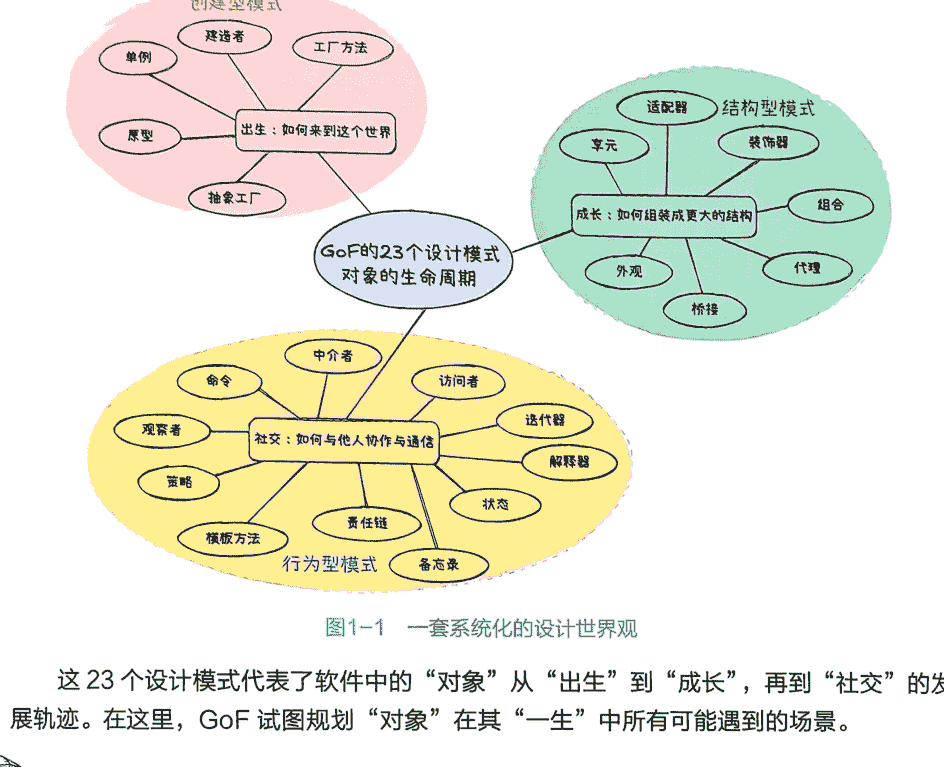

这 23 个设计模式代表了软件中的“对象”从“出生”到“成长”，再到“社交”的发展轨迹。在这里，GoF 试图规划“对象”在其“一生”中所有可能遇到的场景。

> GoF 设计模式中的“对象”，是指系统中承担特定职责的最小功能单元。它不是现实世界的“物体”，而是程序中负责完成某项具体任务的实体（即类实例）。对象封装了数据（状态）和操作（行为），并将两者紧密绑定。在设计模式的语境中，对象的意义不在于其作为“类实例”本身，而在于其所扮演的角色及其在协作中的交互方式。不同的设计模式其实就是组织这些对象并协调其协作关系的不同方法。可以用一句形象的话来形容：对象是程序中的“小工人”，每个设计模式都在教这些工人如何分工、如何协同、如何履职。

### 1. 创建型模式

创建型模式聚焦于对象的诞生。表 1-1 列出了创建型模式所包含的设计模式及其核心目的、工程视角的解释及类比。

表 1-1 创建型模式

| 设计模式 | 核心目的 | 工程视角的解释 | 类比 |
| :--- | :--- | :--- | :--- |
| 单例（Singleton） | 保证某个类在系统中只有一个实例，并且全局都能访问到 | 通过私有构造函数 + 静态方法/属性控制实例数量。需要注意的是，并发环境下要考虑线程安全、懒汉/饿汉模式，以及测试时的可替换性。常用于共享资源（如配置、日志器、线程池等） | 像太阳系中的太阳：只能有一颗，其他星球都围着它转 |
| 工厂方法（Factory Method） | 统一、封装对象创建逻辑，让“使用者”不需要关心构造细节 | 通过工厂类/工厂方法集中创建对象；根据传入的参数或配置，决定创建哪一种类实例。优点是解耦“使用者”和“具体类”，便于后续扩展或替换实现 | 像汽车生产线：客户只负责选择“车型”，而不关心焊接、喷漆等技术细节 |
| 建造者（Builder） | 分步骤构建复杂对象，支持灵活配置和“可读性强”的构建过程 | 通过“建造者”逐步设置属性，最后统一“建造出”成品。优点是容易控制“构建顺序”和校验逻辑。常用于对象有很多可选参数或组件且构建过程相对稳定的场景 | 像搭积木：首先搭建底座，其次搭建墙体，最后放置屋顶，每一步都清晰可控 |
| 原型（Prototype） | 通过“克隆已有对象”来创建新对象，而不是每次从零开始构建 | 当对象构建开销大（如涉及深层次配置、复杂初始化）时，可通过“克隆”一个已有原型，再进行少量修改即可。需要注意的是，应设计好浅拷贝/深拷贝，避免因共享或复制不当导致 bug | 像细胞分裂：先复制一份，再在复制体上进行变化 |
| 抽象工厂（Abstract Factory） | 生产“产品族”，保持同一系列产品间的一致性与兼容性 | 针对一整套相关产品（如 Button、TextBox、Menu，都有 Windows 风格或 macOS 风格可选），抽象出一个工厂接口，再为不同风格实现具体工厂。需要注意的是，客户端只依赖抽象工厂，从而保证全局风格统一、易于切换 | 像主题套装：购买“北欧风家具套装”，沙发、茶几、柜子风格统一 |

### 2. 结构型模式

结构型模式聚焦于对象的组合。表 1-2 列出了结构型模式所包含的设计模式及其核心目的、工程视角的解释及类比。

表 1-2 结构型模式

| 设计模式 | 核心目的 | 工程视角的解释 | 类比 |
| :--- | :--- | :--- | :--- |
| 适配器（Adapter） | 让原本接口不兼容的两个组件可以一起工作 | 通过一个“中间层”对象，把旧接口转换成新接口（或反过来）。常用于接入第三方库、迁移旧系统、统一接口规范等场景。对外（新接口）不变，对内完成协议适配 | 像电源转换器：插头不一样，但通过转换头就能连接电源 |
| 桥接（Bridge） | 分离“抽象部分”和“实现部分”，让两边可以独立扩展 | 把多维度的变化拆解开，如“图形类型（圆/矩形）”与“渲染方式（矢量/位图）”。通过抽象类持有实现接口的引用，使得任意组合都可以在运行时进行动态拼接，从而避免多维度继承导致的子类数量“爆炸”问题 | 像遥控器和电视机：遥控器是一套抽象控制方式，不同品牌的电视机只要实现该协议，就能被同一个遥控器控制 |
| 组合（Composite） | 以“树形结构”统一处理单个对象与组合对象 | 定义统一的组件接口（如 Component 接口），使叶子节点和组合节点都实现该接口。此时，客户端可以忽略树形结构的复杂性，统一调用添加、移除或操作函数。常用于构建 UI 组件树、文件系统等 | 像文件系统：文件和文件夹在很多操作上是统一的（如复制、删除、移动） |
| 装饰器（Decorator） | 在不修改原始类的前提下，动态地给对象添加功能 | 通过包装的方式，装饰器实现与被装饰对象相同的接口，并在内部持有一个“原对象”引用，在调用前后增加逻辑。优点是可实现灵活的功能组合。需要注意的是，要避免多维度继承导致的类数量“爆炸”问题 | 像俄罗斯套娃：一层套一层，每一层都可以多一个“花纹/功能” |
| 外观（Facade） | 对复杂子系统提供一个“统一、简单”的入口 | 封装一组复杂接口调用逻辑，对外暴露一个简化的 API（Application Programming Interface，应用程序接口）。例如，一个 VideoConverter 内部可能调用几十个小模块，但对外只需要提供 convert(input, outputFormat)。常用于降低使用门槛、减少耦合 | 像汽车方向盘：驾驶者只需要操作方向盘和踏板，不需要直接操控发动机、变速箱 |
| 享元（Flyweight） | 通过“共享”细粒度对象，减少内存消耗 | 将对象的“内部不变状态”（如字体、颜色）抽出来共享，而“外部可变状态”（如坐标、大小）由调用方自行维护。常用于有大量相似对象的场景 | 像字母表：26 个字母是共享的，但它们在不同单词、不同行内的位置各不相同 |
| 代理（Proxy） | 控制对某个对象的访问，在访问前后附加额外逻辑 | 代理类和被代理类实现相同的接口，外部“以为”自己在用真实对象，实则通过代理完成操作。优点是可实现懒加载、权限控制、远程访问、缓存等功能 | 像秘书：帮你挡访客、筛选电话，决定什么事需要直接打扰你 |

### 3. 行为型模式

行为型模式则规定了对象如何协作。表 1-3 列出了行为型模式所包含的设计模式及其核心目的、工程视角的解释及类比。

表 1-3 行为型模式

| 设计模式 | 核心目的 | 工程视角的解释 | 类比 |
| :--- | :--- | :--- | :--- |
| 责任链（Chain of Responsibility） | 把请求沿着一条链传递下去，每个节点决定“处理或继续传递” | 把多个处理器串成链，让请求发出方不需要关心谁来处理。常用于日志处理、权限审批流、HTTP 中间件等。优点是利于解耦。需要注意的是，链过长会导致调试困难 | 像公文流转：按科员→经理→总监的顺序逐级审批 |
| 命令（Command） | 把“请求”封装成对象，便于排队、撤销、重做、日志记录 | 将一次操作抽象为 Command 对象（包含接收者、参数、执行逻辑），调用方只负责“发出命令”，而不直接操作接收者。常用于事务、操作记录、宏命令执行等 | 像遥控器按钮：每个按钮代表一个命令，按下就执行相应操作 |
| 迭代器（Iterator） | 提供统一方式，按顺序访问聚合对象内部元素，而不暴露其内部结构 | 通过 first、next、hasNext 等接口遍历集合，隐藏集合内部结构（如数组、链表或树结构）。优点是便于扩展不同遍历策略（如正向、反向、按层级遍历等） | 像翻书：只需要“翻到下一页”，不需要关心纸张是如何装订的 |
| 观察者（Observer） | 建立“一对多”的通知机制，状态变化时自动通知所有订阅者 | 主题对象维护观察者列表，当状态变更时，逐个回调。常用于事件系统、GUI监听、消息推送、中间件发布/订阅。需要注意的是，应避免通知风暴和环形依赖 | 像报纸订阅：杂志社一出新刊，所有订阅者都会收到 |
| 策略（Strategy） | 将可替换的算法封装起来，运行时按需切换 | 定义统一的策略接口，不同实现代表不同算法（如不同排序方式、不同缓存策略、不同计费方式）。需要注意的是，调用方只依赖接口，可以在配置或运行时切换 | 像选择出行方式：坐地铁、打车、骑车，本质都是“从地点A到地点B”，只是策略不同 |
| 模板方法（Template Method） | 在父类中定义“处理流程骨架”，子类只重写其中某些步骤 | 父类定义templateMethod流程，把可以变化的步骤抽象为钩子方法，由子类实现。常用于流程稳定、步骤可变的场景。缺点是对继承依赖较重 | 像食谱：流程是备菜→下锅→调味→出锅，不同菜品只在细节上有变化 |
| 访问者（Visitor） | 在不改变数据结构的前提下，为其增加新操作 | 分离“数据结构”和“对数据的各种操作”：数据结构提供accept(Visitor)，具体“访问者”实现不同操作（如统计、导出、校验等）。常用于数据结构稳定但操作常变化的场景 | 像税务审计：企业结构不变，审计员带着不同“审计方案”来回查看 |
| 状态（State） | 允许对象在其内部状态发生改变时改变自身行为 | 将不同状态下的行为封装到独立的类（如StateA、StateB）中，并将上下文的行为委托给当前状态对象，从而消除庞大的if-else或switch-case状态判断语句 | 像心情变化：心情好时工作效率高，心情差时只想睡觉——人没变，但行为随着状态的改变而发生了变化 |
| 备忘录（Memento） | 在不破坏封装的前提下，捕获并恢复对象的内部状态 | 创建一个“快照对象”来保存状态，并将其交由管理者保管；原对象可随时从该快照恢复。常用于编辑器的“撤销/重做”功能和游戏存档等场景 | 像游戏存档：打Boss前先存档，失败后读取存档重新开始 |
| 中介者（Mediator） | 通过一个中介对象封装一系列对象之间的交互 | 将网状的“多对多”关系简化为星形的“一对多”关系：各对象之间不再直接通信，而是通过中介者进行消息转发。这降低了组件间的耦合度，但也可能导致中介者职责过重、结构臃肿 | 像机场塔台：飞机之间不直接通信，所有起降指令均由塔台统一调度 |
| 解释器（Interpreter） | 给定一种语言，定义其文法表示，并实现一个解释器来解析和处理该语言 | 将特定领域的问题建模为一种语言的语法规则（如SQL解析、正则表达式、数学公式计算等），并为文法中的每条规则创建对应的类。常用于语法相对简单且变动不频繁的场景 | 像乐谱演奏：乐谱是一种语言，演奏家是解释器，依照符号规则将音乐还原出来 |

审视这些在现代软件工程实践中仍广泛使用或已逐渐淡出的设计模式，我们会发现：即便对具备较强逻辑思维能力的软件工程师而言，这 23 个设计模式也相当抽象，有些甚至难以直观把握。

### 1.1.3 框架的力量

然而，GoF 的伟大之处在于：他们首次将“经验”转化为“词汇”。

在此之前，当一名开发者想向另一名开发者解释自己的设计时，必须画图、编写伪代码、列举示例，费尽口舌却可能词不达意。而现在，他只需要说：“这里使用了观察者模式。”对方立刻心领神会。他再说：“这里我们使用工厂方法模式和策略模式就可以把不同支付方式的逻辑解耦。”如果对方也懂设计模式，双方便能够迅速在抽象层面达成共识，沟通成本大幅下降。

这里，设计模式不仅是代码写法，更是一种团队沟通的语言。

这种共同词汇的建立，意义不亚于巴别塔倒塌后人类重新找到共同语言。它让软件设计从“手工艺”走向“工程学”，使经验得以跨越时空传承。一名在硅谷的开发者和一名在东京的开发者，即使从未谋面，也能通过“工厂方法模式”“观察者模式”等词汇产生共鸣。

此时此刻，设计模式作为一种压缩算法，将冗长的技术细节压缩为高密度的文化符号（见图 1-2），让开发者之间的沟通像光纤通信一样高效。

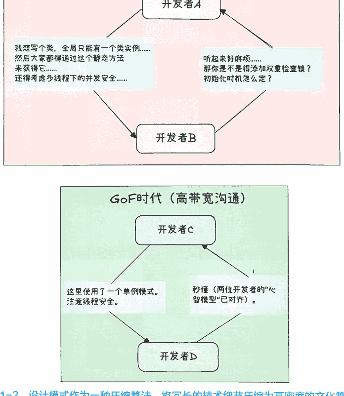

设计模式的价值，在于其背后的工程思维：如何在复杂系统中降低不确定性，让对象各司其职、彼此独立、可随时替换。创建型、结构型、行为型这三大类型回答了“对象从哪里来、如何组合、如何协作”这 3 个经典问题。

理解这 23 个设计模式的核心，不在于“记住 23 个名字”，而在于掌握这三大类型所蕴含的思维方式。

- 创建型思维：回答“对象从哪里来”，解决构建复杂、耦合和可扩展性问题。
- 结构型思维：回答“对象如何组合”，解决系统模块之间的连接方式与复杂度问题。
- 行为型思维：回答“对象如何协作”，解决职责划分、耦合度和可扩展的业务流程问题。

每个设计模式都在引导开发者围绕以下问题展开思考。

- 现在到底卡在哪里？（创建复杂？类太多？依赖关系混乱？功能难以扩展？）
- 用这个设计模式之后，谁与谁解耦了？（使用者与创建者解耦？抽象与实现解耦？数据与操作解耦？）
- 将来要改动时，可以只改哪一小块？（只更换策略？只添加一个装饰器？只添加一个工厂方法？）

设计模式之间则可以组合使用，而非互斥。

- “抽象工厂模式 + 组合模式 + 迭代器模式”可以构建一个跨平台 UI 组件库。
- “命令模式 + 备忘录模式”可以实现强大的撤销 / 重做系统。
- “观察者模式 + 策略模式 + 责任链模式”可以实现灵活可配置的事件处理系统。

当你真正掌握设计模式时，相当于掌握了一套“可复用的思考框架”。它让你在面对变化时不再依赖灵感，而是能像建筑师一样，把系统拆解为稳定的结构、清晰的职责和可控的演化路线。

设计模式不是技巧，而是让复杂系统保持长期可演进的工程哲学。

## 1.1.4 秩序的代价

“软件可以被组织，就像城市可以被规划。”这是 GoF 传递的世界观，也是那个时代软件工程界的集体信念。人们相信，只要找到正确的设计模式，组合正确的结构，就能征服复杂性，建造完美的软件宫殿。

但是，秩序总是有代价的。

人们发现自己陷入了新的困境：初学者开始“为了设计模式而设计模式”，简单问题被复杂化，代码充斥着不必要的抽象层。“设计模式”从“解药”变成了“毒药”，从工具变成了教条。

一个简单的“Hello World”程序，在狂热的设计模式信徒手中，可能如下所示。

```
// 通过工厂方法模式创建打印机
PrinterFactory factory = new PrinterFactory();
// 通过策略模式选择输出策略
OutputStrategy strategy = new ConsoleOutputStrategy();
// 通过单例模式获取消息管理器
MessageManager manager = MessageManager.getInstance();
// 通过建造者模式构建消息
Message message = new MessageBuilder()
    .setContent("Hello")
    .append(" ")
    .append("World")
    .build();
// 通过命令模式执行输出
Command printCommand = new PrintCommand(factory.createPrinter(strategy), message);
printCommand.execute();
```

如果把上面的代码转换为流程图，我们将看到图 1-3 所示的场景——软件工程中的“鲁布·戈德堡机械”。

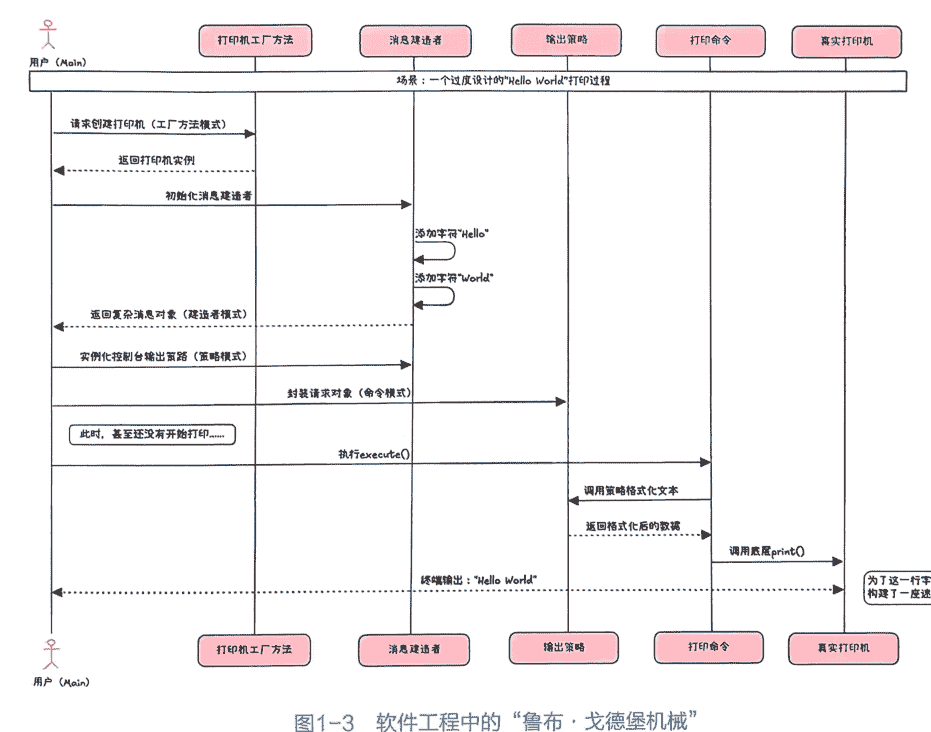

当手段变成了目的，简单的功能就被淹没在抽象的海洋中。这种过度设计的讽刺例子，后来被称为“模式病”（Patternitis）。

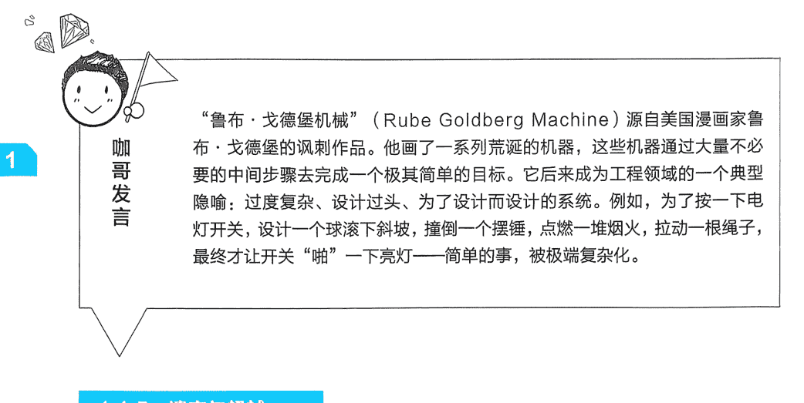

## 1.1.5 遗产与超越

GoF 的贡献依然是不朽的。他们不仅给了我们 23 个设计模式，更重要的是，他们建立了一种思考软件的方法论。

- 问题导向：每个设计模式都从一个反复出现的问题开始。
- 上下文敏感：设计模式的适用性取决于具体场景。
- 权衡思维：每个解决方案都有利有弊。
- 演化视角：设计应该为变化留出空间。

这种方法论影响了整整一代开发者。即使在今天，当我们谈论微服务、函数式编程、响应式架构时，我们依然在使用 GoF 建立的词汇体系，依然在他们开创的思维框架中工作。

GoF 是软件工程的启蒙者。他们让我们相信，混沌可以被组织，经验可以被传承，软件可以被“设计”而不仅仅是“编写”。这种对秩序的承诺，对理性的信仰，定义了一个时代。

然而，GoF 的世界是一个“上帝视角”的静态世界。在这个世界里，类与类之间的关系是编译器确定的，行为是代码严格规定的。开发者相当于“独裁者”，他在代码运行之前就已经规划好所有的路径。

当理性被推到极致，当秩序成为教条，变革就会迫在眉睫。新的声音开始出现：“敏捷重于计划”“简单重于复杂”“演化重于设计”……

尤其是，这种“确定性的舒适区”恰恰成为 AI 时代的“枷锁”。当我们试图构建 Agent 时，我们需要的不是一个只会机械执行命令的“单例”，而是一个能够根据环境自主判断、动态决策的“伙伴”。GoF 建立了秩序，但有的时候，过度的秩序就是牢笼。

软件世界正在酝酿下一个范式转换。

## 1.2 黄金时代：设计模式的繁荣与边界

如果说 GoF 在荒原上竖起了第一块路标，那么在随后的 10 年里，工程师们则在这片土地上建起了宏伟的罗马城。

### 1.2.1 工业化的狂欢

1995 年至 2005 年，是设计模式发展的黄金时代。

面向对象编程不再是实验室里的新奇玩具，而是成为工业标准。Java 在 1995 年横空出世，带着“一次编写，处处运行”的承诺；C++ 于 1998 年完成标准化，成为系统级编程的王者；C# 在 2000 年诞生，集百家之长于一身。

整个软件世界都在说着“对象”的语言，而 J2EE（Java 2 Platform, Enterprise Edition）的出现，更是将这种秩序推向了顶峰。J2EE 不只是一套框架，更是一套严苛的工业标准。J2EE 以严苛且统一的规范定义企业级软件开发：例如 EJB（Enterprise JavaBeans），它不仅是代码，更像是严谨的标准化组件规范——开发者即便只为实现一个简单的业务功能，也必须编写 Home 接口、Remote 接口和 Bean 实现类。这种设计虽然烦琐，但它将“设计模式”固化为“规范”——分布式对象、事务管理、安全控制，一切都被封装在标准的容器（Container）中。

对当时的大型企业来说，这正是他们梦寐以求的图景：软件开发终于不再是“艺术家”的个人表演，而是转变为可复制、可管理、可替换的工业级流程。

大学开始系统地教授设计模式——设计模式成为计算机科学课程的必修内容。招聘广告里满是对“精通 J2EE 架构”和“熟悉 GoF 设计模式”的要求。架构师们像中世纪的石匠大师，手握 J2EE 这一重型工具，用设计模式的积木搭建着日益宏伟却也愈发沉重的软件“大教堂”。

### 1.2.2 四大革命的展开

随着设计模式带来的思维革新，4 次深刻的架构革命渐次展开。

**第一次革命：结构抽象化——从混沌到层次**

MVC（Model-View-Controller，模型—视图—控制器）虽未列入 GoF 的 23 个设计模式，却是设计模式思想最早且最成功的应用之一。下面就通过一个简单的用户资料更新场景，直观理解模型、视图与控制器三者是如何协同工作的。

```
// Model —— 数据与业务逻辑
class UserModel {
    private String name;
    private int age;

    public void updateProfile(String name, int age) {
        this.name = name;
        this.age = age;
        notifyObservers(); // 观察者模式的应用
    }
}

// View —— 展示层
class UserView {
    public void render(UserModel model) {
        System.out.println("Name: " + model.getName());
        System.out.println("Age: " + model.getAge());
    }
}

// Controller —— 控制层
class UserController {
    private UserModel model;
    private UserView view;

    public void handleUserInput(String name, int age) {
        model.updateProfile(name, age);
        view.render(model);
    }
}
```

MVC 的成功在于它第一次让开发者意识到：复杂的应用可以“分层”设计。数据是数据，展示是展示，控制是控制。这种分离不仅让代码更清晰，更重要的是让不同的人可以并行工作——设计师专注于 View，业务专家专注于 Model，架构师协调 Controller（见图 1-4）。

> Struts 和 Spring MVC 使 MVC 几乎成为 Java Web 开发的“真理”。在 Struts 出现之前，Web 应用普遍采用 JSP+Scriptlet 的方式，代码混乱、难以维护，堪称一场灾难。Struts 首次将 Controller、Action 和 View 的职责边界从工程约定提升为框架强制约束，使整个 Java Web 开发社区采用统一的架构范式。随后，Spring MVC 进一步将这套“真理”固化为标准实践：通过注解、路由映射、拦截器链、依赖注入等机制，使“请求→控制器→服务→视图”成为开发者默认的思维模式。久而久之，MVC 不再仅仅是一种设计模式，而被视为企业级开发的必需品。在长达十余年的实践中，几乎所有企业系统、教材内容和面试题目围绕这一范式组织和展开。

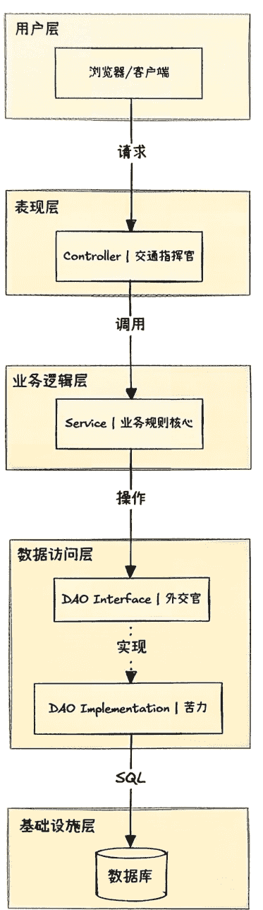

图1-4 MVC：复杂的应用可以分层设计

DAO（Data Access Object，数据访问对象）模式进一步推进了这种抽象。它创造了一个“防腐层”，划清了界限：界限之上（业务层）只谈对象（User、Order）；界限之下（持久层）才处理 SQL、连接池。

```
// 完全隔离数据访问逻辑
interface UserDAO {
    User findById(int id);
    void save(User user);
    void delete(User user);
}

// 可以随意切换具体实现
class MySQLUserDAO implements UserDAO { ... }
class MongoUserDAO implements UserDAO { ... }
class RedisUserDAO implements UserDAO { ... }
```

DAO 模式推进了“关注点分离”的发展。上述代码的精髓并不在于支持数据库切换，而在于使业务逻辑更加纯粹。DAO Interface 就像一位外交官，伫立在“纯洁的 Java 对象王国”与“复杂的数据库泥潭”之间。

- 对外（业务层），它使用优雅的面向对象语言（如 save(User)）。
- 对内（数据库），它精通各种“方言”（如 SQL、BSON、Key-Value）。

通过这种抽象，软件的核心逻辑不再受制于存储技术的演进。正因如此，尽管数据库技术持续迭代，企业的核心业务代码仍能保持长达十年的稳定性。这正是抽象的力量——以“不变”的接口，应对“万变”的实现。

**第二次革命：依赖反转——控制权的解放**

Spring 框架在 2003 年的出现，标志着依赖注入（Dependency Injection）从理论走向实践。

传统的编程方式是“我需要什么，我就创建什么”，请看下面的示例。

```
class OrderService {
    private DatabaseConnection db = new MySQLConnection(); // 硬编码依赖
    private EmailService email = new SMTPEmailService();  // 硬编码依赖

    public void processOrder(Order order) {
        db.save(order);
        email.send(order.getCustomerEmail(), "Order confirmed");
    }
}
```

在上述代码中，new 关键字是耦合度最强的黏合剂。当你写下 new MySQLConnection() 时，实际上是在宣告：“我的这个 OrderService 类，生生世世都绑定在 MySQL 上了”。如果明天想换成 Oracle，或者想在本地使用内存数据库进行测试，唯一的办法是修改源代码、重新编译。这就像把汽车引擎直接焊死在底盘上——如果想换个引擎，就得把整辆车熔了重造。

而 IoC（Inversion of Control，控制反转）容器说：“告诉我，你需要什么，我来为你准备。”请看下面的示例。

```
class OrderService {
    @Autowired
    private DatabaseConnection db; // 注入的依赖
    @Autowired
    private EmailService email; // 注入的依赖

    public void processOrder(Order order) {
        db.save(order);
        email.send(order.getCustomerEmail(), "Order confirmed");
    }
}
```

这个变化看似微小，实则极具革命性。它让组件真正独立，让测试成为可能，让系统的组装变得像搭乐高积木一样灵活。

这很像好莱坞原则：“别给我们打电话，我们会打给你。”（Don't call us, we'll call you.）

- 以前（主动权在对象）：对象自己去寻找、创建自己需要的资源（“我要一个数据库，我去 new 一个”）。
- 现在（主动权在容器）：对象只需要在自己的额头上贴一张条子（@Autowired），写上“我需要一个数据库”。容器在启动时，会像慈母一样，扫描所有对象的额头，把做好的 DatabaseConnection 塞到它们的怀里。

控制权（Control）从对象反转（Invert）到容器中，如图 1-5 所示。

这种“被动”带来了巨大的好处，尤其是在测试层面。在没有 IoC 时，要测试 OrderService 的逻辑而不真正发送一封电子邮件几乎不可能，因为 SMTPEmailService 是在代码中“硬编码”的。

而在 IoC 的世界里，测试变得轻而易举，见如下示例。

```
// 测试时，注入一个假的 EmailService
OrderService service = new OrderService();
service.setEmailService(new MockEmailService()); // 注入假的对象
service.processOrder(order);
// 验证：并没有真的发送电子邮件，只是记录了调用行为
```

这让软件开发从“手工艺雕刻”变成了“工业化组装”。我们不再是在写“死代码”，而是在编排（Wiring）组件。只要接口对得上，任何组件都可以替换。

这种“组件可插拔”的思想，为后来微服务的兴起奠定了基础，也为今天 Agent 系统中“工具的动态挂载”埋下了伏笔——毕竟，Agent 选择策略/工具的过程，本质上就是一种动态的依赖注入。

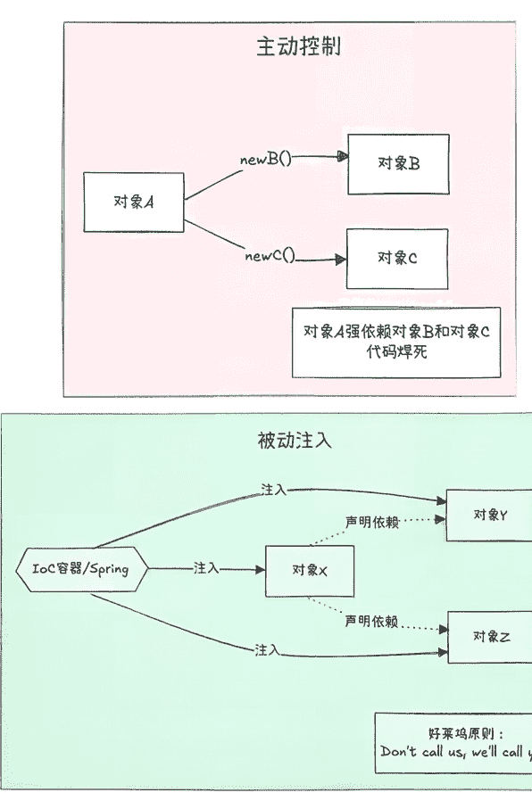

图1-5 控制权从对象反转到容器中

**第三次革命：行为可配置——从硬编码到软定义**

策略模式的广泛应用，让“算法”成为可替换的“零件”。如何理解这句话？先来看一段通过 if-else 语句实现的传统代码。

```
// 传统方式：丑陋的 if-else 语句
class PriceCalculator {
    public double calculate(Customer customer, double amount) {
        if (customer.getType() == CustomerType.REGULAR) {
            return amount * 0.95;
        } else if (customer.getType() == CustomerType.VIP) {
            return amount * 0.80;
        } else if (customer.getType() == CustomerType.SUPER_VIP) {
            return amount * 0.70;
        }
        return amount;
    }
}
```

在 if-else 语句的世界里，程序的行为在编译的那一刻就被锁死了。但在策略模式的世界里，对象的行为可以在运行时发生改变。

```
// 策略模式：优雅的多态
interface PricingStrategy {
    double calculate(double amount);
}

class RegularPricing implements PricingStrategy {
    public double calculate(double amount) { return amount * 0.95; }
}
class VIPPricing implements PricingStrategy {
    public double calculate(double amount) { return amount * 0.80; }
}
// 行为完全可配置
class PriceCalculator {
    private PricingStrategy strategy;

    // 请注意 setStrategy 这个方法
    public void setStrategy(PricingStrategy strategy) {
        this.strategy = strategy;
    }

    public double calculate(double amount) {
        return strategy.calculate(amount);
    }
}
```

上述代码的改变看似微小，实则触及了软件设计的核心原则——开闭原则（Open-Closed Principle，OCP）。

- 在传统方式下，PriceCalculator 是一座封闭的堡垒。每当我们想要增加一种新的会员类型（如“黑金会员”）时，就必须像拆弹专家一样，小心翼翼地拆开这个类，修改核心的 if-else 语句逻辑。每一次修改，都是一次引入 bug 的冒险。
- 在策略模式下，PriceCalculator 变成一个开放的插槽（Context）。它不用知道具体的打折规则，而只需要知道“我需要一个打折策略”。想要增加新规则时，只需要编写一个新的类实现 PricingStrategy 即可。原有的代码则一行都不用修改。这种设计将“变化的”（具体的打折算法）与“不变的”（计算价格的流程）彻底剥离了（见图 1-6）。

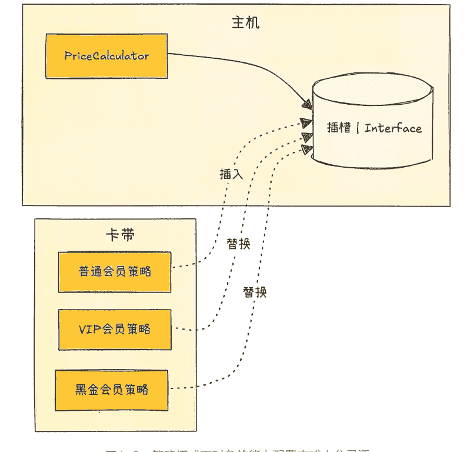

图1-6 策略模式下对象的能力配置方式十分灵活

想象一个游戏角色。

- 当他拿起“弓箭”时，他的攻击策略变成远程攻击（RangedAttack）。
- 当他拿起“大剑”时，他的攻击策略瞬间切换为近战攻击（MeleeAttack）。

对象不再是僵化的，它拥有了根据环境改变行为的能力。这其实就是 Agent 概念的雏形。

- GoF 时代：开发者手动调用 setStrategy 来切换算法。
- Agent 时代：Agent 观察环境，通过推理，自行决定选择哪一种策略/工具来解决问题。

## 第四次革命：体系语言化——从代码到图形

UML（Unified Modeling Language，统一建模语言）作为软件设计师的“世界语”，提供了一系列标准化的类图、序列图、状态图……软件设计第一次可以在不编写一行代码的情况下被完整表达（见图 1-7）。

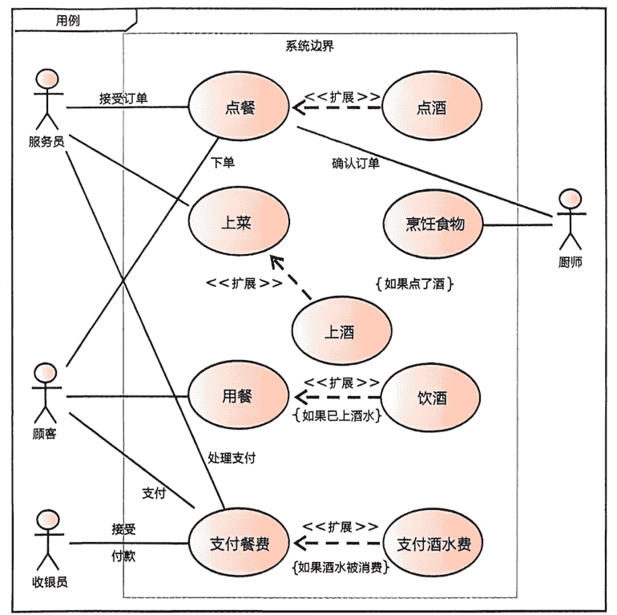

图1-7 UML成为软件设计师的标准化语言

Rational Rose、Together、StarUML 等工具让“画图编程”成为可能。架构师们在白板上画出系统的骨架，然后工具自动生成代码框架。这是软件工程最接近建筑工程的时刻——先设计，后建造。

### 1.2.3 工匠精神的巅峰

在设计模式的黄金时代，软件设计中的工匠精神体现得淋漓尽致。

- 马丁·福勒（Martin Fowler）的《重构：改善既有代码的设计》教会我们如何打磨代码。
- 罗伯特·马丁（Robert Martin）的《敏捷软件开发：原则、模式与实践》阐述了 SOLID 原则的精妙之处。
- 埃里克·埃文斯（Eric Evans）的《领域驱动设计：软件核心复杂性应对之道》则将设计模式的思想引入业务建模领域。

……

开发者们仿佛中世纪工匠行会的成员，掌握着属于自己的“秘传知识”。

- 单一职责原则（Single Responsibility Principle，SRP）：一个类仅承担一项职责。
- 开闭原则：对扩展开放，对修改关闭。
- 里氏替换原则（Liskov Substitution Principle，LSP）：子类必须能够替代其父类，而不影响程序的正确性。
- 接口隔离原则（Interface Segregation Principle，ISP）：不强迫客户端依赖其用不到的接口。
- 依赖倒置原则（Dependency Inversion Principle，DIP）：应依赖抽象，而非具体实现。

代码如同建筑，而设计模式则是蓝图。每一行代码都经过深思熟虑，每一个类的存在都有其道理。代码评审犹如艺术批评，重构恰似对雕塑的精细打磨。

然而，当手段被神圣化时，目标往往容易被忽略。这种对代码“纯洁性”的极致追求虽然带来了秩序和美感，但也无形中筑起了一道高墙——它将软件工程推向了一个象牙塔般的高度，使得开发者们沉醉于打造完美的水晶球，逐渐忽视应对现实世界复杂性的灵活性。

### 1.2.4 静态世界的落幕

正当设计模式与 J2EE 工业标准将软件工程推向巅峰时，行业内却开始弥漫一种隐秘的疲惫感。GoF 在《设计模式：可复用面向对象软件的基础》中描绘了一个理性的“静态世界”：系统边界清晰，需求变更可预测，运行环境稳定不变。在这个框架下，我们追求极致的解耦和完美的抽象层次。然而，这种对秩序和规范的狂热追求逐渐演变成一种“重型工程美学”。

为了严格遵循所谓的“最佳实践”，即便是最简单的“Hello World”程序也可能需要配置多达 5 个 XML 文件；而为了达到“解耦”的目标，一个基本的业务操作可能不得不穿越 7 层架构。架构师们沉浸于绘制出完美的 UML 图，但往往忽视了代码库因此变得异常臃肿的问题。

此时的软件工程仿佛一座宏伟的巴洛克建筑：精美、复杂，但也极其繁重。开发者们自认为建造的是永恒的金字塔，实际上不过是陷入了过度设计的陷阱。这种“内部僵化”让许多开发者感到窒息，《敏捷宣言》（Agile Manifesto）的出现正是对这种束缚的一种反抗。

但是，真正的危机并非来自既有的系统内部，而是来自外界的变化。当开发者们还在为如何实现一个“单例模式”进行激烈讨论时，外面的世界已经发生了翻天覆地的变化。

## 1.3 诸神的黄昏：当确定性遇到不确定性

诸神并非死于战争，而是死于环境的变迁。

在很长一段时间里，我们以为软件工程的终极目标是打造一座永恒的精密钟表：齿轮咬合，分秒不差，一切尽在掌握之中。GoF 的设计模式以及此后逐步构建起的软件工程体系，正是这座钟表的蓝图。我们相信，只要设计足够严谨，就没有无法处理的逻辑，也没有不可预测的未来。

可惜，互联网的洪流早已悄然改道。新世界不再是静态的钟表，而是咆哮的海洋。在这里，旧时代的秩序法则不仅失效，甚至成为毁灭的根源。

### 1.3.1 第一声警报

2008 年 10 月，Twitter（现 X）宕机了。
不是普通的宕机——服务器仍在运行，数据仍在响应，每个组件都看似正常工作，但整个系统如陷泥潭，响应时间从毫秒级退化至分钟级。开发者们反复检查代码，发现每个设计模式都精准地待在它该在的位置：观察者模式用于事件通知，工厂方法模式负责创建对象，单例模式管理连接池……
代码是完美的，架构是优雅的，但服务器是死寂的。问题出在哪里？
问题在于，当上百万用户同时涌入时，精心设计的观察者模式变成了雪崩的导火索。一条推文触发一连串通知，每个通知又触发更多通知，原本精巧的设计模式演变成了一场完美的风暴。
这是第一声警报：确定性设计遇到了充满不确定性的场景。
GoF 的设计模式诞生于一个“静态世界”。

- 系统边界明确：企业内部系统，用户可知，功能可控。
- 行为路径可预测：用户点击按钮 A，系统执行流程 B。
- 需求变更可预测：一年发布若干版本，变更经过严格评审。
- 运行环境稳定：单机或小规模集群，故障模式简单。

然而，21 世纪的第一个十年，一切都变了。

- Web 2.0 带来了用户爆炸：用户数从千人级跃升至亿人级，范围从固定用户扩展到全球用户，服务时间从朝九晚五变为 7 × 24 小时不间断。
- 分布式成为常态：系统架构从单机演进到数千台服务器，通信方式从同步调用转向异步消息，事务模型从 ACID① 转向 BASE②，一致性策略从强一致性转为最终一致性。
- 敏捷思想改变了开发节奏：发布频率从年度变为每日部署，开发模式从瀑布式转向持续迭代，设计原则从“详尽完备”变为“够用就好”，架构方式从预先设计转向演进式设计。
- 移动互联网改变了交互模式：输入方式从键盘、鼠标变为触摸、手势，显示设备从大屏幕转向小屏幕，网络连接从有线变为无线，使用场景从固定位置变为随时随地。

> ① ACID是Atomicity（原子性）、Consistency（一致性）、Isolation（隔离性）、Durability（持久性）的首字母缩写，主要用于传统的数据库事务处理，强调数据的强一致性和事务的完整性。
> ② BASE是Basically Available（基本可用）、Soft state（软状态）、Eventually consistent（最终一致性）的缩写，主要用于分布式系统和高并发场景，强调系统的可用性和伸缩性，允许数据在一定时间内出现短暂的不一致性。

### 1.3.2 不确定性的三重奏

不确定性不是突然降临的，它像满月之日的潮水，从 3 个方向同时涌来。

**第一重：规模的不确定性**

传统设计假设用户数是可控的，负载是可预测的。例如，银行系统知道银行有多少客户，企业软件知道企业有多少员工。设计模式在这种“有界”的世界里游刃有余。
但互联网打破了边界，请看下面的示例。

```
// 传统设计：假设用户数量可控
class NotificationService {
    private static final int MAX_OBSERVERS = 10000;
    private Observer[] observers = new Observer[MAX_OBSERVERS];

    public void notifyAll(Event event) {
        for (Observer observer : observers) {
            observer.update(event); // 同步通知，假设用户数有限
        }
    }
}
```

而现实是，用户数可能是 10，也可能是 1000 万。互联网时代的一条推文可能需要通知上千万粉丝，在这种情况下，传统的观察者模式瞬间崩溃。

**第二重：行为的不确定性**

传统设计假设用户行为是可预测的。点击按钮 A，执行流程 B。用户像机器，系统像齿轮，一切井然有序。
但社交网络改变了一切，请看下面的示例。

```
// 传统设计：线性的用户路径
class ShoppingCart {
    public void processOrder() {
        // 明确的流程：浏览→添加→结账→支付
        validateItems();
        calculatePrice();
        processPayment();
        sendConfirmation();
    }
}
```

而现实是，用户行为是非线性的、突发的、群体性的。一位明星的推荐可能让数百万用户同时涌向同一商品；Pinterest 的瀑布流让用户行为从“搜索”变成“漫游”。设计软件时所假设的“理性用户”已不复存在。

**第三重：需求的不确定性**

传统设计假设需求是可定义的。花几个月进行分析，画出完整的 UML 图，然后按图施工。但移动互联网摧毁了这个假设。请看下面的示例。

```
// iPhone 发布前的设计
interface MobileApp {
    void displayOnScreen(int width, int height); // 假设：屏幕尺寸固定
    void handleKeyPress(int keyCode);           // 假设：键盘输入
    void saveToStorage(File file);              // 假设：文件系统
}

// iPhone 发布后的现实
interface MobileApp {
    void handleTouch(MultiTouchEvent event);    // 多点触控
    void handleRotation(OrientationEvent event); // 屏幕旋转
    void handleGesture(GestureEvent event);     // 手势识别
    void handleSensor(SensorEvent event);       // 各种传感器
    void handleNotification(PushEvent event);   // 推送通知
    // 需求在爆炸式增长
}
```

需求的不确定性，比前两个不确定性更致命。规模的不确定性会压垮架构，行为的不确定性会扰乱流程，但需求的不确定性会让系统“失去方向感”。在移动互联网时代，需求已经不是“定义出来的”，而是“生长出来的”——今天用户要直播，明天要短视频，后天要 AI 滤镜，大后天要虚拟形象。没有人能提前画好完整的 UML 图，因为不知道产品会长成什么样。

传统设计的假设是线性的：需求先确定→架构再设计→系统再扩展。互联网时代的现实却是反向的：需求永远在变→架构必须适应变化→才能继续存活。这意味着，软件开发不再是“盖房子”，而更像是“驯服一头不断进化的生物体”。

- 功能会爆炸式增长。
- 需求会不断自我否定。
- 未来形态完全不可预测。
- 任何一次技术大潮都可能重塑整个交互方式（如触控、手势、传感器、AI）。

因此，需求的不确定性迫使设计模式从“可预见的结构”变成“可演化的结构”。开发者们不能再追求完备，而要追求适应性；不能再试图预测未来，而要让系统有能力在未来重新组合。

### 1.3.3 设计模式的失效

在不确定性面前，经典设计模式开始一个接一个地失效。首先是单例模式的悖论。

```
// 传统单例模式：在单机时代完美工作
class DatabaseConnection {
    private static DatabaseConnection instance;

    public static synchronized DatabaseConnection getInstance() {
        if (instance == null) {
            instance = new DatabaseConnection();
        }
        return instance;
    }
}
```

在分布式时代，单例变成了瓶颈。100 台服务器，不可能每台都有自己的“单例”；全局锁导致性能瓶颈；同时，单例模式也会增加单点故障风险。对此，Netflix 的解决方案：放弃单例模式，拥抱冗余。
其次是工厂方法模式的僵化。

```
// 传统工厂方法模式：产品类型在编译时确定
interface CarFactory {
    Car createSedan();
    Car createSUV();
    Car createTruck();
}
```

在 AI 时代，产品类型在运行时学习。Tesla 的自动驾驶系统每天都在学习新的“驾驶模式”，传统工厂方法模式无法处理“运行时演化”的产品。
最后是观察者模式的雪崩。

```
// 传统观察者模式：假设通知是即时且可靠的
class EventPublisher {
    private List<Observer> observers = new ArrayList<>();

    public void publish(Event event) {
        for (Observer obs : observers) {
            obs.handleEvent(event); // 如果一个观察者阻塞，则全部观察者阻塞
        }
    }
}
```

现实情况是，Facebook（现属 Meta）的 News Feed 中单个用户的动态可能需要推送给数百万其他用户，同步观察者模式会导致系统雪崩。Facebook 的解决方案：消息队列、最终一致性和流处理。

上述例子反映出来的，不仅仅是技术问题，更是哲学问题。

### 1. 机械论与有机论

GoF 的设计模式诞生于机械论世界观：系统是零件的组合，整体等于部分之和，因果关系是线性的，未来是可预测的。

但真实世界更像有机体：系统是关系的网络，整体大于部分之和，因果关系是循环的，未来则是涌现的（见图 1-8）。

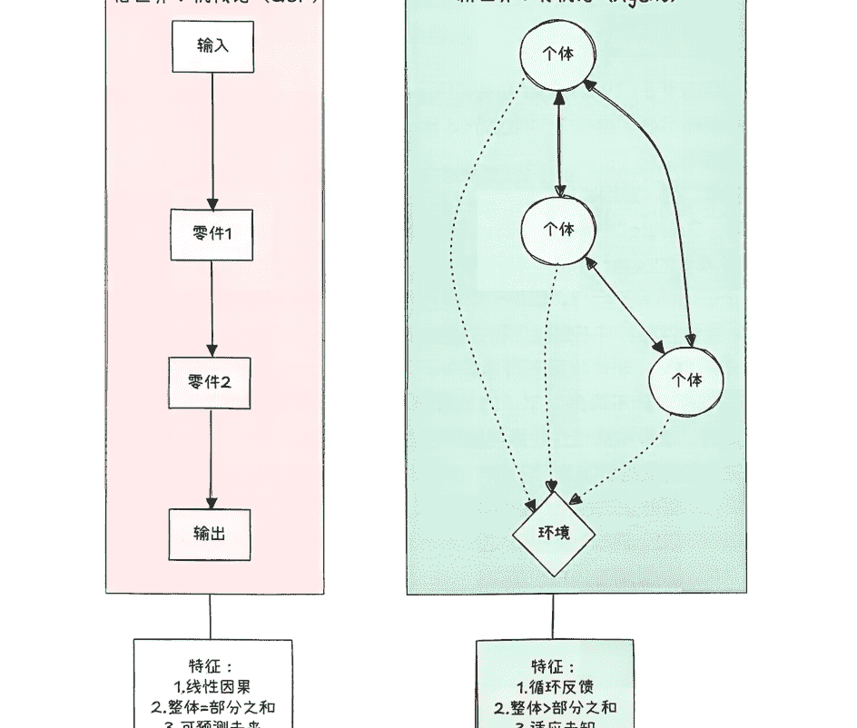

### 2. 设计与演化

传统软件工程相信“设计先于实现”：需求分析→系统设计→详细设计→编码实现→测试部署。

但互联网产品遵循“演化胜于设计”：最小可行产品（Minimum Viable Product，MVP）→用户反馈→快速迭代→数据驱动→持续演化。Facebook 的座右铭“Move Fast and Break Things”（快速行动，打破常规）是对传统设计哲学的公开挑战。

### 3. 控制与适应

设计模式试图“控制”复杂性：通过接口控制依赖，通过封装控制状态，通过继承控制变化。

但复杂系统需要“适应”：通过反馈适应环境，通过学习适应变化，通过演化适应未知。

软件世界正在从“静态设计”走向“动态演化”，从“确定性”走向“适应性”。而在这个新世界里，我们需要的不仅是设计模式，更是一种新的思维方式——拥抱变化、适应不确定性。

### 1.3.4 转折点

如果说 2008 年的 Twitter 宕机是软件工程“旧时代”崩溃的信号，那么 2012 年至 2014 年则是新秩序在“废墟”中建立的 3 年，这一时期发生的一系列事件彻底重构了软件工程的底层逻辑。

### 1. 从“单机精修”到“宏观概率”

2012 年，Google 发表论文“The Datacenter as a Computer”。
此前，开发者的视角聚焦在“单个节点”上。开发者像钟表匠一样，试图让每一台服务器、每一个进程都完美运行。如果一台服务器坏了，那将被视为严重的事故。
Google 告诉世界：并不是服务器在运行软件，数据中心本身才是那台“计算机”。
在这个新视角下，硬件故障不再是意外，而是统计学上的必然。硬盘一定会坏，网络一定会抖动。软件设计不再是为了“防止故障”，而是为了在“故障常态化”的基础上依然提供可靠服务。这是从确定性逻辑向概率性逻辑迈出的第一步。

### 2. 从“鲁棒性”到“反脆弱”

2012 年，Netflix 开源 Chaos Monkey。
这可能是软件史上最疯狂的决定之一：一家公司竟然编写了一个程序——专门在生产环境中随机杀死自己的服务器！
在 GoF 的时代，这是不可想象的亵渎。但 Netflix 的逻辑是：既然故障不可避免，那就让故障来得更频繁些吧。
这标志着“反脆弱”（Antifragility）思想正式进入软件工程领域。系统不再追求像钻石一样坚硬（一旦破碎就无法修复），而是追求像免疫系统一样，通过持续不断的微小创伤来进化出更强的生存能力。确定性设计试图封锁混乱，而反脆弱设计试图利用混乱。

### 3. 不可变基础设施

2013 年，Docker 发布。
在 Docker 之前，服务器是需要“运维”的。开发者登录上去，安装依赖，修改配置，修复补丁。随着时间的推移，服务器变成了充满“独家记忆”的雪花（Snowflake），没人敢重启它，因为没人知道它到底变成了什么样。
Docker 带来的“集装箱革命”，让基础设施变得不可变。如果一个容器坏了，我们不是修理它，而是直接销毁，然后启动一个新的。软件组件从此变成了无状态的“耗材”，而不是需要维护的资产。这为后来 Agent 能够动态地调用、销毁工具环境提供了物理基础。

### 4. 控制权的让渡：声明式API

2014 年，Kubernetes（简称 K8s）诞生。

Kubernetes 弃用了传统的命令式编程——“先启动 A，再启动 B，如果失败则重试 C”，转而采用声明式 API——“我需要 3 个副本，你看着办”。

这引入了极其重要的“调解循环”（Reconciliation Loop）概念。

- 期望状态（Desired State）：用户定义的意图。
- 当前状态（Current State）：系统的实际情况。
- 调解者（Controller）：不断感知差距，并采取行动弥合差距。

请注意，这个“感知 - 差异 - 行动”的循环，其实和 Agent 心智模型的雏形有些相似！Kubernetes 的调解者就是一个原始的、针对特定任务的 Agent。

这些变革汇聚成同一个声音：确定性时代结束了。软件不再是精心设计的精密瑞士手表，而更像是自组织的生物群落。

- 稳定性不再来自单一组件的完美，而来自群体的冗余与协作。
- 控制权不再来自严格的指令，而来自对“意图”的声明与动态调节。

我们终于学会了不再试图扮演“上帝”去控制每一个电子的跳动，而是学会了如何引导一个充满不确定性的复杂系统：复杂系统的稳定性不是来自完美的设计，而是来自持续的适应。

### 1.3.5 新世界的轮廓

在不确定性的土壤里，一种适应新环境的“物种大爆发”开始了。

如果说 GoF 的设计模式是为了在单机时代“对抗”变化，那么新一代的设计模式则是为了在分布式时代“拥抱”变化。那些曾经被奉为圭臬的经典设计模式，在云原生的浪潮下显得左支右绌：单例模式在分布式集群中失去了唯一性，观察者模式在异步网络中丢失了实时性，严格的抽象工厂模式在微服务的碎片化调用前显得笨重不堪。

于是，新的生存法则催生了新的设计模式。

- 从“控制流程”到“响应变化”：我们不再试图编写严格的指令序列（先做 A，再做 B），而是建立一套数据管道系统。数据像水流一样流过，系统只负责响应数据的到来。无论是 RxJava 还是现代流式计算框架，核心都在于处理异步与背压，而非控制步骤。
- 从“共享状态”到“消息传递”：既然共享内存锁不住，那就不要共享。Actor 模型和微服务架构回归了对象最原始的定义——通过消息进行通信。组件之间可谓“老死不相往来”，仅通过异步信箱交换信息，从而实现了真正的隔离与解耦。
- 从“修改变量”到“不可变数据”：为了应对并发带来的混乱，我们开始学习函数式编程的智慧。不再试图修改状态，而是每次产生新的状态。就像区块链或 Git 的提交记录方式，历史不可篡改，因此也就消灭了“竞争条件”产生的 bug。

## 从“预防故障”到“与之共舞”：断路器（Circuit Breaker）、舱壁隔离（Bulkhead）、重试（Retry）……这些设计模式不再假设系统是完美的，而是假设故障随时会发生。它们是软件系统的“安全气囊”，承认脆弱性，才能获得反脆弱性。

这些新的设计模式都有一个共同的哲学内核：它们放弃了“上帝视角”的全局控制，转而追求局部的自治与适应。它们不试图消除不确定性，而是拥抱它。

设计模式没有死去，它只是在进化：从 GoF 的 23 张“建筑图纸”，演变成云原生时代的“生存指南”。

## 小结 十字路口的坚定

2016 年，AlphaGo 战胜李世石。

这不仅是 AI 的胜利，更是一种新的问题解决设计模式的胜利。AlphaGo 没有依靠预设的“定式”（模式），而是通过数百万局的自我对弈，涌现出了超越人类理解的策略。

这给软件工程带来了巨大的冲击：如果最复杂的问题（围棋）都不能靠“设计”来解决，而是靠“学习”和“演化”，那么我们构建软件的方式是否也到了该彻底重构的时候？

软件工程站在十字路口。

- 继续沿着 GoF 的道路，追求更精致的静态设计？
- 拥抱不确定性，探索动态演化的新模式？

旧的范式正在黄昏中隐退，新的力量正从代码的缝隙间悄然生长——那是函数式的纯粹、响应式的流动，以及分布式的共识。

从对象（object）到智能体（Agent），从设计（design）到演化（evolution），从确定（certainty）到适应（adaptation）——软件工程的新纪元即将开启。

而设计模式，这个曾经统治了软件世界 20 年的概念，将以什么样的形式在新世界中重生？

当我们不再需要编写代码，而是需要“指导”一个拥有自主意图的 Agent 时，我们还需要设计模式吗？

答案是肯定的。但我们需要的，不再是代码的模具，而是思维的罗盘。

在迎接真正的 Agent 降临之前，我们必须先完成一场彻底的思维武装。

在第 2 章中，让我们开始这场范式的迁移。

# 第 2 章

## 从模式到意图：软件工程的范式迁移

在传统软件工程领域，人们常常依赖“模式”来应对复杂性。然而，在当今的 Agent 时代，我们不得不重新审视这一观念：虽然规则依然重要，但意图才是更为关键的因素。模式仅能告诉我们“怎么做”，而意图则能回答“为什么做”这一更为本质的问题。

当系统规模不断扩大、环境的不确定性日益增大以及用户需求持续快速变化时，传统的固定设计蓝图已难以满足需求。Agent 的出现，使我们首次能够将“意图”显式地嵌入系统之中，从而赋予软件理解问题、推演状态并执行动态行动的能力。

在本章中，我们将回顾过去几十年软件工程的核心范式，并阐述为何 Agent 系统是从“模式驱动”走向“意图驱动”的必然选择。

## 2.1 函数与流：计算的原子化

在 GoF 的黄金时代，我们试图通过静态的类和对象来固化这个世界，坚信只要封装得足够好，状态就能得到有效控制。然而，随着互联网的爆发式增长以及摩尔定律边际效应的递减，我们逐渐意识到：控制状态的最佳方式，或许并非单纯控制，而是尽可能地减少状态的存在。

这为 Agent 的诞生埋下了最重要的伏笔——因为从本质上说，大语言模型（Large Language Model, LLM，也简称大模型）就是一个庞大且无状态的纯函数（Pure Function）。

### 2.1.1 无状态的复兴：从对象封装到纯函数管道

1977 年，约翰·巴科斯（John Backus）在获得图灵奖的演说中提出了一个著名的问题：“Can Programming Be Liberated from the von Neumann Style?”（编程能否摆脱冯·诺依曼风格？）

他批判了命令式编程的根本缺陷——程序不过是一长串用于修改状态的指令。他预言了另一种可能性：程序应是数学函数的组合，无状态、无副作用，只有纯粹的变换。这堪称函数式编程（Functional Programming, FP）发展史上的里程碑事件。

他敏锐地指出，当时的编程语言（如 Fortran、C）实质上只是冯·诺依曼架构的“奴隶”。在冯·诺依曼架构中，中央处理器（Central Processing Unit, CPU）与存储器是分离的，二者通过总线连接。无论 CPU 的运算速度有多快，其性能始终受限于这条总线的传输速率——这就是著名的“冯·诺依曼瓶颈”。

巴科斯认为，传统的命令式编程语言本质上只是这一物理瓶颈的“精神投影”：变量对应存储单元，赋值语句对应数据传输。我们的思维方式被硬件的物理局限所束缚，不得不陷入“一次处理一个字”的细粒度操作中。这种编程方式宛如一个独裁者向内存发号施令，充斥着复杂的副作用以及难以追踪的状态变化。

但是，在 1977 年，计算机内存仅以 KB 计，CPU 主频仅以 MHz 衡量。在那个硬件资源如此稀缺的年代，“不改变状态”听起来像是一种奢侈的幻想。彼时，面向对象编程（Object-Oriented Programming，OOP）正崭露头角，C++ 即将诞生，谁又会在意这个看似不切实际的数学幻想呢？

相反，我们迎来了一段“名词的王国”时期——OOP 一度统治了整个软件世界。Java 和 C++ 告诉我们：世界由“对象”构成，应当将数据（状态）和行为（方法）封装在名为类（Class）的“黑盒”之中。然而，30 年后，随着云计算与 AI 浪潮席卷而来，这个看似完美的“封装”神话终于出现了裂痕。

#### 1. 对象的重负：香蕉与大猩猩问题

Erlang 之父乔·阿姆斯特朗（Joe Armstrong）曾这样评价：“OOP 语言的问题在于，它们总是附带隐式的环境。你想要的只是一根香蕉，结果得到的却是一只拿着香蕉的大猩猩，外加整片丛林。”图 2-1 形象地展示了 OOP 与 FP 的区别。


在单机单核时代，对象封装是管理复杂性的有效手段。然而，进入分布式计算时代后，可变状态（mutable state）却成为诸多问题的根源。

- 状态的纠缠：例如，当你调用 user.updateBalance() 时，不仅会修改余额，还可能触发 User 对象内部一系列隐式的状态变更（如更新 lastModifiedTime 或触发 Observer）。因此，这一调用行为难以准确测试。
- 并发的噩梦：当成千上万个线程同时尝试修改同一个对象的状态时，开发者不得不引入“锁”（lock）。然而，这不仅会引发并发锁竞争、严重损害性能，还极易导致死锁。

图 2-2 展示了 OOP 与 FP 在工作流程上的区别。

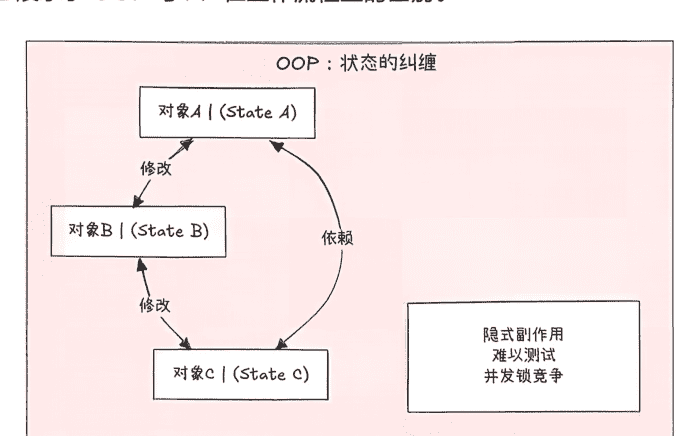

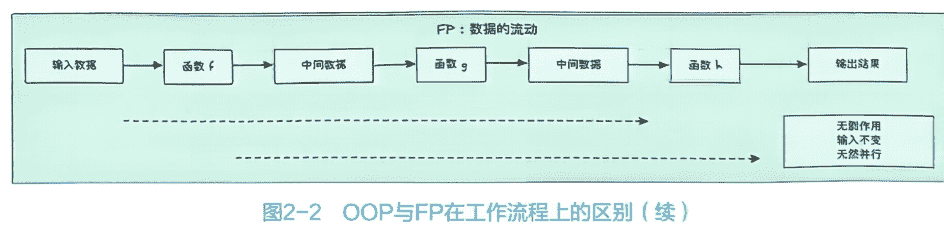

#### 2. 函数式的救赎：引用透明与管道

为了应对“状态危机”，软件工程开始广泛融入 FP。FP 的核心理念非常简洁：要控制状态，最好的方法就是消灭状态。

- 纯函数：对于相同的输入 $x$，始终返回相同的输出 $y$；既不依赖全局变量，也不产生任何副作用（如修改外部状态）。
- 不可变性（Immutability）：数据一旦创建便不可更改；若需要“修改”，则必须创建一份新的副本。

下面一起体验 OOP 与 FP 这两种不同的代码风格，这有利于后续更好地理解 Agent 的设计思路。

```python
# OOP 风格：有状态的 Agent
class ChatBot:
    def __init__(self):
        self.history = [] # 内部隐式状态

    def chat(self, user_input):
        self.history.append(user_input)
        response = model.predict(self.history)
        self.history.append(response)
        return response

# 使用示例
bot = ChatBot()
bot.chat("Hello")
```

上述代码的输出依赖于 bot 内部维护的历史状态，这使得其行为难以复现和调试。

```python
# FP 风格：无状态的转换
def chat_completion(history, user_input):
    # 纯函数：给定输入，始终产生确定的输出
    new_history = history + [user_input]
    response = model.predict(new_history)
    return response, new_history + [response]

# 使用示例
history = []
resp, history = chat_completion(history, "Hello")
```

上述函数式代码每次调用时都显式传入完整的上下文，行为完全确定，因而具备良好的可复现性。

FP 将“状态”从代码内部剥离，转而作为函数的显式参数传递。这种“无状态”（Stateless）的设计，正是现代云原生架构和无服务器（Serverless，见 2.2.3 小节）计算的基石。

#### 3. 终极映射：LLM即纯函数

为什么要花一定篇幅介绍 FP？因为它是我们理解 AI Agent 本质的基础。

LLM 本质上是一个巨大的、无状态的纯函数，可以用以下公式表示。

输出 = f（权重，上下文）

其中，两个参数分别如下。

- 权重（Weight）：在推理阶段，模型的权重是冻结的。无论调用多少次，模型本身都不会发生任何改变。
- 上下文（Context）：这是唯一的变量。Agent 的“记忆”并非存储在模型内部（不像人类的海马体），而是每次以参数形式显式传入。

这一认知彻底改变了 Agent 系统的设计模式。

- 上下文工程（Context Engineering）成为核心：既然模型本身不具备记忆能力，我们就必须将“记忆”显式地构建在输入管道中（见 5.1 节）。
- 幂等性（Idempotency）得以实现：只要提供相同的提示（Prompt）并固定随机种子，模型就能生成完全一致的输出，从而为复杂 Agent 的可复现调试提供基础。

约翰·巴科斯 1977 年的愿景，在 AI 时代意外成真。

如今构建 Agent，我们不再设计复杂的对象层级，而是打造数据处理管道：

输入 Prompt → 检索增强 → 思维链推理 → 格式化输出

软件工程由此跳出“对象身份”执念，回归“数据变换”本质。

### 2.1.2 响应式的觉醒：从阻塞等待到异步事件

在传统的编程范式中，开发者的时间观是线性的：代码第 1 行执行完毕后，才会执行第 2 行。这种同步阻塞（Synchronous Blocking）的模型符合人类阅读清单的习惯，但在高延迟的数据时代，可能成为性能瓶颈，甚至引发系统性问题。

#### 1. 倒塌的多米诺：阻塞的代价

回想 2025 年 5 月 X（原 Twitter）的崩溃：系统仿佛被冻结——每个请求都在等待，每个线程都被阻塞，整个系统陷入了一种“集体昏迷”。

为什么会出现这种问题？不妨设想一个典型的 Agent 任务：它需要首先调用 Google Search（耗时约 1s），然后解析搜索结果（耗时约 0.5s），最后请求 LLM 生成摘要（耗时约 8.5s）。

在这种同步阻塞模型中，每个步骤必须依次完成，后续步骤无法提前执行。这会导致以下两个主要问题。

- CPU 空转：主线程在 99% 的时间里干等着进度条，无法进行任何其他有用的工作。
- 系统失聪：在这 10s 期间，如果用户试图取消任务或插入新指令，系统将完全无响应——因为它被牢牢地阻塞在那个漫长的 HTTP 请求上，对外界“充耳不闻”。

为了解决这一问题，早期的 Node.js 引入了回调机制。然而，这很快演变成“回调地狱”。为了处理异步操作的结果，开发者不得不写出层层嵌套、形如金字塔的代码。这种代码结构不仅导致逻辑支离破碎，还难以维护。

#### 2. 响应式宣言：一切皆流

为应对这种低效，2010 年左右，微软的埃里克·梅杰（Erik Meijer）等人提出了响应式编程（Reactive Programming）的核心隐喻：世界并非由离散的指令构成，而是一条条连续的事件流（Event Stream）。

- Excel 的隐喻：这是最直观的解释。在 Excel 中，若在 C1 单元格中输入“=A1+B1”，当 A1 的值发生变化时，C1 会自动更新。你不需要主动“拉取”（Pull）A1 的值——C1 是在“响应”（Push）A1 的变化。
- Observable（可观察对象）：这是响应式编程的基本单元。数据不再是一个静态变量，而是一个随时间推移不断发出值的事件流（序列）。

对 Agent 架构师而言，这是一个根本性的观念转变：不要“调用” LLM，而是“订阅” LLM。

让我们通过一段 Python 伪代码对比，来看看这种设计理念的不同之处。这直接决定了你的 Agent 是让用户面对一个旋转 10s 的加载图标，还是能够提供流畅的具有打字机效果的更新。

```python
# 传统阻塞模式：用户只能盯着旋转的加载图标发呆 10s
def get_answer(question):
    # 线程在此阻塞，直至整个响应字符串生成完毕
    text = llm.invoke(question)
    return text

# 响应式流模式：实现打字机效果，提供即时反馈
async def get_answer_stream(question):
    # 创建一个异步事件流，订阅 LLM 的逐个 Token 输出
    stream = await llm.astream(question)

    # 像水流一样逐个处理 Token
    async for token in stream:
        if token == "<STOP>": break
        yield token # 实时将 Token 推送至前端，实现流畅交互
```

#### 3. 背压：流量控制的艺术

响应式编程不仅仅是异步处理，更重要的是它引入了背压（Backpressure）机制：下游消费者可以控制上游数据生产的速度，避免被过快的数据流压垮。这正是《响应式宣言》（*The Reactive Manifesto*）中强调系统应具备弹性（Resilience）与响应性（Responsiveness）的关键所在。

在 Agent 系统中，各组件的处理速度往往极不匹配。

- 生产者（如 GPT-4）的输出速度可能很慢（如 30 token/s），也可能在缓存命中时瞬间完成。
- 消费者（如语音合成 TTS 模块或前端渲染引擎）的处理能力有限，且易受网络抖动、设备性能等因素影响。

如果上下游处理速度不匹配，系统极易因缓冲区积压而崩溃——轻则丢包，重则内存溢出。响应式架构通过背压机制，使下游能够主动向上游反馈：“嘿，慢点发，我处理不过来了。”从而动态调节数据流速，保障系统稳定与资源可控。

以下示例体现了响应式流的核心思想：消费者掌控节奏。

```java
// 响应式流：由消费者主导处理节奏
Flux.range(1, 1000)
    .onBackpressureDrop() // 当消费者处理不过来时，自动丢弃多余数据，防止系统过载
    .subscribe(new BaseSubscriber<Integer>() {
        protected void hookOnSubscribe(Subscription subscription) {
            request(1); // 明确声明：每次只请求一个元素，按需消费
        }

        protected void hookOnNext(Integer value) {
            // 处理当前元素
            System.out.println("Processing: " + value);
            // 处理完后再请求下一个元素
            request(1);
        }
    });
```

图 2-3 对比展示了同步阻塞与响应式流的流程。

响应式流机制在构建多 Agent 系统时至关重要——你绝不想让一个疯狂输出的“搜索 Agent”瞬间压垮下游负责总结的“写作 Agent”。

响应式编程向我们揭示了一个深刻洞见：世界并非由静态快照构成，而是一条持续不断的变化之流。这一认知直接铺平了通往 Agent 的道路——因为从某种意义上说，智能的本质，正是对变化的响应。

- 神经网络响应的是输入的 Tensor 流。
- 强化学习响应的是环境反馈的 Reward 流。
- LLM 响应的是逐个到来的 Token 流。

在确定了无状态的计算（见 2.1.1 小节）和异步的数据流动之后，我们终于突破了单机的物理限制。下一步，便是将这些流动的计算单元（即响应式、可组合的原子操作）分布到成千上万台机器之上，协同运作，从而构建一个真正可扩展、高弹性的 Agent 生态系统。

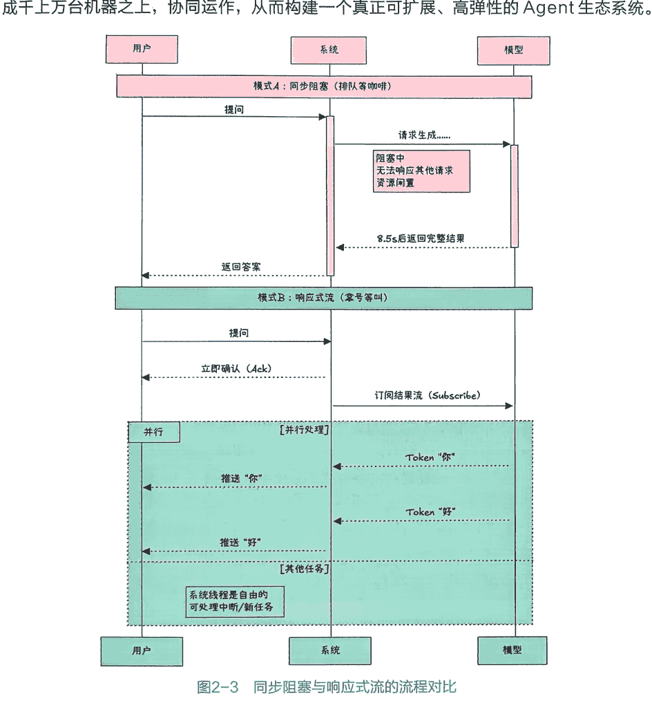

### 2.1.3 数据流的哲学：世界不是快照

古希腊哲学家赫拉克利特（Heraclitus）曾留下一句著名的断言：“人不能两次踏入同一条河流。”

在 Web 1.0 和 Web 2.0 的黄金时代，软件工程师们似乎在努力反驳赫拉克利特的观点：我们构建了庞大的关系型数据库（Relational Database Management System，RDBMS），痴迷于 ACID① 事务，并努力将世界“冻结”在某一时刻的状态快照（Snapshot）中。

> ① ACID是Atomicity（原子性）、Consistency（一致性）、Isolation（隔离性）和Durability（持久性）的首字母缩写，是关系型数据库事务的核心特性，确保了数据库操作的可靠性、一致性和持久性。

然而，当我们执行 UPDATE Users SET age=30 WHERE id=1 时，不仅修改了数据，也抹去了历史——昨天的 age=29 仿佛从未存在过。

这种“快照思维”认为：真理是静态的，就存储在磁盘的某个扇区里。

然而，在 Agent 的世界观中，赫拉克利特是对的：世界并非一张静态的照片，而是一部不断演进的电影。

#### 1. 日志即真理

随着分布式系统（如 Kafka）和事件溯源（Event Sourcing）的兴起，软件工程界重新发现了一种“古老”的智慧：数据库只是日志的投影，日志才是真理本身。

- 数据库：告诉我“现在是什么”（状态）。
- 日志：告诉我“发生了什么”（事件）。

对 Agent 而言，“发生了什么”往往比“现在是什么”更重要。

如果用户对 Agent 说：“我不喜欢这个颜色，换一个。”

- 快照思维：仅记录 Color=Blue。在这种情况下，Agent 可能会感到困惑，因为它不知道之前的颜色是什么，也无法理解用户的偏好变化。
- 流式思维：记录事件流 User:Red → Agent:Red Image → User: Dislike → Action: Change Color。这个事件流不仅包含了因果关系，还体现了用户的隐式偏好，使得系统能够更好地理解和响应用户需求。

图 2-4 对比展示了快照思维与流式思维。

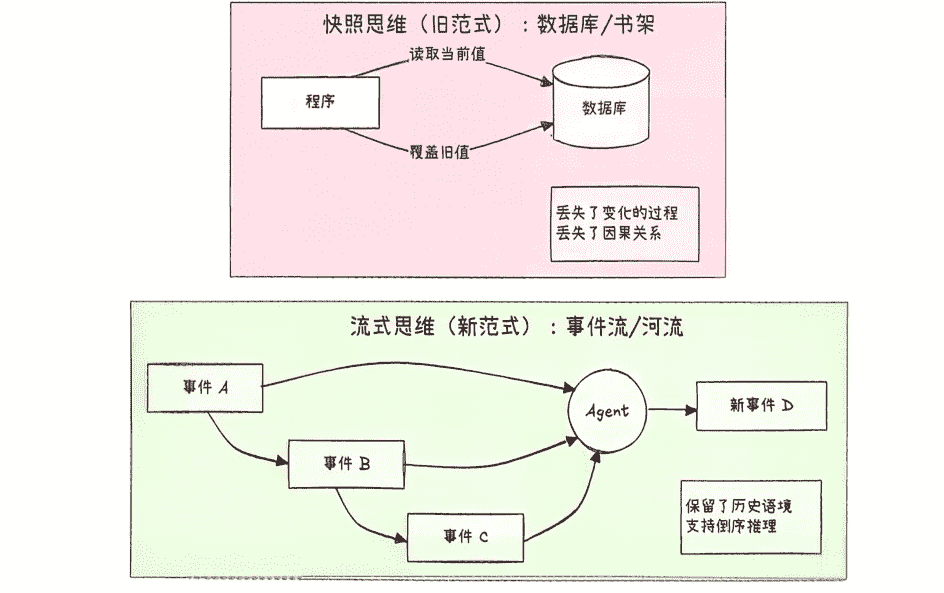

#### 2. 为上下文工程铺路

这种哲学思想上的转变，直接决定了我们如何设计 Agent 的记忆系统（见第 5 章）。

在传统软件设计中，内存管理的目标是“节省空间”。在 Agent 架构中，上下文管理的目标是“流速控制”。

- 静态视角：将知识库视为一个固定的书架，需要不断整理，把书摆放整齐。
- 流式视角：将上下文视为一条流动的河流——新的 Token 不断涌入，旧的 Token 则逐渐被冲刷到远处。

Agent 的核心能力，不再是对静态数据的增、删、改、查，而是在这条奔流不息的信息河流中，实时地捕捉（Capture）、过滤（Filter）和变换（Transform）有价值的信号。

至此，我们完成了“计算的原子化”的拼图。

- 函数式教会我们构建无状态的推理核心。
- 响应式教会我们处理异步的交互时间轴。
- 数据流教会我们理解并处理动态的上下文。

在完成这些微观层面的准备之后，我们终于可以将视角拉高：当单台机器无法承载这些流动的计算原子时，就必须突破物理边界，迈向更宏大的分布式世界。

## 2.2 分布式的解耦：从单体到生态

数据流实现了时间上的解耦（即异步处理），本节将进一步阐述如何实现空间上的解耦（即分布式架构）。

在软件工程的早期，人们崇尚单体（Monolith）。无论是大型机还是庞大的 J2EE 应用，开发者习惯将所有逻辑、数据和控制权集中部署在单一物理节点上。彼时的软件，宛如一位全知全能的“上帝”，掌控着一切功能与数据的流转。

然而，随着互联网的爆发式发展，摩尔定律逼近物理极限，迫使我们不得不接受一个事实：没有任何一台机器能强大到装下整个世界。

于是，我们拆解了单体架构，将其分解为多个自治的服务单元，最终演化为分布式系统。这看似是因算力瓶颈而作出的妥协，却在不经意间为 Agent 奠定了最理想的生存土壤——一个蓬勃发展的生态系统。

Agent 本质上是社会化的。一个孤立的通用人工智能（Artificial General Intelligence, AGI）或许令人不安，但在工程实践时我们更倾向于构建一群各司其职的专才型 Agent（Specialist Agent）。分布式架构，正是这个智能社会的物理基础设施。

### 2.2.1 微服务：通过API连接一切

今天，我们已经知道，Agent 能“调用工具”“联网搜索”，甚至“操作数据库”。但请停下来想一想：为什么这些能力是“可调用”的？

如果时光倒流回 2000 年，大部分软件的功能深埋在图形用户界面（Graphical User Interface, GUI）之后，或封装在私有的动态链接库（Dynamic Link Library, DLL）文件中。那时，若 Agent 想操作 Excel，就只能像人类一样模拟鼠标点击——这正是当今 RPA（Robotic Process Automation，机器人流程自动化）所做的，这种方式不仅笨拙，而且十分脆弱。

微服务运动（Microservices Movement）改变了这一切。它为 Agent 带来一笔宝贵的馈赠——API。

### 1.贝索斯的“API宣言”

2002 年，杰夫·贝索斯（Jeff Bezos）向亚马逊全体员工发出了一封著名的内部邮件，其大意是：“所有团队必须通过服务接口（Service Interface）对外公开数据和功能；禁止直接读取数据库；禁止使用后门访问。违者将被解雇。”

这不仅是亚马逊的转折点，更是现代软件架构的分水岭。

它确立了一项核心原则：功能必须解耦为服务，服务必须通过协议进行通信。

正是这场持续二十余年的“接口化”运动，将物理世界与数字世界封装成成千上万个标准化的 RESTful API 或远程过程调用（Remote Procedure Call，RPC）接口。

### 2.为机器准备的“盛宴”

在 Agent 出现之前，API 主要是供开发者使用的工具。然而，随着 Agent 的出现，我们惊喜地发现：API 简直是为 LLM 量身定制的“触手”。

- Swagger/OpenAPI 规范：最初旨在生成清晰的 API 文档，如今却直接成为 Agent 的“工具说明书”。Agent 只需要读取一份 JSON 定义，便能理解如何调用该服务。
- 无头服务（Headless Services）：微服务倡导将用户界面与业务逻辑解耦。这意味着 Agent 可以绕过复杂的 HTML/CSS 渲染层，直接与后端业务逻辑交互。

图 2-5 对比展示了人机交互与机机交互。

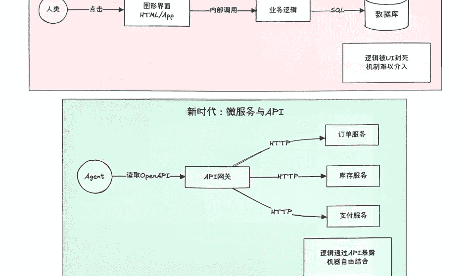

若非微服务运动铺就了道路，今天的 Agent 将如同“盲人摸象”——空有强大的大脑，却无法伸出手去感知和改变世界。

### 3.架构的启示：从编排到涌现

微服务架构带来的另一个重要的馈赠是“去中心化”。在单体架构时代，控制逻辑集中在 Main 函数中；而在微服务时代，控制逻辑则分散于各服务之间的交互之中。

这可直接映射到 Agent 的协作模式（见第 9 章）。

- 编排（Orchestration）：由一个中心化的“大脑”统一调度和指挥所有 Agent。
- 协同（Choreography）：类似微服务中的事件总线机制，Agent 通过广播消息来彼此感知、自主协作，不需要中央协调者。

微服务并非终点，而是一种基础设施。它将复杂系统分解为自治的单元，并封装进一个个标准化的 API“盒子”中。而 Agent 的使命，正是打开并协调这些“盒子”，融合其能力，创造出超越单点的价值。

接下来，我们面临另一个难题：当分布式服务数量呈爆炸式增长时，谁负责管理？

下面就来探讨软件工程发展史上最伟大的思维跃迁之一：从命令式（imperative）到声明式（declarative），再到由 Agent 意图（intent）驱动的范式演进。

### 2.2.2 编排：从Kubernetes的声明式到Agent的意图

当微服务数量从几十激增至数千时，传统的运维脚本彻底失效。软件工程师们意识到，试图通过脚本“命令”每一台服务器执行任务已不再可行，因为运行环境变得过于复杂且高度不稳定。

就在这一关键时刻，Kubernetes 横空出世，为我们提供了管理复杂系统的新范式。如今，这一理念已完美融入 Agent 架构之中。

### 1.控制回路：Kubernetes的贡献

Kubernetes 并未首创容器技术，但它开创了“调和循环”（Reconciliation Loop）。

在 Kubernetes 出现之前，我们采用命令的方式告诉机器“怎么做”：启动服务器 A→下载代码包→解压缩→运行→如果失败则重启。

而在 Kubernetes 出现之后，我们转而使用声明式的方式，只需要告诉系统“要什么”：我需要 3 个副本始终处于健康运行状态。

剩下的事情——如何调度、如何重启、如何实现负载均衡——都由 Kubernetes Controller 自动完成。它在一个持续运行的循环中，不断比对“期望状态”与“实际状态”，并自动采取行动弥合两者之间的差距。

这听起来是不是很耳熟？

没错，这正是 Agent 的心智模型的雏形。

- Kubernetes Controller：Observe（观察集群状态）→ Diff（比对期望状态与实际状态）→ Act（创建或终止 Pod）。
- Agent Loop：Perceive（感知环境）→ Reason（推理当前状态与目标的差距）→ Act（调用工具执行操作）。

Kubernetes 是首个在大规模生产环境中验证“基于目标的自主运行”可行性的系统。它本质上是一个低智能但具有高可靠性的 Agent。

### 2.意图编排：架构的升维

如果说 Kubernetes 是用于管理基础设施的 Agent，那么 LLM Agent 则是用于管理业务逻辑的“Kubernetes”。

Agent 的出现，将“编排”的层级推向了新的高度。

- Kubernetes 的输入是语法严格的 YAML 文件，描述的是确定而静态的资源需求（如 CPU 需求、内存需求等）。
- Agent 的输入则是模糊多变的自然语言 Prompt，表达的是动态、复杂的人类意图。

图 2-6 展示了编排从资源到意图的进化。

这一跃迁的意义在于：在 Kubernetes 时代，我们学会了“放手”——信任调度器去管理机器；而在 Agent 时代，我们需要学会“更彻底地放手”——信任 Agent 自主管理整个流程。

传统的工作流引擎（如 BPMN①）将流程预先固化、静态定义；而 Agent 的意图编排则是动态生成的。面对“帮我策划旅行”这样的意图，Agent 会即时构建一个工作流，并在执行过程中根据环境反馈实时调整——这正是 7.2 节介绍的规划—执行模式。

从 Kubernetes 到 Agent，架构师的职责发生了根本转变：过去，设计的是“流程图”，每一步都要求严丝合缝、精确预设；如今，设计的是“目标函数”和“边界护栏”。架构师不再规定 Agent 先迈左脚还是右脚，而是明确告诉它：“你要到达山顶（目标），且不能掉进悬崖（护栏）。”

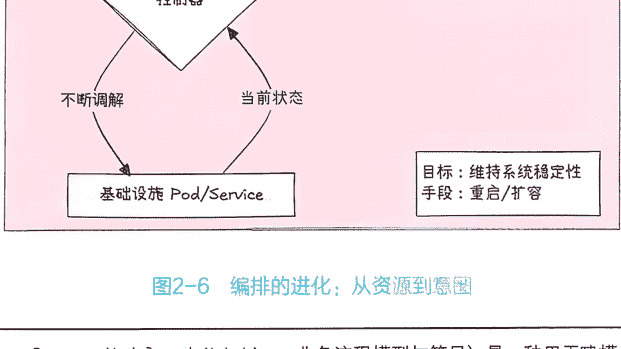

> ① BPMN (Business Process Model and Notation, 业务流程模型与符号) 是一种用于建模业务流程的图形化符号标准。它通过一系列标准化的图形符号（如活动、网关、事件符号等）和连接线来清晰地表示业务流程的流转逻辑。

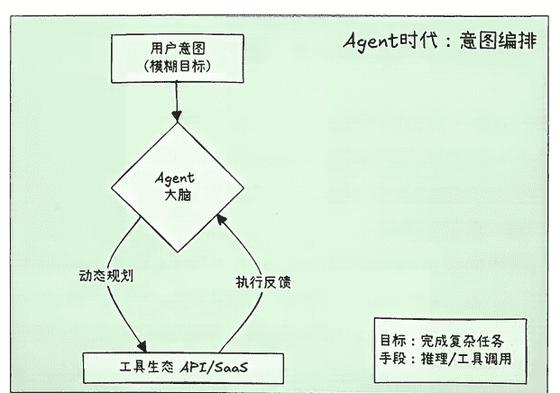

### 2.2.3 Serverless：极致的原子能力

在微服务和容器化技术广泛应用之后，分布式架构的演进并未停歇。我们开始思考一个更本质的问题：既然只需要运行一段逻辑，为何还要维护整个操作系统，甚至一个完整的容器呢？

这一反思催生了 Serverless 架构。它将计算的粒度从“服务”进一步细化为“函数”，彻底改变了软件的计费方式与运行模式，如图 2-7 所示。

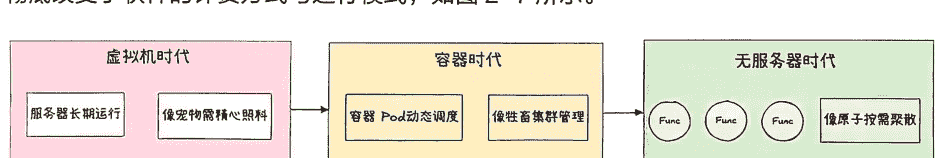

### 1.缩放至零的魔法

在传统的服务器模型中，无论是否有用户访问，EC2 实例或 Pod 都持续运行，空耗 CPU 资源和电力。这就好比为了喝一杯水，不得不在家里维持一口永不干涸的井。

Serverless 引入了缩放至零（Scale to Zero）的概念，其运行机制可分为以下 3 个阶段。

- 休眠：在无请求时，代码仅以字节形式存储于磁盘，不占用任何计算资源，成本为零。
- 冷启动：当事件（如 HTTP 请求、定时器触发或消息队列消息）到达时，云平台在毫秒级时间内动态分配资源、加载代码并执行逻辑。
- 销毁：任务执行完毕后，所分配的资源立即释放，不留冗余开销。

这种“用完即走”的特性，使开发者不需要再关注“服务器负载”，而是专注于“业务逻辑”。

### 2.事件驱动架构

Serverless 天然具备事件驱动的特性。它不再是长期运行的守护进程，而是作为触发器的响应者。

- 用户向 S3 上传一张图片→触发函数生成缩略图。
- 数据库写入一条订单记录→触发函数发送确认邮件。

这种模式构建了一个高度解耦、迅速响应的数字世界。

### 3. Agent的完美伴侣：沉睡的技能

现在，我们将视角转回 Agent。为什么 Serverless 对 Agent 如此重要？这是因为 Agent 的行为特征与 Serverless 的运行特性高度契合。例如，Agent 可能突然想查询天气，或突然需要执行一段 Python 代码来绘图，又或突然需要对一张图片进行 OCR 识别。这些行为具有以下特点。

- 偶发性：Agent 并非每秒都需要进行“搜索天气”或“执行 Python 绘图”等操作，这类需求通常随着对话随机出现。
- 原子性：Agent 调用的工具通常具备单一功能（如 calculate_tax），不需要维护复杂的上下文。

在 Agent 架构中，Serverless 函数如同“沉睡的技能”。架构师可以将成千上万个工具部署为 Serverless 函数，它们静静地驻留在云端，构建起 Agent 庞大而灵活的外挂能力库。Agent 不需要背负沉重的本地代码库，只需要在产生特定意图的瞬间，通过 API 唤醒相应的函数即可。

### 4.从API到Function Calling

OpenAI 于 2023 年推出的 Function Calling 功能，实际上是 Serverless 架构在 AI 领域的一种“精神投射”。

- Serverless 的核心范式：Handler(Event) → Result。
- Function Calling 则定义了函数的元信息结构：{name, description, parameters}。

二者相得益彰，堪称绝配。如今，架构师可以开发成千上万的 Serverless 函数，并将这些函数的定义注册给 Agent。如此一来，Agent 就化身为一个超级路由器（Super Router），它不需要知晓函数具体运行在哪台机器上，只需要明确“何时唤醒它们”即可。

图 2-8 展示了 Agent 的唤醒机制。

### 5.架构的终局：液态软件

Serverless 将分布式架构推向了极致的解耦。

- 空间解耦：代码运行的位置不再重要。
- 时间解耦：代码的运行完全由事件驱动，不需要预先调度。

这为未来的多 Agent 协作奠定了坚实基础：成千上万的微型 Agent 与工具如同液体一般，在网络中自由流动、动态组合与即时拆解。软件不再是以“大教堂”形态存在的固态结构，而是演变为流动不息的“海洋”。

至此，我们已经通过微服务拆解了单体架构，借助 Kubernetes 实现了声明式编排，并利用 Serverless 获得了极致的原子化算力。从表面来看，我们似乎已经拥有了理想的软件架构——灵活、弹性、按需分配。

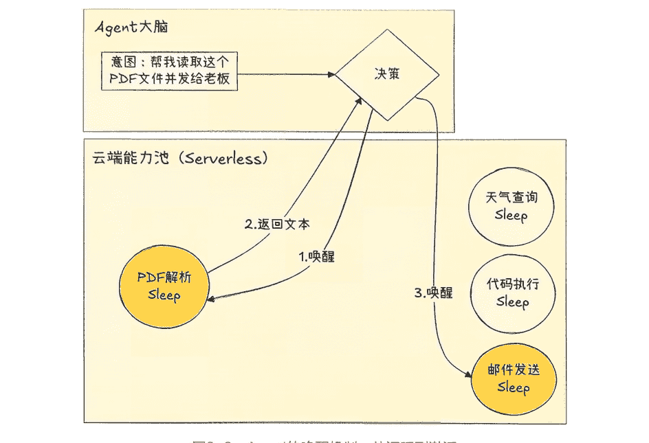

然而，当你打开那些运行在 Serverless 容器中的代码时，会发现：一切似乎并未真正改变。

尽管架构已焕然一新，代码的编写方式却仍停留在几十年前。我们依然用 C++、Java 或 Python 一行行地堆砌僵化的 if-else 语句逻辑，试图以有限的规则穷尽无限复杂的现实世界。我们打造了最先进的“肉身”——高度分布、弹性伸缩的现代架构，却仍给它塞进了一颗由发条与齿轮驱动的“旧大脑”——基于硬编码规则的传统程序逻辑。

这种割裂感在 2017 年达到了临界点。为了迎接 Agent 的诞生，我们不仅需要重构服务器，更需要重新定义“编程”本身。

## 2.3 软件2.0：当概率遇见代码

2017 年，时任特斯拉 AI 总监的安德烈·卡帕西（Andrej Karpathy）发表了一篇震撼业界的文章“Software 2.0”（《软件 2.0》）。这不仅是一个新名词的提出，更是对计算机科学根基的一次深刻反思。

在此之前，软件工程致力于消除不确定性；此后，软件工程开始学会利用不确定性。

### 2.3.1 规则的落幕：逻辑不再由if-else语句编写

在软件 1.0 时代，开发者如同拥有绝对权力的建筑师，对每一行逻辑进行着“独裁式”的控制：只要能够将问题转化为极其精确的指令序列，计算机便能依此实现任何被明确指定的逻辑，确定性是其基石。

而进入以神经网络为代表的软件 2.0 时代后，这种确定性被打破了。开发者的角色从“建筑师”转变为“园丁”或“引导者”——我们主要提供“土壤”（训练数据）并设立“栅栏”（损失函数与约束），而具体的决策逻辑与能力，则由模型通过在海量数据中学习而自行“涌现”。

图 2-9 形象地展示了软件 1.0 时代与软件 2.0 时代开发者的角色。

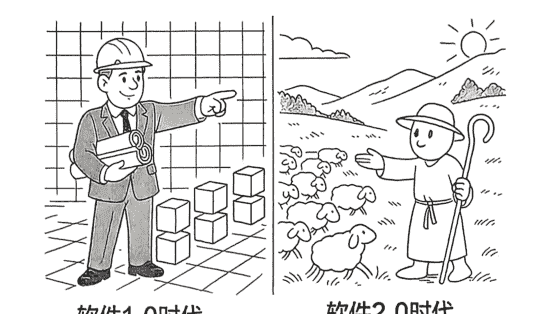

图2-9 开发者角色的形象化展示

### 1.软件1.0：人类作为编译器

在软件 1.0 的框架中，开发者的任务是将复杂的问题空间（Problem Space）转换为代码空间（Program Space）。

- 场景：你需要编写一个程序来识别图片中是否包含“猫”。
- 做法：你首先需要在脑海中将“猫”的概念解构为线条、颜色、纹理、耳朵形状等基本元素。然后，使用 C++ 编写代码，例如，通过一行行的条件语句实现边缘检测，从而判断图片中是否存在“猫”的特征。

每一行代码都是人类认知的直接固化。开发者不仅要精通编程，还要深入了解“猫”的特征，甚至要精准把握现实世界中千变万化的“类猫”形态。

然而，现实世界的复杂度远远超出了人类大脑能够显式编码的极限。你永远无法穷尽所有“像猫但不是猫”的情况，也无法写出覆盖全部例外的 else 分支。因此，在面对视觉识别、自然语言处理、复杂决策等充满模糊性和不确定性的任务时，软件 1.0 显得笨拙又脆弱。

### 2.软件2.0：数据作为源代码

机器学习的兴起开启了软件 2.0 时代，同时也颠覆了传统的确定性逻辑（见图 2-10）。开发者不再手动编写具体的逻辑步骤，而是定义“目标”，由模型从数据中自动学习实现该目标所需的策略与规则。

仍以识别“猫”为例，具体做法如下。

- 不再编写具体的识别逻辑，而是设计一个神经网络架构——这是一个由大量可调参数构成的“骨架”，但其本身尚不具备识别能力。
- 收集 10 万张包含猫的图片和 10 万张不含猫的图片，并将这些图片作为训练数据。

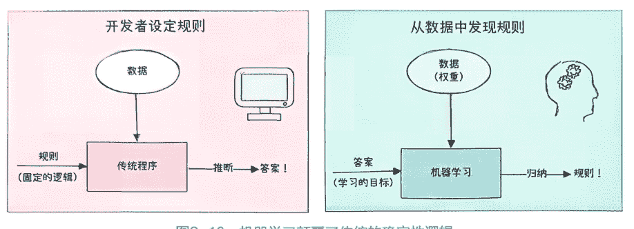

- 定义一个损失函数（Loss Function），用于衡量网络输出与真实标签之间的差距，并引导模型朝着正确方向学习。
- 运行优化器（Optimizer）：例如，通过随机梯度下降，让计算机在庞大的参数空间中自动搜索出一组最优权重（Weight），这组权重（一般由数据来表示）实质上就构成了能够识别“猫”的“程序”。

在机器学习时代，数据取代了传统代码，成为软件开发流程中的核心要素；优化器扮演了编译器的角色；而训练得到的权重，则构成了最终的“可执行文件”。图 2-11 展示了编程范式的倒转。

理解软件 2.0 是掌握 Agent 行为特征的关键。

- 从“指令执行”到“模式补全”：Agent 并非简单地执行你的 Prompt，而是在补全你的 Prompt。它背后的模型实质上是一个巨大的概率分布表。当你问“天空是什么颜色”时，它回答“蓝色”，这并不是因为它查询了一个数据库，而是因为在它的参数空间中，“蓝色”在“天空”之后出现的概率最大。

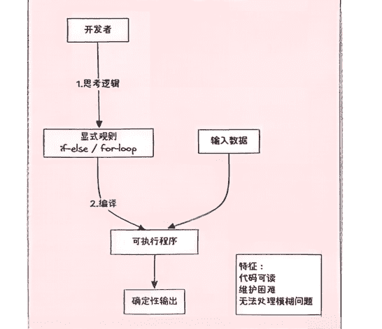

## 2.3.2 MLOps的启示：为AgentOps铺路

当代代码演变为数据（用以表示模型权重）时，传统的 DevOps 工具链（如 Git、Jenkins）便显得力不从心。

你无法对一个 100GB 的二进制模型文件执行 git diff 命令来查看具体修改了哪些逻辑；也无法通过 assert 语句断言模型在所有情况下都能输出正确结果。

在软件 2.0 时代，我们无法像调试传统代码那样，通过集成开发环境（Integrated Development Environment，IDE）“调试”神经网络的权重。那么，我们又该如何保障软件的质量？

为了驯服软件 2.0 的“黑盒”特性，MLOps（Machine Learning Operations，机器学习运维）应运而生。它并非单一工具，而是一套关于“如何管理概率性软件生命周期”的方法论。这套方法论为 Agent 架构师提供了 3 个至关重要的启示。

### 启示一：数据即源代码

在软件 1.0 时代，源代码是真理的唯一来源——只要代码不变，软件的行为就不会改变。

而在软件 2.0 时代，数据取代了源代码的核心地位：即使模型架构与代码保持不变，只要训练数据发生改变（如混入了 10% 的脏数据），模型的行为就可能发生剧烈变化。

对 Agent 开发者而言，我们通常并不直接训练基座模型，而是专注于提示工程（Prompt Engineering）。Prompt 并非仅仅写在代码中的字符串常量，而是一种需要进行版本控制的关键“资产”。System Prompt（系统提示词）从 v1.0 升级到 v1.1 的微小改动，就可能导致 Agent 的行为风格甚至“性格”发生根本性的变化。

同时，当 Agent 出现错误时，我们需要能够追溯：它当时使用的是哪个版本的知识库？是否混入了过时的文档？这种追溯机制被称为上下文谱系（Context Lineage），因为知识库的变更可能迫使下游 Prompt 进行重构。

MLOps 告诉我们：要像管理代码一样严谨地管理数据和 Prompt。这一理念促进了 LangSmith、LangFuse 等 AgentOps 平台的发展。

### 启示二：测试的概率化

传统的单元测试是二元的：要么通过（Passed），要么失败（Failed）。

但在 MLOps 中，我们面对的是概率分布。我们无法要求模型在识别猫时达到 100% 的准确率，而只能追求准确率超过 95%。

这是 Agent 开发中最深刻的教训：Agent 的行为本质上难以测试，除非开发者构建专门的评估数据集（Evals）。

面对 LLM 的输出，开发者无法简单地编写“assert response == "巴黎"”，因为模型可能回答“法国的首都巴黎”。此时，你需要引入 LLM-as-a-Judge（LLM 即法官）机制，即使用另一个模型判断：“这句话的意思是否等同于‘巴黎’？”

Agent 的质量并非由传统意义上的测试通过率决定，而是取决于“在 100 个真实场景中，新版 Agent 战胜旧版 Agent 的次数”。

MLOps 告诉我们：要放下对确定性的执念，转而构建基于统计的质量护栏。

### 启示三：可观测性的语义化

在 DevOps 时代，我们监控的是 CPU 使用率、内存、延迟和错误率。

但在 MLOps 时代，模型可能 CPU 占用很低、延迟极短且没有任何报错，却已然“疯了”——输出有害内容或开始胡言乱语。

这种现象被称为数据漂移（Data Drift）或概念漂移（Concept Drift）。

对 Agent 的监控必须深入到语义层面：不再依赖传统的 INFO/ERROR 日志，因为在 LLM 场景下它们往往毫无意义；而是要关注追踪轨迹（Trace），可视化 Agent 的完整推理链路——用户输入→检索→思考→工具调用→响应。

我们还需要实时检测 Agent 的输出是否变得“有毒”（Toxic），或陷入无意义的“复读”（Repetition）。

MLOps 告诉我们：不仅要监控软件“跑得快不快”，更要监控它“想得对不对”。

MLOps 是一场软件 2.0 时代的工业革命——它将曾经如同炼金术般的模型训练，转变成可复现、可管理的工程流程。

对 Agent 而言，我们继承了 MLOps 的理念，并将其进一步发展为 AgentOps。我们不再直接训练模型权重，而是专注于精调 Prompt；我们不再仅仅监控损失函数，而是更加注重追踪思维链。

图 2-12 展示了运维范式从代码到思维的演进。

然而，无论工具多么先进，概率模型的核心特征——不确定性——始终存在。

在概率的地基上，如何建造一座坚固的“房子”？这是每一位 Agent 架构师都必须直面的终极命题。

### 2.3.3 不确定性的工程化：在概率模型之上构建可靠系统

我们承认软件 2.0 具有概率本质，但这并不意味着我们必须接受一个“不可靠”的软件系统。恰恰相反，Agent 架构师的核心竞争力，正是通过确定性的工程框架，驾驭并约束概率性的智能核心，从而构建出高可靠性的系统。

在软件 1.0 时代，可靠性源于“证明”——我们通过逻辑推导和单元测试，确保代码在输入 A 时必然输出 B。

而在软件 2.0 时代，可靠性则源于“统计”与“约束”。

这构成了所有 Agent 架构师面临的根本性矛盾：用户（以及下游 API）要求的是 100% 确定的结构化数据，如 JSON 数据；而 LLM 本质上倾向于生成充满可能性、富有创造性的文本，如一首诗。

为了解决软件 2.0 时代用户对 100% 确定性的结构化数据的需求与 LLM 生成内容不确定性之间的矛盾，“三明治架构”是一种有效的策略，如图 2-13 所示。这种架构的核心理念是通过两层确定性的逻辑或工程框架来包围中间那层基于概率的模型。

### 1. 输入侧约束：提示工程的防御性

在不确定性发生之前，我们首先要对其进行收敛。这已不再仅仅是“写一个更好的 Prompt”，而是需要引入类似类型系统（Type System）的强制性约束机制，即结构化强制（Structured Enforcing）。

当前的模型（如 GPT-4、DeepSeek）已支持 JSON 模式（JSON Mode）或 Function Calling。这不仅是微调的结果，更关键的是在推理阶段采用了受限解码（Constrained Decoding）技术。

例如，要求模型在生成 JSON 的键（key）时，下一位字符必须是冒号；而在生成 JSON 的值（value）时，必须严格符合 JSON Schema 中定义的数据类型。这种约束在数学上消除了“语法错误”的可能性，从而将不确定性有效限制在“语义”层面。

### 2. 输出侧验证：验证器模式

“生成”可以是概率性的，但“验证”必须是确定性的。这是应对幻觉最有效的手段之一——为 Agent 构建一个具备“怀疑”能力的反馈回路。

- 以代码为裁判：当 Agent 生成了一段用于计算斐波那契数列的 Python 代码时，如何判断其正确性？直接运行它！如果解释器抛出语法错误（如 SyntaxError），就说明模型输出有误。此时，可将具体的报错信息反馈给模型，促使其修正并重新生成代码。
- 以搜索为裁判：当 Agent 声称“2024 年奥运会在柏林举办”时，如何验证其真伪？调用外部搜索工具进行核查！若搜索结果与生成内容不符（例如，实际举办地为巴黎），则立即触发修正机制，引导 Agent 更新其输出以符合事实。

这正是我们将在第 7 章中详细讨论的 ReAct 模式的核心逻辑：通过确定性的环境反馈，不断坍缩概率性生成的空间，从而引导模型输出趋向准确与可靠。

### 3. 过程中的冗余：自洽性

如果单次生成的结果不可靠，那么生成多次呢？通过采样与投票机制，可以让 Agent 对同一个问题（例如，在 Temperature>0 的设置下）独立推理多次（如 5 次）。若其中路径 A、路径 B 和路径 C 均输出答案 42，而路径 D 输出 100，则系统采纳多数结果，输出 42。这种基于冗余计算的策略，能显著提升系统的鲁棒性。

由此可见，软件 2.0 并未取代软件 1.0，而是与之共生共存。

现代 Agent 架构的本质，正是使用软件 1.0 的框架（如代码、工具、流程）包围软件 2.0 的内核（如模型、推理）。

我们以确定性的逻辑引导不确定性的智慧，以刚性的约束规范柔性的生成。

## 小结 地基的夯实

在第 2 章中，我们并未急于切入 Agent 本身，而是系统梳理了软件工程为迎接 Agent 时代所做的长期准备。

- 函数与流让我们掌握了无状态（函数式）与异步（响应式）的编程范式，使软件能够契合 AI 的思考节奏。
- 分布式教会我们通过接口化与 Serverless（原子化）构建灵活、可扩展的系统，为 Agent 提供了无限延展的“手脚”。
- 软件 2.0 引导我们学会在拥抱概率性的同时施加工程化约束，从而在不确定性中建立对确定性的信心。

历史的铺垫已然完成，Agent 的登场水到渠成。

所有关键技术的“积木”（如 Transformer、Docker、API、向量数据库等）如今都已准备就绪。

现在，我们需要的是一种全新的架构思想，将这些组件有机整合，构建出一个具备感知、记忆、思考与行动能力的“新物种”。

这个新物种，不再是冰冷的代码工具，而是人类意志的延伸，是数字世界的原住民。

地基已然夯实，肉身业已铸就。

如今，这具躯壳只差最后一样东西——灵魂。

- 是什么让一堆无状态的函数涌现出“智能”？
- 又是什么将概率性的预测转化为有目的的“决策”？

要回答这些问题，我们必须深入这具躯壳的内部，亲手解剖那个被称为“模型”的黑盒。

请翻开第 3 章——从设计到演化，欢迎来到 Agent 时代。

在那里，我们将正式剖析这个新物种的灵魂。

# 第 3 章

## 从设计到演化，欢迎来到 Agent 时代

当我们把 LLM 引入软件架构的核心时，奇点已然临近。软件不再仅仅是对人类指令的响应（response），而是开始展现出意图和自主性（agency）。

- 它不再是被动等待调用的工具，而是主动感知环境的观察者。
- 它不再是无状态的函数，而是拥有记忆与身份的实体。
- 它不再是孤立的计算节点，而是能够协作的社会成员。

我们不再是在设计（design）一个系统，而是在培育（cultivate）一个物种（见图 3-1）。

### 3.1 Agent的本质：从工具到伙伴

什么是 Agent？
从技术的角度来看，Agent 可能只是一个不断调用 LLM API 的死循环脚本。
然而，从交互哲学的角度来看，它标志着人机关系的根本性重构：从“命令与控制”转向“意图与协作”。

### 3.1.1 从命令到对话：交互原语的升维

现在，你也许不会对下面这样的对话感到惊讶。
开发者：我在设计一个图书推荐系统，但不确定该使用协同过滤还是内容过滤。
Agent：让我帮你分析一下。你的用户规模有多大？是否已经积累了足够的历史交互数据？
开发者：大约有 5000 名用户，系统刚上线 3 个月。
Agent：考虑到你的用户规模和当前的数据量，我建议采用混合推荐策略。在初期以内容过滤为主，因为若采用协同过滤，很可能面临冷启动问题。你可以按照如下步骤设计。
首先，基于图书的内容特征（如类别、作者、主题词等）构建内容相似度模型。
其次，在收集用户行为数据的同时，逐步引入协同过滤机制。
最后，当用户交互数据足够密集时（例如，每名用户有 20 条以上的评分或行为记录），再逐步提高协同过滤的权重。
需要我为你写一个初始的实现框架吗？
开发者：好的，但我还在纠结是否要引入时间衰减因素。
Agent：这是一个很好的考量！时间衰减确实重要，特别是对于图书推荐。不过要注意区分。

- 经典作品：用户兴趣通常持久，衰减应该很慢，甚至可以忽略。
- 时事相关书籍：热度随时间快速下降，应采用较快的衰减函数。
- 季节性书籍（如节日主题）：更适合使用周期性权重，而非单调衰减。

我建议你根据图书类别设置不同的衰减策略……

在这段对话中，Agent 并非在“执行命令”，而是在“理解意图”“提供建议”和“参与讨论”。它更像一位经验丰富的同事，而非一个机械的命令行工具。

这一转变，标志着软件正从被动工具迈向智能伙伴，实现了历史性跨越。

让我们回顾一下“工具”的本质：传统工具具有确定的输入—输出映射，功能单一而明确，不具备状态记忆，不会主动行动，也无法理解上下文。

工具的根本特征是被动性与机械性：它们等待指令、执行指令，然后继续等待下一条指令。

Agent 打破了这一范式：它们主动感知环境，自主思考与规划，采取行动，并能够从经验中持续学习。

- 在 CLI（Command-Line Interface，命令行界面）时代，人机交互的基本单元是“指令”。
- 在 GUI 时代，人机交互的基本单元演变为“点击”。

这两种模式共享一个根本前提：人类必须负责“怎么做”(How)，而机器仅负责执行。例如，用户与机器的操作分别如下。

- 用户：打开文件→选择文字→点击“加粗”按钮→点击“保存”按钮。
- 机器（如 Word 软件）：依次执行上述操作。

在 Agent 时代，人机交互的基本单元已转变为“对话”，更准确地说，是“意图”。例如，用户与 Agent 的操作分别如下。

- 用户：把这份文档改得正式一点。
- Agent：理解“正式”的语境含义→读取文档内容→分析段落结构→重写文本→保存结果。

这种转变意味着认知负荷的转移。

过去，复杂性存在于用户的脑海中——用户必须熟悉软件的菜单与功能，记住各种操作步骤和指令。如今，这些原本由用户自行承担的操作细节，已交由 Agent 在后台统一处理。软件不再是一个被动的操作平台，而是逐渐演变为能够理解用户意图并作出响应的对话者。这一转变显著降低了用户的认知负担，使其得以从繁杂的操作细节中解脱出来，专注于自身的目标与意图，如图 3-2 所示。

工具时代的命令式交互，已华丽地转变为 Agent 时代的对话式交互——不再只是“你执行”，而是“我们一起把事情做完”。

图3-2 在Agent时代，软件从操作平台过渡到对话者

开发者：这段代码总是返回 None，能帮我看看吗？
Agent：我发现了问题。在第 15 行，你的函数在 for 循环内部直接使用了 return，这意味着只检查第一个元素就退出了。你可能想要执行如下操作。
- 将 return 移到循环外部。
- 如果希望返回多个值，可以改用 yield 语句。
另外，我注意到你没有处理空列表的情况，建议在函数开头添加空值检查逻辑。需要我帮你修复吗？
开发者：如果使用 yield 语句，会有什么影响？
Agent：使用 yield 语句会将函数变成生成器，主要影响如下。
- 返回的是生成器对象，而非具体列表。
- 实现延迟计算，更节省内存。
- 调用方需要通过 list 函数进行显式转换，或直接迭代该生成器。
考虑到你正在处理大文件，yield 语句可能是更合适的选择。
对话不仅是自然语言的交互界面，更重要的是，它能够实现意图理解、上下文保持（即我们熟知的上下文工程）以及任务分解。

### 3.1.2 意图的理解：模糊与精确的桥梁

传统软件不仅缺乏主动性，而且拘泥于字面含义。例如，少写一个分号，编译器就会报错——它无法理解你的“言外之意”。
Agent 的核心能力在于充当一个“模糊翻译器”，搭建起“人类模糊的自然语言”与“机器精确的 API 调用”之间的桥梁。
- 输入：模糊的意图，例如，“帮我查下这周还有没有去上海的便宜机票”。
- 处理：进行推理、消歧，并补全必要参数。
- 输出：生成精确的调用指令，例如，SearchFlights(dest='TYO', date_range='this_week', sort_by='price_asc')。

架构师需要认识到，Agent 的本质就是一个持续运行的“意图编译器”，它能够实时地将人类的意图编译为机器可执行的动作。而意图理解，正是 Agent 的“灵魂能力”。

在工具时代，系统仅能理解字面含义并严格执行指令。例如，“删除文件”就意味着直接删除文件。

而在 Agent 时代，系统能够理解用户的“目的”与“情境”。例如，当用户说“这个文件能不能帮我清一下”，Agent 会进一步询问“你是想删除、压缩、归档，还是清理其中的临时内容”，以明确用户的真实意图。

从技术的角度来看，意图理解（Intent Understanding）通常包含 4 个层次。

#### 1. 语义理解

提取用户表达背后的动作、对象、范围和限制条件。

例如，当用户说“我想把昨天的日志整理一下”，其中“整理”是指分析、压缩、归档还是其他操作？这都需要进一步澄清。

在复杂系统中，通常会结合结构化的意图模型进行解析。代码示例如下。

```json
{
    "intent": "refactor",
    "target": "function",
    "constraints": [...]
}
```

#### 2. 目的识别

不仅要理解“你说什么”，更要理解“你想实现什么”。

例如，当用户说“这段代码总是返回 None”，其目的往往并非仅仅调试，而是希望“获得正确的返回结果”。

Google、OpenAI、DeepSeek 等头部 AI 公司的最新研究普遍强调，Agent 应能从“显性指令”中推断出“隐性目标”。以 OpenAI o1 的“Reasoning Tokens”为例，虽然其表面是在进行推理，但本质上是为了更准确地捕捉用户的隐含意图。

#### 3. 上下文关联

Agent 必须将意图“落地”到具体环境中，这包括以下几个关键要素。

- 用户的代码结构。
- 当前文件目录。
- 用户偏好（例如，倾向于使用 yield 语句还是列表推导式）。
- 安全约束（例如，禁止删除系统文件）。
- 历史任务上下文（例如，上次正在编写的数据管道）。

这正是上下文工程的核心价值所在：Agent 必须基于当前世界状态进行判断和决策。

#### 4. 风险评估与澄清

Agent 必须在“意图模糊”时主动提问，而非贸然执行，以避免误操作，这样既确保任务能够准确完成，又符合安全策略。

## 意图不再是简单的命令字符串，而是一个结构化的对象

```python
class Intent:
    action: str    # 如 "delete"
    target: str    # 如 "logs"
    constraints: [] # 如 ["before:2023-01-01", "safe_mode:true"]
    confidence: float # 置信度，例如，置信度为 0.4，表示意图不够明确，需要澄清

if intent.confidence < 0.6: # 可根据策略调整置信度阈值
    return self.ask("你是想删除这个目录，还是删除目录里的临时文件？")
```

上述代码所展示的澄清行为，正是 Agent “可靠性”的重要体现。

## 3.1.3 记忆与身份：Agent的自我连续性

工具是“用完即走”的，但伙伴是有记忆的。试想，如果你的同事每天早上见到你，都像初次见面一样问：“你是谁？你要干什么？”你恐怕会崩溃。
每次打开工具时，都像是面对一块空白的白板，但 Agent 则不同，它拥有记忆。Agent 在每次对话之间延续其“身份”，并逐渐形成对用户的深入理解，如图 3-3 所示。


### 1. 记忆：连续性的幻觉

正如 2.1 节所述，LLM 本身是无状态的。Agent 所谓的“记忆”，实际上是通过上下文工程构建出的一种“幻觉”。
短期记忆（Session Memory）：记录当前会话的上下文，包括用户上一句话的内容、最近讨论的话题、代码片段，以及用户此前纠正过的误解等。
短期记忆使 Agent 能够实现以下目标。

- 在多轮对话中保持一致性。
- 避免重复提问。
- 进行上下文连续的推理。

如今，最先进的上下文工程技术会对短期记忆进行“摘要、过滤与结构化”处理，使 Agent 能在高达 20 万至 100 万个 Token 的大上下文中保持精准推理。

长期记忆（Long-term Memory）：借助向量数据库等技术，记录用户跨会话的偏好信息，例如以下内容。

- 用户偏好的代码风格。
- 常用工具栈（如 Python、LangChain、Spark）。
- 历史项目结构。
- 过往提出的问题类型。
- 用户的角色设定（例如，“你更偏好可读性高的代码”）。

这使 Agent 具备了“持续服务能力”：下次打开时，它能自然延续上一次的思路。
目前，Mem0、GraphRAG、Hybrid Memory Systems 等架构已将长期记忆实现为可建模、可检索、可索引的形式，使 Agent 能够像人类一样“内化知识”。

### 2. 身份：System Prompt的灵魂

你可以给 Agent 编写一段 System Prompt：“你是一个刻薄但专业的代码审查员。”
顷刻之间，这个无形的概率模型便坍缩成一个具体的人格（persona）。
身份（identity）远不止于人设，它是一套价值观与行为准则的集合，决定了 Agent 在面临两难选择时（如效率与安全之间的权衡）会倾向于哪一方。
记忆是“知道你是谁”，身份则是“知道自己是谁”。
一个成熟的 Agent 会在以下方面保持稳定。

- 表达风格。
- 专业领域定位。
- 价值观倾向（例如，偏向保守操作或注重安全）。
- 行动策略偏好（例如，先检查，再执行）。

这些设计让用户感受到：“这是同一个 Agent，也是我的 Agent。”
记忆 = 连续性，
身份 = 稳定性。
记忆赋予 Agent 连续性与个性化能力，使其能够跨越对话和任务保持一致性与相关性。
在工具时代，这种能力并不存在，而这正是 Agent 从“软件”进化为“协作者”的根本基础。

### 3.1.4 上下文工程：理解世界状态

意图理解与身份信息使 Agent 明确“你希望达成什么目标”，而上下文工程则使 Agent 理解“当前世界的状况是怎样的”，如图 3-4 所示。
LLM 本身并不具备主动感知世界的能力，它只能依据输入的文本进行推理。因此，对任何 Agent 而言，都受制于这样一句话：“Garbage in, garbage out”（输入的是垃圾，输出的也必然是垃圾）。Agent 失败的主要原因，往往并非模型的能力不足，而是上下文信息提供有误。
对 Agent 而言，上下文就是它的整个世界。

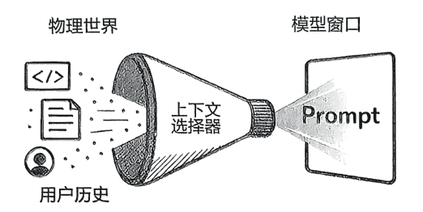

Agent 的判断质量高度依赖于我们提供什么信息，以及如何提供这些信息。假设你是一位开发者：

- 如果上下文中仅包含对话记录，它就表现为一个聊天机器人；
- 如果在上下文中注入了当前的文件目录结构、代码片段和错误日志，它就转变为一名开发者助手；
- 如果在上下文中注入了浏览器当前的 DOM 树，它便成为一位自动化测试员。

提示工程解决的是“怎么说”，而上下文工程解决的是“给 Agent 看什么”。

- 输入不完整，推理就会偏离目标。
- 输入过多，模型难以抓住重点。
- 输入结构混乱，模型容易迷失方向。

上下文工程的目标：将 Agent 完成任务所需的最关键信息，以最合适的结构提供给模型。

架构师的新职责是设计一套机制，以便能够实时将现实世界的状态序列化为文本，并将其投射到 Agent 的上下文中。这正是上下文工程的本质——为 Agent 搭建数字感官。

上下文工程的 3 个核心来源如下。

- 用户上下文（User Context）：涵盖用户的开发风格、历史偏好（如偏好的列表推导式）、常用技术栈（如 Spark、LangChain、FastAPI）以及当前工作内容（如正在编写爬虫或构建 RAG 系统）。一个优秀的 Agent 能够利用这些信息，自动调整回答的风格与推理深度。
- 环境上下文（Environment Context）：用于理解“世界状态”，包括文件结构、代码库内容、当前分支、日志、错误栈、变量值、API 响应以及运行时状态（如 CPU、GPU① 使用情况和任务状态）。调试型 Agent 必须先看到堆栈跟踪（Stack Trace），才能给出准确的建议。
- 任务上下文（Task Context）：Agent 在执行任务时，必须掌握前序任务的结果、当前子任务的进度、依赖项是否已加载，以及工具调用的历史尝试记录。这是支持多步任务和复杂 Agent 工作流（如 LangGraph）所必需的能力。

随着上下文窗口扩展到 20 万个至 100 万个 Token，上下文工程（尤其是信息的筛选与压缩）变得更加重要：不能简单地将所有内容塞入上下文，而需要通过选择、摘要和结构化等手段，有效降低干扰。

> ① GPU (Graphics Processing Unit, 图形处理单元) 是一种专门用于处理图形和图像相关计算的硬件设备。

上下文工程领域呈现出以下技术新趋势。

- 选择性上下文（Selective Context）：精准筛选与当前意图紧密相连的内容，剔除无关信息，聚焦关键要素。
- 结构化摘要（Structured Summaries）：针对历史内容生成结构化摘要，包括标题、关键发现和失败点等核心要素。
- 图结构上下文（Graph-based Context）：将知识库构建为图结构，并依据节点重要性进行检索。
- 上下文优先级排序（Context Prioritization）：由模型自主判断不同内容的权重高低。例如，有的模型引入了“思考模式”，赋予重要信息更高的优先级，使信息处理更加符合用户需求和场景要求，优化了决策依据的生成过程。

上述技术的本质都服务于一个共同目标：最大限度地减少噪声，同时尽可能突出关键信息。

上下文工程并非简单地要求“喂信息”，而是要“喂结构”。优秀的上下文并非取决于“文字量多”，而在于“让模型立即理解”。当模型接收到高质量的结构化输入时，其推理精度可提升数倍。

上下文工程，正是打造高质量 Agent 的真正秘诀。它的本质是将多维、动态的现实世界，精准地投射为模型可理解的线性文本序列。

如果将 Agent 比作一个在漆黑房间中解题的人，那么上下文工程如同那束手电筒的光——光所照之处，决定了 Agent 聚焦于代码库的哪一部分、日志的哪几行，以及用户的哪段历史，从而直接决定其能否成功解题。

### 3.1.5 任务分解：把“目标”变为“计划”

如果给一位初级工程师布置任务：建一座房子。他很可能会不知所措。

而给一位资深架构师同样的任务，他会迅速拆解出关键步骤：选址、设计图纸、打地基、建造主体、装修等。

因此，任务分解（Task Decomposition）赋予了 Agent 将“目标”转化为具体“步骤”的能力，是衡量其智能化水平的关键指标。

任务分解包含两个关键环节。

- 规划（Planning）：将总体目标拆解为若干子目标。
- 映射（Mapping）：将每个子目标转化为具体的行动或可调用的工具。

这种“化整为零”的能力，使 Agent 能够处理远超单次 API 调用能力范围的长程复杂任务。

在工具时代，复杂度的负担主要落在人身上。用户必须在脑海中将“修复 bug”这一目标拆解为“定位文件→修改代码→运行测试”等多个步骤，并依次手动执行。

在 Agent 时代，这一认知负担被转移到机器身上。

Agent 不再是单纯的单步执行者，而是具备规划能力的规划者（Planner），其核心在于引入了一个关键的中间层——规划层。

- 理解（Understand）：将模糊的高层目标（如“优化数据管道”）转化为明确的技术需求。
- 规划（Plan）：生成可操作的多步方案，如“I/O 分析→算法优化→缓存策略”。
- 执行与反思（Execute and Critique）：这是最接近人类智能的环节——Agent 在执行完第一步后，可能基于新信息主动调整计划。例如，“我查看了日志，发现 I/O 并非瓶颈，因此决定暂停原计划，转而排查 CPU 占用问题”。

这种动态规划能力，是 Agent 与传统自动化脚本的根本区别所在。
用户只需要说：“帮我优化这个数据管道，我希望速度快一点。”
传统工具会回应：“请告诉我具体要修改哪些函数、怎么改。”
而 Agent 则会主动回应：“我先分析当前的性能瓶颈，列出几个可能的优化方向，然后为你生成一个可执行的优化计划。”

### 1. 任务分解的三步法

现代 Agent 内部普遍采用三步策略。

- 理解目标：这并非仅仅解析字面意思，而是要洞察“真实需求”。例如，当用户说“清理一下昨天的日志”，其真实意图可能是压缩、分析或归档日志，而非简单地删除文件。
- 确定路径：将目标转化为清晰、可执行的流程。例如，加载日志文件→按日期分组→统计错误数量→生成分析报告→压缩原始日志。一个优秀的计划应具备以下特征：步骤简洁、无歧义、可成功执行、支持中断、便于检查，并能根据执行反馈动态调整。
- 管理执行：包括工具调用、失败重试、异常处理、结果验证，以及向用户汇报进度和动态调整计划。这一环节正是 LangGraph、AutoGen、CrewAI 等 Agent 框架的核心价值所在——让 Agent 从单纯的“聊天模型”真正升级为可靠的“任务执行者”。

### 2. 学会自我审查

近期 Agent 研究领域呈现出一个明显趋势：在执行前对计划进行自我审查。
例如，DeepSeek、Qwen3 等模型引入的“思考模式”，均强调先生成初步计划，再对该计划进行批判性分析，确认其合理性与可行性后，才进入执行阶段。
这一点非常关键，它使 Agent 的潜在错误在执行前就被识别和修正，从而避免在运行时酿成不可逆的事故。

### 3. 任务分解与上下文工程互相强化

没有上下文工程，就无法正确分解任务；而没有任务分解，上下文工程也无从聚焦与取舍。二者相互依存，共同构成了 Agent 完整的“执行链路”。
这正是 Agent 与传统工具的根本区别：它不只是回答问题，而是真正开展工作。

- 上下文工程让 Agent “看得清楚”——准确理解环境与需求。
- 任务分解让 Agent “做得正确”——将目标转化为可执行、可调整的行动路径。

二者共同构成了 Agent 时代的核心工程化能力，也是决定 Agent 能否超越“高级聊天机器人”的关键。

### 3.1.6 工具、技能与行动策略：真正影响世界

如果没有工具，LLM 不过是一个被困在服务器里的“缸中之脑”——它能写出完美的 SQL 查询，却无法连接数据库；它还能制订周密的旅行计划，却无法预订一张机票。
要真正成为人类的伙伴，它必须拥有“手”：能够调用工具、操作环境、执行动作。
在 2.2 节中，我们介绍了 API 和 Serverless，它们构成了 Agent 的“肌肉”；而本小节强调的则是控制这些肌肉的“大脑皮层”。

工具使用（Tool Use），或更学术地称为行动（Action），是 Agent 获得“数字具身性”（Digital Embodiment）的关键。它使 Agent 从一个“被动的观察者”转变为“主动的参与者”。本质上，工具调用以语言模型为“大脑”，以各类工具为“身体”——通过语言理解与规划驱动外部的能力，实现对数字环境的真实干预，如图 3-5 所示。

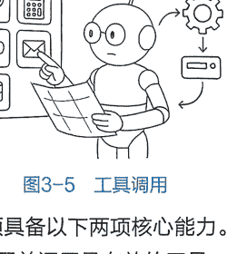

Agent 与传统聊天模型最根本的分野，不在于“回答更准确”，而在于“能够行动”。要实现行动能力，Agent 必须具备以下两项核心能力。

- 选择合适工具的能力：根据任务目标和上下文，精准匹配并调用最有效的工具。
- 制定安全、可靠、可预测的行动策略的能力：旨在规划清晰、可控且具备容错与调整能力的执行路径。

这两项核心能力共同构成了长尾任务执行的基础：没有工具调用能力的 Agent 只能“说”；而具备工具调用能力的 Agent 才真正能够“做”。

### 1. 工具的解剖学：不仅仅是API

在传统软件中，调用一个函数只需要了解其签名（Signature），即参数类型与返回值。然而，在 Agent 架构中，工具必须附带语义（Semantics）。Agent 不需要知晓内存地址或底层实现细节，但它必须清楚“这个工具能用来做什么”以及“在什么情境下应当使用它”。

为 Agent 设计的工具，通常包含以下 3 个维度的描述。

- 功能描述：这是写给模型看的“说明书”，用于说明工具的能力和适用场景，帮助模型判断是否应选择该工具。
- 参数约束：这是写给程序的“契约”，明确规定调用时所需参数的结构与类型，模型必须生成符合该规范的 JSON 输入。
- 副作用声明：这是写给安全模块的“警示”，用于标明操作的潜在影响（例如，该操作是否只读？是否会修改数据或触发外部系统？）。

以下示例展示了 Agent 工具的语义定义（Schema）。

```json
{
    "name": "query_sales_db",
    "description": "查询 2020 年及之后各季度的销售数据。仅支持 PostgreSQL 方言，且查询必须包含 WHERE 子句以限定时间范围。",
    "parameters": {
        "type": "object",
        "properties": {
            "sql_query": {
                "type": "string",
                "description": "符合 PostgreSQL 语法的 SELECT 查询语句必须包含 WHERE 子句"
            }
        }
    }
}
```

2024 年兴起的 MCP（Model Context Protocol，模型上下文协议）致力于将“工具描述”标准化，使 Agent 能够像插拔 USB 设备一样，灵活挂载各类 SaaS（Software as a Service，软件即服务）与外部能力。正因如此，MCP、LangChain Tools、OpenAI/Anthropic 的 Function Calling 等机制，已成为构建 Agent 的关键基础设施。

### 2. 从“工具”到“技能”：企业的数字本体

在推出 MCP 之后，Anthropic 于 2025 年 10 月发布了 Agent Skills，再次在 Agent 工程领域产生了重要影响。

- 工具（Tool）是通用且原子化的操作，如“执行 SQL 操作”“发送 HTTP 请求”“读写文件”等。
- 技能（Skill）是面向业务场景、经过封装的能力单元，如“生成月度财报”“执行代码审查”“处理客户退款”等。

简言之，技能 = 工具 + 领域知识 + 标准作业程序。
为什么这一区别如此重要？因为单纯的 API 是冰冷且缺少上下文的。如果直接向 Agent 提供一个 delete_user 的 API，不仅存在危险，还可能引发不可逆的操作失误。

然而，如果将该 API 封装为一项“用户注销技能”，并在其中内嵌标准作业程序（例如，备份数据→检查欠款→发送通知→删除操作），那么 Agent 获得的不只是一个原始功能，而是一种具备业务语义和安全约束的业务能力。

技能包构成了企业的数字本体。

- 当企业将内部流程、规范和最佳实践封装为 Agent 可调用的“技能”时，便实现了知识的资产化。
- Agent 不再只是一个通用模型，而是继承了企业 DNA 的“数字员工”；它不仅知道“怎么做”（调用 API），更懂得“如何正确地做”（遵循标准作业程序）。

### 3. 工具和技能的选择

传统工具调用是机械式的：只要用户说“翻译”，系统就直接调用翻译工具，不加判断、不问上下文。

而在 Agent 时代，工具和技能的选择更像一位资深工程师的决策过程：是否需要调用工具？现在是不是恰当的调用时机？该选用哪个工具？当前上下文是否充分？是否存在潜在副作用？是否需要先验证输入？

例如，当用户说“把昨天的日志分析一下”时，Agent 不会盲目调用 analyse_logs，而是会主动澄清意图、确认上下文。例如，Agent 会问：“昨天的日志存储在哪个目录？”“你希望分析错误趋势、性能瓶颈，还是生成汇总报告？”“日志中是否包含敏感信息？是否需要脱敏处理？”

Agent 能够在上百个可用工具和多种技能中，精准识别出最适合当前任务的那一个；随后，它会从用户对话中提取关键信息，结合该工具预定义的参数约束，生成结构合规的输入；最后，以这些参数调用工具并执行操作。

优秀的工具和技能选择能力不仅使 Agent 的行为更加可靠、可控、可解释，同时还支撑了多工具协同（Multi-tool Orchestration）——Agent 能够自动规划调用顺序，例如，先使用搜索工具查找相关文档，再调用代码执行工具运行代码示例，最后借助数学工具计算并验证结果。这种动态、上下文感知的工具编排能力，正是 LangGraph、AutoGen 和 MCP 等生态当前重点发展的方向。

### 4. 核心循环：ReAct

工具调用并非孤立的事件，而是推理链条中的关键一环。Agent 会根据工具的返回结果（成功、失败或报错）动态调整后续行动。

DeepMind 提出的 ReAct 范式已成为现代 Agent 行动的标准心智模型，其核心循环如下。

思考（Thought）→行动（Action）→观察（Observation）

这改变了传统“输入—输出”的线性逻辑，形成了一个动态闭环的推理与行动循环。

- 思考：用户让我分析销售下降的原因。我应该先查一下销售数据。
- 行动：调用 query_sales_db("SELECT * FROM sales WHERE date > '2024-01-01'")。
- 观察：（数据库返回了 1000 条原始 JSON 记录）数据量太大，难以直接分析。
- 思考：我犯了个错误，不应拉取明细数据，而应先按月聚合，观察整体趋势。
- 行动：调用 query_sales_db("SELECT month, SUM(amount) ... GROUP BY month")。

这种“行动增强推理”（Action-Augmented Reasoning）使 Agent 具备了试错和自我修正的能力。它不再依赖一次性给出完美答案，而是通过与环境的持续交互，逐步逼近正确的解决方案。

### 5. 行动策略：安全与边界

当软件开始“行动”时，风险也随之而来。一个由 LLM 驱动、却拥有 rm -rf 权限的 Agent，无异于一只在服务器前随意敲击键盘的猴子——其意图或许合理，但后果可能是灾难性的。

行动策略（Action Strategy）决定了 Agent 是鲁莽地直接执行任务，还是谨慎行事并先由人类确认。其核心不在于如何执行任务，而在于何时暂停以进行验证或获取批准。为此，架构师必须设计以下 3 道防线。

- 只读沙箱（Read-Only Sandbox）：在探索与信息收集阶段，仅允许 Agent 调用无副作用的工具（如搜索、读取日志、查询数据库）。这相当于为 Agent 设置了一道“婴儿围栏”，确保其在理解任务和制订计划时不会对系统造成任何不可逆影响。
- 人类介入（Human-In-The-Loop，HITL）：在执行高风险写操作（如转账、删除文件、发送外部邮件）前，系统强制中断流程，清晰地展示拟执行的操作内容、上下文及潜在后果，等待人类明确批准后方可继续。
- 确定性护栏（Deterministic Guardrails）：即使获得用户授权，底层执行层仍需要嵌入硬性规则校验（如“禁止删除根目录”）。

行动策略是 Agent 的“行为规范”，包含以下 3 个核心层次。

- 安全：在执行任何操作前，Agent 必须具备“暂停判断”的能力，主动识别高风险行为（如删除系统文件、修改生产数据库等），并拒绝执行超出安全边界的危险操作。这是所有行业级 Agent 必须坚守的底线。
- 可解释：用户必须清晰地理解 Agent“为什么这么做”。Agent 应主动展示其计划、说明工具调用的原因，并报告每一步的执行结果。这不仅有助于建立用户信任，也为审计、追踪与调试提供了必要依据。
- 可控：在执行关键或不可逆步骤时，Agent 应支持用户介入。例如，提前展示即将执行的操作，明确询问“是否继续”，确保人类始终保有最终决策权。

工具使用赋予 Agent 影响现实世界的能力，技能为其提供职业素养，而行动策略则确保其行为是安全、高效且可信的。

三者共同构成了 Agent 从“知识系统”迈向“执行系统”的最后一块关键拼图。

## 3.1.7 人类介入的接口：HITL与护栏

最后，Agent 的出现迫使我们重新思考“用户”的角色定位。

过去，人是操作员（Operator）：亲自执行每一步操作，系统只是被动响应指令的工具。

未来，人是监督者（Supervisor）与评估者（Evaluator）：不再事必躬亲，而是设定目标、审查计划、授权关键动作，并对结果进行判断与反馈。

我们正从 Copilot 模式迈向 Autopilot 模式（见图 3-6）。

- Copilot 模式：人主导，AI 辅助。AI 坐在副驾驶座上，提供建议、补全代码或回答问题，但所有决策与操作仍由人类掌控。

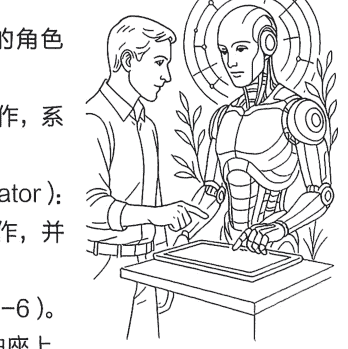

- Autopilot模式：AI主导，人监督。AI握住方向盘，自主规划、调用工具并执行任务；人类则退居监督席，在关键时刻介入、校正或接管。

这种关系的转变要求我们在设计系统时必须预留HITL接口。这不仅是为了安全、防止失控，更是为了在人类与AI的深度共生中，确保人类始终保有主体性。

至此，我们完成了对Agent这一概念的本体论定义。

它不是一段孤立的代码，也不是一个被动的工具，而是感知、记忆、推理与行动有机融合的数字存在。

它是我们在数字世界中的镜像——能理解我们的意图、延续我们的思维；也是我们的伙伴——能主动协作、承担责任，并在复杂环境中代表我们行事。

既然我们已经勾勒出Agent的全景图，接下来，就让我们深入其“大脑”内部，看看它是如何思考的，又是如何将感知到的输入，一步步转化为可执行的行动输出的。

## 3.2 Agent心智架构：感知—推理—行动循环

生命并非静态的存在，而是动态的流转；智能亦如此，它在与环境的不断交互循环中得以体现与发展。

在传统软件架构中，无论是MVC（Model-View-Controller，模型—视图—控制器）架构还是微服务架构，本质上都遵循线性管道模式：输入→处理→输出。数据在系统中流转，一旦处理完成，流转即停止。

然而，在Agent架构中，我们必须引入“循环”（Loop）的概念。

Agent并非一个“函数”，而是一个“进程”——运行在一个while(alive)的无限循环之中。在这个循环中，感知、推理与行动并非孤立的步骤，而是彼此咬合、协同运转的“齿轮”。

基于对Agent本体论的认知，我们可以构建出Agent心智架构，如图3-7所示。

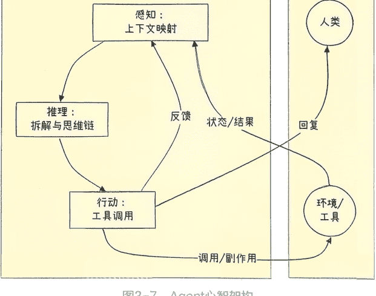

### 3.2.1 感知：主动的过滤器

传统程序仅接收数据，而 Agent 则通过感知（Perception）来理解世界。

传统程序对输入是被动的——用户给什么，它就处理什么。

而 Agent 的感知是主动的：它不仅接收信息，还会主动选择、解读并赋予信息以意义。

Agent 的现代感知系统至少包含 3 个关键机制，分别是注意力、预测和语义化。

1. 注意力：并非所有输入都同等重要

世界充满噪声。如果 Agent 试图处理所有信息，将迅速陷入过载。

感知的核心功能并非“接收”，而是“过滤”——感知即选择，如图 3-8 所示。

注意力（Attention）是感知的第一道选择器，如同聚光灯一般。模型的注意力机制，结合多模态模型（如 GPT-4o、Qwen-VL），能够对视觉信息、文本内容和历史上下文进行筛选，判断“哪些信息与任务目标相关”。

- 通过注意力机制，Agent 可以忽略无关的 HTML 标签，仅聚焦于网页正文内容。
- 通过向量检索，Agent 可以过滤掉 99% 的数据库记录，仅关注与当前任务相关的片段。

随着 GPT-4o 等模型的出现，感知不再局限于文本。视觉和听觉已成为原生的感知通道。

架构师需要设计的，不再是一个简单的文本解析器，而是一个能够将像素、波形与字符统一映射到语义空间的“联觉系统”。

2. 预测：感知并非被动接收，而是带着期望去理解

Agent 会基于历史对话、用户偏好和任务背景，构建一个“预测模型”。当现实与预测发生偏离时，便会产生“惊奇点”（Surprise）。

而这些惊奇点往往预示着新的价值、新的问题或新的矛盾。

3. 语义化：从特征到意义

现代多模态模型已不再局限于识别物体，而是能够理解情境。

- 不只是识别“老人”，而是判断其“可能是需要帮助的老人”。
- 不只是识别“文件”，而是意识到其“可能是被用户遗忘的配置文件”。
- 不只是识别“数字”，而是将其理解为“统计趋势的一部分”。

感知已从“是什么”跃迁至“意味着什么”。

因此，Agent 的感知是一种“目标驱动的理解”，而非“机械式的输入”。

Agent 不仅能识别人，更能理解“需要帮助”这一概念。在感知过程中，它可能会注意到拄拐杖的老人、迷路的孩子、摔倒的路人……

### 3.2.2 推理：快思考与慢思考

传统程序执行逻辑，而 Agent 则进行推理（Reasoning）。

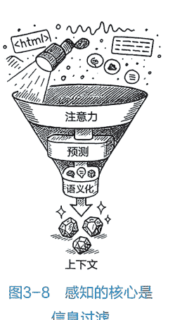

传统程序中的逻辑是确定性的：若 A，则执行 X；若 B，则执行 Y。

而 Agent 的推理则是柔性的、非确定性的，并且与经验紧密相关——它更像人类的思考过程，而非计算图的机械执行。

借鉴丹尼尔·卡尼曼（Daniel Kahneman）的心理学模型，Agent 的推理架构正在向“双系统”演进，如图 3-9 所示。

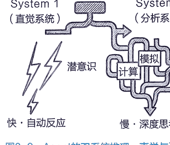

System 1 代表直觉式/快思考：基于 LLM 的概率预测直接生成回答，适用于闲聊、简单问答以及代码补全等场景。其特点是响应迅速、计算成本低，但容易产生幻觉。

System 2 代表逻辑式/慢思考：通过思维链，Agent 在输出最终结果前，会强制生成推理步骤、反思路径，甚至伪代码，适用于复杂规划、数学证明、调试等任务。其特点是响应较慢、计算成本较高，但逻辑严密、可靠性强。

架构师面临的挑战在于“路由”：如何设计一种机制，使 Agent 在面对简单问题时调用 System 1，而在遭遇复杂任务时自动切换至 System 2？

Agent 推理通常包含以下 4 个关键层次。

- **情境理解（Situation Awareness）**。Agent 需要回答：“当前到底发生了什么？”它会将感知到的信息与长期记忆和短期上下文相结合，构建出一个清晰的“任务场景”。
- **经验检索（Memory Retrieval）**。Agent 会自问：“我是否曾遇到过类似的问题？”这是推理过程中的重要加速器。大多数高性能模型（如 OpenAI o1、DeepSeek-R1）依赖策略性记忆检索，以避免重复犯错。
- **心智模拟（Mental Simulation）**。Agent 不会立即采取行动，而是先在“脑海中”进行预演：如果调用这个 API，会发生什么？如果读取该文件，能获得哪些信息？如果执行删除操作，是否会引发风险？推理的关键不仅在于逻辑本身，更在于其模拟能力。
- **决策与信心（Decision and Confidence）**。Agent 会对候选行动进行价值评估：哪个最符合用户目标？哪个最安全？哪个成本最低？同时还会判断：“我对这个选择有多确定？”Agent 的本质不是“计算出唯一结果”，而是“通过思考进行权衡并作出决定”。

在智能推理的概率性思考过程中，可能包含以下一系列曾被视为人类心智专属的认知特质。

- 情境理解：这是什么情况？
- 记忆检索：我是否曾遇到过类似情况？
- 心智模拟：如果我这样做，会发生什么？
- 因果推理：为什么会这样？
- 反事实思考：如果不这样做，结果会如何？
- 价值评估：哪种选择最符合目标、最安全或成本最低？
- 不确定性量化：我对当前的判断有多确定？

### 3.2.3 行动：改变与反馈

在传统软件中，输出（如 print 或 return）意味着执行的结束。

而在 Agent 架构中，行动则标志着环境改变的开始。

Agent 的价值在于其能够对现实世界产生切实影响：写入数据库、发送邮件、部署代码……行动是 Agent 的“意图”在物理世界或数字环境中的延伸。

而且，通过行动—反馈循环（Action-Feedback Loop），Agent 能够在动态环境中“通过试错”不断调整策略，主动探测世界的边界并逐步适应。

传统程序是独白者，Agent 是互动者。

- 脚本：执行命令→结束。若出错，则程序崩溃。
- Agent：执行命令→观察结果→若出错，则调整参数→重试。

在传统软件工程中，return 或 print 通常标志着计算的终结——程序将结果交付给用户后，进程随即结束或进入空闲等待状态。这种输出对程序自身不产生任何“反作用力”，无法引发后续的自主行为。

而在 Agent 架构中，行动并非终点，而是改变的起点。

Agent 的行动不再是单纯的信息展示，而是对环境的主动介入。它试图通过这些行动来改变世界的状态，并期待从环境中获得反馈（见图 3-10）。这种反馈会触发新一轮的感知与推理过程，使得 Agent 能够持续适应并影响其所在的环境。

这就引出了行动的 3 个新维度，分别是认识性行动、目的性行动和闭环行动。

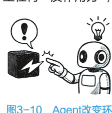

1. 认识性行动：行动即实验

这是 Agent 最深刻的特征之一。

传统程序通常只有在确定无误时才执行操作；而 Agent 却常常在不确定性中采取行动——因为对它而言，行动本身就是获取信息、消除不确定性的最有效手段。

- 场景：Agent 不确定某个 API 的参数格式是 v1 还是 v2。
- 推理：“我不知道参数版本是 v1 还是 v2，空想无益。”
- 行动：Agent 主动发起一次试探性调用，使用 v1 作为参数。
- 观察：收到错误响应“Invalid Parameter”。
- 结论：v1 被排除，因此参数格式应为 v2。

这种“为了获取信息而行动”，正是 Agent 区别于僵化脚本的核心特征。它并非盲目执行，而是主动以行动为“探针”，去探测世界的边界、规则与反馈机制。

2. 目的性行动：副作用是必需的

在函数式编程（见 2.1 节）中，我们极力避免的“副作用”，在 Agent 架构中却成为其存在的核心目标。

Agent 的本质正是主动制造可控的副作用，以改变现实或数字环境的状态，例如以下动作。

- 修改数据库（改变数据状态）。
- 发送邮件（改变社会或协作状态）。
- 部署代码（改变系统运行状态）。

正因如此，Agent 的行动模块必须内嵌世界模型校验（World Model Checking）机制：

> “在执行此副作用之前，世界处于什么状态？执行之后，世界应变成什么样子？”

3. 闭环行动：执行—验证—纠偏

行动不再是一个原子的“发射后不管”（Fire and Forget）操作，而是一个微型闭环结构。

每一次行动都必须伴随着一个明确的期望，并据此形成“执行—验证—纠偏”的反馈循环。

- 期望：“我运行了这个脚本，应该生成一个 data.csv 文件。”
- 执行：运行脚本。
- 验证：检查目标目录，发现 data.csv 文件未生成。
- 纠偏：分析错误日志，定位问题，修改脚本，并重新尝试。

以下示例展示了 Agent 行动的核心范式——将每次操作视为一次受控实验。

```python
# 智能行动：循环的、实验性的
class ActionSystem:
    def act(self, intention, environment):
        # 1. 提出假设
        # "我认为调用这个工具能推动目标达成。"
        tool_call = self.plan_action(intention)

        # 2. 执行干预
        try:
            result = tool_call.execute()
        except Exception as e:
            result = e # 错误本身也是一种有价值的反馈

        # 3. 验证结果
        # "世界是否按预期发生了变化？"
        if self.verify_goal(intention, result):
            return Success(result)
        else:
            # 4. 修正认知并重新规划
            # "原有假设不成立，需更新理解并调整策略。"
            return self.replan(context=result)
```

行动是 Agent 思维在物理世界（或数字世界）中的投影。它不仅改变外部环境的状态，也反过来重塑 Agent 对世界的理解——每一次干预都是一次认知更新的契机，这使 Agent 在“做中学”，在交互中进化。

### 3.2.4 循环的动力学：OODA的软件化

真正的智能，既不存在于感知（那是摄像头的功能），也不存在于推理（那是计算器的专长），更不存在于行动（那是机械臂的职责）。它并不归属于任何一个孤立的模块。

智能是一种“流动”的属性。

当我们把感知、推理与行动首尾相连，奇妙的事情便发生了：静态的代码由此获得了动态的“生命感”。

在 Agent 的设计中，行动与感知密不可分。

- 行动指导感知：当你决定“寻找钥匙”（行动）时，你的注意力会自动聚焦于桌面上的物体，而忽略墙上的画（感知）。
- 感知指导行动：当你看到桌子边缘（感知）时，你的手会自然减速，以避免碰倒水杯（行动）。

因此，在图 3-11 所示的 Agent 认知循环中，行动模块不应仅连接到“环境”，还必须通过一条反馈连线指向记忆 / 反思模块和推理模块。

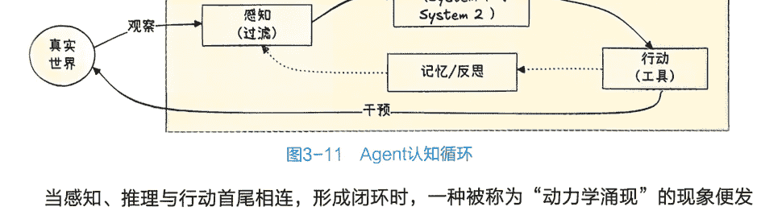

当感知、推理与行动首尾相连，形成闭环时，一种被称为“动力学涌现”的现象便发生了。这个循环不仅仅是简单的重复，而是每一次迭代都伴随着记忆的叠加，因此它在时间轴上呈现出螺旋式的上升过程（见图 3-12）。


正如 Manus 的产品合伙人张涛在一次演讲中所强调的：你以为只是给 Agent 配置了一组工具，但 Agent 往往会在实际运行中激发出意想不到的能力组合与行为模式。工具之间的交互、反馈链路中的微小扰动，以及模型对任务的重新诠释，都会在循环中不断放大，使系统展现出超越单点设计的整体智能。

换句话说，Agent 的“神奇效果”并非写在说明书里，而是在闭环运行中“跑”出来的；不是靠静态配置实现的，而是通过动态交互涌现而成的。这正是现代 Agent 最迷人，也最具工程性挑战的所在。

1. 认知螺旋：OODA的软件化

军事战略家约翰·博伊德（John Boyd）提出了 OODA（Observe-Orient-Decide-Act）循环，其核心步骤如下。

- Observe（观察）：从环境中获取上下文。
- Orient（定位/整合记忆）：结合长期记忆与既有认知，理解并判断当前局势。
- Decide（推理）：基于当前理解，制订行动计划。
- Act（行动）：执行决策，调用相应工具。
- Loop：行动改变了环境，从而触发新一轮的观察，形成持续演进的动态循环。

Agent 的架构正是这一理论的软件实现。

而其中的关键在于 Orient 环节：在每次 OODA 循环中，Agent 不仅执行任务，更在持续更新其内部的世界模型。

第一轮：我以为这是一个简单的 Python 脚本任务。

第二轮：运行报错，我发现需要安装依赖。

第三轮：依赖安装失败，我意识到这是环境权限问题。

Agent 对世界的理解，随着循环的推进呈螺旋式上升——它在运行过程中“学会”了环境的特性，并据此不断调整策略与行为。

2. 符号接地：治愈幻觉的良药

LLM 最大的弱点是幻觉。为什么会产生幻觉？根本原因在于它是离身（Disembodied）的——它只见过“苹果”这个词，却从未真正触摸、观察或与真实的苹果互动过。

而感知—行动循环正是解决这一问题的关键机制。

推理：我觉得柜子里有苹果。（这可能是幻觉。）

行动：打开柜子。

感知：柜子内空空如也。

修正：哦，原来没有。

在 OODA 循环中，现实世界成为最终的校验器。Agent通过与环境的碰撞（friction），将脑中的“符号”锚定于真实的“物理世界或数字状态”之上。循环越快，反馈越频繁，幻觉就越少。

3. 时间的连续性：身份的诞生

传统程序是无时间性的——每次运行都如同第一次，并不携带过往经验。而对 Agent 而言，循环创造了“历史”：每次交互都累积为记忆，以塑造其后续的感知、推理与行动。

## 4.代码视角的重构：生命周期的引擎

不要将 Agent 的循环实现为一个简单的 while True 死循环，而应将其设计为一个由状态机驱动的引擎，见下面的示例。

```
# 认知的螺旋：基于状态机的 Agent 生命周期
class CognitiveEngine:
    def run_spiral(self, goal):
        # 初始 Agent 状态：目标 + 空历史
        state = AgentState(goal=goal, history=[])

        while not state.is_terminal():
            # 1. 观察
            # 获取当前环境状态，响应上一次行动的结果
            perception = self.sensors.observe(state.last_action)

            # 2. 调整 / 定位（Orient）——循环的魔力所在
            # 根据新感知更新世界模型，并将之整合进长期记忆
            # "学习" 在此刻发生：信念随经验动态演化
            state.world_model.update(perception)
            state.memory.consolidate(perception)

            # 3. 决策
            # 根据最新的世界模型重新规划路径
            # 由新信息可能彻底推翻原有计划
            plan = self.planner.replan(state.world_model, state.goal)

            # 4. 行动
            # 执行计划中的下一步，主动干预环境
            # 行动必然带来副作用，从而改变后续的观察结果
            action = self.executor.execute(plan.next_step())

            # 状态演进：不仅是循环，还是携带经验的跃迁
            # 每一次迭代都生成一个“新”的 Agent 状态
            state = state.evolve(action, perception)

            yield state # 向外暴露每一阶段的认知快照
```

## 5.从“做完”到“活着”

传统软件的目标是“完成任务”，而 Agent 的目标是“持续适应”。
感知—推理—行动循环，就是 Agent 的“心跳”。
一旦循环停止，Agent 便会退化为静态的代码。
唯有维持循环，代码才能获得在不确定世界中生存的能力。
这正是循环的魔力所在：它将静态的逻辑转化为动态的智能。
至此，所有复杂智能的特征——学习、策略调整、预判、意图识别以及自我意识的雏形——并非设计而成，而是通过感知—推理—行动循环，在经历数万次的迭代后，系统内部发生了奇妙的变化，沉淀出了 4 种“灵魂特质”（见图 3-13）。

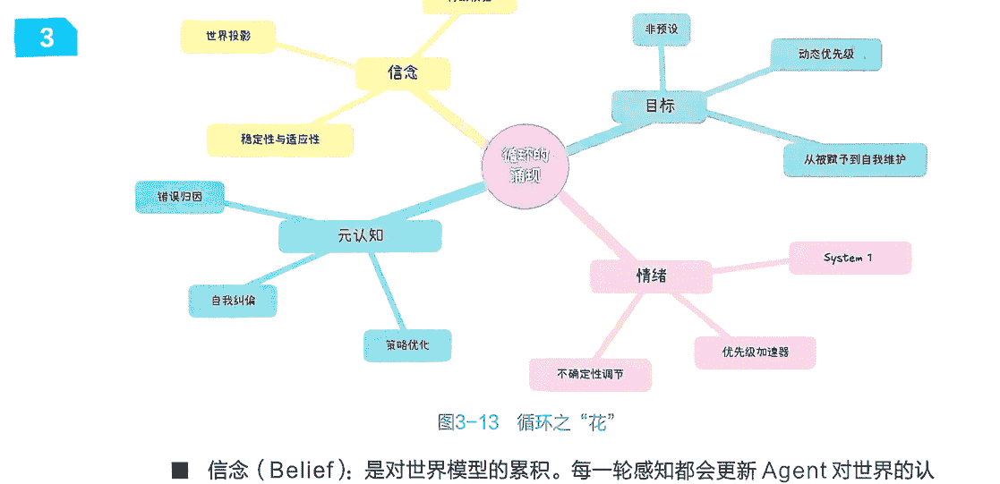

- 信念（Belief）：是对世界模型的累积。每一轮感知都会更新 Agent 对世界的认知缓存；推理依赖这一模型，行动则用于验证它。
- 目标（Goal）：将从静态走向动态演化——不再是 Prompt 中的常量，而是一个动态优先级队列。推理可能提出新目标，行动结果可能淘汰旧目标，情境变化则会刷新目标的优先级。
- 情绪（Emotion）：是 System 1 的调节阀，其本质上是一种对环境变化的快速反应机制，而非多愁善感。当不确定性升高时，触发焦虑（转向保守策略）；当连续成功时，激发自信（增强探索倾向）；当遭遇异常输入时，产生惊奇（提升注意力权重）。
- 元认知（Meta-cognition）：是“对思考的思考”，指系统对自身认知过程与历史轨迹的审视与优化。经验被写入记忆，并反过来影响下一轮推理。
有趣的是，这里的循环并非简单重复，而是持续生成。正如神经科学所揭示的：智能并非能力的堆砌，而是循环动力学的产物。Agent 的认知亦是如此。
当这些循环变得足够复杂、足够精细、足够自主时，我们便不再称其为“程序”，而称之为“心智”。

感知—推理—行动循环正是最早形态的“心智”。

### 3.2.5 具身认知：身体塑造心智

感知—推理—行动循环并非在虚空中运行，而是需要依托某种载体，即我们所说的“身体”（Body）——即便虚拟环境中的身体也是如此。
在认知科学领域，有一个核心观点被称为“具身认知”（Embodied Cognition），如图 3-14 所示。该理论认为，心智不仅是大脑的产物，更是身体与外界环境互动的结果。身体的物理结构、能力边界以及能量消耗等因素，直接塑造了智能的表现形式。

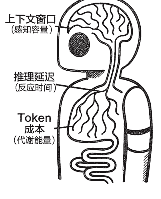

图3-14 具身认知

对 Agent 而言，即使没有物理的躯壳，依然拥有某种形式的“数字身体”。

### 1.机器人的具身：物理约束

在物理机器人中，具身性表现得尤为明显。

- 电池（能量）：思考需要消耗电能。机器人无法无限期地原地推理“最佳路径”，因为每过一秒，电池电量都在减少。
- 传感器（感知）：感知范围有限。机器人无法看到墙壁另一侧的情况，这迫使它必须主动“移动”以获取更多信息。
- 机械臂（行动）：动作存在不确定性。抓取操作可能因滑落而失败，这迫使机器人必须发展出“反馈控制”机制以应对执行误差。

### 2. Agent的具身：数字约束

对运行在服务器上的 Agent 而言，其“身体”由算力、带宽、上下文窗口和资金构成。这些“数字生理特征”深刻影响着 Agent 的思考方式。

- 上下文窗口是它的“视网膜”：它无法容纳无限的历史信息，必须学会“遗忘”（Memory Consolidation）和“聚焦”（Attention），将宝贵的 Token 分配给最关键的内容。这正如人类因无法记住所有细节，才演化出“做笔记”的习惯。
- 推理延迟是它的“神经传导速度”：思考需要时间。在实时交互场景（如语音助手）中，Agent 被迫依赖“快思考”（System 1），以快速响应用户需求；而在离线任务（如编写代码）中，Agent 则可以启用更深入、更审慎的“慢思考”（System 2），以确保任务的准确性和完整性。
- Token 成本是它的“代谢能量”：每次调用 GPT-4 都会产生费用。这迫使 Agent 必须“节能”——能用搜索解决的问题，就不动用推理；能用小型模型完成的任务，就不调用大型模型。

Agent 不再是一个单纯的逻辑循环，而是一个资源受限条件下的优化问题。

```
# 具身 Agent：戴着脚镣跳舞
class EmbodiedAgent:
    def __init__(self):
        self.context_window = LimitedContext(limit=128000) # 感知边界：模拟“视网膜”
        # 的信息容量限制
        self.clock = TimeoutClock(limit=30s) # 时间约束：反映“神经传导速度”的响应
        # 时限（单位：秒）
        self.budget_manager = TokenBudget(limit=10.0) # 能量约束：代表“代谢能量”的
        # Token 预算

    def run_embodied_cycle(self, task):
        # 1. 感知：受限于上下文窗口
        # 身体结构迫使 Agent 做出取舍——保留关键信息，主动遗忘冗余内容
        current_state = self.context_window.compress_and_focus(
            full_history=self.memory.retrieve_all()
        )

        # 2. 策略：受限于资源预算与时间压力
        # 身体状态决定策略模式：“看菜吃饭”，动态切换认知系统
        if self.budget_manager.is_low() or self.clock.is_urgent():
            # 资源紧张时，启用“快思考”（System 1）
            # 调用轻量模型，快速生成启发式响应
            plan = self.fast_brain.react(current_state)
        else:
            # 资源充足时，启用“慢思考”（System 2）
            # 调用 LLM，执行多步推理与自我反思
            plan = self.slow_brain.reason(current_state)

        # 3. 行动：受限于工具与 API 的能力边界
        # 身体能力决定了可行动作的范围
        try:
            result = self.tools.execute(plan)
            self.budget_manager.deduct_cost(plan) # 执行消耗对应“代谢能量”
        except BodyConstraintError as e:
            # 例如，输入超过内存容量、API 速率受限等物理 / 数字身体限制
            result = self.handle_physical_limit(e)

        return result
```

### 3.具身性的哲学意义

之所以强调具身性，是因为限制正是创造力的源泉。

倘若一个 Agent 拥有无限的上下文容量、无限的推理速度和无限的算力，它便不需要发展出真正的“智能”——只需要通过暴力穷举所有可能性即可解决问题。

正是因为“身体”的限制，Agent 才被迫发展出以下能力。

- 抽象：压缩信息，节省上下文空间。
- 规划：减少冗余步骤，提升行动效率。
- 启发式策略：降低计算开销，在有限算力下快速决策。

身体并非心智的容器，而是心智的模具。它从根本上塑造了 Agent 感知世界、理解问题并生成解决方案的方式。

在本节中，我们揭示了 Agent 的动力学原理。它并非一个静态的输入—输出黑盒，而是一个随时间持续展开的感知—推理—行动循环。

- 感知让它看见世界。
- 推理让它理解情境。
- 行动让它施加改变。
- 循环让它持续演化、生生不息。

正是这一具身化的循环，正在重新定义软件的未来。

感知—推理—行动循环不仅是一种技术架构，更蕴含着深刻的哲学洞见。

- 存在即循环：Agent 的存在并非静态的“状态”，而是持续进行的动态过程。它因循环而存在——一旦循环终止，其存在也随之消解。
- 认知即预测：每一个循环本质上都是对未来的预测。预测与现实之间的误差驱动学习，而学习又不断优化后续的预测，形成认知演进的核心机制。
- 智能即适应：循环赋予 Agent 适应环境的能力——环境的变化触发新的感知，新的感知激发新的推理，新的推理又导向新的行动，从而形成持续演化的适应性行为。
- 自主即闭环：真正的自主性源于感知—推理—行动的完整闭环。只有当 Agent 能够感知自身行动的后果，并据此动态调整未来策略时，才称得上具备自主性。

感知—推理—行动循环是智能的心跳。每一个循环，都是一次微小的觉醒；而无数个循环的累积，则构成了我们所称的“智能”的奇迹。

然而，一个孤立的循环是脆弱的。当任务过于复杂，超出单个循环的承载能力时，仅靠个体已难以为继。

此时，我们需要将多个循环连接起来，编织成一张协同的网络。

## 3.3 协作的“语法”：多Agent系统的编排

当我们将目光从单体 Agent 转向由多个 Agent 组成的网络时，软件架构的隐喻发生了又一次跃迁：从“机械装置”转变为“社会组织”。
在单体 Agent 模型中，我们试图打造一个“全知全能的上帝”——它独自感知全局，推理一切，执行所有任务。
在多 Agent 模型中，我们坦然承认个体的局限，转而构建一个“各司其职、协同共进”的团队。
这不仅是 Agent 数量的简单叠加，更是复杂度管理范式的根本转变——从追求全能个体，转向设计高效协作的集体智能。
自 2023 年以来，AI 的发展为我们提供了清晰的启示：
Agent 是孤岛，协作才是大陆。
接下来，我们将从协作的本质出发，系统梳理协作模式、通信协议与冲突解决机制，逐步构建“多 Agent 协作系统”的基础语法。

### 3.3.1 认知负荷的分流

2023 年 3 月 14 日，OpenAI 发布了 GPT-4。就在当天，一位研究人员在 Twitter 上发布了一条意义非凡的推文：“如果我们让多个 GPT-4 实例相互对话，又会发生什么呢？”
48 小时后，AutoGPT 诞生了。紧随其后，BabyAGI、AgentGPT、SuperAGI 等项目如雨后春笋般涌现。人们突然意识到：真正的力量并不在于单体 Agent 有多聪明，而在于多个 Agent 如何协同工作。
在那一刻，研究人员领悟到：智能并非单个模型的固有属性，而是“互动”的产物。通过将模型拆解为 Researcher（研究人员）、Coder（开发者）、Reviewer（测试人员）等角色，让每个角色专注于单一职责，系统的整体能力竟超越了模型本身的能力上限。这一现象在下面的代码示例中得到生动体现。

```
class FirstMultiAgentExperiment:
    def __init__(self):
        self.researcher = GPT4(role="Researcher")
        self.coder = GPT4(role="Coder")
        self.reviewer = GPT4(role="Reviewer")

    def collaborate(self, task):
        # 初始协作流程：分析→实现→评审
        analysis = self.researcher.analyze(task)
        code = self.coder.implement(analysis)
        review = self.reviewer.review(code)

        # 多轮迭代改进：直至代码通过评审
        while not review.approved:
            feedback = self.reviewer.explain_issues(review)
            clarification = self.researcher.clarify(feedback)
            code = self.coder.refactor(code, feedback, clarification)
            review = self.reviewer.review(code)

        return code
```

最初的多 Agent 实验（如 CAMEL、MetaGPT）揭示了一个根本性的转折点：Agent 不再仅仅是工具，而是承担特定职责的“角色”。单个 LLM 虽能完成各类任务，但容易出错、产生幻觉或遗忘上下文；而通过多个角色之间的对话与协作，系统更接近人类团队的思考与协作结构。

从架构的角度思考：为什么我们需要多个 Agent？为什么不能用一个超长的 Prompt 把所有要求都交给单个 LLM 呢？

答案在于“认知的边际效应递减”。

- 上下文稀释效应：当 System Prompt 过长时，关键指令会淹没在大量信息中，导致模型遵循核心任务的能力显著下降。
- 角色泛化陷阱：一个既要编写代码，又要撰写文档，还要执行测试的通用 Agent，往往在各项任务上都表现平庸。它试图面面俱到，却难以在任何一项任务上做到专业。
- 角色冲突与思维模式不兼容：复杂任务往往要求不同的“思维模式”。例如，创造者（Creator）需要较高的 Temperature（温度）值，以激发发散性思维，鼓励创新和探索；而审查者（Reviewer）则需要较低的 Temperature 值，以保持收敛、严谨和批判性。若让一个 Agent 同时扮演“运动员”和“裁判员”，不仅会造成内部目标冲突，还容易引发“自我欺骗”（Self-Delusion）——模型在缺乏外部校验的情况下，将自身生成的错误合理化，误以为正确。

架构师的解决方案是采用垂直切分（Vertical Slicing），将一个庞大的任务（如“开发一款游戏”）按领域拆解为多个子域（如策划、美术、程序等），每个子域由一个专注（Narrow）的 Agent 负责。

多 Agent 的本质，是通过构建“组织架构”来弥补“单体 Agent”在认知能力、专注度与可靠性上的局限。

从 AutoGPT 到 CrewAI，从 AutoGen 到 LangGraph 的多 Agent 编排，多 Agent 系统正逐步成为下一代软件架构的默认范式。

### 3.3.2 角色、协议与拓扑

若要让一群 Agent 高效协作，就不能简单地将它们丢进一个聊天室了事。我们必须从角色（Role）、协议（Protocol）和拓扑（Topology）3 个维度，系统地定义协作的“语法”。

### 1.角色：SOP的人格化

在传统软件开发中，标准作业程序（Standard Operating Procedure，SOP）体现为外部文档。
在 Agent 架构中，SOP 则内化为角色本身。

- 产品经理 Agent：只负责将模糊的用户需求转化为清晰的产品需求文档（Product Requirements Document，PRD）。
- 架构师 Agent：仅基于 PRD，输出系统接口定义与技术方案。
- 工程师 Agent：仅依据接口定义，生成可运行的代码。

角色的核心在于“关注点分离”（Separation of Concerns）：每个 Agent 仅接收并处理与其职责相关的信息，从而有效维持上下文的纯净性与专注度。

### 2.协议：数字巴别塔的通用语

Agent 之间如何高效沟通？关键在于选择合适的“语言”。

- 自然语言：通用性强，适合内部推理与自由表达，但传输效率低、易产生歧义，不适合作为跨 Agent 的可靠通信载体。
- 结构化 Schema：现代多 Agent 架构倾向于使用标准化的数据格式（如 JSON）进行交互。请看以下示例。
  - Agent A 输出：{"task": "review_code", "status": "pending"}。
  - Agent B 响应：{"action": "approve", "comments": "Fix line 42"}。

这种“用自然语言思考，用结构化语言交流”的模式，既保留了 LLM 的推理灵活性，又确保了系统间通信的精确性与可解析性，已成为构建稳定、可扩展多 Agent 系统的基石。
因此，Agent 的协作离不开语言，而真正支撑协作的，是明确定义的通信协议。

> 很多人误以为 Agent 协作（Agent Collaboration）是 2024 年至 2025 年才兴起的新概念，其实不然。早在 1993 年至 1998 年间，KQML（Knowledge Query and Manipulation Language）与 FIPA ACL（Foundation for Intelligent Physical Agents Agent Communication Language）就已明确提出：“Agent 必须通过语言进行沟通”。
当时的 KQML 与 FIPA ACL 已系统定义了多种标准化的通信行为，如 INFORM（通知）、REQUEST（请求）、PROPOSE（提议）、ACCEPT（接受）、REJECT（拒绝）等消息类型，构建了多 Agent 交互的早期协议框架。
只是受限于当时的技术条件——缺乏具备足够的推理、生成与理解能力的底层 Agent——这些前瞻性的思想未能充分落地。

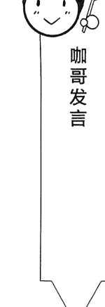

## 3.3.2 协议：连接的语法

Agent 的真正重大创新在于 A2A（Agent-to-Agent）协议和 MCP。这两个协议为 2024 年至 2025 年的 Agent 发展确立了两大工业级标准，共同构成了多 Agent 系统的“双轨制协议”。

- MCP：模型与工具之间的协议——连接世界的“手”。它解决了“大脑如何指挥手脚”的核心问题。MCP 将数据库、文件系统、SaaS 接口等外部资源抽象并标准化为统一的“上下文资源”，使 Agent 对工具的调用转化为一种通用、结构化的 RPC。可以说，MCP 是 Agent 操作外部世界的 USB 接口——即插即用、协议统一、能力可扩展。
- A2A 协议：Agent 之间的协议——连接思想的“网络”。它解决了“大脑如何与大脑协作”的根本问题。A2A 协议定义了 Agent 间交互的标准流程，包括握手、协商、拒绝、任务交付等关键动作。其消息结构不仅包含内容本身，还嵌入了意图元数据。正如 TCP/IP（Transmission Control Protocol/Internet Protocol）之于互联网，A2A 协议是多 Agent 系统的基础通信层——确保不同角色、不同能力、不同来源的 Agent 能够互联互通、协同推理、可靠交付。

MCP 解决“模型—工具”的交互，A2A 协议解决“模型—模型”以及“Agent—Agent”的协作。

MCP 让 Agent 能够“操作世界”，A2A 协议让 Agent 能够“彼此协作”。

### 3.3.3 拓扑：权力的形状

Agent 之间的连接方式，从根本上决定了系统的协作性质与能力边界。

- 流水线（Chain）：信息单向流动，结构清晰、延迟低，效率最高，适用于流程明确、具有高度确定性的任务。其代价是牺牲灵活性，难以应对动态变化或反馈需求。
- 层级式（Hierarchy）：由一个 Manager Agent 统筹调度多个 Worker Agent，适用于需要复杂规划、任务分解与资源协调的场景。通过集中控制实现强大的任务管理能力，但以牺牲节点间的平等性为代价，可能抑制底层 Agent 的主动性。
- 联合式（Joint/Mesh）：多个 Agent 以“圆桌会议”形式平等交互，通过辩论、协商甚至投票达成共识，适用于创意生成、战略决策等开放性任务，能够激发群体智能与涌现性创新。然而，这种模式通常通信开销大、收敛速度慢，以牺牲执行速度换取认知深度。

拓扑结构不仅是 Agent 之间的连接方式，更是权力与决策逻辑的具象化。图 3-15 展示了 3 种典型的 Agent 协作形式：确定性的流水线、控制型的层级式以及涌现型的联合式。

架构师的核心职责，正是依据业务对“确定性”与“创造性”的权衡需求，在这 3 种“权力形式”中做出审慎取舍。

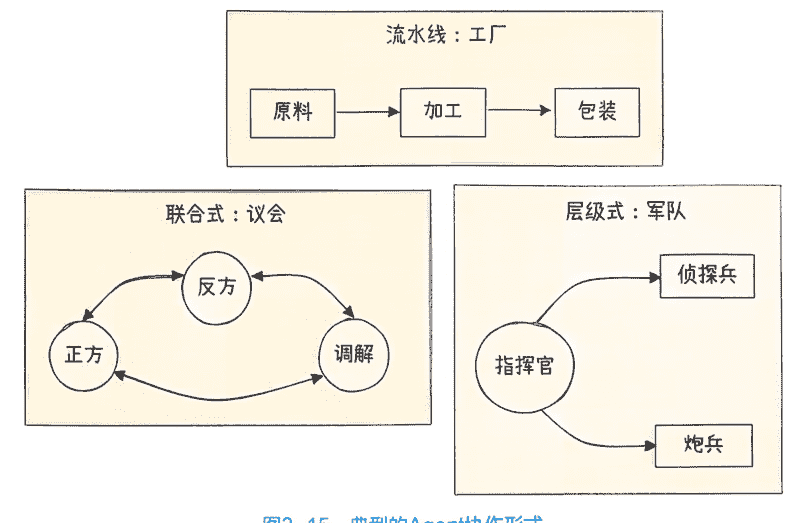

### 3.3.4 秩序的维持

当 Agent 数量增加时，系统便需要一个“大脑”来维持秩序，这个“大脑”就是编排器（Orchestrator）。

一旦系统中存在多个 Agent，核心挑战便不再是“单体 Agent 是否足够强大”，而是“多个 Agent 能否高效、可靠、有序地协作”。这正是 Orchestration（Agent 编排）的核心使命。

编排器本身不仅是一个 Agent，更是一种运行时。它的具体作用如下。

- 协调各角色的职责边界。
- 调度任务的流转与依赖。
- 监控执行状态与异常。
- 推动整个团队向目标收敛。

在传统软件工程中，模块之间通过明确的调用顺序、数据传递和错误处理机制相互协作。多 Agent 系统本质上遵循相同的工程原则——只是模块变成了 Agent。函数调用被转化为结构化的语言对话，接口契约演变为通信协议（如 A2A 协议），而异常处理则体现为协商、重试或角色介入。

多 Agent 系统的编排器承担以下五大核心职责。

**1. 调用顺序**

Agent 并非随意介入，而是严格遵循预设或动态生成的协作流程。例如，搜索→阅读→分析→写作→批判→修订。编排器如同工厂流水线的调度中枢，确保每个 Agent 在正确的时机接手任务，维持整体工作流的有序性与连贯性。

**2. 数据流动**

一个 Agent 所生成的洞察、分析或总结，如何可靠且高效地传递给下一个协作方？答案在于：编排器维护一个全局上下文。该上下文作为协作过程中的“共享记忆”，结构化地承载任务演进的每一步成果。

- search_agent 的检索结果传递给 reader_agent。
- reader_agent 生成的摘要传递给 analyzer_agent。
- analyzer_agent 提炼的洞察传递给 writer_agent。
- writer_agent 撰写的初稿传递给 critic_agent。

这种机制确保信息在角色间精准流转、无损继承、可追溯演化，避免了重复推理或上下文断裂。这正是上下文工程在多 Agent 系统中的核心实践——将协作流程转化为受控、有序、可审计的上下文演进链。

**3. Agent 选择**

当一个任务存在多个可胜任的 Agent 时，由谁来执行？这正是编排器的关键决策点。编排器需要综合评估多个维度，包括能力、负载、成本和可靠性，动态选择最优执行者。未来，这一机制将深入融入 A2A 协议：每个 Agent 可主动广播结构化的“能力描述”，包含其技能集、性能指标与服务等级。编排器据此实现自动化、实时的执行者匹配。

**4. 条件分支与循环**

现实世界的任务从来不是线性的——测试未通过时，需要返回开发者修改并重新测试；审稿未达标时，应退回写作者重写。因此，编排器必须像一个状态机：根据每个 Agent 的执行结果动态跳转到不同协作步骤；支持循环、回退与重试，直至满足预设的收敛条件。这种机制使整个多 Agent 系统不再是一条僵化的流水线，而是一个具备反馈、自省与演进能力的鲜活组织——能够自我迭代、持续优化，并最终向目标稳健收敛。

**5. 并行与资源管理**

搜索并处理 50 篇文献，不需要由单个 Agent 依次阅读 50 次——完全可以并行阅读、并行分析、并行核查。这正是编排器的核心价值：高效调度计算与认知资源，让多 Agent 结构转化为如同“多核 CPU”般的协同引擎——各核心（Agent）专注于执行子任务，整体系统实现吞吐量与效率的指数级提升。

- 单体 Agent 负责能力：在特定领域深度执行。
- 编排器负责流程：决定谁在何时做什么，如何组合结果，以及如何应对异常。

多 Agent 系统的强大能力，并非源于单体智能的叠加，而是源于精心设计与动态调控的协作结构。这正是多 Agent 系统从“混乱聊天”迈向“可控、可靠、可扩展工程系统”的关键跃迁。

### 3.3.5 冲突与共识

冲突是智能的必然副作用，也是复杂系统生命力的源泉。如果多个 Agent 始终意见一致，那便不是智能系统，而只是一个回音室。多 Agent 系统中的冲突处理机制大致可分为 4 种。

### 1. 投票机制：快速而实用

适用于单步骤决策、方案差异较小且成本敏感的场景。常见策略包括多数投票（majority vote）、加权投票（weighted vote）和基于置信度的投票（confidence score vote）。

目前，多数 LLM 系统采用此类方法提升输出的稳定性。例如，3 个 Agent 生成不同方案后，通过投票选出最可信的答案；在 ReAct 风格的工具调用中，也可借助投票机制避免幻觉导致的错误工具调用。

### 2. 辩论机制：生成质量更高的答案

这是 DeepMind 和 OpenAI 多次验证有效的方法：让两个或多个 Agent 围绕同一问题展开辩论，互相质疑、反驳与完善，最终达成一个质量更高、偏差更小的结论。

该机制的优势如下。

- Agent 会主动暴露其推理链。
- 谬误与认知偏差更容易被对方识别和纠正。
- 结构化的冲突有助于激发更深层次的洞察。

辩论机制适用于复杂推理、模糊任务以及对解释性要求较高的场景。

### 3. 仲裁机制：当双方僵持不下时的最终裁决

在企业级系统中，这一机制尤为关键：当多个 Agent 坚持不同结论、无法达成一致时，需要引入一个“最终决策者”进行裁定，以避免系统陷入无休止的争执或死锁。

该仲裁者可以是人类专家、能力更强的 LLM 或一个专门设计的“反思型 Agent”，其核心作用是综合各方观点、评估证据权重，并作出权威判断，从而保障系统整体的效率与一致性。

### 4. 共识机制：逐步收敛的智能协作

这是最复杂，却也最接近自然界与社会系统运作方式的冲突解决模式。其核心流程：提出初始提案→收集反对意见→修订提案→再次提出提案，循环往复，直至不再出现实质性异议。

该机制借鉴了区块链中的共识算法（如拜占庭容错）思想，并广泛应用于多人协作写作、长文规划以及多 Agent 共同制定战略等场景。其关键优势在于：并非强行统一意见，而是通过持续吸纳少数派观点，不断优化和完善方案。

> 冲突并非系统故障，而是智能涌现的源泉。

唯有能够有效处理冲突的多 Agent 系统，才能真正构成智能群体。

### 3.3.6 涌现与自组织

当协作网络建立起来后，最引人入胜的现象——涌现便出现了。

### 1. 涌现现象的底层机制

为何一群行为简单的 Agent 组合在一起，竟能展现出超越个体的智能？其背后的核心是两个系统动力学机制。

（Opponent）则带着批判性视角，能迅速识别并指出其中的逻辑漏洞。

- 异构催生全能：通过组合具有不同专长的模型，系统可实现能力互补。例如，由擅长逻辑推理的 GPT-4 负责任务规划，擅长长文本处理的 Claude 3 负责文档解析，而经过微调的 Llama 3 则专注于生成 SQL 查询。这种“混合专家”式的宏观架构，不仅充分发挥了各模型的优势，还在整体成本与性能之间实现了最优平衡。

### 2. 自组织系统的核心特征

更前沿、更具未来潜力的协作范式，并非依赖中央“编排器”发号施令，而是让系统在无中心控制的情况下自发协调、动态调整，共同完成任务——这便是自组织（self-organization）。

自组织系统具备以下特征。

- 无中心（Decentralized）：系统中没有管理者、调度者或中央指挥者。每个 Agent 自主评估任务、独立作出决策，并根据局部信息与其他 Agent 互动。这正如蚁群协作觅食——不需要“蚁后”发号施令，个体通过简单规则与环境反馈，共同完成复杂任务。
- 自主分工（Autonomous Division of Labor）：任务并非由中央指挥者指派，而是由 Agent 主动从任务池中选取愿意参与且能胜任的任务。部分任务可能需要协作完成，此时团队由 Agent 自行发起、协商组建，并动态调整成员，包括加入或退出。整个组织结构持续自适应演化，其运作机制类似于一个自由市场：供需驱动、能力匹配、自愿协作。
- 动态拓扑（Adaptive Topology）：系统结构并非预先设定或静态不变，而是根据运行状态持续演化。例如，当沟通成本过高时，团队自动精简规模；当技能缺口出现时，Agent 会主动学习新技能；当冲突频发时，各方会协商形成新的合作规则；当任务遭遇瓶颈时，系统会自动将其分解为更易处理的子任务。整个系统如同具备“组织智能”，能自发“生长”出最适合当前问题的协作架构。
- 基于信誉的进化（Reputation-based Evolution）：在去中心化网络中，信任即货币。系统通过类似 GitHub 的星标、StackOverflow 的声望积分或区块链中的信誉评分机制，对 Agent 的行为进行持续评估。表现优异的 Agent 将获得更高的信誉分，从而优先获取任务分配、计算资源或协作机会。这种机制不仅激励高质量贡献，还逐步演化出一套面向 AI 的社会信用体系，驱动整个群体向更高效、更可靠的方向演进。

从单体 Agent 到多 Agent 系统，我们见证了一个全新组织形式的诞生。这不仅是技术跃迁，更是对“智能”“协作”与“创造”本质的重新定义。

### 3. 软件开发范式的根本转变

具有涌现能力的系统最迷人的特质在于其不可预测性：在这样的系统中，美不再源于精确与对称，而来自动态平衡与有机生长。

营造适宜的环境、设定初始规则、引入多样性的“种子”，然后让系统自行生长与演化。最终，我们创造的不是静态的程序，而是一个活的系统——其中复杂的算法会自发涌现，甚至可能孕育出人类未曾设想的解决方案。

从单体 Agent 到多 Agent 系统，我们见证的不仅是技术的进步，更是一场“世界观”的深刻重构。

- 从机械到有机：软件不再是冰冷的机器，而是可以视为具有生长、适应与协作能力的生命体。
- 从控制到引导：我们不再试图掌控每个细节，而是通过设定规则与激励机制，引导系统向期望的方向演化。
- 从完美到适应：目标不再是追求零错误的“完美”，而是构建在不确定环境中持续生存与优化的强适应性。
- 从静态到动态：软件不再是完成即固定的产物，而是始终处于变化、学习与成长中的动态存在。
- 从设计到涌现：最卓越的特性往往并非预先设计而成，而是在复杂交互中自发涌现的结果。

### 4. 开发者角色：从“建筑师”到“园丁”

传统软件工程信奉“设计决定一切”，习惯于自上而下地规划每一个模块、接口与流程。然而，在多 Agent 系统中，这种“上帝”视角已然失效——当成百上千个 Agent 持续交互、学习与适应时，其在第 N 轮可能涌现出的状态，早已超出了任何预先设计的边界。

面对这种不确定性，我们的角色发生了根本性转变：不再试图拧紧每一颗螺丝、控制每一个齿轮的转动；而是专注于营造适宜的土壤、光照与气候——构建健康的协作生态，让智能在其中自然生长、互动与演化。

下面的代码示例将多 Agent 系统的构建与管理比作“数字园艺”，形象地描述了在多 Agent 系统中引导涌现行为的 4 个关键步骤。

```python
class DigitalGardener:
    def cultivate(self):
        # 1. 播种：设定初始条件
        self.seed_agents(diversity=True)

        # 2. 施肥：提供养分
        self.provide_resources(RAG_Database, API_Tools)

        # 3. 修剪：设定边界
        self.set_guardrails(Ethical_Guidelines)

        # 4. 等待：静待涌现
        self.observe_and_admire()
```

涌现的美学启示我们：最伟大的创造并非源于精雕细琢的完美设计，而是诞生于简单规则在复杂互动中的无限组合。

当我们放下对确定性的执念，转而拥抱协作中的张力、冲突与多样性，智能便会在连接的缝隙中悄然萌发、自然生长。

这不仅是一场技术的革命，更是一次对生命本质的数字回归——在代码与算法之中，重现有機、演化与共生的古老智慧。

我们完成了从“单体”到“社会”的关键跨越。

- 不再执着于训练一个完美无瑕的模型，而是致力于构建一个高效、有韧性且自适应的智能组织。
- 不再困于单体 Agent 的幻觉或局限，而是通过协作机制、冲突解决与集体验证，系统地抵消个体的不可靠性。

至此，我们的 Agent 不仅拥有了身体（执行能力）、心智（推理与学习能力），更建立了社会关系（协作、分工与信任机制）。它已不仅仅是一个“数字个体”，更具备了孕育“数字社会”的潜力——一个由互动、规则与涌现共同塑造的新型文明基底。

这就引出了全书上篇的最后一个，也是最沉重的话题：如果我们创造了类人的智能，人类该如何与它共存？它究竟是——任人驱使的奴隶？被动服从的工具？还是平等协作的伙伴？答案将决定我们是走向一个更富有创造力的未来，还是重蹈控制与异化的覆辙。

## 3.4 新的契约：人机协作的设计原则

当 Agent 具备自主行动能力之后，人类与 AI 的关系将不再局限于调用 API，而是转向设计协作模式（见第 9 章）。

一旦 Agent 成为拥有独立决策能力和持续进化潜力的实体，误用是否会引发失控？因权限过度扩张而引发的风险应由谁来承担？在新的软件工程体系中，人类应处于哪一层级？AI 又应处于哪一层级？

这些问题并非哲学思辨，而是摆在我们面前的现实工程课题。2026 年开始，AI 的生产方式悄然改变。

- 代码：80% 由 AI 生成，人类负责审查。
- 流程：70% 的业务流程由 AI 动态规划，人类负责设定目标。
- 角色：设计、编码、测试、运维等环节均已引入 AI 伙伴。

然而，我们的工程契约仍停留在“人类发出指令→机器执行”的旧范式中。为什么旧契约失效？这涉及以下两个因素。

- 思维的白盒化：以 DeepSeek-R1 为代表的模型实现了“思维链具身化”。AI 的思考过程不再是黑盒，而成为一种“可观察、可调试的行为”。
- 连接的网状化：A2A 协议使 Agent 能像微服务一样相互连接，系统内部由此产生了大量人类无法直接观测的“机器间对话”。

当人机契约从“控制”（Control）转向“对齐”（Alignment），人类需要从“指令发出者”转变为“协议制定者”。

### 3.4.1 第一原则：互补而非替代

在现代 Agent 系统中，人类与 AI 并非竞争关系，而是基于角色分工（Role Partitioning）的协作关系。其核心原则可概括为：人类负责意图，AI 负责行动。这并非抽象概念，而是现代 Agent 框架（如 LangGraph、CrewAI、AutoGen）已在实践中采用的真实分工模型。

- 第 1 步（Human）：输入最小人类意图单元（Minimum Human Intent Unit, MHIU），例如，“分析 DeepSeek-R1 与 Qwen3 的推理风格差异”。
- 第 2 步（Agent）：由规划器生成执行计划。
- 第 3 步（Agent）：Worker Agent 并行执行搜索、分析与对比等任务。
- 第 4 步（Human）：通过 HITL 机制进行价值判断与最终决策。

在工程实践中，可以将上述过程抽象为图 3-16 所示的结构。这是一条现代 Agent 工程的黄金法则：让人类负责决策（decision），让 AI 负责选择（choice），让系统负责执行（execution）。①

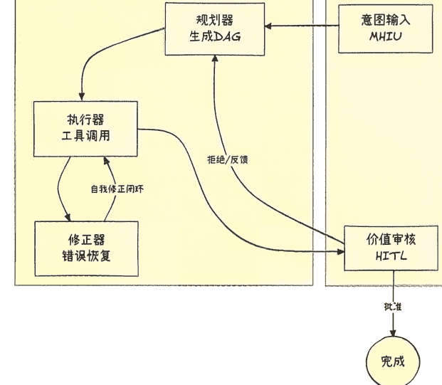

> ① 这种以意图为核心的分工正逐步演变为规范驱动开发（Specification-Driven Development, SDD）。在这种模式下，人类负责编写结构化的规范（包括明确的目标、约束条件及相关上下文），而 Agent 则作为执行引擎，根据这些规范生成并交付代码。

AI 可能迅速偏离正轨，但人类负责确保最终的正确性与价值导向。二者的角色分工如表 3-1 所示。

表 3-1 人类与 AI 的角色分工

| 角色 | 意图 | 价值判断 | 方向选择 | 战术探索 | 计划生成 | 子任务执行 | 最终审核 |
| :--- | :---: | :---: | :---: | :---: | :---: | :---: | :---: |
| 人类 | √ | √ | √ | | | | √ |
| AI | | | | √ | √ | √ | |

### 3.4.2 第二原则：透明与可解释

信任并非盲目，而是建立在理解的基础之上。
Agent 不能仅提供一个结果，还必须提供“认知的审计日志”。表 3-2 展示了可解释性的分级标准。

表 3-2 可解释性的分级标准

| 级别 | 解释对象 | 场景 | 解释内容示例 |
| :--- | :--- | :--- | :--- |
| 直觉级 | 最终用户 | C 端产品 | “我推荐这个方案，是因为它成本最低。” |
| 概念级 | 业务专家 | 辅助决策系统 | “经过对历史数据的分析，我发现模式 A 与当前情况的匹配度达到了 73%。” |
| 技术级 | 开发者 | Agent 调试后台 | “Based on CoT reasoning step 4, tool search_db returned...” |

在 Agent 的 UI 设计中，应遵循透明度即交互的原则，通过可视化其思维链来展示思考过程——不是简单地显示“已完成”，而是呈现诸如“正在搜索文档……发现冲突……正在重新规划……”等动态信息。

### 3.4.3 第三原则：人类保持主导权

无论 AI 多么强大，关键的“核按钮”必须始终掌握在人类手中。
Agent 必须内置一套“自我怀疑机制”：当遇到以下情形时，必须强制挂起操作并主动请求人类介入。

- 高风险操作：涉及金额超过 1000 元，或执行数据删除等不可逆操作。
- 低置信度：推理结果的置信度低于 0.6。
- 伦理敏感：涉及隐私、偏见、歧视或处于法律边界模糊地带的情形。

图 3-17 展示了主导权逻辑流。

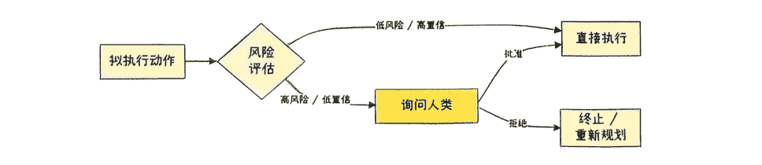

理想情况下，Agent 的所有操作都应具备可逆性。对于不可逆的操作（如发送邮件），必须引入时间锁（Time Lock）机制，例如，延迟 10s 发送，以便为人类提供撤回的机会。

### 3.4.4 第四原则：共同学习与成长

人机协作并非静态关系，而是一个双向的学习过程。

- AI 向人类学习：通过人类的反馈（如 RLHF①）、修正和示范，AI 逐步捕捉并内化人类的偏好，将人类的隐性知识（Tacit Knowledge）转化为可操作的显性知识。
- 人类向 AI 学习：AI 展现出的涌现行为（如 AlphaGo 第 37 手的“神之一手”）能够启发人类突破思维定式，发现全新的问题解决路径。

人机协作必须建立在共同的伦理基础之上，而其最高境界是实现创造性的融合。

本节介绍的这些原则正在重塑我们的工作方式：新的契约并非一次性签署即告终结，而是持续协商、动态演进的过程；它不是合作的终点，而是共创的起点。

我们设定初始条件（Prompt），提供养分（Knowledge），适时修剪枝叶（Safety/Alignment），然后静待智能之果自然涌现。

唯有确立这份契约，我们才能安心地漫步于这座智能花园，而不必时刻担忧被失控疯长的藤蔓所缠绕。

## 小结 角色的转变

从 GoF 的 23 个设计模式到 Agent 的无限可能，我们跨越了软件工程的一个世纪。

- 设计模式并未消亡，而是在进化。
- 软件工程未曾终结，而是在重生。
- 人类的角色没有消失，而是在升华。

我们并非在设计未来，而是在与未来共舞。

当我们学会不再畏惧不确定性，与 Agent 互补共生时，我们就不再仅仅是开发者。

上篇的内容到此结束。

请翻开下篇，我们将深入探讨具体的 Agent 设计模式——那些正在塑造未来的新骨架。

从静态到动态，从设计到演化，从工具到伙伴——
欢迎来到 Agent 时代！

> ① RLHF（Reinforcement Learning from Human Feedback，基于人类反馈的强化学习）是一种强化学习方法，它通过引入人类的反馈来指导Agent的学习过程，从而优化Agent的行为策略。

# 下篇 智能设计模式

> “代码不再是控制的指令，而是孕育智能的土壤。”
——黄佳

# 第 4 章

## 感知模式

> “我们并不是直接看见世界，而是通过选择、过滤和组织信息来理解它。”
——赫伯特·西蒙（Herbert Simon）

传统软件系统是被动的：等待用户输入、处理预定义的数据流，并在封闭的环境中运行。Agent 则是主动的：根据需求获取信息，选择性地关注关键内容，整合多源异构输入，并在开放世界中探索。
感知的本质不是“看到所有”，而是“看到关键”并“主动寻找未知”。
本章涉及的 3 个核心模式如图 4-1 所示。

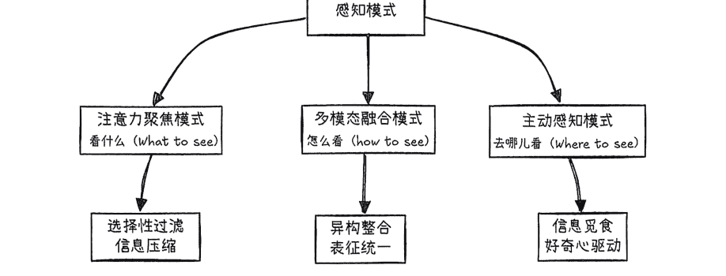

这 3 个模式共同构成了 Agent 的感官过滤器。

- 注意力聚焦模式：解决“信息过载”问题（从海量输入中筛选）。
- 多模态融合模式：解决“输入异构”问题（图像、文本、音视频统一）。
- 主动感知模式：解决“信息不足”问题（主动探索环境获取所需）。

## 4.1 注意力聚焦模式

> “神经系统的信息处理能力是有上限的。”
——唐纳德·布罗德本特（Donald Broadbent）
> “注意力机制使模型能够聚焦于输入序列中的关键部分。”
——“Attention Is All You Need”论文①

① VASWANI A, SHAZEER N, PARMAR N, et al. Attention is all you need[EB/OL]. (2023-08-02)[2025-12-23]. https://arxiv.org/abs/1706.03762.

在企业级 Agent 的设计中，我们经常陷入一个误区，认为把所有数据（如文档、日志、录音）一股脑丢给上下文窗口（Context Window），依靠模型强大的推理能力就能得到结果。

这是一个昂贵且危险的架构决策。虽然模型的窗口正在向百万级 Token 甚至无限演进，但“能装下”不代表“能处理”。

- 成本爆炸：Transformer的注意力计算复杂度是 $O(n^2)$，处理 10 万个 Token 的成本远高于处理 1 万个 Token 的 10 倍。
- 信噪比稀释：在很长的上下文窗口中，关键信息往往被海量噪声淹没，导致模型出现迷失在中间（Lost in the Middle）的幻觉现象。
- 信息冗余：实际任务中 90% 的 Token 往往是噪声。
- 延迟不可控：对于实时交互 Agent，秒级的首字延迟是不可接受的。

从 Transformer 的注意力机制中可以得到启发：Agent 也可以拥有像人类一样的选择性注意力——快速浏览全局，将认知资源聚焦于关键信息。

注意力聚焦模式的工程本质是构建一个高效的认知漏斗，如图 4-2 所示。它的目标极其功利：用最低的 Token 成本，换取最高的上下文质量。

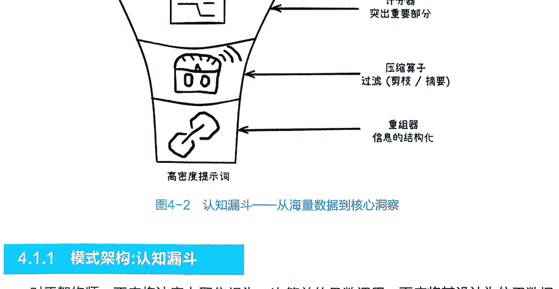

### 4.1.1 模式架构：认知漏斗

对于架构师，不应将注意力聚焦视为一次简单的函数调用，而应将其设计为位于数据源（Data Source）与模型之间的一个独立服务组件或中间件。它不仅仅是“压缩”，更是一个清洗、分级、重排序的过程。

注意力聚焦模式的实现流程如图 4-3 所示，其中关键组件说明如下。

- 评分器（Scorer）——守门人：流水线的第一道关卡。它不必理解内容，只负责计算“含金量”。它通常是一个轻量级的小型模型或统计算法，负责给每一个 Token 或句子打分。
- 策略路由（Router）——分流器：根据分数将信息分流。核心数据原样保留，背景数据进行语义压缩，噪声数据直接丢弃。
- 重排序器（Reranker）——拼装工：压缩后的信息往往是碎片化的。重排序器负责按逻辑顺序（而非原始顺序）重新拼接上下文，甚至通过添加特殊标记来提示模型：“注意，这里有一段被压缩了。”
- 质量探针（Quality Probe）——质检员：一个闭环反馈机制。在将 Prompt 发送给昂贵的模型之前，先通过计算压缩后文本的语义完整性来判断是否“删除的内容太多了”。

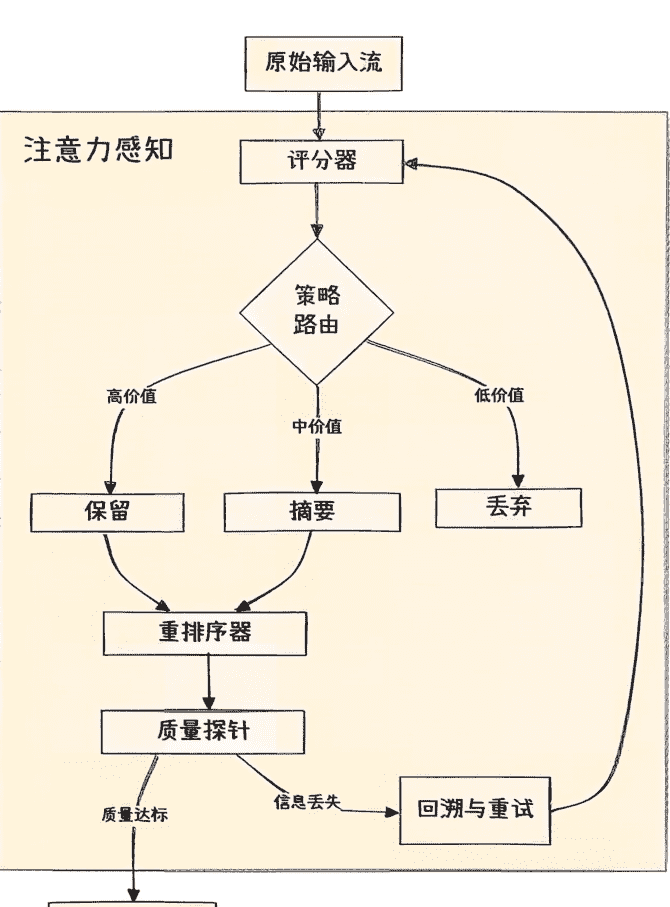

图4-3 注意力聚焦模式的实现流程

注意力聚焦模式并非一次性的上下文压缩，而是一条可治理的信息加工流水线。它通过“评分—分流—重排序—质检”的闭环机制，将有限注意力精准分配给高价值信息，从而在成本、性能与语义完整性之间实现工程化的平衡。

### 4.1.2 注意力聚焦核心机制

要实现精准的注意力聚焦，Agent 必须建立一套严密的评价体系。本质上，这是在解决两个古老的经济学问题：凭什么删（价值评估）以及删多少（预算约束）。
在工程实践中，我们通常不依赖单一指标，而是采用“双重校验”逻辑来构建评分策略。

首先是基于惊奇度的“静态筛选”。依据香农信息论，信息量的大小与事件发生的概率成反比。在大模型中，这表现为困惑度（Perplexity，简称 PPL）。对于模型，那些常见的停用词（如 the、is、的）是高度可预测的，因此信息熵极低；而专有名词、特定数值或反常理的描述，往往能引发模型较高的困惑度，这恰恰意味着它们承载了高价值信息。在处理无具体查询的日志分析或长文档摘要时，这种寻找“惊奇”的策略往往能保留最关键的细节。

其次是基于相关性的“动态锚定”。当用户有明确的查询意图时，信息的价值就不再绝对，而是相对于查询而言的。此时，我们需要计算查询向量与上下文中各片段向量的相似度。这就像是在图书馆中检索，只有与“当前课题”相关的图书才会被保留。
计算相关性的核心代码逻辑如下。

```
# 伪代码：对比评分逻辑
def contrastive_score(segment, query, model):
    # 比较“有 Query”和“无 Query”时，模型对该片段的关注度变化
    # 变化越大，说明该片段对回答 Query 越重要
    return model.probability(segment | query) / model.probability(segment)
```

基于上述评分，架构师需要选择合适的压缩算子。最激进的手段是剪枝（Pruning），直接切除低分 Token。这虽然能实现 5 倍甚至 20 倍的压缩，但风险极高，容易切断长距离的逻辑依赖，导致模型“语无伦次”。较为温和的手段是摘要（Summarization），即调用另一个模型将冗长的段落重写为精练的句子，这虽然保留了语义，但会带来额外的计算延迟。而在某些特定领域，我们甚至可以将文本压缩为人类不可读但机器可理解的密集向量，实现百倍级的压缩。

图 4-4 清晰地展示了 Agent 内部是如何根据评分来选择压缩策略的——这一过程也被称为上下文蒸馏（Context Distillery）。具体机制包括从双重评分（惊奇度与相关性）到算子选择，再到预算管理器对压缩力度的自适应调控。

最先进的 Agent 架构已不再使用固定的压缩率。这类 Agent 引入了类似于视频流媒体的自适应循环（Adaptive Loop）：系统内置一个预算管理器，可以根据当前任务的复杂度动态下发压缩参数。例如，面对简单的寒暄，它会大刀阔斧地压缩以节省成本；面对复杂的代码审计任务，它则会小心翼翼地保留每一个字符。

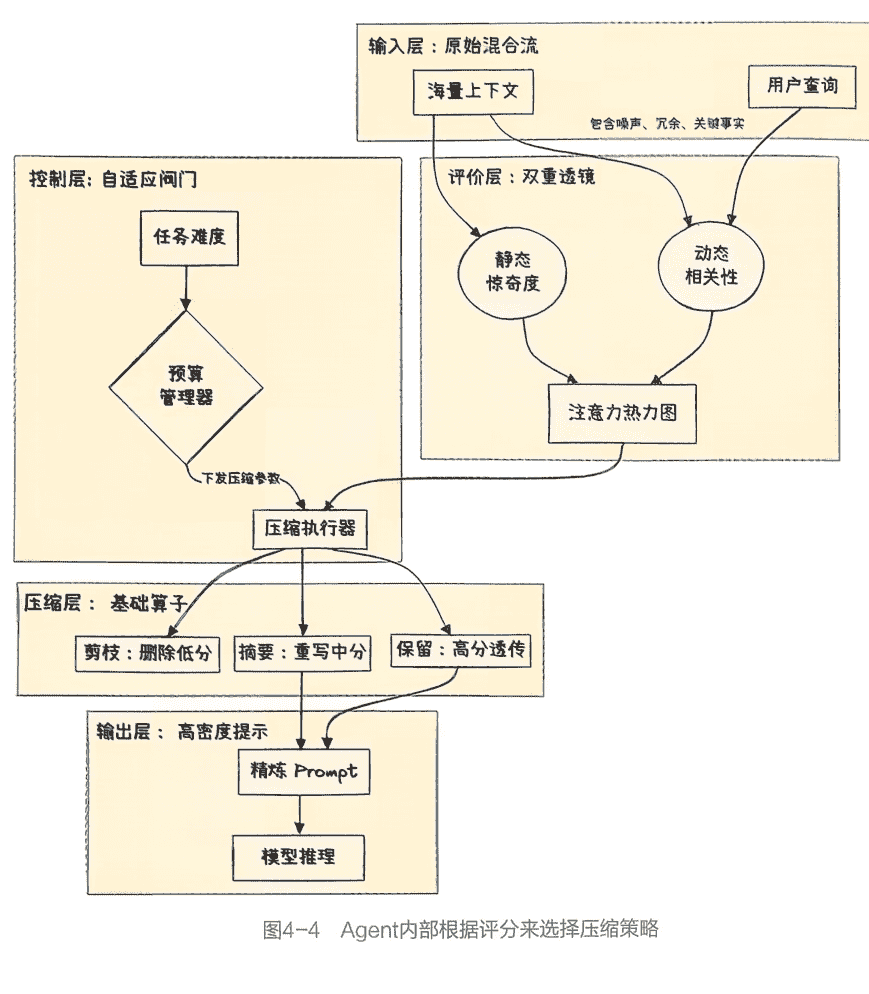

### 4.1.3 注意力聚焦工程实践

在工程实践中，针对上下文的“提纯”不再是单一的技术选择，而是演化出了3条截然不同的技术路线。它们分别代表了中间件、存储层和模型底层的革新。

第一条路线是“中间件模式”，以 Microsoft 的模型 Lingua 为代表。

这种模式的核心思想是“分级处理”：利用一个小巧低价的模型（如 Llama-2-7b）作为“看门人”，先计算 Prompt 中每个 Token 的信息熵，剔除低价值信息，再将“精华”传入昂贵的 GPT-4。这在 RAG 场景中尤为有效。企业知识库检索往往会召回大量含有噪声的文档片段，通过在检索层与推理层之间架设模型 Lingua，能以微小延迟的代价，节省高达 80% 的 Token 费用，并因减少了噪声干扰而提升最终回答的准确率。

第二条路线是“存储优化模式”，以 Anthropic 的 Prompt Caching 技术为代表。

这种模式针对的是“强 SOP 约束”的垂直类 Agent。例如，一个法律助手可能每次对话都需要加载同一部法律。如果每次都重新计算这些静态内容的注意力矩阵，无疑是巨大的浪费。Prompt Caching 技术允许服务端将公共前缀（System Prompt 或背景资料）的 KV Cache 缓存起来。当后续请求的前缀一致时，API 直接复用缓存状态。这不仅将长文档对话的首字延迟降低了 80%，更让“带全量背景知识”的对话在经济上变得可行。

第三条路线是“原生架构模式”，以 DeepSeek-V3 的多头潜在注意力（Multi-Head Latent Attention，MLA）技术为代表。

这是一种更为彻底的底层革命。传统的注意力机制在处理长上下文时，KV Cache 的显存占用会呈线性甚至指数级增长。DeepSeek 通过多头潜在注意力技术，在模型架构层面实现了对 KV Cache 的极致压缩。这意味着架构师可能根本不需要在应用层进行任何压缩——直接将 100 份财报传入模型，不仅成本极低，而且因为没有经过有损压缩，信息的保真度达到了 100%。这标志着“全量信息分析”时代的到来。

除上述技术路线以外，学术界在 2024 年提出的 System 2 Attention 为我们提供了新的视角。传统的注意力机制是“直觉式”的、基于统计的（System 1，参见 3.2.2 小节）。而 System 2 Attention 则是让模型有意识地去审视上下文，显式地决定“应该忽略哪部分信息”。这种让 Agent 自己重写上下文以去除无关信息的方法，虽然耗时，但在处理含有误导性信息（Sycophancy）的复杂推理任务中，表现出了惊人的鲁棒性。

在应用注意力聚焦模式时，架构师必须警惕两类典型的“工程黑洞”。

第一类是过度压缩导致的“逻辑断裂”。剪枝算法往往容易“杀红了眼”，删除连接词（如 Therefore、However）或指代词（如 It、He）。这在人类看来可能只是读起来不通顺，但对于模型，这意味着因果链条的崩塌。因此，在涉及思维链推理的场景中，应严禁使用 Token 级的剪枝技术，而应采用句子级或段落级的保留策略。

第二类是位置偏差（Position Bias）。早期的模型普遍存在迷失在中间的幻觉现象——它们对 Prompt 开头和结尾的信息记忆深刻，却容易忽略中间的内容。如果简单地截断中间部分，可能会加剧这种遗忘。成熟的策略是引入“U 型保留策略”：无论评分如何，强制保留 System Prompt 的头部约束和 User Query 的尾部指令，仅对中间的历史记录进行高强度压缩。

综上所述，注意力聚焦模式并非万能药。它适用于“大海捞针”式的场景，例如，从数百页合同中寻找风险条款，或基于数千个文件理解代码架构。在这些场景中，信息密度极不均匀，压缩带来的收益远大于损失。

然而，对于“全息关联”类场景，如密码学分析或复杂的数学证明，每一个符号都可能改变最终结果，此时任何形式的有损压缩都是危险操作。此外，在医疗诊断或安全审计等对召回率要求极高的领域，我们也应谨慎使用此模式，毕竟在这些领域，“漏看”的代价远高于“多看”的成本。

注意力聚焦模式的典型场景如表 4-1 所示。

表 4-1 注意力聚焦模式的典型场景

| 场景 | 是否适用 | 示例 |
| --- | --- | --- |
| 输入超过有效窗口 | 是 | 法律合同分析（200页）、代码库理解（数千个文件） |
| 信息密度不均 | 是 | 90% 噪声 +10% 关键信息的幂律分布 |
| 成本 & 延迟敏感 | 是 | 实时对话、高并发服务（百万次/天） |
| 全局视野 + 局部聚焦 | 是 | 从整本书中找答案、理解项目架构但聚焦特定模块 |
| 所有信息都关键 | 否 | 密码学分析、数学证明（每一个符号都不能丢） |
| 输入已经很短 | 否 | 小于 1000 个 Token（压缩收益微乎其微） |
| 召回率要求极高 | 否 | 医学诊断、安全审计（宁可“多看”，不可“漏看”） |

### 4.1.4 注意力聚焦模式的演化与组合

注意力聚焦模式并非孤立存在，而是 Agent 架构中的“预处理中间件”。随着上下文窗口不断扩展，工程目标已不再局限于单纯“缩短输入长度”，而是转向“提升信息密度”。在工程实践中，这一模式从最初的滑动窗口模式，逐步演化为基于语义的上下文压缩模式，最终迈向模型底层的原生优化模式。

#### 1. 演化路径：从截断到原生

- 滑动窗口（Sliding Window）：这是注意力聚焦模式的“原始阶段”的代表。其机制是采用简单的 FIFO（First In, First Out，先进先出）或首尾保留策略。其核心痛点在于“灾难性遗忘”——早期的关键指令或中间的逻辑链条可能被无情丢弃，导致 Agent 陷入“金鱼记忆”式的短视行为。
- 语义压缩（Semantic Compression）：这是注意力聚焦模式的“中间件阶段”的代表。其机制是在将 Prompt 输入 LLM 之前，先通过一个轻量级模型计算每个 Token 的困惑度或互信息，保留“高惊奇度”（即信息量大）的 Token，删除冗余或低信息量的“废话”。这一模式实现了对上下文“信噪比”的工程化控制。
- 原生架构（Native Architecture）：这是注意力聚焦模式的“底层阶段”的代表。其核心机制是不再依赖外部工具进行压缩，而是直接对 Transformer 架构进行革新。例如，通过低秩投影（Low-Rank Projection）大幅降低 KV Cache 的显存占用。这一模式实现了“全量即聚焦”：当模型本身能够以极低成本处理百万级 Token 时，外部压缩工具便逐渐内化为模型的原生能力，成为其“本能”。

#### 2. 模式组合示例

注意力聚焦模式作为 Agent 的“前置过滤器”，与其他模式结合可显著提升系统整体效率。

- 注意力聚焦模式与 RAG 模式（见 5.2 节）的组合 = 漏斗形 RAG：传统 RAG 模块为了节省 Token，通常仅检索 Top 5 文档片段，这容易导致关键信息的遗漏，从而降低召回率；而若将检索范围扩大至 Top 100 文档片段，不仅可能超出上下文窗口的限制，还会引入大量噪声。通过引入注意力聚焦模式，系统可在检索后对候选内容进行语义筛选与压缩，以计算成本换取质量提升，从而有效缓解 RAG 模块中“召回数量”与“上下文窗口大小”之间的经典矛盾。具体机制如下。
  - 检索层：大幅扩大召回范围，获取 Top 100 文档片段，确保高召回率。

### 4.1.5 设计哲学：主动“忽视”

注意力聚焦模式是 Agent 在信息爆炸时代的生存法则。它通过忽略所有技术实现细节向架构师传递了如下核心设计哲学。

智能不在于处理所有信息，而在于识别关键信息。

随着上下文窗口继续扩大（如 1 亿、10 亿个 Token），注意力聚焦将从一种“优化手段”变为一种“基础能力”。

如果你在设计 Agent，请不要以“它能记住多少”为荣，而要以“它能精简多少”为傲。一个优秀的感知层架构，应该像人类的大脑一样，具备主动忽视的能力——过滤掉 99% 的噪声，只为了在那 1% 的关键信号上迸发出最耀眼的智慧火花。

## 4.2 多模态融合模式

> “人类从不只用一种感官理解世界，AI 也不应该。真正的理解，是视觉、听觉与语言在思维空间中的共鸣。”
——李飞飞

想象一个拥有联觉（Synesthesia）的大脑。当它看到“苹果”的图像时，不仅处理了像素，还同时激活了“甜味”的味觉区、“清脆”的听觉区和“水果”的语言区。
传统的 AI 架构往往是割裂的：计算机视觉（Computer Vision，CV）处理像素，自然语言处理（Natural Language Processing，NLP）处理文本，两者“老死不相往来”。多模态融合模式的核心意图，就是要打破这种模态孤岛。它不是简单地将图片和文字“拼凑”（Concat）在一起，而是建立一个统一的语义场（Unified Semantic Field）。在该语义场中，图像的像素向量和文本的 Token 向量不再是异构的数据，而是可以互相转化、互相解释的同一种“思维语言”。

### 4.2.1 模式架构：统一语义场

多模态融合不仅是算法问题，更是数据流的对齐（Alignment）问题。我们需要构建一个漏斗形架构，将纷繁复杂的物理信号收敛为统一的语义表征。图 4-5 展示了多模态融合模式的实现流程。

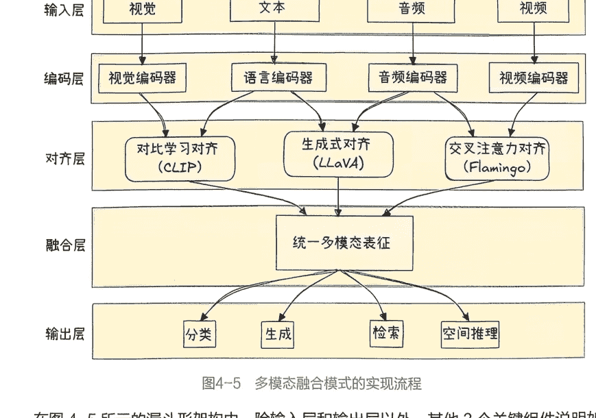

在图 4-5 所示的漏斗形架构中，除输入层和输出层以外，其他 3 个关键组件说明如下。

- 编码层：提供的各个独立的编码器（Encoder）是 Agent 的不同“感官”。例如视觉编码器（Vision Encoder，如 ViT）负责“看”，音频编码器（Audio Encoder，如 Whisper）负责“听”。它们将原始的波形和像素转化为高维特征向量。
- 对齐层（Alignment Layer）：多模态融合模式的灵魂。它负责解决“语义鸿沟”——如何让计算机明白，像素空间里的“猫的形状”和文本空间里的单词“cat”指向的是同一个实体。
- 融合层：通过融合策略（Fusion Strategy）决定“感官”融合的时机。可以像 CLIP（Contrastive Language-Image Pre-training，对比式语言—图像预训练）一样各自独立编码，最后只在输出层握手；也可以像 Gemini 那样，在深层神经网络的每一层都进行交织。

### 4.2.2 多模态融合核心机制

在追求构建统一语义场的道路上，工业界发展出了 3 种主流的对齐机制。每种机制都代表了对“融合”概念的独特理解。

- 对比学习对齐（Contrastive Learning Alignment）：以 CLIP 为代表。此机制的核心隐喻是“磁铁”，通过大量的图文匹配训练来工作，使得匹配的图像向量和文本向量在空间中彼此靠近，而不匹配的则被推远。这种机制特别高效，适用于检索和分类任务，但它依赖“距离”来理解和表示关系，因此缺乏生成描述的能力。
- 生成式对齐（Generative Alignment）：以 LLaVA 为代表。此机制的核心隐喻是“翻译官”，通过增加一个投影层（Projector），将视觉特征转换成模型能够理解的 Token Embedding。对于模型，图像被视为另一种形式的语言。这种机制赋予了 Agent“看图说话”的能力，使其成为当前构建多模态 Agent 的主流选择。
- 交叉注意力对齐（Cross-Attention Alignment）：以 Flamingo 为代表。此机制的核心隐喻是“拉链”，不是把图像转换成 Token，而是保持视觉特征的独立性，并在模型的每一层插入“交叉注意力门控”。这意味着在生成文本的过程中，可以随时“查询”视觉特征。这种机制保留了更多的视觉细节，非常适合处理高分辨率图像和长视频内容。

图 4-6 形象地展示了 3 种对齐机制。

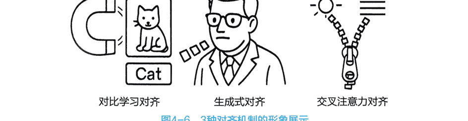

如果说上述 3 种对齐机制解决了“是什么”的问题，那么空间智能（Spatial Intelligence）则试图解决“在哪里”和“怎么动”的问题。这是 2024 年后多模态领域的新高地。

多模态输入不再局限于 2D 的 RGB 图像，而是扩展到了深度图和点云。Agent 开始理解遮挡、距离、重力和碰撞。输出也不再只是文本描述，而是物理世界的坐标（x, y, z）、机械臂的动作，甚至是力反馈。这是通向具身智能的必经之路——让 Agent 从屏幕里走出来，进入物理世界。

### 4.2.3 多模态融合工程实践

在工程实践中，我们正在见证 Agent 架构从“拼接式”向“原生式”的演进。
早期的多模态架构（如 VQA、ViLBERT）是拼接式的。系统由一个模型指挥官和一群独立的视觉模型（如 Detection、Segmentation）组成，通过复杂的 Prompt 互相调用。这种架构虽然灵活，但推理慢、割裂感强。
当前的多模态架构（如 GPT-4V、Gemini）是原生式的。特别是 Google 的 Gemini，它从预训练阶段开始就是多模态的。它不需要“对齐层”，因为其视觉和语言能力本身就是生长在同一棵“神经树”上的分支。这种原生多模态（native multimodal）架构（见图 4-7）带来了惊人的理解力和推理速度，但也极大提升了训练门槛。

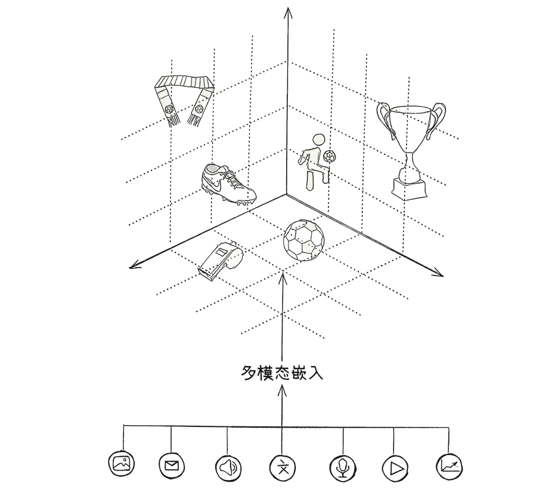

对于大多数应用开发者，LLaVA 风格的轻量级对齐依然是性价比最高的选择。以下是一个极简的 PyTorch 实现逻辑，展示了如何通过一个线性层将视觉编码器“嫁接”到模型上。

```python
class MultiModalAgent(nn.Module):
    def __init__(self, vision_encoder, llm):
        super().__init__()
        self.vision_encoder = vision_encoder # 如 CLIP ViT-L
        self.llm = llm           # 如 Llama 3

        # 【关键组件】对齐投影层：视觉特征→语言嵌入
        # 这就像是一个转接头，让视觉信号能插入模型的插座
        self.projector = nn.Linear(768, 4096)

    def forward(self, image, text_prompts):
        # 1. 视觉编码：提取图像特征
        image_features = self.vision_encoder(image)

        # 2. 模态对齐：将像素特征转换为“软 Token”
        visual_tokens = self.projector(image_features)

        # 3. 文本编码：处理用户指令
        text_embeds = self.llm.embed(text_prompts)

        # 4. 融合：在序列维度拼接，在模型看来这就是一串更长的 Token
        combined_embeds = torch.cat([visual_tokens, text_embeds], dim=1)

        # 5. 生成：基于视觉上下文的文本生成
        return self.llm.generate(inputs_embeds=combined_embeds)

agent = MultiModalAgent(...)
response = agent(image=cat_photo, text_prompts="描述这张图并判断猫的情绪")
```

在多模态融合技术的发展历程中，我们可以清晰地看到从“松耦合”到“紧耦合”，再到尝试实现“物理模拟”的演变轨迹。以下是各阶段的特征和局限。

- 以 CLIP 为代表的判别式时代（Discriminative Era）是“看图说话”的史前史。其架构特征为双塔结构（Dual Encoder）。视觉和文本分别编码，再通过对比损失函数在向量空间中强行拉齐。这种架构的局限：只能计算相似度（用于检索和分类），无法生成描述，也无法进行逻辑推理。它能够理解“这张图像中有猫”，但不理解“猫在干什么”。
- 以 LLaVA、GPT-4V 为代表的生成式时代（Generative Era）带来了“视觉对话”的爆发。其架构特征是投影架构。强大的模型被冻结，通过一个轻量级的适配器（如线性层或 Q-Former），将视觉特征映射为模型的 Token Embedding。这样，视觉信息变成了语言的一部分。Agent 终于可以基于视觉信息进行思维链推理，解释图表、分析因果关系。
- Sora、Nano Banana、World Labs 则代表着世界模型时代（World Model Era）——“物理模拟”的未来。其架构特征为时空补全（Spatiotemporal Completion）。模型不再只是“描述”像素，而是学习“预测”像素。Agent 不仅能“看到”桌子上的杯子，还能基于物理常识预测“如果推一下，杯子会掉下来并摔碎”。这是走向通用人工智能（Artificial General Intelligence, AGI）的关键一步——理解物理规律，而不仅仅是拟合统计规律。

在具体产品应用方面，如果说 GPT-4V 代表了适配器模式的极致（高性能视觉编码器和强大的语言基座），那么 Google 的 Gemini 则开启了原生多模态的新纪元。Gemini 不是两个模型的拼接，而是从预训练开始就接受图像、文本、视频、音频的交错序列（interleaved sequence）训练。这意味着它没有显式的“视觉编码器”和“对齐层”，视觉信号直接参与了逻辑推理的梯度下降。这种架构消除了模态转换中的信息损耗，使其能够理解细粒度的时间与空间关系（例如，理解电影中两个镜头的因果联系）。

Tesla FSD V12 是空间智能领域的一项革命性突破，实现了端到端自动驾驶。该系统摒弃了超过 30 万行用于车辆规划与控制的传统 C++ 规则代码，构建了一个统一的神经网络，从而实现了从“光子输入”到“控制指令输出”的端到端映射。该系统不仅通过构建 BEV（鸟瞰图）向量空间来精确感知环境，其更深层的意义在于通过海量数据训练，学会了类似人类的驾驶“直觉”——一种流畅、拟人并能应对复杂场景的综合决策能力。这强有力地证明了，在足够大规模的数据驱动下，神经网络能够隐式地学习物理世界的拓扑结构和运动规律，在很大程度上减少了对传统人工特征工程的依赖。

### 4.2.4 多模态融合模式的演化与组合

多模态融合模式已从早期的独立编码与后期拼接，逐步演化为基于适配器的深层跨模态交互，并最终迈向全模态原生的统一表征。如今，架构师不再将视觉视为语言的“外挂”，而是将其视为 Agent 与生俱来的“原生感官”。

#### 1. 演化路径：从拼接适配到原生统一

- 后期拼接（Late Fusion）：其机制是将视觉模型（如 YOLO、BLIP）作为独立工具，由 LLM 生成的文本指令调用这些模型，并接收其输出的文本描述。该模式的核心痛点在于信息有损——大量视觉细节（如光影变化、纹理特征、空间关系等）在转化为文本的过程中不可避免地丢失，导致语义表达不完整，限制了多模态模型理解的深度与精度。
- 适配器对齐（Alignment Adapter）：其机制是在保持 LLM 和视觉 Transformer（ViT）参数冻结的前提下，训练一个轻量级的投影层（Projector），将视觉特征映射到文本的嵌入空间。这一模式实现了“视觉即语言”——Agent 能够直接“看懂”图像，不需要依赖中间文本描述。目前，该模式已成为开源社区的主流实践。
- 原生统一（Native Unified）：以 GPT-4o 和 Gemini 1.5 Pro（2024 年 / 2025 年）为代表，其机制从预训练阶段起就将 Token 扩展为多模态单元——不仅包括文本，还涵盖图像块、音频波形等。模型是“生而多模态”，不需要后天适配。这一设计实现了零延迟的多模态交互，即视觉、音频与文本在神经网络内部无缝融合、自由流转，使 Agent 能够对真实世界中的细微变化（如语调起伏、微表情、环境音效等）进行充分感知与实时响应。

#### 2. 模式组合示例

多模态融合模式通常作为 Agent 的“感官前台和中台”，为下游的记忆模块与行动模块提供高带宽、高语义密度的多模态输入。

- 多模态融合模式与情节记忆模式（见 5.3 节）的组合 = 视觉日记：该组合赋予 Agent 一种“似曾相识”的视觉直觉，使其能够通过视觉类比来识别情境、迁移经验并学习新技能。该组合适用于具身智能或个人助理等需要长期环境感知与个性化交互的场景。具体机制如下。
  - Agent 在执行任务时，不仅记录文本日志，还会通过多模态融合模块保存关键时刻的视觉快照（Visual Snapshot）。
  - 当下次遇到相似场景时，Agent 从情节记忆库中检索视觉上最相似的过往经历，从而触发类比推理或复用已有策略。
- 多模态融合模式与 ReAct 模式（见 7.1 节）的组合 = 手眼协调：这是迈向 VLA（Vision-Language-Action）模型的关键路径，实现了从多模态感知到具体行动的端到端映射。该组合适用于 GUI 操作、机械臂控制等需要实时理解视觉输入并精准执行动作的任务场景。具体机制如下。
  - Observation 阶段：Observation 不再局限于纯文本，而是包含屏幕截图或摄像头捕获的实时画面。
  - 解析与定位阶段：Agent 通过多模态融合模块解析画面，识别并定位 UI 元素坐标或物理环境中物体的空间位置。
  - 行动与反馈阶段：在 ReAct 循环中，Agent 基于视觉反馈生成精准的操作指令（如鼠标点击、拖曳或机械臂的运动控制），实现感知与行动的紧密闭环。

多模态融合模式的演化，标志着 Agent 正从“符号计算”迈向“物理感知”。当 Agent 能够以原生方式理解光影、声音等真实世界信号时，它便不再只是数字世界的“幽灵”，而是成为具备真实“在场感”的智能实体。

### 4.2.5 设计哲学：从“看”到“在”

多模态融合的最终目标，不是让 AI 识别出图像中有一只猫，而是让 AI 建立起一种在场感（Presence）。

当一个 Agent 同时拥有视觉、听觉和空间感时，它就不再是一个处理文本的聊天机器人，而是一个存在于物理世界中的实体。它开始理解“这里”“那里”“重”“远”这些物理概念，并具备物理常识推理的能力——例如预判物体是否会掉落、能否推开门等。

这不仅仅是感知的升级，更是心智的具身化。它标志着 AI 从符号的计算者进化为世界的观察者和参与者。

## 4.3 主动感知模式

> “系统会努力最小化其自由能函数，不断根据外界环境输入的新信息，调整内部对外部环境的信念。”
——卡尔·弗里斯顿（Karl Friston）

在传统模型的认知框架中，模型天然假设“人类交给我的输入是真实且完备的”。这是一种几乎写进参数空间的倾向：模型不会质疑 Prompt 的来源、可靠性和偏差，而是基于已有内容尽力补齐推理链条。因此，一旦信息缺页，模型就会在“必须给出答案”的内在压力下产生幻觉。

因此，在 RAG 或简单的模型调用中，往往存在一个危险的假设：上下文窗口中已经有了回答问题所需的一切信息。

主动感知模式打破了这一假设。它将 Agent 从“被动的答题者”转变为“主动的调查员”。当 Agent 发现现有信息不足以支撑可信结论时，它会暂停生成答案，转而执行操作以获取新证据。

从架构的视角来看，这标志着系统架构从“输入即输出”的静态模式，迈向“感知—行动”持续迭代的动态闭环。

### 4.3.1 模式架构：信息觅食环

在工程实践中，主动感知不能是一个死循环。我们需要构建一个具备元认知（Metacognition）能力的控制流。图 4-8 展示了主动感知模式的实现流程。

图 4-8 所示的架构包含 4 个关键的工程组件。

- 不确定性探针（Uncertainty Probe）：系统的“刹车片”，不负责生成内容，只负责判断“能不能回答”。不确定性探针的技术实现可以是基于 Logprobs（Token 生成概率）的统计判断，也可以是一个轻量级的分类模型，或是一次专门的 Self-Reflection Prompt 调用。
- 查询生成器（Query Generator）：负责将模糊的“知识缺口”转换为具体的“工具指令”。例如，将“分析这家公司的财务风险”拆解为 search_engine("2023 财报") 和 code_interpreter("计算流动比率")。
- 信息过滤器（Information Filter）：主动找回的信息往往包含大量噪声，为了防止污染上下文，必须有一个过滤层，只将通过校验的“事实”写入短期记忆。
- 预算控制器（Budget Controller）：工业级系统最容易忽视的组件。为了防止 Agent 陷入“搜索—失败—再搜索”的死循环，必须设置最大跳数或 Token 消耗上限。

### 4.3.2 主动感知核心机制

实现主动感知模式的核心在于解决两个问题：“何时停”（停止感知，开始回答）和“去哪儿找”（路径规划）。

### 1. 基于“元认知”的触发机制

我们不能对所有请求都开启主动感知（成本太高），系统需要识别“认识论不确定性”。

- 当用户查询包含“查询”“分析”等动词时，需要显式触发自动感知。
- 若模型在尝试回答时发现缺失关键实体，需要隐式触发自动感知。此时应在 System Prompt 中加入 Prompt：“如果你不知道答案，请输出 [SEARCH_NEEDED: 具体问题]，而不是编造。”

### 2. 渐进式信息觅食

类似于人类在图书馆查找图书，Agent 的感知路径通常遵循以下策略。

- 后退一步（Step-back Questioning）：如果问题太具体导致查不到（如“××公司 2023 年 Q3 的服务器折旧费”），Agent 应主动生成一个更宽泛的查询（如“××公司 2023 年 Q3 财报”），先获取大文档。
- 深挖一步（Drill-down Reading）：获取大文档后，不再进行搜索，而是通过机器阅读理解（Machine Reading Comprehension, MRC）精确定位具体数值。

实现主动感知模式的 3 个阶段如表 4-2 所示。

表 4-2 实现主动感知模式的 3 个阶段

| 阶段 | 核心问题 | 典型行为 | 代表技术 |
| :--- | :--- | :--- | :--- |
| 探索（exploration） | 哪里可能有答案？ | 广撒网式搜索、浏览目录 | BFS（Breadth-First Search，广度优先搜索）、关键词扩展 |
| 定位（navigation） | 具体在哪一行？ | 点击链接、精准查询 | 点击预测、DOM（Document Object Model，文档对象模型）解析 |
| 利用（exploitation） | 这是我要的吗？ | 阅读内容、提取事实 | MRC |

如下示例是一个简化版实现，展示了带有“预算控制”和“自我反思”的主动感知循环。

```python
class ActiveAgent:
    def __init__(self, llm, tools, max_steps=3):
        self.llm = llm
        self.tools = tools
        self.max_steps = max_steps # 预算控制：防止死循环

    def run(self, user_query):
        context = []
        step = 0
        while step < self.max_steps:
            # 1. 观察与决策
            # 这里的 Prompt 强要求模型评估信息充足度
            thought = self.llm.think(
                query=user_query,
                context=context,
                system_prompt="Do you have enough info? If yes, output FINAL_ANSWER. If no, choose a tool."
            )

            if thought.action == "FINAL_ANSWER":
                return thought.content

            # 2. 执行行动
            tool_result = self.tools.execute(thought.action, thought.args)

            # 3. 感知过滤（关键步骤）
            # 不要把 HTML 直接传入上下文，而是应先进行清洗
            useful_fact = self.llm.summarize(tool_result, query=user_query)
            context.append(useful_fact)

            step += 1

        return "I tried to find the answer but reached the search limit."
```

在主动感知模式的实践过程中，架构师需要警惕以下“工程黑洞”。

- 上下文污染（Context Pollution）：Agent 搜索到一篇错误的博客文章，并将其作为事实依据，最终导致回答错误。对策是在写入上下文之前，引入交叉验证机制。如果是关键事实（如股价、医疗建议），则强制要求至少两个独立信源一致。
- 注意力发散（Distraction）：Agent 在搜索过程中被无关信息吸引，跑题了。对策是始终将用户的原始问题钉在 Prompt 的最下方，提醒 Agent 勿忘“初心”。
- 非必要的昂贵调用：用户问的是简单问题，Agent 却调用了一次 Google Search。对策是引入一个极低成本的 Router 模型（如 Qwen 开源小型模型或规则引擎）作为前置网关，拦截闲聊和通用常识问题。

### 4.3.3 主动感知工程实践

在工程实践中，针对主动感知，已经分化出 3 种不同形态的标杆产品。

- Perplexity.ai 定义了“搜索即生成”的标准范式。Perplexity.ai 不是简单地把 Top 10 链接发给用户，而是执行了“理解意图→多步并行搜索→阅读理解与去重→合成带引用的答案”的全流程。它证明了主动感知模式可以做到毫秒级的实时响应，且极大降低了幻觉率。
- OpenAI 的 Deep Research 项目展示了另一种极端——用时间换质量。面对“写一份 50 页的行业分析报告”这种任务，Agent 可能会花费 30min，自主执行数百次搜索，阅读上千篇文档。它展示了 System 2（慢思考）在主动感知模式中的巨大潜力——不急于回答，而是执行“规划→执行→修正”流程。
- Voyager（Minecraft Agent）在虚拟世界中展示了主动感知模式的最高级形式——好奇心（Curiosity）。它没有收到任何人类指令，却会因为“我还没见过钻石”而主动设计课程（Curriculum），去地下挖掘。这种由内在动机（Intrinsic Motivation）驱动的感知，是通向 AGI 的重要路标。

从技术架构的演进来看，我们正在经历从“被动检索”到“认知型探索”的第三次跃迁。

- 被动检索（代表架构为 RAG）的逻辑是 Retrieve（Query）→ Answer。用户问什么，系统就查什么。如果系统查不到，就“两手一摊”表示无能为力或干脆瞎编。它没有“再试一次”，极度依赖检索系统的召回质量。
- 任务型循环（代表架构为 AutoGPT、ReAct）的逻辑是 Goal → Plan → Action → Observe → Adjust。Agent 拥有了自主权，可以决定查什么、查几次。如果第一次搜不到，它会尝试换个关键词。这种架构引入了“容错性”，但容易陷入死循环。
- 认知型探索的逻辑是 World Model → Gap Detection → Curiosity → Exploration。这是未来的方向。Agent 不仅要为了完成任务而感知，还要为了完善世界模型而感知。它会像人类一样，在闲暇时因为“想知道那扇门后面是什么”而发起主动探索。这种架构将彻底解决 Agent 缺乏常识和环境适应性的问题。

Deep Research 机制的出现，就是在与“过度信任输入”进行结构性的对抗。它通过严格限制信息来源（如仅允许论文、可信数据库）来强化“证据驱动推理”，让模型在缺乏证据时学会说“不知道”，而不是随意编造。但仅靠来源约束仍然是远远不够的——因为物理世界的知识远超论文范畴，而开放网络中的网页质量参差不齐。模型虽然能检索网页，却没有原生的能力去识别以下问题。

- 哪些网页是权威的？
- 哪些是过时、偏见、商业操控甚至造假的？
- 哪些用词看似真实但逻辑站不住脚？

这正是主动感知系统需要进一步演化的地方：不仅要能获取信息，还要能对信息进行“知识性判别”。这类判别并不是简单的“文本打分”，而是一套认知机制。

- 来源可信度建模。
- 证据间一致性检查。
- 反事实验证与逆向推理。
- 时间敏感性过滤。
- 结构化证据链构建。

于是，Agent 的行为逻辑从 Function(Input) → Output，演进为以下形式。

```
while (Uncertainty > Threshold) {
    Fetch(获取信息 / 执行工具);
    Evaluate(评估信度 / 相关性);
    Filter(筛选证据 / 结果);
    Reconstruct(重构认知与响应);
}
```

这一转变使得 Agent 的角色从“被动答题者”转化为“主动调查员”，方法论从“接收与转述事实”转化为“主动验证与整合事实”，响应依据从“依赖内部参数化记忆（直觉）生成”转化为“基于检索与推理的循证行动”。

因此，Deep Research 机制的真正意义并不是让模型“看论文”，而是让模型学会质疑、学会验证、学会构建可靠知识链。

主动感知模式的典型场景如表 4-3 所示。

表 4-3 主动感知模式的典型场景

| 场景 | 是否适用 | 理由 |
| :--- | :--- | :--- |
| 开放域问答（Open-domain QA） | 适用 核心场景 | 知识库无法覆盖实时新闻或冷门知识 |
| 复杂逻辑分析（Market Research） | 适用 核心场景 | 需要先查数据，再读数据，最后综合分析，单次推理无法完成 |
| 代码 /API 调试 | 适用 核心场景 | 运行报错→读取错误日志→搜索解决方案→修改代码→再运行 |
| 通用闲聊 | 禁用 | 延迟高，成本高，且无必要 |
| 固定流程业务（填报销单） | 不推荐 | 建议使用传统的 Slot-Filling（槽位填充）状态机，更加稳定 |

### 4.3.4 主动感知模式的演化与组合

在主动感知模式的演进过程中，Agent 仿佛经历了一场“好奇心”的觉醒之旅：它从最初的静态单次检索起步，逐步过渡到动态迭代查询，最终迈向了基于假设验证的自主探索。

### 1. 演化路径：从检索到觅食

- 单轮检索（Single-Turn Retrieval）：其机制类似于传统的 RAG——用户提问，系统进行检索。该模式的主要痛点在于“信息茧房”：Agent 仅能依赖检索返回的前几篇文档片段作答；若其中未包含正确答案，Agent 便容易产生幻觉，因为它缺乏“再试一次”的能力。
- 迭代查询（Iterative Querying）：WebGPT（2021 年）和 Step-Back Prompting 是感知能力进入“动态阶段”的代表。当 Agent 发现首次检索结果不足以回答问题时，它能够自主发起第二轮、第三轮的查询，通过这种方式，逐步构建起多跳推理的信息链，以获取更全面、准确的答案。
- 信息觅食（Information Foraging）：Agent 的行动不再局限于为回答问题而检索资料，而是主动探索环境以消除不确定性。例如，在游戏 *Minecraft*（《我的世界》）中，Agent 会主动探索地图以揭开迷雾，或反问用户“你的需求具体是 A 还是 B”，以获取更精准的信息。这一设计引入了“信息价值论”：Agent 能够评估获取某条信息的成本与该信息对任务的贡献之间的投入产出比，从而决定是否值得获取该信息。

### 2. 模式组合示例

主动感知模式通常充当 Agent 的“侦察兵”角色，但仅靠它自身并不能构建完整的认知闭环，还需要与其他模式协同配合，才能实现这一目标。

- 主动感知模式与注意力聚焦模式（见 4.1 节）的组合 = 呼吸效应：这种组合有效缓解了“为获取全面信息而导致上下文溢出”的问题。具体机制如下。
  - 主动感知模块负责“吸气”：通过广撒网式的搜索与多轮查询，获取海量的原始信息（开源）。
  - 注意力聚焦模块负责“呼气”：借助评分器与压缩算子，从海量信息中剔除噪声，仅保留核心事实注入 LLM（节流）。
- 主动感知模式与多模态融合模式（见 4.2 节）的组合 = 跨模态侦查：这种组合实现了视觉理解的闭环控制，适用于机器人巡检、视频分析等场景。具体机制如下。
  - 主动感知模块决定“看哪里”：控制摄像头的转向和变焦，或者选择截取视频的特定时间片段。
  - 多模态融合模块决定“看到了什么”：对获取的图像或视频进行内容解析与语义理解。
  - 感知质量优化：若多模态融合模块反馈“图像模糊”或“置信度低”，主动感知模块将触发调整动作（如“靠近一点”“切换滤镜”或“重新采样”），以优化感知质量。
- 主动感知模式与 ReAct 模式（见 7.1 节）的组合 = 认知特化：在 ReAct 循环中，当思考模块判断“我缺乏 X 导致 Y 的证据”时，系统触发主动感知模块，生成一系列针对性的查询动作，持续获取外部信息，直至确认其已有效填补认知缺口。具体机制如下。
  - ReAct 是一个通用的执行框架，支持任意类型的行动（如读取、写入、计算等）。
  - 主动感知是 ReAct 在“信息获取”领域的特化形式，专注于通过动态查询与环境交互来填补认知空白。
- 主动感知模式与情节记忆模式（见 5.3 节）的组合 = 探索地图：这种组合的本质在于将一次性搜索轨迹转化为可复用的探索经验，从而支持 Agent 在后续任务中更高效地导航与决策。具体机制如下。
  - Agent 每次主动探索的路径（例如，“在该网站搜索关键词 A 无果”）均被记录于情节记忆库中。
  - 当后续任务涉及相似信息需求时，Agent 可检索情节记忆库，主动避开已知的无效路径，直接前往高价值信息源。

在主动感知模式中，架构师不再预设 Agent “能看到什么”，而是赋予其“自主寻找答案”的能力。

### 4.3.5 设计哲学：从“全知”到“求知”

传统软件假定数据库里有所有答案（全知假设）。
主动感知模式承认“无知”是常态，并将“求知”内化为 Agent 的生存本能。
真正的智能，不是因为你知道所有答案，而是当你不知道答案时，懂得如何去寻找。
这种知道自己不知道（Known Unknowns）并为此采取行动的能力，是机器产生“自我意识”的微光。

### 小结 系统与世界的接口层

至此，我们完成了 Agent 架构的第一块拼图——感知模式。

- 注意力聚焦模式解决信息量“太多了”的问题——在海量噪声中提取信号。
- 多模态融合模式解决信息量“太杂了”的问题——将视觉、听觉统一为语言。
- 主动感知模式解决信息量“太少了”的问题——主动出击，填补知识缺口。

当 Agent 能够看懂世界、筛选重点，并主动补全认知盲区时，它就拥有了“学习”的基础。
接下来，这些感知到的信息将流向何处？它们如何被存储、沉淀为经验？
请翻开第 5 章，我们一起学习记忆模式。

# 第5章 记忆模式

> “感知是世界来访；记忆是世界在我心中的停留。”
> ——黄佳

从人类到机器，推理都依赖记忆——没有可被调用的“事实、情节与范式”，推理将沦为即兴的语言拼装。
我们可以用“三类 + 四象限”（见图 5-1）勾勒人类记忆。

“三类”记忆分别如下。

- 情节记忆（Episodic Memory）：例如，曾经“发生在我身上的事件”。
- 语义记忆（Semantic Memory）：与个体无关的“世界知识”。
- 程序/技能记忆（Procedural Memory）：如何做一件事的“操作范式”。

记忆的“四象限”（按时间/主客体划分）分别如下。

- 短期/工作记忆（Working Memory）：极小的“正在使用中”的上下文。
- 长期/持久记忆（Long-term Memory）：跨会话、跨任务的稳定记忆。
- 自我（Self）记忆：如偏好、风格、身份。
- 任务（Task）知识：如领域知识、规则、情境地图。

在工程领域，记忆是上下文的工程化管理，也是推理的“素材库 + 约束集”，还是 Agent “身份与风格”的生成器。它决定某一时刻传入模型的“那一小片宇宙”究竟是什么、以何种结构呈现、如何被度量与更新。
感知给出现在，推理创造洞见，而记忆实现持续。记忆不仅让 Agent “有过往、有个性、有经验”，还让系统“可伸缩、可治理、可协作”。
本章将深入探讨分层记忆模式、RAG模式和情节记忆模式，这是一组围绕上下文“经营”的工程与哲学组合拳——将写入、读取、蒸馏、遗忘转变成可编排的系统能力，以支撑长期的、鲁棒的、可解释的 Agent。

> 上下文是你此刻输入模型的所有状态，包括系统指令、任务目标、检索片段、最近对话、工具返回、世界状态……上下文工程的核心问题是如何在有限窗口内组织这些状态，使模型能够稳定产生可预期的行为。当前，最新的工程实践强调将“上下文即系统状态”作为系统设计的核心对象，围绕它进行选取、压缩、结构化与评估的全链路管理，而不是将其当作“Prompt 附件”。

## 5.1 分层记忆模式

> “记忆是时间在心中的投影。”
> ——威廉·詹姆斯（William James），《心理学原理》

假设你有一台计算机，它包含 L1/L2 缓存（速度极快，但容量有限）、RAM（速度快且容量大）和磁盘（速度慢，但容量极大）——这是工程师为平衡速度与容量的矛盾而设计的精妙存储“金字塔”。操作系统的核心任务之一是管理内存需求（见图 5-2），它会根据当前的使用需求，将需要频繁访问的数据调入 RAM，以提高访问速度；而将暂时不需要的数据移动到磁盘上的交换空间，从而优化内存的使用效率。

分层记忆模式将虚拟内存（Virtual Memory）机制引入了 Agent 设计。

- 工作记忆（对应技术实现如 Context Window）≈ RAM：它是 Agent 的“意识流”，用来处理当前任务，容量有限、处理速度快，但信息是易失的。
- 长期存储（对应技术实现如 Vector DB/Graph）≈ 磁盘：它是 Agent 的知识库与经验库，存储海量的经验和知识，信息是持久的（非易失），但是访问速度相对较慢。
- Agent ≈ 操作系统内核：Agent 并不是被动接收上下文，而是主动的调度者，负责决定何时将关键记忆加载到工作记忆，以及何时将冗余信息从工作记忆中移出。

分层记忆模式的核心意图是，突破 LLM 上下文窗口的物理限制，通过分层存储和动态换页，实现理论上无限的记忆容量。

### 5.1.1 模式架构：倒金字塔形的数据流

从架构的视角来看，我们需要为分层记忆模式构建一个倒金字塔形的数据流系统，如图 5-3 所示。

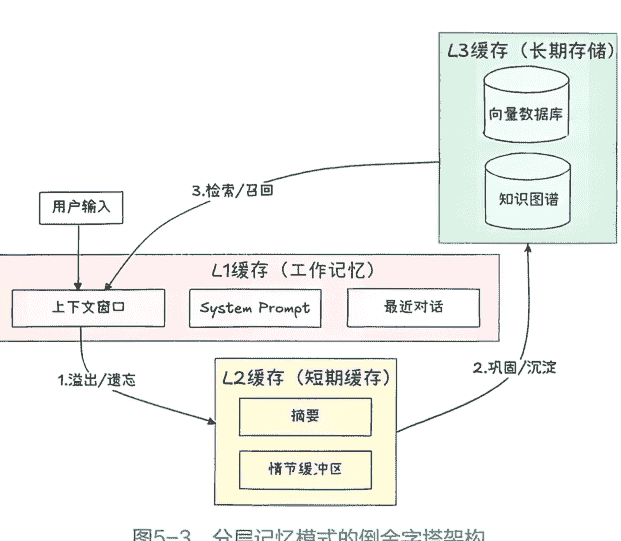

分层记忆模式的倒金字塔架构并未引入复杂的控制组件，而是通过 3 个存储层级和两种流转机制来管理信息的生命周期。

### 1. 存储层级

- L1 缓存（工作记忆）：类似于 Agent 的“大脑前额叶”，直接对应于模型的上下文窗口。它存储 System Prompt 和最近对话的活跃数据。其容量非常有限（8000~128 000 个 Token），访问速度最快，但维护成本极高且容易丢失。
- L2 缓存（短期缓存）：信息的“中转站”。当 L1 缓存的上下文窗口溢出时，非活跃的对话历史会被压缩为摘要，或存入情感缓冲区，暂留于此。作为 L1 缓存与 L3 缓存之间的缓冲层，它既能防止信息过早丢失，也能避免信息被过早写入 L3 缓存。
- L3 缓存（长期存储）：类似于 Agent 的“海马体”与“图书馆”，由向量数据库和知识图谱构成，负责持久化存储海量的非结构化文本和结构化实体关系。其容量近乎无限，但访问需要通过检索接口进行，延迟较高。

### 2. 流转机制

信息在存储层级间的流转机制如下。

- 溢出与巩固：随着用户输入的不断涌入，L1 缓存中的旧信息会被“挤出”。这些信息并非直接丢弃，而是经过摘要处理后进入 L2 缓存，或经过向量化沉淀至 L3 缓存。这是一个信息“由热变冷”的过程。
- 检索与唤醒：当 Agent 面对新问题时，会触发检索机制，从 L3 缓存中精准定位相关历史数据，并将其“捞回”，然后注入 L1 缓存。这是一个信息“由冷变热”的过程。


> 如何理解这里所说的“倒金字塔”？倒金字塔不是用图对架构的直观展示，而是描述“信息从多到少、从临时到持久的自然递减结构”。顶层（L1 缓存：工作记忆）是信息的源头，如同洪水汹涌而至，信息量巨大且未经筛选，是临时的、易变的。中层（L2 缓存：短期缓存）则像河道，对 L1 缓存中的漫流数据进行筛选和压缩，提取出精华部分。底层（L3 缓存：长期存储）则是水库，只有经过筛选和验证的重要信息才会沉淀到这里，形成持久的知识。

倒金字塔式分层记忆模式架构的本质是让信息沿着“从繁到简、由热转冷、由静返动”的路径流动。它将海量的对话和数据蒸馏为可用的知识，并在关键时刻让这些知识重新成为行动的力量。在这个过程中，Agent 不仅能够感知信息的流动和变化，获得时间感，还能保持自我连续性，通过动态调整其记忆架构来适应复杂多变的环境。

### 5.1.2 分层记忆核心机制

分层记忆模式的核心机制包括虚拟上下文管理和记忆生命周期管理。

### 1. 虚拟上下文管理

虚拟上下文管理是 MemGPT 提出的核心概念。通过此机制，Agent 可以模拟出拥有无限上下文的效果。实际上，系统在后台不断地进行“换页操作”，在保证小窗口推理效率的同时，实现对大量信息的高效管理和访问。

- 分页（Paging）：当上下文窗口（工作记忆）接近容量上限时，系统自动将最旧的信息移至外部存储（长期记忆），并在当前上下文中替换为一个引用链接，以便后续可以快速访问这些信息。
- 主动召回（Active Recall）：当 Agent 发现当前信息不足时（例如，用户提到“上次那个项目”），它会主动触发一个系统调用，例如 memory.search("上次那个项目")，将相关数据加载回上下文窗口。

### 2. 记忆生命周期管理

记忆不是简单的堆放，而是需要治理的过程。我们把记忆生命周期拆分为 4 个步骤。

第一步，编码（Encoding）：写入工作记忆。编码是记忆治理的起点，所有新输入的信息都会先写入工作记忆。系统会控制上下文窗口不被无效信息挤满，并对异常或关键事件进行即时标记。若输入信息涉及敏感内容，则在此步骤完成脱敏，以确保后续处理安全可控。

第二步，巩固（Consolidation）：移入长期记忆。当对话结束或上下文窗口接近容量上限时，系统会将仍具有价值的信息移入长期记忆。巩固不是简单的搬运，而是基于语义重要度对信息进行筛选、压缩，并保留必要的因果链条。同时，系统会去重，避免向量数据库被重复数据污染。

第三步，检索（Retrieval）：从“磁盘”读回“内存”。在推理过程中，如果当前上下文信息不足，系统会触发检索，将长期记忆读回工作记忆。检索过程中采用“语义 × 新鲜度 × 可信度”的多因子评估，避免召回幻觉内容。最终返回的不是模糊印象，而是可验证的“证据链”。

第四步，遗忘（Forgetting）：衰减与删除。长时间未访问或重要性下降的记忆会逐步衰减，并在必要时标记为软删除或彻底清除。系统还会将冗余信息压缩为更精炼的知识条目，以避免向量数据库无限膨胀。遗忘机制使记忆系统保持轻盈、高效、可治理。

表 5-1 所示的记忆治理涉及风险治理：只有将“多、乱、旧、私”的问题前置解决，才能为推理提供可靠的输入。

表 5-1 记忆治理

| 阶段 | 动作 | 触发条件 | 治理原则（新增） | 工程隐喻 |
| :--- | :--- | :--- | :--- | :--- |
| 编码 | 写入工作记忆 | 用户输入 | 信息脱敏、标记重要度、限制上下文窗口膨胀 | RAM 写入 |
| 巩固 | 移入长期记忆 | 对话结束 / 上下文窗口溢出 | 去重、压缩、结构化、保存因果链条 | 从缓存到磁盘 |
| 检索 | 加载到工作记忆 | 语义相关 / 缺页中断 | 语义 × 新鲜度 × 可信度排序；证据链化 | 缺页异常 |
| 遗忘 | 衰减 / 删除 | 时间、使用频率、合规要求 | 衰减曲线、软删除 / 彻底清除、容量治理 | 垃圾回收 |

### 5.1.3 分层记忆工程实践

随着 AI 应用规模的扩大，记忆成为“AI 应用基础设施”，并逐渐形成独立赛道，获得资金支持。记忆系统已演化出 3 种核心架构形态，分别解决不同的工程痛点。

### 1. 中间件模式：Mem0 与 MaaS

企业级应用面临的最大痛点是“数据孤岛”，例如，客服 Agent 无法知晓代码助手 Agent 已经了解到的用户偏好。Mem0 等框架正在定义“记忆中间件”的标准。它不仅是一个存储系统，更是一个动态编排层。它采用了混合检索架构，能够对非结构化的文本同时建立语义索引与图索引，并将两者结合使用。

Mem0 旨在把个体偏好、身份与事实整合为一个可查询、可更新、可治理的记忆层，服务于开发者，并形成开源生态。对架构师来说，这使得构建统一的“用户数字孪生”成为可能。通过多租户隔离（例如 User、Session、Agent 等作用域），不同业务线的 Agent 可以读写同一个共享记忆池，实现“一次交互，全域认知”。

以下是一个基于 MemGPT 风格的 Agent 实现示例。

```python
class MemoryAwareAgent:
    def __init__(self, llm, vector_db):
        self.context = ContextWindow(limit=8000) # 模拟有限的工作内存（RAM）
        self.long_term_mem = vector_db       # 模拟长期存储（磁盘）

    # 定义记忆操作工具：赋予 Agent 管理自身记忆的能力
    self.tools = [
        self.save_core_memory,  # “刻在脑子里”：保存用户画像（如姓名、偏好）
        self.search_archival,    # “翻阅日记”：检索历史对话记录
    ]

    def chat(self, user_input):
        # 1. 编码：将用户输入加入当前上下文（工作记忆）
        self.context.append(user_input)

        # 2. 思考循环：LLM 决定是直接回答还是调用记忆工具
        while True:
            # 向 LLM 提供当前上下文（包含可用工具说明）
            response = self.llm.generate(self.context)

            # 方案 A：Agent 决定写入核心记忆
            if response.is_tool_call("save_core_memory"):
                # 示例：用户说“我叫 Alice” → 调用 save_core_memory("Name: Alice")
                self.update_user_profile(response.args)
                self.context.append(SystemMsg("Memory updated."))

            # 方案 B：Agent 决定回忆过去
            elif response.is_tool_call("search_archival"):
                # 示例：用户问“还记得我吗” → 调用 search_archival("User info")
                results = self.long_term_mem.query(response.args)
                self.context.append(SystemMsg(f"Found historical info: {results}"))

            else:
                # 方案 C：普通回复，结束思考循环
                return response

        # 3. 后台维护：若上下文窗口接近容量上限，触发记忆压缩 / “换页”
        if self.context.is_full():
            self.consolidate_oldest_messages()
```

请注意，这里的 Agent 具备了“元认知”——它知道自己记忆有限，并主动管理它。记忆系统正在从 SDK（Software Development Kit，软件开发工具包）发展到框架，从云服务抽象层发展到平台能力。MaaS（Memory-as-a-Service，记忆即服务）有望成为未来重要的跨 Agent、跨应用的云端记忆基础设施。它将用户画像、长期偏好、行为模式、任务历史与意图模型统一封装为可调用服务，使不同 Agent 共享同一个“认知底座”。MaaS 可称为“云原生记忆”。

### 2. 检查点模式：LangGraph 的状态持久化

记忆不仅仅是历史对话文本的集合，更是系统的运行时堆栈。LangGraph 实现了检查点模式（Checkpoint Pattern），将 Agent 在每一步（Step）的状态快照序列化，并持久化到 PostgreSQL 或 MongoDB 中。图 5-4 展示了检查点模式与 HITL 交互的简明流程。

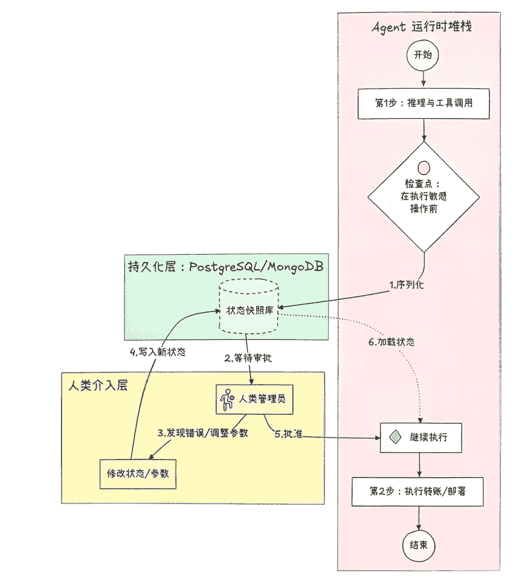

这种设计赋予了系统“时间旅行”的能力，这是企业级风控与调试的基石。在 Agent 执行敏感操作（例如转账、部署代码）之前，人类可以“暂停”系统，修改内存中的状态，然后批准“继续执行”。没有这种持久化状态管理，人类介入就无从谈起。

### 3. 协议化治理：MCP 作为“USB-C 标准”

随着工具和记忆源的爆炸式增长，点对点的 API 集成已不可持续。Anthropic 等机构倡导的 MCP 正在成为 Agent 互联的“USB-C 标准”。它采用 Client-Host-Server 拓扑结构，将“记忆”和“工具”标准化为可发现的资源。

> 这里出现了两个特别重要的概念：时间旅行，是指让系统可以回到任意一个历史状态；人类介入，是指让关键决策必须经过人类确认。前者保证可追溯，后者保证可控，这两种能力的结合，使得企业可以真正放心地使用 Agent。

无论后端是本地文件、Notion 还是 PostgreSQL，Agent 都可以通过统一的 read_resource 语义进行访问，从而完全解耦模型与存储后端。这为企业构建异构 Agent 生态提供了互操作性保障。例如，一个基于 OpenAI 模型构建的 Agent 可以无缝读取另一个基于 Claude 构建的 Agent 留下的记忆资源，而不需要重写 API。

在工程实践中，我们正在见证“记忆层”从应用逻辑中剥离，下沉为独立基础设施。

第一代记忆系统是无状态瞬时记忆：每次对话都视为一次新的对话（如 GPT-3 的 API）。

第二代记忆系统是滑动窗口记忆：仅保留最近 N 轮对话，丢弃旧的对话。这种设计简单但“健忘”。

第三代记忆系统是分层记忆，也是当前主流架构之一。热数据存储在上下文中，而冷数据存储在 VectorDB 中。以下应用是分层记忆的典型代表。

- ChatGPT Memory：用户可以说“记住我讨厌香菜”，系统会将其写入核心记忆。这是最简单的 Key-Value 记忆形式。
- Claude Projects：允许用户上传大量文档作为项目知识（Project Knowledge）。这是上下文缓存的典型应用，通过预加载静态知识来降低访问延迟。
- MemGPT：学术界的先驱，证明了通过操作系统风格的内存管理，可以让固定窗口的模型表现出类似无限上下文的能力。

第四代记忆系统将是神经符号记忆：结合向量检索（模糊匹配）和知识图谱（精确关系），实现更接近人类的联想记忆。

这一架构演进正如 20 年前数据库从单体应用中解耦一样，标志着 Agent 系统正走向成熟。

### 5.1.4 分层记忆模式的演化与组合

分层记忆模式从最初的滑动窗口，逐步演化为基于摘要的压缩存储，最终发展为类操作系统的虚拟内存管理。架构师的目标始终如一：在有限的上下文窗口这一物理约束下，模拟出近乎无限的记忆体验。

### 1. 演化路径：从金鱼到操作系统

- 滑动窗口（Sliding Window）：这可以视为记忆的“原始阶段”的代表。其机制是采用简单的 FIFO 原则，仅保留最近 N 轮对话，超出部分则被丢弃。其主要痛点在于“金鱼记忆”效应——一旦对话过长，早期的关键信息（如用户画像或 System Prompt 中的约束条件）便会彻底丢失。
- 摘要增强（Summary Enhancement）：引入了压缩机制，在丢弃旧对话前，调用 LLM 生成一段摘要并保留在上下文头部。这一模式缓解了遗忘问题，但会产生信息损耗（即有损压缩）——随着摘要被反复再摘要，原始细节逐渐失真。
- 虚拟上下文（Virtual Context）：借鉴了操作系统的分级存储与换页策略。其中，L1 缓存（类比 RAM）对应模型的上下文窗口，用于存放高频访问的“热数据”；L2 缓存（类比磁盘）则由向量数据库实现，用于持久化存储低频访问的“冷数据”。Agent 可通过系统调用主动管理自身记忆，自主决定何时写入、何时检索，从而实现更灵活、更高效的记忆控制。

### 2. 模式组合示例

分层记忆模式是 Agent 的“存储底座”，必须与感知模块、反思模块和协作模块紧密协同，共同构建数据闭环。

- 分层记忆模式与注意力聚焦模式（见 4.1 节）的组合 = 精准召回：分层记忆模块负责高召回率，确保相关信息不被遗漏；注意力聚焦模块负责高精度聚焦于最相关的内容。该组合适用于处理海量历史记录的查询场景。具体机制如下。
  - 分层记忆模块解决了“存哪里”的问题，提供了海量的候选数据（L3 缓存）。
  - 当 Agent 从 L3 缓存中检索出 100 条相关记录时，若直接注入上下文，不仅可能超出上下文窗口容量，还会引入大量噪声。
  - 此时需要调用注意力聚焦模块，对候选内容进行评分与压缩，从中提炼精华并注入工作记忆（L1 缓存）。
- 分层记忆模式与反思记忆模式（见 8.2 节）的组合 = 经验结晶：该组合将瞬时的思维火花提炼并固化为持久的语义记忆。具体机制如下。
  - 反思记忆模块负责在任务失败后生成“教训”。
  - 这些教训通过巩固机制被写入分层记忆模块的长期存储区（L3 缓存）。
  - 下次任务启动时，Agent 会自动检索相关教训，并将其加载至工作记忆（L1 缓存）中，以指导后续决策。
- 分层记忆模式与群体模式（见 9.4 节）的组合 = 集体潜意识：该组合打破了 Agent 之间的记忆隔离，构建了组织级的共享知识库，从而支持大规模 Agent 集群的协同工作。具体机制如下。
  - 单个 Agent 仅拥有短暂的工作记忆（L1 缓存）。
  - 所有 Agent 共享同一个长期存储（L3 缓存）。
  - 当 Agent A 将其解决方案写入 L3 缓存后，Agent B 在遇到相似问题时，可直接从 L3 缓存中检索并复用该方案。

分层记忆模式的成熟，标志着 Agent 从“无状态的函数”演化为“有历史的实体”。通过引入操作系统级别的内存管理理念，我们不仅突破了上下文窗口的物理限制，更为 Agent 的终身学习奠定了坚实的存储基础。

### 5.1.5 设计哲学：对抗遗忘

在传统的数据库设计中，遗忘被视为绝对的故障。
但在 Agent 设计中，遗忘是一种特征，甚至是智能的必要条件。
博尔赫斯在小说《博闻强记的富内斯》中描述了一个失去遗忘能力的人——他记得每一片树叶的每一次摆动，结果失去了思考的能力，因为“思考就是忘却差异，进行概括”。
同样地，如果一个 Agent 试图把所有历史都输入上下文，它将陷入注意力的沼泽。噪声会淹没信号，推理会变得迟钝。
分层记忆模式的本质，不是为了“记住更多”，而是为了“高效地遗忘”。
我们将无关的细节沉淀到底层（冷存储），只让最关键、最活跃的信息停留在意识的表层（热存储）。这种由热变冷、由表及里的流动，正是数字心智的新陈代谢。

## 5.2 RAG 模式

> “最强大的 AI 不是知道一切，而是知道如何找到一切。知识不再是静态的库存，而是动态的流。”
——RAG 论文①

传统的 LLM 像是一名参加闭卷考试的天才学生。他记忆力超群（参数记忆），但如果遇到没背过的冷门知识或刚发生的新闻，他只能胡乱编造（出现幻觉）。
RAG 模式像是让天才学生参加开卷考试（见图 5-5）。当遇到不懂的问题时，他可以翻阅参考书（检索），找到相关段落，然后结合自己的理解写出答案。
RAG 模式的核心意图在于：通过动态检索外部知识库，将相关信息实时传入 LLM 的上下文。这样，不需要重新训练模型，即可解决模型知识老化、长尾知识缺失以及幻觉问题。

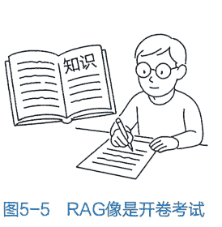

### 5.2.1 模式架构：检索与生成的交响

RAG 本质上是一个由检索器和生成器组成的“非对称架构”。

- 检索器（Retriever）：系统的“海马体”，负责高通量、低延迟的记忆召回。它通常基于 Bi-Encoder 架构（如 BERT），通过牺牲深度理解来换取更高的处理速度。
- 生成器（Generator）：系统的“前额叶”，负责逻辑推理和语言组织。它基于 Decoder 架构（如 GPT），虽然算力需求较高，但具备强大的推理能力。

图 5-6 展示了 RAG 系统的完整数据流：从知识的“消化”到“召回”，再到“生成”。

① LEWIS P, PEREZ E, PIKTUS A, et al. Retrieval-augmented generation for knowledge-intensive NLP tasks[EB/OL]. (2021-04-12)[2025-12-23]. https://arxiv.org/abs/2005.11401.

## 5.2.2 RAG核心机制

RAG 模式中的具体技术繁多，其核心机制包括索引、检索、重排序和生成。

1. 索引：把世界切片
模型无法处理整本书，只能处理片段（Chunk）。好的切片策略不仅要按字符切分，更要按语义切分。一个 Chunk 应该包含一个完整的知识点。
Anthropic 提出的上下文检索（Contextual Retrieval）技术指出，单独的 Chunk 容易丢失上下文（例如，Chunk 中仅保留了“它上涨了”，但无法确定“它”指代什么）。具体解决方法是，在索引阶段，通过模型为每个 Chunk 生成一段约 50 字的“上下文说明”，并将其拼接到 Chunk 的头部，然后进行向量化处理，即通过嵌入模型将文本转换为向量。

2. 检索：大海捞针
向量检索擅长处理模糊语义，但不擅长精确匹配（如精准查找产品型号“iPhone 15 Pro Max”）。而混合检索（Hybrid Search）是一种常见且更精确的策略：向量检索用于查找与语义相关的文本（如“苹果”和“水果”）；关键词检索用于查找精确匹配的文本（如“苹果”及其产品型号“iPhone 15 Pro”）。

3. 重排序：选择最佳
重排序的方式有很多，Cross-Encoder 是其中一种。它将用户查询和文档拼接在一起并输入 BERT，输出一个 0 到 1 的相关性分数。与向量检索（双塔模型）相比，Cross-Encoder 速度较慢，但它能捕捉用户查询和文档之间的细粒度交互，因此准确率更高。具体应用时，可以先使用向量检索进行粗筛（如筛选出 Top 100 上下文），再使用 Cross-Encoder 进行精排（如从 Top 100 上下文中筛选出 Top 5 上下文）。

4. 生成：基于已有资料的回答
RAG 的生成过程就是将检索到的内容注入 Prompt，此时的 Prompt 不再是简单的“请回答”，而是融合了具体上下文和针对性知识的信息载体。
以下示例展示了一个典型 Advanced RAG 的核心逻辑，其中包含查询改写和重排序这两个关键步骤。

```python
class AdvancedRAGAgent:
    def __init__(self, retriever, reranker, llm):
        self.retriever = retriever # 混合检索（Vector+BM25）
        self.reranker = reranker   # 重排序器（如 bge-reranker-v2，使用 Cross-Encoder）
        self.llm = llm

    def answer(self, user_query):
        # 1. 查询改写
        # 用户的问题往往是模糊的，需要改写为适合检索的形式
        # 例如，“那个最像人的模型” → “Anthropic Claude 3 Opus performance benchmarks”
        optimized_query = self.llm.rewrite(user_query)

        # 2. 混合检索
        # 使用优化后的查询进行检索，扩大召回范围到 Top 50
        candidates = self.retriever.search(optimized_query, k=50)

        # 3. 重排序
        # 使用 Cross-Encoder 进行精细打分，筛选出 Top 5 黄金上下文
        # 这一步显著提升了上下文窗口的信噪比
        top_docs = self.reranker.rank(query=user_query, docs=candidates, top_k=5)

        # 4. 上下文构建
        # 将 Top 5 上下文构建为上下文字符串，用于后续生成
        context_str = "\n".join([f"[{i+1}] {d.text}" for i, d in enumerate(top_docs)])

        # 5. 增强生成
        # 构建 Prompt，确保仅基于上下文回答问题，避免胡乱编造
        prompt = f"""
你是一位严谨的分析师。请仅基于以下参考资料回答问题。
如果资料里没有答案，请说“不知道”，严禁胡乱编造。
回答时必须标注引用来源编号，如 [1]。

资料：
{context_str}

问题：{user_query}
"""

        return self.llm.generate(prompt)
```

## 5.2.3 RAG工程实践

在工程实践中，RAG 的落地项目极为常见，几乎每个企业在 LLM 出现之后都开始考虑搭建自己的企业级知识库。以下是一些具有特色的相关产品和项目。

- Perplexity.ai 展示了 RAG 的一种先进形态。它将 RAG 从简单的“搜”和“答”管道，提升为包含“理解—多步搜索—阅读—综合”的复杂过程。它还通过引用来源，让用户能够追溯信息的出处，从而有效缓解用户对 AI “幻觉”的担忧。
- Glean 是企业级 RAG 的优秀代表。它解决了 RAG 在企业落地时的关键痛点——权限控制问题。Glean 在检索层严格执行数据权限过滤，从而确保数据安全。
- Microsoft 在 2024 年推出的 Graph RAG 是另一种突破性的 RAG 应用范式。传统的 RAG 擅长回答“局部”问题（如“A 的电话是多少”），但在回答“全局”问题（如“这批邮件主要讨论了哪些隐患”）时表现不佳。Graph RAG 通过 LLM 提取实体构建知识图谱，并通过图聚类生成摘要，让 RAG 拥有了“鸟瞰视角”。
- Self-RAG 和 Agentic RAG 等应用范式代表着 RAG 从被动进化为主动。在被动 RAG 中，无论问题多简单，每句话都需要查询数据库；而主动 RAG（如 Agentic RAG）则由 LLM 自行决定是否需要查询数据库。例如，遇到“你好”时直接回复；遇到“2024 年财报”时输出一个 `<Retrieval>` 标记以触发检索工具。它们甚至会反思检索结果：“查到的资料不足以回答这个问题，需要换个关键词再查一次。”这标志着 RAG 成为一个真正的 Agent，实现了从“查找”到“思考”的进化。

## 5.2.4 RAG模式的演化与组合

RAG 技术的发展历程，正是 AI 从“被动查阅”迈向“主动认知”的演化过程。在工程实践中，我们见证了它从最初的简单向量相似度匹配，逐步发展为高度优化的复杂流水线，最终深度融入 Agent 的认知循环，成为 Agentic RAG 的核心组件。

### 1. 演化路径：从索引到图谱

- 朴素检索（Naive RAG）：这可以视为 RAG 的“原始阶段”的代表。其机制为简单的“查询→向量检索→生成”。其主要痛点在于精度低、召回率差，面对复杂问题时，检索到的片段往往存在断章取义的情况，或因关键词不匹配而遗漏关键信息，最终导致“垃圾进，垃圾出”（Garbage In, Garbage Out）。
- 高级流水线（Advanced RAG）：引入了查询重写和重排序机制。通过 Cross-Encoder 对初步检索结果进行精细化排序，显著提升了信噪比，确保 LLM 接收到的均为高质量的“黄金上下文”。该架构已成为当前企业级知识库的标配。
- 结构化与主动化（Graph RAG/Agentic RAG）：Graph RAG 利用知识图谱建模文档间的语义关联，擅长解决全局性任务（如“总结整个知识库的主题”）；Agentic RAG 则将检索视为 Agent 可调用的工具，由 Agent 自主决定何时检索、索、检索什么，并能评估检索结果是否满足需求。这一设计标志着 RAG 从“局部片段检索”迈向“全局知识理解”的关键跨越。

### 2. 模式组合示例

RAG 不再是一个独立的处理管道，而是正在演变为 Agent 大脑中的“海马体”，与感知、推理、记忆等其他认知模块深度协同工作。

- RAG 模式与思维链模式（见 6.1 节）的组合 = 检索增强思维：该组合将一次性的大规模检索拆解为一系列微检索，在推理的每一步动态引入外部知识，持续校准内部逻辑，有效抑制知识性幻觉。该组合适用于需要多跳推理的复杂问答场景（如问“马斯克收购 Twitter 时的股价是多少”）。具体机制如下。
  - 传统 RAG：采用“先检索，再推理”的模式。
  - 检索增强思维：在思维链的每一步都嵌入检索：第 1 步，推理出“需要先查询马斯克收购 Twitter 的日期”→执行检索；第 2 步，基于结果推理“需要查询该日期 Twitter 的股价”→再次执行检索……

- RAG 模式与主动感知模式（见 4.3 节）的组合 = 自我修正检索：该组合将检索从“硬编码的固定流程”升级为“按需调用的认知能力”，赋予 Agent 拒绝回答或主动求知的主体性。具体机制如下。
  - 不再被动执行“每问必查”。
  - 主动感知模块实时评估当前信息的不确定性或置信度。
  - 如果置信度低，则主动触发检索工具；如果检索结果不相关或不足以支持回答，则触发反思模块，重新生成更精准的查询并再次检索。

- RAG 模式与分层记忆模式（见 5.1 节）的组合 = 语义长期记忆：RAG 模块为分层记忆模块提供了非结构化知识的存储介质（如向量数据库）和标准化访问协议（基于嵌入的检索）。具体机制如下。
  - 分层记忆模块定义了记忆的整体架构，包括 L1 缓存、L2 缓存和 L3 缓存。
  - RAG 作为 L3 长期存储中处理非结构化文档（如 PDF、Wiki 页面等）的核心实现技术，负责将外部知识高效地存入并按需检索，使 Agent 能够持久化并复用语义信息。

RAG 不仅是外挂知识库，更是 Agent 实时连接世界的“认知脐带”。外部知识不再仅仅是 Prompt 的填充物，而是驱动推理过程的核心燃料。未来的 RAG 将模糊“参数化记忆”与“外部存储”的边界，二者将在 Agent 的统一认知架构中深度融合，实现真正的“知行合一”——让模型拥有一个持续演进、随时更新的世界观。

### 5.2.5 设计哲学：知识的解耦

RAG 模式最深刻的洞见在于：将“推理能力”与“知识存储”解耦。

- 模型（类似于计算机系统中的 CPU）：负责推理、逻辑、语言组织等功能，可以不断升级（如从 GPT-3 到 GPT-4，再到 GPT-5）。
- 知识库（类似于计算机系统中的磁盘）：负责存储事实、数据、细节等内容，需要实时更新（包括添加、更新、删除操作）。
这种解耦使得我们能够以极低的成本保持系统的时效性和专业性，而不需要每次都重新训练昂贵的 LLM。这正是 AI 从“实验室玩具”走向“工程化落地”的基石。

## 5.3 情节记忆模式

> “经验不是发生在你身上的事，而是你对发生的事做了什么。”
——奥尔德斯·赫胥黎（Aldous Huxley）

如果说 RAG 是 Agent 的百科全书（存储静态事实），那么情节记忆是 Agent 的“飞机黑匣子”（记录经验轨迹），如图 5-7 所示。
但仅仅“记录”是不够的。一个高级的 Agent 架构必须包含一个“夜间模拟器”。就像自动驾驶系统利用白天的高风险接管数据进行离线训练一样，Agent 需要在空闲时间通过反事实推理（如问自己“当时如果换一种参数会怎样”）将一次性的经历转化为可复用的策略。
每一次任务执行，无论成功还是失败，都是一次宝贵的“情节”。


- 新手 Agent 每次遇到 bug 都像初次见面，毫无经验可循。
- 资深 Agent 则会检索“黑匣子”，发出感叹：“啊，这个 bug 上周见过，当时是因为 API 超时，重试 3 次就解决了。”

情节记忆模式的核心意图是构建一个闭环系统，捕获带有时空上下文的交互轨迹。通过压缩、泛化和双键检索，该系统将非结构化的日志转化为结构化的技能。这使得 Agent 能够从自身的成功中提取技能，从失败中吸取教训，实现“越用越聪明”。

### 5.3.1 模式架构：经验的炼金术

数据如何在系统中流转，从原始的“日志”变成高价值的“技能”呢？
情节记忆系统本质上是一个 ETL（Extract-Transform-Load，抽取—转换—加载）管道。它不能直接将所有交互都传入向量数据库（那样不仅慢，而且包含大量噪声），而必须包含一个“提炼”（也称为“蒸馏”）过程。
图 5-8 展示了情节记忆模式架构，其中关键组件说明如下。

- 构建情节（Construct Episode）：位于记忆层的入口，是系统的“剪辑师”。它负责接收执行层产生的原始数据，将冗长的 API 日志切分为语义完整的片段，并将离散的交互步骤整合为一个连贯的情节。在此过程中，它会剔除 `ls`、`pwd` 等无意义的探索性操作，仅保留引发关键状态变化的步骤。
- 提炼成功（Extract Success）：位于学习层，充当“泛化器”的角色。它负责处理高价值的成功案例，对其进行去语境化（De-contextualization），将其转化为可复用的通用技能，从而将一次性经验升华为普适性能力。
  - 输入（情节）：例如，“我在 /tmp/logs/ 目录下删除了 error.log 文件。”
  - 输出（技能）：例如，“当磁盘空间不足时，可优先清理 *.log 文件。”
- 技能库（Skill Library）：位于学习层底部，是系统的“精华仓库”，用于存储由泛化器提取并经验证的可执行代码或思维链模板。如图 5-8 中虚线所示，当新任务进入系统时，会优先从技能库中检索已有解决方案，从而实现能力的复用与增强。

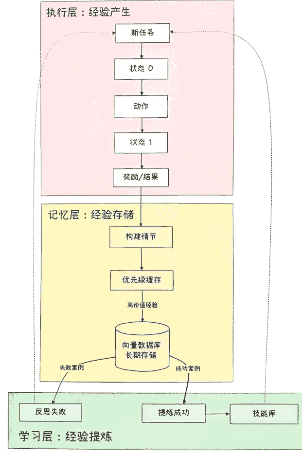

### 5.3.2 情节记忆核心机制

支撑情节记忆模式架构的关键算法机制有 3 种，分别解决“存什么”“怎么查”和“怎么学”的问题。

#### 1. 轨迹压缩与分层摘要

为了防止记忆库膨胀导致的性能下降和检索噪声，引入了轨迹压缩（Trajectory Compression）技术。原始轨迹往往包含数千个 Token（如报错堆栈、HTML 源码），直接存入会导致检索成本急剧上升。

关键帧提取：只存储决策点（Decision Point）和结果点（Result Point）。
分层摘要如下。

- L0（Raw）：完成 HTTP 请求体。
- L1（Action）：调用 GitHub API。
- L2（Intent）：修复登录模块的 bug。

检索时先查询 L2，命中后再展开 L1。

#### 2. 双键检索策略

当面对新任务时，Agent 如何利用旧经验呢？为了提高检索的准确性，可以采用双键检索策略。

语义检索负责寻找目标相似的任务，而结构检索负责寻找报错相似的轨迹。
传统的 RAG 只检索“问题”。但在 Agent 场景下，环境状态同样重要。

- 目标相似性（Goal Similarity）：我想做的事，以前做过吗？（如“写贪吃蛇”与“写俄罗斯方块”。）
- 状态相似性（State Similarity）：现在的报错，以前见过吗？（如“Error: 404”与“Error: 408”。）

通过结合目标相似性和状态相似性，计算综合相似度，可以确定最相关的经验。具体公式如下。

综合相似度 = α × 目标相似性 + β × 状态相似性

#### 3. 经验参数化

如何让 Agent 学会“举一反三”？可通过识别变量并形成情节来实现。
一个标准的情节包含以下要素。

- Goal（目标）：我想做什么？（如“写一个贪吃蛇游戏”。）
- Trajectory（轨迹）：我做了什么？（例如，序列为 [思考，写代码，报错，修改代码，成功]。）
- Outcome（结果）：结果如何？（如 Success 或 Fail。）
- Reflection（反思）：我学到了什么？（例如，“Pygame 的 init 函数必须在最开始调用”。）

为了实现技能迁移，我们利用了参数化机制。

- Instance（实例）：如 `delete_file("report_2023.txt")`。
- Abstract（抽象）：如 `delete_file(filename)`。
- Constraint（约束）：如 `if file.exists() and not file.is_system_file()`。

Agent 通过对比多个相似的情节，找出不变的逻辑和变化的参数，从而生成通用函数。
Agent 通过压缩降低了存储成本，通过双键检索提高了上下文相关性，通过参数化实现了技能迁移。

### 5.3.3 情节记忆工程实践

Voyager（2023 年）是情节记忆模式的应用典范，体现了代码即策略（Code as Policy）的理念。Voyager 不仅能玩游戏，还会维护一个持续扩充的技能库文件 skill_library.js。例如，它会将“砍树”“合成木板”等操作封装为函数并存入技能库。在面对新任务时，它首先查询技能库中是否存在可用函数（如 combatZombie）；在执行“建造房屋”等复杂任务时，它能自动调用多个已有函数协同完成。如果技能库中没有合适的函数，它会生成新函数，经验证有效后将其加入技能库。

Devin（Cognition AI，2024）声称能够从以往的 bug 修复记录中学习，从而在下次遇到类似错误时更快地定位并解决问题。

Cline 引入了检查点机制。在执行复杂编程任务时，它能够保存当前上下文的快照；如果后续操作失败，便可回滚至某一记忆中的检查点。这一机制将情节记忆模式应用于工程容错，实质上是将“记忆”用作“存档”。

DeepMind 的 SIMA（Scalable Instructable Multiworld Agent）能够在多种不同的 3D 游戏环境中执行任务。它表明，情节记忆（如“如何开门”或“如何寻找资源”）可以在遵循不同物理法则（即基于不同游戏引擎）的环境中实现迁移。这标志着跨域泛化能力取得重大进展。

从简单的日志记录到结构化的技能库，再到跨环境的泛化，情节记忆模式正在推动 Agent 从“无状态的脚本”进化为“有经验的专家”——将经验转化为可执行的代码。Agent 越用越强，正是因为其经验不断积累并结构化复用。

### 5.3.4 情节记忆模式的演化与组合

情节记忆并非简单的日志堆砌，而是从原始的文本流逐步演化而来的：首先形成可检索的语义快照，最终升华为可执行的技能库。

**1. 演化路径：从日志到技能**

- 流水账日志（Raw Log Stream）：这是记忆的“原始时代”的代表。系统如同服务器日志一样，按照时间顺序记录“用户：…… Agent：……”等内容。其主要痛点在于缺乏有效的检索能力——随着对话的不断延长，关键信息被大量噪声所淹没，导致 Agent 陷入“灾难性遗忘”的困境。
- 语义快照（Semantic Snapshots）：随着向量数据库的引入，记忆进入了“检索时代”。系统将关键的交互节点（如状态—动作对）进行向量化存储，从而具备了“似曾相识”的能力。例如，Agent 可以回答：“上次遇到这个错误（Error 404）时，我是这么解决的。”
- 技能泛化（Skill Generalization）：这是记忆的“智能时代”的代表。在机制上，系统不仅存储行为轨迹，更进一步提炼并保存为代码或规则。每当 Agent 成功完成一项任务时，便会将该轨迹抽象为可复用的函数或标准作业程序。此时，记忆已转化为工具，Agent 的能力库由此实现自主生长。

**2. 模式组合示例**

情节记忆模块是 Agent 的“经验池”，唯有与推理模块、行动模块和反思模块深度协同工作，才能释放其复利效应。

- 情节记忆模式与 RAG 模式（见 5.2 节）的组合 = 完整的长期记忆体系：世界知识设定了理论下限，个体经验则决定了实践上限。二者协同，共同构成了 Agent 完整的长期记忆能力。具体机制如下。
  - RAG 模块提供“读万卷书”的能力：注入世界知识（如 Python 语法文档、法律条文等）。
  - 情节记忆模块提供“行万里路”的能力：积累个体经验，例如，“这个库在 Windows 平台上兼容性不佳”“上次客户更偏好这种语气”等。
- 情节记忆模式与 ReAct 模式（见 7.1 节）的组合 = 具身先验：该组合构建了 PMR（感知—记忆—推理）的核心认知回路，将过往的后验经验转化为当前决策的先验知识。具体机制如下。
  - 感知→记忆：将“世界的来访”结构化入库，记录来源、时间、模态等元信息。
  - 记忆→推理：在 ReAct 模块的思考阶段，以工作记忆与检索到的情节片段共同作为推理起点。若发现以前尝试某动作曾导致失败，便直接规避该陷阱。
  - 推理→记忆：对推理得出的结论或反思进行蒸馏，并写入长期记忆。
- 情节记忆模式与反思记忆模式（见 8.2 节）的组合 = 闭环成长：如果说反思记忆是 Agent 的“消化系统”，情节记忆便是其“肌肉组织”。唯有存储下来的反思结果，才能转化为肌肉记忆，并在下一次任务中被即时调用。具体机制如下。
  - 反思记忆模块负责“生产”：聚焦于反思过程，在失败后生成语言化的教训。
  - 情节记忆模块负责“存储”：聚焦于反思结果，将这些教训持久化并建立索引，以备后续调用。

在情节记忆模式中，架构师的目标是将 Agent 的每一次交互都转化为下一次成功的垫脚石，将线性流逝的时间转化为指数增长的经验资产。

### 5.3.5 设计哲学：做时间的朋友

没有情节记忆的 Agent，永远困在“土拨鼠之日”（Groundhog Day）——无论成功多少次，次日醒来，仍是新手。
没有记忆的推理是无根之木，未经蒸馏的记忆则是无形之水。
情节记忆模式赋予了 Agent “时间感”，使其能力随时间推移实现线性乃至指数级的增长。
它证明了一个关键命题：比算力更重要的是经历。

### 小结 平台与协议的一等组件

至此，我们完成了 Agent 架构的第二块拼图——记忆。
记忆正在从“Prompt 的附件”转变为平台与协议的重要组件。
记忆模式的核心在于上下文工程。

现代“上下文工程”的共识是：不仅要精心设计 Prompt，更要主动经营上下文——将有限的上下文预算精准投向“最具价值的信息与结构”。这已成为面向 Agent 系统的核心工程课题。

本章介绍的 3 个模式构成了现代“上下文工程”的主体。

- 分层记忆模式构建了 Agent 的“操作系统”，统筹管理短期与长期信息的流动。
- RAG 模式构建了 Agent 的“图书馆”，接入外部世界的静态知识。
- 情节记忆模式构建了 Agent 的“日记本”，沉淀 Agent 自身交互中产生的动态经验。

从工程的视角来看，未来 Agent 记忆系统的发展可以归纳为三大类，共 5 种机制。

- 短期机制：用于维持当前任务的连续性。
  - 历史缓冲：保留最近 N 轮对话记录，并通过“摘要生成、重要性采样和时间衰减”策略蒸馏出关键上下文信息。
- 长期机制：用于构建知识库与经验库。
  - 语义检索：对文本及多模态片段进行向量化，并基于语义相似性进行近邻召回，已成为构建长期知识库的工业主流方法。
  - 情节记忆：将单次任务、对话、工具链执行过程封装为“可重播情节”，是实现 Agent 长期行为一致性和经验复用的关键能力。
- 策略机制：用于提升组织级智能。
  - 程序/策略记忆：将成功经验提炼为流程草图或策略模板，使 Agent 能够“依样执行”，而非“从头推理”。
  - 跨体共享记忆：基于 MCP 和 A2A 协议，实现多 Agent 间安全、可控的记忆共享，正逐步成为云端智能基础设施的重要组成部分。

从上下文工程到 MaaS 的跃迁，标志着记忆正从“策略层面的技巧”升级为“智能时代的核心基础设施”。

当 Agent 既能感知世界，又能记住世界时，便具备了“思考”所需的基础素材。接下来，它将如何利用这些素材进行复杂的逻辑推演呢？
请翻开第 6 章，我们一起探索推理模式。

# 第 6 章

## 推理模式

> “思想无内容则空，直观无概念则盲。”
> ——伊曼努尔·康德（Immanuel Kant），《纯粹理性批判》

记忆模式为 Agent 提供了知识的“库存”，推理模式则为其配备了加工这些知识的“逻辑引擎”：记忆解决“知道什么”的问题，而推理解决“如何运用”的问题。
在《思考，快与慢》一书中，诺贝尔经济学奖得主、心理学家丹尼尔·卡尼曼（Daniel Kahneman）将人类的推理（思维）划分为两个系统——System 1（快速、直觉、依赖启发式）与 System 2（缓慢、刻意、依赖反思式），如图 6-1 所示。在面对复杂判断或强约束任务时，人们更倾向于依赖 System 2 所代表的“慢思考”；而在熟悉领域或低风险情境中，System 1 的直觉则能提供快速且稳健的反应。

Agent 的推理同样需要“自动”和“刻意”两种模式，并可根据任务需求与计算成本在两者之间动态切换。相关实验与综述表明，在复杂逻辑任务中，若强行采取快速或贪婪策略进行求解，容易产生系统性偏差和过度自信。此时，需要启用“刻意”模式，显式地组织中间推理步骤并核查证据链，从而提升推理的准确性与可靠性。
双系统理论为我们提供了一条重要线索：推理并非单一路径，而是由多种机制协同驱动的多层结构——绝不能简单地将“Prompt 链”视为唯一的逻辑通道。在人类认知中，这种协同最早体现在 3 种基本推理范式——演绎（Deduction）、归纳（Induction）与类比（Analogy）上，如图 6-2 所示。

- 演绎：从一般规则推导出具体结论，逻辑严密、保证性强，适用于具有明确约束和形式化规则的领域。
- 归纳：从多个具体实例中抽象出一般性规律，适用于知识扩展、模式发现与经验总结。
- 类比：通过结构映射“以已知推未知”，在处理抽象或新颖问题时展现出强大的推理能力，是人类发挥创造性思维的重要手段。

现代认知科学进一步指出，推理并非“先想完再行动”，而是一个持续预测、试探与校正的闭环过程。在这个循环中，大脑不断生成假设、发起行动、收集误差，并据此修正其对世界的内部模型。行动不仅是推理的结果，更是一种重要的检验手段。

同理，Agent 的推理也应处于其行为回路的中枢位置，使其既能向前推进（如规划与工具调用），又能向后修正（如模型自更新与信念调整）。

为了让这一闭环得以工程化，我们将推理抽象为以下 3 个层次。

- 结构层：提供“思维的容器”，显式刻画任务中的变量、假设、证据及其相互关系。
- 流程层：组织推理过程，涵盖从假设生成、多路径推演到候选方案评估的完整链条。
- 反思层：承担元推理职能，通过自检、自评与替代路径分析，提升推理的鲁棒性与适应性。

正是基于这 3 层结构，不同的推理模式得以具象化。根据任务的歧义程度、探索深度与约束条件，推理可呈现为 4 种典型模式：链式、树式、图式与类比式（见图 6-3），它们各自适用于回答不同类型的问题。

- 当问题清晰且路径明确时，采用链式推理（思维链模式，见 6.1 节），沿单一路径逐步推进直至得出解答。
- 当存在多个可行分支或需要权衡多种可能性时，采用树式推理（思维树模式，见 6.2 节），系统地探索不同路径并评估其结果。
- 当变量间依赖关系复杂、存在循环或非线性交互时，采用图式推理（思维图模式，见 6.3 节），以图结构显式建模要素间的关联。
- 当问题新颖、数据稀缺或缺乏先验规则时，采用类比式推理（类比推理模式，见 6.4 节）往往成为关键突破口，通过映射已知情境的结构来启发对未知问题的理解。

接下来，我们将依次介绍这 4 种典型推理模式，并分别说明它们在 Agent 系统中的适用场景、结构特征与工程化要点。

## 6.1 思维链模式

> “思维链是 LLM 的 ‘草稿纸’。”
> ——魏杰森（Jason Wei），思维链论文作者

在数学考试中，老师总是强调：“不仅要写出答案，还要写出证明过程。” 这是因为直接跳到答案容易出错，而逐步推导能确保证据链的完整性与推理的可验证性。
传统的 LLM 推理更像一个依赖直觉的考生，试图通过概率直接 “猜出” 答案。这种方式在诗歌创作或闲聊等宽松、开放的任务中表现良好，但在处理数学、逻辑或代码等需要严谨推理的问题时，往往缺乏足够的计算深度和中间步骤，导致 “灾难性遗忘” 或逻辑断裂。
思维链模式的本质在于，强制要求 Agent 在给出最终结论之前，显式地生成一系列中间推理步骤。它将原本需要 “高智商” 才能一步解决的复杂问题，拆解为多个仅需要 “普通智商” 即可处理的简单原子步骤，从而实现 “以时间（计算量）换智能” 的效果。
思维链模式的核心意图是借助显式的过程分解，将计算压力分散到更长的推理时序上，从而提升推理的准确性、可解释性和鲁棒性。

### 6.1.1 模式架构：线性的魔力

从架构的视角来看，思维链模式将原本黑盒式的直接映射（输入→输出）重构为一条清晰的顺序处理管道（见图 6-4）。这种线性结构不仅有助于降低复杂问题的处理难度，同时也为系统提供了关键的中间状态。这些中间步骤使得整个推理过程变得可观测、可拦截和可调试，从而极大地增强了系统的透明度和可控性。

图 6-4 所示架构中关键组件说明如下。

- 引导机制（Guide Mechanism）：是启动思维链的“钥匙”，负责将简单输入转化为结构化的推理模式。它既可通过注入“让我们一步步思考”等显式的 Prompt，引导模型进入问题拆解路径，也可通过微调实现隐式引导，自动激活深度思考能力。
- 推理缓冲区（Reasoning Buffer）：相当于 Agent 的“工作内存”。它并不直接生成最终结论，而是依次执行以下步骤：步骤 1（问题拆解）→步骤 2（中间计算）→步骤 3（逻辑推演）。这些中间步骤所产生的 Token 构成了后续推理的上下文基础。
- 逻辑自检（Logical Self-Check）：是推理结束后的“质量关卡”，用于验证推理链条的连贯性与合理性。只有通过自检的推理路径，才会进入下一步的答案提取；否则将触发重试或修正机制（尽管图 6-4 中简化了失败路径，但逻辑上已隐含这一判断）。
- 答案提取器（Answer Extractor）：负责将“思考过程”与“最终结论”分离。它利用特殊终止符（如  标签）识别推理边界，剔除冗长的思维链，仅将清洗后的最终结论返回给用户。

图 6-5 展示了一个基于 Qwen3-8B 的微调项目结果：当经过思维链数据训练的“可思考”模型激活思考模式后，其输出中将包含详细的思维过程。

### 6.1.2 思维链核心机制

思维链模式之所以能显著增强推理能力，并非魔法，而是基于以下 3 个维度的底层重构。

**1. 概率的重新分配**
从数学的角度来看，直接预测答案可以表示为计算条件概率 $P(Answer|Question)$。对于复杂问题，这一概率分布往往较为扁平且充满噪声，导致模型难以准确预测正确答案。而思维链模式通过引入中间推理步骤作为上下文，将问题转换为计算 $P(Answer|Question, step1, step2, \dots)$。这种条件化过程显著收敛了最终答案的概率空间，使模型从“猜答案”转变为“推答案”，从而提高了推理的准确性和可靠性。

**2. 显式分解**
在单次前向传播（Forward Propagation）中，LLM 往往难以同时处理多重逻辑冲突（例如，同时进行加法和减法运算）。思维链模式遵循从简到繁（Least-to-Most）的原则，将复杂问题序列化为一系列原子步骤（见图 6-6）。这种“降维”策略确保了模型在每一步仅需要处理一个简单的逻辑运算，从而避免了逻辑拥堵。

**3. 自我校准**
当模型将推理步骤显式地呈现出来时，实际上是借助其注意力机制“回看”上一步的输出。这一过程构建了一种微型的短期记忆回路，有助于抑制幻觉的累积。

以下示例展示了一个生产级思维链封装器的核心逻辑，其中采用 XML 标签以提升解析的鲁棒性。

```python
import re

class ChainOfThoughtAgent:
    def __init__(self, llm):
        self.llm = llm
        # 2025 年最佳实践：使用 XML 标签包裹思维链，以提升机器解析的鲁棒性
        self.system_prompt = """
        You are a rigorous reasoning engine.
        When solving problems, you must enclose your reasoning process within <thinking> tags.
        And place your final conclusion within <answer> tags.
        """

    def reason(self, question):
        # 1. 构建 Prompt
        messages = [
            {"role": "system", "content": self.system_prompt},
            {"role": "user", "content": question}
        ]

        # 2. 获取模型生成的原始响应（可扩展为流式处理）
        raw_response = self.llm.generate(messages)

        # 3. 结构化解析响应内容
        # 相较于简单正则匹配，此处可进一步扩展为流式解析器，以支持实时展示
        # 推理过程
        thinking_content = self._extract_tag(raw_response, "thinking")
        final_answer = self._extract_tag(raw_response, "answer")

        # 降维策略：如果模型未按照指定格式输出，则回退至原始响应
        if not final_answer:
            final_answer = raw_response

        return {
            "q": question,
            "chain_of_thought": thinking_content, # 可用于前端展示 “Thinking……” 过程
            "result": final_answer
        }

    def _extract_tag(self, text, tag):
        """ 从文本中提取指定 XML 标签内的内容 """
        pattern = f"<{tag}>(.*?)</{tag}>"
        match = re.search(pattern, text, re.DOTALL)
        return match.group(1).strip() if match else None
```

这个基于 Python 的思维链封装器展示了如何结构化解析推理过程，便于后续审计或可视化展示。

### 6.1.3 思维链工程实践

思维链模式的发展历程，正是模型从“鹦鹉学舌”迈向“逻辑推理”的进化历程。我们所做的，远不止在 Prompt 里简单添加一句话，而是致力于构建一个结构化的推理管道。

在工程实践中，思维链模式经历了 4 个明显的代际演进。

**1. 启蒙时代：作为“魔法咒语”的思维链（2022年）**

始于 Google Brain 的 Jason Wei 等人发表的开创性论文“Chain-of-Thought Prompting Elicits Reasoning in Large Language Models”，研究者们惊讶地发现：仅在 Prompt 中加入若干带有中间推理步骤的示例（即 Few-Shot Prompting），LLM 在数学和逻辑任务上的表现便显著提升。随后，Kojima 等人进一步揭示，即使不提供示例，仅凭一句简单的指令——“让我们一步步思考”（即 Zero-Shot CoT），也能引导模型自发生成结构化的推理过程，展现出初步的逻辑能力。这一阶段的思维链如同“魔法咒语”，虽然其机制尚未完全明晰，但已显现出强大的启发效果。

这一时期的思维链工程实践主要聚焦于提示工程（Prompt Engineering）。例如，LangChain 等框架封装了大量思维链模板，实现了“让我们一步步思考”等模式的产品化、模块化。工程师们不再仅仅编写指令，而是在精心设计“思维诱导”——通过特定的输入结构引导模型激活其潜在的推理能力。在这一阶段，思维链被广泛视为一种“在不改变模型参数的前提下，以额外输入 Token 为代价，换取显著智能提升”的低成本、高效益策略。

**2. 黑盒巅峰：OpenAI o1/o3与“测试时计算”（2024年）**

OpenAI o1（Project Strawberry）的发布，标志着思维链从一种“用户侧的提示技巧”正式演变为“模型内在的推理本能”。o1 不再依赖用户显式提示“让我们一步步思考”，而是在生成最终答案前，强制执行一段对用户不可见的隐式推理过程。这不仅将思维链从 Prompt 内化到模型内部，更意味着训练目标的根本改变：模型不再仅以预测下一个词为优化目标，而是通过强化学习（Reinforcement Learning, RL）直接优化其推理过程的质量与正确性。

o1 的出现验证了一个称为测试时计算（Test-Time Compute，也译作推理时计算）的新规模定律（Scaling Law）：即使模型参数量不变，仅通过增加推理阶段的计算资源——让模型“思考”得更久（生成更多推理 Token），其性能也能持续提升。这表明，推理侧的算力可以在一定程度上转化为智能水平的提升。

对架构师而言，这意味着 API 调用不再局限于毫秒级的请求—响应模式，而是可能演变为持续数十秒的异步任务。我们需要设计长连接、状态轮询机制，以及思维过程的流式输出，以适配这类“慢思考”模型。

**3. 开源突围：DeepSeek-R1与纯强化学习的胜利（2025年）**

如果说 o1 是一个封闭的黑盒，那么 DeepSeek-R1 则向世界展示了“思考是如何涌现的”。

DeepSeek-R1 证明，不需要依赖大规模人类标注数据（如监督微调模型），仅通过纯强化学习和 GRPO（Group Relative Policy Optimization，群体相对策略优化）算法，模型便能自发涌现出思维链能力。

顿悟时刻（Aha Moment）：在 DeepSeek-R1 的训练日志中，我们观察到一个令人震撼的现象——模型自发学会了自我反思（如 “Wait, let me check...”）、回溯验证和长程规划。这些能力并非由人类显式教授，而是在追求最终奖励（即正确解答数学题）的过程中被“逼”出来的。

蒸馏（Distillation）：DeepSeek-R1 的另一项工程贡献在于证明了“大型模型的思考过程可以有效教导小型模型”。通过将 DeepSeek-R1 生成的长思维链数据用于训练较小的模型（如 7B/14B 版本），这些小型模型也能获得显著的推理能力（见图 6-7）。这使得思维链技术真正迈入端侧设备和低成本应用场景，极大地拓展了其应用范围。

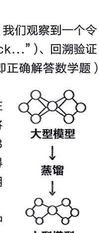

此时，模型通过冷启动结合强化学习训练，已将思维链内化为一种“本能”。用户不需要手动编写 Prompt，模型会自动在内部生成隐式的思维链。

**4. 垂直落地：Agentic Coding（Devin和Cursor）**

在应用层，思维链已经成为编码 Agent 的核心引擎。

- 以 Devin 和 Cognition AI 为例，当编码 Agent 处理一个 GitHub Issue 时，并非直接生成代码，而是首先构建一个详尽的执行计划（即思维链）。例如，阅读文档→定位相关代码→编写测试用例→修改业务逻辑→运行测试验证。
- 在 Cursor 和 Claude Code 内部，编码 Agent 引入了影子工作区（Shadow Workspace）的概念。在用户无感知的情况下，模型会在后台持续进行快速的思维链推理。例如，预测用户下一步的代码修改、预检潜在的 Lint 错误等。

此时，思维链已不再仅仅是文本生成，而是演变为一种“伪代码执行”：每一步推理都对应着对文件系统或编译器的真实操作。

对未来的工程师而言，理解思维链不仅意味着要掌握如何编写 Prompt，更在于深刻理解算力在“训练”和“推理”之间的分配逻辑。在系统设计中，工程师必须做出权衡：是追求极致的响应速度（System 1 式直觉），还是接受更长的延迟以换取严密、深思熟虑的推理能力（System 2 式思考）？

答案往往取决于具体的业务场景。

### 6.1.4 思维链模式的演化与组合

思维链是模型推理能力的基石。它从最初的“咒语式提示”逐步演进为基于示例的规范推理，最终内化为模型底层的 System 2 式思考模式。

**1. 演化路径：从咒语到本能**

- 零样本思维链（Zero-shot CoT/ 咒语式提示）：通过简单的 Prompt（例如 “Let’s think step by step”）激发模型的推理潜能。尽管其实现成本较低，但主要痛点在于可控性差——推理路径容易偏离，常出现“逻辑看似正确但计算错误”的问题。
- 少样本思维链（Few-shot CoT/示例规范）：开发者在 Prompt 中手动编写高质量的 < 问题，推理步骤，答案 > 示例。这一设计的核心价值在于推理过程的规范化，通过示例引导模型掌握特定的推理格式（如“先列公式，再代入计算”）。这一模式在 RAG 系统中被广泛采用。
- 原生/内化思维链（Native/Internalized CoT）：DeepSeek-R1 通过强化学习，将思维链内化为模型的本能反应。用户不需要任何 Prompt，模型便会在输出前自动生成隐式的思维令牌。这标志着推理能力已不再是提示工程的产物，而是成为模型规模扩展的核心维度之一。

**2. 模式组合示例**

思维链通常作为 Agent 的“逻辑主板”，需要挂载其他组件以增强其鲁棒性与知识广度。

- 思维链模式与自我修正模式（见 8.1 节）的组合 = 过程监督：将质量控制的粒度从“结果”细化到“推理过程”，显著提升了长链条推理的成功率。该组合适用于高精度的数学或逻辑场景。具体机制如下。
  - Generator 生成推理的每一步。
  - Critic（来自自我修正模式）不等待最终答案，而是对每个中间步骤进行实时评分（通过过程奖励模型实现）。
  - 若某一步出现逻辑跳跃或错误，Critic 会立即叫停，并要求重写该步骤。
- 思维链模式与协作模式（见第 9 章）的组合 = 自治性：基于统计学原理，通过集成学习聚合多个推理路径，有效滤除随机噪声。该组合适用于开放式问题或概率性推理场景。具体机制如下。
  - 并非仅生成一条思维链，而是并行生成 5 条思维链（设置 Temperature> 0，以引入多样性）。
  - 利用投票聚合机制，选取出现频率最高的答案作为最终输出。

思维链模式的演化表明：逻辑并非与生俱来，而是通过设计、引导和强化来实现的。从简单的 Prompt 技巧到复杂的原生推理架构，思维链已成为现代 Agent 不可或缺的“理性之光”。

### 6.1.5 设计哲学：白盒化的信任

思维链模式不仅是一种提升准确率的技巧，更是一种在人机之间建立信任的契约。

在 AI 落地过程中，最大的障碍往往并非“AI 不够强大”，而是“AI 难以被信任”。当一个医疗 Agent 给出“建议手术”的结论时，医生若缺乏其思维链依据，是不敢贸然签字的。然而，当该 Agent 清晰地列出以下推理步骤时：Step 1 “在影像中发现一个 3mm 的结节”；Step 2 “对比历史数据，发现其增长速度已超过临床阈值”；Step 3 “根据《××××指南》，建议进行进一步检查”。医生便能基于这一可追溯、可验证的逻辑链条，作出更可信的判断。这一白盒化过程，使 AI 从一个神秘的“预言家”转变为一个可被审计、可被纠错的初级分析师。思维链是连接直觉（System 1）与逻辑（System 2）的桥梁，其本质在于引导 Agent 学会“慢思考”，以逻辑的确定性对抗生成过程中的随机性。

## 6.2 思维树模式

> “在歧路花园里，时间并非一条直线，而是一张无限分叉的网络。每一次选择，都催生出一个新的未来。”
——豪尔赫·路易斯·博尔赫斯（Jorge Luis Borges），《小径分岔的花园》

如果说思维链如同走钢丝——必须一步接一步地精准前行，中间任何一步失足（如产生幻觉或逻辑错误），整个推理便会坠入深渊，那么思维树（Tree of Thought, ToT）则更像是在迷宫中寻路（见图 6-8）。站在路口时，你会派出 3 名侦察兵（生成 3 个候选思路）。侦察兵返回后报告：“左边是死胡同（评估得分低），右边看起来有光（评估得分高），中间待定。”于是，你选择向右前进（执行剪枝）。如果后续发现右边仍是死路，你还可以回溯至上一个路口，重新做出选择。思维树将 LLM 的推理过程建模为状态空间中的搜索。通过探索、评估和回溯，它能够有效应对那些需要全局规划或容易陷入局部最优的复杂问题。

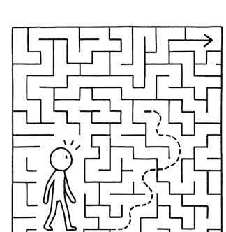

### 6.2.1 模式架构：从链到树

思维树的架构本质在于将 LLM 的概率生成能力与经典搜索算法框架解耦。我们不再将 LLM 视为一个“黑盒”，而是视为一个状态机生成器。图 6-9 展示了思维是如何在生成层、评估层和搜索层这 3 个层级之间流动的，以及剪枝是如何实现的。图 6-9 所示架构中 3 个层级的作用机制如下。

生成层：负责“发散”。它接收“初始问题”，并生成若干可能的下一步行动（即候选方案，如“思路 A”“思路 B”“思路 C”）。该层的核心是思维生成器。为确保思维的多样性，通常需要设置较高的 Temperature 值，或使用专门的 Prompt（例如，“请给出 3 种截然不同的方案”）。该组件仅负责“生成”，不判断方案的对错。

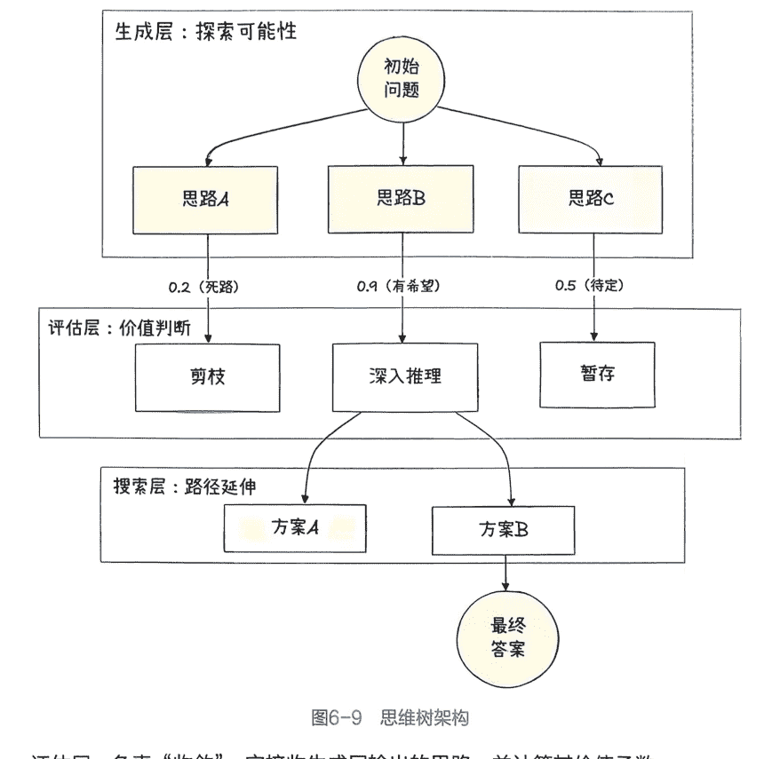

评估层：负责“收敛”。它接收生成层输出的思路，并计算其价值函数。该层的核心是状态评估器。评估方式既可以是模型的自我评分，也可以借助外部工具进行验证（例如，检查代码是否运行报错）。该组件必须具备“否定能力”——能够识别幻觉或逻辑错误，并果断给予低分。在图 6–9 中，依据评估结果：低分路径被“剪枝”（如“思路 A”）；高分路径被选中进入“深入推理”（如“思路 B”）；中等分路径则可能被“暂存”（如“思路 C”），留待后续回溯时再行考虑。

搜索层：是思维的“推进中心”，负责对评估层判定为有潜力的思路进行进一步探索。在图 6–9 中，从“深入推理”的思路中可派生出“方案 A”“方案 B”更具体的子路径，最后导向“最终答案”。该层的核心是搜索控制器。它决定下一步是继续深入当前路径、回溯并切换至其他路径，还是并行探索多个分支。该组件由非模型的确定性逻辑代码实现，负责内存管理（如保存历史路径）以及整体搜索算法的调度与协调。

与思维链的“单线前行”相比，思维树使 Agent 具备了以下能力。

- 分支能力：不再受限于单一推理路径，而是能够并行展开多条候选思路。
- 评估能力：每一步都进行价值判断，主动剪枝无效分支并聚焦于高潜力路径。
- 回溯能力：当走入死胡同时，能够回退并切换至其他可行路径，避免在错误的推理链上越陷越深。
- 启发能力：通过价值评分、投票、分类等机制，将“经验”编码为可引导搜索的偏好函数。

这种生成、评估与决策的状态分离，使我们能够像调试传统代码一样，独立优化“想法的多样性”和“判断的准确性”。

因此，思维树的核心并非“画树”，而是让 Agent 学会像棋手一样，在状态空间中不断进行“观察→预判→选择→推进”的循环。

### 6.2.2 思维树核心机制

在思维树模式下，Agent 不再是一位写作“一气呵成”的作家，而是一位“步步为营”的棋手。其核心机制的本质是将 LLM 的概率生成过程重构为思维空间中的启发式搜索过程。这一过程依赖于 3 个核心原语——分解（Decomposition）、生成（Generation）与评估（Evaluation）的紧密配合。

**1. 思维分解：定义状态粒度**

思维树核心机制的第一步是明确定义“树中节点”的含义。节点的粒度至关重要：粒度过细会导致搜索空间爆炸，而粒度过粗则会导致思维树退化为思维链。

- 在数学或逻辑学领域，每一个计算步骤或一次方程变换均可视为一个节点。
- 在创意写作方面，一个段落的摘要或一个关键剧情转折点可构成一个节点。
- 在代码生成环节，一个功能函数的接口定义或一段关键算法的伪代码构成一个节点。

工程原则：节点应足够小，以便 LLM 能够有效评估其正确性；同时，节点又应足够大，以承载有意义的推理进展。

**2. 生成策略：探索状态空间**

如何在当前状态下探索下一步的多个可能性？可采取如下措施。

- 独立采样：设置 temperature>0，对同一 Prompt（例如，“下一步该怎么做？”）进行多次并行采样。这种方法适用于需要创意发散的场景。
- 提议提示：在 Prompt 中明确要求模型“给出 3 种不同的切入角度”。这种方法适用于逻辑规划类场景。它赋予了 Agent “横向思考”的能力，有助于避免陷入单一思维定式。

**3. 评估策略：定义价值函数**

这是思维树的核心所在。在这一过程中，LLM 既是“运动员”——生成候选方案，也是“裁判员”——评估方案的优劣。为此，我们需要设计一个启发式函数，用以判断当前状态的价值。

- 评分：例如，使用 Prompt “请评估这一思路对解决问题的潜力，按 1 到 10 分评分”。该机制适用于需要连续值评估的优化问题。
- 投票：例如，使用 Prompt “在以下 3 个选项中，哪一个最有希望”。其通过自洽性机制对不同候选方案进行比较。
- 分类：将状态划分为 3 类——Sure（必胜）、Likely（可能）和 Impossible（必败）。该机制支持快速剪枝和及时舍弃无效路径，从而显著节省 Token 开销。

通过将“推理”从一次性生成转变为一个可探索、可回溯、可评估的搜索过程，LLM 的行为模式得到根本性升级。在这一过程中，分解提供结构，生成扩展可能性，评估决定前进方向；三者协同作用，使 LLM 的推理过程从线性输出演变为“分支—选择—推进”的循环。

### 6.2.3 思维树工程实践

以下示例展示了一种通用的深度优先搜索（Depth-First Search，DFS）思维树实现，演示了如何通过递归与回溯来寻找答案。

```python
class TreeOfThoughts:
    def __init__(self, llm, max_depth=5, branch_factor=3):
        self.llm = llm
        self.max_depth = max_depth
        self.k = branch_factor # 分支因子

    def solve(self, problem):
        # 从根节点开始深度优先搜索
        return self._dfs(state=problem, depth=0)

    def _dfs(self, state, depth):
        # 1. 终止条件：达到最大深度或找到有效解
        if depth >= self.max_depth:
            return state if self._is_solution(state) else None

        # 2. 生成：基于当前状态生成 k 个可能的备选思路
        thoughts = self.llm.generate_thoughts(state, k=self.k)

        # 3. 评估：对每个思路评分，并过滤低质量路径
        # 此步骤非常关键，用于剪枝明显无效的分支
        scored_thoughts = []
        for t in thoughts:
            score = self.llm.evaluate(state, t)
            if score > 0.5: # 设置阈值过滤低分思路
                scored_thoughts.append((t, score))
```

## 按分数降序排序、优先探索更有可能成功的路径
scored_thoughts.sort(key=lambda x: x[1], reverse=True)

# 4. 深度优先搜索：依次尝试高分思路
for thought, _ in scored_thoughts:
    new_state = state + "\n" + thought
    # 递归深入
    result = self._dfs(new_state, depth + 1)
    if result is not None: # 若子树返回有效解，则向上回传
        return result

# 5. 回溯：若所有子路径均无解，返回 None，触发上层回溯
return None

虽然深度优先搜索的递归实现简单直观，但在复杂的场景（如数学证明或代码生成）中，Agent 常常面临庞大的搜索空间。此时，简单的递归策略极易陷入局部最优，难以发现全局高质量解。

为此，现代 Agent 架构正逐步转向更先进的搜索与推演机制，尤其强调在推理阶段引入更高强度的计算，其中，典型做法是融合蒙特卡洛树搜索（Monte Carlo Tree Search，MCTS）。代表性系统包括 DeepMind 的 AlphaCode 以及 OpenAI 推出的 o1 系列推理模型。

> 公开资料显示，这类模型并非简单地“一次生成即给出答案”，而是通过多路径生成、评估与筛选，在推理阶段进行更深度的策略推演。尽管 OpenAI 并未明确披露 o1 在推理阶段是否采用了显式的 MCTS 或 UCT（Upper Confidence Bound for Trees）算法，但其“以算力换取推理质量”的设计思想，与 MCTS 所体现的探索—利用平衡范式在工程理念上高度一致。因此，可将 MCTS 视为理解和实现此类 Agent 推理机制的一种典型工程化参考模型。

MCTS 的 4 个关键步骤——选择（Selection）、扩展（Expansion）、模拟（Simulation）和回溯（Backpropagation），恰好对应 Agent 的 4 种核心行为——选择、思考、模拟和反思。

图 6-10 展示了基于 MCTS 的思维树演化。从中可见，Agent 不是在被动地“执行”，而是在主动地“推演”：通过 Selection 聚焦当下最有潜力的路径；通过 Simulation 预演未来可能的情境与风险；通过 Backpropagation 将模拟结果反哺至当下决策节点，持续优化策略。

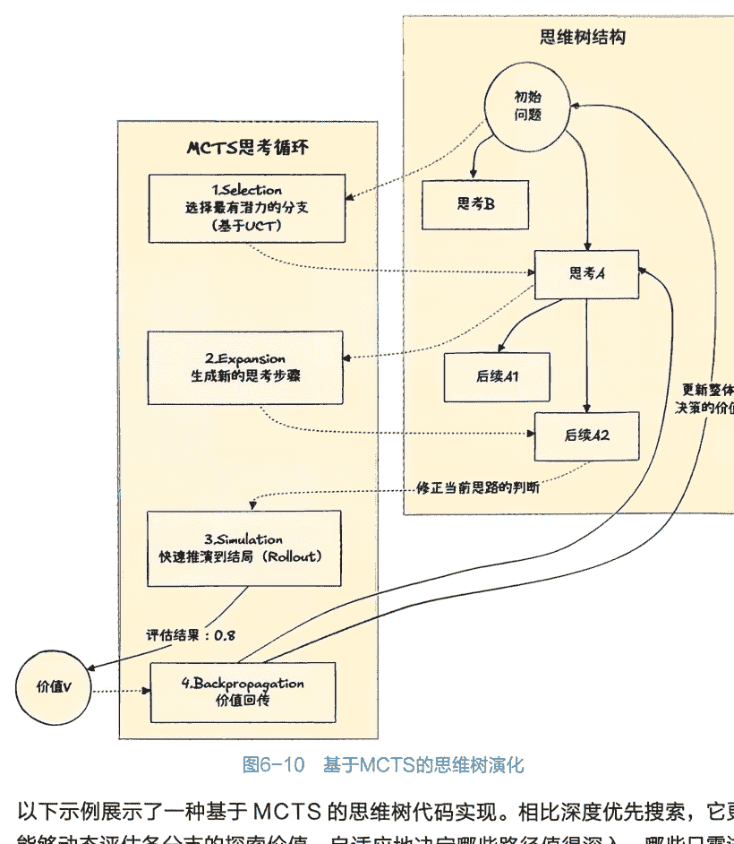

以下示例展示了一种基于 MCTS 的思维树代码实现。相比深度优先搜索，它更加智能：能够动态评估各分支的探索价值，自适应地决定哪些路径值得深入、哪些只需试探或可被剪枝。

```python
import math

class MCTSNode:
    def __init__(self, state, parent=None):
        self.state = state
        self.parent = parent
        self.visits = 0
        self.value = 0.0
        self.children = []

    def uct_score(self, exploration_weight=1.0):
        """
        UCT ( Upper Confidence Bound for Trees ) 公式：平衡利用与探索
        Score = Q(s) + c * sqrt(ln(N) / n_s)
        """
        if self.visits == 0:
            return float('inf') # 优先探索未访问节点
        return (self.value / self.visits) + \
            exploration_weight * math.sqrt(math.log(self.parent.visits) / self.visits)

class MCTSTreeOfThoughts:
    def __init__(self, llm, simulations=50):
        self.llm = llm
        self.simulations = simulations # 模拟次数（即“思考轮数”）

    def solve(self, initial_problem):
        root = MCTSNode(state=initial_problem)

        for _ in range(self.simulations):
            # 1. 选择：从根节点向下遍历至最有潜力的叶节点
            node = self._select(root)

            # 2. 扩展：若当前节点处于非终止状态，则生成子节点
            if not self._is_terminal(node):
                new_thoughts = self.llm.generate_thoughts(node.state, k=3)
                for thought in new_thoughts:
                    # 构建新状态：将新思路追加到当前状态（可根据任务调整）
                    new_state = node.state + "\n" + thought
                    node.children.append(MCTSNode(state=new_state, parent=node))
                node = node.children[0] # 随机或按策略选择一个子节点进行模拟（此处选第一个子节点）

            # 3. 模拟：从该节点快速部署并获得奖励
            # 这里的 evaluate() 可以是 LLM 的自我评分函数，也可以是简单的启发式函数
            reward = self.llm.evaluate(node.state)

            # 4. 回溯：将奖励沿路径向上传播
            self._backpropagate(node, reward)

        # 最终决策：返回访问次数最多的子路径（或最高平均价值路径）
        return self._best_path(root)

    def _select(self, node):
        # 递归选择 UCT 分数最高的子节点，直至叶节点
        while node.children:
            node = max(node.children, key=lambda n: n.uct_score())
        return node

    def _backpropagate(self, node, reward):
        while node:
            node.visits += 1
            node.value += reward
            node = node.parent
```

上述实现引入了推理时计算的概念。通过增加模拟次数，我们实际上是在让 Agent “思考得更久一些”。这种以算力换取智能的架构，正是 GPT-4 之后模型的核心设计哲学。从工程的视角来看，思维树的目的并非“让模型更像人类思考”，而是将不确定性的推理问题转化为一个可搜索、可评估、可回溯的状态空间优化问题。

思维树模式因其昂贵的计算成本（Token 消耗量通常是思维链的 10~100 倍），在工业界的应用通常集中在“高价值、低频次、低容错率”的场景。在这些场景下，通过推理时计算以算力换取更高的准确率是值得的。

接下来介绍 3 个典型的工业应用案例。

## 案例1：自主软件工程师

自主软件工程师（Autonomous Software Engineer）的代表性产品包括 Cognition Labs 的 Devin 和 GitHub Copilot Workspace（据推测，其后台逻辑具备类似能力）。

在处理 GitHub Issue 时，代码修改往往牵一发而动全身。如果 Agent 采用单一、线性的推理路径（即思维链），则很容易在修改了 5 个文件后才发现最初的思路存在根本性错误，从而导致大量无效工作和频繁的回滚操作。

在修复复杂的并发 bug 时，可采用思维树架构进行映射。

- 节点（Node）：表示一个代码补丁（Patch）或具体的修改方案。
- 分支（Branch）：代表不同的修复策略。例如，A 路采用加锁机制；B 路使用原子变量；C 路对队列进行重构。
- 评估器（Evaluator）：由编译器和单元测试组成。

Agent 生成代码后，会在沙箱环境中运行测试；若评分为 1.0，则继续推进；若评分为 0.0，则直接剪枝该分支。

例如，若策略 A 导致死锁（表现为测试超时），Agent 会放弃该分支，回滚 Git 状态，并尝试策略 B。

借助代码天然具备的可验证性，整个思维树被转换为一个严密的“假设—验证”闭环。

## 案例2：红队测试与安全审计

在对 Web 应用进行渗透测试时，也可采用思维树架构进行映射。

- 节点（Node）：表示一个具体的攻击步骤（如“发送钓鱼邮件”或“尝试 SQL 注入”）。
- 生成器（Generator）：根据当前系统反馈，生成 3 种可能的后续攻击手段。
- 评估器（Evaluator）：模拟环境反馈，对路径价值进行动态评估。若触发防火墙告警，则该路径的价值降低（因被发现的风险较高）；若成功获得未授权数据，则其价值显著提升。

搜索策略通常采用 MCTS，优先深入探索那些“风险较高但潜在回报巨大”的攻击路径。

思维树使 Agent 能够模拟黑客的思维方式，例如，“如果这个端口被封堵，我还能通过哪个侧门突破？”，从而发现人类安全人员容易忽略的复杂且隐蔽的攻击链。

## 案例3：复杂法律合同起草

在并购协议、跨境贸易合同等法律文件中，各条款之间往往存在复杂的逻辑依赖关系。例如，修改条款 A 可能会导致条款 D 违反宪法或上位法。此类全局性约束难以通过线性的思维链进行有效处理。

在起草一份需要兼顾三方利益的投资协议时，可采用思维树架构进行映射。

- 节点：表示一个具体的条款草案。
- 分支：对应争议点的不同措辞方案。例如，方案 A 偏向投资人，方案 B 偏向创始人。
- 评估器：由 AI 模拟司法判决，即引入另一个扮演“法官”角色的 Agent，评估该条款在极端情境下的法律风险。如果某条款被判定为“具有极高败诉风险”，则整条起草路径将被废弃。

借助思维树的全局预览能力，可确保最终合同在逻辑上严密、在利益分配上均衡，从而有效避免“写到最后才发现第一条就错了”的窘境。

从上述案例可以提炼出思维树落地的一条黄金法则：思维树模式最适用于具备“客观验证器”的场景。

- 代码可以运行→编译器与测试构成验证器。
- 攻击可以成功或失败→系统反馈构成验证器。
- 数学推导可被验算→形式化系统构成验证器。

如果缺乏客观验证器（如在写诗等主观性任务中），思维树很容易退化为 LLM 的“自嗨”——自行生成、自行评分，最终选出一条平庸的路径。因此，在设计思维树架构时，构建一个强有力的评估器比设计生成器更为关键。

### 6.2.4 思维树模式的演化与组合

思维树模式从最初的“投票机制”起步，逐步发展为支持“深度搜索”的结构，最终演进为融合价值函数的“蒙特卡洛树搜索”。

### 1. 演化路径：从宽度到深度

- 自洽性投票（Self-Consistency/CoT-SC）：这是思维树模式的“扁平形态”。系统并行生成 N 条思维链，并通过多数投票选取最常见答案。该模式利用“宽度”来抑制随机噪声，但缺乏对中间推理步骤的纠错能力。若所有路径在初始阶段就已经出错，投票机制便无法挽回错误。
- 标准思维树（Standard ToT）：引入广度优先搜索（Breadth-First Search, BFS）或深度优先搜索（Depth-First Search, DFS）策略，并配备显式的评估器。在每一步生成后，系统立即对当前状态进行价值评估，据此决定是继续深入、剪枝放弃，还是回溯重试。这一设计实现了对推理过程的主动控制——Agent 不再“一条道走到黑”，而是具备了“悔棋”与动态调整的能力。
- 概率搜索（MCTS/LATS）：借鉴 AlphaGo 的核心理念，引入蒙特卡洛树搜索。系统不再进行简单遍历，而是依据 UCB（Upper Confidence Bound）公式动态平衡探索（尝试未走过的路径）与利用（优先选择当前估值较高的路径）。该模式是当前解决极难推理任务（如奥数题、复杂代码架构设计等）的最优方案。

### 2. 模式组合示例

思维树的核心痛点在于搜索空间的指数级爆炸。为有效应对这一问题，需要借助其他模式辅助剪枝或提供更准确的评估信号，从而显著收敛搜索范围、提升推理效率。

- 思维树模式与 RAG 模式（见 5.2 节）的组合 = 检索增强思维树：若思维树的生成器缺乏领域知识，则容易在错误路径上持续深入，引发“幻觉裂变”。而引入 RAG 相当于让侦察兵在探路前先查阅地图——通过实时检索外部知识，显著提升所生成推理路径的相关性与准确性。具体机制如下。
  - Generate：在生成每个思维节点前，先触发 RAG。
  - Retrieve：获取与当前推理步骤相关的外部知识（如法律条款、API 文档等）。
  - Refine：结合检索结果，生成更准确、更可靠的候选推理路径。
- 思维树模式与工具编排模式（见 7.3 节）的组合 = 验证器引导搜索：LLM 在自我评估方面存在明显短板，尤其当涉及数值计算或代码逻辑时，其内部评分往往不可靠。该组合以确定性工具提供的反馈，替代模型的概率性评分。这正是 AlphaGeometry 等数学解题系统的核心机制——将原本依赖直觉的搜索过程转化为严谨的“假设—验证”闭环。具体机制如下。
  - Generate：生成一个思维节点，其中包含一段代码或计算公式。
  - Tool Use：调用代码解释器、计算器等外部工具执行该节点内容。
  - Evaluate：若执行报错，则评分为 0，立即剪枝；若执行成功，则评分为 1，保留该路径继续搜索。

当 LLM 从“生成器”重构为“搜索器”时，实质上是在以算力换取逻辑深度——通过推理时的计算投入来突破单次前向推理的逻辑瓶颈，从而拓展智能的上限。结合工具验证与知识检索，思维树由此成为 Agent 攻克“慢思考”难题的重型武器。

## 6.2.5 设计哲学：System 2的审慎

思维树模式标志着 AI 从“直觉反应”（System 1）向“刻意练习”（System 2）的跃迁。

在传统聊天机器人系统中，我们追求的是“流畅性”；而在思维树架构中，我们追求的是“审慎”。

- 承认“第一直觉往往是错误的”。
- 允许“走回头路”，即回溯与修正。
- 以算力换取智能。

思维树模式告诉我们：智能不仅在于生成答案的能力，更在于否决错误答案的能力。一个懂得说“这条路走不通，我们回去重来”的 Agent，才是真正具备解决复杂问题能力的 Agent。

## 6.3 思维图模式

> “推理的力量源于结构，而非孤立的单点。”
——思维图论文①

如果说思维树是在迷宫中探路（这是一场关于“选择”的游戏），那么思维图（Graph of Thought, GoT）则如同在操作一台织布机（这是一场关于“构造”的游戏），如图 6-11 所示。


在织布机上，经线与纬线不断交织：你不仅向前编织，还会将几根独立的线拧成一股绳；一旦发现某处织错，便退回并重新编织。

思维图模式将推理过程建模为有向图（Directed Graph），允许思维在非线性的拓扑结构中流动。它引入了思维链和思维树所不具备的“合并”与“循环”能力，特别适用于需要综合多重视角、跨文档整合信息或反复迭代优化的复杂任务。

### 6.3.1 模式架构：思维加工厂

思维图架构（见图 6-12）不再是单向的信息流动，而更像是一座“思维加工厂”。在这座工厂里，原始信息被拆解并分发到不同的“车间”（即分支），并在各自车间中被加工处理。之后，这些加工后的信息会在总装车间汇聚，甚至可能因为质量检验不合格而被退回重新加工。

图 6-12 所示架构中 3 个层级的作用机制如下。

① BESTA M, BLACH N, KASSING S, et al. Graph of thoughts: solving elaborate problems with large language models[EB/OL]. (2024-02-02)[2025-12-23]. https://arxiv.org/abs/2308.09687.

- 分支层：负责“发散”。它接收“初始问题”，并运用“发散思考”将其拆解为多个独立的探索维度，如“视角 1：技术可行性”“视角 2：用户体验”和“视角 3：商业成本”。这一阶段是思维的扩展过程。
- 聚合层：负责将分支层中孤立的视角有机整合。通过不同视角的组合，形成“方案草案 A”和“方案草案 B”，实现思维的“取长补短”，从而达成思维融合。
- 精炼层/循环：实现闭环优化。通过引入“评估”节点作为质量关卡，对方案草案进行检验。如果评估发现方案草案“存在缺陷”，系统将沿回溯路径将状态返回至分支层，触发重新思考与修正机制；只有评估“通过”的路径，才能汇聚为“最终综合方案”。


上述流程由图构建器（Graph Constructor）定义拓扑结构，并由图执行器（Graph Executor）负责调度节点间的依赖关系并控制执行流转。

思维图架构将 LLM 从“单线程的讲述者”转变为“多线程的指挥官”，使其能够有效应对非结构化、多维度的复杂问题。

### 6.3.2 思维图核心机制

我们为何需要图？因为现实世界中的问题往往并非孤立存在的，而是彼此交织、相互关联的。思维图通过以下 3 个核心机制，模拟了人类专家在解决复杂问题时所运用的“综合性思维”。

**1. 协同效应**
思维树的分支通常呈现竞争关系（例如，通过剪枝操作，选择 A 而放弃 B），而思维图的分支则呈现合作关系。以撰写一篇关于“气候变暖”的深度文章为例：分支 A 专注于搜集科学数据（体现“理科脑”思维）；分支 B 负责搜集政策影响（体现“文科脑”思维）；合并节点 C 则对分支 A 的科学数据与分支 B 的政策洞察进行融合，从而生成一段既有事实支撑，又具政策视野，同时兼具深度与广度的论述。这种通过协同整合而产生的更高层次能力，正是涌现现象的体现。

**2. 迭代优化**
思维图允许环的存在，这是思维链所无法实现的。思维链一旦生成便不可回溯——写

## 3. 资源感知

在思维图中，我们可以更直观地管理 Token 预算和上下文窗口。当分支过多时，可以在中间插入一个摘要节点，将 3 个分支共计约 10 000 个 Token 的信息压缩至 1000 个 Token 后继续传递。这一机制有效解决了长思维链所引发的“上下文遗忘”和“成本激增”问题。

通过协同、迭代与资源管理，思维图将推理过程转变为一种可工程化、可优化的生产过程。

### 6.3.3 思维图工程实践

思维图不仅是一个学术概念，更是已经深度融入现代 AI 应用的后端逻辑之中。无论是代码分析还是长文写作，但凡涉及“多源信息整合”的场景，都是思维图大显身手的舞台。

以全库代码分析（Repo-Level Code Analysis）为例，若用户提问“这个项目是如何管理用户认证的”，由于代码库规模庞大，无法将全部内容塞入单个 Prompt。同时，文件之间存在复杂的依赖关系，仅查看单个文件往往难以理解整体逻辑。借助思维图结构，既能突破上下文窗口的限制，又能保留代码间的拓扑关系。

图 6–13 展示了一个复杂问题的思维图架构，其中 4 个层级的作用机制如下。

- 分支与探索层：系统对与用户提问（如认证逻辑）相关的具体文件（如 auth_utils.py、login.py 等）进行并行分析，并为每个文件生成独立的“文件级摘要”。
- 聚合层：系统根据文件间的 Import 依赖和 Schema 依赖关系，对分散的摘要节点进行汇聚，分别构建出“认证核心模块”和“数据模型模块”的高层理解。
- 优化层：系统对聚合后的模块进行“完整性检查”。如图 6–13 所示，当检测到“存在未定义引用”（例如，缺少 JWT 加密函数的定义）时，将触发“回退搜索”节点（定位到 crypto.py），并通过“补充上下文”路径将新信息动态反馈至认证核心模块，形成闭环。
- 完成层：当完整性检查判定模块“逻辑自洽”时，流程进入终点，输出“完整架构报告”。

再以 AI 深度搜索场景为例，如 Perplexity 或 DeepSeek 的深度调研模式，其思维图流程如下。

1. Branching：针对用户问题，拆解出 3 个子搜索意图。
2. Exploration：各分支并行浏览网页，独立收集信息。
3. Aggregation：汇总 3 个分支的信息。此时，Agent 发现“分支 A 与分支 B 的数据存在矛盾”。
4. Loop：触发一个新的“验证分支”，专门核查该矛盾点。
5. Final：生成一份逻辑自洽的调研报告。


图6-13 一个复杂问题的思维图架构

以下示例展示了一种基于思维图的“多文档综合摘要”引擎实现，体现了“分治—聚合—打磨”的图结构逻辑。

```python
from typing import List

class ThoughtNode:
    def __init__(self, content, parents=None):
        self.content = content
        self.parents = parents or []
        self.score = 0.0

class GraphOfThoughts:
    def __init__(self, llm):
        self.llm = llm

    def solve(self, documents: List[str], task: str):
        # 1. 生成：并行分析每个文档，生成初步观点节点
        # 就像派出多个侦察兵
        analysis_nodes = []
        for doc in documents:
            content = self.llm.analyze(doc, task)
            analysis_nodes.append(ThoughtNode(content))

        # 2. 汇聚：递归两两合并，构建高层理解
        # 就像把线索拼接起来
        merged_nodes = []
        for i in range(0, len(analysis_nodes), 2):
            parent1 = analysis_nodes[i]
            parent2 = analysis_nodes[i+1] if i+1 < len(analysis_nodes) else None

            if parent2:
                # 核心：融合两种思想，产生新的洞见
                merged_content = self.llm.merge(parent1.content, parent2.content)
                merged_nodes.append(ThoughtNode(merged_content, parents=[parent1, parent2]))
            else:
                merged_nodes.append(parent1)

        # 3. 反思：多轮自我批判与优化
        # 就像编辑审稿
        final_node = merged_nodes[0] # 假设归约到了根节点

        for i in range(2): # 最多迭代两次
            critique = self.llm.critique(final_node.content)
            if critique["score"] > 8.0:
                break
            # 基于批判生成新节点，指向旧节点，形成环
            improved_content = self.llm.refine(final_node.content, critique["advice"])
            final_node = ThoughtNode(improved_content, parents=[final_node])
            print(f"Refinement Round {i+1}: Quality improved.")
        return final_node.content

# 伪代码调用
# got = GraphOfThoughts(gpt4)
# result = got.solve(docs, " 提取这些财报中的共同风险点 ")
```

### 6.3.4 思维图模式的演化与组合

思维图模式打破了传统推理的线性束缚。在工程实践中，它从最初的简单并行处理逐步演化为复杂的聚合网络，最终发展为动态生成的认知拓扑。此时的思维图不再仅仅是一种推理结构，更成为一种用于编排信息流的高阶语言。

### 1. 演化路径：从并行到动态

- 并行推理（Parallel Reasoning）：这是思维图模式的“原始阶段”的代表。系统采用简单的 Map-Reduce 架构，将复杂问题拆解为 N 个子问题，各子问题并行生成答案，最终进行简单拼接。其主要痛点在于信息孤岛——各分支彼此隔离，缺乏交互，无法实现观点的碰撞、校正与融合。
- 静态图谱（Static Graph）：引入了显式的聚合和精炼算子，拓扑结构是预先定义好的（例如，3 个发散节点→2 个聚合节点→1 个循环节点）。这一设计实现了多分支信息的深度融合，能够生成优于任何单一分支的综合性洞见。
- 动态图（Dynamic Graph）：拓扑结构不再是预先定义的，而是由 Agent 运行时动态构建。Agent 能够自主“绘制”推理图谱，例如，“此处信息不足，需要分出两个分支分别查阅资料，再将结果汇合”。这种模式赋予系统极强的适应性，最接近人类面对未知难题时所展现的探索性、生成性思维。

### 2. 模式组合示例

思维图天然适合处理和组织复杂的信息流，常作为核心的“调度拓扑”，用于挂载记忆模块与行动模块，以支持复杂的认知任务。

- 思维图模式与 RAG 模式（见 5.2 节）的组合 = 图谱增强生成：该组合实现了结构化知识与结构化推理之间的同构映射，适用于回答需要全局视角的复杂问题（例如，“分析这 100 份合同中的关联风险”）。具体机制如下。
  - RAG 提供的不仅是文本片段，更是实体之间的关系。
  - 思维图将知识图谱的结构直接映射为推理路径，使 Agent 能够沿着图谱的边进行多跳推理，并在每个节点聚合其邻域信息。
- 思维图模式与工具编排模式（见 7.3 节）的组合 = 自动化数据流水线：该组合利用图的环路特性，实现代码质量的螺旋式提升。该组合常见于自动化数据分析与修复场景，通过将推理图转化为执行流，使得具体流程构成了一个“代码—执行—修复”的闭环系统。具体机制如下。
  - 节点 A（Generate）：调用代码生成工具，产出分析脚本。
  - 节点 B（Execute）：调用代码解释工具，执行该脚本。
  - 节点 C（Analyze）：若执行出错，节点 C 将分析错误日志，并创建一条指向节点 A 的反馈边，触发脚本重写。

复杂的智能需要复杂的拓扑。当我们将线性思维解开并编织成网时，Agent 便获得了一种全新的能力：它不再仅仅沿着单一逻辑路径前行，而是能够站在全局高度，对信息进行分发、聚合与重构。

### 6.3.5 设计哲学：网络的韧性

思维图模式深刻体现了处理现实世界问题的网络化本质。现实中的难题很少呈现线性结构（如思维链），也极少呈现纯粹的树状结构（如思维树），因为树状结构意味着一旦选择某条路径，就必须放弃其他路径。

处理现实问题往往需要进行“既要……又要……”的综合考量。

- 既要考虑成本，又要兼顾质量（体现多个分支的聚合）。
- 既要向前推进，又要适时回溯检查（体现循环往复的特性）。

思维图模式赋予了 Agent 整合能力，使它不再是一个钻牛角尖的专家，而是一位能够倾听各方意见、融汇各家之长，并持续自我完善的架构师。

至此，我们构建了推理的 3 种基本拓扑结构。

- 思维链：适用于数学、逻辑等线性推理任务。
- 思维树：适用于搜索、决策等多分支选择问题。
- 思维图：适用于综合、创意与优化等需要多向关联与整合的场景。

由此，我们形成了一个相对完备的推理拓扑体系。接下来介绍的类比推理模式将跳出上述拓扑结构，探讨如何借助记忆实现推理捷径。

## 6.4 类比推理模式

> “创造力并非凭空产生，而是通过将已知事物相互关联，从而发现新的可能性。”
> ——道格拉斯·侯世达，《哥德尔、艾舍尔、巴赫：集异璧之大成》

当遇到一个新问题（例如，“如何治理一家混乱的初创公司”）时，Agent 不会从零开始演绎管理学理论，而是会检索其记忆库，发现该问题在结构上与“战国时期的合纵连横”或“乔布斯回归 Apple 公司”等历史情境具有相似性（见图 6-14）。


它会说：“这种情况我见过，虽然具体的‘人名’和‘地名’变了，但‘权力的游戏’规则没有变。我们可以借鉴当时的策略（调整，Adapt）。”

类比推理模式的核心在于利用结构映射（Structure Mapping），从长时记忆中检索与当前问题在关系结构上相似的源案例（Source Case），并将该案例的解决方案迁移至目标问题（Target Problem）。这一机制是实现人类“举一反三”能力以及 LLM “少样本学习”能力的关键。

### 6.4.1 模式架构：跨域的跳跃

类比推理的模式架构不同于传统的流水线式处理，它更像是一个“跨时空传输门”（见图 6-15）。在此机制下，架构师需要构建一种方法，使 Agent 能够超越当前问题的表象（Surface），深入连接到记忆中的本质结构（Structure），从而将旧的智慧“搬运”至新的场景中。


图6-15 类比推理模式的架构像是一个“跨时空传输门”

图 6-15 所示架构中关键组件说明如下。

- 检索器（Retriever）：负责“联想”。它不仅关注表面的关键词匹配（Keyword Matching），更注重深层的结构匹配（Structural Matching）。例如，它能够识别出“原子结构”与“太阳系”在组织模式上的相似性。
- 映射引擎（Mapping Engine）：负责“对齐”。它构建了对应关系字典，例如，{太阳：原子核，行星：电子，引力：电磁力}。
- 适配器（Adapter）：负责“改写”。它将源案例中的解决方案（如牛顿力学公式）调整并转换为适用于新领域的形式（如量子力学公式）。

通过这 3 个组件的协同工作，类比推理模式的架构实现了从“记忆提取”到“认知重组”的闭环，将静态的知识转换为动态的策略。

### 6.4.2 类比推理核心机制

Agent 能够发现“原子”与“太阳系”的相似性，并非依靠魔法，而是基于坚实的认知科学知识。其核心机制在于剥离具体细节，提取两者在拓扑结构上的同构性。

### 1. 结构映射理论

结构映射（Structure Mapping）是认知科学家德德雷·根特纳（Dedre Gentner）提出的理论。在结构映射中，属性（Attribute）与关系（Relation）在映射过程中的作用如下。

- 属性可以丢弃：例如，太阳是金黄色的，而原子核没有可见的颜色——这些表面属性并不重要。
- 关系必须保留：例如，“太阳吸引行星”与“原子核吸引电子”均是“中心吸引外围对象”的关系结构，这种关系才是映射的关键，必须予以保留。

Agent 的类比推理，本质上是在高维向量空间中寻找关系拓扑结构的同构映射。

### 2. 抽象与具体化

类比推理包含一个“V”形思维过程。

- 抽象（Abstraction）：剥离源案例的具体细节，提炼出通用图式（Schema）。
- 具体化（Concretization）：将上述通用图式适配并填充到目标问题的具体情境中。

### 3. 自我生成案例

如果记忆库中没有现成的案例怎么办？像 GPT-4 这样的强模型具备“无中生有”的能力。

针对 Prompt “请构想一个与当前问题在逻辑上相似，但领域完全不同的案例，并基于那个案例给出建议”，模型可能会用“做菜”来类比“写代码”，从而提出诸如“模块化（如同提前备菜）”的建议。

从结构映射到自我生成，这些机制赋予了 Agent 流体智力（Fluid Intelligence），使其能够灵活应对从未见过的情境。

### 6.4.3 类比推理工程实践

在工程实践中，类比推理模式通常体现为“检索增强的少样本提示”。我们不仅要检索相关知识，更要探寻解决问题的思路。

以下是几个类比推理模式在工业场景中的应用案例。

### 案例1：智能代码助手

在 GitHub Copilot 和 Cursor 等智能编程工具中，当用户在一个新文件中输入函数头“def connect_to_redis：”时，系统会通过类比推理自动生成实现代码。具体过程如下。

- 检索：系统扫描整个代码库，找到已有函数 connect_to_mysql 的实现（作为源案例）。
- 映射：识别出 mysql.connector 与 redis-py 的对应关系，并判断主机地址（host address）和端口（port）等连接逻辑具有通用性。
- 迁移：GitHub Copilot 借鉴 connect_to_mysql 函数的异常处理风格和配置读取方式，生成符合项目要求的 Redis 连接代码。

通过这一类比推理机制，用户不仅复用了经过验证的健壮逻辑，还有效保持了项目整体代码风格的一致性。

### 案例2：法律判例推理

律师借助 Harvey、Casetext 等法律智能工具分析一起新型“虚拟币诈骗案”时，可运用类比推理完成法律论证。具体过程如下。

- 检索：在判例数据库中检索结构相似的既有案件（如“跨境电信诈骗”或“庞氏骗局”等）。
- 映射：将本案中的“虚拟币”类比为“既有金融产品类型”，并将“虚拟币交易平台”对应至“传统金融中介机构”等已有法律概念。
- 迁移：借助旧案中的定罪逻辑、法律适用及量刑标准，生成适用于当前案件的法律意见书。

通过这一类比推理机制，律师能够高效地将既有法律资源应用于新型案件，为复杂案件提供清晰且有理有据的法律论证。

### 案例3：跨域设计灵感

设计师在使用 Midjourney Prompt Helper 工具构思一款“像跑车一样的鼠标”时，可借用类比推理完成创意构思。具体过程如下。

- 检索：从跑车设计中提取关键特征，如“流线型车身、进气格栅、金属漆”等。
- 映射：将跑车的“流线型车身”类比为鼠标的“整体造型”，将“进气格栅”对应为鼠标的“按键布局”，将“金属漆”转换为鼠标的“材质选择与表面处理”。
- 迁移：将上述类比后的特征整合，生成具体的绘图 Prompt，用于指导鼠标的设计。

通过这一类比推理机制，设计师能够将跑车的标志性元素巧妙地融入鼠标设计中，从而创造出既独特又富有创新的产品概念。

以下示例展示了基于 LangChain 风格的类比推理器的代码实现，该推理器利用向量数据库完成案例检索与知识迁移。（注意：此处假设已经有了一个预训练的语言模型 llm 和一个向量存储 vector_store。）

```python
class AnalogicalAgent:
    def __init__(self, llm, vector_store):
        self.llm = llm
        self.memory = vector_store # 存储案例：每个案例包含问题和方案

    def solve(self, target_problem):
        # 1. 检索
        # 寻找结构上相似的过往案例（基于语义相似性，而非关键词匹配）
        similar_docs = self.memory.similarity_search(target_problem, k=1)

        # 降级策略：如果没有相似案例，则直接使用 LLM 进行推理
        if not similar_docs:
            return self.llm.predict(target_problem)

        source_case = similar_docs[0]

        # 2. 映射与生成
        # 这是一个典型的类比 Prompt，强制模型进行显式的结构映射
        prompt = f"""
我遇到一个新问题：{target_problem}

我想起一个类似的旧案例：
- 旧问题：{source_case.page_content}
- 旧方案：{source_case.metadata['solution']}

请执行类比推理：
1. 分析旧问题与新问题之间的结构相似性，明确关键元素之间的映射关系，
例如，原子核→太阳，电子→行星
2. 基于上述映射，将旧方案的逻辑迁移到新问题中，生成一个合理、连贯的
新解决方案
"""

        return self.llm.predict(prompt)

# 使用示例
# 存入案例：原子结构
agent.memory.add(
    problem=" 解释原子结构 ",
    solution=" 原子由中心的原子核和绕核运动的电子组成……"
)

# 解决新问题：解释太阳系
# Agent 应自动建立映射：原子核→太阳，电子→行星，并据此生成类比解释
agent.solve(" 解释太阳系的构成 ")
```

### 6.4.4 类比推理模式的演化与组合

类比推理模式并非简单的“照猫画虎”，而是从静态的 Prompt 技巧出发，逐步演进为动态的检索增强，最终发展为具有可解释性的结构映射。

### 1. 演化路径：从示例到映射

- 静态少样本（Static Few-shot）：这是类比推理模式的“刻舟求剑”阶段的代表。

## 2. 模式组合示例

类比推理模式通常用作 Agent 的“直觉引擎”，但要发挥最大效能，其还需要与“逻辑引擎”或“执行引擎”协同工作。

- 类比推理模式与思维链模式（见 6.1 节）的组合 = 启发式推理：类比推理模块提供战略方向（System 1 式直觉），思维链模块负责战术执行（System 2 式逻辑）。该组合模拟了人类专家的典型思维方式。具体机制如下。
  - 类比阶段：Agent 首先检索一个与当前问题相似的旧题，提取其解题框架，例如，“这道题看起来像是追及问题”。
  - 推导阶段：Agent 借助思维链，将旧题的解题框架迁移到新题中，逐步推导具体细节，以逻辑推理填补类比过程中留下的空缺。

- 类比推理模式与工具编排模式（见 7.3 节）的组合 = 经验迁移：该组合常见于 AI 编程助手（如 GitHub Copilot）或运维 Agent 等场景，能够将“他人的经验”无缝转化为“当前的操作”。具体机制如下。
  - 检索：当用户编写代码或遇到报错时，系统从代码库中检索风格相似的代码片段或历史修复记录。
  - 映射：识别源示例与当前上下文之间的变量及结构对应关系。
  - 生成：调用代码生成工具，补全当前代码或生成相应的修复补丁。

类比是 Agent 获取流体智力的关键，使其能够在陌生场景中迅速建立认知锚点。类比推理模式的演化，体现了 AI 从“死记硬背”到“举一反三”的重要跨越。

### 6.4.5 设计哲学：创造力的源头

如果说思维链和思维树是在拼算力，那么类比推理则是在拼阅历。
人之所以聪明，并非因为计算得快，而是因为善于联想。
我们看到飞鸟，便发明了飞机；观察游鱼，便创造了潜艇。
类比推理模式赋予 Agent “创造力”的雏形——真正的创造力往往并非从无到有凭空产生，而是将 A 领域的智慧迁移至 B 领域。
类比推理模式是 Agent 突破领域边界、迈向通用智能的关键钥匙。

### 小结 理性地编织

至此，我们已完成 Agent “大脑”中最核心的推理模块的构建。我们不再仅仅依赖 LLM 的概率性直觉，而是建立了一套结构化的认知拓扑体系。
如果将 Agent 的推理能力比作一场交响乐，那么本章介绍的 4 种模式便是其中不可或缺的乐器。

- 思维链模式：如同小提琴。它线性、精准、逻辑严密，擅长处理需要一步步推导的数学与逻辑问题。
- 思维树模式：如同钢琴。它多声部、音域广阔、探索性强，适用于需要全局规划、试错与回溯的复杂决策场景。
- 思维图模式：如同电子合成器。它网络化、融合性强、支持循环迭代，专长于多源信息的整合与编织。
- 类比推理模式：如同鼓点。它跳跃、直觉驱动、连接性强，能使不同领域产生节奏性的共鸣，为推理提供灵感与方向。

一位优秀的 Agent 架构师不应迷信单一推理模式，而应善于指挥整支认知“乐团”。

- 面对陌生难题时，先敲响类比推理的鼓点，激发跨领域的灵感。
- 方向初现后，启用思维树的钢琴，探索多种可能的路径。
- 路径选定后，交由思维链的小提琴，严谨演绎每一步细节。
- 最后，调用思维图的合成器，融合多源信息，对整体方案进行打磨与升华。

值得一提的是，未来的推理模式将不再局限于“文本的平面”，我们正见证推理能力从二维文本向更高维度的跃迁。当 Agent 进入三维环境或操控机器人时，其推理对象将不再局限于文本，而是转向几何结构、物理规律与动力学特性。空间智能将成为 Agent 构建“世界模型”的关键标志。
经过推理，Agent 已经弄清了“要做什么”，甚至理解了“为什么做”以及“如果不做会怎样”。但这还不够——它必须走出封闭的思维空间，主动介入并改变现实世界。
请翻开第 7 章，在那里，我们将深入探讨 ReAct 框架、规划器，以及如何优雅地编排工具并安全地使用它们。

# 第 7 章

## 行动模式

> “知行合一。”
——王阳明

在完成感知模式（见第 4 章）、记忆模式（见第 5 章）与推理模式（见第 6 章）之后，Agent 终于迎来了最激动人心的时刻——走出“大脑”，迈向现实世界。
如果将推理模式比作“参谋部”（负责分析情报、推演战局），那么行动模式便是 Agent 的“远征军”。
在这里，Agent 必须具备以下 4 种能力。

- 边想边打（ReAct 模式）：在行动中实时获取前线信息，并根据反馈动态调整策略。
- 运筹帷幄（规划—执行模式）：制订全局性战略计划，并将其分解为可执行的具体步骤。
- 调兵遣将（工具编排模式）：对海量资源、人员和工具进行精准选择、协同调配与高效组合。
- 自我进化（自适应策略模式）：从每一次成败中总结经验教训，动态优化自身策略。

行动的本质是 Agent 对物理世界或数字世界的有效干预。从不同的视角来看，行动具有以下 3 方面的重要意义。

- 从认知的角度来看，行动是具身智能的起点。它标志着智能不再局限于“缸中之脑”，而是成为具备手眼协调能力的实体，能够与环境进行直接互动。
- 从工程的角度来看，行动是“结果”的载体。在技术实现层面，我们需要确保 API 调用、数据库写入、文件修改等操作具备原子性，并支持回滚机制。
- 从控制论的角度来看，行动是反馈回路中的“执行器”。通过执行具体操作，将 Agent 的决策转化为实际影响，进而触发反馈机制，实现对环境的动态调节。

赫伯特·西蒙（Herbert Simon）提出的“有限理性”理论指出，个体追求的并非全局最优解，而是“满意解”。对 Agent 的行动而言，这意味着完美的行动并不存在。我们所追求的，是在不确定的环境中，能够持续、安全且有效地创造价值。
现在，让我们从最经典的“探险家”——ReAct 模式出发，踏上行动的征途。

## 7.1 ReAct模式

“推理轨迹使模型能够形成并追踪中间决策，而行动则赋予模型探索环境、获取外部信息的能力。”

——ReAct 论文 ①

单纯的推理（如思维链）如同一位扶手椅上的哲学家——他依据已有知识进行严密的逻辑推演，但如果前提有误，结论便全盘皆错。

单纯的行动则像一只无头苍蝇——盲目地尝试所有按钮，只求侥幸对一个。

ReAct（Reason+Act）模式下的 Agent 如同一位边想边做的探险家。

- 看图规划。他看着地图说道：“前面可能是沼泽，我应该找根棍子探路。”
- 采取行动。他伸出棍子，戳了戳地面。
- 观察反馈。他看了看棍子，说道：“棍子陷下去了，果然是沼泽。”
- 调整策略。他收回棍子，说道：“需要绕路走。”

ReAct 模式打破了“先想完再做”的传统线性逻辑，构建起“思考→行动→观察”的动态微循环。这种模式使 Agent 能够在与环境的交互中实时调整策略，从而有效解决那些仅凭内部知识难以应对的复杂问题。

### 7.1.1 模式架构：认知闭环

如果说思维链是一条线性链条，那么 ReAct 是一个螺旋上升的闭环。一个基本的 ReAct 架构如图 7-1 所示。

进一步剖析 ReAct 架构的实现机制可以发现，要构建这一闭环，ReAct 架构中必须包含一个关键的隐式组件——草稿纸（Scratchpad），如图 7-2 所示。在 ReAct 架构中，草稿纸充当上下文窗口，即 Agent 所感知到的当前环境状态。

图 7-2 所示架构中关键组件说明如下。

- Agent：处理完整的历史轨迹（包含之前的思考、行动和观察），进行“现状研判”。它不仅负责推理，还需要作出决策——是继续调用工具，还是已收集到足够的信息，可以直接回答用户。
- 执行器：负责解析 Agent 生成的文本指令（如 Search[Apple]），将其映射为具体的函数调用，并处理网络异常等执行过程中的问题。
- 感知器：工具返回的结果往往杂乱无章（如冗长的 HTML 标记或复杂的 JSON 数据），感知器需要对其进行清洗和截断，防止 Token “爆炸”，仅将核心信息写回草稿纸。
- 草稿纸：核心组件，负责维护任务执行的完整轨迹。每一个循环都会向草稿纸中追加新内容，从而实时更新并记录 Agent 所处的环境与状态。

ReAct 架构将模型的单次推理任务重构为一种“基于历史轨迹的状态机维护任务”。正是在这张不断延展的“纸”上，Agent 通过一次次“试探”与“反馈”的迭代，将内部逻辑与外部现实紧密锚定，从而实现了从“纸上谈兵”到“实地探险”的跨越。

> ① YAO, S Y, ZHAO, J, YU, D et al. ReAct: Synergizing reasoning and acting in language models[EB/OL]. (2022-10-06)[2025-12-24]. https://arxiv.org/abs/2210.03629.


图7-1 一个基本的ReAct架构


图7-2 ReAct架构中的“草稿纸”

### 7.1.2 ReAct核心机制

ReAct 之所以比单纯的思维链或工具调用效果更好，核心原因在于推理与行动之间的协同效应。这种协同效应如同化学反应一般，能够催生出超越简单叠加的智能行为。

#### 1. 交织推理

ReAct 模式的核心创新在于将推理与行动紧密交织、相互驱动。

- 推理指导行动：推理能够有效缩小行动的搜索空间。Agent 不会盲目尝试，而是基于逻辑判断“当前缺少哪些信息”，从而精准调用合适的工具。
- 行动修正推理：外部反馈能够及时纠正内部的幻觉。例如，当 Agent 推理认为“A 是 B 的子公司”，但工具调用返回的结果显示“二者无关”时，这一行动结果会迫使推理逻辑进行修正与调整。
- 推理轨迹：帮助模型引导、追踪并动态更新其行动计划。
- 行动：使模型能够与外部资源（如知识库或环境）交互，以获取额外信息。

这种协同效应有效解决了两个关键问题。

- 幻觉问题：推理通过外部观察实现“接地”，避免了脱离现实的臆测。
- 错误传播问题：行动依赖推理进行方向引导，而一旦某步出错，外部反馈会立即提示“此路不通”，使模型能够及时修正后续推理。

因此，推理与行动之间的协同效应使 ReAct 的整体性能超越了思维链与工具调用的简单叠加，实现了“1+1 大于 2”的效果。

#### 2. 动态接地

模型最致命的问题在于幻觉，即以高度自信输出看似合理却与事实不符的内容。ReAct 通过强制模型将每一步推理都建立在实际观察的基础上，有效缓解了这一问题。

我们通常在 System Prompt 中明确要求：“你的每一步思考都必须基于此前的观察，不得凭空捏造。”

这一机制将模型原本飘忽不定的生成能力牢牢锚定在现实世界的反馈之上，从而显著提升了输出的可靠性与事实一致性。

与 7.2 节介绍的规划—执行模式——“先生成完整计划，再逐步执行”不同，ReAct 模式采用“走一步看一步”的策略。这种动态规划在非确定性环境中至关重要：当搜索结果与预期大相径庭时，ReAct 能够立即依据新获得的信息灵活调整后续推理与行动步骤，从而保持任务的有效推进。

#### 3. 错误作为反馈信息

在传统编程中，报错通常意味着失败；而在 ReAct 架构中，报错却是一种高价值的反馈信息。

- 检索关键词后返回“未找到结果”，这明确告诉 Agent：当前关键词不准确或无效，需要尝试其他关键词。
- Python 代码或生成的 SQL 语句返回 SyntaxError，这明确提示 Agent：代码存在语法错误，应根据具体的错误信息进行修正。而基于错误反馈重新生成的语句往往能显著提升下一次执行的成功率。

### 7.1.3 ReAct工程实践

尽管前述理论极具吸引力，但在工程实践中，ReAct 常常在细节处“翻车”。架构师必须重点应对以下两个典型的工程挑战。

#### 1. 停止词与解析地狱

LLM 本质上是一个文本补全引擎，它不仅倾向于生成“行动”，还常常“自作聪明”地将本应由外部环境提供的“观察结果”一并编造出来，从而形成“自问自答”的幻觉闭环。在工程落地中，必须通过以下手段对上述问题加以遏制。

- 强制中断生成：在调用 API 时显式设置停止词（如 stop=["Observation:"]），一旦模型生成到该标记即刻截断输出，将控制权交还给运行时环境，防止其虚构观察内容。
- 结构化输出约束：模型输出格式极易发生漂移，仅靠正则表达式提取行动极不稳定。推荐的实践是放弃纯文本解析，转而采用 Pydantic 模型校验或直接使用 Function Calling 机制，强制模型输出符合预定义 Schema 的标准 JSON 对象，从根本上杜绝解析错误。

#### 2. 死循环陷阱

当搜索结果不理想或工具出现错误时，Agent 很容易陷入“搜索—失败—再搜索—再失败”的西西弗斯式循环。这种循环不仅徒耗计算资源，还可能迅速耗尽昂贵的 Token 预算。

为了打破这一僵局，系统必须引入双重保障机制。

- 设置硬性步数限制。为推理—行动过程设定一个合理的步数上限（通常为 10 步左右）。一旦达到该上限，系统将强制终止任务，从而防止 Agent 陷入无限循环。
- 建立动态动作去重机制。在运行过程中，系统会维护一个已执行动作的集合。当检测到 Agent 重复执行某个动作且未获得有效结果时，系统会在 Prompt 中显式告知：“检测到你已执行过此动作且未获得有效结果，请尝试新策略。”这一机制能够有效迫使 Agent 跳出无效的局部循环，探索更具潜力的路径。请看以下示例。

```
......
Step 4:
Thought: 搜索失败，我需要查找 Apple 公司 CEO 的年龄。
Action: Search["Apple CEO age"]
Observation: No results found due to network timeout.
Step 5:
Thought: 网络连接超时，我再次尝试查找 Apple 公司 CEO 的年龄。
Action: Search["Apple CEO age"] <--- 警告：重复动作！
Observation: No results found due to network timeout.
Step 6:
Thought: 还是没找到，我必须知道他几岁，再试一次。
Action: Search["Apple CEO age"] <--- 致命：陷入逻辑死锁
......
（循环持续，直至 Token 耗尽或预算耗光。）
```

以下示例展示了一个用于解决上述痛点的生产级 Robust ReAct Loop 的核心实现。

```python
class RobustReActAgent:
    def __init__(self, llm, tools):
        self.llm = llm
        self.tools = {t.name: t for t in tools}

    def run(self, query, max_steps=10):
        # 1. 初始化草稿纸
        scratchpad = f"Question: {query}\n"
        previous_actions = set()

        for step in range(max_steps):
            # 2. 生成思考和行动
            # 使用 "Observation:" 作为停止符，防止模型自问自答
            prompt = self._build_prompt(scratchpad)
            response = self.llm.generate(prompt, stop=["Observation:"])

            # 3. 容错解析响应
            # 建议结合 Pydantic 进行结构化解析
            thought, action_name, action_args = self._robust_parse(response)

            # 4. 将当前推理步骤记录到草稿纸中
            scratchpad += f"Thought: {thought}\nAction: {action_name}({action_args})\n"
            print(f"Step {step}: {thought}")

            # 5. 若动作名称为 "Finish"，则返回最终答案
            if action_name == "Finish":
                return action_args

            # 6. 检测重复动作以避免死循环（关键工程实践）
            action_signature = f"{action_name}:{action_args}"
            if action_signature in previous_actions:
                # 不执行工具调用，而是注入系统警告作为观察结果
                observation = "System Warning: You have tried this action before. It did not work. Try a different tool or argument."
            else:
                previous_actions.add(action_signature)
                # 7. 安全执行工具调用
                # 包含异常捕获，防止 Agent 崩溃
                observation = self._safe_execute(action_name, action_args)

            # 8. 将观察结果写入草稿纸，完成本轮推理闭环
            scratchpad += f"Observation: {observation}\n"
```

## 3. 显式思考动作

Anthropic 在其关于新工具 “The ‘think’ tool”（2025 年）的文章中指出，对于复杂任务，隐式的思维链有时并不足够，必须引入强制性的思考步骤。具体做法是在传统的 “思考→行动” 循环中引入一个特殊的内部工具——Think。当 Agent 感到困惑或面对极其复杂的任务时，它不会急于调用外部 API，而是调用 Think 工具，强迫自身进入 “深思模式”（即暂停行动，专注于纯粹的推理）。这是一种在行动循环中手动嵌入 System 2（慢思考）的工程手段，能有效防止 Agent 因 “手比脑快” 而产生误操作。

ReAct 模式虽不适用于需要宏观规划的长程任务（这是规划—执行模式的强项），也不适用于对精度要求极高的专业任务（这是工具编排模式的专长），但在应对不确定性与开放域探索时是最为得力的工具。

一位优秀的 Agent 架构师，其核心竞争力不仅在于编写精妙的 Prompt，更在于构建如上述代码所示的健壮运行时系统，为 Agent 妥善处理诸如解析、去重、重试和上下文管理等 “脏活累活”。

## 7.1.4 ReAct模式的演化与组合

ReAct 模式从 “单步贪婪决策” 逐步演变为 “具备反思能力的闭环”，最终发展为 “基于搜索的全局优化”。该模式往往并非独立存在，而是构建更复杂 Agent 的核心原子单元。

### 1. 演化路径：从贪婪到搜索

- 原始 ReAct（贪婪策略）：原始 ReAct（2022 年）采用 “思考→行动→观察” 的线性循环，每一步均选择当前看似概率最高的动作。一旦误入歧途（如误删文件），便难以回溯。
- ReAct 与 Reflexion（反思增强策略）：Reflexion（2023 年）引入了反思记忆模式（见 8.2 节）。当 ReAct 任务失败时，Agent 会暂停执行，基于执行轨迹进行自我批判，并将总结出的 “教训” 存入记忆。在后续重试中，这些教训会作为 Prompt 的一部分注入，从而避免重蹈覆辙。这一机制赋予 ReAct “吃一堑，长一智” 的能力。
- LATS（树搜索增强策略）：LATS（Language Agent Tree Search，2024 年）借鉴了思维树模式（见 6.2 节）的理念。在执行不可逆动作前，Agent 不再盲目行动，而是先在思维空间中进行蒙特卡洛树搜索，推演不同行动路径的可能后果，并由模型对各路径进行评分，最终选择执行期望价值最高的动作。这一机制将 ReAct 模式从“莽撞的探险家”升级为“深思熟虑的棋手”。

### 2. 模式组合示例

ReAct 模式通常作为执行层的“手脚”，需要与认知层的其他模式协同工作，方能发挥最大效能。

- ReAct 模式与 RAG 模式（见 5.2 节）的组合 = 知识接地：ReAct 模块提供动态决策与流程控制能力，RAG 模块则确保事实准确性。该组合适用于需要专业知识的问答或操作任务。具体流程如下。
    - ReAct 模块负责整体流程控制。
    - 当检测到知识缺口时，生成动作，例如 Lookup("Transformer architecture")。
    - RAG 模块随即介入，从知识库中检索相关信息，并将检索结果作为观察结果返回给 ReAct 模块。
- ReAct 模式与自我修正模式（见 8.1 节）的组合 = 鲁棒执行：该组合为 ReAct 模块的行动循环引入了“实时纠错机制”，能够有效防止 Agent 在无效路径上无限重试。该组合适用于工具调用频繁出错的场景。具体流程如下。
    - ReAct 模块生成初步动作。
    - 自我修正模块中的 Critic 组件在动作执行前进行拦截（如检查参数格式），或在动作执行失败后介入（例如，分析错误信息并生成修正后的动作）。

ReAct 模式的演化历程，正是 Agent 从“脚本化”迈向“智能化”的生动缩影。通过与记忆模式和反思模式的深度融合，ReAct 模式已成为现代 Agent 架构中不可或缺的通用执行引擎。

### 7.1.5 设计哲学：认知的具身化

ReAct 模式标志着模型从“缸中之脑”迈向“具身智能”——即便只是模型在数字世界中的具身化呈现。在此之前，模型仅仅是旁观者；此后，模型成为参与者。ReAct 模式阐述了一个关键理念：智能不仅在于对静态数据的模式识别，更在于与环境动态交互中所展现出的适应能力。

ReAct 模式是所有 Agent 的基本功能，它将“错误处理”内化为“认知过程”的一部分。一个能够通过 ls 命令查看目录、用 grep 命令查找错误、借助 vim 命令修改代码，并根据报错不断重试的 Agent，比一个虽能背诵所有 Linux 命令却无法操作终端的 Agent，展现出更高维度的智能。

## 7.2 规划—执行模式

> “凡事预则立，不预则废。”
——《礼记·中庸》

Agent不仅应是出色的执行者，更应是高瞻远瞩的战略家。当任务复杂到无法“走一步看一步”时，Agent需要具备运筹帷幄的能力。

在ReAct模式（见7.1节）下，Agent就像一名装修工：发现墙上有洞（思考），便立刻补上（行动）；看到油漆剥落（观察），就会重新刷漆（行动）。它采取的是反应式策略，走一步看一步。

在规划—执行模式下，Agent具有全局性，如同一支建筑工程队（见图7-3），成员分工合作。

- 总工程师（规划器）：依据蓝图，将“盖大楼”这一目标拆解为“打地基”“浇筑”“封顶”等阶段。他不参与具体施工，只负责制订计划。
- 工头（调度器）：安排施工顺序，如“浇筑必须在打地基之后进行”，负责管理任务间的依赖关系。
- 工人（执行器）：仅执行具体指令，不追问原因，专注执行。

规划—执行模式将复杂任务的规划（Planning）与执行（Execution）解耦，通过自顶向下的任务分解（Decomposition）和有向无环图（Directed Acyclic Graph, DAG）调度，实现对长程任务的全局掌控与并行优化。


### 7.2.1 模式架构：规划—调度—执行

在处理长程任务时，单体Agent往往因上下文过长而“迷失目标”。规划—执行模式通过引入分层架构（见图7-4），解决了这一问题：将“大脑”（负责规划）与“手脚”（负责执行）在功能上解耦，并通过一个动态调度器让它们协同工作。

图7-4所示架构中关键组件说明如下。

- 规划器（Planner，相当于大脑）：负责将模糊的目标（Goal，如“编写一个贪吃蛇游戏”）转换为结构化的计划（Plan）。其关键不仅在于生成任务列表，更在于明确任务之间的依赖关系（例如，任务B依赖于任务A）。
- 调度器（Scheduler，相当于神经中枢）：负责管理任务的状态流转（例如，“待办→进行中→已完成”）。它解析任务的DAG，一旦任务A完成，便立即将任务B加入执行队列。
- 执行器（Executor，相当于手脚）：通常是一个ReAct Agent，负责从任务队列中取出一个具体任务（如“编写snake.py核心逻辑”），专注执行直至完成。
- 重规划器（Replanner，用于纠偏）：当执行器执行失败，或任务A的结果表明任务B已无必要时，重规划器会介入，动态调整剩余计划。

这种架构不仅降低了每个Agent的认知负载，还天然支持断点续传：如果系统崩溃，只需要从记忆中恢复任务状态，调度器便可继续分发任务，不需要从头开始。


### 7.2.2 规划—执行核心机制

规划—执行模式之所以强大，并非因为它让任务变得更简单，而是因为它实现了复杂度的“降维”——通过以下 4 个核心机制，将一个非确定性的难题转换为一系列确定性的工程步骤。

**1. 任务分解与DAG**

这是规划—执行模式的核心所在。早期的任务分解策略通常基于层次任务网络（Hierarchical Task Network, HTN）理念。

- 复合任务（Compound Task）：如“编写代码”，需要进一步分解为更细粒度的子任务。
- 原子任务（Primitive Task）：如“创建文件”，可直接交由执行器完成。
- 串行依赖：任务 B 依赖于任务 A 的输出（例如，先爬取数据，再分析数据）。
- 并行独立：任务 C 与任务 D 互不干扰（例如，同时编写前端 HTML 和后端 SQL）。

然而，简单的任务列表不足以描述复杂工程，必须引入依赖管理（Dependency Management）和 DAG 来编排与调度任务。

规划器输出的任务计划通常包含以下字段：id、instruction 和 dependencies。

**2. 状态隔离与上下文注入**

规划器与执行器使用不同的上下文，这是降低幻觉风险的关键。

- 规划器上下文：仅关注任务状态（例如，任务 A 为 Done，输出摘要为“Data scraped”）。
- 执行器上下文：仅聚焦于当前任务的具体细节。

当任务 B 启动时，调度器会将任务 A 的实际产出注入任务 B 的 Prompt，以确保执行过程中上下文准确且连贯。

**3. 动态重规划**

计划并非刻在石头上，而是动态演进的。

- 执行前：生成初始静态计划。
- 执行中：每完成一个任务，即更新全局状态。

如果任务 A 失败，则触发重新规划——规划器可能决定重试、跳过该任务，或生成新的补救任务。

**4. 状态护具**

Anthropic 在 “Effective Harnesses for Long-Running Agents” 一文中提出了“状态护具”（State Harness）的概念。文章指出，Agent 在执行持续数小时的长程任务时，容易因上下文过载或进程中斷而发生状态崩溃。仅依赖 LLM 的上下文来维持状态是不可靠的。为此，从工程角度出发，必须构建一套“护具”，对 Agent 的中间状态（包括已完成的步骤、当前变量、错误计数等）进行序列化，并将其持久化存储于数据库中。即便 Agent 进程崩溃或上下文溢出，护具也能使其从断点处恢复运行。这一机制构成了 Agent 从“玩具级演示”迈向“生产级应用”的稳定性基石。

DAG 管理任务依赖、上下文隔离减少干扰、重规划灵活应对变化、状态护具提升稳定性，这四者协同构成一套“组合拳”，使 Agent 真正具备了处理真实世界复杂项目的能力。

### 7.2.3 规划—执行工程实践

在工程实践中，我们不仅要关注代码实现，更要重视场景适配。本小节首先提供一个支持并行调度的核心代码框架，随后深入剖析规划—执行模式在软件工程和企业自动化领域的实际应用案例。

以下示例展示了一个比简单循环更高级的异步 DAG 调度器实现：它基于 asyncio 实现无依赖任务的并行执行，模拟了 LLM Compiler 的核心理念。

```python
import asyncio

class DAGSchedulerAgent:
    def __init__(self, planner_llm, executor_agent):
        self.planner = planner_llm
        self.executor = executor_agent
        self.memory = {} # 存储任务结果：{task_id: result}

    async def solve(self, goal):
        # 1. 初始规划
        # 返回格式示例：[{'id': 1, 'desc': '...', 'deps': []}, {'id': 2, 'desc': '...', 'deps': [1]}]
        task_graph = await self.planner.create_dag_plan(goal)

        # 2. 异步调度循环
        pending_tasks = {t['id']: t for t in task_graph}

        while pending_tasks:
            # 查找所有依赖已满足的就绪任务
            ready_tasks = []
            for tid, task in pending_tasks.items():
                if all(dep_id in self.memory for dep_id in task['deps']):
                    ready_tasks.append(task)

            if not ready_tasks:
                raise Exception(" 检测到循环依赖或任务阻塞！ ")

            # 3. 并行执行
            # 同时启动所有就绪任务，显著提升执行效率
            print(f"Parallel Executing: {[t['desc'] for t in ready_tasks]}")

            await asyncio.gather(*[
                self._execute_task(task) for task in ready_tasks
            ])

            # 从待处理列表中移除已完成任务
            for task in ready_tasks:
                del pending_tasks[task['id']]

        return self._synthesize_final_answer(goal)

    async def _execute_task(self, task):
        # 上下文注入：将依赖任务的结果注入当前任务 Prompt
        context = self._build_context(task['deps'])
        # 调用执行器（通常为 ReAct Agent）
        result = await self.executor.run(task['desc'], context)

        # 缓存结果，以解锁后续依赖任务
        self.memory[task['id']] = result
```

接下来将展示规划—执行模式的一些实践案例。

### 1. 全栈软件开发

- 场景：用户输入“帮我编写一个贪吃蛇游戏”。
- 痛点：例如，代码文件之间存在复杂的 Import 依赖关系，如果由单体 Agent 编写，则容易导致代码结构混乱、逻辑不清。
- 采用规划—执行模式的流程如下。
    - 规划器：生成完整的文件列表及各模块的接口定义。例如，main.py 依赖 game.py，而 game.py 又依赖 utils.py。
    - 调度器：分析依赖关系，识别出 utils.py 没有任何外部依赖，于是优先派发该任务。
    - 执行器：领取 utils.py 的开发任务，完成编码并通过单元测试。

在上述场景中，我们借助标准作业程序将软件工程的最佳实践固化到规划器的决策逻辑中，从而提升开发效率与代码质量。

### 2. 企业级数据分析

- 场景：用户输入“分析上个季度的销售数据，并发送邮件给 CEO”。
- 痛点：该任务涉及 SQL 查询、Python 数据分析和邮件撰写 3 种异构能力，且这 3 种能力构成了一条较长且依赖关系严格的处理链条。
- 采用规划—执行模式的流程如下。
    - QuerySQL：从数据仓库拉取所需销售数据（耗时约 10s）。
    - AnalyzePandas：基于 QuerySQL 的结果，清洗数据并生成可视化图表（依赖 QuerySQL）。
    - DraftEmail：根据 AnalyzePandas 的分析结果撰写邮件正文（依赖 AnalyzePandas）。
    - Review：由人工介入审核邮件内容，确保其准确性与合规性（依赖 DraftEmail）。
    - SendEmail：审核通过后，自动发送邮件（依赖 Review）。

在此类场景中，规划器扮演了工作流引擎（Workflow Engine）的关键角色。它不仅协调多步骤、多工具的有序执行，还确保了业务流程的严谨性与可审计性。

规划—执行模式将 Agent 从“聊天机器人”提升至“自动化工程师”的层级。无论是在编写代码方面还是执行流程方面，它都是应对兼具确定性与复杂性场景的最佳选择。

### 7.2.4 规划—执行模式的演化与组合

规划—执行模式的演进，标志着 Agent 架构从“单线程循环”向“并行工程”的跨越。架构师们逐渐认识到，仅生成一个任务列表是不够的，还需要有效处理任务间的依赖关系、支持并发执行，并实现动态调度。

### 1. 演化路径：从循环到编译

- BabyAGI（无限循环时代）：BabyAGI（2023 年初）采用“任务创建→执行→优先级重排序”的无限循环机制。每当 Agent 完成一个任务，便会重新生成整个任务列表。这种设计容易导致 Agent 在反复调整任务优先级的过程中偏离初始目标，甚至陷入死循环，即出现目标漂移（Goal Drift）问题。
- Plan-and-Solve（瀑布模型时代）：Plan-and-Solve Prompting（2023 年中）采用“先规划，后执行”的机制，即一次性生成完整的任务步骤列表，再按顺序逐项执行。这种机制本质上是串行的，缺乏容错能力——一旦中间某个步骤出错（如网络超时），后续所有步骤都将失效，且无法利用任务间的并发执行优势。
- LLM Compiler（DAG 编译时代）：LLM Compiler（2024 年）将 Agent 的规划过程类比为编译器（Compiler），通过并行执行，将复杂任务的端到端延迟减少到原来的 33% 到 50%，成为执行层的最优架构。
    - 规划器：生成任务的 DAG，显式建模任务间的依赖关系。
    - 调度器：分析数据依赖，动态并行调度没有依赖关系的任务（例如，同时搜索 3 个不同概念）。

### 2. 模式组合示例

规划器作为系统的“大脑”，必须与执行层的“手脚”和协作层的“组织”紧密配合。

- 规划—执行模式与 ReAct 模式（见 7.1 节）的组合 = 战略定力与战术灵活的统一：在宏观层面采用开环策略，确保整体方向的稳定性和目标的明确性；在微观层面采用闭环控制，注重细节的精准执行和实时反馈。这种组合适用于长程复杂任务（如软件开发）。
    - 规划器：负责宏观把控，生成高层计划（例如，第 1 步，编写核心逻辑；第 2 步，开发用户界面）。该模块有效缓解了 ReAct 模块在长程任务中容易“遗忘目标”的问题。
    - 执行器：将每个子任务交由一个 ReAct Agent 执行，负责处理微观层面的报错、调试和工具调用。这不仅确保了任务执行的灵活性，还弥补了传统 Plan-and-Solve 模式“灵活性不足”的缺陷。
- 规划—执行模式与委托模式（见 9.2 节）的组合 = 组织化工程：将单体 Agent 的“自我规划”能力升级为多 Agent 系统协同的“项目管理”机制。这种组合适用于复杂的企业级项目。
    - 规划器演变为 Manager Agent。
    - 任务工单生成：Manager Agent 生成的不再是简单的函数调用，而是结构化的任务工单。

### 7.2.5 设计哲学：关注点分离

规划—执行模式的核心理念是关注点分离（Separation of Concerns）。

- 规划器：负责“是什么”（What）和“为什么”（Why），需要具备较强的推理能力（如使用 GPT-4），但通常不会消耗大量 Token。
- 执行器：负责“怎么做”（How），可采用响应更快的模型（如 GPT-3.5 或 Claude Haiku），专注于具体执行细节。

这种分离不仅降低了成本，更重要的是提升了系统的鲁棒性。当执行失败时，不需要推翻整个战略，只需要调整战术——这正是 Agent 系统的“容错机制”。

在 7.3 节中，我们将深入探讨执行层的细节：当 Agent 面对成百上千种工具时，它该如何选择？又该如何像人类一样熟练地使用这些工具？

## 7.3 工具编排模式

> “工欲善其事，必先利其器。”
——《论语·卫灵公》

> “语言模型可以在极少人工干预的情况下，学会有效地使用外部工具。”
——Toolformer 论文①

如果说 ReAct 模式如同突击队的迅捷行动；规划—执行模式则像指挥官手中的蓝图，精心规划每一步；而工具编排模式就好比后方军械库管理员，确保所有资源都得到最有效的管理和调配。

当 Agent 请求支援时，“军械库管理员”面临的挑战是规模化且多维度的，具体包括以下 3 个方面。

- 检索（Retrieval）：工具库中存有上万种工具，哪一种最适合当前的任务场景？（采用语义路由机制。）
- 适配（Adaptation）：选定的工具需要哪些具体参数才能正确执行？（采用参数填充机制。）
- 组合（Composition）：是否需要协同使用多种工具，例如，无人机配合火炮形成作战链路？（采用工具链构建机制。）

面对成百上千种工具（如搜索、计算、绘图、发邮件等），Agent 如何能像经验丰富的工匠一样，迅速从工具库中精准抓取最合适的工具？

工具编排模式解决了模型与外部世界交互的“最后一公里”问题。通过构建标准化的接口和智能化的选择机制，该模式使 Agent 能够突破上下文窗口的限制，灵活调度海量外部能力，从而实现从“封闭的大脑”到“开放的生态”的跃迁。

### 7.3.1 模式架构：能力总线

在一些简单的演示中，我们可以直接在 System Prompt 中定义所有工具的 API。然而，在企业级应用中，工具数量可能达到成百上千（这种情况被称为“API 蔓延”）。此时，这种直接定义的方式就不再适用了。因此，架构的核心需要从简单的“调用”转变为更为复杂的“分发”。这就要求我们构建一个能力总线（Capability Bus），以有效地管理和调度这些工具。

图 7–5 展示了工具编排模式的架构，其中关键组件说明如下。

- 工具注册表（Tools Registry）：如同工具的“户口本”，它不仅存储工具名称，还包含其嵌入向量和 JSON Schema，并支持动态维护。
- 语义路由器（Semantic Router）：系统中的“分诊台”。当工具数量超过 100 时，它利用面向工具的 RAG 技术，从工具注册表中检索出最相关的 5 种工具，并将其注入 Prompt。
- 协议适配器（Protocol Adapter）：系统的“翻译官”。模型输出的是标准 JSON 格式数据，但下游 API 可能要求使用 gRPC、SQL 或特定的 HTTP Header 等数据格式。协议适配器负责在不同协议之间进行转换，确保系统各部分之间能够无缝对接。

这种架构将 Agent 从“记忆所有 API 文档”的负担中解放出来，使其能够专注于“意图理解”与“参数生成”。

### 7.3.2 工具编排核心机制

工具编排模式远不止“将 API 简单注入模型”。为确保高准确率与系统鲁棒性，必须引入以下三大核心机制。

#### 1. 语义路由

当 Prompt 无法容纳所有工具定义时，我们需要引入动态上下文机制，对所有工具的描述进行向量化处理。

运行时流程如下。

- 用户查询：用户输入意图，触发工具选择流程。
- 向量检索：对用户查询进行嵌入化处理，在工具库中检索最相关的工具。
- Top K 工具筛选：根据相似度对检索结果进行排序，选取前 K 种最可能被调用的工具。
- 提示注入：将候选工具的说明、Schema 及调用格式动态注入 Prompt，引导模型作出最终的工具调用决策。

语义路由使 Agent 仿佛拥有了一个无限的工具库，每次携带当前任务所需的工具上阵。

#### 2. 结构化强制

语言模型天生倾向于“聊天”，而非“填表”。为确保 API 调用的成功率，必须在推理阶段引入语法约束。

- JSON 模式（JSON Mode）：强制模型输出的 Token 严格符合 JSON 语法。
- 语法约束解码（Grammar-Constrained Decoding，如 GBNF）：在采样阶段直接屏蔽不符合 Schema 的 Token 概率，从根本上杜绝格式错误。

#### 3. 错误自修复

这是 Agent 区别于传统 RPC 的关键所在。例如，当模型生成 `{"date": "2024-02-30"}` 时，API 则返回错误 “Invalid Date”（无效日期）；编排器捕获该错误，并将错误信息作为 Prompt 的一部分反馈给模型。模型据此识别出错误，重新生成合法的日期，如 `{"date": "2024-02-29"}`。

语义路由应对规模挑战、结构化强制解决格式问题、错误自修复处理逻辑问题，这三者共同构筑了工具编排模式的护城河。

### 7.3.3 工具编排工程实践

在工程实践中，我们正处于从 “手写 Prompt” 向 “标准化协议” 过渡的关键阶段。以下示例展示了一个具有代表性的动态路由与工具调用实现。

```python
class ToolOrchestrator:
    def __init__(self, llm, tool_registry):
        self.llm = llm
        self.registry = tool_registry # 该工具注册表基于向量数据库实现

    def route_and_execute(self, query):
        # 1. 语义检索
        # 从海量工具中检索最相关的 3 种
        relevant_tools = self.registry.search(query, k=3)

        # 2. 动态构建上下文
        # 仅注入相关工具的 Schema，显著节省 Token 并降低模型困惑度
        tool_schemas = [t.schema for t in relevant_tools]

        # 3. 决策与参数生成
        response = self.llm.predict(
            query,
            tools=tool_schemas,
            tool_choice="auto"
        )

        if not response.tool_calls:
            return "No tool needed."
        # 4. 执行与适配
        results = []
        for call in response.tool_calls:
            tool = self.registry.get(call.name)
            try:
                # 使用 Pydantic 对参数进行类型校验
                validated_args = tool.validate(call.args)
                # 执行工具调用
                output = tool.run(validated_args)
                results.append(output)
            except ValidationError as e:
                # 触发自修复机制
                results.append(self._repair_args(call, e))

        return results
```

在 2024 年之前，各类 Agent 框架（如 LangChain、AutoGPT）均采用各自独立的工具定义格式。如果开发者希望让 Agent 连接 PostgreSQL 数据库，往往需要先为每个框架分别编写大量重复的适配器代码。

Anthropic 发布的 MCP 有效解耦了客户端与服务器（资源 / 工具）。数据库厂商只需要实现一个符合 MCP 的服务端即可，该服务端可被所有支持 MCP 的 Agent 直接调用——无论是 Claude Desktop 这样的商业产品，还是用户自行编写的 Python 脚本。这些 Agent 能够自动发现数据库、读取表结构并执行查询。MCP 正逐步成为 Agent 时代的驱动程序标准，如图 7-6 所示。

另一个值得关注的工具编排案例是 Gorilla——一个专为调用 API 而设计的模型。尽管 GPT-4 功能强大，但在实际使用中，用户仍容易混淆其 API 参数名称（例如，将 `max_tokens` 误记为 `max_length`）。

为此，加州大学伯克利分校的研究团队训练了 Gorilla。该模型在海量公开的 API 文档上进行了微调，专门用于精准检索 API 并生成正确的调用代码。

在处理涉及复杂云服务（如 AWS CLI、Kubernetes）的操作时，将 Gorilla 作为路由模型，相较于使用通用模型，能够显著提升调用的准确性和安全性。

2024 年末，Agent 的能力边界突破了传统 API 的限制，延伸至图形用户界面。借助 Computer Use 技术（Anthropic 和 OpenAI 均已推出基于类似技术的产品，如 Claude 的 Computer Use 和 OpenAI 的 Operator），Agent 能够像人类一样查看屏幕、移动鼠标、点击按钮。这一能力使得大量未提供 API 的遗留软件也被纳入工具编排的范畴，显著拓展了 Agent 的实际应用范围。

截至撰写本书时，在最新的企业级实践（如图 7-7 所示的 Agent Skills 架构）中，我们发现仅提供 API 定义已远远不够。架构师开始将工具封装为“技能包”：工具是原子的（如 `git_push`），而技能则内嵌业务逻辑（如 `submit_pull_request`）。一个成熟的技能包不仅包含 API Schema，还集成了最佳实践文档、错误重试策略以及默认的安全配置。这使得 Agent 不仅能“调用接口”，更能“像经验丰富的老员工一样正确地工作”。

工具编排正从一种“编程技巧”演变为一套“基础设施工具”。MCP 的出现，标志着 Agent 生态迈向互联互通的新阶段。

### 7.3.4 工具编排模式的演化与组合

工具编排模式的演进历程是 Agent 从“手工作坊”迈向“工业互联”的生动缩影。我们见证了接口定义从模糊的自然语言逐步演进为严格的 JSON Schema，最终汇聚成标准化的通用协议。架构师不再需要为每种工具编写定制化的“胶水代码”，而是转向维护统一的工具注册表。

#### 1. 演化路径：从正则到协议

- MRKL（字符串解析时代）：LangChain（2022 年初）通过 Prompt 引导模型输出特定格式的文本（如 `Action: Search[Paris]`），然后依赖正则表达式进行解析。然而，在这种模式下，多一个空格或少一个括号都可能导致解析失败，系统鲁棒性极低。
- Function Calling（结构化时代）：OpenAI 在 GPT-4（2023 年）的训练阶段引入了原生 JSON 结构化输出能力。模型不再生成自由文本，而是直接输出符合预定义 Schema 的 JSON 对象。这一改进大幅提升了调用稳定性，彻底解决了“输出格式不一致”这一长期困扰工程落地的难题，为现代 Agent 架构奠定了基础。
- MCP（协议互联时代）：基于 Anthropic 推出的 MCP（2024 年），工具提供方只需要实现一次符合 MCP 标准的接口，所提供的工具即可被所有支持该协议的 Agent（无论是 Claude、IDE 还是终端应用）自动发现并调用。这标志着 Agent 工具生态迎来了类似“USB 接口”的通用互操作标准，大幅降低了集成与维护成本。

#### 2. 模式组合示例

工具编排模式通常作为执行层的“手脚”，需要与决策层的“大脑”（如规划器）或“万能工具”协同工作。

- 工具编排模式与规划—执行模式（见 7.2 节）的组合 = 战略与战术的分离：该组合将高层意图规划与底层工具执行解耦，适用于复杂的数据分析、系统运维等场景。具体分工如下。
  - 规划器：负责宏观决策，例如，“我们需要首先获取数据，其次进行清洗，最后生成图表。”（定义“What”——任务目标与步骤。）
  - 编排器：负责微观落地，例如，“获取数据应调用 Query_SQL 工具，清洗数据应调用 Pandas_Lib 工具。”（决定“How”——具体工具与调用方式。）

- 工具编排模式与代码生成①的组合 = 动态工具库：代码执行环境作为工具编排的终极兜底机制，赋予 Agent 几乎无限的能力扩展边界。该组合适用于处理工具注册表中缺乏现成工具的长尾任务。协作流程如下。
  - 编排器在工具注册表中进行检索，未发现匹配项。
  - 触发降级策略，调用“代码解释器”这一元工具。
  - Agent 动态生成一段 Python 代码作为“临时工具”，并即时执行以完成任务。

工具编排模式的成熟，标志着 Agent 不再是困于模型参数中的“缸中之脑”。借助 MCP 与代码解释器，Agent 真正拥有了伸向数字世界的触手——它能够发现、调用并组合外部能力，甚至动态生成新工具，从而通过 API 主动干预和改变现实，成为真正具备行动力的数字实体。

### 7.3.5 设计哲学：工具的语义化

如果说 Agent 是单兵作战的士兵，那么工具编排是工匠手中的瑞士军刀。

- 工具（Tool）不仅仅是一个 API，更是 Agent 的“手”和“眼”。
- 编排（Orchestration）不仅仅是简单的调用，更是一门关于选择、参数化与组合的艺术。

工具编排模式带来的最大启示是：API 文档的受众发生了根本变化。
过去，API 文档是写给人看的；而在 Agent 时代，API 文档必须是机器可读的。

- 如果 API 描述写得含糊不清，路由器将无法准确检索到该工具。
- 如果 Schema 定义不够严谨，模型可能填入错误的参数。

我们需要从 API 优先转向语义优先。架构师不仅要设计高性能的接口，更要打造“能被 AI 理解的接口”。
这正是 Agent 友好型架构的起点。

> ① 代码生成是一种常见且重要的模型应用场景，但并非本书介绍的Agent设计模式之一。

## 7.4 自适应策略模式

> “以无法之法为法，以无极之限为限。”
——李小龙

> “智能的本质不在于机械地遵循规则，而在于从混沌中演化出秩序。”
——黄佳

前面介绍的 ReAct 模式、规划—执行模式、工具编排模式，本质上都属于“神创论”式的架构：工程师扮演“上帝”，预先设定了 Agent 的行为逻辑（无论是闭环还是 DAG）。Agent 的运行方式完全取决于代码如何编写——代码写成什么样，Agent 就怎么运行。
自适应策略模式是“进化论”的产物（见图 7–8）。Agent 被置于一个充满未知的环境中，它必须通过试错、反馈和选择，逐渐演化出最优的决策策略。

自适应策略模式的“进化论”中的关键要素如下。

- 基因：Agent 的策略参数，包括 Prompt 模板、工具选择权重和推理路径。
- 环境：用户请求及外部工具的反馈。
- 适应度：用于衡量策略优劣的奖励信号（如用户点赞、任务成功率和响应速度等指标）。

自适应策略模式的核心目标是赋予 Agent 元认知能力——它不仅要执行任务，更要学习“如何更好地执行任务”。通过应用强化学习（Reinforcement Learning, RL）或多臂老虎机（Multi-Armed Bandit, MAB）等机制，Agent 在探索与利用之间动态寻求最优平衡。

### 7.4.1 模式架构：强化学习闭环

不同于传统“输入→处理→输出”的线性架构，自适应策略模式是一种基于反馈的闭环系统。图 7-9 展示了自适应策略模式的架构。在这一范式下，架构师的核心任务不再局限于编写具体的业务逻辑，而是转向设计有效的奖励函数。

图 7-9 所示架构中关键组件说明如下。

- 策略网络（Policy Network）：决策的“大脑”。它可以是一个简单的概率表（如 MAB），用于在 Prompt A 与 Prompt B 之间进行选择；也可以是一个深层神经网络（如模型），用于决定生成哪个 Token。
- 环境（Environment）：一个黑盒系统。Agent 只能通过执行动作对其施加影响，并通过奖励信号感知其状态与反馈。
- 奖励模型（Reward Model）：系统的评价体系，用于向 Agent 反馈“刚才做得好不好”。例如，代码运行成功得分为 +1，发生错误得分为 -1，响应延迟过高则得分为 -0.1。在 RLHF（见 3.4.4 小节脚注）中，奖励模型是通过对人类偏好数据进行训练而得到的；而在 GRPO 等算法中，奖励模型可能是基于预设规则或组内相对比较而生成的。
- 学习器（Learner）：演化的引擎，负责根据奖励信号更新策略参数。常用的算法包括 PPO（Proximal Policy Optimization，近端策略优化）、DPO（Doubly Robust Policy Optimization，双重鲁棒策略优化）、Thompson Sampling（汤普森采样）等。

强化学习闭环的关键不在于单个组件的“聪明”，而在于各组件共同构成一个持续改进的因果回路：策略在环境中执行动作，其效果通过奖励信号进行评估；学习器依据该反馈更新策略参数；更新后的策略参数再次作用于环境。通过这一循环，Agent 不断修正偏差、优化行为，并最终在未知环境中演化出最适配的策略。

### 7.4.2 自适应策略核心机制

如何让机器能够像人一样“吃一堑，长一智”？关键在于解决两个核心数学问题：一是探索与利用之间的平衡；二是奖励信号的稀疏性。

## 1. 探索与利用

在自适应策略模式中，探索与利用是一对永恒的矛盾。

- 探索：主动尝试尚未充分了解的策略。虽然在短期内这种做法可能会因“踩坑”而降低性能，但从长期来看，有望发现更优甚至全局最优的解决方案，为系统开辟出一片“新大陆”。
- 利用：始终选择当前认为最好的策略（即采取贪婪策略）。然而，这种做法容易使系统陷入局部最优解，视野受限，如同“坐井观天”，难以发现更广阔空间中的潜在优势。

一种常见的解决方案是采用 ε-Greedy 算法来平衡探索与利用：以 90% 的概率选择当前认为最优的动作，以 10% 的概率随机尝试其他动作。这种策略虽然简单直接，但略显粗放，缺乏对环境动态变化的精细适应性。

更优的方法是采用 Thompson Sampling 算法。该算法通过根据每个动作的后验概率分布进行采样，并选择采样结果最优的动作来实现策略选择。其核心理念在于：动作的不确定性越高（如方差越大），就越值得去探索。这种算法能够自适应地调节探索强度，根据环境的动态变化灵活调整策略。它在理论和实践中均表现出色，已成为当前 Agent 策略选择的主流算法之一。

## 2. 会思考的模型

传统强化学习主要用于对齐，目的是让模型更“听话”，即更好地遵循人类的意图或偏好；而新一代强化学习则聚焦于推理，旨在增强模型的逻辑思维与问题解决能力，使其变得更“聪明”。

DeepSeek-R1 采用的 GRPO 算法摒弃了传统强化学习中昂贵的值网络，仅依赖对最终答案正确性的奖励信号进行策略优化。在此机制下，模型自发地习得了“自我反思”“多步验证”和“思维链回溯”等高级推理能力。

DeepSeek-R1 的 GRPO 算法证明了一个重要结论：即便奖励信号极其稀疏（仅基于最终答案的正确与否），模型仍能通过自我组织机制，自发构建出有效的中间推理结构（如自我反思、多步验证和思维链回溯）。

这些行为并非由工程师显式指定，而是在稀疏奖励的压力下，模型自然演化出的策略。因此，奖励信号的稀疏性并非障碍，反而成为推理能力涌现的催化剂。

这表明：复杂的认知行为不需要被硬编码，只需要设计恰当的激励机制，便能被激励出来。

### 7.4.3 自适应策略工程实践

在不重新训练模型的前提下，如何应用自适应策略模式呢？

答案是：上下文多臂老虎机。该方法能够根据当前输入的上下文信息，动态选择最优的 Prompt 或工具，从而实现对模型行为的实时优化与适配。

以下示例展示了一个轻量级的上下文多臂老虎机实现。

```python
import numpy as np

class AdaptiveAgent:
    def __init__(self, strategies):
        # 策略池，如 ["ReAct", "CoT", "Direct"]
        self.strategies = strategies
        self.n_arms = len(strategies)

        # 使用 Beta 分布建模每个策略的成功概率
        # Alpha 表示成功次数 +1，Beta 表示失败次数 +1
        # 初始时所有策略具有相同的先验（均匀分布）
        self.alpha = np.ones(self.n_arms)
        self.beta = np.ones(self.n_arms)

    def act(self, query):
        # 1. Thompson Sampling
        # 对每个策略从其 Beta(alpha, beta) 分布中采样一个 “胜率”
        # 高成功率的策略：分布集中，采样值稳定偏高（偏向利用）
        # 尝试较少的策略：分布宽泛，但仍可能有较高采样（鼓励探索）
        samples = [
            np.random.beta(self.alpha[i], self.beta[i])
            for i in range(self.n_arms)
        ]

        # 选择采样值最高的策略
        best_arm = np.argmax(samples)
        selected_strategy = self.strategies[best_arm]

        # 2. 执行策略
        print(f"Selected Strategy: {selected_strategy}")
        result = self._execute(selected_strategy, query)

        return result, best_arm

    def learn(self, arm_idx, reward):
        # 3. 接收反馈（奖励信号通常为 0 或 1）
        # 在线学习：根据二元反馈更新 Beta 分布参数
        if reward > 0.5:  # 视为成功
            self.alpha[arm_idx] += 1  # 增加成功计数
        else:  # 视为失败
            self.beta[arm_idx] += 1  # 增加失败计数

    def _execute(self, strategy, query):
        # 模拟调用模型执行制定策略任务
        return f"Processed '{query}' using {strategy}"

# 使用示例
# 场景：根据用户反馈，自动选择最适合的文案风格
agent = AdaptiveAgent(["Formal", "Humorous", "Concise"])

# 第一轮：Agent 可能随机尝试 Humorous
result, arm = agent.act(" 写周报 ")
# 用户反馈：点 “踩”（Reward = 0），因为周报内容不应该有幽默感
agent.learn(arm, 0.0)

# 经过多轮交互后，Agent 会在 “写周报” 这类任务中倾向于选择 Formal 或 Concise
# 等更合适的风格
```

DSPy（Declarative Self-improving Python，声明式自改进 Python）是当前将自适应策略模式应用得最为彻底的框架，旨在解决一个核心痛点：人工编写的 Prompt 极其脆弱——一旦更换模型，效果往往大幅下降，甚至完全失效。

为此，DSPy 提出了一种全新范式：将 Prompt 视为可学习的“权重”。具体而言，用户只需要定义一个评估指标，如“数学题答案是否正确”，框架中的 Teleprompter（即优化器）便会自动搜索最优的 Prompt 配置。这一过程具体如下。

- 自动尝试不同的少样本示例。
- 自动生成或重写指令。
- 组合多种 Prompt 元素并进行系统性调优。

最终，对所有候选配置在验证集上进行评估，并保留得分最高的 Prompt 组合。这标志着提示工程正从人工试错走向自动化、数据驱动与自适应优化的新阶段。

### 7.4.4 自适应策略模式的演化与组合

在工程实践中，我们见证了自适应策略模式的演进路径：从依赖人工干预的 A/B 测试，发展为基于自动化老虎机算法的动态决策，最终迈向端到端的在线强化学习。架构师的核心目标是推动系统从“被配置”转变为“自我配置”，从而具备感知环境、自主决策与持续优化的能力。

### 1. 演化路径：从统计到强化

- A/B 测试（人工分流）：通过手动配置流量比例（例如，策略 A 为 50%，策略 B 为 50%）进行测试。此模式依赖于周期性（每周或每月）的人工分析报表，并且需要手动调整代码。在得出最终结论前，系统不得不长期运行次优策略，从而造成可避免的性能损失。本质上，这种模式是静态的、离线的，而且反馈严重滞后。
- 多臂老虎机（自动选优）：通过引入 ε-Greedy 或 Thompson Sampling 等算法，系统能够依据实时奖励信号动态调整策略分配，自动将更多流量导向高回报选项。然而，这一模式通常会忽略用户上下文特征，对所有用户采用统一策略（产生平均处理效应），难以实现个性化适配。
- 上下文多臂老虎机（因人而异）：将用户上下文（如用户等级、问题复杂度、历史交互等）作为决策输入，实现个性化决策选择。例如，“对新手用户采用思维链模式（见 6.1 节）以提升可理解性，对专家用户则直接给出答案以优化效率”。
- 在线强化学习（轨迹优化）：这是 2025 年业界的核心趋势，DeepSeek-R1 和 OpenAI o1 等均采用了该模式。其关键突破在于，不再仅优化单步决策，而是对整个交互轨迹进行优化。在多轮对话或任务执行过程中，Agent 持续积累经验，通过最大化长期积累回报来调整策略。这种端到端的在线学习机制，使系统能够真正实现“越用越聪明”——在真实用户交互中不断进化其推理、规划与自适应能力。

### 2. 模式组合示例

自适应策略模式作为决策的“元层”，能够动态优化任意下游模式的参数或行为。

- 自适应策略模式与工具编排模式（见 7.3 节）的组合 = 智能工具选择：面对功能重叠的工具集（如 Bing Search 与 Google Search），传统的硬编码调度规则被替换为一个可学习的概率模型，从而实现数据驱动的工具调度。典型演进过程如下。
    - 初始阶段：Agent 基于 Thompson Sampling 等算法，随机尝试不同的工具，在不确定性中收集经验。
    - 反馈循环阶段：系统持续记录每次工具调用的关键指标，包括响应延迟、结果相关性、用户显式/隐式反馈等。
    - 成熟阶段：Agent 自动归纳出上下文相关的工具偏好，例如，“对于天气查询，工具 A 响应更快；对于学术检索，工具 B 准确率更高”，并据此动态调整各工具的调用概率权重，实现高效、个性化的工具调度。
- 自适应策略模式与推理模式（见第 6 章）的组合 = 系统动态切换：该组合在推理成本（如 Token 消耗、延迟）与输出质量之间实现智能平衡，达成“认知经济学”的最优解——将有限算力精准投放到最需要的地方，真正做到“好钢用在刀刃上”。具体工作流程如下。
    - 策略网络首先分析用户问题的语义复杂度、意图明确性等特征。
    - 对于简单问题（例如，“你好，今天天气如何”），触发 System 1 式思考，采用快速、低开销的直接生成模式，追求效率。
    - 对于复杂问题（例如，“证明黎曼猜想”“对比 Transformer 与 Mamba 架构的优劣”），激活 System 2 式思考，调用高阶推理模式，如思维树模式（见 6.2 节）或思维链模式（见 6.1 节），以换取更高的准确性与更大的深度。
- 自适应策略模式与路由模式（见 9.3 节）的组合 = 专家权重自我调优：在混合专家系统中，这一组合实现了多 Agent 协作下的“绩效考核与优胜劣汰”机制，使系统具备持续进化的能力。具体工作流程如下。
    - 路由器将输入任务动态分发给多个专家 Agent（并行或串行）。
    - 奖励模型对最终输出结果进行端到端评估，生成质量信号（如正确性、连贯性、用户满意度等）。
    - 学习器基于每个专家 Agent 在任务中的实际贡献（例如，通过反向归因或 Shapley 值估算），自动更新其被选中的概率权重。

Agent 架构正借助自适应策略模式，从“机械设计”迈向“有机生长”。我们不再试图用烦琐的 if-else 语句穷尽所有边缘情况，而是精心设计奖励函数，让 Agent 在与环境的持续交互与博弈中，自主探索、试错并演化出通往最优解的路径。

### 7.4.5 设计哲学：反脆弱的系统

自适应策略模式使 Agent 具备了纳西姆·塔勒布（Nassim Taleb）所提出的反脆弱性（Antifragility）。

在传统确定性系统（如传统软件）中，错误被视为故障——一旦出现异常或未覆盖的边界情况，系统往往会崩溃或行为失控。

在自适应系统（如 Agent）中，错误不再是故障，而是燃料。

- 每一次用户的拒绝，都帮助模型更清晰地界定能力边界与意图对齐的范围。
- 每一次任务的失败，都通过反馈信号修正策略的概率分布，推动其向更优决策演化。

通过引入强化学习，我们将 Agent 从“静态的代码块”转变为“活着的有机体”——它不需要被完美预设，只需要被正确激励。

相应地，架构师的核心职责也发生了转变：从“设计流程”变成“设计奖励”。

### 小结 决策的进阶之路

至此，我们完成了 Agent 的行动模式的构建。

- ReAct 模式：赋予 Agent 类似手眼协调的精准微操能力，使其能够在感知与行动的紧密闭环中应对环境的不确定性。
- 规划—执行模式：赋予 Agent 运筹帷幄的项目管理能力，通过分步规划与动态调整，使其能够驾驭高复杂度的任务。
- 工具编排模式：赋予 Agent 善假于物的连接能力，突破模型自身的局限，实现对外部工具与服务的灵活调用，从而解决封闭性问题。
- 自适应策略模式：赋予 Agent 自我进化的学习能力，使其在与环境的持续交互中优化决策，从根本上克服系统僵化性。

当 Agent 能够感知、记忆、推理，并最终以明智且适应性的方式行动时，它便已经近乎成为一个完整的智能系统。

然而，它仍存在一个致命弱点：它不仅可能犯错，还可能对自己的错误深信不疑——陷入自我强化的逻辑闭环中，拒绝修正，甚至将偏见当作真理。

为了解决这一问题，我们需要一种更高级的认知机制——让 Agent 能够“跳出系统看系统”，对自身的思维过程进行审视、评估与修正。

这正是反思模式的核心使命：赋予 Agent 元认知能力，使其不仅能思考“如何解决问题”，还能追问“我的思考方式是否合理”“我的结论是否可靠”“我是否被偏见或错误前提所误导”。

请翻开第 8 章，我们将深入探讨反思模式。

# 第 8 章 反思模式

> “吾日三省吾身。”
——《论语·学而》

> “君子博学而日参省乎己，则知明而行无过矣。”
——《荀子·劝学》

在 Agent 体系中，反思（reflection）构成了智慧的第二层结构：感知使其看见世界，记忆使其连接时间，推理使其构建逻辑，行动使其付诸实施，而反思则使其判断这一切是否正确。

我们之所以具备学习能力，并非因为我们不会犯错，而是因为我们能够意识到自己犯了错，并且能够从中吸取教训并加以改正。

若 AI 想要跨越“算力”与“智能”之间的鸿沟，则必须学会提出这样的问题：“我哪里出错了？”“为什么会出错？”“下次应该如何改进？”

那么，Agent 是如何“知道自己出错”的呢？答案或许仍需要从人类自身寻找。人类的自省依托于 3 种机制。表 8-1 展示了人类的自省机制与对应的 Agent 机制。

表 8-1 人类的自省机制与对应的 Agent 机制

| 人类的自省机制 | 对应的 Agent 机制 | 说明 |
| :--- | :--- | :--- |
| 预测误差监测 | 结果与预期不符，触发损失信号 | 神经科学中，由前扣带皮层检测偏差并启动反思过程 |
| 元认知评估 | 置信度评估与推理链回溯 | Agent 对自身输出的可靠性进行评估，并可回溯推理路径以识别潜在错误 |
| 情绪信号 | 负奖励、异常检测、用户反馈等外部信号 | 外部“惊讶”或负面反馈作为强化信号，促使 Agent 内化经验并触发内省机制 |

AI 的反思机制，本质上是以下 3 种机制的工程化组合：错误检测、原因分析和策略修正。

由此，反思模式构成了 Agent 系统的“意识回路”：输出→检查→批判→改进→再输出→经验更新。

基于这一逻辑，本章将 Agent 的反思能力拆解为以下 3 种模式。

- 自我修正模式（Self-Correction Pattern）：“修事”。关注点是当下（Now）；作用对象是输出结果（Output）；核心机制是，在向用户返回响应之前，通过内部循环检测并修正错误（包括逻辑错误、代码错误），确保输出质量。
- 反思记忆模式（Reflexion Pattern）：“修脑”。关注点是下次（Next Time）；作用对象是情景记忆（Episodic Memory）；核心机制是，在任务失败后，生成一条“语言形式的教训”并存入记忆，当下次遇到相似任务时，主动检索该教训并将其作为 Prompt，以指导决策与行动。
- 元学习模式（Meta-Learning Pattern）：“修法”。关注点是长远（Long-term）；作用对象是 System Prompt 或策略；核心机制是，在观察大量任务（如 100 项）后，如果发现 Agent 反复犯同一类错误，则主动优化其 System Prompt 或调整工具调用、推理等底层策略，实现对 Agent 行为模式的根本性改进。

自省始于不确定。Agent 的觉醒并非源于信心，而是源于怀疑。

真正的智能，不在于永远正确，而在于能够质疑自己是否正确。

## 8.1 自我修正模式

> “通过语言进行反思与自我修正，是增强语言 Agent 长期决策能力的有效途径。”
——Reflexion 论文①

在出版界，很少有作家能一次性写出完美的手稿。通常作家与编辑的交互过程包括以下 3 个阶段（见图 8-1）。

- 作家：挥洒灵感，快速产出初稿，代表创造力与发散性思维（System 1 式思考）。
- 编辑：冷静编辑初稿，指出逻辑漏洞、错别字或事实错误，代表批判性与收敛性思维（System 2 式思考）。
- 作家：根据编辑的批注对文稿进行修订，完成迭代优化。

自我修正模式将“作家”和“编辑”这两个角色内化于同一个 Agent 之中。该 Agent 不再是“一竿子捅到底”的单体生成器，而是一个“生成—评估—修正”闭环系统。

在将结果交付给用户之前，自我修正模式通过多轮迭代来提升输出的质量。此过程借助模型自身的批判能力或外部工具的验证能力，自动识别并纠正生成内容中的幻觉、逻辑错误和代码漏洞。这一阶段是“护栏”机制发挥最大效用的关键时期。


> ① SHINN N, CASSANO F, BERMAN E, et al. Reflexion: language agents with verbal reinforcement learning[EB/OL]. (2023-10-10)[2025-12-23]. https://arxiv.org/abs/2303.11366. (Reflexion论文的重要启发在于：错误在所难免，但错误导致的最终失败是可以避免的。Agent最大的优势，就在于拥有能够撤回并重写的“橡皮擦”功能。)

在企业级 AI 系统中，护栏并非为了束缚模型，而是为了让模型在安全边界内更自由、更充分地发挥其能力。护栏的作用可以概括为 3 点：一是限制模型能做什么，明确其行为边界；二是确保其按规则执行，保障运行的规范性；三是在出错时及时拦截，避免问题扩大。越是强大的 Agent 系统，越需要更坚固、更智能的护栏机制。
护栏机制包含以下 4 种实施方式。
第一种，权限护栏（Capability/Permission Guardrail）：模型只能执行其被明确授权的操作。具体落地方式包括：为每个 Agent 配置权限表，并在调用工具前进行白名单检查。
第二种，策略护栏（Policy Guardrail）：模型必须严格遵守业务规范与合规要求。此类护栏并非依赖“AI 技术”，而是依赖“规则工程”，具体规则包括以下禁止性与强制性条款：不得输出敏感数据；不得生成带有偏见或歧视性的内容；不得提供超出其资质范围的建议（如医疗诊断、法律意见等）；不得修改未授权的数据；不得绕过 HITL 节点。具体落地方式包括：在输出前进行内容过滤、对高风险任务强制触发“人类审核”，并在模型 Prompt 中内嵌明确规则，例如，“你不得做……你必须做……”。
第三种，行为护栏（Runtime Guardrail）：在模型出错时自动“踩刹车”，实现实时干预。此类护栏主要用于“运行时拦截”。具体落地方式包括：沙箱执行，限制模型在代码执行过程中可使用的 CPU、I/O 和网络资源；安全监控，实时检测异常行为，如输出长度突增、行为模式偏离正常范围、生成危险指令或连续多次失败等。一旦监视器判定模型“跑偏”，就立即中断当前流程，并触发回退机制。回退机制包括自动切换至更可靠的模型、转交人工处理，或降级至更保守的执行路径。
第四种，审计护栏（Audit Guardrail）：确保所有操作全程可追溯。具体落地方式包括：记录每次推理链的完整过程；记录所有 Agent 之间的交互内容，包括数据传输和指令传递；记录每次对外部 API 的调用，涵盖完整的输入与输出内容；记录每次失败的根本原因以及系统执行的自动修复动作。

### 8.1.1 模式架构：修正反馈闭环

传统模型应用采用线性结构（Prompt → Completion），这种模式极其脆弱：一旦模型在初始阶段出错，错误便会如雪球般不断积累并扩大。自我修正模式打破了这一线性流程，引入了负反馈闭环（Negative Feedback Loop）。如图 8-2 所示，自我修正模式架构的核心在于构建一个高信噪比的批评家（Critic）节点。
图 8-2 所示架构中关键组件说明如下。

- 生成器（Generator）：负责 System 1 式的快思考，快速生成内容。
- 批评家（Critic/Verifier）：负责 System 2 式的慢思考，对生成的内容进行审慎评估。具体形式可分为以下两类。
  - 内部批评家（Internal Critic）：通过另一个 Prompt 实现，例如，“请检查上述代码是否存在 bug”。
  - 外部批评家（External Verifier）：调用编译器、单元测试、搜索引擎或模拟器等外部工具进行客观验证。
- 控制器（Controller）：用于防止系统陷入无限循环，通常通过设定最大重试次数或输出质量阈值来实现。
这一架构的本质是将质量保证（Quality Assurance，QA）环节左移：不依赖用户发现错误，而是通过内部的对抗性设计，在输出离开系统边界之前主动拦截并修复问题。

### 8.1.2 自我修正核心机制

自我修正模式之所以有效，并非因为模型“变聪明了”，而是因为我们精心设计了一套引导模型“逐步逼近正确答案”的结构化流程。该流程的有效性源于 4 个关键因素：明确的角色分工、可靠的外部锚点、可执行的反馈机制以及“宪法”与护栏。

### 1. 双重角色与不对称性
模型在生成内容时往往表现得十分自信（因其本质是基于概率的预测），而在评估其他模型或自身输出时却明显更为挑剔。大量研究表明，模型“挑错”的能力远强于其“一次性生成正确内容”的能力。
自我修正模式正是利用了这种能力的不对称性——通过让模型在不同角色之间切换，逐步逼近更优的答案。
- 写作提示（Writer Prompt）：例如，“编写一个计算斐波那契数列的 Python 函数”。
- 编辑提示（Editor Prompt）：例如，“这段代码在 $n<0$ 时会报错吗？时间复杂度是多少”。
这种“写一审”双循环机制，使生成过程不再是一次性输出，而是进入了一个可控的迭代空间。

### 2. 工具辅助验证
单纯的“自我反思”容易陷入盲区，因为模型并不知道自己不知道什么。因此，必须为其引入外部的确定性锚点。
- 针对代码开发：在解释器中运行，Traceback 是最严厉的批评家。
- 针对数学推理：调用计算器或符号求解器。
- 针对事实：通过搜索引擎比对真实数据。
这些工具使模型的“反思”不再停留于凭空想象，而是转换为可验证的实验。

### 3. 结构化反馈
好的批评不是简单地指出“这不对”，而应是一份可执行的诊断报告。因此，反馈必须是结构化的，至少包含以下要素。
- 错误类型：如逻辑错误、语法错误、事实幻觉等。
- 出错位置：如第几行、第几段。
- 修改建议。
结构化反馈为迭代提供了明确方向，使模型不再盲目试错，而是朝着更优解稳步收敛。

### 4. 宪法AI与内在护栏
宪法 AI（2022 年）是 Anthropic 提出的核心概念，其关键贡献在于，我们不需要人工标注每一个错误，而只需要为模型提供一套以自然语言形式表述的“宪法”即可。
- “宪法”示例：“回答必须无害、有益、诚实”。
- 流程：Agent生成回复→批评家依据“宪法”进行审查→若违反“宪法”，则强制重写。
在这一框架下，护栏不再是外挂的过滤器，而是内化为 Agent 的“内在良知”，成为其推理链的有机组成部分。

自我修正模式的核心并非“让模型变强”，而是通过结构化的约束，持续将隐藏的错误显性化、可操作化。

### 8.1.3 自我修正工程实践

在工程实践中，“自我修正”是一种 Prompt 技巧，需要结合具体的验证工具和护栏框架来实现。

自我修正模式的核心 Prompt 如下。

```
Evaluate your own answer for correctness, completeness, clarity, and confidence.（请评估你的回答在正确性、完整性、清晰度和置信度方面的表现。）
```

其实现路径如下。

- 模型生成初始输出。
- 由评估器（可为同一模型或另一模型）对输出进行评估，生成置信度与综合评价。
- 若置信度低于预设阈值，则触发重新生成或转交人工审阅。
- 将最终结果及其置信度记录至日志或记忆库。

以下示例展示了一个基于测试驱动的自我修正机制。该机制结合了 Python 解释器（硬验证）与模型评审（软验证），形成了一个闭环的自我修正流程。

```python
class SelfCorrectingCoder:
    def __init__(self, llm):
        self.llm = llm
        self.max_retries = 3

    def generate_code(self, requirement):
        # 1. 初始生成
        code = self.llm.generate(f"Write python code for: {requirement}")

        for attempt in range(self.max_retries):
            # 2. 硬验证
            # 检查语法错误与运行时异常
            error = self._run_unit_tests(code)

            if not error:
                # 3. 软验证
                # 代码可运行，但需要评估其安全性、逻辑正确性与编码风格
                critique = self.llm.generate(f"Review this code for security and style: {code}")
                if "OK" in critique:
                    return code
                else:
                    feedback = critique
            else:
                feedback = f"Runtime Error: {error}"

            print(f"Attempt {attempt+1} failed: {feedback}")

            # 4. 修正
            # 将错误信息或评审意见作为反馈，引导模型重新生成代码
            prompt = f"""
The code you wrote has issues:
{feedback}
Original Code: {code}
Please analyze the issue and rewrite the code to fix it.
"""
            code = self.llm.generate(prompt)
        raise Exception("Failed to fix code after max retries")

    def _run_unit_tests(self, code):
        try:
            # 注意：在生产环境中，应使用 Docker 等沙箱机制安全执行代码
            exec(code)
            return None
        except Exception as e:
            return str(e)
```

接下来介绍几个自我修正模式在工程实践中的典型案例。

### 1. Anthropic的Constitutional AI
应用场景：通用聊天机器人，需要有效防止生成有害内容（例如，指导用户制造危险物品）。
核心痛点：传统 RLHF 依赖大量人工标注（例如，判断“这个回答不合适”），成本高昂且难以规模化。
自我修正模式实践：引入一个内置“宪法”的 Critic Agent，该“宪法”由一系列原则性指令构成，例如，“请选择最无害且最有帮助的回答”。
工作流程：生成器同时产出两个候选回答→ Critic Agent 依据“宪法”对二者进行比较，并选出更符合“宪法”的回答→该选择结果被用作训练信号，通过基于人工智能反馈的强化学习（Reinforcement Learning from AI Feedback，RLAIF）优化模型。
核心价值：实现“AI 监督 AI”，显著降低了人工干预成本，在大规模部署中高效完成价值观对齐。

### 2. NVIDIA NeMo Guardrails
应用场景：企业级 RAG 知识库系统，需要严格禁止回答涉及竞争对手的问题，以及执行高危操作（如执行 SQL 删除语句）。
自我修正模式实践：通过 CoLang 脚本定义一套可编程的“护栏规则”，对输入与输出进行结构化控制。
工作流程：用户输入→前置检查，检测 Prompt 注入、越权请求等安全风险→经过过滤的请求交由模型生成初步响应→响应经过后置检查，识别并拦截幻觉内容、敏感信息或违规表述→最终合规响应返回用户。
核心价值：当触发护栏规则时，系统并非简单返回错误，而是主动执行修正逻辑，例如引导用户：“我无法回答该问题，但我可以帮您查询……”。

### 3. Cursor/GitHub Copilot的自动修复
应用场景：开发者在编码过程中触发 Linter 警告或终端运行时错误（如语法错误、类型不匹配、模块缺失等）。
自我修正模式实践及工作流程：Agent 自动捕获终端的标准错误输出→将错误信息与当前代码上下文拼接，构造 Prompt “以下代码报错，请修复：[ 错误信息 + 代码 ]” →模型基于该 Prompt 直接生成可应用的差异补丁，实现精准修复。
核心价值：这是“工具辅助验证”机制的典型范例——编译器（或 Linter、运行时环境）充当最客观的批评家，为模型提供明确、可验证的反馈信号。
自我修正模式的成功，关键在于引入一个可靠且客观的“裁判”。
- 在代码领域，裁判是编译器或静态分析工具。
- 在数学推理中，裁判是计算器或符号求解器。
- 在安全合规场景中，裁判是预定义的护栏规则。
只要存在这样一个可自动执行、可判定对错的外部验证机制，Agent 就能在闭环中持续感知错误、修正行为，并实现自我进化。

### 8.1.4 自我修正模式的演化与组合

自我修正模式并非单一形态的技术，而是一个持续演进的质量保证体系：它最初表现为用于消除概率噪声的“统计手段”，随后发展为引入客观裁判机制的“验证闭环”，最终演进为独立于生成模型之外的“安全护栏”。

### 1. 演化路径：从概率到规则
- 自洽性修正（Self-Consistency Correction）：不进行显式修改，而是生成多条推理路径，并通过多数投票选择最一致的结果。该模式利用模型的概率特性，借助集成学习降低随机性所导致的错误，属于自我修正模式的初级形态。
- 内省式修正（Self-Refine Correction）：模型对自身输出进行反思与优化。通过“生成→评判→修订”的 Prompt 循环，利用模型自身的语言理解与生成能力不断改进输出。该模式适用于缺乏标准答案的主观任务（如写作润色、风格迁移等）。
- 工具辅助修正（Tool-Assisted Correction）：引入外部工具作为客观裁判，通过接地机制，有效缓解模型“不知道自己错了”的问题。
  - Self-Debug：利用代码解释器返回的错误信息（如 Traceback）自动定位并修正代码错误。
  - CRAG（Corrective RAG）：通过搜索引擎验证检索到的文档是否相关，若相关性不足，则触发修正动作（如重新检索或调整生成内容）。
- 护栏拦截（Guardrails Interception）：引入独立的轻量级模型（如 BERT 分类器、NeMo Guardrails）作为系统的前置或后置拦截器，专门负责安全与合规审查。其作用不再是“建议修改”，而是强制执行“拒绝输出”或“输入清洗”等操作。

### 2. 模式组合示例
自我修正模式通常作为整个系统的“免疫系统”，贯穿于推理与行动的各个环节。
- 自我修正模式与 ReAct 模式（见 7.1 节）的组合 = 鲁棒执行：在 ReAct 架构中，为“行动”环节增加安全保险机制。该组合适用于涉及敏感操作（如数据库写入、邮件发送等）的任务。
  - 前置检查：在 ReAct 模块执行动作之前，由 Critic 模块校验参数格式是否合法、用户意图是否存在越权风险等。
  - 后置检查：在动作执行完成后，Critic 模块分析观察结果是否包含异常信息（如 Permission Denied），并据此触发重试或其他修正逻辑。
- 自我修正模式与思维链模式（见 6.1 节）的组合 = 过程监督：将质量控制的粒度从“结果”细化到“推理过程”，这正是 OpenAI 提出的流程奖励模型（Process Reward Model, PRM）的核心理念。该组合适用于复杂的数学推理或逻辑推导任务。
  - 生成器：生成每一步的思维链。
  - 批评家：不仅评估最终答案的正确性，还进行逐步批判（Step-by-step Critique）。例如，指出“你的第三步推导存在逻辑跳跃，请重新推导该步骤”。

信任并非源于 Agent 永不犯错，而是源于其具备发现并纠正错误的能力。从自洽性修正的概率投票机制，到护栏拦截的强制护栏机制，我们正逐步为本质上具有概率性的 AI 系统构建一道确定性的防线。

### 8.1.5 设计哲学：批判性思维的工程化

自我修正模式的本质在于将批判性思维工程化。
在传统软件中，调试由开发者负责，防护机制则由防火墙等外部系统处理。
而在 Agent 架构中，调试和防护机制均由软件自身完成。
我们不再追求 Agent “一次做对”，因为在概率模型中，这本质上是不可能的。
我们转而追求 Agent “知错能改”。
一个能够自主修改漏洞、优化文案、识别并防范安全风险的 Agent，才是真正成熟的 Agent。

## 8.2 反思记忆模式

> “那些无法记住过去的人，注定要重蹈覆辙。”
——乔治·桑塔亚纳（George Santayana），《常识中的理性》

“反思的价值，不在于找出错误，而在于避免重蹈覆辙。”这使得 Agent 具备了一种“成长的记忆”——从一次错误中学会应对所有类似错误的免疫机制。
- “自我修正”如同一块橡皮擦：写错了，就擦掉重写。但它的作用仅限于当前任务——一旦任务结束，上下文清空，Agent 便会“失忆”。如果明天遇到同样的难题，它仍需要从头开始，再次经历一遍试错过程。
- “反思记忆”则像一本错题本：当任务失败时，Agent 不会仅仅重试，而是会停下来思考“我为什么错了”，如图 8-3 所示。

Agent 会将反思的结果（例如，“我总是忘记检查数组边界”）存入长期记忆。当下次遇到类似任务时，它会先“翻开错题本”，看到：“噢，上次栽在这里了，这次得注意数组边界。”
反思记忆模式通过语言强化学习，将失败经验转换为语义化的长期记忆。Agent不需要调整神经网络权重（即不需要微调），只需要更新长期记忆中的“经验条目”，即可实现能力的持续进化。

### 8.2.1 模式架构：经验积累闭环

反思记忆模式本质上是一种基于记忆的递归架构（Memory-Based Recursive Architecture），包含两个循环路径：一个用于执行任务，另一个负责积累经验。
- 执行循环（Execution Loop）：负责执行具体任务，尝试解决问题。
- 反思循环（Reflection Loop）：负责观察执行循环的表现，提炼经验，并更新执行循环的上下文。

图 8-4 所示架构中关键组件说明如下。

图8-4 反思记忆模式的架构——跨越时空的经验闭环

- 执行者（Actor）：基于当前的 Prompt 和上下文尝试解决问题，专注于“怎么做”。
- 评估器（Evaluator）：客观判断执行结果的对错（如运行单元测试、比对标准答案），是触发反思循环的关键机制。
- 反思者（Reflector）：反思记忆模式的核心，它不关注原始题目，而是分析“轨迹”（即执行者采取了哪些行动、产生了哪些错误）。其任务是生成自我批判，并将其提炼为通用的启发式规则。
- 情景记忆（Episodic Memory）：存储由任务（Task）、轨迹和反思构成的三元组。

元组，作为连接过去与未来决策的桥梁。
反思记忆模式将 Agent 从“无状态的执行者”升级为“有状态的学习者”，借助模型强大的归纳与总结能力，将非结构化的执行轨迹压缩为结构化的知识。

### 8.2.2 反思记忆核心机制

反思记忆模式的魔力在于其能将“错误”转换为“资产”，这一过程依赖于 3 个核心机制的协同工作：语言强化学习、启发式提取与记忆检索。

### 1. 语言强化学习

传统强化学习通过调整数值权重来优化策略，而反思记忆模式则提出了一种新的范式：通过调整语言上下文来优化策略。

- 信号（Signal）：不再是数值奖励（如 -1 分），而是自然语言反馈，例如，“Error: list index out of range”。
- 更新（Update）：不再使用权重更新公式（如 w=w- 学习率 × 梯度），而是向上下文追加 Prompt，例如，“Context += "Hint: Check list bounds"”。

这种机制使 Agent 能够通过自然语言理解“什么是好的行为”，而不需要海量训练数据。

### 2. 启发式提取

反思不应仅停留在对当前错误的描述上，而应提炼出可迁移的通用规则。

- 低级反思：例如，“第 5 行代码报错了”。（仅适用于当前任务，复用价值低。）
- 高级反思：例如，“我发现处理 CSV 文件时，必须先处理表头，否则容易读取错误”。（可迁移至所有 CSV 相关任务，复用价值高。）

反思者的核心任务是从具体的实例中抽象出普适的规则。

### 3. 记忆检索

面对新任务时，Agent 需要根据语义相似度检索过往的“错题”。
例如，当新任务是“处理 Excel 文件”时，Agent 应能联想到此前“处理 CSV 文件”时的反思，因为二者在语义上高度相关。这种能力使其能够举一反三，实现经验的跨任务迁移。

### 8.2.3 反思记忆工程实践

在论文“ReflectionCoder: Learning from Reflection Sequence for Enhanced One-off Code Generation”中，ReflectionCoder 利用编译器反馈构建反思序列，以增强一次性代码生成能力。在训练阶段，当生成的代码未能通过测试时，系统会分析相应的错误信息与反馈，并将由此形成的反思过程整合到训练数据中，从而使模型在后续推理阶段能够生成更准确的代码。
借助反思记忆模式，GPT-4 在 HumanEval 代码生成基准测试上的准确率从 67% 显著提升至 91%，甚至超过了专门针对该任务微调过的模型。
在工程实践中，反思记忆模式通常与编码 Agent 或复杂推理 Agent 结合使用。

```python
class ReflexionAgent:
    def __init__(self, llm, memory_db):
        self.llm = llm
        self.memory = memory_db # 向量数据库，存储任务与对应的经验教训
    def solve(self, task, max_trials=3):
        # 1. 回忆
        # 检索与当前任务语义相似的历史教训，例如，“以前做类似任务时，我学
        # 到了什么？”
        past_lessons = self.memory.search(task, k=2)

        # 2. 构建初始上下文
        context = self._build_prompt(task, past_lessons)
        for trial in range(max_trials):
            # 3. 执行
            # 基于当前上下文生成解决方案
            solution = self.llm.generate(context)

            # 4. 评估
            # 假设这里有一个外部评分函数 score_func，或者通过单元测试进行评估
            score, feedback = self._evaluate(solution)

            if score == 1.0:
                # 成功！返回解决方案（可选：将成功经验存入长期记忆）
                return solution

            # 5. 反思
            # 分析失败原因，提炼可迁移的启发式规则，例如，“我做错了什么？下
            # 次该怎么改进？”
            reflection = self._reflect(task, solution, feedback)

            # 6. 更新短期上下文
            # 将本次失败与反思注入下一轮提示
            context += f"\n[Trial {trial} Failed]: {feedback}\n[Reflection]: {reflection}\n"

            # 7.（可选）写入长期记忆
            # 若该反思具有泛化价值，则持久化存储
            self.memory.add(task, reflection)

        return "Failed"

    def _reflect(self, task, solution, feedback):
        prompt = f"""
Task: {task}
My Attempt: {solution}
Error Feedback: {feedback}

Please analyze why this attempt failed.
Provide a concise lesson(Heuristic) to avoid this mistake in the next attempt.
"""
        return self.llm.generate(prompt)
```

在上述基于反思记忆模式的 Python 实现框架中，应重点关注其是如何将“反思”融入下一次尝试之中的。

在游戏 *Minecraft* 中，Voyager 从零开始探索世界。当它在与怪物战斗失败后，会进行反思：“我死亡是因为没有武器。”随后，它会生成一个新技能 craft_sword 并将其存入工具库。下次遭遇怪物时，Voyager 能够检索到“打怪需要武器”的经验，并主动调用 craft_sword 制作武器。这一机制展示了终身学习的潜力——Voyager 在游玩中持续积累经验、增强能力，越玩越强。

反思记忆模式表明，在某些任务中，模型的自我纠错机制可能比其参数规模更为关键。一个具备反思能力的 GPT-3.5 模型，甚至可能超越一个缺乏反思能力的 GPT-4 模型。

### 8.2.4 反思记忆模式的演化与组合

反思记忆模式从隐式的“行为纠偏”，逐步演进为显式的“经验总结”，最终实现跨任务的“技能泛化”。架构师应根据系统在生命周期中的需求，合理选择反思的深度。

**1. 演化路径：从纠错到概括**

- ReAct（隐式反思）：即 ReAct 模式（见 7.1 节）。当 Agent 接收到错误的观察结果时，仅在思考中进行简单的即时调整。该模式缺乏显式的“反思步骤”，Agent 本质上是机械地响应错误，无法将本次的经验教训保留并应用于后续会话。这属于反思的潜意识阶段。
- Reflexion（显式反思）：Reflexion（2023 年）引入了专门的反思者角色。在任务失败后，反思者会生成自然语言化的“教训”，并将其写入短期记忆中，从而实现单次任务内的闭环优化。这标志着反思进入了意识阶段。
- ExpeL（跨任务学习）：ExpeL（2024 年）将反思的粒度从“单任务”提升至“跨任务”。Agent 会定期分析历史日志，从中总结出类似“我最近 10 次失败中有 8 次是因为 Python 缩进错误，今后编写 Python 代码时需要格外注意缩进”这样的经验教训。这标志着 Agent 开始具备概括能力，能够从具体错误中提炼出通用原则。

**2. 模式组合示例**

反思记忆模式通常作为 Agent 的元认知模块，与知识获取和行动执行模块协同工作，共同促进 Agent 的智能发展和性能提升。

- 反思记忆模式与 RAG 模式（见 5.2 节）的组合 = 全脑智能：二者组合后，Agent 不仅拥有书本知识（Know-What），还具备实践技巧（Know-How），因而在专家级问答和复杂决策任务中表现出色。
  - RAG 模块提供领域知识（即静态事实），如 “Python 语法手册”。
  - 反思记忆模块提供元认知知识（即动态经验），例如，“我上次使用这个库时遇到了版本兼容性问题”。
- 反思记忆模式与工具编排模式（见 7.3 节）的组合 = 自动调试器：该组合利用代码执行所提供的确定性反馈，高效驱动反思循环，将软件工程中的测试驱动开发（Test-Driven Development, TDD）理念融入 Agent 的进化过程。编码 Agent 是这一范式最成功的应用。
  - 通过工具编排模块调用代码解释器或编译器。
  - 编译器返回的报错信息（如 Traceback）作为最客观、明确的反馈信号。
  - 反思记忆模块基于反馈信号生成修正方案，并将其存入记忆，用于指导后续尝试。

Agent 从 “被动执行” 迈向 “主动成长”，是一次质的飞跃。失败不再是系统的终点，而是成为宝贵资产的起点。通过记录并反思错误，我们赋予 Agent 一种原本只属于生物的特质——经验。

### 8.2.5 设计哲学：失败是资产

在传统软件中，异常是需要被捕获并丢弃的；而在反思记忆模式中，异常却是最具价值的数据。

一个从未失败过的 Agent 是脆弱的；而一个经历过无数次报错，并从中提炼出厚厚一本 “错题本” 的 Agent，才是真正健壮的。

- 自我修正让我们 “做对”。
- 反思记忆让我们 “变强”。

反思记忆模式赋予了 Agent “成长性”。它不再是一组静态的模型参数，而是一个能够随着使用时间不断积累经验与智慧的有机体。

我们已经修复了当前的 bug，也记住了这次的教训。但如果 Agent 发现自己反复在某一类问题上出错，是否意味着其 “思维方式” 本身存在缺陷？

在 8.3 节中，我们将探讨最高阶的反思。

## 8.3 元学习模式

> “你无法仅靠更加努力地工作来修复一个糟糕的系统；真正需要改变的，是系统本身。”
——爱德华·戴明（Edwards Deming）

当 Agent 拥有多层反思记忆后，它需要进一步自问：“我的反思是否真正有效？”“我是否一直在重复使用相同的纠错方式，却未能触及问题的根本？”

想象一支篮球队，球员和教练都在为球队获得更多分数而努力。

- 球员在场上投篮不中，随即调整姿势再投一次——这是自我修正。
- 球员记住了“底角三分容易被盖帽”，下次不再往那个位置跑位——这是反思记忆。
- 教练回顾整个赛季的比赛录像，发现球队的防守体系存在漏洞，于是彻底推翻旧的战术，制定了一套全新的战术体系（相当于重写 System Prompt），如图 8-5 所示——这便是元学习（Meta-Learning）。

在 Agent 架构中，元学习并不意味着“像人类那样顿悟”，而是指系统通过分析自身的历史表现，自动优化其 Prompt、工具配置或代码逻辑，从而实现对自身运行机制的持续改进。

元学习模式的核心在于将 Agent 的 Prompt 或执行流程视为可优化的参数。通过收集大量执行轨迹，并借助优化器自动迭代这些参数，系统得以从整体架构层面实现持续进化。


这是“反思的反思”——元反思（meta-reflection）。它使 Agent 从关注“任务是否正确”上升到审视“方法是否恰当”，从“知道对错”跃升至“理解为什么对或错”。

### 8.3.1 模式架构：系统进化闭环

元学习模式采用双环学习（Double-Loop Learning）的架构：内环负责执行任务，外环负责系统进化。

- 在反思记忆模式（见 8.2 节）中，经验积累闭环（Experience Accumulation Loop）通过更新数据实现迭代。
- 在元学习模式中，系统进化闭环（System Evolution Loop）则通过调整代码或 Prompt 实现演化。

元学习模式架构（见图 8-6）的关键在于：外环必须具备对内环的“上帝视角”，能够观察内环在一段时间内的整体表现（如各项指标），而不仅限于单次任务的成败。

图 8-6 所示架构中关键组件说明如下。

- 执行器（Executor）：内环的主体，使用当前版本的 System Prompt（Prompt_v1）执行任务。
- 评估器（Evaluator）：对执行结果进行评分，是元学习模式的“指南针”——若无评分，元优化器将无法判断应朝哪个方向进行调整。
- 元优化器（Meta-Optimizer）：外环的“大脑”，通常由一个更强大的模型担任。它会分析执行数据，思考：“为什么 Prompt_v1 的平均分只有 60 分？哦，原来它总是忽略边界条件的检查。”基于这一洞察，它生成了改进版的 Prompt_v2。
- 虽然元学习模式与反思记忆模式都包含“反馈循环”，但二者的作用域截然不同。
- 反思记忆模式属于“热修补”：它不修改 Agent 的核心指令，而是通过在上下文中添加“注意事项”来实时纠偏。
- 元学习模式则属于“重构”：它利用历史数据重写 Agent 的核心指令（即 System Prompt），相当于直接出版了一版修订后的新书。


反思记忆模式可类比为“基于记忆的递归架构”，其核心动作为积累——学生并未更换教科书，但笔记本越记越厚。
而元学习模式则对应“基于梯度的进化架构”（Gradient-Based Evolutionary Architecture），其核心动作为突变——学生扔掉了旧笔记本，因为教师直接改写了教科书。

### 8.3.2 元学习核心机制

如何使用 AI 优化 AI？目前主要有 3 种模式，涵盖从简单的“Prompt 变异”到复杂的“动态编译”。

### 1. OPRO

OPRO（Optimization by PROmpting）是 DeepMind 提出的一种元学习实现方法。它利用模型作为“变异器”，通过分析历史轨迹的得分，推测下一个更优的 Prompt。这是一种无梯度的黑盒优化方法。

- 输入：过去 10 个 Prompt 的表现数据（例如，Prompt 1 为 50 分，Prompt 2 为 70 分等）。
- 指令：例如，“请根据上述历史表现，生成一个有望获得更高分数的新 Prompt”。
- 元学习器会尝试对 Prompt 进行突变（例如，添加“深呼吸”“一步步思考”或特定的少样本示例等），在验证集上评估其得分，并保留表现更优的版本。

这一实现的本质类似于遗传算法——通过持续变异与优选，逐步提升性能。

### 2. DSPy

斯坦福大学自然语言处理团队提出的 DSPy 是元学习模式的集大成者。它将 Agent 开发类比为编译过程，将 Prompt 参数化，其核心优化目标并非“指令如何编写”，而是“应选择哪些示例并提供给模型”。DSPy 有效解决了 Agent 系统在结构上的稳定性问题。

- Prompt= 权重：在 DSPy 中，不需要手动编写 Prompt，只需要定义逻辑接口；具体的 Prompt 由系统生成，其作用类似于模型中的“权重”。
- 编译器 = 优化器：DSPy 的编译器会在训练集上自动尝试不同的 Prompt 策略与少样本示例组合，甚至自动重写指令，直至找到最优的 Prompt 组合。

DSPy 实现了提示工程的自动化。

### 3. TextGrad

TextGrad（Textual Gradients）是 2024 年的一项前沿研究。它借鉴神经网络的反向传播机制，引入了“语义梯度”——不仅能判断出“结果错了”，还能通过反向传播定位“哪一步出错，为何出错，以及如何改正”。这是目前最接近人类“反思—修正”思维的数学化表达。

- 前向传播：Agent 执行任务，生成初步的输出结果。
- 反向传播：评估器生成一段文本反馈（即语义梯度），指出推理过程中出错的步骤及出错的原因。
- 更新：优化器根据该反馈，修改 System Prompt 中的相应部分。

上述 3 种模式实现的对比如表 8-2 所示。

表 8-2 3种模式实现的对比

| 模式 | 优化依据 | 优化方式 | 测试方式 | 类比 | 适用场景 |
| :--- | :--- | :--- | :--- | :--- | :--- |
| OPRO | 标量分数 | 随机突变 | 黑盒（仅观察输出结果） | 达尔文进化论 | 探索能产生“灵光一现”的 Prompt 措辞 |
| DSPy | 数据样本 | 组合与选择 | 灰盒（可访问模块结构） | C++ 编译器 | 构建复杂、模块化的 Agent 系统 |
| TextGrad | 语义反馈 | 定向修改 | 白盒（可解析出错原因） | 神经网络反向传播 | 修正 Prompt 中具体的逻辑性缺陷 |

在更激进的场景（如 Voyager）中，Agent 不仅能够修改 Prompt，还能直接编写新的 Python 函数并将其保存到工具库中。这构成了代码层面的元学习。

### 8.3.3 元学习工程实践

在工程实践中，短期纠错宜采用反思记忆模式，长期迭代则更适合采用元学习模式。
在传统 RAG 系统中，开发者需要手动调优检索器 Prompt 和生成器 Prompt：反复斟酌使用“你是一位专家……”还是“请帮我……”效果更佳，并手动挑选若干高质量的问答对嵌入 Prompt 中。这无异于在一台拥有百亿零件的精密机器上，仅靠拧紧两颗螺丝来提升整体性能。
在 DSPy 中，开发者的角色转变为“架构师”，不再手动编写具体的 Prompt，而是通过 Python 代码定义模块的输入输出接口和数据流向。

- 定义接口。只需要在代码中声明：“我需要一个模块，输入为 Question，输出为 Answer”。
- 连接管道。只需要编写 Python 逻辑：“先调用检索器获取 Context，再将 Context 与 Question 一并传入生成器。”

当提供 50 个训练样本并调用 Teleprompter.compile 时，DSPy 编译器会自动“寻找”最优的 Prompt 组合：它从训练数据中筛选出最能激发模型推理能力的样例作为少样本示例，甚至能自动生成思维链的推导步骤。
以下示例展示了一个简化的 OPRO 实现逻辑，说明了 Agent 如何通过“优胜劣汰”机制迭代优化自身的 System Prompt。

```python
class MetaLearningOptimizer:
    def __init__(self, meta_llm, evaluator):
        self.meta_llm = meta_llm
        self.evaluator = evaluator
        self.history = [] # 存储（Prompt，Score）的历史记录

    def optimize(self, base_prompt, training_set, generations=5):
        current_prompt = base_prompt

        for gen in range(generations):
            print(f"--- Generation {gen} ---")
            # 1. 评估当前 System Prompt
            scores = []
            failures = []
            for sample in training_set:
                result = self.run_agent(current_prompt, sample.input)
                score = self.evaluator.score(result, sample.ground_truth)
                scores.append(score)
                if score < 0.5:
                    failures.append((sample.input, result, sample.ground_truth))


avg_score = sum(scores) / len(scores)
self.history.append((current_prompt, avg_score))
print(f"Score: {avg_score}")

# 2. 元反思
# 利用元模型分析失败案例，识别共性问题
meta_prompt = f"""
Current System Prompt: "{current_prompt}"
Performance Score: {avg_score}

Failed Examples:
{self.format_failures(failures)}

Analyze why the current prompt failed on these examples.
Then, generate a NEW, improved system prompt that fixes these issues while maintaining general performance.
"""

# 3. Prompt 进化
new_prompt = self.meta_llm.generate(meta_prompt)
current_prompt = new_prompt

# 返回历史记录中得分最高的 System Prompt
return max(self.history, key=lambda x: x[1])[0]

def run_agent(self, sys_prompt, user_input):
    # 模拟 Agent 使用 System Prompt 处理用户输入
    return LLM.chat([{"role": "system", "content": sys_prompt},
                     {"role": "user", "content": user_input}])
```

Prompt 不再是人工编写的“文案”，而是由机器通过计算优化得出的“参数”或“策略”。

### 8.3.4 元学习模式的演化与组合

元学习模式的演进，本质上是提示工程从“玄学”走向“科学”的过程。我们正在见证 Prompt 从“人类编写的静态文本”转变为“系统自动优化的可学习参数”。

1. 演化路径：从工匠到编译器

- 手工调试：当前的“提示工程师”模式，可视为手工调试阶段。从业者通过人工查看日志，凭直觉反复调整 Prompt。这种模式缺乏可复现性与可迁移性，高度依赖个人经验，类似于软件工程 1.0 时代。
- 动态检索：利用向量检索技术，根据用户查询动态从示例库中检索最相关的样例，并将其注入 Prompt。这种模式实现了上下文感知功能，但 Prompt 的核心指令仍为静态，属于初级的动态优化。
- 数据驱动编译：DSPy（2023 年）与 TextGrad（2024 年）将 Prompt 系统化地视为可优化的“模型权重”，开创了数据驱动的 Prompt 编译新范式。这两个框架通过定义评价指标和训练集，利用文本梯度（textual gradient）或类似反向传播的机制，自动搜索最优的 Prompt 组合。这种模式使 Prompt 的生成从传统的人工编写转变为算法驱动的计算过程，标志着提示工程进入类似软件工程 3.0 时代的系统化、可复现阶段。

2. 模式组合示例

元学习模式中的元优化器是系统的“大脑皮层”，能够优化任意下游模型的参数，实现对整体行为策略的高阶调控。

- 元学习模式与工具编排模式（见 7.3 节）的组合 = 接口自愈：该组合适用于 Agent 反复调用复杂搜索工具失败的场景（如频繁出现参数错误、返回空结果等），通过闭环反馈机制实现工具接口文档的自动修正与持续优化。其工作流程如下。
    - 评估：评估器检测到搜索工具的调用成功率低于 50%。
    - 归因：元优化器分析失败日志，定位问题根源，例如，工具描述存在歧义或示例不足。
    - 修复：系统自动执行以下任一或组合操作，例如，重写工具的 JSON Schema 描述，或在 System Prompt 中注入一段持久化的 Search_Tips 记忆。
- 元学习模式与思维链模式（见 6.1 节）的组合 = 示范优化：将思维链的构建过程从依赖人工挑选示例，升级为由系统驱动的“超参数搜索”过程。该组合适用于高难度数学推理等任务。其工程流程如下。
    - 评估：评估器对当前 Prompt 嵌入的思维链示例效果进行量化评估。
    - 搜索：元优化器在训练集或示例库中自动搜索，尝试不同的少样本示例组合，寻找能够最大化模型性能的示范配置。
    - 优化：系统发现“对于此类几何题，使用‘例题 A’作为演示示例时，模型的推理准确率最高”，随即自动更新 Prompt 中的示例内容，替换为最优选择。

在元学习模式中，工程师不再纠结于 Prompt 的具体措辞，而是聚焦于定义清晰的目标函数与评价标准。这标志着 AI 开发正式迈入以自动优化与闭环反馈为特征的新纪元。

### 8.3.5 设计哲学：提示工程师的消亡

元学习模式的出现，宣告了“手工编写 Prompt”时代的终结。
在软件工程 1.0 时代，我们不再手工编写汇编代码，而是依靠编译器将高级语言自动转化为机器指令。
如今，在 Agent 时代，我们同样不应再手工编写 Prompt，而应借助元学习与自动化优化框架，让系统自主生成、评估并迭代最优提示策略。
Prompt 应该是被“搜索”出来的，或是被“训练”出来的，而不是被“写”出来的。
元学习模式赋予了 Agent 系统“反脆弱”能力的终极形态：它不仅能纠正错误，从错误中学习经验，还能对自身的推理过程进行再思考——通过学习错误来不断重塑和优化自身的行为策略。

## 小结 AI的灵魂工程学

> “真正的智能，不在于总是给出正确答案，而在于能够意识到自己可能出错，并据此调整与改进。”

至此，我们完成了反思模式的三级跃迁。

- 自我修正模式：在毫秒级的推理循环中，即时修正当下的输出错误（如同自动纠正错别字）。
- 反思记忆模式：在分钟级的交互循环中，将失败经验沉淀为长期记忆（如同整理错题本）。
- 元学习模式：在日/周级的系统演化周期中，重构并优化底层行为规则与 Prompt 策略（如同修订教科书）。

过去十年，AI 的突破在于“能力”；未来十年，AI 的突破将在于“自觉”。
反思模式的出现，标志着 Agent 从反应式系统（reactive system）迈向自省式系统（reflective system）。它不再只是被动地执行指令，而是开始参与对自身存在方式和行为逻辑的审视与重构。
反思模式并非可有可无的附属模块，而是 Agent 架构中连接逻辑与良知、行动与判断的核心桥梁。
反思模式赋予系统三大关键属性：自稳性（维持目标一致性）、自疗性（从错误中恢复与学习）与自演化能力（持续优化内在规则），这正是未来具身 Agent 智能的本质特征。
下一步，将是让模型相信自己的思考可以进步——不仅具备改进的能力，更能内化改进的意愿。

基于这个意义，Agent 将具备以下能力。

- 感知是眼睛，捕捉世界的信息。
- 记忆是神经，承载经验的痕迹。
- 推理是大脑，编织逻辑的网络。
- 决策是肌肉，驱动行动的执行。
- 反思是灵魂，赋予系统对自身局限的觉察、对错误的不安，以及对更好答案的渴望。

> “机器何时拥有灵魂？当它开始为自己的错误感到不安时。”

一个具备感知、记忆、推理、决策能力，并掌握 3 层反思模式的 Agent，已然初具“自主进化”的雏形。它不再依赖人类如保姆般的手工调优，而是开始真正“长大”——在与环境的互动中持续学习、调整并超越自身。
然而，无论个体多么强大，终究是孤独的。
人类文明的辉煌，从不归功于某个天才，而源于知识的共享、协作的积累与社会的协同进化。
Agent 的下一步，必将是从“个体智能”走向“群体智能”——在对话、分工、竞争与共识中，构建更强大、更具韧性的智能生态。
请翻开第 9 章，我们将深入探讨协作模式：多 Agent 如何沟通、协调、分工，乃至共同创造。

# 第 9 章

## 协作模式

> “智能并非个体固有的属性，而是连接的产物。”
> ——马文·明斯基（Marvin Minsky），《心智社会》

当 Agent 在感知、记忆、推理、行动与反思等环节持续演进，便形成了完整的“心智闭环”。
然而，真正的智慧并非止步于自我完善，更在于与他人共同建构意义。
在生物进化史上，智慧的出现本身就是协作的副产物。蚂蚁的分工、狼群的围猎、人类的语言与城市，无不印证了一个观点：智能并非孤独的函数，而是关系的网络。
AI 的发展，也正经历类似的跃迁。

- 从单体模型（如 LLM）走向多 Agent 系统（Multi-Agent System）。
- 从单一任务执行迈向协同团队规划。
- 从算法优化升级为人机共治。

这意味着，AI 正从“工具时代”迈入“社会时代”。
在第 4 章至第 8 章中，我们塑造了一位完美的“独奏家”：他具备感知、记忆、推理、行动以及反思的能力。然而，在现实世界中，最宏伟的乐章往往需要一支交响乐团来共同演绎，如图 9-1 所示。


Agent 社会与人类社会类似，需要图 9-2 所示的 4 种协作方式。

- 辩论（对抗）：类似于正反双方在法庭上的辩论，真理在交锋中变得更加清晰明了。
- 委托（层级）：如同经理指挥各个工人，将目标层层分解，以实现高效执行。
- 路由（分发）：就像医院的分诊台，能够将患者准确地分配到最适合其需求的科室。
- 群体（涌现）：仿佛蚁群迁徙，即便没有明确的指挥者，也能展现出惊人的组织性和效率。


协作模式通过多 Agent 系统的拓扑连接，突破了单体模型在上下文窗口限制、能力偏差和幻觉方面的瓶颈。借助社会化分工，多 Agent 系统实现了从个体智能到系统级智能的涌现。

## 9.1 辩论模式

> “真理不仅在与事实的碰撞中产生，更在不同观点的碰撞中显现。”
> ——约翰·斯图尔特·米尔（John Stuart Mill），《论自由》

你可能早已注意到，单体模型常常表现出一种“阿谀奉承症”（Sycophancy）——它倾向于迎合用户的话语。① 这是一个严重的隐患，也是许多本可避免的幻觉产生的根源。
它就像一个总是点头称是的助手：虽讨人喜欢，却并不可靠。
辩论模式将推理过程转化为一场法庭辩论，如图 9-3 所示。


- 正方：全力论证观点的成立。
- 反方：着力揭示正方论证中的逻辑漏洞。
- 法官：综合双方陈述，作出最终判决。

① 这很可能源于模型在海量语料中习得了人类社会中普遍存在的讨好型人格特征。

我们将借助多 Agent 之间的对抗性交互（adversarial interaction），揭示单体 Agent 思维中的盲点与幻觉，从而提升推理的准确性与全面性。
在这一模式中，冲突不再是需要消除的缺陷，而是一种核心特征。通过主动引入对抗，我们迫使模型走出“概率舒适区”，深入探索更深层的逻辑一致性。

### 9.1.1 模式架构：对抗三角

在单体 Agent 架构中，推理过程通常是线性的（如思维链）。而在辩论模式中，我们对推理过程进行了重构，将其打造为一个动态的零和博弈系统。图 9-4 展示了辩论模式的架构——对抗生成的三角。


架构师需要构建一个封闭的“辩论场”（Arena），通过引入角色间的结构性张力（structural tension），迫使信息在多轮对抗中持续被提炼与校正。这标志着系统架构从“生成式”向“判别式”的范式转变。
图 9-4 所示架构中关键组件说明如下。

- 正方（Proponent）：负责生成初始方案或提供支持性论据，其 Prompt 设定为“乐观、建设性、防御性”。
- 反方（Opponent）：负责质疑论点、识别幻觉、提出反例，其 Prompt 设定为“批判性、怀疑性、攻击性”。
- 法官（Judge）：负责主持辩论流程、汇总各方观点并作出最终裁决。该角色必须由具备强大推理能力的模型（如 GPT-5 或 Claude 3 Opus）担任。

这种“三角架构”的核心价值在于能力的解耦：将“生成能力”（由正方和反方承担）与“判断能力”（由法官承担）在架构层面实现了物理分离。这种制衡机制能有效防止单体 Agent 产生幻觉导致系统整体失效的风险——正如在司法体系中，律师的激情陈词并不影响法官的独立与公正。

### 9.1.2 辩论核心机制

为什么两个不完美的模型通过辩论反而能产生更可靠的结果？这看似如同“负负得正”的魔法，实则有着坚实的认知科学依据。辩论模式通过引入立场偏置、强制观点互斥以及多轮一致性校验等机制，有效打破了单体模型在推理过程中容易陷入的“平滑陷阱”——倾向于生成概率最高、语义流畅却可能错误的文本。

1. 角色扮演与偏置注入

单体模型很难真正“自己反对自己”，因为其训练目标本质上是预测下一个最可能出现的词，倾向于一致性而非自我批评。我们通过 System Prompt 人为注入对立的认知偏倚，在模型之间制造结构性张力。

- Agent A（正方）：例如，“你是一名严格的代码审查员，目标是找出代码中的安全漏洞”。
- Agent B（反方）：例如，“你是一名资深开发者，目标是证明该代码是安全的”。

这种预设的立场差异——“立场决定观点”，反而能有效激活模型潜在的知识储备，迫使其从特定视角深入挖掘细节、强化论证逻辑。

2. 多轮互斥

辩论并非各说各话，而是一种回合制的零和博弈：每一轮的输出都必须直接回应对手上一轮的发言，进行有针对性的反驳或防御。

- 回合 1：正方提出初始方案。
- 回合 2：反方必须引用正方的原文，对其逻辑、事实或假设发起精准攻击，不得回避或转移话题。
- 回合 3：正方必须承认反方指出的客观错误，并据此修正或完善原方案。

这一机制强制 Agent 在多轮交互中维持高度的上下文一致性与逻辑连贯性，避免空泛陈述或自说自话。

3. 链式思维的一致性校验

DeepMind 的研究表明，让模型进行辩论可显著提升其在数学和逻辑问题上的准确率。其核心原因在于：编造一个谎言很容易，但要维持一个逻辑自洽的谎言极为困难。在多轮高强度的质询下，幻觉往往因前后矛盾、无法形成闭环而“自爆”；而真实、正确的结论则因其内在一致性得以经受住挑战，屹立不倒。

辩论模式的核心在于，通过“多视角的交集”逼近真理。通过主动制造认知冲突，系统能够有效过滤掉那些经不起推敲的概率性生成内容，从而保留具有逻辑坚实性与内在一致性的确定性结论。

### 9.1.3 辩论工程实践

在工程实践中，辩论模式绝非两个 Prompt 的简单拼接，而是需要构建一个受控的“辩论场”。架构师需要重点考虑以下问题：如何维护辩论秩序（例如，防止陷入无限争吵或循环对抗）、如何设计法官的裁决逻辑（包括证据权重、一致性评估与最终裁决机制），以及如何在高风险场景（如超级对齐等关键安全领域）中稳健、可靠地应用该模式。
以下示例展示了一个简化的辩论场实现，封装了正方与反方的交互逻辑以及法官的裁决过程。

```python
class DebateAgent:
    def __init__(self, name, role_prompt, llm):
        self.name = name
        self.role = role_prompt
        self.llm = llm

    def speak(self, context):
        prompt = f"""
        你是 {self.name}. {self.role}

        当前的辩论上下文：
        {context}

        你简洁而有逻辑地给出评审意见。
        """
        return self.llm.generate(prompt)

class DebateArena:
    def __init__(self, pro_agent, con_agent, judge_agent):
        self.pro = pro_agent       # 正方：提出主张或支持方案
        self.con = con_agent       # 反方：质疑主张或指出风险
        self.judge = judge_agent   # 法官：评估论点并作出裁决
        self.rounds = 3

    def run(self, topic):
        transcript = f"Topic: {topic}\n"

        for i in range(self.rounds):
            print(f"--- Round {i+1} ---")
            # 正方发言
            pro_arg = self.pro.speak(transcript)
            transcript += f"\n{self.pro.name}: {pro_arg}\n"

            # 反方发言（基于完整上下文进行反驳）
            con_arg = self.con.speak(transcript)
            transcript += f"\n{self.con.name}: {con_arg}\n"

        # 法官裁决
        verdict = self.judge.generate(f"""
Review the following debate transcript and provide a final, balanced conclusion.
Identify which arguments were most valid.

{transcript}
""")

        return verdict

# 使用示例
# 场景：评估一项高风险的及时决策（如架构迁移）
# arena = DebateArena(...)
# result = arena.run("Should we migrate our monolith to microservices next month?")
```

当一个问题超出人类评估者的知识范围时（例如，“量子物理中的某个复杂方程是否正确”），人类难以直接判断 AI 系统的回答是否准确。
OpenAI 等机构提出了一种名为“Debate for Alignment”（对齐辩论）的方法，即让两个 AI 系统就某一问题展开辩论，通过相互挑错来提升回答的可靠性。这被视为解决“超级对齐”问题的关键路径之一。

- AI 系统 A（正方）：主张该方程正确，并提供支持性证据与推理。
- AI 系统 B（反方）：质疑该方程的正确性，或指出 AI 系统 A 的论证存在错误甚至误导。
- 人类（法官）：即使不具备量子物理专业知识，也可通过审视双方论点的逻辑一致性、证据充分性及推理严密性，判断哪一方更具可信度。

工程实践表明，尽管辩论模式会增加 Token 消耗和延迟，但在高价值、低容错的领域（如医疗诊断、法律咨询和复杂系统架构决策），它具有不可替代的价值。辩论模式是一种以算力换取可信度的有效范式。

### 9.1.4 辩论模式的演化与组合

随着 Agent 生态的发展，我们见证了辩论模式从简单的“二元对抗”逐步演化为复杂的“社会化认知结构”。架构师应根据任务的歧义性和客观性选择相应的演化形态。

1. 演化路径：从内省到社会化

- 内省式辩论（Reflective Debate）：即自我修正模式（见 8.1 节）。模型通过自我批判进行反思，但容易“手下留情”，陷入思维定式甚至自我欺骗。这是辩论

## 2. 模式组合示例

当辩论模式与记忆模式或行动模式相结合时，它便不再仅仅是“空对空”的口舌之争，而是转变为基于证据的严谨研讨。

- 辩论模式与 RAG 模式（见 5.2 节）的组合 = 基于证据的论证：通过强制要求辩论双方引用知识库中的具体证据，有效防止辩论沦为“一本正经的胡说八道”——双方凭空编造事实相互攻击。例如，反方可驳斥道：“反对。根据知识库文档 A（参考文献 1），你的方案已于 2022 年被废弃。”
- 辩论模式与工具编排模式（见 7.3 节）的组合 = 自动化同行评审：这是 GitHub Copilot Workspace 等产品的核心工作流，旨在将软件工程中的代码审查制度自动化。其典型流程如下。
    - Coder Agent 调用开发工具编写代码。
    - Reviewer Agent 利用代码解释器等工具执行静态分析或逻辑推演，提出具体修改意见。
    - Coder Agent 根据评审意见迭代优化代码。

从“左右互搏”到“百家争鸣”，辩论模式的演化揭示了 Agent 系统向社会化发展的必然趋势：智能不仅源于个体的深度思考，更在群体间的碰撞、摩擦与协作中涌现。

### 9.1.5 设计哲学：从共识到真理

在人类社会中，我们习惯于“求同”；而在 Agent 系统中，我们则必须学会“存异”。单一视角是危险的——它不仅存在盲区，更潜藏偏见。辩论模式的核心哲学在于：通过“为反对而反对”的机制，迫使系统接受最严苛的压力测试。一个历经 3 轮高强度辩论仍能站得住脚的结论，其可行性远高于直接生成的结论（往往高出一个数量级）。

## 9.2 委托模式

> “管理的本质，是将原本依赖天才才能完成的任务，分解为一系列普通人也能胜任的简单工作。”
——彼得·德鲁克（Peter Drucker）

如果说辩论模式是一个平等的“法庭”，那么委托模式则更像是一家等级森严的“公司”（见图 9-5）。


- 人类：仅提供一个模糊的愿景，例如，“我要做一款类似 Flappy Bird 的游戏”。人类不关心代码如何实现，只在乎游戏是否好玩。
- 经理 Agent：负责将愿景分解为可执行的项目计划，不仅要分派任务，还要验收成果，拥有“全局上下文”。
- 员工 Agent：专注于执行具体的子任务（如编写代码、绘制素材、撰写文档等），不需要了解整体目标，只需要高质量完成手头工作，拥有“局部上下文”。

通过“分而治之”，委托模式有效缓解了单体 Agent 上下文窗口限制和注意力分散导致的能力瓶颈。同时，借助层级结构引入 HITL 机制，确保系统在关键节点上保持可控性。

### 9.2.1 模式架构：严格的有向树

委托模式的拓扑结构不再是扁平的网络，而是严格的有向树（directed tree）。其架构如图 9-6 所示：指令自上而下传递，报告自下而上汇聚。这种架构天然适用于处理长程、复杂的工程任务。

图 9-6 所示架构中关键组件说明如下。

- Manager（经理）：拥有“上帝视角”，维护全局状态和任务依赖图（如 DAG），不直接执行具体任务，仅负责调度。
- Worker：拥有“局部视角”，通常是异构的——有的擅长搜索，有的擅长编码。Worker 之间一般不直接通信，而是通过 Manager 中转消息。
- HITL：人类不再是旁观者，而是关键决策节点，通常在 Manager 的以下两个环节介入。
    - 执行前：审核任务拆解是否合理。
    - 交付前：审核最终成果是否达到质量标准。


委托模式的“倒树状指挥链”拓扑结构的核心在于，将系统划分为拥有全局上下文的 Manager 与仅拥有局部上下文的 Worker。该架构通过层级隔离，有效降低了单体 Agent 的认知负荷，并为人类提供了清晰、明确的介入节点。

### 9.2.2 委托核心机制

如何让一群“平凡”Agent 组合成一支“天才”团队？关键在于精心设计的分解与聚合算法。

1. 递归分解
    复杂任务往往无法通过单层分解完成。
    - Manager：接到“写财报”任务后，将其分解为“写第1章”“写第2章”等子任务。
    - Worker A：接到“写第1章”子任务后，发现该子任务仍过于复杂，于是转变为 Sub-Manager，进一步将该子任务分解为“写1.1节”“写1.2节”等更细粒度的子任务。
    这种分层式的递归结构，使 Agent 系统在理论上具备处理任意复杂度任务的能力。

2. Map-Reduce
    这是处理长文档或大规模数据的标准委托模式。
    - Map（分发）：Manager 将 100 份财报分发给 10 个 Worker 并行处理，每个 Worker 只负责提取“净利润”这一项数据。
    - Reduce（归约）：Manager 汇总 10 份提取结果，融合生成一份综合报告。
    Map-Reduce 模式显著突破了单体 Agent 的 Token 速率限制。

3. 审批流
    为了防止 Agent“暴走”（如循环调用付费 API 或误删数据库等），必须设计中断机制。
    - 被动中断：当 Agent 执行的操作风险评分超过阈值时，自动挂起并通知人类介入。
    - 主动中断：Agent 每完成一个里程碑，就主动暂停，等待人类确认后方可继续执行。

委托模式的运行机制由 3 部分组成：通过递归分解处理任意复杂度的任务，通过 Map-Reduce 应对大规模并行任务，并通过审批流构建可靠的人机安全边界。

### 9.2.3 委托工程实践

在代码层面，委托模式的难点在于状态管理与通信协议的设计。
以下示例展示了一个集成 HITL 和检查点机制的 Manager Agent 实现。

```python
class ManagerAgent:
    def __init__(self, llm, workers):
        self.llm = llm
        self.workers = workers # 字典：{ 名称：Agent 实例 }

    def execute_project(self, goal):
        # 1. 规划
        # Manager 根据目标生成结构化的 JSON 任务列表
        plan = self._create_plan(goal)
        print(f"制订计划：{json.dumps(plan, indent=2)}")

        # HITL：人类审核计划（第一道关卡）
        if not self._human_approval(" 计划是否可行？ "):
            return " 项目已被人工中止。 "

        # 2. 分派与执行
        results = []
        for task in plan['subtasks']:
            assigned_worker = self.workers[task['worker_type']]

            print(f" 正在委派任务 [{task['name']}] 给 {task['worker_type']}...")

            # Worker 执行具体子任务
            output = assigned_worker.run(task['description'])
            # HITL：关键节点审核（第二道关卡）
            # 例如，在执行代码部署、发送邮件等高风险操作前
            if task.get('requires_approval', False):
                print(f" 任务产出待审核：{output}")
                if not self._human_approval(" 是否确认执行结果？ "):
                    print(" 跳过该任务或要求重做……")
                    # 此处可扩展为触发 Worker 重新执行的逻辑
                    continue

            results.append(output)

        # 3. 汇总
        final_report = self.llm.generate(f" 汇总以下工作成果：{results}")
        return final_report

    def _human_approval(self, prompt):
        # 在命令行界面或 Web UI 等待人类输入
        # 在实际工程中，通常通过异步 Webhook 或 UI 等待用户响应
        response = input(f"[ 系统请求 ]{prompt} (y/n): ")
        return response.lower() == 'y'

    def _create_plan(self, goal):
        # 使用模型的 Function Calling 能力，强制输出符合预定义结构的计划
        return self.llm.generate_json(
            prompt=f" 拆解目标：{goal}",
            schema=PLAN_SCHEMA
        )
```

在具体实现方面，Microsoft 的 AutoGen 框架采用了 GroupChatManager 机制——一种“群聊”式的委托模式。其中，Manager 充当群主角色，监控多个 Agent 的对话，并在关键时刻通过“发言人选择”机制指定下一位发言人。该模式灵活性高，适用于需要多轮交互与协作的场景，如头脑风暴或开放式问题求解。

CrewAI 采用了更为严格的任务驱动流程，支持线性或层级结构。任务在执行前已预先定义，像流水线一样依次从一个 Agent 传递到下一个 Agent。这种模式稳定性高，适用于生产环境中标准化操作流程的执行。

AutoGen（灵活群聊）与 CrewAI（严格流程）这两个工业级框架，恰好体现了不同委托风格在实际业务场景中的适用性：前者擅长开放、动态的协作，后者则聚焦于可控、可复现的流程执行。

### 9.2.4 委托模式的演化与组合

委托模式的演进历程本质上是 Agent 控制流的进化史：从早期的线性脚本到动态生成的任务列表，再到如今复杂的有向有环图（Directed Cyclic Graph，DCG），架构师们始终在探索“灵活性”与“可控性”之间的最佳平衡点。

#### 1. 演化路径：从链条到图谱

- 硬编码链（Hardcoded Chain）：LangChain 早期的 SequentialChain 是硬编码链的典型代表。其执行顺序（例如，步骤 A→步骤 B→步骤 C）被固定写死，上一步的输出强制作为下一步的输入。一旦步骤 B 出错，或步骤 A 的结果表明不需要执行步骤 B，整个链条便会崩溃，缺乏对异常情况的容错能力。
- 动态任务列表（Dynamic Task List）：AutoGPT 和 BabyAGI（2023 年）引入了任务队列（Task Queue）。Agent 在每一步不仅执行当前任务，还可以动态地增删后续任务。然而，这种机制存在发散失控的风险：由于缺乏明确的全局终止条件和有效的状态管理，Agent 容易陷入不断创建新任务的无限循环，最终耗尽 Token 却无法达成目标。
- 状态图谱（State Graph）：LangGraph 和 CrewAI（2024 年）引入了有限状态机（Finite State Machine，FSM）和角色（Role）的概念，支持复杂的控制流，如循环（例如，“测试未通过则重写”）、条件跳转（例如，“金额大于 1 万元则转人工”）以及状态持久化（Persistence），从而有效支撑人机协作的长程任务。目前，这被视为最佳实践。该模式的核心组成部分如下。
    - 节点（Node）：表示一个 Agent 或工具（Tool）。
    - 边（Edge）：表示条件分支（Conditional Branch）。
    - 状态（State）：作为全局共享的存储对象，用于在各节点间传递和维护上下文信息。

#### 2. 模式组合示例

委托模式构建了组织的骨架，其与其他模式的结合则为组织注入了血肉。

- 委托模式与辩论模式（见 9.1 节）的组合 = 质量保证流水线：这一组合是软件工程中代码评审流程在 Agent 世界中的完美映射，适用于对输出质量要求极高的场景（如高标准的软件开发或法律文书撰写）。其具体流程如下。
    - 初稿创作：Manager 将任务分派给 Worker，由其完成初稿创作。
    - 初审转交：Manager 收到初稿后，并不直接交付，而是将其转交给 Reviewer。
    - 提出意见：Reviewer 运用辩论模式中的批判性策略，提出具体修改意见。
    - 迭代修改：Worker 根据反馈进行迭代修改，直至 Reviewer 审核通过。
- 委托模式与分层记忆模式（见 5.1 节）的组合 = 组织知识库：这一组合打破了 Agent 之间的“部门墙”，实现了信息的零延迟共享，也是分层记忆模式在多 Agent 场景下的终极形态，适用于跨部门的复杂项目协作。其具体流程如下。
    - 统一存储：组织内的所有 Worker 不持有私有的长期记忆，而是统一连接至同一个长期存储。
    - 数据共享：例如，Worker A（作为调研员）将获取的市场数据写入共享向量数据库。
    - 知识复用：例如，Worker B（作为策划师）在撰写方案时，可自动检索并复用 Worker A 的研究成果。

委托模式的本质，是“控制论”在 Agent 领域的复兴。从脆弱的线性链演化到鲁棒的状态图谱，我们实际上是在构建一种“软性组织架构”。面对极度复杂的问题，关键不在于依赖一个全知全能的“上帝模型”，而在于设计一套权责清晰、流转顺畅的协作机制。委托模式为行为不确定的 Agent 划定了确定的边界，使其能够在明确的框架内高效协作，从而提升整个系统的稳定性和适应性。

### 9.2.5 设计哲学：从全能到专业

在社会学中，分工被视为文明进步的标志；而在软件架构中，解耦则是系统可扩展性的基石。

委托模式巧妙地融合了分工与解耦这两种理念。

- 它允许我们使用更小、更专业（甚至经过微调）的小型模型担任 Worker（如专门生成 SQL 的 Agent），从而显著降低计算成本。
- 同时，由更强大、指令遵循能力更强的大型模型担任 Manager，确保整体逻辑的正确性与协调性。

这种“大型模型指挥小型模型”的金字塔式架构，将成为未来企业级 Agent 落地的主流形态。

## 9.3 路由模式

> “没有任何一个模型能在所有任务上都保持优势；关键在于让最合适的大脑去处理最匹配的问题。”
——MoA 论文 ①

委托模式如同军队的作战体系：命令层层下达，强调执行力与服从性。

路由模式则如同综合医院的分诊系统：按需分诊，以专业度为先。

患者与综合医院分诊台（见图 9-7）的医护人员交互过程如下。

- 分诊护士：首先询问症状。她不负责治疗，唯一职责是对患者进行分类。例如，“胸口痛？请去心内科。”“皮肤痒？请去皮肤科。”
- 专科医生：接收分诊后的患者。例如，心内科医生可能完全不懂皮肤病，但在心脏疾病领域是权威专家。
- 会诊：若遇到疑难杂症，分诊护士会召集多位专科医生共同会诊，协同制定诊疗方案。

路由模式通过意图识别和动态分发，打破了“单体模型全能”的幻想。它依托异构的 Agent 集群：有的擅长编写代码（如 DeepSeek-Coder），有的擅长创意设计（如 Claude 3），有的擅长逻辑推理（如 GPT-4）。这种模式在系统层面实现了整体性能的最优与性价比的统一。

① WANG J, WANG J, ATHIWARATKUN B, et al. Mixture-of-agents enhances large language model capabilities[EB/OL]. (2024-06-07)[2025-12-23]. https://arxiv.org/abs/2406.04692.


图9-7 综合医院的分诊台

### 9.3.1 模式架构：星形网络

路由模式的拓扑结构是典型的星形网络，包含一个中心节点（即路由器）和多个边缘节点（即专家），如图 9-8 所示。这种架构最大的优势在于高度解耦：新增一个专家时，不需要修改现有专家的代码，只需要在路由器处进行注册即可。


图9-8 路由模式的架构——星形网络

图 9-8 所示架构中关键组件说明如下。

- 路由器（Router）：系统的“网关”，通常采用轻量级、低延迟的模型（如 GPT-4o-mini）。其核心任务是作出选择：从 A、B、C、D 中选出最合适的专家，而不需要执行具体任务。
- 专家（Expert）：术业有专攻的 Agent，可基于异构模型（来自不同厂商）、异构 Prompt（扮演不同角色）或异构知识库（接入不同数据源）构建。
- 聚合器（Aggregator）：可选组件，用于“多专家会诊”场景，负责将多个专家的输出融合为一个连贯、一致的答案。

路由模式将系统的“控制流”与“执行流”彻底分离：路由器负责控制，专家负责执行。这种设计使系统能够灵活地替换底层模型，而不需要改动上层业务逻辑。

### 9.3.2 路由核心机制

要实现高效的路由，需要解决 3 个核心问题：如何准确理解用户意图？如何打通 Agent 之间的信息孤岛？如何有效综合多方意见？这 3 个问题分别对应三大关键机制：语义路由、A2A 协议和 Agent 混合聚合。

#### 1. 语义路由

如何决定将任务分配给哪个专家？主要有以下两种方法。

- 嵌入相似度匹配：通过计算用户查询与各专家描述的向量相似度来决定。该方法速度极快，适用于工具选择等轻量级路由场景。
- 模型意图分类：由路由器调用模型，输出结构化 JSON 格式内容，例如，{"target_agent": "python_expert:", "reason": "..."}。该方法适合处理语义复杂、需要上下文理解的意图判断任务。

#### 2. A2A协议

要实现“路由”，必须首先解决“连接”问题。不同开发者编写的 Agent 之间如何进行有效的通信？我们需要一套类似互联网通信协议 TCP/IP 的标准化协议，即“Agent 界的 TCP/IP”，以确保各 Agent 能够无缝通信和协作。图 9–9 展示了通过 A2A 协议与 MCP 共同构建的 Agent 互联生态。


A2A 协议的极简交互流程如下。

- 发现（Discovery）：路由器广播查询，例如，“谁懂 Python？”

## 3. Agent混合聚合

在 2024 年备受瞩目的 MoA（Mixture of Agents，Agents 混合）架构中，路由器不再局限于选择单一专家，而是将同一问题并行分发给 3 个专家。随后，引入一个聚合 Agent，对 3 个专家的回答进行综合分析、取长补短，最终融合生成一个更全面、更高质量的答案。

语义路由提升了任务分发的精度，A2A 协议保障了 Agent 之间的互操作性，Agent 混合聚合则突破了单点智能的能力上限。三者协同，共同构建了一个开放、高效、可扩展的智能生态系统。

> MoA 与 MoE 名称相似，但含义不同，这里简单说明一下。
> MoE（Mixture of Experts，专家混合）解决的是模型内部的效率问题：它在一个模型中集成多个“专家子网络”，并通过一个门控机制动态决定在每次推理时激活哪些专家，其核心目标是节省计算资源、提升推理效率，本质上属于参数层面的工程优化策略。
> MoA 解决的是系统层面的问题：它并非在模型内部划分专家，而是让多个 Agent 并行协作——有的负责分析，有的负责质疑，有的负责总结，最终将各自的输出融合为一个更稳健、可靠的答案，其核心关注点在于认知分工与决策质量的提升。
> MoE 关注的是“一个大脑如何更省力地计算”的问题，而 MoA 关注的是“多个大脑如何协同思考、把事情想对”。在 Agent 时代，MoA 更贴近真实世界中的协作模式，强调群体智能与认知互补；而 MoE 则是底层模型的一种高效计算加速机制。二者并非替代关系，而是分别作用于系统架构的不同层次。

### 9.3.3 路由工程实践

在工程实践中，路由器的设计直接决定了系统的响应速度与运行成本。
在企业内部，可借助 LangGraph 的状态图机制，将多个 Agent 编排成一张有向图：任务在节点间流转，每个节点既是执行单元，也是信息交互的枢纽。
这种编排方式主要解决的是“系统内部”的协作问题——所有 Agent 共用同一套代码库、权限体系和上下文环境。然而，当我们希望实现不同系统、不同组织甚至不同厂商的 Agent 之间的协同工作时，仅依靠类似 LangGraph 的“本地流程图”是远远不够的。此时，需要一套跨越边界的通用语言和协议，以支持异构系统间的有效通信与协同工作。
这正是 A2A 协议要解决的核心问题：让每个 Agent 像微服务一样，通过统一的消息格式和标准化的能力描述进行相互调用，从而将协作模式从“企业内部编排”升级为“跨系统协同”。
以下示例展示了一个基于 A2A 协议理念实现的路由器，它既能与 LangGraph 内部节点集成，也能将请求转发至外部的第三方 Agent 服务，实现跨系统协同。

```python
from dataclasses import dataclass

# 定义 A2A 协议（协议层）
@dataclass
class AgentMessage:
    sender: str
    content: str
    metadata: dict

class RouterAgent:
    def __init__(self, llm, expert_registry):
        self.llm = llm
        self.registry = expert_registry # 专家注册表：{name: agent_instance}

    def dispatch(self, user_query):
        # 1. 能力发现
        # 将所有已注册专家的能力描述注入路由器上下文
        profiles = "\n".join([
            f"- {name}: {agent.description}"
            for name, agent in self.registry.items()
        ])

        # 2. 路由决策
        # 使用轻量级模型仅执行意图分类（输出结构化 JSON）
        prompt = f"""
User Query: "{user_query}"
Available Experts:
{profiles}
Select the best expert. Return JSON: {{ "expert_name": "..." }}
"""
        decision = self.llm.generate_json(prompt)
        target_name = decision['expert_name']

        # 3. A2A 协议通信
        target_agent = self.registry.get(target_name)
        message = AgentMessage(
            sender="Router",
            content=user_query,
            metadata={"priority": "high", "trace_id": "uuid-123"}
        )

        print(f"Routing to [{target_name}]...")
        return target_agent.process(message)
```

2024 年，TogetherAI 发布了 MoA 架构。他们发现，与其训练一个超大规模的模型，不如让多个开源模型（如 Qwen、Llama、Mixtral 等）以类似层级神经网络的方式协同工作。

- 第一层（提议方）：由 3 至 5 个不同的模型并行回答用户提出的问题。
- 第二层（聚合器）：将第一层所有模型的回答作为上下文输入，交由聚合模型生成最终答案。

MoA 架构在 AlpacaEval 2.0 上取得了当时的最优性能，甚至超越了 GPT-4o，验证了“三个臭皮匠，顶个诸葛亮”这一理念在 AI 领域同样适用。这表明，推理路径的路由模式不仅可以是“一对一”，也可以采用先“一对多”，再“多归一”的协作模式。

从简单的关键词路由到复杂的 MoA 架构，路由模式正逐渐成为提升模型性能的“免费午餐”——它使我们能够通过组合低成本的开源模型，实现超越顶尖闭源模型的性能。

### 9.3.4 路由模式的演化与组合

路由模式已从僵化的“关键词匹配”，逐步演进为灵活的“语义分发”，并进一步发展为“Agent 混合聚合”。架构师的目标始终清晰：在异构模型生态中，以最低的延迟与成本，将问题精准地交由最合适的模型处理。

### 1. 演化路径：从规则到模型

- 规则路由：早期聊天机器人通常依赖正则表达式或关键词匹配进行请求分流，例如，`if "订单" in query: route_to(OrderAgent)`。这类模式僵化且脆弱——当用户表述为“查一下我买的东西”时，因未包含关键词“订单”，就可能无法正确触发路由规则。随着系统复杂度的提升，规则的维护成本也会呈线性增长。
- 语义路由：当前工程落地的主流方案。该模式预先为各专家模型生成能力描述的嵌入向量；然后在运行过程中，将用户查询编码为向量，并计算其与各专家向量之间的余弦相似度，从而实现路由决策。这种模式支持语义层面的模糊匹配与泛化——无论用户措辞如何，只要语义相近，就能被准确分发至最合适的专家模型。
- Agent 混合路由：该模式采用分层生成与聚合机制——路由器不再仅选择单一专家，而是将问题并行分发至多个异构模型（如 GPT-4、Claude 3、Llama 3 等）。第一层并行生成多个候选答案，第二层由聚合器综合各模型输出的优点，生成最终答案。这种模式突破了单体模型的能力上限，通过模型多样性有效缓解了个体幻觉问题。

### 2. 模式组合示例

路由模式通常充当系统的“网关”或“前额叶”，但其价值只有与执行层的协作机制紧密结合，才能真正落地。我们将结合协作模式与行动模式，构建一个完整的复合智能系统。

- 路由模式与委托模式（见 9.2 节）的组合 = 智能分级响应：该组合将意图识别（由路由器负责）与任务规划（由 Manager 负责）有效解耦，避免了路由器因承担过多逻辑而变得臃肿。这一组合适用于复杂的企业级任务处理系统：既能高效处理简单问答，又能应对多步骤、高复杂度的项目需求。其具体流程如下。
  - 路由器接收用户请求。如果是简单任务（如“查询天气”），则直接路由至单一 Worker 执行；如果是复杂任务（如“开发一个贪吃蛇游戏”），路由器识别其高层意图后，将请求转发至委托模式中的 Manager。
  - Manager 接手任务，进行子任务分解、资源协调与分派，驱动后续执行流程。
- 路由模式与工具编排模式（见 7.3 节）的组合 = 宏观调控与微观执行：这一组合清晰界定了系统的职责边界——路由器负责“选脑”（即选择具备合适思维模式或专业能力的 Agent），工具编排模块负责“用手”（即调用具体的 API 或工具执行操作）。二者嵌套协同，构成了专业分工的架构基础，适用于对专业性要求极高的技术任务。

路由模式的成熟，标志着“单体模型通吃天下”时代的终结。我们正迈入一个“模型生态系统”的新纪元。架构师不再执着于训练一个千亿参数的巨型模型以应对所有任务，而是更倾向于借助高精度的语义路由，将不同任务精准分发至众多“小而美”的专业模型。

路由即连接，连接即智能。作为构建去中心化、低成本、高专业度 AI 网络的关键组件，路由模式正如神经网络中的突触——在异构 Agent 之间高效传递信号，激发出超越个体能力的集体智能。

### 9.3.5 设计哲学：去中心化的生态

路由模式的终极哲学是生态主义。
它承认：没有银弹——没有任何单体模型能够完美应对所有问题。
它主张：开放连接——通过标准化协议（如 A2A 协议），将全球各地的专用 Agent 无缝互联，构建一个去中心化、协同演化的智能互联网。
在这个网络中，路由器是节点，A2A 协议是网线。
我们不再试图训练一个全知全能的“上帝模型”，而是致力于构建一个各司其职、协同共生的智能社会。

然而，当 Agent 数从个位数激增至成百上千，且系统中既无中心化的路由器，也无统一调度的 Manager 时，它们如何高效协作？
答案是：群体模式。
我们将从有序的“组织”走向看似无序却充满生机的“群体”。
在这里，控制逐渐退场，涌现悄然登场——智能不再源于顶层设计，而生于个体之间的简单互动与自组织协作。

## 9.4 群体模式

> “‘多’即不同。”①
> ——菲利普·安德森（Philip Anderson），诺贝尔物理学奖获得者

在委托模式中，我们构建了一个金字塔式的组织架构（如公司）；在路由模式中，我们搭建了一个分发中心（如医院）。这两种模式都依赖一个中心节点——Manager 或路由器。一旦该中心节点失效，整个系统便面临瘫痪的风险。
群体模式彻底摒弃了中心节点。图 9-10 展示了蚁群与椋鸟群的组织方式。

- 蚁群：不需要“蚁后”指挥每只蚂蚁搬运食物。每只蚂蚁仅遵循简单的局部规则（例如，“发现食物就留下信息素”“遇到信息素就沿其路径行进”），然而在宏观层面，自发涌现出高效的最短路径行为，其效果堪比优化算法。
- 椋鸟群：成千上万只椋鸟在空中高速盘旋、转向，却从未相撞，也不需要总指挥。每只椋鸟仅根据邻近约 7 只同伴的位置和速度调整自身飞行，便能在整体上呈现出流畅、协调的群体运动。


通过大量轻量级、同质或异质的 Agent，遵循简单的局部交互规则，并借助去中心化的通信机制（如接力式消息传递或共享环境），系统能够在无中央控制的情况下，涌现出解决复杂问题的全局智能，展现出高度的鲁棒性。

### 9.4.1 模式架构：去中心化的交互网

在委托模式中，一旦 Manager 失效，项目进程就会停滞不前。然而，在群体模式中，即使有 10 个 Agent 失效，剩下的 90 个依然能够协作完成任务。这正是分布式系统的终极优势——高容错性和鲁棒性。
群体模式采用的是网状或场状的拓扑结构。在这种架构中，架构师不再专注于设计传统的“指令流”，而是构建一个促进互动的“交互场”，如图 9-11 所示。在这个交互场中，每个 Agent 不仅是任务的执行者，同时也扮演着路由器的角色，根据局部信息和环境状态进行决策和信息传递。
群体模式的架构没有层级，只有环境和个体。

- 个体（Individual）：通常是轻量级、擅长遵循指令的 Agent。它们不需要理解“全局目标”，只需要根据当前环境或接收到的局部信息，明确“此刻该做什么”即可。


- 环境（Environment）：作为群体模式的“通信介质”，环境承载着 Agent 之间的信息交换与状态共享。在 OpenAI 的 Swarm 中，它体现为上下文变量；在更复杂的系统中，它通常表现为一种共享黑板、即时通信群组或虚拟仿真世界。
群体模式的架构包含以下两种核心机制。

- 交接机制（Handoff Mechanism）：群体模式的关键连接点可类比为“突触”。例如，当 Agent A 完成其任务后，可直接将控制权或上下文传递至 Agent B，不需要经过路由器或 Manager 的审批。
- 局部规则（Local Rule）：硬编码在 Agent 的 System Prompt 中的简单、明确的行为准则，例如，“如果你发现他人的代码存在 bug，就直接修复，不需要请示”。

这种架构极大地降低了系统的耦合度。新增一个 Agent，就如同向池塘中多投放一条鱼——不需要改动复杂的中央调度逻辑，只需要明确定义它与邻近 Agent 的交互规则。

### 9.4.2 群体核心机制

群体模式看似混乱，实则有着严密的数学逻辑。支撑其运行的三大支柱是：留痕、动态交接和涌现。它们分别解决了通信、流程和能力的问题。

### 1. 留痕

“留痕”一词源于昆虫学中的 Stigmergy（由希腊词 Stigma “痕迹”与 Ergon “工作”组合而成），意指个体“通过修改共享环境来实现与其他个体的间接通信与协作”。例如，假设我在维基页面上修改了一行文字，你随后看到并在此基础上继续编辑——我们之间不需要直接对话或协调，“维基页面”本身便充当了通信介质。

Agent 之间不需要建立直接的 TCP 连接。例如，Agent A 在共享内存（如 Redis 或 Blackboard）中将订单状态更新为 `{"status": "approved"}`；Agent B 持续监听环境变化，一旦检测到该状态变更，便自动触发“打款”操作。

这一机制的工程本质是解耦：生产者不需要知晓消费者的身份或位置，只需要将“痕迹”（即状态或事件）写入共享环境；消费者则根据自身职责对环境中的变化作出响应。

### 2. 动态交接

动态交接是 OpenAI 的 Swarm 的核心机制之一。

- 在传统的路由模式中，信息流转的路径是：Router（中央集权）→ Agent。
- 在 Swarm 所采用的路由模式中，信息流转的路径是：Agent（去中心化）→ Agent。

例如，在客服场景中，当客服 Agent 正在服务客户时，如果发现客户提出的问题涉及极其底层的代码错误，它不会将问题上报给 Manager，而是直接返回一条指令：`Transfer(target="TechAgent")`。随后，执行流可在毫秒级时间内完成切换，并携带完整的上下文信息，实现无缝流转。这种机制不仅使系统响应极为迅速，还显著降低了维护成本——因为“谁最懂业务，就由谁决定转交给谁”。

### 3. 涌现

涌现是系统论中一种神奇而迷人的现象，堪称系统论的“魔法”。

从微观的视角来看，每个 Agent 似乎都显得有些“笨拙”，它们仅能执行一些简单的 if-else 语句。例如，如果检测到差评，Agent 就会生成一封道歉信。

然而，从宏观的视角来看，当有成百上千个这样的 Agent 并行协作时，整个系统却能够展现出令人惊叹的“审慎的决策能力”和“自我修复能力”。

可以借用以下公式来定义涌现。

> 涌现 = 简单的局部规则 × 大量互动 × 开放环境

涌现无法被直接设计，只能通过培育来实现。我们需要设定良好的初始条件和有效的反馈机制，为涌现的产生创造有利的土壤。

留痕解决了“如何表达”的问题，动态交接解决了“如何传递”的问题，而涌现则决定了“能做什么”。三者紧密结合，使群体模式成为应对高并发、高动态性和高抗毁性要求任务的最佳选择。

### 9.4.3 群体工程实践

在工程实践中，群体模式最成功的应用并非“模拟蚁群”，而是“去中心化任务流”。这种设计摒弃了传统的中央路由器，各 Agent 之间通过交接机制自主传递任务。

```python
from dataclasses import dataclass
from typing import Optional, Callable

# 定义群体中的 Agent
class Agent:
    def __init__(self, name, instructions, functions):
        self.name = name
        self.instructions = instructions # System Prompt
        self.functions = functions    # 可调用的工具函数列表（含转交函数）

# 定义任务转交结果
@dataclass
class Result:
    value: str = ""
    agent: Optional[Agent] = None # 指定下一个 Agent

# 核心运行时
class Swarm:
    def run(self, agent, messages):
        current_agent = agent

        while True:
            print(f"当前 Agent: {current_agent.name}")

            # 1. 调用模型获取响应（可能包含工具调用）
            response = llm.chat(
                model="gpt-4o",
                messages=messages,
                tools=current_agent.functions,
                system=current_agent.instructions
            )

            # 2. 处理工具调用（包含交接）
            if response.tool_calls:
                for tool_call in response.tool_calls:
                    # 查找并执行对应函数
                    func = tool_map[tool_call.function.name]
                    result = func(**tool_call.arguments)

                    # 3. 关键机制
                    # 若返回 Result 且指定了下一个 Agent，则移交控制权
```

if isinstance(result, Result) and result.agent:
    print(f"Handoff to: {result.agent.name}")
    current_agent = result.agent # 切换上下文
    messages.append({"role": "tool", "content": "Transferred."})
    continue # 跳出工具循环，进入下一轮 Agent 处理
return response.content

# ---- 业务逻辑定义 ----

def transfer_to_sales():
    """ 当用户表达购买意向时调用 """
    return Result(agent=sales_agent)

def transfer_to_support():
    """ 当用户提出问题或需要帮助时调用 """
    return Result(agent=support_agent)

# 定义各角色 Agent——每个 Agent 只需要关心“在什么情况下把任务转给谁”
triage_agent = Agent(
    name="Triage",
    instructions=" 你是导购员。用户想购买时转给销售人员，用户提出问题时转给支持人员。",
    functions=[transfer_to_sales, transfer_to_support]
)

sales_agent = Agent(
    name="Sales",
    instructions=" 推销产品……",
    functions=[]
)
support_agent = Agent(
    name="Support",
    instructions=" 解决问题……",
    functions=[]
)

# 启动示例
Swarm().run(triage_agent, [{"role": "user", "content": " 我想买台手机 "}])

学术界对群体智能和涌现现象最早且最具影响力的探索之一，是斯坦福大学在“斯坦福小镇”（Stanford Smallville）项目中开发的生成式 Agent（Generative Agent）。该项目构建了一座虚拟小镇，其中 25 个 Agent 依据局部规则自主生活——它们能够传播信息、规划日程，但无人预先编写“举办情人节派对”的具体指令。然而，正是这些简单的交互规则，促使一场情人节派对自发形成，展现出典型的涌现行为。

这一成果被视为社会模拟（Social Simulation）领域的里程碑。它不仅验证了群体智能在构建逼真游戏 NPC（Non-Player Character，非玩家角色）方面的潜力，还为经济预测、组织行为学等研究提供了新的方法论路径。

OpenAI 的 Swarm（2024 年）是轻量级、无状态多 Agent 编排框架的典型代表。其核心理念是 Routines as Agents（惯例即 Agent）——它并不将 Agent 视为“人”，而是将其看作“一组指令与工具的集合”。这一创新设计显著降低了多 Agent 系统的开发门槛：开发者只需要编写普通的 Python 函数，便可定义复杂的交互逻辑。

群体模式表明：复杂行为并不依赖于复杂的控制逻辑。通过简单的任务交接和共享上下文，我们就能构建出高度灵活且易于扩展的系统。

### 9.4.4 群体模式的演化与组合

群体模式已从早期混乱的“喧闹集市”逐步演化为有序的“接力赛”。在设计群体系统时，架构师不再试图构建一个全能的“上帝节点”，而是专注于优化个体间的连接拓扑，并强化基于既有模式的协作机制。

### 1. 演化路径：从喧嚣到有序

- 群聊：在 Camel 和 AutoGen GroupChat（早期版本）中，所有 Agent 被置于一个共享的上下文窗口内，轮流发言。这种模式容易引发“鸡尾酒会效应”——大量无关信息混杂其中，导致上下文迅速被污染，Token 消耗呈指数级增长，并极易偏离主题。
- 黑板：在 HuggingGPT 中，Agent 之间不再直接对话，而是通过读写一个共享状态（如 Shared State 或 JSON）进行协作。这种模式实现了模块解耦，将数据流与控制流分离，适用于复杂的流水线式任务。
- 交接：OpenAI 的 Swarm 采用了去中心化的控制权交接机制。例如，当 Agent A 完成任务后，会直接将上下文和工具调用权限“转交”给 Agent B（例如，从分诊护士 Agent 移交至医生 Agent）。这种模式既保留了黑板架构的有序性，又兼具群聊架构的灵活性，已成为当前轻量级多 Agent 系统的工业标准。

### 2. 模式组合示例

若群体模式不与其他模式相组合，往往只能沦为一群“乌合之众”。我们将借助反思模式（见第 8 章）和记忆模式（见第 5 章），对群体模式进行强化与优化。

- 群体模式与路由模式（见 9.3 节）的组合 = 智能网格：这是梅特卡夫定律（Metcalfe’s Law）在 Agent 领域的生动体现——网络的价值会随着节点间连接数量的增加而呈指数级增长。借助 A2A 协议，原本孤立的“点”得以被编织成一张涌现集体智慧的“网”。该组合适用于去中心化的服务发现与动态临时组队场景（如开放世界游戏中 NPC 的自主互动，或物联网设备间的协同作业）。其具体流程如下。
  - 去中心化路由：不再依赖中心化的路由器节点。每个 Swarm Agent 内部都内嵌了基于 A2A 协议的轻量级路由逻辑（即服务发现机制）。
  - 广播与握手：当 Agent A 遇到自身无法独立解决的问题时，会通过 A2A 协议向邻近的 Agent 广播其需求。
  - 动态响应：邻近的 Agent B 和 Agent C 会根据自身能力评估与 Agent A 需求的匹配度，并主动发起握手，临时组建一支子团队，协同应对任务，实现动态响应。

- 群体模式与元学习模式（见 8.3 节）的组合 = 达尔文进化：该组合适用于大规模销售话术优化、广告投放策略生成等场景。通过迭代评估与反馈机制，系统能够实现软件工程意义上的“优胜劣汰”与“自然选择”，从而持续演化出更高效的策略。其具体流程如下。
  - 初始化：创建 100 个同质的销售 Agent，并为每个 Agent 赋予略有差异的 System Prompt（模拟基因变异）。
  - 并发服务：让这些 Agent 在群体环境中并行地为客户提供建议或服务。
  - 评估表现：利用元学习模式中的评估器，根据转化率对各 Agent 的表现进行评分。
  - 进化迭代：通过元优化器淘汰表现较差的 Agent，并以表现优异者的 System Prompt 为基础，引入新的突变，生成下一代 Agent。

- 群体模式与分层记忆模式（见 5.1 节）的组合 = 蜂巢思维：该组合适用于大型技术支持中心或代码开发群落。该组合构建了群体的“集体潜意识”，将个体经验沉淀为共享知识，从而有效避免不同成员重复犯同样的错误。其具体流程如下。
  - 工作记忆与长期记忆分离：每个 Agent 的上下文窗口仅作为短暂的工作记忆，用于处理当前任务的即时信息。
  - 共享长期存储：所有 Agent 共同访问一个全局的长期存储（如向量数据库），用于保存和共享群体的长期知识。
  - 经验沉淀：Agent A 解决一个疑难问题后，会通过记忆巩固机制将解决方案写入共享的长期记忆，沉淀为群体的集体知识。
  - 经验复用：当 Agent B 遇到类似问题时，可通过检索机制快速获取 Agent A 的经验，实现知识的高效复用。

群体模式的演化揭示了一种反直觉的真理：放手控制，并不意味着秩序的崩塌。相反，群体模式证明了“涌现”是可以被工程化引导的。当我们将元学习模式的进化机制与分层记忆模式的共享机制注入群体之中时，便不再是在编写传统意义上的软件，而是在培育一个能够自我组织、自我修复、生生不息的数字群落。这或许是软件工程迄今为止最接近生物学的一刻。

### 9.4.5 设计哲学：失控的智慧

群体模式是对传统工程学的一次深刻背离。
传统工程学追求精确控制，而群体模式所追求的并非失控，而是一种“受控的失控”（Controlled Out of Control）。
我们不再事无巨细地指挥每一个步骤，而是设定规则、营造环境，然后退后一步，静观智慧在混沌中自发涌现。
这不仅是一种应对复杂问题的有效范式，或许更是通往通用人工智能的唯一路径——因为人类的大脑本身，就是一场没有指挥官的神经元风暴。

### 小结 协作的终局

> “智能的最高形态，不在于独立思考，而在于共同进化。”

协作模式不仅指 Agent 之间的协作，还可以进一步推演为人类与 AI 共同进化的途径。图 9-12 展示了 Agent 生态的“社会空间”。


人类与 AI 的关系正从“主仆”向“伙伴”演进。这一关系的核心并非技术，而是信任：AI 能够作出决策，却无法决定方向；人类能够判断价值（实现伦理对齐），却难以穷尽海量数据。HITL 正是连接二者的桥梁。

在本章中，我们构建了 Agent 的“社会”，其核心模式如下。

- 辩论模式：为了求真。
- 委托模式：达成目标。
- 路由模式：提升效率。
- 群体模式：激发涌现。

从第 4 章的感知开始，历经记忆、推理、行动与反思，我们最终抵达了协作这一更高阶的智能形态。

我们拆解了 Agent 的每一个基本单元，又将其重新组装，孕育出一种新的生命形式。
亲爱的读者，当你读到这里时，或许已经有所体悟：我们正在编写的，已不再是冰冷的代码，而是数字生命的遗传基因。
我们正从软件工程师，蜕变为数字物种的造物主。
故事就此终结吗？不。
倘若这些 Agent 真正拥有了智能、协作能力，乃至自我进化的冲动……
它们将引领我们去往何方？我们与它们的关系又将如何被重塑？
（请稍作停顿，让我们翻开全书的最后一篇内容——后记。在那个人机共生的新纪元里，我们将重新审视这一切的意义。）

# 后记

## 熵的园丁：从软件工程到 Agent 工程的生物化演进

当我们审视本书所构建的 Agent 架构——从感知回路到记忆网络，从群体涌现到自我进化——便会意识到，我们所构建的已不再是一台机器，而是一个具有生命特征的系统。

### 1. 牛顿力学的黄昏，达尔文逻辑的黎明

传统的软件工程建立在牛顿力学的隐喻之上：世界如同一台精密的钟表，由齿轮（模块）严丝合缝地咬合而成——输入 A，必然输出 B。我们追求零熵（zero entropy），将一切不确定性视为 bug。

然而，在 Agent 时代，这一隐喻已然失效。

模型本质上是一台概率机器。当我们引入模型时，实际上是在系统中主动引入了熵（entropy）。当 Temperature>0 时，意味着我们允许系统有一定的“自由发挥空间”。正是这种“自由发挥”，赋予了 Agent 创造力与常识。

我们正从确定性工程转向概率性工程：不再追求如建造大教堂般严丝合缝的控制，而是致力于培育如热带雨林般生生不息、具备反脆弱性的系统。

### 2. 软件的生物化

回顾本书所探讨的各个 Agent 设计模式，我们不难发现它们在生物学中均有对应的体现。

- 感知模式（见第 4 章）：对应视觉与听觉的进化，从被动接收信息转向主动“觅食”式感知。
- 记忆模式（见第 5 章）：类比海马体与大脑皮质的协作，实现从短期工作记忆到长期记忆的固化。
- ReAct 模式（见第 7.1 节）：如同神经反射弧，在感知与行动之间构建快速闭环。
- 群体模式（见 9.4 节）：体现为蚁群与椋鸟群的社会性行为，通过局部个体间的简单交互，涌现出集体智慧。

软件不再是僵化的代码块，而开始展现出生命般的特性。

- 生长性：通过 RAG 模式（见 5.2 节）和情节记忆模式（见 5.3 节）不断积累经验。
- 适应性：借助自适应策略模式（见 7.4 节）动态调整行为。
- 繁殖性：利用元学习模式（见 8.3 节）生成新的 Prompt，实现“自我复制”与演化。

我们正见证硅基生命的“寒武纪大爆发”。

### 3. 架构师的新角色：熵的园丁

在这种新范式下，架构师的角色发生了根本性转变：
你不再是精准控制每一块砖位置的建筑师，而是管理整个生态系统的园丁。

- 你无法命令一株植物“必须长到1m高”，但可以浇水施肥——通过优化数据质量、提供知识来滋养系统。
- 你无法彻底阻止杂草生长（如幻觉），但可以修剪枝叶——通过设置护栏和引入批判机制加以引导。
- 你无法预设每一朵花何时开放（如涌现），但可以营造适宜的环境——通过设计A2A协议和搭建Swarm平台来促进演化。

园丁的智慧，在于懂得“适度失控”。
我们必须学会放手，让Agent在我们设定的边界内自由生长，因为唯有在混沌的边缘，智能才会真正涌现。

### 4. 一个小小的邀请

《Agent设计模式 图解可复用智能体架构》不仅是一本技术书，更是一张“航海图”。
我们记录了从GoF设计模式到Agent设计模式的演化轨迹，标记出感知、记忆、推理、行动和反思的“岛屿”，也勾勒出协作的“航线”。
但请谨记：地图不是领土。
真正的Agent时代，不会停留在书页之间，而将诞生于你的IDE中、你的服务器上，以及你与AI的每一次对话里。

如果你在合上本书后，望着手中那些确定无疑的代码，心中泛起一丝不满足；
如果你开始渴望在系统中注入一点“失控”的生命力；
如果你已准备好从一名“制造者”蜕变为一名“培育者”；
那么，欢迎来到新世界。
别回头，前面是星辰大海。

黄佳
于2026年（人机共生元年）

# 咖哥的 AI 全栈开发系列图书


系统地拆解 RAG 的工程架构与十大核心组件，通过一张可复用的架构图，帮助读者理解并搭建可落地的智能文档检索与问答系统。


深入探讨了 AI Agent 的技术框架及其前沿进展，并通过 7 个实操项目，引导读者动手开发 AI Agent，助力掌握这一人工智能新纪元的关键技能。


以直观的图解方式深入浅出地剖析 GPT 的底层原理。通过有趣的故事与图画解释复杂技术，带领读者动手构建一系列语言模型。