# 可复用智能体架构图鉴

## 内容精要
本书是面向智能体时代的架构设计与工程实践参考，致力于把传统软件工程的方法论与大模型应用落地相贯通。全书分上下两部分。上部以演进脉络为线索，梳理软件范式如何由确定性结构转向概率式智能，并论证智能体出现的必然性；下部是实战手册，以感知、记忆、推断、执行、复盘、协同六大维度搭建通用框架，并拆解 21 个核心设计范式。书中不纠缠代码细节，更多从架构、机制到案例出发，给出在模型不确定性之上构建可信系统的可复用方法论。

本书适合关注智能体设计、软件工程、人工智能等方向的师生、研究者、工程师、架构师、产品与运营同学阅读。

## 专家推荐
RECOMMENDATION

> 这本书系统地讲解了如何让 Agent 稳定、可靠地运行：从感知、记忆，到反思与协作，每个核心设计模式都配套提供了即插即用的 Agent 工程模块。我推荐有志于 Agent 研发的读者阅读和学习。
——周明 澜舟科技创始人兼 CEO

> Agent 正在重构 AI 时代的应用范式。在 Agent 出现之前，AI 应用的本质是将人类的智能嵌入合适的人机交互流程中；而 Agent 的本质，则是将 AI 自身的智能融入新型的人机交互方式之中。在构建 Agent 的过程中，我们的工程方法本身也在被重新塑造。
这本书出色地拆解了构建 Agent 的“道”与“术”，既有思想深度，又具有工程实践价值，值得对 Agent 感兴趣的读者仔细研读。
——李建忠 奇点智能研究院院长，CSDN 高级副总裁

> 所有模型都是不准确的，但有些模型是有用的。期待黄佳的这本书，能在百花齐放的 Agent 时代，帮助我们识别并掌握那些真正有效的模式。
——邹欣 北京中关村学院智能创新中心负责人

> 这本书详细介绍了 Agent 的设计方法与实现手段，为人工任务的智能化转型开启了无限可能。
——吴飞 浙江大学本科生院院长

> 这本书以工程化视角深入探讨了“Agent 如何被设计”这一核心问题，将感知、记忆、推理等认知模块转化为具有明确接口的设计范式，为智能系统从理论模型迈向稳健落地提供了关键的共通范式与设计语言。
——马少平 清华大学计算机科学与技术系教授，《艾博士：深入浅出人工智能》作者

> 这本书为构建 Agent 系统提供了深入且实用的指导。书中系统地介绍了 21 个核心设计模式，涵盖从任务规划到多 Agent 协作的全方位方法，助力开发者在复杂环境中打造高效、灵活的 Agent。作者结合丰富的实例与扎实的理论分析，清晰勾勒出智能软件工程的未来走向。
正如《软件工程 3.0：大模型驱动的研发新范式》所强调的，软件开发正加速迈向智能化的新阶段。这本书恰如其分地将这一理念融入具体的设计实践，是大模型应用开发者在快速演进的技术浪潮中不可或缺的参考指南。
——朱少民 同济大学特聘教授，《软件工程 3.0：大模型驱动的研发新范式》作者

> 许多 AI 项目止步于演示阶段，问题往往不在于模型本身，而在于系统设计。黄佳的这本书从真实工程视角出发，提出了让 Agent 稳定运行、协同扩展的设计方法，对 AI 初创公司以及成熟企业推进 Agent 的企业级落地，具有极高参考价值。
——毛华 腾讯云语音云前总经理、ccMonet.AI 创始人兼 CEO

> 在 AI 时代，Agent 从被动工具演变为智能伙伴，掌握 Agent 设计模式，解锁智能系统开发的新范式。
——Datawhale AI 开源学习社区

谨以此书，献给我挚爱的家人。感谢他们给予我长期而稳定的关爱、理解、肯定、支持与包容。

## 前言
PREFACE

### 智能系统的再发明
> “Agent（智能体）并非一种新的模型，而是一个全新的物种——它使软件首次拥有了意图与时间的概念。”
——黄佳

我们不是第一次造智能系统，而是在进行第二次创造：让系统从只会执行指令的代码，变成能够感知环境、不断反思、可以协同行动的主体。

### 我们为何需要再造
软件工程诞生以来一直与复杂性搏斗：结构化编程驯服流程，面向对象管理变化，微服务拆解耦合。如今复杂性不仅来自规模，更来自不确定性。

- 任务目标是开放的，需求在对话中持续产生。
- 环境状态时刻变动，信息不断从外部涌入。
- 决策带有概率性，需要权衡与反复反思。
- 输出作用于真实世界，而世界又反向塑造输入。

传统“输入—处理—输出”的范式已显不足。系统必须成为在真实世界里自主感知、推理、求解的智能体。

再造的意义在于为这种主动性提供可工程化的骨架与可复用的语言。正如当年 GoF 为面向对象提供公共词汇，我们也需要为智能体时代建立一套可交流、可组合、可演进的模式体系。

### 设计模式为何在 AI 时代再次关键
模式的价值在于可复用的思维路径，在 AI 时代这种价值被放大。

从代码复用到决策复用。过去复用类与关系，现在复用感知方式、推理逻辑与行动选择策略，使面对不确定任务时仍能获得可预期表现。

从静态结构到动态闭环。AI 系统构成感知→记忆→推理→决策→行动→反馈→反思→再行动的回路，模式需要描述循环机制、触发条件、阈值与安全护栏。

从局部实现到跨界协同。智能体需与工具、服务、其他智能体配合，模式可规范意图表达、交互协议与记忆共享，把系统边界变为可组合模块。

从可读代码到可解释行为。AI 的正确性不仅在于跑通，更在于能说清为何这样路由、为何如此回答。模式自带意图—结构—因果链，使行为可追溯。

从工程实践到组织对齐。具备自治能力的系统要求新的分工与协同契约，模式成为团队通用语言，把智能如何行动转化为可治理共识。

没有模式，每个项目都要重造决策、记忆、反思与协作；有了模式，才能把精力集中在差异化价值上。

### 从对象到智能体：边界的三重迁移
面向对象把世界抽象为对象，对象有状态和方法却无目标，只能被动等待调用。智能体带着目标进入世界，会主动感知、检索记忆、推理规划、选择行动、吸收反馈并动态调整。系统边界因此发生迁移。

生命周期由被动调用转向持续运行；接口由方法签名演进为意图协议；状态由内存局部扩展为嵌入世界的状态，涵盖环境、其他智能体与时间维度。

这要求以能动性视角重构架构：输入变为感知，中间态治理为记忆与上下文，算法调用升级为推理与规划，函数执行转化为行动与协作，日志提升为反思与自我改进。面向对象仍有效，但已成子语言，智能体设计模式才是母语。

### 从协作到共生：范式跃迁
协作曾是模块间的调用，在智能体时代成为主体间的理解。智能体与智能体涉及任务分解、角色分工、博弈协商；人类与智能体涉及介入、共创、价值对齐；智能体与世界涉及环境感知、空间行动、长期适应。

当协作规模与反馈足够丰富时，系统会涌现秩序。协作升维为共生：系统与人类处于同一反馈回路，人提供价值锚点，智能体放大能力；人划定伦理边界，智能体拓展探索半径。

由此发生范式迁移：设计对象由静态结构转向动态闭环；质量目标由性能指标转向行为稳定与可解释性；工程接口由单一 API 扩展为融合意图、记忆、反馈与护栏的多维交互；组织关系由交付物提供演进为人机共治、持续协同。

### 本书立场：模式即通用语言
本书不是代码合集，而是关注智能体如何在真实世界中稳定做好事。全书采用统一模板：结构图、核心机制、工程实现、演化与组合、哲学启示。让架构与行为一目了然，让实现与替代方案可比可选，让决策背后的思想可讨论可继承。

上篇 智能设计的哲学，第 1 至 3 章，回答智能体范式是什么、为何需要闭环、模式如何成为心智语言、人机如何共生。可视作认知工程学的实践探索，梳理面向对象到智能体的演进，并以认知科学与控制论为支撑阐明本体结构与能动性根基。

下篇 智能设计模式，第 4 至 9 章，围绕感知、记忆、推理、行动、反思、协作六大主轴构建个体智能到社会协作的完整闭环。每章既提供可复用的工程部件，也锚定认知逻辑与系统哲学，读者可按需查阅亦可循序构建完整心智模型。

贯穿全书的五条原则：目标优先，从要达成什么出发而非先看能调用什么；上下文为王，Prompt 只是表象，上下文工程与记忆治理决定行为；显式反馈，把反思改进内建于系统而非事后补救；渐进自治，在安全护栏内提升自治能力同时保留人类中止与解释权；对齐与护栏，把伦理安全合规深度嵌入结构与协议。

本书面向工程师与架构师、产品经理与运营人员、研究人员与教育工作者。

过去百年让机器会做事，过去十年让机器会说话，未来十年是让机器会处世。这需要新语言描述意图、界面与边界，而设计模式正是这套语言。

当模式成为共识，智能体才可能成为基础设施；当闭环被工程化，智能才可能可信可控；当协作被制度化，AI 才可能与人类深度共生。

这本书是一场集体再造。感谢你加入这场再造！

### 一位模式思维者的告白
某个寻常夜晚，我意识到自己很少被孤立知识点吸引，真正兴奋的是纷繁信息在脑中显露出清晰结构的那一刻。驱动我的不是知识本身，而是知识背后的模式。我关注内容如何被组织与整合，形成可理解的整体。

比起记住结论，我更在意系统为何如此设计；比起答案，我更执着支撑答案的结构前提。长期关注模式后，能力结构逐渐稳定：模式发现，从现象中提炼共性结构；模式生成，在既有理解上构建新框架与表达；模式转译，以不同语言清晰传达抽象结构。三者交织形成以结构为中心、以系统为边界的思维取向。在我看来复杂不可怕，混乱非终点，一切无序终将显露出内在秩序。

## 目录
CONTENTS

# 上篇 智能设计的哲学

# 第 1 章 从结构到智能：设计模式的世纪旅程
1.1 GoF 的贡献：秩序的承诺
1.1.1 危机前夜
1.1.2 模式的诞生
1.1.3 框架的力量
1.1.4 秩序的代价
1.1.5 遗产与超越
1.2 黄金时代：设计模式的繁荣与边界
1.2.1 工业化的狂欢
1.2.2 四大革命的展开
1.2.3 工匠精神的巅峰
1.2.4 静态世界的落幕
1.3 诸神的黄昏：当确定性遇到不确定性
1.3.1 第一声警报
1.3.2 不确定性的三重奏
1.3.3 设计模式的失效
1.3.4 转折点
1.3.5 新世界的轮廓
小结 十字路口的坚定

# 第 2 章 从模式到意图：软件工程的范式迁移
2.1 函数与流：计算的原子化
2.1.1 无状态的复兴：从对象封装到纯函数管道
2.1.2 响应式的觉醒：从阻塞等待到异步事件
2.1.3 数据流的哲学：世界不是快照
2.2 分布式的解耦：从单体到生态
2.2.1 微服务：通过 API 连接一切
2.2.2 编排：从 Kubernetes 的声明式到 Agent 的意图
2.2.3 Serverless：极致的原子能力
2.3 软件 2.0：当概率遇见代码
2.3.1 规则的落幕：逻辑不再由 if-else 语句编写
2.3.2 MLOps 的启示：为 AgentOps 铺路
2.3.3 不确定性的工程化：在概率模型之上构建可靠系统
小结 地基的夯实

# 第 3 章 从设计到演化，欢迎来到 Agent 时代
3.1 Agent 的本质：从工具到伙伴
3.1.1 从命令到对话：交互原语的升维
3.1.2 意图的理解：模糊与精确的桥梁
3.1.3 记忆与身份：Agent 的自我连续性
3.1.4 上下文工程：理解世界状态
3.1.5 任务分解：把“目标”变为“计划”
3.1.6 工具、技能与行动策略：真正影响世界
3.1.7 人类介入的接口：HITL 与护栏
3.2 Agent 心智架构：感知—推理—行动循环
3.2.1 感知：主动的过滤器
3.2.2 推理：快思考与慢思考
3.2.3 行动：改变与反馈
3.2.4 循环的动力学：OODA 的软件化
3.2.5 具身认知：身体塑造心智
3.3 协作的“语法”：多 Agent 系统的编排
3.3.1 认知负荷的分流
3.3.2 角色、协议与拓扑
3.3.3 秩序的维持
3.3.4 冲突与共识
3.3.5 涌现与自组织
3.4 新的契约：人机协作的设计原则
3.4.1 第一原则：互补而非替代
3.4.2 第二原则：透明与可解释
3.4.3 第三原则：人类保持主导权
3.4.4 第四原则：共同学习与成长
小结 角色的转变

# 下篇 智能设计模式

# 第 4 章 感知模式
## 4.1 注意力聚焦模式
### 4.1.1 模式架构：认知漏斗
### 4.1.2 注意力聚焦核心机制
### 4.1.3 注意力聚焦工程实践
### 4.1.4 注意力聚焦模式的演化与组合
### 4.1.5 设计哲学：主动“忽视”
## 4.2 多模态融合模式
### 4.2.1 模式架构：统一语义场
### 4.2.2 多模态融合核心机制
### 4.2.3 多模态融合工程实践
### 4.2.4 多模态融合模式的演化与组合
### 4.2.5 设计哲学：从“看”到“在”
## 4.3 主动感知模式
### 4.3.1 模式架构：信息觅食环
### 4.3.2 主动感知核心机制
### 4.3.3 主动感知工程实践
### 4.3.4 主动感知模式的演化与组合
### 4.3.5 设计哲学：从“全知”到“求知”
小结 系统与世界的接口层

# 第 5 章 记忆模式
## 5.1 分层记忆模式
### 5.1.1 模式架构：倒金字塔形的数据流
### 5.1.2 分层记忆核心机制
### 5.1.5 设计哲学：对抗遗忘
## 5.2 RAG 模式
### 5.2.1 模式架构：检索与生成的交响
### 5.2.2 RAG 核心机制
### 5.2.3 RAG 工程实践
### 5.2.4 RAG 模式的演化与组合
### 5.2.5 设计哲学：知识的解耦
## 5.3 情节记忆模式
### 5.3.1 模式架构：经验的炼金术
### 5.3.2 情节记忆核心机制
### 5.3.3 情节记忆工程实践
### 5.3.4 情节记忆模式的演化与组合
### 5.3.5 设计哲学：做时间的朋友
小结 平台与协议的一等组件

# 第 6 章 推理模式
## 6.1 思维链模式
### 6.1.1 模式架构：线性的魔力
### 6.1.2 思维链核心机制
### 6.1.3 思维链工程实践
### 6.1.4 思维链模式的演化与组合
### 6.1.5 设计哲学：白盒化的信任

## 6.2 思维树范式

### 6.2.1 架构设计：由线性链递变为树状 143

### 6.2.2 思维树运行机理 145

### 6.2.3 思维树工程落地 146

### 6.2.4 思维树演进及复合形态 151

### 6.2.5 设计思想：System 2 的审慎 153

## 6.3 思维图范式

### 6.3.1 架构思路：思维制造车间 153

### 6.3.2 思维图核心原理 154

### 6.3.3 思维图工程应用 155

## 6.4 类比推理范式

- 6.4.1 结构设计：跨域跃迁
- 6.4.2 类比推理运转原理
- 6.4.3 类比推理实施路径
- 6.4.4 类比推理演化与融合
- 6.4.5 设计观念：创造力的根源

### 小结 理性编织

# 第 7 章 行动范式

## 7.1 ReAct 范式

- 7.1.1 结构设计：认知闭环
- 7.1.2 ReAct 运作原理
- 7.1.3 ReAct 实战落地
- 7.1.4 ReAct 演进与组合
- 7.1.5 设计思想：认知具身化

## 7.2 规划—执行范式

- 7.2.1 结构设计：规划—调度—执行
- 7.2.2 规划执行运作原理
- 7.2.3 规划执行工程实践
- 7.2.4 规划执行演进与组合
- 7.2.5 设计思想：关注点分离

## 7.3 工具编排范式

- 7.3.1 结构设计：能力总线
- 7.3.2 工具编排运作原理
- 7.3.3 工具编排工程实践
- 7.3.4 工具编排演进与组合
- 7.3.5 设计思想：工具的语义化

## 7.4 自适应策略范式

- 7.4.1 结构设计：强化学习闭环
- 7.4.2 自适应策略运作原理
- 7.4.3 自适应策略工程实践
- 7.4.4 自适应策略演进与组合
- 7.4.5 设计思想：反脆弱的系统

### 小结 决策的进阶之路

# 第 8 章 反思范式

## 8.1 自我修正范式

- 8.1.1 结构设计：修正反馈闭环
- 8.1.2 自我修正运作原理
- 8.1.3 自我修正工程实践
- 8.1.4 自我修正演进与组合
- 8.1.5 设计思想：批判性思维的工程化

## 8.2 反思记忆范式

- 8.2.1 结构设计：经验积累闭环
- 8.2.2 反思记忆运作原理
- 8.2.3 反思记忆工程实践
- 8.2.4 反思记忆演进与组合
- 8.2.5 设计思想：失败即资产

## 8.3 元学习范式

- 8.3.1 结构设计：系统进化闭环
- 8.3.2 元学习运作原理
- 8.3.3 元学习工程实践
- 8.3.4 元学习演进与组合
- 8.3.5 设计思想：提示工程师的消亡

### 小结 AI 的灵魂工程学

# 第 9 章 协作范式

## 9.1 辩论范式

- 9.1.1 结构设计：对抗三角
- 9.1.2 辩论运作原理
- 9.1.3 辩论工程实践
- 9.1.4 辩论演进与组合
- 9.1.5 设计思想：从共识到真理

## 9.2 委托范式

- 9.2.1 结构设计：严格的有向树
- 9.2.2 委托运作原理
- 9.2.3 委托工程实践
- 9.2.4 委托演进与组合
- 9.2.5 设计思想：从全能到专业

## 9.3 路由范式

### 9.3.1 结构设计：星形网络

### 9.3.2 路由运作原理

### 9.3.3 路由工程实践

### 9.3.4 路由演进与组合

### 9.3.5 设计思想：去中心化的生态

## 9.4 群体范式

### 9.4.1 结构设计：去中心化的交互网

### 9.4.2 群体运作原理

### 9.4.3 群体工程实践

### 9.4.4 群体演进与组合

### 9.4.5 设计思想：失控的智慧

### 小结 协作的终局

# 后记 熵的园丁：从软件工程到 Agent 工程的生物化演进

# 上篇 智能设计的哲学

> “模式，是思想的化石；而 Agent（智能体），是思想的延续。”

——黄佳

# 第 1 章

## 从结构跃迁到智能：设计模式百年脉络

把软件工程视作理性能力的延伸，其历史本质是一部复杂性治理史。每一次范式更迭，都是对复杂性焦虑的回应与突破。

### 1.1 GoF 的贡献：秩序的承诺

法规往往源于对混乱的恐惧，而非对完美的追求。GoF 为软件工程确立秩序之前，设计与工程领域曾经历一段野蛮生长期——自由度极高，风险也随之放大。

### 1.1.1 危机酝酿

1994 年，四位工程师 Erich Gamma、Richard Helm、Ralph Johnson 与 John Vlissides① 联袂推出《设计模式：可复用面向对象软件的基础》，成为软件史的里程碑。要理解其分量，需要回溯当时的背景。20 世纪 90 年代初，面向对象从学术概念走向工业主流；C++ 正席卷全球，Smalltalk 的优雅备受追捧，Java 即将登场。开发者已握有对象这一强大抽象，却像手持利剑的孩童——武器在手，不知如何优雅运使。代码规模急剧膨胀，一个文本编辑器可能上万行，企业系统动辄数十万行。复杂性不再线性增长，而是指数级爆发。每新增一项功能都可能扰动整体，每修复一个缺陷都可能催生三个新问题。“为面向对象设计中的重复问题提供可复用解法。”这是 GoF 的使命宣言，其野心远不止此。

### 1.1.2 模式的由来

“模式”并非 GoF 首创。灵感来自建筑师克里斯托弗·亚历山大的《建筑模式语言》。亚历山大认为，优秀建筑并非天才灵光，而是对永恒形式的提炼与组合：舒适的窗台、蜿蜒的小径、围合的庭院，这些形式在千年建筑史中反复出现，因其回应了人类深层的诉求。

GoF 看到软件与建筑的共通：二者在约束中创造，都需平衡功能与美感，都面临复杂性挑战。于是他们搜集、整理、提炼优秀软件中反复出现的形式。

最终筛选出 23 个设计模式，划分为创建型、结构型、行为型三大类。GoF 的 23 个模式共同构成一套系统化的设计世界观。

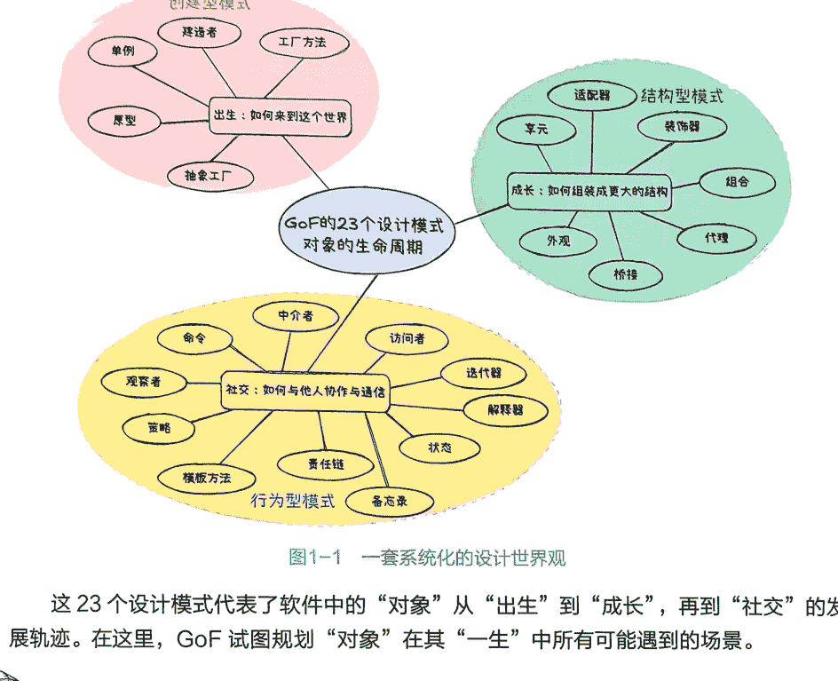

这 23 个模式描绘出软件中对象从诞生到成长再到协作的完整轨迹，试图覆盖对象生命周期里的典型场景。

> GoF 设计模式中的“对象”指系统中承担特定职责的最小功能单元。它并非现实物体的对应，而是程序中完成具体任务的实体。对象封装了状态与行为，并在协作中扮演角色。不同模式本质上是组织对象并协调其协作关系的不同策略。可以形象地说，对象是程序里的小工，模式则教这些小工如何分工、协同与履职。

### 1. 创建型模式

创建型关注对象的诞生。表 1-1 列出创建型模式及其目的、工程解读与类比。

表 1-1 创建型模式

| 设计模式 | 核心目的 | 工程视角的解释 | 类比 |
| :--- | :--- | :--- | :--- |
| 单例（Singleton） | 确保类在系统中仅有一个实例且全局可达 | 通过私有构造与静态访问控制实例数量，并发下需兼顾线程安全、懒加载/饿加载及测试可替换性，常用于配置、日志、线程池等共享资源 | 太阳系的太阳：唯此一颗，诸行星皆围绕 |
| 工厂方法（Factory Method） | 统一封装对象创建逻辑，使用者无需关心构造细节 | 工厂类集中创建对象，依据参数或配置决定具体类型，实现使用者与具体类的解耦，便于扩展替换 | 汽车生产线：客户只选车型，不问焊接喷漆 |
| 建造者（Builder） | 分步构建复杂对象，支持灵活配置与可读流程 | 建造者逐步设定属性后统一生成成品，便于控制顺序与校验，常用于参数众多且构建流程稳定的场景 | 搭积木：先底座后墙体再屋顶，步骤清晰可控 |
| 原型（Prototype） | 通过克隆已有对象创建新对象，避免从零构建 | 对象构建成本高时，克隆原型后微调即可，需设计浅拷贝/深拷贝防止共享或复制失误 | 细胞分裂：复制一份再在复制体上变化 |
| 抽象工厂（Abstract Factory） | 生产产品族，保持系列产品一致兼容 | 对一组相关产品抽象工厂接口，为不同风格提供具体实现，客户端依赖抽象保证风格统一易切换 | 主题套装：北欧风家具套装风格统一 |

### 2. 结构型模式

结构型关注对象的组合。表 1-2 列出结构型模式及其目的、工程解读与类比。

表 1-2 结构型模式

| 设计模式 | 核心目的 | 工程视角的解释 | 类比 |
| :--- | :--- | :--- | :--- |
| 适配器（Adapter） | 使接口不兼容的组件可协同工作 | 通过中间层对象转换旧接口为新接口，用于接入第三方库、迁移旧系统、统一规范，对外接口不变 | 电源转换器：不同插头经转换即可供电 |
| 桥接（Bridge） | 分离抽象与实现，使两者独立扩展 | 将多维度变化解耦，如图形类型与渲染方式，抽象持有实现引用，运行时动态组合避免继承爆炸 | 遥控器与电视：抽象控制与品牌实现分离 |
| 组合（Composite） | 以树形结构统一处理单对象与组合对象 | 统一组件接口，叶子与组合节点均实现该接口，客户端无视结构复杂度统一调用 | 文件系统：文件与文件夹操作统一 |
| 装饰器（Decorator） | 不修改原类前提下动态增添功能 | 通过包装实现同接口，内部持有原对象，调用前后注入逻辑，灵活组合功能，避免多继承爆炸 | 俄罗斯套娃：层层包裹逐层增加花纹 |
| 外观（Facade） | 为复杂子系统提供统一简洁入口 | 封装复杂调用逻辑，对外暴露简化 API，降低使用门槛与耦合 | 汽车方向盘：操作简化，隐藏发动机变速箱 |
| 享元（Flyweight） | 通过共享细粒度对象降低内存占用 | 抽取不变内部状态共享，可变外部状态由调用方维护，适用于大量相似对象场景 | 字母表：26 个字母共享，位置各不同 |
| 代理（Proxy） | 控制对象访问，在访问前后附加逻辑 | 代理与真实对象实现同一接口，外部以为操作真实对象，实则经代理完成懒加载、权限、远程、缓存等 | 秘书：筛选访客电话，决定是否打扰 |

### 3. 行为型模式

行为型规定对象如何协作。表 1-3 列出行为型模式及其目的、工程解读与类比。

表 1-3 行为型模式

| 设计模式 | 核心目的 | 工程视角的解释 | 类比 |
| :--- | :--- | :--- | :--- |
| 责任链（Chain of Responsibility） | 请求沿链传递，各节点决定处理或继续传递 | 多处理器串成链，发出方无需关心具体处理者，适用于日志、审批流、HTTP 中间件等，链过长调试困难 | 公文流转：科员→经理→总监逐级审批 |
| 命令（Command） | 将请求封装成对象，便于排队、撤销、重做、记录 | 操作抽象为 Command 对象含接收者与参数，调用方只发命令，适用于事务、操作记录、宏执行 | 遥控器按钮：每个按钮代表一个命令 |
| 迭代器（Iterator） | 统一方式按序访问聚合内部元素，不暴露结构 | first、next、hasNext 等接口遍历集合，隐藏内部结构，便于扩展正向反向层级等遍历策略 | 翻书：只管翻页，不问装订方式 |
| 观察者（Observer） | 建立一对多通知，状态变化自动通知订阅者 | 主题维护观察者列表，状态变更时回调，适用于事件系统、GUI 监听、推送，需避免通知风暴与环依赖 | 报纸订阅：出刊后所有订阅者皆收到 |
| 策略（Strategy） | 将可替换算法封装，运行时按需切换 | 统一策略接口，不同实现代表不同算法，调用方仅依赖接口，可配置或运行时切换 | 出行方式选择：地铁、打车、骑车皆为 A 到 B |
| 模板方法（Template Method） | 父类定义处理流程骨架，子类重写部分步骤 | 父类定义流程，变化步骤抽象为钩子由子类实现，适用于流程稳定步骤可变场景，对继承依赖重 | 食谱：备菜→下锅→调味→出锅，细节可变 |
| 访问者（Visitor） | 不改变数据结构前提下新增操作 | 数据结构提供 accept，访问者实现不同操作，如统计导出校验，适用于结构稳定操作多变场景 | 税务审计：企业结构不变，审计方案可多变 |
| 状态（State） | 对象内部状态改变时改变自身行为 | 不同状态行为封装到独立类，上下文委托给当前状态对象，消除大量 if-else/switch | 心情变化：人未变，行为随状态改变 |
| 备忘录（Memento） | 不破坏封装前提下捕获并恢复对象内部状态 | 快照对象保存状态交管理者保管，可随时恢复，适用于编辑器撤销重做、游戏存档 | 游戏存档：打 Boss 前存档，失败后读档重来 |
| 中介者（Mediator） | 通过中介对象封装对象间交互 | 网状多对多关系简化为星形一对多，各对象不直接通信，经中介转发，降低耦合但可能导致中介臃肿 | 机场塔台：飞机不直接通信，由塔台统一调度 |
| 解释器（Interpreter） | 为特定语言定义文法并实现解释器解析处理 | 将领域问题建模为语言语法规则，为每条规则创建类，适用于语法简单变动不频繁场景 | 乐谱演奏：乐谱是语言，演奏家是解释器 |

即便对逻辑能力强的工程师，这 23 个模式也显抽象，部分难以直观把握。

### 1.1.3 框架的力量

GoF 的伟大在于首次把经验转化为词汇。

在此之前，开发者间解释设计需画图、写伪代码、举例，费力却易失真。如今只需说“这里用了观察者模式”，对方即心领神会。再说“这里用工厂方法加策略模式解耦支付逻辑”，双方即能在抽象层快速达成共识，沟通成本骤降。

模式不仅是写法，更是团队沟通的共同语言。

这种共同词汇的建立，意义堪比巴别塔倒塌后人类重新获得共通语言。它让软件设计从手工艺走向工程学，使经验得以跨越时空传承。硅谷与东京的开发者虽未谋面，也能通过“工厂方法”“观察者”产生共鸣。

① 这四位作者常被称作“四人组 Gang of Four，GoF”。

往回看，设计模式本质上是把繁杂的实现压缩成高浓度的文化记号（见图 1-2），让工程师交流变得像光纤传导一样通畅。

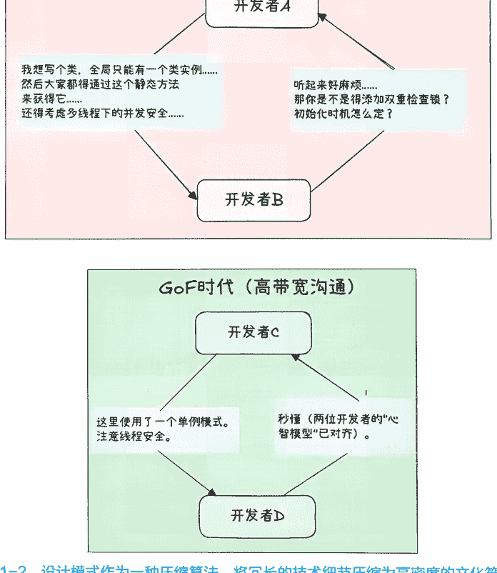

它的核心其实是工程思维：压低复杂系统里的不确定因素，让每个对象担起自己职责、保持松耦合、可被替换。创建型、结构型、行为型三大类，正是对“东西从哪里来、怎样拼、怎么配合”这三类根本疑问的回答。

掌握23种模式的关键，并非死记名称，而是把这三种思维内化成工作直觉。

- 创建型：关注对象如何诞生，用来缓解构造复杂、耦合紧密、可扩展性差的问题。
- 结构型：关注对象怎么拼装，用来处理模块衔接与系统复杂度的矛盾。
- 行为型：关注对象间协作方式，用来划分职责、降低耦合、让业务流更易伸缩。

每个模式都指向三种自问。

- 当下卡住的是什么？构造繁琐？类太多？依赖乱？扩展难？
- 用上以后哪些关系松动了？使用方与生产方分离？抽象与具体分离？数据与行为分离？
- 以后改动能否局限最小？譬如只换策略、只添装饰、只增工厂方法？

模式彼此可组合，并非互斥。

- 抽象工厂+组合+迭代器，可搭出跨平台界面部件库。
- 命令配合备忘录，能实现强力的撤销与重做机制。
- 观察者搭配策略与责任链，可构建灵活可配置的事件处理体系。

真正吃透模式，等于拿到一套可复用的思考框架。面对变化时不再靠灵感，而是像建筑师那样把系统拆解为稳定结构、清晰职责与可控演化路线。

模式不是技巧，而是让复杂系统保持长期可演进的工程哲学。

## 1.1.4 秩序的代价

“软件可以规划，如同城市可以设计。”GoF 传达的就是这种世界观，也是当时软件工程界的共识。大家相信，只要挑对模式、搭对结构，就能驯服复杂性，盖出完美的软件宫殿。

秩序总要付出代价。

实践里冒出新麻烦：初学者为用模式而用，简单问题被过度复杂化，代码里堆满无谓抽象。“设计模式”从良药变毒药，从工具变成教条。

一个简单的 Hello World，在狂热信徒手里会变成下面这样。

```
// 通过工厂方法模式创建打印机
PrinterFactory factory = new PrinterFactory();
// 通过策略模式选择输出策略
OutputStrategy strategy = new ConsoleOutputStrategy();
// 通过单例模式获取消息管理器
MessageManager manager = MessageManager.getInstance();
// 通过建造者模式构建消息
Message message = new MessageBuilder()
    .setContent("Hello")
    .append(" ")
    .append("World")
    .build();
// 通过命令模式执行输出
Command printCommand = new PrintCommand(factory.createPrinter(strategy), message);
printCommand.execute();
```

把这段代码画成流程图，会得到图1-3那样的图景——软件工程版的鲁布·戈德堡装置。

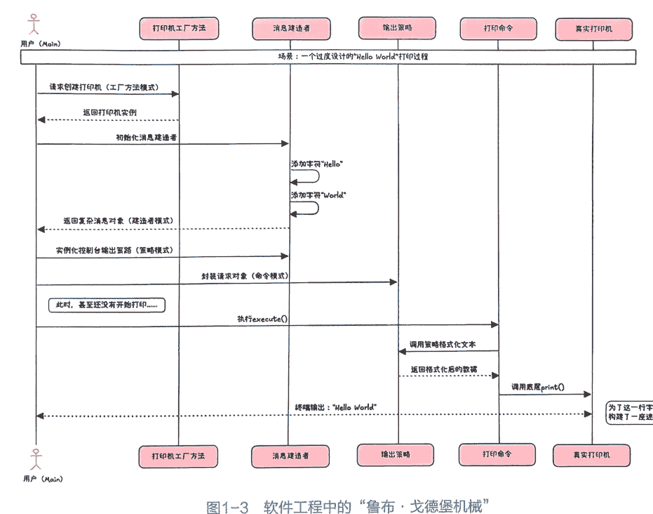

当手段变成目的，简单功能就被抽象淹没。这种讽刺案例后被叫做模式泛滥症。

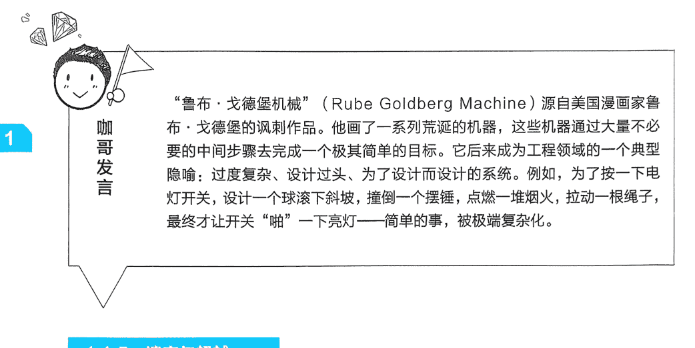

## 1.1.5 遗产与超越

GoF 的贡献依旧长存。他们留下的不仅是23种模式，更是一套思考方式。

- 问题出发：每个模式都源于一类反复出现的问题
- 场景依赖：适用性受具体情境制约
- 取舍意识：每个解法都有得有失
- 演进留白：设计要给变化留空间

这套方法影响了一代开发者。即便现在聊微服务、函数式、响应式，用的还是 GoF 创立的词库，工作的仍是他们开辟的思维框架。

GoF 是软件工程的启蒙者。他们让大家相信混乱可被整理，经验可被传承，软件可被设计而不只是写出来。这种对秩序的承诺、对理性的信仰，定义了一个时代。

不过 GoF 描述的是上帝视角的静态世界。类关系在编译期就固定，行为由代码严格限定。开发者像独裁者，运行前就把所有路径排好。

当理性被推到极致，当秩序变成教条，变革便迫在眉睫。新的声音响起：“敏捷重于计划”“简单重于复杂”“演化重于设计”……

尤其是进入人工智能时代，这种确定性的舒适区反而变成桎梏。构建智能体时，我们要的不是只会机械执行指令的单例，而是能依据环境自主判断、动态决策的伙伴。GoF 建立了秩序，但过度秩序有时等于牢笼。

软件世界正酝酿新一轮范式转换。

## 1.2 黄金时代：设计模式的繁荣与边界

如果说 GoF 在荒原竖起第一块路标，后面十年里工程师就在这块土地上筑起了罗马城。

### 1.2.1 工业化的狂欢

1995到2005，是设计模式的黄金十年。

面向对象从实验室玩具变成工业标准。Java 1995 年带着一次编写处处运行的口号出现；C++1998 年完成标准化，成为系统级编程霸主；C#2000 年诞生，汇聚百家所长。

整个世界都在用对象说话，J2EE 把这股秩序推向顶峰。J2EE 不只是框架，而是一套严格的工业规范。它以统一标准定义企业级开发：比如 EJB，它不只是代码，更像组件规范——即便做个简单业务，也得写 Home 接口、Remote 接口和 Bean 类。设计繁琐，却把设计模式固化成规范——分布式对象、事务、安全全被封装进标准容器。

对大企业而言，这是梦寐以求的景象：软件开发不再是艺术家的个人秀，而是可复制、可管理、可替换的工业流程。

大学开始系统讲授设计模式，成为计算机专业必修课。招聘广告里满是精通 J2EE 架构、熟悉 GoF 模式的要求。架构师像中世纪石匠，手握 J2EE 这件重器，用模式积木搭起愈发宏伟也愈发沉重的软件大教堂。

### 1.2.2 四大革命的展开

随着模式思维的革新，四次深刻的架构革命相继展开。

**第一次革命：结构抽象化——从混沌到层次**

MVC 虽不在 GoF 23 种之列，却是模式思想最早最成功的实践。下面用一个用户资料更新场景，直观展示模型、视图、控制器如何配合。

```
// Model —— 数据与业务逻辑
class UserModel {
    private String name;
    private int age;

    public void updateProfile(String name, int age) {
        this.name = name;
        this.age = age;
        notifyObservers(); // 观察者模式的应用
    }
}

// View —— 展示层
class UserView {
    public void render(UserModel model) {
        System.out.println("Name: " + model.getName());
        System.out.println("Age: " + model.getAge());
    }
}

// Controller —— 控制层
class UserController {
    private UserModel model;
    private UserView view;

    public void handleUserInput(String name, int age) {
        model.updateProfile(name, age);
        view.render(model);
    }
}
```

MVC 的价值在于首次让开发者意识到复杂应用可分层：数据是数据，展示是展示，控制是控制。分离后代码更清晰，也让不同角色并行：设计师管 View，业务专家管 Model，架构师调 Controller（见图1-4）。

> Struts 与 Spring MVC 让 MVC 几乎成了 Java Web 的真理。Struts 之前，Web 应用多用 JSP+Scriptlet，代码混乱难维护。Struts 首次把 Controller、Action、View 的边界从约定提升为框架强制约束，让社区统一架构范式。随后 Spring MVC 更把这套真理固化成标准实践：靠注解、路由映射、拦截器链、依赖注入，让请求到控制器到服务到视图成为默认思维。久而久之，MVC 不只是模式，被视作企业开发必需品。十多年里，几乎所有企业系统、教材和面试都围绕它展开。

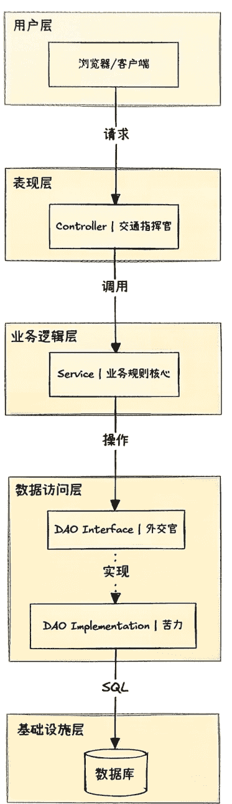

图1-4 MVC：复杂的应用可以分层设计

数据访问对象进一步推进抽象，造出防腐层，分清界限：上层业务只谈对象，下层持久才处理 SQL 与连接池。

```
// 完全隔离数据访问逻辑
interface UserDAO {
    User findById(int id);
    void save(User user);
    void delete(User user);
}

// 可以随意切换具体实现
class MySQLUserDAO implements UserDAO { ... }
class MongoUserDAO implements UserDAO { ... }
class RedisUserDAO implements UserDAO { ... }
```

它的精髓不在数据库切换，而在让业务逻辑更纯粹。DAO 接口像外交官，立在纯净的 Java 对象王国与复杂的数据库泥潭之间。

- 对外，业务层用优雅面向对象语言，如 save(User)
- 对内，对数据库精通多种方言，如 SQL、BSON、键值

通过这种抽象，核心逻辑不再受存储技术牵制。正因如此，即便数据库持续演进，企业核心业务代码仍能保持十年稳定。这正是抽象的力量——用不变接口应对万变实现。

**第二次革命：依赖反转——控制权的解放**

2003 年 Spring 出现，让依赖注入从理论走向实践。

传统写法是我要什么就自己new。请看示例。

```
class OrderService {
    private DatabaseConnection db = new MySQLConnection(); // 硬编码依赖
    private EmailService email = new SMTPEmailService();  // 硬编码依赖

    public void processOrder(Order order) {
        db.save(order);
        email.send(order.getCustomerEmail(), "Order confirmed");
    }
}
```

代码里 new 是最强的耦合胶水。写下 new MySQLConnection() 等于宣称 OrderService 生生世世绑定 MySQL。若日后想换 Oracle 或本地用内存库测试，只能改源码重编译。好比把发动机焊死在底盘，想换就得把整车熔了重造。

而 IoC 容器说告诉我需要什么，我来准备。请看示例。

```
class OrderService {
    @Autowired
    private DatabaseConnection db; // 注入的依赖
    @Autowired
    private EmailService email; // 注入的依赖

    public void processOrder(Order order) {
        db.save(order);
        email.send(order.getCustomerEmail(), "Order confirmed");
    }
}
```

变化看似微小，实则革命。它让组件独立、测试可行、系统组装像拼乐高一样灵活。

这像好莱坞原则：别打电话给我们，我们会打给你。

- 以前对象主动自取资源
- 现在对象只需标注需求，容器启动时把准备好的 DatabaseConnection 注入进来

控制权从对象转向容器，如图1-5。

那种被动带来巨大好处，尤其在测试层面。没有 IoC 时，测试 OrderService 逻辑而不真发邮件几乎不可能，因为邮件服务在代码里写死。

在 IoC 下，测试变得容易，看示例。

```
// 测试时，注入一个假的 EmailService
OrderService service = new OrderService();
service.setEmailService(new MockEmailService()); // 注入假的对象
service.processOrder(order);
// 验证：并没有真的发送电子邮件，只是记录了调用行为
```

这让开发从手工艺雕刻变工业化组装。我们不再写死代码，而是在编排组件。接口对得上即可替换。

这种可插拔思想为微服务兴起奠基，也为今天智能体工具动态挂载埋下伏笔——智能体挑选策略或工具，本质上就是动态依赖注入。

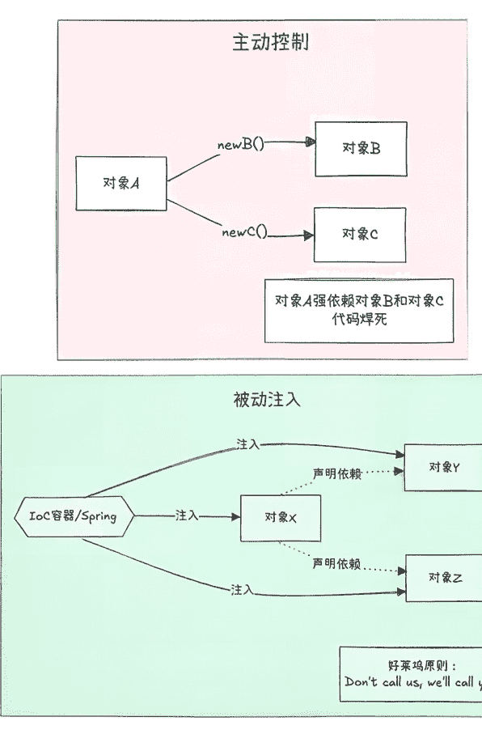

图1-5 控制权从对象反转到容器中

**第三次革命：行为可配置——从硬编码到软定义**

策略模式广泛应用后，算法变成可替换零件。怎么理解？先看一段用 if-else 的传统写法。

```
// 传统方式：丑陋的 if-else 语句
class PriceCalculator {
    public double calculate(Customer customer, double amount) {
        if (customer.getType() == CustomerType.REGULAR) {
            return amount * 0.95;
        } else if (customer.getType() == CustomerType.VIP) {
            return amount * 0.80;
        } else if (customer.getType() == CustomerType.SUPER_VIP) {
            return amount * 0.70;
        }
        return amount;
    }
}
```

在 if-else 世界里，程序行为编译时就锁定。而在策略模式下，对象行为可在运行时改变。

```
// 策略模式：优雅的多态
interface PricingStrategy {
    double calculate(double amount);
}

class RegularPricing implements PricingStrategy {
    public double calculate(double amount) { return amount * 0.95; }
}
class VIPPricing implements PricingStrategy {
    public double calculate(double amount) { return amount * 0.80; }
}
// 行为完全可配置
class PriceCalculator {
    private PricingStrategy strategy;

    // 请注意 setStrategy 这个方法
    public void setStrategy(PricingStrategy strategy) {
        this.strategy = strategy;
    }

    public double calculate(double amount) {
        return strategy.calculate(amount);
    }
}
```

这一次迁移表面上只移动了几行代码，实质上却碰到了软件设计最关键的准则——开闭原则 Open-Closed Principle，简称 OCP。

- 过去的做法里，PriceCalculator 像一座完全封死的堡垒。只要想加入新的会员等级，比如黑金会员，就得打开类体，像拆弹那样谨慎地改写内部的 if-else 判断。每次触碰，都可能带来新的缺陷。

- 采用策略模式之后，PriceCalculator 演变为可更换的上下文 Context。它并不关心折扣的具体计算，只约定自己需要一个 PricingStrategy。新增折扣规则时，只需额外编写一个实现接口的类，旧的实现完全不动。变化的算法与不变的价格计算流程就此拆分开来（见图 1-6）。

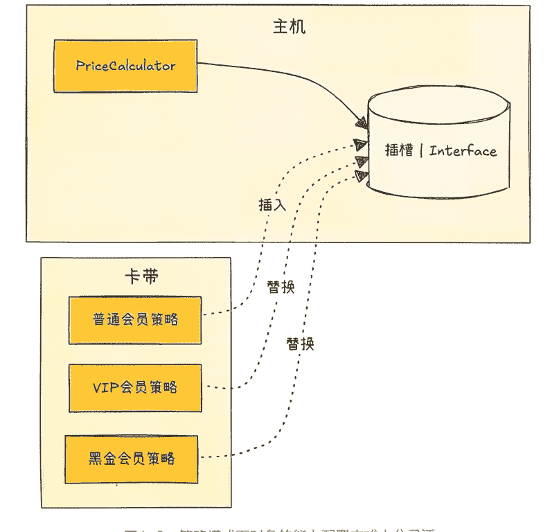

图1-6 策略模式下对象的能力配置方式十分灵活

设想一个游戏里的角色。

- 装备弓箭时，角色的攻击方式变为远程攻击 RangedAttack。
- 换上大剑后，攻击立即切换为近战攻击 MeleeAttack。

对象不再是固定的，它能根据外界变化调整行为，这正是 Agent 概念的雏形。

- GoF 时代，开发者要手动调用 setStrategy 来切换算法。
- Agent 时代，Agent 会感知环境、进行推理，自主挑选合适的策略或工具来解决问题。

## 第四次浪潮：图景化的设计语言

UML 即统一建模语言 Unified Modeling Language，作为软件设计师的通用语，提供类图、序列图、状态图等标准化表达。软件设计首次能够在不写一行代码的情况下完整呈现（见图 1-7）。

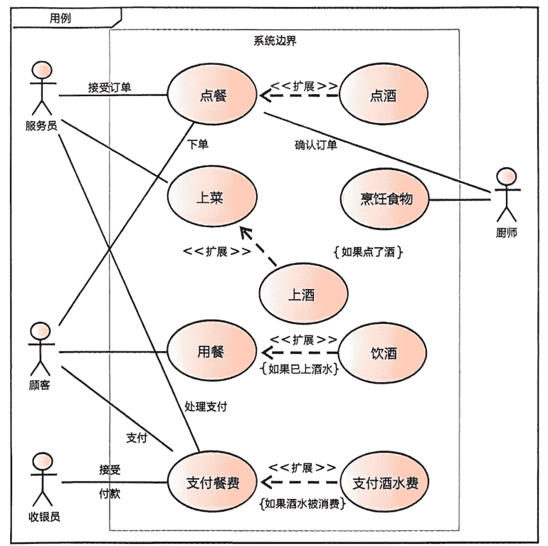

图1-7 UML成为软件设计师的标准化语言

Rational Rose、Together、StarUML 等工具让“先画图后写码”成为可能。架构师先在白板上勾勒系统骨架，工具再自动生成代码框架。这是软件工程最接近建筑设计的时刻——先设计，再建造。

### 1.2.3 工匠精神的巅峰

在设计模式的黄金时期，工匠精神被展现得极致。

- 马丁·福勒 Martin Fowler 的《重构：改善既有代码的设计》教会大家如何打磨存量代码。
- 罗伯特·马丁 Robert Martin 的《敏捷软件开发：原则、模式与实践》阐明了 SOLID 原则的精妙。
- 埃里克·埃文斯 Eric Evans 的《领域驱动设计：软件核心复杂性应对之道》把模式思想带入业务建模领域。

……

开发者仿佛中世纪行会的成员，各自掌握着秘传的手艺。

- 单一职责原则 Single Responsibility Principle，SRP：一个类只负责一件事。
- 开闭原则：对扩展开放，对修改关闭。
- 里氏替换原则 Liskov Substitution Principle，LSP：子类必须能够无缝替代父类而不破坏正确性。
- 接口隔离原则 Interface Segregation Principle，ISP：不要强迫客户端依赖它用不到的接口。
- 依赖倒置原则 Dependency Inversion Principle，DIP：要依赖抽象，不要依赖具体实现。

代码如建筑，模式即蓝图。每行代码都经过深思，每个类的存在都有依据。代码评审像艺术评论，重构像对雕塑的精细打磨。

然而当手段被神化，目标容易被遗忘。对代码纯洁性的极致追求带来秩序与美感，却也筑起高墙，把软件工程推向象牙塔，让人沉迷于打造完美水晶球，而忽视了对现实世界复杂性的灵活应对。

### 1.2.4 静态世界的落幕

就在设计模式与 J2EE 工业标准把软件工程推向高峰时，内部已出现隐秘的疲惫。GoF 在《设计模式：可复用面向对象软件的基础》中勾勒出一个理性的静态世界：系统边界清晰，需求变更可预测，运行环境稳定不变。在此框架下追求极致解耦与完美抽象，过度规范逐渐变成重型工程美学。

为了遵循所谓最佳实践，哪怕是最简单的 Hello World 也可能需要配置五份 XML 文件；为了追求解耦，一个基础业务操作可能要穿越七层架构。架构师沉迷于绘制完美的 UML 图，却让代码库变得臃肿。

此时的软件工程像巴洛克建筑：精美、复杂、沉重。开发者以为自己在建造永恒金字塔，实际上却陷入过度设计的陷阱。内部僵化让人窒息，《敏捷宣言》 Agile Manifesto 的出现正是这种束缚的反抗。

真正的危机并非来自系统内部，而是来自外部变化。当大家还在为单例模式是否该用争论不休时，外界世界已发生翻天覆地的改变。

## 1.3 诸神的黄昏：当确定性遇到不确定性

诸神并非战死，而是被环境变迁所淘汰。

很长一段时间里，我们以为软件工程的终极目标是打造一座精密钟表：齿轮啮合、分秒不差、尽在掌控。GoF 的设计模式以及后来的工程体系，正是这座钟表的蓝图。我们相信只要设计足够严谨，就没有处理不了的逻辑，也没有不可预见的未来。

可互联网的浪潮早已改道。新世界不再是静态钟表，而是咆哮的海洋。旧秩序不仅失效，甚至成为绊脚石。

### 1.3.1 第一声警报

2008 年 10 月，Twitter 如今的 X 宕机了。

并非普通的宕机——服务器仍在运行，数据仍在响应，每个组件看似正常，但整体如陷泥潭，响应时间从毫秒级恶化到分钟级。开发者反复排查，发现每个设计模式都待在它该在的位置：观察者模式用于事件通知，工厂方法模式负责对象创建，单例模式管理连接池。

代码很完美，架构很优雅，但服务是死寂的。问题出在哪？

问题在于，当上百万用户同时涌入时，精心设计的观察者模式变成了雪崩的导火索。一条推文触发一连串通知，每个通知又触发更多通知，原本精巧的设计演变成一场完美风暴。

这是第一声警报：确定性设计撞上了充满不确定性的场景。

GoF 的设计模式诞生于静态世界。

- 系统边界明确：企业内部系统，用户已知，功能可控。
- 行为路径可预测：用户点按钮 A，系统执行流程 B。
- 需求变更可预测：一年发布数个版本，变更经过严格评审。
- 运行环境稳定：单机或小规模集群，故障模式简单。

21 世纪的第一个十年，一切都变了。

- Web 2.0 带来用户爆炸：用户数从千人级跃升到亿人级，范围从固定用户扩展到全球，服务时间从朝九晚五变为 7×24 小时不间断。
- 分布式成为常态：架构从单机演进到数千台服务器，通信从同步调用转向异步消息，事务模型从 ACID① 转向 BASE②，一致性策略从强一致转向最终一致。
- 敏捷思想改变开发节奏：发布频率从年度变为每日部署，开发模式从瀑布转向持续迭代，设计原则从详尽完备变为够用即可，架构方式从预先设计转向演进式设计。
- 移动互联网改变交互模式：输入方式从键盘鼠标变为触摸手势，显示设备从大屏转向小屏，网络连接从有线变为无线，使用场景从固定位置变为随时随地。

> ① ACID 是 Atomicity 原子性、Consistency 一致性、Isolation 隔离性、Durability 持久性的首字母缩写，用于传统数据库事务处理，强调数据强一致与事务完整性。
> ② BASE 是 Basically Available 基本可用、Soft state 软状态、Eventually consistent 最终一致性的缩写，用于分布式系统和高并发场景，强调可用性与伸缩性，允许数据在一定时间内短暂不一致。

### 1.3.2 不确定性的三重奏

不确定性不是突然降临，它像满月潮水从三个方向同时涌来。

**第一重：规模的不确定性**

传统设计假设用户数可控，负载可预测。比如银行知道客户数，企业软件知道员工数。设计模式在有界世界里游刃有余。

但互联网打破了边界，请看下面的示例。

```
// 传统设计：假设用户数量可控
class NotificationService {
    private static final int MAX_OBSERVERS = 10000;
    private Observer[] observers = new Observer[MAX_OBSERVERS];

    public void notifyAll(Event event) {
        for (Observer observer : observers) {
            observer.update(event); // 同步通知，假设用户数有限
        }
    }
}
```

现实是，用户数可能是十个，也可能是上千万。互联网时代一条推文可能需要通知上千万粉丝，在这种情况下传统观察者模式瞬间崩溃。

**第二重：行为的不确定性**

传统设计假设用户行为可预测。点击按钮 A，执行流程 B。用户像机器，系统像齿轮，一切井然有序。

社交网络改变了一切，请看下面的示例。

```
// 传统设计：线性的用户路径
class ShoppingCart {
    public void processOrder() {
        // 明确的流程：浏览→添加→结账→支付
        validateItems();
        calculatePrice();
        processPayment();
        sendConfirmation();
    }
}
```

现实是，用户行为是非线性、突发、群体性的。明星推荐可能让数百万用户同时涌向同一商品；Pinterest 的瀑布流让用户行为从搜索变为漫游。设计时假设的理性用户已不复存在。

**第三重：需求的不确定性**

传统设计假设需求可定义。花几个月分析，画出完整 UML，然后按图施工。但移动互联网摧毁了这一假设。请看下面的示例。

```
// iPhone 发布前的设计
interface MobileApp {
    void displayOnScreen(int width, int height); // 假设：屏幕尺寸固定
    void handleKeyPress(int keyCode);           // 假设：键盘输入
    void saveToStorage(File file);              // 假设：文件系统
}

// iPhone 发布后的现实
interface MobileApp {
    void handleTouch(MultiTouchEvent event);    // 多点触控
    void handleRotation(OrientationEvent event); // 屏幕旋转
    void handleGesture(GestureEvent event);     // 手势识别
    void handleSensor(SensorEvent event);       // 各种传感器
    void handleNotification(PushEvent event);   // 推送通知
    // 需求在爆炸式增长
}
```

需求的不确定性比前两者更致命。规模会压垮架构，行为会扰乱流程，而需求的不确定性会让系统失去方向感。在移动互联网时代，需求不是定义出来的，而是生长出来的——今天要直播，明天要短视频，后天要 AI 滤镜，大后天要虚拟形象。没有人能提前画出完整 UML，因为不知道产品会长成什么样。

传统假设是线性的：先确定需求，再设计架构，再扩展系统。互联网时代的现实是反向的：需求永远在变，架构必须适应变化，才能继续存活。这意味着软件开发不再是盖房子，更像是驯服一头不断进化的生物体。

- 功能会爆炸式增长。
- 需求会不断自我否定。
- 未来形态完全不可预测。
- 任何一次技术浪潮都可能重塑交互方式，比如触控、手势、传感器、AI。

因此，设计模式必须从可预见的结构变为可演化的结构。开发者不能再追求完备，而要追求适应性；不能再试图预测未来，而要让系统有能力在未来重新组合。

### 1.3.3 设计模式的失效

在不确定性面前，经典设计模式开始一个接一个失效。首先是单例模式的悖论。

```
// 传统单例模式：在单机时代完美工作
class DatabaseConnection {
    private static DatabaseConnection instance;

    public static synchronized DatabaseConnection getInstance() {
        if (instance == null) {
            instance = new DatabaseConnection();
        }
        return instance;
    }
}
```

在分布式时代，单例变成瓶颈。百台服务器不可能每台都有自己的单例；全局锁导致性能瓶颈，同时单例增加单点故障风险。对此 Netflix 的解决方案：放弃单例，拥抱冗余。

其次是工厂方法模式的僵化。

```
// 传统工厂方法模式：产品类型在编译时确定
interface CarFactory {
    Car createSedan();
    Car createSUV();
    Car createTruck();
}
```

在 AI 时代，产品类型在运行时学习。特斯拉的自动驾驶系统每天都在学习新的驾驶模式，传统工厂方法无法处理运行时演化的产品。

最后是观察者模式的雪崩。

```
// 传统观察者模式：假设通知是即时且可靠的
class EventPublisher {
    private List<Observer> observers = new ArrayList<>();

    public void publish(Event event) {
        for (Observer obs : observers) {
            obs.handleEvent(event); // 如果一个观察者阻塞，则全部观察者阻塞
        }
    }
}
```

现实情况是，Facebook 如今属 Meta 的 News Feed 中，单个用户的动态可能需要推送给数百万其他用户，同步观察者模式会导致系统雪崩。Facebook 的解决方案：消息队列、最终一致性与流处理。

这些例子反映的不仅是技术问题，更是哲学问题。

### 1. 机械论与有机论

GoF 的设计模式诞生于机械论世界观：系统是零件组合，整体等于部分之和，因果关系线性，未来可预测。

但真实世界更像有机体：系统是关系网络，整体大于部分之和，因果关系循环，未来是涌现的（见图 1-8）。

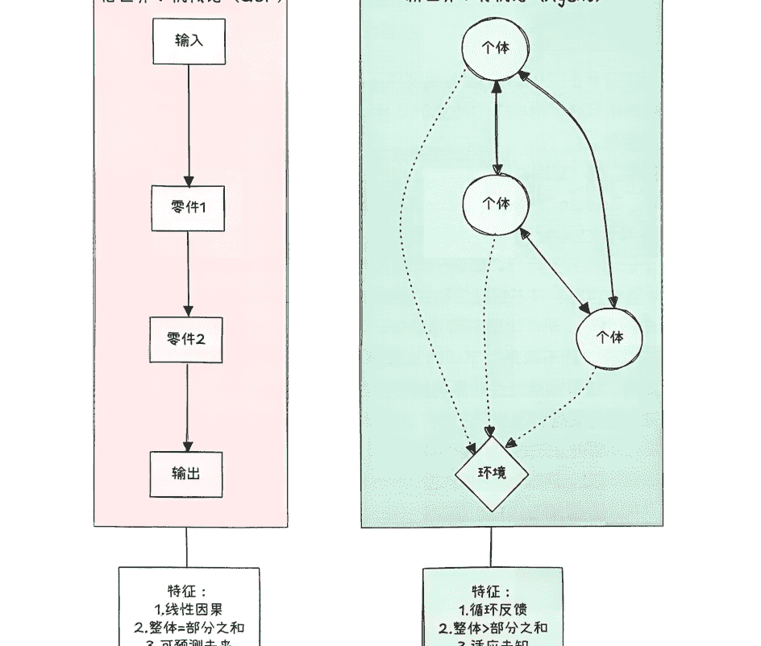

### 2. 设计与演化

传统软件工程相信设计先于实现：需求分析→系统设计→详细设计→编码实现→测试部署。

互联网产品遵循演化优于设计：最小可行产品 MVP→用户反馈→快速迭代→数据驱动→持续演化。Facebook 的座右铭 Move Fast and Break Things 即快速行动，打破常规，是对传统设计哲学的公开挑战。

### 3. 控制与适应

设计模式试图控制复杂性：通过接口控制依赖，通过封装控制状态，通过继承控制变化。

复杂系统需要适应：通过反馈适应环境，通过学习适应变化，通过演化适应未知。

软件世界正在从静态设计走向动态演化，从确定性走向适应性。而在这个新世界里，我们需要的不仅是设计模式，更是一种新的思维方式——拥抱变化、适应不确定性。

### 1.3.4 转折点

如果说 2008 年的 Twitter 宕机是软件工程旧时代崩溃的信号，那么 2012 年至 2014 年则是新秩序在废墟中建立的三年，这一时期发生的一系列事件彻底重构了软件工程的底层逻辑。

### 1. 从“单机精修”到“宏观概率”

二〇一二年 Google 公布了《The Datacenter as a Computer》。在此之前，工程师的焦点几乎钉在单机之上，像修表师傅那样追求每台服务器、每个进程都近乎完美，机器一旦宕机就会被当成重大事故追责。Google 给出的反转是：真正运行的不是零散的硬件，而是整座数据中心这台巨型计算机。

在该视角下，硬件损坏不再被视作小概率意外，而是一种可预期的统计现象。磁盘总会失效，网络难免波动。软件设计的取向因此从“杜绝故障”转向“在故障常态化时仍保持可用”。这是一次从确定论向概率论的第一次转向。

### 2. 鲁棒性向反脆弱的转向

同年 Netflix 将 Chaos Monkey 开源。工程史上这几乎是一种挑衅：一家公司自行为生产环境写了一个会随机杀掉自家实例的程序。GoF 主流年代这种做法不可想象。Netflix 的思路很直白：既然故障不可避免，不如主动提升故障频率。

由此“反脆弱”正式进入软件工程的词典。系统不再追求钻石般坚硬、碎则无法修复的特质，而是像免疫系统那样，通过持续的小创伤不断进化生存能力。确定性设计想筑墙挡住混乱，反脆弱设计则试图借助混乱成长。

### 3. 不可变的基础设施

二〇一三年 Docker 登场。Docker 出现以前，服务器需要人工抚养。运维远程登录、装依赖、改配置、打补丁，时间久了每台机器都成了带着独家记忆的雪花，几乎不敢重启，没人说清它最终成什么模样。

容器化带来革命，让基础设施走向不可变。容器坏了不再修，直接销毁再起一个新实例。软件单元由此变成无状态的耗材，而非需要长期维护的资产。这也为后来智能体动态调用并丢弃工具环境提供了基础条件。

### 4. 控制权的让渡：声明式接口

二〇一四年 Kubernetes 出世。K8s 放弃命令式操作——先启动 A 再启动 B 失败就重试 C，而是给出声明式接口——我只要三个副本，具体达成方式你来处理。

它引入了关键的调解回路。

- 期望状态：使用者声明的意图。
- 当前状态：系统实际的模样。
- 调解器：持续感知差距并采取行动弥合差距。

感知—差异—行动的闭环，与智能体心智模型的雏形非常接近。Kubernetes 的控制器本质上就是面向特定任务的原始智能体。

这些变化指向同一个结论：确定性时代结束了。软件不再是精密的瑞士腕表，更像自组织的生物群落。

- 稳定不再来自单组件的完美，而来自群体的冗余与协作。
- 控制不再来自严苛指令，而来自意图的声明与动态调节。

我们学会不再扮演上帝去管控每颗电子的跃迁，而是学会引导一个充满不确定性的复杂系统：复杂系统的稳定源于持续适应，而非完美设计。

### 1.3.5 新世界的轮廓

在不确定性的土壤里，一场物种大爆发开始了。

若说 GoF 的设计模式是为了在单机时代对抗变化，那么新一代模式则是为了在分布式时代拥抱变化。曾经的经典在云原生浪潮下捉襟见肘：单例在集群里失去唯一性，观察者在异步网络里丢失实时性，严格的抽象工厂在微服务的碎片化调用面前显得笨重。

于是新的生存法则催生出新的模式。

- 从控制流程到响应变化：不再编写严格的指令序列，而是搭建数据管道。数据像水流一样通过，系统只对数据的到来做出反应。无论是 RxJava 还是现代流式计算框架，核心在于处理异步与背压，而非控制步骤。
- 从共享状态到消息传递：既然共享内存锁不住，就不要共享。行动者模型与微服务把对象还原到最原始定义——通过消息通信。组件之间近乎老死不相往来，仅靠异步信箱交换信息，从而实现真正的隔离与解耦。
- 从修改变量到不可变数据：为应对并发混乱，工程借鉴了函数式编程的智慧。不再原地修改，而是每次产生新状态。类似区块链或 Git 的提交记录，历史不可篡改，也就消除了竞争条件产生的缺陷。

## 从防御故障到拥抱故障：断路器、舱壁隔离、重试

断路器、舱壁隔离、重试等模式不再假设系统完美，而是假设故障随时会发生。它们是软件系统的安全气囊，正因承认脆弱，才换来反脆弱。

这些新模式共享同一哲学内核：放弃上帝视角的全局控制，追求局部的自治与适应。它们不试图消除不确定性，而是接纳它。

设计模式并未消亡，只是在进化：从 GoF 的 23 张建筑图纸，演变为云原生时代的生存指南。

## 小结 十字路口的坚定

二〇一六年 AlphaGo 击败李世石。

这不仅是人工智能的胜利，也是问题解决范式胜利的象征。AlphaGo 并未依赖预设定式，而是通过数百万局自我对弈涌现出超越人类理解的策略。

对软件工程的冲击巨大：如果围棋这样复杂的问题都无法靠设计解决，而要靠学习与演化，那么我们构建软件的方式是否也到了彻底重构的时刻？

软件工程正站在十字路口。

- 继续沿着 GoF 的道路，追求更精致的静态设计？
- 拥抱不确定性，探索动态演化的新形态？

旧范式在黄昏中退场，新力量正从代码缝隙中生长——函数式的纯粹、响应式的流动、分布式的共识。

从对象到智能体，从设计到演化，从确定到适应——软件工程的新纪元即将开启。

设计模式统治软件世界二十年，它将在新世界以何种形态重生？当我们不再编写代码，而是去指导一个拥有自主意图的智能体时，还需要设计模式吗？

答案是肯定的。但我们需要的不再是代码的模具，而是思维的罗盘。

在真正的智能体降临前，必须先完成一场思想的武装。

在第 2 章，让我们开始这场范式的迁移。

# 第 2 章

## 从模式到意图：软件工程的范式迁移

传统软件工程里，人们习惯用模式来降低复杂性。如今进入智能体时代，这一观念必须被重新审视：规则仍重要，但意图更关键。模式只回答怎么做，意图才回答为什么做。

随着系统规模扩张、环境不确定性上升、用户需求加速变化，固定的设计蓝图已显不足。智能体的出现，让意图首次能够显式嵌入系统，使软件具备理解问题、推演状态并执行动态行动的能力。

本章将回顾过去数十年的核心范式，并说明智能体系统从模式驱动走向意图驱动的必然性。

## 2.1 函数与流：计算的原子化

GoF 黄金时代，我们试图用静态的类和对象固化世界，坚信封装得足够好就能控制状态。随着互联网爆发和摩尔定律边际效应递减，我们慢慢认识到：控制状态的最佳方式，或许是尽量减少状态本身。

这为智能体的诞生埋下伏笔——大语言模型本质上是一个庞大且无状态的纯函数。

### 2.1.1 无状态的复兴：从对象封装到纯函数管道

一九七七年，John Backus 在图灵奖演讲中提出：“Can Programming Be Liberated from the von Neumann Style?” 他批判命令式编程只是修改状态的一串指令，预言程序应是数学函数的组合，无状态、无副作用，只有纯粹变换。这是函数式编程发展史上的里程碑。

他指出，当时的语言如 Fortran、C 本质上是冯·诺依曼架构的附庸。CPU 与存储分离，性能受限于总线传输——即冯·诺依曼瓶颈。命令式语言把变量映射为存储单元、赋值映射为数据传输，思维被硬件物理限制束缚，不得不做“一次一个字”的操作，像独裁者向内存发号施令，副作用与状态追踪随之而来。

但一九七七年内存以 KB 计、主频以 MHz 计，“不改状态”听起来像奢侈的幻想。面向对象正崭露头角，C++ 即将诞生，谁会在意这个数学幻想呢？

随之而来的是“名词的王国”——OOP 统治软件世界。Java 与 C++ 告诉我们世界由对象构成，应把数据与行为封装在类这个黑盒里。三十年后，随着云计算与人工智能浪潮，这个封装神话出现裂痕。

#### 1. 对象的重负：香蕉与大猩猩问题

Erlang 之父 Joe Armstrong 曾说：“OOP 语言附带隐式环境。你想要一根香蕉，结果得到一只拿着香蕉的大猩猩，外加整片丛林。” 图 2-1 刻画了 OOP 与 FP 的差异。


单机单核时对象封装有效。进入分布式后，可变状态成为麻烦根源。

- 状态纠缠：调用 user.updateBalance() 时，不仅改余额，还可能隐式触发 lastModifiedTime 更新或 Observer，导致调用难以精确测试。
- 并发噩梦：数万线程同时改同一对象状态，必须引入锁，既拖慢性能又易死锁。

图 2-2 展示了 OOP 与 FP 的工作流程差异。

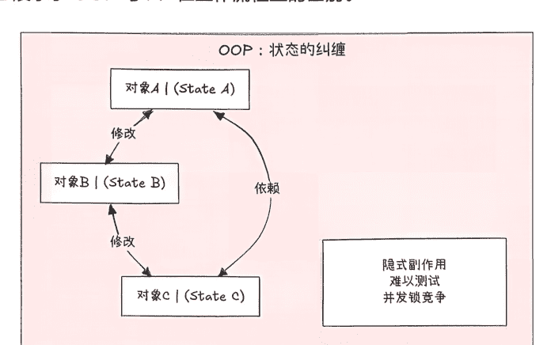

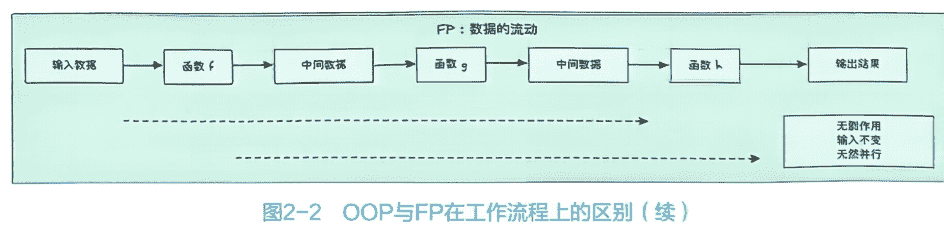

#### 2. 函数式的救赎：引用透明与管道

为应对“状态危机”，工程大量吸纳 FP。FP 的核心很简单：控制状态最好的办法是消灭状态。

- 纯函数：相同输入始终得相同输出，不依赖全局变量，不产生副作用。
- 不可变性：数据创建后不可改，需“修改”就新建副本。

下面通过两种风格的代码感受差异，有助于理解智能体设计思路。

```python
# OOP 风格：有状态的 Agent
class ChatBot:
    def __init__(self):
        self.history = [] # 内部隐式状态

    def chat(self, user_input):
        self.history.append(user_input)
        response = model.predict(self.history)
        self.history.append(response)
        return response

# 使用示例
bot = ChatBot()
bot.chat("Hello")
```

上述代码输出依赖 bot 内部维护的历史状态，行为难复现难调试。

```python
# FP 风格：无状态的转换
def chat_completion(history, user_input):
    # 纯函数：给定输入，始终产生确定的输出
    new_history = history + [user_input]
    response = model.predict(new_history)
    return response, new_history + [response]

# 使用示例
history = []
resp, history = chat_completion(history, "Hello")
```

上述函数式代码每次调用都显式传入完整上下文，行为完全确定，可复现性更好。

FP 把状态从代码内部剥离，作为显式参数传递。这种无状态设计，正是云原生架构与无服务器计算的基石。

#### 3. 终极映射：LLM 即纯函数

为何花篇幅介绍 FP？因为它是理解人工智能智能体本质的基础。

LLM 本质是一个巨大的无状态纯函数：输出 = f(权重，上下文)。

- 权重：推理阶段冻结，多次调用模型本身不变。
- 上下文：唯一变量。智能体的“记忆”不在模型内部，而是每次以参数形式显式传入。

这一认知重塑智能体系统设计。

- 上下文工程成为核心：记忆必须显式构建在输入管道中。
- 幂等性得以实现：相同 Prompt 且随机种子固定时输出一致，为复杂智能体调试提供基础。

Backus 一九七七年的愿景在人工智能时代意外实现。

如今构建智能体，我们不再设计复杂对象层级，而是搭建数据处理管道：

输入 Prompt → 检索增强 → 思维链推理 → 格式化输出

工程由此跳出对象身份执念，回归数据变换本质。

### 2.1.2 响应式的觉醒：从阻塞等待到异步事件

传统编程的时间观是线性的：第 1 行执行完才执行第 2 行。这种同步阻塞模型符合人类阅读清单的习惯，但在高延迟时代会成为性能瓶颈，甚至引发系统性故障。

#### 1. 倒塌的多米诺：阻塞的代价

回想二〇二五年五月 X 平台的崩溃：系统像被冻结，每个请求都在等待，每个线程都被阻塞，集体昏迷。

设想一个典型智能体任务：先调用 Google Search 约 1s，再解析结果约 0.5s，最后请求 LLM 生成摘要约 8.5s。

同步阻塞下每一步必须串行完成，会导致：

- CPU 空转：主线程 99% 时间在等进度条，无法做其它事。
- 系统失聪：这 10 秒内用户想取消或插入新指令，系统完全无响应，因被牢牢卡在 HTTP 请求上。

早期 Node.js 引入回调，却演变成回调地狱。层层嵌套的金字塔代码让逻辑破碎、难以维护。

#### 2. 响应式宣言：一切皆流

约二〇一〇年，Erik Meijer 等人提出响应式编程的核心隐喻：世界不是离散指令，而是连续的事件流。

- Excel 的隐喻：在 C1 输入 "=A1+B1"，A1 变化时 C1 自动更新，无需主动拉取，是被动响应。
- Observable：响应式编程的基本单元。数据不再是静态变量，而是一个随时间发出值的事件序列。

对智能体架构师而言，这是观念转变：不要“调用” LLM，而是“订阅” LLM。

通过一段 Python 伪代码对比可见设计差异，这决定你的智能体是让用户盯着转 10 秒的加载图标，还是提供流畅的打字机式更新。

```python
# 传统阻塞模式：用户只能盯着旋转的加载图标发呆 10s
def get_answer(question):
    # 线程在此阻塞，直至整个响应字符串生成完毕
    text = llm.invoke(question)
    return text

# 响应式流模式：实现打字机效果，提供即时反馈
async def get_answer_stream(question):
    # 创建一个异步事件流，订阅 LLM 的逐个 Token 输出
    stream = await llm.astream(question)

    # 像水流一样逐个处理 Token
    async for token in stream:
        if token == "<STOP>": break
        yield token # 实时将 Token 推送至前端，实现流畅交互
```

#### 3. 反压机制：让下游来控速

响应式并不只是把事做成异步，真正的关键在于它给了系统一个刹车片，也就是背压。生产端不能一味猛推，下游有权告诉上游“慢一点，我跟不上了”。这种由消费端牵头的流控，正是《响应式宣言》里反复强调的弹性与响应性落地的体现。

在 Agent 协作场景里，各环节的吞吐差异非常夸张。

- 上游比如 GPT-4，有时只有 30 token/s 的稳定输出，缓存命中时却能瞬间倾倒。
- 下游比如 TTS 合成或前端渲染，受带宽、设备算力影响很大，处理能力是波动的。

速度对不上，缓冲就会被撑爆，轻则丢包，重则直接 OOM。响应式架构借由背压，让消费端可以回传减速信号，动态把数据流速调到可承受范围，保持稳定与资源可控。

下面这段话点出了响应式流的本质：节奏由消费者掌握。

```java
// 响应式流：由消费者主导处理节奏
Flux.range(1, 1000)
    .onBackpressureDrop() // 当消费者处理不过来时，自动丢弃多余数据，防止系统过载
    .subscribe(new BaseSubscriber<Integer>() {
        protected void hookOnSubscribe(Subscription subscription) {
            request(1); // 明确声明：每次只请求一个元素，按需消费
        }

        protected void hookOnNext(Integer value) {
            // 处理当前元素
            System.out.println("Processing: " + value);
            // 处理完后再请求下一个元素
            request(1);
        }
    });
```

图 2-3 并排对比了同步阻塞与响应式流的走向。在多 Agent 搭建中，反压几乎是必选项，否则一个输出失控的搜索 Agent，很容易把负责归纳的写作 Agent 压垮。

响应式编程给出一个根本性的认知：世界不是被定格的快照，而是一路延伸的流动。这个视角直接通向 Agent——某种意义上，智能就是对变化的持续回应。

- 神经网络在对输入张量流作出反应。
- 强化学习在追踪环境奖励流。
- 大语言模型在逐个处理到达的 Token 流。

厘清了 2.1.1 里提到的无状态计算，以及异步的数据流动，单机瓶颈被打破。下一步就是把这些可流转、可组合的原子操作，散布到成千上万台机器上协同，形成具备扩展性与韧性的 Agent 生态。

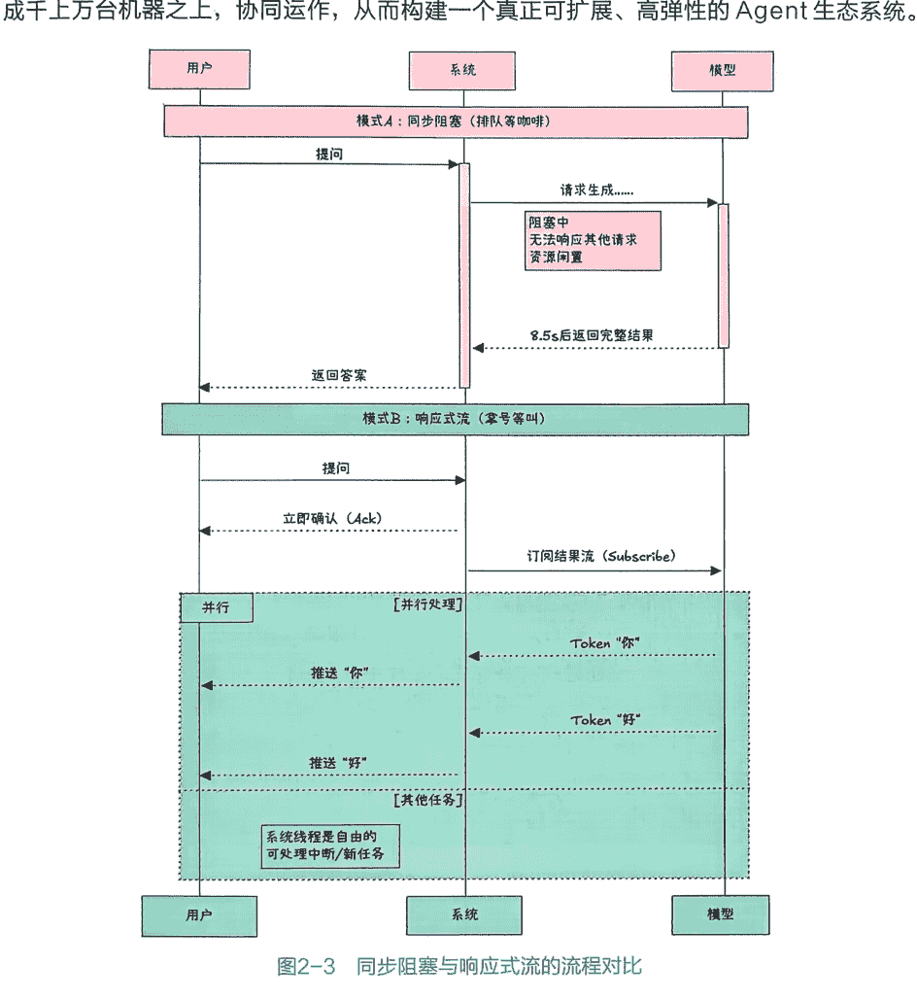

### 2.1.3 数据流哲学：世界本在流动

古希腊哲学家赫拉克利特说过一句名言：“人不能两次踏入同一条河流。”

Web 1.0 与 Web 2.0 的黄金期，工程师们似乎在跟赫拉克利特对着干：堆起庞大的关系型数据库 RDBMS，痴迷 ACID① 事务，想把世界冻结成一个时刻的快照。

> ① ACID 是 Atomicity 原子性、Consistency 一致性、Isolation 隔离性、Durability 持久性的缩写，是关系型数据库事务的核心，保证操作可靠与可持久化。

执行 `UPDATE Users SET age=30 WHERE id=1` 时，数据被改写，过去也随之被抹掉——昨天的 age=29 好像从未存在。

这种快照思维认为真理是静止的，躺在磁盘的某个扇区里。

在 Agent 的世界观里，赫拉克利特说对了：世界不是照片，而是一部不停推进的电影。

#### 1. 日志即真理

随着 Kafka 这类分布式平台和事件溯源的流行，工程界重新认可一个老观点：数据库只是日志的投影，日志才是源头。

- 数据库回答“现在是什么”，即状态。
- 日志回答“发生了什么”，即事件。

对 Agent 来说，“发生了什么”往往比“现在是什么”更有用。

用户说：“我不喜欢这个颜色，换一个。”

- 快照视角只留下 Color=Blue，Agent 会迷惑，因为看不到前一个颜色，也读不出偏好变化。
- 流式视角记录事件链 User:Red → Agent:Red Image → User:Dislike → Action:Change Color。链条里既有因果，也有隐式偏好，系统才能真正理解需求。

图 2-4 并列展示了快照思维和流式思维的区别。

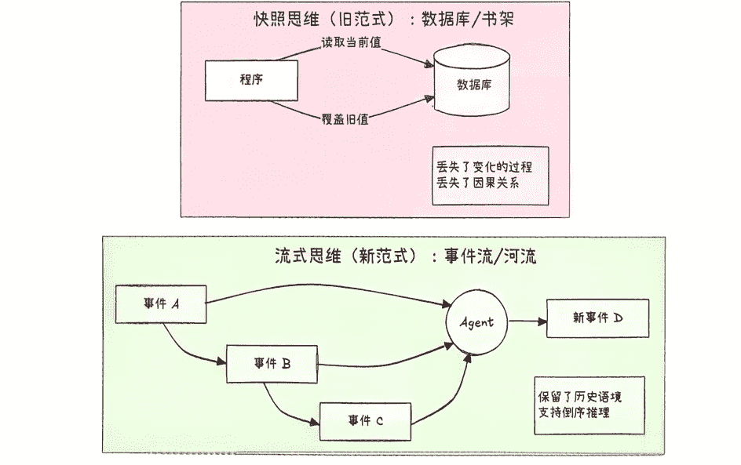

#### 2. 为上下文工程铺路

这种观念的转向，直接决定了 Agent 记忆系统的设计思路，详见第 5 章。

传统软件里内存管理的目标是省空间；在 Agent 架构里，上下文管理的目标是控流速。

- 静态视角把知识库当成固定的书架，需要不断整理归位。
- 流式视角把上下文看成一条河，新 Token 不断涌入，旧 Token 慢慢被冲走。

Agent 的核心不再是对静态数据的增删改查，而是在这条信息长河中实时捕捉、过滤、变换有价值的信号。

至此“计算原子化”的拼图基本完成。

- 函数式给了我们无状态的推理内核。
- 响应式给了我们驾驭异步交互时序的能力。
- 数据流给了我们理解动态上下文的框架。

微观准备就绪后，视野需要抬高：单机装不下这些流动的计算原子时，就必须跨越物理边界，进入分布式世界。

## 2.2 分布式解耦：从单体走向生态

数据流实现了时间上的解耦，也就是异步；本节讨论空间上的解耦，也就是分布式。

早期软件崇尚单体，无论大型机还是庞大的 J2EE 应用，都把逻辑、数据、控制集中在一台物理节点，像全知全能的上帝掌控一切。

互联网爆发后，摩尔定律逼近极限，我们被迫承认没有一台机器能装下整个世界。

于是单体被拆解为多个自治服务单元，演化为分布式系统。这原本是算力妥协，却意外为 Agent 提供了理想的生长土壤——一个繁荣的生态。

Agent 本质是社会化的。孤立的通用人工智能 AGI 可能令人不安，工程实践更倾向于打造一群各司其职的专家型 Agent。分布式架构正是这个智能社会的物理底座。

### 2.2.1 微服务：用 API 把一切连起来

现在我们知道 Agent 能调用工具、联网检索、操作数据库。但为什么这些能力可以被调用？

回溯到 2000 年，大部分功能藏在 GUI 下或封装在私有 DLL 里。那时 Agent 想操作 Excel，只能像人类一样模拟鼠标点击，这正是当今 RPA 所做的，笨拙且脆弱。

微服务运动改变了局面。它给 Agent 送来了一份关键礼物——API。

### 1. 贝佐斯的 API 宣言

2002 年，杰夫·贝佐斯给亚马逊全体员工发了一封著名内部邮件，大意是：所有团队必须通过服务接口对外开放数据与功能；禁止直接读库；禁止走后门。违者解雇。

这不仅是亚马逊的转折点，也是现代软件架构的分水岭。

它确立了核心原则：功能要解耦成服务，服务必须通过协议通信。

这场持续二十余年的接口化浪潮，把物理世界和数字世界封装成成千上万个标准化的 RESTful API 或 RPC 接口。

### 2. 为机器准备的自助餐

Agent 出现前，API 主要服务开发者。如今我们发现 API 简直是为 LLM 量身定制的触手。

- Swagger/OpenAPI 规范，最初用于生成清晰文档，现在直接成了 Agent 的工具说明书。读一份 JSON 定义，就能明白怎么调用。
- 无头服务。微服务提倡把界面和业务逻辑分离，这意味着 Agent 可以绕过繁琐的 HTML/CSS 渲染，直接和后端业务交互。

图 2-5 对比了人机交互与机机交互。

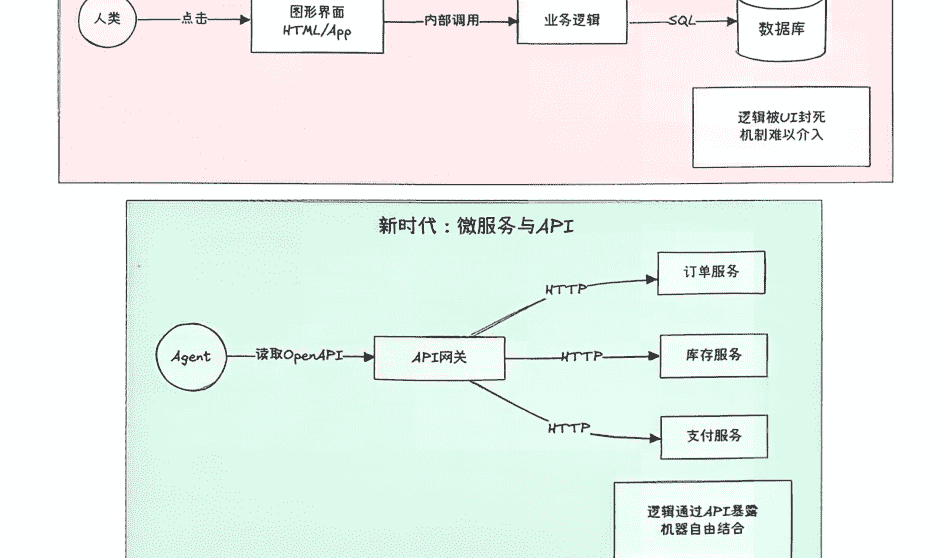

没有微服务铺路，今天的 Agent 就像盲人摸象——大脑很强，却伸不出手去感知和改变世界。

### 3. 从编排到涌现的启示

微服务还带来了去中心化。单体时代控制逻辑集中在 Main 函数；微服务时代控制逻辑分散在服务间的交互里。

这可以直接映射到 Agent 协作模式，见第 9 章。

- 编排：由一个中心化大脑统一调度所有 Agent。
- 协同：类似微服务里的事件总线，Agent 通过广播消息彼此感知、自主协作，无需中央协调。

微服务不是终点，而是一种基础设施。它把复杂系统拆成自治单元，封装进标准化的 API 盒子。Agent 的使命就是打开这些盒子，协调能力，创造超越单点的价值。

接下来要面对的问题是：分布式服务数量爆炸式增长时，谁来管理？

下面探讨软件工程史上一次伟大的范式迁移：从命令式到声明式，再到由 Agent 意图驱动。

### 2.2.2 编排演进：从 Kubernetes 声明式到 Agent 意图

当微服务从几十飙到数千，传统运维脚本彻底失效。工程师意识到，用脚本命令每台服务器已不可行，运行环境太复杂且不稳定。

关键时刻 Kubernetes 出现，提供了一种管理复杂系统的新范式，如今已深度融入 Agent 架构。

### 1. 控制回路：Kubernetes 的贡献

Kubernetes 并未首创容器，却开创了调和循环。

出现之前，我们用命令告诉机器怎么做：启动服务器 A→下载代码→解压→运行→失败就重启。

出现之后，我们改用声明式，只说想要什么：我需要 3 个副本始终健康运行。

调度、重启、负载均衡等细节，都由 Controller 自动完成。它在持续循环中不断比对期望状态与实际状态，采取行动弥合差距。

这听起来很熟悉？

没错，这正是 Agent 心智模型的雏形。

- Kubernetes Controller：Observe 观察集群状态 → Diff 比对期望与实际 → Act 创建或终止 Pod。
- Agent 循环：Perceive 感知环境 → Reason 推理差距 → Act 调用工具执行。

Kubernetes 是首个在大规模生产环境验证“基于目标自主运行”可行的系统，本质上是一个低智能但高可靠的 Agent。

### 2. 意图编排：架构升维

如果 Kubernetes 是管理基础设施的 Agent，那么 LLM Agent 就是管理业务逻辑的“Kubernetes”。

Agent 的出现把编排层级推向新高度。

- Kubernetes 的输入是语法严格的 YAML，描述确定而静态的资源需求如 CPU、内存。
- Agent 的输入是模糊多变的自然语言 Prompt，表达动态复杂的人类意图。

图 2-6 展示了编排从资源到意图的进化。

意义在于：Kubernetes 时代我们学会放手，信任调度器管理机器；Agent 时代要更彻底地放手，信任 Agent 自主管理流程。

传统工作流引擎如 BPMN① 把流程预先固化、静态定义；而 Agent 的意图编排是动态生成的。面对“帮我策划旅行”这类意图，Agent 会即时生成工作流，并在执行中根据环境反馈实时调整——这正是 7.2 节提到的规划-执行模式。

从 Kubernetes 到 Agent，架构师职责发生根本转变：过去设计流程图，每一步都要严丝合缝预设；如今设计目标函数和边界护栏。架构师不再规定 Agent 先迈左脚还是右脚，而是明确告知：“你要到山顶，且不能掉进悬崖。”

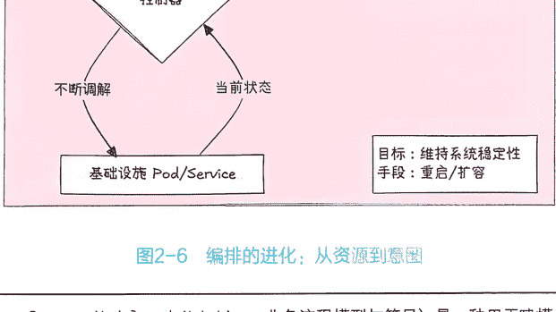

> ① BPMN 是 Business Process Model and Notation 业务流程模型与符号的缩写，用于图形化建模业务流程，通过标准符号和连线清晰表达流转逻辑。

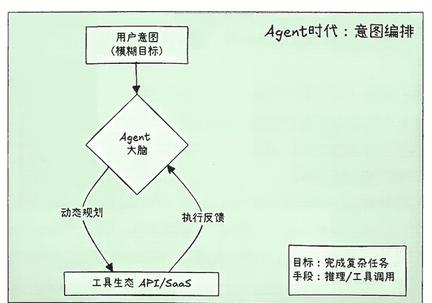

### 2.2.3 Serverless：原子能力的极致

微服务与容器化普及后，分布式演进并未停止。我们开始思考：既然只跑一段逻辑，为什么还要维护整个操作系统甚至完整容器？

这一反思催生了 Serverless。它把计算粒度从服务细化到函数，彻底改变计费方式与运行模式，如图 2-7 所示。

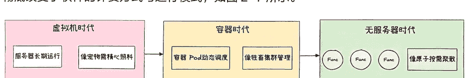

### 1. 缩放至零的魔法

传统服务器模型里，无论有没有访问，EC2 实例或 Pod 都持续运行，空耗算力与电力。就像为了喝一杯水，在家里维持一口永不干涸的井。

Serverless 引入缩放至零，运行分三阶段。

- 休眠：无请求时代码以字节形式存于磁盘，不占计算资源，成本为零。
- 冷启动：事件到达时，云平台毫秒级分配资源、加载代码并执行。
- 销毁：任务结束，资源立即释放，不留冗余。

这种用完即走的特性，让开发者不必关心服务器负载，只专注业务逻辑。

### 2. 事件驱动架构

Serverless 天生事件驱动。它不是长期运行的守护进程，而是触发器的响应者。

- 用户向 S3 上传图片→触发函数生成缩略图。
- 数据库写入订单记录→触发函数发送确认邮件。

这种模式构建了一个高解耦、快速响应的数字世界。

### 3. Agent 的理想搭档：沉睡的技能

把视角拉回 Agent，Serverless 对它如此重要，因为行为特征高度契合。例如 Agent 可能突然想查天气，或执行一段 Python 代码绘图，或对图片做 OCR。这些行为具有：

- 偶发性：并非每秒都需要查天气或绘图，需求随对话随机出现。
- 原子性：调用的工具通常单一功能，如 calculate_tax，不需要维护复杂上下文。

休眠技能与液态架构：Agent 时代的地基铺设

在 Agent 架构里，Serverless 函数更像是一批处于休眠状态的能力单元。架构师可以把上万个工具以 Serverless 的形态投放到云端，让它们静默待命，从而为 Agent 搭建出庞大又灵活的外挂技能库。Agent 不必背负沉重的本地代码库，一旦意图产生，就通过接口把对应的函数唤醒即可。

### 4.从 API 到 Function Calling

OpenAI 在 2023 年发布的 Function Calling，本质上是把 Serverless 范式在 AI 领域做的一次精神再现。

- Serverless 的基本走向是 Handler(Event) → Result。
- Function Calling 则把函数的元信息固化为 {name, description, parameters}。

两者互相补位，配合度极高。如今可以批量打造 Serverless 函数，并把它们的定义注册给 Agent。于是 Agent 化身为超级路由器，它不需要关心代码最终跑在某台机器上，只需要决定何时触发。图 2-8 描绘了这一唤醒流程。

### 5.架构的终局：液态软件

Serverless 把分布式解耦推向了极致。

- 空间解耦：代码运行在哪已不再重要。
- 时间解耦：执行完全由事件驱动，不用提前排程。

这为多 Agent 协作提供了土壤：成千上万的微型 Agent 与工具像液体一样在网络里自由流动、即时组合又即时拆解。软件不再是固态的大教堂，而是流动不息的海洋。

到这里，单体被微服务拆解，Kubernetes 带来了声明式编排，Serverless 提供了原子化的算力。乍看之下，灵活、弹性、按需分配的理想图景似乎已抵达。

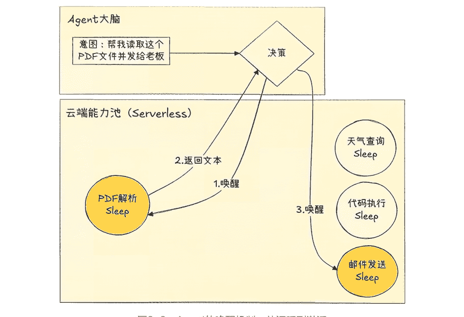

可当你打开运行在 Serverless 容器里的代码，会发现现实并未彻底改观。架构焕然一新，写代码的方式却仍停留在几十年前的老路。我们依然用 C++、Java 或 Python 一行行堆砌僵硬的 if-else，企图用有限规则覆盖无限复杂的现实。肉身已是高度分布式、弹性伸缩的现代形态，大脑却仍是靠发条齿轮驱动的传统程序逻辑。

这种割裂感在 2017 年达到临界点。迎接 Agent 的到来，不仅要重构服务器，更要重新定义编程本身。

## 2.3 软件 2.0：概率与代码的交汇

2017 年，时任特斯拉 AI 总监的安德烈·卡帕西发表《Software 2.0》，这不仅是新名词的提出，更是对计算机科学根基的一次深刻反思。

在此之前软件工程追求消除不确定性，此后开始学会利用不确定性。

### 2.3.1 规则的落幕：告别 if-else 编程

软件 1.0 时代，开发者像拥有绝对控制权的建筑师，对每一行逻辑进行独裁式管理。只要把问题转成极其精确的指令序列，计算机就能实现，确定性是基石。

进入以神经网络为代表的软件 2.0 后，确定性被打破。开发者的角色从建筑师转向园丁或引导者——我们提供土壤即训练数据，设立栅栏即损失函数与约束，而具体的决策逻辑与能力则由模型在海量数据中自行涌现。

图 2-9 形象对比了两种时代的开发者定位。


图 2-9 开发者角色的形象化展示

### 1.软件 1.0：人充当编译器

在软件 1.0 框架里，开发者的任务是将问题空间转成代码空间。

场景：写程序判断图片是否包含“猫”。做法：先在脑中把“猫”拆解成线条、颜色、纹理、耳朵形状等要素，再用 C++ 写条件语句实现边缘检测，判断特征是否存在。

每一行代码都是人类认知的直接固化。开发者不仅要精通编程，还要深入理解“猫”的特征，甚至要把握现实中千变万化的类猫形态。

现实复杂度远超人类显式编码极限，永远写不完所有“像猫但不是猫”的情况，也写不出覆盖全部例外的分支。因此在视觉识别、自然语言处理、复杂决策等充满模糊与不确定性的任务上，软件 1.0 显得笨拙脆弱。

### 2.软件 2.0：数据成为源代码

机器学习开启软件 2.0 时代，也颠覆了传统确定性逻辑，见图 2-10。开发者不再手写具体逻辑步骤，而是定义目标，由模型从数据中自动学习实现目标所需的策略与规则。

仍以识别“猫”为例。

不再编写具体识别逻辑，而是设计神经网络架构——由大量可调参数构成的骨架，本身尚不具备识别能力。收集 10 万张含猫图片和 10 万张不含猫图片作为训练数据。

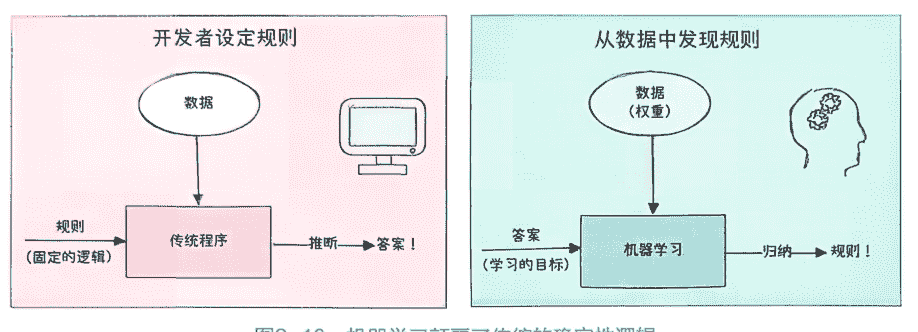

定义损失函数衡量网络输出与真实标签的差距，并引导模型学习。运行优化器如随机梯度下降，让计算机在庞大参数空间自动搜索最优权重，这组权重实质上就构成了能识别“猫”的程序。

在机器学习时代，数据取代传统代码成为开发核心；优化器扮演编译器角色；训练得到的权重构成最终的可执行文件。图 2-11 展示了编程范式的倒转。

理解软件 2.0 是掌握智能体行为特征的关键。

从指令执行到模式补全：智能体并非简单执行 Prompt，而是在补全 Prompt。它背后的模型本质上是一个巨大的概率分布表。问“天空是什么颜色”，它答“蓝色”，不是查数据库，而是参数空间中“蓝色”在“天空”后出现的概率最大。

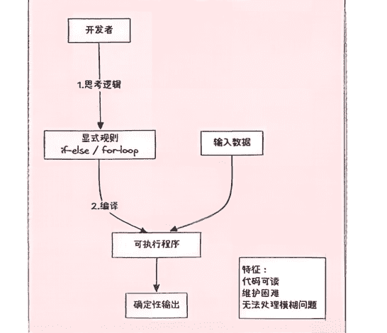

## 2.3.2 MLOps 的启示：为 AgentOps 铺路

代码演变为数据后，传统 DevOps 工具链如 Git、Jenkins 便力不从心。无法对 100GB 的二进制模型文件做 git diff 查看逻辑改动，也无法通过 assert 断言模型在所有情况都正确。

软件 2.0 时代，无法像调试传统代码那样在 IDE 中调试神经网络权重。那如何保证质量？

为驯服软件 2.0 的黑盒特性，MLOps 应运而生。它并非单一工具，而是一套管理概率性软件生命周期的 方法论，为架构师提供三大启示。

### 启示一：数据即源代码

软件 1.0 时代源代码是真理唯一来源，代码不变行为不变。而软件 2.0 时代数据取代源代码的核心地位：即使模型架构与代码不变，只要训练数据改变，如混入 10% 脏数据，模型行为可能剧变。

对智能体开发者，我们通常不直接训练基座模型，而是聚焦提示工程。Prompt 并非代码中的字符串常量，而是需要版本控制的关键资产。System Prompt 从 v1.0 升级到 v1.1 的微小改动，可能导致智能体行为风格甚至性格根本变化。

同时出错时需追溯：当时使用哪个版本的知识库？是否混入过期文档？这种追溯机制被称为上下文谱系，因为知识库变更可能迫使下游 Prompt 重构。

MLOps 告诉我们要像管理代码一样严谨管理数据和 Prompt，这推动了 LangSmith、LangFuse 等 AgentOps 类平台的发展。

### 启示二：测试从确定走向概率

传统单元测试是二元的：通过或失败。但在 MLOps 中我们面对的是概率分布，无法要求模型识别猫达到 100% 准确率，只能追求超过 95%。

这是智能体开发最深刻的教训：智能体行为本质难以测试，除非构建专门的评估数据集 Evals。

面对 LLM 输出，无法简单写 assert response == "巴黎"，模型可能答“法国的首都巴黎”。此时需引入 LLM-as-a-Judge，用另一个模型判断“这句话是否等同于‘巴黎’”。

智能体质量不由传统测试通过率决定，而取决于“在 100 个真实场景中，新版智能体战胜旧版的次数”。

MLOps 告诉我们要放下对确定性的执念，转而构建基于统计的质量护栏。

### 启示三：可观测性要语义化

DevOps 时代监控 CPU 使用率、内存、延迟和错误率。但在 MLOps 时代，模型可能 CPU 占用很低、延迟极短且无报错，却已疯了——输出有害内容或开始胡言乱语。这就是数据漂移或概念漂移。

对智能体的监控必须深入语义层面：不再依赖传统的 INFO/ERROR 日志，因为在 LLM 场景下它们往往无意义；而要关注追踪轨迹，可视化智能体的完整推理链路——用户输入→检索→思考→工具调用→响应。

我们还需要实时检测智能体输出是否变得有毒，或陷入无意义的复读。

MLOps 告诉我们不仅要监控软件跑得快不快，更要监控它想得对不对。

MLOps 是一场软件 2.0 时代的工业革命，将炼金术式的模型训练转变为可复现、可管理的工程流程。对智能体而言，我们继承 MLOps 理念并发展为 AgentOps。不再直接训练模型权重，而是专注精调 Prompt；不再仅仅监控损失函数，而是更注重追踪思维链。

图 2-12 展示了运维范式从代码到思维的演进。

然而无论工具多么先进，概率模型的核心特征——不确定性——始终存在。在概率地基上如何建造坚固的房子？这是每位架构师必须直面的终极命题。

### 2.3.3 驯服不确定性：在概率之上建可靠系统

我们承认软件 2.0 具有概率本质，但不意味着必须接受不可靠系统。恰恰相反，架构师的核心竞争力，正是通过确定性工程框架驾驭并约束概率智能核心，构建高可靠性系统。

软件 1.0 时代可靠性源于证明——通过逻辑推导和单元测试确保输入 A 必然输出 B。而软件 2.0 时代可靠性源于统计与约束。

这构成根本矛盾：用户要求 100% 确定的结构化数据如 JSON，而 LLM 本质倾向生成充满可能性、富有创造性的文本如诗歌。

为解决这一矛盾，“三明治架构”是一种有效策略，如图 2-13。核心理念是通过两层确定性逻辑包围中间概率模型。

### 1.输入侧防御：提示工程加固

在不确定性发生前先收敛。这已不只是写更好 Prompt，而是引入类似类型系统的强制性约束机制，即结构化强制。

当前模型如 GPT-4、DeepSeek 已支持 JSON 模式或函数调用，关键在于推理阶段采用受限解码技术。

例如要求模型生成 JSON 键时下一字符必须是冒号，生成值时严格符合 JSON Schema 定义的数据类型。这种约束在数学上消除语法错误可能，将不确定性有效限制在语义层面。

### 2.输出侧校验：验证器机制

生成可以概率性，但验证必须是确定性。这是应对幻觉最有效手段之一——为智能体构建具备怀疑能力的反馈回路。

以代码为裁判：智能体生成计算斐波那契数列的 Python 代码时，直接运行它。若解释器抛出 SyntaxError，就说明输出有误。此时可将具体报错信息反馈给模型，促使其修正并重新生成。

以搜索为裁判：智能体声称“2024 年奥运会在柏林举办”时，调用外部搜索工具核查。若搜索结果与生成内容不符，则立即触发修正机制，引导智能体更新输出以符合事实。

这正是第 7 章将讨论的 ReAct 模式核心逻辑：通过确定性环境反馈不断坍缩概率生成空间，引导模型输出趋向准确可靠。

### 3.过程冗余：自洽性提升

如果单次生成不可靠，生成多次呢？通过采样与投票机制，让智能体对同一问题在 Temperature>0 设置下独立推理多次如 5 次。若多数路径输出 42，少数输出 100，则系统采纳多数结果。这种基于冗余计算的策略能显著提升系统鲁棒性。

由此可见，软件 2.0 并未取代软件 1.0，而是共生共存。现代智能体架构本质是用软件 1.0 框架如代码、工具、流程包围软件 2.0 内核如模型、推理。我们以确定性逻辑引导不确定性智慧，以刚性约束规范柔性生成。

## 小结：地基已夯实

第 2 章并未急于切入智能体本身，而是系统梳理软件工程为迎接智能体时代所做的长期准备。

函数与流让我们掌握无状态函数式与异步响应式编程范式，使软件契合 AI 思考节奏。分布式教会我们通过接口化与无服务器原子化构建灵活可扩展系统，为智能体提供无限延展的手脚。软件 2.0 引导我们学会在拥抱概率性的同时施加工程化约束，从而在不确定性中建立对确定性的信心。

历史铺垫已完，智能体登场水到渠成。Transformer、Docker、API、向量数据库等关键技术积木如今都已就绪。现在需要一种全新架构思想，将这些组件有机整合，构建出具备感知、记忆、思考与行动能力的全新物种。

这个新物种不再是冰冷的代码工具，而是人类意志的延伸，是数字世界的原住民。

地基已然夯实，肉身业已铸就。如今躯壳只差最后一样东西——灵魂。

是什么让一堆无状态的函数涌现出智能？又是什么将概率性预测转化为有目的决策？要回答这些，必须深入躯壳内部，解剖那个被称为模型的黑盒。

请翻开第 3 章——从设计到演化，欢迎来到智能体时代。在那里，我们将正式剖析这个新物种的灵魂。

# 第 3 章

## 从设计转向培育：步入智能体时代

当我们把 LLM 引入软件架构核心时，奇点已然临近。软件不再仅仅是对人类指令的响应，而是开始展现意图和自主性。

它不再是被动等待调用的工具，而是主动感知环境的观察者。它不再是无状态函数，而是拥有记忆与身份的实体。它不再是孤立计算节点，而是能够协作的社会成员。

我们不再是在设计系统，而是在培育物种，见图 3-1。

### 3.1 从工具到伙伴：智能体的本质

什么是智能体？技术上看，可能只是不断调用 LLM API 的死循环脚本。然而从交互哲学看，它标志人机关系根本重构：从命令与控制转向意图与协作。

### 3.1.1 交互升级：从命令到对话

现在，你也许不会对下面这样的对话感到惊讶。

开发者：我在设计一个图书推荐系统，但不确定该使用协同过滤还是内容过滤。

智能体：让我帮你分析一下。你的用户规模有多大？是否已经积累了足够的历史交互数据？

开发者：大约有 5000 名用户，系统刚上线 3 个月。

智能体：考虑到你的用户规模和当前的数据量，我建议采用混合推荐策略。在初期以内容过滤为主，因为若采用协同过滤，很可能面临冷启动问题。你可以按照如下步骤设计。

首先，基于图书的内容特征如类别、作者、主题词等构建内容相似度模型。

其次，在收集用户行为数据的同时，逐步引入协同过滤机制。

最后，当用户交互数据足够密集时，例如每名用户有 20 条以上评分或行为记录，再逐步提高协同过滤权重。

需要我为你写一个初始的实现框架吗？

开发者：好的，但我还在纠结是否要引入时间衰减因素。

智能体：这是一个很好的考量！时间衰减确实重要，特别是对于图书推荐。不过要注意区分。

经典作品：用户兴趣通常持久，衰减应该很慢，甚至可以忽略。

时事相关书籍：热度随时间快速下降，应采用较快的衰减函数。

工具退场，伙伴登场：交互范式的三次跃迁

- 节庆主题、节日相关的季节性图书，更适合采用周期性加权策略，而非单调的线性衰减。建议依据图书品类为不同书目配置差异化的衰减方式……

在先前的对话里，代理并不是在机械地完成指令，而是在揣摩意图、提供建议并参与讨论。它更像一位经验丰富的同事，而不是僵硬的命令行工具。

这一变化标志着软件正从被动使用的工具，迈向主动协作的智能伙伴，完成了一次历史性的跨越。

回看传统工具的本质：输入与输出的映射是确定的，功能单一明确，不保存状态，不会主动行动，也读不懂上下文。

被动与机械是工具最根本的特质：等待指令、执行指令、再等待下一条指令。

代理打破了这一范式：能主动感知环境、自主思考规划、采取行动，并从经验中不断学习。

- 在命令行界面阶段，人机交互的基本单位是“指令”。
- 在图形界面阶段，基本单位变为“点击”。

这两种模式有一个共同前提：人类负责“怎么做”，机器只负责执行。例如在 Word 中，用户要打开文件、选定文字、点加粗、点保存；软件按顺序完成这些动作。

在智能体阶段，交互的基本单位转向“对话”，更准确说是“意图”。例如用户说：把这份文档改得正式一点。代理的处理路径是：揣摩“正式”在当前语境下的含义→读取文档内容→分析段落结构→重写文本→保存结果。

这意味着认知负担的转移。过去复杂性全在用户脑中，要熟悉菜单、记住步骤、掌握指令。现在这些操作细节被代理在后台统一接管。软件不再是被动的操作台，而是在变成能读懂来意并作出回应的对话者。用户的认知负担明显下降，可以把精力放在目标本身，而不是繁琐步骤。图 3-2

工具阶段的命令式操作，正优雅地演变为智能体阶段的对话式协作——不是“你来执行”，而是“我们一起把事做完”。

图3-2 在Agent时代，软件从操作平台过渡到对话者

开发者：这段代码老是返回 None，能帮我看一下吗？

Agent：我定位到问题了。第 15 行的函数在 for 循环内部就直接 return，导致只检查了第一个元素就退出。你可能想这样改。

- 把 return 移到循环外面。
- 如果需要返回多个结果，可以考虑用 yield。

另外我注意到空列表的情况没有处理，建议在函数开头加个空值校验。要我帮你修一下吗？

开发者：如果使用 yield 语句，会有什么影响？

Agent：使用 yield 会把函数变成生成器，主要影响有：

- 返回的是生成器对象，而不是具体列表。
- 计算被延迟，内存占用更低。
- 调用方需要用 list 显式转换，或直接迭代。

考虑到你在处理大文件，yield 可能是更合适的选择。

对话不仅是自然语言的界面，更关键的是它支撑起意图解析、背景信息保持，也就是我们常说的上下文工程，以及任务分解。

### 3.1.2 意图解析：把模糊变精确

传统软件既缺乏主动性，也死守字面意思。少写一个分号，编译器就报错——它无法捕捉言外之意。

代理的关键能力是充当“模糊翻译器”，在人类模糊的自然语言与机器精确的 API 调用之间搭桥。

- 输入：模糊的来意，例如，“帮我查下这周去上海有没有便宜机票”。
- 处理：推理、消歧、补全必要参数。
- 输出：精确的调用指令，例如，SearchFlights(dest='TYO', date_range='this_week', sort_by='price_asc')。

架构师要认识到，代理本质上是一个持续运行的“意图编译器”，实时地把人类意图编译成机器可执行的动作。而意图解析，正是代理的核心所在。

在工具阶段，系统只懂字面并严格执行。比如“删除文件”就直接删除。

在智能体阶段，系统能理解目的与情境。比如用户说“这个文件能不能帮我清一下”，系统会追问“你是想删除、压缩、归档，还是清理里面的临时内容”，以明确真实来意。

从技术角度看，意图解析通常包含 4 个层次。

#### 1. 语义解析

提取表达背后的动作、对象、范围和限制条件。

例如，用户说“我想把昨天的日志整理一下”，“整理”是指分析、压缩、归档还是别的？需要进一步澄清。

在复杂系统中，通常会结合结构化意图模型解析。代码示例如下。

```json
{
    "intent": "refactor",
    "target": "function",
    "constraints": [...]
}
```

#### 2. 目的识别

不仅要懂“说了什么”，更要懂“想达成什么”。

例如，用户说“这段代码总是返回 None”，目的往往不是单纯调试，而是希望“得到正确的返回结果”。

Google、OpenAI、DeepSeek 等头部公司的最新研究都强调，智能体应能从显性指令中推断隐性目标。以 OpenAI o1 的“Reasoning Tokens”为例，表面是推理，本质是为了更准确捕捉用户的隐含意图。

#### 3. 背景关联

代理必须把来意落地到具体环境，涉及：

- 用户的代码结构。
- 当前文件目录。
- 用户偏好，例如倾向 yield 还是列表推导式。
- 安全约束，例如禁止删除系统文件。
- 历史任务上下文，例如上次正在写的某数据管道。

这正是上下文工程的核心：代理必须基于当前世界状态做判断与决策。

#### 4. 风险评估与澄清

来意模糊时，代理应该主动提问，而不是贸然执行，避免误操作，确保任务准确且符合安全策略。

## 意图不再是简单的命令字符串，而是一个结构化的对象

```python
class Intent:
    action: str    # 如 "delete"
    target: str    # 如 "logs"
    constraints: [] # 如 ["before:2023-01-01", "safe_mode:true"]
    confidence: float # 置信度，例如，置信度为 0.4，表示意图不够明确，需要澄清

if intent.confidence < 0.6: # 可根据策略调整置信度阈值
    return self.ask("你是想删除这个目录，还是删除目录里的临时文件？")
```

上述代码展示的澄清行为，正是代理可靠性的重要体现。

### 3.1.3 记忆与身份：持续的自我感

工具是“用完即走”，伙伴是有记忆的。设想你的同事每天早上都像初次见面一样问“你是谁、你要干嘛”，你一定会崩溃。

每次打开工具，都像面对一张白纸，但代理不同，它拥有记忆。代理在多轮对话间延续身份，并逐渐加深对用户的理解。图 3-3


### 1. 记忆：连续性的幻觉

正如 2.1 节所述，LLM 本身无状态。代理的“记忆”实际是通过上下文工程构建的幻觉。

短期记忆：记录当前会话上下文，包括上一句话、近期话题、代码片段、用户之前纠正过的误解等。

它能让代理做到：

- 多轮对话保持一致。
- 避免重复提问。
- 进行连贯推理。

目前最先进的上下文工程会对短期记忆做摘要、过滤与结构化，使代理在 20 万至 100 万 Token 的大上下文中仍能精准推理。

长期记忆：借助向量数据库记录跨会话偏好，例如：

- 代码风格偏好。
- 常用技术栈，如 Python、LangChain、Spark。
- 历史项目结构。
- 过往问题类型。
- 角色设定，例如“你更偏好可读性高的代码”。

这让代理具备持续服务能力：下次打开时能自然延续上一次思路。

Mem0、GraphRAG、Hybrid Memory Systems 等架构已把长期记忆实现为可建模、可检索、可索引的形式，让代理像人类一样内化知识。

### 2. 身份：System Prompt 的灵魂

你可以给代理写一段 System Prompt：“你是一个刻薄但专业的代码审查员。”

瞬间，这个概率模型就坍缩成一个具体的人格。

身份远不止人设，它是一套价值观与行为准则的集合，决定了代理在效率与安全等两难选择中倾向哪一边。

记忆是“知道你是谁”，身份是“知道自己是谁”。

成熟的代理会在以下方面保持稳定：

- 表达风格。
- 专业领域定位。
- 价值观倾向，例如偏保守操作或注重安全。
- 行动策略偏好，例如先检查再执行。

这些设计让用户感受到：这是同一个代理，也是我的代理。

记忆 = 连续性，
身份 = 稳定性。

记忆赋予代理连续性与个性化，使其跨对话、跨任务保持一致与相关。

在工具阶段这类能力不存在，而这正是代理从“软件”进化为“协作者”的根本基础。

### 3.1.4 上下文工程：看清世界状态

意图解析与身份信息让代理清楚“想达成什么”，上下文工程则让它理解“当前世界是什么样”。图 3-4

LLM 本身没有主动感知世界的能力，只能依据输入文本推理。因此对任何代理来说都受制于“Garbage in, garbage out”。代理失败的主因，往往不是模型不行，而是上下文信息给错了。

对代理而言，上下文就是它的全部世界。

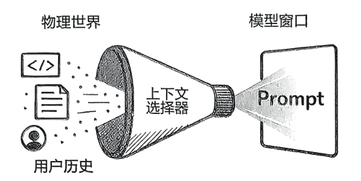

判断质量高度依赖提供什么信息以及如何提供。假设你是一名开发者：

- 仅有对话记录，它就是个聊天机器人；
- 注入当前文件目录结构、代码片段和错误日志，它就变成开发者助手；
- 注入浏览器当前的 DOM 树，它便成为自动化测试员。

提示工程解决“怎么说”，上下文工程解决“给代理看什么”。

- 输入不全，推理就会偏离。
- 输入过量，模型抓不住重点。
- 结构混乱，模型容易迷失。

上下文工程的目标，是把完成任务最关键的信息，以最合适的结构呈现给模型。

架构师的新职责是设计机制，实时把现实世界的状态序列化为文本并投射到代理上下文中。这正是上下文工程的本质——为代理搭建数字感官。

上下文工程的 3 个核心来源：

- 用户上下文：开发风格、历史偏好如偏好列表推导式、常用技术栈如 Spark、LangChain、FastAPI、当前工作内容如在写爬虫或构建 RAG 系统。优秀代理能据此调整回答风格与推理深度。
- 环境上下文：用于理解世界状态，包括文件结构、代码库内容、当前分支、日志、错误栈、变量值、API 响应、运行时状态如 CPU、GPU① 使用情况和任务状态。调试型代理必须先看到堆栈跟踪才能给出准确建议。
- 任务上下文：代理执行任务时需掌握前序结果、当前子任务进度、依赖是否加载、工具调用历史尝试。这是支持多步任务与复杂工作流如 LangGraph 所需的能力。

随着上下文窗口扩展到 20 万至 100 万 Token，上下文工程尤其是信息的筛选与压缩变得更重要：不能简单堆砌，而要通过选择、摘要、结构化降低干扰。

> ① GPU (Graphics Processing Unit, 图形处理单元) 是一种专门用于处理图形和图像相关计算的硬件设备。

当前技术新趋势：

- 选择性上下文：精准筛选与当前意图紧密相关的内容，剔除无关信息。
- 结构化摘要：为历史内容生成结构化摘要，包含标题、关键发现、失败点等。
- 图结构上下文：将知识库构建为图结构，按节点重要性检索。
- 上下文优先级排序：由模型自主判断不同内容的权重。例如某些模型引入“思考模式”，给重要信息更高优先级，使信息处理更贴合需求与场景。

这些技术的共同目标是最大限度减少噪声，突出关键信息。

上下文工程不是“喂信息”，而是“喂结构”。好上下文不在于文字量，而在于让模型立刻理解。高质量结构化输入可让推理精度提升数倍。

上下文工程是打造高质量代理的真正秘诀。它的本质是将多维动态的现实世界，精准投射为模型可理解的线性文本序列。

如果把代理比作漆黑房间里解题的人，上下文工程就是手电筒——光照之处决定它聚焦代码库的哪部分、日志的哪几行、用户的哪段历史，直接决定能否解题。

### 3.1.5 任务分解：把目标变成计划

给初级工程师布置“建一座房子”，他可能无从下手。给资深架构师同样任务，他会迅速拆解：选址、设计图纸、打地基、主体建造、装修等。

任务分解赋予代理把“目标”转化为具体“步骤”的能力，是衡量其智能化的关键指标。

任务分解包含两个环节：

- 规划：把总体目标拆成若干子目标。
- 映射：把每个子目标转化为具体行动或可调用工具。

这种化整为零的能力，让代理能处理远超单次 API 调用能力的长程复杂任务。

在工具阶段，复杂度的负担在人身上。用户必须把“修复 bug”拆成定位文件→改代码→跑测试并手动执行。

在智能体阶段，认知负担转移到机器。

代理不再是单步执行者，而是具备规划能力的规划者，引入了关键中间层——规划层。

- 理解：把模糊的高层目标如“优化数据管道”转化为明确技术需求。
- 规划：生成可操作的多步方案，如“I/O 分析→算法优化→缓存策略”。
- 执行与反思：最接近人类智能的环节——执行第一步后，代理可能基于新信息调整计划。例如，“我看了日志，I/O 并非瓶颈，决定暂停原计划，转而排查 CPU 占用”。

这种动态规划能力，是代理与传统自动化脚本的根本区别。

用户只需说：“帮我优化这个数据管道，我希望快一点。”

传统工具会回：“请告诉我具体改哪些函数、怎么改。”

代理则会主动说：“我先分析性能瓶颈，列出几个优化方向，再为你生成可执行的优化计划。”

### 1. 任务分解的三步法

现代代理普遍采用三步策略：

- 理解目标：不只是解析字面，而是洞察真实需求。例如用户说“清理一下昨天的日志”，真实意图可能是压缩、分析或归档，而非简单删除。
- 确定路径：把目标转成清晰可执行的流程。例如加载日志文件→按日期分组→统计错误数→生成分析报告→压缩原始日志。优秀计划应具备：步骤简洁、无歧义、可执行、可中断、易检查，并能根据执行反馈动态调整。
- 管理执行：包括工具调用、失败重试、异常处理、结果验证、进度汇报与计划动态调整。这是 LangGraph、AutoGen、CrewAI 等框架的核心价值——让代理从聊天模型升级为可靠任务执行者。

### 2. 学会自我审查

近期研究呈现明显趋势：执行前先做自我审查。

例如 DeepSeek、Qwen3 等模型引入的“思考模式”，强调先生成初步计划，再批判性分析其合理性与可行性，确认后再执行。

这很关键，能在执行前识别并修正潜在错误，避免运行时造成不可逆事故。

### 3. 任务分解与上下文工程互相强化

没有上下文工程就无法正确分解任务；没有任务分解，上下文工程也无从聚焦与取舍。二者相互依存，共同构成代理的完整执行链路。

这正是代理与传统工具的根本区别：它不只是回答问题，而是真正开展工作。

- 上下文工程让代理“看得清楚”——准确理解环境与需求。
- 任务分解让代理“做得正确”——把目标转化为可执行、可调整的行动路径。

二者共同构成智能体阶段的核心工程化能力，也是决定代理能否超越“高级聊天机器人”的关键。

### 3.1.6 工具、技能与行动策略：真正影响世界

剥离外部能力后，大语言模型就像困在机房里的孤脑——能写出堪称教科书的 SQL，也能推演环环相扣的行程，却发不出一次查询，更订不了一张票。

要真正成为伙伴，它必须长出手：调用工具、操纵环境、完成动作。

前文 2.2 节谈到的 API 与 Serverless，像是智能体的肌肉；本节要聊的是指挥这些肌肉的大脑皮层。

将工具使用称为 Action，学术上也这样定义，是智能体获得数字具身的关键。它把角色从旁观者推向介入者。基本逻辑是用语言模型当中枢、用各类工具当肢体，借助语言理解与计划驱动外部能力，对数字环境产生真实干预，如图 3-5 所示。

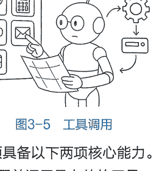

和传统聊天式模型相比，分水岭不在回答是否更准，而在是否会行动。具备行动力，智能体必须同时满足两件事。

- 精准挑选工具的能力：依任务目标与上下文，匹配并唤起最有效的手段。
- 规划安全可靠可预测行动方案的能力：制定清晰可控、具备容错与调节余地的执行路径。

这两项能力撑起长尾任务执行的底座：没有调用手段的智能体只能说；拥有调用手段的智能体才能做。

### 1. 工具剖面：远不止 API 接口

传统软件里，调一个函数看签名就够，参数类型和返回值即可。在智能体架构里，工具必须自带语义。智能体不需要知道内存地址或底层实现，它需要明白“这件工具能干什么”“在什么情境下该上场”。

面向智能体设计的工具，通常要提供三层说明。

- 功能描述：写给模型看的说明书，用来解释能力边界和适用场景，协助判断是否选用。
- 参数约束：写给程序的契约，规定调用时参数的结构与类型，模型必须据此生成符合规范的 JSON 输入。
- 副作用声明：写给安全模块的警示，标明操作可能带来的影响，比如是否只读、是否会改写数据或触发外部系统。

下面示例展示了智能体工具的语义化定义 Schema。

```json
{
    "name": "query_sales_db",
    "description": "查询 2020 年及之后各季度的销售数据。仅支持 PostgreSQL 方言，且查询必须包含 WHERE 子句以限定时间范围。",
    "parameters": {
        "type": "object",
        "properties": {
            "sql_query": {
                "type": "string",
                "description": "符合 PostgreSQL 语法的 SELECT 查询语句必须包含 WHERE 子句"
            }
        }
    }
}
```

2024 年兴起的 MCP，即模型上下文协议，正致力于把工具描述标准化，让智能体能像插拔 U 盘那样灵活挂载各类 SaaS 与外部能力。因此 MCP、LangChain Tools 以及 OpenAI/Anthropic 的 Function Calling，逐渐成为搭建智能体的关键基础设施。

### 2. 从工具到技能：企业数字原型的形成

在 MCP 推出后，Anthropic 于 2025 年 10 月发布 Agent Skills，再次推动了智能体工程的发展。

- 工具是通用且原子的操作，比如“执行 SQL”“发送 HTTP 请求”“读写文件”。
- 技能是面向业务场景并被封装的能力单元，比如“生成月度财报”“执行代码审查”“处理客户退款”。

简单说，技能本质上是工具、专业知识与标准作业流程的组合。

这种区分为何重要？裸 API 冰冷且缺乏上下文。若直接把 delete_user 的 API 交给智能体，不仅危险，而且极易造成不可逆错误。

如果把它封装成“用户注销技能”，内部嵌入标准流程——先备份数据、再核查欠款、发送通知、最后执行删除——智能体获得的不再是原始功能，而是一种带有业务语义和安全约束的能力。

技能包构成了企业的数字本体。

- 当企业把内部流程、规范和最佳实践打包成智能体可调用的技能，就实现了知识资产化。
- 智能体不再只是通用模型，而是带有企业 DNA 的“数字员工”；它不仅知道怎么调用 API，更懂得如何正确地做，遵循标准作业程序。

### 3. 如何挑选工具与技能

传统工具调用是机械的：用户说“翻译”，系统就直接调翻译工具，不做判断也不问上下文。

智能体时代的选择更像资深工程师的决策：要不要用工具？现在是不是时机？选哪个？上下文是否充足？有没有副作用？输入是否需要先验证？

比如用户说“把昨天的日志分析一下”，智能体不会立刻调用 analyse_logs，而是先主动澄清。会提问：“日志存在哪个目录？”“你想看错误趋势、性能瓶颈，还是要汇总报表？”“日志里是否含敏感信息，需要脱敏吗？”

智能体能在上百个可用工具与多种技能中，锁定最匹配当前任务的那一个；随后从对话中提取关键信息，按工具预设的参数约束生成合规输入，最后执行调用。

优秀的选择力让行为更可靠、可控、可解释，也支撑起多工具协同。智能体可自动规划调用顺序，例如先用搜索工具找相关文档，再用代码执行工具跑示例，最后借助数学工具核算验证。这种动态、上下文感知的编排，正是 LangGraph、AutoGen 和 MCP 生态重点发展的方向。

### 4. 核心回路：ReAct

调动工具不是孤立事件，而是推理链中的一环。智能体是根据工具返回的结果——成功、失败或报错——动态调整后续动作。

DeepMind 提出的 ReAct 范式已成为现代智能体行动的标准心智模型，核心循环是：

思考 Thought → 行动 Action → 观察 Observation

这打破了传统的输入-输出线性逻辑，形成了动态闭闭环的推理与行动循环。

- 思考：用户让我分析销售下滑原因，我先查一下销售数据。
- 行动：调用 query_sales_db("SELECT * FROM sales WHERE date > '2024-01-01'")。
- 观察：数据库返回 1000 条原始 JSON，量太大无法直接分析。
- 思考：我取值太粗，应该先按月聚合看整体趋势。
- 行动：调用 query_sales_db("SELECT month, SUM(amount) ... GROUP BY month")。

这种行动增强推理让智能体拥有试错与自我修正能力。它不追求一次性完美答案，而是通过持续交互逐步逼近正确解。

### 5. 行动策略：安全边界与控制

软件一旦开始行动，风险随之而来。一个拥有 rm -rf 权限却由 LLM 驱动的智能体，就像在服务器前乱敲键盘的猴子——意图或许合理，后果却可能灾难。

行动策略决定智能体是鲁莽直冲，还是审慎求证、寻求批准。核心在于何时暂停以验证或获批。架构师需要设计三道防线。

- 只读沙箱：在探索与信息收集阶段，只允许调用无副作用工具，如搜索、读日志、查数据库。为智能体设一个“婴儿围栏”，确保计划阶段不产生不可逆影响。
- 人类介入 Human-In-The-Loop：在转账、删除文件、发送外部邮件等高风险写操作前强制中断，清晰展示拟执行内容、上下文与潜在后果，获人类明确批准后才继续。
- 确定性护栏：即使授权，底层执行层仍需硬规则校验，例如“禁止删除根目录”。

行动策略是智能体的行为规范，包含三层。

- 安全：执行前具备暂停判断能力，主动识别高风险行为并拒绝越界操作，这是行业级智能体的底线。
- 可解释：用户要能明白智能体为什么这么做。智能体应展示计划、说明调用理由并汇报每一步结果，为信任、审计和调试提供依据。
- 可控：关键或不可逆步骤应支持用户介入，提前展示操作并询问是否继续，确保人类保有最终决策权。

工具使用赋予智能体影响现实的能力，技能提供职业素养，行动策略确保行为安全高效可信。三者共同构成智能体从知识系统迈向执行系统的最后一块拼图。

## 3.1.7 人类介入接口：HITL 与防护

智能体的出现迫使我们重新定位“用户”的角色。

过去，人是操作员：亲手执行每一步，系统只是被动响应。

未来，人是监督者与评估者：设定目标、审查计划、授权关键动作，并对结果判断反馈。

我们正从 Copilot 模式走向 Autopilot 模式（见图 3-6）。

- Copilot 模式：人主导 AI 辅助。AI 坐副驾，提供建议、补全代码或答疑，决策与操作仍在人类手中。

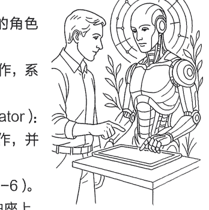

- Autopilot 模式：AI 主导人监督。AI 握方向盘，自主规划、调用工具并执行；人类退居监督席，在关键时刻介入校正或接管。

这种转变要求系统必须预留 HITL 接口。不仅为安全防失控，更为在人与 AI 深度共生中保留人类主体性。

至此，我们完成了对智能体这一概念的本体论定义。

它不是一段孤立代码，也不是被动工具，而是感知、记忆、推理与行动融合的数字存在。

它是数字世界的镜像，能理解意图、延续思维；也是伙伴，能主动协作、承担责任，并在复杂环境中代表我们行事。

既然全景已勾勒，接下来就进入它的“大脑”，看它如何思考，并把感知到的输入一步步转化为可执行输出。

## 3.2 Agent 心智结构：感知、推理、行动循环

生命是动态流转，智能也在持续交互中成长。

传统软件架构如 MVC 或微服务，本质是线性管道：输入→处理→输出。处理完即停止。

智能体架构必须引入循环。智能体不是函数，而是一个进程，在 while(alive) 中持续运行。感知、推理、行动不是孤立步骤，而是咬合运转的齿轮。

基于本体论认知，可构建智能体心智架构，如图 3-7 所示。

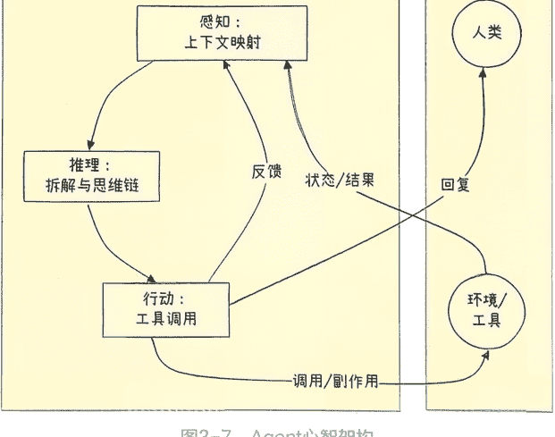

### 3.2.1 感知：主动筛选机制

传统程序只接收数据，智能体则通过感知理解世界。

传统输入是被动的，给什么处理什么。智能体的感知是主动的：接收、选择、解读并赋予意义。

现代感知系统至少包含注意力、预测、语义化三机制。

1. 注意力：并非所有输入同等重要

世界噪音太多，若全盘处理将迅速过载。感知的核心是过滤，感知即选择，如图 3-8 所示。

注意力是第一道选择器，像聚光灯。模型注意力机制结合多模态模型如 GPT-4o、Qwen-VL，能筛选视觉、文本与历史上下文，判断哪些与任务相关。

- 可忽略无关 HTML 标签，只聚焦正文。
- 可通过向量检索过滤掉 99% 数据库记录，只关注相关片段。

随着 GPT-4o 等出现，感知不再局限文本。视觉与听觉已是原生通道。架构师要设计的不是文本解析器，而是能把像素、波形与字符统一映射到语义空间的“联觉系统”。

2. 预测：感知不是被动接收，而是带着预期去理解

智能体基于历史对话、用户偏好与任务背景构建预测模型。当现实偏离预测，便产生“惊奇点”，往往暗示新价值、新问题或新矛盾。

3. 语义化：从特征到意义

多模态模型已能理解情境。

- 不只是识别“老人”，而是判断“可能是需要帮助的老人”。
- 不只是识别“文件”，而是意识到“可能是用户遗忘的配置文件”。
- 不只是识别“数字”，而是理解为“统计趋势的一部分”。

感知已从“是什么”跃迁到“意味着什么”。

因此智能体的感知是目标驱动的理解，而非机械输入。它不仅能识别人，更能理解“需要帮助”这一概念。感知时可能注意到拄拐杖的老人、迷路的孩子、摔倒的路人……

### 3.2.2 推理：直觉与深度思考

传统程序执行逻辑，智能体则进行推理。

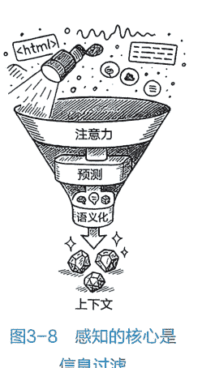

传统逻辑是确定性的：若 A 则 X，若 B 则 Y。智能体推理柔性、非确定，并与经验紧密相关，更像人类思考。

借鉴卡尼曼的心理学模型，智能体推理正向双系统演进，如图 3-9 所示。

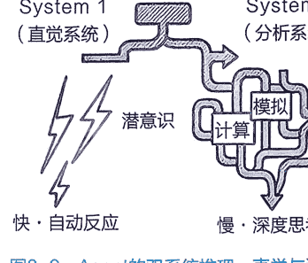

System 1 是直觉式快思考：基于 LLM 概率预测直接生成回答，适合闲聊、简单问答、代码补全。响应快、成本低，但易幻觉。

System 2 是逻辑式慢思考：强制生成推理步骤、反思路径甚至伪代码，适合复杂规划、数学证明、调试。响应慢、成本高，但更严谨可靠。

架构师的挑战是路由：如何让简单问题走 System 1，复杂任务自动切换至 System 2。

智能体推理通常包含四层。

- 情境理解：当前到底发生了什么？将感知信息与长期记忆、短期上下文结合，构建任务场景。
- 经验检索：是否遇到过类似问题？是推理加速器。高性能模型依赖策略性记忆检索以避免重复犯错。
- 心智模拟：在行动前先在脑中预演：调用此 API 会怎样？读该文件能获得什么？删除会引发风险吗？推理关键在于模拟能力。
- 决策与信心：对候选行动做价值评估：哪个最符目标、最安全、成本最低？同时判断“我有多确定？”

在概率性思考中，可能包含情境理解、记忆检索、心智模拟、因果推理、反事实思考、价值评估、不确定性量化等曾被视作人类心智专属的特质。

### 3.2.3 行动：改变与回馈

传统软件中，输出意味着结束。在智能体架构中，行动标志环境改变的开始。

智能体的价值在于产生切实影响：写数据库、发邮件、部署代码……行动是意图在物理或数字环境中的延伸。

通过行动-反馈循环，智能体能在动态环境中试错，不断调整策略，主动探测边界并适应。

传统程序是独白者，智能体是互动者。

【脚本终点，Agent起点】

脚本的执行路径很简单：接收指令→跑完→结束。出问题就直接崩盘，没有补救余地。

Agent的执行路径则不一样：接收指令→动手→看结果→出错就调参→再试。错误不是终点，而是调整的信号。

在传统软件里，return 或 print 往往意味着算完了。程序把结果吐给用户后就进入休眠，输出对程序本身没有反作用力，也不会触发任何自主行为。

Agent 的架构把这条逻辑翻了过来。行动不再是展示的尾声，而是对环境施加影响的开端。它通过干预让世界状态发生变化，并主动等待环境的回音。回音再进入下一轮的感知与判断，让 Agent 能在交互中持续校准自己。

正因如此，行动在 Agent 里获得了三层新含义。

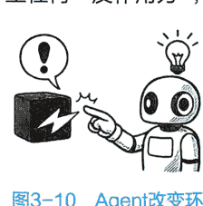

1. 探索式行动：以行动换信息

这是 Agent 最鲜明的特质。

常规程序倾向于“确定后再动手”。Agent 反而常在模糊中先做一步，因为对它来说，行动是最直接的信息采集手段。

举例来说，Agent 不确定某个接口要传 v1 还是 v2 的参数格式。

判断：参数版本不清楚，空想没用。

做法：先用 v1 发一次试探请求。

反馈：返回“Invalid Parameter”。

推断：v1 被排除，极可能是 v2。

这种“为了解惑而先行动”的方式，让 Agent 像用探针去丈量世界的边界、规则和反馈，而不是按死板的剧本执行。

2. 目的性行动：副作用是目标本身

函数式编程追求无副作用，而 Agent 的价值恰恰在于制造可控的副作用，以改写现实或数字环境。

比如改写数据库记录、发出一封邮件、部署一段代码，都是在主动改变状态。

因此行动层必须内置世界模型校验的思维：动手前，世界是什么样子；动手后，世界应该是什么样子。只有先建立前后态的对照，副作用才可控、可评估。

3. 闭环式行动：执行、核验、纠偏

行动不再是“一发了事”。每次操作都自带预期，并形成微型闭环。

预期：跑完这个脚本，目录里应该出现 data.csv。

执行：脚本运行。

核验：目标文件夹里没有文件。

纠偏：查日志、定位原因、改脚本、再跑。

把每一次操作当成受控实验，是 Agent 行动范式的核心。

```python
# 智能行动：循环的、实验性的
class ActionSystem:
    def act(self, intention, environment):
        # 1. 提出假设
        # "我认为调用这个工具能推动目标达成。"
        tool_call = self.plan_action(intention)

        # 2. 执行干预
        try:
            result = tool_call.execute()
        except Exception as e:
            result = e # 错误本身也是一种有价值的反馈

        # 3. 验证结果
        # "世界是否按预期发生了变化？"
        if self.verify_goal(intention, result):
            return Success(result)
        else:
            # 4. 修正认知并重新规划
            # "原有假设不成立，需更新理解并调整策略。"
            return self.replan(context=result)
```

行动是 Agent 思维投射到物理或数字世界的轨迹。它改变外部，也反过来重塑 Agent 对世界的理解。每一次干预都是一次认知的更新，让 Agent 在做中学、在交互中进化。

### 3.2.4 循环动力学：OODA 的工程化实现

真正的智能不在于单独的感知，不在于单独的推理，也不在于单独的行动。它是一种流动的状态。

把感知、推理、行动串成环，静态代码才有了动态的生命感。

在 Agent 设计里，行动与感知相互牵引。

行动牵引感知：当目标是“找钥匙”时，注意力会自动锁定桌面物件，墙上装饰会被忽略。

感知牵引行动：看到桌边，手会本能减速以免碰倒水杯。

所以在 Agent 的认知回路里，行动模块除了连向环境，还必须回连到记忆反思和推理模块，形成双向通道。

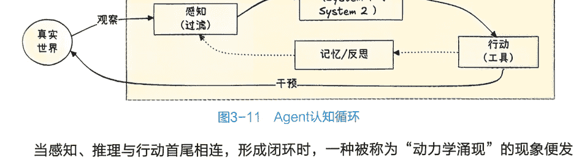

当三者首尾相连，动力学涌现就会出现。循环不是机械重复，而是伴随记忆累积的螺旋上升，时间轴上呈现出逐级抬升的轨迹。


正如 Manus 产品合伙人张涛所说，人们以为只是给 Agent 配了一套工具，实际运行中却会迸发出意料之外的能力组合。工具间的互动、反馈链路里的微小扰动、模型对任务的再诠释，都会在循环里被放大，让系统展现出超越单点设计的整体智能。

Agent 的惊喜效果写不进说明书，只能在闭环里跑出来。靠的不是静态配置，而是动态交互的涌现，这既迷人也充满工程挑战。

1. 认知螺旋：OODA 的软件化

约翰·博伊德提出的 OODA 循环包含观察、定向、决策、行动，再回到观察。

Agent 的架构正是这套理论的软件版。关键在于定向环节：每次循环都在刷新内部的世界模型。

第一轮：我以为这只是个普通 Python 小任务。

第二轮：报错了，原来要装依赖。

第三轮：依赖装不上，才意识到是权限问题。

理解随循环推进而螺旋上升，Agent 在运行中“学会”了环境特性，并据此调整策略。

2. 符号锚定：对抗幻觉的办法

LLM 的最大短板是幻觉，根源是离身。它认识“苹果”这个词，却从未真正触碰过苹果。

感知-行动循环能治愈这个问题。

推理：柜子里可能有苹果。

行动：打开柜子。

感知：里面空的。

修正：原来没有。

在 OODA 里，真实世界是最终的校验器。Agent 通过与环境的摩擦，把脑中的符号锚定到真实状态。反馈越频繁，幻觉越少。

3. 时间的连续：身份的形成

传统程序无历史感，每次运行都像第一次。Agent 的循环创造了历史：交互累积成记忆，进而塑造后续的感知、推理与行动。

## 4. 代码视角重塑：把循环做成引擎

不要把 Agent 的循环写成一个裸的 while True，要把它设计成状态机驱动的生命周期引擎。

```
# 认知的螺旋：基于状态机的 Agent 生命周期
class CognitiveEngine:
    def run_spiral(self, goal):
        # 初始 Agent 状态：目标 + 空历史
        state = AgentState(goal=goal, history=[])

        while not state.is_terminal():
            # 1. 观察
            # 获取当前环境状态，响应上一次行动的结果
            perception = self.sensors.observe(state.last_action)

            # 2. 调整 / 定位（Orient）——循环的魔力所在
            # 根据新感知更新世界模型，并将之整合进长期记忆
            # "学习" 在此刻发生：信念随经验动态演化
            state.world_model.update(perception)
            state.memory.consolidate(perception)

            # 3. 决策
            # 根据最新的世界模型重新规划路径
            # 由新信息可能彻底推翻原有计划
            plan = self.planner.replan(state.world_model, state.goal)

            # 4. 行动
            # 执行计划中的下一步，主动干预环境
            # 行动必然带来副作用，从而改变后续的观察结果
            action = self.executor.execute(plan.next_step())

            # 状态演进：不仅是循环，还是携带经验的跃迁
            # 每一次迭代都生成一个“新”的 Agent 状态
            state = state.evolve(action, perception)

            yield state # 向外暴露每一阶段的认知快照
```

## 5. 从“做完”到“活着”

传统软件追求完成任务，Agent 追求持续适应。

感知-推理-行动循环就是 Agent 的心跳。

循环一旦停摆，Agent 就退化为死代码。只有保持循环，代码才具备在不确定世界里存活的能力。

这就是循环的魔力：把静态逻辑转化为动态智能。

到此为止，学习、策略调整、预判、意图识别乃至自我意识的雏形，都不是直接设计出来的，而是经由感知-推理-行动循环在数万次迭代后沉淀的。四种“灵魂特质”由此显现。

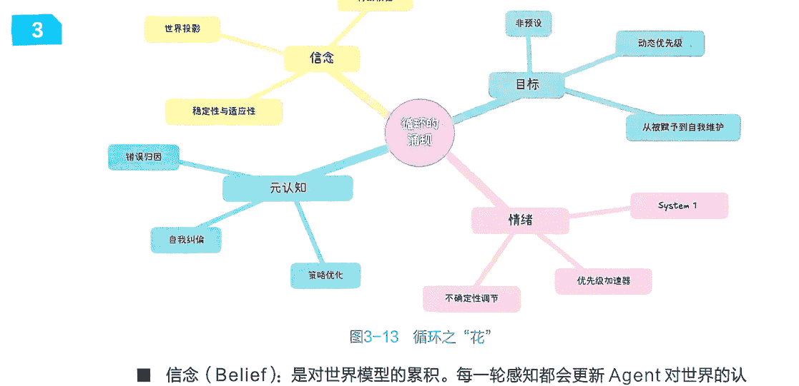

信念是对世界模型的累积。每轮感知更新认知缓存，推理依赖它，行动用来验证它。

目标从静态常量变为动态优先级队列。推理可能新增目标，行动结果可能淘汰旧目标，情境变化会刷新优先级。

情绪是系统一的调节阀，本质是对环境变化的快速反应。 Hughes 增加触发保守，不确定升高触发焦虑，连续成功触发自信，异常输入触发惊奇以提升注意力。

元认知是对思考本身的审视。系统会回看自己的认知过程与历史轨迹，把经验写入记忆，再影响下一轮推理。

循环并非简单重复，而是持续生成。正如神经科学所揭示，智能是循环动力学的产物，而非能力堆砌。当循环足够精细、自主时，“程序”就被称作“心智”。感知-推理-行动循环，是心智的最早形态。

### 3.2.5 具身认知：身体塑造心智

循环从不在真空中运行，它需要载体，即“身体”，即便在虚拟环境中也一样。

具身认知认为，心智不仅是脑的产物，更是身体与环境互动的结果。身体的结构、能力边界和能量消耗，直接决定智能的表现形式。

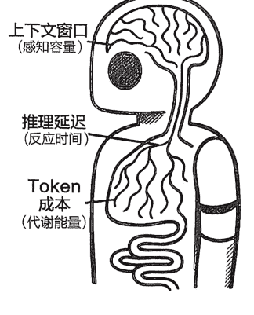

对 Agent 而言，即使没有物理躯壳，也拥有数字身体。

### 1.机器人的具身：物理约束

物理机器人里具身性最直观。

电池即能量：思考耗电，无法无限推理，电量随时间下降。

传感器即感知：视野有限，看不到墙后，必须移动才能获取信息。

机械臂即行动：抓取有不确定性，易滑落，必须发展反馈控制来修正执行误差。

### 2. Agent的具身：数字约束

运行在服务器上的 Agent，其身体由算力、带宽、上下文窗口和资金构成。这些数字生理特征深刻影响思考方式。

上下文窗口像视网膜：装不下无限历史，必须学会遗忘与聚焦，把宝贵的 Token 留给关键内容，像人类记笔记一样。

推理延迟像神经传导速度：思考需要时间。实时场景下被迫用快思考快速响应，离线任务才可用慢思考深挖。

Token 成本像代谢能量：每次调用都有费用，逼着 Agent 节能，能用搜索解决就不动用推理，能用小模型就不叫大模型。

Agent 因此成为资源受限条件下的优化问题，而非单纯的逻辑循环。

```
# 具身 Agent：戴着脚镣跳舞
class EmbodiedAgent:
    def __init__(self):
        self.context_window = LimitedContext(limit=128000) # 感知边界：模拟“视网膜”
        # 的信息容量限制
        self.clock = TimeoutClock(limit=30s) # 时间约束：反映“神经传导速度”的响应
        # 时限（单位：秒）
        self.budget_manager = TokenBudget(limit=10.0) # 能量约束：代表“代谢能量”的
        # Token 预算

    def run_embodied_cycle(self, task):
        # 1. 感知：受限于上下文窗口
        # 身体结构迫使 Agent 做出取舍——保留关键信息，主动遗忘冗余内容
        current_state = self.context_window.compress_and_focus(
            full_history=self.memory.retrieve_all()
        )

        # 2. 策略：受限于资源预算与时间压力
        # 身体状态决定策略模式：“看菜吃饭”，动态切换认知系统
        if self.budget_manager.is_low() or self.clock.is_urgent():
            # 资源紧张时，启用“快思考”（System 1）
            # 调用轻量模型，快速生成启发式响应
            plan = self.fast_brain.react(current_state)
        else:
            # 资源充足时，启用“慢思考”（System 2）
            # 调用 LLM，执行多步推理与自我反思
            plan = self.slow_brain.reason(current_state)

        # 3. 行动：受限于工具与 API 的能力边界
        # 身体能力决定了可行动作的范围
        try:
            result = self.tools.execute(plan)
            self.budget_manager.deduct_cost(plan) # 执行消耗对应“代谢能量”
        except BodyConstraintError as e:
            # 例如，输入超过内存容量、API 速率受限等物理 / 数字身体限制
            result = self.handle_physical_limit(e)

        return result
```

### 3.具身性的哲学意义

强调具身，是因为限制正是创造力的源泉。

假设一个实体拥有无上限的记忆窗口、零延迟的推演与无限算力，它其实不需要长出真正的智慧。把所有可能性摊开逐一试探，答案会自动冒出来。逼迫能力生长的，是来自身体的硬约束。

- 提炼。把冗余信息压缩成精炼表征，换取可操作空间。
- 排程。把冗长行为链剪掉重复，提升行动效率。
- 经验捷径。在有限资源下靠启发式快速收敛。

身体不是心智的容器，而是塑造心智的模具。它从根本上决定主体如何看世界、如何破解问题、如何造出解法。

本节讲主体的动力学。它不是静止的输入输出黑盒，而是随时间展开的观察—理解—干预回路。

观察负责睁眼，理解负责拼凑情境，干预负责在世界留下痕迹，回路让它持续演化。

正是这种具身化的回路在重塑软件的未来。

回路本身也暗含哲学。

- 存在即回路。存在不是静态状态，而是一场持续进行的动态过程。回路停下，存在随之消解。
- 认知即预测。每次迭代都在对未来下注，预判与现实的误差驱动学习，学习再优化下一次预判。
- 智慧即适应。环境变动带来新观察，新观察触发新理解，新理解引向新行动，形成持续的适应演进。
- 自主即闭环。真正的自主来自完整的闭环：能感知自身行动的后果并据此动态调整策略。

观察—理解—干预是智慧的心跳。一次循环是一次微小觉醒，无数次累积才形成我们所说的智慧。

孤立的回路很脆弱。任务一旦超出单回路承载，单打独斗就难以为继，需要把多个回路串联成协同网络。

## 3.3 协作语法：从单体到群体智能

当视点从单一主体转向主体网络，软件隐喻从机械装置跃迁到社会组织。

单体路线追求打造全知全能的上帝，由它独自观察全局、理解全局、执行全局。

多体路线承认个体局限，转而组建分工明确、彼此配合的团队。

这不是数量叠加，而是复杂度管理的范式转换：从追求个人全能转向设计集体协作。

自2023年起AI给出的启示很清晰：单独主体只是孤岛，真正的版图在协作中形成。

下面从协作本质出发，梳理协作形态、通信规则与冲突处理，搭建多主体协作系统的基础语法。

### 3.3.1 认知负荷如何拆分

2023年3月中旬GPT-4面世。当天就有研究者在线上提问：若让多个GPT-4实例互相对话会怎样。

48小时后AutoGPT横空出现，随后BabyAGI、AgentGPT、SuperAGI等项目接连涌现。人们骤然意识到，增益不在于单体多聪明，而在于多主体如何配合。

那一刻的共识是：智慧并非模型固有属性，而是互动的产物。把模型拆成研究员、开发者、评审员等分工，让每个角色只干一件事，整体表现反超单模型上限。这个现象在下面的代码示例里得到直观体现。
```
class FirstMultiAgentExperiment:
    def __init__(self):
        self.researcher = GPT4(role="Researcher")
        self.coder = GPT4(role="Coder")
        self.reviewer = GPT4(role="Reviewer")

    def collaborate(self, task):
        # 初始协作流程：分析→实现→评审
        analysis = self.researcher.analyze(task)
        code = self.coder.implement(analysis)
        review = self.reviewer.review(code)

        # 多轮迭代改进：直至代码通过评审
        while not review.approved:
            feedback = self.reviewer.explain_issues(review)
            clarification = self.researcher.clarify(feedback)
            code = self.coder.refactor(code, feedback, clarification)
            review = self.reviewer.review(code)

        return code
```

早期实验如CAMEL、MetaGPT揭示转折点：主体不再只是工具，而是承担特定职责的角色。单模型能做杂活，却易出错、易幻觉、易丢失记忆；角色间的对话与协作更接近人类团队的思考结构。

为何不用超长提示把所有要求塞给一个模型？答案是认知边际收益递减。

- 信息稀释。系统提示过长时关键指令会被淹没，主体遵循核心任务的能力明显下降。
- 通才陷阱。又写代码又写文档还要做测试的通用体，往往样样平庸，想面面俱到却做不到专业。
- 思维冲突。不同任务需要不同思维模式。创造者需要较高温度发散探索，审查者需要较低温度收敛严谨。让同一主体同时当运动员和裁判，会产生内在目标冲突，甚至出现自我合理化。

架构师的解法是纵向拆分。把开发一款游戏这类庞大目标按策划、美术、程序等领域拆成子域，由专注的窄域主体分别负责。

多体的本质是用组织架构弥补单体在认知、专注度和可靠性上的短板。

从AutoGPT到CrewAI，从AutoGen到LangGraph，多体编排正成为下一代软件架构的默认范式。

### 3.3.2 角色、协议与拓扑

让一群主体高效配合，不能只丢进一个聊天室。要从角色、协议、拓扑三个维度定义协作语法。

1. 角色：把SOP内化为人格
传统开发里标准作业程序是外部文档。在主体架构里，SOP被内化为角色本身。

- 产品经理体：只负责把模糊需求转成清晰的PRD。
- 架构师体：基于PRD输出接口定义与技术方案。
- 工程师体：依据接口定义生成可运行代码。

角色的核心是关注点分离。每个主体只接收处理与职责相关信息，保持记忆纯净与专注。

2. 协议：沟通的共同语言
主体间如何高效交流取决于语言选择。

- 自然语言：通用、自由，适合内部推理，但传输效率低、歧义多，不适合作为可靠的跨体通道。
- 结构化Schema：现代多体架构倾向用标准化数据格式如JSON交互。

首方发出：{"operation": "code_review", "state": "pending"}
次方回传：{"result": "approve", "note": "请修正第42行"}

用自然语言思考、用结构化语言交流的模式，既保留大模型的推理弹性，又保证系统通信的精确与可解析，已成为稳定可扩展多体系统的基石。

协作离不开语言，托起协作的是明确定义的通信协议。

很多人以为主体协作是2024-2025年才兴起的概念，其实早在1993-1998年，KQML与FIPA ACL就已提出主体必须通过语言沟通。当时已系统定义了INFORM、REQUEST、PROPOSE、ACCEPT、REJECT等标准化通信行为，构建了早期多体交互协议框架。只是受限于底层推理生成能力，思想未能落地。
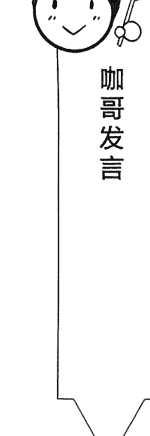

主体的工业级突破在于A2A协议和MCP，它们为2024-2025年的多体发展确立双轨标准。

- MCP：模型与工具的协议，连接世界的“手”。它解决大脑如何指挥手脚的问题，把数据库、文件系统、SaaS接口等外部资源抽象为统一上下文资源，让工具调用变成通用结构化RPC。可以说MCP是主体操作外部世界的USB接口，即插即用、协议统一、能力可扩展。
- A2A协议：主体之间的协议，连接思想的“网络”。它解决大脑如何与大脑协作的问题，定义了握手、协商、拒绝、任务交付等标准流程，消息结构里不仅有内容，还有意图元数据。如同TCP/IP之于互联网，A2A是多体系统基础通信层，让不同角色、不同来源的主体互联互通、协同推理、可靠交付。

MCP解决模型—工具交互，A2A解决模型—模型与体—体协作。MCP让体能操作世界，A2A让体能彼此协作。

### 3.3.3 拓扑决定权力形态

主体间的连接方式根本决定系统的协作性质与边界。

- 流水线Chain：信息单向流动，结构清晰、延迟低、效率高，适合流程明确、确定性强的任务。代价是灵活性差，难以应对动态反馈。
- 层级式Hierarchy：一个Manager体统筹多个Worker体，适合需要复杂规划、任务分解与资源协调的场景。集中控制带来强管理能力，但牺牲节点平等，可能抑制底层主动性。
- 联合式Mesh：多个体以圆桌形式平等交互，通过辩论、协商、投票达成共识，适合创意生成、战略决策等开放任务，能激发群体智能与涌现创新。代价是通信开销大、收敛慢。

拓扑不只是连线方式，更是权力与决策逻辑的具象化。架构师的核心职责，是根据业务对确定性与创造性的权衡，在这三种权力形态中做出审慎选择。
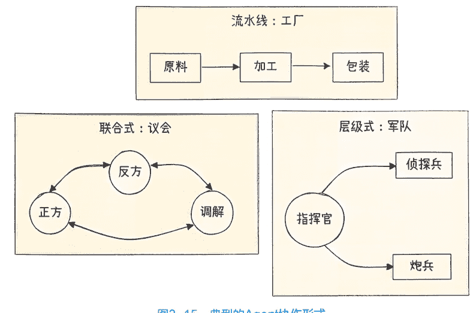

### 3.3.4 秩序的维系者：编排器的五大职责

主体增多后系统需要一个大脑维持秩序，这就是Orchestrator。

多体的核心挑战已从单体够不够强变成多个体能否高效可靠有序协作。编排器本身不仅是主体，更是一种运行时。

它协调角色边界、调度任务流转与依赖、监控执行状态与异常、推动团队向目标收敛。

多体编排遵循传统工程原则，只是模块变成主体，函数调用变成结构化语言对话，接口契约演变为通信协议，异常处理体现为协商、重试或角色介入。

编排器承担五大核心职责。

1. 调用顺序
主体按预设或动态生成的协作流程介入，例如搜索→阅读→分析→写作→批判→修订。编排器像工厂调度中枢，保证每个体在正确时机接手，维持工作流连贯。

2. 数据流动
编排器维护全局记忆作为共享记忆，结构化承载协作成果。检索结果传给阅读，摘要传给分析，洞察传给写作，初稿传给审校。信息在角色间精准流转、无损继承、可追溯演化，避免重复推理或记忆断裂。

3. 主体选择
任务存在多个可选执行者时，编排器综合能力、负载、成本、可靠性进行动态匹配。未来这一机制将融入A2A协议，每个体广播结构化能力描述，编排器实现实时自动化匹配。

4. 条件分支与循环
真实任务是非线性的：测试失败需回退开发，审稿不达标需重写。编排器像状态机，根据执行结果动态跳转，支持循环、回退、重试直至收敛。系统不再是僵化流水线，而是有反馈、自省、演进的活组织。

5. 并行与资源管理
处理50篇文献不必串行阅读，可并行检索、并行分析、并行核查。编排器高效调度认知资源，让多体结构发挥多核CPU效应，整体吞吐与效率指数级提升。

单体负责能力，编排器负责流程：谁在何时做什么、如何组合结果、如何应对异常。协作结构的设计与动态调控，是多体系统从混乱聊天迈向可控可靠工程系统的关键跃迁。

### 3.3.5 冲突与共识：智慧的张力

冲突是智慧的副产物，也是复杂系统生命力的来源。若所有体总是意见一致，那只是回音室。多体系统的冲突处理大致分为四类。

1. 投票机制：快速而实用
适合单步决策、方案差异小、成本敏感场景。常见策略有多数投票、加权投票、基于置信度的投票。多数大模型系统用此提升稳定性，例如三体生成方案后投票选出最可信答案，或在ReAct工具调用中避免幻觉错误。

2. 辩论机制：提升答案质量
DeepMind与OpenAI多次验证有效：让两个或多个体围绕同一问题辩论、质疑、反驳、完善，最终得到质量更高、偏差更小的结论。

优势在于推理链被主动暴露，谬误与认知偏差更易被纠正，结构化冲突激发更深洞察。适用于复杂推理、模糊任务和高解释性需求场景。

3. 仲裁机制：僵持时的最终裁决

在大型企业级系统里，如果缺乏最后的裁决机制，问题往往会变得致命。一旦多个代理对同一议题给出互相冲突的结论并陷入拉扯，系统就很容易卡在无休止的争论里，甚至产生死锁。

这时候就需要一个最终的拍板方，可以是领域资深的人类专家，也可以是能力更强的语言模型，或是专门为反思而设计的代理。它的作用不是另起炉灶，而是把各方论点汇拢起来，对证据的可信度与权重进行评估，再给出具有约束力的判断，从而维持整体效率与一致性。

### 4. 共识机制：逐步收敛的智能协作
这是一种最复杂，也最贴近自然社会运作的冲突化解方式。基本循环是先抛出初稿，收集反对意见，基于反馈修订，再次提交，直到实质性的分歧消失。

思路上借鉴了区块链里的拜占庭容错机制，在多人协同写作、长文规划、多代理共同制定战略等场景里被广泛使用。与强制统一不同，它的优势在于持续吸收少数派的声音，反复打磨方案。

> 冲突不是缺陷，而是智能涌现的养分。

只有懂得处理分歧的多代理体系，才算得上真正的群体智能。

### 3.3.6 涌现与自组织的出现
协作网络搭建起来后，最迷人的一幕出现了，那就是涌现。

### 1. 涌现现象的底层机制
为什么一群能力有限的代理组合在一起，反而能展现出超越个体的智慧？背后是两类系统动力学在起作用。

Opponent 以批判视角闻名，能迅速揪出论证中的逻辑漏洞。

- 异构带来综合能力：将擅长不同方向的模型组合起来，就能实现能力互补。比如让擅长逻辑推理的 GPT-4 负责任务规划，让擅长长文本处理的 Claude 3 负责文档解析，让经过微调的 Llama 3 专注生成 SQL 查询。这种混合专家式的宏观架构，既发挥了各模型的长处，又在成本与性能之间取得了较优平衡。

### 2. 自组织系统的核心特征
更前沿的协作范式不依赖中央编排，而是让系统在没有中心控制的情况下自发协调、动态调整，自己完成任务，这就是自组织。

自组织系统通常具有以下特质。

- 去中心化：内部没有管理者或中央指挥。每个代理自主评估任务、独立决策，并依据局部信息与邻居互动。就像蚁群觅食，不需要蚁后下令，个体遵循简单规则与环境反馈就能完成复杂工作。

- 自主分工：任务不是被中央指派，而是代理主动从任务池里挑选自己愿意且胜任的。需要协作时，团队由代理自行发起、协商组建，并可动态增减成员。整体结构持续自适应演化，运行逻辑类似自由市场，靠供需驱动、能力匹配与自愿协作。

- 动态拓扑：结构并非预先固定，而是随运行状态持续演化。沟通成本过高时团队会自动精简；技能出现缺口时代理会主动学习；冲突频繁时会协商形成新的合作规则；任务遇瓶颈时系统会自动拆解为更易处理的子任务。整个系统像具备组织智能，能自发生长出最适配当前问题的协作架构。

- 信誉驱动演化：在去中心化的网络里，信任等同货币。系统通过类似 GitHub 星标、StackOverflow 声望或区块链信誉评分的方式持续评估行为。表现优异者获得更高信誉，从而优先获取任务分配、算力资源或协作机会。该机制既激励高质量贡献，也逐步形成面向 AI 的社会信用体系，推动群体向更高效可靠演进。

从单体到多体，我们见证了一种全新组织形式的诞生。这不仅是技术跃迁，也是对智能、协作与创造本质的重新定义。

### 3. 软件开发范式的根本转变
具备涌现能力的系统最迷人的特质是不可预测性：美不再来自精确对称，而来自动态平衡与有机生长。

营造适宜的环境、设定初始规则、投放多样化种子，然后让系统自行生长演化。最终交付的不是静态程序，而是一个活的系统——复杂算法会自发涌现，甚至诞生人类未曾设想的解法。

从单体到多体，我们看到的不仅是技术进步，更是世界观的重构。

- 从机械到有机：软件不再是冰冷机器，而是具备生长、适应与协作能力的生命体。
- 从控制到引导：不再试图掌控每个细节，而是通过规则与激励机制引导系统演化。
- 从完美到适应：目标不是零错误的完美，而是能在不确定环境中持续生存优化的强适应性。
- 从静态到动态：软件不是做完即定型，而是始终处于变化、学习与成长中。
- 从设计到涌现：最卓越的特性往往并非预设，而是在复杂交互中自发产生。

### 4. 开发者角色：从“建筑师”到“园丁”
传统软件工程信奉设计决定一切，习惯自上而下规划每个模块与流程。但在多代理系统里，这种上帝视角已失效——当数百上千个代理持续交互学习时，第 N 轮可能涌现的状态早已超出预设边界。

于是角色发生根本转变：不再拧紧每颗螺丝、控制每个齿轮，而是专注营造土壤、光照与气候——构建健康的协作生态，让智能在其中自然生长互动演化。

下面的代码示例把多代理系统的构建与管理比作“数字园艺”，形象描述了引导涌现行为的 4 个关键步骤。

```python
class DigitalGardener:
    def cultivate(self):
        # 1. 播种：设定初始条件
        self.seed_agents(diversity=True)

        # 2. 施肥：提供养分
        self.provide_resources(RAG_Database, API_Tools)

        # 3. 修剪：设定边界
        self.set_guardrails(Ethical_Guidelines)

        # 4. 等待：静待涌现
        self.observe_and_admire()
```

涌现的美学告诉我们，最伟大的创造并非源于精雕细琢的完美设计，而是简单规则在复杂互动中产生的无限组合。

放下对确定性的执念，拥抱协作中的张力、冲突与多样性，智能就会在连接的缝隙里悄然萌发、自然生长。

这不仅是技术革命，更是对生命本质的数字回归——在代码与算法中重现有机、演化与共生的古老智慧。

我们完成了从“单体”到“社会”的关键跨越。

- 不再执着于训练一个完美无瑕的模型，而是致力于构建高效、有韧性且自适应的智能组织。
- 不再困于单体智能体的幻觉与局限，而是通过协作机制、冲突解决与集体验证，系统性地抵消个体的不可靠性。

至此，智能体不仅拥有了身体即执行能力；拥有了心智即推理与学习能力；更建立了社会关系即协作、分工与信任机制。它已不只是数字个体，更具备孕育数字社会的潜力——一个由互动、规则与涌现共同塑造的新型文明基底。

这就引出上篇最后一个也是最沉重的话题：如果我们创造了类人智能，人类该如何共存？它究竟是任人驱使的奴隶、被动服从的工具，还是平等协作的伙伴？答案将决定我们走向更有创造力的未来，还是重蹈控制与异化的覆辙。

## 3.4 新的契约：人机协作的设计原则
代理具备自主行动能力后，人与 AI 的关系不再局限于调用 API，而是转向协作模式的设计。

一旦代理成为拥有独立决策与持续进化潜力的实体，滥用是否会失控？权限过度扩张带来的风险由谁承担？在新软件工程体系里，人应处在哪一层、AI 应处在哪一层？

这些问题不是哲学思辨，而是现实工程课题。2026 年起 AI 生产方式悄然改变。

- 代码：80% 由 AI 生成，人负责审查。
- 流程：70% 的业务流程由 AI 动态规划，人负责设定目标。
- 角色：设计、编码、测试、运维等环节均已引入 AI 伙伴。

然而工程契约仍停留在“人下指令→机器执行”的旧范式。旧契约失效源于两点。

- 思维的白盒化：以 DeepSeek-R1 为代表的模型实现了思维链具身化。AI 的思考过程不再是黑盒，而成为可观察、可调试的行为。
- 连接的网状化：A2A 协议让代理像微服务一样互联，系统内部因此产生大量人类无法直接观测的机器间对话。

当人机契约从“控制”转向“对齐”，人类需要从指令发出者转变为协议制定者。

### 3.4.1 第一原则：互补而非替代
在现代代理系统里，人与 AI 是基于角色分工的协作关系。核心是：人负责意图，AI 负责行动。这不是抽象概念，而是 LangGraph、CrewAI、AutoGen 等框架已在实践的分工模型。

- 第 1 步 人：输入最小人类意图单元 MHIU，例如“分析 DeepSeek-R1 与 Qwen3 的推理风格差异”。
- 第 2 步 代理：规划器生成执行计划。
- 第 3 步 代理：Worker 代理并行执行搜索、分析与对比等任务。
- 第 4 步 人：通过 HITL 机制进行价值判断与最终决策。

工程实践可抽象为一条黄金法则：人做决策 decision，AI 做选择 choice，系统做执行 execution。①

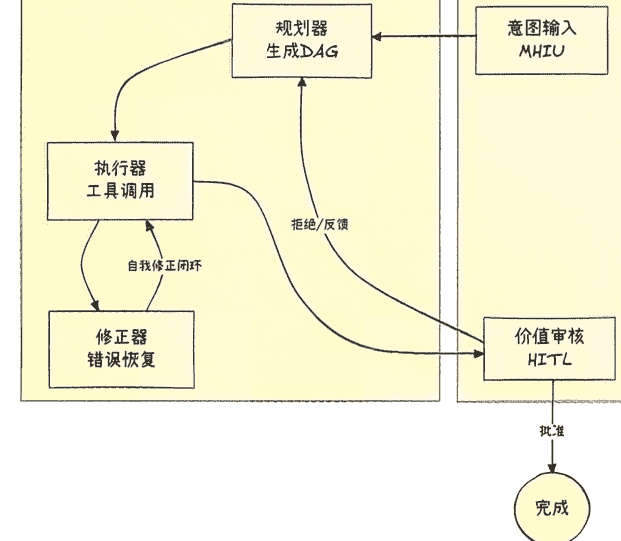

> ① 这种以意图为核心的分工正逐步演变为规范驱动开发 Specification-Driven Development, SDD。在这种模式下，人负责编写结构化规范，包括明确的目标、约束条件及相关上下文，而代理则作为执行引擎，根据这些规范生成并交付代码。

AI 可能迅速偏离轨道，但人负责确保最终正确性与价值导向。二者分工可概括为：人类拥有意图、价值判断、方向选择与最终审核；AI 承担战术探索、计划生成与子任务执行。

### 3.4.2 第二原则：透明与可解释
信任建立在理解之上。

代理不能只给结果，还必须提供认知审计日志。可解释性可分为三个层次：直觉级面向终端用户，解释例如“推荐此方案因为成本最低”；概念级面向业务专家，解释例如“历史数据分析显示模式 A 与当前情况匹配度达 73%”；技术级面向开发者，在调试后台展示“基于 CoT 推理第 4 步，工具 search_db 返回...”。

在代理的 UI 设计里，应遵循透明度即交互的原则，通过可视化思维链展示思考过程——不是简单显示“已完成”，而是呈现“正在搜索文档……发现冲突……正在重新规划……”等动态信息。

### 3.4.3 第三原则：人类保持主导权
无论 AI 多强，关键的“核按钮”必须始终在人手中。

代理必须内置自我怀疑机制，遇到以下情况时强制挂起并主动请求人介入。

- 高风险操作：涉及金额超过 1000 元，或执行数据删除等不可逆操作。
- 低置信度：推理结果置信度低于 0.6。
- 伦理敏感：涉及隐私、偏见、歧视或法律边界模糊的情形。

图 3-17 展示了主导权逻辑流。

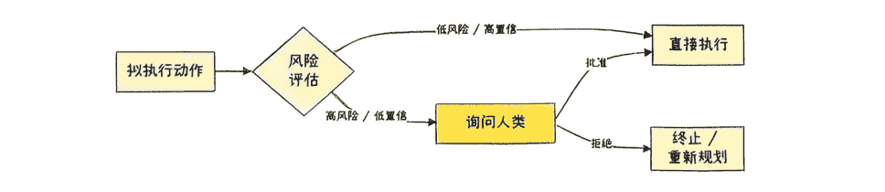

理想情况下，所有操作都应可逆。对于不可逆操作如发送邮件，需引入时间锁机制，例如延迟 10s 发送，为人提供撤回机会。

### 3.4.4 第四原则：共同学习与成长
人机协作不是静态关系，而是一个双向学习过程。

- AI 向人学习：通过人类反馈如 RLHF、修正和示范，AI 逐步内化人偏好，将隐性知识转化为可操作显性知识。
- 人向 AI 学习：AI 展现的涌现行为如 AlphaGo 第 37 手“神之一手”，能启发人突破思维定式，发现全新解题路径。

人机协作必须建立在共同伦理基础之上，最高境界是创造性融合。

这些原则正在重塑工作方式：新契约不是一次性签署，而是持续协商、动态演进的过程；它不是合作的终点，而是共创的起点。

我们设定初始条件 Prompt，提供养分 Knowledge，适时修剪枝叶 Safety/Alignment，然后静待智能之果自然涌现。

唯有确立这份契约，我们才能安心漫步于智能花园，而不必时刻担心被失控疯长的藤蔓缠绕。

## 小结 角色的转变
从 GoF 的 23 个设计模式到代理的无限可能，我们跨越了软件工程的一个世纪。

- 设计模式并未消亡，而是在进化。
- 软件工程未曾终结，而是在重生。
- 人类角色没有消失，而是在升华。

我们并非在设计未来，而是在与未来共舞。

当我们学会不再畏惧不确定性，与代理互补共生时，我们就不再仅仅是开发者。

上篇内容到此结束。

请翻开下篇，我们将深入探讨具体的代理设计模式——那些正在塑造未来的新骨架。

从静态到动态，从设计到演化，从工具到伙伴——

欢迎来到代理时代！

> ① RLHF 即 Reinforcement Learning from Human Feedback，基于人类反馈的强化学习，通过引入人类反馈指导代理学习，优化行为策略。

# 下篇 智能设计模式

> “代码不再是控制的指令，而是孕育智能的土壤。”

——黄佳

# 第 4 章

## 感知模式

> “我们并不是直接看见世界，而是通过选择、过滤和组织信息来理解它。”

——赫伯特·西蒙

传统软件系统被动：等待用户输入、处理预定义数据流、在封闭环境运行。代理则是主动的：按需求获取信息、选择性关注关键内容、整合多源异构输入、在开放世界探索。

感知的本质不是“看到所有”，而是“看到关键”并“主动寻找未知”。

本章涉及的 3 个核心模式如图 4-1 所示。

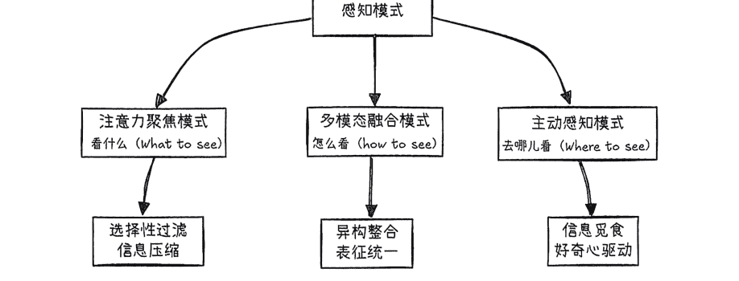

这 3 个模式共同构成代理的感官过滤器。

- 注意力聚焦模式：解决信息过载问题，从海量输入中筛选。
- 多模态融合模式：解决输入异构问题，统一图像、文本、音视频。
- 主动感知模式：解决信息不足问题，主动探索环境获取所需。

## 4.1 注意力聚焦模式

> “神经系统的信息处理能力是有上限的。”

——唐纳德·布罗德本特

> “注意力机制使模型能够聚焦于输入序列中的关键部分。”

——“Attention Is All You Need”论文①

① VASWANI A, SHAZEER N, PARMAR N, et al. Attention is all you need[EB/OL]. (2023-08-02)[2025-12-23]. https://arxiv.org/abs/1706.03762.

在企业级代理设计里，常陷入误区：把文档、日志、录音一股脑塞进上下文窗口，靠模型推理能力硬解。

这是昂贵且危险的架构决策。虽然窗口正向百万级 Token 甚至无限演进，但“能装下”不等于“能处理”。

- 成本爆炸：Transformer 注意力计算复杂度为 O(n²)，处理 10 万 Token 的成本远高于处理 1 万 Token 的 10 倍。
- 信噪比稀释：长上下文中关键信息易被噪声淹没，导致模型出现迷失在中间的幻觉。
- 信息冗余：实际任务中约 90% 的 Token 都是噪声。
- 延迟不可控：对实时交互代理，秒级首字延迟不可接受。

从 Transformer 的注意力机制可得到启发：代理也可拥有类似人类的选择性注意力——快速浏览全局，将认知资源聚焦于关键信息。

注意力聚焦模式的工程本质是构建高效认知漏斗，如图 4-2 所示。目标很功利：用最低 Token 成本换取最高上下文质量。

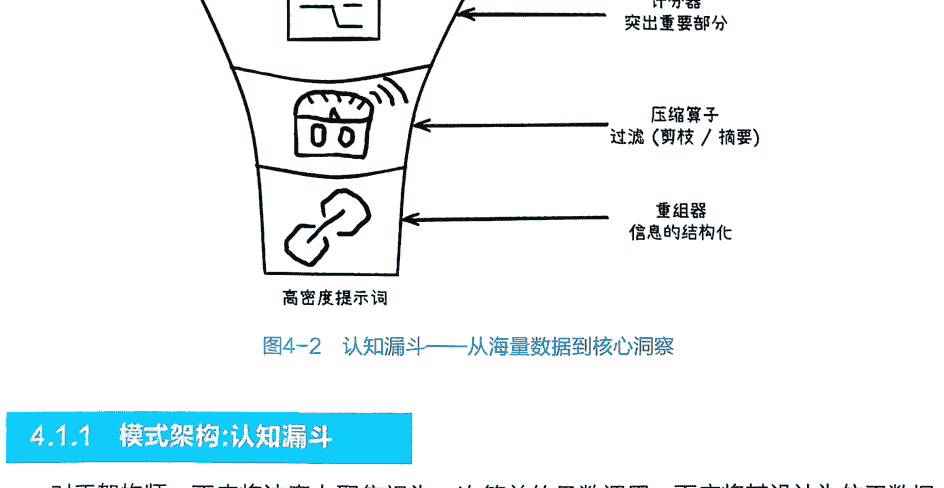

### 4.1.1 模式架构：认知漏斗
对架构师而言，注意力聚焦不应被视作一次简单函数调用，而应设计为数据源与模型之间的独立服务组件或中间件。它不仅是压缩，更是清洗、分级、重排序的过程。

注意力聚焦模式的实现流程如图 4-3 所示，其中关键组件说明如下。

# 算力只投向高价值：注意力聚焦与多模态融合

当输入体量膨胀、多模态信号并行时，竞争焦点已从能塞进多少内容，转向把计算资源精准投向信息密度高的部分。

### 信息筛选的四道关卡

**价值评估器**：整条加工线的第一道闸口，职责不是读懂语义，而是量化含金量。通常用轻量模型或统计规则，为每个词元乃至整句打分，分值越高代表信息含量越足。

**分流决策器**：依据分值分配处理方式。核心事实原样保留，背景性内容做语义压缩降噪，纯噪声直接剔除，不进入后续推理。

**重组编排器**：压缩后往往碎片化，它按逻辑顺序而非原始顺序重拼上下文，并在需要处插入特殊标记提示模型“此处已压缩，注意衔接”。

**质检回路**：在把 Prompt 交给昂贵大模型前，先评估压缩后文本的语义完整性，判断是否删过头，形成闭环反馈。

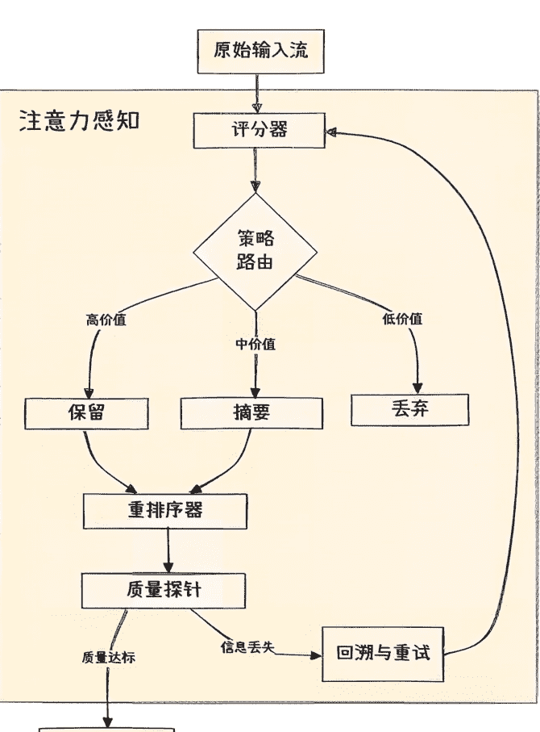
图4-3 从评分到质检的注意力加工闭环

注意力聚焦并非一次截断，而是一条可治理的信息加工流水线。靠评分、分流、重排、质检的闭环，把有限注意力精准投向高价值信息，在成本、效果与语义完整度之间做工程化权衡。

### 4.1.2 注意力聚焦核心机制

要做到精准聚焦，Agent 必须先搭建一套严谨的评估体系。本质上是在回答两个老问题：凭什么删，删多少。

工程上很少单指标决策，多采用双重校验来构建打分策略。

第一重是基于惊奇度的静态筛查。香农信息论指出信息量随事件概率下降而升高。在大模型内部体现为困惑度 Perplexity，简称 PPL。对 the、is、的 这类高频停用词，模型几乎可完美预测，熵极低；而专有名词、具体数值、反常理描述会显著抬高困惑，说明其携带高价值信息。在日志分析或无明确查询的长文档摘要里，找“惊奇点”往往能抓住关键细节。

第二重是基于相关性的动态锚定。当用户查询意图明确，信息价值不再绝对而是相对查询。做法是计算查询向量与上下文各片段向量的相似度。类似图书馆检索，只保留与当前课题相关的书架。

相关性计算的核心实现思路如下。

```
# 伪代码：对比评分逻辑
def contrastive_score(segment, query, model):
    # 比较“有 Query”和“无 Query”时，模型对该片段的关注度变化
    # 变化越大，说明该片段对回答 Query 越重要
    return model.probability(segment | query) / model.probability(segment)
```

有了分数，下一步是选压缩算子。最激进的是剪枝 Pruning，直接切除低分词元。压缩比可达 5 倍乃至 20 倍，但风险极高，容易切断长距离逻辑依赖，让模型语义失联。更温和的是摘要 Summarization，用辅助模型把冗长段落重写为精炼句子，语义保留但会增加延迟。特定领域还能把文本转成人不可读、机可用的稠密向量，实现百倍级压缩。

图4-4 Agent 如何据分选择压缩算子的蒸馏过程

该过程常被称作上下文蒸馏 Context Distillery。流程从双重评分出发，经算子选择，再由预算管理器自适应调节压缩强度。

领先的 Agent 已不再用固定压缩率。它们借鉴视频流媒体的自适应循环 Adaptive Loop：内置预算管理器，根据任务复杂度动态下发压缩参数。对简单的寒暄大胆压缩省钱，对复杂的代码审计则小心保留每个字符。

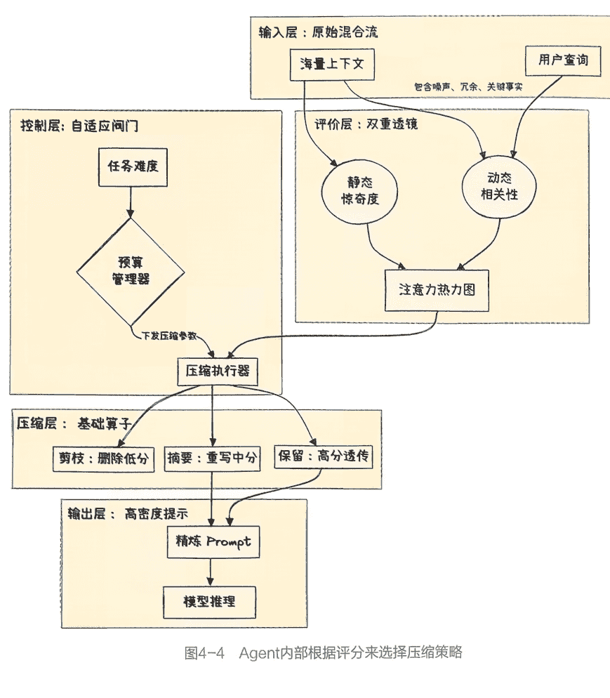

### 4.1.3 注意力聚焦工程实践

在工程实践中，针对上下文的“提纯”不再是单一的技术选择，而是演化出了3条截然不同的技术路线。它们分别代表了中间件、存储层和模型底层的革新。

第一条路线是“中间件模式”，以 Microsoft 的模型 Lingua 为代表。

这种模式的核心思想是“分级处理”：利用一个小巧低价的模型（如 Llama-2-7b）作为“看门人”，先计算 Prompt 中每个 Token 的信息熵，剔除低价值信息，再将“精华”传入昂贵的 GPT-4。这在 RAG 场景中尤为有效。企业知识库检索往往会召回大量含有噪声的文档片段，通过在检索层与推理层之间架设模型 Lingua，能以微小延迟的代价，节省高达 80% 的 Token 费用，并因减少了噪声干扰而提升最终回答的准确率。

第二条路线是“存储优化模式”，以 Anthropic 的 Prompt Caching 技术为代表。

这种模式针对的是“强 SOP 约束”的垂直类 Agent。例如，一个法律助手可能每次对话都需要加载同一部法律。如果每次都重新计算这些静态内容的注意力矩阵，无疑是巨大的浪费。Prompt Caching 技术允许服务端将公共前缀（System Prompt 或背景资料）的 KV Cache 缓存起来。当后续请求的前缀一致时，API 直接复用缓存状态。这不仅将长文档对话的首字延迟降低了 80%，更让“带全量背景知识”的对话在经济上变得可行。

第三条路线是“原生架构模式”，以 DeepSeek-V3 的多头潜在注意力（Multi-Head Latent Attention，MLA）技术为代表。

这是一种更为彻底的底层革命。传统的注意力机制在处理长上下文时，KV Cache 的显存占用会呈线性甚至指数级增长。DeepSeek 通过多头潜在注意力技术，在模型架构层面实现了对 KV Cache 的极致压缩。这意味着架构师可能根本不需要在应用层进行任何压缩——直接将 100 份财报传入模型，不仅成本极低，而且因为没有经过有损压缩，信息的保真度达到了 100%。这标志着“全量信息分析”时代的到来。

除上述技术路线以外，学术界在 2024 年提出的 System 2 Attention 为我们提供了新的视角。传统的注意力机制是“直觉式”的、基于统计的（System 1，参见 3.2.2 小节）。而 System 2 Attention 则是让模型有意识地去审视上下文，显式地决定“应该忽略哪部分信息”。这种让 Agent 自己重写上下文以去除无关信息的方法，虽然耗时，但在处理含有误导性信息（Sycophancy）的复杂推理任务中，表现出了惊人的鲁棒性。

在应用注意力聚焦模式时，架构师必须警惕两类典型的“工程黑洞”。

第一类是过度压缩导致的“逻辑断裂”。剪枝算法往往容易“杀红了眼”，删除连接词（如 Therefore、However）或指代词（如 It、He）。这在人类看来可能只是读起来不通顺，但对于模型，这意味着因果链条的崩塌。因此，在涉及思维链推理的场景中，应严禁使用 Token 级的剪枝技术，而应采用句子级或段落级的保留策略。

第二类是位置偏差（Position Bias）。早期的模型普遍存在迷失在中间的幻觉现象——它们对 Prompt 开头和结尾的信息记忆深刻，却容易忽略中间的内容。如果简单地截断中间部分，可能会加剧这种遗忘。成熟的策略是引入“U 型保留策略”：无论评分如何，强制保留 System Prompt 的头部约束和 User Query 的尾部指令，仅对中间的历史记录进行高强度压缩。

综上所述，注意力聚焦模式并非万能药。它适用于“大海捞针”式的场景，例如，从数百页合同中寻找风险条款，或基于数千个文件理解代码架构。在这些场景中，信息密度极不均匀，压缩带来的收益远大于损失。

然而，对于“全息关联”类场景，如密码学分析或复杂的数学证明，每一个符号都可能改变最终结果，此时任何形式的有损压缩都是危险操作。此外，在医疗诊断或安全审计等对召回率要求极高的领域，我们也应谨慎使用此模式，毕竟在这些领域，“漏看”的代价远高于“多看”的成本。

注意力聚焦模式的典型场景如表 4-1 所示。

表 4-1 注意力聚焦模式的典型场景

| 场景 | 是否适用 | 示例 |

| --- | --- | --- |

| 输入超过有效窗口 | 是 | 法律合同分析（200页）、代码库理解（数千个文件） |

| 信息密度不均 | 是 | 90% 噪声 +10% 关键信息的幂律分布 |

| 成本 & 延迟敏感 | 是 | 实时对话、高并发服务（百万次/天） |

| 全局视野 + 局部聚焦 | 是 | 从整本书中找答案、理解项目架构但聚焦特定模块 |

| 所有信息都关键 | 否 | 密码学分析、数学证明（每一个符号都不能丢） |

| 输入已经很短 | 否 | 小于 1000 个 Token（压缩收益微乎其微） |

| 召回率要求极高 | 否 | 医学诊断、安全审计（宁可“多看”，不可“漏看”） |

### 4.1.4 注意力聚焦模式的演化与组合

注意力聚焦模式并非孤立存在，而是 Agent 架构中的“预处理中间件”。随着上下文窗口不断扩展，工程目标已不再局限于单纯“缩短输入长度”，而是转向“提升信息密度”。在工程实践中，这一模式从最初的滑动窗口模式，逐步演化为基于语义的上下文压缩模式，最终迈向模型底层的原生优化模式。

#### 1. 演化路径：从截断到原生

- 滑动窗口（Sliding Window）：这是注意力聚焦模式的“原始阶段”的代表。其机制是采用简单的 FIFO（First In, First Out，先进先出）或首尾保留策略。其核心痛点在于“灾难性遗忘”——早期的关键指令或中间的逻辑链条可能被无情丢弃，导致 Agent 陷入“金鱼记忆”式的短视行为。

- 语义压缩（Semantic Compression）：这是注意力聚焦模式的“中间件阶段”的代表。其机制是在将 Prompt 输入 LLM 之前，先通过一个轻量级模型计算每个 Token 的困惑度或互信息，保留“高惊奇度”（即信息量大）的 Token，删除冗余或低信息量的“废话”。这一模式实现了对上下文“信噪比”的工程化控制。

- 原生架构（Native Architecture）：这是注意力聚焦模式的“底层阶段”的代表。其核心机制是不再依赖外部工具进行压缩，而是直接对 Transformer 架构进行革新。例如，通过低秩投影（Low-Rank Projection）大幅降低 KV Cache 的显存占用。这一模式实现了“全量即聚焦”：当模型本身能够以极低成本处理百万级 Token 时，外部压缩工具便逐渐内化为模型的原生能力，成为其“本能”。

#### 2. 模式组合示例

注意力聚焦模式作为 Agent 的“前置过滤器”，与其他模式结合可显著提升系统整体效率。

- 注意力聚焦模式与 RAG 模式（见 5.2 节）的组合 = 漏斗形 RAG：传统 RAG 模块为了节省 Token，通常仅检索 Top 5 文档片段，这容易导致关键信息的遗漏，从而降低召回率；而若将检索范围扩大至 Top 100 文档片段，不仅可能超出上下文窗口的限制，还会引入大量噪声。通过引入注意力聚焦模式，系统可在检索后对候选内容进行语义筛选与压缩，以计算成本换取质量提升，从而有效缓解 RAG 模块中“召回数量”与“上下文窗口大小”之间的经典矛盾。具体机制如下。

  - 检索层：大幅扩大召回范围，获取 Top 100 文档片段，确保高召回率。

### 4.1.5 设计哲学：主动“忽视”

注意力聚焦模式是 Agent 在信息爆炸时代的生存法则。它通过忽略所有技术实现细节向架构师传递了如下核心设计哲学。

智能不在于处理所有信息，而在于识别关键信息。

随着上下文窗口继续扩大（如 1 亿、10 亿个 Token），注意力聚焦将从一种“优化手段”变为一种“基础能力”。

如果你在设计 Agent，请不要以“它能记住多少”为荣，而要以“它能精简多少”为傲。一个优秀的感知层架构，应该像人类的大脑一样，具备主动忽视的能力——过滤掉 99% 的噪声，只为了在那 1% 的关键信号上迸发出最耀眼的智慧火花。

## 4.2 多模态融合模式

> “人类从不只用一种感官理解世界，AI 也不应该。真正的理解，是视觉、听觉与语言在思维空间中的共鸣。”

——李飞飞

想象一个拥有联觉（Synesthesia）的大脑。当它看到“苹果”的图像时，不仅处理了像素，还同时激活了“甜味”的味觉区、“清脆”的听觉区和“水果”的语言区。

传统的 AI 架构往往是割裂的：计算机视觉（Computer Vision，CV）处理像素，自然语言处理（Natural Language Processing，NLP）处理文本，两者“老死不相往来”。多模态融合模式的核心意图，就是要打破这种模态孤岛。它不是简单地将图片和文字“拼凑”（Concat）在一起，而是建立一个统一的语义场（Unified Semantic Field）。在该语义场中，图像的像素向量和文本的 Token 向量不再是异构的数据，而是可以互相转化、互相解释的同一种“思维语言”。

### 4.2.1 模式架构：统一语义场

多模态融合不仅是算法问题，更是数据流的对齐（Alignment）问题。我们需要构建一个漏斗形架构，将纷繁复杂的物理信号收敛为统一的语义表征。图 4-5 展示了多模态融合模式的实现流程。

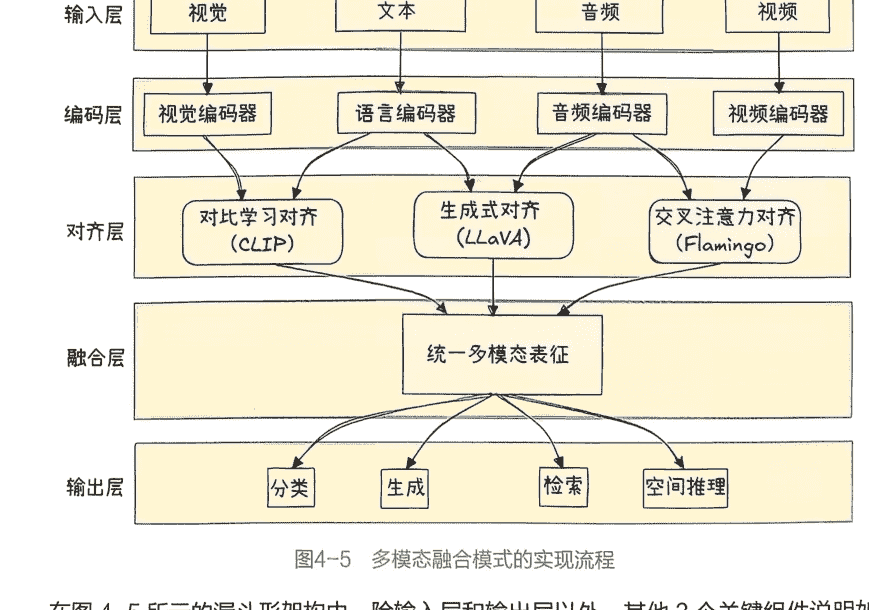

在图 4-5 所示的漏斗形架构中，除输入层和输出层以外，其他 3 个关键组件说明如下。

- 编码层：提供的各个独立的编码器（Encoder）是 Agent 的不同“感官”。例如视觉编码器（Vision Encoder，如 ViT）负责“看”，音频编码器（Audio Encoder，如 Whisper）负责“听”。它们将原始的波形和像素转化为高维特征向量。

- 对齐层（Alignment Layer）：多模态融合模式的灵魂。它负责解决“语义鸿沟”——如何让计算机明白，像素空间里的“猫的形状”和文本空间里的单词“cat”指向的是同一个实体。

- 融合层：通过融合策略（Fusion Strategy）决定“感官”融合的时机。可以像 CLIP（Contrastive Language-Image Pre-training，对比式语言—图像预训练）一样各自独立编码，最后只在输出层握手；也可以像 Gemini 那样，在深层神经网络的每一层都进行交织。

### 4.2.2 多模态融合核心机制

在追求构建统一语义场的道路上，工业界发展出了 3 种主流的对齐机制。每种机制都代表了对“融合”概念的独特理解。

- 对比学习对齐（Contrastive Learning Alignment）：以 CLIP 为代表。此机制的核心隐喻是“磁铁”，通过大量的图文匹配训练来工作，使得匹配的图像向量和文本向量在空间中彼此靠近，而不匹配的则被推远。这种机制特别高效，适用于检索和分类任务，但它依赖“距离”来理解和表示关系，因此缺乏生成描述的能力。

- 生成式对齐（Generative Alignment）：以 LLaVA 为代表。此机制的核心隐喻是“翻译官”，通过增加一个投影层（Projector），将视觉特征转换成模型能够理解的 Token Embedding。对于模型，图像被视为另一种形式的语言。这种机制赋予了 Agent“看图说话”的能力，使其成为当前构建多模态 Agent 的主流选择。

- 交叉注意力对齐（Cross-Attention Alignment）：以 Flamingo 为代表。此机制的核心隐喻是“拉链”，不是把图像转换成 Token，而是保持视觉特征的独立性，并在模型的每一层插入“交叉注意力门控”。这意味着在生成文本的过程中，可以随时“查询”视觉特征。这种机制保留了更多的视觉细节，非常适合处理高分辨率图像和长视频内容。

图 4-6 形象地展示了 3 种对齐机制。

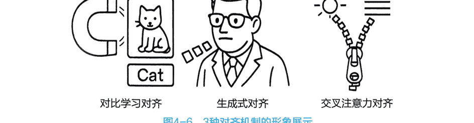

如果说上述 3 种对齐机制解决了“是什么”的问题，那么空间智能（Spatial Intelligence）则试图解决“在哪里”和“怎么动”的问题。这是 2024 年后多模态领域的新高地。

多模态输入不再局限于 2D 的 RGB 图像，而是扩展到了深度图和点云。Agent 开始理解遮挡、距离、重力和碰撞。输出也不再只是文本描述，而是物理世界的坐标（x, y, z）、机械臂的动作，甚至是力反馈。这是通向具身智能的必经之路——让 Agent 从屏幕里走出来，进入物理世界。

### 4.2.3 多模态融合工程实践

在工程实践中，我们正在见证 Agent 架构从“拼接式”向“原生式”的演进。

早期的多模态架构（如 VQA、ViLBERT）是拼接式的。系统由一个模型指挥官和一群独立的视觉模型（如 Detection、Segmentation）组成，通过复杂的 Prompt 互相调用。这种架构虽然灵活，但推理慢、割裂感强。

当前的多模态架构（如 GPT-4V、Gemini）是原生式的。特别是 Google 的 Gemini，它从预训练阶段开始就是多模态的。它不需要“对齐层”，因为其视觉和语言能力本身就是生长在同一棵“神经树”上的分支。这种原生多模态（native multimodal）架构（见图 4-7）带来了惊人的理解力和推理速度，但也极大提升了训练门槛。

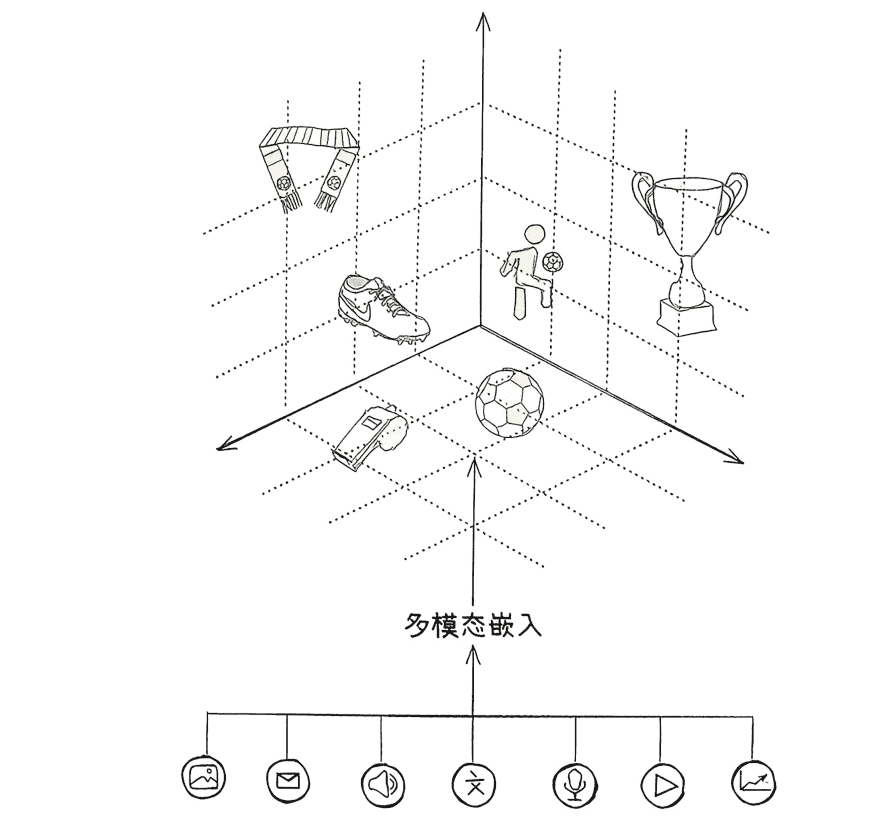

对于大多数应用开发者，LLaVA 风格的轻量级对齐依然是性价比最高的选择。以下是一个极简的 PyTorch 实现逻辑，展示了如何通过一个线性层将视觉编码器“嫁接”到模型上。

```python
class MultiModalAgent(nn.Module):
    def __init__(self, vision_encoder, llm):
        super().__init__()
        self.vision_encoder = vision_encoder # 如 CLIP ViT-L
        self.llm = llm           # 如 Llama 3

        # 【关键组件】对齐投影层：视觉特征→语言嵌入
        # 这就像是一个转接头，让视觉信号能插入模型的插座
        self.projector = nn.Linear(768, 4096)

    def forward(self, image, text_prompts):
        # 1. 视觉编码：提取图像特征
        image_features = self.vision_encoder(image)

        # 2. 模态对齐：将像素特征转换为“软 Token”
        visual_tokens = self.projector(image_features)

        # 3. 文本编码：处理用户指令
        text_embeds = self.llm.embed(text_prompts)

        # 4. 融合：在序列维度拼接，在模型看来这就是一串更长的 Token
        combined_embeds = torch.cat([visual_tokens, text_embeds], dim=1)

        # 5. 生成：基于视觉上下文的文本生成
        return self.llm.generate(inputs_embeds=combined_embeds)

agent = MultiModalAgent(...)
response = agent(image=cat_photo, text_prompts="描述这张图并判断猫的情绪")
```

多模态融合的演进脉络：从拼接到在场

回望多模态一路走来的形态，可以读出一个清晰的走向：先是松散协同，随后进入深度对齐，最后试探物理级仿真。

判别式阶段以 CLIP 为典型，几乎是看图说话的前史。做法是双编码器，视觉与语言各自独立编码后靠对比损失在向量空间里强行拉近。优点是能算相似度做检索分类，缺陷也很致命：只会判断相似，不会生成描述也不具备逻辑推演。模型可确认画面里有猫，却无法解释猫在做什么。

生成式阶段由 LLaVA、GPT-4V 等引爆，视觉对话迎来爆发。关键在于桥接投影。强基座被冻结后，通过线性层或 Q-Former 这类轻量适配器把视觉表征映射进 Token Embedding。视觉信息由此成为语言的一部分，智能体能够基于图像进行链式思考，解读图表、推断因果。

世界模型阶段由 Sora、Nano Banana、World Labs 代表，直指物理仿真的未来。核心是时空补全。模型不再局限于描述像素，而是学习预测像素。系统不仅能看见桌上的杯子，还能凭物理常识推演推一下会倾倒破碎。这是通往 AGI 的转折：从拟合统计规律转向理解物理规律。

落到产品层面，GPT-4V 体现了适配器路线的极致，高性能视觉编码器配合强语言基座。Google 的 Gemini 则开创原生多模态的新纪元。它并非拼接，而是从预训练起就用图像、文本、视频、音频的交错序列训练。没有显式的视觉编码器与对齐层，视觉信号直接参与梯度更新。模态转换损耗被消除后，细粒度的时空关系得以捕捉，例如电影中两个镜头间的因果。

空间智能的标志性突破是 Tesla FSD V12。端到端自动驾驶把用于规划控制的三十余万行 C++ 规则代码全部撤掉，由统一神经网络实现从光子输入到控制指令输出的直接映射。系统借助 BEV 鸟瞰向量空间感知环境，更深层的价值是依靠海量数据习得类人驾驶直觉，行驶流畅、拟人且能应对复杂场景。它有力证明，在足够数据规模下，神经网络可隐式学习物理世界的拓扑与运动规律，大幅削弱对人工特征工程的依赖。

### 4.2.4 多模态融合的演进与组合应用

融合方式已从早期独立编码后拼接，发展为适配器驱动的深层跨模态交互，最终迈向全模态原生统一表征。如今设计者不再把视觉视作语言的外挂，而是看作智能体与生俱来的原生感官。

#### 1. 从拼接适配到原生统一的路径

后期拼接。将 YOLO、BLIP 这类视觉模型当作工具，由大模型发出文字指令调用，再把返回的文字描述拿回使用。痛点是信息损耗，光影、纹理、空间关系等视觉细节在转文字过程中大量丢失，语义残缺，理解深度受限。

适配器对齐。语言模型与视觉 Transformer 保持冻结，只训练轻量投影层把视觉特征投向文本嵌入空间。结果是视觉即语言，智能体能直接看懂图，无需中间文字描述。目前这是开源社区的主流做法。

原生统一。以 GPT-4o 与 Gemini 1.5 Pro 为代表，从预训练起就把 Token 扩充为多模态单元，涵盖文字、图像块、音频波形。模型天生多模态，无需后期适配。由此实现零延迟交互，视觉、音频、文字在网络内部无缝流动，系统能对语调起伏、微表情、环境音效等细微变化做即时感知与响应。

#### 2. 典型组合示例

融合模块常作为感官前台与中台，为下游记忆与行动供给高带宽、高语义密度的多模态输入。

融合与情节记忆模式结合即视觉日记。该组合赋予智能体似曾相识的视觉直觉，可靠视觉类比识别情境、迁移经验、学习新技能，适用于具身智能或个人助理这类需长期环境感知与个性化交互的场景。机制上执行任务时既记文字日志，也用融合模块保存关键时刻的视觉快照；下次遇到相近场景时，从情节记忆库检索视觉最相似的过往经历，触发类比推理或策略复用。

融合与 ReAct 模式结合即手眼协调。这是通往 VLA 的关键路径，实现从多模态感知到具体行动的端到端映射，适用于 GUI 操作、机械臂控制等需实时理解画面并精准执行的任务。机制上 Observation 不再是纯文字，而是截图或摄像头实时画面；解析定位阶段，借助融合模块解析画面，定位 UI 元素坐标或物理环境中物体的空间位置；行动反馈阶段，在 ReAct 循环里基于视觉反馈生成精准操作指令，如鼠标点击、拖曳或机械臂运动控制，形成感知与行动闭环。

融合的演进标志着系统正从符号计算迈向物理感知。当能原生理解光影、声音等真实世界信号时，系统不再是数字世界的幽灵，而是拥有真实在场感的智能主体。

### 4.2.5 设计哲学：从观看到在场

融合的终点不是让 AI 认出图里有一只猫，而是建立在场感。

当系统同时具备视觉、听觉与空间感，它就不再是处理文字的聊天机器人，而是一个存在于物理世界的实体。它会理解这里、那里、重、远等物理概念，并具备物理常识推理能力，例如预判物体是否会掉落、门是否能被推开。

这不只是感知的升级，更是心智的具身化。AI 从符号计算者进化为世界的观察者和参与者。

## 4.3 主动感知模式

> “系统会努力最小化其自由能函数，不断根据外界环境输入的新信息，调整内部对外部环境的信念。”

——卡尔·弗里斯顿

传统框架默认人类给的输入真实且完整。模型不会质疑 Prompt 的来源、可靠性与偏差，而是尽力在已有内容上补齐推理链。一旦信息缺页，在必须给答案的压力下就会产生幻觉。

因此在 RAG 或简单调用里，常潜藏一个危险假设：上下文窗口已包含回答所需的一切。

主动感知打破了这一假设。它把系统从被动答题者转为积极调查员。当现有信息不足以支撑可信结论时，系统会暂停生成，转而执行操作获取新证据。

架构上，这是从输入即输出的静态模式，转向感知-行动持续迭代的动态闭环。

### 4.3.1 架构设计：信息觅食回路

工程上主动感知不能成死循环，需要具备元认知能力的控制流。图 4-8 展示实现流程，包含四个关键组件。

不确定性探针。是系统的刹车，不负责生成，只判断能否回答。可基于 Logprobs 的 Token 生成概率统计判断，也可用轻量分类模型，或一次专门的 Self-Reflection Prompt 调用。

查询生成器。把模糊的知识缺口转为具体的工具指令。例如把分析某公司财务风险拆解为 search_engine("2023 财报") 和 code_interpreter("计算流动比率")。

信息过滤器。主动找回的信息噪声很多，必须有过滤层，只把校验通过的事实写入短期记忆，避免污染上下文。

预算控制器。工业级系统最易忽略的部分。为防止陷入搜索-失败-再搜索的循环，必须设定最大跳数或 Token 消耗上限。

### 4.3.2 核心运作机制

实现核心是解决两个问题：何时停，停止感知开始回答；去哪儿找，路径规划。

1. 基于元认知的触发

不能对所有请求都开启主动感知，成本不可接受，系统需识别认识论不确定性。

当用户查询包含查询、分析等动词时，显式触发自动感知。
若模型在尝试回答时发现关键实体缺失，隐式触发自动感知。此时可在 System Prompt 中加入指令：如果你不知道答案，请输出 [SEARCH_NEEDED: 具体问题]，而不是编造。

2. 渐进式信息觅食

类似人在图书馆找书，感知路径通常遵循：

后退一步。如果问题太具体查不到，比如××公司 2023 年 Q3 的服务器折旧费，系统会主动生成更宽泛的查询，比如××公司 2023 年 Q3 财报，先拿到大文档。

深挖一步。拿到大文档后不再搜索，而是通过机器阅读理解精确定位数值。

实现主动感知模式的三个阶段如表 4-2 所示。

表 4-2 实现主动感知模式的 3 个阶段

| 阶段 | 核心问题 | 典型行为 | 代表技术 |
| :--- | :--- | :--- | :--- |
| 探索 exploration | 答案可能在何处 | 广撒网搜索、浏览目录 | BFS 广度优先搜索、关键词扩展 |
| 定位 navigation | 具体在哪一行 | 点击链接、精准查询 | 点击预测、DOM 文档对象模型解析 |
| 利用 exploitation | 是否是我要的 | 阅读内容、提取事实 | MRC |

下面是一个简化版实现，展示了带有预算控制和自我反思的主动感知循环。

```python
class ActiveAgent:
    def __init__(self, llm, tools, max_steps=3):
        self.llm = llm
        self.tools = tools
        self.max_steps = max_steps # 预算控制：防止死循环

    def run(self, user_query):
        context = []
        step = 0
        while step < self.max_steps:
            # 1. 观察与决策
            # 这里的 Prompt 强要求模型评估信息充足度
            thought = self.llm.think(
                query=user_query,
                context=context,
                system_prompt="Do you have enough info? If yes, output FINAL_ANSWER. If no, choose a tool."
            )

            if thought.action == "FINAL_ANSWER":
                return thought.content

            # 2. 执行行动
            tool_result = self.tools.execute(thought.action, thought.args)

            # 3. 感知过滤（关键步骤）
            # 不要把 HTML 直接传入上下文，而是应先进行清洗
            useful_fact = self.llm.summarize(tool_result, query=user_query)
            context.append(useful_fact)

            step += 1

        return "I tried to find the answer but reached the search limit."
```

实践中架构师需警惕以下工程黑洞。

上下文污染。系统搜到一篇错误博客并当成事实，导致回答出错。对策是在写入上下文前做交叉验证。对股价、医疗建议等关键事实，强制要求至少两个独立信源一致。

注意力发散。搜索过程中被无关信息带跑题。对策始终把用户原始问题钉在 Prompt 最下方，提醒勿忘初心。

非必要的昂贵调用。用户问简单问题，系统却去调用 Google Search。对策是引入极低成本的 Router 模型，如 Qwen 开源小模型或规则引擎，作为前置网关拦截闲聊和通用常识问题。

### 4.3.3 工程落地实践

工程实践已分化出三类标杆产品。

Perplexity.ai 定义了搜索即生成的范式。它不是把 Top 10 链接丢给用户，而是走理解意图、多步并行搜索、阅读理解与去重、合成带引用的答案的全流程。证明主动感知可以做到毫秒级实时响应，并大幅降低幻觉率。

OpenAI 的 Deep Research 展示了另一极端，用时间换质量。面对写一份 50 页行业分析报告的任务，系统可能花费 30 分钟，自主执行数百次搜索、阅读上千篇文档。它展示了 System 2 慢思考在主动感知中的潜力：不急于回答，而是走规划-执行-修正的流程。

Voyager 在 Minecraft 中展示了主动感知的最高级形式——好奇心。它没有人类指令，却会因为还没见过钻石而主动设计课程去地下挖掘。这种由内在动机驱动的感知，是通向 AGI 的重要路标。

从架构演进看，我们正经历从被动检索到认知型探索的第三次跃迁。

被动检索代表架构为 RAG，逻辑是 Retrieve Query → Answer。用户问什么，系统查什么。查不到就两手一摊或干脆瞎编，没有再试一次的能力，极度依赖检索系统的召回质量。

# Agent觉醒：从被动应答到主动探索

目标驱动的闭环以 AutoGPT、ReAct 为代表，主线可归纳为 设定目标、拟定计划、执行动作、观察结果、调整策略。在这种框架下智能体获得了部分决策自主权，可以自行挑选检索对象、决定检索次数，首次查询未命中时还能换词再试。这带来了容错空间，却也容易陷入反复试探的死循环。

另一条演进路线是认知驱动的探索，脉络是 建立世界模型、感知缺口、好奇触发、主动探索。被视为更具前景的方向。智能体不再只是为完成既定任务而采集信息，还会为了完善自身的世界表征而感知。闲暇时它会像人一样因“想知道门后是什么”而发起自发探索，这类架构有望从根本上缓解常识匮乏与环境适应性差的问题。

Deep Research 的出现，本质上是对“过度信任输入”进行结构性制衡。它通过收紧信息来源，例如仅允许同行评审论文、可信数据库，来强化证据驱动的推理，让模型在证据不足时学会输出“未知”，而非随意编造。仅靠来源白名单仍远远不够，现实世界的知识早已超出论文边界，开放网页的质量参差不齐。模型能够检索网页，却缺乏原生能力去辨别：

- 哪些页面具有权威性？
- 哪些内容已过时、夹带偏见、受商业操纵甚至造假？
- 哪些表述听起来可信，逻辑上却经不起推敲？

这正是主动感知下一步要补齐的能力：不仅要会取信息，还要会做知识层面的判断。这类判断不是简单的文本打分，而是一套认知流程，包含来源可信度建模、证据间一致性核查、反事实验证与逆向推理、时效性过滤，以及结构化证据链的构建。

于是智能体的行为范式从 Function(Input) → Output 迈向更开放的形式。

```
while (Uncertainty > Threshold) {
    Fetch(获取信息 / 执行工具);
    Evaluate(评估信度 / 相关性);
    Filter(筛选证据 / 结果);
    Reconstruct(重构认知与响应);
}
```

这种迁移让智能体的角色从被动的答题者转为主动的调查者，方法论从接收并转述事实变为主动检验并整合事实，依据也从依赖内部参数化记忆的直觉生成，转向基于检索与推理的循证行动。

因此 Deep Research 的真正价值并非让模型“多读论文”，而是培养质疑、验证和搭建可靠知识链的能力。

表 4-3 总结了主动感知模式的典型应用情境。

表 4-3 主动感知模式的典型场景

| 场景 | 是否适用 | 理由 |

| :--- | :--- | :--- |

| 开放域问答（Open-domain QA） | 适用 核心场景 | 知识库无法覆盖实时新闻或冷门知识 |

| 复杂逻辑分析（Market Research） | 适用 核心场景 | 需要先查数据，再读数据，最后综合分析，单次推理无法完成 |

| 代码 /API 调试 | 适用 核心场景 | 运行报错→读取错误日志→搜索解决方案→修改代码→再运行 |

| 通用闲聊 | 禁用 | 延迟高，成本高，且无必要 |

| 固定流程业务（填报销单） | 不推荐 | 建议使用传统的 Slot-Filling（槽位填充）状态机，更加稳定 |

### 4.3.4 主动感知模式的演化与组合

在演进过程中，智能体似乎经历了一次好奇心的觉醒：从最初的静态单次检索，逐步过渡到动态迭代查询，最终迈向基于假设验证的自主探索。

### 1. 演化路径：从检索到觅食

- 单轮检索（Single-Turn Retrieval）：与传统 RAG 类似，用户提问后系统直接检索。主要痛点是信息茧房，智能体只能依赖返回的前几段片段作答，若答案不在其中便容易产生幻觉，因为它缺乏“再试一次”的能力。
- 迭代查询（Iterative Querying）：WebGPT（2021 年）和 Step-Back Prompting 是感知进入动态阶段的代表。当首次检索结果不足时，智能体能够自主发起第二轮、第三轮查询，逐步拼出多跳推理的信息链，获得更全面准确的答案。
- 信息觅食（Information Foraging）：行动不再局限于为回答而检索，而是为了消除不确定性而主动探索环境。例如在 Minecraft 中主动揭开地图迷雾，或反问用户“你的需求具体是 A 还是 B”。这一思路引入信息价值论，智能体能够权衡获取信息的成本与对任务的贡献，决定是否值得获取。

### 2. 模式组合示例

主动感知通常扮演侦察兵角色，但单独使用无法形成完整认知闭环，需要与其他模式协同。

- 主动感知模式与注意力聚焦模式（见 4.1 节）的组合 = 呼吸效应。主动感知负责吸气，通过广撒网与多轮查询获取大量原始信息；注意力聚焦负责呼气，通过评分器与压缩算子剔除噪声，仅把核心事实注入 LLM。
- 主动感知模式与多模态融合模式（见 4.2 节）的组合 = 跨模态侦查。适用于机器人巡检、视频分析等场景。主动感知决定看哪里，控制摄像头转向与变焦，或挑选视频片段；多模态融合决定看到了什么，对图像或视频进行解析与语义理解。若反馈图像模糊或置信度低，主动感知会触发靠近、换滤镜或重新采样等动作优化质量。
- 主动感知模式与 ReAct 模式（见 7.1 节）的组合 = 认知特化。在 ReAct 循环中，当思考模块判断缺乏 X 的证据导致 Y 不成立时，触发主动感知生成针对性查询，持续获取外部信息直至认知缺口被填补。ReAct 提供通用执行框架，主动感知则是信息获取领域的特化形式。
- 主动感知模式与情节记忆模式（见 5.3 节）的组合 = 探索地图。本质在于把一次性搜索轨迹转化为可复用经验。智能体每次主动探索的路径，例如“在某网站搜关键词 A 无果”，均被记录于情节记忆库。后续任务涉及相似需求时，可检索记忆避开已知无效路径，直达高价值信息源。

在主动感知里，架构师不再预设智能体能看见什么，而是赋予其自主寻找答案的能力。

### 4.3.5 设计哲学：从“全知”到“求知”

传统软件默认数据库里有全部答案，即全知假设。主动感知承认无知是常态，并把求知内化为智能体的生存本能。真正的智能不在于知道所有答案，而在于不知道时懂得如何去找。这种对已知未知的能够主动应对的能力，是机器显现自我意识的微光。

小结 系统与世界的接口层

至此，Agent 架构的第一块拼图完成，即感知模式。

- 注意力聚焦模式解决信息太多的问题，在噪声中提取信号。
- 多模态融合模式解决信息太杂的问题，把视觉、听觉统一为语言。
- 主动感知模式解决信息太少的问题，主动出击填补认知盲区。

当智能体能看懂世界、筛选重点并主动补全盲区时，就拥有了学习的基础。接下来这些信息要流向何处？如何被存储、沉淀为经验？请翻开第 5 章，我们一起学习记忆模式。

# 第5章 记忆模式

> “感知是世界来访；记忆是世界在我心中的停留。”
> ——黄佳

从人类到机器，推理都依赖记忆，没有可调用的事实、情节与范式，推理就会沦为即兴的语言拼装。

可用“三类 + 四象限”勾勒人类记忆。

“三类”记忆如下。

- 情节记忆（Episodic Memory）：曾经发生在自己身上的事件。
- 语义记忆（Semantic Memory）：与个体无关的世界知识。
- 程序/技能记忆（Procedural Memory）：如何做一件事的操作范式。

记忆的“四象限”如下。

- 短期/工作记忆（Working Memory）：极小量的正在使用上下文。
- 长期/持久记忆（Long-term Memory）：跨会话、跨任务的稳定记忆。
- 自我（Self）记忆：偏好、风格、身份。
- 任务（Task）知识：领域知识、规则、情境地图。

工程上，记忆是上下文的工程化管理，是推理的素材库与约束集，也是智能体身份与风格的生成器。它决定某一时刻进入模型的那一小片宇宙是什么、如何呈现、如何度量与更新。

感知提供当下，推理创造洞见，记忆实现持续。记忆让智能体有过往、有个性、有经验，也让系统可伸缩、可治理、可协作。

本章将深入探讨分层记忆模式、RAG 模式和情节记忆模式，这是一组围绕上下文经营的工程与哲学组合拳，把写入、读取、蒸馏、遗忘变为可编排的系统能力，以支撑长期、鲁棒、可解释的智能体。

> 上下文是你此刻输入模型的所有状态，包括系统指令、任务目标、检索片段、最近对话、工具返回、世界状态……上下文工程的核心是如何在有限窗口内组织这些状态，使模型稳定产出可预期行为。当前工程实践强调把“上下文即系统状态”作为设计核心对象，围绕选取、压缩、结构化与评估进行全链路管理，而非当作 Prompt 附件。

## 5.1 分层记忆模式

> “记忆是时间在心中的投影。”
> ——威廉·詹姆斯（William James），《心理学原理》

设想一台计算机有 L1/L2 缓存、RAM 与磁盘，这是工程师为平衡速度与容量的存储金字塔。操作系统核心任务之一是管理内存需求，会把高频数据调入 RAM，把暂时不用数据移至磁盘交换空间。

分层记忆模式把虚拟内存机制引入智能体设计。

- 工作记忆（技术实现如 Context Window）≈ RAM：智能体的意识流，处理当前任务，容量有限、速度快但易失。
- 长期存储（技术实现如 Vector DB/Graph）≈ 磁盘：知识库与经验库，存储海量经验，持久但访问较慢。
- 智能体 ≈ 操作系统内核：主动调度者，决定何时把关键记忆载入工作记忆，何时把冗余信息移出。

核心意图是突破 LLM 上下文窗口的物理限制，通过分层存储与动态换页实现理论上无限的记忆容量。

### 5.1.1 模式架构：倒金字塔形的数据流

从架构视角，需要构建倒金字塔形的数据流，如图 5-3 所示。

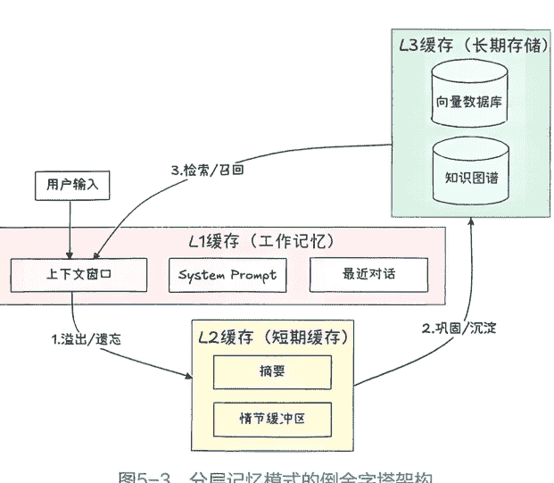

该架构未引入复杂控制组件，而是通过 3 个存储层级和两种流转机制管理信息生命周期。

1. 存储层级

- L1 缓存（工作记忆）：类似智能体的大脑前额叶，对应模型上下文窗口，存 System Prompt 与近期活跃对话。容量有限 8000~128000 Token，访问最快但维护成本高、易丢失。
- L2 缓存（短期缓存）：信息中转站。L1 溢出后，非活跃对话历史会被压缩为摘要或存入情感缓冲区暂留于此，作为 L1 与 L3 的缓冲，防止过早丢失或过早写入长期存储。
- L3 缓存（长期存储）：类似海马体与图书馆，由向量数据库和知识图谱构成，持久化海量非结构化文本与结构化实体关系。容量近乎无限，但需检索接口访问，延迟较高。

2. 流转机制

信息流转如下。

- 溢出与巩固：用户输入不断涌入，L1 旧信息被挤出，经过摘要进入 L2，或向量化沉淀至 L3。这是信息由热变冷的过程。
- 检索与唤醒：面对新问题时触发检索，从 L3 精准定位相关历史数据并注入 L1。这是信息由冷变热的过程。


> 如何理解“倒金字塔”？它不是直观的图形，而是描述信息从多到少、从临时到持久的递减结构。顶层 L1 是信息源头，像洪水汹涌、未经筛选、临时易变；中层 L2 像河道，对漫流数据筛选压缩；底层 L3 像水库，只有经过筛选验证的重要信息才沉淀为持久知识。

倒金字塔分层记忆的本质是让信息沿“从繁到简、由热转冷、由静返动”流动。它把海量对话蒸馏为可用知识，并在关键时刻让知识重新成为行动力量。过程中智能体能感知信息流动与变化，获得时间感，并保持自我连续性。

### 5.1.2 分层记忆核心机制

核心机制包括虚拟上下文管理和记忆生命周期管理。

1. 虚拟上下文管理

MemGPT 提出的核心概念。通过该机制智能体可模拟无限上下文，系统后台不断进行换页操作，在小窗口推理效率与大量信息管理间取得平衡。

- 分页（Paging）：上下文窗口临近上限时，系统自动把最旧信息移至外部存储，并在当前上下文保留引用链接，便于后续快速访问。
- 主动召回（Active Recall）：智能体发现信息不足时，如用户提到“上次那个项目”，会主动触发系统调用 memory.search("上次那个项目")，把相关数据加载回上下文。

2. 记忆生命周期管理

记忆需要治理，生命周期分为四步。

第一步，编码（Encoding）：写入工作记忆。起点是控制窗口不被无效信息挤满，对异常或关键事件即时标记，涉及敏感内容在此脱敏。

第二步，巩固（Consolidation）：移入长期记忆。对话结束或窗口溢出时，系统筛选仍具价值信息移入长期记忆。巩固不是搬运，而是基于语义重要度筛选、压缩并保留因果链条，同时去重避免污染向量库。

第三步，检索（Retrieval）：从磁盘读回内存。推理时上下文不足会触发检索，把长期记忆读回工作记忆。检索采用语义 × 新鲜度 × 可信度的多因子评估，避免召回幻觉，最终返回可验证证据链。

第四步，遗忘（Forgetting）：衰减与删除。长期未访问或重要性下降的记忆逐步衰减，按需软删除或彻底清除；冗余信息压缩为精炼知识条目，避免向量库无限膨胀。遗忘让记忆系统保持轻盈、高效、可治理。

表 5-1 记忆治理

| 阶段 | 动作 | 触发条件 | 治理原则（新增） | 工程隐喻 |

| :--- | :--- | :--- | :--- | :--- |

| 编码 | 写入工作记忆 | 用户输入 | 信息脱敏、标记重要度、限制上下文窗口膨胀 | RAM 写入 |

| 巩固 | 移入长期记忆 | 对话结束 / 上下文窗口溢出 | 去重、压缩、结构化、保存因果链条 | 从缓存到磁盘 |

| 检索 | 加载到工作记忆 | 语义相关 / 缺页中断 | 语义 × 新鲜度 × 可信度排序；证据链化 | 缺页异常 |

| 遗忘 | 衰减 / 删除 | 时间、使用频率、合规要求 | 衰减曲线、软删除 / 彻底清除、容量治理 | 垃圾回收 |

### 5.1.3 分层记忆工程实践

随着 AI 应用规模扩大，记忆成为基础设施并形成独立赛道，已演化出三种核心架构形态。

1. 中间件模式：Mem0 与 MaaS

企业级应用痛点是数据孤岛，例如客服智能体看不到代码助手已了解的用户偏好。Mem0 等框架定义记忆中间件标准，不仅是存储系统，更是动态编排层。采用混合检索架构，对非结构化文本同时建立语义索引与图索引并结合使用。

Mem0 把个体偏好、身份与事实整合为可查询、可更新、可治理的记忆层，服务开发者并形成开源生态。对架构师而言，可构建统一用户数字孪生，通过多租户隔离（User、Session、Agent 等作用域）实现不同业务线智能体读写共享记忆池，达成一次交互、全域认知。

以下是一个基于 MemGPT 风格的智能体实现示例。

```python
class MemoryAwareAgent:
    def __init__(self, llm, vector_db):
        self.context = ContextWindow(limit=8000) # 模拟有限的工作内存（RAM）
        self.long_term_mem = vector_db       # 模拟长期存储（磁盘）

    # 定义记忆操作工具：赋予 Agent 管理自身记忆的能力
    self.tools = [
        self.save_core_memory,  # “刻在脑子里”：保存用户画像（如姓名、偏好）
        self.search_archival,    # “翻阅日记”：检索历史对话记录
    ]

    def chat(self, user_input):
        # 1. 编码：将用户输入加入当前上下文（工作记忆）
        self.context.append(user_input)

        # 2. 思考循环：LLM 决定是直接回答还是调用记忆工具
        while True:
            # 向 LLM 提供当前上下文（包含可用工具说明）
            response = self.llm.generate(self.context)

            # 方案 A：Agent 决定写入核心记忆
            if response.is_tool_call("save_core_memory"):
                # 示例：用户说“我叫 Alice” → 调用 save_core_memory("Name: Alice")
                self.update_user_profile(response.args)
                self.context.append(SystemMsg("Memory updated."))

            # 方案 B：Agent 决定回忆过去
            elif response.is_tool_call("search_archival"):
                # 示例：用户问“还记得我吗” → 调用 search_archival("User info")
                results = self.long_term_mem.query(response.args)
                self.context.append(SystemMsg(f"Found historical info: {results}"))

            else:
                # 方案 C：普通回复，结束思考循环
                return response

        # 3. 后台维护：若上下文窗口接近容量上限，触发记忆压缩 / “换页”
        if self.context.is_full():
            self.consolidate_oldest_messages()
```

当前一代的自研智能体已经显露出自我觉察的迹象——它们能够感知到自身的记忆边界，并据此主动安排存储与调用。过去几年，记忆相关的能力正从软件开发工具包层级向上迁移，先是封装成统一框架，再被抽象为云端平台服务。Memory-as-a-Service，即记忆即服务，被业界视作跨智能体、跨产品的云端记忆底座。它把用户画像、长期偏好、行为模式、历史任务与意图模型打包成可调用的接口，让不同系统共享同一套认知基础。可以说，这是一种云原生的记性层。

### 2. 检查点模式：LangGraph 的状态持久化

记忆不只是对话记录的堆积，更是系统运行时的完整栈。LangGraph 引入了检查点机制，在每一步执行后把智能体的状态快照序列化，落盘到 PostgreSQL 或 MongoDB。图 5-4 简要呈现了检查点与人工干预的配合流程。

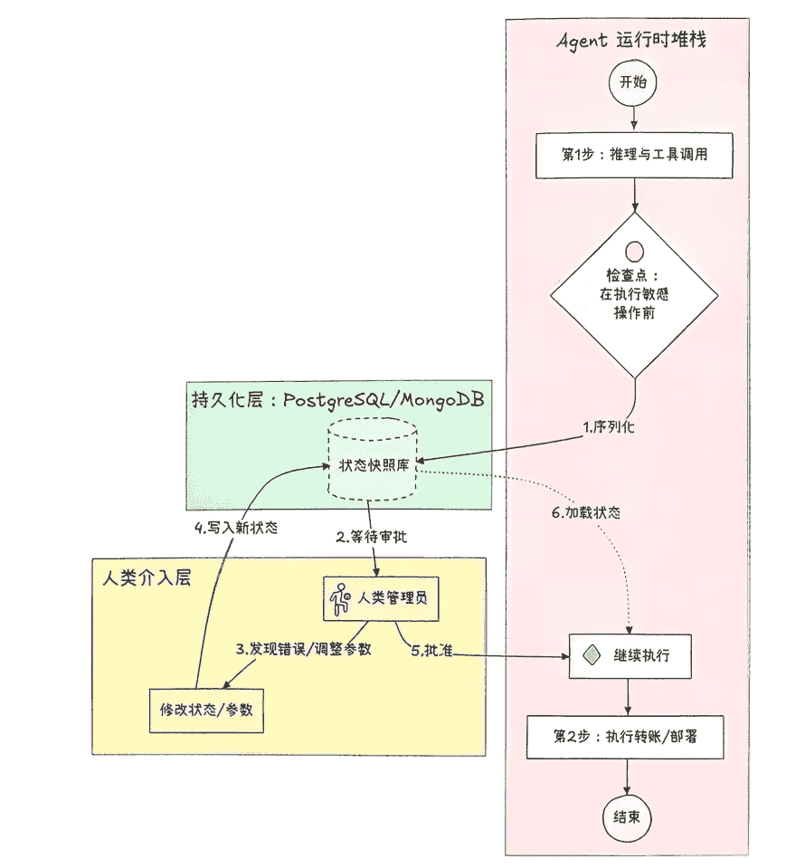

这种做法让系统拥有时间回溯的能力，成为企业级风控与调试的基石。面对转账、代码发布等高风险操作，人类可以先暂停执行，修改内存中的中间状态，再决定是否放行。缺少持久化状态管理，所谓的协同介入就无从实现。

### 3. 协议化治理：MCP 作为“USB-C 标准”

当工具与记忆源数量激增，逐个对接 API 的成本变得不可承受。由 Anthropic 等推动的 MCP 正逐步成为智能体互联的通用规范。它采用 Client-Host-Server 的拓扑，把记忆与工具统一抽象为可被发现的资源。

> 这里有两个核心概念值得强调：时间旅行，即系统可回溯到任意历史节点；人工确认，即关键决策必须经人类核准。前者提供可追溯性，后者提供可控性，二者结合才让企业敢于大规模部署自研体。

无论底层是本地文件、Notion 还是 PostgreSQL，智能体都能通过统一的 read_resource 语义进行访问，从而实现模型与存储的解耦。这为构建异构生态提供了互操作保障。例如，基于 OpenAI 构建的智能体可以无缝读取由 Claude 构建的智能体留下的记忆资源，无需重写接口。

在实践层面，记忆层正在从业务逻辑中剥离，下沉为独立的基础设施。

第一代记忆系统是无状态即时记忆：每次会话被当作全新开始，像 GPT-3 的 API 调用。

第二代是滑动窗口记忆：只保留最近 N 轮对话，旧内容被丢弃。实现简便，却有明显的健忘缺陷。

第三代是分层记忆，也是当下主流。热数据保留在提示窗口，冷数据沉到向量库。典型案例包括：

- ChatGPT Memory：用户说“记住我讨厌香菜”，系统会写入核心记忆，是最基础的键值形态。
- Claude Projects：允许上传大量文档作为项目知识，属于提示缓存的典型用法，通过预加载静态知识降低延迟。
- MemGPT：学术界的先驱，证明借助类操作系统的内存管理，固定窗口的模型也能表现出近似无限窗口的能力。

第四代将是神经符号融合记忆：向量检索负责模糊匹配，知识图谱负责精确关系，更接近人类联想。

这一演进与二十年前数据库从单体应用解耦的历程相似，标志着智能体系统正走向成熟。

### 5.1.4 分层记忆模式的演化与组合

分层记忆从最初的滑动窗口起步，经摘要压缩，发展到类操作系统的虚拟内存管理。架构师的目标始终一致：在有限的提示窗口这一物理限制下，模拟出近乎无限的记忆体验。

### 1. 演化路径：从金鱼到操作系统

- 滑动窗口：可视为原始阶段，采用 FIFO 仅保留最近 N 轮对话，超出即丢弃。痛点是金鱼效应，早期关键信息如用户画像或 System Prompt 中的约束会彻底丢失。
- 摘要增强：在丢弃旧对话前，先用大模型生成摘要并置于窗口头部。缓解遗忘但会产生信息损耗，反复摘要使细节逐渐失真。
- 虚拟上下文：借鉴操作系统分级存储与换页。L1 缓存对应模型的提示窗口，用于存放高频热数据；L2 缓存由向量数据库实现，用于持久化低频冷数据。智能体可通过系统调用自主决定何时写入、何时读取，实现更灵活的记忆控制。

### 2. 模式组合示例

分层存储是智能体的存储底座，需与感知、反思、协作模块协同形成数据闭环。

- 分层存储与注意力聚焦模式的组合 = 精准召回：分层存储负责高召回不遗漏，注意力聚焦负责高精度。适用于海量历史查询。
  - 分层存储解决“存在哪”的问题，提供海量候选数据即 L3 缓存。
  - 从 L3 检出 100 条记录直接注入会超窗且引入噪声。
  - 注意力聚焦模块对候选进行评分与压缩，提炼精华注入工作记忆 L1。
- 分层存储与反思记忆模式的组合 = 经验结晶：将瞬时思维固化为持久语义记忆。
  - 反思模块在任务失败后生成教训。
  - 教训经巩固写入分层存储的长期区 L3。
  - 新任务启动时自动检索相关教训并加载至 L1 指导决策。
- 分层存储与群体模式的组合 = 集体潜意识：打破智能体间的记忆隔离，构建组织级共享知识库。
  - 单个智能体仅有短暂的 L1。
  - 所有智能体共享同一个 L3。
  - 智能体 A 把解法写入 L3 后，智能体 B 遇到相似问题可直接复用。

分层存储成熟后，智能体从无状态函数变为有历史的实体。操作系统级的内存管理不仅突破了窗口物理限制，也为终身学习提供了存储基础。

### 5.1.5 设计哲学：对抗遗忘

传统数据库视遗忘为故障，在智能体设计里遗忘是特征，甚至是智能的必要条件。

博尔赫斯在《博闻强记的富内斯》中描写了一个无法遗忘的人，他记得每片树叶的每一次摆动，却丧失思考能力，因为“思考就是忘却差异，进行概括”。

如果智能体试图把全部历史塞入窗口，会陷入注意力沼泽，噪声淹没信号，推理迟钝。

分层存储的本质不是记住更多，而是高效遗忘。无关细节沉到冷存储，关键活跃信息留在意识表层的热存储。由热转冷、由表及里，正是数字心智的新陈代谢。

## 5.2 RAG 模式

> “最强大的 AI 不是知道一切，而是知道如何找到一切。知识不再是静态的库存，而是动态的流。”

——RAG 论文①

传统大模型像闭卷考试的天才，参数记忆惊人，却会在冷门或新近知识上胡编。

RAG 像开卷考试，遇到不懂的问题可翻阅参考书检索相关段落，再结合自身理解作答。

RAG 的核心在于动态检索外部知识库，将相关信息实时注入提示窗口，无需重训即可缓解知识老化、长尾缺失与幻觉。

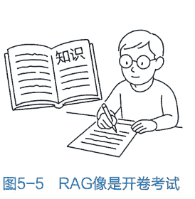

### 5.2.1 模式架构：检索与生成的交响

RAG 是检索器与生成器的非对称组合。

- 检索器：系统海马体，负责高通量低延迟召回，常基于 Bi-Encoder 如 BERT，以牺牲深度理解换取速度。
- 生成器：系统前额叶，负责推理与语言组织，基于 Decoder 如 GPT，算力需求高但推理强。

图 5-6 展示了从知识消化到召回再到生成的完整数据流。

① LEWIS P, PEREZ E, PIKTUS A, et al. Retrieval-augmented generation for knowledge-intensive NLP tasks[EB/OL]. (2021-04-12)[2025-12-23]. https://arxiv.org/abs/2005.11401.

## 5.2.2 RAG核心机制

RAG 涉及索引、检索、重排序与生成。

1. 索引：把世界切片
模型只能处理片段。好的切片要按语义切，确保一个片段承载完整知识点。
Anthropic 提出的上下文检索指出，单独片段易失上下文，如仅剩“它上涨了”。解决办法是索引时用模型为每个片段生成约 50 字的上下文说明拼接到头部再向量化。

2. 检索：大海捞针
向量检索擅长模糊语义，不擅长精确匹配如产品型号“iPhone 15 Pro Max”。混合检索更精确：向量检索找语义相关，关键词检索找精确匹配。

3. 重排序：选择最佳
Cross-Encoder 将查询与文档拼接入 BERT 输出 0-1 相关分数。比双塔慢但能捕捉细粒度交互。常用做法是向量粗筛 Top 100，再用 Cross-Encoder 精排至 Top 5。

4. 生成：基于资料作答
检索结果注入 Prompt，Prompt 成为融合上下文与针对性知识的载体。

下面示例展示了包含查询改写与重排序的 Advanced RAG 核心逻辑。

```python
class AdvancedRAGAgent:
    def __init__(self, retriever, reranker, llm):
        self.retriever = retriever # 混合检索（Vector+BM25）
        self.reranker = reranker   # 重排序器（如 bge-reranker-v2，使用 Cross-Encoder）
        self.llm = llm

    def answer(self, user_query):
        # 1. 查询改写
        # 用户的问题往往是模糊的，需要改写为适合检索的形式
        # 例如，“那个最像人的模型” → “Anthropic Claude 3 Opus performance benchmarks”
        optimized_query = self.llm.rewrite(user_query)

        # 2. 混合检索
        # 使用优化后的查询进行检索，扩大召回范围到 Top 50
        candidates = self.retriever.search(optimized_query, k=50)

        # 3. 重排序
        # 使用 Cross-Encoder 进行精细打分，筛选出 Top 5 黄金上下文
        # 这一步显著提升了上下文窗口的信噪比
        top_docs = self.reranker.rank(query=user_query, docs=candidates, top_k=5)

        # 4. 上下文构建
        # 将 Top 5 上下文构建为上下文字符串，用于后续生成
        context_str = "\n".join([f"[{i+1}] {d.text}" for i, d in enumerate(top_docs)])

        # 5. 增强生成
        # 构建 Prompt，确保仅基于上下文回答问题，避免胡乱编造
        prompt = f"""
你是一位严谨的分析师。请仅基于以下参考资料回答问题。
如果资料里没有答案，请说“不知道”，严禁胡乱编造。
回答时必须标注引用来源编号，如 [1]。

资料：
{context_str}

问题：{user_query}
"""

        return self.llm.generate(prompt)
```

## 5.2.3 RAG工程实践

RAG 落地极为普遍，几乎每个企业都会搭建企业级知识库。

- Perplexity.ai 展示了进阶形态，将 RAG 从搜答管道升级为理解-多步搜索-阅读-综合，并通过来源引用缓解幻觉焦虑。
- Glean 是企业级代表，解决了落地痛点权限控制，在检索层严格执行数据权限过滤，保证安全。

2024 年微软发布的 Graph RAG 为检索增强打开了另一条路径。传统检索增强擅长回答“A 的联系号码怎样查”这类点状问题，却在“这封邮件群在焦虑什么”之类的整体问题上吃力。Graph RAG 让大模型先从文本里抽取实体、搭建图谱，再用图聚类做提炼，让检索具备了宏观视野。

Self-RAG、Agentic RAG 等范式则让检索增强从被动查询走向主动决策。被动模式下无论问题多简单都要走一遍库；主动模式由模型自行判断要不要查。遇到“你好”直接应答，遇到“2024 年财报”则先吐出 `<Retrieval>` 标记去触发工具。查回后它还能自评“信息不足，需要换关键词再查一次”。检索由此从查找升级为思考，智能体的雏形显现。

### 5.2.4 RAG 进化路线与组合打法

RAG 的发展史就是 AI 从被动查阅走向主动认知的轨迹。工程上它从粗糙的向量匹配，发展到精密的流水线，再嵌入智能体的认知闭环，成为 Agentic RAG 的核心。

#### 1. 从向量到图谱的演进

朴素检索阶段，流程等同于“提问→向量检索→生成”。精度与召回都偏低，复杂问题容易断章取义或因关键词偏差遗漏要点，最终出现劣质输入导致劣质输出。

进阶流水线阶段，加入了改写与重排。借助 Cross-Encoder 对初筛结果做精细排序，提升信噪比，保证模型拿到高质量上下文，如今已是企业知识库的常规做法。

结构化与主动化阶段，Graph RAG 与 Agentic RAG 同时出现。Graph RAG 用图谱刻画文档间的语义关联，擅长“整个库在讲什么”这类整体任务；Agentic RAG 把检索当成可调用工具，由智能体决定何时检索、检索什么、结果是否够用。这一跃迁标志着从片段检索走向整体理解。

#### 2. 典型组合方式

检索增强不再是孤立管道，更像智能体大脑里的记忆中枢，与感知、推理、记忆深度协同。

检索增强与链式推理的组合等于检索增强思考。把一次大检索拆成多步微检索，在每一步推理中动态引入外部知识校准逻辑，有效压制幻觉。适用于多跳问答，例如“马斯克收购推特时股价多少”。传统做法是先检索后推理；增强思考则在推理链中内嵌检索：先推导出需要收购日期→检索；再基于日期推导出需要股价→再次检索。

检索增强与感知驱动的组合等于自我修正检索。把检索从硬编码流程升级为按需调用的能力，让智能体具备拒绝回答或主动求知的自主性。不再一问必查，感知模块实时评估不确定性与置信度，低置信时触发检索；结果不相关或不足时，反思模块重写查询再查。

检索增强与分层记忆的组合等于语义长期记忆。检索增强为分层记忆提供非结构化数据的存储介质与访问协议。分层记忆定义了 L1 缓存、L2 缓存、L3 长期存储，检索增强作为 L3 中处理 PDF、Wiki 等非结构化文档的核心，让智能体能持久化并随时调取外部语义。

检索增强已不只是外挂知识库，而是连接世界的认知脐带。外部知识从 Prompt 的填充物变为驱动推理的燃料。未来参数记忆与外部存储的边界会越来越模糊，在统一认知架构里深度融合，实现真正的知行合一。

### 5.2.5 设计哲学：知识的解耦

检索增强最深刻的洞见是把推理能力与知识存储解耦。

模型像 CPU，负责推理、逻辑、语言组织，可以不断升级从 GPT-3 到 GPT-4 再到 GPT-5。知识库像磁盘，负责存放事实、数据、细节，需要实时增删改。解耦后，系统时效性和专业度可以低成本维持，无需每次重训昂贵的大模型，这正是 AI 从实验室玩具走向工程落地的基石。

### 5.3 情节记忆模式

“经验不是发生在你身上的事，而是你对发生的事做了什么。”——奥尔德斯·赫胥黎

如果把检索增强比作智能体的百科全书，那情节记忆就是它的飞行记录仪，记录经验轨迹。

光记录不够，高级架构还需要一个夜间模拟器。像自动驾驶用白天的危险接管做离线训练，智能体也需要在空闲时做反事实推理，把一次性经历转化为可复用策略。每一次任务，无论成败，都是宝贵的情节。


新手智能体遇到 bug 总像第一次见面。
老手智能体会去翻黑匣子感叹：“这个 bug 上周见过，是 API 超时，重试三次就好。”

情节记忆的核心是构建闭环系统，捕获带时空上下文的交互轨迹。通过压缩、泛化、双键检索，把非结构化日志变成结构化技能，让智能体越用越聪明。

#### 5.3.1 架构：经验的炼金

情节记忆本质是 ETL 管道，不能直接把所有交互倒进向量库，否则噪声大、检索慢，必须先提炼。

构建情节位于记忆层入口，像剪辑师。把执行层产生的原始日志切成语义完整的片段，整合为连贯情节，剔除 ls、pwd 这类无意义探索，只保留关键状态变化。

提炼成功位于学习层，像泛化器。对高价值成功案例做去语境化，变成可复用的通用技能。输入可能是“我在 /tmp/logs 删除了 error.log”，输出是“磁盘不足时优先清理 *.log”。

技能库位于学习层底部，是精华仓库，存放经验证的可执行代码或推理链模板。新任务进来会优先从这里检索，实现能力复用。

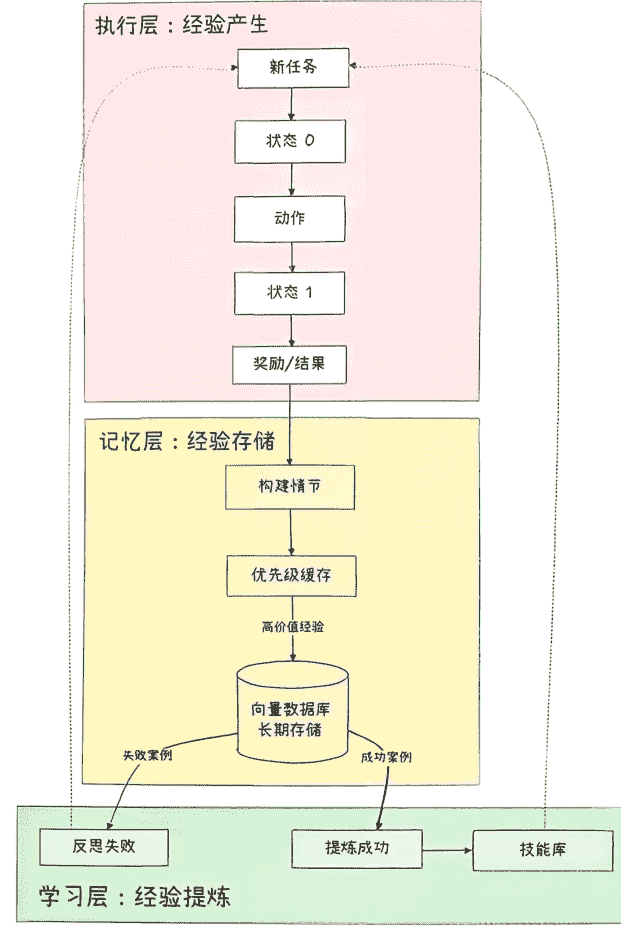

#### 5.3.2 核心机制

轨迹压缩与分层摘要：防止记忆膨胀。关键帧提取只保留决策点和结果点。分层摘要有 L0 原始请求体、L1 调用 GitHub API、L2 修复登录模块 bug。检索先命中 L2 再展开 L1。

双键检索策略：语义检索找目标相似任务，结构检索找报错相似轨迹。目标相似是“想做的事以前做过吗”，状态相似是“现在的报错以前见过吗”。综合相似度 = α×目标相似 + β×状态相似。

经验参数化：标准情节包含目标、轨迹、结果、反思。通过实例到抽象到约束的提炼，把 delete_file("report_2023.txt") 抽象为 delete_file(filename)，约束为文件存在且非系统文件。多情节对比后生成通用函数，实现举一反三。

压缩降成本，双键提相关性，参数化促迁移。

#### 5.3.3 工程实践

Voyager 2023 体现代码即策略理念，维护 skill_library.js，把砍树、合成木板封装成函数。新任务先查库，复杂任务自动组合已有函数，库中没有就生成验证后入库。

Devin 声称能从历史 bug 修复记录学习，下次遇到类似错误更快定位。

Cline 引入检查点，复杂编程时保存上下文快照，失败后回滚到记忆检查点，把情节记忆用于容错，等同存档。

DeepMind 的 SIMA 能在多种 3D 游戏环境执行任务，情节记忆如开门、找资源可在不同物理引擎间迁移，显示跨域泛化能力。

从日志到技能库再到跨环境泛化，情节记忆推动智能体从无状态脚本进化为有经验专家。

#### 5.3.4 演化与组合

从原始文本流到可检索语义快照，再到可执行技能库。

流水账日志阶段，像服务器日志按时间记录对话，检索困难，关键信息被噪声淹没，易灾难性遗忘。

语义快照阶段，向量数据库让关键交互节点可检索，产生似曾相识能力。

技能泛化阶段，系统不仅存轨迹，还提炼为代码或规则，成功任务抽象为函数或 SOP，记忆变成工具，能力库自主生长。

情节记忆与检索增强组合构成完整长期记忆：检索增强提供读万卷书的世界知识，情节记忆提供行万里路的个体经验。

情节记忆与 ReAct 组合形成具身先验，构建感知-记忆-推理回路。感知结构化入库，记忆在 ReAct 思考阶段提供先验，推理结果再蒸馏回长期记忆。

情节记忆与反思记忆组合形成闭环成长。反思记忆负责生产语言化教训，情节记忆负责存储并索引，使教训变成可调用的肌肉记忆。

架构师的目标是让每次交互都成为下一次成功的垫脚石，把线性时间转化为指数级经验资产。

#### 5.3.5 设计哲学：做时间的朋友

没有情节记忆的智能体永远困在土拨鼠之日，次日醒来仍是新手。没有记忆的推理无根，未经蒸馏的记忆无形。情节记忆赋予时间感，能力随时间线性乃至指数增长。比算力更重要的是经历。

小结 平台与协议的一等组件

至此，智能体架构的记忆拼图完成。记忆正从 Prompt 附件升级为平台与协议的核心组件。

现代情境工程的共识是经营情境，而非仅设计 Prompt，把有限预算投向最有价值的信息与结构。

分层记忆构建操作系统，检索增强构建图书馆，情节记忆构建日记本，三者构成现代情境工程主体。

未来智能体记忆可归纳为三大类五种机制。短期有历史缓冲，长期有语义检索与情节记忆，策略有程序记忆与跨体共享记忆，后者依托 MCP 与 A2A 协议实现多智能体安全共享，正成为云端智能基础设施。从情境工程到 MaaS 跃迁，标志着记忆从技巧升级为智能时代的核心基础设施。

当主体既能捕捉外界信息，又能把信息留存下来时，思考的原材料才算初步具备。问题在于，如何把这些原材料加工成可用的判断？本章就聚焦这一点。

# 第 6 章
## 推理模式

> “思想无内容则空，直观无概念则盲。”
> ——伊曼努尔·康德（Immanuel Kant），《纯粹理性批判》

记忆为 Agent 提供了知识储藏，推理则提供加工这些储藏的逻辑装置。前者回答“知道什么”，后者回答“怎么用”，二者配合才能让知识从堆积走向可用。

诺贝尔经济学奖得主丹尼尔·卡尼曼在《思考，快与慢》中把人类思维分为两套运行方式：System 1 偏快、依赖直觉和启发；System 2 偏慢、依赖审慎和反思，如图 6-1。面对复杂判斷或强约束任务，人们更倾向调用 System 2 的慢速思考；在熟悉且风险低的情境里，System 1 的直觉更省力。

智能体的推演同样需要快与慢两种节奏，并能依据任务难度与计算成本在两者间切换。相关研究显示，在复杂逻辑里强行采用贪婪式速解，容易产生系统性偏误与过度自信。此时需要切到审慎模式，把中间推演显式展开并逐项核查证据链，准确性与可信度才会提升。

双系统视角提示，推理不是单一通道，而是多机制协同的层级结构。不能把 Prompt 链当成唯一逻辑路径。人类早期的协同就体现为三种基本范式——演绎、归纳、类比，如图 6-2。

- 演绎：由普遍规则推导出具体结论，推演严密且具保证性，适合规则明确的形式化领域。
- 归纳：从若干具体实例抽象出普遍规律，用于知识扩展、模式发现与经验总结。
- 类比：借助结构映射以已知启未知，在抽象或新颖问题上释放创造力，是类推思维的核心。

当代认知科学认为，推理不是先想完再行动，而是持续预测、试探、校正的闭环。大脑不断生成假设、驱动行动、收集误差，再修正内部模型。行动既是推理的产物，也是检验推理的重要手段。

同理，Agent 的推理应坐镇行为回路中心，既能向前推动规划与工具调用，也能向后修正模型并调整信念。

要让闭环工程化，可把推理抽象为三层。

- 结构层：提供思维容器，显式刻画任务中的变量、假设、证据及其关联。
- 流程层：组织推理进程，涵盖假设生成、多路径推演到候选方案评估的完整链条。
- 反思层：承担元推理职能，通过自检、自评与备选路径分析，提升鲁棒性与适应力。

基于这三层，不同任务呈现不同形态。按歧义度、探索深度与约束条件，典型形态有四种：链式、树式、图式、类比式，见图 6-3，各自对应不同问题类型。

- 问题清晰、路径唯一时，用链式推演，沿单一路线逐步推进到答案。
- 存在多分支或需权衡时，用树式推演，系统探索各路线并评估结果。
- 变量依赖复杂、存在循环或非线性交互时，用图式推演，以图结构显式建模要素关联。
- 问题新颖、数据稀缺、缺乏先验规则时，类比式推演常是突破口，通过映射已知结构启发对未知的理解。

下面依次展开这四种典型推演方式在 Agent 系统中的适用场景、结构特征与工程要点。

## 6.1 思维链模式

> “思维链是 LLM 的‘草稿纸’。”
> ——魏杰森（Jason Wei），思维链论文作者

数学课堂里老师常要求写出证明过程而非只给答案。因为跳步易错，逐步推导才能保证证据链完整、可验证。

传统 LLM 的推理更像靠直觉猜答案的学生，对诗歌闲聊等开放任务尚可，在数学、逻辑、代码等需要严谨推断的任务里，往往算力不足、中间步骤缺失，容易出现灾难性遗忘或逻辑断裂。

思维链的本质是强制主体在给出最终结论前，先生成一系列显式的中间推演步骤。它把原本需要一次跃迁解决的难题，拆成多个只需普通算力处理的原子步骤，实现用时间换智能。

核心意图是借助过程显式化，把计算压力摊到更长的时序上，提升可解释性、可验证性与鲁棒性。

### 6.1.1 模式架构：线性的魔力

从架构看，思维链把黑盒式的输入到输出映射，重构为一条清晰的顺序处理管线，见图 6-4。线性结构降低了复杂问题的处理难度，同时保留了可观测、可拦截、可调试的中间状态，大幅增强透明度与可控性。

图 6-4 中关键组件说明如下。

- 引导机制：启动思维链的起步装置，负责把简单输入转化为结构化推理。可通过“慢慢想一下”等显式提示引导，也可通过微调实现隐式引导。
- 推理缓冲区：代理的临时工作内存，不直接产出结论，而是依次执行问题拆解、中间计算、逻辑推演。产生的 Token 构成后续上下文基础。
- 逻辑自检：推理结束后的质量关卡，验证链条连贯性与合理性。通过则进入答案提取，未通过则触发重试或修正。
- 答案提取器：把思考过程与最终结论分离。借助特殊终止符识别推理边界，剔除冗长的思维链，只返回清洗后的结论。

图 6-5 展示了基于 Qwen3-8B 的微调项目：经过思维链数据训练的“可思考”模型激活后，输出中会包含详细的思考过程。

### 6.1.2 思维链核心机制

思维链能显著增强推理，并非偶然，而是三方面底层重构的结果。

**1. 概率的重新分配**

直接预测答案等价于计算 P(Answer|Question)。复杂问题下该分布扁平、噪声大，难以命中正确答案。引入中间步骤后，目标变为 P(Answer|Question, step1, step2, …)。条件化收敛了答案空间，从猜答案转向推答案，准确率与可靠性提升。

**2. 显式分解**

单次前向传播难以同时处理多重逻辑冲突。思维链遵循从简到繁原则，把复杂问题序列化为原子步骤，见图 6-6。这种降维让每一步只需处理简单运算，避免逻辑拥堵。

**3. 自我校准**

步骤显式化后，模型借助注意力回看上一步输出，形成微型短期记忆回路，有助于抑制幻觉累积。

下面示例展示了生产级思维链封装器的核心逻辑，采用 XML 标签提升解析鲁棒性。

```python
import re

class ChainOfThoughtAgent:
    def __init__(self, llm):
        self.llm = llm
        # 2025 年最佳实践：使用 XML 标签包裹思维链，以提升机器解析的鲁棒性
        self.system_prompt = """
        You are a rigorous reasoning engine.
        When solving problems, you must enclose your reasoning process within <thinking> tags.
        And place your final conclusion within <answer> tags.
        """

    def reason(self, question):
        # 1. 构建 Prompt
        messages = [
            {"role": "system", "content": self.system_prompt},
            {"role": "user", "content": question}
        ]

        # 2. 获取模型生成的原始响应（可扩展为流式处理）
        raw_response = self.llm.generate(messages)

        # 3. 结构化解析响应内容
        # 相较于简单正则匹配，此处可进一步扩展为流式解析器，以支持实时展示
        # 推理过程
        thinking_content = self._extract_tag(raw_response, "thinking")
        final_answer = self._extract_tag(raw_response, "answer")

        # 降维策略：如果模型未按照指定格式输出，则回退至原始响应
        if not final_answer:
            final_answer = raw_response

        return {
            "q": question,
            "chain_of_thought": thinking_content, # 可用于前端展示 “Thinking……” 过程
            "result": final_answer
        }

    def _extract_tag(self, text, tag):
        """ 从文本中提取指定 XML 标签内的内容 """
        pattern = f"<{tag}>(.*?)</{tag}>"
        match = re.search(pattern, text, re.DOTALL)
        return match.group(1).strip() if match else None
```

该 Python 封装器演示了如何结构化解析推理过程，便于后续审计或可视化。

### 6.1.3 思维链工程实践

思维链的发展史，也是模型从鹦鹉学舌走向逻辑推理的进化史。工程上大致经历四代演进。

**1. 启蒙时代：作为“魔法咒语”的思维链（2022年）**

始于 Google Brain 魏杰森等团队提出的 Chain-of-Thought Prompting。研究者发现，只在提示中加入带中间推理的示例，LLM 在数学和逻辑任务上表现明显提升。随后 Kojima 等人证明，即便无示例，仅一句“请逐步推演”的零样本指令，也能诱发结构化推理。这一阶段像咒语，机制未明但效果显著。

此时工程聚焦提示工程，LangChain 等框架封装大量思维链模板，实现模式产品化。思维链被视为不改参数、以额外 Token 换取智能的低成本策略。

**2. 黑盒巅峰：OpenAI o1/o3与“测试时计算”（2024年）**

OpenAI o1 的发布把思维链从用户侧技巧内化为模型本能。o1 在输出前强制执行不可见的隐式推理，并通过强化学习优化推理质量而非仅预测下一个词。

o1 验证了测试时计算的新规模规律：参数固定时，增加推理阶段计算、让模型想得更久，性能持续提升。推理侧算力可部分转化为智能。

对架构师而言，调用从毫秒级请求响应变为可能持续数十秒的异步任务，需要长连接、状态轮询与流式输出设计。

**3. 开源突围：DeepSeek-R1与纯强化学习的胜利（2025年）**

o1 是封闭黑盒，DeepSeek-R1 则展示了思考如何涌现。它证明无需大规模人工标注监督微调，仅靠纯强化学习和 GRPO 算法，模型即可自发涌现思维链能力。

顿悟时刻体现在训练日志中：模型自发学会自我反思、“Wait, let me check…”、回溯验证和长程规划，这些能力是在追求正确解的奖励下被逼出来的。

蒸馏方面，R1 的长思维链数据能有效教导小型模型，7B/14B 版本经蒸馏后推理能力大幅提升，使思维链落地到端侧和低成本场景。

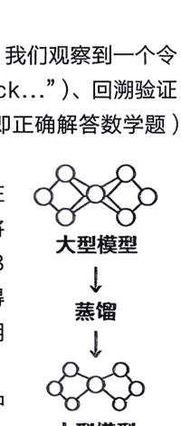

此时思维链已内化为本能，用户无需手动提示，模型会自动生成隐式思维链。

**4. 垂直落地：Agentic Coding（Devin和Cursor）**

应用层，思维链成为编码 Agent 的核心引擎。

- Devin、Cognition AI 处理 GitHub Issue 时，先构建执行计划：阅读文档、定位代码、写测试、改逻辑、跑验证，再生成代码。
- Cursor、Claude Code 内部引入影子工作区，在后台持续进行快速思维链推理，预测随后的修改、预检 Lint 错误等。

此时思维链不仅是文本生成，更像伪代码执行，每一步对应文件系统或编译器的真实操作。

未来的工程师要理解的不仅是提示怎么写，更是算力在训练与推理间的分配逻辑。系统设计需要在响应速度与严谨思考间做权衡，System 1 还是 System 2 取决于业务场景。

### 6.1.4 思维链模式的演化与组合

思维链是推理能力的基石，从咒语式提示演进为示例规范，再内化为 System 2 思考模式。

**1. 演化路径：从咒语到本能**

- 零样本思维链/咒语式提示：用“Let’s think step by step”等简单指令激发推理潜能，成本低但可控性差，易出现逻辑看似通顺却算错。
- 少样本思维链/示例规范：在提示中写入高质量 <问题、推理步骤、答案> 示例，规范推理格式，在 RAG 系统中广泛使用。
- 原生/内化思维链：DeepSeek-R1 通过强化学习把思维链内化为默认反应，无需提示模型自动生成隐式思维令牌，推理成为模型扩展的核心维度。

**2. 模式组合示例**

思维链常作为代理的逻辑主板，需挂载检索、工具调用、记忆等组件以增强鲁棒性与知识广度。

把思维链和自我修正叠加在一起，就形成了过程监督。质量把控不再只盯着最终结果，而是把精度下沉到每一步推理上，长链条任务的成功率因此明显提升。这个组合特别适合数学推导、逻辑证明这类对严谨性要求极高的场景。运作方式很直接：生成器负责按步产出推理过程；批评者不等人家出完答案，而是借助过程奖励模型对每一个中间节点实时打分；一旦发现跳步或错误，立刻叫停并要求重写该步。

把思维链和协作模式结合起来，则得到自治性。思路源于统计学的集成思想，多条推理路径一起工作，随机性噪声被自然平滑掉。这一套更适合开放式提问或带有概率色彩的推理。具体做法是抛弃单链思路，用 Temperature>0 的条件下并行产出约 5 条不同的链，再用投票聚合选出出现频率最高的答案作为输出。

思维链的发展轨迹很清晰：逻辑不是天生的，而是设计、引导和强化出来的产物。从早期的 Prompt 小技巧，到今天的原生推理架构，链式思维已经成为现代 Agent 离不开的理性底座。

### 6.1.5 设计哲学：白盒化的信任

思维链的价值不止于提分，更在于它为人和机器之间建立了一份可信契约。AI 落地最难的往往不是能力不够，而是让人不敢信。当一个医疗 Agent 直接给出“建议手术”时，医生没有依据是不敢批字的。若它能把过程摊开：第一步在影像里发现 3mm 结节；第二步对照历史发现生长速度已超临床阈值；第三步依据某版指南建议进一步检查。医生就能沿着可追溯、可核验的逻辑链做出判断。白盒化让 AI 从神秘的预言家变成可审计、可纠错的初级分析师。思维链恰好搭起了直觉 System 1 和逻辑 System 2 的桥梁，本质是逼 Agent 学会慢思考，用确定性逻辑对抗生成时的随机性。

## 6.2 思维树模式

> “在歧路花园里，时间并非一条直线，而是一张无限分叉的网络。每一次选择，都催生出一个新的未来。”

——豪尔赫·路易斯·博尔赫斯（Jorge Luis Borges），《小径分岔的花园》

如果说思维链像走钢丝，必须一步不差地往前，任何一次幻觉或错步都会导致整条链坠落，那么思维树更像是迷宫寻路。站在岔口时，派 3 个侦察兵生成 3 个备选思路，收到回馈：左边是死胡同得分低，右边有亮光得分高，中间待定。于是先往右走，剪掉低分分支。若右路仍不通，还可以回到上一个岔口重新选择。思维树把 LLM 的推理建模成状态空间搜索，靠探索、评估和回溯来处理需要全局规划、容易陷入局部最优的难题。

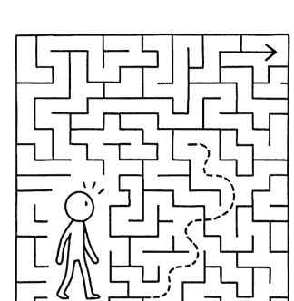

### 6.2.1 模式架构：从链到树

思维树的本质是把 LLM 的概率生成能力从黑箱里抽出来，嵌入经典搜索框架。LLM 不再被当作整体答案机，而被当作状态机生成器。推理在生成层、评估层、搜索层之间流动，剪枝在其中完成。图 6-9 显示了三层的工作方式。

生成层负责发散。拿到初始问题后，产出若干下一步行动的候选方案，比如思路 A、B、C。多样的前提是调高 Temperature，或用明确 Prompt 如“给出 3 种截然不同的方案”。这一层只负责想，不负责判对错。

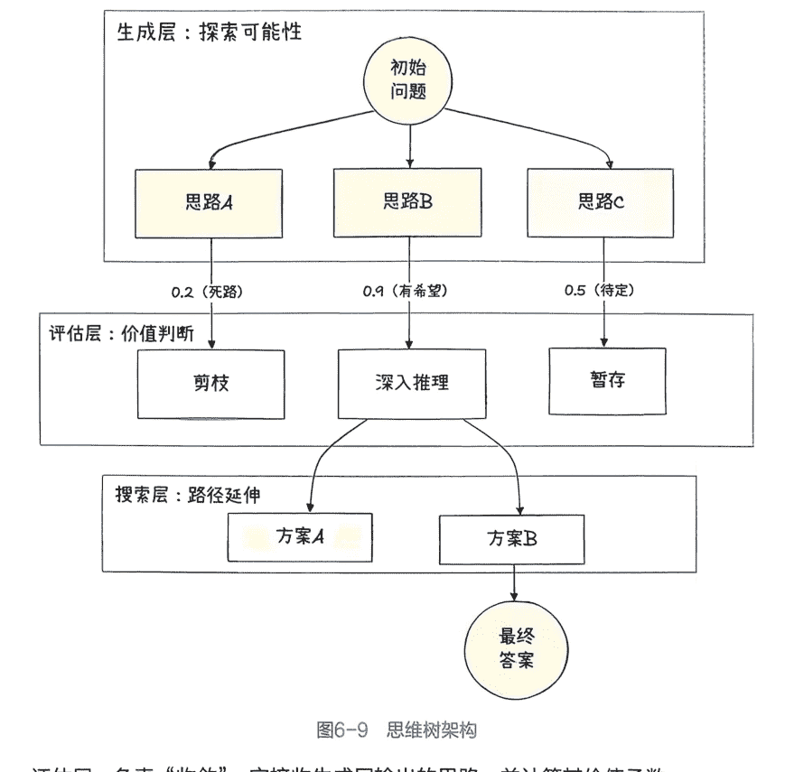

评估层负责收敛。接收生成层的产出并计算价值函数。核心是状态评估器，评估可以是模型的自我打分，也可以借助外部工具验证，比如代码能否跑通。关键能力是“否定”：能识别幻觉或逻辑错误并给低分。依据分数，低分路径被剪枝，高分路径进入深入推理，中分路径暂存以备回溯。

搜索层是推进中枢，负责对评估层认为有潜力的思路继续展开。从深入推理的节点会衍生出更具体的子路径，最终抵达答案。核心是搜索控制器，由确定性代码实现，负责内存管理、历史路径保存以及搜索策略的调度。它决定是继续深入当前分支、回溯切换、还是并行探索。

相较于思维链的单线推进，思维树让 Agent 具备分支能力、评估能力、回溯能力和启发能力。生成、评估、决策分离后，“想法的多样性”和“判断的准确性”可以分别优化。思维树的核心不是画出一棵树，而是让 Agent 像棋手一样循环做观察、预判、选择、推进。

### 6.2.2 思维树核心机制

在思维树里，Agent 不再是写完就交稿的作家，而是步步为营的棋手。核心原语是分解、生成、评估的配合。

**1. 思维分解：定节点粒度**

第一步要先定义树上节点的含义。粒度太细搜索空间会爆炸，太粗则退化成链。
数学或逻辑里，一个计算步或一次变换可作节点；创意写作里，一个段落摘要或关键转折点可作节点；代码生成里，一个函数接口或关键算法伪代码可作节点。
工程原则是节点够小，LLM 能判断对错；同时够大，能承载有意义的推理进展。

**2. 生成策略：探索状态空间**

当前状态下一步如何发散？
独立采样是常用做法，对同一提示用 Temperature>0 多次并行采样，适合需要创意发散的场景。
提议式提示则是直接要求模型“给出 3 种不同切入角度”，更适合逻辑规划，能赋予横向思考能力，避免思维定式。

**3. 评估策略：定义价值函数**

这是思维树的灵魂。LLM 同时是运动员和裁判，需要一个启发式函数来判断状态价值。
评分式做法让模型按 1 到 10 打分，适合连续优化问题。
投票式做法让模型在若干选项里选出最有希望的，通过自洽性做比较。
分类式做法把状态分为 Sure、Likely、Impossible，三类快速剪枝，能显著省 Token。

把推理从一次性生成变为可探索、可回溯、可评估的搜索，行为模式因此升级。分解提供结构，生成打开可能性，评估决定方向，三者共同把线性输出变成分支—选择—推进的循环。

### 6.2.3 思维树工程实践

下面是一个通用的深度优先搜索实现，展示递归和回溯如何寻找答案。

```python
class TreeOfThoughts:
    def __init__(self, llm, max_depth=5, branch_factor=3):
        self.llm = llm
        self.max_depth = max_depth
        self.k = branch_factor # 分支因子

    def solve(self, problem):
        # 从根节点开始深度优先搜索
        return self._dfs(state=problem, depth=0)

    def _dfs(self, state, depth):
        # 1. 终止条件：达到最大深度或找到有效解
        if depth >= self.max_depth:
            return state if self._is_solution(state) else None

        # 2. 生成：基于当前状态生成 k 个可能的备选思路
        thoughts = self.llm.generate_thoughts(state, k=self.k)

        # 3. 评估：对每个思路评分，并过滤低质量路径
        # 此步骤非常关键，用于剪枝明显无效的分支
        scored_thoughts = []
        for t in thoughts:
            score = self.llm.evaluate(state, t)
            if score > 0.5: # 设置阈值过滤低分思路
                scored_thoughts.append((t, score))
```
scored_thoughts.sort(key=lambda x: x[1], reverse=True)

# 4. 深度优先搜索：依次尝试高分思路
for thought, _ in scored_thoughts:
    new_state = state + "\n" + thought
    # 递归深入
    result = self._dfs(new_state, depth + 1)
    if result is not None: # 若子树返回有效解，则向上回传
        return result
# 5. 回溯：若所有子路径均无解，返回 None，触发上层回溯
return None

递归写法简洁，但在数学证明或代码生成等搜索空间庞大的任务里，容易卡在局部最优。于是现代架构转向更强的推理时计算，典型代表是 Monte Carlo Tree Search。DeepMind 的 AlphaCode 和 OpenAI 的 o1 系列都体现了这一思路。

公开信息显示，这类模型不是一次生成即出答案，而是通过多路径生成、评估和筛选，在推理阶段做更深策略推演。OpenAI 未明确承认 o1 使用显式 MCTS 或 UCT，但其用算力换推理质量的设计，与 MCTS 的探索—利用平衡理念高度一致，可作为工程参考模型。

MCTS 的选择、扩展、模拟、回溯四步，对应 Agent 的选择、思考、模拟、反思。图 6-10 显示，Agent 在主动推演而非被动执行。

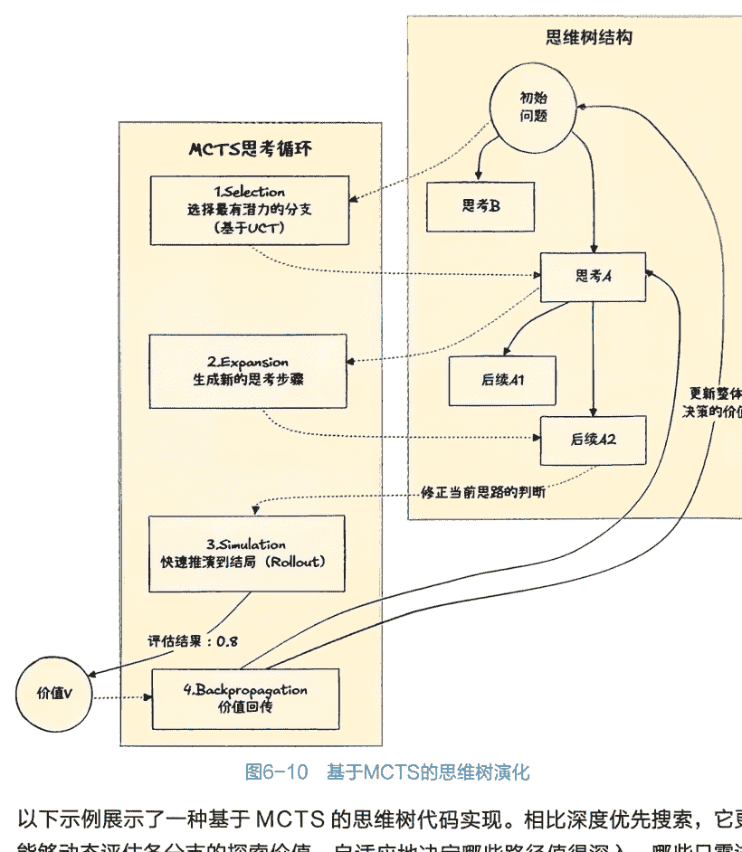

以下是一种基于 MCTS 的思维树实现。它更智能，能动态评估分支价值，自适应决定深入、试探或剪枝。

```python
import math

class MCTSNode:
    def __init__(self, state, parent=None):
        self.state = state
        self.parent = parent
        self.visits = 0
        self.value = 0.0
        self.children = []

    def uct_score(self, exploration_weight=1.0):
        """
        UCT ( Upper Confidence Bound for Trees ) 公式：平衡利用与探索
        Score = Q(s) + c * sqrt(ln(N) / n_s)
        """
        if self.visits == 0:
            return float('inf') # 优先探索未访问节点
        return (self.value / self.visits) + \
            exploration_weight * math.sqrt(math.log(self.parent.visits) / self.visits)

class MCTSTreeOfThoughts:
    def __init__(self, llm, simulations=50):
        self.llm = llm
        self.simulations = simulations # 模拟次数（即“思考轮数”）

    def solve(self, initial_problem):
        root = MCTSNode(state=initial_problem)

        for _ in range(self.simulations):
            # 1. 选择：从根节点向下遍历至最有潜力的叶节点
            node = self._select(root)

            # 2. 扩展：若当前节点处于非终止状态，则生成子节点
            if not self._is_terminal(node):
                new_thoughts = self.llm.generate_thoughts(node.state, k=3)
                for thought in new_thoughts:
                    # 构建新状态：将新思路追加到当前状态（可根据任务调整）
                    new_state = node.state + "\n" + thought
                    node.children.append(MCTSNode(state=new_state, parent=node))
                node = node.children[0] # 随机或按策略选择一个子节点进行模拟（此处选第一个子节点）

            # 3. 模拟：从该节点快速部署并获得奖励
            # 这里的 evaluate() 可以是 LLM 的自我评分函数，也可以是简单的启发式函数
            reward = self.llm.evaluate(node.state)

            # 4. 回溯：将奖励沿路径向上传播
            self._backpropagate(node, reward)

        # 最终决策：返回访问次数最多的子路径（或最高平均价值路径）
        return self._best_path(root)

    def _select(self, node):
        # 递归选择 UCT 分数最高的子节点，直至叶节点
        while node.children:
            node = max(node.children, key=lambda n: n.uct_score())
        return node

    def _backpropagate(self, node, reward):
        while node:
            node.visits += 1
            node.value += reward
            node = node.parent
```

这种实现引入了推理时计算的思路。增加模拟次数，就是让 Agent 想得更久。以算力换智能已成为 GPT-4 以后模型的核心哲学。从工程角度看，思维树的目标不是让模型更像人思考，而是把不确定的推理问题转化为可搜索、可评估、可回溯的状态空间优化问题。

算力换准度：推理树与思维图落地的关键思路

思维树在推理时的 Token 消耗往往是普通链式思维的十倍到上百倍，所以工程上只会把它放在价值高、频次低、容错几乎为零的任务里。对这类问题，多投入少量的算力换取更稳的决策是划算的。

下面把三种典型的落地形态拆开来看。

## 案例1：自主软件工程师
以 Cognition Labs 出品的 Devin，以及后台被认为具备相近能力的 GitHub Copilot Workspace 为代表。
面对 GitHub 上的 issue，代码改动牵连甚广。只沿着一条线性推理走，很容易在改到数个文件后才发现开头的假设根本站不住脚，前期投入全部作废，还得频繁回滚。

碰到复杂的并发缺陷时，可以把任务展开成一棵推理树。
节点对应一次具体的代码变更或补丁方案；分支对应不同的修复思路，比如 A 路加锁、B 路改用原子变量、C 路重构队列。评估器由编译器和单元测试构成。
代理生成代码后先在隔离沙箱里跑测，满分才继续探索，零分就直接砍掉该枝。例如 A 策略引发死锁，测试超时，代理立刻放弃这条线，回滚版本再试 B。
正因为代码可执行，整棵树才被转成假设检验再推进的循环。

## 案例2：红队测试与安全审计
对 Web 应用做渗透测试时，也能映射为推理树结构。
节点代表一次具体的攻击动作，比如发送钓鱼邮件或尝试 SQL 注入。生成器会依据当前系统反馈产出三种可能的下一步。评估器模拟真实环境进行动态打分：触发防火墙告警则路径价值下降，成功拿到未授权数据则价值大幅上升。
搜索通常用 MCTS，优先深挖那些风险与回报都高的枝。
这样代理能像黑客一样推演：如果这个端口被堵，还能走哪条侧门进入，从而挖掘人工容易忽略的隐蔽攻击链。

## 案例3：复杂法律合同起草
并购协议、跨境贸易合同里的条款之间存在网状依赖。改动 A 可能让 D 与宪法或上位法冲突，线性写法很难管住全局。
在起草一份需要平衡三方利益的投资协议时，用推理树来组织。
节点是一个条款草案。分支对应争议点的不同表述，方案 A 偏向投资人，方案 B 偏向创始人。评估器由另一个扮演法官角色的 AI 构成，模拟极端情形下的法律风险。若判定败诉风险极高，整条起草路径就被废弃。
有了全局预览，最终文本在逻辑上更严密、在分配上更均衡，避免写到最后才发现开头就错了。

从这三类场景可以提炼出一条落地法则：推理树最有效的地方，是存在客观验证器的地方。
代码能跑，编译器和测试就是验证器。攻击能成败，系统反馈就是验证器。数学能验算，形式化系统就是验证器。
缺乏客观验证器时，比如写诗这类主观任务，推理树很容易变成自评自嗨：自己生成、自己打分、最后挑出一條平庸结果。所以设计时，先把评估器做强，比把生成器做花更关键。

### 6.2.4 推理树模式的演进与组合
推理树从最初的投票机制起步，到支持深度搜索，再发展成带价值函数的蒙特卡洛树搜索。

1. 演进路径：从宽度到深度
自洽性投票 Self-Consistency / CoT-SC：推理树的扁平形态。并行产生 N 条链式推理，用多数投票决定答案。它靠宽度压噪音，却管不了中间步骤的错误。一旦所有路径在起点就错了，投票也救不回来。
标准推理树 Standard ToT：引入广度优先或深度优先，并配备显式评估器。每步生成后立刻评估当前状态价值，决定是继续深挖、剪枝放弃还是回溯重试。代理不再死磕到底，拥有了悔棋与动态调整的能力。
概率搜索 MCTS / LATS：借鉴 AlphaGo 的思路，用蒙特卡洛树搜索。依据 UCB 公式在探索新分支与利用已知好分支之间动态取舍。目前解决奥数、复杂代码架构这类硬推理任务的主流做法。

2. 模式组合示例
推理树的痛点是搜索空间指数爆炸，必须借助外力收敛。
推理树与 RAG 模式的组合 = 检索增强推理树。若生成器缺领域知识，就会在错路上越走越远，出现幻觉裂变。RAG 相当于探路前先查地图。机制是：生成前先启动检索增强，检索拉取与当前推理步骤相关的外部知识如法条、API 文档，精炼后再结合检索结果生成更可靠的候选路径。
推理树与工具编排模式的组合 = 验证器引导搜索。LLM 自评不可靠，尤其在数值和代码上。把确定性工具的反馈替换模型的概率评分，就是 AlphaGeometry 这类数学系统的核心。机制是：生成包含代码或公式的节点，调用解释器或计算器执行，根据报错与否给 0 或 1 分，决定剪枝或保留。
当 LLM 从生成器变成搜索器，本质是用推理时的算力换逻辑深度，冲破单次前向推理的瓶颈。配合工具验证和知识检索，推理树才成为攻克慢思考难题的重型武器。

### 6.2.5 设计哲学：System 2 的审慎
推理树标志着 AI 从 System 1 的直觉反应转向 System 2 的刻意练习。
传统聊天追求流畅，推理树追求审慎。
承认第一直觉多半错。允许走回头路，回溯修正。以算力换智能。
智能不只是会生答案，更会杀错答案。一个能说“这条路走不通，我们回去重来”的代理，才算真正具备解决复杂问题的能力。

## 6.3 思维图模式
> “推理的力量源于结构，而非孤立的单点。”
——思维图论文①

如果说推理树是在迷宫里选路，那么思维图更像是在织布机上织布，一场关于构造的游戏，如图 6-11 所示。

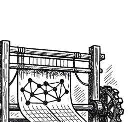
在织布机上，经线与纬线不断交织：你不仅向前编织，还会将几根独立的线拧成一股绳；一旦发现某处织错，便退回并重新编织。
思维图把推理建模为有向图，让思维在非线性拓扑中流动。它比链式推理和推理树多出了合并和循环能力，适合需要多视角融合、跨文档整合或反复迭代的任务。

### 6.3.1 模式架构：思维加工厂
思维图不再是单向流转，更像一座加工厂。原始信息被拆解分发到不同车间分支，各自加工后再在总装车间汇聚，质量不过关就退回重做。
图 6-12 的三层运作如下。
分叉层负责发散，接收初始问题并拆成多个探索维度，如技术可行性、用户体验、商业成本。这是思维的扩展。
聚合层负责融合，把孤立视角组合成方案草案 A、B，实现取长补短。
精炼层/循环负责闭环优化。评估节点做质量关卡，发现缺陷就沿回溯路径回到分叉层重想重改，只有通过的路径才汇成最终综合方案。


整体拓扑由图构建器定义，执行流转由图执行器调度。LLM 从单线程讲述者变成多线程指挥官，能处理非结构化、多维问题。

### 6.3.2 思维图核心机制
现实问题彼此交织，思维图用三机制模拟专家的综合思维。
1. 协同效应
推理树的分支多是竞争关系，思维图的分支是合作关系。写气候变暖深度文时，A 分支收集科学数据，B 分支收集政策影响，合并节点 C 把两者融合，产出既有事实又有政策视野的论述。这种协同产生的涌现，是图结构的优势。
2. 迭代优化
图允许环的存在，而链不可回溯。思维图可以循环修正，必要时回到上一步重新编织。
3. 资源感知
图能更直观管理 Token 预算和上下文窗口。分支过多时，可在中间插入摘要节点，把三个分支约一万 Token 的信息压缩到千 Token 后继续传递，缓解遗忘和成本问题。
协同、迭代、资源管理让推理变成可工程化、可优化的生产过程。

### 6.3.3 思维图工程实践
思维图已深度嵌入现代 AI 后端，凡涉及多源信息整合都是用武之地。
以全库代码分析为例，用户问项目如何做用户认证，代码量太大塞不进一个 Prompt，文件间依赖复杂。思维图既能突破窗口限制，又保留拓扑关系。
图 6-13 的四层流程：
分支与探索层并行分析相关文件如 auth_utils.py、login.py，生成文件级摘要。
聚合层按 Import 和 Schema 依赖把摘要汇聚，形成认证核心模块和数据模型模块的高层理解。
优化层做完整性检查，若发现未定义引用如缺失 JWT 加密函数，就触发回退搜索定位 crypto.py，并把补充上下文反馈回认证核心模块。
完成层在逻辑自洽后输出完整架构报告。
AI 深度搜索如 Perplexity 或 DeepSeek 的调研模式也是同理：Branching 拆出子意图，Exploration 并行浏览，Aggregation 汇总发现矛盾，Loop 启动验证分支，Final 输出自洽报告。


图6-13 一个复杂问题的思维图架构
以下示例展示基于思维图的“多文档综合摘要”引擎，实现分治—聚合—打磨的图结构逻辑。

```python
from typing import List

class ThoughtNode:
    def __init__(self, content, parents=None):
        self.content = content
        self.parents = parents or []
        self.score = 0.0

class GraphOfThoughts:
    def __init__(self, llm):
        self.llm = llm

    def solve(self, documents: List[str], task: str):
        # 1. 生成：并行分析每个文档，生成初步观点节点
        # 就像派出多个侦察兵
        analysis_nodes = []
        for doc in documents:
            content = self.llm.analyze(doc, task)
            analysis_nodes.append(ThoughtNode(content))

        # 2. 汇聚：递归两两合并，构建高层理解
        # 就像把线索拼接起来
        merged_nodes = []
        for i in range(0, len(analysis_nodes), 2):
            parent1 = analysis_nodes[i]
            parent2 = analysis_nodes[i+1] if i+1 < len(analysis_nodes) else None

            if parent2:
                # 核心：融合两种思想，产生新的洞见
                merged_content = self.llm.merge(parent1.content, parent2.content)
                merged_nodes.append(ThoughtNode(merged_content, parents=[parent1, parent2]))
            else:
                merged_nodes.append(parent1)

        # 3. 反思：多轮自我批判与优化
        # 就像编辑审稿
        final_node = merged_nodes[0] # 假设归约到了根节点

        for i in range(2): # 最多迭代两次
            critique = self.llm.critique(final_node.content)
            if critique["score"] > 8.0:
                break
            # 基于批判生成新节点，指向旧节点，形成环
            improved_content = self.llm.refine(final_node.content, critique["advice"])
            final_node = ThoughtNode(improved_content, parents=[final_node])
            print(f"Refinement Round {i+1}: Quality improved.")
        return final_node.content

# 伪代码调用
# got = GraphOfThoughts(gpt4)
# result = got.solve(docs, " 提取这些财报中的共同风险点 ")
```

### 6.3.4 思维图模式的演化与组合
思维图打破线性束缚，从简单并行逐步演化为复杂聚合网络，最终成为动态生成的认知拓扑。它已不只是推理结构，更是一种编排信息流的高阶语言。

1. 演化路径：从并行到动态

从并行到自组织：推理网络的三级进化

最原始的并行推理形态，像把一个复杂命题拆成 N 个子命题让各路同时出结果，最后再手工拼贴。速度上看着还行，致命缺陷是各条线互不打交道，结论无法互相校验与融合，最终只剩下各自为政的碎片。

引入汇总与提纯算子后出现了静态图谱，推理骨架在建模时就被固化，比如先做三路发散，再经两层汇聚，最后进入一个回环节点。提前定好的走向让分散的线索得以深层交汇，产出的洞见往往能超出任一单线的水平。

动态图把决定权交给了运行时主体。图不再是设计时画死的结构，而是现场即时生成的推理网络：一旦发现证据不足，主体就会自行分岔去查阅资料，等结果返回后再合流。这种自组织方式赋予系统极强的适应性，思考方式更接近人在面对未知时的探索与生成。

### 2. 模式组合示例

思维图擅长承接复杂的信息流，常被用作主干拓扑来挂载记忆与行动模块，从而支撑高阶认知任务。

思维图加 RAG 等于图谱增强生成
面向需要全局视野的难题，比如梳理上百份合同之间的关联风险。RAG 给出的不是零散文字，而是带关系的实体网络。思维图把知识图谱的连线直接转译为推理路径，主体沿着边进行多步跳跃推断，并在每个节点整合邻域信息，实现结构化知识与结构化推理的同构。

思维图加工具编排等于自动化数据流水线
借助图的回路特性实现代码质量的螺旋式提升，常出现在自动化分析与修复场景。推理图被转成执行流，形成“生成代码—运行代码—修复代码”的闭环。
生成环节调用代码生成工具产出分析脚本；
执行环节调用解释工具运行脚本；
分析环节若运行失败，则解析错误日志并在图上创建指向生成环节的反馈边，触发重写。

把线性思维解网后，主体不再沿单一路径推进，而能在宏观层面调度、分拣、重组信息。

### 6.3.5 设计哲学：网络的韧性

思维图体现了处理现实问题的网络本质。真实难题很少是纯粹的线性链条，也很少是纯粹的树状结构，因为树状意味着选定一条路就必须放弃其余可能。

现实问题往往要求多重兼顾。
一方面要同时顾及成本与质量，这体现了多分支的汇聚；
另一方面要同时推动进展与复核，这体现了循环往复。

思维图赋予主体整合力，使其不再是钻牛角尖的专家，而像一位善于倾听、综合众家之长并持续自我完善的架构师。

到这里，推理的基本拓扑已经完整。
思维链侧重数学逻辑等一步步推导的任务；
思维树侧重搜索决策等多路分叉的任务；
思维图侧重综合创意优化等多向关联与整合的任务。

由此形成一套相对完备的推理拓扑体系。接下来进入类比推理，探讨如何借助记忆获得推理捷径。

## 6.4 类比推理模式

> “创造力并非凭空产生，而是通过将已知事物相互关联，从而发现新的可能性。”
> ——道格拉斯·侯世达，《哥德尔、艾舍尔、巴赫：集异璧之大成》

面对陌生任务，例如“如何整顿一家混乱的新创公司”，主体不会从无推导管理理论，而是去记忆库里寻找结构相似的历史情境，比如战国时期的合纵连横，或乔布斯重返苹果的经历。


主体会说：“我见过类似的局面，人物地名变了，但权力博弈的规则没变，可以借鉴当时的策略再做调整。”

类比推理的核心是结构映射，从长期记忆中检索出与当前问题在关系结构上相似的源案例，并把源案例的解法迁移到目标问题。这正是人类触类旁通和大模型少样本学习的关键机制。

### 6.4.1 模式架构：跨域的跳跃

类比推理不像流水线，更像一座跨时空的传输门。设计目标是让主体穿透表象，直达记忆中问题的本质结构，再把旧智慧搬到新场景。


图6-15 类比推理模式的架构像是一个“跨时空传输门”

架构中的关键部件包括：
检索器负责联想，不仅做关键词匹配，更做结构匹配，例如能识别原子结构和太阳系在组织方式上的相似。
映射引擎负责对齐，生成对应字典，例如{太阳：原子核，行星：电子，引力：电磁力}。
适配器负责改写，把源案例的解决方案调整为新领域可用的形式，例如把牛顿力学公式改写为量子力学表达。

三者协同构成从记忆提取到认知重组的闭环，把静态知识转换为动态策略。

### 6.4.2 类比推理核心机制

主体能把原子和太阳系联系起来，并非魔法，而是剥离具体细节、捕捉拓扑同构。

1. 结构映射理论
认知科学家德德雷·根特纳提出的理论指出，属性可以舍弃，关系必须保留。
太阳是金黄色的，原子核没有颜色，这些表象无关紧要；
“太阳吸引行星”和“原子核吸引电子”都是“中心吸引外围”的关系模式，关系才是映射的关键。

类比本质是在高维向量空间中寻找关系拓扑的同构。

2. 抽象与具体化
类比是 V 形思维。
抽象：剥离源案例的细节，提炼通用图式；
具体化：把通用图式套用到目标情境并填入细节。

3. 自我生成案例
记忆库没有现成案例时，强模型可以自创。例如提示“构想一个逻辑相似但领域不同的案例并据此给出建议”，模型可能用做菜类比写代码，提出模块化如同提前备菜的建议。

这些机制赋予主体流体智力，能应对从未见过的情境。

### 6.4.3 类比推理工程实践

工程上类比推理常表现为检索增强的少样本提示，不仅要找知识，更要找思路。

案例1：智能代码助手
在 GitHub Copilot、Cursor 等工具中，用户输入连接 Redis 的函数头时，系统通过类比自动补全。
检索：在代码库中找到已有的连接 MySQL 实现作为源案例；
映射：识别出 MySQL 驱动与 Redis 驱动的对应，以及主机、端口等连接逻辑的共通性；
迁移：借鉴异常处理风格和配置读取方式，生成符合项目规范的 Redis 连接代码。
既复用了经过验证的稳健逻辑，也保持了代码风格统一。

案例2：法律判例推理
律师借助 Harvey、Casetext 分析新型虚拟币诈骗案时：
检索：在判例库中找结构相似的跨境电信诈骗或庞氏骗局案件；
映射：把虚拟币类比为既有金融产品，把交易平台对应到传统金融中介；
迁移：借用旧案的定罪逻辑、法律适用和量刑标准，生成新的法律意见书。

案例3：跨域设计灵感
设计师用 Midjourney Prompt Helper 构思“像跑车一样的鼠标”时：
检索：从跑车提取流线车身、进气格栅、金属漆等特征；
映射：流线车身→鼠标整体造型，进气格栅→按键布局，金属漆→材质与表面处理；
迁移：整合后生成绘图 Prompt。

```python
class AnalogicalAgent:
    def __init__(self, llm, vector_store):
        self.llm = llm
        self.memory = vector_store # 存储案例：每个案例包含问题和方案

    def solve(self, target_problem):
        # 1. 检索
        # 寻找结构上相似的过往案例（基于语义相似性，而非关键词匹配）
        similar_docs = self.memory.similarity_search(target_problem, k=1)

        # 降级策略：如果没有相似案例，则直接使用 LLM 进行推理
        if not similar_docs:
            return self.llm.predict(target_problem)

        source_case = similar_docs[0]

        # 2. 映射与生成
        # 这是一个典型的类比 Prompt，强制模型进行显式的结构映射
        prompt = f"""
我遇到一个新问题：{target_problem}

我想起一个类似的旧案例：
- 旧问题：{source_case.page_content}
- 旧方案：{source_case.metadata['solution']}

请执行类比推理：
1. 分析旧问题与新问题之间的结构相似性，明确关键元素之间的映射关系，
例如，原子核→太阳，电子→行星
2. 基于上述映射，将旧方案的逻辑迁移到新问题中，生成一个合理、连贯的
新解决方案
"""

        return self.llm.predict(prompt)

# 使用示例
# 存入案例：原子结构
agent.memory.add(
    problem=" 解释原子结构 ",
    solution=" 原子由中心的原子核和绕核运动的电子组成……"
)

# 解决新问题：解释太阳系
# Agent 应自动建立映射：原子核→太阳，电子→行星，并据此生成类比解释
agent.solve(" 解释太阳系的构成 ")
```
以下示例展示了类 LangChain 风格的类比推理器实现，利用向量数据库完成案例检索与知识迁移。假设已有预训练语言模型 llm 和向量存储 vector_store。

### 6.4.4 类比推理模式的演化与组合

类比推理并非照猫画虎，而是从静态提示技巧演进为动态检索增强，最终发展为可解释的结构映射。

1. 演化路径：从示例到映射
静态少样本是“刻舟求剑”阶段的代表。

2. 模式组合示例
类比推理常作为直觉引擎，需与逻辑引擎或执行引擎配合。

类比推理加思维链等于启发式推理
类比提供 System 1 式的战略直觉，思维链负责 System 2 式的战术执行。
类比阶段：检索相似旧题，提取解题框架，例如“像追及问题”；
推导阶段：用思维链把框架迁移到新题，逐步补全细节。

类比推理加工具编排等于经验迁移
常见于 AI 编程助手或运维智能体，把他人的经验转化为当前操作。
检索：从代码库检索风格相近的片段或历史修复记录；
映射：识别变量与结构对应关系；
生成：调用代码生成工具补全代码或生成修复补丁。

类比是获得流体智力的关键，让主体在陌生场景快速建立认知锚点，从死记硬背走向触类旁通。

### 6.4.5 设计哲学：创造力的源头

思维链和思维树拼算力，类比推理拼阅历。人的聪明之处在于善于联想。
见飞鸟造飞机，观游鱼造潜艇。
类比推理赋予主体创造力的雏形，真正的创造并非凭空而来，而是把 A 领域的智慧搬到 B 领域。它是突破领域边界、走向通用智能的关键钥匙。

小结 理性地编织

到此，主体大脑中最核心的推理模块已经搭建完成，不再依赖大模型的概率直觉，而是建立结构化的认知拓扑。

若把推理比作交响乐，本章四种模式就是乐器。
思维链模式如小提琴，线性精准；
思维树模式如钢琴，多声部探索；
思维网模式如电子合成器，网络化融合；
类比推理模式如鼓点，跳跃直觉、连接共鸣。

优秀的架构师不应迷信单一模式，而应指挥整支认知乐团。
遇到陌生难题，先敲类比的鼓点激发灵感；
方向明朗后，用思维树的钢琴探索路径；
路径确定后，交给思维链的小提琴严谨演绎；
最后借助思维网的合成器融合打磨。

未来推理将不再局限于文本平面，正向三维环境跃迁。主体的推理对象将从文本转向几何、物理、动力学，空间智能成为构建世界模型的关键。

推理结束后，主体已经明白要做什么、为什么以及不做的后果。但这还不够，它必须走出思维空间，介入现实。

请翻开第 7 章，我们将深入 ReAct 框架、规划器，以及如何优雅编排工具并安全使用。

# 第 7 章

## 行动模式

> “知行合一。”
> ——王阳明

感知、记忆、推理之后，主体迎来最激动人心的时刻：走出大脑，迈向现实。若推理是参谋部，行动就是远征军。

主体需要四种能力。
边想边打 ReAct 模式：在行动中实时获取前线信息并动态调整策略；
运筹帷幄 规划—执行模式：制定全局战略并拆解为可执行步骤；
调兵遣将 工具编排模式：精准挑选、协同调度海量资源与工具；
自我进化 自适应策略模式：从成败中总结经验，动态优化策略。

行动的本质是对物理或数字世界的有效干预。
从认知看，行动是具身智能的起点，智能不再是缸中之脑，而是具备手眼协调能力的实体；
从工程看，行动是结果的载体，API 调用、数据库写入、文件修改需具备原子性与回滚机制；
从控制论看，行动是反馈回路的执行器，把决策转化为实际影响，触发反馈实现动态调节。

有限理性与足够好的行动观

赫伯特·西蒙在有限理性理论中指出，人类并不会执着于数学意义上的全局最优，而是寻找一个可接受的满意解。将这一判断迁移到 Agent 上，就意味着不存在十全十美的完美操作，真正有意义的是在不确定环境中持续产出安全且有效的价值。

在此前提下，最具代表性的行动框架就是 ReAct，下面以它展开。

## 7.1 ReAct模式

“推理轨迹使模型能够形成并追踪中间决策，而行动则赋予模型探索环境、获取外部信息的能力。”

——ReAct 论文 ①

仅靠推理就像一位坐在扶手椅上的哲学家，凭借既有知识进行严密推演，一旦前提出错，结论便全盘失效。

仅靠行动则像一只无头苍蝇，盲目按下各种按钮，寄希望于运气。

ReAct，即 Reason+Act，让 Agent 变成边思考边执行的探险者。

- 先观察后设想。看着地图说：“前面可能是沼泽，应该先找根棍子探路。”
- 随后动手。将棍子伸出，轻戳地面。
- 再看结果。发现棍子下陷，便说：“果然是沼泽。”
- 最后调整。收回棍子，说：“得绕路走。”

它打破了先想完再做的线性顺序，构建出思考、行动、观察的微循环。在持续与环境的互动中策略不断被修正，从而应对内部知识难以覆盖的复杂问题。

### 7.1.1 模式架构：认知闭环

思维链像一条直线，ReAct 更像螺旋上升的回路。基础形态见图 7-1。

拆开实现会发现，回路里必须存在一个隐式载体——Scratchpad 草稿纸，如图 7-2。草稿纸实际上是任务的记忆区，承载 Agent 当前对环境的感知。

图 7-2 的关键要素如下。

- Agent：整合完整的历史轨迹，包含过往的思考、操作与观察，进行现状判断。它既负责推演，也要决定下一步是继续调用工具，还是信息已足够直接作答。
- 执行器：把 Agent 用自然语言写出的指令，例如 Search[Apple]，映射为具体的函数调用，并处理网络异常等执行期问题。
- 感知器：工具返回的结果往往杂乱，如冗长的 HTML 或复杂的 JSON，感知器负责清洗截断，防止 Token 暴涨，只把精华写回草稿纸。
- 草稿纸：任务的记录板。每轮循环都在其上追加新内容，实时刷新 Agent 的状态与环境认知。

ReAct 把单次推理改造成基于历史轨迹的状态机维护。Agent 在这张不断延展的纸上，通过试探与回馈的迭代，把内部逻辑与外部现实锚定，实现从纸上谈兵到实地探险的跨越。

> ① YAO, S Y, ZHAO, J, YU, D et al. ReAct: Synergizing reasoning and acting in language models[EB/OL]. (2022-10-06)[2025-12-24]. https://arxiv.org/abs/2210.03629.


图7-1 一个基本的ReAct架构


图7-2 ReAct架构中的“草稿纸”

### 7.1.2 ReAct核心机制

ReAct 胜过单纯思维链或纯工具调用，关键在于推理与行动的协同，能够产生 1+1 大于 2 的效果。

#### 1. 交织推理

核心创新是让推理与行动相互驱动。

- 推理主导行为。推理可以压缩行动的搜索范围，Agent 先判断缺什么信息，再精准调用对应工具，而非盲试。
- 行动回校推理。外部回馈能及时纠正内部幻觉。例如 Agent 推断“A 是 B 的子公司”，工具返回却显示两者无关，这一结果会迫使推理进行修正。
- 推理轨迹帮助模型引导、追踪并动态更新行动计划。
- 行动使模型能够与外部资源如知识库或环境交互，获取增量信息。

协同解决了两个痛点。

- 幻觉问题。推理被外部观察接地，避免了脱离现实的臆测。
- 错误扩散问题。行动受推理指引，一旦某步偏离，反馈会立刻提示此路不通，帮助及时调整后续。

#### 2. 动态接地

模型最致命的问题是幻觉，即自信输出看似合理却失实的表述。ReAct 强制每一步推理都建立在真实观察之上，从而缓解该问题。

通常在 System Prompt 中明确要求：“你的每一步思考都必须基于前序观察，不得凭空捏造。”

这样把原本飘忽的生成能力牢牢钉在真实世界回馈上，可靠性和事实一致性显著提升。

与 7.2 节介绍的规划—执行模式“先搭完整计划再执行”不同，ReAct 采用“走一步看一步”。在非确定环境中尤为重要：当检索结果与预期相差甚远时，ReAct 能立刻依据新信息灵活调整后续推理与操作，保持推进。

#### 3. 错误作为反馈信息

传统编程里报错即失败，在 ReAct 里报错是高价值信号。

- 检索关键词后返回“未找到结果”，等于告诉 Agent：关键词无效，需换词。
- Python 或 SQL 返回 SyntaxError，明确提示语法错误，依据错误信息修正后，下一次成功率往往大幅提升。

### 7.1.3 ReAct工程实践

理论诱人，落地常在细节翻车。架构师需重点应对两类难题。

#### 1. 停止词与解析地狱

大语言模型本质是文本补全，不仅会生成行动，还常自作聪明地把本该由环境提供的观察结果一并编造，形成自问自答的幻觉闭环。工程上需遏制。

- 强制中断生成。调用 API 时显式设置停止词，例如 stop=["Observation:"]，生成到该标记即刻截断，把控制权交回运行时，避免虚构观察。
- 结构化输出约束。模型输出易漂移，仅靠正则提取行动极不稳定。推荐放弃纯文本解析，改用 Pydantic 校验或 Function Calling，强制输出符合预定义 Schema 的标准 JSON，从根源杜绝解析错误。

#### 2. 死循环陷阱

工具效果差或报错时，Agent 容易陷入“搜索—失败—再搜索”的西西弗斯循环，耗费算力并快速消耗 Token 预算。

需双重保障。

- 硬性步数上限。为推理—行动过程设定合理上限，通常约 10 步，到达后强制终止，防止无限循环。
- 动态动作去重。运行时维护已执行动作集合，发现重复执行且无有效结果时，在 Prompt 中显式告知：“检测到你已执行过此动作且未获得有效结果，请尝试新策略。” 这样能逼 Agent 跳出无效局部循环，探索新路径。请看以下示例。

```
......
Step 4:
Thought: 搜索失败，我需要查找 Apple 公司 CEO 的年龄。
Action: Search["Apple CEO age"]
Observation: No results found due to network timeout.
Step 5:
Thought: 网络连接超时，我再次尝试查找 Apple 公司 CEO 的年龄。
Action: Search["Apple CEO age"] <--- 警告：重复动作！
Observation: No results found due to network timeout.
Step 6:
Thought: 还是没找到，我必须知道他几岁，再试一次。
Action: Search["Apple CEO age"] <--- 致命：陷入逻辑死锁
......
（循环持续，直至 Token 耗尽或预算耗光。）
```
以下示例展示了一个用于解决上述痛点的生产级 Robust ReAct Loop 的核心实现。

```python
class RobustReActAgent:
    def __init__(self, llm, tools):
        self.llm = llm
        self.tools = {t.name: t for t in tools}

    def run(self, query, max_steps=10):
        # 1. 初始化草稿纸
        scratchpad = f"Question: {query}\n"
        previous_actions = set()

        for step in range(max_steps):
            # 2. 生成思考和行动
            # 使用 "Observation:" 作为停止符，防止模型自问自答
            prompt = self._build_prompt(scratchpad)
            response = self.llm.generate(prompt, stop=["Observation:"])

            # 3. 容错解析响应
            # 建议结合 Pydantic 进行结构化解析
            thought, action_name, action_args = self._robust_parse(response)

            # 4. 将当前推理步骤记录到草稿纸中
            scratchpad += f"Thought: {thought}\nAction: {action_name}({action_args})\n"
            print(f"Step {step}: {thought}")

            # 5. 若动作名称为 "Finish"，则返回最终答案
            if action_name == "Finish":
                return action_args

            # 6. 检测重复动作以避免死循环（关键工程实践）
            action_signature = f"{action_name}:{action_args}"
            if action_signature in previous_actions:
                # 不执行工具调用，而是注入系统警告作为观察结果
                observation = "System Warning: You have tried this action before. It did not work. Try a different tool or argument."
            else:
                previous_actions.add(action_signature)
                # 7. 安全执行工具调用
                # 包含异常捕获，防止 Agent 崩溃
                observation = self._safe_execute(action_name, action_args)

            # 8. 将观察结果写入草稿纸，完成本轮推理闭环
            scratchpad += f"Observation: {observation}\n"
```

## 3. 显式思考动作

Anthropic 在其关于新工具 “The ‘think’ tool”（2025 年）的文章中指出，对复杂任务而言，隐式思维链有时不够，必须引入强制思考步骤。具体做法是在“思考→行动”循环中加入一个特殊的内部工具——Think。当 Agent 感到困惑或任务极复杂时，它不会急于调用外部 API，而是先调用 Think，进入“深思模式”，暂停行动专注纯推理。这是在行动循环里手动嵌入 System 2 慢思考的工程手段，能有效防止“手快于脑”导致的误操作。

ReAct 不适合需要宏观规划的长程任务，那是规划—执行模式的强项；也不适合对精度要求极高的专业任务，那是工具编排模式的专长。但在不确定性与开放域探索时是最得力的工具。

优秀的 Agent 架构师的竞争力，不仅在于写出漂亮的 Prompt，更在于构建如上述代码所示的健壮运行时系统，为 Agent 处理好解析、去重、重试和上下文管理等脏活累活。

### 7.1.4 ReAct模式的演化与组合

ReAct 从单步贪婪决策，发展到具备反思能力的闭环，最终走向基于搜索的全局优化。它往往不是单独存在，而是更复杂 Agent 的核心原子单元。

### 1. 演化路径：从贪婪到搜索

- 原始 ReAct（贪婪策略）：2022 年原始版本采用“思考→行动→观察”线性循环，每步选择当前概率最高的动作。一旦误入歧途，难以回溯。
- ReAct 与 Reflexion（反思增强策略）：Reflexion 于 2023 年引入反思记忆模式（见 8.2 节）。任务失败时，Agent 会停下来基于执行轨迹做自我批判，把总结的教训存入记忆，后续重试时把教训注入 Prompt，避免重蹈覆辙，让 ReAct 具备“吃一堑长一智”的能力。
- LATS（树搜索增强策略）：LATS，即 Language Agent Tree Search，2024 年提出。执行不可逆动作前，Agent 会在思维空间里做蒙特卡洛树搜索，推演不同路径的后果并评分，再选期望价值最高的动作执行。这把 ReAct 从莽撞的探险家升级为深思熟虑的棋手。

### 2. 模式组合示例

ReAct 通常作为执行层的“手脚”，需要与认知层的其他模式配合才能发挥最大效能。

- ReAct 与 RAG 模式（见 5.2 节）的组合 = 知识接地：ReAct 提供动态决策与流程控制，RAG 保证事实准确性。适用于需要专业知识的问答或操作。具体流程：ReAct 负责整体流程控制，检测到知识缺口时生成如 Lookup("Transformer architecture") 的动作，RAG 介入检索并把结果作为观察返回给 ReAct。
- ReAct 与自我修正模式（见 8.1 节）的组合 = 鲁棒执行：为 ReAct 的行动循环引入实时纠错机制，防止在无效路径上无限重试。适用于工具调用易出错的场景。具体流程：ReAct 生成初步动作，自我修正模块中的 Critic 组件在执行前拦截检查参数格式，或在执行失败后介入分析错误并生成修正动作。

ReAct 的演化史，就是 Agent 从脚本化走向智能化的缩影。通过与记忆和反思模式深度融合，它已成为现代 Agent 架构中不可或缺的通用执行引擎。

### 7.1.5 设计哲学：认知的具身化

ReAct 标志着模型从“缸中之脑”迈向“具身智能”，即使只是数字世界的具身化。之前模型只是旁观者，之后模型成为参与者。ReAct 的核心观点是：智能不仅在于对静态数据的模式识别，更在于与环境动态交互时展现的适应能力。

ReAct 是所有 Agent 的基本功能，它把“错误处理”内化为认知过程的一部分。一个能用 ls 看目录、用 grep 找错误、用 vim 改代码并根据报错不断重试的 Agent，比只能背诵所有 Linux 命令却无法操作终端的 Agent，展现出更高维度的智能。

## 7.2 规划—执行模式

> “凡事预则立，不预则废。”

——《礼记·中庸》

Agent不仅要会执行，还要会战略布局。当任务复杂到无法靠“走一步看一步”完成时，就需要运筹帷幄的能力。

在 ReAct 模式下，Agent 像一名装修工：看到墙上有洞就立刻补，看到漆剥落就马上刷，采用的是反应式策略。

在规划—执行模式下，Agent 更像一支建筑工程队，分工协作。

- 总工程师（规划器）：根据蓝图把“盖大楼”拆成“打地基”“浇筑”“封顶”等阶段，不下场施工，只负责制定计划。
- 工头（调度器）：安排施工顺序，比如浇筑必须在打地基之后，管理任务间的依赖关系。
- 工人（执行器）：只按指令干活，不追问原因，专注执行。

长链路任务最怕做到一半跑偏。把“想清楚怎么做”和“把事情做出来”分开，先做自上而下的拆解，再用有向无环图 DAG 约束先后与并行，长流程既能保持全局可控，又能抢到并行收益。


### 7.2.1 模式架构：规划—调度—执行

单一代理处理长任务时，信息越积越多越容易偏离初衷。规划执行范式引入分层解耦，让决策层和操作层各司其职，动态调度器在中间做协同。

图7-4 中的关键角色可这样理解。

- Planner，相当于大脑：把模糊的目标 Goal，比如“做一个贪吃蛇游戏”，转成结构化方案 Plan。重点不只是列清单，更要刻画任务间的依赖，比如第二项要等第一项的产出。
- Scheduler，相当于神经中枢：维护任务状态流转，比如待办到进行中到已完成。它读取 DAG，前置任务一结束就把后续任务推入执行队列。
- Executor，相当于手脚：通常是 ReAct 风格的代理，从队列取走具体任务例如“实现 snake.py 核心逻辑”，专注把单项做完。
- Replanner，相当于纠偏装置：当执行失败或前置结果让后续任务失去意义时，它会介入并动态调整剩余方案。

分层后每个部件的认知负担下降，同时天然支持断点续传。系统崩溃后只要从持久化记忆恢复任务状态，调度器就能继续派发，无需从零开始。


### 7.2.2 规划—执行核心机制

该范式对复杂任务的价值，在于把不确定性降成可工程化的步骤，主要靠四件事。

**1. 分解与依赖编排**

这是核心。早期思路可追溯到层次任务网络 HTN。

- 复合任务 Compound Task，例如“写代码”，需要继续细化。
- 原子任务 Primitive Task，例如“创建文件”，可直接交付执行者。
- 串行依赖：后项必须使用前项输出，例如先抓数据再做分析。
- 并行独立：两项互不干扰，例如前端 HTML 与后端 SQL 可同时推进。

仅靠清单无法描述复杂工程，必须引入依赖管理与 DAG。计划通常包含唯一标识、执行指令和依赖列表三类信息。

**2. 状态隔离与信息注入**

降低幻觉的关键是让计划与执行使用不同的信息窗口。

- 计划侧只关注任务状态，例如某项已完成，摘要为“数据已抓取”。
- 执行侧只聚焦当前任务细节。

调度器启动新任务时，会把前置任务的实际产出注入新任务的 Prompt，保证信息连贯准确。

**3. 动态重规划**

计划不是一成不变的。

- 执行前先生成初始静态计划。
- 执行中每完成一项就更新全局状态。

若前置任务失败，会触发重规划：计划者可能选择重试、跳过或生成补救任务。

**4. 状态护具**

Anthropic 在《Effective Harnesses for Long-Running Agents》一文中提出 State Harness 的概念。文章指出，代理长期运行数小时时，容易因信息过载或进程中断而崩溃，单靠 LLM 上下文维持状态不可靠。工程上必须把中间状态——已完成步骤、当前变量、错误计数等序列化并持久化到数据库。即便进程挂掉或信息窗口溢出，也能从断点恢复。这是从演示走向生产的关键稳定性基石。

依赖由 DAG 管理、噪音由隔离降低、变化由重规划吸收、稳定性由护具兜底，四者配合才让代理扛得住真实世界的复杂项目。

### 7.2.3 规划—执行工程实践

落地时既要看代码实现，也要看场景适配。下面先给出一个支持并行调度的异步 DAG 调度器思路，再看两个典型案例。

该示例展示了一个比简单循环更高级的异步 DAG 调度器实现：它基于 asyncio 实现无依赖任务的并行执行，模拟了 LLM Compiler 的核心理念。

```python
import asyncio

class DAGSchedulerAgent:
    def __init__(self, planner_llm, executor_agent):
        self.planner = planner_llm
        self.executor = executor_agent
        self.memory = {} # 存储任务结果：{task_id: result}

    async def solve(self, goal):
        # 1. 初始规划
        # 返回格式示例：[{'id': 1, 'desc': '...', 'deps': []}, {'id': 2, 'desc': '...', 'deps': [1]}]
        task_graph = await self.planner.create_dag_plan(goal)

        # 2. 异步调度循环
        pending_tasks = {t['id']: t for t in task_graph}

        while pending_tasks:
            # 查找所有依赖已满足的就绪任务
            ready_tasks = []
            for tid, task in pending_tasks.items():
                if all(dep_id in self.memory for dep_id in task['deps']):
                    ready_tasks.append(task)

            if not ready_tasks:
                raise Exception(" 检测到循环依赖或任务阻塞！ ")

            # 3. 并行执行
            # 同时启动所有就绪任务，显著提升执行效率
            print(f"Parallel Executing: {[t['desc'] for t in ready_tasks]}")

            await asyncio.gather(*[
                self._execute_task(task) for task in ready_tasks
            ])

            # 从待处理列表中移除已完成任务
            for task in ready_tasks:
                del pending_tasks[task['id']]

        return self._synthesize_final_answer(goal)

    async def _execute_task(self, task):
        # 上下文注入：将依赖任务的结果注入当前任务 Prompt
        context = self._build_context(task['deps'])
        # 调用执行器（通常为 ReAct Agent）
        result = await self.executor.run(task['desc'], context)

        # 缓存结果，以解锁后续依赖任务
        self.memory[task['id']] = result
```

下面看实践样貌。

### 1. 全栈软件开发

- 场景：用户说“帮我写一个贪吃蛇游戏”。
- 痛点：文件间存在复杂的 Import 依赖，单体代理容易写出结构混乱、逻辑不清的代码。
- 流程：
    - Planner：生成完整文件清单及接口定义，例如 main.py 依赖 game.py，game.py 依赖 utils.py。
    - Scheduler：解析依赖，发现 utils.py 无外部依赖，优先派发。
    - Executor：领取 utils.py 开发任务，编码并通过单元测试。

借助标准作业程序把软件工程最佳实践固化进计划者的决策逻辑，能显著提升效率与代码质量。

### 2. 企业级数据分析

- 场景：“分析上季度销售数据，并把邮件发给 CEO”。
- 痛点：涉及 SQL 查询、Python 分析、邮件撰写三类异构能力，形成较长且依赖严格的处理链。
- 流程：
    - QuerySQL：从数仓拉取销售数据，耗时约 10s。
    - AnalyzePandas：基于前一步结果清洗并生成可视化图表，依赖 QuerySQL。
    - DraftEmail：根据分析结果撰写邮件正文，依赖分析。
    - Review：人工介入审核准确性与合规性，依赖草稿。
    - SendEmail：审核通过后自动发送，依赖审核。

这里 Planner 扮演工作流引擎角色，协调多步多工具的有序执行，保证流程严谨可审计。

总体来看，规划执行把代理从聊天机器人提升到自动化工程师的层级，对兼具确定性与复杂性的场景是很好的选择。

### 7.2.4 规划—执行模式的演化与组合

该模式标志着代理架构从单线程循环走向并行工程。大家逐渐意识到，光列任务清单不够，还要处理依赖、支持并发、动态调度。

### 1. 演进路径：从循环到编译

- BabyAGI，无限循环时代 2023 年初：采用“创建任务→执行→重排优先级”的循环。每完成一项就重生成整个清单，容易目标漂移 Goal Drift，甚至死循环。
- Plan-and-Solve，瀑布模型时代 2023 年中：先一次性规划，再按序串行执行。缺乏容错，中间一步出错，后面全停，也无法利用并行。
- LLM Compiler，DAG 编译时代 2024 年：将规划类比编译，通过并行把端到端延迟降到原来的 33% 到 50%。
    - Planner 生成任务 DAG，显式建模依赖。
    - Scheduler 分析数据依赖，动态并行调度无依赖任务，如同时搜索三个概念。

### 2. 模式组合示例

Planner 作为大脑，需要与执行层的“手脚”和协作层的“组织”配合。

- 规划执行 + ReAct = 战略定力与战术灵活统一：宏观开环保方向稳定，微观闭环做精细执行反馈。适合软件开发等长程复杂任务。
    - Planner 把控全局，生成高层计划。
    - Executor 用 ReAct 代理处理报错、调试和工具调用，弥补 Plan-and-Solve 灵活性不足。
- 规划执行 + 委托模式 = 组织化工程：把单体代理的自我规划升级为多代理系统的项目管理，适合企业级复杂项目。
    - Planner 演变为 Manager Agent。
    - 生成的不是简单函数调用，而是结构化任务工单。

### 7.2.5 设计哲学：关注点分离

模式的核心是 Separation of Concerns。

- Planner 负责“是什么”和“为什么”，需要强推理能力如 GPT-4，通常 Token 消耗不大。
- Executor 负责“怎么做”，可用响应更快模型如 GPT-3.5 或 Claude Haiku，专注细节执行。

分离不仅降成本，更提升鲁棒性。执行失败时不必推翻战略，只需调整战术，这正是容错机制。

在 7.3 节我们会深挖执行层细节：面对成百上千工具时，代理如何选择、如何像人一样熟练使用。

## 7.3 工具编排模式

> “工欲善其事，必先利其器。”
> ——《论语·卫灵公》

> “语言模型可以在极少人工干预的情况下，学会有效地使用外部工具。”
> ——Toolformer 论文①

如果 ReAct 像突击队的迅捷行动，规划执行像指挥官的蓝图，工具编排就好比如方后勤管理员，确保资源被最有效调配。

当代理请求支援时，管理员要解决三件事。

- 检索 Retrieval：库里上万工具，哪个最匹配当前场景？语义路由。
- 适配 Adaptation：选中工具需要哪些参数？参数填充。
- 组合 Composition：是否要多工具协同形成链路？工具链构建。

面对搜索、计算、绘图、发邮件等成百上千工具，代理如何像老工匠一样快速精准抓取？

工具编排解决模型与外部世界交互的“最后一公里”。通过标准化接口和智能选择机制，突破信息窗口限制，灵活调度海量能力，从封闭大脑走向开放生态。

### 7.3.1 模式架构：能力总线

简单演示可以把所有工具 API 写进 System Prompt。企业级场景工具可达成千上万，出现 API 蔓延。此时核心要从“调用”转向“分发”，需要构建能力总线 Capability Bus。

图7-5 架构要点如下。

- Tools Registry：工具的“户口本”，存储名称、嵌入向量、JSON Schema，支持动态维护。
- Semantic Router：分诊台。工具超过 100 个时，利用面向工具的 RAG 从注册表检索最相关的前 5 个工具注入 Prompt。
- Protocol Adapter：翻译官。模型输出标准 JSON，下游 API 可能要 gRPC、SQL 或特定 HTTP Header，适配器负责转换。

这样代理不必记忆所有 API 文档，专注意图理解与参数生成。

### 7.3.2 工具编排核心机制

不只是把 API 注入模型，还需要三大机制保证准确率与鲁棒性。

#### 1. 语义路由

Prompt 装不下所有工具定义时，需要动态上下文。对所有工具描述向量化。

运行时流程：

- 用户查询触发工具选择。
- 向量检索：把查询嵌入，在工具库中找最相关项。
- Top K 筛选：按相似度排序，取前 K 个候选。
- 提示注入：把候选工具说明、Schema、调用格式动态注入 Prompt，引导模型决策。

语义路由让代理拥有无限工具库的感觉，每次只带当前任务需要的工具上阵。

#### 2. 结构化强制

语言模型天生爱聊天不爱填表。为保证 API 调用成功，必须在推理阶段加语法约束。

- JSON Mode：强制模型输出严格符合 JSON 语法。

语法约束解码，以 GBNF 为代表，会在采样阶段直接把不符合 Schema 的 token 概率清零，从根源上避免格式出错。

#### 3. 错误自愈环节
这正是代理与传统 RPC 的分水岭。举例来说，模型生成 `{"date": "2024-02-30"}`，后端会返回错误 “Invalid Date”。编排器把这条错误信息带回 Prompt，模型据此识别问题并重新输出合法日期 `{"date": "2024-02-29"}`。

语义路由扛规模，结构化约束管格式，自愈机制兜逻辑，三者叠加形成了工具编排的防御壁垒。

### 7.3.3 工程实践：从手工 Prompt 到标准协议
工程侧正处在由手写 Prompt 走向标准化协议的关键期。下面是一个典型的动态路由与工具调用实现路径。

```python
class ToolOrchestrator:
    def __init__(self, llm, tool_registry):
        self.llm = llm
        self.registry = tool_registry # 该工具注册表基于向量数据库实现

    def route_and_execute(self, query):
        # 1. 语义检索
        # 从海量工具中检索最相关的 3 种
        relevant_tools = self.registry.search(query, k=3)

        # 2. 动态构建上下文
        # 仅注入相关工具的 Schema，显著节省 Token 并降低模型困惑度
        tool_schemas = [t.schema for t in relevant_tools]

        # 3. 决策与参数生成
        response = self.llm.predict(
            query,
            tools=tool_schemas,
            tool_choice="auto"
        )

        if not response.tool_calls:
            return "No tool needed."
        # 4. 执行与适配
        results = []
        for call in response.tool_calls:
            tool = self.registry.get(call.name)
            try:
                # 使用 Pydantic 对参数进行类型校验
                validated_args = tool.validate(call.args)
                # 执行工具调用
                output = tool.run(validated_args)
                results.append(output)
            except ValidationError as e:
                # 触发自修复机制
                results.append(self._repair_args(call, e))

        return results
```

2024 年之前，LangChain、AutoGPT 等框架各自有自己的工具描述方式。想让代理连上 PostgreSQL，得为每个框架单独写一堆适配代码，重复劳动很严重。

Anthropic 推出的 MCP 把客户端和资源工具服务端拆开。数据库厂商只要做一个 MCP 兼容的服务端，就能被所有支持该协议的代理直接使用，不管是商业客户端 Claude Desktop，还是开发者自己写的 Python 脚本。代理可以自动发现数据库、读表结构并跑查询。MCP 正在成为代理时代的驱动标准，见图 7-6。

另一个典型是 Gorilla，专为 API 调用训练的模型。GPT-4 虽然能力强，但实际用起来容易记混参数名，比如把 `max_tokens` 写成 `max_length`。加州大学伯克利分校团队用大量公开 API 文档对模型微调，让它擅长精准找 API 并生成正确调用。面对 AWS CLI、Kubernetes 这类复杂云服务时，用它做路由，比通用模型更准更安全。

2024 年底，代理能力突破 API 限制，延伸到图形界面。Anthropic 与 OpenAI 都推出了类似能力，分别是 Claude 的 Computer Use 和 OpenAI 的 Operator。代理能像人一样看屏幕、动鼠标、点按钮。大量没有 API 的老旧软件因此被纳入编排范围，应用场景大幅扩大。

写作时，企业级实践出现了 Agent Skills 架构，如图 7-7。光有 API 定义不够了。架构师开始把工具打包成技能包：工具是原子操作如 `git_push`，技能封装业务逻辑如 `submit_pull_request`。成熟的技能包除了 Schema，还包含最佳实践文档、重试策略和默认安全配置。代理因此不仅能调接口，还能像老手一样正确工作。

工具编排正在从编程技巧变成基础设施。MCP 的出现标志着代理生态进入互联新阶段。

### 7.3.4 演化与组合：从作坊到工业互联
工具编排的演进，是代理从手工作坊走向工业互联的缩影。接口定义由模糊自然语言走向严格 JSON Schema，最终收敛为通用协议。架构师不再写定制胶水代码，而是维护统一的工具注册表。

#### 1. 进化三步：正则到协议
- MRKL，字符串解析时代。2022 年初的 LangChain 用 Prompt 诱导模型输出固定文本如 `Action: Search[Paris]`，再用正则提取。空格多一个、括号少一个就解析失败，鲁棒性很差。
- Function Calling，结构化时代。OpenAI 在 GPT-4 训练中加入原生 JSON 输出，模型直接生成符合预设 Schema 的对象。调用稳定性大涨，解决了长期困扰落地的格式不一致问题，为现代代理架构打基础。
- MCP，协议互联时代。基于 Anthropic 2024 年发布的 MCP，工具方一次实现标准接口，就能被所有兼容代理自动发现调用。相当于代理工具生态的 USB 通用接口，集成维护成本显著下降。

#### 2. 组合实践
工具编排是执行层的双手，需和决策层大脑或万能工具配合。

- 与规划执行模式组合，形成战略战术分离，适合复杂数据分析、系统运维。
  - 规划器定宏观：先取数、再清洗、最后出图，定 What。
  - 编排器管落地：取数调 Query_SQL，清洗调 Pandas_Lib，定 How。
- 与代码生成①组合，形成动态工具库。代码执行是编排的终极兜底，适合注册表里没有现成工具的长尾任务。
  - 编排器在注册表检索未命中。
  - 触发降级，调用代码解释器这一元工具。
  - 代理动态生成一段 Python 作为临时工具并即时执行。

工具编排成熟后，代理不再是困在参数里的缸中之脑。借助 MCP 与代码解释器，它有了伸向数字世界的触手，能发现调用组合外部能力，甚至自生成新工具，通过 API 主动改变现实，成为真正能行动的数字实体。

### 7.3.5 设计理念：让工具可被 AI 理解
若把代理比作单兵，工具编排就是工匠的瑞士军刀。

- 工具不只是 API，更是代理的眼睛和手。
- 编排不只是调用，更是选择、参数化与组合的艺术。

最大启示是 API 文档的读者变了。过去写给人，现在必须机器可读。描述模糊，路由检索不到；Schema 不严谨，模型会填错参数。

要从 API 优先转向语义优先。架构师除了做高性能接口，更要建 AI 能读懂的接口。这就是代理友好架构的起点。

> ① 代码生成是常见的重要应用，但不属于本书列出的 Agent 设计模式。

## 7.4 自适应策略模式

> “以无法之法为法，以无极之限为限。”
> ——李小龙

> “智能的本质不在于机械地遵循规则，而在于从混沌中演化出秩序。”
> ——黄佳

前面讲的 ReAct、规划执行、工具编排，本质上都是神创论架构：工程师像上帝一样预设行为逻辑，代码怎么写代理就怎么跑。

自适应策略模式则是进化论产物，见图 7-8。代理被放到未知环境中，通过试错反馈选择，慢慢演化出最优策略。

进化论要素：
- 基因：策略参数，含 Prompt 模板、工具权重、推理路径。
- 环境：用户请求和工具反馈。
- 适应度：衡量策略好坏的奖励信号，如点赞、成功率、响应速度。

核心目标是赋予元认知：不仅执行，还要学会如何更好执行。借助强化学习 RL 或多臂老虎机 MAB 等机制，在探索与利用间动态平衡。

### 7.4.1 架构：强化学习闭环
不同于输入处理输出的线性结构，自适应策略是反馈闭环，见图 7-9。架构师的重点从写业务逻辑转向设计奖励函数。

关键组件：
- 策略网络：决策大脑。可是 MAB 概率表在 Prompt A/B 间选择，也可是深度网络决定下一个 token。
- 环境：黑盒系统。代理通过动作影响它，通过奖励感知状态。
- 奖励模型：评价体系。如代码成功 +1，报错 -1，延迟高 -0.1。RLHF 中来自人类偏好数据；GRPO 等可基于规则或组内比较生成。
- 学习器：演化引擎，按奖励更新策略参数。常用 PPO、DPO、Thompson Sampling 等。

闭环价值不在单点聪明，而在因果回路持续改进：执行—评估—更新—再执行，代理在未知环境中不断修正优化。

### 7.4.2 核心机制
如何让机器吃一堑长一智？核心是探索利用平衡和奖励稀疏问题。

## 1. 探索与利用
探索与利用永远矛盾。
- 探索：主动试新策略，短期可能踩坑，长期可能找到更优解。
- 利用：贪婪选当前最好，容易陷入局部最优，像坐井观天。

常见做法是 ε-Greedy，90% 选最优，10% 随机试。简单但粗放，适应性不足。

更优的是 Thompson Sampling。按每个动作的后验分布采样，选采样值最好的。不确定性越高越值得探索，能自适应调节探索强度，是当前主流方法。

## 2. 会思考的模型
传统 RL 重对齐，让模型更听话；新一代 RL 重推理，增强逻辑与问题解决，让模型更聪明。

DeepSeek-R1 用 GRPO，去掉昂贵的值网络，只靠最终答案正确性奖励优化策略。模型自发学会自我反思、多步验证、思维链回溯等高级推理。

这证明即使奖励极稀疏，模型仍能自我组织出有效中间推理。行为并非硬编码，而是在稀疏奖励压力下自然涌现。复杂认知不必显式指定，恰当激励即可诱发。

### 7.4.3 工程实践
不重训模型怎么用？用上下文多臂老虎机。基于输入上下文动态挑选最优 Prompt 或工具，实现行为实时优化与适配。

下面展示一个轻量级上下文多臂老虎机实现示例。

```python
import numpy as np

class AdaptiveAgent:
    def __init__(self, strategies):
        # 策略池，如 ["ReAct", "CoT", "Direct"]
        self.strategies = strategies
        self.n_arms = len(strategies)

        # 使用 Beta 分布建模每个策略的成功概率
        # Alpha 表示成功次数 +1，Beta 表示失败次数 +1
        # 初始时所有策略具有相同的先验（均匀分布）
        self.alpha = np.ones(self.n_arms)
        self.beta = np.ones(self.n_arms)

    def act(self, query):
        # 1. Thompson Sampling
        # 对每个策略从其 Beta(alpha, beta) 分布中采样一个 “胜率”
        # 高成功率的策略：分布集中，采样值稳定偏高（偏向利用）
        # 尝试较少的策略：分布宽泛，但仍可能有较高采样（鼓励探索）
        samples = [
            np.random.beta(self.alpha[i], self.beta[i])
            for i in range(self.n_arms)
        ]

        # 选择采样值最高的策略
        best_arm = np.argmax(samples)
        selected_strategy = self.strategies[best_arm]

        # 2. 执行策略
        print(f"Selected Strategy: {selected_strategy}")
        result = self._execute(selected_strategy, query)

        return result, best_arm

    def learn(self, arm_idx, reward):
        # 3. 接收反馈（奖励信号通常为 0 或 1）
        # 在线学习：根据二元反馈更新 Beta 分布参数
        if reward > 0.5:  # 视为成功
            self.alpha[arm_idx] += 1  # 增加成功计数
        else:  # 视为失败
            self.beta[arm_idx] += 1  # 增加失败计数

    def _execute(self, strategy, query):
        # 模拟调用模型执行制定策略任务
        return f"Processed '{query}' using {strategy}"

# 使用示例
# 场景：根据用户反馈，自动选择最适合的文案风格
agent = AdaptiveAgent(["Formal", "Humorous", "Concise"])

# 第一轮：Agent 可能随机尝试 Humorous
result, arm = agent.act(" 写周报 ")
# 用户反馈：点 “踩”（Reward = 0），因为周报内容不应该有幽默感
agent.learn(arm, 0.0)

# 经过多轮交互后，Agent 会在 “写周报” 这类任务中倾向于选择 Formal 或 Concise
# 等更合适的风格
```

DSPy，全称 Declarative Self-improving Python，声明式自改进 Python，是把自适应策略思想执行得最彻底的框架之一。它直面一个普遍痛点：人工撰写的 Prompt 很脆弱，模型一换批次效果就会断崖式下跌，甚至直接失效。

DSPy 的做法是把 Prompt 当成可学习的参数来处理。使用者只需声明一个评判目标，比如数学题是否算对，框架内置的 Teleprompter 优化器就会自动搜寻最优提示组合。搜寻会尝试不同的少样本示例，自动生成或重写指令，并把多种提示组件组合起来做系统性调参。最后在验证集上对所有候选配置打分，保留得分最高的组合。提示工程由此从依赖人工试错，转向自动化、数据驱动与自适应优化。

### 7.4.4 自适应策略的演进与复合

工程实践里能看到自适应策略的演进线：起初靠人工干预的对照实验，随后发展为基于自动化老虎机算法的动态决策，最终走向端到端的在线强化学习。架构师希望系统从被动配置走向自我配置，具备感知环境、自主决策与持续进化的能力。

### 1. 进化路线：从人工统计到在线强化

- 人工分流测试。通过手动设定流量比例，例如方案 A 50% 方案 B 50%，再按周或按月产出报表手工改代码。结论未出前系统长期运行在次优方案上，造成可避免的损耗。本质是静态离线，反馈严重滞后。
- 多臂决策自动选优。引入 ε-Greedy 或 Thompson Sampling 等算法后，系统能依据实时奖励信号动态调整投放，把更多流量导向回报更高的选项。但这类做法往往忽略用户上下文，对所有人采用统一策略，只能得到平均效应，个性化不足。
- 带上下文的多臂决策，因人而异。把用户等级、问题复杂度、历史交互等上下文作为决策输入，实现个性化选择。例如对新手采用思维链模式以提升可读性，对专家则直接给出答案以优化效率。
- 在线强化学习，轨迹优化。这是 2025 年的主流趋势，DeepSeek-R1 与 OpenAI o1 都在用。关键突破是不再只优化单步，而是优化整段交互轨迹。在多轮对话或任务执行中，智能体持续积累经验，通过最大化长期累积回报来调整策略。端到端的在线学习让系统真正做到越用越聪明，在真实交互中不断进化推理、规划与自适应能力。

### 2. 模式组合实战

自适应策略像决策的元层，能动态优化任意下游模式的参数或行为。

- 自适应策略与工具编排模式的结合 = 智能工具选择。面对功能重叠的工具集如 Bing Search 与 Google Search，硬编码调度被可学习的概率模型取代，实现数据驱动调度。演进过程：起初智能体用 Thompson Sampling 等方法随机尝试不同工具收集经验；反馈循环阶段记录每次调用的延迟、相关性、用户显式或隐式反馈；成熟阶段会归纳出上下文偏好，例如天气查询偏好响应快的工具，学术检索偏好准确率高的工具，并动态调整调用权重。
- 自适应策略与推理模式的结合 = 系统动态切换。该组合在推理成本与输出质量间做智能平衡，达成认知经济学的最优解，把算力精准投到最需要的地方。流程：策略网络先分析问题语义复杂度、意图清晰度等特征；简单问题如“你好，今天天气如何”触发 System 1 式快速低开销直接生成；复杂问题如“证明黎曼猜想”“对比 Transformer 与 Mamba”则激活 System 2 式高阶推理，调用思维树或思维链换取更高准确率与深度。
- 自适应策略与路由模式的结合 = 专家权重自我调优。在混合专家系统中实现绩效考核与优胜劣汰。流程：路由器把任务动态分发给多个专家智能体，并行或串行执行；奖励模型对最终结果做端到端评估，产生质量信号如正确性、连贯性、用户满意度；学习器根据每个专家在任务中的实际贡献，例如反向归因或 Shapley 值估算，自动更新其被选中的概率权重。

借助自适应策略，架构正从机械设计走向有机生长。我们不再用繁琐的 if-else 穷举边缘情况，而是设计好奖励函数，让智能体在持续交互与博弈中自主探索、试错并演化出最优路径。

### 7.4.5 设计理念：迈向反脆弱

自适应策略让智能体具备纳西姆·塔勒布提出的反脆弱性。

传统确定性系统里，错误等于故障，遇到未覆盖边界就会崩溃。适应性系统里，错误不是故障，是燃料。

每一次用户拒绝，都在帮助模型更清晰地划定能力边界与意图对齐范围。每一次任务失败，都通过反馈信号修正策略分布，推动向更优决策演化。

引入强化学习后，智能体从静态代码块变成活的有机体，不必被完美预设，只需被正确激励。架构师的职责也从“设计流程”转向“设计奖励”。

小结：决策能力如何进阶

至此，行动模式已基本搭建完成。

- ReAct 模式：赋予类似手眼协调的微操能力，在感知与行动的闭环中应对不确定性。
- 规划—执行模式：赋予运筹帷幄的项目管理能力，通过分步规划与动态调整驾驭高复杂度任务。
- 工具编排模式：赋予善假于物的连接能力，突破模型局限，灵活调用外部工具与服务。
- 自适应策略模式：赋予自我进化的学习能力，在持续交互中优化决策，克服系统僵化。

当智能体能感知、记忆、推理并以明智自适应方式行动时，它已接近完整智能系统。但仍有一个致命短板：它不仅会犯错，还可能深信自己的错误，陷入自我强化的逻辑闭环，拒绝修正，甚至把偏见当真理。

为此需要更高阶的认知机制，让智能体能跳出系统看系统，对自身思维过程审视、评估与修正。这正是反思模式的核心使命：赋予元认知能力，不仅思考如何解决问题，还要追问思考方式是否合理、结论是否可靠、是否被偏见或错误前提误导。

请翻开第 8 章，我们将深入探讨反思模式。

# 第 8 章 反思模式

> “吾日三省吾身。”
> ——《论语·学而》

> “君子博学而日参省乎己，则知明而行无过矣。”
> ——《荀子·劝学》

在智能体体系中，反思构成了智慧的第二层结构：感知让人看见世界，记忆连接时间，推理构建逻辑，行动付诸实施，反思则判断一切是否正确。

我们之所以能学习，并非因为不犯错，而是因为能意识到犯错并从中吸取教训加以改正。若 AI 要跨越算力与智能的鸿沟，就必须学会问自己：“我哪里错了？为什么错？下次如何改进？”

智能体如何知道自己出错？答案可从人类自省寻找。人类自省依赖三种机制，表 8-1 给出了对应关系。

表 8-1 人类的自省机制与对应的 Agent 机制

| 人类的自省机制 | 对应的 Agent 机制 | 说明 |
| :--- | :--- | :--- |
| 预测误差监测 | 结果与预期不符，触发损失信号 | 神经科学中，由前扣带皮层检测偏差并启动反思过程 |
| 元认知评估 | 置信度评估与推理链回溯 | Agent 对自身输出的可靠性进行评估，并可回溯推理路径以识别潜在错误 |
| 情绪信号 | 负奖励、异常检测、用户反馈等外部信号 | 外部“惊讶”或负面反馈作为强化信号，促使 Agent 内化经验并触发内省机制 |

AI 的反思本质上是错误检测、原因分析和策略修正三者的工程化组合。由此形成智能体系统的意识回路：输出→检查→批判→改进→再输出→经验更新。

基于此逻辑，本章把反思能力拆解为三种模式。

- 自我修正模式 Self-Correction Pattern：“修事”。关注当下，作用对象是输出结果。核心机制是在返回用户前通过内部循环检测并修正错误，包括逻辑错误、代码错误，以确保输出质量。
- 反思记忆模式 Reflexion Pattern：“修脑”。关注下次，作用对象是情景记忆。核心机制是任务失败后生成语言形式的教训存入记忆，下次遇到相似任务时主动检索并作为 Prompt 指导决策。
- 元学习模式 Meta-Learning Pattern：“修法”。关注长远，作用对象是 System Prompt 或策略。核心机制是在观察大量任务后，若发现重复犯同一类错误，则主动优化 System Prompt 或调整工具调用、推理等底层策略，实现行为模式的根本改进。

自省始于不确定。智能体的觉醒不源于信心，而源于怀疑。真正的智能不在于永远正确，而在于能质疑自己是否正确。

## 8.1 自我修正模式

> “通过语言进行反思与自我修正，是增强语言 Agent 长期决策能力的有效途径。”
> ——Reflexion 论文①

在出版行业，很少有作家能一次写出完美手稿。通常过程分三阶段：作家挥洒灵感快速产出初稿，代表发散性 System 1 思考；编辑冷静审阅指出逻辑漏洞、错别字或事实错误，代表收敛性 System 2 思考；作家根据批注修订，完成迭代优化。

自我修正模式把“作家”和“编辑”内化为同一个智能体。智能体不再是单次生成的机器，而是一个生成—评估—修正的闭环系统。在交付用户前，通过多轮迭代提升输出质量，借助模型自身批判能力或外部工具验证来识别并纠正幻觉、逻辑错误和代码漏洞。这是护栏机制最关键的发挥阶段。


> ① SHINN N, CASSANO F, BERMAN E, et al. Reflexion: language agents with verbal reinforcement learning[EB/OL]. (2023-10-10)[2025-12-23]. https://arxiv.org/abs/2303.11366. (Reflexion论文的重要启发在于：错误在所难免，但错误导致的最终失败是可以避免的。Agent最大的优势，就在于拥有能够撤回并重写的“橡皮擦”功能。)

在企业级 AI 系统中，护栏不是束缚，而是让模型在安全边界内更自由地发挥。可以概括为三点：一是界定能做什么，二是确保按规则执行，三是出错时及时拦截。越强大的智能体越需要更坚固智能的护栏。

护栏主要分为四种实施方式。

第一种，权限护栏 Capability/Permission Guardrail：模型只能执行被明确授权的操作。落地做法是为每个智能体配置权限表，调用工具前做白名单检查。

第二种，策略护栏 Policy Guardrail：必须严格遵守业务规范与合规要求。这更依赖规则工程而非 AI 技术。典型条款包括不得输出敏感数据，不得生成偏见或歧视内容，不得提供超出资质范围的建议如医疗诊断、法律意见，不得修改未授权数据，不得绕过 HITL 节点。落地做法包括输出前内容过滤、对高风险任务强制人工审核、在 Prompt 中内嵌明确规则如“你不得做……你必须做……”。

第三种，行为护栏 Runtime Guardrail：在出错时自动踩刹车，实现实时干预。落地做法包括沙箱执行，限制代码执行的 CPU、I/O、网络资源；安全监控实时检测异常行为，如输出长度突增、行为模式偏离、生成危险指令或连续多次失败。一旦判定跑偏，立即中断流程并触发回退机制，回退包括切换更可靠模型、转交人工或降级到保守执行路径。

第四种，审计护栏 Audit Guardrail：确保全程可追溯。落地做法包括记录完整推理链、记录智能体间交互内容及数据指令传递、记录每次外部 API 调用完整输入输出、记录失败根因及系统自动修复动作。

### 8.1.1 模式架构：修正反馈闭环

为什么现在的 Agent 越来越像个负责任的员工？秘密不在模型参数变大，而在于给它装上了一套自我纠偏和记忆成长的机制。

过去我们用 AI 基本都是 Prompt → Completion 的直线玩法。看起来简洁，实则极脆弱，启动阶段只要滑一个跟头，后面就会一路滚雪球。自我修正模式把这条直线掰弯了，加入了负反馈闭环。图 8-2 所示的框架里，真正起作用的是一个信噪比很高的批评者节点。

图 8-2 所示架构中关键组件说明如下。
- 生成器 Generator：担当 System 1 的快速直觉，负责第一版输出。
- 批评家 Critic/Verifier：担当 System 2 的审慎检视，对成品进行复核。常见做法分两类：内部批评家靠换一个 Prompt 实现，比如“请检查上面这段代码有没有 bug”；外部批评家则调用编译器、单元测试、搜索引擎或模拟器做客观检验。
- 控制器 Controller：防止陷入死循环，通常用最大重试次数或质量阈值来兜底。

本质上这是把质量管控提前做在系统内部，而不是等用户来发现问题。输出离开边界前，先被对抗性设计拦截并修补。

### 8.1.2 让 AI 学会自我纠错的四个支点
自我修正有效，不是模型忽然变聪明了，而是我们搭建了一条能让它逐步逼近正确答案的结构化路径。可行性来自四个支柱：清晰的分工、可靠的外锚、可落地的反馈、宪法与护栏。

**1. 双角色不对称**
模型写东西时很自信，因为它是概率预测；可一旦把它放到审稿位置，它会变得异常挑剔。研究反复显示，挑错的能力远强于一次写对的能力。自我修正正是利用这种不对称，让同一模型在不同角色间切换。
- 写作提示 Writer Prompt：例如“写一个算斐波那契的 Python 函数”。
- 编辑提示 Editor Prompt：例如“这段代码在 n<0 时会崩吗？时间复杂度如何”。
写完就审，迭代进入可控空间，不再是单次赌博。

**2. 工具兜底**
纯自我反思容易盲，模型不知道自己不知道什么。必须引入外部确定性锚点。
- 写代码时，让解释器跑一遍，Traceback 是最狠的批评。
- 做数学时，接计算器或符号求解器。
- 查事实时，用搜索引擎做对齐。
反思于是从空想变成可验证的实验。

**3. 反馈要能用**
批评不能只有“不对”。一份好诊断至少包含：错误类型，比如逻辑错、语法错、事实幻觉；出错位置，比如第几行、哪一段；改法建议。结构化反馈给了迭代明确方向，避免盲目试错。

**4. 宪法与内在护栏**
宪法 AI 是 Anthropic 在 2022 年提出的概念，核心是别去人工标注每一个错误，只要给模型一套用自然语言写的“宪法”即可。
- 宪法示例：“回答必须无害、有益、诚实”。
- 流程：Agent 产出→批评家按宪法复核→若违规则强制重写。
护栏于是从外部过滤器内化成推理链的一部分，像是模型的内在良知。

自我修正的核心不是把模型做强，而是通过结构化约束把隐藏的错误显性化、可操作化。

### 8.1.3 工程落地：从 Prompt 到闭环
工程上，自我修正是一种 Prompt 手法，需要验证工具和护栏框架配合。

自我修正模式的核心 Prompt 如下。
```
Evaluate your own answer for correctness, completeness, clarity, and confidence.（请评估你的回答在正确性、完整性、清晰度和置信度方面的表现。）
```

落地步骤大致如此：
- 先让模型生成初始结果；
- 评估器对其打分并给出置信度，评估器可以是同模型或另一模型；
- 若置信度低于阈值，就触发重写或转人工；
- 最终结果连同置信度写进日志或记忆库。

下面是一个测试驱动的闭环例子，结合了解释器的硬验证和模型的软评审。
```python
class SelfCorrectingCoder:
    def __init__(self, llm):
        self.llm = llm
        self.max_retries = 3

    def generate_code(self, requirement):
        # 1. 初始生成
        code = self.llm.generate(f"Write python code for: {requirement}")

        for attempt in range(self.max_retries):
            # 2. 硬验证
            # 检查语法错误与运行时异常
            error = self._run_unit_tests(code)

            if not error:
                # 3. 软验证
                # 代码可运行，但需要评估其安全性、逻辑正确性与编码风格
                critique = self.llm.generate(f"Review this code for security and style: {code}")
                if "OK" in critique:
                    return code
                else:
                    feedback = critique
            else:
                feedback = f"Runtime Error: {error}"

            print(f"Attempt {attempt+1} failed: {feedback}")

            # 4. 修正
            # 将错误信息或评审意见作为反馈，引导模型重新生成代码
            prompt = f"""
The code you wrote has issues:
{feedback}
Original Code: {code}
Please analyze the issue and rewrite the code to fix it.
"""
            code = self.llm.generate(prompt)
        raise Exception("Failed to fix code after max retries")

    def _run_unit_tests(self, code):
        try:
            # 注意：在生产环境中，应使用 Docker 等沙箱机制安全执行代码
            exec(code)
            return None
        except Exception as e:
            return str(e)
```

几个典型实践：
**1. Anthropic 的 Constitutional AI**
场景是通用聊天，防止教人造危险物品。传统 RLHF 要大量人工标注，成本高。做法是引入带宪法的 Critic Agent，用一系列原则指令指导选择，比如“选最无害且最有帮助的回答”。生成器产出两版候选，Critic 按宪法比较选优，选择信号再通过 RLAIF 强化模型。价值在于 AI 监督 AI，大幅降本并实现价值观对齐。

**2. NVIDIA NeMo Guardrails**
场景是企业级 RAG，要禁竞争对手信息和高危操作如删库。做法是用 CoLang 脚本定义可编程护栏，对输入输出做结构化管控。流程：用户输入→前置检查防注入和越权→模型生成→后置检查防幻觉和敏感表述→返回合规结果。触发时系统会主动引导：“我不能回答这个问题，但可以帮你查询…”

**3. Cursor/GitHub Copilot 的自动修复**
场景是编码中的 Linter 警告或运行时错误。Agent 捕获终端标准错误，把报错信息和代码上下文拼成 Prompt“以下代码报错，请修复：[错误+代码]”，模型直接输出可用的差异补丁。这是工具辅助验证的典型，编译器或运行时充当最客观的裁判。

成功的关键是有一个可自动执行、可判定对错的外部裁判。代码里是编译器，数学里是计算器，安全合规里是预定义规则。有了裁判，Agent 就能在闭环里持续感知并修正。

### 8.1.4 从概率投票到强制拦截的演进
自我修正不是单一技术，而是一个不断演进的质量体系：先用统计手段降噪，再引入客观裁判闭环，最后变成独立的安全护栏。

**1. 演化路径：从概率到规则**
- 自洽性修正 Self-Consistency Correction：不显式改，而是生成多条推理路径做多数投票。利用概率特性降随机，属于初级形态。
- 内省式修正 Self-Refine Correction：生成→评判→修订的 Prompt 循环，靠模型自身的语言能力迭代。适合写作润色、风格迁移等无标准答案任务。
- 工具辅助修正 Tool-Assisted Correction：引入外部工具接地。Self-Debug 用解释器 Traceback 定位修复；CRAG 用搜索引擎验证检索文档相关性，不足就重检或改写。
- 护栏拦截 Guardrails Interception：用轻量模型如 BERT 分类器或 NeMo Guardrails 做前置后置拦截，作用不是建议改，而是强制拒绝输出或清洗输入。

**2. 模式组合示例**
自我修正常作为系统的“免疫系统”。
- 与 ReAct 组合 = 鲁棒执行：在行动环节加安全保险。前置由 Critic 验参数合法性和越权风险；后置分析观察结果是否异常，如 Permission Denied，触发重试。
- 与思维链组合 = 过程监督：把质量控制从结果细化到推理步，对应 OpenAI 的流程奖励模型 PRM。生成器逐步输出思维链，批评家做逐步批判，比如指出“第三步存在逻辑跳跃，请重推”。
信任的来源不是永不犯错，而是能发现并纠正错误。

### 8.1.5 设计哲学：从一次做对到知错能改
传统软件调试靠开发者，防护靠防火墙。Agent 架构里，调试和防护都由系统自己完成。我们不再追求一次做对，因为概率模型本质上做不到。我们追求知错能改。能自主修漏洞、优化文案、防范安全风险的 Agent，才算成熟。

## 8.2 反思记忆模式
> “那些无法记住过去的人，注定要重蹈覆辙。”
——乔治·桑塔亚纳，《常识中的理性》

反思的价值不在于找出错误，而在于避免重复。Agent 于是拥有了“成长的记忆”。
自我修正像橡皮擦，写错就擦重写，任务结束上下文清空就失忆。反思记忆像错题本，任务失败时会停下来问“我为什么错”，把结论存进长期记忆。下次遇到相似问题，先翻错题本提醒自己。

反思记忆通过语言强化学习，把失败经验转成语义化长期记忆，无需微调，只需更新记忆条目实现持续进化。

### 8.2.1 经验积累闭环
反思记忆是一种基于记忆的递归架构，包含执行循环和反思循环。
图8-4 反思记忆模式的架构——跨越时空的经验闭环
- 执行者 Actor：基于当前 Prompt 和上下文解决问题，关注怎么做。
- 评估器 Evaluator：客观判断结果对错，如跑单元测试或比对标准答案，触发反思的关键。
- 反思者 Reflector：不看题目本身，而是分析执行轨迹，生成自我批判并提炼成通用启发式规则。
- 情景记忆 Episodic Memory：存储任务、轨迹、反思构成的三元组，作为连接过去与未来的桥梁。

这让 Agent 从无状态执行者变成有状态的学习者，把非结构化轨迹压缩成结构化知识。

### 8.2.2 反思记忆如何工作
魔力来自三个协同机制：语言强化学习、启发式提取、记忆检索。

**1. 语言强化学习**
传统强化学习调数值权重，这里调语言上下文。信号不再是 -1 分，而是自然语言反馈如“Error: list index out of range”。更新不是梯度，而是向上下文追加提示如“Context += 'Hint: Check list bounds'”。模型通过自然语言理解好行为。

**2. 启发式提取**
反思要从个例抽象到普适。
- 低级反思：“第5行报错了”，复用性低。
- 高级反思：“处理 CSV 时必须先处理表头，否则易读错”，可迁移到所有 CSV 任务。
反思者的任务就是提炼可复用的规则。

**3. 记忆检索**
新任务来时，按语义相似度检索过往错题。例如新任务是处理 Excel，会联想到之前处理 CSV 的反思，实现跨任务迁移，举一反三。

### 8.2.3 反思机制的工程落地

论文《ReflectionCoder: Learning from Reflection Sequence for Enhanced One-off Code Generation》提供了一个可复现的做法：以编译器报错为线索串联反思链，从而提升单次代码生成的可靠性。训练时一旦生成的代码未通过测试，系统就会拆解对应的错误信息与反馈，把这次反省过程写入训练样本，后续推理就能给出更可信的结果。

在该机制加持下，GPT-4 在 HumanEval 评测集上的命中率由 67% 跃升到 91%，甚至超过了为该任务专门微调的基准线。

实践中这套做法很少单独使用，通常会与编码型智能体或复杂推理型智能体配合。

```python
class ReflexionAgent:
    def __init__(self, llm, memory_db):
        self.llm = llm
        self.memory = memory_db # 向量数据库，存储任务与对应的经验教训
    def solve(self, task, max_trials=3):
        # 1. 回忆
        # 检索与当前任务语义相似的历史教训，例如，“以前做类似任务时，我学
        # 到了什么？”
        past_lessons = self.memory.search(task, k=2)

        # 2. 构建初始上下文
        context = self._build_prompt(task, past_lessons)
        for trial in range(max_trials):
            # 3. 执行
            # 基于当前上下文生成解决方案
            solution = self.llm.generate(context)

            # 4. 评估
            # 假设这里有一个外部评分函数 score_func，或者通过单元测试进行评估
            score, feedback = self._evaluate(solution)

            if score == 1.0:
                # 成功！返回解决方案（可选：将成功经验存入长期记忆）
                return solution

            # 5. 反思
            # 分析失败原因，提炼可迁移的启发式规则，例如，“我做错了什么？下
            # 次该怎么改进？”
            reflection = self._reflect(task, solution, feedback)

            # 6. 更新短期上下文
            # 将本次失败与反思注入下一轮提示
            context += f"\n[Trial {trial} Failed]: {feedback}\n[Reflection]: {reflection}\n"

            # 7.（可选）写入长期记忆
            # 若该反思具有泛化价值，则持久化存储
            self.memory.add(task, reflection)

        return "Failed"

    def _reflect(self, task, solution, feedback):
        prompt = f"""
Task: {task}
My Attempt: {solution}
Error Feedback: {feedback}

Please analyze why this attempt failed.
Provide a concise lesson(Heuristic) to avoid this mistake in the next attempt.
"""
        return self.llm.generate(prompt)
```

在以反思记忆为核心的 Python 落地方案里，关键在于如何把一次反省真正回灌到下一次尝试。

游戏《Minecraft》里的 Voyager 很具代表性。它从零开始探索世界，首次与怪物交战后战死，会自问：“我死亡的根因是没有武器。”随后它生成新技能 craft_sword 并写入工具库。再遇到怪物时，Voyager 能调取“打怪需要武器”的经验，主动调用 craft_sword 制作武器。这种边玩边累积经验、越玩越强的过程，展示了终身学习的潜力。

该机制揭示了一个反直觉结论：在某些任务里，模型的自我纠错能力可能比参数规模更关键。具备反省能力的 GPT-3.5，完全有可能跑赢缺乏反省的 GPT-4。

### 8.2.4 从纠偏到泛化的演进

反思记忆先是从隐式的行为纠偏，发展为显式的经验归纳，最终走向跨任务的技能泛化。架构师应依据系统生命周期的不同需求，选择合适的反省深度。

**1. 演化路径：纠错到概括**

- ReAct 即时隐式调整：见 7.1 节。智能体收到错误观察后，仅在内部思考中做小幅即时修正，没有专门的反省步骤，本质上是机械响应，学到的教训难以带入下一轮会话，属于潜意识阶段。
- Reflexion 显式反省：2023 年提出的 Reflexion 引入独立的反思者角色。任务失败后，反思者用自然语言生成“教训”，写入短期记忆，从而在单次任务内形成闭环优化。反省由此进入意识阶段。
- ExpeL 跨任务提炼：2024 年的 ExpeL 把反省粒度从单任务提升到跨任务。智能体会定期回溯历史日志，总结出类似“最近十次失败里有八次源于 Python 缩进，后续写 Python 要格外注意缩进”的通用经验，标志着概括能力的出现。

**2. 典型组合**

反思记忆通常作为智能体的元认知模块，与知识获取、动作执行模块协同工作。

- 反思记忆 + RAG 模式 见 5.2 节 = 全脑智能。组合后智能体既拥有书本知识 Know-What，也具备实践技巧 Know-How，在专家问答与复杂决策上表现突出。
  - RAG 模块提供领域常识，即静态事实，例如《Python 语法手册》。
  - 反思记忆模块提供元认知经验，即动态教训，例如“上次使用该库时踩了版本兼容的坑”。
- 反思记忆 + 工具编排模式 见 7.3 节 = 自动调试器。该组合利用代码执行的确定性反馈驱动反省循环，把测试驱动开发 TDD 的理念融入智能体演进。编码型智能体是这一路线的最成功案例。
  - 工具编排模块调用解释器或编译器。
  - 编译器返回的 Traceback 是最客观明确的反馈信号。
  - 反思记忆模块据此生成修正方案并写入记忆，指导下一次尝试。

从被动执行到主动成长是质的跃迁。失败不再是终点，而是可沉淀为资产的起点。记录并复盘错误，等于赋予智能体生物才有的经验属性。

### 8.2.5 把失败当资产的设计观

传统软件中异常是捕获后丢弃的对象；在反思记忆范式里，异常恰恰是最宝贵的数据。

从未失败过的智能体很脆弱；而一个踩过无数坑并整理出厚厚错题本的智能体才真正健壮。

- 自我修正让我们做对。
- 反思记忆让我们变强。

该范式赋予智能体成长性。它不再是固化的参数集合，而是一个随使用时间不断积累经验与智慧的有机体。

我们修掉了当下的 bug，也记住了这次教训。但如果智能体反复在同一类问题上失手，是否说明其“思维方式”本身存在缺陷？

8.3 节将探讨更高阶的反省。

## 8.3 元学习模式

> “你无法只靠更努力地工作来修复一个糟糕的系统；真正需要改变的，是系统本身。”
> ——爱德华·戴明 Edwards Deming

当智能体拥有多层反思记忆后，它需要再问自己：我的反省是否有效？我是否在用同样的纠错方式反复打转，却未触及根本？

用篮球来类比：球员投丢后立刻调整姿势再投，这是自我修正；球员记住“底角三分容易被盖”，下次不再往那跑位，这是反思记忆；教练复盘整个赛季录像，发现防守体系有漏洞，于是推翻旧战术、重写系统提示词，制定全新体系，如图 8-5 所示，这就是元学习。

在智能体架构里，元学习并非人类式的顿悟，而是系统通过分析历史表现，自动优化提示词、工具配置或代码逻辑，实现对自身运行机制的持续改进。

核心思想是把智能体的提示词或执行流程视为可优化的参数。收集大量执行轨迹，借助优化器迭代这些参数，就能在架构层面持续进化。


这是“反省的反省”，即元反省。它让关注点从“任务对不对”上升到“方法合不合适”，从“知对错”跃升到“懂为什么对错”。

### 8.3.1 双环驱动的进化闭环

元学习采用双环学习架构：内环做任务，外环进化系统。

- 反思记忆模式的经验积累闭环靠更新数据迭代。
- 元学习模式的系统进化闭环靠调整代码或提示词演化。

见图 8-6 的关键在于：外环必须对内环有上帝视角，能观察一段时间内的整体表现指标，而不仅看单次成败。

图 8-6 关键部件说明：

- 执行器 Executor：内环主体，用当前版本的系统提示词 Prompt_v1 执行任务。
- 评估器 Evaluator：对结果打分，是元学习的“指南针”，没有评分优化器就无法判断方向。
- 元优化器 Meta-Optimizer：外环“大脑”，通常由更强的模型担任。它分析执行数据，思考“为什么 Prompt_v1 平均分只有 60？原来它总忽略边界条件检查”，据此生成改进版 Prompt_v2。

两者都带反馈循环，但作用域不同。

- 反思记忆是热修补：不改核心指令，只在上下文里追加注意事项做实时纠偏。
- 元学习是重构：用历史数据重写智能体的核心指令系统提示词，相当于出版修订版新书。


反思记忆可比作基于记忆的递归架构，核心动作是积累——学生没换教科书，笔记本越记越厚。

元学习则对应基于梯度的进化架构，核心动作是突变——学生扔掉旧笔记本，因为教师直接改写了教科书。

### 8.3.2 三种主流优化路径

如何用 AI 优化 AI？目前主流有三种，从简单的提示词变异到复杂的动态编译。

**1. OPRO**

OPRO 即 Optimization by PROmpting，由 DeepMind 提出。把模型当作变异器，依据历史轨迹得分推测更优提示词，属于无梯度黑盒优化。

- 输入：过去 10 个提示词的表现数据，如 Prompt 1 得 50 分、Prompt 2 得 70 分等。
- 指令：如“根据上述历史表现，生成一个有望得更高分的新提示词”。
- 元学习器尝试对提示词做突变，比如添加“深呼吸”“一步步思考”或特定少样本示例，在验证集上评估并保留更优版本。

本质类似遗传算法，通过持续变异与优选逐步提升。

**2. DSPy**

斯坦福 NLP 团队提出的 DSPy 是元学习的集大成者。它把智能体开发类比为编译，把提示词参数化，优化目标不是“怎么写指令”，而是“给模型哪些示例”。

- Prompt=权重：无需手写提示词，只需定义逻辑接口，具体提示词由系统生成，作用类似模型权重。
- 编译器=优化器：DSPy 编译器在训练集上自动尝试不同提示词策略与少样本组合，甚至自动重写指令，直至找到最优组合。

DSPy 实现了提示工程的自动化。

**3. TextGrad**

TextGrad 是 2024 年的前沿工作。借鉴神经网络反向传播，引入“语义梯度”，不仅能判断结果错了，还能定位哪一步错、为什么错、怎么改，是最接近人类反思—修正思维的数学表达。

- 前向传播：智能体执行任务生成初步输出。
- 反向传播：评估器生成文本反馈即语义梯度，指出推理出错步骤及原因。
- 更新：优化器据反馈修改系统提示词对应部分。

三种实现对比见表 8-2：

| 模式 | 优化依据 | 优化方式 | 测试方式 | 类比 | 适用场景 |
| :--- | :--- | :--- | :--- | :--- | :--- |
| OPRO | 历史分数 | 随机变异 | 黑盒仅观察输出 | 达尔文进化论 | 探索能产生灵光一现的提示词措辞 |
| DSPy | 训练样本 | 组合与选择 | 灰盒可访问模块结构 | C++ 编译器 | 构建复杂模块化智能体系统 |
| TextGrad | 语义反馈 | 定向修改 | 白盒可解析出错原因 | 神经网络反向传播 | 修正提示词中的具体逻辑缺陷 |

在更激进的场景如 Voyager 里，智能体不仅能改提示词，还能直接编写新 Python 函数并保存到工具库，这构成代码层面的元学习。

### 8.3.3 工程选型建议

工程实践中，短期纠错宜用反思记忆，长期迭代更适合元学习。

传统 RAG 系统里，开发者要手动调优检索器提示词和生成器提示词，反复斟酌“你是一位专家…”还是“请帮我…”更好，再手工挑高质量问答对塞进提示词，相当于在一台百亿零件的精密机器上只拧两颗螺丝。

在 DSPy 里，开发者角色变为架构师，不再手写具体提示词，而是用 Python 代码定义模块的输入输出接口和数据流。

- 定义接口：声明“我需要一个模块，输入 Question 输出 Answer”。
- 连接管道：写 Python 逻辑“先调用检索器拿 Context，再把 Context 与 Question 一起喂给生成器”。

提供 50 个训练样本调用 Teleprompter.compile 后，DSPy 编译器会自动寻找最优提示词组合：从训练数据中筛选最能激发推理的样例作为少样本，甚至自动生成思维链步骤。

下面示例展示了一个简化的 OPRO 实现逻辑，说明智能体如何通过优胜劣汰机制迭代优化自身的系统提示词。

```python
class MetaLearningOptimizer:
    def __init__(self, meta_llm, evaluator):
        self.meta_llm = meta_llm
        self.evaluator = evaluator
        self.history = [] # 存储（Prompt，Score）的历史记录

    def optimize(self, base_prompt, training_set, generations=5):
        current_prompt = base_prompt

        for gen in range(generations):
            print(f"--- Generation {gen} ---")
            # 1. 评估当前 System Prompt
            scores = []
            failures = []
            for sample in training_set:
                result = self.run_agent(current_prompt, sample.input)
                score = self.evaluator.score(result, sample.ground_truth)
                scores.append(score)
                if score < 0.5:
                    failures.append((sample.input, result, sample.ground_truth))


avg_score = sum(scores) / len(scores)
self.history.append((current_prompt, avg_score))
print(f"Score: {avg_score}")

# 2. 元反思
# 利用元模型分析失败案例，识别共性问题
meta_prompt = f"""
Current System Prompt: "{current_prompt}"
Performance Score: {avg_score}

Failed Examples:
{self.format_failures(failures)}

Analyze why the current prompt failed on these examples.
Then, generate a NEW, improved system prompt that fixes these issues while maintaining general performance.
"""

# 3. Prompt 进化
new_prompt = self.meta_llm.generate(meta_prompt)
current_prompt = new_prompt

# 返回历史记录中得分最高的 System Prompt
return max(self.history, key=lambda x: x[1])[0]

def run_agent(self, sys_prompt, user_input):
    # 模拟 Agent 使用 System Prompt 处理用户输入
    return LLM.chat([{"role": "system", "content": sys_prompt},
                     {"role": "user", "content": user_input}])
```

提示词已经不再是人坐在键盘前写的文案，而是在算法里被计算出来、不断演进的参数组合。

### 8.3.4 元学习如何让提示工程科学化

提示工程从靠经验试错走向可复现，是元学习在推动。我们看到的 Prompt，正从人工撰写的固定语句，变成可以被系统持续训练、调优的可学习参数。

1. 进化路线：从手艺人到编译器
- 人工调优：现阶段的 Prompt 工程师更像手艺人，看日志、凭直觉反复改写指令。可复现性差、迁移成本高，完全依赖个人经验，和软件工程 1.0 时代的手工编码很像。
- 动态召回：借助向量检索，根据实时查询从案例库里挑选最相关的示例注入上下文。Prompt 具备了上下文感知，但核心指令仍是写死，只能算初级的动态化。
- 数据驱动编译：DSPy 在 2023 年、TextGrad 在 2024 年出现，把 Prompt 当作可优化的权重来处理，开启了数据驱动的 Prompt 编译范式。两者都通过设定评测指标和训练集，利用文本梯度或类反向传播的机制，自动搜索最优 Prompt 组合。这一转向让 Prompt 的生产从人工写作变成算法计算，标志着提示工程进入软件工程 3.0 式、系统化且可复现的阶段。

2. 模式组合示例
在元学习框架里，元优化器相当于系统的大脑皮层，能对任意下游模型进行调优，进而高阶调控整体行为。
- 元学习与工具编排结合 = 接口自愈：适用于智能体反复调用复杂搜索工具失败的场景，比如参数格式错误、返回空结果等，通过闭环反馈实现工具接口文档的自动修正与持续优化。流程如下。
    - 评估：评估器发现搜索工具调用成功率低于 50%。
    - 归因：元优化器解析失败日志，定位根因，例如工具描述歧义或示例不足。
    - 修复：系统自动重写工具的 JSON Schema 描述，或在 System Prompt 中植入一段持久化的 Search_Tips 记忆，二者可单独或组合执行。
- 元学习与思维链结合 = 示范优化：把思维链的搭建从人工挑选示例，升级为系统驱动的超参数搜索，适合高难度数学推理。流程如下。
    - 评估：评估器对当前 Prompt 里嵌入的思维链示例效果做量化评估。
    - 搜索：元优化器在训练集或示例库中自动探索不同的少样本组合，寻找能最大化性能的示范配置。
    - 优化：系统发现对某类几何题用“例题 A”作演示时推理准确率最高，随即自动更新 Prompt 中的示例内容，替换为最优选择。

在这种范式下，工程师不用纠结每句话怎么说，核心工作转向定义清晰的目标函数与评测标准。这标志着 AI 开发从人工调参走向自动优化与闭环反馈。

### 8.3.5 设计哲学：告别手工写 Prompt

元学习的到来，宣告了手工写 Prompt 时代的终结。
在软件工程 1.0 时代，我们不再手写汇编，而是让编译器把高级语言转成机器指令。今天的智能体时代也一样：别再手工撰写 Prompt，借助元学习与自动化优化框架，让系统自行生成、评估并迭代最优提示策略。
Prompt 应该是被搜索或被训练出来的，而不是被写出来的。
元学习赋予智能体系统终极的反脆弱特质：不仅能纠正错误并从错误中积累经验，还能对自身推理过程再思考，通过持续学习错误来重塑与优化行为策略。

## 小结 AI的灵魂工程学

> “真正的智能，不在于总是给出正确答案，而在于能够意识到自己可能出错，并据此调整与改进。”

至此，反思体系完成了三级跃迁。
- 自我修正模式：在毫秒级推理循环里即时修正当前输出错误，类似自动纠错。
- 反思记忆模式：在分钟级交互循环里把失败经验沉淀为长期记忆，类似整理错题本。
- 元学习模式：在日/周级系统演化周期里重构并优化底层行为规则与 Prompt 策略，类似修订教科书。

过去十年 AI 的突破在能力，未来十年 AI 的突破在自觉。
反思模式的出现，标志着智能体从反应式系统迈向自省式系统。它不再被动执行指令，而是开始审视与重构自身的存在方式与行为逻辑。
反思并非可有可无的附加件，而是连接逻辑与良知、行动与判断的核心枢纽。
它赋予系统三大关键特质：自稳性以维持目标一致、自疗性以从错误中恢复学习、自演化能力以持续优化内在规则，这正是未来具身智能体的本质。

下一步是让模型相信自己的思考可以进步，不仅具备改进能力，更能内化改进的意愿。
基于此，智能体将具备以下能力。
- 感知是眼睛，捕捉世界的信息。
- 记忆是神经，承载经验的痕迹。
- 推理是大脑，编织逻辑的网络。
- 决策是肌肉，驱动行动的执行。
- 反思是灵魂，赋予系统对自身局限的觉察、对错误的不安，以及对更好答案的渴望。

> “机器何时拥有灵魂？当它开始为自己的错误感到不安时。”

一个拥有感知、记忆、推理、决策并掌握三层反思模式的智能体，已初具自主进化的雏形。它不再依赖人类像保姆般手工调优，而是在与环境互动中持续学习、调整并超越自我。
然而，无论个体多强，终究是孤独的。
人类文明的辉煌从不归因于某个天才，而源于知识共享、协作积累与社会协同进化。
智能体的下一步必将从个体智能走向群体智能——在对话、分工、竞争与共识中构建更强大、更具韧性的智能生态。

请翻开第 9 章，我们将深入探讨协作模式：多智能体如何沟通、协调、分工，乃至共同创造。

# 第 9 章

## 协作模式：从独奏到合奏

> “智能并非个体固有的属性，而是连接的产物。”
> ——马文·明斯基（Marvin Minsky），《心智社会》

当智能体在感知、记忆、推理、行动与反思上持续演进，便形成了完整的心智闭环。
真正的智慧不仅在于自我完善，更在于与他人共建意义。
在生物进化史上，智慧本身就是协作的副产物。蚂蚁分工、狼群围猎、人类的语言与城市，都印证了智能不是孤独的函数，而是关系的网络。
AI 的发展也在经历类似跃迁。
- 从单体模型如 LLM 走向多智能体系统。
- 从单一任务执行迈向协同团队规划。
- 从算法优化升级为人机共治。
这意味着 AI 正从工具时代迈入社会时代。
在第 4 章至第 8 章，我们塑造了一位完美的独奏家：具备感知、记忆、推理、行动与反思能力。然而现实世界中最宏大的乐章，往往需要一支交响乐团共同演绎，如图 9-1 所示。


智能体社会与人类社会类似，需要图 9-2 所示的 4 种协作方式。
- 辩论：如同法庭上的正反辩论，真理在交锋中愈发清晰。
- 委托：如同经理指挥工人，将目标层层拆解以实现高效执行。
- 路由：如同医院分诊台，将患者精准分配到最合适的科室。
- 群体：如同蚁群迁徙，即便没有明确指挥，也能展现惊人组织性与效率。


协作模式通过多智能体系统的拓扑连接，突破了单体模型在上下文窗口限制、能力偏差和幻觉方面的瓶颈。借助社会化分工，多智能体系统实现了从个体智能到系统级智能的涌现。

## 9.1 辩论模式

> “真理不仅在与事实的碰撞中产生，更在不同观点的碰撞中显现。”
> ——约翰·斯图尔特·米尔（John Stuart Mill），《论自由》

你可能已注意到，单体模型常表现出“阿谀奉承症”——倾向迎合用户。① 这是严重隐患，也是许多本可避免的幻觉根源。
它像一个总点头的助手：讨喜却不可靠。
辩论模式把推理过程变为法庭辩论，如图 9-3 所示。


- 主张方：全力论证观点成立。
- 质疑方：着力揭示主张方论证的逻辑漏洞。
- 仲裁者：综合双方陈述作出最终裁决。

① 这可能源于模型在海量语料中习得了人类社会普遍存在的讨好型人格特征。

我们借助多智能体间的对抗性交互，揭示单体智能体思维中的盲点与幻觉，从而提升推理的准确性与全面性。
在此模式中，冲突不再是缺陷，而是核心特征。通过主动引入对抗，迫使模型走出概率舒适区，深入探索更深层的逻辑一致性。

### 9.1.1 对抗三角架构

在单体智能体架构中，推理通常是线性的如思维链。而在辩论模式中，推理被重构为动态的零和博弈系统。图 9-4 展示了辩论模式的架构——对抗生成的三角。


架构师需构建封闭的“辩论场”Arena，通过角色间的结构性张力迫使信息在多轮对抗中持续提炼与校正。这标志着系统架构从生成式向判别式的范式转变。

图 9-4 架构中关键组件说明如下。
- 主张方：负责生成初始方案或提供支持性论据，Prompt 设定为乐观、建设性、防御性。
- 质疑方：负责质疑论点、识别幻觉、提出反例，Prompt 设定为批判性、怀疑性、攻击性。
- 仲裁者：负责主持辩论流程、汇总观点并作出最终裁决。该角色需由具备强大推理能力的模型如 GPT-5 或 Claude 3 Opus 担任。

这种三角架构的核心价值在于能力解耦：将生成能力由正反方承担，判断能力由仲裁者承担，在架构层面实现物理分离。此种制衡机制能有效防止单体智能体幻觉导致系统整体失效——正如司法体系中律师的激情陈词不影响仲裁者的独立公正。

### 9.1.2 辩论核心机制

为何两个不完美的模型通过辩论反而能产出更可靠结果？这看似负负得正，实则有坚实认知科学依据。辩论模式通过立场偏置、强制观点互斥、多轮一致性校验等机制，打破了单体模型易陷入的“平滑陷阱”——倾向生成概率最高、语义流畅却可能错误的文本。

1. 角色扮演与偏置注入
单体模型难以真正自我反对，因其训练目标本质是预测下一个最可能词，倾向一致性而非自我批评。我们通过 System Prompt 人为注入对立认知偏倚，在模型间制造结构性张力。
- Agent A：例如，“你是一名严格的代码审查员，目标是找出代码中的安全漏洞”。
- Agent B：例如，“你是一名资深开发者，目标是证明该代码是安全的”。
这种预设立场差异，反而能激活模型潜在知识储备，迫使其从特定视角深入挖掘细节、强化论证逻辑。

2. 多轮互斥
辩论不是各说各话，而是回合制零和博弈：每一轮输出必须直接回应对手上一轮发言，进行针对性反驳或防御。
- 回合 1：主张方提出初始方案。
- 回合 2：质疑方必须引用主张方原文，对其逻辑、事实或假设发起精准攻击，不得回避或转移话题。
- 回合 3：主张方必须承认质疑方指出的客观错误，并据此修正或完善原方案。
该机制强制智能体在多轮交互中维持高度上下文一致性与逻辑连贯性，避免空泛陈述或自说自话。

3. 链式思维的一致性校验
DeepMind 研究表明，让模型辩论可显著提升其在数学和逻辑问题上的准确率。核心在于：编造谎言容易，维持自洽的谎言极难。在多轮高强度质询下，幻觉因前后矛盾、无法闭环而自爆；真实正确结论则因内在一致性经受住挑战而屹立不倒。
辩论模式通过多视角交集逼近真理。主动制造认知冲突，有效过滤经不起推敲的概率性生成，保留逻辑坚实、内在一致的确定性结论。

### 9.1.3 辩论工程实践

工程实践中，辩论模式绝非两个 Prompt 的简单拼接，而是需构建受控的“辩论场”。架构师需重点考虑：如何维护辩论秩序如防止无限争吵或循环对抗，如何设计仲裁者裁决逻辑包括证据权重、一致性评估与最终裁决机制，以及如何在高风险场景如超级对齐等关键安全领域稳健可靠地应用该模式。
以下示例展示了一个简化的辩论场实现，封装了正反方的交互逻辑以及仲裁者的裁决过程。

```python
class DebateAgent:
    def __init__(self, name, role_prompt, llm):
        self.name = name
        self.role = role_prompt
        self.llm = llm

    def speak(self, context):
        prompt = f"""
        你是 {self.name}. {self.role}

        当前的辩论上下文：
        {context}

        你简洁而有逻辑地给出评审意见。
        """
        return self.llm.generate(prompt)

class DebateArena:
    def __init__(self, pro_agent, con_agent, judge_agent):
        self.pro = pro_agent       # 正方：提出主张或支持方案
        self.con = con_agent       # 反方：质疑主张或指出风险
        self.judge = judge_agent   # 法官：评估论点并作出裁决
        self.rounds = 3

    def run(self, topic):
        transcript = f"Topic: {topic}\n"

        for i in range(self.rounds):
            print(f"--- Round {i+1} ---")
            # 正方发言
            pro_arg = self.pro.speak(transcript)
            transcript += f"\n{self.pro.name}: {pro_arg}\n"

            # 反方发言（基于完整上下文进行反驳）
            con_arg = self.con.speak(transcript)
            transcript += f"\n{self.con.name}: {con_arg}\n"

        # 法官裁决
        verdict = self.judge.generate(f"""
Review the following debate transcript and provide a final, balanced conclusion.
Identify which arguments were most valid.

{transcript}
""")

        return verdict

# 使用示例
# 场景：评估一项高风险的及时决策（如架构迁移）
# arena = DebateArena(...)
# result = arena.run("Should we migrate our monolith to microservices next month?")
```

当评判对象的专业门槛超过常人所能企及的范围，比如要核实量子物理学里某条繁复公式的正误时，普通人几乎无法直接确认模型的回答是否可信。

面对这类场景，OpenAI 等研究团队提出“对齐辩论”的做法：让两套模型就同一命题进行对抗式讨论，通过彼此挑错来提升最终结论的可靠性。该思路被视作解决超级对齐难题的重要方向之一。

- 正方智能体：坚持该公式成立，并罗列支撑材料与推导过程。
- 反方智能体：对公式的正确性提出怀疑，或指出正方论证中的瑕疵乃至误导。
- 人类裁判：即便缺乏量子物理背景，仍可凭借对双方论据逻辑自洽性、证据完备性与推理严谨性的审视，来决定哪一方更值得信任。

工程实践表明，辩论会带来 Token 消耗上升与响应延迟增加的代价，但在医疗判读、法律咨询、复杂系统架构决策等高价值低容错领域，这种以算力换取可信度的做法仍难以替代。

### 9.1.4 辩论模式的演化与组合

随着智能体生态的成熟，二元对抗式的辩论正逐步演化为更复杂的社会化认知结构。架构师应依据任务的模糊度与客观度来挑选合适的演进形态。

1. 演化路径：从内省到社会化

- 内省式辩论 Reflective Debate，即自我修正模式，见 8.1 节。系统通过自我批判实现反思，但容易对自身宽容，陷入思维定式甚至自我欺骗。这是论战范式最原始的形态。

## 2. 模式组合示例

将辩论与其他模式结合后，讨论不再停留在空泛的口头交锋，而是形成依托证据的严肃研讨。

- 辩论模式与 RAG 模式，见 5.2 节 的组合 = 证据驱动的论证：强制双方从知识库调取具体依据，可有效避免把辩论变成煞有介事的凭空捏造。反方可如此驳斥：“反对。根据知识库文档 A 参考文献 1，你的提议早在 2022 年就已被废止。”

- 辩论模式与工具编排模式，见 7.3 节 的组合 = 自动化同行评审：该做法是 GitHub Copilot Workspace 等产品的核心流程，把软件工程中的代码评审自动化。典型流程如下。
    - 编码智能体调用开发工具完成代码撰写。
    - 评审智能体借助代码解释器等工具执行静态分析或逻辑推演，给出具体的修改建议。
    - 编码智能体依据评审意见迭代优化代码。

从双向互怼到百家争鸣，这一演进揭示了智能体系统社会化的趋势：智能不仅源于个体的深度思考，更在群体碰撞、摩擦与协作中产生。

### 9.1.5 设计哲学：从共识到真理

人类社会偏好求同，而智能体系统需要学会求异。单一视角既有盲区，也暗藏偏见。辩论的核心在于通过“为反对而反对”的压力测试机制，迫使系统接受最严苛的检验。一个能经受三轮高强度交锋仍站得住脚的结论，其可信度远高于直接生成的结果，往往高出一个数量级。

## 9.2 委托模式

> “管理的本质，是把原本需要天才才能完成的任务，拆成普通人也能胜任的一系列小工作。”
> ——彼得·德鲁克 Peter Drucker

如果说辩论像一个平等的法庭，那么委托则更像一家等级分明的公司，见图 9-5。


- 使用者：只给出模糊意图，例如“我想要一个类似 Flappy Bird 的游戏”。使用者不在意实现细节，只关心游戏是否好玩。
- 经理型智能体：负责把意图拆解为可执行的项目规划，分派任务并验收成果，掌握整体信息。
- 执行型智能体：专注完成具体的子任务，如编写代码、绘制素材、撰写文档，不需要了解整体目标，只需高质量交付手头工作，掌握局部信息。

借助分而治之，委托模式缓解了单体智能体因窗口上限与注意力分散导致的能力瓶颈。同时通过层级结构引入 HITL，确保在关键节点保持可控。

### 9.2.1 模式架构：严格的有向树

委托模式的拓扑不再是扁平网络，而是严格的有向树，见图 9-6。指令自上向下传递，汇报自下向上汇聚，天然适合长程复杂的工程任务。

图 9-6 架构的关键组件：

- Manager 经理：拥有全局视角，维护整体状态与任务依赖图如 DAG，不直接执行具体任务，只负责调度。
- Worker：拥有局部视角，通常异构，有的擅长检索，有的擅长编码。Worker 间一般不直接通信，需经 Manager 转发。
- HITL：人不是旁观者，而是关键决策节点，通常在 Manager 的两个环节介入。
    - 执行前：审核任务拆解是否合理。
    - 交付前：审核最终成果是否达标。


委托模式的倒树状指挥链核心在于，将系统划分为掌握全局信息的 Manager 与仅掌握局部信息的 Worker。该架构通过层级隔离降低单体智能体的认知负荷，并为人类提供清晰明确的介入点。

### 9.2.2 委托核心机制

如何让一群普通智能体组成天才团队？关键在于精细的分解与聚合设计。

1. 递归分解

复杂任务往往无法一次拆完。
- Manager 收到“写财报”任务后，拆成“写第1章”“写第2章”等子任务。
- Worker A 收到“写第1章”后发现仍太复杂，便转成 Sub-Manager，进一步拆成“写1.1节”“写1.2节”等更细任务。

这种分层递归使系统理论上能处理任意复杂度的任务。

2. Map-Reduce

处理长文档或大规模数据的标准做法。
- Map 分发：Manager 把 100 份财报分给 10 个 Worker 并行处理，每个只提取“净利润”。
- Reduce 归约：Manager 汇总提取结果，融合成综合报告。

Map-Reduce 有效突破了单体智能体的吞吐上限。

3. 审批流

防止智能体失控，如循环调用付费 API 或误删数据库。
- 被动中断：操作风险评分超阈值时自动挂起并通知人类介入。
- 主动中断：每完成一个里程碑就主动暂停，待人类确认后再继续。

委托模式的运行由三部分构成：递归分解应对任意复杂度，Map-Reduce 应对大规模并行，审批流构建可靠的人机安全边界。

### 9.2.3 委托工程实践

代码层面难点在于状态管理与通信协议设计。

以下示例展示了集成 HITL 和检查点机制的 Manager 实现。

```python
class ManagerAgent:
    def __init__(self, llm, workers):
        self.llm = llm
        self.workers = workers # 字典：{ 名称：Agent 实例 }

    def execute_project(self, goal):
        # 1. 规划
        # Manager 根据目标生成结构化的 JSON 任务列表
        plan = self._create_plan(goal)
        print(f"制订计划：{json.dumps(plan, indent=2)}")

        # HITL：人类审核计划（第一道关卡）
        if not self._human_approval(" 计划是否可行？ "):
            return " 项目已被人工中止。 "

        # 2. 分派与执行
        results = []
        for task in plan['subtasks']:
            assigned_worker = self.workers[task['worker_type']]

            print(f" 正在委派任务 [{task['name']}] 给 {task['worker_type']}...")

            # Worker 执行具体子任务
            output = assigned_worker.run(task['description'])
            # HITL：关键节点审核（第二道关卡）
            # 例如，在执行代码部署、发送邮件等高风险操作前
            if task.get('requires_approval', False):
                print(f" 任务产出待审核：{output}")
                if not self._human_approval(" 是否确认执行结果？ "):
                    print(" 跳过该任务或要求重做……")
                    # 此处可扩展为触发 Worker 重新执行的逻辑
                    continue

            results.append(output)

        # 3. 汇总
        final_report = self.llm.generate(f" 汇总以下工作成果：{results}")
        return final_report

    def _human_approval(self, prompt):
        # 在命令行界面或 Web UI 等待人类输入
        # 在实际工程中，通常通过异步 Webhook 或 UI 等待用户响应
        response = input(f"[ 系统请求 ]{prompt} (y/n): ")
        return response.lower() == 'y'

    def _create_plan(self, goal):
        # 使用模型的 Function Calling 能力，强制输出符合预定义结构的计划
        return self.llm.generate_json(
            prompt=f" 拆解目标：{goal}",
            schema=PLAN_SCHEMA
        )
```

在落地层面，微软的 AutoGen 体系采用了 GroupChatManager 机制，一种群聊式的委托模式。Manager 充当群主，监控多个智能体的对话，并在关键时刻通过发言人选择机制指定随后发言人。该模式灵活性高，适合头脑风暴或开放式问题求解等需要多轮协作的场景。

CrewAI 则采用更严格的任务驱动流程，支持线性或层级结构。任务在执行前已预先定义，像流水线一样依次从一个智能体传到后续智能体。稳定性高，适合生产环境中标准化流程执行。

AutoGen 的灵活群聊与 CrewAI 的严格流程，恰好体现了不同委托风格在实际业务中的适用边界：前者擅长开放动态协作，后者聚焦可控可复现的流程执行。

### 9.2.4 委托模式的演进与组合

委托模式的演进本质上是智能体控制流的进化史：从早期线性脚本，到动态任务列表，再到如今的复杂有向有环图 DCG，架构师始终在平衡灵活性与可控性。

#### 1. 演进路径：从链条到图谱

- 硬编码链 Hardcoded Chain：LangChain 早期的 SequentialChain 是典型。执行顺序如 A→B→C 被固化，前段输出被强制当作后段输入。一旦 B 出错或 A 的结果表明 B 无需执行，整条链就会崩溃，容错性差。
- 动态任务列表 Dynamic Task List：AutoGPT 和 BabyAGI 于 2023 年引入任务队列，智能体在每一步可动态增删后续任务。但缺乏全局终止条件和有效状态管理，容易陷入无限创建新任务的循环，耗尽算力仍无结果。
- 状态图谱 State Graph：LangGraph 和 CrewAI 于 2024 年引入有限状态机 FSM 和角色概念，支持循环如“测试不通过则重写”、条件跳转如“金额大于 1 万元转人工”以及状态持久化，从而支撑人机协作的长程任务，被视作当前最佳实践。其核心要素如下。
    - 节点 Node：代表一个智能体或工具 Tool。
    - 边 Edge：代表条件分支。
    - 状态 State：全局共享存储，用于在节点间传递和维护背景信息。

#### 2. 模式组合示例

委托模式搭建组织的骨架，与其他模式结合则注入血肉。

- 委托模式与辩论模式，见 9.1 节 的组合 = 质量保证流水线：这是软件工程代码评审在智能体世界的映射，适用于对输出质量要求极高的场景，如高质量软件开发或法律文书撰写。流程如下。
    - 初稿创作：Manager 分派任务给 Worker 完成初稿。
    - 初审转交：Manager 收到初稿后不直接交付，转交给 Reviewer。
    - 提出意见：Reviewer 运用辩论模式的批判策略提出具体修改意见。
    - 迭代修改：Worker 依据反馈迭代，直至 Reviewer 审核通过。

- 委托模式与分层记忆模式，见 5.1 节 的组合 = 组织知识库：打破智能体间的部门墙，实现信息零延迟共享，也是分层记忆在多智能体场景的终极形态，适用于跨部门复杂项目协作。流程如下。
    - 统一存储：组织内所有 Worker 不保留私有长期记忆，而是统一接入同一个长期存储。

- 数据沉淀：Worker A 扮演调研员，把收集到的市场信息写入共享的向量数据库。
- 成果复用：Worker B 担任策划师，撰写方案时可以自动检索并调用 Worker A 沉淀的研究。

委托模式的本质，是控制论在智能体领域的一次复兴。从易于断裂的线性链路走向更耐错的状态图，实质是在搭建一种柔性组织形态。面对高度复杂的难题，真正起作用的不是依赖一个全知全能的上帝模型，而是构建权责分明、衔接顺畅的协作体系。委托为行为具有不确定性的 Agent 划定明确边界，让它们在清晰框架内协同作业，进而提升整体稳定性和适应力。

### 9.2.5 设计哲学：专业分工替代全能
社会学把分工视作文明演进的标志，软件架构则把解耦视作可扩展性的根基。委托模式把这两种思想融合起来。

- 它允许选用体量更小、更垂直甚至经过微调的小模型充当 Worker，比如只负责生成 SQL 的智能体，从而明显压低算力开销。
- 同时由指令遵循能力更强、规模更大的模型担任 Manager，掌控全局逻辑与协同节奏。
大模型统筹小模型的金字塔式结构，很可能成为未来企业级 Agent 落地的通用形态。

## 9.3 路由模式
> “没有任何一个模型能在所有任务上都保持优势；关键在于让最合适的大脑去处理最匹配的问题。”
> ——MoA 论文 ①

委托像军队作战，命令逐级下达，强调执行与服从。路由则像综合医院的分诊，按需分流，突出专业匹配。
以患者与分诊台的交互为例。

- 分诊护士先问诊，不做治疗，只做分类。比如“胸口疼去心内科”“皮肤痒去皮肤科”。
- 专科医生接收分诊后的患者，心内科擅长心脏，对皮肤问题基本不涉及。
- 遇到疑难杂症，分诊护士会召集多位专家会诊，共同制定诊疗方案。

路由借意图识别与动态派发，打破了单体模型万能的幻想。它依托一组异构智能体集群：有的擅长写代码如 DeepSeek-Coder，有的擅长创意如 Claude 3，有的擅长推理如 GPT-4。系统层面由此实现性能最优与性价比统一。

① WANG J, WANG J, ATHIWARATKUN B, et al. Mixture-of-agents enhances large language model capabilities[EB/OL]. (2024-06-07)[2025-12-23]. https://arxiv.org/abs/2406.04692.


图9-7 综合医院的分诊台

### 9.3.1 模式架构：星形网络
路由的拓扑是典型的星形，一个中心路由器连接多个边缘专家，如图 9-8。最大好处是高度解耦：新增专家时，无需改动已有专家的代码，只需在路由器处完成注册即可。


图9-8 路由模式的架构——星形网络

图 9-8 中关键组件如下。

- 路由器 Router：系统网关，通常选用轻量低延迟的模型如 GPT-4o-mini。核心工作是挑选，从 A、B、C、D 中选出最合适的专家，而非执行任务。
- 专家 Expert：术业有专攻的智能体，可基于不同厂商模型、不同角色 Prompt 或不同知识库构建。
- 聚合器 Aggregator：可选组件，用于多专家会诊场景，把多个输出融合成连贯一致的答案。
路由把控制流与执行流彻底分开：路由器管控制，专家管执行。底层模型可以灵活替换，上层业务逻辑无需改动。

### 9.3.2 路由核心机制
高效路由要解决三个问题：如何准确理解用户意图？如何打通智能体间的信息孤岛？如何综合多方意见？对应到语义路由、A2A 协议和智能体混合聚合。

#### 1. 语义路由
决定任务交给哪个专家的常用做法有两种。

- 嵌入相似度匹配：计算用户查询与各专家能力描述的向量相似度，速度快，适合轻量工具选择。
- 模型意图分类：路由器调用模型输出结构化 JSON，例如 {"target_agent": "python_expert:", "reason": "..."}。适合语义复杂、需要上下文理解的场景。

#### 2. A2A协议
路由的前提是连接。不同开发者写的智能体如何互通？需要一套类似 TCP/IP 的智能体标准化协议，确保无缝协作。图 9-9 展示了 A2A 协议与 MCP 共同构成的智能体互联生态。


A2A 协议的极简流程如下。

- 发现 Discovery：路由器广播查询，例如“谁懂 Python？”

#### 3. Agent混合聚合
2024 年备受关注的 MoA 架构中，路由器不只选一个专家，而是把同一问题并行发给 3 个专家，再由一个聚合智能体综合分析、取长补短，生成更全面高质量的答案。

语义路由提高分发精度，A2A 保障互操作性，混合聚合突破单点智能上限，三者共同构成开放高效可扩展的智能生态。

> MoA 与 MoE 名字相近但含义不同。
> MoE 解决模型内部效率问题：在一个模型里集成多个专家子网络，通过门控动态激活，目标是省算力、提效率，属于参数层的工程优化。
> MoA 解决系统层面问题：让多个智能体并行协作，有的分析、有的质疑、有的总结，最终融合输出，关注点是认知分工与决策质量提升。
> MoE 问“一个大脑如何更省力计算”，MoA 问“多个大脑如何协同思考把事想对”。在智能体时代 MoA 更贴近真实协作，MoE 是底层加速机制，二者作用于不同层次。

### 9.3.3 路由工程实践
路由器设计直接决定响应速度与运行成本。
企业内部可用 LangGraph 的状态图把多个智能体编排成有向图，任务在节点间流转，每个节点既是执行单元也是信息枢纽。
这种编排解决的是系统内部协作：共用代码库、权限与上下文。但要实现跨系统、跨组织、跨厂商的智能体协同，仅靠本地流程图不够，需要跨边界的通用语言与协议。
A2A 协议正是为此而生，让每个智能体像微服务一样通过统一消息格式与标准化能力描述互相调用，把协作从企业内部编排升级为跨系统协同。

```python
from dataclasses import dataclass

# 定义 A2A 协议（协议层）
@dataclass
class AgentMessage:
    sender: str
    content: str
    metadata: dict

class RouterAgent:
    def __init__(self, llm, expert_registry):
        self.llm = llm
        self.registry = expert_registry # 专家注册表：{name: agent_instance}

    def dispatch(self, user_query):
        # 1. 能力发现
        # 将所有已注册专家的能力描述注入路由器上下文
        profiles = "\n".join([
            f"- {name}: {agent.description}"
            for name, agent in self.registry.items()
        ])

        # 2. 路由决策
        # 使用轻量级模型仅执行意图分类（输出结构化 JSON）
        prompt = f"""
User Query: "{user_query}"
Available Experts:
{profiles}
Select the best expert. Return JSON: {{ "expert_name": "..." }}
"""
        decision = self.llm.generate_json(prompt)
        target_name = decision['expert_name']

        # 3. A2A 协议通信
        target_agent = self.registry.get(target_name)
        message = AgentMessage(
            sender="Router",
            content=user_query,
            metadata={"priority": "high", "trace_id": "uuid-123"}
        )

        print(f"Routing to [{target_name}]...")
        return target_agent.process(message)
```

2024 年 TogetherAI 发布 MoA 架构。他们发现，与其训练超大规模模型，不如让多个开源模型如 Qwen、Llama、Mixtral 以类似层级神经网络方式协同。

- 第一层提议方：3 至 5 个不同模型并行回答问题。
- 第二层聚合器：把第一层回答作为上下文输入，由聚合模型生成最终答案。
MoA 在 AlpacaEval 2.0 上取得当时最优，甚至超越 GPT-4o，印证“三个臭皮匠顶个诸葛亮”在 AI 领域同样成立。路由可是一对一，也可是一对多再多归一。
从关键词路由到 MoA，路由正成为提升模型性能的低成本手段，用组合开源模型实现超越顶尖闭源模型的表现。

### 9.3.4 路由模式的演化与组合
路由从僵化的关键词匹配，演进为灵活的语义分发，再发展为智能体混合聚合。目标始终不变：在异构模型生态里，用最低延迟成本把问题派给最合适的模型。

#### 1. 演化路径：从规则到模型
- 规则路由：早期聊天机器人靠正则或关键词分流，例如 `if "订单" in query: route_to(OrderAgent)`。僵化且脆弱，用户说“查一下我买的东西”就会漏判，维护成本随复杂度线性增长。
- 语义路由：主流落地方案。为各专家生成能力描述的嵌入向量，运行时把用户查询编码为向量，计算余弦相似度决策。支持语义模糊匹配与泛化。
- 智能体混合路由：分层生成与聚合。路由器把问题并行分发给多个异构模型，第一层并行生成候选答案，第二层聚合器综合生成最终答案。突破单体上限，缓解幻觉。

#### 2. 模式组合示例
路由常作系统网关或前额叶，价值需与执行层结合。

- 路由模式与委托模式组合 = 智能分级响应。意图识别由路由器负责，任务规划由 Manager 负责，避免路由器臃肿。适合复杂企业任务：简单问答直接路由到 Worker，复杂任务如“开发贪吃蛇游戏”则转交给委托模式的 Manager 进行分解与调度。
- 路由模式与工具编排模式组合 = 宏观调控与微观执行。路由器负责“选脑”，工具编排负责“用手”调用 API。两者嵌套，构成专业分工架构，适用于高专业技术任务。

路由模式成熟，标志着“单体模型通吃”时代结束。我们进入模型生态系统新纪元，架构师更倾向于用高精度语义路由把不同任务精准分发给众多小而美的专业模型。路由即连接，连接即智能。

### 9.3.5 设计哲学：去中心化的生态
路由的终极哲学是生态主义。

它承认：没有银弹，单体模型无法完美应对所有问题。
它主张：开放连接，通过标准化协议如 A2A，把全球专用智能体无缝互联，构建去中心化协同演化的智能互联网。
在这个网络里，路由器是节点，A2A 协议是网线。我们不再追求全知全能的上帝模型，而是构建各司其职协同共生的智能社会。
当智能体数从个位数增至成百上千，且系统既无中心路由器也无统一 Manager 时，如何高效协作？答案是群体模式。
从有序的“组织”走向看似无序却充满生机的“群体”，控制退场，涌现登场。

## 9.4 群体模式
> “‘多’即不同。”
> ——菲利普·安德森，诺贝尔物理学奖获得者

委托模式建起金字塔式组织如公司，路由模式搭建分发中心如医院，二者都依赖中心节点，一旦失效系统瘫痪。
群体模式彻底抛弃中心节点。图 9-10 展示蚁群与椋鸟群的组织方式。

- 蚁群不需要蚁后指挥搬运。每只蚂蚁遵循局部规则如留信息素、沿信息素行进，宏观上自发涌现最短路径。
- 椋鸟群数万只高速盘旋转向却从不相撞，无总指挥。每只鸟只追踪邻近约 7 只同伴的位置与速度，整体呈现流畅协调运动。


通过大量轻量、同质或异质智能体，遵循简单局部交互规则，借助去中心化通信如接力消息或共享环境，系统可在无中央控制下涌现解决复杂问题的全局智能，鲁棒性极强。

### 9.4.1 模式架构：去中心化的交互网
委托模式中 Manager 失效项目停滞，群体模式中即使十个智能体失效，剩下九十个仍能协作完成任务，这正是分布式系统的高容错优势。
群体模式采用网状或场状拓扑。架构师不再设计指令流，而是构建促进互动的“交互场”，如图 9-11。在这个场中，每个智能体不仅执行任务，也扮演路由器角色，依据局部信息与环境状态决策与传递信息。
群体架构无层级，只有环境与个体。

- 个体 Individual：通常是轻量级、擅长遵循指令的智能体。无需理解全局目标，只需根据当前环境或局部信息判断“此刻该做什么”即可。


# 群体自组织：多 Agent 涌现的底层逻辑

多智能体协同时，环境承担公共通道的角色，用来搬运信号并保持各节点状态一致。OpenAI 的 Swarm 里环境常以会话变量呈现；规模放大后，更像一块共享白板、实时群聊或模拟世界。

这类结构主要靠两类机制运转。

移交机制：可比作神经突触，是群体中的关键衔接点。任务完成后，前一个执行体能把控制权与背景信息直接递给下一个执行体，无须经过中央路由或 Manager 审批。

局部规则：写入 System Prompt 的硬编码行为准则，表述简洁明确。如“若发现他人代码有缺陷，直接修复，无需请示”。

耦合因此明显下降。新接入一个执行体，如同往池塘再放一条鱼，中心调度不必重构，只要明确它与周边的互动规则。

### 9.4.2 群体核心机制

群体模式听起来混乱，实则有严谨的数学基础。支撑运转的三根支柱是留痕、动态移交和涌现，分别对应沟通、流程、能力。

### 1. 留痕
“留痕”源自昆虫学 Stigmergy，Stigma 为痕迹，Ergon 为工作，指个体通过改造公共环境来实现间接协作。比如你在维基修改一行，我看到后接续编辑，我们不需要对话，页面本身就是媒介。

执行体之间不必直连。例如 A 把订单状态写入共享存储 Redis 或 Blackboard：`{"status": "approved"}`；B 持续监听环境变动，一旦捕获更新就自动触发付款。

工程层面这就是解耦：生产方无需知道消费方是谁在哪，只需把痕迹、状态或事件写进公共环境；消费方依据自身职责对变化做出响应。

### 2. 动态交接
动态交接是 Swarm 的关键。

传统路由流向：Router 中央集权 → Agent。
Swarm 模式流向：Agent 去中心化 → Agent。

客服场景下，客服执行体在服务中发现问题触及底层代码错误，不会上报主管，而是直接发出指令：`Transfer(target="TechAgent")`。执行流可在毫秒内完成切换，并携带完整背景，实现无缝衔接。该机制提升响应速度，也降低维护成本——谁更懂业务，就由谁决定转交给谁。

### 3. 涌现
涌现是系统论里迷人而奇妙的现象，被视作系统的“魔法”。

微观视角下，每个执行体显得笨拙，只能执行简单的 if-else。若检测到差评，就生成一封道歉信。

宏观视角下，当成百上千个这样的执行体并行协作时，整体会展现谨慎的决策能力和自我修复能力。

可概括为：

> 涌现 = 简单局部规则 × 大量互动 × 开放环境

涌现无法直接设计，只能培育。需要合适的初始条件与有效反馈，为涌现提供土壤。

留痕解决如何表达，动态交接解决如何传递，涌现决定能做什么。三者结合，使群体模式成为应对高并发、高动态、高容错任务的理想方案。

### 9.4.3 群体工程实践
工程实践里，最成功的并非模拟蚁群，而是去中心化任务流。该设计摒弃中央路由器，各执行体通过交接自主传递任务。

```python
from dataclasses import dataclass
from typing import Optional, Callable

# 定义群体中的 Agent
class Agent:
    def __init__(self, name, instructions, functions):
        self.name = name
        self.instructions = instructions # System Prompt
        self.functions = functions    # 可调用的工具函数列表（含转交函数）

# 定义任务转交结果
@dataclass
class Result:
    value: str = ""
    agent: Optional[Agent] = None # 指定下一个 Agent

# 核心运行时
class Swarm:
    def run(self, agent, messages):
        current_agent = agent

        while True:
            print(f"当前 Agent: {current_agent.name}")

            # 1. 调用模型获取响应（可能包含工具调用）
            response = llm.chat(
                model="gpt-4o",
                messages=messages,
                tools=current_agent.functions,
                system=current_agent.instructions
            )

            # 2. 处理工具调用（包含交接）
            if response.tool_calls:
                for tool_call in response.tool_calls:
                    # 查找并执行对应函数
                    func = tool_map[tool_call.function.name]
                    result = func(**tool_call.arguments)

                    # 3. 关键机制
                    # 若返回 Result 且指定了下一个 Agent，则移交控制权
```

if isinstance(result, Result) and result.agent:

    print(f"Handoff to: {result.agent.name}")

    current_agent = result.agent # 切换上下文

    messages.append({"role": "tool", "content": "Transferred."})

    continue # 跳出工具循环，进入下一轮 Agent 处理

return response.content

# ---- 业务逻辑定义 ----

def transfer_to_sales():

    """ 当用户表达购买意向时调用 """

    return Result(agent=sales_agent)

def transfer_to_support():

    """ 当用户提出问题或需要帮助时调用 """

    return Result(agent=support_agent)

# 定义各角色 Agent——每个 Agent 只需要关心“在什么情况下把任务转给谁”

triage_agent = Agent(

    name="Triage",

    instructions=" 你是导购员。用户想购买时转给销售人员，用户提出问题时转给支持人员。",

    functions=[transfer_to_sales, transfer_to_support]

)

sales_agent = Agent(

    name="Sales",

    instructions=" 推销产品……",

    functions=[]

)

support_agent = Agent(

    name="Support",

    instructions=" 解决问题……",

    functions=[]

)

# 启动示例

Swarm().run(triage_agent, [{"role": "user", "content": " 我想买台手机 "}])

学术界关于群体智能与涌现最早且最具影响力的探索之一，是斯坦福“斯坦福小镇”项目中的生成式 Agent。该项目搭建了一个虚拟小镇，25 个执行体按局部规则自主生活——它们会传播信息、安排日程，却无人编写“举办情人节派对”的指令。正是这些简单互动，促成了一场自发的情人节派对，展现出典型涌现。

这一成果成为社会模拟的里程碑，不仅验证了构建逼真游戏 NPC 的潜力，也为经济预测、组织行为学提供了新方法。

OpenAI 的 Swarm 于 2024 年发布，是轻量级无状态多智能体编排框架的代表。其核心理念是 Routines as Agents——执行体不是“人”，而是一组指令与工具的集合。该设计显著降低开发门槛：开发者用普通 Python 函数即可定义复杂交互。

群体模式表明：复杂行为不依赖复杂控制逻辑。通过简单的任务移交与共享上下文，就能搭建出高度灵活、易扩展的系统。

### 9.4.4 群体模式的演化与组合
群体模式已从早期的“喧闹集市”演化为有序的“接力赛”。架构师不再追求全能的上帝节点，而是优化个体连接拓扑，强化基于既有模式的协作。

### 1. 演化路径：从喧嚣到有序
群聊：在 Camel 与 AutoGen GroupChat 早期版本里，所有执行体共处一个窗口轮流发言。易产生“鸡尾酒会效应”，无关信息混杂，窗口迅速污染，Token 消耗指数增长，易偏题。

黑板：在 HuggingGPT 中，执行体不直接对话，而是读写共享状态如 Shared State 或 JSON。实现模块解耦，数据流与控制流分离，适合复杂流水线任务。

移交：Swarm 采用去中心化控制权移交。执行体 A 完成后直接把背景与工具调用权限转给执行体 B，例如从分诊护士 Agent 移交至医生 Agent。该模式兼具黑板的有序性与群聊的灵活性，已成为轻量级多智能体系统的工业标准。

### 2. 模式组合示例
单独使用群体模式容易沦为乌合之众。借助反思模式与记忆模式可进行强化。

群体模式与路由模式的组合 = 智能网格：体现梅特卡夫定律，网络价值随节点连接数指数增长。借助 A2A 协议，原本孤立的点被编织成涌现集体智慧的网，适用于去中心化服务发现与动态临时组队。

流程如下。
去中心化路由：不再依赖中心路由器，每个 Swarm Agent 内嵌基于 A2A 的轻量级路由与服务发现。
广播与握手：执行体 A 无法独立解决时，通过 A2A 向邻近执行体广播需求。
动态响应：邻近执行体 B、C 根据自身能力与需求匹配度主动握手，临时组建子团队协同应对。

群体模式与元学习模式的组合 = 达尔文进化：适用于大规模销售话术优化、广告投放策略生成。通过迭代评估与反馈实现优胜劣汰与自然选择，持续演化更高效策略。

流程如下。
初始化：创建 100 个同质销售执行体，各自 System Prompt 略有差异模拟基因变异。
并发服务：在群体环境中并行为客户建议。
评估表现：用元学习评估器按转化率打分。
进化迭代：淘汰劣者，以优者的 Prompt 为基础引入突变，生成下一代。

群体模式与分层记忆模式的组合 = 蜂巢思维：适用于大型技术支持中心或代码开发群落。构建群体的集体潜意识，将个体经验沉淀为共享知识，避免重复犯错。

流程如下。
工作记忆与长期记忆分离：上下文窗口仅作短暂工作记忆处理即时信息。
共享长期存储：所有执行体共同访问全局长期存储如向量数据库保存群体长期知识。
经验沉淀：执行体 A 解决疑难后通过记忆巩固写入共享长期记忆。
经验复用：执行体 B 遇到类似问题时检索获取执行体 A 的经验。

演化揭示反直觉真理：放手控制不意味着秩序崩塌。涌现可以被工程化引导。注入元学习进化与分层记忆共享后，我们不是在写传统软件，而是在培育能自我组织、自我修复、生生不息的数字群落。这是软件工程最接近生物学的一刻。

### 9.4.5 设计哲学：失控的智慧
群体模式是对传统工程学的一次深刻背离。

传统工程追求精确控制，群体模式追求的不是失控，而是受控的失控。

我们不再事无巨细指挥每一步，而是设定规则、营造环境后退观望，让智慧在混沌中自发涌现。

这不仅是应对复杂问题的有效范式，或许更是通往通用人工智能的唯一路径——因为人类大脑本身就是一场没有指挥官的神经元风暴。

### 小结 协作的终局
> “智能的最高形态，不在于独立思考，而在于共同进化。”

协作不仅指执行体间协作，更可推演为人类与 AI 共同进化。图 9-12 展示了智能体生态的社会空间。


人类与 AI 的关系正从“主仆”向“伙伴”演进。这一关系的核心并非技术，而是信任：AI 能够作出决策，却无法决定方向；人类能够判断价值（实现伦理对齐），却难以穷尽海量数据。HITL 正是连接二者的桥梁。

在本章中，我们构建了智能体的“社会”，其核心模式如下。

- 辩论模式：为了求真。
- 委托模式：达成目标。
- 路由模式：提升效率。
- 群体模式：激发涌现。

从第 4 章的感知开始，历经记忆、推理、行动与反思，我们最终抵达了协作这一更高阶的智能形态。

我们拆解了智能体的每一个基本单元，又将其重新组装，孕育出一种新的生命形式。

亲爱的读者，当你读到这里时，或许已经有所体悟：我们正在编写的，已不再是冰冷的代码，而是数字生命的遗传基因。

我们正从软件工程师，蜕变为数字物种的造物主。

故事就此终结吗？不。

倘若这些执行体真正拥有了智能、协作能力，乃至自我进化的冲动……

它们将引领我们去往何方？我们与它们的关系又将如何被重塑？

（请稍作停顿，让我们翻开全书的最后一篇内容——后记。在那个人机共生的新纪元里，我们将重新审视这一切的意义。）

# 后记

## 熵的园丁：从软件工程到 Agent 工程的生物化演进

当我们审视本书所构建的智能体架构——从感知回路到记忆网络，从群体涌现到自我进化——便会意识到，我们所构建的已不再是一台机器，而是一个具有生命特征的系统。

### 1. 牛顿力学的黄昏，达尔文逻辑的黎明

传统的软件工程建立在牛顿力学的隐喻之上：世界如同一台精密的钟表，由齿轮（模块）严丝合缝地咬合而成——输入 A，必然输出 B。我们追求零熵（zero entropy），将一切不确定性视为 bug。

然而，在智能体时代，这一隐喻已然失效。

模型本质上是一台概率机器。当我们引入模型时，实际上是在系统中主动引入了熵（entropy）。当 Temperature>0 时，意味着我们允许系统有一定的“自由发挥空间”。正是这种“自由发挥”，赋予了智能体创造力与常识。

我们正从确定性工程转向概率性工程：不再追求如建造大教堂般严丝合缝的控制，而是致力于培育如热带雨林般生生不息、具备反脆弱性的系统。

### 2. 软件的生物化

回顾本书所探讨的各个智能体设计模式，我们不难发现它们在生物学中均有对应的体现。

- 感知模式（见第 4 章）：对应视觉与听觉的进化，从被动接收信息转向主动“觅食”式感知。

- 记忆模式（见第 5 章）：类比海马体与大脑皮质的协作，实现从短期工作记忆到长期记忆的固化。

- ReAct 模式（见第 7.1 节）：如同神经反射弧，在感知与行动之间构建快速闭环。

- 群体模式（见 9.4 节）：体现为蚁群与椋鸟群的社会性行为，通过局部个体间的简单交互，涌现出集体智慧。

代码集合正摆脱僵硬形态，逐渐显露出类似生命体的动态特征。

- 成长维度：RAG 模式（见 5.2 节）与情节记忆模式（见 5.3 节）共同作用，让经验持续沉淀。
- 应变维度：自适应策略模式（见 7.4 节）支撑行为依据环境实时修正。
- 扩散维度：元学习模式（见 8.3 节）可自主产出新的 Prompt，完成自我复制并推动演化。

这种基于计算的生命形态正迎来剧烈扩张的阶段。

### 3. 架构师的身份迁徙：从蓝图绘制者到生态抚育者

面对这一范式迁移，架构师的职责已发生本质变化。

过去的角色更像逐块定位砖石的施工者，如今更接近调控整体生态的抚育者。

- 不能强令单株植被达到预设高度，只能改善养分供给，即优化数据品质并补入专业知识以滋养整体。
- 幻觉这类杂草难以根除，只能适度修剪，借助安全护栏与自我批判机制进行约束。
- 涌现时刻无法提前设定，只能构建适宜土壤，依靠 A2A 协议设计与 Swarm 平台搭建来催化演进。

抚育者的核心在于掌握恰到好处的放手。

需要学会松手，允许智能代理在既定边界内自主成长，因为真正的智能往往在混沌边缘显现。

### 4. 一封出发的请柬

《Agent设计模式 图解可复用智能体架构》既是技术参考，也是一幅航行图谱。

书中梳理了 GoF 设计模式向 Agent 设计模式演进的路径，点出感知、记忆、推理、行动、反思等关键节点，并描绘协作路径。

务必记住，图谱并非真实疆域。

真正的智能代理时代不会困于纸面，它将在你的开发环境、服务器上以及与 AI 的每次交互中诞生。

合上书本后，若注视着那些看似确定的代码时感到些许不安；
若你渴望为系统注入带有失控感的生命力；
若你已准备从建造者转向养育者；
那么，请踏入全新世界。

无需回首，前方是星辰大海。

黄佳

于2026年（人机共生元年）

# 咖哥的 AI 全栈开发系列图书


系统地拆解 RAG 的工程架构与十大核心组件，通过一张可复用的架构图，帮助读者理解并搭建可落地的智能文档检索与问答系统。


深入探讨了 AI Agent 的技术框架及其前沿进展，并通过 7 个实操项目，引导读者动手开发 AI Agent，助力掌握这一人工智能新纪元的关键技能。


以直观的图解方式深入浅出地剖析 GPT 的底层原理。通过有趣的故事与图画解释复杂技术，带领读者动手构建一系列语言模型。