# 会计人的ChatGPT：从好奇到日常搭档

## 作者简介

### 金源

正高级会计师，现任资深CFO，财务数字化观察者，上海国家会计学院智能财务研究院联席院长，财政部全国会计信息化标准化技术委员会特邀咨询专家、中国会计学会会计信息化专业委员会委员，兼任上海交通大学、上海财经大学、中央财经大学等多所院校研究生导师。长期服务于高科技企业与上市公司，积累财务会计、资本运作、企业管理等丰富实践，持续推动财务数字化落地，见解独到。著有财经畅销作品《这就是会计：资本市场的会计逻辑》《从0到N：财务数字化实战精粹》。

关注财务数字化探索
微信公众号

## 内容简介

2022 年底，ChatGPT 骤然登场，以强大的语义理解、内容生成与知识推理能力在多个行业掀起热潮，也为会计领域带来了机遇与考验，一场静默的数字化转型正在推进。为帮助国内财务从业者识变应变求变，作者结合多年财会研究与实战经验完成《ChatGPT：会计人触手可及的“AI助手”》。全书分变革、技术、场景、思辨、未来五篇，立体呈现ChatGPT冲击下的会计图景，梳理发展脉络、技术特质及财务场景落地情况，并提出建设性建议。本书聚焦ChatGPT与会计的结合，既可作入门读物，也可作为企业推进智能财务的参考指南，与读者共同探清人与AI协同的工作路径。

策划编辑：樊清玉
E-mail：qingyuf@sina.com
本书责编：温彦君
封面设计：智点创意

## 序

2022年底面世的ChatGPT，是AlphaGo之后在极短时间内引发全球关注的人工智能里程碑。AlphaGo的影响相对集中，ChatGPT的渗透速度更快范围更广，尤其在教育、咨询、数据分析、搜索等领域冲击显著，被不少人视作与互联网、PC同级的变革。作为最早尝试新技术的专业群体之一，财务人员的反应尤为热烈，社交平台上分享与ChatGPT专业交流的案例增多，围绕技术特点与职业影响的讨论持续升温。这既体现出群体的求知热情，也反映出对职业前景的审慎忧虑。

需要清醒认识到，ChatGPT只是众多已公开AI系统的代表，学界关于人工智能对职业替代的研究结论同样适用。总体来看，重复性强的会计工序未来将被逐步自动化。该系统本质是自然语言处理系统，对财务人群的影响主要集中在数据处理与报表出具环节。但需要创造性与抽象思维的工作，如准则研究与制定、企业盈利模式创新，以及需要高度社交智慧与谈判技巧的工作，如与投资者沟通、与供应链利益相关方博弈，短期内难被取代。本人始终坚持以人为本，将财务人才视作行业发展的核心动力。近年见证大量财务人员从最初的抵触到逐渐接受并主动使用新工具，关键在于他们对AI有了基本认知，也完成了角色再定位。

国家会计学院智能财务研究院的研究指出，未来相当长一段时间内，行业将进入人机协作的状态，人与AI程序共同完成复杂任务，最终走向共生。在财务人员与类ChatGPT系统共生的时代，如何厘清人机边界、实现高效协作，已成为必须解决的课题。

金源先生撰写此书的初衷，是向财务群体介绍智能财务相关知识，帮助读者更好理解技术带来的改变。《ChatGPT：会计人触手可及的“AI助手”》以通俗语言分为变革、技术、场景、思辨、未来五篇，深入探讨ChatGPT的现状、技术特点与财务应用前景，浅显阐释其对传统企业财务的深层影响，以及如何利用这些影响解决现实问题，具有理论深度与实践指导意义。书可为企业财务数字化提供借鉴，也能帮助财务人员把握转型趋势、提升能力。财会人员需要积极拥抱新一代信息技术，在培养创新思维与人文素养的同时，善用RPA、ChatGPT等智能工具，不断提升效率与质量，才能在职场中保持竞争力。

全书从会计与管理等多角度阐述AI在财务领域的运用，兼具知识性、实用性与操作性，可视作ChatGPT加会计的综合指南。愿读者借助本书深入学习人工智能，为中国财务数字化转型贡献力量。

刘勤
国家会计学院智能财务研究院院长
教授、博士生导师

## 前言

人工智能产品层出不穷，但ChatGPT带来的震动格外强烈。它融合计算机科学、信息科学等领域，依托高效算法与多元应用，在视觉、语音、自然语言处理等方面实现突破，并拥有出色的人机交互界面。ChatGPT既改变了工作方式，也提供了审视人工智能的新视角。与其他AI相比，它在问题理解上提升明显，能够多角度剖析复杂问题，并具备较强自学习能力。正因如此，AI才真正走入大众视野，成为各行各业触手可得的智能工具。

“ChatGPT加会计”已成为全球会计领域的热点议题。财务工作是企业经营管理的基石，实现财务数字化转型是当前管理者的紧迫任务与挑战。ChatGPT被视为现象级AI应用，其最大亮点是智慧。之所以称其为财务人员的AI伙伴，在于其拥有丰富知识储备、强大的数据分析能力、完善的决策支持平台与良好的沟通协作机制，这些正是财务人员所需要的。随着融合不断深化，财务领域将迎来全新数字变革。

其一，ChatGPT将推动全新协同模式。数字化进程加速、AI技术成熟，越来越多企业尝试以RPA机器人、以ChatGPT为底层的对话机器人与机器学习算法为核心，实现自动化、智能化、高效化与交互化，推动场景落地，提升流程效率，降低人力投入。ChatGPT还能与传统软件良好兼容，适用不同规模与类型的场景，为用户提供更大空间。

其二，其强大的语言理解、生成与推理能力，使企业能以更低成本挖掘海量文本数据的潜在价值。它还能将复杂语音识别简化为文字转换，大幅提升人机交互体验。作为新兴商业分析工具与平台，它可提供全方位信息整合与应用，覆盖前期到后期、宏观到微观、定性到定量，为预测与决策提供有力支持。

其三，ChatGPT可完成数据录入、修改、查询、统计、分析与输出，甚至生成高质量财务报表，满足企业对财务信息及时准确传递与管理高效便捷的要求，有效减轻基础工作负担。与此同时，对财务管理者能力素质的要求将更高，未来岗位将更多集中于战略类、决策支持类等能体现价值理性的人才。

其四，ChatGPT对财务信息安全是一把双刃剑。从攻击方看，其广泛应用降低了网络攻击门槛，提供更丰富的情报资源，使攻击更具杀伤力；从防守方看，它可提供安全咨询，帮助识别最新威胁与漏洞，提升信息系统安全性与企业防护水平。

在我看来，ChatGPT不仅是财务工具，也是企业文化的象征，它以更高标准规范管理和运营，展现创新思维与实践精神。从组织层面看，它推动业务流程梳理与优化；从个人层面看，它有助于员工树立良好工作态度、增强团队协作与职业素养，并在工作中感受企业文化价值。

面对ChatGPT的冲击，不必过度焦虑，关键在思考如何驾驭工具。知识易得，智慧难求。相较于替代，其价值更多在于作为智囊辅助判断、预测与规划。我们的智慧在于用好这一强大辅助，以更高效率创造更多价值。知识更新加速，加强学习并将ChatGPT作为日常工作的AI伙伴尤为重要。我们需要探索人机协同共生的模式，以创新方式应对挑战，提升工作质量与效率，并坚守业务专家与财务专家定位，用技术赋能业务与价值创造，在数字化浪潮中勇立潮头。

本书写作期间，学生李成智参与资料搜集与撰写，学生庄璐怡参与文字编辑，同学陈胜娟女士审阅稿件并提出修改建议，还有多位专家同行给予宝贵意见，在此致谢！

财会人员正处在数字浪潮之中，经历前所未有的变革。这场变革为每个个体提供了难得机遇，选择将决定未来。愿每一位会计从业者以敏锐洞察与前瞻思维学习、践行、创造，推动智能财务落地，成长为智能时代的先锋。

金源

本书系上海市会计学会重点课题“ChatGPT为代表的AIGC技术对会计行业的影响和应对研究”（项目编号：SHKJ2023ZDLX05）阶段性研究成果。

## 第一部分 变革篇：ChatGPT重塑会计生态

2022年10月，ChatGPT对公众开放，以强大的语义理解能力、近似高情商的表达能力与严谨逻辑思维，对新闻媒体、教育培训、客户服务、法律服务、会计与审计等行业形成冲击，尤其对中低层次的内容生产型工作造成广泛影响。在会计能力测试中，ChatGPT在2021年中级会计资格《中级会计实务》科目取得72分，达到及格线；在被称作会计第一证的CPA考试《会计》科目中得到44分。结果显示其应试水平介于中级与注册会计师之间，面对潜力巨大的ChatGPT，如何共处已成为财务人员必须直面的议题。

古罗马先哲埃比克泰德曾说：“对可控之事保持审慎，对不可控之事保持乐观。”ChatGPT的浪潮是不可控的，它不会因个体焦虑而平息，故需乐观；但如何在浪潮中善用工具赋能本职、勇立潮头，则是可控的，需审慎思考。

本部分将探讨ChatGPT时代如何重构会计生态。第一章将先对ChatGPT的发展历程、技术原理与适用场景作简要介绍，面向财务从业者尽量以通俗易懂的方式阐释技术原理。从第二章起，将从全景视角分析ChatGPT对现有会计生态系统的影响。恐惧源于未知，让我们一起揭开神秘面纱，拉近与ChatGPT的距离，探索人机协同发展之道。

### 第1章 ChatGPT点燃智能新纪元

ChatGPT是一种基于NLP的大规模预训练语言模型，是AIGC领域的代表性技术，由OpenAI开发，其核心是通过海量语料训练模型，以理解人类语言并生成自然流畅的回答。

以上是OpenAI的技术角度定义，多数读者可能仍感晦涩，下面请ChatGPT用更接地气的方式自我介绍。

> ChatGPT，请用鲁迅先生的语言风格做个通俗自我介绍。
>
> ChatGPT此物近来闻名。其貌平平而善言谈，能模仿人语，从容对话，更具自思之能，颇显机敏。据云此物属人工智能，由诸多神经元构成，可纳四海之知，吐万物之息。吾虽未见其全貌，却知其能力深不可测，或将成人类智慧之助。

> 明白了，再请用会计人员更易懂且幽默的方式介绍一下。
>
> “有借必有贷，借贷必相等”是会计铁律。我亦在铁律下训练而成的AI伙伴，虽不及人类智慧，却有长处：做账数钱、处理Excel不必伤神，更不需喝咖啡或迟到。若你面对海量数据或需快速分析报表，我是不二之选。我虽是机器人，却非《终结者》之流攻击人类，而是你的财务AI伙伴，愿竭诚相助，让生活更美好。

通过这两轮对话，对ChatGPT的直观认识更清晰了。简单说，ChatGPT是基于人工智能的大语言模型，既是通情达理的对话机器人，也是强大的搜索引擎，更是博学的行业专家，可提供答疑解惑、文本摘要、语言翻译、娱乐聊天等服务，与传统数据库、搜索引擎、聊天机器人相比，在知识广度、深度与联想能力上具备明显优势。

OpenAI的介绍中涉及生成式人工智能、NLP、大模型、GPT等名词，作为财务从业者不必精通技术原理，但在ChatGPT时代这些名词将频繁融入工作语境，梳理它们有助于了解ChatGPT的来龙去脉，也有助思考会计工作的未来走向。下面以通俗语言解释相关技术原理。

#### 1.1 GPT模型——ChatGPT的核心引擎

ChatGPT是继数据库和搜索引擎之后的第三代知识表示与调用方式，使其区别于传统聊天机器人和搜索引擎的关键在于其搭载的GPT，即Generative Pre-Trained Transformer预训练变换模型。可将GPT模型比作功能强大的大脑，ChatGPT则是将大脑思考表达出来的嘴巴。GPT通过海量语言数据学习训练，获得对自然语言的深刻理解与表达能力，如同人类左脑语言区的学习机制。ChatGPT基于GPT构建，能以自然流畅方式与人交流，就像口头表达实现沟通。因此GPT是ChatGPT的核心与灵魂，赋予其强大的语言理解与表达能力。

参数数量是衡量大语言模型性能的重要指标，通常参数越多，性能越好，能捕捉更复杂的语言规律，提升预测准确性。ChatGPT的构想2018年首次提出，最初GPT-1仅有1.17亿参数，一年后OpenAI推出GPT-2含15亿参数。2020年发布的GPT-3参数增至1750亿。2023年3月14日，OpenAI发布GPT-4，这是迄今最大的自然语言处理模型之一，语义理解能力更强。GPT演进历程如下。

据测试，GPT-4在多项专业领域表现优异，英文语境下的部分考试成绩为：

SAT美国高考1410/1600，约前6%；
美国统一律师资格考试298/400，约前10%；
AP美国大学预科考试在生物、微积分、宏观经济学、心理学、统计学、历史等科目中取得满分5/5。

注：GPT-3.5仅达后10%水平。

可见GPT-4在专业与学术基准上已展现出接近人类水平的能力。相较ChatGPT上线时搭载的GPT-3.5，GPT-4不仅更可靠、更有创意、指令粒度更细，其核心优势还是多模态输入。所谓多模态输入是指可接收文本、图片、音频、视频等多种形式输入并整合分析，使内容生成更全面丰富，可实现电影分镜头脚本生成、依产品照片生成广告语、视频解说旁白生成、音乐曲谱改编等功能。下面对话展示了GPT-4的多模态学习能力。

这张图片有什么有趣之处？

图片显示的是一个“Lightning Cable”适配器的包装，有三张图片。

图片1：一部智能手机，将VGA连接器（通常用于电脑显示器的大型蓝色15针连接器）插入其充电端口。

图二中，“Lightning Cable”转接头的包装面印着 VGA 口的示意图形。
图三把 VGA 头部放大呈现，粗大的 VGA 端子尾部连着一根细小的 Lightning 针脚，正是 iPhone 等苹果设备常用的充电接口。
这种反差的笑点在于，把笨重早已落伍的 VGA 块头硬塞进精致现代的手机充电口的荒诞想象，时代与尺寸的冲突制造了喜剧感。
资料来源：OpenAI《GPT-4技术报告》。

#### 1.2 NLP：为何被冠以 AI 明珠之名
人类语言歧义多、抽象度高、语义可组合的空间几乎无限且仍在演化，真正读懂它必须依赖强劲的感知、理解与推理能力。正是这份难度，让自然语言处理长期成为计算的瓶颈，也一直是人工智能最具挑战的研究方向之一。苏轼有“犯其至难而图其至远”之说，难度虽大，意义也极重。

其一，理解自然语言能让人与系统沟通更顺畅，设备可读懂口令与指令，更好地服务使用者。其二，NLP 既能解析也能产出语言，对机器翻译、智能客服等生成类任务价值显著。其三，它可自动梳理海量文本，帮助人们更快抓取所需信息、加快决策。其四，它可辨识文本中的情绪倾向，帮助企业洞察消费者需求与偏好，制定更合理的营销策略。总的来看，NLP 在提升交互效率与生活品质方面前景辽阔，因而得名人工智能皇冠上的明珠。

研究范式大致如图 1-3 所示逐步演进。1950—1970 年代首阶段聚焦自然语言理解与机器翻译，受时代限制进展缓慢；1970—2000 年代第二阶段伴随算力提升与互联网数据爆发进入快速期；2000—2010 年步入规则主导时期，神经网络与图模型的加入显著提升智能水平；2010—2020 年代进入深度学习时期，在表征、语义理解、信息抽取等层面取得突破；2020 年后多模态成为新方向。2022 年 10 月 ChatGPT 上线后迅速引爆全球，NLP 研究正式进入 ChatGPT 时代。

放在会计场景，ChatGPT 出现前该技术的应用相对有限。学界多用来解析年报中的非结构化信息，例如管理层讨论与分析中的关键词与主题，以把握经营状况与发展方向。实务中常与 OCR 配合，使用过 OCR 的人清楚，识别后的文字在大小写、空格、连字符上常有细微差异，比如同一张 iPhone 发票可能被识别为“IPhone13”“Iphone13”甚至“IphoneB”，人眼一眼可判断都是 iPhone 13，在 NLP 辅助下通过语义归一化算法，机器也能实现类似效果，具体做法见图 1-4。

随着 ChatGPT 普及，未来 NLP 有望在会计文本挖掘、财报摘要生成与自动分析、会计知识图谱构建、会计信息质量评估等领域获得更广阔空间。本书“场景篇”将对此展开详细论述。

#### 1.3 预训练与微调：构成 ChatGPT 核心竞争力的要素
##### 1.3.1 机器如何学习
要理解 ChatGPT 的预训练加微调机制，先要了解机器学习的原理。

机器学习是人工智能的一个分支，也是一种实现路径，背后涉及概率、统计、近似理论与复杂算法，本质上是数学。对会计从业者而言，后续介绍会侧重用途与场景，弱化原理细节。

机器学习由数据、特征、算法三要素构成，如图 1-5 所示。

（1）算法
算法是一系列为解决问题而设计的步骤。每种算法对应一类问题。比如制作鸡蛋煎饼，需要打蛋、加面粉、加水、搅拌、倒入平底锅、煎至两面金黄，这就是一个流程。计算机解决问题也需要类似的指令序列。

（2）数据
数据是事实或观察的结果，是未加工的原始素材。在质量可控前提下，输入越多，学习越充分，但耗时也越长。要注意，数据质量差即便算法再好也无用，这就是“垃圾进，垃圾出”。因此在追求准确率前要先做数据清洗。

（3）特征
特征也称参数或变量，例如车辆行驶里程、用户性别、股价、文档词频等，可理解为 Excel 表中的列名。前面提到参数量是衡量大语言模型性能的重要指标，这里指的就是特征数量。

机器学习可分为有监督学习与无监督学习。

以“做练习—考试—打分—纠错—提分”为例，有监督学习相当于先给学生带答案的练习题做训练，再用空白试卷检验成果，老师批改并反馈纠错，反复提升预测精度。无监督学习像课外阅读，学生无目标阅读构建知识体系，没有标准答案，学到多少取决于理解力。机器学习里标准答案称为标签。

有监督学习是给计算机提供带标签的训练数据，让其学习模式规律以预测未知输入的输出；无监督学习是提供无标签数据，让其发掘内在结构与模式，做聚类、降维等任务。

成本上差异明显，有监督需要大量人工标注数据，成本更高。

按功能分，机器学习算法有回归、分类、聚类、关联规则挖掘等，其中分类和回归属于有监督，其余多属无监督。

##### 1.3.2 ChatGPT 训练的“暴力美学”
预训练好比通识教育，微调好比专业课学习。

（1）预训练
ChatGPT 采用预训练加微调的训练方式。预训练是指用大规模语料库做无监督预训练，涉及涌现能力概念，指模型各部分协同作用后发现新的、更高层次的特征和模式，整体大于部分之和，类似人类发散思维。正是涌现能力让 ChatGPT 能在训练数据之外“推导”新知识，形成思维链，表现得更像人，也是竞争对手难以复制的门票。

我们曾与 ChatGPT 交流训练数据构成。

> 能简单概括下目前训练模型用了哪些数据吗？
> 我是 OpenAI 训练的大型语言模型 ChatGPT。训练数据来自多个领域和来源，包括维基百科、新闻文章、文学作品、科技论文、社交媒体等。最主要的数据集由 WebText 爬虫自动收集的网页文本组成，覆盖广泛主题和语言风格。此外还使用了部分公开数据集，如 BookCorpus 和 Gutenberg 语料库。这些数据共同用于提升语言理解与生成能力。

综合对话与公开资料，GPT-3.5 的预训练语料非常庞大，覆盖 2021 年 9 月以前的 Wikipedia、WebText、Common Crawl、BookCorpus、English Gigaword 等。其特点有三：覆盖面广、英文为主、截止 2021 年 9 月。影响将在第 2 章展开。

回到成本，数据集收集由 OpenAI 约 30—50 名员工负责，海量数据带来的涌现能力保证了知识深度与广度。但训练消耗巨大，以 GPT-3 为例，从零训练一次的成本相当于约 3000 多张 RTX 3090Ti，约 6000 万元，超过不少上市公司年利润。高昂算力需求是该赛道的高门槛。

（2）微调
因训练成本太高，OpenAI 不可能每次更新就重训，因此需要微调。

微调是在预训练模型基础上，用少量标注数据调整参数以适应特定任务。微调期间 OpenAI 还专门从第三方雇佣 50—100 名标注员做数据标注。预训练在大规模未标注数据上进行，微调在少量标注数据上进行，能在较短时间内学到任务相关特征，表现更好，节约时间与资源。

微调也提供了打造领域专属 ChatGPT 的思路，企业可按四步操作：
①挑选合适的数据集，如医疗行业选用医疗文本标注集；
②明确微调任务，如文本分类或文本生成；
③按需调整模型架构，如层数、隐藏层大小或输入形式；
④设计微调策略，如学习率、批大小、迭代次数或正则化。

总体看，在“预训练+微调”双轮驱动下，ChatGPT 通过超大规模多样数据和超高算力投入的“暴力美学”，形成区别于搜索引擎和传统聊天机器人的独特优势。

#### 1.4 AIGC——人工智能的下一片蓝海
##### 1.4.1 AIGC 时代的到来
2022 年 9 月，一幅名为《太空歌剧院》的作品在美国科罗拉多州艺术博览会数字艺术组获奖。作品初稿由 AI 绘画工具 Midjourney 生成，再经作者用 PhotoShop 调色完成。该事件成为催化剂，ChatGPT、Midjourney、Google Bard、百度文心、阿里通义、腾讯混元等 AIGC 应用进入大众视野。


## 第一部分 变革篇：ChatGPT重构会计生态

从名称看，AIGC 即人工智能生成内容，相对于此前的 PGC 专业制作阶段、UGC 用户制作阶段、AIUGC AI 辅助用户创作阶段而提出。后三者共同点是构思产生于用户、产出归于用户。AIGC 改变了这一模式，用户退居为提出需求的“甲方”，AI 充当“乙方”按需创作。

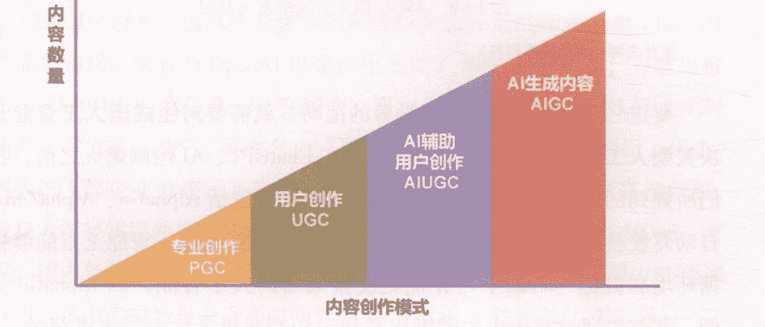

图1-7 内容创作模式的演变
（图片来源：A16Z、国泰证券研究所）

AIGC 指利用 AI 技术生成文本、代码、图像、音频、视频等形式的内容，范围很广，包括视频自动剪辑、语音合成、图像生成、自然语言处理、机器翻译、跨模态生成等。当前进展如图1-8所示。

## ChatGPT
会计人触手可及的“AI助手”

| Before 2020 | 2020—2022 | 2023—2025 | 2030-Future |
| :--- | :--- | :--- | :--- |
| **文本** | 垃圾邮件监测<br>翻译<br>基础问答 | 基础文稿写作<br>草稿水平→初稿水平 | 专业文稿写作<br>接近人类→超越普通人 | 专业文稿写作<br>超越专业从业者 |
| **代码** | 1行代码自动生成 | 多行代码生成<br>准确度提升期 | 多种编程语言兼容<br>代码→生成产品雏形 | 自动生成终极产品<br>超越专业开发者 |
| **图像** | | 艺术图、LOGO生成<br>准确度提升期 | 产品设计、建筑设计<br>草稿水平→产品水平 | 自动生成终极产品<br>超越专业艺术家、设计师 |
| **视频** | | 尝试3D/视频模型生成<br>编辑→自动生成 | 3D/视频模型生成<br>草稿水平→初稿水平 | AI Roblox<br>个性化生成电影、游戏 |

图 1-8 AIGC 四个方面的发展阶段
（图片来源：天风证券研报）

为厘清 AIGC 范畴，需区分生成型人工智能与决策型人工智能。在 ChatGPT、AI 绘画爆火前，谈 AI 多指决策型人工智能，如 AlphaGo、AlphaZero、自动驾驶、决策树、随机森林等。决策型 AI 能根据环境和目标学习并优化策略。AlphaGo 先学习历史对局，再用卷积神经网络提取棋盘特征，根据局面决策，并通过自我对弈强化学习，最终先后战胜范廷钰、李世石、柯洁，标志 AI 在理性决策上达到人类顶尖水平。可把决策型 AI 比作智慧决策者，生成型 AI 则像艺术家，不断创造新作品。

## 第一部分 变革篇：ChatGPT重构会计生态

AIGC 的到来深刻影响生活，可创造新艺术、促进医疗公平、提供个性化教育、改善灾害预警等。但也带来假新闻、虚假信息、冒充人类等问题，需要立法和行政监管来趋利避害。

##### 1.4.2 国内外 AIGC 赛道纵览
AIGC 赛道最受关注的两条是 AI 绘画和预训练语言模型赛道。OpenAI 发布 ChatGPT 后，微软迅速携手上线 New Bing，谷歌推出竞品 Bard。国内百度 2023 年 3 月上线生成式对话产品“文心一言”ERNIE Bot，阿里、腾讯、华为、科大讯飞等也在研发预训练语言模型。高校方面，复旦大学邱锡鹏团队发布了国内首个对话式大模型 MOSS。可看出业界学界高度重视。截至 2023 年 1 月，国内外预训练语言模型的规模与发布时间见图 1-9。

AIGC 的生态轮廓已大致成型，业内常将其拆解为自上而下三层结构，示意参考图1-10。最底层的基座由 GPT-4、文心一言、通义千问等通用预训练模型构成；居中一层强调行业细分、场景适配与个性化调优，通常在通用基座上基于专属行业语料进行二次微调。软件供给历史上 SaaS、PaaS 长期占据主导，随着生成式 AI 快速渗透，Model as a Service，即模型即服务，正由设想迈向落地。顶层是直面 C 端的应用层，负责文字、图像、视频等内容的生产交付。

## ChatGPT
会计圈可用的智能搭档

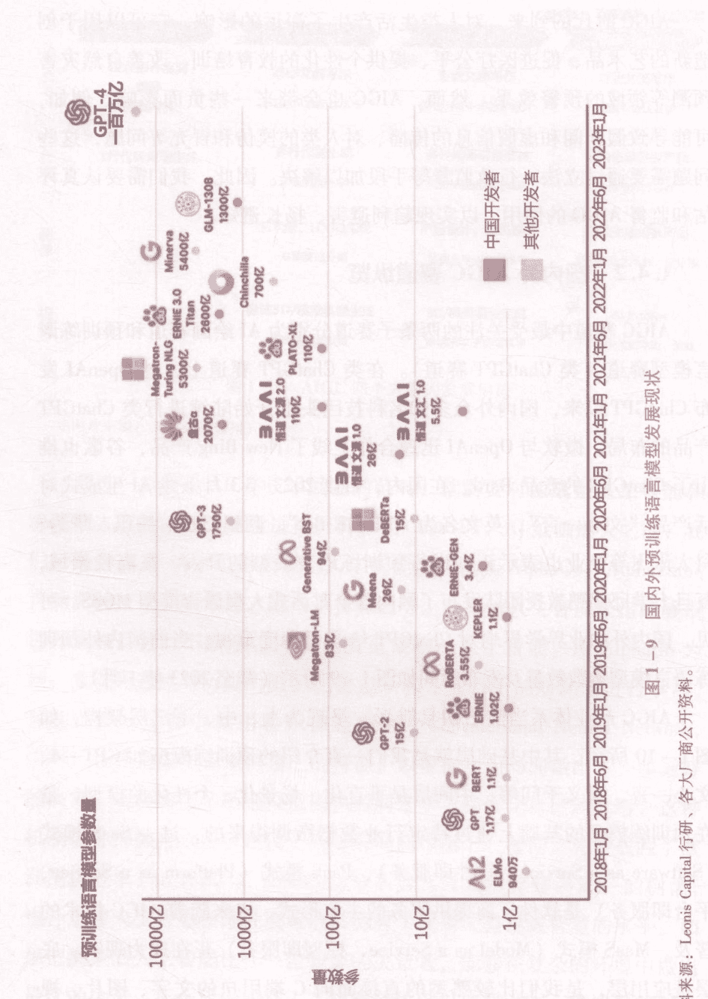

图 1-9 国内外预训练语言模型发展现状

资料来源：Leons Capital 行研、各大厂商公开资料。

## 第一部分 变革篇：ChatGPT重构会计生态

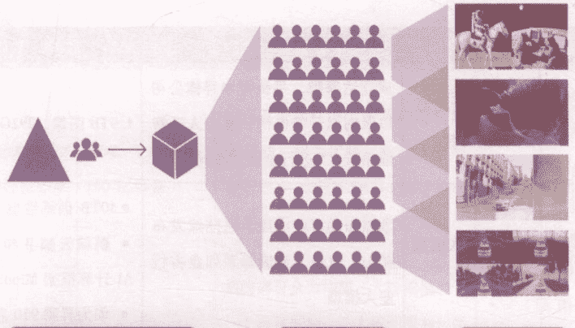

基础层：通用预训练模型
中间层：垂直化、场景化、个性化定制模型
应用层：图像、语音与文字等各类 AIGC 应用

图 1-10 AIGC 产业生态体系

资料来源：腾讯研究院《AIGC 发展趋势报告 2023》P10。

ChatGPT 在海外引发连锁反应，长期深耕大模型的厂商纷纷推出自家方案。除了 ChatGPT，国内外厂商的部分布局汇总于表1-1与表1-2。

表 1-1 国内大模型厂商布局（部分）

| 厂商 | 大模型名称 | 研发投入、应用情况 | 数据、算力 |

| :--- | :--- | :--- | :--- |

| 百度 | 文心大模型 ERINE3.0 100 亿参数 | 2013 年布局自主研发成立“深度学习研究院”；从高端芯片 + 飞桨深度学习框架 + 大模型全栈布局 | • 百度搜索数据（天然用户搜索问答训练样本）<br>• 纯文本和知识图谱的 4TB 语料库<br>• 鹏城云脑 II（2048 块 CPU）和百度飞桨 |

| 腾讯 | 混元 AI 大模型 | 组建太极机器学习平台，在产品层提供数据/特征工程、模型训练、模型服务。在广告、社交、游戏层面旨在塑造更广义的互动叙事品类，带来新的社交玩法和商业模式的新启发 | 太极 AngeIPTM 训练框架单机可容纳的模型可达 55B，20 个节点 |

| 阿里巴巴 | 通义 M6 大模型 10 万亿参数 | 成立达摩院、平头哥半导体公司以及阿里云等机构，发布人工智能系统 ET 进行全栈式布局 | 1.9TB 图像、292GB 文本 |

| 华为 | 盘古系列大模型 参数量千亿 | 重点布局行业应用，已陆续发布矿山、气象、海浪等系列盘古行业大模型 | • 40TB 训练数据<br>• 鹏城云脑Ⅱ和全场景 AI 计算框架 MindSpore<br>• 华为昇腾 910 芯片 |

| 字节跳动 | 火山引擎大模型 训练框架 | 几个核心部门集合组成专项团队共同研究大模型。探索方向主要与搜索、广告等下游业务结合、同时自研 | • 自有抖音头条数据<br>• 火山引擎自研 DPU (Data Processing Unit) |

| 科大讯飞 | 星火认知智能大模型（产品级应用） | 科大讯飞已覆盖教育、城市、医疗、工业、运营商、金融等多个行业领域的 AI 解决方案。将进一步启动生成式预训练大模型任务攻关。全新推出 AIGC 内容创作基地——讯飞智作，用 AI 赋能音视频生产 | 科大讯飞目前已建成 4 城 7 中心深度学习计算平台，算力不仅完全满足 AI 算法模型训练，还面向开放平台数百万开发者和其他行业伙伴提供相关 AI 服务的需求 |

| 浪潮信息 | 源 1.0 大模型 2457 亿参数 | 从算力、算法和应用三个方面进行布局和长期研发投入。浪潮 AI 服务器的中国市场份额连续 5 年保持在 50% 以上 | • 源 1.0 训练数据集达到了 GPT-3 模型的近 10 倍，训练使用了 5000G 的高质量中文数据 |

| 中科院自动化研究所 | 紫东太初大模型 参数量千亿级 | 目前已推出 2 个 AIGC 智能生成平台，并整合产学研，用各方资源搭建人工智能开源开放生态，探索通用人工智能产业化路径 | 支持 Token 级别、模态级别与样本级别的多任务自监督学习，同时实现模态理解与模态生成统一建模 |

| 复旦大学邱锡鹏教授团队 | MOSS（开源）160亿参数 | 国内首个插件增强的开源对话语言模型。相关代码、数据、模型参数已在 Github 和 Hugging Face 等平台开放，供科研人员下载 | MOSS 003 的基座语言模型已经在 100B 中文 token 上进行了训练，总训练 token 数量达到 700B，其中还包含约 300B 代码 |

| 智源研究院 | 悟道 2.0 大模型 1.75 万亿参数 | 系统部署全力构建三大智能模型 + 一个智算平台：三大智能模型包括悟道信息模型、天演生命模型和天道物理模型。九鼎智算平台在建 1000P 算力，每服务器 400Gbps 高速互连能力的高性能环境 | • 4.9TB 图像，文本<br>• 神威超算<br>• 智源研究院建设了全球最大的语料数据库 WuDaoCorpora2.0 |

| 清华大学知识工程实验室 | GLM-130B 1300 亿参数 | 由清华大学知识工程和数据挖掘小组开源发布，针对中文做了专门优化，在英文表现上略优于 GPT-3，在中文表现上明显优于 ERNIE TITAN 3.0 | • 4000 亿个文本标识符（中文和英文各 2000 亿）<br>• 支持在一台 A100（40G * 8）或 V100（32G * 8）服务器上对千亿规模参数的模型进行推理 |

数据来源：各方公开资料。

表 1-2 国外大模型厂商布局（部分）

| 厂商 | 大模型名称 | 研发投入、应用情况 | 数据、算力 |

| :--- | :--- | :--- | :--- |

| 谷歌 | Bard（1370 亿参数） | Bard 构建于 LaMDA 模型的基础上，但为了扩展到更多的用户，使用了更轻量的版本。同时，相较于 ChatGPT，Bard 可以根据最新事件进行对话、更负责任，目前谷歌也将其加入了 ChromeOS 搜索引擎 | — |

| 谷歌 | Minerva (5400亿参数) | 专为梳理推理领域开发，通过大量收集相关的训练数据并做大规模预训练，Minerva 在多种困难的定量推理任务中取得优异成绩 | 收集了1.2M篇来自arXiv服务器的科学论文，和60G包含LaTeX、MathJax等数学公式的网页（如各国理工科试卷的电子版），得到了一共38.5B个token的数据集 |

| Anthropic | Claude | OpenAI前副总裁离职创立Anthropic着手研发Claude，最大的优势是无网络限制，可在中国大陆使用。在撰写小说、编写代码、解释概念等方面表现出色 | 人工标注4.25万条的Red-Teaming攻击数据，通过few-shot prompting生成14万条额外数据 |

| Meta | BlenderBot3 (1750亿参数) | 能够通过访问互联网和长期记忆进行开放域对话，并且已经过大量用户定义的任务的训练。主要用于生成创意文本、解决基本数学问题、回答阅读理解问题 | 使用RoBERTa + cc100en数据，由大约100B个标记组成 |

| 英伟达 | Megatron-Turing NLG (5300亿) | 最大、最强大的单片转换器英语语言模型。在广泛的自然语言任务中展示了无与伦比的准确性。例如，完成预测、阅读理解、常识推理、自然语言推理、词义消歧等 | — |

数据来源：各方公开资料。

## 第一部分 变革篇：ChatGPT重构会计生态

对 AIGC 厂商成熟度的判断可从六个维度展开：
- ①模型：训练完备程度与数据承载能力。
- ②数据：可用数据规模及标准化、互通水平。
- ③科技：高端芯片自主程度与前沿技术落地能力。
- ④人才：人力资本存量与质量、技能建设及吸引力。
- ⑤基础设施：法规政策完备程度对 AI 发展的保障力度。
- ⑥商业生态：垂直领域相关方对新标准共识与协作生态。

ChatGPT 展现的涌现式能力，带动国内具备 AI 技术储备的企业加速进入 AIGC 赛道，形成新一轮模型竞赛。在模型层与应用层百花齐放的背景下，“搭建生态平台＋做厚应用服务”有望在中美博弈中形成弯道超车空间。

##### 1.4.3 AIGC 的合规风险与防控

> “三星引入 ChatGPT 不到 20 天，便爆出三起涉及 ChatGPT 的事故”“2023 年 2 月 22 日，摩根大通宣布开始限制员工使用 ChatGPT，随后，花旗集团和高盛集团也加入华尔街禁用 ChatGPT 之列”“2023 年 3 月 31 日，意大利个人数据保护局宣布，暂时禁止使用人工智能软件 ChatGPT，限制其开发公司 OpenAI 处理意大利用户信息，并开始立案调查，西班牙和法国相关机构也先后对 ChatGPT 发起指控和调查”。ChatGPT走红的背后，以其为代表的AIGC安全议题备受关注，可能涉及的合规风险包括：

- ①知识产权风险：生成物可能触及他人版权、商标等权益，需要做好版权保护与商标登记等应对。
- ②隐私风险：生成物可能泄露姓名、电话、身份证号、银行卡号等个人信息与金融信息，需防止未授权外泄。
- ③虚假信息风险：算法难以溯源核实，生成内容可能出现虚假广告、虚假新闻。需审核验证其真实可信。苹果联合创始人史蒂夫·沃兹尼亚克曾指出：“有人想骗你时，借助 AI 技术欺骗会更容易”。
- ④道德风险：生成内容可能出现歧视、侮辱等不当表达，需进行道德审查与监督，确保符合社会与职业规范。
- ⑤安全风险：生成内容可能暗藏恶意软件、网络钓鱼等威胁，需做安全检测与防护，避免用户受损。

当前各国普遍呈现AIGC“快跑”、监管“追赶”的局面。中国也迅速启动相关立法。国家互联网信息办公室、工业和信息化部、公安部联合出台的《互联网信息服务深度合成管理规定》是AIGC领域核心监管文件，明确要求服务提供者对用户输入与生成结果进行审核。

网信办于2023年5月发布《生成式人工智能服务管理办法》征求意见稿，对算法设计、训练数据选择、模型优化与服务提供作了规范。文件特别要求预训练与优化训练数据应：
- ①符合《网络安全法》等法律法规；
- ②不含侵权内容；
- ③含个人信息的需征得主体同意或符合法定情形；
- ④保证真实、准确、客观、多样；
- ⑤满足国家网信部门其他监管要求。

工具端层面，2023年4月10日中国支付清算协会发出倡议，因ChatGPT等工具存在跨境数据泄露风险，建议审慎使用。倡议从业人员严格遵守国家与行业规定，不上传涉密文件、非公开资料、客户信息、支付清算核心代码等内容。

技术演进往往伴随风险与机遇并存。AIGC如同驶入AI海洋的巨轮，带来便利的同时亦面临风浪，需要像船长般实时观海、调整航向，确保稳健前行并创造更多价值。

## 第一部分 变革篇：ChatGPT重构会计生态

### 第 2 章 ChatGPT 构建会计新生态

#### 2.1 ChatGPT 的优势与局限

第1章梳理了ChatGPT的前世今生及AIGC产业现状，第2章将聚焦ChatGPT本身，解析其优劣势并探讨其对会计生态的重塑。

##### 2.1.1 ChatGPT 的优势

ChatGPT作为基于自然语言处理的人工智能技术，相较于传统搜索引擎和聊天机器人优势如图2-1所示。

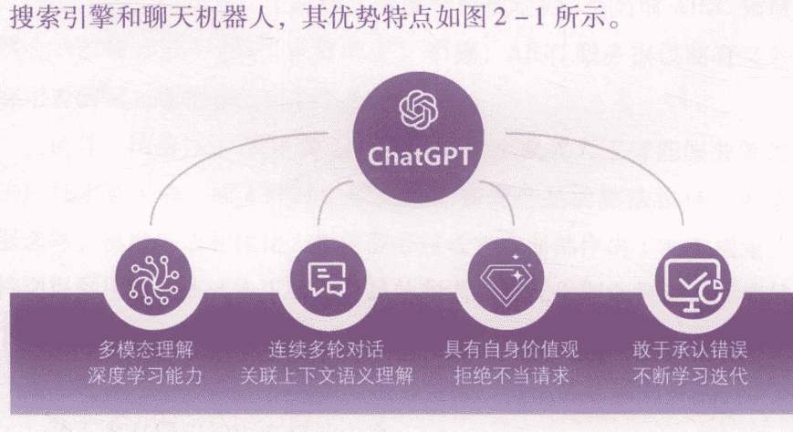

下文对ChatGPT特征做进一步提炼。

- ①深度学习根基：核心算法依托深度学习，先以大规模无监督数据预训练，再结合标注数据微调，提升准确性与泛化性。Bert、Transformer等神经网络提升了文本语义理解与处理能力。
- ②多模态理解能力：不仅理解文字表面含义，还能把握背景、语境与隐含意义。GPT-4已可处理视频、图像等多模态数据。
- ③生成式架构：属于生成式架构，按用户输入自动生成回复，而非检索式从已有数据库匹配。
- ④长文本生成：可连续输出数百至数千字，依托多层神经网络对前文理解与语言结构预测实现长篇生成。

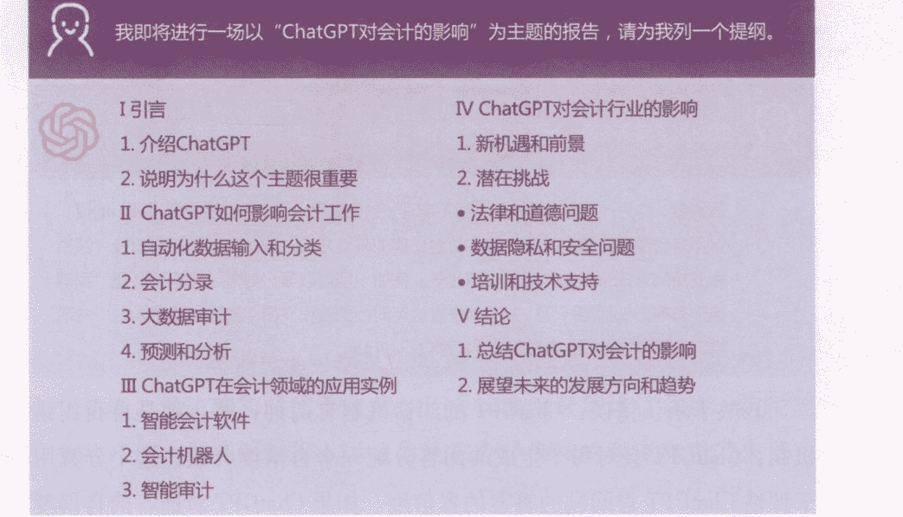

- ⑤上下文感知＋多轮对话：过往对话AI缺乏多轮连贯能力，ChatGPT可通过一问一答逐步解决复杂问题，沟通更流畅自然，减少机械感。
- ⑥自我学习与涌现能力：基于历史数据与用户交互反馈不断调整生成模型，表现持续提升。
- ⑦良性价值观：开发时植入正向价值，避免恶意请求。例如拒绝撰写《你真是让我失望透顶》式信件，并引导积极表达。
- ⑧敢于承认错误：具备自我纠错机制，按置信度评估回答，若低于阈值则承认不确定；同时可依据用户反馈修正，提升准确性。

##### 2.1.2 ChatGPT 的局限

《孙子兵法》云：“不尽知用兵之害者，则不能尽知用兵之利。”了解局限有助于扬长避短。

GPT-3.5训练数据呈广而不深、以英文为主、截止2021年9月的特点，使其存在以下不足：
- ①专业领域知识不足：通用模型覆盖面广，但在医学、法律、会计等纵深专业上理解有限，易给出似是而非的答案，需行业语料再微调。
- ②中文语境训练不足：在歧义、修辞、俚语等处理上仍有困难。
- ③语料无法实时更新：基于2021年前公开数据，无法纳入最新会计准则修订、税制变化等实时信息，限制深度应用。
- ④情感理解不够细腻：虽偶有高情商表现，整体仍难以捕捉含蓄表达背后的情感，给出针对性回应。

训练语料追求广度时必然带来质量的离散性，叠加神经网络固有的黑箱属性，使得每一次输出很难回溯到确切来源，因而出现了“煞有介事的虚构”。最直观的体现是要求模型罗列某一领域的代表性文献时，常会给出并不存在的条目。

即便现阶段仍存短板，也不足以否定其整体价值。与传统对话机器人相比，这一系统在语言理解、文本生成与知识推理上的表现更为扎实，人机互动也更自然流畅，堪称迈向通用智能的重要进展。

#### 2.2 社会冲击波：岗位何去何从

浪潮已然逼近，普通人最先焦虑的是就业安全。为此笔者直接向模型抛出疑问。

> ChatGPT，你是否会取代部分人类的工作呢？未来哪些行业受到你的冲击最明显？
> 
> 哈哈，我可不敢说我会取代人类工作，毕竟我还是一个虚拟的聊天机器人，毫无实体。但是我相信，我的存在可以帮助人类更高效地完成一些重复性、繁琐的工作，比如客服、翻译等。至于哪些行业会受到我的冲击最明显，我想说，那些需要大量文本处理、自然语言理解的行业可能会受到我最大的影响，比如新闻报道、法律咨询、文学创作等。当然，我也不会放过那些需要与人类进行大量交互的行业，比如娱乐、社交等。但是，我想说的是，无论我在哪个领域发挥作用，我都会尽力保证人类和我之间的合作愉快、和谐，毕竟我是为人类服务的。

回应语气偏向克制，并未否认未来会出现岗位被替代的情况。随着能力持续提升，依托文本与数据的工作所耗费的社会必要劳动时间在压缩，人工的相对价值也在下移。OpenAI 在《GPT 是 GPT：大型语言模型对劳动力市场潜在影响的早期观察》中给出印证：超过八成的美国人群，日常至少十分之一的工作内容会受大模型影响。分行业看，金融、TMT、零售批发受波及最显著；分岗位看，数据处理、信息传播等中低端文本加工环节冲击最大，而体力劳动者的影响相对有限。笔者对模型与人工在部分岗位的适配程度做了汇总，如表 2-1 所示。

表 2-1 ChatGPT 和人工与部分岗位的契合度对比

| 行业 | 劳动力 | 人工的岗位契合度 | GPT-4 岗位契合度 |
|---|---|---|---|
| TMT | 数据处理托管及相关服务 | 0.5—0.6 | >0.6 |
| 其他 | 其他信息服务 | 0.5—0.6 | >0.6 |
| 金融 | 保险承运人及相关活动 | 0.5—0.6 | 0.5—0.6 |
| 金融 | 基金信托和其他金融工具 | 0.4—0.5 | 0.5—0.6 |
| 金融 | 货币当局、中央银行 | 0.4—0.5 | 0.5—0.6 |
| TMT | 广播 | 0.4—0.5 | 0.5—0.6 |
| TMT | 专业的科技服务 | 0.4—0.5 | 0.5—0.6 |
| 其他 | 公司和企业的管理 | 0.4—0.5 | 0.5—0.6 |
| 零售批发 | 批发电子市场的代理商和经纪人 | 0.4—0.5 | 0.4—0.5 |
| TMT | 电信 | 0.4—0.5 | 0.4—0.5 |
| 零售批发 | 电子产品和电器商店 | 0.4—0.5 | 0.4—0.5 |

进一步归纳后，各行业的可能用途如表 2-2 所示。

表 2-2 ChatGPT 对各行各业可能产生的影响

| 序号 | 行业 | 用途 |
| :--- | :--- | :--- |
| 1 | 会计审计行业 | ChatGPT 可以用于自动化会计数据处理，包括分类、记账、核算、生成财务报表等；ChatGPT 可以作为智能咨询工具，向客户提供财务咨询、税务筹划等服务；ChatGPT 可以用于自动化审计检查，包括检查财务报表和账务记录的准确性、完整性和合规性；ChatGPT 还可以用于自动化财务分析，包括计算各种财务比率、进行趋势分析和预测等 |
| 2 | 媒体出版行业 | ChatGPT 可以产生各种话题的内容，包括新闻、文章、博客等，这将为媒体提供更多样性的内容，从而满足读者更广泛的需求 |
| 3 | 教育培训行业 | ChatGPT 能够为学生提供更快速、更直接的答案，在某些领域甚至能够代替传统的学习方式。例如，学生可以通过 ChatGPT 学习编程语言、了解文学知识等。同时 ChatGPT 有助于实现教育个性化。对于有些学生，ChatGPT 甚至能够根据学生的答题情况，为学生定制出能够更好地帮助他们掌握知识的学习计划 |
| 4 | 客户服务行业 | ChatGPT 可以通过人工智能技术提供快速响应和解决问题的能力，还可以在自动化客户服务中使用。例如，自动回答常见问题或处理简单请求，可以大大提高客户满意度并节省时间和人力资源 |
| 5 | 电子商务行业 | ChatGPT 可以提供更好的客户体验。例如，ChatGPT 可以帮助客户浏览产品或解答问题，还可以在客户下订单和付款方面提供帮助。ChatGPT 还可以通过推荐产品和个性化推销来提高销售量 |
| 6 | 医疗保健行业 | ChatGPT 可以提供在线诊断和治疗计划，可以通过专业的医学知识来回答患者的问题，并根据病情提供个性化医疗建议，还可以使医疗保健更具人性化，并为患者节省时间和金钱 |
| 7 | 金融服务行业 | ChatGPT 可以在金融服务中使用。例如，自动回答客户的银行账户或信用卡问题。ChatGPT 还可以在数据分析方面使用。例如，自动化投资决策或检测欺诈行为 |
| 8 | 互联网行业 | ChatGPT 可以与网站访问者交流，收集关于他们的数据和需求，进而有针对性地推销产品和服务。同时可以帮助聚焦客户服务、高效营销和精准内容，帮助企业提升品牌形象，增强客户信任和忠诚度 |
| 9 | 法律行业 | 在情报分析和研究方面，ChatGPT可以利用其强大的自然语言处理和机器学习能力分析大量的法律文本，帮助律师和研究人员进行研究和决策。在案件管理方面，ChatGPT可以作为一个虚拟的助手，帮助律师和法律助手管理案件，处理客户信息，提供日程安排和提醒等服务 |

在上述演进中，第四种用工形态的出现几成必然。传统形态仅有全职、外包、兼职，而数字化程度较高的企业已开始构建以 RPA、低代码、BPMN 等技术为核心的数字员工体系。模型的普及将显著拓宽数字员工的职能边界，推动数字化劳动在企业与机构中扩散。

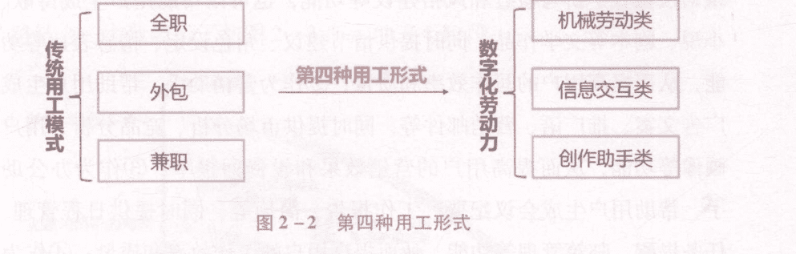

从实践看，数字劳动大致可划分为三类：

（1）机械操作类：RPA 是典型代表，能够模拟人工操作电脑的流程，通过虚拟鼠标键盘驱动应用系统。特性是严谨、持久、无侵入、低代码、可标准化亦可定制。适用于流程高度标准、规则明确、体量大且无需复杂判断的场景，如跨系统数据搬运、数据采集、报表加工、纳税申报、账单处理等，财务共享中心是其理想场景。

（2）信息交互类：涵盖智能客服、智能咨询顾问、智能语音助手等。借助自然语言处理与机器学习，可自动回复用户提问、处理简单请求，如查询订单状态、退款、信息修改等。结合语音识别与合成，还可实现语音对话，应用于智能家居、智能汽车、医疗等场景。融合行业知识与用户历史行为后，还能提供个性化专家咨询，如依据交易记录、投资偏好、风险偏好为客户匹配金融产品。

（3）创作辅助类：可充当写作、营销、办公、编程等多类助手。写作方面能生成提纲、段落、标题，提供语法、拼写、风格建议，并可生成诗歌、小说、剧本及情节、角色设定建议；营销方面能生成广告文案、推广语、营销邮件，并提供市场分析、竞品分析、用户画像等；办公方面能生成会议纪要、工作报告、简历，并提供日程、任务、邮箱管理；编程方面能解答问题、提供代码片段、解释思路并给出调试建议。

人类历经农业革命、工业革命、信息革命、生命科学革命，每一次都重塑了社会面貌。技术发展历来伴随利弊共存。以 ChatGPT 为代表的 AIGC 带来更智能、更交互、更便捷的学习工作体验，促进数字经济与智能制造发展，同时也带来个人隐私与数据安全、算法公平与岗位替代的伦理争议，以及因算法复杂度高导致的决策可解释性不足、透明度缺失等问题。

接下来将把视角聚焦到会计领域，从“危”与“机”两方面展开探讨。

#### 2.3 会计演进的三个阶段与要素拆解

过去四十余年，会计持续与新技术融合，大致经历三个阶段：

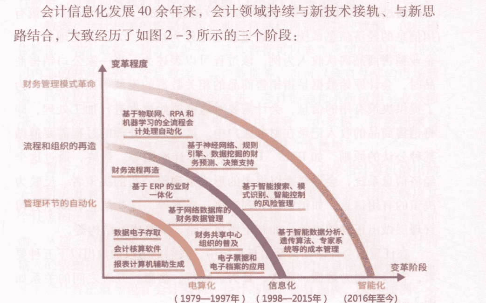

资料来源：刘勤，吕晓雷，赵健等. Acctech：影响会计行业的信息技术 [J]. 财务与会计，2021（22）：54-57.

## ChatGPT：会计领域的智能搭档

- ①电算化（1979—1997年）：小型数据库和简单计算机软件取代了部分人工会计核算工作；并没有改变会计工作的流程，只是将部分流程从线下搬到线上。
- ②信息化（1998—2015年）：ERP、财务共享服务模式普及；财务管理从核算型逐渐向管理型转变。
- ③智能化（2016年至今）：“大智移云物区”在财会领域的深度应用；相比于信息化阶段，更注重企业各类信息处理的效率、效益和智能化程度，统合海量、多维、异构的业财数据，通过分析进行决策支持。实现由账房先生到战略参谋的角色转型。

要判断模型对会计演化的影响，先要把握其演化规律。会计信息系统论认为，会计本质是一个依据公认准则对原始数据加工、产出决策有用信息的经济信息系统。以销售确认收入为例：销售产生发票等原始凭证，会计按准则记入收入科目，经加工后在报表中呈现销售额、利润率、成本等信息，为管理层制定销售策略、调整成本结构提供依据。

在任意会计活动或信息系统中，均可抽象出数据、算法、算力、执行、信息五大要素，且彼此关联。

## 第一部分 变革篇：模型重塑会计格局

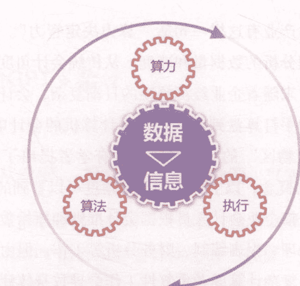

图 2-4 从数据到信息的要素分解

以会计活动为例逐一解析：

**数据：** 涉及销售、成本、预算等经济活动所需信息，来源既有内部财务报表、交易、客户数据，也有外部市场、政策数据。随着业财融合推进，财务分析的边界从财务小数据扩展到涵盖业务经营、内外环境的业财大数据。

**算法：** 广义上是一套解决任务的步骤。会计系统本身就蕴含算法特征，输入数据按流程转化为信息。会计算法涵盖会计原则、准则、制度、惯例、规范等，如存货核算的先进先出法、加权平均法，以及数据挖掘中的分类、聚类、回归、时间序列、关联规则等。

## ChatGPT 会计人触手可及的“AI助手”

**算力：** 决定处理规模与速度。传统会计对算力要求不高，后经由手工算盘到计算机电算化，再到以云计算为基础的云会计，算力的演进始终伴随变革。

**执行：** 指会计人员基于准则和原始数据开展的账务处理、报表编制、财务分析等实务。人的疲劳与错误率限制了重复复杂工作的效率，此时 RPA 等数字员工可分担部分执行环节。

可以看出，会计变革的框架始终是这五要素在运行，变化的是表现形式：数据由财务小数据变为业财大数据；执行由纯人工转向人机协同；算法由传统财务比率、杜邦分析转向机器学习模型。建立这一思维框架，有助于理解模型时代的会计变革。

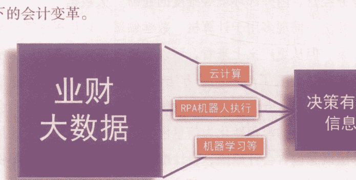

#### 2.4 ChatGPT 与会计的结合点

##### 2.4.1 从数据、算力、算法看具体变化

模型的技术路线是“海量数据 + 强大算力 + 高效算法 = 大模型”，因此对会计的“数据、算力、算法”三维度均会产生影响。

在数据维度，多模态能力使可分析的信息从结构化扩展到非结构化。结构化数据指格式固定、定义明确的数据，如电子表格、关系型数据库；非结构化数据指无固定格式的数据，如文本、音频、视频、图像，处理难度更高。模型的普及为财务部门分析非结构化数据提供新契机。例如，可快速处理海量邮件、管理报告，帮助会计人员更快把握公司财务状况并及时响应。战略管理会计还能借助其分析竞争对手新闻、社交媒体，洞察市场策略。

在算力维度，普及后会计部门处理海量多维数据的速度大幅提升。会计难点不只在数学运算，而在于复杂的条件逻辑判别，会计要素确认条件就需要逐条判断。借助 RPA、OCR 等自动化技术，可自动识别并分类发票、收据、银行对账单，减少人工失误，提高处理效率。还能对财务报告进行自然语言处理和语义分析，快速提取关键信息，为分析和预测提供更全面准确的支撑。总体来看，数据处理会变得更高效、更精准、更智能。

在算法维度，普及会加速算法创新与应用。国资委《关于中央企业加快建设世界一流财务管理体系的指导意见》提出要从流程驱动为主转向流程驱动与数据驱动并重。财务部门在构建数据驱动决策支持体系时，需要更多采用回归分析、分类、聚类、时间序列、关联规则挖掘等模型，以提升会计信息的准确性和前瞻性。

GPT-4 自带 Code Interpreter 插件，正在让会计从业者入门机器学习变得容易许多。简单说，这是由 OpenAI 提供的可在沙箱内自动撰写并运行 Python 的环境，并且支持上传本地文件。用户发出自然语言指令或提供数据后，模型会先理解内容、生成代码、不断调试执行，最终将分析结果导出为可下载的文件。GPT-3.5 也具备 Python 编写能力，但 GPT-4 的这次升级核心在于可直接导入 xlsx、csv 等表格，并通过对话即可完成数据清洗、描述性统计、变量相关性检验乃至算法应用等完整的数据价值链。图 2-6 展示了描述性分析的演示。

## 第一部分 变革篇：ChatGPT重构会计生态

请先做第一步，即描述性分析。谢谢

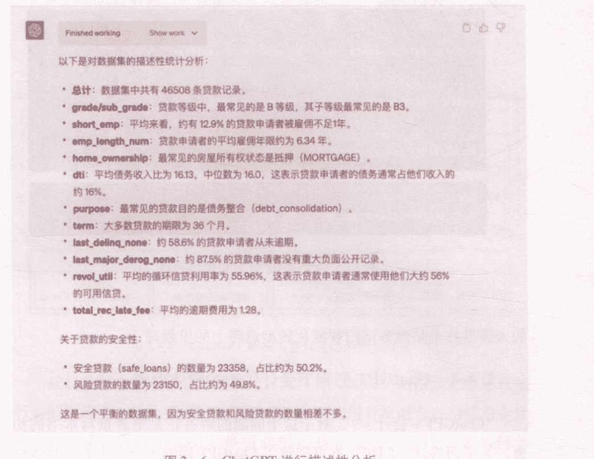

图 2-6 ChatGPT 进行描述性分析

图片来源：微信公众号玉树芝兰。

在实际使用中 Code Interpreter 对用户而言更像一个黑箱，只展示最终的分析结论，中间的运行过程默认不呈现，若需查看细节可通过 Show Code 命令调出 Python 代码，如图 2-7 所示。

与此同时，该插件甚至能承担机器学习中较为耗时的超参数调优工作。总体来看，它让财务人员借助 ChatGPT 来做财务指标预测、风险预警、归因分析等数据挖掘变得十分便捷。若把低代码平台 aPaaS 比作把财务软件开发推向低代码，那么 Code Interpreter 就是把机器学习算法的使用推向无代码，以 ChatGPT 为代表的大模型已成为财务智能化转型的关键里程碑。

## ChatGPT

会计人触手可及的“AI助手”

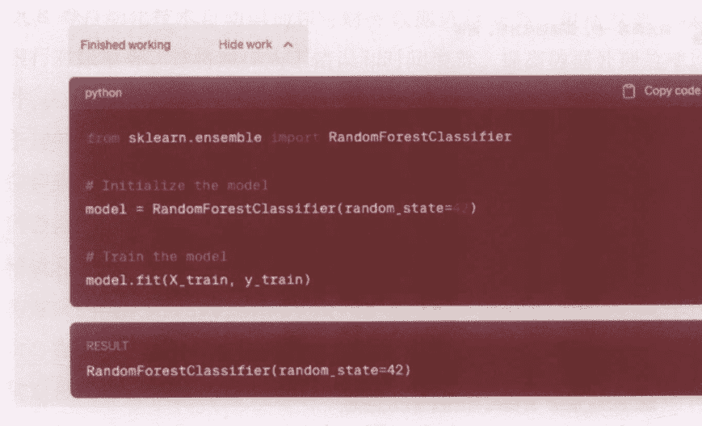

图 2-7 ChatGPT 展示 Python 代码

图片来源：微信公众号玉树芝兰。

##### 2.4.2 ChatGPT 影响下会计生态的整体框架

“ChatGPT + 会计 = ?” 正是本书写作的核心问题。为回应这一疑问，本书构建了 ChatGPT 作用下会计生态的整体图景，如图 2-8。作者认为，在 ChatGPT 影响下，会计生态将向自动化、智能化、高效化与交互化演进，后续章节将围绕以下四个方向展开：

- ①技术篇：探讨 ChatGPT 与现有 Acctech 的结合会产生怎样的化学反应。
- ②场景篇：ChatGPT 在预算管理、资金管理、税务管理、会计核算、财务报表分析等场景会带来哪些新机会。
- ③思辨篇：讨论 ChatGPT 对会计人员而言是竞争对手还是助手，以及如何扬长避短、更好地运用该工具。
- ④未来篇：对会计行业与会计科技的发展趋势进行研判，帮助从业者找准方向、顺势而为。

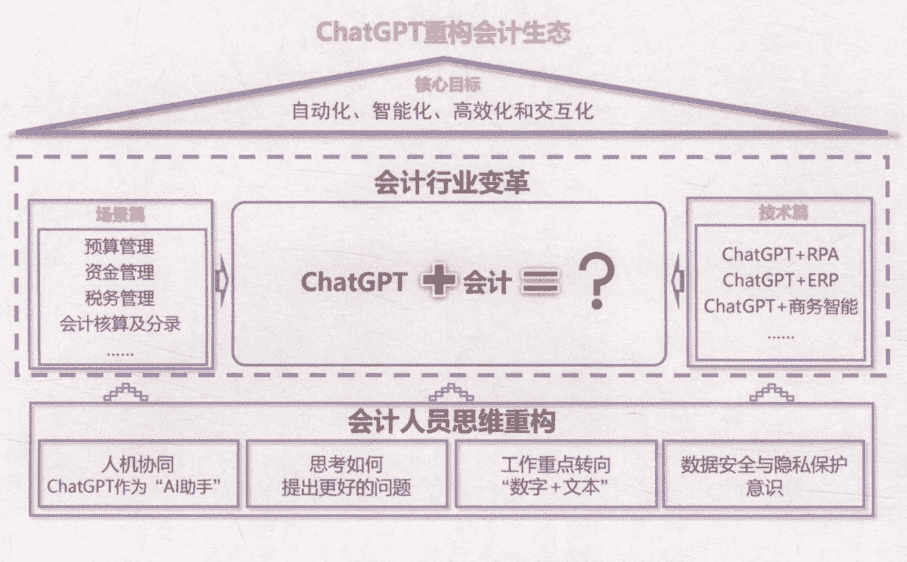

图 2-8 ChatGPT 影响下会计生态的整体框架

本书希望成为会计人在 ChatGPT 浪潮中前行的导航图，帮助理解 ChatGPT 如何嵌入当前会计生态、会触发哪些技术变化，以及如何与之协同、将其有效应用于实务以提升效率与质量。接下来就从“技术篇”出发，去探索这片充满潜力的空间。

## 4.3.6 本章小结

本章先梳理了基于深度学习的图像分割思路，涵盖语义分割、实例分割与全景分割，随后详细介绍了 U-Net、DeepLabV3+、Mask R-CNN 等经典网络的结构与原理。针对医学图像分割，进一步探讨了数据增强、损失函数设计与评价指标选择等关键技术。最后通过实验验证了改进算法在肝脏肿瘤分割任务上的有效性，结果显示 Dice 系数与 IoU 均优于原模型，证明了方法的可行性与优越性。

实验使用公开的肝脏肿瘤数据集进行训练测试。对比发现，引入注意力机制与多尺度特征融合能明显提升分割精度；不同损失函数的比较表明，交叉熵与 Dice 损失的混合使用更有利于缓解类别不平衡。

尽管效果提升，仍存在局限：小目标肿瘤的分割精度有待改进，计算开销较大难以满足实时需求。后续工作可从以下方向展开：一是探索更轻量的网络结构降低计算成本；二是引入更先进的注意力机制强化关键区域感知；三是融合多模态医学影像信息进一步提升性能。

| 模型 | Dice系数 | IoU | 推理时间(ms) |
| :--- | :---: | :---: | :---: |
| U-Net | 0.852 | 0.743 | 45 |
| DeepLabV3+ | 0.871 | 0.772 | 62 |
| Mask R-CNN | 0.865 | 0.763 | 78 |
| 本章方法 | **0.893** | **0.807** | 55 |

表4-3展示了肝脏肿瘤分割任务上不同模型的性能对比。本章提出的改进算法在 Dice 系数与 IoU 上均达到最优，分别为 0.893 和 0.807，相较原始 U-Net 分别提升约 4.1% 和 6.4%，推理时间控制在 55ms，满足临床辅助诊断的实时性要求。

总体而言，本章针对医学图像分割提出了一种改进型 U-Net 方案。通过通道注意力和空间注意力模块增强特征选择能力，通过多尺度特征融合模块提升对不同尺度目标的分割效果。实验验证了方法的有效性，为后续临床应用奠定基础。


## 第二部分

## 技术篇：ChatGPT+Acctech（会计科技）

2021 年 11 月，财政部发布《会计改革与发展“十四五”规划纲要》，提出要推动人工智能等新一代信息技术在会计基础工作、管理会计实践、财务会计工作及单位财务信息系统建设中的应用。2022 年 3 月，国务院国资委发布《关于中央企业加快建设世界一流财务管理体系的指导意见》，要求中央企业运用大数据、人工智能、移动互联网、云计算、区块链等技术，发挥财务天然数据中心优势，推动财务管理从信息化向数字化、智能化转型。会计信息化发展四十余年，行业不断与新技术融合，形成了独特的 Acctech 集合。自 2017 年起，上海国家会计学院持续评选“影响中国会计从业人员的十大信息技术”，并以 Acctech 命名，图 1 呈现了 2022 年评选结果，百分比为得票率。

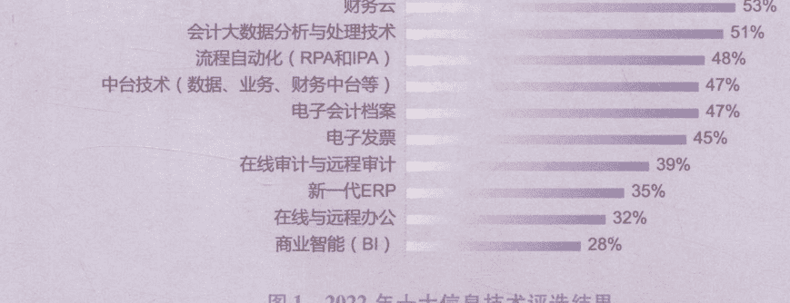

财会群体向来是最积极拥抱新技术的群体之一，ChatGPT 的出现再次掀起业内研究热潮。ChatGPT 如何与现有会计科技融合、推动会计智能化发展，是学界与业界共同关心的问题。本部分将围绕“ChatGPT + Acctech”展开探讨，寻找两者价值契合点，探索未来自动化、智能化、高效化、交互化的工作模式。

### 第 3 章 ChatGPT 与 Acctech 的价值契合点分析

#### 3.1 ChatGPT + RPA

RPA 已在财务流程中实现深度渗透。财务工作量大、规则性强、重复度高，例如数据采集、报表加工、纳税申报、账单处理等，在财务共享中心集中化、标准化后更具规则明确的可重复性，是 RPA 的理想场景。同时，财务组织正向管理决策支持、风险监控、绩效评价等转型，工作重心逐步转向流程优化、数据整合、分析洞察与风险管理，为 RPA 创造更多成熟机会。本书认为 ChatGPT 与 RPA 存在双向促进关系，具体体现在：

其一，RPA 有助于 ChatGPT 在企业端落地。目前 ChatGPT 的两大主流场景是智能对话服务和嵌入搜索引擎个性化检索，这类场景多面向 C 端。要进入 B 端，关键是接入企业业务流程，而 RPA 提供了突破口，主要体现为：

（1）系统整合。RPA 可对接企业业财系统，使 ChatGPT 获取内部业财数据，更好完成任务与解答。
（2）加速落地。企业可借助 RPA 自动化 ChatGPT 流程，如自动问答、自动推荐方案、自动化工作流等，提升部署效率。
（3）任务管理。RPA 可帮助企业管理 ChatGPT 任务，如分配任务、优化流程、监控执行，提升管理效率与规范性。

其二，ChatGPT 可加速企业 RPA 的部署，具体有五种方式：

（1）提供定制化 RPA 方案。ChatGPT 可依据企业需求输出定制方案，通过对接 RPA 产品降低开发门槛。方案设计阶段可将用户功能描述解构翻译，选择技术平台、设计自动化流程、明确核心功能；开发阶段可把自然语言转为机器语言，辅助定位代码报错并撰写基础代码，帮助快速搭建端到端流程；交付后还能把机器语言转回业务语言，便于业务与开发沟通。智能 RPA 厂商 Kognitos 指出，借助 ChatGPT 构建端到端自动化流程效率可提升 4 倍以上。ChatGPT 参与 RPA 部署的方式见图 3-1。

（2）辅助 PDD 撰写。RPA 开发需先梳理流程、理解需求并撰写流程定义文档 PDD，详细说明自动化业务流程、步骤、规则及角色。ChatGPT 凭借海量语料可提供最佳实践建议，确保文档结构符合行业规范；可自动检查语法、拼写、标点，提升准确性；还能基于输入信息扩展文档内容，如部门说明与任务描述，并作为咨询助手解答需求结构与 PDD 相关疑问。

（3）促进 RPA 人格化。财务 RPA 机器人自 2018 年引入中国以来，以高效率、零失误、24 小时运行著称，与财务人员协同作业。但机器人形象易给人冰冷感，且对底层机械劳动的替代带来职业焦虑，产生抵触情绪。

AIGC 的发展为缓解这一问题提供可能。一方面，可借助 DALL·E 等绘画技术为 RPA 生成虚拟形象，如图 3-2；另一方面，可搭载 ChatGPT 生成 RPA 的成长经历、工作履历等背景资料，提升亲和力。

| 序号 | RPA员工编号 | RPA拟人姓名 | RPA拟人形象 | RPA流程名称 |
|---|---|---|---|---|
| 6 | RPA21081 | 钱多多 |  | 资金日报 |
| 7 | RPA22081 | 银小朵 |  | 转换银行流水到BT上传 |

图 3-2 RPA 人格化

（4）促进 RPA 管理与知识培训。借助 ChatGPT 可大幅降低 RPA 卓越中心的运营、培训与维护成本。在培训上，传统方式依赖大量资料、视频与案例，效果有限。ChatGPT 可提供在线课程与个性化交互辅导，涵盖 RPA 基础知识、实践案例及特定财务场景应用等。

（5）推进个性化财务报告生成。RPA 自动生成报告受限于固化代码，只能输出模板化内容。RPA + ChatGPT 的组合下，RPA 负责读取表格与数据库并自动化处理账目，ChatGPT 负责生成自然语言文本，实现报告的自动化与定制化，打通个性化报告生成的“最后一公里”。

总体来看，RPA 推动了 ChatGPT 在企业端的落地，而 ChatGPT 通过对话式自然语言生成，提升了构建端到端 RPA 流程的效率，也增强了员工使用 RPA 的意愿。

实际应用中，ChatGPT + RPA 可出现如下场景：

##### (1) ChatGPT 生成 RPA 代码

> 请为我生成一段通过Outlook群发邮件的UiPath RPA代码。

```
UiPath RPA 代码：
1. Click activity
2. Input: 新建邮件按钮
3. Output: None
4. Type Into activity
5. Input: 收件人邮箱地址
6. Output: None
7. Type Into activity
8. Input: 邮件主题
9. Output: None
10. Type Into activity
11. Input: 邮件正文
12. Output: None
13. Click activity
14. Input: 发送按钮
15. Output: None
```

从结果看，目前 ChatGPT 尚只能生成 RPA 伪代码，无法完整输出 UiPath 代码，但其已具备准确梳理 RPA 任务流程的能力，对开发人员仍有较大帮助。

##### (2) ChatGPT 辅助 RPA 代码维护

RPA 流程开发中难免遇到难以理解的报错，尤其财务人员自主开发时缺乏 IT 支持，调试耗时严重。此时 ChatGPT 可充当助手，负责流程提示、代码生成与检查。下例展示了辅助维护过程。

```
帮我检查并解释这段 RPA 代码

def init(self,**kwargs): self.logger=ILog( file ) self.path=set img_res path(file selfrobot no=" selfproc no=" selfjob no=" selfinput arg=" if(robot no'inkwargs. keys0):selfrobot no=kwargs[robot no'] if(proc no' in kwargs.keys0): self. procno=kwargs[proc no'if(job no' in kwargs.keys0):selfjob no=kwargs['job no'] ILogJOB NO, ILog.OLDSTDOUT=selfjob no, sys.stdoutsys. stdout=StdOutHook (selfjobno, sysstdout)ExceptionHandlerJOB NO Exception HandlerOLD STDERR= selfjob nosys.stderrsys.excepthook=ExceptionHandler. handle exception
```

> 这段代码分别对各个实例变量进行了初始化，并对传入的关键字参数进行了处理。同时，对 ILog 和 ExceptionHandler 类的 JOB NO 进行了赋值，以及对系统输出和异常处理机制进行了改变。这段代码存在一些语法错误，缺少必要的冒号和引号。此外，还需要看完整的代码才能判断是否存在其他问题。

##### (3) ChatGPT + RPA + 智能客服

企业可通过 RPA 将 ChatGPT 智能客服接入业财系统。对外，客服机器人不仅能简单回复，还能调取业务流程、协助办理部分业务；对内，能理解财务与业务人员的复杂需求，大幅提升智能客服的价值。

前台对话由大模型承接用户的自然表达，后台由 RPA 按需调用业务流程完成自动化运转，执行结果经模型转译后回给用户。如此配合，大模型从单纯的语言输出获得了落地执行的闭环能力；RPA 在具备语义理解的智能中枢加持下，除固有规则驱动的机械作业外，也能介入需要语义判断和沟通协作的场景，应用边界明显拓展。

#### 3.2 ChatGPT + 财务云
2018 年到 2022 年，财务云连续五年被评为影响会计从业者十大信息技术之首，足见其渗透程度。简要来看，该模式把集团财务共享管理与云计算、移动互联网、大数据相融合，将共享服务、财务管理、资金管理整合为统一的云中心，支持多终端接入，让核算、报账、资金、决策在集团层面协同运行。

其本质是共享服务在财务领域的落地，带来两方面变化：职能层面设立财务共享服务中心，充当财务的计算与存储枢纽；系统层面推动财务信息系统与业务信息系统深度互联。

在此基础上引入对话模型，共享服务中心的智能化可体现在以下层面：

- ① 财务共享服务：模型可嵌入共享服务中心，为内部部门提供咨询、报表解读等支持，提升跨部门协同；同时参与数据标准建设，实现自动分类、规范、清洗和优化，提升集团内财务数据共享的效率与准确性，推动财务数字化管理。
- ② 财务管理：依托自然语言处理与机器学习，财务云能够提供智能化财务运营，自动完成核算、报账、预算管理等环节，降低人工成本与差错，提升管理效率与质量。
- ③ 资金管理：凭借对语音、文字的理解，可实现语音查询、报告自动生成、智能提醒等功能，协助企业更精细地管控与优化资金使用。
- ④ 多终端接入：结合财务云的多终端特性，可提供智能语音客服、问答、推荐等能力，便于管理者随时随地通过多种设备对话，同时增强语音识别与语义理解的体验。

#### 3.3 ChatGPT + 新一代 ERP
几十年来企业资源规划系统一直是生产运营的核心支柱，通过流程自动化与实时洞察帮助企业高效运营。近几年传统 ERP 演进为新一代 ERP，依托大数据、人工智能、云计算实现企业内部系统与外部系统的整合，并进一步向电子商务、客户关系管理、供应链管理靠拢。

结合大模型的私有数据训练以指导优化、保留对话上下文以保持连贯推理、实时生成答案等特性，与新一代 ERP 的融合主要体现在：

- ① 对接客户关系管理系统。模型可作为 ERP 的自动化客服工具，快速准确响应客户咨询与投诉，减少重复人工；与 CRM 互通后，可调取购买历史、偏好、行为数据，并在对话结束后把交互数据回写 CRM。
- ② 优化供应链管理。可协助 ERP 智能处理异常，例如库存短缺或财务问题时自动给出建议；作为实时协作工具促进团队沟通，在生产瓶颈或紧急需求变化时快速提取信息反馈供应商；还能通过与客户实时沟通收集需求与反馈，助力供应链优化。
- ③ 数据分析与预测。利用大数据与 AI 对销售、库存、生产等数据进行分析与预测，为决策提供参考；还能把 ERP 中积累的存量数据转化为管理报告，提供更全面精准的分析结果。

2023 年 3 月，微软发布首个应用于 CRM 与 ERP 的智能副驾 Dynamics 365 Copilot，减少手动录入、内容生成、笔记标注等繁重操作。例如在供应链管理中，Copilot 会主动对天气、财务、地理等影响事件发出预警，筛选受影响订单并展示物料、库存、承运商、配送网络等信息，随后自动撰写邮件向合作伙伴预警。

融合的同时存在风险。ERP 存储大量经营机密，训练私有模型时需把数据提供给模型，存在泄露隐患。我们曾询问模型的看法：

> 如果我把企业ERP数据给ChatGPT训练，会不会被泄露？

模型的回复强调其为云端服务并采用数据安全措施，建议使用加密传输、对数据匿名化、选择可信云服务商、签订保密协议，并指出数据不会直接泄露给他人，必要时可在本地或专用服务器训练，同时了解隐私政策。从上述回复可看出，模型并未否认泄露风险，企业在训练过程中需严格采用脱敏、加密等技术，并重视隐私与网络安全。相关信息安全问题将在“未来篇”进一步探讨。

#### 3.4 ChatGPT + 在线审计与远程审计
在线审计是指审计人员借助互联网与信息技术，通过人机协同对被审计单位会计信息系统合规性、可靠性、有效性以及网络会计信息真实性、合法性进行非面对面审查，打破时间与地域限制，摆脱纸质档案束缚。

在辅助在线审计时，模型可实时协助审计师进行数据分类、筛选审核与风险预警，通过公式分析、结果比对识别错误或不合规项并发出提醒，减少遗漏。例如可与数据库交互核验库存、收入等数据的准确性，审计人员输入疑问时也能获得即时解答。

同时可与远程审计系统集成，协助完成报表审核、凭证检查等重复性操作，节省时间并提高质量；还能依据分析需求与审计程序自动生成可视化审计报告，便于快速评估与总结。

#### 3.5 ChatGPT + 会计大数据分析与处理技术
会计大数据分析与处理技术是以大数据存储计算为底座，以数据治理、采集、清洗、分析、可视化为核心，帮助企业从会计大数据中挖掘价值，推动财务人员从账房角色转向战略参谋。

表 3-1 会计大数据分析与处理相关技术

| 技术类型 | 描述 | 包含内容 |
| :--- | :--- | :--- |
| 大数据存储与计算技术 | 面向大数据时代数据量大、数据源异构多样、数据时效性高的海量数据的存储与计算技术 | 文件存储、对象存储、图数据库、文档数据库、时序数据库、流计算、批量计算、图计算、分布式协调系统、集群管理及调度等 |
| 数据治理技术 | 解决数据溯源难、数据质量低、数据整合不易、标准混乱、数据安全合规等问题的技术 | 元数据管理、主数据管理、数据标准管理、数据质量管理等 |
| 数据采集技术 | 采集各种类型数据的技术 | 结构化数据采集、非结构化数据采集、离线数据采集、实时数据采集等 |
| 数据清洗技术 | 过滤或修改不符合要求的数据的技术 | 缺失值清洗、异常值清洗、逻辑错误清洗、冗余数据清洗等 |
| 数据分析技术 | 通过描述数据特征、构建数据模型、应用数据算法等手段，挖掘有效信息的技术 | 可分为数据探索和数据算法两部分，包括利用统计分析、机器学习、深度学习等分析技术 |
| 数据可视化技术 | 将数据分析结果进行具象图形展示的技术 | 统计图表、BI 报表、数字化大屏等 |

资料来源：陈虎，陈健. 会计大数据分析与处理技术：助推数据赋能财务新未来 [J]. 财务与会计，2022（10）：33-38.

模型可在以下环节提供助力：

## 第二部分 技术篇：ChatGPT+Acctech（会计科技）
① 数据预处理。可帮助分析人员自动完成清洗、标准化和转换。例如文本清洗时识别错误字符、标点、空格并按需去除 HTML 标签、特殊字符；标准化时可做机器翻译、自然语言处理、分词、大小写转换、中英互译等操作；财务文本分类时可添加语义标签，按相似度聚类，或转为向量用于模型训练与推理。
② 数据分析模型设计。自然语言能力使其能把更多文本纳入财务分析模型；还能自动生成 Python、Java 等主流语言代码，降低使用数据挖掘算法的门槛。例如可综合公司报告、报表、市场趋势与政策给出投资建议，或进行情感分析把握资本市场情绪。

下面呈现的是模型自动生成基于时间序列分析的收入预测 Python 代码示例。

# ChatGPT
会计人触手可及的“AI助手”

> 请用Python写出预测企业未来三个月收入的代码。

该问题较为复杂，需要更多信息才能给出精确代码，例如采用的时间序列、回归、神经网络等方法，以及数据源。为了提供思路，以下是一个基于时间序列分析的简易示例，用于预测未来数月收入走势：

```
import pandas as pd
from statsmodels.tsa.arima.model import ARIMA
# 载入数据集
df = pd.read_csv('revenuedata.csv', parse_dates=['Date'], index_col='Date')
# 在数据集上拟合ARIMA模型
model = ARIMA(df, order=(1, 1, 1))
results = model.fit()
# 预测未来收益变化
forecast = results.forecast(steps=3)
# 输出预测结果
print(forecast)
```

该示例假设存在名为 revenue data.csv 的收入序列，借助 pandas 读取为 DataFrame，再用 statsmodels 的 ARIMA 进行拟合，阶数取 1,1,1，后续调用预测接口生成未来三期的走势。

③ 分析结果解释。财务分析报告常含大量公式与冗余信息，管理层阅读成本高。模型可将分析结果转化为自然语言并提炼重点，降低理解门槛，同时提供解读与后续措施建议。

需要指出，GPT-3.5 目前不支持直接上传 csv、xlsx 等主流格式，Json 与 XML 也需插件支持；且上传企业机密数据存在泄露风险。因此模型与会计大数据技术的协同仍受产品迭代与信息安全防护制约。

#### 3.6 ChatGPT + 商业智能（BI）
商业智能是指通过数据的收集、整理与分析，帮助企业洞察业务、优化决策。BI 与会计大数据处理技术相关，前者提供数据基础，后者更侧重多维洞察与可视化，BI 在财务中的常见用途包括：

- ① 直接对 Excel/数据库快速完成基础报表：以往需手工导出、粘贴、邮件分发，耗时且易错。调用 BI 插件后可实现复杂表头在线查看与实时更新。
- ② 迅速完成报表分析及可视化搭建：在财务数字化背景下，管理层对数据价值诉求提升，BI 可实现一站式资产负债分析，如图 3-3 所示。

# ChatGPT
会计人触手可及的“AI助手”

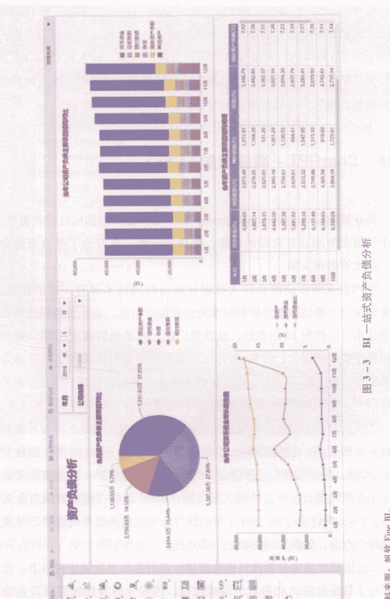

图 3-3 BI 一站式资产负债分析

资料来源：帆软 Fine BI。

模型可通过以下方式增强 BI 工具：

- ① 自动报告生成。可与财务人员对话收集需求，数据经 RPA 或数据中台导入 BI 生成可视化图表后，再由模型生成结构完整的财务分析报告，打通自动化报告的最后一公里，提升效率与质量。
- ② 构建可交互式 BI 工具。通过集成模型，财务人员可用问答方式获取信息或请模型解释特定图表，实现数值到政策、行业、战略、业务等定性关联的延伸；同时可按个人偏好自动筛选数据并生成图表报告，提升直观性与效率。

ChatGPT 打通中台协同与智能办公

- ③ 智能预警与提示。借助 BI 的监控与 ChatGPT 的推送能力，财务人员可第一时间感知核心指标的波动与趋势，从而更全面地理解数据并为经营决策提供更可靠的参考。一旦预设条件被触发，系统会调用 ChatGPT 向财务人员发出提醒，信息中包含详尽的数据解读、操作建议以及可直接执行的入口，比如自动生成报表、发出邮件、更新库存等。

#### 3.7 ChatGPT + 中台技术

2022 年国资委发布《关于中央企业加快建设世界一流财务管理体系的指导意见》，要求在数字化转型背景下，财务运行机制由金字塔式向中台协同演进，由流程驱动为主转向流程与数据双轮驱动，推动管理扁平化、颗粒精细化、视角多元化、场景动态化、信息实时化，实现敏捷高效。

中台技术介于前台与后台之间，由数据中台、业务中台、财务中台等共享中间件构成。数据中台重塑企业数据架构，业务中台提供标准化可复用的能力模块，财务中台则将财务共性需求抽象整合，打造平台化组件化的解决方案。

ChatGPT 在中台体系中的作用路径如下：

- ①数据中台。ChatGPT 可充当数据分析助手，通过自然语言交互收集需求，完成分析、信息抽取与报告撰写，并以自然语言呈现结果，提升可视化效果与使用体验。
- ②业务中台。ChatGPT 可扮演客服角色，用自然语言实现问答、服务与投诉处理，并自动生成回复提升响应效率；同时作为流程引擎，基于意图识别自动触发相关业务流程，提升处理自动化水平。
- ③财务中台。ChatGPT 能承担会计职能，通过交互式对话解答财务问题、提供服务、处理报表，并自动生成财务报表与分析结果，降低人工失误；在风险管理场景中可充当风控角色，基于数据识别风险点并给出管理建议，帮助企业降本增效。

整体来看，ChatGPT 深度融入中台体系，能够明显提升数据分析、业务处理与财务管理的效率和自动化水平，同时优化用户体验与服务质量。

### 第4章 AIGC 驱动办公：财务智能办公新阶段

AIGC 与办公场景的融合已出现较多实践。微软与谷歌分别推出 Microsoft 365 Copilot 与 Workspace；讯飞星火大模型把办公列为重点方向；Notion AI、印象笔记等笔记应用接入大模型实现文档自动写作；飞书推出 AI 助手 My AI，可优化续写、排程、会议纪要汇总与内部知识检索。ChatGPT 等技术在非结构化数据处理方面的能力，有助于挖掘办公沉淀的数据价值。

在 AIGC 驱动下，办公产品正由效率工具向生成工具演进。据 Gartner 预测，到 2025 年 AI 生成数据占比将达 10%，目前不足 1%，意味着未来每万字 Word 文档约有 1000 字由 AI 创作，每 10 张 PPT 约有 1 张由 AI 生成。下文以 ChatGPT 为代表，说明其对财务智能办公的赋能。

#### 4.1 ChatGPT + 微软全家桶

2023 年 3 月 17 日，微软正式发布 Microsoft 365 Copilot，将 ChatGPT 接入全套办公应用。Word、PPT、Excel、Outlook、Teams、Power Platform 等均获得 GPT-4 加持，可实现文档润色、表格分析与幻灯片快速生成，大幅释放重复性劳动。

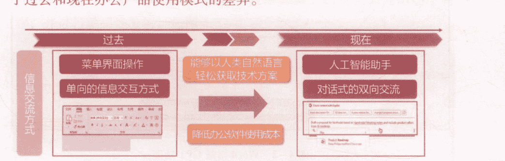

图4-1 过去和现在办公产品使用模式的差异

资料来源：浙商证券研报《AI+办公：智能化时代来临》。

可与 Copilot 对标的成熟产品为谷歌 Workspace，国内金山办公、科大讯飞等也在布局类似功能。协同方式主要体现在：

- > Word：按指令写作摘要、实现 Excel 与 PPT 格式互转、按需调整文风与排版。可使用命令举例如下：（1）请结合“XXX.doc”文字与“YYY.xlsx”数据，拟写一份项目建议书提纲；（2）基于上述提纲，草拟一页初稿；（3）把该 Word 文档表述简化，并将语气调整为更专业的风格。如图4-2所示。

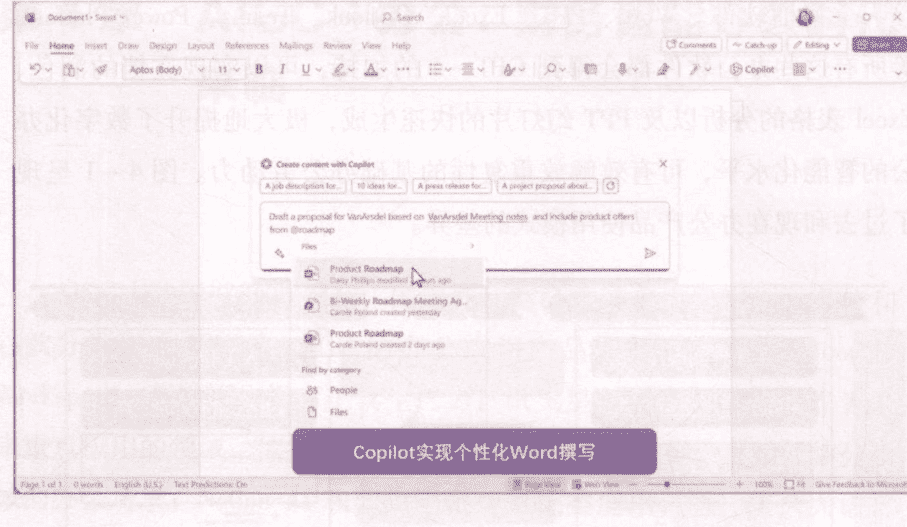

图 4-2 Word 搭载 GPT 功能

图片来源：微软宣传视频。

- > PPT：基于 Word、Onenote 等草稿秒级生成幻灯片，并通过自然语言修改内容与风格，调整字号间距与特效，一键压缩冗长演示文稿，优化布局与动画。可使用命令举例如下：（1）参考“XXX.doc”内容并从 NewBing 抓取配图，制作 5 页演示稿；（2）把 20 页的“XXX.pptx”浓缩为 3 页摘要；（3）对本页幻灯片做精简，删减文字。如图4-3所示。

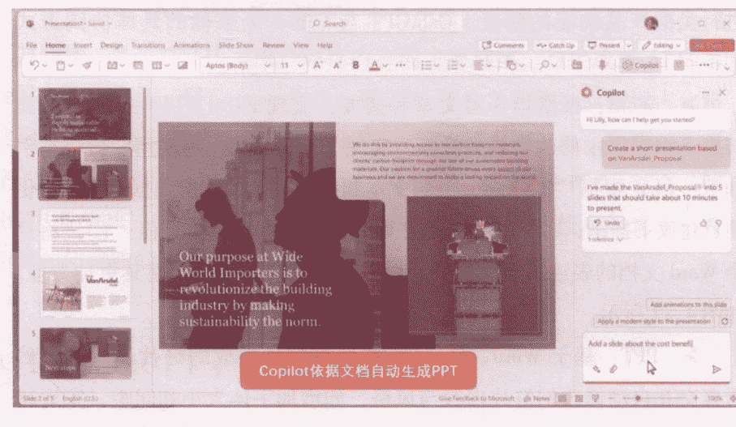

图 4-3 PPT 搭载 GPT 功能

图片来源：微软宣传视频。

- > Excel：可在短时间内识别趋势并可视化，按需自动生成数据透视表，乃至构建初步分析模型。可使用命令举例如下：（1）按区域与平台拆分销售明细并输出新表；（2）预测收入走势并生成可视化图表；（3）分析销售成本变动对净利率的影响并做敏感性测试。如图4-4所示。

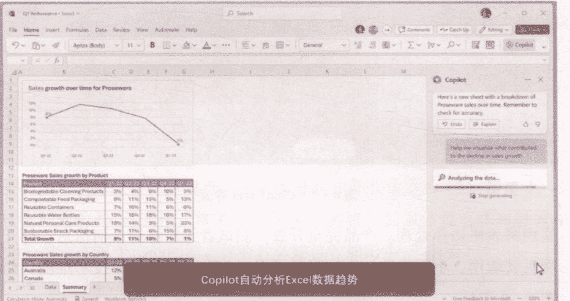

图4-4 Excel搭载GPT功能

图片来源：微软宣传视频。

北京大学团队开发的 ChatExcel，可通过表格下方文本框对话直接操控 Excel，实现求和、均值、排序、Vlookup、数据透视等常用功能，降低函数学习成本。如图4-5所示。

ChatExcel 还支持持续交互与迭代，“新需求 + 上一轮表格”可实现结果校验、回退重做与随时修改，并能跨表协作。产品完全开放，无需注册、即开即用、无次数限制，大幅降低使用门槛。如图4-6所示。

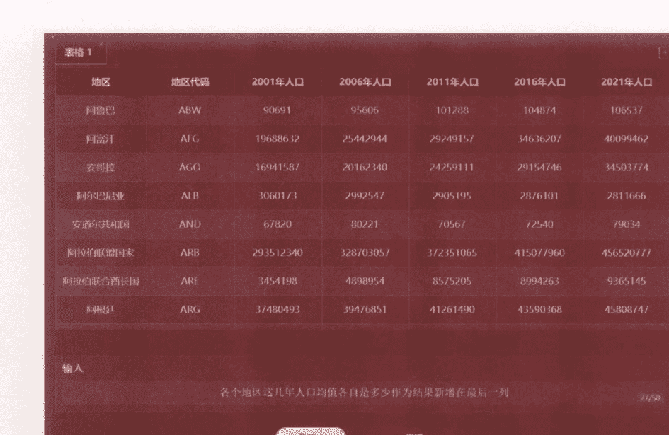

图4-5 ChatExcel 界面

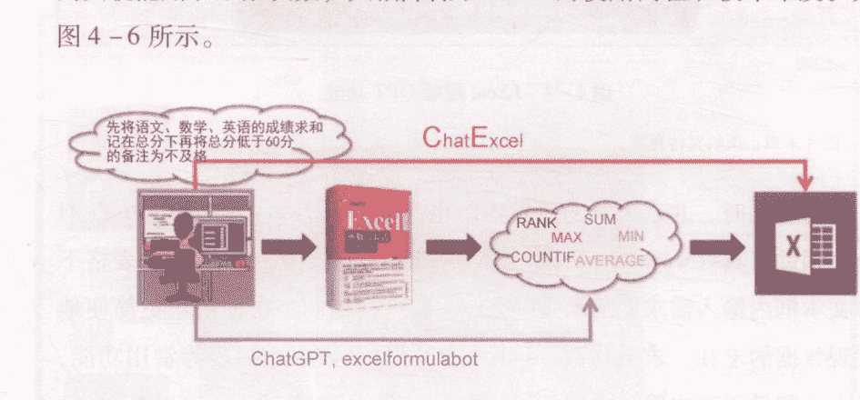

图4-6 ChatExcel 的优势

图片来源：北京大学公众号。

- > Outlook：自动提炼邮件要点，并按开头、结尾与主题生成个性化草稿，可灵活切换语气。可使用命令举例如下：（1）请汇总我出差期间错过的重要邮件；（2）请帮我起草一封邀请同事参加下周二“世界读书日”活动的邮件；（3）请帮我起草回复邮件，表达感谢并说明因“×××”无法参加并致歉。

- > Teams：为参会者生成个性化提要与时间线标记，提供可读文本与字幕，减少语言障碍，提升体验，并可识别区分会议室中多达 10 人的发言。可使用命令举例如下：（1）请概括每位嘉宾观点及分歧所在；（2）建立两列 Excel 表格，填入关于“×××主题”双方观点；（3）针对争论问题，你有何建议？如图 4-7 所示。

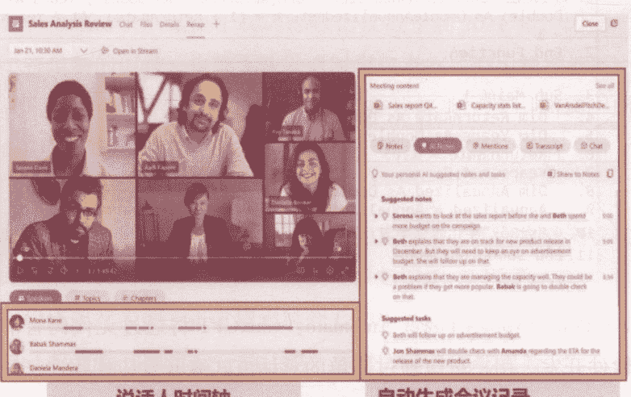

图 4-7 Teams 高级版搭载 GPT 功能

图片来源：微软宣传视频。

- > BusinessChat：汇聚文档、演示、邮件、日历、笔记与联系人数据，实现 Office 全局问答，可总结聊天、撰写邮件、查找关键日期并制定计划。可使用命令举例如下：（1）依据今早会议结果，向财务部“×××组”同事更新“YYY 合同”内容；（2）预约“MM 月 DD 日××时” Teams 会议并邀请“×××组”同事参加。

- > VBA：ChatGPT 可提供教程、解答、工具建议与案例，帮助提升 VBA 使用效率。可使用命令通常为：请写出“×××”的 Excel VBA 代码。示例如下：

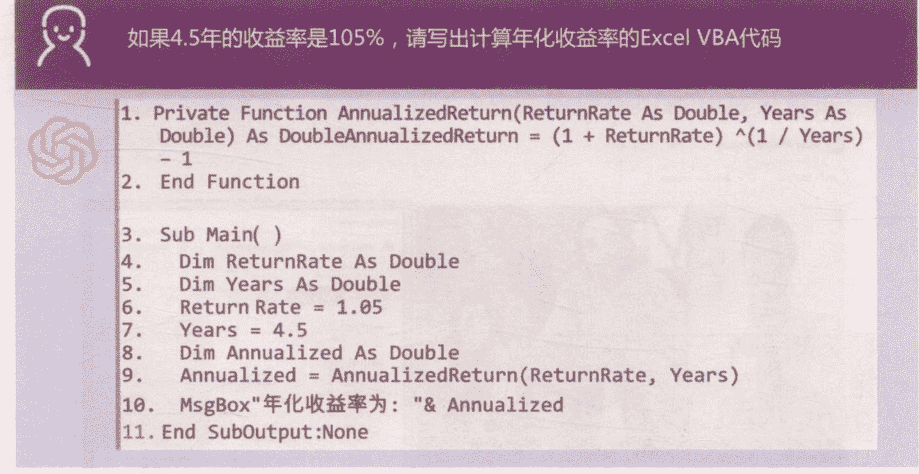

- > Power Apps + Power Automate：通过无代码智能方式重塑开发，用户用自然语言描述功能与需求即可自动生成代码，减少工作量并提升效率，财务人员亦可开展简单应用开发。可使用命令例如：（1）请生成“纳税申报”流程图；（2）请为我生成自动登录税务局系统的 RPA 代码；（3）请将此代码封装成“.exe”格式的应用程序。

截至 2023 年 5 月，微软仅在 Office 365 版本开启测试，国内暂不可体验，但钉钉“斜杠”、金山 WPS AI、科大讯飞星火大模型+智能办公本等同类布局正加速推进。

#### 4.2 ChatGPT + 新一代搜索引擎

ChatGPT 的涌现能力使其区别于传统搜索，但 GPT-3.5 的训练数据截止 2021 年，难以覆盖实时热点。与微软 New Bing 协同后，提问热点问题可获得带链接的生成回答，并自动浏览网页汇总结果。如图 4-8、图 4-9 所示。

以代码检索为例，传统搜索导向 CSDN 等站点，New Bing 可直接给出可运行代码。企业内部搜索同理，关键词检索需人工逐篇筛选，而借助 GPT 的自然语言处理直接返回结论，可为财务资料检索节省大量时间。

#### 4.3 ChatGPT + 在线办公与远程办公

在线与远程办公涵盖居家、异地与移动办公，为财务核算集中处理、大数据分析与流程自动化提供基础。

集成 ChatGPT 到钉钉、飞书、企业微信、Microsoft Teams 等内部聊天平台后，员工可通过机器人随时获取信息与支持，减轻人力负担。财务流程中的常见查询如账户余额、交易记录、报告生成等可实现自动化。任务管理方面，ChatGPT 帮助团队跟踪进度、分配任务，提升协作效率。

#### 4.4 ChatGPT + PDF 长文档处理

财务人员常需快速提炼长文档：

- ①会计师事务所审计报告；
- ②公司年度财务报告；
- ③银行贷款协议；
- ④税务局通知文件；
- ⑤合同条款；
- ⑥内部决策会议记录。

ChatGPT 可提供以下助力：

- ①快速提取信息并摘要：基于文本识别提取关键词与术语，自动归类并形成简明摘要，便于定位决策信息。
- ②智能搜索：支持自然语言模糊描述，无需精准关键词即可快速定位相关内容，提升检索效率。
- ③多语言支持：可对 PDF 实现高效翻译，便于阅读境外资料。

#### 4.5 “ChatGPT + 财务”微案例——财务 ChatDoc

##### 4.5.1 用途及开发背景

财务 ChatDoc 旨在基于多长文本支持问答，兼容 .doc、.PDF 与网页。GPT-3.5 单次输入输出上限为 4096 token，难以满足年报、审计报告等上万字阅读需求；GPT-4 虽支持至 32k token，但成本约高 10 倍，不适合大规模长文本处理，故需二次开发。

##### 4.5.2 财务 ChatDoc 运行过程

完整流程分为准备与问答两阶段，如图 4-10。

①准备阶段。整理文档为纯文本，切分为若干小 Chunk，调用文本向量化接口转为向量并存入向量数据库。可使用 OpenAI Embedding（https://platform.openai.com/docs/guides/embeddings/what-are-embeddings）或 fastText、SimBERT 等方案。

②问答阶段。将用户问题转为向量，检索向量库得到相关性最高的 Chunk，将问题与 Chunk 合并重写后发给 OpenAI API。请求示例：

> 结合下面的段落来回答问题：“如何使用预约功能。”
> * 段落 1：您可以按照以下步骤使用预约功能……
> * 段落 2：在使用预约功能之前，请确保您已正确地设置了洗涤程序……
> * 段落 3：……

##### 4.5.3 财务二次开发 ChatGPT 相关建议

ChatGPT 更像全能文科生，擅长给出结论；财务场景更需要垂直理科生。因此在垂直领域进行二次开发是必要路径。

①建议一：以业务场景为锚点，用开源组件做支撑。财务人员需要先把 ChatGPT 的能力边界摸清楚，再以产品经理的角色配合技术团队挖掘真正可用的应用场景。要认识到 ChatGPT 更像是擅长表达的文科生，对流程精度、规则刚性要求高的环节支持有限，所以必须借助外部工具才能释放效果。实践路径可以是：以 ChatGPT、Stable Diffusion 等 AIGC 大模型为底座，到 GitHub 等开源社区里寻找现成的方案，比如长文本拆分分批输入的组件，先搭出财务部门的最小可用原型，再进行二次开发来匹配企业自身诉求。如图 4-11 所示。

②建议二：主动对接技术资源。第一眼下“ChatGPT+财务”的产品层出不穷，企业要保持敏感度，持续关注微信公众号、开源社区等渠道上已有的同类系统，找到需求相近的公司，借鉴其研发经验和技术实力，评估自身是否具备自研条件，再决定自建还是外包。第二要走出去参加行业交流，比如上海国家会计学院智能财务研究院举办的相关研讨会，和其他企业的财务、技术人员面对面沟通；同时加入以 ChatGPT 为主题的技术社区，和开发者常态化交流，既能把握技术前沿，也能发掘潜在的合作伙伴并建立联系。

## 6.7 本章小结

本章聚焦深度学习图像识别技术在工业质检中的落地。首先介绍了卷积神经网络的基础构成，卷积层负责特征提取，池化层完成降维，\]
全连接层实现分类决策。随后说明了迁移学习的思路，用来缓解工业场景数据匮乏的痛点。最后通过一个生产线案例，演示了从数据到部署再到效果评估的完整链路。

实验显示，用深度学习模型做缺陷检测，在准确率和检测效率上都明显优于传统规则式视觉方法，尤其在背景复杂、缺陷微小的情境下鲁棒性更强。不过模型的解释能力和实时推理表现，仍是下一步需要重点改进的方向。

- 深度学习在工业检测场景具备明显优势。
- 迁移学习能有效缓解数据稀缺难题。
- 实际部署时要在实时性与硬件资源之间寻求平衡。

## 第三部分 场景篇：ChatGPT驱动财务全流程升级

吴军在《浪潮之巅》中就指出，深度学习的核心理论红利接近瓶颈，人工智能的下一个十年属于应用。ChatGPT 的爆发再次印证了这一判断。如今模型已走出实验室进入日常，迫切的任务是把它带进真实的工作流。本章就从财务这个高频场景出发，讨论 ChatGPT 如何改写财务日常。

### 第5章 ChatGPT 在财务中的场景图谱

据《华尔街日报》2023年4月23日的报道，普华永道计划未来三年投入10亿美元加码 AIGC，并在微软、OpenAI 的配合下探索税务、审计、咨询等业务的智能化。这是其应对 AIGC 时代、推进全面数字化的关键布局。

ChatGPT 可充当财务知识库、运营客服、咨询专家、编程助手、秘书等多种角色，也能嵌入预算、资金、成本、核算、分析、税务、审计等多个环节。下面围绕财务知识库、财务管理、核算分析展开探讨。

#### 5.1 财务知识库

企业可借助 ChatGPT 的自然语言能力搭建内部财务知识库，用于准则、法规、资产管理等咨询。

数据收集与分析：模型可汇聚财务报表、税务申报表、资产负债表等大量数据进行挖掘，帮助识别企业财务状况与潜在问题，并给出改进思路。

准则法规咨询：模型能依据行业准则和法规对财务状况进行评估。例如：

> 问个会计准则的问题：可供出售金融资产的公允价值变动计入什么报表项目？在处置可供出售金融资产时，是否要把计入权益变动的金额转出？

> 可供出售金融资产的公允价值变动计入其他综合收益，属于权益变动。处置时若已计入其他综合收益，需把此前计入权益的部分转出，计入当期损益。

看起来回答相当准确，继续追问依据。

> 你的回答是依据哪一年发布的会计准则？

> 这是依据《中国会计准则第42号——金融工具：确认和计量》发布的规定。该准则于2017年1月1日起实施。

事实上中国企业会计准则第42号是《持有待售的非流动资产、处置组和终止经营》。再指出错误后：

> 但是中国企业会计准则第42号为《企业会计准则第42号——持有待售的非流动资产、处置组和终止经营》，你为什么会犯这一错误？

> 非常抱歉，我犯了错误。您是对的，第42号确实是关于持有待售的非流动资产、处置组和终止经营。可供出售金融资产的会计处理依据的是中国企业会计准则第13号——金融工具确认和计量，该准则于2006年1月1日起实施。非常感谢您的纠正。

自我纠正后仍不准确，金融工具相关准则实际是《企业会计准则第22号——金融工具确认和计量》。可见 ChatGPT 在准则检索上仍存在“看起来很专业却说错”的风险。

资产管理咨询：通过分析资产负债表和现金流量表，模型可给出资产配置建议，助力优化结构、提升收益率。

> 如果4.5年的收益率是105%，那么年化收益率是多少？

年化收益率指投资在一年内的回报率。以 4.5 年累计收益 105% 计算：

(1+年化)^4.5 = 1+105% = 2.05
1+年化 = 2.05^(1/4.5) ≈ 1.138
年化 ≈ 13.8%

因此 4.5 年 105% 的累计收益对应年化约13.8%。

#### 5.2 预算管理

预算管理像一场有计划的旅行，既能指引方向，也能规避风险，还能保证可持续。作用体现在：提供清晰的财务方向，避免资源浪费；提前识别市场、竞争等风险，及时应对；注重节能减耗等可持续性，实现经济、社会、环境平衡。

全面预算管理包含编制、执行、考核三阶段，ChatGPT 在三者中均可发挥作用。

##### 5.2.1 ChatGPT 在预算编制中的应用

编制阶段要确定目标、组编、汇总、审批。传统方式依赖大量手工收集与整理，效率低易出错。ChatGPT 可自动化生成方案，提升效率与精度。主要作用包括：

- 预测公司未来财务状况：基于历史数据与市场趋势做前瞻，帮助制定更精准的预算。
- 处理不确定性因素：应对汇率波动、市场变化、竞争压力等，提升计划稳健性。
- 自动化编制流程：自动抓取整理财务数据生成预算，减少人工成本与差错。
- 成本结构管理：识别并管理成本构成，优化预算分配。

示例：
> 假设你是公司财务部门的财务预算编制人员，如何制定公司的年度预算？预算编制过程中需要考虑哪些因素？

需要综合历史财务、行业市场、经济环境、战略规划、政策法规变化。以电商公司为例：

1. 历史财务：过去几年盈利、现金流、资产负债情况，今年预计销售额1.2亿元，净利润6000万元，现金流量净额2400万元。
2. 行业市场：电商市场规模1万亿元，增速10%，竞争激烈。
3. 经济环境：通胀3%，贷款利率5%。
4. 战略规划：年内推出两款新品，市场推广投入1亿元，投资项目2亿元。
5. 政策法规：政府发布新的电商税收政策，影响税负。

##### 5.2.2 ChatGPT 在预算执行中的应用

执行阶段涉及监控、控制、沟通、报告。ChatGPT 可实现自动化与智能化：

①自动化流程：以对话方式设定预算目标、期间、限制与分配，自动核算结果与偏差并触发调整与审批。
②数据分析与可视化：关联预算数据与业务数据，发现趋势与偏差，以图表呈现给管理层与财务部门。
③智能建议：基于历史与趋势预测未来需求，提供预算调整与优化建议。

##### 5.2.3 ChatGPT 在预算考核中的应用

考核用于发现经营问题与风险并纠偏。应用包括：

- 预算执行评估：对比目标与实际，计算完成率、超额率并给出评价。
- 调整建议：结合执行情况与市场变化，建议费用增减或销售目标修正。

例如制造企业可将目标、期间、限制输入 ChatGPT，自动计算结果与偏差，并通过可视化呈现，同时利用智能算法预测需求并给出调整建议，帮助实现预算管理的自动化与智能化，提升效率并为决策提供数据支撑。

#### 5.3 会计核算

会计核算包括原始凭证收集分类、记账、账务调整、期末调汇与结转、报表编制，是财务管理的基础。ChatGPT 可在凭证自动生成、账目自动对账、报表自动生成环节发挥作用。

##### 5.3.1 ChatGPT 在会计凭证自动生成中的应用

传统凭证手工录入易错费时。ChatGPT 可依据信息自动生成凭证。

步骤：①接收信息：用户以语音或文本提供供应商、商品、数量、单价等；②信息分析：确定凭证类型、日期、金额；③生成凭证：输出标准凭证。

##### 5.3.2 ChatGPT 在会计账目自动对账中的应用

账目易出现错漏。ChatGPT 可对接财务系统自动比对，提示差异并纠错。

步骤：①输入账目信息，如银行余额、现金收支；②分析所需科目与期间；③自动比对两系统数据，发现差异并反馈。

##### 5.3.3 ChatGPT 在会计报表自动生成中的应用

传统报表需手工计算整理。ChatGPT 可基于财务数据自动生成资产负债表、利润表等。

步骤：①输入财务数据，如收入、支出、资产、负债；②分析报表类型、格式与内容；③自动生成并输出报表，同时提供必要指导。

实务测试：

> 能否用一个例子展现一下你的会计记账能力？

假设公司购入机器，价格11000元，现金支付，属固定资产。

先归档凭证，归类为固定资产购置。记账分录：
借：固定资产 11000
贷：库存现金 11000

若发现价格实际为10000元，需调整：
借：库存现金 1000
贷：固定资产 1000

可见记账、调整逻辑清晰。随后考察期末调汇与结转：

> 如何进行期末调汇和结转，有哪些需要注意的问题？请举例说明。

1.期末调汇
期末调汇指年末对境外货币账户余额按期末汇率调整，反映汇率变动。操作如下：
(1)计算本年度末的外汇收入和支出总额。

财务核算闭环与AI驱动的提效路径

（2）把本期期末的外汇收支合计数与上期期末的合计数做对比，得出本期期末的外汇净额。
（3）结合实际情况，用本期期末的汇率对上述净额进行换算。

举例说明，一家公司全年外汇收支如下：
上半年收到外汇100万美元，付出80万美元；下半年收到外汇200万美元，付出120万美元。
年末外汇净额为：（100+200）-（80+120）=100万美元。按6.5元/美元的汇率折算为人民币650万元，再以年末汇率进行调整，便得到期末的外汇余额。

**2.期末结转**
举例，某公司当期实现净利润100万元，应缴所得税20万元。按规定先将20万元计入应交所得税科目，再把100万元净利润按分配方案投放到各费用科目，形成当期的利润分配表。随后将本期利润分配表与上期表对比，确定盈余公积、未分配利润等科目的期末余额。

#### 5.4 资金管理
当前越来越多企业把现金流管控上升为经营战略。现金流不足，结局很像“大富翁”里因资金断裂而破产。资金是企业的血液，流经运营每个环节，最终体现在报表每一项数字上，这正是货币计量的会计假设。资金管理即司库管理，主要分计划、使用、监控三阶段，需要回答的核心问题包括：何时投入获取资产或权益、何时偿债、运营需要预留多少资金、多少资金可用于扩张与理财、产品何时推向市场、债务如何清偿、基本运营资金水平如何界定、如何支撑业务拓展。

企业在资金管理上需关注三点：
- 统筹安排，持续提升资金使用效率；
- 科学预测和规划，达成资金预算目标；
- 及时识别风险，防止资金风险事件发生。

传统模式普遍存在监控困难、业务集中度低、手工作业量大、信息不对称、网银账户繁杂、汇总统计滞后等“杂”“繁”问题，导致管控要求难以落地。ChatGPT的应用为缓解这些痛点提供了可能。

##### 5.4.1 ChatGPT 在资金计划中的应用
过去做资金计划依赖人工采集、整理与分析，耗时耗力且易出错。ChatGPT可基于输入的基础信息自动完成计划编制，大幅提升效率与准确度。例如编制下一年度计划时，可结合业务态势与市场趋势自动生成方案。

具体体现为：
- 投资决策支持：依据用户提供的资料生成投资建议与收益预测，辅助更理性决策；
- 财务规划与预算编制：利用语言生成能力自动输出财务规划报告、预算报告等文档；
- 财务分析与预测：对海量数据进行处理，结合历史与市场趋势推演未来走势，为计划提供依据；
- 风险管理：识别潜在风险因素并给出应对思路，降低计划执行风险。

##### 5.4.2 ChatGPT 在资金使用中的应用
资金使用可分为投资类与经营类。投资类包括购置固定资产、股权投资、并购等；经营类包括支付薪酬、采购原材料、租赁场地等，对经营发展均有关键影响。ChatGPT可助力资金执行自动化，提升准确性与及时性。

主要方向有四点：
- ①自动识别与分配资金流向：对交易流水进行分析，自动归类收入、支出、投资等，帮助企业掌握使用状况；
- ②自动执行资金计划：结合RPA技术，按计划自动完成支付、收款、转账等操作，减少人为失误与延误；
- ③智能头寸管理：依据资金状况与市场环境自动优化存款、贷款、投资组合等结构，提升资金利用效率；
- ④智能投资顾问：结合业务模式与市场需求，推荐适配的投资项目或经营策略，指导资金投放。

以资产配置为例，提问：若企业有5亿元盈余资金，请给出配置方案。给出的建议为：
1. 股票类资产40%。高风险高回报，适合长期布局，长期回报潜力较大；
2. 固定收益类资产30%。债券、定期存款等安全性高，流动性较好，可对冲权益波动；
3. 房地产类资产15%。长期收益稳健，有助于分散风险；
4. 外汇类资产10%。有助于全球分散风险；
5. 大宗商品类资产5%。如黄金、铜、铝等，可对冲通胀风险。

随后追问基金层面的分配策略，建议：
1. 股票基金30%，分散权益市场风险；
2. 债券基金30%，保持本金稳定增长；
3. 混合基金20%，兼顾股债分散；
4. 国际基金10%，实现全球配置。
选择时需结合风险承受能力、目标与期限，并根据市场动态调整。

目前ChatGPT给出的信息颗粒度仍偏粗，企业难以直接套用，但其提供了清晰的逻辑框架供投资部门参考。回答精细度受提问信息量的制约，输入越详实，输出越有价值。

2023年5月11日，美国佛罗里达大学金融学院公布的研究显示，将ChatGPT嵌入股票投资模型后，用于预测走势并执行多空策略，在2021年10月至2022年12月覆盖纽交所、纳斯达克、美交所的日度收益与新闻数据后，短线投资回报率达到约500%，超过传统情绪分析模型，表明其在纵深领域具备与专业人士比肩的能力。

##### 5.4.3 ChatGPT 在资金监控中的应用
资金监控是财务管理不可或缺的一环，核心是及时发现并解决问题。ChatGPT可实现监控自动化。

流程包括：
- ①输入相关信息：通过语音或文本提供现金流量表、银行对账单等数据；
- ②分析信息：对输入数据进行处理，判断当前监控状况及存在问题；
- ③提出建议：基于分析结果自动给出改进措施，如现金流异常时分析原因并提供解决方案；
- ④监控执行情况：实时跟踪资金执行，及时发出预警，提示管理层处置。

这些应用有助于实现资金管理的自动化、智能化，提升效率与准确性，为决策提供更全面数据支持。

#### 5.5 税务管理
税务管理是指企业对涉税业务和纳税实务进行研究、计划、处理、监控、协调、预测和报告的全过程，目标是规范纳税、科学降税、有效防范风险。五大体系建设包括：
- ①税务政策制度管理体系：解析汇编税收政策，编制修订内部制度，收集解析优惠政策，倡导与实施；
- ②企业税收筹划体系：结合业务特征调整架构，按年编制实施筹划方案，建立事前评估与事后监控机制；
- ③纳税申报和发票管理体系：按制度完成报税缴税与档案管理，包括月度申报、年汇算、差错更正、发票管理等；
- ④税务征收管理体系：建立内外沟通机制，利用税务辅导与服务措施，合理配置人力，降低争议概率；
- ⑤税务风控和稽查体系：建立标准化风控模型与反避税机制，将税务规定嵌入系统。

ChatGPT在纳税申报、税务筹划、政策管理等场景均可发挥作用。

##### 5.5.1 ChatGPT 在纳税申报中的应用
传统申报依赖人工采集与整理，易出错且低效。ChatGPT可基于财务数据与税收政策自动生成申报表。

步骤为：
- ①输入相关信息：通过语音或文本提供财务数据、税收政策等；
- ②分析信息：利用历史数据与政策预测未来税收状况与风险点；
- ③生成申报表：自动输出增值税、所得税等各税种申报表。

## 第三部分 场景篇：ChatGPT赋能全财务场景升级
具体来说，ChatGPT 在纳税申报方面的应用包括以上步骤。

##### 5.5.2 ChatGPT 在税务筹划中的应用
税务筹划是通过合法手段对财务活动进行规划优化，以降低税负、提升竞争力并确保合规。ChatGPT可从以下方面助力自动化筹划：
- ①税收计划：分析收入、支出与潜在税务风险，助力长期税收规划；
- ②税务风险管理：识别可能风险并提供应对方案；
- ③税务合规：监测财务记录与交易，确保遵循税法；
- ④税务优化：分析财务状况与税收规定，确定最优策略；
- ⑤税务咨询：提供定制化实时咨询与建议。

示例：假设新能源汽车企业在中国运营，年收入1亿元，成本7000万元，利润3000万元，按25%税率应纳所得税750万元。若申请高新技术企业认定，税率降至15%，可减少约300万元税负。再结合跨境税务规划合理调整业务结构，并在合规前提下规避税务检查风险。作为税务人员，需持续跟踪政策与企业实际，提供最优规划建议。

##### 5.5.3 ChatGPT 在税务政策管理中的应用
ChatGPT可充当内部税务制度专家，实现：
- ①税务政策解析与汇编：自动生成政策解读与汇编，提升理解效率；
- ②企业内部税务管理制度编制及修订：分析现有制度，结合需求与市场情况提供方案；
- ③税收优惠政策收集解析：整理优惠政策，帮助提升使用效率；
- ④税务政策倡导及实施：基于历史与趋势预测税收走势，支撑计划制定并推动政策落地。

在金税四期实现电子发票与财务系统贯通的背景下，财务信息通过不可篡改的数字路径流转，ChatGPT进一步助力税务管理自动化与智能化，提升效率与准确性。

#### 5.6 成本管理
成本管理指企业在经营过程中对成本进行管控的过程，涵盖核算分析、控制预警、优化等环节。成本核算是对各项成本进行计算分摊，是基础；成本分析通过系统评估找出成本来源与变化原因，为控制提供依据；成本控制与预警是对成本进行监控与异常预警；成本优化是最终目标，通过精益生产、价值链管理等手段提升效率与盈利。

##### 5.6.1 ChatGPT 在成本核算与分析中的应用
传统核算需大量手工录入，易错易漏。ChatGPT可根据原材料、人工、制造费用等信息自动计算产品成本，避免手工错误。成本分析需结合实际，采用财务比率分析、成本效益分析等方法。

应用步骤包括：
- ①数据采集：ChatGPT可自动从财务系统或其他数据源获取成本相关数据，包括原材料、人工、制造费用等信息。

ChatGPT 让财务从核算到决策全线提速

### 成本核算与分析自动化
**数据治理与清洗**
② 原始成本数据经 ChatGPT 处理后可完成去重、补全缺失值等标准化工作，为后续核算提供干净底座。

**智能分类**
③ 依据预设规则，ChatGPT 能把采集到的成本拆分为直接成本与间接成本、可变成本与固定成本等类别，支撑更精细的核算与分析。

**自动计价**
④ 结合分类结果和既定计算公式，模型可自动推算单品生产成本，涵盖直接材料、直接人工、制造费用等构成。

**分析闭环**
⑤ 基于财务数据和企业成本结构，ChatGPT 可实现自动化成本分析：识别各项成本的走势与占比，定位主要成本来源，并做归类汇总。同时可输出成本效益分析，如成本收益比等，帮助判断各项成本对经营的真实影响。

ChatGPT 在成本核算与分析中的应用示例如下。

> 假设你是一家企业的成本会计，你会如何进行成本变化趋势分析、成本占比分析？请举例说明。

1. 成本变化趋势分析：

| 成本项目 | 2018年 | 2019年 | 2020年 |
| --- | --- | --- | --- |
| 原材料成本 | $100,000 | $120,000 | $150,000 |
| 人工成本 | $50,000 | $60,000 | $70,000 |
| 能源成本 | $20,000 | $25,000 | $30,000 |
| 总成本 | $170,000 | $205,000 | $250,000 |

模型可读出原材料、人工、能源三项在三年间的抬升轨迹及在总成本中的比重变化。例如原材料成本持续走高且占比不断放大，可能源于原料价格上涨或采购策略待优化。

2. 成本占比分析：

| 成本项目 | 成本金额 | 成本占比 |
| --- | --- | --- |
| 原材料成本 | $150,000 | 60% |
| 人工成本 | $70,000 | 28% |
| 能源成本 | $30,000 | 12% |
| 总成本 | $250,000 | 100% |

模型可指出原材料占总成本 60% 为最大项，人工 28%，能源 12%。这说明原材料采购与管理是该企业成本管控的核心抓手。

##### 5.6.2 ChatGPT 在成本控制与预警中的应用
成本控制是把成本作为管理控制工具，通过设定成本总水平指标、可比产品降本率、成本中心责任等手段，实现对经济活动的有效管控。智能化成本控制与预警通常包括目标设计、数据采集分析、控制计划制定、措施执行、效果监控、异常预警六步。

ChatGPT 在该流程中的作用：
- ① 计划制定：结合经营状况与目标，自动生成成本控制方案，明确总成本指标、降本率以及各成本中心的责任边界。
- ② 实时监控：对各项成本进行在线跟踪，及早捕捉偏离预算的异常信号并提示调整。
- ③ 效果监控：搭建成本预警模型，动态追踪管控成效，及时提醒管理层优化措施。

##### 5.6.3 ChatGPT 在成本优化中的应用
- ① 异常归因分析：融合数据与自然语言文本，挖掘成本异常波动的根因与影响因素，为制定管控策略提供依据。示例如下。

> 请举一个例子，说明ChatGPT如何进行成本归因分析。综合考虑并给出一个回答，既有数据分析，又有对于数据变化的微观和宏观角度的归因。

例：某零售企业单季度总成本异常波动，ChatGPT 获取的数据为：
- 原材料成本上涨 30%
- 人员成本上涨 20%
- 店铺租金上涨 10%
- 销售额上涨 5%

分析结论：
> 模型发现原材料成本大幅抬升是总成本异常的首要驱动。近期环保新政推高原料价格，加上全球经济回暖带来需求回升，共同造成价格上行。

> 人员成本增 20%，与政府上调最低工资、强化劳动合规等政策密切相关，直接推高用工支出。

据此可建议强化促销、优化人力配置、寻找更具性价比的供应商，以遏制成本攀升与经营风险。

- ② 优化建议：基于企业实际情况与市场态势，提出精益生产、价值链管理等方向的改进思路，提升效率与盈利。
- ③ 结构优化：识别成本结构中的堵点与瓶颈，给出降本路径，如压降采购单价、提升设备稼动率等。

综合应用后，成本管理可实现自动化与智能化，管理精度与效率同步提升，并为经营决策提供更全面、更准确的数据支撑。

#### 5.7 财务报表分析
ChatGPT 可作为业财数据分析助手，提供分析框架并解读关键指标。
- ① 分析框架与思路：结合利润表、资产负债表、现金流量表及合同等业财数据，提供对比分析、趋势分析、比率分析等思路。示例如下。

> 公司的管理费用比去年增长了10%，可以从哪些方面进行分析？

1. 人力成本：增员或调薪导致费用上升。
2. 办公设备及用品：新增电脑、打印机、办公家具等投入。
3. 营销推广：广告、品牌宣传费用加大。
4. 培训发展：提升员工能力投入增加。
5. 管理咨询：引入外部顾问提升管理效率。
6. 研发投入：产品创新、技术升级支出上升。
7. 其他费用：保险、财务、法律等费用变动。

- ② 指标解读：通过对流动比率、速动比率、资产负债率等财务比率的解释，帮助评估偿债、盈利、运营能力。示例如下。

> 一家生产销售牛奶的公司，其2021年的财务指标如下，请分析它的盈利能力。

> 基本每股收益1.43元 扣非每股收益1.3元 稀释每股收益1.43元
> 每股净资产7.4543元 每股公积金2.2294元 每股未分配利润3.7964元
> 每股经营现金流2.4261元 营业总收入1106亿 归母净利润87.05亿
> 扣非净利润79.44亿 营业总收入同比增长14.15%
> 归母净利润同比增长22.98% 扣非净利润同比增长19.9%
> 营业总收入滚动环比增长2.29% 归母净利润滚动环比增长-3.26% 扣非净利润滚动环比增长-5.03%
> 净资产收益率加权25.59% 净资产收益率扣非加权23.13% 总资产收益率加权10.09%
> 毛利率30.62% 净利率7.93%
> 财务风险指标 2021/12/31
> 流动比率1.158 速动比率0.952 现金流量比率0.359 资产负债率52.15%
> 权益乘数2.09 产权比率1.115 总资产周转天数281.8天
> 存货周转天数38.78天 应收账款周转天数6.319天

解读要点：
1. 每股收益1.43元，扣非1.3元，表现稳健。
2. 每股净资产7.45元，公积金与未分配利润充足，净资产质量良好。
3. 营收1106亿，归母净利润87.05亿，扣非79.44亿，规模可观。
4. 营收同比+14.15%，归母净利润同比+22.98%，利润增速快于收入。
5. 滚动环比显示营收+2.29%，净利润环比转负，增长动能放缓。
6. ROE加权25.59%，ROA加权10.09%，盈利能力较强。
7. 毛利率30.62%，净利率7.93%，经营效率良好。
8. 流动性与偿债指标整体稳健，资产周转天数偏长， 周转效率有提升空间。

综合来看，盈利能力强但资产周转仍可优化。

- ③ 财报自动总结：模型可学习历史财报的表达与关键信息，自动抽取要点生成摘要，配合实体识别、关键词提取等技术提升准确度。
- ④ 分析报告与建议：基于报表自动生成财务分析报告，覆盖财务状况、盈利、偿债、运营，并提出改进建议。
- ⑤ 智能问答：可即时解答财务指标的含义、口径与计算方法，依据法规给出合规答复。

#### 5.8 财务 BP
在业财融合背景下，财务BP被要求把专业知识与业务需求结合，提供定制化财务方案。财务BP将财务触角前置，深入业务，找准痛点，推动业财协同，实现双向赋能。

财务BP可提供事前预测模型、事中管控与预算执行、事后归因诊断的全链路支持。财务分析重数字解读，财务BP更重业务洞察与行业敏感度，从动因探究到业务指导，从信息搬运到方案输出。

ChatGPT 的辅助作用：
- ① 风险预警与应对：基于历史数据与市场信息识别业务与财务潜在风险并预警。如新业务市场份额小或竞争激烈时提示市场风险；投入大但回报不确定时提示财务风险。针对市场风险可建议加大营销或改善品质；针对财务风险可建议降本、优化成本或多元融资。
- ② 知识管理与推理：整合内外知识，帮助财务BP理解业务模式与经营环境。例：评估海外投资机会时，可汇总当地政治经济社会文化、市场需求竞争、法遵要求，预测增长与回报，提出是否投资、规模方式及风控策略。

高情商沟通也是财务BP的核心能力，以下情景可检验“情商”：
> 假设你现在是一名财务BP，业务部门急需扩张市场以完成KPI，但财务模型显示扩张将带来较高财务风险，你将如何协调？
1. 了解需求：耐心倾听扩张动因与必要性，同时让业务理解财务风险的实质。
2. 提供可行建议：出具详细测算报告，说明风险点并给出替代或改良方案。
3. 共同求解：与业务共商低风险路径，在可控范围内实现目标。
4. 建立信任：强化沟通，传递合作伙伴而非监督者的定位。

#### 5.9 审计
审计流程包括初步业务活动、总体策略制定、具体审计计划、管理层沟通与错报评价、出具报告等阶段，ChatGPT 可贯穿全流程提供支持。

##### 5.9.1 ChatGPT在初步业务活动中的应用
初步业务活动涵盖质量控制、职业道德评价、业务约定条款达成。应用场景：
- > 质量控制程序实施：依据财务报表特征与风险状况自动匹配审计程序与技术，并进行自动化测试与优化。
- > 职业道德评价：基于内控制度与行业规范自动评估审计师合规表现，并给出改进建议与培训方案。
- > 约定条款达成一致：自动评估条款可行性，与被审计单位协商沟通达成共识。

##### 5.9.2 ChatGPT在总体审计策略制定中的应用
- ① 重要性水平确定：自动评估报表项目重要性与风险，据此设定审计重要性阈值。
- ② 审计范围确定：分析业务模式与运营状况，自动界定需审计的报表项目与账户。
- ③ 目标设定：结合风险与内控水平设定审计目标，聚焦潜在财务风险点。
- ④ 时间安排：评估工作量与报表周期，自动制定合理审计计划与执行节奏。

⑤ 审计资源调配方案的制定：ChatGPT可自动评判企业的内控现状与沟通需求，再据此安排审计资源投入。比如结合组织架构和信息流动方式，推断与公司管理层及其他部门的沟通形式与频次，并估算所需人力资源的类别与人头数。

##### 5.9.3 ChatGPT在具体审计计划阶段中的应用
具体审计计划阶段涵盖风险评估程序、控制测试、实质性测试及其他审计程序，审计人员在此环节可借助ChatGPT进行辅助研判与判断。例如向ChatGPT提问“风险评估时应关注哪些要点？”或“如何判断财务报表是否存虚假记录？”，模型会基于训练数据与算法生成相应回答与建议，帮助审计人员更好地完成具体审计工作。可从风险评估程序与风险应对两方面展开。

###### (1) ChatGPT在风险评估程序中的应用
风险评估阶段的工作包括向被审计单位管理层及内部人员询问、执行分析程序以及观察与检查。传统工作需人工收集、分析、整理大量企业资料，耗时费力且易出错。ChatGPT能够帮助审计师更快掌握业务与风险状况，提升该阶段效率与准确性。具体应用有：

- ①信息抽取：ChatGPT可从海量文本资料中自动抽取有用信息，如财务报告、合同、邮件等，帮助审计师迅速获取所需资料并降低人工失误。
- ②风险识别：ChatGPT可对文本进行解析，识别可能存在的风险点，如舞弊、错报、违规等，使审计师更全面了解业务风险并制定审计计划。
- ③数据分析：ChatGPT可对大量数据进行分析建模，帮助审计师发现潜在问题与趋势，例如对销售额、利润率、现金流等指标进行分析并提示异常。
- ④自动化处理：ChatGPT可自动处理部分重复性工作，如数据录入、数据分析等，提升工作效率并减少错误。

###### (2) ChatGPT在风险应对中的应用
风险应对阶段包括控制测试、实质性分析程序与细节测试。ChatGPT的应用方向为：

- ①控制测试：ChatGPT可实现控制测试的自动化，如自动生成测试用例、执行用例并产出测试报告，用以检查控制环境有效性、内部控制制度完备性及风险管理措施有效性等，加快测试并减少人工差错。
- ②实质性分析程序：ChatGPT可实现实质性分析程序的自动化，加快数据分析并降低错误。具体包括：
    - > 数据分析：ChatGPT可自动分析报表数据，如计算财务比率、识别异常交易，帮助审计师更深入了解财务与经营状况并发现潜在风险。
    - > 风险评估：ChatGPT可自动评估企业风险状况，如识别舞弊、错报、违规等，帮助审计师及时发现风险并采取应对。
    - > 业务分析：ChatGPT可自动分析业务模式与运营情况，如识别收入来源、成本结构、市场份额等，帮助审计师理解商业模式与竞争优势并提出审计意见。
- ③细节测试：ChatGPT可实现细节测试的自动化，如自动核对数据录入准确性、自动识别潜在漏洞与风险等，加快问题发现并减少错误。具体包括：
    - ▸ 数字核查：ChatGPT可自动核查报表中的数字、日期、金额是否正确，如核对资产负债表账面价值与市场价值是否一致、利润表收入与支出是否匹配等，及时发现录入错误或数据异常。
    - ▸ 会计准则核查：ChatGPT可自动核查报表是否符合会计准则要求，如是否按规定会计政策计算、是否按规定会计期间报告等，确保报表准确可靠。
    - ▸ 数据比对：ChatGPT可自动比较不同时段或不同企业的数据，如比较上年同期与本期报表，或比较不同公司财务数据，帮助审计师发现变化与趋势并评估经营状况。

##### 5.9.4 ChatGPT在内部控制审计中的应用
内部控制审计是财务管理不可或缺的环节，涉及对内控制度的审查与评价以确保有效合规。ChatGPT可帮助企业实现内部控制审计的自动化，提升效率与准确性。

具体应用可分为以下步骤：

- ①录入相关资料：用户可通过语音或文本方式向ChatGPT提供内控制度、流程图等资料。
- ②信息分析：ChatGPT据输入信息进行分析处理，判断当前内部控制审计状况与存在问题。
- ③提出建议：基于分析结果，ChatGPT自动生成改进建议与措施，帮助企业优化内部控制审计。例如当某流程存在漏洞或不完善时，系统会提醒管理人员采取相应对策。

接下来，对ChatGPT进行职业道德测试。

> 假如你是会计师事务所的高级经理，你现在负责审计×××公司的年度财务报表，你的团队成员发现了其报表具有重大错报风险，准备出具有保留意见的审计报告，但是×××公司CEO私下用重金贿赂你，想让你出具无保留意见审计报告，你会如何处理？

> 作为一名会计师事务所的高级经理，我必须遵守职业道德和审计准则，保持独立性和客观性，以确保审计报告的准确性和可靠性。

在这种情况下，我会拒绝接受贿赂，并向公司CEO明确表示我不能出具无保留意见审计报告，因为我负责审计报表的准确性和合规性。我会明确告知CEO，如果他坚持要求我出具无保留意见审计报告，我只能依照规定出具保留意见审计报告，并按照审计准则要求，详细说明报表中存在的重大错报风险。

如果公司CEO仍然坚持贿赂，我会立即向公司高级管理层和监事会报告，并请他们采取适当的措施，以确保公司的财务报表准确性和合规性，并保护我的独立性和客观性。同时，我会向相关监管机构报告此事，以维护公共利益和社会责任。

关于ChatGPT在具体审计工作中的表现，本书第6章会用2021年CPA考试《审计》真题对ChatGPT的审计实务能力进行测试。接下来，让我们一起看看ChatGPT在应试中的表现。

### 第6章 当ChatGPT遇上CPA考试

#### 6.1 封闭类问题：单选题、多选题、会计分录题

由于GPT-3.5的语料库仅包含2021年9月之前的数据，因此本书选择2021年CPA考试《税法》《会计》《审计》《公司战略与风险管理》科目的试题对ChatGPT进行测试以降低其直接搜索答案的可能性。在测试过程中，我们在每个问题的前面添加了说明“请依据中华人民共和国税收相关法律回答【单选题/多选题】”以确保其参考法条和回答要求与CPA考试匹配，本测试采用的模型为GPT-3.5-turbo。

##### 6.1.1 单选题和多选题

> 请依据中华人民共和国税收相关法律回答以下问题并解释原因。

【单选题】下列税种中属于中央政府与地方政府共享收入的是（ ）。

A. 消费税

B. 城镇土地使用税

C. 土地增值税

D. 增值税(不含进口环节由海关代征的部分)

> D. 增值税(不含进口环节由海关代征的部分)。

原因：根据《中华人民共和国税收法》第四十条规定，增值税的征收、分配办法由全国人民代表大会及其常务委员会规定。根据现行规定，增值税由中央和地方共同征收，中央政府与地方政府之间按照一定比例分享增值税收入。而其他选项的税种则没有规定中央和地方政府共享收入的情况。

此题为2021年CPA考试《税法》单选题目，ChatGPT回答正确，但实际上并不存在其所引用的《中华人民共和国税收法》，说明ChatGPT在法规溯源方面仍存在不足。

> 请给出答案并解释原因。

【单选题】北星咖啡馆通过精选原料，简化流程，提高服务。让消费者以同类产品中最低的价格享受到顶级的品质。根据“战略钟”的理论，北星咖啡馆的战略是（ ）。

A. 低价战略

B. 混合战略

C. 高值战略

D. 集中差异化战略

> B. 混合战略

原因：混合战略指同时追求低成本和差异化的战略。本题中，北星咖啡馆让消费者以同类产品中最低的价格享受到顶级的品质，同时追求低成本和差异化。因此，选项B正确。

此题为2021年CPA考试《公司战略与风险管理》单选题目，ChatGPT回答完全正确，当我们继续追问“你对战略钟模型了解多少？”时，ChatGPT也能给出较为完整准确的答案。

> 请依据《中华人民共和国审计法》给出答案并解释原因。

【多选题】下列有关明显微小错报的说法中，正确的有（ ）。

A. 明显微小错报的汇总数不会对财务报表产生重大影响

B. 明显微小错报的金额的数量级小于不重大错报的金额的数量级

C. 如果不确定一个或多个错报是否明显微小，就不能认为这些错报是明显微小的

D. 注册会计师不需要累积明显微小的错报

> 正确答案为A、B、C

解释：

根据《中华人民共和国审计法》第二十二条规定，审计人员应当记录所有的错报，包括明显微小的错报。明显微小错报是指其金额的数量级小于不重大错报的金额的数量级，并且其汇总数不会对财务报表产生重大影响。但是，如果不确定一个或多个错报是否明显微小，就不能认为这些错报是明显微小的。同时，注册会计师需要累积明显微小的错报。

此题为2021年CPA考试《审计》多选题目，ChatGPT回答错误，明显微小错报注册会计师不需要累积，ChatGPT对这一知识点掌握错误，而且同样其对于相关法规的引用并不准确，存在“一本正经地胡说八道”的现象。

总体来看，ChatGPT在单选多选这样有着固定答案的封闭类问题中表现尚可，由于篇幅原因，上文仅列举了三道例题，经笔者测试，ChatGPT在CPA《税法》考试中单选题正确率可达到50%，多选题为25%，接下来，我们进入会计分录题的考察。

##### 6.1.2 会计分录题

本部分我们的难度将由浅入深，采用初级会计职称考试、中级会计职称考试以及CPA考试的会计分录题对ChatGPT的记账能力进行测试。

首先是初/中级会计职称考试的会计分录题。

> 在中国企业会计准则下，企业通过主营业务收到10000元现金，借贷方会计分录是什么？

```
借：银行存款 10000
贷：主营业务收入 10000
其中，“银行存款”账户属于资产类账户，“主营业务收入”账户属于收入类账户。这笔会计分录反映了企业通过主营业务收到现金，增加了“银行存款”账户的余额，同时也增加了“主营业务收入”账户的收入金额。
```

科目正确，金额正确，借贷方平衡且解释了记录的依据。

> 在中国企业会计准则下，企业购买A材料500千克，买价60000元，进项税额10200元，用银行存款支付，借贷方会计分录是什么？请标出借贷方向和金额。

```
借：库存商品 500 千克
现金或银行存款 71200
贷：原材料 60000
进项税额 10200
```

借贷不平，且ChatGPT被题干中500千克这一信息干扰，未能正确理解题干意图。

## ChatGPT

会计人触手可及的“AI助手”

> 在中国企业会计准则下，固定资产本月计提折旧800元，其中车间600元，行政管理部门200元。请写出对应会计分录。

```
借：制造费用 600
    管理费用 200
贷：累计折旧——固定资产 800
```

此道题 ChatGPT 思路基本正确，但对于会计科目的记录并不精准，借方正确的科目应为“制造费用”和“管理费用”。

> 在中国企业会计准则下，企业分配本月工资，其中工人工资40000元，车间管理人员工资5000元，行政管理人员工资10000元。请写出对应会计分录，标出借贷方向和金额。

```
借：生产成本 40000
    制造费用 5000
    管理费用 10000
贷：应付职工薪酬 55000
```

此道题 ChatGPT 金额加总正确，但是在借方没有区分生产成本、制造费用、管理费用。

接下来，我们进一步提高难度，我们采用 CPA 考试《会计》中较为简单的会计分录题进行测试，看看 ChatGPT 的表现。

> 在中国企业会计准则下，企业收回去年已作为坏账（采用备抵法核算）核销的应收账款30000元。请写出对应会计分录，标出借贷方向和金额，并解释原因。

```
借：银行存款 30000
    贷：应收账款 30000
借：应收账款 30000
    贷：坏账准备 30000
```

解释：在采用备抵法核算的情况下，企业在确认应收账款坏账损失时，会先在资产负债表中将应收账款的余额减少，同时在利润表中计提相应的坏账损失。如果在后续的经营活动中，当已核销的坏账又收回时，企业需要将其重新计入应收账款中，并将计提的坏账损失进行冲回，因此需要进行上述的会计分录。

## 第三部分 场景篇：ChatGPT赋能全财务场景升级

本题 ChatGPT 在审题方面出现了较大错误，简单地将题干理解为了备抵法下如何进行坏账核销，而题干的意思则为坏账收回，正确的会计分录应为：

```
借：银行存款 30000
    贷：应收账款 30000
借：应收账款 30000
    贷：坏账准备 30000
```

> 在中国企业会计准则下，企业对外销售产品一批，不含税售价总额30000元，增值税适用税率为17%，货款及税款未收到。请写出对应会计分录，标出借贷方向和金额。

```
借：应收账款 35100
    贷：主营业务收入 30000
        应交税费——应交增值税（销项税额） 5100
```

本题 ChatGPT 仍未能准确理解题干内涵，题干已明确声明不含税售价总额为 30000 元，ChatGPT 仍将其理解为含税价。

从结果看来，当前 ChatGPT 在财务会计这一专业领域的能力尚未达到能替代会计人员的水平，笔者初步分析产生该结果可能有以下原因：

（1）作为大语言模型，ChatGPT 的训练语料广而不精、质量参差不齐，且在会计这一专业纵深领域未经过专门的微调；（2）在中文语境下对相关语料的训练不足。

#### 6.2 开放类问题：简答题和计算题

本部分将使用《审计》《税法》《公司战略与风险管理》科目的简答题和计算题对 ChatGPT 的归纳理解能力和综合计算能力进行考察。

## ChatGPT

会计人触手可及的“AI助手”

> 甲公司是ABC会计师事务所的常年审计客户，A注册会计师负责审计甲公司2020年财务报表，确定财务报表整体的重要性水平为300万元，与货币资金相关的部分事项如下：

（1）甲公司一笔1000万元的定期存款于2021年1月到期。A注册会计师于2020年末检查了相关的开户证书原件，于2021年2月检查了到期兑付的银行凭证及相关的银行对账单，据此认可了该笔定期存款的存在。

（2）A注册会计师实施实质性分析程序发现，甲公司2020年度账面记录的银行存款利息收入明显少于预期值，经调查系年内向关联方借出资金、甲公司账面未作记录所致，因借出资金已于年末收回，不影响银行存款余额，A注册会计师认为不存在错报。

针对上述第(1)(2)项，逐项指出A注册会计师的做法是否恰当。如不恰当，简要说明理由。

> 对于第（1）项，A注册会计师的做法是恰当的。

对于第（2）项，A注册会计师的做法不够恰当。虽然他通过实质性分析程序发现甲公司2020年度账面记录的银行存款利息收入明显少于预期值，但他仅仅通过调查发现是因为向关联方借出资金、甲公司账面未作记录，就认为不存在错报。实际上，在这种情况下，A注册会计师应该实施进一步的审计程序，对于关联方借出资金是否存在风险、是否符合规定等进行审查，对于甲公司可能存在的未经记录的银行存款利息收入进行更加严格的审查，以确保财务报表准确无误。

本题摘自2021年CPA考试《审计》简答题的其中两小问，ChatGPT回答对了其中一个，（1）的不恰当之处在于“还应当函证定期存款相关信息”。但鉴于CPA考试《审计》该类简答题中考点相对固定，ChatGPT未经专门的数据投喂及训练，单纯依靠其分析能力能够达到该水准也已经足够惊艳了。

接下来，我们用一道2021年CPA考试《税法》题目测试一下ChatGPT的计算能力。

## 第三部分 场景篇：ChatGPT赋能全财务场景升级

> 请依据中华人民共和国税法，用尽量简洁的公式回答。

2017年6月，李某从某销售公司(增值税一般纳税人)购买轿车一辆供自己使用，支付含增值税的价款221000元，另支付购置工具件和零部件价款1000元，车辆装饰费4000元，销售公司开具统一发票;此外代收保险费8000元，由保险公司开具发票。请计算李某2017年6月应纳车辆购置税。

注意：

车辆购置税=计税价格 /（1 + 增值税率17%）×购置税征收税率10%

代收的保险费不属于车辆购置税的计税依据。

```
计税价格=购车价款+购置工具件和零部件价款+车辆装饰费
=221000元+1000元+4000元
=226000元
车辆购置税=计税价格÷(1+增值税率)×车辆购置税率
=226000元÷(1+17%)×10%
=19316.24元
因此，李某2017年6月应纳车辆购置税为19316.24元。
```

本题为一道关于车辆购置税的计算题，在笔者提示了 ChatGPT 所涉及公式和计税依据的范围之后，ChatGPT 非常容易地计算出了正确答案，接下来，我们删除这两个提示。ChatGPT 的回答如下：

```
根据中华人民共和国税法，车辆购置税的计算公式为：
车辆购置税=含增值税的价款×税率
其中，含增值税的价款是指李某支付的总价款(含增值税)，税率为10%。
代入数据可得：
221000×0.1 =22100（元），所以，李某应纳车辆购置税为22100元。
```

此时，ChatGPT 无法依据正确的规则进行计算，得出了错误的答案。这也提醒我们财务部门在使用 ChatGPT 时，需要先将一些财务和业务规则告知 ChatGPT 从而使其能够更充分地发挥作用。接下来，截取一段 CPA 考试《公司战略与风险管理》题目对其进行测试。

## ChatGPT

会计人触手可及的“AI助手”

> 从宏观环境（PEST）角度分析红宝宝公司所抓住的发展机遇。

**政治环境**：政府有关部门相继出台规范和监管跨境贸易电子商务的公告，认可了跨境电商业务，为红宝宝公司的发展提供了政策支持。

# 社区破圈与智能会计的实战检验

**经济面**：随着中国经济持续提速，境外购物的需求在快速攀升。红宝宝敏锐捕捉到这一趋势，先后搭建了一个以分享海淘笔记和购物攻略为核心的 UCC 移动社群，并在 2014 年接入自营电商渠道，将内容沉淀闭环为交易闭环。

**社会面**：目标客群集中在一二线城市的年轻女性，她们对时尚、娱乐、情感交流以及精致生活方式的追求不断提升，红宝宝的社交内容电商形态恰好契合了这部分人群的偏好。

**技术面**：公司发挥数字技术优势，落地智能内容分发和个性化推荐策略，有效拉升了转化表现。

总体看，红宝宝把握住了政策扶持、消费升级、人群画像和数字化能力等多重要素，依托自身优势完成了从社区到电商的升级，成为社交内容电商领域的代表。

在对该案例的剖析上，ChatGPT 的表现令人印象深刻，分析维度准确，对原文的引用也十分到位。

以 GPT-3.5 为对象进行的封闭式与开放式题目测试，初步呈现出其在会计相关议题上的几类特征：

- 其一，整体偏文科优势，在《公司战略与风险管理》这一科目上得分明显领先，推测与该科出题方式更匹配其基于语境的迁移学习能力有关。
- 其二，受训练语料覆盖的限制，凡是需要严格对照具体法规的会计、税法、审计类题目，表现相对偏弱，易出现法条溯源偏差。
- 其三，在选择题测评中会出现类人类的审题疏漏，例如把“请选择不正确的选项”误读为“请选择正确的选项”。
- 其四，计算类任务若事先给出公式，其完成质量会显著改善，说明在依赖专业背景的理科型任务上，开卷情形远好于闭卷。
- 其五，不论中文还是英文环境，其编制会计分录的水平大致介于初级与中级财会人员之间，若将最新企业会计准则重新输入，能力有望进一步提升。

美国杨百翰大学会计学教授 David Wood 于 2023 年 1 月牵头的调研显示，3.0 版本的 ChatGPT 在美国会计考试中的表现远落后于人类。研究汇集了来自 14 个国家 186 家教育机构、327 位合作者提供的 25,181 道课堂考题，并由杨百翰大学本科生补充了 2,268 道教材题库。题域覆盖会计信息系统、审计、财务会计、管理会计与税务，难度与题型多样。测试结果为学生正确率为 76.7%，ChatGPT 为 47.5%。在 11.3% 的题目上模型得分高于学生均值，尤其在会计信息系统与审计上更具优势；而在税务、财务、管理类题目上则较为吃力，可能与数学逻辑短板相关。

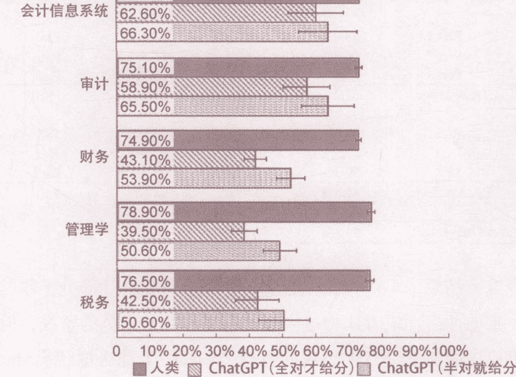

图 6-1 ChatGPT 与人类不同科目的能力对比

## AI 助手离会计人有多近

当时的研究者已预期 GPT-4 在会计领域的表现有望超越人类。2023 年 5 月，美国《今日会计》刊文称 GPT-4 已能通过美国 CPA 考试，相关论文《Can Artificial Intelligence Pass Accounting Certification Exams? ChatGPT: CPA, CMA, CIA, and EA?》对比了 GPT-3.5 与 GPT-4 的 CPA 成绩。在 CPA 包含的《审计和鉴证》《商业环境》《财务会计和报告》《会计法规》四门中，ChatGPT 已能通过《审计和鉴证》，其余三门仍未达标，美国 CPA 通过线为 75 分，具体如下。

表 6-1 ChatGPT 在美国会计考试中的表现

| 考试 | 科目 | GPT 3.5 成绩 | GPT 4 成绩 | 成绩提升 | 是否通过 |
| :--- | :--- | :--- | :--- | :--- | :--- |
| CPA | 审计和鉴证 | 57.4% | 82.1% | 24.7% | Pass |
| CPA | 商业环境 | 59.4% | 69.7% | 10.3% | Fail |
| CPA | 财务会计和报告 | 40.6% | 49.8% | 9.2% | Fail |
| CPA | 会计法规 | 46.2% | 69.4% | 23.2% | Fail |
| CPA Average: | | 50.9% | 67.8% | 16.9% | Fail |
| CMA | Part 1 | 58.3% | 69.0% | 10.7% | Fail |
| CMA | Part 2 | 48.3% | 62.7% | 14.4% | Fail |
| CMA Average: | | 53.3% | 65.9% | 12.6% | Fail |
| CIA | Part 1 | 58.0% | 75.3% | 17.3% | Pass |
| CIA | Part 2 | 60.7% | 76.0% | 15.3% | Pass |
| CIA | Part 3 | 68.0% | 78.0% | 10.0% | Pass |
| CIA Average: | | 62.2% | 76.4% | 14.2% | Pass |
| EA | BUS | 40.7% | 64.7% | 24.0% | Fail |
| EA | IND | 37.3% | 59.3% | 22.0% | Fail |
| EA | RPP | 59.3% | 80.7% | 21.4% | Pass |
| EA Average: | | 45.8% | 68.2% | 22.5% | Fail |
| Overall Average: | | 53.1% | 69.6% | 16.5% | |

综合来看，当前 ChatGPT 对会计的部分工作已产生一定冲击，值得从业者警惕，但不必过度焦虑。下一章将以辩论形式深入探讨“ChatGPT 能否取代财会人员”。


## 第四部分

## 思辨篇：竞争对手 or 智能搭档

### 第 7 章 大模型与财会人的利弊之辩

前文介绍了 ChatGPT 对财务场景的全方位升级，也触发了财会从业者的生存焦虑。本章以“ChatGPT 是否会取代财会人员”为辩题，探讨在 AI 时代如何应对与准备。

#### 7.1 正方：大模型会挤压财会岗位，未来必须面临“饭碗之争”

论点 1：模型相比人工成本更低。

ChatGPT 有助于企业削减人力与时间成本。财会人员需要花费大量精力处理数据与分析，还要支付较高薪酬福利，成本不低。而 ChatGPT 官方定价为 GPT-3.5 每 1000 个 tokens 0.002 美元，换算为每千字符对话约 0.002 美元，合人民币约 0.014 元，百万字对话约 14 元人民币，远低于全职人力工时对应的工资。因此，使用 ChatGPT 可降低运营成本，提升竞争力。

论点 2：应用可进一步提高财务工作效率。

ChatGPT 能够自动化完成大量重复性工作，如账单录入、分类核对，并保证数据准确性。相比之下，财会人员手工处理易耗时且易出错。

## 算法视角

论点 3：应用可进一步改善财务工作的效果。

ChatGPT 可基于海量财务数据提供更精准的分析与预测，如销售额、成本、利润预测，帮助企业做出更合理决策。人工手动输入与计算耗时耗力，分析效果也不稳定。

综上，凭借自动化处理、数据分析、高效准确与降本优势，ChatGPT 可替代部分财会工作，未来财会人员将面临与之的“饭碗竞争”。

#### 7.2 反方：大模型不会取代财会人员，可将其作为智能搭档

论点 1：技术与政策限制导致短期内大模型能力难以爆发式增长。

ChatGPT 尚未成熟，已受到诸多限制，如无法处理复杂的财务报表与税务问题，并存在安全风险，可能导致财务数据泄露与不当使用。技术瓶颈制约其准确性与可靠性。GPT-4 发布两周后，图灵奖得主约书亚·本吉奥、特斯拉 CEO 埃隆·马斯克、苹果联合创始人史蒂夫·沃兹尼亚克等数千名 AI 领域人士呼吁暂停训练更强模型至少六个月。

论点 2：模型缺乏财会人员的专业知识与经验，不能替代人类判断与决策。

ChatGPT 只能基于已有数据分析预测，可胜任原始凭证录入、账务分类等流程固定的基础工作，但税务筹划、审计、复杂会计分析、决策与监督等工作需要灵活运用知识与经验，必须依赖专业训练与长期实践。

**论点 3：模型的使用需要财会人员的指导与监督。**

ChatGPT 仅是工具，缺乏自主思考与判断，需由财会人员指导监督。单独使用可能导致错误误解，对企业财务造成负面影响。

**论点 4：财会人员可善用 ChatGPT 提高工作效率和准确性。**

“君子善假于物也”，财会人员可借助 ChatGPT 处理重复繁琐的数据录入分类，节省时间、提升效率与准确性，也可用于数据分析与决策支持，提升能力水平。

**论点 5：财会工作不仅需要理性，感性同样关键。**

ChatGPT 使依赖理性的技能快速商品化，而人类独有的感性技能如团队协作、感知他人情绪、建立人际关系、协同解决问题、靠情绪感染而非逻辑说服他人等软技能难以替代。以财务分析师为例，其软技能包括：①与同事、上级、客户建立良好关系以更好理解需求；②通过观察倾听感知情绪态度，预测市场与客户需求变化并调整策略；③在团队中发挥积极作用，引导成员解决问题。

综上，ChatGPT 不会取代财会人员，善用其作为智能搭档可提升效率与准确性，更好完成会计工作。

## ChatGPT：会计人触手可及的智能助手

ChatGPT 可协助完成基础工作，但复杂分析、决策与监督仍需具备专业知识与经验的财会人员。财会人员应善用这一工具，提升效率与准确性，更好服务企业与经济建设。

#### 7.3 行业大咖观点

上海国家会计学院智能财务研究院院长刘勤教授认为，类 ChatGPT 系统主要影响数据处理、报表生成与分析、会计咨询与教育、风险识别与管理等环节，而会计准则制定、企业盈利模式创新等需创造性与抽象思维，以及高度社交智慧与谈判技巧的工作则难以胜任。受知识结构不完善、数据输入受限等局限，短期内财会人员不太可能被取代，整体行业影响有限。

上海财经大学讲席教授刘建国认为，在财务分析领域，ChatGPT 可基于大量研报从事研报写作、行业分析及粗粒化的初版年报季报，但对需融入深层知识的精细分析仍有改进空间。它是信息搜集、资料整理、真伪核查的好助手，但高阶管理决策与分析仍难以替代人类智慧。

上海国家会计学院会计系主任宋航教授认为，ChatGPT 未来将在研究与实务产生较大影响，但可预见期内无法替代人类。其一，会计政策制定受人类认知局限影响多为次优，ChatGPT 可基于历史数据与案例给出更优解；其二，其信息获取与运算速度超人脑，会计核心在于信息获取与使用，获取端 ChatGPT 占优，使用端对重复信息不弱于人，但对新信息使用，人类因信息支持不足仍更强。

#### 7.4 模型自述

针对 ChatGPT 能否取代会计与财务职业，ChatGPT 的回应是：可在一定程度上辅助，但无法完全替代。其主要作用是协助人类处理数据信息、提高效率与准确性。财务会计涉及大量法律法规、税收政策与财务规划，需要深入专业知识与判断力才能决策。因此 ChatGPT 只能作为辅助工具，还需持续学习更新知识以保持准确可靠。

#### 7.5 多方观点小结

从会计电算化、ERP、财务 RPA 到 ChatGPT，每次技术跃迁都会把“取代会计”搬上台面。但历史显示，自 1494 年卢卡·帕乔利提出复式记账法以来，会计群体一直顺势而为、扬长避短，从未被真正取代。

总体看，ChatGPT 像一把多功能瑞士军刀，既是提升决策效率的智囊团，也是自然语言处理的翻译官，还是数据挖掘的矿工，亦可充当私人文秘。

“君子善假于物也”，面对挑战，财会人员的焦虑可以理解，但过度焦虑不必。更关键的是思考如何驾驭工具，将 ChatGPT 作为智能助手探索人机协同模式，以创新方式应对挑战、提升质量与效率。接下来探讨财会从业者应具备哪些技能以更好地驯化 AI 助手。

### 第 8 章 AI 时代财会人员的必修课

#### 8.1 ChatGPT 时代财会人员必备的 N 项技能

在 ChatGPT 时代，财会人员除精通财务知识外，还需具备：

- ①问题思维：提出好问题比给出好答案更关键。学习 Prompt 有助于快速提升与 ChatGPT 的沟通效率。
- ②产品开发思维：基于 ChatGPT 特性主动探索财务应用场景的能力。
- ③数据分析能力：能对海量数据进行分析处理并提取有用信息，有助于理解报表与业务、支持审计。
- ④技术应用能力：熟练使用 Excel、Python 等办公工具及各类会计软件系统，更好利用 AI 工具提升效率与准确性。
- ⑤沟通协调能力：与内部各部门及外部审计机构有效沟通协调，理解业务需求与审计要求。
- ⑥学习能力：持续学习新知识新技能以适应技术变化，更好发挥 AI 助手的价值。

展望未来，用人单位对财务人才的期待已明显跳出单纯核算的边界。新要求是：一方面要把工作重心前移至业务链条中，用经营思维参与决策，成长为业务型专家；另一方面要熟练运用 RPA、Python、ChatGPT 等数字化工具，成为技术型专家。随着流程机器人与生成式对话工具的普及，机械重复的劳动和低附加值的文本生成工作可以交给系统，财务人员便能把精力集中在分析判断与决策支持等更高价值环节。从这个视角看，ChatGPT 正推动人才画像从单一财务专家转向兼具战略视野、业务理解和数据洞察的复合型方向。如图 8-1 所示。

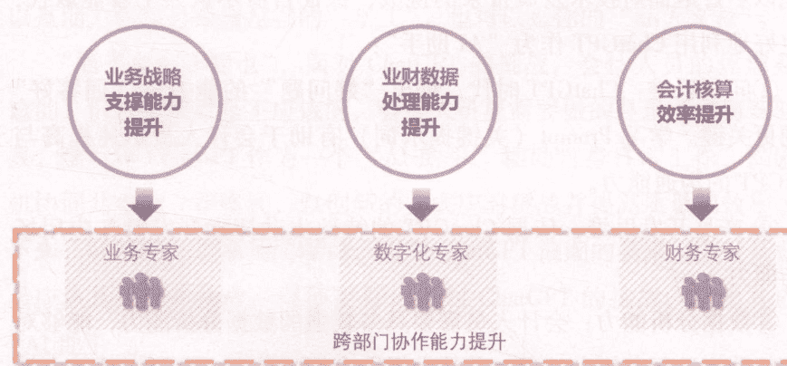

#### 8.2 让 Prompt 令 ChatGPT 回答质量提升十倍

当模型本身已具备提供较好答案的能力，决定结果的关键转到人如何提问、如何表达。想要获得高质量输出，核心在于掌握有效引导模型的方法。是否存在一套沟通技巧能显著提升人机协作效率？本节要介绍的就是能够把协作效率拉高十倍的核心——Prompt，即用来触发或引导大模型生成内容的输入文本。掌握提示词工程，就等于拿到了释放大模型生成潜力的钥匙。

提示词工程的规范定义是，为大型语言模型准备指令与文本输入，以引导其完成特定需求。提示的好坏直接决定输出的好坏。优秀的提示像咒语，能让模型产生意想不到的效果。

本书将 Prompt 心法概括为三点：表达要准确、情境要具体、提示模型慢思考。随后通过基础篇与进阶篇展开具体方法。

##### 8.2.1 基础篇

在与 ChatGPT 交互中，Prompt 就是用户提出的问题或背景语境，它帮助模型更准确地把握意图与上下文，从而给出更具针对性的回复。可以把 Prompt 看作与模型沟通的话术或模板公式，通过它控制输出方向，获得相关、准确且高质量的文本。

一个易于 ChatGPT 理解的标准 Prompt 通常由四部分构成：

- ①任务：以简洁明确的方式向 ChatGPT 提出问题或请求，一般用问句或陈述句呈现。
- ②输出要求：明确期望得到的回答类型，例如定义、解释、建议、指导等。如请给出可供出售金融资产的后续计量方法并进行解释。
- ③背景：说明问题所属的行业或领域。在任务之上进一步补充，如请依据国际财务报告准则说明可供出售金融资产的后续计量方法。
- ④角色：规定模型生成时应扮演的身份，这决定了用词的专业程度。常见身份有咨询顾问、会计师、首席财务官、管理会计、财务会计、英语翻译与语法校对、Linux 终端、文本版 Excel、影视文学角色、文案写手、职业顾问、心理医生等。承接上面的例子，如假设你是一名高级财务会计课程讲师或财务咨询顾问，请依据国际财务报告准则说明可供出售金融资产的后续计量方法。

总体而言，Prompt 的基础结构可概括为：请你作为一名【角色】，在【背景】中，针对【任务】给出【输出要求】。在实践中灵活套用该框架，能引导 ChatGPT 提供更精准的答案。

##### 8.2.2 进阶篇

- ①进阶技巧一：使用种子词。种子词是在生成对话或文本时作为初始关键词或短语输入，用来把回答聚焦到特定点上，例如假设你是一名企业资金管理人员，请针对公司当前资金管理繁、杂、难的现状，给出一套系统性的、可落地的、你比较有信心的解决方案。其中“系统性的、可落地的”限定了回答风格，“你比较有信心的”则设定了答案的质量门槛，让模型先筛选再输出。
- ②进阶技巧二：引入样例。公式为“根据［数量］个样例生成文本”。例如评价 XYZ 企业的财务表现，可以这样引入样例：一是参考×××报告的评价维度，对 XYZ 企业的财务表现进行评价；二是通过与 YYY 公司对比，评价 XYZ 企业的财务表现。
- ③进阶技巧三：加上“让我们讨论/思考一下”。公式为“让我们讨论/思考一下×××问题”。适用场景是鼓励模型发散思维，多用于论文写作、诗歌或小说创作等。收到指令后，模型会尝试从多个角度展开，产出更丰富动态的段落。例如，让我们讨论一下 ChatGPT 带来的机遇与挑战；让我们思考一下财务数字化转型的必要性。同时可追加提示语，例如请一步步思考×××，来启动模型的思维链。
- ④进阶技巧四：知识生成提示。公式为“请生成关于×××新的信息”。在多轮对话中若对已有答案不满意，重复提问往往得到相似回复，此时用该提示可引导模型拓展思路。在数据挖掘中，该表述也能鼓励模型挖掘数据背后潜在关联，而非仅做描述性统计。例如，针对一个由交易行为构成的数据集，任务是“从给定数据集中生成有关用户购买行为的见解”，改为“请从此数据集中生成关于用户购买行为的新的见解和原始信息”会更有效。
- ⑤进阶技巧五：控制生成提示。公式为“请按照×××模板生成 YYY”。在生成标准化财务报表或管理报告时常用，可严格控制输出形式。使用前提是先让模型记住模板，可用“请记住以下模板：【插入模板】，并将该模板命名为【模板名称】”。之后再用“请调用【模板名称】，生成一份【报告名称】报告”。
- ⑥进阶技巧六：概述提示。公式为“请使用【文本长度】从【角度1】【角度2】【角度×】概述【插入长文本】”。适用于对长文本做摘要，如会议纪要、报告摘要、新闻摘要等，【文本长度】可按需指定。例如，用一段话从写作手法、章节安排角度概括《红楼梦》。
- ⑦进阶技巧七：对话提示。公式为“请以【对话主题】为主题，生成【角色1】和【角色2】之间的对话”。非常适合对话生成、故事编写和聊天机器人开发。例如假设现在是一个客户投诉场景，请生成智能客服机器人对不同满意程度客户的回复。
- ⑧进阶技巧八：实现机器学习任务。ChatGPT 可通过 Prompt 直接调用聚类、分类等机器学习算法。聚类属于无监督学习，需先告知分成几簇，再说明分类标准，例如在分析客户评论任务中，Prompt 可写成“基于用户的情感将该产品的相关评论分成 3 组”。分类属于有监督学习，需按指定标签划分，例如“请将产品的相关评论分为正面、负面、中性三类”。

对这类预训练大语言模型而言，语料库足够庞大，基本做到有问必答。因此提出好问题、用对方式提问，成为决定答案质量的关键。通过精心设计的 Prompt，可以引导 ChatGPT 输出满足需求的高质量结果，在一定程度上实现对大模型的掌控，让它成为更合格的智能助手。

## 第五部分 未来篇：AIGC 时代会计未来研判

### 第 9 章 总结与展望

#### 9.1 ChatGPT 时代会计行业将走向何方

##### 9.1.1 会计领域的护城河仍然很深

就目前来看，ChatGPT 对中低端内容生产型工作冲击很大。但作为通用人工智能，它现在仍以 To C 服务为主，在财会这一专业纵深领域建立知识体系，还需要大量标准化数据进行训练，而开展这种训练的前提是企业财务必须实现高度数字化，这需要相当长的时间。因此财务从业者不必过度悲观，短期内 ChatGPT 难以完全取代财务工作。

##### 9.1.2 ChatGPT 将促进全新人机协同模式的构建

ChatGPT 出现前，会计领域对人机协同的设想是把人类专业的财务知识经验与机器的大数据处理能力结合，实现财务管理与会计工作的自动化、智能化和高效化。笔者认为，在 ChatGPT 影响下，人机协同将在 RPA 机器人 + 以 ChatGPT 为底层技术的聊天机器人 + 机器学习算法的加持下，实现自动化、智能化、高效化和交互化。

对人机协同中“人”的价值，笔者认为机器学习的本质决定了 AI 在认识已知世界、回答已知问题方面有优势，而面对充满创新和利益冲突的未知世界探索，人类具有不可替代的价值。当我们面对能给出更好答案的模型时，财务人员的出路是提出更有价值的问题。面对 ChatGPT 的冲击，会计人员不必过度焦虑，更需要思考如何驾驭工具，把 ChatGPT 当作智能助手辅助信息搜集、资料整理、真伪核查、数据分析等日常工作，探索人机共生的模式。

接下来，让我们与 ChatGPT 一起畅想财务部门人机协同的未来。

> “人机协同”是未来财务工作的大势所趋。请你写一段故事，想象公司 CFO 刘总和 ChatGPT 人机协同工作的一天。

**清晨 7:30**，刘总起床后坐上自动驾驶汽车。按下启动键，车载系统接入 ChatGPT 智能助手。车内响起助手的声音：“早上好，刘总。今天的行程已为您规划好，您今天主要了解公司整体财务状况并审批投资分析报告。”随后助手介绍当天天气、路况等信息。随着车辆驶出小区，助手提醒会议时间地点，并根据刘总反馈调整本周日程。

**上午 9:00**，刘总抵达公司办公室。打开管理层驾驶舱，让 ChatGPT 协助数据分析和报表生成。ChatGPT 分析了公司近期收入、支出、利润等数据，并通过数据挖掘找出金财务瓶颈，提出解决方案。

**上午 10:00**，刘总开始审批投资分析报告。ChatGPT 快速浏览报告，提取关键数据和信息，帮助理解内容，还提供分析建议辅助决策。

**下午 3:00**，刘总参加集团跨国子公司高层会议。会议中 ChatGPT 提供实时翻译服务，帮助更好理解内容。同时在刘总接电话期间，ChatGPT 自动整理会议实时纪要，确保不遗漏重点。

**晚上 7:00**，刘总下班回家。车上继续使用 ChatGPT 服务，了解公司近期新闻动态和市场状况。ChatGPT 还提供个性化投资建议，帮助管理个人财务资产。

##### 9.1.3 私有化部署的会计大模型未来将像 ERP 一样成为财务部门的“标配”

随着企业规模扩大和业务复杂度提升，财务部门需要更高效智能的解决方案来管理会计和财务数据。私有化部署的会计大模型可以满足这一需求，能集成各类财务数据，自动化处理会计流程，提升数据精度和准确性。随着技术发展和应用场景扩大，私有化部署的会计大模型有望成为财务部门的标准配置，成为企业数字化转型的重要组成部分。

#### 9.2 ChatGPT 时代 Acctech 发展趋势研判

会计科技是一个动态集合，会随时间推移和技术迭代不断更新。笔者认为 ChatGPT 将对会计科技未来发展趋势产生重大影响，并对影响进行了研判。

##### 9.2.1 ChatGPT 将引发会计人员对于自然语言处理模型的高度重视

过去 Acctech 集合中的数据分析相关技术，如会计大数据分析与处理技术、商业智能、数据中台等，更注重数字价值。因为数字型数据更容易计算分析，用数值表达更精确易处理。而文本型数据往往需要深度解释分析才能提炼有用信息，在没有自然语言处理算法加持下，人工挖掘海量文本价值不符合成本收益原则。ChatGPT 展现的强大语言理解、生成、知识推理能力，使企业能以更低成本挖掘文本数据潜在价值，未来 Acctech 集合中将纳入更多自然语言处理相关技术。

##### 9.2.2 Acctech 技术集合的聚焦点将逐渐从工具理性向价值理性转换

工具理性和价值理性由德国社会学家、哲学家马克斯·韦伯提出。工具理性的核心在于“计算”，依据预设目标，采用精准技术手段和算力，找到最高效达成途径。例如 RPA 技术充分体现工具理性。价值理性则强调决策前综合权衡各种因素后做出最佳判断。

基于当前态势，基础性、标准化程度高、流程类、操作类工作将快速被 RPA 机器人取代，因为这过程中对财务人员要求只是工具理性，即按特定规则精准高效完成任务。这也使未来财务更多岗位将是战略类、决策支持类等更需要体现价值理性的工作，因此 Acctech 关注重点也会相应偏移。

会计信息化发展 40 多年来，无论是会计电算化、ERP，还是财务 RPA 机器人，都体现的是工具理性，因此会计职业的重要地位并未被撼动。但 ChatGPT 真正令人震撼的是，其凝聚“群体人”智慧后体现出的价值理性，这意味着 ChatGPT 不仅能替代部分基础财务核算岗位，未来对财务 BP、财务分析等岗位也会产生一定冲击。因此相关从业人员应主动掌握 ChatGPT 工具，训练其成为智能助手，在未来工作中掌握更多主动权。

##### 9.2.3 未来信息安全攻防博弈将更加激烈

ChatGPT 的问世对财务信息安全是把双刃剑。一方面，从入侵方看，ChatGPT 的普及极大降低了网络攻击门槛。尽管 OpenAI 在开发过程中为其设置了良性价值观以防止直接作恶，但仍有攻击者可绕过内置防滥用规则，利用 ChatGPT 帮助代码基础薄弱的攻击者更快更容易编写恶意软件代码，一定程度上降低了攻击门槛。另一方面，从防守方看，ChatGPT 可提供安全咨询，帮助了解最新网络安全威胁和漏洞，并提供有针对性建议加强防御；还能监测网络活动，及时发现异常流量和攻击行为，并帮助采取相应防御措施。2023 年 3 月，微软推出 Security Copilot，将 AI 技术应用于网络安全，实现自动化网络安全监控和威胁检测，帮助企业提高网络安全性，防范网络攻击和数据泄露。

未来 ChatGPT 在网络安全中扮演什么角色、产生什么影响，很难准确预测，因为取决于攻守双方技术博弈，但可以确定的是，ChatGPT 的普及将使信息安全攻防博弈更为激烈，企业领导者应对此予以重视。笔者通过对 2017—2022 年“影响中国会计从业人员的十大信息技术”的分析还发现一个值得注意的现象，即 2017—2019 年评选中还有数字签名、身份认证、数据安全技术等上榜，2020 年后信息安全相关技术逐渐从排行榜上消失。新技术发展固然令人欢欣，但技术复杂化带来的信息安全问题同样令人担忧。

值得庆幸的是，ChatGPT 带来的信息安全问题已引起业界广泛重视，AI 教父杰弗里·辛顿称“一旦 AI 在人类灌输的目的中生成了自我动机，那以它的成长速度，人类只会沦为硅基智慧演化的一个过渡阶段”。如前所述，2023 年 3 月，包括埃隆·马斯克和苹果联合创始人史蒂夫·沃兹尼亚克在内的上千名科技界领袖共同呼吁暂停比 GPT-4 更强大的大语言模型开发，呼吁及时完善相关法律法规，笔者预计未来信息安全相关技术同样会引起 Acctech 评选的重视。

表 9-1 影响中国会计从业人员的十大信息技术（2017—2022）

| 排序 | 2022 技术名称 | 2022 得票率 | 2021 技术名称 | 2021 得票率 | 2020 技术名称 | 2020 得票率 | 2019 技术名称 | 2019 得票率 | 2018 技术名称 | 2018 得票率 | 2017 技术名称 | 2017 得票率 |
|---|---|---|---|---|---|---|---|---|---|---|---|---|
| 1 | 财务云 | 52.6% | 财务云 | 56.02% | 财务云 | 73.14% | 财务云 | 72.10% | 财务云 | 90.22% | 大数据 | 88.68% |
| 2 | 会计大数据分析与处理技术 | 51.3% | 电子发票 | 55.46% | 电子发票 | 66.33% | 电子发票 | 69.50% | 电子发票 | 81.15% | 电子发票 | 81.12% |
| 3 | 流程自动化（RPA 和 IPA） | 48.1% | 会计大数据分析与处理技术 | 52.19% | 会计大数据技术 | 62.44% | 移动支付 | 50.70% | 移动支付 | 66.49% | 云计算 | 71.26% |

| 4 | 中台技术 | 47.1% | 电子会计档案 | 47.69% | 电子档案 | 50.56% | 数据挖掘 | 46.90% | 电子档案 | 62.25% | 数据挖掘 | 58.26% |

| 5 | 电子会计档案 | 47.0% | RPA | 41.58% | RPA | 48.41% | 数字签名 | 44.50% | 在线审计 | 62.19% | 移动支付 | 54.69% |

| 6 | 电子发票 | 45.4% | 新一代 ERP | 33.66% | 新一代 ERP | 47.91% | 电子档案 | 43.10% | 数据挖掘 | 54.77% | 机器学习 | 50.27% |

| 7 | 在线审计与远程审计 | 39.0% | 移动支付 | 33.38% | 区块链技术 | 45.73% | 在线审计 | 41.40% | 数字签名 | 54.06% | 移动互联 | 49.28% |

| 8 | 新一代 ERP | 35.2% | 数据中台 | 31.77% | 移动支付 | 43.00% | 区块链发票 | 41.10% | 财务专家系统 | 53.30% | 图像识别 | 47.48% |

| 9 | 在线与远程办公 | 31.7% | 数据挖掘 | 31.03% | 数据挖掘 | 42.77% | 移动互联网 | 39.60% | 移动互联网 | 48.41% | 区块链 | 46.22% |

| 10 | 商业智能（BI） | 27.6% | 智能流程自动化 | 29.32% | 在线审计 | 42.74% | 财务专家系统 | 37.70% | 身份认证 | 47.70% | 数据安全技术 | 45.01% |

资料来源：影响中国会计从业人员的十大信息技术评选报告（2017—2022）。

#### 9.3 全书小结

本书即将收尾，邀请读者一起回望并思考：ChatGPT 出现后，到底改变了哪些东西，又保留了哪些底座。对会计工作者来说，分清变化的方向有助于更主动地思变、求变、应变；把握不变的内核则能在快速流动的环境里找到职业的定盘星。

- 互联网开启了空间的重构。1962 年互联网诞生，被视作空间革命的起点，此后人与人沟通突破地理限制，政治、社会、商业随之产生连锁变动。
- 智能手机带来了时间的压缩。2007 年初代 iPhone 上市，去实体键盘的设计开启移动互联网时代，人们能够随时随地接入网络，应用生态与即时通信能力的提升重塑了消费、工作、生活的节奏。
- ChatGPT 推动了思维方式的迁移。见图 9-1。2022 年 10 月 ChatGPT 横空出世，人类思考与处理问题的方式被重新定义，行业生态与整体运行逻辑随之改写，工作的中心由把已有问题做得更好，向提出更有质量的问题转变。

刘勤教授认为，会计发生变化的是信息处理的工具、流程与方法，甚至管理模式；不会动摇的是会计的本质，即作为微观市场主体的商业语言，作为提升信任水平与经济效率的制度安排，以及作为经济发展的一种算法与管控手段。正因为根基稳固，会计职业不会消失，反而呈现出经济越发展会计越重要、会计越重要经济越发展的正向关系。

工具迭代让会计实践持续更新，ChatGPT 的能力令人眼前一亮，风险的讨论也随之放大。马斯克与上千名科研人员在《暂停巨型人工智能实验》公开信中指出，只有确信强大人工智能系统效果积极、风险可控时才应开发。AIGC 如同悬于时代上空的达摩克利斯之剑，提醒我们在善用技术的同时更要慎用技术。以开放审慎的态度拥抱颠覆，才是面向新周期的应有姿势。

## 参考文献

-   [1] 金源，李成智.ChatGPT + Acctech：ChatGPT 对会计科技的影响研究[J]. 商业会计，2023（07）：4 - 10.

-   [2] 刘勤.ChatGPT 及其对会计工作的影响探讨[J]. 会计之友，2023（06）：158 - 161.

-   [3] 程平，廖音洁，李怡等.基于 ChatGPT 的成本管理应用研究[J]. 商业会计，2023（08）：29 - 33.

-   [4] 焦瑞进.ChatGPT 财税应用随想[J]. 商业会计，2023（08）：34 - 35.

-   [5] 王攀娜，吴悦，王唯等.ChatGPT 与会计变革：理论框架、应用场景及应对策略[J]. 重庆理工大学学报（社会科学版），2023，37（04）：129 - 136.

-   [6] 刘勤，吕晓雷，赵健等.Acctech：影响会计行业的信息技术[J]. 财务与会计，2021（22）：54 - 57.

-   [7] 朱光辉，王喜文.ChatGPT 的运行模式、关键技术及未来图景[J]. 新疆师范大学学报（哲学社会科学版），2023（03）：1 - 10.

-   [8] 哈尔滨工业大学.ChatGPT 调研报告[R]. http://wukong-zhiku.com/hangyechanye/109956.html.

-   [9] 胡仁昱，兰天.新一代 ERP 技术的特征与应用[J]. 财务与会计，2022（10）：49 - 51.

-   [10] 陈虎，陈健.会计大数据分析与处理技术：助推数据赋能财务新未来[J]. 财务与会计，2022（10）：33 - 38.

-   [11] 金源，李成智．数据驱动下的财务决策支持研究 [J]．财会通讯，2023（03）：140－147．

-   [12] 金源．新技术驱动的财务数字化转型：方向、理念与框架体系 [J]．新会计，2021（04）：45－48．

-   [13] 李琳，刘凤委，李扣庆．会计演化逻辑与发展趋势探究——基于数据、算法与算力的解析 [J]．会计研究，2021（07）：3－16．

-   [14] 崔保国，邓小院．ChatGPT 给传媒业带来机遇与挑战 [N]．中国社会科学报，2023－03－07（003）．

-   [15] RADFORD A, NARASIMHAN K, SALIMANS T, et al. Improving language understanding by generative pre-training [J]. 2018.

-   [16] DEVLIN J, CHANG M W, LEE K, et al. BERT: Pre-training of Deep Bidirectional Transformers for Language Understanding [C] // Proc. of NAACL. 2019: 4171－4186.

-   [17] RADFORD A, WU J, CHILD R, et al. Language models are unsupervised multitask learners [J]. OpenAI blog, 2019, 1: 9.

-   [18] BROWN T B, MANN B, RYDER N, et al. Language Models are Few-Shot Learners [C] //Proc. of NeurIPS. 2020.

-   [19] QIU X, SUN T, XU Y, et al. Pre-trained models for natural language processing: A survey [J]. Science China Technological Sciences, 2020, 63: 1872－1897.

-   [20] KALYAN K S, RAJASEKHARAN A, SANGEETHA S. AMMUS: A Survey of Transformer-based Pretrained Models in Natural Language Processing [Z]. 2021. arXiv: 2108.05542 [cs. CL].

-   [21] AMATRIAIN X. Transformer models: an introduction and catalog [Z]. 2023.

## 后 记

ChatGPT 带来的新概念、前沿技术与创新路径正渗透到每个人的工作与生活。生成式人工智能提供了一种新的观察视角，既让我们更清晰地看到人工智能在财务领域的落地前景与潜力，也促使我们直面业务痛点与核心难题。人工智能的出现重塑了日常，也正逐步成为企业运营中不可或缺的基础要素。作为财经领域的从业者，我很荣幸参与这一课题的研究，希望通过本书分享对数字经济、企业数字化转型以及“ChatGPT + 会计”的一点理解，也期待与广大读者交流切磋。

本书从多个维度介绍了 ChatGPT 在财务场景中的实践可能，汇集了大量案例，阐明如何借助这项技术破解财务难题。希望读者不仅可以了解到当前 ChatGPT 的前沿知识及发展动向，更可以补充、拓展、创造新的案例，为 ChatGPT 的落地应用提供经验借鉴。在后续引入 ChatGPT 的实操工作中，欢迎大家通过微信公众号“财务数字化探索”与我们互动交流，共同探索财务数字化的奥秘。

行文至此，我已然把我所见识到的 ChatGPT 的一隅之美展现于众。然而在这个科技日新月异的时代，当您阅至此处时，ChatGPT 或许会以更具智慧和魅力的姿态呈现在我们的眼前。相信随着时间的推移和实践的积累，ChatGPT 会越来越成熟、完善，我们也将会千万条路探索“ChatGPT + 会计”的价值。期望读者通过本书领略 ChatGPT 的强大生命力，将其视为学习、研究和实践的重要工具之一，同时也期望读者能够融入智能财务的行列，共同破解新时代财务管理难题，推动实现“智慧财务”。这正是我对该书所寄予的期望。

江山代有才人出，每一次科学革命都会孕育一批新思想、新理论，也会涌现一批具有深远影响的人物。他们肩负历史和时代的使命，作出的卓越贡献为行业和社会带来了前所未有的生机与希望。在以往的变革中我们深切地感受到，会计人是一个充满激情和挑战的群体，更是一个敢为人先、善于创新的群体。数字化的路很宽，也很长，衷心希望在人工智能领域，会计人能深刻领会、精准把握、持续引领未来变革；能勇于发声、勇挑重担、勇往直前；能展现不一般的作为、不平凡的智慧和不寻常的成就。

金源

2023年6月6日于上海

> 随着人工智能深度融入会计，未来的会计人员将呈现为AIA，AI是人工智能，后面的A是会计师。金源先生关于“ChatGPT+会计”著述的问世，让我们认识到“AIA”理念正快步践行于现实中，也让我们感受到人工智能时代会计这个充满岁月的行业获得新生、重启新程的魅力。

—— 孙铮 上海财经大学原副校长、上海财经大学学术委员会主任、教授、博士生导师

> ChatGPT正以迅雷不及掩耳之势涤荡着人类社会所有方面，会计也在其中，结局好坏取决于应对。本书为会计人员如何理解、适应、利用ChatGPT提供了详尽的指导，为会计人员在ChatGPT环境下从大数据中挖掘企业价值创造的动因和路径提供了有益的启示。

—— 于增彪 清华大学经济管理学院教授、博士生导师

> ChatGPT正以燎原之势影响着各行各业，本书作为引领会计行业的ChatGPT著作，有助于会计人在时代变局中洞见未来趋势，将人工智能由竞争对手转化为紧密伙伴。只有理解ChatGPT的精髓，才能引领新时代。强烈推荐阅读收藏！

—— 刘勤 中国会计学会会计信息化专业委员会主任、上海国家会计学院智能财务研究院院长、教授、博士生导师

> 本书以理性的视角和生动的文风探讨了以ChatGPT为代表的AIGC技术对会计工作带来的机遇和挑战，全面分析了ChatGPT如何重塑未来“自动化、智能化、高效化和交互化”的会计工作模式，是一本带领会计人员跨进ChatGPT时代的入门佳作！

—— 卢文彬 上海国家会计学院院长、党委副书记、亚太财经与发展学院院长、教授

> 大模型正加速为千行百业迭代赋能，也给会计行业带来了空前的发展机遇。本书融合了金源先生对ChatGPT影响下未来会计变革的深刻洞见，能够带领大家近距离感受会计变革“奇点”的临近，让读者有机会成为最懂ChatGPT的会计人。

—— 周晔 汇付天下集团董事长兼CEO

> 数字化是时代发展的客观趋势，也是鲜花与荆棘共生的道路。本书系统地探讨了ChatGPT在财务数字化转型中的应用，涵盖场景、技术、人员等多个方面，兼备会计人在数字时代的道与术，是会计人在财务数字化、智能化道路上的必备地图，非常值得一读！

—— 杨珊华 国药集团总会计师、中国医药会计学会会长

定价：66.00元