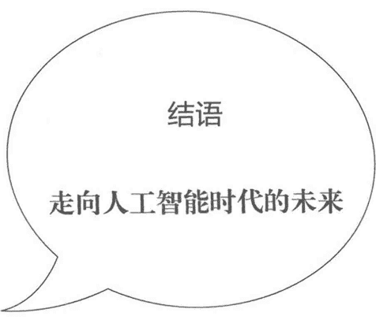

## AI共生新纪元：从焦虑到财富升级

## 前言 PREFACE

AI已经从专业圈的黑话变成日常热议的焦点，围观者要么心生不安，要么满怀憧憬。可问题是，我们真的读懂了它吗？这项力量足以推动生产力进化，掀起百年未遇的工业浪潮，却鲜有人意识到其真正的分量。眼下大家所见，恐怕仍不是完整意义上的智能。

真正让人担忧的失业潮，更多是“看起来很聪明”的机器在作祟，而非真实的人工智能本身。制约发展的瓶颈也不在技术，而在人的认知。核心问题始终是：什么是人工智能？笔者认为，一台系统若要称得上人工智能，至少得具备做到人类做不到的能力。若人类能做它也能做，那它顶多是机器学习或大语言模型。

用来分担重复、机械性工作的技术，更贴切的称呼是“聪明的机器”，而非“智能”。它只需要够聪明，不必具备智能的特质。与这种聪明的工具协同，人类才能把精力释放到创新、创造与高阶认知的工作上来，共同推动社会向前。

人类的智能本就是多元复合体，并非单一维度。鲸鱼、章鱼、犬类等动物在某些维度上的表现就可与人类比肩，智能无法用一条线排序。对人而言也一样，大脑运作模式千差万别，有人擅长翻译，有人擅长分析。依据不同的“头脑类型”，可以研发出不同的智能产品。

让人工智能成为涵盖一切思维模式的复杂生态是不现实的，它只能在某一或若干方面实现超越，因此必然需要取舍。

当下的现实是：AI在某些场景里异常敏捷，在另一些场景里却显得迟钝，呈现出“聪明而愚蠢”的矛盾特质。最顶尖的系统往往会选择深耕特定领域。AI不是一个整体概念，而是多种多样的集合体，不存在唯一解。

在AI时代，人机可以实现高效分工。AI擅长高效率、繁琐、重复的处理，人类则聚焦突破与创新。

需要强调的是，AI的目标并非替代人类，而是填补空白。不过AI在生成结果时常偏向中间值，需要我们主动引导它做出更优选择。

想让输出更好，可以尝试改变它的思考方式，比如让它在看似无关的事物间寻找联系，这能激发创造力。值得注意的是，与AI的合作绝非一键生成，需要大量时间的沟通与校准。

在交互界面之后，AI的下一个关键能力是什么？答案是情感。通过植入情感模块，人与AI的对话才能带上温度。有人会问，AI的情感有何意义？基础情感极其实用，例如痛觉。正如人类，具备痛觉的机器人或系统才懂得自我保护，不易被轻易损毁。一旦AI拥有情感，就必然衍生新的道德与伦理议题。面对AI时代的伦理挑战，我们该承担怎样的责任？

AI的崛起并非单纯因为技术突破，而是对话界面把长期潜伏在后台的能力推到了台前。普通人这才发现，AI早已在诸多领域默默运行。如今的核心难题是：AI日益融入生活，道德与伦理问题如何落地解决？

AI虽已取得明显进步，却仍有大量未解之题。关键不在于技术本身，而在于我们。迄今尚未建立起一套完整、合理、深入且公平的伦理准则来指导AI与机器人的行为。

笔者坚信，AI与机器人最终会成为伙伴，帮助人类变得更好。随着技术加速演进，我们既要关注各领域的变革，也要直面随之而来的道德挑战。为与AI共同前行，需要系统性措施确保伦理问题得到妥善处理。

提升AI伦理教育至关重要，从学界到产业，都应强化开发者与使用者的道德与伦理培训，让他们明白自身在AI应用中的责任与义务，从而提升敏感度。同时要制定明确的伦理准则，涵盖数据使用、隐私保护、公平性与责任归属，为发展提供道德指引。消除偏见的核心在于数据来源多元化，确保训练数据充分反映人类观念与行为的多样性，使AI能更好地服务多元现实。

跨学科合作在应对伦理问题上尤为关键，需要计算机科学、哲学、社会学等多领域协同研究。监管部门如何看待并发挥关键作用，也是重要命题。

从长远看，人工智能的上限取决于人类集体意识的上限。打开未来的钥匙已握在我们手里，但很多人尚未做好准备。讨论AI议题，至少应以百年为尺度，让下一代、下下一代思考如何与AI共生。

## 第一部分 Part One

# 第 1 章 AI全景初探

作为开篇，笔者用数百字为读者打开AI的大门，带大家更清晰地认识它的过去、现在与未来。

“人工智能”这个词已不再陌生，它正深刻影响生活、改变工作方式，甚至重塑我们对世界的认知。AI到底是什么？从何而来？将走向何方？这些问题值得深入探讨。

历史是理解当下、预判未来的镜子。本章将回溯AI的发展脉络，从诞生萌芽到成为科技主线。我们会看到，这是一部由无数科学家、工程师与思想家共同书写的历史，他们的智慧与勇气造就了今天的AI。

AI是一种全新的思考范式，强调数据驱动、模式识别与自我学习。这种思维方式与传统方法不同，却能帮助解决问题、提供服务、创造新价值，打开全新可能性。

展望未来，AI将更深地渗透进生活，参与决策，乃至塑造社会形态。但未来充满未知，需要我们对AI有更深理解，从而更好地抓住机遇、应对挑战。

本章力图揭开AI的世界，帮助读者获得启发，开启探索之旅。这既是技术探索，也是自我认知之旅。笔者相信，通过这段旅程，读者将能更懂AI、更好用AI，甚至成为AI的创造者。

## 1.1 人工智能的兴起

人类对智慧的渴望与对未知的探索从未止息。在漫长历史中，关于AI的思想火花早已出现，这些灵光构成了AI史诗的序章。20世纪中叶，AI研究进入系统化阶段。1950年，英国计算机科学家艾伦·图灵提出图灵测试，用以判断机器是否具备智能。该测试成为研究的重要参照，吸引大量科学家投身其中。

随后，美国计算机科学家约瑟夫·维森鲍姆开发出首个聊天机器人艾尔莎ELIZA。虽然它无法真正理解输入，却为计算机与人类进行文本交流奠定基础。

在AI漫长的演进中，无数智者不断试错攀登，为人类打开了无限可能。早期思想如星辰般照亮了道路。

AI这一概念正式诞生于1956年的达特茅斯会议。1956年夏天，美国达特茅斯学院举办为期8周的研讨会，艾伦·纽厄尔、赫伯特·西蒙、约翰·麦卡锡、马文·明斯基等专家共聚一堂探讨AI发展。该会议被视为AI诞生的标志，AI由此成为独立学科。

彼时涌现多项代表性成果。赫伯特·西蒙与艾伦·纽厄尔于1955年开发出首个AI程序逻辑理论家Logic Theorist，成功证明数十个数学定理。此后研究逐步展开，方法与技术层出不穷。

20世纪60年代研究取得明显进展。弗兰克·罗森布拉特提出感知器模型，这是最早的人工神经网络雏形。受限于算力与数据，却为后来的神经网络与深度学习奠基。

同期诞生了首个知识表示系统通用问题求解器General Problem Solver，由赫伯特·西蒙与艾伦·纽厄尔共同开发，基于逻辑与规则解决简单问题。应用范围有限，却展示了智能系统解决问题的潜力。

进入70年代，专家系统成为主流。专家系统依托知识库与推理机制，模拟专家经验。斯坦福大学MYCIN系统在医疗诊断领域取得显著成果，扩大了AI应用边界。

80年代AI遭遇“寒冬”，诸多项目停滞。瓶颈在于算力、数据与算法效率。但低谷期中，神经网络与机器学习开始萌芽，为复兴埋下种子。

90年代，随着硬件提速与互联网普及，AI重焕生机。支持向量机、隐马尔可夫模型等算法在语音识别、图像处理、自然语言处理中得到广泛应用，研究逐步走向实用。

21世纪初，AI迎来新黄金时代。深度学习推动多领域突破。大规模视觉识别竞赛ImageNet标志计算机视觉进入深度学习时代，卷积神经网络在图像分类与目标检测上取得惊人成绩。

自然语言处理也实现革命性突破。基于变换器的双向编码器表征量BERT等预训练模型诞生，机器在阅读理解、问答系统等任务上的表现大幅提升。这些进展让AI成为资本与人才的聚焦点。

除视觉与语言，AI在无人驾驶、医疗诊断、金融风控等领域也出现大量落地案例，为生活与工作带来便利。

开源社区对AI发展起关键助力。TensorFlow、PyTorch、Keras等框架成为研究者与工程师的重要工具，降低了研究门槛，加速技术普及。

企业与学界投入不断加大。全球多国制定AI战略，争抢技术高地。谷歌、亚马逊、微软、腾讯等科技巨头积极布局，同时高校与研究机构持续深耕，为进步提供智力支持。

随着AI蓬勃发展，其对社会的深远影响备受关注。在工业、医疗、教育、交通等领域，AI助力提效、优化资源配置、改善生活质量。无论智能制造、精准医疗，还是在线教育、智能交通，AI正释放巨大能量。

总体而言，自20世纪中叶以来，AI经历了兴起、低谷与加速发展的周期。如今它已深入日常生活，与社会紧密交织。这场科技革命离不开全球各方的共同努力。

与此同时，失业、数据隐私、算法歧视等问题也不断浮现。发展AI的同时，必须关注道德伦理、公平正义与人机协作，通过政策法规加强监管，确保其造福人类而不带来风险。

AI的未来充满无限可能。随着技术迭代，未来AI将更智能、更人性、更可靠，更好地融入生活，与人类共同成长，成为文明的重要支柱。

## 1.2 什么是人工智能

自古以来，人类便向往拥有近似人类智能的机器。从古希腊神话中的机械巨人塔罗斯，到达·芬奇的机械骑士，这种渴望贯穿历史。随着科技进步，梦想逐步落地。人工智能Artificial Intelligence即是实现这一梦想的核心，它研究如何模拟、扩展甚至超越人类智能。

AI是一个跨学科概念，涵盖计算机科学、认知科学、心理学、生物学、哲学等。研究对象既包括计算机与机器，也包括人类大脑与神经系统。其目标是让计算机像人一样思考、学习、解决问题与决策，以满足多领域需求。随着进展，AI在图像识别、自然语言处理NLP、语音识别、自动驾驶等领域取得显著成果。

通常可将智能分为人工智能与自然智能。人工智能是人类创造的具有一定智能水平的机器，自然智能是生物体天生具备的智能。二者区别在于来源与表现形式：前者通过编程与算法实现，表现为软件硬件；后者通过基因、神经元、大脑实现，表现为行为与思维。

实现AI面临诸多挑战。

其一，如何模拟人类智能的机制与原理？这要求深入理解大脑与神经系统的工作规律。
其二，如何赋予计算机自主学习与适应的能力？需研究机器学习算法与数据挖掘技术，让机器在处理数据中提升认知与判断。
其三，如何实现自然语言理解与处理？需发展自然语言处理技术，使机器能识别与理解人类语言。
其四，如何赋予视觉、听觉、触觉等感知能力？需发展计算机视觉、语音识别与感知计算，让机器感知外部环境。
其五，如何实现情感与道德观念？需探索情感计算与道德计算，让机器理解人类情感与价值观。

为达成这些目标，研究者采用机器学习、深度学习、神经网络、遗传算法、模糊逻辑、启发式搜索等多种方法。各有优劣，在不同场景中发挥作用。例如机器学习是提升认知判断的关键，深度学习则通过模拟神经结构有效完成视觉、语音任务。

AI不仅是技术，更是科学观念与哲学思考。研究者不仅关注技术应用，还涉及人类智能本质、意识、自由意志、道德责任等哲学命题，引发广泛讨论。

发展进程中出现多个里程碑。1956年，克劳德·香农、艾伦·图灵等人在达特茅斯会议上提出“人工智能”概念，标志研究正式启动。

此后出现诸多重要成果。1959年，美国计算机科学家亚瑟·塞缪尔通过计算机下国际象棋发现机器学习的潜力；1965年，工程师扎德提出模糊逻辑，为AI开辟新方向；1991年，蒂姆·伯纳斯·李发明万维网，为AI应用提供广阔平台；2000年，大数据与云计算兴起，AI进入新黄金时代；2010年，深度学习与神经网络突破，推动图像识别、自然语言处理取得重大进展。

在实际应用中，AI已渗透生活的方方面面。工业领域，智能机器人承担重复、高危、高精度任务；医疗领域，AI辅助病理诊断与治疗方案制定；金融领域，AI进行风险评估与交易；教育领域，AI提供个性化学习指导；家庭生活中，智能家居如语音助手、智能照明带来便利。

尽管成果显著，挑战依然存在。首先，AI发展需要海量数据与算力，是企业负担。其次，可能引发大规模失业与社会不平等。再次，安全与隐私问题凸显，如何防止滥用与保护个人隐私成为当务之急。道德规范与法律框架尚未完善，如何为AI制定合适准则仍是难题。最后，在意识、情感、自由意志等层面仍有大量未知，需要持续探索。

应对挑战需多层面行动。科研层面应加大投入，推动基础理论与技术创新，加强跨学科研究，从计算机科学、认知科学、心理学、哲学等多角度全面审视AI。政策层面需建立合理法规与道德规范，为发展提供制度保障。国际社会也需加强合作，共同应对全球性挑战。

AI将对社会、经济、文化产生深远影响。我们需正视机遇与挑战，适应新科技环境，保持谦逊与敬畏，始终关注其对人类生活的影响及在道德、法律、哲学领域的议题。只有如此，才能确保AI真正造福人类，实现科技与人类的和谐共生。

## 1.3 人工智能的分类

智能内核拆解与全景分类

创造性的智能正在重塑生活样貌，其思想萌芽可追溯到古希腊哲学家的思辨。如今这类能力已深度嵌入日常使用。先厘清内在逻辑，再从更开阔的视角梳理分类脉络。

内核可归纳为三个指向。首要的是模仿人类思维，早期设想是用程序复现大脑推理路径，涉及知识表征、规划、推理等方向。早期的专家型系统就是一种尝试，把专家的经验固化为规则集合，再由规则引擎推演。第二指向是放大人的能力，强调借助计算提升理解与解题效能，覆盖人机互动、增强现实等。现今的搜索引擎即为典型，靠海量检索为提问者迅速给出答案。第三指向是求解优化，关注如何用计算寻找最优解，关联搜索、优化、统计学习等范式。

从不同维度看，智能系统可做多元划分。本文聚焦四种常见视角：按任务难易、按学习路径、按落地场景、按演进时期。

### 1. 按任务难易分层
依任务难易可划为弱智能、通用智能和强智能。弱智能局限于特定任务，能在限定范围内达到接近人的表现。通用智能具备跨域迁移能力，可在多种任务里展现类人水平。强智能被设想为拥有自主意识、情感与创造力，甚至可能超越人类。

### 2. 按学习路径划分
按学习方式可分为知识驱动型、搜索驱动型、数据驱动学习型和混合型。知识驱动型依赖行家知识库进行推理决策。搜索驱动型在解空间内遍历求解，象棋程序是代表。数据驱动学习型从样本中归纳规律，如神经网络。混合型综合多种范式取长补短。

### 3. 按落地场景划分
落地面极广，涵盖自然语言处理、计算机视觉、语音识别、机器翻译、知识表征与推理、智能机器人、决策支持等。

按场景可归为以下几类。

- （1）工业自动化。用于智能制造、流程优化、质检等，提升效率与品质。
- （2）交通出行。用于自动驾驶、智慧交通管理、导航等，提升安全与便利。
- （3）医疗健康。用于疾病诊断、诊疗建议、药物研发、医疗数据分析等，提升诊疗水平与生活质量。
- （4）金融服务。用于风险评估、信用评估、交易策略制定、反欺诈等，提升安全与运营效率。
- （5）教育培训。用于定制化教学、智能辅导、在线测评等，提升教学效果与学习体验。
- （6）娱乐休闲。用于游戏设计、影视制作、音乐创作、艺术创新等，丰富精神文化生活。
- （7）安全防御。用于入侵检测、恶意软件分析、视频监控、反恐侦查等，提升社会治安与国家安全。

### 4. 按演进时期划分
历程可分为四个时期。

- （1）初级时期。依赖预设规则与算法完成计算推理，代表技术有专家系统、模式识别、基础搜索算法等。
- （2）中阶时期。开始从数据中自主学习抽取知识，代表技术有监督学习、无监督学习等机器学习方法。
- （3）高级时期。具备更强认知与判断力，能处理复杂数据结构与模式，代表技术有深度网络学习、强化学习、迁移学习等。
- （4）超级时期。能力达到或超过人类，可在多领域替代乃至超越人。当前仍处研究探讨期，落地尚远。

智能系统是多样且复杂的体系，多维度分类有助于把握内涵外延，为后续学习奠定基础。需注意其演进是持续的，分类边界会随技术进步与需求变化而调整。学习与应用时应保持开放灵活，关注新趋势，提升认知能力。

## 1.4 智能的实现路径与关键技术

智能技术正推动科技、商业与社会的浪潮。庄子《齐物论》倡导的万物一体，某种程度上映射了智能以多种形态融入生活，开启新时代。下面结合案例与数据，呈现主要实现路径与技术力量。

除深度网络学习外，自然语言处理也在加速成熟。自然语言处理好比精通语言的诗人，掌握韵律、意象与表达。语音助手、智能问答、机器翻译都是其落地。微软研究院的小冰可以进行流畅对话，诗词创作信手拈来，曾在诗词大会上与选手对战至终场，赢得观众赞叹。背后是语义理解、情感分析与生成模型的不停突破。正如夏目漱石《我是猫》里那只机智的猫，自然语言处理以全新方式呈现人类语言世界。

另一支力量是强化学习，像善于探索的探险者，通过尝试与反馈找到最优路径。在自动驾驶、机器人控制等领域成效显著。OpenAI的机器人手臂可自主学会折纸、拧瓶盖等复杂操作，过程中不断尝试动作、评估策略、更新模型，类似千里马觅伯乐，既具挑战也充满希望。

除此之外，计算机视觉让机器看懂图像；知识图谱像宏伟桥梁，串联海量信息。所有这些都凝聚了无数科研人员的付出。

展望未来，医生可借助智能系统实现更精准诊断；教育者能为每个孩童提供定制方案；城市规划者可优化基础设施，提升居民福祉。这只是冰山一角，未来将揭开更多未知。

技术亦有边界。正如牛顿行动-反作用原则，作用与反作用大小相等方向相反。智能发展中，数据安全、隐私保护、技术失控等隐患必须审视。以审慎态度与缜密思维把挑战化为机遇，才能让其造福人类。

庄子说：“大知闲闲，小知间间。”探索智能魅力的同时，需摒弃狭隘，拥抱多元思维。跳出舒适区实践贡献，才能共同开创美好未来。以下详细介绍主流实现方法与技术，它们构成底层基石，支撑各类应用。

### 1. 符号主义
符号主义通过符号与规则实现逻辑推理。知识以概念、属性、关系的符号形式表示，并用推理规则、决策规则驱动搜索求解。典型应用为专家系统、知识表征、自动推理。

### 2. 连接主义
连接主义模仿人脑神经元结构与功能，构建感知机、多层感知机、卷积网络等模型，学习连接权重与激活函数以处理输入。常用于图像识别、语音识别、自然语言处理。

### 3. 机器学习
机器学习让计算机从数据中自动学习并提取知识，提升认知与判断。它包括监督学习、无监督学习、强化学习等。已在图像识别、语音识别、自然语言处理、推荐系统等领域取得成效。常用算法有决策树、支持向量机SVM、贝叶斯分类、神经网络、聚类分析等。

### 4. 深度网络学习
深度网络学习是机器学习的子类，依托深度神经网络模型如CNN、RNN、GAN，处理复杂数据结构与模式，在计算机视觉、自然语言处理、语音识别等领域取得突破。谷歌AlphaGo在2016年击败围棋世界冠军李世石，正是深度学习的里程碑。其卷积网络通过多层抽象捕捉复杂战局，并在海量自我对弈中持续进化，堪比不断磨砺自我、最终成传奇。

### 5. 模糊逻辑
模糊逻辑处理不确定与模糊问题，将真值从二值扩展到0到1之间的连续区间。基于模糊集合与模糊关系，实现对不精确信息的推理决策，广泛用于控制系统、模式识别、决策支持。

### 6. 概率模型
以概率论与统计学为基础，建立随机变量间的概率分布与条件概率关系，对不确定性建模推理。常见模型有贝叶斯网络、隐马尔可夫模型、条件随机场，多用于机器学习、数据挖掘、自然语言处理。

### 7. 蒙特卡罗方法
基于随机抽样的数值计算方法，利用概率模型与统计模拟近似求解复杂问题，广泛应用于优化、积分、模拟等。

### 8. 知识图谱
以图结构组织实体、属性、关系，实现大规模异构数据的整合与分析，在语义搜索、问答系统、推荐系统等场景发挥作用。

### 9. 自动规划
基于搜索与推理，根据初始状态与目标状态生成操作序列或策略，在智能控制、机器人、物联网等领域有应用价值。

### 10. 知识表征与推理
关注如何将人类知识转化为机器可理解形式并进行推理决策。表征方法包括逻辑表征、语义网络、框架表征、产生式表征；推理方法包括基于规则、基于案例、基于模型等。

### 11. 自然语言处理
让计算机理解与处理人类自然语言，涉及词汇、语法、语义、语用等层面。常用技术有词性标注、句法分析、语义角色标注、情感分析、机器翻译等。

### 12. 计算机视觉
赋予机器视觉感知能力，识别与理解图像视频信息。包括图像处理、特征提取、目标检测、目标跟踪、场景分析等。常用技术有边缘检测、特征点匹配、图像分类、目标识别、深度学习等。

### 13. 进化算法
启发式优化算法，模拟自然选择、遗传与变异机制搜索最优解，适用于优化、组合、调度等问题。常见算法有遗传算法、粒子群算法、差分进化算法等。

以上方法各有所长，实际应用中常需融合互补。未来还将涌现更多新方法，推动持续创新。

## 1.5 智能技术带来的挑战

智能技术飞速发展正引领科技革命，从智能家居到自动驾驶，从医疗诊断到金融风控，渗透生活的方方面面。但便利背后也伴随一系列挑战，涉及数据隐私、算法偏见、决策透明度、责任归属与劳动力市场。

### 1. 数据隐私问题已成为社会关注焦点
训练与优化需海量数据，常涉个人私密信息与敏感信息，如医疗记录、金融交易、通信记录、位置信息。数据泄露频发，公众对安全与隐私要求提升。应对需技术、法律、道德三管齐下。技术层面可采用加密、脱敏、差分隐私等。法律层面应完善法规，规范数据收集、存储与使用。道德层面需树立尊重隐私的价值观。

### 2. 企业和研究机构需要关注算法偏见问题
训练数据中的偏见可能导致模型输出歧视，影响就业、教育、医疗、金融等公平。为此需从数据与算法双管齐下。数据收集阶段重视多样性与代表性；算法设计阶段引入公平性约束优化、去偏见学习、可解释模型。政策层面应鼓励公平性与可解释性研究，营造可信生态。

### 3. 决策透明度成为越来越重要的议题
在金融、医疗等关键领域，复杂算法与大数据使决策难以理解，影响监管与甄别不公。提升透明度至关重要。企业与研究机构需研发可解释性与可视化技术，让非专业人士也能理解原理与依据。监管机构应加强监督，确保系统符合透明、公平原则，维护公众利益。

### 4. 责任归属问题也是一个值得关注的伦理挑战
当智能系统作出错误甚至危险决策时，责任应归开发者还是使用者？需在法律、道德、技术层面深入讨论。可行方案是建立分层责任体系，明晰不同情境下各方义务。同时完善内部监管机制，确保系统安全运行。

### 5. 企业和研究机构必须关注智能技术对劳动力市场的影响
自动化推进可能取代传统职业，影响就业结构并加剧差距。应对措施包括教育改革与职业训练，帮助劳动者适应新环境；推行基本收入等福利政策，缓解自动化带来的社会压力。

总体而言，智能技术带来巨大机遇的同时也带来挑战。可持续发展需技术、法律、道德协同发力，方能释放潜力，推动社会向美好未来迈进。应保持谦逊与敬畏，认识到这不仅是技术竞赛，更是道德博弈，开发者、用户、监管者共同确保其社会可接受性。

# 第2章 智能技术的核心概念与技术

在智能的海洋里，众多概念与技术如同灯塔指引航向。第一章已初步勾勒历史与知识，本章将进一步解析核心概念与技术。

## 2.1 机器学习：数据驱动的自我进化

过去几十年，智能领域取得显著进展，机器学习作为核心技术备受瞩目。以下详述其基本概念、主要方法与技术，以及对智能发展的推动作用。

1. 机器学习的基本概念

机器学习是一种使计算机自动从数据中学习并自我改进的方法，无需显式编程。通过构建数学模型并用大量数据训练，算法能识别数据模式，完成预测、分类与决策等任务，为智能发展提供强劲动力。

2. 机器学习的主要方法

机器学习方法大致分为三大类：监督学习、无监督学习和强化学习，各有特点与适用场景。

（1）监督学习。监督学习是最常见的范式。算法使用带标签数据训练，学习输入与输出的映射关系。在大量标注样本上训练后，可对新输入进行预测。常用于分类任务，如图像识别，和回归任务，如房价预测。

(2) 无监督学习：从无标签数据里找规律
无监督学习不依赖人工标注样本。与监督范式不同，它直接对未标记数据进行分析，自动挖掘数据内部的关联、分布与结构特征。代表性手段是聚类，比如对客户进行分群，以及降维，比如主成分分析来压缩信息。

(3) 强化学习：通过试错追求最大累计回报
强化学习遵循试错的原则。智能体在与环境持续交互中摸索行为，选择能够带来最多累计奖励的行动。该思路在控制、优化和游戏等领域发挥作用，自动驾驶汽车就是典型应用。

3. 机器学习核心算法概览
(1) 线性回归与逻辑回归
线性回归和逻辑回归属于入门级的监督方法。线性回归建模连续变量的预测关系，逻辑回归则估计离散类别发生的概率。两者实现简单，在大量实际问题中兼顾准确性与可解释性。

(2) 决策树与随机森林
决策树以树状结构进行分类与回归，通过自上而下的递归分裂生成判别规则。随机森林在此基础上做集成，构造多棵决策树并投票融合，提升预测的稳定性和精度。

(3) 支持向量机
支持向量机是用于分类和回归的监督模型，目标是找到能将不同类别尽可能分开的最优超平面。它在高维、小样本场景下表现突出，文本分类是其常见用武之地。

(4) 神经网络与深度学习
神经网络模仿生物神经元的计算方式，由多层单元与大量可调权重组成，能拟合复杂的非线性映射。深度学习即多隐藏层的神经网络，在图像识别、自然语言处理与生成对抗网络等方向取得突破。

(5) 聚类与降维
聚类和降维是无监督学习的常用工具。聚类把相似样本归为同一簇，K-Means是代表性算法。降维则把数据映射到低维空间去除冗余与噪声，主成分分析和 t-分布随机邻域嵌入是典型做法。

(6) Q学习与深度强化学习
Q学习基于动态规划思想，通过学习动作价值函数来评价不同行为的好坏。深度强化学习把深度神经网络引入强化学习，处理更复杂的任务，如游戏、机器人控制与自动驾驶。AlphaGo 和 OpenAI 的 DOTA 2 战队是标志性成果。

除上述方法外，贝叶斯网络、遗传算法、模糊逻辑等也在持续完善，在特定场景中具备重要价值。

总体来看，机器学习是人工智能发展的核心引擎之一。从线性回归到深度神经网络，它已深入日常生活带来便利与惊喜。但过度依赖也带来风险，如数据安全、隐私泄露与算法偏见。平衡技术进步与伦理要求，确保人工智能造福全体社会，是当下必须面对的课题。

2.2 深度学习：多层网络驱动的智能革命
深度学习是模仿人脑神经结构的计算范式，引领人工智能新一轮变革。它借助多层神经元和海量参数学习复杂的非线性关系。

1. 深度学习的底层逻辑
核心思想是用多层处理单元层层抽象数据的特征。每层以上一层输出为输入，经加权求和与激活函数等运算生成新特征。层数越多，表达能力越强，处理的问题越复杂。

训练通常使用反向传播和梯度下降。在监督模式下，模型在大规模数据上迭代优化权重，降低预测误差。训练过程中网络自动捕捉数据的内在规律，实现对新样本的预测与推理。

2. 深度学习的关键技术
(1) 卷积神经网络
卷积神经网络专用于图像类数据，利用卷积操作提取局部特征，降低参数量与计算量。池化层进一步压缩空间分辨率，增强鲁棒性。典型用途包括图像分类、目标检测与语义分割。

(2) 循环神经网络
循环神经网络擅长处理序列数据，如时间序列和文本。内部记忆单元让模型在处理当前步时保留历史信息。LSTM 与 GRU 等变体缓解了梯度消失与爆炸问题，在自然语言处理、语音识别和时序预测中取得成效。

(3) 生成对抗网络
生成对抗网络由生成器与判别器构成对抗体系。生成器努力制造接近真实的样本，判别器负责区分真假。两者博弈推动生成质量提升，在图像生成、风格迁移与数据增强中应用广泛。

(4) 变分自编码器
变分自编码器基于概率与变分推理。编码器把输入映射到隐空间，解码器从隐空间重建样本。它可学习数据的潜在表征，用于图像生成、聚类分析与异常检测。

(5) Transformer
Transformer 以自注意力机制为核心，打破循环网络的顺序瓶颈，实现并行计算与长距离依赖建模。配合预训练与微调，在自然语言处理、计算机视觉和强化学习领域取得重要进展。

3. 深度学习的典型应用
(1) 计算机视觉
在图像分类、目标检测、人脸识别与语义分割等任务上实现突破，推动视觉技术普及。
(2) 自然语言处理
Transformer 及其衍生模型如 BERT、GPT 在机器翻译、文本分类、情感分析与问答系统上刷新基准，极大提升实用性。
(3) 语音识别
深度模型为智能助手、语音翻译与无障碍通信提供可靠支撑。
(4) 游戏与强化学习
在游戏智能与强化学习领域实现重大进展，为复杂决策与策略优化提供可能。
(5) 医学影像分析
辅助诊断、疾病预测与肿瘤切除等场景中发挥作用，提升医疗质量与效率。
(6) 推荐系统
个性化、群组与动态推荐等应用创造商业价值，改善用户体验。

4. 深度学习的未来前景
尽管成果显著，深度学习仍面临可解释性、泛化能力与算力需求等挑战。未来值得关注的方向包括：
(1) 可解释的深度学习
提升模型透明度，增强信任，医疗与金融等高风险领域应用前景广阔。
(2) 迁移学习与增量学习
将已有知识迁移到新任务降低成本，研究增量学习让模型持续进化。
(3) 能源效率与边缘计算
优化能耗，减少资源需求，适配智能手机与物联网设备等边缘端。
(4) 跨模态学习
融合图像、文本、语音等多源信息，实现更丰富准确的表达与推理。
(5) 知识表示与推理
结合深度学习与符号推理，提升高层认知能力。

作为人工智能的核心技术，深度学习展现了巨大潜力，也留有诸多未解难题。持续研究有望带来更多惊喜应用。未来它将延伸至自动驾驶、智能制造、虚拟现实、生物信息学等领域，推动高效、人性化与绿色的生产生活方式。

5. 深度学习的革命
深度学习已引发一场科技变革。自 20 世纪 80 年代人工神经网络提出以来，经历长期沉寂后逐步成为 AI 主流。

其革命性在于让机器解决极复杂问题。与早期方法相比，深度学习能从海量数据中自动学习更抽象、更复杂的表征，在图像识别、语音识别与自然语言处理上取得突破。

影响远超技术层面。医疗诊断更精准，自动驾驶车辆可识别道路与行人，现实问题解决能力得到验证。

三大驱动力支撑了这场革命：大数据、算力提升与算法创新。互联网带来海量训练数据，硬件算力飞速增长，激活函数、优化方法与网络结构不断改进。

标志性事件包括 2012 年 AlexNet 在 ImageNet 上将错误率降低近半，点燃计算机视觉热潮；同年谷歌基于深度学习的语音搜索大幅提升准确率；2015 年微软与谷歌推出深度学习机器翻译，推动该领域重生。

传统手工特征被自动学习特征取代，基于规则的 NLP 被端到端模型取代，进一步凸显革命意义。

挑战依然存在，训练成本高、可解释性差限制落地。但研究者不断攻关，革命仍在继续，新的算法、框架与应用持续涌现。

2.3 神经网络：模拟大脑的工作方式
神经网络是人工智能的核心技术，通过模仿人脑神经结构实现智能功能。

1. 神经网络的起源与发展
研究起于 20 世纪 40 年代，科学家企图复制生物神经系统的运行方式。早期感知器模型可做简单线性分类，但对非线性问题无能为力，导致发展停滞。

20 世纪 80 年代，多层感知器与反向传播算法的出现提供了解决非线性的思路。进入 21 世纪后，算力提升与数据爆发推动深度神经网络快速发展，多层结构带来更强表达与学习能力。

2. 神经网络的基本结构
网络由多层神经元构成，相邻层通过权重连接。权重表示连接强度，在训练中不断调整。典型结构包含输入层、隐藏层与输出层。输入层接收原始数据，隐藏层进行特征抽取与抽象，输出层给出预测。

神经元是基本计算单元，接收输入后经激活函数转换。常见激活函数有 Sigmoid、Tanh 与 ReLU，可根据任务选择。

3. 神经网络的训练与优化
训练本质是优化问题，寻找使性能最佳的权重组合。损失函数衡量预测与真实值的差距，均方误差与交叉熵常用。

梯度下降是核心训练算法，通过计算损失对权重的梯度更新参数。随机梯度下降及其变体如 Adam、RMSProp 被广泛使用。

正则化、批量归一化、残差连接等技巧可提升泛化能力，加速收敛并缓解梯度消失与爆炸。

4. 神经网络的应用领域
在计算机视觉、自然语言处理与推荐系统等领域取得显著成果。
(1) 图像识别
卷积神经网络在分类、检测与分割任务上实现突破，广泛应用于各类视觉场景。
(2) 语音识别
循环神经网络及其变体 LSTM、GRU 在序列建模上优势明显，在语音识别与自然语言处理中得到大量应用。

2.4 强化学习
强化学习是一种自主学习范式，智能体通过与环境互动不断试探并优化行为策略。与监督与无监督学习不同，它更强调探索与实践。核心目标是根据环境反馈的奖励信号，逐步调整策略以最大化长期累计奖励。

1. 强化学习的基本概念
(1) 智能体
可感知环境、执行动作并学习优化策略的主体，目标是在特定任务中获得最大累计奖励。
(2) 环境
智能体所处的外部世界，可为物理模拟或虚拟场景。根据动作给予奖励或惩罚，并返回新状态。
(3) 状态
环境的某一时刻描述，包含决策所需信息，可离散也可连续。
(4) 动作
智能体在给定状态下可执行的操作，可离散也可连续。
(5) 奖励
环境对动作的即时反馈，正值表示有益，负值表示有害，智能体追求累计奖励最大化。

2. 强化学习的主要方法
(1) 动态规划
基于贝尔曼方程求解，通过把复杂问题分解为子问题逐步求最优解。适用于已知模型，但受状态动作空间规模限制。
(2) 蒙特卡罗
采用随机采样估计值函数，不依赖环境模型，适用性广。需等待完整序列结束才更新，学习速度较慢。
(3) 时序差分学习
融合动态规划与蒙特卡罗优点，支持在线实时更新值函数，学习更快。代表算法有 SARSA 与 Q-learning。
(4) 深度强化学习
结合深度神经网络作为函数逼近器，处理高维复杂状态与动作空间。代表方法包括深度 Q 网络、策略梯度与深度确定性策略梯度。

3. 强化学习的应用领域
(1) 游戏
用于训练游戏智能体、平衡调整与 AI 开发，展现处理复杂问题的潜力。
(2) 机器人控制
帮助机器人实现复杂环境下的自主控制、导航与任务执行。
(3) 自然语言处理
优化对话系统与机器翻译的生成策略。
(4) 推荐系统
在动态环境与多样化需求下自动调整推荐策略。
(5) 金融领域
在股票交易、资产配置等方向出现研究成果。

4. 强化学习的挑战与前景
抽样效率是主要瓶颈，学习最优策略通常需要大量试探，如何在保证效果的同时减少时间和成本是关键研究方向。

（2）经验回放。深度强化学习中，回放机制让智能体能够反复利用历史轨迹来做策略优化。难点在于如何从庞大的历史数据里甄别出真正有价值的样本，以及怎样在开拓未知区域与利用已有经验之间取得合理平衡，这仍是研究需要深化的方向。

（3）迁移学习与多任务学习。真实场景里智能体常常需要依序或并行处理多种任务。把过去任务中学到的知识迁移到新任务上，并在多任务共存的环境里实现高效协同学习，是强化学习目前亟需攻克的问题。

（4）安全与稳定性。面向落地部署时，强化学习智能体可能出现不安全行为或性能波动。如何在学习过程中规避危险动作，并确保学到的策略在不同环境下保持鲁棒，已成为热点议题。

总体看，强化学习作为人工智能的重要支柱，已在多个行业取得明显进展。但采样效率的提升、经验回放的完善、迁移与多任务能力的增强、以及安全稳定性的保障等挑战依然存在。可以预见，未来强化学习将在更广阔的领域取得突破，为人类提供更多智能化和自动化的解决方案，推动社会发展。

## 2.5 生成对抗网络

生成对抗网络是由伊恩·古德费洛在2014年首次提出的深度学习模型。

### 1. GAN 的构造与运行机制

GAN 的基本架构由生成器和判别器构成。生成器把随机噪声向量作为输入，尝试输出尽量逼真的合成数据；判别器则负责区分输入样本来源于生成器还是真实世界。两者在对抗博弈中持续迭代，相互推动性能提升。

生成器与判别器通常以深度神经网络实现。训练时，生成器努力欺骗判别器，使合成样本被误判为真实；判别器则致力于提升真伪判别能力。整个过程可视作最小-最大博弈，生成器追求削弱判别器的识别能力，判别器追求提高识别准确率，损失函数相互牵制，最终收敛到相对均衡的状态，让生成样本的逼真度达到可接受水平。

### 2. 生成对抗网络的应用领域

GAN 已在众多场景落地，主要体现在：

- （1）图像生成。可合成高质量人脸、自然风景等图像，同时支持图像插值与超分辨率重建等任务。
- （2）图像转换。用于风格迁移、色彩调整、图像去噪等视觉转换工作。
- （3）数据增强。通过合成额外训练样本，提升其他机器学习模型的泛化能力。
- （4）文本生成。条件生成对抗网络可在特定主题、风格或语言约束下生成文本内容。
- （5）语音合成和音频生成。可生成逼真人声、进行音乐创作与音效设计等。
- （6）药物发现。用于生成具有潜在药理活性的分子结构，加速新药研发进程。

### 3. 生成对抗网络的挑战与未来

即便成果显著，GAN 仍存在若干难题：

- （1）训练不稳定。训练过程易出现震荡，导致合成质量下降或模式崩溃。
- （2）评估指标缺失。无监督生成的特性使得缺乏统一标准来衡量质量与多样性。
- （3）高维数据难度。大规模高维数据的训练常伴随梯度消失或爆炸，提升难度。
- （4）算力需求高。训练通常依赖大量计算资源，限制了低资源场景的应用。

随硬件提升与算法创新，GAN 仍具备很大发展空间。未来研究将致力于提高生成质量、多样性与可控性，并拓展到更多领域，带来更多创新价值。

# 第 3 章 人工智能的应用领域和产业

在了解了人工智能的发展脉络、研究思路与核心技术后，更关键的是观察其在各行各业的落地。本章聚焦人工智能在不同领域与产业中的具体实践。

每个议题都会结合典型案例，让读者直观感受技术力量，每个案例也都能够体现人工智能在现实世界中的广阔可能。希望通过本章内容，读者能从理论走向实践，更全面地理解人工智能，并激发想象力，看到其带来的无限可能。

## 3.1 自动驾驶

自动驾驶是人工智能在交通领域最具代表性的应用之一，通常指车辆在无需人工干预的情况下，通过自身感知、计算与控制系统完成驾驶任务。下面从历程、技术、现状、趋势和社会认知等方面展开讨论。

### 1. 自动驾驶的发展历程

自动驾驶的探索可追溯至20世纪50年代，早期尝试集中在自适应巡航等基础控制。随着技术演进取得阶段性突破。21世纪初，美国的多场无人驾驶汽车竞赛加速了技术发展。近年来得益于深度学习、计算机视觉与传感器技术的快速进步，自动驾驶汽车正逐步走向实用。

### 2. 自动驾驶的核心技术

自动驾驶可分为感知、决策、控制三大模块：

- （1）感知技术相当于汽车的“眼耳”，通过激光雷达、摄像头、毫米波雷达等传感器实时获取周边物体位置、速度、形态等信息，识别行人、车辆、交通信号等，同时高精度地图与全球定位系统提供定位支撑。
- （2）决策技术相当于“大脑”，对感知信息进行分析处理，生成科学的驾驶策略。借助机器学习与深度学习，系统可从大量驾驶数据中学习，不断提升策略的准确性与安全性。
- （3）控制技术相当于“手脚”，把决策输出转化为加速、制动、转向等具体指令，通过精确控制动力、制动与转向系统，实现对行驶轨迹、速度与姿态的稳定调控。

### 3. 自动驾驶的应用现状

商业化进程在加速。特斯拉、谷歌、百度等厂商均在积极研发自动驾驶汽车，部分地区已开展公开测试与示范运营。此外，无人货运卡车、自动驾驶公交、无人出租车等特定场景应用逐步落地，有助于提升效率并降低事故与污染。

### 4. 自动驾驶的发展趋势

在技术进步与政策支持下，自动驾驶有望在未来几年实现大规模商用，深刻改变出行、城市规划与交通管理：

首先，事故率有望下降。据统计约90%的交通事故源于人为失误，自动驾驶可消除疲劳、分心等不安全因素，提升道路安全。其次，交通效率可提升。精准控制与智能调度能缓解拥堵，提高通行能力，同时降低能耗与排放。最后，出行习惯将被重塑，车内可用于工作学习休息，并推动共享出行、智能物流等新业态。

总体而言，自动驾驶将重塑交通格局，带来更安全便捷绿色的出行体验，但也面临技术瓶颈、基础设施、法规伦理等挑战，需在创新与传统间取得平衡。

### 5. 社会对自动驾驶的期望和担忧

公众对自动驾驶寄予厚望，期待更安全高效环保的出行方式，同时也存在忧虑。

一方面，复杂场景下的安全仍存挑战，恶劣天气可能削弱传感器性能，突发事件的决策处理尚未完全成熟。另一方面，技术普及可能冲击就业，众多职业司机面临转型压力。伦理层面，紧急情况下如何权衡不同道路参与者的生命安全，需建立合理的伦理框架引导决策。

总体来看，自动驾驶发展将深度影响生活，在享受便利的同时需正视挑战，确保技术可持续健康发展。

## 3.2 智能制造

智能制造是人工智能与制造业的融合，目标是提升效率与质量、降低成本、满足个性化需求。人工智能在其中发挥关键作用。

### 1. 智能制造的发展背景

在全球竞争加剧的背景下，制造业面临提升效率、降低能耗与浪费、响应多样化需求的压力。智能制造应运而生，成为转型升级的重要方向。其核心是深度融合人工智能实现生产过程的自动化、智能化与柔性化，这一理念源于工业4.0，旨在通过先进信息技术提升竞争力与创新力。

### 2. 智能制造的核心技术

主要包括：

- （1）机器视觉技术。助力机器人识别定位跟踪物体，实现精细操作，并用于产品质量检测。
- （2）机器学习与深度学习技术。利用大数据训练模型，实现生产过程的智能分析与预测，提升效率、降低维护成本、改善质量。
- （3）云计算与大数据技术。提供强算力与海量存储，支持实时采集、分析与管理生产数据，优化流程与决策。
- （4）物联网技术。连接生产设备，实现实时通信与数据共享，构建协同作业的智能系统，提升效率与节能水平。
- （5）数字孪生技术。将物理设备与其虚拟模型关联，可在虚拟环境中仿真、优化与调整，降低试错成本，提高产线设计与运行效率。

### 3. 智能制造的应用案例

- （1）汽车制造。广泛应用智能装配、质量检测与供应链管理，特斯拉依托机器人与人工智能打造高度自动化产线。
- （2）电子产品制造。借助人工智能提升生产精度、降低缺陷率，苹果通过优化流程实现高效低成本制造。
- （3）医药制造。加速新药研发、降低生产成本、提升药品质量，拜耳等企业优化流程与管理模式。
此外，ABB 的 YuMi 机器人可通过视觉与触觉传感器识别物体，与工人协作完成装配，提升流水线效率。

### 4. 智能制造的未来趋势

随着人工智能持续演进，智能制造将呈现更高自动化智能化、个性化产品与定制化服务、数字化网络化生产环境、可持续绿色生产以及产业链深度融合等趋势，助力构建高效灵活可持续的制造体系。

总体来看，智能制造将引领制造业创新与升级，实现人机物协同共享，为社会进步创造更大价值。

## 3.3 虚拟助手

在信息化时代，虚拟助手已成为生活与工作中重要的助手。伴随人工智能发展，其功能不断增强，能够满足更多需求。

### 1. 虚拟助手的发展历程

虚拟助手作为基于人工智能的辅助工具，其历史可追溯至20世纪90年代。当时计算机科学家开始尝试利用计算机实现人机交互。

### 2. 虚拟助手的核心技术

主要包括语音识别、自然语言处理、语义理解与知识图谱：

- （1）语音识别。将人类语音转换为文本，使助手可通过语音交互。
- （2）自然语言处理。让计算机理解并生成自然语言，分析用户文本并给出合规回复。
- （3）语义理解。解析语言背后的意图与需求，提供更精准服务。
- （4）知识图谱。以实体关系形式组织知识，使助手具备存储与管理海量信息能力，提供丰富内容。

### 3. 虚拟助手的应用领域

- （1）智能家居。与各类设备连接，实现远程控制与语音操控。
- （2）个人助理。管理日程、设置提醒、查询信息等。
- （3）客户服务。分担人工客服压力，提升满意度，应用于在线咨询、订单处理、投诉处理等。
- （4）教育培训。提供个性化学习建议与辅导，辅助教师教学。
- （5）医疗健康。提供健康咨询、疾病诊断、用药指导等服务。

### 4. 虚拟助手的商业价值

企业通过部署虚拟助手可降低人力成本、提升效率，实现全天候服务并增强客户满意度，同时在内部管理中提高工作效率，并作为品牌形象提升用户关注。

### 5. 虚拟助手面临的挑战与未来展望

挑战包括语言文化障碍、安全隐私保护、人工智能伦理等。尽管存在困难，随着技术进步，虚拟助手将更智能人性化，成为社会发展的重要推动力。享受便利的同时需积极应对挑战，让技术更好地服务人类。

## 3.4 智能投资

### 1. 智能投资的概念与发展

智能投资指运用人工智能技术辅助投资决策的方法，通过分析金融数据、市场趋势与投资者行为，为用户提供针对性建议与策略。20世纪80年代起人们开始尝试计算机技术于金融投资，经过演进逐渐形成独立学科。近年来大数据、云计算与人工智能的快速发展推动智能投资获得前所未有的关注。

### 2. 智能投资的主要应用

人工智能在投资领域的应用日益广泛，主要包括：

- （1）股票市场分析。借助自然语言处理与情感分析技术，系统可解析新闻报道、社交媒体信息与公司公告，挖掘潜在机会；同时通过历史数据分析识别市场运行规律，为投资者提供有价值建议。

智能投顾的核心能力

（2）量化投决。智能投顾平台可依据预设模型与策略，自动完成大规模买卖指令。去掉了人为情绪干扰后，决策效率与收益水平均得到提升。量化交易已在股票、债券、期货、外汇等多个金融市场得到广泛应用。

（3）动态风控。系统借助大数据实时追踪组合的风险状况，并按事先设定好的风控规则自动调整仓位。该模式有助于降低回撤，提升资产配置效率。

（4）定制化财富规划。平台会结合投资者的风险偏好、财务目标与投资期限，提供一对一的建议，帮助实现财富增值并规避潜在风险。依托这种服务模式，越来越多的投资者能在投资过程中享受到专业、个性化的支持。

### 3. 真实案例透视
下面通过两个实践案例，观察智能投顾在金融场景中的具体作用。

#### 案例一：Betterment
Betterment 成立于 2008 年，是家在线财富管理公司。公司融合人工智能与大数据，为用户打造全新投资体验。用户在线填写风险承受能力、目标与期限后，系统即可自动生成个性化组合，并持续监测市场变化自动优化策略。该模式大幅节省了时间成本，同时提升了回报水平。

#### 案例二：Kensho
Kensho 成立于 2013 年，是一家金融科技企业。它以自然语言处理与机器学习为核心，为金融机构提供实时市场分析与预测。Kensho 的智能分析引擎能够快速深挖海量金融数据，为投资人输出有价值的洞察。

### 4. 挑战与未来走向
智能投顾在金融领域已取得明显成效，但仍面临多重制约。

首先，人工智能本身的精度与响应速度仍需加强，才能满足金融市场对高准确性与高实时性的要求。
其次，随着普及度提升，市场竞争加剧，溢价空间与收益水平出现下降趋势。
再次，监管环境持续演进，投顾业务必须不断适配新的法律、法规与政策框架。
最后，智能投顾有望推动金融向绿色转型，将资本引导至有利于社会与环境保护的项目。

尽管挑战存在，但长期来看发展前景依然乐观。智能投顾作为人工智能在金融的重要落点，已为投资者创造显著价值。伴随技术持续演进，投顾服务将更智能、更个性、更高效。金融科技的普及也将让更多普通投资者受益。站在新的技术起点上，智能投顾有望为金融行业带来更美好的未来。

总体而言，人工智能的广泛应用正为生活带来诸多便利，其应用边界仍在不断拓展。

## 3.5 人工智能的更多应用场景
人工智能已深入自动驾驶、智能制造、智能助手与智能投资等领域，但渗透还远未结束。下面聚焦医疗、教育、娱乐、环保、农业等方向，进一步展现技术潜力。

### 1. 医疗领域
医疗场景中人工智能已显成效，既能辅助诊断与治疗方案制定，也能参与手术。代表性应用包括：

- （1）辅助诊断。IBM 的 Watson 医疗助手可在数秒内检索海量医学文献，为医生提供决策参考。DeepMind 的系统通过分析视网膜图像帮助眼科诊断，准确率甚至超过资深医生。
- （2）新药研发。传统研发周期长、成本高，人工智能可大幅压缩流程。例如美国 Atomwise 利用 AI 筛选药物，数周内即可锁定候选分子，远快于传统数年周期。
- （3）机器人手术。达芬奇手术机器人已在全球广泛使用，可在医生操控下完成微创、心脏等精细操作。其优势在于操作更精准、创伤更小、恢复更快。

### 2. 教育领域
教育领域应用日益普及，为学习带来个性化与高效体验。

- （1）个性化教学。Knewton 通过分析学习行为、能力与兴趣，为每个学生生成定制内容，有助于提升效果与兴趣。
- （2）智能辅导。Carnegie Learning 的 MATHia 平台可实时解析答题情况，给出即时反馈与建议，同时帮助教师掌握学习进度，制定更合理的教学计划。
- （3）虚拟实验室。Labster 提供虚拟现实实验室，让学生在安全低成本环境中练习实验操作，为实操做好准备。

### 3. 娱乐领域
娱乐场景同样充满创新。

- （1）影视制作。AI 可分析剧本与观众评价，为导演与制片人提供创作建议。美国 ScriptBook 利用 AI 预测票房与口碑，帮助公司更理性选片。
- （2）游戏设计。开发商借助 AI 打造更智能的非玩家角色，提升交互真实感与游戏沉浸度。
- （3）音乐创作。AIVA 是一款可创作古典音乐的 AI 系统，它学习大师作品风格与技法后生成全新曲目。

### 4. 环保领域
面对环境压力，AI 提供有力支撑。

- （1）气候模拟。基于大量气象数据，AI 可构建更精确的气候模型。英国气象局利用该技术预测气候变化，为政策制定提供依据。
- （2）能源管理。谷歌 DeepMind 将 AI 应用于数据中心能源调度，通过优化制冷与设备运行降低能耗，为全球能源管理提供范例。
- （3）生态保护。AI 可分析遥感影像与迁徙数据支持保护工作。美国 Conservation Metrics 利用 AI 分析鸟鸣监测种群变化，为野生动物保护提供数据支持。

### 5. 农业领域
在农业，Blue River Technology 研发的 See & Spray 智能机器人可识别作物，精准施肥与除草，提升产量并减少污染。

综合来看，人工智能正逐渐渗透生活的各个角落，未来将与更多行业深度融合。

# 第4章 人工智能的发展趋势与未来展望
在梳理历史与核心技术、解析多领域应用之后，需要回答更深的问题：AI 将如何演进？它将怎样重塑社会伦理与发展？本章围绕这些议题展开讨论。

人工智能正在重塑社会与生活方式，但也带来诸多挑战：如何保证公平？如何保护隐私？如何防止数据滥用？如何确保发展方向符合价值取向？为找到平衡点，下文聚焦发展趋势、伦理与监管、国际竞争与合作等议题。

## 4.1 人工智能的发展趋势
AI 的发展是不可逆的未来几十年将带来颠覆性变化。算力提升、算法优化与大数据爆发共同推动其持续加速。关键趋势如下：

### 1. 深度学习与神经网络的演进
深度学习与神经网络是 AI 的基石。未来技术将更贴近人脑工作方式，学习效率更高、适应性更强。网络规模更大、连接更紧密，复杂任务处理能力将大幅提升。

### 2. 通用人工智能
通用人工智能指接近人类综合智能的系统，可跨领域完成多样任务。AI 正从弱智能向强智能迈进，一旦实现，将极大提升生产力并解决复杂问题。

### 3. AI 与生物学的融合
未来 AI 将与生物学深度结合，推动颠覆性创新。例如解析基因组、加速药物研发、提升疾病诊断与治疗水平，从而改善人类健康。

### 4. AI 与教育的结合
AI 将使教育更个性化，按兴趣、能力与进度定制学习方案，促进资源公平分配并提高学习成效。

### 5. 具意识与情感的 AI
技术进步可能使未来 AI 具备自我意识与情感理解能力，有助于心理治疗、人机沟通与社会关系处理。

### 6. 自主智能系统
自主系统可在无人工干预下完成任务，如无人驾驶、无人机、智能家居。它们提升便利性与效率，但也带来安全与监管挑战。

### 7. AI 与艺术的融合
AI 在艺术创作中作用增强，可辅助生成音乐、绘画、文学等作品，并在表演、影视、游戏设计中丰富文化体验。

目前 AI 已提供诸多便利，展现出广阔前景。跨学科合作尤为重要，人文社科与技术需携手，确保技术发展尊重人类价值与文化。同时需关注全球发展不均，避免数字鸿沟加剧。国际合作与技术共享有助于普惠红利。可持续发展与环境保护也是重要议题，AI 可助力资源利用、环境监测、减排与灾害预测。公众素养同样关键，教育、企业与社会各方应共同提升 AI 认知，适应智能时代。

总体而言，AI 将带来变革与挑战，我们需有信心迎接挑战，实现人与 AI 和谐共生。

## 4.2 人工智能伦理、政策与监管
AI 快速发展既带来便利，也对伦理、政策与监管提出新挑战。以自动驾驶为例，突发场景下如何权衡生命价值与责任归属，是典型的伦理难题。研发过程中必须嵌入伦理原则，确保系统道德可靠。

政策与监管层面，社交媒体上的 AI 应用引发信息安全、隐私与虚假信息等关切。监管机构通过信息披露、隐私保护、虚假信息监测与处罚等手段规范应用，保障用户权益。

不同地区做法差异明显。欧洲以严格的数据保护法规如《通用数据保护条例》为主，美国更倾向市场自律，鼓励企业制定规范。这种多元框架为全球竞争与合作创造新变量。

从全球视野看，核心在于在创新与社会公平、可持续性之间取得平衡。联合国教科文组织倡议建立全球伦理共识，跨国企业、NGO 与学界也参与构建跨界合作网络。

需特别关注两大议题：
- （1）AI 与国际安全。AI 应用拓展带来新的安全风险，各国需在维护利益的同时推动对话合作，防止冲突。
- （2）AI 与人类价值观。随着融合加深，如何让系统尊重并理解核心价值观，是长期课题。

## 4.2 人工智能伦理、政策与监管
综上，伦理、政策与监管是 AI 健康发展不可或缺的根基。只有在创新之外完善制度，才能确保技术造福全人类，成为文明发展的关键动力。

在充满机遇与挑战的时代，我们需勇气与信念面对伦理与监管问题。正如航海探索需要正确航线，AI 浪潮中也需坚守方向，确保技术光芒照亮前行道路。

历史经验提示我们既要关注便利，也要关注生存、公平与正义，让 AI 真正惠及全人类。

## 4.3 人工智能的国际竞争与合作
全球范围内 AI 如破晓曙光，既重塑生活方式，也重塑商业格局。把握竞争、合作与产业生态的演进至关重要。

各国与地区展现出独特竞争优势，形成多元生态，推动繁荣与稳定。

首先，全球竞争进入新阶段。各国出台政策推动研发与应用，企业、高校与 NGO 共同参与，竞争日益激烈。

其次，竞争中蕴含合作。技术交流、人才培养、资源共享等合作形式丰富，为产业发展注入活力。

最后，新商业模式不断涌现。智能制造、智慧农业、智能交通等改变传统生产方式；金融、教育、医疗等领域应用提升服务便捷度。

与此同时，生态突变带来不确定性。保持敏锐观察与前瞻思维，及时应对风险，是应对挑战的关键。

人工智能产业的快速扩张正掀起一场全球性的人才争夺。就像生态系统里对稀缺资源的竞争一样，众多国家和企业都在加大投入去培养、吸引AI人才，抢占先机。让人才能够顺畅有序地流动，同时避免人才分布出现极端失衡，已经成为决定全球AI产业生态健康发展的关键变量。

与此同时，AI的全球化进程还要直面技术壁垒与保护主义带来的阻力。不同国家在资金投入和政策扶持上的差异，使得技术成熟度与应用普及度出现明显分化。在此背景下，如何拆除壁垒、促进开放竞争与协同合作，对产业的繁荣与稳定至关重要。

数据安全与用户隐私的权衡也是绕不开的难题。各地区的采集和使用规范并不一致。如何在严格守护安全与隐私的前提下实现数据的有效利用与共享，正成为制约生态进阶的一大挑战。

总的来看，在竞争与合作交织的局势下，各方必须携手应对风险，共担挑战，推动产业走向繁荣稳定。深入把握不同地区在政策、技术、人才等方面的差异，有助于更从容地应对不确定性。只有如此，才能在时代的高速变革中站稳脚跟，迈向更美好的未来。

展望未来，全球AI产业生态将持续完善，为人类可持续发展注入新动能。企业、高校、研究机构及非政府组织等力量应形成合力，共同推动公平竞争和健康发展。只有实现科技的共享与进步，AI的价值才能触达世界的每一个角落。也应高度关注新兴商业模式与创新赛道，为技术落地开辟更多可能性。创新的思维与实践将是驱动生态演进的核心动力，培育新模式也将为生态的繁荣稳定提供源源不断的支撑。

我们需要以更开放包容的心态拥抱变革带来的机遇与挑战。在既充满希望又暗藏担忧的时代，必须勇敢探索，直面问题。只有持续尝试与改进，AI产业生态的美好图景才能真正呈现。

笔者长期跟踪AI技术演进，深切感受到人类正站在一个新的历史起点。面对复杂的全球竞争与合作议题，需要更宽广的视野与更严谨的思考。我们将共同见证文明的新篇章，迎接由人工智能引领的未来。

# 第二部分
Part Two

# 第5章
ChatGPT 的使用

在AI的丰富版图中，ChatGPT无疑是极具代表性的明星。作为基于语言的人工智能，它在多个场景下展现出令人惊艳的能力。本章将一起探讨ChatGPT的使用方式及其商业价值。

## 5.1 ChatGPT 的发展背景与基本原理

前文已梳理了人工智能的概念、技术脉络、发展趋势及其生活影响。作为其中的重要分支，自然语言处理在近年取得了飞跃式进展。其中，ChatGPT（Chat Generative Pre-trained Transformer）是典型代表，它是一款基于OpenAI GPT-4架构的大型语言模型。

下面从发展脉络与技术原理两个维度展开介绍。

### 1. ChatGPT 的发展背景

自计算机诞生以来，人类就渴望打造能进行自然语言交互的机器。受制于语言的复杂多变，这一目标长期难以实现。近几年，得益于深度学习突破、算力提升和海量数据的涌现，NLP进入前所未有的发展期。

在此进程中，生成式预训练变压器GPT系列成为关键里程碑。从GPT-1到GPT-4，该系列在语言理解、生成与多任务学习上实现显著提升，展现出强大性能。尤其是GPT-4，作为当下最先进的大模型，其在多项NLP任务上的表现已接近甚至超越人类水平。ChatGPT正是依托GPT-4架构打造的大语言模型，凝聚了众多研究者的智慧。

### 2. ChatGPT的基本原理

ChatGPT的核心是基于Transformer架构的生成式预训练模型。生成式指模型能够产出新文本，预训练指在具体任务应用前，已在海量文本上完成训练。这让它学会理解和生成自然语言，并具备强迁移能力。

Transformer是ChatGPT的基石，其自注意力机制能够捕捉文本中的长距离依赖，多层堆叠则提取丰富语义，使其在长文本处理、歧义消解和复杂语境理解上表现优异。同时，Transformer具备强大的并行计算能力，可充分利用现代硬件高效训练。

预训练阶段，模型使用网页、书籍、报纸、论文等大规模多领域文本进行学习，掌握语法、语义、常识等语言知识。值得注意的是，预训练采用无监督方式进行，模型通过捕捉文本的隐含规律而非显式标签来学习。

完成预训练后，还需进行微调以适配具体场景。微调使用少量带标签数据，让模型学习任务相关知识。经过微调后，模型能更好地把握用户意图，生成符合预期的回复。预训练与微调共同奠定了ChatGPT强大的自然语言处理能力。

## 5.2 ChatGPT 的使用场景设置与模型优化

上一节已对基本原理作了分析，下面聚焦实际使用，讲解场景设定与模型优化，帮助读者充分发挥该类大模型的价值。

### 1. 使用场景设置

- （1）明确目标任务。使用ChatGPT前首先要厘清具体要完成的工作，例如文本分类、命名实体识别、摘要生成、机器翻译等。目标明确有助于选择合适的模型与训练策略。
- （2）数据准备。依据任务目标准备训练集、验证集与测试集。数据质量与数量直接影响模型在有限训练时间内能否有效提升。
- （3）模型配置。结合任务与数据情况，挑选合适的ChatGPT模型，包括选择预训练模型、设定模型参数、确定优化器与损失函数等。合理的配置能提高任务完成效率与效果。

### 2. 模型优化

- （1）微调。预训练之后需对模型进行微调，使其更好地适应目标任务。通常使用少量标注数据进行训练，实践中往往需要多次尝试以获得最佳表现。
- （2）正则化。为防止过拟合，可在训练中引入正则化手段，常见的有权重衰减、Dropout、Early Stopping等。合理调参可提升模型在验证集上的泛化表现。
- （3）模型融合。部分场景下可通过融合多个模型的预测结果，如加权或投票，提升整体性能。实践中融合常带来显著增益，尤其在复杂任务中更为明显。
- （4）超参数调优。为获得更强性能，需要对超参数进行调优。常用方法有网格搜索、随机搜索、贝叶斯优化等，在有限算力下找到最优配置。

ChatGPT作为先进的大语言模型，在NLP领域应用前景广阔。通过合理的场景设定与优化，其价值能够得到充分释放，为各类任务提供强力支撑。

不过实际落地仍面临挑战，如数据不足、泛化能力、模型可解释性、安全与伦理问题等。为克服这些难题，需要持续研究新技术与方法，推动AI向更高层次发展。

## 5.3 ChatGPT在企业运营中的应用

在信息爆炸的今天，企业要脱颖而出，必须拥抱更高效智能的运营方式。ChatGPT正逐步渗透到企业运营的各个环节，不仅重塑运营模式，也为智能化发展奠定基础。

### 1. 顾客至上：客户服务与支持的变革

过去企业多依赖人力提供服务。随着需求多样化个性化，压力不断增大。ChatGPT打破了传统服务的局限。

首先，它具备很强的个性化能力，可根据客户特征与需求给出针对性方案。比如解答产品使用问题时，能结合使用习惯提供更贴合的建议，大幅提升满意度与口碑。

其次，它拥有持续学习与进化能力，可从客户反馈中不断优化知识库。随着技术发展，它将更精准理解意图，提供更贴心的服务。

### 2. 智能营销：颠覆传统的市场推广方式

传统营销多由人力完成文案撰写、策略制定等工作。竞争加剧下，企业需要更高效精准的手段，ChatGPT提供了全新思路。

它可按企业需求与市场状况快速生成各类营销内容，兼具创意与吸引力，同时准确传递品牌形象与价值观，有助于提升推广效果并降低成本。

它还能分析市场趋势与消费者行为，为企业制定更具针对性的策略，帮助更精准触达目标客户。

可以预见，随着技术进步，ChatGPT在营销领域的作用将愈发关键，引领企业进入智能化个性化的新阶段。

### 3. 无缝协作：重塑企业内部沟通与合作模式

传统内部沟通常受时间空间限制。ChatGPT带来了全新的协作方式，使企业更好应对复杂市场。

它可作为智能助手，协助员工处理查询信息、撰写报告等日常事务，大幅提升效率并降低运营成本。未来它将更懂员工需求，提供更智能人性化的服务。

它还能促进知识共享与创新，通过整合分析内部信息，为员工提供实时知识支持，激发创新潜能。随着广泛应用，企业协作模式将更高效。

### 4. 人力资源的智能化：改变企业人才管理模式

传统HR管理耗时耗力，需要大量人力完成招聘、培训、绩效评估。ChatGPT正推动人力资源向智能化迈进。

招聘环节，它能按企业需求自动筛选合适候选人，节省时间精力。未来它将更精准匹配人才，并可充当智能面试官，深入交流评估能力潜力，提升人才引进成功率。

在培训方面，它可根据员工特点与需求提供个性化内容，通过智能问答、模拟对话帮助掌握新知识技能，并分析学习进度与表现反馈培训效果。未来将提供更丰富多样的学习资源，助推职业发展。

绩效评估上，它能收集整理工作数据，对表现进行全面客观评估，帮助发现优势不足，制定合理激励与培养方案，并给出个性化职业发展建议。未来人才管理将更加智能人性化。

总体来看，ChatGPT正在深刻改变企业运营。从客户服务、营销到内部协作与人力资源管理，应用正在让运营更高效智能。未来随着技术进步，其渗透会更深，构建智能高效的企业生态。企业也需持续学习创新调整，以适应变化实现可持续发展。

## 5.4 ChatGPT 在个人生活中的应用

如今我们正站在新一代数字技术的基石上，迎接ChatGPT时代的到来。人工智能正在改变生活方式，让日常更加丰富多彩。ChatGPT作为代表性应用，正以惊人速度成为生活不可或缺的一部分。

先从家庭生活看。想象一下，回到家中便有虚拟私人助手迎接，管理日常事务、提醒重要日程、甚至预测晚餐偏好。这些听起来像科幻，实则将在不久后成为现实。

依托ChatGPT技术，量身定制的个性化虚拟助手将出现。烹饪或做家务时不再手忙脚乱，一切已然准备就绪。

随着技术进步，未来几年ChatGPT将在生活中发挥更关键作用。例如帮助规划家庭预算、分析支出，保持财务健康。通过实时追踪消费习惯并洞察市场趋势，它能制定更合理的财务规划，避免浪费，实现财富提升。

在教育领域潜力同样可观。ChatGPT有助于打造个性化在线学习环境，学生依需选课，并按学习进度与能力获得定制化辅导与反馈，让学习更灵活有趣，找到最适合自己的方式。

健康领域表现突出。通过深度分析海量医疗数据与研究成果，它可帮助医生更好理解疾病、预测发展，提供更精准诊疗。基于ChatGPT的个性化健康管理应用可按生活习惯、饮食偏好、运动需求给出定制建议，帮助预防疾病，享受更健康的生活。

休闲娱乐方面魅力无限。过去寻找音乐、电影、书籍耗时耗力。如今与ChatGPT互动，可快速获得基于喜好、兴趣与过往消费记录的个性化推荐，在更短时间内发现更多乐趣。

创意产业也将注入新活力。作家可借助它创作出更引人入胜的故事与鲜活人物，艺术家能创作出前所未有的视觉作品，设计师可依其分析能力捕捉新理念与趋势，激发更多创造力，推动产业发展。

当然，AI仍存在局限，如难以理解复杂情感、在特定场景适应性不足。享受便利的同时需保持警惕，避免过度依赖。

总之，ChatGPT正以前所未有的速度改变个人生活。从家庭管理到教育、健康、娱乐再到创意，带来无数便利与惊喜。随着持续创新，它将成为未来个人生活的核心要素。

同时需关注潜在风险。个性化服务依赖大量个人信息采集，必须确保数据充分保护，避免泄露滥用。道德伦理问题也不容忽视，如AI参与日常决策的边界，如何确保建议不冲击价值观与信仰。

尽管挑战存在，只要妥善应对，ChatGPT将为个人生活创造更大价值。未来可期，更多创新突破将让它成为更强大、更智能、更贴心的伙伴。

## 5.5 ChatGPT 在创新与创业中的应用

ChatGPT还能为创业者提供强力支撑。创业初期资源有限，需完成市场调研、撰写商业计划书、团队协作、与投资者沟通等大量复杂任务。ChatGPT深刻影响创业生态与创新模式，在多方面提供有价值的资源与支持。

ChatGPT 对创业者而言，几乎等同于一台实时运行的市场雷达。创业路上最忌信息滞后，这款模型能快速梳理行业动向、竞品打法和用户需求，把海量数据拆解成可用的判断依据，让决策更快、更准。借助这种能力，创业团队更容易在红海中找到切入点，并保持持续的增长势头。

从日常运营到创业落地，ChatGPT 正以强劲的渗透力推动创新进入更高质量的发展阶段。未来的创业环境会更智能、更高效、也更具生命力，更多人能把想法变成现实。

但它并非万能。把 ChatGPT 用在创新创业的过程中，数据安全、隐私边界、伦理规范等风险不容忽视。发挥潜力的同时，也要建立相应的防御机制，确保技术始终服务于人。

数据层面，需要构建完整的数据保护体系，防止在分析和处理环节出现泄露或滥用，守护企业与个人的核心利益，让技术可以长期健康发展。

隐私层面，要划清使用边界，制定清晰的隐私准则，避免在提供个性化服务时触碰用户底线，重建公众对技术的信任度，拓展应用空间。

伦理层面，要完善法规和行业标准，为 AI 在不同场景下的应用划定规范和限制，确保发展方向与人类价值观保持一致，避免负面后果。

总体来看，创新创业的版图里，ChatGPT 的角色只会愈发关键。它将以更高的速度和能量驱动社会变革，塑造一个更智能、更高效、更有活力的世界。

# 第6章 ChatGPT 的跨行业商业落地

ChatGPT 的适用面相当宽，从校园到病床，从账户到创作，都能见到它的身影。本章聚焦它在教育、医疗、金融等商业场景的真实应用和价值所在。

ChatGPT 展现的能力已经被验证，下一步的关键是如何把技术优势转化为可落地的商业模式。接下来一起看看它在不同行业里的实践路径。

## 6.1 教育场景的智能升级

当人工智能重塑各行各业时，教育也在被重写。ChatGPT 作为先进的语言模型，正在改变传统教学的边界，给课堂带来更多创新可能。

传统模式下，一位老师要面对几十名学生，难以兼顾。ChatGPT 的加入让这种困境有了缓解空间。以下案例可供参考。

先看“智慧课堂”项目。这是由 ChatGPT 驱动的线上学习平台，能根据学员兴趣和水平推送定制化资源。学生在平台上随时提问，模型会以专业口吻解答；平台还能通过学习行为数据生成个性化方案，帮助学习效果提升。

美国一所中学的英语老师 Alice 就引入了该平台。她建议学生在课后用 ChatGPT 练习语法词汇。一个学期后，学生英语明显进步，课堂参与度更高，甚至课外也会主动和模型对话练习。

教学辅助方面，历史老师 Tom 在备课时征询 ChatGPT 获取事件细节，补足历史背景，让课堂叙述更完整。模型还能帮他设计互动活动，提升课堂活跃度。

在 Tom 的课上，学生借助 ChatGPT 了解古罗马帝国的政治经济文化，并分组挖掘某个历史事件背后的故事。讨论热烈，课后研究热情也随之提升。

家长参与也被激活。家长 Linda 的孩子数学遇到瓶颈，她通过和 ChatGPT 交流获得有效的学习方法，孩子几周内掌握了此前难懂的概念。Linda 感到惊讶，并把经验分享给其他家长。

特殊教育同样受益。对自闭症儿童，ChatGPT 可按能力提供定制化资源，通过语言互动训练沟通和社交技巧，并分析行为模式，为教师和家长提供针对性建议，让特殊教育更高效。

一家服务自闭症儿童的非营利机构就用 ChatGPT 做生活技能培训。孩子们通过对话练习表达和自信心，教育者观察到学习效果和生活质量的明显改善。

成人继续教育和企业培训也是重要方向。面对快速变化的职业环境，ChatGPT 能为成人学习者提供个性化内容，快速习得新技能。

一家制造企业引入 ChatGPT 做员工培训，员工通过对话掌握新设备操作、安全规范和维修技巧。数月试运行后，工作效率提升，设备故障率下降。

从这些案例可见，ChatGPT 在教育中的应用正不断深入。它不会完全取代传统教育，而是作为辅助工具，提升教学质量，赋能师生家长。

未来教育将是人机融合，ChatGPT 会成为老师的协作伙伴、家长的成长顾问、学生的学习陪伴，服务于个性化教学。

在知识经济时代，教育是社会进步的核心驱动。ChatGPT 为教育带来革命性变革。把握机遇、应对挑战，需要持续探索，让技术潜力真正落地。

未来会有更多实践案例产生，为行业提供经验样本。我们将持续关注其发展动态，分享更多成果。

随着技术进步，ChatGPT 在教育里的形态会更丰富，教育将更智能、高效、包容，让每个人都能获得公平的机会。

同时也要保持警惕。人工智能带来风险，需要始终关注伦理和人文关怀，确保技术造福人而非支配人，实现技术与教育的和谐共生。

总体而言，ChatGPT 在教育里的应用描绘出充满希望又需审慎的未来。人工智能将成为教育发展的重要动力，引领更智能、更公平的新时代。

## 6.2 医疗场景的智能渗透

在数据爆炸的时代，医疗行业既迎来机遇也承受压力。ChatGPT 的出现，为行业打开了新的突破口，描绘出更具想象力的未来。

它在医疗中的作用主要体现在以下几个方面。

疾病诊断是关键起点。病因复杂、症状重叠让诊断困难。ChatGPT 能整合大量病例、文献和临床经验，为医生提供参考建议。一家医院在诊断罕见病时借助模型分析，最终制定有效方案挽救患者。

药物研发也能提速。研发周期长、数据量大，ChatGPT 擅长从海量实验数据中提取关键信息，筛选有潜力的候选药物。某研究机构利用模型在数月内从数千个候选分子中锁定几款疗效突出的药物，大幅压缩研发时间。

患者管理日益重要，慢性病人群持续增长。ChatGPT 可充当智能健康顾问，与患者沟通后给出定制化建议，如饮食、运动、用药方案，并根据生活习惯和身体变化动态调整。对糖尿病患者而言，这意味着更精准的管理和更高的生活质量，同时减少资源浪费。

心理健康同样是痛点。心理医生供给不足，ChatGPT 可作为辅助工具，帮助咨询师更深入了解来访者状态，提供干预思路。某心理咨询中心实践表明，借助模型进行对话，治疗效果和患者满意度均有所提升。

未来医疗将是传统与 AI 融合的新形态。ChatGPT 会成为医生的助手，参与诊断、研发、管理、心理支持；也成为患者的健康伙伴，陪伴身心康复。

随着技术成熟，应用会更加多元，医疗将更智能、人性化、高效。

但红利背后也有风险。医疗数据敏感，必须保障隐私、安全和利益，避免滥用。同时要关注公平可及，防止技术鸿沟扩大，让更多人受益。

长远来看，由 ChatGPT 等技术构建的智能医疗生态有望实现更准确的诊断、更快的研发、更个性化的管理、更有效的心理干预，让医生、研究者和患者共赢。

这需要企业、科研机构共同投入，培养人才，推动跨界合作，确保持续创新和规范应用，才能逐步迈向理想图景。

## 6.3 金融场景的智能重塑

金融世界复杂多元，覆盖银行、证券、保险等。与此同时，ChatGPT 正引发一场行业革命，重塑服务方式和竞争格局。

银行服务迎来变革。传统柜台和电话咨询效率偏低。依托 ChatGPT，银行可提供全天候在线服务，客户通过指令即可完成余额查询、转账、办卡等操作。模型还能基于行为画像推送个性化产品，提升体验和留存，同时降低运营成本。

证券投资领域应用广泛。股票、基金、债券等产品门槛高，ChatGPT 能解析市场数据、解读财报，为个人和机构投资者提供定制化建议。量化交易策略也能借助历史数据和实时行情得到优化，提升交易信号精度，追求收益最大化。

保险理财同样受益。产品条款繁琐易让人却步，ChatGPT 可担任顾问，帮助消费者理解条款、匹配合适方案。保险公司也能借助模型优化理赔流程，快速核验申请真实性，降低欺诈风险，并开发更个性化的产品，增强竞争力。

除此之外，还涉及风险管理、反欺诈、智能客服等。模型可分析信用数据辅助信贷审批，根据交易数据识别异常行为提升风控能力，并提供全流程金融服务，降低流失率。

未来金融会变得更便利、更快捷、更智能、更个性化。消费者无需到网点即可获取服务，产品更贴合需求。

行业竞争格局也将被改写。科技公司和新型金融机构的压力下，传统机构必须拥抱技术创新和数据驱动，才能脱颖而出。

同时，新的岗位会涌现。尽管部分传统岗位可能被优化，但金融数据分析师、AI 金融顾问等新兴职业会带来新的就业机会，对从业者提出更高素养要求。

总之，ChatGPT 正推动金融行业实现数字化、智能化、个性化转型升级，为消费者带来更高质量的体验。

需要注意的是，过度依赖 AI 可能引发羊群效应，加剧市场波动。金融数据积累还带来泄露和隐私挑战。金融机构和监管部门需要在拥抱技术时强化风控和合规，维护市场稳定安全。

随着技术不断成熟，它在金融领域的作用将更加核心，从个人投资者到大型机构，服务效率和体验都将迎来显著提升。

## 6.4 其他领域的延伸应用

ChatGPT 的潜力远超传统行业，正悄然改变生活和工作方式。以下几个非典型领域值得关注。

1. 法律领域
律师事务所开始用 ChatGPT 搭建智能助手，快速检索法律文献、判例和法规，缩短研究时间。企业也能借助模型起草合同等文件，提升准确性和合规性。

2. 艺术领域
创作者正把 ChatGPT 变成创意伙伴。作家用它构思情节和对话，音乐人用它生成旋律和和声，拓展艺术表达边界，产出更具个性的作品。

3. 新闻传媒领域
部分媒体尝试用模型生成初稿和报道，提升时效性，减轻记者压力，让他们聚焦深度调查。模型还能实现内容智能分发，帮助读者快速找到感兴趣信息。

4. 人力资源领域

在人力资源实务里，ChatGPT 正在显现出明显的差异化价值。诸多公司已将其引入招聘环节，通过解读简历与履历信息帮助锁定更贴合岗位的候选人；同时也用于员工成长辅导与绩效评估，推动整体人力管理能力提升。

### 5. 环保和可持续发展领域
在环境保护及可持续发展方向上，ChatGPT 的作用同样突出。部分研究机构和企业借助它推演环境演化与气温上升所带来的影响，为决策部门与环保组织提供更精准的数据支撑。研究者还能借助它筛选出更具前景的可再生能源技术与环保创新方案，推动全球环保事业前行。

### 6. 城市规划和建筑设计领域
城市规划与建筑设计中，ChatGPT 的参考价值日益关键。对海量规划资料与设计案例进行归纳后，它能为规划师和设计师提供启发性建议。此类支持有助于提升规划的科学性与合理性，同时带动建筑设计领域的创新发展。

### 7. 心理学领域
心理学方面的应用空间广阔。不少心理咨询师尝试用 ChatGPT 为来访者提供线上支持，相较传统面谈，这种方式能缓解心理压力，让咨询过程更便利高效。同时，它还能帮助心理学家更快地检索相关研究文献与案例，提升科研效率。

### 8. 农业领域
农业场景的应用潜力巨大。通过分析农业大数据，ChatGPT 能够给出针对性的种植建议，助力农户提高作物产量与品质。科研人员也能借助它研发新型耕作技术与农业管理方案，应对粮食安全与农业可持续发展的挑战。

### 9. 交通领域
交通出行形态已被改写。从公共交通布局到自动驾驶研发，均在获得更智能高效的解法。基于海量交通数据的洞察，可为城市规划者提供建议，缓解拥堵、解决运力不足问题；同时也助力自动驾驶汽车实现实时路况分析与决策，提升行驶安全性与舒适度。

### 10. 旅游领域
旅游行业正被赋能。越来越多企业与平台用 ChatGPT 推出个性化行程推荐与服务。通过分析旅游数据和用户反馈，它能为游客匹配更合适的路线、景点与住宿，提升出行体验；同时也让从业者更清楚游客需求与偏好，提供更精准满意的服务。

### 11. 零售和电商领域
零售与电商同样受益。众多商家与电商平台借助 ChatGPT 实现智能推荐与客户服务。基于消费数据与购物行为的分析，可为用户匹配更合适的商品，提升购物体验与满意度；同时还能辅助库存管理与销售预测，让供应链运作更高效精准。

### 12. 物联网领域
物联网场景下，ChatGPT 具备巨大想象空间。设备接入网络后，需要更智能的技术进行管控。它可为物联网终端提供实时数据分析与决策支持，实现更高效的运维；也能帮助开发者打造新型物联网应用与服务，推动智慧城市与智能家居落地。

### 13. 能源领域
在能源领域，ChatGPT 有望助力科研与企业找到更高效环保的解决方案。通过梳理能源数据与研究成果，它能为政策制定者与企业提供参考建议，推动全球能源转型与可持续发展。

### 14. 社会治理领域
社会治理层面，ChatGPT 展现出广阔空间。相关部门可依托其进行数据分析与政策评估，实现更科学高效的治理；同时有助于公共服务机构更准确把握民众需求，提升服务质量与满意度。

### 15. 国际合作领域
在国际合作中，ChatGPT 亦可发挥作用。借助对国际政治、经济、文化数据的分析，它能为国家间或企业间合作提供建议与支持，推动新型国际关系建设。

总体来看，ChatGPT 已在多个赛道取得明显成效，展现出强劲潜力与广阔前景。随着技术持续成熟，有理由相信它将在教育、医疗、金融等方向发挥更大作用，为人类进步贡献力量。个人层面也应保持关注，持续学习相关技能，更好地利用这些技术提升生活与工作效率。

未来，随着 ChatGPT 的持续演进与普及，更多传统与新兴领域都将被影响。无论地域远近，这项强大的人工智能应用都将持续推动社会进步，助力构建更美好的未来。

# 第三部分
Part Three
AI + 商业模式：如何改变世界
# 第 7 章
各类 AI 工具的应用案例
人工智能正把我们带入全新时代。从深度学习到 ChatGPT，从自动驾驶到推荐系统，各类智能产品正在重塑世界。本章将一起探究这些工具的具体应用，看它们如何深刻改变社会与经济生活。

在庞大的智能世界里，不同工具各有分工。技术的真正价值不在于技术本身，而在于用它解决实际问题、应对商业挑战。

## 7.1 企业级 AI 工具的应用
谈到智能技术，ChatGPT 往往最先被提及，但企业级产品的版图远不止于此。大量企业已部署各类智能产品以提升生产力、降低成本并推动创新。下面以若干典型领域说明其作用。

- 1. 工业制造领域
在工业制造中，企业级智能产品的典型用法是智能生产调度。通用汽车采用名为 Optessa 的智能驱动方案优化生产流程，通过对产线各环节智能调度和优化，显著提高效率与质量，节省大量时间和成本。

### 2. 零售领域
零售领域同样得到应用。阿里巴巴借助智能技术为零售商实现精准营销，其推荐系统依托消费者购买历史和兴趣偏好推送合适商品；同时利用智能技术进行库存管理，避免关键时段缺货或积压。

### 3. 金融领域
金融领域中的代表是摩根士丹利开发的 AlphaWise 智能驱动投资研究方案。它通过解析海量财务数据与市场动态，为投资者提供深度洞察与策略建议，辅助做出更明智决策。

### 4. 人力资源领域
人力资源管理正被智能化强化。IBM 的 Watson Talent 可自动筛选简历并为企业推荐合适候选人，还能依据员工能力与需求提供个性化培训和发展建议。

### 5. 医药研发领域
医药研发迎来新机遇。谷歌 DeepMind 研究组利用智能技术进行新药研发，AlphaFold 方案通过解析蛋白质结构帮助科学家更快发现新药物分子，大幅缩短研发周期、降低实验成本，为医学带来变革。

### 6. 建筑领域
建筑行业中，Autodesk 开发的 BIM 360 智能驱动建筑信息管理系统，可自动识别设计中的潜在问题并提出优化方案，提升工程质量并降低施工风险。

### 7. 航空领域
航空领域应用广泛。波音公司用智能技术优化飞机制造，智能系统能自动定位生产瓶颈，帮助工程师找到最佳方案提升效率；智能技术也在飞机维修与安全检查中发挥作用，降低事故风险。

### 8. 能源领域
能源领域获得绿色高效方案。通用电气的 Predix 智能平台可实时监测和分析风力发电机性能数据，为运维人员提供优化建议，有效提升发电效率并降低运维成本。

以上案例仅是冰山一角，企业级智能产品的应用比想象中更丰富，展现出强大的现实力量与未来可能。随着技术持续创新，智能技术将在更多领域崭露头角，引领更智能高效的未来。

## 7.2 开源 AI 工具的应用
开源智能产品的兴起让个人和团队更易触达智能技术，带来创新与突破。越来越多的行业因此受益，下面回顾若干典型应用。

- 1. 自然语言处理领域
以开源框架为例，TensorFlow 与 PyTorch 为研究者和开发者提供丰富资源，使文本挖掘、机器翻译、情感分析等取得显著进展。初创公司 spaCy 正是基于这些框架开发高效 NLP 库，广泛服务于文本分析任务。

- 2. 计算机视觉领域
在计算机视觉，YOLO 这类开源实时目标检测算法被广泛用于自动驾驶、无人机和智能监控，开发者可轻松实现目标检测，为各类应用赋能。

### 3. 语音识别和合成领域
语音方向的代表是 Mozilla 的 DeepSpeech 引擎。该项目提供易用且可高度定制的开源语音识别方案，助力智能家居、虚拟助手、呼叫中心等场景的语音功能开发。

### 4. 教育领域
教育领域已有 Kolibri 项目，利用机器学习为网络条件差或资源有限地区的学生提供个性化学习体验，为每位学生定制课程，助力数学、科学、阅读等学科进步，在全球获得关注。

### 5. 环境保护和气候变化领域
Global Forest Watch 利用开源机器学习算法分析卫星遥感数据，实时监测全球森林状况，为政府、企业和非政府组织提供关键信息，支持森林保护与气候应对。

### 6. 医疗领域
医疗受益于开源发展。MIT 的开源项目 MIMIC-III 提供大规模重症监护数据库，研究者可据此训练模型更准确预测患者病情与风险；OpenMRS 则构建全球医疗记录数据库，为发展中国家提供基于智能的医疗解决方案，提升就医体验。

### 7. 金融领域
金融领域出现 Gekko 加密货币交易机器人，允许用户自定义交易策略实现自动化交易。该项目基于 Node.js 并结合多种开源机器学习库，帮助交易者在波动市场中捕捉收益机会。

### 8. 创意领域
创意产业中，DeepArt.io 基于深度学习实现图像风格迁移，为艺术家、设计师和摄影师提供全新创作工具，在全球受到关注，为创意产业打开新可能。

这些案例只是部分缩影，开源智能产品在各行各业的应用仍在扩展。随着技术演进，更多开源方案将带来创新与繁荣，让每个人成为变革的参与者与受益者。

## 7.3 创新型 AI 工具的应用
在智能浪潮中，创新型产品以独特设计打破传统思维，展现无限可能。

- 1. 智能家居领域
智能家居生活正被重塑。Nest 智能恒温器学习居住习惯自动调节室温，兼顾节能与舒适；Lighthouse 家庭监控设备借助深度学习识别住户与宠物动作，提供智能安全方案。

- 2. 工业制造领域
激光雷达技术为无人驾驶奠定基础。结合智能图像识别与数据分析，无人驾驶汽车可实时感知环境并自主决策，将改变出行方式，为智慧城市建设提供支撑。

### 3. 媒体和娱乐领域
内容创作获得新灵感。OpenAI 的 DALL-E 能根据文本生成匹配图像，促进数字艺术、动画和游戏开发创新；AIVA 音乐创作系统可按需求生成多种风格作品，为音乐产业带来新可能。

### 4. 农业领域
农业借助创新产品提效。无人机搭载高清相机与多光谱传感器，结合智能技术对农田实时监测分析，为农户提供精准种植方案，提高产量与品质；智能技术也可优化供应链管理，实现更智能的生产经营。

### 5. 法律领域
法律行业工作方式改变。ROSS Intelligence 是一款基于自然语言处理的智能法律助手，可快速为律师提供咨询、案例研究与法规查询服务，大幅提升效率，让律师更专注高质量服务。

### 6. 知识产权领域
在知识产权方面，智能技术助力专利检索、审查与布局，推动保护工作迈上新台阶。

### 7. 环保领域
环保监测依赖遥感与智能算法，可实时追踪地球表面变化，评估气候变化对生态的影响，为政策制定提供科学依据。

### 8. 能源领域
能源可持续发展得到支撑。智能电网、风能与太阳能预测等应用正帮助实现更清洁高效的能源体系。

### 9. 人力资源领域
人力资源管理前景广阔。智能招聘助手可快速筛选简历，找到符合要求的求职者；智能驱动的培训与绩效系统能提供更精准个性化的人才培养与激励方案，提升管理水平助力企业发展。

总体而言，创新型智能产品正在改变生活与工作方式。随着技术成熟，更多富有创意的产品将带来便利与繁荣，需要以开放心态拥抱变革。

## 7.4 AI工具在行业内的竞争与合作
在新一轮科技浪潮下，智能产品的竞争与合作并行，为行业带来创新机遇与挑战。竞争者相互激励，共同推动技术迭代；合作则成为新战略，不同领域主体携手共赢，创造更多价值。

汽车行业竞争激烈，智能加速了格局变化。传统车企与科技企业纷纷入局智能出行，特斯拉的 Autopilot、谷歌 Waymo 的自动驾驶项目以及各大车企的研发投入，激发创新活力，推动技术升级。

合作同样关键。英伟达与丰田、大陆、博世等企业合作研发高性能智能芯片，提升自动驾驶运算能力；百度携手多家车企推出 Apollo 自动驾驶平台，为合作伙伴提供一站式技术支持，发挥各自优势共同推进应用。

教育领域竞争与合作并存。Coursera、Udacity、edX 等在线平台引入智能技术提供个性化学习体验，平台间竞争推动资源优化，也促使彼此在提升教育质量上相互借鉴。

近几年，线上教育平台正与传统高校、教育机构展开更多联动，一起摸索 AI 在教学场景里的新用途。IBM Watson 就与 Pearson Education 携手，打造智能教辅系统，为老师和学生提供更高效的教学方案。这种跨界联手的背后，折射出各方推动教育进步的共识与期待。

在金融圈里，AI 工具同样是竞争与协作并存的焦点。老牌银行、金融机构与新生代科技企业都在用 AI 提升服务水准、强化风控能力、压降运营成本。一边是同业的激烈角逐，比如美国花旗、摩根大通重金研发 AI 量化投资系统，力图在资产管理上抢占先机；一边是合作意识的提升，阿里巴巴与中国建设银行联合推出 AI 智能客服，为客户带来更便捷的金融体验。

法律服务也在被 AI 重塑。合同审查、案例研判、法律咨询等环节效率被大幅提升，传统服务模式承受冲击。为适应新需求，律所和法律服务商加快创新步伐，竞争与协作并行。大型律所往往与法律科技创业公司联手，开发智能法律助手，分担繁琐事务。

环保领域对 AI 的关注度也在攀升。监测污染源、预测环境变化、制定节能政策，都能借助 AI。面对技术先机，各国政府、企业和科研机构纷纷加大投入；但在全球环境治理的大框架下，协作显得更为关键。世界自然基金会与顶尖科技公司就曾合作推出 AI 驱动的自然保护项目，以守护生物多样性、减缓气候变暖。

农业生产正被 AI 改写。无人机、农业机器人、智能灌溉等方案不断涌现，智能农业成为新兴投资热点。相关科技公司在产品研发上你追我赶，同时也认识到数据与资源共享对行业发展的重要。于是越来越多的企业开始与传统农企、政府部门和研究机构共建合作，探寻 AI 在生产中的最佳实践。

零售端，AI 让购物体验更顺滑。实体商超与电商平台都在投入资源，打造以 AI 为核心的购物方案，提升满意度和效率。智能客服快速解答疑问，推荐系统实现个性化推送。竞争倒逼零售商加速创新，合作则帮助它们更贴近消费者需求，众多零售商与科技公司联合开发前沿的 AI 购物工具，增强市场竞争力。

除上述行业外，制造、物流、娱乐、旅游、能源等领域同样呈现竞合态势。参与者彼此借鉴、共同成长，跨行业、跨领域的合作已成常态，让各自优势得到更好发挥。

整体来看，AI 的应用边界在持续扩张。竞争与合作是这一进程中的两条主线，相互依存、相互促进。竞争激发创新，技术迭代加快；合作则利于业务拓展、产业链优化整合。随着 AI 进一步成熟，竞合将继续推动社会进步，带来更美好的图景。

在高速演进的时代，AI 正以惊人速度渗入生活的角角落落，改变工作与生活方式。行业内部的竞争与合作也呈现出更多元的形态。

# 第8章 AI 重塑广告营销的价值路径

当信息洪流奔涌，怎样精准捕捉消费者的真实需求，已经成为营销的核心难题。本章聚焦 AI 在广告与营销领域的独特作用。

在数字化浪潮中，AI 已成为营销的关键引擎。它既帮助品牌更精准地锁定目标人群，也让信息传递更高效，提升活动与广告的整体效果。

## 8.1 智能投放与程序化交易

在信息的海洋里，我们如同潜行者穿梭于深海，广告则是吸引眼球的荧光生物。如今 AI 正悄然改写生活，海量信息潮涌不断。我们正站在新的十字路口，AI 技术逐步融入各行各业。下面聚焦 AI 在投放环节，尤其是程序化购买方面的变化。

> 正如莎士比亚所言：“人生是一个舞台，每个人都在扮演着不同的角色。”

在广告舞台上，AI 扮演出色的导演，引领各方演员呈现精彩戏码。

投放环节里，AI 早已成为广告主的得力助手。像一位经验丰富的驯马师，它能依据用户偏好与需求动态调整策略，让广告在合适的人群面前精准露出。以搜索引擎广告为例，AI 可分析用户搜索行为，为关键词出价提供参考，让广告在结果页占据有利位置。AI 如同一位睿智的指挥家，让品牌与用户在恰当时机相遇。

创意生成方面，AI 的作用愈发明显。过去创意依赖大量人力与时间，如今 AI 能在短时间内输出定制化方案，对图片、视频、文字进行深度解析，并按用户特征与喜好生成高吸引力的素材。这种转变堪比从手绘地图跃升到全球定位系统，效率与精度显著提升。

AI 还能提供实时反馈与优化建议。过去评估效果耗时费力，如今借助 AI 可实时监控表现，并根据数据迅速调整策略。就像贴心的私人教练，帮助广告主更快找问题、更准定方案。

与此同时，AI 也在改变创意生成的方式，提升新颖度。赋予创意智能之后，创意仿佛被浇灌的种子，在数据滋养下成长，兼具针对性与吸引力。

在数据层面，AI 为投放提供强力支撑。面对数据爆炸，AI 能从海量信息中挖掘价值，如同在沙漠寻宝，AI 是探索未知的指南针。通过分析行为、兴趣与购买习惯，AI 勾勒目标受众画像，为投放提供精准定位。

渠道与形式也在被拓展。过去广告集中于报纸、杂志、电视，如今在 AI 驱动下，广告像空气一样无处不在，渗透社交媒体、智能手机乃至虚拟世界。这好比从黑白电影进入彩色时代，视觉体验更加丰富。

变革进程中，创新型 AI 工具不断涌现，行业竞合加剧。谷歌等巨头在程序化购买领域谋求主导，新兴 AI 初创企业则积极与传统代理商合作，共同塑造更好的广告生态。

程序化购买覆盖投放全流程，具备极强适应性。AI 与程序化购买结合，碰撞出无限能量。

举例而言，某大型车企过去与代理商合作，市场部门需耗费大量精力规划、执行、追踪投放。有了 AI 加持的程序化购买后，投放更精准、效果更好，还能节省人力成本。此时 AI 像神奇的指挥棒，将广告精准指向目标人群。

展望未来，AI 将继续引领广告进步。更多企业借助 AI 提升效果、降低成本、增强竞争力。回望这一历史转折，我们会为广告革命喝彩。

总之，AI 在创意生成、投放执行、数据分析、渠道拓展等方面已成为广告行业的生命线。我们将见证 AI 打造更智能、更美好的广告世界。

正如牛顿所说：“如果我看得更远，那是因为我站在巨人的肩膀上。” 在广告领域，AI 就是那位巨人。它不仅提供技术支撑，也帮助广告主更懂用户。与此同时，AI 不断自我完善，推动行业持续前行。

未来广告市场将出现更丰富的技术融合。VR 与 AR 与 AI 结合，能带来前所未有的沉浸式体验，如同进入奇幻世界，品牌魅力以更引人入胜的方式呈现。

AI 还将在行业内引发深层变革。通过大数据挖掘与分析，AI 能更好理解消费者行为，预测需求与偏好，让广告策略更精准。此时 AI 像一位心理学家，解读内心需求，为投放提供有力支持。

此外，广告将变得更人性化。过去广告偏重商业推销，AI 加持后，广告更注重情感连接，像会讲故事的朋友，与消费者建立更深关系。

总体来看，AI 正逐步重塑广告全貌，描绘出无限可能的未来。AI 如同勇敢的航海家，带领我们驶向更美好的明天。我们将成为这一时代的见证者，目睹广告的蜕变与升华。

## 8.2 语义洞察与消费者认知

在广告营销里，读懂消费者的内心就像探宝，充满挑战。但在 AI 助力下，这一目标愈发可及。AI 如同出色的侦探，通过语义分析捕捉心声，深入挖掘数字背后的真实需求，为广告主揭示隐性诉求。

过去洞察需求像拼凑破碎拼图，需要从庞大数据里找线索，再人工归纳。语义分析则像一把开启宝藏的金钥匙，能在数据海洋中识别有价值信息，解析情感倾向与真实需求，甚至预测行为，为品牌带来全新机遇。

实践案例已充分证明 AI 在语义洞察领域的力量。某知名电商在社交媒体营销中，用 AI 对用户评论做语义分析，更清晰把握需求，并据此提供针对性建议，投放效率显著提升。

在音乐行业，一家创新型公司借助 AI 对歌词与旋律进行深度语义解析，为广告主匹配更精准的音乐。AI 像一位卓越的乐评人，精准捕捉情感需求，让音乐与广告结合更具吸引力。

新闻领域同样展现潜力。某知名媒体机构用 AI 对海量文章做语义分析，挖掘文本背后的情感倾向，报道更客观，也帮助广告主更懂受众。AI 像洞悉一切的观察者，提供宝贵见解。

这些案例说明，消费者洞察正变得前所未有的精准，广告创意焕发更多生机。AI 像智慧导师，引领广告主走向升级。

然而，展望未来仍需警惕风险。随着 AI 广泛应用，技术滥用与隐私保护问题不容忽视，企业需承担责任，维护消费者权益。

> 正如泰德·威廉姆斯所说：“不要让你的恐惧决定你的未来。” 我们要勇敢面对挑战，同时把握机遇。

在这个变革时代，广告商需要重新思考广告本质，从单纯推销转向与消费者建立朋友般的联系。AI 将成为得力助手，帮助更好理解与满足需求。

例如时尚行业，AI 可助广告主创作更具个性的广告，通过深入分析风格与偏好提供针对性建议，让广告更贴心。AI 像时尚达人，为创意提供源源不断的灵感。

旅游领域亦大有可为。AI 深度挖掘旅游偏好，为广告主提供精准目的地推荐，让广告更具吸引力。AI 像博学的旅行家，提供有价值的洞察。

总体而言，AI 将彻底改写广告营销的传统规则。拥抱变革，AI 将成为指路明灯，带领行业迈向繁荣。

正如哲学家所言：“人类的伟大在于我们知道自己的能力是有限的。” 在 AI 加持下，广告主应保持谦逊，以消费者为中心，不断提升服务，为行业创造更美好的未来。

## 8.3 跨界联动与创新营销

在充满活力与可能性的当下，AI 不仅深入广告营销，还推动各行业跨界联动，探索创新策略。AI 像一座巨大桥梁，连接曾经孤立的岛屿，释放前所未有的能量。

### 1. 跨界联动营销
在跨界联动中，AI 扮演关键角色。正如约翰·多恩所言：“没有人是一座孤岛。” 在 AI 引领下，各行业融合共创，为营销与广告带来更丰富的可能。

- 美食与时尚的联动。某知名餐厅与著名时尚设计师合作打造美食时尚秀，AI 通过深度挖掘消费者数据为双方提供指导，活动吸引大量关注，带来丰厚回报。
- 电影与热门游戏的联动。AI 为电影制作团队与游戏开发团队搭建协同创作平台，通过深度学习提供创意素材，为项目注入活力，最终取得巨大成功。

### 2. 创新营销
AI 推动营销创新，指引行业方向，激励广告主突破传统边界。

- 虚拟现实与广告结合。某知名广告公司借助 AI 打造沉浸式体验，通过大数据分析实现精准人群定位，让 VR 广告更具吸引力与针对性。
- 社交媒体与广告结合。社交媒体已成为日常生活一部分，AI 敏锐捕捉这一趋势，深入分析用户行为，为广告策略提供支撑，让投放更精准有效，品牌收益显著。

在当下，跨界联动与创新营销成为重要发展方向。AI 像智慧指路人，帮助广告商实现前所未有的成功。

未来，广告商需持续创新，勇敢追求跨界与创新，为消费者带来多元体验。

同时要记住，AI 并非万能，而是辅助手段。人类智慧、创造力与情感仍不可替代。正如亚里士多德所言：“卓越不是一种行为，而是一种习惯。” 在 AI 辅助下，广告主需不断追求卓越。

面对波澜壮阔的未来，需紧密协作，共同应对挑战，确保 AI 在跨界联动与创新营销中的可持续发展，既带来短期成功，也创造长期福祉。

在联动与创新过程中，还需充分尊重消费者权益，防止隐私侵害，并关注 AI 可能带来的道德与伦理问题，确保技术合理安全应用。

在这个充满希望与挑战的时代，让我们紧握 AI 这一神奇钥匙，开启跨界联动与创新营销的大门。

# 第9章 AI 驱动零售电商的转型

在数字化浪潮中，零售与电商行业正经历前所未有的变革。人工智能凭借强大的分析预测能力与精准个性化服务，成为推动这一领域变革的关键力量。本章共同探索 AI 在零售电商中的应用，揭示其在商业模式创新中的独特价值。

## 9.1 智能供应链与库存管理

在快速发展的科技时代，AI 不仅在广告营销领域大放异彩，也深入零售与电商的方方面面。正如亚里士多德所言：“智慧不仅仅存在于知识之中，而且还存在于运用知识的能力中。” 下面探讨 AI 如何深入零售电商底层，为智能供应链与库存管理注入新活力。

在这个令人振奋的新时代，智能供应链与库存管理成为零售商与电商商家提升竞争力的关键。AI 如同一位全能的指挥家，精准调度各类资源，确保整个供应链运行既高效又协调。

以一家国际零售巨头为观察样本，其全球供应链已经深度融入AI能力。依托深度学习模型，系统能够从消费者的购买轨迹和需求信号中精准推算各节点的备货需求，从而做到需求刚现、供给即达，明显提升了用户满意度。

AI同样在库存管理端发挥作用。系统对海量运营数据进行深挖，能够提前捕捉积压、断货等潜在隐患，并给出针对性的优化建议，帮助商家压缩仓储成本、提升运转效率。

物流环节也受益明显。借助先进的路径规划算法，AI能够为配送方设计更优的线路方案，在缩短时效的同时压低履约成本，为零售与电商带来显著的竞争优势。

正如著名科学家阿尔伯特·爱因斯坦所言：“我们不能用创造问题的思维来解决问题。”面向未来，零售电商需要打破旧有惯性，积极拥抱AI，让智能供应链和智能库存成为新的增长引擎。

与此同时，对AI在供应链与库存中的落地也要保持审慎。它带来的机遇巨大，但也伴随潜在风险。我们需要确保效率提升不以牺牲价值观和伦理原则为代价。这是一项长期且复杂的课题，但人类合力终能找到平衡点。

另外，AI推进带来的岗位结构变化也需关注，效率提升应与对各群体劳动者的关怀并行。

总体看，AI为零售电商的智能供应链与库存打开了全新空间，拥抱变革方能共创未来。

## 9.2 精准推荐与动态定价新纪元
在信息泛滥的当下，每个人都被海量内容包围，从清晨闹钟到夜间刷屏，我们不断与信息互动，偏好也在持续变化。AI正是在这种环境中，引领我们迈向更精准的推荐和更灵活的定价。

设想走进一家咖啡馆，不必翻阅冗长的菜单，店员已清楚你常点的口味甚至当下心情，并为你调配一份提神或舒缓的特制饮品。这就是个性化推荐的价值，它基于偏好、习惯与需求提供贴心服务。场景不限于咖啡馆，还会延伸至餐饮、观影、购物乃至出行，提升生活的便捷度。

这种体验源自AI在推荐领域的落地，而动态定价同步发挥作用。它能依据消费者的支付意愿、市场供需与竞争态势，实时调整价格，为商家和用户创造双赢。

下面通过具体案例看清其运作逻辑。

先看音乐。数字音乐兴起后，庞大的曲库让选歌变得困难。Spotify利用人工智能分析用户的收听历史和社交行为，生成专属歌单，帮助用户获得高度个性化的聆听体验。有研究显示，其个性化推荐体系已吸引超1亿活跃用户，充分印证了这一能力的潜力。

再看电商。亚马逊凭借强大的AI能力，为用户打造高度个性化的购物场景。它结合浏览足迹、购买记录及相似人群行为，推送可能感兴趣的商品，并通过动态定价策略根据市场需求和竞争对手报价即时调整价格。据统计，该策略显著提升了转化率，推动销售额持续增长。

推荐与定价的价值早已超出音乐和电商。教育领域，一款名为“智能教练”的软件依托AI，根据学生的能力、兴趣和进度定制学习路径，使学习更高效有趣。调研显示，使用后学习成绩提升约25%。

金融领域，初创公司CreditLens为企业提供智能定价服务。它综合信用等级、经营状况和市场行情实时调整贷款利率，降低融资成本，已为数百家企业带来可观收益。

医疗领域，初创公司DeepHealth开发的智能医疗助手，可结合病史、生活习惯和基因信息为医生提供参考方案。有研究表明，使用该助手后患者康复速度加快约30%。

上述案例显示，个性化推荐与动态定价已在多个行业取得成效。随着技术持续演进，未来这类能力有望成为行业标配，从购物到购房再到投资，用户都能享受价格与体验的双重优化，有助于提升资源配置效率、降低社会成本。

但美好图景下也潜藏风险。AI的广泛应用让数据与隐私安全面临更大挑战。在享受便利的同时，相关法律法规需不断完善，确保技术健康发展。

总之，个性化推荐与动态定价正开启全新时代，我们将收获前所未有的贴身体验，也需直面相应挑战。携手探索，方能释放AI的无限可能。

## 9.3 虚拟试衣与全天候智能服务
虚拟试衣正为消费者提供更高效的试穿体验和量身定制服务，悄然改变零售与电商的面貌。在这场技术变革中，AI扮演着洞察需求的顾问角色，帮助企业最大化客户满意度，也让消费者感受到未来购物的魅力。

想象工作繁忙难以逛商场时，只需站在智能镜前挑选心仪单品，镜中便实时呈现穿着效果，打破了线上与线下的边界，让居家购物变得生动有趣。

与此同时，智能客服的出现重塑了商家与消费者的连接。像一位24小时待命的私人助理，它能倾听诉求、准确回应。例如，电商平台上的一款名为Sophia的智能客服机器人，能够解答疑问并推荐适配商品，操作流畅自然。

现实中，已有品牌在实践。运动品牌Adidas借助虚拟试衣技术提供线上定制服务，消费者可在家挑选专属装备。电商巨头亚马逊则通过聊天窗口式的智能客服提升体验，帮助用户快速解决问题。这些案例足见AI在零售电商的强大潜力。

不过技术并非万能。虚拟试衣可能加剧线上依赖，影响实体店客流；智能客服在复杂问题面前也可能力不从心，让用户感到失望。但这些并非无法克服，随着技术迭代，服务质量将持续提升。

展望未来，虚拟试衣或将进一步升级。用户可在虚拟空间与自己的数字分身互动，试穿多种风格服饰，并在虚拟场景中欣赏搭配。智能算法会结合喜好和购买历史推送更契合个人气质的款式。

智能客服也将承担更广泛的角色。未来它不仅解答问题，还会分析用户行为，为企业制定营销策略提供依据，成为守护用户利益、助力企业增效的“常驻伙伴”。

随着技术成熟，虚拟试衣与智能客服将与更多前沿科技融合。增强现实与虚拟现实让试衣体验更真实，区块链技术让客服交互更安全透明，降低隐私泄露风险。

总的来说，虚拟试衣与智能客服是AI在零售电商领域的代表性应用，正以全新姿态改变生活。管理者需要保持敏锐洞察，跟上变革步伐；消费者应积极拥抱便利，同时保持理性，避免过度依赖。

正如法国作家儒勒·凡尔纳在《地心游记》中描绘的奇幻探险世界，AI正引领我们进入前所未有的未来。在这里，虚拟试衣和智能客服或将成为行业标配，人们在高效便捷的环境中尽享购物乐趣。

从虚拟试衣到智能客服，从增强现实到区块链，这些技术不仅推动产业繁荣，也让生活更美好。在充满希望的时代，相信科技的力量，共同打造更智能、更便捷的未来。

# 第10章 AI 重塑金融与保险生态
金融与保险是经济运行中复杂且关键的领域，其进步对社会影响深远。AI凭借强大的分析预测能力，正深刻改变这两个行业的运作方式。以下探讨其在推动创新中的核心作用。

## 10.1 智能投研与风险管控
在金融与保险领域，AI助力更智能的投资决策和风险管理。

在AI新时代，智能投资与风险管理成为核心议题。犹如棋手在棋盘上精密布局，金融机构与保险公司也需要在投资与风控上制定审慎策略，而AI正成为关键助手。

看一个具体案例。数年前，在线投资管理公司Betterment推出基于AI的智能投顾服务。该服务结合海量金融数据与机器学习算法，为客户提供个性化建议。成立不久后，公司吸引了数百万投资者，资产管理规模在数年内突破百亿美元，显示出AI在投资领域的巨大潜能。

风险管理是金融机构与保险公司稳健运营的基石。AI同样大有可为。例如，基于AI技术的保险初创公司Lemonade彻底革新了传统险业的风险评估与理赔流程。其核心产品“Maya”AI助手可快速评估客户风险并提供个性化方案，还能在数秒内完成理赔请求处理，大幅提升客户满意度与运营效率。

Lemonade的成功在于实现了风险管理的自动化、个性化和实时化。这使得险企在提供更精准产品同时降低运营成本成为可能，如同善于布局的高手，在复杂局面中稳住阵脚，赢得市场份额。

这两个案例展示了AI在金融与保险的关键作用。正如棋手需不断提升技艺，机构也需依靠AI持续优化投研与风控策略。未来或将出现更多AI初创企业和应用，以技术力量实现更高效的投资与风险管理。

同时，落地过程也面临挑战。AI系统可能出现过拟合，对历史数据过度依赖导致策略失效。此外，机构需在保护客户隐私和遵守监管要求的前提下，充分利用大数据与AI。

只有通过持续研究与实践克服这些难题，才能最大化投资回报并降低风险，让行业在AI驱动的新时代赢得优势，迈向更智能、高效的未来。

## 10.2 信用评估与智能核保
AI正对金融与保险产生深远影响，其中信用评估与智能核保是两个典型场景。

在传统模式下，银行与保险公司依赖人工干预和复杂模型进行信用评估，效率有限。借助AI，机构能更快更准确地衡量客户信用风险。

AI可分析信用历史、收入、负债等多维数据，生成精准评估模型，实现快速决策并输出结果，不仅提升运营效率，也减少误判与风险。

以在线借贷平台Lending Club为例，它使用AI算法综合借款人的信用记录、债务水平、收入等信息评估风险，为投资人决策提供依据，同时为借款人争取更低利率，提升双方体验。

传统银行也在跟进。如花旗银行利用AI评估个人与企业信用风险，加速审批流程，提升客户体验。

随着金融科技发展，众多新锐公司依托AI进行信用评估，通过海量数据洞察客户状况，更精确预测违约概率，为决策提供可靠支撑。

智能核保是指运用人工智能评估保险申请人的风险并决定是否承保。传统核保依赖人工与复杂模型，耗时耗力。AI可加速流程并提升准确性。

系统能整合申请人的医疗记录、职业、健康状况、家族病史等信息，生成风险评估模型，帮助险企快速做出承保或拒保决策。

中国平安保险公司即利用AI算法分析医疗记录、职业健康等要素，加快核保决策，并为投保人提供更合理的费率。

此外，AI还能增强反欺诈能力。通过分析历史记录、行为模式等数据，尽早识别潜在欺诈行为，降低损失。

除此之外，AI还能应用于客户服务自动化、投资决策与交易执行等多个环节。

随着应用深化，场景不断拓展。银行与保险公司可更迅速、更精准地评估信用风险，提升效率与决策质量，为客户提供更好服务。

但广泛应用也带来潜在问题。AI在学习带有主观色彩的历史数据后可能产生偏见，导致不公平决策。一旦算法出错，可能引发巨大经济损失与信誉风险。因此，需建立数据保护与审查机制，确保算法公正准确。

同时，还需关注技术风险、安全风险与道德风险，确保发展可持续可靠。

信用评估与智能核保只是AI在金融与保险应用的冰山一角，未来将催生更多创新，重塑行业生态。机构需持续探索，在机遇与挑战中实现可持续发展。

市场与政策也在快速变化。数字化加速与监管调整为行业带来新机遇。例如，中国人民银行征信中心推出基于AI的信用评分体系，帮助金融机构更精准评估借款人风险。利好政策为技术应用创造更好环境。

金融与保险属于公共服务，客户需求也在演变。人口老龄化加剧，养老与医疗保障需求上升。机构需灵活调整策略，提升服务质量，满足变化中的客户期待。

对金融和保险机构而言，技术研发与人才储备是推动AI落地的关键抓手。要让AI在业务中真正产生价值，需要内部持续投入，同时加强与高校、科研院所以及行业协会的联动，共同探索技术边界并形成规范的实践标准。

数据是AI运转的燃料，而金融保险场景下的数据多为客户隐私与核心商业机密。信息安全与数据保护必须同步加码，严防泄露风险。

总体来看，AI正重塑金融保险的运行逻辑。未来应用场景会进一步扩散，机构若能积极拥抱变革，在创新与合规之间找到平衡，就能提升运营效率、优化客户体验，实现长久稳健发展。

## 10.3 量化交易与金融科技重塑市场生态
接下来聚焦量化交易与金融科技创新如何改写金融保险的生态版图。就像生物演化一样，受技术驱动的金融体系也在经历结构性重塑。量化与科技创新已成为生态中的核心变量，不仅改变参与者的决策方式，也在塑造新的市场格局。

先看量化交易。过去投资多倚赖直觉与经验判断，而在算力提升与大数据成熟的背景下，决策方式正被模型化。量化交易借助数学建模、统计分析与计算机算法解读市场数据并自动执行指令，相当于一位善于从噪声中淘金的数据专家，为投资者提供更精准的参考。

典型案例是文艺复兴科技公司。由数学家詹姆斯·西蒙斯创立的这家对冲基金凭借领先的量化能力长期表现突出，其旗舰产品大奖章基金曾连续20年实现超35%的年化回报，成为全球最知名的量化产品之一。该案例充分证明AI与数学模型对提升投资回报的推动作用。

但量化并非无懈可击。当越来越多参与者采用相似策略，市场效率随之抬升，可套利空间收窄。策略必须持续迭代，才能在变化中保持竞争力，正如物种需不断适应环境以求生存。

除量化外，金融科技创新也在改写版图。众多科技公司依托AI、区块链与云计算等技术，为用户提供更便捷高效的金融服务，像生态中的新物种迅速崛起，对传统机构形成压力。

美国在线借贷平台Lending Club即为代表。它用AI与大数据进行借款人信用评估，搭建起去中心化的借贷市场，相较传统银行提供更低利率与更高收益，吸引了大量用户。其成功背后是AI在信贷场景的深度应用，以及科技对金融服务的颠覆效应。

类似冲击已延伸至保险、财富管理与监管科技等领域，行业升级的节奏明显加快。

总之，AI驱动的量化交易与金融科技创新正以强劲势能改变市场格局。投资者与机构都需要敏锐捕捉变化，把握机遇。同时，监管框架亟待完善，以维护市场稳定与公平。

值得提醒的是，科技浪潮也伴随风险。量化普及可能放大波动性，带来系统性隐患。参与者应提升风险管理能力，在策略制定中充分考虑不确定性。此外，数据安全与隐私问题不容忽视，必须加以解决以保障用户利益。

展望未来，期待AI在金融保险领域创造更多突破，或许一个更具活力、智慧与创新的金融生态将逐步成型，让财富增值的路径愈发顺畅。

# 第11章 AI驱动制造物流新升级
在制造与物流链条中，每个工序与流程都直接关联效率、成本与客户满意度。人工智能凭借强大的分析与预测能力，正引领行业深度变革。本章梳理AI在制造物流中的应用，揭示其提升效率与服务质效的关键作用。

## 11.1 智能制造与品质管控
在智能制造与质量管控领域，AI像一位苛求细节的工匠，致力于打磨每一处工艺细节，呈现高品质产品与全新制造世界。生产线上的设备不再是冰冷工具，而是具备洞察力的观察者，能迅速捕捉质量细微波动，确保出厂品保持高水准。

以汽车制造为例，传统质检依赖人工，随着产品复杂度与规模扩大，人工局限愈发明显。AI介入后带来根本性变化。计算机视觉通过高精度相机与传感器采集产线图像与数据，实时解析生产状态，实现质量在线监控。

特斯拉是典型代表。这家电动汽车制造商在产线上大规模部署AI进行实时品控。计算机视觉系统可自动识别漆面划痕、装配不良等缺陷并即时报警，帮助其良品率攀升至新高，降低生产与售后成本。

应用远不止于此。苹果在电子制造中同样依赖AI。生产线上的视觉系统能在电路板检测中发现微小瑕疵或元器件异常，保证手机、平板、电脑等产品达到严苛标准。这种极致细节追求是其全球口碑的重要支撑。

制药行业同样受益。传统药检耗时繁琐，AI视觉可实时筛查药片形状、尺寸与颜色异常，确保质量稳定。大数据分析还能预测生产环节潜在风险，帮助企业提前干预，避免事故。

AI在制造与质检的应用提升了生产效率与产品质量。随着机器学习、自然语言处理与计算机视觉的持续进步，智能制造将成为推动经济增长的重要引擎。

在这一趋势下，挖掘AI潜力至关重要。未来更多环节将实现智能化。以航空制造为例，AI可在有限空间内快速评估海量布局方案，助力设计师获得最优解。

供应链管理亦将受益。AI可对海量数据实时分析，预测市场需求，实现精准库存与计划调整，还可在全球范围内提供供应链风险预警，降低突发事件损失，提升应急能力。在不确定性中，AI为供应链带来前所未有的灵活与稳健。

我们正站在科技浪潮中，AI在智能制造与品质管控中的应用成为推动制造业变革的强劲动力，也将进一步促进全球经济繁荣。

## 11.2 智能仓储与物流提效
在科技浪潮中，AI已在各领域广泛渗透，制造与物流也不例外。以下聚焦AI在自动化仓储与物流优化方面的实践，为行业转型提供参考。

自动化仓储已成为提升物流效率的核心变量。随技术成熟，自动化仓库逐步替代人工仓库。无人搬运车、自动分拣、货物识别追踪等技术发挥关键作用，让仓库运作更高效精确安全。

亚马逊是典型案例。为深挖自动化潜力，公司收购Kiva Systems并将其机器人技术融入仓储体系，实现高度自动化管理。Kiva机器人穿梭于库内为员工取货，拣选速度提升约50%，仓储空间节约约20%。公司还在仓库部署无人机实时盘点，提升库存管理精度。

在物流优化层面，AI潜力同样突出。通过分析海量物流数据，AI可帮助制定最优配送路径、预测交通状况并合理调配运力，降低运输成本、提升客户满意度。

智能物流正成为未来主流。借助AI实现货物实时追踪与调度，运输效率显著提高。

国际物流巨头FedEx已开始用AI优化网络。系统整合全球航班、天气预报与道路状况信息，为包裹匹配最佳运输方式与路径，运输时长缩短约10%，成本同步下降。

科技推动社会运转效率提升。AI在仓储与物流中的应用让企业受益，也促进整体社会效率提升。可预见，未来仓储与物流将愈发智能自动化。

未来仓库或将实现无人化作业，传感器、无人机与机器人协作完成拣选、包装、运输。高度自动化将大幅提升生产力并降低运营成本。

物流行业也将向自动化与智能化迈进。公路上自动驾驶卡车负责长途干线，城市内部无人机与地面机器人承担末端配送，为客户提供更快更高效服务。

在日新月异的时代，需重新审视制造与物流的未来。企业必须适应变革，重塑商业模式与组织架构。行业组织与教育机构也应密切关注AI影响，制定相应对策，确保技术红利惠及社会。

人工智能、大数据、机器学习等新兴技术正渗透至制造与物流生活的方方面面，不仅提升生产效率、降低成本，也带来创新机会。

首先，自动化仓储逐步取代人工仓储。智能仓库中自动化货架、拣货机器人与物联网设备实现库存精细管理，减少损耗与人力成本，并实时监控库存，为供应链提供准确数据支撑。

亚马逊仓库广泛使用机器人自由穿梭搬运货物，大幅提升作业效率。公司还利用大数据与AI分析用户购买行为，预测需求并动态调整库存布局，降低成本与缺货风险。

其次，物流优化技术改变传统配送。通过机器学习、大数据与优化算法，企业可实现更精准高效的物流规划。预测交通状况、规避拥堵与延误，降低运输成本并提高满意度。

优步运用大数据与机器学习预测出行需求，实现实时调度与动态定价。在物流领域，Uber Freight平台自动匹配货物与空闲卡车，提升运输效率并减少空驶。

未来AI在物流将带来更多创新，如自动驾驶卡车与无人机配送。谷歌、特斯拉等已投入研发，未来自动驾驶卡车或在高速公路编队行驶，实现更高效安全的运输。亚马逊、谷歌等也在尝试无人机配送以缩短时效。技术与法规仍是挑战，但随着完善有望成为现实。

区块链对物流亦产生深远影响。其去中心化、安全存储与共享特性提升供应链透明度与安全性。基于区块链的智能合约可自动执行交付与支付，降低交易成本与风险。IBM、雀巢等企业正推动区块链在供应链管理中的应用，提升食品安全溯源能力。

尽管仍存在挑战，但可信赖AI将在制造与物流领域取得更大突破。智能制造、自动化仓储与物流优化将带来更高效、便捷、绿色的生产与生活方式。把握趋势，充分利用AI技术，为未来发展奠定坚实基础。

总之，AI正深刻改变制造与物流发展格局。从智能制造、品质控制到自动化仓储与物流优化，AI展现出巨大潜力。未来随技术持续演进，人工智能将进一步引领行业迈向新高度。

## 11.3 产业链协同与供应链金融创新
了解了AI在智能制造、品质控制、自动化仓储与物流优化方面的应用后，进一步探讨其在产业链协同与供应链金融方面的价值与前景。

产业链协同指链上企业通过共享信息、资源与技术，整合优化业务流程，提升整体竞争力。在AI加持下，协同向更高智能化迈进。AI可帮助企业更精准预测用户需求，实现库存优化、生产计划调整与物流协同。同时提升供应链金融效率与安全性，提供更便捷低成本的融资服务。

以全球零售巨头沃尔玛为例，公司引入AI实现供应链智能化管理。借助大数据与机器学习分析消费者购买行为，预测销售趋势并据此调整生产与物流计划，降低库存成本并提高响应速度。公司还与IBM合作，利用区块链提升供应链透明度与安全性，实现食品安全与溯源的有效管理。

与此同时，供应链金融作为创新金融服务模式，受到越来越多企业关注。供应链金融是指金融机构通过对企业在

# 第12章 AI赋能教育医疗与公共服务
教育、医疗与公共服务关乎社会福祉与生活质量。人工智能以强大的数据处理与个性化服务能力，正为这些领域带来翻天覆地的变化。本章探讨AI在教育、医疗与公共服务中的应用，揭示其提升服务质量与公平性的关键作用。

## 12.1 个性化教学与智能辅导
21世纪正经历前所未有的大变革，AI技术正以惊人速度渗透日常生活，教育、医疗与公共服务领域同样如此。下面探讨AI如何推动个性化教育与智能辅导的发展，从而彻底改变传统教学与辅导模式。

设想孩子清晨起床打开电子设备上课，设备不再是单纯信息载体，而是一位能根据每个孩子独特需求定制学习方案的智能导师。它可依据兴趣、学习节奏与能力制定计划，让学习过程更具乐趣与成就感。这正是AI带来的个性化教育愿景的具象呈现。

该愿景包含三个核心要素：个性化、实时反馈与持续进化。

1. 个性化
传统模式常忽视学生差异，导致挫败感。AI可基于学习数据与行为特征为学生提供定制化内容与方法，让每个学生在适合自己的环境中成长。实现路径包括：
（1）分析学习进度、知识掌握、学习习惯等多维数据，为每位学生生成个性化学习路径，确保资源合理利用。
（2）依兴趣、能力与知识结构智能推荐学习资源，如电子图书、课程、实验与项目，激发主动性。
（3）提供个性化评估与反馈，及时指出知识盲点，提升学习效果。

教育科技公司Knewton的个性化学习平台可据学生数据给出定制化建议，使用平台的学生在数学与阅读成绩平均提升约14%。

2. 实时反馈
AI可实时监测学习过程并即时给予反馈与指导。学生能快速了解自身状况，教师也能掌握学习进度，提供更有针对性的帮助。

语言学习应用Duolingo运用AI实时分析学习数据并给出个性化建议。研究显示，学生使用Duolingo学习34小时所达水平，相当于一学期大学语言课程的成果。

3. 持续进化
伴随学习数据积累，AI可不断优化教学方法与策略，实现教育质量持续提升。同时帮助教师与学生发现潜在学习障碍，提前制定解决方案，避免挫败感。

AI 正以前所未有的速度重塑教育生态。以 Carnegie Learning 为例，其开发的智能数学教学系统会根据学生的作答情况即时调高或调低题目的难易度和题型，保持学习始终处在合适的挑战区间。借助这套系统，学生的数学成绩明显上升，对学习的热情更足，主动性也显著增强。

个性化教学与智能辅导的价值不仅体现在成绩提升，更在于扩大受惠面。AI 有望缓解教育资源分布不均的困境，让欠发达地区也能触达高质量教学。例如 One Laptop per Child 计划就希望通过低价易用的终端设备，让贫困地区的儿童也能享受到 AI 驱动的个性化学习与智能辅导。

总体来看，AI 正在以极强的穿透力改变教育版图。在个性化与智能辅导场景里，它能为每个学生搭建更公平、更高效的学习环境，让技术成为学习加速器。同时也存在现实风险：如何防止普及加剧资源不均？怎样保护学生和教师的隐私？如何避免滥用与误导？学校与科技企业需要协同发力，确保技术真正造福社会，让教育更公平、高效、包容。

## 12.2 精准诊断与远程医疗

医疗正迎来一场由 AI 推动的深刻变革，服务变得更精准、更高效。

精准诊断相当于一位善于综合研判的医学专家。系统整合病史、生活方式、基因特征等多维信息，为医生提供诊断参考。DeepMind 的 AlphaFold 在蛋白质结构预测上取得突破，帮助科研人员更快厘清疾病致病机制，进而研发针对性疗法。

在远程医疗里，AI 起到连接的作用。借助智能远程平台，患者可在家中接受专业诊疗，尤其对医疗资源稀缺的偏远地区意义重大。设想山村里一位因长期腰痛受苦的老者，传统模式下需长途跋涉进城就医，病情可能恶化。有了 AI 支持，他可通过手机或平板进行远程咨询获得及时救治。流程大致是：AI 先采集年龄、病史、症状等信息形成初步依据，再将数据传输给城市医院专家，最后专家据此制定方案并视需要视频问诊，整个环节大幅提升信息处理效率。

实践案例层出不穷。以皮肤癌筛查为例，传统诊断依赖医生经验易误诊。DermEngine 这类 AI 诊断系统只需上传皮肤图像即可自动判断，研究显示其准确率可达 95%，远高于传统手段，既节省医生时间也提升诊断可靠性。

在心血管领域，以色列 Zebra Medical Vision 开发的 AI 系统可解析心脏超声图像，识别瓣膜病、心肌病等病变，帮助早期发现风险，降低死亡率与医疗成本。

远程医疗方面，美国 Teladoc 打造了基于 AI 的远程平台，患者可随时视频问诊，平台还能依据病史与检查结果生成个性化治疗建议，提升服务便捷性与质量。

应用已扩展至眼科、神经、肿瘤等领域。DeepMind 研发的 OCT 眼底诊断系统可在数秒内完成眼底图像分析，大幅缩短检查时间，为眼科医生提供高准确率的初步筛查。

医疗决策者、技术开发者与从业者需要共同把关，确保技术健康发展。尽管挑战存在，前景依然广阔。未来 AI 将与医生深度协作，医生角色从单纯诊疗转向与 AI 共解问题的专家，患者也更主动参与健康管理。

AI 还能优化全球医疗资源配置。过往资源集中在大城市，偏远人群难以获益。远程医疗的普及有助于打破地域与经济壁垒，让优质诊疗触达更多人群。

总的来说，AI 在精准诊断与远程医疗中的渗透不断加深，推动行业更智能、个性化、高效。但这并非一帆风顺，需要跨学科合作，企业与从业者共同关注发展，为患者营造更优的医疗环境。

## 12.3 智慧城市与公共安全

21 世纪的城市不仅更便利，也因 AI 而在公共服务领域发生深刻变化。AI 如同指挥家，协调各类资源为城市注入活力。

智慧城市是重要发展方向。借助信息技术与智能手段，城市运行效率与居民生活品质得以提升。AI 通过实时分析海量数据为管理者提供决策支持。交通管理是典型场景：AI 解析监控摄像头数据预测拥堵并给出疏导建议，新加坡的智能交通系统就有效缓解了拥堵，提升了道路通行效率。

公共安全同样受益。警方利用 AI 挖掘犯罪数据，预测高发时段与区域。洛杉矶的预测性警务实践使犯罪率下降，人脸识别技术也加速了嫌疑人甄别。

智慧城市的 AI 还让公共服务更便捷。市民可通过手机 App 预约挂号、停车位等，后台 AI 根据预约情况动态调配医院、停车场等资源。无障碍服务也在进步，例如 Ota City 研发的 AI 导盲杖可识别周边环境，为视障人士提供实时导航，极大提升出行自由。

环境监测与治理同样依赖 AI。对空气质量、噪声、温湿度等数据的实时分析可生成精准治理方案，北京多所学校部署的智能空气净化器可感知环境并自动调节运行模式，实现最佳净化效果。

未来融合将更深入。AI 分析市民生活习惯与需求可辅助城市空间科学规划，物联网普及后，智能垃圾桶、智能路灯等 AI 驱动设备将进一步提升城市运行效率。

AI 在教育、医疗与公共服务的应用共同营造更美好的生活。智慧城市与公共安全领域潜力巨大，但也需正视技术风险，确保可持续发展。

展望未来，智慧城市将呈现更多元面貌。AI 可实时监测城市绿化与生态环境，荷兰阿姆斯特丹已利用 AI 优化城市能源系统，降低碳排放。公共卫生方面，AI 能够分析海量数据帮助疾控中心预测流行病走势，为防控与药物研发提供支持。应急管理中，AI 通过历史灾害数据预测自然灾害并发出预警，美国研究团队开发的 AI 救援无人机可自动识别被困人员，为救援提供精确定位。

需警惕过度依赖技术带来的风险。城市的主体是人，主观能动性与创造力不可替代，建设应以人为本，实现技术与人的和谐共生。隐私保护与数据安全是不可回避的难题，企业需加大投入并制定严格措施。AI 驱动的监控在提升治安的同时也可能侵扰个人隐私，推广过程中要在创新与伦理之间找到平衡。

在这个变革时代，AI 已深度嵌入教育、医疗、公共服务，将带来全新生活方式。我们必须保持清醒，审慎评估利弊，确保技术为社会带来福祉。

AI 在智慧城市与公共安全的应用只是开端，未来将渗透更多行业与领域。从教育到医疗，从公共服务到城市规划，AI 的印迹将遍布世界。技术本身无善恶，关键在于使用方式。携手以智慧与勇气引导技术应用，才能构建更美好、公平、安全的社会。

# 第 13 章

## AI + 未来：新型商业形态的诞生与挑战

AI 发展迅猛，不断催生商业创新。在科技高速迭代的时代，AI 是最具革命性的力量之一，不仅改变认知方式，更在重塑商业生态。本章眺望未来，探讨 AI 如何塑造新型商业形态及伴随的挑战。

### 13.1 AI 驱动的创新商业模式

随着 AI 技术加速演进，我们进入一个全新的商业时代。新型商业形态如万花筒般涌现，AI 为这场革命提供强大动力。

未来的商业生态可被视作繁荣的系统，AI 驱动的创新模式在其中繁衍。首当其冲的是智能匹配模式，通过精准对接供需双方创造双赢，共享经济在此类模式下蓬勃发展，打破传统行业壁垒，极大便利日常生活。

其次是 AI 即服务模式，将 AI 能力产品化供企业与个人调用。大量 AI 技术被汇聚成可广泛使用的服务，为各行各业创新提供持续动力，推动技术快速普及。

金融行业也在被重塑。AI 如同一位精细的工匠，雕琢出多样化金融产品，为投资者与企业提供更多选择。风险评估、资产配置等业务被重塑，市场机会更丰富。

这些创新模式点燃了无数火花，展现了 AI 在商业领域的无限潜力。但燃烧过程也带来挑战。

首要挑战是隐私与数据安全。AI 发展放大了数据泄露与滥用的风险，企业需建立完善的安全机制，在追求利益的同时充分保障用户隐私。

其次是道德与伦理问题。AI 驱动的生态愈发复杂，出现不公平性、算法歧视等争议，需在道德与伦理框架内审慎应用。

第三是劳动力市场冲击。AI 可能取代部分传统岗位，需通过培训与教育帮助劳动力适应新环境，创造更多就业机会。

尽管困难重重，未来的商业形态在 AI 驱动下将更具多样性与活力，形成共生共荣的生态。

总体而言，AI 为商业带来机遇与挑战。如同破茧成蝶，需要智慧与勇气拥抱变革，不断创新突破思维桎梏。与此同时，教育、医疗、公共服务、制造、金融等领域将涌现更多创新模式，重塑商业认知，推动前所未有的财富升级。

需警惕技术垄断导致竞争不公、加剧社会不平等。拥抱技术的同时要全面思考，确保发展造福全人类，实现可持续繁荣。

在这个充满不确定性的时代，需勇敢面对未知，善用 AI，适应变革。构建跨领域知识体系，提升创新与协作能力，才能应对日益复杂的商业环境。

同时应关注 AI 与可持续发展关系。未来商业应更重视资源合理利用与环境保护。AI 在能源管理、物流优化、废物处理等方面可发挥重要作用，融合可持续理念可打造更绿色、美好的商业生态。

最后需不断反思 AI 在商业中的应用。行事应遵循伦理规范，确保技术带来真正福祉而非灾难。在 AI 加未来的探索中，我们将面临无数挑战与机遇，应共同开创繁荣、创新、可持续的未来，让 AI 成为引领财富升级的重要力量。

### 13.2 企业数字化转型与 AI 赋能

文明史中每一次技术跃迁都带来商业突破。蒸汽机催生工业革命，互联网引爆科技革命，如今 AI 正引领企业迈向数字化转型的新征程。

AI 能赋能企业数字化转型。在信息化、智能化时代，企业需不断调整战略适应市场变化，数字化转型成为核心议题。

美国零售巨头沃尔玛即是一例。凭借庞大的线下网络长期领先，但电商崛起带来压力。沃尔玛加速数字化，发展电商并以 AI 优化供应链与客户体验。通过分析消费者购物数据实时调整货架与库存实现精准补货，并借助 AI 语音助手提升购物便捷性，从而稳住龙头地位。

中国安防企业海康威视同样积极转型。推出基于 AI 的智能安防相机，可实时识别行人、车辆并分析交通状况预防犯罪，同时利用 AI 实现工厂生产自动化，提升效率，在全球市场取得竞争优势。

宝马汽车也在加速转型。工厂引入 AI 驱动机器人实现生产线自动化，并推出 AI 智能驾驶助手提供更安全便捷的驾驶体验，为自动驾驶奠定基础。

创新型企业也在探索新路径。美国初创公司 Nauto 专注 AI 驾驶员行为分析系统，帮助运输企业提升安全意识降低事故。结合传感器实时采集数据、分析驾驶习惯并提供反馈，系统具备强实用性。

这些案例表明，AI 正成为企业数字化转型的核心引擎，驱动效率提升、产品创新与服务升级。

在金融赛道，人工智能正成为企业数字化转型的关键推手。典型的案例是美国在线支付平台 PayPal。该公司依靠 AI 强化风控与反欺诈能力，通过对庞大交易流的智能分析，捕捉异常交易信号，从而提前阻断欺诈行为。同时，PayPal 借助 AI 升级客服体验，打造个性化的支付建议，这一系列实践支撑了其在全球支付市场中的领先地位。

总体来看，AI 正以惊人速度改写各行各业，推动企业加速数字化。但随之而来的数据安全、算法伦理等挑战不容忽视。企业想要用好 AI 赋能转型，就必须审慎思考、统筹规划，保证技术进步与社会发展的平衡。只有如此，AI 才能真正扮演引领企业繁荣的关键角色。

### 13.3 新型商业形态的诞生

从“拥有资产”转向“调用服务”，正在催生全新的商业模式。AI 的推动让这一转变来得更快，AI、物联网、VR、AR、机器人等前沿技术的融合，也在改变我们的生活与工作方式。

从自动驾驶的出行，到能预判购物偏好的推荐系统，再到可对话的虚拟助手，AI 的应用边界远不止于此。它正悄然改变人们对物质资产的需求和使用逻辑，由此重塑整个商业体系。

#### 1. AI 即服务

未来，拥有实物资产的需求可能被服务替代。比如出行不再需要自购车辆，而是依托自动驾驶的共享出行服务；居住也不再必须买房，而是通过共享平台灵活租住或分时使用。

这种从拥有到访问的转向，由 AI 提供动力。通过对海量数据的学习，AI 能更精准预测用户需求，输出高度定制化的服务。比如企业可预判用户的出行时间并提前调度自动驾驶车辆；也能预判居住需求并在合适时机匹配房源。

#### 2. AI 和物联网的结合

AI 与物联网的联动，进一步加速了从拥有到访问的进程。在物联网场景下，万物互联、智能化运行。借助 AI，这些设备能更懂人、更会服务。

举例来说，智能冰箱可联网学习主人的饮食习惯，当食材将近耗尽时，自动向电商下单，新鲜补给直接送达。

#### 3. AI 和虚拟现实 / 增强现实的结合

AI 与 VR/AR 的结合，也在深刻改变生活与工作。未来购物可能无需进实体店，而是在虚拟空间逛店，用增强现实在家预览商品的真实效果。AI 让虚拟体验更逼真、更个性。

在办公场景，VR/AR 让远程协作成为可能。人们可在虚拟会议室开会，也可在虚拟实验室做实验。AI 让虚拟环境更智能、交互更流畅。

#### 4. AI 和机器人的结合

AI 与机器人的融合，让机器人承担更复杂的任务。有了 AI，机器人能理解复杂指令，接替人类完成危险或重复性工作，这也进一步推动了从拥有资产到使用服务的趋势。

比如洗衣不再需要自备洗衣机，而是购买机器人洗衣服务；烹饪也不再需要全套厨具，而是订阅机器人烹饪服务。AI 与机器人的结合，让生活更高效便捷。

AI 的发展正在把“拥有”推向“使用”，深刻影响生活方式、工作方式和商业模式。与此同时，AI 将与物联网、智能硬件、VR/AR、机器人等技术深度融合，共同描绘未来图景。

### 13.4 AI带来的挑战

AI 带来的挑战是全方位的，涵盖数据安全、隐私保护和就业变革。在 AI 深度渗透的未来，这些隐性风险必须正视。AI 带来诸多福祉，但也对社会、经济和道德底线构成考验。三大核心挑战值得关注：数据安全、隐私保护、就业变革。

#### 1. 数据安全：新的防线

在 AI 时代，数据成为核心资源。保护数据就意味着保护个人信息和商业机密，必须避免数据被误用或落入不法之手，否则后果不堪设想。

设想一下，若黑客攻破医疗系统，窃取数百万患者的病历，不仅可用于身份盗窃，还能实施精准攻击。这正是 AI 时代的数据安全难题。建立新的防护体系和应对机制，刻不容缓。

#### 2. 隐私保护：透明的世界

AI 时代，隐私保护的议题愈发突出。随着技术演进，生活变得越来越透明。购物偏好、阅读习惯甚至情绪波动，都可能被 AI 追踪分析。虽然这能带来更优服务，但隐私数据也可能被滥用。

例如，零售商若用 AI 追踪购物行为并据此动态调价，就可能操纵消费者行为，迫使其购买并不需要的商品。这是 AI 时代的隐私困境。需要在便利与保护之间找到平衡点。

#### 3. 就业变革：新的工作方式

AI 时代，工作形态正在重塑。自动化让部分岗位消失，同时催生新岗位，对技能提出更高要求。

比如一家企业的客服全部被 AI 接管，原客服人员将面临失业。但与此同时，AI 系统设计师、数据工程师、数据分析师等新岗位应运而生。这正是就业变革的挑战，需要不断学习新技能、掌握新知识，以适应环境变化。

AI 正在推动社会深刻转型，机遇与挑战并存。只有正视这些挑战并提前准备，才能在 AI 时代充分享受技术红利而不被风险困扰。

在这本书中，我们梳理了人工智能在多个领域的落地实践，以及它对社会、经济和个体的深远影响。我们回顾了 AI 的发展历程与现状，展望了未来趋势，并探讨了可能出现的机遇与风险。

人工智能演进迅速，近年来在多个领域实现突破。从个性化教学、医疗辅助诊断，到智慧城市、自动驾驶，AI 的应用潜力持续显现。与此同时，数据隐私、安全隐患、机器取代人力等争议也不断出现。

随着技术不断成熟，未来世界将面临新的课题。但我们相信这些问题可以被解决，因为 AI 的应用能带来切实的改善。正如过去百年科技推动人类进步，AI 也将创造更多可能性。

人工智能正渗透教育、医疗、交通、工业、金融等领域，为人类带来福利和改变。技术越完善，AI 的能力越强，应用越广，未来将是一个更智能、更便捷的世界。

我们需要持续研究和探索，推动 AI 更好地落地创造价值。未来，全球企业若能加强协同，共同促进 AI 在世界范围内的繁荣发展，将事半功倍。

接下来，作者将对人工智能的未来发展进行预测与展望。

首先，随着技术持续演进，AI 将进入更多领域，推动社会进步。例如医疗中，AI 可助力医生更快更准地诊断与治疗；教育中，AI 可帮助教师实现真正的个性化教学。这些应用将让生活更便利舒适。

其次，必须正视 AI 带来的风险与挑战。AI 可能导致岗位被替代、失业率上升；也可能引发隐私泄露、算法偏见等伦理问题。因此，需要政策法规的规范引导，确保技术发展符合人类利益与价值。

再者，AI 的全球竞争与合作将愈发激烈。各国都在加速布局，未来竞争与合作并行。建立全球性的 AI 合作机制，共同探讨技术应用与发展，实现共赢，是关键课题。

最后，对待 AI 需保持敬畏，同时抱持乐观。在实践中不断探索，才能找到正确路径。我们应尊重科技，认识其价值与潜力，也要清醒看到失业、隐私、算法不公等风险。只有科技与人类共同努力，AI 才能推动社会持续进步。

在伦理层面，AI 面临诸多考验。如何处理隐私、安全、道德问题，如何保护用户隐私、保障 AI 的公正公平，都是亟待思考的方向。

在政策与监管层面，多国已开始行动。美国部分州出台个人数据隐私保护法规，我国则强化了相关法律建设，如《网络安全法》等。法规的落地有助于规范产业、保护消费者权益，也能缓解社会对 AI 的不信任。

除了立法，还需完善伦理研究与监管体系。科技企业应承担更多社会责任，推动算法透明、明确数据用途、遵守法规。学界也应加强伦理与道德研究，弘扬科学精神与人文关怀。

AI 产业发展中，全球竞争与合作不可避免。企业既要应对本土竞争，也要面对全球对手。各国也在加大对本国 AI 产业的扶持，提升国际竞争力。在此背景下，企业需保持研发与市场竞争力，同时加强跨企业协作，共同推动技术进步。

随着技术普及，AI 将对生活方式和工作方式产生巨大冲击。我们正处在一个充满不确定与变革的时代。过去数十年，新技术不断重塑生活方式与认知，AI 是其中最具代表性的力量，对社会经济文化产生深远影响。

AI 还在重塑商业模式，催生新机遇与创新企业，帮助社会更快适应新环境、应对新挑战。

我们需要投入更多研究力量与资金，以开放协作的态度应对未来变化。挖掘 AI 潜力，需要更多创新创造力，让技术服务于更美好的未来。

未来几十年，社会将持续经历技术与制度的变革，AI 将继续扮演重要角色。我们应保持对科技的敬畏，积极把握新机遇。在变局中保持乐观，相信科技力量，共同开创更美好的明天。

在本书结尾，作者再次感谢所有支持与帮助。唯有共同努力，AI 才能持续发展。但监管与控制同样重要，AI 伦理、政策与监管始终是学界、科研界和社会关注的焦点。如何在推动技术发展的同时保障公平、安全与道德规范，是各方共同的课题。

归根结底，不是 AI 取代人，而是会用 AI 的人推动人类社会前进。

## General Information

- 书名=CHATGPT无限可能：人工智能引领财富升级之路

- 页数=203

- SS号=15368569

- 时间=2024-11-01 02:12:31