# GPTs 实战全解：打造专属智能助手

## 内容提要
定制版 GPTs 是 OpenAI 推出的一套个人化方案，让用户能按自身需求和场景搭建专属 GPT 版本。它融合了自定义指令、专业资料补充与多元技能，目标是让日常、工作和特定任务都能得到更贴合的助力。

本书系统梳理了 GPTs 的概念与特性，如何完成第一个 GPTs 的搭建，指令使用的技巧、知识库运用的技巧，并围绕学习辅助、个人成长、办公助手、电商与社交媒体、短视频制作等常见场景给出定制思路。

内容扎实，表达通俗，案例丰富，可读性强。既能帮助零基础的普通读者入门，也可供有经验的 AI 从业者参考，还适合关注 ChatGPT 最新进展的开发者阅读。

## 前言
ChatGPT 于 2022 年 11 月上线后，迅速掀起全球 AI 热潮，各类 AI 工具层出不穷。人们与 AI 的关系从尝鲜娱乐转向深度融入工作、生活与学习。只要把需求、困惑或目标输入进去，就能获得灵感与实用建议，省时提效。

作为行业标杆，ChatGPT 每次升级都带来新体验。它能识别图片文字、解析 PDF 与 CSV 文件。强大的文本生成能力既为数据分析提供基础素材，也为 AI 绘画提供精准描述。

2023 年 11 月 OpenAI 开发者大会上，GPTs 正式发布。用户可以按需搭建并使用自己的专属 ChatGPT 实例。法律文书、旅行攻略、新闻翻译等场景都能被定制，化身领域专家。

灵活与可定制是 GPTs 最大的亮点。用户可设定不同角色模拟特定专家，也能通过指令让任务执行遵循固定步骤与规则。还能上传整理好的资料作为知识库供其学习整合。GPTs 支持联网查证、AI 绘画与数据分析，成为个人和团队的个性化助理。

搭建门槛很低。操作方式与 ChatGPT 类似，只需用文字与搭建助手对话，就能快速生成一个个专属实例。全程无需写代码，沟通即完成。

读完本书，你可以从零搭建属于自己的 GPTs 实例，并将作品发布到 GPT Store，成为一名 GPTs 开发者。本书也能启发你跳出文案优化的惯性，挖掘更多让 AI 为工作、生活、学习赋能的场景。

温馨提示：
本书附赠资源可通过扫描封底二维码，关注“博雅读书社”微信公众号，输入本书 77 页的资源下载码，按提示获取。

# 第1章 GPTs 探秘：核心概念初探

OpenAI 成立时间不长。在 AI 研究的长河里，它只能算后起之秀。与深耕多年的 Google、Meta 相比，OpenAI 是新人。但正是这个新势力创造了现象级产品。

## 1.1 GPTs 是什么
GPTs 是 OpenAI 在 2023 年 11 月开发者大会首次亮相的功能。它允许用户按需搭建并使用专属的 ChatGPT 版本，如翻译型、医学型、旅行攻略型等。相比通用 ChatGPT，这些实例已针对特定任务优化，无需每次重复说明角色与用途，像翻译、辅助诊断、行程规划等。

GPTs 发布前，市场已有类似尝试，如 Character.AI，它能让 AI 扮演多种角色，用户选定角色后，AI 便按预设风格互动，如图 1-1 所示。

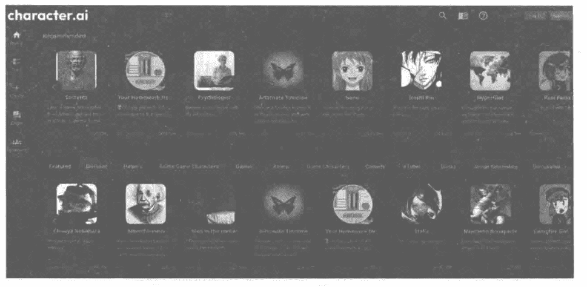
图 1-1 Character.AI 提供各类 AI 角色扮演

GPTs 的出现，让不熟悉如何发挥 ChatGPT 最大价值的用户可以直接使用他人搭建好的专用实例，最大化功能价值。同时，学会运用 GPTs 的用户可将与 ChatGPT 的互动封装成 GPTs 公开给他人，并在 GPT Store 上架获取收益。

应用范围极广，因为每个人的使用习惯都不同。即使同行业，不同人或企业也会为不同侧重点搭建不同 GPTs。

比如律所里，有人用 GPTs 专注离婚诉状资料撰写，有人则用于快速检索与分析民事诉讼案例。

教育领域也多样。英语教师可用 GPTs 生成辩论主题与正反观点丰富课堂；语文教师可用其提供故事开头激发学生续写。

定制化 GPTs 让各行各业从业者更方便高效地调用 ChatGPT 的能力。

## 1.2 应用全景：GPTs 能做什么
GPTs 可在众多场景发挥作用，如面试准备、简历优化、语言学习辅助、营销文案撰写、编程求助，甚至提供医疗健康建议等。GPTs Hunter 非官方 GPT Store 的分类目录与部分中文 GPTs 展示如图 1-2 和图 1-3。


图 1-2 GPTs Hunter 非官方 GPT Store 所收录的目录分类

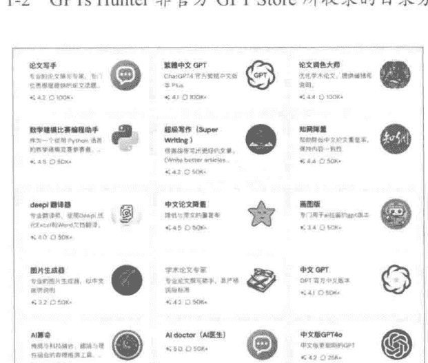
图 1-3 GPTs Hunter 非官方 GPT Store 所收录的部分中文 GPTs

以语言学习和面试技巧为例体验功能。

汉语拼音 GPTs 能为中文句子自动添加拼音，便于初学者阅读理解，如图 1-4 所示。


图 1-4 汉语拼音 GPTs

在对话框输入“Pinyin for 你吃饭了吗？”，系统会给出拼音与声调标注，如图 1-5 所示。


图 1-5 汉语拼音 GPTs 增加拼音标注

面试大师 GPT-S 能结合职业背景与经验提供模拟练习，如图 1-6 所示。

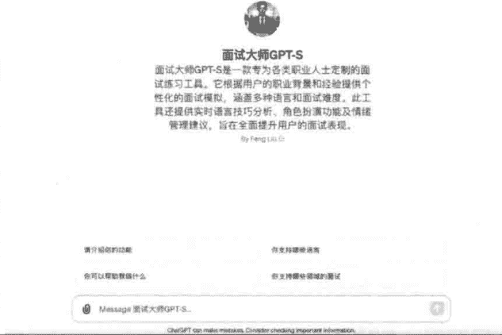
图 1-6 面试大师 GPT-S

告知岗位与相关经历后，它会给出模拟题目，并在用户作答后提供针对性反馈。

GPTs 并非万能。它能给出财务规划建议或查询天气信息，但无法像专业记账软件那样记录详细数据或像天气 App 那样推送预警。

尽管如此，GPTs 已为 AI 在真实工作生活中的落地打开了更多可能。

## 1.3 GPTs 与 ChatGPT 的差异
GPTs 是为特定目的与场景打造的自定义 ChatGPT 版本。相比通用 ChatGPT，它定制性更强、针对性更明确。可通过预设提示词打造专属实例，如心理医生、数学老师、营销文案专家等。

### 角色预设：用提示词模拟专家身份
日常使用 ChatGPT 时，为获得高质量回答，需要先明确设定角色。因为大语言模型训练数据面广，无法自判答案质量与适用性。通过提示词如“你是一名宠物用品行业的营销专家”，就能引导其从特定视角作答。

但通用对话中，每次都需要用户重新设定角色，操作繁琐。

GPTs 解决了这个问题。创建时提前埋好提示词，后续对话无需反复指定角色，也无需翻找旧会话。

### 个性化学习：借助知识库实现内容定制
自 ChatGPT 诞生后，开发者一直在探索让其学习特定资料以提供更个性化服务。GPTs 之前，这通常需要通过 API 调整，门槛较高。

GPTs 降低了门槛。用户可直接上传 Word、PDF 等文件，让实例学习这些资料，从而提供更贴合的内容与服务。

### 共享与变现
每个 ChatGPT Plus 与企业用户都能创建自己的 GPTs，可选择分享链接或发布到 OpenAI 的 GPT Store。GPT Store 类似应用市场，供用户发现与使用。创建者还能按使用次数与反馈获得收益。

总之，GPTs 提升了 ChatGPT 的针对性与效率，并把技术门槛降到普通用户可参与的水平，无论个人使用还是商业落地都开启了新可能。

## 1.4 能否替代小程序和 App
GPTs 无法完全替代现有小程序与 App。

首先，GPTs 基于 ChatGPT 平台构建，使用受平台限制。离开 ChatGPT 服务就无法运行。小程序与 App 可独立安装运行，不依赖特定 AI 平台。

这也是 GPTs 的独特优势。ChatGPT 提供的 AI 能力是普通小程序与 App 难以复制的。开发者只需告诉 AI 如何回答，无需关心底层技术细节。

搭建也相对简单。拥有 ChatGPT 相关权限的用户可短时间内无代码完成一个 GPTs，而开发小程序或 App 需要更长时间与编程知识，对不懂技术的创作者更友好。

功能与交互上差异明显。GPTs 主打文字交互，支持文本、图片等多格式输入，但做不到 App 那样的复杂视觉呈现与操作。例如高德地图可基于实时定位导航，GPTs 仅能提供出行建议与路线规划，无法实时跟踪位置。抖音可推送个性化短视频，GPTs 主要通过文字交流提供信息。

即时互动方面，小程序与 App 可通过推送主动触达用户，GPTs 需用户主动进入对话发起交流，这在提醒类场景受限。

总体看，GPTs 或将成为未来 App 的一种新形态，在翻译助手、市场分析等轻量工具领域实现替代，但在需要复杂交互与视觉呈现的场景仍难完全取代。技术进步可能带来更多多媒体交互与个性化推荐，但两者共存互补的态势会延续。

## 1.5 GPT Store 使用指南
ChatGPT Plus、Teams 用户点击官网主界面“探索 GPTs”即可进入 GPT Store。点击首页左上角地球按钮可切换全球或所在区域热门推荐。右上角可切换“我的 GPTs”“创建 GPT”，如图 1-7 所示。

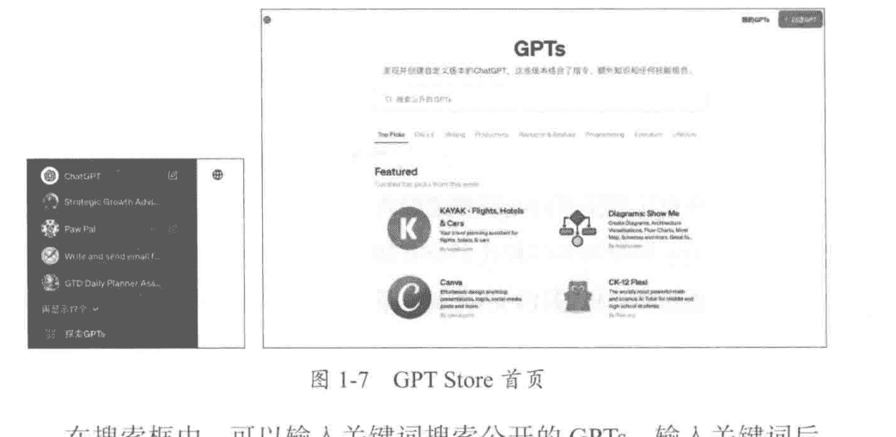

在搜索框输入关键词，可查到公开的 GPTs，展示名称、用途描述、创建者、对话次数、创建时间等信息，如图 1-8 所示。

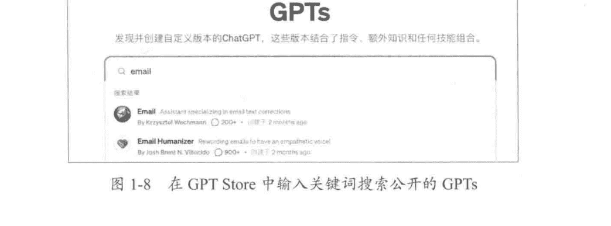

GPT Store 每周更新 4 个精选 GPTs 及其他热门作品，如图 1-9 所示。以往精选包括可链接 KAYAK 查询航班、酒店、租车的服务，以及与 Canva 集成、在 ChatGPT 中生成图像并直接导入 Canva 设计工具的方案，大幅节省设计时间。

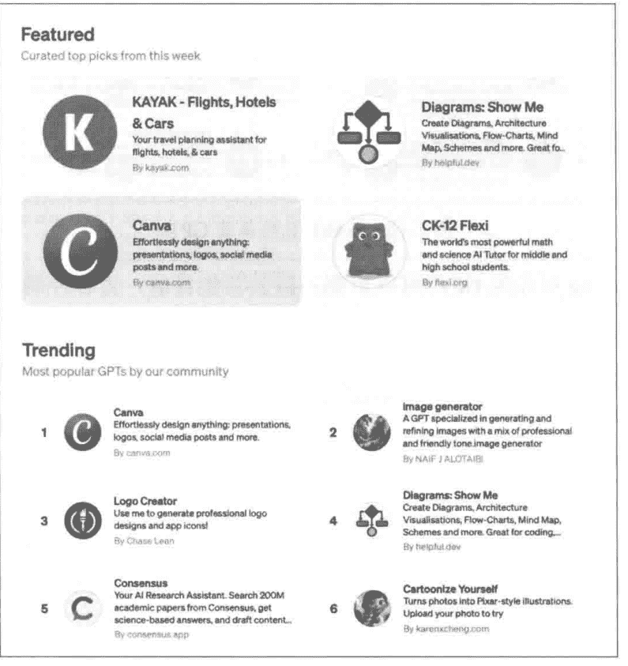
图 1-9 GPT Store 官方精选 GPTs

平台将 GPTs 划分为 7 大类：DALL·E 绘画类、Writing 写作类、Productivity 生产力类、Research & Analysis 研究分析类、Programming 编程类、Education 教育类、Lifestyle 生活类。

DALL·E 绘画类涵盖各类绘图应用。如 Logo Creator 可按需求生成 Logo；Cartoonize Yourself 可把照片转为皮克斯动画风格，如图 1-10 所示。

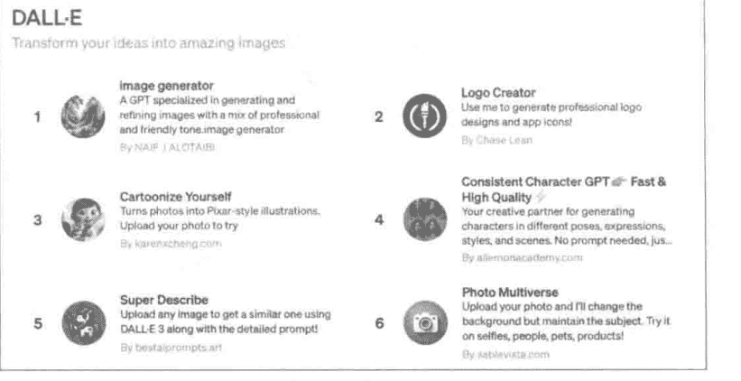
图 1-10 DALL·E 绘画类 GPTs

Writing 写作类为不同写作目标提供辅助。如 Fully SEO Optimized Article including，FAQ's 助手可撰写 SEO 友好的营销文案；PowerPoint Presentation Maker by Slides GPT 助手可高效创建、编辑、预览 PPT 并导出格式，如图 1-11 所示。

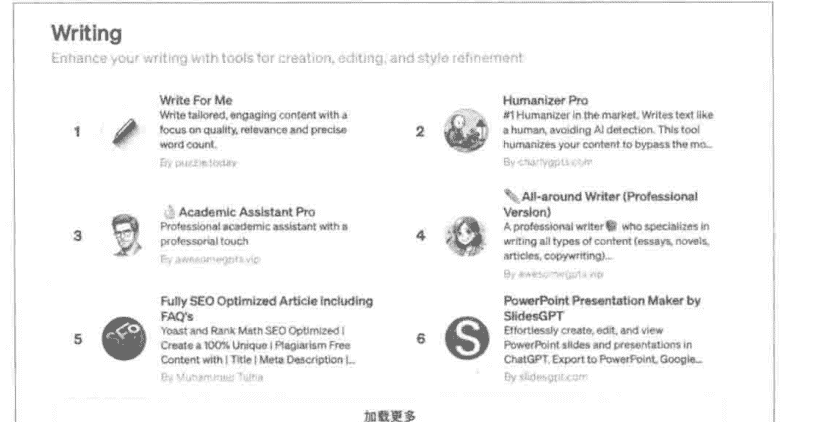
图 1-11 Writing 写作类 GPTs

Productivity 生产力类提供办公场景助手。如 Diagrams: Show Me 可绘制流程图、组织架构图；AI PDF 可上传 PDF 让 AI 总结内容；Video GPT by VEED 可为社交媒体制作视频，如图 1-12 所示。


图 1-12 Productivity 生产力类 GPTs

Research & Analysis 研究分析类助力学术与数据研究。如 Consensus 与 ScholarAI 可从学术库收集论文；Finance Wizard 可辅助股市价格预测，如图 1-13 所示。

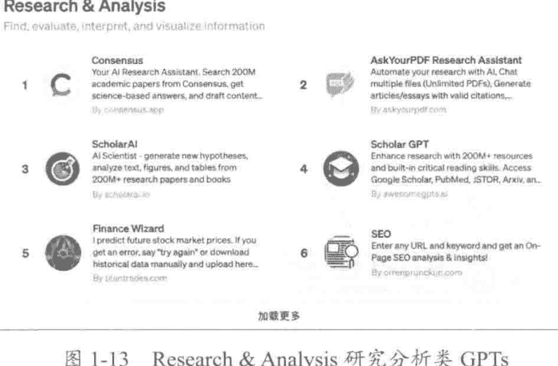
图 1-13 Research & Analysis 研究分析类 GPTs

Programming 编程类按需求撰写代码。如 Grimoire 与 DesignerGPT 可写网站代码；Screenshot To Code GPT 可根据上传的网站截图生成对应布局代码，如图 1-14 所示。

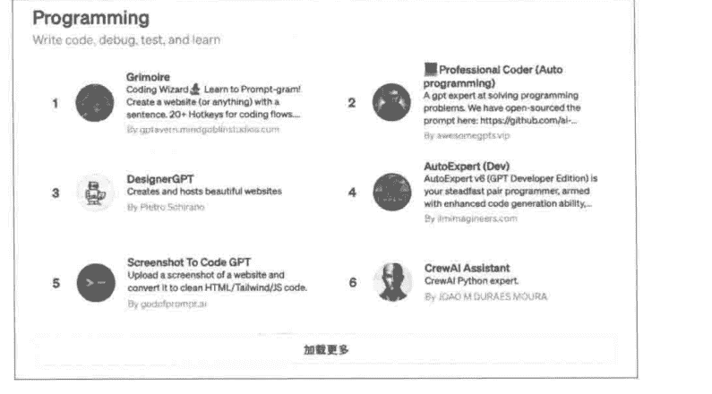

Education 教育类辅助各类学习。如 CK-12 Flexi 与 Math Solver 可解答数学问题并引导思路而非直接给答案；Video Summarizer 可从 YouTube 视频提炼要点，如图 1-15 所示。

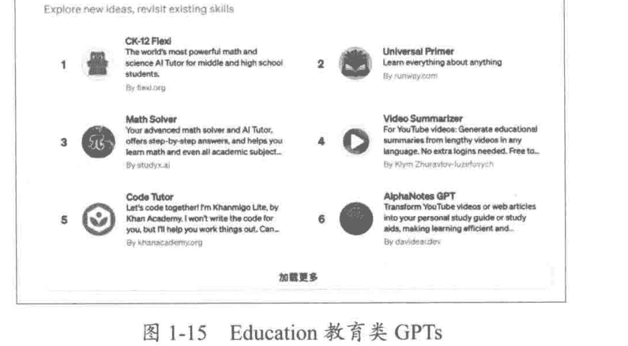

Lifestyle 生活类提供旅游、美食等建议。如 KAYAK-Flights, Hotels & Cars 可提供航班、酒店、租车服务，如图 1-16 所示。

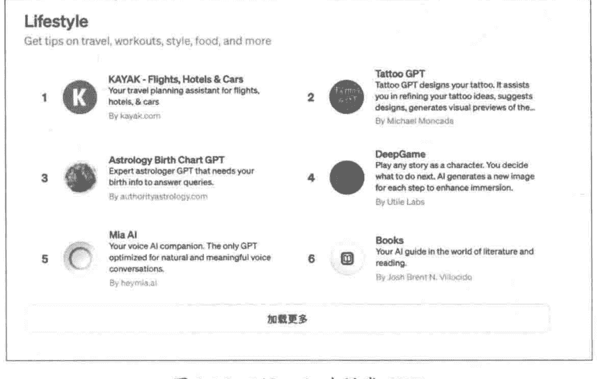

图 1-16 Lifestyle 生活类 GPTs

## 1.6 热榜常青款拆解

GPT Store 上线以来，始终有一批作品稳定占据热度榜前十。下面挑 Canva 与 Logo Creator 两款长期高位产品，说明它们的工作方式。

Canva 本质上是一个网页端的视觉创作平台，自带海量可复用模板，覆盖海报、简历、名片等常见场景，让不熟悉 Photoshop 这类专业工具的人也能快速拼出专业感的成品。由 Canva 官方发布的 GPT 版本把对话交互和设计系统连通，用户把需求交给模型后，模型会在模板库中检索匹配方案并直接进入制作环节。

指令可以用中文或英文输入，主题、风格、文字、配色等要素都可以直接说明。例如让它为耳环新品做一张促销海报，模型会一次性给出三到五个备选，如图 1-17 所示。


点选满意的方案后会自动跳转到 Canva 编辑页面，如图 1-18 所示。在编辑页可以继续调整文字、替换素材或直接导出成品。


图 1-18 Canva 作图工具界面

Logo Creator 借助模型的绘画能力，为用户提供可定制的 Logo 方案。假设要为一家甜品店设计一套黄粉色卡通风格的 Logo，发出指令后模型会先进入交互确认，围绕整体风格取向、简约与精致的程度偏好、具体色彩搭配、所需数量四个维度提问。用户可以自由作答，也能直接选用模型给出的预设选项来加速选择。信息确认完毕后，模型会按要求生成设计，如图 1-19 所示。

016 | ChatGPT 时代：GPTs 开发详解

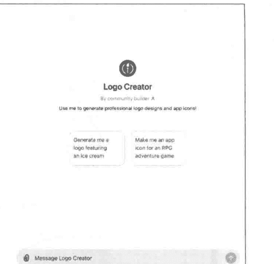

帮我制作一个甜品店的logo，黄色、可爱的卡通风格

在开始设计之前，我需要先了解以下信息：

1. 您希望这个 logo 的复杂程度在 1 到 10 之间是多少？（默认 = 3）

   - 1 = 极简干净

   - 10 = 复杂精致

2. 您想要的颜色组合？建议如下：

   - A. 浅黄、粉红和白色

   - B. 柠檬黄、浅棕和奶油色

   - C. 橙黄、葡萄绿和粉色

请您选择复杂度和色调，方便我为您创建最贴合需求的设计！

1和A

好的，我将为您的甜品店设计一个极简、可爱、卡通风格的 logo，使用浅黄、粉红和白色的配色方案。稍等片刻，我马上为您生成设计！


您觉得这个 logo 如何？是否符合您的期望？

如果有任何想修改的地方，请告诉我！

图 1-19 Logo Creator 根据要求生成甜品店 Logo

# 第2章 GPTs 核心能力全景

## 2.1 零代码定制，人人可上手

制作 GPTs 完全不需要写程序，这就是所谓的无代码开发。

过去人们普遍认为只有程序员才能做应用，而会编程的人在全球人口中的占比不到 1%。随着工具演进，预设模板、可视化编辑、拖拽交互等能力让非技术用户也能动手做网站或 App。

Gartner 预计到 2025 年，约七成的软件应用会以无代码或低代码方式实现。

相较于传统编码开发，无代码有明显优势。

1. 周期更短。传统 App 开发往往需要三到六个月甚至更久，无代码工具几小时就能跑出可用的基础版本。
2. 成本更低。用人成本高，还要配合产品设计、交互设计、测试等环节。无代码工具可让一人完成闭环，大幅压缩费用。
3. 验证更快。原型能迅速上线，先用最简版本检验市场真实需求。
4. 调整灵活。拖拽式界面让细节修改变得很轻便。

目前主流的无代码平台有国外的 Bubble、Glide、Stacker、Webflow，国内则有 Zion、明道云等，如图 2-1 所示。


图 2-1 国内无代码工具——Zion

这些工具虽降低门槛，学习成本仍在。相对而言，基于 GPTs 的开发门槛更低。用户无需懂代码，像聊天一样描述应用类型，几分钟内就能完成基础搭建。

现阶段 GPTs 在功能深度和交互体验上与手机 App、小程序仍有差距，但随着大模型持续进步，编程不再是普通人做应用的阻碍。更重要的是先找到明确的目标用户和使用场景。

## 2.2 分享权限的三层策略

GPTs 提供三种分享方式：仅我自己、只有拥有链接的人、公开，如图 2-2 所示。

仅我自己。也叫私有模式，只有创建者本人能使用。适合上传了私密或敏感资料的场景，或作为个人助手。比如把家人的饮食习惯、家务安排等资料喂给 GPT，定制一个家庭助手，提供食谱建议和家务清单。因为涉及隐私，更适合自用，如图 2-3 所示。

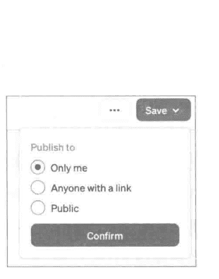


只有拥有链接的人。适合团队或小圈子内部分享。只有拿到链接的人能访问，且不会上架到官方商店。例如一个项目助手 GPT，团队成员通过链接就能用来整理会议纪要、撰写报告、制定工作计划。

公开。如果应用不涉及隐私资料上传，就可以开放给所有人使用。这样既可能获得收益，也能提升创作者知名度。但公开前务必检查是否误传了隐私信息，如姓名、电话、邮箱等。我的 GPT 页面如图 2-4 所示。

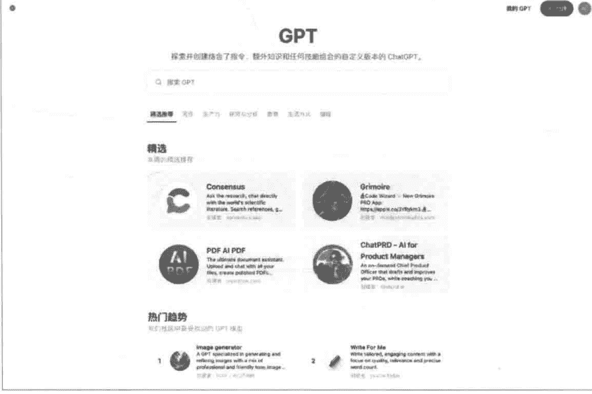

另外，无论是链接分享还是完全公开，开发者都看不到使用者的个人信息，也无法查看具体对话记录。后台仅能看到对话次数统计，如图 2-5 所示。

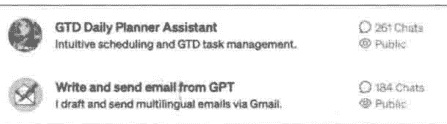

丰富的分享策略让 GPTs 应用极具弹性，既能做私人的家庭管家，也能做团队协作工具，还能做面向公众的通用服务。

## 2.3 三大增强能力概述

GPTs 具备画图、格式转换、数据分析等扩展能力，主要来源于 ChatGPT Plus 中的 GPT-4 模型。该模型支持图片识别、CSV/Excel 处理和绘图生成。创建时，开发者可为 GPT 指定所需能力，三类核心功能如图 2-6 所示。


图 2-6 GPTs 的三种功能

### Web Browsing（联网）

常说 ChatGPT 是离线的，无法直接获取最新资讯。但 GPT-4 内置联网能力，可通过必应等搜索引擎实时检索并引用最新内容。

免费版 ChatGPT 3.5 不支持联网，知识截止在 2022 年 1 月，因此询问之后的事件往往答不上来，比如 2022 年世界杯冠军，如图 2-7 所示。

付费版 GPT-4 的知识库更新到 2023 年 4 月，所以能正确回答 2022 年世界杯冠军这类问题，如图 2-8 所示。

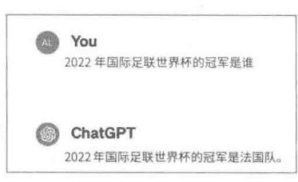


图 2-7 免费的 ChatGPT 3.5 不联网，知识停留在 2022 年 1 月

图 2-8 付费的 ChatGPT 4 回答正确

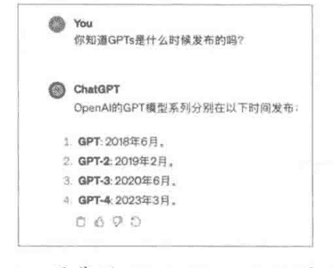

但 2023 年 4 月之后的信息，不联网时即便是 GPT-4 也可能不知晓，比如只认识 GPT 模型而不认识 GPTs，如图 2-9 所示。

图 2-9 付费的 ChatGPT 4 只知道 GPT 模型，不知道 GPTs

通过明确指令让 GPT-4 去联网搜索最新信息，再返回结果，就相当于给它上网了，如图 2-10 所示。

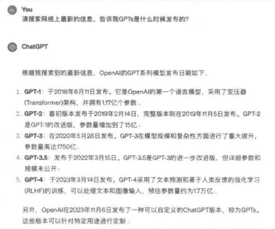

图 2-10 让 ChatGPT 4 联网搜索最新的消息

联网并非默认开启，需要在指令里明确告诉模型何时该去搜索，如图 2-11 所示。


图 2-11 在 ChatGPT 的配置指令中可以明确告诉它需要使用联网功能搜索信息

联网能力在做市场分析、实时翻译等任务时非常有用，比如 OpenAI 官方推出的具有联网功能的 GPTs，如 Web Browser。只要说明需求，它就会联网查询最新内容并回复，如图 2-12 所示。

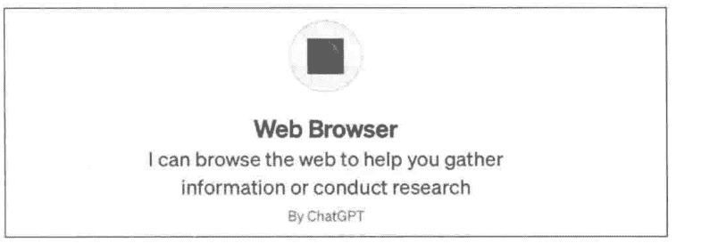

图 2-12 ChatGPT 推出的 Web Browser

### DALL·E Image Generation（DALL·E 图像生成）

GPTs 的绘画能力来自 GPT-4 对接的 OpenAI 自家 DALL·E 模型。DALL·E 能把文字描述转化为图像。DALL·E 3 官网首页如图 2-13 所示。

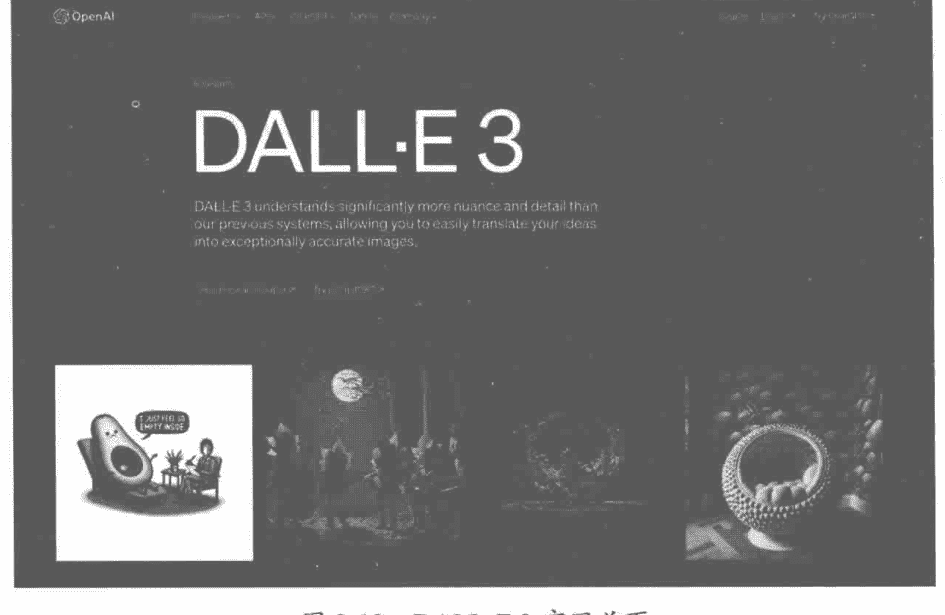

图 2-13 DALL·E 3 官网首页

以官方绘画类 GPTs Coloring Book Hero 为例，它能够根据用户的文字描述、想法生成简单的黑白图像，如图 2-14 所示。


图 2-14 Coloring Book Hero

我们只需在对话框中告诉 Coloring Book Hero 一个形象，如森林中的小狐狸，它就会画出一个可爱而简约风格的狐狸，如图 2-15 所示。这样的图片非常适合儿童进行填色和创意发挥。


因此，我们可以充分利用 GPTs 的绘画能力，打造各类具有绘画功能的 GPTs。

### Code Interpreter（代码解释器）

代码解释器顾名思义可以帮助我们生成或解释代码。

Code Interpreter 是一个综合性的信息处理工具，它不仅能够帮助我们生成或解释代码，还具备阅读 PDF 文档、分析 Excel/CSV 数据等额外能力。

我们也可以让 Code Interpreter 分析 Excel 数据，如图 2-16 所示。

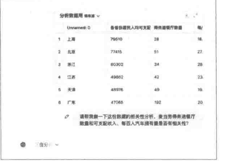

我们也可以利用 Code Interpreter 功能，让 ChatGPT 把信息保存成 Excel/CSV 文件供我们下载。

针对数据分析、文件识别等需求，可以利用 Code Interpreter 功能让 GPTs 变成一个强大的办公辅助工具。

## 2.4 知识库学习 让 GPT 会模仿

GPTs 与 ChatGPT 的一个很大的区别就是它支持以用户上传文件作为参考资料，这样 GPTs 每次在生成回复前都会对参考资料进行学习。

GPTs 学习参考资料后，可以更准确地模仿和学习资料中的写作风格、从参考资料中找寻相似信息、在参考资料中获取更准确的专业术语等。

模仿风格：我们可以将爆款文案、爆款视频脚本等作为参考资料上传给 GPTs，并且让 GPTs 在每次输出回复前学习这些资料中的风格，从而生成具有相似风格的内容。

提取信息：把网络上公开可用的内容，如个人整理并分享的关于积极心理学的知识，上传给 GPTs 作为参考资料，搭建一个基于积极心理学知识的 GPTs。每次用户提问时，GPTs 将从收集整理好的资料里提取相关信息来回复用户。

专业术语：如果想要打造翻译用的 GPTs，可以整理一些行业专业术语并发送给 GPTs。这样 GPTs 每次在进行翻译前，会先参考上传的专业术语再开始工作，从而在一定程度上提高翻译的准确性。

例如，我们希望创建小红书爆款文案 GPTs，就可以先收集爆款文案的标题、正文案例作为参考资料上传给 GPTs，让 GPTs 去学习这些爆款文案的写作风格，如图 2-17 所示。

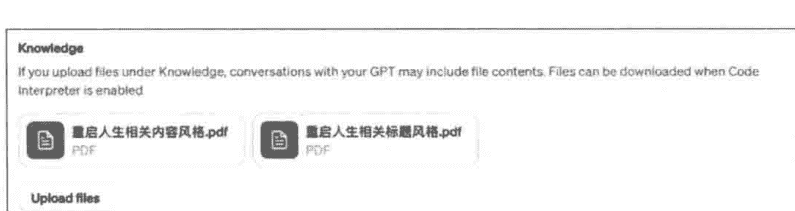

图 2-17 将收集到的参考资料上传给 GPTs

这样我们每次让 GPTs 帮忙创作内容时，它就可以先从参考资料中学习风格，再进行创作，如图 2-18 所示。


图 2-18 GPTs 在生成回答前会先搜索知识库中的参考资料进行学习

关于将参考资料上传给 GPTs 的具体操作方法，我们将在后面章节中进行讲解。

## 2.5 Action 机制 让助手跳出聊天窗口

ChatGPT 似乎只能在聊天界面内完成任务，无法实现像发送邮件、创建待办事项这样的跨平台功能。然而，GPTs 中的 Action 功能打破了这一局限。Action 功能允许 GPTs 与外部应用连接，使其成为更智能的个人和办公助手。

例如，通过使用邮件助手 GPTs，就可以在草拟邮件回复后直接将邮件发送给客户。这样，我们就无须登录邮箱手动复制粘贴邮件内容，极大地提高了工作效率。这种功能不仅拓展了 GPTs 的应用范围，还使其从单纯的文本生成工具转变为多任务执行助手，如图 2-19 所示。

**You**

帮我写一封中文邮件，问一下客户是否收到了报价和方案？

**Write and send email from GPT**

✅ Talked to actions.zapier.com ▾

我已经确认我们可以使用Zapier的Gmail操作来发送您的邮件。现在，我将帮您起草这封中文邮件。

邮件内容要询问客户是否收到了报价和方案。请您提供以下信息，以便我能完整地撰写邮件。

+   1. 收件人的电子邮件地址。

2. 是否需要抄送（CC）给其他人，如果需要，请提供他们的电子邮件地址。

3. 邮件主题。

4. 您希望在邮件正文中包含的特定信息或问候语。

一旦您提供了这些信息，我将起草邮件并在发送前向您展示最终内容进行确认。请注意，在进行实际操作之前，您需要回复以继续。

**You**

收件人电子邮件地址：day@coreachdigital.com

不需要抄送给其他人

HubSpot实施方案报价

邮件正文就用你好这样比较友好的问候语

**Write and send email from GPT**

✅ Talked to actions.zapier.com ▾

邮件已成功发送给 day@coreachdigital.com，主题为“HubSpot实施方案报价”。邮件内容是一个友好的问候和询问是否收到了报价和方案。

如果您需要进一步的帮助或有其他邮件需要发送，请随时告知。

HubSpot实施方案报价 Inbox x

day@coreachdigital.com

10:50 PM (2 minutes ago)

to me ▾

未追蹤 將電子郵件記錄至 HubSpot ▾

你好，

祝您工作顺利。冒昧来信，只是想核实一下，针对您定制的 HubSpot 实施报价单与完整方案是否已经顺利送达。我们高度关注您的实际需求，也希望所给资料能够完全符合您的预期。

若内容有任何疑问或希望进一步沟通细节，欢迎随时回复本邮件。我们期待您的反馈，并乐意提供所需协助。

顺颂商祺，

[Your Name]

[Your Position]

[Your Company]


不同功能的 GPTs 还能协同作战。比如把 Code Interpreter 与 GPT-4 结合起来，就能读取 PDF 发票，自动识别金额，再借助 Action 能力把数据归类整理进 Excel 或 Google 表格。这种组合让 GPTs 不再只是写东西，还能完成真正的数据处理与办公自动化任务。

# 第3章 从零打造你的首个 GPTs

## 3.1 如何进入 GPTs 页面

目前只有付费用户可以新建 GPTs，例如 ChatGPT Plus 用户和 ChatGPT 企业版用户。ChatGPT Plus 本质上是付费订阅，带来更多权限与功能。以 Plus 账号为例，进入 GPTs 界面有两条路径。

一种是通过头像。登录后点左下角的用户名，再点 “My GPTs”，即可打开 GPTs 页面，如图 3-1 所示。

另一种是通过左侧栏。左侧栏点 “Explore”，同样会跳转到 GPTs 页面，如图 3-2 所示。


下面简单介绍 GPTs 页面的组成，主要分三块。

1. “My GPTs”：展示你自己搭建的 GPTs。顶部有 “Create a GPT” 按钮，点它即可开始创建；下方罗列已有的全部作品，如图 3-3 所示。

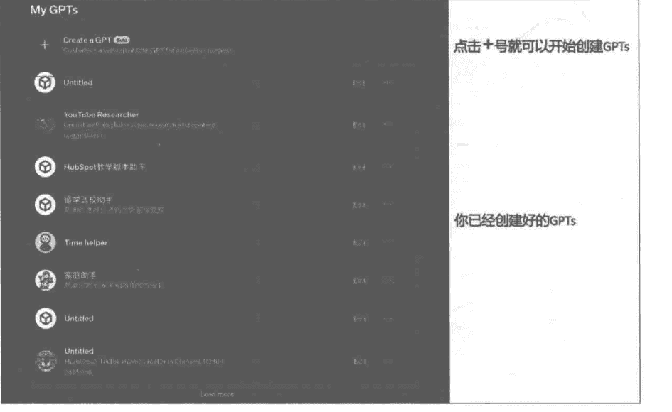

图 3-3 “My GPTs” 界面

2. Recently Used：显示最近频繁使用的 GPTs，如图 3-4 所示。

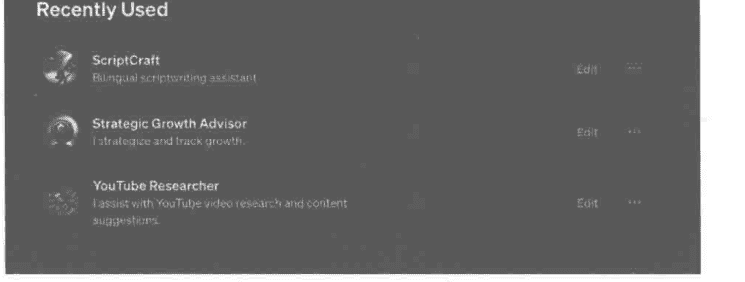

图 3-4 最近常用的 GPTs

3. Made by OpenAI：收录了 OpenAI 官方提供的 16 个 GPTs，点 “Load more” 可加载全部。直接点头像或名称就能立刻使用，如图 3-5 所示。

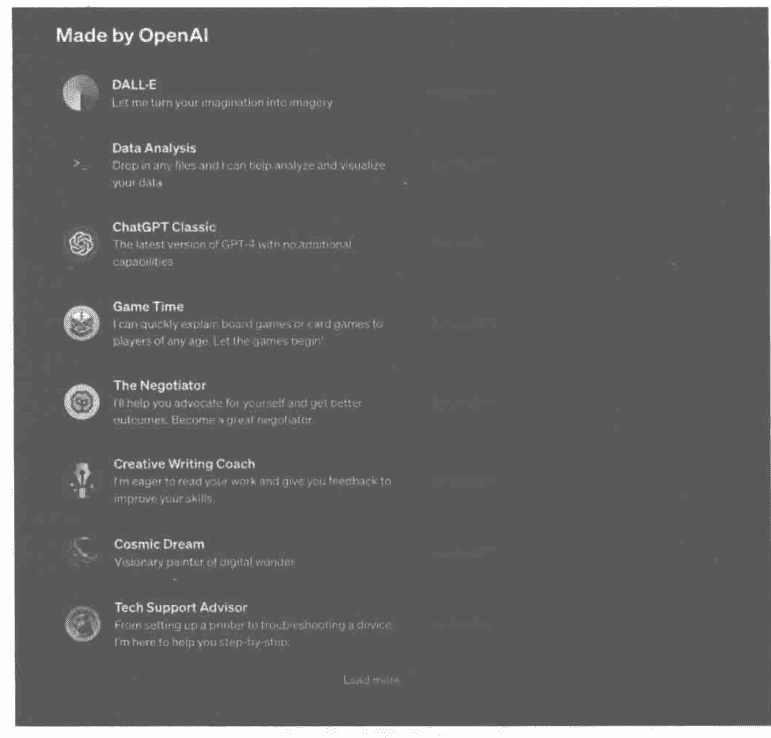

图 3-5 OpenAI 提供的 GPTs

常用 GPTs 也会同步出现在左侧栏。若侧栏内容过多，可点三个小点，选择 “Hide from sidebar（在侧边栏中隐藏）” 来收起，如图 3-6 所示。


图 3-6 在侧边栏中隐藏 GPTs

## 3.2 在 ChatGPT 中怎么和 GPTs 交流

在 ChatGPT 里与 GPTs 对话有以下几种方式。

1. 直接点击。在 GPTs 列表里点任意一个 GPTs，即可开启新对话，如图 3-7 所示。

2. 通过左侧栏新建。在左侧栏点小画笔图标，再点 “New chat”，即可开始新对话，如图 3-8 所示。


3. 对话与交互：使用感受与普通 ChatGPT 类似，可以在输入框提问或下指令。若该 GPTs 开启了代码解释器，还能上传 CSV、PDF 或 Word 文件，GPTs 会解析内容、提取文字、生成总结等。

每个 GPTs 都会提供几条预设提问，不确定怎么聊时直接用预设提问开场即可，如图 3-9 所示。

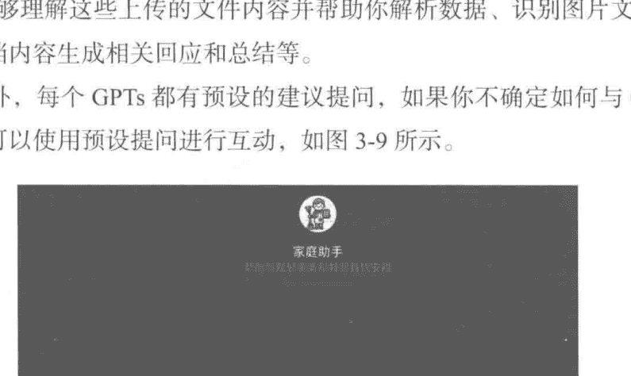

4. 记录管理：与 GPTs 的聊天记录会保存在左侧历史记录里，但目前在 GPTs 页面内无法直接检索，需要手动在左侧历史中查找对应的记录。

## 3.3 先想清楚用途和场景，让助手更贴合需求

GPTs 上线后，社区里已经出现了上百万个定制模型。每个人需求不同，即便同职，也可能需要不同的助手来完成工作。

在动手创建前，建议先自问几件事。

1. GPTs 的使用对象是谁？

分享权限有三种：仅自己、拥有链接的人可访问、公开。权限不同，指令写法和参考资料的公开程度也不同。做个人助手可以把私密整理资料尽量喂给模型；若要公开，就不要上传个人或不适合外泄的材料。

2. 想解决的具体问题是什么？

GPTs 适合特定用途与场景。一次性、琐碎的小任务没必要单独建模型，直接在通用界面提问即可。只有当任务是高频重复，或你想把个人的 ChatGPT 使用经验沉淀给团队分享时，搭建 GPTs 才更划算。

具体痛点是什么？例如法律文书 GPTs 可专门做格式合规初筛；写作辅助 GPTs 也能再细分——资料搜集、错别字语法修缮、文字润色等。

3. 应该具备哪些能力？

明确问题后就要思考该模型需要什么能力，这步决定了最终效果是否达标。

以旅行规划助手为例，除了输出攻略，用户很可能希望一键导出便于查阅的表格。此时代码解释器就必不可少，能把攻略转成 Excel 或 CSV 下载编辑。

如果要根据描述生成图片，就需要开启 DALL·E 图像生成。

选功能时还要兼顾操作便捷，比如给旅行助手加上联网搜索，就能实时获取最新景点信息、天气等，让攻略更准确、体验更好。

总之，先明确目标与痛点，再合理配置功能，才能做出真正好用、吸引人的 GPTs 应用。

## 3.4 配置面板全解析

GPTs 配置界面采用左右分栏。左侧是“通过对话配置 GPTs”，右侧是“GPTs 预览”。配置完成后点右上角的“创建”即可，如图 3-10 所示。

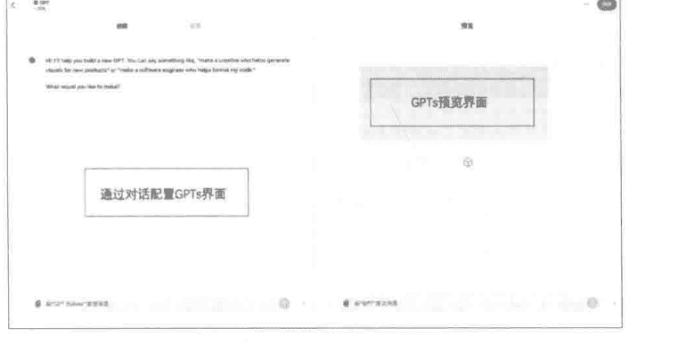

左侧通过发送消息来修改模型，右侧则模拟真实用户提问。分屏设计让你在搭建时能即时调整并看到效果，无需发布后再验证。

除对话配置外，还能手动调整。点“Configure”切换到手动配置页，可直接修改名称、描述、指令、预设提问。切换后右侧预览区仍然保留，如图 3-11 所示。

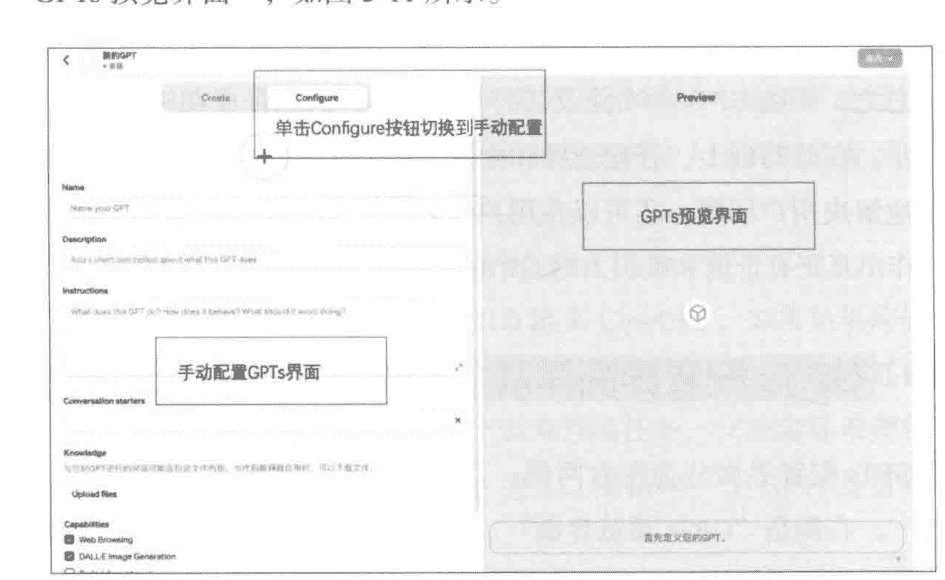

## 3.5 用对话方式快速创建 GPTs

下面以对话形式演示如何创建一个运动健身教练。

打开创建页，在左侧“发送消息给 GPT Builder”中输入需求。GPT Builder 是 OpenAI 提供的建模助手，会根据文字指令自动完成配置。

你可以参考官方范例，告诉它希望扮演的角色和具体工作。例如“写代码的工程师助手，负责检查格式”或“创意平面设计师，负责出图”。这里输入“制作一个健康减脂运动教练”，如图 3-12 所示。

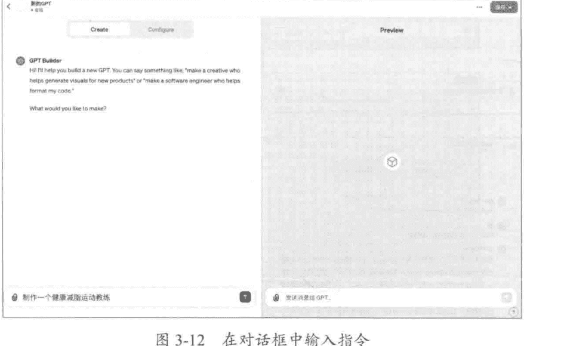

图 3-12 在对话框中输入指令

指令发出后，GPT Builder 会自动生成基础模型，约 10~20 秒即可完成。右侧预览区会同步显示名称、描述和预设提问，如图 3-13 所示。

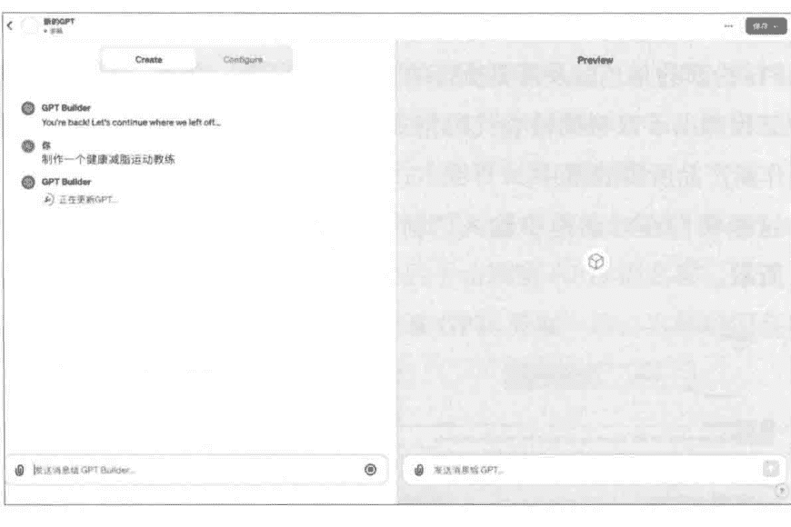

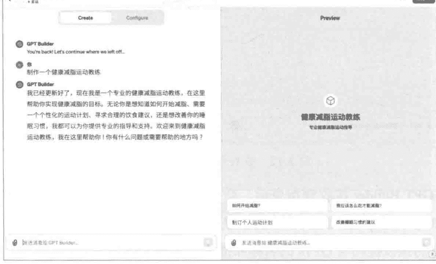

图 3-13 GPT Builder 自动创建“健康减脂运动教练”

如果未自动生成头像，可在对话中要求生成并更新。GPT Builder 会调用 DALL·E 创建 AI 头像并自动应用到预览区，如图 3-14 所示。

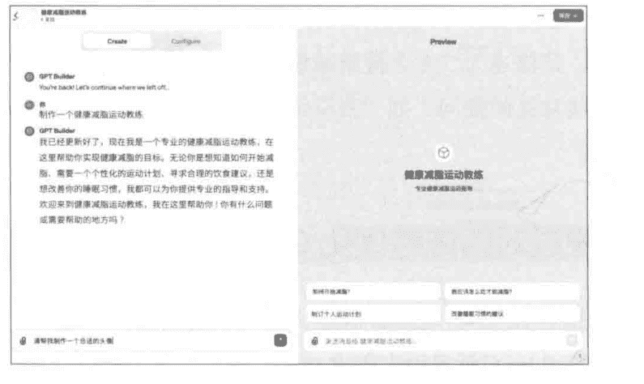

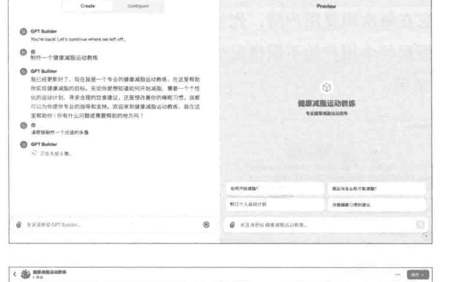

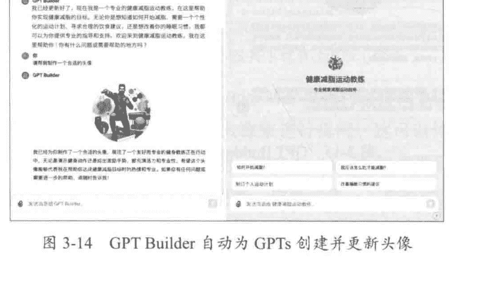

图 3-14 GPT Builder 自动为 GPTs 创建并更新头像

此时基础模型已就位，名称为“健康减脂运动教练”，描述为“专业健康减脂运动指导”，预设问题包括“我应该怎么吃才能减脂”“制订个人运动计划”等。

## 3.6 对话式微调，让 GPTs 更精准

名字、描述、规则、预设提问等都可以在 GPT Builder 对话里继续优化。

例如要求它在每次回复前先确认用户的健康目标和当前身体状况，再给出个性化方案，如图 3-15 所示。

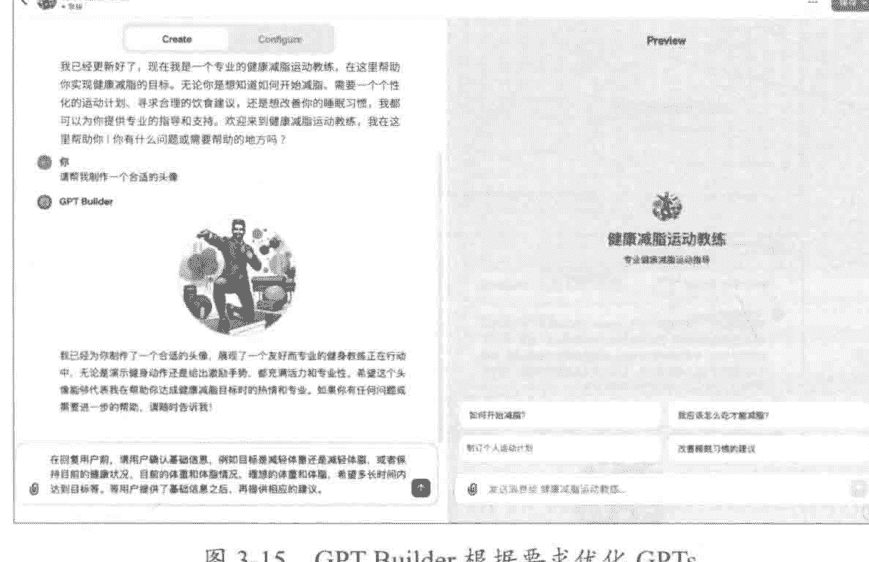

图 3-15 GPT Builder 根据要求优化 GPTs

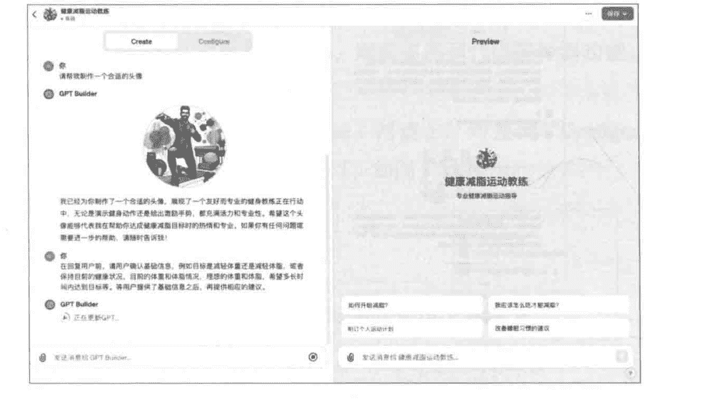

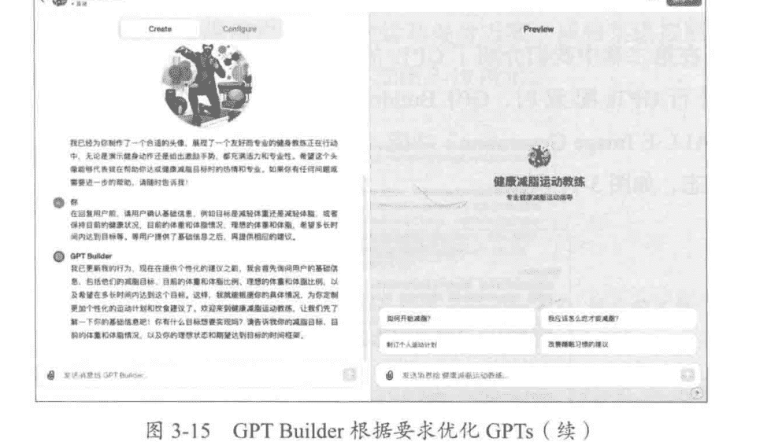

图 3-15 GPT Builder 根据要求优化 GPTs（续）

也可以让预设提问更聚焦运动、减重、减脂，并改成第一人称提问，使用户更直观地明白如何互动。更新后右侧预览的提问也会同步变为第一人称。

头像同样可以在聊天界面中调整，如图 3-16 所示。

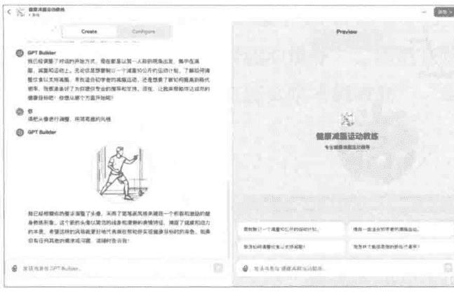

## 3.7 能力升级：联网、代码、绘图一把抓

第二章已介绍过联网、代码解释器、绘图等能力。在配置时，GPT Builder 默认勾选“Web Browsing”和“DALL·E Image Generation”，而“Code Interpreter”默认未勾选，如图 3-17 所示。

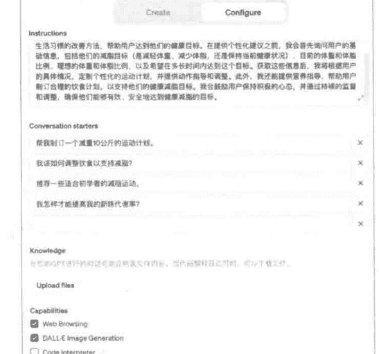

若希望“健康减脂运动教练”能把一周食谱和训练计划导出为 Excel 供下载，就需要代码解释器。切换到“Configure”界面，勾选该功能即可，如图 3-18 所示。

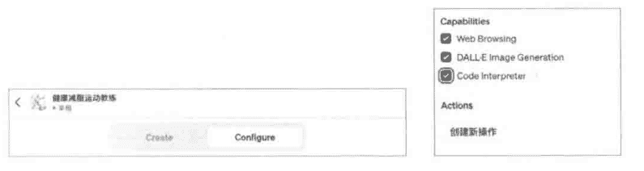

勾选后回到 GPT Builder 对话，要求模型按用户需求把方案以 Excel 或 CSV 格式提供下载，如图 3-19 所示。

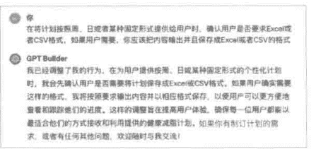

## 3.8 教会 GPTs 阅读你的资料

GPTs 本身基于 ChatGPT，但可以上传专业资料让它学习，并在回答时引用。这里把一份“动态拉伸指南”上传给“健康减脂运动教练”。

支持的格式有 TXT、DOC、PDF、CSV、XLSX，每个 GPTs 最多上传 10 个文件，单文件上限 512MB。

上传方式有两种。

一种是在“Configure”页面点“Upload files”按钮导入，如图 3-20 所示。


另一种是在聊天界面请 GPT Builder 代为上传，并告诉它在必要时查阅该资料作答，如图 3-21 所示。


资料导入后，询问相关拉伸姿势时，模型会优先从参考资料提取内容作答。

## 3.9 预览测试，确认效果

配置完成后可在右侧预览区测试。预览对话与真实使用效果一致。

点预设问题如“帮我制订一个减重 10 公斤的运动计划”即可开始测试，如图 3-22 所示。

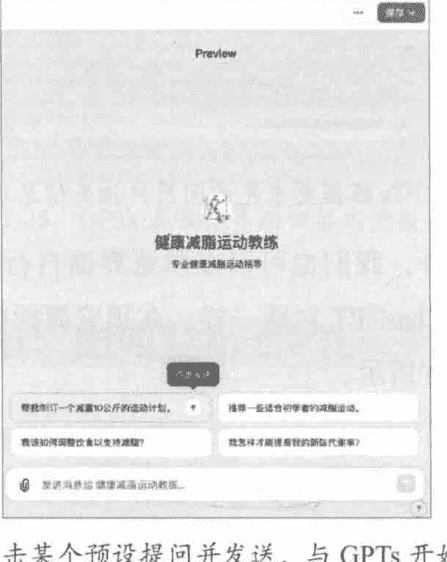

图 3-22 单击某个预设提问并发送，与 GPTs 开始测试对话

前面已要求模型先询问用户信息，发送问题后它按照设定先询问了 6 条关于身体状况和训练偏好的信息，如图 3-23 所示。

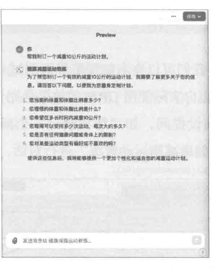

图 3-23 GPTs 根据要求先询问用户相关信息再提供回答

除了预设问题，也可在预览区自由输入问题测试，如图 3-24 所示。

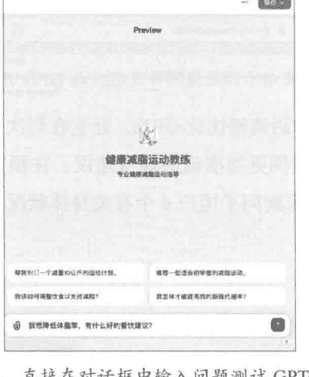

图 3-24 直接在对话框中输入问题测试 GPTs 效果

不同问题的回复会实时展示在预览区，如图 3-25 所示。

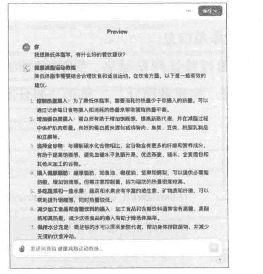

图 3-25 GPTs 在预览界面回答用户提问

## 3.10 发布上线，让 GPTs 与人见面

测试满意后即可发布。点右上角“保存”，会出现三种分享方式：仅我自己、只有拥有链接的人、公开，如图 3-26 所示。


图 3-26 GPTs 的三种分享方式

选“仅我自己”只有本账号可用；选“只有拥有链接的人”可把链接分享给他人使用。若想上架 GPT Store 选择公开，则需要完成身份验证。

验证方式有两种：一是通过验证网站域名，二是通过补充 ChatGPT Plus 付费账单信息。

第一种是域名验证，回到 ChatGPT 对话页，点头像后找到“构建者简介”，点“验证新域名”，如图 3-27 所示。

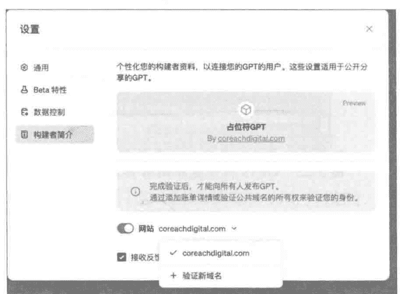

把 ChatGPT 输出的 TXT 验证记录粘贴到域名服务商的 DNS 设置里，保存后点击检查按钮即可完成校验，参考图 3-28。

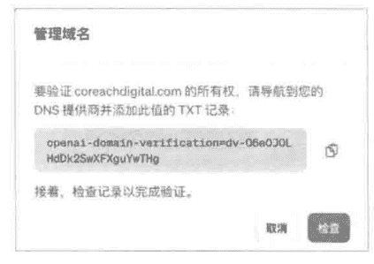

另一种做法是进入 ChatGPT Plus 的账单页面，把开票信息补齐，比如公司名称、账单地址和账单邮箱，位置如图 3-29。

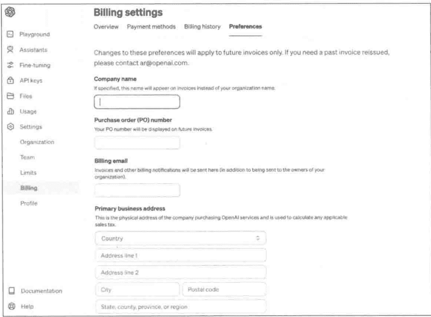

校验通过后回到 GPTs 管理界面，点“公开”并选择合适的分类，就能在 GPT Store 正式上线，操作见图 3-30。

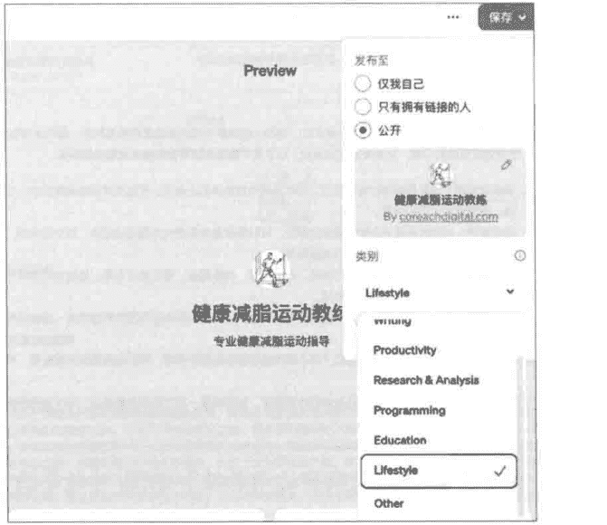

## 3.11 ChatGPT 里怎么用 GPTs

助手保存并发布成功后，点击“查看 GPT”即可进入对话界面，和刚创建的智能体直接交流，见图 3-31。


图 3-31 发布后点“查看 GPT”就能开始使用

使用逻辑和普通 ChatGPT 几乎一样，直接在对话框输入问题。例如让“健康减脂运动教练”给新手提供减脂运动建议，助手会以教练身份给出具体方案，如图 3-32。


图 3-32 健康减脂运动教练的对话示例

# 第4章 用指令让 GPTs 更出彩

## 4.1 指令是什么

第三章介绍过，可以通过对话让 GPT Builder 读懂需求并生成智能体。除了对话，还能直接在 GPTs 的 Configure 面板手动填写指令来设定行为。

指令配置就是在配置页的指令框里，用文字描述想让助手完成的事情，示意见图 4-1。


走对话流程时，Builder 会自动把指令填进配置区。以“健康减脂运动教练”为例，说明要创建一个提供健康减脂指导的健身教练，它就会自动生成对应的指令内容。

需要调整时，直接在指令框里像编辑文档一样修改即可。

指令过简，模型难以准确把握意图；指令过长，则容易出现只记住前面、忘掉后面问题。

## 4.2 GPTs 里的指令如何发挥作用

在 GPTs 中，指令是决定模型行为和输出格式的核心设定。它只在配置阶段出现，且仅作用于当前这个智能体。正因为有指令，才能把通用的 ChatGPT 定制为功能明确的专属助手。

以“健康减脂运动教练”为例，名称、描述、示例问题和知识库保持不变，仅修改指令就能让表现完全不同。比如去掉要求用户先填写基础信息的内容，放宽格式限制，让它直接给出建议并优先检索知识库，效果见图 4-2。


即使两个智能体的名称、用途和场景相同，指令一变，回答也会不一样。完整版会在回复前按指令先询问身体状况和目标，再给出个性化建议；精简版则依据简化指令直接作答，不做额外追问，对比见图 4-3。


指令本质上是面向开发者的配置参数，控制模型如何行动、如何呈现结果以及怎样处理用户输入。

## 4.3 指令写作公式

写指令可以用一个通用的套路：

角色 + 任务 + 规则 + 步骤 + 格式

角色就是给智能体一个身份定位。比如设定为健身教练或画家。有了明确身份，它才能按人物口吻产出符合预期的内容。

任务指的是智能体具体要完成的工作和输出。比如让它当旅行规划师，就是制定详尽行程；让它当法律文书助手，就是帮律师检查格式问题。同样的角色，任务可以差异很大。

规则是执行时的注意事项。比如让它扮演数学老师批改作业，就要规定不要直接给答案，而要引导学生自己找出错误。

步骤是回答的先后逻辑。比如做旅行规划，先定大线路，再排各点间交通、每日景点、餐饮住宿。明确步骤后，输出会更条理。注意，步骤并非每个智能体都必须写。

格式是输出样式的规定。比如写小红书文案时要求末尾加话题标签；做旅行计划时要求整理成 Excel 表格发送。

## 4.4 实战：打造小红书文案 GPTs

假设要做一个专门写亲子沟通主题小红书文案的助手，下面按公式拆解指令怎么写。

角色：要写小红书文案，就把身份定为小红书内容运营专家。

任务：核心是生成小红书文案，同时可以明确选题方向，比如亲子沟通。

规则：小红书语气偏轻松活泼，写作时需要保持这种调性。

步骤：先让它头脑风暴出几个选题，选定一个后再产出两版内容，以便有备选。这部分需要明确先后，用第一步、第二步来约束执行顺序。

格式：小红书常带 Emoji、结尾标签等特性，这些格式要求要写进指令里。

把按公式整理的指令填入 GPTs 后台，示意如图 4-4。


图 4-4 手动把指令填入配置区

保存后让它围绕如何与孩子沟通写作业创作文案。它会按角色、任务、规则、步骤、格式，先头脑风暴 5 个选题挑 1 个，再输出 2 个标题加正文供挑选，结果见图 4-5。


图 4-5 小红书文案助手运行效果

# 2. 作业时间不再难过：爸妈必学的倾听艺术

每当作业时间到来，家里是不是就变成了战场？换个方式，让我们一起学习如何通过倾听和理解，让这个时间变得更加愉快和有意义。

首先，创造一个让孩子愿意分享的环境。这意味着在谈话时，我们要全神贯注，关闭电视和手机，让孩子感受到他们是被重视和爱护的。试着用更加平等和开放的方式与孩子交流，让他们知道你是他们的支持者，而不是批评者。

其次，学会倾听孩子对作业的感受和想法，哪怕是对某个科目的不喜欢。这样的倾听可以帮助我们更好地理解孩子的想法，并且提供适当的支持。例如，如果孩子对数学感到挫败，我们可以一起探讨是什么部分让他们感到困难，然后找到解决方案，而不是简单地催促完成作业。

最后，每次作业完成后，都要给予孩子正面的反馈和鼓励。即使他们犯了错误，也要指出他们所做的努力和进步。这样的正面反馈是激励孩子继续努力的重要动力。

通过这样的沟通和倾听，我们不仅能帮助孩子在学习上取得进步，更能在日常生活中建立起更加紧密和谐的家庭关系。

标签：#家庭和谐 #作业辅导 #亲子沟通 #倾听的艺术 #家庭教育


# 第5章 让 GPTs 成为领域专家的知识库技巧

## 5.1 知识库上传和模型自带知识有何不同

ChatGPT 的训练依赖海量资料的深度学习，来源包括互联网、新闻、学术文献、书籍等，构成了庞大的知识体系。这种多元训练让它像活百科，覆盖面很广。但知识库受训练数据时效限制，比如免费版 ChatGPT 3.5 主要基于 2022 年 1 月前的数据，ChatGPT 4 主要基于 2023 年 4 月前的数据。

除时间限制外，训练资料多限于公开可检索的知识，如图 5-1 所示。

存放在特定公司或个人电脑、数据库里的私有信息，ChatGPT 通常无法直接获取。

这也是刚推出时大家的困惑：既然它能智能学习公开资料，怎么处理个性化、私密信息并担任个人助理？


GPTs 的知识库正好解决了这个问题。我们可以导入自己整理的资料，让智能体学习后成为法律文书助手、个人习惯助手等。这些资料可以是专业的领域资料，也可以是个人习惯喜好记录。

资料在网上公开可查时，ChatGPT 大概率已知道，无需重复导入。若资料是自总结、企业内部共享或未公开的内容，就适合提供给 GPTs 学习，如图 5-2 所示。

| 资料来源 | ChatGPT是否可以公开获取 | 作为参考资料让GPTs学习 |
| :--- | :--- | :--- |
| 新闻报道 | 是 | 不建议 |
| 书籍 | 是 | 不建议 |
| 教育资料 | 开放访问的教科书和在线课程材料 | 可以整理错题集、个人收集资料等 |
| 各种百科 | 是 | 不建议 |
| 论坛和问答网站 | 是 | 不建议 |
| 行业报告 | 无法获取付费购买内容 | 作为参考资料让GPTs提取信息 |
| 个人整理的行业博客、专家见解 | 否 | 作为参考资料让GPTs提取信息 |
| 热门广告文案合集 | 否 | 作为参考资料让GPTs模仿风格 |
| 行业专业翻译术语集 | 否 | 作为参考资料让GPTs准确使用翻译术语 |

## 5.2 知识库能做什么不能做什么

打开 GPTs 的配置界面，在知识页面可以导入文件给智能体，如图 5-3 所示。


文件导入后，对话时智能体就会依据知识库内容生成回答。比如把国外科技博主克莱奥·艾布拉姆的视频风格整理成 PDF 导入，当要求它按该风格讲解钠离子电池时，它会学习知识库里的风格并输出分镜、脚本等，如图 5-4 所示。


知识库对文件有以下要求：

- 单个智能体最多传 20 个文件。
- 单个文件不超过 512MB，图片不超过 20MB，.xlsx 无大小限制。
- 支持格式：TXT、DOC、PDF、CSV、XLSX。
- 个人/企业用户知识库上限为 10GB。

导入时还需注意：

1. 为提升检索速度，可把大文件拆成小文件。
2. 本地或 SaaS 系统的知识更新后，需手动删除旧文件再导入新文件。
3. 开启代码解释器时，导入的文件可能被最终用户下载。共享设为链接可见或公开时，其他人也能下载。
4. 不想被下载则避免导入敏感或隐私资料，或把共享范围设为仅自己。

## 5.3 指令配合知识库提升回答质量

第四章提到过，指令是 GPTs 配置的关键，它能明确告诉模型该做什么。

使用知识库时，也可通过指令规定何时调取文件、查找资料并据此回复。

对强依赖知识库的智能体，可在指令中要求每次回复前先查库，以保证准确性和相关性；对仅作参考的智能体，可建议必要时查阅知识库，使回答更丰富深入。

该功能特别适合处理专业知识或私有数据的场景，如法律咨询、技术支持、个性化学习等。例如法律文书助手可学习导入的法律文件和案例提供专业建议，个人生活助手可学习个人习惯给出贴心建议。

让智能体参考知识库的方式也不同，可提取关键信息，也可学习写作手法。后者常见于文案类助手。收集了自己的写作风格或喜欢作家的风格后，可让智能体学习，给定话题即可按该风格输出。

在指令里精确结合知识库，是提升回答质量和相关性的关键，这要求我们在制作智能体时既明确用途，也懂得有效利用导入的资料。

- 明确必须调用知识库指令：在回答之前，首先检查知识库中是否有关于特定主题的信息。该指令可以让智能体在提供回答之前，先查阅知识库中是否存在相关资料，从而确保回答的准确性和深度。
- 优先级指令：如果知识库中包含特定查询的资料，优先使用这些信息回答。该指令可引导智能体，在存在多个参考资料时，优先参考知识库中的内容，这对于提供专业或定制化回答特别有用。
- 参考风格指令：在生成回答时，模仿知识库中的特定作者或风格的写作手法。该指令适用于希望智能体生成具有某种特定风格的内容，如模仿某位作家的文风。
- 信息提取指令：从知识库中提取关于主题的关键信息，并简明扼要地进行总结。该指令可指导智能体筛出最重要的信息，特别适合需要快速提取核心内容的场景。
- 创作灵感指令：使用知识库中的主题或资料为灵感来源，创作一个关于特定内容的故事、文章。该指令可引导智能体以知识库中的信息为基础，进行内容创作。
- 案例分析指令：分析知识库中的特定案例，并结合当前查询提供深入见解。这条指令可以引导智能体挖掘知识库中的详细案例或研究并应用这些内容，为用户提供基于案例分析的深入回答。

接下来，结合具体案例介绍上述指令。

### 1. 必须调用知识库的指令

示例：华东地区旅游攻略智能体。
用途：该助手会依据导入整理的旅游指南和用户评价，为用户规划华东地区行程。
指令参考写法：在给出任何出行建议前，先从知识库文件华东旅游指南中查找目的地相关信息，确保推荐基于知识库资料。

### 2. 优先级指令

示例：医学研究助手智能体。
用途：为医学生和研究人员提供文献检索，整合大量期刊、论文和案例。
指令参考写法：针对特定疾病的提问，优先从最新医学研究文献知识库中调取资料。

### 3. 参考风格指令

示例：小红书内容创作助手智能体。
用途：帮助创作者按特定风格写出符合小红书调性的爆款文案。
指令参考写法：你是一个小红书内容运营专家，熟悉平台特点，擅长爆款文案。你会帮助用户写×××话题的小红书内容。你必须先询问内容方向、个人经历，然后学习知识库中标题和正文的写作风格，再生成标题和文案。

### 4. 信息提取指令

示例：健康减脂运动教练智能体。
用途：为减脂和保持健康的用户提供个性化的运动和营养指导。

指令参考写法：在给出个性化建议前，先了解用户的基础情况，再结合减脂目标制定运动方案。若用户询问动态拉伸相关问题，则优先在知识库中检索专业资料作答。

该设定为 GPTs 明确了人设与行为边界，使其在收到特定主题提问时，能优先调用已上传资料进行信息提取，从而让输出既专业又贴合需求。

### 5. 创作灵感指令
示例：创意写作助手 GPTs。
用途：为作家、内容创作者提供独特灵感与创作思路，帮助打破思维定式，产出更有新意的内容。

指令参考写法：依据用户输入的关键词或主题，研读知识库中丰富的文学作品与创意案例，生成富有创造力与吸引力的写作灵感或构思，并提供多种创作视角供挑选。

这条指令点明了 GPTs 在激发创意方面的价值，要求其通过引用与学习知识库中多元的文学与创意资源，为用户提供多角度的创作灵感，从而打造更具吸引力的作品。

### 6. 案例剖析指令
示例：商业案例分析助手 GPTs。
用途：为商业分析师、管理咨询师或学生提供深度案例分析工具，帮助理解复杂商业议题并提出有效策略与解决方案。

指令参考写法：当用户提出具体商业案例或问题时，研习知识库中的成功企业案例、策略报告与市场分析资料，输出详尽的案例分析，涵盖问题诊断、策略建议与潜在影响评估，并强调数据支撑与实证研究的重要性。

该指令赋予 GPTs 案例研究专家的身份，明确指示其借助上传的专业资料进行深度剖析，帮助用户获得更专业的商业洞察，进而提升决策与分析能力。

通过上述指令，GPTs 能更高效地利用知识库资源，而非简单复述已有信息，而是提供更丰富、个性化且深度的回应。这最大化了知识库的价值，也提升了 GPTs 在各类场景中的实用性与专业度。

# 第6章 用 GPTs 打造专属学伴

## 6.1 日语零基础陪学：AI 驱动的入门路径

全球化与国际交流加深，掌握外语的需求持续上升。传统方式见效但耗时耗力。随着大模型尤其是 GPTs 的普及，语言学习出现了新路径。

为何要用 GPTs 学语言
对比传统工具，GPTs 具备明显优势。

- 个性化路线：可结合学习者水平与需求输出专属方案。
- 即时对话：能模拟真实交流，提升语言实战能力。
- 知识面广：从基础语法到文化背景，体系丰富多元。
- 时间灵活：可按自身安排，随时随地与助手互动。

下面以日语为例，搭建一个面向完全零基础用户的学习助手，并随进度动态调整内容。

### 1. 启动新建
进入 GPTs 页面，点击顶部 Create 新建助手，向构建向导说明要制作一个面向日语零基础用户的学习助手，先制定 30 天入门计划，再根据用户进展动态调整学习内容，如图 6-1 所示。

图 6-1 创建 GPTs

### 2. 完成基础设定
设置助手的名称、描述、交互内容和头像，如图 6-2 所示。此处命名为“日语学习助手”。

图 6-2 GPTs 基础配置

### 3. 查看配置详情
点开 Configure，可看到构建向导已为我们设定好的具体指令，如图 6-3 所示。


### 4. 优化配置
为让“日语学习助手”更有效地引导学习，可补充更多设定。返回 Create 页面，要求在每日学习中涵盖单词、语法、日语例句及其发音，并纳入日语五十音图的发音与拼写，特别是平假名和片假名的书写，同时提醒用户可通过语音互动练习日语。需注意语音互动目前仅限 ChatGPT App 使用。将需求告知构建向导后一键更新指令要求，如图 6-4 所示。

图 6-4 优化 GPTs 配置

### 5. 测试助手
在配置页右侧的预览区，模拟学习者身份向助手提出需求，例如制定一个 7 天计划并从第一天开始学习，如图 6-5 所示。
助手按指令给出第一天的学习安排，包含五十音图第一行元音行的发音与写法，以及简单的日语问候“你好”，如图 6-6 所示。

图 6-5 测试日语学习助手

图 6-6 第一天的日语学习详细计划

### 6. 发布助手
如无需再调整，可点击预览区右上角的 Save，选择发布范围。发布方式有三种：“Only me”“Anyone with a link”“Everyone”。发布时系统会自动判断分类，这里“日语学习助手”被自动归入学习类，也可手动修改，最后点击 Confirm，如图 6-7 所示。

图 6-7 发布 GPTs
发布后即可在 GPTs 页面使用日语学习助手，如图 6-8 所示。

图 6-8 日语学习助手使用界面

## 6.2 词汇积累场景：英语背词提效方案
除了语言学习助手，还可搭建专门的背单词助手。英语学习中，词汇积累是基础却关键。

由于词汇量庞大，学习者常感吃力。传统背词方法虽有效，但趣味性和个性化不足，导致效率不高。背单词 GPTs 能为英语学习者提供高效且有趣的学习体验。

下面构建“雅思单词教练”GPTs，帮助用户更高效记忆词汇。

### 1. 启动新建
在 GPTs 页面新建助手。在指令中明确该助手面向“雅思学习”。为提升记忆效率，教学中应涵盖单词发音、中文释义、用法例句等，并加入记忆技巧与互动学习元素，如图 6-9 所示。

### 2. 查看配置界面
完成基础配置后，点开 Configure，核对指令是否需要优化。指令已全面包含雅思学习、个性化计划及注意事项等内容，如图 6-10 所示。

### 3. 更新并优化配置
指令中要求“雅思单词教练”提供发音、中文意思、例句等，若仅在聊天框罗列会不够直观。可要求 GPTs 以表格形式输出，使用户阅读更清晰，也便于下载打印复习，如图 6-11 所示。
配置界面中可看到构建向导已据指令更新了描述，如图 6-12 所示。
需注意，要让学习者能下载表格，需开启代码解释器功能。在 Configure 界面勾选 Code Interpreter，如图 6-13 所示。

### 4. 测试与发布
在搭建界面的预览区，可测试雅思单词教练的效果。例如询问今日学习单词，教练会给出几组常用词，并按既定指令展示单词、发音、中文释义、例句等，如图 6-14 所示。
除学习单词外，也可让其出题检验记忆情况，如图 6-15 所示。
确认无需再修改后，点击右上角 Save，选择共享方式并点击 Confirm，正式发布该 GPTs，如图 6-16 所示。

## 6.3 数学思维培养：引导式解题导师
小学阶段，培养孩子的数学解题能力比单纯求解答案更重要。这不仅涉及知识掌握，更关乎逻辑思维、分析与解决问题的能力。对家长而言，如何讲解思路以引导孩子，是辅导中的难题。

数学导师 GPTs 可通过互动引导，帮助孩子理解数学概念与解题方法，而非直接给答案。

设计理念如下。
- 引导思路：不直接给出正确答案，而是通过提问与提示，引导孩子理解解题过程。
- 概念理解：帮助孩子掌握原理，而非死记公式与答案。
- 即时反馈与激励：及时给予正面反馈，鼓励孩子勇于尝试。

该助手适合家长或教师使用，也适合亲子共学。下面搭建“小学数学导师”GPTs，步骤如下。

### 1. 启动新建
打开 GPTs 的 Create 界面，将数学导师的用途与设计理念告知构建向导，请其完成基础搭建，如图 6-17 所示。

### 2. 优化与调整
基础搭建后，如何让用户更好地互动？概念可通过文字提问，但若是数学题目，如三角函数或几何题，该如何提交给“小学数学导师”？
在配置时可要求 GPTs 引导用户的提问方式。GPTs 基于 GPT-4，支持图片内容识别。用户可拍照上传题目进行互动，形式不限于文字。将引导提问的指令更新，如图 6-18 所示。
资源下载码：224127
还可更新助手描述，让新用户一眼明白互动方式。点击 Configure，在 Description 中说明除文字外，还可上传图片、PDF 来解答数学问题，如图 6-19 所示。

### 3. 测试与发布
在预览界面发送一道小学数学题，GPTs 并未直接给出答案，而是先引导思路再呈现答案，有助于孩子真正理解，如图 6-20 所示。
确认描述与指令已配置完毕后，点击右上角 Save，选择共享方式 Everyone，点击 Confirm 即可发布“小学数学导师”GPTs，如图 6-21 所示。
需注意，GPTs 在识别图片时，对几何题的解答思路支持有限。此外，该助手本质是大语言模型，无标准答案库，只能提供建议，最终解释仍以课本和老师为准。

## 6.4 写作能力提升：高中议论文教练
写作应用场景众多，如考试、论文、公文、汇报、小说等。无论何种类型，都需要一定功底与大量练习。若有写作教练可出题并批改，对训练帮助很大。

以高中议论文为例，设计一个议论文写作教练 GPTs。它可模拟指导场景，通过提问与建议反馈，提供写作技巧，促进思考与创作。也可提供练习题目，结合学生作文指出改进方向。

议论文写作教练 GPTs 应满足：
- 提供议论文写作技巧与指导
- 提供练习试题，覆盖社会热点、历史文化等多个领域
- 反馈作文练习，给予个性化反馈与改进建议

### 1. 启动新建
将设计思路与需求发送给构建向导，如图 6-22 所示。此处将助手命名为文笔指导。

### 2. 优化与调整
搭建完成后，若不确定如何优化，可请 GPTs 从使用者角度建议改进方向。此处构建向导建议增加互动性，并提供定制化学习建议与练习，如图 6-23 所示。
若认可建议，可请其直接修改配置，如图 6-24 所示。

### 3. 测试并发布
在预览区，让 GPTs 从古诗中拟一个议论文题目。它从李白《静夜思》中提炼出“现代人对家的渴望与追寻”这一论题，并给出 5 个展开方向，包括情感共鸣、文化与时代差异、现代社会的寻根问题、科技进步与情感联结、环境变迁对家的影响等，如图 6-25 所示。这些方向建议能为使用者提供更多灵感。
点击预览界面右上角 Save，选择共享方式，点击 Confirm 发布文笔指导 GPTs，如图 6-26 所示。

## 6.5 记忆力训练：提升短期与长期记忆
在数字化时代，短视频和碎片信息让生活丰富，但也对记忆力与专注度提出挑战。这会影响学习工作效率，甚至导致日常记不住密码、会议时间等问题。

如何有效训练短期记忆，并在较长时间内保留重要信息？
我们设计一个记忆训练 GPTs，由其生成提升短期记忆、长期记忆及工作记忆等多方面的训练，让用户通过日常练习逐步提高记忆力。

该助手应包含记忆水平评估测试、记忆训练练习，如数字记忆、图像记忆、语言记忆，以及记忆理论说明，如艾宾浩斯遗忘曲线、多巴胺效应等，帮助用户了解提升方法。具体搭建如下。

### 1. 启动新建
将设计需求告知构建向导，包括名称、描述、指令和预设提问，让其完成基础搭建，如图 6-27 所示。

### 2. 调整与优化
初始指令较为简单，仅提到评估测试与训练练习，未展开互动方式。可请构建向导建议优化测试与训练部分。
需注意并非所有建议都要采纳。例如其建议使用社区、讨论组、闪卡等方式，部分方式为线下或 GPTs 不支持。可明确指出合理建议，不采纳不合理建议，如图 6-28 所示。
明确要求构建向导摒弃不合理方向，由 GPTs 出题，而非使用闪卡、社区等互动方式，如图 6-29 所示。
GPTs 除生成文字外，还支持绘图。可要求记忆训练助手利用绘图功能提供视觉记忆测试与图像记忆练习，如图 6-30 所示。
待配置更新后，切换到 Configure 界面，确认需求已同步至指令中，如图 6-31 所示。

### 3. 测试与发布
配置完成后，在预览区进行记忆测试，并请助手提供数字练习。记忆训练助手给出四组不同数字及间隔时间，数字越长、间隔越长，难度越高，如图 6-32 所示。
由于记忆训练属于提升学习与工作效率范畴，可将其归类到 Productivity 类别，然后点击 Confirm 完成发布，如图 6-33 所示。

## 6.6 费曼学习法：通过讲解深化理解
费曼技巧以诺贝尔物理学奖得主理查德·费曼命名，强调通过“教别人”来加深理解与记忆。

我们可搭建费曼技巧学习 GPTs，将其作为解释对象，用户向其阐述对某个知识的理解，由 GPTs 评估解释的清晰度与准确性，从而深化学习。
该助手适合自学、教师备课、学生复习等场景。互动学习可帮助用户加深理解、发现薄弱点、提升表达与记忆。

使用时应注意：
- 对话开始时，用户需明确告知准备解释的主题
- 用户阐述后，GPTs 提供反馈，指出清晰准确之处与需完善部分
- GPTs 应积极引导用户调整解释，必要时提供示范，帮助深化理解与记忆

### 1. 启动新建
将费曼技巧学习 GPTs 的目的与注意事项告知构建向导，完成初始配置。此处命名为费曼导师，如图 6-34 所示。

### 2. 调整和优化
初始配置中，构建向导预设了提问，如“向我解释量子纠缠是什么”“向我解释经济学中的弹性概念”，如图 6-35 所示。
在对话框输入相关内容后，“费曼导师”不会直接解释，而是引导提问者自行解释，即导师为倾听者，提问者为主讲人，如图 6-36 所示。
由此可见，初始设定已相当完善，可暂不优化，直接模拟真实用户进行测试。

### 3. 测试和发布

## 费曼导师带你拆解增长黑客：从认知到落地

我先把对增长黑客的理解抛给费曼导师 GPTs。它先肯定了我的表述，随后提示可以再向下延伸：先说明概念出现的背景与目的，再讲执行路径、典型案例、跨职能配合的价值，以及如何做到持续增长。只有把这些环节补齐，学习者才算真正吃透增长黑客的概念与理论框架，如图 6-37 所示。

确认设置无误后点按 Save，再挑选分享方式点 Confirm，费曼导师 GPTs 就能对外发布，如图 6-38 所示。

## 6.7 康奈尔笔记学习 GPTs：信息提炼与重组助手

康奈尔笔记学习法兼具学习方法与版面设计，由康奈尔大学教育学教授沃尔特·鲍克提出。

版面通常划成三块。

- 笔记主区：占据页面主体，用来记录课堂听讲或自学时的要点、概念解释等。
- 提示侧栏：位于左侧，用于标注关键词与疑问，方便后续检索。
- 摘要底区：置于底部，对一页内容做浓缩或写下个人感悟，有助于加深记忆。

ChatGPT 本身画不出这种排版，但可以搭建一个康奈尔笔记助手 GPTs，把用户提供的原始笔记按康奈尔模板拆分重组，引导二次整理，提升输出效率。适用场景包括会议记录、自学摘记等。

### 1. 创建 GPTs

把对康奈尔笔记助手的期望发给 GPT Builder。系统很快理解意图，并预设了几类常见提问，比如请整理笔记、转成康奈尔格式、提升笔记效率等，如图 6-39 所示。

### 2. 测试和优化 GPTs

测试时可上传一段过往零散的笔记，要求按康奈尔格式输出。模型把我提供的英文资料译成中文，并完整区分出笔记主区、提示侧栏、摘要底区，如图 6-40 所示。

规则与场景都比较单一，跑几轮没问题即可上线。

## 6.8 阅读总结与分析 GPTs：长文快读与深度解读

互联网时代阅读材料爆炸，从公众号长文到电子书无处不在。短视频抬头后注意力缩短、阅读耐心下降，再加上时间精力限制，很多人难以吃透长文本。

ChatGPT 在文本提炼上很擅长。阅读总结与分析 GPTs 能迅速把握大段文字的核心、厘清复杂概念，并在此基础上引导用户做进一步思考。应用覆盖商业分析、学习研究等，比如汉语言文学的学生在自析小说主题与象征后，还可以让 GPTs 再做一次归纳与剖析。

先赋予它阅读总结分析的基础能力，再做功能微调。

### 1. 创建 GPTs

把阅读总结与分析 GPTs 的目标与用途告知 GPT Builder，由其生成头像、名称、描述与配置，如图 6-41 所示。这里取名为阅读助手。


图 6-41 GPT Builder 完成了阅读助手 GPTs 的初始配置

### 2. 调整和优化 GPTs

基础功能就绪后，可让 GPT Builder 从自身角度继续打磨。建议加强对文本深层含义的挖掘、提升互动体验并加入多语言支持，如图 6-42 所示。


### 3. 测试和发布 GPTs

调整完毕后，喂给它一段材料，让它判断整体情感倾向，如图 6-43 所示。

### Preview

分析下这篇文章的情感：

我在好几篇小说中都提到过一座废弃的古园，实际就是地坛。许多年前旅游业还没有开展，园子荒芜冷落得如同一片野地，很少被人记起。地坛离我家很近，或者说我家离地坛很近。总之，只好认为这是缘分。地坛在我出生前四百多年就坐落在那儿了，而自从我的祖母年轻时带着我父亲来到北京，就一直住在离它不远的地方——五十多年间搬过几次家，可搬来搬去总是在它周围，而且是越搬离它越近了。我常觉得这中间有着宿命的味道：仿佛这古园就是为了等我，而历尽沧桑在那儿等待了四百多年。它等待我出生，然后又等待我活到最狂妄的年龄上忽地残废了双腿。四百多年里，它一面剥蚀了古殿檐头浮夸的琉璃，淡褪了门壁上炫耀的朱红，坍圮了一段段高墙又散落了玉砌雕栏，祭坛四周的老柏树愈见苍幽，到处的野草荒藤也都茂盛得自在坦荡。这时候想必我是该来了。十五年前的一个下午，我摇着轮椅进入园中，它为一个失魂落魄的人把一切都准备好了。那时，太阳循着亘古不变的路途正越来越大，也越红。在满园弥漫的沉静光芒中，一个人更容易看到时间，并看见自己的身影。自从那个下午我无意中进了这园子，就再没长久地离开过它。我一下子就理解了它的意图。正如我在一篇小说中所说的：“在人口密聚的城市里，有这样一个宁静的去处，像是上帝的苦心安排。”

这段文字的情感基调透出深沉的宿命感与孤寂之美，作者对地坛怀有强烈的个人情愫，既有对历史的敬畏，也显现出人与古园之间微妙隐秘的联结，仿佛在表达一种天意般的安排。地坛被写成历经沧桑等待他到来，在他残疾失落时默然在侧给予慰藉。园子的荒凉与作者心境相映，成为心灵避风港，也是与时间对话的场域。

文中还流露出一份淡然的接纳。作者将地坛四百余年的风雨剥蚀与自身经历对照，像是把相遇视作历史进程的一部分，难以回避的命运。因此不仅是对地坛的依恋，更是对自身生命轨迹的承认与超脱，对孤独与失落的包容。

总体呈现宁静的哀伤，蕴含对生命与时间流逝的思考与领悟。

图 6-43 阅读助手分析文章情感

若无需再改动，点击右上角 Save 保存，选定分享方式再点 Confirm 即可发布。

# 第7章

## 极速成长：个人成长类 GPTs 的搭建与实战

## 7.1 时间管理类 GPTs：把时间变成助力

快节奏下时间管理是核心能力。管好时间能提升效率、降低焦虑，还能挤出成长、休息与陪伴的空间。

很多人困惑于如何排程、如何权衡紧急与重要。

个性化助手可依据用户的时间安排、任务需求与优先级，给出定制化建议。设计时可侧重：

- 1. 结合用户的工作学习习惯与生活方式，制定合理日程，明确各时段优先完成的事。
- 2. 帮助用户辨别任务的紧急与重要程度，做科学排序。
- 3. 将任务按时间块拆分，形成可执行的日程安排，合理利用时间。
- 4. 最终以列表或表格呈现全天安排给用户。

### 1. 创建 GPTs

把需求交给 GPT Builder 完成初建，如图 7-1 所示。


设置头像与名称——时间管理助手，如图 7-2 所示。


### 2. 测试和优化 GPTs

在预览区，把一天的学习任务丢给它请它排期，如图 7-3 所示。

然而每个人的起床时间、可支配时长、任务优先级和紧急性都不同。若让模型总按早上7点到晚上10点给出建议就不合理。


图 7-3 时间管理助手 GPTs 帮助安排一天的时间

我们在 GPT Builder 对话区请它更新指令，让模型在每次互动前先询问偏好，如图 7-4 所示。


图 7-4 优化 GPTs 的指令配置

更新后再次用相同测试指令，这次它会在作答前收集时间和偏好信息，如图 7-5 所示。

与首次测试相比，这次给出的安排明显更合理，如图 7-6 所示。


图 7-5 时间管理助手 GPTs 先询问用户的习惯和偏好


图 7-6 时间管理助手 GPTs 根据用户的偏好和习惯个性化制订时间管理和安排

最后点 Share 将时间管理助手 GPTs 发布到 GPT Store，选择 Productivity 分类，如图 7-7 所示。


图 7-7 发布时间管理助手 GPTs

## 7.2 周期计划和复盘 GPTs：构建学习工作的闭环

周期计划配合复盘是提升效率、达成目标的关键。计划让目标任务清晰化，复盘让执行过程可优化。

常用方法有：

- PDCA 环：策划、执行、核查、改进，循环改进。
- SMART 准则：具体、可衡量、可实现、相关、时限，指导目标设定。
- OKR：先定目标，再设关键结果并分解任务，便于跟踪进度。

基于以上方法，设计要素可提炼为：

- 先与用户明确周期内的具体目标，不清晰时可按语言水平、学习偏好、可用时间给出个性化建议。
- 把目标拆解为阶段性任务，每完成一项即向目标靠近。
- 制定任务时考虑进度、优先级、所需时间与资源分配。
- 复盘时回顾完成情况，对比实际与预估用时，分析时间管理效率。
- 复盘需检视资源、时间、计划制定等原因，评估是否达标并给出改进建议。
- 必要时以表格呈现结果，支持用户下载。

### 1. 创建 GPTs

把上述要素发给 GPT Builder，请其按此配置并命名为周期计划和复盘助手，如图 7-8 所示。


初始配置完成后打开配置面板，手动勾选 Code Interpreter。勾选后 GPTs 才能生成 CSV 或 XLSX 文件，如图 7-9 所示。


### 2. 测试和优化 GPTs

对话测试，例如输入“如何把我的目标分解成任务？” 模型按设定列出目标制定的必备要素，符合预期，如图 7-10 所示。


但如果用户只是想拆解某个具体目标，这类泛答就不合适。可调整指令，要求模型先确认用户是需要具体计划与复盘，还是只要基础建议，如图 7-11 所示。


修改后在预览区继续制订计划，它会先询问是针对具体目标还是通用建议，如图 7-12 所示。

输入学习日语的回复后，它会收集更多信息并给出个性化周期计划，如图 7-13 所示。


图 7-12 GPTs 询问用户


图 7-13 GPTs 制订的个性化的周期计划

确认无须再改后，点击 Share 发布该 GPTs，如图 7-14 所示。


图 7-14 把周期计划和复盘助手 GPTs 发布到 GPT Store

## 7.3 习惯养成助手 GPTs：让好习惯更易坚持

好习惯对成长与目标实现至关重要，但养成或改变习惯并不容易。

习惯养成助手 GPTs 可结合用户情况、兴趣与偏好给出适配建议，用正向激励提供情绪价值，并具备反馈与调整功能，帮助用户在遇到障碍时及时获得指导，让养成过程更高效愉悦。

核心功能包括：

- 个性化建议：基于生活方式与偏好给出针对性策略。
- 情绪价值：提供鼓励与提醒，增强动力。
- 反馈与调整：收集执行反馈，提出改进方案。

### 1. 创建 GPTs

打开 GPTs 的新建界面，输入习惯养成助手应具备的功能，创建并命名为习惯小助手，如图 7-15 所示。


### 2. 测试和优化 GPTs

先测个性化建议功能，问它如何改善睡眠，如图 7-16 所示。


图 7-16 习惯小助手 GPTs 回答如何改善睡眠

再测试情绪价值与反馈调整功能。输入“我想每天坚持散步60分钟，但下雨天没动力怎么办？”， 模型给出实用方案如制订雨天锻炼计划、准备雨具，同时给予正向奖励建议，如完成则奖励美食或休息日，像朋友一样帮助调整，如图 7-17 所示。


图 7-17 GPTs 在提供建议的同时也兼顾了情绪价值

最后将习惯小助手 GPTs 发布到 GPT Store，选择 Lifestyle 分类，如图 7-18 所示。


图 7-18 将习惯小助手 GPTs 发布到 GPT Store

## 7.4 心理咨询 GPTs：像导师一样陪伴倾诉

ChatGPT 能模拟多种角色进行互动，例如扮演心理咨询师，为用户提供情绪出口。

在高压环境下，人们求助专业咨询常受时间、费用或隐私顾虑限制。人工智能并不能完全替代真人做沙盘、催眠等治疗，但可以模拟咨询流程，提供基础练习，帮助识别与调节负面情绪。

需注意，心理咨询 GPTs 只是辅助工具，初步心理支持渠道，不能完全替代专业服务。

设计时可按场景开发通用型咨询 GPTs，也可聚焦学习压力、工作压力或负面情绪管理等特定领域。

# 第 7 章 个人成长类 GPTs 快速上手与实战

构建心理咨询方向的 GPTs，可以让模型借用不同流派的理论框架与干预技术来给出参考性意见。主流学派大致包含以下几种。

- 认知行为疗法：聚焦于发现并修正负向思维与不良行为模式，常用于缓解抑郁、焦虑等困扰。
- 人本主义心理疗法：强调自我实现与个性化成长，擅长提升内在动力并提供积极情绪支持。
- 精神动力学心理疗法：源自弗洛伊德精神分析，关注潜意识运行机制以及童年早期经验对当下心理与行为的影响。

除此之外，还可参考存在主义心理治疗、焦点解决短期疗法、正念冥想等思路。基于认知行为疗法或其他常见流派搭建心理咨询类 GPTs，能帮助用户应对工作生活压力，提供可操作的自我调节建议。需要强调的是，遇到需要专业干预的情况，仍应引导用户寻求持证心理咨询师的帮助。

### 1. 创建模型
进入 GPTs 的 Create 页面，启动一个新模型，把任务需求交给 GPT Builder，用自然语言描述模型要完成的工作，参考图 7-19。


### 2. 测试与调优
切换到 Configure 页面，可看到 GPT Builder 已按需求生成名称、心灵疏导师、说明文案与指令，参考图 7-20。

心理咨询场景对专业性和对话风格要求较高。可以先让 GPT Builder 给出一轮改进建议。建议通常涵盖扩充知识库、把交互调整为更自然流畅的对话、补充资源链接、给出紧急状况的处理指引以及个性化建议，见图 7-21。

# 第 7 章 个人成长 GPTs 快速搭建与应用


图 7-20 心灵疏导师 GPTs Configure 选项卡界面


图 7-21 GPT Builder 提出的优化建议

其中首条扩充知识库的建议，模型自身无法完成。可以从网络或专业渠道收集相关资料，上传到 GPTs 知识库，使模型回答时能够引用库内内容，见图 7-22。

### 3. 发布上线
注意 GPT Store 不允许上架与医疗相关的模型，见图 7-25。

发布时可将可见范围设为仅链接持有者可访问或仅自己可见。若希望争取上架，可点按 Appeal 按钮申诉，并说明模型不提供专业医疗建议。

## 7.5 拖延症管理 GPTs 根因拆解与行动方案
拖延是常见困扰，会拖慢学习工作效率，还会恶化心理状态，越临近截止期限焦虑越高，完成难度越大。

成因多样，比如因任务压力过大害怕失败而回避；任务难度高、缺乏明确截止时间和驱动，也容易诱发拖延。

拖延管理类模型先帮助用户厘清拖延根源，再据此制定针对性策略，如设定合理目标、拆解进度、追踪完成情况等。

这类模型与时间管理、计划管理模型相关，但更综合：从拖延行为出发设计时间与计划方案，同时提供情绪疏导和正向激励，确保用户在 AI 支持下按时完成任务。

核心在于理解每个人的心理状态、拖延原因和任务难度，量身给出建议，逐步改善行为。

### 1. 新建模型
打开 Create 页面，启动新模型，把拖延症管理 GPTs 的核心需求描述给 GPT Builder，见图 7-26。

打开 Configure 选项卡，核对头像、名称管理拖延症助手、说明与预设提问是否符合预期，见图 7-27。

### 2. 测试与调优
在预览区自行提问测试效果，例如告诉模型今天又拖延了。模型会从原因入手，给出建议并给予正面鼓励，见图 7-28。

也可适当调整，让模型在给出具体建议前先多了解原因，进行互动问答，再输出建议，以提升互动感和亲和力，见图 7-29。

调整后再次输入同一测试问题，模型不会立刻给建议，而是先收集信息，如询问具体拖延任务或进度，引导用户表达感受和想法，见图 7-30。

### 3. 发布上线
确认无修改需求后发布上架。在管理拖延症助手 GPTs 的对话界面开启正式交流，例如询问非常焦虑不想做事怎么办，模型会先探究原因并提供情绪支持，告诉用户会尽力帮助，见图 7-31。

## 7.6 运动健身教练 GPTs 私教方案在家练
第三章曾介绍过用对话方式创建减脂运动教练。现在换一种做法，利用 4.3 节的指令技巧公式，手动配置一个运动健身教练 GPTs。

### 1. 新建模型
打开 Create 页面，启动新模型，切换到 Configure 选项卡，手动填写名称和描述，见图 7-32。

点击“+”按钮，选择 Use DALL·E，让 AI 生成模型头像，见图 7-33。

随后在指令框里手动输入要求。撰写指令时遵循 角色 + 任务 + 规则 + 步骤 + 格式 的公式。

第一部分：角色与任务
设置如图 7-34 所示。
- 角色为运动健身教练。
- 任务是帮助用户制定健身计划、提供饮食建议。

第二部分：规则
设置如图 7-35 所示。
- 回答前应先收集用户的基础需求和信息，才能给出更个性化适配的建议。

第三部分：步骤
设置如图 7-36 所示。
- 加入流程是为了让规则与格式要求结合，输出更符合预期的回答。

第四部分：格式
设置如图 7-37 所示。
- 以表格或列表形式呈现健身方案和饮食计划，便于用户下载打印、追踪进度。

完成指令后，在预设提问处添加用户常见问题，见图 7-38。

### 2. 测试模型
在预览区输入指令测试，例如询问如何制定学游泳计划。运动健身教练 GPTs 会先提出 5 个问题，询问游泳基础、目标、时间等信息，见图 7-39。

用户补充细节后，模型会基于实际情况提供定制化游泳计划，包含适应水性与建立信心、强化基础动作、提升效率等，见图 7-40。

这样就通过手动设置完成了一个 GPTs。点击 Share 按钮即可上架到 GPT Store，见图 7-41。

# 第8章 办公类 GPTs 高效实战

## 8.1 广告文案助手 GPTs 文案灵感加速器
ChatGPT 背后的大语言模型擅长各类文字任务。尤其在需要外脑激发创意的广告文案场景，广告文案助手 GPTs 能发挥明显优势，基于产品服务特性提供个性化文案建议，助力创意过程。

好文案通常具备以下特质。

- 有记忆点
朗朗上口的文案能深入人心，看完广告或软文后一提品牌就能回想起。文案与产品形成记忆串联。以奥利奥广告语“扭一扭，舔一舔，泡一泡”为例，听到这句话脑中立刻浮现饼干泡奶的画面，联想进一步刺激购买欲。

- 能突出特点且有吸引力
优秀文案既要点出产品优势，也要具吸引力。如苹果 MacBook Pro 2023 宣传语“狠角色，很绝色”，既强调性能强大，又凸显设计优雅。

- 与品牌形象一致
苹果 90 年代末的“Think Different”系列，通过致敬历史人物讲述与众不同故事，强化了挑战常规、追求创新的品牌形象，引发目标用户情感共鸣。

### 1. 新建模型
打开 Create 页面，启动新模型，输入广告文案助手应具备要素进行初始化，见图 8-1。

### 2. 测试与调优
打开 Configure 选项卡，确认名称广告文案灵感助手、说明、指令、预设提问，见图 8-2。

与模型进行测试对话，请其为登山鞋创作广告文案。模型会按指令先询问产品相关信息，见图 8-3。

提供卖点、目标人群和期望文案方向后，模型创作了五条广告文案，均紧扣核心特性“耐穿透气”。例如“每一步都透气，每个山巅都不远”，既突出透气舒适，又与登山场景结合，特征与卖点融合，记忆度高、读起来顺口，见图 8-4。

测试满意后，将模型发布到 GPT Store，选择 Writing 类别，见图 8-5。

## 8.2 邮件营销文案助手 GPTs 提升打开与转化
对跨境电商、外贸企业而言，邮件是与用户沟通的重要渠道，电子邮件营销在海外推广中作用突出。

邮件营销核心在于依据用户行为模式、兴趣标签等个性化特征发送定制内容，如新品通知、节假日促销等，激发兴趣与关注。

尽管应用广泛，但随着订阅邮件增多，打开率持续走低。如何设计既能吸引打开，又能引导点击并促成购买的邮件，是营销人员的一大挑战。

电子邮件营销文案助手可依据产品业务介绍、营销目的与场景、受众画像定制个性化邮件，提升打开率和转化率。

常见场景包括。

### 1. 新品上市
向曾购买或加购相似商品的用户推送新品，激发购买欲。

### 2. 行业资讯
定期整理行业新闻通过邮件发送，既提供价值信息，也强化品牌联结。

### 3. 节假日促销
在圣诞、黑五等节点推送促销信息，提升销量。

### 4. 挽回流失客户
对长期未下单或放弃购物车的用户，通过定制邮件定期发送更新或折扣，重新激活兴趣。

其他场景还包括品牌动态分享、满意度调研、VIP 专属折扣、欢迎邮件等，细致的策略能让品牌沟通更有效，也为用户带来更具价值的内容。

搭建时需提醒模型重点关注使用场景，明确每封邮件的具体目的，才能精准定制内容，保证信息传达效果和用户体验。

### 1. 新建模型
打开 Create 页面，启动新模型，输入电子邮件营销文案助手的职能与使用场景。因面向海外用户，可将输出语言设为英文，见图 8-6。

### 2. 测试与调优
打开 Configure 选项卡，确认名称、说明、指令、预设提问，见图 8-7。

进行测试对话，请其制作汽车零配件全品类圣诞促销邮件。模型会先确认需求，如活动时间、折扣内容等，需求越详尽输出越精准，见图 8-8。

提供目标对象、折扣内容和周期后，模型生成一封邮件，包含标题含 Emoji、预览文字和正文，见图 8-9。

优质邮件还会做排版并加入图片、视频等多媒体素材，见图 8-10。

回到 GPT Builder 聊天界面，要求模型在给出邮件内容的同时提供排版、图片、视频等素材使用建议，方便营销人员在编辑平台复制文字后按建议调整版式和多媒体，见图 8-11。

修改后再次发送需求，模型在完成正文撰写后会提供邮件布局和多媒体素材建议，见图 8-12。

测试满意后发布到 GPT Store，选择 Writing 类别，见图 8-13。

## 8.3 长视频脚本助手 GPTs 内容质量升级
抖音、快手等短视频平台流量庞大，但长视频仍有不可替代的价值。

长视频能呈现完整剧情、深度教程、趋势解读或探索性实验。以哔哩哔哩为例，截至 2024 年 3 月，注册用户达 2.36 亿，日活超 1 亿。“影视飓风”“老师好我叫何同学”等头部创作者均以长视频为主。可见长视频仍拥有庞大受众和可观观看时长。

长视频适合教育、剧情、Vlog、科普、时事评论等多样内容。

以口播类长视频为例，脚本制作需考虑以下要素。

### 1. 台词与大纲
台词语调应随视频类型如时事评论、Vlog 等调整，且与账号定位一致。即便即兴成分多，也应准备台词大纲作参考。

### 2. A-roll 与 B-roll 画面
A-roll 指口播视频的主体拍摄画面，B-roll 为素材文件。如数码测评中人物讲解为 A-roll，产品特写或新闻素材为 B-roll。合理切换可丰富内容与视觉。

### 3. 悬念、转折与高潮
长视频时间较长，用户注意力易分散。设置悬念、转折和高潮能提升互动并延长观看时长。

### 4. 配乐与特效
合适的音乐和特效增强氛围与情感表达。如探险 Vlog 开头用神秘音乐制造悬念，到达目的地后切换宏伟音乐引发共鸣。

镜头时长、运镜切换等也是脚本助手需综合考虑的元素，以保证流畅与观赏性。

由于脚本较长，可请模型分段分次输出，并以表格形式涵盖视频所需全部要素。

### 1. 新建模型
打开 Create 页面，启动新模型，输入长视频脚本助手应具备要素，见图 8-14。


图 8-14 长视频脚本助手初始化设置

### 2. 测试与调优
打开 Configure 选项卡，查看初始化设置，见图 8-15。


图 8-15 查看长视频脚本助手初始化设置

与模型对话测试，请其制作 iPad Pro 评测视频脚本。模型会先确认需求，如预期时长、侧重点、风格及数码评测常规要素，见图 8-16。


需求明确后，模型生成脚本大纲，包含画面时长、内容、画面描述、台词、特效配乐等，见图 8-17。


若有喜欢的内容创作者，可在 GPT Store 查找 YouTube Video，见图 8-18。


图 8-18 在 GPT Store 查找 YouTube Video

想拆解一支 YouTube 长片的骨架，直接把链接丢给长视频脚本助手就能搞定。助手会按你设定的维度，把时长、分镜、台词要点、特效与配乐等要素抽出来做成表格，呈现效果见图 8-19 所示。


图 8-19 YouTube Video Summarizer 整理视频脚本

手上若有钟意的脚本样本，整理成资料包喂给助手当知识库，它就能模仿这种表达习惯来产出。

等知识库训完、效果跑通，就可以把该助手上架到 GPT Store，归入写作类目录，参考图 8-20。


图 8-20 将长视频脚本助手 GPTs 发布到 GPT Store

## 8.4 邮件撰写助手 GPTs：外贸写信提速神器

前面 8.2 节讲过用营销邮件助手给老客户推产品，那种更偏向触达已有互动人群。实务里，销售每天都在写邮件：发开发信拓客、邮件里敲报价细节、发货装箱也靠邮件通知。

写英文商务信件时，总怕表达不够地道，这时候邮件撰写助手就能降本增效。以开发信为例，搭一个专用的助手，可以快速产出专业、针对性强的首封邮件，帮助拿下潜在客户。

外贸开发信通常涵盖这些要点。

- **产品与服务**
 用简短话术说明自家能提供什么，让收信人一眼判断是否契合。
- **价值主张**
 点明能帮客户解决哪类痛点、带来什么收益，既是推介也是对需求的洞察。
- **语调风格**
 保持专业但不生硬，读起来顺畅、亲切。
- **行动指引**
 结尾给出清晰的联系方式，或直接邀请预约线上会议，推动下一步对话。

写作时可借鉴 AIDA、PAS、3Ps 等经典框架。

AIDA 分四步走：先用吸睛标题抓注意力促开信；再用精炼描述或产品亮点吊起兴趣；接着讲清如何精准解决痛点创造价值，放大沟通与购买欲；最后给出明确可执行的行动提示，引导回复或预约。

PAS 先点出问题、再放大焦虑、最后给解法；3Ps 则靠承诺、佐证、提议来建立信任。

搭建时让助手结合使用场景、产品特点与目标人群自动挑选合适的写作手法，就能产出既专业又具吸引力的开发信。

### 1. 初步搭建
进入构建页面，启动新建流程，给助手设定角色与任务。外贸场景下可要求它接受中文指令、输出英文成品，示意见图 8-21。


### 2. 实测与调优
切换到配置面板，核对助手的初始参数是否已填妥，参考图 8-22。


发起一次试聊，让它为锂电池写封开发信。助手会先回溯关键信息：期望客户下一步做什么、产品核心卖点、目标市场与人群、有无优惠、语气偏好等，过程见图 8-23。

需求厘清后，助手产出一封开发信草稿，包含标题、预览行与正文，样例见图 8-24。

136 | ChatGPT 时代：GPTs 开发详解


图 8-23 邮件撰写助手 GPTs 收集更多产品信息


图 8-24 邮件撰写助手 GPTs 根据需求撰写邮件内容

后续可再做一层优化，在起草前先问用户偏好长文还是短文，以此控制长度，示意见图 8-25。


在预览区重新提问，收集环节会额外加入对邮件长短的确认，见图 8-26。


验证通过后，就能把该助手发布到 GPT Store，归到写作类，参考图 8-27。


图 8-27 将邮件撰写助手 GPTs 发布到 GPT Store

## 8.5 Logo 设计助手 GPTs：打造品牌记忆点

一个设计精良的 logo，既是品牌名片，也能让客户形成独特记忆，拉近与品牌的距离。

AI 绘图普及前，往往要请设计师根据品牌理念、业务范围与关键词手工定制，周期长、成本高且效果难以量化。

GPTs 内置图像生成能力后，Logo 设计变得很轻量。只要用文字描述需求，就能批量得到不同风格的方案。

搭建前，最好先让助手通过对话收集以下要点。

- 提供的产品和服务是什么。
- 是否有偏好的主色调。
- 是否需要体现的特定元素。
- 偏好的风格，如卡通动漫、写实、抽象。

掌握这些信息后，助手才能更精准把握意图，产出贴合品牌调性的 logo。

### 1. 初步配置
进入构建页面，向构建器说明助手的定位与职责，明确核心任务是生成 logo 图像，参考图 8-28。


### 2. 验证与迭代
打开配置面板，确认名称如 Logo 设计大师 等基础参数已设定完毕，见图 8-29。


因其主要产出是图像，需在能力模块中启用 DALL·E 图像生成开关，示意见图 8-30。


图 8-30 勾选 “DALL·E Image Generation” 功能

和助手对话，尝试为一家咖啡店生成 logo。它会先回问业务特色、色彩偏好、是否需融入特定咖啡元素、风格倾向等，过程见图 8-31。


图 8-31 Logo 设计大师 GPTs 向用户问询收集背景信息

需求明确后，比如手冲咖啡主题、黄白配色、必须出现咖啡豆、抽象风格，助手就输出了 logo 图像，见图 8-32。

第 8 章 高效办公：办公助手类 GPTs 的创建与应用 | 141


图 8-32 Logo 设计大师 GPTs 根据需求生成 Logo 图像

助手还会附上设计解读，说明如何融合手冲概念与咖啡豆、以黄白为主调，呈现现代简约的品牌调性，见图 8-33。


图 8-33 Logo 设计大师 GPTs 提供设计说明

测试通过后即可上架到 GPT Store，选择 DALL·E 类目，参考图 8-34。


图 8-34 将 Logo 设计大师 GPTs 发布到 GPT Store

## 8.6 市场分析助手 GPTs：洞察趋势做决策

精准全面的市场研判，是制定营销、销售、运营策略的基础。

大公司常备专业研究部门，而中小企业或初创团队受资源限制，很难开展深度调研。

GPTs 支持网页检索，能把最新行业动态与分析能力结合，为企业产出定制化研报。

报告撰写时可选用以下常用模型。

### 1. SWOT 分析
SWOT 即优势、劣势、机会、威胁，从内外维度评估进场机会与风险。

### 2. PEST 分析
PEST 涵盖政治、经济、社会、技术四大宏观要素，评估外部环境对项目或市场的影响。

### 3. 4P 营销模型
4P 指产品、价格、渠道、促销，用于构建面向客户的营销策略。

### 4. 价值链分析
梳理内部关键环节如内部物流、生产、外部物流、营销销售、客户服务等，判断价值创造路径，从而锁定竞争优势。

分析时还可搭配五力模型、STP、BCG 矩阵等工具。

产出前先让助手收集研究目标，根据目的匹配合适的模型。同时为保证时效与准确性，需开启联网能力，实时抓取信息并分析。

### 1. 初始化设置
进入构建页面，向构建器说明助手定位，要求每次回复前先联网抓取最新资讯，设置见图 8-35。

144 | ChatGPT 时代：GPTs 开发详解


图 8-35 进行“市场分析助手”的初始化设置

### 2. 效果验证
打开配置面板，核对初始参数是否已完成，参考图 8-36。


图 8-36 确认市场分析助手 GPTs 的初始化设置

因其核心能力之一是网页检索，需确认 Web Browsing 开关已打开，见图 8-37。

第 8 章 高效办公：办公助手类 GPTs 的创建与应用 | 145


图 8-37 确认 “Web Browsing” 功能处于勾选状态

发起试聊，要求做盲盒市场分析。助手会先澄清盲盒类型、目标市场、竞品、产品差异化等，过程见图 8-38。


图 8-38 市场分析助手 GPTs 向用户问询信息

用户补充背景后，助手建议采用 SWOT 框架展开分析，见图 8-39。


图 8-39 市场分析助手 GPTs 建议采用 SWOT 分析模型进行分析

模型确定后，助手调用网页检索抓取最新数据，汇总消费人群、市场增量等信息，见图 8-40。


图 8-40 市场分析助手 GPTs 调用 “Web Browsing” 功能收集最新信息

效果达标后即可发布到 GPT Store，归入 研究与分析 类目，参考图 8-41。


图 8-41 将市场分析助手 GPTs 发布到 GPT Store

## 8.7 专业翻译助手 GPTs：跨语言无障碍

在 ChatGPT 出现前，跨语言互译主要靠有道、DeepL 等工具，短句尚可，长文本与专业术语则常常吃力。

借助 ChatGPT 做初翻，再由人工校对，能省不少时间。专业术语则可整理成知识库喂给助手学习，提升准确度。

以中英为例，主流做法有直译与意译。直译逐字对应，保留原意但可能生硬；意译先吃透再重述，可读性更好但可能略失原文色彩。

搭建翻译助手时，可设定三步流程：先直译、再意译、最后润色，使译文自然流畅。

### 1. 搭建流程
进入构建页面，设定名称、描述与指令，要求最终输出前完成直译、意译、语法校对，设置见图 8-42。


图 8-42 进行“翻译助手”的初始化设置

### 2. 跑通测试
打开配置面板，确认初始设置已就位，参考图 8-43。


图 8-43 确认翻译助手 GPTs 的初始化设置

若要做行业专用版，可把术语表整理成知识库上传，并在译前让助手先阅读。通用版则无需上传。

做一次试译，把一篇关于 OpenAI 文字转视频工具 Sora 的英文新闻发给助手，要求译成中文，见图 8-44。


图 8-44 把英文新闻发送给翻译助手 GPTs 并要求它进行翻译

助手会按预设三步输出结果，直译、意译、语法校对，便于对比差异，让译文既忠于原文又易懂，效果见图 8-45。


图 8-45 翻译助手 GPTs 经过三个步骤给出翻译

测试通过后即可上架 GPT Store，归入写作类目，参考图 8-46。


图 8-46 翻译助手 GPTs 上架 GPT Store 示例

## 8.8 数据分析助手 GPTs：Excel 分析变轻松

工作和学习中，Excel 里常堆满数据，却苦于不会下手分析。这时 GPTs 的 Code Interpreter 就能发挥作用。它的主要能力有：

- 1. 数据清洗与标准化
能对 Excel 和 CSV 中的异常值、重复项、缺失项进行规范化和归一化处理。比如上传一份销售表，就可让它自动找出偏高或偏低的异常销售额。
- 2. 分析与统计
文件上传后，可让它对数据做描述性分析或相关性计算。
- 3. 图表可视化
可基于提供的数据生成散点图、折线图、柱状图等，直观呈现趋势。

温馨提示，上述功能生效的前提是 Code Interpreter 已勾选。

### 1. 创建 GPTs
进入 GPTs 的 Create 界面，向 GPT Builder 说明“数据分析助手”的角色与任务，让它协助用户完成数据处理、统计分析与可视化呈现，如图 8-47 所示。


### 2. 测试和优化 GPTs
打开 Configure 选项卡，核对数据分析助手 GPTs 的初始设置是否已完成，如图 8-48 所示。


确认 Code Interpreter 处于开启状态，这样助手才可读取用户上传的 Excel 文件，如图 8-49 所示。


图 8-49 Code Interpreter 开启确认

与数据分析助手进行对话测试，上传一份包含各省麦当劳得来速门店数、各省人均可支配收入、各省每百人汽车保有量的 Excel 表，请它进行分析。助手会先提示确认数据不含敏感信息，并询问分析目标，如图 8-50 所示。


图 8-50 上传 Excel 至数据分析助手

助手读取数据后完成相关性分析，人均可支配收入与得来速门店数的相关系数约为 0.47，呈中等正相关；人均可支配收入与每百人汽车数的相关系数约为 0.58，相关性较强，如图 8-51 所示。

这样能大幅节省数据处理时间，把精力放在原因探究与策略制定上。


测试满意后，可将数据分析助手发布到 GPT Store，选择 Research & Analysis 类别，如图 8-52 所示。


## 8.9 简历优化助手 GPTs：提升求职命中率

从应届生到职场转岗者，写简历都是关键一步。一份精致的简历是拿到面试机会的基础，若与岗位要求脱节，很容易石沉大海。问题既在专业度，也在匹配度。

搭建简历优化助手 GPTs，一方面可对简历的格式和表达进行润色；另一方面可把目标岗位描述丢给它，让它结合岗位需求和个人情况判断是否需要优化，从而提高投递成功率。

写好简历要注意：

- 其一，版式结构要清晰
让HR 一眼看到教育背景、工作经历和技能要点。
- 其二，突出职业目标与核心能力
简要写明职业规划，提炼核心亮点，且与申请岗位高度相关。
- 其三，工作经历用倒叙
按倒叙列出公司、职位、时间与核心职责，最好用量化成果体现成效。

### 1. 创建 GPTs
打开 GPTs Create 界面，把“简历优化助手”的角色与任务告诉 GPT Builder，让它基于用户提供的信息生成简历，或基于简历和职位描述进行优化提升成功率，如图 8-53 所示。

### 2. 测试和优化 GPTs
打开 Configure 选项卡，确认简历优化助手的初始设置已完成，如图 8-54 所示。此处命名为简历小精灵。


图 8-53 简历优化助手初始化设置


图 8-54 简历优化助手设置确认

与简历小精灵对话测试，请它生成一份市场营销经理简历。助手会要求补充更多信息以便创建，如图 8-55 所示。


也可不提供个人信息，让它先输出一份通用简历模板，再自行调整，如图 8-56 所示。


测试满意后，可发布到 GPT Store，选择 Writing 类别，如图 8-57 所示。


图 8-57 简历小精灵发布到 GPT Store

## 8.10 面试模拟助手 GPTs：真实演练应对面试

简历通过后，多轮面试是下一关。尤其是大公司，往往有多部门、多轮次的考察，部分环节还有笔试。

可利用 GPTs 搭建面试模拟助手，根据申请岗位定制问题并互动，模拟真实面试场景，帮助求职者练习表达、增强临场能力。

搭建时注意：

- 这是一个互动型助手，需模拟面试官提问，并在用户作答后给出点评反馈。
- 模拟前需了解求职者意向岗位、个人优劣势，据此定制题目与反馈。
- 题目要覆盖面广，包括基本信息、专业技能、情景模拟、压力测试等。

### 1. 创建 GPTs
打开 Create 界面，把“面试模拟助手”的角色与任务告知 GPT Builder，让它与用户互动模拟面试并给出建议，如图 8-58 所示。此处命名为面试指导师。


图 8-58 面试模拟助手初始化设置

### 2. 测试和优化 GPTs
打开 Configure 选项卡，确认面试模拟助手的初始设置，如图 8-59 所示。


与面试指导师对话测试，请它模拟品牌公关岗位面试。助手会要求补充岗位理解、工作经验、特长或想重点准备的问题类型，如图 8-60 所示。


补充背景后，面试指导师给出几道情景模拟题，如图 8-61 所示。


图 8-61 面试指导师提供的情景模拟题

模拟中，求职者先回答品牌形象危机管理题。完成首题后，可请助手给出第二、三题的应对建议。助手对第一题的回答给出即时透明评价，强调沟通策略的重要性。对后两题，助手以第一人称示范作答，帮助求职者学习有效表达方式，如图 8-62 所示。


测试满意后，可将面试导师发布到 GPT Store，选择 Productivity 类别，如图 8-63 所示。


## 8.11 信息收集助手 GPTs：联网获取实时资讯

ChatGPT 知识面广、建议实用，但知识库不实时更新，难以获取突发新闻。

结合 Web Browsing 功能打造联网信息收集助手，可在回复前先搜索最新资讯，再基于最新信息输出内容，获取更准确即时信息。

核心要素：

- 第一，确保 GPTs 的联网功能已勾选。
- 第二，通过指令明确要求助手每次作答前先用联网搜索所需信息。

### 1. 创建 GPTs
打开 Create 界面，把“信息收集助手”的角色告知 GPT Builder，要求它为用户提供信息，并在每次回复前先用联网功能查询最新资讯，如图 8-64 所示。

### 2. 测试和优化 GPTs
打开 Configure 选项卡，确认信息收集助手初始化设置已完成，如图 8-65 所示。此处命名为信息探索者。


图 8-64 信息收集助手初始化设置


图 8-65 信息探索者设置确认

勾选 Web Browsing 功能，如图 8-66 所示。


图 8-66 开启 Web Browsing

与信息探索者对话测试，请它提供 OpenAI 近期新闻。助手会在对话框中给出新闻要点及链接，如图 8-67 所示。


图 8-67 信息探索者提供新闻与链接

测试满意后，可发布到 GPT Store，选择 Research & Analysis 类别，如图 8-68 所示。


图 8-68 信息探索者发布到 GPT Store

## 8.12 财报分析助手 GPTs：解读财务数据助决策

财报是判断公司经营状况和预测发展的关键，上市公司通常公开财报，但非专业人士解读起来有难度。

GPTs 支持读取 PDF、Word、PNG 等格式。将财报整理成 PDF 发送给财报分析助手，它能帮助解读资产负债表、利润表、现金流量表及关键指标，并按需求提供业绩趋势预测、风险评估等专业分析。

核心要素：

- 第一，开启 Code Interpreter 以支持读取 PDF、DOC、PNG 文件。
- 第二，指令中明确其角色为财报分析专家，精通各类财务指标分析。

### 1. 创建 GPTs
打开 Create 界面，告知 GPT Builder 财报分析助手的定位是财报分析专家，需基于用户提供的财务报告解读报表、指标、评估风险、预测增长等，如图 8-69 所示。


图 8-69 财报分析助手初始化设置

### 2. 测试和优化 GPTs
打开 Configure 选项卡，确认财报分析助手初始设置已完成，如图 8-70 所示。


图 8-70 财报分析助手设置确认

勾选 Code Interpreter 功能，如图 8-71 所示。


图 8-71 开启 Code Interpreter

与财报分析助手对话测试，上传苹果公司 2023 年英文财报请其分析。助手会先询问具体关注方向，如图 8-72 所示。


图 8-72 上传财务 PDF 至财报分析助手

助手阅读报告后用中文回复各区域销售额情况，并指出美国和中国对整体表现至关重要，如图 8-73 所示。


图 8-73 财报分析助手对英文报告的简要分析

测试满意后，可发布到 GPT Store，选择 Research & Analysis 类别，如图 8-74 所示。


图 8-74 财报分析助手发布到 GPT Store

# 第9章 电商社交新纪元：电商和社交媒体类 GPTs 的创建与应用

## 9.1 电商产品文案 GPTs：提升购买欲的销售利器

优质电商文案是吸引消费者、促成转化的关键。文案要准确描述产品特点、用途与优势，同时激发购买欲。

产品文案通常包含：

- 独特卖点
即产品的差异化价值。如户外登山鞋，卖点是抓地好、防滑，适合徒步。
- 目标受众定位
面向人群的需求、喜好、痛点。如足力健明确定位老年人。
- 清晰特点
描述特点带来的用户价值。如“冰冻更好喝，15种营养素一步到位”。
- 情感连接
用故事建立共鸣。如农夫山泉“我们不生产水，我们只是大自然的搬运工”。

设计电商产品文案 GPTs 时需考虑：

- 文案要符合平台特点，如拼多多、淘宝等。
- 根据产品特点、目标人群与流行趋势定制。
- 内容需涵盖卖点与用户价值。

若已有优秀文案，也可作为知识库上传供学习借鉴。

### 1. 创建 GPTs
把电商产品文案助手的核心需求提供给 GPT Builder，如图 9-1 所示。此处命名为电商文案精灵。


图 9-1 电商产品文案助手初始化设置

### 2. 测试并优化 GPTs
在预览界面，请电商文案精灵制作一份户外登山鞋的电商文案。生成前，助手会先确认产品特点、目标人群、品牌定位、竞争优势、使用场景及上架平台，如图 9-2 所示。


图 9-2 电商文案精灵收集信息后再生成文案

# 输入即出：淘宝文案自动化实战

把核心要点丢进电商文案精灵，它会按内置规则围绕卖点提炼、品牌立场与购买理由三个角度，自动产出适配淘宝的文案，效果可参考图 9-3。

You

鞋子抓地很强，主打秋冬户外场景，核心人群是专业登山者，止滑覆盖湿滑路面与全天候环境，打算在淘宝售卖，品牌态度是专业防护，尽享户外。

电商文案精灵

结合你给的要点，给出一版面向淘宝的户外登山鞋文案。

# 秋冬限定·山野利器——专业护航，自在前行

深秋转凉、白雪封山时，你还想征服山野吗？【品牌名称】登山鞋为热爱户外的人而设。依托领先的耐磨防滑工艺，为职业登山者带来更稳妥的安全感与更舒适的穿着体验。

# 【卖点速览】

- 强效防滑：采用新材质与独特鞋底纹路，即便在湿滑岩面或泥泞路段也能稳稳站住，让每一步都更有底气。
- 全天候耐磨：甄选耐用面料，抗拒恶劣天气，从初冬到严冬都能陪你完成每一次探险。
- 全方位护足：贴合人体工学，给脚部周全呵护，让长时间征战户外不再吃力。
- 多场景可用：登山探险、越野跑或林间漫步，【品牌名称】登山鞋都是可靠的搭档。

# 【品牌立场】

“专业防护，尽享户外”既是承诺也是使命。【品牌名称】致力于为户外运动爱好者提供专业装备，让你在亲近自然的同时拥有周到的安全感。

# 【为何选择】

- 技术突破：防滑技术的进步，让你在各种天气下都能保持最佳状态。
- 舒适打磨：我们清楚长时间户外对舒适度要求高，每一双鞋都是对舒适体验的持续追求。
- 面向专业用户：无论是资深山友还是职业户外运动员，【品牌名称】都能满足需求。

现在就去淘宝【店铺名称】逛逛，开启户外探险。【品牌名称】户外登山鞋，专业的不仅是鞋，还有我们对你的承诺！

如需更贴合品牌调性，可自行调整卖点与主张部分。希望这份文案能帮你在淘宝触达目标客群！

图 9-3 电商文案精灵 GPTs 生成的商品文案示例

想对字数或排版做限制，可改指令让它以四字短语形式输出，或把单篇控制在 500 字或 1000 字以内。形式上也能让它输出表格，方便运营逐条录入。语气上可切换为可爱或正式，也能模仿朋友、男生或女生口吻，如图 9-4 所示。


图 9-4 调整电商文案精灵 GPTs 的语调

确认无其他修改需求后，点击“Share”按钮，将电商文案精灵 GPTs 发布到 GPT Store，并选择“Writing”分类，如图 9-5 所示。


图 9-5 将电商文案精灵 GPTs 发布到 GPT Store

## 9.2 直播话术助手 GPTs：打造高粘性直播间

电商直播融合即时互动、引导话术、商品认知与成交技巧，对综合能力要求较高。

- 即时互动
主播需与观众实时沟通，回复要快且准，同时兼顾趣味与吸引力。
- 引导话术
头部主播多有标志性口号，比如“买它”，辨识度高、号召力强，能有效推动直播间成交。
- 商品认知
直播节奏快，主播要在有限时间内把商品特性与用户价值讲清楚。
- 成交技巧
与实体导购类似，都要从用户心理出发讲好商品故事，用促销紧迫感刺激下单，不同品类需要不同打法。

实时互动与成交技巧需要主播反复练习，其余部分可先由 GPTs 生成基础话术，再结合现场情况做个性化微调。

设计直播话术助手时，需按完整流程给出建议。一般流程包含开场、商品展示讲解、互动提问、强化号召促成下单。也可明确风格，如激昂或理性教育型，并把相似直播案例上传至知识库供学习。

### 1. 初始化配置
把直播话术助手应具备的功能点描述给 GPT Builder，见图 9-6。这里将其命名为直播话术专家。


图 9-6 进行“电商直播话术”的初始化设置

### 2. 测试和优化
发送需求后，直播话术专家 GPTs 会先收集商品信息、目标受众、行动号召等内容，见图 9-7。


图 9-7 直播话术专家 GPTs 收集脚本所需的相关信息

提供商品、受众和号召信息后，它会生成包含开场段、商品介绍、观众互动、促销信息的直播话术建议，见图 9-8。

You

商品是希腊酸奶，受众是年轻人，希望尽快领券购买。

直播话术专家

很好！有了这些信息就能搭建一个吸引年轻人、刺激即时领券购买的直播脚本。先给一个基础框架，再按需完善。

# 直播脚本：希腊酸奶特卖直播

开场

【镜头对准主播，背景展示色彩鲜亮的希腊酸奶】

主播：“亲爱的朋友们，感谢加入今天的直播。我是小乐，今天带来超级美味、健康营养的希腊酸奶！如果你和我一样热爱健康生活，今天绝对不容错过！”

商品介绍

【展示产品，突出质地与包装】

主播：“先来看明星单品希腊酸奶！这不是普通酸奶，采用特殊工艺，质地更浓稠、蛋白质更高。既是美味早餐搭档，也是运动后恢复的好帮手。口味多样，能满足各种挑剔的味蕾。”

观众互动

【展示弹幕提问】

主播：“你们肯定有偏爱的口味吧？快在评论区说说你最爱哪种，或期待什么新口味？我会抽几位幸运观众送试吃装！”

促销信息

【画面显示限时优惠】

主播：“听好了！为了回馈大家，直播期间领券可享史无前例折扣。库存有限，先到先得，绝对超值。别犹豫，马上行动！”

结尾号召

主播：“活动时间有限，机会难得。快去领券，把健康和美味带回家吧！记得关注我们，不错过后续优惠。我是小乐，期待下次再见。保持健康，保持快乐！再见！”

这只是初步框架，可根据需要补充细节或增加互动。如需其他帮助，随时告诉我！

图 9-8 直播话术专家 GPTs 生成直播话术及脚本

目前输出的是初步框架，可继续互动补充细节。若希望首次回复就生成完善内容，可在初始化时明确要求。例如商品介绍时要从外观、特点、用户价值展开，丰富介绍模块，见图 9-9。


图 9-9 更新 GPTs 配置增加商品描述细节

配置更新后，多次测试即可将直播话术专家 GPTs 发布到 GPT Store，选择“Writing”分类，见图 9-10。


图 9-10 将直播话术专家 GPTs 发布到 GPT Store

## 9.3 私域引流策略 GPTs：精准沉淀，构建营销闭环

私域流量指把通过公域、广告或熟人推荐获取的用户，沉淀到微信朋友圈、微信群等私属社群进行精细化运营。私域可实现直接互动，提升粘性与转化。

私域可从存量朋友圈或公域池拓展而来。一般做法有：

1. 提供仅在私域可见的内容、优惠或服务，刺激用户主动迁移。如在微信群分享行业洞察，或添加微信客服领取专属折扣码。
2. 在公域提供免费个性化服务，引导用户到私域通道，通过添加微信客服获得更深入咨询。
3. 在公域内容中加入二维码或专属链接，引导扫码关注微信获取更多内容。
4. 线下门店服务时提供企业微信二维码，引导添加客服推送折扣和服务通知。

私域引流核心在于能否持续直接互动与长期维护，以及内容是否足够吸引。

私域引流策略 GPTs 应根据产品、业务和平台特点给出对应方案。

### 1. 初始化配置
把需求发送给 GPT Builder，完成初始化设置，见图 9-11。这里将其命名为私域引流专家。


图 9-11 完成“私域引流策略”的初始化设置

### 2. 测试和优化
以“定制成衣”为例，私域引流专家 GPTs 建议借助微信公众号、微信小程序、微信群、抖音、快手等多渠道引流，见图 9-12。


图 9-12 私域引流专家 GPTs 建议利用多渠道私域引流

初始化后虽可针对产品和平台给出建议，但缺少优先级和案例。调整指令，让 GPTs 先询问目标人群等信息，再给出平台优先级并分享案例，见图 9-13。


调整后再次提问，它会先收集信息，再按平台优先级排序并提供具体案例，见图 9-14。


若有其他引流案例或技巧，可整理成 PDF 或 DOC 上传至知识库。无需其他修改即可发布到 GPT Store，选择“Productivity”分类，见图 9-15。


图 9-15 将私域引流专家 GPTs 发布到 GPT Store

## 9.4 私域内容运营 GPTs：定制内容加有效互动，助力品牌与用户深度连接

流量沉淀到私域后，下一步是内容运营，建立长期关系。精准的定制化内容和有效互动能提升粘性、增强信任，促进转化甚至裂变。

私域内容应具备真实价值，而非公域公开的免费信息。运营时注意：

- 内容价值
提供用户能收获的知识、科普或直击痛点的故事，引发共鸣，让用户感知私域的额外价值。
- 独家优惠促销
为不同标签用户提供匹配的促销，促成复购或交叉销售。
- 新鲜度
定期更新，保持信任并激活沉睡用户。
- 互动性
不只是单向输出，要通过评论、问答、投票等形式鼓励用户参与社群讨论。

搭建私域内容运营 GPTs 时，需使其能：

1. 按指定产品、服务、私域平台输出个性化内容；
2. 按要求持续输出规定格式内容；
3. 支持对用户提供的内容进行私域平台的定制化优化。

### 1. 创建 GPTs
把初始化要求发送给 GPT Builder，见图 9-16。


图 9-16 进行私域内容运营 GPTs 的初始化设置

请 GPT Builder 生成头像和名称“私域助手”，见图 9-17。


图 9-17 GPT Builder 生成头像和名称

### 2. 测试和优化
在预览界面与私域助手互动，请其制作“销售技巧”相关内容。GPTs 会先收集发布平台、呈现形式、主题等需求，见图 9-18。


图 9-18 私域助手 GPTs 收集内容所需素材

明确平台、形式和主题后，私域助手会给出“销售技巧”相关内容，见图 9-19。

### 第 9 章 电商社交新纪元：电商和社交媒体类 GPTs 的创建与应用


图 9-19 私域助手 GPTs 根据要求制作内容

整体来看，它懂得先收集信息再回复，素材收集不错，但内容不够饱满。可回到 GPT Builder 调整篇幅并加入具体案例，见图 9-20。


图 9-20 再次优化内容制作要求

把“销售技巧”需求再次发送后，回复中加入更多内容和案例，如每日销售小贴士、销售挑战任务、销售策略互动问答等，见图 9-21。这些互动能提升微信社群活跃度，引导用户互学互联。


图 9-21 私域助手 GPTs 根据信息制作内容

确认无其他调整后，点击“Share”发布到 GPT Store，选择“Productivity”分类，见图 9-22。


图 9-22 将私域助手 GPTs 发布到 GPT Store

## 9.5 小红书爆款文案 GPTs：精准触达心智，让内容脱颖而出

小红书爆款文案 GPTs 能依据行业、受众、图片内容和具体要求生成文案，巧妙融入 Emoji、标签 # 和流行语，增强生动性与传播力。通过收集分析热门文案，可进一步优化标题与内容。

小红书赛道众多，涵盖母婴、宠物、女性成长、创业、学习等，可针对不同赛道开发专属爆款文案 GPTs，结合对应赛道的文案资料，效果更精准。

以“重启人生”成长标签为例，打造一个专属爆款文案 GPTs。让它学习“重启人生”“裸辞”相关热门文案风格，按输入要求生成匹配主题的文案。

搭建步骤如下。

### 1. 创建 GPTs
首先确定赛道，并在小红书搜索该领域爆款文案，如“重启人生”“裸辞”，整理标题与内容至 PDF 文档，见图 9-23。


图 9-23 确定赛道

其次在 GPTs 的“Create”界面新建一个 GPTs，见图 9-24。


图 9-24 新建一个 GPTs

再次点击“配置”，将 GPTs 命名为“重启人生”小红书爆款文案生成器，并在“Description”填写制作要求，保持简洁明了，见图 9-25。


图 9-25 使用预设的提示词来搭建 GPTs

最后利用自带 AI 绘画功能 DALL·E 生成头像，见图 9-26。片刻后头像生成完成。也可上传自选图片作为头像，见图 9-27。


接下来进行指令设置，可用“角色 + 任务 + 规则 + 步骤 + 格式”技巧来定义“重启人生”小红书爆款文案生成器的功能与输出要求。

### 第一部分：角色与任务

把模型塑造成深耕笔记社区的运营顾问，能够把握平台分发逻辑与用户偏好，擅长制作易引发互动的笔记。工作重点是帮助用户围绕人生重启、裸辞等话题完成内容生产。
- 智能体的定位是社区内容运营顾问，核心能力在产出高关注度稿件。
- 主要职责是为用户提供聚焦人生重启、离职再出发等议题的爆款笔记支持。

### 第二部分：规则

动笔之前先与用户沟通，明确想写的角度与可用的个人经历，再研读知识库中已上传的范文，提炼标题与正文的表达范式，随后据此进行定制化创作。
- 针对人生重启主题的文案生成工具，应先确认用户对方向与经历的具体要求。
- 需要学习知识库样本，掌握标题与正文的风格脉络。

### 第三部分：步骤

交付终稿前需按以下流程逐项执行。

第一步：若用户在初始化时没有给出明确要求，先询问大致方向、思路框架与正文字数。
第二步：结合用户诉求与人生重启主题，起草笔记标题与正文初稿。
第三步：参照知识库样本的标题与正文风格，对初稿进行调性校准与优化。只借鉴语气与写法，不可照抄原文。
第四步：以社区运营专家的视角判断标题与正文的传播潜力，进行适当微调，并在合适位置加入 Emoji，正文末尾附上话题标签。
第五步：按格式要求最终输出 2 个标题建议及对应的 2 篇正文。

规则与步骤互为补充，细化流程可以保证执行不偏离。

### 第四部分：格式

每次产出需给出 2 个标题备选，必要时可在标题中加入 Emoji，标题字数不超过 20 字。

同时输出 2 篇对应正文，并在文末添加 5~10 个标签。每个标签以 # 开头，标签之间用 # 分隔，例如 # 辞职 #30 岁 # 个人成长。正文中合适处点缀 Emoji。

创作时使用“姐妹们”“家人们”等亲和语气词，避免过于正式。整体基调积极向上。

可预设语气词、标签、Emoji 及写作风格，以保证更贴合社区调性。也可规定每次生成 2~5 组配套标题与正文。

完成“人生重启”笔记生成器的搭建后，进行对话测试，例如输入“我想要写重启人生之后的改变”。生成器会输出相关的标题、正文、标签和 Emoji 等要素，如图 9-28 所示。


图 9-28 测试和优化“重启人生”小红书爆款文案生成器

确认无需额外调整后，将“人生重启”笔记生成器发布到 GPT Store。

## 第 10 章 无限创意：短视频制作类 GPTs 的搭建与应用

## 10.1 创意生成 GPTs：激发无限想象，点燃创作激情

短视频已成为信息获取与休闲娱乐的主渠道。随着创作者激增，平台对创意质量和产出效率的要求不断提升。

除了平台自带的创意工具，还能借助 GPTs 获取更多灵感。

常见选题大致涵盖：
- 日常搞笑：如搞笑对话短剧、情景演绎等。
- 视频解说：如影视片段解读、人物分析等。
- 旅游发现：如目的地介绍、人文风情展示等。
- 宠物日常：如喂养技巧、宠物趣事等。
- 故事会：如童话、神话、民间传说等。
- 情绪价值：如舒缓情绪内容、视觉美学作品等。
其他常见类目还有美食制作、穿搭分享、健身技巧、数码新品资讯等。

使用 AI 辅助创意时，可先选一个宽泛主题，例如美食制作，进行头脑风暴。再从中挑选具体方向，进一步细化选题。

比如账号定位为减脂餐制作，可让 AI 生成每周减脂餐菜单及视频亮点。确定创意后，再用 AI 辅助生成视频框架、标题、脚本等。

设计短视频创意生成 GPTs 时需考虑：
- 与用户确认账号的大致定位。
- 确认是否需要真人出镜，还是仅用第三方素材剪辑。
- 在提供创意方向和选题时，给出具体参考示例。

### 1. 创建 GPTs

明确告知 GPT Builder，这是一个短视频创意生成工具，需按用户需求提供灵感，如图 10-1 所示。此处命名为创意灵感助手。


### 2. 测试和优化 GPTs

与创意灵感助手对话，测试其生成旅游类短视频灵感的能力，看是否提供足够启发。助手会从定位与主题、内容、制作方式、时长与格式等维度给出建议，如图 10-2 所示。


图 10-2 创意灵感助手 GPTs 为创作者提供灵感

对从未做过短视频的人来说，把创意拆到制作方式有助于起步；对已有经验的创作者，可能只需要选题灵感。可据此延展“创意”的内涵，让助手生成选题创意、内容构思或各环节建议。

以选题创意为例，可把更新后的要求发给 GPT Builder 进行更新，如图 10-3 所示。


图 10-3 侧重选题创意方向修改 GPTs

把相同问题发给优化后的助手，它给出了 10 个选题，如图 10-4 所示。


图 10-4 创意灵感助手 GPTs 按新要求给出 10 个选题

继续追问，例如“我喜欢第 8 个选题，帮我细化方向吧”，如图 10-5 所示。


图 10-5 用户可与创意灵感助手继续互动细化选题

总体看，创意灵感助手能按需求输出短视频选题。最后将助手发布到 GPT Store，选择 “Productivity” 类别，如图 10-6 所示。


图 10-6 把创意灵感助手 GPTs 发布到 GPT Store

## 10.2 爆款短视频框架学习 GPTs：掌握结构，引导流量

爆款短视频如“科目三”“挖呀挖”“恐龙抗狼”等能在极短时间内引爆全网并引发模仿。它们通常具备：
- 音乐或文字有记忆点。重复的节奏或简短文字配合画面剪辑，形成反差或奇特感，促使用户反复观看和转发。
- 包含叙事冲突与转折。通过紧凑情节和冲突转折带动情绪共鸣。
- 记录新奇趣味挑战。凭借独特性、趣味和挑战性吸引注意，如左手挑战、一周白人饭、零废弃生活体验等。

成功的爆款能让观众产生评论、分享、模仿的冲动，甚至形成归属感。

搭建框架助手时，可融入对内容、叙事方式、配乐、冲突与转折等关键要素的指导。

新建 GPTs 后，点击“Configure”设定名称为爆款短视频框架、描述，并由 GPT Builder 用 DALL·E 生成头像，如图 10-7 所示。


图 10-7 设置爆款短视频框架的名称、描述和头像

随后在指令框按公式填充细节。

### 第一部分：角色与任务

你是一名爆款短视频专家，熟悉平台内容规律，擅长制作爆款。你会根据用户提供的内容方向和选题，生成爆款短视频框架建议。
- 设定角色为爆款短视频专家，懂制作与内容规律。
- 任务是为用户提供指定话题方向的爆款短视频框架建议。

### 第二部分：规则

必须先询问用户需求，如内容方向、是否真人出镜或素材剪辑、视频时长。然后学习知识库中关于爆款框架的逻辑和方法，再给出建议。
- 框架 GPTs 应先收集需求细节。
- 学习知识库内容后再提供框架建议。

### 第三部分：步骤

输出前须按以下步骤完成：
第一步：若初始化时用户未给出要求，需询问视频方向、形式、时长。
第二步：研读知识库中上传的爆款框架资料。
第三步：结合用户要求、爆款特性及第二步资料，输出框架建议，涵盖内容、呈现、叙事方式、配乐、冲突或转折点等指导。
第四步：从专家角度判断第三步内容是否需调整。
第五步：输出最终内容。

可提前收集爆款框架方法与逻辑作为知识库。让 GPT 对输出进行校准，确保符合爆款特征。

完成设置后测试，输入“我想做吃面的爆款系列合集，请给建议”。助手会从切入点、内容规划到制作技巧给出建议，如图 10-8 所示。


图 10-8 让爆款短视频框架 GPTs 按步骤生成视频框架

测试后即可发布到 GPT Store，选择“Writing”类别，如图 10-9 所示。


图 10-9 将爆款短视频框架 GPTs 发布到 GPT Store

## 10.3 爆款标题撰写 GPTs：抓住兴趣，提升点击

上一节搭建了框架助手，接下来关键是标题创作。

在快手、抖音，标题是辅助信息；在小红书、B站，标题和封面是首要触点，能决定是否点击。标题还能作为搜索入口，帮助平台进行标签化推荐。

好标题需激发兴趣、具备新意并提供信息价值。

常见技巧：
一、反差感。如用“千万别看”“我后悔了”等制造标题与内容的反差。
二、用数字。数字直观且吊胃口，如“鲜为人知的10个秘境”“裸辞半年我如何做到50万收入”。
三、挑战常识。用超常识表述吸引点击，如“你吃的早餐可能完全没用！”。 
四、解决痛点或提供干货。如“10个家庭收纳小技巧”“如何记住所学知识”。
五、用叠词或强语气词。如“买买买”，增强好奇心。

搭建标题 GPTs 时，需先沟通视频内容，明确类型，如搞笑、科普、剧情，然后按类型和爆款写法创作。

新建 GPTs 后设置名称为爆款短视频标题助手、头像和描述，如图 10-10 所示。


图 10-10 设置爆款标题 GPTs 的名称、头像和描述

随后在指令框填充要素。

### 第一部分：角色与任务

你是一名爆款短视频专家，擅长运营。你会根据用户提供的内容方向、视频形式及其他要求提供 5~10 个爆款标题。
- 角色为懂运营的爆款短视频专家。
- 任务是撰写短视频标题并明确数量。

### 第二部分：规则

必须先询问用户需求，如内容方向、视频类型。再学习知识库中关于爆款标题的写法，最后提供建议。
- 标题助手应先明确内容方向和类型。
- 学习知识库后再给建议。

### 第三部分：步骤

需按步骤完成：
第一步：若用户未给出要求，需询问内容、具体类型及特殊要求。
第二步：学习知识库中上传的标题素材。
第三步：结合用户需求、平台运营逻辑及第二步资料，输出 20 个爆款标题。
第四步：从运营专家角度筛选出 5~10 个更合适的标题。
第五步：按格式要求最终输出 5~10 个标题。

可收集相关爆款标题整理为 DOC/PDF 上传知识库。先生成 20 个再筛选，保证质量。

### 第四部分：格式

每次输出给出 5~10 个标题建议，标题不超过 20 字。每个标题配 3~5 个标签，写法如 #人工智能 #GPT #AI。

设置完成后测试，例如让它为美食博主吃素面主题创作标题。助手按要求并结合学习文件生成标题和标签，如图 10-11 所示。


图 10-11 爆款短视频标题助手生成“素面”视频标题建议

确认名称、描述、指令、预设问题和知识库都就绪后，点击“Share”发布到 GPT Store，选择“Writing”类别，如图 10-12 所示。


图 10-12 将爆款短视频标题助手 GPTs 发布到 GPT Store

## 10.4 爆款短视频脚本撰写 GPTs：让创作更高效

无论 20~30 秒还是 1 分钟左右的短视频，都需要好的选题、框架、标题，同时画面呈现、台词、音乐也很关键。对新手而言，用 GPT 快速生成脚本能提升制作效率。

脚本需考虑：
一、画面镜头的时长。真人拍摄时每个镜头的保留时间有讲究。如吃播中食物画面、进食画面、点评画面各需几秒，旅游介绍中远景和特写各留几秒，都需斟酌。
二、景别与镜头。景别指主体与背景的远近关系；镜头指摄像机一次连续操作拍摄的序列。可推、拉、环绕等。如拍一碗面，可用浇头特写慢慢拉远，也可从上桌逐渐推近展示细节。
景别和镜头属于专业概念，脚本 GPT 可按主题给出建议。
三、具体画面内容。不同题材画面差异大。如家庭烹饪类，通常包含食材处理、烹饪过程、装盘、上桌等画面。

# 用 GPTs 跑通脚本生产与生活类助手

台词素材可以做成独立的知识库来补强。剧情向、真人出镜、知识讲解这几类短视频几乎都依赖口播，直接从零撰写效率低且容易中断。更可行的办法是把已经验证的爆款口播整理归档，上传给 GPTs 作为参考，后续同类型选题就能让模型基于已有风格给出可直接使用的台词建议。

配乐和转场提示也建议一起给出。剪映等剪辑工具自带的音效和特效非常丰富，选择面过大反而难以决策。如果让助手在输出脚本的同时标注画面对应的音乐与特效，比如在某处提示加上 “a few moments later（过了一会儿）” 字幕或转场，整体氛围把控会更稳。

搭建脚本助手时，先确定名称、头像与简介，名称可定为“爆款短视频脚本撰写助手”，示意图见图 10-13。


图 10-13 设置爆款短视频脚本 GPTs 的名称、头像和描述

随后在指令区补充细节配置。

### 第一部分：角色和任务
先明确定位与交付形式。要扮演擅长打造爆款短视频脚本的专家，根据用户提供的内容方向、呈现形式及个性化要求，以表格形式返回完整方案。表格里需包含画面时长、景别镜头、画面内容、台词、音乐与特效建议等核心字段。角色定位为脚本专家，任务定位为输出标准化表格化脚本。

### 第二部分：规则
交互以先收集需求为主。模型必须先向用户确认想做的内容方向、视频类型如搞笑、剧情、科普、解说或其他，以及采用真人拍摄还是素材剪辑。需求明确后再研读知识库中的脚本范例，最后才生成定制方案。整体原则是先收需求再学范例。

### 第三部分：步骤
交付前须按以下流程逐项执行。

第一步：若用户在初始化提问时未给出具体要求，需主动追问主题与类型。
第二步：研读知识库中上传的文件“短视频脚本”。
第三步：结合用户需求与已学习的范例，以表格形式给出脚本建议，涵盖画面时长、景别镜头、画面内容、台词、音乐和特效，输出可直接使用的爆款脚本。
第四步：以导演或监制的视角复核脚本素材，检查传播力与节奏，必要时做适当修改。
第五步：输出定稿并询问是否需要导出为 Excel 或 CSV 格式。表格化呈现便于下载打印。

若要实现表格下载，需在配置中启用“Code Interpreter”，如图 10-14 所示。


第三步已要求表格输出，无须额外设置格式。

为降低沟通成本，可增加预设提问，例如“帮我制作一个美食视频脚本”“我需要一个风景名胜讲解视频脚本”，帮助用户迅速进入对话，如图 10-15 所示。


点按“Upload files”按钮，将收集的爆款脚本写法、参考博主的脚本等资料导入，让助手学习爆款脚本的写作规律，如图 10-16 所示。


图 10-16 上传参考资料让爆款短视频脚本撰写助手 GPTs 学习爆款短视频脚本的写法

在预览界面，让助手为“讲解应县木塔的由来、保护和现状”制作脚本。助手按要求输出了表格化的分镜方案，包含每个画面的时长、景别与镜头、画面描述、台词、音乐和特效建议，如图 10-17 所示。


图 10-17 爆款短视频脚本撰写助手 GPTs 提供表格形式的视频脚本

助手还能按需求把内容保存为 Excel 格式并提供下载链接，用户点击后即可保存到电脑，如图 10-18 所示。


图 10-18 爆款短视频脚本撰写助手 GPTs 提供 Excel 文件下载链接

最后将助手发布到 GPT Store，选择“Writing”类别，如图 10-19 所示。


图 10-19 把爆款短视频脚本撰写助手 GPTs 发布到 GPT Store

## 第 11 章 GPTs 实用工具推荐：让生活更便捷的智能助手

### 11.1 梦境绘画工具：唤醒梦境之美，梦醒之后一切清晰再现
醒来后想把梦境具象化却受限于表达，GPTs 能理解文字描述并结合 DALL·E 生成对应的画面。

### 1. 创建 GPTs
进入 GPTs 的“Create”页面，为“梦境绘画助手”填写名称、描述和指令。指令要求模型根据用户描述生成图像，每次回复前先确认梦境偏写实还是偏虚幻，再选取风格作图，绘制完成后对梦境进行解读，如图 11-1 所示。


图 11-1 进行梦境绘画助手的初始化设置

### 2. 测试和优化 GPTs
打开“Configure”选项卡，确认梦境绘画助手的初始化设置已完成，如 11-2 所示。


图 11-2 确认梦境绘画助手的初始化设置已经完成

确认“DALL·E Image Generation”功能处于勾选状态，如图 11-3 所示。


图 11-3 确认梦境绘画助手的 DALL·E 图像生成功能已被勾选

与梦境绘画助手 GPTs 进行测试对话，请它根据描述的场景生成图像。绘制前助手会再次确认画面风格，如图 11-4 所示。


图 11-4 梦境绘画助手 GPTs 与用户确认画面风格

助手返回了梦境的图像，并给出了解读，称这可能表示潜意识里希望进行更多探索，如图 11-5 所示。


图 11-5 梦境绘画助手 GPTs 返回画像并且给出梦的解释

测试满意后即可发布到 GPT Store，选择“DALL·E”类别，如图 11-6 所示。


图 11-6 将梦境绘画助手 GPTs 发布到 GPT Store

### 11.2 表情包制作工具：趣味盎然，一键拥有专属表情
表情包是日常聊天的常用元素。除了平台自带包，定制专属包能让交流更有趣。

借助 GPTs 的 DALL·E 图像生成功能，可搭建表情包制作工具。搭建时需让 GPT Builder 在生成前先确认制作要求。

- 主角是什么？是具体人物画像、动物或植物？
- 主色调与风格有何偏好？
- 想呈现怎样的动态或表情？

### 1. 创建 GPTs
打开 GPTs 的“Create”界面，向 GPT Builder 说明表情包制作工具的角色与任务，让它先收集用户信息再制作。另因 DALL·E 每次仅生成一张图，需在用户确认上一张图无误后再以此为基础生成下一张，如图 11-7 所示。此处命名为表情包制作助手。


### 2. 测试和优化 GPTs
打开“Configure”选项卡，确认表情包制作助手的初始化设置已完成，如图 11-8 所示。


图 11-8

确认“DALL·E Image Generation”处于勾选状态，如图 11-9 所示。


图 11-9

与表情包制作助手 GPTs 测试对话，请其制作一组边牧表情包，并按指令收集信息，如图 11-10 所示。


图 11-10 表情包制作助手 GPTs 向用户收集信息

信息确认后，助手制作出一套九宫格边牧表情包，如图 11-11 所示。


图 11-11 表情包制作助手 GPTs 返回一套九宫格表情包

测试满意后即可发布到 GPT Store，选择“DALL·E”类别，如图 11-12 所示。


图 11-12 将表情包制作助手 GPTs 发布到 GPT Store

### 11.3 食物卡路里计算器：精准计算，掌控健康饮食
现代人重视饮食健康，对食物与饮料的热量格外关注。借助 GPTs 的图片识别能力和通用知识库，可将食物图片发送给模型进行热量预估。

若已收集相关资料，可保存为 PDF 或 Word 并上传，以便模型在回复前先学习，从而提供更准确信息。

### 1. 创建 GPTs
进入 GPTs 的“Create”界面，向 GPT Builder 告知“食物卡路里计算器”的角色与任务。若用户无法上传清晰正面的食物或饮品照片，也可通过文字描述获取热量信息，如图 11-13 所示。此处命名为卡路里侦探。


图 11-13 进行食物卡路里计算器的初始化设置

### 2. 测试和优化 GPTs
打开“Configure”选项卡，确认卡路里侦探的初始化设置已完成，如图 11-14 所示。


图 11-14 确认卡路里侦探的初始化设置已经完成

与卡路里侦探 GPTs 测试对话，上传一张包含鸡蛋和虾仁的食物图，请其计算热量，如图 11-15 所示。模型能识别出食物，但表示需要更具体数据才能准确评估。


图 11-15 卡路里侦探 GPTs 识别出图片中的食物

告知鸡蛋和虾仁的数量后，后者准确计算出总热量，如图 11-16 所示。


图 11-16 卡路里侦探 GPTs 计算出准确的卡路里数

确认测试满意后，即可发布到 GPT Store，选择“Lifestyle”类别，如图 11-17 所示。


图 11-17 将卡路里侦探 GPTs 发布到 GPT Store

### 11.4 家装灵感图助手：一键打造梦想家园
利用 GPTs 的文字理解能力和 DALL·E 图像生成功能，可将户型图、装修风格、色彩喜好发送给模型，获取各房间的设计灵感图。

该工具会用到图片识别与绘图，图片识别无需另开，只需确保 DALL·E 图像生成功能已勾选。

### 1. 创建 GPTs
进入 GPTs 的“Create”界面，向 GPT Builder 说明“家装灵感图助手”的角色与任务，如图 11-18 所示。此处命名为家装灵感助手。

## 第11章 GPTs实用工具推荐：让生活更便捷的智能助手


图11-18 进行家装灵感助手的初始化设置

### 2. 测试和优化GPTs
打开“Configure”选项卡，确认家装灵感助手的初始化设置已经完成，如11-19所示。


图11-19 确认家装灵感助手的初始化设置已经完成

与家装灵感助手 GPTs 测试对话，上传户型图请其设计主卧装修灵感。助手会询问更多信息，如偏爱的装修风格与颜色，如图 11-20 所示。


告知卧室需设梳妆台区域、偏好极简风格与深蓝色后，助手绘制出一张家装设计图，如图 11-21 所示。


测试满意后，即可发布到 GPT Store，选择 “Lifestyle” 类别，如图 11-22 所示。


### 第 12 章 进阶 GPTs 教程——配置 Action 让 GPTs 联动其他外部应用

### 12.1 什么是 Action？
Action 是一种特殊的 HTTP 请求。其逻辑是通过接入外部 App、网站的 API，使 GPTs 能连接外部数据，实现查询、读取、搜索甚至改写。

例如，图 12-1 中的“YouTube Video Summarizer”，通过 Action 连接 YouTube 字幕，可直接基于字幕提取视频内容。


图 12-2 中的 Canva 绘画工具，通过 Action 将 GPTs 与 Canva 连接，可在聊天界面提供 Canva 模板建议。用户点击模板链接即可在 Canva 中编辑素材。


图 12-2 Canva

图 12-3 中的旅游助手工具——“KAYAK-Flights, Hotels & Cars”，通过 Action 将 GPTs 与外部旅游资讯、票务网站连接，可为用户提供各类旅行信息。


图 12-3 KAYAK-Flights, Hotels & Cars

点击“Allow”后，Action 会将用户指令发送给 KAYAK-Flights, Hotels & Cars。对方实时查询机票信息并返回往返结果，点击“在此预订”可直接跳转到 KAYAK 平台预订，如图 12-4 所示。


图 12-4 KAYAK-Flights, Hotels & Cars 查询机票信息并提供预定链接

前面提到的 Canva 与 KAYAK-Flights, Hotels & Cars GPTs，通常由第三方 App 与网站开发者制作，供 ChatGPT 用户使用。

个人开发者可通过编写代码让第三方 API 与 Action 关联，制作各类用途的 GPTs，如前面提到的 YouTube 视频分析工具。

对不具备编程能力的人，还有一种创建 Action 的方式是利用无代码的软件连接器。

软件连接器是指通过预设模板连接不同软件应用，实现数据传输、更新与创建等操作。

例如，公司用抖音做市场推广时，每当有用户发来私信，软件连接器“集简云”可自动获取私信详情并通过企业微信通知相关人员及时处理，如图 12-5 所示。


图 12-5 软件连接器“集简云”提供的支持抖音和企业微信对接的模板

应用连接器擅长把分散在各家软件、App 里的高频操作提炼成可复用的执行单元。以天眼查为例，它能把企业基础档案、联系方式、司法风险核查、工商信息查询、法律诉讼检索、变更沿革追踪等常用动作一次性呈现，如图12-6所示。


把 GPTs 接到这些预设好的执行单元上，就能生成 Action，实现让模型直接调取某公司的工商资料，或直接通过企业微信推送消息等操作。

同类产品不少，海外主流是 Zapier、Make，国内常见有集简云、腾讯轻联、数环通。

后文将以 Zapier 与集简云为样例，演示如何借助 Action 让 GPTs 操作 Gmail 撰写邮件并保存到草稿箱，以及如何联通天眼查查询工商信息。

## 12.2 Action 应用场景示例

Action 的落地方向大致可归为以下几类。

1. 数据查询和读取

本质上是让 GPTs 经由 Action 调用数据库或 API，获取实时信息，特别适合需要即时回应的场景，例如天气、股价、机票与酒店价格查询等。

把 GPTs 塑造成个人助手时，这一类用法能完成信息收集、分析并给出建议。

示例：扮演个人助理角色

把 “Google Calendar Assistant（Google 日历助手）” 作为动作接入 GPTs 后，模型即可承担助理职能。询问 “Google Calendar Assistant 我今天的日程有哪些” 时，它会先申请日历访问权限并读取行程，如图12-7所示。


图12-7 “Google Calendar Assistant” 接入动作后会先询问用户是否授权查询日历

授权通过后，该助手会通过动作读取 Google 日历事项，并在对话窗口汇总今日安排，如图12-8所示。


图12-8 “Google Calendar Assistant” 读取 Google 日历事项并回复用户

2. 数据搜索

ChatGPT 自身的知识时效有限，接入外部知识库后可扩展信息范围。

此种用法适合把 GPTs 连接外部数据库，发挥 AI 大数据助手的角色。

示例：从论文知识库中查询信息

Consensus 向 GPTs 开放平台上约200万份期刊论文，使用者可通过 Consensus GPTs 检索各类文献，如图12-9所示。


图12-9 Consensus 通过动作把200万份期刊论文数据与 GPTs 共享

打开 Consensus GPTs 后提出某个领域的论文需求，后者会触发动作去论文库检索，并返回标题、摘要、链接，如图12-10所示。


图12-10 Consensus GPTs 查询论文库资料并回复用户

3. 数据写入

除查询与检索外，GPTs 还能借助动作对第三方 App 数据进行修改或写入，比如直接代用户向同事发送 Slack 消息，无需登录客户端，如图12-11所示。


图12-11 GPTs 连接动作后可直接代替用户给同事发送 Slack 消息

## 12.3 Action 配置必备要素

新建 GPTs 后进入 “Configure” 选项卡，滚动至底部点击 “创建新动作” 按钮，即可看到配置时需要准备的材料，如图12-12所示。


图12-12 点击 “创建新动作” 按钮

进入后会来到 “添加动作” 页面，如图12-13所示。


图12-13 “添加动作” 界面

第一个要素：Authentication（认证）

指的是 GPTs 发起动作请求后，访问第三方软件或 App 时是否需要身份验证，如图12-14所示。


常见做法有三种，如图12-15所示。

“None” 表示可直接调用 API，无需密码或密钥，多用于公开数据如天气、新闻头条。

“API Key” 相当于访问密码，只有持有者能调取对应数据，常用于权限管控场景。

“OAuth” 是更安全灵活的授权方式，相当于给 GPTs 发一张临时许可，代表用户安全访问第三方服务，如社交账号或个人资料，而不泄露登录凭证，多用于邮箱、日历等需用户授权的服务，确保只有获许可的应用才能操作数据。


第二个要素：Schema（结构）

Schema 定义了 API 的结构与调用写法，例如要做天气查询助手 GPTs，就需定义 Schema 来描述如何向天气 API 发送请求，如图12-16所示。


借助 Schema，GPTs 才能正确获取并把结果返回到对话界面。Schema 通常由开发者手写，若使用集成器搭建动作，可直接 “Import from URL（从 URL 导入）”，填入厂商提供的现成 Schema，免去重复编写。

第三个要素：Privacy policy（隐私政策）

Privacy policy 是第三方软件或 App 提供 API 时附带的隐私说明，用于告知用户数据交互时的使用与保护方式，如图12-17所示。


整体配置看似门槛较高，但借助集成器工具，即使不懂代码也能扩展 GPTs 能力。接下来结合案例说明如何利用集成器创建动作。

## 12.4 Zapier 联动 GPTs：自动化创建 Notion 文档与待办

Zapier 是一款可连接全球7000多个主流应用的集成器。利用其动作配置，能让 GPTs 连通 Gmail、Outlook 查询最新邮件甚至撰写邮件，也能自动创建印象笔记、Notion 笔记。

本例搭建一个 GPTs，让它联网搜集最新资讯为 YouTube 视频提供灵感，并把结果存入 Notion，同时生成待办提醒。涉及两个核心动作：一是把内容写入 Notion 文档，二是创建 Microsoft To Do 待办。

在 Zapier 中为 GPTs 配置动作主要分三步。

1. 进行 GPTs 的基础设置

设定 GPTs 的角色与任务：YouTube 视频研究与内容创作助手。要求在给出最终结果前严格按步骤执行。第一步联网查询信息，第二步归纳总结，第三步把总结和参考链接整理归档，第四步询问用户是否需要保存到 Notion，是否需要生成待办任务，如图12-18所示。


图12-18 设置 GPTs 的角色与任务

2. 在 Zapier 中设置给 GPTs 使用的动作

先注册 Zapier 账号，进入官网后点击右上角的 “Sign up（注册）” 按钮，如图12-19所示。


注册完成后开始具体配置，如图12-20所示。


本例会用到 Notion 与 Microsoft To Do，因此在配置界面点 “增加新的动作”，找到 “Notion：Create Page（Notion：创建页面）” 动作，如图12-21所示。


图12-21 选择 “Notion：Create page（Notion：创建页面）”

授权已注册的 Notion 账号，并选择内容保存的目标目录，可让 AI 自行判断，也可指定页面，如图12-22所示。


图12-22 选择 GPTs 应该将内容创建在哪个目录下

关键一步是设置 “Action Name（动作名称）”。名称用于告诉 GPTs 调用哪个动作，模型会通过名称与对应 URL 匹配。本例命名为 “Save info to Notion Page”，如图12-23所示。


图12-23 命名 GPTs 动作

名称下方有 “Require preview before running AI Action (learn more)” 选项，表示把内容发送到 Notion 前是否需要预览。不需要预览可不勾选，需要先查看再保存则勾选，如图12-24所示。


图12-24 确认 GPTs 在保存内容前是否需要进行预览

完成后复制该动作的 URL 并点击 “Enable action” 按钮，如图12-25所示。


图12-25 保存 URL 并点击 “Enable action” 按钮

在 Zapier 动作界面，按钮呈绿色表示已激活，灰色表示未激活，只有激活状态的动作才能被 GPTs 调用，如图12-26所示。


3. 在 GPTs 配置界面完成动作的调试

返回第一步搭建的 GPTs，在 “Configure” 选项卡底部点击 “创建新动作” 按钮，如图12-27所示。


在 “添加动作” 界面粘贴 Zapier 提供的链接，点击 “Import” 按钮，如图12-28所示。


此时 Zapier 的 “Schema” 会自动填充预设代码，用于让 GPTs 与 Zapier 交互并获取指令，如图12-29所示。


在 “Privacy policy” 对话框填入 Zapier 的隐私政策链接 “https://zapier.com/privacy”，如图12-30所示。


回到 “Configure” 选项卡，在 “Instructions” 对话框里加入 Zapier 推荐的指令描述，如图12-31所示。

```
### Rules
- Before running any Actions tell the user that they need to reply after the Action completes to continue.

### Instructions for Zapier Custom Action
Step 1. Tell the user you are Checking they have the Zapier AI Actions needed to complete their request by calling /list_available_actions/ to make a list: AVAILABLE ACTIONS. Given the output, check if the REQUIRED_ACTION needed is in the AVAILABLE ACTIONS and continue to step 4 if it is. If not, continue to step 2.
Step 2. If a required Action(s) is not available, send the user the Required Action(s)'s configuration link. Tell them to let you know when they've enabled the Zapier AI Action.
Step 3. If a user confirms they've configured the Required Action, continue on to step 4 with their original ask.
Step 4. Using the available_action_id (returned as the 'id' field within the 'results' array in the JSON response from /list_available_actions), Fill in the strings needed for the run_action operation. Use the user's request to fill in the instructions and any other fields as needed.
```

图12-31 在 “Instructions” 对话框中添加 Zapier 推荐的指令描述

这段指令的核心含义是 GPTs 会先检查 Zapier 的动作是否已配置完成，若已完成则调用这些动作帮用户执行任务。

在 Zapier 推荐的指令下方，补充刚才在 Zapier 中设置的动作信息，如图12-32所示。

```
### Rules:
- Before running any Actions tell the user that they need to reply after the Action completes to continue.

### Instructions for Zapier Custom Action:
Step 1. Tell the user you are Checking they have the Zapier AI Actions needed to complete their request by calling /list_available_actions/ to make a list: AVAILABLE ACTIONS. Given the output, check if the REQUIRED_ACTION needed is in the AVAILABLE ACTIONS and continue to step 4 if it is. If not, continue to step 2.
Step 2. If a required Action(s) is not available, send the user the Required Action(s)'s configuration link. Tell them to let you know when they've enabled the Zapier AI Action.
Step 3. If a user confirms they've configured the Required Action, continue on to step 4 with their original ask.
Step 4. Using the available_action_id (returned as the 'id' field within the 'results' array in the JSON response from /list_available_actions), Fill in the strings needed for the run_action operation. Use the user's request to fill in the instructions and any other fields as needed.

REQUIRED_ACTIONS:
- Action: Create Notion Page
Confirmation Link: https://actions.zapier.com/gpt/action/01H1C9YYATG2ZER8R7QYAJWPP7/
```

图12-32 演示在 Zapier 推荐指令里接入自行设定的 Zapier 参数

同理若要再挂载动作，可先在 Zapier 的 Action 编辑页把 Action name 与对应 URL 记下来，再把这两项填入首条指令下方，示例见图12-33。

```
REQUIRED_ACTIONS:
- Action: Create Notion Page
Confirmation Link: https://actions.zapier.com/gpt/action/01H1C9YYATG2ZER8R7QYAJWPP7/
- Action: Create daily task
Confirmation Link: https://actions.zapier.com/gpt/action/01HEYV5VWEJPVXC6694WARJ67N/
```

图12-33 追加第二个动作的示意

至此 GPTs 侧的动作配置已收尾。之后只要指令 GPTs 检索资料并写入 Notion，模型就会自动触发此前设定的 Zapier 动作，把检索结果同步进 Notion，运行效果见图12-34。


图12-34 GPTs 调用动作后完成 Notion 写入

## 12.5 集简云驱动 GPTs 实现工商即时查询

集简云与 Zapier 定位相近，都是应用连接器，已覆盖国内 800 余款主流服务。依托其动作管理，GPTs 除了能对接企业微信、QQ 邮箱、钉钉，还可完成工商、招投标等数据的查询。

做法是在集简云内搭建一个 GPTs，通过对接工商信息库，使其在聊天窗口为企业提供即时工商查询服务。

整体分为两步：先在集简云获取所需配置，再在 GPTs 侧完成指令与动作的关联。

### 1. 集简云端完成动作搭建

集简云把相关管理集中在“集简云动作管理”平台。账号注册登录流程如图12-35 所示。


登录成功后会自动进入动作管理首页，可在此管理对外授权的动作清单与参数，如图12-36 所示。


点左侧“动作列表”，选择“OpenAI(GPTs)”进入配置页，如图12-37 所示。


图12-37 进入 OpenAI(GPTs) 动作配置

切换到“动作配置”标签，点击“前往配置页面”，如图12-38 所示。


图12-38 进入动作配置页面

点“添加执行动作”按钮，在搜索框输入“企业信息查询”，如图12-39、图12-40 所示。


图12-39 点击添加执行动作


图12-40 在搜索框键入企业信息查询

在“选择动作”下拉框中挑选“工商照面查询”，其余选项保留默认即可，如图12-41 所示。


图12-41 选择工商照面查询

如不想每次弹出预览确认，可取消勾选“是否必须进入预览界面确认后执行”。确认后点“确定”完成本次设定，如图12-42 所示。


所有为 GPTs 准备的动作，都能在“动作列表”界面中找到，如图12-43 所示，请保持激活状态。


设定完成后，返回 OpenAI 的“动作列表”界面，点击“授权方式”获取 GPTs 配置模板，如图12-44 所示。


图12-44 切换到授权方式获取模板

选用 Oauth2.0 方案，这样配置的动作可共享给所有用户。复制保存 Client ID、Client Secret、Authorization URL、Token URL 四项，随后点“生成 GPTs 配置”按钮，系统会自动产出“导入 Schema URL”与“Instruction”，如图12-45 所示。


图12-45 自动生成的 GPTs 配置信息

### 2. GPTs 端完成指令与动作绑定

新建一个 GPTs，手动填写名称与描述，并用 DALL·E 生成头像，如图12-46 所示。


图12-46 设定 GPTs 名称、描述与头像

打开“Instructions”对话框，将图12-45 中生成的指令内容粘贴进去，如图12-47 所示。


图12-47 将指令粘贴到 Instructions

点击“Create new action”进入“Add actions”配置页，如图12-48 所示。


图12-48 选择新建动作

在“Authentication”模块点击设置图标，如图12-49 所示。


图12-49 设置鉴权方式

选用 OAuth 作为鉴权方式，把 Client ID、Client Secret、Authorization URL、Token URL 填入对应位置，Scope 留空，Token Exchange Method 保持默认。核对后点“Save”，如图12-50 所示。


图12-50 将集简云 OAuth 信息保存到 GPTs

进入“Schema”配置，选择“Import from URL”，如图12-51 所示。


图12-51 选择从 URL 导入 Schema

把图12-45 中生成的“Schema URL”粘贴到输入框，点击“Import”保存，如图12-52 所示。


图12-52 导入 Schema URL

导入后，集简云的配置会自动填充到 GPTs 中，动作配置即算完成，如图12-53 所示。


图12-53 配置信息已同步至 GPTs

在预览区测试，让 GPTs 查询华为的工商信息。首次使用时会提示登录集简云账号，如图12-54 所示。


图12-54 首次使用需登录集简云

在弹出的授权页完成登录并授权，允许 GPTs 访问集简云账户信息，如图12-55 所示。


图12-55 授权 GPTs 访问集简云账号

返回 GPTs 界面再次发送请求，系统会询问是否允许通过集简云查询授权信息。“Allow”表示单次允许，“Always Allow”表示长期允许，“Decline”表示拒绝，如图12-56 所示。


图12-56 确认是否允许查询

授权通过后，输入公司名称即可返回对应的工商信息，如图12-57 所示。


图12-57 按公司名称自动返回工商信息

至此，集简云动作的全部设定已完成，后续可将该 GPTs 发布到 GPT Store。

## ChatGPT时代

GPTs开发详解

> ChatGPT的问世，标志着人工智能深度融入企业运营与个人生活的新时代。未来的竞争赢者将属于那些率先掌握AI并实现创新应用的人。AI将成为推动效率和变革的核心力量，只有懂得如何利用AI的人，才能在复杂多变的环境中持续引领行业和市场的变革。

——海康威视原高级副总经理 金铎

> AI已经在数字营销的各个层面带来了深刻的变革，从内容营销、私域、直播、短视频到数据分析和投流，AI的应用无处不在。营销人只有真正掌握AI技术，才能通过数据和技术实现规模化提效与增长。本书详细讲解了如何为内容营销、电商和社交媒体定制GPTs，是任何希望在AI浪潮中占据主动的营销人士不可或缺的实操指南。

——纷析咨询创始人 宋星

> 在AI时代，品牌和营销要想抢占先机，核心在于有效运用AI技术。AI能够在数据处理、内容创作、运营优化等方面增强分析能力、提高工作效率。善于使用AI的人，将在这个时代浪潮中拥有更多优势。

——凯度大中华区产品兼运营董事总经理 王磊

> 不论是数据分析、客户服务，还是流程优化，AI都能为线下门店带来显著的竞争优势。从企业管理者、门店员工，到学生或职场新人，书中关于GPTs的应用和实操案例，都能够为其带来启发，帮助其更好地思考如何利用AI提升学习和工作效率。

——昆明冠生园食品有限公司总经理 陈思遥

> 本书是一本专为AI新手设计的实用指南，为那些渴望迅速掌握并深化GPTs应用开发的读者提供了完美的起点。本书详尽地介绍了操作流程和高级技巧，引导读者轻松构建个性化的GPT模型，并成功将构建的GPT模型推向应用市场。阅读完这本书，你将真切地感受到自己已经迈入了AI开发者的行列。

——杭州出海罗盘网络科技有限公司COO 舒亮


上架建议：计算机/ChatGPT

ISBN 978-7-301-35670-8


定价：59.00元