# ChatGPT赋能影像处理新范式

## 赵玉良
现任东北大学秦皇岛分校控制工程学院科研副院长、光电传感与泛在智能研究所所长，兼任特聘教授并指导博士生。2016年于香港城市大学机械与生物医学工程专业取得博士学位。曾获香港城市大学杰出学业表现奖、IEEE-NANOMED 最佳会议论文奖、香港医疗与保健协会杰出研究生奖。入选河北省“三三三人才工程”第三层次。累计发表论文150余篇，其中SCI收录110余篇，被引超2200次，h-index 30；发明专利30余项，主持或参与科研项目20余项。
研究方向：ChatGPT、AIGC、传感技术、具身智能。

## 杨乐
东北大学高级实验师、硕士生导师。现任智能感知与光电工程学院副院长、智能决策与控制研究所副所长，兼任罗克韦尔自动化、西门子 Campus-Hub 培训讲师，并担任多家国内外期刊青年编委及审稿人。近年来主持及参与国家自然科学基金、省市基金、企业委托项目20余项。发表SCI、EI及核心期刊论文35篇，发明专利授权与受理16项，软件著作权7项。主讲《数字图像处理》《机器视觉技术》等课程，主持省校级教学改革项目7项，指导学生在“挑战杯”“互联网+”等赛事中获国家级奖项30余项。
研究方向：机器视觉、异常检测、运动控制。

# ChatGPT与数字图像处理
赵玉良 杨乐 编著
化学工业出版社
· 北京 ·

# 内容简介
《ChatGPT与数字图像处理》是一部兼顾理论体系、实践训练与创新探索的专业著述，围绕图像运算的基本原理、核心方法及其与ChatGPT的深度融合展开。全书由浅入深，涵盖图像的读写存储、几何变换、分割、特征提取等基础模块，并结合牌照识别、路面裂缝检测、焊缝识别等真实场景，呈现技术落地的具体路径。

结构清晰，理论与实操并重，适合计算机视觉、人工智能相关领域的工程人员、研究人员及高校师生参考。无论是夯实图像运算基础，还是探索生成式大模型在影像任务中的创新用法，读者均可获得思路启发与可执行的参考。

# 图书在版编目（CIP）数据

ChatGPT与数字图像处理 / 赵玉良，杨乐编著.
北京 : 化学工业出版社, 2025. 10. — ISBN 978-7-122-48938-8
I . TN911.73
中国国家版本馆CIP数据核字第2025Y91U97号
责任编辑：王烨
责任校对：李爽
文字编辑：蔡晓雅
装帧设计：溢思视觉设计/姚艺
出版发行：化学工业出版社
（北京市东城区青年湖南街13号 邮政编码100011）
印装：北京云浩印刷有限责任公司
710mm×1000mm 1/16 印张14½ 字数243千字
2026年1月北京第1版第1次印刷
购书咨询：010-64518888
网址：http://www.cip.com.cn
凡购买本书，如有缺损质量问题，本社销售中心负责调换。
售后服务：010-64518899
定价：78.00元
版权所有 违者必究

# ChatGPT与数字图像处理

# 前言
人工智能持续演进的当下，数字图像处理作为计算机视觉的基石，已渗透医学影像解析、工业缺陷筛查、智能交通、遥感解译等众多场景。近年来大模型的爆发式发展，ChatGPT等生成式语言模型凭借理解与生成能力，为影像研究与应用提供了新视角与新工具。

本书立足交叉地带，力图呈现ChatGPT与图像运算的融合路径。既系统梳理影像处理的基础理论与常用算法，也重点讨论如何借助ChatGPT辅助算法构思、简化编程实现、加速问题求解。通过真实案例将传统图像技术与生成式模型的强能力衔接，为读者打开创新实践的大门。

全书共十三章。前五章夯实基础，涉及基本操作、几何变换、分割、形态学处理与特征抽取。后半部分围绕牌照识别、遥感船舶识别、路面裂缝检测、食品包装缺陷识别等场景展开，展现技术在现实中的多样价值。书中特别强调ChatGPT在影像处理流程中的辅助作用，包括算法建议、代码生成、错误排查等，形成一套新方法论。

本书面向高校师生、科研人员及视觉计算与人工智能工程技术人员，也适合希望入门影像处理与ChatGPT结合应用的学习者。期待本书带来启发，推动相关技术发展。

成书期间得到多位同行专家意见建议，特此致谢。感谢廉超、孙天昂、鞠仲杰、董方贺聪、邵金亮、孙婷婷、贾腾璘、王浩、薛皓堂、霍惟、赵银淞、张家硕、邹智恺、张文博、克雨阳、刘羽璇等同学在编写与校订上的支持，也感谢家人朋友的理解与陪伴。限于时间，书中难免有不周之处，欢迎读者批评指正。

编著者

# 第1章 绪论
数字图像处理是一个经典且活跃的方向，通过对影像进行操作、分析与改善，能够挖掘隐含信息、提升视觉体验并支撑各类应用。随着影像数据的普及，图像运算已深度嵌入日常生活。本书将引导读者探入其核心机理，并提供一种全新的学习体验。我们引入ChatGPT这一强大的自然语言交互工具，与图像运算相结合，为学习提供新视角。通过对话式交互，用户可与计算机协作完成影像任务。这种互动学习方式有助于加深对原理的理解，实现个性化学习。无论是初学者还是具备一定经验的从业者，本书都能提供扎实的知识与实用技能。让我们开启这段探索之旅，释放其无限潜力，并借助ChatGPT为图像处理开辟新可能。

## 1.1 数字图像处理基础

### 1.1.1 数字图像处理简介
数字图像处理是以程序对离散影像进行变换与分析的通用范式。影像由像素构成的二维矩阵表示，每个像素记录该点的亮度、色彩等属性。处理的目标是改善视觉质量、抽取特征或达成特定功能。

它能做什么？可以调节亮度、对比度与色彩，提升视觉效果；可进行分割与目标识别，从复杂场景中自动提取感兴趣区域；可用于医学影像辅助诊断与治疗规划；支撑计算机视觉中的物体检测、人脸识别、图像检索等任务；还能应用于图像合成、特效制作、虚拟现实等娱乐艺术领域。

应用面很广。医学上用于影像分析与诊断，辅助疾病检测与疗效评估；计算机视觉中支撑检测、识别、检索；还广泛用于娱乐、安全监控、遥感等领域。

### 1.1.2 数字图像处理概述
数字图像处理可视为影像经过一系列环节的流水线，如图1-1所示，具体包括：

图1-1 数字图像处理步骤

（1）图像获取
处理始于采集。影像由相机、扫描仪等设备获得，采集质量决定后续效果。

（2）图像预处理
为消除噪声、统一尺寸与色彩平衡等，进行必要调整，为后续处理提供稳定输入。

（3）图像增强
通过调节亮度、对比度、色彩等使影像更清晰、细节更突出。常见技术有直方图均衡化、对比度增强、锐化等。

（4）图像分割
将影像划分为若干子区域，每个区域像素具有相似特性，是理解影像和目标检测的关键。常用方法有阈值分割、边缘检测、区域生长等。

（5）特征提取
从影像中抽取颜色、纹理、形状等描述信息，用于分类、识别与分析。常用方法包括SIFT、HOG、颜色直方图等。

（6）图像压缩
对影像数据编码以降低存储与传输成本。常见方式有无损与有损压缩，如JPEG、PNG等。

这些只是冰山一角，实际应用需结合需求选择方法。数字图像处理不断提供强有力的工具，助力挖掘影像价值。

### 1.1.3 数字图像处理应用
数字图像处理在各行各业发挥作用，给生活工作带来便利与创新。常见应用如下：

（1）医学影像处理
在诊断、治疗与研究中发挥关键作用。技术可增强X射线、CT、MRI等影像，帮助医生更准确诊断并制定治疗方案。通过去噪、伪影抑制提高清晰度；通过分割与标注实现定量分析，精确测量病变大小与位置；大规模影像分析还能揭示疾病机制，为医学研究提供支持。

（2）计算机视觉
计算机视觉依赖图像处理理解影像内容。通过增强、特征提取与模式识别，机器可识别并解读视觉信息。应用于物体检测与跟踪，如智能监控、自动驾驶、人脸识别；在图像搜索与内容分析中，通过特征与描述符建立相似度，实现检索、商品推荐与社交媒体分析。

（3）图像合成和增强
可灵活实现图像合成与增强，改变外观、风格与内容。例如电影特效、VR/AR中合成不同场景。图像合成将多个元素融合为逼真画面；图像增强可修复老照片，去除噪声、补全细节、调整色彩，让珍贵回忆重现光彩。

（4）遥感图像处理
对卫星、航空等获取的遥感影像进行处理与分析，用于土地利用监测、灾害预警、资源管理等。核心是从光谱、纹理、形状中提取地表信息，服务农业、环境保护与城市规划。可监测农田生长、森林变化、水体污染，也可分析地表与气候数据提前预警自然灾害。

（5）艺术和创意
为艺术家提供新创作手段。利用滤镜、特效、合成等技术，可将现实影像转化为梦幻、抽象或超现实风格，调整构图、色彩与纹理表达情感。还能修复受损艺术品，延续艺术传承。

以上仅是部分示例，实际应用远不止此。随着技术演进，数字图像处理将在更多领域展现潜力。

## 1.2 ChatGPT在数字图像处理中的角色
ChatGPT凭借自然语言处理的优势，可将文本与影像任务有效衔接，在图像处理中扮演关键角色。

（1）引导者
ChatGPT能把用户的直观描述转化为具体操作。例如“让夕阳更温暖”“突出水面反射”，即可被解析为可执行的处理步骤。它充当解码器，将创意想法转为图像任务，降低使用门槛，让非专业用户也能直观参与创作。

（2）沟通的枢纽
语言描述成为用户与系统对话的桥梁。用户说“突显树上的鸟群”，ChatGPT迅速生成文本说明，作为用户与图像模块间的交流媒介。这种方式直观生动，使处理过程更具互动性与人性化，无需专业术语即可表达需求。

（3）搜索与描述生成的引领者
用户可用自然语言查询影像，如“找一张日落沙滩”“夜晚城市照片”。ChatGPT理解意图并调用检索算法，返回精准结果。搜索方式更贴近日常表达，摆脱关键词限制，提升检索体验并拓展应用可能。

（4）代码生成者
用户通过简单描述即可获得定制代码，如“提高对比度”“去除红眼”。ChatGPT理解需求生成相应代码，降低学习成本，让图像处理更普及、更易上手。

## 1.3 ChatGPT在数字图像处理中的应用

OpenAI 发布的 ChatGPT 依托 GPT 系列架构，是一款面向对话的大规模语言模型。它的核心定位是通过自然交流为用户提供信息查询与问题解答。底层采用生成式预训练策略，在海量文本上学习，提炼出丰富的语言规律与知识，从而具备理解自然语言并生成合乎语境回复的能力。训练上遵循迁移学习范式：先在超大语料上做预训练掌握语言结构与语义，随后针对特定任务如聊天对话进行微调，微调数据多为人工标注的对话样本，用以适配不同领域与对话风格。模型骨架是多层 Transformer，在自然语言处理领域表现优异，其注意力机制能够捕捉序列上下文信息，有效建模长距离依赖并输出连贯结果。

在数字图像处理的实践里，ChatGPT 能充当强力的协作伙伴。它可以把图像转成文字描述，实现从视觉到语言的理解与表达。用户通过对话提交指令或提问，模型即可返回对应的处理结果，这种对话式交互让图像操作更具个性、更灵活也更易上手。此外还能完成图像标注、描述撰写、图文问答等任务，通过持续对话获取更多视觉上下文，提升输出的准确性与语义连贯度。

图像标注：模型可为图片生成文字说明，形成准确且语义连贯的标注。通过与用户的交互补充上下文，描述精度能够进一步提升。

图像描述生成：除了基础标注之外，还能产出富有表现力与创造性的文字。它能把握画面内容与情感基调，用自然语言呈现细节并赋予故事性。

图像问答：可根据用户的提问对图片进行解析并给出回应。提问以对话形式进行，模型借助语义理解能力完成推理后作答。

ChatGPT 与数字图像处理的结合，展现了视觉处理与自然语言处理深度融合的价值。借助交流，图像处理不再受限于传统流程，变得更灵活、更智能、更具个性化。主要表现如下：

- ① 文本表达自然流畅：能够输出通顺易懂的文字说明，使处理结果更容易被理解和解释。
- ② 交互方式个性化：支持对话式操作，可依据具体需求提供定制化的处理结果。
- ③ 操作灵活且具创造性：依托上下文信息实现多样化操作，并具备一定的创作能力。

尽管潜力很大，ChatGPT 在图像处理中仍面临限制。对大规模图像数据与复杂任务，模型往往需要更多算力与训练数据；生成式模型也可能出现语义模糊与不确定性。

## 1.4 小结

数字图像处理指的是对数字化图像施加算法与技术处理的流程，目标是提升质量、提取特征或完成特定目标。ChatGPT 是一种基于深度学习的自然语言模型，可生成对话式回复。在图像处理链路中，ChatGPT 扮演引导者、沟通桥梁、检索与描述生成推动者以及代码生成者等多重角色。作为引导者，它把用户的自然语言描述转化为可执行的图像任务；作为沟通桥梁，连接用户与处理系统，实现有趣且富有创造性的操作；作为检索与描述生成的推动者，通过直观语言提升检索体验，为图像搜索打开更广阔空间；同时具备生成相关代码的能力，让用户无需深究技术细节即可通过简单描述获得定制代码，使图像处理更普及、更易获取。本章加深了对数字图像处理与 ChatGPT 的认识，也看到了两者结合为图像处理带来的新可能与创新思路。

# 第 2 章 图像的基本操作

- 2.1 图像的读取与存储
- 2.2 图像点运算
- 2.3 图像的几何变换
- 2.4 直方图处理
- 2.5 图像去噪
- 2.6 小结

数字图像处理是信息技术领域关注的热点，也是图像识别、计算机视觉等技术的重要基石。其核心任务之一是对图像做基础操作，包括读取、存储、点运算、卷积、几何变换、直方图处理与去噪等，这些基础操作是构建复杂机器视觉与深度学习算法的前提。

## 2.1 图像的读取与存储

在数字图像处理流程中，先要完成图像的读取与保存以便后续操作。本节介绍如何借助 Matlab 实现图像读写，并简述常见图像格式的基础知识。

（1）图像格式

常用的图像格式包括 JPEG、PNG、BMP 等，各格式在压缩方式、色彩模式、图像质量方面存在差异，需按实际需求挑选。

JPEG：采用有损与无损压缩结合的方式，能在保持一定质量的前提下大幅减小文件体积。压缩比可调，但压缩过程中会产生可见失真。

PNG：采用无损压缩，压缩率相对 JPEG 较低，但能保留透明度、色彩范围等信息且不产生失真，常用于需要透明背景或高质量的场景。

BMP：无损位图格式，每个像素信息都被完整记录，质量较高但占用存储空间较大，常用于对图像效果要求较高的场合。

（2）图像处理与显示

Matlab 中可用 `imread()` 读取指定路径的图像：`img = imread('example.jpg');`

可用 `imshow()` 显示读取的图像：`imshow('example.jpg');`

若需控制显示参数，可按如下方式调整：`imshow('example.jpg', 'DisplayRange', [50, 150])`。此例将显示的灰度范围限制在 50 到 150 之间。

（3）图像存储

`imwrite()` 可将矩阵写入指定文件格式，语法大致为：“imwrite(A, filename)”，其中 A 为待写入的矩阵数据，filename 为目标文件名，格式由扩展名决定。将 `img` 矩阵写入文件的指令为：`imwrite(img,'result.png')`。

## 2.2 图像点运算

### 2.2.1 灰度变换

灰度变换是常见的点运算，通过改变像素值调节亮度与对比度。本节介绍线性变换、对数变换与伽马变换三种方法。

（1）线性变换

线性变换是一种简便常用的灰度变换，对每个像素值进行线性映射以改变亮度与对比度。其数学表达式为：

$$g(x,y) = af(x,y) + b$$ (2-1)

其中，$f(x,y)$ 为原始像素值；$g(x,y)$ 为变换后像素值；$a$ 和 $b$ 分别为斜率和截距，可通过调节控制亮度和对比度。

用户：“使用 Matlab 实现线性变换。”

ChatGPT

```matlab
% 读取 Lena 图像
img = imread('lena.png');

% 显示原始图像
subplot(1,2,1);
imshow(img);
title('原始图像');

% 将图像转换为双精度类型
img_double = double(img);

% 定义线性变换参数
a = 1.2; % 对比度因子
b = 50;  % 亮度偏移量

% 进行线性变换
img_transformed = a * img_double + b;

% 确保像素值在有效范围内
img_transformed = uint8(min(max(img_transformed, 0), 255));

% 显示变换后的图像
subplot(1,2,2);
imshow(img_transformed);
title('线性变换后的图像');
```

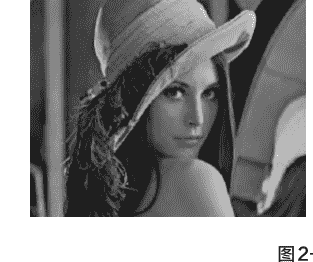

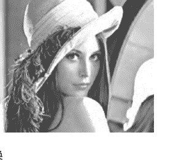

图2-1 线性变换

（2）对数变换

对数变换是一种非线性灰度变换，可扩展低亮度区域并压缩高亮度区域，从而增强对比度。其数学表达式为：

$$g(x,y) = c \lg(1 + f(x,y))$$ (2-2)

其中，$f(x,y)$ 为原始像素值；$g(x,y)$ 为变换后像素值；$c$ 为可调节对比度的常数。

用户：“使用Matlab实现对数变换。”

```matlab
% 读取 Lena 图像
img = imread('lena.png');

% 显示原始图像
subplot(1,2,1);
imshow(img);
title('原始图像');

% 将图像转换为双精度类型
img_double = double(img);

% 对数变换的常数 c
c = 255 / log(1 + max(img_double(:)));

% 执行对数变换
img_log_transformed = c * log(1 + img_double);

% 确保像素值在有效范围内
img_log_transformed = uint8(min(max(img_log_transformed, 0), 255));

% 显示变换后的图像
subplot(1,2,2);
imshow(img_log_transformed);
title('对数变换后的图像');
```

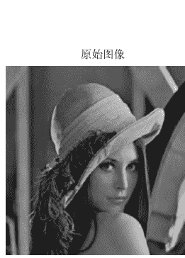

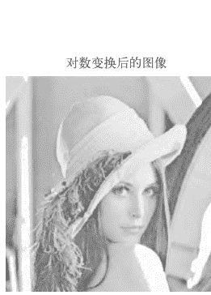

图2-2 对数变换

（3）伽马变换

伽马变换是常用的非线性灰度变换，可调节亮度与对比度。其数学表达式为：

$g(x, y) = af(x, y)^\gamma$ (2-3)

其中，$f(x, y)$ 为原始像素值；$g(x, y)$ 为变换后像素值；$a$ 和 $\gamma$ 为伽马变换参数，可调节亮度和对比度。

用户：“使用Matlab实现伽马变换。”

ChatGPT

```matlab
clear;
clc;
% 读取 Lena 图像
img = imread('lena/lena_c.bmp');

% 显示原始图像
subplot(1,2,1);
imshow(img);
title('原始图像');

% 将图像转换为双精度类型
img_double = double(img);

% 伽马变换参数
gamma = 1.5; % 伽马值，可以调节
c = 255;     % 常数
a = 1;
% 执行伽马变换
img_gamma_transformed = a * c * (img_double / 255) .^ gamma;

% 确保像素值在有效范围内
img_gamma_transformed = uint8(min(max(img_gamma_transformed, 0), 255));

% 显示变换后的图像
subplot(1,2,2);
imshow(img_gamma_transformed);
title(['伽马变换后的图像 (\gamma = ' num2str(gamma) ')']);
```

### 2.2.2 像素阈值处理

像素阈值处理通过将像素值与预设阈值比较来决定最终像素值。基本步骤为：

- ① 选择阈值：手动选取或根据图像特性自动确定阈值，用于划分像素。
- ② 比较像素值：将每个像素值与阈值进行比较。
- ③ 分割像素：根据比较结果进行二值化。若像素值大于阈值则设为高值，如白色；否则设为低值，如黑色。

阈值处理广泛应用于图像分割、边缘检测、目标识别等。接下来介绍固定阈值二值化和自适应阈值二值化。

#### （1）固定阈值的二值化

固定阈值二值化将像素值与设定的固定阈值比较，大于阈值的像素设为一个值，小于等于阈值的像素设为另一个值。

用户：“使用 Matlab 实现固定阈值的二值化。”

ChatGPT

```matlab
clear;
clc;

% 读取 Lena 图像
img = imread('lena.png');

% 显示原始图像
subplot(1,2,1);
imshow(img);
title('原始图像');

% 将图像转换为灰度图像（如果是彩色图像）
if size(img, 3) == 3
    img = rgb2gray(img);
end

% 设置固定阈值
threshold = 128; % 你可以调整此阈值

% 执行固定阈值二值化
binary_img = img >= threshold; % 大于或等于阈值的像素值设为1（白色），否则设为0（黑色）

% 将二值化结果转换为 0 或 255
binary_img = uint8(binary_img) * 255;

% 显示二值化后的图像
subplot(1,2,2);
imshow(binary_img);
title(['二值化图像 (阈值 = ' num2str(threshold) ')']);
```

#### （2）自适应阈值二值化

自适应阈值二值化根据局部像素灰度特性确定阈值。通过分析局部像素计算每个像素的阈值，并据此进行二值化处理。

用户：“使用Matlab实现自适应阈值二值化。”

```matlab
clear;
clc;

% 读取 Lena 图像
img = imread('lena.png');

% 显示原始图像
subplot(1,2,1);
imshow(img);
title('原始图像');

% 将图像转换为灰度图像（如果是彩色图像）
if size(img, 3) == 3
    img = rgb2gray(img);
end

% 自适应阈值二值化
window_size = 15; % 窗口大小，可以根据需要调整
adaptive_thresh = adaptthresh(img, 0.5, 'ForegroundPolarity', 'bright', 'NeighborhoodSize', window_size);

% 执行自适应二值化
binary_img_adaptive = imbinarize(img, adaptive_thresh);

% 显示自适应二值化后的图像
subplot(1,2,2);
imshow(binary_img_adaptive);
title(['自适应二值化图像 (窗口大小 = ' num2str(window_size) ')']);
```

### 2.2.3 像素反转

像素反转是一种简单的点运算，通过反转像素值得到与原图效果相反的图像。亮区变暗、暗区变亮。基本步骤为：

- 1. 获取图像：从输入读取图像。
- 2. 反转像素值：每个像素的新值等于最大像素值减去原始值，最大像素值通常为 255，可按位深度调整。

像素反转常用于图像增强、特效处理、信息隐藏等，可改变亮度对比度增强视觉冲击。

用户：“使用Matlab实现像素反转。”

ChatGPT

```matlab
clear;
clc;

% 读取 Lena 图像
img = imread('lena.png');

% 显示原始图像
subplot(1,2,1);
imshow(img);
title('原始图像');

% 如果图像是彩色图像，则对每个颜色通道进行反转
if size(img, 3) == 3
    % 对每个通道进行反转
    img_inverted = 255 - img;
else
    % 如果是灰度图像，直接进行反转
    img_inverted = 255 - img;
end

% 显示反转后的图像
subplot(1,2,2);
imshow(img_inverted);
title('反转后的图像');
```

### 2.2.4 像素对比度增强

像素对比度增强通过调整像素值范围使对比度更明显，增强视觉效果和细节。常见方法包括直方图均衡化和自适应直方图均衡化。基本步骤为：

- ① 获取图像：从输入读取图像。
- ② 计算平均亮度：求取图像所有像素的平均亮度。
- ③ 调整像素值：将每个像素亮度与平均亮度比较并调整。新像素值等于平均亮度加上增益乘以原始像素值与平均亮度的差。增益大于 1 会增大亮度差异，增强对比度；小于 1 则减小对比度。

像素对比度增强用于图像增强、显示优化、图像分析等，可使图像更鲜明并突出重要特征。

用户：“使用Matlab实现直方图均衡化。”

```matlab
% 读取图像
img = imread('image.jpg'); % 进行直方图均衡化
output_img = histeq(img);

% 显示原图和直方图均衡化后的图像
subplot(1, 2, 1), imshow(img), title('原图');
subplot(1, 2, 2), imshow(output_img), title('像素对比度增强');
```

## 2.3 几何变换：让图像的形态与位置自由可控

对图像进行几何变换的本质，是通过对像素坐标的重新映射来改变形状、尺度和摆放。旋转、平移、缩放、翻转、仿射与透视等操作，能够实现形态和位置的灵活调节，在图像处理与计算机视觉里应用非常广泛。下面梳理几种常用做法。

### 2.3.1 图像旋转

旋转是指以某个中心点为基准，将整张图顺时针或逆时针转过指定角度。这一手段常用来矫正倾斜、进行角度测量以及图像配准。旋转关系可用矩阵表示：

$$\begin{bmatrix} \cos\theta & -\sin\theta & 0 \\ \sin\theta & \cos\theta & 0 \\ 0 & 0 & 1 \end{bmatrix}$$ (2-4)

其中，$\theta$ 为旋转角度。

用户：“使用Matlab实现图像旋转。”

ChatGPT

```matlab
A = imread('image.jpg');
angle = 30;

B = imrotate(A, angle);

subplot(1, 2, 1), imshow(A), title('原图');
subplot(1, 2, 2), imshow(B), title('旋转后图像');
```

文中使用的 imrotate 是 Matlab 提供的旋转函数，能按给定角度把图像逆时针转过。最简用法如下：

```matlab
B = imrotate(A, angle)
```

A 为原始图像，angle 为转角，返回的 B 即为旋转结果。除此之外，imrotate 还支持若干可选项：

- ① 'crop'：默认行为会对结果进行裁剪以保持与原图尺寸一致。用 'crop' 参数可对旋转后图像执行裁剪，使其尽量保留更多内容。

  `B = imrotate(A, angle, 'crop')`

- ② 'bilinear' 或 'bicubic'：决定插值方式。默认采用双线性插值 'bilinear'，也可改用双三次插值 'bicubic'。

  `B = imrotate(A, angle, 'bilinear')`

- ③ 'nearest'：采用最近邻插值，速度更快但在部分场景会产生块状伪影。

  `B = imrotate(A, angle, 'nearest')`

- ④ 'loose'：保留旋转后图像的全部区域，不做裁剪，这会导致输出尺寸可能与原图不同。

  `B = imrotate(A, angle, 'loose')`

### 2.3.2 图像平移

平移即沿水平或垂直方向把图像整体移动一段距离，多用于位置校准、图像拼接等场景。实现思路是对每个像素坐标加上相应的偏移量即可完成位移。

用户：“使用Matlab实现图像平移。”

```matlab
img = imread('image.jpg');
tx = 50; % 水平平移量
ty = 20; % 垂直平移量

tform = affine2d([1, 0, 0; 0, 1, 0; tx, ty, 1]);

translated_img = imwarp(img, tform);

% 显示平移前后的坐标
figure;
imshow(translated_img);
hold on;
text(10, 10, sprintf('原始图像\n(0, 0)'), 'Color','red', 'FontSize', 12);
text(10 + tx, 10 + ty, sprintf('平移后图像\n(%d, %d)', tx, ty), 'Color', 'green', 'FontSize', 12);
hold off;
```

这里用到的 imwarp 是 Matlab 中执行各类几何变换的通用函数，支持仿射、透视、缩放等。基础调用形式为：

```matlab
output_img = imwarp(input_img, tform)
```

input_img 为输入图，tform 是仿射对象或几何变换矩阵，output_img 为变换后结果。额外选项包括：

- ① 'OutputView'：限定输出图像的尺寸与空间参考。

  `output_img = imwarp(input_img, tform, 'OutputView', imref2d(size(input_img)))`

- ② 'FillValues'：设置变换时空缺区域的填充值，默认填充 0。

  `output_img = imwarp(input_img, tform, 'FillValues', 255)`

### 2.3.3 图像缩放

缩放是通过重新采样像素来改变图像大小，常用于压缩或放大。常用的插值方式有最近邻、双线性与三次样条。

用户：“使用 Matlab 实现图像缩放。”

ChatGPT

```matlab
img = imread('image.jpg');
scale_factor = 0.1; % 缩放因子
scaled_img = imresize(img, scale_factor);

% 显示缩放前后效果对比
figure;
subplot(1, 2, 1), imshow(img), title('原始图像');
subplot(1, 2, 2), imshow(scaled_img), title('缩放后图像');
```

imresize 是 Matlab 中调整图像尺寸的函数，可按比例或指定大小进行插值缩放。基本语法如下：

```matlab
output_img = imresize(input_img, scale)
```

input_img 为原图，scale 为缩放倍数，output_img 为缩放结果。可选项有：

- ① 'OutputSize'：直接指定输出图像的高宽。

  `output_img = imresize(input_img, scale, 'OutputSize', [height, width])`

- ② 'Method'：选择插值算法，默认 'bicubic'，也可选用 'bilinear' 或 'nearest'。

  `output_img = imresize(input_img, scale, 'Method', 'bilinear')`

### 2.3.4 图像翻转

翻转是交换像素位置实现镜像效果，常见于特效与对称处理。水平翻转是对每行像素逆序，垂直翻转是对每列像素逆序。

用户：“使用Matlab实现图像翻转。”

```matlab
img = imread('image.jpg');
flipped_img_lr = fliplr(img); % 水平翻转
flipped_img_ud = flipud(img); % 垂直翻转

% 显示对比效果
figure;
subplot(1, 3, 1), imshow(img), title('原始图像');
subplot(1, 3, 2), imshow(flipped_img_lr), title('水平翻转');
subplot(1, 3, 3), imshow(flipped_img_ud), title('垂直翻转');
```

Matlab 提供了 fliplr 与 flipud 两个翻转函数：

- ① fliplr 用于水平翻转，即沿垂直中线镜像。基本形式：

  `output_img = fliplr(input_img)`

  input_img 为输入，output_img 为翻转后结果。

- ② flipud 用于垂直翻转，即沿水平中线镜像。基本形式：

  `output_img = flipud(input_img)`

  input_img 为输入，output_img 为翻转后结果。

## 2.4 直方图处理

### 2.4.1 直方图均衡化

直方图均衡化通过重排灰度分布来提升对比度，核心思想是把原始灰度的分布拉伸成更均匀的状态，让动态范围得到充分利用。具体流程为：

- ① 统计原图的灰度频率，即直方图，反映各灰度出现的次数。
- ② 对直方图归一化，得到各灰度的概率。
- ③ 求累积分布函数 CDF，对归一化直方图累加得到累积概率。
- ④ 根据 CDF 构建映射关系，使累积概率在全灰度范围内均匀分布。
- ⑤ 用该映射更新图像每个像素的灰度值。

经过处理，暗部变亮、亮部细节更易辨识，对比度整体增强。该方法主要针对单通道灰度图，彩色图可分通道处理后合并。在 Matlab 中可用 histeq 实现。

具体语法如下：

```matlab
output_img = histeq(input_img);
```

input_img 为输入，output_img 为均衡化后结果。

用户：“使用Matlab实现直方图均衡化。”

ChatGPT

```matlab
% 读取灰度图像
img = imread('image.jpg');
grayImg = rgb2gray(img); % 转换为灰度图像

% 进行直方图均衡化
eqImg = histeq(grayImg);

% 显示原始图像和均衡化后的图像
figure;
subplot(2, 2, 1); imshow(img); title('原图');
subplot(2, 2, 2); imshow(eqImg); title('直方图均衡化');

% 显示原始图像的直方图
subplot(2, 2, 3); imhist(grayImg); title('原始直方图');

% 显示均衡化后的图像的直方图
subplot(2, 2, 4); imhist(eqImg); title('均衡化直方图');
```

上述代码可同时展示原图与均衡化后的效果，对比度得到改善，细节更清晰，视觉观感提升。

代码中 histeq 用于执行直方图均衡化，其语法为：

```matlab
J = histeq(I, N)
J = histeq(I, X)
[J, T] = histeq(__)
```

I 为输入图像，可为灰度或彩色；N 为可选参数，指定输出灰度级数；X 为指定输出灰度分布的向量；J 为均衡化后图像。若指定 N，则 J 的灰度级数为 N；若指定 X，则 J 的灰度分布与 X 匹配。若以 “[J, T] = histeq(__);” 调用，还会额外返回变换向量 T，可作为查找表用于对其它图像应用相同映射。

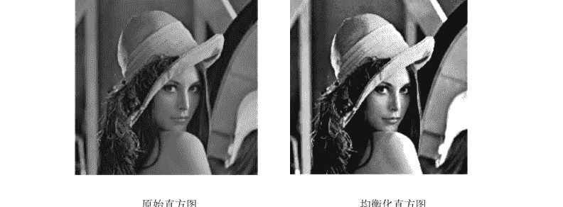

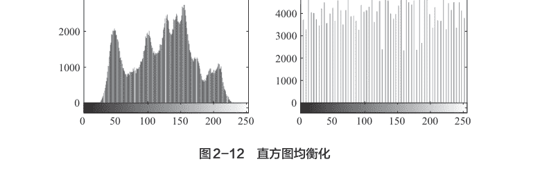

图2-12 直方图均衡化

### 2.4.2 直方图匹配

直方图匹配又称直方图规定化，目标是将待处理图像的直方图调整为参考图像的分布，从而使两者的外观更接近。基本原理是比较两张图的直方图差异，并对灰度进行重映射，使分布趋同，进而统一对比度和色彩范围。典型步骤：

- ① 获取待匹配图像与参考图像的直方图。
- ② 对两个直方图归一化，转化为概率。
- ③ 分别计算累积分布函数 CDF。
- ④ 求 CDF 的反函数，将累积概率转回灰度级。
- ⑤ 用反函数对目标图像像素进行重映射。

该技术常用于图像增强、色彩校正与内容合成。Matlab 中可用 imhistmatch 实现。

具体语法如下：

```matlab
output_img = imhistmatch(input_img, ref_img)
```

input_img 为待处理图像，ref_img 为参考图像，output_img 为匹配后结果。

用户：“用Matlab实现直方图匹配。”

ChatGPT

```matlab
% 读取参考图像和待处理图像
refImg = imread('reference.jpg');
targetImg = imread('target.jpg');

% 将图像转换为灰度图像
refGray = rgb2gray(refImg);
targetGray = rgb2gray(targetImg);

% 对参考图像和目标图像计算直方图
refHist = imhist(refGray);
targetHist = imhist(targetGray);

% 对直方图进行归一化
refHist = refHist / numel(refGray);
targetHist = targetHist / numel(targetGray);

% 计算累积分布函数
refCDF = cumsum(refHist);
targetCDF = cumsum(targetHist);

% 计算累积分布函数的反函数
refCDFMap = round(refCDF * 255);
targetCDFMap = round(targetCDF * 255);

% 对待处理图像进行直方图匹配
matchedImg = histeq(targetGray, refCDFMap);

% 显示参考图像、待处理图像和匹配后的图像
figure;
subplot(1, 3, 1); imshow(refGray); title('参考图像');
subplot(1, 3, 2); imshow(targetGray); title('目标图像');
subplot(1, 3, 3); imshow(matchedImg); title('匹配后图像');

% 显示参考图像和目标图像的直方图
figure;
subplot(1, 3, 1); imhist(refGray); title('参考直方图');
subplot(1, 3, 2); imhist(targetGray); title('目标直方图');

% 显示匹配后的图像的直方图
subplot(1, 3, 3); imhist(matchedImg); title('匹配后直方图');
```

参考图像

目标图像

匹配后图像

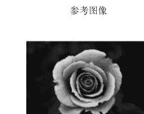

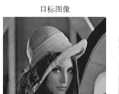

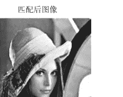

图2-13 图像对比

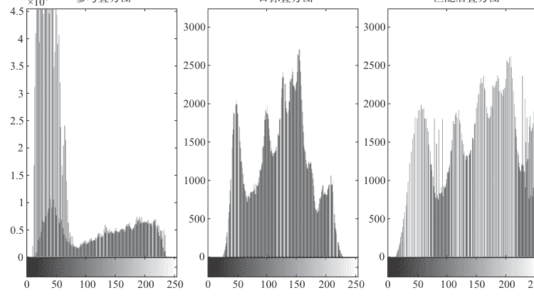

运行后可看到参考图、原图与匹配后图的对比。经匹配，目标图的对比度和色彩分布与参考图更为相似。

### 2.4.3 直方图反转

直方图反转是通过调整像素强度分布来增强对比度的手段。原始图像的像素强度往往分布不均，反转操作可将强度范围拉伸或压缩至整个灰度区间，从而凸显细节。基本步骤：

- ① 计算原图的直方图，统计各灰级的出现频率。
- ② 计算累积分布函数 CDF，通过累加直方图得到每个灰级以下的像素总量。
- ③ 归一化映射，将 CDF 归一到 [0,1] 区间，得到每个灰级的映射值。
- ④ 将归一化值扩展到完整灰度范围 [0,255]，形成反转映射。
- ⑤ 把原始像素值替换为映射后的值，得到反转图像。

在上述过程中，直方图反转的数学计算如下。

① 计算累积分布函数（CDF）：

$$CDF(j) = \sum_{i=0}^{j} P(i)$$ (2-5)

其中，$j$ 表示灰度等级；$P(i)$ 表示整体像素中灰度为 $i$ 的占比。

② 归一化映射：

$$MI(j) = (L-1) \frac{GDF(j) - GDF_{min}}{M \cdot N - GDF_{min}}$$ (2-6)

其中，$MI(j)$ 表示 $j$ 的归一化映射结果；$L$ 为灰度取值区间；$M$、$N$ 分别对应图的行列数；$GDF_{min}$ 为累积分布函数 CDF 的最小值。

③ 映射到新的灰度级范围：

$$FI(j) = round(MI(j))$$ (2-7)

其中，$FI(j)$ 为 $j$ 的最终映射值，做法是将归一化结果取整到邻近整数。

直方图反转是提升低对比度画面的常用增强手段，能让细节更易辨识，在图像处理、计算机视觉和模式识别等领域应用广泛。MATLAB 中可通过 imcomplement 完成该操作。

具体语法如下：

```matlab
output_img = imcomplement(input_img)
```

其中，input_img 为输入原图；output_img 为反转后的结果。核心思路是倒置灰度分布，从而调整对比度和亮度。

> 用户：“使用Matlab进行直方图反转，并显示对应的直方图对比。”

ChatGPT

```matlab
% 读取图像
img = imread('image.jpg');

% 将图像转换为灰度图像
grayImg = rgb2gray(img);

% 计算原始图像的直方图
historig = imhist(grayImg);

% 图像的灰度级
levels = 0:255;

% 直方图反转
reversedImg = imcomplement(grayImg);

% 计算反转图像的直方图
histReversed = imhist(reversedImg);

% 显示原始图像和反转后的图像
figure;
subplot(1, 2, 1); imshow(grayImg); title('原图');
subplot(1, 2, 2); imshow(reversedImg); title('反转后图像');

% 显示原始图像和反转图像的直方图
figure;
subplot(2, 1, 1); stem(levels, historig); title('原始直方图');
xlabel('灰度级'); ylabel('像素数量');
subplot(2, 1, 2); stem(levels, histReversed); title('反转后直方图');
xlabel('灰度级'); ylabel('像素数量');
```

这段实现先载入彩色图并转为灰度，随后用 imhist 统计原图直方图，再调用 imcomplement 执行反转，随后统计反转图的直方图。然后借助 subplot 并排展示原图与反转图，并用 title 标注。最后用 stem 绘制两组直方图，并用 xlabel、ylabel 标明坐标。

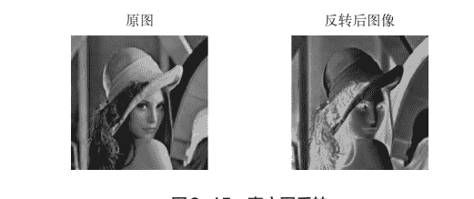

图2-15 直方图反转

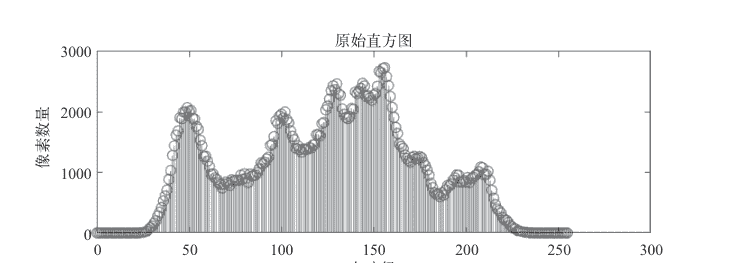

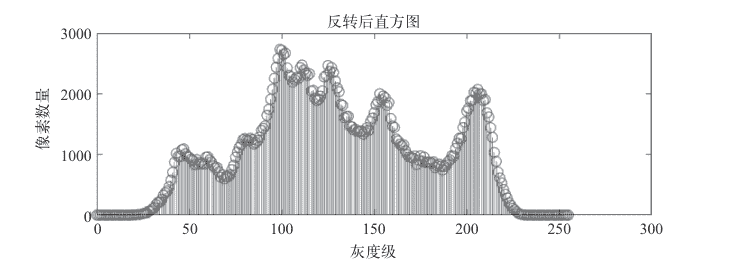

图2-16 反转后直方图

## 2.5 图像去噪

图像去噪旨在从受污染的画面中还原清晰内容。噪声源于传感器、传输等随机干扰，选用合适的滤波策略可有效抑制，提升画质。常见做法如下。

### 2.5.1 中值滤波

中值滤波属于非线性滤波的一种，主要用来压制噪声。其原理是取像素邻域内灰度排序后的中间值作为新值，对异常点不敏感，比线性方法更能保留边缘和纹理。噪声通常表现为随机偏离，中值替换可削弱其影响。

对 $n\times n$ 的窗口，若包含目标像素及其邻域，则可表述为：

$$F\_median = median(P(i, j))$$

式中 $F\_median$ 为滤波后值，$P(i, j)$ 为窗口内像素集合，median 表示排序后取中位数的操作。流程如下：

- 1. 对每像素选定合适窗口，常为正方形；
- 2. 将窗口内像素按灰度排序；
- 3. 取中间值替换原像素；
- 4. 循环处理整幅图；
- 5. 得到滤波结果。

该方法对椒盐噪声和脉冲噪声去噪效果明显，尤其在低噪声水平时稳定，可用于增强、边缘检测、恢复等。优点是实现简便、降噪好、细节保持佳；缺点是对高频细节恢复有限，有时整体亮度会下降。

用户：“使用Matlab进行中值滤波。”

ChatGPT

```matlab
% 读取带有椒盐噪声的图像
originalImg = imread('原始图像');

% 添加椒盐噪声
saltPepperImg = imnoise(originalImg, 'salt & pepper', 0.05);

% 应用中值滤波
filteredImg = medfilt2(saltPepperImg);

% 显示原始图像、加噪图像和滤波后的图像
figure;
subplot(1, 3, 1); imshow(originalImg); title('原图');
subplot(1, 3, 2); imshow(saltPepperImg); title('噪声图像');
subplot(1, 3, 3); imshow(filteredImg); title('滤波后图像');
```

代码先读入含椒盐噪声的图像，用 imnoise 添加椒盐噪声，比例 0.05。然后用 medfilt2 对加噪图做中值滤波，默认 3×3 窗口。最后用 subplot 同时呈现原图、加噪图与滤波图。

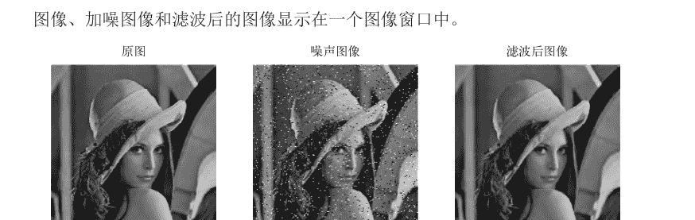

图2-17 中值滤波

### 2.5.2 高斯滤波

高斯滤波用于图像平滑降噪，基于高斯函数即正态分布。它用高斯核对图像做加权平均，每个像素被邻域加权均值替代，中心权重最大，随距离衰减，从而压低高频噪声并保留边缘。

数学形式为：

$$G(x, y) = \frac{1}{2\pi\sigma^2} e^{-\frac{(x-m)^2+(y-n)^2}{2\sigma^2}}$$ (2-9)

其中 $G(x, y)$ 表示滤波后 $(x, y)$ 处的值，$m$、$n$ 为核中心，$\sigma$ 为标准差。$\sigma$ 越大，分布越平缓，平滑越强。

使用时把高斯核在图上滑动计算加权均值，通常采用正方形核，核尺寸决定平滑强度。核越大平滑越强但细节损失风险越高。常用于去噪、模糊化、色彩过渡平滑。

用户：“使用 Matlab 实现高斯滤波，并显示前后的图像效果对比。”

ChatGPT

```matlab
% 读取原始图像
originalImage = imread('lena.png'); % 更换成你的图片路径

% 添加高斯噪声
noisyImage = imnoise(originalImage, 'gaussian', 0, 0.02);
% 添加均值为0，方差为0.02的高斯噪声

% 定义高斯滤波器
filterSize = 5; % 定义滤波器大小
sigma = 1; % 定义高斯核的标准差
gaussianFilter = fspecial('gaussian', [filterSize, filterSize], sigma);

% 对噪声图像进行高斯滤波
filteredImage = imfilter(noisyImage, gaussianFilter, 'replicate');

% 显示对比效果图
figure;
subplot(1, 3, 1); imshow(originalImage); title('原图');
subplot(1, 3, 2); imshow(noisyImage); title('添加噪声后的图像');
subplot(1, 3, 3); imshow(filteredImage); title('经过高斯滤波后的图像');
```

示例先从文件读取原图，用 imnoise 添加均值 0、方差 0.02 的高斯噪声。随后设定核大小与 $\sigma$，用 fspecial 生成高斯滤波器，再用 imfilter 对噪声图滤波。最后通过 subplot 与 imshow 同屏对比原图、噪声图与滤波后图。

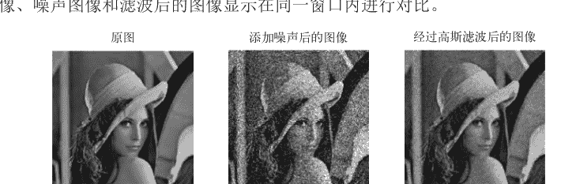

图2-18 高斯滤波

### 2.5.3 小波去噪

小波去噪利用图像在小波域的稀疏特性。通过小波变换把图像拆分为不同频段子带，低频含主要结构与细节，高频多含噪声。对小波系数阈值化可剔除噪声，再经逆变换合成。

常用公式：

（1）小波变换公式

连续小波变换把一维信号 $x(t)$ 分解为不同尺度和位置的小波基线性组合：

$$CWT(a,b) = \int x(t)\psi(\frac{t-b}{a}) dt \quad (2-10)$$

其中 $a$ 为尺度参数，$b$ 为位置参数，$\psi(t)$ 为小波基。

（2）小波系数计算公式

离散小波变换下系数的计算为：

$$c(i,j) = \sum x(k)\psi(\frac{k-2^j i}{2^{j+1}}) \quad (2-11)$$

其中 $i$ 为位置，$j$ 为尺度。

（3）阈值处理

核心是对系数做阈值。硬阈值：系数绝对值小于阈值 $T$ 置零，大于等于保留；软阈值：小于 $T$ 置零，大于 $T$ 减去 $T$ 并保持符号。

实际中可按需求选小波基、阈值计算方式与策略，并结合信号特性重构。该方法能在去噪同时保持边缘细节，适用于高斯噪声、椒盐噪声、周期性噪声等。

用户：“使用 Matlab 实现小波去噪。”

```matlab
load noisdopp;
s = noisdopp;
plot(s);
title('原始信号');

[thr, sorh, deepapp, crit] = ddencmp('den', 'wp', s);
[x, wpt, perfe, perf1] = wpdencmp(s, sorh, 3, 'sym6', crit, thr, deepapp);

figure;
plot(x);
title('去噪信号');
```

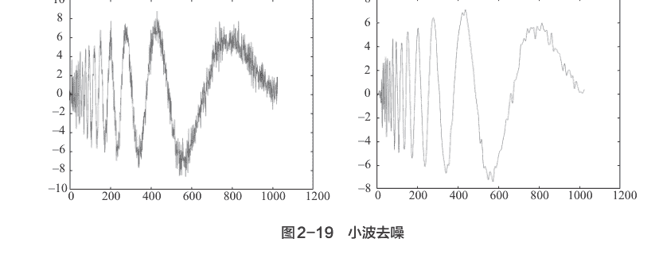

### 2.5.4 K近邻去噪

K近邻去噪基于局部相似像素平滑。对每个像素寻找邻域内欧氏距离最近的 $K$ 个像素，用其均值或加权均值替换当前值以降低噪声。步骤如下：

- 1. 设定邻域范围与 $K$ 值；
- 2. 对每个像素找出邻近 $K$ 个像素；
- 3. 按邻近像素灰度做平均或加权平均得到去噪值；
- 4. 重复直至全部像素处理完；
- 5. 输出结果图。

该方法简单易行，对邻域相似度高的区域降噪效果好，但易受噪声与真实细节相似度影响，在细节混杂区可能损失信息。

用户：“使用 Matlab 实现 K近邻去噪。”

```matlab
% 读取原始图像
originalImage = imread('lena.png');

% 添加椒盐噪声，噪声密度为0.05
noisyImage = imnoise(originalImage, 'salt & pepper', 0.05);

% 定义滤波窗口大小和K值
windowSize = 3; % 窗口大小
k = 5; % K值

% 将图像转换为双精度浮点数类型
noisyImage = im2double(noisyImage);

% 复制噪声图像作为滤波后的图像
denoisedImage = noisyImage;

% 使用K近邻滤波
padsize = floor(windowSize / 2);
paddedImage = padarray(noisyImage, [padsize, padsize], 'symmetric');

for row = 1:size(noisyImage, 1)
    for col = 1:size(noisyImage, 2)
        % 获取当前像素周围的窗口
        window = paddedImage(row:row + windowSize - 1, ...
                             col:col + windowSize - 1, :);
        
        % 将窗口内的像素值按照欧氏距离排序
        centerPixel = window(padsize + 1, padsize + 1, :);
        windowFlat = reshape(window, [], size(window, 3));
        windowFlat(padsize * windowSize + padsize + 1, :) = []; % 去除中心像素
        distances = sqrt(sum((windowFlat - centerPixel).^2, 2));
        [~, indices] = sort(distances);

        % 使用k个最近邻像素的平均值进行滤波
        denoisedImage(row, col, :) = mean(windowFlat(indices(1:k), :));
    end
end

% 显示对比效果图
figure;
subplot(1, 2, 1); imshow(noisyImage); title('噪声图像');
subplot(1, 2, 2); imshow(denoisedImage); title('去噪图像');
```

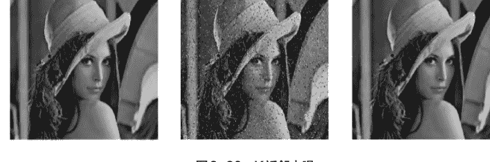

图2-20 K近邻去噪

代码先定义窗口大小 windowSize 与 $k$，将图像转成双精度并复制一份作输出。随后双重循环遍历每个像素，对窗口内像素按欧氏距离排序，取最近 $K$ 个像素均值作为滤波值，最后展示原图与去噪图。

## 2.6 小结

本章围绕图像基础操作。包括读写存储、点运算如灰度变换与阈值化，几何变换如旋转、平移、缩放、翻转，直方图处理如均衡化、匹配、反转、规定化，以及去噪方法如中值滤波、高斯滤波、小波去噪、K近邻去噪，用于改善对比度、调整分布并降低噪声。

# 第 3 章 图像分割

- 3.1 边缘提取

- 3.2 区域分割

- 3.3 小结

# ChatGPT驱动的图像分割实战指南

当下，人工智能在计算机视觉赛道的进展肉眼可见，其中图像分割的落地场景越来越多。图像分割的核心思路就是把一幅数字图像拆成若干语义一致的区域或目标，从而让机器理解画面内容。做法通常是把像素按相似性聚类或分类，把同属一个物体或特征相近的像素归到同一块，实现对不同区域的识别与提取。ChatGPT作为当前顶尖的自然语言处理模型，不仅能产出高质量文本，还能延伸到图像分割的辅助与实现。本章聚焦基于ChatGPT的图像分割思路，重点覆盖边缘提取的常用算子、区域分割的典型算法，以及在真实任务中的表现。

## 3.1 边缘提取

找边界是图像处理的经典环节，目标是在画面里把物体与背景、不同区域之间的分界线找出来。边缘本质上是灰度、色彩或纹理发生突变、强度变化显著的像素带，往往对应着物体的轮廓。做好边缘提取，就能为目标检测、分割、识别等后续任务提供结构依据。主流做法分两类：基于梯度的经典算子，如Sobel、Prewitt、Canny；以及基于模型或机器学习的方法，比如角点检测、线性回归等。通用的处理链条包括先平滑降噪、再计算梯度、随后做非极大值抑制，最后用双阈值判定。平滑用来压制噪声，梯度计算捕捉灰度变化，非极大值抑制保留局部极大，雙阈值则筛选出可靠的边缘像素。边缘提取虽基础，却是后续分析的关键底座。下面按顺序介绍几类常用算子，建议读者把每种算子都跑在不同自然图上，直观对比结果，形成清晰认知。

### 3.1.1 Roberts算子

Roberts算子属于梯度类边缘检测，由Lawrence Roberts于1963年提出。它通过比较相邻像素的差异来定位边缘，采用一对3×3模板，分别对应水平方向Gx和垂直方向Gy。这两个模板的布局如下：

$$G_x = \begin{bmatrix} 1 & 0 & 0 \\ 0 & -1 & 0 \\ 0 & 0 & 0 \end{bmatrix}$$ $$G_y = \begin{bmatrix} 0 & 0 & 0 \\ 0 & -1 & 0 \\ 0 & 0 & 1 \end{bmatrix}$$

其中+1代表正权重，-1代表负权重，0代表不参与。对图像做模板卷积可得到水平与垂直两个方向的边缘响应。

具体流程可归纳为：
- ① 用Gx模板在原图上做卷积，得到每个像素的水平梯度。
- ② 用Gy模板在原图上做卷积，得到每个像素的垂直梯度。
- ③ 将Gx、Gy的梯度结果平方求和再开方，得到边缘强度。
- ④ 依据预设阈值，把强度大于阈值的像素标记为边缘。

Roberts实现简洁，但在噪声环境下容易误检，通常会先接高斯等平滑滤波做预处理。它的边缘比较纤细，一般只有一像素宽，后续往往需要增强或细化。总的来说，Roberts是边缘检测的入门算子，在简单场景下仍有实用价值。下面是一个典型交互示例。

用户：“请你写出在Matlab中使用Roberts算子对图片进行边缘检测的代码，并且保存结果图像，图片地址为‘C:\Users\图片1.png’，原始图像为灰度图。”

ChatGPT

```matlab
% 读取图像
img = imread('C:\Users\图片1.png');

% 如果是彩色图像，转换为灰度图像
if size(img, 3) == 3
    img_gray = rgb2gray(img);
else
    img_gray = img;
end

% 使用Roberts算子进行边缘检测
edge_roberts = edge(img_gray, 'roberts');

% 创建一个新图窗并并排显示图像
figure;
subplot(1,2,1);
imshow(img_gray);
title('原始灰度图像');

subplot(1,2,2);
imshow(edge_roberts);
title('Roberts边缘检测结果');

% 保存边缘检测图像
imwrite(edge_roberts, 'C:\Users\图片1_roberts_edge.png');
```

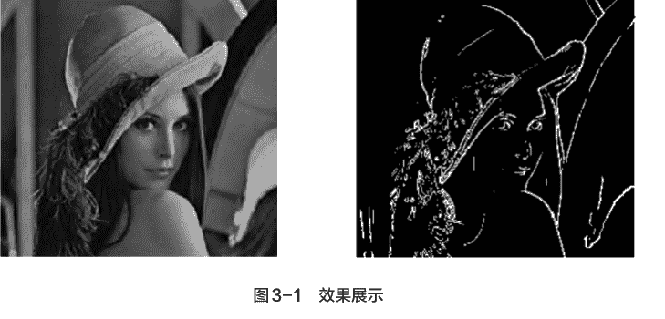

图3-1 效果展示

### 3.1.2 Sobel算子

Sobel算子广泛用于计算机视觉和数字图像处理，能在水平和垂直方向同时捕捉边缘信息。其原理是对像素做卷积运算求取局部灰度梯度，常用核为3×3，包含水平核与垂直核，形式如下：

$$G_x = \begin{bmatrix} -1 & 0 & 1 \\ -2 & 0 & 2 \\ -1 & 0 & 1 \end{bmatrix}, \quad G_y = \begin{bmatrix} -1 & -2 & -1 \\ 0 & 0 & 0 \\ 1 & 2 & 1 \end{bmatrix}$$

对任意像素I(x,y)，Sobel的响应为：

$$G(x, y) = \sqrt{G_x(x, y)^2 + G_y(x, y)^2}$$

式中Gx(x,y)、Gy(x,y)分别表示水平和垂直梯度大小，最终幅度为平方和开方。两个核分别提供两个方向的梯度线索。

应用步骤大致是：
将输入转成灰度图，如非灰度需先转换。
分别用Gx、Gy模板对灰度图做卷积，得到各像素的加权差值。
由卷积结果计算水平和垂直差分。
据此求梯度强度与方向：梯度强度公式为 Gradient Magnitude = sqrt(Gx2+ Gy2)；梯度方向公式为 Gradient Direction = arctan(Gy / Gx)。必要时可做非极大值抑制来细化边缘。

③ 下面就根据以上步骤由 ChatGPT 给出代码实现功能。

用户：“请你写出在 Matlab 中使用 Sobel 算子对图片进行边缘检测的代码，并且保存梯度强度和梯度方向两种图像，图片地址为 ‘C:\Users\图片1.png’，原始图像为灰度图。”

ChatGPT

```matlab
% 读取灰度图像
gray_img = imread('C:\Users\图片1.png');

% 如果不是灰度图像则转换
if size(gray_img, 3) == 3
    gray_img = rgb2gray(gray_img);
end

% 使用Sobel算子进行边缘检测
sobel_img = edge(gray_img, 'Sobel');

% 使用imgradient计算梯度强度和方向（单位：方向为角度制）
[gradient_magnitude, gradient_direction] = imgradient(gray_img, 'Sobel');

% 显示原始图像、边缘检测结果、梯度强度和梯度方向
figure;

% 原始图像
subplot(1, 3, 1);
imshow(gray_img);
title('原始图像');

% 梯度强度
subplot(1, 3, 2);
imshow(gradient_magnitude, []);
title('梯度强度');

% 梯度方向（角度范围从 -180 到 180）
subplot(1, 3, 3);
imshow(gradient_direction, [-180, 180]);
colormap(gca, jet); colorbar;
title('梯度方向');

% 保存图像
imwrite(sobel_img, 'C:\Users\图片1_Sobel边缘检测结果.png');
imwrite(mat2gray(gradient_magnitude), 'C:\Users\图片1_Sobel梯度强度图像.png');
imwrite(mat2gray(gradient_direction), 'C:\Users\图片1_Sobel梯度方向图像.png');
```

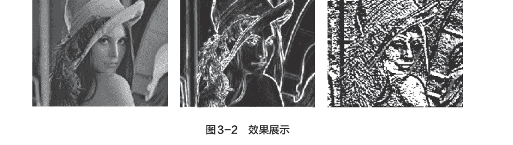

图3-2 效果展示

实际使用中，Sobel边缘多指梯度强度的结果，因为它融合了水平与垂直两个方向的信息。通过像素级梯度计算，Sobel可为图像分割、目标检测等任务提供边缘线索。在其基础上还有Scharr、Prewitt等改进的微分算子，用来提取更稳健的边缘。

### 3.1.3 Prewitt算子

Prewitt算子是数字图像处理中常用的离散卷积算子，擅长寻找水平与垂直边缘。它用两个3×3卷积核分别对水平和垂直方向做卷积，得到每个像素的梯度大小与方向。

两个卷积核如下：

$$G_x = \begin{bmatrix} -1 & 0 & 1 \\ -1 & 0 & 1 \\ -1 & 0 & 1 \end{bmatrix}, \quad G_y = \begin{bmatrix} -1 & -1 & -1 \\ 0 & 0 & 0 \\ 1 & 1 & 1 \end{bmatrix}$$

对任意像素I(x, y)，Prewitt的计算为：

$$G(x, y) = \sqrt{G_x(x, y)^2 + G_y(x, y)^2}$$

其中Gx(x, y)、Gy(x, y)表示水平与垂直梯度，幅度同样取平方和开方。通过逐像素卷积即可获得边缘信息。

实现流程：
若原图为彩色，先转为灰度；
将灰度图与水平或垂直Prewitt核做卷积；
对卷积结果取绝对值，保证正负不影响结果；
对结果做缩放，使数值映射到0～255范围；
按阈值判断边缘，幅值越大边缘越显著。

③ 下面就根据以上步骤由ChatGPT给出相应代码：

用户：“请你写出在Matlab中使用Prewitt算子对图片进行边缘检测的代码，并且保存结果图像，图片地址为‘C:\Users\图片1.png’，原始图像为彩色图。”

ChatGPT

```matlab
% 读取原始彩色图像
originalImage = imread('C:\Users\图片1.png');

% 使用 Prewitt 算子进行边缘检测（先转为灰度图）
edgeImage = edge(rgb2gray(originalImage), 'prewitt');

% 显示原始图像和边缘检测结果
```

# ChatGPT与数字图像处理

```matlab
figure;
subplot(1, 2, 1);
imshow(originalImage);
title('原始彩色图像');

subplot(1, 2, 2);
imshow(edgeImage);
title('Prewitt 算子边缘检测结果');

% 保存边缘检测结果图像
imwrite(edgeImage, 'C:\Users\图片\Prewitt边缘检测结果.png');
```

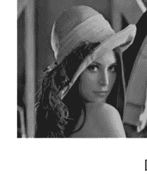

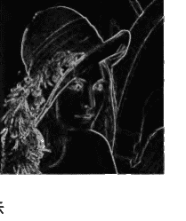

图3-3 效果展示

Prewitt与Sobel用途相近，常用于分割与检测。对边缘方向不敏感的场景，Prewitt的检测效果相对弱于Sobel等方向敏感算子，但运算更快。

### 3.1.4 Laplacian算子

Laplacian算子可检测边缘、角点等高频变化，采用二阶导数形式。常用离散表达式为：

$$\nabla^2 I = \frac{\partial^2 I}{\partial x^2} + \frac{\partial^2 I}{\partial y^2}$$

其中∂²I/∂x²与∂²I/∂y²为水平与垂直二阶导数，∇²I为两者之和。数值实现可用3×3或5×5卷积核近似，例如：

$$\begin{bmatrix} 0 & 1 & 0 \\ 1 & -4 & 1 \\ 0 & 1 & 0 \end{bmatrix} \text{ 或 } \begin{bmatrix} 0 & 0 & -1 & 0 & 0 \\ 0 & -1 & -2 & -1 & 0 \\ -1 & -2 & 16 & -2 & -1 \\ 0 & -1 & -2 & -1 & 0 \\ 0 & 0 & -1 & 0 & 0 \end{bmatrix}$$

对每个像素，将核与其邻域卷积即可得到Laplacian响应，从而捕捉高频变化。

实现步骤：
- a. 把彩色图转灰度，通常用RGB到灰度的转换。
- b. 用3×3 Laplacian核对灰度图做卷积。
- c. 为避免边界效应，可在图像外围填充一圈像素。
- d. 对每个像素，将9个邻域值与核对应相乘求和，得到响应。
- e. 对响应图做阈值二值化，提取边缘。
- f. 可选后处理，如去除小区域、形态学操作以提升连续性。

Laplacian对噪声敏感，实际使用前一般先做平滑，如高斯滤波。

③ 下面就根据以上步骤由 ChatGPT 给出代码实现功能：

用户：“请你写出在 Matlab 中使用 Laplacian 算子对图片进行边缘检测的代码，并且保存结果图像，图片地址为 ‘C:\Users\图片1.png’，原始图像为灰度图。”

# ChatGPT与数字图像处理

```matlab
% 读取原始灰度图像
originalImage = imread('C:\Users\图片1.png');

% 若图像为彩色，需转为灰度图像（可选）
if size(originalImage, 3) == 3
    originalImage = rgb2gray(originalImage);
end

% 使用 Laplacian of Gaussian (LOG) 算子进行边缘检测
edgeImage = edge(originalImage, 'log');

% 显示原始图像和边缘检测结果
figure;
subplot(1, 2, 1);
imshow(originalImage);
title('原始灰度图像');

subplot(1, 2, 2);
imshow(edgeImage);
title('Laplacian 算子边缘检测结果');

% 保存边缘检测结果图像
imwrite(edgeImage, 'C:\Users\图片1_Laplacian边缘检测结果.png');
```

原始灰度图像

Laplacian 算子边缘检测结果

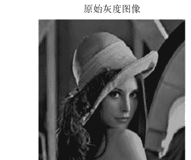

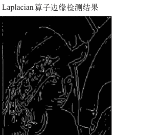

图3-4 效果展示

Laplacian基于二阶微分，能捕捉高频信息，但噪声影响较大，工程中常与其他算子结合使用。

### 3.1.5 Canny算子

Canny算子以准确捕捉真实边缘著称，能避免把像素值轻微变化误判为边缘。其思路是通过多次滤波与非极大值抑制来锐化边缘，并借助双阈值检测提升精度与鲁棒性。

#### （1）Canny算子实现涉及的一些矩阵和公式

① 高斯滤波器：Canny算子首先应用高斯滤波器对图像进行平滑处理，以减小噪声。高斯滤波器的核可以用以下矩阵表示：

Gaussian kernel: $\begin{bmatrix} \frac{1}{16} & \frac{1}{8} & \frac{1}{16} \\ \frac{1}{8} & \frac{1}{4} & \frac{1}{8} \\ \frac{1}{16} & \frac{1}{8} & \frac{1}{16} \end{bmatrix}$

② 梯度求解：Canny 要先知道边缘有多强、朝哪个方向，通常就用 Sobel 来近似水平与垂直方向的一阶导数。两个模板可写作：

Sobel X: $\begin{bmatrix} -1 & 0 & 1 \\ -2 & 0 & 2 \\ -1 & 0 & 1 \end{bmatrix}$ Sobel Y: $\begin{bmatrix} -1 & -2 & -1 \\ 0 & 0 & 0 \\ 1 & 2 & 1 \end{bmatrix}$

③ 非极大值抑制：通过沿梯度方向比较强度来做细化，保留局部极大点。

如果梯度方向为0°，当前像素的梯度强度大于左右两邻像素则保留。

如果梯度方向为45°，当前像素的梯度强度大于左上和右下两邻像素则保留。

如果梯度方向为90°，当前像素的梯度强度大于上下两邻像素则保留当前像素。

如果梯度方向为135°，当前像素的梯度强度大于右上和左下两邻像素则保留。

# ChatGPT 赋能图像处理实战

④ 双阈值筛选：Canny 用高低两个阈值来判断什么是真正边缘。高阈值确定强边缘，低阈值作为候选，具体数值要结合应用场景调整。

⑤ 边缘连通：把弱边缘和强边缘关联起来，形成连续完整的边缘轮廓。

#### （2）Canny 算子的实现过程

- ① 先把彩色图转成灰度图。
- ② 用高斯滤波对灰度图做平滑，抑制噪声。滤波本质是对中心像素与邻域做加权平均。
- ③ 用 Sobel 等算子求梯度幅值和方向，得到水平与垂直方向的梯度信息。
- ④ 做非最大抑制，将每个像素沿梯度方向与邻居对比，只保留局部最大值，其余置零。
- ⑤ 用双阈值把像素分成强边缘、弱边缘和非边缘。高于高阈值的为强边缘，低于低阈值的为非边缘，中间的为弱边缘再根据是否连接强边缘决定去留。
- ⑥ 最后做边缘连接，例如借助霍夫变换把弱边缘连到强边缘，得到完整轮廓。

Canny 的优势在于边缘定位精准、对噪声容忍度较好，阈值调得合适时在不同图像上表现稳定。

#### （3）由 ChatGPT 给出代码实现功能

用户：“请你写出在 Matlab 中使用 Canny 算子对图片进行边缘检测的代码，并且保存结果图像，图片地址为 ‘C:\Users\图片1.png’，原始图像为灰度图。”

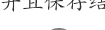

```matlab
% 读取原始灰度图像
originalImage = imread('C:\Users\图片1.png');

% 如果图像是彩色的，转为灰度图像（可选）
if size(originalImage, 3) == 3
    originalImage = rgb2gray(originalImage);
end

% 使用 Canny 算子进行边缘检测
edgeImage = edge(originalImage, 'Canny');

% 显示原始图像和边缘检测结果
figure;
subplot(1, 2, 1);
imshow(originalImage);
title('原始灰度图像');

subplot(1, 2, 2);
imshow(edgeImage);
title('Canny 算子边缘检测结果');

% 保存边缘检测结果图像
imwrite(edgeImage, 'C:\Users\图片1_Canny边缘检测结果.png');
```

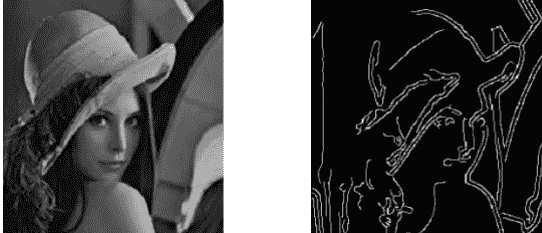

图3-5 效果展示

Canny 能有效压制噪声并提升检测的可靠度，但高斯平滑和阈值参数仍需针对不同场景微调。

### 3.1.6 算子效果横向对比

到这里我们已经介绍了五种边缘提取算子并给出了示例结果。

# ChatGPT 读懂图像处理

下面把同一张图用不同算子处理的结果集中呈现，如图3-6所示。

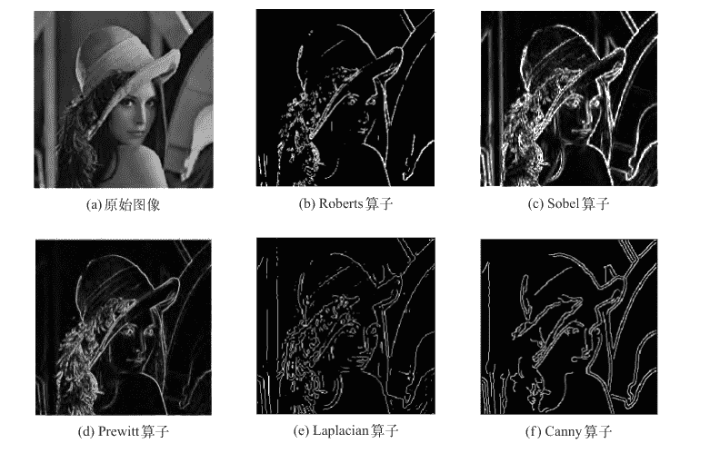

从图3-6六幅结果可以归纳出各算子的特点：

Roberts算子：是二维差分模板，方向性明显，可单独捕捉水平和垂直边缘，在定向检测任务上响应较好。

Sobel算子：是对图像做一阶导数的近似，适合灰度过渡平缓的边缘，检测效果相对稳定。

Prewitt算子：未对响应值做归一化，输出是像素值的线性组合，可能超出原始强度范围，使用时需后续处理。

Laplacian算子：基于二阶导数，对强度变化更敏感，能突出边缘细节与亮度突变。

Canny算子：不预设方向，通过梯度方向把边缘分为水平与垂直两类，整体定位更精细。

## 3.2 区域分割

区域分割是将图像像素按相似特征或语义聚成若干连通区域的任务。目标是把整幅图拆成易于理解和分析的小块，便于后续的识别、分析或信息提取。区域的相似性可以是颜色、纹理、形状或灰度等属性。分割在目标检测、医学影像、自动驾驶、图像检索等领域应用广泛。常用思路有阈值分割、边缘引导分割、区域生长、图割以及深度学习分割等。下面重点介绍区域生长、分水岭、K-means 与 OTSU 等代表方法，帮助读者根据图像特点选择合适的方案。

### 3.2.1 区域生长算法

区域生长是一种基于像素相似性的分割方法，从种子点出发，逐步把特征相近的像素合并成区域。

#### （1）算法原理

- ① 选种子点：可手动指定或按规则自动选取作为生长起点。
- ② 定生长准则：通常用颜色、灰度或纹理的相似度来判断像素是否归入同一区域。
- ③ 生长过程：从种子点向邻域扩展，符合准则的像素被加入当前区域，然后继续向外扩张，直到没有可加入的像素。
- ④ 停止控制：设定区域大小、相似度阈值等条件来终止生长。
- ⑤ 后处理：可去除小区域、平滑边界等优化结果。

#### （2）区域生长算法的实现过程

- ① 种子点选择：确定一个或多个起始像素。
- ② 相似性判断：计算待扩展像素与区域内像素的灰度或其他特征差异。
- ③ 区域合并：差异在阈值内则合并，并继续向外扩展，可用递归或队列实现。
- ④ 停止条件：达到预设像素数、相似度不再满足或碰到边界时停止。

#### （3）由ChatGPT给出代码实现功能

用户：“请你写出在Matlab中实现的区域生长算法区域分割，并且保存结果图像，图片地址为‘C:\Users\图片1.png’，原始图像为灰度图。”

```matlab
% 读取灰度图像
grayImage = imread('C:\Users\图片1.png');

% 如果图像是彩色，转换为灰度（可选）
if size(grayImage, 3) == 3
    grayImage = rgb2gray(grayImage);
end

% 设置种子点（手动指定，也可以后续拓展为交互式选择）
seedRow = 100;  % Y坐标
seedCol = 100;  % X坐标
seedValue = double(grayImage(seedRow, seedCol));

% 设置灰度差阈值（区域增长的条件）
threshold = 10;

% 初始化标记矩阵
[rows, cols] = size(grayImage);
segmented = false(rows, cols);
segmented(seedRow, seedCol) = true;

% 初始化处理队列
queue = [seedRow, seedCol];

% 区域生长
while ~isempty(queue)
    [y, x] = deal(queue(1,1), queue(1,2));
    queue(1,:) = [];  % 出队

    % 遍历邻域（8连通）
    for i = -1:1
        for j = -1:1
            ny = y + i;
            nx = x + j;

            % 边界判断 + 未访问判断
            if ny >= 1 && ny <= rows && nx >= 1 && nx <= cols && ~segmented(ny, nx)
                pixelValue = double(grayImage(ny, nx));
                if abs(pixelValue - seedValue) <= threshold
                    segmented(ny, nx) = true;
                    queue(end+1, :) = [ny, nx];  % 入队
                end
            end
        end
    end
end

% 转换逻辑矩阵为图像格式
segmentedImage = uint8(segmented) * 255;

% 显示原图和分割结果
figure;
subplot(1, 2, 1);
imshow(grayImage);
title('原始图像');

subplot(1, 2, 2);
imshow(segmentedImage);
title('分割图像');

% 保存图像
imwrite(segmentedImage, 'C:\Users\图片1_分割图像.png');
```

# ChatGPT 赋能图像处理实战

图3-7 效果展示

区域生长直观且对同质区域分割准确，但对噪声敏感、边界模糊时易受影响，通常需要参数调优或与其他方法结合。

### 3.2.2 分水岭算法

分水岭算法把灰度图看成地形，高灰度为山峰，低灰度为洼地，模拟注水过程来划分区域。

#### （1）算法原理

① 梯度图像计算：

$$\nabla I = \left| \frac{\partial I}{\partial x} \right| + \left| \frac{\partial I}{\partial y} \right|$$

其中，$I$ 是输入图像；$\nabla I$ 是梯度图像，$\frac{\partial I}{\partial x}$ 和 $\frac{\partial I}{\partial y}$ 分别是图像在水平和垂直方向上的梯度。

② 种子点选择：在梯度图上找局部极大值作为初始种子，可用极值检测或非极大值抑制。

③ 洪泛填充：从种子点开始模拟水流，水从低处向外蔓延，遇到洼地停止，最终不同流域的交界即为分割线。

#### （2）分水岭算法的基本步骤

- ① 计算梯度幅值图，常使用 Sobel、Prewitt 等算子。
- ② 在梯度峰值处放置种子，代表不同对象或区域。
- ③ 用漫水填充模拟水流，从种子向低梯度区域扩散，直至不同种子流域相遇。
- ④ 相遇处形成边界，未被水流覆盖处为不同区域内部。
- ⑤ 对汇聚的边界进行分割，得到最终结果。

#### （3）根据以上步骤给出的ChatGPT生成代码的实例

用户：“请你写出在Matlab中实现分水岭算法进行区域分割，并且保存结果图像，显示原始图像、彩色分水岭标签矩阵图、透明叠加的彩色图三种图像。图片地址为‘C:\Users\图片1.png’，原始图像为灰度图。”

```
1  % 读取灰度图像
2  img = imread('C:\Users\图片1.png');
3  
4  % 确保图像为灰度图
5  if size(img, 3) == 3
6      img = rgb2gray(img);
7  end
8  
9  % 使用分水岭算法进行分割
10 % 计算梯度图像
11 gradientImg = imgradient(img);
12 
13 % 应用分水岭变换
14 L = watershed(gradientImg);
15 
16 % 创建彩色标签图（分水岭结果）
17 L_rgb = label2rgb(L);
18 
19 % 显示原始灰度图像
20  figure;
21  subplot(1, 3, 1);
22  imshow(img);
23  title('原始灰度图像');
24
25  % 显示彩色分水岭标签矩阵图
26  subplot(1, 3, 2);
27  imshow(L_rgb);
28  title('彩色分水岭标签矩阵');
29
30  % 显示透明叠加的彩色图
31  subplot(1, 3, 3);
32  % 创建透明背景的彩色图
33  overlay = imfuse(img, L_rgb, 'blend', 'Scaling', 'joint');
34  imshow(overlay);
35  title('透明叠加彩色图');
36
37  % 保存结果图像
38  imwrite(L_rgb, 'C:\Users\waterShed_output.png');
39  imwrite(overlay, 'C:\Users\overlay_output.png');
```

图3-8 效果展示

分水岭容易出现过分割或欠分割，一般需要预处理或后处理来改善分割质量。

### 3.2.3 K-means聚类算法

K-means 是一种无监督聚类方法，按数据点与聚类中心的距离把样本划分到 K 个簇，目标是最小化簇内平方误差。

#### （1）算法原理

先随机或按先验选取 K 个初始中心；对每个样本计算到各中心的距离，分配给最近的中心；然后用簇内样本均值更新中心位置；重复分配与更新直至中心稳定或达到最大迭代次数，最终得到 K 个聚类。

#### （2）K-means算法实现过程的基本步骤

- ① 初始化聚类中心：确定 K 值并随机挑 K 个样本作初始中心。
- ② 分配样本：计算每个点到各中心的距离，归入最近的簇。
- ③ 更新中心：用簇内所有点的均值重新定位中心。
- ④ 迭代收敛：重复分配与更新，直到中心不再变化或达到预设迭代次数。
- ⑤ 输出结果：得到最终中心与各点的簇标签。

#### （3）根据以上步骤给出的ChatGPT生成代码的实例

# 图像分割与形态学处理实战拆解

用户说：“帮忙写一段 Matlab 代码，用 K-means 做像素聚类分割并把结果保存下来，图片在‘C:\Users\图片1.png’，源图是灰度图。”

```
1  % 读取灰度图像
2  img = imread('C:\Users\图片1.png');
3  
4  % 确保图像为灰度图
5  if size(img, 3) == 3
6      img = rgb2gray(img);
7    end
8
9    % 将图像转换为列向量，用于K-means算法
10   img_vector = double(img(:));
11
12   % 设置K-means的聚类数（可以根据需要调整）
13   k = 3;
14
15   % 使用K-means算法进行聚类
16   [idx, C] = kmeans(img_vector, k);
17
18   % 将聚类结果重塑为原图的大小
19   segmented_img = reshape(idx, size(img));
20
21   % 创建彩色分割图
22   segmented_rgb = label2rgb(segmented_img);
23
24   % 显示原始灰度图像
25   figure;
26   subplot(1, 3, 1);
27   imshow(img);
28   title('原始灰度图像');
29
30   % 显示K-means聚类分割结果
31   subplot(1, 3, 2);
32   imshow(segmented_rgb);
33   title('K-means聚类分割结果');
```

图3-9 效果展示

要提醒的是，这个 demo 只是把图像像素当成样本做聚类，属于最基础的入门演示。真实的图像分割要复杂得多，会用到多种进阶手段。这里的代码仅作起步参考，后续可按需求继续改进优化。

K-means 本质上是迭代求最优解的方法，反复刷新聚类中心，让每个样本到所属簇中心的平方距离总和不断变小。它实现起来直观、速度快，对大规模数据也友好。但最终结果很容易受初始中心选取和样本分布形态的影响，而且对距离计算非常敏感，实际使用前通常要做标准化或归一化等预处理，让各特征权重一致。

K-means 在数据分析、图像处理、文本挖掘等方向应用广泛，也常被当作其他聚类方法的基底。

### 3.2.4 OTSU 自适应二值化

OTSU 是一种自适应的灰度图像二值化策略，目标是挑出一个阈值把前景和背景区分得更清楚。思路是依赖灰度直方图，把整幅图分成前景和背景两类，再计算类间方差。方差越大说明两类差异越明显，阈值越合适。算法的核心就是寻找让前景与背景类间方差达到最大的那个分割点。

#### （1）原理要点
依据灰度分布自动挑选最优阈值，让前景与背景差异被拉开。借助类间方差的最小化思路，OTSU 能比较稳当地确定适合当前图像的二值化阈值，用于分割等后续任务。

#### （2）实现流程概览
- ① 统计灰度直方图：把灰度图转成直方图，记录每个灰度级的像素个数。
- ② 求总像素数：记图像像素总数为 N。
- ③ 求概率分布：对每个灰度级 i，计算其像素数占 N 的比例得到 P(i)。
- ④ 初始化：最大类间方差设为 0，最佳阈值设为 0。
- ⑤ 遍历所有候选阈值 T 从 0 到最大灰度：
    - a. 按阈值切分：小于 T 的归为前景，大于等于 T 的归为背景。
    - b. 统计两类的像素数与像素和。
    - c. 求两类的平均灰度。
    - d. 计算类间方差。
    - e. 若当前方差大于记录最大值，则更新最大值和最佳阈值 T。
- ⑥ 二值化：灰度小于等于最佳阈值的像素置 0，大于阈值的置 255。
- ⑦ 输出二值图。

#### （3）参考实现示例
用户说：“在 Matlab 里实现 OTSU 区域分割并保存结果图，图片路径是‘C:\Users\图片 1.png’，原图为灰度。”

ChatGPT

```
1  % 读取灰度图像
2  img = imread('C:\Users\图片1.png');
3  
4  % 确保图像为灰度图
5  if size(img, 3) == 3
6      img = rgb2gray(img);
7  end
8  
9  % 使用Otsu算法进行自动阈值计算
10 level = graythresh(img);
11 
12 % 根据计算得到的阈值进行二值化分割
13 binary_img = imbinarize(img, level);
14 
15 % 显示原始灰度图像
16 figure;
17 subplot(1, 3, 1);
18 imshow(img);
19 title('原始灰度图像');
20 
21 % 显示二值化后的图像
22 subplot(1, 3, 2);
23 imshow(binary_img);
24 title('Otsu算法二值化分割结果');
```

图3-10 效果展示

OTSU 简单高效，特别适合前景背景对比显著的灰度图。它能自动寻优，无需人工调参，因此在自动化图像处理和计算机视觉任务里很常见。

### 3.2.5 形态学分割方法

形态学分割属于常用的一类分割技术，依托数学形态学的原理和操作来挖掘图像区域特征。典型操作包括膨胀、腐蚀、开运算和闭运算。

#### （1）原理概述
这类方法利用图像的形状与结构信息，先选定结构元素，再通过腐蚀、膨胀、开闭操作把前景和背景分离。腐蚀可去掉孤立小噪声并让前景收缩；膨胀能填补孔洞、连通邻近区域并平滑边缘，让前景扩张。开运算先腐蚀后膨胀，可剔除噪声和小块非前景；闭运算先膨胀后腐蚀，可填补前景内部孔洞并连接断裂部分。可多次迭代，并根据需要调整结构元素形态与次数。

#### （2）操作步骤
- ① 选结构元素：结构元素是形态学操作的模板，需按图像特点和任务选定形状与尺度。
- ② 预处理：彩色图先转灰度，若有噪声可先滤波平滑。
- ③ 腐蚀：用结构元素与图像逐点比较，不匹配位置置 0，区域被缩小。
- ④ 膨胀：比较后匹配位置保留为 1，区域被放大。
- ⑤ 求形态学梯度：用膨胀结果减腐蚀结果得到梯度图，反映边界强度。
- ⑥ 后处理：按任务需求连接区域、剔除冗余、填充缺口等。

#### （3）参考实现示例
用户说：“写一段 Matlab 形态学分割代码并保存结果，图片在‘C:\Users\图片1.png’，源图灰度。”

ChatGPT

```
1  % 读取灰度图像
2  img = imread('C:\Users\图片1.png');
3  
4  % 如果图像不是灰度图，将其转换为灰度图
5  if size(img, 3) == 3
6      img = rgb2gray(img);
7  end
8  
9  % 定义结构元素
10 se = strel('disk', 3);  % 使用半径为3的圆形结构元素
11 
12 % 形态学膨胀和腐蚀
13 dilated = imdilate(img, se);
14 eroded = imerode(img, se);
15 
16 % 计算形态学梯度（膨胀 - 腐蚀）
17 gradient_img = imsubtract(dilated, eroded);
18 
19 % 显示原图与梯度图
20  figure;
21  subplot(1, 2, 1); imshow(img); title('原始灰度图像');
22  subplot(1, 2, 2); imshow(gradient_img); title('形态学梯度图');
23
24  % 保存结果图像
25  imwrite(gradient_img, 'C:\Users\形态学梯度图.png');
```

图3-11 效果展示

形态学分割通常计算量小、速度快，适合边缘检测、纹理提取等相对简单的分割场景。对强噪声和复杂结构的处理能力有限，实践中常与阈值分割、边缘检测等结合，提升鲁棒性与精度。

### 3.2.6 算法对比

图3-12 效果对比

从图3-12 可以看出几类分割方法的特点：

区域生长：从种子点起步逐像素扩展，合并与种子相似的像素形成区域。

分水岭：对对比度和边缘敏感，倾向把对比强、边缘清晰的位置当作分水岭。

K-means 聚类：划分式聚类，把数据分成 K 个互不重叠的簇，每个点归到最近的中心。对异常值敏感，异常点会明显扰动结果。

OTSU 阈值：用最大类间方差确定阈值，把图像看成前景背景两类，寻找使类间方差最大的分割点。

形态学分割：能保持目标拓扑特性，保留连通性和内部空洞，通过形态操作实现去噪、填洞、连通分离区域。

## 3.3 小结

图像分割这一章主要围绕边缘提取和区域分割展开。边缘提取是检测并提取边缘信息的技术，常用梯度类方法如 Sobel、Prewitt、Canny，以及模型类方法如边缘增强滤波和霍夫变换。区域分割则是把图像按相似属性划分为若干区域，用于目标识别、图像分析和理解。分割依据像素相似性和连通性，常见方法有阈值类如全局阈值、自适应阈值、多阈值，以及图割、分水岭、区域生长等。

边缘提取与区域分割相互补充，边缘提供几何与形状线索，区域分割则综合边缘信息实现整体理解。实际应用要结合问题场景挑选合适方法，必要时融合多技术与多步骤才能获得可靠结果。图像分割领域还有大量可探索的技术与算法。

## 第 4 章

### 形态学处理

- 4.1 基本运算
- 4.2 复杂运算
- 4.3 小结

形态学处理是数字图像处理里对像素形状和结构做调整的技术，用来改变图像特征与外观，常用于分割、融合、去噪和增强。通过膨胀、腐蚀、开运算、闭运算等操作优化形态。结合结构元素设计能实现更复杂处理，结构元素是个小二值模板，可平移旋转以适配不同结构。借助形状、尺度和操作的组合，可完成局部特征提取、边缘检测、纹理分析等任务。因其通用性强、效率高，在医学影像、机器视觉和计算机视觉中应用广泛。

## 4.1 基本运算

### 4.1.1 腐蚀与膨胀

腐蚀和膨胀是形态学里最基础的两类操作，常用于去噪、物体分割或连通断裂区域。

腐蚀通过局部最小化改变形状，二值图里会让物体或亮区边界收缩。若结构元素与像素位置完全匹配则保留，否则置零。可用于分割与形态处理，需按需选取结构元素和迭代次数。

膨胀与腐蚀相反，通过局部最大化改变形状。若结构元素与像素有重叠则保留非零，否则置零，使物体或亮区扩张。广泛应用于图像处理、计算机视觉和机器人，可去噪、分离物体、检测边缘等。

用户说：“我是 Matlab 开发者，请写 m 代码，先对原图做膨胀得到膨胀图，再做腐蚀得到腐蚀图。”

ChatGPT

```matlab
% 读取图像
img = imread('C:\Users\图片1.png');

% 确保图像为灰度图
if size(img, 3) == 3
    img = rgb2gray(img);
end

% 将图像二值化，使用 Otsu 算法
level = graythresh(img);
binary_img = imbinarize(img, level);

% 选择形态学操作的结构元素（半径为 5 的圆盘）
se = strel('disk', 5);

% 进行膨胀操作
dilated_img = imdilate(binary_img, se);

% 进行腐蚀操作
eroded_img = imerode(binary_img, se);

% 显示原始图像、膨胀图像和腐蚀图像
figure;
subplot(1, 3, 1);
imshow(binary_img);
title('原始图像');

subplot(1, 3, 2);
imshow(dilated_img);
title('膨胀后的图像');

subplot(1, 3, 3);
imshow(eroded_img);
title('腐蚀后的图像');

% 保存膨胀和腐蚀后的图像
imwrite(dilated_img, 'C:\Users\Dilated_image.png');
imwrite(eroded_img, 'C:\Users\Eroded_image.png');
```

导入图片并运行，可得到结果如图4-1。

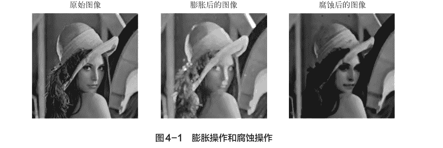

图像膨胀可看作腐蚀的逆过程，像领域扩张一样把高亮或白色区域撑大，输出的高亮区更大、线条更粗，常用于去噪。

### 4.1.2 开操作与闭操作

开操作和闭操作是基于腐蚀与膨胀组合的两种常见形态学处理。

开操作先腐蚀后膨胀，能平滑图像并消除小噪点，同时尽量保留大物体的结构。腐蚀阶段会去掉小物体或噪声，膨胀再把主体恢复，因此起到平滑去噪作用，广泛用于提升图像质量与识别率，需根据具体情况调参。

闭操作与开操作相反，先膨胀后腐蚀，可填补图像中细小孔洞且保持大物体结构稳定。膨胀先把孔洞填满，腐蚀再回缩边界，达到填孔效果。在图像分割、去噪和形态学重建中应用较多，能有效提升处理可靠性。

用户说：“我是 Matlab 程序员，请写 m 代码，先对原图做开操作得到开操作图，再做闭操作得到闭操作图。”

```matlab
% 读取图像
img = imread('C:\Users\图片1.png');

% 确保图像为灰度图
if size(img, 3) == 3
    img = rgb2gray(img);
end

% 将图像二值化，使用 Otsu 算法
level = graythresh(img);
binary_img = imbinarize(img, level);

% 创建形态学结构元素（圆盘，半径为 5）
se = strel('disk', 5);

% 执行开操作（先腐蚀后膨胀）
opened_img = imopen(binary_img, se);

% 执行闭操作（先膨胀后腐蚀）
closed_img = imclose(binary_img, se);

% 显示图像结果
figure;
subplot(1, 3, 1);
imshow(binary_img);
title('原始图像');

subplot(1, 3, 2);
imshow(opened_img);
title('开操作后的图像');

subplot(1, 3, 3);
imshow(closed_img);
title('闭操作后的图像');

% 保存图像结果
imwrite(opened_img, 'C:\Users\Opened_image.png');
imwrite(closed_img, 'C:\Users\Closed_image.png');
```

将示例素材载入后执行前文的代码片段，视觉效果会如预期呈现，详见图4-2。

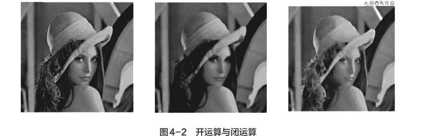

图4-2 开运算与闭运算

腐蚀之后再做膨胀被归为开运算，公式上可写作 开运算(image)=膨胀(腐蚀(image))。腐蚀会削弱噪声同时收紧轮廓，随后用膨胀回补，能在去噪前提下维持大致形状。

先膨胀再腐蚀的组合则属于闭运算，表达式为 闭运算(image)=腐蚀(膨胀(image))。此方式擅长填补前景内部的小孔或物体表面出现的细小黑点。

## 4.2 进阶形态运算

在基础形态操作之上，还衍生出顶帽变换、底帽变换以及形态学梯度等复合形式。

这类复合处理在增强、特征挖掘、区域分割等场景中都十分活跃，根据具体需求挑选结构元素与参数即可获得想要的效果。

### 4.2.1 顶帽变换

顶帽属于一种细节强化手段，特别善于凸显图像中细微的亮区。其原理是把原图与开运算结果做差。流程如下：

1. 选用结构元素对原始图像执行开操作，得到开处理后的图像。
2. 用原始图像减去开处理后的图像，得到顶帽处理后的图像。

如此能够分离出相对纤细或偏亮的细节，例如细边缘、孤立噪点等。

下面是向ChatGPT提问后给出的示例代码：

用户：“你现在是一位Matlab程序员。我现在要你写一段m代码。要求：对原始图像应用一个结构元素进行开操作，得到开操作后的图像。将原始图像与开操作后的图像进行减法运算，得到顶帽运算后的图像。”

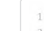

ChatGPT

```matlab
% 读取图像
img = imread('C:\Users\图片1.png');

% 确保图像为灰度图
if size(img, 3) == 3
    img = rgb2gray(img);
end

% 使用 Otsu 算法进行二值化
level = graythresh(img);
binary_img = imbinarize(img, level);

% 定义结构元素（圆盘形，半径为5）
se = strel('disk', 5);

% 执行开操作（先腐蚀再膨胀）
opened_img = imopen(binary_img, se);

% 顶帽运算：原图减去开操作结果
tophat_img = imsubtract(binary_img, opened_img);

% 显示原始二值图、开操作结果和顶帽运算图像
figure;
subplot(1, 3, 1);
imshow(binary_img);
title('原始图像');

subplot(1, 3, 2);
imshow(opened_img);
title('开操作后的图像');

subplot(1, 3, 3);
imshow(tophat_img);
title('顶帽图像');

% 保存顶帽运算结果图像
imwrite(tophat_img, 'C:\Users\Tophat_image.png');
```

载入素材后运行上述程序，可看到处理后的视觉效果，参考图4-3。

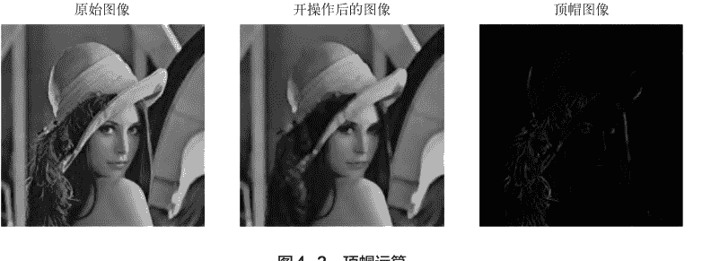

图4-3 顶帽运算

顶帽变换又常被称为礼帽变换，做法是用原图减去开运算结果，常用以缓解光照不均导致的分割失误。

### 4.2.2 底帽变换

底帽可视为顶帽的互补形式，主要用来凸显大尺度的暗区。基于闭操作，通过原图与闭操作结果的差异来提取结构。步骤如下：

1. 用结构元素对原图执行闭操作，得到闭处理后的图像。
2. 用原图减去闭处理后的图像，得到底帽处理后的图像。

由此可提取出相对较大或偏暗的结构，例如大物体边缘、阴影区等。

下面是向 ChatGPT 提问后给出的示例代码：

用户：“你现在是一位 Matlab 程序员。我现在要你写一段 m 代码。要求：对原始图像应用一个结构元素进行闭操作，得到闭操作后的图像。将原始图像与闭操作后的图像进行减法运算，得到底帽运算后的图像。”

ChatGPT

```matlab
% 读取图像
img = imread('C:\Users\图片1.png');

% 确保图像为灰度图
if size(img, 3) == 3
    img = rgb2gray(img);
end

% 将图像二值化，使用 Otsu 算法
level = graythresh(img);
binary_img = imbinarize(img, level);

% 定义结构元素（圆盘形，半径为5）
se = strel('disk', 5);

% 执行闭操作（先膨胀后腐蚀）
closed_img = imclose(binary_img, se);

% 底帽运算：闭操作结果减去原始图像
bothat_img = imsubtract(closed_img, binary_img);

% 显示图像：原始、闭操作、底帽运算结果
figure;
subplot(1, 3, 1);
imshow(binary_img);
title('原始图像');

subplot(1, 3, 2);
imshow(closed_img);
title('闭操作后的图像');

subplot(1, 3, 3);
imshow(bothat_img);
title('底帽图像');

% 保存底帽图像
imwrite(bothat_img, 'C:\Users\Bothat_image.png');
```

载入素材并执行上述程序，输出结果如图所示，具体见图4-4。

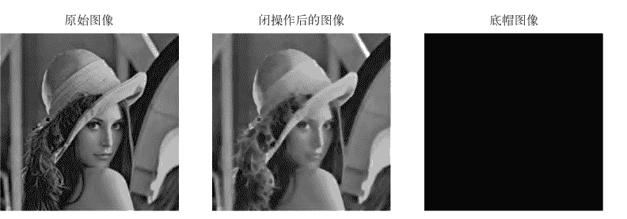

图4-4 底帽运算

图像底帽运算又称为黑帽运算，本质是用原图减去闭运算结果，常用于剔除亮背景下的暗区。

### 4.2.3 形态学梯度

形态学梯度常用来突出边缘与轮廓，核心在于膨胀与腐蚀的差值。具体步骤：

1. 对原图做膨胀，得到膨胀后的图像。
2. 对原图做腐蚀，得到腐蚀后的图像。
3. 将膨胀结果减去腐蚀结果，得到梯度后的图像。

膨胀会让边缘外扩，腐蚀会让边缘内收，两者的差异恰好定位边缘位置，从而呈现清晰轮廓。

下面是向ChatGPT提问后给出的示例代码：

用户：“你现在是一位Matlab程序员。我现在要你写一段m代码。要求：对原始图像应用膨胀操作，得到膨胀后的图像。对原始图像应用腐蚀操作，得到腐蚀后的图像。将膨胀后的图像减去腐蚀后的图像，得到梯度运算后的图像。”

ChatGPT

```matlab
% 读取图像
img = imread('C:\Users\图片1.png');

% 确保图像为灰度图
if size(img, 3) == 3
    img = rgb2gray(img);
end

% 将图像二值化，使用Otsu算法
level = graythresh(img);
binary_img = imbinarize(img, level);

% 选择形态学操作的结构元素
se = strel('disk', 5); % 使用半径为5的圆盘结构元素

% 进行膨胀操作
dilated_img = imdilate(binary_img, se);

% 进行腐蚀操作
eroded_img = imerode(binary_img, se);

% 计算梯度（膨胀图像减去腐蚀图像）
gradient_img = imsubtract(dilated_img, eroded_img);

% 显示原始二值化图像、膨胀操作图像、腐蚀操作图像和梯度运算结果
figure;
subplot(1, 4, 1);
imshow(binary_img);
title('原始图像');

subplot(1, 4, 2);
imshow(dilated_img);
title('膨胀后的图像');

subplot(1, 4, 3);
imshow(eroded_img);
title('腐蚀后的图像');

subplot(1, 4, 4);
imshow(gradient_img);
title('梯度图像');

% 保存梯度运算后的图像
imwrite(gradient_img, 'C:\Users\Gradient_image.png');
```

载入素材并执行上述程序，输出结果如图4-5所示。

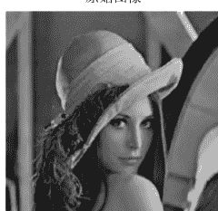

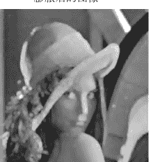

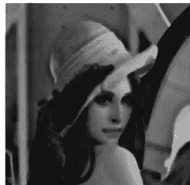

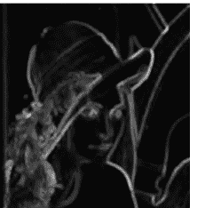

图4-5 梯度运算

## 4.3 小结

形态学处理是依托图像结构的一种数学化手段，通过对形状与结构的操作与分析，实现分割、特征提取、形状识别等目标。配合膨胀、腐蚀、开、闭等算子，可以灵活完成各类图像处理任务。这些操作会改变形态特征，进而影响整体结构与局部区域属性。形态学在计算机视觉、图像分析、模式识别等领域应用广泛，为图像处理提供强有力工具。其中，膨胀可扩张亮点或物体边界，提升亮区面积，使图像更亮更清晰；腐蚀则缩小亮点或边界，减少亮区面积，使图像更锐利。开操作可平滑轮廓并滤除小噪声，提升图像质量。闭操作能够填补小孔洞，同时保持大尺度物体完整。

## 第 5 章 从图像中提炼特征

在数字图像处理里，特征提取是指从图像中挑选出关键且具代表性的信息并加以描述的过程。特征可基于颜色、纹理、形状、边缘等维度，通常是与目标对象相关的核心信息，有助于识别、分类、跟踪或定位。常用思路有滤波、边缘检测、尺度空间分析、颜色直方图、纹理分析等，适用于不同场景。特征提取是目标检测、图像识别、人脸识别、手写数字识别等任务的基础。特征降维是提取后的重要环节，目的是压缩特征数量、提升分类识别力。常见降维手段包括主成分分析 PCA、线性判别分析 LDA、t-SNE 等。因此特征提取与降维概念不同，但在实践中常结合使用以提升性能。

## 5.1 颜色信息获取

颜色信息获取多用于图像分类、目标检测、图像检索，在人脸识别、医学图像分析等领域也有广泛应用。它指的是从图像中获取颜色分布与属性的信息，用来描述色调、亮度、饱和度等特性。一般流程包括：

- ① 颜色空间转换：把图像从 RGB 转换到 HSV、Lab 等空间，更好地表征颜色。
- ② 颜色直方图提取：统计像素值出现的频率，得到颜色直方图。
- ③ 颜色共生矩阵提取：计算不同颜色出现的频率及其空间关系，得到共生矩阵。
- ④ 颜色滤波器提取：借助高斯滤波器、均值滤波器等特定滤波器捕捉颜色信息。

颜色信息获取是图像处理中的重要任务，选对颜色空间和提取方式，能更好地利用颜色信息，实现精准识别与检索。常用方法有灰度直方图和聚类。灰度直方图刻画像素值的分布，反映明暗程度；聚类可把像素分组，提取主色信息。除此之外，颜色直方图、颜色矩、纹理能量等也能从不同角度描述颜色特性。

### 5.1.1 灰度直方图

灰度直方图是分析数字图像灰度分布的常用工具，可用于提取灰度特征。在数字图像中，每个像素都有灰度级，通常用 0~255 的整数表示亮暗。灰度直方图是对全图像素灰度值的统计，以灰度级为横坐标，以该级像素个数或占比为纵坐标绘制的曲线。直方图的形态直接反映灰度分布。彩色图也可通过 RGB 加权平均转为灰度。

直方图形态体现了图像的灰度分布。良好的直方图往往出现一个或多个峰值，对应明暗集中区域，峰值位置和数量决定整体亮度与对比度。例如人脸照片的直方图通常有明显峰值，因为皮肤色集中。基于直方图可以方便地做阈值分割或目标识别。

应用上，直方图可用于判断亮度与对比度，实现自动对比度调整，并帮助理解灰度分布。它在对比度调整、阈值分割、质量评估、检索匹配等方面常见。直方图是通过统计像素灰度级来了解图像分布，进而辅助处理。

计算方法简洁，只需统计各像素灰度级并映射到柱状图。横坐标为 0~255 的灰度级，纵坐标为像素数或占比。具体步骤：

- ① 确定灰度级别区间：将整个灰度范围划分为若干等宽区间，每个区间代表一个灰度级。
- ② 统计像素数：遍历图像中每个像素，统计各区间像素数量，得到对应灰度级的像素数。
- ③ 绘制灰度直方图：将各灰度级的像素数标在直方图上，即可得到结果。

Matlab 中可用 imhist 函数实现。下面是利用ChatGPT生成代码绘制灰度直方图的例子。

用户：“假设我已有灰度图片，请给我生成能够绘制灰度直方图的Matlab代码。”

```matlab
% 读取灰度图像
img = imread('image.jpg'); % 替换为你自己的灰度图像文件路径

% 如果输入图像是彩色图像，先转换为灰度图像
if size(img, 3) == 3
    img = rgb2gray(img);
end

% 显示图像
imshow(img);
title('灰度图像');

% 计算灰度图像的直方图
[counts, binLocations] = imhist(img);

% 绘制灰度直方图
figure;
bar(binLocations, counts, 'BarWidth', 1);
xlim([0 255]); % 灰度值范围从0到255
xlabel('灰度级');
ylabel('像素数量');
title('灰度图像直方图');
```

这段代码读取灰度图像、计算并绘制直方图，只需把 imread 的文件名换成自己的图像即可。图5-1展示了原图与直方图示例。

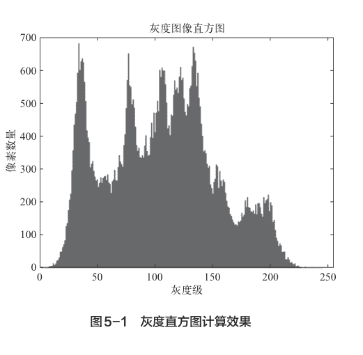

图5-1 灰度直方图计算效果

### 5.1.2 聚类

聚类是一种常见的数据分析方法，可将图像划分为多个区域或部分，实现分割与分类。聚类即把数据集划分为若干类，类内相似度高、类间差异大。在图像处理中常以像素值或特征为依据进行聚类，目标是把像素特征空间划分为互不重叠的若干类，从而实现分割与分类。常见的算法有 K-means 聚类和均值漂移聚类。

#### （1）K-means聚类

K-means 属于典型的距离驱动型无监督聚类方案，核心任务是把样本划进预先设定好的若干簇里。它把像素值或特征向量看成 N 维空间中的点，用欧氏距离来衡量彼此的近似程度。正因为颜色在数字图像里占据主导地位，K-means 常被用来做颜色特征的提炼，尤其是在颜色量化与图像压缩这类场景里，把相近色调的像素归在一起。

K-means 的运行逻辑可以概括为先定锚点再迭代优化：先在像素空间里随机抽取若干点作为初始质心，随后把其余像素按最近邻原则归类，再根据当前簇内所有点重新计算质心位置，反复循环直到质心稳定或达到迭代上限。具体流程为：

- ① 初始化质心：随机挑选 k 个样本作为起点的聚类中心。
- ② 距离计算：对每个样本计算其到 k 个质心的欧氏距离。
- ③ 簇分配：把样本指派给距离最近的簇。
- ④ 质心更新：用簇内样本的均值重新定位质心，使其更贴合该簇。
- ⑤ 迭代收敛：重复 ②～④，直至质心不再移动或达到最大迭代次数。

在 Matlab 里可用 kmeans 函数完成图像的 K-means 处理。经典示例如下：

> 用户问：Matlab 中 K-means 聚类要怎么写？

ChatGPT

```matlab
% 读取图像
image = imread('image.jpg');  % 假设图片文件名为 'image.jpg'

% 将图像数据转换为二维数组，每行是一个像素，每列是 R, G, B 值
[rows, cols, channels] = size(image);
image_data = reshape(image, rows * cols, channels);

% 设置聚类的簇数 K
K = 3;

% 使用 kmeans 进行聚类
[idx, C] = kmeans(double(image_data), K, 'Replicates', 5, 'Start', 'plus');

% idx 是每个像素所属的簇的索引，C 是每个簇的 RGB 质心

% 创建一个新的图像，将每个像素的颜色设置为对应簇的质心颜色
clustered_image_data = C(idx, :);

% 将结果恢复为图像尺寸
clustered_image = reshape(clustered_image_data, rows, cols, channels);

% 显示原始图像与聚类后的图像
subplot(1, 2, 1);
imshow(image);
title('Original Image');

subplot(1, 2, 2);
imshow(uint8(clustered_image));
title('Clustered Image (K=3)');
```

整段实现先把彩色图拉平成向量，聚类数 k 直接决定最终色系的精细度；依据聚类结果重新着色，再把向量转回图像。实践中建议把数据类型改成 double 以提升数值精度，并可通过 Replicates 参数控制重复运行的次数来提高稳定性。最后借助 reshape 及 idx 与 centers 的组合，把每个像素替换成所属簇的代表色，并恢复为图像形态。

实际调试时，可以调节聚类中心的个数来观察视觉差异。k 的取值需要结合任务需求与主观效果来决定，k 越大保留细节越多，k 越小压缩越强，如图 5-2 所示。

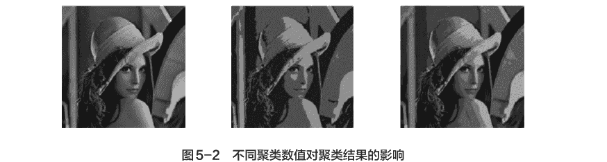

完成聚类后会得到 k 个中心点，即 centroid，每个中心对应该簇的平均 RGB。后续对图像里的每个像素，都用它所属簇的 RGB 代表色来替代。于是得到一张经过 K-means 处理的图像，像素颜色全部被换成簇中心的代表色。

均值漂移聚类属于无参数的聚类范式，也常被称作密度峰值聚类。其思路是寻找数据点密度达到局部极大的位置来划分簇。算法用一个自适应窗口包裹数据点，计算窗口内点的均值后再把窗口中心移动到该均值处，不断重复直至收敛，本质上是在追踪密度峰值。步骤如下：

- ① 初始化：挑一个数据点作为窗口起点，并设定窗口半径。
- ② 邻域查找：以当前中心和窗口大小寻找到窗口内的样本，算距离。
- ③ 权重映射：用核函数例如高斯核把距离转为权重。
- ④ 归一化：对权重归一化，降低远点的干扰。
- ⑤ 重心求解：按权重计算窗口内样本的加权重心。
- ⑥ 窗口更新：把窗口中心移到重心，重复 ②～⑤ 直到收敛。
- ⑦ 簇标记：收敛到同一中心的点归为一簇。
- ⑧ 去重合并：合并重复簇，得到最终结果。

均值漂移无需预先知道数据形态或簇数，对非凸分布和噪声具有一定鲁棒性；短板在于窗口大小敏感，且大数据量时运算较慢。

## 5.2 形状特征提取
形状特征提取是图像理解里的重要环节，目标是从物体轮廓与结构中抽取出可描述形状的因子，可用于图像匹配、物体识别与目标跟踪等。本节聚焦三种常用手段：Hu 不变矩、Hough 变换与 Radon 变换。

### 5.2.1 Hu不变矩
矩是描述区域特性的完备数学工具。1962 年 Ming-Kuei Hu 提出的不变矩，通过层层嵌套中心归一化矩得到七个统计矩，再经线性组合生成七个不变矩。该组矩对平移、旋转、缩放保持不变，因此适合形状表征与匹配。

Hu 不变矩基于几何矩构建，经归一化与不变化处理后得到对位置、方向、尺度不敏感的描述子，在对象识别、形状分析与图像匹配里应用广泛，在计算机视觉与模式识别领域具有稳定的鲁棒性。计算流程为：

- ① 预处理：对输入图做灰度化、二值化等处理，得到便于计算的二值图。
- ② 几何矩计算：求零阶、一阶、二阶等几何矩，刻画像素在空间中的分布。
- ③ 归一化：对矩做归一化消除尺度与位置影响，常利用中心矩实现平移不变。
- ④ 不变矩生成：基于归一化矩经数学变换得到 Hu 不变矩组。
- ⑤ 应用：比较不同图像的 Hu 特征向量，判断形状相似性或差异，用于识别与匹配。

### 5.2.2 Hough变换
Hough 变换是自 1962 年提出以来在直线及参数化形状检测方面的主流方法。它把图像空间的曲线映射到参数空间累加，峰值对应的参数即为目标形状。方法对噪声容忍度高且易并行，常用于直线、圆、椭圆的检测与形状特征提取。

实现步骤大致为：
- ① 边缘提取：先做边缘检测，如 Prewitt 算子，降低后续计算量并聚焦轮廓。
- ② 参数空间初始化：按目标形状设定参数空间，直线可用极坐标或直角坐标，圆椭圆则用圆心坐标与半径。
- ③ 累加投票：每个边缘点在参数空间对应区域累加计数。
- ④ 峰值寻优：在参数空间寻找累加值最高的点，判定为形状的存在。
- ⑤ 空间映射：把参数空间的峰值转回图像空间，得到形状的位置与尺度。

Matlab 经典实现示例：

> 用户问：能否给一段对灰度图做 Hough 变换的 Matlab 代码？

```matlab
% 读取图像
image = imread('image.jpg'); % 读取图像文件

% 如果是彩色图像，转换为灰度图像
if size(image, 3) == 3
    gray_image = rgb2gray(image);
else
    gray_image = image;
end

% 使用 Prewitt 算子进行边缘检测
edges = edge(gray_image, 'Prewitt');

% 对边缘图像进行 Hough 变换
[H, theta, rho] = hough(edges);

% 找到 Hough 变换中的峰值，表示直线的位置
peaks = houghpeaks(H, 5); % 找到前 5 个峰值

% 提取检测到的直线
lines = houghlines(edges, theta, rho, peaks);

% 创建一个新的图像显示框
figure;

% 显示灰度图像
subplot(2, 2, 1);
imshow(gray_image);
title('Gray Image');

% 显示 Prewitt 算子边缘检测结果
subplot(2, 2, 2);
imshow(edges);
title('Prewitt Edge Detection');

% 显示 Hough 变换结果
subplot(2, 2, 3);
imshow(imadjust(mat2gray(H)), [], 'XData', theta, 'YData', rho);
xlabel('\theta (degrees)');
ylabel('\rho');
title('Hough Transform');
axis on;
colormap(gca, hot);

% 在原始图像上绘制检测到的直线
subplot(2, 2, 4);
imshow(image);
hold on;
for k = 1:length(lines)
    plot([lines(k).point1(1), lines(k).point2(1)], ...
         [lines(k).point1(2), lines(k).point2(2)], 'LineWidth', 2, 'Color', 'green');
end
title('Detected Lines');
hold off;
```

该代码先用 Prewitt 做边缘预处理，再执行 Hough 变换找峰值并提取直线，最后可视化展示结果与检测到的直线。图 5-3 显示边缘检测后轮廓明显增强。

### 5.2.3 Radon变换
Radon 变换又称投影变换，在医学影像与计算机视觉中常用于重建与辅助诊断。它把图像沿不同角度做投影累加，可用于直线、曲线等几何结构的探测。

其原理源于投影几何：沿特定方向把像素值累加，形成该角度下的投影。常用角度范围为 0°～180°，角度分辨率决定细节。投影可分为正交投影与透视投影，前者累加与投影线相交的像素，后者按摄像机模型计算交点并累加。

① Radon 变换：把各角度投影整合为二维矩阵，形成 sinogram，即 Radon 图像，记录原始图在各角度的投影分布，可用于重建、检测与边缘分析。
② 逆 Radon 变换：即反投影重建，通过 sinogram 把投影信息回填到图像空间，恢复像素值。

示例代码可先计算 0° 与 45° 方向的 Radon 投影，再用 imshow 与 subplot 展示投影图与曲线。

用户问：请给出一段可以做 Radon 变换并观察不同投影角度图像的代码。

```matlab
% 生成一个简单的图像
imageSize = 128;
theta = 0:179;  % 投影角度范围
image = zeros(imageSize);
image(imageSize/4:imageSize/4*3, imageSize/4:imageSize/4*3) = 1;  % 创建一个简单的矩形

% 显示原始图像
figure;
subplot(2, 2, 1);
imshow(image);
title('Original Image');

% 进行Radon变换
projection0 = radon(image, theta);  % 0度投影
projection45 = radon(image, theta + 45);  % 45度投影

% 显示Radon变换结果
subplot(2, 2, 2);
imagesc(theta, 1:size(projection0, 1), projection0);
colormap(gca, 'gray');
title('Radon Transform - 0 degrees');
xlabel('Projection Angle (degrees)');
ylabel('Radial Distance');

subplot(2, 2, 3);
imagesc(theta + 45, 1:size(projection45, 1), projection45);
colormap(gca, 'gray');
title('Radon Transform - 45 degrees');
xlabel('Projection Angle (degrees)');
ylabel('Radial Distance');
```

代码中使用 Radon 函数分别计算 0° 与 45° 的投影，并分别显示投影图像与对应曲线。图 5-4 展示了不同角度下的 Radon 曲线变化。

用户问：再给一段实现逆 Radon 变换重建图像的代码。

ChatGPT

```matlab
% 读取图像
image = imread('image.jpg'); % 替换为你的图像文件路径

% 如果图像是彩色的，转换为灰度图像
if size(image, 3) == 3
    image = rgb2gray(image); % 将彩色图像转换为灰度图像
end

% 设置投影角度
theta = 0:10:180; % 从 0 到 180 度的投影角度，间隔为 10 度

% 对图像进行 Radon 变换
[R, xp] = radon(image, theta);

% 执行逆 Radon 变换
reconstructed_image = iradon(R, theta, 'linear', 'Ram-Lak');

% 显示结果
figure;

% 显示原始图像
subplot(1, 2, 1);
imshow(image);
title('Original Image');

% 显示通过逆 Radon 变换重建的图像
subplot(1, 2, 2);
imshow(reconstructed_image, []);
title('Reconstructed Image from Radon Transform');
```

该实现先读取原图，设定 0°～180° 的投影角度范围获得完整的 Radon 曲线集合。其中 `C = max(R)` 用来求投影数据的最大值，但未在后续使用，可直接省略。iradon 采用线性插值与 Ram-Lak 滤波器进行重建，重建质量受角度范围、插值方式与滤波器选择影响，可按需调整。结果示例如图 5-5。

图 5-5 逆 Radon 变换的图像重建

## 5.3 关键点特征提取

图像特征提炼与降维核心技术梳理

在图像处理里，并不是每一个像素都值得保留，逐个处理会带来很大的时间开销，所以通常先做预处理。提取出具有代表性的关键点，可以大幅提升后续处理的效率。关键点特征提取是图像分析的重要基础，能够刻画图像中突出的局部结构，在匹配、跟踪等任务里发挥决定性作用。接下来介绍几类常用的关键点提取方案。

### 5.3.1 SIFT算法

SIFT 即尺度不变特征变换，是一种基于尺度空间的关键点提取方法。它的目标是找到对缩放、旋转和亮度变化都保持稳定的关键点，并为其生成描述子。典型应用包括物体识别、机器人感知导航、图像拼接、三维重建、手势识别、视频跟踪与动作对比等。

（1）算法原理

尺度空间极值搜寻：先用高斯滤波构建图像金字塔，每层都是原始图经不同程度模糊的结果。随后在相邻尺度间比较像素值，筛选出高斯差分极值作为候选点。

关键点精定位：在候选点基础上做插值精修，计算偏移量与曲率，剔除对比度过低以及边缘响应较弱的点。

方向指派：对每个关键点计算其邻域梯度幅值和方向，建立以关键点为原点的坐标系，统计梯度方向直方图，选取主方向作为该点的方向。

特征描述：在关键点邻域内按主方向构建坐标系，抽取局部图像块的描述信息。

（2）SIFT特征描述子

每个关键点都会得到一个128维的向量，用来表征其周围的结构。做法是统计邻域像素的梯度方向与大小并编码为向量，从而刻画局部纹理与形状。SIFT描述子具备以下性质：

- ① 尺度不变性：在不同尺度下提取，使特征对图像缩放不敏感。
- ② 旋转不变性：通过主方向校准，使特征对旋转保持稳定。
- ③ 光照不变性：梯度幅值归一化后对光照变化具有较强鲁棒性。
- ④ 局部性：只关注关键点局部区域的信息。

### 5.3.2 ORB算法

ORB全称 oriented FAST and rotated BRIEF，即基于FAST角点检测与BRIEF二值描述的方案。相较SIFT，即使不借助硬件加速也能保持较低的时间复杂度。

#### （1）FAST角点检测器

FAST 是 features from accelerated segment test 的缩写，是一种常用的角点检测器，广泛用于特征提取、目标识别与图像配准。相对于Harris角点，其优势是检测速度快且鲁棒性好。

基本思路是在图像中寻找灰度突变点。FAST采用以中心像素为圆心的9邻域圆，比较圆周上16个采样点与中心的灰度差，若超过阈值T的点数达到设定数量，则判定为角点。

FAST计算高效且对噪声有一定抵抗力，对平移、旋转、尺度变化具备一定不变性，但旋转不变性有限。衍生版本如FAST-9、FAST-10、FAST-12、FAST-R等可适配不同场景。FAST常为后续配准、跟踪、SLAM等任务提供基础特征。

#### （2）BRIEF描述子

ORB中的BRIEF是一种二进制特征描述子，用于对关键点进行编码以支持匹配与识别。生成方式是对比关键点周围像素对的灰度关系并编码为0/1。

- ① 采样像素对：在特征点邻域内选取一组像素对，可随机或按规则采样。
- ② 灰度比较：对每对像素，若第一个像素灰度大于等于第二个像素则记为1，否则为0。
- ③ 组合编码：将所有比较结果按顺序拼接成二进制串，即为BRIEF描述子。

ORB利用BRIEF描述每个关键点的局部特征，匹配时常用汉明距离衡量相似度。ORB还在BRIEF基础上改进，引入主导方向与多尺度关键点生成，从而获得旋转与尺度不变性。

### 5.3.3 LBP算法

LBP即局部二值模式，是一种描述局部纹理的方法，通过比较中心像素与邻域像素的大小关系生成二进制编码，用于纹理分析与物体识别，具有旋转不变与灰度不变的优点。

最基础的实现先定义算子再滑动窗口遍历整图。原始LBP算子采用3×3窗口，以中心像素为阈值，将8个邻域与之比较，大于等于记1，否则0。从左上角起顺时针遍历得到8位二进制，再转为十进制0~255，作为新窗口中心点的像素值。遍历整图后得到纹理图。

示意为：取某点像素做阈值，若8邻域像素大于该点则二值化为1，否则为0，按顺时针顺序得到二进制如00011110，转化为十进制30作为该窗口中心值。重复该过程可生成新的纹理图像。

下面是一个Matlab实现LBP算法特征提取的例子。

用户：“请帮我生成一段LBP算法特征提取的Matlab代码。”

```matlab
% 读取图像
image = imread('your_image.jpg'); % 替换为你的图像文件路径

% 检查图像的通道数
if size(image, 3) > 1
    % 如果图像是彩色图像，将其转换为灰度图像
    grayImage = rgb2gray(image);
else
    % 如果图像已经是灰度图像，直接使用
    grayImage = image;
end

% 定义LBP相关参数
radius = 1;     % LBP圆形邻域的半径
numPoints = 8;  % LBP圆形邻域的像素点数

% 获取图像尺寸
[rows, cols] = size(grayImage);

% 初始化LBP特征矩阵
lbpFeatures = zeros(rows - 2 * radius, cols - 2 * radius);

% 遍历图像进行LBP特征提取
for i = radius + 1 : rows - radius
    for j = radius + 1 : cols - radius
        % 获取中心像素值
        centerPixel = grayImage(i, j);

        % 获取邻域像素值
        binaryPattern = zeros(1, numPoints);

        % 获取邻域的像素值，按照顺时针方向
        for k = 1:numPoints
            angle = (k - 1) * 2 * pi / numPoints;  % 计算每个邻域点的角度
            x = round(i + radius * sin(angle));
            y = round(j - radius * cos(angle));

            % 将邻域点与中心点比较
            binaryPattern(k) = grayImage(x, y) >= centerPixel;
        end

        % 将二进制模式转换为十进制值
        lbpFeatures(i - radius, j - radius) = bin2dec(num2str(binaryPattern));
    end
end

% 显示LBP特征图
figure;
imshow(lbpFeatures, []);
title('LBP Feature Image');
```

代码中设置了LBP所需的半径与邻域点数，随后逐像素计算编码并保存为特征矩阵，最终生成特征图像并同时显示原始图与特征图。图5-7展示了LBP特征提取前后的对比。

图5-7 原始图像和LBP特征图像

## 5.4 特征降维

特征降维是指在压缩特征维度的同时尽量保留数据的主要信息，将高维数据映射到低维空间。图像处理中，降维可降低计算量、节省存储、避免维度灾难。下面介绍奇异值分解、主成分分析和线性判别分析三种方法。

### 5.4.1 奇异值分解

奇异值分解是一种矩阵分解手段，可把矩阵写成三个矩阵的乘积。在图像处理中，可对灰度矩阵做SVD分解，保留最大奇异值及其对应向量以保留主要信息并压缩数据。

给定实数矩阵A，SVD表示为：

A=UΣV^T

其中U为m×m正交矩阵，Σ为m×n对角矩阵，V为n×n正交矩阵，T表示转置。Σ对角线元素为奇异值，按从大到小排列；U的列为左奇异向量，V的列为右奇异向量。

分解主要包含：

- ① 计算A^T A得n×n实对称矩阵D，AA^T得m×m实对称矩阵C。
- ② 对C和D做特征值分解，得到各自的特征值与特征向量。
- ③ 按降序排列特征值。
- ④ 取特征值平方根构造对角矩阵Σ。
- ⑤ 从特征向量中按奇异值顺序选取组成U与V。

完成分解后即可实现表达、特征提取与降维。SVD在图像压缩、数据近似、噪声抑制等领域应用广泛。

### 5.4.1 奇异值分解

在分解结果中，Σ的对角线即为奇异值序列Σ=diag(σ1, σ2, …, σn)。

⑤ 选择对应的特征向量构建U与V，U的列按奇异值降序排列来自C的特征向量，V的列同样按降序来自D的特征向量。

通过上述步骤可得到U、Σ、V，实现对原始矩阵的刻画与降维。接下来看一个应用示例。

用户：“请帮我生成一个奇异值分解应用于特征提取中的 Matlab 代码。”

ChatGPT

```matlab
% 读取图像并将其转换为灰度图像
image = imread('image.jpg'); % 请确保图像路径正确
gray_image = rgb2gray(image); % 将彩色图像转换为灰度图像

% 对灰度图像进行奇异值分解
[u, s, v] = svd(double(gray_image));

% 选择前k个奇异值进行特征提取（k为自定义的特征数量）
k = 50; % 可以根据需要调整k的值
u_red = u(:, 1:k);
s_red = s(1:k, 1:k);
v_red = v(:, 1:k);

% 重构图像
reconstructed_image = u_red * s_red * v_red';

% 显示原始图像和重构图像
figure;
subplot(1, 2, 1);
imshow(gray_image);
title('Original Image');

subplot(1, 2, 2);
imshow(uint8(reconstructed_image));
title('Reconstructed Image');
```

示例先把彩色图转灰度后做SVD，得到左奇异向量U、奇异值矩阵S、右奇异向量V。随后选取前k个奇异值及其对应向量构造降维矩阵U_red、S_red、V_red，用U_red S_red V_red重构图像并与原图对比。k可根据需求自定义。图5-8为原图与重构图对比。

图5-8 原始图像和重构图像

### 5.4.2 主成分分析

主成分分析是一种无监督学习方法，基于线性代数与统计思想，用于降维与主要特征提取。PCA通过线性变换把原始空间映射到主成分空间，保留最大方差方向。

一般流程为：

1. 数据标准化：对特征做零均值归一化，使各维尺度一致，消除量纲影响。
2. 协方差矩阵计算：计算标准化后特征间的协方差，反映线性相关程度。
3. 特征值分解：对协方差矩阵分解得到特征值与特征向量，特征值表征方差大小，特征向量指示新方向。
4. 特征值排序：按降序排列，选择最重要的方向。
5. 特征向量选取：取前k个最大特征值对应的特征向量作为主成分。
6. 主成分投影：将原始数据投影到选定主成分张成的子空间，得到低维表示。

PCA保留数据最大方差方向，能在压缩维度的同时保留关键模式，便于分析、可视化与模式挖掘。下面是一个应用示例。

用户：“请生成一段主成分分析用于数字图像处理的Matlab代码。”

ChatGPT

```matlab
% 读取数据集
load fisheriris.mat; % MATLAB自带的鸢尾花数据集
x = meas; % 输入数据（150x4矩阵，每行代表一个样本，4个特征）
irisTargets = species; % 目标标签（类别）

% 数据标准化
x = zscore(x);

% 计算协方差矩阵
c = cov(x);

% 特征值分解
[v, D] = eig(c); % v是特征向量矩阵，D是特征值矩阵

% 特征值排序
[r, idx] = sort(diag(D), 'descend');
v = v(:, idx); % 将特征向量按特征值降序排列

% 选择主成分数量
k = 2; % 选择前2个主成分

% 主成分投影
PC = x * v(:, 1:k); % 投影到前k个主成分

% 绘制投影结果
figure;
gscatter(PC(:, 1), PC(:, 2), irisTargets, 'rgb', 'o');
xlabel('主成分1');
ylabel('主成分2');
title('主成分分析的特征提取');
```

以鸢尾花集做示范，先把样本读进变量 x 并做标准化。接着求出输入的协方差矩阵 c，对 c 执行特征值分解得到特征值矩阵 D 与特征向量矩阵 v。依据特征值大小把向量重排为降序。确定保留的维度 k 后，将原始样本投到前 k 个方向上，得到降维结果矩阵 PC。可选地计算每个方向的解释方差占比，用以衡量其对总体离散度的贡献。再加上 title('主成分分析的特征提取') 一句，即可在二维平面展示提取结果，并按原始标签着色区分，见图5-9。

图5-9 主成分分析的特征提取

### 5.4.3 线性判别方法

线性判别分析 LDA 的本质是通过学习线性映射实现降维与类间分离，属于经典的有监督框架，常用于提取判别性表征与分类任务。它把高维特征空间压缩到低维子空间，在信息压缩的同时提升可分性。优化目标是扩大不同类别的间隔并收紧同一类别的离散。借助合适的投影轴，可把数据从高维搬到低维，从而兼顾压缩与判别。LDA 在人脸辨识、模式识别、文本分类等方向应用广泛。下面以数字图像处理中的表征提取为例说明其运行逻辑。

LDA 的基本设想是找到一个投影矩阵，使其在低维空间里同类样本更集中、异类样本更分散。依此投影即可在降维后实现清晰的类别划分。

散布矩阵：LDA 定义两类散布度量。类内散布矩阵刻画同一类内部样本的离散情况，实质是各类别协方差的累加；类间散布矩阵刻画不同类别中心间的差异，本质是类均值差构成的协方差。

特征值分解与判别轴提取：在 LDA 中，对类内、类间两类散布矩阵做特征值分解，可得到特征值与对应特征向量。特征值反映该方向上的离散大小，可作为判别重要性的参考；特征向量指示投影方向，即线性判别的主轴。

投影方向挑选与降维：一般取特征值最大的前 k 个特征向量作为投影基，其中 k 为目标维度。这些向量又称线性判别向量 LDVs，常被视为主成分。

用户：“请帮我生成一个线性判别方法应用于特征提取中的Matlab代码。”

ChatGPT

```matlab
% 读取鸢尾花数据集
load FisherIris.mat; % 以鸢尾花数据集为例
x = meas; % 输入数据（特征矩阵），每行代表一个样本
G = species; % 标目标量（标签）

% 数据标准化
x = zscore(x); % 标准化数据

% 计算类均值
class_means = grpstats(x, G); % 计算每个类别的均值

% 将目标量转换为数值标签
[~, ~, labels] = unique(G);
G = labels;

% 计算类内散度矩阵
within_class_scatter = zeros(size(x, 2), size(x, 2)); % 初始化类内散度矩阵
between_class_scatter = zeros(size(x, 2), size(x, 2)); % 初始化类间散度矩阵
total_mean = mean(x); % 计算所有样本的均值

for i = 1:max(G)
    class_data = x(G == i, :); % 获取每个类别的数据
    class_mean = class_means(i, :); % 当前类别的均值
    class_scatter = (class_data - class_mean)' * (class_data - class_mean); % 计算类内散度
    within_class_scatter = within_class_scatter + class_scatter; % 更新类内散度矩阵
    
    n = sum(G == i); % 当前类别的样本数
    between_class_scatter = between_class_scatter + n * (class_mean - total_mean)' * (class_mean - total_mean); % 更新类间散度矩阵
end

% 特征值分解
[v, D] = eig(pinv(within_class_scatter) * between_class_scatter); % v是特征向量，D是特征值矩阵

% 特征值排序
[~, idx] = sort(diag(D), 'descend'); % 对特征值进行降序排列
v = v(:, idx); % 将特征向量按照特征值降序排列

% 选择主成分数量
k = 2; % 选择前2个主成分（可以根据需要进行调整）

% LDA投影
LD = v(:, 1:k); % LDA线性判别方向量
PC = x * LD; % 投影到所选的前k个主成分上

% 绘制LDA结果
figure;
gscatter(PC(:, 1), PC(:, 2), G); % 使用G作为分类标签
xlabel('Principal Component 1');
ylabel('Principal Component 2');
title('LDA Results on Iris Dataset');

% 计算解释方差比率
explained_variance = diag(D) / sum(diag(D)); % 计算每个主成分的解释方差
disp('解释方差比例：');
disp(explained_variance(1:k)); % 显示前k个主成分的解释方差比例
```

同上示例仍以鸢尾花集演示。流程先做标准化，再计算各类别均值、类内散布与类间散布，继而做特征值分解并挑选所需维度，最后把数据投到线性判别向量上并作图，效果如图5-10所示。

## 5.5 小结

图像表征提取是数字图像处理流程中的关键环节，能从图像中提炼出代表内容的信息。本章梳理了多种提取策略。开篇讨论颜色表征，包括灰度直方图与颜色聚类。灰度直方图刻画亮度分布，颜色聚类把相似色像素归并。随后介绍形状表征，如 Hu 不变矩、Hough 变换与 Radon 变换，用于描述直线、圆等几何形态。再者介绍关键点表征，如 SIFT、ORB 与 LBP，能定位关键点并生成局部描述子。结尾探讨降维手段，包括奇异值分解、主成分分析与线性判别分析，可把高维表征压到低维，降低数据复杂度。

表征提取是图像分析与识别的基础，不同方法从不同视角揭示图像信息。实践中可按需求挑选合适的提取方式，并结合机器学习或模式识别算法进一步分析使用。

# 第 6 章 图像识别应用初步

## 6.1 图像识别的概念

## 6.2 图像识别的一般过程

## 6.3 图像识别的方法类型

## 6.4 小结

在当今数字时代，图像识别作为计算机视觉的核心分支，作用日益凸显。本章将带读者逐步认识图像识别的定义、演进脉络及其在各领域的落地应用。通过系统阐述整体流程与部署应用，读者可形成对该技术全貌的清晰认识。方法层面，先剖析模板匹配的原理、优势与局限，再讨论基于分类器的思路，涵盖支持向量机等传统机器学习技术，说明如何在图像识别中训练与调优分类器。最后聚焦当前热门的深度学习方法，深入讲解卷积神经网络 CNN、循环神经网络 RNN 等模型在图像识别中的应用，帮助读者把握主流技术趋势。阅读完本章，读者既能夯实基础概念，也能掌握实践入门知识，为后续深入研究与应用奠定基础。

## 6.1 图像识别的概念

图像识别又称计算机视觉，是计算机科学的重要研究方向。其核心目标是让计算机系统理解并解释图像内容，模拟人眼对视觉信息的认知。该概念涵盖表征提取、模型构建、训练与推理等多个环节。作为人工智能的重要分支，其目的是使计算机从图像中识别对象、场景或模式。早期研究多集中于静态图像，随着技术演进逐步扩展到视频、动态场景与实时应用。图像识别的范围包括物体识别、人脸识别、行为识别、场景理解等。

图像识别的历史可追溯至 20 世纪 50 年代，当时侧重图像处理与模式识别，受限于算力与数据，进展有限。随着硬件性能提升与大数据时代到来，该领域迎来革命性发展。尤其是深度学习兴起，卷积神经网络的广泛应用使准确率与效率实现显著跃升。

应用层面，图像识别已渗透多个行业。在医疗领域用于医学影像分析、病变检测与辅助诊断；在交通领域用于智能交通、车辆识别与驾驶辅助；在农业领域用于作物病害检测、农田监测与智慧农业。此外还广泛应用于安防监控、媒体内容分析、虚拟现实等领域。

尽管取得长足进步，图像识别仍面临复杂场景、光照变化、遮挡干扰等挑战。解决之道在于算法改进、多模态信息融合与大规模标注数据。未来发展方向包括跨域识别、弱监督学习、自监督学习等，以更好地适配多样化场景。

## 6.2 图像识别的一般过程

图像识别是一个系统化的流程，涵盖从图像获取到最终部署应用的多个关键环节，如图6-1所示。计算机逐步模仿人类视觉，理解与解释图像内容。采集与预处理阶段通过清理、去噪、标准化等操作保证输入质量。表征提取与选择阶段负责从图像中抽取关键信息，为建模奠基。模型构建与训练阶段需挑选合适的算法与架构，通过训练完成优化。测试与评估阶段对模型进行严格验证，衡量其在新数据上的表现。最终部署与应用阶段将技术落地到各行业。这一完整链路体现了图像识别技术的精髓，推动其在人工智能领域持续演进。

### 6.2.1 图像采集与预处理

图像采集与预处理是图像识别流程中至关重要的前置环节，直接影响后续表征提取与模型训练的效果。该阶段需获取高质量、标准化的图像数据，并进行预处理以满足任务需求。

图像采集即获取原始图像，来源可为摄像头、卫星、传感器等多种设备。需考虑设备性能、分辨率、光照等条件。高质量图像能提供更清晰丰富的信息，为后续处理打下基础。但采集图像常存在尺寸、角度、光照、噪声差异。因此采集阶段需对图像进行标定，使其尺寸与方向统一，便于后续处理。

预处理的目标是通过一系列操作提升图像质量，减少噪声与干扰。去噪与清理可消除不必要的细节与噪声，保证图像清晰。亮度与对比度调节使图像适应不同光照条件。色彩标准化统一颜色空间，提升模型对表征的学习效果。裁剪与缩放确保图像尺寸一致，简化后续流程。直方图均衡化可改善像素分布，增强对比度与辨识度。角度校正则应对图像旋转或倾斜，使图像方向统一。上述步骤组合后可得到优化后的图像，为表征提取与模型训练提供可靠输入。

规范的采集与预处理能提升模型的鲁棒性，使其在不同来源与条件下均表现稳定。该阶段为整个图像识别系统的成功奠定基础。

### 6.2.2 特征提取与选择

在图像识别流程中，表征提取与选择是关键步骤，帮助从海量图像中筛选出具有代表性与区分度的表征，为分类与识别提供有效依据。

表征提取是将原始图像转化为代表性表征集合的过程。常用方法包括手工设计表征与深度学习模型自动提取表征。

### 6.2.3 模型构建与训练

模型构建与训练是图像识别流程中不可或缺的环节，涉及算法选择、架构设计与数据准备，目标是最大化模型性能。有效的分类器或深度学习模型可将表征向量映射到类别空间，实现分类与识别。

模型选择至关重要，可选用传统机器学习算法如支持向量机、决策树、随机森林，或深度学习算法如卷积神经网络、循环神经网络。选择时需权衡适应性、精度与计算效率。图像识别中 CNN 被广泛应用，其可有效捕捉局部表征，通过多层卷积与池化实现层级化表征提取。损失函数的选择同样重要，常见有多分类的交叉熵损失与回归的均方误差损失。模型结构与参数的定义包括层次结构、激活函数与连接方式等，在 CNN 中，卷积层深度与卷积核大小等超参数对性能影响显著。为防止过拟合，可引入正则化技术如 Dropout，提升泛化能力。

训练阶段旨在让模型学习训练数据的表征以适应特定任务。需要大规模多样化的标注数据集，通常划分为训练集、验证集与测试集。传统算法可通过交叉验证调参优化性能；深度学习模型则需充足样本，采用反向传播进行迭代优化。训练过程中需关注泛化性能，避免模型过拟合，以确保在新数据上仍能保持识别能力。

### 6.2.4 测试与评估

在图像识别领域，测试与评估是保证模型性能与泛化能力的核心环节。这一阶段不仅进行量化评价，也对模型输出质量与准确性做深入分析。

测试前需构建全面且具代表性的测试集，覆盖不同场景、光照与物体变化，确保模型在各种情境下稳健。

常用的评估指标包括准确率、精确率、召回率、F1 分数等。准确率衡量整体正确识别能力，精确率与召回率则提供更细粒度信息，尤其在类别不平衡时更具参考价值。混淆矩阵是评估分类性能的重要工具，可展示真正例、真负例、假正例与假负例的数量，帮助定位模型在特定类别上的不足。为全面评估泛化能力，常采用交叉验证，将数据集分为多折，分别训练与测试后取平均性能，降低对特定数据分布的依赖。

评估时需结合具体任务与应用场景灵活调整，避免单一指标的片面解读。通过系统测试与评估，可全面了解模型表现并指导优化，不断提升图像识别系统的可靠度与适应性。

### 6.2.5 部署与应用

部署与应用是将图像识别模型转化为实际场景解决方案的关键阶段。通过选择部署环境、模型集成优化、数据适配、系统测试与推广监测，可实现模型在真实环境中的稳定运行。

部署前需挑选合适的运行环境，本地设备适合对实时性要求高且数据量小的场景，云服务器与边缘计算平台更适合大规模数据与分布式计算。部署后需将模型与运行环境无缝集成，并进行性能优化与资源管理，包括剪枝、量化、压缩等技术，在减小模型体积与计算复杂度的同时保持识别精度。

随后需根据实际应用的图像特点对输入数据进行预处理与格式转换，满足模型输入要求，可结合数据增强提升样本多样性与鲁棒性，增强泛化能力。系统测试阶段需在真实场景中全面验证输入稳定性、模型准确性与系统性能，据此不断优化参数、模型与算法，提升识别精度与用户体验。

最后将系统投入实际应用，并持续监测运行效果。通过用户反馈与数据统计持续改进功能与性能，及时修复潜在漏洞，确保系统稳定安全。这一迭代过程保证图像识别系统在实际应用中持续发挥价值。

## 6.3 图像识别的方法类型

图像识别作为计算机视觉的重要分支，包含多种方法类型，各具特色与适用场景。本节将深入探讨三大主流方法，即基于模板匹配的方法、基于分类器的方法以及基于深度学习的方法。

模板匹配属于一种直观且历史悠久的图像识别思路，其做法是把已知的模板在目标图像的不同位置上滑动比对，找出相似度最高的区域。该手段在目标检测、人脸辨识、医学影像分析等特定场景中作用明显，但对光照变化、旋转、尺度缩放等干扰很敏感，实际使用时需要谨慎挑选条件。

以机器学习分类器为核心的图像识别，则侧重于训练出能够把图像划归到不同类别的模型。常见代表有支持向量机等传统算法，通过手工特征抽取和监督训练，在各类划分任务上表现稳定。不过面对结构复杂、数据规模巨大的任务时，其处理能力存在瓶颈，这也推动了深度学习的发展。

深度学习是图像识别领域的关键技术之一，依托深层神经网络实现对图像的高层抽象与自适应特征学习。卷积神经网络和循环神经网络等架构在图像分类、目标检测、语义分割等任务上取得突破性进展。它们擅长处理海量数据和复杂视觉结构，但同时对算力与标注数据的需求也较高。

综合来看，不同识别范式各有长短，适配的场景不同。随着技术演进，寻找方法间的平衡点，是提升识别精度、效率与鲁棒性的核心。

### 6.3.1 模板匹配技术
模板匹配是一种简便高效的计算机视觉手段，能够在静态画面中快速定位预定义的模式或目标。其原理是用一个已知的样本与待分析图像进行比对，搜索相似度较高的区域。

使用前需要准备包含目标特征的模板，例如物体检测中可准备一张汽车样本，涵盖形状、色彩等信息；人脸识别中可准备关键点位置如轮廓、眉眼鼻口等。在比对阶段，会用欧氏距离、局部二值模式、方向梯度直方图等方法计算模板与图像各位置的相似度。得到相似度图后设定阈值，超过阈值的区域判定为目标出现。实际工程中常配合滤波、分割、形态学操作来抑制干扰、提升可靠性。

典型应用场景包括：

- 物体检测与定位：先构建目标特征模板，再在待检图像中检索高相似区域，用于自动驾驶、视频监控等。
- 目标跟踪：在视频序列中以初始模板表征目标，持续更新位置与形状，实现视频分析与智能监控。
- 人脸辨识：借助人脸特征模板与待测图像对比，完成身份验证，广泛用于安防、人机交互。
- 图像检索：利用模板特征寻找相似区域或整图，实现匹配与检索。

例如手写数字识别，需要建立包含0到9标准手写模板的库。输入图像可能存在噪声、倾斜、缩放，需先做去噪、二值化、尺寸归一化、细化等预处理，使其符合模板格式。随后逐个模板计算像素级差异或均方误差、相关系数等相似度指标，挑选最接近的模板作为识别结果，通常配合阈值判断是否匹配成功，最终输出数字标签。

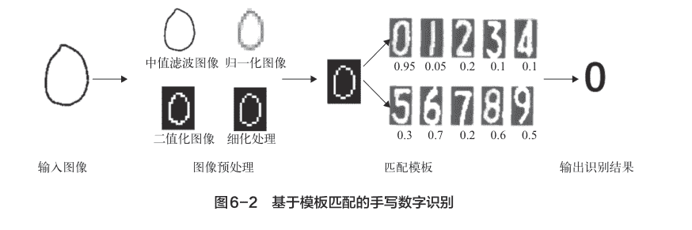
总体而言，模板匹配在物体检测、目标跟踪、人脸识别、图像匹配等场景中提供了一种简洁有效的定位思路，推动了计算机视觉的早期发展。

### 6.3.2 分类器驱动的识别
基于分类器的图像识别是通过机器学习训练模型，把输入图像或视频中的目标划分为不同类别。分类器从历史样本中学习特征与模式，再迁移到未知数据上。

训练阶段采用支持向量机、决策树、随机森林等算法，利用带标签的图像样本学习特征与类别的映射关系，形成决策边界或规则，并通过调参提升准确率与泛化能力。

该方法的应用十分广泛：

医学影像中可自动检出病变并辅助诊断；人脸识别中可完成身份核验；垃圾邮件过滤中可区分正常与垃圾邮件。

在智能交通领域，可对车流图像进行车辆检测、行人识别与事件监测，服务于交通管理与安全；在零售与供应链场景，可分析销售数据预测需求，优化库存与策略；在能源管理中，可分析能耗数据识别模式并预警故障；在运动分析中，可实现姿态识别与动作分类，助力训练与健康监测。

以支持向量机进行人脸识别为例：先收集正侧不同光照下的人脸图像，进行裁剪、去噪、归一化等预处理；采用主成分分析、局部二值模式等方法提取形状、纹理等特征；为每张样本标注唯一身份；划分为训练集与测试集；用训练集训练SVM寻找最优超平面分离类别；通过交叉验证、网格搜索等优化超参数；最后在测试图上提取相同特征进行分类输出身份标签。

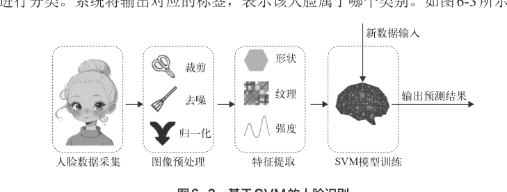
图6-3 基于SVM的人脸识别

基于分类器的方案在实际部署中灵活度高，能解决多种复杂问题，提升效率与决策可信度，其发展也推动了机器学习在医疗、交通、零售等领域的普及。

### 6.3.3 深度学习驱动的识别
深度学习通过模仿人脑神经网络的结构与工作机制，从复杂数据中挖掘高层语义表示，实现精确分类与识别。其核心是多层神经网络逐步学习输入的抽象表达。

典型网络由输入层、若干隐藏层与输出层构成。神经元接收前层加权输入，经激活函数非线性变换后输出。训练依赖反向传播计算误差，并用梯度下降等优化策略调整权重，迭代使模型掌握数据规律。层级化学习自动发现从边缘纹理到形状物体的抽象特征，无需手工设计。

主流模型包括：

前馈神经网络即多层感知机，由输入、隐藏、输出层组成，信息单向传递，适用于分类与回归任务，通过反向传播学习层次表示，为后续架构奠定基础。

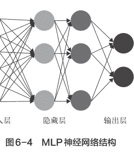
卷积神经网络专为图像设计，通过卷积层、激活函数、池化层与全连接层提取局部特征并共享权重，降低参数量并捕捉空间结构，广泛用于分类、检测与生成。

循环神经网络面向序列数据，具备循环连接可传递时间信息，擅长语音识别与自然语言处理，但长序列易出现梯度消失或爆炸。

长短时记忆网络是RNN的改进变体，引入遗忘门、输入门、输出门控制信息保留与更新，有效学习长期依赖，适用于机器翻译、语音识别等任务。

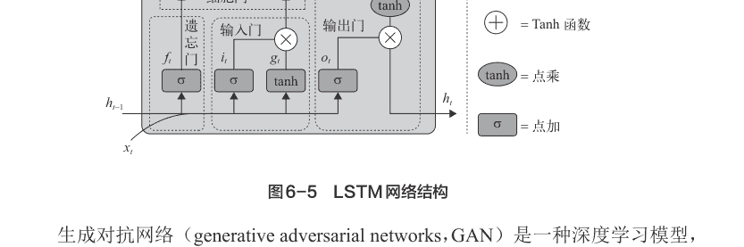
图6-5 LSTM网络结构

生成对抗网络由生成器与判别器对抗训练，生成器生成逼真样本，判别器区分真伪，二者博弈达到平衡，在图像生成、风格迁移、超分辨率等领域取得进展。

YOLO是一种单次前向的目标检测网络，将图像划分为网格，每个单元直接预测边界框与类别，兼顾速度与精度，被广泛用于自动驾驶、监控与物体识别。

深度学习在视觉任务中作用突出。CNN可学习动物形状纹理用于生态监测，也用于商品识别与无人零售；人脸识别中通过面部特征实现高精度验证；医学影像中辅助检出肿瘤病变，提升诊断效率。

例如猫狗图像分类：收集并预处理数据集，分成训练、验证、测试集；选用CNN架构，用深度学习框架搭建模型并配置损失函数、优化器与评估指标；利用数据增强提升泛化；多轮迭代训练并在验证集上监控准确率与损失防止过拟合；调整学习率等超参数；最终在测试集评估泛化能力后部署上线。

# ChatGPT与数字图像处理
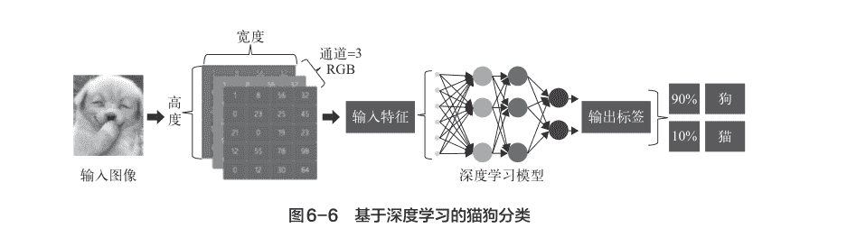
目标检测模型如YOLO在实时多目标检测中应用广泛。自动驾驶中可识别行人、车辆与交通标志，实现环境感知与避障；视频监控中可实时分析人员行为与异常，提升公共安全；在工业检测中可发现生产线缺陷；在农业中可评估作物状态与害虫。

在自然语言处理中，RNN与LSTM被用于机器翻译、情感分析与文本生成。它们能捕捉上下文并处理变长序列。Google Translate借助此类模型实现高质量翻译；情感分析可判断评论倾向，服务社交媒体监控与产品反馈；语音助手如Siri与Google Assistant也依靠它们理解并回应用户指令，提升交互自然度。

生成对抗网络擅长产出视觉上高度逼真的图像内容。风格迁移是最具代表性的应用方向之一，通过对GAN进行专项训练，就能把源图像的视觉风格迁移到目标图像上，比如把名家绘画的笔触套用到生活照片中。这种能力为艺术再创作提供了新的思路，让创作者可以用完全不同的艺术语言重塑同一画面。DeepArt 就是一个典型代表，它借助深度学习完成风格融合，生成兼具内容与风格的合成作品。StyleGAN 作为GAN的分支，更聚焦于高分辨率、高度写实的图像合成，在图像增强任务中作用明显，能让生成结果更精细自然，已被广泛用于人脸生成、影视特效等场景。综合来看，GAN在图像生成领域的落地，已经为艺术、设计和图像处理带来持续创新，也为创作者提供了更强大的工具箱，同时不断拓宽图像处理的边界。

深度学习技术持续演进，支撑数据也在快速累积，深度学习在真实场景中的价值和覆盖范围随之扩大。通过对不同应用进行精准识别和归类，深度学习能够帮助我们更好地掌握各类应用的使用态势，为相关领域的策略制定和流程优化提供依据，同时也提升了用户体验和服务水平。

## 6.4 小结
本章围绕图像识别的入门应用展开，从基本概念到完整流程进行了系统梳理。首先阐释了图像识别的定义、演进脉络，以及其在当代科技与生活中的关键作用，并通过经典案例的介绍激发阅读兴趣。随后详细拆解了图像识别的通用工作链条，包含图像采集与预处理、特征提取与筛选、模型构建与训练、测试与评估以及部署与应用，并在每个环节指出核心操作与要点。之后对比了主流技术路线，包括模板匹配、分类器方法和深度学习方法，说明各自的工作原理、适用优势和局限，帮助读者判断不同场景下的技术选择。阅读完本章后，读者能够对图像识别形成初步认知，掌握其概念框架、流程步骤与方法差异，为后续深入学习和实践奠定基础。

# 第 7 章 OCR驱动的车牌识别实战

- 7.1 车牌识别背景
- 7.2 车牌识别原理
- 7.3 程序实现
- 7.4 完整代码
- 7.5 小结

## 7.1 车牌识别背景
车牌字符的自动提取在现代交通治理、安防监控和智慧交通体系中占据核心地位。随着城市交通压力加大、机动车保有量攀升，自动化车辆辨识与追踪需求日益迫切。该技术可落地到车牌识别系统、停车场管理、路网管控、安全监控及智慧交通等多个场景。在这些场景里，可借助 Matlab 完成多阶段图像处理以提取车牌字符，涉及图像预处理、字符定位与分割等环节，确保在弱光、复杂角度或存在噪声的环境下仍能稳定提取。提取后的字符信息可支撑车辆身份确认、停车管理、交通流量统计与安防监控等业务。借助 Matlab 实现的字符提取流程，大幅提升了工作效率，降低了人工干预依赖，提高了数据的准确性与可靠性，有助于优化交通管理与安防监控的效果。这一方向在车牌字符识别问题上具备广阔的应用前景。ChatGPT 可在图像处理、模式识别与机器学习层面提供专业建议，本项目将调用 ChatGPT 参与算法设计，以提升字符提取的精度与效率。ChatGPT 还能输出相关的 Matlab 代码并进行深度解读，帮助更好地发挥 Matlab 的功能特性，获得更理想的图像处理效果。

## 7.2 车牌识别原理
车牌识别的核心任务是从车牌图像中获取字符信息以服务多样化应用，整体思路可由 ChatGPT 梳理，如图7-1所示。首先由摄像头或图像源采集车牌图像，采集需要在不同环境下完成，包括低照度、不同拍摄角度以及可能存在的噪声干扰。对采集到的图像进行预处理，利用 Matlab 的边缘检测、色彩过滤等手段定位车牌区域。随后通过边缘检测、轮廓提取等技术将字符从车牌图像中精确定位出来。接着使用 OCR 文字识别方法对每个字符进行判读。最后将识别结果叠加到原图上，在 ChatGPT 的专业指导下保证文字绘制与图像合成的清晰度与美观度，从而完成车牌号码的完整识别流程，如图7-2所示。

整个项目的关键在于借助图像处理技术从原始车牌图像中提取出清晰可读的字符。该方法在不同业务背景下均能发挥重要作用，为自动化和效率提升提供支撑。

### 基于MATLAB的车牌字符提取原理
基于 MATLAB 的车牌字符提取通常包含以下流程：

1. **预处理**：读取原始图像并进行增强以提升字符与背景的对比度。常用操作有图像灰度化、直方图均衡化、去噪滤波如中值滤波或双边滤波、边缘检测如 Sobel、Canny，以及图像二值化。
2. **车牌定位**：利用边缘特征、色彩信息或形态学操作如开运算、闭运算等，筛选出可能包含车牌的区域。此步旨在缩小处理范围，通常依据矩形区域、长宽比、纹理特征等判断候选区域。
3. **字符分割**：在确定车牌区域后，将其中的字符分离。常见手段有垂直投影法统计每列像素分布，以及连通域分析筛选字符区域，实现单字符切割。
4. **字符识别**：把分割后的字符图像送入 OCR 系统进行判读。MATLAB 提供的 OCR 工具箱可直接对字符图像识别并输出字母或数字。

上述步骤融合了图像处理与计算机视觉技术，在 MATLAB 环境中能够快速实现车牌字符的自动提取与识别。

图7-1 基于Matlab的车牌字符提取原理

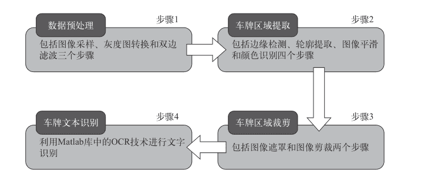

图7-2 基于Matlab的车牌字符提取流程图

### 7.2.1 数据预处理
原始图片常存在分辨率不足、模糊不清等问题，为保证后续步骤顺利开展，需先进行预处理。

图像采样：在预处理阶段先挑选待处理的图像，即图像采样。由于摄像设备多部署于室外，易受光照、车速、拍摄距离与角度等影响，导致图像出现倾斜、磨损及分辨率下降，因此采样后需进行一系列校正处理。

灰度图转换：将采样图像转为灰度图。灰度图仅保留亮度信息，相较彩色图更易处理，能显著提升后续算法的稳定性和运行速度。

双边滤波：双边滤波可在保留边缘细节的同时抑制噪声，为后续环节提供更清晰的输入。

### 7.2.2 车牌区域提取
通过轮廓识别从整张图像中剥离出车牌区域，为后续色彩判别和 OCR 识别提供纯净输入。

边缘检测和轮廓提取：采用 Canny 边缘检测算法提取图像中车牌的边缘信息，为轮廓提取做准备。利用 cv2.findContours 函数寻找图像轮廓，并按面积排序筛选出可能的车牌轮廓。该步骤为后续车牌区域处理奠定基础。

图像平滑：对提取的车牌区域进行平滑处理以降低噪声，提升后续处理的准确性。平滑后车牌特征更清晰，便于后续识别。

颜色识别：对车牌区域进行色彩判别，判断其主要颜色为红色、蓝色或其他。颜色识别有助于明确车牌色彩特征，为后续流程提供参考。

### 7.2.3 车牌区域裁剪
图像遮罩和图像剪裁：生成与灰度图同尺寸的空白图，根据颜色识别结果将车牌区域绘制为白色。通过位运算将原图与遮罩融合，保留车牌部分。依据车牌区域坐标对图像进行裁剪，仅保留车牌内容，随后作为 OCR 文本识别的输入图像，完成车牌识别。

### 7.2.4 车牌文本识别
借助 Matlab 提供的 OCR 技术对裁剪后的车牌图像进行文字提取，获取车牌号码信息。依次执行上述步骤即可完成车牌检测与识别。

## 7.3 程序实现

### 7.3.1 数据预处理
用户：请编写基于 Matlab 的完整代码，对车牌图像进行预处理，包含①读取并调整图像大小；②灰度化；③双边滤波。

原始图像如图7-3所示。

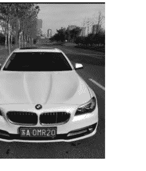

ChatGPT：下面给出车牌图像预处理的完整 Matlab 代码示例，展示读取、缩放、灰度化与双边滤波的操作。

```
function preprocess_license_plate(image_path, save_results)
    % 读取图像并调整大小
    img = imread(image_path);
    img = imresize(img, [768, 1024]); % 调整到固定尺寸

    % 灰度图转换
    gray = rgb2gray(img);

    % 双边滤波（平滑图像并保留边缘）
    bilateral_filtered = imbilatfilt(gray, 'DegreeOfSmoothing', 13, 'SpatialSigma', 15);

    % 显示原始图、灰度图和双边滤波图
    figure;
    subplot(1, 3, 1); imshow(gray); title('灰度图');
    subplot(1, 3, 2); imshow(bilateral_filtered); title('双边滤波图');
end
```

代码先读取车牌图像，调整尺寸，随后执行灰度转换与双边滤波。灰度图与滤波后图像如图7-4所示。

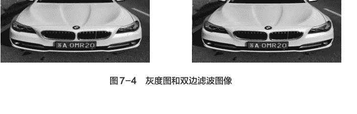

### 7.3.2 车牌区域提取
用户：请编写基于 Matlab 的车牌区域提取代码，包含边缘检测与轮廓提取、图像平滑、颜色识别等步骤，并输出结果。

ChatGPT：以下为 Matlab 车牌区域提取的代码示例：

```
function extract_license_plate(gray_image)
    % 输入：灰度图像 gray_image（建议先进行双边滤波预处理）

    % (1) 边缘检测（Canny算法）
    edged = edge(gray_image, 'Canny', [0.3, 0.8]); % 调整阈值增强边缘

    % (2) 轮廓提取（查找最大连通区域）
    stats = regionprops(edged, 'BoundingBox', 'Area');
    [~, idx] = max([stats.Area]); % 选择面积最大的区域
    screenCnt = stats(idx).BoundingBox;

    % (3) 绘制结果
    figure;

    % 子图1：边缘检测图
    subplot(1, 3, 1);
    imshow(edged);
    title('边缘检测图 (Canny)');

    % 子图2：轮廓提取图（叠加在原图上）
    subplot(1, 3, 2);
    imshow(gray_image);
    hold on;
    rectangle('Position', screenCnt, 'EdgeColor', 'r', 'LineWidth', 2);
    title('轮廓提取 + 车牌位置');

    % 子图3：车牌区域裁剪
    subplot(1, 3, 3);
    plate_region = imcrop(gray_image, screenCnt);
    imshow(plate_region);
    title('裁剪后的车牌区域');
end
```

该代码实现边缘检测、轮廓提取、图像平滑与颜色识别，最终效果如图7-5所示。

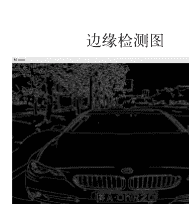

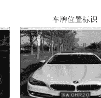

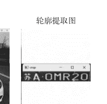

图7-5 车牌区域提取结果图

### 7.3.3 图像遮罩和图像剪裁
用户：请编写基于 Matlab 的车牌图像遮罩与剪裁代码，并输出结果。

ChatGPT：下面是 Matlab 实现的车牌图像遮罩与剪裁代码：

```
% === 创建遮罩 ===
mask = false(size(gray));
mask(screenCnt(2):(screenCnt(2)+screenCnt(4)), ...
    screenCnt(1):(screenCnt(1)+screenCnt(3))) = true;

% 生成遮罩图像（仅保留车牌区域，其余为黑）
mask_image = bsxfun(@times, img, cast(mask, 'like', img));

% 显示遮罩图像
figure; imshow(mask_image); title('图像遮罩');

% === 图像剪裁 ===
cropped = gray(screenCnt(2):(screenCnt(2)+screenCnt(4)), ...
              screenCnt(1):(screenCnt(1)+screenCnt(3)));

% 显示剪裁后的图像
figure; imshow(cropped); title('图像剪裁');
```

代码对图像进行遮罩与剪裁处理，最终结果如图7-6所示。

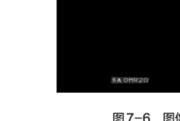

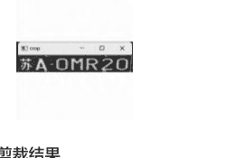

图7-6 图像遮罩和图像剪裁结果

### 7.3.4 OCR文本识别
用户：请编写基于 Matlab 的车牌区域 OCR 文本识别代码，并输出结果。

ChatGPT：以下是 Matlab 的 OCR 文本识别代码示例：

```
ocrResults = ocr(cropped);
disp(ocrResults.Text);
```

代码完成对车牌区域的 OCR 识别，最终结果如图7-7所示。


图7-7 车牌区域OCR文本识别结果

## 7.4 完整代码
完整代码由 ChatGPT 将前述各步骤整合而成，适配 Matlab 2022a 版本。完整代码如下：

```
function preprocess_license_plate(image_path)
    % 读取图像并调整大小
    img = imread(image_path);
    img = imresize(img, [768, 1024]);
    % 灰度图转换
    gray = rgb2gray(img);
    % 双边滤波
    blf = imbilatfilt(gray, 'DegreeOfSmoothing', 13, 'SpatialSigma', 15);
    % 边缘检测
    edged = edge(blf, 'Canny', [0.3, 0.8]); % 调整阈值范围 [0.3, 0.8] 或其他适当的值
    % 寻找轮廓
    stats = regionprops(edged, 'BoundingBox');
    [~, idx] = max(arrayfun(@(x) prod(x.BoundingBox(3:4)), stats));
    screenCnt = round(stats(idx).BoundingBox);
    % 创建遮罩
    mask = false(size(gray));
    mask(screenCnt(2):(screenCnt(2)+screenCnt(4)), screenCnt(1):(screenCnt(1)+screenCnt(3))) = true;
    mask_image = bsxfun(@times, img, cast(mask, 'like', img));
    % 图像剪裁
    cropped = gray(screenCnt(2):(screenCnt(2)+screenCnt(4)), screenCnt(1):(screenCnt(1)+screenCnt(3)));
    % OCR识别
    ocrResults = ocr(cropped);
    disp(ocrResults.Text);
    % 可视化结果
    figure;
    subplot(2, 2, 1), imshow(img), title('原始图像');
    subplot(2, 2, 2), imshow(edged), title('边缘检测图');
    subplot(2, 2, 3), imshow(mask_image), title('图像遮罩');
    subplot(2, 2, 4), imshow(cropped), title('图像剪裁');
end
% 使用示例
preprocess_license_plate(' ')
```

该代码对包含车牌的图像进行端到端处理与识别。通过 Matlab 的图像处理工具实现灰度化、双边滤波、边缘检测、轮廓检测等操作以定位车牌区域，再利用 Matlab 的 OCR 功能提取车牌文字信息。最后以图形化展示与文字输出的形式完成车牌识别与呈现。

## 7.5 小结

这套方案搭建了一套覆盖多场景的车牌字符抽取体系，依托多轮图像处理手段，能够在光照变化、拍摄角度偏斜以及不同程度噪声干扰下稳定运行。核心目标是实现车牌图像中字符的自动化分离，所提方法可直接嵌入车牌识别、道路交通管控、停车场运营、安防监控以及智慧交通等多个业务链路。ChatGPT在整个研发周期里承担技术顾问与代码实现双重职责，提供专业化建议、拆解算法思路，并参与提升抽取精度与运行效率。该技术具备较强的迁移价值：在车牌识别环节可实现字符的无人化抽取，提升通检效能；在停车管理中可自动记录车辆进出时间完成计费与流量统计；在交通管理层面可支持路网流量监测、车辆轨迹追踪与违章行为判定，同时为车辆身份核验与安全监控提供支撑。总体来看，该项目通过降低人工干预、提高识别精确度，为现代交通与安全系统的建设提供了可靠基座。

# 第 8 章 小波与SVM协同的遥感船舶识别方法

- 8.1 遥感图像船舶识别背景
- 8.2 遥感图像船舶识别原理
- 8.3 程序实现
- 8.4 结果展示
- 8.5 小结

## 8.1 遥感图像船舶识别背景

航空测绘是借助卫星、飞机等平台对地表目标进行摄影和测量的技术体系，最早可追溯至20世纪60年代，主要服务于地形勘测。进入70年代，卫星遥感技术逐步进入航空摄影领域，并成为主流手段。时至今日，卫星遥感已是军事侦察、海域监控、气象观测等场景不可或缺的技术支撑。21世纪以来，计算机、传感器与卫星技术同步突飞猛进，海上遥感的应用愈发成熟。

本章聚焦遥感图像中的船舶目标识别，重点论述船舶遥感影像的典型特征、识别算法以及图像增强手段，以期提高识别效果。在本次研究中，ChatGPT发挥了多重辅助作用：参与数据预处理环节，帮助整理与清洗遥感影像数据；提供船舶目标识别领域的文献梳理，补充背景知识与前沿动态；并协同完成代码编写，支撑技术落地。研究参考了以下文献：唐绍富,段兰兰.基于遥感图像的船舶目标识别技术[J].舰船科学技术,2020,42(14):85-87。

## 8.2 遥感图像船舶识别原理

### 8.2.1 海域遥感图像的基本特征分析

海域或航道的卫星遥感影像蕴含丰富信息，随着卫星分辨率提升，单幅图像承载的数据量持续增长，对海域影像的解析与处理成为遥感技术的关键。

开展海域遥感影像的识别与处理时，必须先把握卫星影像的固有属性，主要体现在空间、时间与光谱三个维度。

（1）空间特性
空间特性指像素在几何空间上的表达能力，影像能够呈现物体的轮廓、坐标、面积等空间信息。为了充分体现空间特性，影像像素在两个层面得到优化：一是数字化产生的空间坐标系像素值；二是空间分辨率，在相同幅面上像素密度越高分辨率越高。实际分析中需结合空间坐标与定位系统，将影像与经纬度关联，并对像素方位进行建模分析。

（2）光谱特性
光谱特性反映可见光辐射强度，通常以像素灰度值或RGB值表征。船舶遥感影像分析需结合光谱特性，采用量化编码方式将光谱信息存入计算机。光谱表现与物体对太阳辐射的反射率密切相关，也是影像呈现复杂色调与灰度的原因。

（3）时间特性
时间特性与空间特性共同构成影像坐标框架。受潮汐、海水温度等影响，地物随时间持续变化，同一区域在不同时相的影像差异可很大。即使在同一日内，日照角度与强度变化也会导致影像差异明显。因此，时间特性是获取准确判读信息不可忽略的因素。

### 8.2.2 基于小波变换的图像过滤与增强理论研究


海上雾霾、云层、水汽等气象因素常在遥感影像中引入噪声，而船舶目标颜色与海面背景相近，导致识别难度加大。过滤的目的是剔除干扰噪声，增强的目的是提升舰船目标与背景的区分度。本节借助小波变换理论实现信号滤波与图像增强，基于小波变换的滤波流程如图8-1所示。

### 8.2.3 船舶遥感图像的目标识别算法

图像目标识别是一项系统工程，其流程可归纳为图8-2。


常规处理可分为初级、中级、高级三个阶段。初级阶段针对影像本身，如补偿、抗干扰等，属于像素级操作；高级阶段为符号推理，对场景做宏观解释；中级阶段衔接两者，从低层特征提取过渡到目标识别。根据原理图，船舶遥感目标识别主要包含以下三步。

- ① 遥感图像的获取 含义有两层：其一从遥感卫星获取当前海域影像；其二从全景影像中裁剪出含有船舶目标的区域，缩小处理范围。该环节可大幅提升处理效率，避免在整幅图上耗费资源。
- ② 船舶目标特征提取 特征提取是识别过程的核心，能够在已获影像中把目标与背景分离。提取算法的优劣直接影响精度，可综合利用船舶的空间、时间与光谱特性实现区分。
- ③ 目标分类 提取特征后需进行分类与特征融合，常用方法包括支持向量机SVM、随机CRF分类等。分类可将具有相似特征的目标归并处理，适合海量遥感影像的批量识别。

## 8.3 程序实现

### 8.3.1 基于小波变换的图像过滤与增强

用户：请你编写基于小波变换的图像过滤与增强的 Matlab 算法。

ChatGPT：小波变换滤波增强是常见的图像处理手段，可有效去噪并凸显细节。下面给出一个简化的 Matlab 示例，演示如何利用小波工具箱完成滤波与增强。

请先确认 Matlab 已安装并激活小波工具箱，然后按以下步骤编写代码：

```
% 图像读取
originalImage = imread('your_image.jpg'); % 替换成你的图像文件路径

% 小波变换参数设置
level = 5; % 设置小波分解的层数
waveletType = 'db1'; % 小波基函数选择，可根据需要选择其他基函数

% 小波变换
wavedecImage = wavedec2(originalImage, level, waveletType);

% 设置阈值
threshold = 0.1; % 设置阈值，可根据实际情况调整

% 图像系数处理
wavedecImage(abs(wavedecImage) < threshold) = 0;

% 小波逆变换
enhancedImage = waverec2(wavedecImage, waveletType);
```
- ① 调用 imread 函数读取指定路径的图像文件 your_image.jpg，并保存到变量 originalImage 中。
- ② 使用 wavedec2 对图像进行五层小波分解，得到近似系数与各方向细节系数。设定阈值 threshold = 0.1，对小波系数进行处理，将低于阈值的系数视为噪声予以抑制。
- ③ 通过 waverec2 对处理后的系数重构，得到去噪或增强后的影像。

该示例展示了读取、分解、阈值处理与重构的完整链路。可根据需求调节阈值与小波基以获得更好效果，该实现仅作基础参考。

### 8.3.2 船舶遥感图像特征提取

用户：请你编写基于 Matlab 的船舶遥感图像的 HOG（方向梯度直方图）特征提取算法。

ChatGPT：Matlab 中可使用 extractHOGFeatures 函数完成 HOG 提取。以下为对船舶遥感影像进行 HOG 提取的示例代码：

```
% 读取船舶遥感图像
shipImage = imread('ship_image.jpg'); % 替换成你的船舶遥感图像文件路径

% 将图像转换为灰度图像
grayImage = rgb2gray(shipImage);

% 计算 HOG 特征
cellSize = [8 8]; % 定义每个细胞的大小
blockSize = [2 2]; % 定义每个块的大小
numBins = 9; % 定义每个细胞的梯度方向的 bin 数量

hogFeatures = extractHOGFeatures(grayImage, 'CellSize', cellSize, 'BlockSize', blockSize, 'NumBins', numBins);
```
- ① 代码使用 imread 加载 ship_image.jpg 并转为灰度图，变量 shipImage 保存原始图。
- ② 通过 rgb2gray 将彩色图转为灰度图，结果存入 grayImage。
- ③ 计算 HOG 特征，参数设置为 cellSize = [8 8]、blockSize = [2 2]、numBins = 9，分别控制细胞尺寸、块尺寸与方向 bin 数。
- ④ 调用 extractHOGFeatures 提取梯度信息并生成特征向量，结果存入 hogFeatures。

### 8.3.3 基于已提取的HOG特征进行SVM的分类

用户：写出“基于已提取的HOG（方向梯度直方图）特征进行SVM分类”的完整代码，使用Matlab。

ChatGPT：下面给出基于预提取 HOG 特征与 SVM 进行图像分类的完整 Matlab 代码，假设特征已保存。

```
% 读取训练集和测试集的船舶和非船舶图像
shipTrain = imread('ship_train_image.jpg'); % 替换成你的船舶训练图像文件路径
nonShipTrain = imread('non_ship_train_image.jpg'); % 替换成你的非船舶训练图像文件路径

shipTest = imread('ship_test_image.jpg'); % 替换成你的船舶测试图像文件路径
nonShipTest = imread('non_ship_test_image.jpg'); % 替换成你的非船舶测试图像文件路径

% 提取训练集和测试集的 HOG 特征
shipTrainHOG = extractHOGFeatures(rgb2gray(shipTrain));
nonShipTrainHOG = extractHOGFeatures(rgb2gray(nonShipTrain));

shipTestHOG = extractHOGFeatures(rgb2gray(shipTest));
nonShipTestHOG = extractHOGFeatures(rgb2gray(nonShipTest));

% 标记
labelsTrain = [ones(size(shipTrainHOG, 1), 1); zeros(size(nonShipTrainHOG, 1), 1)];
labelsTest = [ones(size(shipTestHOG, 1), 1); zeros(size(nonShipTestHOG, 1), 1)];

% 合并训练集和测试集的特征
featuresTrain = [shipTrainHOG; nonShipTrainHOG];
featuresTest = [shipTestHOG; nonShipTestHOG];

% 使用支持向量机（SVM）进行分类
svmModel = fitcsvm(featuresTrain, labelsTrain);
```
- ① 整体流程为船舶与非船舶图像分类，包含读取训练测试集、提取 HOG 特征、设置标签、合并特征并用 SVM 训练分类。
- ② 读取训练集 shipTrain、nonShipTrain 与测试集 shipTest、nonShipTest。
- ③ 对每张图先转灰度再用 extractHOGFeatures 提取 HOG 特征，得到 shipTrainHOG、nonShipTrainHOG、shipTestHOG、nonShipTestHOG。
- ④ 为训练样本设定标签，船舶为 1，非船舶为 0，分别写入 labelsTrain 与 labelsTest。
- ⑤ 将训练与测试集的船舶与非船舶特征合并为 featuresTrain 与 featuresTest。
- ⑥ 调用 fitcsvm 训练支持向量机模型，得到 svmModel 用于后续分类。

### 8.3.4 分析船舶区域并显示结果

用户：写出“分析船舶区域，绘制白色边界框”这一步骤的完整代码。

ChatGPT：在本步骤中分析船舶区域、提取特征并绘制边界框。以下为完整 Matlab 示例：

```
% 读取船舶遥感图像
shipImage = imread('ship_image.jpg'); % 替换成你的船舶遥感图像文件路径

% 将图像转换为灰度图像
grayImage = rgb2gray(shipImage);

% 使用阈值处理提取船舶区域
binaryImage = grayImage > 100; % 通过调整阈值来选择合适的二值化阈值

% 进行连通区域分析，获取船舶区域的属性
stats = regionprops(binaryImage, 'BoundingBox');

% 在原图上绘制自适应边界框
figure;
imshow(shipImage);
```

## 8.4 结果展示

该代码实现了一个简易的船舶检测系统，可在图像中定位船舶。完整实现由 ChatGPT 将上述各步骤整合而成，适配 Matlab 2022a。

以下是完整代码：

```matlab
% 1. 船舶遥感图像的特征提取
shipImage = imread('ship_image.jpg'); % 替换成你的船舶遥感图像文件路径
% 将图像转换为灰度图像
grayImage = rgb2gray(shipImage);
% 计算 HOG 特征
cellSize = [8 8];
blockSize = [2 2];
numBins = 9;
hogFeatures = extractHOGFeatures(grayImage, 'CellSize', cellSize, 'BlockSize', blockSize, 'NumBins', numBins);
% SVM 分类
load('svm_model.mat'); % 加载之前训练好的 SVM 模型
% 预测图像的标签
predictedLabel = predict(svmModel, hogFeatures);
disp(['图像的预测标签: ', num2str(predictedLabel)]);
% 2. 船舶区域分析和绘制白色边界框
binaryImage = grayImage > 100; % 通过调整阈值来选择合适的二值化阈值
% 连通区域分析，获取船舶区域的属性
stats = regionprops(binaryImage, 'BoundingBox');
% 在原图上绘制白色边界框
figure;
imshow(shipImage);
hold on;
for i = 1:length(stats)
    rectangle('Position', stats(i).BoundingBox, 'EdgeColor', 'white', 'LineWidth', 2);
end
hold off;
```
船舶检测结果如图8-3所示。


图8-3 船舶检测结果展示图

## 8.5 小结

## 遥感船舶识别流程概览

本节聚焦于利用遥感影像实现船舶自动识别的完整链路，涵盖预处理、特征挖掘、目标判定与区域量化等环节。先介绍项目缘起：把计算机视觉与遥感技术融合，可服务航行安全、港口调度、海洋资源与生态保护等实务需求。随后说明遥感影像具备空间结构、光谱响应与时间演化三类特性，理解这些特性对提升后续处理质量至关重要。以小波变换降噪为例说明预处理思路，并强调特征提取对识别准确率的支撑作用；以方向梯度直方图HOG为例展示纹理信息的获取方式。接着给出基于支持向量机SVM的目标检测示例，演示如何对提取特征进行分类、在影像上框出船舶区域、计算面积并依据设定阈值筛选有效目标，实现位置标注与量化。整体目标是让系统能够自动从遥感影像中读取海上船舶的关键要素，形成面向海事监管的智能化工具，提升安全保障、资源管控与环境保护的效率。此类任务复杂度高，通常依赖深度学习、大规模标注数据以及专业的图像处理技术协同完成。

# 第 9 章
基于光流场的交通汽车检测跟踪

- 9.1 汽车跟踪背景
- 9.2 汽车跟踪原理
- 9.3 程序实现
- 9.4 结果展示
- 9.5 小结

## 9.1 汽车跟踪背景

从时序图像中解析场景中物体的形态、位置与运动规律是运动视觉研究的核心任务，尤其在背景不断变化时挑战更大。该方向常见两种思路：离散特征点追踪与整体光流分析。特征点法聚焦关键点的跨帧匹配以推断运动；光流法则关注连续帧间像素位移的整体分布。当物体在画面中移动，其灰度分布也会随之迁移，光流被用来描述这种迁移的速度。实质上，光流是成像平面上可见点的速度投影，可为运动分析与场景结构推断提供依据。利用光流实现交通车辆的检测与追踪，能够实时反馈车流位置，为交通管控、智能驾驶等应用提供支撑，有助于提高道路安全与通行效率，推动城市可持续发展。如图9-1所示。


借助ChatGPT构思光流引导的车辆监测方案，涉及计算机视觉与深度学习的相关知识。ChatGPT本身不具备直接编程与部署能力，但可提供思路参考与步骤梳理。

- ① 理解问题：
光流概念：光流描述影像像素随时间产生的位移。在车流监测中，可据此推断车辆在画面中的运动趋势。
检测与追踪的含义：检测指在影像中定位车辆，追踪指在连续帧中持续锁定车辆运动轨迹。
- ② 数据获取：收集包含交通车辆的视频素材，可选用公开数据集或自行采集的路况录像。
- ③ 预处理：对视频进行帧抽取、去噪、尺寸归一化等操作。
- ④ 车辆甄别：运用计算机视觉技术在影像中定位车辆。
- ⑤ 光流计算：对视频序列中相邻帧计算光流分布。
- ⑥ 车辆追踪：融合甄别结果与光流计算结果实现连续追踪，可用甄别结果初始化追踪器。

本章项目融合计算机视觉、深度学习、影像处理等多领域知识，对编程与数学基础有一定要求。在本案例中，采用Computer Vision System Toolbox提供的光流算法分析交通视频中汽车的运动。通过该算法能够检测并估计视频中汽车的运动状态，从而更好地理解整体交通场景。

## 9.2 汽车跟踪原理

### 9.2.1 光流法检测运动原理

光流法用于估计影像中物体像素的运动，其依据两项基本假设：

（1）亮度不变假设
在短时间内，同一物体上像素的亮度可视为稳定。在连续影像序列中，假设对应同一空间点的像素灰度在瞬间内保持不变。这一假设为光流计算奠定基础，便于在不同时刻比较像素亮度以推断运动。
举例：一辆汽车在极短时间内移动。根据该假设，同一车身部位在两帧中的亮度应相近。若出现明显亮度变化，更可能是光照、阴影等干扰，而非物体自身运动。

（2）微小位移假设
在极短时段内物体位移很小，可近似为匀速。该假设将运动视为局部变化，认为物体在极短时间内仅产生微小位移，可用恒定速度近似。
该假设简化了计算。若位移微小，相邻帧间像素亮度差异可主要归因于运动。若位移过大，则需考虑视角变化、遮挡等复杂因素。

基于上述假设，光流法的主要流程如下：

#### （1）灰度差计算
在连续影像中，同一物体在不同时刻的像素亮度可能变化。计算光流首先需求得相邻两帧的像素亮度差异，通常通过计算影像各像素的亮度梯度实现。对影像中每个像素点(x,y)，亮度梯度可按以下方式计算：

$$I_x = \frac{\partial I}{\partial x}, I_y = \frac{\partial I}{\partial y}$$ (9-1)

其中，I为影像灰度值；Ix与Iy分别表示x与y方向上的亮度梯度。

#### （2）建立光流约束
光流约束基于亮度不变与微小位移假设，表达影像中每个像素点的运动速度。可表示为：

$$I_x V_x + I_y V_y = -I_t$$ (9-2)

其中，Vx与Vy为像素点(x,y)在x与y方向上的运动速度；It为两帧之间的时间差。

#### （3）求解光流约束
求解目标是得到每个像素点的速度分量Vx与Vy。该问题通常为超定系统，因影像像素数远大于未知速度分量数。求解需采用数值方法，如Lucas-Kanade方法或Horn-Schunck方法。这些方法尝试最小化亮度差平方和，以获得最优速度估计。

#### （4）可视化与应用
获得像素级运动速度后，可进行可视化，例如生成光流矢量场图，每个箭头表示像素的运动方向与速度。此外，光流信息可用于多种计算机视觉任务，例如：
- ① 目标追踪：通过光流估计物体运动，用于连续帧间位置变化的追踪。
- ② 行为识别：依据像素运动模式识别场景中的不同动作。
- ③ 稠密深度估计：利用光流信息估计场景物体的深度，尤其在双目或多目相机系统中。

光流法通过计算像素亮度变化推断运动信息，应用涵盖目标追踪、行为分析、深度估计等多个领域。但在处理大运动、纹理缺失等情形时可能受限。基于光流场的运动检测步骤如图9-2所示。


### 9.2.2 Horn-Schunck 密集光流算法

Horn-Schunck光流算法是一种经典的稠密光流计算方法，旨在从影像序列中估计每个像素点的运动速度。该算法由Berthold K.P. Horn与Brian G. Schunck于1981年提出并改进，在此之前Robert Lucas与Takeo Kanade已提出相关思路。该算法基于亮度不变假设与平滑假设解决光流估计问题。

（1）构建约束方程
为考虑平滑假设，可假设相邻像素的运动速度相近，从而构建约束方程。这些方程将相邻像素的运动速度关联起来，以便在估计过程中融合局部信息。
对像素点(x,y)，假设其速度分量为Vx与Vy。依据平滑假设，可考虑邻域像素的速度，构建约束方程，使速度分量在满足影像梯度与时间差的同时符合平滑性。

#### （2）求解光流方程
将光流方程与约束方程结合，可得到一个最小化问题，目标是找到满足约束条件的运动速度。可通过最小化以下目标函数实现：

$$E = \iint (I_x V_x + I_y V_y + I_t)^2 + \alpha \left[ \left( \frac{\partial V_x}{\partial x} \right)^2 + \left( \frac{\partial V_x}{\partial y} \right)^2 + \left( \frac{\partial V_y}{\partial x} \right)^2 + \left( \frac{\partial V_y}{\partial y} \right)^2 \right] dxdy \quad (9-3)$$

其中，第一项为亮度差平方和；第二项为速度平滑项。α为平滑项权重，其取值需考虑影像噪声。若噪声较强，影像数据置信度较低，需更依赖光流约束，可取较大值；反之可取较小值。

#### （3）迭代优化
Horn-Schunck算法通常采用迭代方法逐步优化运动速度。每次迭代依据当前估计的速度场更新像素运动速度，反复进行直至收敛到稳定速度场。
本章采用松弛迭代方法，迭代公式为：

$$V_x^{k+1} = \overline{V}_x^k - \frac{I_x (I_x \overline{V}_x^k + I_y \overline{V}_y^k + I_t)}{\alpha^2 + I_x^2 + I_y^2}$$

$$V_y^{k+1} = \overline{V}_y^k - \frac{I_y (I_x \overline{V}_x^k + I_y \overline{V}_y^k + I_t)}{\alpha^2 + I_x^2 + I_y^2} \quad (9-4)$$

Horn-Schunck算法适用于小运动且场景较平滑的情况，对大位移与纹理缺失情形效果有限。实际应用中可通过参数调整与预处理改善性能。尽管现代计算机视觉已有更高级的替代方案，Horn-Schunck仍是理解光流估计原理的重要基础。

## 9.3 程序实现

使用光流方法检测汽车的算法主要通过五个阶段实现，流程参考图9-3。程序开始时利用vision.OpticalFlow计算交通摄像头拍摄视频中的光流分布。对光流场的幅值进行阈值分割，可得到二值影像。该影像中幅值较大的区域表示存在车辆流动。针对二值分割影像，采取形态学滤波、腐蚀与闭合等操作，以对影像中的目标进行进一步处理与增强。随后，利用vision.BlobAnalysis对处理后的影像进行分析，以定位与测量汽车物体的位置与面积等特征。最终，通过比较物体面积与预设阈值，判断检测到的物体是否为汽车。若物体面积比例较小，很可能是噪声或其他杂物，而较大面积比例则可能代表汽车。


用户：请你编写基于光流场的交通汽车检测跟踪的Matlab算法。

ChatGPT：下面是一个基于光流场的交通车辆检测与追踪的简化Matlab算法框架。请注意，这仅是一个基础示例，实际应用中可能需要更复杂的技术与优化。

### ☑ 基于光流的汽车检测与追踪：简要说明（共五步）

**步骤 1：视频初始化和参数设置**

加载交通视频文件，获取影像尺寸（宽度和高度），并初始化光流算法（如Lucas-Kanade）与可视化窗口。

**步骤 2：读取并预处理帧影像**

逐帧读取视频影像，并将其转换为灰度影像，为后续光流计算做准备。

**步骤 3：计算光流和运动矢量**

使用光流算法估计每个像素在当前帧与前一帧之间的运动强度与方向，得到运动矢量图，表示影像中的动态区域。

**步骤 4：进行车辆检测和阈值处理**

对光流影像进行高斯滤波平滑、阈值分割与去噪处理，识别出明显运动的区域，这些区域通常对应运动中的车辆。

**步骤 5：分析车辆区域，绘制边界框并显示结果**

分析运动区域，提取其边界框并将其绘制在原始影像上，最后在视频窗口中动态显示检测与追踪结果。

## ChatGPT 与数字影像处理

我们可以看到，ChatGPT提供了一个简单的示例。实际上，车辆检测与追踪是一个复杂问题，需要更多技术与资源来实现准确结果。因此，我们需在此基础上进一步与ChatGPT交流，完善代码。

### 9.3.1 视频初始化与对象配置

用户：写出“视频初始化和设置”这一步骤的完整代码，并详细描述这一步骤及其功能。

ChatGPT：视频初始化和设置代码如下：

```matlab
% 清空环境
clear all;

% 步骤 1：视频初始化和设置
videofile = 'MyVideo.mp4';          % 1. 视频路径和文件名
videoObj = VideoReader(videofile);   % 2. 创建视频读取对象
cols = videoObj.Width;               % 3. 获取视频帧的宽度（列数）
rows = videoObj.Height;              % 3. 获取视频帧的高度（行数）
```

该阶段的目的是初始化视频文件并获取与视频相关的基本参数。具体功能如下：首先用videofile变量存储视频文件的路径与名称，用于后续读取。然后使用VideoReader函数创建videoObj这个视频阅读器对象，以打开视频文件并访问视频帧与相关信息。再用cols与rows变量分别存储视频帧的列数（宽度）与行数（高度）。通过该阶段，成功初始化视频文件并获取视频基本参数，为接下来的光流计算与车辆检测等步骤奠定基础。

用户：写出“创建对象并设置参数”这一步骤的完整代码，其中，需要采用Horn-Schunck光流计算方法以及中值滤波器等方法，同时，详细描述这一步骤及其功能。

ChatGPT：下面是你需要的创建对象并设置参数这一步骤的代码：

```matlab
%% 步骤 2：创建对象并设置参数
```

## 9.3.1 视频处理对象搭建

# MATLAB 视频运动检测流程拆解

```matlab
% 1. 视频文件读取器 (Frame reader)
hReader = vision.VideoFileReader( ...
    'MyVideo.mp4', ...                     % 视频文件路径
    'ImageColorSpace', 'RGB', ...           % 设置颜色空间为RGB
    'VideoOutputDataType', 'single');        % 输出类型为单精度浮点数

% 2. Horn-Schunck光流对象
hFlow = opticalFlowHS( ...
    'Smoothness', 1, ...                    % 平滑因子
    'MaxIteration', 10);                    % 最大迭代次数

% 3. 图像均值处理对象
hMean1 = vision.Mean;                       % 用于图像的平均值
hMean2 = vision.Mean('RunningMean', true);  % 启用滑动平均

% 4. 中值滤波器 (噪声去除)
hFilter = vision.MedianFilter;              % 中值滤波器对象

% 5. 形态学闭操作 (连接前景区域)
se = strel('disk', 5);                      % 创建结构元素
hClose = vision.MorphologicalClose('Neighborhood', getnhood(se));

% 6. 车辆区域分析对象
hBlob = vision.BlobAnalysis( ...
    'BoundingBoxOutputPort', true, ...
    'AreaOutputPort', false, ...
    'CentroidOutputPort', false, ...
    'MinimumBlobArea', 300);                 % 最小车辆区域面积

% 7. 形态学腐蚀操作
hErode = vision.MorphologicalErode('Neighborhood', getnhood(strel('square', 3)));

% 8. 绘图与文本显示对象
hShape1 = vision.ShapeInserter( ...
    'Shape', 'Rectangles', ...
    'BorderColor', 'Custom', ...
    'CustomBorderColor', [0 255 0]);         % 绘制边界框 (绿色)

hShape2 = vision.ShapeInserter( ...
    'Shape', 'Lines', ...
    'BorderColor', 'Custom', ...
    'CustomBorderColor', [255 0 0]);         % 绘制运动矢量 (红色)

hText = vision.TextInserter('%d', ...
    'Location', [10 10], ...
    'Color', [255 255 0], ...
    'FontSize', 14);                         % 显示车辆数量 (黄色)

% 9. 获取屏幕大小，设置视频窗口位置
screenSize = get(0, 'ScreenSize');

% 10. 创建四个视频播放器
hVideo1 = vision.VideoPlayer('Name', '原始视频', ...
    'Position', [20, screenSize(4)-300, 300, 250]);
hVideo2 = vision.VideoPlayer('Name', '光流矢量图', ...
    'Position', [340, screenSize(4)-300, 300, 250]);
hVideo3 = vision.VideoPlayer('Name', '二值图像', ...
    'Position', [660, screenSize(4)-300, 300, 250]);
hVideo4 = vision.VideoPlayer('Name', '检测结果', ...
    'Position', [980, screenSize(4)-300, 300, 250]);

% 11. 创建网格坐标（用于运动矢量绘制）
[cols, rows] = deal(hReader.info.VideoSize(1), hReader.info.VideoSize(2));
[xpos, ypos] = meshgrid(1:10:cols, 1:10:rows);  % 设定绘图间隔
```

该阶段的核心工作是搭建一套用于处理视频帧的系统对象并完成初始化。程序会先批量创建视频读取器、Horn-Schunck 光流估算器、中值滤波器、图像均值计算器、形态学闭运算与腐蚀器、连通区域分析器，以及负责绘图和文字叠加的插入器。随后开启四个视频播放窗口分别展示不同中间结果，并依据原始视频分辨率生成用于绘制运动矢量的坐标网格，为后续的目标检测和轨迹可视化做好准备。

### 9.3.2 读取并预处理帧图像

用户：请给出“读取并预处理帧图像”环节的完整代码，要求加入0.3秒的暂停来控制播放节奏，并对该环节的工作原理做详细说明。

ChatGPT：读取并预处理帧图像的具体实现如下：

```matlab
% 假设之前已经创建了 hReader 对象

while ~isDone(hReader)
    % 第一步：读取一帧图像
    frame = step(hReader);  % 使用 step 函数读取当前帧

    % 第二步：将读取到的帧图像转换为灰度图像
    gray = rgb2gray(frame);  % 将 RGB 图像转换为灰度图像

    % 你可以在这里执行进一步的处理，例如显示图像、光流计算等
    imshow(gray);  % 显示当前帧的灰度图像

    % 第三步：暂停0.3秒，控制视频播放速率
    pause(0.3);  % 暂停0.3秒
end
```

该环节负责从视频流中逐帧抓取并做灰度预处理。以 while ~isDone(hReader) 为循环条件，表示在视频读取器未读到尾部时持续运行。每次迭代先用 step(hReader) 取得当前帧，再经 rgb2gray 转为灰度图并用 imshow 现场展示。配合 pause(0.3) 让相邻帧间隔 0.3 秒，从而调节回放速度。

### 9.3.3 计算光流和运动矢量

用户：请输出“计算光流和运动矢量”步骤的完整代码，要求在原帧上绘制光流矢量线，并详细解释其作用。

ChatGPT：“计算光流和运动矢量”步骤的代码如下：

```matlab
% 假设之前已经创建了 hFlow 光流对象 和 hShape2 形状插入器对象
% 还假设之前已经读取并转换为灰度图像的帧变量 gray

while ~isDone(hReader)
    % 读取一帧图像并转换为灰度图像
    frame = step(hReader);  % 读取当前帧
    gray = rgb2gray(frame);  % 转换为灰度图像

    % 计算光流场
    flow = step(hFlow, gray);  % 使用光流对象计算当前帧的光流场

    % 计算运动矢量
    % 定义起始点坐标（可根据需求调整）
    step_size = 10;  % 每隔10个像素选择一个起始点
    [xpos, ypos] = meshgrid(1:step_size:size(gray,2), 1:step_size:size(gray,1));
    xpos = xpos(:);  % 将横坐标拉成向量
    ypos = ypos(:);  % 将纵坐标拉成向量

    % 根据光流场计算每个起始点的终止点
    u = flow(:,:,1);  % 获取光流的水平分量
    v = flow(:,:,2);  % 获取光流的垂直分量

    % 终止点坐标
    xend = xpos + u(sub2ind(size(u), ypos, xpos));
    yend = ypos + v(sub2ind(size(v), ypos, xpos));

    % 创建一组运动矢量（线段）
    lines = [xpos, ypos, xend, yend];  % 每个矢量由起始和终止坐标组成

    % 使用形状插入器绘制运动矢量
    vector = step(hShape2, frame, lines);  % 在帧上绘制运动矢量

    % 可视化当前帧及光流矢量
    imshow(vector); % 显示包含运动矢量的帧
    pause(0.3); % 控制视频播放速率
end
```

本步主要计算光流场并据此生成运动矢量。首先调用已创建的 hFlow 光流对象，通过 step 计算当前灰度帧 gray 的光流场，结果存入 flow，其中包含每个像素的水平与垂直分量。随后基于该光流场确定矢量，预先用 xpos 和 ypos 定义一组起点的坐标，再依据光流信息推算每个起点的终点坐标，并将起点与终点打包为 lines 数组。接着利用之前建立的 hShape2 形状插入器把这些矢量叠加到原帧 frame 上，得到 vector 结果。这一过程把抽象的光流信息可视化，便于直观分析各区域的运动状态，为后续分析提供依据。

### 9.3.4 进行车辆检测和阈值处理

用户：请给出“进行车辆检测和阈值处理”步骤的参考代码，并详细说明其功能。

ChatGPT：“进行车辆检测和阈值处理”步骤参考代码如下：

```matlab
% 假设之前已经计算了光流场 flow，并且有 hMean1 和 hMean2 平均器对象

while ~isDone(hReader)
    % 读取一帧图像并转换为灰度图像
    frame = step(hReader); % 读取当前帧
    gray = rgb2gray(frame); % 转换为灰度图像

    % 计算光流场
    flow = step(hFlow, gray); % 使用光流对象计算当前帧的光流场

    % 计算光流的幅度
    u = flow(:,:,1); % 水平光流分量
    v = flow(:,:,2); % 垂直光流分量
    magnitude = sqrt(u.^2 + v.^2); % 计算光流的幅度

    % 计算光流幅度的平均值
    avg_magnitude = step(hMean1, magnitude); % 计算当前帧光流幅度的平均值
    threshold_value = 0.5 * avg_magnitude; % 计算阈值

    % 二值化处理，检测可能的车辆区域
    carobj = magnitude > threshold_value; % 基于阈值二值化，车辆区域为1，非车辆区域为0

    % 形态学闭操作和腐蚀操作，增强车辆目标
    carobj = imclose(carobj, strel('disk', 5));  % 闭操作，连接区域
    carobj = imerode(carobj, strel('disk', 3));  % 腐蚀操作，去除噪声

    % 可视化车辆检测结果
    imshow(carobj);  % 显示二值化的车辆检测结果
    pause(0.3);  % 控制视频播放速率
end
```

本步骤用于识别画面中的运动车辆。首先逐帧读取视频并转为灰度图，随后调用已初始化的 hFlow 计算当前帧的光流场。接着求取光流水平与垂直分量的幅值，得到像素级的运动强度。借助均值对象 hMean1 求得整体平均幅值，以其一半作为阈值进行二值化，将运动明显区域标记为 1 作为候选目标。随后使用形态学闭操作和腐蚀操作来抑制噪声并连接破碎区域，最后用 imshow 显示检测结果，配合 pause(0.3) 控制播放速度。

### 9.3.5 分析车辆区域并显示结果

用户：请写出“分析车辆区域、绘制边界框并显示结果”环节的完整代码，要求提取面积、绘制边界框并在第22行画检测杆、统计越线车辆、用0.4阈值筛选宽高比、计数并把数量写入结果帧，并做详细说明。

ChatGPT：该功能实现代码如下：

```matlab
% 假设之前已经完成了车辆检测（carobj）并计算了光流

% 1. 使用 vision.BlobAnalysis 对象分析车辆区域，提取面积和边界框
area = []; % 存储每个检测到的车辆的面积
bbox = []; % 存储每个车辆的边界框
hBlob = vision.BlobAnalysis('AreaOutputPort', true, 'BoundingBoxOutputPort', true);

% 计算 blob（连通区域）信息
[area, bbox] = step(hBlob, carobj); % 计算车辆区域的面积和边界框

% 2. 定义生长值和逻辑索引，用于筛选位于边界框右侧的车辆
grow = 100; % 定义生长值，即边界框右侧的最小 x 坐标
idx = bbox(:,1) > grow; % 找出位于边界框右侧的车辆

% 3. 计算选定车辆的宽高比
ratio = (bbox(:,3) .* bbox(:,4)) ./ area; % 计算宽高比（边界框宽度*高度 / 面积）

% 4. 根据阈值筛选符合条件的车辆，宽高比大于 0.4
flag = ratio > 0.4; % 标记宽高比大于 0.4 的车辆

% 5. 计算车辆数量
count = sum(flag);  % 统计符合条件的车辆数量

% 6. 更新不符合条件的车辆的边界框信息
bbox(~flag, :) = -1;  % 将不符合条件的车辆的边界框设置为 -1，标记为不感兴趣区域

% 7. 使用 vision.ShapeInserter 绘制边界框
hShape1 = vision.ShapeInserter('Shape', 'Rectangles', 'BorderColor', 'Green', 'LineWidth', 2);
result = step(hShape1, frame, bbox);  % 在帧图像上绘制边界框

% 8. 在结果帧上添加文本，显示车辆数量
hText = vision.TextInserter('Text', 'Vehicle Count: %d', 'Location', [10, 10], 'Color', [255, 255, 0], 'FontSize', 18);
result = step(hText, result, count);  % 在结果帧上添加车辆数量文本

% 9. 使用 VideoPlayer 显示原始帧、光流向量、阈值处理的车辆图像和结果帧
hVideo1 = vision.VideoPlayer('Position', [100, 100, 640, 480]);
hVideo2 = vision.VideoPlayer('Position', [750, 100, 640, 480]);
hVideo3 = vision.VideoPlayer('Position', [100, 600, 640, 480]);
hVideo4 = vision.VideoPlayer('Position', [750, 600, 640, 480]);

% 显示视频帧
step(hVideo1, frame);          % 显示原始视频帧
step(hVideo2, vector);         % 显示带有光流向量的视频帧
step(hVideo3, carobj);         % 显示二值化的车辆检测图像
step(hVideo4, result);         % 显示带有边界框和车辆数量的结果帧

pause(0.3);  % 控制视频播放速率
```

这段程序是车辆检测与跟踪的核心，涵盖区域分析、框图绘制和结果呈现。先通过 BlobAnalysis 对象提取连通区域的面积与外接矩形信息，再以宽高比阈值过滤掉不符合车辆特征的区域并统计有效数量。随后更新边界框列表，仅保留符合条件的候选框，并用 ShapeInserter 在原图上绘制矩形。接着用 TextInserter 在图像左上角叠加检测到的车辆数量。四组 VideoPlayer 窗口分别展示原图、光流矢量图、检测二值图和带框结果图，并在每帧后加入 pause(0.3) 实现多窗口同步播放。

### 9.3.6 调试

将上述代码整合到 MATLAB 后运行，出现如下报错：

错误使用 **vision.TextInserter/step**

输入必须为数值或逻辑变量，或者为 fi 对象。

出错 **test** (line 114)

result = step(hText, result, numVehiclesStr);

因此继续与 ChatGPT 沟通排查问题：

用户：出现了

‘错误使用 vision.TextInserter/step

输入必须为数值或逻辑变量，或者为 fi对象。

### 9.3.7 封装整合

整合上述各步后，项目的完整代码可整理成如下形式：
```
% 读取视频文件
videoFile = 'myVideo.mp4';  % 输入视频文件路径
hReader = vision.VideoFileReader(videoFile);  % 创建视频读取对象

% 创建光流计算对象
hFlow = vision.OpticalFlow('Method', 'Lucas-Kanade');  % 创建光流对象，使用Lucas-Kanade算法

% 创建形态学处理器
hShape2 = vision.ShapeInserter('Shape', 'Lines', 'BorderColor', 'Green', 'LineWidth', 2);
hBlob = vision.BlobAnalysis('AreaOutputPort', true, 'BoundingBoxOutputPort', true);  % Blob分析，用于计算车辆区域的面积和边界框

% 创建平均器对象
hMean1 = vision.Mean;  % 平均计算器，用于计算光流幅度的平均值
hMean2 = vision.Mean;  % 第二个平均计算器

% 创建视频播放器对象
hVideo1 = vision.VideoPlayer('Position', [100, 100, 640, 480]); % 原始视频显示
hVideo2 = vision.VideoPlayer('Position', [750, 100, 640, 480]); % 光流向量显示
hVideo3 = vision.VideoPlayer('Position', [100, 600, 640, 480]); % 二值化车辆检测显示
hVideo4 = vision.VideoPlayer('Position', [750, 600, 640, 480]); % 结果显示

while ~isDone(hReader)
    % 1. 读取视频帧并转换为灰度图像
    frame = step(hReader); % 读取当前帧
    gray = rgb2gray(frame); % 转换为灰度图像

    % 2. 计算光流
    flow = step(hFlow, gray); % 使用光流对象计算当前帧的光流场
    u = flow(:,:,1); % 水平光流分量
    v = flow(:,:,2); % 垂直光流分量
    magnitude = sqrt(u.^2 + v.^2); % 计算光流幅度

    % 3. 计算阈值，进行车辆检测
    avg_magnitude = step(hMean1, magnitude); % 计算光流幅度的平均值
    threshold_value = 0.5 * avg_magnitude; % 设置阈值

    carobj = magnitude > threshold_value; % 二值化处理，车辆区域为1，非车辆区域为0
    carobj = imclose(carobj, strel('disk', 5)); % 形态学闭操作，连接区域
    carobj = imerode(carobj, strel('disk', 3)); % 腐蚀操作，去除噪声

    % 4. 分析车辆区域，绘制边界框
    [area, bbox] = step(hBlob, carobj); % 使用Blob分析提取面积和边界框
    grow = area > 100; % 过滤小区域
    idx = bbox(:,1) > grow; % 筛选位于边界框右侧的车辆
    ratio = (bbox(:,3) .* bbox(:,4)) ./ area; % 计算车辆的宽高比
    flag = ratio > 0.4; % 筛选符合条件的车辆，宽高比大于0.4

    % 统计符合条件的车辆数量
    count = sum(flag); % 计算符合条件的车辆数量
    bbox(~flag, :) = -1; % 将不符合条件的车辆的边界框设置为 -1

    % 5. 绘制边界框和车辆数量
    hShape1 = vision.ShapeInserter('Shape', 'Rectangles', 'BorderColor', 'Green', 'LineWidth', 2); % 创建形状插入器，用于绘制矩形
    result = step(hShape1, frame, bbox); % 绘制边界框

    % 6. 添加文本，显示车辆数量
    numVehiclesStr = sprintf('Vehicle Count: %d', count); % 格式化车辆数量为字符串
    hText = vision.TextInserter('Text', numVehiclesStr, 'Location', [10, 10], 'Color', [255, 255, 0], 'FontSize', 10); % 创建文本插入器
    result = step(hText, result); % 在结果图像上插入文本

    % 7. 使用视频播放器显示不同的结果
    step(hVideo1, frame); % 显示原始视频帧
    step(hVideo2, carobj); % 显示带有光流向量的图像
    step(hVideo3, carobj); % 显示二值化后的车辆检测图像
    step(hVideo4, result); % 显示带有边界框和车辆数量的结果帧

    pause(0.3); % 控制视频播放速率
end

% 关闭视频播放器
release(hVideo1);
release(hVideo2);
release(hVideo3);
release(hVideo4);
```

该实现搭建了一个轻量级的车辆运动检测与跟踪演示，能够从输入视频中捕捉移动车辆，并在结果画面上标出位置并计数。运动信息由光流估算获得，车辆候选区则通过阈值分割和形态学操作来提纯增强。借助内置的视频播放控件，整个检测跟踪过程可以实时浏览。

## 9.4 结果展示

在 MATLAB 环境中运行完整脚本后，界面会弹出四个并列的视频窗口，各自呈现不同阶段的输出：

- ① “hVideo1”：源视频，直接播放从 “MyVideo.mp4” 读取的原始帧。
- ② “hVideo2”：光流矢量图，展示每帧上由光流计算得到的运动方向与强度。
- ③ “hVideo3”：二值化检测图，呈现阈值处理与形态学处理后的车辆候选区域。
- ④ “hVideo4”：综合结果图，在检测到的车辆区域叠加矩形框与文字说明，同时给出累计车辆数。

播放器逐帧推进，使得检测与跟踪效果可以即时观察。这些窗口会在脚本运行期间保持开启，直至手动关闭或脚本进入后续流程，示例输出见图9-4，例如第77帧时恰好有两辆汽车越过栅栏。实际呈现效果会随所选输入视频及参数配置而变化。


## 9.5 小结

本章构建了一套基于光流的道路车辆检测与跟踪方案。利用 MATLAB 实现视频处理管线，先逐帧读取再计算光流以表征运动。光流幅值经阈值化与形态学 refinement 后用于提取车辆目标并改善连通性。随后对候选区域进行几何分析，以宽高比筛选出符合车辆特征的目标，并在画面上绘制边界框并展示统计信息。系统通过视频播放器实现实时可视化，适用于交通监控、智能交通管理等场景，提供直观的信息呈现。该案例突出了光流在目标跟踪中的作用，并演示了图像处理技术与实时视频分析结合解决车辆检测与跟踪问题的思路。

# 第 10 章 基于视觉的路面裂缝检测

## 10.1 裂缝检测背景

路面裂缝的早期发现是道路养护与安全管理的关键，及时发现问题可避免病害恶化并降低事故风险。通过系统化分析裂缝，可制定针对性修复方案，延长路面寿命，提升行车安全与舒适性。因此，裂缝检测技术的发展对道路建设与维护具有重要意义。


基于线状特征的路面裂缝检测方法目前仍在不断演进。随着计算机视觉和图像处理技术的进步，研究者提出了多类基于线状特征的检测算法。通常先从路面图像中提取线状信息如边缘、纹理，再借助机器学习或深度学习完成裂缝的识别与分割，如图10-1所示。尽管已有方案取得一定进展，但在复杂光照下的稳健检测、裂缝与路面其他纹理的区分等方面仍面临挑战。本章通过与 ChatGPT 的交流，从原理到代码深入解析路面裂缝检测技术。

## 10.2 裂缝检测原理

现有方案多聚焦于裂缝本身的线状特性进行建模与识别。

### 10.2.1 图像获取

裂缝检测的首要环节是获取路表图像或视频。数据源通常来自车载相机、无人机、卫星影像或其他采集设备，作为后续处理的输入。

### 10.2.2 直方图均衡化

直方图均衡化是一种提升对比度的增强手段，核心思路是利用累积分布函数将原图的直方图分布调整为近似均匀，从而拓宽明暗差异。为扩展原图的亮度范围，需要一个映射函数把像素值搬移到新直方图上，该函数应满足：

- ① 不改变像素值的相对大小顺序，映射后明暗关系保持；
- ② 映射结果仍落在原有范围内，即像素映射函数的值域为 0 ～ 255。

综合上述要求，累积分布函数是合适选择，因其单调递增且值域为 0 ～ 1，可同时保证顺序与边界。具体而言，直方图均衡化是对原图像素施加单调映射得到新图。在此过程中像素顺序得以保持，即：

$$q_1 = f(p_1)$$

$$q_2 = f(p_2)$$

若 $p_1 < p_2$，则 $q_1 < q_2$。其中 $p$ 和 $q$ 为原图和新图中的像素值，$h$ 和 $g$ 为原图和新图中的像素值分布函数。由 $h$ 和 $g$ 之间的像素值是一一对应且单调的，可以得出：

$$\int_{p} h(a) \mathrm{d}a = \int_{q} h(b) \mathrm{d}b$$

即区间 $[0, p]$ 中的像素数和区间 $[0, q]$ 中的像素数是相等的。因此，每个对应的像素值的累积概率函数是相等的：

$$\int_{0}^{p} h(a) \mathrm{d}a = \int_{0}^{q} h(b) \mathrm{d}b$$

### 10.2.3 中值滤波去噪

中值滤波是常用的保边缘去噪方法，利用局部邻域像素的中值替换中心像素，主要抑制椒盐噪声与脉冲噪声，避免孤立亮暗点出现。具体步骤为：

- ① 滤波窗口选择：中值滤波基于局部统计，需预先确定窗口或卷积核大小。窗口通常为正方形或矩形，尺寸影响去噪强度与细节保留的权衡。
- ② 窗口滑动：将窗口沿图像逐像素移动，每次提取窗口内像素集合进行处理。
- ③ 求中值：对窗口内像素按灰度排序，取中位数作为新的像素值，用以替换原值。
- ④ 迭代执行：在整幅图上重复上述操作，直至所有像素完成置换，实现去噪。

### 10.2.4 二值图像滤波

二值图像滤波用于优化二值化结果，主要实现去噪、边缘平滑、空洞填充或断裂连接，常用于字符识别、形状分析与目标检测。其原理如下：

- ① 图像二值化：先将灰度或彩色图转为二值图，按阈值将像素分为前景与背景。
- ② 结构元素的定义：需设定滤波核即结构元素，其形态与尺度决定滤波效果，核由前景1与背景0构成。
- ③ 滤波操作：核在二值图上逐点扫描，中心与当前像素对齐后执行逻辑运算。

腐蚀：核覆盖区域内，只有当核内所有位置与图像对应像素均为前景时，中心保持前景，否则置为背景，用于缩小或消除小孔。

膨胀：只要核内至少有一个位置与图像对应像素匹配为前景，中心即置为前景，用于扩大目标或填补空洞。

开运算：先腐蚀后膨胀，常用于去除细小噪声与断裂细节。

闭运算：先膨胀后腐蚀，常用于连接断裂的前景或填补小空洞。

- ④ 结果图像：经扫描与运算后生成新的二值图，前景与背景已按所选操作被调整。

### 10.2.5 对比度增强

对比度增强通过调整灰度分布使细节更清晰，同时保持整体亮度和色彩。技术要点如下：

- ① 直方图分析：对灰度图统计直方图，了解各灰度级出现频率，横轴为灰度级，纵轴为像素数。
- ② 线性变换：最简增强方式是对像素值进行缩放与平移。通用形式为：

$$g(x,y) = af(x,y) + b$$

其中，$f(x, y)$是原始图像中的像素值；$g(x, y)$是增强后的像素值；$a$和$b$是调整参数。$a$控制对比度的缩放，$b$控制亮度的平移。通过调整这两个参数，可以实现对比度的增强。

- ③ 直方图均衡化：非线性增强方法，将灰度级重新映射使各级的像素数量趋于均匀。具体步骤：

    - a. 计算原始直方图，统计各灰度级的像素数量。
    - b. 计算累积分布函数 CDF，反映各灰度级的累积分布。
    - c. 根据 CDF 将像素灰度映射到新值，实现对比度提升。

常用映射公式为：

$$g(x,y) = \frac{CDF[f(x,y)] - CDF_{\min}}{1 - CDF_{\min}}(L-1)$$

其中，$CDF[f(x,y)]$表示原始图像中像素值$f(x,y)$的累积分布函数数值；$CDF_{\min}$是$CDF$的最小值；$L$是灰度级别的总数。直方图均衡化可显著提升对比度，但可能改变整体亮度，需进一步校正。

- ④ 自适应对比度增强：不同区域的对比度需求各异，自适应方法可依据局部特征动态调节。常见做法是局部直方图均衡化 CLAHE，将图像分块分别均衡，避免全局处理导致的亮度失真。

上述手段可优化灰度分布，提升视觉质量与信息传达。

### 10.2.6 二值化处理

二值化是将灰度图转为仅含两类值的二值图，目的是分离目标与背景。其流程如下：

- ① 阈值选取：先确定合适阈值，可手动设定或采用 OTSU、自适应阈值等自动方法。
- ② 像素分类：阈值确定后，每个像素根据灰度是否大于等于阈值划分为前景或背景。
- ③ 生成二值图：分类完成后得到二值图，前景保留目标信息，背景被抑制，实现信息压缩。
- ④ 后处理可选：对二值图进行形态学等处理，可去除小噪点或填补孤立空洞，提升质量与连通性。

# ChatGPT与数字图像处理

二值化处理的核心是依据像素灰度与阈值的比较来确定类别。该操作在图像分割、目标检测、字符识别中应用广泛，可有效将目标从背景中分离，便于后续分析。阈值的选取是关键，需根据具体任务和图像特性确定。

## 10.3 裂缝检测步骤

用户：请问基于视觉的路面裂缝检测的一般步骤有哪些？

ChatGPT：使用线状特征检测裂缝通常涉及以下一般步骤。

**基于视觉的路面裂缝检测的一般步骤**

1.  **图像获取**

    通过高分辨率工业相机、无人机航拍、车辆搭载的路面检测设备等方式采集路面图像，确保图像覆盖目标检测区域，并在光照、拍摄角度和分辨率等方面尽量保持一致，为后续处理提供可靠数据源。

2.  **图像预处理**

为了让裂缝特征更突出、背景干扰更弱，原始图像通常要经过一套组合预处理：

* **直方图均衡化**：对灰度分布进行重排，扩大整体对比空间，让裂缝纹理更易辨识。
* **中值滤波去噪**：借助中值算子滤除椒盐类高频杂讯，在降噪的同时维持边缘完整，避免裂缝轮廓被模糊。
* **对比度增强**：进一步拉大裂缝与背景的亮度差距，使细微裂纹更醒目。
* **二值化处理**：把灰度图转为黑白二值图，实现裂缝区域与背景的清晰分离。
* **二值图像滤波**：以形态学运算如腐蚀、膨胀、开闭等手段剔除孤立噪点、平滑裂缝边缘，为后续特征提取提供更可靠的基础。

3.  **特征学习与提取**
裂缝在形貌、纹理、灰度上存在共性，做法是结合传统图像处理手段，例如边缘检测、纹理分析、方向梯度直方图等，或采用机器学习、深度学习的特征提取方式，对裂缝区域建立可描述的特征模型。

4.  **裂缝识别与筛选**
建立模型后，利用分类器、分割网络或规则判断等进行裂缝区域定位，再叠加几何属性如长度、宽度、走向以及连通性等进行后筛选，剔除误检，最终得到准确的裂缝分布。

综合上述与 ChatGPT 的交流，裂缝检测的常规流程可归纳为：先完成图像采集，再对采集图像做预处理，预处理包含直方图均衡化、中值滤波去噪、对比度增强、二值化处理和二值图像滤波；随后对图像共性特征进行学习与提取；最后基于提取结果开展裂缝识别与筛查。

整体流程可参见图 10-2，预处理子流程可参见图 10-3。


## 10.4 程序实现

10.4 节的内容是在 10.3 节的 ChatGPT 对话基础上延续生成的。

### 10.4.1 图像获取

用户：请帮我写一段 Matlab 代码模板，作用是读取本地的数据集图片。

ChatGPT：以下是一段能够实现读取本地数据集图片的代码。

```matlab
% 读取本地图像数据集的MATLAB模板

% 1. 设置图像数据集路径（用户需根据实际路径修改）
datasetPath = 'D:\MyDataset\';  % 数据集文件夹路径

% 2. 列出该路径下所有.jpg文件（可改为.png等）
imageFiles = dir(fullfile(datasetPath, '*.jpg'));

% 3. 创建空单元数组用于存储图像数据
imageData = cell(1, length(imageFiles));

% 4. 循环读取每一张图像
for i = 1:length(imageFiles)
    % 获取当前图像的完整路径
    imgPath = fullfile(datasetPath, imageFiles(i).name);

    % 读取图像
    img = imread(imgPath);

    % 存储到单元数组
    imageData{i} = img;

    % 显示图像（用于检查是否读取正确）
    imshow(img);
    title(['图像 ' num2str(i) ': ' imageFiles(i).name], 'Interpreter', 'none');
    pause(0.5);  % 暂停0.5秒以便查看
end

% 此时，所有图像数据都存储在 imageData 中
```

该模板的核心是读取本地图像集。先指定数据集路径并列出该目录下符合扩展名的文件，例如 .jpg；再初始化一个空的单元数组 imageData 用来存放读入的图像。随后用 for 循环逐张调用 imread 载入并保存到数组中，为验证读取是否成功，循环内部使用 imshow 显示并加标题。结束后所有图像都保存在 imageData 中，便于批量运算、分析和训练。使用者只需按自身路径和文件类型做相应配置即可。

### 10.4.2 直方图均衡化

用户：请帮我写一段直方图均衡化的 Matlab 代码模板。

ChatGPT：直方图均衡化代码如下。

```matlab
% 1. 读取输入图像
inputImage = imread('输入图像路径.jpg');  % 请将'输入图像路径.jpg'替换为实际图像文件的路径

% 2. 执行直方图均衡化
outputImage = histeq(inputImage);  % 对输入图像进行直方图均衡化，得到均衡化后的图像

% 3. 显示原始图像和均衡化后的图像
figure;
subplot(1, 2, 1);  % 创建一个1行2列的子图，显示原始图像
imshow(inputImage);
title('原始图像');

subplot(1, 2, 2);  % 显示均衡化后的图像
imshow(outputImage);
title('均衡化后的图像');

% 4. 保存均衡化后的图像
imwrite(outputImage, '保存路径.jpg'); % 请将'保存路径.jpg'替换为保存图像的路径和文件名
```

此段 Matlab 实现图像直方图均衡化并可视化保存。先用 imread 读取指定路径的输入图，再用 histeq 对其做均衡化以改善对比度。随后新建 figure 窗口，通过 subplot 分区，分别用 imshow 呈现原始图和均衡化后图像，并用 title 标注。最后调用 imwrite 将处理后的图像写入指定路径。

### 10.4.3 中值滤波去噪

用户：请帮我写一段中值滤波去噪的 Matlab 代码。

ChatGPT：中值滤波去噪部分代码如下。

```matlab
% 中值滤波去噪的MATLAB代码模板

% 1. 读取原始图像（用户需修改图像路径）
inputImagePath = 'D:\MyDataset\example.jpg';
originalImage = imread(inputImagePath);

% 2. 如果是彩色图像，转换为灰度图
if size(originalImage, 3) == 3
    grayImage = rgb2gray(originalImage);
else
    grayImage = originalImage;
end

% 3. 定义中值滤波窗口大小（必须为奇数）
windowSize = 3;

% 4. 使用 medfilt2 进行中值滤波
denoisedImage = medfilt2(grayImage, [windowSize windowSize]);

% 5. 显示原图和去噪后的图像
figure;
subplot(1, 2, 1);
imshow(grayImage);
title('原始灰度图像');

subplot(1, 2, 2);
imshow(denoisedImage);
title('中值滤波去噪后图像');

% 6. 保存去噪后的图像（用户需修改保存路径）
outputImagePath = 'D:\MyDataset\example_denoised.jpg';
imwrite(denoisedImage, outputImagePath);

disp('中值滤波去噪处理完成，图像已保存。');
```

本段用于对输入图做中值滤波去噪。imread 读取图像后，先定义滤波窗口 windowSize，这里取 3，可按需改为其它奇数。随后 medfilt2 基于该窗口执行中值滤波得到去噪结果。用 figure 与 subplot 建立 1 行 2 列视图，分别展示原图和去噪图并加标题，最后用 imwrite 保存去噪图像。

### 10.4.4 对比度增强

用户：请帮我写一段对比度增强的 Matlab 代码。

ChatGPT：对比度增强部分代码如下。

```matlab
% 对比度增强的MATLAB代码模板

% 1. 读取原始图像（用户需修改图像路径）
inputImagePath = 'D:\MyDataset\example.jpg';
originalImage = imread(inputImagePath);

% 2. 如果是彩色图像，转换为灰度图（对比度增强通常在灰度图上进行）
if size(originalImage, 3) == 3
    grayImage = rgb2gray(originalImage);
else
    grayImage = originalImage;
end

% 3. 使用 imadjust 进行对比度增强
% 将像素值映射到 [0.2, 0.8] 区间，数值可按需调整
enhancedImage = imadjust(grayImage, [0.2 0.8], []);

% 4. 显示原图与增强后的图像
figure;
subplot(1, 2, 1);
imshow(grayImage);
title('原始灰度图像');

subplot(1, 2, 2);
imshow(enhancedImage);
title('对比度增强后图像');

% 5. 保存处理后的图像（用户需修改保存路径）
outputImagePath = 'D:\MyDataset\example_enhanced.jpg';
imwrite(enhancedImage, outputImagePath);

disp('对比度增强处理完成，图像已保存。');
```

代码先用 imread 载入图像，再用 imadjust 调整对比度，将像素映射至 [0.2, 0.8] 区间，该区间可按需求修改。通过 figure 与 subplot 并排显示原图与增强后图像并加标题，最后用 imwrite 保存增强结果。

### 10.4.5 二值化处理

用户：请帮我写一段二值化处理的 Matlab 代码。

ChatGPT：二值化处理部分代码如下所示。

```matlab
% 二值化处理的MATLAB代码模板

% 1. 读取灰度图像（用户需修改图像路径）
inputImagePath = 'D:\MyDataset\example_gray.jpg';
grayImage = imread(inputImagePath);

% 如果是彩色图像，先转为灰度图
if size(grayImage, 3) == 3
    grayImage = rgb2gray(grayImage);
end

% 2. 设置二值化阈值（0~255）
threshold = 128; % 可根据需求调整
binaryImage = grayImage > threshold;

% 3. 显示原图与二值化结果
figure;
subplot(1, 2, 1);
imshow(grayImage);
title('原始灰度图像');

subplot(1, 2, 2);
imshow(binaryImage);
title(['二值化图像（阈值 = ' num2str(threshold) '）']);

% 4. 保存二值化图像（保存为逻辑图像会自动映射到黑白）
outputImagePath = 'D:\MyDataset\example_binary.jpg';
imwrite(binaryImage, outputImagePath);

disp('二值化处理完成，图像已保存。');
```

该段实现灰度图像的二值化。imread 读取灰度图后设定阈值 threshold，示例取 128，可自行调整。像素大于阈值的设为 1，其余设为 0，得到二值图。用 figure 与 subplot 同时展示原始灰度图和二值结果并加标题，最后用 imwrite 保存二值图像。

### 10.4.6 二值图像滤波

用户：请帮我写一段二值图像滤波的Matlab代码。

ChatGPT：以下是一段二值图像滤波的代码。

```matlab
% 二值图像滤波的MATLAB代码模板

% 1. 读取二值图像（用户需修改路径）
inputImagePath = 'D:\MyDataset\example_binary.jpg';
binaryImage = imread(inputImagePath);

% 如果读取的图像是灰度图或彩色图，先转为二值逻辑类型
if size(binaryImage, 3) == 3
    binaryImage = rgb2gray(binaryImage);
end
binaryImage = imbinarize(binaryImage);

% 2. 设置最小对象像素数（小于该值的对象将被移除）
minObjectSize = 500; % 可按需调整
filteredImage = bwareaopen(binaryImage, minObjectSize);

% 3. 显示原始与滤波后的二值图像
figure;
subplot(1, 2, 1);
imshow(binaryImage);
title('原始二值图像');

subplot(1, 2, 2);
imshow(filteredImage);
title(['滤波后的二值图像 (最小对象 = ' num2str(minObjectSize) ' 像素)']);

% 4. 保存滤波后的图像
outputImagePath = 'D:\MyDataset\example_binary_filtered.jpg';
imwrite(filteredImage, outputImagePath);

disp('二值图像滤波完成，结果已保存。');
```

代码先用 imread 读取指定路径的二值图像，再设定 minObjectSize，示例为 500，可按需修改。随后调用 bwareaopen 去除面积小于该值的连通区域，得到滤波后图像。用 figure 与 subplot 对比展示滤波前后图像并加标题，最后用 imwrite 保存滤波结果。

### 10.4.7 特征提取

用户：请帮我写一段特征提取的 Matlab 代码。

ChatGPT：特征提取部分代码如下。

```matlab
% 图像特征提取的MATLAB代码模板
% 特征包括：颜色、纹理、形状

% 1. 读取图像（用户需修改路径）
inputImagePath = 'D:\MyDataset\example.jpg';
img = imread(inputImagePath);

% ======================
% 颜色特征提取
% ======================
% 分离 RGB 通道
R = img(:, :, 1);
G = img(:, :, 2);
B = img(:, :, 3);

% 计算并显示直方图
figure;
subplot(3, 1, 1);
imhist(R);
title('红色通道直方图');

subplot(3, 1, 2);
imhist(G);
title('绿色通道直方图');

subplot(3, 1, 3);
imhist(B);
title('蓝色通道直方图');

disp('颜色特征提取完成（RGB直方图已显示）。');

% ========================
% 纹理特征提取
% ========================
% 转为灰度图
grayImg = rgb2gray(img);

% 计算灰度共生矩阵
glcm = graycomatrix(grayImg, 'Offset', [0 1; -1 1; -1 0; -1 -1]);

% 提取纹理特征（对比度、相关性、能量、均匀性）
statsTexture = graycoprops(glcm, {'Contrast', 'Correlation', 'Energy', 'Homogeneity'});
disp('纹理特征：');
disp(statsTexture);

% ========================
% 形状特征提取
% ========================
% 转为二值图
bwImg = imbinarize(grayImg);

% 获取形状特征（面积、周长、离心率等）
statsShape = regionprops(bwImg, 'Area', 'Perimeter', 'Eccentricity', 'BoundingBox');
disp('形状特征：');
disp(statsShape);

% ========================
% 显示原图
% ========================
figure;
imshow(img);
title('原始图像');

disp('特征提取完成，结果已在命令窗口显示。');
```

这段 Matlab 示例演示了图像特征的提取，覆盖了色彩、纹理与形状三个层面。先用 imread 导入指定路径的图片；色彩特征部分将原图拆分为 R、G、B 三个通道，利用 imhist 统计每个通道的灰度分布并做可视化；纹理特征部分先通过 rgb2gray 得到灰度图，再以 graycomatrix 构建灰度共生矩阵 GLCM，随后调用 graycoprops 从矩阵中计算对比度、能量等统计指标并展示；形状特征部分先用 imbinarize 把灰度图二值化，再借助 regionprops 提取区域面积、周长、离心率等几何属性并输出。最后原图会被呈现，所有特征数值会打印在命令窗口中。

### 10.4.8 裂缝识别和筛选

用户：能否提供一段用于裂缝识别与筛选的 Matlab 代码？

ChatGPT：下面给出裂缝识别与筛选的示例代码。

### 10.4.9 封装整合

用户：请把前面七段代码合理地封装成函数，便于相互调用并组合成完整的路面裂缝检测流程，并输出全部代码。

ChatGPT：以下是封装整合后的完整代码。

```matlab
function crack_detection_full_pipeline(datasetPath)
    % 路面裂缝检测完整流程
    % 输入：
    %   datasetPath - 图像数据集文件夹路径（字符串）
    %
    % 调用示例：
    % crack_detection_full_pipeline('D:\MyDataset\');

    % 读取图像文件列表
    imageFiles = dir(fullfile(datasetPath, '*.jpg'));
    numImages = length(imageFiles);

    for i = 1:numImages
        imgPath = fullfile(datasetPath, imageFiles(i).name);
        original_img = imread(imgPath);

        % 1. 转灰度图
        gray_img = convert_to_gray(original_img);

        % 2. 直方图均衡化
        hist_eq_img = hist_equalize(gray_img);

        % 3. 中值滤波去噪
        denoised_img = median_filter(hist_eq_img);

        % 4. 对比度增强
        enhanced_img = contrast_enhance(denoised_img);

        % 5. 二值化处理
        binary_img = adaptive_binarize(enhanced_img);

        % 6. 二值图像滤波
        filtered_binary = binary_filter(binary_img);

        % 7. 裂缝识别和筛选（形态学处理 + 连通区域筛选）
        morph_img = morph_process(filtered_binary);
        crack_mask = region_filter(morph_img);

        % 显示结果图（左上：原始，右上：灰度，左下：裂缝检测结果，右下：形态学处理）
        figure;
        subplot(2,2,1), imshow(original_img), title('原始图像');
        subplot(2,2,2), imshow(gray_img), title('灰度图像');
        subplot(2,2,3), imshow(crack_mask), title('裂缝检测结果');
        subplot(2,2,4), imshow(morph_img), title('形态学处理');
    end
end

function gray_img = convert_to_gray(img)
    if size(img,3) == 3
        gray_img = rgb2gray(img);
    else
        gray_img = img;
    end
end

function eq_img = hist_equalize(gray_img)
    eq_img = histeq(gray_img);
end

function denoised_img = median_filter(img)
    denoised_img = medfilt2(img, [3 3]);
end

function enhanced_img = contrast_enhance(img)
    enhanced_img = imadjust(img, [0.2 0.8], []);
end

function bw = adaptive_binarize(img)
    bw = imbinarize(img, 'adaptive', 'ForegroundPolarity', 'dark', 'Sensitivity', 0.4);
end

function filtered = binary_filter(bw)
    filtered = bwareaopen(bw, 50);
end

function morph_img = morph_process(bw)
    se = strel('line', 5, 0);
    morph_img = imdilate(bw, se);
end

function crack_mask = region_filter(morph_img)
    cc = bwconncomp(morph_img);
    stats = regionprops(cc, 'Area', 'Eccentricity');
    idx = find([stats.Area] > 100 & [stats.Eccentricity] > 0.8);
    crack_mask = ismember(labelmatrix(cc), idx);
end
```

该程序实现了一套完整的路面裂缝检测流程，涵盖从读取图像到裂缝定位的全链路。首先批量载入指定文件夹下的全部图像，对每张图逐一处理。处理链路先将彩色图转成灰度图，随后做直方图均衡化提升整体对比度，再用中值滤波平滑图像并抑制噪声。接着通过专门的对比度增强函数对细节进行强化，为分割做准备。分割采用自适应阈值二值化，可依据局部特征动态确定阈值，使裂缝区域更易分离。随后在二值图上执行面积滤波，剔除小面积干扰点，保留疑似裂缝区域；再通过形态学膨胀连接断裂的裂缝线，增强连贯性。最后利用连通域分析，结合面积与形状偏心率对区域进行筛选，去除非裂缝干扰。整体结果以四宫格形式呈现，依次为原始图、灰度图、裂缝检测结果和形态学处理效果，便于直观评估。模块化结构使逻辑清晰，也方便对各步骤参数进行针对性调整和扩展。

## 10.5 结果展示

结果展示如图10-4所示。


图10-4 结果展示

## 10.6 小结

本章系统介绍了路面裂缝检测的背景与核心原理，涉及图像采集、预处理、直方图均衡化、中值滤波降噪、二值图滤波、对比度增强以及二值化处理等环节。随后借助 ChatGPT 分步给出代码示例，便于后续复现与修改，最终通过整合可实现路面裂缝检测功能。

路面裂缝检测持续发展并对道路养护和交通安全意义重大。未来发展方向主要包括：

- ① 深度学习与人工智能的融入：随着算力提升和数据积累，卷积神经网络等深度模型能够学习复杂特征表示，提高检测精度与鲁棒性。
- ② 多模态数据融合：将图像、激光扫描、红外等多种数据源结合，可获得更全面的信息，提升检测性能。
- ③ 自动化与实时监测：自动检测系统将实现道路网络的实时监控与报警，提高维护效率，降低事故风险。
- ④ 无人机技术的应用：无人机在偏远或难以到达路段巡检中作用扩大，融合多传感器可提供高分辨率影像，助力裂缝检测。

技术不断进步可带来更准确、高效、可持续的裂缝检测方案，改善道路安全与可用性。

# 第 11 章 基于阈值分割提取眼前节组织

## 11.1 眼前节组织提取背景

眼前节是眼球中负责调节晶状体形态以实现聚焦的重要部位。眼前节组织的提取通常聚焦于上、下角膜边缘的检测，具体位置见图11-1。


图11-1 眼球结构

数字图像处理技术在眼前节提取中发挥关键作用，主要体现在图像分割、特征提取与模式识别等方面。通过该技术可实现眼前节组织的自动化分析与识别，为眼科临床提供快速、精准的辅助诊断。

本章基于与 ChatGPT 的交互，深入探讨阈值分割方法在眼前节组织提取中的应用，涵盖背景、原理、操作流程与源代码。学习后读者可全面掌握该技术的核心思想与实践方法，为相关研究提供支撑。

## 11.2 阈值分割技术原理

阈值分割是一种依据像素灰度值将图像划分为不同区域的图像处理方法。通过设定阈值，将高于或低于该值的像素归入不同类别，从而实现目标分离。该方法在计算机视觉、医学影像、遥感等领域广泛使用，为目标识别与后续分析提供基础。

实现过程可归纳为直方图分析、阈值分析、像素分类、二值化处理、后处理与结果显示六个环节。

### （1）直方图分析

直方图分析是对图像像素灰度分布进行统计。横轴为灰度级 0~255，纵轴为像素数量或占比。通过直方图可了解图像的灰度特性，如均值、分布范围、亮度与对比度等。在阈值分割中，直方图常用于寻找合适阈值，例如双峰直方图的谷底可作为前景与背景的分割点。

### （2）阈值分析

阈值分析旨在确定合适的分割阈值。通过研究像素值分布，选择能够有效区分不同区域的阈值。阈值选择的准确性直接影响分割效果，是图像处理中的关键步骤。

### （3）像素分类

像素分类依据灰度或颜色值将像素划分为不同类别。若像素值大于阈值归为一类，小于阈值归为另一类，从而实现目标与背景的分离。该过程在医学影像、计算机视觉和遥感中应用广泛，分类质量决定分割准确性，亦可结合边缘检测、形态学等手段优化。

### （4）二值化处理

二值化是将灰度图转换为仅含前景与背景两类像素的图像。通过设定阈值，将大于阈值的像素标记为前景，小于等于阈值的标记为背景。常见方法有全局阈值、局部阈值与自适应阈值，适用于不同图像与场景。二值化是字符识别、目标检测与图像分割的基础环节。

### （5）后处理

后处理在分割完成后对结果进行优化，主要去除噪声、填补孔洞、连接断裂区域并平滑边界。常用手段包括形态学操作、边界平滑与区域合并，可提升分割结果的准确性与连续性，是阈值分割中不可或缺的一环。

### （6）结果显示

结果显示是将分割后的二值图或目标区域呈现出来，便于分析与决策。具体包括：

- ① 二值图像显示：将二值化结果在屏幕上展示，前景与背景以不同灰度区分，直观反映分割效果。
- ② 目标区域分割显示：在原图上以特定标记或颜色突出目标区域，便于观察。
- ③ 可视化分析：除图像显示外，还可展示面积、形状、位置等统计信息，或以图表形式进一步分析。

## 11.3 眼前节组织的提取步骤

用户：基于阈值分割提取眼前节组织一般包含哪些步骤？

ChatGPT：

1. 图像预处理：

    - 去噪：采用中值滤波、高斯滤波等去除图像噪声。
    - 增强对比度：若对比度不足，可用直方图均衡化等方法提升眼前节组织的可见度。

## 11.4 程序实现

### 11.4.1 图像预处理

用户：请基于前文代码，编写一段用于眼部图像预处理的 Matlab 代码，为阈值选择做准备。

ChatGPT

```
% 1. 读取眼睛图像
eye_image = imread('eye_image.jpg');

% 2. 显示原始图像
figure;
subplot(1, 3, 1); % 1 行 3 列，第一个子图
imshow(eye_image);
title('原始图像');

% 3. 将图像转换为灰度图像
gray_eye_image = rgb2gray(eye_image);

% 4. 显示灰度图像
subplot(1, 3, 2); % 1 行 3 列，第二个子图
imshow(gray_eye_image);
title('灰度图像');

% 5. 对灰度图像进行高斯滤波
filtered_eye_image = imgaussfilt(gray_eye_image, 3); % 使用标准差为 3 的高斯滤波

% 6. 显示滤波后的图像
subplot(1, 3, 3); % 1 行 3 列，第三个子图
imshow(filtered_eye_image);
title('高斯滤波后的图像');
```

该 Matlab 代码用于眼部图像的处理。imread 读取名为 eye_image.jpg 的图像；figure 新建绘图窗口，subplot 将窗口分为 1 行 3 列，imshow 在第一幅子图显示原图并加标题；rgb2gray 把原图转为灰度图并在第二幅子图展示；imgaussfilt 对灰度图进行标准差为 3 的高斯滤波，滤波结果在第三幅子图显示并标注。

### 11.4.2 阈值选择

用户：在前一段预处理代码基础上，补充阈值选择的 Matlab 实现，为后续二值化做准备。

ChatGPT

```
% 1. 计算图像的灰度直方图
[histogram, gray_levels] = imhist(filtered_eye_image);

% 2. 根据直方图选择合适的阈值
threshold = graythresh(filtered_eye_image); % 自动选择一个阈值
disp(['选择的阈值为：', num2str(threshold)]);

% 3. 使用阈值进行图像分割
binary_eye_image = imbinarize(filtered_eye_image, threshold); % 进行二值化处理

% 4. 显示二值化后的图像
figure;
imshow(binary_eye_image);
title('二值化后的图像');
```

这段程序主要针对经高斯平滑处理后的眼部图像做分割。imhist 先对平滑后的图统计灰度分布，返回直方图数值与灰度等级；随后 graythresh 根据分布自动推算阈值并在命令行输出；imbinarize 再以该阈值为依据将平滑图转为黑白图，实现前景与背景的分离；最后新建一个 figure，用 imshow 展示二值结果并加上标题。

### 11.4.3 后处理

用户：请帮我基于上一个代码，写一段后处理的 Matlab 代码。

ChatGPT

```
% 1. 进行后处理
% 使用 imfill 填充二值图像中的孔洞
filled_binary_eye_image = imfill(binary_eye_image, 'holes');

% 使用 bwareaopen 去除小于 100 个像素的区域
cleaned_binary_eye_image = bwareaopen(filled_binary_eye_image, 100);

% 使用 imclose 进行闭运算，连接分离的目标区域
binary_eye_image_processed = imclose(cleaned_binary_eye_image, strel('disk', 5));

% 2. 显示经过后处理的图像
figure;
imshow(binary_eye_image_processed);
title('经过后处理的二值图像');
```

这段程序对二值眼图做进一步净化。先用 imfill 把图像内部的空洞填满得到补全结果；再用 bwareaopen 剔除面积小于 100 像素的细碎区域以压制噪声；之后借助半径为 5 的圆盘形结构元素调用 imclose 进行闭运算，使分散的目标连通；最后新建 figure 窗口，用 imshow 呈现优化后的图像并配上说明文字。

### 11.4.4 结果显示

用户：请帮我基于上一个代码，写一段添加结果显示的 Matlab 代码。

ChatGPT

```
% 1. 在原始图像上叠加分割结果
% 使用 imoverlay 函数将分割结果叠加到原始图像上
overlay_image = imoverlay(eye_image, binary_eye_image_processed, [1 0 0]); % 红色叠加分割结果

% 2. 创建一个 2x2 的子图显示原始图像和处理后的图像
figure;

% 显示原始图像
subplot(2, 2, 1);
imshow(eye_image);
title('原始图像');

% 显示灰度图像
subplot(2, 2, 2);
imshow(gray_eye_image);
title('灰度图像');

% 显示高斯滤波后的图像
subplot(2, 2, 3);
imshow(filtered_eye_image);
title('高斯滤波后的图像');

% 显示叠加分割结果后的图像
subplot(2, 2, 4);
imshow(overlay_image);
title('叠加分割结果后的图像');
```

在完成预处理、阈值分割与后处理之后，本部分增加了叠加可视化。imoverlay 把分割得到的掩膜叠加到原始图像上，subplot 则以 2×2 的子图形式把多幅结果统一排列展示。

### 11.4.5 封装整合

把前面四个步骤的代码整合为一个完整流程：

```
% 1. 读取眼睛图像
eye_image = imread('eye_image.jpg');

% 2. 显示原始图像
figure;
subplot(2, 2, 1); % 2 行 2 列，第一个子图
imshow(eye_image);
title('原始图像');

% 3. 将图像转换为灰度图像
gray_eye_image = rgb2gray(eye_image);

% 4. 显示灰度图像
subplot(2, 2, 2); % 2 行 2 列，第二个子图
imshow(gray_eye_image);
title('灰度图像');

% 5. 对灰度图像进行高斯滤波
filtered_eye_image = imgaussfilt(gray_eye_image, 3); % 使用标准差为 3 的高斯滤波

% 6. 显示滤波后的图像
subplot(2, 2, 3); % 2 行 2 列，第三个子图
imshow(filtered_eye_image);
title('高斯滤波后的图像');

% 7. 计算图像的灰度直方图
[histogram, gray_levels] = imhist(filtered_eye_image);

% 8. 根据直方图选择合适的阈值
threshold = graythresh(filtered_eye_image); % 自动选择一个阈值
disp(['选择的阈值为: ', num2str(threshold)]);

% 9. 使用阈值进行图像分割
binary_eye_image = imbinarize(filtered_eye_image, threshold); % 进行二值化处理

% 10. 进行后处理
% 使用 imfill 填充二值图像中的孔洞
filled_binary_eye_image = imfill(binary_eye_image, 'holes');

% 使用 bwareaopen 去除小于 100 个像素的区域
cleaned_binary_eye_image = bwareaopen(filled_binary_eye_image, 100);

% 使用 imclose 进行闭运算，连接分离的目标区域
binary_eye_image_processed = imclose(cleaned_binary_eye_image, strel('disk', 5));

% 11. 在原始图像上叠加分割结果
overlay_image = imoverlay(eye_image, binary_eye_image_processed, [1 0 0]); % 红色叠加分割结果

% 12. 创建一个 2x2 的子图显示原始图像和处理后的图像
subplot(2, 2, 4);
imshow(overlay_image);
title('叠加分割结果后的图像');
```

## 11.5 结果展示

提取效果如图 11-2 所示。


图11-2 提取结果

## 11.6 小结

本章系统阐述了利用阈值分割提取眼前节组织的方法及其眼科应用。开篇介绍了眼前节提取的临床意义和技术思路，强调了眼前节在眼科诊断中的作用以及数字图像处理的重要性。随后逐步拆解了阈值分割的流程，涵盖直方图分析、阈值选取与二值化，并说明了这些环节在眼前节提取中的实现机理。

在与 ChatGPT 的交互中获取了多段可运行代码，经调试优化后流程稳定可靠，涵盖预处理、分割、后处理等关键环节，为在 Matlab 等环境下开展眼前节提取提供了实践参考。最终的提取结果经可视化验证，证明了所采用方案的有效性。

学习完本章后，读者能够掌握阈值分割在眼前节提取上的原理与实现，也能了解该技术在眼科医学中的发展前景，为后续研究数字图像处理在眼科中的应用奠定基础，并为相关学术和临床工作提供参考。

# 第 12 章

基于机器学习和深度学习的焊缝识别

- 12.1 焊缝识别背景
- 12.2 焊缝识别技术原理
- 12.3 焊缝识别步骤
- 12.4 程序实现
- 12.5 结果展示
- 12.6 小结

## 12.1 焊缝识别背景

焊缝识别是将图像处理与机器学习结合的自动化手段，可在焊接作业中自动定位焊缝并判断其质量。随着工业自动化程度提升，焊接作为关键连接工艺，对质量的要求不断提高。传统人工检验耗时耗力且易出现漏检误判，而基于图像的方案能够实现高效、准确且自动化的检测。应用范围覆盖航空航天、汽车制造、建筑工程、管道制造等领域。航空航天中用于发动机部件、舱壁等部位的焊缝质量检查；汽车制造中用于车身和发动机焊接的质量控制；建筑工程中用于钢结构、桥梁等构件的检测；管道制造中用于石油、天然气等行业的管道焊缝监控。

在人工智能持续发展的推动下，焊缝识别技术不断演进。未来依托深度学习等技术，该方向将更趋智能化和自动化，为工业生产带来更大价值。本章聚焦机器学习与深度学习驱动的焊缝识别研究。

## 12.2 焊缝识别技术原理

焊缝识别是面向焊接工艺的自动化检测方法，核心在于图像处理与模式识别。通过采集焊接过程中的图像，分析焊缝的形态、尺寸、位置等特征，实现自动检测与识别。主要环节包括：

- ① 图像采集：获取焊接过程中产生的图像，以提取焊缝形态、尺寸、位置信息。
- ② 图像预处理：对采集图像进行去噪、滤波、灰度化、二值化等操作，提升质量并抑制干扰。
- ③ 特征提取：对预处理后的图像进行分析，提取焊缝形态、纹理、边缘等信息，为后续识别提供依据。
- ④ 特征选择：从提取的特征中剔除冗余或无关项，保留代表性与区分度强的子集，降低维度并提升分类性能。
- ⑤ 模型构建与训练：基于筛选后的特征，利用已标注的焊缝数据训练模型，可采用传统机器学习如支持向量机 SVM，也可采用深度学习如卷积神经网络 CNN。

### 12.2.1 支持向量机

支持向量机 SVM 是一种常用的监督学习算法，可用于二分类与多分类。其思想基于统计学习理论与结构风险最小化，在样本空间构建最优超平面或非线性决策边界以划分不同类别。基本原理如下图。


图12-1 SVM原理示意图

① 线性可分支持向量机：设训练集为 {x_i, y_i}，其中 x_i 为样本特征向量，y_i 为类别标签 y_i 为1或-1。线性可分 SVM 的目标是寻找一个超平面，使类间间隔最大化。该超平面可通过以下优化问题求解：

```
max_{W,b,\xi} \nsubject to y_i(W \cdot x_i + b) \geq 1 - \xi_i, \forall i
```

$\xi_i \geq 0, \forall i$

其中，$W$ 为超平面的法向量；$b$ 为超平面的截距；$\xi_i$ 为松弛变量，用于容许部分样本分类错误。

② 软间隔支持向量机：当训练集并非完全线性可分时，引入松弛变量 $\xi_i$ 来容忍一定错误，优化问题变为：

$\min_{W,b,\xi,\xi^*} \frac{1}{2} \|W\|^2 + C \sum_{i=1}^{n} (\xi_i + \xi_i^*)$

subject to $y_i(W \cdot x_i + b) \geq 1 - \xi_i, \forall i$

$\xi_i, \xi_i^* \geq 0, \forall i$

$\xi_i + \xi_i^* \leq C, \forall i$

其中，$C$ 为正则化参数，控制对分类错误的容忍程度。$C$ 较大时模型允许更多错误，$C$ 较小时模型更严格。

③ 核函数：数据非线性可分时，可利用核函数将数据映射到高维特征空间，再在该空间构建分离超平面。常用核函数有线性核、多项式核、径向基函数 RBF 核等。

④ 支持向量：支持向量是距离决策边界最近的训练样本，对超平面位置起决定作用。SVM 仅依赖这些样本，具有稀疏性。

⑤ 决策函数：训练完成后，SVM 通过计算测试样本到超平面的距离预测类别。决策函数为：$f(x) = \text{sign}(W \cdot x + b)$，其中 $\text{sign}()$ 根据符号正负进行分类。

SVM 泛化能力强，可处理高维与非线性分类，在图像识别、文本分类、生物信息学等领域表现优异。通过选择合适的核函数与调参，可灵活应对不同数据集与任务。

### 12.2.2 卷积神经网络

卷积神经网络 CNN 是一种专用于图像识别与计算机视觉的深度学习模型，通过卷积层、池化层与全连接层对输入数据进行多层次卷积与池化，最终输出分类结果。其基本原理如下：

- ① 输入数据：CNN 输入通常为图像等二维数据，如彩色图的通道数为3，灰度图的通道数为1。
- ② 卷积层：核心组件，使用可学习滤波器对输入进行卷积运算，生成特征图，每个元素反映局部特征。
- ③ 激活函数：卷积后通常加入非线性激活函数如 ReLU，提升网络表达能力。
- ④ 池化层：用于压缩特征图空间尺寸，减少参数并提供一定平移不变性，常见最大池化选择窗口最大值。
- ⑤ 全连接层：在卷积与池化后，将特征图展平，通过矩阵运算与非线性变换输出结果，最后层常用 softmax 输出类别概率。
- ⑥ 损失函数与优化：训练采用反向传播计算梯度，并以优化器如随机梯度下降更新权重，使损失最小化。
- ⑦ 深度与参数共享：CNN 具有多层深度结构，可捕捉从低级到高级的特征，参数共享机制减少模型参数量，节省资源。

CNN 在图像识别、目标检测、图像分割等任务中取得显著成效，已成为深度学习的重要模型。

## 12.3 焊缝识别步骤

### 12.3.1 机器学习方法

用户：基于机器学习的焊缝识别的步骤有哪些？

ChatGPT：基于机器学习的焊缝识别一般包含以下流程。

1. 数据收集与预处理：
   - 收集含焊缝图像并进行标注。
   - 预处理包括去噪、灰度化、归一化等。

2. 特征提取：
   - 采用传统方法提取特征，如 HOG、LBP、SIFT 等。

3. 训练分类器：
   - 使用支持向量机 SVM、随机森林等算法进行训练。

4. 模型评估与验证：
   - 评估准确率、精度、召回率等指标。

5. 后处理：
   - 利用边界框或分割结果定位焊缝区域。

6. 模型优化：
   - 调整超参数、改进特征提取方式等。

7. 部署与应用：
   - 将训练好的模型部署到实际环境实现实时检测。

### 12.3.2 深度学习方法

用户：基于深度学习的焊缝识别的步骤有哪些？

ChatGPT：基于深度学习的焊缝识别通常按以下步骤进行。

1. 数据收集与预处理：
   - 收集焊缝图像并标注位置或分割 masks。
   - 预处理包含去噪、归一化、数据增强等。

2. 模型选择与构建：
   - 选择 CNN、U-Net 分割、YOLO/Faster R-CNN 检测等网络结构。

3. 模型训练：
   - 使用交叉熵损失或 Dice 系数损失。
   - 选择 Adam 等优化器并进行超参数调优。

4. 模型评估与验证：
   - 以准确率、精度、召回率、IoU 等指标衡量模型性能。

- 在验证集上进行微调，以抑制过拟合风险。

5. 后处理：
   - 目标检测输出使用非极大抑制剔除重复框。
   - 图像分割输出执行平滑与去噪操作。

6. 模型优化与调优：
   - 通过超参数调节、数据增强、迁移学习等手段提升整体表现。

7. 部署与应用：
   - 将训练好的模型上线到生产系统，实现焊缝的实时识别。

从ChatGPT给出的两份回答来看，机器学习与深度学习在焊缝识别上的整体流程高度相似，差异主要集中在模型结构搭建和模型训练环节。

## 12.4 程序实现

### 12.4.1 机器学习代码

用户：请帮我生成一段用机器学习方法实现焊缝识别任务的代码，用Matlab编写。

```matlab
% 假设已经有数据集 welding_data 和 welding_labels
% welding_data 是一个包含图像特征的数据矩阵（每行是一个样本，每列是一个特征）
% welding_labels 是一个包含每个图像标签的向量，1代表焊缝，0代表非焊缝

% 1. 数据准备（假设数据已经加载到变量 welding_data 和 welding_labels）
% welding_data = ... % 这里加载数据集
% welding_labels = ... % 这里加载标签

% 2. 数据预处理：例如归一化
% 假设每个样本的特征值在0-255范围内，需要归一化到[0, 1]
welding_data = double(welding_data) / 255;

% 3. 数据标签和划分：划分为训练集和测试集（5折交叉验证）
cv = cvpartition(length(welding_labels), 'KFold', 5);
accuracy = zeros(cv.NumTestSets, 1);

for i = 1:cv.NumTestSets
    % 划分训练集和测试集
    trainIdx = cv.training(i);  % 训练集索引
    testIdx = cv.test(i);  % 测试集索引

    % 训练集数据
    X_train = welding_data(trainIdx, :);
    Y_train = welding_labels(trainIdx);

    % 测试集数据
    X_test = welding_data(testIdx, :);
    Y_test = welding_labels(testIdx);

    % 4. 特征提取和模型训练：使用支持向量机（SVM）训练模型
    % 这里假设图像的特征已经通过某种方式提取（如HOG或其他特征提取方法）
    % 使用 SVM 训练模型
    svmModel = fitcsvm(X_train, Y_train, 'KernelFunction', 'linear', 'Standardize', true);

    % 5. 模型评估：在测试集上评估模型
    Y_pred = predict(svmModel, X_test);

    % 计算准确率
    accuracy(i) = sum(Y_pred == Y_test) / length(Y_test);

    % 你也可以计算更多的评估指标，如混淆矩阵、精确度、召回率等
    confMat = confusionmat(Y_test, Y_pred);
    disp('Confusion Matrix:');
    disp(confMat);
end
```

该示例的核心流程概括如下：

1. 数据准备：脚本默认存在一个名为‘welding_data’的图像集合以及对应的‘welding_labels’标签。实际使用时应替换为真实采集的焊缝图及标注。
2. 数据预处理：在工程实践中通常还会加入亮度校正、归一化、降噪等步骤，以保证输入质量。
3. 数据标注与划分：样本被划分为训练集与测试集，示例采用5折交叉验证，4折训练1折验证，用以检验泛化能力。
4. 特征提取与模型训练：以支持向量机SVM作为演示模型，实际可依据问题选择更合适的算法并做特征工程；本例中特征提取由SVM内部完成。
5. 模型评估：借助测试集计算准确率，即预测正确的样本占比。实际评估还可补充混淆矩阵、精确率、召回率等指标。
6. 改进与优化：代码未显式展示调优环节，工程中常需调整参数、扩充数据或更换更强模型。
7. 深度学习对比：传统机器学习在复杂图像上受限，卷积神经网络等深度方法对焊缝识别往往更具优势。

整体从数据准备、预处理、划分开始，以SVM完成训练与评估。真实场景需增加更多处理、特征设计和调参，对复杂图像任务建议考虑深度学习。

### 12.4.2 深度学习代码

用户：请帮我生成一段用深度学习方法实现焊缝识别任务的代码，用Matlab编写。

ChatGPT

```matlab
% 步骤1：数据准备
% 假设你有一个包含图像数据的数据集，以及相应的标签
% 这里使用的是示例数据，实际应用中可能需要替换为真实数据

% 加载示例图像数据
load('welding_data.mat'); % welding_data 是图像数据，welding_labels 是标签数据

% 步骤2：数据标注和划分
labels = welding_labels; % 替换为实际的标签数据

% 将数据集划分为训练集和测试集
rng(1); % 用于产生可重复的随机数
indices = crossvalind('Kfold', labels, 5); % 5折交叉验证
trainIdx = (indices <= 4); % 训练集
testIdx = ~trainIdx; % 测试集

% 获取训练集和测试集
trainData = welding_data(trainIdx, :);
testData = welding_data(testIdx, :);
trainLabels = labels(trainIdx);
testLabels = labels(testIdx);

% 步骤3：构建卷积神经网络（CNN）
layers = [
    imageInputLayer([size(trainData, 1) size(trainData, 2) 3])  % 输入层
    convolution2dLayer(3, 16, 'Padding', 'same')  % 卷积层1
    reluLayer()  % 激活函数
    maxPooling2dLayer(2, 'Stride', 2)  % 最大池化层
    convolution2dLayer(3, 32, 'Padding', 'same')  % 卷积层2
    reluLayer()  % 激活函数
    fullyConnectedLayer(2)  % 全连接层
    softmaxLayer()  % softmax层
    classificationLayer()  % 分类层
];

% 步骤4：设置训练选项并训练模型
options = trainingOptions('sgdm', ...
    'MaxEpochs', 10, ...
    'MiniBatchSize', 32, ...
    'Shuffle', 'every-epoch', ...
    'Verbose', true, ...
    'Plots', 'training-progress');

% 训练网络
net = trainNetwork(trainData, categorical(trainLabels), layers, options);

% 步骤5：模型评估
predictions = classify(net, testData);  % 预测测试集的标签

% 计算准确性
accuracy = sum(predictions == categorical(testLabels)) / numel(testLabels);
disp(['准确率：', num2str(accuracy)]);
```

示例的主要流程如下。

1. 数据准备与预处理：代码假设通过‘load('welding_data.mat')’加载数据。实际项目需换成真实的焊缝图像，预处理应包含亮度调整、归一化、降噪等，以利于训练与推理。
2. 数据标注与划分：真实数据应包含图像与标签以支持监督学习，示例采用简易交叉验证完成划分。
3. 卷积神经网络构建：网络采用基础的CNN结构，包含卷积层、池化层和全连接层。实际可根据数据复杂度设计更深结构，末层为分类层并使用softmax做多类输出。
4. 训练设置与模型训练：以‘trainingOptions’配置参数，选择随机梯度下降‘sgdm’作为优化器，并设定迭代次数、批量大小等，通过‘trainNetwork’完成训练。
5. 模型评估：用测试集检验效果，‘classify’函数得出预测并计算准确率，工程中通常还需混淆矩阵、精确率、召回率等。

该Matlab示例展示了简化版深度学习焊缝识别流程：加载与预处理数据、搭建简易CNN、配置训练选项并训练，最后用测试集评估性能。

## 12.5 结果展示

焊缝原图：图12-2。


均值滤波后：图12-3。


图像二值化：图12-4。


LOG边缘检测：图12-5。


## 12.6 小结

工业化进程推进下，焊接技术在各领域应用广泛，焊缝识别作为其关键分支，发展潜力大。随着人工智能与机器学习的进步，焊缝识别正朝着更智能、更精准、更高效率方向演进。未来系统自动化程度将进一步提升，实现焊缝的全自动检测与识别。随着无人化生产普及，应用场景会更广。发展方向涵盖算法改进、传感器升级、数据处理与分析等多个层面。总体来看，焊缝识别将在自动化、智能化与高效化上取得更大突破。

本章介绍了焊缝识别的应用背景与原理，分别阐述了机器学习与深度学习两类识别方法的原理，并通过与ChatGPT交互获取两种方法的代码，最终调试得到识别结果。

# 第 13 章

基于图像处理和深度学习的食品包装缺陷识别

- 13.1 食品包装缺陷识别背景

- 13.2 基于图像处理的食品包装缺陷识别

- 13.3 基于深度学习的食品包装缺陷识别

- 13.4 小结

## 13.1 食品包装缺陷识别背景

真空包装是预制食品常见包装形式，既能保存食品又利于运输。然而受工艺、设备、材料影响，生产中易出现气泡、胀袋、褶皱、漏液等缺陷，不仅影响外观与功能，还可能导致变质带来安全隐患与经济损失。因此对包装进行有效缺陷检测、剔除不合格品，是保障质量与安全的重要手段。

传统检测多依赖人工目视，效率低且易出错，主观性导致一致性差。采用计算机视觉与图像处理技术，可快速准确地发现包装缺陷。食品包装缺陷识别技术即通过采集图像，对包装表面进行分析，自动辨识异常。


一般真空包装样本图像包含食品区与塑封区，如图13-1(a)。随着自动化程度提高，外包装生产趋于自动化，但环境、设备、工艺等因素仍会引发多种缺陷。塑封时高温产生的水蒸气、空气、汤汁混入会形成漏液、气泡、褶皱等，如图13-1(c)～(e)，线框标出缺陷位置，多位于塑封区。密封不严导致的胀袋多出现在食品区，如图13-1(b)。此类次品在运输销售中易受损，使外界空气进入滋生细菌，存在安全风险。

## 13.2 基于图像处理的食品包装缺陷识别

### 13.2.1 图像处理方法原理

基于数字图像处理的检测属于传统机器视觉方法，思路是对包装图像进行处理以提取缺陷信息，并通过算法实现识别与分类，常用手段有二值化、边缘检测、模板匹配等。

模板匹配是图像处理中典型方法，通过将模板与输入图像在不同位置比较，计算相似度或相关性，找到最佳匹配点。需预先建立标准模板库，将待检图像的特征向量与模板特征比较，以最小距离原则判定类别。其原理包括：

模板准备：为识别特定缺陷，需准备多组模板，代表破损、污渍、变形等可能情况，可人工制作或自动生成。

图像获取：通过相机或传感器采集包装图像。

预处理：对输入图做降噪、亮度对比度调整等，提升匹配精度。

模板匹配：将预处理后的图像与预定义模板进行比对，可涉及平移、旋转、缩放或相关性匹配等。

匹配度评估：计算图像与各模板的相似度，匹配度高的区域视为缺陷位置。

缺陷定位与识别：依据高匹配度的模板确定缺陷位置，并分析缺陷类型与严重程度。

### 13.2.2 图像处理步骤

用户：基于模板匹配的食品包装缺陷检测的步骤有哪些？

ChatGPT

1. 采集样本图像：先收集一批正常包装图像作为基准，涵盖不同形状、尺寸、色彩与纹理。
2. 选择样本：在样本中挑选无缺陷的典型模板，作为后续比对的基准。
3. 预处理：对采集图像做灰度化、降噪、平滑、边缘增强等处理，提升匹配可靠性。
4. 模板匹配：利用选定模板对预处理图像进行匹配，常用平移、旋转、尺度等匹配策略，输出相似度得分。
5. 阈值判断：根据相似度设定阈值，得分低于阈值则判定为缺陷。
6. 缺陷定位与分类：借助定位算法对缺陷区域精细描述，并对不同缺陷类型进行分类以便后续分析。
7. 结果输出：将缺陷信息与类型展示到界面或生成报告，供操作人员处理。

上述流程基于模板匹配与图像深度分析，适用于生产线自动检测，具体实施时可根据实际情况调整优化。

### 13.2.3 图像处理代码

用户：请帮我生成一段用模板匹配方法实现食品包装缺陷识别任务的代码，用Python编写。

ChatGPT

```python
import cv2
import numpy as np

# 1. 读取原始图像和模板图像
image_path = 'path_to_your_image.jpg' # 替换为实际图像路径
template_path = 'path_to_template.jpg' # 替换为模板图像路径
```

### 13.2.4 结果展示

图像处理结果如图13-3所示，包括正常样本、有缺陷样本以及模板匹配成功检出缺陷的情形，方框标记识别到的缺陷。


图13-3 图像处理结果展示

## 13.3 基于深度学习的食品包装缺陷识别

### 13.3.1 深度学习方法原理

【包装质检智能化】从传统视觉到神经网络

老式机器视觉常需串联多类方法才能把检测效果调至理想水平，对工程师经验依赖大。一旦场景背景混乱，产线要求的准确率就难以达标。相对而言，深层学习借鉴大脑神经机制，能从海量样本自行挖掘表征并归纳分类规律，表达与泛化能力显著提升。用于包装瑕疵检测时，可精准捕捉图像内异常纹理，实现高精、高效、稳健且适应性强的定位。

ResNet18 属于残差网络家族的轻量分支，主体由18层卷积结构加上若干线性层构成。它在传统卷积体系上引入残差连接即跳跃连接，使超深网络训练更稳定，梯度消失与爆炸风险被有效压制。特征学习能力强，可用于分类、目标检测、语义分割等任务，在多个图像竞赛中表现突出。因结构简洁且训练可靠，常被作为深度学习的基准网络广泛使用。

ResNet18 共含18层卷积，分布于不同残差块内部，多采用3×3卷积滤波器，每层后接ReLU激活。网络尾部使用平均池化压缩特征图以降低参数规模并抑制过拟合，最后经一个线性分类层把特征映射到分类输出空间。结构示意图见图13-4。


ResNet18 的工作原理主要有：

- ① 残差学习：传统深网随层数增加易退化，越深表现反而下降。ResNet借助残差块让梯度可跨层直达，缓解退化。
- ② 残差块：每个块包含两层卷积加一条跳跃连接，跳跃连接把输入直接送到输出，网络只需拟合输入输出间的偏差。
- ③ 恒等映射：块内输入输出维度一致时，跳跃连接直接相加；维度不一致时，先做线性投影对齐通道再相加。

### 13.3.2 深度学习步骤

用户：基于深度学习的食品包装缺陷识别的步骤有哪些？


- 1. 样本采集并标记：收集含包装瑕疵的图像并完成标注，力求覆盖各类瑕疵形态。标注方式可用边界框或像素级分割。
- 2. 输入标准化：对图像做归一化并统一尺寸，结合几何变换、亮度扰动等扩充手段提升样本多样性，降低过拟合风险。
- 3. 样本划分：将整体数据集划分为训练集、验证集与测试集，保证各部分代表性与独立性。
- 4. 网络选型与搭建：依据任务需求选择合适网络，如卷积网络、目标检测模型或分割网络，并规划架构。
- 5. 网络训练：选用合适损失与优化策略进行训练，调节学习率、批大小等超参数以提升表现。
- 6. 效果评估：使用准确率、精确率、召回率等指标检验模型能力，确保瑕疵检出达标。
- 7. 后处理：在检测任务中使用NMS剔除冗余框，分割任务中进行边缘平滑与噪声清理。
- 8. 模型精简：借助迁移学习加速收敛，并通过剪枝、量化等手段提高推理效率。
- 9. 线上部署：将训练好的模型部署到生产线，实现实时瑕疵检测。
- 10. 持续迭代：定期补充新瑕疵样本和环境变化数据，保持模型检测性能。

### 13.3.3 深度学习代码

用户：请帮我生成一段用ResNet18模型实现食品包装缺陷识别任务的代码，基于Pytorch框架，用Python编写。


# ChatGPT 与数字图像处理

```python
import torch
import torch.nn as nn
import torchvision.transforms as transforms
import torchvision.models as models
from torch.utils.data import DataLoader, Dataset
from PIL import Image
import os
import matplotlib.pyplot as plt

# 定义食品包装缺陷数据集类
class FoodPackagingDataset(Dataset):
    def __init__(self, data_dir, transform=None):
        self.data_dir = data_dir
        self.transform = transform
        self.image_list = os.listdir(data_dir)

    def __len__(self):
        return len(self.image_list)

    def __getitem__(self, idx):
        img_name = os.path.join(self.data_dir, self.image_list[idx])
        image = Image.open(img_name)
        if self.transform:
            image = self.transform(image)
        # 从文件名中获取标签，假设文件名中包含"defect"表示缺陷
        label = 1 if 'defect' in self.image_list[idx] else 0
        return image, label

# 定义预处理转换
transform = transforms.Compose([
    transforms.Resize((224, 224)),
    transforms.ToTensor(),
    transforms.Normalize(mean=[0.485, 0.456, 0.406], std=[0.229, 0.224, 0.225])
])

# 定义数据集路径
train_data_dir = r"dataset_GPT/train/"
test_data_dir = r"dataset_GPT/test/"

# 创建数据集
train_dataset = FoodPackagingDataset(data_dir=train_data_dir, transform=transform)
test_dataset = FoodPackagingDataset(data_dir=test_data_dir, transform=transform)

# 创建数据加载器
train_loader = DataLoader(dataset=train_dataset, batch_size=32, shuffle=True)
test_loader = DataLoader(dataset=test_dataset, batch_size=32, shuffle=False)

for epoch in range(num_epochs):
    model.train()
    running_train_loss = 0.0
    correct_train = 0
    total_train = 0

    for images, labels in train_loader:
        images = images.to(device)
        labels = labels.to(device)
        optimizer.zero_grad()
        outputs = model(images)
        loss = criterion(outputs, labels)
        loss.backward()
        optimizer.step()

        running_train_loss += loss.item()
        _, predicted = torch.max(outputs.data, 1)
        total_train += labels.size(0)
        correct_train += (predicted == labels).sum().item()

    train_loss_list.append(running_train_loss / len(train_loader))
    train_accuracy_list.append(correct_train / total_train)

    # 测试模型
    model.eval()
    running_test_loss = 0.0
    correct_test = 0
    total_test = 0
    with torch.no_grad():
        for images, labels in test_loader:
            images = images.to(device)
            labels = labels.to(device)
            outputs = model(images)
            loss = criterion(outputs, labels)

            running_test_loss += loss.item()
            _, predicted = torch.max(outputs.data, 1)
            total_test += labels.size(0)
            correct_test += (predicted == labels).sum().item()

    test_loss_list.append(running_test_loss / len(test_loader))
    test_accuracy_list.append(correct_test / total_test)

    print(
        f"Epoch [{epoch+1}/{num_epochs}], Train Loss: {train_loss_list[-1]}, "
        f"Test Loss: {test_loss_list[-1]}, Train Accuracy: {train_accuracy_list[-1]}, "
        f"Test Accuracy: {test_accuracy_list[-1]}"
    )

# 绘制训练曲线
plt.figure(figsize=(10, 5))
plt.subplot(1, 2, 1)
plt.plot(range(1, num_epochs + 1), train_loss_list, label='Train Loss')
plt.plot(range(1, num_epochs + 1), test_loss_list, label='Test Loss')
plt.xlabel('Epoch')
plt.ylabel('Loss')
plt.title('Training and Test Loss')
plt.legend()

plt.subplot(1, 2, 2)
plt.plot(range(1, num_epochs + 1), train_accuracy_list, label='Train Accuracy')
plt.plot(range(1, num_epochs + 1), test_accuracy_list, label='Test Accuracy')
plt.xlabel('Epoch')
plt.ylabel('Accuracy')
plt.title('Training and Test Accuracy')
plt.legend()

plt.show()

# 保存模型参数
torch.save(model.state_dict(), 'packaging_defect_detection_model.pth')
```

① 程序先构建包装瑕疵专用数据集类，随后定义输入变换流程，把图像缩放到224×224。
② 随后实例化训练集与测试集，基于预训练权重搭建ResNet18分类器，初始化网络，以交叉熵为目标函数搭配Adam进行参数更新，学习率设为0.001。
③ 网络在训练集上迭代学习，每个轮次结束后打印日志；最后在测试集上衡量识别率并绘制学习曲线，随后把训练好的模型保存到文件。

### 13.3.4 结果展示

采用深层学习方案的实验图见图13-5。训练过程中每轮均输出损失与正确率，最终形成损失曲线与正确率曲线，测试集识别率为87.27%，曲线详见图13-6。


图13-6 深度学习方法的Loss曲线和精度曲线

## 13.4 小结

本章梳理了包装瑕疵识别的传统视觉与深层学习两条技术路线。首先阐述该技术在产线中的价值与基本原理，强调检测重要性；随后介绍传统视觉在该场景的应用，并以模板匹配为例说明实施流程；接着聚焦深层学习，以ResNet18卷积网络为例阐述其在包装瑕疵识别中的落地方式。通过与ChatGPT协作获取两类方法的代码，并在本地数据集上调试，确保程序稳定运行。本章为读者提供在 Python 中开展包装瑕疵识别的实操参考。两种方法均成功检出瑕疵，且结果分析验证了方案有效性。

> “ChatGPT是自互联网出现以来最具革命性意义的创新。”

——微软创始人比尔·盖茨

> “ChatGPT简直太神奇了，它能够理解人类语言，回答各种问题。我相信如果ChatGPT的技术能够进一步发展，未来它有可能成为预言家、记者甚至小说家的最佳拍档。”

——文学巨匠乔治·马丁

> “ChatGPT不仅能够很好地完成丰富多样的任务，比如机器翻译、问答系统等，而且它也具备非常强大的自我学习能力。”

——国内知名AI领域专家、北京大学教授吴恩达

> “ChatGPT是一个人工智能领域的里程碑，这个里程碑不可忽略，这会影响到千家万户、各行各业。”

——中国工程院院士、香港中文大学（深圳）校长徐扬生

> “ChatGPT功能非常强大，会给我们的生活和工作带来巨大的帮助。我们有左脑、右脑，ChatGPT有可能会是我们的第三个脑。”

——全联并购公会信用管理委员会常务副主任刘新海


