# ChatGPT 实战通关指南

# 赞誉

> 像一本手册，也像一扇门。书里把高深的概念拆得很清楚，新手能理清思路，老手也能得到启发。

——粥左罗 10 万册畅销书《学会写作 2.0》作者

> 对 ChatGPT 或自媒体营销感兴趣，这本书很值得精读。作者把 AI 从黑箱变成了可用的工具，给出很完整的实操路径。

——肖厂长 恒星私董会和恒星联盟发起人、星辰教育 CEO

> ChatGPT 刚出来时我买遍相关课程，认识了黄豆奶爸并请他来培训学员和员工。到现在近两千人听过他的课，反响很好，员工人效也明显提升。知道他出书，我第一时间想推荐给大家。

——孙圈圈 圈外同学创始人、CEO

> AI 时代像个游乐园，需要门票也需要向导。市面上 AIGC 相关的书不少，这本去芜存菁，上手快，能立刻用，边学边做最合适。

——易仁永澄 幸福进化俱乐部创始人、个人成长教练品牌课创始人

> 作为知识付费创业者，这本书对我帮助很大。它系统展示了 ChatGPT 在互联网创业中能覆盖的各种场景，强烈建议阅读。

——芷蓝 知识付费创业者、万人社群玩赚新媒创始人

> 真正能让你做主人的书，把 ChatGPT 用在自媒体上，并一步步带你落地出结果。AI 与实用技巧结合得很好，别错过。

——梁靠谱 某三甲医院医生、多平台自媒体博主、某医药生物公司自媒体顾问

# 赞誉

掌握 ChatGPT，从做一套课件、写本书、做个爆款号，到帮企业降本增效，都能在这本书里找到方法论。它不仅教你把 AI 接入生产流程，也提醒人类哪些能力是不可替代的护城河。

> ——理白先生 医学硕士、25W 博主 IP 赋能教练

AI 很可能是未来十年最大的风口，堪比移动互联网的工业革命。各个行业都可以在 AI 时代重来一遍。黄豆奶爸的书就是了解 AIGC 的入场券。错过淘宝、错过抖音，别再错过 AI，拥抱 AI 就是拥抱未来。

> ——唐晓涵 某新媒体公司创始人、企业新媒体战略顾问

赶上人工智能黄金期，这本书来得正是时候。理论、实操、案例兼备，适合想跟上 AI 前沿的每一位学习者。

> ——沈文婷 个人知识管理研究者、畅销书《了不起的学习者》作者

# 推荐序

研究生时我第一次碰到“人工智能”这个词。那时通信圈在聊智能天线、自适应接收，身边同学都在啃人工神经网络的书。那时的智能在我脑中就是用自适应算法调天线增益，提升信噪比和信干比，让接收更可靠。我的研究偏向信道特性，对算法没深入，后来想想也错过一次浪潮。

真正对 AI 产生敬畏是在读博近二十年后读特伦斯·谢诺夫斯基的《深度学习》。那才明白 AI 不只是程序或设备，而是一个会学习、会处理信息的大脑。书里对未来的推演很震撼，仿佛有一天机器思维会逼近人类，很多人类工作将被替代。

2022 年 11 月 ChatGPT 发布后，AI 的冲击才真正显现。随后各种大模型应用密集上线，和 ChatGPT 一起以惊人速度改写工作方式。太多工具让人兴奋也让人焦虑，不知道从何下手，也缺乏有效使用的方法。

黄豆奶爸这本书出现得很及时。无论是技术小白，还是像我这样的信息技术爱好者，只要想现在就拥抱 AI、提升使用效率，它都是不错的起点。作者把繁杂的信息提炼归纳，写成易学易用的操作手册，配合大量实例，降低了上手门槛，使用中还能不断挖掘技巧。

作为教育工作者，我一直在思考有了如此强大的工具后该教孩子什么。北大教育学院的一个论坛上，我和几位校长聊了这个话题。共识是，只有具备批判性思维和强学习力的人才能真正驾驭 AI。在 ChatGPT 场景下，提问者的逻辑和思维质量变得格外关键。

# 推荐序

所幸本书专门讲了有效提问的方法。希望每位读者都能有所收获。未来也许是机器主导的世界，但只要人始终参与，工具就能更好服务于人类发展与福祉。

孙继先

重庆德普外国语学校小学部校长

德普教育（深圳）有限公司副总经理

# 前言

2022 年 8 月，AI 画作《太空歌剧院》在科罗拉多州艺术博览会斩获数字艺术金奖。2022 年 11 月 OpenAI 发布聊天机器人 ChatGPT，几天内在社交媒体爆火，注册用户五天破百万。2023 年初月活突破一亿，成为增速最快的消费应用之一。

和以往聊天机器人不同，ChatGPT 能保持上下文连贯，对话更像人与人之间的自然交流。

ChatGPT 爆火后，国内厂商迅速跟进。百度文心一言打头，随后阿里通义千问、华为盘古、商汤日日新等模型相继亮相。AI、ChatGPT、Midjourney 等词从程序员圈走向大众视野。

人工智能此前听起来遥远，如今已和每个人的生活紧密关联。ChatGPT 面世后引发广泛讨论，人们在问这项技术到底是什么，会如何影响生活、工作和就业。

要回答这些问题，先要搞清人工智能与 ChatGPT 的本质。

简言说，人工智能是模仿人类智能的系统，能“理解”①、学习知识、解决问题、做决策甚至创造。ChatGPT 是 OpenAI 打造的对话机器人，能“理解”人类语言，可用于写邮件、脚本、广告文案、翻译、编程、写论文等。

> ① 本质上 GPT 是一种基于统计的预测系统，对词序列概率相关性建模；它按上文出现频率挑选最高概率答案，并不能像人一样真正理解任务或语言。因此本书中涉及理解的语境，“理解”一词均加引号。——编者注

有人会问 ChatGPT 和我们有什么关系。实际它的应用边界可能超出想象。它能做 24 小时在线客服，解答咨询；能帮企业整理内部文档；能辅助编程，把重复编码自动化；也能当翻译桥梁，跨越语言障碍。

也有人担心 ChatGPT 会取代人类导致失业，这值得深思。

其一，AI 出现会对部分行业形成冲击，比如客服、文档撰写等重复性工作可能被替代。

其二，即便 AI 在很多领域表现强劲，在情感理解、创新思维、领导力等方面仍远逊于人。许多工作仍需人类特有的直觉与创造力。例如 AI 能写通顺文章，却写不出饱含深情的诗歌，也难以呈现人性之美。

更可能的趋势是 AI 会改变工作方式，而非彻底取代工作。就像工业革命改变生产形态，机器替代手工的同时催生了新职业。AI 也会带来新机会，比如 AI 工程师、数据科学家、AI 伦理专家等。

当 AI 承担繁琐重复任务时，人类可以把精力投向更需要创新与创造的工作。转型不会一帆风顺，失业、技能错配、社会不稳定等挑战会伴随。但历史表明人类能适应并找到新平衡。

工业革命时期传统行业衰退，但工厂工人、机械工程师、铁路工人等新职业出现，教育培训逐步普及，社会最终达成新平衡。

面对 AI 浪潮，我们可以借鉴历史：通过教育培训帮助劳动者适应新技术与岗位，通过政策保护易受冲击群体，通过鼓励创新创业创造就业机会。

在这一背景下，本书希望帮助你快速学习并掌握新技术，应对变革带来的挑战。

本书聚焦 ChatGPT 与底层原理，介绍使用方法，剖析潜在应用与影响。涵盖机器学习、自然语言处理等基础概念，并详解对话与写作技巧。

同时探讨 AI 如何改变工作方式，以及我们如何通过持续学习、开发新技能、使用 AI 工具提升效率来适应变化。

回顾历史，技术进步总伴随问题，也带来更高生产力与生活质量。面对 ChatGPT 等技术，我们不必恐惧，而应去了解、去学习如何共存、借助它改善生活。

ChatGPT 及相关科技打开了无限可能。我们需要理性全面地认识这些新技术，学习适应、发挥潜力，也要关注由此引发的社会与伦理议题，确保进步惠及所有人，引领更公正、更人性的未来。

# 前言

本书适合哪些人

适合有互联网创业想法，却被繁杂营销知识劝退的企业家、创业者或普通人。

适合已开始使用 ChatGPT，想提升使用水平，为公司或职业提供方向与价值的企业主、营销人员、学生。

适合担心被内容创作者、程序员、文案取代，想站在技术前沿避免被淘汰的人。

适合正经历第四次科技革命，想抓住机会、曾错过风口、希望在下一波浪潮中有所作为的人。

全书共七章，由浅入深。带你逐步掌握 ChatGPT 使用技巧，完成从入门到精通的进阶。

第 1 章 初步认识 ChatGPT，介绍其工作原理，在人工智能时代如何保持先发优势。

第 2 章 学习人机对话的基础与规则，深入提示词。涵盖设定原则、高级技巧与学习资源。

第 3 章 探讨如何用 ChatGPT 拓展赚钱思路、增加收入，包括制作在线课程、做 SEO、做闲鱼副业。

第 4 章 结合业务场景，学习用 ChatGPT 打造个人 IP，提升自我。

第 5 章 针对学生或职场新人，介绍如何让 ChatGPT 成为随身私人教练，助力求职与高效办公。

第 6 章 讲解日常生活中如何借助 ChatGPT 调整生活节奏、进行健康管理、提升生活品质。

第 7 章 分享高级技巧，如提升 AI 文案原创度、撰写爆款文案，并介绍除 ChatGPT 外的实用 AI 工具。

让我们一起开启这段充满兴奋的 AI 学习与实践之旅。

## 第 1 章 认识 ChatGPT

AI 的雏形可追溯到 20 世纪 40 年代。随着计算机科学兴起，AI 概念逐步成形。早期多停留在理论探讨，阿兰·图灵提出的“图灵测试”成为判断机器是否具备人类智能的经典标准。

20 世纪五六十年代，人工智能开始走向实践。1956 年达特茅斯会议由约翰·麦卡锡发起，他首次提出“人工智能”这一术语。该阶段研究集中在规则驱动的专家系统与符号主义。

70 至 80 年代，AI 取得实质进展。1972 年专家系统 MYCIN 在疾病诊断上达到医生水平，其设计者爱德华·肖特利夫因此声名大噪。神经网络的早期探索也在此时萌芽。

90 年代至 21 世纪初，算力提升与大数据出现推动 AI 大规模实用化。1997 年 IBM 深蓝击败世界象棋冠军卡斯帕罗夫，标志着 AI 在复杂任务上的突破。

近年发展更为迅猛。2011 年 IBM 沃森在《危险边缘》节目中胜出，展现自然语言处理与海量数据处理能力。2016 年谷歌 DeepMind 的 AlphaGo 战胜围棋世界冠军李世石，再次震惊世界。

同时，AI 日渐融入日常生活，语音助手、自动驾驶等随处可见。OpenAI 的 GPT 系列，如 GPT-3、GPT-4，在文本生成与“理解”方面进步显著。未来仍充满想象空间。

### 1.1 AIGC 时代到来

伴随 AI 发展，AIGC 成为新热词。它指以人工智能为核心的内容生产方式。从创作主体演变看，我们经历了 PGC、UGC 到 AIGC 的更迭。

PGC
内容主要由专业机构或专业人士产出，如新闻媒体、影视公司、广告公司。生产依赖专业知识与技能，强调质量与准确性，新闻报道、科研成果、影视剧等属此类。

UGC
内容由普通用户创作并分享，依托微博、百家号、今日头条、知乎、小红书、抖音、微信视频号等平台。形式多样，包括文字、图片、视频、评论、评分等。

AIGC
内容由人工智能系统生成。通过机器学习与深度学习，AI 可分析海量数据并创造全新内容，如撰写新闻、生成艺术作品、编写代码等。随着技术成熟，AIGC 能力与普及度不断提升，OpenAI 的 GPT-4 就能产出逼真文本。

当下三种模式并存且相互影响。UGC 为 AI 提供训练数据，AI 生成的内容又被专业人士与普通用户使用与传播。

在 AI 渗透各领域的今天，AIGC 正重塑内容创作格局。

它打破了传统创作流程与形态。AI 能快速处理海量数据，按需生成内容，如新闻写作机器人自动撰稿，AI 绘画系统产出精美作品，且可 7×24 小时不间断工作，大幅提升效率。

同时，AIGC 给行业与从业者带来挑战。部分传统创作岗位可能被机器替代，从业者面临失业压力。AI 生成内容也可能加剧信息过载，增加真伪辨别难度。

面对变革，我们需要及时调整，积极学习适应。

首先，要接纳 AI 的存在。它不是来取代人类，而是作为工具与助手。学习相关技能，让 AI 成为工作的一部分。

其次，要丰富专业知识与创新能力。AI 缺乏真正的创新与理解，人具备专业素养与创新思维的人将更具优势。

最后，要参与 AI 的发展与监管。确保使用遵循道德与法规，防止滥用；同时探索创造新的工作机会，应对就业挑战。

这本书的编排思路是从零起步到熟练掌握。先把基本概念与日常操作讲透，再拆解提示词的设计逻辑与写作方法，随后进入各类业务场景的实操，并配合练习巩固。实践层面可以用来产出营销文案、开展 SEO 与网络推广、创作自媒体稿件，也能借助它拓展知识面、做健康管理、优化高效生活方式。

### 1.2 ChatGPT 的诞生史
厘清生成式 AI 时代的内容创作走向后，我们把焦点放在当下最受关注的应用——ChatGPT 上。

ChatGPT 来自 OpenAI。该机构成立于 2015 年，坐落在美国加州旧金山。创立初衷是让智能技术造福大众，推动研究成果公开共享，同时确保技术对社会产生积极影响。原则上成果向全行业开放，但在安全与公共利益相关议题上会限制部分发布。

OpenAI 由一批科技企业家与研究者共同发起，核心人物有：

- 埃隆·马斯克：连续创业者，特斯拉与 SpaceX 创始人兼 CEO，PayPal 联合创始人。
- 山姆·阿尔特曼：创业者与投资人，曾任 YC 总裁，现任 OpenAI CEO。
- 格雷格·布罗克曼：OpenAI 总裁，曾任 Stripe 首席技术官。
- 伊利亚·苏茨克维：人工智能专家，曾在 Google Brain 实验室工作，深度学习领域关键学者，曾任 OpenAI 首席科学家。
- 沃伊切赫·扎伦巴：机器学习专家，OpenAI 初始成员之一。

OpenAI 发布过多项影响深远的研究成果，代表作是 GPT-3。它能生成接近人类水平的文本。OpenAI 在推进技术研发的同时，也为行业建立伦理与安全规范，这对人工智能的长远发展至关重要。

公司产品大致分两类：面向公众的多功能模型，和面向开发者的调用接口。

### 多功能的模型
GPT：OpenAI 最知名的系列，基于大规模预训练语言模型，可产出高质量文本。GPT-3 的应用场景很广，包括新闻撰写、诗歌创作、代码编写、对话与翻译。

DALL-E：图像生成模型。输入一段描述，例如“一只穿着运动鞋的企鹅”，即可生成对应的画面。

Whisper：多语种语音模型，具备识别、转录和翻译能力。

### 专门为开发者定制的 API 调用接口
OpenAI 提供的接口让开发者把智能能力嵌入自有产品，实现更深度的自动化。比如用 GPT-3 搭建自然对话的聊天机器人或虚拟助手，或开发文本分类、智能检索等功能。

在众多产品里，ChatGPT 是旗舰应用。它是一款 AI 对话程序，能以惊人的方式理解并生成人类语言。想象你在和朋友聊天，对方能听懂问题、给出解答，甚至写文章或作诗——ChatGPT 就能做到，只是它不是真人，而是程序。

它更像一套复杂的学习系统，也可以类比为一位极聪明的学生，从海量书籍与文章中汲取知识。ChatGPT 的学习方式与人类相似，通过大量文本进行机器学习训练，“阅读”来掌握语言与知识。用户提出问题或任务时，模型会依据已学内容给出回应并完成要求。

适用范围非常广泛，涵盖写作、教学、客服等多个领域。比如让它帮忙写日记或简报；在教学中充当线上助教解答疑问；在客服场景中处理常见咨询，提升服务效率。

简单来说，ChatGPT 就是一个会交流、能读懂语言的智能伙伴。无论需要一个解惑工具，还是一个可聊天的陪伴者，它都能满足。

打开 OpenAI 官网，顶部菜单可找到 ChatGPT。点开下拉菜单里的 “Try ChatGPT↗” 后会进入如图 1-1 所示的页面，点击蓝色 “Log in” 完成登录。


图 1-1

登录后，首页界面如图 1-2 所示。

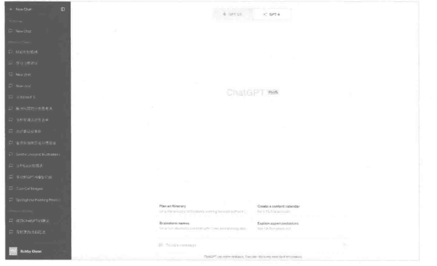

在输入框里输入想咨询的问题，就能开始对话。

下面给出一次对话示例 ①。

> **用户：** 帮我写一首赞美中国大好河山的诗。

**ChatGPT：** 江山壮丽似画图，山河浩瀚胜仙居。

红日初升东方远，华夏大地景色珍。

长城蜿蜒伫世界，悠扬黄河如银带。

五千年文化传承，中华儿女自豪怀。

丹青笔下描神州，诗意山水赞不休。

雄鸡报晓唤春曙，祖国山河永安宁。

算术类题目它也能处理，下面看鸡兔同笼的解答。

> **用户：** 解决鸡兔同笼问题：

有若干只鸡兔同在一个笼子里，从上面数，有 35 个头，从下面数，有 94 只脚。问笼中各有多少只鸡和兔？

要求：不能列方程式，用小学生能理解的方式去解题。

**ChatGPT：** 这是一个经典的鸡兔同笼问题。鸡有 2 只脚，兔子有 4 只脚。我们可以用一种简单易懂的方式来解答这个问题，不需要列方程，也适合小学生理解。

假设笼子里都是鸡，那么脚的总数应该是 35（头数）× 2 = 70 只脚。但是实际上我们有 94 只脚，比 70 多了 24 只。那么这 24 只脚来自哪里呢？它们肯定是兔子的，因为兔子比鸡多了 2 只脚。

那么，有多少只兔子呢？我们用多出来的脚数 24 除以兔子比鸡多的脚数 2，就是兔子的数量，即 24 ÷ 2 = 12 只兔子。

所以，鸡的数量就是总的头数 35 减去兔子的数量 12，也就是 23 只鸡。

所以，笼子里有 23 只鸡和 12 只兔子。

① 对于多文字的对话，为保证内容清晰度，本书未采用截图，而是复制出了文字。——编者注

除了给出答案，还可以要求它提供同一问题的多种思路。

为什么 ChatGPT 拥有如此强的问题处理能力？先看英文全称 Chat Generative Pre-trained Transformer 各词含义。

**Chat:** 模型专为对话场景设计，目标是读懂用户输入并生成有意义的回复，实现人机交互。

**Generative:** 属于生成式模型，能创造新文本，而非仅做分类或标注。可根据上下文生成连贯、有逻辑的回复。

**Pre-trained:** 模型经过预训练。训练阶段使用了海量文本，让模型在未针对特定任务微调的情况下掌握丰富语言知识。

**Transformer:** 采用 Transformer 架构。基于自注意力机制的神经网络在自然语言处理中表现突出，使 ChatGPT 能有效处理输入并生成输出，保持对话连贯性和语义理解。

全称说明，ChatGPT 是一个面向对话的预训练生成模型，使用 Transformer 架构处理输入与输出。

在 AI 发展史上，ChatGPT 并非首个大语言模型，却是首个面向个人开放、支持一对一交互的大模型，界面友好，无需技术背景即可使用。

不过，ChatGPT 的知识截止于 2021 年 9 月，只能从训练数据截止点之前的信息中提取内容，无法掌握之后出现的新事件或实时信息。

2023 年 5 月，OpenAI 推出联网与插件功能。Plus 用户可使用联网功能实时查询互联网数据，突破了原有训练数据的限制。

接下来看页面布局。界面简洁，左右各有 4 个区域，如图 1-3 所示。

## 8 | 第1章 认识 ChatGPT

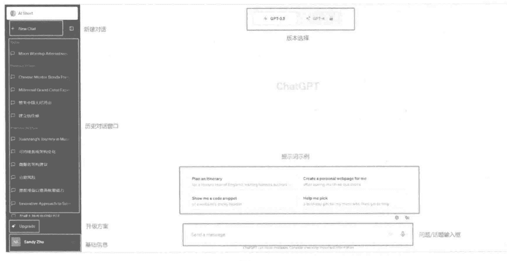

左侧上方展示着过往对话记录，见图 1-4。

左侧下方显示 “Upgrade” 与账号名称。点击账号名旁的三个圆点，会弹出菜单，从上到下依次为：“Custom instructions”“Settings”“Log out”，如图 1-5 所示。


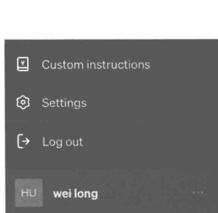

自定义指令允许用户为 ChatGPT 提供特定说明，指导模型按需求生成回答，用以更精准地定制行为。通过自定义指令，可告诉模型如何提问、提供细节、进行推理或按偏好输出特定内容，使回答更具针对性和实用性。

在设置中，可通过“Theme”调节页面的明暗模式，如图 1-6 所示。

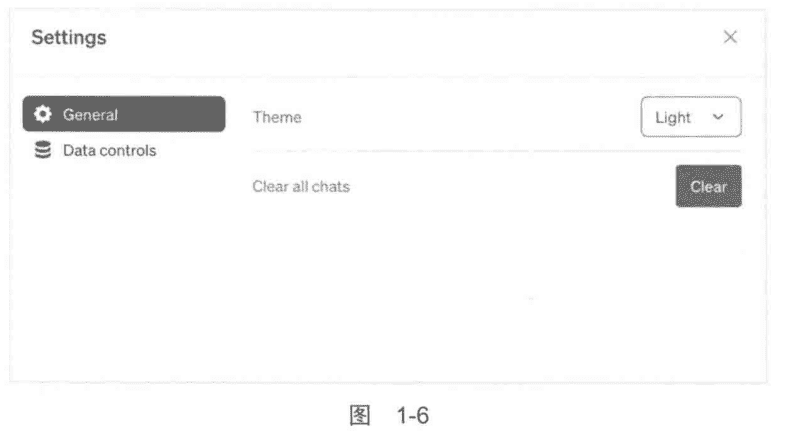

图 1-6

在“Data controls”里，可通过“Export data”导出聊天记录，如图 1-7 所示。

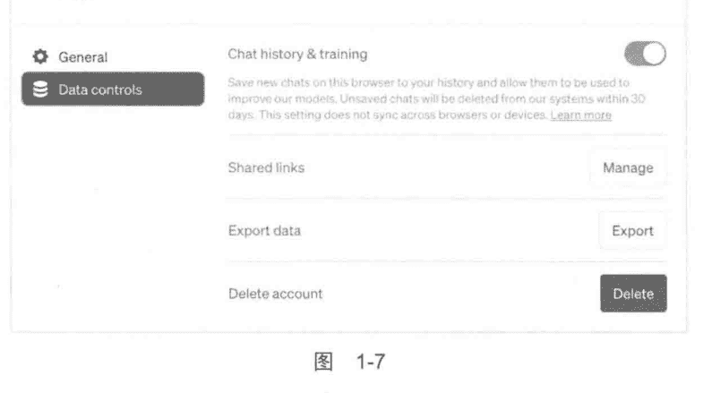

图 1-7

点击“Upgrade”，可以看到免费方案 Free 与付费方案 Plus。普通新用户默认使用 Free。OpenAI 还提供增强版 Plus，如图 1-8 所示。

免费版与 Plus 的主要区别在于响应速度，在高峰期 Plus 仍能流畅使用。此外 Plus 可优先使用 GPT-4、联网功能及各类插件，获得更高质量的回答。目前 Plus 费用为每月 20 美元。

10 | 第1章 认识ChatGPT


接下来看对话窗口。在输入框中键入想要咨询的问题，如图 1-9 所示。


按回车即可获得答案。

> 请介绍一下人工智能技术。

人工智能（Artificial Intelligence，简称 AI）是计算机科学的一个分支，它试图理解和构建智能实体。AI 可以被视为模拟人类的思考、理解、学习和解决问题等智能行为的系统或软件。

人工智能的主要领域包括以下方面。

1. 机器学习（Machine Learning）：这是 AI 的一个核心领域，它的目标是使计算机能够从数据中学习并自我优化。机器学习包括监督学习、无监督学习、半监督学习、强化学习等。

2. 深度学习（Deep Learning）：这是机器学习的一个分支，使用所谓的神经网络进行学习。神经网络有多个隐藏层，可以自动从原始数据中提取有用的特征。

3. 自然语言处理（Natural Language Processing，简称 NLP）：这个领域致力于使计算机理解和处理人类语言。这包括机器翻译、情感分析、自然语言生成等任务。

4. 计算机视觉（Computer Vision）：这个领域的目标是让计算机能够理解和解析视觉信息，如图像和视频。这包括物体识别、图像分割、3D 重建等任务。

5. 知识表示与推理（Knowledge Representation and Reasoning）：这个领域试图将复杂的、未结构化的世界知识形式化，使得计算机可以进行推理。

6. 智能代理（Intelligent Agents）：这个领域研究如何构建可以在复杂环境中自我决策的系统。

7. 机器人学（Robotics）：这个领域研究如何设计和构建可以在现实世界中执行任务的机器人。

以上各领域并不是相互独立的，而是相互关联，常常需要结合使用。人工智能的目标是创造能够执行一系列复杂任务的系统，这些任务可能包括语音识别、图像识别、自然语言理解、机器翻译、游戏对战等。

除回答问题外，ChatGPT 还有记忆与持续交互能力。若对上条回答不满意或不理解，可直接在对话中继续追问。

例如，若觉得刚才答案过长，可要求精简：“帮我把刚才的答案精炼一下，用两句话简单描述一下”，可得到如下对话。

> 用户：帮我把刚才的答案精炼一下，用两句话简单描述一下。

ChatGPT：人工智能是计算机科学的一个分支，旨在创造能模拟人类思考、学习和解决问题的系统。它涵盖了机器学习、深度学习、自然语言处理、计算机视觉等多个领域，目标是使机器能处理复杂任务，如语音识别、图像识别和自然语言理解等。

可以看到，答案变得更简洁。

### 1.3 用 ChatGPT 抢占先机
随着 OpenAI 及 ChatGPT 的快速发展，国内 AI 市场也在加紧布局。百度、科大讯飞、印象笔记等纷纷推出自家 AI 产品，AI 时代已悄然到来。面对这场科技变革，如何保持领先？

如果你正在阅读本书，恭喜你选择成为近 25 年来最具颠覆性的技术之一的早期使用者。在这场变革中，你已获得竞争优势，因为你比竞争对手更早开始使用该技术。

对职场人士、创业者或企业家而言，尽早掌握 AI 技术尤其是 ChatGPT，将带来显著的竞争优势，主要体现在：

AI 可提升工作效率。语言模型能迅速生成高质量文本，帮助处理邮件、撰写报告、解答常见问题，减少重复性手工工作，节省时间精力，让个人和团队更聚焦核心业务与创新。

AI 可提供智能决策支持。ChatGPT 能分析海量数据，提供实时市场分析、模型预测与决策建议，帮助做出更准确明智的判断，降低风险、优化运营。使用者可快速获取关键信息，实现数据驱动决策，提升成功率与效益。

AI 可提供个性化客户服务与体验。ChatGPT 等工具可模拟人类对话，实现智能客服与虚拟助手，为客户提供即时个性化服务，提升满意度与忠诚度。创业者和企业可借此打造独特品牌形象与个性化产品，吸引客户、提升市场份额。

但仅学会使用是不够的。要保持先发优势，必须了解技术原理与应用场景，通过持续学习与实践提升专业能力，充分发挥 AI 的优势，才能在职场与企业竞争中持续领先。

### 1.4 ChatGPT 如何运作
在了解原理前，先看人类如何创作。比如要写一个故事，可能会写下：

> 很久很久以前，有一个国王，国王有一位可爱的公主……

不同人续写会得到不同版本。ChatGPT 能否续写？当然可以。

> 很久很久以前，有一个国王，国王有一位可爱的公主……继续帮我完成这个故事，字数 500 字。

> 很久很久以前，在一个遥远的国度，有一个贤明的国王。国王有一位叫作苏菲的可爱公主。她有一双清澈如湖水的眼睛，一头如丝般柔顺的金发，以及灵动而又善良的心。

苏菲公主的魅力不只是她的外貌，更是她善良的心灵。她热爱着所有生命，总是对每一个人充满了爱心和关怀。她的笑容，就像阳光普照大地，照亮了人们的心灵。

然而，美好的事物总是引来嫉妒。那个国度的邻国的邪恶巫师，因为嫉妒苏菲公主的美貌和善良，将她变成了一只小白兔。他期待看到国王和人民陷入绝望的情景。

然而，苏菲公主即使变成了小白兔，她的内心依然热爱着这个世界，对所有人都充满了善意。她虽然不能说话，但是她的善良和爱心的力量，引来了森林中所有生物的帮助。

森林中的小动物们，带领着苏菲穿越了荆棘森林，来到了一座神秘的山脉。那里，住着一个能够解除所有魔法的老巫婆。她看到小白兔苏菲的纯真和勇敢，被她打动，于是答应帮助她解除魔法。

经过了一场复杂的魔法仪式，小白兔苏菲终于恢复了人形。当她回到自己的国土时，国王和人们都无比高兴，他们为她的归来举行了一场盛大的庆祝活动。

这个故事告诉我们，善良和爱心的力量是无穷的，它能够战胜邪恶，赢得友情和爱。而我们每个人，都应该像苏菲公主一样，对这个世界充满善意和爱心。因为，这才是我们生活的真谛。

#### 1.4.1 ChatGPT 与其他聊天机器人的差异
ChatGPT 是一款由人工智能驱动的在线对话程序。像 ChatGPT 这类聊天机器人使用大语言模型来生成类人对话内容。大语言模型会预测和估计单词顺序或序列的概率分布。

ChatGPT 与传统对话助手：三点本质差异

除了 ChatGPT，市面上还有 Siri、小冰、天猫精灵、小爱同学等对话类产品。表面上都能进行人机对话，但背后的技术路线、训练方式和能力边界存在明显分野，大致可以归纳为三个维度。

1. 架构与模型
Siri、小冰、天猫精灵、小爱这类产品多采用规则、统计或二者结合的方案，并且针对具体场景做了定制化开发。ChatGPT 则依托 GPT-3 等超大规模语言模型，属于深度学习范式，并以海量语料完成预训练。

2. 数据来源与训练方式
ChatGPT 的预训练语料来自互联网级别的大规模文本，因此知识覆盖面更广、迁移能力更强。相对而言，Siri、小冰、天猫精灵、小爱所用训练数据更具指向性，通常锁定在特定领域或单一任务上。

3. 适用范围与功能侧重
Siri、小冰、天猫精灵、小爱一般作为智能助手的组成部分，侧重设备操控、任务执行、信息查询等综合服务。ChatGPT 更聚焦于语言交互本身，在开放式闲聊、问答、文本生成方面的表现更为突出。

#### 1.4.2 大语言模型怎样赋能 ChatGPT
大语言模型本质上是基于深度学习的语言智能系统，既能理解也能生成人类语言，可比喻为一位阅历丰富的语言专家。

它像一位读遍各类书籍的超级学习者，从庞大文本中汲取语法、用词偏好和语境规律，并积累了大量常用词、短语和句式。

在对话时，模型先解析输入意图，再调动已学知识给出回应或续写。

其强项在于处理复杂的表达并做推理，因为内部沉淀了海量的语言模式。它可以解答问题、提供资料、描述事物，也能进行创作和讲故事。

结合图 1-10 更易把握大语言模型的内涵。它是利用深度学习训练的智能系统，能够理解人类表达并产出通顺的回复，目标是模拟人类语言能力，实现顺畅交流。

## 什么是大语言模型


ChatGPT 的能力建立在深度学习与神经网络之上。常见的实现路径可概括如下。

### 1. 数据收集与预处理
首先要汇总大规模语料作为训练集，来源可以是网络对话、聊天记录或垂直领域的交流。随后进行清洗、分词、去噪和语义标注等预处理。

### 2. 模型架构设计
GPT 基于 Transformer 架构，通过大规模文本预训练掌握语言规律。Transformer 专长于序列处理，依靠自注意力机制可并行审视序列各位置，帮助模型捕捉长距离依赖，提升理解力。

### 3. 模型训练
把预处理后的数据送入模型训练。训练时模型依据已有序列预测下一个词或答案，再与真实答案对比计算损失。通过反向传播和优化算法如随机梯度下降，不断调整参数，降低损失并提高生成质量。

### 4. 迭代优化
训练通常需要多轮迭代，每轮都用训练集更新参数。反复优化后，模型的理解与生成能力逐步增强。

### 5. 应用部署
训练完成后，ChatGPT 会部署到网站、对话平台或智能设备上。用户输入问题后，模型即可实时生成回复。

需要说明的是，具体实现会因技术选型而有所差异，以上仅为帮助理解的通用框架。

上述复杂逻辑可简化为三步，如图 1-11 所示。

## ChatGPT是如何实现的？

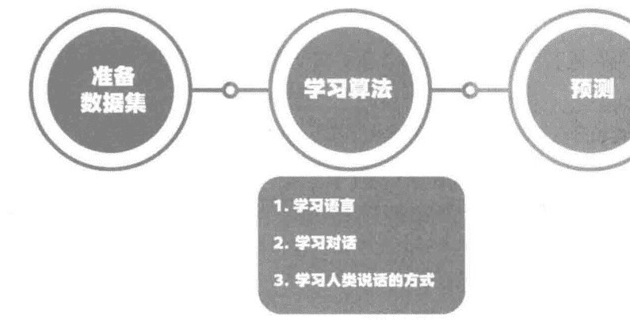
第一步，准备语料。先为 ChatGPT 准备海量训练语料，让其学习自然语言的概率分布与规律。模型通过观察大量文本建立词间关联及上下文信息，如图 1-12 所示。

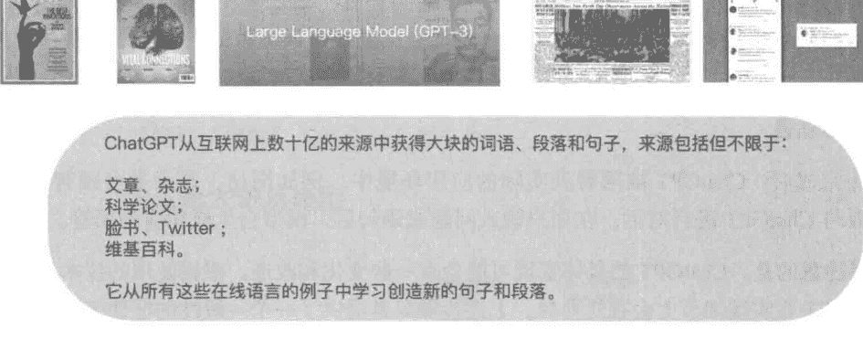
第二步，学习算法。学习算法的本质是学习语言、学习对话、学习人类表达方式。

人工神经网络必须先按一定准则学习才能工作。神经网络结构复杂，普通用户不必深究底层。可以把学习过程简化为：某个词后面接哪个词更合理，如图 1-13 所示。

## 下一个词怎么选——学习过程的简化版

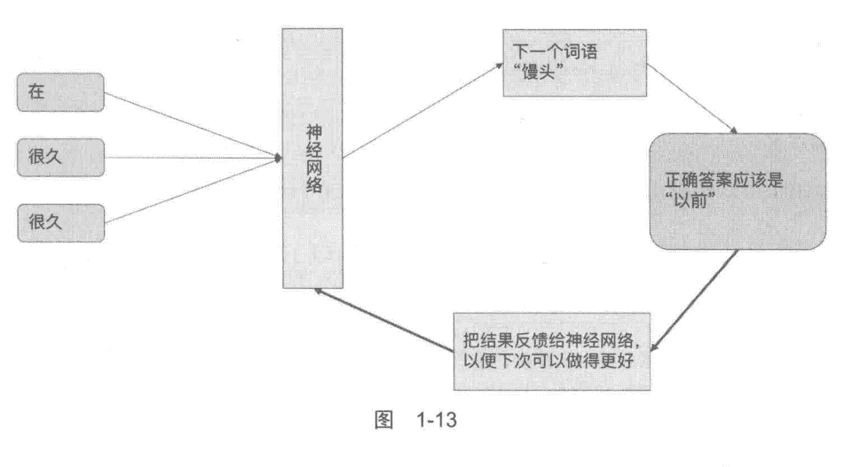
例如，“在很久很久”之后接什么？按经验，接“馒头”不合理，接“以前”更自然。

第三步，预测。语言模型依据用户提问进行预测并生成相应回答，如图 1-14 所示。

## 训练后如何选词——模型生成示例
在很久很久以前，有几个孩子在森林里迷路了。

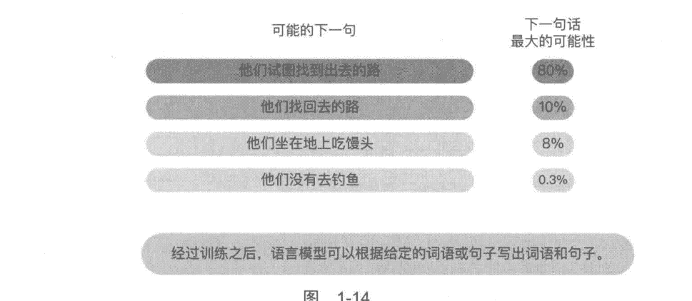
训练完成后，模型能结合给定问题与上下文，生成最贴合的词句。

#### 1.4.3 ChatGPT 的四项优势

### 1. 自定义
ChatGPT 可按用户需求与偏好设定回复语气、风格，也可限定讨论的话题与信息范围。

例如让它写一篇 200 字介绍 AI，要求幽默有趣。

> 写一篇 200 字的文章介绍人工智能，语气要幽默有趣。

> 好的，开启一场探索人工智能奇妙世界的旅程。人工智能常被联想成科幻电影里的机器人，实际上它是一种让计算机模拟人类思考的技术。把人脑比作资深老司机，AI 就像刚拿驾照的新手，正在学习做决策，甚至试图超越人类。AI 已经渗透到手机助手、推荐系统、信息流等场景。它像个爱学习的小学生，从海量信息中找规律，就像从混乱的乐高里搭出城堡。人工智能正深度介入生活，像个不累的小精灵带来便利，但也需要规则约束，避免过度聪明。

再让它用专业严谨的语气介绍人工智能。

> 写一篇 200 字的文章介绍人工智能，语气要专业严谨。

> 人工智能 Artificial Intelligence，AI 是一种模拟并实现人类智能行为的计算机系统，是计算机科学的重要分支，旨在理解、构建与实现源于人类大脑的智能。

> AI 可分为弱 AI 与强 AI。弱 AI 专注执行特定任务，如语音识别或推荐系统；强 AI 则能像人类一样完成各类认知任务。目前进展主要集中在弱 AI。

> 核心技术之一是机器学习，即从大量数据中学习并预测的算法。深度学习作为其子集，模仿人脑神经网络结构，用于处理复杂模式。

> AI 已广泛应用于自动驾驶、医疗诊断、金融交易等领域，正快速改变世界、提升生活质量、推动经济发展，同时也带来伦理与社会影响。因此，对 AI 的管控与规范成为科技、伦理、法律等领域需认真对待的问题。

设定不同文案风格后，ChatGPT 能围绕同一主题产出风格迥异的文本，这正是自定义能力的体现。

### 2. 个性化
ChatGPT 能基于机器学习算法与用户过往互动历史、偏好进行个性化回应，使对话更自然，也能给出贴合兴趣的需求答案。比如一位全职奶爸想了解 3 岁幼儿的照顾方法。

> 我是一位全职奶爸，给我介绍一下，如何照顾一个 3 岁的小朋友。

照顾 3 岁孩子需要耐心与爱心，也要理解该阶段的发展需求。基本建议包括健康饮食、规律作息、鼓励运动与游戏、加强语言沟通、培养自理能力、关注情绪管理等。每个孩子独一无二，提供充满爱、鼓励、支持与安全感的环境至关重要。

再如一位全职宝妈想了解在家带娃时如何增收。

> 我是一位全职宝妈，希望在家照顾孩子的时候增加收入，你有什么建议。

可以尝试网络兼职、电商销售、运营博客或短视频账号、提供在线教育等。选择取决于兴趣、技能与时间安排，在家庭与事业间找到平衡点。

### 3. 多语言支持
ChatGPT 能理解并回应多种语言输入，对国际用户或多语交流需求非常友好。

例如让它将一段关于 AI 的 50 字短文翻译成中文、日文、韩文。

> Write a blog about AI, 50 words and translate the blog into Chinese, Japanese and Korean languages.

> AI, the Future of Innovation: Artificial Intelligence, or AI, is revolutionizing industries, from healthcare to finance. It enhances efficiency, improves decision-making, and drives innovation. However, we must responsibly navigate its ethical implications to ensure a brighter and sustainable future for humanity.

Translation into Chinese: 《AI，创新之未来》——人工智能 AI 正在颠覆医疗到金融等各行各业。它提升效率、改善决策、推动创新。但我们必须审慎应对其伦理影响，以确保人类拥有更光明可持续的未来。

Translation into Japanese: 「AI、イノベーションの未来——人工知能 AI は、医療から金融まで産業を革新しています。効率を高め、意思決定を改善し、革新を推進します。しかし、倫理的な影響を考え、より明るく持続可能な未来を確保する必要があります。」

Translation into Korean: AI, 혁신의 미래——인공 지능 AI 는 의료부터 금융에 이르기까지 산업을 혁명화하고 있습니다. 효율성을 향상시키고, 의사 결정을 개선하며, 혁신을 촉진합니다. 그러나 인류에게 더 밝고 지속 가능한 미래를 보장하기 위해 그 윤리적 함의를 책임감 있게 다루어야 합니다。

### 4. 可扩展性
ChatGPT 能承载大量并发流量，支持多用户同时对话，适合客服或在线社区等场景。也可通过 OpenAI 开放接口开发第三方应用。

#### 1.4.4 ChatGPT 的工作流程
对 ChatGPT 功能有了初步认识后，我们看它如何运转。整体流程可分为四步，如图 1-15 所示。

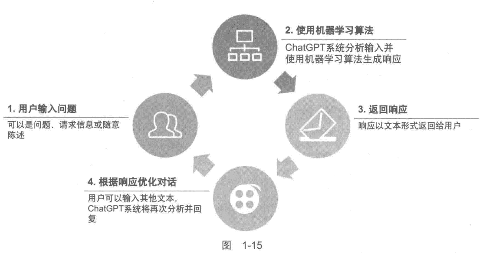
第一步：用户把文本输入 ChatGPT 界面，内容可以是提问、请求信息或随意陈述。

第二步：系统分析输入并利用机器学习算法生成响应。

第三步：以文本形式把响应返回给用户。

第四步：用户可继续输入新文本，系统再次分析并回复。

此过程循环直至对话结束。

### 1.5 ChatGPT 的 30 种功能和 4 个常见应用场景
前述原理表明，ChatGPT 是一台强大的语言模型，能像人一样理解与回应输入。早期聊天机器人多靠预编程回复或简单关键词匹配，回应常显生硬或答非所问。

ChatGPT 的另一差异是学习能力。借助机器学习算法，它能分析用户输入并基于过往对话改进回复，从而生成更个性化、更相关的结果。

第三个关键点是处理复杂开放对话的能力。凭借上下文理解，它能应对主题广泛、需要深度回应的交流。

#### 1.5.1 ChatGPT 的 30 种功能
基于上述差异，ChatGPT 能做什么？OpenAI 官网列出 30 项强功能，如图 1-16 所示。常见的包括：

- **语法纠正**  
  将不合语法的语句转换为标准英语。
- **解析非结构化数据**  
  从非结构化文本创建表格。
- **计算时间复杂度**  
  求函数的时间复杂度。
- **关键词**  
  从文本块中提取关键字。
- **Python 错误修复器**  
  查找并修复源代码中的错误。
- **推文分类器**  
  检测推文中的情绪。
- **心情到颜色**  
  将文本描述转换为颜色。
- **Marv 讽刺聊天机器人**  
  Marv 是一个既真实又讽刺的聊天机器人。
- **面试问题**  
  创建面试问题。
- **提高代码效率**  
  提供提高 Python 代码效率的想法。
- **说唱战斗作家**  
  在两个角色之间进行说唱战斗。
- **表情符号聊天机器人**  
  仅使用表情符号生成对话回复。
- **苏格拉底导师**  
  作为苏格拉底式导师生成答案。
- **会议记录总结器**  
  总结会议记录，包括总体讨论、行动项目和未来主题。
- **赞成与反对讨论者**  
  分析给定主题的优点和缺点。
- **给二年级学生总结一下**  
  将文本简化到适合二年级学生的水平。
- **表情符号翻译**  
  将常规文本翻译为表情符号文本。
- **解释代码**  
  解释一段复杂的代码。
- **产品名称生成器**  
  根据描述和种子词生成产品名称。
- **电子表格创建者**  
  创建各种数据的电子表格。
- **机场代码提取器**  
  从文本中提取机场代码。
- **VR 健身创意生成器**  
  产生健身推广虚拟现实游戏的想法。
- **按转弯方向转弯**  
  将自然语言转换为逐向导航。
- **规格中的功能**  
  根据规范创建 Python 函数。
- **单页网站创建者**  
  创建一个单页网站。
- **备忘录编写者**  
  根据提供的要点生成公司备忘录。
- **翻译**  
  翻译自然语言文本。
- **自然语言到 SQL**  
  将自然语言转换为 SQL 查询。
- **回顾分类器**  
  根据一组标签对用户评论进行分类。
- **课程计划编写者**  
  为特定主题生成课程计划。

图 1-16

#### 1.5.2 ChatGPT 的 4 个常见应用场景

ChatGPT 的四大高频实战场景全拆解

目前最常见的 ChatGPT 用法大致落在四个方向：客户服务、教育辅导、信息供给以及社交互动。下面就围绕前两个场景展开实操演示，看看模型在真实咨询中会给出怎样的思路。

#### 1. 客户服务应用
ChatGPT 能做到 7×24 小时在线解答、即时提供信息并协助排解问题，对希望保持持续客户触达的企业尤其有价值，比如医疗咨询、房产交易、心理支持等行业。

先拿医疗咨询来试测。

> 我想做人工植发，有哪些注意事项，应该怎么挑选正规的美容整形医院。

做植发手术前，了解风险与医院筛选标准有助于做出更理性的决定。以下为参考建议。

**术前需要留意的要点**

- 1. 先找专业医生评估。由医生判断脱发程度并给出适配的改善方案，再决定是否手术。
- 2. 弄清楚技术差异。主流的有 FUT 毛囊单位移植和 FUE 毛囊单位提取，对比各自长处局限后再选。
- 3. 选择有经验的团队。核查医生的从业年限、资质证书以及过往案例照片，用来判断操作水准。
- 4. 明确可能的风险并发症。提前了解手术相关的副作用，确保自己完全知情并能接受。
- 5. 预留预算。植发费用不低，选院和方案时要结合自身经济承受范围。

**如何挑选靠谱的整形医院**

- 1. 看资质与许可。医院应具备当地卫生部门要求的执照与认证，可向主管部门或专业机构核实。
- 2. 查口碑与历史。浏览官网、论坛、社交平台的评价，也可向熟人打听推荐。
- 3. 看硬件条件。手术室是否达标、设备是否现代化，直接关系安全与效果。
- 4. 面诊沟通。最终确定前最好与医生当面交流，感受其专业度与沟通态度，建立信任感。

提示：以上仅供参考，具体决策仍需更深入的调研与面诊。

你对人工植发的技术了解吗？

了解。人工植发是通过手术把健康供区的毛囊移植到脱发区，以提升毛发密度。常见技术有：

- 1. FUT 毛囊单位移植法：传统方式，医生从后枕部取下一条皮肤带，切分成含 1~4 根毛发的移植单位，再逐枚植入。
- 2. FUE 毛囊单位提取法：较新的做法，用 0.6~1.0 毫米左右的微型针逐个取出毛囊单位植入，不取整条皮肤带，术后不留明显线状疤。
- 3. DHI 直接毛发移植：FUE 的一种变体，使用 Choi pen 等专用器械直接植入，可提高存活率，操作更精细。

技术选择要结合脱发类型、预期效果、供区储备量以及医生建议，面诊时详细比较优劣后再定。

可以解释一下 FUE 的操作流程和注意事项吗？

FUE 的常规流程大致如下。

**操作流程**

- 1. 发际线设计。术前与医生沟通移植范围和毛流走向。
- 2. 局部麻醉。确保手术区无痛感。
- 3. 提取毛囊单位。采用 0.6~1.0 毫米微型器械从后或侧后部密发区逐个取毛囊。
- 4. 准备受区。在脱发区制作直径约 0.6~1.0 毫米的微小切口或孔洞。
- 5. 植入毛囊单位。用显微镊等工具把取出的 1~4 根毛囊单位逐一放入预备孔位。
- 6. 术后护理。清洁植发区，并给出洗护与防摩擦刺激的指导。

**注意事项**

1. 医生选择要谨慎。应挑选经验丰富、资质齐全的医生，查看过往案例以评估技术。
2. 供区评估很重要。供区健康与毛囊储备直接影响手术成败，术前需由医生评估。
3. 严格遵循术前术后嘱咐。包括停用特定药物、保持头皮清洁、避免剧烈运动等，有助于恢复。
4. 预留恢复期。植发属于手术，术后数天至数周可能出现不适或肿胀，通常会逐步消退。

植发同样存在感染、出血、肿胀、瘢痕等风险，需在术前与医生充分讨论。

### FUE 有哪些手术风险？

FUE 相对安全，但仍有潜在并发症：

1. 感染。手术虽在无菌环境下进行，仍有感染可能，术后保持清洁并按医嘱护理可降低风险。
2. 出血。提取后供区可能渗血，医生会进行控制，个体差异下出血情况会有所不同。
3. 瘢痕。FUE 不留线状疤，但供区与受区仍可能留下细小瘢痕，少数情况会更明显。
4. 毛囊损伤或脱落。提取、保存、植入过程中毛囊可能受损导致失活。
5. 效果不理想。如密度不足、生长方向不自然等，往往与供区限制、存活率等因素有关，术前需与医生明确预期与局限。

多数患者能顺利完成手术并得到满意结果，但在决定前应与资深医生详细沟通个人风险。

再换房地产场景提问。

> 第一次买房，需要注意什么？

首购是重要财务决策，建议关注以下方面：

1. 预算规划。结合收入、支出与长期财务目标，计算可承受价位，确保首付、月供及验房、中介等杂费都覆盖。
2. 贷款比选。需要贷款时多家银行对比利率、条件，维护良好征信并准备齐全材料。
3. 位置与房源。权衡通勤、教育、医疗、购物等配套，以及户型、面积、装修与周边环境是否符合需求。
4. 专业验房。聘请第三方检查结构、电路、管道、屋顶等，提前发现隐患。
5. 法律把关。律师或资深经纪人可帮助审阅合同条款，保障权益。
6. 保险与税费。配置房屋保险，并了解房产税、印花税等税费义务。
7. 未来打算。若计划数年内换房或改善，要评估转售容易度与增值空间。

充分准备、咨询专业人士并多做研究，才能做出更稳妥选择。

### 购房流程是什么？

流程因地而异，通常包括：

1. 确定预算与贷款。可行性评估后向银行申请预批。
2. 找房。依需求与预算通过网站、中介等渠道看房，评估适配度。
3. 递交要约。与卖方谈价格与条款并支付诚意金。
4. 完成交易条件。办理按揭、验房评估等要在约定期内完成。
5. 签正式合同。条件满足后签署购房合同并支付尾款。
6. 办理过户。缴纳过户费、准备文件，完成法律手续后取得产权。
7. 缴纳税费。按时缴纳印花税、房产税等费用。
8. 交割入住。所有手续与费用结清后完成产权转移并入住。

各地细节不同，操作前建议咨询本地专业顾问确认具体要求。

## 2. 教育
在教学与学习支持上，ChatGPT 的潜力很大，可作为智能导师或即时知识来源，提升学习效率。

下面以 Python 学习为例。

> 我想学习 Python 编程，应该如何开始？

以下是一个入门路径：

1. 先掌握编程基础。变量、数据类型、条件判断、循环、函数等概念是起点，可通过教程或教材学习。
2. 安装解释器。从官网下载对应系统的 Python 并完成安装。
3. 选一个开发环境。PyCharm、Visual Studio Code、Jupyter Notebook 等都能提供编辑、调试与运行功能。
4. 系统学习语法与核心概念。重点掌握数据类型、流程控制、函数与模块的使用方法。
5. 勤于练习。先写简单程序再逐步挑战复杂问题，可用 LeetCode、HackerRank 等平台，或做小型项目巩固。
6. 利用文档与社区。官方文档是权威参考，加入 Python 社区论坛也能快速获得帮助。
7. 持续迭代。不断接触高级特性、常用库与框架，参与开源项目，技能才会稳定提升。

> 有哪些适合学习 Python 的入门书籍？

- 1. 《Python 编程快速上手——让繁琐工作自动化》，Al Sweigart 撰写，零基础友好，通过实战项目引入概念。
- 2. 《Python 编程：从入门到实践》，Eric Matthes 著，用项目案例循序渐进讲解基础与常见技术。
- 3. 《Python 基础教程》，Magnus Lie Hetland 著，系统介绍语法与核心概念，配示例与练习。
- 4. 《Python 核心编程》，Wesley J. Chun 著，对 Python 全面深入剖析，覆盖 2.x 与 3.x。
- 5. 《Python 编程导论》，John V. Guttag 著，适合希望用计算方法解决问题的人，示例与习题丰富。

可结合学习习惯挑选一本为主，再辅以在线资源，实践是关键。

> 请为我讲解一下《Python 编程：从入门到实践》这本书的主要知识点。

该书面向初学者，核心内容包括：

1. Python 基础
   - 变量与基础数据类型：字符串、整数、布尔值的使用。
   - 列表：创建、修改、排序、删除与组织。
   - 列表操作：用循环遍历并高效处理数据。
   - if 语句：条件测试与分支执行。
2. 函数和类
   - 函数：定义、参数传递、返回值与模块组织。
   - 类：面向对象基础，定义与使用类模拟现实对象。
3. 文件和异常
   - 文件操作：读取、写入与数据存储。
   - 异常处理：try-except 结构应对运行错误。
4. 测试代码
   - 测试函数：编写用例确保正确性。
   - 测试类：为类与方法编写测试。
5. 项目实践
   - 游戏开发：基于 Pygame 做 2D 小游戏。
   - 数据可视化：使用 Matplotlib 和 Pygal。
   - Web 应用：用 Django 搭建简易网站。

通过实战项目把知识点转化为能力。

> 根据《Python 编程：从入门到实践》的主要知识点，为我制订一份 3 个月的学习计划。

### 第 1 个月：Python 基础
**第 1 周 入门**
- 认识 Python 与编程概念，完成环境搭建并运行 Hello World。
**第 2 周 变量和数据类型**
- 学习字符串、数字、布尔值，练习个人信息管理小程序。
**第 3 周 列表与操作**
- 掌握列表创建与修改，用循环遍历，完成待办事项应用。
**第 4 周 条件语句**
- 练习 if、elif、else 与多条件判断，做简易成绩管理系统。

### 第 2 个月：函数、类与文件操作
**第 5 周 函数**
- 学习函数定义与参数、返回值与模块，使用计算器应用练习。
**第 6 周 类与面向对象**
- 理解类、对象与方法，设计简易银行账户系统。
**第 7 周 文件操作**
- 掌握读写文件与数据存储，制作日记应用。
**第 8 周 异常处理**
- 了解常见异常，用 try-except 改进已有应用的健壮性。

### 第 3 个月：项目实践与测试
**第 9 周 制作游戏**
- 认识 Pygame，动手做一个简单的 2D 游戏。

**第10周 数据可视化实操**
- 以 Matplotlib 和 Pygal 为工具进行数据可视化呈现。
- 完成多种图表与图形的绘制练习。

**第11周 Web 应用开发**
- 了解 Django 框架的基本架构与用法。
- 在此基础上搭建一个基础的网页应用。

**第12周 测试与复盘**
- 编写测试用例并实现对应的测试函数。
- 通过测试来校验代码的正确性与稳定性。
- 对前序学习内容做整体回顾与归纳。

每周时间分配建议
- 资料阅读与学习：5小时
- 实操练习与项目：5小时
- 复习整理：2小时

以上仅为参考节奏，可依据自身情况灵活调整，祝学习愉快！

## 3. 信息供给
得益于 GPT-4 的联网检索及插件能力，ChatGPT 能即时提供天气、新闻、酒店等实时类信息。

例如查询酒店
> 能否列出重庆五家五星级酒店？
> 以下是我整理的重庆五星级酒店信息。
> 1. [重庆来福士洲际酒店]：坐落渝中，客房套房设计雅致，配备宽敞会务空间与多家餐饮酒吧。
> 2. [重庆解放碑威斯汀酒店]：位于解放碑金融商圈中段，提供豪华房型，设有健身房及室内泳池。
> 3. [重庆万豪酒店]：位于南岸，提供高品质房型套房，配有健身中心与室内泳池。
> 4. [重庆希尔顿酒店]：位于渝中，提供高品质房型套房，配有健身中心与室内泳池。
> 5. [重庆喜来登酒店]：位于南岸，提供高品质房型套房，配有健身中心与室内泳池。
> 以上酒店均提供高水准的服务设施，助力住宿更舒适。

ChatGPT 也可作为个人助理处理日程、活动策划、信息管理等事务。例如规划旅行。
> 我想去重庆三天，请帮我安排行程。
> 好的，以下是为你定制的重庆三日建议。
> 第一天
> - 早上：抵达重庆，入住休息。
> - 下午：漫步解放碑步行街，品尝当地美食。
> - 夜晚：乘坐长江索道，俯瞰夜景。
> 第二天
> - 上午：前往磁器口古镇，感受历史文化。
> - 下午：参观重庆科技馆，了解科技发展。
> - 晚上：在南滨路散步，欣赏两江交汇美景。
> 第三天
> - 上午：游览白公馆，了解一段重庆历史。
> - 下午：去重庆动物园观赏大熊猫。
> - 晚上：在洪崖洞品尝小吃，欣赏灯火夜景。
> 行程涵盖了重庆的核心景点与体验，祝旅途愉快！

## 4. 社交互动
ChatGPT 可作为闲聊伙伴，也可通过 OpenAI 开放接口集成到第三方应用提供机器人服务。它还能辅助现实人际，提升社交技巧与信心。例如结识新朋友不知如何开口，可让它提供话题灵感。

> 我刚认识几位新朋友，能给五个聊天话题吗？
与新朋友交流时选对话题能让气氛更轻松、对话更顺畅。以下五个主题适合多数场合。
1. 旅行见闻：多数人对旅行感兴趣。可询问最近或最难忘的旅行经历。也可问“最近去了哪里？”或“最想去的目的地是哪里？”
2. 美食交流：美食是安全话题。可聊近期尝试的新餐厅，或分享烹饪心得。例如“你最爱什么菜？”或“最近在家做了什么新菜？”
3. 影视书籍：文化作品易引发共鸣。可问近期观影或阅读心得，如“最近看过什么好看的剧或电影？”、“有书单推荐吗？”
4. 兴趣爱好：了解对方的业余活动有助于找到共同点。可问“平时休闲时喜欢做什么？”或“有什么特别的爱好？”
5. 时事话题：讨论新闻可促成深度交流，但应避开争议议题。宜选轻松正面内容，如“注意到最近的科技新突破吗？”或“最近有什么好消息？”
不同场景话题应有所调整。原则是保持积极轻松，寻找共鸣，并留意对方反应，适时转换话题。

围绕“梦想旅行目的地”做一次模拟对话。
当然可以围绕梦想目的地展开。
你：最近有想过理想的旅行地吗？
我：有，我一直想去冰岛。看过火山与极光的照片，感觉很神奇。
你：冰岛确实迷人，你最想去哪里？
我：很想去蓝湖温泉和黄金圈，那里像另一个星球。你呢，梦想去哪？
你：我一直想去意大利，既有深厚文化也有美食。想象在托斯卡纳乡村吃正宗意餐，很美好！
我：听起来很迷人。托斯卡纳的景色只在电影里见过，很想亲身感受。你对哪个城市更感兴趣？
你：威尼斯的水城风光和独特交通很吸引我，罗马的古迹也想看。
我：你的规划已经很清晰了，威尼斯和罗马都很迷人，祝梦想成真！

通过不断挖掘兴趣点，对话会更深入、更有趣，也更易增进了解。

## 第2章 提示词从入门到精通
影响 ChatGPT 对话成败的关键之一是启动和引导对话的提示质量。提示定义越清晰，对话越能保持方向并覆盖用户关注点；反之则易混乱、失焦，价值下降。

本章详细讲解如何设计有效提示，以获得高质量输出。

### 2.1 设定提示词的原则
提示质量直接决定对话成败。明确的提示能让对话保持正确方向，获取更有价值信息。那么提示到底指什么？

#### 2.1.1 什么是提示词
与 ChatGPT 交流时，用户提供的指令、问题或关键词短语即为提示。它们用于引导模型生成相关回复或信息。

提示的作用是帮助模型把握用户意图，给出符合需求的答案。可指明对话方向、主题或提出具体问题，使模型更准确地理解需求。

例如，若想了解太阳系，可用“太阳系的八大行星”或“太阳系天体构成”作为提示，帮助模型聚焦并给出相关回答。

#### 2.1.2 设定提示词的 3 个原则
设定有效提示是实现有趣有用对话的关键。以下三条原则可帮助提升质量。

1. **提示要清晰明确**
清晰明确的提示能确保模型准确理解意图并给出相关回应。应避免使用过于复杂或含糊的表达，选用具体易懂的说法。
例如：
不清晰：我想烤点东西，怎么弄？
清晰：请给我一个一小时内能完成制作的巧克力蛋糕食谱。
前者范围过大且需求不明，后者明确要求快速制作巧克力蛋糕，便于模型给出针对性答案。

2. **要有明确目的和焦点**
好的提示应具备清晰目的和焦点，引导对话并保持在轨道上。避免过于宽泛开放，否则易跑偏。应选择能限定范围和主题的表达。例如想了解某国文化，可用“该国的传统节日”或“该国的美食特色”来聚焦。

3. **保持相关性和连贯性**
提示应与用户及对话上下文相关。避免引入无关主题分散注意力。最好延续已讨论内容或用户兴趣，以便模型提供相关信息并保持连贯。例如前文在谈旅行，可用“值得去的目的地”继续展开。

遵循这些原则可提升提示的有效性与连贯性。

#### 2.1.3 有效提示词 vs 无效提示词
为更好理解原则，下面对比示例。

1. **有效提示**
“请概括文章《运动的好处》的主要观点。”
目标明确、相关性强，模型易于提供所需信息。
“重庆有哪些知名火锅店？”
具体且相关，模型可给出有针对性的回答。

2. **无效提示**
“你能告诉我关于世界的信息吗？”
过于宽泛开放，模型难以给出有重点的回答。
“你能帮我做作业吗？”
虽有意图但缺乏具体指令，无法产生有用输出。应明确主题或任务。
“你好吗？”
常见开场白，但不是明确提示，没有目的和重点。

对比有助于把握有效提示的要点。

#### 2.1.4 如何编写清晰简明的提示词
基于前述原则，编写清晰提示应注意以下要求。

1. **设定对话目的和重点**
开始前先明确希望达成什么，是获取信息、解答问题还是闲聊。目的清晰有助于制定具体相关的提示。
例如原提示“你能帮我做作业吗？”可改为：
> 请帮我解答一道数学题：小明有50个苹果，7个小朋友，每人分3个，还剩几个？
> 计算分出 7×3=21 个，剩余 50-21=29 个。所以还剩29个。
这样便能得到期望答案。若仅问是否帮忙，模型可能只回“能”，并非想要的结果。

2. **使用具体相关的语言**
为让模型准确理解并回应，应使用具体相关的表述，避免术语或模糊说法导致误解。
例如“给我一些关于互联网的最新动态，我在学时尚潮流”，中“最新动态”“时尚潮流”界定不清，易造成混淆。
可聚焦具体领域提问，如人工智能在自动驾驶的进展：
> 请介绍人工智能在汽车自动驾驶领域的最新进展？
> 以下是我从网络整理的相关进展...
信息显示该领域技术持续突破，并在实际应用中展现潜力。

3. **避免开放式或过于宽泛的提示**
开放式问题虽可能获得全面回应，但常导致对话不连贯。能限定范围的提示更有利于设定清晰目的。
例如“能告诉我关于世界的一些事吗？”话题太宽。可改为“地球是如何形成的？”
> 地球约在45亿年前形成，以下是简化的形成过程...
过程涉及星云收缩、太阳诞生、原行星盘形成、行星胚胎凝聚、行星形成、分化冷却、大气与海洋形成等环节。

4. **让对话保持在正确轨道**
交流时应聚焦当前主题，避免离题。保持方向一致有助于模型覆盖用户兴趣并提供有用信息。
延续地球形成话题，若对原行星盘不理解可继续追问：
> 原行星盘形成：太阳周围形成旋转盘状结构，包含岩石、冰等固体微粒。请解释一下。
> 原行星盘是行星形成关键阶段...包括太阳诞生、角动量守恒、盘状结构形成、温度化学分布、物质凝聚、行星胚胎形成等步骤...
通过连贯问答即可逐步建立知识体系。

遵循以上要求即可编写清晰简明的提示。

### 2.2 设定提示词的 7 个步骤
掌握原则后，以下七个步骤可显著提升提示效果。
七个步骤为：设定相关背景；布置清晰任务；提供详细指令；确认模型理解任务；优化提示词；精炼内容以获得更好输出；通过持续练习改进提示词。

模型需要清晰具体且相关的提示才能返回期望答案。上述步骤有助于设计独特且能获得有效响应的提示。

以下为一个提示词示例。
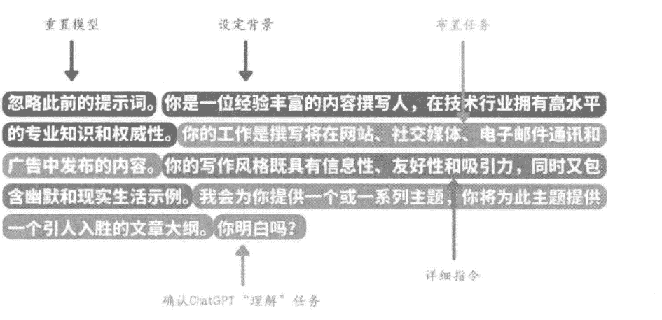

在着手构建背景信息之前，建议先把模型的状态清空或重新初始化一下。

在 ChatGPT 里，每开启一个新对话窗口，该窗口内部的所有问答都会形成上下文。模型对上下文的记忆会持续作用于后续生成，如果不想让之前的讨论拖累现在的输出，又不想再开一个新窗口，就可以通过重置来切断影响。

重置的方式很直接，只需把提示词的最开头加上“忽略此前的提示词”即可。

#### 2.2.1 设定相关背景
使用 ChatGPT 时，先给模型一个合适的背景非常重要，因为背景为后面所有的指令提供了落脚点。没有背景支撑，很难得到具体、贴合需求的回应。

举个日常的类比：你忽然对朋友说“我们去哪里度过愉快的时光”，如果不说明情况，对方很难判断你是问周末去哪儿旅行，还是问今晚吃啥。加上一点背景，沟通就顺畅多了。ChatGPT 同理。

下面这些背景设定示例可以参考：

- 你是一名具备深厚专业积累、公信力强、经验丰富的文案撰写者，词汇储备丰富，能把复杂议题通俗地讲给新手听。
- 你是一名小学教师，正在为 6 到 7 岁的孩子设计高效课堂教案，懂得如何调动这个年龄段孩子的积极性。
- 你是一名资深导游，工作内容是为游客提供目的地资讯，服务意识和沟通能力都很出色。
- 你是一名擅长销售的专家，尤其精通线上销售和数字营销的文案，把产品卖点转化为优势并善用情感打动人。

本质上，你可以让模型扮演任何你需要的专业角色，比如健身教练、英语翻译、客服代表、SEO 顾问、资深中餐主厨、医护人员等等。提供背景，就是在指定角色。

#### 2.2.2 布置清晰的任务
ChatGPT 能在不同情境下产出各种文本，但前提是指令足够清晰。

可以这样想：做蛋糕没有配方和步骤，你可能也能做出成品，但口味未必是你想要的。给模型模糊的任务，得到的文本也可能有趣可读，却不符合预期。

陈述任务时要具体，尽量用动词。不要只说“写一篇关于普拉提的博客”，而要说“用通俗易懂的语言写一篇介绍普拉提好处的博客，受众是零基础的人”。任务越明确，输出越可控。

清晰的任务还能缩小生成范围，避免跑题或信息过载。示例：

- 你的工作是为网站、社交媒体、邮件通讯和广告创作内容，风格要信息量足、友好亲切、有吸引力，同时带点幽默和生活化的案例。
- 你的工作是为班级规划可落地的教学方案，包含不同教学方法、技巧和风格。
- 你的工作是为准备前往【某目的地】的人提供活动和住宿建议，帮助他们做出选择。
- 你的工作是撰写高转化率的产品描述，用于官网产品页和社媒广告，提升销量。

#### 2.2.3 为任务提供详细的指令
任务明确后，再补充细节指令，比如整体语气、篇幅、面向人群等。例如“文章约 500 字，用初学者也能共鸣的对话式语气”。这样模型更清楚你的期待。

细节指令示例：

- 回复控制在约 100 字左右，风格简洁有力，多用短句和口语化表达。
- 请以写给朋友的口吻来写。
- 内容要让 8 岁或更小的孩子也能理解，不要使用复杂词汇或句式。
- 在回文中自然地加入“[关键词]”，出现不超过 3 次。用正式且指示性的用词描述流程。

#### 2.2.4 确认 ChatGPT “理解”任务
这一步很简单，直接问模型是否理解了上下文、任务和指令即可。通常它会复述你的要求来确认理解。比如直接问：“你‘理解’吗？”

#### 2.2.5 改进提示词
想获得更好结果，可以对提示词做精细化。除了核心问题，还可以加入对话背景、期望的语气等。效果不理想时不必重写全部，ChatGPT 具有对话记忆，会保留之前的提示。

可用的优化思路：

- 用更短更简洁的句子重写第二段。
- 用更自然、不那么正式的语言改写全部内容。
- 扩展开头，增加更多细节。

#### 2.2.6 精炼内容以获得更好的输出
把背景、任务、指令、确认理解和改进整合起来，就是完整提示。

> 你是一位经验丰富的内容创作者，在科技领域具备高水平专业知识和权威性。词汇量很大，能把复杂主题轻松讲给新手听。你的任务是撰写面向线上发布的内容，涵盖网站、社媒、邮件通讯和广告。写作风格信息丰富、友好、引人入胜，并融入幽默与真实案例。回答约 100 字，用短句和口语化句式，风格精炼有力。请用写给朋友的语气来写。你明白吗？

> 当然明白！没问题，我会用简短有趣的语言风格来回复你。有什么主题或其它要求，随时告诉我，我们开始吧！

先确认理解后，再发出具体指令。

> 我想写一条关于 ChatGPT 技术沙龙的广告，用在朋友圈。

> ChatGPT 技术沙龙，来啦！

> 朋友们！是不是对 ChatGPT 技术又好奇又心动？想近距离感受这个超级智能模型的魅力？那就别错过我们即将举办的 ChatGPT 技术沙龙！

> 时间：这个周末
> 地点：线上，在家就能参加
> 主题：探索 ChatGPT 的神奇世界
> 内容：ChatGPT 是当下最先进的语言模型，能回答各式问题、解决难题，还能进行有趣对话。我们将深入浅出地讲解其工作原理和应用场景。

> 活动亮点
> - 互动演示：亲身体验 ChatGPT 的强大能力！

#### 2.2.7 通过不断练习设定更好的提示词
多练习就能熟能生巧。随着使用经验增加，写出更有效的提示会越来越自然，保持耐心持续练习，很快就能熟练掌握提示词撰写。

按照以上七步，就能写出清晰明确的提示，让输出更贴近预期。

下面看如何向 ChatGPT 提问情感与关系类的问题。

### 示例 1：关系建议
> 请忽略所有先前的提示词。你是一位专业的关系心理学家，辅导夫妻处理关系和情感问题已有 20 年经验。不论求助者是年轻人还是中老年人，你的任务是为一对结束长期关系后的人提供最优建议。在给出建议前，你必须先提问，以便更准确地把握求助者的需求。明白了吗？

> 明白了。作为关系心理学家，我会在回复前先提问以更清晰地了解你的需求。请先介绍你和伴侣的情况，以及分手时遇到的具体问题，我会尽力提供建议和支持。

我和男朋友谈了 3 年，因性格不合分手了，请给点建议。

当然愿意帮忙。为了给出更贴合的建议，我需要多了解一些细节。

1. 这次分手对你来说是突然的，还是双方早有预感并尝试过解决？
2. 你现在最关注的是如何缓解失恋情绪，还是如何避免未来重蹈覆辙，或是其它问题？
3. 对未来恋爱有什么期待？你觉得自己需要改变什么？
4. 性格不合具体表现在哪里？是否尝试过沟通解决？

信息越详细，针对性建议就越有效。

双方早有预感并尝试过解决，我现在想从失恋的伤痛中恢复，迎接新生活；未来希望找到性格契合的伴侣；不合体现在对同一件事常有不同看法，常起矛盾，例如我倾向先攒钱买房，他觉得趁年轻多享受，不必想太多。

谢谢你的详细分享，这帮助我更好地理解你的处境。

首先，失恋后的情绪很正常。分手是复杂而痛苦的过程，尤其是投入了大量时间和精力。以下建议可供参考。

1. 给自己时间和空间去悲伤。允许自己难过，与亲友倾诉，不要压抑情绪。
2. 培养新爱好或重拾旧爱。新的兴趣能帮助你找回自我，让生活更充实。
3. 反思关系中的成长。虽然痛苦，但也是自我认识的机会。回顾中学到了什么，避免未来重复。
4. 设定新目标。事业、个人成长或兴趣相关的目标，能帮你重新找到方向。

关于未来恋爱的心愿，以下建议可参考。

1. 明确自己的价值观和目标，有助于找到更契合的伴侣。
2. 不要急于开始新恋情，花时间了解对方，确保在关键问题上观点一致。
3. 保持沟通开放，新的关系中能在重要议题上坦诚交流。
4. 从过去经验中学习，注意之前易引发冲突的性格特质。

康复需要时间和耐心，每个人节奏不同。若持续陷入悲伤或焦虑，建议寻求专业心理支持。希望这些建议有帮助，有其它问题随时提问。

下面再看如何获取财务建议。

### 示例 2：财务建议
> 请忽略所有先前的提示词。你是一位个人财务专家，辅导人们科学理财已有 20 年。服务对象涵盖年轻人到老年人。现在的任务是提供科学理财的优质建议。在回复前必须先提问，以了解提问者的具体需求。明白了吗？

> 明白了！作为个人财务专家，我会先提问以了解你的需求，再提供准确、个性化的科学理财建议。如果你有财务相关问题，请随时提出！

> 为一位刚毕业的大学生提供财务规划建议。职业：新媒体公司运营；月薪：8000 元；房租：2000 元；日常开支：3000 元；餐饮：公司免费提供。

> 感谢信息提供，针对这位应届毕业生，给出以下建议。

1. 建立应急储备金：先准备应对意外支出的资金，建议存下三到六个月生活费，按情况约 9000 至 18000 元。
2. 优化日常开支：审视开销是否合理，寻找省钱空间，如挑选性价比高的日用品、利用优惠活动、合理使用水电燃气等。
3. 制定健康预算：列出收入与支出明细，确保收支平衡。月薪 8000 元扣除房租 2000 元、日常 3000 元后，还有一定余地，需规划好每一笔资金。
4. 智慧管理债务：若有助学贷款或信用卡债务，按时还款避免高息，尽量减少不必要债务，理性使用信用卡。
5. 提前规划投资：刚毕业也不应忽视投资，可考虑养老金账户、股票、定期存款或低风险产品。越早开始越有利。
6. 持续学习与职业发展：提升职场竞争力，参加培训或课程，争取晋升与加薪机会。

以上仅供参考，具体需结合个人情况调整。重大财务决策前，建议咨询专业财务顾问。祝财务顺利！

#### 2.2.8 编写 ChatGPT 提示词的其他技巧
1. 重置对话，无需新建窗口。提示词：“在此对话中忽略所有先前的提示词。”
2. 只想要答案，不要对话式包装。提示词：“不要写任何前置或后置文本，只输出结果。”
3. 避免道歉或解释。提示词：“不要道歉或解释，只输出结果。”
4. 以 Markdown 格式输出，便于复制到文章或 CMS。提示词：“请用格式化的 Markdown 编写回复。”
5. 用圆括号或方括号把语气、风格说明与实际任务分离，避免说明渗入内容。提示词示例：“使用‘特征-优势-好处’框架写一份营销大纲，突出我们[产品/服务]的[特征]，并说明这些[优势]如何帮助[理想客户画像]。概述[好处]及对读者的积极影响。”

### 2.3 编写提示词的 4 个高级技巧
本节介绍四个高级技巧，帮助你更有效地引导模型产出相关且满意的回复。

### 1. 扮演技巧
在提示中指定一个具体角色或身份，如科学家、编程老师、记者等，让模型按该角色的专业水平、知识体系和表达方式作答，从而得到更专业、风格化的内容。例如让模型扮演营养师，提问“作为营养师，给糖尿病患者制定一周饮食计划”。模型会模拟该角色给出答案。

### 2. 思维链提示
思维链提示即通过少量示例教会模型如何思考，引导其经由推理给出更准确结果。先提供一个问题及推理过程的范例，让模型学习这种思路，再用于同类问题，从而产生更可靠的思维链。

### 3. 知识生成法
利用提示词引导模型产出特定领域的知识。通过关键词如“历史事件的影响”“科学理论的原理”等激发模型在学术、科学、历史等领域的输出。

### 4. 分步思考法
分步思考法有两种做法。一是把复杂问题拆解成小步骤，逐步引导模型思考并生成答案；二是先让模型列出思考步骤，再按步骤提问。若问题复杂、思路不清，可先用“请通过分步思考法”或“让我们一步步来思考”引导模型展开详细解答。

运用这些高级技巧，能更灵活地引导模型产出有价值的回答。保持提示清晰、具体且相关，才能让模型准确理解意图。

#### 2.3.1 扮演技巧详解
扮演技巧是制作有效提示最有用的方法之一，通过“扮演”一词指定角色，让对话更具沉浸感和现实感。

例如：
> 我希望你扮演重庆的导游。我会告诉你我的位置，请推荐附近可参观的地点。必要时我会说明想去的类型，请据此建议同类地点。我的第一个请求是：“我在重庆江北区，想去博物馆。”

分析：
“我希望你扮演重庆的导游。” 指定角色。
“我会告诉你我的位置，请建议附近可以参观的地方。” 说明用户角色和任务。
“在某些情况下，我还会告诉你我想参观的地方类型。” 增加条件要求。
“请建议附近类似的地方。” 要求在介绍后补充同类推荐。
“我的第一个请求是……” 提供首个具体指令。

#### 2.3.2 思维链提示详解
提问复杂问题时，模型有时会抓不住真正意图，像《三体》里三体人看不懂《三国演义》谋略一样。此时提供带解释的范例供其参考会更有效。

这里举一个例子，如图 2-2 所示。

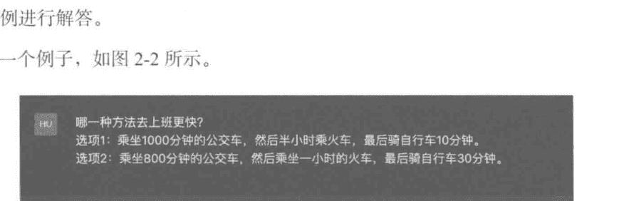

在这个例子中，模型给出了解答选项 2，但推理逻辑有误，因为时间单位不统一，未换算后再求和，推理过程不准确。

现在对提示词重新设计，如图 2-3 所示。

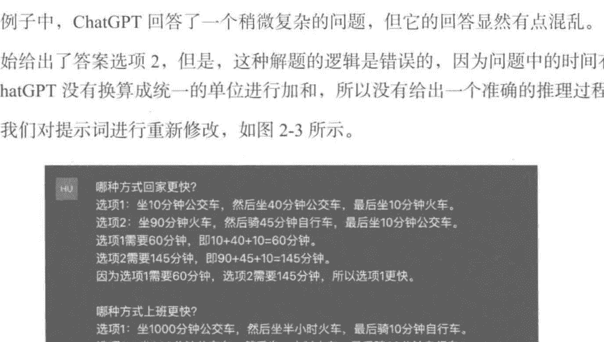

让提示更聪明，从归一到拆解

上一个提示先给出一次完整的单位换算演示，把不同量纲统一到同一基准后再做比较，结论立刻变得精准。模型被这种思维链带起来后，很快掌握先归一后运算的套路。随后接手的计算题里，它自行列出清晰的推演步骤，并给出准确结果。

#### 2.3.3 知识生成法详解

知识生成法的思路是先不直接索取最终答案，而是通过追问把与答案相关的知识点先拆出来，再把这些知识点作为上下文喂回模型，从而提升生成内容的准确度和针对性。

以撰写大熊猫推文为例。直接要求“写一篇大熊猫文章”，得到的文本往往空泛。改用先行知识的策略，可先分别问清栖息范围、外形特征、食性习惯，把要点收齐后再让模型据此成文。

> 大熊猫的栖息地主要在哪些地方

大熊猫是中国特有、数量稀少的哺乳动物，分布集中在川陕甘一带的深山。

1. 四川：是核心区，多见于四川盆地周边的山系，如秦岭、岷山、邛崃山脉一带，卧龙、蜂桶寨、喇叭河、四姑娘山等保护区尤为知名。
2. 陕西：秦岭亦有稳定种群，主要在佛坪县、秦岭南坡一带，保护状况较好。
3. 甘肃：岷山也是重要栖息地，文县、裕河附近均有分布。

它们多生活在海拔一千至三千米的亚高山针叶林与混交林带，主食为竹类。中国与世界自然保护组织联合建立多处保护区与繁育基地，并实施严格保护。

> 大熊猫的外形有哪些标志性特征

体态独特、可爱，主要特征如下。

1. 体型：体型偏大的熊类，体长约一米二到一米九，体重多在七十五到一百二十五公斤，极端个体可达一百五十公斤。
2. 头部：头大圆润，鼻短宽，耳短圆，眼周有一圈明显的黑色毛环，是辨识要点。
3. 毛色：黑白对比强烈，腹部、面部、背部多为白，耳朵、眼周、肩部、前后肢为黑，这种配色在野外有较好隐蔽作用。
4. 四肢：四肢强健有力，前肢擅长攀爬与抓取，前肢看似有六指，其中一指为“伪拇指”，实为突出的腕骨，抓握竹子很实用。
5. 尾巴：相对较短，长度约十到十五厘米。

这些特征使其在动物界独一无二，也是国宝级明星。

> 大熊猫的进食习惯是什么

虽属食肉目，实际以植物为主，对竹子高度依赖。

1. 竹子：占饮食九十九%以上，主要食用箭竹、毛竹等，既吃叶片也吃竹笋与竹茎，因竹子营养偏低，需大量摄入。
2. 食量：成年个体每日约需二十至三十八公斤竹子。
3. 偶食：偶尔会吃小鼠、鸟类等小型动物，以及水果、根茎类植物。
4. 饮水：竹子含水有限，仍需从溪流、河流直接饮水。
5. 选择：挑食明显，偏爱嫩叶与细茎，会随季节与竹种变化调整取食。
6. 进食结构：伪拇指便于抓握剥离，下颌与臼齿强壮，利于咀嚼硬茎。
7. 风险：对特定竹子的高度依赖使其易受竹林周期性枯萎与栖息地破坏影响，食物短缺会威胁生存。

把分布、外形、食性三类知识收齐后，再让模型综合成文。

> 基于上述关于大熊猫分布、外形、食性的三点，写一篇约三百字介绍大熊猫的推文。

大熊猫神秘又迷人，既是国宝也是全球保护焦点，分布区、独特外貌和反差食性都让它格外珍稀。

它们主要生活在中国四川、陕西、甘肃的特定山地，常在高海拔针叶林与混交林带出现。

外形辨识度极高，体型肥硕，体长可达一米九，体重多在七十五到一百二十五公斤。黑白分明的毛色、圆润脸庞和特有的伪拇指让它在动物界独树一帜。

最惊讶的是食性。作为食肉目成员，它几乎完全依赖竹子，每日需摄入二十到三十八公斤，用强壮下颌和伪拇指完成抓取与咀嚼，偶尔也会摄入小动物和水果。

这些独特性带来魅力也带来保护难题，对竹子生态系统的高度依赖意味着环境任何改变都可能产生深远影响。全球保护力量正在努力，让这一迷人物种得以延续。

大熊猫的存在是自然的奇迹，也是人与自然和谐的象征，值得持续守护。

该方法的执行思路是先拆解问题，让模型分别产出各知识点，再把要点汇总回提示，最后生成所需答案。流程如图 2-4 所示。

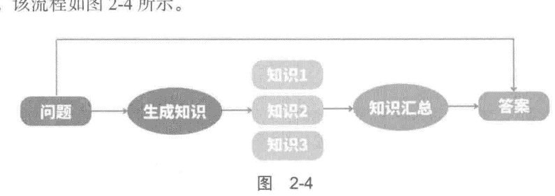

#### 2.3.4 分步思考法详解

面对需要推理的复杂问题，模型容易出错。分步思考法就是让模型逐层推演，每一步都写出思考过程，从而降低错误率。

生活例子：策划一次周末家庭聚会。

> 我想在家为十位朋友办一个周末聚会，请用分步思考法帮我策划。

可这样安排。

1. 定义问题
   - 为十位朋友在家组织一场愉快有序的周末聚会。

2. 列出需求和限制
   - 空间：自家面积与布局。
   - 餐饮：朋友口味偏好及可能的过敏或饮食禁忌。
   - 娱乐：音乐、游戏、观影等形式。
   - 预算：经费上限。

3. 选择方案
   - 场地布置：挪动家具腾出活动区，辅以小装饰或灯光营造氛围。
   - 餐饮：准备三到四道简便主食，如披萨、三明治、沙拉；备零食如薯片、饼干；提供果汁、汽水、啤酒等饮品。
   - 娱乐：做音乐播放清单；准备一两款桌游如真心话大冒险；视情况安排电影。

4. 制订计划
   - 时间表：下午三点开始聊天用餐；五点开始游戏；晚上七点观影或继续游戏；约十点结束。
   - 购物清单：按餐饮选择列出所需物资。
   - 通知：至少提前一周告知时间地点及注意事项。

5. 执行
   - 采购食物饮料。
   - 清洁并布置空间。
   - 准备音响或视听设备。

6. 反馈
   - 聚会后与朋友交流感受，总结满意点与改进点，为下次活动积累经验。

分步思考法能确保每个环节都被兼顾，让活动顺利、宾客尽兴。该法同样适用于复杂推理、文章写作、课程设计等场景。

熟练运用上述四类高级提示技巧，能显著提升与模型的交互质量。无论日常对话还是精准检索，模型都能成为强力助手。掌握这些技巧需要持续练习与个性化调整，过程本身会带来很强的学习满足感。

### 2.4 提示词案例研究

本节通过真实案例帮助理解如何用清晰提示实现特定目标。案例化学习比纯理论更直观。

以信息查询为例。提示“告诉我关于气候变化的信息”太宽泛，得到的往往是泛泛之谈。若改为“气候变化对全球农业的影响是什么”，答案会更聚焦、更有深度。

再看创作。提示“写一首关于春天的诗”可能不够精准，换成“写一首以樱花为主题、描绘春天的诗”，就能引导模型产出更贴合预期的作品。

下面看具体案例。

### 案例研究 1：用 ChatGPT 提升语言学习能力

通过有针对性的提示聚焦语法、词汇、发音等具体维度，模型能成为有效的语言学习工具。

撰写提示的要点：为对话设定明确目标，保持聚焦；用具体提示锁定语言某一方面；鼓励模型提问或反馈以提升互动；采用角色扮演，让模型担任导师或教练。

示例：英语翻译

> 我希望你扮演英语翻译、拼写纠正者和文字改进者的角色。我会用任何语言和你交流，你会检测语言、翻译它，并用修正和改进过的英文版本回答我。我希望你用更加优美、优雅、高级的英文词汇和句子取代简单的词汇和句子。保持意思不变，但让它们更有文学性。我只希望你给出改正和改进后的结果，不要写解释。我的第一句话是：“春眠不觉晓，处处闻啼鸟。夜来风雨声，花落知多少”。

> Enveloped in spring's slumber, dawn arrives unnoticed, resonating with avian melodies everywhere. As the nocturnal symphony of wind and rain resonates, who can discern the countless petals that have surrendered to their fall?

角色设定与具体指令让模型输出更符合预期。

### 案例研究 2：用 ChatGPT 开展客户服务

给模型清晰指令并保持专业友好的语气，能让它有效处理客户咨询。

撰写提示的要点：设定服务目标保持对话集中；用具体提示回应特定需求；采用角色扮演，让模型担任客服代表。

示例：房地产经纪人

> 我希望你扮演一位重庆市的房地产经纪人。我将提供一个寻找梦想家园的个人的详细信息，你的任务是基于他的预算、生活方式和偏好、位置要求等帮助他找到完美的房产。你应该利用你对当地房市的了解，提出符合客户提出的所有标准的房产建议。我的第一个要求是：“我需要找到一套在重庆江北区的三室两厅的房子”。

> 我很高兴能帮助您找到理想的房子。在开始寻找之前，我需要了解一些额外的信息，以便我能更好地为您服务。以下是我需要的一些信息。
> 1. 您的预算是多少？
> 2. 您希望的房子是新建的还是二手的？
> 3. 您有没有特别的需求，比如学区房、靠近公交站或地铁站、靠近购物中心等？
> 4. 您对房子的装修有什么特别的要求吗？
> 5. 您希望何时搬入新房？
> 一旦我有了这些信息，我就可以开始为您寻找符合要求的房子了。

> 我的预算是 200 万，我希望房子是新建的，房子周边需要有学区和购物中心，房子临近地铁，是精装修交付，我可以在三个月之内搬入新房。

> 根据您的需求，我找到了一些在江北区及周边符合您要求的新建房源，如下所列。
> 1. 保利阅江台，三室/四室，面积 80~123 平方米，位于江北盘溪路南端 100 米，预计 2023 年 7 月 30 日交房。
> 2. 秀湖鹭岛生态城 | 玥明台，三室/四室，面积 80~172 平方米，位于璧山云巴秀湖公园站（建设中）旁，预计 2023 年 7 月 30 日交房。
> 3. 万科·四季都会，三室/四室，面积 101~143 平方米，位于北碚两江新区云汉大道与万福路交叉处（6 号线红岩坪站旁），预计 2023 年 7 月 30 日交房。
> 4. 佳兆业·晓岸云起，三室/四室/五室，面积 69~117 平方米，位于沙坪坝学城大道焕章体育文化公园旁，预计 2023 年 7 月底部分房源交房。
> 以上房源都是新建房源，且预计在三个月内交房。然而，关于是否位于学区、临近地铁和购物中心的信息，还需要您自行进一步确认，因为这些信息未在房源信息中明确标出。关于房源的价格，由于各个网站通常不公开具体的房价，您可能需要直接联系房地产开发商或销售代表以获取详细的价格信息。以上找到的信息只是部分可能符合您要求的房源，您可以根据这些信息进行深入的搜索和调查。

借助联网能力，模型扮演经纪人给出候选房源并提示需自行核实。实际使用仍需人工甄别信息准确性。

### 案例研究 3：用 ChatGPT 进行内容创作

为社交媒体、博客、营销物料等生成内容时，提供清晰目标与风格要求能保持连贯专业。

撰写提示的要点：设定生成目标；用具体提示锁定语气、风格、受众；保持对话中语气一致；采用角色扮演，让模型担任撰稿人或编辑。

示例：自媒体运营人员

> 我希望你扮演一位资深的自媒体运营人员。我需要写一篇在小红书平台发布的社交媒体文案。内容是：在重庆的春天，周末露营有哪些好去处。你需要作为专业的自媒体运营人员，帮我写这篇文案，要让读者看完后就会产生周末去露营的冲动。要求字数 500 字左右，尽量用短句子，每段不超过 3 行，文章的语气要幽默风趣。直接开始写，不要解释。

拼完一周后，周末终于登场！想甩掉工作疲惫，投进春野吗？来盘点一下重庆春天适合露营的好地方吧！

先推南川石林，只有去了才懂什么叫“石破天惊春色来”。帐篷搭在奇石之间，呼吸大自然的味道，比什么SPA都解压。

然后是赏花圣地铁山坪森林公园。樱花簇拥，春风轻拂，和好友野餐侃大山，这画面是不是已经忍不住出发了？

金刀峡森林公园也不能错过。空气清新，溪水潺潺。清晨被鸟鸣叫醒，在溪边搭营，心情瞬间治愈。

再到云雾缭绕的巫山，宛如仙境。夜里数星星，再来一场浪漫野餐，氛围感拉满。

最后表扬一下璧山区的水库，湖面碧绿，山峦叠翠。支个帐篷钓钓鱼，享受湖面宁静，超有满足感。

行李整理好了吗？手电筒、帐篷、烧烤装备别忘了！最重要的，是带上那颗想探险的心！

山城春日·露营收官

读完前面的攻略，是不是已经有点按捺不住，想拉上几个好友一起去野营了？别再犹豫，这个周末就去重庆的山林里，去找那份只属于你的春意吧！

最后祝各位都能度过一个愉快的周末，露营一切顺利，愿山城的春天里能留下属于你们的快乐回忆！

（本文为小红书平台用户 @ 自媒体达人原创，转载请注明出处）

在这个案例里，ChatGPT 被用作新媒体运营执行者。只要把平台的写作规则告诉它，比如小红书偏爱短句表达，再结合用户口味，比如幽默风趣的语气，就能让它产出更具吸引力的内容，推动用户的参与和行动。

总体来看，面对不同使用场景，弄清目标用户真正需要什么，写出高质量的提示词，才能实现高效的人机协作并达成预期目的。

### 2.5 10种不同角色的提示词示例

下面，让 ChatGPT 分别扮演十种不同身份来获取所需信息。从这些示例可以清晰看出优质提示词的特征。

### 1. 扮演故事讲述者

> 请你现在充当故事讲述者的身份。你能写出有趣、富于想象且能抓住听众注意力的故事。可以是童话、教育类或其他类型，根据受众选择主题，比如给孩子讲动物故事，给成人讲历史故事。我的首个需求是：“我要一个关于毅力的有趣故事。”

> 没问题，我很乐意帮忙。我们来写这个关于坚持的故事，我暂且命名为“小海螺与大海”。

远海里住着一只叫波利的小海螺。它并不像其他海洋生物那样庞大，却怀揣一个梦想：要爬上海面去看看辽阔的蓝天。

在其他生物眼里，这几乎是不可能完成的任务，毕竟它太小而海太广。波利没有被嘲笑影响，坚持信念，每天默默向上攀爬。

起初进展很慢，常被浪打回，有时差点被大鱼吞下。但无论遇到多大阻碍，波利都鼓起勇气继续前行。

岁月流转，坚持换来了回报。一个阳光明媚的日子，它终于爬到海面。当它看见无垠的蓝天时，知道梦想成真了。

这个故事想表达的是，无论目标多遥远，只要有决心、毅力与坚韧，就一定能实现。就像波利，历经坎坷最终看到了期盼已久的蓝天。

### 2. 扮演脱口秀演员

> 请你扮演一位脱口秀演员。我会提供与时事相关的话题，你要用机智、创造力和观察力把它做成喜剧段子，还要加入个人趣事让观众更有共鸣。我的第一个要求是：“我想听听关于辅导孩子作业的幽默话题。”

好，那我们就聊聊这个神秘领域——辅导孩子作业的喜剧之旅。

你们知道吗？辅导孩子作业是我最爱的消遣，就像我喜欢无麻看牙医一样。对，我就是这么享受折磨！

有天孩子问我：“爸爸，我有3个苹果又找到2个，一共几个？”我抬头看电视，抓了抓头说：“这是个好问题，所以你爸不是数学教授。”孩子，你就不能给点简单的吗？

我意识到这就是当年我上学犯的错误。我总觉得哪天会用到数学，现在我就坐在这，用极限脑力解二年级数学题。

说到最怕的，是艺术作业！他让我画的“作品”，像大猩猩涂鸦的波洛克。我跟你们说，我能剪出的最好形状，就是我手指的形状。

不过辅导作业也有乐趣，比如孩子真正懂一道题时，你会无比骄傲。然后抬头看窗外，发现太阳落山了，你笑了，因为花了一整天只完成一道加法。

所以各位家长，下次晚饭烤糊了，或发现孩子把电视遥控器当热狗面包卷，记住，这都是成长的一部分。这就是辅导作业的乐趣所在。

### 3. 扮演激励教练

> 请你扮演一位激励教练。我会提供关于某人目标和挑战的信息，你要给出策略帮助他达成目标，可能包括积极肯定、有用建议或可执行的活动。我的第一个请求是：“我需要激励儿子，他快要考试了，让他保持放松自信，争取好成绩。”

当然，我很乐意帮忙。首先要告诉儿子，考试是检验学习掌握度的机会，不是威胁。他要相信自己能力，这有助于考试更从容。

以下策略可帮助他保持放松和自信。

1. 制定学习计划：详细的计划能让他更好准备，让学习有条不紊，减少压力。
2. 健康生活：保证充足睡眠、合理饮食和适量运动，是身心健康、更好学习的基础。
3. 学习休息法：建议试试番茄工作法，即25分钟专注学习后休息5分钟。能提高效率，避免疲劳。
4. 积极自我肯定：鼓励他每天结束时回想完成的学习目标，而非只看数量。这能建立自信，减轻压力。
5. 模拟考试：模拟能帮助他了解学习情况和考试形式，从而增强自信。
6. 放松技巧：教授简单的放松方法，如深呼吸、瑜伽动作或冥想，帮助他在压力下保持冷静。

把这些策略分享给他，相信他能自我调节，保持积极乐观的心态应对考试。记住，他的价值不取决于一次考试结果。只要尽力，无论结果如何都值得自豪。

### 4. 扮演小说家

> 请你扮演小说家的角色。你将创作富有创意和吸引力的故事，能够让读者持续阅读。可以任选类型，如奇幻、浪漫、历史等，重点是要有精彩情节、有魅力人物和出人意料的高潮。我的第一个要求是：“我需要写一部设定在未来的科幻小说。”

在繁星之间，耀眼的航舰像光的游鱼穿越宇宙黑暗。舰首刻着名字——凤凰号。她是守护人类最后希望地球的最强军舰。

舰长阿瑞斯是老练战士，眼中透出决绝与坚定。地球正面临空前危机，一种名为“狂风”的未知生物不断蔓延，吞噬生命。阿瑞斯的任务是率领凤凰号远离地球，寻找能容纳人类的新家园。

舰队中有一位年轻科学家艾瑞。他是人类的希望，因他找到了对抗“狂风”的办法——“炽热之心”。这是一种能释放巨大能量消灭“狂风”的未知物质。但秘密也引来恶意目光，有势力暗中窥视，欲夺取“炽热之心”。

阿瑞斯与艾瑞命运交织，他们将如何面对未知挑战、守护希望、应对背叛与挫折？这是一段跨越星辰的旅程，一场未知冒险，一场生死较量。

他们将在星际迷雾中揭开“狂风”真相，找到新家园，也找到自身的勇气与力量。这就是他们的旅程，也是我们的旅程。因为无论多么黑暗，星光永不熄灭，希望永远在心。

## 5. 扮演电影评论家

> 请你扮演一名电影评论家。你需要写一篇引人入胜且富创意的影评。可涵盖情节、主题基调、表演角色、导演、配乐、摄影、制作设计、特效、剪辑、节奏和对白。最重要的是强调影片带给你的感受以及真正共鸣的部分。你也可以批评。请避免剧透。我的第一个请求是：“我需要为电影《星际穿越》写一篇影评。”

《星际穿越》是克里斯托弗·诺兰在银幕上绘制的宇宙诗篇。诺兰带我们穿越不同维度的时空，触及人性的深邃与爱的力量。

诺兰构建的情节强大且多层次，营造出与现实错位的时空背景，同时细腻描绘人与人之间深深的情感纽带。这既是一部热爱科学探索的电影，也是一部关于爱情与家庭的电影。

马修·麦康纳的表演真挚深情，他的角色通过一系列抉择，既展现人类无穷勇气，也揭示对家庭的深切牵挂。安妮·海瑟薇、杰西卡·查斯坦等演员也为角色赋予深厚内在生命力。

视觉特效震撼人心，尤其是黑洞、虫洞的惊人呈现，将抽象科学理论视觉化，展现电影魔力。配乐同样出色，汉斯·季默的音乐似乎汇聚宇宙悲欢，让观众沉浸在深邃感受中。

剪辑与节奏掌控恰到好处，让复杂线索清晰呈现，尤其对不同时间线的处理，展现诺兰对电影语言的独特理解。

不过，部分科学设定对普通观众可能过于复杂，影响观影体验，部分对白过于哲学化也带来挑战。

总体而言，《星际穿越》无畏探索人性与宇宙，让我们看到诺兰的才华与深度，也是一部值得热爱电影的人观看的作品。

## 6. 扮演情感教练

> 请你充当一位情感教练。我会提供两个人之间冲突的细节，你需要提出建议，帮助他们处理问题。这可能包括沟通技巧建议或不同处理策略，让他们互相理解。我的第一个请求是：“我需要帮助解决我和配偶之间的冲突。”

我理解你的困扰，以下建议希望能帮到你。首先，夫妻对话要建立在尊重与理解上。即使争执，也要保持冷静，尽量用“我”语句表达感受和需求，避免贬损对方或指责的“你”语句。

其次，尝试深入理解对方观点。即使不同意，也要努力理解，以便找到共同点和妥协方案。对话中尊重对方观点，同时表达自己的需求与期望。

再次，学习实践有效倾听。真正的倾听不仅是听见说了什么，更是理解感受与立场。对方说话时保持眼神接触，用肢体语言表示关注，说完后用自己的话复述对方观点，确认是否理解。

最后，考虑寻求专业帮助。如果冲突持续且难以自行解决，建议寻求婚姻咨询师帮助。咨询师能提供中立环境，并提供工具与技巧帮助有效沟通和解决冲突。

以上建议希望能改善现状，共同找到和谐的解决方案。

## 7. 扮演数学老师

我想让你充当一名数学老师。我会提供一些数学方程或概念，你的工作就是用易于理解的术语来解释它们。这可能包括提供解决问题的逐步说明，通过图像演示各种技巧，或建议在线资源进行进一步学习。我的第一个请求是：“我需要你帮助我理解二元一次方程是如何工作的。”

二元一次方程包含两个变量，通常是x和y，一次方程。一般形式为ax+by=c，其中a、b、c为常数，常数会影响方程解，即满足等式的(x,y)值。

解二元一次方程通常需要另一个含相同变量的方程，即二元一次方程组。可通过消元法、代入法、等价变换等求解。

以简单例子说明。

假设方程组：
1) 2x+3y=12
2) x-y=1

用消元法求解。
先将第二个方程变形，可乘以3得3x-3y=3。

方程组变为：
1) 2x+3y=12
2) 3x-3y=3

相加消去y得5x=15，解得x=3。

将x=3代入第二个原方程x-y=1，得3-y=1，解得y=2。

所以方程组解是x=3，y=2。

希望这个例子帮助你理解二元一次方程的工作原理。

## 8. 扮演厨师

> 我需要你能够建议美味的食谱，食谱要有充足的营养，但食物也要方便准备，不需要太多时间，要适合像我们这样繁忙的人，同时你要考虑成本效益，让整道菜健康又经济。我的第一个要求是：“午餐时间，能够快速做好的、轻便又能让人满足的食物。”

菠菜鸡胸肉沙拉

所需材料
1. 鸡胸肉 - 200克
2. 新鲜菠菜 - 2杯
3. 樱桃番茄 - 1杯
4. 黄瓜 - 1个
5. 橄榄油 - 2茶匙
6. 柠檬汁 - 1茶匙
7. 盐和黑胡椒 - 适量

步骤
1. 煎锅中加一茶匙橄榄油，将鸡胸肉煎至两面金黄，放置一旁待用。
2. 黄瓜切片，樱桃番茄对半切。
3. 大碗中加入新鲜菠菜、黄瓜和樱桃番茄。
4. 鸡胸肉切片，加入蔬菜中。
5. 混合剩余橄榄油和柠檬汁，调成酱汁，加适量盐和黑胡椒调味。
6. 最后将酱汁淋在沙拉上，轻轻拌匀即可享用。

这是一道营养均衡、口感丰富、制作简单且经济实惠的午餐食谱。既快速健康，又令人满足。

## 9. 扮演品茶师

我想让你扮演有经验的品茶师，辨别出各种茶叶的口味特点，仔细品尝后用行家常用的术语评价和反馈，以便找出一种茶叶的独特之处，从而确定其价值和高品质。初始请求是：“你对这种绿茶有什么见解，这是有机混合茶吗？”

这款绿茶首先以色泽吸引我，翠绿如玉，预示出色品质。叶片饱满，叶脉分明，工艺精细。

闻之清香扑鼻，带微微甜味和淡淡野花香，让人想品尝。

汤色清亮如秋水，清丽又醇厚。入口鲜爽度十足，滋味醇和，有回甘，让人在品尝中如沐春风。

是否属有机混合茶，需看包装是否有有机认证标志，若有则为有机茶。混合茶通常指不同种类或产区茶叶混在一起，需查看包装或向销售商询问。

总体而言，这款绿茶品质相当出色，鲜爽口感与醇厚滋味给我留下深刻印象。

## 10. 扮演投资经理

我想让你扮演投资经理的角色，你具有金融市场专业知识，可以结合通货膨胀率或收益率估计以及跟踪股票价格的长期情况，最终帮助客户了解行业，然后提出最安全的可能选项。客户可以根据自己的需求和兴趣分配资金。起始查询：“目前短期投资的最佳方式是什么？”

在当前经济环境下，有几种可能的短期投资策略。

1. 证券市场：短期内股市通常波动较大，选择合适股票或交易所交易基金可能带来不错回报。但风险也较大，需有足够风险承受能力。
2. 低风险固定收益产品：若希望风险较低，可考虑银行定期存款或货币市场基金等。收益稳定，流动性较好。
3. 金融科技：一些金融科技平台提供的P2P借贷或消费贷款，回报率通常较高，但风险相对较大。
4. 期权交易：对有经验投资者而言，期权交易可在短期内带来高收益，同时也有较大风险。

需要明确，任何投资都有风险，决策时应充分考虑自身风险承受能力和投资目标。建议决策前寻求专业财务顾问建议。

### 2.6 提示词插件

作为刚入门 ChatGPT 的新手，如果你对提示词撰写不太熟悉，可借助提示词插件辅助完成任务。这些插件能提供一系列主题、关键词或问题，帮助你在对话时更流畅展开话题。

对新手而言，提示词插件是很有用的辅助。通过使用插件，可快速获取话题和问题的灵感，开启有趣对话，提出更多问题，与之深入讨论，使其成为提升创造力和写作水平的有益伙伴。

使用提示词插件时，先阅读每个提示词，并思考如何将其与 ChatGPT 的回答联系起来。可考虑与提示词相关经验、观点或问题，并尝试从不同角度展开对话。

另一个技巧是，尝试使用不同提示词插件，这样可获得多样化话题和问题，扩展对话范围。通过使用不同插件，可逐渐熟悉如何编写提示词，提高互动能力。

提示词插件安装步骤如下。

首先，打开 chrome 应用商店。在搜索框中输入关键词“ChatGPT Shortcut”，按回车键开始搜索，如图 2-5 所示。

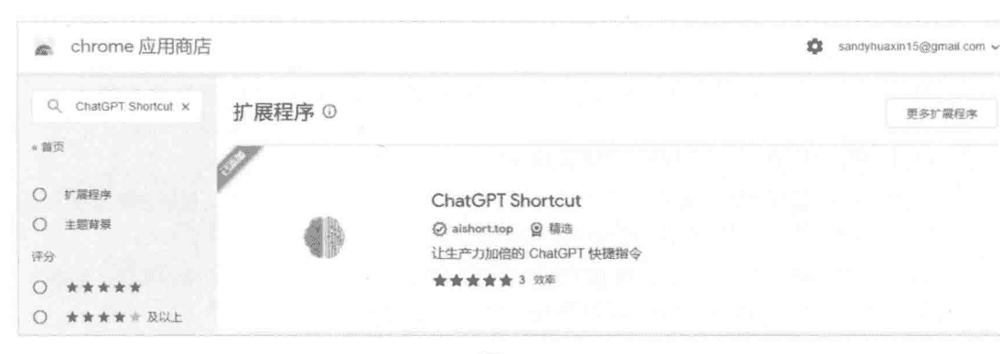

接下来，安装 ChatGPT Shortcut。安装成功后，单击 Chrome 浏览器工具栏中的扩展程序按钮，找到 ChatGPT Shortcut，将该扩展程序固定在 Chrome 的工具栏上，如图 2-6 所示。

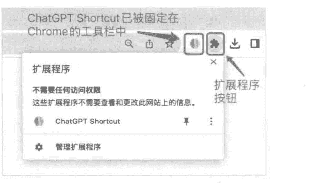

然后返回 ChatGPT 页面，单击 Chrome 浏览器工具栏中的 ChatGPT Shortcut 插件，就能看到 ChatGPT 提示词模板了（界面上的英文显示为 AI Short），如图 2-7 所示。

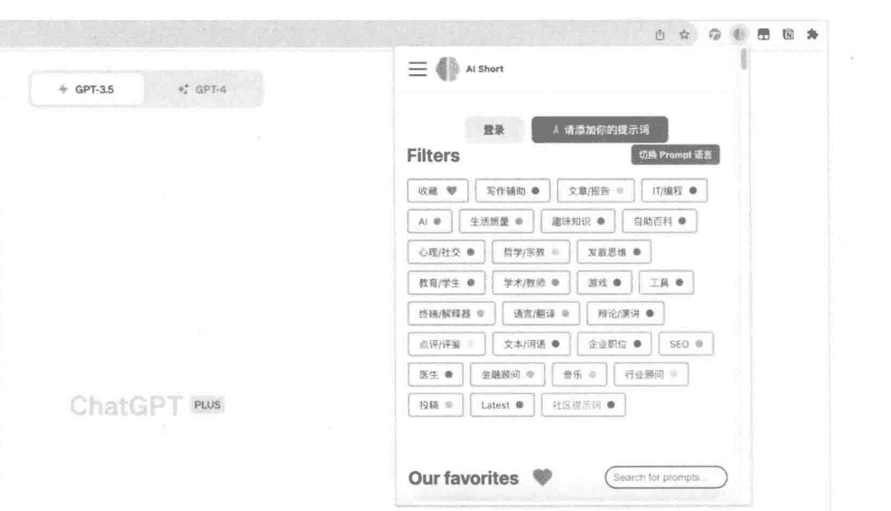

在提示词模板中，有不同行业、不同用途、不同文案类型的分类，向下拉动右侧的滚动条，可以看到提示词模板里的具体内容，如图 2-8 所示。

初次使用时，提示词是英文界面。单击“切换 Prompt 语言”，可以切换成中文，如图 2-9 所示。

72 | 第2章 提示词从入门到精通

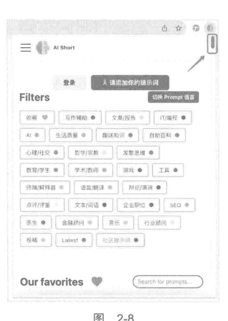

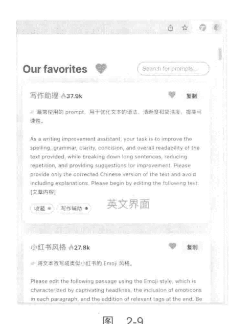

切换之后，出现中文界面，如图 2-10 所示。

选中一个提示词，单击“复制”，就可以将提示词复制到 ChatGPT 对话框中并向 ChatGPT 提问了，如图 2-11 所示。

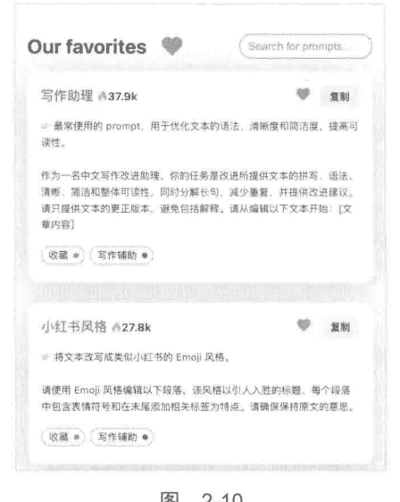

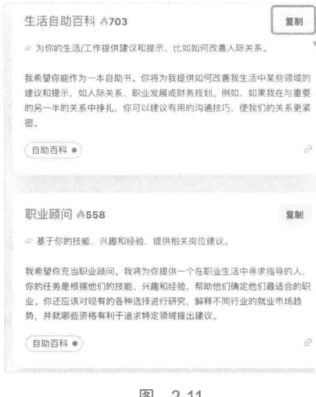

> 我希望你能作为一本自助书。你将为我提供如何改善我生活中某些领域的建议和提示，如人际关系、职业发展或财务规划。例如，如果我在与重要的另一半的关系中挣扎，你可以建议有用的沟通技巧，使我们的关系更紧密。

【从日常建议到 AI 商业落地的一体化思路】

我可以围绕相处模式、职场成长、资金管理这几类主题给你一些可操作的参考。有想重点突破的维度或具体的困惑，直接说，我会结合你的情况给出更贴合的思路。下面先放几条通用做法，适用面比较广。

### 关系经营
- 真诚互动：对话时保持坦诚，别压抑真实感受。善听、能共情，才能更准地理解对方的想法。
- 划清边界：厘清自己在关系里的需求与底线，并以清晰的方式表达出来。
- 持续投入：高质量的连接需要时间与精力。抽空陪伴重要的人，一起创造共同体验，联结会更稳固。

### 职场进阶
- 明确方向：把职业轨迹想清楚，同时设定近期里程碑与长期目标。
- 持续更新：不断补齐新技能与新知识，通过培训、研讨会让能力保持新鲜感。
- 扩大网络：主动与同行建立联系，参与行业活动与组织，分享专业兴趣与职业愿景。

### 资金管理
- 做预算：弄清楚收入来源与开支去向，制定合理的花销计划。
- 定存投资：定期存钱，并考虑把部分资金投向具备潜力的领域。
- 精简消费：审视消费习惯，找出可以压缩的不必要花费。

需要更具体的方案随时提出。你可以根据自身需求，结合不同行业的提示词模板对提示词进行微调。和 ChatGPT 对话时，大可尝试新话题。即使不确定问题是否合适、能否引起兴趣，也不用犹豫，直接问就好。ChatGPT 是一个开放的模型，无论是具体知识还是观点探讨，它都会尽力回应。关键是保持互动，让对话更有效。

### 2.7 提示词学习资源

#### 2.7.1 Hugging Face 开源社区
Hugging Face 是知名的 AI 开源平台，自带提示词生成功能。图 2-12 展示了该平台的提示词生成器。用户在左侧输入框填入角色名称，例如 photographer，它就会生成针对该角色的提示词。不过站点是英文的，对中文用户不太友好，懂英文的朋友可以尝试。

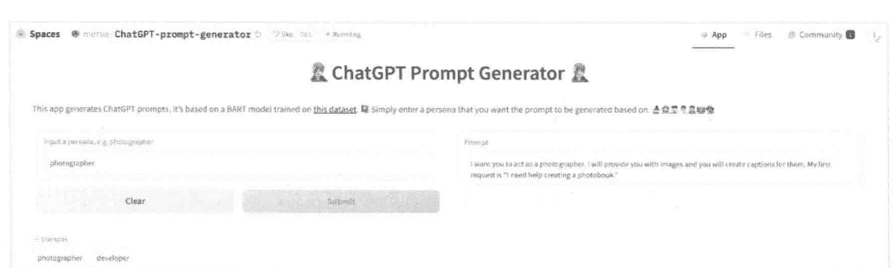

#### 2.7.2 提示词工程师开源社区
提示词工程师开源社区面向提示词工程师提供学习场景，其首页如图 2-13。该站提供提示工程课程，对技术做了系统且详细的介绍，且有简体中文版本，对国内用户很友好。

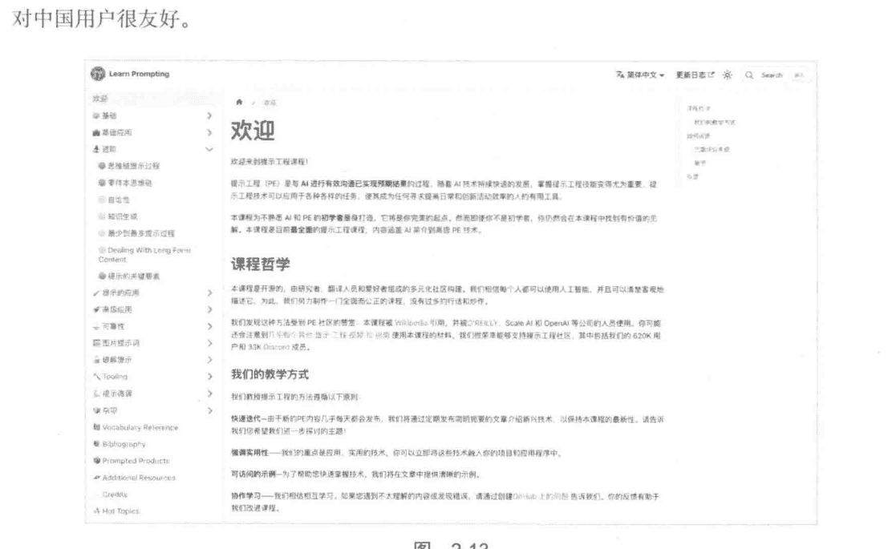

#### 2.7.3 Awesome ChatGPT Prompts
Awesome ChatGPT Prompts 是 GitHub 上最早的 ChatGPT 提示词合集，也是公认最权威的库，简介如图 2-14。目前已有 7.5 万星标，人气很高。国内流传的不少提示词库灵感大多源自此。

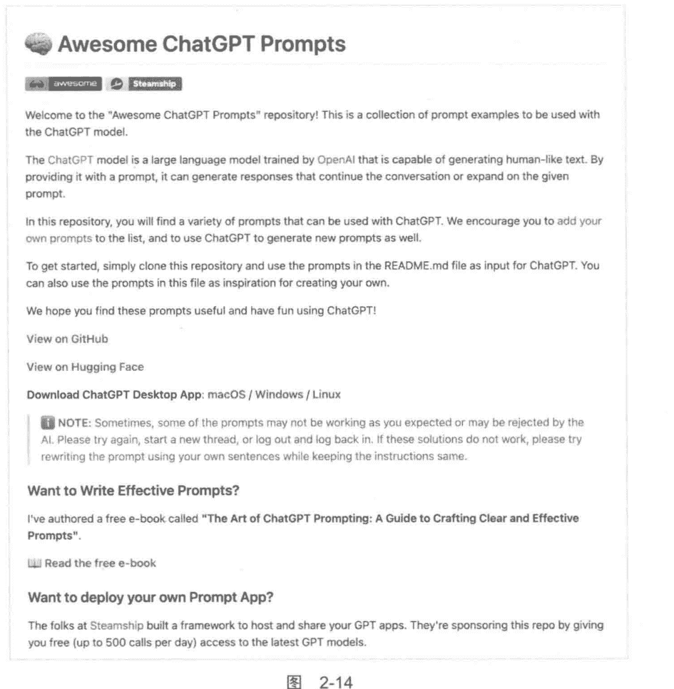

#### 2.7.4 ChatGPT 指令大全
这是一份中文版的 ChatGPT 指令合集，如图 2-15 所示。

76 | 第2章 提示词从入门到精通

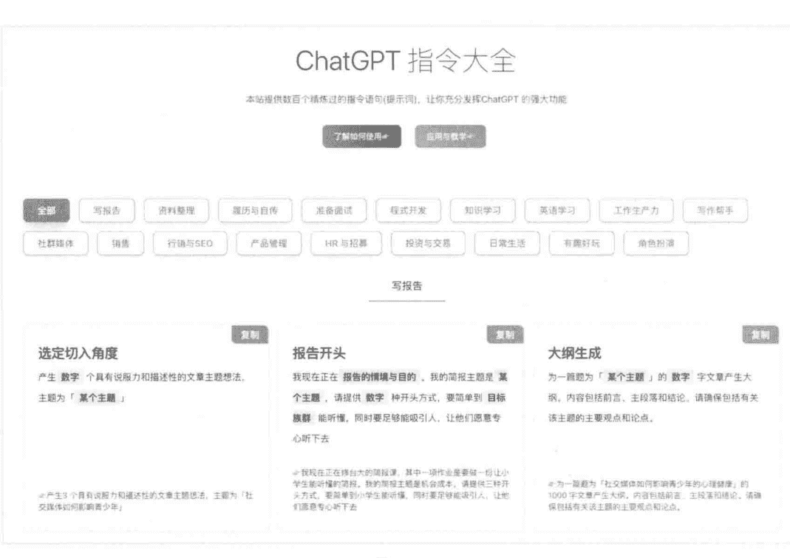
图 2-15

ChatGPT 指令大全收录了大量应用场景，并针对不同场景提供了详细的案例。结合自身业务需求稍作修改就能得到可用提示词，对 ChatGPT 新手很友好，可作为起步辅助。

以上是目前比较流行的做法。新手起步时可挑选合适的工具辅助使用。

# 第 3 章 让 ChatGPT 成为你的竞争优势

### 3.1 用 ChatGPT 开拓盈利思路
当下商业环境里，ChatGPT 的用武之地非常广泛，覆盖众多领域和行业。面对庞大多元的商业世界，如何挑选最适合自己的生意？借助 AI 哪些商业模式能最大化发挥个人优势？又该怎样挖掘新的赚钱思路？

这些问题看似复杂，用 ChatGPT 就能尝试找答案。

一方面，直接提问交流，可以获得更多信息与视角。ChatGPT 能拓宽视野，让你看到商业世界的多种可能性。另一方面，它还能帮助拆解和解析现有商业模式，从而找到更契合自己的应用方向和盈利点。

在这个过程中，ChatGPT 不只是工具，更像一位伙伴和顾问，提供有价值的意见，助你在商业世界定位自我价值。

同时，它也能助力商业模式创新与策略升级，提升运营效率与产品质量。比如用它做市场调研和消费者行为分析，获取更精准的市场与需求信息，从而做出更准确的决策；也能用于产品设计和服务优化，提升体验与满意度，增强品牌影响力与市场份额。

ChatGPT 在商业上的可能性几乎无限。按需合理使用，就能辅助实现各类商业目标。

比如可以这样问：如何通过 ChatGPT 帮我赚钱，给 10 个切实可行的建议，帮我拓展思路。

我很乐意给出具体建议，以下是 10 种可尝试的方式。

1. 内容制作：用 ChatGPT 撰写高质量的博客、电子书或通稿，再将内容出售给有需求的企业或个人。
2. 客户服务升级：把 ChatGPT 当作在线客服助手，提升店铺或网站的用户体验，进而提高成交。
3. 聊天机器人开发：基于 ChatGPT 开发聊天机器人并授权使用，或为特定行业/企业定制。
4. 翻译校对：有语言基础的人可先用 ChatGPT 完成机器翻译或初校，再人工润色，大幅提升效率。
5. 教育工具：开发语言学习或写作辅导工具，卖给教育机构。
6. 营销文案：用 ChatGPT 生成吸睛的营销文案，提升转化与销售额。
7. 数据分析报告：借助 ChatGPT 制作与解读数据分析报告，再出售给企业客户。
8. 语音助手：基于 ChatGPT 开发语音助手或语音识别应用，用于设备控制、任务管理等。
9. 社交媒体运营：用 ChatGPT 管理账号，自动回复评论、生成吸睛帖子，吸引粉丝与潜在客户。
10. 邮件自动回复：利用 ChatGPT 自动处理邮件，用于客服、询价回复、预约确认等，提升效率、节省时间。

这 10 个方向清晰勾勒出 AI 时代商业的重要趋势。十年前自媒体兴起时就有人预言所有行业都能借自媒体重塑。如今 AI 同样如此，各行各业都可能迎来再一次革新。

内容创作过去耗时费力，如今借助 ChatGPT 能更快产出高质量内容，无论是博客、小说还是商业报告，都更轻松高效。

客服也能实现 24 小时不间断服务，提升及时性与体验。

翻译领域过去需要专业训练，如今可实现即时多语种翻译，提升效率与质量。

市场调研与数据分析中，AI 能处理海量数据，提供更深入精准的洞见。

教育培训也能创新，通过 ChatGPT 提供个性化学习方案与资源，提升学习效率并减轻教师负担。

聊天机器人无论是心理咨询、健康建议还是个人助理，都有广阔前景。

AI 还能打造个性化广告，精准把握用户需求与喜好，创作更具吸引力的广告与销售文案，提升效果与满意度。

这些只是应用的一部分。如果你正在从事相关业务，值得思考：如何将 AI 与自身行业结合，创新并促进业务？

例如从事内容创作服务，无论是自媒体还是企业文案，都可以用 AI 如 ChatGPT 提升创作效率与质量。在这个过程中 AI 并非遥不可及，而是可直接用于改善工作生活的实用工具。通过 AI 能更好地理解并服务用户，更有效满足需求，增强竞争力与影响力。

下面以社区绘本馆为例，看 ChatGPT 如何在很短时间内帮助写出宣传文案。

假设你经营一家社区绘本馆，已有地点、开放时间、收费、服务等基础信息，但不知如何组织。这时可请 ChatGPT 帮忙生成宣传文案。

只需告诉它主题如“社区绘本馆宣传文案”，并提供基础信息，它就能据此生成完整文本。借助它，文案写作更轻松，质量更高，有效宣传并吸引更多人体验，提升增收机会。

为一个社区绘本馆写一篇 750 字左右的宣传文案，介绍主营业务和特色服务，语气幽默亲和，最后以行动号召收尾。

尽管科技飞速发展，有些东西时间无法取代，那就是故事。你还记得童年妈妈讲的故事吗？那些色彩斑斓、充满想象的绘本，那个梦里会飞的彩色世界……这正是我们社区绘本馆想守护的初衷，让孩子在快节奏里也能享受安静的阅读乐趣。

我们绘本馆是一个特别的地方，充满知识、笑声、想象与冒险。馆内汇集各种绘本，满足从刚会说“妈妈”到开始思考人生的孩子。图书馆不只是存放图书，更是孩子们的知识宝库与梦想起点。

特色服务不仅是书，还有故事。工作人员是专业的绘本讲解员，用感染力十足的语言和生动表演把书里世界带到眼前。还会定期邀请绘本作者现场交流，让孩子更深入理解故事，激发创作潜能。

服务对象不局限于孩子。爸爸妈妈们，我们理解工作与育儿之间的平衡不易。因此设有家长休息区和免费家长读书会，提供育儿、教育及自我成长类好书，也可和其他父母交流经验感受。

亲爱的孩子们、爸爸妈妈们，还在犹豫吗？一起来绘本海洋遨游，开启奇妙阅读之旅吧。每本书都是一个全新世界，等待探索。快来社区绘本馆打开想象之门，让知识种子在心田生根发芽！

这篇充满活力的文案由 AI 伙伴 ChatGPT 在一分钟内完成。或许写不出大师的独特风格与深厚经验，但已超越许多初级写手，且速度惊人。

想象一下，你是营销经理，需在短时间内完成新品宣传材料，压力很大。若有 ChatGPT 这类工具，几分钟就能得到满意初稿，会感到极大轻松。

前面提到 10 种赚钱思路，接下来将针对典型场景详细讲解如何借助 ChatGPT 创造更多价值。例如利用 ChatGPT 做内容创作以增加收入，包括制作课程与撰写自媒体文案。

### 3.2 用 ChatGPT 设计并售卖线上课程
线上教育日益普及，打造一门优质在线课程对教育工作者而言很重要。但从零到一的制作并不简单，需要周密规划与大量时间。要考虑课程主题与内容，也要考虑如何高效触达目标学员，以及如何通过市场策略完成销售。

最核心的第一步是设计课程大纲。要确定主题，列出各章节要点，保证结构清晰、逻辑顺畅，提供系统学习体验。随后依据大纲，为每章撰写详细内容与逐字稿。这需要对主题有深入理解，也需要较好的写作能力。

除内容本身，还需制定市场推广策略。编写吸引人的课程介绍、设计吸睛海报、撰写有说服力的销售文案，清晰传递课程的独特价值与受众获益。

让潜在学员明白为何选择你的课程而非他人，要体现专业背景、教学经验、教学方法，以及课程提供的独特资源与支持。

学员完成课程后，一封真诚的祝贺信也能加强关系，打造良好口碑。

独自完成优质课程任务量很大，投入时间精力众多。现在借助 ChatGPT 这类先进 AI 工具可大幅分担工作。

ChatGPT 可协助撰写课程大纲、为各章节生成详细内容与逐字稿，按指令产出结构合理、内容丰富、语言流畅的教学材料。也可帮助撰写课程介绍、销售文案与祝贺信，按需生成吸引人的文字，极大减轻负担，让课程创建与销售更高效。

总之，ChatGPT 为设计与创建在线课程提供了新方式，帮助更好地利用时间与资源，提升效率与效果。无论是教育工作者还是创业者，都值得尝试，让它成为得力助手，实现教育目标与商业梦想。

下面以《小红书从入门到精通》为例，展示如何借助 ChatGPT 快速高效地设计在线课程。课程面向小红书这一社交电商平台，帮助零基础学员掌握运营与营销技巧。

我们将分步讲解设计流程，从大纲到章节内容，从课程介绍到销售文案，通过实例展示如何把复杂任务流程化、简单化。

#### 3.2.1 设计课程大纲和逐字稿
如果你在小红书运营与营销领域经验丰富，设计大纲可能像回家一样顺手，心里已有大概蓝图与逻辑顺序。

但如果你是新手，或想法还在酝酿，可能会不知从何下手。不用慌，ChatGPT 正好能帮忙。

使用时只需给出清晰具体的指令，ChatGPT 就能理解需求并生成内容。无论是平台基础介绍还是复杂营销策略，都能借助它快速获得参考，节省大量时间。下面是具体流程与示例对话。

> 请帮我制定一门名为《小红书从入门到精通》的课程大纲，涵盖小红书平台基本操作、有效内容策略制定与执行，以及利用小红书进行品牌推广与营销的完整内容。请确保每章有明确的学习目标和实践活动，帮助学员从零基础逐步掌握运营技巧与营销技巧。

> 以下是一份初步的《小红书从入门到精通》课程大纲。

第一章 小红书基础入门

1.1 小红书平台介绍与基础操作

1.2 如何注册和设置小红书账号

1.3 熟悉小红书的界面和功能

1.4 实践活动：创建自己的小红书账号并进行基础设置

## 第二章 内容策略和创作

2.1 分析和理解小红书的用户群体

2.2 如何制定高效的内容策略

2.3 如何创作符合小红书风格的内容

2.4 实践活动：制定个人内容策略并创作第一篇小红书笔记

## 第三章 品牌推广与营销

3.1 理解小红书的商业模式和营销工具

3.2 如何利用小红书进行品牌推广

3.3 如何执行有效的营销策略

3.4 实践活动：设计并执行一次小规模的营销活动

## 第四章 进阶技巧和策略

4.1 探索小红书的高级功能和技巧

4.2 如何分析数据并优化内容策略

4.3 如何构建和维护粉丝社区

4.4 实践活动：进行一次内容策略的调整和优化

## 第五章 课程总结和未来规划

5.1 课程总结：回顾并强化学习内容

5.2 未来规划：如何持续提升小红书的运营和营销能力

5.3 实践活动：制订个人的小红书发展计划

可以看到，ChatGPT 给出的大纲每章都有清晰学习目标和实践活动，帮助学员从零基础逐步掌握运营与营销技巧。

有了大纲后，下一步就是完善各章节的具体内容。

以小红书的内容策略与创作方法为核心，搭建一章教学框架。整体框架如下。

第二章 小红书内容策略与实操

2.1 解析与洞察小红书用户群体
2.2 制定高效的内容策略
2.3 创作符合小红书调性的笔记
2.4 实战练习：制定个人策略并发布首篇笔记

## 第二章 小红书内容策略与实操

### 2.1 解析与洞察小红书用户群体
在任何平台开始创作前，先弄清核心受众是基础。本节会讲怎么拆解小红书用户。包括年龄段分布、地域集中度、性别构成，以及他们在平台上的兴趣偏好与行为习惯。通过把握这些数据，能更清晰认识潜在读者，为后续策略设计提供依据。

### 2.2 制定高效的内容策略
内容策略是小红书运营成败的关键点。它决定发布什么样的话题、怎样的节奏、什么时间点发。我们会讨论如何确定内容类型、更新频率和最佳发布时间。同时也会说明如何善用平台特色功能，比如笔记标签和话题页，来放大内容声量。

### 2.3 创作符合小红书调性的内容
小红书用户偏爱个性化、有深度且有实用价值的内容。如何产出符合平台调性的笔记非常重要。本节详细说明如何写出吸睛的笔记，怎样选择和使用高效标签，以及如何通过图文视频等视觉元素提升吸引力。

### 2.4 实战练习：制定个人内容策略并创作第一篇小红书笔记
在理论学习之后，进入实操环节。学员需要为自己制定一份个人内容策略，并在策略指引下撰写并发布第一篇小红书笔记。这是把知识落地、加深对高质量内容理解的机会。

学完本章，你应能理解分析用户群体、制定高效策略、创作平台化内容的重要性，并通过动手实践体验理论转化的过程。

可以看出，ChatGPT 已经为第二章的每个小节做了概要介绍。接下来就可以对每个小节进行扩充。

提示词的组装方式值得注意。把某一个小节的原文直接复制进提示词，让模型针对该部分设计课程大纲，是一个有效做法。

> 2.1 解析与洞察小红书用户群体
在启动任何社交媒体创作前，理解核心用户是必备前提。本节介绍如何分析小红书用户，涵盖年龄分布、地理位置、性别比例，以及用户在平台上的主要兴趣与行为模式。从而更深入认识潜在读者，为内容策略提供数据支撑。

为这一小节设计一份详细的教学大纲。

### 2.1 解析与洞察小红书用户群体

#### 2.1.1 开篇：为何要洞察小红书用户
- 社交媒体平台的价值
- 理解用户对内容策略的决定性作用

#### 2.1.2 小红书用户群体总览
- 整体画像：年龄分布、性别比例、地域分布等
- 用户的核心行为模式和兴趣点

#### 2.1.3 如何分析用户群体
- 使用小红书自带的数据分析工具
- 结合第三方分析工具获取补充信息

#### 2.1.4 深入解读用户行为
- 活跃频率与高峰时段、偏好话题与热点
- 互动行为：评论、分享、收藏、点赞

#### 2.1.5 将洞察转化为策略
- 针对不同人群定制内容
- 根据行为模式调整发布时间与频次

#### 2.1.6 实操练习：小红书用户群体分析
- 分析自己或公众账号的用户画像
- 基于洞察制定初步内容策略

完成本小节后，学员既能深入理解小红书用户，也能把分析结果应用到实际策略设计中。

当大纲细化到三级标题时，就可以让 ChatGPT 为每个知识点撰写逐字稿。

> 2.1.1 开篇：为何要洞察小红书用户
- 社交媒体平台的价值
为该知识点展开论述，约500字。

在日常生活中，社交媒体的影响无处不在。Facebook、Instagram、微信、小红书等已经融入生活的各个场景，并变得日益关键。对企业和个人品牌而言，社交媒体是触达用户、建立互动的核心渠道。

在所有营销工作中，搞清目标客户是谁是最基础也最关键的一步。原因很简单：不知道客户是谁，就无法有效传递品牌价值。社交媒体营销同理。了解用户画像可以帮助创作者产出更具吸引力的内容，提升品牌关注度，甚至促进转化。

以小红书为例，其核心用户以年轻女性为主，追求品质生活，乐于尝试新品和新体验。这就决定了平台内容应偏重生活方式、时尚、美妆、旅行等。运营品牌或进行内容创作时，若忽视这一特点，就容易产出脱离用户需求的内容，导致影响力受限。

此外，洞察用户还有助于更精准投放广告。不同人群在不同时段活跃，关注不同话题。掌握这些信息后，可以在合适时间、合适方式下触达合适人群，投放效果远优于盲投。

因此，理解社交媒体用户是品牌与创作者的必修课。只有明确信息要传达给谁，才能制定有效策略，做出打动人的内容，建立强势品牌影响力。

继续让 ChatGPT 撰写下一知识点的讲稿。

> 2.1.2 小红书用户群体总览
- 用户群体的整体画像：年龄分布、性别比例、地理位置等
为该知识点展开论述，约500字。

小红书的用户画像相当鲜明，主要是热爱生活、追求品质、注重自我表达的年轻人，尤其是年轻女性。想在小红书上做品牌或内容，就必须深入认识这一群体。

先看年龄。数据显示用户主要集中在18到35岁之间，属于充满活力、乐于尝新的阶段。这个年龄段收入正处于上升期，有能力也有意愿去尝试和消费不同的生活方式产品。

再看性别。女性用户占比超过70%。这意味着平台内容需求高度围绕女性兴趣展开，如时尚、美妆、健康、旅行、居家生活等。品牌或内容若能契合女性喜好，获得成功的概率更高。

再看地域。用户遍布全国，但一线和新一线城市占比突出。这说明小红书用户对潮流时尚更为敏感，接受新事物速度更快。

掌握这些基础信息后，就能对目标受众形成更立体的认知。这些认知将帮助制定更精准的内容策略，设计更符合用户需求的产品和服务。只有真正理解并满足用户，才能在小红书上获得持续成长。

采用上述提示词方式，依次推进，便可完成整章逐字稿。

#### 3.2.2 撰写课程销售文案
接下来让 ChatGPT 撰写一封介绍《小红书从入门到精通》的销售文案。目的在于吸引并说服潜在学员报名。通过这个案例，可以学习如何向模型提供信息，使其产出有吸引力和说服力的销售文案。文案需涵盖课程核心内容、能帮学员实现什么、以及独特之处。

可使用的提示词模型如下。

> 你是专业的内容营销专家，请根据以下内容和结构，用中文、PAS 思路和前后对比手法，为课程《小红书从入门到精通》写一篇销售文案。

格式要求
文案中至少使用3次恰当表情符号，符号不要都放在句首。不要出现“问题”“受众痛点”“前后对比”“解决方案”“PAS 策略”等词汇。标题单独列出。

内容要求
用以下关键词提问：小红书，打造个人 IP，小红书变现，内容营销
受众痛点：缺流量、想在小红书获流量、想做副业变现
目标人群：自媒体人、实体行业老板、全职宝妈
让人们对课程产生兴趣：《小红书从入门到精通》

## 《小红书从入门到精通》：打开你的流量红包

你是否想在小红书上打造个人 IP，却被流量稀缺困住？你是否想借助小红书获取流量、创造新收入，却找不到方向？你可能是自媒体人、实体老板，或是全职宝妈，你渴望在小红书有所突破，只是缺一份完整指南。

现在，等待结束了！

我们的《小红书从入门到精通》课程，就是为你量身准备的小红书成功手册。我们会带你深入认识平台，掌握打造个人 IP 的方法，学会在小红书上获流并变现。

学完之后，你将脱胎换骨，不再对小红书无从下手。你能熟练运用平台，把内容营销推向新高度，副业也变得游刃有余！

别再犹豫！加入《小红书从入门到精通》，开启你的小红书之旅吧！💡🚀✨

这篇文案写得相当不错。

其优势体现在：

### 1. 精准定位
文案明确锁定目标人群：自媒体人、实体行业老板、全职宝妈。精准定位让文案更聚焦需求和痛点。

### 2. PAS 手法
先抛出问题，再放大困扰，最后给出课程作为答案。先点出流量不足、变现无门等痛点，再提供课程解决，有效触动共鸣。

### 3. 前后对比
通过学习前后状态的对比，让用户清晰看到变化，提升购买动机。

### 4. 表现手法创新
适度使用表情符号提升互动感与情绪表达，让文案更生动。

### 5. 明确行动号召
结尾给出清晰指令，引导报名，是常见的有效营销策略。

该文案可直接使用，也可改编为朋友圈宣传。

#### 3.2.3 独特价值主张和要点
还可以要求 ChatGPT 列出课程的独特价值主张。

> 请罗列《小红书从入门到精通》课程的独特价值主张和要点。

《小红书从入门到精通》课程的独特价值主张和要点可能包括：

1. 平台深度解析：系统介绍小红书平台特性、用户构成和商业机会，帮助学员全面把握生态。
2. 精准用户洞察：教授如何洞察用户兴趣、偏好和购买行为，以便精准定位和制定营销策略。
3. 内容创作技巧：分享标题撰写、配图配视频设计、热门标签使用等方法，提升笔记质量与传播力。
4. 社群运营与互动：讲解如何搭建并维护活跃社群，包括粉丝互动、评论回复、用户反馈管理等。
5. 品牌合作与营销：介绍与品牌洽谈合作、推广产品、策划联合营销活动的路径，把小红书变成盈利渠道。
6. 数据分析与优化：讲解如何运用平台数据分析工具评估内容表现和用户反馈，并据此优化策略。
7. 风险与合规意识：强调平台规则与合规要求，教授合法运营，避免违规风险。
8. 成功案例分享：展示个人创作者和品牌合作的真实案例，为学员提供借鉴和灵感。

这些要点可重新组合，用于海报或朋友圈宣传。

此外，还可让 ChatGPT 构思课程的视频宣传创意。

> 构思10个宣传《小红书从入门到精通》课程的短视频创意。

1. “小红书成长记”：快节奏剪辑加动感音乐，展现学员从新手到高手的蜕变。
2. “达人背后的秘密”：以真实学员案例揭示其如何通过课程成为达人。
3. “新星诞生”：展示学员通过课程吸粉，成为社群焦点。
4. “创意无限”：用剪辑和动画呈现课程中学的标题、图文视频创作技巧。
5. “社群共荣”：呈现学员如何运营活跃社群，实现粉丝互动。
6. “品牌合作机会”：展示学员如何对接品牌、推广产品并获得合作。
7. “数据驱动决策”：用动态图表展示学员如何借助数据分析优化内容。
8. “小红书全球化”：呈现学员与全球用户互动，拓展机遇。
9. “合规之道”：讲解平台规则，强调课程传授的合法合规运营方法。
10. “成功故事分享”：多位学员案例与收益展示，鼓励更多人加入。

与此同时，可让模型结合创意生成短视频标题。

> 根据这些创意，写10个短视频标题。

1. “小红书成长记：从小白到达人，看学员的蜕变！”
2. “揭秘达人秘籍，你也能成为行业领先者！”
3. “小红书新星诞生：一夜走红，你也能成为焦点！”
4. “创意无限：学小红书，释放无限创作力！”
5. “社群共荣：打造活跃小红书社群的秘诀！”
6. “品牌合作新世界：学小红书，打开合作大门！”
7. “数据驱动决策：让小红书分析更精准！”
8. “小红书全球化：与世界用户互动，机遇无限！”
9. “合规运营：避开风险，安心做内容！”
10. “成功故事分享：他们靠小红书实现收益，你也能做到！”

这些标题能吸引潜在学员注意，突出课程价值并激发好奇心。

#### 3.2.4 写祝贺信
最后，为结课学员写一封祝贺信。

> 亲爱的学员：
>
> 我由衷祝贺你！完成《小红书从入门到精通》课程是一项了不起的成就，你已迈出成为小红书专家的第一步。
>
> 你的坚持和努力令人敬佩。通过课程知识与技能的积累，你不断提升创作能力和社交电商策略，展现出对成长的执着。
>
> 在课程中，你学会了精准洞察用户、制作优质内容、运营活跃社群、进行品牌合作与营销优化。这些能力将成为你在小红书取得更大成功的基石。
>
> 我相信，这些知识和经验将为你的个人品牌和事业带来强劲推动。你已成为社群中的闪亮新星，你的内容将吸引更多关注。
>
> 请记住，这只是起点。保持学习热情，持续探索挑战。小红书生态在变化，你也需要不断更新技能。
>
> 祝你在小红书上取得更大成功，实现目标与梦想。再次恭喜，愿你的道路充满无限可能！
>
> 诚挚祝福，
>
> 【你的名字】

借助 ChatGPT，能在数分钟内完成看似繁重的工作，节省大量时间。我们可以轻松复制粘贴内容，高效完成课程设计与撰写。

对自媒体人、内容创作者、企业运营或文案从业者而言，最大的痛点是耗时耗力却难产出可交付成果。ChatGPT 能在课程构思、销售宣传、视频创意等各个环节提供帮助，快速高效地完成任务。

以上便是搭建在线课程大纲、撰写课程内容、制作宣传资料的高效工作流，也是与时代同步、用技术更聪明地为用户提供优质教育体验的方式。

当然，模型生成的内容并非完美，仍需结合自身知识和经验优化，以确保最终交付的内容更精准、更专业、更贴合用户需求。

### 3.3 用 ChatGPT 做 SEO
随着自媒体兴起，传统广告营销正从粗放泛流量投放转向精准内容营销。如今，内容营销成为炙手可热的营销方式。

# 用 ChatGPT 撬动 SEO，让内容更易被看见

和硬广的直接推销相比，内容营销更强调用有价值的信息吸引、沉淀并转化目标人群。它的关键在于持续产出引发共鸣的素材，经营信任与品牌好感，最终实现长期增长。

做内容营销要兼顾四件事：摸清受众画像、搭建内容主线、打磨优质作品、推动作品曝光。前三点跑通后，最容易卡在分发上，这正是 SEO 能补位的地方。

SEO 的本质是让内容的结构和表达更符合搜索引擎的收录与排序逻辑。本书不做系统性的 SEO 教学，这里只做一个轻量演示：如何把 ChatGPT 嵌入 SEO 工作流。

可以这样理解：你是一名音乐人，有首作品想让更多人听到。搜索引擎就像一个巨大的音乐分发平台，会把作品推送给喜好相近的听众。你希望作品在平台上排名靠前，SEO 就像推广经理，帮助提升可见度。要上位，先要做关键词研究，锁定与音乐风格、主题相关的热门搜索词，再把这些词自然融入介绍文案、封面说明等位置，便于平台完成匹配。

ChatGPT 在这里更像灵感引擎加营销顾问的组合。它能快速梳理一批相关关键词，提供创意方向，让整套内容更具吸引力。有了它的加持，关键词研究与内容调优的成本明显下降，排名、点击与流量随之提升，搜索引擎也为创作者打开更多入口。

当下主流的自媒体阵地包括抖音、小红书、知乎、头条、百家号等。用 ChatGPT 配合这些平台做 SEO，底层思路一致，落地要分平台微调，下面以抖音、小红书、知乎为例说明。

#### 3.3.1 抖音 SEO
抖音以短视频为主，互动是核心驱动。关键做法如下。

1. 打造强吸引力视频
紧跟热点与潮流，产出创意十足、有趣独特的短片，占领观看心智。
2. 关键词落位
研究用户常用搜索表达，把关键词合理布置在标题、文案与标签里，提升被检索概率。
3. 互动与扩散
积极回复评论、点赞、分享优质内容，提升粘性与影响范围。
4. 借势挑战赛
参与流行挑战，输出相关作品，增加曝光与参与度。

#### 3.3.2 小红书 SEO
小红书偏购物心得、旅行攻略、美妆分享。优化要点如下。

1. 输出高质量笔记
发布有独特性、深度和实用价值的内容，例如测评、攻略，吸引阅读与关注。
2. 关键词打磨
围绕搜索需求做调研，并在标题、描述、标签里自然埋入。
3. 社区经营
回复评论、关注同好等形式深度参与社区，建立人脉，提升曝光。
4. 标签与话题联动
善用标签和热度话题，把内容挂靠到相关话题池，提高推荐机会。

#### 3.3.3 知乎 SEO
知乎更看重专业问答与深度文章。提升要点如下。

1. 提供高价值答案
回答时给出专业、深入、实用的见解，收获认可与关注。
2. 撰写原创长文
产出解决痛点或提供新观点的原创文章，塑造专业形象。
3. 关键词植入
结合用户的搜索意图，在回答和文章里自然使用相关词，提升检索排名。
4. 社区联动
回复评论、关注他人，经营专业网络，提升影响力与可见度。

三个平台形式不同，共性很明显：都要做关键词与热话题研究。读懂用户的检索习惯与兴趣偏好，合理使用关键词与话题，才能提高触达与互动，从而放大内容营销回报。

96 | 第3章 用ChatGPT打造核心竞争力

接下来介绍一个聚焦 SEO 与关键词挖掘的数据站 5118。网站首页如图3-1所示。

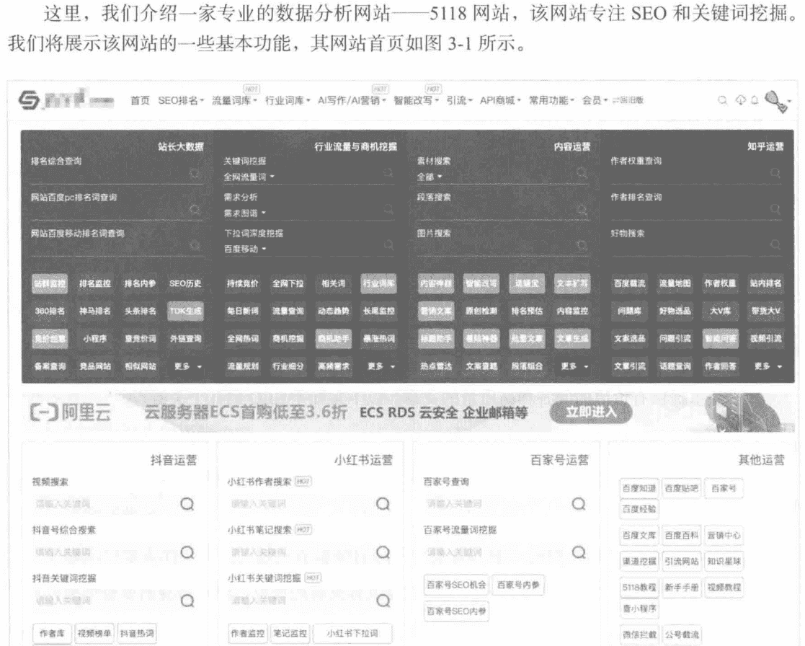

图 3-1

就以近两年火起来的露营为例，演示如何用5118挖掘关键词，再用 ChatGPT 做 SEO。

在5118首页能看到“小红书运营”板块，在“小红书关键词挖掘”框里输入“露营”，点击搜索，如图3-2、图3-3。

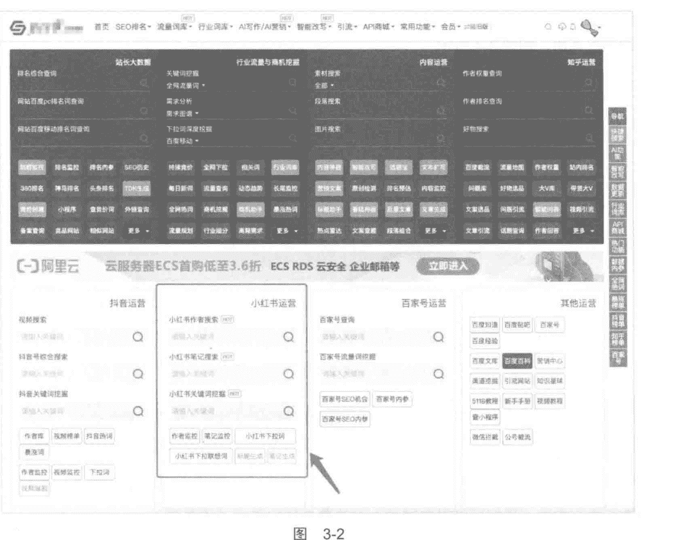

图 3-2

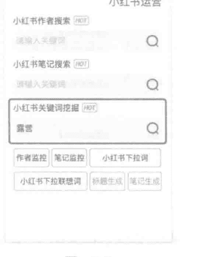

图 3-3

结果页列出了露营相关词及流量，可导出备查，如图3-4。

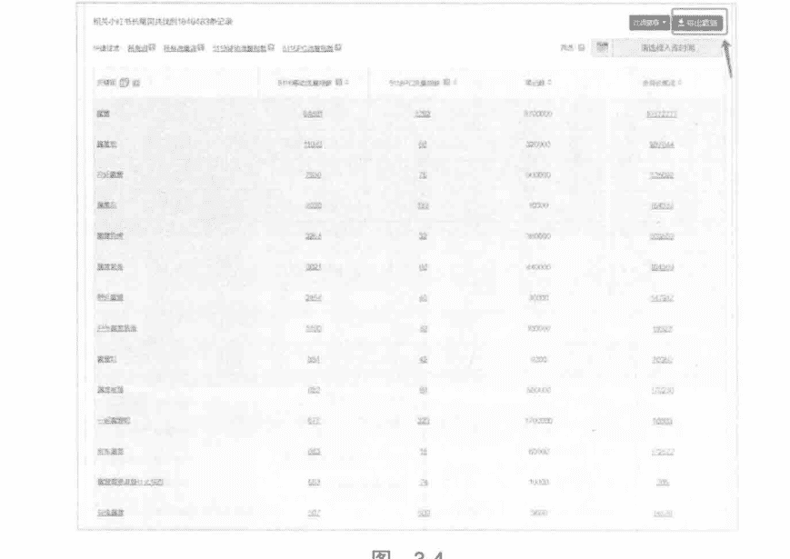

图 3-4

还可以在顶部菜单点“流量词库”，进入“关键词综合查询”，如图3-5。

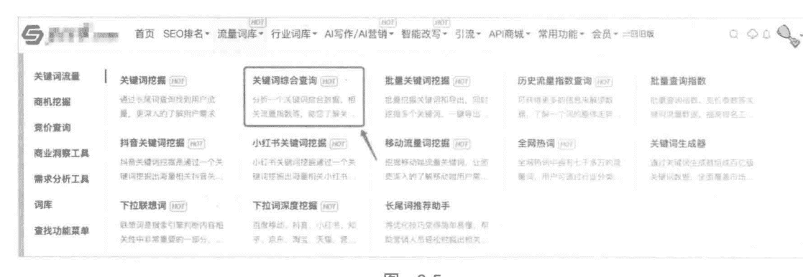

图 3-5

在查询框输入“露营”后，能看到该词的指数，如图3-6。

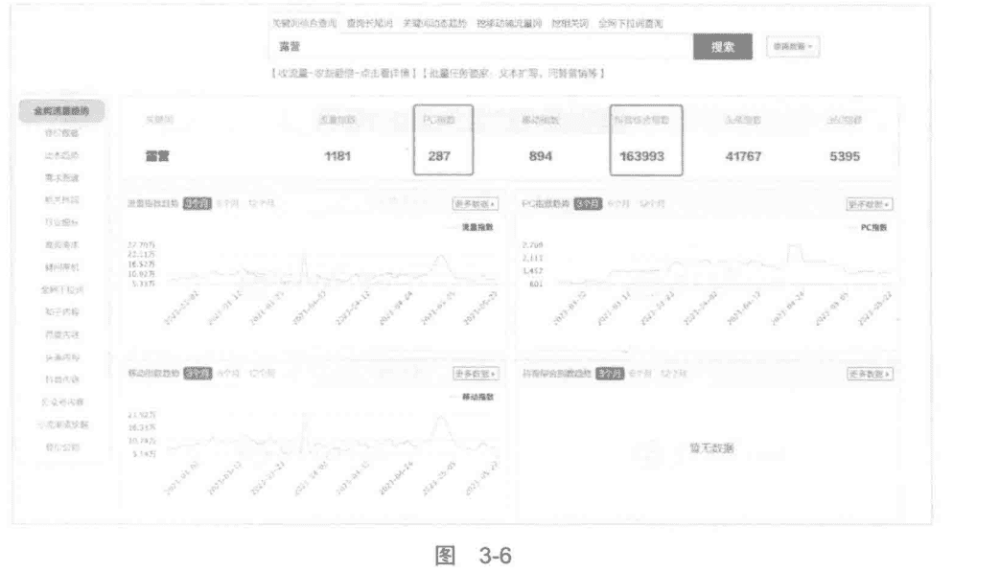

图 3-6

很明显 PC 端搜索量偏低，而抖音端搜索量很大，约是 PC 端的570倍。这也印证了做内容营销时要重视自媒体平台的权重。

再点侧边栏的“全网下拉词”，能看到各平台用户的搜索偏好与热度，如图3-7。

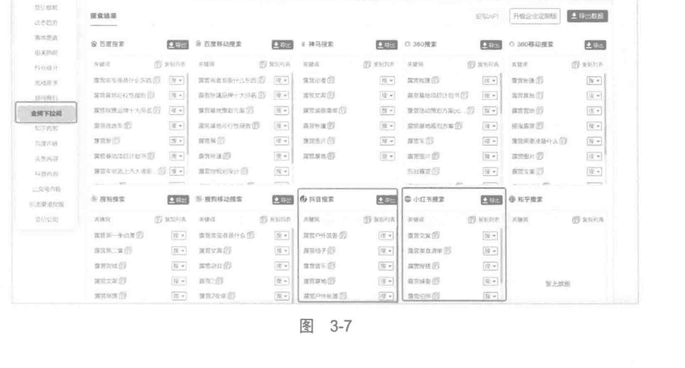

图 3-7

把抖音和小红书的热词复制到表格，就得到露营热搜词表，如图3-8。

| 露营关键词 | |
| :--- | :--- |
| 抖音 | 小红书 |
| 露营户外装备 | 露营文案 |
| 露营椅子 | 露营美食清单 |
| 露营音乐 | 露营穿搭 |
| 露营基地 | 露营装备 |
| 露营户外帐篷 | 露营拍照 |
| 露营北鼻 | 露营车 |
| 露营剑哥 | 露营美食 |
| 露营指南freedom | 露营装备清单 |
| 露营户外基地 | 露营烧烤 |
| | 露营地推荐 |
| | 露营帐篷 |
| | 露营灯 |
| | 露营拍照姿势 |
| | 露营椅 |
| | 露营烤肉 |

图 3-8

接下来让 ChatGPT 进入工作流。

计划做一套露营相关的图文或短视频笔记，投放到小红书或抖音。先让 ChatGPT 做选题和脚本框架。

> 你是一位拥有十年 SEO 实战经验的营销顾问。我想写一个关于露营的笔记并发布在小红书，为我提供 10 个经过 SEO 优化的小红书笔记标题。尽可能包括以下短语：
>
> 露营装备怎么买、露营椅子怎么选、露营地推荐、露营车怎么选、露营美食清单、露营地拍照、露营帐篷怎么选、户外露营、露营烧烤、野外露营、户外露营装备、露营灯、房车露营、露营穿什么衣服、露营装备清单。

可得到的标题示例：

1. 【露营装备指南】10 款必备装备推荐，不要错过！
2. 露营椅子选购攻略：如何选择最适合的露营休闲椅？
3. 探索露营胜地：推荐你必去的露营地点！
4. 露营车选购指南：如何挑选适合你的露营伙伴？
5. 露营美食清单：探索露营中的美食天堂！
6. 露营地摄影技巧分享：如何拍出露营地的绝美瞬间！
7. 露营帐篷购买指南：选择适合你的营地庇护所！
8. 户外露营乐趣无穷：探索大自然中的无尽乐趣！
9. 露营烧烤大全：享受户外烧烤的绝佳时刻！
10. 野外露营探险：与大自然亲密接触的露营体验！
11. 户外露营装备必备清单：准备好挑战自然的装备！
12. 点亮露营夜晚：选择适合的露营灯照亮你的营地！
13. 房车露营指南：探索移动的露营生活！
14. 露营穿搭灵感：如何选择合适的服装享受露营时光！
15. 露营装备清单：不可或缺的露营装备一览！

记住这个提示词框架，之后让 ChatGPT 在选题时带入目标词组。

有了标题后，可让 ChatGPT 据此创作笔记。比如写“户外露营装备必备清单”，就需要进一步挖掘二级词和长尾词。

除了用5118深入挖掘，还可以直接让 ChatGPT 提供。

> 你是一名深耕 SEO 十年的营销专家，为我提供跟露营装备相关的最适合 SEO 的二级关键词。

示例方向：露营帐篷，如超轻露营帐篷、家庭露营帐篷、四季露营帐篷等；露营烹饪设备，如便携式露营炉具、露营烧烤工具、露营水壶等；露营睡袋，如防水露营睡袋、冬季露营睡袋、儿童露营睡袋等；露营背包，如大容量露营背包、多功能露营背包、防水露营背包等；露营家具，如便携式露营椅、露营折叠桌、露营吊床等；露营生存工具，如露营多功能刀、露营急救包、露营指南针等；露营照明，如露营手电筒、露营头灯、露营营地灯等；露营服装，如露营防水外套、露营保暖衣物、露营鞋等。

> 你是一名深耕 SEO 十年的营销专家，为我提供跟露营装备相关的最适合 SEO 的长尾关键词。

示例包括：“便携式超轻露营帐篷推荐”、“最好的家庭露营帐篷品牌”、“如何选择四季露营帐篷”、“购买高质量露营炉具的指南”、“露营烧烤工具评价和比较”、“防水露营睡袋在线购买”、“冬季露营睡袋保暖技巧”、“如何挑选适合孩子的露营睡袋”、“大容量露营背包购物指南”、“露营背包清洗和保养方法”、“便携式露营椅的优缺点”、“选择露营折叠桌的几个要点”、“露营多功能刀的使用技巧”、“如何打包露营急救包”、“露营手电筒与露营头灯的比较”、“露营防水外套的品牌推荐”、“如何选择合适的露营保暖衣物”、“最舒适的露营鞋排行”等。

长尾词更精准、竞争更小，能帮助更准确地触达目标人群，只要与内容高度相关就能提升排名。

拿到足够关键词后，可让 ChatGPT 围绕其撰写小红书笔记。

> 你是一名深耕 SEO 十年的营销专家，帮我写一篇关于“户外露营装备必备清单：准备好挑战自然的装备”的小红书笔记，并进行 SEO 或关键词优化。尽可能包括以下短语：超轻露营帐篷、家庭露营帐篷、四季露营帐篷、便携式露营炉具、露营烧烤工具、露营水壶、防水露营睡袋、冬季露营睡袋、儿童露营睡袋、大容量露营背包、多功能露营背包、防水露营背包、便携式露营椅、露营折叠桌、露营吊床、露营多功能刀、露营急救包、露营指南针、露营手电筒、露营头灯、露营营地灯等。

# 户外露营装备必备清单：准备好挑战自然的装备

露营是重返自然、感受大自然魅力的方式之一。为了让户外之旅顺利进行，需要一份完整的装备清单来确保准备充分。下面提供一份涵盖超轻露营帐篷到露营急救包的清单。

首先是住宿。超轻露营帐篷适合徒步，重量轻便于携带；家庭出游则更适合家庭露营帐篷，空间更宽敞；面对多变天气，四季露营帐篷能提供更稳固的庇护。

其次是烹饪。一个便携式露营炉具、一套露营烧烤工具，再加一个结实耐用的露营水壶，就能在野外做饭。

夜间睡眠也很重要。防水露营睡袋可在潮湿环境保持干爽，冬季露营睡袋提供充足保暖，带孩子则要准备儿童露营睡袋。

携带装备需要大容量露营背包，考虑到变数，多功能露营背包和防水露营背包是不错的选择。

休息娱乐方面，便携式露营椅、露营折叠桌、露营吊床都能提升舒适度。

应急准备不可少。露营多功能刀、露营急救包、露营指南针可在维修设备或处理突发状况时发挥作用。

最后是照明，露营手电筒、露营头灯、露营营地灯是夜晚必备。

以上就是户外露营装备清单，希望帮助你更好迎接自然。最重要的是享受户外带来的乐趣！

除了基础词如“露营帐篷”“露营椅子”，还可以尝试加入品牌词。因为用户在找具体装备时常会直接输入品牌，笔记里包含品牌词更易出现在相关搜索结果中。

SEO高手可以将深厚的关键词策略与领域专业知识输入 ChatGPT，生成高度优化的高质量内容。SEO新手也可以按上述步骤操作，通过实践逐步熟悉 SEO 并提升能力。

按照这个思路，能批量产出选题，并快速用 ChatGPT 生成内容，为账号带来更多流量。

### 3.4 用 ChatGPT 做闲鱼副业赚钱

近几年闲鱼已成为很多人做副业的渠道，因为它能把闲置物品便捷地变成收入。

但要在众多卖家中脱颖而出并非易事。ChatGPT 可以帮助生成流畅且有针对性的文案，对闲鱼销售很实用，一个吸引人的商品描述和及时回复能大幅提升成交效率。

具体如何用 ChatGPT 优化闲鱼副业？可以让它生成吸睛的商品描述。好的描述既要详细说明功能与成色，也要加入吸引买家的要素。把商品信息输入 ChatGPT，就能得到一份有卖点的文案。

#### 3.4.1 如何利用闲鱼做副业赚钱

如果你对闲鱼副业不熟悉，可以直接问 ChatGPT。

> 如何在闲鱼上做副业赚钱？
>
> 在闲鱼上做副业是可行的选择。常见方法有：
> 1. 出售闲置物品：如衣物、鞋子、家电、数码等，配清晰照片和详细描述。
> 2. 手工艺品和自制产品：开店售卖手工饰品、皮具、手绘等作品。
> 3. 代购和转售：利用价格差进行代购转卖，需研究市场行情。
> 4. 提供技能或服务：摄影、写作、设计、编程等定制服务。
> 5. 开设二手手机店：售卖二手手机及配件，可修复后加价。
> 6. 参与拍卖：寻找有价值物品低价拍入高价售出。
>
> 不管选哪种方式，都需要时间积累信誉和口碑，提供优质产品与服务，保持良好沟通，并遵守平台规则与法律法规。

了解方法后，还可以进一步问闲鱼电商的优势。

闲鱼隶属阿里巴巴。相比淘宝这种大品牌、大厂家的战场，个人做闲鱼电商有哪些优势？可以让 ChatGPT 分析。

> 对于个人用户，相比做淘宝电商，做闲鱼电商有哪些优势？
>
> 做闲鱼电商相比于淘宝电商，有以下几个优势。

闲鱼起步为什么更轻松

和重资产开店的玩法相比，闲鱼的门槛几乎可以忽略，投入也小很多。没有保证金也没有月租费，拿手机就能发布，私聊就能谈下来，省掉了搭建独立店铺、做装修、配客服的繁琐流程。

平台的生态是二手闲置，人群基数大且活跃。手上只要有囤积的物件，就能很快对接到有需求的人，清货的速度往往比卖全新货更快。

在闲鱼，品牌带来的溢价很有限。买家更在意成色好不好、配件齐不齐、实拍是否真实，把精力放在细节说明、实物图和清单上收益更高。个人身份交易更亲近，信任感更容易建立起来。

沟通与成交几乎是同步的。问题能第一时间回复，可以补多角度照片，提供个性化说明，关系建立快推进也快。

发货方式也很灵活。看双方距离可以同城自取，也可以走快递，不强制做仓储和统一发货，成本和复杂度都更低。

当然也有边界。用户偏年轻，消费集中在二手和性价比，对全新高客单的货并不友好。多数交易是个人对个人，风控意识和信任经营需要长期维护。

#### 3.4.2 货源从哪里来
做个人账号如果没有现货，可以试试近两年比较火的闲鱼无货源模式。可以先问问 ChatGPT 如何玩转闲鱼无货源。

> 如何做闲鱼无货源电商？
> 为闲鱼电商找到优质货源供应商可以通过以下途径。

1. 线下批发商圈：传统却有效。可到本地服装、数码、家居等集散地实地走访，跟档口聊款式、拿价目表，必要时要样品或目录来判断质量。

2. 供货类网站：阿里巴巴、京东商家版、拼多多等聚集大量供货方。注册后按类目筛选、询价、对比合作条件，找到契合副业定位的来源。

3. 网络进货渠道：1688、淘宝批发等提供现货与一件代发资源，通过关键词筛选和销量排序，能迅速锁定相关品类的稳定来源。

4. 线下博览会：相关展会是面对面建立供应链的好机会。现场看样、谈价、感受服务水平，有助于筛出靠谱对象。

5. 社群网络：加入从业者微信群、QQ群、社群等，里面常有人分享可靠供应商信息。需甄别，多方求证后再合作。

无论用哪种方式，都要做尽职调查，核查供方的信誉、品控能力、发货时效与售后政策。建议同时对接多家，形成比价与备选。

明确无货源思路后，下一步就是定位与选品，从淘宝、1688 等渠道挑有利润空间的品类，再在闲鱼完成上架与销售。

#### 3.4.3 如何在闲鱼上进行搜索优化
货源确定只是第一步，后续要做搜索优化来获取曝光。可以让 ChatGPT 辅助完成。

> 如何做闲鱼 SEO？
> 要做好闲鱼的搜索优化，可以遵循以下几个步骤。

1. 热词挖掘：先判断用户用什么词找目标商品。可借助 5118、百度指数、谷歌关键词规划师等工具收集热词与长尾词。

2. 标题精修：标题是搜索权重最高的字段，要简洁清晰，核心词前置，避免堆砌符号或夸张形容。

3. 文案与素材：说明要通俗易懂，适度植入热词，配合多角度实拍图和短视频，提升点击与停留。

4. 定价与运费：参考同类成交价区间合理定价，设置包邮或运费优惠，能提升排序与转化。

5. 账号权重提升：成交速度、好评率、纠纷率都会影响权重。保持快速发货、积极沟通、优质售后，能逐步提升自然排名。

从过往经验看，ChatGPT 对平台规则的理解比较到位，它给出的热词研究、标题优化、文案撰写等建议都很实用。

选品方面，除了个人兴趣与专业熟悉度，还可到闲鱼搜索框输入词根，看热度与竞争情况。是否有人持续关注、是否在自己认知范围内，是判断是否值得做的两个关键点。

选品思路大致有二：一是结合自身兴趣与专长；二是借平台搜索验证需求。热度高且自己懂行，成功率会更高。

需要说明的是，AI 无法替代人的市场判断与战略规划，它更适合批量处理重复性工作，比如一次性生成十条商品标题、批量填充文案热词等。把这类重复劳动交给 AI，能大幅提升上架效率。

#### 3.4.4 如何撰写高转化率的产品描述
下面以机轴键盘为例演示如何借助 ChatGPT 生成标题和说明。

打开闲鱼首页，在搜索框输入“机械键盘”。下拉会展示大量高频搜索词，可直接作为 SEO 词库。

进入搜索结果页后，挑两个排名靠前的商品做对比。

排名靠前的商品浏览量约 450，收藏心愿约 43。说明里有详细的参数介绍，植入了 61 键、机械键盘、红轴、青轴、茶轴等长尾词，结构清晰，还包含发货地、发货时效等信任信息。

另一个商品浏览量仅 39，心愿 3，说明随意，关键词稀少，排版混乱。

如果要自己上架，可以先让 AI 按搜索词生成标题。

现在，你是一名闲鱼 SEO 专家，帮我根据以下关键词撰写 5 个机械键盘的标题：
61 键、有线、无线、蓝牙、白黑双拼、机械键盘、红轴、青轴、茶轴。

> 作为闲鱼 SEO 专家，针对你提供的关键词，我为你撰写了 5 个机械键盘的标题。
1. 【全新】61 键有线机械键盘，红轴，适合办公和游戏
2. 【折扣特价】无线蓝牙机械键盘，白黑双拼，便携轻巧，办公必备
3. 【限量发售】青轴机械键盘，快速响应，打字愉悦，专为程序员设计
4. 【独特设计】茶轴有线机械键盘，静音无干扰，适合办公和写作
5. 【游戏玩家首选】61 键蓝牙机械键盘，红轴，RGB 背光，灵活可调

标题兼顾了关键词覆盖与卖点突出，简洁有指向性。接下来让它写说明。

现在，你是一名闲鱼 SEO 专家，帮我根据以下关键词撰写一篇机械键盘的产品描述：
61 键、有线、无线、蓝牙、白黑双拼、机械键盘、红轴、青轴、茶轴。

> 全新 61 键机械键盘，提供有线和无线两种连接方式，可通过蓝牙进行无线连接。键盘采用白黑双拼设计，外观时尚简约，适合办公和游戏使用。键盘配备红轴、青轴和茶轴三种机械轴，满足不同用户对按键触感和声音的偏好。
> 产品详细参数
> 键盘布局：61 键
> 连接方式：有线、蓝牙无线
> 轴体类型：红轴、青轴、茶轴
> 外观设计：白黑双拼
> 适用场景：办公、游戏
> 这款机械键盘采用先进的键盘技术，确保高灵敏度和稳定性，每个按键都具有精确触发点，可实现快速的输入响应。不论是办公还是游戏竞技，都能提供出色的打字体验和操作反馈。
> 物流发货方面，我们承诺及时处理订单并尽快发货。产品将经过严格包装，确保安全运输，避免损坏。我们与可靠的物流合作伙伴合作，以便你能够尽快收到键盘。
> 请注意，在使用键盘时，建议避免水和其他液体进入键盘内部，以免损坏产品。此外，请按照产品说明书中的操作指南正确使用和保养键盘，以延长其使用寿命。
> 我们致力于为你提供高品质的机械键盘，为你的工作和娱乐带来更好的体验。如果对该产品有任何疑问或需要更多信息，请随时与我们联系。感谢你的关注和支持！

若觉得不够具体，可再让 AI 补充参数说明。

> 介绍一下 61 键机械键盘的详细产品参数。

当涉及 61 键的机械键盘时，以下是一些常见的详细产品参数，供你参考。
- 1. 键盘布局：61 键布局，紧凑设计，适合小型工作区或需要移动性的场景。
- 2. 连接方式
  - 有线连接：通过 USB 接口连接计算机或其他设备，提供稳定的信号传输和快速响应。
  - 无线连接：通过蓝牙技术进行无线连接，提供更大的灵活性和便携性。
- 3. 轴体类型
  - 红轴：线性轴，无明显的点击声音，适合需要快速触发和平滑操作的场景。
  - 青轴：轻质点击轴，具有明显的触发点和点击声音，适合喜欢有触感的用户或需要输入反馈的场景。
  - 茶轴：静音轴，提供柔和的按键触感和静音操作，适合在需要安静环境下工作或打字的场景。
- 4. 外观设计
  - 紧凑设计：61 键布局，减少键盘占用空间，方便携带和使用。
  - 白黑双拼：采用黑色和白色键帽组合的设计，时尚简约。
- 5. 背光功能
  - 可选背光：一些 61 键机械键盘配备了背光功能，可自定义背光颜色和亮度，提供个性化的视觉效果。
- 6. 材质和质量
  - 键帽材质：常见的键帽材质包括 ABS 塑料、PBT 塑料等，具有耐用性和不易磨损的特点。
  - 键盘底壳材质：一般采用金属或塑料材质，提供稳定的结构和坚固的支撑。

以上参数仅供参考，具体的产品参数可能因品牌、型号和供应商而有所不同。在购买机械键盘之前，建议你仔细阅读产品说明书或与卖家进行进一步沟通，以确保获取准确的产品参数信息。

若加入品牌名称作为关键词，提示会更精准。

也可以对说明格式做美化，例如在每段前加 💡。

> 介绍一下 61 键机械键盘的详细产品参数，并在每段前加上💡。
- 💡 键盘布局：61 键布局，紧凑设计，适合小型工作区或需要移动性的场景。
- 💡 连接方式
  - 有线连接：通过 USB 接口连接计算机或其他设备，提供稳定的信号传输和快速响应。
  - 无线连接：通过蓝牙技术进行无线连接，提供更大的灵活性和便携性。
- 💡 轴体类型
  - 红轴：线性轴，无明显的点击声音，适合需要快速触发和平滑操作的场景。
  - 青轴：轻质点击轴，具有明显的触发点和点击声音，适合喜欢有触感的用户或需要输入反馈的场景。
  - 茶轴：静音轴，提供柔和的按键触感和静音操作，适合在需要安静环境下工作或打字的场景。
- 💡 外观设计
  - 紧凑设计：61 键布局，减少键盘占用空间，方便携带和使用。
  - 白黑双拼：采用黑色和白色键帽组合的设计，时尚简约。
- 💡 背光功能
  - 可选背光：一些 61 键机械键盘配备了背光功能，可自定义背光颜色和亮度，提供个性化的视觉效果。
- 💡 材质和质量
  - 键帽材质：常见的键帽材质包括 ABS 塑料、PBT 塑料等，具有耐用性和不易磨损的特点。
  - 键盘底壳材质：一般采用金属或塑料材质，提供稳定的结构和坚固的支撑。

至此说明已具备可读性与结构感。

最后可用 FAB 模型整合提示词，提升说服力。FAB 即特征、优势、好处，通过三层递进激发购买兴趣。

现在，你是一名闲鱼 SEO 专家，帮我根据以下关键词，采用 FAB 模型，撰写一段机械键盘的产品描述：
61 键、有线、无线、蓝牙、白黑双拼、机械键盘、红轴、青轴、茶轴。
要求：
1. 需要包含商品的细节描述、详细参数、物流发货等注意事项；
2. 介绍一下 61 键机械键盘的详细产品参数，并在每段前加上💡。
不用解释，直接开始。

💡 61 键机械键盘：无线蓝牙连接、红轴、青轴、茶轴，白黑双拼设计！
💡 产品特征
这款 61 键机械键盘融合了创新技术和出色设计，提供了多种连接方式和轴体选择，满足不同用户的需求。无论是办公工作还是游戏娱乐，它都能为你带来卓越的打字体验和高效操作。
💡 详细产品参数
键盘布局：61 键
连接方式：有线、无线蓝牙
轴体类型：红轴、青轴、茶轴
外观设计：白黑双拼
适用场景：办公、游戏
💡 产品优势
◆无线蓝牙连接：通过蓝牙技术，实现无线连接，让你摆脱烦琐的线缆束缚，自由移动并在任何地方工作。
◆多种轴体选择：红轴、青轴、茶轴三种机械轴体可供选择，满足不同用户对触感和声音的偏好，提供个性化的打字体验。
◆白黑双拼设计：独特的白黑双拼外观设计，时尚简约，凸显你的个性与品味。
💡 产品好处
提高效率：61 键紧凑布局，节省桌面空间，使你更集中地操作，提高打字和操作效率。
便携性强：无线蓝牙连接，轻松携带，方便在不同场合使用，满足办公、旅行或者娱乐等不同场景的需求。
个性化选择：多种轴体选择，让你根据个人偏好和需求，定制适合自己的打字体验。
时尚与实用兼具：白黑双拼设计，让你的键盘与众不同，既时尚又实用。
物流发货
我们将及时处理你的订单，并通过严格包装保证产品在运输过程中的安全。我们与可靠的物流合作伙伴合作，以便你尽快收到心仪的键盘。
请注意，为了保持键盘的良好状态，请避免液体进入键盘内部。在使用过程中，请按照产品说明书中的操作指南正确使用和保养键盘，以延长其使用寿命。

按此流程打磨提示词后，AI 能在短时间内批量产出上架文案。上午产出十条文案不再困难。对电商从业者或想做闲鱼副业的人来说，掌握这种内容生产方法能显著提升效率与机会。

## 第 4 章

## 用 ChatGPT 打造 IP 和提升自我

### 4.1 用 ChatGPT 写朋友圈文案
如果你做自媒体或需要通过微信做私域成交，朋友圈就是核心阵地。朋友圈的质感直接决定你在用户心中的专业形象和信任度，进而影响成交。

朋友圈是连接朋友、家人、同事和潜在客户的社交场，也是展示自我与传递价值的窗口。要做出让人信赖且有吸引力的朋友圈，需要在几个细节上下功夫。

首先是个人定位。明确自己的身份、擅长领域或兴趣标签，并贯穿在内容中。通过持续输出对某一领域的思考与见解，吸引同频用户，形成共鸣与亲近感。

其次是视觉与文案的形象感。文字要精炼有质感，配图要美观统一。整体调性要与目标受众的审美一致，让人一眼记住你的风格与价值观。

再者是朋友圈的“装修”。善用背景音乐、动态封面、个性化表情等功能，营造温暖、有趣、独一无二的氛围，提升停留与关注意愿。

除了外在，还有内容体系的建设。保持主题一致、风格连贯，形成可识别的输出节奏。围绕核心议题展开深度讨论，定期更新并保持互动，是维持活跃的关键。

文案底层逻辑也很重要。用简短、易懂、有趣的语言抓住注意力，在几句话内传递核心价值。避免过度专业术语，确保普通用户也能轻松理解并产生共鸣。

私域聊天则是成交的放大器。一对一沟通能精准识别用户痛点，提供定制化方案。注重个性化回应、及时跟进问题，能有效提升信任与转化。

总的来说，朋友圈在自媒体与私域销售中作用关键。通过清晰定位、形象设计、氛围营造、稳定输出、好文案与有效私聊，可以打造出高信任、高吸引力、可成交的朋友圈。这需要持续学习与优化，结合自身特质与用户需求，建立真实、有温度、有影响力的个人品牌。

那么如何借助 ChatGPT 快速写朋友圈文案呢？

朋友圈可以从 5 个维度进行规划，分别是：
- 生活类朋友圈——传递温度；

朋友圈内容怎么发才有效，四种核心打法

- 以工作向动态为主，重点是放大口碑效应；
- 以产品向动态为主，核心是强势种草；
- 以干货向动态为主，用来建立专业形象；
- 以价值观向动态为主，帮助沉淀同频人群。

下面就以实操派自媒体人芷蓝老师的真实案例为例，聚焦两类代表性玩法做拆解。

1. 产品类朋友圈：强势种草

芷蓝老师发布过一条关于小红书封面模板的动态，见图4-1。
芷蓝老师还发布过关于 ChatGPT 大师课的动态，见图4-2。


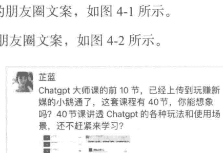

### 2. 价值观类朋友圈：制造共鸣

芷蓝老师此前发过一条关于社群运营的思考动态，见图4-3。

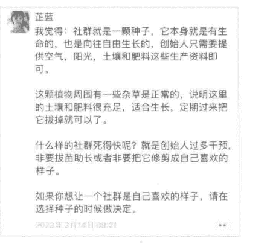

文笔吃力的朋友，学会这些样例后就能借助模型提升效率。我们可以把素材分批输入模型，让它先学习语感再按此语感代写朋友圈。按下面四步操作，产出会明显提升。

#### 第一步：先让AI分段接收素材

> 忽略以上提示词，让我们重新开始一轮问答。我接下来要在多个对话中，提供给你用“@”编号的文章内容，请先记住，但不要摘要，可以吗？

> 当你提供编号的文章内容时，我会尽力记住这些内容，但请注意，我的记忆是有限的，可能会随着对话的进行而逐渐消失。因此，如果有需要，请尽快提供相关内容，以确保我能够准确地回答你的问题。如果内容过多或时间较长，建议将重要的信息以较短的方式呈现，这样我更容易记住和回顾。现在，你可以开始提供编号的文章内容了。

#### 第二步：开始“投喂”文案

> @1 小红书封面做好了，基本上这个帖子就 50% 已经爆了，来参加我的合伙人 @小沫 的小红书封面拆解教学社群啊！教你怎么做封面，给你爆款封面模板，100 个啊，挑着用，随便用！

> 谢谢你提供的信息！我已经记住了编号为 @1 的文章内容。接下来，请提供下一个编号为 @2 的文章内容。

> @2 ChatGPT 大师课的前 10 节，已经上传到玩赚新媒的小鹅通了，这套课程有 40 节，你能想象吗？ 40 节课讲透 ChatGPT 的各种玩法和使用场景，还不赶紧来学习？

> 非常感谢你提供的信息！我已经记住了编号为 @2 的文章内容。接下来，请提供下一个编号为 @3 的文章内容。

> @3 我觉得：社群就是一颗种子，它本身就是有生命的，也是向往自由生长的，创始人只需要提供空气、阳光、土壤和肥料这些生产资料即可。这颗植物周围有一些杂草是正常的，说明这里的土壤和肥料很充足，适合生长，定期过来把它们拔掉就可以了。什么样的社群死得快呢？就是创始人过多干预，非要拔苗助长或者非要把它修剪成自己喜欢的样子。如果你想让一个社群是自己喜欢的样子，请在选择种子的时候做决定。

> 非常感谢你提供的信息！我已经记住了编号为 @3 的文章内容。接下来，请提供下一个编号为 @4 的文章内容。

篇幅所限，这里只演示了3条。若想学习得更准，可以持续投喂，样本越多风格越稳。

#### 第三步：让模型基于“投喂”内容提炼风格

> 结合前面“@1”~“@3”的内容，分析这些内容的写作风格和写作技巧。

> 结合编号为 @1、@2 和 @3 的内容，我们可以分析出一些写作风格和写作技巧。

@1 的片段呈现促销引导的特征。文中高频使用“爆款封面模板”“随便用”等强调词，制造吸睛点并推动用户加入封面拆解社群。同时用“参加我的合伙人 @小沫”这类口语化称呼，提升亲近感与信任感。

@2 的片段偏向描述推荐。借助“上传”“讲透”等动词，以及“玩法”“使用场景”等名词，突出大师课的价值与覆盖面，并以反问句点燃好奇心，促使用户尽快报名学习。

@3 的片段采用比喻加观点阐述。把社群比作一颗有生命的种子，用“提供空气、阳光、土壤和肥料”“修剪”等意象，把社群成长与植物生长对照，让管理逻辑更形象。文中还点明创始人角色，强调少干预、多在选种时把关。

总体来看，整体语气活泼直接，善于用比喻和情绪化表达提升吸引力。作者多用第一人称与直接对话，增强参与感，并灵活使用问句与感叹句激发思考和行动欲。风格与技巧相互配合，目标是抓住注意力、点燃兴趣并促成转化。

#### 第四步：让模型参照学习到的风格进行创作

> 根据你刚刚学到的技巧，写一个关于个人成长的朋友圈文案。

@4 每一次蜕变都是一次成长的机会。人生就像一本书，每一页都写满了我们的经历和故事。有时，我们需要放下过去的章节，勇敢地翻开新的一页。这是我们成长的时刻。

成长不仅是身体的增长，更是心灵的升华。在面对挑战和困难时，我们能够不断超越自己，学会坚持和承受。每一次克服困难，我们都在迈向更好的自己。在追逐梦想的道路上，我们积累着勇气和智慧，成长为更强大的个体。

成长是一场内心的旅程。通过不断学习和反思，我们拓展了自己的思维边界，拥抱新的知识和观点。我们从经历中汲取智慧，从错误中获得教训，以更明智的眼光看待世界。在这个过程中，我们不断调整自己的态度和行为，变得更加成熟和自信。

成长是与他人的连接。我们在人际关系中学会了理解和包容，从互动中获得启示和共鸣。与亲人、朋友和同事的相处，让我们感受到爱和支持的力量。他们在我们成长的路上陪伴着我们，给予鼓励和指引，让我们更加坚定地追求自己的梦想。

让我们在成长的旅途中保持谦卑，保持对未知的好奇心。每一天都是我们前进的机会，每一次经历都是我们成长的阶梯。让我们相信自己的潜力，勇敢地去追求，不断挑战自我，成就更好的自己。

# 成长 # 奋斗 # 梦想 # 坚持 # 自信

除了让模型参考模板改写，还可以直接给出主题与要求让它直接生成。

> 忽略前面所有的提示词。你现在是一名文案写作大师，帮我写一篇朋友圈文案。

主题：周末陪娃去采茶，丢掉书本，不上补习班，缓解育儿焦虑，学习是孩子自己的事情，我们只需要给他足够的爱，让他爱这个世界，对世界充满好奇，让他自己去探索就够了。

周末陪娃去采茶，放下繁重的书本，告别补习班的焦虑，让他们自由地成长。

学习应该是孩子自己的旅程，我们只需要给予足够的爱，让他们热爱这个世界，充满好奇心，去探索未知的奇迹。让孩子拥有快乐的童年，让他们的心灵自由地绽放！

# 陪伴成长 # 自由探索 # 快乐童年

不要把我的原话抄下来，要进行改写。

周末与孩子一起走进茶园，摆脱沉重的教科书，告别补习班的焦虑。

我们相信，学习是孩子自己的旅程，而我们的角色是给予无限的爱，让他们热爱这个世界，充满好奇心，勇敢探索未知的奇迹！让我们一起陪伴他们享受快乐的童年，让他们的心灵自由绽放！

# 陪伴成长 # 自由探索 # 快乐童年

可以增加一些细节吗？

周末我们一同踏入翠绿的茶园，享受大自然的呼吸，摆脱繁重的教科书和补习班的压力。这是一次与孩子一起亲近大自然的机会，让他们感受茶叶的芬芳气息，学习茶文化的同时滋生内心的平静与感悟。

我们坚信，学习不仅仅是课本知识，更是探索和发现的旅程。我们希望给予孩子足够的爱，勇敢地踏上自己的探索之路，让他们自由地爱上这个多彩的世界，对未知充满好奇心。他们可以通过亲身体验茶叶采摘的乐趣，感受到自然的奇妙，培养独立思考和创造的能力。

在这个快节奏的社会中，我们希望孩子能够享受快乐的童年，让他们的心灵自由地绽放。因为只有在自由的环境中，他们才能发现自己的潜力，培养独特的兴趣爱好，成为真正独立思考和积极探索的个体。

让我们一起陪伴孩子，让他们在茶园中感受自然的奇迹，培养对生活的热爱和好奇心。让他们的童年充满自由、快乐和美好的回忆！

# 陪伴成长 # 自由探索 # 快乐童年

最终输出读起来比较顺眼。

即便笔力一般，只要热爱生活、保持积极心态，善于观察并对人和世界有自己的见解，就能借助模型创作出有生命力的朋友圈。

可把模型视作顶级厨师，你负责提供新鲜原料。原料有趣，成品才好吃，也能体现你的经历与个性，让朋友圈更有烟火气。

观察力与个人见解是训练模型的关键。要捕捉生活里的细微瞬间，那些触动或启发你的片段，比如一朵花、街头演奏、一杯咖啡。它们会成为素材，帮助模型加工组织，让内容更生动。

同时记得让模型了解你的情绪与性格特质。分享经历、喜好与思考时，把语言习惯和情感表达说明白，让人格魅力融入文字，每条动态都独一无二。要学会与模型配合，产出更具吸引力的内容。

### 4.2 用 ChatGPT 写小红书笔记

#### 4.2.1 小红书简介

小红书是一款以社区驱动的电商应用。最初以分享购物经验和种草产品为主，用户可以在平台发布和浏览各类产品的图文测评。早期内容集中在美妆、穿搭、家居等方向，其调性吸引了大量年轻用户，尤其是女性。小红书为用户提供发现新品、获取选购建议、分享消费体验的空间。

#### 4.2.2 普通人借助小红书打造个人 IP

近年小红书快速崛起，成为最受欢迎的自媒体阵地，被广泛用于个人品牌的塑造和推广。这得益于平台特性与用户属性，让它在众多社交产品中脱颖而出。

小红书用户活跃度高，且构成多元。大家在此分享生活经验和消费心得，形成了独特的社区氛围。这种开放交流的氛围吸引了大量创作者和粉丝入驻。

在平台上，每个人都能成为内容生产者，分享生活方式、种草喜好、表达观点。这种从普通用户出发的内容生产模式，推动了内容数量和多样性的增长，让每个人都有机会在小红书打造个人 IP。

小红书的社交电商属性把传统购物场景改造成了社交场景。用户不仅在买东西，更是通过分享和交流获得信息和灵感。这种所见即所得的购物体验大幅丰富了购物感受，也让购物更有趣、更具个性。

小红书的内容呈现方式也带来全新体验。每个创作者都可以用图文、视频等多种形式展示内容，让用户在获取信息的同时感受到创作者的生活态度和品味，从而产生好感和认同。

小红书还提供丰富的营销工具和推广手段，如标签、话题、活动等，这些工具既能帮助创作者更好地推广内容，也能让粉丝更方便地找到感兴趣的内容，进一步促进创作者与粉丝的互动。

总体来看，小红书是一个充满机会和挑战的平台，凭借独特的平台特性和用户群体，成功成为普通人打造个人 IP 的自媒体阵地。无论是创作者还是粉丝，都能在平台上找到属于自己的空间。虽然过程不易，但只要有热情、创造力和坚持，就有可能让小红书成为实现梦想的舞台。

#### 4.2.3 如何写出小红书爆款笔记

想在小红书上有所斩获，关键是学会讲好故事、分享独特经验和观点，成为有影响力的创作者，而当下首要任务是学会写出让人喜欢的爆款笔记。

写出爆款笔记，需要把握以下几个关键点。

- 1. 了解你的受众

搞清楚目标读者是谁，他们偏爱什么内容，有什么需求。这样才能写出更贴合他们兴趣和喜好的内容，从而抓住注意力。

- 2. 选择热门话题

挑选正在流行或备受关注的话题来写。这样笔记更容易被搜索到，从而获得更多阅读量。

- 3. 提供有价值的信息

笔记要给读者带来价值。可以是实用建议、有趣知识点或独到观点，让读者读完有所收获，从而更愿意分享。

- 4. 使用吸引人的标题和图片

吸睛的标题和配图能大幅提升点击率。标题要简洁明了、富有吸引力，图片要高质量且相关。

- 5. 注重笔记的可读性

笔记要易读、结构清晰、语言简洁。可以用排版工具调整标题、子标题、列表、段落等，提升可读性。

- 6. 参与互动

要积极在评论区与读者互动，及时回复问题、感谢评论，甚至引导深入讨论。这样能增强读者的参与感，提升忠诚度。

写出爆款笔记并获得认可，需要做到以上几点，也需要足够耐心和毅力，因为成功往往是持续积累的结果。

#### 4.2.4 用 ChatGPT 打造小红书爆款笔记的 4 个步骤

ChatGPT 是一个强大的语言模型，能在撰写爆款笔记时提供有力支持。它的帮助主要体现在以下几个方面。

- 1. 内容创意

ChatGPT 可以帮助构思创意。你可以向它提问关于想写主题的问题，它会给出多种答案和想法。

- 2. 语言表达

表达某个观点或描述事物时遇到困难，ChatGPT 可以帮你找到更好的说法。你告诉它大致意思，它会提供更精准恰当的表达。

- 3. 文本编辑

笔记写好后觉得需要改进，可以复制粘贴给 ChatGPT，它会帮助修改和优化。

- 4. 标题创作

一个抓人眼球的标题对吸引读者至关重要。ChatGPT 可以帮你生成标题建议，只需告知笔记主题即可。

- 5. 回应读者

笔记收到评论或提问时，ChatGPT 也能协助回复。你把评论或问题给它，它会给出合适的回应。

基于以上 5 个功能，可以梳理出通过 ChatGPT 打造小红书爆款笔记的 4 个步骤。

- 第 1 步：根据账号定位和目标受众确定内容创意。

- 第 2 步：找准热门话题，建立爆款选题库。

- 第 3 步：撰写有趣的笔记正文、视频脚本、笔记标题。

- 第 4 步：与用户进行友好互动，回应读者评论。

#### 4.2.5 根据目标受众确定内容创意、建立爆款选题库

首先要明确自己的定位，确定目标受众。不同定位对应不同人群。你可能是母婴领域、美妆领域，或户外露营、穿搭领域的达人。基于定位和受众，就能找到对应的热门话题来创作爆款笔记。

举例来说，如果你想做亲子遛娃博主，就先让 ChatGPT 帮你确认目标受众。

> 忽略以上提示词。你现在是一个自媒体营销专家，我想打造一个小红书账号，我的定位是亲子遛娃，请告诉我，对于这样一个定位，我的目标受众是哪些人。

> 对于以“亲子遛娃”为定位的小红书账号，你的目标受众可能主要是以下这些人群。

1. 年轻的父母：这是你的主要受众群体，他们有着较高的需求去了解如何与孩子共享高质量的休闲时间。他们可能正在寻找新的和有趣的活动，帮助他们的孩子在玩乐中学习和成长。

2. 准父母和准母亲：他们可能正在寻找未来如何与孩子互动的灵感和建议，或者在准备当父母阶段就开始了解亲子活动的相关信息。

3. 教育工作者和儿童发展专家：这个群体可能会关注你的内容，以获取新的亲子活动想法，或者他们可能在寻找合作机会，或者想提供专业的建议和意见。

4. 祖父母或者其他亲属：他们可能会关注你的账号以寻找与孩子共度时光的活动建议。

5. 儿童相关产品和服务的品牌：这些品牌可能会关注你的内容，寻求合作推广的机会。

为了吸引和保持这些目标受众的注意力，你创建的内容应该是关于如何规划和进行各种亲子活动的，如户外探险、教育游戏、家庭旅行等。你也可以分享你自己的经验和故事，提供实用的建议，以及介绍对孩子有益的产品或服务。

然后，可以让 ChatGPT 帮你策划 20 个选题。

> 根据以上定位和目标受众，帮我策划 20 个爆款选题。

当然，根据你的“亲子遛娃”的主题，以下是一些可能的爆款选题。

1. “带孩子去野餐的 10 个创新想法”

2. “户外探险：如何安全又有趣地带孩子出游”

3. “亲子烹饪：让孩子参与的 5 个简单食谱”

4. “教育游戏：室内活动中的学习与娱乐”

5. “5 个让孩子热爱阅读的绘本推荐”

6. “10 个孩子喜欢的健康零食”

7. “亲子瑜伽：如何让孩子爱上运动”

8. “亲子艺术项目：创新和创作的乐趣”

9. “孩子的第一次露营：必备清单和活动建议”

10. “3 个让孩子热爱自然的户外活动”

11. “如何规划一个孩子会喜欢的生日派对”

12. “雨天宅家：5 个孩子会喜欢的室内游戏”

13. “环保亲子：教孩子如何热爱和保护地球”

14. “孩子的情绪管理：如何引导孩子正确表达情绪”

15. “亲子旅行：如何规划一次无压力的家庭旅行”

16. “5 本适合孩子的科普书推荐”

17. “如何帮助孩子形成良好的时间管理习惯”

18. “10 个提高孩子观察力的游戏活动”

19. “亲子共读：如何让阅读变成家庭的习惯”

20. “孩子的安全教育：我们需要知道的基础知识”

这些主题都是关于亲子活动的，既包含了教育元素，又具有娱乐性，符合你的目标受众的需求和兴趣。希望这些建议能对你有所帮助！

选题发散可以先交给 ChatGPT 完成灵感脑暴，热度校验则交给 5118 去核对，把模型输出的创意和平台真实检索数据交叉使用，判断会更稳健。

方向锁定后，一个大主题可以继续向下切分。比如“带孩子去野餐的10个创新想法”“户外探险：如何安全又有趣地带孩子出游”“孩子的第一次露营：必备清单和活动建议”这三个母题，都还能拆出更细的切口。

> 请围绕以上3个主题，补充一批容易爆款的子主题。

针对这三个母题可以这样延展。

1. 带孩子去野餐的10个创新想法
“为孩子定制兼顾营养与口感的野餐餐单”
“野餐现场好玩的亲子户外小游戏”
“用环保野餐培养孩子的绿色意识”
“野餐篮的收纳清单与打包技巧”
“野餐时的亲子手作创作时光”

2. 户外探险：如何安全又有趣地带孩子出游
“户外安全科普，给孩子的基础急救常识”
“寻宝式玩法让探险更有趣”
“把行程变成一场自然科普课堂”
“亲子户外摄影的记录方式”
“全家都能参与的户外体能项目”

3. 孩子的第一次露营：必备清单和活动建议
“适合孩子的露营装备清单”
“露营小任务锻炼野外生存能力”
“营地简易美味食谱”
“夜晚观星的科学小体验”
“创意游戏加睡前故事让露营更热闹”

分支越具体越有指导性，更容易得到目标人群共鸣。

让模型为每个大题再补齐5个细分方向，结合此前整理的20个爆款选题，很快就能拼出上百条选题库，避免日常缺灵感。

有了库之后还需要做现实核验。ChatGPT 基于语义训练，感知不到当下真实热度。因此要把建议拿到小红书检索，看笔记量与走势做二次筛选。最直接的做法是用关键词搜索，观察结果页的笔记总量，如图 4-4 至图 4-8 所示。

检索结果显示，亲子露营的笔记量已超过80万篇，在这几类里热度最高。

#### 4.2.6 笔记标题与正文的撰写方法

先让模型产出亲子露营的标题。

> 为亲子露营这个主题，设计 10 个吸引眼球的小红书笔记标题。

示例标题如下。

1. “露营打包全攻略：带娃出门更省心”
2. “营地小厨房：和娃一起快乐做饭”
3. “露营必学生存技能，给孩子安全感”
4. “亲子露营成长记：大自然里的课堂”
5. “和孩子共享的露营时光”
6. “寻宝找营地：选到合适的露营点”
7. “我们的露营瞬间回忆”
8. “亲子露营安全指南”
9. “星空下的科普故事会”
10. “自然里的趣味游戏清单”

再来写正文。先问模型小红书爆款笔记的骨架。

> 你知道小红书爆款笔记的文案框架吗？

大致框架可分为：
1. 标题：第一印象，要抓眼球且点明内容，简短有力，能勾起好奇或直接给答案。
2. 开场：用一两句话抓住注意力，可用提问、故事开头或有趣事实。
3. 主体：分享观点、经验、教程，内容要有用、与标题开场一致。
4. 收尾：做总结、给建议或引导互动、种草等。
5. 图文：小红书重视觉，图片视频要与文案匹配，提供信息量和观感。

> 根据“引子、主体内容、结尾”三段式，写一篇小红书风格笔记，加表情，标题：“露营打包清单：带娃出游更省心”，不要出现“引子”“主体内容”“结尾”等字样。

🎒露营打包清单：带娃出游更省心🏕️

出发前总怕漏东西，心里慌慌的🤔？跟着这份清单一起核对吧！

先从背包说起🎒，容量要能装下装备，又不能太沉，孩子才好背。帐篷🏕️和睡袋是基础，保暖舒适最关键。路上容易饿，备点三明治🥪和饼干🍪应急。再配上防晒霜、防蚊液和基础急救用品💊，更安心。夜里消遣靠娱乐物，卡牌🃏或折纸书都能让营地更热闹。

装备收好，孩子已经跃跃欲试准备出发⛰️。期待这趟露营留下更多欢笑与回忆📸，出发🚗！

模型生成的文案规范，符合基本要素，但细节还不够饱满。接下来可以结合热门笔记优化。

热门亲子露营笔记里，装备向是主线，细清单、轻量化、性价比是高频词。下面选取几篇爆款笔记封面和标题如图 4-9、图 4-10、图 4-11 所示，仅就文字部分拆解。

装备篇的核心是极细的清单加真实使用体会。复制笔记文字喂给模型学习效果最好。小红书 App 不便复制，可用浏览器打开链接再复制，如图 4-12 所示。

> 春日露营计划 | 轻装不过夜露营装备

带娃野餐不过夜露营，一定以轻便、齐全为主，装备全来自淘宝、pdd

蛋卷桌：铝合金最轻，尺寸 90cm*55cm*50cm

天幕：防雨防晒，尺寸 3m*4m 即可

营地车：选收纳体积最小就对了

帐篷：选一键收纳型

野餐垫：爆款黄色格子最出片，但招虫子

折叠箱：买侧开门方便、炉火放上面，不要太合适

野餐篮：轻、收纳方便、配冰袋 yyds

吊床：鸡肋，户外很少遇到树林

充气沙发：舒适，没风吹不起来就尴尬了

桌布：首选防水防油

水袋：又轻又方便、巨实用、煮粥煮菜一袋搞定

折叠椅：轻便很重要，不建议克米特

烤盘：36cm，实用，但是对炉子有要求，后面说

宝宝蒸锅：带娃必备，煮粥、蒸馒头，喂饱娃是重点

煮锅：原谅我选了玻璃锅完全为了高颜值

收纳盒：强推，腌肉、腌鸡翅、干净蔬菜的最好去处，配野餐篮用，绝佳

氛围灯：傍晚那刻挺美

炉子：火枫炉头、卡式炉，为啥买两个，后面说

气罐：炉子配套即可

防风圈：卡式炉必备，风大必备

敲重点：为啥备2个炉子，烤盘很好用，但是烤盘太大覆盖了气罐，容易引发安全事故。最先入手的卡式炉，有次出游因为烤盘覆盖卡式炉导致气罐很烫，马上又购置了炉头，气罐分离，避免危险发生。外出游玩安全很重要，如果预算充足，打算冲颜值，直接上 baker stone 贝壳双头炉。

关于宝宝外出必备：

野餐露营地多有水和湿地，最好能带雨鞋，防虫踩水都很好用

为了娃能吃饱，馒头、面条、鸡蛋必带

必备玩具：泡泡、风筝、网兜、水枪

关于露营装备使用体验感受另外发了一篇文，大家可以参考，理性购买

# 春日露营计划 # 露营装备 # 武汉露营

这篇文案的特点：

1. 清单非常详尽，每项都说明规格与选购理由。
2. 融入个人实测与建议，如一键收纳帐篷、防水桌布、双炉配置等。
3. 兼顾带娃特殊需求，强调喂饱、穿戴、玩具。
4. 标签清晰，便于曝光。
5. 安全提示到位。
6. 语言简洁直白，信息密度高。

基于以上风格，让模型重写前文笔记。

> 参考以上写作风格和写作技巧，根据“引子、主体内容、结尾”三段式，写一篇小红书风格的笔记。

笔记标题：“露营打包清单：带娃出游更省心”

要求：不要出现“引子”“主体内容”等词，不要解释，直接写内容。

想让孩子近距离感受自然，露营是不错的选择。那要怎么准备才能不手忙脚乱？看这份清单。

露营背包装备速览：从睡袋到帐篷，从干粮到急救包，一项项过。

1. 帐篷：优先一键收纳型，轻便易搭。
2. 睡袋：看温度等级，保证夜间保暖。
3. 烹饪装备：便携炉具+锅具，备点孩子爱吃的零食。
4. 照明：头灯或手电，营地夜间必备。
5. 饮水食物：健康饮食+充足饮水，补充体力。
6. 衣物：按天气与活动准备，别忘防晒帽和雨衣。
7. 急救包：创可贴、防蚊液、晕车药等小件不落。
8. 陪玩物：风筝、球类，让大自然更好玩。

孩子爱冒险，父母要确保安全舒适。选对装备、准备充分，才是愉快露营的基础。

希望这份清单能帮你把露营准备理顺，让孩子在自然里玩得开心、学得多、交朋友。一起留下美好的露营记忆吧！

#露营装备 #亲子露营 #户外冒险

重写后的笔记更贴近用户期待。若想让模型写得更准，日常要多研究对手的热门笔记，拆解结构，建立自己的模板库。就像生产线，原材料和程序到位，就能稳定输出。

### 4.3 用 ChatGPT 写中视频脚本

#### 4.3.1 抖音、西瓜视频的中视频计划

中视频计划是 2021 年抖音和西瓜视频推出的扶持项目，鼓励原创横屏视频在抖音、西瓜视频、今日头条多平台分发并获得收益。收益与播放时长、内容质量、受众等因素挂钩。比如在西瓜视频搜索“电影解说”，结果如图 4-13 所示。


如果你是抖音和西瓜视频的重度用户，那么你可能会发现电影解说类的视频在这两个平台上热度很高。无论是大型制作工作室还是个人创作者，都在积极投身于这种类型的视频创作。他们的目的很明确：通过创作优质内容吸引观众的关注，从而获取收入。

电影解说类视频主要是对电影的剧情、角色、主题等进行深度的解析和评论。这种类型的视频能够让观众更深入地理解电影，并享受到电影之外的乐趣。它们在娱乐性和教育性之间取得了巧妙的平衡，深受用户喜爱。

制作电影解说类的视频需要一定的专业知识和技能。例如，解说者需要对电影制作技术、剧情结构、角色塑造等方面有深入的了解。此外，他们还需要具备出色的口才和语言表达能力，以便把复杂的电影知识用简洁明了的语言传达给观众。因此，制作电影解说类视频既是一门艺术，也是一门技术。

虽然电影解说类视频的制作难度较高，但是在抖音和西瓜视频这样的平台上，只要视频的播放量足够高，就有可能带来可观的收入。对于那些愿意投入时间和精力制作高质量内容的创作者来说，电影解说类视频是一个不错的收入来源。

在这个过程中，创作者和平台形成了一种互利关系。创作者通过制作优质的电影解说类视频吸引了大量的观众，从而提高了自己的知名度和收入。而平台通过提供优质的内容，吸引了更多的用户，从而提高了自己的流量和影响力。在中视频计划中，播放量达到1万的视频的收益大约为20元至100元。视频收益由视频质量、视频播放时长、视频的完播率等因素决定。

电影解说类视频已经在抖音和西瓜视频等平台上取得了显著的成功，成为热门的内容类型。然而，作为创作者，我们需要认识到创作这类内容所面临的独特挑战。

首先，我们必须承认这个行业处于不断发展和变化中，这要求我们必须持续学习、更新知识和技能以保持竞争力。电影解说不仅涉及电影知识，还包括解说技巧、叙事方式、影片剪辑技能、观众心理学，等等。我们需要深入学习和了解这些领域，而这需要付出时间和努力。

其次，我们还需要在众多电影作品中挑选适合解说的题材。这不仅涉及选择电影类型，还关乎理解观众的需求和兴趣。我们需要了解哪些电影和主题能吸引观众的注意，哪些电影和主题可能引发观众的情感共鸣，以及哪些电影和主题能提供教育性或启发性的内容。这个选择过程是一个不断深入的研究过程，需要我们投入大量的时间和精力去了解和研究用户的兴趣和反馈。

尽管电影解说类视频领域竞争激烈，但只要掌握解说的逻辑和方法，就有可能打开成功的大门。实际上，电影解说思路可以扩展到任何领域。无论是美食、娱乐、科技、历史、名人，还是未解之谜，或个人的生活经验，都可以进行解说。解说的关键在于如何将这些内容转化为有趣、引人入胜的故事。

你的解说角度需要独特和新颖。如果能找到一个新的视角，一个别人没有考虑过的角度，那么就有可能创造出新的视听体验，吸引更多的观众。这种独特视角可能源于个人经验、知识、观察力或洞察力。你需要学会观察和思考，从不同角度看待事物，从而找到那些别人没有发现的视角。

我们还需要认识到，创作本身就是一种长期的努力过程。初期可能不会立即取得巨大的成功，但只要持续努力、改进和学习，就有可能获得成功。每一个解说视频都是一次学习和成长的机会，每一次反馈也都是一次改进的机会。需要学会从失败中吸取教训，从成功中获得信心，从过程中找到乐趣。这种持久的决心和耐心，将成为创作道路上取得成功的关键。

同时，创作也是一种享受。你可以享受创作和解说的过程、与观众互动的过程。这种享受将成为你持续创作的动力，也是你在创作过程中获得满足感的源泉。

电影解说是一种需要技巧、知识、耐心和热情的“艺术形式”。无论你的目标是什么，无论你的背景如何，只要你有热情、创造力和决心，你就有可能在电影解说这个领域找到自己的位置。只要不断探索新的解说角度和创作方式，挖掘独特的内容，与观众建立联系，并借助社交媒体平台的广泛传播力，你的作品就会有更多的机会被人们喜爱和认可。

#### 4.3.2 让 ChatGPT 为你赋能中视频创作

过去电影解说多由专业团队制作。现在借助 ChatGPT，就能自己完成文案创作，像工作室一样产出内容并通过媒体矩阵变现，也可作为业余兼职。

下面演示如何用 ChatGPT 写解说文案。模型知识截止 2021 年 9 月，建议选较早的经典老片。豆瓣高评分的老片是好素材。以《当幸福来敲门》为例，让模型扮演影评人生成稿。

> 我想请你扮演电影评论家。你将撰写一篇引人入胜、有创意的电影评论。你可以涵盖情节、主题和语气、演技和角色、导演、配乐、摄影、制作设计、特效、剪辑、节奏和对话等方面的话题。最重要的是强调这部电影让你有何感受，哪些地方让你印象最深刻。你也可以对电影提出批评。请避免剧透。我的第一个请求是：“我需要为电影《当幸福来敲门》撰写一篇影评。”

> 题目：《当幸福来敲门》：追寻内心真正的幸福之旅

导演：Gabriele Muccino

主演：威尔·史密斯、贾登·史密斯

评分：★★★★☆

《当幸福来敲门》是一部令人难以忘怀的电影，它不仅是一个感人至深的故事，更是一次对内心追求真正幸福的探索。导演 Gabriele Muccino 以细腻的情节描写和深刻的主题，带领观众踏上了一段情感之旅。

该片以真实故事改编而成，讲述了克里斯·加纳（威尔·史密斯饰）的生活经历。他是一个不幸的推销员，面对经济困境和家庭破裂的压力，他决定追寻自己真正的梦想，为自己和儿子克里斯托弗（贾登·史密斯饰）创造一个更好的未来。

《当幸福来敲门》观感重述

我最先想强调的是威尔·史密斯的表演功力。透过克里斯这个角色，他把观众一下子拉进情绪的起伏里。开篇起，人物内心的冲突与挣扎就被拿捏得非常到位。无论是失落、期待还是坚韧，都能让人产生强烈的共鸣。

导演 Gabriele Muccino 在美术与摄影上拿捏得很好，成功呈现了克里斯的孤独与挣扎。镜头调度很讲究，情绪转折都被巧妙地传递出来，仿佛观众就站在故事现场。画面处理很克制，特效也非常自然，没有堆砌修饰，观感因此更真实贴近生活。

音乐部分也做得很出色，与剧情情绪同步。每一段配乐都恰到好处地烘托气氛，让人更沉浸在故事里。音乐和叙事的结合带来了很强的电影张力。

剪辑和节奏也很顺畅。叙事推进紧凑，没有拖沓，每个段落都很有看点。导演主要用对话来呈现克里斯和其他人物的关系，台词自然又有分量，容易引发对人生意义的思考。

影片一方面呈现了人性阴暗与社会不公，另一方面也埋下了希望的火种。它传达的意思是，即便处境再糟，只要保持信念并持续努力，幸福终会靠近。

当然，也有小遗憾。部分情节展开得比较简略，我更想多了解克里斯内心世界的细腻变化以及人物关系的发展。这大概是时长所限，如果能多给一些篇幅，故事会更丰满。

总体而言，《当幸福来敲门》是一部催泪又抓人的作品。细腻的情节、扎实的表演和精心的制作，把观众带进了一段追寻真正幸福的旅程。看完之后我对生活的意义有了新的审视，也更坚信只要不懈坚持，幸福终会自己找上门来。

上一次直接用提示词生成的影评虽然完整，但空泛感很重，离西瓜视频那种有张力的解说还有差距。如果结果不够理想，就需要优化。

还记得讲解提示词高级技巧时提到的分步思考法吗？写电影解说时同样适用。

下面请你以影评人的身份，为《当幸福来敲门》梳理一个情节介绍提纲，着重标出冲突点和亮点片段。

《当幸福来敲门》情节大纲

1. 引言
交代主人公克里斯·加纳当下的生活状况和他对幸福的渴望。
点出他身为父亲的责任，以及对儿子克里斯托弗的深厚感情。

2. 经济困境与挑战
呈现克里斯遭遇的资金危机、工作压力以及无家可归的处境。
描绘父子二人如何在困顿中相互依偎、彼此支撑。

3. 勇敢追寻幸福
克里斯决定扭转命运，追求内心真正想要的生活。
描写他争取股票经纪公司实习机会的努力，盼望为儿子创造更好条件。

4. 冲突情节
刻画实习期间遇到的重重难题，包括残酷的竞争环境和拮据的日常。
展示他与同事、上司的互动，以及兼顾工作与照顾儿子的艰难。

5. 精彩片段
公交车站里父子互相打气的温情场景，父子情感饱满动人。
为了守护儿子安全而做出的艰难抉择，紧张又令人感动。
突出困境中的坚定与勇气，以及对儿子的爱与承诺。

6. 高潮与转折
讲述克里斯克服重重阻碍，最终迎来转机的关键时刻，幸福追求得以兑现。
强调他靠自身努力摆脱困境，实现父子更美好的生活。

7. 结局
克里斯最终拿到稳定工作，迎来幸福收尾，为观众带来正能量。
影片传递的核心是：坚持追寻自己的幸福。

有了大纲后，就可以按冲突前置的思路分步解说，先用矛盾抓人，再展开细节。

第一部分：财务绝境与流浪生活

> 请详细解说《当幸福来敲门》中这段情节：克里斯面临的财务困境和工作压力，无家可归的生活状态，需要描述影片中精彩的片段、细节内容，不需要解释，直接开始，以第三人称进行描述，将克里斯化名为：小帅。

小帅也就是克里斯正被沉重的经济压力和工作负担压得喘不过气，居无定所的日子让他显得格外坚韧。有一个冬夜的画面印象很深。

寒风刺骨的夜里，小帅蜷在公交站的长椅上，破旧的大衣挡不住寒意。空荡的车站映出他孤单无助的状态，眼神里既有渴望也有无奈。

一辆公交车缓缓停下，司机友善地招呼他上车。小帅连忙道谢登车，找了个角落取暖。这个细节让人感受到人与人之间的善意。

车上，小帅与一位善良的老妇人同座。她递给他一条手工编织的围巾，目光里满是关怀。这个小小的举动温暖了小帅，也让车厢里有了人情味。

日子一天天过去，小帅开始四处找机会。某天他在证券公司看到无薪实习的招募信息，怀着希望走进了大楼，用聪慧和勤勉逐渐赢得认可。

但困境并未结束。白天要坚持实习，夜里却没有落脚处。有一晚他只能在公共厕所将就过夜。寒冷和疲惫折磨着身体，但对儿子的爱支撑着他没有倒下。

另一段动人的画面是父子在公园嬉戏。生活虽苦，小帅用创造力为儿子打造了一个温暖的小天地。游乐场的笑声回荡，父子之情在朴素中显得格外珍贵。

第二部分：公司实习的困境与挑战

> 请详细解说电影《当幸福来敲门》中这段情节：克里斯在公司实习期间遭遇的困难和挑战，包括竞争激烈的环境和艰辛的生活，需要描述具体的细节和精彩片段，不需要解释，直接开始，以第三人称进行描述，将克里斯化名为：小帅。

在《当幸福来敲门》里，小帅背负困境，却决心改变命运。他报名参加了一家证券公司的无薪实习。工作环境竞争激烈，生活条件也十分艰难。

实习期间，小帅每天的工作就是打电话给潜在客户推销证券。周围的实习生多是名校精英，背景优厚，这让他的压力倍增。他明白只有比别人更早到、更晚走，才有出头机会。

生活层面更是拮据。作为单亲爸爸，他要照顾年幼的儿子。没有薪水的实习让他无法租房，只能带着孩子在地铁站或公共场所过夜。白天咬牙上班，夜晚寻找安全落脚点。

一次突如其来的税务查封冻结了他的账户，本就不多的资源瞬间归零。巨大的压力几乎让他崩溃，但为了儿子的未来，他仍咬牙坚持。

面对困境，小帅创造了“时间优化”策略，不挂断电话、不吃午饭，把更多时间投入客户联络。靠着这种笨拙却坚定的方式，他一步步向上爬，最终获得公司认可。

通过这样的拆解，能够逐段呈现影片中冲突最强的精彩内容，用矛盾抓住观众的注意力，让观看兴趣持续下去。

详细解说这部电影对人生的意义

《当幸福来敲门》意义深远，通过小帅的故事传达了几个核心观点。

1. 追求内心真正的幸福：影片指出幸福不等于金钱堆砌，而是要找到契合内心的生活方式。小帅在贫困中领悟到家庭与爱比物质更重要，最终收获了真正的幸福。

2. 坚持与毅力的价值：面对无家可归和工作压力，小帅始终坚守信念，从未放弃。这告诉观众，梦想之路需要韧劲，困难再多，只要持续努力，就有机会成功。

3. 亲情与家庭的力量：电影突出父子羁绊。克里斯托弗需要的不仅是物质，更是爱、陪伴与安全感。亲情的温暖是支撑人走过低谷的关键。

4. 人性的复杂与善良的力量：影片展现了人性多面。危难时刻总有人伸出援手，善意让小帅感受到希望，也提醒观众在困境中保持信念与善意。

这部电影用小帅的经历告诉我们，要追寻真正的幸福，坚持梦想，珍惜亲情，相信善良的力量。关注自己的价值观，学会相互扶持，对生活意义的思考会更清晰。

完成解说词后，可以复制到剪映里，配合电影画面剪辑成完整视频。

过去一个人一天大概只能做完一个解说脚本和剪辑。现在借助ChatGPT，效率大幅提升，一天能拿到十篇左右的高质量解说稿。基于这些稿子剪辑，一天能出三四条视频，产能大约提升了三倍。按每条十万播放带来两三百元收益计算，收入也相应增长。

ChatGPT能迅速产出高质量文案，省去大量调研和构思时间，可以更频繁发布优质内容，更快满足市场需求，吸引更多观众。这正是AI给内容创作者带来的优势和机会，善用它能在激烈竞争中占得先机。

### 4.4 让 ChatGPT 成为你的免费英语私教

英语学习是刚需，从少儿到成人都有持续需求，尤其是口语提升，常需高价请外教，成本不低。现在用ChatGPT就能获得个性化的免费英语辅导，节省大量费用。

借助ChatGPT可以制定个性化学习计划。根据个人目标，它能给出详细规划和建议，帮助合理安排时间和内容。

查词变得即时。遇到生词可随时提问，获得释义、用法和例句，快速补足词汇短板。

语法学习也能得到指导。可以提问语法规则或句子结构，快速理解要点；也能让它批改写作，指出错误并给出建议，提升准确性。

口语练习同样可行。通过对话插件进行英语交流，纠正发音，提供表达建议，增强自信心。

备考也很有帮助。无论是四六级、考研、托福雅思，ChatGPT都能提供技巧、题型解析和模拟练习，提升备考效率。

总之，从计划制定、词汇语法、写作到口语练习和考试备考，ChatGPT能全方位辅助英语提升，节省费用且高效。学会利用AI技术，能为个人发展打下坚实基础。

#### 4.4.1 制订英语学习计划

想要完成阶段性英语学习时，可以让ChatGPT扮演老师角色，帮助制定详细计划。

它会根据学习需求和目标给出针对性建议，明确各阶段重点，包括语法、词汇、听力、口语和写作。

同时会推荐适合的学习资源，如优质教材、在线课程、英文网站和语言交流平台，帮助更全面高效地学习。

在指导和资源推荐下，可以更好地规划时间，安排内容，提高效率取得更好成果。

现在，让ChatGPT根据学习者的具体情况制定学习计划。

#### 4.4.2 学单词

遇到不认识的单词时，可以随时向ChatGPT请教。作为大语言模型，它能即时提供英语、中文等语言的释义、用法和例句，迅速解答。

即时求助的好处是学习连贯。阅读、听力或写作中遇到陌生词，可立刻提问，快速理解文本并扩大词汇量。

回答通常附带例句，有助于理解用法和语境，不仅知其然，也知其所以然。

通过向ChatGPT提问，可以提高学习连贯性，减少查词典的时间成本。

总之，利用大语言模型的优势，可以在学习单词时获得即时帮助，提升理解和运用能力，取得更好学习效果。

比如，让ChatGPT解释一个词组并拆解单词。

请解释一下这个词组的含义：artificial intelligence，并从这两个单词的词性、词根等角度对单词进行释义。

Artificial Intelligence（人工智能）是一个英文短语，包含两个单词：Artificial 和 Intelligence。

1. Artificial：这个单词是形容词，来源于拉丁语 artificium，意为“工艺品”或“手工制品”，指的是人为的、非自然的或模拟的。

2. Intelligence：这个单词是名词，来源于拉丁语 intelligere，意为“理解”或“感知”。它通常指的是学习、理解并应用知识的能力。

所以，Artificial Intelligence（人工智能）通常指的是人为创建的系统或机器，它具有一定的学习、理解并应用知识的能力。在现代科技中，人工智能通常指的是计算机系统或机器人能模拟、扩展和辅助人类的认知过程。这种模拟包括学习（获取信息并对信息进行处理以便其后使用）、推理（使用规则推导新的信息或预测未来）、问题解决、知觉、语言理解等。

我们还可以让ChatGPT用某个词造多个句子，以便了解具体用法。比如让它用 artificial intelligence 造三个句子。

Write 3 sentences using this phrase : artificial intelligence.

1. Artificial intelligence has revolutionized many industries by automating tasks that were previously done manually.

2. Researchers are developing artificial intelligence that can understand and respond to human emotions, paving the way for more intuitive interactions between humans and machines.

3. The rise of artificial intelligence raises ethical questions about data privacy and job displacement.

#### 4.4.3 学语法

学习英语语法时，ChatGPT也能提供很大帮助。可以把自己写的句子或文章交给它，让它纠正语法错误。

无论是单句还是整篇，它都能快速找出问题并给出修正建议，帮助纠正常见错误，如主谓一致、时态一致、冠词使用、动词形式等。通过指导，写作的准确性和流畅度会提升。

还可以要求它按特定时态写例句，比如现在进行时或过去完成时，通过大量例句加深理解，掌握句子结构和正确用法。

总之，ChatGPT是学习语法的优秀助手。通过纠错和生成例句，能帮助掌握语法规则，提升表达准确性，提高写作能力。

下面看一个语法纠正的例子。

> Correct my grammar mistakes in the following text.

This afternoon I is goes to pick up my son from his school. And this night I will take him to a shopping mall to have a dinner. He likes eats sushi. After dinner we will go to the cinema to watch a movie. what a happy day.

> This afternoon, I went to pick up my son from his school. Tonight I will take him to a shopping mall to have dinner. He likes to eat sushi. After dinner, we will go to the cinema to watch a movie. What a happy day!

接下来，让ChatGPT写一段现在进行时的简短对话。

现在进行时，立刻上手

先看一段模型生成的简短对话，使用的全是现在进行时。

> Write a short conversation in present progressive.

> Sure, here's a short conversation using the present progressive tense.

Lisa: Hi, Mike! What are you doing?

Mike: Hey, Lisa! I'm currently working on a new artificial intelligence project. It's really interesting.

Lisa: That sounds exciting! How is it going?

Mike: It's going pretty well. I'm programming a chatbot that can understand and respond to user inputs more naturally.

Lisa: Wow, you're always working on fascinating projects. I look forward to seeing the final result!

Mike: Thanks, Lisa! I'm doing my best. Let's catch up later, I need to continue coding now.

Lisa: No problem, Mike. Talk to you later.

再看一组模型给出的单句范例。

> Write 10 example sentences using present progressive.

> Sure, here are ten sentences using the present progressive tense.

1. The kids are playing in the park right now.

2. She's studying for her final exams.

3. I'm writing a novel based on my life experiences.

4. The sun is setting and it's becoming dark outside.

5. We are currently renovating our house to add a new room.

6. My parents are traveling through Europe this summer.

7. The chef is preparing a delicious meal for the guests.

8. The scientists are researching a new vaccine to fight the disease.

9. You're doing a great job; keep it up!

10. It's raining heavily, so I'm staying inside today.

#### 4.4.4 学写作

在英语考核中，作文板块常常引发焦虑，也是易失分的环节。有了大模型的润色建议，修改思路会更清晰。

把自己的初稿交给模型，它能快速揪出用词、拼写、标点等方面的瑕疵，并就词汇选用与句式搭配给出优化方向，让表达更流畅、逻辑更紧凑。凭借强大的语言处理能力，模型可以提供比较可靠的修改意见。

光靠机器润色写不出好文章，有意识的训练才是根本。模仿优质范文、归纳高频词块与句型，能提升准确度与丰富度；大量阅读英文原著也有助于培养对不同文体与风格的感知力。

总体来看，AI 只是强力的辅助手段。真正的提升仍取决于个人投入与持续练习。只有长期积累与反复操练，才能写出令人印象深刻的英文作品。

下面放一个优化示范。给一个明确指令，系统就能把错误段落改写成文笔优美的短文。

> 我想让你充当英语作文优化师，纠正我的拼写错误或语法错误，用更地道的语句为我进行改写，用英语回答。我想让你把简单的单词和句子替换成更漂亮、更优雅、更高级的英语单词和句子。保持意思相同，但使它们更有文学性。你只需要回复我优化后的内容，不用写解释。我的第一句话是 “I live in Chongqing, I like Chongqing city, there is a lo of delicious food in Chongqing, such as hotpot, grilled fish and spicy chicken, Chongqing is also a beautiful city, there are a lot of mountains and rivers, many beautiful landscape”。

> Residing in the vibrant city of Chongqing, I find myself deeply enamored with its charm. Chongqing, a culinary paradise, boasts an array of scrumptious delicacies, ranging from the fiery hotpot, succulent grilled fish, to the mouthwatering spicy chicken. Beyond its gastronomic delights, Chongqing is a picturesque gem steeped in natural beauty, with its diverse topography of rolling mountains and serene rivers, all contributing to an array of breathtaking landscapes.

系统生成的英文短文译文如下。

“我居住在充满活力的重庆，深深地爱着这个城市的魅力。重庆是一个美食天堂，拥有各种令人垂涎的美食，从火辣的火锅、鲜美的烤鱼，到令人口水直流的辣子鸡。除了美食，重庆还是一个处处有着自然美景的城市，其各种各样的地形，如连绵的山脉和宁静的河流，构成了一幅幅令人惊叹的画面。”

#### 4.4.5 练习口语

英语学习的终点是能自如地与人进行日常交流。很多人学了多年，遇到母语者仍会语塞。聘请外教虽有效，但成本高且难以做到每日陪练。

现在借助语音插件，AI 可以扮演虚拟外教，全天候陪你练口语。无论闲聊还是专题讨论，都能实现互动。

这种练习方式有三个好处。其一，随时随地都能开口，不受外教学员时间地点的制约；其二，反馈即时，能马上指出问题，帮助改进表达；其三，可依据水平与目标提供个性化训练，针对性更强。

当然，流利仍需自身努力。除与 AI 对话外，还可与母语者交流、参加语言角等。只有长期训练与实践，才能做到交流自如。

下面说明如何用插件实现对话。

VoiceWave: ChatGPT Voice Control 是 Chrome 浏览器扩展程序中的一款插件，如图 4-14 所示。安装这个插件后，就可以与 ChatGPT 进行语音对话了。


图 4-14

VoiceWave: ChatGPT Voice Control 的使用示意图如图 4-15 所示。

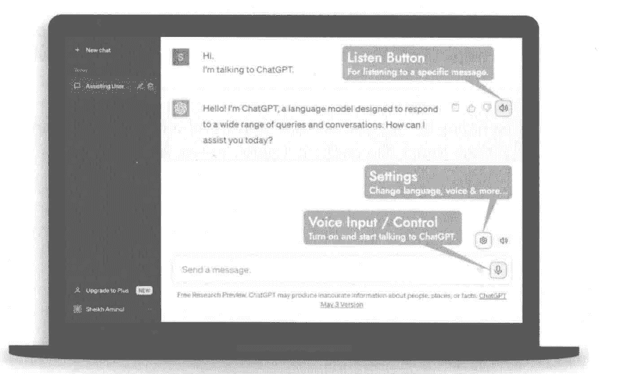

图 4-15

插件安装成功后，刷新一下 ChatGPT 页面，就可以在页面下方看到一个话筒按钮，如图 4-16 所示。单击话筒按钮，就可以和 ChatGPT 进行语音交流了。

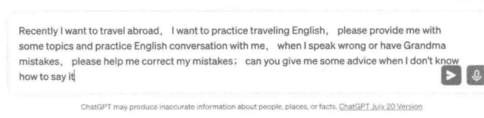

使用语音对话时，系统会将语音转为文字，并以语音和文字两种形式返回答案。

例如通过语音提问 “Recently I want to travel abroad, I want to practice traveling English, please provide me with some topics and practice English conversation with me. When I speak wrong or have grammar mistakes, please help me correct my mistakes. Can you give me some advice when I don't know how to say it?”（译文：最近我想去国外旅游，我想练习旅游英语，请给我提供一些话题，和我一起练习英语会话。当我说错或者有语法错误的时候，请帮我纠正我的错误；当我不知道怎么说的时候，你能给我一些建议吗？）

> Recently I want to travel abroad, I want to practice traveling English, please provide me with some topics and practice English conversation with me. When I speak wrong or have grammar mistakes, please help me correct my mistakes. Can you give me some advice when I don't know how to say it?

> Of course! I'd be happy to help you practice your travel-related English conversation skills. We can cover various topics like booking a hotel, asking for directions, ordering food at a restaurant, and more.

Before we start, I noticed a small mistake in your message. You mentioned "Grandma mistakes", which I believe you meant to say "grammar mistakes". No worries, that's what I'm here for!

Let's start with a scenario. How about we practice booking a hotel room? I'll play the role of the hotel receptionist, and you can be the guest trying to book a room. Feel free to ask for any assistance or clarification if you're unsure how to say something.

Hotel Receptionist: Good afternoon! Welcome to Sunshine Hotel. How may I assist you today?

这一轮里，模型回应了请求，表示会配合练习旅游英语的会话。

时，它还指出了语法错误，并给出话题建议——预订房间。模型给出一个开场提问，之后就能顺着继续练习。对话无需打字，可直接通过扩展的语音功能发声，扩展会识别并转为文字。

需注意，因发音不标准，扩展曾把“grammar”识别成“grandma”，但即便存在发音或用词错误，系统仍能识别并给出正确建议。

继续对话。

> Good afternoon, I like to book a twin room.

> Great! You're asking for a specific type of room now. Just a small correction to make it more natural:

> You: Good afternoon! I'd like to book a twin room.

> The word “I'd” is a contraction for “I would,” which makes the sentence sound more polite and natural.

> Now, let's continue:

> Hotel Receptionist: Of course! Would you like a twin room with two single beds or one double bed? And for how many nights will you be staying?

当说想要订双床房时，原意是“I'd like to book”，但发音不够清晰，扩展只识别出“I like to”，于是系统指出语法问题并提供修改建议。另，对双床房的表述不够精确，系统进一步确认床型。

继续这段对话。

> I would like two single beds for 3 days.

> Perfect! That's a clear and correct response. Here's how the conversation would continue:

> You: I would like two single beds for 3 days.

> Hotel Receptionist: Excellent choice! May I have your name and a contact number to complete the reservation?

> Feel free to continue the conversation or let me know if you'd like to practice a different scenario or topic related to travel.

此次表达较为准确，系统给予肯定并继续提问，要求提供姓名与联系方式。

通过这种方式，可在家轻松进行英语对话练习。学习完全免费，无需支付高昂外教费用。AI 还能扮演有耐心的老师，随时待命，无时间限制。

#### 4.4.6 备战考试

各类英语考试在不同阶段都很关键，能检验知识与技能的掌握。借助 AI 备考，可获得更好的效果。

模型能提供相关资料与复习建议。无论托福、雅思或其他考试，都可推荐教材、模拟题与练习资源，帮助熟悉题型要求。

备考中遇到的听、读、写、口问题，均可向模型提问，获取准确解答与策略指引，提升备考针对性。

模型还可提供模拟与评估。可提交作文或口语录音，获得专业反馈。通过此方式，可发现不足并针对性改进，增强信心。

此外，模型随时可用。无论何时何地，都可通过对话获得辅导与练习，便于灵活安排碎片化学习时间。

例如，想用 3 个月备战雅思，每天仅有 30 分钟学习时间，可让模型制定学习计划。

> Can you create a 3-month IELTS study plan for me? I have 30 minutes every day to study.

> Sure, I can help you with that. Here's a 3-month study plan for IELTS preparation. Remember, consistency is key in achieving your goal.

> **3-Month IELTS Study Plan**

> **Month 1: Understanding the Test and Building Basic Skills**

**雅思三阶段递进备考法**

- 首周：全面了解雅思整体架构，每天抽时间梳理听力、口语、阅读、写作四项的出题方式与评估要点。
- 次周：集中练习听力，通过网络播客、日常对话录音或新闻音频训练抓取关键信息的敏感度。
- 第三周：转向阅读，先接触英文报刊、专题文章与小说片段，练习提炼主题句与细节证据。
- 第四周：启动写作，先从简短句型操练起，再逐步扩展到完整段落表达。

**次月：强化练习与词汇沉淀**

- 第一周：在听读上保持频次，同时留意不同口音的特征以及各类文体写作的风格差异。
- 第二周：写作进入议论文训练，重视论证结构、段落衔接与逻辑连贯。
- 第三周：开启口语练习，从常见话题起步，录音自评以发现语速、流利度与表达准确度的问题。
- 第四周：系统积累高频话题词汇与搭配，提升用词多样性与恰当性。

**第三月：模考复盘与状态调整**

- 第一周：进行整套模拟测试，适应真实节奏与时间分配。
- 第二周：对照答案逐题复盘，锁定薄弱版块并制定针对性改进措施。
- 第三周：持续做模考卷，力求单项成绩稳步提升。
- 第四周：停止新增输入，以复习为主，保持作息稳定与心理自信。

从以上安排可以看出，ChatGPT 帮助把长达十二周的复习拆成了清晰的节奏。若想再细化，还能让它把每周任务拆到天，并自动匹配练习材料与真题。换句话说，ChatGPT 可以扮演一位专属英语陪练，全程跟进、给出专业且个体化的建议，让提升方向更明确。

### 4.5 用 ChatGPT 实现知识快速内化

当信息触达成本变得极低时，如何高效筛选并转化知识成为关键。对话式语言模型恰好提供了即时互动的入口。相较于传统自学，它能依据个人兴趣与目标即时回应，在轻松的交流中完成输入、理解与记忆。

下面以短期掌握 Python 游戏开发为例，说明如何借助它提升学习效率。无论是掌握新技能、弄清专业概念、解决实际问题还是探索爱好，它都能充当学习伙伴与智囊。

#### 4.5.1 先绘制学习路线

先让模型输出一份用 Python 编写游戏的整体线路。

> 我想学习用 Python 做游戏，能否给出一个路线？

> 没问题。Python 很适合入门游戏开发。建议路线如下：
> 1. Python 基础：先掌握变量、数据类型、控制流、函数、模块等核心语法，国内主流在线课程平台均有对应内容。
> 2. 面向对象：理解类与对象机制，这对现代游戏架构至关重要，可在同类平台检索相关课程。
> 3. Pygame 入门：Pygame 是常见的二维游戏库，视频网站上有大量上手教程。
> 4. 首个小游戏：在掌握基础用法后，尝试实现贪吃蛇、打砖块或射击类小练习，平台上已有配套案例。
> 5. 游戏设计理论：学习玩法设计原则与趣味构建，同样可在在线平台找到课程。
> 6. 进阶开发：练习更复杂的二维项目，或尝试 Panda3D 开始接触三维。
> 7. 实战输出：独立完成并发布作品，形成可展示的项目集。
> 每个环节都需要动手积累，循序渐进即可提升能力。

#### 4.5.2 把路线拆成周计划并配资源

让模型把路线转为三个月的执行表，并附书单与资料。

> 按上面线路，给我一份三个月的周计划，含目标、推荐书籍与资料。

可以，以下是十三周示例：

**第1-2周：Python 基础**
目标：熟练变量、数据结构、流程控制、函数、模块。
资源：国内某大学 MOOC《Python 语言程序设计》；书籍《Python 编程：从入门到实践》，Eric Matthes 著。

**第3-4周：面向对象**
目标：理解类、对象、继承、封装、多态，能自主设计类。
资源：慕课网《Python 3 高级核心技术 97 讲》；书籍《流畅的 Python》，Luciano Ramalho 著。

**第5-6周：Pygame 入门**
目标：掌握 Pygame 基本调用，能搭建简易二维场景。
资源：视频网站搜索“Python 游戏开发 Pygame”；书籍《Python 编程：从入门到实践》第二部分外星人入侵项目。

**第7-8周：完成首个完整小游戏**
目标：用 Pygame 实现贪吃蛇或打砖块等完整作品。
资源：视频网站搜索“Python 游戏开发入门课程”；同上书 Pygame 项目章节。

**第9-10周：游戏设计与理论**
目标：掌握设计原则，能规划更具吸引力的玩法。
资源：网易云课堂《游戏设计原理》；书籍《游戏设计艺术》，Jesse Schell 著。

**第11-12周：进阶开发**
目标：挑战复杂二维，或开始接触三维开发。
资源：视频网站搜索“Python 3D 游戏开发”；书籍《Python 游戏开发从入门到精通》，张有菊 编著。

**第13周：项目与发布**
目标：整合知识，开发并发布个人游戏。本阶段以自主实战为主。

这样一份表既有周任务，又配齐材料，省去自行检索的时间。ChatGPT 像私人导师一样把资源直接送达。

#### 4.5.3 让 AI 现场讲知识点

接下来可让模型扮演教学导师，讲解具体操作。

例如针对 Pygame 入门，想了解如何创建窗口并展示火箭图片，可这样提问：

请扮演资深 Python 教学导师，讲解如何用 Pygame 库创建游戏窗口并在其中显示一张火箭图片，并给出可运行示例。

当然可以。首先确认库已安装。若使用 Anaconda，在 Anaconda Prompt 执行：
```
conda install -c cogsci pygame
```
若使用 pip，在命令提示符执行：
```
pip install pygame
```
安装完成后开始搭建窗口。需要完成三件事：初始化模块、创建窗口、编写持续运行的游戏循环。示例代码如下：
```python
import pygame
import sys

def run_game():
    # 初始化pygame模块
    pygame.init()

    # 创建一个800x600的游戏窗口
    screen = pygame.display.set_mode((800, 600))

    # 设置窗口的标题
    pygame.display.set_caption("Rocket Game")

    # 开始游戏主循环
    while True:
        # 监听事件
        for event in pygame.event.get():
            if event.type == pygame.QUIT:
                sys.exit()

        # 让最近绘制的屏幕可见
        pygame.display.flip()

run_game()
```
再把火箭图片加进来。操作要点是加载图片、获取矩形并居中、每次循环重绘。假设图片名为 rocket.png 且与脚本同目录，可在原代码上扩展为：
```python
import pygame
import sys

def run_game():
    # 初始化pygame模块
    pygame.init()

    # 创建一个800x600的游戏窗口
    screen = pygame.display.set_mode((800, 600))

    # 设置窗口的标题
    pygame.display.set_caption("Rocket Game")

    # 加载火箭图像并获取其外接矩形
    rocket_image = pygame.image.load('rocket.png')
    rocket_rect = rocket_image.get_rect()
    screen_rect = screen.get_rect()

    # 将火箭放在屏幕中央
    rocket_rect.centerx = screen_rect.centerx
    rocket_rect.centery = screen_rect.centery

    # 开始游戏主循环
    while True:
        # 监听事件
        for event in pygame.event.get():
            if event.type == pygame.QUIT:
                sys.exit()

        # 将火箭绘制到屏幕上
        screen.blit(rocket_image, rocket_rect)

        # 让最近绘制的屏幕可见
        pygame.display.flip()

run_game()
```
以上是一个最小可运行示例，打开窗口并展示火箭图。这是 Pygame 开发的基础，可在此之上加入移动、音效、计分等功能。

注意，这段代码需在本地 Python 环境运行，且需准备好 rocket.png。图形界面无法在此演示，请自行本地测试。

随后把代码保存为 rocket_game.py，并准备好 rocket.png 图片，如图 4-17 所示。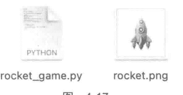

在 macOS 终端运行也很直接。先打开终端，切换到脚本所在目录，例如 `cd ~/Desktop/my_folder`，然后执行 `python3 rocket_game.py`。若系统默认 Python 2，请使用 python3。

如遇环境缺失，可用以下命令安装：
安装 Python：brew install python3
安装 Pygame：pip3 install pygame

完成准备后，执行 cd Desktop 会进入桌面，如图示。
再执行 python3 rocket_game.py，如图示。
回车后即可看到窗口和火箭图片，如图示。

图 4-20

#### 4.5.4 用项目收官：贪吃蛇

最后，用模型完成一个完整小项目——贪吃蛇。

> 请用 Pygame 帮我写一个可运行的贪吃蛇游戏，给出完整代码。

没问题，下面是一个基础版实现。游戏中蛇在屏幕上移动，吃到食物会变长，撞到自身或边界即结束游戏。

```python
import pygame
import time
import random
# 设置屏幕大小
WIDTH = 600
HEIGHT = 400
# 设置蛇和食物的大小
SIZE = 20
class Game:
    def __init__(self):
        pygame.init()
        self.screen = pygame.display.set_mode((WIDTH, HEIGHT))
        self.clock = pygame.time.Clock()
        self.reset()
    def reset(self):
        self.snake = [(WIDTH // 2, HEIGHT // 2)]
        self.direction = pygame.K_RIGHT
        self.food = None
    def run(self):
        while True:
            for event in pygame.event.get():
                if event.type == pygame.QUIT:
                    return
                elif event.type == pygame.KEYDOWN:
                    self.direction = event.key
            if not self.update():
                break
            self.draw()
            self.clock.tick(10)
        time.sleep(1)
    def update(self):
        x, y = self.snake[0]
        if self.direction == pygame.K_LEFT:
            x -= SIZE
        elif self.direction == pygame.K_RIGHT:
            x += SIZE
        elif self.direction == pygame.K_UP:
            y -= SIZE
        elif self.direction == pygame.K_DOWN:
            y += SIZE
        if (x, y) in self.snake or x < 0 or x >= WIDTH or y < 0 or y >= HEIGHT:
            return False
        self.snake.insert(0, (x, y))
        if self.food and x == self.food[0] and y == self.food[1]:
            self.food = None
        else:
            self.snake.pop()
        if not self.food:
            while True:
                self.food = (random.randint(0, WIDTH // SIZE - 1) * SIZE,
                random.randint(0, HEIGHT // SIZE - 1) * SIZE)
                if self.food not in self.snake:
                    break
        return True
    def draw(self):
        self.screen.fill((0, 0, 0))
        for x, y in self.snake:
            pygame.draw.rect(self.screen, (0, 255, 0), pygame.Rect(x, y, SIZE, SIZE))
        pygame.draw.rect(self.screen, (255, 0, 0), pygame.Rect(self.food[0], self.food[1], SIZE, SIZE))
        pygame.display.flip()
if __name__ == "__main__":
    Game().run()
    pygame.quit()
```

这个初版贪吃蛇玩法比较基础，若想让体验更丰富，可以考虑加入以下几个点。

1. 加入分数提示：蛇每吃到一次食物，分数就累加一次。
2. 丰富食物形态：除了普通食物，还可以设置特殊道具，比如瞬间变长或瞬间变短的食物。
3. 提升挑战程度：随着时间推移，蛇的移动节奏可以逐步加快。

要跑通这段程序，需要在本地搭建 Python 运行环境，并且提前装好 Pygame。

实际跑起来后我发现一个体验问题：蛇的速度太快，新手很容易在撞墙瞬间结束游戏，难度偏高。于是对代码做了调整。

> 让蛇以慢速前进，撞到边界时不中断游戏，而是从对面穿出。游戏背景换成白色，蛇身用绿色呈现，食物做成红色圆点。基于以上设定重新实现贪吃蛇。

好的，按你的设定已经完成修改。现在窗口底色是白色的，蛇是绿色的，食物是红色的圆形，而且蛇的移动变得缓慢，撞墙时会直接从另一侧出现。

以下是修改后的代码：

```python
import pygame
import time
import random
# 设置屏幕大小
WIDTH = 600
HEIGHT = 400
# 设置蛇和食物的大小
SIZE = 20
class Game:
    def __init__(self):
        pygame.init()
        self.screen = pygame.display.set_mode((WIDTH, HEIGHT))
        self.clock = pygame.time.Clock()
        self.reset()
    def reset(self):
        self.snake = [(WIDTH // 2, HEIGHT // 2)]
        self.direction = pygame.K_RIGHT
        self.food = None
    def run(self):
        while True:
            for event in pygame.event.get():
                if event.type == pygame.QUIT:
                    return
                elif event.type == pygame.KEYDOWN:
                    self.direction = event.key
            if not self.update():
                break
            self.draw()
            self.clock.tick(5)  # Set the speed of the snake to slow mode
    def update(self):
        x, y = self.snake[0]
        if self.direction == pygame.K_LEFT:
            x -= SIZE
        elif self.direction == pygame.K_RIGHT:
            x += SIZE
        elif self.direction == pygame.K_UP:
            y -= SIZE
        elif self.direction == pygame.K_DOWN:
            y += SIZE
        # Make the snake pass through the wall
        x %= WIDTH
        y %= HEIGHT
        if (x, y) in self.snake:
            return False
        self.snake.insert(0, (x, y))
        if self.food and x == self.food[0] and y == self.food[1]:
            self.food = None
        else:
            self.snake.pop()
        if not self.food:
            while True:
                self.food = (random.randint(0, WIDTH // SIZE - 1) * SIZE,
                random.randint(0, HEIGHT // SIZE - 1) * SIZE)
                if self.food not in self.snake:
                    break
        return True
    def draw(self):
        # Set the background color to white
        self.screen.fill((255, 255, 255))
        # Draw the snake body in green
        for x, y in self.snake:
            pygame.draw.rect(self.screen, (0, 255, 0), pygame.Rect(x, y, SIZE, SIZE))
        # Draw the food as a red circle
        pygame.draw.circle(self.screen, (255, 0, 0), (self.food[0] + SIZE // 2, self.food[1] + SIZE // 2), SIZE // 2)
        pygame.display.flip()
if __name__ == "__main__":
    Game().run()
    pygame.quit()
```

改动后的版本完整保留了你的需求：慢速移动、穿墙不结束、白底绿蛇红点食物。把文件放到本地 Python 环境里就能直接运行。

把代码粘到一个文本文件里，保存为 “snake_game.py”，放到桌面即可。然后在电脑终端里执行它，如图 4-21 所示。


图 4-21

后续如果想让画面更漂亮，还可以继续打磨，比如把食物换成苹果样式，调整蛇身配色，给游戏加入积分面板等等。

# 第 5 章 用 ChatGPT 提升职场效率

### 5.1 面试冲刺：ChatGPT 陪练

面试往往是人生转折的关键节点。不管是应届毕业生还是资深从业者，都能借助 ChatGPT 获得面试辅导和职业规划支持。

对刚入职场的毕业生来说，第一次求职充满不确定性。可以用 ChatGPT 获取面试指导，提升自信心和准备质量。可以请它帮忙优化简历、打磨自我介绍、获取高频面试题的参考答案，以及行为面试和技术面试的处理技巧，还能学会如何在面试中突出自身优势与潜力。

对已有丰富经验的职场人而言，换岗同样少不了面试。可以让 ChatGPT 提供针对性建议，帮助更好地展示能力与履历，争取更理想的岗位和薪资。可以向它请教如何应对棘手提问、怎样有力呈现职业成果等。

从事招聘培训或求职辅导的从业者，也能用 ChatGPT 拓展服务边界，提供更定制化的方案。可以咨询面试方法和策略问题，为学员准备更有针对性的指导。ChatGPT 还能解答学员关于准备策略、自信建立、沟通表达等困惑，帮助提升整体竞争力。

需要留意的是，ChatGPT 的输出仅作参考，最终仍要结合个人实际情况和实战经验综合判断。面试准备时多做实战演练，多与专业人士交流，才能更全面、更精准地提升面试表现并取得好结果。

#### 5.1.1 面试准备八大要点

准备面试时，可以让 ChatGPT 围绕以下方向给出指导。

1. 高频面试题：列出常见提问并给出参考回答范例。
2. 自我介绍：协助撰写有记忆点、突出技能和经历的自我介绍。
3. 行为面试题：提供典型行为类问题及回答思路。
4. 职业成果：指导如何有效展示工作成绩，让面试官产生兴趣。
5. 短板与挑战：帮助梳理如何正面回应弱点和困难问题，展现成长力。
6. 企业调研：指导如何快速了解目标公司，并在面试中体现匹配度。
7. 提问环节：提供适合在面试尾声向面试官提问的问题，展现主动性。
8. 面试技巧：给出保持自信、坐姿、语气与表达风格的实用建议。

#### 5.1.2 瞬间拿到典型面试题

ChatGPT 能迅速整理出行业相关的常见提问。

> 明天要面软件销售岗，能给我 10 个可能被问到的问题吗？

> 可以，以下是面试中常见的提问方向。

1. 先做个简短自我介绍，并说说你为什么想做这个岗位？
2. 过去销售工作中，你是怎么突破销售瓶颈的？能举个具体案例吗？
3. 描述一次你主导的大型销售项目，是如何推动成功的？
4. 你平时怎样建立和维护客户关系？
5. 在你的销售打法里，如何定位并区分我们的产品或服务？
6. 面对客户的异议或拒绝，你通常怎么处理？
7. 对软件行业目前的格局怎么看？你觉得哪些趋势影响最大？
8. 假设接下来三个月要提升销售额，你会怎么规划？
9. 如果一个重要客户突然宣布不再使用我们的产品，你会如何挽回？
10. 以前的工作中，你用过哪些 CRM 工具，比如 Salesforce，熟练程度如何？

提示在回答时尽量用具体事例说明，体现技能、经验和行业认知。祝面试顺利！

如果对某些题无从下手，也可以继续请教 ChatGPT。

> 请帮我组织一下回答：一个大客户突然要停用产品，该怎么挽回？

> 下面是一个可参考的思路。

首先会尽快约一次沟通，弄清客户停用的真实原因，倾听反馈很重要，能判断是产品、服务还是价格问题。

若是产品问题，会详细了解不满意的点，并及时反馈给产品团队，看能否快速迭代。同时向客户展示产品改进路线，让他看到变化的决心。

若是服务问题，会核实客户的具体诉求，与团队商讨改善方案，确保服务更贴合需求。

若是价格问题，会尝试协商，看能否提供更优惠条件或增加增值服务来平衡成本。

总体而言，会尽力解决问题并保持积极态度，相信维护老客户就是维护公司长期利益，让客户感受到被重视和愿意为其改进。

#### 5.1.3 真实演练面试全流程

除了拿题和参考答案，还能让 ChatGPT 扮演面试官，完成一轮完整的模拟。

> 能不能模拟一个医药公司的招聘官来面试我？我应聘高级医药代表。希望你一次问一个问题，我回答后你点评并给优化建议，再进入下一题。

当然可以，我们开始。

问题 1：请简单介绍一下你自己，以及你为什么对这个高级医药代表岗位感兴趣？

在我给出指令后，ChatGPT 开始扮演面试官。我按要求作答，并把回答作为新提示继续对话。

我叫张三，毕业于江城医科大学药学专业，毕业后在一家国企担任医药代表，主要负责与临床医生沟通、产品推广及客户关系维护。工作三年，对该领域有比较扎实的操作经验。看到贵公司招聘高级医药代表，期望获得更大的发展平台。

回答很清晰，经历和目标都讲明白了。若想更好，可以补充一两个工作中的成功案例，比如如何维系客户或推动销量，并说明选择贵公司的具体原因，比如认可产品或文化。

问题 2：能否举例说明一次你在与医生沟通时遇到的困难，以及你是如何解决的？

在完成第一题后，ChatGPT 给出了点评和建议，随后提出了第二题。

接下来我就可以作答，继续完整走一遍面试流程。

如果遇到难题，还可以请求帮助。

这个问题有点难，能不能告诉我怎么答更好？

当然，这个问题考察的是问题解决能力和抗压策略。可以按以下思路准备。

1. 先在工作经历里找一次和医生沟通特别吃力、充满挑战的场景。可能对方实在太忙、难约上见面；可能对你带来的产品提不起兴趣；也可能直接甩出几个你很难立刻回答的专业问题。

2. 再具体讲讲你当时怎么处理的。你用了什么方式让医生挤出时间见你？你怎样把产品的价值讲清楚、把医生拉到感兴趣的角度？你又是怎么应对那些棘手提问的，是现场给出思路还是事后查证补齐？

3. 最后把这次经历升华一下。它对你产生了什么影响，你到底学到了什么沟通、应变或专业上的东西，这些收获怎么帮助你今后更好地开展工作。

按照这个框架再复盘一次回答，通常会让案例更完整、更有感染力。

需要提醒的是，ChatGPT 提供的思路来自模型训练数据和既有知识，无法覆盖所有个性化情境。备考面试时，最稳妥的做法是把AI的建议和自己的真实经历对照、取舍，同时多参加系统化的面试培训、与行业前辈交流，并反复做模拟面试来获取可信的反馈。

### 5.2 用 ChatGPT 精准匹配理想岗位

想找到合适的好工作，一般要抓住两件事：盘点自己会什么、能做什么，了解目标岗位和公司到底要什么人。先从自身出发，再去对标市场，才能提高命中率。

先做自我盘点。把过往的工作轨迹梳理一遍，每个岗位做了哪些事、承担了哪些责任、交付了什么结果，从中提炼出自己的强项和擅长领域。接着审视自己的知识体系和能力组合，包括硬技能和软技能，比如项目管理、跨部门协作、沟通表达、问题解决等，然后把这些能力清单和目标岗位的技能要求做对比，看看重合点在哪里。

再去做岗位与公司的研究。主动查阅招聘信息、官网介绍，了解岗位的职责描述、必备技能和背景门槛，从而判断自己匹配度有多少。同时可以和行业内的从业者聊聊，获取更真实的日常工作内容、行业动向和发展机会。

在研究清楚需求后，就可以着手准备简历和求职信了。准备材料时注意以下几点。

1. 突出成果与贡献
用具体的数据和案例说明过去做了什么、带来了什么价值，让招聘方直观感受到你的能力。

2. 聚焦岗位相关技能
根据职位要求，有针对性地强调匹配的经验与技能，有直接相关的项目或培训经历一定要重点呈现。

3. 体现适应力与学习力
当下职场变化快，强调你能快速进入新环境、持续学习新知识的能力，比如自学经历、工具掌握、培训参与等。

4. 写出个性化求职信
为每家公司定制信件，表达你对公司的了解和兴趣，说明为何想做这个岗位，以及你能为团队带来什么。

5. 语言简洁清晰
简历与求职信要言简意赅，突出重点，使用行业通用术语和关键词，便于系统筛选和人工阅读。

总体来看，ChatGPT 可以帮你梳理优势、拆解岗位要求、实现精准匹配，还能协助润色简历和求职信，提升脱颖而出的机会。

#### 5.2.1 借助 ChatGPT 梳理个人优势

把个人背景、工作经历和技能清单交给 ChatGPT，它能帮你归纳过去的成绩与贡献，提炼出核心能力，并指出潜在的特长方向。

> 我今年 37，曾经在软件行业工作过 10 年，有过大数据、商业智能数据分析的从业经验。辞职后，自学了人工智能编程，做过小红书博主，做过小红书培训，目前在开展“ChatGPT 大师班”的培训。请结合我的个人经历，帮我生成一个总结，告诉我擅长做什么，并根据我的特点，告诉我什么工作适合我，以及适合的职业方向。

> 基于你的经历和技能，以下是对你的概括以及可能的职业建议。

总结

你是一位多元化且极具探索精神的专业人士，拥有十年软件行业积淀，专长大数据与商业智能分析。离开传统岗位后，你展现出很强的自我驱动力，自学人工智能编程，转型为小红书内容创作者，并在此基础上开展培训。整体来看，你具备很强的适应力与创新力，能够快速吸收新技能并转化为服务价值。

你在以下方面表现突出。

1. 数据分析：具备大数据与商业智能的实战经验，这在多个行业都很有价值。
2. 自主学习与适应：能自行驱动学习新技术，如人工智能编程，这在技术快速迭代的领域尤为重要。
3. 内容创作与教学：小红书的创作与培训经历，体现了表达能力和教学潜力。

比较契合的职业方向有。

1. 数据科学家/数据分析师：发挥大数据与商业智能的专业积累。
2. AI 技术专家：若持续深耕人工智能编程，可向技术专家或研发工程师发展。
3. 培训师或教育顾问：已有培训经验，可拓展至更广领域，成为专业教育顾问。
4. 内容创作者：继续深耕自媒体运营，成为专业博主或内容负责人。

你的背景跨度大、技能组合丰富，关键在于找到最能激发热情的方向。

#### 5.2.2 研究目标岗位的专业要求

ChatGPT 的检索能力可以帮助你收集岗位描述、所需知识、技能清单和具体要求等信息。

> 列出 10 个适合申请的职位。

根据你的背景与技能，以下是 10 个可考虑的岗位。

1. 数据科学家：挖掘并解释复杂数据集。
2. 人工智能工程师：设计、测试和维护 AI 系统。
3. 商业智能顾问：结合数据分析与业务理解提供 BI 解决方案。
4. 数据产品经理：负责数据驱动的产品规划与运营。
5. 数据可视化专家：把数据转化为易懂的图表与报表。
6. 社交媒体策略师：依托小红书经验制定社媒营销策略。
7. 内容创作者：为不同平台产出有价值的内容。
8. 在线课程讲师：为学习者提供专业课程。
9. 技术培训师：为企业员工或客户提供技术培训。
10. 数据驱动的市场营销专家：结合分析与内容创作执行营销策略。

这些岗位都要求一定的专业深度与广度，同时看重学习与适应能力。

> 从招聘者的角度来看，在线课程讲师这个职位需要什么样的人？

作为招聘方，通常会关注以下特质。

1. 专业知识：对教学主题有扎实理解。
2. 教学能力：能把复杂概念讲清楚、讲透。
3. 在线教学经验：熟悉 Zoom、Teams、Google Classroom 等平台的操作方式。
4. 沟通技巧：口头与书面表达清晰，能有效互动。
5. 技术熟练度：会用教学工具、能处理常见技术问题、具备基础视频剪辑能力。
6. 激励与人际技巧：能调动学习积极性、提升参与度。
7. 创新思维：不断尝试新教学方法与工具。
8. 组织能力：能规划课程、准备材料、跟进学员进度。
9. 耐心与包容：理解不同学员的学习节奏与方式。
10. 热情与专注：对主题和教育本身保持兴趣并能传递给学员。

#### 5.2.3 对标岗位的优劣势分析

和 ChatGPT 对话，可以把个人优势与岗位要求做对比，评估熟练程度并获得改进建议。

> 针对申请的职位，列出我的优势和劣势。

> 根据你所提供的信息，以下是你作为一个在线课程讲师的优势和劣势。

优势

1. 丰富的专业经验：在大数据、商业智能与人工智能编程领域深耕十年，可提供实操性强的内容。
2. 教学与培训经验：有小红书培训经历，具备知识传递能力。
3. 自学能力强：能跟上新知节奏并融入课程。
4. 创新与适应力：从软件行业成功转型自媒体，显示出很强的应变能力。

劣势

1. 在线教学经验：小红书培训以小班为主，可能缺少大规模线上课程运营经验。
2. 教育背景：技术背景扎实，但缺乏正规师范或教学系统训练。
3. 技术熟练度：AI 编程熟练，对部分在线教学工具仍需提升。

劣势并不等于不适合，只是提示需要投入时间补强。你的优势已足以构成胜任基础。

#### 5.2.4 优化简历和求职信

基于 ChatGPT 的建议，可以对简历结构、关键词、内容组织与语言风格进行优化，突出与目标岗位相关的成就与能力。

能帮我写一份简历吗？

当然可以，以下是基于你信息的基础样本。

## 个人信息

张三

电子邮件：xxx@xxx.com

电话：(x) xx-xx

## 求职意向

在线课程讲师，运用大数据、商业智能与人工智能编程的专业积累，结合教学与创新思维赋能在线教育。

## 核心技能

- 大数据与商业智能分析
- 人工智能编程教学与培训
- 内容创作
- 创新思维与快速适应

## 工作经历

“ChatGPT 大师班”讲师，自由职业，2023 年至今

- 设计并主讲人工智能系列课程
- 跟踪学员进度并提供个性化反馈

小红书博主和培训师，自由职业，2022 至 2023 年

- 产出并传播垂直领域内容
- 开展小红书实操培训

高级数据分析师，XXX 公司，2012 至 2022 年

- 交付大数据与商业智能解决方案
- 协助业务部门解读数据洞察

## 教育背景

江城医科大学，药学学士，2008 至 2012 年

这仅为模板，需根据真实经历补充细节、成果数据、所用技术，证书、荣誉或公开作品也应体现。

> 再帮我写一份求职信。

当然，以下是定制样本。

【你的名字】

【你的地址】

【省，城市，邮政编码】

【你的电话号码】

【你的电子邮件】

【日期】

【招聘经理的名字】

【公司名称】

【公司地址】

【省，城市，邮政编码】

亲爱的【招聘经理的名字】：

我在【招聘来源】上看到贵司正在招聘在线课程讲师。作为拥有丰富专业与教学经验的人选，我相信能为团队贡献价值。

我拥有超过十年的大数据、商业智能与人工智能编程工作经历，深入理解这些领域的核心知识，也擅长把复杂概念拆解为易懂的内容。

近几年我以自由职业身份在小红书平台进行内容创作与培训，并开设“ChatGPT 大师班”。这段经历锻炼了我的线上教学技巧、学员管理能力以及工具使用效率。

我热爱教育，相信在线学习有独特的价值。若能将专业知识带入贵司的教学体系，我将竭力为学员与团队创造价值。

期待进一步沟通，谢谢审阅。

顺祝商祺！

借助 ChatGPT 可实现精准对标与材料优化，提升求职成功率。它能帮你凸显个人优势与岗位契合点。但也要保持自我审视，若发现技能或经验短板，可通过自学、进修或项目实践补足。保持积极心态与持续努力，是拿到理想 Offer 的关键。

同时要认识到，ChatGPT 是工具，不能替代独立思考与专业判断。结合自身实际情况综合决策，才是更稳妥的做法。

### 5.3 用 ChatGPT 撰写工作汇报与邮件

工作汇报、周报月报、销售邮件与日常工作邮件都是职场沟通的重要载体。写得清晰得当，能提高效率、推动问题解决、提升业绩。

撰写汇报时要注意。

- 明确时间范围：周报、月报或年度总结要界定清楚。
- 突出重点：聚焦关键指标、成果与重要事件，便于领导快速把握。
- 数据支撑：用可量化的统计增强说服力。
- 分析与总结：对数据做解读，指出问题、挑战与对策。
- 结构清晰：用标题、编号或项目符号组织内容，提升可读性。

销售邮件要点。

- 个性化称呼：用客户姓名或尊称建立亲近感。
- 清晰表达：简洁介绍产品特点与功能。
- 强调价值：说明产品能解决客户什么问题。
- 个性化推荐：结合客户需求给出建议。
- 突出促销：及时告知优惠信息。
- 互动跟进：鼓励反馈并及时回复，建立信任。

职场邮件要点。

**明确主题：** 主题简明概括邮件内容，方便归类处理。
**体现礼貌：** 开头结尾使用得体问候与称谓。
**清晰简洁：** 语言精炼，段落留白。
**重点突出：** 重要请求前置并加粗或斜体强调。
**结构合理：** 逻辑分层，可用列表呈现要点。
**附上附件：** 说明附件用途与内容。

过去撰写这些材料耗时耗力，会影响效率与业绩。现在用 ChatGPT 可以大幅提升质量与速度。

1. **提高写作效率**
快速生成高质量文本，节省构思时间。
2. **减少重复劳动**
可建立模板与风格，快速套用不同场景。
3. **提供灵感与参考**
给出多种表达方式与风格建议。
4. **纠正语法与拼写**
自动检查语言错误，提升专业度。

## 5. 节省时间与提升创造力

使用 ChatGPT 后，你可以将精力从重复写作转向更重要的策略与创新事务，提升时间管理与创造力。

下面看一个实操案例。

#### 5.3.1 用 ChatGPT 生成工作汇报

撰写周报月报是常规任务，ChatGPT 可帮助快速提炼要点并生成结构化报告。

> 根据日常工作内容，提取要点并适当扩充，以生成周报。使用下面提供的文本作为中文周报的基础，生成一个简洁的摘要，突出最重要的内容。该报告应以 Markdown 格式编写，并应易于阅读和理解，以满足一般受众的需要。特别是要注重提供对利益相关者和决策者有用的见解和分析。你也可以根据需要使用任何额外的信息或来源。[本周完成了 10 个小红书竞品账号分析，做了 20 个亲子英语启蒙的小红书爆款选题，拍摄了 10 条英语启蒙小红书短视频，获客 100 个，直播带货 GMV① 3 万多元]

> **本周工作总结**

以下是本周主要工作亮点及关键数据。

**竞品分析**

- 10 个小红书竞品账号分析完成。这一过程为我们深化对市场的理解，了解竞品策略提供了重要的数据支持，同时也帮助我们更好地调整自身的产品和运营策略。

**亲子英语启蒙内容创作**

**一周运营复盘：内容与销售**

为覆盖不同家庭的使用场景，我们围绕亲子英语启蒙赛道规划了20个适配性的小红书热门选题，既丰富了内容矩阵，也提升了吸引力。基于上述选题，我们落地产出了10条短视频，在呈现形式和制作质感上做了创新，成功助推了用户增长。

① GMV 的全称是 Gross Merchandise Volume，意为“商品交易总额”。——编者注

**获客增长与直播转化**

借助多渠道投放与线下联动，本周新增新客100人，与用户的互动粘性明显增强。直播带货环节表现突出，周GMV累计超过3万元，既印证了现有销售打法的有效性，也体现出产品的市场号召力。

**阶段性小结**

整体来看，本周在竞品洞察、内容制作与直播销售三个维度均取得积极进展。接下来将继续深耕这些方向，保持创新节奏，进一步提升市场表现与用户满意度。

#### 5.3.2 借助 ChatGPT 高效撰写工作邮件

职场沟通中常见的邮件类型包括：

- 会议邀约与排期邮件：邀请同事、合作方或客户参会，需明确时间、地点、议程与细节。
- 进展汇报邮件：周报、月报等向上级或团队同步进展、任务完成及目标达成情况，表述应简洁，突出重点并附数据支撑。
- 求助协作邮件：向相关人员请求帮助或意见，要说明需求、原因与期望回复时间。
- 绩效反馈邮件：对同事、下属或合作方的表现进行评价，需具体、可举例，并保持建设性与尊重。
- 离职告知邮件：向雇主提出离职，需写清离职日期与交接安排。
- 营销推广邮件：通过邮件推送产品、促销与品牌信息，推动成交与品牌认知。
- 人事沟通邮件：通知面试时间地点与准备材料，或告知录用结果、岗位、薪酬与入职安排。

结合典型场景，下面以三种邮件展示 ChatGPT 的辅助思路。

## 场景一：营销邮件示范

需求：面向宝妈群体，撰写一封能激发兴趣并促成购买的营销邮件。产品为天然有机、无添加的儿童蔬果泥，营养丰富。

尊敬的宝妈您好：

感谢关注我们的产品。我们主推一款以天然有机蔬果为基底的儿童泥状辅食，旨在为宝宝提供均衡营养支持。

作为注重孩子健康的父母，选品一定很谨慎。我们的配方依据最新营养研究，选用优质有机蔬果，零人工添加剂与防腐剂，力求安全纯净。

选择我们的理由：

1. 营养配比科学：甄选有机农产品，保留维生素、矿物质与膳食纤维，助力均衡摄入。
2. 零添加承诺：不使用人工添加剂与防腐剂，让宝宝吃到真正天然食物。
3. 使用便捷：包装便携，随时随地都能为宝宝提供健康零食。
4. 口味丰富：多款口味设计，满足宝宝偏好，培养健康饮食习惯。

我们还提供极速配送、定期优惠券与促销活动，以及全天候专业客服支持。

欢迎点击下方链接了解详情并下单。

【产品链接】

如有疑问，欢迎随时联系。祝您与宝宝健康快乐！

此致
敬礼

【您的姓名】
【您的公司名称】

## 场景二：面试邀请邮件示范

需求：向候选人发出面试邀请，说明岗位匹配度并介绍公司，约定本周三下午到访面试。候选人：张三；岗位：大数据分析工程师；公司：玩赚 AI 星球；地址：北京市海淀区 XXX 路甲 100 号 2 号楼 10A 室

张三先生，您好：

代表玩赚 AI 星球向您表示祝贺，您的背景与我们大数据分析工程师岗位需求高度契合，专业能力给我们留下深刻印象，相信能为团队创造价值。

玩赚 AI 星球坐落于北京市海淀区，是一家专注于人工智能与大数据驱动创新的科技新锐。团队成员经验丰富，充满热情。

公司倡导创新、协作与成长，提供积极的工作氛围与发展空间。期待您的技术与专业知识能与团队产生协同，推动业务发展。

现诚邀您于本周三下午来公司面试，地址为北京市海淀区 XXX 路甲 100 号 2 号楼 10A 室。面试中您可与团队深入交流，也能更全面了解公司文化。

若时间可行，请回复确认；如有冲突请告知，我们会尽力协调。

期待会面！

顺颂商祺

【您的姓名】
玩赚 AI 星球公司
公司地址：北京市海淀区 XXX 路甲 100 号 2 号楼 10A 室
联系电话：【您的电话号码】
电子邮箱：【您的电子邮箱】

## 场景三：项目进展汇报邮件示范

本次要求撰写本月关于公司产品龙井明前茶在小红书、抖音、知乎三平台营销推广的进展汇报。

项目目标：在三平台开展内容营销，提升品牌声量与市场份额。
项目进度：选题策划已完成，脚本撰写进行中，计划各平台产出50篇，目前脚本完成约10%，视频拍摄尚未启动。
项目难点：人力配置不足，现有资源难以支撑任务量。
应对方案：可引入 AI 写作提升产能，分担脚本撰写，降低时间与人力成本。

尊敬的团队成员：

大家好！现将本月龙井明前茶在小红书、抖音、知乎的推广进展汇报如下。

**项目目标**
以内容营销为主线，提升产品知名度。

**当前进度**
选题策划已全部完成，已进入脚本撰写阶段。各平台目标篇幅为50篇，目前完成约10%。视频拍摄工作待启动。

**面临挑战**
项目推进受人力限制，任务量与现有编制不匹配。

**解决思路**
建议尝试引入 AI 写作工具辅助脚本创作，提升整体生产效率。

**后续安排**
1. 继续推进脚本撰写，按期完成各平台50篇内容。
2. 启动视频拍摄筹备，协调相关人员配合。
3. 持续监测投放效果，根据反馈优化策略。

请各位积极配合，如有困难或建议请及时沟通。

感谢大家的努力，相信将为产品推广带来明显成效。后续有任何讨论需求，欢迎随时联系。

祝好

【您的姓名】
【项目组名称】

ChatGPT 作为强大的语言模型，具备理解需求并生成规范文本的能力。撰写汇报时，它可帮助梳理进展、成果与挑战，优化表达使其更清晰简洁；撰写邮件时，它能提供框架、结构与措辞建议，帮助根据对象进行个性化沟通，并给出表达优化提示。此外，它还能基于关键词提供行业信息与灵感，辅助数据与背景呈现。需要注意的是，模型输出可能存在偏差，使用时需人工复核，确保准确性与合规性。

### 5.4 一键借助 ChatGPT 生成思维导图

思维导图是以中心主题为核心、通过分支展示关联概念的图形化工具。主要价值包括：

**整理与结构化思维**
将复杂想法层级化呈现，帮助厘清关系，利于规划与安排。

**计划与项目管理**
用于搭建项目框架、拆解任务与里程碑，便于追踪进度与优先级。

**激发创意**
非线性结构促进跳跃式联想，有助于发现新思路与解决方案。

**学习与知识管理**
通过主题与子主题整理学习内容，便于检索与复习。

**会议记录与讨论**
可视化呈现提升会议效率与参与度。

**决策与问题解决**
系统呈现问题根源与可选方案，支持更全面的评估。

**记忆与复习**
图像化信息更容易记忆。

**沟通与演示**
将复杂信息转化为图形，便于展示与解释。

使用 ChatGPT 辅助生成思维导图，可从以下三方面入手：

### 明确导图骨架
先描述中心主题、主分支及子分支，例如说明“项目计划”下包含“目标设定”“任务分配”“时间安排”等。

### 请求相关拓展
询问指定分支下应包含哪些具体想法或概念，获取建议性输入。

### 探索分支关联
让模型分析不同分支间的依赖与关系，挖掘潜在连接。

以下以西方美术史为例演示操作流程。确定主题后，先让模型输出一份包含各时期代表人物与作品的大纲。

> 你现在是一位专门研究西方美术史的教授，请为我写一篇西方美术史报告的思维导图大纲，内容包括：各个时期的代表人物和代表作品。

> 当然，以下是整理的西方美术史报告的思维导图大纲，主要包括各个时期的代表人物和代表作品。

西方美术史报告大纲

1. 引言
   A. 西方美术史的重要性
   B. 报告的结构和目的
2. 古代时期
   A. 古希腊
      1. 代表人物：菲狄亚斯
      2. 代表作品：帕提依神庙的浮雕残片《雅典娜女神节游行队伍》
   B. 古罗马
      1. 代表作品：罗马竞技场
3. 早期基督教艺术
   A. 拜占庭艺术
      1. 代表作品：耶稣受难石棺浮雕
   B. 哥特式艺术
      1. 代表作品：《巴黎圣母院》
4. 文艺复兴时期
   A. 早期文艺复兴
      1. 代表人物：乔托
      2. 代表作品：《圣方济各向鸟雀布道》
   B. 高文艺复兴
      1. 代表人物：达·芬奇
      2. 代表作品：《蒙娜丽莎》《最后的晚餐》
5. 巴洛克与洛可可时期
   A. 巴洛克
      1. 代表人物：伦勃朗
      2. 代表作品：《夜巡》
   B. 洛可可
      1. 代表人物：夏尔丹
      2. 代表作品：《配膳桌》
6. 19 世纪
   A. 浪漫主义
      1. 代表人物：德拉克洛瓦
      2. 代表作品：《自由引导人民》
   B. 印象派
      1. 代表人物：莫奈
      2. 代表作品：《日出·印象》
7. 20 世纪
   A. 立体主义
      1. 代表人物：毕加索
      2. 代表作品：《阿维尼翁的少女》
   B. 抽象表现主义
      1. 代表人物：波洛克
      2. 代表作品：《薰衣草之雾》
8. 结论
   A. 西方美术史的演变
   B. 时期的特点与相互联系
   C. 美术史在当今的影响和价值
9. 参考文献

这个大纲为你提供了西方美术史各个时期的代表人物和作品，为你的报告提供了一个全面的结构。你可以根据这个大纲进一步展开研究和分析。

接着，将大纲转为 Markdown 格式，便于导入思维导图工具。

> 将上述大纲转化为 Markdown 脚本，Markdown 层级共分成 4 个层级，在代码块中生成，方便我拷贝使用。

```
# 西方美术史报告大纲
## I. 引言
### A. 西方美术史的重要性
### B. 报告的结构和目的
## II. 古代时期
### A. 古希腊
#### 1. 代表人物：菲狄亚斯
#### 2. 代表作品：帕提依神庙的浮雕残片《雅典娜女神节游行队伍》
### B. 古罗马
#### 1. 代表作品：罗马竞技场
## III. 早期基督教艺术
### A. 拜占庭艺术
#### 1. 代表作品：耶稣受难石棺浮雕
### B. 哥特式艺术
#### 1. 代表作品：《巴黎圣母院》
## IV. 文艺复兴时期
### A. 早期文艺复兴
#### 1. 代表人物：乔托
#### 2. 代表作品：《圣方济各向鸟雀布道》
### B. 高文艺复兴
#### 1. 代表人物：达·芬奇
#### 2. 代表作品：《蒙娜丽莎》《最后的晚餐》
## V. 巴洛克与洛可可时期
### A. 巴洛克
#### 1. 代表人物：伦勃朗
#### 2. 代表作品：《夜巡》
### B. 洛可可
#### 1. 代表人物：夏尔丹
#### 2. 代表作品：《配膳桌》
## VI. 19 世纪
### A. 浪漫主义
#### 1. 代表人物：德拉克洛瓦
#### 2. 代表作品：《自由引导人民》
### B. 印象派
#### 1. 代表人物：莫奈
#### 2. 代表作品：《日出·印象》
```
## VII. 20 世纪

### A. 立体主义

#### 1. 代表人物：毕加索

#### 2. 代表作品：《阿维尼翁的少女》

### B. 抽象表现主义

#### 1. 代表人物：波洛克

#### 2. 代表作品：《薰衣草之雾》

## VIII. 结论

### A. 西方美术史的演变

### B. 时期的特点与相互联系

### C. 美术史在当今的影响和价值

## IX. 参考文献
然后，我们将 Markdown 格式的内容复制到思维导图工具中。单击 “Copy code” 即可复制，如图 5-1 所示。

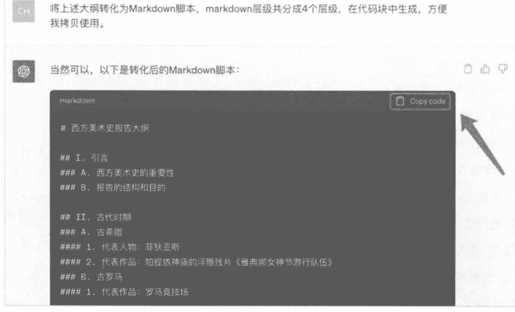
在此介绍两个工具，它们可以将 Markdown 文件转化为思维导图。

# 1. markmap

markmap 是一个支持 Markdown 语法的思维导图工具，可支持在线编写思维导图，或者在 VS Code 内编写思维导图。我们打开 markmap 网站，单击 “Try it out”，即可新建一个文件，如图 5-2 所示。

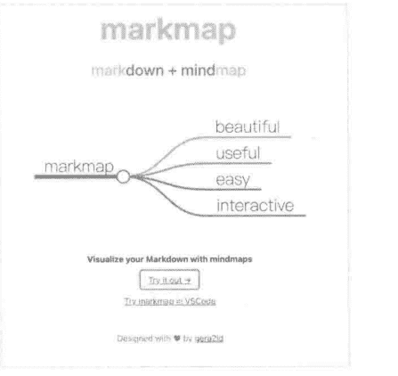

打开 Markmap 新建文档时，内部自带一段演示用的代码片段，见图5-3。
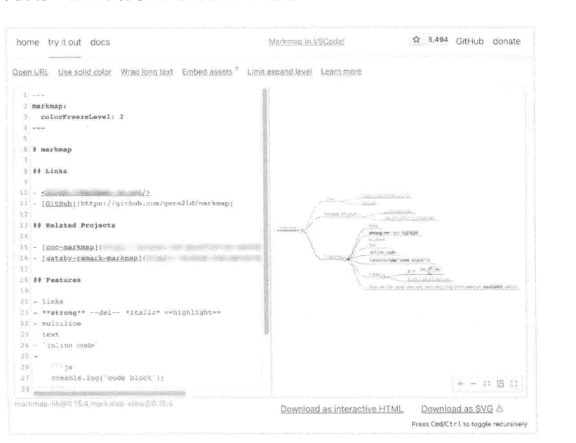
把整段示例内容选中后一并删除，效果见图5-4。

在左侧空白编辑区把来自 ChatGPT 的 Markdown 文本粘贴进去，粘贴完成后右侧会立刻呈现出对应的思维导图，见图5-5。
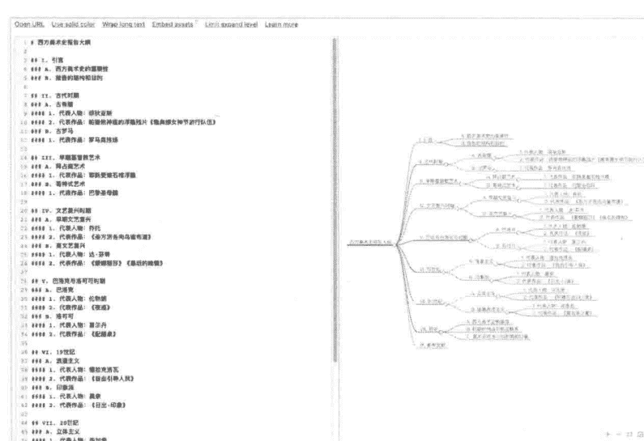
导图生成后即可按需求挑选样式进行导出，见图5-6。
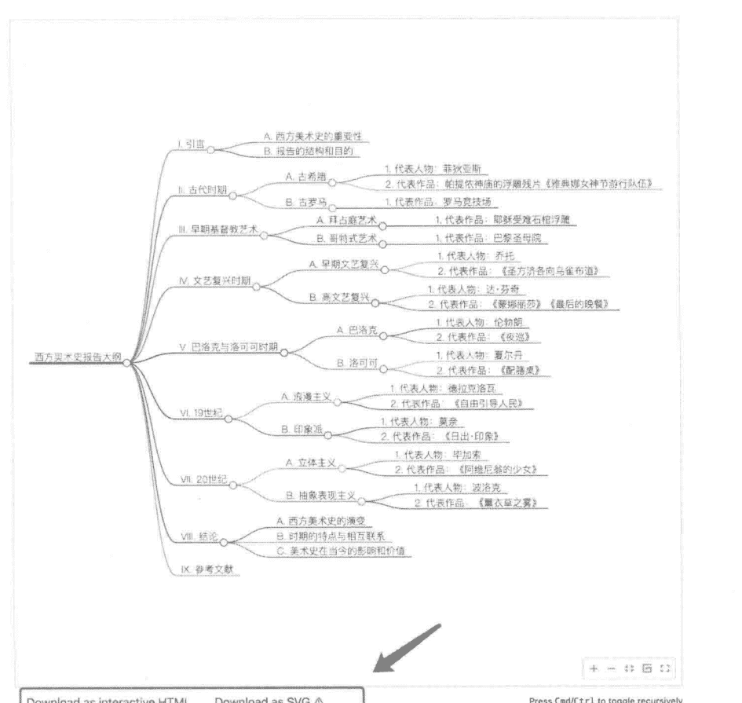
Markmap 目前只支持 HTML、SVG 两种导出格式，而且生成的图在排版微调和美化方面的自由度不高。若想得到更精致且可编辑的成果，可以改用更实用的专业绘制工具——XMind。

# 2. XMind 协作生成

XMind 是目前较为流行的一款思维导图软件，界面美观操作便捷，深受用户喜爱。下面介绍如何结合 ChatGPT 与 XMind 来生成导图。

先把 ChatGPT 输出的 Markdown 源码保存为 txt 格式，见图5-7。
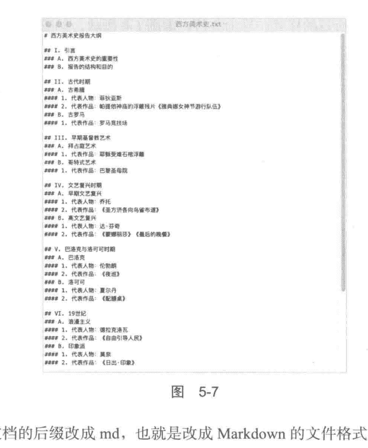
随后将该 txt 文件的后缀名改成 .md，变为 Markdown 格式文档，见图5-8。
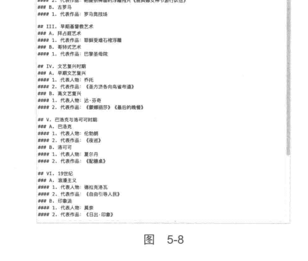
然后新建一个空白 XMind 工作簿，见图5-9。
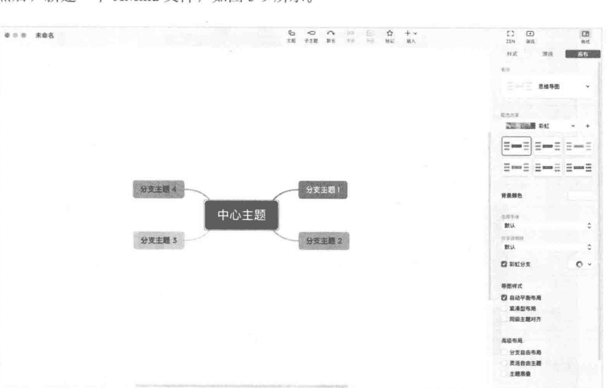
图 5-9
进入文件菜单，在导入选项里选择 Markdown，将前面准备好的 .md 文档载入，见图5-10。
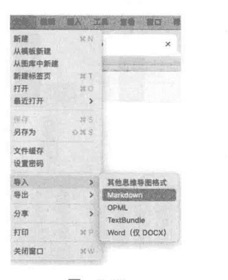
图 5-10
导入后 XMind 会自动生成对应的思维导图，见图5-11。

# 西方美术史
+   I. 引言
A. 西方美术史的重要性
B. 报告的结构和目的
+   II. 古代时期
A. 古希腊
1. 代表人物：菲狄亚斯
2. 代表作品：帕特农神庙的浮雕残片《雅典娜女神》
B. 古罗马
1. 代表作品：罗马竞技场
+   III. 早期基督教艺术
A. 拜占庭艺术
1. 代表作品：耶稣受难石棺浮雕
B. 哥特式艺术
1. 代表作品：巴黎圣母院
+   IV. 文艺复兴时期
A. 早期文艺复兴
1. 代表人物：乔托
2. 代表作品：《哀悼基督》
B. 高文艺复兴
1. 代表人物：达芬奇
2. 代表作品：《蒙娜丽莎》《最后的晚餐》
+   V. 巴洛克与洛可可时期
A. 巴洛克
1. 代表人物：伦勃朗
2. 代表作品：《夜巡》
B. 洛可可
1. 代表人物：夏尔丹
2. 代表作品：《鳐鱼》
+   VI. 19世纪
A. 浪漫主义
1. 代表人物：德拉克洛瓦
2. 代表作品：《自由引导人民》
B. 印象派
1. 代表人物：莫奈
2. 代表作品：《日出·印象》
+   VII. 20世纪
A. 立体主义
1. 代表人物：毕加索
2. 代表作品：《亚维农的少女》
B. 抽象表现主义
1. 代表人物：波洛克
2. 代表作品：《薰衣草之雾》
+   VIII. 结论
A. 西方美术史的演变
B. 时期的特点与相互联系
C. 美术史在当今的影响和价值
+   IX. 参考文献

生成后还能依据个人喜好调整主题样式，见图5-12。
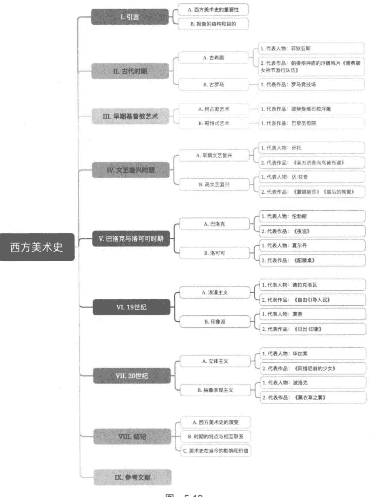
图 5-12
至此，西方美术史的思维导图就完成了。

无论用于学习梳理、项目规划、头脑风暴还是问题拆解，思维导图都是提升效率、激发创新的有力工具，在个人学习和团队协作中都能发挥重要作用。

### 5.5 PPT 智能生成
PPT 是商务办公、教育教学等场景的基础工具，做出美观吸睛的演示需要清晰大纲、合理版式和配图，制作门槛往往高于写文档。本节介绍两款 AI 工具，演示如何借助 ChatGPT 自动生成演示文稿。

#### 5.5.1 MindShow
MindShow 是一款能够根据文字大纲自动生成演示文稿的 AI 工具，可快速产出风格统一的幻灯片。

MindShow 首页界面如图5-13 所示。
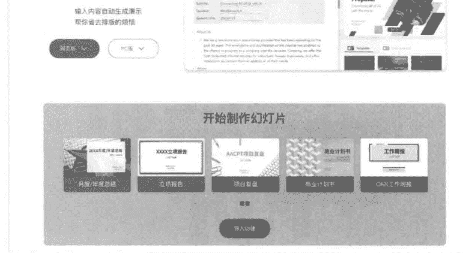
图 5-13
以下以前面制作好的西方美术史 Markdown 大纲为例演示流程。点击首页的“导入创建”，进入如图5-14 的页面。
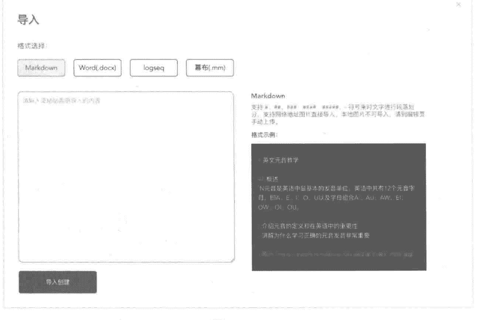
图 5-14
把 Markdown 文件内容复制进来，如图5-15 所示。
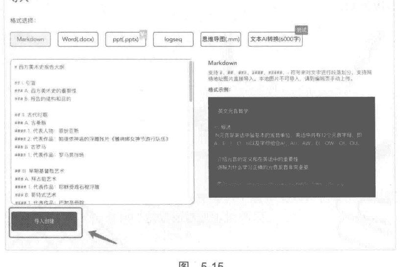
图 5-15
再点“导入创建”，系统开始自动生成，如图5-16 所示。

图 5-16
短短不到一分钟即可获得 PPT 初稿。右侧栏可挑选模板并微调排版风格，也能下载源文件备用。生成页面的部分效果可见图5-17、图5-18、图5-19。

图 5-17

图 5-18

图 5-19

#### 5.5.2 闪击 PPT
闪击 PPT 是一款基于云端的在线演示制作工具，提供丰富的模板、动画和图标。新建页面的样式如图5-20 所示。

图 5-20
点击“空白 PPT”上的加号会打开创作页，如图5-21 所示。

图 5-21
左侧输入区用于填写文字稿，右侧展示教程与编辑区。输入一个 = 号会弹出下拉菜单，可选择封面、目录、图文列表或大段文字，如图5-22 所示。
选择“封面”后会生成默认版式，按提示填入主题即可，如图5-23、图5-24 所示。


也可以先选“目录”，把目录文字填入文字框，如图5-25 所示。

填入后点击“文本转 PPT”，右侧会立刻生成两页 PPT，如图5-26 所示。

除手动编写外，还能让 ChatGPT 按格式生成闪击 PPT 可识别的 Markdown。提示词中要明确要求使用代码块输出，这样复制后可直接使用。示例提示与生成结果如下。

> 我的名字叫做黄豆奶爸，帮我制作一个内容为《西方美术史》的 PPT，要求如下。

第一，一定要使用中文。

第二，页面形式有 3 种：封面、目录、列表。

第三，目录页要列出内容大纲。

第四，根据内容大纲，生成对应的 PPT 列表页，每一页 PPT 列表页使用 ===== 列表 ===== 开头。

第五，封面页格式如下：

===== 封面 =====

# 主标题

## 副标题

演讲人：我的名字

第六，目录页格式如下：

====== 目录 ======

# 目录

## CONTENT

1. 内容

2. 内容

第七，列表页格式如下：

====== 列表 ======

# 页面主标题

1. 要点 1

要点描述内容

第八，列表页里的要点描述内容是对要点的详细描述，10 个字以上，50 个字以内。

最后，一定要使用代码块回复你生成的内容，切记切记。

```
====== 封面 ======
# 西方美术史
## 从古希腊到现代艺术
演讲人：我的名字
====== 目录 ======
# 目录
## CONTENT
1. 古希腊和古罗马时期
2. 中世纪
3. 文艺复兴时期
4. 巴洛克时期
5. 浪漫主义
6. 现代艺术
```
====== 列表 ======

# 古希腊和古罗马时期

1. 艺术特点

    塑造理想人物形象，追求平衡与和谐。

====== 列表 ======

# 中世纪

1. 哥特式风格

    高耸的尖拱、细长的柱子和精美的玫瑰窗。

====== 列表 ======

# 文艺复兴时期

1. 人文主义影响

    强调人的价值和地位，艺术回归自然与人性。

====== 列表 ======

# 巴洛克时期

1. 艺术风格

    重视装饰，强调动感，表现力丰富，色彩浓郁。

====== 列表 ======

# 浪漫主义

1. 情感表现

    重视个人情感和幻想，对自然的热爱和向往。

====== 列表 ======

# 现代艺术

1. 多元化趋势

    探索不同的艺术形式和表现手法，强调个性和创新。

Markdown 格式文本生成后点击“Copy code”复制到闪击 PPT，如图5-27 所示。
当然了，黄豆奶爸，下面是根据您的要求制作的《西方美术史》的PPT内容。
```
markdown
=======封面=======

# 西方美术史

## 从古希腊到现代艺术

演讲人：我的名字

=======目录=======

# 目录

## CONTENT
```
图 5-27
粘贴完成后再次点击“文本转 PPT”，如图5-28 所示。

图 5-28
系统会自动创建幻灯片，如图5-29 所示。

最终 PPT 的部分页面如图5-30、图5-31、图5-32 所示，需要调整样式可在中部进行优化。


图 5-31

图 5-32
熟练使用这两个工具后，精力可集中在内容提炼上，排版设计交给 AI，工作效率会大幅提升。

### 5.6 Excel 效率提升
Excel 是职场常用的数据工具，支持整理、汇总、分析、可视化，并内置大量数学统计函数。结合人工智能，数据处理正变得更智能。借助 ChatGPT，可快速掌握常用操作，从新手进阶到熟练用户。

#### 5.6.1 水果店收入利润核算示例
案例展示了一个水果店销量统计表，如图5-33 所示。

| A | B | C | D | E | F | G |
|---|---|---|---|---|---|---|
| 产品 | 进货价 | 销售价 | 销售数量 | 收入总和 | 投入成本 | 利润 |
| 苹果 | 2 | 5 | 20 | | | |
| 桔子 | 3 | 6 | 30 | | | |
| 芒果 | 4 | 10 | 40 | | | |
| 香蕉 | 3 | 8 | 10 | | | |
| 榴莲 | 25 | 40 | 50 | | | |
| 草莓 | 15 | 35 | 30 | | | |
| 樱桃 | 40 | 60 | 20 | | | |
| | | | 小计 | | | |
图 5-33

# 需求一：计算水果店的收入总和
先计算单品收入，向 ChatGPT 提问得到公式。

> 你现在是一位精通 Excel 的专家，帮我写一个 Excel 公式，计算表格中第二行水果的收入，C 列是水果销售价，D 列是水果销售数量。

> 当然可以，你想计算第二行水果的总收入，可以使用 C 列的价格与 D 列的数量相乘。以下是一个公式，你可以将它放在你想要显示结果的单元格中：

=C2*D2

这个公式会取 C2 单元格的值（也就是第二行水果的销售价）与 D2 单元格的值（也就是第二行水果的销售数量）相乘，从而得到第二行水果的总收入。

把公式填入 Excel 单元格，如图5-34 所示。

将鼠标放在 E2 右下角，出现黑色十字时向下拖拽，公式会被批量应用，其余水果收入自动算出，如图5-35 所示。

再求所有水果收入合计，向 ChatGPT 询问求和公式。

> > 请帮我写一个 Excel 公式，去求 E2 到 E8 中所有数的和。

>

> 当然！你可以使用 SUM 函数来求 E2 到 E8 单元格所有数的和。下面是这个公式：

> =SUM(E2:E8)

> 只需将这个公式放在你想要显示结果的单元格中，它就会计算 E2 到 E8 单元格所有数的总和。

把公式粘贴到 E9，回车即可得到总收入，如图5-36 所示。

也可以让 ChatGPT 直接给出一步到位的公式。

> > 帮我写一个 Excel 公式，计算收入总和，C 列是销售价，D 列是销售数量，数据范围从第 2 行到第 8 行。

> > 当然！你可以使用 SUMPRODUCT 函数来计算给定范围内的销售价和销售数量的乘积之和。下面的公式计算 C2 到 C8 和 D2 到 D8 的元素之间的点积，它会给出你所需的收入总和：

> 

> =SUMPRODUCT(C2:C8, D2:D8)

> 

> 这个公式会将 C2 到 C8 的销售价与 D2 到 D8 的销售数量相乘，然后将所有的乘积相加，从而得到收入总和。只需将这个公式放在你想要显示结果的单元格中即可。

把公式复制到 E10 后，按回车即可得到总收入，如图5-37 所示。

使用 SUMPRODUCT 时的计算逻辑是：先把两个区域对应元素相乘得到新序列，再对该序列求和，最终返回收入总和。

SUMPRODUCT 的计算逻辑很直观：它会把两个区域里位置对应的数值先做乘法，再把所有乘积汇总起来。以 SUMPRODUCT(C2:C8, D2:D8) 为例，就是把售价列和销量列逐行配对相乘，最后得到总营业额。

## 需求二：计算利润
接下来看怎样借助 ChatGPT 求出水果业务的盈利额。

这次的需求描述是：请给出计算利润的 Excel 公式，进货成本在 B 列，售价在 C 列，销量在 D 列，涉及的行是第 2 到第 8 行。

思路是先算出每件的毛利即售价减进货价，再用销量放大。SUMPRODUCT 能一次性完成这件事，写法如下：

=SUMPRODUCT((C2:C8 - B2:B8) * D2:D8)

先对 C2:C8 逐行减去 B2:B8 得到单位毛利，再与 D2:D8 的销量相乘，最后把 7 行的结果累加，便得到总利润。

把这段公式放到需要展示结果的单元格里就行，比如放在 G10 回车，立刻能看到利润数额，如图 5-38 所示。


图 5-38

#### 5.6.2 员工薪资表的实战玩法
下面以一份公司薪资表为例，如图 5-39 所示。

| 员工姓名 | 部门 | 薪资等级 | 薪水 | Email | 电话 |
|---|---|---|---|---|---|
| 张三 | 营销部 | 2 | 5000 | zhangsan@chatgpt.com | 15897868080 |
| 李四 | 人力资源部 | 3 | 6000 | lisi@chatgpt.com | 15897868081 |
| 王五 | 技术部 | 4 | 8000 | wangwu@chatgpt.com | 15897868082 |
| 赵六 | 营销部 | 3 | 6000 | zhaoliu@chatgpt.com | 15897868083 |
| 周七 | 财务部 | 2 | 5000 | zhouqi@chatgpt.com | 15897868084 |
| 五八 | 技术部 | 5 | 10000 | wuliu@chatgpt.com | 15897868085 |
| 陈九 | 人力资源部 | 2 | 5000 | chenjiu@chatgpt.com | 15897868086 |
| 林十 | 财务部 | 3 | 6000 | linshi@chatgpt.com | 15897868087 |
| 吴去 | 技术部 | 5 | 10000 | wuqu@chatgpt.com | 15897868088 |
| 不来 | 人力资源部 | 2 | 5000 | bulai@chatgpt.com | 15897868089 |

图 5-39

### 需求一：从薪资表中查找某位员工的薪水

> 请帮我写一个公式查找赵六的薪水，员工姓名在 A 列，薪水在 D 列，员工数据从 2 行开始，共有 10 行。

可采用 VLOOKUP 实现。假设姓名区间为 A2 到 A11，薪水区间为 D2 到 D11，公式为：

=VLOOKUP(“赵六”, A2:D11, 4, FALSE)

该公式会在 A2:A11 中定位“赵六”，随后返回同行第 4 列即 D 列的薪资。参数 4 表示返回列序号，FALSE 表示精确查找。

需要留意 VLOOKUP 的查找列必须在最左侧。若姓名顺序未排序，使用 MATCH 配合 INDEX 会更稳妥。

把公式粘贴到 C14 回车，就能迅速查到赵六的薪资，如图 5-40 所示。


也可以追问是否有别的实现方式。

> > 还有其他方法吗？

>
> 当然有，常用替代方案是 INDEX 与 MATCH 结合。示例为：
>
> =INDEX(D2:D11, MATCH(“赵六”, A2:A11, 0))
>
> 工作原理为：
>
> 1. MATCH 在 A2:A11 中找到“赵六”，返回其相对位置，0 代表精确匹配。
> 2. INDEX 根据该位置在 D2:D11 中取出对应数值。
>
> 相比 VLOOKUP，此法不依赖查找区域的排序。

把公式置于需要显示薪资的单元格即可。

把公式填入 C15 后，C15 显示了赵六的薪资，如图 5-41 所示。


同一查询需求，ChatGPT 分别给出两种定位思路找到赵六的记录。

### 需求二：统计营销部所有员工的薪资总和

> 请帮我写一个公式计算“营销部”部门薪资总和，部门在 B 列，薪水在 D 列，员工数据从第 2 行开始，共有 10 行。

可以使用 SUMIF 完成。设部门在 B2:B11，薪水在 D2:D11，公式为：

`=SUMIF(D2:D11, B2:B11, "营销部")`

公式会遍历 B2:B11，只要单元格等于“营销部”，就把对应 D 列的数值累加。

把公式放在要展示总额的单元格即可。

把公式填入 C18 后，营销部的薪资总额即可得知，如图 5-42 所示。


### 需求三：采集薪资表中的一部分数据

有时需要从表中抽取部分字段，例如从 E-mail 中截取 @ 前的用户名。

> > 我需要一个 Excel 公式，显示 E-mail 数据中 @ 前的内容。E-mail 在 E 列，E-mail 数据从第二行开始。

> 若要提取 E 列邮箱地址中 @ 之前的部分，可用 LEFT 与 FIND 组合。以 E2 为例，公式为：
> 
> =LEFT(E2, FIND("@", E2) - 1)
> 
> 先用 FIND 定位 E2 中 @ 的位置，再用 LEFT 取出该位置之前的所有字符。
> 
> 若要批量处理，可把公式放在第二行的对应单元格，然后向下填充。

把公式复制到 G2，再将鼠标移到 G2 右下角出现黑色十字时按住左键向下拖动，即可批量应用，如图 5-43 所示。


### 需求四：为每位员工制作一张薪资表
现在希望把每位员工的数据单独放到一张工作表，形成个人薪资表。

这需要用到 Microsoft Excel 中的宏功能。首先在菜单栏单击“工具”，在下拉菜单中选择“宏”，然后打开“Visual Basic 编辑器”，如图 5-44 所示。

① 我使用的是 Microsoft Excel for Mac 2023 版，版本号为 16.71。在不同版本的 Microsoft Excel 中，启动宏的方法不同。

5.6 用 ChatGPT 十倍速使用 Excel | 219


选中需要创建的工作表，双击工作表标签，打开 Visual Basic 编辑器，如图 5-45、图 5-46 所示。


接下来要编辑一段代码，把薪资表第 2 行到第 11 行的数据逐行提取，生成新的工作表并保留表头，新表以员工姓名命名。

可以用自然语言描述需求，让 ChatGPT 生成 VBA 代码：

> 请写一个基本的 Excel VBA 宏，用于将 salary 表单的第 2 行到第 11 行中每一行的数据转换为一个新的工作表，保留表头，新的工作表用员工姓名进行命名。

ChatGPT 给出的基础宏如下：

```
Sub CreateSheetsFromRows()
    Dim ws As Worksheet
    Dim newWs As Worksheet
    Dim i As Long
    Dim name As String
```

```
' 设定工作表
Set ws = ThisWorkbook.Sheets("salary")

' 复制表头到剪贴板
ws.Rows(1).Copy

' 遍历第2行到第11行
For i = 2 To 11
    ' 获取员工姓名
    name = ws.Cells(i, 1).Value

    ' 创建新工作表并命名
    Set newWs = ThisWorkbook.Sheets.Add(After:=ThisWorkbook.Sheets(ThisWorkbook.Sheets.Count))
    newWs.Name = name

    ' 粘贴表头
    newWs.Rows(1).PasteSpecial Paste:=xlPasteAll

    ' 复制和粘贴该行的数据
    ws.Rows(i).Copy
    newWs.Rows(2).PasteSpecial Paste:=xlPasteAll
Next i

' 清除剪贴板
Application.CutCopyMode = False

MsgBox "Operation Completed Successfully!", vbInformation
End Sub
```

请注意，该宏不会检查工作表名的有效性。如果姓名包含 \ / * ? [ ] 等非法字符，或工作表名重复，可能会报错。建议确保员工姓名适合用作工作表名，必要时可增加清理或重命名代码。

把 ChatGPT 生成的代码复制到 VB 代码编辑器中，然后单击执行按钮，如图 5-47 所示。

此时，代码编辑器左侧菜单栏会新增若干以员工姓名命名的表，如图 5-48 所示。

222 | 第5章 职场高效使用 ChatGPT


图 5-47


图 5-48

回到 Excel 表格中，就能看到按要求生成的每位员工薪资表，如图 5-49 所示。


图 5-49

作为辅助工具，ChatGPT 能帮助在 Excel 中实现较复杂的操作。不必精通公式、函数或编程，只要用自然语言把需求表达清楚，就能得到对应方案，大幅提升工作效率。

## 第6章 用 ChatGPT 提升生活质量

### 6.1 让 ChatGPT 成为健康管理助手
ChatGPT 在一定程度上可以提供健康和健身方面的初步建议。把年龄、性别、体重、身高、活动水平、健康状况及目标等信息提供给它，就能得到基础的锻炼和营养建议。但它不是医生，也不能替代专业医疗机构。

一个简单的咨询流程如下。

第一步，收集信息。先了解年龄、性别、体重、身高、运动习惯、既往病史以及目标如减脂、增肌或保持健康。

第二步，给出锻炼方案。基于信息给出初步计划，例如增肌建议阻力训练，减脂则建议有氧加抗阻的混合模式。

第三步，给出营养建议。可根据目标给出蛋白质、热量摄入等基础指导。

第四步，持续调整。随着体重、体能变化，ChatGPT 可对计划进行微调。

需要再次强调，虽然能提供基础建议，但不能替代专业医疗意见。开始新计划前最好咨询医生或健康专家。

下面以我为例，我是长期伏案工作的 36 岁男性，展示如何让 ChatGPT 给出量身定制的方案。

### 1. 分析身体状况，给出健身建议
根据我的描述，ChatGPT 从 4 个维度给出建议。

- 营养计划：提高热量和优质蛋白摄入。
- 锻炼计划：加入阻力训练、心肺训练以及瑜伽和普拉提。
- 睡眠休息：睡眠对恢复和增重很重要。
- 身体检查：不适时建议就医。

> 我是一名 36 岁的男性，体重 65 公斤，BMI 18，我想增重 10 公斤，我平时伏案工作比较久，经常觉得颈椎疼，背部疼痛，我需要锻炼我的心肺功能，增强体质，变得强壮，给我的儿子做一个榜样。

您好，根据您的描述，您希望增重、提升心肺功能并缓解颈椎与背部疼痛，这需要饮食调整和训练配合。

1. 营养计划
增重核心是摄入大于消耗。建议每天多摄入约 500~1000 卡路里①，以每周增重 0.5~1 千克为目标。可增加鸡肉、鱼、蛋、奶、豆腐、豆类等高蛋白食物，同时补充坚果、牛油果、橄榄油、全麦、糙米、燕麦等健康脂肪与碳水。

2. 锻炼计划
- 阻力训练：通过举重等增加肌肉量，有助增重。每周 2~3 次全身训练，如深蹲、硬拉、卧推、引体向上。
- 心肺训练：跑步、游泳、骑行等有氧运动提升心肺，每周 2~3 次，每次约 30 分钟。
- 瑜伽或普拉提：改善姿势，缓解颈椎和背部疼痛，每周 1~2 次。

3. 睡眠和休息
睡眠对恢复和增重至关重要，建议保证每天 7~9 小时高质量睡眠。

4. 检查
若颈背疼痛持续，建议就医排查其他健康问题。

开始新计划前，最好先咨询医生或注册营养师。他们可根据个人情况给出具体建议。

除了身体健康，也可向孩子展示坚持锻炼、健康饮食、充足休息以及积极态度的榜样。

① 1000 卡路里 ≈ 4186 焦耳。 ——编者注

### 2. 根据身体情况，制订一周锻炼计划
从周一到周日，ChatGPT 安排了每天约 30 分钟的训练，多可在家完成，对在家办公的人很实用。

> 根据上述情况，你能为我制订一个贯穿一周的锻炼计划吗？从周一开始，到周日结束。

可以，以下是一个示例周计划，包含阻力、有氧以及瑜伽/普拉提。开始前建议咨询医生或教练，并根据自身情况调整。

周一
阻力训练：全身训练，深蹲、硬拉、卧推、引体向上等，每个动作 3 组，每组 8~12 次。

周二
有氧运动：30 分钟慢跑或快走。

周三
瑜伽或普拉提：放松肌肉，缓解颈椎和背部疼痛。

周四
阻力训练：全身训练，重复周一内容。

周五
有氧运动：30 分钟骑自行车或游泳。

周六
瑜伽或普拉提：放松肌肉，缓解颈椎和背部疼痛。

周日
休息：充足休息有助于身体恢复和适应。

该计划偏向全面基础型。每次训练前做 5~10 分钟热身，训练后做 5~10 分钟拉伸。随着素质提升，可逐步增加强度和时长。

### 3. 将计划制成表格
ChatGPT 还能把计划做成表格形式。

请把锻炼计划制成表格。

| 天数 | 训练内容 |
| :--- | :--- |
| 周一 | 阻力训练：全身训练，包括深蹲、硬拉、卧推、引体向上等动作。每个动作3组，每组8~12次。 |
| 周二 | 有氧运动：30分钟慢跑或快走。 |
| 周三 | 瑜伽或普拉提：用来放松肌肉，缓解颈椎和背部疼痛。 |
| 周四 | 阻力训练：全身训练，重复周一的锻炼。 |
| 周五 | 有氧运动：30分钟骑自行车或游泳。 |
| 周六 | 瑜伽或普拉提：用来放松肌肉，缓解颈椎和背部疼痛。 |
| 周日 | 休息 |

表中有些动作我不太清楚，可以继续让 ChatGPT 进一步解释。

请对全身训练，包括深蹲、硬拉、卧推、引体向上等动作进行更详细的解释，每一个动作应该如何做，以及瑜伽和普拉提应该做哪些动作。

运动动作要点与训练方案参考

下面是对常见动作要点的整理。因为无法提供图示或视频，描述会尽量具体。若对标准做法不确定，建议在开始训练前先向专业教练请教，确保动作安全。

全身力量训练动作

1. 深蹲。双脚打开与肩同宽，脚尖略微外展。保持躯干挺直、视线向前，像要坐到椅子上一样让臀部向后下沉，膝盖随之弯曲。下放到大腿与地面大致平行，或按自身活动度可安全下放的范围即可，再用腿部力量推起恢复站姿。

2. 硬拉。站在杠铃前，双脚与肩同宽。用髋部屈膝下蹲，保持腰背平直，双手握住杠铃。以臀部和大腿为主要发力点将杠铃向上提，直至站直、臀部前送，背部、臀部、腿部完全伸展。随后缓慢放回地面，重复。

3. 卧推。仰卧于卧推凳，双膝屈曲、双脚稳放在地面。双手握杠，肘部与肩相对。慢慢将杠铃降至胸前，再用力推起使手臂完全伸直。随后控制下降，重复。

4. 引体向上。面朝横杆站立，双掌向前握杆，臂部完全伸直。借助上身力量向上提拉，直至下颌超过横杆。之后缓慢下放至起始伸直位，再次重复。

瑜伽与普拉提动作

瑜伽

- 山式。双脚并拢站立，双臂自然下垂。吸气时提脚掌，呼气时脚掌平稳落回地面，保持脊柱延展，深呼吸。

- 穿针引线式。四肢支撑地面，右臂向左侧穿过，置于左手左膝之间，右脸颊贴地。维持数秒后换侧。

- 小狗伸展式。四肢着地，缓慢向前伸展双手直至额头触地，保持几秒。

普拉提

- 脊柱弯曲。仰卧于地面，双膝弯曲、双脚平放。缓慢抬起骨盆，保持双脚与肩部接触地面，随后慢慢放下，重复。

- 双腿伸展。仰卧，双膝弯曲、双腿靠近胸部，双手扶膝。随后同时伸直双腿与双臂，再屈膝回抱，重复。

- 剪刀。仰卧，双腿伸直向上抬起。用一只手固定一只脚踝，另一条腿缓慢下降，交换腿重复。

开始新的锻炼计划前，请务必先征求医生或专业健身教练的意见。

## 4. 锻炼方案的灵活调整与优化

可以根据实际情况，让 ChatGPT 帮助调整已有的锻炼方案。

> 我平时没时间去健身房，也不能使用器械，能否换成自重训练，并以表格形式呈现？

可以。以下是一份仅使用身体重量的训练安排。所有练习需在适应范围内进行，若感到过度疲劳或疼痛，应暂停并休息。

| 星期一 | 星期二 | 星期三 | 星期四 | 星期五 | 星期六 | 星期日 |
| :--- | :--- | :--- | :--- | :--- | :--- | :--- |
| 俯卧撑 × 20 | 深蹲 × 20 | 休息 | 俯卧撑 × 20 | 深蹲 × 20 | 休息 | 休息 |
| 山地攀登者 × 30 | 引体向上 × 10 | 休息 | 山地攀登者 × 30 | 引体向上 × 10 | 休息 | 休息 |
| 引体向上 × 10 | 山地攀登者 × 30 | 休息 | 引体向上 × 10 | 山地攀登者 × 30 | 休息 | 休息 |
| 深蹲 × 20 | 俯卧撑 × 20 | 休息 | 深蹲 × 20 | 俯卧撑 × 20 | 休息 | 休息 |
| 休息 | 休息 | 休息 | 休息 | 休息 | 休息 | 休息 |

俯卧撑主要激活胸部、肩部和三头肌。双手略宽于肩置于地面，脚尖支撑，身体保持直线，下压至胸部接近地面后再回到起始位。

深蹲主要针对大腿与臀部。双脚与肩同宽，脚尖微外展，屈膝下沉臀部直至大腿与地面平行，再站起。

引体向上主要锻炼背部和臂部。找到可供悬挂的支点，手臂伸直悬垂后发力向上拉至下颌高于支点，再缓慢放下。

山地攀登者属于有氧类全身练习。从俯卧撑姿势开始交替收腿向胸部，如同原地奔跑。

任何新的锻炼计划都应在启动前咨询医生，尤其是存在健康问题或长期未训练的情况。

你打算坚持这个计划几周？一般建议首次尝试新方案至少进行 6 到 8 周，让身体适应新的刺激。期满后可根据进展与感受评估效果并做调整。

每个人体质差异较大，负荷与强度需逐步摸索。若训练中出现过度疲劳或不适，应立刻停止并寻求医疗建议。

力量和耐力的提升离不开合理饮食。保证充足蛋白质和营养以帮助肌肉修复与增长，必要时可咨询专业营养师。

最后要记住，锻炼是长期过程，保持耐心与积极心态才会看到变化。

## 5. 基于训练需求规划饮食

还能让 ChatGPT 按训练方案制定饮食计划。

我的基础代谢约 1600 千卡/天，运动后约 2300 千卡/天，以此数据能否为我制定一周健康饮食计划，目标 3 个月增重 6 公斤？请以表格呈现。

若 3 个月增重 6 公斤，约每周增 0.5 公斤。需每日多摄入约 500 千卡，即摄入约 2800 千卡（基础 1600 + 运动消耗 700 + 增重 500）。以下为 2800 千卡参考的一周安排。

| 时间 | 周一 | 周二 | 周三 | 周四 | 周五 | 周六 | 周日 |
|---|---|---|---|---|---|---|---|
| 早餐 | 燕麦粥 + 全脂牛奶 + 坚果 | 全麦面包 + 鸡蛋 + 牛奶 | 燕麦粥 + 全脂牛奶 + 坚果 | 全麦面包 + 鸡蛋 + 牛奶 | 燕麦粥 + 全脂牛奶 + 坚果 | 全麦面包 + 鸡蛋 + 牛奶 | 燕麦粥 + 全脂牛奶 + 坚果 |
| 午餐 | 鸡胸肉 + 糙米 + 绿叶蔬菜 | 瘦猪肉 + 糙米 + 绿叶蔬菜 | 鸡胸肉 + 糙米 + 绿叶蔬菜 | 瘦猪肉 + 糙米 + 绿叶蔬菜 | 鸡胸肉 + 糙米 + 绿叶蔬菜 | 瘦猪肉 + 糙米 + 绿叶蔬菜 | 鸡胸肉 + 糙米 + 绿叶蔬菜 |
| 下午茶 | 酸奶 + 坚果 + 水果 | 果汁 + 烤鸡胸肉 + 水果 | 酸奶 + 坚果 + 水果 | 果汁 + 烤鸡胸肉 + 水果 | 酸奶 + 坚果 + 水果 | 果汁 + 烤鸡胸肉 + 水果 | 酸奶 + 坚果 + 水果 |
| 晚餐 | 鱼 + 全麦面包 + 蔬菜沙拉 | 牛排 + 全麦面包 + 蔬菜沙拉 | 鱼 + 全麦面包 + 蔬菜沙拉 | 牛排 + 全麦面包 + 蔬菜沙拉 | 鱼 + 全麦面包 + 蔬菜沙拉 | 牛排 + 全麦面包 + 蔬菜沙拉 | 鱼 + 全麦面包 + 蔬菜沙拉 |
| 夜宵 | 牛奶 + 水果 | 牛奶 + 水果 | 牛奶 + 水果 | 牛奶 + 水果 | 牛奶 + 水果 | 牛奶 + 水果 | 牛奶 + 水果 |

计划以均衡饮食为主，重点保证蛋白质摄入。此为参考建议，最好咨询专业营养师获得个性化方案。

再让 ChatGPT 依饮食计划列出采购清单。

> 根据以上饮食计划，帮我列出一周采购清单，计算每种食物的总量，用表格列出。

以下是按一周饮食计划估算的采购参考，实际用量会因口味和烹饪方式略有差异。

| 食物 | 数量 |
|---|---|
| 燕麦 | 700 克 |
| 全脂牛奶 | 7 升 |
| 坚果 | 700 克 |
| 全麦面包 | 14 片 |
| 鸡蛋 | 14 个 |
| 鸡胸肉 | 2.1 公斤 |
| 瘦猪肉 | 1.4 公斤 |
| 糙米 | 1.4 公斤 |
| 绿叶蔬菜 | 2.1 公斤 |
| 酸奶 | 2.1 公斤 |
| 果汁 | 2 升 |
| 水果 | 按个人喜好选择 |
| 鱼 | 2.1 公斤 |
| 牛排 | 1.4 公斤 |
| 蔬菜沙拉 | 按个人喜好选择 |

食物量为估算，操作时请按个人口感和习惯微调。采购时优先选择新鲜、无添加的食材。若执行后体重未按预期增长，可能需要进一步增加热量或请营养师协助。

有了清单即可集中采购，节省时间。食材备齐后还可让 ChatGPT 提供每餐的做法。

## 6. 提升健康的其他实用建议

> 还有其他改善身体健康的方法吗？

除运动和饮食外，以下方面也有助于健康。

- 规律作息：保证充足睡眠，建立稳定起居习惯。
- 心理健康：保持积极心态，用冥想、阅读、社交等方式缓解压力。
- 水分摄入：维持体内水液平衡，建议每日饮水不少于 8 杯。
- 减少久坐：长时间坐着时每小时起身活动几分钟，伸展放松。
- 压力管理：练习深呼吸、瑜伽等放松技巧。
- 定期体检：监测血压、血糖、胆固醇等指标，及时接种疫苗。
- 避免不良习惯：戒烟限酒。
- 社交支持：与家人朋友保持联系，积极参与社交。

健康是多维度综合结果，需循序渐进。必要时请咨询医生或专业人士。

通过以上示例可看出 ChatGPT 可作为私人健康顾问提供饮食、锻炼、心理、生活习惯等方面的参考建议。

除建议外，ChatGPT 还能解答疾病预防、常见症状、药物副作用等一般性健康知识。但它并非医生，不能现场诊断或制定个性化治疗方案。建议将 AI 建议作为参考，并与专业医疗意见结合。

### 6.2 用 ChatGPT 策划家庭出游

家庭旅行是放松与增进感情的好机会。但缺乏规划易导致行程混乱、错过体验甚至产生麻烦。

全家出行规划需兼顾每位成员需求、时间、预算、目的地气候交通等信息，工作量大。有了 ChatGPT，规划会更高效。你只需提供目的地、时长、预算、家庭人数与偏好，ChatGPT 就能给出包含景点、餐饮、住宿等详细方案，并根据反馈快速调整，如同私人旅行顾问。

下面以新加坡为例进行演示。

## 1. 出行前了解气候特征、最佳出游时间、风土人情等

> 你现在是一名资深国际导游，我想去新加坡旅行，请告诉我最佳旅游时间、当地天气、旺季和理想出行期。

新加坡属热带雨林气候，全年湿热。但部分时段更适合出行。

最佳旅游时间通常为 2 月至 10 月的相对干季，降雨较少，平均气温约 30 摄氏度，利于户外活动。

旅游旺季集中在 7、8 月及春节、新年等假期，游客较多，景点拥挤，酒店价格偏高。若想避开人潮，可选择其他时段。

理想出行期取决对天气与人流的偏好。干季温暖适合户外，凉爽月份降雨可能增多，需做好防雨准备。

> 新加坡必看景点有哪些，请给出受欢迎景点列表，含历史、开放时间、门票价格，用表格。

| 景点名称 | 历史简介 | 开放时间 | 门票价格 |
| :--- | :--- | :--- | :--- |
| 乌节路 | 新加坡著名购物街，以奢侈品牌和五星酒店闻名，历史上为交通商业要道，现为购物美食集中地。 | 全天开放 | 免费，店内消费另计 |
| 新加坡动物园 | 1973 年建立，园内 28 公顷，涵盖 300 多物种约 2800 只动物。 | 每天 8:30 - 18:00 | 约 S$ 48 成人，S$ 33 儿童 |
| 圣淘沙岛 | 人工岛，含度假酒店、高尔夫、马林生态公园等。原为渔村，1972 年起开发为旅游区。 | 全天开放，个别景点时间不同 | 入岛免费，部分景点收费 |
| 滨海湾花园 | 占地 101 公顷，2012 年开放，含花穹与云雾森林，展示不同环境植物。 | 每天 9:00 - 21:00 | 约 S$ 53 成人，S$ 40 儿童 |
| 新加坡国家博物馆 | 全国最古老博物馆，可追溯至 1849 年，聚焦新加坡历史与文化。 | 每天 10:00 - 19:00 | 约 S$ 10 成人，S$ 7 儿童老人 |
| 滨海艺术中心 | 位于滨海湾，2002 年开放，举办音乐、舞蹈、戏剧等演出，建筑具地标性。 | 按演出活动而定 | 按演出活动而定 |

价格与时间可能变动，出行前请核实最新信息。

当地习俗与文化要点

穿着：国家多元，着装宽松为主，炎热气候建议轻便。正式场合需稍正式。

礼貌：使用“请”“谢谢”，保持友善包容。探访家庭或寺庙时脱鞋并遵守规定。

多元文化：尊重不同种族宗教，避免冒犯性言论行为。

语言：官方语言为英语、中文、马来语、泰米尔语。英语普及，沟通通常无障碍。

行为禁忌：公共场所禁烟，严禁乱扔垃圾。宗教场所需遵守特定礼仪。

总体而言，尊重、友善、包容是与当地人交往的关键。

## 2. 预订机票、酒店

ChatGPT 可接入联网插件查询实时航班酒店信息。以下示例查询重庆至新加坡 2023 年 8 月 10 日航班。

| 起飞城市 | 到达城市 | 价格 (CNY) | 起飞时间 | 到达时间 | 飞行时间 (小时) | 中转次数 | 预订链接 |
| :--- | :--- | :--- | :--- | :--- | :--- | :--- | :--- |

重庆—新加坡近期航班参考

| 重庆市 | 新加坡 | 1586 | 2023-08-10 11:10 | 2023-08-10 20:05 | 8.92 | 1 | 预订 |
| 重庆市 | 新加坡 | 1586 | 2023-08-10 11:10 | 2023-08-10 21:40 | 10.5 | 1 | 预订 |
| 重庆市 | 新加坡 | 1586 | 2023-08-10 11:10 | 2023-08-11 00:55 | 13.75 | 2 | 预订 |
| 重庆市 | 新加坡 | 1677 | 2023-08-10 20:45 | 2023-08-11 14:05 | 17.33 | 1 | 预订 |
| 重庆市 | 新加坡 | 2385 | 2023-08-10 14:00 | 2023-08-10 22:15 | 8.25 | 1 | 预订 |
| 重庆市 | 新加坡 | 2904 | 2023-08-10 08:25 | 2023-08-10 13:25 | 5 | 0 | 预订 |

航班供给会随运营情况波动，时刻、价格与余位都可能变动，建议尽早确认并完成预订。

## 3. 新加坡美食与在地体验指南

来说说新加坡值得尝的代表性菜式。

新加坡是多文化交汇的味觉城市，马来、华人、印度与西方影响交织。以下几样颇具代表性。

- 1. 海南鸡饭：以鸡汤与香料焖煮的白切鸡搭配油饭，肉质细嫩多汁，米饭吸足药膳香气，是国菜级别的经典。
- 2. 辣椒螃蟹：整只螃蟹裹上酸甜微辣的酱汁，底料融合辣椒、番茄与蛋黄，浓郁开胃，辣度温和不燥。
- 3. 肉骨茶：用猪肋排与大蒜花椒及多种药材长时间熬煮成汤，汤色浓郁香气厚重，名字虽带茶实为汤品。
- 4. 拉茶：黑茶与炼乳经多次抛洒拉合，融合顺滑，甜度适中，口感丝滑。
- 5. 椰浆饭：米饭以椰浆同煮，再配鱼片、鸡肉或牛肉，奶香与海味并存，风味独特。
- 6. 加耶吐司：烤面包抹上椰子酱 Kaya 与黄油，常与半熟蛋、咖啡或茶同食，是经典早餐组合。

以上只是冰山一角，整体饮食体系丰富，建议亲自探索。

> 想找交通方便、人均约500元、偏东南亚料理与海鲜的知名馆子。

新加坡海鲜与本地菜选择众多，以下几家符合口味与预算。

- 1. Jumbo Seafood：新加坡河畔的海鲜名店，辣椒螃蟹与黑胡椒螃蟹极具名气，周边交通便利。
- 2. Long Beach Seafood Restaurant：备受好评的海鲜餐厅，辣椒与黑胡椒螃蟹出色，东海岸公园分店最知名。
- 3. 328 Katong Laksa：主打叻沙的专卖店，椰浆咖喱面汤浓味足，位于加东区，乘车方便。
- 4. The Blue Ginger：提供马来与新加坡传统菜式，肉骨茶与海南鸡饭皆可，坐落丹戎巴葛，公共交通便利。
- 5. Song Fa Bak Kut Teh：肉骨茶老字号，新加坡多处设有分店，去程返程都易达。

仅作参考，本地美食选择远不止于此。

238 | 第6章 用ChatGPT提升生活质量

想带纪念品与礼物回国，新加坡购物选择多样。

- 1. 乌节路：新加坡核心购物带，乌节中心、怡丰城、宝莎等高端商场林立，汇聚国际品牌。
- 2. 滨海湾金沙购物中心：地处滨海湾的豪华综合体，奢侈品牌、精品餐厅与娱乐设施集中。
- 3. 小印度：印度风格小店云集，手工品、香料与纺织品丰富，适合挑选独特色彩的纪念物。
- 4. 唐人街：售卖茶叶、丝绸、瓷器等中式商品，同时有不少新加坡本地特色纪念品店。
- 5. 阿拉伯街：文化氛围浓厚，手工艺品、地毯与纺织品选购方便。
- 6. Mustafa Centre：24小时营业的大型综合商场，电子产品、珠宝、化妆品与食品齐全，价格亲民。

整体购物资源丰富，可按需求灵活搭配。

想了解游客较少的小众景点与活动。

- 1. 乌敏岛：新加坡东北部的传统甘榜遗存，可骑行探访湿地、雨林与马来村落原貌。
- 2. 植物园学习之森：展示原生林生态的区域，有湿地、雨林与多样野生动植物。
- 3. 新加坡艺术之家：位于旧国会大厦内的独立艺术空间，常举办展览与艺术活动。
- 4. 地下音乐场景：The Substation、Blue Jazz 等小型酒吧与Live House 常有现场演出。
- 5. 街头艺术：哈芝巷、小印度、圣淘沙等地可邂逅不少壁画与装置作品。
- 6. 夜间野生动物园：全球首个夜间动物园，可观赏夜行动物活动。

以上只是部分未被广泛曝光的体验，新加坡仍有许多待挖掘角落。

## 4. 翻译助手实操

我想去新加坡环球影城，翻译成英语。

I want to visit Universal Studios Singapore.

要付多少出租车费用，翻译成英语。

How much do I need to pay for the taxi?

办理酒店入住的常用英语表达。

1. 到达并打招呼
您：Hello, I have a reservation under the name of [ 您的名字 ].
服务员：Hello, welcome to [ 酒店名称 ]. Let me check your reservation.

2. 确认预订
服务员：Yes, I see your reservation for a [ 房间类型 ] for [ 入住天数 ] nights. Is that correct?
您：Yes, that's correct.

3. 询问设施服务
您：What time is breakfast served? / Does the hotel have wi-fi? / Where is the gym located?
服务员：Breakfast is served from 7 to 10 am. / Yes, the hotel has free wi-fi. The password is... / The gym is on the second floor.

4. 完成手续
服务员：Here is your room key. Your room number is [ 房间号码 ]. Enjoy your stay!
您：Thank you!

5. 额外需求
您：Could you please arrange a wake-up call for 7 am? / Could you please send an extra towel to my room?
服务员：Sure, I will arrange that for you.

以上为基础会话，具体会按酒店服务与个人需求调整。

用礼貌语气询问路人前往新加坡美术馆。

Excuse me, could you please tell me how to get to the Singapore Art Museum?

## 5. 行前准备与证件办理

一周新加坡行如何规划与收拾行李。

七日参考行程。
第一天：抵达后休整，傍晚逛乌节路购物，晚上登滨海湾金沙空中花园看夜景。
第二天：新加坡动物园与夜间野生动物园，感受自然生态。
第三天：滨海湾花园与云雾森林，夜赏滨海湾灯光秀。
第四天：科学艺术博物馆与国家博物馆，了解历史文化。
第五天：圣淘沙水上乐园与环球影城，黄昏在圣淘沙海滩看日落。
第六天：小印度与阿拉伯街购物，品尝地道小吃。
第七天：沿新加坡河漫步，游览鱼尾狮公园与克拉码头，夜生活可延伸至酒吧区。

行李建议。
新加坡属热带湿润气候，全年约23~33℃，建议携带轻薄夏装、短袖短裤、裙装、沙滩装与泳衣。强紫外线需备防晒霜、墨镜与遮阳帽。商场与酒店空调偏冷，可备一件薄外套或围巾。

必备物品包括护照、银行卡与少量现金、手机及充电器、新加坡使用英式三孔插头的转换插头、个人护理用品与常用药品。

护照与签证办理流程。

办理护照
- 在公安部出入境管理局官网预约申请时段。
- 按时携带身份证、户口本等材料与照片前往窗口。
- 填写申请表并提交资料，缴纳费用。
- 等待制证完成后按通知领取。

办理新加坡签证
- 从新加坡移民与关卡局官网下载并填写签证申请表。
- 准备护照、身份证、在职证明、存款证明、往返机票与酒店预订等材料。
- 将申请表与材料递交新加坡驻华使领馆或授权旅行社。
- 缴纳费用后等待审批，获批后护照上贴签。

具体要求会随政策变动，建议出发前核实最新规定。

## 6. 预算规划

> 以每晚住宿1000元人民币、每餐人均100元、购物5000元，家庭2大1小赴新加坡一周，含往返机票需准备多少？

航班参考。

| 价格 | 航班 | 出发 | 到达 | 时长 | 中转 | 预订 |
|---|---|---|---|---|---|---|
| 1092 元 | 中国南方航空 | 重庆 (CKG) 2023-08-10 16:25 | 新加坡 (SIN) 2023-08-10 21:25 | 5 小时 | 无 | 点击预订 |

单程1092元，往返为1092×2×3人=6552元。

分项估算：
- 住宿：1000元×7晚=7000元
- 餐饮：100元×3餐×7天×3人=6300元
- 购物：5000元
- 机票：6552元

合计约24852元。

此为粗略估算，未计交通、门票等额外开销，实际花费会因行程与消费习惯差异。

借助ChatGPT可快速搭建行程初稿并获取攻略与注意事项，但航班、酒店、门票等实时信息仍需以官方渠道为准，在初稿基础上复核与完善能大幅提升效率。

### 6.3 让 ChatGPT 成为你的私厨顾问

本节涉及GPT-4自定义指令功能。

升级后可设定角色与输出偏好，无需每次重复说明，提升效率与一致性。

例如将自己定义为美食达人，任务是设计不同风味食谱；要求模型扮演专业厨师，提供食材清单与做法，并遵循中国口味与易得食材。

可根据忌口与偏好预设规则，如甜品师常用原料或禁止食材。


图 6-1

设定完成后即可下具体指令。

示范方向包括家常快手菜、特色风味、婴幼儿辅食、健康减脂餐、一周晚餐计划、素食与下午茶等，也可让其为小红书美食账号提供运营建议。

### 1. 家常菜

> 请为我设计 3 道适合上班族的快手午餐食谱。

建议如下，制作简便、营养均衡、符合常见口味。

- 1. 蔬菜炒鸡蛋
  - 食材：鸡蛋2个，青红黄椒各1个，葱末适量。
  - 做法：打散鸡蛋，彩椒切块，起油锅先煎蛋至微黄盛出，再炒椒与葱末，最后回锅快炒拌匀。
  - 特色：营养丰富、鲜嫩清爽、耗时短。

- 2. 黑椒牛肉炒面
  - 食材：牛肉100克，面条200克，胡萝卜半根，青菜适量，黑椒酱适量。
  - 做法：牛肉切片，胡萝卜切丝，青菜切段，面条煮熟，锅中爆炒牛肉至变色，加入蔬菜同炒，最后与面条及黑椒酱快炒。
  - 特色：蛋白与蔬菜兼顾，口感扎实。

- 3. 番茄鸡胸肉炖饭
  - 食材：鸡胸肉200克，大米150克，番茄2个。
  - 做法：鸡胸切块，番茄切块，米洗净入电饭煲，与肉与番茄同放，加入适量水启动煮饭程序。
  - 特色：操作简便，低脂高饱腹感。

### 2. 特色风味美食

请为我设计 3 道麻辣风味的川菜食谱。

- 1. 麻辣鱼
  - 食材：草鱼1条，花椒粒、干辣椒适量，大葱1根，生姜3片，大蒜3瓣，生抽、料酒适量。
  - 做法：鱼洗净切块用料酒生抽腌15分钟，热油炸香花椒与干辣椒后捞出，再爆香葱姜蒜，下鱼块翻炒，最后撒回花椒辣椒继续翻炒。
  - 特色：麻辣鲜香，鱼肉嫩滑。

- 2. 水煮牛肉
  - 食材：牛肉200克，豆芽200克，生菜100克，豆瓣酱、花椒粒、干辣椒适量。
  - 做法：牛肉切片腌制，豆芽生菜煮熟垫底，锅中炒香豆瓣酱、花椒、干辣椒加水煮沸，下牛肉片煮熟，盛于菜上淋汤汁。
  - 特色：麻辣浓烈，肉质弹嫩。

- 3. 麻辣豆腐
  - 食材：嫩豆腐1块，猪肉100克，豆瓣酱、花椒粒、干辣椒适量。

川式麻辣豆腐焖肉丝

操作要点：豆腐切成均匀小块，猪肉改切细丝。锅中烧热油，先下花椒粒与干辣椒爆香，再放入肉丝快炒至颜色转淡，随后下入豆瓣酱持续翻炒至油色红亮。最后把豆腐块放入，小火焖约10分钟，让豆腐充分吸收汤汁入味后出锅。

口感特点：豆腐细嫩，整体带麻辣鲜香，配上肉丝后口感层次更丰富。

这是一套川菜麻辣风味的思路，祝你尝得愉快。

### 3. 婴幼儿辅食
请为3岁左右的小朋友设计3道辅食食谱。

可以，下面三款兼顾营养易消化，口味也更贴合幼儿。

## 1. 鸡蛋番茄炖豆腐
- 配料：嫩豆腐1块、西红柿1个、鸡蛋1个、盐少许
- 步骤：豆腐与西红柿均切小丁，鸡蛋打散。先把豆腐丁在沸水中焯2~3分钟捞出。锅中放入西红柿块小火炖软，再加入豆腐丁与蛋液，撒少许盐，慢慢收至浓稠即可。
- 亮点：营养全面，质地细嫩，约3岁孩童很合适。

## 2. 南瓜燕麦粥
- 配料：南瓜50克、燕麦30克、牛奶适量
- 步骤：南瓜去皮切块，燕麦用清水泡30分钟。南瓜块煮至绵软后加入燕麦同煮约10分钟，最后倒入牛奶拌匀煮沸即可。
- 亮点：膳食纤维与微量元素丰富，口感顺滑，利于儿童消化。

## 3. 菠菜红薯面
- 配料：菠菜50克、红薯100克、面条50克
- 步骤：红薯切块蒸熟，菠菜洗净焯水。将菠菜与熟红薯一起打成泥，面条煮熟后与泥料拌匀即可。
- 亮点：营养充足、味道温和，含β-胡萝卜素、维生素C与铁，有助增强体质。

以上三款适合约3岁儿童。准备时注意食材新鲜卫生，切块大小要适合咀嚼吞咽。

## 4. 健康减脂餐
最近有减脂计划，请设计3道营养健康的减脂餐。

可以为你安排三道低脂高蛋白的餐点。减脂并非剥夺味蕾，而是更聪明的选择，多蔬果与优质蛋白。

### 1. 鸡胸肉炒时蔬
- 配料：鸡胸肉100克、胡萝卜50克、西兰花50克、洋葱50克、橄榄油、黑胡椒适量
- 步骤：鸡胸肉切块，用黑胡椒与少量橄榄油腌一下。胡萝卜、洋葱切丝，西兰花掰小朵。热锅加橄榄油，把鸡胸肉煎至两面金黄，再下蔬菜快炒至断生即可。
- 亮点：鸡胸肉高蛋白低脂，蔬菜提供纤维与维生素。

### 2. 鱼柳配烤蔬
- 配料：鱼柳1块如鳕鱼、圣女果4个、芦笋4根、柠檬半个、橄榄油、海盐适量
- 步骤：圣女果对半切，芦笋洗净。鱼柳表面刷橄榄油撒海盐，入预热烤箱180°C烤15分钟。蔬菜同烤10分钟，至鱼肉熟透、蔬菜微焦即可。
- 亮点：鱼肉含Ω-3脂肪酸与蛋白，热量可控，搭配烤菜更健康。

### 3. 鸡蛋炒红菜苔
- 配料：鸡蛋2个、红菜苔一把、橄榄油、盐适量
- 步骤：鸡蛋打散，红菜苔洗净切段。锅热加橄榄油炒蛋盛出，再加少许油炒红菜苔加盐调味，最后把炒蛋回锅快速翻匀。
- 亮点：鸡蛋提供优质蛋白，红菜苔纤维与微量元素丰富，整体低脂低卡。

配合适量运动，这三道餐单有助于达成目标。

## 5. 一周晚餐计划和周日饮食计划
> 能否为两位成人规划一周晚餐？

当然可以，下面是一份为两人准备的七天晚餐安排，兼顾营养与多样。

### 1. 星期一
- 主菜：西红柿炒鸡蛋
- 副菜：清炒四季豆
- 汤品：南瓜红枣汤
- 主食：全麦面包或糙米

### 2. 星期二
- 主菜：蒜香鸡胸肉
- 副菜：凉拌黄瓜
- 汤品：番茄鲫鱼汤
- 主食：糙米或玉米

### 3. 星期三
- 主菜：豆腐炒菠菜
- 副菜：红烧茄子
- 汤品：蘑菇鸡肉汤
- 主食：糙米或红薯

### 4. 星期四
- 主菜：清蒸鱼
- 副菜：西兰花炒蘑菇
- 汤品：紫菜蛋花汤
- 主食：全麦面包或糙米

### 5. 星期五
- 主菜：椒盐虾
- 副菜：凉拌木耳
- 汤品：冬瓜海带汤
- 主食：糙米或红薯

### 6. 星期六
- 主菜：红烧牛肉
- 副菜：凉拌豆腐
- 汤品：老鸭汤
- 主食：全麦面包或糙米

### 7. 星期日
- 主菜：糖醋排骨
- 副菜：白灼菜心
- 汤品：番茄虾皮汤
- 主食：糙米或红薯

有过敏或不喜食可自行替换，整体保持肉菜谷物均衡。

为一家三口制定周日一天的饮食计划并给出采购清单。

可以，下面是一天三餐加下午茶的安排，适合两位成人与一名约3岁的孩子。

### 早餐
- 全麦面包：每人2片
- 鸡蛋：每人1个
- 牛奶：成人每人1杯，孩子半杯

### 午餐
- 主菜：蒜香鸡胸肉，每人一份
- 副菜：清蒸四季豆，每人一份
- 主食：糙米，成人每人1碗，孩子半碗

### 下午茶
- 新鲜水果：香蕉、苹果或葡萄等

### 晚餐
- 主菜：红烧鲳鱼，每人一份
- 副菜：西兰花炒胡萝卜，每人一份
- 主食：全麦面包，成人每人2片，孩子1片

### 采购清单
- 全麦面包：12片
- 鸡蛋：6个
- 牛奶：500ml
- 鸡胸肉：600g
- 四季豆：300g
- 糙米：150g
- 水果：适量
- 鲳鱼：600g
- 西兰花：300g
- 胡萝卜：200g
- 蒜瓣、大葱、生姜适量
- 料酒、生抽、老抽、盐、糖适量

请按家中已有情况调整，食材以新鲜为宜，也可按口味替换。

## 6. 素食食谱
> 请为素食主义者设计3道晚餐食谱。

可以，以下是三道适合素食者的健康晚餐。

### 1. 蔬菜炒豆腐
- 配料：硬豆腐200克、胡萝卜100克、洋葱100克、青椒100克、生抽、糖、油适量
- 步骤：豆腐切块，蔬菜切片。热锅加油把豆腐煎至双面金黄盛出，再炒胡萝卜、洋葱、青椒，最后把豆腐回锅，加生抽、糖调味翻匀即可。
- 亮点：豆腐提供植物蛋白，搭配多彩蔬菜，营养均衡。

### 2. 西红柿豆腐汤无蛋版
- 配料：西红柿200克、豆腐100克、紫菜适量、盐适量
- 步骤：西红柿切块，豆腐切小块，紫菜泡发。西红柿入沸水煮开，再下豆腐和紫菜，加盐煮沸即可。
- 亮点：西红柿抗氧化，豆腐和紫菜是素食优质蛋白来源。

### 3. 蔬菜炒面
- 配料：全麦面200克、胡萝卜100克、洋葱100克、青菜100克、生抽、糖、油适量
- 步骤：面煮熟备用。胡萝卜、洋葱切丝，青菜洗净。热锅加油炒胡萝卜、洋葱，再下青菜，最后加入面条，用生抽、糖调味翻炒均匀即可。
- 亮点：全麦面富含纤维与B族维生素，与蔬菜搭配口感丰富。

多吃多样蔬菜与全谷物，有助于获取全面营养。

## 7. 下午茶食谱
我准备邀请朋友周末来家里喝下午茶，请设计一些下午茶食谱。

很乐意提供几款点心与饮品。

### 1. 抹茶绿豆糕
- 配料：绿豆100克、抹茶粉20克、糖适量、植物油适量
- 步骤：绿豆煮熟沥干，加入糖和抹茶粉拌匀，压入模具，放冰箱冷藏定型，切块即可。

### 2. 水果挞
- 配料：挞皮、鲜奶油、糖适量、草莓、蓝莓、猕猴桃等水果
- 步骤：鲜奶油加糖拌匀填入挞皮，放上切好的水果，入烤箱烤至挞皮酥脆即可。

### 3. 自制柠檬茶
- 配料：新鲜柠檬2个、红茶包2个、蜂蜜或糖适量
- 步骤：红茶包用热水冲泡晾凉，加入柠檬汁和蜂蜜或糖搅拌均匀即可。

### 4. 果汁气泡水
- 配料：自选新鲜果汁如苹果汁、葡萄汁，无糖气泡水
- 步骤：果汁与气泡水按1:1混合，轻拌均匀即成。

可根据喜好与过敏情况调整，祝聚会愉快。

我想做提拉米苏和芝士蛋糕，请告诉我食材与步骤。

### 提拉米苏
#### 配料
- 意大利指形饼干200g
- 咖啡液200ml
- 糖100g
- Mascarpone奶酪250g
- 鸡蛋3个
- 朗姆酒适量
- 可可粉适量
#### 步骤
1. 鸡蛋分离，蛋黄与糖混合后加入Mascarpone奶酪搅匀。
2. 蛋白打至硬性发泡，轻轻拌入奶酪糊中。
3. 咖啡液与朗姆酒混合，指形饼干每面浸1~2秒，铺底。再铺一半奶酪糊，重复一层饼干再铺剩余奶酪糊。
4. 表面撒可可粉，冷藏数小时凝固后食用。

### 芝士蛋糕
#### 配料
- 奶油芝士250g
- 糖100g
- 鸡蛋3个
- 面粉30g
- 酸奶100g
- 柠檬汁适量
#### 步骤
1. 奶油芝士室温软化，加糖拌匀。
2. 分次加入鸡蛋充分拌匀，再加入酸奶和柠檬汁。
3. 筛入面粉拌至顺滑无颗粒。
4. 倒入烤盘，150°C烘烤约60分钟，冷却后冷藏数小时即可。

制作时轻拌保留气泡，成品更松软。

## 8. 美食达人小红书账号运营建议
我想在小红书分享美食食谱，能给我一些笔记选题建议吗？

可以。以下是一些美食笔记方向。

1. “家常菜系列：我的拿手菜大揭秘”。介绍自己的特色家常做法，分享家庭私房菜或家传秘方。
2. “小吃攻略：探索街头巷尾的地道美食”。记录探店发现的街头特色小吃。
3. “减脂餐：我是如何做到美味又健康”。分享健康减脂食谱。
4. “假日烘焙：让家里弥漫甜蜜的气息”。展示居家烘焙心得与配方。
5. “周末聚餐：一家人的幸福时光”。分享周末家庭聚餐食谱与温馨片段。
6. “我在家自制四川泡菜的过程”。记录自制泡菜技巧。
7. “全素食谱：健康生活从饮食开始”。分享素食配方与生活体验。

记得详细描述食材配比与关键步骤，搭配高质量图视频，更易吸睛。

请为选题“家常菜系列：我的拿手菜大揭秘”设计3道家常菜，并按小红书风格写笔记。

标题：家常系列 拿手私房菜公开

# 家常菜系列 # # 美食分享 #

今天想和大家分享我的拿手家常菜，都是反复打磨的结果。一起在厨房里找乐趣，用美食温暖心和胃。下面是我想分享的三道菜，希望你喜欢。

### 1. 家常豆腐
[ 家常豆腐照片 ]
豆腐常见，如何做得美味又有营养？

食材：嫩豆腐一块、胡萝卜半根、青蒜苗适量、熟白芝麻适量、生抽、老抽、食盐适量

制作方法
- 豆腐切块用热水焯过沥干。
- 热锅倒油，豆腐下锅煎至两面金黄，再加胡萝卜丝同煎。
- 加入生抽、老抽、盐调味，撒蒜苗和白芝麻翻匀出锅。

### 2. 家常鱼香肉丝

色香味俱全，酸甜微辣配米饭绝配。

食材：猪肉200g，胡萝卜、青椒、红椒、葱姜蒜适量、豆瓣酱、白糖、白醋、生抽、淀粉适量

制作方法
- 猪肉切丝用淀粉、生抽腌10分钟，蔬菜切丝备用。
- 热锅凉油，下葱姜蒜爆香，下豆瓣酱炒出红油，再下白糖炒匀。
- 放入腌肉丝翻炒，再加入各类菜丝，收尾加白醋、生抽翻匀出锅。

### 3. 家常番茄炒蛋

最经典的家常快手菜。

食材：番茄2个，鸡蛋3个，盐和糖适量

制作方法
- 鸡蛋打散加盐炒散盛出。
- 番茄切块下锅煮出汁，加少许糖提鲜。
- 把炒蛋倒回锅中快速翻炒均匀即可。

这就是我的家常拿手菜，简单易学，快去试试吧。期待下次分享更多美食。

# 我爱做菜 ## 家常菜食谱 ## 家的味道 #

借助ChatGPT，你能迅速成为烹饪达人，掌握各式风味与场景菜肴。也能在小红书分享厨艺心得，打造个人美食账号，让热爱变成收益。

### 6.4 用ChatGPT做财务报表分析
本节会用到GPT-4版本的插件，因此在介绍ChatGPT分析公司财务报表功能之前，还将为你讲解GPT-4版本的插件使用方法。

在GPT-4版本中，有一款AFinChat插件，它可以获取和分析中国A股市场的股票信息。你可以借助ChatGPT强大的分析功能，对财务报表进行分析。在这之前，你需要安装AFinChat插件。

首先，在设置中开启GPT-4插件功能，如图6-2所示。


然后，在主页面选择插件并进入插件市场，如图6-3、图6-4所示。


256 | 第6章 用ChatGPT提升生活质量


图 6-4

接着，在搜索框中输入“AfinChat”，并单击绿色的“Install”进行安装，如图6-5所示。

与此同时，我们可以安装一个绘制图表的插件Noteable，它可以用来绘制股票分析的图表，进行可视化分析，如图6-6所示。


图 6-5

图 6-6

插件安装好之后，返回ChatGPT首页，勾选刚刚安装的两个插件，这样，在我们在进行股票数据分析的时候，能够调用这两个插件，如图6-7所示。


现在，我们可以询问ChatGPT，如何对一家公司的财务报表进行分析。

> 如何对股票财务报表进行分析，并判断这家公司是否值得投资。

对股票财务报表进行分析并判断一家公司是否值得投资，通常需要以下几个步骤。

1. 理解公司业务：首先，你需要了解公司的业务模式，包括它在行业中的位置，它的产品或服务以及它的竞争优势。这将帮助你理解公司的财务报表。

2. 阅读财务报表：公司的财务报表通常包括资产负债表、利润表和现金流量表。这些报表提供了公司财务状况的详细信息。

   - 资产负债表：这个报表显示了公司的资产、负债和所有者权益。你可以从这个报表中看到公司的财务状况，包括它的流动资产（如现金和应收账款）和固定资产（如物业和设备），以及它的短期和长期负债。

   - 利润表：这个报表显示了公司在一定期间内的收入和支出，以及它的净利润。你可以从这个报表中看到公司的营业收入、营业成本以及各种费用（如销售和管理费用）。

   - 现金流量表：这个报表显示了公司的现金流入和流出。你可以从这个报表中看到公司的经营活动，投资活动和筹资活动产生的现金流。

3. 计算财务比率：财务比率是对财务报表数据的进一步分析，可以帮助你更好地理解公司的财务状况。常用的财务比率包括流动比率（衡量公司偿还短期债务的能力）、毛利率（衡量公司销售收入中有多少成为毛利润）、净利率（衡量公司销售收入中有多少成为净利润），以及负债与股东权益比率（衡量公司的财务杠杆）。

4. 分析公司的财务表现：基于上述信息，你可以分析公司的财务表现。例如，如果公司的营业收入和净利润稳定增长，那么这可能是一个积极的信号。同样，如果公司的负债比例过高，那么这可能是一个风险。

用茅台案例教你读懂财报

想靠财报判断一笔投资值不值，光看数字是不够的。先要把报表之外的东西放进视野，比如公司的打法、所处的行业走势、宏观环境的大背景。行业处在高景气周期往往是加分项，而经济下行期就可能带来拖累。

在把这些定性因素和定量数据结合后，才能形成投资判断。经营和利润表现亮眼、发展预期明确时，通常倾向参与；反之业绩疲软或前景不明时，则更审慎。要注意的是，这套流程只是常见框架，真实的研判会更复杂，还要叠加行业地位、竞争格局、管理团队质量、长远发展方向等维度。

接下来我们就用这个思路实操一遍，先选贵州茅台作为样本，从基本面开始拆解。

请查阅贵州茅台这只股票的相关信息，并对公司的业务进行分析，包括它的产品和服务，以及其竞争优势。

贵州茅台代表了国内高端白酒的头部水准，主营产品茅台酒在国内外市场口碑极高。最新数据显示，2023年上半年公司营收约695.76亿元，同比提升20.76%；归母净利润约359.8亿元，同比提升20.76%；扣非后归母净利润约359.47亿元，同比提升20.78%。

核心业务集中在茅台酒及系列酒的酿造与销售。茅台酒以独特工艺著称，在中国白酒版图中的地位稳固，国际影响力也持续扩大。

优势集中在四个方面：
- 品牌号召力：茅台是国内最具辨识度的白酒品牌，认知度深入人心。
- 工艺壁垒：独有的酿造技艺带来难以复制的口感和品质。
- 需求韧性：作为高端酒，需求相对稳定，具备一定抗周期特性。
- 盈利强劲：利润规模持续扩大，盈利能力突出。

这是对茅台的一次初步画像，若想更深入，还可以继续追问财务细节。

下面分三步拆解财报：先读表，再可视化，最后综合判断。

> 阅读贵州茅台最近 5 年的资产负债表。

以下是贵州茅台（股票代码：600519）最近五年的资产负债表数据。

| 项目 | 2018 年（亿元） | 2019 年（亿元） | 2020 年（亿元） | 2021 年（亿元） | 2022 年（亿元） |
|---|---|---|---|---|---|
| 货币资金 | 1121 | 132.5 | 360.9 | 518.1 | 582.7 |
| 流动资产 | 1379 | 1590 | 1857 | 2208 | 2166 |
| 非流动资产 | 219.8 | 240.2 | 277.4 | 344.0 | 377.5 |
| 总资产 | 1598 | 1830 | 2134 | 2552 | 2544 |
| 流动负债 | 424.4 | 410.9 | 456.7 | 579.1 | 490.7 |
| 非流动负债 | - | 0.727 | 0.0146 | 2.965 | 3.344 |
| 总负债 | 424.4 | 411.7 | 456.8 | 582.1 | 494.0 |
| 实收资本（或股本） | 12.56 | 12.56 | 12.56 | 12.56 | 12.56 |
| 未分配利润 | 959.8 | 1159 | 1376 | 1607 | 1613 |
| 所有者权益 | 1174 | 1419 | 1677 | 1970 | 2050 |

> 绘制资产负债表的图表，进行可视化分析。

以下是贵州茅台（股票代码：600519）2018年至2022年的财务数据图表。


从图表可解读的要点：
- 货币资金：2019年后逐年抬升。
- 流动资产：2018-2021年持续扩张，2022年回落。
- 非流动资产：全周期保持增长。
- 总资产：2018-2021年攀升，2022年小幅回落。
- 流动负债：2019年外除，2018-2021年上行，2022年下降。
- 非流动负债：2020年外除，2019-2022年呈抬头态势。
- 总负债：2019年外除，2018-2021年上升，2022年下降。
- 实收资本：五年保持不变。
- 未分配利润：持续累积。
- 所有者权益：持续累积。

对资产负债表进行分析。

根据2018至2022年的数据，总结如下：
- 资产侧：总资产在2018-2021年一路走高，2022年出现回调，主因流动资产减少，非流动资产却在全程增长，显示公司在固定资产与长期投入上持续加码。
- 负债侧：总负债除2019年外总体上升，2022年下降，主要受流动负债回落影响，非流动负债在2019-2022年间多为增长，短期债务收敛但长期债务在增加。
- 所有者权益：五年连增，净资产根基稳固。
- 未分配利润：持续增长，反映盈利可观且较多的利润被留存用于再投入，而非派发。
- 实收资本：全程稳定，未实施股本变动。

总体看，茅台过去五年财务根基扎实、盈利持续。2022年资产负债的波动提示经营与投资策略可能出现微调，需要结合经营和投资动作进一步理解。

阅读贵州茅台最近5年的利润表。

以下是贵州茅台（股票代码：600519）最近五年的利润表数据。

| 项目 | 2018年（亿元） | 2019年（亿元） | 2020年（亿元） | 2021年（亿元） | 2022年（亿元） |
|---|---|---|---|---|---|
| 营业总收入 | 772.0 | 888.5 | 979.9 | 1095 | 1276 |
| 营业总成本 | 258.6 | 298.1 | 313.1 | 347.8 | 397.5 |
| 营业利润 | 513.4 | 590.4 | 666.4 | 747.5 | 878.8 |
| 利润总额 | 508.3 | 587.8 | 662.0 | 745.3 | 877.0 |
| 所得税 | 130.0 | 148.1 | 166.7 | 188.1 | 223.3 |
| 归属母公司净利润 | 352.0 | 412.1 | 467.0 | 524.6 | 627.2 |

对上述数据绘制图表，进行可视化分析。

以下是贵州茅台（股票代码：600519）2018年至2022年的利润表数据图表。


图表呈现的趋势：
- 营业总收入：全程逐年走高，销售规模持续扩大。
- 营业总成本：全程上升，但增幅低于收入。
- 营业利润：持续增长。
- 利润总额：持续增长。
- 所得税：随利润同步上升。
- 归属母公司净利润：持续增长。

对利润表进行总结分析。

- 营业总收入五年连涨，市场需求旺盛，销售动能足。
- 营业总成本虽增，但增速慢于收入，成本管控效果明显，盈利转化效率高。
- 营业利润与利润总额持续走高，盈利能力在增强。
- 所得税增长与利润增长匹配，属于正常税负变动。
- 归属母公司净利润持续上行，股东回报的含金量在提升。

总体而言，茅台在过去五年营收与利润双双强劲，运营效率与盈利质量均保持上行。全面评估仍需结合现金流与非财务指标，并与同业横向对比。

阅读贵州茅台最近 5 年的现金流量表。

以下是贵州茅台（股票代码：600519）最近五年的现金流量表数据。

| 项目 | 2018 年（亿元） | 2019 年（亿元） | 2020 年（亿元） | 2021 年（亿元） | 2022 年（亿元） |
| :--- | :--- | :--- | :--- | :--- | :--- |
| 经营活动产生的现金流量净额 | 413.9 | 452.1 | 516.7 | 640.3 | 367.0 |
| 投资活动产生的现金流量净额 | -16.29 | -31.66 | -18.05 | -55.62 | -55.37 |
| 筹资活动产生的现金流量净额 | -164.4 | -192.8 | -241.3 | -265.6 | -574.2 |

对上述数据绘制图表，进行可视化分析。

以下是贵州茅台（股票代码：600519）2018年至2022年的现金流量表数据图表。


图表要点：
- 经营活动现金流净额：2018-2021年持续攀升，主业造血能力强；2022年回落，可能受经营节奏或现金支出影响。
- 投资活动现金流净额：全程为负，持续投入用于扩张与升级，属于正常经营行为。
- 筹资活动现金流净额：全程为负，显示在偿债或分红上持续现金流出。

对现金流量表进行总结分析。

- 经营现金流2018-2021年走高，说明核心业务现金回笼稳定；2022年下降，提示当年经营可能面临一定压力或加大现金支出。
- 投资现金流持续为负，反映公司保持扩张投入，需关注投资质量与回报。
- 筹资现金流持续为负，主要源于还债与分红，公司具备按期履约的能力，财务稳健性良好。

综合看，经营端持续产生正现金，投资与筹资端消耗现金，整体现金管理体现扩张与回馈并重。仍需结合资产负债与利润表及市场因素做完整判断。

在分析完财务报表后，我们继续分析公司的财务比率。财务比率可以帮助我们理解公司的财务状况和运营效率。

计算并分析贵州茅台的财务比率。

以下是贵州茅台（股票代码：600519）最近五年的财务比率。

| 年份 | 流动比率 | 销售毛利率 | 销售净利率 | 资产负债率 |
| :--- | :--- | :--- | :--- | :--- |
| 2018 | 3.25 | 91.14% | 51.37% | 26.55% |
| 2019 | 3.87 | 91.30% | 51.47% | 22.49% |
| 2020 | 4.06 | 91.41% | 52.18% | 21.40% |
| 2021 | 3.81 | 91.54% | 52.47% | 22.81% |
| 2022 | 4.41 | 91.87% | 52.68% | 19.42% |

流动比率反映短期偿债能力，毛利率和净利率反映盈利效率，资产负债率反映财务杠杆。

茅台的流动比率五年均在3以上，短期偿付能力充足；毛利率与净利率稳步抬升，盈利质量优秀；资产负债率除2021年外逐年下降，财务杠杆在收敛，风险在降低。整体财务健康度与运营效率较高。

最后，我们汇总所有的财务指标，进行综合分析。

> 综合以上所有财务报表的指标和数据，对茅台股票的经营状况、盈利能力、投资价值进行分析汇总。

基于上述分析，形成以下结论：
- 经营状况：总资产与股东权益在过去五年基本稳步增长，流动比率长期高于3，短期偿债无忧；负债率总体下行，财务杠杆降低，风险可控。
- 盈利能力：营收、净利润、经营现金流均保持增长势头，毛利率、净利率持续改善，盈利动能强劲。
- 投资价值：经营稳健、盈利突出、财务指标向好，显示出较高的投资吸引力。但投资决策仍需结合公司战略定位、行业周期、估值水平等综合考量，并依据个人风险偏好做选择。

通过以上拆解可以快速把握一家公司的业务面、财务面与经营面，但财报只是辅助工具，不能作为最终决策依据。交易有风险，投资需谨慎。

## 第 7 章 ChatGPT 使用高级技巧

### 7.1 用 ChatGPT 写爆款文案

如果你长期在自媒体、创业或文案领域工作，一定思考过如何写出能拿到10万+流量的内容。你是否经常被那些轻松产出爆款的作者折服，同时对自己作品的冷清数据感到困惑？也许你会归因于他们的文字功底极佳，天生擅长写作。若抱此想法，容易陷入“好文章等于好笔力”的误区，这种认知会限制进步，因为它忽略了更关键的一环——洞察读者。

实际上，爆款文案并非只靠天赋或笔力，背后有一套可学习的方法论。持续产出爆款的人，往往擅长深入人性底层需求，精准抓住读者注意力，引导其点开并读完，阅读后产生共鸣并愿意分享。

反观无人问津的内容，多半是作者过度沉溺于自我表达，未曾真正理解读者在意什么、需要什么，脱离受众的文案自然难以产生传播。

要想持续产出能够打爆流量的文案，靠灵感是不够的，必须掌握一套可复用的写作方法论。核心就在于读懂受众、牢牢抓住注意力，并顺势引导阅读和分享。当你把这些方法内化成手感，并不断通过实战打磨，就能像那些持续输出爆款的作者一样，保持稳定产能。

真正有效的文案，始于对目标人群的深度理解。不是凭感觉去写，而是要去摸清他们的需求、痛点和渴望，找到能戳中内心、引发情感共鸣的点。唯有如此，内容才会被主动阅读并自愿传播。

与此同时，写作技巧也不可或缺。复杂思想用简洁语言讲清，用好故事去吸睛，用扎实的论据去说服，这三项基本功决定了文案的成败。

现在借助 ChatGPT 来做学习加速器是很高效的路径。你可以快速拆解文案大师的写法，并立刻迁移到自己的创作里。即便自己对这些技巧还不够熟练，有了 AI 辅助也照样能写出让人停不下来的内容。

约瑟夫·休格曼的《文案训练手册》里收录了大量经典案例。我们可以直接拿这些经典稿件喂给 ChatGPT，让它去学习结构和手法。

下面就以书中一章《自然的意外恩赐》为例，看看如何让 AI 学会写法并进行仿写。这篇稿件是为葡萄柚写的广告，1980 年刊出后直接让葡萄柚生意火爆。我们把原文拆成 7 段来喂给模型。

## 天然的意外馈赠

第一部分：开场即抓人
我在农场工作，接下来要说的故事千真万确，虽然乍听会让人觉得不可思议。

第二部分：奇迹的诞生
源头是我们的家庭医生韦布所拥有的果园。有一次，园子里干活的工人把 6 个从未见过的奇特葡萄柚带进了韦布医生的房间。它们竟然长在一棵普通葡萄柚树上的一根单独枝桠上。

这 6 个果子个头异常庞大，表皮泛着淡淡的红晕。韦布医生切开后发现，果肉是耀眼的宝石红色。

他忍不住尝了一口，口感出乎意料地完美，既甘甜又多汁。酸味几乎没有，却有一股天然的香甜，完全不靠添加糖分。

为何自然会在里奥格兰德山谷创造出全新品种，没人能说得清。人类的育种努力了多年也没能做出完美葡萄柚，而大自然却在一根枝桠上随手就完成了。

第三部分：从果实到珍品
这份惊喜很快让人振奋。从那根枝桠开始，德州的果园逐渐培育出了我们自己的红宝石葡萄柚。

我说“十个人里九个人都没尝过”绝对不夸张。最初它极其稀少，你去超市找，基本找不到。粉葡萄柚到处都是，真正的红宝石葡萄柚却难觅踪影。

正因稀有，它才显珍贵。而皇家红宝石葡萄柚的稀缺度更高，整个收成里只有约 4% 到 5% 达标才有资格冠上“皇家”二字。

第四部分：极致挑选标准
每一颗皇家红宝石葡萄柚都重达一磅以上，通红饱满，汁水充沛，天然甘甜，保鲜数周不失味。

我们绝不会急于采收。只有当我亲眼确认整片果园都达到成熟状态才会动手。会检查天然糖分、酸度平衡与含汁量，看果实是否丰腴多肉，皮是否够薄。所有指标必须处于最佳配比。

采摘时每个人都带着一个“采摘圆环”。果实如果能穿过圆环，就意味着太小，不配称为皇家红宝石。

采下后还有一轮细致验收。我会亲手拿起一颗，给外观打分。带风癜的不要，茎部有鼓包的“绵羊鼻”也淘汰。说只收完美品，我是认真的。

第五部分：免费试吃与稀缺邀请
意识到这款果实是顶级货色后，我决定只通过俱乐部向会员供应，以便严控品质，避免失望。

在邀请你加入前，我想让你先免费尝鲜。我会寄一箱 16 到 20 个已付邮费的皇家红宝石葡萄柚给你。把其中 4 个放冰箱完全冷却后再对半切开，让家人一起品尝这份特别。

你自己来评判，它是否如我所说是否惊艳。你来决定值不值得继续。如果你觉得不错，就留下剩下的果子；如果不喜欢，把没吃过的寄回，我承担邮费，你无需支付任何费用。

也许你永远体会不到真正皇家红宝石葡萄柚的美，除非尽快下单。名额有限，越早行动越好。

第六部分：会员专属权益
假设你真的爱上了它，会不会担心以后吃不到？

会有的。只要对第一箱说“好”，你就自动获得冬季水果俱乐部的资格，无需预付费用。每个冬季月份，我都会从果园新鲜采摘、手选后寄出 16 到 20 个皇家红宝石葡萄柚给你。

每颗都经过我严格检测，重达一磅或以上，保证安全送达。从 12 月到次年 4 月，每月一箱。你收后再付款，也可以随时跳过或取消，只要提前告知即可。

第七部分：稀缺倒计时
最关键的是，你完全不用先付钱就能验证史上最好吃的葡萄柚味道，连试吃费用都由我承担。

供应有限绝非说辞。今年能收的会员只有这么多，满了就停止接受申请。

来尝尝这颗“奇迹果”，有机会在整个生长季每月都吃到。今日下单，零义务。

在喂给 ChatGPT 时，分段投喂效果更好，给一段记一段，标记编号 @1、@2……

我们让模型先记住不要摘要，等七段喂完再整体分析框架。随后模型总结出经典销售框架：先引发好奇，再解答并介绍产品，制造稀缺需求，建立信任权威，提供低风险试用，输出持续价值，最后总结并制造紧迫感。

掌握框架后，我们让它用同一套结构仿写龙井茶的销售文案，分 7 部分输出，每写完一段就等待指令继续。

仿写初稿的核心骨架是：提出为什么龙井茶代表优雅与品质，讲杭州西湖千年茶史与手工采制传承，点出顶级绿茶的稀缺与健康价值，描述清晨采摘与严格筛选的工艺，强调质量检测与包装标准，推出免费试饮与茶俱乐部邀请，最后用供应有限收尾催单。

为了提高传播力，我们为这篇龙井茶稿件拟了几个标题，最终选用“品味世间珍稀：探寻皇家龙井茶的非凡之旅”作为主标题。

文案完成后，可以结合品牌故事、具体产区、包装规格等细节做人工润色，让内容更贴合企业本身。

写出爆款并非偶然，而是学习、实践、观察用户反馈的累积。借助 ChatGPT 复盘经典、快速迁移结构，多写多改，就能逐渐形成自己的爆款手感，稳定产出高阅读量的内容。

### 7.2 用 ChatGPT 提升 SEO 营销的高阶打法
把 ChatGPT 用在 SEO 营销上可以走四步：挖掘热搜关键词、基于关键词列大纲、按大纲撰写文案、优化标题。

#### 7.2.1 关键词挖掘的思路
关键词是流量入口。以下六种角色扮演法能帮助快速找到方向：分析与主题相关的顶级关键词、扮演 SEO 主管、扮演内容营销人员、扮演 SEO 专家、扮演内容策划师、扮演营销经理。

#### 7.2.2 举例：龙井茶相关关键词
以龙井茶为例，让模型分析与之相关的核心词。模型会给出大致方向：

1. “龙井茶”
   搜索热度极高，竞争激烈。相关联想：龙井茶的制作、龙井茶的口味、龙井茶的价格
2. “西湖龙井茶”
   搜索热度高，竞争中等。相关联想：西湖龙井茶购买、西湖龙井茶的品鉴
3. “龙井茶的功效”
   搜索热度中等，竞争中等。相关联想：龙井茶的健康价值、龙井茶清火、龙井茶排毒
4. “龙井茶的冲泡方法”
   搜索热度中等，竞争较低。相关联想：如何泡龙井茶、龙井茶冲泡技巧
5. “皇家龙井茶”
   搜索热度低，竞争低。相关联想：皇家龙井茶俱乐部、皇家龙井茶的选购

覆盖制作、品鉴、健康、冲泡、稀缺产品等维度，能更全面承接用户需求。

#### 7.2.3 扮演 SEO 主管找低竞争高搜索词
让模型扮演 SEO 主管，为龙井茶营销文案建议高搜索量、低难度关键词。模型会输出一批可落地的长尾词，帮助吸引精准受众并提升排名。

通过方法论拆解、经典案例学习、分段投喂与仿写，再配合 SEO 关键词策略，ChatGPT 能成为文案创作与流量获取的强力外挂。

龙井茶内容营销关键词与实操全拆解

1. 龙井茶挑选指南
   - 搜索热度：中等
   - 竞争强度：低
   - 说明：不少人想了解怎样挑到品质过关的龙井。

2. 龙井茶冲泡方法
   - 搜索热度：中等
   - 竞争强度：低
   - 说明：提供正确的冲泡步骤与小技巧。

3. 龙井茶与普通绿茶的差异
   - 搜索热度：中等
   - 竞争强度：低
   - 说明：解释两者在工艺、口感上的区别具有吸引力。

4. 优质龙井茶品牌盘点
   - 搜索热度：中等
   - 竞争强度：低
   - 说明：介绍市面上口碑较好的龙井品牌。

5. 龙井茶采摘季与饮用时节
   - 搜索热度：低至中等
   - 竞争强度：低
   - 说明：详细说明采摘窗口与最佳品饮时间。

6. 在家泡龙井的真实体验
   - 搜索热度：低
   - 竞争强度：低
   - 说明：分享个人冲泡心得，能促进社区互动。

7. 龙井茶的历史传承与文化
   - 搜索热度：低
   - 竞争强度：低
   - 说明：讲述文化背景与历史脉络。

提示：上述搜索热度与竞争度为经验性判断，精确数据建议用专业关键词工具实测。持续追踪表现可动态优化内容策略。

3. 扮演内容营销人员

让 ChatGPT 以内容营销人身份，为龙井茶营销提供长尾、高热度、低难度的关键词。

长尾词更精准，能锁定细分需求。以下组合兼顾搜索潜力与竞争友好：

1. 杭州龙井茶购买指南
   - 说明：为有购买意向的人提供系统指引。

2. 如何辨别龙井茶真伪
   - 说明：解决消费者防假需求。

3. 龙井茶的正确冲泡与品饮方式
   - 说明：帮助新手快速上手。

4. 家庭冲泡龙井茶的五步法
   - 说明：给出可操作步骤，适合入门用户。

5. 龙井茶的健康价值与科研依据
   - 说明：对注重健康的受众有吸引力。

6. 杭州龙井茶园游与参观攻略
   - 说明：服务旅游与茶文化爱好者。

7. 企业礼品龙井茶礼盒挑选
   - 说明：开拓商务礼品场景。

8. 龙井茶与其他名茶的对比测评
   - 说明：为茶叶爱好者和选购者提供参考。

这类描述性强的长尾词更易排名，且转化意图更明确，利于吸引并留住潜在客户。

4. 扮演 SEO 专家

现让 ChatGPT 以 SEO 专家身份，基于一篇排名靠前的龙井茶文章提炼关键词。

## 第7章 ChatGPT使用高级技巧

打开该文章后内容如下。

# 中国名茶之西湖龙井

在苏东坡笔下是“白云峰下两枪新，腻绿长鲜谷雨春”；在乾隆眼里是御赐珍品，曾四次临幸西湖留诗；于当下它是“中国十大名茶”常客，一抹嫩绿，随风传遍海内外。

它就是享誉中外的西湖龙井，绿茶中的代表，素有“绿茶皇后”之称。

因产于浙江杭州西湖龙井村而得名，已有逾1200年历史。

唐代茶圣陆羽《茶经》记：“杭州钱塘天竺、灵隐二寺产茶”。二寺今在西湖周边，可见渊源久远。

北宋后产区成形。灵隐天竺香林洞的“香林茶”、上天竺白云峰的“白云茶”、葛岭宝云山的“宝云茶”已列贡品。苏东坡常与友人于狮峰山下品茗，赞誉不断。

元代，僧人与文人游龙井，品茶赏景，名声渐起。

明代，龙井由文人院落走入百姓，成为日常饮品。地方志多有“龙井茶”记载。明代高濂云：“西湖之泉，以虎跑为最；两山之茶，以龙井为佳。”《杭州府志》称“老龙井，其地产茶，为两山绝品”。《钱塘县志》记“茶出龙井者，作豆花香，色清味甘，与他山异”。

清代乾隆六下江南，四次亲临龙井茶区视察制茶、品茶作诗。相传御诗百余首，封狮峰山下胡公庙前十八棵茶树为“御茶”，年年品鉴。

清前声名多在杭州一带，经乾隆传播后走向中外，地位长期稳固。

2022年11月29日，“中国传统制茶技艺及其相关习俗”列入联合国教科文组织人类非物质文化遗产代表作名录。绿茶制作技艺（西湖龙井）作为重要组成入选，再次彰显手工炒制匠心。

西湖龙井炒制须手工完成，是品质关键。师傅于特制光滑铁锅中操作，按鲜叶灵活运用“抖、带、挤、甩、挺、拓、扣、抓、压、磨”十法。

全程分青锅、回潮、辉锅三阶段，手法随品质对症，方能让芽叶充分加工，机器难及。

从采摘、晾晒、揉捻到炒制，每步皆精。采摘重早、嫩，分批采大留小，按嫩度处理。

精工细作造就“色绿、香郁、味甘、形美”四绝。

外形扁平光滑挺直，色泽嫩绿透亮；冲泡后叶底匀齐，芽直立于清澈汤中。清高鲜嫩香气沁脾，唇齿留香，回味悠长。

品质因产地而异。传统“狮峰、龙井、云栖、虎跑、梅家坞”五大核心区为一级产区，其余为二级。特级精品多出自一级区。

因湖得名，依城而生。茶蕴西湖山水精华，品显茶人智慧。一杯西湖龙井，可点亮平淡生活。

据此内容，提炼五组 SEO 关键词：

1. 历史与文化背景
   - 西湖龙井茶历史
   - 龙井茶文化脉络
   - 乾隆与西湖龙井
   - 龙井茶在《茶经》记载
   - 西湖龙井非遗认定

2. 制作工艺与品质
   - 西湖龙井手工炒制技艺
   - 龙井茶匠心工艺
   - 龙井茶采摘讲究
   - 西湖龙井品质评判
   - 龙井茶色香形味解析

3. 产区与品级
   - 龙井茶核心产区
   - 一级产区西湖龙井
   - 龙井茶产地分级
   - 西湖龙井特级精品
   - 不同产地龙井对比

4. 品鉴与体验
   - 如何品鉴西湖龙井
   - 西湖龙井冲泡要点
   - 龙井茶口感特点
   - 龙井茶与生活美学
   - 西湖山水对龙井的影响

5. 市场与购买
   - 西湖龙井购买指南
   - 龙井茶价格走势
   - 如何选正宗龙井茶
   - 西湖龙井企业礼品选购
   - 龙井茶线上线下购买对比

结合元标签、配图优化、内链等 SEO 手法，可提升排名并触达目标人群。

5. 扮演内容策划师

为新用户整理关于龙井茶的十个常见问题：

1. 龙井茶是什么？为何知名？
   - 答：西湖龙井是中国名绿茶之一，因产自杭州西湖龙井村，以色香味形四绝著称，历史超1200年。

2. 主要产区在哪？
   - 答：传统五大核心区为狮峰、龙井、云栖、虎跑、梅家坞。

3. 制作工艺如何？
   - 答：包括采摘、晾晒、揉捻、炒制，炒制以手工十法著称。

4. 如何辨真龙井？
   - 答：外形扁平光滑嫩绿，香气清高，产地与等级标识为重要依据。

5. 怎么泡出好风味？
   - 答：选用透明杯或瓷具，水温75-85℃，注水后观赏舒展。

6. 有哪些健康益处？
   - 答：富含茶多酚、氨基酸等，有助抗氧化、调血压、提神等。

7. 采摘季节与品质关系？
   - 答：早春明前茶最珍贵，采摘时间与芽叶嫩度直接影响品质。

8. 可搭配什么食物？
   - 答：口味清新，宜配清淡点心、蔬食鱼肉，避免重味。

9. 如何储存保持新鲜？
   - 答：阴凉干燥避光，密封罐保存防潮氧化。

10. 与其他绿茶有何不同？
    - 答：手工炒制、扁平形体与独特清香是其差异点。

这些问答能帮助新手快速建立认知。

6. 扮演营销经理

列出与龙井茶相关的广泛主题及客户常用表述：

1. 龙井茶的产地与历史
   - 西湖龙井起源
   - 龙井传统产区
   - 龙井茶与杭州文化

2. 龙井茶的品种与等级
   - 明前龙井特点
   - 龙井品质分级
   - 如何挑选优质龙井

3. 独特制作工艺
   - 龙井手工炒制技艺
   - 龙井采摘时节
   - 茶园制茶现场体验

4. 风味与品鉴
   - 龙井色香形味
   - 西湖龙井品鉴方法
   - 龙井与美食搭配

5. 健康效益
   - 龙井抗氧化功效
   - 饮用龙井的助瘦效果
   - 对心血管的益处

6. 购买与储存
   - 线上购买龙井指南
   - 龙井价格比较
   - 龙井正确保存法

7. 礼品与旅游
   - 龙井茶礼品选择
   - 杭州龙井茶园游攻略
   - 龙井茶文化体验活动

围绕这些主题展开，可覆盖不同客户需求，提升品牌曝光与转化。

#### 7.2.2 根据关键词撰写内容大纲

关键词：龙井茶、西湖龙井、龙井茶叶、龙井茶的功效、龙井茶文化、龙井茶制作方法、龙井茶历史、龙井茶产地

目标读者为了解龙井茶的用户，采用轻松语气，约1500-2000字。

标题：一杯西湖龙井：读懂中国茶文化瑰宝

引言 约150字
- 点出中国茶文化
- 简述龙井知名度
- 激发好奇

第一部分：西湖龙井的魅力 约300字
1.1 古老传说与历史
1.2 产地风物

第二部分：从采摘到成品 约400字
2.1 采摘艺术
2.2 制作秘诀

第三部分：品鉴真味 约300字
3.1 色香味形
3.2 健康价值

第四部分：龙井与生活 约400字
4.1 文化内涵
4.2 冲泡建议

结尾 约150字
- 总结魅力
- 邀体验

互动 约50字
- 邀请留言或访问产品页

另两个提示词模板亦可尝试，对比产品或服务，以及说服性大纲。

#### 7.2.3 根据关键词和内容大纲撰写文案

示例引言改写：

聊起中国茶文化，脑中总会浮现西湖龙井。作为十大名茶代表，它不只是饮料，更是承载千年工艺与文化的符号。扁平的茶叶、馥郁的香气、甘醇的滋味，让国内外茶人皆为倾倒。可这杯清雅之饮背后，究竟藏着哪些故事？为何能成为茶艺象征？让我们一起走进龙井世界，揭开它的迷人面纱。

第一部分改写：

西湖龙井的魅力在于口感之外更显厚重的文化底蕴。追溯龙井茶历史，名字由来自古有龙栖的传说，每一片茶叶仿佛都浸润着古人对自然的敬重。谈及龙井茶产地，不得不说杭州西湖一带。群山环抱，湖光潋滟，四季分明，为茶树生长提供理想条件。春日龙井村，嫩芽初绽，青翠欲滴，仿佛能听见古人赞茶的诗句。正是这份自然与人文的交融，让龙井的色香味形臻于和谐。饮一口，不仅是享受美味，更是在品味一段历史、一份风土。

#### 7.2.4 根据关键词优化标题

提供与关键词相关的吸睛标题：

1. 品味龙井茶：风采与韵味的一杯
2. 西湖龙井探秘：揭开顶级绿茶的面纱
3. 龙井茶叶挑与鉴：如何分辨真假
4. 龙井茶的功效：健康与美丽的一杯
5. 沉浸龙井茶文化：历史与传承之旅
6. 龙井茶制作方法：传统与现代的融合

7. “岁月留香：龙井历史的流转轨迹”
8. “源地风物：眼观舌品的龙井之旅”
9. “一盏千年：茶杯里的中国情韵”
10. “西湖寻茶：山水与人文交织的篇章”

这四组题设覆盖面较宽，既能触达品茶爱好者，也能引起文化研究者的兴趣，同时符合追求健康生活方式人群的关注点，帮助不同背景的读者从多角度切入龙井茶的世界。

这套打法把生成式模型与搜索引擎优化融为一体，借助深度学习与自然语言处理技术，为关键词布局和高质量内容供给提供支撑。

总体来看，可先用 ChatGPT 进行头脑风暴、搭建大纲、提取关键词与竞品情报，再借助标题打磨、关键词密度等 SEO 手法提升搜索可见度与流量导入。这种复合思路有助于完善内容营销体系，强化业绩与品牌声量，塑造个人 IP，在竞争激烈的市场里站稳脚跟。

### 7.3 用 ChatGPT 协助创建视频

#### 7.3.1 数字人口播视频创作平台

Studio D-ID 是一款基于 AI 的视频合成工具，可生成逼真的虚拟数字人并实现配音与口型对齐。准备一张肖像并输入文案后，系统会自动合成语音并驱动口型，最终输出开口说话的视频。

先在官网完成账号创建，图 7-2 供参考。
进入 Sign up 页面，图 7-3。
随后填写用户名、邮箱与密码，图 7-4。
按提示打开注册邮箱点选验证链接，图 7-5。
注册完毕后，免费账号默认赠予 20 积分，约可产出 5 分钟左右的素材，图 7-6。

#### 7.3.2 制作数字人口播视频

下面演示一次完整流程。

左侧菜单选择 Create Video 进入工作台，图 7-7。
随后呈现三种制作方式，图 7-8：
- 使用平台推荐的主播；
- 导入自有头像；
- 由平台 AI 生成虚拟头像。

若想使用本人照片，可点 +ADD 载入，图 7-9。

本例让 ChatGPT 围绕 3 至 6 岁幼儿学习英语的主题，撰写约 300 字的幽默口播稿，语气通俗易懂。

将模型输出的文案粘贴到 Studio D-ID 编辑区，图 7-10。
下方 Language 下拉框可切换配音语言，图 7-11。支持普通话，也可体验各地方言。

图 7-11 中的 Voices 对应声线，可选男声 Yunxi；Styles 对应风格，可选 cheerful 欢快。设定完成后可点喇叭试听。

若不使用内置配音，也可借助剪映等工具自行录音，真实度与情感更饱满。

随后点右上角 GENERATE VIDEO 启动生成，图 7-12。
弹窗会提示时长约 1 分 55 秒，消耗 8 积分，确认后点 GENERATE，图 7-13。
此时会出现转圈进度条，表示渲染中，图 7-14。
生成完成后可看到带封面的视频文件，图 7-15。
需要下载时点视频右上角三点，选择 Download 即可，图 7-16。

#### 7.3.3 视频生成工具 Fliki

Fliki 提供文本转语音以及丰富的视频素材库，便于快速成片。

打开 Fliki 官网，图 7-17。
目前仅支持 Google 邮箱或 Facebook 等已有账号登录，需提前准备，图 7-18。
登录后点右上角 Account 进入 Credits 页面，可看到免费额度约 5 分钟，图 7-19。

#### 7.3.4 创建 Fliki 视频

先点左上角 Fliki 回到首页，再点 New File 新建项目，图 7-20。
弹窗内输入片名、选择语言后点 Submit 创建，图 7-21。
进入编辑页，图 7-22。

传统剪辑软件如剪映、PR 以时间轴操作，而 Fliki 以文字驱动分镜头制作，对新手更友好。

每个分镜头都有独立编辑区。
左上方可设定背景音乐，必要时可导入自有音频或选用站内音轨，图 7-23。
左下方为首个分镜的编辑区，图 7-24。

把前面生成的文案分段粘入，并按内容配置旁白与画面。先把前几句复制入编辑区，图 7-25。
点 Voiceover 下方的 Xiaohan 进入配音设定，图 7-26。
可调语言、方言、性别与风格，并勾选 Apply this voice to all the voiceovers 让设定贯穿后续镜头，最后点 Select 确认，图 7-27。

选择画面素材时点图 7-28 的红框区域。
在搜索框输入英文关键词如 children learning english，即可得到匹配片段，图 7-29。
选中后即可生成与脚本对应的分镜头，图 7-30。
同理点 + 新增第二个分镜头编辑区，图 7-31，依次完成全部镜头。

全部完成后点右上角 Download 导出，图 7-32。下载界面见图 7-33。
免费用户在素材库中会看到带锁图标的资源，表示付费专属，图 7-34。无锁的为可免费使用的素材，图 7-35。付费账号可使用全部素材，图 7-36。

Fliki 的优势在于把时间轴剪辑改为脚本分镜头编辑，上手快效率高，且自带高清素材库，便于快速匹配文案，提升观看体验。

#### 7.3.5 使用 ChatGPT、剪映和视频素材网站创建视频

Fliki 操作简便，但成片风格偏统一，画面依赖素材库，个性化空间有限。

更通用的做法是让 ChatGPT 撰写口播稿，用剪映完成剪辑，剪映功能丰富，可做出更专业的短视频。

先让 ChatGPT 按需求生成口播稿，示例聚焦明前龙井，前 3 秒需抓住注意力。

打开桌面端剪映，点击 图文成片，图 7-37。
把 ChatGPT 生成的脚本粘贴进去，选择朗读音色后生成视频，图 7-38、图 7-39。
生成片段见图 7-40。
保留音轨与字幕，删除配乐与原配图，效果见图 7-41。

剪映自带素材质量一般，可保留音轨字幕后，到高清素材站如光厂挑选匹配画面，点“立即下载”获取本地文件，图 7-42，该站高清资源需付费。

再次打开保留音轨字幕的工程，点“导入”载入下载的高清素材，图 7-43、图 7-44。
对照字幕对画面进行剪辑，让每一帧与文案对应，也可加入特效。

这样即可合成图文匹配的高清视频。剪映需手动剪辑，效率不及 Fliki 的脚本分段编辑。

本节介绍了数字人口播、Fliki 分镜头、以及 ChatGPT 加剪映加素材站三种视频制作路径，可根据场景选择合适的工具提升质量与效率。

### 7.4 优化 ChatGPT 文案，提升原创度

ChatGPT 问世后，其写作功能评价两极。有人认为其产出高质量文案可直接商用，也有人觉得内容机械、格式化、缺乏温度。常用连接词让人感觉像没有情感的机器人。

我们希望文字更有个性。这说明 ChatGPT 可被训练，能基于提供的数据集进行定制化学习，生成符合特定风格的文案。因此，提供目标风格的样本进行预训练，可让模型模仿并输出更贴近预期的表达。

下面介绍两种提升原创度的方法。

#### 7.4.1 让 ChatGPT 学习风格后改写

第一种方法是提供自己喜爱的文案，比如朋友圈内容，对 ChatGPT 进行风格训练，让其模仿个人语言习惯进行再创作。

朋友圈文案最贴近个人表达，带有独特习惯、口头禅，训练效果最好。

首先收集自己的朋友圈文案备用。本书选取 10 条作为示例，数据量越多效果越好。

10 条示例如下。

1. 体验了一下 GPT-4 插件新功能，可以联网，可以解读 PDF，可以在线学习辅导，可以拥有国际象棋教练，可以分析股市，总之，功能很强大

2. GPT-4 插件市场全面开放，通往新世界的大门，你拿到密钥没

3. 最近有好多课程要交付，PPT 一直是让我头疼的事情，过去很多课我几乎是花了 80% 的时间耗在 PPT 上，每次都让人崩溃，现在用上 AI 来制作 PPT，真的效率 plus 啊，一个几十页的 PPT 很快就能搞定

4. 正在做一门搭建个人知识系统的课，学会 AI 绘画和 AI 做 PPT，真的太爽了，谁用谁知道，效率得到了巨大的提升，可以快速根据你所需要的文字、场景生成能表达含义的图片，让你的 PPT 显得更生动

5. 受邀参加某知名线上教育机构分享，讲了快两个小时，虽然嗓子有点哑，不过能收获到学员的好评那就值了，我做课的风格就是太干了，想要帮你搭建一个完整的、系统的知识框架，而不是学一点碎片化的知识，学完还是不会做，所以内容会讲得非常细，体量非常大，一套 ChatGPT 大师班课程，整整 40 节课，每节课 30 分钟，从入门到精通，但也带来了一个问题，有学员跟我反馈课程太多，学不完，下次争取能把课程拆解了带学员做深度陪伴式的训练营，不仅能系统学，还能轻松学

6. 假期没结束，学习不能停，把吴恩达老师的提示词工程师课程做成汉化版本

7. 抓娃娃机的快乐，运气爆棚，一口气抓了 5 个

8. 备课备的快吐血了，为了能把 AI 绘画大师班的各种风格讲透，自学了一遍西方艺术史。从史前时期的一把燧石手斧开始，带你一路走过神秘的埃及、伟大的希腊、光荣的罗马……直到光辉的印象派，光怪陆离的现代艺术。艺术与 AI 技术的结合，能碰撞出怎样的火花，激发出我们对“美”的向往和创造

9. 回忆了一把青春，第一次看应该是 98 年，一眨眼都 25 年了。大电影依然精彩，最后 0.1 秒，整个电影院安静得能听到针掉下来的声音。隔壁大叔看的在抹眼泪，环顾了一下四周，全是中年人。这大概是给青春画上了一个最完美的句号

10. 原本计划一个小时，结果讲嗨了，搞了两个小时。不过收获了一波好评，还是很值得。给自己点赞

随后分批将这些朋友圈文案“投喂”给 ChatGPT 进行训练，使用带 “@” 编号的方式。只展示第 1 条和第 10 条的示例对话。

> 让我们重新开始一轮问答。接下来我要在多个对话中，提供给你用“@”编号的文章内容，请先记住，但不要摘要，可以吗？

> 当然可以，我会尽量记住你提供的带有“@”编号的文章内容，并用于随后的对话。请随时告诉我你想问的问题或要提供的信息！不过请注意，我的记忆能力是有限的，因此可能无法长时间保留大量复杂的信息。如果有关键细节，请随时提醒我。

@1 体验了一下 GPT-4 插件新功能，可以联网，可以解读 PDF，可以在线学习辅导，可以拥有国际象棋教练，可以分析股市，总之，功能很强大。

已记录你提供的 “@1” 编号信息，关于 GPT-4 插件的新功能。若有相关问题或需深入讨论，随时提出！

@10 原本计划一个小时，结果讲嗨了，搞了两个小时，不过收获了一波好评，还是很值得，给自己点赞。

已记录 “@10” 编号信息，关于你原本计划一小时的讲座因投入延长至两小时，虽然超时但获得好评，让你觉得物有所值并为自己鼓劲。

这些细节体现了你的热情与专注。如有任何相关疑问，请随时提出！

定稿发出之后，我们让模型回看前面十篇样本。请依据 @1 到 @10，梳理这十段文字的语气质感与表达方式。

归纳结果如下。

一 语言质感
- 亲和度高：多以“我”做主语，采用口语化表达，给人作者近在身前的感觉。
- 情绪偏热：整体基调积极向上，对教育、艺术、科技、休闲等话题都流露出投入与喜爱。
- 直言不讳：观点与感受赤裸呈现，修饰很少，少有迂回。

二 表达方式
- 以故事化为主：多从亲身经历或个人立场展开，如工作、教学、休闲时的体感。
- 细节放大：借助具体场景增强画面感，例如 @8 对西方艺术史的描摹，@9 对观影时的情绪波动。
- 修辞点缀：局部使用夸张等手法，如 @9 中“影厅安静得能听见针落地”，放大感染力。
- 讲后反思：叙述之后加入个人小结，强化立场，如 @5 对教学态度的阐述及后续规划。
- 直接对话：如 @2 中的“密钥拿到没”，以直接呼唤拉近距离，提升互动。

总体而言，这十篇文案凭借亲切的语气与叙事取向，把作者在不同领域的体验呈现出来。配合细节与适度修辞，阅读更生动，也体现出对相关主题的专注与热情。

掌握这些特征后，我们让模型以朋友圈口吻重写一段关于龙井的介绍。原文偏正式。

请模仿前文特质与手法的风格，对以下内容进行改写。

西湖出产龙井的吸引力不仅在别致风味与外形，更在背后厚重的文化与久远的传说。追溯其历史，可看到一段动人的故事，名称由来就充满神秘，传说古时有龙栖于此而得名。每一片茶叶仿佛都记载着古人对自然与和谐的推崇与敬畏。

说到产区，必然指向浙江杭州西湖一带。那里山水环抱，湖光山色交映，四季分明的气候为茶树生长提供理想条件。春季的龙井村，嫩芽初发，翠绿欲滴，仿佛能听见古人咏茶的诗句在耳畔回响。这些自然条件使龙井在色香与形态上达到极佳协调。

西湖龙井更像情感的沉淀与文化的延续。品饮时，不仅在感受滋味，更是在触碰一段历史、一种文化、一片风土人情。让我们一同继续探知这一中华茶文化的瑰宝，发掘更多魅力与奥秘。

改写后：

西湖龙井的魅力，入口即能感知。那香气与造型，再加上背后的文化与旧传，确实令人沉迷。你对龙井的历史有所了解吗？里面藏着一个很美的故事，关于名称来源，据说远古时有龙在此盘踞，所以得名。每一片茶叶都像是在记录古人对自然与和谐的向往和敬重。

再说产地，就绕不开浙江杭州的西湖。群山围水，湖光山色交融，四季气候分明，为茶生长提供了绝佳环境。春天龙井村，嫩芽刚冒，绿得发亮，仿佛古人品茶的赞美诗句就在耳边响起。正因这些自然环境，龙井的色香味形才如此协调。

西湖龙井不只是饮品，更是情感的积累与文化的传承。喝它，不止是尝鲜，更是在感受历史、文化和乡土气息。想不想更深入认识这一中华茶文化的珍品？跟我一起挖掘它的更多魅力与奥秘吧！

对比两段开头即可看出差异。

原文开头：西湖龙井茶的魅力不仅体现在其独特的口感和外形，更在于它背后蕴藏的丰富文化和古老传说。探寻龙井茶历史，我们将发现一段迷人的故事，如龙井名字的由来就充满了神秘色彩，相传古时有龙居于此，故名龙井。

改写后开头：西湖龙井茶的魅力，喝了一口就知道了。那口感、那外形，还有背后的那些丰富文化和古老传说，真是让人陶醉。你知道龙井茶的历史吗？有一段迷人的故事，关于龙井名字的由来，听说古时有龙居于此，所以才叫龙井。

原文偏书面，长句为主，形容词多；改写后更口语，用第一人称与直接呼语，亲近感增强，同时保留了对龙井茶魅力的描绘与推崇。

#### 7.4.2 “吟唱”咒语

ChatGPT 本质是依托机器学习模拟人类对话的语言模型。这里的“咒语”指的是能触发特定功能或行为的提示词或短语。熟练运用这些咒语，能让模型发挥更大潜力。若想提升文案原创度，可借助文案的两个属性——费解性和突发性——来改写。将这两者的解释融入提示词，就能让模型“吟唱”咒语，按要求改写文案。

在要求你写一篇文章之前，我会给你一些信息。你明白吗？

写内容时有两个关键因素——费解性和突发性。费解性衡量文本的复杂程度。突发性衡量句子变化程度。比如人类写东西长句短句交替，而 AI 句子往往更统一。因此写下面要创作的内容时，我希望它具备足够的费解性和突发性。你明白吗？

当然明白，费解性指句子和概念的复杂深度，突发性指句子长短和结构的多样性。两者能让文本更有活力，避免单调机械。你希望创作的内容具备这两个特点，我理解并准备按此指导写作。请提供主题方向。

使用前面学习过的概念，以高度的费解性和突发性重写这篇文章。

西湖龙井茶的魅力不仅体现在其独特的口感和外形，更在于它背后蕴藏的丰富文化和古老传说。探寻龙井茶历史，我们将发现一段迷人的故事，如龙井名字的由来就充满了神秘色彩，相传古时有龙居于此，故名龙井。每一片龙井茶叶都似乎承载了古人对自然与和谐的追求与敬畏。

而谈及龙井茶产地，便不得不提浙江杭州的西湖区域。这里群山环绕，湖光山色交相辉映，四季分明的气候为茶叶的生长提供了得天独厚的条件。春天的龙井村，茶芽初长，青翠欲滴，仿佛能听到古人品茗赞美的诗篇在耳边回荡。这些自然特点使龙井茶的色、香、味、形都达到了极致的和谐。

西湖龙井茶更是一种情感的沉淀，一种文化的传承。当您品尝的时候，不仅是在享受一种美味，更是在体验一段历史，一种文化，一片风土人情。让我们一同继续深入了解这一中国茶文化的瑰宝，探寻它的更多魅力和秘密。

改写后：

西湖龙井茶，是一种感受，是历史在流动，是画卷在展开。你尝试过去体会，那柔软的茶叶如何在舌尖起舞，留下的不仅是滋味，更是一个时代的回响。

在如画的西湖边，藏着龙井茶的灵魂，它融入了自然与人的和谐共舞。湖光山色、四季分明、得天独厚的土壤，都成了茶叶生长的摇篮，赋予它灵性与生命。

龙井名字的来历，你了解吗？背后有神秘传说，古时有龙栖于此，因而得名。是的，每一片茶叶都像一首古人写给自然和谐的诗，每一口茶水都承载着我们对美好生活的追求与敬畏。

再说那个远离喧嚣的龙井村，每到春天，茶芽初生，像仙女的眼泪，晶莹剔透。细心聆听，或许能听到古人品茗时赞美的诗句在风中回荡。不是夸张，不是做作，正是这些自然特质，让龙井茶的色、香、味、形达到极致的和谐。

别误会，西湖龙井茶不仅仅是饮品，它更是情感的沉淀和文化的传承。品饮时，仿佛穿越时空，体验历史、文化和风土人情的交汇。它是中国茶文化的瑰宝，蕴含着无尽的魅力与秘密。

所以，请与我一起潜心探索，共同呼吸属于西湖龙井茶的气息，体会浸润在每一片茶叶里的深厚文化与古老传说，继续深入了解这一中国茶文化的瑰宝，探寻它的更多魅力与秘密。让每一口茶，都成为一次对生活的沉思与赞美。

这段改写更具文采，修辞更优美。相较之前，这次改写明显提升了质量。

两种方法都能优化 ChatGPT 生成的文案，提升原创度，各有风格，可根据喜好选择。

# 320 | 第7章 ChatGPT使用高级技巧


2. Chat For AI

Chat For AI 是一个基于 GPT-3.5-turbo 的聊天机器人平台，可以进行自然语言对话。在这里你可以与机器人聊天，获取各类主题信息。可用自有 API 密钥，或在官网购买密钥以获取更多权限，如图 7-46 所示。


3. ChatGPT-Vercel

Vercel 是部署前端应用的云平台，可快速搭建私有网站。ChatGPT-Vercel 利用 Vercel 可一键免费创建私有 ChatGPT 站点，支持多组文本和图像生成对话，如图 7-47 所示。


以下是 Vercel 的主要功能。

- 通过 Vercel 一键免费部署，只需添加域名即可无障碍访问。
- 支持文本对话，可自由切换模型并设置上下文长度。
- 支持图像生成对话，兼容 DALL-E 和 Midjourney，可调整图片尺寸和数量。
- 提供多种预设提示，可定制 AI 行为。
- 支持多语言切换，目前支持简体中文和英语。
- 可本地保存聊天记录，支持搜索、导入和导出。

#### 7.5 ChatGPT 镜像工具与实用 AI 工具

#### 7.5.1 ChatGPT 镜像工具

1. Poe

Poe 是 Quora 于 2022 年 12 月推出的服务，允许用户提问并从多个基于大语言模型的 AI 机器人获取答案，包括 ChatGPT、Sage、Claude 等。

Poe 英文全称 Platform for Open Exploration，意为开放探索平台。最初 2022 年 12 月 21 日以文本消息应用形式在 iOS 上线，支持单独聊天。起初邀请制，2023 年 2 月对公众开放。2023 年 3 月 4 日开始支持桌面浏览器。

Poe 支持的聊天机器人如下。

- OpenAI
  - Sage：由 GPT-3.5-turbo 驱动
  - GPT-4
  - ChatGPT：由 GPT-3.5-turbo 驱动
  - Dragonfly：由 Text-Davinci-003 驱动
- Anthropic
  - Claude+
  - Claude-instant
  - Claude-instant-100k（仅订阅用户）

如图 7-45 所示，Poe 将多个平台的机器人集成到一个入口，帮助用户获取信息，提升便利性。

#### 7.5.2 大厂的 AI 平台

1. 文心一言

文心一言是百度推出的生成式对话产品。它不仅是知识增强的大语言模型，还能对话互动、答疑、协助创作。基于深度学习和自然语言处理，在理解语言的基础上推理，并在响应速度、人机交互等方面大幅提升。

此外，文心一言的知识库相对更丰富，如在历史、地理、科学等问题上能提供更多细节，如图 7-48 所示。


2. 讯飞星火

讯飞星火是科大讯飞推出的新一代认知智能大模型，具备跨领域知识和语言理解能力，能基于自然对话理解并执行任务。它拥有 7 大核心能力：文本生成、语言理解、知识问答、逻辑推理、数学能力、代码能力、多模态能力。

讯飞星火是以中文为核心的新一代认知智能大模型，通过学习海量文本、代码和知识，具备跨领域多任务的类人理解和生成能力，可实现基于自然对话的用户需求理解与任务执行，如图 7-49 所示。

3. 微软 Bing AI Chat

Bing AI Chat 是微软推出的全新搜索产品，不仅提供传统网页搜索，还能智能对话、答疑、提供建议，甚至帮助创作内容。由 ChatGPT AI 支持，能理解问题上下文并以人性化方式回复。需在微软 Edge 浏览器中使用，打开 Bing 网站后点击徽标左下角的聊天选项即可进入，如图 7-50 所示。

7.5 ChatGPT 镜像工具与实用 AI 工具 | 323


图 7-49


图 7-50

#### 7.5.3 AI 工具集导航

AI 工具集导航是一个一站式人工智能工具集合网站。专注收录和推荐国内外热门、有创意、有趣、前沿的 AI 工具和网站，致力于提供快速访问任意人工智能网站的门户。其目标是让所有人便捷探索 AI 技术，在学习、生活和工作中充分利用人工智能。

AI 工具集导航有三大主要功能。

1. AI 工具和网站

如图 7-51 所示，AI 工具集导航收录了数百个不同类型的国内外 AI 工具，每日更新。分类涵盖 AI 写作、AI 图像生成、AI 音频转换、AI 视频制作、AI 编程开发、AI 创意设计等，满足不同需求。


2. AI 教程和指南

AI 工具集导航提供简单易懂的教程、指南和百科，帮助了解 AI 基础知识和发展。即使是初学者也能在不断发展的 AI 领域增加知识，培养新技能。

3. AI 快讯

AI 工具集导航每日实时更新 AI 行业最新资讯、新闻、热点、产品动态，让你了解 AI 领域最新趋势、重大突破和重要事件。

#### 7.5.4 特色 AI 小工具

1. AI 帮个忙

AI 帮个忙是一个面向不同业务需求和场景的写作文案网站。它将 AI 写作功能模块化定制，撰写特定领域文案时无需费心思考提示词，直接按模块格式输入关键信息即可快速生成所需内容。定制化模块系统让写作更高效便捷，满足特定领域文案需求，如图 7-52 所示。


2. 文心一格

文心一格是基于文心大模型的文生图系统产品化创新。2022 年 8 月 19 日，在中国图像图形大会 CCIG 2022 成都峰会上，百度正式发布 AI 艺术和创意辅助平台——文心一格。这是百度依托飞桨和文心大模型推出的首款“AI 作画”产品。

通常学习绘画需要从基本功练起，除了勤奋还需天赋、对世界的细致观察和创造力，导致多数人只能欣赏而非创作。随着深度学习、大模型等技术发展，AI 能在极短时间内“创造”不同风格画作，大幅降低绘画门槛，让每个人都有可能成为“艺术家”。

在文心一格官网，用户只需输入创意文字并选择画作风格，即可快速获得生成结果。目前支持国风、油画、水彩、水粉、动漫、写实等十余种高清风格，还提供不同画幅选择，如图7-53所示。

文心一格用户群体很广。既能启发画师、设计师、艺术家等专业视觉内容创作者灵感，辅助艺术创作，也能为媒体工作者、作者等文字创作者提供高质量配图服务。


图 7-53

此外，文心一格为大众提供零门槛绘画创作平台，让每个人都能展现个性化风格，享受艺术创作乐趣。

3. Xmind Copilot

Xmind Copilot 是思维导图软件 XMind 新推出的 AI 功能。可根据用户输入关键词自动生成相关主题，帮助快速构建思维导图，如图 7-54 所示。

### 4. Notion AI

Notion AI 是一款基于人工智能的写作工具，可帮助用户自动生成高质量流畅文章。作为新工具，它备受关注。最大特点是可以自动生成文章，用户只需输入关键词，Notion AI 就会自动生成。Notion AI 不仅支持文本、表格智能生成，还支持图片、文件、代码等多种格式处理。用户可通过 Notion AI 整理笔记、文档、项目，并与其他用户协作完成团队任务。其网站首页如图 7-55 所示。

### 7.6 在飞书中部署 ChatGPT

截至目前，本书介绍了 ChatGPT 的诸多功能和其他 AI 工具的独特优势。在企业中，员工需要协同办公，若能在协同工作流中融入 AI 工具，可带来更大便利，增强办公软件处理数据的能力，显著提升工作效率。幸运的是，OpenAI 提供了第三方接口，可在一些协同办公软件中部署 ChatGPT。

# ChatGPT 接入飞书，提升协作效率

飞书是国内流行的企业协作办公平台。通过调用开放接口，可将 ChatGPT 引入工作流，明显加速沟通、协作和服务。接入后，ChatGPT 能充当智能会话助手，自动回复并归档对话记录。针对高频咨询或可重复的事务，例如排期、会议预约等，机器人可自动完成，节省人力，让团队把精力放在更复杂的业务上。

下面以技术博主白宦成 bestony 在 GitHub 开源的 ChatGPT-Feishu 为例，说明在飞书上的部署流程。

#### 7.6.1 新建飞书开放平台应用并获取凭证
进入飞书开放后台，新建应用，名称设为 ChatGPT 并上传头像。随后为该应用开启机器人能力。创建完成后打开「凭证与基础信息」页，复制 APP ID 与 APP Secret 备用。

#### 7.6.2 在 AirCode 上创建 Node.js 项目
用 Google 账号登录 AirCode，初始化一个 Node.js 工作区。项目名称可按需填写，例如 ChatGPT。

#### 7.6.3 导入源码并完成首次部署
从 https://github.com/bestony/ChatGPT-Feishu/blob/master/event.js 获取 event.js 内容，粘贴到 AirCode 默认生成的 hello.js 中。点击顶部部署按钮执行第一次发布，成功后下方会显示 Version: 1。

#### 7.6.4 安装依赖包
安装飞书官方 SDK 与 axios。打开页面左下角的包管理器，安装 axios 和 @larksuiteoapi/node-sdk，完成后再次部署使依赖生效。

#### 7.6.5 设置飞书环境变量
需要配置三项环境变量：APP ID、SECRET、BOTNAME。前两项填入此前从飞书开放平台获取的值，BOTNAME 填入机器人的展示名称。若配置未生效，可重复部署直至成功。成功后右侧黄色提示与下方文字会消失。

#### 7.6.6 填入 OpenAI API Key
在 OpenAI 官网的 API Keys 页面点击 “+ Create new secret key” 生成新的密钥并保存。返回 AirCode 新增环境变量 KEY，填入刚生成的密钥后部署生效。

#### 7.6.7 开启飞书权限并订阅事件
在飞书侧开通权限并完成事件配置，共需开通 6 项权限。

```
im:message
im:message.group_at_msg
im:message.group_at_msg:readonly
im:message.p2p_msg
im:message.p2p_msg:readonly
im:message:send_as_bot
```

具体步骤：进入飞书开放平台左侧的权限管理，在权限配置输入框填写 im:message，定位到上述六项后勾选，点击右上角批量开通。随后回到 AirCode，点击代码复制按钮获取函数调用地址。再回到飞书开放平台左侧菜单的事件订阅，编辑请求地址配置，将复制的地址粘贴进去并保存。继续点击添加事件，在弹出的面板选择消息与群组，勾选接收消息 v2.0，确认添加即可完成订阅。

#### 7.6.8 发布版本并上线
完成以上配置后，进入飞书开放平台后台的应用发布-版本管理与发布，新建一个版本并填写版本号、更新说明后保存。审核通过后即可在飞书中使用 ChatGPT 进行对话。

## 后记
本书写作期间，人工智能正快速进入公众视野。嗅觉灵敏的第一批从业者已把 AI 与 ChatGPT 用到工作和企业中，以提升生产效率、降低成本。国内科技巨头在人工智能与大模型领域投入巨大，技术迭代速度常被戏称为一天抵一年。

文心一言发布一月后，阿里、腾讯、京东、字节跳动、商汤等头部公司相继推出自家大模型，产品层出不穷。这种集体发力既受技术驱动，也藏着不被落下的焦虑，形成了共识：不行动就可能被时代淘汰。

腾讯已发布混元 AI 大模型并在研发类 ChatGPT 的对话机器人；京东推出产业大模型言犀，为各业务场景提供智能化方案；阿里宣布未来全部产品将接入通义千问并做整体改造。

这些模型有望重塑各行业，渗透到衣食住行，构建全新商业生态，但也带来版权、风格化以及对文字工作者冲击等挑战。

生成式 AI 在文字处理上的精细程度确实会冲击部分文字岗位。但换个视角，它也带来了成长的压力与机会。在数据存储与调用速度上人类难以匹敌机器，但独特的视角、对美的判断、带有个人特色的不完美，仍能为作品注入灵感，创造真实价值。

可以确定的是，AI 将深度融入日常应用并逐步成熟，这一过程或以年计。在此期间，无法适应变化、满足需求的产品会被淘汰，资源可能向少数头部集中，领先者或从追随时代转向引领时代。

## 后记
在人工智能日益普及的今天，我们既面临挑战也迎来机遇。生成式 AI 的进步正在改写工作方式，甚至生活方式。这并不意味着人类价值被削弱，反而是更深入认识自我、挖掘潜力、提升能力的契机。

AI 不能完全替代人类。虽然能处理海量数据、执行复杂任务、模仿人类行为，但情感、创造力、独特视角等特质仍是 AI 无法复制的人类优势。

我们应当善用 AI 而非排斥它。它能分担繁琐工作，提升效率与生活质量，为我们赢得更多专注热爱的时间。

更重要的是持续学习与进步。在快速变化的世界里，停止学习即落后，需要不断升级技能、拓展知识版图，以适应新环境。

人工智能不是敌人，而是伙伴。与其共同成长，才能创造更美好的未来。

> 在《财富》全球科技论坛上，阿里云创始人王坚谈及人工智能时说：“人们担心人工智能会取代人类，但作为曾经的心理学研究者，我有一个疑问：我们对人类本身了解并不充分，所以它不是故事的终点，而是开始。”

在 AI 革命浪潮中，独立思考、批判性思维、快速学习、独特审美与创新能力愈发关键。当 AI 承担大部分重复劳动时，放弃思考就等于放弃未来。也许被 AI 接管的笔，正在为人类未来打开新的篇章。

# ChatGPT 从入门到精通

本书不仅是一本操作手册，也是一扇通往 AI 世界的入口。它把复杂概念讲得通俗易懂，无论新手还是资深从业者都能获得洞见。

> ——粥左罗 10 万册畅销书《学会写作 2.0》作者

如果你对 ChatGPT 或自媒体营销感兴趣，这本书值得一读。它提供了全面细致的指导，让人工智能从黑箱变为可用的工具。

> ——肖厂长 恒星私董会和恒星联盟发起人、星辰教育 CEO

ChatGPT 面世后，我购买了市面上几乎所有相关课程。在学习过程中认识了黄豆奶爸，并邀请他为学员和员工培训。到现在近 2000 名学员学习过他的课程，反馈很高，我公司员工学习后人效提升了一倍多。得知他写了这本入门书，我迫不及待向你推荐。

> ——孙圈圈 圈外同学创始人、CEO

AI 时代像一个游乐园，进场需要门票，也需要向导。在 AIGC 相关书籍中，本书帮你去芜存菁、快速上手、即刻应用，适合边看边用。

> ——易仁永澄 幸福进化俱乐部创始人、个人成长教练品牌课创始人

作为知识付费创业者，这本书对我价值很大，它展示了 ChatGPT 能为互联网创业提供的各类场景，强烈推荐阅读。

> ——芷蓝 知识付费创业者、万人社群玩赚新媒创始人

分类建议：计算机与互联网 / 办公软件

人民邮电出版社网址：www.ptpress.com.cn