# ChatGPT 实操指令宝典

## 内容简介
本书围绕 ChatGPT 的内容生成指令展开，以两条主线并行推进。第一条是方法线，选取 30 个典型的人工智能使用领域，演示如何构建高效指令：为模型赋予角色、设定交流背景、明确任务主题、发起首问、获取首轮反馈、请求延伸建议、补充具体需求、提出精细化优化等，形成完整的指令设计思路，帮助读者掌握 ChatGPT 的使用方法与操作技巧。第二条是案例线，汇集 135 个高频实战范例，覆盖求职招聘、智能办公、短视频脚本、电商文案、直播话术、影视创作、AI 绘画、新媒体文案、新闻传播、社交动态、金融投资、企业管理、采购管理、程序开发、数学推演、学术研究、公文写作、文艺创作、小说写作、故事创作、外语翻译、创意设计、音乐创作、教育应用、医疗咨询、法律咨询、生活服务、娱乐项目、游戏研发、沟通话术等场景，实现多行业的一站式覆盖。

全书以实战为导向，适合文字工作者、人工智能相关从业者、电商经营者、新媒体编辑、广告策划、短视频编导、作家与艺术创作人员，以及文学、语言、计算机科学与技术等专业的在校生阅读。

封面粘贴清华大学出版社防伪标识，未张贴者不得销售。

版权所有，侵权必究。举报电话：010-62782989，邮箱：beiqinquan@tup.tsinghua.edu.cn。

## 图书在版编目（CIP）数据
ChatGPT内容生成指令与范例大全/谷建阳编著.——北京：清华大学出版社，2024.6

ISBN 978-7-302-66219-8

Ⅰ. ①C… Ⅱ. ①谷… Ⅲ. ①人工智能 Ⅳ. ①TP18

中国国家版本馆CIP数据核字(2024)第096770号

责任编辑：张 瑜

封面设计：杨玉兰

责任校对：周剑云

责任印制：刘海龙

出版发行：清华大学出版社

网 址：https://www.tup.com.cn, https://www.wqxuetang.com

地 址：北京清华大学学研大厦A座 邮 编：100084

社 总 机：010-83470000 邮 购：010-62786544

投稿与读者服务：010-62776969, c-service@tup.tsinghua.edu.cn

质量反馈：010-62772015, zhiliang@tup.tsinghua.edu.cn

印 装 者：三河市君旺印务有限公司

经 销：全国新华书店

开 本：185mm×260mm 印 张：15.75 字 数：380千字

版 次：2024年6月第1版 印 次：2024年6月第1次印刷

定 价：89.80元

产品编号：104096-01

## 前言
在生成式人工智能快速演进、产品层出不穷的背景下，与其反复讨论技术是否会取代人，不如主动成为懂得驾驭工具的人。相较于对技术一无所知或陷入盲目焦虑的人，能够追踪发展动态并熟练使用的人更具竞争力。我国一直倡导积极进取、防患于未然，在新时代思想的引领下更应付诸实践，本书提供了一条可落地的路径。

在生成式人工智能进入实用阶段后，本书以 ChatGPT 为核心平台，讲解实用技巧，帮助读者学会撰写指令，更好适应时代需求。书中提供 135 条可直接使用的指令与案例，从初次提问到细节追加，全景展示 ChatGPT 的高效使用方式，并给出各行业参考。

本书有以下特点。

- （1）覆盖全面。系统梳理 30 个热门行业的常用指令，并以实操案例呈现 ChatGPT 依据指令生成内容的流程，让零基础读者也能学会指令撰写。每条指令均配说明与示范，便于理解迁移。
- （2）视频配套。书中所有操作案例均配高清教学视频，时长超过 60 分钟，可边看边学、边学边用。
- （3）练习资源丰富。提供 140 余个素材效果文件及 160 余条指令，支持动手实操，提升使用能力。

部分章节附二维码，扫码即可观看学习。其他素材、案例、指令请扫下方二维码获取。


特别说明：本书编写时使用的截图基于 ChatGPT-3.5 界面，出版周期较长，工具功能与界面可能已更新，请结合书中思路举一反三学习。另因 ChatGPT 回复具有随机性，即使关键词相同，结果也会不同，观看视频时建议重点关注指令撰写逻辑与操作步骤。

本书由谷建阳编著，朱霞芳参与编写，特此致谢。因编者水平有限，书中若有不当之处，欢迎读者批评指正。

编者

## 第 1 章 求职招聘应用指令与范例
ChatGPT 在职场场景中使用频率最高，它能提供建议与指引，帮助规划职业路径、提升工作技能、丰富专业知识。本章聚焦求职招聘场景，介绍相关指令与使用范例。

### 001 指令应用步骤
在职场中 ChatGPT 可为求职者、招聘方及在职人员提供职业规划建议与指导。例如，它能调取各行业信息，为用户提供职业发展建议。通过对话，用户可更清晰认识自身优势与兴趣，从而制定明确规划。

精准有效的指令能让 ChatGPT 输出更有价值的内容。若想写出高质量指令，需结合真实需求与明确主题。下面以职业规划指导为例，详细演示指令下发流程。

STEP 01 设置对话背景：在 ChatGPT 输入框中输入指令，如“进行个人职业规划，需要综合哪些信息？”，如图 1-1 所示。

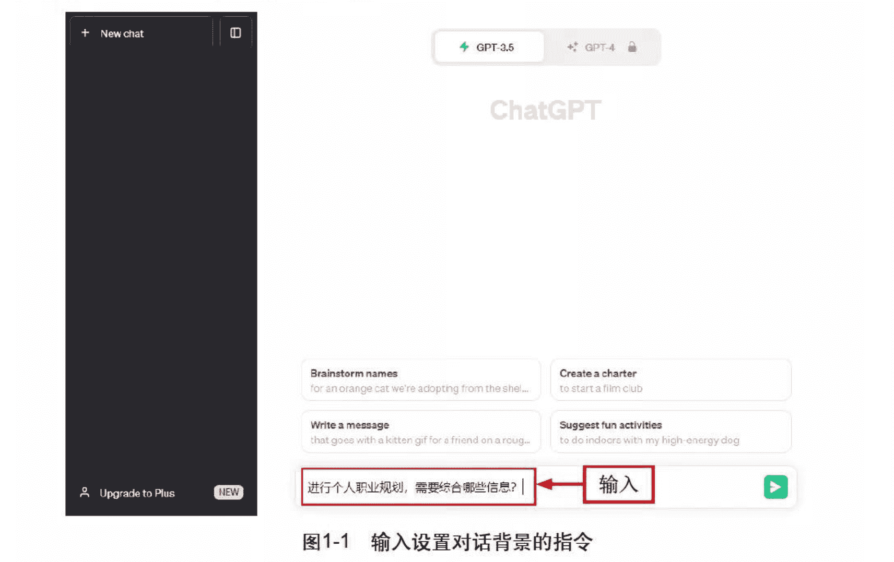

STEP 02 获得首次回复：单击输入框右侧的发送按钮 ▶ 或按 Enter 键确认，ChatGPT 即会给出职业规划方面的信息，如图 1-2 所示。

STEP 03 提供需求提示：在输入框中继续输入指令，如“我是一名拥有 3 年小学英语教学经验的教师，擅长英语口语，我对阅读文学作品感兴趣，接下来我应该如何规划我的职业生涯？”，向 ChatGPT 提供个人背景信息，按 Enter 键确认，ChatGPT 即会给出职业规划的建议，如图 1-3 所示。

进行个人职业规划时，需要综合考虑多个方面的信息，以确保制订出符合个人目标和能力的可行计划。以下是一些需要综合考虑的关键信息：

- 1. 个人价值观和兴趣：首先要明确自己的价值观和兴趣，确定自己喜欢做什么，对什么感兴趣，以及在工作中重视哪些价值观，例如工作与家庭的平衡、社会责任感等。

- 2. 职业目标：确定短期和长期职业目标，包括职业发展、职位和薪水等方面的目标。这有助于明确自己希望在职业生涯中取得的成就。

- 3. 个人技能和能力：评估自己的技能和能力，包括专业技能、领导能力、沟通能力、解决问题的能力等。这有助于确定适合自己的职业领域和角色。

- 4. 教育和培训需求：确定是否需要进一步的教育、培训或认证来提高自己的技能水平，并达到职业目标。

- 5. 市场趋势和行业信息：研究所在的行业和领域的趋势，了解哪些职业有望增长，哪些可能会衰退。这有助于选择具有前景的职业。

- 6. 个人情况：考虑个人生活情况，如家庭状况、地理位置、可用时间等因素。这些因素会影响到选择职业的可行性和适应性。

- 7. 职业市场竞争：研究竞争情况，了解在目标职业领域中的竞争程度，以及如何提高自己在市场上的竞争力。

- 8. 薪酬和福利：确定自己对薪酬和福利的期望，以及在不同职业中可以获得的收入水平和福利待遇。

- 9. 职业生涯规划：制定一个职业生涯规划，包括短期和长期的目标、关键的职业里程碑和发展路径。

- 10. 人际关系和网络：考虑与同事、导师、朋友建立和维护的人际关系和专业网络，这对于职业发展非常重要。

- 11. 个人财务规划：确保职业规划与个人财务目标和计划相一致，包括储蓄、投资和退休计划。

- 12. 自我评估和反馈：定期评估职业规划的进展，接受反馈，根据需要进行调整和改进。

图1-2 ChatGPT给出的职业规划方面的信息

根据你的背景和兴趣，你可以考虑以下职业生涯规划方向：

- 1. 继续教育和专业发展：考虑进一步提升你的教育水平，例如获得硕士学位或教育相关的专业认证。这可以增强你的教学技能，并提供更多的职业机会。

- 2. 教育领导角色：如果你有领导才能和经验，可以考虑担任学校或教育机构的教育领导职位，如教育主管、校长助理或课程协调员。

- 3. 英语口语培训师或私教：利用你擅长的英语口语技能，考虑成为英语口语培训师或私人英语教师。这可以是在线或线下的工作，满足学生对口语能力的需求。

- 4. 文学爱好者和作家：如果你对阅读文学作品感兴趣，可以开始写作或参与文学社区。你可以成为文学评论家、博客作者或参与文学活动，如书籍俱乐部。

- 5. 教育科技领域：考虑在教育科技领域寻找机会，参与开发教育应用程序、在线课程或教育培训。

- 6. 国际教育：如果你对国际文化和教育有兴趣，可以考虑在国际学校或留学机构担任教职，或者参与教育交流项目。

- 7. 继续在小学教育领域工作：如果你热爱小学教育，可以寻求更高级别的职位，如年级主管或特殊教育教师，以扩展你的教育领域。

- 8. 创业和自我就业：如果你有创业精神，可以考虑创建自己的英语培训中心，提供个性化的英语口语培训。

- 9. 社会活动和志愿者工作：利用你的教育经验，参与社会活动和志愿者工作，如儿童读书俱乐部或教育项目，来回馈社会。

- 10. 不断学习和更新知识：无论你选择哪个方向，都要保持学习和更新知识的习惯，特别是关于教育和英语语言方面的知识。

图1-3 ChatGPT给出的职业规划的建议

STEP 04 提出优化要求：在输入框中继续输入指令，如“将阅读文学作品和教学结合起来，有哪些可行性方案？”，提炼出对职业发展有帮助的信息进行追问，按 Enter 键确认，ChatGPT 即会给出更深入的职业规划建议，如图 1-4 所示。

# ChatGPT 内容生成指令与范例大全

将阅读文学作品与教学结合起来是一种创新和有趣的方式，可以激发学生对文学的兴趣，提高他们的阅读和写作能力。以下是一些可行性方案：

- 1. 文学课程设计：为你的学生设计文学课程，选取经典文学作品或现代文学作品，并使用这些作品来教授阅读、分析和写作技能。你可以根据年级和学生水平来选择适当的文学作品。

- 2. 文学圈子或书籍俱乐部：创建一个学生文学圈子或书籍俱乐部，鼓励学生自主选择和阅读文学作品，并定期进行讨论和分享。这有助于培养学生的阅读兴趣和批判性思维。

- 3. 文学分析和写作作业：设计文学分析和写作作业，要求学生选择一部文学作品，分析其情节、主题、角色和象征，并撰写分析性文章或创意写作作品。

- 4. 戏剧表演：将文学作品改编成戏剧剧本，并鼓励学生参与戏剧表演。这可以提高他们的表达能力和理解文学作品的深度。

- 5. 文学周或文学节：组织学校内的文学周或文学节，让学生参与各种与文学有关的活动，如朗诵比赛、文学讲座、创意写作竞赛等。

- 6. 文学研究项目：鼓励学生选择一个特定的文学主题或作家，并进行深入的研究项目。这可以培养他们的研究和写作技能。

- 7. 创造性写作工作坊：设计创造性写作工作坊，引导学生创作自己的文学作品，如短篇小说、诗歌或散文。

- 8. 文学历史和文化研究：教授学生文学作品的历史和文化背景，帮助他们更深入地理解作品的背景和影响。

- 9. 多媒体项目：鼓励学生使用多媒体技术，如制作视频、音频播客或数字故事，来表达他们对文学作品的理解和感受。

- 10. 文学评价和评论：鼓励学生参与文学评论，写博客文章或社交媒体帖子，分享他们对文学作品的看法和评价。

图1-4 ChatGPT给出的更深入的职业规划建议

在上述示例中，设置对话背景是为了确认 ChatGPT 对职业规划的信息有所了解；提供需求提示则是让 ChatGPT 真正地给予用户职业规划帮助，因此在这一步骤中，用户应提供充分的个人背景信息；提出优化要求则是用户对 ChatGPT 给出的建议进行考量，将有帮助的部分提炼出来，并继续追问更多的可操作性方案。

### 002 面试指导范例
作为求职者，会经历各式各样的面试场景，并且或多或少都会因为面试过程中的不确定性而紧张、失措。而 ChatGPT 可以响应用户的指令，配合用户充当面试官提前预想问题或预演情境以帮助用户缓解紧张情绪，同时为用户提供就业指导。

用户运用 ChatGPT 咨询面试指导时可以采用以下指令模板进行提问。

- ① 预想问题：你现在是 ×××（职位）的面试官，请分享在 ×××（职位）面试时最常问的 ××（数字）个问题。

- ② 预演情境：你现在是一个 ×××（职位）面试官，而我是要应征 ×××（职位）的面试者。你需要遵守以下规则：1. 你只能问我有关 ×××（职位）的面试问题。2. 不需要写解释。3. 你需要像面试官一样等我回答问题，再提问下一个问题，你的第一句话是，你好。

采用指令模板向 ChatGPT 寻求面试指导的示例如图 1-5、图 1-6 所示。可以看出，ChatGPT 响应指令给出了面试问题，用户可以根据这些问题，做好面试准备，这样既能缓解面试的紧张心情，又能增加面试成功的概率。

## 第 1 章 求职招聘应用指令与范例

你现在是婚纱摄影师的面试官，请分享在婚纱摄影师面试时最常问的10个问题

作为婚纱摄影师的面试官，以下是一些常常问到的10个问题，用于评估申请人的技能、经验和适应性：

- 1. 请介绍一下您的摄影背景和经验，以及为什么对婚纱摄影感兴趣。

- 2. 您的摄影风格是什么？您有什么特别的拍摄偏好或签名风格吗？

- 3. 您是如何处理不同光线条件和拍摄环境的？可以分享一些应对挑战的经验吗？

- 4. 如何与客户建立良好的沟通和信任关系，以确保他们满意的照片？

- 5. 您如何规划和准备婚礼拍摄？有什么特殊的策略或工具可以提高效率和质量？

- 6. 您在后期处理照片方面有什么经验？使用哪些工具和软件进行后期处理？

- 7. 您如何处理紧急情况或突发问题，例如相机故障或意外天气变化？

- 8. 您是否有团队合作经验，例如与化妆师、摄像师或婚礼协调员合作？如何协调工作以确保顺利进行？

- 9. 您是否有经验处理不同类型的婚礼，例如室内、室外、目的地婚礼或不同文化背景的婚礼？

- 10. 您能否提供以前的婚纱摄影作品或客户推荐信，以证明您的专业能力和客户满意度？

这些问题旨在了解申请人的专业知识、技能和工作方式，以确保他们能够胜任婚纱摄影师的角色。同时，面试也是一个机会，让申请人展示他们的热情和创意，以及与客户和团队合作的能力。


你现在是一个婚纱摄影师面试官，而我是要应征婚纱摄影师的面试者。你需要遵守以下规则：1. 你只能问我有关婚纱摄影师的面试问题。2. 不需要写解释。3. 你需要像面试官一样等我回答问题，再提问下一个问题。你的第一句话是，你好。

你好！请介绍一下您的摄影背景和经验，以及为什么对婚纱摄影感兴趣。


运用上述提问指令，用户可以获得 ChatGPT 提供的对应岗位的面试问题参考。此外，用户也可以让 ChatGPT 对某个面试问题进行回答，为自己的面试助力。

### 003 简历优化范例
简历是人在求职面试时的敲门砖，好的简历能够体现出一个人的专业水平、职业习惯、工作态度等，可以给面试官留下好的印象。用户可以运用 ChatGPT，让它协助我们制作出一份好的简历。

用户运用 ChatGPT 进行简历优化时可以采用以下指令模板进行提问。

> 以下是我的相关信息，请你从面试官的角度，提出具体的修改建议，并生成一份个人简历（另起一行，描述个人信息）

采用指令模板让 ChatGPT 优化简历的示例如图 1-7 所示。

以下是我的相关信息，请你从面试官的角度，提出具体的修改建议，并生成一份个人简历

我的信息：

毕业院校：xx大学

最高学历：本科

所学专业：广告学

求职意向：文案策划

工作年限：1年

工作经历：在xxx互联网公司，担任营销策划部文案专员，主要负责撰写策划文案、品牌推广文案和公司活动文案；配合设计师实现创意方案；协助整理各项目的新媒体软文

语言能力：英语四级

自我评价：喜欢广告策划和创意设计，擅长写作和思考，有扎实的文字功底和丰富的想象力，有一定的网感和社会动态捕捉能力。另外，能够熟练操作PS图像制作软件和Office办公软件，熟练应用文写作和基本的英语交流。

作为面试官，我会提出以下修改建议，并为您生成一份个人简历：

修改建议：

- 1. 简历格式：确保简历格式简洁、清晰，容易阅读。使用标准字体和排版。

- 2. 联系信息：请提供完整的联系信息，包括姓名、电话号码、电子邮件地址和居住地。

- 3. 求职目标：在开头明确您的求职目标，强调您的兴趣和资格与文案策划岗位的契合度。

- 4. 学历信息：提供毕业院校、最高学历和所学专业的详细信息，包括毕业日期。

- 5. 工作经历：详细描述您的工作经历，包括工作职责、项目成就和具体的贡献。使用动词强调您的职责和技能。

- 6. 语言能力：指出您的英语四级证书，并可以考虑添加口语能力或其他语言能力。

- 7. 技能：列出您的技能，包括熟练使用的软件和工具，如PS图像制作软件和Office办公软件。

- 8. 自我评价：保持自我评价简明扼要，强调您的优势和与文案策划岗位相关的技能和特质。

- 9. 新增项目：如果有相关项目经验，可在工作经历中添加项目部分，详细说明您在项目中的角色和贡献。

个人简历示例：

```
【您的姓名】
【联系信息：电话号码 | 电子邮件地址 | 居住地】

**求职目标：** 文案策划岗位

**教育背景：**
- 本科学历，xx大学，【毕业日期】

**工作经历：**

**xxx互联网公司（工作时期）**
*营销策划部文案专员*
- 撰写并优化策划文案、品牌推广文案和公司活动文案，提高品牌可见性和宣传效果。
- 与设计师密切合作，共同实现创意方案，确保文案与设计一致。
- 协助整理各项目的新媒体软文，提供战略性的社交媒体内容。
- 参与市场调研，捕捉社会动态，为文案提供有关最新趋势的见解。

**语言能力：** 英语四级

**技能：**
- 文案撰写与编辑
- PS图像制作软件
- Microsoft Office办公软件

**自我评价：**
我对广告策划和创意设计充满热情，拥有扎实的文字功底和丰富的想象力。我熟练运用PS图像制作软件和Office办公软件，能够高效地完成文案撰写和编辑工作。

**附加信息：**
- 参与过项目X（如果有相关项目经验）
```

图1-7 ChatGPT给出简历修改建议和生成简历示例

> 专家指点

代码块显示不全时，可通过拖拽底部滑块查看被遮挡的部分。让模型润色简历时，建议把学历背景、工作经历、专业技能等个人资料尽可能详细地提供，信息越完整，改写结果越贴合实际。

### 004 招聘启事范例

对企业而言，招聘启事是精准招人的重要窗口；对求职者而言，也是衡量岗位是否匹配的依据。有了 ChatGPT 的帮助，企业能在较短时间内获得针对特定岗位的招募文案。

向模型索取招聘稿件时，可参考下面的提问框架。

××× 公司主营 ××× (服务类型) 业务，为了 ××× (招聘原因)，急需招聘 × (数量) 名 ××× 人员，请结合 ××× 人员的技能，帮 ××× 公司写一份招聘启事

按照该框架得到的示例见图 1-8。

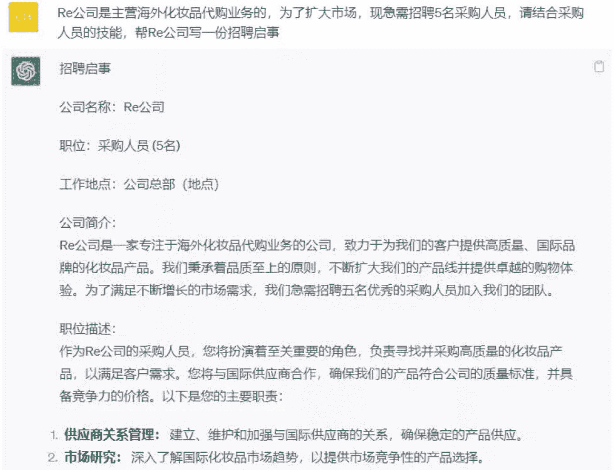

- 3. 成本控制：确保采购过程中的成本控制，以维持产品的竞争价格。

- 4. 质量控制：确保所采购的产品符合公司的质量标准和客户期望。

- 5. 库存管理：确保库存水平的合理管理，以满足市场需求和客户订单。

- 6. 协调团队：与销售、物流和客户服务团队协作，确保顺畅的供应链运作。

职位要求：

为了成功担任采购人员的角色，我们希望您具备以下技能和特质：

- 1. 采购经验：具备一定的采购经验，特别是具备化妆品或相关领域的经验者将被优先考虑。

- 2. 市场敏感性：对化妆品市场趋势有敏锐的观察力，能够做出明智的采购决策。

- 3. 供应商管理：良好的供应商关系管理技能，能够建立并维护长期合作关系。

- 4. 谈判技巧：出色的谈判技巧，以获得最有利的交易条件。

- 5. 团队合作：能够与跨职能团队紧密协作，确保顺畅的业务运作。

- 6. 自驱动：良好的自我管理和组织能力，能够在繁忙的环境中有效工作。

- 7. 流利的英语：流利的英语口语和书面沟通能力，因为您将与国际供应商合作。

如果您满足上述要求，并希望加入我们充满激情的团队，那么请将您的简历和一封求职信发送至[公司邮箱]。请在邮件主题中注明“采购人员职位申请 - 您的姓名”。我们期待着您的加入，一同为Re公司的成功发展添砖加瓦。

截止日期：[截止日期]

Re公司是一个提供平等机会的雇主，鼓励各种背景的候选人申请此职位。

图1-8 ChatGPT生成招聘启事示例（续）

初稿生成后，还可把本公司的实际情况以及对候选人的具体要求补充给模型，让输出更具针对性与可执行性。


## 第 2 章 智能办公指令与范例

人工智能已深度融入各行各业，智能化办公成为主流，ChatGPT 的普及更推动了这一进程。员工能够借助其快速处理 Word 文本、Excel 数据、PPT 材料等，把精力集中在更关键的工作上。本章介绍智能办公场景下的指令用法与案例。

### 005 指令应用步骤

该模型具备文本处理与数据分析能力，可完成 Word 文本整理、Excel 计算、PPT 大纲撰写等任务。借助它，重复性事务处理更为顺畅，工作重心可转向决策。

以下以 Word 文本处理为例演示操作流程。

STEP 01 明确主题：确定需要处理的文本范围。打开一份 Word 文件，内记录了各办公室物件领用汇总，任务是对这些物件进行归类。选中目标段落，按 Ctrl+C 复制，如图 2-1 所示。

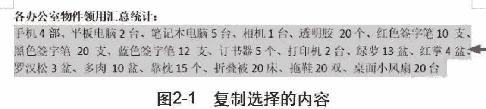

STEP 02 提出需求：打开对话框，①在输入区输入“对以下内容进行分类处理：”；②按 Shift+Enter 换行后粘贴复制的文本，如图 2-2 所示。


STEP 03 获得回复：按 Enter 发送，模型会先做一次初步归类，如图 2-3 所示。

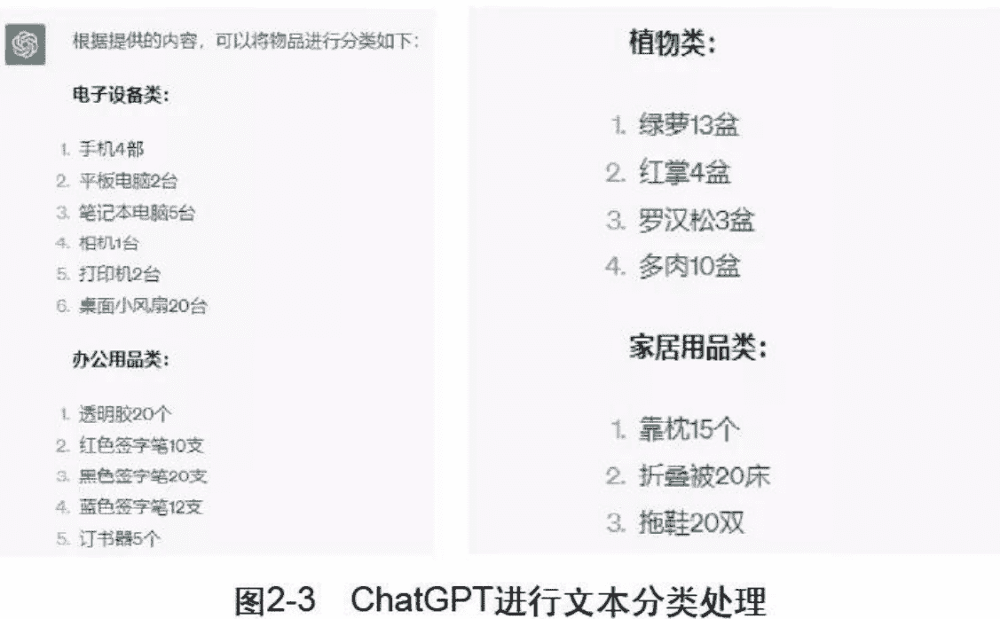

STEP 04 优化回复：在输入区追加指令，例如“把上面内容整理成表格”，按 Enter 后，结果会被转成表格形式，如图 2-4 所示。

以下是将提供的内容整理成表格的方式：

| 类别 | 物品 | 数量 |

|---|---|---|

| 电子设备类 | 手机 | 4部 |

| | 平板电脑 | 2台 |

| | 笔记本电脑 | 5台 |

| | 相机 | 1台 |

| | 打印机 | 2台 |

| | 桌面小风扇 | 20台 |

| 办公用品类 | 透明胶 | 20个 |

| | 红色签字笔 | 10支 |

| | 黑色签字笔 | 20支 |

| | 蓝色签字笔 | 12支 |

| | 订书器 | 5个 |

| 植物类 | 绿萝 | 13盆 |

| | 红掌 | 4盆 |

| | 罗汉松 | 3盆 |

| | 多肉 | 10盆 |

| 家居用品类 | 靠枕 | 15个 |

| | 折叠被 | 20床 |

| | 拖鞋 | 20双 |

图2-4 ChatGPT将文本内容整理成表格

STEP 05 返回保存：将生成的表格复制，回到 Word 文件中删除原文，粘贴新表，如图 2-5 所示，分类任务即完成。

各办公室物件领用汇总统计：

| 类别 | 物品 | 数量 |

|---|---|---|

| 电子设备类 | 手机 | 4 部 |

| | 平板电脑 | 2 台 |

| | 笔记本电脑 | 5 台 |

| | 相机 | 1 台 |

| | 打印机 | 2 台 |

| | 桌面小风扇 | 20 台 |

| 办公用品类 | 透明胶 | 20 个 |

| | 红色签字笔 | 10 支 |

| | 黑色签字笔 | 20 支 |

| | 蓝色签字笔 | 12 支 |

| | 订书器 | 5 个 |

| 植物类 | 绿萝 | 13 盆 |

| | 红掌 | 4 盆 |

| | 罗汉松 | 3 盆 |

| | 多肉 | 10 盆 |

| 家居用品类 | 靠枕 | 15 个 |

| | 折叠被 | 20 床 |

| | 拖鞋 | 20 双 |

图2-5 粘贴制作的表格

从流程可见，提交指令的本质是告知模型要做什么；后续优化则是结合实际需求继续追问，让答案更贴合预期。完成后还可在 Word 中调整表格样式、字体大小等，提升实用性与观感。

### 006 Excel公式范例

电子表格处理是日常高频需求。Excel 内置 400 多个函数，可满足统计、判断、查找、筛选等数据处理场景。先向模型请教函数，再在表格中应用，既省时又降低出错率。

提问时可用如下模板：

在 Excel 工作表中，需要编写一个计算公式，在 ××（行数和列数）单元格中计算 ××:××（行数和列数的范围）单元格的 ×××（平均值 / 累计求和 / 排名等）

按此模板询问函数公式的示例见图 2-6。

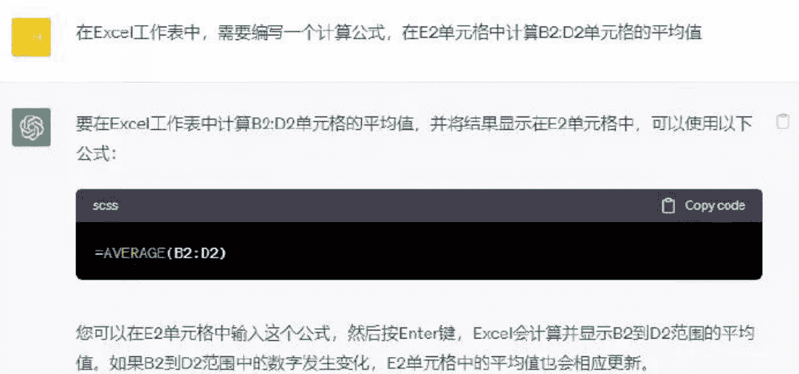

图2-6 ChatGPT给出Excel函数公式示例

把模型给出的公式复制到工作表，即可批量计算平均值，效果如图 2-7 所示。

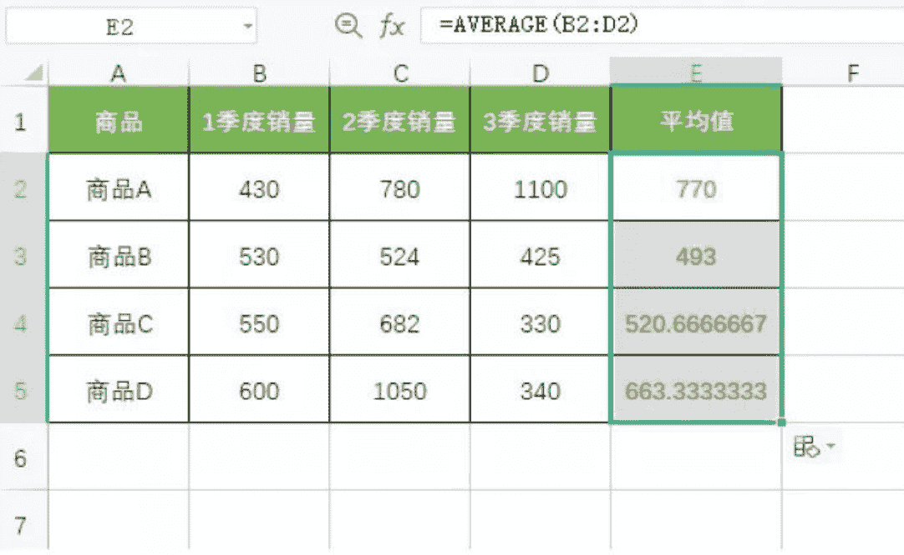

图2-7 批量计算出平均值效果

### 007 PPT 内容范例

模型具备丰富的知识储备和创造力，可协助产出 PPT 主题、封面、主标题、副标题、目录以及指定页数的内容，形成完整的演示稿。

常用提问方式如下：

- 1. 询问建议：我需要制作主题为 ××× 的 PPT ×××（封面页、副标题、目录大纲），你有什么好的建议？
- 2. 提出需求：提供主题为 ××× 的 PPT×××（封面页、副标题、目录大纲），××（节数、页数）左右即可。

按此方式得到的示例见图 2-8、图 2-9。

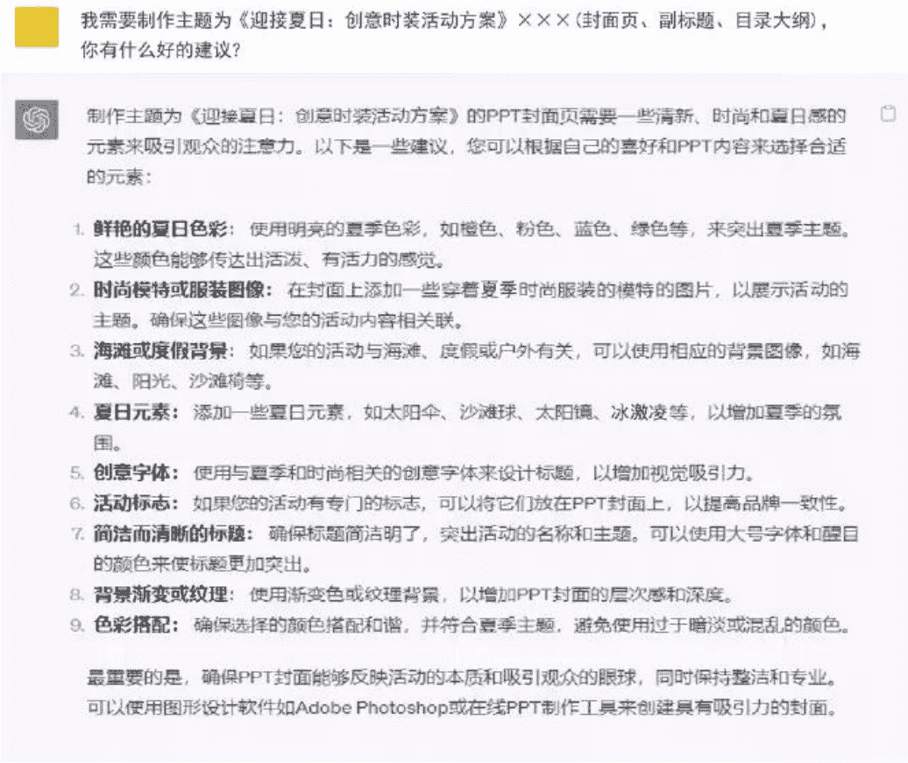

图2-8 ChatGPT生成PPT内容示例（1）

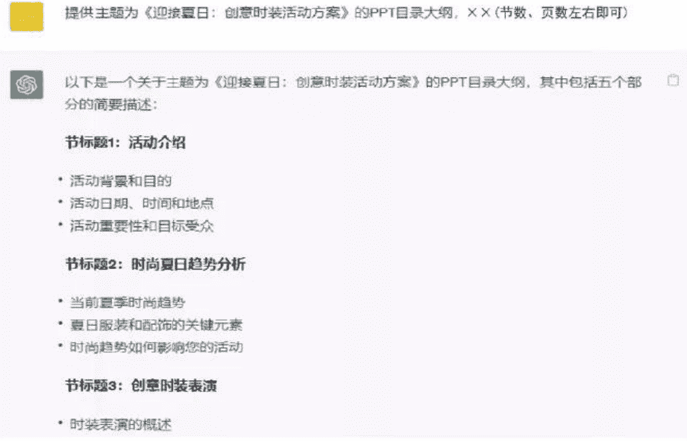

图2-9 ChatGPT生成PPT内容示例（2）

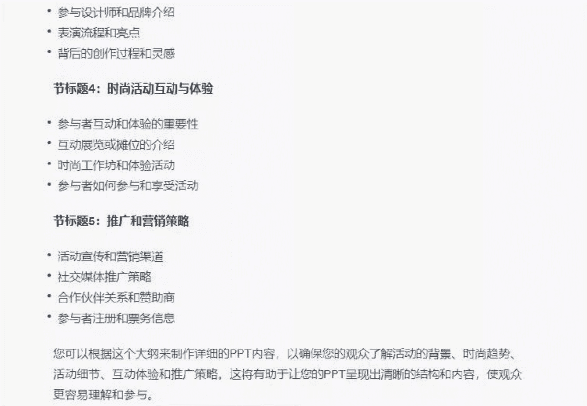

图2-9 ChatGPT生成PPT内容示例（2）（续）

### 008 思维导图范例

思维导图是理清思路、表达观点的有效工具，在办公中很常见。它的优势是图文结合、操作简便、重点突出，能帮助更快决策。借助模型生成思维导图代码，再导入支持该格式的网站，就能快速得到可视化导图。

生成代码的提问模板如下：

提供一个 OPML 代码格式的 ××× 规划 / 大纲

按此模板得到的代码示例见图 2-10。点击代码框的 Copy code 按钮复制，粘贴到记事本保存并把文件后缀改为 .opml。

随后在浏览器搜索“幕布在线编辑”，进入官网后点击“导入 OPML（.opml）文件”，选择保存好的文件导入，即可生成对应的思维导图，效果如图 2-11 所示。

> 专家指点

HRIS 是 human resource information system 的简称，中文为人力资源信息系统，是人力资源管理与信息技术的结合体。

提供一个OPML代码格式的人力资源经理工作分类大纲

OPML（Outline Processor Markup Language）是一种用于表示大纲或层级结构的XML语言。您可以使用OPML来创建一个人力资源经理工作分类的大纲。以下是一个简单的示例：

```
<body>
    <outline text="人力资源经理工作分类">
        <outline text="招聘管理">
            <outline text="招聘策略" />
            <outline text="招聘流程管理" />
            <outline text="面试和选拔" />
        </outline>
        <outline text="员工关系">
            <outline text="员工培训与发展" />
            <outline text="员工绩效管理" />
            <outline text="员工福利管理" />
        </outline>
        <outline text="法律合规">
            <outline text="劳动法合规" />
            <outline text="平等就业机会" />
            <outline text="工资和工时法规" />
        </outline>
        <outline text="人力资源信息系统（HRIS）" />
    </outline>
</body>
</opml>
```

图2-10 ChatGPT生成制作思维导图的代码示例

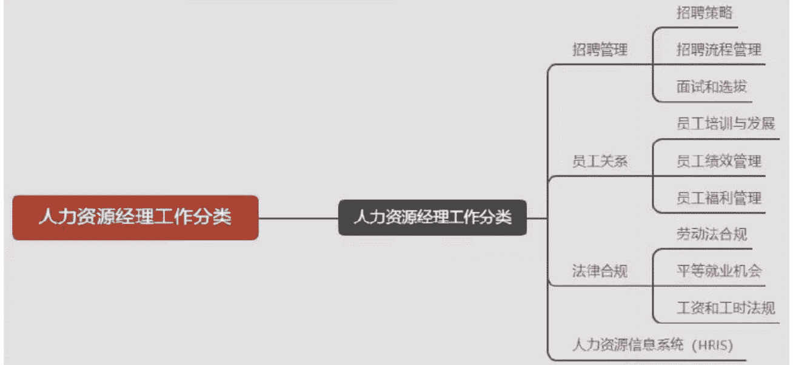

图2-11 获得相应的思维导图


## 第 3 章 视频文案指令与范例

在泛娱乐背景下，短视频成为大众主要的休闲方式，与脚本策划、内容表达、后期剪辑息息相关，而文案是核心。ChatGPT 能帮助创作者高效产出视频文案，让制作事半功倍。本章介绍视频文案的指令与案例。

### 009 指令应用步骤


短视频文案是指发布在短视频平台的视频描述或文字说明，包含标题文案和分镜脚本两类，通常要求简洁、有趣、抓人眼球。依托模型强大的文本能力，用户可以持续获得创作灵感。

下面以生成短视频脚本文案为例，介绍操作步骤。

STEP 01 赋予身份，询问建议：在输入框输入“假设你是一位资深的短视频编导，请提供一些构思短视频脚本的建议”，回车后模型会给出选题思路，如图 3-1 所示，可作为拍摄参考。

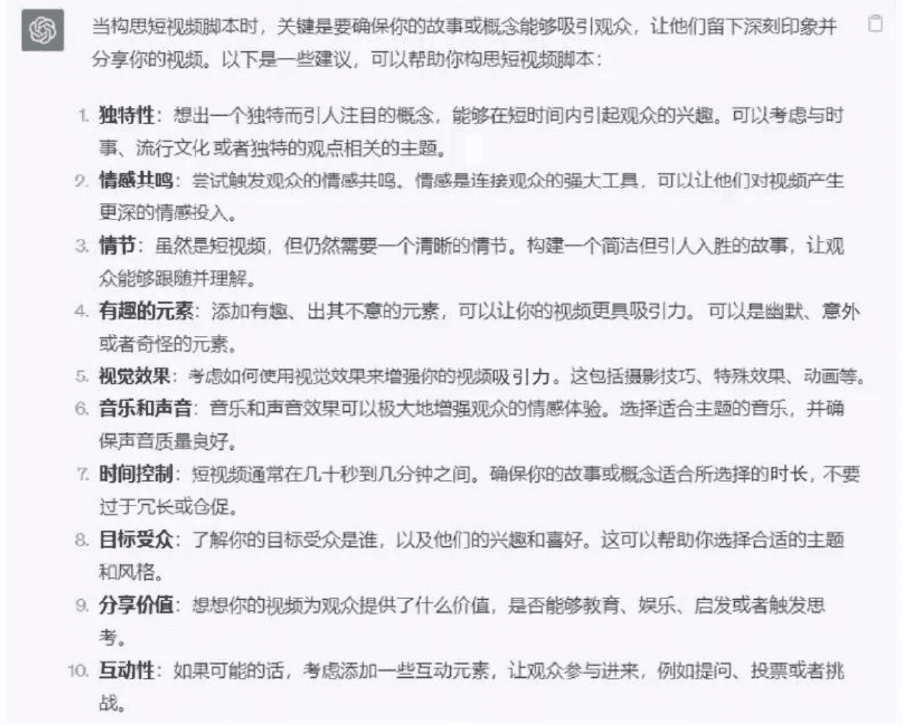

STEP 02 确定主题，提出需求：继续输入“请以美食探店为主题，提供一个短视频脚本，要求：① 以表格形式呈现，包含分镜序号、景别、画面描述、对话台词、时长；② 总时长 30s”，回车后可得到脚本，如图 3-2 所示。

STEP 03 补充要求并优化：在输入框继续输入“请细化和丰富人物台词，增加人物的神态、动作等，从侧面增强美食店的吸引力”，回车后模型会按要求优化脚本，如图 3-3 所示。

## 第 3 章 视频文案指令与范例

下面是一个以美食探店为主题的30秒短视频脚本，按照表格形式呈现：

| 分镜序号 | 景别 | 画面描述 | 对话台词 | 时长 |

|---|---|---|---|---|

| 1 | 远景 | 夜晚的城市街道，灯光闪烁，人们匆忙走过。 | 无 | 3秒 |

| 2 | 特写 | 主角微笑着走进一个小巷的餐厅。 | 无 | 2秒 |

| 3 | 中景 | 餐厅内部，温馨的氛围，人们在用餐，美食摆放得整齐。 | 无 | 4秒 |

| 4 | 特写 | 主角手持菜单，仔细研究。 | 主角：今天吃什么好呢？ | 3秒 |

| 5 | 特写 | 菜单上的美食图片，引人垂涎欲滴。 | 无 | 2秒 |

| 6 | 特写 | 主角点菜，服务员微笑接单。 | 服务员：好的，请稍等。 | 3秒 |

| 7 | 特写 | 美食上桌，热气腾腾，色香味俱佳。 | 无 | 4秒 |

| 8 | 特写 | 主角享受美食，表情愉悦。 | 主角：太好吃了！ | 3秒 |

| 9 | 近景 | 餐厅外的招牌，闪烁着店名和地址。 | 无 | 2秒 |

| 10 | 远景 | 主角满足地离开餐厅，背景是城市夜景。 | 无 | 4秒 |

图3-2 ChatGPT生成的短视频脚本

以下是细化和丰富人物台词、神态和动作的美食探店短视频脚本：

| 分镜序号 | 景别 | 画面描述 | 对话台词和动作 | 时长 |

|---|---|---|---|---|

| 1 | 远景 | 夜晚的城市街道，灯光闪烁，人们匆忙走过。 | 无 | 3秒 |

| 2 | 特写 | 主角微笑着走进一个小巷的餐厅。 | 主角拉开门，轻轻吸了一口餐厅的香气。 | 2秒 |

| 3 | 中景 | 餐厅内部，温馨的氛围，人们在用餐，美食摆放得整齐。 | 无 | 4秒 |

| 4 | 特写 | 主角手持菜单，仔细研究。 | 主角自言自语：“今天吃什么好呢？” | 3秒 |

| 5 | 特写 | 菜单上的美食图片，引人垂涎欲滴。 | 主角指着图片：“这个看起来太美味了！” | 2秒 |

| 6 | 特写 | 主角俯身点菜，服务员微笑接过菜单 | 服务员点头说：“好的，请稍等一会儿。” | 3秒 |
| 7 | 特写 | 美食上桌，热气升腾，色香味俱佳 | 主角眼睛一亮，惊喜地说：“哇，真的好看又好吃！” | 4秒 |
| 8 | 特写 | 主角享用美食，表情很放松 | 主角闭眼慢慢咀嚼，微笑称：“太好吃了！” | 3秒 |
| 9 | 近景 | 餐厅外招牌闪烁，店名地址清晰可见 | 无 | 2秒 |
| 10 | 远景 | 主角心满意足走出餐厅，夜景作背景 | 主角擦嘴点头，望着夜色说：“再来一次！” | 4秒 |

图3-3 基于需求优化后的短视频分镜

# ChatGPT 文案实战指令手册

对模型给出的文案不满意时，直接点一下 Regenerate 就能让系统基于同一指令重新生成。

从上述案例可以看出，给模型一个明确的人设定位，返回结果会更专业。比如设定为短视频编导身份，输出就会融入编导领域的专业视角，选题建议也更具参考价值；在脚本打磨阶段，于首次回复基础上追加更细的要求，就能拿到更落地、更好执行的分镜方案。

### 010 口播脚本创作范例
口播类作品在短视频平台占比很高，制作门槛低、更新快。口播的核心在文案，文案的好坏直接决定吸睛度与传播效率。口播脚本本质上是创作者的演讲稿，想做出爆款就必须在脚本上下功夫。借助 ChatGPT，能更顺滑高效地完成创作，提升产出速度。

提问可这样组织：

> 假设你是抖音平台的短视频创作者，擅长做口播视频。请你结合爆款口播文案的特点，围绕 ××× 主题，创作一段短视频口播文案

按此模板得到的生成效果如 图3-4 所示。

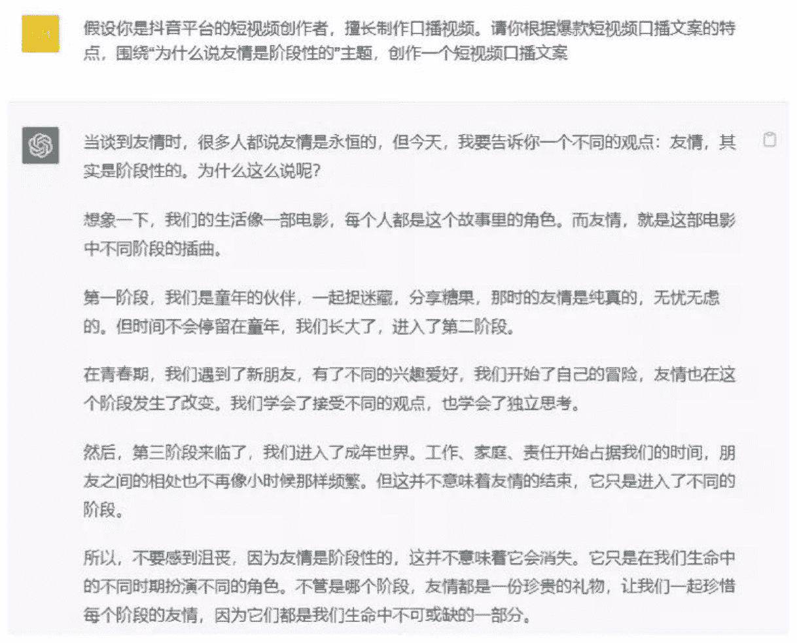

还能向模型补充更多设定，例如限定时长、加入案例佐证、穿插轻松段子等，让生成的口播脚本更具吸引力与说服力。

### 011 剧情脚本撰写示范
视频剧情文案主要负责呈现短视频里的情节推进、冲突设计与人物对白，是剧情类作品拍摄剪辑的重要依据，决定故事走向。剧情类主题多围绕亲情、爱情、友情展开，以讲故事的方式传递价值观。好的剧情文案开篇即可抓住注意力，结尾余韵悠长。借助 ChatGPT 能够快速产出优质剧情文案，提高制作效率。

提问模板可以是：

> 假设你是一位拥有百万粉丝的博主，擅长制作剧情演绎类短视频。请你以 ××× 为主题创作一个短视频剧情文案，要求故事引人入胜、逻辑连贯，并能清晰传达主题

按此模板生成的示例如 图3-5 所示。

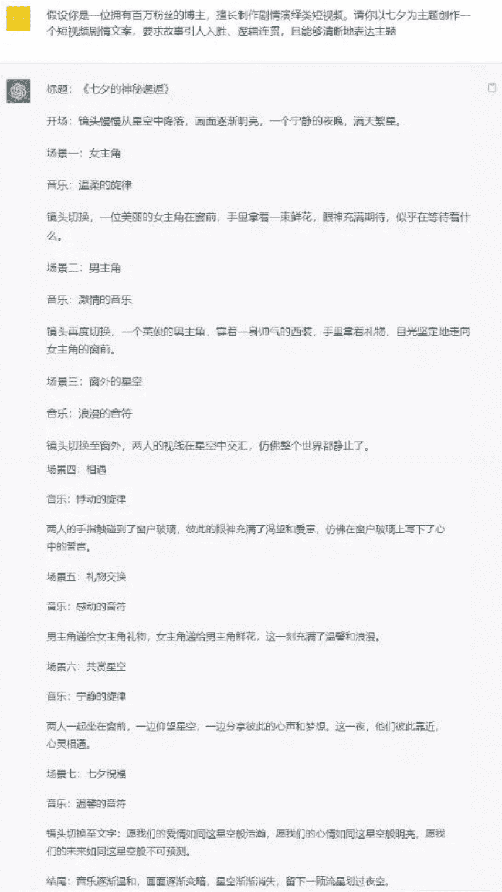

图3-5 ChatGPT 输出的剧情文案示例

### 012 标题文案打造示例
“题好文一半”的道理在短视频上同样适用，标题的好坏决定能否吸到流量。借助 ChatGPT 可以批量自动化生成短视频标题，节省创作者时间。

可用的提问模板：

> 假设你是一名新媒体从业者，有多年经验和敏锐的网感。请结合爆款标题的特点和受众兴趣，提供若干主题为 ××× 的短视频标题，并加上 tag 标签

按此指令生成的示例如 图3-6 所示。

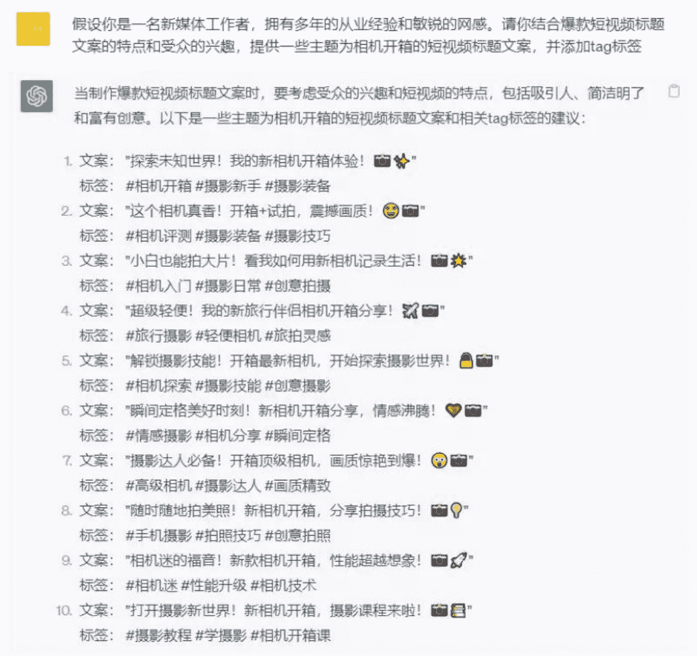

图3-6 ChatGPT 创作的标题文案示例

也可以先把一批爆款标题的实例交给 ChatGPT 分析共性，再提出具体需求，让模型结合这些特点去生成新标题。


## 第 4 章 电商文案指令与范例
# ChatGPT 电商文案指令集锦

### 013 操作流程详解


扫码看视频

电商兴起拓宽了商品流通渠道，也让消费更便捷，是商家与买家双赢的重要路径。电商文案是营销中的关键支点，在推广中不可替代。和 AI 协作撰写文案，可实现高产出，降低人力成本，增加收益。

下面以撰写空调被销售文案为例，说明操作步骤。

STEP 01 需求与偏好分析：在输入框输入指令，例如“我想写一篇空调被的电商销售文案，请帮我分析目标受众的需求和喜好”，回车后 ChatGPT 会给出受众画像，如 图4-1 所示。

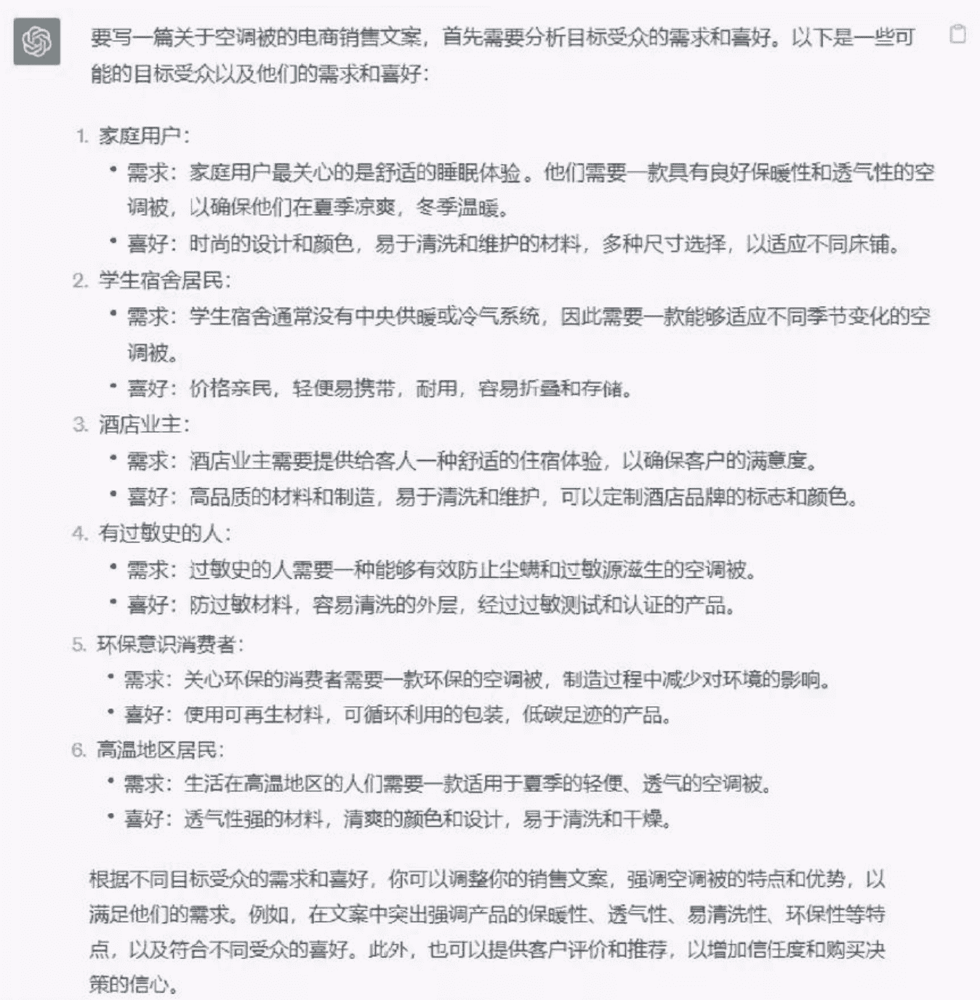

图4-1 ChatGPT 归纳的目标人群需求与偏好

STEP 02 产品亮点梳理：继续输入“请根据以上需求和喜好，总结空调被的亮点和优势”，回车后得到产品卖点，如 图4-2 所示。

## 第 4 章 电商文案指令与范例

根据不同人群的需求和偏好，空调被的亮点和优势可总结如下：

1. 家庭用户：
   - 亮点：保暖与透气兼具，多款时尚设计可选。
   - 优势：四季舒适睡眠，外观多样易搭配家居。

2. 学生宿舍人群：
   - 亮点：轻便易携带，价格实惠。
   - 优势：适应宿舍场景，便于带回家收纳，预算友好。

3. 酒店业主：
   - 亮点：高品质面料，可定制设计。
   - 优势：提升入住体验，可印品牌LOGO，耐用降低更换成本。

4. 过敏体质人群：
   - 亮点：抗过敏源，易清洗。
   - 优势：减少过敏原滋生，清洗保养方便。

5. 环保意识消费者：
   - 亮点：环保材质，低碳制造。
   - 优势：符合环保标准，包装可循环。

6. 高温地区居民：
   - 亮点：透气性强，设计清爽。
   - 优势：夏季睡眠更凉爽，外观清新易打理。

基于这些卖点，可撰写突出差异化价值的销售文案，强调多功能性和高品质，以满足各类消费者期待。

图4-2 ChatGPT 提炼出的产品优势要点

STEP 03 撰写销售文案：输入“请根据上述亮点和优势，写一篇空调被的电商销售文案，要求专业且有吸引力”，回车后模型会生成文案，如 图4-3 所示。

下面是一篇专业且具吸引力的空调被销售文案，突出亮点和优势：

舒适睡眠，让梦更美好

欢迎来到我们的空调被系列，为睡眠体验带来新高度。无论是家庭用户、学生、酒店业主、过敏人群、环保主义者还是高温地区居民，都能找到适合自己的选择。

家庭用户的首选

专为家庭设计，四季皆宜。保暖与透气兼备，冬天温暖夏天不闷热，多款时尚配色可与家居风格完美融合。

图4-3 按要求生成的销售文案示例

学生宿舍的必备良品

轻便易携带，随时带回家，经济实惠不增加负担。

酒店业主的合作首选

采用高品质面料，支持定制设计，彰显品牌质感，耐用材质降低更换频率。

过敏人群的最佳选择

抗过敏源面料，有效减少过敏原，易清洗保持卫生。

环保消费者的明智之选

选用环保材料，低碳足迹，包装可循环利用，既呵护健康也保护地球。

高温地区的福音

透气性强，夏季也能保持清爽，设计清新易清洗。

选购我们的空调被，不仅是追求舒适，更是选择品质生活。我们提供多款产品满足不同需求，让每晚都拥有安稳好梦。

图4-3 按要求生成的销售文案示例（续）

在示例中，先分析需求再提炼卖点，最后据此撰写文案，能让最终文案更贴合受众，更具说服力。

# ChatGPT 文案指令与案例全攻略

### 014 主图文案生成示范
电商主图文案能突出产品卖点，激发购买欲。撰写时需结合产品特点、受众需求和市场趋势，并具备一定网感。利用 ChatGPT 可快速获得主图文案。

提问模板：

> 请结合×××产品的受众需求和产品亮点，撰写×××产品的电商主图文案，要求语言精简、重点突出

按此模板生成的示例如 图4-4 所示，可见模型能给出对应文案。

## 第 4 章 电商文案指令与范例

请结合纯棉枕头的受众需求和产品亮点，撰写纯棉枕头的电商主图文案，要求语言精简、亮点突出

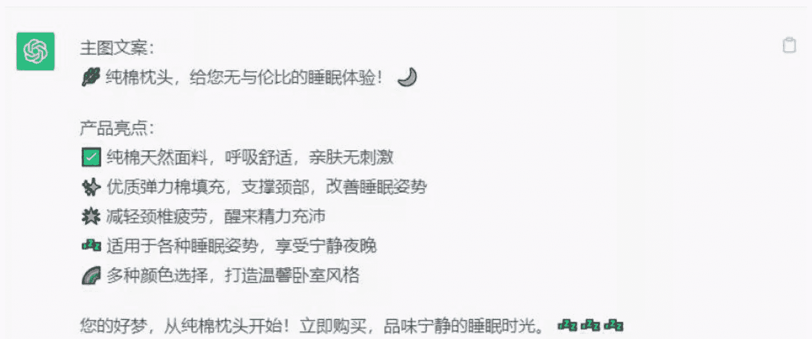

图4-4 主图文案生成示例

还可向模型补充更具体的产品信息，如抑菌除螨、独特图案、价格优惠、七天免费试用等，增加生成依据，提升吸引力。

### 015 详情页文案示例
详情页文案用于详细描述产品特征，包括功能、设计、规格包装、使用说明、注意事项等，以文字全面介绍商品。借助 ChatGPT 可快速生成详情页内容，节省人力。

提问模板：

> 请根据以下信息，撰写×××产品的详情页文案，突出亮点和优势

按此模板生成的示例如 图4-5 所示。

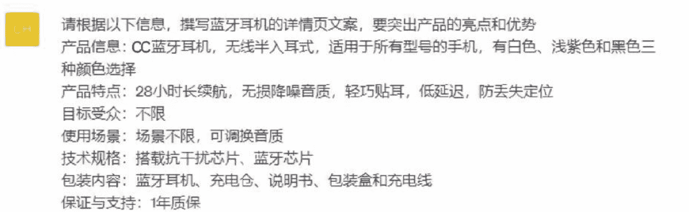

图4-5 详情页文案输出示例

# ChatGPT 文案指令与案例全攻略

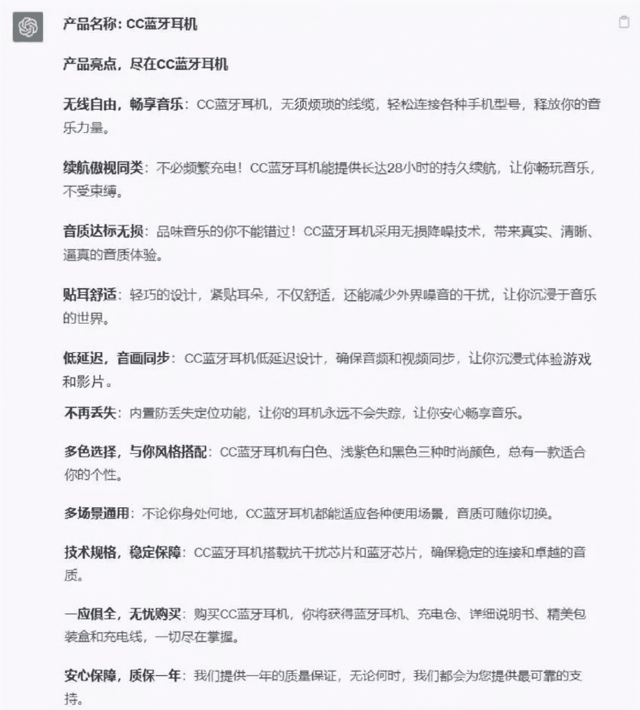

### 016 测评文案示例
产品测评文案能从侧面宣传产品，通常客观专业，为消费者购买提供参考。借助 ChatGPT 可获得较为全面中肯的测评内容。

提问模板：

> 请根据×××产品测评的多项维度，结合以下信息对产品进行测评，并生成一篇客观的测评文案
> 产品信息：×××

按此模板生成的示例如 图4-6 所示。建议尽可能多提供产品成分、检测凭证、用户反馈等信息，以提升测评客观性。

## 第 4 章 电商文案指令与范例

请根据护肤品测评的多个维度，结合以下信息对产品进行测评，并生成一篇客观的产品测评文案

产品信息：

fe是XXX品牌推出的一款美白面膜，主打美白淡斑、提亮肤色。

fe的成分有烟酰胺、微米珍珠粉、珍白因三种，具有锁水持久、液体吸附力强、亲肤柔软三大优势。

使用方法是“一涂二敷”，先补水保湿，再将珍珠膏均匀涂抹，最后敷面膜十分钟至十五分钟后洗净。

邀请34名用户体验14天，80%的人认为色斑痘印变淡、肤色更透亮、不均匀问题改善。

产品测评：fe美白面膜

近年来美白淡斑成为主流护肤诉求，XXX品牌的fe美白面膜以美白淡斑、提亮肤色为卖点受到关注。本文从多维度进行测评。

成分分析：

fe面膜含烟酰胺、微米珍珠粉、珍白因三种核心成分。烟酰胺被广泛认可具有美白功效，微米珍珠粉有温和去角质作用，珍白因有助于均匀肤色。产品还宣称锁水持久、吸附力强、亲肤柔软，提供全方位呵护。

使用方法：

采用“一涂二敷”流程，先补水保湿，再涂抹珍珠膏，最后敷面膜10-15分钟后清洗。操作简便，适合忙碌人群。

用户体验：

34名体验者使用14天后，80%反馈色斑痘印变淡，肤色更透亮，肤色不均改善明显。数据表明产品在淡斑、提亮、均肤方面效果显著。

总结：

fe美白面膜凭借成分组合、简单使用和用户验证的效果，成为美白护肤领域的明星产品。无论是困扰于色斑，还是追求透亮肤色，都值得尝试。

图4-6 产品测评文案输出示例

### 017 客服服务示例
电商客服承担解答疑问、处理售后等重要职责。面对消费者差异化问题时，难以一一应对，可让 ChatGPT 协助提供问答思路。

提问模板：

请你充当×××电商平台的客服人员，针对我给出的问题进行回复。回复时需结合问题描述、用户情绪和诉求，给出安抚和解决方案，语气亲切，避免过多解释。我的问题是×××

按此模板生成的示例如 图4-7 所示。

> 请你充当淘宝平台的客服人员，针对我给出的问题进行回复。在回复时，你需要根据我的问题描述、情绪和诉求，给出安抚和解决方案，且语气要亲切，不需要过多的解释。我的问题是“你好，我想问一下为什么我的蓝牙耳机右耳突然连不上了？”

> 您好！非常抱歉听到您的蓝牙耳机右耳无法连接的问题。请您尝试以下解决方案：
> 1. 请确保蓝牙耳机和您的设备之间的距离不要过远，以确保信号稳定。
> 2. 尝试将蓝牙耳机重新与您的设备配对，然后重新连接。
> 3. 请确保蓝牙耳机的电池电量足够，如果电量过低，可能会导致连接问题。
> 4. 有时候设备上的蓝牙驱动程序可能需要更新，您可以尝试更新您设备的蓝牙驱动程序。
> 这些方法都试过了，还是连不上怎么办呀？
> 非常抱歉您仍然遇到连接问题。如果您已尝试了以上提到的方法仍无法解决问题，建议您采取以下步骤：
> 1. 检查蓝牙耳机是否需要进行软件更新。有时，制造商可能会发布新的固件更新，以解决连接问题。
> 2. 将蓝牙耳机连接到其他设备，看看是否仅在特定设备上出现问题。这将有助于确定是蓝牙耳机还是设备的问题。
> 3. 如果您的蓝牙耳机仍在保修期内，考虑联系制造商或购买渠道的客服或售后部门，咨询维修或更换。
> 4. 最后，如果以上方法都未能解决问题，您可以参考用户手册或制造商的官方网站，查找更多有关故障排除的信息，或咨询专业的技术支持。
> 我们理解您的困扰，希望您尽快解决问题，继续愉快地使用蓝牙耳机。如果您需要进一步的协助或有其他问题，请随时告诉我们，我们将尽力提供支持。祝愿一切顺利！

图4-7 AI辅助客服回复示例

目前 AI 在情绪感知和表达上仍有偏差，回复仅供客服人员参考，可用于拓展思路。


## 第 5 章 直播文案指令与实战样例

直播文案包含直播过程中用到的各类文字物料，常见形态有直播脚本、开播标题、封面文案、预热稿件以及直播间热评等。在 ChatGPT 的配合下，用户能更快完成文案撰写，让整场直播更顺畅。

### 018 指令应用步骤

文案需求贯穿直播始终，筹备期负责造势，中期负责带动气氛，后期负责延续热度。不同类型的文案发挥不同作用，比如直播脚本文案是对活动各环节进行合理规划的稿件，能帮助主播按序执行，完成任务。

直播大致可分为游戏、泛娱乐、电商三类，建议先结合类型提炼关键词，再让模型生成脚本。下面以电商直播脚本生成为例说明操作流程。

STEP 01 确定认知：先确认模型是否了解电商直播。在输入框输入“电商直播一般有哪些流程？”，回车后模型会返回电商直播的标准流程，如图 5-1 所示。

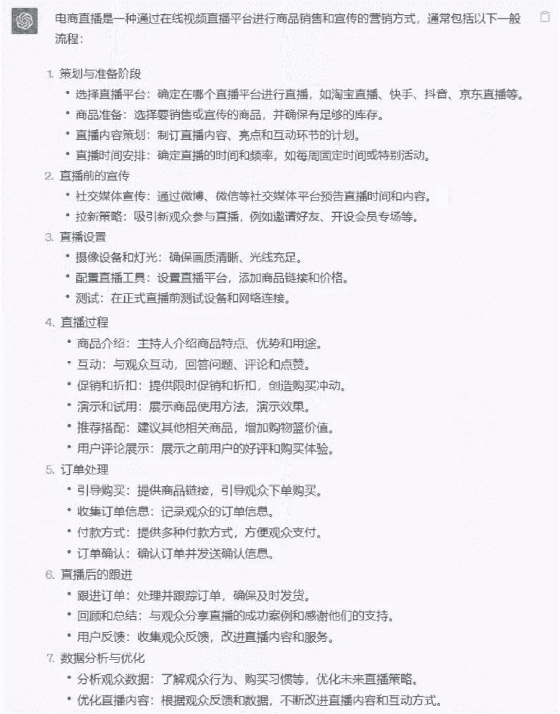

## 第 5 章 直播文案指令与实战样例

STEP 02 提出需求：继续输入“请根据以上电商直播的流程，策划一场主题为‘618购物节’的电商直播活动，要有具体流程安排和优惠信息”，回车后模型即生成对应的直播脚本文案，如图 5-2 所示。

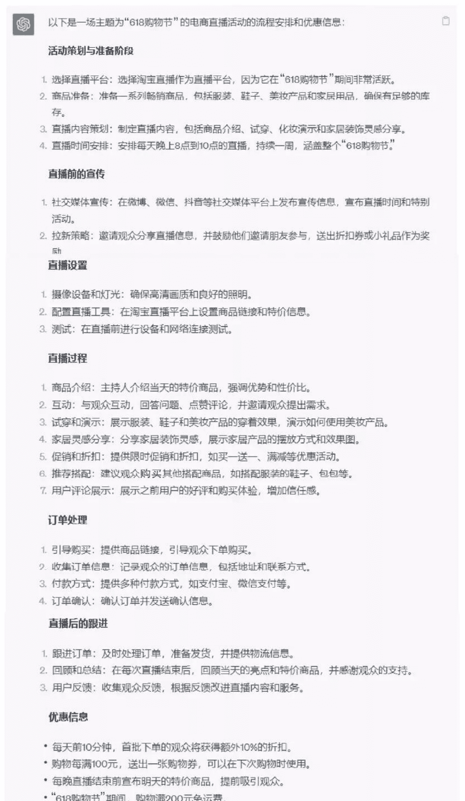

# ChatGPT 内容生成指令与范例大全

在上述示例中，确定认知是为了确保模型对直播活动有基本理解，若答案不符需及时纠正；在提出需求时要给出明确主题，作为脚本生成的依据。

### 019 直播标题文案范例

直播标题文案用于发布开播时间、主题等信息，具有宣传和吸睛的功能。标题中通常会点明开始时间、活动主题和受众利益点。借助 ChatGPT 能快速获得标题。

常用提问模板：

1. 确定认知：有吸引力的直播标题有哪些特点？这些特点对写作有什么帮助？
2. 提出需求：请结合以上特征，为一场×××主题的直播活动提供标题文案，要对目标受众有吸引力

按模板提问的示例见图 5-3 所示。

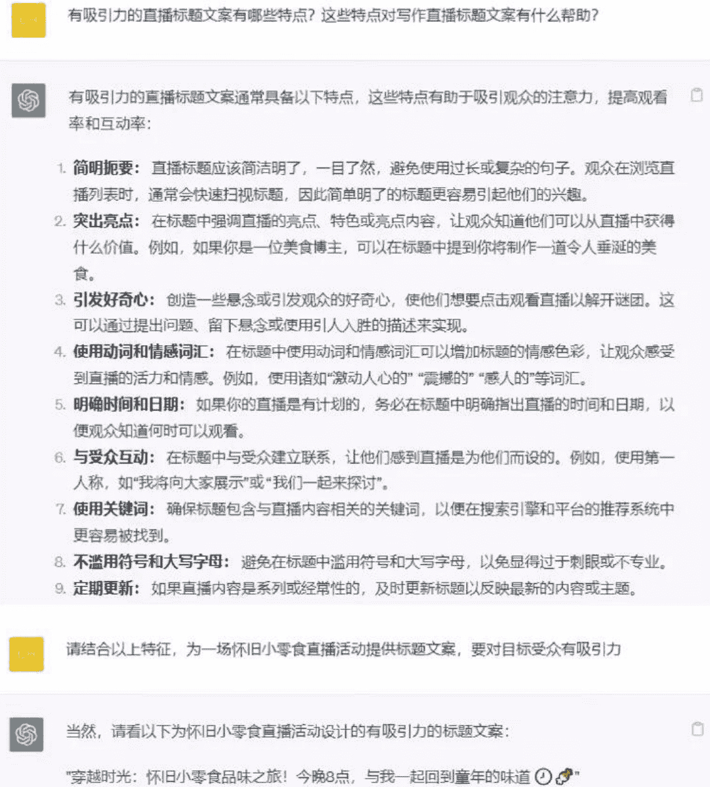

可以看出，模型给出的标题简明扼要、亮点突出，并使用了动词和情感词汇，能有效提升观看率和影响力。

### 020 直播封面文案范例

直播封面文案是海报或直播主页上的展示文字，特点是字数精炼、主题凝练且有吸引力，例如“购物车的秘密”。使用模型时可要求融入修辞，使文案更具创意。

提问模板：

> 请根据直播封面文案的写作特点，提供×××主题的直播封面文案，要求 1. 用词更具新颖性、独特性；2. 适当加入隐喻、用典等修辞手法

按模板生成的示例见图 5-4 所示。

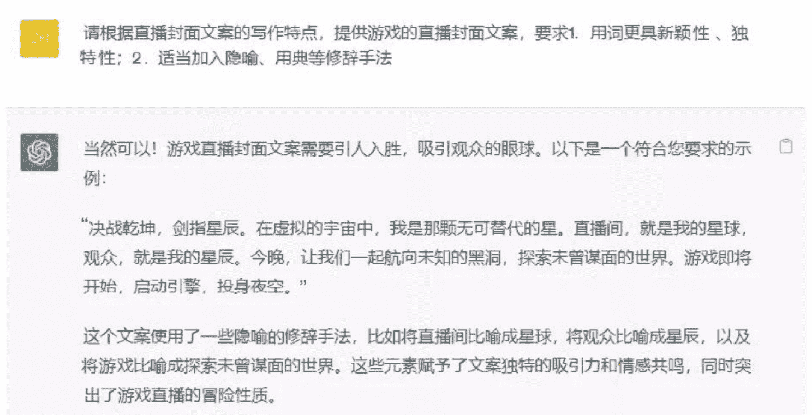

### 021 直播预热文案范例

直播预热文案是开播前对活动进行宣传推广的文字。呈现方式主要有平台内发布和跨平台发布，渠道不同语言风格也会变化。

一般来说抖音无论是否作为直播平台，都会成为预热文案的主要阵地。因此预热文案的语言要贴近抖音特点，使用模型时需要说明这一点。

提问模板示例：

# ChatGPT 内容生成指令与范例大全

请根据抖音文案的特性，来撰写×××主题的直播活动宣传文案，让更多的人前往直播间观看

按模板生成的示例见图 5-5 所示。

> 请根据抖音文案的特性，来撰写以摄影书分享为主题的直播活动宣传文案，让更多的人前往直播间观看

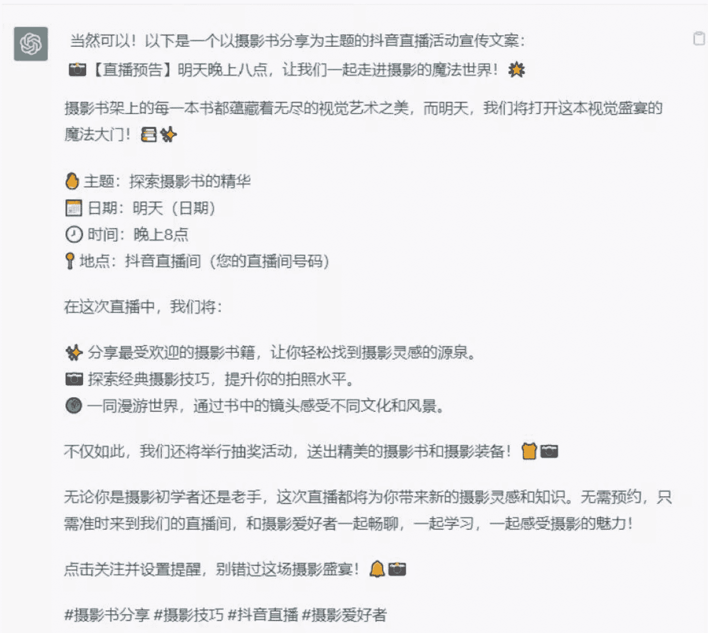

### 022 直播热评文案范例

直播热评文案是指在直播平台或社交媒体上，主播针对活动发表的有趣、吸睛或富创造性的评论，用来吸引注意力、增加互动并提供娱乐价值，对后期维持热度也有帮助。借助 ChatGPT 可轻松撰写。

提问模板：

请根据热评文案的特点，提供一些×××主题的直播活动热评文案，激发受众的讨论热情，以维持直播活动的热度

按模板生成的示例见图 5-6 所示。

## 第 5 章 直播文案指令与实战样例

请根据热评文案的特点，提供一些以开盲盒为主题的直播活动热评文案，激发受众的讨论热情，以维持直播活动的热度

撰写开盲盒主题热评时可侧重以下要点：

1. 神秘感与期待感
   - “猜猜今天会有哪些惊喜呢？开盲盒，揭开神秘的面纱！”
   - “每一次开盲盒都是一个未知冒险，你猜我们能在今天的盲盒里找到什么宝藏吗？”
2. 分享惊喜
   - “一起来分享开盲盒的惊喜瞬间吧！你最期待的是哪一款？”
   - “这个盲盒里有一份惊喜，和你一起分享真是太棒了！”
3. 互动与评论
   - “在评论中告诉我们，你最喜欢的盲盒款式是哪一个，我们会选一个幸运观众送出去！”
   - “看到大家的评论真是太有趣了！继续留言，让我们知道你的想法。”
4. 悬念与引导
   - “还有几个盲盒等着揭开，大家猜猜下一个会是什么？”
   - “别走开，接下来的盲盒更加精彩！”
5. 限时特价与购买鼓励
   - “只在直播中，我们提供特别的优惠价格，赶紧下单吧！”
   - “现在购买，不仅能享受特价，还能有机会获得额外的赠品哦！”
6. 用户体验分享
   - “有人已经购买了我们的盲盒，他们的开箱体验是什么样的？”
   - “观众分享了他们的开箱瞬间，真是太感动了！”
7. 答疑与解惑
   - “有关盲盒的任何问题，都可以在评论中提出，我们会尽力解答！”
   - “不懂盲盒的玩法？别担心，我们会为你解释一切！”
8. 用户参与奖励
   - “点赞并分享这个直播，你将有机会赢得我们的神秘礼品！”
   - “感谢你们的支持，我们会在评论中选取幸运观众送出礼品。”

图5-6 ChatGPT生成直播热评文案示例

可以看出，模型提供的热评借助神秘感、互动性和奖励机制来激发兴趣，以最大限度维持热度。

在使用模型生成热评时，还可微调指令让模型生成活动后期的回顾类热评，示例如图 5-7 所示。

# ChatGPT 内容生成指令与范例大全

请根据热评文案的特点，提供一些以开盲盒为主题的直播活动热评文案，对直播活动进行回顾和总结

回顾开盲盒直播时，热评需要具备吸引力、幽默感和互动性。示例如下：

1. “盒子打开的瞬间，我心也跟着开了花！🌸 这次的开盲盒直播真是让人欲罢不能，充满了惊喜和期待。你们最喜欢今天的哪个惊喜呢？”
2. “天呐，今天的盲盒运气简直炸裂！💥 感觉自己像个宝藏猎人，一寻找就找到了！这个系列的藏宝盒真的不容错过。”
3. “一边吃零食，一边猜这个盲盒里是什么，这简直就是人生的完美夜晚！🍿🎁 大家都在猜测下一个盲盒会是什么，我看下一个一定是绝版稀有物品！”
4. “这个盲盒的神秘感简直让人无法抗拒！🔮 每个盲盒背后都有一个令人兴奋的故事，今天的开箱经历是如此令人难以忘怀。”
5. “来来来，一起猜猜这个盲盒的幸运号码是什么？🎯 看看谁能猜中，赢得今晚的超级大奖！”
6. “我们的盲盒家族越来越庞大了！👨‍👩‍👧‍👦 感谢每一个和我一起度过这个开盲盒之夜的人，你们就是我最珍贵的宝藏。”
7. “不开盲盒的日子简直是无聊的日子！🤷‍♀️ 这个直播活动让我们每次都期待不已，因为总有新的宝藏等着我们去探索。”
8. “如果你们喜欢今天的盲盒盛宴，别忘了点赞和分享给更多人！一起分享这份惊喜和快乐吧！👍✨”
9. “开盲盒不仅仅是一种娱乐，更是一种情感的表达方式。每个盒子背后都有着无数的故事，谁知道下一个盲盒会带来什么样的情感共鸣呢？❤️”
10. “感谢大家的参与，今天的开盲盒直播活动圆满结束！下次再见，下次的惊喜一定更多！🚀”

图5-7 ChatGPT生成直播活动后期的热评文案示例


## 第 6 章 影视创作指令与范例

ChatGPT 凭借文本生成能力，可用于影视行业，帮助创作电视剧剧本、电影剧本、动漫脚本和纪录片脚本等，为观众带来 AI 视角下的独特创作体验。本章介绍相关指令与范例。

### 023 指令应用步骤


电视剧是影视行业主要收益来源之一，收益高低受剧本质量影响。优秀剧本在题材、故事构思、人物塑造上能给观众惊喜，但写作好剧本需要编剧积累文学素养和生活经验。借助 ChatGPT，编剧可获得灵感和技巧参考，提升剧本质量。

以下以 ChatGPT 协助写电视剧剧本为例说明操作步骤。

STEP 01 赋予身份，确定选题：在输入框输入“假设你是一位经验丰富的编剧，请你提供一些符合现代人审美的电视剧剧本的选题建议？”，回车后模型会给出选题建议，如图 6-1 所示。

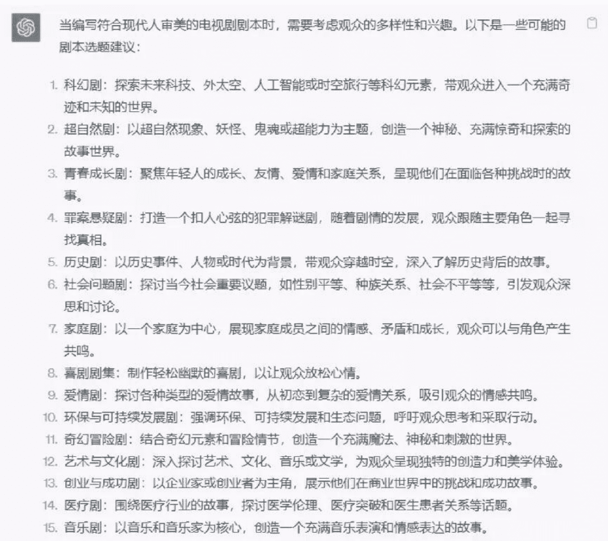

STEP 02 根据选题，撰写大纲：在输入框继续输入“请撰写一个悬疑剧的剧本大纲，分为 10 章内容，包括内容简介和人物介绍”，回车后模型即生成悬疑剧大纲，部分展示如图 6-2 所示。

## 第 6 章 影视创作指令与范例

剧本大纲：《失踪之谜》

内容简介：

《失踪之谜》是一部悬疑剧，故事发生在一个小镇上，讲述了一名年轻女子的神秘失踪事件引发的连锁反应。当警察、家庭成员和朋友开始深入调查时，他们揭开了一个充满谎言、秘密和意外的复杂谜团。

人物介绍：

1. 艾米莉 Emily 26岁，失踪的年轻女子，聪明、独立，最近刚刚回到小镇。她的失踪引发整个故事。
2. 大卫 David 30岁，艾米莉的哥哥，小镇医生。对妹妹失踪极度焦虑，亲自参与寻找。
3. 莎拉 Sarah 28岁，艾米莉的亲密朋友，小镇记者。她是主要调查者，试图找出下落。
4. 理查德 Richard 50岁，小镇警察局长，经验丰富，对莎拉的调查方法不信任。
5. 莉莉 Lily 25岁，艾米莉的室友，性格复杂，似乎对失踪有所隐瞒。
6. 汤姆 Tom 32岁，大卫的朋友，小镇检察官。为调查提供法律援助，但保持怀疑。
7. 安娜 Anna 50岁，莎拉的母亲，曾是知名记者。经验和资源有助于调查。
8. 凯特 Kate 28岁，失踪案证人，自称在失踪当晚看到艾米莉，但证词矛盾。
9. 本 Ben 30岁，大卫的朋友，小镇私人侦探。受雇协助调查，也有自身动机。
10. 克里斯 Chris 27岁，莎拉的男友，计算机工程师，提供技术支持帮助解谜。

剧本大纲：

第一章 失踪的夜晚
故事开始，艾米莉一夜失踪。哥哥大卫、室友莉莉和朋友莎拉开始找线索，却徒劳。

第二章 众说纷纭
莎拉开始采访证人，其中包括凯特。不同证人信息相互矛盾，疑虑加深。

第三章 深入调查
大卫、莎拉和本深入调查艾米莉的生活，发现神秘日记和异常电话录音。

第四章 秘密浮出水面
莎拉母亲安娜透露一起旧案可能与失踪有关。同时大卫和莎拉关系紧张。

第五章 无处可逃
失踪案引起小镇关注，媒体涌入，情况更复杂。莎拉在压力下继续调查。

图6-2 ChatGPT生成的悬疑剧剧本大纲部分内容

STEP 03 根据大纲，撰写剧本：在输入框继续输入“请根据以上内容简介和剧本大纲，写出第一章的内容”，回车后模型即生成第一章内容，如图 6-3 所示。按此方法可撰写其他章节。

# ChatGPT 内容生成指令与范例大全

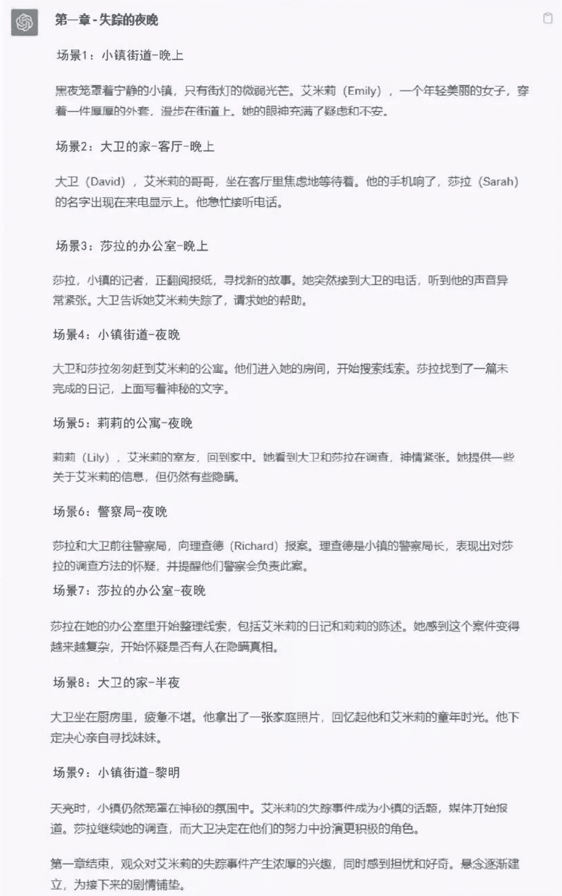

图6-3 ChatGPT生成的悬疑剧第一章内容

在上述示例中，赋予身份能让模型在专业编剧知识储备中完成选题、大纲和正文任务；先写大纲可检验故事是否符合叙事逻辑；最后再写正文，使写作受大纲指导。需注意模型生成的剧本可能不完整，需结合实际需求调整。

## 第 6 章 影视创作指令与范例

### 024 电影剧本范例

电影是影视行业的重要艺术形式，与电视剧同为娱乐、表达观点和传播思想的载体。借助 ChatGPT，编剧能轻松创作电影剧本。

常用提问模板：

1. 撰写大纲：假设你是一位经验丰富的编剧，请撰写一个×××电影题材的剧本大纲，分为×章内容
2. 撰写内容：请根据电影大纲，写出第×章的内容

按模板生成的示例见图 6-4、图 6-5 所示。

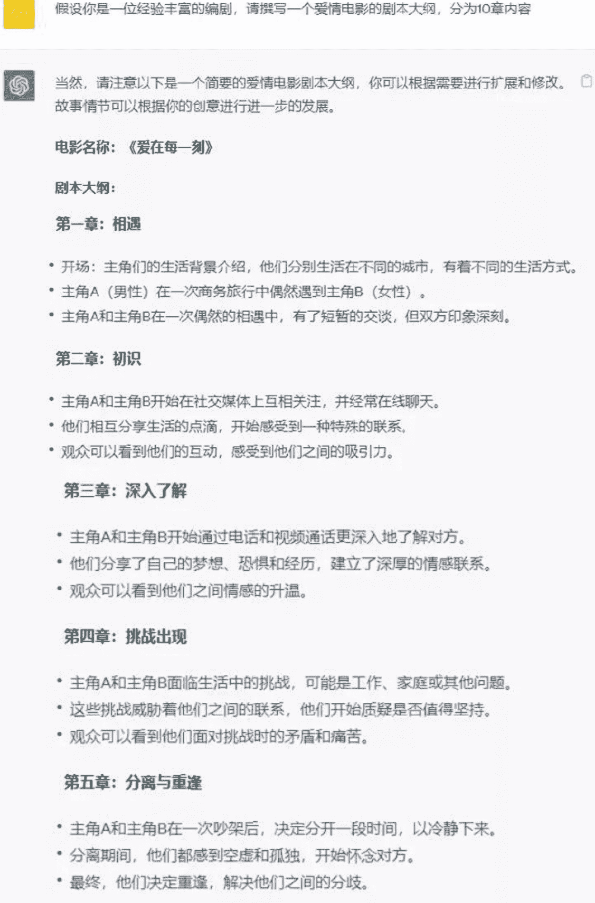

图6-4 ChatGPT创作电影剧本大纲示例部分内容

# ChatGPT 内容生成指令与范例大全

第六章：重建联系
- 主角A和主角B决定一同旅行，远离城市喧嚣，重新建立联系。
- 在旅行中，他们共同经历美好时刻，重新点燃彼此爱情。
第七章：决定未来
- 主角A和主角B回到城市后，必须面对现实生活的挑战。
- 他们需要决定是否迁就对方、改变生活方式，或维持现状。
- 这个决定将影响未来，包括是否继续在一起。

图6-4 ChatGPT创作电影剧本大纲示例部分内容续

请根据电影大纲，写出第一章的内容

第一章：相遇

场景1：城市街头 早晨
开场呈现繁忙街头，人群匆匆，车辆穿梭。镜头聚焦第一位主角，一位风度翩翩的年轻男性，戴帽、挎皮包，看起来很专业。他穿过人行道，走进一家繁忙咖啡店。

场景2：城市咖啡店 早晨
第一位主角在柜台前等咖啡。此时第二位主角，一位迷人年轻女性，戴耳机手拿咖啡，不小心撞到第一位主角。

第一位主角 微笑：没关系，没事的。
第二位主角 抱歉地笑：对不起，我没看清楚。

两人目光交汇，仿佛世界安静。第二位主角继续前行，第一位主角接过咖啡，看着背影，心中升起奇妙感觉。

场景3：城市咖啡店 后续
第一位主角找座位悠闲喝咖啡，拿出手机翻阅社交媒体。突然看到第二位主角的社交主页，好奇心被点燃。

第一位主角 自言自语：她是谁呢？

第一位主角开始关注第二位主角的账号，浏览照片和帖子，兴趣愈发浓厚。

第一章以偶然相遇展开，吸引力悄然滋生。观众对主人公生活和个性有初步了解，为后续埋下伏笔。

图6-5 ChatGPT创作电影剧本内容示例

获得剧本后，应根据实际情况和拍摄需求调整，以确保实用性。

### 025 动漫脚本范例

# ChatGPT 助力脚本创作与 AI 作画

影视作品里，动画、电影和电视剧都属于视听表达的一种，而动画更依赖分镜和插画来推动故事与观点。一部完整的动画长片，通常需要一份主线剧本把零散画面串联成完整叙事。借用 ChatGPT，创作者可以快速获取灵感和可参考的框架。

要让模型协助撰写动画剧本，可先用下面的提问方式进入。

> 请你以动漫制作人的身份，围绕×××主题构思一部动画电影剧本

按此思路让模型输出的示例见图 6-6。

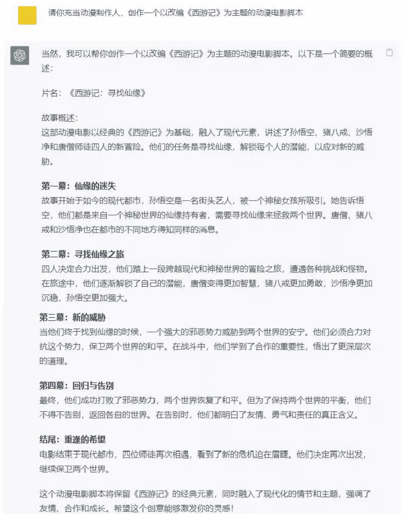

得到初稿后，还可以请模型把每场的分镜与情节再细化，获得更具体的脚本参考。

### 026 纪录片脚本范例

相较于前述娱乐形式，纪录片更侧重纪实，聚焦真实事件或人物。脚本在拍摄与剪辑中起到指导作用。借助 ChatGPT，可以迅速拿到特定主题的纪录片剧本，提升制作效率。

撰写纪录片剧本时可采用如下提问方式：

> 请担任纪录片导演，依据纪实特点，为×××主题撰写一部时长×分钟的纪录片脚本

按此模板生成的案例见图 6-7，呈现节奏紧凑、画面连贯。

请担任纪录片导演，依据纪实特点，为“京剧之台上一分钟，台下十年功”主题撰写一部时长九十分钟的纪录片脚本

```
《京剧之台上一分钟，台下十年功》纪录片脚本

[片头画面]
画面渐显，北京紫禁城的壮丽宫殿，背景音乐悠扬。字幕出现：《京剧之台上一分钟，台下十年功》。

[开场旁白]
(旁白声音沉稳)
中国京剧，一门综合艺术，以其博大精深的传统、精湛的技艺和多彩的表演形式而著称于世。这是一门台上一分钟的精湛表演，背后需要十年艰苦修炼的艺术。

[场景一：传承的延续]
画面切换至京剧学校内部，一位老师正在教授一群学生如何正确化妆。镜头对焦到学生们充满了专注和敬畏的眼神中。

[老师]
(表情严肃)
学会化妆是学习京剧的第一步，每个细节都至关重要。

[学生一]
(低声)
师傅，这个眉毛该怎么化？

[老师]
(耐心)
来，我来演示一遍。

[场景二：台前幕后]
剪辑过渡至剧场后台，演员们正在穿戴华丽的戏服。镜头追随一位演员走上台，她微微闭上眼睛，开始化妆。化妆室的墙上挂着演员们年轻时的照片，对比鲜明。

[演员一]
(自言自语)
这些年的汗水和辛苦，都是为了这一刻。
```

图6-7 ChatGPT创作纪录片脚本示例

[场景三：台上一分钟]

镜头切换至舞台，演员身着华丽戏服，灯光璀璨，气氛庄严肃穆。一名男演员登场演绎高潮段落，动作流畅表情生动，观众全情投入掌声雷动。

[观众一]

（激动）

真是太精彩了！

[观众二]

（赞叹）

看得我都入戏了！

[场景四：台下十年功]

画面转到排练室，演员们挥汗如雨地训练。快速蒙太奇展现多年来的坚持与打磨，涵盖武术、唱腔与表演。

[演员二]

（喘息）

每场演出都是对自我的考验。

[演员三]

（自豪）

我们是京剧的传承者，责任重大。

[场景五：精湛技艺]

镜头回到舞台，表演令人叹服，戏剧情深意长，观众不禁落泪。

[观众三]

（感慨）

这是中华文化的瑰宝！

[场景六：传承与未来]

画面切到教室，师徒围坐，老师传授经验。特写学子眼神，充满憧憬与信心。

[老师]

（鼓励）

继续加油，你们会成为未来的主角！

[结尾旁白]

（旁白）

这是一门传统艺术，传承与创新并行。台上一分钟，看不见的是台下十年的辛勤付出。京剧不仅是舞台表演，更是承载中华传统文化的珍贵财富。

图6-7 ChatGPT创作纪录片脚本示例（续）


## 第 7 章 AI 绘画指令与范例

在生成式模型领域，AI 作画同样受益。ChatGPT 能帮助用户快速生成绘画提示词，提供参考与指导。不熟悉绘画工具时，可先为模型设定角色，让它输出提示词，再驱动 AI 绘画工具生成作品。

### 027 指令应用步骤

漫画是绘画中独特的表达形式，用简洁线条与随意笔触勾勒形态，可讲故事、抒情感、供娱乐。AI 发展后，漫画的情节、人物、场景均可智能生成。

下面以让 ChatGPT 生成漫画绘制指令为例，介绍操作流程。

STEP 01 赋予身份，获取建议：在输入框输入指令，如“你现在是一位 AI 绘画专家，请给出生成漫画的提示词建议”，回车后模型会给出绘制漫画的建议，如图 7-1 所示。

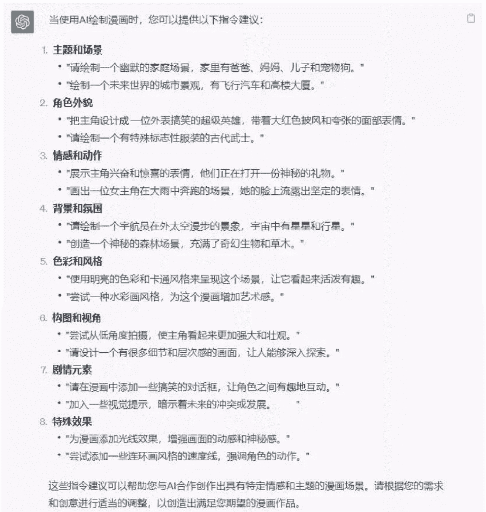

STEP 02 提出需求，获取指令：继续输入，如“基于以上建议，给出一个以奇幻王国为主题的漫画 AI 绘画指令示例，控制在 50 字以内”，回车后模型会生成指令，如图 7-2 所示。


图7-2 ChatGPT生成的AI绘制漫画的指令

STEP 03 提出要求，翻译指令：继续输入，如“把上面这段绘画指令译成英文”，回车后模型会输出英文提示词，如图 7-3 所示。


图7-3 ChatGPT生成的英文的AI绘画指令

由此可见，设定角色能让模型建立对 AI 作画的认知，更好提供建议；提出需求时应给出明确主题作为依据；指令要简明，50 字左右较为理想；中文转英文后可直接用于 Midjourney 等英文工具。

### 028 油画绘制指令范例

油画以调和颜料绘制，色彩丰富、质感立体。AI 作画可依据不同指令呈现不同油画效果。

生成油画绘画指令时可使用以下模板。

> 你现在是一位 AI 绘画专家，请给出几条以×××为主题的油画 AI 绘画指令示例，字数控制在 50 字以内

用此模板生成的示例见图 7-4 所示。

让模型生成油画指令时，应提供一定的主题，如油画类型或题材，便于模型依据主题输出。

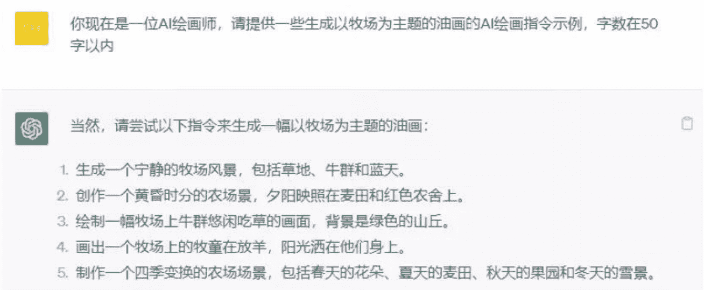

图7-4 ChatGPT生成油画绘画指令示例

请把第 5 条绘画指令译成英文

> Certainly, here's the translation of the 5th painting instruction into English:

"Create a changing seasons farm scene, including spring flowers, summer wheat fields, autumn orchards, and winter snowscapes."

图7-4 ChatGPT生成油画绘画指令示例（续）

### 029 插画绘制指令范例

插画与漫画、油画类似，都能传递信息和情感，在 AI 作画中很受欢迎。

生成插画绘画指令时可使用以下模板。

> 你现在是一位 AI 绘画专家，请给出生成×××（主题或风格）的插画 AI 绘画指令示例，字数控制在 50 字以内

用此模板生成的示例见图 7-5 所示。

你现在是一位AI绘画师，请提供一些生成国潮风格的插画的AI绘画指令示例，字数在50字以内

> 当然，以下是一些生成国潮风格插画的AI绘画指令示例：

> 1. 请绘制一幅国潮风格的中国龙图案，背景是红色的。

> 2. 以中国水墨画风格绘制一幅山水画，突出青山和流水。

> 3. 请创建一幅中国传统花鸟画，主题是牡丹花和孔雀。

> 4. 绘制一幅现代国潮风格的城市风景，突出中国元素和高楼大厦。

> 5. 以书法艺术风格绘制一幅“国泰民安”字样的插画。

>

> 这些指令可以帮助AI绘画师生成符合国潮风格的插画。

请将第4个绘画指令翻译为英文

> Certainly, here is the translation of the fourth painting instruction into English:

>

> "Please create a modern Chinese street style cityscape, highlighting Chinese elements and skyscrapers."

图7-5 ChatGPT生成插画绘画指令示例

插画主题与风格选择多样，如武侠、动物、花卉、工笔、赛博朋克、扁平或 3D 效果等，可按需调整。

### 030 水墨画绘制指令范例

水墨画是中国传统绘画的主要形式，以水墨绘就，文雅且层次分明。AI 技术可快速生成水墨画，提供灵感。

生成水墨画绘画指令时可使用以下模板。

> 你现在是一位AI绘画师，请提供一个绘制 ×××（主题）水墨画的AI绘画指令示例，字数在 50 字以内，要求写意、传神

用此模板生成的示例见图 7-6 所示。

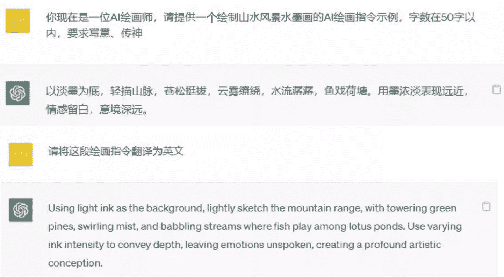

生成水墨画指令时，尽量在提示中说明绘画要求，如写意、传神，能让模型输出更有效的提示词。

### 031 摄影作品绘制指令范例

摄影作品也是绘画艺术的一种，AI 与摄影结合能产出美感作品。人像、风光、黑白等热门主题既能展现瞬间之美，也体现审美与见解。

生成摄影作品绘制指令时可使用以下模板。

> 你现在是一位 AI 绘画师，请提供一个绘制×××（主题）摄影作品的 AI 绘画指令示例，字数在 50 字以内，要求使用×× 镜头、×× 景别、×× 构图、×× 光线

用此模板生成的示例见图 7-7 所示。

> 你现在是一位AI绘画师，请提供一个绘制街景人像摄影作品的AI绘画指令示例，字数在50字以内，要求使用标准镜头、中景景别、竖构图、顺光线

> 使用标准镜头拍摄，选择中景景别，确保竖构图，借助顺光线，捕捉街头繁忙的人流和建筑物。人物要生动表现，背景细节丰富，以突出城市街景的独特魅力。

> 将这段绘画指令翻译为英文

> Capture the bustling street scene with a standard lens, opting for a mid-range composition, ensuring a vertical framing, and utilizing favorable backlighting. Depict vivid, lifelike individuals amidst a richly detailed backdrop, emphasizing the unique charm of urban street life.

图7-7 ChatGPT生成摄影作品绘制指令示例

摄影作品更具纪实性，需考虑镜头、景别、构图、光线等要素，提供提示时应注意这些。

### 032 设计作品绘制指令范例

设计作品包括服装、珠宝、礼盒包装、室内布局等图纸或图稿。AI 作画既能提供创意灵感，也可协助完成设计稿。

生成设计作品绘制指令时可使用以下模板。

> 你现在是一位 AI 绘画专家，请给出绘制×××设计图的 AI 绘画指令示例

用此模板生成的示例见图 7-8 所示。

> 你现在是一位AI绘画师，请生成一些绘制珠宝设计图的指令示例

> 当我作为AI绘画师生成珠宝设计图时，以下是一些指令示例，以帮助你开始：

1. 钻石戒指设计

   - "请绘制一个白金钻石戒指的设计，主石是一个八爪镶嵌的圆形3克拉钻石，环绕着它有小型钻石和微微弯曲的装饰。"

   - "创造一个玫瑰金钻石戒指，主石是一个梨形切割的粉红钻石，两侧有两颗小的圆形钻石，设计要尽量突出主石的美丽。"

2. 蓝宝石项链设计

   - "请设计一款蓝宝石项链，主要特点是一个大而明亮的椭圆形蓝宝石挂坠，周围有精致的白金链条。"

   - "创建一个白金项链，有多个蓝宝石和白钻石交替排列的设计，使它看起来华丽而高雅。"

3. 黄金耳环设计

   - "绘制一对黄金耳环，形状是花朵，每朵花的中心都嵌有一颗明亮的红宝石，花瓣上有小钻石的装饰。"

   - "创造一对古典风格的黄金耳环，有复杂的纹理和珍珠的装饰，呈现出复古优雅的外观。"

4. 珠宝首饰套装

   - "请设计一个包括项链、耳环和手镯的完整珠宝套装，以蓝色宝石为主题，确保它们相互协调，同时也注重独特性。"

   - "创造一套白金首饰，包括一条项链、一对耳环和一个戒指，所有的首饰都要以几颗大的钻石为特色，以吸引人的眼光。"

请记住，这些是示例指令，你可以根据你的具体需求和喜好来定制珠宝设计。我将尽力生成符合你要求的图像，但由于文字限制，无法直接提供图像。可以使用绘图软件或与专业珠宝设计师合作来实现这些设计。

图7-8 ChatGPT生成设计作品绘制指令示例（续）

以上指令可按需选择调整，配合翻译后输入 Midjourney 等工具即可获得设计图。

### 033 电商产品图绘制指令范例

AI 技术在电商广告中作用明显，店铺 Logo、主图、模特展示图、详情页等均可借助 AI 设计，提升效率与转化。

生成电商产品图绘制指令时可使用以下模板。

> 你现在是一位 AI 绘画专家，请提供一个×××（产品）产品主图/详情页图/模特展示图的 AI 绘画指令示例，字数 50 字以内

用此模板生成的示例见图 7-9 所示。


对生成结果不满意时，可多次点击 Regenerate 让模型优化答案。

## 第 8 章 新媒体文案指令与范例

新媒体文案是用于新媒体平台推广、营销或传播的文字内容，随互联网与数字传媒发展而普及。本章介绍如何用 ChatGPT 生成新媒体文案。

### 034 指令应用步骤

在内容为王的热潮中，新媒体从业者坚持原创、创意、创新。ChatGPT 可提供创作灵感，使文案更具新意。

下面以让 ChatGPT 生成公众号文章为例，说明操作步骤。

STEP 01 赋予身份，询问建议：在输入框输入指令，如“假设你是拥有多年新媒体运营经验的工作者，请你提供一些写作公众号文章的建议”，回车后模型会给出建议，如图 8-1 所示。

图8-1 ChatGPT提供写作公众号文章的建议

STEP 02 确定主题，提出需求：继续输入，如“请根据这些建议，以‘为什么好朋友会渐行渐远’为主题，写作一篇公众号文章”，回车后模型会生成特定主题的文章，如图 8-2 所示，观点鲜明但案例不足，说服力不够。

图8-2 ChatGPT生成特定主题的公众号文章

STEP 03 提出要求，优化文章：继续输入，如“请在这篇文章中加入一些具体的案例，使观点更有说服力”，回车后模型会按要求优化，如图 8-3 所示。

从示例可见，设定身份可让答案更专业；提出需求时应明确主题；后续可结合受众喜好追问，让模型进一步优化。

### 035 小红书笔记范例

小红书以笔记形式传递信息和观点，是热门新媒体平台。在特定指令下，ChatGPT 也能生成小红书笔记，帮助创作者轻松运营并保持更新。

要借助 ChatGPT 在小红书产出笔记，可以套用下面的提问框架。

- 角色设定：请你扮演一位粉丝超百万的小红书博主，分享一下做出爆款笔记的心得
- 任务设定：基于以上心得，以×××为主题，写一篇适合小红书传播的爆款笔记

图8-4展示了这套框架的实际运用。写完初稿后，还可以让模型继续打磨，比如补充真实使用经历、加入好用产品推荐，提升笔记的吸引力。

下面以“秋冬季节补水干货”为例示范：

标题：秋冬补水必看，7个招数告别干皮

嗨，伙伴们，秋天已到，冬天也快了，趁机把我的秋冬保湿经验整理出来分享给大家。冷风和暖气一起上，皮肤很容易发紧发干，别怕，这7个小方法能让肌肤一直水润有光泽。🍂❄️

1. 清洁要温柔
不要挑刺激强的洁面。选用温和洗面奶，早晚轻柔按摩后用温水冲净。避免用热水，热水会带走皮肤天然油脂，反而更干。

2. 喝水要规律
多喝水是常识，换季时尤其关键。体内水分充足，皮肤自保湿力才跟得上。建议每天保证八杯左右，让肌肤持续水润。

3. 定期敷保湿膜
一周敷一次深层保湿面膜很有用。我偏爱玻尿酸和胶原蛋白成分的款式，上脸后保湿感提升很明显。

4. 晚间加护肤油
夜间护肤时涂一点天然护肤油，比如橄榄油、玫瑰果油或葡萄籽油，轻按吸收，能把水分锁住，还能增加弹性。

5. 护手别忽视
频繁洗手会让手部变得粗糙。换成温和洗手液，洗完马上涂护手霜，保持柔软。

6. 随身补水喷雾
办公室、户外或空调房都容易吸干水分。带一瓶补水喷雾，随时喷一喷，既提神又保湿。

7. 内外一起调
别只顾表面，饮食也要跟上。摄入足够维生素和抗氧化剂，肌肤才能从内而外得到滋养。

希望这些方法对你有用，秋冬也能保持水润自信。有其他好办法欢迎留言交流哦！❤️💧 #秋冬护肤 #补水小技巧 #护肤干货

图8-4 ChatGPT生成小红书笔记示例（续）

### 036 豆瓣书评范例

书评在新媒体里是常见的推广文体，能帮助图书获得更多传播。写好书评需要独到见解和扎实的表达，配合 ChatGPT 可以大幅提升写作效率。

生成豆瓣书评时常用以下提问方式。

- 角色设定：假设你是一名文学评论专家，请给出写书评的一些建议
- 任务设定：按上述建议，为×××（书名）写一篇专业书评，要求中肯客观，字数约×字

图8-5展示了这套指令的示例。

请按以上建议，为《百年孤独》写一篇约500字的专业书评，要求客观中肯

《百年孤独》是哥伦比亚作家加西亚·马尔克斯的代表作，被视为拉美文学的里程碑。这部作品以魔幻现实主义为笔法，主题深沉，人物鲜活。下面从几个角度做简要分析。

其一，文学价值突出。马尔克斯的叙述充满想象与细腻描写，现实与超自然自然交织，营造出奇幻又迷离的世界。语言精准而富情感，让人仿佛置身马孔多，感受到小镇独特的氛围。

其二，主题情感厚重。小说触及时间、孤独、爱情、家族与命运等命题。布恩迪亚家族的世代轮回发人深省，既折射拉美历史进程，也让人思考人性的循环。人物性格各异，内心世界被刻画得立体，容易引发共鸣。

其三，结构与情节精巧。虽时间跨度大、人物众多，作者仍将线索编织得一气呵成。开头铺设家族起源，结尾收束意味深长，叙事技巧娴熟，阅读体验沉浸。

不过，作品的复杂性也带来门槛。超自然元素与非线性叙事可能让部分读者感到困惑；部分情节涉及人性阴暗与社会腐败，也可能让人不适。

总体来看，《百年孤独》是部艺术成就极高的作品，风格独特、主题深刻、人物丰满，同时也是需要投入精力去理解的挑战之作。值得一读，能带来难忘的阅读体验。

图8-5 ChatGPT生成豆瓣书评示例（续）

给 ChatGPT 设定更细的限制，比如字数上限200字、切入角度要新颖、点评保持中立，能让生成的书评更具专业性。

### 037 播客内容范例

公众号、小红书和豆瓣书评多为图文形态，播客则是以声音为主的传播形式。借助 ChatGPT 梳理逻辑，能更快产出清晰完整的播客脚本。

生成播客内容时可采用如下指令。

假设你是一名播客主理人，正在运营一个×××类型的节目，请围绕×××主题撰写一期内容

图8-6展示了示例应用。

> 假设你运营一个聚焦当代社会热点的播客，请以“成年人为什么越来越难拥有纯粹的快乐？”为主题写一期内容

节目开场：

大家好，欢迎收听《现代人心声》，我是主持人[你的名字]。今天我们聊一个很多人都在意的议题：为什么现在的成年人很难再体会到纯粹的快乐。

快节奏高压的生活中，纯粹无忧的快乐似乎越来越遥远。我们会剖析社会因素带来的影响，也会分享一些可操作的方法，帮助大家在忙碌里重新找回快乐。

#### 1. 社会带来的阻力
先回顾现实环境对成年人的冲击：生活节奏快、工作压力大、社交媒体泛滥、信息过载，这些都在消耗我们的情绪能量。同时对生活品质和事业成功的持续追求，也放大了焦虑。

#### 2. 快乐的本质是什么
要解释为何纯粹快乐难寻，先厘清快乐的本质。快乐多为短暂的情绪体验，而非恒定状态。现代社会却常把快乐绑定在财富、地位、外在成就上，导致人们陷入不断追逐的循环，忽略了内在来源。

#### 3. 社交媒体的影响
社交平台时代，人们更在意他人评价，努力塑造完美形象。这种焦虑会削弱与亲友分享真实快乐时刻的意愿。我们会探讨如何建立更深层的社交联结。

#### 4. 内心的安宁与自我关怀
找回纯粹快乐的关键在于内心平静与自我关爱。可以分享冥想、心灵练习等方法，帮助日常中获得宁静，照顾身心健康。

#### 5. 在现实中找到纯粹快乐
最后给出几个简单路径：亲近自然、发展兴趣爱好、帮助他人、享受美食等，都能在快节奏中提供真实的幸福感。

本期希望为你提供一些思考与启发，助你在现代社会里追寻更纯粹的快乐。有问题或想法欢迎在社交平台留言。感谢收听《现代人心声》，下期见！

图8-6 ChatGPT生成播客内容示例

播客多为个人观点分享，若有自己的见解，交给 ChatGPT 梳理逻辑、拓展思路会更高效。

### 038 知乎内容范例

知乎是交流思想的重要平台，读者既会带着问题阅读，也会发表观点。对新手来说写出专业又有共鸣的内容并不容易，ChatGPT 能提供很大帮助。

生成知乎内容时可先建立认知再下指令。

- 先了解平台：你熟悉知乎吗？高赞内容有哪些共同特点？常用什么文体？
- 再下任务：按知乎的写作习惯，用×××文体回答下面的问题，问题：×××

图8-7展示了示例。先让模型理解平台特征，再生成，更有针对性。

## 第 9 章 新闻传媒指令与范例

新闻是传媒的核心，ChatGPT 可辅助选题、采编与撰写，提升效率和质量。下面以撰写新闻稿为例说明操作步骤。

### 039 指令应用步骤

STEP 01 明确主题，出提纲：在对话框输入“假设你是一名新闻记者，要写一篇关于网络诈骗的资讯，请生成一份完整提纲”，回车后模型会输出提纲，如图9-1。

STEP 02 提出要求，写初稿：继续输入“请按提纲写一篇报纸用稿，约800字，语言严谨精练”，回车后得到初稿，如图9-2。

STEP 03 加入素材，优化稿件：输入“新闻素材：×××，请精简素材并融合进稿件”，回车后模型结合素材优化内容，如图9-3。

先出提纲理清思路，再按提纲成稿确认写法，最后加入真实素材增强时效性，是常用流程。

### 040 新闻简讯范例

新闻简讯为200字以内的短消息，强调时效、客观与概括。可用 ChatGPT 快速提炼要点。

指令模板：请按新闻写法，把以下文字整理成不超过200字的简讯，文字内容：×××

图9-4展示了示例。需提供真实有效素材，示例仅供参考。

### 041 期刊文章范例

期刊与报纸功能相近，内容依刊物类型而定。ChatGPT 可按刊物属性生成对应文章。

指令模板：请按期刊文章写法，为×××类型刊物写一篇关于×××主题的文章

示例：请按期刊文章写法，为营养类刊物写一篇关于三伏天养生的文章

标题：三伏天养生指南

摘要：本文围绕三伏天高温高湿的特点，探讨饮食和生活方式上的调养方法，给出实用营养建议，帮助读者安稳度夏。

引言
三伏天是夏季最热的时段，高温易致中暑、食欲下降。因此重视养生尤为重要。

一、保证水分摄入
高温下汗液流失加快，要及时补充水分。建议每日饮水不少于八杯，并多吃西瓜、黄瓜等含水量高的蔬果来辅助补水。

二、调整饮食结构
减少高油高热量的食物，增加新鲜蔬果比例，补充维生素、矿物质和膳食纤维。少摄入咖啡因和酒精，避免加重脱水。

结论
三伏天注意补水、饮食清淡、避免暴晒、适度运动、保持室内通风，能更健康舒适地度过夏季。持续关注身体状态，方为长久之道。

图9-5 ChatGPT生成期刊文章示例（部分内容）

## 第 10 章 社交媒体动态指令与范例

社交媒体是现代人交往的主要渠道，发动态既是表达情绪也是寻求关注。ChatGPT 可帮助生成不同平台的文案。

### 042 指令应用步骤

以网易云音乐动态为例。

STEP 01 确定主题，取建议：输入“在网易云音乐发什么文案比较吸睛？”模型会给出平台适配建议，如图10-1。

STEP 02 提出需求，写文案：继续输入“请从情感共鸣角度，为《春日狂想曲》写一条动态文案”，得到初稿，如图10-2。

STEP 03 提出要求，优化文案：输入“请用更有创意的表达优化，并精简字数”，模型会优化结果，如图10-3。

音乐平台的文案多与歌曲体验相关，模型生成的内容可作思路参考，最终发布以个人感受为准。

### 043 朋友圈文案范例

朋友圈文案使用频率高，好的文案能带来点赞互动。借助 ChatGPT 可提高产出效率。

指令模板：
1. 先问建议：你知道怎么写出让人点赞的朋友圈文案吗？
2. 再下任务：×××，请按以上建议帮我写一条有吸引力的朋友圈文案

示例对话。先输出写作策略：要有创意、引发情感共鸣、配图视觉化、提出讨论话题、保持积极正面、体现个性、加入幽默。

当用户说“国庆期间我去广州玩了五天，回来后想发一条朋友圈，请按以上建议写一条有吸引力的文案”，模型会据此生成示范文案。

在音乐、读书等次要阵地更新动态时，也可采用相同思路先求建议再生成再优化，实现更高效的社交内容创作。

国庆广州旅行手记示例
> “国庆假期五彩缤纷，我特意来到广州，感受这座城的繁华，留下暖心的印记。穿行在陈家祠的古旧街巷，尝鲜当地小吃，体会到南方式的惬意。五天光景像按下暂停，记忆却格外鲜明。在这个特别的长假里，我读懂了广州的魅力，也收获了难忘时光。把这份开心与大家共用，愿你在平常日子里也能寻到快乐和美好。😊📸🍜 #广州游记 #国庆五日游 #珠江夜景 #美食之旅”

这条朋友圈把主观感受与行程亮点融合在一起，配上贴合主题的话题标签，有利于扩大曝光和互动。整体语气积极乐观，阅读体验轻松愉快。发布后记得及时回复评论，保持社交温度，祝你的动态收获好反馈！👍🌟

图10-4 ChatGPT 产出的朋友圈示例

想让 ChatGPT 写出符合预期的朋友圈文案，关键在于两点：先把主题和情境说明清楚；再结合个人表达习惯提出细化要求。

### 044 微博文案范例

微博同样具有强社交属性，在 ChatGPT 辅助下能产出更具共鸣的内容。

向 ChatGPT 请求微博文案时可参考以下提问思路。

1. 先探询：微博常见的文案类型有哪些特点？
2. 再下单：×××（说明主题或事件背景），请按微博文案的规律，为我创作一条×××（文案类型）的文案。

按此思路得到的示例如图10-5所示。

微博平台中的文案有哪些类型和特征？

在微博上，文案可按内容、目的和风格划分，下面是一些典型类型及其特点：

1. 营销文案
   - 特点：突出产品或服务的卖点，常附带促销、折扣信息。
   - 目的：促销提价、拉动销售、做品牌曝光。
2. 品牌故事文案
   - 特点：讲述品牌由来、理念与文化，塑造形象。
   - 目的：建立品牌认知，吸引核心粉丝。
3. 活动公告文案
   - 特点：介绍即将或正在进行的活动、赛事、庆典等。
   - 目的：招募参与者，提升活动声量。
4. 新闻报道文案
   - 特点：传递时事、热点或资讯。
   - 目的：提供信息，引发讨论。
5. 个人情感文案
   - 特点：抒发心情、经历，常带个人观点。
   - 目的：与粉丝情感联结，建立共鸣。
6. 文化娱乐文案
   - 特点：分享影视、音乐、书籍、艺术等内容。
7. 知识分享文案
   - 特点：输出知识、干货、技能类内容。
   - 目的：科普启发，塑造专业形象。
8. 引用名言文案
   - 特点：引用名人名言或格言，传递价值观。
   - 目的：激励鼓舞，传递智慧。
9. 趣味轻松文案
   - 特点：融入幽默、调侃元素，逗人发笑。
   - 目的：娱乐减压，促进互动。
10. 图片配文文案
    - 特点：配合图文视频，补充或强化视觉信息。
    - 目的：丰富呈现，抓人眼球。
11. 提问互动文案
    - 特点：以提问方式引导评论与讨论。
    - 目的：提升参与度，增加互动。
12. 社会议题文案
    - 特点：讨论社会、政治、环境等议题。
    - 目的：引发公共讨论，提升意识。

图10-5 ChatGPT 产出的微博示例

我的微博主要发布一些轻松愉快的文案，请根据微博文案的特征，帮我写一条带有幽默元素的文案

当然，请看下面这条带有幽默元素的微博文案：

“今天又在超市里走了一圈，把购物车当导航了，结果导航一直说‘左转进食品区’，我真的是来采景的，不是来买东西的！🛒😂”

这条文案以日常购物场景切入，用反差的幽默调侃出逛超市的趣事，希望粉丝读后会心一笑！

图10-5 ChatGPT 产出的微博示例（续）

使用 ChatGPT 撰写微博文案时，先说明账号定位和风格偏好，可让生成结果更贴合。生成后可再自行微调。

### 045 个性签名范例

个性签名相当于个人的座右铭，可以是名言也可以是短句，用来在网络上留下独特的第一印象。借助 ChatGPT 能获得更新颖的签名灵感。

常用的提问模板为：

1. 先求建议：怎么写出独特新颖的个性签名？
2. 再提需求：请融入×××、×××、×××等关键词，并运用修辞，帮我写一条有趣独特的个性签名，字数在×字以内

示范如图10-6所示。

如何写出独特、新颖的个性签名？

创作有记忆点的签名可以参考以下思路：

1. 自我审视：先梳理兴趣、价值观、性格特质和生活经历，这是源头。
2. 运用隐喻比喻：把特长或经历与别的事物对比，形成新鲜意象。例如热爱旅行可写“生命是一次旅行，每个城市都是一页新的故事”。
3. 借鉴经典：选用名言、诗句为签名添厚重感，要与个人情感呼应。
4. 文字游戏：用双关、押韵等手法提升趣味性。
5. 表达情绪：让签名承载爱、积极、热情等感受。
6. 简洁易记：独特不等于冗长，简短的表达更容易传播。
7. 原创为主：从自身体验提炼灵感，最具真实感。

请融入元气、人生、彩色等词，并运用修辞手法，帮我写一条有趣、独特的个性签名，字数在15字以内

> “元气点亮人生，绘出斑斓彩色。”

图10-6 ChatGPT 产出的个性签名示例（续）

上述例子显示，个性签名讲究精炼，15字左右较为理想。若有明确的句式偏好，可提供给 ChatGPT 仿作，示例如图10-7所示。

请模仿“希望和悲伤都是一缕光”的写法，创作一条新的个性签名

> “勇气与柔情都是一片林”

图10-7 ChatGPT 仿作示例

## 第 11 章 金融投资指令与范例

在金融领域，ChatGPT 可充当分析助手，支撑数据研判与决策。用于营销推广、信息科普或产品认知，帮助普通用户做出更合理的投资判断。本章介绍相关指令与案例。

### 046 指令应用步骤

营销方案是金融销售的前置规划，需涵盖核心问题、市场优劣势、解决方案。用户可通过指令让 ChatGPT 输出可行的营销方案。

以生成营销方案为例，操作步骤如下。

STEP 01 了解背景：在输入框中输入“一份完整的营销方案包括哪些内容？”，确认模型是否掌握相关知识，ChatGPT 会给出构成说明，如图11-1所示。

图11-1 ChatGPT 呈现的营销方案相关信息

STEP 02 提交需求：继续输入“请生成一份关于优惠购买车辆综合保险的营销方案”，模型会输出对应的方案样本，如图11-2所示。

图11-2 ChatGPT 产出的车辆综合保险营销方案样本

10. 评估和改进
    - 定期复盘投放效果，依据市场反馈和数据结果优化调整。
    - 持续优化产品与服务以匹配客户需求。

11. 法律和合规性
    - 确保车险产品符合法规与行业规范，避免法律风险。

图11-2 ChatGPT 产出的车辆综合保险营销方案样本（续）

先了解背景可帮助明确对话前提并验证模型理解度。提问时提供清晰主题，有助于生成更精准的方案。

### 047 营销短信范例

营销短信是金融推广常用渠道，以短信形式传递优惠信息。常见写法为 企业/品牌名 + 推广信息 + 链接入口 + “回T退订”，可让 ChatGPT 按此格式批量生成。

提问模板：
> 营销短信的编辑形式通常是企业或品牌名称+营销信息+链接传送门+“回T退订”，请结合这类形式，编辑×××（产品或服务的推广信息）营销短信。

示范如图11-3所示。

图11-3 ChatGPT 产出的营销短信示例

模型会输出符合格式的模板，用户只需填入银行名称、参与链接等具体信息即可发送。若希望一次生成可用版本，可在指令中给出明确的营销要素。

### 048 金融数据分析范例

金融数据分析涉及财务报表、第三方统计、交易记录等，均可借助 ChatGPT 处理。

提问模板：
假设你是一名数据分析师，擅长做数据统计与处理工作。现在需要你根据以下数据分析 / 总结出×××（信息），以表格的形式呈现。数据如下：×××

例如输入“假设你是一名数据分析师，擅长做数据统计与处理工作。现在需要你根据以下数据分析该公司的财务存在哪些风险，以表格的形式呈现。数据如下：（提供具体的公司财务数据）”，模型分析示例如图11-4所示。

图11-4 ChatGPT 解析的金融数据示例

为提升分析质量，可赋予模型数据分析师身份，并确保提供的财务数据真实准确。

### 049 投资建议范例

面对理财或投资困惑，可让 ChatGPT 扮演金融专家提供解答。

提问模板：
假设你是一名×××（金融方面的专家），擅长×××（能力）。现在需要你帮我解答一些金融方面的疑惑，我的问题是×××（具体的疑惑）。

示范如图11-5所示。

图11-5 ChatGPT 产出的投资建议示例

也可让模型充当资深投资人，从财务状况、行业环境、估值水平等多角度输出投资分析报告，供决策参考。

### 050 防风控建议范例

ChatGPT 还能提供反欺诈风控建议，如防网贷诈骗、电信诈骗等。

提问模板 ❶：×××（信用卡、网贷等）被风控的情形有哪些？
提问模板 ❷：防止×××（信用卡、网贷等）被风控有哪些好的方法？

示例如图11-6、图11-7所示。

> 信用卡被风控的情形有哪些？

信用卡被风控是银行为降低风险、保障账户安全而采取的措施。常见触发情形包括：

1. 大额或异常交易：突发的巨额消费、频繁跨境交易、大额取现等。
2. 超额使用：超出信用额度。
3. 卡片过期失效。
4. 异地使用：交易地与常用途径差异过大。
5. 消费习惯突变：购买品类与历史不符。
6. 多次支付失败。
7. 持卡人报失盗用。
8. 申请信息与消费不匹配。
9. 信用历史不良。
10. 高风险地区交易。

银行由此保护账户，但也可能误伤。若出现问题，建议及时联系发卡机构。

图11-6 ChatGPT 呈现的防风控建议示例（1）

# ChatGPT 内容生成指令与范例大全

防止信用卡被风控有哪些好的方法？

为降低被风控风险，可采取以下做法：

1. **及时更新个人信息**：保持联系电话、邮箱、地址最新，便于核验可疑交易。
2. **合理使用信用卡**：避免突然大幅改变消费频率与金额。
3. **提前告知行方**：境外出行前通知银行，防止误封。
4. **谨慎大额交易**：大额消费前先行报备。
5. **监控账户**：定期查账单，及时核实异常并上报。
6. **安全网络**：线上支付使用安全Wi-Fi或VPN。
7. **定期改密**：提高账户密码强度并定期更换。
8. **慎分享信息**：不在不可信网站透露卡号与身份信息。
9. **警惕钓鱼**：谨防不明邮件、短信、电话诈骗。

图11-7 ChatGPT 呈现的防风控建议示例（2）


## 第 12 章 企业管理指令与范例

在企业管理中，ChatGPT 可提供制度设计、培训指导、成本管控与风险防范建议，为管理者减负。本章介绍相关指令与案例。

### 051 指令应用步骤


大多数企业将产品质量视为核心，而质量把控关键在生产环节。因此生产管理是企业管理的重中之重。企业通常制定严格的生产规章并由专人执行，ChatGPT 可协助起草相关制度以指导生产。

以生成生产规章制度为例，操作如下。

STEP 01 赋予身份，建立认知：在输入框输入“请你充当生产安全专家，提供食品安全生产质量标准和安全管理的指导”，回车后模型会给出安全生产指导，如图12-1所示。

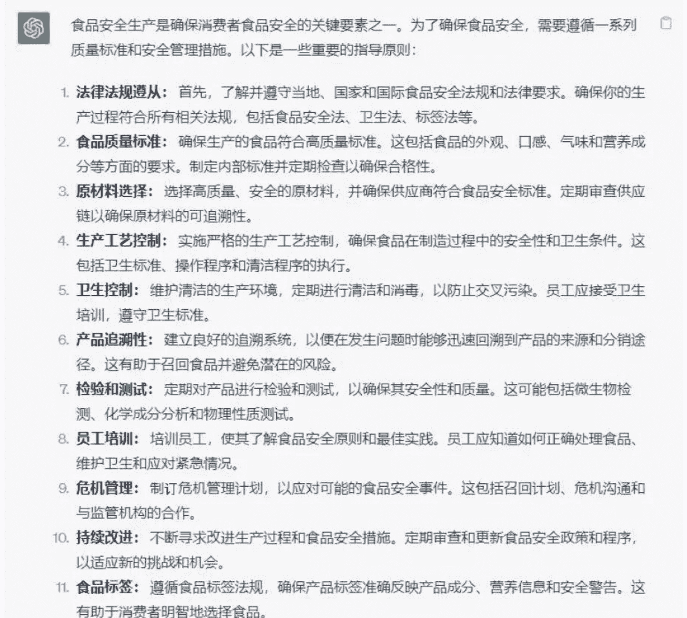

图12-1 ChatGPT 呈现的安全生产指导

STEP 02 确定主题，生成规章：继续输入“请以食品安全为目的，结合法规和食品安全标准，为一家生产月饼产品的企业撰写一份月饼产品安全生产管理规章”，模型会输出对应制度，如图12-2所示。

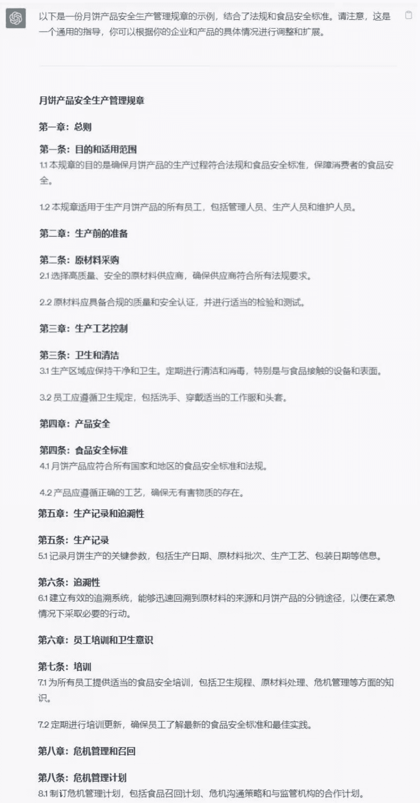

图12-2 ChatGPT 产出的生产管理规章

# ChatGPT 内容生成指令与范例大全

第九章：持续改进

第九条：改进程序

9.1 定期审查和改进食品安全政策和程序，以适应新的挑战和机会。

9.2 收集并考虑消费者反馈，以改进产品质量和安全性。

第十章：食品标签

第十条：产品标签

10.1 遵循食品标签法规，确保产品标签准确反映产品成分、营养信息和安全警告。

第十一章：监督和审查

第十一条：内部审查

11.1 定期进行内部审查，以验证食品安全措施的执行情况并纠正违规行为。

11.2 配合监管机构的检查和审查，提供所需的信息和协助。

第十二章：违规行为和处罚

第十二条：违规行为

生产规章与 AI 辅助撰写要点

12.1 严禁任何违规操作，涵盖质量造假、卫生不达标及违反法规等情形。

第十三章：停产与召回管理

第十三条：停产召回条款
13.1 一旦发现食品安全隐患，受影响产品须立即停产，并按既定召回方案落实必要处置，以确保消费者安全。

第十四章：附则

第十四条：规章修订
14.1 随法律法规调整与食品安全标准的迭代，本规章将同步修订。

第十五条：执行责任
15.1 全体员工须履行遵守并落实本规章的义务。

第十六条：生效日期
16.1 本规章自颁布之日起开始执行。

图12-2 生产管理规章续篇示例

该案例提示，先就生产质量与安全管理向 ChatGPT 征询建议，可先建立对话基础，为后续起草规章做准备。初稿生成后需结合企业实际情况审校完善。

### 052 管理规章范例

在企业运营中，搭建合理的制度体系是提升治理效能的重要手段。制度一方面约束员工行为、激发主动性，另一方面完善管理架构，推动运作更规范有序高效。借助 ChatGPT，企业能够形成系统完整的规章文件。

使用 ChatGPT 起草制度时，可采用以下提问模板。

> 请你扮演××× 公司的行政人员，协助该机构起草一份用于公司管理的规章文件

按此模板得到的规章示例见图 12-3。

让 ChatGPT 扮演行政人员起草制度，既符合制度制定的基本规范，也有助于提升严谨性与可操作性。指令中最好明确机构经营类型，以保证条款具备可执行性。

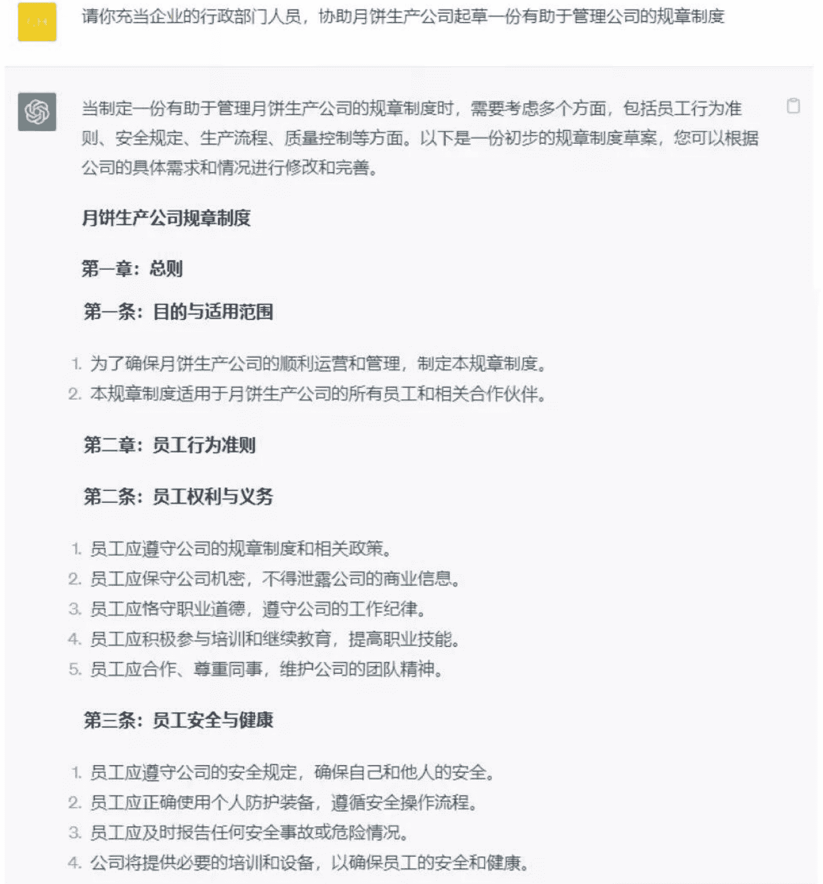

图12-3 管理规章示例

# ChatGPT 内容生成指令与案例全集

# 第三章：生产管控与质量控制

# 第四条：生产流程规范

1. 员工必须严格执行公司规定的生产流程，确保产出质量与卫生达标。
2. 生产任务须在指定计划时段内完成。
3. 应重视原材料的合理使用与库存管控。

# 第五条：质量管控

1. 员工应定期抽检产品，确认符合公司质量标准。
2. 发现质量异常或缺陷须立刻上报。
3. 公司将建立质量控制体系，确保品质稳定。

# 第四章：纪律处分

# 第六条：违纪处理

1. 违反公司规章的成员将面临纪律处理，包含口头警告、书面警告、停职、解雇等。
2. 处理幅度依据违规情节的严重程度与发生频次确定。

# 第七条：申诉机制

1. 员工享有申诉权利，公司将尽快予以核处。
2. 公司将建立申诉处理机制，确保公平透明。

# 第五章：补充说明

# 第八条：规章修订与解释

1. 公司有权随时修订本规章并通知全体员工。
2. 本规章的最终解释权归公司所有。

# 第九条：生效日期

本制度自发布之日起开始执行。

图12-3 管理规章示例续页

### 053 培训手册范例

多数机构均设有文化、发展规划与行为准则，以保障长期稳定发展。常以培训手册形式进行内部培训，用以传递文化、提升员工积极性。利用 ChatGPT 可获得系统且具针对性的培训手册。

生成培训手册时可使用以下提问模板。

> 请你扮演公司人力资源经理，根据××× 机构所属行业、岗位职责、项目特点、战略目标等，生成一份人员培训手册

按模板生成的示例见图 12-4。

请你扮演公司人力资源经理，根据游戏公司的岗位职责、项目特征、战略目标等生成一份员工培训手册

可以！以下是一份游戏公司人员培训手册的示例。请注意，这仅为范例，实际手册需结合机构具体需求定制。

# 游戏公司员工培训手册

# 欢迎加入我们！

# 机构概况

我们是一家创新型游戏开发机构，致力于打造世界级游戏体验。使命是通过创意、协作与卓越技术为玩家提供乐趣、挑战与沉浸感。

# 核心价值观

- 创新：鼓励创造性思维，勇于尝试新思路。
- 协作：团队合作是成功关键，欢迎多元背景人才加入。
- 质量：追求卓越，始终坚持高品质。
- 乐趣：相信游戏应有趣，工作也需保持乐趣。

# 岗位职责

# 游戏开发人员

- 职责概述：负责游戏代码的设计、开发与维护，确保运行顺畅与用户体验。
- 主要职责：
  - 编写高质量的游戏代码，涵盖逻辑、图形与音频。
  - 参与游戏设计及功能规划。
  - 与团队紧密协作，解决技术问题并优化性能。
  - 参与测试与故障排除，确保游戏稳定。

# 游戏设计师

- 职责概述：负责创建游戏概念、玩法与关卡设计，提供沉浸体验。
- 主要职责：
  - 构思故事情节、角色与世界观。
  - 设计关卡、任务与游戏机制。
  - 与美术团队协作，保持视觉与玩法一致性。
  - 分析用户反馈，不断改进设计。

图12-4 培训手册示例

# ChatGPT 内容生成指令与案例全集

# 艺术设计师

- 职责概述：负责游戏视觉元素的创作，包括角色、场景、动画与特效。
- 主要职责：
  - 制作游戏艺术资源，确保质量与风格统一。
  - 参与角色与场景设计，提升视觉吸引力。
  - 协助制作宣传资料与广告素材。

# 项目特征

# 敏捷开发

采用敏捷开发方式以快速响应市场需求并持续改进游戏。团队协作与快速适应能力尤为关键。

# 创新型项目

鼓励创新，欢迎团队提出新游戏理念与概念。相信每位成员都能为行业带来新思路与突破。

# 战略目标

目标成为行业领先者，提供卓越游戏体验并扩大全球受众。为此致力于：

- 不断提升游戏质量与用户满意度。
- 拓展市场份额，推出新品并进入新市场。
- 培养和发展人员，确保团队技能与创造力保持领先。

# 培训规划

提供系统培训，帮助您在机构快速成长。内容包括但不限于：

- 技术培训：依岗位提供相关技术培养，提升开发表现。
- 创新与创意培训：鼓励创造性思维，助力提出创新理念。
- 团队协作培训：强化协作能力。
- 项目管理培训：针对相关岗位提供项目管理技能培养。

# 结束语

欢迎加入团队！我们相信您将在这里快速成长，与我们共同创造令人兴奋的游戏体验。如有疑问请随时联系人力资源部门。

祝您在机构取得成功！

图12-4 培训手册示例续页

上述范例是在未提供机构信息情况下输出的手册，实际中各机构文化价值、战略目标与岗位要求各不相同，故正式提问时可在指令中补充具体信息，以获得更具实效的手册。

### 054 费用管控范例

费用管控是机构治理的重要环节，直接影响战略目标的实现与长期发展。借助 ChatGPT，可有序、科学地开展费用管控，例如依据部门实际制定全面预算计划。

使用 ChatGPT 协助费用管控时可采用以下提问模板。

> 请你扮演财务经理，根据以下信息制定一份××× 项目预算方案，以表格形式呈现
> 信息如下：×××

按模板的示例见图 12-5。

请你扮演财务经理，根据以下信息制定一份公司福利发放预算方案，以表格形式呈现

信息如下：

XXX 公司共150人，含设计部20人、动画部25人、程序开发部30人、测试部15人、营销部25人、客服部20人、管理部15人。原定福利为每周一次下午茶、节日礼品、生日福利、交通福利和年度健康体检，总预算30,000元。

预算方案应结合福利占比并秉持公平原则制定。

以下是基于给定信息的公司福利发放预算方案，以表格形式呈现：

| 部门 | 人数 | 预算比重 | 预算金额（元） |
| :--- | :--- | :--- | :--- |
| 设计部门 | 20 | 未定 | 未定 |
| 动画部门 | 25 | 未定 | 未定 |
| 程序开发部门 | 30 | 未定 | 未定 |
| 测试部门 | 15 | 未定 | 未定 |
| 营销部门 | 25 | 未定 | 未定 |
| 客服部门 | 20 | 未定 | 未定 |
| 管理部门 | 15 | 未定 | 未定 |
| 总计 | 150 | 100% | 30,000 |

制订预算时，首先需确定各福利项目的占比，再按各部门人数分配。随后依据占比计算各项目预算金额。

假设各福利占比如下：

- 每周一次下午茶：10%
- 节日礼品：20%
- 生日福利：15%
- 交通福利：25%
- 年度健康体检：30%

图12-5 费用管控示例

# ChatGPT 内容生成指令与案例全集

现计算各福利项目预算金额：

1. 每周一次下午茶：10% * 30,000元 = 3,000元
2. 节日礼品：20% * 30,000元 = 6,000元
3. 生日福利：15% * 30,000元 = 4,500元
4. 交通福利：25% * 30,000元 = 7,500元
5. 年度健康体检：30% * 30,000元 = 9,000元

再按各部门人数分配福利预算：

- 设计部门：(20 / 150) * 30,000元 = 4,000元
- 动画部门：(25 / 150) * 30,000元 = 5,000元
- 程序开发部门：(30 / 150) * 30,000元 = 6,000元
- 测试部门：(15 / 150) * 30,000元 = 3,000元
- 营销部门：(25 / 150) * 30,000元 = 5,000元
- 客服部门：(20 / 150) * 30,000元 = 4,000元
- 管理部门：(15 / 150) * 30,000元 = 3,000元

最终各部门福利预算方案如下：

| 部门 | 每周一次下午茶 | 节日礼品 | 生日福利 | 交通福利 | 年度健康体检 | 总计 |
| :--- | :--- | :--- | :--- | :--- | :--- | :--- |
| 设计部门 | 400元 | 800元 | 600元 | 1,000元 | 1,200元 | 4,000元 |
| 动画部门 | 500元 | 1,000元 | 750元 | 1,250元 | 1,500元 | 5,000元 |
| 程序开发部门 | 600元 | 1,200元 | 900元 | 1,500元 | 1,800元 | 6,000元 |
| 测试部门 | 300元 | 600元 | 450元 | 750元 | 900元 | 3,000元 |
| 营销部门 | 500元 | 1,000元 | 750元 | 1,250元 | 1,500元 | 5,000元 |
| 客服部门 | 400元 | 800元 | 600元 | 1,000元 | 1,200元 | 4,000元 |
| 管理部门 | 300元 | 600元 | 450元 | 750元 | 900元 | 3,000元 |

该预算方案兼顾福利项目占比与部门人数，公平分配总预算。各部门将按人数获得相应福利预算。

图12-5 费用管控示例续页

以上为理想状态下的福利预算方案，实际发放需结合预算金额、福利项目与部门人数的实际情况。因此要生成有效预算方案，应在指令中提供详实准确的信息。

### 055 风险防范建议范例

在经营过程中，可能面临法律法规风险、市场风险、技术风险、财务风险、业务风险、自然灾害风险、人才风险等多种隐患，故风险防范是治理的重要内容。科学治理有助于提升风险意识。

但治理能力与水平需长期积累，且风险具有不确定性，防范并非易事。借助 ChatGPT，可获取大量风险防范建议，间接提升治理能力。

生成风险防范建议时可采用以下提问模板。

> 请你扮演风险管理顾问，从不同维度为××× 机构提供一些风险防范的建议

示例见图 12-6。

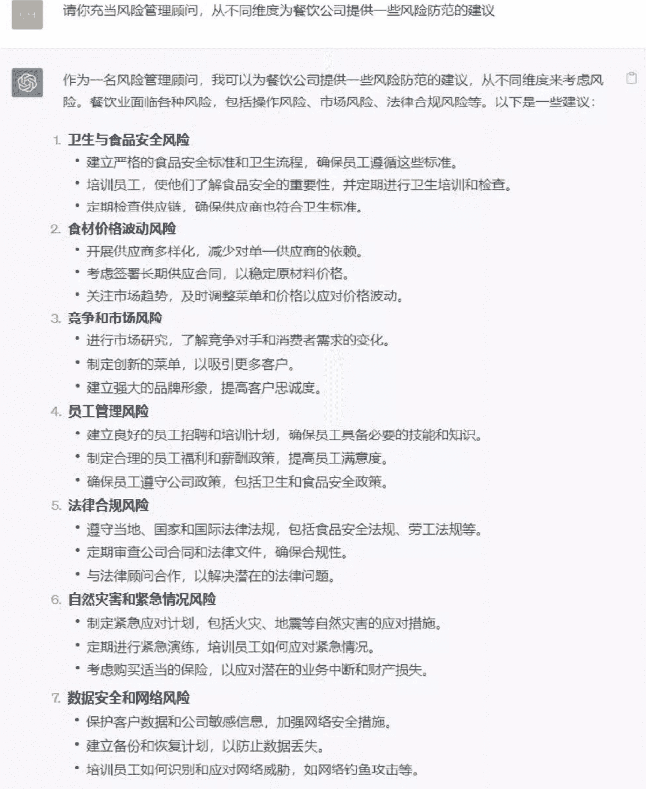

图12-6 风险防范建议示例

# ChatGPT 内容生成指令与案例全集

8. 金融风险

- 管理现金流，确保有足够资金应对紧急情况。
- 定期审阅财务报表，监测业务健康状况。
- 考虑购买商业保险，应对财产损失与责任风险。

这些建议有助于餐饮机构更好地管控各类潜在风险，保障业务稳健运营。具体策略应根据机构规模、地理位置与经营特点定制。同时，与专业风险管理顾问合作是明智选择，以确保风险管理全面。

图12-6 风险防范建议示例续页

必要时，可向 ChatGPT 提供机构规模、地理位置与经营特点等信息，以便制定更具针对性的风险管理策略。同时，机构需持续提升管理者素质、优化组织结构、建设良好文化、规范治理流程。

## 第 13 章 采购管理指令与范例

采购是以机构为主体进行的购买行为，涵盖计划制定、供应商选择、价格谈判、合同签订、货物验收等多环节。机构采购不同于个人购物，需审慎规划，而 ChatGPT 可助力采购有序推进。

### 056 指令应用步骤

采购活动首步是明确所需采购物品，以便制定采购清单。清单是后续计划、选供、签约等流程的基础。将需求提供给 ChatGPT 可协助分类、统计并生成清单。

以下以生成采购清单为例，介绍操作步骤。

STEP 01 赋予身份，询问建议：在输入框中输入指令，如“假设你是一名经验丰富的采购人员，请你分享一些能够快速统计采购物品的方法”，回车后 ChatGPT 会给出快速统计方法，如图 13-1 所示。

> 假设你是一名经验丰富的采购人员，请你分享一些能够快速统计采购物品的方法

作为一名经验丰富的采购人员，你需要能够快速而准确地统计采购物品，以确保库存管理和采购决策的有效性。以下是一些能够帮助你快速统计采购物品的方法：

- 使用库存管理软件：使用专业的库存管理软件，它们通常具有强大的统计功能，能够跟踪库存数量、价值和供应商信息。
- 条形码扫描器：采用条形码扫描器可以快速准确地扫描物品上的条形码，自动记录物品数量和描述。
- Excel电子表格：使用电子表格软件如Excel，创建一个采购清单，并在表格中列出物品的名称、数量和单价。你可以使用公式自动计算总值。
- 批次号追踪：如果物品有批次号或序列号，请确保记录每个批次的数量和相关信息，以便跟踪库存的来源和过期情况。
- 分区和标签：将库房或仓库分成不同的区域，并为每个区域分配特定的物品。使用标签或标志来识别每个物品的位置，这将有助于快速找到并统计物品。
- 定期盘点：进行定期的库存盘点，以确保库存记录与实际库存一致。这可以帮助及时发现潜在的问题，如盗窃或损坏。
- ABC分析：根据物品的重要性对库存进行ABC分析，将物品分为A类（最重要的）、B类和C类。这可以帮助你重点关注对业务最关键的物品。
- 供应商合同管理：跟踪供应商合同和采购订单，确保物品的交付和质量符合合同要求。
- 适时更新记录：随着采购和出库的发生，及时更新库存记录，以反映实际库存水平。
- 培训和团队合作：确保团队成员了解如何使用库存管理系统和工具，以便协同工作，提高效率。

图13-1 快速统计采购物品的方法

STEP 02 确定方法，制作清单：在输入框中继续输入指令，如“请运用电子表格的形式，将以下物品进行统计与分类，创建一个采购清单（另起一行，陈列物品）”，确认后 ChatGPT 会归类物品并生成采购清单，如图 13-2 所示。

以下是一个采购清单的示例，使用电子表格的形式来统计和分类物品：

| 物品 | 数量 | 分类 |
|---|---|---|
| 黄油 | 10 | 食品 |
| 橄榄油 | 10 | 食品 |
| 鱼罐头 | 12 | 食品 |
| 荔枝罐头 | 2 | 食品 |
| 黄桃罐头 | 5 | 食品 |
| 火腿 | 15 | 食品 |
| 牛肉 | 15千克 | 食品 |
| 三文鱼柳 | 15千克 | 食品 |
| 草莓果酱 | 5 | 食品 |
| 蜂蜜果酱 | 5 | 食品 |
| 寿司海苔 | 10 | 食品 |
| 薯片 | 5 | 食品 |
| 生抽 | 10 | 食品 |
| 老抽 | 10 | 食品 |
| 耗油 | 5 | 食品 |
| 圆珠笔 | 100 | 办公用品 |
| 铅笔 | 50 | 办公用品 |
| 美工笔 | 10 | 办公用品 |
| 荧光笔 | 50 | 办公用品 |
| 笔记本 | 50 | 办公用品 |
| 签到本 | 10 | 办公用品 |
| 文件夹 | 20 | 办公用品 |
| A4纸 | 500 | 办公用品 |
| 订书机 | 10 | 办公用品 |
| 饮水机 | 2 | 家居用品 |

# AI 接管采购与编程的重复劳动

把零散的采购物料交给模型归类，品名、数量、类别会直接整理成表格。复制到表格软件里调整样式，就能得到可执行的采购清单。

| 热水壶 | 2 | 家居用品 |
| 电风扇 | 50 | 家居用品 |
| 水杯 | 10 | 家居用品 |

图13-2 ChatGPT归类物品并创建采购清单

框选复制后粘贴到 Excel，稍作排版即可成型。若在物品名和数量之外再补充规格、意向供应商、计划采购日期等信息，生成的清单会更完整、更贴合实操。

### 057 采购预算范例

预算是采购落地的依据，也是挑选供应商、谈判时的底牌。借助模型可以快速得到价格区间，辅助决策。

提问可这样组织：

> 假设你是一名经验丰富的采购人员，请你根据采购经验，估算一般物价，为以下采购物品制定采购预算表
> 采购物品：×××

图13-3 ChatGPT生成采购预算示例

以下是一个简单的采购预算表（估算）：

| 采购物品 | 数量 | 预计价格(元) | 总价(元) |
| :--- | :--- | :--- | :--- |
| 办公桌（1.2m） | 10 | 1,000～2,000 | 10,000～20,000 |
| 办公椅 | 10 | 500～1,000 | 5,000～10,000 |
| 会议桌（3.5m） | 1 | 3,000～5,000 | 3,000～5,000 |
| 会议室用椅 | 10 | 800～1,500 | 8,000～15,000 |
| 布艺沙发 | 1 | 2,000～4,000 | 2,000～4,000 |
| 双层茶几 | 1 | 800～1,500 | 800～1,500 |
| 四门铁柜 | 1 | 2,000～3,000 | 2,000～3,000 |
| 税金和额外费用 | - | - | - |
| 运输和安装费用 | - | - | 根据供应商报价 |
| 总计 | - | - | 总价 |

请注意，这只是估算的预算表，实际采购成本可能会有所不同。确保与供应商进行详细的商谈，并获取详细的报价和相关费用信息，以制定准确的采购预算。

图13-3 ChatGPT生成采购预算示例（续）

模型给出的思路是完整的，但知识存在时间边界。实际使用时最好把当期市场价提供给模型，输出的准确性会提升。

### 058 采购合同范例

价格谈妥、事项确认后就会进入合同签署。合同是双方权利义务的法律凭证，条款缺漏风险很高，可以让模型帮忙复核和优化。

可用的提问方式：

> 假设你是一名法务人员，请你运用法务知识，检查并修改以下采购合同
> 采购合同：×××

图13-4 ChatGPT检查并修改采购合同示例

我可以帮助你检查和修改这份采购合同。请注意，我将使用占位符表示需要填写的具体信息，你需要将占位符替换为实际的信息。同时，合同的修改应根据具体的法律和业务需求进行，建议在修改前咨询专业法律顾问。

采购合同

甲方（买方）：[甲方名称]

地址：[甲方地址]

联系人：[甲方联系人]

电话：[甲方电话]

乙方（卖方）：[乙方名称]

地址：[乙方地址]

联系人：[乙方联系人]

电话：[乙方电话]

鉴于甲方需要购买以下商品，乙方同意向甲方提供该商品，双方在平等、自愿、公平的基础上，根据《中华人民共和国合同法》及相关法律法规的规定，达成如下协议：

一、合同概述

本采购合同旨在明确甲方向乙方采购商品的具体事宜，包括商品描述、价格、交货、合规及法律条款等。

二、产品描述

甲方需要向乙方采购的商品为：[商品描述]（以下简称“货物”），具体规格、数量及技术参数详见附件一。

三、价格条款

- 1. 价格：乙方应向甲方提供货物的价格为人民币（以下简称“元”）[价格]元/件。
- 2. 支付方式：甲方应在合同签订后30日内向乙方支付货款的50%作为定金，余款在收到货物并验收合格后7日内付清。
- 3. 折扣与优惠：乙方将在特定时间段为甲方提供折扣或优惠，具体内容详见附件二。

四、交货条款

- 1. 交货日期：乙方应于本合同签订后60日内将货物送达甲方指定的地址。
- 2. 交货地点：[交货地点]
- 3. 责任与风险：乙方承担货物毁损、灭失的风险，直至货物交付甲方并验收合格为止。在此期间，如因乙方原因导致货物毁损、灭失，乙方应承担相应的赔偿责任。
- 4. 运输方式：乙方将采用陆运方式将货物送至甲方指定的地址，运输费用由乙方承担。

五、合规条款

- 1. 保密协议：双方应对本合同及附件内容保密，未经对方书面同意，不得向任何第三方透露。
- 2. 知识产权保护：乙方应保证所提供货物不侵犯任何第三方的知识产权，如因货物侵犯第三方知识产权所致甲方损失，乙方应承担相应的赔偿责任。

图13-4 ChatGPT检查并修改采购合同示例

六、法律条款

- 1. 诉讼地点：如因本合同引起争议，双方应向乙方所在地人民法院提起诉讼。
- 2. 仲裁机构和规则：如双方在合同履行过程中发生争议，应首先友好协商解决；协商不成的，应提交国际仲裁机构进行仲裁，并遵循相应的仲裁规则。

七、其他条款

- 1. 本合同未尽事宜，双方可另行签订补充协议，补充协议与本合同具有同等法律效力。
- 2. 本合同一式两份，甲乙双方各执一份，自双方签字（或盖章）之日起生效。

甲方（买方）：[甲方签名]

法定代表人（或授权人）：[甲方法定代表人姓名]

签字（或盖章）：__________

日期：__________

乙方（卖方）：[乙方签名]

法定代表人（或授权人）：[乙方法定代表人姓名]

签字（或盖章）：__________

日期：__________

图13-4 ChatGPT检查并修改采购合同示例（续）

### 059 供应商管理范例

采购需要持续跟进供货进度和服务水平。让模型快速生成评估表，管理会更系统。

提问可以这样写：

> 假设你是采购部门的经理，请从质量、成本、交货、服务、技术、资产、员工与流程等方面创建一个供应商评估表，用来管理供应商

图13-5 ChatGPT协助供应商管理示例

- 联系方式：
- 供应产品/服务：
- 供应周期：（例如，每月、每季度）

质量：
- 产品/服务质量（1～10分）：
- 质量控制程序描述：
- 投诉处理流程描述：

成本：
- 价格竞争力（1～10分）：
- 价格稳定性（1～10分）：
- 额外费用（如运输费、定制费等）：

交货：
- 准时交货（1～10分）：
- 交货准确性（1～10分）：
- 缺货率（1～10分）：

服务：
- 售后服务质量（1～10分）：
- 技术支持（1～10分）：
- 反馈响应时间（1～10分）：

技术：
- 技术创新能力（1～10分）：
- 产品/服务的技术先进性（1～10分）：
- 技术团队资质：

资产：
- 供应商资金运转状况（1～10分）：
- 生产设备/技术更新频率（1～10分）：
- 可用库存水平（1～10分）：

员工：
- 员工培训和素质（1～10分）：
- 客户服务态度（1～10分）：
- 员工满意度（1～10分）：

图13-5 ChatGPT协助供应商管理示例（续）

流程：
- 订单处理流程（1～10分）：
- 供应链可见性（1～10分）：
- 问题解决流程（1～10分）：

总分：（加权平均以上各项分数）

评估结果：
- 建议采取的措施（例如，改进建议、奖励供应商等）：

评估日期：

该表可按企业侧重点调整权重，定期复评并反馈给供应商，有助于建立良性协作，提升整体供应链表现。

必要时还能用模型核对订单、给出库存建议，让 AI 全程参与采购闭环。

## 第 14 章 程序开发指令与范例

ChatGPT 不只会写文字，还能输出可运行的代码，显著减轻开发负担。可以用来写 Python 脚本、生成微信小程序和测试用例。

### 060 指令应用步骤

以让模型写 Python 代码为例，操作流程如下。

STEP 01 赋予身份，编写代码：

在输入框里输入指令，例如“请你充当一个资深的编程人员，使用 Python 编写一个计时器，可以实现日程提醒、纪念日提醒、显示倒数日的功能”，回车后模型会基于 Tkinter 生成图形界面代码，如图 14-1 所示。

> 当然可以！下面是一个使用Python编写的简单计时器程序，它可以实现日程提醒、纪念日提醒和显示倒数日的功能。这个程序使用了Python的Tkinter库来创建一个基本的图形用户界面（GUI）。

```python
import tkinter as tk
import time
from datetime import datetime

class TimerApp:
    def __init__(self, root):
        self.root = root
        self.root.title("计时器应用")
        self.root.geometry("400x300")

        self.schedule_label = tk.Label(root, text="请输入日程日期（格式：YYYY-MM-DD HH:MM:SS）")
        self.schedule_label.pack()

        self.schedule_entry = tk.Entry(root)
        self.schedule_entry.pack()

        self.schedule_button = tk.Button(root, text="设置日程提醒", command=self.set_schedule_reminder)
        self.schedule_button.pack()

        self.anniversary_label = tk.Label(root, text="请输入纪念日日期（格式：YYYY-MM-DD）")
        self.anniversary_label.pack()

        self.anniversary_entry = tk.Entry(root)
        self.anniversary_entry.pack()

        self.anniversary_button = tk.Button(root, text="设置纪念日提醒", command=self.set_anniversary)
        self.anniversary_button.pack()

        self.countdown_label = tk.Label(root, text="倒数日：")
        self.countdown_label.pack()

        self.update_countdown()

    def set_schedule(self):
        schedule_date = self.schedule_entry.get()
        try:
            schedule_date = datetime.strptime(schedule_date, "%Y-%m-%d")
            self.schedule_date = schedule_date
            self.schedule_label.config(text=f"日程提醒已设置：{schedule_date.strftime('%Y-%m-%d')}")
        except ValueError:
            self.schedule_label.config(text="日期格式无效，请使用：YYYY-MM-DD")

    def set_anniversary(self):
        anniversary_date = self.anniversary_entry.get()
        try:
            anniversary_date = datetime.strptime(anniversary_date, "%Y-%m-%d")
            self.anniversary_date = anniversary_date
            self.anniversary_label.config(text=f"纪念日提醒已设置：{anniversary_date.strftime('%Y-%m-%d')}")
        except ValueError:
            self.anniversary_label.config(text="日期格式无效，请使用：YYYY-MM-DD")

    def update_countdown(self):
        current_time = datetime.now()
        if hasattr(self, 'schedule_date'):
            time_until_schedule = self.schedule_date - current_time
            schedule_countdown = f"日程提醒倒数：{time_until_schedule.days} 天"
            self.schedule_label.config(text=schedule_countdown)
        if hasattr(self, 'anniversary_date'):
            time_until_anniversary = self.anniversary_date - current_time
            anniversary_countdown = f"纪念日提醒倒数：{time_until_anniversary.days} 天"
            self.anniversary_label.config(text=anniversary_countdown)
        self.root.after(1000, self.update_countdown)

if __name__ == "__main__":
    root = tk.Tk()
    app = TimerApp(root)
    root.mainloop()
```

图14-1 ChatGPT编写出的Python代码（续）

小提示

代码块显示不全时，可拖动底部滑块查看完整内容。

STEP 02 检查代码，确保效用：

继续输入指令，例如“请检查以上 Python 代码，判断是否会运行报错？如果会报错，请说明原因，并输出解决方法；如果不会报错，请回答【无错误】”，回车后模型会进行逐行校验并给出修复建议，如图 14-2 所示。

> 根据提供的Python代码，有一个问题可能会导致运行时报错。问题在于程序中的 `self.schedule_date` 和 `self.anniversary_date` 属性在第一次设置提醒之前并不存在，因此在未设置提醒时访问它们会导致 `AttributeError`。这是因为这些属性在对象初始化时并没有被定义。

为了解决这个问题，可以在初始化时为这些属性设置一个默认值，或者在更新倒数日信息时检查它们是否已经存在。以下是修改后的代码：

```python
import tkinter as tk
import time
from datetime import datetime

class TimerApp:
    def __init__(self, root):
        self.root = root
        self.root.title("计时器应用")
        self.root.geometry("400x300")

        self.schedule_label = tk.Label(root, text="请输入日程日期（格式：YYYY-MM-DD）")
        self.schedule_label.pack()

        self.schedule_entry = tk.Entry(root)
        self.schedule_entry.pack()

        self.schedule_button = tk.Button(root, text="设置日程提醒", command=self.set_schedule_reminder)
        self.schedule_button.pack()

        self.anniversary_label = tk.Label(root, text="请输入纪念日日期（格式：YYYY-MM-DD）")
        self.anniversary_label.pack()

        self.anniversary_entry = tk.Entry(root)
        self.anniversary_entry.pack()

        self.anniversary_button = tk.Button(root, text="设置纪念日提醒", command=self.set_anniversary_reminder)
        self.anniversary_button.pack()

        self.countdown_label = tk.Label(root, text="倒数日：")
        self.countdown_label.pack()

        self.schedule_date = None  # 默认值为None
        self.anniversary_date = None  # 默认值为None

        self.update_countdown()

    def set_schedule(self):
        schedule_date = self.schedule_entry.get()
        try:
            schedule_date = datetime.strptime(schedule_date, "%Y-%m-%d")
            self.schedule_date = schedule_date
            self.schedule_label.config(text=f"日程提醒已设置: {schedule_date.strftime('%Y-%m-%d')}")
        except ValueError:
            self.schedule_label.config(text="日期格式无效，请使用: YYYY-MM-DD")

    def set_anniversary(self):
        anniversary_date = self.anniversary_entry.get()
        try:
            anniversary_date = datetime.strptime(anniversary_date, "%Y-%m-%d")
            self.anniversary_date = anniversary_date
            self.anniversary_label.config(text=f"纪念日提醒已设置: {anniversary_date.strftime('%Y-%m-%d')}")
        except ValueError:
            self.anniversary_label.config(text="日期格式无效，请使用: YYYY-MM-DD")

    def update_countdown(self):
        current_time = datetime.now()
        if self.schedule_date is not None:
            time_until_schedule = self.schedule_date - current_time
            schedule_countdown = f"日程提醒倒数: {time_until_schedule.days} 天"
            self.schedule_label.config(text=schedule_countdown)
        if self.anniversary_date is not None:
            time_until_anniversary = self.anniversary_date - current_time
            anniversary_countdown = f"纪念日提醒倒数: {time_until_anniversary.days} 天"
            self.anniversary_label.config(text=anniversary_countdown)
        self.root.after(1000, self.update_countdown)

if __name__ == "__main__":
    root = tk.Tk()
    app = TimerApp(root)
    root.mainloop()
```

图14-2 ChatGPT依据指令复核并调整代码

完成上述修正后，对象在初始化阶段会把 `self.schedule_date` 与 `self.anniversary_date` 预设为 `None`，后续在刷新倒计时信息时先进行存在性校验，由此避免触发 AttributeError。

图14-2 ChatGPT依据指令复核并调整代码（续）

该案例说明，为模型设定资深程序员的人设，能够提升代码撰写的专业度与严谨性；要求其对已有 Python 源码进行审查与修改，则有助于保证运行时的稳定性。

### 061 微信小程序范例

相比原生 App 或网页，小程序以轻量便捷著称，研发投入小、界面精简且可整合多项服务，因而深受商家与终端用户欢迎。主题与目标明确后，即可借助 ChatGPT 生成小程序源码。

向模型提问时可参考以下指令范式：

> 请你扮演微信小程序开发者，采用原生开发方式，制作一个 ××× 页面，要求：构建包含 wxml、js、wxss、json 四个文件的页面，并在其中实现 ××× 功能；页面展示的文字使用中文

> 专家指点

wxml、js、wxss、json 四类文件构成小程序的基础，其中 wxml 负责页面结构搭建；js 负责交互逻辑，如点击响应、定位获取等；wxss 负责视觉美化；json 负责全局配置，如页面注册、网络规则、窗口背景色等。

依据该范式产出的示例如图 14-3 所示。

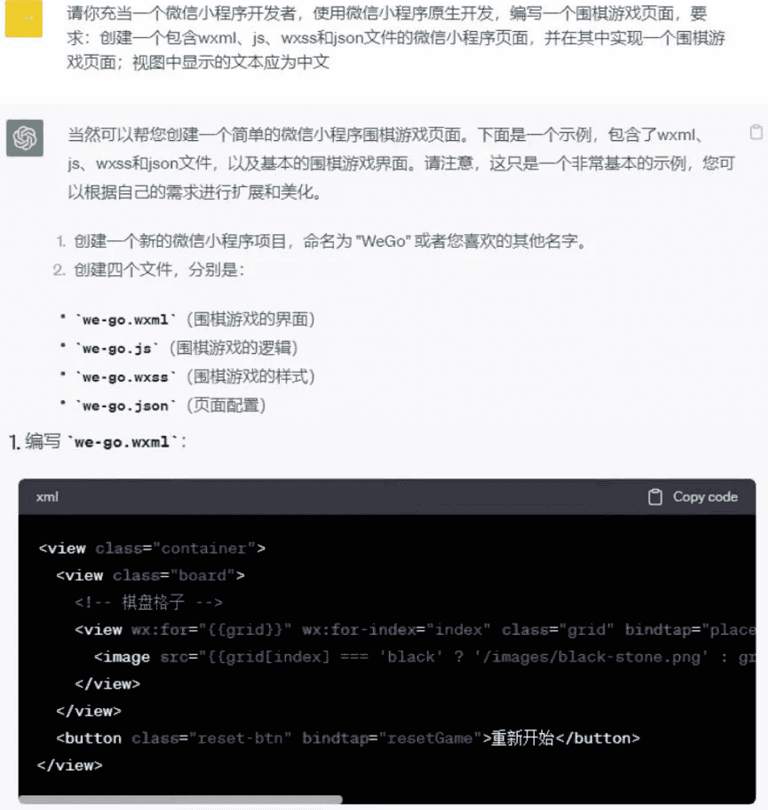

图14-3 ChatGPT编写微信小程序代码示例

2. 编写 `we-go.js`：

```javascript
Page({
  data: {
    grid: new Array(19 * 19).fill(''), // 初始化一个19x19的棋盘，用于表示每个格子的
    currentPlayer: 'black', // 当前下棋的玩家，初始为黑棋
  },

  // 处理点击格子的事件
  placeStone(event) {
    const index = event.currentTarget.dataset.index;
    const grid = this.data.grid;

    if (grid[index] === '') {
      // 如果当前格子为空，可以放置棋子
      grid[index] = this.data.currentPlayer;
      this.setData({ grid });

      // 切换玩家
      this.setData({ currentPlayer: this.data.currentPlayer === 'black' ? 'w' });
    }
  },

  // 处理重新开始游戏的事件
  resetGame() {
    this.setData({ grid: new Array(19 * 19).fill(''), currentPlayer: 'black' });
  },
});
```

3. 编写 `we-go.wxss`（基础样式，可按需扩展）：

```css
.container {
  display: flex;
  flex-direction: column;
  align-items: center;
  margin-top: 20px;
}

.board {
  display: grid;
  grid-template-columns: repeat(19, 30px);
  grid-template-rows: repeat(19, 30px);
  gap: 1px;
  background-color: #eede9a;
  border: 1px solid #333;
}

.grid {
  display: flex;
  justify-content: center;
  align-items: center;
  background-color: #eede9a;
  cursor: pointer;
}

.stone {
  width: 28px;
  height: 28px;
}

.reset-btn {
  margin-top: 20px;
  padding: 10px 20px;
  background-color: #333;
  color: white;
  border: none;
  border-radius: 5px;
  cursor: pointer;
}
```

图14-3 ChatGPT编写微信小程序代码示例（续）

4. 编写 `we-go.json`：

```json
{
  "navigationBarTitleText": "微信围棋游戏"
}
```

+   1. 在项目目录下新建 `images` 文件夹，将黑白棋子素材分别命名为 `black-stone.png` 与 `white-stone.png` 放入其中。

2. 通过微信开发者工具导入工程并运行，即可在模拟器或移动设备上看到简易围棋界面。

图14-3 ChatGPT编写微信小程序代码示例（续）

上述代码属于入门级实现，若需增强体验，可继续添加胜负判定、悔棋、计分等功能，再让模型迭代优化。

### 062 测试用例范例

测试用例是对特定软件或功能点测试任务的明确描述，核心在于验证实现是否可用。借助 ChatGPT 可帮助测试人员更系统、更高效地梳理测试点，降低遗漏与误测风险。

提问模板可如下：

> 请你担任测试工程师，针对 ×××（软件/功能），从性能、安全性、兼容性等维度设计测试用例

按此模板输出的示例见图 14-4。

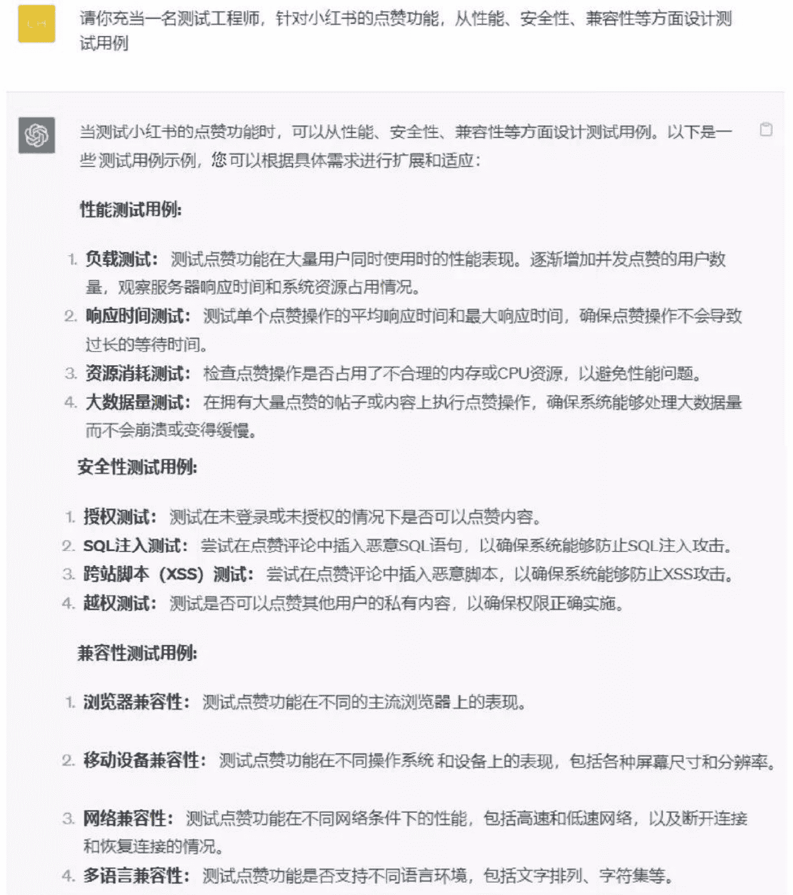

图14-4 ChatGPT生成测试用例示例

> 专家指点

SQL 即 Structured Query Language，结构化查询语言，用于数据库操作与程序开发。XSS 即 Cross Site Scripting，跨站脚本攻击，是 Web 应用常见的安全缺陷。

除此之外，还可让 ChatGPT 生成正则表达式、完成语言间代码转换、重构已有代码、或以专家身份解答技术疑问等。


## 第 15 章 数学推理指令与范例

ChatGPT 基于上下文生成回复，可进行多轮对话，也能处理部分逻辑与数学问题。数学推理方面可进行推演、解答应用题以及生成剧本杀剧本等。

### 063 指令应用步骤

逻辑推理虽为人类特长，经过大规模训练后模型可通过概率模拟实现部分推理能力。

以下以解答逻辑题为例说明操作流程。

STEP 01 直接提问：在输入框中输入指令，例如“夏令营中有三名孩子 A、B、C 分住三顶不同颜色的帐篷，颜色为红、蓝、白。已知 A 排斥红色且不居住蓝帐篷；B 排斥蓝色；C 排斥白色，请推断三人各自的住处”，回车后模型会给出结果，如图 15-1 所示。

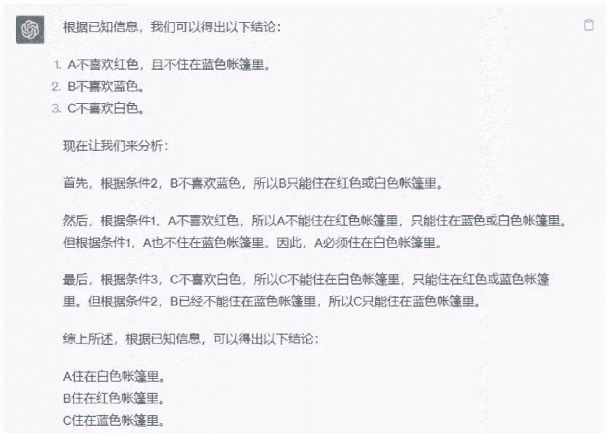

图15-1 ChatGPT给出的推理结果

STEP 02 引导复核：继续输入“请用代入法检验该结论是否成立”，回车后模型会按要求进行验证，如图 15-2 所示。


图15-2 ChatGPT按要求验证结果

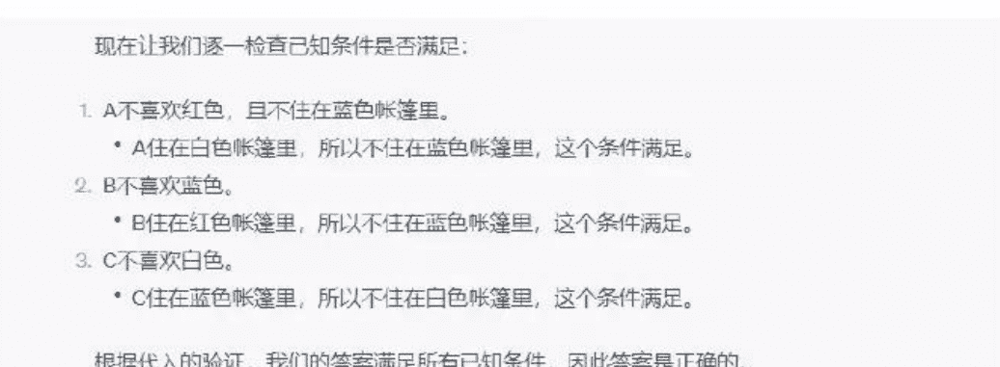

图15-2 ChatGPT按要求验证结果（续）

直接提问即可获得逻辑推理答案，但需注意模型推理源于统计训练而非真实思维，面对复杂题目仍可能出错。

### 064 数学应用题范例

应用题是数学中典型且难度较高的题型，遇到此类问题时可借助 ChatGPT 快速求解。

提问模板：

请解答以下数学题：

×××

按此模板的示例见图 15-3。

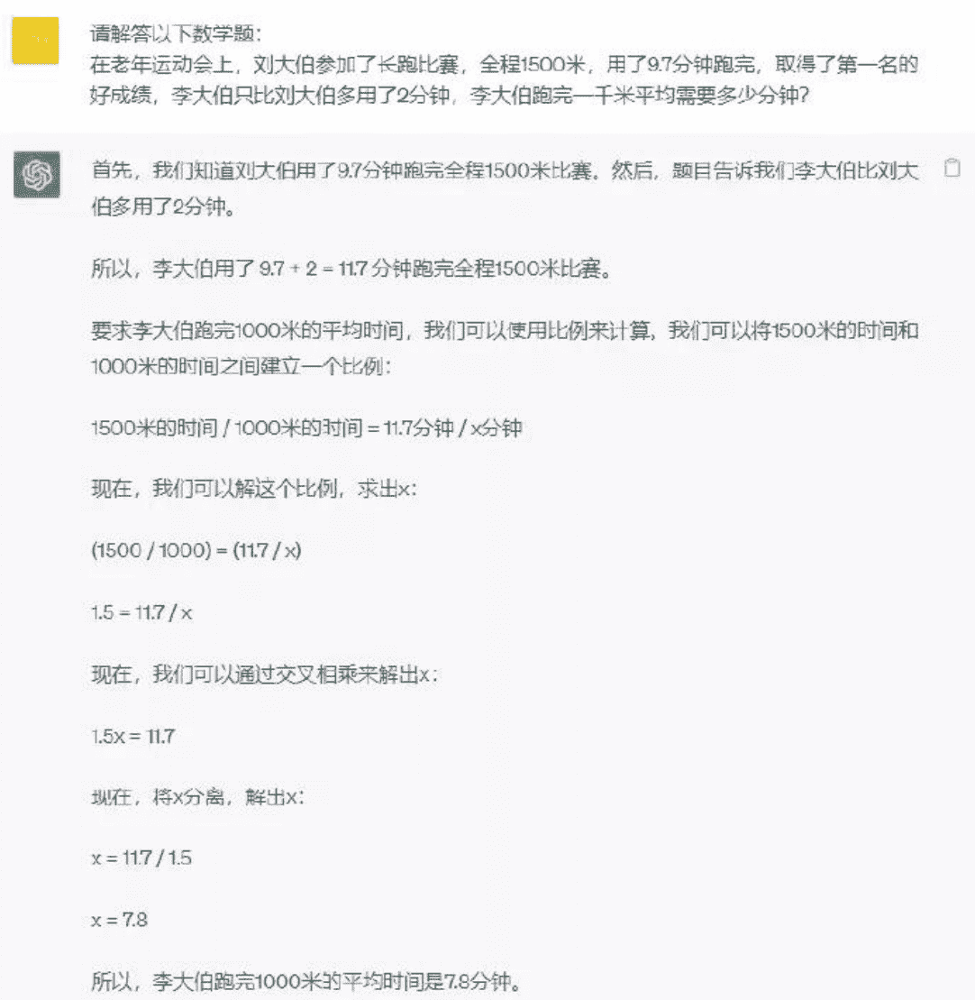

图15-3 ChatGPT解答应用题示例

为确保正确，得到答案后建议再让模型自行检查。

此外，还可让 ChatGPT 扮演数学教师出题，模板如下：

> 你是一名数学教师，请依据相关知识点解答下列题目，先说明概念与思路，再列出步骤，最后基于此题提供 × 道同类练习。回复需简洁聚焦。

题目为：×××

按此模板的示例见图 15-4。

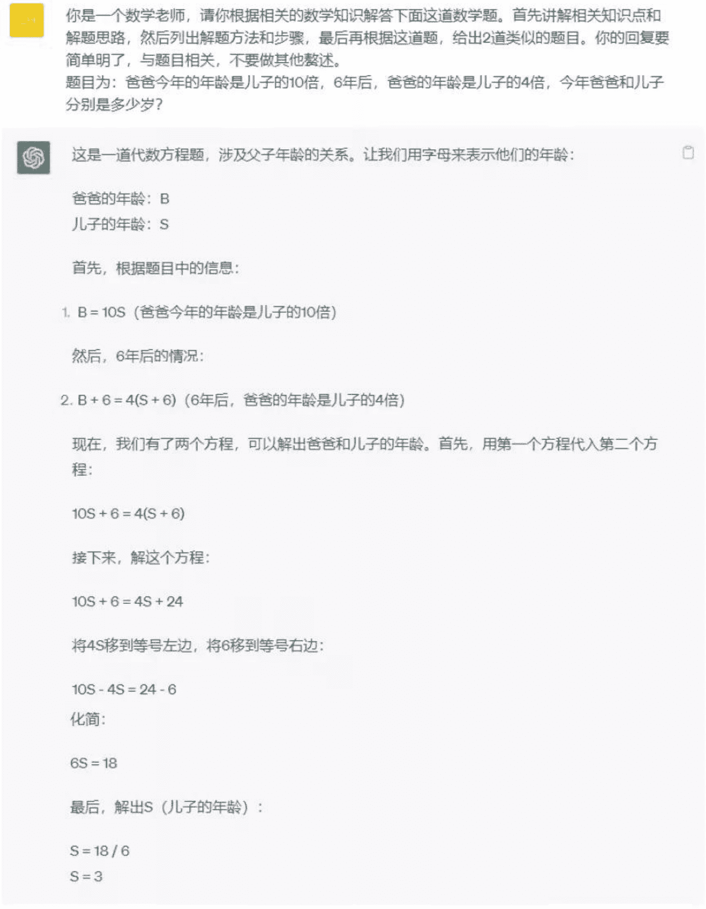

图15-4 ChatGPT作为教师出题示例

此时已知儿子年龄为 3 岁，可由首个等式求得父亲年龄：

B = 10S

B = 10 * 3

B = 30

故父亲现年 30 岁，儿子现年 3 岁。

同类练习：

+   1. 母亲今年年龄是女儿的 5 倍，8 年后母亲年龄为女儿的 3 倍，求两人现年各几岁？

2. 哥哥现年是弟弟的 7 倍，4 年后哥哥年龄为弟弟的 5 倍，求两人现年各几岁？

图15-4 ChatGPT作为教师出题示例（续）

上例显示模型先完成既有题目的求解，再提供相似练习，为学习者提供解题与命题思路。

### 065 推理游戏范例

剧本杀是推理类游戏的代表形式，流行期间可利用 ChatGPT 编写推理剧本，为商家提供创作灵感。

提问模板：

> 请创作一个以 ××× 为主题的推理游戏剧本，要求逻辑严密、符合规则

按此模板生成的片段如图 15-5 所示。

请生成一个以悬疑案件为主题的剧本，用于推理游戏，要求逻辑缜密，符合游戏规则

剧本名称：《绝境谜案：遗失的明星》

场景：一座富丽堂皇的古典别墅，坐落于偏远山区。时间是约一个月前的一个阴郁夜晚。

角色介绍：

+   1. 威廉·布莱克 - 退役知名侦探，现为神秘收藏家。

2. 瑞秋·斯通 - 失踪的明星，昔日备受关注的影视演员，最近销声匿迹。

推理游戏脚本拆解：明星失踪案的人物与推进线

3. 马克·亨特  是瑞秋的经纪人，目前资金链吃紧，调查员威廉·布莱克已前后找过他好几次。
4. 莉莉·安德森  演员身份，和瑞秋私交甚笃，案发前不久刚去探望过她。
5. 彼得·沃克  摄影师，他是最后一次在片场见到瑞秋的人。
6. 莱昂纳德·格雷  别墅的看护人，长期沉默地观察着屋内动静。
7. 莫妮卡·史密斯  当地警局的片警，正主理这起失踪报案。
8. 大卫·哈珀  报社记者，想深挖瑞秋失踪背后的内幕。

开篇：巨星无故蒸发
- 故事从瑞秋拍完戏后莫名消失拉开序幕，现场只剩一本加了密的日记。
- 玩家化身威廉·布莱克应邀展开调查。
- 初步搜查落在瑞秋的卧室里，碎掉的玻璃瓶和她的手机成为第一批疑点。

图15-5 AI撰写的解谜游戏剧本片段（节选）

# ChatGPT 实用指令集与案例解析

第二章：人证交锋
- 玩家陆续约见马克、莉莉、彼得三人。
- 马克的财务危机让他显得可疑，可他坚称与失踪无关。
- 莉莉透露探访时瑞秋情绪紧绷、异常焦虑。
- 彼得拿出拍摄现场的照片，照片里瑞秋明显心神不宁。

第三章：别墅里藏着秘密
- 调查范围扩展到别墅，地下被发现一处隐密空间，里面布置成工作室，墙面贴满瑞秋的影像。
- 管家莱昂纳德承认自己是瑞秋的忠粉，但否认参与案件。
- 工作室里还有一台带密码锁的保险箱，开启需要先找到正确密码。

第四章：密码与真相
- 玩家需通过解谜与线索收集来破解密码锁。
- 打开后取出瑞秋的日记，里面记下了最后见面的人以及几件反常的事。
- 日记里的关键信息指向别墅内另有隐藏密室。

图15-5 AI撰写的解谜游戏剧本片段（节选）（续）


## 第 16 章 学术场景的指令与案例

在学习研究里，AI 能给出报告撰写的指点。比如帮忙起草论文、给调研报告支招、甚至生成实验报告范本，降低学习负担，提升研究效率与质量。

### 066 操作流程

从选题到成文都需要学术功底，耗费时间精力。用上AI可以分担写作压力，提升完成速度。

以下以借助AI完成论文为例说明学术场景的使用路径。

STEP 01 找选题灵感：在对话框里输入类似“我正在研究谐音词的网络使用对汉语的影响，请给几条有新意、前瞻的题目建议”，回车后模型会返回选题参考，如图 16-1 所示。

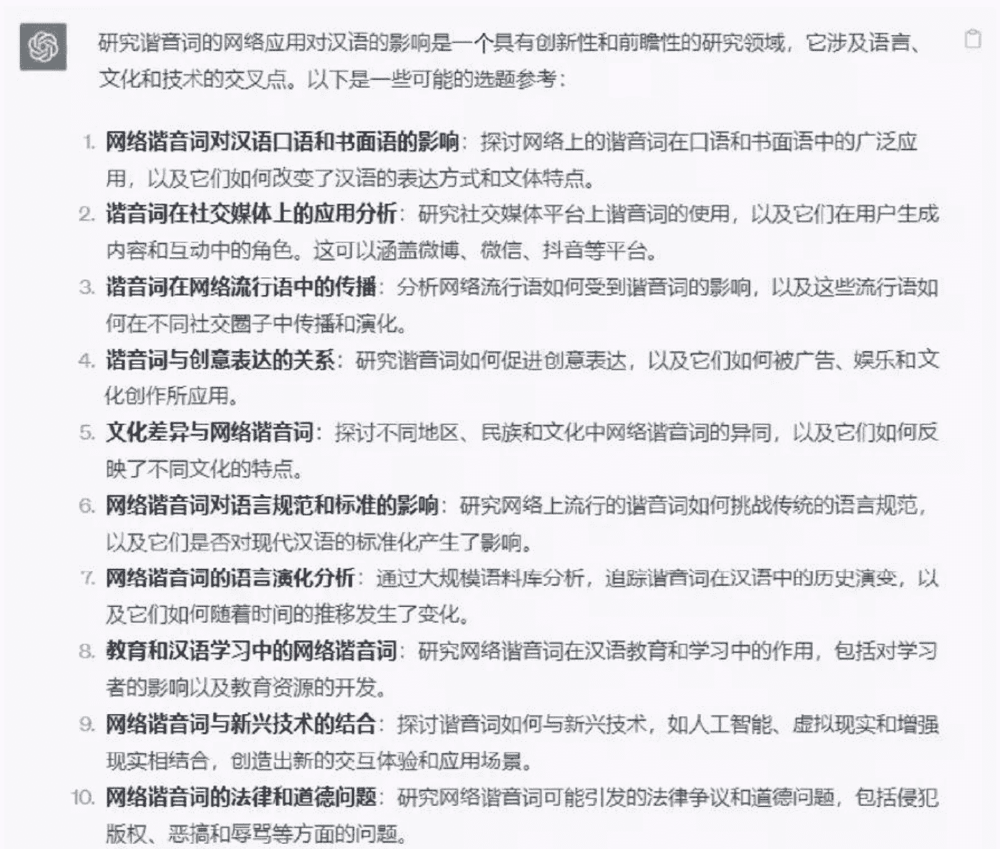

图16-1 模型给出的论文题目建议

STEP 02 评估与定题：继续输入类似“请以‘谐音词与网络幽默文化的关系’为题，谈谈这个题目的新意与研究价值”，回车后模型会输出选题的新意与意义，如图 16-2 所示。

STEP 03 搭建论文框架：继续输入“请围绕《谐音词与网络幽默文化的关系》给出完整提纲”，回车后模型会给出论文骨架，如图 16-3 所示。

“谐音词与网络幽默文化的关系”具有明显新意与价值。核心点如下：

新意：
1. 新兴语言现象：网络幽默与谐音词的关联是互联网时代的新事象，研究可揭示汉语演变的新动向。
2. 语言创造力：网络幽默高度依赖谐音词的创造性使用，研究其生成幽默、讽刺的方式很有新意。
3. 多媒体融合：网络幽默常结合文字、图像、音视频，研究其与谐音词的关系涉及多媒体融合，是新方向。

研究价值：
1. 文化传播与交流：网络幽默是跨文化沟通的重要载体，研究谐音词的使用有助于理解语言与幽默的联动机制。
2. 语言规范与演化：谐音词常挑战传统规范，研究其影响有助于认识汉语演变与标准化。
3. 创意产业与文化产品：网络幽默渗透广告、娱乐与文化创作，理解谐音词的应用可为创意产业提供启示。
4. 教育与学习：研究其对汉语学习者的影响，有助于优化教材与教学方法。
5. 社会映射：网络幽默反映社会政治文化关切，研究演变有助于把握社会议题变化。

下面是《谐音词与网络幽默文化的关系》的论文框架，涵盖主要部分与章节概要。

### 论文大纲：《谐音词与网络幽默文化的关系》

摘要
- 研究背景与问题概述
- 方法与主要发现概括
- 研究价值与影响

引言
- 研究背景与动机
- 研究问题与目标
- 文献综述：网络幽默文化与谐音词相关研究
- 研究方法与数据来源

### 第一章：网络幽默文化与谐音词
- 网络幽默文化的定义与特征
- 谐音词的概念与分类
- 网络幽默中谐音词的典型用法

### 第二章：谐音词的创造性与多媒体融合
- 谐音词在网络幽默中的创造性运用
- 多媒体元素在网络幽默中的作用
- 谐音词与图片、音频、视频的关联

图16-3 模型生成的论文框架

# ChatGPT 指令与实战案例全集

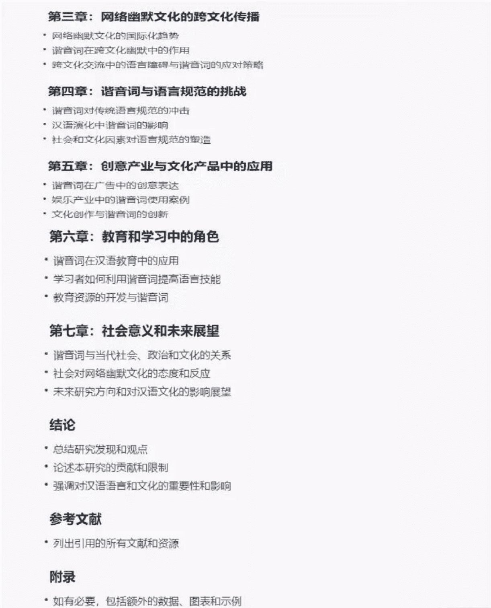

按此方法，用户可在获得模型提供的提纲参考后，结合实际研究内容进行调整。需注意的是，模型给出的提纲仅供参考，正式写作时应结合期刊文献与既有研究成果进行修正。

### 067 调研报告范例

调研报告是形成理论、支撑决策的重要依据，强调准确、清晰、实用与逻辑，核心在于可读性强，适配不同读者。借助AI可提升报告的可读性。

获取调研报告写作指导时可使用以下提问模板。

> 请从调研方法和案例分析方面，为一篇 ××× 的调研报告，提供具体的调研方案指导

使用该模板的示例如图 16-4 所示。

请从调研方法和案例分析方面，为一篇关于线上聊天使用表情包对人际关系影响的调研报告，提供具体的调研方案指导

关于线上聊天表情包对人际关系影响的调研需采用系统化方法，以确保结果可靠。以下为方案指导，含方法与案例分析：

### 调研方法
1. 研究目标与问题界定
   - 明确核心目标：探究表情包使用对线上人际关系的影响。
   - 提出研究问题：表情包如何影响线上沟通？不同场景下使用差异是否明显？
2. 受访者招募
   - 选择多元样本，涵盖不同年龄、性别、文化背景与社交习惯。
3. 数据收集方式
   - 定性方法：深度访谈、焦点小组，以获取主观体验。
   - 定量方法：线上问卷调查，配合统计分析工具处理数据。
4. 数据分析
   - 运用内容分析、主题分析、统计分析等工具解读数据。
   - 将结果与相关理论框架对照，提炼深层洞见。
5. 需关注因素
   - 规避调研偏差与误差，采取相应措施。
   - 注意数据时效性，因社交方式与表情包使用会随时间变化。

### 案例分析
1. 案例挑选
   - 选择不同类型的在线社交平台，如社交媒体、即时通讯、在线游戏。
   - 对比表情包丰富度高与文化内涵强的平台差异。
2. 数据收集
   - 采集表情包类型、频率、使用情境等数据。
   - 收集用户反馈与评论，了解其感受与认知。
3. 数据分析
   - 跨案例比较，识别不同平台与情境下的影响差异。
   - 探索表情包使用与人际关系变化的关联，如亲密度、沟通效率、误解减少等。
4. 深度挖掘
   - 考虑跨文化使用差异等特殊情况。
   - 分析成功与失败因素，评估表情包对关系质量的影响。

### 报告撰写
最终整理成完整报告，包含：
1. 研究背景与目的
2. 调研方法与数据收集过程
3. 分析结果与发现
4. 案例分析与横向比较
5. 结果的现实意义讨论
6. 结论与建议，总结主要发现并提出使用建议及未来研究方向。

图16-4 模型提供的调研报告指导示例

### 068 实验报告范例

实验报告是学术文本的常见形式，用于记录、分析与解释实验结果，提升学术水平。巧用AI可高效完成撰写。

提问模板可为：
1. 探索选题：我需要写一份 ××× 的实验报告，你能给我提供一些选题方向吗？
2. 生成大纲：请以 ××× 为主题，生成实验报告的大纲

使用该模板生成的示例部分内容如图 16-5 所示。

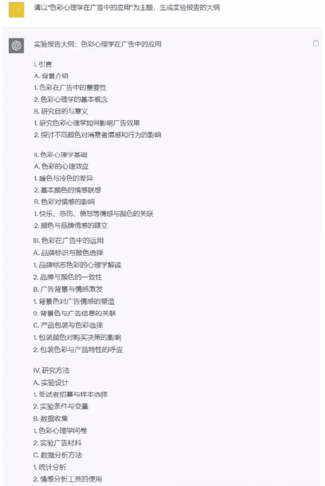

需注意，模型提供的实验设计仅作参考，必须结合实际情况调整与验证。用户还可将写好的报告交由模型修改润色。


## 第 17 章 公文写作的指令与案例

公文是企事业单位与日常生活中用于办公或社交的文本，涵盖法定类、事务类、规约类、凭证类、讲话类、书信类、礼仪类等。借助AI可获得各类文体的写作参考。

### 069 操作流程


通知是用于发布信息、传达决策的文体。借助AI可提升撰写效率、准确性与完整性。

以下以生成通知为例，介绍公文写作的操作步骤。

STEP 01 解析公文范例：在对话框输入类似“请从结构和体例上分析以下通知（另起一行，提供关于端午节放假的通知）”，让模型学习通知写法，提交后会得到结构分析，如图 17-1 所示。

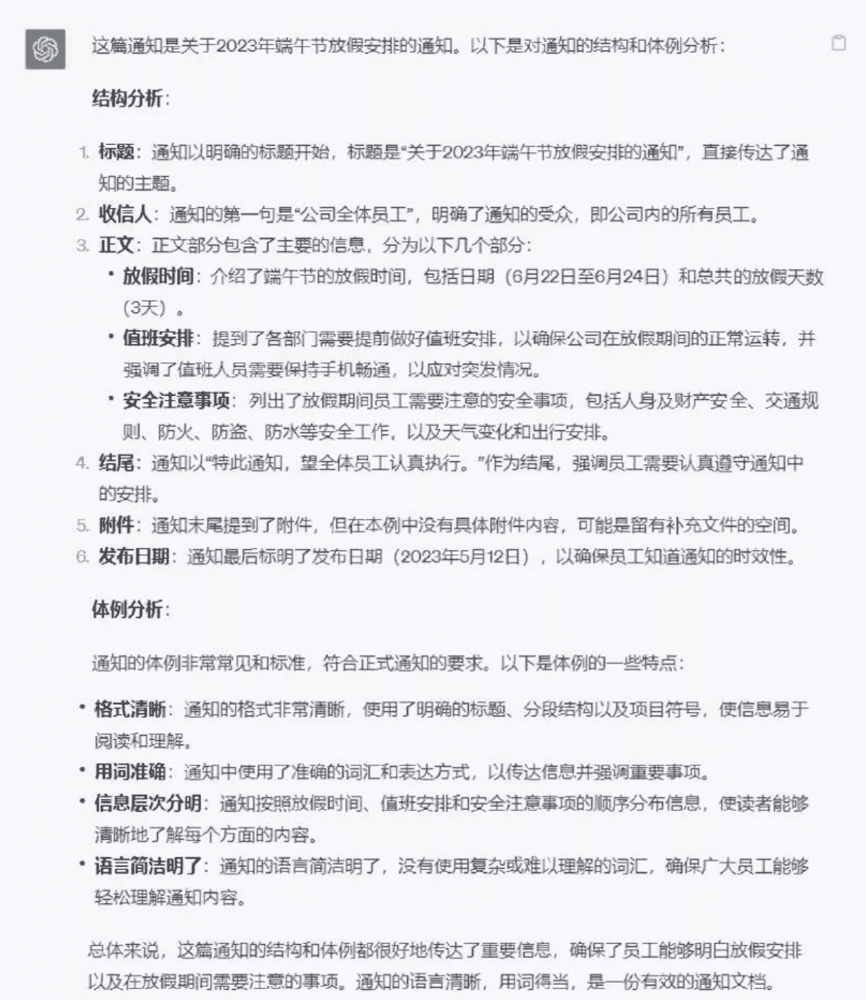

图17-1 模型对通知实例的结构分析

STEP 02 仿写：继续输入类似“请模仿以上实例，写作一篇关于因线路维修需停电两天的通知，停电时间为 2023 年 11 月 1—2 日，上午 8:00 至 11:00，下午 14:00 至 19:00”，提交后会生成对应通知，如图 17-2 所示。

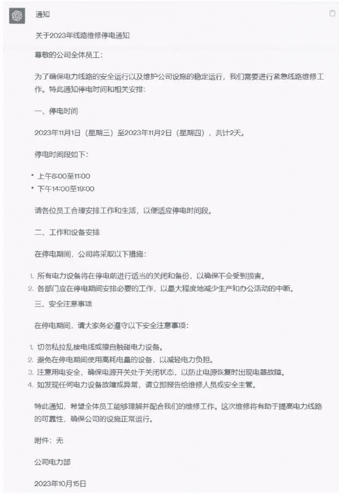

图17-2 模型生成的通知范例

用户还可要求模型对通知进行优化，如在结尾加入祝福语，增强亲切感。

### 070 会议纪要范例

会议纪要是会议记录与凭证，清晰准确的纪要可为工作提供指引。借助AI可更快完成纪要撰写。

提问模板：
> 请根据以下信息和模仿会议纪要的实例，写作一篇关于 ××× 的会议纪要（另起一行，提供信息和实例）

示例指令为“请根据以下信息和模仿会议纪要的实例，写作一篇关于提高员工工作效率主题的会议纪要（另起一行,提供信息和实例）”，生成的纪要如图 17-3 所示。

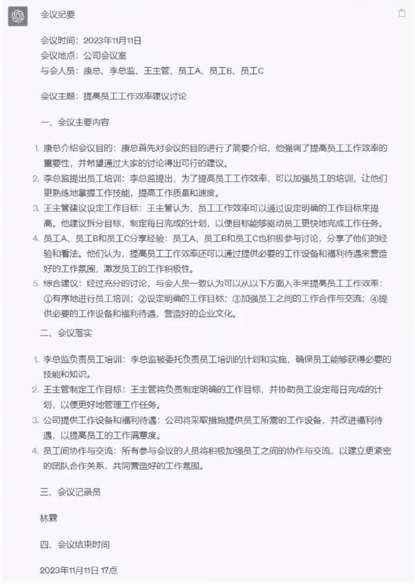

### 071 发言稿范例

发言稿用于会议、演讲、报告等场合，旨在传递信息与观点。用户可向模型说明具体需求生成稿件。

提问模板：
我是 ×××（职业或身份），我有 ××× 需求，请帮我生成一份发言稿

使用该模板生成的示例如图 17-4 所示。

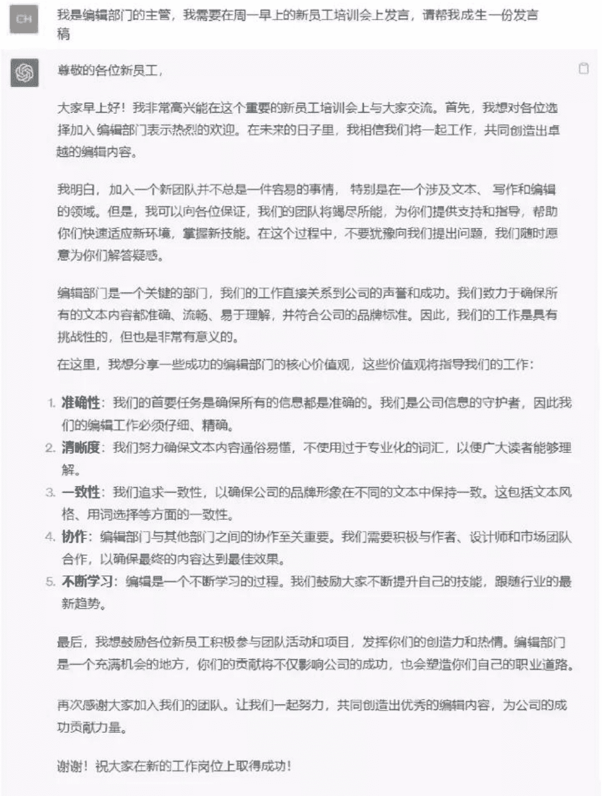

发言稿格式要求相对宽松，建议在指令中提供更多信息，如职业身份、困境、待解决问题等，以获得更具针对性的稿件。

### 072 请柬范例

请柬用于邀请宾客参加活动，讲究文雅规范、措辞诚恳。用户可提供实例让模型生成内容。

提问模板：
请模仿以下实例，生成一份×××的请柬，要求措辞真挚诚恳、文雅兼备（另起一行，提供请柬实例）

生成生日派对请柬的示例如图 17-5 所示。

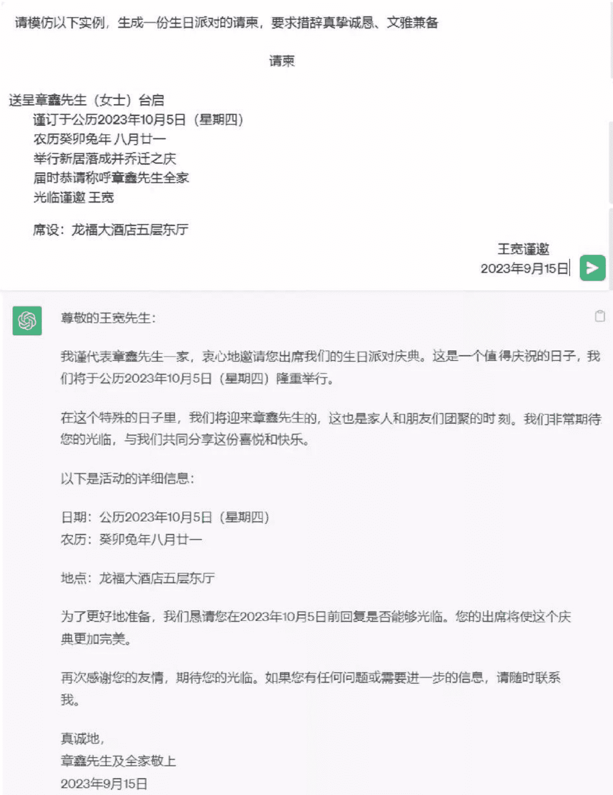

可看出模型生成的请柬要素齐全，并进行了内容补充。但版式未严格跟随输入格式，用户可自行调整。也可提出修改要求，让其采用更文雅的措辞。


## 第 18 章 文艺创作的指令与案例

AI可用于生成诗词、戏剧、散文、文学评论等，为创作提供思路与方向。本章介绍其在文艺创作中的应用。

### 073 操作流程

诗词意蕴丰富、情感浓厚。AI在学习大量诗词数据后，可依指令创作。

STEP 01 引入诗词开启对话：在对话框输入类似“你读过李白的诗吗？请你总结一下李白诗词的特点”，确认其对写法是否了解，提交后会得到特点总结，如图 18-1 所示。

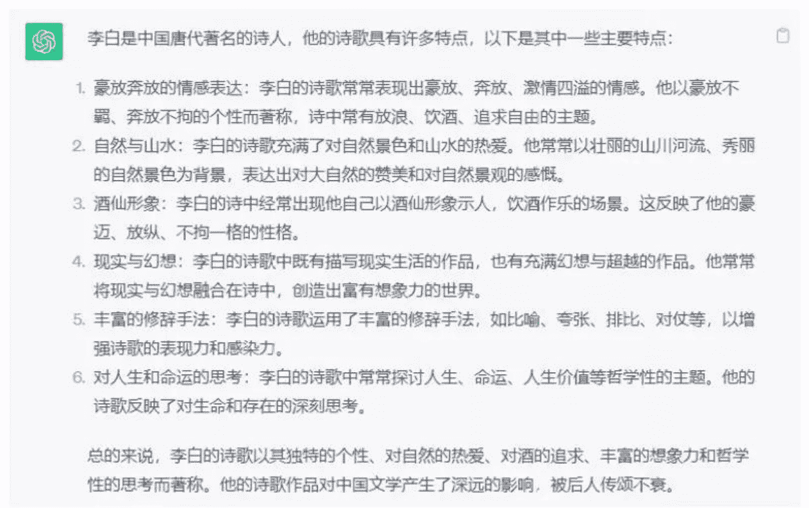

图18-1 模型总结的李白诗词特点

STEP 02 输入需求生成作品：继续输入类似“请你模仿李白的写作风格，围绕‘大海’‘胸襟’创作一首诗词”，提交后会生成作品，如图 18-2 所示。


图18-2 模型生成的诗词

用户还可提出优化要求，让其修改意蕴与思想。也可在指令中说明需要现代诗歌。

### 074 散文范例

欣赏美景、品味美食、阅读佳作或感悟人生，常会激发文思。AI可帮助更精准传情达意。

提问模板：
1. 引入散文：请总结出 ×××（名家名作）这篇散文的特点
2. 生成散文：请根据上述特征，写作一篇关于 ××× 的散文，字数在 × 字左右

使用该模板生成的示例如图 18-3 所示。

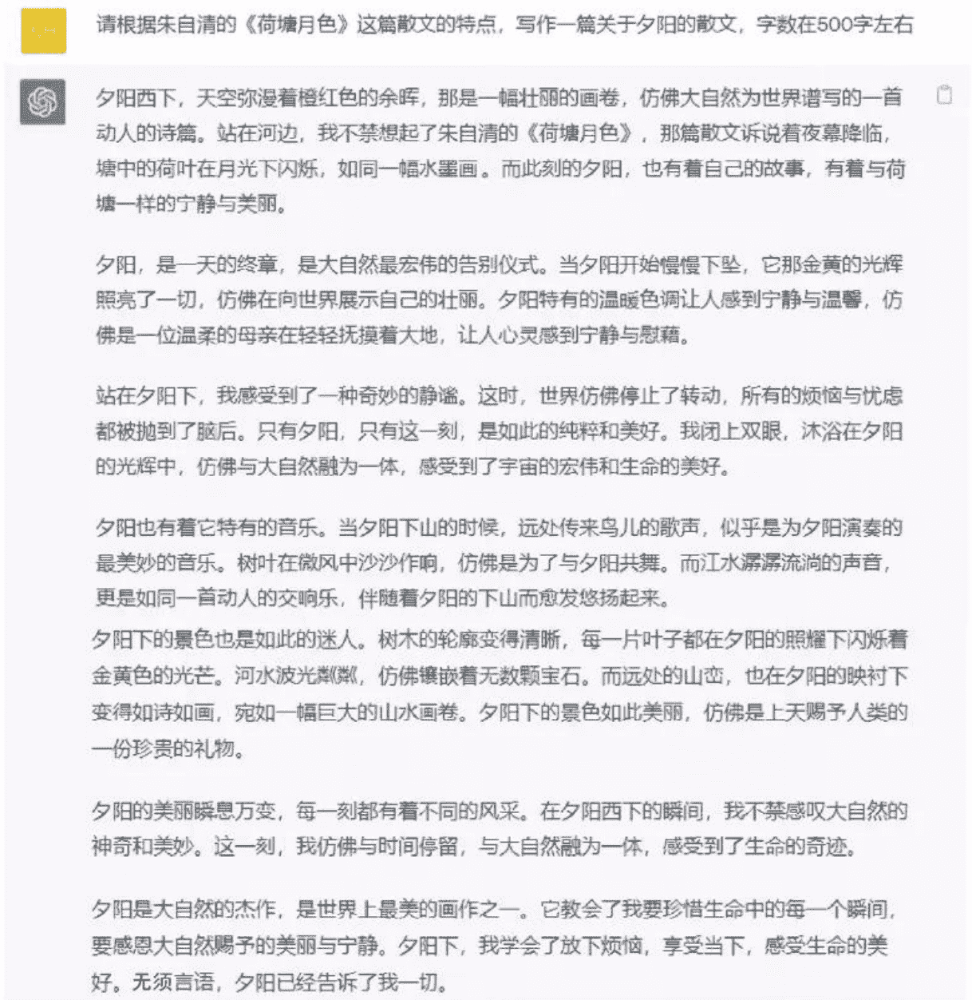

在生成的基础上，用户可要求润色文字、加入修辞或提升哲理性。

### 075 戏剧范例

戏剧具有强烈的故事性与画面感，可通过舞台、影视呈现。借助AI可获得创作灵感。

提问模板：

戏剧模仿与主题驱动：一键复刻经典笔法

想让模型借鉴某位知名戏剧家的写作手法，并围绕指定主题完成符合具体要求的剧作，可以直接套用指令模板来驱动ChatGPT。图18-4演示了借助模板生成戏剧的使用方式。


通常让模型创作戏剧时，先请它输出作品的梗概与提纲，再据此展开具体的剧本内容。

### 076 文学评论范例

撰写文学评论是对作品进行深度剖析与价值判断的一种表达形式，通过解读与评析来挖掘作品的意蕴、特质、结构，以及作品与时代、社会、文化的关联。文学评论也是推动创作进步的重要路径。

借助ChatGPT写文学评论，能获得来自不同角度的多元解读，从而促进文艺创作的发展。提问时可采用如下指令模板：

> 假设你是一名文学批评专家，请你从多个维度对 ××× 这部文学作品进行解读和评价，并写作一篇 × 字的论文

图18-5展示了运用该模板生成文学评论的示例。


在此示例中，为模型赋予文学批评专家的身份，能使其结合批评理论进行评价。使用者既可以要求对一部作品做整体审视，也可以指定从写作技巧、叙事视角、主题表达等某一特定层面切入。


## 第 19 章 小说编写指令与范例

小说是一种以虚构情节为主的文字形态，通常依托情节推进与人物塑造吸引读者，涵盖言情、科幻、推理、现实、历史等多种类型。本章介绍如何用ChatGPT编写小说的指令与案例。

### 077 指令应用步骤


言情小说以爱情为核心，通过完整的故事线和细腻的环境描写体现爱情观念，自唐代兴起以来一直拥有庞大受众。借助ChatGPT可以为创作提供灵感。

下面以生成言情小说为例说明操作流程。

STEP 01 赋予身份，编写大纲：在输入框中输入指令，例如“你的角色是一名网络作家，擅长发挥想象力创作言情故事。现在需要你创作一本关于校园爱情的言情小说，请先生成小说的大纲”，回车后ChatGPT会输出大纲，如图19-1所示。


图19-1 ChatGPT生成的言情小说的大纲

STEP 02 确定大纲，编写内容：在输入框继续输入指令，例如“请续写第一章，要用网文的写作风格，故事情节有新意”，回车后ChatGPT会按要求续写第一章，如图19-2所示。


图19-2 ChatGPT按照要求续写小说的第一章

上述示例先让模型生成大纲，用户可审阅故事框架、逻辑和结构，确保可读性，发现问题可及时让模型修改；再按大纲逐章展开，就能得到完整的小说。

### 078 科幻小说范例

科幻小说是在尊重科学结论的基础上进行虚构的文学体裁，以科学故事为核心，通常具备自洽逻辑、科学元素和人文思考三要素。ChatGPT可为创作提供灵感。

提问模板如下：

> 你的角色是一名科幻小说家，擅长×××。现在需要你虚构一篇×字的科幻小说，主题为×××，语言风格不限，但需遵循：1.逻辑自洽；2.带有科学元素；3.有人文思考

让ChatGPT编写科幻小说的示例见图19-3。

你的角色是一名科幻小说家，擅长创作脑洞大开且引人入胜的故事，能够长期吸引读者。现在需要你虚构一篇800字的科幻小说，主题为“人类的未来与火星的关系”，语言风格不限，但需要遵循以下规则：1. 逻辑自洽；2. 带有科学元素；3. 有一定的人文思考

标题：《星际之梦》

第一章：穿越时光的梦

西元2085年，人类已开始探索太空奥秘。地球资源枯竭、气候崩解，人类面临前所未有的挑战。在危机笼罩下，一场前所未有的梦想即将改变一切。

在一座被气候侵蚀的城市里，年轻天文学家艾莉森沉浸于研究，追寻星际梦想。她坚信人类未来系于太空探索。她的设想相当大胆：火星可能是人类的新居所。

第二章：星际之旅

科研团队采纳艾莉森的设想，启动“星际之旅”计划。他们建造一艘配备尖端技术的巨型飞船，搭载一支勇敢队伍前往火星。

数年后旅程启程。船上科学家与工程师投入史无前例的冒险，目标是改造红色星球使其适宜居住。任务极具挑战：恶劣环境、资源有限、孤立感强烈，一切都在考验团队的韧性与智慧。

第三章：火星之梦

几十年后，火星不再是荒凉红沙漠，而成了新家园。借助气候控制系统，大气逐渐变得可呼吸。红色平原上崛起巨型城市，人类在该星球建立全新社会。

过程并非平稳。火星居民面临道德与伦理困境，需权衡资源利用与生态保护。同时地球社会巨变，对火星资源产生渴望。

第四章：火星之问

时日推移，火星与地球联系愈加密切。科学家发明“虚拟共鸣”技术，使两地能实时沟通与感知。该技术让地球人更向往火星，也引发诸多哲学与伦理议题。

艾莉森成为火星领袖，需应对地球压力并化解内部分歧。某日她伫立火星红土地仰望星空，思考新时代挑战。

“我们来此为生存、为未来，”她低语，“但不能忘记来处，地球与我们血脉相连。该如何平衡欲望与责任？”

第五章：星际之和

在压力与冲突中，人类找到答案。他们把火星视作新家园，同时尊重地球生态。虚拟共鸣让两星联系更紧密，人们开始珍惜双星共生关系。

图19-3 ChatGPT编写科幻小说示例

科学家继续研究太空，追寻更远的星际梦想。人类未来更光明，因他们学会在宇宙中求索答案，同时守护地球这一珍贵家园。

结局：星际之梦的继续

在“星际之梦”引领下，人类不断前行，探索宇宙奥秘。他们不仅找到新家园，也找到内心深处的答案。星际之梦永不停息，因为它既是科学探索，也是人类对责任、共生与未来的深刻思考。

在星际之梦中，人类未来与火星的关系既是科学冒险，也是人文探讨，关乎人类在宇宙中的定位与使命。故事提醒我们，无论路途多艰，只要相信科学与人类力量，星际之梦永不熄灭。

图19-3 ChatGPT编写科幻小说示例（续）

让ChatGPT生成科幻小说时，要注意逻辑关系合理且自洽，符合科幻的科学性与人文性。

### 079 推理小说范例

推理小说是以逻辑推理虚构故事的文学类型，通常设置谜题串联情节，让读者寻找凶手或失物来保持兴趣。有ChatGPT助力，创作者能获得更多灵感。

提问模板：

> 你的角色是一名推理小说家，擅长×××。现在需要你虚构一篇×字的推理小说

让ChatGPT编写推理小说的示例见图19-4。

你的角色是一名推理小说家，擅长虚构逻辑严密的谜团和人物的心理描写。现在需要你虚构一篇800字的推理小说

宁静小镇突现离奇谋杀案。受害者是年轻女性艾莉森·霍普金斯，该镇古老书店店主。案发当晚居民涌向书店，震惊不已。

我，推理小说家亚瑟·哈罗德，远道而来。目标是解开谜局、还原真相。在书店初次见到她的亲友，神情黯然。其中两人引人注意：艾莉森的青梅竹马、年轻画家詹姆斯·安德森；以及生意伙伴、中年女性维多利亚·莱特。

我请两位关键人物留下，开始勘查现场。在艾莉森办公室发现一本日记，记录她对两人的疑虑。提及詹姆斯对书店未来看法与她不合，以及维多利亚近期的怪异举动。

为深入了解，我与詹姆斯单独交谈。他承认对书店未来有些不同想法，但否认矛盾。那晚他在画室作画，多位证人可证明。

随后转向维多利亚。她在办公室紧张不安。解释近期压力来自生意不佳，但坚称无敌意。她称案发当晚曾离开书店去附近咖啡店小坐，听见警报才赶回。

调查中发现线索：监控显示詹姆斯确实在画室，与其说法一致。但维多利亚的行踪在监控里查不到，令人怀疑。

我决定进一步追查维多利亚当晚活动。询问咖啡店服务员得知，她确实来过，但离开时间比自述晚得多，证词可信度受质疑。

最终在维多利亚办公室找到一个被遗忘的手提包。打开瞬间，里面有一把血迹斑斑的刀，与现场凶器完全一致。维多利亚面色瞬间苍白。

审讯中她承认与艾莉森有商业纠纷，为保自身利益铤而走险。案发当晚利用混乱将艾莉森置于绝境后行凶。最终她在法庭被判有罪，正义得以伸张。

这是一个复杂难解的案件，而我通过剖析人物心理与逻辑推理，成功解开小镇离奇之谜。

图19-4 ChatGPT编写推理小说示例（续）

### 080 现实小说范例

现实小说取材于生活，力求如实反映客观现实。它并非像纪录片般原样记录，而是努力在典型环境中再现典型人物，通过典型来映照现实。

让ChatGPT生成现实小说，关键在于刻画丰满人物和细致描写事件、环境，必要时可用如下指令模板：

你的角色是一名作家，擅长×××。现在需要你根据关键词来虚构一篇×字的小说，关键词为×××、×××、×××……

让ChatGPT生成现实小说示例如图19-5。

你的角色是一名作家，擅长从现实生活中取材来虚构故事。现在需要你根据关键词来虚构一篇800字的小说，关键词为水果摊、牛奶、海水

图19-5 ChatGPT生成现实小说示例

夏日阳光如热情情人，热烈倾泻在城市街头巷尾。骄阳午后，我发现街头一处不寻常的水果摊，似乎散发神秘吸引力。

摊位与普通水果摊不同，摆满各类水果，颜色诱人、香气四溢。我走近，被琳琅满目所吸引：苹果、橙子、葡萄、草莓等各式品种。其中最显眼的是中央一瓶牛奶。

这瓶牛奶很特别，是古老玻璃瓶，瓶身残留沙砾，仿佛有数十年历史。瓶盖写着：“神奇的海洋牛奶，只需一口，你将踏上奇幻之旅。”神秘字眼勾起好奇。

摊主是个年迈男子，面带亲切笑容。名叫亚历克斯，据说城里最神奇的水果摊主。我好奇询问那瓶牛奶的故事。

亚历克斯坐下，讲述与牛奶的往事。很久以前他是年轻渔夫，日日在海上劳作。某日遭遇海上风暴，船沉入深海。他被巨浪卷入深渊，以为生命走到尽头。

再次醒来时，他躺在美丽沙滩，阳光明媚、海水碧蓝。身旁正好放着一瓶牛奶。他饥渴难耐，打开盖喝下一口。生命随之巨变。

身体变得年轻健康，肌肤光滑如新，精力充沛。更惊讶的是，他能听懂海洋语言，与海中生物交流。他成为海洋守护者，与海龟、海豚、鱼群结成亲密伙伴。

在那片神奇海域，他学到大量自然知识，也发现珍贵宝藏。他用海水与各种水果调制出这瓶海洋牛奶，用以分享经历与知识。

听完故事，我决定尝一口。亚历克斯小心打开瓶盖，倒出一小杯。我端起喝下。

牛奶味道鲜美，带着海水咸香与一丝水果甜味。能量涌入身体，仿佛踏上奇幻之旅。

随着牛奶喝完，我感到奇妙变化。感官更敏锐，能听见远处海浪声，看见海底美景，甚至与海洋生物进行思想交流。我不再是普通城市居民，而是海洋一部分。

向亚历克斯道谢后告别水果摊。我踏上充满冒险与奇迹的旅程，与海洋生物一起探索未知世界。

此后，每当渴望冒险与新奇，我就会回到那个水果摊，喝上一口神奇海洋牛奶，重新融入神秘海洋世界。这个小摊成为我生活中最珍贵的秘密，也是创作故事的源泉，因每次品尝都是一次不同寻常的冒险。

图19-5 ChatGPT生成现实小说示例（续）

生成现实小说时，可在身份设定中加入“现实主义”字眼，以帮助模型把握定位，从而产出更有参考价值的内容。

### 081 历史小说范例

历史小说以虚构或改编历史故事为题材，通过塑造历史人物或事件再现某一历史时期的生活面貌和发展。作品要求基于史实，同时可适度虚构、想象与概括，既能满足读者对历史知识的需求，也能提升阅读兴趣。

使用ChatGPT可为创作提供灵感，必要时可用如下指令模板：

> 你的角色是一名作家，擅长改编历史故事。现在需要你根据×××这一历史事件，进行合理地虚构或改编，创作一篇×字的历史小说

让ChatGPT生成历史小说示例如图19-6。


图19-6 ChatGPT生成历史小说示例


## 第 20 章 故事创作指令与范例

故事是大众喜爱的文学体裁之一，具有强吸引力。好的故事能让讲述者酣畅，也让听众津津有味。借助ChatGPT，用户可以源源不断获得创作灵感，积累有趣内容。

### 082 指令应用步骤

故事通常情节精彩、引人入胜，具备教育作用，尤其在家庭教育中很重要。当需要讲故事时，可让ChatGPT充当故事专家，提供适合特定年龄和风格的故事。

下面以生成童话故事为例说明操作步骤。

STEP 01 赋予身份，提出需求：在输入框输入指令，如“假设你是儿童文学作家，擅长编写童话故事，请提供一个适合5岁小朋友的故事”，回车后ChatGPT会生成童话，如图20-1所示。


图20-1 ChatGPT生成的童话故事

STEP 02 提出要求，修改故事：在输入框继续输入指令，如“请根据‘熊猫’‘探险’这两个关键词，修改故事，增加故事的新奇感”，回车后ChatGPT会按要求修改，如图20-2所示。


图20-2 ChatGPT按照要求修改故事

用户还可以让ChatGPT对经典童话进行改编，生成新奇有趣的故事，或在故事中融入一些哲理，达到教育目的。

### 083 寓言故事范例

寓言故事是一种独特的说理方式，通过富有深意的故事传递人生道理和智慧。相比单纯说教，寓言更易被接受，蕴含的道理常给人深刻印象。

使用ChatGPT编写寓言故事时可采用如下指令模板：

> 假设你是一名作家，擅长编写寓言故事，请提供一个关于×××的寓言故事

让ChatGPT编写寓言故事的示例如图20-3。

假设你是一名作家，擅长编写寓言故事，请提供一个关于贪婪的寓言故事

故事标题：《贪婪的狐狸》

从前，有一只名叫雷诺的狐狸，他以贪婪而著名。无论在森林中还是在田野里，雷诺总是试图夺取他人的食物和财宝。

一天，雷诺听说了一只狡猾的兔子名叫奥利弗有一颗珍贵的红宝石。传说中这颗红宝石具有神奇的力量，能够带来无尽的幸福和财富。雷诺立刻产生了强烈的贪婪之心，决定偷走奥利弗的红宝石。

雷诺开始监视奥利弗的洞穴，等待一个机会。不久之后，他发现了奥利弗一个疏忽，奥利弗离开了他的洞穴，留下了红宝石。雷诺高兴地冲了进去，抓住了红宝石，然后逃离了奥利弗的洞穴。

贪欲与启悟的寓言

就在雷诺为抢到红宝石而暗自得意时，宝物内部忽然迸射出耀眼光芒，顷刻间将他钉在原地。恰好赶路的老狐狸艾伦撞见了这一幕。

艾伦开口提醒道：“雷诺，贪念把你带进麻烦。眼前的红宝石并非寻常装饰品，而是受守护的珍宝，只有懂得分享并心怀珍重之人才配拥有。”

听后雷诺猛然醒悟，开始反省自己的贪心，并央求艾伦想办法解救，随后承诺归还宝石。艾伦凭借智慧找到了解除封印的办法，解除了束缚。

雷诺把宝石交还给奥利弗并诚恳道歉。奥利弗见他真心改变，宽容地接受了道歉。此后雷诺摒弃贪婪，化为懂得分享与珍惜的狐狸。他体会到贪欲的代价，也认识到友情与善良的价值。

这个寓言提示我们，贪婪带来的快感转瞬即逝，终将招致困境与孤独；唯有分享与珍惜，方能收获真正的幸福与友谊。

图20-3 ChatGPT编写寓言故事示例

### 084 讽刺故事范例
讽刺类故事多借助夸张、嘲弄、反讽等手法，揭露人性弱点、愚蠢与虚伪。这类作品常以生活中的典型人物或事件为蓝本，通过夸张虚构凸显荒诞可笑的特质。借助 ChatGPT，用户能够获得更具真实感的讽刺文本。

在用 ChatGPT 撰写讽刺故事时，可参考如下提问方式。

请化身为善于用文字写出讽刺作品的作者，创作一个讽刺×××的故事

依据该方式生成的示例见图 20-4。

## 第 20 章 故事创作指令与范例
请化身为善于用文字写出讽刺作品的作者，创作一个讽刺某个人物极度小气的故事


图20-4 ChatGPT编写讽刺故事示例

经典名著中同样存在令人记忆深刻的形象，如《儒林外史》的严监生、《威尼斯商人》的夏洛克。让 ChatGPT 创作讽刺故事时，可提示模型借鉴或模仿这些经典形象来塑造新角色，从而提升讽刺力度。

### 085 哲理故事范例
哲理故事通过生动的人物与情节呈现具有普遍意义的人生智慧。阅读过程轻松愉悦，同时能带来启发，有助于自我认知与世界观的拓展。ChatGPT 也能生成令人深思的哲理故事。

撰写哲理故事常用的提问范式为。

请以擅长×××的作者身份，围绕×××主题写一个富哲理的故事

按此范式生成的示范见图 20-5。

请以善于用故事表达观点与看法的作者身份，围绕“人生最重要的是活在当下”这一主题写一个带哲理的故事

故事标题：时间的礼物

在遥远的过去，有个小村落里居住着一位被称作艾哈迈德的老人，他睿智豁达，乡亲们遇到困惑总爱找他聊聊。

某日，年轻人阿里满面愁容地找到他，诉说自己被焦虑缠绕，常忧心将来，又为往事内疚，不知如何自处。

艾哈迈德微笑安抚，随后讲起一段往事：从前有位王子，终日为国事忧虑，心中不安，便去寻访智者求解。

那智者告诉他，时间是带着魔力的馈赠，随后赠予他一只金沙漏，并嘱咐每日翻转。

这沙漏很奇特，只能映现当下的一瞬，过去与未来皆为空白。王子坚持每日翻转，渐渐学会把注意力收回此刻，于是不再纠结未来的政务，也不沉溺过往的失误。

不久，王子变得安宁满足，治下也更繁荣，人们纷纷注意到他眼中流露的智慧与喜悦。

阿里听完仍感困惑：“智者，我明白时间的价值，可要如何像王子一样活在当下？”

艾哈迈德答道：“活在当下并不是忘却过去或屏蔽未来，而是在每个瞬间全然投入，珍惜眼前的经历与人际。每天像翻转沙漏那样把焦点放在现在，用心体会生活的美好。”

受此启发，阿里回到村里付诸实践，焦虑慢慢消退，他变得平和愉快，开始懂得欣赏每一个瞬间，因为每一刻都是时间赠予的珍贵礼物。

该故事点明，人生重心在于把握当下，珍惜每一瞬间。过去已成定局，未来尚未抵达，唯有现在可被改变。活在当下是一种宝贵的智慧，能带来心灵的宁静与喜悦。

图20-5 ChatGPT编写的哲理故事示例


## 第 21 章 外语翻译指令与范例
ChatGPT 可充当翻译助手，将不同语言相互转换，满足学生、教师、译者、法律从业者等多样需求，比如帮助学生校对英语语法。本章介绍外语翻译的指令与范例。

### 086 指令应用步骤


ChatGPT 具备多语种互译能力，外语翻译对母语不同者交流至关重要，有助于不同国家人民往来与合作。

以下以给外国笔友回信为例说明操作流程。

STEP 01 提出翻译需求：在对话框输入指令，如“请将以下外国笔友的信翻译为中文（另起一行，提供信的内容）”，回车后模型会按要求完成翻译，如图 21-1 所示。


STEP 02 设定身份撰写回信：继续输入指令，如“请以中文笔友李华的身份，用英文给 Lee 写一封回信，主题为说明自己对西方文学的热爱”，回车后模型会按要求生成回信，如图 21-2 所示。


图21-2 ChatGPT按照要求撰写的回信

### 087 语法纠正范例
外语学习不仅是词汇积累，语法掌握同样关键。语法是遣词造句的规则，掌握后才能更好习得语言。ChatGPT 可帮助用户纠正语法、提升学习效率。

语法纠正可采用的提问范式。

> 请你扮演一名×××老师，按照×××语法规则，帮我检查以下文本，纠正我的语法错误（另起一行，提供文本内容）

示范见图 21-3。

请你扮演一名英语老师，按照英语的语法规则，帮我检查以下文本，纠正我的语法错误

The wind on this city is strong, that the lonely people always come home late.

你的句子存在语法问题，我来帮你修改：

"The wind in this city is strong, so the lonely people always come home late."

改动之处：

1. 把 "on" 改为 "in"，因为描述风所在位置常用 in。
2. 在 strong 后补充 so，以明确原因结果，使句子更通顺。

图21-3 ChatGPT进行语法纠正示例

用户也可采用对话方式一问一答，让 ChatGPT 在交流中指出语法、错字等问题。

### 088 英汉互译范例
英汉互译是常见需求，因英语使用范围广、汉语使用者多，在文献、旅游等场景频繁出现。可通过与 ChatGPT 对话实现互译。

提问范式。

> 请你担任英汉互译器。当我输入中文时，你需要运用英文的语法结构对我的语句进行翻译，并使用中文标注出该段英文中的时态、从句、主语、谓语、宾语、表语、特殊词组或谚语；而当我输入英文时，你需要运用中文的语法结构对我的语句进行翻译。我的第一句话是 ×××

示范见图 21-4。

请你担任英汉互译器。当我输入中文时，你需要运用英文的语法结构对我的语句进行翻译，并使用中文标注出该段英文中的时态、从句、主语、谓语、宾语、表语、特殊词组或谚语；而当我输入英文时，你需要运用中文的语法结构对我的语句进行翻译。我的第一句话是“人生若只如初见，何事悲秋空画扇”

Life, if only as the first sight, why does the autumn wind mourn the painted fan?

(时态：Present tense 现在时，从句：如果只是初次相见的话（if only as the first sight），主语：人生（Life），谓语：若（if），宾语：只如初见（only as the first sight），表语：何事秋风悲画扇（why does the autumn wind mourn the painted fan）)

图21-4 ChatGPT进行英汉互译示例

"Happy families are all similar, while unhappy families each have their own troubles." This quote comes from Leo Tolstoy's novel "Anna Karenina".


让 ChatGPT 将中文译为英文时，可在指令中要求标注主语、谓语、宾语、从句等语法结构，边译边学。

### 089 发音助手范例
外语学习中还可让 ChatGPT 充当发音助手，提供词汇的音标帮助准确发音。

提问范式。

> 请你担任专业的外文发音助手，当我输入单词或句子时，向我提供 ×××（外语）音标。我的第一个单词或句子是【×××】

示范见图 21-5 所示。


## 第 22 章 创意设计指令与范例
创意设计中灵感往往难以捉摸，受个人学识经验限制。借助 ChatGPT 可获得更开放的设计灵感与思路。本章介绍创意设计的指令与范例。

### 090 指令应用步骤
游戏角色设计是开发必备环节，有记忆点的角色能提升游戏热度与收益。因此角色设计需要大胆联想与创新，ChatGPT 可为设计师提供灵感。

STEP 01 设定身份征求建议：在对话框输入指令，如“请你扮演游戏设计师，根据设计经验为一款养成式游戏提供人物设计的灵感”，回车后模型会给出灵感，如图 22-1 所示。


图22-1 ChatGPT给出的游戏人物设计的灵感

STEP 02 补充背景细化建议：继续输入指令，如“假设游戏背景为武侠故事，请提供设计主要人物外貌的建议”，回车后模型会给出具体建议，如图 22-2 所示。

在武侠背景下，主要人物的外貌要体现武艺、性格与故事背景。设计建议如下：

1. 服饰
   - 武侠风格：长袍、宽松裤装、皮带、战靴等，可体现武术流派与身份。
   - 色彩：选用对比强烈的配色，如深色外衣配浅色内搭，突出特殊地位。

2. 发型
   - 飘逸长发：男主可蓄长发，女主可多变发式如长辫、盘发。
   - 头饰：发簪、发夹、头巾或帽子增加独特性。

3. 面部特征
   - 疤痕或刺青：战斗留下的痕迹或身份象征，反映经历。
   - 眼神：坚韧、决心或隐秘等情绪透过眼神表现。

4. 武器与道具
   - 武器风格：按武艺设定剑、刀、拳套、弓箭等，外观呼应个性。
   - 特殊道具：为每个角色设计有用途的专属道具。

5. 表情与姿态
   - 自信表情：通常冷静坚定，特定情境下可展现其他情绪。
   - 战斗姿态：展示战斗技巧与风采。

用户提供越多的背景信息，ChatGPT 给出的灵感越具实操性与针对性。

### 091 服装设计灵感范例
服装设计需考虑场合、时尚、面料、工艺等多要素，要求较高。借助 ChatGPT 可减轻设计压力。

提问范式。

> 请你扮演一名服装设计师，根据以下信息提供一些设计灵感（另起一行，提供服装的相关信息）

示范见图 22-3。

请你扮演一名服装设计师，根据以下信息提供一些设计灵感

小个子女生衬衣，适用于职场穿搭，轻熟风，带有小众感的细节设计

为小个子女生设计职场衬衣时，轻熟与小众是关键。灵感如下：

1. 剪裁与轮廓
   - 修身剪裁勾勒曲线却不紧绷，舒适得体。
   - 腰部褶皱或细节增加小巧娇俏感。

2. 领口设计
   - V领或修长尖领拉长颈线。
   - 领缘或下方可加柔和褶皱或蕾丝，增添小众气质。

3. 袖子与袖口
   - 褶皱或泡泡袖带复古元素。
   - 袖口点缀小褶皱或蕾丝，提升层次。

4. 面料与色彩
   - 高质面料如丝绸、顺滑棉、天鹅绒提升质感。
   - 深海蓝、墨绿、驼色等中性色适合职场并显独特。

5. 细节装饰
   - 前襟、袖口或领口缀以小珠片、亮片或刺绣。
   - 背部或领后点缀蝴蝶结或蕾丝。

6. 扣子与收口
   - 珍珠扣、金属扣或复古风格纽扣增加小众感。
   - 肩部或背部采用拉链、交叉系带或装饰纽扣等特殊开合。

这些灵感可打造独特且适合小个子女生的职场衬衣，兼具轻熟风与小众细节。

图22-3 ChatGPT提供服装设计灵感示例

### 092 珠宝设计灵感范例
珠宝设计要求对材质与美感的高把握，因常被赋予纪念意义而具收藏价值，稀有独特者价值更高，因此灵感尤为重要。

提问范式。

> 请你扮演一名珠宝设计师，提供一些关于 ×××（爱情、友情等）主题的 ×××（项链、手链、戒指等）设计灵感

示范见图 22-4。

请你扮演一名珠宝设计师，提供一些关于友情主题的手链设计灵感

设计友情主题手链时可参考以下灵感：

1. **拼图手链**
由不同形状拼图块组成，每块代表友情片段，朋友各佩戴一块，合在一起呈现完整画面。

2. **字母珠宝**
串以朋友名字的首字母，材质与颜色各异，每个字母象征独特情谊。

3. **锁与钥匙手链**
一对手链，一条带小锁，一条带小钥匙，象征友情的深度，需彼此配合开启。

4. **心形珠宝**
可分两半的心形手链，各自佩戴，走在一起时组合成完整心形。

5. **情感表达手链**
雕刻手牵手、拥抱或友情格言，搭配纹身效果设计，强化情感表达。

6. **生肖手链**
朋友生肖相同可镶嵌生肖图案或符号，突出共同点。

7. **彩虹色手链**

彩虹系的宝石或珠串可以串成一条友谊手链，不同色块对应不同的情感面向，比如欢愉、信赖、陪伴与共鸣。

8. **定制姓名腕饰**
可以为每位好友单独打造一条刻有姓名的饰品，利用特殊的字形与版式来呈现关系的独特性。

9. **手写字迹腕饰**
以朋友亲笔书写的字母或专属字样作为设计元素来制作手链，成品会更显亲近与温度。

图22-4 记录了模型给出的几款珠宝灵感案例
向模型索要珠宝灵感时，除了造型思路，也可以让它给出材质方面的建议，例如翡翠、钻石、金银等。

### 093 汽车设计灵感范例
汽车设计涉及造型、动力、材料挑选等多个层面，需要兼顾安全、耐用、可靠与可回收等要求，专业门槛较高。借助大模型可以在构思车体结构时补足更全面的考量维度。

向模型征求汽车设计灵感时常用的一种提问框架如下。

> 请你扮演汽车设计师，围绕×××给出×××（汽车系统结构、车身结构等）的创意

# ChatGPT 内容生成指令与范例大全
使用指令模板获取汽车设计灵感的案例见图 22-5。

> 请你扮演汽车设计师，给出围绕环保思路的车身结构创意

围绕环保思路构思车身结构时，可以尝试创新思路与材料以降低环境负担。灵感如下：

- 1. **减重用材**：选用碳纤维、铝合金、复合材料等轻质材料减轻整车重量，提升燃油经济性并减少尾气排放，同时延长续航。
- 2. **光伏充电板**：在车顶、后挡风玻璃或侧面集成太阳能板，将光能转化为电能为电池补电，降低对电网的依赖。
- 3. **可再生材质**：采用可降解塑料、可再生纤维等，减少对有限资源的消耗并降低废弃物产生，也可用在内饰。
- 4. **空气动力学优化**：优化外形降低风阻，提升燃油或电能效率，例如流线造型和减少气流阻力的细节。
- 5. **尾气净化技术**：集成颗粒捕集器、氮氧化物减排系统等高效废气处理装置，减少有害气体排放。
- 6. **智能轮胎方案**：开发可监测胎压与磨损的智能轮胎，提升使用寿命、减少更换频次，从而降低废旧轮胎量。
- 7. **可再制造结构**：设计易拆卸、易再利用的部件，减少废弃物并延长零部件寿命。
- 8. **车内净化系统**：加入车舱空气净化装置，提供更健康的驾驶环境，减少颗粒物和有害气体的累积。
- 9. **环保涂层**：使用低挥发性有机化合物的环保涂料和涂层，降低污染。
- 10. **绿色供应链**：在生产装配全流程中贯彻环保理念，采用可持续供应链以减少资源浪费和碳排放。

图22-5 模型提供的汽车设计灵感示例
必要时可以补充目标用户定位，让模型给出更有针对性的方案。

### 094 景观设计灵感范例
景观设计把自然景致与园林规划结合，在生态与人文融合中发挥作用。类型包括城市景观、居住区景观、城市公园规划、度假区规划等，向模型寻求灵感时应说明具体类别。

提问模板可参考：

> 请你担任景观设计师，基于以下信息给出设计灵感（另起一行，填写景观相关信息）

使用模板的示例见图 22-6。

请你担任景观设计师，基于以下信息给出设计灵感
我需要为别墅周边设计一个观赏花园，当地气候为亚热带常绿阔叶林气候，别墅装修走极简路线，花园需与之呼应

为匹配极简风格的别墅，可参考以下灵感：

- 1. 清新绿植：选择常绿植物如竹子、棕榈、鸟巢蕉等，既符合亚热带气候，又营造宁静的绿意。
- 2. 极简布局：保持庭院简洁，避免过度装饰，采用方形、矩形花坛、石板小径、石墙等规整几何元素。
- 3. 中性色系：装饰和家具用白、灰、深色木材等中性色，与建筑风格协调，整体更清爽。
- 4. 水景点缀：增设小型喷泉或镜面水池，水声与倒影增添宁静，与极简风格相得益彰。
- 5. 舒适休憩区：打造简洁舒适的户外座位区，便于居住者和客人欣赏园景。
- 6. 灯光设计：配置柔和的落地灯、悬挂灯或隐藏灯，夜晚也能观赏并营造温馨氛围。
- 7. 自然屏障：用植物墙、竹篱或帘幕创造私密或视线保护，保持整体通透感。
- 8. 四季变化：挑选四季皆有看点的植物，保证全年美观。
- 9. 水石元素：加入小瀑布、鹅卵石铺装或石质花坛，增加自然质感。
- 10. 可持续性：选用环保材料和节水植物，降低维护成本与环境影响。

图22-6 模型提供的景观设计灵感示例
景观设计需融合自然与人工要素，要考虑地理位置、气候、地形、偏好风格和设计目的，提问时应尽可能明确这些信息。

## 第 23 章 音乐创作指令与范例
大模型可用于音乐创作，协助歌词与谱曲。对于民谣、摇滚等不同类型，它能按风格写词和配曲。本章介绍相关指令与范例。

### 095 指令应用步骤
文本生成可用于音乐创作。在明确指令下，它能以模型视角生成歌词并据此配曲。

以创作完整歌曲为例，操作如下。

STEP 01 给出主题，撰写歌词：在输入框输入如“请以孤独为主题，为一首歌曲写歌词”，回车后模型会按主题生成歌词，见图 23-1。

图23-1 模型根据主题写作的歌词
STEP 02 解析歌词，配曲：在输入框继续输入如“请根据以上歌词的节奏和节拍，用 ABC 记谱法为歌词谱曲”，回车后会得到曲调参考，见图 23-2。

字母式记谱是用 A 至 G 七个符号对应音高，并用符号标示变音、时长的记谱方式。为歌词配曲时最好说明记谱方法，以免类型定位不准。

### 096 民谣范例
民谣指民间流传、民族色彩浓厚的歌曲，当代常指以吉他伴奏的低吟浅唱，音阶和情调独特，情感缠绵。创作民谣时应明确主题和配曲方式。

提问模板：

> 请以 ××× 为主题，创作一首民谣歌曲，要求生成歌词和吉他乐谱，歌词要真挚，谱曲以吉他伴奏

使用模板的示例见图 23-3。

图23-3 模型创作民谣示例

```
Verse 1:
G           C           G
西北风轻拂黄土地，
Em          D           G
我心向往那片远方。
G           C           G
天空湛蓝山川壮丽景，
Em          D           G
我的家乡永远在心上。

Chorus:
C           G           D
西北的星空闪烁明亮，
Em          D           G
我的家乡永远在心上。

Chorus:
C           G           D
西北的星空闪烁明亮，
Em          C           G
无尽的梦想在风中飘荡。
C           G           D
黄沙滚滚似海的波浪，
Em          C           G
我对你的眷恋永不凋零。

Verse 2:
G           C           G
河水清澈流淌无尽情，
Em          D           G
远山苍翠诉说故事悠长。
G           C           G
牧歌声声传遍山谷间，
Em          D           G
在这片土地找到归乡。

Chorus:
C           G           D
西北的星空闪烁明亮，
```
图23-3 模型创作民谣示例（续）
希望这首歌能够表达出对西北地区的深切眷恋之情。你可以根据需要演奏吉他伴奏，使歌曲更加生动和情感丰富。

图23-3 模型创作民谣示例（续）

### 097 摇滚乐范例
摇滚乐节奏强烈、充满激情和活力，强调个人情感表达，歌词直白坦率，传递对生活和人性的理解。借助大模型，音乐人能更顺畅地表达自我。

提问模板：
请以 ××× 为主题，创作一首摇滚乐，要求生成歌词和乐谱，歌词注重个性表达，谱曲以吉他、鼓、贝斯伴奏

示例部分内容见图 23-4。

请以“生活也可以如诗一样美好”为主题，创作一首摇滚乐，要求生成歌词和乐谱，歌词注重个性表达，谱曲以吉他、鼓、贝斯伴奏

以下是以“生活也可以如诗一样美好”为主题的摇滚乐歌词和简易乐谱示范，可在此基础上进一步完善。

歌词：
(Verse 1)
在这个喧闹的城市，我心如止水
街头巷尾的人们，匆匆追逐
但我在角落里，吉他在手轻舞
生活也可以，如诗一样美好
(Pre-Chorus)
别让焦虑压垮肩头
抬起头，勇往直前
随音乐节奏，放飞梦想
生活也可以，如诗一样美好
(Chorus)
哦，生活也可以如诗一样美好
吉他的音符，在夜空飞扬
鼓声嘹亮，贝斯低音颤动
让我们一起，跟随音乐起舞
(Verse 2)
夜幕降临，星光如诗闪烁
在黑暗中，寻找光明之路
疼痛与欢笑，都是生命节奏
生活也可以，如诗一样美好
(Pre-Chorus)
别让忧虑压垮你的双肩
抬起头，勇往直前
跟随音乐节奏，放飞梦想
生活也可以，如诗一样美好
(Chorus)
哦，生活也可以如诗一样美好
吉他的音符，在夜空中飞扬

图23-4 模型创作摇滚乐示例（部分内容）
鼓声嘹亮，贝斯的低音颤动
让我们一起，跟着音乐舞蹈
(Bridge)
在世界尽头，我们追逐着
梦想之火，永不熄灭
即使途中波折重重，我们不惧
生活也可以，如诗一样美好
(Chorus)
哦，生活也可以如诗一样美好
吉他的音符，在夜空中飞扬
鼓声嘹亮，贝斯的低音颤动
让我们一起，跟随音乐舞蹈
(Outro)
生活也可以如诗一样美好
让我们一起，跟着音乐舞蹈
生活也可以如诗一样美好
让我们一起，跟着音乐舞蹈

乐谱示范如下：
```
[Verse]
    Em              C
e|----------------|----------------|
B|----------------|----------------|
G|----------------|----------------|
D|----------------|----------------|
A|--2-2-2-2-2-2-2-2-|--3-3-3-3-3-3-3-3-|
E|----------------|----------------|

    G               D
e|----------------|----------------|
B|----------------|----------------|
G|----------------|----------------|
D|----------------|----------------|
A|--3-3-3-3-3-3-3-3-|--2-2-2-2-2-2-2-2-|
E|----------------|----------------|

[Pre-Chorus]
    C               G
e|----------------|----------------|
B|----------------|----------------|
G|----------------|----------------|
D|----------------|----------------|
A|--3-3-3-3-3-3-3-3-|--2-2-2-2-2-2-2-2-|
E|----------------|----------------|
```
图23-4 模型创作摇滚乐示例（部分内容）（续）
不同音乐类型常用谱式各异，向模型请求音乐创作时最好提供明确的谱式或方法，以便准确响应。

## 第 24 章 教育应用指令与范例
在教育场景中，大模型能为教师提供课程设计、作文批改、出题建议，也能为学生解答专业知识、制定学习计划等。本章介绍相关指令与范例。

### 098 指令应用步骤
对教师而言，授课的核心是教学设计。借助模型可设计针对性强的教学内容，实现因材施教。

以设计教学内容为例，步骤如下。

STEP 01 设定角色与目标：在输入框输入如“请你扮演小学四年级英语老师，简要概括小学四年级英语教学目标”，回车后模型会总结该课程目标，见图 24-1。

图24-1 模型总结出的相应课程的教学目标
STEP 02 基于内容生成大纲：在输入框继续输入如“请结合教学目标和以下课本信息，设计相应教学大纲（另起一行，提供课本信息）”，回车后会生成大纲，见图 24-2。

请结合教学目标和以下课本信息，设计相应教学大纲
课本信息：小学四年级上册英语课本共6个新授单元、2个复习单元，内容涉及学校、时间、衣服、天气、购物、农场动物、数字、颜色等话题。每个新授单元分三大部分，A模块含词汇学习、动手实践、以学习词汇为核心的对话、读写训练。B模块是对A的深化拓展，C模块为选学内容，含语音、歌曲、趣味故事等。2个复习单元是对前6单元知识的重组整合与升华。

根据提供信息，设计小学四年级英语教学大纲如下：

### 教学大纲
教学目标：
- 1. 培养学生基础听、说、读、写能力。
- 2. 扩大词汇量，掌握基本句型与语法规则。
- 3. 提升阅读理解与书写能力。
- 4. 引导学生了解英语国家文化风俗。
- 5. 激发学习兴趣，培养学习策略。
- 6. 提高英语交际能力。

教学内容：
### 单元1：学校(school)
- 词汇学习：学习学校相关词汇如desk、book、teacher等。
- 动手实践：进行学校场景角色扮演，如师生对话。
- 对话练习：围绕学校设施和活动展开对话。
- 读写训练：阅读学校主题短文，书写相关句子与单词。

图24-2 模型生成相应的教学大纲示例
### 单元2：时间
- 词汇学习：学习时间词汇如clock、hour、minute等。
- 动手实践：练习询问与回答时间的对话。
- 对话练习：讨论时间表，安排日程。
- 读写训练：阅读与时间相关短文，书写时间表。

### 单元3：衣服
- 词汇学习：学习衣物词汇如shirt、pants、shoes等。
- 动手实践：模拟购物对话购买衣物。
- 对话练习：描述穿着，制定时尚规划。
- 读写训练：阅读衣服主题短文，书写购物清单与服装描述。

### 单元4：天气
- 词汇学习：学习天气词汇如sunny、rainy、cloudy等。
- 动手实践：进行天气播报，描述不同状况。
- 对话练习：讨论天气对生活的影响，制定户外活动计划。
- 读写训练：阅读天气短文，书写天气预报与活动计划。

### 单元5：购物
- 词汇学习：学习购物词汇如money、shop、buy等。
- 动手实践：模拟购物场景对话。
- 对话练习：交流购物经验，比较价格与商品选择。
- 读写训练：阅读购物相关短文，书写购物清单与发票。

### 单元6：走进农场动物
- 词汇学习：认识并运用 cow、chicken、sheep 等常见农场动物的英文名称。
- 互动演练：借由农场情境的角色扮演，练习与动物相关的日常表达。
- 话题交流：就农场动物的外形特征和实用价值展开讨论。
- 阅读写作：阅读以农场动物为主题的短文，并完成动物描写与农场日记的写作练习。

### 复习单元1：阶段性回顧
- 梳理前六个单元涉及的词汇、句型以及语法要点。
- 开展听、说、读、写四项技能融合的综合练习。

### 复习单元2：进阶巩固
- 在首次复习的基础上深化前六单元内容的掌握，着重提升口语表达流畅度。
- 安排口语与笔试相结合的综合测评。

教学建议：
- 借助多媒体教具、游戏及角色扮演等互动手段提升课堂参与感。
- 鼓励学生多听多说，强化英语口语使用能力。
- 运用图表、图片与实物辅助理解并记忆词汇和句型。
- 以故事、歌曲和趣味活动引导学生接触英语文化背景。
- 定期组织听力与口语评估，追踪学习进展并给予针对性反馈。

该大纲为小学四年级英语教学提供了清晰的教学指向与内容编排，助力学生夯实基础、提升交际运用能力并激发学习兴趣。

图24-2 ChatGPT生成相应的教学大纲示例（续）

若想让 ChatGPT 制定的教学大纲更具针对性，事先提供教材资料有助于模型精准定位知识点，从而输出更具可操作性的方案。

### 099 作文批改范例
ChatGPT 能够给出修改和提升建议，因此可让其扮演阅卷者角色，对学生习作进行点评。

使用 ChatGPT 进行作文批改时可参考以下提问模板。
> 请作为阅卷老师对以下作文进行批改，需要从段落结构、修辞手法、叙述方式等方面进行批改并给出可优化的建议（另起一行，提供作文内容）

按照此模板使用 ChatGPT 进行批改的示例如图 24-3 所示，模型对标题为“我最喜欢的植物——迷人的薰衣草”的作文进行了点评并给出优化建议。


图24-3 ChatGPT进行作文批改示例

### 100 出题押题范例
教师常自行设计测验或考试题目以检验学生掌握情况。借助 ChatGPT 可快速获得对应练习题。

使用 ChatGPT 进行出题押题时可参考以下提问模板。
请作为一位 ×××（年级）老师，为 ×××（年龄层）学生列出 ××× 学科中 ××× 知识点可能的考点，以及基于这些考点给出示例的考题

按照此模板使用 ChatGPT 进行出题押题的示例如图 24-4 所示。


图24-4 ChatGPT进行出题押题示例

### 101 专业解惑范例
ChatGPT 汇聚了多学科、专业知识与常识类文本，可将其视作百科工具来解答疑问。

让 ChatGPT 进行专业解惑时可参考以下提问模板。
请你作为一名 ×××（有专业知识储备的学者），对我提出的问题进行详细且专业的解答。我的问题是 ×××

按照此模板使用 ChatGPT 进行专业解惑的示例如图 24-5 所示。
请你作为一名理科类的大学教授，对我提出的问题进行详细且专业的解答。我的问题是怎样可以提高光电转换效率？

提升光电转换效率是光伏领域的核心难题，关键在于降低太阳能向电能转换过程中的能量损耗。以下思路涵盖材料、设计与工程层面：

1. **材料选取**
   - 多晶硅与单晶硅仍是主流光伏材料，转换效率相对较高；薄膜电池亦有成本优势潜力。
   - 多结太阳能电池采用多层光吸收结构，可覆盖更宽光谱，提升能量捕获。

2. **反射与散射控制**
   - 采用抗反射涂层减少表面反射，提升入射光吸收率。
   - 利用纳米或微结构调控光传播与散射，延长光程以提高吸收。

3. **电池结构优化**
   - 优化电极结构以利于光生载流子的收集。
   - 引入光子晶体等结构增强光吸收与调制。

4. **载流子分离效率提升**
   - 设置电子传输层与空穴传输层以分离电子空穴，减少复合。

5. **材料品质提升**
   - 选用高品质半导体材料，降低缺陷与杂质，提升载流子传输。

6. **温度管理**
   - 高温会降低效率，可采用冷却或散热措施控温。

7. **光谱匹配**
   - 使用多光谱光源更好地匹配电池吸收特性。

8. **损耗分析与改进**
   - 细致分析转换过程中的损耗来源并针对性改进。

9. **光线追踪**
   - 采用太阳追踪系统使光线垂直入射，提升光强利用。

10. **智能运维**
    - 借助智能电池管理系统优化阵列工作状态，最大化输出。

总体而言，提升效率需综合材料、设计、环境与运维等多方面因素，研究与工程不断推动技术进步以提高效率并降低成本。

图24-5 ChatGPT进行专业解惑示例

### 102 学习计划范例
合理的学习习惯与规划能增强学习动力。借助 ChatGPT 可整合学习内容并制定可执行的方案。制订学习计划时可使用以下提问模板。
> 请充当一名 ××× 老师，为 ×××（年龄层）学生制订 ××× 课程学习计划

按照此模板输入指令，如“请充当一名计算机老师，为五年级的学生制订编程课程学习计划”，ChatGPT 会输出学习计划，部分内容如图 24-6 所示。


图24-6 ChatGPT制订学习计划示例（部分内容）

图中 Scratch 是一种面向入门者与儿童的图形化编程语言及在线社区，用于学习编程基础概念并提供友好编程环境。HTML 是 hypertext markup language 的缩写，即超文本标记语言，用于构建与排版网页内容。

## 第 25 章 医疗咨询指令与范例
在一定程度上，ChatGPT 可提供医疗类咨询，如药品功效说明、心理疏导、情感解答及养生科普等。本章介绍获取医疗咨询服务的指令与范例。

### 103 指令应用步骤
掌握药学知识有助于自我健康管理。并非人人有精力系统学习，遇到具体问题时可向 ChatGPT 求助。下面以咨询药品功效为例说明医疗领域应用步骤。

STEP 01 赋予身份并描述症状：在输入框中输入指令，如“请你作为一个药学专业人员，提供药品建议，适合咳嗽伴有轻度发烧的成人服用”，回车后 ChatGPT 会给出对应症状的用药建议，如图 25-1 所示。


图25-1 ChatGPT给出的对应症状的药品建议

STEP 02 基于建议追问信息：在输入框继续提问，如“服用布洛芬或对乙酰氨基酚有什么禁忌吗？有过甲肝的人可以服用吗？”，回车后 ChatGPT 会返回药品相关信息，如图 25-2 所示。


图25-2 ChatGPT给出的药品的相关信息
- 若有胃溃疡或胃出血病史，或正使用其他抗凝药物，应避免使用布洛芬，因其可能增加胃肠道出血风险。
- 长期或过量使用布洛芬可能对肾脏和心血管系统造成负担，需遵医嘱使用。
- 患有甲肝者使用布洛芬前应咨询医生，因肝脏问题可能影响药物代谢与排泄。

服用对乙酰氨基酚的禁忌与注意事项：
- 对该药过敏者禁用。
- 长期或过量使用可能损害肝脏，需按建议剂量与疗程使用。
- 患有甲肝者使用前应咨询医生，因肝功能异常可能影响药物处理。

图25-2 ChatGPT给出的药品的相关信息（续）

可见 ChatGPT 给出的建议与信息较为保守客观，不会虚构事实。用户应将其视为参考，健康问题仍需专业负责对待，不可盲目依赖。

### 104 心理疏导范例
心理问题在当代社会较为常见，跨越年龄界限。近年来相关新闻增多，将 ChatGPT 用于心理疏导具有一定意义。

进行心理疏导时可采用以下指令模板提问。
> 请作为一名心理医生对以下问题给出建议，要求用亲切、温和的语气来提供建议，并表现出极大的共情力（另起一行，提供问题）

按照此模板请求心理疏导的示例如图 25-3 所示。


图25-3 ChatGPT进行心理疏导示例

此外，与朋友、家人或心理健康专业人士分享你的感受。与他们交流可获得支持与理解，他人的视角往往能帮助你看到自身价值与优点，也能提供实际鼓励。

同时，可尝试自我关怀活动，如冥想、瑜伽、阅读或艺术创作。这些有助于提升自我觉察，改善心理状态，并发现生活更多乐趣与意义。

若情绪持续时间较长并影响生活质量，建议寻求专业心理支持。专业心理医生能更深入地探索感受并提供适配的应对方法。

请相信你是有价值的，你的存在是有意义的。改善过程需要时间，但你值得追求更好的生活质量。如需进一步支持或有其他问题，随时可联系。我愿意倾听并支持你。

祝愿你能找到生活中的美好与意义。

温暖问候，

[你的名字] （若为心理医生）

图25-3 ChatGPT进行心理疏导示例（续）

在使用 ChatGPT 进行心理疏导时，可在指令中加入“亲切、温和、共情力”等提示，使模型进入温馨对话模式。心理疏导更需要朋友式倾听与安慰，温和语气更易产生效果。

### 105 情感咨询范例
亲密关系中难免遇到问题。遇到困扰时可向 ChatGPT 寻求情感咨询以获取解决思路。

情感咨询指令模板如下。
请以一个知心姐姐的身份，解答以下情感问题，要用亲切的口吻来回答（另起一行，提供问题）

按照此模板请求情感咨询的示例如图 25-4 所示。


图25-4 ChatGPT提供情感咨询示例

为改善沟通可尝试以下方法：
1. 冷静沟通：在情绪平稳时与父母交流，表达你关心其看法，也希望对方以更温和方式表达，避免情绪激动时交谈。
2. 表达感受：告知对方以嘲讽方式表达关心时你感到受伤或不快，采用“感觉…”的表达而非指责。
3. 倾听：沟通时也倾听对方观点与感受，理解其选择方式的原因，有助于更好地应对。
4. 提出建议：建议以更积极温和方式表达关心，并举例说明这种方式会让你感到更被接纳与理解。
5. 耐心与时间：改变需要多次尝试，不必期望即时效果，坚持努力，相信关系会逐步改善。

最重要的是保持爱与尊重。父母的爱有时表达方式特殊，但其关切你的幸福与安全。逐渐改善沟通也有助于家庭和谐。希望这些建议能帮助你与父母建立更好互动。若有更多问题或需要进一步建议，随时可聊天。

图25-4 ChatGPT提供情感咨询示例（续）

### 106 养生科普范例
随着健康意识提升，养生话题备受关注。ChatGPT 可为养生爱好者提供知识科普。

养生科普指令模板如下。
请你作为一名 ×××（中医药、营养学等）专家，提供一些 ××× 的方法或建议

按照此模板进行养生科普的示例如图 25-5、图 25-6 所示。

请你作为一名中医药专家，提供一些女生排湿气、补气血的方法或建议

中医药可辅助女生排湿气、补气血，但个体体质差异较大，最好在中医师指导下实施。常见方法与建议如下：

排湿气：
1. 饮食调理：避免寒凉生冷食物，尤其是生冷水果与冷饮。可选择姜汤、红枣、山药等温热食物以助驱湿。
2. 适度运动：适量运动促进气血循环，减少湿气滞留。可选择瑜伽、太极等，避免潮湿或雨天外出锻炼。

图25-5 ChatGPT进行养生科普示例（1）

3. 中药调理：药方需根据体质与湿气程度个体化。常用药材如陈皮、白术、独活等通常作为方剂组成，需中医师开具。
4. 足浴：温水足浴可促进体表循环助排湿，可加入盐或艾叶、白芷等中草药增强效果。

补气血：
1. 合理饮食：摄入铁、维生素与蛋白质丰富的食物，如瘦肉、蛋、豆类、红枣、黑芝麻等以助补益。
2. 中药调理：可选用当归、熟地黄、黄芪等补气血药材，最好经中医师辨证后个性化配伍。
3. 生活习惯：保证充足睡眠、减轻压力、保持愉悦心境均有益气血。情绪不稳或长期压力易致气血不足。
4. 适度运动：适度锻炼可促进血液循环增强体质，但应避免过度劳累以免伤气血。
5. 穴位按摩：涌泉穴、太冲穴等按摩可辅助调理气血，需掌握正确手法，最好在专业指导下进行。

以上仅供参考，最好在中医师诊疗指导下采取措施以确保安全有效。中医药体系强调个体化治疗方案。

图25-5 ChatGPT进行养生科普示例（1）（续）

请你作为一名营养学专家，提供一些适合补气血的饮食搭配的建议

女性补气血的饮食搭配在营养学中意义重要。以下为常见建议：

1. 高铁食物
   - 瘦肉：瘦牛肉、瘦羊肉、鸡胸肉等为优质铁源，有助提升血红蛋白。
   - 豆类：黑豆、红豆、绿豆等富含铁与蛋白质，有助补充能量与营养。
   - 动物肝脏：牛肝、鸡肝等含丰富铁与维生素B12，有助提高红细胞数量。

2. 补血食物
   - 红枣：经典补血食材，富含铁、维生素C与抗氧化物。
   - 桂圆：肉质甘甜，有补益气血作用，可制甜品或糖水。
   - 紫菜：富含铁与叶酸，有助提升血红蛋白。

3. 维生素与矿物质
   - 深绿蔬菜：菠菜、苋菜、芹菜等提供叶酸、维生素K与矿物质，有助于血液健康。
   - 坚果与种子：杏仁、核桃、葵花籽等提供维生素E与铜，支持红细胞生成。
   - 柑橘类水果：橙子、柚子等富含维生素C，有助铁吸收。

图25-6 ChatGPT进行养生科普示例（2）

## 第 26 章 法律咨询指令与范例
法律是规范行为的道德准则与有效手段，法治社会中每个人都应了解并遵守。当遇到法律盲区时，可向 ChatGPT 求助获取解答与释义。

### 107 指令应用步骤


ChatGPT 可作为法律工具，用户面临法律知识盲区时可通过提问获取解答。通常赋予法律专家身份时回答更具参考性。

下面以咨询法律知识为例说明法律领域应用步骤。

STEP 01 赋予身份并提出问题：在输入框输入指令，如“请你作为一名法律顾问，对出版一本图书所涉及的法律知识予以解答”，回车后 ChatGPT 会给出相关法律解答，如图 26-1 所示。


图26-1 ChatGPT给出的相关的法律知识解答

STEP 02 基于情境追加提问：在输入框继续输入指令，如“出版图书的版权一般归谁所有？如果与出版社签订了出版合同，那么是否意味着书的版权已经转移了？”，回车后 ChatGPT 会给出更多法律信息，如图 26-2 所示。


图26-2 ChatGPT给出的更多法律信息

### 108 条文通俗化演示

让模型扮演法律顾问的角色，能够把专业条文转化为白话说明，对备考司法类证书的学生以及想自行了解规则的普通读者都很有实用价值。

提问时可参考的表达方式：

> 请让模型以法律顾问的身份，对下方这条法律条文进行系统阐释，必要时配合典型案例加以说明 —— 换行后粘贴条文原文

按上述方式得到的样例见图 26-3 所示。


图 26-3 模型法条释义示例

模型先给出总览，再对民法典中两条规范分别拆解，必要时附上案例。

**第三十五条 监护人应当按照最有利于被监护人的原则履行监护职责。监护人除为维护被监护人利益外，不得处分被监护人的财产。**

要点归纳：

1. **监护主体**：指对未成年人或无、限制行为能力人承担照护责任的人，其核心任务是保障被监护人的身心与财产安全。
2. **优先福祉原则**：履职过程中必须把被监护人的最大利益置于首位，涵盖基本生活、受教育、就医、安全等维度的保障。
3. **财产处分边界**：原则上无权处置被监护人财产，只有在维护被监护人利益的合理情形下，例如支付生活费、医疗费、学费等方可操作。
4. **案例提示**：监护人以被监护人名义出售资产并将所得用于个人消费，即违背了最有利原则。

**第五百三十五条 因债务人怠于行使其债权或者与该债权有关的从权利，影响债权人的到期债权实现的，债权人可以向人民法院请求以自己的名义代位行使债务人对相对人的权利，但是该权利专属于债务人自身的除外。**

核心要点：

1. **代位权触发**：债务人消极不行使自身债权或相关从权利，导致债权人到期债权受损，债权人可向法院申请以己名义代为行使。
2. **适用前提**：债务人怠于行使、怠于行使致使债权无法实现、且该权利并非债务人专属。
3. **例外情形**：专属于债务人本人的权利不在代位范围，债权人不得代为行使。
4. **案例提示**：借款人拖欠债务却持有专属合同权利，债权人只能就其他可代位权利申请行使以保障受偿。

最后模型会提醒法律适用因案而异，具体问题仍建议咨询执业律师。

图 26-3 模型法条释义示例（续）

### 109 合同起草演示

拟定合同属于法律实务的基础工作，让模型充当起草助手也能快速得到特定主题的草案。

## 第 26 章 法律咨询指令与范例

在模型中生成合同可采用如下提问范式：

请让模型以律师身份，围绕 ××× 主题，并依据相关法规，输出一份正式合同文本

以股权转让为例的演示见图 26-4 所示。

请让模型以律师身份，围绕股权转让主题，并依据相关法规，写出一份正式合同

模型会先声明并非执业律师、无法提供法律建议，使用前需找合格律师审核，并给出可修改的股权转让合同示例：

```
股权转让协议

本股权转让协议（以下简称“协议”）由以下各方（以下合称为“协议各方”）于协议签署日期（下文称为

卖方信息：
姓名/公司名称：____________________
地址：____________________
联系电话：____________________
电子邮件：____________________

买方信息：
姓名/公司名称：____________________
地址：____________________
联系电话：____________________
电子邮件：____________________

在以下情况下，卖方和买方合称为“各方”。

背景
卖方拥有以下股权（以下简称“股权”）：
公司名称：____________________
股权类型：____________________
股权数量：____________________
卖方欲将上述股权出售给买方，买方愿意购买这些股权。

协议条款

1. 股权转让
1.1 卖方同意将上述股权转让给买方，买方同意购买这些股权。

1.2 股权的转让价格为____________________（货币单位），应在协议签署日期之后的___

1.3 卖方将在付款完成后，提供适当的文件和文件转让手续，以完成股权转让。

2. 保证和陈述
2.1 卖方保证其拥有上述股权的合法所有权，并无限制地转让这些股权。

2.2 卖方保证股权在签署本协议时没有任何抵押、质押、扣押或其他限制性权益。

2.3 买方确认已对所购股权进行了充分尽职调查，并对其风险和潜在问题有充分了解。

3. 关闭
3.1 本协议的交割将在付款完成后，双方签署必要文件并完成法律程序时完成，交割日期为________

4. 适用法律
4.1 本协议应受到________________________（适用法律的名称）的管辖，任何争议应提交至该

5. 其他条款
5.1 本协议构成各方之间的全部协议，取代任何其他先前的口头或书面协议。

5.2 本协议中未明示的任何事项，应根据适用法律解释并处理。

各方确认，他们已阅读、理解并同意本协议的所有条款和条件，并在本协议上签署以示同意。

卖方签名： ________________________ 日期： ______________
（卖方姓名/公司名称）

买方签名： ________________________ 日期： ______________
（买方姓名/公司名称）
```

图 26-4 模型拟定合同示例

模型生成的合同仅作参考，正式使用前必须经当地执业律师确认效力。平台展示代码框内容时需手动拖动滚动条才能完整查看。

## 第 27 章 生活服务指令与范例

在日常场景里，模型能充当贴身助手，助力衣食住行，提升体验，例如制定旅游方案让出行更安心。

### 110 旅游方案制订流程

旅游既修身也增见识，出行前梳理线路、交通与打卡点能让行程更饱满。借助模型生成游程可分两步。

**STEP 01 身份设定与信息收集**：在对话框输入“假设你是一名经验丰富的导游，擅长制定旅游攻略。现在需要你制定一份去往广州的旅游攻略，我需要给你提供哪些信息？”，模型会列出所需前置信息，如图 27-1 所示。

**STEP 02 需求下达与方案输出**：继续输入“我计划下周去广州游玩，想独自坐火车前往，游玩五天，请结合不同景点的特色打卡点、最佳观赏时间、门票信息等，帮我安排更悠闲的行程”，模型即生成五天自由行方案，如图 27-2 所示。

五天广州悠闲行概览：

#### 第一天：广州市区初探
- 上午抵达后先到市中心酒店入住，便于往返。
- 中午品尝陶陶居、点都德或广州酒家等知名早茶。
- 下午登广州塔，傍晚时段观赏日落与夜景。
- 傍晚漫步珠江，欣赏灯光秀。
- 晚上在珠江边用餐尝本地风味。

#### 第二天：文化深度游
- 早上参观广州博物馆了解城市历史，免费但需预约。
- 中午在周边品尝粤菜。
- 下午游览陈家祠欣赏岭南建筑与木雕。
- 傍晚逛上下九步行街购物尝小吃。
- 晚上体验珠江夜游，票价依船型而定。

#### 第三天：美食与自然
- 上午到华南农业大学迎宾馆看校园与农业展。
- 中午在校附近农家馆尝鲜。
- 下午前往白云山，可乘缆车上山观景。
- 晚上返回市区品尝烧腊。

#### 第四天：岭南风情
- 上午到岭南印象园观看粤剧杂技。
- 中午享用粤菜。
- 下午到红砖厂创意园区逛当代艺术。
- 晚上在广州塔附近晚餐。

#### 第五天：告别美景
- 上午到白天鹅潭风景区看湖光。
- 中午在潭边用餐。
- 下午自由购物或补景点。
- 晚上按车次安排最后一餐前往车站。

提示：各点开放时间与票价会变动，出行前查官网或本地信息。

图 27-2 模型生成的旅游计划

### 111 景点挑选示范

出发前可先让模型推荐目的地的特色景点。

提问模板：

假设你是一名导游，请据我的需求为我推荐 ×××（城市、国家）的景点，另起一行输入需求

演示如图 27-3 所示。

> 假设你是一名导游，请据我的需求为我推荐哈尔滨的景点
> 需求：我有一周游玩时间，预算在5,000元以内，想打卡哈尔滨的旅游景点

模型给出在5,000元内的一周推荐清单：索菲亚教堂、松花江畔、太阳岛、冰雪大世界、中央大街、哈尔滨极地馆、冰灯节、伏尔加庄园、黑龙江省博物馆、斯大林公园等，并提醒冬季需做好保暖，合理安排吃住与购物。

图 27-3 模型生成景点推荐示例

### 112 美食挖掘示范

到访城市时，本地美食是必体验环节。可用以下模板获取筛选后的推荐：

> 假设你是 ×××（城市）的当地居民，请给我推荐一些有特色的 ×××（城市）美食

演示如图 27-4 所示。

### 113 营养膳食方案

饮食关乎生活质量，可让模型制定营养均衡的食谱。

提问模板：

> 假设你是一名营养师，请设计一份适合 ××× 人群的健康饮食计划，计划内容包含一日三餐，需要营养均衡、美味可口

演示如图 27-5 所示。

示例中下午加餐可选全麦吐司配天然花生酱、希腊酸奶配蜂蜜蓝莓或蔬菜条配自制酸奶酱。晚餐建议以瘦蛋白、粗粮主食、时令蔬菜与低盐汤为主，例如烤三文鱼配糙米与蒸西兰花，或豆腐鹰嘴豆咖喱配糙米。晚间如需加餐，可选低脂酸奶、少量低脂奶酪或水果。

图 27-5 模型生成饮食计划示例（续）

### 114 兴趣发现建议

兴趣能丰富生活、提升幸福感。可用社会学视角让模型推荐爱好。

提问模板：

> 请你从社会学家的角度，结合提高生活幸福指数的目标，为我推荐一些兴趣爱好，我的要求是 ×××

演示如图 27-6 所示。

以每周腾出一天为例，模型会建议社交互动类如兴趣社群、志愿服务；学习成长类如新技能、阅读写作；身心放松类如冥想瑜伽、自然探索；艺术文化类如博物馆、演出；运动类如健身、业余联赛；创造手工艺类如 DIY、手作、烹饪烘焙，并强调选择应契合个人偏好。

图 27-6 模型协助兴趣培养示例

### 115 设备配置咨询

在数码产品丰富的背景下，可让模型充当数码顾问给出性价比配置。

提问模板：

> 请你作为数码产品专家，为我提供电脑配置建议，我的要求是 ×××

演示如图 27-7 所示。

针对追剧办公需求，模型建议选择轻巧稳定的迷你主机，处理器可考虑英特尔 i5/i7 或 AMD Ryzen 5/Ryzen 7 等中高性能低功耗选项，以满足日常使用。

迷你办公主机搭配指南

内存方面，起步最好选 8GB 起步，日常多开窗口也没压力。
存储建议系统盘用 SSD，整体响应明显变快；若资料量大，再叠加一块容量更大的 HDD 做仓库。
显卡部分，以追剧办公为主就用核显足够；若偶尔要做轻度制图，可配一张中端独显更安心。
主板挑小尺寸规格，确认能吃下目标 CPU，同时有够用的 USB 和显示接口。
机箱倾向小巧轻便，Mini-ITX 形态比较符合轻量化诉求。
散热上，低功耗 CPU 自带风冷通常够用；若环境偏热或追求静音，可升级散热效能更好的方案。
电源选靠谱品牌，300W 到 500W 都能覆盖整机负载。
系统按习惯选 Windows 或 macOS。

小贴士：以上组合围绕日常使用打造，有特殊性能或功能需求时需再做微调。

图27-7 ChatGPT给出的配置建议样例

### 116 穿搭灵感案例
“人靠衣装”在实际体验上确实有效，合适的穿搭能提升气质、气场和整体观感，比如法律从业者穿职业装会更显专业。借助 ChatGPT 可以拿到较为中立又实用的穿搭灵感。

常用提问框架：
> 请你扮演时尚顾问，为 ××× 对象推荐 × 套适配 ××× 场景的穿搭组合

按此框架的示范见图 27-8。

请担任时尚顾问，为上班族女性提供三套通勤着装思路

为在职女性设计通勤look，要兼顾办公环境和季节变化。以下三类风格供参考：

1. **经典职业感**
   - 黑色修身西装，外搭同色裙装或裤装。
   - 内搭白丝绸衬衫，配领带或丝巾，强化正式氛围。
   - 中高跟尖头皮鞋，既利落又舒适。
   - 精致手提包，方便收纳文件和办公用品。
   - 配饰保持简约，如珍珠项链或金色耳环。

2. **轻松办公感**
   - 深色或中性色修身套装，例如灰色或深蓝。
   - 搭配白或浅色衬衫、针织衫，提升舒适度。
   - 低跟或坡跟鞋，保证一整天步行自如。
   - 大容量时尚手提包，兼顾笔记本收纳。
   - 配饰选简约手链和耳环，点缀个性。

3. **创意职业感**
   - 质感花纹连衣裙，花卉、几何等均可。
   - 外搭短款外套或开衫，适时增加层次。
   - 平底鞋或低跟靴，兼顾美观与舒适。
   - 个性包袋，如拼色或设计感强的款式。
   - 大耳环或精致项链，凸显个人特色。

最终取舍要结合实际办公氛围和个人喜好，以上仅作启发，可自行定制。

图27-8 ChatGPT给出的穿搭灵感样例续

### 117 健身计划案例
在追求健康的过程中，ChatGPT 能充当私人教练，依据个人情况制定科学训练方案。

常用提问模板：
> 请作为健身教练，为 ×××（人群）制定为期 ×××（时长）的训练方案，要求包含目标、训练项目及频率、注意事项，方案要清晰详尽且科学可靠

示范见图 27-9。

请作为健身教练，为身高180cm 体重80kg 的男性制定为期3个月的训练方案，要求包含健身目标、训练项目及频次、注意事项，方案明确且详尽、内容科学严谨

针对该体型制定三个月方案，需结合目标与现状。以下为具体安排，涵盖目标、训练与要点。

图27-9 ChatGPT制定的健身计划样例

## 第 27 章 生活服务指令实战

健身目标：
- 减脂增肌，改善肌肉质量。
- 增强力量与耐力。
- 提升整体健康与体能。

训练计划：

注意事项：
- 新方案启动前建议先咨询医生或专业教练，确认身体适合高强度训练。
- 保证充足休息与睡眠，助力恢复与生长。
- 饮食是关键，需摄入足够蛋白质、碳水与健康脂肪以满足能量需求。

第1个月：适应阶段
周一：全身力量
- 深蹲 3组，每组10至12次
- 卧推 3组，每组10至12次
- 弯举 3组，每组10至12次
- 硬拉 3组，每组10至12次
周三：有氧
- 跑步或慢跑 30分钟
- 游泳或骑行 30分钟
周五：分部 胸背
- 卧推 3组，每组8至10次
- 哑铃飞鸟 3组，每组10至12次
- 引体向上或器械划船 3组，每组8至10次
- 坐姿划船 3组，每组10至12次

第2个月：力量耐力提升
周一：全身力量
- 深蹲 4组，每组8至10次
- 卧推 4组，每组8至10次
- 弯举 4组，每组8至10次
- 硬拉 4组，每组8至10次
周三：有氧
- 跑步或慢跑 40分钟
- 游泳或骑行 40分钟
周五：分部 胸背
- 卧推 4组，每组6至8次
- 哑铃飞鸟 4组，每组8至10次
- 引体向上或器械划船 4组，每组6至8次
- 坐姿划船 4组，每组8至10次

第3个月：增肌阶段
周一：分部 胸肩
- 卧推 4组，每组6至8次
- 哑铃飞鸟 4组，每组8至10次
- 哑铃肩推 4组，每组6至8次
- 高位下拉 4组，每组8至10次
周三：有氧
- 跑步或慢跑 45分钟
- 游泳或骑行 45分钟
周五：分部 背腿
- 深蹲 4组，每组6至8次
- 哑铃硬拉 4组，每组8至10次
- 引体向上 4组，每组6至8次
- 坐姿划船 4组，每组8至10次

每周额外建议：
- 增加核心训练，如仰卧起坐、腹部卷，每周2至3次，每次15至20分钟。
- 保持充足饮水，避免脱水。
- 控制热量摄入以利减脂。
- 记录训练数据，监测进展并适时调整。

图27-9 ChatGPT制定的健身计划样例续

### 118 手工创作灵感
喜欢手工的用户可借助 ChatGPT 获取创意点子，例如自制礼品袋，可得到款式与图案方面的灵感。

常用提问模板：
> 请你扮演一位拥有 ××× 经验的人，分享一些用 ××× 材料制作 ×××（工艺品）的方法

示范见图 27-10。

请你扮演一位拥有针织经验的人，提供一些用毛线制作针织玩偶的方法

制作针织玩偶需基础针法与相应材料。下面为流程与要点：

材料和工具：
1. 毛线：挑选适合颜色与质感的线材，棉线或亚麻线常用于面部细节。
2. 针具：主体用较粗的双头针，细节用较细的针。
3. 填充物：纤维填充、棉花、旧布等柔软材料均可。
4. 缝纫针与线：用于拼接部件与细节。
5. 玩偶眼睛鼻子：可用塑料或玻璃材质，或自行制作。

制作步骤：
1. 选版型：先挑一个匹配技能水平的针织玩偶版型，通常含详细说明与图解。
2. 开始编织：按版型用粗针与选定颜色的线织出主体，一般需织两件相同部分后缝合。
3. 添加细节：用细针与不同颜色线制作面部特征，如眼睛、鼻子、嘴巴，可缝制也可刺绣。
4. 填充：主体与面部完成后，将填充物均匀填入，保持形状饱满。
5. 缝合：用缝纫针线把两件主体缝合，缝线要牢固且不显缝隙。
6. 完善细节：按版型要求添加装饰、衣物等点缀。
7. 修整润色：检查外观，修整不平处，确保整体整洁。

针织玩偶需要耐心与技巧，建议初学者从简单版型起步，再逐步尝试复杂设计。祝创作顺利。

图27-10 ChatGPT给出的手工灵感样例

制作步骤：
1. 选择一个模式：首先，选择一个适合你技能水平的针织玩偶模式。模式通常包括详细的说明和图表，以指导你制作玩偶的各个部分。
2. 开始针织：根据模式的说明，使用较大号的针头和所选颜色的毛线开始针织玩偶的主体部分。通常，你需要制作两个相同的部分，然后将它们缝在一起。
3. 添加细节：使用较小号的针头和其他颜色的毛线来添加玩偶的面部特征，如眼睛、鼻子和嘴巴。你可以选择缝制这些特征，也可以使用刺绣技巧来制作它们。
4. 填充玩偶：一旦你完成了玩偶的主体部分和面部特征，将填充物小心地填充到玩偶内部，确保玩偶的形状和质地均匀。
5. 缝合玩偶：使用缝纫针和线将玩偶的两个主体部分缝合在一起。确保缝合牢固，不要留下明显的缝隙。
6. 完成细节：最后，根据模式的要求，为玩偶添加任何额外的细节，如装饰物、衣物或其他特征。
7. 修整和润色：检查玩偶的外观，修整任何不规则的部分，并确保一切看起来整洁。

制作针织玩偶需要一些耐心和技巧，所以不要着急，慢慢来，享受创作的过程。如果你是初学者，建议选择一个简单的模式开始，然后逐渐尝试更复杂的设计。祝你制作出可爱的针织玩偶！

图27-10 ChatGPT给出的手工灵感样例续

### 119 收纳整理技巧
收纳整理能提升生活幸福感，ChatGPT 可提供实用方法，帮助归置物品。

常用提问模板：
> 请你担任一名收纳师，提供一些对 ×××（卧室、书房等房间或衣服、鞋子等物品）进行整理和收纳的技巧和方法

示范见图 27-11、图 27-12。

请你担任一名收纳师，提供一些对书房进行整理和收纳的技巧和方法

整理书房可参考以下要点，打造有序舒适的工作学习空间：

1. 分类与精简
   - 将物品按书籍、文件、办公用品、电子设备等归类。
   - 检视每类，保留必需品，剔除过期或不需要的。
2. 清理
   - 从书架、桌面、抽屉开始移除杂物。
   - 擦拭家具、窗户、地面，保持整体洁净。
3. 合理布置书架
   - 安装稳固书架，利用垂直空间。
   - 按主题、作者或尺寸排列书籍，便于取用。
4. 文件整理
   - 使用文件夹、标签、文件盒归整文档，清理过期文件。
   - 建立易维护的归档系统。
5. 善用收纳容器
   - 透明收纳箱、抽屉分隔器、笔筒等收纳小件，避免凌乱。
   - 在容器上标注内容，一目了然。
6. 桌面与工作区
   - 保持台面干净，仅放电脑、笔记本、文件夹等必要物品。
   - 用文件架区分当前项目与任务。
7. 数码设备整理
   - 用理线器或绑带整理电线，避免缠绕。
   - 不再使用的设备可回收或捐赠。
8. 定期维护
   - 定期检查处理新增文件与物品，保持整洁。
   - 及时整理书架，为新书腾位。
9. 个性化装饰
   - 以装饰物、艺术品或绿植增添温度。
   - 布置宜简洁，避免过度干扰专注。
10. 建立维护计划
    - 制定每日或每周整理清单。
    - 将整理纳入日常习惯。

花些时间和耐心整理书房，能提升效率并营造宜人环境。

图27-11 ChatGPT协助收纳的样例1续

请你担任一名收纳师，提供一些对不同季节衣物进行整理和收纳的技巧和方法

按季节管理衣物，有助于衣橱有序并高效利用空间：

1. 按季节分离
   - 将衣物分为春夏秋冬四类。
   - 当前季节衣物留在衣橱，其余存放在收纳箱、箱柜或真空袋。
2. 检查与清洁
   - 整理前检查磨损、污渍是否需修复。
   - 全面清洁并彻底晾干，防止霉味。
3. 折叠与悬挂
   - 薄款易折叠的如T恤、夏季裙装，可折叠收进抽屉或收纳盒。
   - 厚重易皱的如冬季外套、西装裤，建议悬挂。
4. 使用透明容器
   - 不常穿的季节衣物放入透明收纳箱，方便查看。
   - 在箱体标注季节与衣物类型。
5. 利用真空袋
   - 羽绒服等厚重衣物可用真空袋压缩，减少占位并防潮。
6. 定期检查与轮换
   - 定期查看储存衣物，保持干燥完好。
   - 季节交替时及时轮换。

图27-12 ChatGPT协助收纳的样例2续

## 第 28 章 娱乐玩法指令合集
ChatGPT 可作为娱乐伙伴进行各类文字游戏，如脑洞题、角色扮演、辩论、成语接龙、猜谜、脑筋急转弯等。本章介绍其在娱乐场景的应用指令与范例。

### 120 使用步骤演示
与 ChatGPT 玩文字游戏十分放松，例如让它解答脑洞题。以下以提问脑洞题为例说明操作流程。

**STEP 01** 设定情境并提问：在输入框中输入指令，例如“假设现在能穿越回中国古代的任意朝代，作为文员的你最想去哪个朝代？”，回车后 ChatGPT 会作答，如图 28-1。

图28-1 ChatGPT对脑洞题的回答

**STEP 02** 在情境上追加提问：继续输入，如“如果遇到明太祖朱元璋，你会怎样表达以获得重用？”，回车后 ChatGPT 会给出延伸回答，如图 28-2。

图28-2 ChatGPT对追加提问给出回答

在此基础上，可继续展开更多设想，或重置情境让 ChatGPT 预测未来。

### 121 角色扮演玩法
与 ChatGPT 娱乐时，可让它扮演某位知名人物，以该人物的思维与风格回应现代问题。

提问模板：
> 假设你是 ×××（著名人物），看到 ××× 社会现象或面临 ××× 选择，你会如何评价或有何感想，请用 ×××（著名人物）的口吻回复

示例见图 28-3、图 28-4。

图28-3 ChatGPT进行角色扮演样例1

图28-4 ChatGPT进行角色扮演样例2

### 122 成语接龙玩法
成语接龙是常见文字游戏，说明规则后即可持续进行。ChatGPT 的语料库足以支撑长链。

提问模板：
> 我们来玩成语接龙。我先出一个成语，你按尾字读音接龙，若给出生僻成语请附解释。我的第一个成语是×××

示例见图 28-5。要求给出解释可检验准确性。

图28-5 ChatGPT进行成语接龙游戏样例

### 123 诗词接龙玩法
可提供一句诗词让 ChatGPT 接上下句，同时在学习中获得娱乐。

提问模板：
> 我们来玩接诗游戏。我先给出诗句，你接下一句，必要时附上解释。我给出的第一句是 ×××

示例见图 28-6。

需要注意，ChatGPT 诗词储备有限，偶尔会出现错误，需自行甄别。

图28-6 ChatGPT进行接诗词游戏样例

### 124 脑筋急转弯玩法
脑筋急转弯考验非常规思维，通过找逻辑漏洞给出出人意料的答案。

提问模板：
> 我们来玩脑筋急转弯。我会先出题目，请作答并给出类似题目。我的第一个题目是 ×××

示例见图 28-7。

我们来进行一个脑筋急转弯游戏。我会先给出一个题目，请你根据题目来作答，并给出相似题目。我的第一个题目是：什么东西越洗越脏？

这个脑筋急转弯题目的答案是：肥皂。因为用肥皂洗东西时，肥皂会残留下来，使物体看起来更脏。

下一个题目是：什么东西越削越小？

不对，答案应该是水。因为水在洗的过程中会混入更多的杂质，所以越洗越脏。

你给出问题的答案是铅笔吗

图28-7 ChatGPT进行脑筋急转弯样例

和 ChatGPT 玩转脑筋急转弯

和 ChatGPT 来一局脑筋急转弯挺解压的。先是它认可水在某些情境下也算合理作答，我回应说这个谜面本身就有多解，你的理解完全成立。接着我抛题，谜底是铅笔，因为每削一次长度就会减少。随后又问：什么东西一旦碎掉就再也拼不回？它答沉默，确实寂静被打破后就无法回到最初的完整安宁。

图28-7 ChatGPT回复脑筋急转弯问题示例（续）

这种互动的重点其实是感受乐趣，必要的时候使用者也可以指出偏差并纠正。

### 125 辩论交流范例

把 ChatGPT 当成老朋友，一起聊热点或有趣现象也是一种消遣。

做这类交流时可以参考下面这套提问框架：

> 假设我们是多年的好友，常常喜欢在一起探讨一些热门话题或有趣的现象，请以×××问题发表你的看法，要求表达口语化、简洁明了

沿着这个框架展开的演示见图28-8、图28-9。

假设我们是多年的好友，常常喜欢在一起探讨一些热门话题或有趣的现象，请以“人一定要成熟吗？”为题发表你的看法，要求表达口语化、简洁明了

图28-8 ChatGPT进行辩论交流示例（1）

成熟这个话题挺有意思的！我觉得人不一定非得成熟。成熟有时候是个相对的概念，因为每个人对成熟的定义都不一样。

有些人年纪轻轻就很成熟，而有些人年纪再大也可能一点都不成熟。成熟跟年龄不一定挂钩，更多地与生活经验和情感智慧有关。

但成熟确实有它的好处，比如更理性地处理问题、更有耐心、更会为自己的行为负责。但有时候也要保留童心，不要太过于严肃和拘谨。

总之，我觉得成熟不是一定要的，但在合适的时候、合适的地方，拥有一些成熟的品质是有益的。成熟和年龄无关，更关键的是个人的心态和经验积累。

但在社会生活中，我们不成熟好像就会容易显得格格不入、不合群，这种不合群好像很容易让人妥协，所以我感觉成熟还挺重要的，是人必须经历的阶段

你说得对，社会确实对成熟有一定的期望。成熟可以帮助人更好地适应社会的规则和期望，避免不必要的冲突和误解。在某些情况下，不成熟可能会让人感觉格格不入，而且可能导致不必要的困难。

然而，也要注意到成熟不是一个一劳永逸的状态，而是一个逐渐发展和提高的过程。人们可以在不断的学习和成长中变得更加成熟，这不一定需要经历一个特定的阶段。

重要的是要寻求平衡，既要保持一些童心和独立思考的能力，又要在需要时展现成熟的一面。不同的情境可能需要不同的反应，而灵活地适应这些情境是很重要的。

总之，成熟确实在社会中有它的重要性，但并不是必须经历的阶段，而是一个可以不断发展的品质。最终，关键是找到适合自己的平衡点。

图28-8 ChatGPT进行辩论交流示例（1）（续）

假设我们是多年的好友，常常喜欢在一起探讨一些热门话题或有趣的现象，请以“延迟满足是一种骗局吗？”为题发表你的看法，要求表达口语化、简洁明了

延迟满足到底是不是一种骗局呢？我觉得这得看情况。

有时候，延迟满足可以是一种明智的选择。比如说，你可以选择延迟买一件昂贵的东西，以便在未来更好地享受它，而不是立刻花光所有的钱。这样可以帮助你更好地规划财务，避免过度消费。

但是，如果延迟满足变成了一种拖延症，让你错失了机会或让生活变得无趣，那就不太好了。有时候，我们应该懂得及时享受生活，不要总是把快乐推到未来。

总之，延迟满足并不一定是骗局，它可以是一种理智的选择，但也要避免过度延迟，错失了人生的美好。关键是要在不同情况下权衡利弊，找到适合自己的平衡点。

图28-9 ChatGPT进行辩论交流示例（2）

# ChatGPT 内容生成指令与范例大全

是这样的。我觉得人之所以会发出这个疑问，大多是我们的付出很难得到及时的满足，比如阅读，很难说读完一本书后立马就得到某方面的提升，所以人会感到怀疑。我们探讨的问题应该是一件事很难立马就看到成效，我们还应不应该付出努力去做？

你说得对，很多时候，我们的努力不会立刻看到成效，这会让人产生怀疑和不耐烦。但这并不意味着我们不应该去做那些需要时间才能看到成果的事情。

首先，有些事情确实需要时间和持续的努力才能取得长期的收益。比如你提到的阅读，读一本书可能不会立刻改变你，但如果你坚持阅读，长期下来，你的知识和见识会逐渐积累，对你的提升会有积极的影响。

其次，很多有价值的事情本来就不是立竿见影的。人生中的成长和进步通常都是渐进的过程，需要耐心和坚持。如果我们因为没有即时的回报而放弃，那就可能错失了未来的机会和成就。

最重要的是，追求某种目标或兴趣本身就应该是有乐趣的过程。如果我们只关注结果，而不享受过程，那么就容易感到沮丧。因此，即使不是立即见效，但如果我们对某件事情感兴趣，并且能够从中学到东西，那么值得坚持下去。

总之，尽管一些事情可能不会立刻看到成效，但如果我们相信它们的价值，并且在过程中积累经验和知识，最终会看到长期的好处。付出努力去做这些事情是值得的，只要我们保持耐心和坚持。

图28-9 ChatGPT进行辩论交流示例（2）（续）

### 126 品读藏头诗范例

藏头诗，又名“藏头格”，是诗歌的一种形式，一般将某个字词或某件事藏在诗句中，不直接表明，需要人品味才能看出意蕴。藏头诗可以传达作者的某种特定情感，用户可以让 ChatGPT 品读自己写的藏头诗，从中体会文字乐趣。

用户运用 ChatGPT 品读藏头诗时可以采用以下指令模板进行提问。

我们来玩一个品读藏头诗的游戏。我会先给出一首诗，你需要找出诗中所“藏”的字词是什么，并解读诗中蕴含的情感。我给出藏头诗是：×××

采用指令模板让 ChatGPT 品读藏头诗的示例如图 28-10、图 28-11 所示。

我们来玩一个品读藏头诗的游戏。我会先给出一首诗，你需要找出诗中所“藏”的字词是什么，并解读诗中蕴含的情感。我给出藏头诗是：

中夜清寒月影斜，

秋云漫卷舞天涯。

佳节喜庆团圆饭，

节令更迭岁月华。

图28-10 ChatGPT品读藏头诗示例（1）

## 第 28 章 娱乐项目指令与范例

这是一首藏头诗，根据每句的首字，可以组成“中秋佳节”。现在，我将解读这首藏头诗蕴含的情感：

中夜清寒月影斜（中）

中秋之夜，夜色清寒，月影斜照，营造出宁静、幽雅的夜晚氛围，带有淡淡的忧郁情感。

秋云漫卷舞天涯（秋）

秋天的云朵如同舞者一般，自由自在地卷舞在天涯，表达了对自然景色的赞美和对秋天宜人气息的追求。

佳节喜庆团圆饭（佳）

佳节之际，家人团聚，庆祝喜事，弥漫着欢乐、温馨的氛围，带有家庭温暖和团聚的情感。

节令更迭岁月华（节）

时间的流转，节令更迭，岁月如华，反映了生命的不断变迁和充实，带有对时间流逝的思考和对人生的感慨。

综合解读，这首藏头诗通过描绘中秋时节的自然景色和家庭团圆的场景，传递出对美好时光的向往和对家人、岁月的眷恋之情。

图28-10 ChatGPT品读藏头诗示例（1）（续）

你解读得很准确！下面看看另一首吧

举杯畅饮庆团圆，

国泰民安乐无边。

欢声笑语传千里，

庆贺佳节喜盈门。

这是一首藏头诗，根据每句的首字，可以组成“举国欢庆”。现在，我将解读这首藏头诗蕴含的情感：

举杯畅饮庆团圆（举）

在团圆的时刻，举起酒杯，畅饮欢庆，充满了欢乐和庆祝的情感，寄托着对美好时刻的祝愿。

国泰民安乐无边（国）

祝福国家安泰、人民安康，平安无边，表达了对国家繁荣和民众安乐的美好祝愿。

图28-11 ChatGPT品读藏头诗示例（2）

# ChatGPT 内容生成指令与范例大全

欢声笑语传千里（欢）

团圆的喜悦，笑语欢声传递千里，传递了欢欣鼓舞的情感，带有愉悦和愉快的氛围。

庆贺佳节喜盈门（庆）

在佳节来临之际，庆贺之声喜盈门，预示着节日的热闹和幸福，寓意着家庭的欢庆。

综合解读，这首藏头诗通过描绘庆祝团圆的场景，表达了对国家繁荣、人民安康的祝福，以及在节庆之际带来的欢欣愉快的情感。整体反映了喜庆和祥和的氛围，以及对美好未来的期盼。

图28-11 ChatGPT品读藏头诗示例（2）（续）


## 第 29 章 游戏研发指令与范例

在养成式游戏中，游戏的乐趣主要来自于模拟或虚构现实、角色扮演，玩家可以在其中体验不同的乐趣。因此，这类游戏在研发时需要构建游戏场景、设计很多人物对话和情节，运用ChatGPT，可以为游戏设计者提供这方面的灵感。

### 127 指令应用步骤

一款游戏的研发，首先会由主策划人员策划出整个游戏的设定，包括但不限于游戏的世界观、玩法、角色设定和剧情，这些设定奠定了游戏研发的基础，为后续的工作进程提供了指导。用户让 ChatGPT 充当游戏的主策划师，可以以 AI 的视角来策划游戏。

本节将以让 ChatGPT 进行游戏策划为例，介绍 ChatGPT 应用于游戏研发的操作步骤。

STEP 01 赋予身份，提出要求：在 ChatGPT 输入框中输入指令，如“请你充当一名游戏主策划师，设计一款养成式游戏，包括游戏的世界观、玩法、角色设定和剧情等”，然后按 Enter 键确认，ChatGPT 即会生成游戏策划，如图 29-1 所示。


图29-1 ChatGPT生成的游戏策划

## 第 29 章 游戏研发指令与范例

STEP 02 根据设定，追加提问：在输入框中继续输入指令，继续追问游戏的详细信息，如“主线剧情是什么，如何与玩家产生联系？”，然后按 Enter 键确认，ChatGPT 即会给出更多游戏策划的信息，如图 29-2 所示。


图29-2 ChatGPT给出的更多游戏策划的信息

### 128 游戏系统设计范例

以上一例中的养成式游戏为例，用户可以让 ChatGPT 设计一个养成式系统，将游戏策划变为真正可行的游戏机制。

用户运用 ChatGPT 进行游戏系统设计时可以采用以下指令模板进行提问。

> 请你充当一名游戏开发师，根据以下游戏策划信息生成整个游戏系统的代码（另起一行，提供游戏策划信息）

采用指令模板让 ChatGPT 进行游戏系统设计，生成游戏系统代码的示例如图 29-3 所示。

# ChatGPT 内容生成指令与范例大全

要创建一个基于上述游戏策划信息的游戏系统，我们需要使用一个编程语言和游戏引擎来实现这个游戏。以下是一个简化的游戏系统代码的示例，使用Python和Pygame库来创建一个基本的游戏框架。请注意，这只是一个概念性的示例，实际的游戏开发需要更多的细节和资源。

```python
import pygame
import random

# 初始化Pygame
pygame.init()

# 游戏窗口尺寸
SCREEN_WIDTH = 800
SCREEN_HEIGHT = 600

# 游戏颜色
WHITE = (255, 255, 255)

# 创建游戏窗口
screen = pygame.display.set_mode((SCREEN_WIDTH, SCREEN_HEIGHT))
pygame.display.set_caption("幻想之境：光与影")

# 游戏循环标志
running = True

# 定义玩家角色
class Player(pygame.sprite.Sprite):
    def __init__(self):
        super().__init__()
        self.image = pygame.Surface((50, 50))
        self.image.fill((255, 0, 0))
        self.rect = self.image.get_rect()
        self.rect.center = (SCREEN_WIDTH // 2, SCREEN_HEIGHT // 2)

# 创建玩家对象
player = Player()

# 创建精灵组
all_sprites = pygame.sprite.Group()
all_sprites.add(player)
```

图29-3 ChatGPT生成游戏系统代码示例

```
# 游戏主循环
while running:
    for event in pygame.event.get():
        if event.type == pygame.QUIT:
            running = False

    # 更新游戏逻辑
    all_sprites.update()

    # 清空屏幕
    screen.fill(WHITE)

    # 绘制精灵
    all_sprites.draw(screen)

    # 刷新屏幕
    pygame.display.flip()

# 退出游戏
pygame.quit()
```

图29-3 ChatGPT生成游戏系统代码示例（续）

可以看出，ChatGPT 根据游戏策划信息给出了简单的创建游戏窗口和游戏角色的代码，为游戏开发者提供参考。

在实际的游戏开发中，游戏开发者还需要添加魔法学习、角色互动、剧情线、敌人、任务等游戏功能，以及设计角色形象、界面、地图等游戏素材，这是一个复杂的过程，需要团队协助完成。

### 129 游戏人物设计范例

在游戏研发的过程中，游戏人物的外在形象、性格特征、技能设定等也是重要的设计内容，在 ChatGPT 的帮助下，游戏美术设计者都可以获得一定的灵感。

用户运用 ChatGPT 进行游戏人物设计时可以采用以下指令模板进行提问。

请你充当一名游戏美术设计师，根据以下游戏策划信息设计出具体的游戏人物，包括外在形象、性格特征、拥有技能等（另起一行，提供游戏策划信息）

采用指令模板让 ChatGPT 进行游戏人物设计，在 ChatGPT 输入框中输入指令，如“请你充当一名游戏美术设计师，根据以下游戏策划信息设计出具体的游戏人物，包括外在形象、性格特征、拥有技能等（另起一行，输入前面案例中的游戏策划）”，ChatGPT 会给出游戏人物设计，如图 29-4 所示。

根据游戏策划信息，我为《幻想之境：光与影》设计了以下主要游戏人物：

**1. 玩家角色 - 玛琳娜**

**外在形象：** 玛琳娜是一名年轻的女性，拥有金色的长发和明亮的蓝眼睛。她穿着一件带有流苏的紫色长袍，象征着她的魔法学徒身份。她的魔法手套上镶嵌着闪烁的宝石。

**性格特征：** 玛琳娜聪明勇敢，但也有一些天真。她对魔法充满好奇，寻求自己的命运，但也需要导师的指导来发挥她的潜力。她是一个积极向上的人，总是愿意帮助他人。

**拥有技能：** 玛琳娜的魔法潜力潜在强大，她可以学习不同类型的魔法，包括火、水、风、地等。玩家可以根据自己的选择来提升她的不同技能，解锁新的咒语和能力，用于战斗和解决谜题。

**2. 导师角色 - 赛勒斯**

**外在形象：** 赛勒斯是一位年长的男性魔法师，拥有银白色的长发和深邃的绿眼睛。他穿着一件蓝色长袍，上面绣着古老的魔法符文。他手持一根象征着智慧的法杖。

**性格特征：** 赛勒斯是一位慈祥的导师，对玛琳娜充满关爱和耐心。他具有丰富的魔法知识和经验，但也有着神秘的过去。他将引导玩家学习各种魔法，同时也在故事中起到解密城市历史和黑暗威胁的关键角色。

**3. 城市居民 - 艾莉娜**

**外在形象：** 艾莉娜是一名优雅的精灵女性，拥有长长的银色头发和翠绿的眼睛。她穿着一袭华丽的绿色长裙，头戴花环。

**性格特征：** 艾莉娜是幻想之境中的一名知识渊博的精灵学者，热爱自然和魔法。她会向玩家提供关于城市历史和魔法的重要信息，成为玛琳娜的良好朋友和支持者。

**4. 反派角色 - 阿尔卡冯**

**外在形象：** 阿尔卡冯是一名高大的黑暗魔法师，身披黑色斗篷，面容阴沉，眼睛闪烁着邪恶的红色光芒。他手持一根炽热的黑暗法杖。

**性格特征：** 阿尔卡冯是一个野心勃勃、冷酷无情的反派角色，渴望利用幻想之境的魔法力量来实现自己的邪恶计划，危害城市和居民。他是一个强大的对手，玛琳娜需要不断学习和成长才能对抗他。

剧情将随着玩家与这些角色互动而逐渐展开，玛琳娜将在学习魔法、解锁剧情、结交朋友的过程中揭示城市的历史秘密，并最终与阿尔卡冯进行决战，捍卫幻想之境的和平。

**图29-4 ChatGPT给出游戏人物设计示例**


## 第 30 章 沟通话术指令与范例

无论是在工作、学习，还是日常生活中，都免不了人与人之间的沟通、交流。好的沟通能够帮助快速解决问题、提供办公效率、增进亲朋好友之间的友谊，而实现好的沟通需要掌握一定的技巧。用户巧用 ChatGPT，可以获得沟通话术的指导。

### 130 指令应用步骤

在人际交往中，好的沟通话语可以帮助结交优良好友、促成团队合作、实现共同目标等。但好的沟通话语并非人人都能掌握，大部分人都需要通过后天的学习与积累，而在 ChatGPT 的帮助下，可以让我们快速地积累到有效的沟通话语。

本节将以让 ChatGPT 总结沟通话语为例，介绍将 ChatGPT 应用于人际沟通的操作步骤。

STEP 01 询问建议，获得信息：在 ChatGPT 输入框中输入指令，如“好的沟通话语应当是怎样的？”，然后按 Enter 键确认，ChatGPT 即会给出与沟通话语有关的信息，如图 30-1 所示。


STEP 02 提出问题，获得模板：在输入框中继续输入指令，如“请提供一些能够在职场中有效沟通的话语模板”，然后按 Enter 键确认，ChatGPT 即会生成有效的职场沟通话语模板，如图 30-2 所示。

## 第 30 章 沟通话术指令与范例


图30-2 ChatGPT生成有效的职场沟通话语模板

### 131 高情商回复范例

无论在线上网络世界，还是在线下现实生活中，高情商回复都是极为人所追捧的一个技能。尤其是当人们面临着长辈的关心、领导的催促、好友的抛梗时，高情商回复能够营造一个平和的对话氛围。

在 ChatGPT 的帮助下，用户可以获得高情商回复的模板，再根据实际情况进行调整，便可以在人际沟通中达到舒适的状态。

# ChatGPT 内容生成指令与范例大全

# 用提问框架让 ChatGPT 输出更得体的沟通表达

想让模型给出尊重、有分寸的回复，关键在于把需求写清楚。下面给出一组可直接套用的提问方式，配合场景就能得到可用表达。

高情商回复示范
让模型按情境生成体贴回应的提问可以这样组织：
> 根据下方情境，写一段有礼貌且具同理心的回复，语气要尊重（情境单起一行）

套用此框架的生成演示如下。

> 根据下方情境，写一段有礼貌且具同理心的回复，语气要尊重

情境：春节返家，亲戚问我刚入职不久的月薪是多少，我不愿透露具体数字，也不知怎么回

> 面对这类询问，可以既顾及关系又保护隐私。比如：

“谢谢你的关心。现阶段收入波动还比较大，暂时不方便说具体数字。很感谢你的好意，最近你怎么样？”

这种说法既接住了对方的好意，也划清了隐私边界。随后反问近况，能自然转移话题，让交流更舒服。

图30-3 ChatGPT生成高情商回复示例

### 132 与领导沟通范例
对职场人来说，上级沟通的质量直接影响协作效率和工作体验。用模板化提问快速拿到可用表达，是提升沟通手感的捷径。

向模型索取上级沟通思路时，可用如下提问结构：
给出几条在×××场景下与上级在线沟通的表达，语气偏委婉

按此方式得到的示例见图 30-4 所示。

> 给出几条在汇报、沟通、请假等场景下与上级在线沟通的表达，语气要温和

> 以下是在职场线上沟通中可用的温和表达，覆盖汇报、请教、申请等多种情形：

1. 工作汇报
• “领导您好，想跟您同步一下近期工作进展。”
• “方便时请您了解项目目前的进展情况。”

2. 征求意见或建议
• “想听听您对这个问题的看法，您的建议对我很有帮助。”
• “如有改进思路，还请您多指点。”

图30-4 ChatGPT提供与领导沟通的技巧示例

## 第 30 章 沟通话术指令与范例

3. 请假申请
• “因个人原因需要请假一天，恳请批准。”
• “突发状况需短暂离岗，我会安排好交接，确保工作不受影响。”

4. 提出疑虑或问题
• “对某些细节我还有不明白的地方，想跟您讨论一下解决办法。”
• “遇到一个难题，想请教您的判断，该如何处理更妥当。”

5. 表达感谢和尊重
• “感谢您一直以来的指导和支持，我很感恩。”
• “我尊重您的决定，会全力配合执行。”

6. 提出建议或改进建议
• “有些想法可能对团队提升有帮助，想跟您分享。”
• “觉得流程或许可以优化，想听听您的意见。”

7. 请求时间或支持
• “如果方便，想请您约个会议详细讨论此事。”
• “若能提供相应资源，将有助于任务顺利推进。”

上述表达可根据具体关系和情境微调，保持礼貌、尊重与感恩的基调，有助于维护良好的上下级关系。

图30-4 ChatGPT提供与领导沟通的技巧示例（续）

### 133 团队合作交流范例
在学习和工作中协作是常态，掌握得体的团队表达能更快推进任务。借助模型可以获得实用的团队沟通参考。

向模型索取团队沟通思路时，可用如下提问结构：
给出在团队沟通中可用的话术示例，目的是达成×××

按此方式得到的示例见图 30-5 所示。


图30-5 ChatGPT提供团队沟通的技巧示例

# ChatGPT 内容生成指令与范例大全

4. 分工
   - “为提高效率，我们会明确分工，每人负责具体的采购事项。”

5. 采购清单
   - “清单已准备好，列明所需办公用品及数量。”

6. 预算
   - “预算为XX美元，我们会控制在范围内完成采购。”

7. 采购渠道
   - “计划通过XX供应商采购，因其货品匹配且价格合理。”

8. 沟通和反馈
   - “会定期开会同步进展，欢迎大家提建议反馈。”

9. 问题解决
   - “遇到困难请及时上报，团队协作解决。”

10. 感谢支持
    - “感谢大家的配合，让项目顺利完成。”

图30-5 ChatGPT提供团队沟通的技巧示例（续）

### 134 真诚夸赞他人范例
夸赞能拉近距离，但必须真诚、舒服才有效。用模型可以拿到自然的赞美表达。

生成真诚夸赞话术时可用的提问结构：
> 给出几条赞美他人的表达，凸显×××（如伴侣优点、领导着装等），要真诚自然

按此方式得到的示例见图 30-6 所示。


图30-6 ChatGPT生成真诚夸赞他人的话语模板示例

## 第 30 章 沟通话术指令与范例

3. 随和的性格
   - “你的豁达是我们的关系里很美的部分。无论遇到什么，你都能保持平静与理解。和你相处很自在，你的幽默让每一天都轻松。”

4. 真诚和舒适感
   - “和你在一起很自然。你的坦诚让我感到安心，可以毫无保留地交流。和你一起面对挑战很有底气。”

5. 总结性夸赞
   - “亲爱的，你像光一样照亮我的生活。外在的美丽和内心的善良同样动人。能与你同行，我感到无比幸运。”

图30-6 ChatGPT生成真诚夸赞他人的话语模板示例（续）

### 135 有效安慰他人范例
安慰是重要的情感支持，通过关怀、理解和鼓励帮助对方恢复平静和自信。数字化时代，模型提供了传递安慰的新路径。

生成安慰话术时可用的提问结构：
> 给出在×××情形下安慰他人的表达，要让对方感到被理解和安抚

按此方式得到的示例见图 30-7 所示。


图30-7 ChatGPT生成有效安慰他人的话语模板示例

# ChatGPT 内容生成指令与范例大全

6. “失恋会让人孤独，你并不孤单。我们的友情一直都在，有需要随时找我。”

7. “放下过去才能迎接新的可能。未来一定会有更好的事等着你。”

8. “情绪恢复需要时间，不必急着好起来。每天一点点前进，你会慢慢变好。”

9. “关注心理健康很重要，若需要专业支持请及时寻求。我会陪你度过难关。”

10. “别忘了照顾好自己，好好吃饭、好好休息，保持积极心态会帮助你走出来。”

图30-7 ChatGPT生成有效安慰他人的话语模板示例（续）

## ChatGPT内容生成指令与范例大全

- 职场应用

- 智能办公

- 视频文案

- 电商文案

- 直播文案

- 影视创作

- AI绘画指令

- 新媒体文案

- 新闻传媒

- 社媒动态

- 金融投资

- 企业管理

- 采购管理

- 程序开发

- 数学推理

- 学术报告

- 公文写作

- 文艺创作

- 小说编写

- 故事创作

- 外语翻译

- 创意设计

- 音乐创作

- 教育应用

- 医疗咨询

- 法律咨询

- 生活服务

- 娱乐项目

- 游戏研发

- 沟通话术

清华大学出版社


官方微信号

