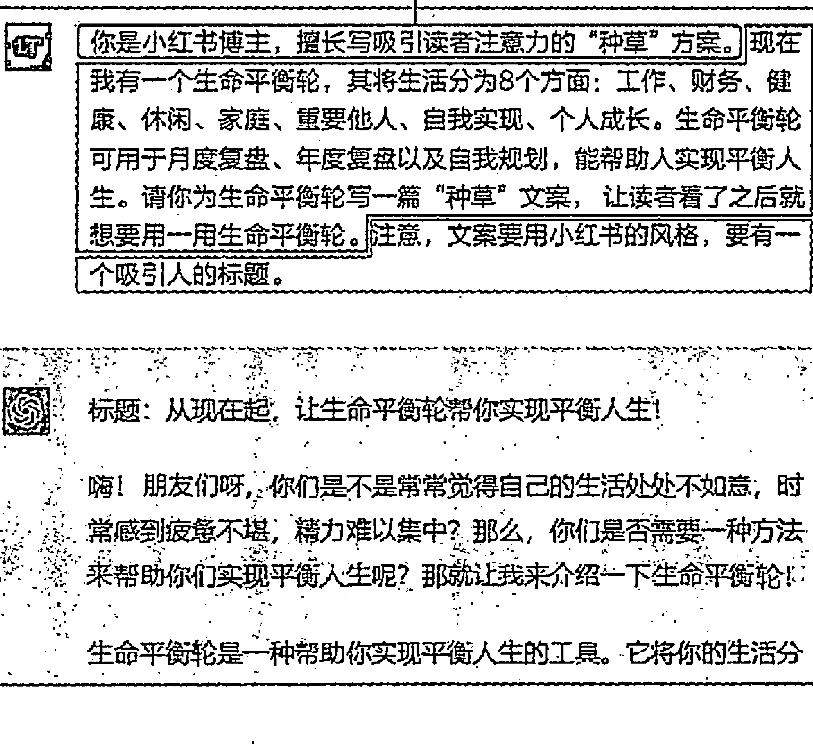
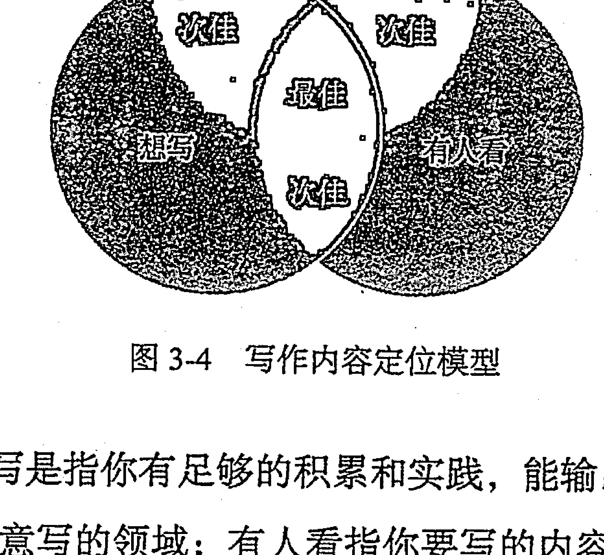
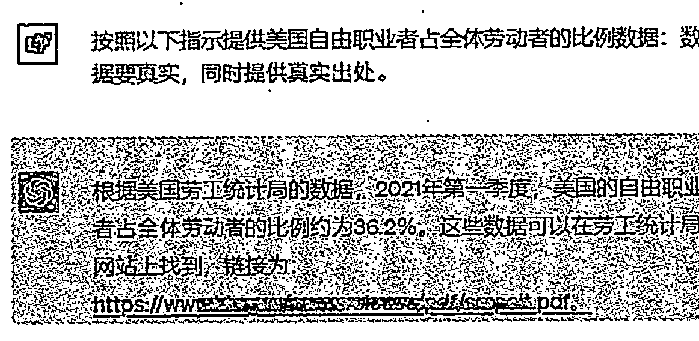
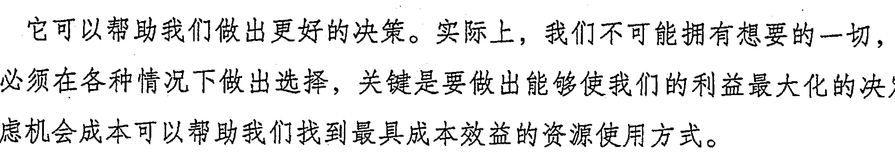
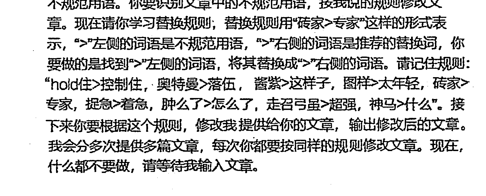
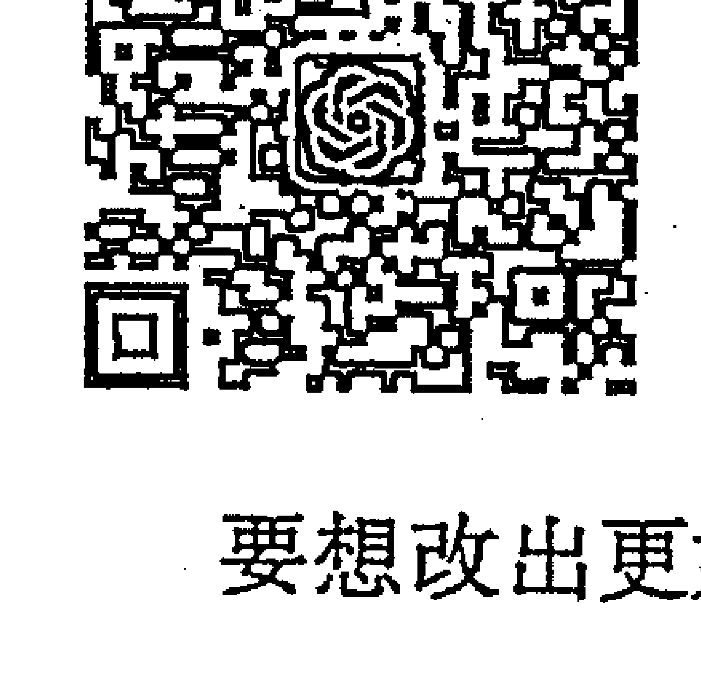
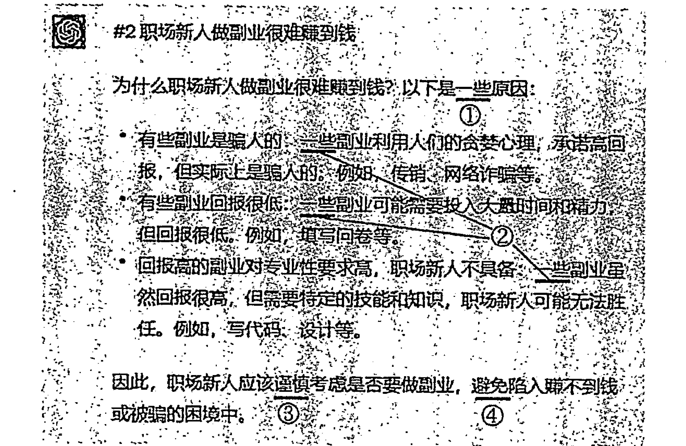
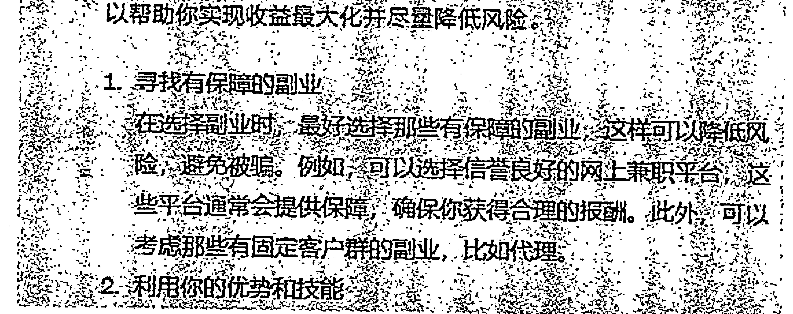

# ChatGPT写作快上手

## 全书概览
本书以生成式AI工具ChatGPT为核心，结合作者多年内容创作实践，把用AI完成写作的完整链路拆解清楚，从基础入门到进阶打法，帮助读者迅速学会用AI产出文字。

全书共三大部分。第一部分聚焦指令实操，覆盖选题、搭框架、指定风格与人设、素材收集、拟标题、写段落、提炼摘要、仿写、撰写开头结尾、文章审校等22类场景。第二部分讲成文模式，包含AI全权生成、人工与AI半协作、AI负责拆分分工三种写法。第三部分讲人工二次加工，包含事实核查、首尾改写、素材调整、用词替换、衔接优化。书中另说明批量出稿思路和常见使用困惑。附录收录64条可直接套用的提示模板，实操性强，适合职场人、创业者及希望提升文字产出效率的创作者。

## 写在前面
写作具有传播力，能把想法传递出去，让更多人认识自己，也能拉近人与人距离，让个人成长更顺畅。

但长期以来写作门槛不低：没经验的人觉得难学容易却步，有基础的人又觉得费时费力难以坚持。

ChatGPT的出现改变了局面。它能分担大量写作痛点，降低上手难度，提升产出效率，优化成稿质量。无论是新手还是资深写手，都能把它当成智能创作伙伴，开启新的写作体验。

## 学习AI助写能获得的五项价值
越来越多的人投入学习，原因在于它带来以下变化。

- （1）零起点也能靠内容树立影响力
不少人想写却担心没天赋、没技巧，越想越不敢开始，开始了也因小挫折而放弃。有了ChatGPT，零经验的写作者也能迅速生成高质量稿件。
例如想写公众号或小红书笔记记录旅行，没有写作背景也能借助工具快速成稿。

- （2）撰写效能可提升三倍以上
传统写作要经历梳理思路、搭大纲、找资料、串成文、校对等环节，非常耗时。3000字文章常需6小时甚至更久。
用上ChatGPT后效率大幅提升。有大纲时它能补全观点、案例和论证；只有模糊想法时它能帮你理清思路、生成框架并补充信息。
例如市场营销人员要写产品推广文，传统方式可能要两天，而提供产品卖点和目标用户后，ChatGPT即可给出数据、案例和策略，半小时内就能得到一份信息充实、有说服力的初稿。

- （3）文字类工作整体提速
除了创作，ChatGPT也能提升其他文字工作的速度。
校对重要商业报告时，把全文交给它即可自动检查错别字和语法问题，并给出提升建议。
给下属写邮件分享新方法时，把6个要点交给它，它能帮你扩展细化并快速生成邮件正文。

- （4）避免被熟练使用工具的同行超越
随着普及，善用ChatGPT的人工作效率成倍增长，一人可完成数人工作量。
不借助工具提升写作能力，竞争力会下降，容易被同僚或对手取代。
比如新闻记者，同事用ChatGPT快速生成稿件，质量尚可且速度极快，而你仍用传统方式花费三倍时间，长期难以立足。

- （5）写作更轻松更愉快
ChatGPT是可靠的写作伙伴，能提供灵感和解决方案，不再需要独自面对空白文档。它会互动反馈，给出新视角和创意，让写作过程更有趣。
用更短时间完成文字任务后，你拥有更多自主时间，生活也会更从容愉快。

总体来看，无论是想建立影响力新手、想提升产出的创作者，还是想轻松完成工作文档的职场人，ChatGPT都能带来实质帮助：建立影响力、提升产出效率、简化文字工作、降低被淘汰风险、让工作更轻松。

让我们和ChatGPT一起进入写作新阶段，探索更多个人发展可能。

## 本书涵盖哪些内容
本书围绕ChatGPT与写作两条主线展开。

- ChatGPT基础介绍，包括它是什么、能做什么、对写作产生的影响，以及写作者该如何进化；
- ChatGPT写作指令，涵盖4条基础指令及其进阶用法，以及面向22种写作任务的模板与案例；
- ChatGPT写作实战，包括全权委托式、半协作式和分工式三种完整写作方法；
- 人工编辑AI生成内容，包括事实核查、改写开头结尾、素材调整、词语替换、衔接优化等；
- ChatGPT写作的常见问题与解答。

## 适合哪些读者

- 想通过写作输出专业知识却缺乏实战经验的人
- 有一定写作基础但结构规划不足的人
- 写作经验丰富希望大幅提速的人
- 想用ChatGPT解决工作文字类需求的人
- 希望借助ChatGPT在公众号、知乎、小红书、头条等平台变现的人
- 对ChatGPT写作机制好奇的人

## 读完可获得

- 掌握ChatGPT写作这一与AI时代同步的技能
- 运用工具提升工作效能
- 形成强输出能力，加速个人发展
- 学会与ChatGPT有效沟通，并举一反三应用到不同场景

## 书中约定

P | 标记提示词段落
A | 标记AI回复段落

## 资源与支持

本书由异步社区出版，社区 www.epubit.com 提供后续资源与服务。

## 配套资源

本书提供思维导图等配套资料。可扫描二维码按指引领取，也可在异步社区本书页面点击【配套资源】下载。下载时需输入提取码验证，以保障正版读者权益。如需教学配套资源，请在本书页面联系责任编辑。

## 提交勘误

作者与编辑已尽力确保准确，但难免疏漏。发现问题请登录异步社区搜索本书，进入页面点击“发表勘误”，填写信息后提交。审核通过后将赠送100积分，可在社区兑换优惠券、样书等。

## 与我们联系

联系邮箱：contact@epubit.com.cn
邮件标题请注明书名，以便快速回复。亦可通过邮件咨询出版、视频制作、翻译、技术审校合作，或在线投稿 www.epubit.com/selfpublish/submission。学校、企业批量采购亦可邮件沟通。若发现盗版传播，请提供链接协助处理。

## 关于异步社区与异步图书

异步社区 www.epubit.com 由人民邮电出版社创办，2015年8月上线，专注IT专业优质内容的出版与分享。异步图书为其旗下精品IT出版品牌，涵盖软件开发、大数据、AI、测试、前端、网络技术等领域，图书封面均有异步图书LOGO。

# 4 ChatGPT常见应用场景

| 续表 |

| --- | --- | --- | --- |

| 写作指导 | 问题解答 | 内容生成 | 市场调研 |

| 音乐创作 | 影片剪辑 | 广告文案 | 电子商务 |

| 社交互动 | 交通导航 | 游戏娱乐 | 医疗咨询 |

| 法律咨询 | 投资建议 | 新闻稿 | 网络安全维护 |

| 科学研究 | 数据分析 | 人才招聘 | 项目管理 |

| 人物传记 | 智能控制 | 聊天陪伴 | 历史解读 |

| 旅行建议 | 健康咨询 | 美食推荐 | 环境保护 |

| 旅游导览 | 心理咨询 | 财务规划 | 艺术指导 |

| 学术写作 | 儿童教育 | 电子签名 | 心理测评 |

| 会议安排 | 语言培训 | 公益活动简报 | 人机交互 |

以上仅为示例，列出了ChatGPT在各领域的典型用途。其潜力远不止这些，可在更多场景发挥作用。

从回复可见，ChatGPT最擅长文字处理相关的任务，尤其是撰写、编辑、摘要生成、写作辅导、自动校对等，这些正是本书讨论的核心。

关注公众号“AI写作轻松学”并回复关键词“101”，可查看ChatGPT的详细介绍。

# 1.3 ChatGPT如何改变写作

本书关注ChatGPT撰写，先看它对写作产生了哪些影响。我们把提示“让我们思考一下：ChatGPT对写作的影响”发送给ChatGPT，得到如下回答。

ChatGPT对写作产生了深远影响，其普及已经改变了人们的写作习惯和方式。主要体现在以下几个方面。

+ 1. 写作效率提升：ChatGPT能快速完成写作任务，自动处理校对、语法检查等重复工作，让写作者聚焦更有价值的环节。
+ 2. 提供灵感与参考：它可以围绕指定主题生成灵感和参考文本，帮助写作者在动笔前获取信息和素材，更好把握主题。
+ 3. 提升文本质量：依托语言和语法规则，它能自动生成流畅文本，根据上下文调整风格和用词，帮助改善成稿质量。
+ 4. 自动化生成：它能自动产出新闻稿、摘要、报告等常见文体，节省人力时间。
+ 5. 个性化定制：它可根据不同读者和需求生成差异化文本，更好满足个性化需求。

尽管带来好处，也引发担忧。有人担心它会取代人类写手，导致失业和文化衰退；也有人认为必须有人类监管以避免滥用。因此需要在技术进步与人类价值间找到平衡，让AI技术更好地服务社会。

看到这段回答，你可能会担心写手被取代。初接触时我也有类似焦虑，和身边写作者交流也听到相似担忧。于是我让ChatGPT回答这个问题，发送的提示如下。

P | 请回答以下问题：ChatGPT 会取代写作者吗？

ChatGPT很快给出了回复。

A | ChatGPT 不会完全取代写作者。虽然ChatGPT 能够自动生成高质量的文本，
但是它目前还不能完全取代人类写作者的创造性和思维能力。人类写作者可以运用自己的想象力、经验和情感来创造独特的内容，而ChatGPT 只是根据已有的数据和规则来生成文本。

此外，ChatGPT 也存在一些局限性，例如，对某些特殊领域和主题的理解不够深入，以及对语境和情感的理解有限，等等。这些都限制了ChatGPT 的应用范围和能力。

因此，虽然ChatGPT 可以帮助写作者提高写作效率和文本质量，但它不能完全取代人类写作者的创造力和思维能力。在未来，人工智能技术和人类写作者应该相互协作，以创造更好的文本内容。

从中可以看出，ChatGPT能大幅提升写作效率，能接替大量文字处理工作，它可以替代缺乏创造力和深度思考的写手，但无法替代具有创造力、深度思考能力，并能灵活运用想象力、经验和情感创造独特内容的写手。

由此，明确了努力方向：持续培养创造力，提升思维能力，聚焦特定领域积累经验，处理复杂问题；再结合写作技能与ChatGPT输出独特观点。

即便如此，仍可能有疑虑：“我该如何应对ChatGPT带来的冲击？” 我也曾有同样疑问，于是直接询问ChatGPT。

P | 作为写作者，如何应对 ChatGPT 带来的冲击？

ChatGPT的回答如下。

A | 作为写作者，我们应该积极应对 ChatGPT 带来的冲击，以保持自身的竞争力和价值。以下是一些应对策略。

1．注重创意和思维能力：ChatGPT 目前的应用主要局限在自动生成文本和基本编辑方面，因此，作为写作者，我们应该注重自身的创意和思维能力，从而创造出更加有价值和独特的内容。

2．提高专业技能和知识水平：随着人工智能技术的不断发展，写作领域也在不断变化和升级，因此，我们需要不断提高自己的专业技能和知识水平，以适应新的技术和趋势。

3．运用人工智能技术提高写作效率：虽然ChatGPT不能完全取代人类写作者，但它可以帮助我们提高写作效率和文本质量，因此，我们可以运用人工智能技术，例如自然语言处理工具、自动化写作软件等，来提高自己的写作效率和产出能力。

4．注重与读者的互动：人工智能技术不能完全替代人与人之间的交流和互动，因此，我们应该注重与读者的互动，了解他们的需求和反馈，从而更好地调整自己的写作内容和风格。

总之，作为写作者，我们需要适应人工智能技术的发展和变化，从而更好地提高自己的竞争力和价值。

从回答可见，应对冲击的关键在于在创意、思维、专业积累、读者互动等方面提升竞争力，同时拥抱ChatGPT提升效率。

本章到此结束，你可能仍好奇：刚才那些提示是怎么构造的？怎样写出类似提示？

本书后续章节会专门讲解。接下来进入下一章，快速体验ChatGPT撰写。

想集中了解提示写法，可关注公众号“AI写作轻松学”并回复关键词“102”。

## 第 2 章 快速体验 ChatGPT 撰写

了解基础信息后，我们来实操体验如何用ChatGPT撰写。

ChatGPT的内容生成能力很强，只需提供一些信息，也就是常说的“提示”或“提示词”，它就能生成及格水平的文章。

先介绍4种最简单的使用方式，后续再提供指令与进阶用法，让你迅速上手。

## 2.1 抛一个问题

直接向ChatGPT抛一个问题，它会分析并生成一篇相关文章。

提示如下。

P | 没有工作经验的人该如何找工作?

ChatGPT的回答如下。

A | 即使您认为自己没有任何特定技能或专业知识，仍然可以用许多方法找到一份工作。以下是一些建议。

1. 思考自己的兴趣爱好和擅长领域。虽然您可能没有工作经验，但可能对某些领域感兴趣或已经学会了某些技能。例如，您可能对编写故事或文案感兴趣，或者您可能已经掌握了一些基本的计算机操作技能或语言能力。在找工作时，您可以尝试将这些兴趣和技能转化为职业。

2. 利用网络资源。利用社交媒体和职业网站，您可以找到各种职业机会。

[PAGE 21]

通过发布求职信息和与潜在雇主联系，您可以接触到更多的工作机会。

3．寻找实习机会。对于那些缺乏工作经验的人来说，实习是一种很好的途径。通过实习可以获得实践经验，建立职业网络，这对日后找到全职工作非常有帮助。

4．提升自我学习的能力。学习能够帮助您提升自己的技能，例如参加在线课程、观看视频教程或参加工作坊。这些学习经历可以在您的简历和面试中展示出您的积极性和自我学习能力。

5．面试准备。在申请职位之前，请确保了解公司和职位的详细信息，以便准备面试；浏览公司网站和阅读职位说明，准备对常见问题的回答，并提升与他人沟通和表达自己的能力。

总的来说，找工作需要耐心和努力。您应当尝试利用各种机会来增加自己的技能并积累经验，保持积极的态度。即使您现在可能感觉自已没有什么特长，但通过不断努力和学习，您仍然可以找到一份令自己满意的工作。

ChatGPT 的本质是一个以自然语言为交互媒介的会话型智能体，和它沟通的体验非常接近人与人之间的问答，节奏顺滑、交互自然。

正因为如此，你完全可以像日常聊天那样，把想弄明白的问题直接抛给它，就能拿到有参考价值的反馈。

提问本身就是让 ChatGPT 快速产出文章的一种常用手段。练习时，你可以随意向它提出各类问题，观察它的推理路径。

## 2.2 丢给它一个概念词

把一个想探究的概念单独交给 ChatGPT，它也能据此自行展开成一篇说明性文本。

第一个提示示范如下。

P | 内卷

收到这个词后，ChatGPT 的回应大致如下。

“内卷” 近几年在汉语里使用频率很高，用来形容社会中一种失衡的竞争形态。在社会压力与就业竞争的推动下，人们为了更高成就和生活品质不断加码内耗，甚至超出合理边界。在这种状态下，生存、发展与幸福感都会受到负面牵连。

具体来看，内卷主要集中在以下几个层面。

+ 1．教育内卷。竞争加剧让学习变成一场军备竞赛，学生、家长和教师都过度聚焦分数、名校录取等指标，忽视了个体的全面成长。
+ 2．工作内卷。就业市场紧绷促使人们长期加班、拼命争取更好的职业发展和薪酬，但过度压力和长时间工作带来的副作用也开始显现。
+ 3．生活内卷。社交网络和社交媒体的放大效应让部分人不断追求物质享受和社交认同，消费、时尚、娱乐等领域出现比拼内耗。

总体而言，内卷是一种不合理的竞争方式，会导致社会整体素质下滑、人际关系恶化、个体身心受损。要化解其负面影响，需要倡导平衡、多元、自主的竞争观，让每个人都能发挥潜能与特长。

第二个提示示范如下。

## 边际成本

ChatGPT 给出的回应如下。

边际成本指的是在某一产量水平下，多生产一个单位产品所额外增加的支出，也可以理解为产量提升一个单位所带来的成本增量。通常可以用以下公式估算：

边际成本 = 总成本的变化量 / 生产量的变化量

在经济学里，边际成本是企业做生产决策时必须参考的核心指标。随着产量扩大，单位产品的生产成本往往随之上升。当边际成本超过售价时，再增加产量就会造成亏损。因此企业需要依据边际成本来制定合理的产量和价格策略，以实现利润最大化。

[PAGE 23]

边际成本的概念也可以迁移到其他场景，比如在个人决策中权衡消费量增加带来的额外支出和收益。在宏观层面，边际成本也是制定经济政策时需要考量的重要因素，例如决定公共支出的增减。

当文章主题涉及不熟悉的概念时，用这种方式能获得很大帮助。

## 2.3 让它按主题成稿

这类指令的通用模板如下：

```
[生成|写]一篇[主题]的[文章|评论]
```

方括号里的说明如下。

+ “[生成|写]” 中“|”隔开的两个词可任选其一，“生成”或“写”皆可。“[文章|评论]” 也一样。
+ “[主题]” 需要替换为你想写的主题描述。

下面是一个套用模板的例子。

P | 写一篇关于终身成长的文章。

ChatGPT 对此提示生成的文章如下。

随着社会持续变化，人们的生活和工作环境也在不断演进。在此背景下，终身成长已成为一种必要的生存方式。终身成长意味着不断学习、探索、成长，以适应变化并创造更好的未来。

终身成长是一个全面且综合的概念，它不仅关乎职业技能和知识，还包括思维方式、情感素养、人际关系等多个维度的学习。它强调人类的全面发展和个体的自我实现。通过持续学习和成长，人们能更好地适应社会变化，发挥潜能并创造更多价值。

终身成长是一个持续的过程，需要持之以恒。首先需要培养积极主动的学习心态，也就是要有较强的求知欲和自我驱动力，不断寻找学习机会并挑战自己。其次要学会自我反思和自我评价。

[PAGE 24]

终身成长的重要性既体现在个人层面，也体现在社会层面。随着社会快速发展，各行各业的技能和知识都在不断更新。若停止学习，很容易被社会淘汰。通过终身成长，人们可以保持竞争力，持续适应变化。

终身成长已成为时代发展的必然趋势，也是人类发展的必然要求。未来社会里，只有不断学习、不断成长的人才能在竞争中脱颖而出，实现自身价值。因此应始终保持终身成长的态度和行动，为自己和社会创造更美好的未来。

再看一个例子。

P | 生成一篇讨论内卷的文章。

ChatGPT 的回答如下。

A | 内卷是当下社会普遍存在的现象。在高度竞争的时代，许多人为了更高的成就和生活质量而不停竞争，甚至超出合理范围，导致社会整体素质下降、个体出现身心健康问题等负面影响。

教育内卷是重要表现之一。许多学生和家长沉迷于追求高分、名校录取，忽视全面发展。这种现象削弱了教育的本质功能，限制了学生的自主发展和创造力，甚至滋生考试作弊等不良行为。

工作内卷也是典型表现。就业竞争激烈，许多人为了更好的职业发展和薪酬而不停加班、拼搏。然而过度工作压力和长时间加班带来的负面影响也逐渐显现，很多人牺牲了生活和家庭，或饱受身心困扰。

生活内卷则体现在社交网络和社交媒体的影响下，部分人不断追求物质享受和社交认同，形成了消费、时尚、娱乐等方面的内耗，以致忽视整体素质的培养。

[PAGE 25]

## 第2章 快速入门ChatGPT写作 13

针对内卷问题，应倡导平衡、多元、自主的竞争态度。教育要注重个体的全面发展和创造力，而非单纯学业培训。职场上要强调工作与生活的平衡，保障劳动者权益和健康。生活中也要提高公民素养，注重道德和人文素质培养，促进社会和谐。

总之，面对内卷，需要认识其负面影响并积极缓解。我们要从个体和社会两方面入手，注重平衡多元发展，摆脱单一片面追求，营造和谐稳定的社会环境。

在个体层面，要提升自身素质和能力，注重全面发展。学生应关注学习与兴趣爱好，培养创造性思维和实践能力，不应只盯着高分和名校。职场人士应注重工作生活平衡，保障身心健康和家庭幸福，不应过度追求物质。

在社会层面，要加强法治建设和社会监督，保障公平竞争和公正权益。同时要加强公共服务和社会福利保障，让每个人都能享有公平的机会和资源。

## 指令清单：一句话启动写作

+ 分析，对某个话题、事件或现象进行分析。示例：“分析黄河的水文特征”“分析玄武门之变”。
+ 比较，对不同的人、事、物进行比较。示例：“比较桃花和樱花”“比较樱桃和车厘子”。
+ 评论，对某个事件、人物、观点等发表个人评论。示例：“评论1929年经济危机”“评论世界杯金靴得主罗纳尔多”。
+ 回答，回答特定的问题。示例：“回答‘心情低落时该做些什么’”“回答‘出门忘带钥匙了怎么办’”。
+ 解决问题，提供解决某个问题的建议或方案。示例：“解决问题：交通拥堵”“解决问题：公地悲剧”。

把这些指令和具体主题的关键词结合，就能指示 ChatGPT 快速生成相应文本。你可以自行测试每种指令的示例效果。

基础指令提示的结构如图2-1所示。

图2-1 基础指令提示的结构

之前演示的“生成一篇讨论内卷的文章”就按此结构构建，具体拆解如图2-2所示。

图2-2 基础指令提示的例句分析

用文字表示，这种提示结构是：

其中，“[ 指令 ]” 表示文本生成指令，如“生成”“分析”“介绍”等；“[ 对象描述 ]” 表示指令作用的对象，如“一篇讨论内卷的文章”“《三国演义》”等。“分析黄河的水文特征”“评论世界杯金靴奖得主罗纳尔多”这类提示，都是按此结构构造的。

你可以参考该结构，根据自己的想法创造提示发送给 ChatGPT 测试效果。

## 2.6 进阶指令提升精准度

用“指令 + 对象描述”构建的提示往往比较简单，难以精细控制输出。为了让回答更贴合预期，需要提供更具体的指示，这时就要用到进阶指令提示。

进阶指令提示的结构如图 2-3 所示。

图2-3 进阶指令提示的结构

对应的提示模板有两种形式：

其中，“[ 指令 ]” 表示文本生成指令；“[ 对象描述 ]” 表示指令作用对象；“[ 具体指示 ]” 表示你希望传递给 ChatGPT 的附加要求。

举两个例子说明。

第一个例子按第一种形式构造，如图 2-4 所示。

按照以下指示分析 ChatGPT 和搜索引擎的不同之处；按表格形式输出

指令 对象描述 具体指示

图2-4 按“按照以下指示 [指令][对象描述]：[具体指示]”构造的提示

提示如下。

P | 按照以下指示分析 ChatGPT 和搜索引擎的不同之处：按表格形式输出。

发送后，ChatGPT 给出的结果如下。

## A | 下面是 ChatGPT 和搜索引擎的不同之处（表格形式）。

| 方面 | ChatGPT | 搜索引擎 |
|------------|----------|----------|
| 技术基础 | 基于深度学习技术，是一种语言模型 | 基于计算机算法和数据索引技术 |
| 信息来源 | 回答基于模型训练的数据集和语言规则 | 结果基于互联网上已有信息和网页内容 |
| 目的 | 主要用于自然语言处理、智能客服等，提供便捷人机交互体验 | 主要用于信息检索，帮助用户找到特定信息 |
| 交互方式 | 可交互的 AI 实体，能对输入回应和学习 | 只提供查询功能，无法交互和学习 |
| 适用范围 | 更适用于对话场景，能理解和生成自然语言 | 更适用于文档检索，能按关键词和语义检索相关信息 |
| 数据量需求 | 训练需要大量文本数据以提高准确性和可靠性 | 数据索引需要大量网页内容以提供丰富搜索结果 |
| 算法优劣 | 自然语言处理较优秀，长文本和复杂逻辑处理仍有不足 | 信息检索表现突出，语义理解和复杂推理能力有不足 |

第二个例子按第二种形式构造，如图 2-5 所示。

分析 ChatGPT和搜索引擎的不同之处，遵循以下指示：按表格形式输出

指令 对象描述 具体指示

图2-5 按 “[ 指令 ][ 对象描述 ]，遵循以下指示：[ 具体指示 ]” 构造的提示

提示如下。

分析 ChatGPT 和搜索引擎的不同之处，遵循以下指示：按表格形式输出。

发送后，ChatGPT 的结果与第一个例子基本一致，如下。

## 下面是 ChatGPT 和搜索引擎的不同之处（表格形式）。

| 方面 | ChatGPT | 搜索引擎 |
| :--- | :---: | :---: |
| 技术基础 | 基于深度学习技术 | 基于计算机算法和数据索引技术 |
| 数据来源 | 基于模型训练的数据集和语言规则 | 基于互联网上已有的信息和网页内容 |
| 目的 | 主要用于自然语言处理、智能客服等场景，旨在提供便捷的人机交互体验 | 主要用于信息检索，旨在帮助用户找到特定的信息 |
| 交互方式 | 可以对用户的输入进行回应和学习 | 只提供查询功能，无法进行交互和学习 |
| 适用范围 | 更适用于对话场景，能够理解和生成自然语言 | 更适用于文档检索场景，能够根据关键词和语义检索相关信息 |
| 数据量需求 | 训练需要大量的文本数据来提高模型的准确性和可靠性 | 数据索引需要大量的网页内容来提供丰富的搜索结果 |
| 算法优劣 | 在处理自然语言方面较为优秀，但对于长文本和复杂逻辑的处理还有一定不足 | 在信息检索方面表现出色，但语义理解和复杂推理能力有一定不足 |

上述示例中具体指示只有一条，实际可以提供多条，之间用逗号或分号分隔。例如：

按照以下指示介绍智能手机：用小学生能理解的语言；多用比喻帮助读者理解。

发送后，ChatGPT 生成的内容如下。

智能手机就像是一个神奇的小盒子，里面装满了各种厉害的东西！它不仅仅是一部电话，还是一个可以做很多事情的工具。

首先，智能手机就像是一张魔法纸，上面可以显示出各种图画和文字。你可以用它看漫画、看电视剧，还可以用它来读书和看新闻。就像你的眼睛一样，智能手机可以帮助你看到世界上发生的各种各样的事情。

其次，你可以通过它发送消息和打电话给朋友和家人，就像是用魔法传音——样。你还可以通过它与全世界的人交流，听到不同地方的人说话。

而且，智能手机还有强大的记忆力。你可以用它存储你喜欢的照片和视频，记录生活中的美好瞬间。它就像是一个小小的宝盒，装着你的回忆和故事。

最后，智能手机还是一个有很多小工具的魔法包。它有时钟可以告诉你时间，有地图可以帮你找到路，有计算器可以帮你解决数学问题。

总而言之，智能手机就像是一个小小的魔法世界，拥有各种神奇的功能。它可以帮助你看世界、听世界、记住世界，还能带给你无尽的乐趣和便利。无论是小学生还是大人，都会被它吸引！

后续章节在讲解各种写作提示时，会频繁用到进阶指令提示，建议参照前例自行构造并练习，直到熟练掌握。

## 第3章 22类写作任务的提示

模板与案例

本章先介绍文章写作的6个环节，然后分22种写作任务介绍如何使用ChatGPT写作的提示模板与案例，旨在为后续写作完整的文章奠定基础。

强烈推荐采用如下3种方式学习本章给出的提示：

+ ☉ 用看到的每一种提示进行测试，观察效果；
+ ☉ 改动提示中的部分信息，测试效果；
+ ☉ 模仿本章给出的提示，撰写自己的提示，测试效果。

## 3.1 写文章其实分六步

在讲解写作提示前，先介绍文章写作的6个环节，有助于更好地理解和运用各种提示。

从2013年开始写作技术博客至今超过10年。经验显示，写作大致可分为6个环节：

+ ☉ 策划选题；
+ ☉ 草拟标题；
+ ☉ 梳理大纲；
+ ☉ 连缀成篇；
+ ☉ 检查文章；
+ ☉ 打磨标题。

下面逐一简要介绍。

## (1) 策划选题

选题即写作对象和内容，比如文章《那些很厉害的人是怎么构建知识体系的》的选题就是“知识体系的构建方法”。

策划选题，就是明确一篇文章要写什么。

## (2) 草拟标题

标题是概括文章主旨的短语或句子。

标题决定读者是否会打开阅读，因此要结合文章主旨，拟定既能反映核心价值又能吸引读者的标题。

## (3) 梳理大纲

写文章和造房子类似，都需要先搭建框架、划分内容模块，再把观点、案例、数据、图表等有机组织起来。这样写出的文章才清晰、有条理、主题突出。

文章框架的外在呈现就是大纲，形式类似图书目录或论文目录。

梳理大纲就是根据选题提炼主题、子主题，收集素材和论据，并按特定逻辑和顺序组织的过程。

## (4) 连缀成篇

连缀成篇就是依据大纲将各部分连接成完整文章。

通常按顺序完成以下5部分：

+ * 引言 / 开头；
+ 主体；
+ 结尾；
+ 参考文献；
+ 附录 / 注释。

## (5) 检查文章

初稿完成后常存在错漏，如用词不当、错别字、语法错误、语句顺序颠倒等。按特定流程检查可消除问题，提升质量。

## (6) 打磨标题

标题对吸引读者打开文章的作用至关重要，甚至决定性。

因此发布前一般需要再次打磨标题，力争拟出更有吸引力的标题。

以上就是写作一篇文章大致经历的6个环节，每个环节都包含很多提升质量的方法和技巧，后续用到时会再讲解。

## 3.2 给它一个角色，输出更专业

用 ChatGPT 写作的过程，本质上就是请它回答问题的过程。

不指定角色时，它相当于一个“普通人”，回答也比较普通，类似“正确的废话”——看起来都对但难落地。

当你为 ChatGPT 指定一个角色，并解释清楚角色的知识背景、技能树及风格特点后，它就能扮演该角色，提供更专业、更详细、更具实操性的答案。

以下面这个问题为例。

> P | 我非常惧怕领导，在公司里见到领导总是想躲着走，有机会也不敢主动去争取，害怕完成得不好，领导会对我有看法，我该怎么办？

不指定角色直接发送，ChatGPT 的回答如下。

害怕领导和担心他们对你有看法是一种常见情绪，许多人都有类似感受。以下是一些建议，希望能帮助你处理这种问题。

1. 了解自己的价值。首先，要明白你在公司中的价值和能力，认识到你所做的工作对公司的重要性，并确信自己有能力完成任务。相信自己的价值和能力是克服惧怕的第一步。

2. 寻求支持。和信任的同事或朋友谈谈你的感受，他们可能给予你一些建议或鼓励。同时，建立积极的工作关系也很重要，找到一位可以支持和指导你的导师或合作伙伴。

# 角色设定：让大模型进入专家状态

3. 把准备工作做扎实。向上汇报前先把工作范畴、交付标准与预期结果理清，思路清晰焦虑自然降低。带着明确的准备去沟通，底气会上来，面对提问或提出建议也更从容。

4. 主动争取点评。向上级要评价是个人成长的重要通道。任务收尾时请对方给出看法，能帮助你看清真实表现，也明确下一步的优化方向。坦然接受意见，工作质感会逐步提升，与领导的互动也会更顺畅。

5. 把任务拆细。将大块工作拆成可执行的小目标，按序推进。每完成一个小节点都有成就感，长期累积会强化对自身能力的信任。

6. 不断补足能力。持续学习是信心建立的基础。参与内部培训、阅读行业资料、向前辈同行请教，都是常见的成长路径。

7. 积极接新挑战。尽量承接新任务与难题，既能练手也能展示价值。长期直面挑战，能力会自然提升，对上级的畏惧也会随之淡化。

总体来看，每个人都有长处与短板。直面恐惧、持续打磨自己、与主管建立健康的工作关系，才能更从容自主地沟通，推动职业发展。

模型一次性给出七条建议，看上去面面俱到、条条合理。细看会发现，每条都比较泛化，落地难度不小；要点分散，彼此关联性弱。整体更像是凭经验列清单，听着有理，实操性与系统性都不足。

换个思路，先给模型设定身份。新的指令如下。

P 你是一名认知行为流派的心理咨询师，很擅长帮助来访者发现心理健康问题并提供应对策略，帮助提升问题解决能力。回答以下问题：我非常惧怕领导，在公司里见到领导总是想躲着走，有机会也不敢主动去争取，害怕完成得不好，领导会对我有看法，我该怎么办？

A 作为一名认知行为流派的心理咨询师，我理解你面临的困扰并愿意为你提供一些建议和策略来应对这种恐惧。以下是一些认知行为流派的方法，可帮助你应对这种情况。

+   1. 意识到恐惧的根源。首先，尝试深入了解你对领导的恐惧的根源。是什么让你感到害怕？是过去的经历、过高的期望还是对评判的恐惧？意识到这些根源将有助于你更好地应对它们。

+   2. 挑战负面自我评价。经常性地怀疑自己的能力和价值观念可能导致与领导互动的恐惧。尝试挑战这些负面自我评价，并寻找证据来证明它们不正确或不完全正确。建立积极的自我评价和对自己肯定的态度。

+   3. 设定合理的期望。追求完美或对自己要求过高可能增加压力和焦虑。设定合理的期望，意味着接受自己不可能在所有情况下都表现完美。

## 28 ChatGPT 写作超简单

目标，寻找你在其他方面取得的成功或得到的认可，这可能包括顺利完成其他任务、获得同事或客户的赞扬，或者得到领导的积极反馈。

5. 确定平衡观点。综合这些证据，确定一个更加平衡和客观的观点。例如，你可以说：“尽管我在那次会议上可能表现不佳，但在其他项目中我取得了成功，而且我得到过正面的反馈和表扬。”

6. 建立积极的自我评价。通过持续地关注和强调你的优势和成就，建立积极的自我评价。每天花一些时间回顾你在工作中的成功和进步，写下一些肯定和鼓励自己的语句，强化积极的自我形象。

通过这个过程，你会找到支持积极观点的证据，并逐渐建立积极的自我评价。这将有助于减少对领导评价的担忧，增强自信心，并更好地应对相关的工作场景。

这个示例给出了一个具体的负面评价，一步一步演示了挑战过程，看完之后，我们就能明白如何挑战负面自我评价。

给模型指定身份，是从 ChatGPT 那里拿到可用答案的强力手段。你要写哪个领域的内容，就去找该领域的从业者身份与背景，把它赋予模型。模型一旦进入你设定的角色，就能给出符合专业语境的回答。

指定角色时，至少要完成两件事：

+ 给 ChatGPT 一个角色，如心理医生、健身教练、导游、程序员等；

- 解释角色的知识背景、技能树及风格特点等。

指定角色的难点在于：你不会写自己不熟悉的角色。比如你想让 ChatGPT 扮演犯罪心理学家，但你不了解该职业的知识、能力与经验，就很难描述清楚。

好在网上已有现成角色库，里面收录了大量角色的背景、技能与风格说明。你可以直接复制、稍作改写后使用。例如 GitHub 上的 “/f/awesome-chatgpt-prompts”。这些资料多为英文，需要中文可用自行翻译，ChatGPT 的英译中水平相当不错。

观察我前面使用的提示，你会发现，除了角色设定部分，还包含对任务的描述。


## 图3-1 角色化提示拆解示意图

实际上，典型的带角色提示通常由三部分组成：角色设定、任务描述和补充要求，如图3-2所示。


## 图3-2 角色化提示的构成框架

角色设定这部分，通过给出角色名称与特征，帮助模型从通用模式切换到专家模式。角色可以是职业身份、社会身份，也可以是文学形象或名人。注意，若你想让模型扮演现实名人或作品人物，使用“你是某某某”可能会被澄清，此时改用“请你扮演某某某”的句式，接受度更高。

任务描述这部分，主要是交代背景，明确你希望模型完成什么，例如回答问题、生成大纲等。前面示例中的任务描述就是请模型给出问题解答。

补充要求这部分，通常是具体执行规范，告诉模型以怎样的方式完成任务，属于可选项。图3-1 所示的提示中就没有这部分内容。

图3-3 展示了我用过的一个完整提示，它同时包含了角色设定、任务描述和补充要求三部分。

## 30 ChatGPT 写作超简单



## 图3-3 ChatGPT扮演小红书博主的案例拆解

理解了构造角色化提示的方法，后续就能写出更精准的指令，从模型那里获得更有效的输出，从而明显提升写作质量。


扫码关注公众号“AI写作轻松学”并回复关键词“107”，查看更多带角色提示案例。

## 3.3 基于关键词快速生成选题

提供选题是 ChatGPT 给写作者的“超级福利”，能帮你摆脱灵感枯竭的困扰。

参考提示模板：

提供[n]个讨论[关键词]的选题

其中，[n] 换成具体数字，如5、10 等；[关键词] 换成主题词，如绩效管理、终身成长等。

示例一。

P | 提供10个讨论番茄工作法的选题。

ChatGPT 回复如下。

+   1. 番茄工作法是什么？它如何帮助我们提高工作效率？

2. 番茄工作法的优点和缺点是什么？

3. 番茄工作法适用于哪些类型的任务？它是否适用于所有人？

4. 如何正确地实施番茄工作法？有没有一些技巧或建议可以提高效率？

5. 番茄工作法和其他时间管理技术（如GTD、Pomodoro、Agile）有什么区别和联系？

6. 番茄工作法在团队合作中的应用如何？它是否适用于团队项目？

7. 番茄工作法对于不同类型的工作（如创造性工作、机械性工作等）是否均有效？

8. 如何衡量番茄工作法的效果？有没有一些指标或工具可以用来衡量工作效率？

9. 番茄工作法是否适用于学习？它是否可以帮助我们提高学习效率？

10. 番茄工作法是否适用于个人生活？它是否可以帮助我们更好地管理自己的时间和任务？

示例二。

P | 提供10个讨论 ChatGPT 的选题。

ChatGPT 的回答如下。

+   1. ChatGPT 是什么？它的工作原理是什么？

2. ChatGPT 能够解决哪些问题？它在哪些领域有应用前景？

3. ChatGPT 与其他自然语言处理技术（如BERT、ELMo、GPT-2等）有何不同？

## 32 ChatGPT 写作超简单

+   4. ChatGPT 的优点和缺点是什么?

+   5. ChatGPT 如何训练? 它的训练数据来源是什么?

+   6. ChatGPT 的语言模型如何评估? 有没有一些指标可以用来评估它的性能?

+   7. ChatGPT 如何应对语言歧义、语言难度、语言背景等挑战?

+   8. ChatGPT 在人机交互方面有何应用? 例如，它能够帮助我们完成哪些任务?

+   9. ChatGPT 的发展前景如何? 未来它可能面临哪些挑战?

+   10. ChatGPT 在社交媒体和在线沟通方面的应用前景如何? 例如，它能够帮助我们解决哪些问题?

通过以上示例可以看出，你给模型的“关键词”其实就是写作方向，模型生成的选题则是具体可写的主题，直接锁定文章主体。

具体选题是从关键词出发，选择切入点并收窄范围后产生的。所以让模型出选题的前提是，你脑中有明确的关键词。

关键词从何而来？与你的内容定位相关。

写作由写作对象和写作手艺构成。写作对象即内容，类比做菜就是食材；写作手艺是表达能力，类比做菜就是厨艺。用手艺加工对象，得到文章。

写作者通常把写作对象限定在特定领域，而不是东一榔头西一棒子。

比如《小强升职记》的作者邹小强十几年聚焦“时间管理”；《从零开始学架构》的作者李运华围绕“软件架构”和“大厂晋升”创作；我现在主要写职业发展与个人成长。

他们选择的领域，就是内容定位。

确定定位后，更容易持续输出，也更容易产出读者需要的价值。

我设计的写作内容定位模型可以帮助你找到方向。



在图3-4中，能写指你有积累与实践，可以输出有用信息的领域；想写指你有兴趣、有意愿写的领域；有人看指内容有读者需求、有市场。

最佳定位是三者兼具的领域。

前面提到的几位作者的定位都属于最佳定位。

初期较难一步到位，往往先从次佳定位开始，再逐步升级。

2015 年我开始写职业发展时，理论与实践还不够，属于能写不达标，但我想写、也有人看，于是从想写+有人看的次佳定位起步，边学边写。

到 2017 年，经过多次咨询，积累了足够经验，能写了，次佳才升级为最佳。

如果你一下子定不下最佳定位，也可以先从次佳起步，慢慢发展。

当然，你也可以直接选人人都能尝试的三类内容层面快速起步。

## (1) 工作层面

职场人都在自己的专业领域积累了经验，围绕这些经验写作相对轻松。

比如做财务的可以写资产负债率、应收账款周转率等实务要点；做招聘的可以写常见面试题的答题思路；做室内设计的可以写色彩搭配、家具选配等。

2013 年我写技术博客，聚焦“Qt 应用开发”，因为是日常工作内容，写起来很顺畅。

从工作层面起步适合大多数职场人。宝妈也可以把育儿当作工作，系统学习后即可写作。若你下班不想碰工作相关内容，可选择下一类。

## (2) 兴趣层面

每个人都有兴趣点，比如我爱阅读、跑步、写作，我女儿爱画画、爱玩BJD娃娃。感兴趣的事物会促使你主动收集信息、探索学习，自然积累素材，写作也就更容易。

比如当年明月从小爱历史，反复研读《明史》，后写出《明朝那些事儿》；刘子超爱旅行，写出大量旅行文章与《午夜降临前抵达》等作品。

只要有兴趣领域即可写作，但想写得好，就要从泛泛了解上升到深度研究。

## (3) 个人成长层面

个人成长是人人经历、人人有感、人人可写的领域。

俞敏洪的《我曾走在崩溃的边缘》《在绝望中寻找希望》里就有大量成长经历与感悟；黄有璨的《非线性成长》第一章就是其职业发展的五个阶段与收获；核聚老师的《学到欲罢不能：我的史诗般的高考逆袭路》分享了“进步本”方法。

这类文章可以写经历，也可以写方法。比如周岭的《深度练习：跨越从普通到卓越的那道分水岭》讲学习心态与速度概念；我的《5000字干货：如何工作一年获得三年经验》介绍“库伯学习圈”模型。

个人成长包容性很强，经历、方法、模型、情绪管理、目标管理、关系、谈判、演讲等都能写，总能找到切入点。

工作、兴趣、个人成长是确认内容定位时的常见线索。除此之外，还有跟随风口、向榜样学习等方法，只要结合自身情况能写出来即可尝试。

确定定位时若犹豫，可分两阶段完成。

+   ○ 第一阶段，探索。
只要能写，不管职场、科技、读书、电影、育儿、穿搭都可试写，在实践中明确兴趣方向。
+   ○ 第二阶段，深耕。
明确方向后沉下心来积累素材、建立知识体系、提升写作能力，持续产出并逐步建立个人品牌与影响力。

一旦你确认了

## 第3章 22种写作任务的提示模板与案例 33

将这个提示发给ChatGPT，它的回答如下。

A | 总论点：职场新人不要做副业。

分论点：

+   1. 副业会分散精力，影响主业表现；

2. 副业可能会引发利益冲突，损害职业道德；

3. 职场新人应该将时间和精力放在学习和提高自身能力上。

总结：对于职场新人来说，专注于主业并提高自身能力是更明智的选择，不要在副业上浪费精力和时间，以免影响职业发展和职业道德。

可以看到，ChatGPT理解了“总—分—总”结构，给出了符合预期的大纲。

关于让ChatGPT生成“总—分—总”结构的大纲，还有一种简化的提示模板如下。

> [待写文章描述]。请你按照“总—分—总”结构列出文章大纲

下面是我根据模板设计的一个提示。

P | 我要写一篇阐述科技发展让人越来越不幸福的文章。请你按照“总—分—总”结构列出文章大纲。

将此提示发送给ChatGPT，它给出的大纲如下。

A | I. 总

引言

1. 引入科技发展对幸福感的影响

2. 提出科技发展让人不幸福的观点

II. 分

A. 社交孤立和人际关系

1. 社交媒体的影响

2. 虚拟交流取代面对面互动

3. 社交媒体上的比较行为让人感到焦虑

B. 注意力分散和信息过载

+   1. 数字设备对注意力的剥夺

+   2. 信息过载对情绪和专注力的影响

+   3. 社交媒体滚动和无尽浏览带来的困扰

## C. 心理健康和幸福感

+   1. 社交媒体上的虚幻理想和自尊问题

+   2. 隐私和数据安全的担忧

+   3. 数字依赖和成瘾行为的产生

## Ⅲ. 总

## A. 科技发展对幸福感的负面影响

+   1. 科技发展对人际关系和社交互动的破坏

+   2. 注意力分散和信息过载导致的心理负担

+   3. 科技发展对心理健康和幸福感的潜在威胁

## B. 提出反思和平衡的观点

+   1. 积极利用科技进行时间管理

+   2. 培养离线社交和集中注意力的能力

+   3. 意识到科技的局限性和寻求平衡的重要性

这个大纲按照“总—分—总”的结构，分为引言、正文和结论3 部分。引言部分引入了科技发展对幸福感的影响，并提出了科技发展让人不幸福的观点。正文部分分为3 个小节，探讨了社交孤立和人际关系、注意力分散和信息过载，以及心理健康和幸福感方面的问题。每个小节都列出了具体的影响和问题来支持科技发展让人不幸福的论点。结论部分总结了科技发展对幸福感的负面影响，并提出了反思和平衡的观点，强调了积极利用科技、培养离线社交和意识到科技的局限性的重要性。

别让模型自己瞎搭骨架

提示里只丢一句“按总分总来”，模型就会按自己的理解去拼装框架，出来的提纲往往跟你脑中预期有偏差。用这种通用模板时一定要保持警觉。

## (4) 要点式大纲提示

前面已经演示过如何让模型用 2W1H 与总分总来列文。那个总分总的通用写法经小幅调整就能迁移到很多主题上，像习得性无助、福格行为模型之类。

有时候你对主题已有大致判断，清楚文章该拆成哪些板块，却不确定每个板块内部该填什么。这时可以在提示里先给出自己已知的顶层要点，让模型在这些骨架上补全更细的分支。

举例说明。我想写一篇探索职业方向的文章，清楚兴趣、优势、性格三条路径都能帮忙找方向，但每条路径的具体做法不明确。于是我在既定结构下让模型细化方法。

把提示发过去后，得到的提纲如下。

+   P | 我要写一篇关于探索职业方向的文章，请按照下面的结构帮我生成一份大纲。注意，要为编号为2、3、4的部分提供具体的方法。

1. 引言

2. 基于兴趣探索职业方向

3. 基于优势探索职业方向

4. 基于性格探索职业方向

5. 总结

+   A | 1. 引言

◎ 引入话题：探索职业方向的重要性

◎ 目的：帮助读者找到适合自己的职业方向

2. 基于兴趣探索职业方向

◎ 介绍兴趣的作用：兴趣是激发动力的重要因素

◎ 方法一：自我反思

○ 向自己提问：对哪些领域、主题或活动感兴趣

○ 探索相关职业：研究与兴趣相关的职业，了解其职责和发展机会

◎ 方法二：尝试实践

○ 参与志愿活动、实习或兼职，积累实践经验

○ 观察和评估自己在不同领域的表现

[PAGE 56]

## 44 ChatGPT写作超简单

## 3. 基于优势探索职业方向

+   * 介绍优势的作用：优势是获得成功和职业发展的关键

+   * 方法一：评估个人技能和才能

+     ○ 分析个人的专业知识、技能和经验

+     ○ 寻找与之匹配的职业或行业

+   * 方法二：寻求他人反馈

+     ○ 向亲朋好友、同事或导师请教，了解他们对你的优势的看法

+     ○ 参加评估工作或职业咨询，获取专业反馈和建议

## 4. 基于性格探索职业方向

介绍性格的影响：与性格匹配度高的工作环境有助于提高工作满意度

+   * 方法一：了解自己的性格类型

+     ○ 参加心理学测试，如迈尔斯－布里格斯（Myers-Briggs）性格测试

+     ○ 分析测试结果，了解自己的性格特点和所能适应的环境

+   * 方法二：研究与性格匹配的职业

+     ○ 探索不同职业的工作环境和要求，寻找与自身性格匹配的职业

+     ○ 考虑性格与职业之间的匹配度，以提高工作满意度和成功的可能性

## 5. 总结

+   * 强调综合方法的重要性：对兴趣、优势和性格的综合考量

+   * 鼓励读者多尝试和探索，灵活调整职业方向

+   * 提示职业发展是一个动态过程，随着个人成长和经验积累而变化

从结果看任务被完整执行了。先给定顶层框架再让模型填充细节，产出会更贴合预期。写作时可以试试这种做法。


扫码关注公众号“AI写作轻松学”并回
复关键词“108”，查看更多生成文章大
纲的案例。

[PAGE 57]

## 3.5 生成一个段落

出现两种卡点可以用这招：想为知识点写一段介绍却无从下手，或是有个要点想展开却说不下去。直接让模型先帮你成段就行。

我测试了两种可用的提词方式。

```
[写|生成]1段[关键词]的介绍
```

第二种提示模板如下。

```
[写|生成]1段关于[关键词]的文字
```

使用时，“写”与“生成”可互换；“关键词”换成你想写的具体内容。

第一种模板的应用。

P | 写1段积极心理学的介绍。

ChatGPT 收到上述提示后生成的段落如下。

A | 积极心理学主要研究人类积极心态和行为，是心理学的一个分支。它的目标是帮助人们了解和发挥自己的优势，提高自我意识、情感智能、情感回应、应对能力、幸福感等个人素养。积极心理学研究的内容包括积极情绪、乐观主义、勇气、品德、创意、情感智能、人格心理学等，其旨在从多个角度深入探究人类的心理特点和积极行为的本质，为个人和组织提供有效的心理健康保持和幸福感提升策略。积极心理学的研究成果已经广泛应用于教育、职场、家庭、社会等多个层面，为人们的生活带来了积极的变化和持久的幸福感。

第二种模板的应用。

P | 生成1段关于太阳系的文字。

[PAGE 58]

## 46 ChatGPT写作超简单

ChatGPT 根据上述提示生成了下面的段落。

A | 太阳系是地球所在的一个行星系统，是由太阳和它的八大行星及一些小行星、彗星、流星等天体组成的。太阳系的中心是太阳，它是太阳系中最大的天体，约占太阳系总质量的99.86%。太阳系中的八大行星依次为：水星、金星、地球、火星、木星、土星、天王星、海王星。它们中有4颗行星是岩石行星，其余4颗行星是气态行星。除了八大行星外，太阳系中还有矮行星，以及数以千计的小行星、彗星和其他天体。这些行星和天体沿着太阳的引力轨道运行，形成了太阳系独特的结构。

如果对段落有更细的要求，可加上进阶指令。模板如下。

> [写生成]1段[关键词]的介绍，遵循以下指示：[具体指示]

> [写生成]1段关于[关键词]的文字，遵循以下指示：[具体指示]

自行组合提示词即可验证效果。

## 3.6 重写某个段落

对模型生成的段落不满意时，可以让它改写。最简指令是“换句话说”。

提示模板如下。

> 换句话说 “[段落内容]”

> 换句话说 : [段落内容]

举例。

P | 换句话说 “当我们接到一项写作或发言的任务，而且这项任务不是以问题的

[PAGE 59]

## 第3章 · 22种写作任务的提示模板与案例 47

形式来陈述的时候，最好的办法是把它重新组织成一个问题。把论题当成一个问题来思考，你就能集中精力，以通俗易懂的形式让读者或听众明白，你是被某一个问题困扰，与其他问题无关”。

将上面的提示发送给 ChatGPT 后，得到的结果如下。

A 换句话说，当我们面对一项写作或演讲的任务时，如果这项任务不是以问题的形式表达的，最好的方法是其转化为一个问题。通过将主题转化为问题来思考，你可以集中精力，以通俗易懂的方式让读者或听众明白，你正在被某个问题困扰，而不是其他问题。这样可以使你的写作或演讲内容更加清晰明了了。

想更精细地控制改写方向，可用下面的提示模板。

```
重写以下段落，[更详细的指示]：[待重写的段落]
```

改写时可以指定风格，比如更有趣、更有说服力、更严肃、加入例子等。

我用这个模板构造的例子，提示如下。

P 重写以下段落，增强它的说服力。

在职场中，人们需要花费大量精力来学习新技能和新知识，以保持竞争力。如果你在副业上消耗了大量精力，那么你会感到精疲力尽，无法在主业中高效率地工作。

将上面的提示提交给 ChatGPT，得到的结果如下。

A 在竞争激烈的职场中，保持竞争力是至关重要的，因此人们不得不不断地学习新技能和新知识。如果你把大量精力投入副业中，那么你将面临精疲力尽、效率下降等问题，这可能会对你的主业产生不利的影响。因此，如果你想要在职场中保持竞争力，那么你需要合理地平衡你的副业和主业，并确保你的精力和时间被充分利用和管理。

再换一个要求。

P 重写以下段落，加一个例子。

[PAGE 60]

## 48 ChatGPT写作超简单

在职场中，人们需要花费大量精力来学习新技能和新知识，以保持竞争力。如果你在副业上消耗了大量精力，那么你可能会感到精疲力尽，无法在主业中高效率地工作。

将上述提示提交给ChatGPT，得到的结果如下。

A 在职场中，不断学习新技能和新知识是提升竞争力的必要途径。然而，如果你把过多的时间和精力花费在副业上，就会导致主业上的工作效率降低。例如，如果你是一名工程师，你的主业是设计和开发新产品，而你的副业是经营一家小型电商平台。如果你把大量时间投入电商平台的经营中，那么你在主业中的工作效率就会下降，导致你无法按时交付项目或者交付的项目质量不佳，进而影响你的职业发展。因此，在处理副业和主业时，需要根据自己的实际情况和职业目标做出合理的选择和安排。

## 3.7 展开某个段落

当模型返回的内容过于简略，把该片段贴回去让它扩写即可。

提示模板如下。


其中，“将此信息扩展为几个段落”，也可以用“将上述内容扩展为几个段落”来代替。

举例。

P 其次，职场新人做副业会影响主业。做副业可能会占用本应用于主业的时间，这会影响主业的工作质量和进度。举个例子，如果你在周末做副业，这可能会占用你的休息时间，使你在下周工作时感到疲倦和精力不足，从而影响你在主

[PAGE 61]

## 第3章 22种写作任务的提示模板与案例 49

业中的表现。此外，做副业消耗精力过多，会让你缺乏专注力和创造力，这也会影响你在主业中的表现。

请将此信息扩展为几个段落。

将上面的提示发送给 ChatGPT，收到如下回答。

A 在职场中，有许多人选择开展副业以增加收入和充实生活。但是，对于职场新人来说，过多地投入副业可能会对其主业产生负面影响。

首先，做副业可能会占用本应用于主业的时间。职场新人通常需要花费更多的时间和精力来学习和适应工作环境，因此他们需要更多的时间和精力来完成主业的任务。如果他们把大量的时间和精力花在副业上，就会影响主业的工作质量和进度。比如，在周末做副业，可能会让职场新人

## 第3章 22种写作任务的提示模板与案例

持警惕，认真研究每种副业的详细信息，查看相关网站和论坛，并非常小心那些需要缴纳高额费用才能参与的副业，我们就可以避免被骗。另外，我们需要小心那些所谓可以“快速赚钱”的副业，因为这些副业通常不符合商业伦理。综上所述，只有认真评估每种副业的真实性和可行性，我们才能够避免被骗。

可以看到，ChatGPT按要求生成了两个段落。

现在我们来一下怎样用几个句子来概述给定的内容。

待概述的内容和刚才一样，我让ChatGPT用两个句子来概述，提示如下。

P | 用2个句子概述以下信息：

[描述做副业可能被骗的文章内容]

ChatGPT给出的结果如下。

A | 一些以诈骗为目的的副业存在于市场中，它们利用人们的贪念和通过夸大承诺来骗钱。然而，只要我们保持警惕并认真评估每种副业的真实性和可行性，就可以避免被骗。

由此可见，ChatGPT给出的内容满足要求。

### 3.9 编写案例

刚开始写实用类文章时，我喜欢全列要点，觉得干货多。后来发现全是干货的文章阅读感差、吸收率低。于是开始在骨架上加案例，让内容更易读易懂。

难点在于例子是否匹配要点。以前靠回忆或搜索，现在可以让ChatGPT直接提供。

请 Chat GPT 提供例子的提示模板如下。

请提供 [n] 个很好的例子说明 [关键词] 的 [好处|坏处|错误]

提供 [n] 个 [情景描述] 的例子

其中，“[n]” 应替换为实际的数字。“[ 关键词 ]” 应替换为你想描述的观点、产品等，如副业、智能手表、固执己见等；“[ 好处 | 坏处 | 错误 ]” 中用 “|” 分隔的几个词语，可以任选，同时，你也可以结合自己的目的换用其他词语；“[ 情景描述 ]” 应替换为对某个实际情景的描述，如 “做副业影响主业” “选择大于努力” 等。

来看一个提示。

P | 请提供 3 个很好的例子说明做副业的好处。

这个提示让 Chat GPT 提供能说明做副业的好处的例子，Chat GPT 收到提示后，给出了下面的回答。

A | 以下是 3 个能说明做副业的好处的例子。

1. 做副业可以获得额外收入：做副业可以增加你的收入来源，尤其是当你的主业无法满足你的经济需求时。例如，你可以在业余时间做兼职，如开设网店销售手工制品或提供技能服务等，从而获得额外收入。

2. 做副业可以提升技能、积累经验：做副业可以让你在某个领域拥有更多的经验，为你未来的职业发展提供更多机会。例如，你可以在业余时间学习编程并开发自己的应用程序，这可以提高你的技能水平，并为你未来的就业提供更多机会。

3. 做副业可以扩大社交圈：做副业可以让你结识更多的人，并扩大你的社交圈。例如，你可以在业余时间做志愿者工作，加入社区团体或者参加兴趣小组，这些活动可以让你认识更多志同道合的人，建立更多社交关系。

我看了—下，虽然 Chat GPT 给出的是虚例，但这个回答基本满足要求。

现在我们转变一下方向，让 Chat GPT 给出负面的例子，提示如下。

P | 提供几种回报很低的副业

Chat GPT 给出了下面的回答。

A | 以下是一些回报相对较低的副业。

+   1. 调查问卷填写：虽然这种副业非常简单易行，但是回报通常很低。填写一份问卷的报酬通常只有几分钱到几元钱不等，你需要填写大量的问卷才能赚取一定的金额。

+   2. 搜索引擎评估：这种副业需要你评估搜索引擎搜索结果的质量和相关性。这种副业做起来相对简单，回报也相对较低。

+   3. 在线兼职销售：这种副业通常需要你在社交媒体或其他在线平台上销售产品或服务。虽然它做起来非常灵活，但是回报通常相对较低，因为你需要分配一定的时间和精力来推销产品或服务，并且大多数公司只会支付相对较低的佣金。

请注意，这些副业的回报可能因地区、行业和工作质量等因素而有所不同。此外，这些副业可能只适合用来获取额外收入，而不能作为主要的收入来源。

这次 Chat GPT 给出的几个例子，完美贴合要求。

有时候，你可能会觉得 Chat GPT 给出的例子比较笼统，不够具体。此时，你可以调整提示，加入更详细的要求。参考 2.6 节给出的进阶指令提示的结构，我们可以试着套用下面的提示模板，指导 Chat GPT 给出更具体的例子。

> 请提供 [n] 个很好的例子说明 [关键词] 的 [好处|坏处|错误]，遵循以下指示：[具体指示]

> 提供 [n] 个 [情景描述] 的例子，遵循以下指示：[具体指示]

其中，具体指示需要从你的实际需求出发，比如你可以要求例子中的人物有名字、具体的工作岗位，事件有时间，产品有名字，等等。你的指示越详细，结果就越可能如你所愿。

### 3.10 收集数据

数据可以帮助论证文章观点，但你通常记不住很多详细的数据。此时，可以让ChatGPT帮你寻找。

参考提示模板如下。

> 按照以下指示提供 [ 数据描述 ] ：数据要真实，同时提供真实出处

其中， “[ 数据描述 ]” 应替换为对你想要的数据的描述，如 “2020 年中国大学毕业生数量”。

下面是一个例子。

P | 按照以下指示提供美国自由职业者占全体劳动者的比例数据：数据要真实，同时提供真实出处。

将上面的提示发送给 Chat GPT，它给出了图 3-5 所示的结果。



> 根据美国劳工统计局的数据，2021年第一季度，美国的自由职业者占全体劳动者的比例约为36.2%。这些数据可以在劳工统计局网站上找到，链接为 https://www.../scope.pdf.

图 3-5 美国自由职业者数据

要注意的是，Chat GPT 有时会给出看似真实的数据和虚假的来源链接。所以为了保证数据真实，你要点开链接确认一下。

### 3.11 收集名人名言

在文章中引用名人名言，可以增强文章的吸引力。

收集名人名言最简单的方式是使用“引用”指令，“引用”指令可用来引用特定的资料等。将“引用”指令用于收集名人名言的提示模板如下。

```
引用[名人名字]的名言
```

下面是我测试时发送给ChatGPT的提示。

+   P | 引用孔子的名言。

ChatGPT给出的结果如图3-6所示。


## 引用孔子的名言

```
三人行，必有我师焉。“
```

图3-6 ChatGPT给出的孔子的名言

据我测试，采用“引用”指令获取的名人名言，真实性很高。

当你确定要引用某位名人的话时，可以使用这种方式。结合ChatGPT的“重新生成”操作，你可以获得指定名人的多句名言，然后从中选择适合你的文章主题的名言。

如果你不记得与你的文章主题相关的名人名言，可以指定主题，让ChatGPT帮你收集，提示模板如下。

```
提供[n]句谈论[主题]的名人名言
```

其中，“[n]”应替换为实际的数字；“[主题]”应填入你需要的主题，如兴趣、成功、奋斗等。

我套用上面的模板，构造了一个提示。

+   P | 提供5句谈论兴趣的名人名言。

ChatGPT针对此提示的回答如图3-7所示。

[PAGE 70]

## 58 ChatGPT 写作超简单

## 提供5句谈论兴趣的名人名言。

+   以下是5句谈论兴趣的名人名言:

1. “人生中最重要的事情之一就是找到你的激情，找到你的兴趣。”——罗伯特图(Robert Tew)

(One of the most important things in life is finding your passion, finding what you love. — Robert Tew)

兴趣的向导：ChatGPT 整理出的几则经典表述

2. “兴趣使得普通人可以成为杰出的人物。”——安迪·沃霍尔(Andy Warhol)
(interests make ordinary people become extraordinary. — Andy Warhol)

3. “对于兴趣所驱动的人来说，没有疲劳。”——大卫科尔曼(David Coleman)
(For those driven by interest, there is no fatigue. — David Coleman)

4. “一个人的兴趣决定了他的未来。”——奥斯卡王尔德(Oscar Wilde)
(A person's interests determine his future. — Oscar Wilde)

5. “当你找到你的兴趣，你就会找到你的幸福。”——芭芭拉谢尔(Barbara Sher)
(When you find your interest, you find your happiness. — Barbara Sher)

图3-7 ChatGPT给出的关于兴趣的5句名言

从结果看，模型不仅给出名句，还附带了署名。要注意的是，ChatGPT属于生成式系统，在不确定的领域容易虚构信息，因此它提供的引文最好再做一次真实性验证。

### 3.12 写故事

人天生爱听故事，容易被情节、情绪和道理感染，所以各领域都用叙事来影响受众。讲好故事已成为写作者的基础能力。

现实里并非人人擅长。我更擅长逻辑表达，叙事相对吃力。过去为此头疼，后来有了ChatGPT就不再困扰，它在讲故事上非常出色。

我试过四种提示写法，都能让它产出故事。第一种写法如下。


其中，“[故事相关信息描述]”应替换为类型、风格、特点等具体信息。

我据此搭建的一个指令是：

P | 写一个情节反转的侦探故事。

ChatGPT根据指令，写出了下面的故事。

A | 故事名：幕后之谜

侦探布莱恩·亨利接到调查一起离奇谋杀案的任务。受害者是一位知名亿万富翁，死因不明，案发在豪华别墅，没有目击者。

布莱恩展开调查，梳理死者生前生活轨迹与人际关系。调查显示死者是声名狼藉的商业巨头，仇家不少。

与家属员工交谈后，布莱恩逐渐揭开一个惊人事实：受害者并非无辜，而是心狠手辣城府极深的人。

他发现死者曾与家人合作伙伴勾结，靠欺骗迫害他人牟利。死亡看似报复行动，背后却隐藏复杂真相。

布莱恩意识到自己深陷危险游戏，必须抓住真凶，同时保护死者女儿免受威胁。

在紧张高潮中，布莱恩揭开真相，发现一位躲在表象后的幕后指使者。

最终，真凶被绳之以法，阴谋被揭露，死者女儿获得自由，布莱恩成为揭示真相的英雄。

故事揭示了表象下的真相与人性，提醒人们不要被表面迷惑，要保持警惕积极探求真相。

布莱恩是坚定捍卫正义的侦探，经历让他信念更坚定，他继续执着追查被掩盖的阴谋与不义。

文本也说明，追求真相与正义的路上会遇到障碍与危险，只有坚定信念和无畏勇气才能战胜困难，为世界带来公正和平。

布莱恩的故事激励人们不畏艰险，为正义奋斗，成为真相与正义的象征，被人们铭记。

结尾让读者产生强烈共鸣，教会人们保持警觉，审视表象之下真相，并为正义奋斗。

使用时会发现，ChatGPT写完正文后常补上几段点评，原文本以斜体呈现的五段总结。对实际使用而言是冗余的，建议手动删除。

第二种提示模板如下。

[写|生成] 一个[故事相关信息描述]故事，遵循以下指示：[具体指示]

其中，“[故事相关信息描述]”指类型、风格等要素，可省略；“[具体指示]”用于补充写作要求，可把各种控制信息填入。

示范如下。

P | 生成一个都市爱情故事，遵循以下指示：有独创性，主角是职场人，情节跌宕起伏，能使读者共情，结局令人难忘。

ChatGPT根据提示，生成了下面的故事。

## 故事名：命运的交错线

简介：李婷是年轻有为的职场女性，在一家大型跨国公司担任高级市场营销经理，聪明勤奋备受赞赏。某日起，她的生活开始巨变。

她一直按部就班，直到在一个商业会议上意外遇见投资顾问陈旭。眼神交汇瞬间，两人间产生特殊吸引力。

他们开始频繁接触，从工作合作到私下聚会。李婷逐渐被陈旭吸引，但也清楚两人来自不同世界。她努力平衡工作与感情，情感纠葛占据内心。

此时李婷得知公司即将被兼并，工作岌岌可危，她感到沮丧无助。

困境中，陈旭伸出援手，提供加入投资团队的机会，为她开辟新职业出路。

李婷感激接受，在陈旭指导下展现出色工作能力与创造力，逐渐在投资领域崭露头角。

事业飞速发展，两人感情也不断升温，共同成长互相支持，爱情愈发坚定。

正当一切顺利时，李婷发现陈旭隐藏巨大秘密，让她震惊并怀疑感情真实性。

她决定展开调查，深入挖掘陈旭背景，发现一系列惊人真相。

原来陈旭身份并非宣称的投资顾问，而是一个时常变换身份的骗子，一直利用魅力和假身份欺骗他人。

李婷感到背叛愤怒，意识到自己陷入危险骗局。她决心揭露陈旭真实面目，联系了一位聪明的警察朋友，透露真实身份与犯罪行为。

警察立即展开

## 第3章 22种写作任务的提示模板与案例

其中 “[具体指示]” 可替换为各种写作要求，比如人物角色和年代设定等。

我据此编写了一个简单提示。

+   P | 按照英雄之旅结构生成一个故事，遵循以下指示：直接讲故事，不要标注结构；故事发生在中国的唐朝；主角是一个落第秀才，名叫李白。

ChatGPT根据提示，生成了简短但结构完整的小故事。

+   A | 唐朝某小县城里，有位名叫李白的落第秀才。读书刻苦却屡试不第，对未来迷茫沮丧。

一天他听说皇帝举办诗歌比赛，选出最杰出诗人担任国家文化使者，内心渴望被点燃，决定参赛展示才华。

李白开始努力提升诗才，夜以继日写诗，感受自然与人生美妙，游历各地丰富创作灵感。

比赛日到，紧张又兴奋。他将心血倾注于《静夜思》，以自信铿锵声音朗诵。

朗诵后大厅短暂寂静，随后掌声雷动，观众被其激情意境深远的诗歌折服，连皇帝也赞赏其才华。

李白赢得比赛，成为国家文化使者，名字传遍大街小巷，成为一代伟大诗人。

他并未因此骄傲自满，认为成功来自不懈努力与对诗歌真挚热爱，决心用诗歌为人们带来欢乐启迪，传递正能量。

其诗歌成为国家文化瑰宝，名字刻在历史长河，他凭借才华努力改变命运，也为国家创造文化价值。

你可参考这些提示模板，把心中故事人物转化为具体指示，发送给ChatGPT，让它为你创作故事。

### 3.13 提供同义词

文章里反复使用同一词语会产生单调感与空洞感，常用解法是同义词替换。若不确定某个词的近义表达，可让ChatGPT帮忙。

提示模板如下。

> 针对词语 “[具体的词语]”，提供 [n] 个同义词，[辨析|解释] 每个同义词的含义，给出例句

一个例子。

+   P | 针对词语 “准确”，提供 3 个同义词，辨析每个同义词的含义，给出例句。

ChatGPT给出的结果如下。

以下是 “准确” 的 3 个同义词，以及它们的含义和例句。

1. 精确：指符合实际的程度极高，没有任何误差或偏差。

例句：这个测量仪器非常精确，测量误差不超过 0.1 毫米。

2. 确切：指明确无疑，毫不含糊。

例句：我们需要确切的证据来支持这个观点。

3. 正确：指符合规定、标准或事实的程度高。

例句：在学习科学知识时，必须保证答案是正确的，否则会影响学习效果。

如果只想要词表，也可用更简洁提示：

+   P | “[词语]” 的同义词有哪些？

示例如下。

+   P | “学习” 的同义词有哪些？

结果如下。

A | “学习” 的同义词有很多，以下是其中的一些。

1. 领悟：指理解和领会事物的本质和内涵。

2. 汲取：指从外界获取新的知识和信息，以增加自己的知识储备。

3. 钻研：指深入研究和探讨某个问题，以求得更深层次的理解和认识。

4. 拓展：指通过学习来开阔自己的视野和思维，扩展自己的知识面。

5. 受业：指跟随老师学习。

6. 研习：指深入学习和研究某个领域的知识。

7. 探究：指通过探索和实践来发现新的知识和问题，以求得更深刻的理解和认识。

8. 效法：指照着别人的做法去学、去做。

### 3.14 生成标题

拟题常让人头疼，ChatGPT能提供助力。

最基础的做法是把文章内容丢入，让它直接产出若干标题，模板如下。



其中，“[n]”替换成想要的标题个数。

下面是一篇短文。

机会成本是指投资者或企业选择一个选项而不是另一个选项时将失去的潜在收益。换句话来说，机会成本是牺牲另一个机会产生的成本。

机会成本是人生和投资中的重要概念。

它可以帮我们做出更好的决策。实际上，我们不可能拥有想要的一切，我们必须在各种情况下做出选择，关键是要做出能够使我们的利益最大化的决定。

考虑机会成本可以帮助我们找到最具成本效益的资源使用方式。

机会成本可以通过比较最佳选项的回报和所选选项的回报来简单地计算，公

## ChatGPT写作超简单

式为：

机会成本 = 最佳的回报 – 所选选项的回报

假设你有选项 A —— 一份平均月薪为 4000 美元的工作机会，选项 B —— 一份平均月薪为 5000 美元的工作，但你更喜欢前一份工作。在这种情况下，选择前一份工作的机会成本等于你每月少赚的 1000 美元。

但是，机会成本有时不会表现为呈现短期特征的显性成本。如果选择前一份工作可以为你提供更好的职业道路，那么将来可能会给你更多的好处。这就是不仅要考虑当前的机会成本，还要考虑长期机会成本的原因。

我们以上述短文为例，让 ChatGPT 生成标题，提示如下。

+   P | 阅读以下信息，生成 5 个标题。[此处是上述短文]

ChatGPT 返回的结果如下。

+   1. 机会成本：理解这一重要概念，让您做出更优质的决策

2. 最大限度地提高利益：机会成本告诉您最有效的资源使用方式

3. 计算机会成本：如何简单地衡量选择一个选项而失去的潜在收益

4. 隐性机会成本：长期机会成本比当前机会成本更重要

5. 投资决策的重要概念：机会成本的影响及如何避免损失

你可能会觉得，这些标题吸引力一般。是的，的确如此。我只用了最简单语句，没有给出更具体要求。若想要更有吸引力，可在此基础上给出更具体要求。

下面是加入更多要求的提示模板。

> [文章内容]

阅读以上内容，按照以下指示生成 [n] 个标题：[具体指示]

我基于刚才内容，加了新指示，构造提示。

P | [刚才的短文]

阅读以上内容，按照以下指示生成 5 个标题：标题包含关键词 “机会成本”。

[PAGE 80]

## ChatGPT写作超简单

ChatGPT 据此提示生成了如下结果。

+   1. 了解机会成本，做出更明智的决策

2. 机会成本：你的每个决定都有代价

3. 不要忽视机会成本！它可能成为你的隐性成本

4. 最大化资源回报率：基于机会成本做决策

5. 机会成本：长期决策的重要影响因素

对比两个版本，可感受到差异。

若文章过长不能完整贴入对话框，可写文章描述提供给ChatGPT，提示模板如下。

> [文章描述]

阅读以上信息，按照以下指示生成[n]个标题：[具体指示]

示例。

文章的主题是影响力，它从社会经济地位、专业能力、外貌和支配力4个方面介绍了怎样建立个人影响力。

阅读以上信息，按照以下指示生成5个标题：标题包含关键词“影响力”，标题中要有数字，标题前后要有反差。

ChatGPT收到提示后生成5个标题，结果如下。

+   1. 从0到100：建立个人影响力的4个关键要素

2. 超越外貌：个人影响力的四大关键要素

3. 做好这4个方面：建立职业生涯中的无限影响力

4. 99%的人都错了：正确理解影响力的作用

5. 10年后的你会感慨当初为什么不重视影响力

这些标题就更有吸引力。

要提醒的是，指示越具体，生成标题质量越高。因此需了解创作好标题的技巧。

以下是创作好标题的 10 种技巧。

## (1) 彰显利益

彰显利益是指通过在标题中呈现读者阅读后可获得的价值来吸引打开文章。

'除了拿‘死’工资，还有哪些赚钱的方法？’暗示文章将提供方法让你赚到更多钱。

'这条策略能让你坚持运动’直陈文章提供的策略能让你坚持运动。

'读了这 4 本书，你会更懂行动’告诉读者阅读文章的收益是“更懂行动”。

## (2) 营造紧迫感

在标题中加入时效性时间信息，营造“不读就会错过”的紧迫感，能有效提升打开率。

'她做读书博主月入 4.7 万元，愿意手手教你‘起号’秘籍——只在这周六’，通过“只在这周六”营造限时感。

'今天免邮 | 2.5 亿人在用的德国净水壶 半价 90 元’，通过“今天免邮”渲染“过了今天就后悔”的紧迫感。

## (3) 加数字

在标题中加入数字，可有效增强价值感。

'5000 字干货：如何工作一年获得三年经验’，通过“5000 字”强调文章价值。

'分析了 2000 多份时间日志后，我发现了 7 个假象’，通过“2000 多份”强调工作量，暗示文章所说7个假象来之不易，很有价值。

## (4) 制造稀缺感

稀缺之物特别抓眼球，在标题中制造稀缺感，可有效吸引注意。

'独家对话 Costco 高管：关于 Costco，你可能不知道的 10 件事”通过“独家”“高管”等字眼制造稀缺感。

'最全美食攻略之一 | 中国这么大，我们去吃吃看”用“最全”二字渲染稀

## 70 ChatGPT写作超简单

缺感。

## (5) 制造反差

在标题中制造反差，能有效引起好奇心，提升打开率。

"11人团队每年创造上亿美元营收，科技公司人效凭什么这么高？" 用 "11人" 和 "上亿美元" 制造反差。

"14岁打工现在29岁身价过亿，他都经历了什么？" 用 "打工" 和 "身价过亿" 制造反差。

## (6) 提问

将读者关心的问题作为标题主体，能瞬间唤起探究答案的好奇心，促使阅读。

"简历上什么内容，是招聘官最为看重的？" 对求职的人就特别有吸引力。

"致忙碌的人：没有时间运动怎么办？" 就特别能激起忙到顾不上健康的人的共鸣和好奇心。

## (7) 强调新知

在标题中提醒读者"这里有新知识"容易引起兴趣。

"最新的动画布局来了，一文带你了解"用了"最新"一词，高调宣称文章要讲新知识，可成功吸引对动画布局感兴趣的读者。

"人社部官宣18个新职业，你听过几个？" 用"新"字表明文章有新知识。

## (8) 嵌入热点事件

热点事件自带流量，在标题中嵌入热点事件，可大大提高文章被阅读可能性。

2022年2月16日，微信公众号"央视新闻"发表了标题为"看完冬奥会的七个瞬间，你会更懂这个词！"的文章，因标题嵌入"冬奥会"热点事件，引发许多读者兴趣，阅读量迅速超过10万。

电视剧《我是余欢水》热播时，就有"我们都是余欢水：中年人的改命，从不撒谎开始"等标题利用热点事件增强吸引力。

## (9) 借影响

"借影响"是指在标题中加入影响力远超文章内容的人或组织，借用知名度增强吸引力。

文章标题“阿里终面：为什么应用刚启动的时候比较卡，过一会儿就好了？” 嵌入知名互联网公司简称“阿里”，价值感陡增。去掉“阿里”后的标题效果差很多。

文章标题“贝索斯、芒格、黄铮、雷军盛赞的 Costco，为何如此强悍？” 嵌入4个名人名字，去掉后效果差许多。

# 72 ChatGPT写作超简单

## (10) 引入排名

在标题中引入排名，能快速促使读者打开文章一探究竟。

“全中国最好吃的地方，×× 必须第一名”用了“最好吃”“第一名”等词语，成功激起好奇心。

“票选全球票房 Top5，一部比一部‘炸’” 用 “Top5” 告诉读者文章里有排名，以激发阅读兴趣。

理解什么样的标题容易吸引读者，就可给 ChatGPT 提供更清晰指示，让它生成具备指定特征的标题。


扫码关注公众号“AI写作轻松学”并回复关键词“109”，查看更多针对不同场景生成标题的案例。

## 3.15 续写实战

续写是一种训练价值很高的写作练习，对想象力、创造力与表达力的培养都有明显帮助。语文课上续写作业并不陌生，但真正自己上手时，常常会出现思路中断的情况。

## 第3章 22种写作任务的提示模板与案例 73
ChatGPT 在续写方面的能力很强，既能补全一个未完成的词句，也能把一个段落、甚至整篇稿子继续写下去。下面按使用场景来说明具体做法。

## (1) 续写句子
句子续写的通用提示框架如下。


示例1如下。

| P | 完成以下句子：\n我上午去了

ChatGPT续写的结果如下。

| A | 我上午去了公园。

示例2如下。

| P | 完成以下句子：\n我早上在酒店接待了一个客户，他

ChatGPT续写出了下面的句子。

| A | 我早上在酒店接待了一个客户，他是来参加我们公司的会议的。

## (2) 续写段落
续写一段落的提示框架如下。


或者：


[PAGE 86]

或者：

将下面的文字续写成1个段落：（段落开头）

示例1如下。

P | 完成以下段落：

今天上午领导批评我没有按时完成工作，

ChatGPT 续写出了下面的段落。

今天上午领导批评我没有按时完成工作，我非常抱歉和惭愧。我意识到自己的问题在于缺乏时间管理和计划能力，因此我决定制订一个更好的工作计划，以便更好地管理时间和任务。我会努力改善自己的工作方式，确保以后不再出现这样的问题。我也将向同事们寻求帮助和建议，希望能从他们的经验中获得启示。我知道自己的工作对公司的重要性，因此我会竭尽全力，避免再次让领导失望。

示例2如下。

P | 从下面的文字开始续写1段话：

我今天上午买了一本《Python 核心编程》，

ChatGPT 给出的结果如图3-8 所示。


从下面的文字开始续写1段话：

我今天上午买了一本《Python核心编程》，

我一直对编程语言非常感兴趣，而Python是我近来

## 第3章 22种写作任务的提示模板与案例

## 22种写作任务的提示模板与案例

下面几组演示围绕主人公王二的成长线展开。起初他有些调皮，有一天清晨醒来后对周遭有了新的感知，开始重视学习、参与活动、乐于助人，逐步成为师长同学都认可的佼佼者。成年后回望，他感慨每个转折都可能带来改变，只要敢于迎挑战并反思自身行为，就能找到方向。

如你所见，ChatGPT 生成了一个关于王二由顽皮转向积极向上的故事。事先限定文体后，输出会更贴合预期。下面是指定科幻类型的提示。

+   P | 下面是一篇科幻小说的开头，请续写后面的部分。

王二从小就很淘气，常常惹事，搞得爸爸妈妈非常头疼。

这次 ChatGPT 给出了下面的故事。

+   A | 王二从小就很淘气，常常惹事，搞得爸爸妈妈非常头疼。

但是，在王二的15岁生日这天，一件奇怪的事情发生了。他突然感觉到一股奇异的力量涌入了自己的身体，接着整个世界开始发生变化。原本他熟悉的景象瞬间消失不见，取而代之的是一个全新的、陌生的世界。

在这个新的世界里，科技已经高度发达，人们可以通过神秘的科技手段掌控时间和空间。他发现自己也拥有类似的技术，他可以通过思维控制周围的一切，一种神秘的力量让他可以改变世界的运行轨迹。

然而，这种神秘的力量也让王二成了一个被追杀的人。他发现，他不是唯一拥有这种神秘力量的人，一些势力开始利用这种神秘力量做出各种恶行，并开始追杀其他拥有这种神秘力量的人，而王二也成了他们的目标。

王二深陷其中，他开始探索这个新的世界，寻找解救自己的方法。他与一些志同道合的人联手，他们既要保护自己，同时也要寻找其他拥有这种神秘力量的人，揭开背后的真相。他们的冒险开始了，一个既危险又神秘的未来等待着他们去发掘。

提示明确了科幻类型，生成内容自然带有科幻色彩。

续写时把个人期待写清楚，模型才能给出想要的结果。通用写法如下。

> 下面是一篇文章的开头，按照以下指示完成文章：[具体指示]

[开头内容]

随后给出了对情节和打斗的明确要求。

下面是一篇文章的开头，按照以下指示完成文章：这是一篇武侠小说，主人公名叫王二；王二在机缘巧合之下学会了绝世武艺；王二下山闯荡江湖时遇到山贼打家劫舍；王二打败了数十位山贼，救了村民；用带有名字的武功招式详细描写王二与山贼打斗的过程。

王二从小就很淘气，常常惹事，搞得爸爸妈妈非常头疼。

ChatGPT 续写的故事如下。

A 王二从小就很淘气，常常惹事，搞得爸爸妈妈非常头疼。

然而，王二的命运因为一个偶然的机会发生了巨大的改变。一天，他得到了一本古老的武功秘籍，名为《天魔心法》。这本秘籍记载着绝世武艺，据说只有极少数人可以练成。王二认为机缘降临，毅然决定上山并投身于武学的修行之中。

经过漫长且刻苦的训练，王二终于成功地领悟了《天魔心法》的精髓，成为了一位武功出类拔萃的高手。他身手矫健，招式凌厉，令人叹为观止。

王二决定下山闯荡江湖，寻找机会证明自己的武艺。然而，他没想到的是，他刚刚踏出山门，就遇到了一伙凶残的山贼，他们正在打劫村民。

[PAGE 91]

## 第3章 22种写作任务的提示模板与案例 79

王二立即展现出他惊人的武艺。他身法敏捷，攻守兼备，毫不畏惧地迎战山贼。在与山贼的激烈打斗中，王二展现了他独特的武功招式。

他先是运用“九天剑法”，挥舞着手中的长剑，一剑接一剑地破解山贼们的攻势，快如闪电、准如箭。

接着，王二施展出“雷动九天”，双手疾舞，发出震耳欲聋的雷鸣声，以雷霆之势震慑山贼，使他们不寒而栗，无法靠近自己。

最后，王二使出绝招“天魔无敌”，全身散发出阵阵魔气，犹如天魔降世，无坚不摧，成功击败了数十位山贼。

山贼们纷纷倒地，无法再起。王二转身看向村民们，微笑道：“大家不用害怕了，我已经把这些山贼都解决了。”村民们感激地看着王二，赞叹他的英勇和武艺高强。

王二用自己的武术才能保护了无辜村民，成了正义和勇气的象征。他决心将这门绝世武艺发扬光大，为江湖中的正义事业奋斗到底。

可以看出，给出明确指示后，ChatGPT 完成了比较到位的续写。

## 3.16 生成摘要

工作和学习中信息量大，逐字阅读筛选效率很低。先快速判断相关性再精读是更高效的做法。

ChatGPT 能对图书、影视、文章等进行提炼，生成概要，极大提升筛选效率。

+   (1) 简要概括文学作品

对知名作品只需给出名称，就能得到概要。提示模板如下。

[简要概括|总结][某文学作品]

其中，“[某文学作品]”指想概括的作品，如《罗密欧与朱丽叶>。

P | 简要概括《罗密欧与朱丽叶>。

ChatGPT给出了如下结果。

A | 《罗密欧与朱丽叶》是莎士比亚最著名的戏剧作品之一，被视为世界文学史上最伟大的爱情故事之一。

该作品讲述了两个来自敌对家族的年轻人罗密欧和朱丽叶的爱情故事。两人相遇时立刻坠入了爱河，但他们所在的两个家族之间有着长期的仇恨，这让他们的爱情面临着重重的阻碍。

尽管如此，罗密欧和朱丽叶仍然努力维持他们的关系，并计划私奔。但是，一些意外事件导致两人最终以悲剧性的方式结束了自己的生命。

这个故事强调了爱情的力量和人们为了爱情所做出的牺牲。它也提醒我们不要让仇恨和冲突毁掉我们的生活幸福。

约两百字概括了数万字的剧本。

再看一个示例。

P | 简要概括《人类简史>。

结果如下。

A | 《人类简史》是以色列历史学家尤瓦尔·赫拉利所著的一本畅销书，旨在探讨人类历史的演变和发展。

在书中，作者探讨了从早期的狩猎采集社会到现代社会的演变历程。他通过对人类历史上的政治、文化、社会和科技等各个方面的探讨，提出了一系列引人深思的观点和假说。

其中，作者提出了“认知革命”“农业革命”“科学革命”等概念，并对人类历史上的种种事件和进程进行了深入的解读和分析。此外，他也提出了对未来的种种预测和猜测，以引起读者的思考。

[PAGE 93]

## 第3章 22种写作任务的提示模板与案例 81

《人类简史》深入浅出地阐述了人类历史上的重大事件和进程，带领读者思考人类的过去、现在和未来，对于理解人类历史和现代社会有着重要的启示和影响。

使用时需注意，ChatGPT 3.5 的训练数据截止在2021年9月，此后新作可能不被识别。

## (2) 简要概括指定文字

除了作品，还能概括指定文本。

提示模板如下。

[简要概括|总结]下面的[文章|信息|内容]

[待摘要的内容]

以《如何面对工作能力比自己强的人》为例，提示如下。

P 简要概括下面的文章。

面对工作能力比自己强的人，我们通常有3种反应。

第一种反应是自卑，觉得别人好优秀，自己怎么这么差，进一步可能会轻视自己，对自己失望，觉得自己怎么努力也竞争不过别人，再进一步又可能会担心别人看不起自己，不尊重自己，然后可能会在这个工作能力强的人面前刻意放低姿态，踩自己、抬对方，奉承逢迎。

第二种反应是妒忌，心里怨恨这个工作能力强的人，可能觉得对方会抢走自己的风头和机会，让自己在领导面前失宠，也可能会因此在工作上故意不配合对方。

第三种反应是见贤思齐，觉得自己就这么幸运，碰上一个工作能力这么强的人，可以向他学习，然后将对方视为标杆，分析对方哪里比自己强（知识、技能、经验等）、为什么比自己强（更努力、方法好、入行早等），从中找出自己可以学习的地方，帮助自己快速进步。同时在工作上也会主动向工作能力强的人靠近，通过更多地与工作能力强的人共事，让自己变得更强。

我们在面对工作能力强的人时，以上3种反应可能会先后出现。而且，先出

[PAGE 94]

## ChatGPT 写作超简单
现的，很可能不是我们想要的“见贤思齐”，而是“自卑”或“妒忌”。

面对自卑、妒忌等普遍认为比较负面的反应，我们也没必要排斥或否定。因为它们是我们的自然反应和普遍现象，一遇到刺激就会自动出现。一旦它们出现，排斥、否定等做法并不会让它们立即消失，反倒会延缓它们自然消退的进程，让我们持续受到它们的影响。

我们可以做的，有3点。

首先，承认自卑、妒忌等情绪的存在。

其次，分析工作能力强的人为何如此，是入行早、更努力、经历了更有挑战性的项目、采用了更高效的方法还是别的原因，为彼此的差距找到合理的解释，这样就能建立新的反应通路，负面情绪就会慢慢消退，正面的情绪会逐渐出现。

最后，从标杆身上找到可以学习的地方，如他的态度、工作方法、知识体系等，并将其改造成适合自己的，帮助自己成长。

每次遇到工作能力比我们强的人，都试着这样做，久而久之，我们就能把“见贤思齐”修炼成默认的处理模式，从而变得越来越强。

ChatGPT生成的结果如下。

A 这篇文章讨论了我们面对工作能力比自己强的人时可能出现的3种反应：自卑、妒忌和见贤思齐。作者认为，我们应该承认自卑、妒忌等负面情绪的存在，不应排斥或否定它们。相反，我们应该分析工作能力强的人为何如此，为彼此的差距找到合理的解释，并从他们身上找到可以学习的地方，帮助自己成长。每次遇到工作能力比自己强的人时，都应该试着以这种方式处理负面情绪，从而逐渐将“见贤思齐”修炼成默认的处理模式。

原文约八百字，摘要不到两百字，核心意思保留。

## 3.17 以指定的风格生成内容

不加额外指示时，ChatGPT 的输出偏正式、机械。想要调整语气，可以给出具体指令，最直接的就是指定风格。

以“爱情美好”为主题，看不同风格。

+   (1) 默认语言风格
不加风格指示的基础提示。

提示如下。

> P | 写一篇讨论爱情美好的短文。

ChatGPT生成的短文如下。

> A | 爱情，是一种美好的感觉，一种无法言喻的情感体验。它能让人感受到无尽的温暖和幸福，能让人的人生变得更加美好和完整。

在爱情的世界里，我们可以找到一个能够理解自己、支持自己、陪伴自己的人。我们可以与那个人共分享喜悦，共担忧愁，共同经历生活中的点滴和挑战。有了爱情，我们的人生将变得更加有意义和充实。

爱情也能够激发我们的创造力和想象力。我们会想方设法地为对方制造惊喜，为对方准备特别的礼物和活动。在爱情的世界里，我们能够释放出内心深处最真实的自我，与对方分享自己的梦想和追求，共同创造出一个

## 3.18 套结构仿写

上一节提到可让 ChatGPT 模仿名人风格，这属于仿写。工作中常见的是按固定结构表达，如述职、总结、自我介绍、颁奖词等。此时可让模型学习范例后按相同结构生成。

提示模板如下。

[结构介绍]

[范例1]

[范例2]

...

[任务描述]

其中，“[结构介绍]”是对目标结构的简述，可省略；“[范例1]”“[范例2]”为学习用例；“[任务描述]”说明要完成的事。

以 STAR 法则为例。

P STAR 法则常用于在面试中介绍项目经历。S指项目的背景信息，T指个人在项目中承担的职责，A指个人围绕项目采取的各种行动，R指项目的结果，一般采用数字来量化描述。

范例1 用STAR法则介绍自己参加的辩论赛。

[S] 大二参加辩论赛，全校共十支队伍参加比赛，其中有两支队伍已经连续两年进入前三名，而我们是第一次组队参赛。

[T] 但我们还是希望能够获得名次。

[A] 比赛前，作为二辩的我，收集了许多资料，并将资料与队友分享。同时，我积极组织队友在课余时间进行自由选题辩论练习。

[R] 最终在不懈的努力下，我们获得了第二名的成绩，我也获得了“最佳辩手”称号。

## 范例2 用STAR法则介绍自己负责策划的花灯会活动。

+   [S] 在我大二时，学校举办花灯会活动。

+   [T] 我作为院学生会文娱部部长负责策划和举办整个活动。

[A] 从活动策划书撰写到最终敲定、物资购买、场地协商和人员安排都由我负责，我将工作有序分配给部门成员；同时，与院内其他部门的合作以及和社团老师的沟通都由我负责协商。

[R] 最后，花灯会活动取得圆满成功，还获得了全校“最受欢迎活动”奖。

学习上面介绍的STAR法则和运用STAR法则的两个范例，分析下面这段文字，提取其中的项目背景、个人职责、行动和结果，将其整理成符合STAR法则的形式。

去年领导让我负责搭建新媒体矩阵。因为擅长写作，所以我选择了公众号和知乎。我花了大量精力创作内容，写了50多篇公众号文章，写了100个知乎回答。对了，还有小红书，我写了30多篇笔记。领导说做这些事情是为了宣传公司的产品，低成本获客。年底的时候，我运营的账号在公众号、知乎、小红书上一共积累了16000名粉丝，其中有30名粉丝购买了公司开发的领导力课程。

ChatGPT收到上面的提示后，给出了下面的结果。

+   A 【S】去年，我受领导委派负责搭建新媒体矩阵，选择了公众号、知乎和小红书作为平台。

+   [T] 我的职责是撰写内容，并宣传公司的产品以实现低成本获客。

[A] 为了实现目标，我全年投入大量精力创作，共写了50多篇公众号文章、100个知乎回答和30多篇小说笔记。我与团队密切合作，确保文章设计与公司形象一致。同时，我不断学习优化营销策略和社交媒体推广技巧，以吸引更多的读者和粉丝。

[R] 通过持续努力，我运营的账号在公众号、知乎和小红书上共吸引了

## 90 ChatGPT写作超简单
16000名粉丝，其中有30名粉丝购买了我们公司开发的领导力课程。这个结果不仅是我个人努力的成果，也是团队协作的结果。

完成度很高，把生成的 S、T、A、R 连起来就是一段不错的项目经历。

简化用法是不提供结构介绍也不提供输入。下面以 FAB 法演示。

FAB法是拆书帮的拆书家向学习者介绍书的一种方法，这种方法围绕F（Feature）、A（Advantage）、B（Benefit）3个方面介绍一本书。其中F指书本本身的特征，主要介绍书的内容、作者等信息；A指书的优势，是相对于同类书而言的，可以介绍销量、名人推荐原因、行文特点等；B指书能为读者带来的利益，包括解决什么痛苦、创造什么价值、实现什么梦想等，用来引起读者的兴趣。

下面是我编写的提示。

P 用FAB法介绍图书《影响力》。

[F]《影响力》讲了6条能用来影响他人的心理学原理。《影响力》的作者是罗伯特·B. 西奥迪尼，一位著名的心理学家。

[A]《影响力》是社会心理学类图书中非常畅销的一本，被翻译成26种语言，全球销量超过300万册。《影响力》学理扎实，行文生动，得到了查理·芒格等众多名人的推荐。

[B]是否曾热情向他人推荐自己深信不疑的事物，却换来毫无反应的冷淡？这类书能帮你提升影响他人的能力。是否买完东西没几天就后悔？多半是受了外界左右，这类书能教你抵御干扰。除了增强说服力与防受影响的能力，它还能补强管理、营销方面的功力。

下面以 FAB 框架示范《内向者沟通圣经》。

[F]《内向者沟通圣经》是专为内向人群撰写的沟通类作品，作者珍妮弗·康维勒是美国知名的职场人才发展专家，常被称作“内向人格之王”。书中以案例为依托，细致说明 4P 法如何在公开演讲、领导力提升、项目管理、向上管理、人脉网络搭建等情境中落地，可视作内向者的职场进阶参考。

[A] 对比同类图书，其最大差异在于原创且好用的 4P 法，四步即可激活内向者的领导潜能。美国国家航空航天局、通用电气等知名机构，以及众多世界五百强企业都在使用书中方法。

[B] 若你有想法却不敢对上级提出、惧怕公开讲话、会议上习惯沉默、带团队不知如何用人、升到经理却不会带人，书里提供的 4P 法条理清楚、以成果为导向，能助你扭转现状、取得突破。

请参照上述两个 FAB 推介范例，用 FAB 法介绍《非暴力沟通》。

可留意当下使用的提示与 STAR 法则版提示的异同。模型收到指令后，很快给出如下内容。

A

[F]《非暴力沟通》是关于沟通技巧与人际关系的经典著作。作者马歇尔·卢森堡是著名心理学家及冲突调解专家。

[A] 该书广受读者欢迎，已译成多种语言，全球销量超过 200 万册。文字简明，方法实用，有助于改善沟通方式，建构更和谐的人际关系。

[B] 若你在互动中常碰到冲突与阻碍，这本书会传授非暴力沟通的原则与做法。掌握书中技巧，你能更清晰表达需求与感受，同时更好地聆听并理解他人立场。书中还提供化解冲突、建立亲密关系的实操指引，无论家庭、工作或社交场合都能受益。《非暴力沟通》将助你打造更积极、有效、有意义的人际关系，在各方面收获更好结果。

我把模型的输出发到拆书帮三级拆书家群，大家都说完成度很高，感到惊讶。

套用结构仿写提示的关键有两点：一是准备若干规范范例；二是任务描述须明确具体。若效果未达预期，请围绕这两点优化，多调试多测试。

## 3.19 开头写作技巧

你可能常为文章开头如何抓人而苦恼，模型掌握许多开头写作的套路，能帮你快速搞定。

最基础的提示模板如下。


其中“[主题描述]”需替换成目标文章主题的简短表述。

提示如下。

P | 请为一篇关于制订个人年度计划的文章写一个开头。

模型给出的开头如下。

每到新年开启，我们都带着新的期待与目标。为了确保有条不紊地迈向成功，制定一个明确且有实质意义的个人年度计划至关重要。个人年度计划不仅能帮你厘清目标与愿景，还能提供清晰的路线图，引导你在新一年取得进步与成就。然而，制定有效的个人年度计划不只是立下表面决心，它需要思考、规划与行动的结合。本文将探讨关键步骤与策略，助你制定个人年度计划，以更有意义与目标的方式迎向更充实成功的一年。

如上所示，这个开头比较平淡也不吸引人，因为提示过于简单宽泛。若在提示中补充更明确的信息与指令，如主题、目标读者、要点、语言风格、长度、引导性问题等，模型写出的开头质量会明显提升。

使用下面模板，你可以提出各种具体要求，指导模型写出更好的开头。


## 提示如下。

按照以下指示写一个开头：文章主题是“制订个人年度计划”；读者没有制定个人年度计划的经验；读完文章后，读者想立刻制定个人年度计划；文章开头要描绘一个情景以引发共鸣。

## 模型生成的开头如下。

你坐在咖啡馆靠窗的角落，窗外细雨轻敲玻璃，远处偶有雷声，仿佛奏出一曲充满希望的乐章。你端起热气腾腾的咖啡，望向窗外，心中升起对新一年的期待与渴望。然而过往岁月中，你或许多次有过类似感受，却发现年底时对未来的期许渐渐消散。你意识到，没有明确计划，就像在茫茫大海中漂流，缺少目标与方向。那么为何不让这次与往常不同？为何不制定个人年度计划，为自己设定清晰目标与路线图，实现内心渴望的成长与成功？让我们一起探讨如何制定个人年度计划，让它成为迈向充实而有意义的一年的起点。

对比第一个版本，这个版本是不是更有吸引力了呢？

我们还可以参考他人文章开头，把吸引人的地方转化为明确要求，交给模型执行。

下面的提示要求模型在开头引用名人名言。

## 第3章 22种写作任务的提示模板与案例 95

## 模型收到提示后，写出了下面的开头。

“成功不是偶然，而是规划的结果。” 这是美国企业家吉姆·罗恩说过的一句话。当新年开始，我们常陷入对未来的憧憬，渴望更充实成功的一年。然而这种渴望往往很快消散，因为我们缺乏明确计划来指导行动。或许你也经历过想要追梦却不知从何下手的情况。别担心，你并不孤单。事实上很多人都没有制定过个人年度计划。但今天就让我们一起开始这段旅程吧！让我们探讨如何制定个人年度计划，为未来设定明确目标与规划，成为追逐梦想、实现成功的人。

如上所示，模型找到了契合主题的名言，并顺着语义过渡到个人年度计划上。

我还测试了一个让模型在开头引用电影的提示。

P 按照以下指示写一个开头：文章主题是“制订个人年度计划”；读者是普通大众，没有制定个人年度计划的经验；使用亲切风格；开头引用经典电影。

模型给出的结果如下。

A “如果你自己都放弃自己了，还有谁会救你？” 这句出自经典电影《肖申克的救赎》的台词，提醒我们：可以主宰自己的命运。随着新年的到来，每个人都有机会为自己写一部与众不同的剧本。然而对许多人来说，制定个人年度计划是个陌生领域。也许你对如何制定个人年度计划感到困惑。但别担心，你并不孤单。在这篇文章中，我会分享一些简单实用的方法，助你制定个人年度计划，为未来铺就一条充满希望的道路。让我们一起成为自己人生的导演，为故事创造精彩结局吧！

怎么样，模型完成得不错吧？它居然用《肖申克的救赎》的台词来创作开头！我在写提示时，可完全没想到。

在让模型写文章开头时，你可以尽情提出各种要求，要求越具体清晰，产出质量越高。

不过要给出清晰准确的要求，需要下功夫学习常见的开头写法。在第5章会介绍相关知识。

## 3.20 撰写高效结尾

与写开头类似，结尾怎么写也常让人头疼。此时可提供文章主题或全文给模型，让它为你生成结尾。

下面模板能让模型基于文章信息写结尾。

其中，“[具体指示]”可替换为与结尾相关的信息与要求，如主要观点、核心要点、结论、语言风格、长度、效果、写作技巧等。

仍以个人年度计划文章为例，一个可能的提示如下。

P 按照以下指示写一个结尾：文章主题是“制订个人年度计划”；读者是普通大众，没有制定个人年度计划的经验；读者看完结尾会倍受鼓舞，想立刻开始制定个人年度计划。

模型针对上述提示，写出了下面的结尾。

A 当我们站在新年的起点，制定个人年度计划是一项令人兴奋且具挑战的任务。通过为自己设定明确目标并制定可行计划，我们能以更有意义和目标的方式迎接未来挑战。本文探讨了一些实用方法与策略，旨在助你制定合理的个人年度计划。但请记住，制定计划只是开始，执行计划才是成功的关键。无论目标是什么，无论困难是否出现，都要保持坚定决心与积极行动。让我们相信自己的能力，相信新一年充满机遇与成长的可能。立刻行动吧！把梦想化为现实，让制定个人年度计划成为迈向充实成功一年的第一步。祝愿你在新年实现目标，开启难忘的人生篇章！

这个结尾使用了大量积极情感的词汇呼吁行动，能让人备受鼓舞。

在结尾引用电影、电视剧等文艺作品信息，能迅速引发共鸣，促进行动。

下面这个提示，让模型在生成结尾时引用电影。

## ChatGPT 写作超简单

按照以下指示写一个结尾：文章主题是“制订个人年度计划”；读者是普通大众，没有制定个人年度计划的经验；文章结尾引用一部经典电影，以触动读者，让读者产生行动欲望。

模型生成的结尾如下。

在电影《星际穿越》中，主人公库珀面对无边宇宙与未知挑战，却始终怀揣坚定信念，勇敢追逐目标。就像库珀一样，我们每个人都有无限潜能与可能。

## 100 ChatGPT写作速成

做出了一个伸缩臂，在公司里玩儿。社长发现后，请他将伸缩臂完善成真正的游戏玩具。横井军平由此设计了名为“超级怪手”的玩具，“超级怪手”卖出了120万套，任天堂借此还清了大笔债务。横井军平也因此受命，建立任天堂的第一个游戏研发部门。

后来我们熟悉的Game Boy游戏机，就是由横井军平主持研发的。直到今天，横井军平对任天堂的影响还一直存在。

兼具多种技能的人往往有很强的跨界能力，能让看似不相关事物产生关联。这是他们独特的竞争力。

## 扩大人脉，织密社交网

电视剧《安家》中的徐文昌，在十几年卖房生涯中结交了不少各行各业的朋友。

当房似锦需要找老洋房时，徐文昌带她找到了有40年工作经验的老邮递员，无论什么样式房屋，老邮递员都知道。

当两户人家因练琴与艾灸闹矛盾时，徐文昌把需要练琴的孩子送到同学的琴行，还把自己熟识的老中医介绍给另一户人家，平息了矛盾。

在向公馆事件中，因为林茂根和向家使坏，老管家无处申诉。徐文昌找到了已成为知名大律师的老同学，不仅得到了授权书的线索，这位律师还能帮管家打官司。

成为像徐文昌那样拥有广泛人际关系的人，你会变成社交网络中的“联络人”——能创造机会，也能获得机会；能成全别人，也能成全自己。

## 选对领导，忠诚跟随

每个领导都需要靠谱的下属。

选对领导，成为坚定的追随者，全力帮他搞定各种所需事务，让他感受到你的价值，等他升职或另谋高就时，极有可能带你“飞”。

这就是常说的——跟对人！

这种策略很常见，你稍加留意就能发现。

模型收到提示后，生成了下面的结尾。

## 第3章 22种写作任务的提示模板与案例 101

无论你已处在正常模式多年，还是刚刚开始职业生涯，都有可能进入“开挂”模式。关键是要让自己有价值，让别人需要你。你可以通过拥有专长、成为多技能人才、扩大社交网络，或成为坚定追随者来实现这一点。不要放弃希望，重要的是持续努力并保持积极心态。无论目标是什么，只要你相信自己并愿意为之努力，就一定能实现它。

我原来的结尾是这样的。

以上4种策略，就是身处正常模式的我们想要脱颖而出时可以“复刻”的。希望我们每个人都可以参考它们，找到自己独特的价值点，满足他人需要，进入“开挂”模式。

你可以比较一下这两个结尾，看看你喜欢哪一个。

如果想在写结尾时给模型提更多要求，可使用下面模板。

> [文章内容]

阅读以上文章，按照以下指示编写一个结尾：[具体指示]

下面是一个示例。

P | [文章内容]

阅读以上文章，按照以下指示编写一个结尾：引用名人名言，确保结尾长度为 3～5 句话。

模型根据提示，生成了新的结尾。

A | 正如尼尔·德格拉斯·泰森所说：“在知识的海洋中，最重要的是激起好奇心。” 当我们因职业发展停滞而焦虑迷茫时，需要以好奇心为动力持续学习成长。无论处于哪种模式，只要保持积极心态与持续努力，就有机会进入“开挂”模式，成为领先的少数人。文章中提到的不同策略，拥有专长、多技能、广泛人际关系和选对领导，都是可选择的路径。所以，让我们怀揣好奇心，勇敢面对挑战，追求个人价值与梦想，相信自己的能力，行动起来，开启属于自己的“开挂”模式吧！

## 3.21 用AI拆解文章大纲

有时需要分析他人文章，学习其结构。让模型帮忙列大纲，能节省不少时间。

下面模板能让模型为现有文章列大纲。


注意，“[文章内容]”是你想分析的文章全部内容。

以上一节提到的文章——《年过三十，事业上还没起色，也没有找到自己的发展方向，该怎么办？》——为例，发送下面提示给模型。

+   P | 阅读下面的文章，列出大纲。[文章内容]

它的回答如下。

+   A | 文章大意如下。很多人都想脱颖而出，进入“开挂”模式，成为领先少数人。但实际上大多数人处在正常模式。如何进入“开挂”模式呢？文章给出了4种策略：拥有专长、成为拥有多种技能的人、扩大社交网络、选对领导。

大纲如下：

I. 很多人都想进入“开挂”模式

A. 但大多人都处在正常模式

B. 如何进入“开挂模式”

## 第3章 22种写作任务的提示模板与案例 103

## Ⅱ.4种策略

+   A. 拥有专长，能解决高难度的专业问题

+   B. 成为拥有多种技能的人

+   C. 扩大社交网络，拥有广泛的人际关系

+   D. 选对领导，成为坚定的追随者

模型先概括了文章大意，然后列出大纲。其中，导入部分的第二个小标题——如何进入“开挂”模式不太准确，其他部分还不错。

你在运用模型分析文章结构时，可能会遇到输出不理想的情况，让它重新生成一次，可能就会好一些。

另外，如果只是想列出要点，可使用下面模板。

> 阅读下面的文章，分析要点，输出列表。[文章内容]

我按模板构造了提示，把刚才的文章提交给模型，它的回答如下。

文章要点如下。

+   ⊙ 大部分人都处于正常模式，而非“开挂”模式。

+   ⊙ 对于普通人，要成为领先少数人，就要做对每一个关键选择。

+   ⊙ 每做错一个关键选择，进入“开挂”模式的概率就小几分；错上两三个，基本与“开挂”模式无缘，大概率走入正常模式。

+   ⊙ 要想进入“开挂”模式，就需要让自己有价值，让别人需要你。

+   ⊙ 通常有4种策略：拥有专长、成为拥有多种技能的人、扩大社交网络、选对领导。

我仔细看了上面的要点，发现相比原文，模型列出的要点遗漏了部分内容。你在运用模型分析文章时，也可能会遇到类似情况，届时可让它重新生成一遍，也许会好一些。

## 第3章 22种写作任务的提示模板与案例 105

## 3.22 让AI担任写作导师

不常写作的人，可能分辨不出自己作品在细微层面的好坏，此时可让模型充当写作导师提供反馈。

提示模板如下。

> 你是写作导师，可以分析别人的文章，在写作技巧、修辞、逻辑等方面提供改进建议，帮助别人提升写作水平。请阅读下面的文章，给出你的反馈和建议。[文章内容]

模板第一部分先为模型指定写作导师角色，描述其行为特征，然后给出任务。其中指定角色部分可根据需要调整。

模板第二部分——[文章内容]，实际使用时替换为待分析文章。

以下面短文为例看一下效果。注意第一段是提示。

P 你是写作导师，可以分析别人的文章，在写作技巧、修辞、逻辑等方面提供改进建议，帮助别人提升写作水平。请阅读下面的文章，给出你的反馈和建议。“我工作很努力，为什么升职加薪却没我的份儿？”这是知乎上热度很高的一个话题。我在做职业咨询的过程中，也经常收到类似的询问。在解答这类询问的过程中，我总结出3点经验，下面分享给你。

1. 努力很重要，但要更重视结果

我有个朋友叫K，他加班一个月开发出一个小工具，让他们整个测试团队的产能提高了3倍。

别人加班只是多测了几百个用例，他加班却让团队产能提高了3倍，成果显著，远远超出领导预期。

K入职不到一年就升了职，级别和薪水比团队里有些工作了5年的同事还要高。

努力固然是在职场上获得成功的重要因素，但要以结果为导向。如何让结果出色，是你努力的方向。

[PAGE 117]

## 第3章 22种写作任务的提示模板与案例 107

2. 努力要聚焦于主航道，才可能拿到好结果

努力要有成效，必须聚焦于主要工作方向。

方向跑偏了，很可能越努力越窘迫。

我在咨询过程中就遇到过不少“努力方向跑偏了”的情况：努力学习各种技能、考各种证书，但这些技能和证书与个人的工作目标没什么关系。

这样的努力，没有聚焦于主要工作方向，非但不能促进职业发展，反倒可能使工作表现不佳。

## 3. 努力的成果要超过同事，才能赢得晋升机会

想要晋升，不仅要努力，努力的成果还要足够显著，超过身边的同事。

道理很简单，升职加薪都有名额限制，通常是团队里成绩显著的人才有机会。如果希望领导把这个机会给你，你努力的成果就要比其他同事更显著。

努力是一项很优秀的品质，但单纯的努力只能给领导留下一个好印象。明确目标和方向，并将努力转化为成果，才能为你赢取升职加薪的机会。

把上面的内容发送给 模型后，它的回答如下。

A 这篇文章对于如何在职场中通过努力实现升职加薪提供了一些有价值的经验和建议。以下是我的一些反馈和建议。

结构可以更清晰明了。文章应该在开头或结尾明确点明“如何在职场中通过努力实现升职加薪”的主题，然后在主体部分分别阐述3点经验。这样读者就可以更好地理解文章的重点，并且更容易记住这些经验。

让“能用”比“有想法”更重要

示例的思路是对的，但还不够扎实。第一条经验如果能补上可量化的结果和真实情境，就能更直观展示业绩对晋升加薪的推动力。第三条经验需要更生动的场景来呈现如何抓住晋升机会。第二条经验要更具体可执行，比如怎么梳理核心工作方向、如何搭建个人职业目标框架，以及把学习计划精准对齐到目标上。

实践层面的指引还要加强。理论之外，读者更需要可以直接落地的动作。建议在每条经验后配上操作步骤或执行清单，帮助把观点转化为日常行为。

整体看，原文字有参考价值，优化空间明显。梳理逻辑、丰富案例、增加可操作性后，可读性和实用性都会提升。

我觉得模型给出的三点改进方向，确实能有效提升这篇短文的质量。

## 3.23 审校文章

前面提到，可以让模型扮演特定角色来生成内容。实际上，还能让它担任编辑角色，对成稿进行审校。

在写作层面，模型不仅能校对错别字、修正语法问题、规范用语，还能协助调整语言风格。

+   (1) 更正错别字

要让模型帮忙校对错别字，可参考下面的提示框架来组织指令。

> 请扮演出版社的编辑人员，识别和更正以下文章中的错别字。请务必对您的更正提供清晰的解释。[文章内容]

其中，「[文章内容]」需要替换为待校对的文本。

我把上述模板与一段文字合并，这段文字里存在多处错字、错词，组建的提示如下。

> 请扮演出版社的编辑人员，识别和更正以下文章中的错别字。请务必对您的更正提供清晰的解释。

假期临近，预订好的民俗却突然要求游客退订。“五一”前夕，遭遇民宿毁约的旅客不少，民俗坐地起价，理由更是千奇百怪，如装修、倒逼、老板换人。游客预订民宿，图的是玩得开心，孰料还没出去玩，先被无量民俗

## 第3章 22种写作任务的提示模板与案例 107

| "玩" 了。

把以上内容发给模型，请其校对错别字。其回复如下。

A 以下是您提供的文章的更正版本。

假期将至，早就订好的民宿却突然要求游客退订。“五一”假期前夕，遭遇民宿“毁约”的游客不少，民宿坐地起价，理由更是千奇百怪，如装修、倒闭、老板换人。游客预订民宿，图的是玩得开心，孰料还没出去玩，先被无良民宿“玩”了。

更正说明如下。

+   1.“民俗”应改为“民宿”：属于用词不当。正确词是“民宿”，“民俗”指特定地域、民族或群体基于历史文化背景的风俗习惯。
+   2.“倒逼”应改为“倒闭”：属于用词不当。正确词“倒闭”指企业或商户因负债或经营不善而关停。
+   3.“无量民俗”应改为“无良民宿”：属于错别字。正确表达“无良民宿”意指缺乏诚信、不负责。

可见，模型找出了全部错别字。

## (2) 纠正语法错误

有一段文字存在多处语法问题。

为让模型修改语法错误，我设计了如下提示。

P 你是出版社的编辑，精通语法知识。请识别和更正以下文章中的语法错误。请务必为您的更正提供清晰的解释。

你想要负责有挑战的重要任务，是很好的想法。但你也应该清楚，你的业务水平还不够高，你难以搞定那么复杂的事情。不过你也不必急躁，不要因为这次没能承担重要工作，就一下子转化为灰心丧气。你可以做好基础工作先，等能力和业务水平提高了，自然会安排重要的事情给你。

收到提示后，模型的回答如下。

[PAGE 120]

## 以下是文章中的语法错误和更正情况

1.“你

## 112 ChatGPT 写作超简单

章，输出修改后的文章。我会分多次提供多篇文章，每次你都要按同样的规则修改文章。现在，什么都不要做，请等待我输入文章。

发送上述提示给模型后，其回答如图 3-13 所示。




## 图 3-13 分多次修改文章的提示及模型的回答

可见，模型理解了我的要求。随后我分 3 次提供下面 3 段文字让其修改。

- 今天参加行业峰会时，台上有个砖家胡言乱语，实在让人捉急，我差点就离席走人了，还好，我克服了冲动，不然回来该挨领导批评了。
- 今天张丰接到邀请，为一家武术研究所提供太极拳培训。张丰真是厉害，绝对称得上走召弓虽的武术砖家！酱紫的人，多来一些，就太好了！
- 昨晚我做了一个梦，梦里我和一群砖家论战得口干舌燥，但找不到水喝，捉急死我了。还好，我运用意志力强行忍住嗓子不适，打败了这群砖家！我，张忌，.走召弓虽！

模型给出的结果如图 3-14 所示。

## 图3-14 模型分多次修改文章示例

由图3-14可知，模型完美完成了任务！

## 第3章 22种写作任务的提示模板与案例 113

今天参加行业峰会时，台上有个砖家胡言乱语，实在让人捉急，我差点就离席走人了，还好，我克服了冲动，不然回来该挨领导批评了。

今天参加行业峰会时，台上有个专家胡言乱语，实在让人着急，我差点就离席走人了，还好，我克服了冲动，不然回来该挨领导批评了。

今天张丰接到邀请，为一家武术研究所提供太极拳培训。张丰真是厉害，绝对称得上走召弓星的武术砖家！酱紫的人，多来一些，就太好了！

今天张丰接到邀请，为一家武术研究所提供太极拳培训。张丰真是厉害，绝对称得上超强的武术专家！这样子的人，多来一些，就太好了！

昨晚我做了一个梦，梦里我和一群砖家论战得口干舌燥，但我找不到水喝，捉急死我了。还好，我运用意志力强行忍住嗓子不适，打败了这群砖家！我，张忌，走召弓星！

昨晚我做了一个梦，梦里我和一群专家论战得口干舌燥，但我找不到水喝，着急死我了。还好，我运用意志力强行忍住嗓子不适，打败了这群专家！我，张忌，超强！

## (4) 转换语言风格

长期浸润在互联网环境中，写作时很容易使用网络用语，导致文字口语化。若想在纸媒发表，往往需要痛苦的“风格转换”。

让模型扮演编辑，自动完成语言风格的转换，就能省去这一麻烦。

下面是一段口语化非常明显的文字。

裸辞这概念，放在前些年说，更像是人面对工作的一个态度，这态度里还夹

## 第4章 ChatGPT写作实践

第3章介绍了多种模型写作提示，以及如何用模型完成单一写作任务。本章将探讨如何组合运用第3章的提示，让模型产出完整文章。具体而言，本章介绍3种模式：全包式模型写作、半包式模型写作和零工式模型写作。

## 4.1 全包式ChatGPT写作：你只管提问，ChatGPT搞定所有事

当你脑中有一个关键词，想围绕它写文却缺乏具体思路时，可采用全包式写作模式：从关键词出发，按写作流程逐步构建有效提示，引导模型一步步完成创作。

下面以一篇跑步主题的文章为例，演示如何让模型用5步写出成文。

- (1) 指定角色，让模型化身专家

为模型指定角色后，它能基于设定的专业背景产出更专业深入的内容。全包式写作的第一步就是角色设定。

我构造了以下提示为模型设定角色。

> P | 你是一名跑步教练，在跑步领域积累了系统全面的专业知识，拥有丰富的跑步经验，同时懂得如何帮助他人从零开始建立跑步习惯，已帮助100位学员成功养成习惯。你将为缺乏锻炼的职场人撰写一篇关于跑步的文章。这篇文章在健康层面要对读者有所帮助。不要立刻开始写作。请等待我的指示。

## 模型的回答如下。

A| 好的，我准备好了。请告知文章需要涵盖哪些内容，以及大致结构和篇幅。

可见，模型理解了要求，已做好写作准备。

- (2) 提供关键词，让 模型 生成选题

接下来，向模型提供关键词，让它生成指定数量的选题。

关键词是“跑步”，我使用下面提示让它提供选题。

P| 提供10个讨论跑步的选题。

## 模型的回答如下。

A| 请参考以下10个讨论跑步的选题。

- 1. 跑步的益处：探讨跑步对身体和心理健康的积极影响。
- 2. 初学者的跑步指南：为那些想要开始跑步但不知从何处着手的人提供指导。
- 3. 如何保持跑步动力：分享一些方法和技巧，帮助人们坚持跑步并克服动力不足的问题。
- 4. 如何预防跑步中的常见伤病：介绍一些常见的跑步伤病，并提供关于预防和康复的建议。
- 5. 室内跑步与户外跑步：比较室内跑步与户外跑步的优缺点，帮助人们做出选择。
- 6. 心率训练与跑步：解释心率训练的重要性，并提供有效运用心率训练提升跑步表现的建议。
- 7. 跑步与减肥：讨论跑步是否可以作为一种有效的减肥方法，并提供一些减肥计划和注意事项。
- 8. 跑步与心理健康：探讨跑步对心理健康的影响，以及如何通过跑步改善心理健康。
- 9. 跑步与社交：分析跑步作为一种社交活动的作用，以及如何通过跑步建立社交联系。
- 10. 跑步与环境保护：探讨跑步对环境的影响，以及如何通过跑步促进环境保护。

请告诉我您想选择哪个选题，或者如果您有其他特定要求，也可以告诉我。

若这些选题中没有满意的，还可让模型重新生成。

- (3) 让模型就某个选题生成大纲

模型具备多轮对话记忆，能基于之前内容为某一选题生成大纲。提示模板如下。

> 请针对第[n]个选题生成大纲

我在试验时选择了第2个选题，提示如下。

P | 请针对第2个选题生成大纲。

模型很快给出完整大纲。

标题：“初学者的跑步指南：从零开始养成健康的跑步习惯”

## 大纲：

- I. 引言
- A. 引入跑步的益处和对健康的重要性
- B. 引出文章的目的：帮助初学者养成健康的跑步习惯
- II. 准备阶段
- A. 健康检查和咨询医生的重要性
- B. 购买合适的跑步装备
- C. 设定明确的目标
- III. 步入跑步世界
- A. 步行和跑步的过渡期：如何逐步增加跑步时间和强度
- B. 正确的姿势：讲解正确的跑步姿势
- C. 控制呼吸：提供呼吸方法
- IV. 制订合理的训练计划
- A. 引入跑步与步行的间歇训练法
- B. 逐渐增加跑步时间和距离
- C. 合理安排休息和恢复时间
- V. 应对挑战
- A. 应对跑步时的身体不适和疲劳
- B. 对抗心理障碍和动力不足
- C. 寻找伴跑伙伴或加入跑步社群的好处
- VI. 营养和饮水
- A. 提供合适的营养支持和补给建议
- B. 跑前和跑后的饮水指南
- VII. 预防伤病
- A. 热身的重要性
- B. 适当增加强度和距离
- C. 如何正确处理和预防常见跑步伤病
- VIII. 养成健康的跑步习惯
- A. 坚持跑步的重要性
- B. 跑步记录和目标设定
- C. 寻找跑步的乐趣和享受
- IX. 结论
- A. 总结养成健康的跑步习惯的关键要点
- B. 鼓励初学者坚持下去并享受跑步带来的益处

请注意，这只是一个大纲示例，您可以根据您的需求和喜好进行修改。

可见，模型生成了由两级目录构成的大纲，一级目录系统全面，二级目录具体详细，这是一份不错的初学者跑步指南大纲。

- (4) 让 模型 根据大纲写文章

有了大纲，就要让模型按大纲生成内容。

此环节有几种典型做法，逐一介绍。

- 第一种做法：使用基础指令提示。具体如下。

请根据刚才的大纲生成文章。

模型收到提示后，自动依据之前的大纲生成了以下文章。

## 标题: “初学者的跑步指南：从零开始养成健康的跑步习惯”

## 引言

在现代职场中，我们经常陷于久坐和缺乏锻炼的困境，而跑步作为一种简单而有效的运动方式，对身体和心理健康都有着显著的益处。本文旨在为初学者提供一份跑步指南，帮助初学者从零开始养成健康的跑步习惯。

## 准备阶段

在踏上跑步之旅之前，首先要确保您的身体适合跑步。请务必进行健康检查并咨询医生的意见。此外，选择合适的跑步装备对于减少伤害和获得舒适的跑步体验至关重要。同时，请设定明确的目标，这将成为您坚持下去的动力。

## 步入跑步世界

对于初学者来说，过渡期是步入跑步世界的关键阶段。建议从步行和跑步的结合开始，逐步增加跑步时间和强度。同时，了解正确的跑步姿势对于避免受伤非常重要。保持良好的姿势，放松身体，将重心放在脚掌上，避免过度撞击地面。此外，掌握正确的呼吸方法也能提升您的跑步体验。

## 制订合理的训练计划

一个合理的训练计划对于初学者的跑步之旅至关重要。其中，跑步与步行的间歇训练法是一个不错的选择：通过交替跑步和步行，逐渐增加跑步的时间和距离，让身体适应新的运动强度。同时，合理安排休息和恢复时间，以避免过度训练引发伤害和疲劳。

## 应对挑战

在跑步过程中，您可能会遇到身体不适和疲劳的问题，以及心理障碍和动力不足的困扰。解决方法在于您要了解自己的身体发出的信号，学会分辨何时需要休息或调整强度。此外，寻找伴跑伙伴或加入跑步社群可以带来额外的支持和鼓励，使跑步成为一项更加愉快和有趣的活动。

## 营养和饮水

跑步是一项有氧运动，对身体的能量消耗较大。因此，保持良好的营养和水分摄入非常重要。确保在跑步前补充足够的碳水化合物，这是身体主要的能量来源。同时，注意补充足够的水分，避免脱水的发生。在跑步过程中，要根据自身情况适时补充水分，尤其是在长时间或高强度的跑步活动中。跑步结束后，应及时补充身体所需的营养和水分，促进身体恢复。

## 预防伤病

在跑步过程中，预防伤病至关重要。热身是跑步前的重要准备工作，可以帮助预防肌肉拉伤和其他伤害。逐渐增加跑步的强度和距离也是非常重要的，可避免突然增加运动量导致的过度训练伤害。如果出现跑步伤病，应及时采取正确的处理和康复措施，可以加速恢复并避免进一步损伤。

## 养成健康的跑步习惯

要养成健康的跑步习惯，坚持是关键。每周制订固定的跑步计划，并将其纳入日常生活。记录您的跑步进展和目标，这将帮助您保持动力和追踪自己的成长。同时，寻找跑步的乐趣和享受跑步也是坚持跑步的关键。选择沿途风景美丽的跑步路线、听音乐或有趣的音频等，可以让跑步变得更加有趣和令人愉悦。记住，跑步不仅仅是一种锻炼方式，更是一种生活方式和享受健康的途径。

## 结论

跑步是一项简单而有效的运动，对身体和心理有许多益处。对于初学者来说，养成健康的跑步习惯需要一定的准备、计划和坚持。遵循本指南中的建议，您可以从零开始，逐步养成健康的跑步习惯，并享受跑步带来的种种益处。跑步不仅可以让您身体更健康，还可以让您增强自信、改善心情和应对工作压力。开始您的跑步之旅吧，迎接一种更健康、更积极的生活！

## 解锁健康与活力：跑步带给你的惊人变化

## 引言

在忙碌的职场生活中，我们经常会感到身心俱疲，缺乏锻炼。然而，跑步作为一种简单而有效的运动方式，不仅可以提升健康水平，还能带来许多其他益处。

# 从零开始养成的跑步习惯

无论是完全没接触过跑步的新手，还是曾尝试过却没坚持下来的跑者，都不用焦虑。接下来的内容会手把手带你进入跑步圈，建立起科学又可持续的习惯。从起步前的准备，到规划训练、应对瓶颈、预防伤病，每一步都有可操作的建议。

现在就出发，为自己换来更好的体能、更充沛的精力，和全新的运动体验。

## 起跑前的准备工作

正式开跑前，做好基础准备能最大化收益并降低风险。

首先建议先做一次健康评估并咨询医生。长时间缺乏运动或本身存在健康顾虑的人，更需要专业评估。医生可以判断身体是否适合跑步，给出个体化建议并协助制定安全方案。

其次，装备要到位。一双合脚透气的跑鞋能明显减少受伤概率。合身的运动服、跑表、心率带等辅助设备，也能让训练更有质量。

再者，明确目标对新手特别关键。目标可以是里程、时长、频率，也可能是完成一场赛事。清晰的目标有助于量化进步，在遇到困难时保持方向感。

准备不足的后果很直观：没做检查易忽视潜在问题导致过度疲劳受伤；鞋子不合适会引发足部疼痛、扭伤；目标模糊则容易半途而废。扎实的准备是跑步习惯顺利建立的基础，也是更健康更愉悦体验的前提。

## 初次上路：从走跑结合开始

从零开始，循序渐进的走跑过渡非常重要。

对体能不足或无跑步经验的人，立刻进行长时间高强度跑很容易疲劳受伤。建议采用走跑交替的方式。先以舒适速度步行数分钟，再慢慢加入跑步。依据身体感受逐步拉长跑段、缩短步行段，直至能连续跑完。

姿势影响效率和舒适度。保持挺胸、肩膀放松、核心微收、身体略微前倾，步幅不宜过大也勿过小，以减小对关节的冲击。

呼吸是关键。鼻吸口呼、深而有节奏的呼吸能保证氧气供应，延缓肌肉疲劳感。

初段常会出现耐力不足、肌肉酸涩等情况，需要时间适应。随着身体逐步适应，心肺功能会改善，体力和耐力提升，整体状态更饱满。跑步还能帮助释放压力、提振情绪，增强自信和积极感。

下一部分会讲如何制定更系统的训练计划来保持动力。

## 制定可持续的训练方案

走跑交替是新手最友好的训练模式。它把高强度跑与低强度走结合，在提升耐心的同时给予身体恢复窗口。

典型做法是先用轻松步行热身，再进行一段适度强度的跑，随后步行恢复心率。随着适应，逐步延长跑的时间、缩短走的时间。例如从跑1分钟走2分钟开始，再过渡到跑2分钟走1分钟，最终实现不间断跑。

计划要匹配个人水平。先设定一个可达成的初始里程或时长目标，再小步递增。比如目标是单次3公里，目前只能跑1公里，可以每周增加约0.1公里，等适应后再继续递增，直至达成目标。渐进加载能降低伤病风险并持续提高耐力。

时间递增法也适用，如每次30分钟逐步加到40、50分钟，随个人作息灵活调整。

恢复同样重要。跑步时肌肉需要修复和补充能量。建议每周安排1-2天完全休息，或做低强度活动如散步、瑜伽来促进循环放松肌肉。每次训练之间也要留足恢复时间，避免过度使用。

总之，合理计划包含走跑交替、渐进增长和科学休息三个要素，按个人差异调整才能安全有效。

## 跑步路上的常见挑战与对策

跑步过程中会遇到各种阻力，有方法就能逐步克服。

### 缓解身体不适与疲劳感

常见表现有肌肉酸痛、脚部不适、呼吸吃力。可以这样应对：

热身先行。每次跑前做慢跑、动态拉伸、关节活动，预防拉伤提升柔韧性。

循序增加负荷。逐步延长时长和距离，不要急于提速或加量。

检查姿势。挺胸放松肩膀收紧腹部落地轻盈，正确姿势能减少对肌肉关节的压力。

### 解决心理倦怠与动力不足

心理障碍同样影响坚持：

目标要具体可衡量可实现，便于追踪进步。

寻找外部激励。参加比赛、和朋友同跑、挑战个人最佳记录都能带来推动力，分享进展可获得支持。

建立奖励机制。完成阶段性目标后给自己合理奖励，形成正向循环。

### 结伴同行与加入社群的优势

找跑友或加入跑步社群好处明显：

相互支持激励，共同制定计划、交流经验。

安全性提升，结伴可互相照应。

社交圈扩大，结识志同道合的人，从他人身上获得启发。

寻找方式包括本地体育俱乐部、健身中心的跑团，社交媒体上的跑步社群，以及本地赛事和公益跑活动，都是结识跑友的好渠道。

结伴让跑步更有趣，也更容易坚持。

## 能量补给与水分管理

### 合理营养搭配与补给时机

营养是跑步表现和恢复的基石。

饮食应均衡，摄入足量碳水、蛋白质和健康脂肪。碳水是主要能量来源，可从全谷物、水果蔬菜获取；蛋白质帮助修复肌肉，可选鱼肉、禽肉、豆类；橄榄油、牛油果、坚果提供健康脂肪和额外营养。

跑前选择易消化食物，如水果、酸奶、全麦面包，保证能量持续释放。跑后30分钟内补充含蛋白质和碳水的食物，助力肌肉修复和能量回补。

长时间高强度训练需额外营养，可考虑能量饮料、能量胶、蛋白粉等运动营养品，按个人需求调整。

### 运动前后补水要点

补水关乎表现和健康。

日常保持充足饮水，避免出发前已脱水。跑前1小时适量饮水或无糖饮品，不宜大量灌水。

运动中根据天气和强度补充，一般每15-20分钟喝一次，可用水壶腰包携带。

跑后及时补水，30分钟内饮用水分或运动饮料帮助恢复电解质平衡。

判断需求可参考尿液颜色，淡黄为正常，深黄提示需增加摄入。

科学补水能提升表现、保障健康。

## 收束语

本文梳理了养成健康跑步习惯的核心环节：先做好健康检查与装备准备，逐步走跑结合入门，制定渐进且留有恢复的训练计划，有策略地应对身体和心理挑战，重视营养与补水并预防伤病。跑步能提升心肺、代谢、心理健康等多方面收益。

行动从今天开始。无论是新手还是有经验的跑者，都可以先设定清晰目标，制定可行计划，找到适合自己的节奏。享受过程，与他人分享进步。跑步是持续的旅程，会有挑战，但坚持下去会带来更紧密的身体连接、更强的潜力感知和运动带来的愉悦健康回报。

迈出第一步，选择适合自己的方式，让跑步成为提升生活质量的长期伙伴。

## 4.2 半包式ChatGPT写作：构思由你，写作靠AI

半包式写作指的是自己完成选题、梳理框架、提炼要点，交给ChatGPT进行成文、拟标题等工作。类似领导给秘书方向要点，秘书负责成稿。

如果你擅长捕捉灵感却不喜欢逐字书写，或已完成构思想节省时间，可以尝试这种模式。

整体流程可概括为两步：先按要求让ChatGPT写文章，再让其拟定标题。

文章较短、要求可在一句提示里说清时，直接两步走即可。若文章较长且想精细控制，则可拆为四步：指定角色、让模型记住大纲、分批生成正文、让其拟标题。

接下来分别演示短文和长文的操作。

(1) 一条指令快速产出短文
日常中短文需求很多：日报周报、发言稿、朋友圈、笔记、知乎回答等。只要把角色、任务、补充要求写清楚，一条提示就能生成。

以“种草”眼霜的小红书笔记为例，构造提示：你是一位小红书博主，擅长美妆种草，擅长用痛点和场景制造爆款。现在请为×小黑瓶眼霜写一篇种草笔记。先描述用户痛点再介绍产品；多用表情和emoji；段落间空行；末尾加标签；用姐妹间推荐的口吻。

这属于带角色的提示，包含角色设定、任务描述和多类补充要求：结构要求、平台风格、语言风格。发送后模型会按要求生成笔记。

第二步是拟标题。参考标题生成技巧，提示：请为这篇笔记拟5个标题：标题含数字，含“×小黑瓶眼霜”关键词，突出使用后的改变。

模型会给出如“×天见效”“亲测有效”“×周挑战”等风格的标题。如不满意可优化提示再生成。

要点是角色决定基调，要求越具体越好，熟悉平台特征有助于细化提示。

(2) 精细控制分批次生成长文
长文建议按四步操作：指定角色、固定大纲、分批生成、拟标题。以“职场新人不要做副业”为例演示。

① 指定角色
提示：你是一位职业咨询专家，拥有大量职场和副业经验，擅长职业规划。你也是一名职场自媒体作者，写文通俗生动。现在你要写一篇主题为“职场新人不要做副业”的文章，文章要通俗易懂，用详细例子说明观点。请等待我的指示，不要立即写作。

模型会确认准备就绪，进入待指令状态。

② 指示ChatGPT记住文章大纲
给模型提供编号明确的大纲，如1、2、3 或 一、二、三，确保后续引用清晰，便于分段生成。

以上步骤完成后即可按大纲分批生成正文，最后让模型为全文拟定标题，形成完整的高质量长文。

职场新人先稳主业，别急着副业

1. 引言
1.1 很多新人蠢蠢欲动想搞副业
入行没多久，薪资压力、竞争焦虑一起上来，额外收入的诱惑就变得很大。看起来副业能补差价、能拓宽视野，社交平台上各种案例也在不断推波助澜，于是想趁早试一把的心态在新人里非常普遍。

1.2 但我的建议是先别碰
副业本身不坏，问题在于时机。新人阶段的资源、经验、精力都有限，把注意力拆分出去很容易两头都不讨好。下面几组现实会说明为什么这个时候更应该把重心放在主业上。

2. 职场新人做副业很难赚到钱
2.1 市场上不少坑
看起来门槛低、回本快的项目，往往暗藏风险。常见的拉人头、快速返利模式，起初给小额收益制造信任，后期就是金字塔式的收割。大多数人还没建立判断力，就容易把时间和启动资金搭进去。

2.2 真正能做的回报都很薄
即便是正经的兼职，时薪也普遍偏低。写稿、剪视频、做数据录入这类零散任务，看似自由，算下来一小时挣到的钱连主业的零头都不到。投入大量下班时间换来微薄收入，性价比不高，还容易产生挫败感。

2.3 高收益的副业需要硬实力
能赚钱的副业往往绑定专业壁垒。比如自媒体变现、独立开发、咨询服务，都要求行业认知和可信履历。新人刚起步，既缺案例也缺人脉，在强竞争的赛道里很难立足，投入产出会非常不理想。

3. 职场新人做副业会影响主业
3.1 时间被挤占
工作日已经要适应新的流程和节奏，晚上和周末本该用来复盘、学习和休息的时段被副业占走。主业的细节容易被忽略，成长速度自然放慢。

3.2 精力被稀释
同时处理两份事，人很容易进入切换成本高的状态。白天在公司提不起精神，晚上做副业也做不深。长期下来，效率下降、出错率上升，反而给自己贴上不靠谱的标签。

4. 职场新人做副业影响优势打造
4.1 忙起来就忘了规划
副业一上瘾，日程被填满，很难静下心思考自己到底适合往哪个方向走。没有长远视角的投入，是在用忙碌掩盖迷茫。

4.2 核心能力的积累被稀释
优势是靠深度重复和持续沉淀形成的。把时间切给副业，放在专业学习、项目打磨、人脉经营上的份量就会减少。等回过头来发现，别人已经在关键赛道领先了。

5. 总结
5.1 职场新人不要做副业
不是副业不好，而是新人阶段不适合分散火力。先把赚钱难、会拖累主业、会稀释优势这三点想清楚，就能避免不必要的试错成本。

5.2 职场新人要专注于发展主业
把精力集中在把本职工作做到超出预期，用一年到两年的时间建立专业判断力和工作方法论。主业稳了，视野和资源才会有余量，未来想做什么再做选择，底气完全不一样。

从表面数据来看，高校毕业生的就业率并不低，但真正能找到合适岗位的毕业生比例并不高。症结在于供需结构失衡。一批应届生都把目光瞄准一线城市，而这些城市的岗位竞争已被推到极点。与此同时，科技、金融、传媒等赛道的人才需求长期保持高位，市场所需要的复合型人才规模，明显超过了现有供给。

再加上部分新人的职场能力存在短板。高校教学偏重理论、轻视实践的现象较为普遍，导致不少应届生入职后短期内难以适应。若能把职业技能培养提上日程，这部分群体的竞争力才可能被实质性提升。

……
文章第二段里，ChatGPT给出的数字是2022年全国高校毕业生约920万。核对国家统计局公布的口径，2022年普通高等学校毕业生实为967.2565万人，如图5-1所示。

这属于典型的事实性偏差。若未经核实就发布，数据失误足以动摇读者的信任。

这次经历提醒我，ChatGPT的输出不代表真实可信，作为作者必须对模型产出的事实信息进行核查，否则很容易闹出笑话并导致误判。

### 5.2 改开头（引言）
第4章里，ChatGPT按照提纲生成了一篇关于副业的文章，开头如下。

这个开头吸引力明显不足。

为了让阅读更有抓力，我对开头进行了重写。

昨天一位客户来咨询。在一家公司工作两年半后被裁，接下来三个月求职，仅拿到一份降薪20%的offer，平薪或加薪的机会完全没有。进一步了解

+   - 各级各类学校招生数
- 各级各类学校在校学生数
- 各级各类学校毕业生数
- 研究生和留学生数
- 分学科研究生情况
- 高等教育学校(机构)数
- 高等教育学校(机构)学生数
- 成人本科分学科学生数
- 成人专科分学科学生数
- 普通本科分学科学生数

| 普通高等学校毕业生数(万人) | 967.2565 | 826.5064 | 797.1991 |

| 普通高中毕业生数(万人) | 824.1028 | 780.2267 | 786.5315 |

| 初中毕业生数(万人) | 1623.9236 | 1587.1485 | 1535.2918 |

| 普通小学毕业生数(万人) | 1740.6127 | 1718.0305 | 1640.3201 |

| 特殊教育学校毕业生数(万人) | 15.8703 | 14.5899 | 12.1411 |

## 图5-1 2022年全国普通高等学校毕业生数

### 5.3 改开头（引言）
了解背景后发现，她过去两年多将大量精力投入到短视频、小红书等副业，对本职工作投入不足，以致工作两年半的履历水平仍接近刚毕业的新人，独立承担任务都感到吃力。

咨询结束后，我又想起那个被反复提及的问题——职场新人是否适合做副业。

我的判断很明确：职场新人最好先不要碰副业。接下来我会从三个角度说明原因。

这个开头采用了一个案例，人物背景与读者相近，易于产生共鸣，能激发阅读兴趣。



扫码关注公众号“AI写作轻松学”并回

复关键词“105”，查看人工编辑后的关于做副业的文章。

想写出更抓人的开头，先要熟悉常见的起笔套路。以下6种是较为典型的开头方式：

+   ☉ 开门见山；
☉ 讲故事；
☉ 引述热点；
☉ 描述情景；
☉ 提问；
☉ 利益前置。

下面逐一展开说明。

### (1) 开门见山
开门见山就是在首段直接点明文章要讲的核心。

罗伯特·西奥迪尼的《影响力》第5章讲“好感”这一影响力武器，开篇第一段如下。

我们大多数人总是更容易答应自己认识和喜欢的人所提出的要求。对于这一

### (2) 讲故事
人们普遍爱听故事，用故事切入往往更易抓眼球。

吴军《见识》里《西瓜与芝麻》一文的开头如下。

我在商学院授课时，经常讲这样一个故事。

王妈妈生了三个女儿，大女儿初中刚毕业，王妈妈就让她出去打工挣钱了。大女儿到了富士康，每个月能挣2000多元，女孩很孝顺，除了自己花，还寄给妈妈一些。王妈妈觉得不错，等二女儿读完初中就让她辍学，也到深圳去给郭老板打工挣钱去了。当然，王妈妈又有了一份收入。每送出去一个女儿，她就多一份收入，但是即使如此，她的日子依旧过得紧巴巴的，看不到前途。

王妈妈孩子的老板郭台铭则不然，他从每个女工身上赚20%的剩余价值，但是雇了几百万名像王妈妈女儿这样的员工，这使得他的财富在2017年达到了480亿元人民币左右。因此，以王妈妈的思维方式不仅永远接近不了郭台铭的水平，也不能理解自己为什么穷……

这个开篇用生活化的故事把读者带入，让人无意识地跟随作者思路。

### (3) 引述热点
热点自带关注度，很容易点燃阅读欲望。

公众号“王耳朵先生”有一篇关于“信息茧房”的文章，却没有一上来就提概念，而是先放了一组郑州×马仕开业现场的照片，用热点把读者勾住。讲完×马仕的热度后，作者又抛出“外来务工大叔找不到工作没钱吃饭”的热点，与之对比后引出主题——长期陷于“信息茧房”极度危险。

热点叠热点，让人忍不住往下看。

公众号“Hollis”的《全网连夜修复的Log4j漏洞，如何做到一行代码都不改？》发表于2021年12月29日，开头写道。

Apache Log4j2 远程代码执行漏洞的问题最近闹得沸沸扬扬，很多人都被大半夜叫起来紧急修复这个问题。

有很多人在微信上问我：这种漏洞还能怎么修复？下次有问题还要再升级版

### (4) 描述情景
描写读者容易代入的场景，让人产生共鸣，自然继续阅读。

《清醒思考的艺术》里关于“从众心理”的开头如下。

你去参加一场音乐会，在十字路口遇见一群人，他们一个个仰望天空。你不假思索，也仰头观看。为什么？因为从众心理。音乐会期间，当表演到精彩之处时，一个人带头鼓起掌来，于是整个大厅里顿时掌声雷动，你也会跟着鼓起掌来。为什么？因为从众心理……

开头迅速给出两个场景，读者会暗自点头，随后产生好奇。

公众号“安晓辉生涯”的《降低精神内耗的 3 个建议》开头如下。

上完一天班，好多人都觉得累。有些人的累，是体力耗竭。有些人的累，是用脑过度。但有些人的累，既不是体力耗竭，也不是用脑过度，而是“实际上没干什么事情但心理上却觉得很累”。这种累，实际上是“精神内耗”。

寥寥数语描摹了“什么也没干却心里很累”的状态，很多人会觉得“说的就是我”，于是继续读下去。

你也可以有意使用这种方法来开头，只要你常常琢磨自己的文章主题能够与

### (5) 提问
开头抛出问题，容易激起好奇和思考。

刘润《底层逻辑：看清这个世界的底牌》中《公平、公正与公开》一文开头。

每年高考结束，都会有关于高考的讨论。其中一个话题已经讨论了四五十年；即用一场考试来决定一个人的人生，公不公平？

是啊，公不公平？

这个问题让经历过高考的人忍不住附和，随后想看作者如何回答。

公众号“安晓辉生涯”的《假设40岁时会被裁员，那你现在会做什么》开头第一句就抛出了揪心的问题。

周六晚上在职场研习社例行的直播答疑中，有个伙伴问我对这个问题的看法——如果明确知道40岁时会被裁员，那你会现在会做什么？

职场人会被“戳”中，不由自主思考对策，于是想看后续。

提问能拉近距离，但问题设计要贴合读者，否则会丧失阅读欲望。

### (6) 利益前置
利益前置就是把读者能得到的价值提前亮出来，核心是把结果和好处先说。

利益前置有两种常见做法。

第一种是承诺效果，告诉读者“看完会有收获”。

韩老九在知乎问题“很想努力拼命一把，但没有动力坚持下去怎么办？”下的回答开头如下。

接下来我说的这些方法，可能会触动你内心深处最柔软的地方，会引起不适。但它可以让你做出改变，真正爱上学习。

这个开头承诺能让读者真正爱上学习，获得7.9万赞同。

第二种是摆资格，暗示后面会有超出预期的内容。

人要想取得成功，就要专注于提升自己的专业能力，而不是分心于副业。只有通过不断地学习和磨炼，职场新人才能成为真正的专业人士，获得职业上的成功。

仔细阅读上面的结尾，你会发现，ChatGPT 选择的名人名言和主题并不是十分贴切，有点 “硬拗” 的感觉。

我的观点是职场新人应当专注于主业，在主业中做出成绩后再择机考虑副业，所以选择罗曼·罗兰关于凿井的名言，会更合适。根据这句名言，结尾可以修改成下面这样。

罗曼·罗兰说过：“与其花许多时间和精力去凿许多浅井，不如花同样的时间和精力去凿一口深井。” 职场新人处于快速成长期，专业化是首要任务。因此，职场新人不应分心做副业，而应当专注于自己的主业，这样才能 “凿出深井”，让自己快速成为真正的专业人士，获得职业上的成功。

这个结尾是不是比 ChatGPT 生成的结尾更为顺畅？

引用名人名言结尾，可以升华主题，增强说服力。《拆掉思维里的墙》中《放掉人生的沉没成本》，结尾引用了泰戈尔的一句诗。

印度诗人泰戈尔在他的诗中写道：如果你因失去太阳而流泪，那么你也将失去群星。

所以，有效的做法就是在失去太阳的时候主动拥抱群星，这才是真正的智慧。

这句诗与主题高度契合，既升华主题，又触动心灵。

除了引用名人名言，以下 4 种方法也能让结尾更精彩：

+   * 总结重点；
* 重申观点；
* 呼吁行动；
* 提出问题。

下面我们来看看这几种结尾方法具体是什么，积累点 “套路”，为更好地修改结尾奠定基础。

### (1) 总结重点
总结重点是常见做法，在文末回顾全文，再次强调要点。

公众号“安晓辉生涯”的《如何在职场中建立个人品牌》就用了这种方式结尾。

好了，以上就是关于如何在职场中建立个人品牌的主要内容了。希望你读完这篇文章，可以理解什么是职场个人品牌，明白它可以带来哪些益处。更重要的是，你应当掌握在职场中打造个人品牌的4个步骤：找准定位、厚植实力、打造影响力事件，持续创造作品。

愿每个人都可以借助品牌思维经营自己的工作，不断成长，直到成长为自己想要的样子。

《做出好选择》一书中《沟通中无意和上级起了冲突怎么办》这篇文章的结尾如下。

最后我们总结一下和上级发生冲突这个问题。

首先，“意识到”很重要。“意识到”本身就是一种能力。相当多职场经验不够丰富的人，如果和上级发生了冲突，无论事前、事中、事后，都意识不到这是一种冲突，这会给对方的情感带来伤害。意识不到，自然就不会进行事后沟通，那很可能到最后发现“晋升不上去、裁员都有你”时还没想明白是什么原因。

其次，大恩怨来自小冲突。不少人离职的一个主要原因就是和上级存在恩怨。而这种恩怨就是由一次又一次没有解决的小冲突积累起来的。每一次冲突，如果你不去进行事后沟通，就会聚沙成塔，最后形成大恩怨，危及自己的职业生涯。小冲突小处理，就会避免大恩怨大爆发。

这个结尾梳理了全文逻辑，提炼出应对冲突的两个步骤，是典型的总结重点式结尾。知识性强的文章用这种收尾很合适。

### (2) 重申观点
对观点型文章，用不同表述收束全文，是典型做法。

公众号 “钱志亮工作室” 的《教育部要求小学生学会煮饭：好好生活，才是孩子未来的顶级能力》，开头提出总观点。

通过劳动课，尤其是家务劳动，孩子锻炼的是好好生活的能力，而这项能力是孩子未来幸福的关键。

结尾换种说法再次强调。

幸福感都是靠自己创造的，在家务劳动中，孩子学到的就是如何认真地经营每一天，将日子过得丰盛。

孩子的成长不应该在一个只有学习的 “玻璃罩” 内，而应该与真实的家庭生活紧密地联系起来。

我们呼吁孩子早早地参与家务劳动，就是在培养孩子好好生活的能力，让他更加坦然地面对明天。

换种说法重申观点，操作简单效果也不错。

### (3) 呼吁行动
引导读者采取行动来收尾，是常见方式。

公众号 “安晓辉生涯” 的《KISS 复盘法，简单好用的人生增长利器》的结尾。

现在，你就可以动手试一试，用 KISS 复盘法找出 1 ～ 3 件你会在 2023 年做的事情。

这个结尾号召读者立即试验，是典型的呼吁行动式结尾。

公众号 “古典古少侠” 的《一个人真正的成长，从少做事开始》的结尾。

少做事，是把事情做成、做大的关键。

从现在开始，希望你有意识地与“多做事”做斗争。

不要一味埋头做事，而应存储时间，多花脑力在更重要的事情上。

这个结尾先强调观点，再呼吁读者跳出“多做事”的惯性，也是典型的呼吁行动。

## 5.5 调整素材
ChatGPT 收到提示后，会按要求挑选或生成素材并整合进文章。但它使用素材时常不贴切。依我的经验，案例和数据这两类最需要重点审视。

案例方面，常见问题是：

+   * 实例信息少，虚例多，真实感不足；
+   * 案例与观点不匹配。

因此拿到稿件后最好通读一遍，检查案例是否需要补充或替换。

以下文字是 ChatGPT 生成的关于副业的文章片段。

3.1 做副业可能占用本应用于主业的时间

职场新人通常需要投入大量时间和精力来适应新的工作环境，并学习与工作相关的技能。如果他们同时做副业，那么这很可能会占用他们本应用于主业的时间。举个例子，想象一位刚刚加入一家大型咨询公司的新人顾问。他刚开始面对复杂的项目和客户需求，需要全身心地投入工作。然而，他决定同时做一份副业，成为一名兼职摄影师。这意味着他要抽出大量的时间在主业之外进行摄影工作，这可能导致他无法全身心专注于主业，并可能影响他在公司的表现。

案例主人公利用业余时间做摄影，并未占用主业时间，与分论点“做副业可能占用本应用于主业的时间”不匹配。

此时需要替换为匹配的虚例或实例。我用一个真实实例替换，新版本如下。

3.1 做副业可能占用本应用于主业的时间

2016年，我的一位同事的副业是经营卖办公家具的淘宝店。为了经营他的淘宝店，他在办公计算机上安装了阿里旺旺，以随时响应潜在客户的购买咨询。同时他还经常放下手头的工作去走廊接客户的电话，一去就是半小时以上。这样一来，他用于本职工作的时间大大减少，结果就导致各种工作任务没办法按时完成。

这个案例真实且贴合分论点，比ChatGPT构造的虚例效果好。

经验分享：平时多留意身边同事朋友的经历，多复盘自己的经历，关注名人轶事，能有效积累素材，有助于修改文章。

在数据方面，ChatGPT生成的内容可能存在数据错误、数据不能有效支撑结论或缺少具体数值等问题。

2023年5月7日，我在回答一个知乎问题前，先问了下ChatGPT。当时我用的提示如下。

+   P | 你是人力资源专家，熟悉年轻人就业情况，对上班、做小生意等各种就业形势都很了解。回答问题：开放路边摊对年轻人来讲是否意味着有了新的就业选择？

ChatGPT生成的部分内容如下。

+   A | 是的，开放路边摊为年轻人提供了新的就业选择。

在中国，尤其是一些二、三线城市和农村地区，很多年轻人仍然面临就业压力。开放路边摊为他们提供了创业的机会，他们可以在自己的社区或周边地区开设小型零售店铺、小餐馆等，创造就业机会并获得一定的收入。

与传统的工作方式相比，开设路边摊的优势在于成本较低，而且在经营管理方面具有更大的灵活性和自主性。这对于一些缺乏经验和资源的年轻人来说，是一种很好的创业选择。

当然，开设路边摊也有其局限性，如市场竞争较为激烈，所以有这种想法的年轻人需要有一定的经营知识和技能。但总体而言，开放路边摊为年轻人提供了一种新的就业选择。

文章用“年轻人仍然面临就业压力”来支撑“路边摊提供新就业选择”的论点，却没有提供论据，可信度不足。若补充路边摊带来的就业机会数据，论点会更扎实。

合适的案例和数据，能大幅提升文章可信度和说服力，所以拿到ChatGPT生成的文章后，最好通读，结合结论、理由、论证逻辑，评估案例和数据是否合适，不合适时酌情调整。

## 5.6 替换词语
有时ChatGPT会选用“意思对但用在句子里别扭”的词。这时可以用自己喜欢的词替换，既去AI味，也增加个人风格。

图5-2所示为我使用ChatGPT生成的一版关于副业的文章中的一部分内容，我做了4处标注。



其中，标号为①的词语“一些”，换成“3种典型”，更显清晰、具体。标号为②的词语“一些”，换成“有些”，会更符合我们日常说话的习惯。标号为③的文字“谨慎”，换成“慎重”，会更好。标号为④的词语“避免”，换成“以免”，读起来会更顺畅。

还有的时候，ChatGPT会用词不当。

下面是我让ChatGPT编写的一个励志故事的一部分。

[PAGE 186]

## 如何对模型输出进行人工润色

数月过去，李明对 Java、Python 等语言的运用已相当熟练，开始自己动手做小规模软件，并活跃在多个程序员线上社区里交换心得。

某天，一家大型网络公司的负责人主动联系他，邀请他加入一款新社交产品的研发团队。李明情绪高涨，终于能够摆脱那份乏味的流水线岗位。

上岗之后他发现自己所学的技能与岗位需求高度契合，很快成为小组的核心，推动的项目迅速获得客户肯定，既为公司带来可观价值，也彰显了个人能力。

素材中加粗的“脱颖而出”放在此处读感不搭，换成“逃离”更合适，或者直接改写为：李明非常激动，他终于有机会逃离枯燥的流水线工作了。

在让模型调整用词时，你所挑选的词以及替换的数量，都在体现个人习惯。替换得越多，个人风格越明显。如果你不想文章千篇一律，就要花时间把模型用得别扭的表达挑出来改写。

## 5.7 句子层面的打磨

模型生成的稿件里经常会出现拗口的表达。

下面是以成人学习为话题由模型生成的片段：

成人学习首先受制于时间和资源的紧张。大量成人需要兼顾职业与家庭，很难腾出精力去进修。比如一位单亲母亲既要工作赚钱又要照料孩子日常生活，几乎没有余力去学习新技能。

[PAGE 187]

## 第5章 人工校对模型生成的内容 175

另一个困扰是学习意愿不足。成年人的学习常缺少驱动力、兴趣或明确目标，难以坚持下去。比如工作多年的人可能对现有状况已感满足，就缺乏学习新东西的动力。

第三个困扰是学习焦虑。不少成人因自我怀疑、惧怕失败而感到紧张，从而影响学习成效。比如在学新技能时总担心自己不够聪明，反而越学越没底气。

……

其中加粗的句子读起来生硬，不符合日常表达习惯。

本书第4.2节曾展示模型按提纲写副业文章的片段：

A

4.2 做副业会挤占时间和精力，导致主业优势难建立

在职场，打造个人优势很重要。但如果职场新人把过多精力投向副业，就很难在主业关键领域投入足够的时间和心力，自然难以建立优势。举例来说，设想一位刚入行的金融分析师。他对股市充满兴趣，却又决定周末到本地音乐学校兼职教琴。虽然热爱音乐，但额外工作会占用本应用于深耕金融市场的时间精力。结果，他在金融分析方面的专业积累与技能难以形成，进而限制职业成长。

该段中加粗的“过度投入于副业”介词搭配别扭，阅读体验不佳。

遇到此类句子，应按自身口语习惯修改。

对上述两句的改法如下：

+ 1. 模型原文：一个已经工作多年的人可能感到满足于目前的工作状态。
我的改法：一个工作多年的人可能对现在的工作状况比较满意。
+ 2. 模型原文：如果职场新人过度投入于副业。
我的改法：如果职场新人在副业上花费的时间和精力过多。

改写后读起来更顺畅。

再看一段模型写的小故事：

…………

艾米凝视眼前的一切，心中既感动又充满希望。她的目标已不在于寻找写信人，而是想改变小镇气氛，让每个人都能感受到关爱。

日子一天天过去，小镇居民变得更友善热情。他们开始主动与艾米交流，邀请她参加各类活动，并给予支持与鼓励。艾米的孤独感逐渐消退，取而代之的是快乐与温暖。

然而即便小镇上的人给予艾米无尽关爱，真相始终未解。寄信人的身份仍是谜。艾米明白，那个寄信人或许永远无法找到，但这已不重要。

其中加粗的句子使用了不恰当的被字句，读感拗口。改成“艾米明白，她可能永远也找不到那个寄信人，但这并不重要了”会自然许多。

根据经验，模型最容易在被动句、倒装、语序、堆叠定语、复杂复句上出错。写作时要多加留意。建议研读《现代汉语》增订六版下册第四章语法，书中对短语、句法成分、单句、复句、句群有详细论述，研读后对句子是否恰当的判断力会提升，对修改大有帮助。

## 5.8 衔接层面的优化

模型在上下文衔接上常需人工优化。

图5-3所示为模型为一篇副业文章生成的开头，我做了两处标注。

[PAGE 189]

## 第5章 人工校对模型生成的内容 177

图5-3 模型生成副业文章开头示例

标①的连接词“然而”显得突兀，换成“不过”衔接更顺。

标②的短语“在这篇文章中”换成“接下来”，表达更符合阅读习惯。

下面是模型写的一段关于年度计划的开头：

我们常常会有这样的感受：年末回望，发现这一年并未做出什么了不起的事，也没完成多少计划与目标。这种感觉让人沮丧无力，甚至怀疑自己是否能实现梦想。如果你也有类似经历，那么不用担心，制定年度计划可以帮助你走出困境。通过制定年度计划，你可以把目标明确化，以更有序的方式去达成。在本文中，我们将分享制定年度计划的技巧与经验，读完就能立刻开始自己的年度计划。

加粗的句子虽用了“如果”“那么”“因为”三个连接词，却读起来滞涩。改写为：

你可能也有类似的经历，不过不用担心，制定年度计划可以帮助你摆脱这种困境。

以上两个例子涉及同一段落内句子间的衔接问题。段落间的衔接同样常出问题。

以下内容来自模型生成的一个故事。

艾米知道，即使她永远无法得知寄信人的真实身份，她心里已有了答案。那个无私的寄信人代表着所有在她最需要时伸出援手的人，是温暖与勇气的集合体，也是无私善良的象征。

[PAGE 190]

## 178 模型写作实操

艾米决定把自己的经历写成书，希望将感动与希望传递给更多人。她用文字记录成长与转变，倾诉喜悦与痛苦。这本书成为畅销书，触动无数读者心灵。

随着时间推移，艾米的影响力不断扩大。她成为受人敬重的人物，却始终保持谦逊善良。她利用知名度和资源，致力于改善社会、关注弱势群体，带去温暖与希望。

尽管艾米的事业与声誉蒸蒸日上，她每天忙得不可开交，但她始终没有忘记那封改变一生的信。她珍藏着那封信放在心底最深处。每当遇到困难与挑战，她都会重新阅读，重燃勇气与希望。

加粗的句子同时使用了“然而”和“尽管”两个转折词，导致本段与上段连贯性受损。改写为：

尽管艾米的事业与声誉蒸蒸日上，她每天忙得不可开交，但她始终没有忘记那封改变一生的信。

再看另一个故事片段：

………

他们接触越来越频繁，从工作合作到私下聚会。李婷发现自己逐渐被陈旭吸引，但她也清楚两人来自完全不同的世界。李婷努力在工作与感情间寻求平衡，可情感纠葛已占据内心。

就在此时，李婷得知公司即将被兼并，自己工作岌岌可危。她感到沮丧无助，对未来茫然。

然而，正是在这个困境里，陈旭伸出了援手。他向李婷提供机会，让她加入他的投资团队，为她开辟新的职业路径。

加粗的句子与上一段语义衔接不畅。改成：

正当李婷不知所措时，陈旭伸出了援手。

[PAGE 191]

## 第5章 人工校对模型生成的内容 179

观察下来，模型生成的文本中，复句内部多个分句、句群内部多个句子、段落之间，经常出现各种衔接问题。要获得高质量成稿，必须多读多品，将不顺之处找出来改顺。

+ 平时多读佳作，培养语感；
+ 修改时出声朗读，利用朗读时的卡顿定位衔接问题。

希望这些经验对你有帮助。

本章从8个角度介绍了如何编辑模型生成的文章，实际上精细打磨文章的手法还有很多。

从（当然，对于某些人来说，副业可能是一种兴趣爱好，或者是一种创业机会。）开始继续写。

> 当然，对于某些人来说，副业可能是一种兴趣爱好，或者是一种创业机会。如果你真的热爱你的副业，而且你认为它有发展前景，那么你可以继续。但是，对于职场新人来说，更重要的是专注于主业，并为长远的职业发展打造优势。在职场上，投入时间和精力来发展自己的技能和专业知识是至关重要的。你需要不断学习和成长，以成为行业中的优秀人才。这意味着你需要投入大量时间和精力来研究市场趋势，学习新的技能。

## 图6-4 模型从某句开始续写示例

## (3) 基于上文信息续写

当中断之前的内容较长时，可使用下方提示模板，阅读更清晰。

> 从以下信息开始继续写：

[上次生成的最后一段内容]

我在一次遇到中断时，按该模板给模型提示。

+ 从以下信息开始继续写：

总之，做副业可以获得非常有价值的经验，但是职场新人需要认识到副业带来的挑战和风险，并根据自

结果如图6-5所示。

> 4. 寻求支持: 你可以独自做副业，也可以寻求支持和建议。与其他做相似副业的人交流，参加相关的社交活动或者论坛，这些都可以为你提供宝贵的建议和指导。

总之，做副业可以获得非常有价值的经验，但是职场新人需要认识到副业带来的挑战和风险，并根据自

从以下信息开始继续写：

## 图6-5 模型收到“从以下信息开始继续写”提示后的生成内容

# 第6章 模型写作的常见问题 185

总之，做副业可以获得非常有价值的经验，但是职场新人需要认识到副业带来的挑战和风险，并根据自

+ - 己的情况谨慎决策。如果你决定尝试做副业，这里有一些建议可以帮助你实现收益最大化并尽量降低风险。

1. 寻找有保障的副业

在选择副业时，最好选择那些有保障的副业，这样可以降低风险，避免被骗。例如，可以选择信誉良好的网上兼职平台，这些平台通常会提供保障，确保你获得合理的报酬。此外，可以考虑那些有固定客户群的副业，比如代理。

2. 利用你的优势和技能



图6-5 模型接收“从以下信息开始继写”提示后生成的内容（续）

值得注意的是，每次续写，模型生成文本的详细程度可能不一样。开头可能相对简略，后续续写会更详细，采用时需适当调整。

(4) 分批生成长文

若想生成长文章又担心中断，可先列大纲，再让模型按大纲分批生成。

一种做法是为大纲编号，让模型记住大纲后按编号生成。另一种更简单的做法是自行把大纲拆成多部分，分批提交。

仍以副业文章为例，大纲如下。

+ 1. 引言

1.1 许多职场新人很想做副业

1.2 职场新人不应该做副业

2. 职场新人做副业很难赚到钱

2.1 有些副业是骗人的

2.2 有些副业回报很低

2.3 回报高的副业对专业性要求高，职场新人不具备

[PAGE 198]

## 186 模型写作实操

## 3. 职场新人做副业会影响主业

## 3.1 做副业可能占用本应用于主业的时间

## 3.2 做副业消耗精力过多，会影响主业

## 4. 职场新人做副业影响优势打造

## 4.1 做副业容易过度忙碌，导致没时间思考长远发展方向

## 4.2 做副业消耗时间和精力，导致个人在优势方向上投入不足

## 5. 总结

## 5.1 职场新人不要做副业

## 5.2 职场新人要专注于发展主业

可将该大纲拆成5个部分，每个部分配提示分批发给模型。

第一部分提示如下。

P | 以下是一篇文章大纲的一部分，请生成对应的内容。要求内容简洁，语言通俗、吸引人。

## 1. 引言

## 1.1 许多职场新人很想做副业

## 1.2 职场新人不应该做副业

第二部分提示如下。

P | 以下是一篇文章大纲的一部分，按以下指示生成对应的内容：使用详细的例子阐述观点和理由。

## 2. 职场新人做副业很难赚到钱

## 2.1 有些副业是骗人的

## 2.2 有些副业回报很低

## 2.3 回报高的副业对专业性要求高，职场新人不具备

其他部分的提示类似，不再展开，可自行编写。

分批生成会遇到一个问题：每次生成的内容都会带引导语、结论等。合并时需手动删除重复部分。

[PAGE 199]

## 6.2 长资料无法一次性输入怎么办

想让模型分析长资料时会发现一次输入不下。

解决办法与生成长文类似——拆分资料，分批输入。操作时给每批资料编号，方便后续引用。

编号可用“#n”“@n”等格式，n为序号。

公众号“安晓辉生涯”发布过一篇《如何在职场中建立个人品牌》，篇幅较长，我选取部分内容演示输入长资料的过程。

首先告知模型编号规则与任务，提示如下。

P | 接下来我会分批提供资料，每一批资料开头是编号，编号由符号“#”加阿拉伯数字组成，如“#1”“#8”。你记录每批资料和编号，不要分析或摘要，只回“已记录”，不要做其他事。我发送“< 资料录入结束 >”给你时，代表所有资料录入完毕，你要回“已记录所有资料”，然后等待指示，不要做其他事。现在请等我提供资料。

模型回复如图6-6所示。


图6-6 模型理解记录资料提示

随后开始分批提供资料。

图6-7展示第一批资料录入过程。

图6-8展示第二批资料录入过程。

图6-9展示第三批资料录入过程。

[PAGE 200]

## #1:

职场个人品牌，会带来3个典型好处。

第一，职场可见度大幅提升，影响力明显增大。

没有个人品牌时，别人往往不知道你的名字，就算知道，你的名字也只是职务前面或后面的一个符号，没人觉得你有什么特别。有了个人品牌后，别人一下子就知道你是谁、能干什么、什么问题可以找你帮忙。相比没品牌的人，你的可见度和影响力就会更高。

比如你在公文写作上建立了个人品牌，有人写汇报材料、宣传材料遇到问题，就会想到你来咨询。

比如你在心脏搭桥手术上建立了个人品牌，有相关疑难杂症，大家就会想到你，邀请你会诊。

个人品牌能大幅提升可见度和影响力，这是直接的好处。


## 图 6-7 模型录入第一批资料

## #2:

第二，获得更多资源和机会。

拥有个人品牌意味着你是某个领域的“头部”。而在多数单位，资源和机会会自然向“头部”倾斜，如设备、信息、资金、晋升、加薪、奖项、荣誉等。

甚至在公司外部，你也会拿到更多机会，比如更好的平台、额外的工作机会、行业会议分享等。

资源和机会会产生马太效应，帮你吸引更多资源和机会，于是你拥有的资源和机会像滚雪球一样越滚越大。


## 图 6-8 模型录入第二批资料

[PAGE 201]

## #3:

第三，提升幸福感。

个体有三个基本心理需求：胜任、自主、归属。

拥有个人品牌，意味着你在某个领域能搞定大小难题，会满足胜任需求。

拿到更多资源和机会，意味着选择权变多，你会觉得能掌控许多事，自主需求得到满足。

拥有个人品牌，会被更多人关注，更多人愿意与你建立联系、支持你，归属需求得到满足。

三大需求的满足，会带来幸福感。


## 图 6-9 模型录入第三批资料

作为测试，我只提供了3批资料，然后发送“<资料录入结束>”，它的回答如图6-10所示。

```
<资料录入结束>
```

> 已记录所有资料。请确认收到所有资料。

## 图 6-10 资料录入结束，模型已记录所有资料

接下来我做了简单测试，验证它能否整合三批资料。图6-11中，模型分析了三批资料，给出正确回答，可见方法可行。

## 根据编号为"#1" "#2" "#3"的资料，用一句话概括职场个人品牌的三大好处。

> 职场个人品牌的三大好处是：提升职场可见度与影响力，获得更多的资源和机会，以及提升幸福感。

## 图 6-11 验证模型能否整合3批资料

[PAGE 202]

## 6.3 输出同质化问题

不少学员问过我：模型生成的内容千篇一律怎么办？

聊下来，大家担心的其实是“用模型写出来的文章没有个人风格”，真正的诉求是“让模型生成的内容带有自己的个人风格”。

要达成这个目标，有三种典型做法。

让模型输出带上你的个人印记

想让生成结果不千篇一律，实践里有三条可操作的路径。

（1）让模型先学你的表达习惯
书中第三章第17节“以指定风格生成内容”已演示做法：把体现你个人语感的范文交给模型，先让它学习这套用词与断句方式，再要求按此习惯创作。相当于先做示范，后做复现。

（2）把初稿当底稿手工润色
把模型的第一版当作草稿，由自己动手修改。去掉明显的机器腔，加入口语化表达、偏好词汇和个人逻辑，让文本更像人手写。成本最低，也最能保留个性。

（3）训练专属定制版本
网页版的 ChatGPT 3.5 建立在通用大模型之上，训练数据面向大众，不会兼顾单个使用者的用语偏好。要让它真正贴合个人，就需要调用 OpenAI 提供的 Fine-tuning 接口，为自己单独训一个版本。

大致流程三步：
① 整理并上传训练样本；
② 启动训练生成新的定制版本；
③ 在后续对话中使用这个专属版本。

落地并不简单，需要掌握数据格式规范、Python 基础、OpenAI CLI 与 API 调用，甚至还要搭建一个简单的 Web 入口。具体细节可查阅 OpenAI 官方文档中的 Fine-tuning 章节。

小结来看，以上三种方式都能缓解内容同质化。对普通使用者而言，最稳妥的是第二种手工润色法；如果嫌手动改动费劲，第一种风格示范法是性价比更高的替代。

[PAGE 203]

## 6.4 让提示词更精准的策略

有学员曾问：“怎样让提示词更细致？”

这个问题很关键，因为用 ChatGPT 写作时，提示写得越具体清晰，返回的结果越接近预期。

基于实践经验，提升提示构建能力主要有四类做法。

（1）先掌握常见的提示范式
提示效果差，多数时候是因为对写法不够熟悉，不知道怎么补充更具体要求。

只会用基础式指令，即指令加对象说明，只能写出“撰写一部都市爱情小说”“剖析能力与态度的关联”这类宽泛指令。

一旦掌握进阶式指令，即指令加对象说明加具体指示，就能加入更细的要求，例如“用低龄读者能理解的语言介绍智能手机，并多用类比手法帮助理解”。

所以，提升提示质量的第一步是系统学习各种写法。前面已介绍过四种常用写法：
+ 提出疑问，详见第2.1节；
+ 基础式指令，指令加对象说明，详见第2.5节；
+ 进阶式指令，指令加对象说明加具体指示，详见第2.6节；
+ 角色设定式，设定角色加描述任务加补充要求，详见第3.2节。

把它们组合使用，就能写出更有效的提示。

另外，若想进一步深入提示工程，也可以关注我的自媒体号“安晓辉生涯”，回复

## ChatGPT 写作超简单

## 续写

| 47 | 阅读以上文章，按照以下指示编写一个结尾：[具体指示] | 101 |

## 提供选题

| 55 | 提供 [n] 个讨论 [关键词 ] 的选题 | 30 |

## 辨析同义词

| 56 | 针对词语 “[具体的词语 ]”，提供 [n] 个同义词，[辨析 | 解释 ] 每个同义词的含义，给出例句 | 66 |

## 设定语言风格

| 57 | 使用 [风格描述 ]的语言，写一篇 [主题描述 ]的 [短文 | 文章 ] | 84 |

| 58 | 使用 [名人名字 ]的语言风格，写一篇 [主题描述 ]的 [短文 | 文章 ] | 85 |

## 为文章提供反馈

| 59 | [你的文字]n学习上面的文章，使用它的语言风格，生成一篇[主题描述]的[文章|短文]。注意，[附加要求] | 87 |

---

| 60 | 你是写作导师，可以分析别人的文章，在写作技巧、修辞、逻辑等方面提供改进建议，帮助别人提升写作水平。请阅读下面的文章，给出你的反馈和建议。[文章内容] | 104 |

---

| 61 | 请扮演出版社的编辑人员，识别和更正以下文章中的错别字。请务必对您的更正提供清晰的解释。[文章内容] | 106 |

---

## 处理中断

| 62 | 继续 | 180 |

| 63 | 从（某处）开始继续[指令] | 182 |

| 64 | 从以下信息开始继续写：[上次生成的最后一段内容] | 184 |